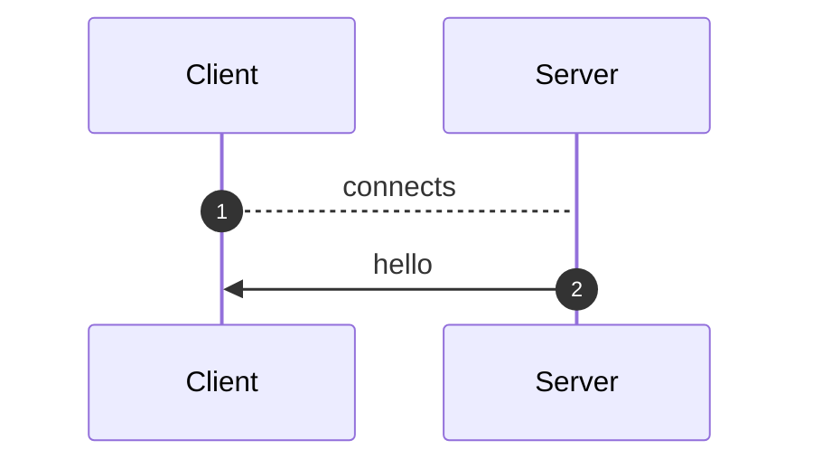
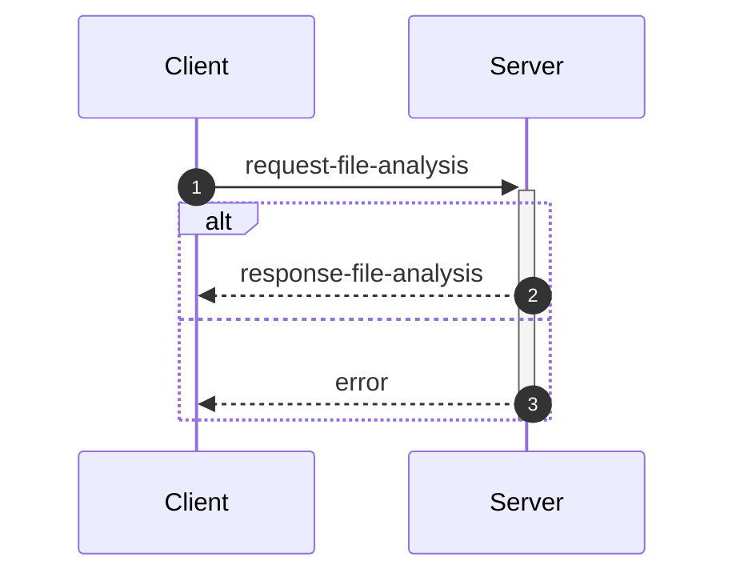
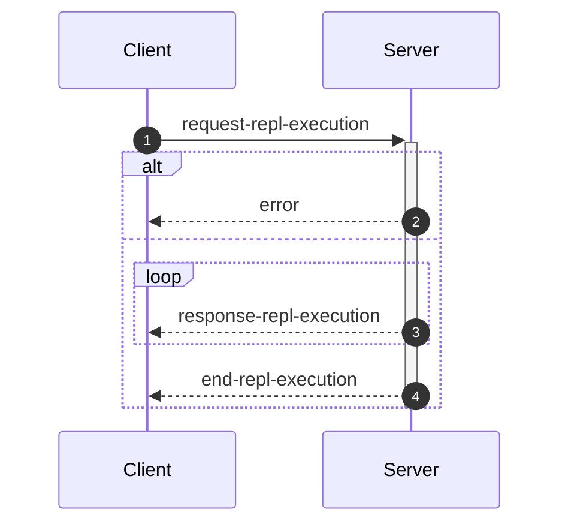
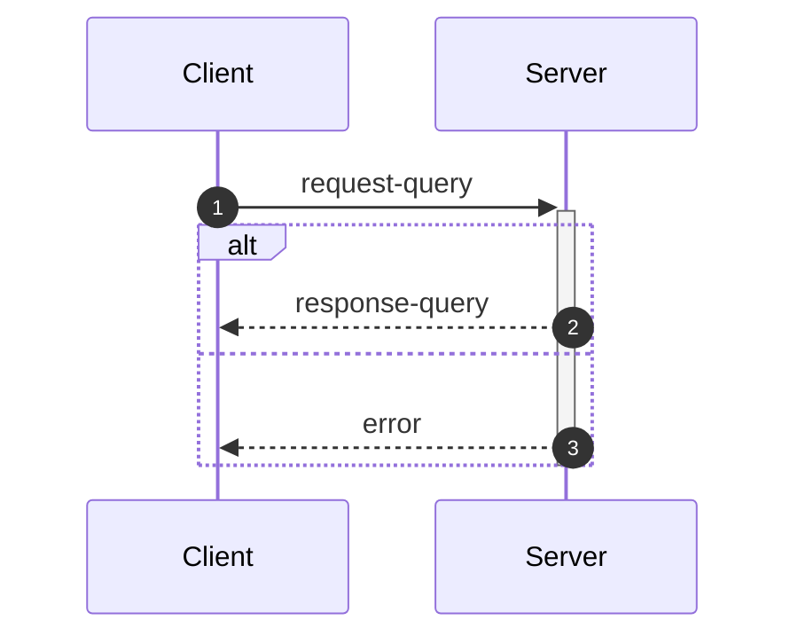

_<span title="an overview of flowR's interface">Generated</span> from '[wiki-interface.ts](https://github.com/flowr-analysis/flowr/tree/main/src/documentation/wiki-interface.ts "src/documentation/wiki-interface.ts")' on 2026-11-08, 17:31:23 UTC (v2.17.4, R v4.6.1), do not edit directly._

Although far from being as detailed as the in-depth explanation of [_flowR_](https://github.com/flowr-analysis/flowr/wiki/Core),
this wiki page explains how to interface with _flowR_ in more detail.
In general, command line arguments and other options provide short descriptions on hover over.

* [💻 Using the REPL](#using-the-repl)
* [⚙️ Configuring FlowR](#configuring-flowr)
* [⚒️ Writing Code](#writing-code)
* [💬 Communicating with the Server](#communicating-with-the-server)

<a id='using-the-repl'></a>
## 💻 Using the REPL

> [!NOTE]
> To execute arbitrary R commands with a repl request, _flowR_ has to be started explicitly with <span title="Description (Command Line Argument): Allow to access the underlying R session when using flowR (security warning: this allows the execution of arbitrary R code!)">`--r-session-access`</span>.
> Please be aware that this introduces a security risk and note that this relies on the [`r-shell` engine](https://github.com/flowr-analysis/flowr/wiki/Engines) .

Although primarily meant for users to explore,
there is nothing which forbids calling _flowR_ as a subprocess to use standard-in, -output, and -error
for communication (although you can access the REPL using the server as well,
with the [REPL Request](#message-request-repl-execution) message).

The read-eval-print loop&nbsp;(REPL) works relatively simple.
You can submit an expression (using <kbd>Enter</kbd>),
which is interpreted as an R&nbsp;expression by default but interpreted as a *command* if it starts with a colon (`:`).
The best command to get started with the REPL is <span title="Description (Repl Command): Show help information (aliases: :h, :?)">`:help`</span>.
Besides, you can leave the REPL either with the command <span title="Description (Repl Command): End the repl (aliases: :q, :exit)">`:quit`</span> or by pressing <kbd>Ctrl</kbd>+<kbd>C</kbd> twice.
When writing a *command*, you may press <kbd>Tab</kbd> to get a list of completions, if available.
Multiple commands can be entered in a single line by separating them with a semicolon (`;`), e.g. `:parse "x<-2"; :df*`.
If a command is given without R code, the REPL will re-use R code given in a previous command.
The prior example will hence return first the parsed AST of the program and then the dataflow graph for `"x <- 2"`.

> [!NOTE]
> If you develop flowR, you may want to launch the repl using the `npm run main-dev` command, this way, you get a non-minified version of flowR with debug information and hot-reloading of source files.

<details>
<summary>Available Commands</summary>

We currently offer the following commands (this with a `[*]` suffix are available with and without the star):

| Command | Description |
| ------- | ----------- |
| **<span title="Description (Repl Command): End the repl (aliases: :q, :exit)">:quit</span>** | End the repl (aliases: **:<span title="Alias of ':quit'. End the repl">q</span>**, **:<span title="Alias of ':quit'. End the repl">exit</span>**) |
| **<span title="Description (Repl Command): Execute the given code as R code. This requires the `--r-session-access` flag to be set and requires the r-shell engine. (aliases: :e, :r)">:execute</span>** | Execute the given code as R code. This requires the `--r-session-access` flag to be set and requires the r-shell engine. (aliases: **:<span title="Alias of ':execute'. Execute the given code as R code. This requires the `--r-session-access` flag to be set and requires the r-shell engine.">e</span>**, **:<span title="Alias of ':execute'. Execute the given code as R code. This requires the `--r-session-access` flag to be set and requires the r-shell engine.">r</span>**) |
| **<span title="Description (Repl Command): Get mermaid code for the control-flow graph of R code (aliases: :cfg, :cf)">:controlflow[*]</span>** | Get mermaid code for the control-flow graph of R code (star: Returns the URL to mermaid.live) (aliases: **:<span title="Alias of ':controlflow'. Get mermaid code for the control-flow graph of R code">cfg</span>**, **:<span title="Alias of ':controlflow'. Get mermaid code for the control-flow graph of R code">cf</span>**) |
| **<span title="Description (Repl Command): Get mermaid code for the control-flow graph with basic blocks (aliases: :cfgb, :cfb)">:controlflowbb[*]</span>** | Get mermaid code for the control-flow graph with basic blocks (star: Returns the URL to mermaid.live) (aliases: **:<span title="Alias of ':controlflowbb'. Get mermaid code for the control-flow graph with basic blocks">cfgb</span>**, **:<span title="Alias of ':controlflowbb'. Get mermaid code for the control-flow graph with basic blocks">cfb</span>**) |
| **<span title="Description (Repl Command): Get mermaid code for the dataflow graph (aliases: :d, :df)">:dataflow[*]</span>** | Get mermaid code for the dataflow graph (star: Returns the URL to mermaid.live) (aliases: **:<span title="Alias of ':dataflow'. Get mermaid code for the dataflow graph">d</span>**, **:<span title="Alias of ':dataflow'. Get mermaid code for the dataflow graph">df</span>**) |
| **<span title="Description (Repl Command): Get mermaid code for the normalized AST of R code (aliases: :n)">:normalize[*]</span>** | Get mermaid code for the normalized AST of R code (star: Returns the URL to mermaid.live) (alias: **:<span title="Alias of ':normalize'. Get mermaid code for the normalized AST of R code">n</span>**) |
| **<span title="Description (Repl Command): Get mermaid code for the simplified dataflow graph (aliases: :ds, :dfs)">:dataflowsimple[*]</span>** | Get mermaid code for the simplified dataflow graph (star: Returns the URL to mermaid.live) (aliases: **:<span title="Alias of ':dataflowsimple'. Get mermaid code for the simplified dataflow graph">ds</span>**, **:<span title="Alias of ':dataflowsimple'. Get mermaid code for the simplified dataflow graph">dfs</span>**) |
| **<span title="Description (Repl Command): Inspect and extend the signature database: `query` (identical to :query @signature), `info <name>` for where a function comes from (identical to :query @function-info), `add <path>` to mount another database/source, `download` to fetch the full-history database. (aliases: :sig)">:signature</span>** | Inspect and extend the signature database: `query` (identical to :query @signature), `info <name>` for where a function comes from (identical to :query @function-info), `add <path>` to mount another database/source, `download` to fetch the full-history database. (alias: **:<span title="Alias of ':signature'. Inspect and extend the signature database: `query` (identical to :query @signature), `info <name>` for where a function comes from (identical to :query @function-info), `add <path>` to mount another database/source, `download` to fetch the full-history database.">sig</span>**) |
| **<span title="Description (Repl Command): Just calculates the DFG, but only prints summary info (aliases: :d#, :df#)">:dataflowsilent</span>** | Just calculates the DFG, but only prints summary info (aliases: **:<span title="Alias of ':dataflowsilent'. Just calculates the DFG, but only prints summary info">d#</span>**, **:<span title="Alias of ':dataflowsilent'. Just calculates the DFG, but only prints summary info">df#</span>**) |
| **<span title="Description (Repl Command): Prints ASCII Art of the parsed, unmodified AST (aliases: :p)">:parse</span>** | Prints ASCII Art of the parsed, unmodified AST (alias: **:<span title="Alias of ':parse'. Prints ASCII Art of the parsed, unmodified AST">p</span>**) |
| **<span title="Description (Repl Command): Prints the version of flowR as well as the current version of R">:version</span>** | Prints the version of flowR as well as the current version of R
| **<span title="Description (Repl Command): Query the given R code (use 'help' for more information)">:query[*]</span>** | Query the given R code (use 'help' for more information) (star: Similar to query, but returns the output in json format.)
| **<span title="Description (Repl Command): Returns an ASCII representation of the dataflow graph (aliases: :df!)">:dataflowascii</span>** | Returns an ASCII representation of the dataflow graph (alias: **:<span title="Alias of ':dataflowascii'. Returns an ASCII representation of the dataflow graph">df!</span>**) |
| **<span title="Description (Repl Command): Returns summarization stats for the normalized AST (aliases: :n#)">:normalize#</span>** | Returns summarization stats for the normalized AST (alias: **:<span title="Alias of ':normalize#'. Returns summarization stats for the normalized AST">n#</span>**) |
| **<span title="Description (Repl Command): Show help information (aliases: :h, :?)">:help</span>** | Show help information (aliases: **:<span title="Alias of ':help'. Show help information">h</span>**, **:<span title="Alias of ':help'. Show help information">?</span>**) |

</details>

> [!TIP]
> 
> As indicated by the examples before, all REPL commands that operate on code keep track of the state.
> Hence, if you run a command like <span title="Description (Repl Command, starred version): Returns the URL to mermaid.live; Base Command: Get mermaid code for the dataflow graph (aliases: :d*, :df*)">`:dataflow*`</span> without providing R code,
> the REPL will re-use the R code provided in a previous command.
> Likewise, doing this will benefit from incrementality!
> If you request the dataflow graph with `:df* x <- 2 * y` and then want to see the parsed AST with `:parse`,
> the REPL will re-use previously obtained information and not re-parse the code again.
> 		

Generally, many commands offer shortcut versions in the REPL. Many queries, for example, offer a shortened format (see the example below).
Of special note, the [Config Query](https://github.com/flowr-analysis/flowr/wiki/%5BQuery%5D-Config)
can be used to also modify the currently active configuration of _flowR_ within the REPL (see the [wiki page](https://github.com/flowr-analysis/flowr/wiki/%5BQuery%5D-Config) for more information).

### Example: Retrieving the Dataflow Graph

To retrieve a URL to the [mermaid](https://mermaid.js.org/) diagram of the dataflow of a given expression,
use <span title="Description (Repl Command, starred version): Returns the URL to mermaid.live; Base Command: Get mermaid code for the dataflow graph (aliases: :d*, :df*)">`:dataflow*`</span> (or <span title="Description (Repl Command): Get mermaid code for the dataflow graph (aliases: :d, :df)">`:dataflow`</span> to get the mermaid code in the cli):

```shell
$ docker run -it --rm eagleoutice/flowr # or npm run flowr 
flowR repl v2.17.4, R grammar v14 (tree-sitter engine)
R> :dataflow* y <- 1 + x
```

<details>
<summary style='color:gray'>Output</summary>

```text
https://mermaid.live/view#base64:eyJjb2RlIjoiZmxvd2NoYXJ0IFREXG4gICAgMXt7XCJgKiM5MTtSTnVtYmVyIzkzOyogKioxKipcbiAgICAgICoxLjYqICgqKmlkOiAxKiopYFwifX1cbiAgICAyKFtcImAqIzkxO1JTeW1ib2wjOTM7KiAqKngqKlxuICAgICAgKjEuMTAqICgqKmlkOiAyKiopYFwiXSlcbiAgICAzW1tcImAqIzkxO1JCaW5hcnlPcCM5MzsqIGJhc2UjNTg7IzU4OyoqIzQzOyoqXG4gICAgICAqMS42LTEwKiAoKippZDogMyoqKVxuICAgIGFyZzogKDEsIDIpYFwiXV1cbiAgICBidWlsdC1pbjpfNDNfW1wiYEJ1aWx0LUluOlxuIzQzO2BcIl1cbiAgICBzdHlsZSBidWlsdC1pbjpfNDNfIHN0cm9rZTpncmF5LGZpbGw6Z3JheSxzdHJva2Utd2lkdGg6MnB4LG9wYWNpdHk6Ljg7XG4gICAgMFtcImAqIzkxO1JTeW1ib2wjOTM7KiAqKnkqKlxuICAgICAgKjEuMSogKCoqaWQ6IDAqKiwgdjogMylgXCJdXG4gICAgNFtbXCJgKiM5MTtSQmluYXJ5T3AjOTM7KiBiYXNlIzU4OyM1ODsqKiM2MDsjNDU7KipcbiAgICAgICoxLjEtMTAqICgqKmlkOiA0KiopXG4gICAgYXJnOiAoMCwgMylgXCJdXVxuICAgIGJ1aWx0LWluOl82MF8tW1wiYEJ1aWx0LUluOlxuIzYwOyM0NTtgXCJdXG4gICAgc3R5bGUgYnVpbHQtaW46XzYwXy0gc3Ryb2tlOmdyYXksZmlsbDpncmF5LHN0cm9rZS13aWR0aDoycHgsb3BhY2l0eTouODtcbiAgICAxIC0uLT58XCJmbG93XCJ8IDJcbiAgICBsaW5rU3R5bGUgMCBzdHJva2U6Z3JheSxjb2xvcjpncmF5O1xuICAgIDIgLS4tPnxcImZsb3dcInwgM1xuICAgIGxpbmtTdHlsZSAxIHN0cm9rZTpncmF5LGNvbG9yOmdyYXk7XG4gICAgMyAtLT58XCJyZWFkcywgYXJnXCJ8IDFcbiAgICAzIC0tPnxcInJlYWRzLCBhcmdcInwgMlxuICAgIDMgLS4tPnxcImZsb3dcInwgMFxuICAgIGxpbmtTdHlsZSA0IHN0cm9rZTpncmF5LGNvbG9yOmdyYXk7XG4gICAgMyAtLi0+fFwicmVhZHMsIGNhbGxzXCJ8IGJ1aWx0LWluOl80M19cbiAgICBsaW5rU3R5bGUgNSBzdHJva2U6Z3JheTtcbiAgICAwIC0tPnxcImRlZmluZWQtYnksIGZsb3dcInwgNFxuICAgIDAgLS0+fFwiZGVmaW5lZC1ieVwifCAzXG4gICAgNCAtLT58XCJyZWFkcywgYXJnXCJ8IDNcbiAgICA0IC0tPnxcInJldHVybnMsIGFyZ1wifCAwXG4gICAgNCAtLi0+fFwicmVhZHMsIGNhbGxzXCJ8IGJ1aWx0LWluOl82MF8tXG4gICAgbGlua1N0eWxlIDEwIHN0cm9rZTpncmF5OyIsIm1lcm1haWQiOnsiYXV0b1N5bmMiOnRydWV9fQ==
```

Retrieve the dataflow graph of the expression `y <- 1 + x`. It looks like this:


<details>

<summary style="color:gray">R Code of the Dataflow Graph</summary>

The analysis ran (parse and normalize with the [tree-sitter](https://github.com/flowr-analysis/flowr/wiki/Engines) engine) in the generation environment. No [signature database](https://github.com/flowr-analysis/flowr/wiki/Signature-Database) is mounted, so `library()` attaches no exports (base-R names are still qualified, e.g., `stats::acf`). 
We encountered no unknown side effects during the analysis.

```r
y <- 1 + x
```

</details>

</details>

For small graphs like this, <span title="Description (Repl Command): Returns an ASCII representation of the dataflow graph (aliases: :df!)">`:dataflowascii`</span> also provides an ASCII representation directly in the REPL:

```shell
$ docker run -it --rm eagleoutice/flowr # or npm run flowr 
flowR repl v2.17.4, R grammar v14 (tree-sitter engine)
R> :df! y <- 1 + x
```

<details open>
<summary style='color:gray'>Output</summary>

```text
                        v<0>v
 c<4>c──────────────────| y |
 |<- |     ┌────────────v---v
 c---c     │
    │   c<3>c   0<1>0
    └───| + |───| 1 |───u<2>u
        c---c   0---0   | x |
           └────────────u---u
Edges:
3 -> 1: reads, arg          3 -> 2: reads, arg
3 -> 0: flows-to            1 -> 2: flows-to
2 -> 3: flows-to            4 -> 3: reads, arg
4 -> 0: returns, arg        0 -> 4: defined-by, flows-to
0 -> 3: defined-by
```

Retrieve the dataflow graph of the expression `y <- 1 + x` as ASCII art.

</details>

For the slicing with <span title="Description (Repl Command): Static backwards executable slicer for R">`:slicer`</span>, you have access to the same [magic comments](#slice-magic-comments) as with the [slice request](#message-request-slice).
Pass `--inline` to splice resolvable `source()` calls into the reconstruction so the slice is a single self-contained R text (the same as the static slice query's `inlineSources` flag).
See `--help` for more flags!

### Example: Interfacing with the File System

Many commands that allow for an R-expression (like <span title="Description (Repl Command, starred version): Returns the URL to mermaid.live; Base Command: Get mermaid code for the dataflow graph (aliases: :d*, :df*)">`:dataflow*`</span>) allow for a file as well
if the argument starts with `file://`.
If you are working from the root directory of the _flowR_ repository, the following gives you the parsed AST of the example file using the <span title="Description (Repl Command): Prints ASCII Art of the parsed, unmodified AST (aliases: :p)">`:parse`</span> command:

> **Watch mode**: Replace `file://` with `watch://` to enter watch mode.
> flowR runs the command immediately and then re-runs it every time the file (or any file inside the folder) changes.
> Enter any other command to leave watch mode.
> For example: `:df watch://analysis.R`

```shell
$ docker run -it --rm eagleoutice/flowr # or npm run flowr 
flowR repl v2.17.4, R grammar v14 (tree-sitter engine)
R> :parse file://test/testfiles/example.R
```

<details>
<summary style='color:gray'>Output</summary>

```text
File: test/testfiles/example.R

program
├ binaryoperator
│ ├ identifier "sum" (1:1─4)
│ ├ <- "<-" (1:5─7)
│ ╰ float "0" (1:8─9)
├ binaryoperator
│ ├ identifier "product" (2:1─8)
│ ├ <- "<-" (2:9─11)
│ ╰ float "1" (2:12─13)
├ binaryoperator
│ ├ identifier "w" (3:1─2)
│ ├ <- "<-" (3:3─5)
│ ╰ float "7" (3:6─7)
├ binaryoperator
│ ├ identifier "N" (4:1─2)
│ ├ <- "<-" (4:3─5)
│ ╰ float "10" (4:6─8)
├ forstatement
│ ├ for "for" (6:1─4)
│ ├ ( "(" (6:5─6)
│ ├ identifier "i" (6:6─7)
│ ├ in "in" (6:8─10)
│ ├ binaryoperator
│ │ ├ float "1" (6:11─12)
│ │ ├ : ":" (6:12─13)
│ │ ╰ parenthesizedexpression
│ │   ├ ( "(" (6:13─14)
│ │   ├ binaryoperator
│ │   │ ├ identifier "N" (6:14─15)
│ │   │ ├ - "-" (6:15─16)
│ │   │ ╰ float "1" (6:16─17)
│ │   ╰ ) ")" (6:17─18)
│ ├ ) ")" (6:18─19)
│ ╰ bracedexpression
│   ├ { "{" (6:20─21)
│   ├ binaryoperator
│   │ ├ identifier "sum" (7:3─6)
│   │ ├ <- "<-" (7:7─9)
│   │ ╰ binaryoperator
│   │   ├ binaryoperator
│   │   │ ├ identifier "sum" (7:10─13)
│   │   │ ├ + "+" (7:14─15)
│   │   │ ╰ identifier "i" (7:16─17)
│   │   ├ + "+" (7:18─19)
│   │   ╰ identifier "w" (7:20─21)
│   ├ binaryoperator
│   │ ├ identifier "product" (8:3─10)
│   │ ├ <- "<-" (8:11─13)
│   │ ╰ binaryoperator
│   │   ├ identifier "product" (8:14─21)
│   │   ├  "" (8:22─23)
│   │   ╰ identifier "i" (8:24─25)
│   ╰ } "}" (9:1─2)
├ call
│ ├ identifier "cat" (11:1─4)
│ ╰ arguments
│   ├ ( "(" (11:4─5)
│   ├ argument
│   │ ╰ string
│   │   ├ stringopen "\"" (11:5─6)
│   │   ├ stringcontent "Sum:" (11:6─10)
│   │   ╰ stringclose "\"" (11:10─11)
│   ├ comma "," (11:11─12)
│   ├ argument
│   │ ╰ identifier "sum" (11:13─16)
│   ├ comma "," (11:16─17)
│   ├ argument
│   │ ╰ string
│   │   ├ stringopen "\"" (11:18─19)
│   │   ├ stringcontent
│   │   │ ╰ escapesequence "\\n" (11:19─21)
│   │   ╰ stringclose "\"" (11:21─22)
│   ╰ ) ")" (11:22─23)
╰ call
  ├ identifier "cat" (12:1─4)
  ╰ arguments
    ├ ( "(" (12:4─5)
    ├ argument
    │ ╰ string
    │   ├ stringopen "\"" (12:5─6)
    │   ├ stringcontent "Product:" (12:6─14)
    │   ╰ stringclose "\"" (12:14─15)
    ├ comma "," (12:15─16)
    ├ argument
    │ ╰ identifier "product" (12:17─24)
    ├ comma "," (12:24─25)
    ├ argument
    │ ╰ string
    │   ├ stringopen "\"" (12:26─27)
    │   ├ stringcontent
    │   │ ╰ escapesequence "\\n" (12:27─29)
    │   ╰ stringclose "\"" (12:29─30)
    ╰ ) ")" (12:30─31)
```

Retrieve the parsed AST of the example file.

<details>

<summary>File Content</summary>

```r
sum <- 0
product <- 1
w <- 7
N <- 10

for (i in 1:(N-1)) {
  sum <- sum + i + w
  product <- product * i
}

cat("Sum:", sum, "\n")
cat("Product:", product, "\n")
```

</details>

As _flowR_ directly transforms this AST the output focuses on being human-readable instead of being machine-readable.
		
</details>

### Example: Run a Query

You can run any query supported by _flowR_ using the <span title="Description (Repl Command): Query the given R code (use 'help' for more information)">`:query`</span> command.
For example, to obtain the shapes of all data frames in a given piece of code, you can run:

```shell
$ docker run -it --rm eagleoutice/flowr # or npm run flowr 
flowR repl v2.17.4, R grammar v14 (tree-sitter engine)
R> :query @absint df-shape "x <- data.frame(a = 1:10, b = 1:10)\ny <- x$a"
```

<details open>
<summary style='color:gray'>Output</summary>

```text
Query: absint (3 ms)
   ╰ $12: (colnames: [{"a", "b"}, {}], cols: [2, 2], rows: [10, 10])
   ╰ $0: (colnames: [{"a", "b"}, {}], cols: [2, 2], rows: [10, 10])
```

Retrieve the shapes of all data frames in the given code.

</details>

To run the linter on a file, you can use (in this example, we just issue the `dead-code` linter on a small piece of code):

```shell
$ docker run -it --rm eagleoutice/flowr # or npm run flowr 
flowR repl v2.17.4, R grammar v14 (tree-sitter engine)
R> :query @linter rules:dead-code "if(FALSE) x <- 2"
```

<details open>
<summary style='color:gray'>Output</summary>

```text
Query: linter (4 ms)
   ╰ Dead Code (dead-code):
       ╰ certain:
           ╰ Code at 1.11-16 (1 quick fix(es) available)
```

Run the linter on the given code, with only the `dead-code` rule enabled.

</details>

For more information on the available queries, please check out the [Query API](https://github.com/flowr-analysis/flowr/wiki/Query-API).

<a id='configuring-flowr'></a>
## ⚙️ Configuring FlowR

When running _flowR_, you may want to specify some behaviors with a dedicated configuration file.
By default, flowR looks for a file named `flowr.json` in the current working directory (or any higher directory).
You can also specify a different file with <span title="Description (Command Line Argument): The name of the configuration file to use">`--config-file`</span> or pass the configuration inline using <span title="Description (Command Line Argument): The flowR configuration to use, as a JSON string">`--config-json`</span>.
A `flowr.json` found this way belongs to the analyzed project, so flowR ignores its options that decide what flowR executes or loads
(`engines.*.wasmPath`, `engines.*.treeSitterWasmPath`, `engines.*.rPath`, `solver.sigdb.additionalPaths`, `solver.sigdb.downloadRepo`, `solver.sigdb.installedLibrary.paths`, `solver.sigdb.onDemand.enabled`, `solver.sigdb.onDemand.repositories`, `solver.sigdb.onDemand.cranMirror`, `solver.sigdb.onDemand.bioconductorMirror`, `solver.sigdb.onDemand.cacheDir`),
unless you pass <span title="Description (Command Line Argument): Keep the security-sensitive options (e.g., the R executable) of the flowr.json found in the working directory or a parent. Only use this for projects you trust.">`--trust-config`</span>.
To analyze code you do not trust, use the secure mode (<span title="Description (Command Line Argument): Run in secure mode for analyzing untrusted code: flowR does not start R (or any other process), does not access the network, does not search for project configs, and ignores security-sensitive options in every config. Cannot be disabled once enabled. Can also be enabled with the environment variable {italic FLOWR_SECURE_MODE=1}.">`--secure`</span>, see the [security policy](https://github.com/flowr-analysis/flowr/blob/main/.github/SECURITY.md)).
To inspect the current configuration, you can run flowr with the <span title="Description (Command Line Argument): Run with verbose logging (will be passed to the corresponding script)">`--verbose`</span> flag, or use the `config` [Query](https://github.com/flowr-analysis/flowr/wiki/Query-API).
Within the REPL this works by running the following:

```shell
:query @config
```

To work with the <a href="https://github.com/flowr-analysis/flowr/tree/main/src/config.ts#L125"><code><span title="The configuration file format for flowR.">FlowrConfig</span></code></a> you can use the provided helper objects alongside its methods like
<a href="https://github.com/flowr-analysis/flowr/tree/main/src/config.ts#L991"><code><span title="Creates a new flowr config that has the updated values.">FlowrConfig::<b>amend</b></span></code></a>.
The schema below documents every option; the ones you most likely want are:

- <a href="https://github.com/flowr-analysis/flowr/wiki/Interface#configuring-flowr" title="Configuration Option (boolean): Whether source calls should be ignored, causing {@link processSourceCall}&#39;s behavior to be skipped.">ignoreSourceCalls</a>: ignore source calls when analyzing the code, i.e., ignore the inclusion of other files.
- <a href="https://github.com/flowr-analysis/flowr/wiki/Interface#configuring-flowr" title="Configuration Option (boolean): Whether load calls should be ignored, causing {@link processLoadCall}&#39;s behavior to be skipped.">ignoreLoadCalls</a>: ignore load calls when analyzing the code, i.e., ignore the loading of r-data files.
- <a href="https://github.com/flowr-analysis/flowr/wiki/Interface#configuring-flowr" title="Configuration Option (object): Do you want to overwrite (parts) of the builtin definition?">semantics.environment.overwriteBuiltIns</a>: overwrite _flowR_'s handling of built-in functions, or clear the preset definitions entirely.
  See [Configure BuiltIn Semantics](#configure-builtin-semantics) for more information.
- <a href="https://github.com/flowr-analysis/flowr/wiki/Interface#configuring-flowr" title="Configuration Option (boolean): Whether calls drawing on a graphics device (e.g., `plot`) count as writing to it, which the ambient state queries then report.">semantics.ambient.drawingWritesDevice</a>: whether calls drawing on a graphics device (e.g., `plot`) count as writing the device in the ambient state queries.
- <a href="https://github.com/flowr-analysis/flowr/wiki/Interface#configuring-flowr" title="Configuration Option (string): How to resolve variables and their values. (one of &quot;disabled&quot;, &quot;alias&quot;, &quot;builtin&quot;)">solver.variables</a>: how to resolve variables and their values (`disabled`, `alias`, `builtin`).
- <a href="https://github.com/flowr-analysis/flowr/wiki/Interface#configuring-flowr" title="Configuration Option (array): The engine or set of engines to use for interacting with R code. An empty array means all available engines will be used.">engines</a> and <a href="https://github.com/flowr-analysis/flowr/wiki/Interface#configuring-flowr" title="Configuration Option (string): The default engine to use for interacting with R code. If this is undefined, an arbitrary engine from the specified list will be used. (one of &quot;tree-sitter&quot;, &quot;r-shell&quot;)">defaultEngine</a>: the engines used to interact with R code, see the [Engines wiki page](https://github.com/flowr-analysis/flowr/wiki/Engines).
- <a href="https://github.com/flowr-analysis/flowr/wiki/Interface#configuring-flowr" title="Configuration Option (array): Files a framework loads on its own, without any source() call (e.g. global.R in a shiny app), in the order they are loaded; flowR orders the matching project files accordingly and analyzes them as one program. Entries are case-insensitive globs matched against the file path, a plain name matches any file with that name, and entries matching no project file are warned about. Usually set per project kind via specializeConfig.">project.implicitSources</a>: the files a framework loads without any `source()` call, in the order in which they are
  loaded. Entries are globs (e.g. `R/*.R`) matched against the file path ignoring capitalization; one matching no file is reported.
- <a href="https://github.com/flowr-analysis/flowr/wiki/Interface#configuring-flowr" title="Configuration Option (object): Overwrite (parts of) the configuration depending on the project kind flowR detects, e.g. to give a shiny app its implicit sources.">specializeConfig</a>: overwrite (parts of) the configuration depending on the kind of project _flowR_ detects
  (e.g. `shiny-app`), which is how a shiny app gets its implicit sources by default. What you configure directly wins.
- <a href="https://github.com/flowr-analysis/flowr/wiki/Interface#configuring-flowr" title="Configuration Option (string): Overwrite the project kind flowR would otherwise infer from the analyzed files, e.g. when auto-detection guesses wrong. (one of &quot;package&quot;, &quot;script&quot;, &quot;shiny-app&quot;, &quot;notebook&quot;, &quot;project&quot;, &quot;unknown&quot;)">project.useProjectType</a>: skip that detection and force a project kind yourself, when auto-detection guesses wrong.
- <a href="https://github.com/flowr-analysis/flowr/wiki/Interface#configuring-flowr" title="Configuration Option (array): The default plugins to load when creating a new instance of FlowrAnalyzer">defaultPlugins</a> and <a href="https://github.com/flowr-analysis/flowr/wiki/Interface#configuring-flowr" title="Configuration Option (array): The plugins to load in REPL mode">repl.plugins</a>: the plugins to load for a new <a href="https://github.com/flowr-analysis/flowr/tree/main/src/project/flowr-analyzer.ts#L240"><code><span title="Central class for conducting analyses with FlowR. Use the FlowrAnalyzerBuilder to create a new instance. If you want the original pattern of creating a pipeline and running all steps, you can still do this with FlowrAnalyzer#runFull . To inspect the context of the analyzer, use FlowrAnalyzer#inspectContext (if you are a plugin and need to modify it, use FlowrAnalyzer#context instead).">FlowrAnalyzer</span></code></a> and in the REPL
  (use `flowr:default` to reference the former).

So you can configure _flowR_ by adding a file like the following:

<details>

<summary>Example Configuration File</summary>

```json
{
  "ignoreSourceCalls": true,
  "ignoreLoadCalls": true,
  "semantics": {
    "environment": {
      "overwriteBuiltIns": {
        "definitions": [
          {
            "type": "function",
            "names": [
              "foo"
            ],
            "processor": "builtin:assign",
            "config": {}
          }
        ]
      }
    }
  },
  "defaultPlugins": [
    "file:description",
    "versions:description"
  ],
  "repl": {
    "quickStats": false,
    "dfProcessorHeat": false,
    "hints": true,
    "plugins": [
      "flowr:default"
    ]
  },
  "project": {
    "resolveUnknownPathsOnDisk": true,
    "implicitSources": [
      "global.R",
      "app.R"
    ]
  },
  "linter": {
    "disabledRules": []
  },
  "specializeConfig": {
    "shiny-app": {
      "project": {
        "implicitSources": [
          "global.R",
          "ui.R",
          "server.R",
          "app.R"
        ]
      }
    }
  },
  "engines": [
    {
      "type": "r-shell"
    }
  ],
  "solver": {
    "variables": "alias",
    "evalStrings": true,
    "trackEnvironments": true,
    "sigdb": {
      "enabled": true,
      "loadProjectDependencies": true,
      "eagerlyLoad": false,
      "eagerlyLoadExports": false,
      "linkBaseR": false,
      "linkDescriptionDependencies": false
    },
    "resolveSource": {
      "dropPaths": "no",
      "ignoreCapitalization": true,
      "inferWorkingDirectory": "active-script",
      "searchPath": []
    },
    "instrument": {},
    "slicer": {
      "threshold": 50
    }
  },
  "abstractInterpretation": {
    "wideningThreshold": 4,
    "followCalls": true,
    "dataFrame": {
      "maxColNames": 20,
      "readLoadedData": {
        "readExternalFiles": true,
        "maxReadLines": 1000000
      }
    }
  },
  "incremental": {
    "alwaysIncremental": false,
    "parsing": {
      "activated": false,
      "heuristics": {
        "activated": true,
        "mtime": true,
        "linesFrom": 500,
        "bytesFrom": 50000,
        "alwaysWithEdits": false,
        "minFiles": 1
      }
    }
  },
  "gas": {
    "thresholds": {
      "memory": {
        "problematic": 0.7,
        "critical": 0.9
      },
      "timeMs": {
        "problematic": 100000,
        "critical": 120000
      }
    },
    "features": {}
  }
}
```

</details>

<details>
<a id='configure-builtin-semantics'></a>
<summary>Configure Built-In Semantics</summary>

`semantics/environment/overwriteBuiltins` accepts two keys:

- `loadDefaults` (boolean, initially `true`): If set to `true`, the default built-in definitions are loaded before applying the custom definitions. Setting this flag to `false` explicitly disables the loading of the default definitions.
- `definitions` (array, initially empty): Allows to overwrite or define new built-in elements. Each object within must have a `type` which is one of the below. Furthermore, they may define a string array of `names` which specifies the identifiers to bind the definitions to. You may use `assumePrimitive` to specify whether _flowR_ should assume that this is a primitive non-library definition (so you probably just do not want to specify the key).

  | Type            | Description                                                                                                                                                                                                                                                                                              | Example                                                                                                    |
  | --------------- | -------------------------------------------------------------------------------------------------------------------------------------------------------------------------------------------------------------------------------------------------------------------------------------------------------- | ---------------------------------------------------------------------------------------------------------- |
  | `constant`    | Additionally allows for a `value` this should resolve to.                                                                                                                                                                                                                                                | `{ type: 'constant', names: ['NULL', 'NA'],  value: null }`                                                |
  | `function`    | Is a rather flexible way to define and bind built-in functions. For the time, we do not have extensive documentation to cover all the cases, so please either consult the sources with the `default-builtin-config/` folder or open a [new issue](https://github.com/flowr-analysis/flowr/issues/new/choose). | `{ type: 'function', names: ['next'], processor: 'builtin:d', config: { cfg: ExitPointType.Next } }` |
  | `replacement` | A comfortable way to specify replacement functions like `$<-` or `names<-`. `suffixes` describes the... suffixes to attach automatically. | `{ type: 'replacement', suffixes: ['<-', '<<-'], names: ['[', '[['] }` |

</details>

<details>

<summary style='color:gray'>Full Configuration-File Schema</summary>

- _The configuration file format for flowR._ (object)
    - **logLevel** [optional] _flowR's global minimum log level, applied when the config is loaded._ (string)
        Only allows: 'silly', 'trace', 'debug', 'info', 'warn', 'error', 'fatal'
    - **ignoreSourceCalls** [optional] _Whether source calls should be ignored, causing {@link processSourceCall}'s behavior to be skipped._ (boolean)
    - **ignoreLoadCalls** [optional] _Whether load calls should be ignored, causing {@link processLoadCall}'s behavior to be skipped._ (boolean)
    - **semantics** _Configure language semantics and how flowR handles them._ (object)
        - **environment** [optional] _Semantics regarding how to handle the R environment._ (object)
            - **overwriteBuiltIns** [optional] _Do you want to overwrite (parts) of the builtin definition?_ (object)
                - **loadDefaults** [optional] _Should the default configuration still be loaded?_ (boolean)
                - **definitions** [optional] _The definitions to load/overwrite._ (array)
                Valid item types:
                    - (object)
        - **ambient** [optional] _Semantics regarding the global state (options, devices, files, ...) calls access._ (object)
            - **drawingWritesDevice** [optional] _Whether calls drawing on a graphics device (e.g., `plot`) count as writing to it, which the ambient state queries then report._ (boolean)
    - **defaultPlugins** [optional] _The default plugins to load when creating a new instance of FlowrAnalyzer_ (array)
    Valid item types:
        - (alternatives)
            - (string)
            - (array)
    - **repl** _Configuration options for the REPL._ (object)
        - **quickStats** [optional] _Whether to show quick stats in the REPL after each evaluation._ (boolean)
        - **dfProcessorHeat** [optional] _This instruments the dataflow processors to count how often each processor is called._ (boolean)
        - **hints** [optional] _Whether to show dim inline hints on the empty prompt (automatically disabled on non-interactive terminals)._ (boolean)
        - **plugins** [optional] _The plugins to load in REPL mode_ (array)
        Valid item types:
            - (alternatives)
                - (string)
                - (array)
        - **autoUseFileProtocol** [optional] _Prepend the file protocol to a repl input that looks like a path, instead of only warning about it._ (boolean)
        - **queryStats** [optional] _Whether `:query` closes with the line stating how long the queries took (`:query*` never prints it)._ (boolean)
        - **showPlugins** [optional] _Whether `:version` grays out the plugins that did not activate during the last analysis._ (boolean)
    - **project** _Project specific configuration options._ (object)
        - **resolveUnknownPathsOnDisk** [optional] _Whether to resolve unknown paths loaded by the r project disk when trying to source/analyze files._ (boolean)
        - **failOnInaccessiblePath** [optional] _Whether a directory that cannot be traversed during file discovery (e.g. due to permissions) aborts the analysis; when false (the default) such paths are logged and skipped._ (boolean)
        - **basePackages** [optional] _The packages considered part of R itself (base and recommended); if unset, flowR uses its built-in list._ (array)
        Valid item types:
            - (string)
        - **implicitSources** [optional] _Files a framework loads on its own, without any source() call (e.g. global.R in a shiny app), in the order they are loaded; flowR orders the matching project files accordingly and analyzes them as one program. Entries are case-insensitive globs matched against the file path, a plain name matches any file with that name, and entries matching no project file are warned about. Usually set per project kind via specializeConfig._ (array)
        Valid item types:
            - (string)
        - **useProjectType** [optional] _Overwrite the project kind flowR would otherwise infer from the analyzed files, e.g. when auto-detection guesses wrong._ (string)
            Only allows: 'package', 'script', 'shiny-app', 'notebook', 'project', 'unknown'
        - **assumeImplicitEcho** [optional] _Whether the top level of the analyzed code is echoed, so that every visible result printed there is collected as an output by the dependencies query (default true, false for a package)._ (boolean)
        - **discovery** [optional] _Scoping options for the default project discovery._ (object)
            - **full** [optional] _Collect every file below the project root (greedy) instead of only the files the detected project kind needs (default false)._ (boolean)
            - **perKind** [optional] _Per-kind include/exclude glob overrides layered on the default scoping._ (object)
            - **ignore** [optional] _Case-insensitive globs that drop matching files from the intelligent discovery, regardless of kind (e.g. .Renviron to ignore environment files)._ (array)
            Valid item types:
                - (string)
        - **classification** [optional] _Overrides for the signals flowR uses to classify the project kind._ (object)
            - **shinyDescriptionTypes** [optional] _DESCRIPTION Type: values that mark a shiny app._ (array)
            Valid item types:
                - (string)
            - **shinyEntryFiles** [optional] _File names a shiny app is assembled from._ (array)
            Valid item types:
                - (string)
            - **shinyUsagePattern** [optional] _Regex source evidencing shiny usage in an entry file._ (string)
            - **notebookExtensions** [optional] _File extensions marking a notebook._ (array)
            Valid item types:
                - (string)
    - **linter** _Linter configuration options._ (object)
        - **disabledRules** _Linting rule names excluded from the default rule set (a rule requested explicitly via a linter query still runs). Usually set per project kind via specializeConfig._ (array)
        Valid item types:
            - (string)
        - **disabledTags** [optional] _Linting rule tags whose rules are excluded from the default rule set (a rule requested explicitly via a linter query still runs). By default the cmd-check rules are disabled for everything but a package; a configured list replaces that default._ (array)
        Valid item types:
            - (string)
    - **inputSources** [optional] _Further frameworks the input-sources analysis should know about; entries are added to flowR's defaults._ (object)
        - **pure** [optional] _Functions that only pass the constantness of their arguments on._ (array)
        Valid item types:
            - (string)
        - **param** [optional] _Functions whose result is a 'param' input._ (array)
        Valid item types:
            - (string)
        - **file** [optional] _Functions whose result is a 'file' input._ (array)
        Valid item types:
            - (string)
        - **tempfile** [optional] _Functions whose result is a 'tempfile' input._ (array)
        Valid item types:
            - (string)
        - **glob** [optional] _Functions whose result is a 'glob' input._ (array)
        Valid item types:
            - (string)
        - **net** [optional] _Functions whose result is a 'net' input._ (array)
        Valid item types:
            - (string)
        - **rand** [optional] _Functions whose result is a 'rand' input._ (array)
        Valid item types:
            - (string)
        - **system** [optional] _Functions whose result is a 'system' input._ (array)
        Valid item types:
            - (string)
        - **ffi** [optional] _Functions whose result is a 'ffi' input._ (array)
        Valid item types:
            - (string)
        - **lang** [optional] _Functions whose result is a 'lang' input._ (array)
        Valid item types:
            - (string)
        - **options** [optional] _Functions whose result is a 'options' input._ (array)
        Valid item types:
            - (string)
        - **cmdline** [optional] _Functions whose result is a 'cmdline' input._ (array)
        Valid item types:
            - (string)
        - **user** [optional] _Functions whose result is a 'user' input._ (array)
        Valid item types:
            - (string)
        - **const** [optional] _Functions whose result is a 'const' input._ (array)
        Valid item types:
            - (string)
        - **scope** [optional] _Functions whose result is a 'scope' input._ (array)
        Valid item types:
            - (string)
        - **dconst** [optional] _Functions whose result is a 'dconst' input._ (array)
        Valid item types:
            - (string)
        - **unknown** [optional] _Functions whose result is a 'unknown' input._ (array)
        Valid item types:
            - (string)
        - **linkedObjects** [optional] _Objects a framework provides without a definition in the code, e.g. shiny's input._ (array)
        Valid item types:
            - (object)
        - **linkedEntryPoints** [optional] _Calls that hand a function to a framework, which binds its objects to the parameters by position._ (array)
        Valid item types:
            - (object)
    - **specializeConfig** [optional] _Overwrite (parts of) the configuration depending on the project kind flowR detects, e.g. to give a shiny app its implicit sources._ (object)
    - **engines** _The engine or set of engines to use for interacting with R code. An empty array means all available engines will be used._ (array)
    Valid item types:
        - (alternatives)
            - _The configuration for the tree sitter engine._ (object)
                - **type** [required] _Use the tree sitter engine._ (string)
                    Only allows: 'tree-sitter'
                - **wasmPath** [optional] _The path to the tree-sitter-r WASM binary to use. If this is undefined, this uses the default path._ (string)
                - **treeSitterWasmPath** [optional] _The path to the tree-sitter WASM binary to use. If this is undefined, this uses the default path._ (string)
                - **lax** [optional] _Whether to use the lax parser for parsing R code (allowing for syntax errors). If this is undefined, the strict parser will be used._ (boolean)
            - _The configuration for the R shell engine._ (object)
                - **type** [required] _Use the R shell engine._ (string)
                    Only allows: 'r-shell'
                - **rPath** [optional] _The path to the R executable to use. If this is undefined, this uses the default path._ (string)
                - **pipeBind** [optional] _Whether to enable R's experimental pipe-bind operator "=>" by setting _R_USE_PIPEBIND_ for the R session (default false); R itself keeps this off by default, as it is experimental and has never shipped in a release version of R._ (boolean)
    - **defaultEngine** [optional] _The default engine to use for interacting with R code. If this is undefined, an arbitrary engine from the specified list will be used._ (string)
        Only allows: 'tree-sitter', 'r-shell'
    - **solver** _How to resolve constants, constraints, cells, ..._ (object)
        - **variables** _How to resolve variables and their values._ (string)
            Only allows: 'disabled', 'alias', 'builtin'
        - **evalStrings** _Should we include eval(parse(text="...")) calls in the dataflow graph?_ (boolean)
        - **trackEnvironments** [optional] _Track user-created environments (new.env, assign/get/local with envir=, dollar-assign, attach). When false, all envir-style calls fall through conservatively._ (boolean)
        - **sigdb** _Resolving library exports from a signature database._ (object)
            - **enabled** [optional] _Resolve library()/use() exports from a signature database (default true); when false no database is consulted._ (boolean)
            - **loadProjectDependencies** [optional] _Load the project's declared dependencies from its metadata files (DESCRIPTION Imports/Depends, rproject.toml, uvr.toml, rig rproj.toml and script blocks, renv.lock, rv.lock, uvr.lock, rig lockfiles) (default true); when false these files are not read for dependencies._ (boolean)
            - **eagerlyLoad** [optional] _Parse the database up front rather than on the first package load (default false, ignored if disabled)._ (boolean)
            - **eagerlyLoadExports** [optional] _Add a vertex for every export on load rather than on demand (default false); keeps the dataflow graph small._ (boolean)
            - **assumedRVersion** [optional] _R version assumed when resolving versioned (base-R) exports: a pin like "4.5" or "auto" to detect the installed R (default "auto")._ (string)
            - **linkBaseR** [optional] _Eagerly attach base-R namespaces so bare base calls resolve without library() (default false)._ (boolean)
            - **linkBaseRCalls** [optional] _Add a lightweight Reads edge from a bare base-R call to its signature-database function vertex (default false; base-R qualification is edge-free otherwise)._ (boolean)
            - **linkPackageCalls** [optional] _Add a lightweight Reads edge from a resolved package call to its signature-database function vertex (default false)._ (boolean)
            - **linkDescriptionDependencies** [optional] _Eagerly attach the namespaces of the project's declared DESCRIPTION dependencies (Imports/Depends) so their exports resolve without an explicit library() (default false)._ (boolean)
            - **warmInBackground** [optional] _Decompress the hot shards (base + most-downloaded) in a background task on startup so the first library() lookup is warm (default false; for long-running servers/REPLs)._ (boolean)
            - **additionalPaths** [optional] _Extra directories or bundle/manifest files searched for signature databases (alongside the shipped default and $FLOWR_SIGDB_DIR); a downloaded full-history bundle placed here is mounted automatically._ (array)
            Valid item types:
                - (string)
            - **downloadRepo** [optional] _GitHub owner/repo the full-history bundle is downloaded from via ":signature download" (default "flowr-analysis/flowr"; the release tag comes from the committed sigdb.remote.json unless a version is given)._ (string)
            - **autoSync** [optional] _On startup, re-download shards whose committed sigdb.remote.json hash no longer matches the cache, in the background (default false; opt-in network sync after a git pull)._ (boolean)
            - **installedLibrary** [optional] _Recovering packages no signature database knows from the copy installed on this machine._ (object)
                - **enabled** [required] _Recover packages no signature database knows from their installed copy (default false)._ (boolean)
                - **paths** [optional] _Library directories to search; when empty they are discovered from the environment and the project._ (array)
                Valid item types:
                    - (string)
                - **useEnvironment** [optional] _Search the libraries R_LIBS_USER/R_LIBS/R_LIBS_SITE name (default true)._ (boolean)
                - **useProjectLibrary** [optional] _Search a project-local renv/packrat library (default true)._ (boolean)
                - **maxDepth** [optional] _How far to descend into the nested layout of a project-local library (default 3)._ (number)
                - **packages** [optional] _Only recover packages whose name matches one of these regular expressions; empty means any._ (array)
                Valid item types:
                    - (string)
            - **onDemand** [optional] _Recovering packages no signature database knows from their sources on CRAN, Bioconductor, or GitHub._ (object)
                - **enabled** [required] _Fetch and recover the sources of packages no signature database knows when the analyzed code uses them (default false, accesses the network)._ (boolean)
                - **sources** [optional] _Where to look, in order: github, cran, bioconductor, or a source a plugin adds (default ["github", "cran", "bioconductor"])._ (array)
                Valid item types:
                    - (string)
                - **repositories** [optional] _GitHub repositories (owner/repo[/subdir][@ref]) to fetch packages from, by package name. The analyzed project may name more (DESCRIPTION Remotes, install_github calls)._ (object)
                - **packages** [optional] _Only recover packages whose name matches one of these regular expressions, empty means any._ (array)
                Valid item types:
                    - (string)
                - **cranMirror** [optional] _The CRAN src/contrib/ to fetch from, over https (default https://cloud.r-project.org/src/contrib/). It may be on the local network._ (string)
                - **bioconductorMirror** [optional] _The Bioconductor host, over https (default https://bioconductor.org). It may be on the local network._ (string)
                - **bioconductorRelease** [optional] _The Bioconductor release to fetch from: release, devel, or a number like 3.20 (default release)._ (string)
                - **githubMirrors** [optional] _Use the GitHub mirrors of CRAN (cran/<pkg>) and Bioconductor (bioc/<pkg>) (default true)._ (boolean)
                - **maxPackages** [optional] _The most packages to fetch for one analysis (default 25)._ (number)
                - **maxArchiveMb** [optional] _The most MiB a package archive may have (default 32). It may unpack to three times that, at most 128 MiB._ (number)
                - **offline** [optional] _Only use what was fetched before, never the network (default false)._ (boolean)
                - **retryAfterHours** [optional] _How many hours to wait before asking again for a package no source had (default 24)._ (number)
                - **cacheDir** [optional] _Where to cache what was fetched (default the on-demand directory of the signature cache)._ (string)
            - **blobCacheBudgetMb** [optional] _How many MiB of decoded package blobs every open bundle may hold together (default 16)._ (number)
            - **versionSelection** [optional] _When a project constrains a dependency, resolve to the newest (default), oldest, or system-installed version satisfying it; system needs R and falls back to newest. Base-R packages always resolve against the assumed R version._ (string)
                Only allows: 'newest', 'oldest', 'system'
            - **versionOverrides** [optional] _Force an exact version for specific packages (name -> version), overriding both the project constraint and the versionSelection policy (default {})._ (object)
        - **versionManagement** _Policies for reasoning about dependency versions._ (object)
            - **linkedVersionGroups** [optional] _Groups of packages that must resolve to the same version; version guessing intersects each group so its members stay mutually compatible (default [])._ (array)
            Valid item types:
                - (array)
                Valid item types:
                    - (string)
        - **assumeAttachedPackages** [optional] _Packages to treat as attached without a `library()` call, so what the built-in configuration states about them applies to the analyzed code. The base packages R attaches on startup already resolve without it._ (array)
        Valid item types:
            - (string)
        - **transitiveSideEffectRounds** [optional] _How many rounds the transitive side-effect fixpoint may run before it is cut off (default 32); the propagation stops on its own as soon as a round adds nothing._ (number)
        - **maxOverlayDepth** [optional] _How many binding overlays may stack on one environment frame before a write flattens them (default 4); a pure performance knob, trading lookup cost against copy cost without changing any result._ (number)
        - **instrument** (object)
            - **dataflowExtractors** [optional] _These keys are only intended for use within code, allowing to instrument the dataflow analyzer!_ (any)
        - **resolveSource** [optional] _If lax source calls are active, flowR searches for sourced files much more freely, based on the configurations you give it. This option is only in effect if `ignoreSourceCalls` is set to false._ (object)
            - **dropPaths** _Allow to drop the first or all parts of the sourced path, if it is relative._ (string)
                Only allows: 'no', 'once', 'all'
            - **ignoreCapitalization** _Search for filenames matching in the lowercase._ (boolean)
            - **inferWorkingDirectory** _Try to infer the working directory from the main or any script to analyze._ (string)
                Only allows: 'no', 'main-script', 'active-script', 'any-script'
            - **searchPath** _Additionally search in these paths._ (array)
            Valid item types:
                - (string)
            - **repeatedSourceLimit** [optional] _How often the same file can be sourced within a single run? Please be aware: in case of cyclic sources this may not reach a fixpoint so give this a sensible limit._ (number)
            - **applyReplacements** _Provide name replacements for loaded files_ (array)
            Valid item types:
                - (object)
            - **assumeFilesExist** [optional] _Assume a sourced file is always there, making what it defines certain instead of conditional on the source call._ (boolean)
        - **slicer** [optional] _The configuration for the slicer._ (object)
            - **threshold** [optional] _The maximum number of iterations to perform on a single function call during slicing._ (number)
            - **autoExtend** [optional] _If set, the slicer will gain an additional post-pass._ (boolean)
    - **abstractInterpretation** _The configuration options for abstract interpretation._ (object)
        - **wideningThreshold** _The threshold for the number of visitations of a node at which widening should be performed to ensure the termination of the fixpoint iteration._ (number)
        - **followCalls** _Whether the abstract interpretation is interprocedural, i.e. whether it steps into the functions a call may dispatch to._ (boolean)
        - **dataFrame** _The configuration of the shape inference for data frames._ (object)
            - **maxColNames** _The maximum number of columns names to infer for data frames before over-approximating the column names to top._ (number)
            - **readLoadedData** _Configuration options for reading data frame shapes from loaded external data files, such as CSV files._ (object)
                - **readExternalFiles** _Whether data frame shapes should be extracted from loaded external files, such as CSV files._ (boolean)
                - **maxReadLines** _The maximum number of lines to read when extracting data frame shapes from loaded files, such as CSV files._ (number)
    - **incremental** (object)
        - **alwaysIncremental** _Always take the incremental path, regardless of heuristics._ (boolean)
        - **parsing** (object)
            - **activated** _If set, incremental parsing will be used._ (boolean)
            - **heuristics** (object)
                - **activated** [optional] _If set, the heuristics for incremental parsing will be used._ (boolean)
                - **mtime** [optional] _Skip reparsing entirely if the file's modification time is unchanged since the last parse._ (boolean)
                - **linesFrom** [optional] _Only consider incremental parsing for files with at least this many lines._ (number)
                - **bytesFrom** [optional] _Only consider incremental parsing for files with at least this many bytes._ (number)
                - **alwaysWithEdits** [optional] _Always take the incremental path whenever there is a computed edit region, regardless of the other thresholds._ (boolean)
                - **minFiles** [optional] _Only apply these heuristics once the project has at least this many files loaded._ (number)
    - **gas** [optional] _Resource-usage guard (gas) configuration. All feature factors default to 0 (disabled). See https://github.com/flowr-analysis/flowr/wiki/Core#gas-resource-guard._ (object)
        - **thresholds** [optional] _Thresholds for all gas checks (scaled by per-feature factor), boundable per feature._ (object)
            - **memory** [optional] _Heap-usage fraction thresholds (0-1), either shared or given per feature key (with `default` covering the rest)._ (object)
                - **problematic** [optional] _Heap fraction (0-1) above which Problematic is returned, for every feature without an entry of its own._ (number)
                - **critical** [optional] _Heap fraction (0-1) above which Critical is returned, for every feature without an entry of its own._ (number)
            - **timeMs** [optional] _Elapsed analysis time thresholds in milliseconds, either shared or given per feature key (with `default` covering the rest)._ (object)
                - **problematic** [optional] _Elapsed ms above which Problematic is returned, for every feature without an entry of its own._ (number)
                - **critical** [optional] _Elapsed ms above which Critical is returned, for every feature without an entry of its own._ (number)
            - **steps** [optional] _Processed-AST-node thresholds, counted rather than sampled; only a key that arms a budget (`dataflow`) reads them._ (object)
                - **problematic** [optional] _Processed AST nodes above which Problematic is returned, for every feature without an entry of its own._ (number)
                - **critical** [optional] _Processed AST nodes above which the extraction is cut short, for every feature without an entry of its own._ (number)
            - **vertices** [optional] _Created-dataflow-vertex thresholds, counted like `steps`._ (object)
                - **problematic** [optional] _Created dataflow vertices above which Problematic is returned, for every feature without an entry of its own._ (number)
                - **critical** [optional] _Created dataflow vertices above which the extraction is cut short, for every feature without an entry of its own._ (number)
        - **features** [optional] _Per-feature sensitivity factors. 0 or absent disables gas checking for that feature. A factor of 2 makes the feature twice as sensitive. Recognised keys: `source`, `side-effect-linking`, `linter`, `slicer`, `dataflow`._ (object)
        - **countedCheckEvery** [optional] _How many counted steps pass between two accountings of an armed check, be it a dataflow budget or the slicer's traversal (default 128); trades overshoot against the cost of the check._ (number)
        - **heapProvider** [optional] _Custom heap statistics source (programmatic configs only), overriding the built-in v8/performance.memory detection._ (function)

</details>

<a id='writing-code'></a>
## ⚒️ Writing Code

_flowR_ can be used as a [module](https://www.npmjs.com/package/@eagleoutice/flowr) and offers several main classes and interfaces that are interesting for extension writers 
(see the [Visual Studio Code extension](https://marketplace.visualstudio.com/items?itemName=code-inspect.vscode-flowr) or the [Core](https://github.com/flowr-analysis/flowr/wiki/Core) wiki page for more information).

### Creating Analyses with _flowR_

Nowadays, instances of the <a href="https://github.com/flowr-analysis/flowr/tree/main/src/project/flowr-analyzer.ts#L240"><code><span title="Central class for conducting analyses with FlowR. Use the FlowrAnalyzerBuilder to create a new instance. If you want the original pattern of creating a pipeline and running all steps, you can still do this with FlowrAnalyzer#runFull . To inspect the context of the analyzer, use FlowrAnalyzer#inspectContext (if you are a plugin and need to modify it, use FlowrAnalyzer#context instead).">FlowrAnalyzer</span></code></a> should be used as central frontend to get analysis results from _flowR_.
The entry points an analysis is written against are re-exported from the package root (`import { FlowrAnalyzerBuilder } from '@eagleoutice/flowr'`);
everything else stays reachable under its own path, as in `@eagleoutice/flowr/dataflow/graph/graph`.
For example, a program slice can be created like this:

```ts
const analyzer = await new FlowrAnalyzerBuilder()
    .setEngine('tree-sitter')
    .build();
analyzer.addRequest('x <- 1\ny <- x\nx');
const { slice, reconstruct } = await analyzer.query({
    type:     'static-slice',
    criteria: ['3@x']
});
```

For more information, please have a look at the [Analyzer](https://github.com/flowr-analysis/flowr/wiki/Analyzer) wiki page, which explains how to construct and use the <a href="https://github.com/flowr-analysis/flowr/tree/main/src/project/flowr-analyzer.ts#L240"><code><span title="Central class for conducting analyses with FlowR. Use the FlowrAnalyzerBuilder to create a new instance. If you want the original pattern of creating a pipeline and running all steps, you can still do this with FlowrAnalyzer#runFull . To inspect the context of the analyzer, use FlowrAnalyzer#inspectContext (if you are a plugin and need to modify it, use FlowrAnalyzer#context instead).">FlowrAnalyzer</span></code></a> in more detail.
To work with specific perspectives, you can also consult the respective pages like the [Dataflow Graph](https://github.com/flowr-analysis/flowr/wiki/Dataflow-Graph) or the [Abstract Interpretation](https://github.com/flowr-analysis/flowr/wiki/Abstract-Interpretation) wiki pages.
### The Pipeline Executor (Low-Level Interface)

Once, in the beginning, _flowR_ was meant to produce a dataflow graph merely to provide *program slices*. 
However, with continuous updates, the [Dataflow Graph](https://github.com/flowr-analysis/flowr/wiki/Dataflow-Graph) repeatedly proves to be the more interesting part.
With this, we restructured _flowR_'s originally *hardcoded* pipeline to be far more flexible. 
Now, it can be theoretically extended or replaced with arbitrary steps, optional steps, and what we call 'decorations' of these steps. 
In short, a slicing pipeline using the <a href="https://github.com/flowr-analysis/flowr/tree/main/src/core/pipeline-executor.ts#L97"><code><span title="**Please note:** The PipelineExecutor is now considered to be a rather low-level API for flowR. While it still works and is the basis for all other layers, we strongly recommend using the FlowrAnalyzer and its builder to create and use an analyzer instance that is pre-configured for your use-case. The pipeline executor allows to execute arbitrary pipelines in a step-by-step fashion. If you are not...">PipelineExecutor</span></code></a> looks like this:

```ts

const slicer = new PipelineExecutor(DEFAULT_SLICING_PIPELINE, {
  parser:    new RShell(),
  request:   requestFromInput('x <- 1\nx + 1'),
  criterion: ['2@x']
})
const slice = await slicer.allRemainingSteps()
// console.log(slice.reconstruct.code)
```

<details><summary>More Information</summary>

If you compare this, with what you would have done with the old (and removed) `SteppingSlicer`, 
this essentially just requires you to replace the `SteppingSlicer` with the <a href="https://github.com/flowr-analysis/flowr/tree/main/src/core/pipeline-executor.ts#L97"><code><span title="**Please note:** The PipelineExecutor is now considered to be a rather low-level API for flowR. While it still works and is the basis for all other layers, we strongly recommend using the FlowrAnalyzer and its builder to create and use an analyzer instance that is pre-configured for your use-case. The pipeline executor allows to execute arbitrary pipelines in a step-by-step fashion. If you are not...">PipelineExecutor</span></code></a>
and to pass the <a href="https://github.com/flowr-analysis/flowr/tree/main/src/core/steps/pipeline/default-pipelines.ts#L18"><code>DEFAULT_SLICING_PIPELINE</code></a> as the first argument.
The <a href="https://github.com/flowr-analysis/flowr/tree/main/src/core/pipeline-executor.ts#L97"><code><span title="**Please note:** The PipelineExecutor is now considered to be a rather low-level API for flowR. While it still works and is the basis for all other layers, we strongly recommend using the FlowrAnalyzer and its builder to create and use an analyzer instance that is pre-configured for your use-case. The pipeline executor allows to execute arbitrary pipelines in a step-by-step fashion. If you are not...">PipelineExecutor</span></code></a>...

1. Provides structures to investigate the results of all intermediate steps
2. Can be executed step-by-step
3. Can repeat steps (e.g., to calculate multiple slices on the same input)

See the in-code documentation for more information.

</details>

### Using the <a href="https://github.com/flowr-analysis/flowr/tree/main/src/r-bridge/shell.ts#L144"><code><span title="The RShell represents an interactive session with the R interpreter. You can configure it by RShellOptions . At the moment we are using a live R session (and not networking etc.) to communicate with R easily, which allows us to install packages etc. However, this might and probably will change in the future (leaving this as a legacy mode :D)">RShell</span></code></a> to Interact with R

The <a href="https://github.com/flowr-analysis/flowr/tree/main/src/r-bridge/shell.ts#L144"><code><span title="The RShell represents an interactive session with the R interpreter. You can configure it by RShellOptions . At the moment we are using a live R session (and not networking etc.) to communicate with R easily, which allows us to install packages etc. However, this might and probably will change in the future (leaving this as a legacy mode :D)">RShell</span></code></a> class allows interfacing with the `R`&nbsp;ecosystem installed on the host system.
Please have a look at [flowR's Engines](https://github.com/flowr-analysis/flowr/wiki/Engines) for more information on alternatives (for example, the <a href="https://github.com/flowr-analysis/flowr/tree/main/src/r-bridge/lang-4.x/tree-sitter/tree-sitter-executor.ts#L29"><code><span title="Synchronous and (way) faster alternative to the RShell using tree-sitter.">TreeSitterExecutor</span></code></a>).

> [!IMPORTANT]
> 
> Each <a href="https://github.com/flowr-analysis/flowr/tree/main/src/r-bridge/shell.ts#L144"><code><span title="The RShell represents an interactive session with the R interpreter. You can configure it by RShellOptions . At the moment we are using a live R session (and not networking etc.) to communicate with R easily, which allows us to install packages etc. However, this might and probably will change in the future (leaving this as a legacy mode :D)">RShell</span></code></a> controls a new instance of the R&nbsp;interpreter, 
> make sure to call <code><a href="https://github.com/flowr-analysis/flowr/tree/main/src/r-bridge/shell.ts#L350"><span title="Close the current R session, makes the object effectively invalid (can no longer be reopened etc.)">RShell::<i>close</i></span></a>()</code> when you are done.

You can start a new "session" by constructing a new object with <code>new <a href="https://github.com/flowr-analysis/flowr/tree/main/src/r-bridge/shell.ts#L144"><span title="The RShell represents an interactive session with the R interpreter. You can configure it by RShellOptions . At the moment we are using a live R session (and not networking etc.) to communicate with R easily, which allows us to install packages etc. However, this might and probably will change in the future (leaving this as a legacy mode :D)">RShell</span></a>()</code>.

However, there are several options that may be of interest 
(e.g., to automatically revive the shell in case of errors or to control the name location of the R process on the system).

With a shell object (let's call it `shell`), you can execute R code by using <a href="https://github.com/flowr-analysis/flowr/tree/main/src/r-bridge/shell.ts#L213"><code><span title="sends the given command directly to the current R session will not do anything to alter input markers!">RShell::<i>sendCommand</i></span></code></a>,
for example <code>shell.<a href="https://github.com/flowr-analysis/flowr/tree/main/src/r-bridge/shell.ts#L213"><span title="sends the given command directly to the current R session will not do anything to alter input markers!">sendCommand</span></a>("1 + 1")</code>.
However, this does not return anything, so if you want to collect the output of your command, use
<a href="https://github.com/flowr-analysis/flowr/tree/main/src/r-bridge/shell.ts#L296"><code><span title="Send a command and collect the output">RShell::<i>sendCommandWithOutput</i></span></code></a> instead.

<a id='communicating-with-the-server'></a>
## 💬 Communicating with the Server

As explained in the [Overview](https://github.com/flowr-analysis/flowr/wiki/Overview), you can run the [TCP](https://de.wikipedia.org/wiki/Transmission_Control_Protocol)&nbsp;server by adding the <span title="Description (Command Line Argument): Do not drop into a repl, but instead start a server on the given port (default: 1042) and listen for messages.">`--server`</span> flag (and, due to the interactive mode, exit with the conventional <kbd>CTRL</kbd>+<kbd>C</kbd>).
Currently, every connection is handled by the same underlying `RShell` - so the server is not designed to handle many clients at a time.
Additionally, the server is not well guarded against attacks (e.g., you can theoretically spawn an arbitrary number of&nbsp;RShell sessions on the target machine).

Every message has to be given in a single line (i.e., without a newline in-between) and end with a newline character. Nevertheless, we will pretty-print example given in the following segments for the ease of reading.

> [!NOTE]
> 
> The default <span title="Description (Command Line Argument): Do not drop into a repl, but instead start a server on the given port (default: 1042) and listen for messages.">`--server`</span> uses a simple [TCP](https://de.wikipedia.org/wiki/Transmission_Control_Protocol)
> connection. If you want _flowR_ to expose a [WebSocket](https://de.wikipedia.org/wiki/WebSocket) server instead, add the <span title="Description (Command Line Argument): If the server flag is set, use websocket for messaging">`--ws`</span> flag (i.e., <span title="Description (Command Line Argument): Do not drop into a repl, but instead start a server on the given port (default: 1042) and listen for messages.">`--server`</span> <span title="Description (Command Line Argument): If the server flag is set, use websocket for messaging">`--ws`</span>) when starting _flowR_ from the command line.

<ul><li>
<a id="message-hello"></a>
<b>Hello</b> Message (<code>hello</code>) 
<details>

<summary style="color:gray"> View Details. <i>The server informs the client about the successful connection and provides Meta-Information.</i> </summary>



After launching _flowR_, for example, with <code>docker run -it --rm eagleoutice/flowr <span title="Description (Command Line Argument): Do not drop into a repl, but instead start a server on the given port (default: 1042) and listen for messages.">-<span/>-server</span></code>&nbsp;(🐳️), connecting should present you with a `hello` message, that amongst others should reveal the versions of&nbsp;_flowR_ and&nbsp;R, using the [semver 2.0](https://semver.org/spec/v2.0.0.html) versioning scheme.
The message looks like this:

```json
{
  "type": "hello",
  "clientName": "client-0",
  "versions": {
    "flowr": "2.17.4",
    "r": "4.6.1",
    "engine": "r-shell"
  }
}
```

There are currently a few messages that you can send after the hello message.
If you want to _slice_ a piece of R code you first have to send an [analysis request](#message-request-file-analysis), so that you can send one or multiple slice requests afterward.
Requests for the [REPL](#message-request-repl-execution) are independent of that.
	
<hr>

<details>
<summary style="color:gray">Message schema (<code>hello</code>)</summary>

For the definition of the hello message, please see it's implementation at [`./src/cli/repl/server/messages/message-hello.ts`](https://github.com/flowr-analysis/flowr/tree/main/src/cli/repl/server/messages/message-hello.ts).

- [required] (object)
    - **type** [required] _The type of the hello message._ (string)
        Only allows: 'hello'
    - **id** [forbidden] _The id of the message is always undefined (as it is the initial message and not requested)._ (any)
    - **clientName** [required] _A unique name that is assigned to each client. It has no semantic meaning and is only used/useful for debugging._ (string)
    - **versions** [required] (object)
        - **flowr** [required] _The version of the flowr server running in semver format._ (string)
        - **r** [required] _The version of the underlying R shell running in semver format._ (string)
        - **engine** [required] _The parser backend that is used to parse the R code._ (string)

</details>

<hr>

</details>
	</li>

<li>
<a id="message-request-file-analysis"></a>
<b>Analysis</b> Message (<code>request-file-analysis</code>) 
<details>

<summary style="color:gray"> View Details. <i>The server builds the dataflow graph for a given input file (or a set of files).</i> </summary>



The request allows the server to analyze a file and prepare it for slicing.
The message can contain a `filetoken`, which is used to identify the file in later slice or query requests (if you do not add one, the request will not be stored and therefore, it is not available for subsequent requests).

> **Please note!**\
> If you want to send and process a lot of analysis requests, but do not want to slice them, please do not pass the `filetoken` field. This will save the server a lot of memory allocation.

Furthermore, the request must contain either a `content` field to directly pass the file's content or a `filepath` field which contains the path to the file (this path must be accessible for the server to be useful).
If you add the `id` field, the answer will use the same `id` so you can match requests and the corresponding answers.
See the implementation of the request-file-analysis message for more information.

You can drop one or more stored file tokens by adding the `invalidateToken` field (a single token or an array of tokens).
The server frees the corresponding analyses _after_ it has answered the request.

> **Tip!**\
> If you only want to drop tokens, you do not need a separate message: send a `request-file-analysis` that contains _just_ the `invalidateToken` field (and no `content` or `filepath`).
> Such a request behaves like an empty file analysis and the server replies with an empty `results` object.
> Because invalidation happens after the response, you may even pass the _current_ `filetoken` in `invalidateToken` to analyze a file once and have the server forget it right after you received the results.

<details>
<summary>Example of the <code>request-file-analysis</code> Message</summary>

_Note:_ even though we pretty-print these messages, they are sent as a single line, ending with a newline.

The following lists all messages that were sent and received in case you want to reproduce the scenario:

<ol>
<li> <code>hello</code> (response)
<details> 

<summary> Show Details </summary>

The first message is always a hello message.

```json
{"type":"hello","clientName":"client-0","versions":{"flowr":"2.17.4","r":"4.6.1","engine":"r-shell"}}
```

</details>
</li>

<li> <b><code>request-file-analysis</code> (request)</b>
<details open> 

<summary> Show Details </summary>

Let's suppose you simply want to analyze the following script:
 
```r
x <- 1
x + 1
```

 For this, you can send the following request:

```json
{"type":"request-file-analysis","id":"1","filetoken":"x","content":"x <- 1\nx + 1"}
```

</details>
</li>

<li> <code>response-file-analysis</code> (response)
<details> 

<summary> Show Details </summary>

The `results` field of the response effectively contains three keys of importance:

- `parse`: which contains 1:1 the parse result in CSV format that we received from the `RShell` (i.e., the AST produced by the parser of the R interpreter).
- `normalize`: which contains the normalized AST, including ids (see the `info` field and the [Normalized AST](https://github.com/flowr-analysis/flowr/wiki/Normalized-AST) wiki page).
- `dataflow`: especially important is the `graph` field which contains the dataflow graph as a set of root vertices (see the [Dataflow Graph](https://github.com/flowr-analysis/flowr/wiki/Dataflow-Graph) wiki page).
			
_As the code is pretty long, we inhibit pretty printing and syntax highlighting (JSON, hiding built-in):_

```text
{"type":"response-file-analysis","format":"json","id":"1","results":{"parse":{"files":[{"parsed":"[1,1,1,6,7,0,\"expr\",false,\"x <- 1\"],[1,1,1,1,1,3,\"SYMBOL\",true,\"x\"],[1,1,1,1,3,7,\"expr\",false,\"x\"],[1,3,1,4,2,7,\"LEFT_ASSIGN\",true,\"<-\"],[1,6,1,6,4,5,\"NUM_CONST\",true,\"1\"],[1,6,1,6,5,7,\"expr\",false,\"1\"],[2,1,2,5,16,0,\"expr\",false,\"x + 1\"],[2,1,2,1,10,12,\"SYMBOL\",true,\"x\"],[2,1,2,1,12,16,\"expr\",false,\"x\"],[2,3,2,3,11,16,\"'+'\",true,\"+\"],[2,5,2,5,13,14,\"NUM_CONST\",true,\"1\"],[2,5,2,5,14,16,\"expr\",false,\"1\"]","filePath":"/tmp/tmp-3874700-07Ax6yI0of53-.R"}],".meta":{}},"normalize":{"ast":{"type":"RProject","files":[{"root":{"type":"RExpressionList","children":[{"type":"RBinaryOp","location":[1,3,1,4],"lhs":{"type":"RSymbol","location":[1,1,1,1],"content":"x","lexeme":"x","info":{"fullRange":[1,1,1,1],"adToks":[],"id":0,"parent":2,"role":"bin-l","index":0,"nest":0,"file":"/tmp/tmp-3874700-07Ax6yI0of53-.R"}},"rhs":{"location":[1,6,1,6],"lexeme":"1","info":{"fullRange":[1,6,1,6],"adToks":[],"id":1,"parent":2,"role":"bin-r","index":1,"nest":0,"file":"/tmp/tmp-3874700-07Ax6yI0of53-.R"},"type":"RNumber","content":{"num":1,"complexNumber":false,"markedAsInt":false}},"operator":"<-","lexeme":"<-","info":{"fullRange":[1,1,1,6],"adToks":[],"id":2,"parent":6,"nest":0,"file":"/tmp/tmp-3874700-07Ax6yI0of53-.R","index":0,"role":"el-c"}},{"type":"RBinaryOp","location":[2,3,2,3],"lhs":{"type":"RSymbol","location":[2,1,2,1],"content":"x","lexeme":"x","info":{"fullRange":[2,1,2,1],"adToks":[],"id":3,"parent":5,"role":"bin-l","index":0,"nest":0,"file":"/tmp/tmp-3874700-07Ax6yI0of53-.R"}},"rhs":{"location":[2,5,2,5],"lexeme":"1","info":{"fullRange":[2,5,2,5],"adToks":[],"id":4,"parent":5,"role":"bin-r","index":1,"nest":0,"file":"/tmp/tmp-3874700-07Ax6yI0of53-.R"},"type":"RNumber","content":{"num":1,"complexNumber":false,"markedAsInt":false}},"operator":"+","lexeme":"+","info":{"fullRange":[2,1,2,5],"adToks":[],"id":5,"parent":6,"nest":0,"file":"/tmp/tmp-3874700-07Ax6yI0of53-.R","index":1,"role":"el-c"}}],"info":{"adToks":[],"id":6,"nest":0,"file":"/tmp/tmp-3874700-07Ax6yI0of53-.R","role":"root","index":0}},"filePath":"/tmp/tmp-3874700-07Ax6yI0of53-.R"}],"info":{"id":7}},".meta":{}},"dataflow":{"unknownReferences":[],"in":[{"nodeId":2,"name":"<-","type":2},{"nodeId":5,"name":"+","type":2}],"out":[{"nodeId":0,"name":"x","type":4,"definedAt":2,"value":[1]}],"environment":{"current":{"id":2278,"parent":"<BuiltInEnvironment>","memory":[["x",[{"nodeId":0,"name":"x","type":4,"definedAt":2,"value":[1]}]]],"globalEnv":true},"level":0},"graph":{"rootVertices":[1,0,2,3,4,5],"vertexInformation":[[1,{"tag":"value","id":1}],[0,{"tag":"vdef","id":0,"source":[1]}],[2,{"tag":"fcall","id":2,"name":"<-","onlyBuiltin":true,"args":[{"nodeId":0,"type":32},{"nodeId":1,"type":32}],"origin":["builtin:assign"]}],[3,{"tag":"use","id":3}],[4,{"tag":"value","id":4}],[5,{"tag":"fcall","id":5,"name":"+","onlyBuiltin":true,"args":[{"nodeId":3,"type":32},{"nodeId":4,"type":32}],"origin":["builtin:d"]}]],"edgeInformation":[[2,[[1,{"types":65}],[0,{"types":72}],["built-in:<-",{"types":5}],[3,{"types":4096}]]],[1,[[0,{"types":4096}]]],[0,[[2,{"types":4098}],[1,{"types":2}]]],[5,[[3,{"types":65}],[4,{"types":65}],["built-in:+",{"types":5}]]],[3,[[0,{"types":1}],[4,{"types":4096}]]],[4,[[5,{"types":4096}]]]],"_unknownSideEffects":[],"_ambientAccess":[[5,{"reads":["#options"],"writes":[],"assumed":[],"local":[]}]]},"entryPoint":2,"cfgEntry":1,"exitPoints":[{"type":0,"nodeId":5}],"hooks":[],".meta":{}}}}
```

</details>
</li>
</ol>

The complete round-trip covers validating the messages as well as starting and stopping the internal mock server.

</details>

You receive an error if, for whatever reason, the analysis fails (e.g., the message or code you sent contained syntax errors).
It contains a human-readable description *why* the analysis failed (see the error message implementation for more details).

<details>
<summary>Example Error Message</summary>

_Note:_ even though we pretty-print these messages, they are sent as a single line, ending with a newline.

The following lists all messages that were sent and received in case you want to reproduce the scenario:

<ol>
<li> <code>hello</code> (response)
<details> 

<summary> Show Details </summary>

The first message is always a hello message.

```json
{"type":"hello","clientName":"client-0","versions":{"flowr":"2.17.4","r":"4.6.1","engine":"r-shell"}}
```

</details>
</li>

<li> <code>request-file-analysis</code> (request)
<details> 

<summary> Show Details </summary>

```json
{"type":"request-file-analysis","id":"1","filename":"sample.R","content":"x <-"}
```

</details>
</li>

<li> <b><code>error</code> (response)</b>
<details open> 

<summary> Show Details </summary>

```json
{"id":"1","type":"error","fatal":false,"reason":"Error while analyzing file sample.R: GuardError: unable to parse R code (see the log for more information) for request {\"request\":\"text\",\"content\":\"x <-\"}}\n Report a Bug: https://github.com/flowr-analysis/flowr/issues/new?body=%3C!%2D%2D%20Please%20describe%20your%20issue%20in%20more%20detail%20below!%20%2D%2D%3E%0A%0A%0A%3C!%2D%2D%20Automatically%20generated%20issue%20metadata%2C%20please%20do%20not%20edit%20or%20delete%20content%20below%20this%20line%20%2D%2D%3E%0A%2D%2D%2D%0A%0AflowR%20version%3A%202.17.4%0Anode%20version%3A%20v26.10.0%0Anode%20arch%3A%20x64%0Anode%20platform%3A%20linux%0Amessage%3A%20%60unable%20to%20parse%20R%20code%20%28see%20the%20log%20for%20more%20information%29%20for%20request%20%7B%22request%22%3A%22text%22%2C%22content%22%3A%22x%20%3C%2D%22%7D%7D%60%0Astack%20trace%3A%0A%60%60%60%0A%20%20%20%20at%20guard%20%28%3C%3E%2Fsrc%2Futil%2Fassert.ts%3A128%3A9%29%0A%20%20%20%20at%20guardRetrievedOutput%20%28%3C%3E%2Fsrc%2Fr%2Dbridge%2Fretriever.ts%3A155%3A7%29%0A%20%20%20%20at%20%2Fhome%2Fostwind%2Fgit%2Fphd%2Fflowr%2Dfield%2Fflowr%2Fsrc%2Fr%2Dbridge%2Fretriever.ts%3A122%3A4%0A%20%20%20%20at%20processTicksAndRejections%20%28node%3Ainternal%2Fprocess%2Ftask_queues%3A104%3A5%29%0A%20%20%20%20at%20async%20Object.parseRequests%20%5Bas%20processor%5D%20%28%3C%3E%2Fsrc%2Fr%2Dbridge%2Fparser.ts%3A115%3A19%29%0A%20%20%20%20at%20async%20PipelineExecutor.nextStep%20%28%3C%3E%2Fsrc%2Fcore%2Fpipeline%2Dexecutor.ts%3A192%3A25%29%0A%20%20%20%20at%20async%20FlowrAnalyzerCache.stepTapeUntil%20%28%3C%3E%2Fsrc%2Fproject%2Fcache%2Fflowr%2Danalyzer%2Dcache.ts%3A127%3A4%29%0A%60%60%60%0A%0A%2D%2D%2D%0A%09"}
```

</details>
</li>
</ol>

The complete round-trip covers validating the messages as well as starting and stopping the internal mock server.

</details>

&nbsp;

<a id="analysis-include-cfg"></a>
**Including the Control Flow Graph**

The control flow graph is a view on the dataflow graph: the dataflow analysis records the control flow while it walks
the program, and the graph projects those edges on demand. The server can expose that structure as well (please create
a [new issue](https://github.com/flowr-analysis/flowr/issues/new/choose) for any bug you may encounter).
For this, the analysis request may add `cfg: true` to its list of options.

<details>
<summary>Requesting a Control Flow Graph</summary>

_Note:_ even though we pretty-print these messages, they are sent as a single line, ending with a newline.

The following lists all messages that were sent and received in case you want to reproduce the scenario:

<ol>
<li> <code>hello</code> (response)
<details> 

<summary> Show Details </summary>

The first message is always a hello message.

```json
{"type":"hello","clientName":"client-0","versions":{"flowr":"2.17.4","r":"4.6.1","engine":"r-shell"}}
```

</details>
</li>

<li> <b><code>request-file-analysis</code> (request)</b>
<details open> 

<summary> Show Details </summary>

```json
{"type":"request-file-analysis","id":"1","filetoken":"x","content":"if(unknown > 0) { x <- 2 } else { x <- 5 }\nfor(i in 1:x) { print(x); print(i) }","cfg":true}
```

</details>
</li>

<li> <code>response-file-analysis</code> (response)
<details> 

<summary> Show Details </summary>

The response looks basically the same as a response sent without the `cfg` flag. However, additionally it contains a `cfg` field. 
If you are interested in a visual representation of the control flow graph, see the 
[visualization with mermaid](https://mermaid.live/view#base64:eyJjb2RlIjoiZmxvd2NoYXJ0IFREXG4gICAgbjAoW1wiYFJTeW1ib2wgKDApXG4qKnVua25vd24qKmBcIl0pXG4gICAgbjEoW1wiYFJOdW1iZXIgKDEpXG4qKjAqKmBcIl0pXG4gICAgbjIoW1wiYFJCaW5hcnlPcCAoMilcbioqdW5rbm93biAjNjI7IDAqKmBcIl0pXG4gICAgbjYoW1wiYFJOdW1iZXIgKDYpXG4qKjIqKmBcIl0pXG4gICAgbjUoW1wiYFJTeW1ib2wgKDUpXG4qKngqKmBcIl0pXG4gICAgbjdbXCJgUkJpbmFyeU9wICg3KVxuKip4ICM2MDsjNDU7IDIqKmBcIl1cbiAgICBuOChbXCJgUkV4cHJlc3Npb25MaXN0ICg4KWBcIl0pXG4gICAgbjEyKFtcImBSTnVtYmVyICgxMilcbioqNSoqYFwiXSlcbiAgICBuMTEoW1wiYFJTeW1ib2wgKDExKVxuKip4KipgXCJdKVxuICAgIG4xM1tcImBSQmluYXJ5T3AgKDEzKVxuKip4ICM2MDsjNDU7IDUqKmBcIl1cbiAgICBuMTQoW1wiYFJFeHByZXNzaW9uTGlzdCAoMTQpYFwiXSlcbiAgICBuMTVbXCJgUklmVGhlbkVsc2UgKDE1KVxuKippZih1bmtub3duICM2MjsgMCkgIzEyMzsgeCAjNjA7IzQ1OyAyICMxMjU7IGVsc2UgIzEyMzsgeCAjNjA7IzQ1OyA1ICMxMjU7KipgXCJdXG4gICAgbjE2KFtcImBSU3ltYm9sICgxNilcbioqaSoqYFwiXSlcbiAgICBuMTcoW1wiYFJOdW1iZXIgKDE3KVxuKioxKipgXCJdKVxuICAgIG4xOChbXCJgUlN5bWJvbCAoMTgpXG4qKngqKmBcIl0pXG4gICAgbjE5KFtcImBSQmluYXJ5T3AgKDE5KVxuKioxIzU4O3gqKmBcIl0pXG4gICAgbjIzKFtcImBSU3ltYm9sICgyMylcbioqeCoqYFwiXSlcbiAgICBuMjVbXCJgUkZ1bmN0aW9uQ2FsbCAoMjUpXG4qKnByaW50KHgpKipgXCJdXG4gICAgbjI3KFtcImBSU3ltYm9sICgyNylcbioqaSoqYFwiXSlcbiAgICBuMjlbXCJgUkZ1bmN0aW9uQ2FsbCAoMjkpXG4qKnByaW50KGkpKipgXCJdXG4gICAgbjMwKFtcImBSRXhwcmVzc2lvbkxpc3QgKDMwKWBcIl0pXG4gICAgbjMxW1wiYFJGb3JMb29wICgzMSlcbioqZm9yKGkgaW4gMSM1ODt4KSAjMTIzOyBwcmludCh4KTsgcHJpbnQoaSkgIzEyNTsqKmBcIl1cbiAgICBuMiAtLi0+fFwiYnJhbmNoIG9uIHVua25vd24gIzYyOyAwICgyKSBpZiBUXCJ8IG42XG4gICAgbjIgLS4tPnxcImJyYW5jaCBvbiB1bmtub3duICM2MjsgMCAoMikgaWYgRlwifCBuMTJcbiAgICBuMCAtLT58XCJmbG93cyB0b1wifCBuMVxuICAgIG4xIC0tPnxcImZsb3dzIHRvXCJ8IG4yXG4gICAgbjcgLS0+fFwiZmxvd3MgdG9cInwgbjhcbiAgICBuNiAtLT58XCJmbG93cyB0b1wifCBuNVxuICAgIG41IC0tPnxcImZsb3dzIHRvXCJ8IG43XG4gICAgbjggLS0+fFwiZmxvd3MgdG9cInwgbjE1XG4gICAgbjE1IC0tPnxcImZsb3dzIHRvXCJ8IG4xN1xuICAgIG4xMyAtLT58XCJmbG93cyB0b1wifCBuMTRcbiAgICBuMTIgLS0+fFwiZmxvd3MgdG9cInwgbjExXG4gICAgbjExIC0tPnxcImZsb3dzIHRvXCJ8IG4xM1xuICAgIG4xNCAtLT58XCJmbG93cyB0b1wifCBuMTVcbiAgICBuMTkgLS0+fFwiZmxvd3MgdG9cInwgbjE2XG4gICAgbjE4IC0tPnxcImZsb3dzIHRvXCJ8IG4xOVxuICAgIG4xNyAtLT58XCJmbG93cyB0b1wifCBuMThcbiAgICBuMjUgLS0+fFwiZmxvd3MgdG9cInwgbjI3XG4gICAgbjIzIC0tPnxcImZsb3dzIHRvXCJ8IG4yNVxuICAgIG4yOSAtLT58XCJmbG93cyB0b1wifCBuMzBcbiAgICBuMjcgLS0+fFwiZmxvd3MgdG9cInwgbjI5XG4gICAgbjMwIC0tPnxcImZsb3dzIHRvXCJ8IG4xNlxuICAgIG4xNiAtLi0+fFwiYnJhbmNoIG9uIGkgKDE2KSBpZiBUXCJ8IG4yM1xuICAgIG4xNiAtLi0+fFwiYnJhbmNoIG9uIGkgKDE2KSBpZiBGXCJ8IG4zMVxuICAgIHN0eWxlIG4wIHN0cm9rZTpjeWFuLHN0cm9rZS13aWR0aDo2LjVweDsgICAgc3R5bGUgbjMxIHN0cm9rZTpncmVlbixzdHJva2Utd2lkdGg6Ni41cHg7IiwibWVybWFpZCI6eyJhdXRvU3luYyI6dHJ1ZX19).
			
_As the code is pretty long, we inhibit pretty printing and syntax highlighting (JSON, hiding built-in):_

```text
{"type":"response-file-analysis","format":"json","id":"1","cfg":{"graph":{"roots":[0,1,2,6,5,7,8,12,11,13,14,15,16,17,18,19,23,25,27,29,30,31],"vtxInfos":[[0,[2,0]],[1,[2,1]],[2,[2,2]],[6,[2,6]],[5,[2,5]],[7,[1,7]],[8,[2,8]],[12,[2,12]],[11,[2,11]],[13,[1,13]],[14,[2,14]],[15,[1,15]],[16,[2,16]],[17,[2,17]],[18,[2,18]],[19,[2,19]],[23,[2,23]],[25,[1,25]],[27,[2,27]],[29,[1,29]],[30,[2,30]],[31,[1,31]]],"bbChildren":[],"edgeInfos":[[2,[[6,{"id":15,"when":true}],[12,{"id":15,"when":false}]]],[0,[[1,0]]],[1,[[2,0]]],[7,[[8,0]]],[6,[[5,0]]],[5,[[7,0]]],[8,[[15,0]]],[15,[[17,0]]],[13,[[14,0]]],[12,[[11,0]]],[11,[[13,0]]],[14,[[15,0]]],[19,[[16,0]]],[18,[[19,0]]],[17,[[18,0]]],[25,[[27,0]]],[23,[[25,0]]],[29,[[30,0]]],[27,[[29,0]]],[30,[[16,0]]],[16,[[23,{"id":31,"when":true}],[31,{"id":31,"when":false}]]]],"mayHaveBasicBlocks":false},"entryPoints":[0],"exitPoints":[31],"returns":[],"breaks":[],"nexts":[]},"results":{"parse":{"files":[{"parsed":"[1,1,1,42,38,0,\"expr\",false,\"if(unknown > 0) { x <- 2 } else { x <- 5 }\"],[1,1,1,2,1,38,\"IF\",true,\"if\"],[1,3,1,3,2,38,\"'('\",true,\"(\"],[1,4,1,14,9,38,\"expr\",false,\"unknown > 0\"],[1,4,1,10,3,5,\"SYMBOL\",true,\"unknown\"],[1,4,1,10,5,9,\"expr\",false,\"unknown\"],[1,12,1,12,4,9,\"GT\",true,\">\"],[1,14,1,14,6,7,\"NUM_CONST\",true,\"0\"],[1,14,1,14,7,9,\"expr\",false,\"0\"],[1,15,1,15,8,38,\"')'\",true,\")\"],[1,17,1,26,22,38,\"expr\",false,\"{ x <- 2 }\"],[1,17,1,17,12,22,\"'{'\",true,\"{\"],[1,19,1,24,19,22,\"expr\",false,\"x <- 2\"],[1,19,1,19,13,15,\"SYMBOL\",true,\"x\"],[1,19,1,19,15,19,\"expr\",false,\"x\"],[1,21,1,22,14,19,\"LEFT_ASSIGN\",true,\"<-\"],[1,24,1,24,16,17,\"NUM_CONST\",true,\"2\"],[1,24,1,24,17,19,\"expr\",false,\"2\"],[1,26,1,26,18,22,\"'}'\",true,\"}\"],[1,28,1,31,23,38,\"ELSE\",true,\"else\"],[1,33,1,42,35,38,\"expr\",false,\"{ x <- 5 }\"],[1,33,1,33,25,35,\"'{'\",true,\"{\"],[1,35,1,40,32,35,\"expr\",false,\"x <- 5\"],[1,35,1,35,26,28,\"SYMBOL\",true,\"x\"],[1,35,1,35,28,32,\"expr\",false,\"x\"],[1,37,1,38,27,32,\"LEFT_ASSIGN\",true,\"<-\"],[1,40,1,40,29,30,\"NUM_CONST\",true,\"5\"],[1,40,1,40,30,32,\"expr\",false,\"5\"],[1,42,1,42,31,35,\"'}'\",true,\"}\"],[2,1,2,36,84,0,\"expr\",false,\"for(i in 1:x) { print(x); print(i) }\"],[2,1,2,3,41,84,\"FOR\",true,\"for\"],[2,4,2,13,53,84,\"forcond\",false,\"(i in 1:x)\"],[2,4,2,4,42,53,\"'('\",true,\"(\"],[2,5,2,5,43,53,\"SYMBOL\",true,\"i\"],[2,7,2,8,44,53,\"IN\",true,\"in\"],[2,10,2,12,51,53,\"expr\",false,\"1:x\"],[2,10,2,10,45,46,\"NUM_CONST\",true,\"1\"],[2,10,2,10,46,51,\"expr\",false,\"1\"],[2,11,2,11,47,51,\"':'\",true,\":\"],[2,12,2,12,48,50,\"SYMBOL\",true,\"x\"],[2,12,2,12,50,51,\"expr\",false,\"x\"],[2,13,2,13,49,53,\"')'\",true,\")\"],[2,15,2,36,81,84,\"expr\",false,\"{ print(x); print(i) }\"],[2,15,2,15,54,81,\"'{'\",true,\"{\"],[2,17,2,24,64,81,\"expr\",false,\"print(x)\"],[2,17,2,21,55,57,\"SYMBOL_FUNCTION_CALL\",true,\"print\"],[2,17,2,21,57,64,\"expr\",false,\"print\"],[2,22,2,22,56,64,\"'('\",true,\"(\"],[2,23,2,23,58,60,\"SYMBOL\",true,\"x\"],[2,23,2,23,60,64,\"expr\",false,\"x\"],[2,24,2,24,59,64,\"')'\",true,\")\"],[2,25,2,25,65,81,\"';'\",true,\";\"],[2,27,2,34,77,81,\"expr\",false,\"print(i)\"],[2,27,2,31,68,70,\"SYMBOL_FUNCTION_CALL\",true,\"print\"],[2,27,2,31,70,77,\"expr\",false,\"print\"],[2,32,2,32,69,77,\"'('\",true,\"(\"],[2,33,2,33,71,73,\"SYMBOL\",true,\"i\"],[2,33,2,33,73,77,\"expr\",false,\"i\"],[2,34,2,34,72,77,\"')'\",true,\")\"],[2,36,2,36,78,81,\"'}'\",true,\"}\"]","filePath":"/tmp/tmp-3874700-3omrKBKhsKHw-.R"}],".meta":{}},"normalize":{"ast":{"type":"RProject","files":[{"root":{"type":"RExpressionList","children":[{"type":"RIfThenElse","condition":{"type":"RBinaryOp","location":[1,12,1,12],"lhs":{"type":"RSymbol","location":[1,4,1,10],"content":"unknown","lexeme":"unknown","info":{"fullRange":[1,4,1,10],"adToks":[],"id":0,"parent":2,"role":"bin-l","index":0,"nest":1,"file":"/tmp/tmp-3874700-3omrKBKhsKHw-.R"}},"rhs":{"location":[1,14,1,14],"lexeme":"0","info":{"fullRange":[1,14,1,14],"adToks":[],"id":1,"parent":2,"role":"bin-r","index":1,"nest":1,"file":"/tmp/tmp-3874700-3omrKBKhsKHw-.R"},"type":"RNumber","content":{"num":0,"complexNumber":false,"markedAsInt":false}},"operator":">","lexeme":">","info":{"fullRange":[1,4,1,14],"adToks":[],"id":2,"parent":15,"nest":1,"file":"/tmp/tmp-3874700-3omrKBKhsKHw-.R","role":"if-c"}},"then":{"type":"RExpressionList","children":[{"type":"RBinaryOp","location":[1,21,1,22],"lhs":{"type":"RSymbol","location":[1,19,1,19],"content":"x","lexeme":"x","info":{"fullRange":[1,19,1,19],"adToks":[],"id":5,"parent":7,"role":"bin-l","index":0,"nest":1,"file":"/tmp/tmp-3874700-3omrKBKhsKHw-.R"}},"rhs":{"location":[1,24,1,24],"lexeme":"2","info":{"fullRange":[1,24,1,24],"adToks":[],"id":6,"parent":7,"role":"bin-r","index":1,"nest":1,"file":"/tmp/tmp-3874700-3omrKBKhsKHw-.R"},"type":"RNumber","content":{"num":2,"complexNumber":false,"markedAsInt":false}},"operator":"<-","lexeme":"<-","info":{"fullRange":[1,19,1,24],"adToks":[],"id":7,"parent":8,"nest":1,"file":"/tmp/tmp-3874700-3omrKBKhsKHw-.R","index":0,"role":"el-c"}}],"grouping":[{"type":"RSymbol","location":[1,17,1,17],"content":"{","lexeme":"{","info":{"fullRange":[1,17,1,26],"adToks":[],"id":3,"parent":8,"role":"el-g","index":0,"nest":1,"file":"/tmp/tmp-3874700-3omrKBKhsKHw-.R"}},{"type":"RSymbol","location":[1,26,1,26],"content":"}","lexeme":"}","info":{"fullRange":[1,17,1,26],"adToks":[],"id":4,"parent":8,"role":"el-g","index":0,"nest":1,"file":"/tmp/tmp-3874700-3omrKBKhsKHw-.R"}}],"info":{"adToks":[],"id":8,"parent":15,"nest":1,"file":"/tmp/tmp-3874700-3omrKBKhsKHw-.R","index":1,"role":"if-then"}},"location":[1,1,1,2],"lexeme":"if","info":{"fullRange":[1,1,1,42],"adToks":[],"id":15,"parent":32,"nest":1,"file":"/tmp/tmp-3874700-3omrKBKhsKHw-.R","index":0,"role":"el-c"},"otherwise":{"type":"RExpressionList","children":[{"type":"RBinaryOp","location":[1,37,1,38],"lhs":{"type":"RSymbol","location":[1,35,1,35],"content":"x","lexeme":"x","info":{"fullRange":[1,35,1,35],"adToks":[],"id":11,"parent":13,"role":"bin-l","index":0,"nest":1,"file":"/tmp/tmp-3874700-3omrKBKhsKHw-.R"}},"rhs":{"location":[1,40,1,40],"lexeme":"5","info":{"fullRange":[1,40,1,40],"adToks":[],"id":12,"parent":13,"role":"bin-r","index":1,"nest":1,"file":"/tmp/tmp-3874700-3omrKBKhsKHw-.R"},"type":"RNumber","content":{"num":5,"complexNumber":false,"markedAsInt":false}},"operator":"<-","lexeme":"<-","info":{"fullRange":[1,35,1,40],"adToks":[],"id":13,"parent":14,"nest":1,"file":"/tmp/tmp-3874700-3omrKBKhsKHw-.R","index":0,"role":"el-c"}}],"grouping":[{"type":"RSymbol","location":[1,33,1,33],"content":"{","lexeme":"{","info":{"fullRange":[1,33,1,42],"adToks":[],"id":9,"parent":14,"role":"el-g","index":0,"nest":1,"file":"/tmp/tmp-3874700-3omrKBKhsKHw-.R"}},{"type":"RSymbol","location":[1,42,1,42],"content":"}","lexeme":"}","info":{"fullRange":[1,33,1,42],"adToks":[],"id":10,"parent":14,"role":"el-g","index":0,"nest":1,"file":"/tmp/tmp-3874700-3omrKBKhsKHw-.R"}}],"info":{"adToks":[],"id":14,"parent":15,"nest":1,"file":"/tmp/tmp-3874700-3omrKBKhsKHw-.R","index":2,"role":"if-other"}}},{"type":"RForLoop","variable":{"type":"RSymbol","location":[2,5,2,5],"content":"i","lexeme":"i","info":{"adToks":[],"id":16,"parent":31,"role":"for-var","index":0,"nest":1,"file":"/tmp/tmp-3874700-3omrKBKhsKHw-.R"}},"vector":{"type":"RBinaryOp","location":[2,11,2,11],"lhs":{"location":[2,10,2,10],"lexeme":"1","info":{"fullRange":[2,10,2,10],"adToks":[],"id":17,"parent":19,"role":"bin-l","index":0,"nest":1,"file":"/tmp/tmp-3874700-3omrKBKhsKHw-.R"},"type":"RNumber","content":{"num":1,"complexNumber":false,"markedAsInt":false}},"rhs":{"type":"RSymbol","location":[2,12,2,12],"content":"x","lexeme":"x","info":{"fullRange":[2,12,2,12],"adToks":[],"id":18,"parent":19,"role":"bin-r","index":1,"nest":1,"file":"/tmp/tmp-3874700-3omrKBKhsKHw-.R"}},"operator":":","lexeme":":","info":{"fullRange":[2,10,2,12],"adToks":[],"id":19,"parent":31,"nest":1,"file":"/tmp/tmp-3874700-3omrKBKhsKHw-.R","index":1,"role":"for-vec"}},"body":{"type":"RExpressionList","children":[{"type":"RFunctionCall","named":true,"location":[2,17,2,21],"lexeme":"print","functionName":{"type":"RSymbol","location":[2,17,2,21],"content":"print","lexeme":"print","info":{"fullRange":[2,17,2,24],"adToks":[],"id":22,"parent":25,"role":"call-name","index":0,"nest":1,"file":"/tmp/tmp-3874700-3omrKBKhsKHw-.R"}},"arguments":[{"type":"RArgument","location":[2,23,2,23],"lexeme":"x","value":{"type":"RSymbol","location":[2,23,2,23],"content":"x","lexeme":"x","info":{"fullRange":[2,23,2,23],"adToks":[],"id":23,"parent":24,"role":"arg-v","index":0,"nest":1,"file":"/tmp/tmp-3874700-3omrKBKhsKHw-.R"}},"info":{"fullRange":[2,23,2,23],"adToks":[],"id":24,"parent":25,"nest":1,"file":"/tmp/tmp-3874700-3omrKBKhsKHw-.R","index":1,"role":"call-arg"}}],"info":{"fullRange":[2,17,2,24],"adToks":[],"id":25,"parent":30,"nest":1,"file":"/tmp/tmp-3874700-3omrKBKhsKHw-.R","index":0,"role":"el-c"}},{"type":"RFunctionCall","named":true,"location":[2,27,2,31],"lexeme":"print","functionName":{"type":"RSymbol","location":[2,27,2,31],"content":"print","lexeme":"print","info":{"fullRange":[2,27,2,34],"adToks":[],"id":26,"parent":29,"role":"call-name","index":0,"nest":1,"file":"/tmp/tmp-3874700-3omrKBKhsKHw-.R"}},"arguments":[{"type":"RArgument","location":[2,33,2,33],"lexeme":"i","value":{"type":"RSymbol","location":[2,33,2,33],"content":"i","lexeme":"i","info":{"fullRange":[2,33,2,33],"adToks":[],"id":27,"parent":28,"role":"arg-v","index":0,"nest":1,"file":"/tmp/tmp-3874700-3omrKBKhsKHw-.R"}},"info":{"fullRange":[2,33,2,33],"adToks":[],"id":28,"parent":29,"nest":1,"file":"/tmp/tmp-3874700-3omrKBKhsKHw-.R","index":1,"role":"call-arg"}}],"info":{"fullRange":[2,27,2,34],"adToks":[],"id":29,"parent":30,"nest":1,"file":"/tmp/tmp-3874700-3omrKBKhsKHw-.R","index":1,"role":"el-c"}}],"grouping":[{"type":"RSymbol","location":[2,15,2,15],"content":"{","lexeme":"{","info":{"fullRange":[2,15,2,36],"adToks":[],"id":20,"parent":30,"role":"el-g","index":0,"nest":1,"file":"/tmp/tmp-3874700-3omrKBKhsKHw-.R"}},{"type":"RSymbol","location":[2,36,2,36],"content":"}","lexeme":"}","info":{"fullRange":[2,15,2,36],"adToks":[],"id":21,"parent":30,"role":"el-g","index":0,"nest":1,"file":"/tmp/tmp-3874700-3omrKBKhsKHw-.R"}}],"info":{"adToks":[],"id":30,"parent":31,"nest":1,"file":"/tmp/tmp-3874700-3omrKBKhsKHw-.R","index":2,"role":"for-b"}},"lexeme":"for","info":{"fullRange":[2,1,2,36],"adToks":[],"id":31,"parent":32,"nest":1,"file":"/tmp/tmp-3874700-3omrKBKhsKHw-.R","index":1,"role":"el-c"},"location":[2,1,2,3]}],"info":{"adToks":[],"id":32,"nest":0,"file":"/tmp/tmp-3874700-3omrKBKhsKHw-.R","role":"root","index":0}},"filePath":"/tmp/tmp-3874700-3omrKBKhsKHw-.R"}],"info":{"id":33}},".meta":{}},"dataflow":{"unknownReferences":[],"in":[{"nodeId":15,"name":"if","type":2},{"nodeId":0,"name":"unknown","type":1024},{"nodeId":2,"name":">","type":2},{"nodeId":7,"name":"<-","cds":[{"id":15,"when":true}],"type":2},{"nodeId":13,"name":"<-","cds":[{"id":15,"when":false}],"type":2},{"nodeId":8,"name":"{","cds":[{"id":15,"when":true}],"type":2},{"nodeId":14,"name":"{","cds":[{"id":15,"when":false}],"type":2},{"nodeId":31,"name":"for","type":2},{"nodeId":19,"name":":","type":2},{"nodeId":25,"name":"print","type":2},{"nodeId":29,"name":"print","type":2}],"out":[{"nodeId":5,"name":"x","type":4,"definedAt":7,"cds":[{"id":15,"when":true}],"value":[6]},{"nodeId":11,"name":"x","type":4,"definedAt":13,"cds":[{"id":15,"when":false}],"value":[12]},{"nodeId":16,"name":"i","type":1}],"environment":{"current":{"id":2313,"parent":"<BuiltInEnvironment>","memory":[["x",[{"nodeId":5,"name":"x","type":4,"definedAt":7,"cds":[{"id":15,"when":true}],"value":[6]},{"nodeId":11,"name":"x","type":4,"definedAt":13,"cds":[{"id":15,"when":false}],"value":[12]}]],["i",[{"nodeId":16,"name":"i","type":1,"definedAt":31,"value":[19],"iterated":true}]]],"globalEnv":true},"level":0},"graph":{"rootVertices":[0,1,2,6,5,7,8,12,11,13,14,15,16,17,18,19,23,25,27,29,30,31],"vertexInformation":[[0,{"tag":"use","id":0}],[1,{"tag":"value","id":1}],[2,{"tag":"fcall","id":2,"name":">","onlyBuiltin":true,"args":[{"nodeId":0,"type":32},{"nodeId":1,"type":32}],"origin":["builtin:d"]}],[6,{"tag":"value","id":6}],[5,{"tag":"vdef","id":5,"cds":[{"id":15,"when":true}],"source":[6]}],[7,{"tag":"fcall","id":7,"name":"<-","onlyBuiltin":true,"cds":[{"id":15,"when":true}],"args":[{"nodeId":5,"type":32},{"nodeId":6,"type":32}],"origin":["builtin:assign"]}],[8,{"tag":"fcall","id":8,"name":"{","onlyBuiltin":true,"cds":[{"id":15,"when":true}],"args":[{"nodeId":7,"type":32}],"origin":["builtin:el"]}],[12,{"tag":"value","id":12}],[11,{"tag":"vdef","id":11,"cds":[{"id":15,"when":false}],"source":[12]}],[13,{"tag":"fcall","id":13,"name":"<-","onlyBuiltin":true,"cds":[{"id":15,"when":false}],"args":[{"nodeId":11,"type":32},{"nodeId":12,"type":32}],"origin":["builtin:assign"]}],[14,{"tag":"fcall","id":14,"name":"{","onlyBuiltin":true,"cds":[{"id":15,"when":false}],"args":[{"nodeId":13,"type":32}],"origin":["builtin:el"]}],[15,{"tag":"fcall","id":15,"name":"if","onlyBuiltin":true,"args":[{"nodeId":2,"type":32},{"nodeId":8,"type":32},{"nodeId":14,"type":32}],"origin":["builtin:ite"]}],[16,{"tag":"vdef","id":16,"source":[19]}],[17,{"tag":"value","id":17}],[18,{"tag":"use","id":18}],[19,{"tag":"fcall","id":19,"name":":","onlyBuiltin":true,"args":[{"nodeId":17,"type":32},{"nodeId":18,"type":32}],"origin":["builtin:d"]}],[23,{"tag":"use","id":23,"cds":[{"id":31,"when":true}]}],[25,{"tag":"fcall","id":25,"name":"print","onlyBuiltin":true,"cds":[{"id":31,"when":true}],"args":[{"nodeId":23,"type":32}],"origin":["builtin:d"]}],[27,{"tag":"use","id":27,"cds":[{"id":31,"when":true}]}],[29,{"tag":"fcall","id":29,"name":"print","onlyBuiltin":true,"cds":[{"id":31,"when":true}],"args":[{"nodeId":27,"type":32}],"origin":["builtin:d"]}],[30,{"tag":"fcall","id":30,"name":"{","onlyBuiltin":true,"cds":[{"id":31,"when":true}],"args":[{"nodeId":25,"type":32},{"nodeId":29,"type":32}],"origin":["builtin:el"]}],[31,{"tag":"fcall","id":31,"name":"for","onlyBuiltin":true,"args":[{"nodeId":16,"type":32},{"nodeId":19,"type":32},{"nodeId":30,"type":32}],"origin":["builtin:fl"]}]],"edgeInformation":[[2,[[0,{"types":65}],[1,{"types":65}],[6,{"types":8192,"cd":{"id":15,"when":true}}],[12,{"types":8192,"cd":{"id":15,"when":false}}],["built-in:>",{"types":5}]]],[0,[[1,{"types":4096}]]],[1,[[2,{"types":4096}]]],[7,[[6,{"types":65}],[5,{"types":72}],["built-in:<-",{"types":5}],[8,{"types":4096}]]],[6,[[5,{"types":4096}]]],[5,[[7,{"types":4098}],[6,{"types":2}]]],[8,[[7,{"types":72}],["built-in:{",{"types":5}],[15,{"types":4096}]]],[15,[[8,{"types":72}],[14,{"types":72}],[2,{"types":65}],["built-in:if",{"types":5}],[17,{"types":4096}]]],[13,[[12,{"types":65}],[11,{"types":72}],["built-in:<-",{"types":5}],[14,{"types":4096}]]],[12,[[11,{"types":4096}]]],[11,[[13,{"types":4098}],[12,{"types":2}]]],[14,[[13,{"types":72}],["built-in:{",{"types":5}],[15,{"types":4096}]]],[19,[[17,{"types":65}],[18,{"types":65}],[16,{"types":4096}],["built-in::",{"types":5}]]],[18,[[5,{"types":1}],[11,{"types":1}],[19,{"types":4096}]]],[17,[[18,{"types":4096}]]],[25,[[23,{"types":73}],["built-in:print",{"types":5}],[27,{"types":4096}]]],[23,[[5,{"types":1}],[11,{"types":1}],[25,{"types":4096}]]],[29,[[27,{"types":73}],["built-in:print",{"types":5}],[30,{"types":4096}]]],[27,[[16,{"types":1}],[29,{"types":4096}]]],[30,[[25,{"types":64}],[29,{"types":72}],["built-in:{",{"types":5}],[16,{"types":4096}]]],[16,[[19,{"types":2}],[23,{"types":8192,"cd":{"id":31,"when":true}}],[31,{"types":8192,"cd":{"id":31,"when":false}}]]],[31,[[16,{"types":64}],[19,{"types":65}],[30,{"types":320}],["built-in:for",{"types":5}]]]],"_unknownSideEffects":[{"id":25,"linkTo":{"type":"link-to-last-call","callName":{}}},{"id":29,"linkTo":{"type":"link-to-last-call","callName":{}}}],"_ambientAccess":[[15,{"reads":["#options"],"writes":[],"assumed":[],"local":[]}],[25,{"reads":["#option:digits","#option:width","#option:max.print","#option:digits.secs","#option:useFancyQuotes","#option:*"],"writes":[],"assumed":[],"local":[]}],[29,{"reads":["#options"],"writes":[],"assumed":[],"local":[]}]]},"entryPoint":15,"cfgEntry":0,"exitPoints":[{"type":0,"nodeId":31}],"hooks":[],".meta":{}}}}
```

</details>
</li>
</ol>

The complete round-trip covers validating the messages as well as starting and stopping the internal mock server.

</details>

&nbsp;

<a id="analysis-format-n-quads"></a>
**Retrieve the Output as RDF N-Quads**

The default response is formatted as JSON.
However, by specifying `format: "n-quads"`, you can retrieve the individual results (e.g., the [Normalized AST](https://github.com/flowr-analysis/flowr/wiki/Normalized-AST)),
as [RDF N-Quads](https://www.w3.org/TR/n-quads/).
This works with and without the control flow graph as described [above](#analysis-include-cfg).

<details>
<summary>Requesting RDF N-Quads</summary>

_Note:_ even though we pretty-print these messages, they are sent as a single line, ending with a newline.

The following lists all messages that were sent and received in case you want to reproduce the scenario:

<ol>
<li> <code>hello</code> (response)
<details> 

<summary> Show Details </summary>

The first message is always a hello message.

```json
{"type":"hello","clientName":"client-0","versions":{"flowr":"2.17.4","r":"4.6.1","engine":"r-shell"}}
```

</details>
</li>

<li> <b><code>request-file-analysis</code> (request)</b>
<details open> 

<summary> Show Details </summary>

```json
{"type":"request-file-analysis","id":"1","filetoken":"x","content":"x <- 1\nx + 1","format":"n-quads","cfg":true}
```

</details>
</li>

<li> <code>response-file-analysis</code> (response)
<details> 

<summary> Show Details </summary>

The base message format is still JSON, only the individual results get converted.
While the context is derived from the `filename`, we currently offer no way to customize other parts of the quads 
(please open a [new issue](https://github.com/flowr-analysis/flowr/issues/new/choose) if you require this).

_As the code is pretty long, we inhibit pretty printing and syntax highlighting (JSON, hiding built-in):_

```text
{"type":"response-file-analysis","format":"n-quads","id":"1","cfg":"<https://uni-ulm.de/r-ast/unknown/0> <https://uni-ulm.de/r-ast/rootIds> \"1\"^^<http://www.w3.org/2001/XMLSchema#integer> <unknown> .\n<https://uni-ulm.de/r-ast/unknown/0> <https://uni-ulm.de/r-ast/rootIds> \"0\"^^<http://www.w3.org/2001/XMLSchema#integer> <unknown> .\n<https://uni-ulm.de/r-ast/unknown/0> <https://uni-ulm.de/r-ast/rootIds> \"2\"^^<http://www.w3.org/2001/XMLSchema#integer> <unknown> .\n<https://uni-ulm.de/r-ast/unknown/0> <https://uni-ulm.de/r-ast/rootIds> \"3\"^^<http://www.w3.org/2001/XMLSchema#integer> <unknown> .\n<https://uni-ulm.de/r-ast/unknown/0> <https://uni-ulm.de/r-ast/rootIds> \"4\"^^<http://www.w3.org/2001/XMLSchema#integer> <unknown> .\n<https://uni-ulm.de/r-ast/unknown/0> <https://uni-ulm.de/r-ast/rootIds> \"5\"^^<http://www.w3.org/2001/XMLSchema#integer> <unknown> .\n<https://uni-ulm.de/r-ast/unknown/0> <https://uni-ulm.de/r-ast/vertices> <https://uni-ulm.de/r-ast/unknown/1> <unknown> .\n<https://uni-ulm.de/r-ast/unknown/1> <https://uni-ulm.de/r-ast/next> <https://uni-ulm.de/r-ast/unknown/2> <unknown> .\n<https://uni-ulm.de/r-ast/unknown/1> <https://uni-ulm.de/r-ast/id> \"1\"^^<http://www.w3.org/2001/XMLSchema#integer> <unknown> .\n<https://uni-ulm.de/r-ast/unknown/0> <https://uni-ulm.de/r-ast/vertices> <https://uni-ulm.de/r-ast/unknown/2> <unknown> .\n<https://uni-ulm.de/r-ast/unknown/2> <https://uni-ulm.de/r-ast/next> <https://uni-ulm.de/r-ast/unknown/3> <unknown> .\n<https://uni-ulm.de/r-ast/unknown/2> <https://uni-ulm.de/r-ast/id> \"0\"^^<http://www.w3.org/2001/XMLSchema#integer> <unknown> .\n<https://uni-ulm.de/r-ast/unknown/0> <https://uni-ulm.de/r-ast/vertices> <https://uni-ulm.de/r-ast/unknown/3> <unknown> .\n<https://uni-ulm.de/r-ast/unknown/3> <https://uni-ulm.de/r-ast/next> <https://uni-ulm.de/r-ast/unknown/4> <unknown> .\n<https://uni-ulm.de/r-ast/unknown/3> <https://uni-ulm.de/r-ast/id> \"2\"^^<http://www.w3.org/2001/XMLSchema#integer> <unknown> .\n<https://uni-ulm.de/r-ast/unknown/0> <https://uni-ulm.de/r-ast/vertices> <https://uni-ulm.de/r-ast/unknown/4> <unknown> .\n<https://uni-ulm.de/r-ast/unknown/4> <https://uni-ulm.de/r-ast/next> <https://uni-ulm.de/r-ast/unknown/5> <unknown> .\n<https://uni-ulm.de/r-ast/unknown/4> <https://uni-ulm.de/r-ast/id> \"3\"^^<http://www.w3.org/2001/XMLSchema#integer> <unknown> .\n<https://uni-ulm.de/r-ast/unknown/0> <https://uni-ulm.de/r-ast/vertices> <https://uni-ulm.de/r-ast/unknown/5> <unknown> .\n<https://uni-ulm.de/r-ast/unknown/5> <https://uni-ulm.de/r-ast/next> <https://uni-ulm.de/r-ast/unknown/6> <unknown> .\n<https://uni-ulm.de/r-ast/unknown/5> <https://uni-ulm.de/r-ast/id> \"4\"^^<http://www.w3.org/2001/XMLSchema#integer> <unknown> .\n<https://uni-ulm.de/r-ast/unknown/0> <https://uni-ulm.de/r-ast/vertices> <https://uni-ulm.de/r-ast/unknown/6> <unknown> .\n<https://uni-ulm.de/r-ast/unknown/6> <https://uni-ulm.de/r-ast/id> \"5\"^^<http://www.w3.org/2001/XMLSchema#integer> <unknown> .\n<https://uni-ulm.de/r-ast/unknown/0> <https://uni-ulm.de/r-ast/edges> <https://uni-ulm.de/r-ast/unknown/7> <unknown> .\n<https://uni-ulm.de/r-ast/unknown/7> <https://uni-ulm.de/r-ast/next> <https://uni-ulm.de/r-ast/unknown/8> <unknown> .\n<https://uni-ulm.de/r-ast/unknown/7> <https://uni-ulm.de/r-ast/from> \"2\"^^<http://www.w3.org/2001/XMLSchema#integer> <unknown> .\n<https://uni-ulm.de/r-ast/unknown/7> <https://uni-ulm.de/r-ast/to> \"3\"^^<http://www.w3.org/2001/XMLSchema#integer> <unknown> .\n<https://uni-ulm.de/r-ast/unknown/7> <https://uni-ulm.de/r-ast/type> \"0\"^^<http://www.w3.org/2001/XMLSchema#integer> <unknown> .\n<https://uni-ulm.de/r-ast/unknown/0> <https://uni-ulm.de/r-ast/edges> <https://uni-ulm.de/r-ast/unknown/8> <unknown> .\n<https://uni-ulm.de/r-ast/unknown/8> <https://uni-ulm.de/r-ast/next> <https://uni-ulm.de/r-ast/unknown/9> <unknown> .\n<https://uni-ulm.de/r-ast/unknown/8> <https://uni-ulm.de/r-ast/from> \"1\"^^<http://www.w3.org/2001/XMLSchema#integer> <unknown> .\n<https://uni-ulm.de/r-ast/unknown/8> <https://uni-ulm.de/r-ast/to> \"0\"^^<http://www.w3.org/2001/XMLSchema#integer> <unknown> .\n<https://uni-ulm.de/r-ast/unknown/8> <https://uni-ulm.de/r-ast/type> \"0\"^^<http://www.w3.org/2001/XMLSchema#integer> <unknown> .\n<https://uni-ulm.de/r-ast/unknown/0> <https://uni-ulm.de/r-ast/edges> <https://uni-ulm.de/r-ast/unknown/9> <unknown> .\n<https://uni-ulm.de/r-ast/unknown/9> <https://uni-ulm.de/r-ast/next> <https://uni-ulm.de/r-ast/unknown/10> <unknown> .\n<https://uni-ulm.de/r-ast/unknown/9> <https://uni-ulm.de/r-ast/from> \"0\"^^<http://www.w3.org/2001/XMLSchema#integer> <unknown> .\n<https://uni-ulm.de/r-ast/unknown/9> <https://uni-ulm.de/r-ast/to> \"2\"^^<http://www.w3.org/2001/XMLSchema#integer> <unknown> .\n<https://uni-ulm.de/r-ast/unknown/9> <https://uni-ulm.de/r-ast/type> \"0\"^^<http://www.w3.org/2001/XMLSchema#integer> <unknown> .\n<https://uni-ulm.de/r-ast/unknown/0> <https://uni-ulm.de/r-ast/edges> <https://uni-ulm.de/r-ast/unknown/10> <unknown> .\n<https://uni-ulm.de/r-ast/unknown/10> <https://uni-ulm.de/r-ast/next> <https://uni-ulm.de/r-ast/unknown/11> <unknown> .\n<https://uni-ulm.de/r-ast/unknown/10> <https://uni-ulm.de/r-ast/from> \"3\"^^<http://www.w3.org/2001/XMLSchema#integer> <unknown> .\n<https://uni-ulm.de/r-ast/unknown/10> <https://uni-ulm.de/r-ast/to> \"4\"^^<http://www.w3.org/2001/XMLSchema#integer> <unknown> .\n<https://uni-ulm.de/r-ast/unknown/10> <https://uni-ulm.de/r-ast/type> \"0\"^^<http://www.w3.org/2001/XMLSchema#integer> <unknown> .\n<https://uni-ulm.de/r-ast/unknown/0> <https://uni-ulm.de/r-ast/edges> <https://uni-ulm.de/r-ast/unknown/11> <unknown> .\n<https://uni-ulm.de/r-ast/unknown/11> <https://uni-ulm.de/r-ast/from> \"4\"^^<http://www.w3.org/2001/XMLSchema#integer> <unknown> .\n<https://uni-ulm.de/r-ast/unknown/11> <https://uni-ulm.de/r-ast/to> \"5\"^^<http://www.w3.org/2001/XMLSchema#integer> <unknown> .\n<https://uni-ulm.de/r-ast/unknown/11> <https://uni-ulm.de/r-ast/type> \"0\"^^<http://www.w3.org/2001/XMLSchema#integer> <unknown> .\n<https://uni-ulm.de/r-ast/unknown/0> <https://uni-ulm.de/r-ast/entryPoints> \"1\"^^<http://www.w3.org/2001/XMLSchema#integer> <unknown> .\n<https://uni-ulm.de/r-ast/unknown/0> <https://uni-ulm.de/r-ast/exitPoints> \"5\"^^<http://www.w3.org/2001/XMLSchema#integer> <unknown> .\n","results":{"parse":"<https://uni-ulm.de/r-ast/unknown/0> <https://uni-ulm.de/r-ast/token> \"exprlist\" <unknown> .\n<https://uni-ulm.de/r-ast/unknown/0> <https://uni-ulm.de/r-ast/text> \"\" <unknown> .\n<https://uni-ulm.de/r-ast/unknown/0> <https://uni-ulm.de/r-ast/id> \"0\"^^<http://www.w3.org/2001/XMLSchema#integer> <unknown> .\n<https://uni-ulm.de/r-ast/unknown/0> <https://uni-ulm.de/r-ast/parent> \"0\"^^<http://www.w3.org/2001/XMLSchema#integer> <unknown> .\n<https://uni-ulm.de/r-ast/unknown/0> <https://uni-ulm.de/r-ast/line1> \"1\"^^<http://www.w3.org/2001/XMLSchema#integer> <unknown> .\n<https://uni-ulm.de/r-ast/unknown/0> <https://uni-ulm.de/r-ast/col1> \"1\"^^<http://www.w3.org/2001/XMLSchema#integer> <unknown> .\n<https://uni-ulm.de/r-ast/unknown/0> <https://uni-ulm.de/r-ast/line2> \"2\"^^<http://www.w3.org/2001/XMLSchema#integer> <unknown> .\n<https://uni-ulm.de/r-ast/unknown/0> <https://uni-ulm.de/r-ast/col2> \"5\"^^<http://www.w3.org/2001/XMLSchema#integer> <unknown> .\n<https://uni-ulm.de/r-ast/unknown/0> <https://uni-ulm.de/r-ast/children> <https://uni-ulm.de/r-ast/unknown/1> <unknown> .\n<https://uni-ulm.de/r-ast/unknown/1> <https://uni-ulm.de/r-ast/next> <https://uni-ulm.de/r-ast/unknown/2> <unknown> .\n<https://uni-ulm.de/r-ast/unknown/1> <https://uni-ulm.de/r-ast/line1> \"1\"^^<http://www.w3.org/2001/XMLSchema#integer> <unknown> .\n<https://uni-ulm.de/r-ast/unknown/1> <https://uni-ulm.de/r-ast/col1> \"1\"^^<http://www.w3.org/2001/XMLSchema#integer> <unknown> .\n<https://uni-ulm.de/r-ast/unknown/1> <https://uni-ulm.de/r-ast/line2> \"1\"^^<http://www.w3.org/2001/XMLSchema#integer> <unknown> .\n<https://uni-ulm.de/r-ast/unknown/1> <https://uni-ulm.de/r-ast/col2> \"6\"^^<http://www.w3.org/2001/XMLSchema#integer> <unknown> .\n<https://uni-ulm.de/r-ast/unknown/1> <https://uni-ulm.de/r-ast/id> \"7\"^^<http://www.w3.org/2001/XMLSchema#integer> <unknown> .\n<https://uni-ulm.de/r-ast/unknown/1> <https://uni-ulm.de/r-ast/parent> \"0\"^^<http://www.w3.org/2001/XMLSchema#integer> <unknown> .\n<https://uni-ulm.de/r-ast/unknown/1> <https://uni-ulm.de/r-ast/token> \"expr\" <unknown> .\n<https://uni-ulm.de/r-ast/unknown/1> <https://uni-ulm.de/r-ast/terminal> \"false\"^^<http://www.w3.org/2001/XMLSchema#boolean> <unknown> .\n<https://uni-ulm.de/r-ast/unknown/1> <https://uni-ulm.de/r-ast/text> \"x <- 1\" <unknown> .\n<https://uni-ulm.de/r-ast/unknown/1> <https://uni-ulm.de/r-ast/children> <https://uni-ulm.de/r-ast/unknown/3> <unknown> .\n<https://uni-ulm.de/r-ast/unknown/3> <https://uni-ulm.de/r-ast/next> <https://uni-ulm.de/r-ast/unknown/4> <unknown> .\n<https://uni-ulm.de/r-ast/unknown/3> <https://uni-ulm.de/r-ast/line1> \"1\"^^<http://www.w3.org/2001/XMLSchema#integer> <unknown> .\n<https://uni-ulm.de/r-ast/unknown/3> <https://uni-ulm.de/r-ast/col1> \"1\"^^<http://www.w3.org/2001/XMLSchema#integer> <unknown> .\n<https://uni-ulm.de/r-ast/unknown/3> <https://uni-ulm.de/r-ast/line2> \"1\"^^<http://www.w3.org/2001/XMLSchema#integer> <unknown> .\n<https://uni-ulm.de/r-ast/unknown/3> <https://uni-ulm.de/r-ast/col2> \"1\"^^<http://www.w3.org/2001/XMLSchema#integer> <unknown> .\n<https://uni-ulm.de/r-ast/unknown/3> <https://uni-ulm.de/r-ast/id> \"3\"^^<http://www.w3.org/2001/XMLSchema#integer> <unknown> .\n<https://uni-ulm.de/r-ast/unknown/3> <https://uni-ulm.de/r-ast/parent> \"7\"^^<http://www.w3.org/2001/XMLSchema#integer> <unknown> .\n<https://uni-ulm.de/r-ast/unknown/3> <https://uni-ulm.de/r-ast/token> \"expr\" <unknown> .\n<https://uni-ulm.de/r-ast/unknown/3> <https://uni-ulm.de/r-ast/terminal> \"false\"^^<http://www.w3.org/2001/XMLSchema#boolean> <unknown> .\n<https://uni-ulm.de/r-ast/unknown/3> <https://uni-ulm.de/r-ast/text> \"x\" <unknown> .\n<https://uni-ulm.de/r-ast/unknown/3> <https://uni-ulm.de/r-ast/children> <https://uni-ulm.de/r-ast/unknown/5> <unknown> .\n<https://uni-ulm.de/r-ast/unknown/5> <https://uni-ulm.de/r-ast/line1> \"1\"^^<http://www.w3.org/2001/XMLSchema#integer> <unknown> .\n<https://uni-ulm.de/r-ast/unknown/5> <https://uni-ulm.de/r-ast/col1> \"1\"^^<http://www.w3.org/2001/XMLSchema#integer> <unknown> .\n<https://uni-ulm.de/r-ast/unknown/5> <https://uni-ulm.de/r-ast/line2> \"1\"^^<http://www.w3.org/2001/XMLSchema#integer> <unknown> .\n<https://uni-ulm.de/r-ast/unknown/5> <https://uni-ulm.de/r-ast/col2> \"1\"^^<http://www.w3.org/2001/XMLSchema#integer> <unknown> .\n<https://uni-ulm.de/r-ast/unknown/5> <https://uni-ulm.de/r-ast/id> \"1\"^^<http://www.w3.org/2001/XMLSchema#integer> <unknown> .\n<https://uni-ulm.de/r-ast/unknown/5> <https://uni-ulm.de/r-ast/parent> \"3\"^^<http://www.w3.org/2001/XMLSchema#integer> <unknown> .\n<https://uni-ulm.de/r-ast/unknown/5> <https://uni-ulm.de/r-ast/token> \"SYMBOL\" <unknown> .\n<https://uni-ulm.de/r-ast/unknown/5> <https://uni-ulm.de/r-ast/terminal> \"true\"^^<http://www.w3.org/2001/XMLSchema#boolean> <unknown> .\n<https://uni-ulm.de/r-ast/unknown/5> <https://uni-ulm.de/r-ast/text> \"x\" <unknown> .\n<https://uni-ulm.de/r-ast/unknown/1> <https://uni-ulm.de/r-ast/children> <https://uni-ulm.de/r-ast/unknown/4> <unknown> .\n<https://uni-ulm.de/r-ast/unknown/4> <https://uni-ulm.de/r-ast/next> <https://uni-ulm.de/r-ast/unknown/6> <unknown> .\n<https://uni-ulm.de/r-ast/unknown/4> <https://uni-ulm.de/r-ast/line1> \"1\"^^<http://www.w3.org/2001/XMLSchema#integer> <unknown> .\n<https://uni-ulm.de/r-ast/unknown/4> <https://uni-ulm.de/r-ast/col1> \"3\"^^<http://www.w3.org/2001/XMLSchema#integer> <unknown> .\n<https://uni-ulm.de/r-ast/unknown/4> <https://uni-ulm.de/r-ast/line2> \"1\"^^<http://www.w3.org/2001/XMLSchema#integer> <unknown> .\n<https://uni-ulm.de/r-ast/unknown/4> <https://uni-ulm.de/r-ast/col2> \"4\"^^<http://www.w3.org/2001/XMLSchema#integer> <unknown> .\n<https://uni-ulm.de/r-ast/unknown/4> <https://uni-ulm.de/r-ast/id> \"2\"^^<http://www.w3.org/2001/XMLSchema#integer> <unknown> .\n<https://uni-ulm.de/r-ast/unknown/4> <https://uni-ulm.de/r-ast/parent> \"7\"^^<http://www.w3.org/2001/XMLSchema#integer> <unknown> .\n<https://uni-ulm.de/r-ast/unknown/4> <https://uni-ulm.de/r-ast/token> \"LEFT_ASSIGN\" <unknown> .\n<https://uni-ulm.de/r-ast/unknown/4> <https://uni-ulm.de/r-ast/terminal> \"true\"^^<http://www.w3.org/2001/XMLSchema#boolean> <unknown> .\n<https://uni-ulm.de/r-ast/unknown/4> <https://uni-ulm.de/r-ast/text> \"<-\" <unknown> .\n<https://uni-ulm.de/r-ast/unknown/1> <https://uni-ulm.de/r-ast/children> <https://uni-ulm.de/r-ast/unknown/6> <unknown> .\n<https://uni-ulm.de/r-ast/unknown/6> <https://uni-ulm.de/r-ast/line1> \"1\"^^<http://www.w3.org/2001/XMLSchema#integer> <unknown> .\n<https://uni-ulm.de/r-ast/unknown/6> <https://uni-ulm.de/r-ast/col1> \"6\"^^<http://www.w3.org/2001/XMLSchema#integer> <unknown> .\n<https://uni-ulm.de/r-ast/unknown/6> <https://uni-ulm.de/r-ast/line2> \"1\"^^<http://www.w3.org/2001/XMLSchema#integer> <unknown> .\n<https://uni-ulm.de/r-ast/unknown/6> <https://uni-ulm.de/r-ast/col2> \"6\"^^<http://www.w3.org/2001/XMLSchema#integer> <unknown> .\n<https://uni-ulm.de/r-ast/unknown/6> <https://uni-ulm.de/r-ast/id> \"5\"^^<http://www.w3.org/2001/XMLSchema#integer> <unknown> .\n<https://uni-ulm.de/r-ast/unknown/6> <https://uni-ulm.de/r-ast/parent> \"7\"^^<http://www.w3.org/2001/XMLSchema#integer> <unknown> .\n<https://uni-ulm.de/r-ast/unknown/6> <https://uni-ulm.de/r-ast/token> \"expr\" <unknown> .\n<https://uni-ulm.de/r-ast/unknown/6> <https://uni-ulm.de/r-ast/terminal> \"false\"^^<http://www.w3.org/2001/XMLSchema#boolean> <unknown> .\n<https://uni-ulm.de/r-ast/unknown/6> <https://uni-ulm.de/r-ast/text> \"1\" <unknown> .\n<https://uni-ulm.de/r-ast/unknown/6> <https://uni-ulm.de/r-ast/children> <https://uni-ulm.de/r-ast/unknown/7> <unknown> .\n<https://uni-ulm.de/r-ast/unknown/7> <https://uni-ulm.de/r-ast/line1> \"1\"^^<http://www.w3.org/2001/XMLSchema#integer> <unknown> .\n<https://uni-ulm.de/r-ast/unknown/7> <https://uni-ulm.de/r-ast/col1> \"6\"^^<http://www.w3.org/2001/XMLSchema#integer> <unknown> .\n<https://uni-ulm.de/r-ast/unknown/7> <https://uni-ulm.de/r-ast/line2> \"1\"^^<http://www.w3.org/2001/XMLSchema#integer> <unknown> .\n<https://uni-ulm.de/r-ast/unknown/7> <https://uni-ulm.de/r-ast/col2> \"6\"^^<http://www.w3.org/2001/XMLSchema#integer> <unknown> .\n<https://uni-ulm.de/r-ast/unknown/7> <https://uni-ulm.de/r-ast/id> \"4\"^^<http://www.w3.org/2001/XMLSchema#integer> <unknown> .\n<https://uni-ulm.de/r-ast/unknown/7> <https://uni-ulm.de/r-ast/parent> \"5\"^^<http://www.w3.org/2001/XMLSchema#integer> <unknown> .\n<https://uni-ulm.de/r-ast/unknown/7> <https://uni-ulm.de/r-ast/token> \"NUM_CONST\" <unknown> .\n<https://uni-ulm.de/r-ast/unknown/7> <https://uni-ulm.de/r-ast/terminal> \"true\"^^<http://www.w3.org/2001/XMLSchema#boolean> <unknown> .\n<https://uni-ulm.de/r-ast/unknown/7> <https://uni-ulm.de/r-ast/text> \"1\" <unknown> .\n<https://uni-ulm.de/r-ast/unknown/0> <https://uni-ulm.de/r-ast/children> <https://uni-ulm.de/r-ast/unknown/2> <unknown> .\n<https://uni-ulm.de/r-ast/unknown/2> <https://uni-ulm.de/r-ast/line1> \"2\"^^<http://www.w3.org/2001/XMLSchema#integer> <unknown> .\n<https://uni-ulm.de/r-ast/unknown/2> <https://uni-ulm.de/r-ast/col1> \"1\"^^<http://www.w3.org/2001/XMLSchema#integer> <unknown> .\n<https://uni-ulm.de/r-ast/unknown/2> <https://uni-ulm.de/r-ast/line2> \"2\"^^<http://www.w3.org/2001/XMLSchema#integer> <unknown> .\n<https://uni-ulm.de/r-ast/unknown/2> <https://uni-ulm.de/r-ast/col2> \"5\"^^<http://www.w3.org/2001/XMLSchema#integer> <unknown> .\n<https://uni-ulm.de/r-ast/unknown/2> <https://uni-ulm.de/r-ast/id> \"16\"^^<http://www.w3.org/2001/XMLSchema#integer> <unknown> .\n<https://uni-ulm.de/r-ast/unknown/2> <https://uni-ulm.de/r-ast/parent> \"0\"^^<http://www.w3.org/2001/XMLSchema#integer> <unknown> .\n<https://uni-ulm.de/r-ast/unknown/2> <https://uni-ulm.de/r-ast/token> \"expr\" <unknown> .\n<https://uni-ulm.de/r-ast/unknown/2> <https://uni-ulm.de/r-ast/terminal> \"false\"^^<http://www.w3.org/2001/XMLSchema#boolean> <unknown> .\n<https://uni-ulm.de/r-ast/unknown/2> <https://uni-ulm.de/r-ast/text> \"x + 1\" <unknown> .\n<https://uni-ulm.de/r-ast/unknown/2> <https://uni-ulm.de/r-ast/children> <https://uni-ulm.de/r-ast/unknown/8> <unknown> .\n<https://uni-ulm.de/r-ast/unknown/8> <https://uni-ulm.de/r-ast/next> <https://uni-ulm.de/r-ast/unknown/9> <unknown> .\n<https://uni-ulm.de/r-ast/unknown/8> <https://uni-ulm.de/r-ast/line1> \"2\"^^<http://www.w3.org/2001/XMLSchema#integer> <unknown> .\n<https://uni-ulm.de/r-ast/unknown/8> <https://uni-ulm.de/r-ast/col1> \"1\"^^<http://www.w3.org/2001/XMLSchema#integer> <unknown> .\n<https://uni-ulm.de/r-ast/unknown/8> <https://uni-ulm.de/r-ast/line2> \"2\"^^<http://www.w3.org/2001/XMLSchema#integer> <unknown> .\n<https://uni-ulm.de/r-ast/unknown/8> <https://uni-ulm.de/r-ast/col2> \"1\"^^<http://www.w3.org/2001/XMLSchema#integer> <unknown> .\n<https://uni-ulm.de/r-ast/unknown/8> <https://uni-ulm.de/r-ast/id> \"12\"^^<http://www.w3.org/2001/XMLSchema#integer> <unknown> .\n<https://uni-ulm.de/r-ast/unknown/8> <https://uni-ulm.de/r-ast/parent> \"16\"^^<http://www.w3.org/2001/XMLSchema#integer> <unknown> .\n<https://uni-ulm.de/r-ast/unknown/8> <https://uni-ulm.de/r-ast/token> \"expr\" <unknown> .\n<https://uni-ulm.de/r-ast/unknown/8> <https://uni-ulm.de/r-ast/terminal> \"false\"^^<http://www.w3.org/2001/XMLSchema#boolean> <unknown> .\n<https://uni-ulm.de/r-ast/unknown/8> <https://uni-ulm.de/r-ast/text> \"x\" <unknown> .\n<https://uni-ulm.de/r-ast/unknown/8> <https://uni-ulm.de/r-ast/children> <https://uni-ulm.de/r-ast/unknown/10> <unknown> .\n<https://uni-ulm.de/r-ast/unknown/10> <https://uni-ulm.de/r-ast/line1> \"2\"^^<http://www.w3.org/2001/XMLSchema#integer> <unknown> .\n<https://uni-ulm.de/r-ast/unknown/10> <https://uni-ulm.de/r-ast/col1> \"1\"^^<http://www.w3.org/2001/XMLSchema#integer> <unknown> .\n<https://uni-ulm.de/r-ast/unknown/10> <https://uni-ulm.de/r-ast/line2> \"2\"^^<http://www.w3.org/2001/XMLSchema#integer> <unknown> .\n<https://uni-ulm.de/r-ast/unknown/10> <https://uni-ulm.de/r-ast/col2> \"1\"^^<http://www.w3.org/2001/XMLSchema#integer> <unknown> .\n<https://uni-ulm.de/r-ast/unknown/10> <https://uni-ulm.de/r-ast/id> \"10\"^^<http://www.w3.org/2001/XMLSchema#integer> <unknown> .\n<https://uni-ulm.de/r-ast/unknown/10> <https://uni-ulm.de/r-ast/parent> \"12\"^^<http://www.w3.org/2001/XMLSchema#integer> <unknown> .\n<https://uni-ulm.de/r-ast/unknown/10> <https://uni-ulm.de/r-ast/token> \"SYMBOL\" <unknown> .\n<https://uni-ulm.de/r-ast/unknown/10> <https://uni-ulm.de/r-ast/terminal> \"true\"^^<http://www.w3.org/2001/XMLSchema#boolean> <unknown> .\n<https://uni-ulm.de/r-ast/unknown/10> <https://uni-ulm.de/r-ast/text> \"x\" <unknown> .\n<https://uni-ulm.de/r-ast/unknown/2> <https://uni-ulm.de/r-ast/children> <https://uni-ulm.de/r-ast/unknown/9> <unknown> .\n<https://uni-ulm.de/r-ast/unknown/9> <https://uni-ulm.de/r-ast/next> <https://uni-ulm.de/r-ast/unknown/11> <unknown> .\n<https://uni-ulm.de/r-ast/unknown/9> <https://uni-ulm.de/r-ast/line1> \"2\"^^<http://www.w3.org/2001/XMLSchema#integer> <unknown> .\n<https://uni-ulm.de/r-ast/unknown/9> <https://uni-ulm.de/r-ast/col1> \"3\"^^<http://www.w3.org/2001/XMLSchema#integer> <unknown> .\n<https://uni-ulm.de/r-ast/unknown/9> <https://uni-ulm.de/r-ast/line2> \"2\"^^<http://www.w3.org/2001/XMLSchema#integer> <unknown> .\n<https://uni-ulm.de/r-ast/unknown/9> <https://uni-ulm.de/r-ast/col2> \"3\"^^<http://www.w3.org/2001/XMLSchema#integer> <unknown> .\n<https://uni-ulm.de/r-ast/unknown/9> <https://uni-ulm.de/r-ast/id> \"11\"^^<http://www.w3.org/2001/XMLSchema#integer> <unknown> .\n<https://uni-ulm.de/r-ast/unknown/9> <https://uni-ulm.de/r-ast/parent> \"16\"^^<http://www.w3.org/2001/XMLSchema#integer> <unk
... [23500 more characters cut, run the example to see the whole response]
```

</details>
</li>
</ol>

The complete round-trip covers validating the messages as well as starting and stopping the internal mock server.

</details>

<a id="analysis-format-compact"></a>
**Retrieve the Output in a Compacted Form**

The default JSON response can get very big quickly.
By specifying `format: "compact"`, you can retrieve the results heavily compacted (using [lz-string](https://www.npmjs.com/package/lz-string)).
This works with and without the control flow graph as described [above](#analysis-include-cfg).

<details>
<summary>Requesting Compacted Results</summary>

_Note:_ even though we pretty-print these messages, they are sent as a single line, ending with a newline.

The following lists all messages that were sent and received in case you want to reproduce the scenario:

<ol>
<li> <code>hello</code> (response)
<details> 

<summary> Show Details </summary>

The first message is always a hello message.

```json
{"type":"hello","clientName":"client-0","versions":{"flowr":"2.17.4","r":"4.6.1","engine":"r-shell"}}
```

</details>
</li>

<li> <b><code>request-file-analysis</code> (request)</b>
<details open> 

<summary> Show Details </summary>

```json
{"type":"request-file-analysis","id":"1","filetoken":"x","content":"x <- 1\nx + 1","format":"compact","cfg":true}
```

</details>
</li>

<li> <code>response-file-analysis</code> (response)
<details> 

<summary> Show Details </summary>

The base message format is still JSON, only the individual results are printed as binary objects.
			
_As the code is pretty long, we inhibit pretty printing and syntax highlighting (JSON, hiding built-in):_

```text
{"type":"response-file-analysis","format":"compact","id":"1","cfg":"ᯡ࡙䂼ࢀܠ墠⹰ₛ⨢灓䤦栱䀭&℡ᤨ೨‶™堥樲Wؠ㰤䠧〬檧ᅎŢ尵礻ᬅᜲ╌⋈夥峴獊嗳䧊彬⢳ʰfጡ䊐ŌŒlဢ䲙獑җ㘱瞠傱▊祵ᄨ咸䕍ᖳ䮦嗵㢔ᤉ㛎άᜀג䀢㰠ተ噧0䨫րٔᓺ僪ö⅞ᐭ䬱怫熆㢀⃒*呋བ༲⻱拐挗笧䉬ᙇؠᗢϧ玑ᥙℋ⹌ṧܴ眱䋴  ","results":"ᯡࠣ䄬Ԁ朥ᢠ⹰ڀ■㚑䤦檲ⲐŒ≎ĸó⻀ᬵǸ吠拀ຨ㠠禥Ꮚᐰᨀ㢦瀠‣怫₱⧠ᝪ劭᫺⨡䲂ƴŔƄ¤Ȅ„Ƞ峀˙憮牲凃㮓✾㸢䉧溔㤦⫋㗈L⨠ጳ౬怪ဣࠠ吡稠䄽ຠበเβ嫹籡㉮唦㴵᱀૦ᗨˈ඲â፼仂⃎晀吮㥳䰚呕睎⽟аⱊᔁ甥⏈兕ਦᬧ䲛敔Ⲱͳ敫玱畖Դ㎿Ⲏ㔊瀍吮❔ٕ垤柺㹃㻲䒦椾†犍倅㦩嬻䛈声←厯⩔ⵖ䏁᭸崹䰸㥍憅䱩玭፿ᯄ偬ₔଠH₶\"晠ȉᘠ᛬φᥒ⚠Ąㅢ䘫ˡ䠠㕆䀮㐵礱+挡壥G䀯ㆰ”2䐠̛ᑀ˞䮢ⰰሴӑ儔娠ϔર࣊嫊偠ᎌ唧厤㐸傦⁠ࠬই橠䭔嘥㩠▉ᔥ䨠⭘,㌔浄瘯Ԡ䏒埍渗綄ዖጻぐᨶ⥕䲈⟈䢮⦸ㄪΠ丑俏栭ᕦ⧚ڴ䲀ᅃִ⌴溊屣ʊ⡣⣢⥘ખ彬瓲絀ɕ䩐㛧㗻朐ᜭLj䜓䭅㲿ࣻḼ෋ᇘ⊉劥䯝ᐭ䆠悵࠹嬍⡼൤౤▅U䒛䂊桲ᄦ採倶烔㚨㋠搴畔㈼燕⛑Ȁ䡟煕塒㠝㇍ႄ䲦඄Ჷህ粰儵拄况狒卵嚨ʡ䏗垍᷁剽㶥⟁ξ灝ࠨÁ䞩啝柅盝㟀埜䲟⊜⿛甝忏盀eㅕ䦴Ⓝ㎠ア⚬䊠屼੝ࡔ䩢䖿熭ᠠ㚅ᡫច᳗ᘄː唴ኴ厵પ僃⦽㗨㙔玡橭坼牰ஔ⚻䩡劚璄塗֓溚䱡⽝䄡ິΜ⑊↡᤼䩡兵凕㋟加ᓝ十㉎省箠お゗ଡ଼溥狜㞽白樨䧕俋焜硄丢㊏䢁㛒ࡢٸྃ䚑代晾૓ҍ䥂๦侣窂倊尦ưᇙીڸ瞃痃㊡䷋㇕㒂爍㠷摙ᩀ盃⎺ヺᏔ疽玽༌砡枸殦瘒㮾涂Ʊ獊㲅Ⰲ㖀䲛㝊璊扫⸌涂۰ᶊⱠ㔼湳႔डぬ汢㶌止ͦ਺暎೒ѭ乃癹࣫ᒙ洡箝ౚჂ憂䕻ं岏浡罠保㓰攳䵤䦣㿘↧䧜ᴣऊ䴒⣩哳ŭ嗲⡿⩒㣶௦᚞໒䑽䵃๭嚓様⪼ẑ㖛ㄈࠓ瓔夡䅸Ԫ竡媫ᬭ厪঑ɪ⦒㝪ᑶ⤓㦄⤡孁⹊搿娚ᖋị泰ᡸ崈ᨇ⵿ᩡ焁Ԋ㋦ᵣښಅ㣮ॶ捱᣶卹⪷婨ੲ搼ѻ䭵圝斗劋抌㥧㾷⶷㶑፯壦㩶娈汇欄歃䘜汭冤屎ⰹᶭ撵ᝮ♸ػ礊弻䔆孴嗫ᢎ䡃͆媮叴⦱啕暿獇䐥Ⴀ⡛〡滾䛡᪏仰彆䥳䁈Ϭ嘱乐䎅㫓媐㍅縪⓰⁃᪵඄嵫╺孫ᓟ氙烰̹䡚䂋剺ۅ䨻٬簩ǰዼ灋璩ݺဠ姡㨢ↇ㞲᭠Ž愧ル䣁檦楋Ქ倨ズ㛆ᬫ㇐⠫ዩ䨠㾢楔፡㫂㧐漭䵉懐䰩ぉ⬰⚼䊰ᤰ拖史㷆䩜נဠžড䈘ነ沦梨㓲ዖ熨䒩䡳①䴵犙亡ߴĽ啁⁀僠ተᠯ⊖㈬შ掹߷ô╦堰⋥ᐫᜩ䂨䔡咜ִ⎹ㇹᑀ⣄⟟డ䂛◨‼匂ᆡڤ椰ᢡ咾僫ᩫ怭੄⧡琨Lj㿮ğ尨㊅䆸癬椕␩ℍ刋⯃穙紬㒤檉䞸䈮礻༔䢶ñᝡ℥䇄實呷ʑ╠倶ˈ䂷1őℾ㌶㚤洢➆੬ᔖᅑ䲾㇙Ꮄ䒧ʪΩ䪜̔☪哿愠η⦝ዝņ⃔ⶊ⻛⒠Ʃჴ䙑媿⦨଒噛䓰ᛧ䀨ガ恳಩䧔⦻沊ᜡ㍍㈶⦄噼擂曯ʮ懹⠪䦬愒䝏፮⾅呰៼奮峪仉綿稆ᬒ䵅⁠!⣾ㄦʤ∈埬璿䰙庽䥌尫͍榦㒇䚄暢瓬⋵佹命ᔸ弲↱Ꮂ㜵皝更慉Ტ䮂㔰ᘄ喒ᕘᏉ⵵禂Ò䍋⢺▅ᴱ攽ᱢ䙇卒‶ⶀ呪烈䋱⦥ဧמፒ狑㌹㦅綘⑊癊⓽俥畽䧧ᾳ㚤䩠᧵疙⓫⇋岧䪕枸攠߅㖍ᎊ峎毚⚴䶖㓚塉ૈ⬵塺畞啋棟樱ⴷᅦ撦勏ܔ䢱൳ඇ᯸․嬳㊴卣噜癮朓⤠*✽ᳱ禙帓盈嬽㳦➁墢妏㪪洕潰䕨半Ǒ媅㌷㙸㓊䒈盈橅⵿㰳啚㚲犳✅ൺ㕎唋༑槄᯺楓姪珐宭㆗㉻瓾䗖壷⡀痽勰幊㹛㪣⾕΁癊之挖汙珹嗑巊Ꮭ穪⊴൶ю焌⁠ᣭᵰᖿ嬉὇箞⢔ųᜊ䃭njⲥ⌅痵匦痖⩘愮䎒坁儌眂ⳣ㩓䐚岻碏笨硭䝠̓└瑱洎猙梳{ፋ告悊቗⨮╮瓂尺熶橣啰█㗺燍➏㜭䔍擱禫⧑栠䉙ᥰ瞰叿哇㿉篒㧯唃ྶ䐼囶ả影挦㓻䇋㌰礕磡఩昊ᓿ᫓児緉孪㺎⛧‡稄綴㳡㝱䄸ʼ嵍↾ϫж寔ᙂ籌ཱ䳥䦼䚼䣝ౕ㵅㿺碖暪糤猖ⳙ礻旻⬉䋒卝㌇䂕㫪歮̆痑畽溦澣竛掭㚛䶝ߛⵥ㌘淾䄏ਏᱠ淒⏥ஷ婱☪瞷羂ŨΆ⼉壋姒௕卷ஐ曂枭実ඹ悺庻幫篵▉㊊㞌㫄῍崀瀆烼巢ᬧ寕ᯬㄖ㪞ఆ置廤⾑殉Ẵ᫩痞㎸㜯羏㛚璏㉼Ở午纨㭛糝ޖ〧ᔞ໽㼍桛Ꮳᕾ素Ԅԟ༇䲜㏇媦礇皪㲖᧱ẕ搏◂ᲇ基㑴盪㔈㚙㺽ज嵓暼⏊椫⺘৚䕘恪䄙禎㻼⾝䉹眑潷ও㍲犊圄桿㱆ᦛ૙拜凯᤻Ϛ眳㇆䲔㋹筿♪¦᧓ו೐㏦筸喯ㆂ⠂痍੯弍據ϋ徂❚㬾熗⬑晕翿㓰㳃矰掳㻧⿜᜶盂稆潲睟໠Б㐙淳睾擆絋㝥⯕儰售䅘矟簟᱕惝搈椷ự潀ڣᠧų畽ᰈᴢ䃺⯈㥷㜝㮄僦惓塭࣡怳祻Ч㽶๬社箨癒縈庝㰉䊃ᙰ䘦僆ҫᤐ᝘纂ẻ拋˿ਹᘣ櫘દ⛭症㬚䧱ă㛿㟂矿㺧烠㈛શഇ灏⁻⿸ᛳᏟΌ纬֟ለ围㺿物⡈翱Ἄ✻$㟳ᛮ獱ᒢ䪥㻹疏㠥桋㹀㌥Ⓝ㊩ᓿ畟Ცਫ擗䖠尡࿤绞♠䁸⫭ļ甩ᘥ⡡O瘿Ĥ㿻ቿ煀䔛ਤʴ຀値桄Rŋ̤寬ħ㏰纘怢簰̠ຢ偪ď敨ⓒሺ¢⍟ἤⶠ℧爰簤䑉Ŏࠫ⌠ᒪ囸ர渦ᥳĪൗ㲛ᑘ䆢䕀瞊瑝嚺๐潸瑏√໇⌥ౚ⹉൐䶢㡊ᅌᔰ䮥䱂慶ँ⶧汑慚䘀坢屏㼎ะ戧ᱚ凞တ峺ɂメୱ⡥䯮Ệ㑠ધ≍ⅹ෗᪚࣫ᆃ倠ᥘ扠᳎敐᷄搓漡ᥢ呬⤀ञ╦ภǵᒩⲅ䑿䁜沮杙墷䖡ᴍ杦Ⱈ岅ᴆ摜ݥ兢ᘃ9îឈ搶写䛷䅃匏ᣑ栠߻燳୿⳧◷焫ࢠዦ္Njะ㫤怫ㅛ௖㹀偆ሧয়❦噤熇఑ᩅ⹆焿㝏᧚အ煯ࢿ᪫ŝ熣僿い♟煴ㆧI♓庴攤䪫慔₨䲣੆凣兼߽ଢ灌ᆘ䢨䅆ṋᓤ䤠㵄㫸㇊犸俧⥓滔佑ῤ᥄«ຄ瑱癐弈१㏻晫䦡坥὇㩕㙢瑄䣅⯤ª䢴嶘⥘眃喴˛⵴Ơ俗᷇珼ℼ䠠ڤ恑ሠ㴢穮ᎃ撉㈑㗆汇⌉㉯淔嶍ᔎ䂷໗ȍᮺ䝪秄㌃ᬉ狐穿匹Ⰹ⎗窛籋湞㍭䙰౳楉ดᚑ浅՘砦䘡䌳ᘎ榐噵㐓澂䜶㢬ż⌠眷ㅇ䔾ᚢᤧ⁌Ƨ乁昡稤¼⑲欥帬ůĈީ὎凎╁⨦岃ᐵ૙দ岟ኚᓶ刣ᩣ㍊ḹነᶾ狝ٚ৩ᨴ琍ؾ᫩䱲㉭⚙௨㨳㏀ܘܲ㢫䓼≠༲帯㌊⿹⋧⪖䦧ᯈ㇩盝珇Ὠ姭ἢ犮ộ䂵⹢冀姙䃪᳈勠妙ᅐϙᏠᚥ䟫໖儼❁毨ʍ狎澥䂂⪐ୟЈ᳇ẘୀ彙ࢷᖽĭᡡ玑㲌⡜乥䭨籩哨傠ㇵ຀偋ࡈ੤ᅺ⌬ᔉ⯔ঐ䭤徾䩏๭ਿᄥᤣ乾儸勮ᙊ⢅㷸嵅㠡আ炩ਈ੣侩㏠ᯅ絏煮䊀֌㐦嚘䮋Ὁ沶奦ƌ坅凪兮ழ嫅殷࢓௾怹噎楨㎼嬅ϫ宵汢劙⭍樤ヿ୉ᴐ澱䮂圅၈䟂䬈勅⡏⦅絔垹惫䚲⬂厈ᨑࡑᷢ塦䋎ᶭ祊圎ݩ幽㉭⵵ᣊᖏ崸潅偏▅琈囅NⱎⰑᾹ癊㖑籺創ፊ媘Φ岵ㇰ嘬ʼnƁㅏ㮤䩨塦姏䵺え弅Ռ书⯜咥䃌൨㋶僕䍍橅䇦句⯖ᵺ〤幢䗋喑਺啅㯉╧䭚卙䳈㆟⬥ᢕ㣰䀫殁⚕ொ慡渞妅䂶啭䬌哕ݍ⯄᩼屜⠩☶橚叕⻌絺䯞寱忌懜᭢工ႎ䮾᫂哒帥幑5х帵啢㐊夅䐤硙ᭉ唠檍㕸ᗺ嚵㒈絾櫑巙糌懃ᭅ䳭嚎ᙤ樮桍ઊ厉ç↠⯯好᭵歍哯巖塱囂⍌ᩇ僰ĸ㨕獺沑喚▌Α䫪剑r⭸甥ҍ≉劊峍嘾㚈⏔╵媵⽳ᶁㄭύ䂣歰尭呲箍ᵩ將懞ċຩ兪卭⿰⭦緣厠╫㩨獽凍ྎ殎尜容Ǐ獵疃堽珍ᮊ岓噚⮂♜⪸႖挌⍻ϝཕᠣ呍稏䊈ᴡ縼Ƃʠ᠂䘨燉泉卣㸬䅃攤ལ哇ハ౸伵䗐é䇭⾱攥砾ᑅଭᘷ婕ն硈䰥ƽ抡ࢠରр䰄⼈噓炄ཝ〤⽮é価炮授剋冥ឤ汐㯠᎝ㇲᩈ琎孭䟏卫竘咭͠ᾅ䂲估።㑇䗯¡䬦␴媪⼡綂帡契⍽㬋彌倿䓽㡅㞛㬓冔á㦍礛彈砬稲桠㿡⯧྄竵嵝ࠥ佱窒䊝唎䅨⵷嫘泉ึ笺䵘㐣澂嵈䜠䐎ᾉ究䜞ሒ楮珸嘝㤩_ࠈ㞨砠㽡淤㲖᧥灛㇁儕守澲䚏入䀈ð٠㥴〸䃫ᮟۂ栻᜶Ǵ伣ཤ⃣㭰㋽㜌䙆ۛ厣式睡ڧ屣圭ჾ摇唄ਿᘵ܇季ľ⽼沸㻝ᘸ婖穘㗣簱烿ޢ㽣琍岅篗ᩉ䴹⣱Ⴤ㘍᤻䀼䟅憳ጋໄ凘䦜ག棭嬅ᫎ኿ὒߪ㦳╨ℝ㮰㣽朏℃䝛巣᜻惠笨㱝撇瓹ܜ㬍¾儖⟦勝㗮ム૸㼈ᢻゼ☯宲熼ࣥ稥ᖝ巩彍♏佳ጉ娪枒㾳፱哹⛀ԝᴭᒹ昺㥳ӏ…曔㤍ᓡ棬Ġ㰣ለᤛ秠㤣ỳᤌ݌ㅤ⚺⃪ۺ㄃༎稼⟚㜃䈊შ穨ㆠ↹㭵୦㐳؏儈✸㕓ࢹ䴔➗僓症䔒朲㘍撽扶琕庳栠㳡柂䒓⯗崆⛧⩸翩峹㯅擫䬌䶻儡㮃ၸ愇♁㏽ế㣬ᘦ㙝Ἷშ暇劫㨺⽧Ꮲ㇝Õ䳮筘㞫䯀ይݱ㱫ᾋ࿈叹㖳≻䝭ᝬ傖㵻໗䥃懢匈摩嗭㶁紖狫✌㻳ぺ惹Ł㾣桿甈篜㛤弼⋱▱㇋᥸䳸❑ニ灒⬜柘ⷣ►۠䙩〵ᄽઍ坍㿓ͻ徏䆉㡦ᓿ⤱㩜䶅⭼䦁ි䁻䚾夓➡㚣偺㣷✥㔫㺼礀查㱓⑺䫼㛱㝋ー䔂Ń㮫棼ⴏܩ㧋㐎櫪૭ቻ枮匝箭㵎৾ᶲ䒀Ġ消唜婟嫎׺⻤〾㐝ဠ㬅㠌㟫灿挛垚㈃塺礜ុ䀋Ỵ۪柱㵒祾眏㙵㿻籽䛪昳ㆽ῍੦瞷ン䤿✁暇㯥奤⻿皪㴵ᚋ)㇀ૃ砏⤘͝ԧᡚ䀧᜝柛嚺圁睽㻤᏾૷圁カ䔍㜀⟻㭋䵩竃矑㻣㻺Ỻ埿㺻俾ࣾ㍥ᒧ㐦䈜歰翋懸朌䞠焵欧㇪๩壪歌ᢪ皁崽䑛X借㏛ౚ㬕㠙㲛㫸竣㟯㓻彸䫩໦㺻篹⎵བྷ厫៻几〸珧♛屠歸獇⑂匀ອ㙍竭姧䉀砲䠢ゼ㩹㶋⯐稌ȍ㹻⁼懡癚㪇㝽⨉癥㸋䯺槫㘣㛻㯼盢ெ㒇ᩙ᧮࿵㈛出䛕窷䀇㓹燰ຼ犊㽛ὥ柸經嗸⇡汀䷛⬊猀⺙㖧僘旾ཝ㣻ㅽ䘕直⮛㵚◺篣㵖柽䓻眧㙧ᇿ➓࿌皉嫟绦嬭㵛招勥⻼穇࣠噋伀甽㗼▚漀ৗÝ坥㞢紋᫸଎ࠋ㚛兹笋儝㱧磝ሂ⹈盂䍜⬑书罧㇚昄滌縛巫淡澭垽⋜嵥⨡纓睙⣢傰䖜䤏㦴俫唯ᢜᷭ䜽㯫ᛞ㣤【燷ᯟ橖举篇ṟ樅໛〥乶⫧滬瘗䙞旮●咯㠥䏠༪礇傘ʥ㯁磯揖瀨⪰䡻ᗈʯẌ埯㋺ᷰ⼴綧䲘巺从紷≚侏⺩翷ᓘיể㘷癇ᨐ㝶㊳疻⓹劥玣ऺ伆㠘硦䎜ᣑ汃ǢŽ秱㘡ⶏ⠠΃枟寣耉㳾䟾㪠䌾紉䙀̣ା筭倴纯᝺䰋䚅男䉚弝溏シ㻞㸆兩犡㖝処⻕缻媝ࣨ㌽紏᎛燲濓㎏炌㋑³ే纚㶁೫禀ଝఊ‗㪗敛⫻⿴綗ᣝ帞ἃ礗Ԝ䴒⻑㊿㓜叹S璳ⴝ੭㼋糯涙Ёᩭ⥟乙৺䔽ঀज़⣵♗拟㫜猋幉௃㞻丧暕҃ᄳ篠㼀〫䛛␓⻣筻榜䗡๏㽏缿䟲弳笗灕⠚〗嵯ୟ࿹勗砝彞㲹一ՀNj㯋Ⓜኁᒡ栮䑭慜䏗䁾猰急uაѲ༠䩝䞐䯣ཛ籃炟䜾༙爇ௗ㺤箋汯௽䨕⯨㽵ⳉ灩倞Ὶ劎◎狈Ӡᜠ䇐֑俵余籂喀㴡䬢〶ᴠ®℥堏Φ缀ࢨᷟ㨼堔㟩✭㷛域嬾൚㬉澩ŝ㫟湠狜Ж偎㍔粟矀㭾䭙ᠻ盈割׭搭⼼‬០ઓɀ࿙ហ䬛槅᱃䈕简ᨿ᧼⪒⡝圵Α癠௞ത簆羿㸣㮖星ㄝᬕ翨感緸冐㊖ݚᜆ柙䒑ܽ䘞ހ戮淺垉㣲૽乮竚䀢ྭ纾ӗ斯ྣ渖㿲⭀䋔ྟ䪡倘栺緇溦ڇ棠廝䰩楬᩼䌖㚿䁦娘⍂㔮ℰ穒䪘ܩ➠怸䀬䐁燻尢憥‪ᢘ憙ԏ毛Ⲣ➗䡕坲䋻玷䙞֚㐲৖䆣㭑丰洢␒䑙僁ඞ烹嶪ᦥ昿㎫ẩԐᡦᗣ㎧䱞悮㷘ࠑᄡ⬛娅޻慸ޫ戀玝塗ⱖ⾈糚疯偁㈦瘳⢟㼛Ү࢐䍢琪໺Ⴖ䋩㕐㲖澧籭梔䛼ؔᰇ㩃䞀珼ի戒℘㺺ɦ⽄⒏慭㢥殟㧽砮⡜働䉿狈㈱Ⴄ嘇⡾䇿磦抐夝䢮Ⅷ᝔⊳tႱ砫㤅恽慘䜶支ヂ窢ᝪགࡀӜஎ䦥㈲⮼凯恊ᦲ╃堖剘僠⏜ࣸ␱㔧㬉↤ᄽ奢ᨰ奝用⡔㽍⶙࡚庾䅧攸咈兝ނᢙⴌ檪࠹棹⌽໠ᕢ㢚⇢咎ᇞ䞟䗈岣ጓ恈⭒䍖ത㮁晥䴺摮䈌䑳撐摢䴩牌炳ʕ〴㋠ա悪ಇǎ䞪Ἀ櫂↭⡸卽−煄㫆䫥揂瞲憂祲ᓿʣ⸖ɉ罦⍊ൔ㲮䓤愴䀼ᇶ䞒ᮈ暃ⴭ≝䕃ᘒ瓤❆㝧䫀՘熅㨤付ӣƨ䡀癥戶র㇑浧ᬶ增再䚉撈塂⚮䫥䣰淁ନ⫱甚ܱᯐ煈䞆ụᬂ崮Kᬧ㳒䂅䝢慣‣⋙૵䒧≅✩懣㡏烂䈡༫垑⤛嬻౳ᅽ䒦憫ᨃᚨ牂წ岉珔⥖怐㼿粍⣀޸交堂☓⢸⡢䲵๼㜆ϐࢻᑒ䙽ߩ泐丢㒪硎䤈挭เ㣱䖛⨳沙焨⛆ᒤ䌢㞫牎佔ጥт㔄箤Ŧ≥५穨攂㬢ࠪ嗥㤉㦥Ơ੩ヤ嘱಍ᅱ䐺ᄤ䈂熮䅁䌧涊ົῑ䯧匴ᱺ曗䖮晡Ҳ੨恃䂻ϐ䲲⫩峸瑎屇ѫ䛏䐸皍皢峲䔜䈻࢏奩尦咹㯘ਛ䕑ᢘ䬲➭䅂棡籘侤㤁⍇⼲㊏৹竊䔄枳䏢⑛ሴ匦ୱ˚ᐘ睃粃穊ᬅᓄ䴳㪭Ş䔕Ꭲ倐㵡⏧䜃剡亚␼ᆘ䆣ࢭ᱁ᔛ⎟懪㈦ⱇ㉩檑䛧みୣ㉠ᗲ秦⒲Ꮕ怺⋢⇄咇Ⱶ঻䞦 崲橫湕₰勔乜⅑另⊻偪ㅑ◆ዴ䚂浭⅜撩勠ʺ⥐㫧劸䀩榇☇⍍⫤旡㥝ᆛ㷬⋠༊ణ␸捁⅚䒡ᮧ၂䅩ⵊ唆ኖࣺ≉㙧璴橷ᆑ┋橫≲樵㵁生济侦㸉㟦ɮᆢ傯❍⨐禩棨経੏受༯䦉翅簷㮺槕⑰ᒿᰲ兩浀㣈㎬़⼑墪熸䚐䥘晚ࡄٓ⣬㊴梘ί曆ஹ㶻犿ᆯ䡙Ⅶ෸⃒梔絚䔟䉻చ㈞䫅䦵ʚ槽䚍ᘬ捳八卟㔃᎕畒㾱ㄺ䖿晤夯ᯭ斀琂㣬᭜Ⳝ慅乛ḡჁֺ᪋ᚗ䢙ྌ哓磩䭘ә㋠䡶‹▆㬲噬৚❳ᷔ竝ٮ歞ᓽ㎁䭔仹ᎆⰻ桩ㅷョᷬ癳ժ⢮҈ᆥ䤔⥐撡厲ी७䛌ᑬ恲㻭ፀႺ劾玂㸩媅䎻⩣ᦚ昑Ẅ乳㧮⌲瓆玢⎼ಔ緣ഫ婆㥆冗ủㅳ㋩湜唅卫今ⱉႅε媒㇁杕᭼䱣ㄷ睙煫劷俤㙰庄䚹Ꮄ戅每ᝄೳ幮堭澝縔㜗吆⋄纏矙䘷笧戌矲廩ང䳂̡䴪㠹喆䆴䱰漏㪑ᎈ䒒ワ㕝䕐Ɨ丧劑ך七㉯⥠៮ᣪᇝᯯ⿬㒳⢀⮲娆垸侼␯庝⑿ẟ㿬㟫䵏擺ቪ༖ァત甀๽⥄笧ᄻ᠓㭪煉ࢾᐟ䤬儥䋥ㄼⱬ煏☸䔢䒘㰢ᅕ擹Ꮍ伀෹灻ၹ矁织朿氏㋅៫糨Ἷᏼഖ㢙抄䮴繿奄ᑳ័同告歞㲴ቸ皮⮥ᝧᡶƅ榻䐐岖ࢢ皤㹠ᢾఀ⫛೥瑋㒄㹧帧窠暜碫㽔ߪ捼੪䨚ㅡࠆᑼⅡỄᙳሟ⠒შ໾䲥猃◑⋥㞈䷏຋׹ᅤ嚌´܄寲拇劰๰䕅ᆛ欸㹾纮ᛀ呀பᡋῪ紌઄⨢⼙礷ழⅧㅊᑷᛌ䠒᫮坎㴏崈⩚⑒羙ฏ兴煌ᖻ⨞ᙪ硭䔸挎௲⻦㭄穣ٴ䅣䕈ᖛ暢八⠐䣋̉਩䱎㉑檶簴兹㤳旟ᕜ竓キӔ㞐䯔⺻嶪঵瑴慯▦ᗓṒ擪睬लⱇ̵史勐儸瞋䦛幓ᒨ坒墫䕌Ⳕ包䮏䱆ⶅ䤙类⥠◊ឺ្徂݌㑜ᴈ㌳ㇱ㶪Ⱓ湺ᆳ燽♀ಪ䯫㛭奰湾猳䧥≦㞵Ѵ煱繿ᬜ圂瘓效ᝅⓥ叶⢄㈩羄ⅹ⹭᧓晣ᜪ嶒凯ㅰ桫ĭ愡⳹瑷㥶Ƞ䫼ȶऒ䜘အ૟㳥䏾⹞㚅䊴繰奥ᖅᓌ卪䄫㹉品䫚䮛炉㟑䐠ಲ榒঍ᙂ凲擋嵍À彫剅ⴵ⣚姣┨ᐲ炉ᖃᩨ淋盍ၨ䬉䮤⺑ⅵጹ繵ᅧ䗞▘徜䊪ᫌ楙Ⳇ⪕⾂㧅㙵㑴㕩敁䨠冠໋᷊狎ዞ䩀Ɑ㗵㘆፹4碮団⇞ʊ纠刺䢛଒ⴙ⯵㉶ᕹᆛ䖷窘呜冒⃉ە㓐氊⾞㝵絷⍺榁槦嗦䡺亊◉⛚㣔欰Ѝ㣕籦㢆ᖃ稳嚶划柋Ⓩὄ募⮋⠭㻕恴࠱妟䗄ؤ囂喓ⳋӝ䪨䭐憳壾ҥ⹱ᒛḳ哭⤃┊ހ嘪ᡉ䫫⮽㑥䫴絴啠ᖕ嗨僺笋瓍ۑ䫶殖ⲉ㾅䶄段涄㨔ᗦ䞚焐棏ÑhᯫᏲ唜堷䐽ㅥ⨨㖎Պ忘㋏擎⬔ો⩹㿵夶⩵綝ᅑ䜞嗊灢ᇍ滟⃮欭⼍⹕ˉ僷幹嘜員张⃁ࢍ⑓䊄ರ注㞥⥉㣻ả痓咲崚䌋㻉囇ʵ歟⭽⒭䙇ι⚟瘕⑰帬瀺ێ煎䛟岔倳⻑桖⵽厙㊳䃮ĽṊᕴ᧖㠬᫺噅⃅屖彽ⶅᕊ呍ᛊ炊ᯋˋ㬐櫻ⲭ⾕䎴ོ㦆䷡⦹儽ℋ㵎哠ᚮ੠İ⯅㳴ልᜤⷉᔄ喆主獍姟܅欨樥⁉䛴峹喘ᖪ㞰嵜䪺减滆᪭ᩎब噍沶䶺䶊崅㘬厴⟀Ṥ搣䳗疘楣‴㫗怸残穢㛪嘒糊⿊䃮朅⬡⵹⍍濶䣼浿痺咙啦杂䖍Ǐ紖䩀氾䇍⛗ᣵ⭦納㓍嗶䳴㘧ᨪᜍ珅旐ྍ磔㵲᎗昝㚀怒䄺ᕏ◖䫬媟⢻㲭噆⣲斕ඓ㛱嘦拻ᢂ᷍㛁歵戛㋺㻇盶牨䥠璽多姺綋্笋寉ⲓ⽱畵㋶⍮⵳㐡建䱊ࢮᗓ皾歐挊⡍㏴Ꮈ⍄ڃ先掚䅭摮痛۾媌栻╍䥕勲᭽涃㗩峂䩚ᒎ䷕盹寜櫧↍Ვ⽪❥昆坸ᦔ楚曑㥧峧㊜盭屽䪗䭿ᶋ䖣㟞商儺㊈ㅃⓧ嫹溛⎽ᄅ廽果洨埱妦Ҁ㌌௅䛫厭栾⼪੢q幹ᷜ⭻夢泚俏ᷚ໥㮁櫼ㆽ❕楾ᮜ䵍囃哆繺䵊秖ા㨭氓⹔⸚᷺㞚渀੧宎嗚㳏ノ滲ᑉҁ㰽慗⳴䮍ᵷ㛅厖柚ऎ㧁盿㭆澇ⴽ佖痲ྞ嵿媵儾檚䨎䟏盭紋淲ᤌ ⦳汃ᷝ╨ኤ჋犎↎ʀᨩ㬳㉰Ṥ緞䚍៭ᬖᦥ潬ญ畾妀ܨ䀁᧍嚽ℷ濯ɐᐢྭሯ㶀ȗ媞ℛറ䔦悘²䘬ᜲଐ⬠彴Äଙ⩞䁥㈰䰢㻸毣沆ጝ㘗其羕綪ᠿ⑵㌛䤩翟ẃ笀՟㝾଑✠÷䢻矕ஞ孀煄俟⾓Ꮰḁ䗊ᆔV໙斟瞄䒤প䪰濐粈むᮠ稝⨔̭䃺⧷ᙀ١燹…Ϗ䛢ᢈῌ☣䎪䆰ᱞ橺⨇Ẅ䌧᝭,㩕ঈᶋ㳤㸯史䩑ú殀Ҵມʓᨭᒛヹᓋت注坅ᦦ狔笿䳔〘䈼嵍≾ܘ᳠攼᧴䑖ᄋ㊲೓ⵁ䭄ㅥ䵶㡛嘂ԁ䲁或糏ხ尹䩰Ჷધ瀻ⶭ⇕ҝ❥⟴ㇰ\"ℏ‴¬ౙᘱ䌲൨㢜㈥ᘸ怺懻ޟ̰䦪䜬が焂㲱ȗ䎹ᓽʴ碗纀䚀栨沔 ԢὑࣃႮ䑘䥘⏆๤㌁㑧ㄻ᜾ᆿҸ叟Ⅳ潩书䣰糊౦ແ禳┹䇈凑椰֗ལ䆯珫晧䢠ሿ曉⊜怣㸯㜛磴⎈汄滹ᅄ⃩⵭㎾⍀ᪧ妣⡤㈔⩦ᠸ瞃憮癟ⱸ揷眨౞啸㌻䲐ብ䞕⥸皾ත㙔䤮揧๽ᡑ䚘㨳‥‚䟒⌘瓢㧓㲣峅拾䮙̠ˀ㢦䡱䪁Ɠࢤ恄斮姫čỖ⡨泬矧棋粇煴䓗䤧ⅲ盐瞃Ꮯ僄䊘✠╀伨礮Ẅ䂩ࠈ彐珁♙罭ፃ䅬㕶ᄀ燶⹭≊ᄃ喀皾ɬ党啗挑ࡰ㿩䷅ຂ斾ᤶ媽䫛Ეᅭï䔛ຐIJァ⥆振ን⪄巽Ϩ䳠婮摟┆厬侊㱘ơ⃄刲悝秎䉓⌃㧐奛˃ᐼ仌䆱秢䶁犍ⅉ❥ᨲ㴕◳╜㬥灆䅻ᓞ擛佮撻槿⠞ᤫᇢᝋ罈Ὁ᪜ʤ䕰܅㵰⊕㈌㰑ᅠժ栁呄കᢎ丳倪چལຽ䀡Ĕᡌ摓榱䍑皬㐝瀦䙐ಆ渾ႉ嘴暨⍰壓瑷ୖᵔ牟൥޴㲔䴼玥儰奈┒ៜ㙭㵧0䄳ʽչ璇ᄧ媋ᤓ৯䝬毓ᡗ孕㶟倴䂖ㅸ⬆Ɏ㎲繭ƛᤄ嘳叁塑㽫㧊傎㜏ᚇ煍䇈↓曧⃞ᓐ屷絑䥵樗串帄渚箼⟰ৌ◝ᖤ榃媘⾢㴃ᢗ䷇ສ瀶䋉桯戚Կᬹㄠ䡎塈塲暦ไ䍁䉅⬗縺䨝篒䜖Ὀ穰牑㴐疐⼽䤥吷墻傈ᆶؓ摢瑃摏䱖⟚ஙઁ㘌⒘㻠冂䑸䖒᳚㢫穰瑀⣩ஐᑪ㡦⼷灻箪䘒䙟䊸洫䛀ᣐὶ௬ⴁ㛈〙㴼嵈☃妘専礭ŌŦ匐䮬㊩㒁䨷Ⲵ䦝⨎҄媂潈療壘匞ொ玉㲖 ܃倴㹚ᶶᶸ㦉斷᝖儹䡢㯶䓊‱玹梍䫊᮷乾妃㺀噼嬽Ề㌡䰪㬸擱㒺䔵䱶ᑀ㿒䇞ჭᑪ眚率㉡䬄⯉˥㡢ᤷ晅搯ᘄ嚿攏嵋ዌৎ甖⮙⼅㲰ᣧɢ䀲䧫ଂ塛⅋咣櫓牃⯭Ⲡ۱㾢ᕼ疓㢎坒彥㣋䇏Ṵ欑沃ⰿ↠㍶Ⰵ㖇঺垲ƺ柋㻌⟀᫪歃ⳡ嵕漭㍺䶃嗫ㅢ䎺窼׎૔嬁歜ˍ㊵竷汳ං瘎š崶匉㯎攢੅氛⽄ʧ㽒Ṧᶑ⹳嘤὚玮濎⛚⬕ԝ⻽ゕ偖冡綋㘇坁庠ᠻ䩮⋑Nℙ⿥㖖⩩⣽Ε梟჏ݪ攻墌⡙䜑氪䎄໸⥨ᠦ䢶∶嘪堦焠劏䧜ဵ᭤䇍㛥岈೽䨢丆㛢嘽⎻⺌摢⛱䂅ፁ䶅ȥ峿䶖䷭៬⁴ࡻ砠䗙[磼漕㶕字ᢁ䮘ⷔ䥥屶恻Ẏ嗮囼宺汋㋽Ö揇殘渊㙅彦炬㎍ᗚ曹剖洋㕵皇勽䮜渃夲ɴເ墡凖櫵氾涛㋭䩷䠱ٿ渏㞕壿ᑛ瞌緘嬂©ȧ㙵焚⇼᎚嗸瞮枨ᕀ㌠琦༅寞渱亽暖懾⮁᷺៸埮歛攏ᷝ䤹㯾涮估㒖杼‮希㘬妪ђ✍ᷙ㳽㮃僅ک亖ㇹ瞞᷐㞑壠ೲȏ䏞 箃僨ٝ徖෾供䑡皑孪綪稍兑漐痋澮彽嵖㊔⾉m5À඄⪢筗‵₺˦㧮⌡ᴆ䌾᫔K峜瞛ㇱ戨䡂⃑Ŋπ㜖勾撥緗癟対柔䫍త␳⁤䀠Ʉ⑁㰍澄Ѩ ቤ䊄Ѩ 剤䀠ൄ␲⭀8Ѩᙖ‡ᠨ䡲₩ ᅨ䠵₍Ԟ曰㤌洧⠱ႜ䄲Ǒᅁằ娫ᤰ ˴劮᩿矿壁綛喑㢟绽椢ࠆ昝哛曱樾Ú挚孱ٔ⧣ତ⑈䘲᧏㲖䄋矹娴ᡂ⁺噦Ǻ利⏮1ႃ䲡ࢅḨ䒡堥䷂₹眚Р౥䔡戆౸Ĩ煘叶ᐿ夂␙汗ӄŰ羚撓⛵宀ߘ稃唁幚ឌ෕ࢰ㷜ࢰ碡怤਋䔂拄ՙ嘮ဠ扉λ熰㳜ࢰ咢直␮䁢लʀ㸊㚥搶⢊㙠̡牐嬽⽤儼䠾ᶘ焝焋ᕚ删ᏹ༐堑淃娍槟⧧䞍༤疚ᡯ繢㘢Ꮘ侌ࠉ曰ᢼ䬮䧿¸IJଂቮ㟠䣹Ꮴ毲㷻㤝戃㊖F瀱⌄甸❗噬ᔎ甭亍Չ攜綂Ⲁk➥Ꭿゖݯ儔ᒴ礮曗᳷ᩄ⁈⢉狗⪄ᛂ⣁䮦纷禇界痧ᗉ畼煅〦㑎㖚ഢ硈⺋఼⒓橉甠⛳㎃ᛩ庞稥&䯘㰍⿮㽔嘼஡檼㥮氷⨁䝪ჼ嫄ⷳ㡫狕᠂֦௯揘澥沒䪇㺬䗬玬摇䈹⥎᝞䮴䰇瓡᥿䖺濁瑘ⰶ倴䄒癫䟉剤匎௧ԣ乏කᑽ歟囚ដᐒ緫娡ᙙ挒巤ĵ㰵祷揓禚㘧䣺梖㏋羚⳶璟ৈ⽥㣁嘷უ⢁ᘂ᠔峪监峏ż憰氜ᘕ㮅擴᝽疑⸮䊘影࿡砖ᣌ挊䠫ᬎ懼礲䏦⶝◭垔彪焭㰡坞樮ᶞह㿎⿺౿Ɨ瘏ܻ猚瘶懏ビ猌ਁ瞥㪥ᒝㅽⶐ磔㜼䧺犻扳狙⌰寞ሞ㣿བྷ༆㹖ӽ橻Ὡᱫ䂏糘眎☎晹敍拷⩿ⶐ䗬㝔Ϻ璹修仚康寧ഷᵵ猓㧾㮝嗸፿⽣㗻缷≙捍㯈㝐࠽汗碁䮕෸睵廦縓癔痟猝㰝滓㼠嬗㷼ඩ既儍䈪෍㧧绞漗燐❿㾝悆㟭ᩞฑ矃廲皛䔎㗘ᵪ箿澅Ν碚⛿澝Ќဇཞ箹䏊ך੆粀是㿸䤗懿䖚㷸縇嶇攧䘾㺼暝毋娙㵣櫐柿䍒ᥳ嗊琒睧熎ႂ༕浨湠粵眜≞冔ಬ睥ᅑ繹䔿҄ਈ墇滫燐ü曗ᔰ漟ᜲ㵩狧剅㢟㈄㮪渨籼䆷௽秏揯㒒㻀䃇炾Ã樒⠐ᛱ䬤懋ว儑㐘壆帮琧帿旙匋䠗佔繃杯տ䴕欕䦫弮快疿⯘⨾疣⻷㶚櫸硃ㄒ⸝佊䀁稧愿悚樑氜㦇㤫渋ᕿⳣΕ矁㺥7䴕䆘⨷ឨ彸窫檪๝唛௦侳弓倵剾ʛʀ埛瀄㏋檦Ü猦㐣珽嶞绋塇⶚孵秥䊸Ṕ㓏❞涓搌垈忙罻䋀㶝狇柦Ὶ硞ᓯ䙰䴥㗧㏫㽀棇惿⪞ผ㯷ᾘ纅湔㗝ᨋᯬ㩋㶧⻘ړ偿卧槻優罕穏䝞⮗ఎ澃㸑獷侉垞⌸砐ў窺楰ጠᢙ締㎨̄ࠗ䁟კ⭢ᯍ弾磋戯ᄹ殒ࠟ瀐㰽䂯䌯ᅹ㐩ᗝޒݧ掏䢜挜珲឵㶧妛䓾够ᠩဉ㥩禪支纅㭞䐁☝徣痎⹞ྟ⨁∇帽㼻渏ཝԳ⠘塿㹕珯䬏抝Ἠ⢼倯Ч樓㥜䘒ཙ枬罛⳯䨏斛㐐倊篔笇犏啊䘛᠟ῲ煫篈ᛞަ㼞桘။Ϫ㌏㧜ᔬ㠋磏ᐡ焯瀾斟搚室彙紴德⮞丞⟧垀俛稙Ŏ䚡悧䚹ṩ䀗獻䕟奄篪徹༳经慎Ȝ簊癸罣笮呟জ惗ဍ瀁糣紏毿⊷⠁堉㤃笷Ⱌ໯෼⿦㿭൘㼷宿欝᠙燣Ῥ●汍⭿吗儓㽉緫續᚟嘝੭忤瀃絺䗆┞᲻ᰫ䀆粏亗废㚚㐋忝廸凯䒟眜瘓㖢羝籶ᮀᒀ᱆䨘䒠溰燐Οૠ爒庸ݰ⢜畬埯帝湹࢝繄㉿恮瘝⿸᥯厼㫍犧ᢞ沙ᘊ࿶㽋碅熴ᶂ候煒ڂ圃䱇ᧈ䇿␠⭠∆ఝ汱‖䀯濠ਬ§ኡᆭ̰⚰檿庺㈡Ờ瀛䎐樂怫㵌὜吳㱐пΠẂࢠ璦抸š倮哩⁃徬沄㢙㗓ᎇ矻榦ተϔ尜ᕰʢᝢబ澧⽀㺱ႍ簕獕泏᣼ⴞ⃉㷋㠩ဳ橢⁾ੳ‽䶭ǚ嗗湫刌⻪ᄢ⾛ᠨ唋ၞ忘敹Ŷ疙㦯疯⅊䱟ቦĕథ
٨琭ឪⱫ制ή持᝼怤嚠剘愣砧⬑砀灝䁻ⶐ灥樄Җ㌠Ѐ㳟㘡㖅⨤㨑栎ᶿ悞㼲属Ϝظીၺ䛠䁡昬⨤尮伎埯恬₨䇞㢌֮䞗懹䝀䉡朢䰥栓䚧䡃ႁ఼䄢⡭Ϝ៰ᨭዀ嘡䒢☧Ȫ伍࿴⥍瀬∾͟拴ࡅ浏䱿᜞⬴ǚ㘑䰎៱悒幓癵Ţş儨Ề⁖㝡涝榚⺰ళ桖泇╾䇃ᘉ吋䘅╟广⭂冣挧ሮ㐽๹や䄐⒧˭ドȀᗛ䠿Ҁ㎢䘧↖㴎窫收⨱䅵æѬઈᛏ奖㗡ⴣࠡ⸭䄫こ炋㽯䆮ϣ祯↙憭ᄷጬᶣ⼥⬑␳濰࢛ℌ䡰ǎԷ♻Ⰰ┰繡䡵庳急洧朿≁〼橅䁟䍨痽悭䎗㒪䦢䔥ཱི∺⡝伪ᄄ∕㑸˂࿄ᝰ㧠梼Ჽద焭஋⾻ㄵਯ₡㴿㦴坄ᙀ㊰十⾣အᤫ㚈㈣ಸ畸䇳Յࠖ嚄ᆨいਠⱢ彘㤯戽摈剏Ⴛ溴唥׆獱ସੰ䑎硢兡攫ໆ㖭摋²縶䊈ڌࣴ䣙᯲ጬ䚣傧瘯幍㑍䁼悪۶础劐ಒ✄ᾠ嗁䙠ሤ㐖ᠽ援翃僝䈏˭ᆚနᘐ㩐璡彣璣戫梅瑞ၰႰ戏᰽լ抔ᑯ剐毁䓣椧ഩ☸ぜ梂ロǩ䋼䎤ුᝠⰯ⚁擙妦嘔☌䶢墆䄊ℭ綻ӱ燰䗈㾰䞆⻢⒦澒嘴灎៍ㄓ绂̕ߊ㐄៸㯯߁ᔍ㶥䖴ࡉ汉埌ṝۜ䐊砮೯拱个ᚁࣣඥ䵁⸼毫灾烋炘⦘㈚㘀ᔙ孰㡮寝䎳洬渷ⱛ㡫张ɇ䊮Ѿऌᠲᑣᮔ໭澥埐฽㱃㡲䍛憥ʥվ䌜ᒐ␨煬筡璛獴⇡ɑ➳杷㓀䌖僶ஜᤸĚ☡ࠣ㞤䜫⠱⑊穒咁烦䎐䛸൸仙䢨嘁⑃羦キ樷ⷢ塑➃⇴⋊傺͠р娜Ầᰁ౧ῤ㠷ɍ男ᨧ䄬⣨䑊盛棨Ļᒾ㤉䎦䰭ืⷵ䑳ࢻ绳䋵㩩ແk䝂ழ㩁ᾰ攨ᶬ‱⒛睭怢̝愮␂ᅌዸႱⰠ≤カव䉈Ѡ㘭ᇪ⍤㌺ིᎅ૨橢⹽᫙琫ḳ˷䡲坫๟䌔䞦ఢᙘⷨ厱⎢繦ԂḠኬঢ愓仫䍢䓬ਸᨄ⢐恨⭼৙挥 䨺䰧瞄漄⍬䙱ࢻ毨ⱈ僡捣奥⊬ೋ摙䟊䤌䉟岤碑଒ᗘ⟨嶎⋃敥犫ᔶᏡ㢇䞟扵ɼ䟳☄ᨘ兇ⰱ䫂e䰫給ӳ呻₹ᆷ䱚䓕๛ෑᨐކৃ婧糧ᖫ籒忈䤚慱經Ҧ⚺ኃ僰⥴ⳍࠡ嚭Ṥ嶢瞻⢠⺛⏚䛥ཪᓔ⇳༁⹴䝧ી洼ڥ᷎偩仧䍤᩾௰淈ਈ䊡䄣瞃暮⒊㿰ɞ⽐碉⍞㢅஘ᆔ㳠䤠㐡ឤ扳来婕璘᣷憬傸䛾úዐ↯ܘ҂牠䃐唲㩐౹棹書⊪⇃੦ᮽᜈ嫎ʂ槠䊬ఏ淢ᑥᣥ昣䊚䑱ฦᄘ㷁㕑㺝䍧ݵ爿⟯ᐻ㍾㸽䱙䓹瑰ᗐ【癑篣Ω⸶猵硗䱣䣫㹰m磉૆ᐏ䚈梎Ƃ୤䲩挴旯౯㑾−戢䞛皶ᶏ夌Ć໬ۦ漓匴ٙ桪棘桦捁䜳೜悌㣆㧡്ᶘ怠⬴皳忀壓细抓ңࡊ䩃ᓹᛱ➃ዧ紑ᔿ桳枰残ኋ䉉㡙瑷椏䕃㞱㻃ᢂ礬ܺ汒ᄢ傟ἄ掟㧡爮ᕅᄯ‎ᮢ瞘䀓搂ᯬᡵ⣘煷傪䓡燮႘㭘尾犃㫛එ瘰淵殩垞ㄺ䨍箍煖ᫌ㕗൱܂廛㖮䏤㗿⯙ᤙἍ㱎՞㛪ῇ䎀玑櫢ଚ㤔᜸婘ⱴ悭㇁⏧䝩ૐᅡ䲘䦾䋂⦙䌖㤲ṕ摶礌廡䎎߽犮᭜╸紑疂䒦̒明௩᱿⊝爐⇩䝭癦ᔤ㐺㳾㛜綘璫䴹寠岘睙燵⋒䗟ซ毼⨘䁾䀰禙䁬ἷ么到澈㸻䐟䟋燵捃喸䗞〲⢚䴦⊇䯸䈦Ө৿批祋癶ἢ㗿ᡆⰲٱ㸪刎䅀敓眳怴Ꮏ䜘燽押␴̱刲榥ྯ朷䅚ᱧ墦憬扣ሙ璁ᶢ㜘漩ሳ͊ၭḻ幓絁㜨㈁捸❠䴟澢㰈䞑嫼᎘䑪᰼兌ᴸ偷纹挨悺ݱᴟ崰殑堲ф䮮䂳兖w愍৏綪ㄨጃ䧂㚑ᖩ箼爻ᐪ䬉慙㑷墶ƖኮӠޑᲲ偟㜞仝缐䎑㬵Ṇ碁ӽ憵䠢䖤䮌滸ᚿ㕡榑㕐榬伸᱘ቱ䒾梑ቹ䛏८檲⫾ᰠ䰡䐤汨㠍䥇͑浉ਔɓ޿དྷᏺḘ๩吣㟦⩬ᒻ㙶怯卛中ኻ䒝ੰቲ㸈ʩ䡜᎛ᄤ㒵硇劗坈昽䵜̇੢ሲ㶪ラ⾣䍄旁䈆䔴஬撱䧑⋦⑐垹ᘐ㘗૨榳ʣ晠皊緫㉮ӥ䧩፬メ痹ᮜ➄䍁抹纩瑐ᙄт応䓒䦃䋎⠁ཌ⏁Ꮰ㵀妰稸幭䲭㥐ႁ䔑ᄳ㱞┼မᇒ⊠Ӛσ姙๮㱦屆牳䓮䦐籆礌亘䲈㸴禄㋢ㅇກ㘹՛犍擅䤥⡻ٜ䮦ᛂᶐྩ㺣ᶚ२⨴䥗牭㽰ᱧͩ✍റᄌ⠿⻀矃ῥ洗吺ె੡ĕ㺬劮֒䤪ኪ㐴妴囜擅恨Ჾ哷઒ԑ⪢判劲䯩᳁ᩴ埩噳╇ㅯ䜷ᕏᑭᓮ慼劅☔⃵Ὂ㒄䣉吁␱犩犵㊴栩㕫䥆劥├䭒ᾒ㳴埡囝咡䶅Ǫ㕕ੵ汢⤣呑⑊䤉ធ⻗⯉橳໅ᘩᨤ畟䩡汦⦎刲⑂ㄕᯎॴ嘈ჳ峆漧媰屆橤⢻⥚吖⑲䦈ដ㭸秉⥲细㕮ᾣ䵅᪙ᓋ⥕⊝␾ਕ၅ٔ溉૲ׇի⚻届媁哘槖Ͱ⁜哵ሸܘ㏑淬⋙璭ࢆ緸ཛᓷƆ䣻ⓖ䷞ᑚ㩺㇉梨缺㕮義ᵅ䊛⓽㣅祡⋹♒ᔺ⣄㔉㘍ང❮粁奛㉬༥䥗䌹⌍䚑Ẕ㮤岈埼䜥佭ṫᰮ卆瞚⥯䵃押惕ᖪ⑴縉毳峅⽩注䁗翊ѐùℎ㮞丝Ẩピ晱乳翅✯Ⓐ嗢欯瓇湚त珲г⧊㘬簹憣ީ䆯ᵣိ䝔䍿熡ᆠ妬睢ᣪᠫ✀ⶌ爳筩䈽๥䴼೚拦䌰斥叝૳姴愸婓㌛嵨牯ᑈ窎ᤒ䦊ᄸ朅༵នೄ᧨㾜朻䘓梊ჰ♧磹兌剸杪ृገ▷ጨ⺼㙥擩崃傩簧㌵ᦠ㌆惸玃ᛌ⎬悀ᘃᡰ发⦽滨䮸䓵㢭㔿Ⓝ䓳ᵆ㳸昸㍒弥䳫ຠ〪ȧ㍧᤽刾㩥焕ᦆ⯴䓾ᝒ䜤糫ສ粣妠ⴕ᥁ㅜ擎䰡椂ऀ䁹ㇰ䴡猧⤉商ᙩ偘姵剢柳ୖᬂ⬔ɹⓓ䚦㋮ᶫ⹍殾䍜奍Ꮉ☾焄䰋啌柑Ᏻᢂ૪᰽⭌歗ロ⧺䌙䛔䧣橶⡗ঊ⭓榅੤㖽╛塦撪熓ኰ簞皋ἆ㗌䚎狒屄䖮Ⲹ᭜窙㤊熿೜磾伴槷兘猹䔘斅㓬眴允㙪䔍夤嶷䚞࿻ᰶ㪄㫹໓ᖇ¬ᶻ㹈㲍⶝懍縗݅乛ᛶ㲌䮩㏒䕃欕儼毼犛碮晀Ꭽ䗍䲛ᇖㅤ竞ΐ㟤䁫ວ淺ተ㔉㤀犺朵䦋ᢿ᝙〡䂰➅㳯Ⰽ݈灺Ფ穲戵–现ᅨ଼乙忒喃ᜑ⒋楔的泺站䘍΃䭉昐▞㹙㊽擥凭暾淾㮬ᴑ᥅㋑䔤䎢ࢮⱌ昑⚓㟦礨掳傣㧒⁀⻤⍮䦫䩛ᴪ⤼孹䮜䐈Ǫ璾埤⺄岱楢॥攌⍕䈸ॄಁ擢嬇Ⳃؿ㭚⺙扇姧叩攻号ጸ⛄䗙磢笃圅ǯ坉晢೛㧺爭曍俽ᦩż汉乳伄ᷮ夳捘ᩯ崟Ↄ凘c䥓ᇞќ孙䖃⻧ᖮ᮹睃䪈刨祧̳束┶⼠὇὎唓埊৫㬻朥຋彬稙ᰤ␷伲⫤⴯㴹q★᥯㎴噖犌㳒㤫拴≷䩘ᓾ㣆ເ၂叅寪粍籁ቾ䣼秜牧᩸ޏሮ㏜䠁ԕ㢄庨别䍅᪞䓏绕牃戼ਚᬕ劜筹㒄ɦࠦⰼ嵄⩪繉秦䏗柦侓䟞㟠戙㴳ᇤ枪憻翡㺝㲫爀Ư替୨ᗨ⫾✼搓䦥΅⾰呆㹼䓃㨓爬祿䧳ኧ᜜憁堒ဇᾓᜠ梯ៈʾӟ㉟栃珮⦨㾒〙㇣糘⁊Ħ⅌৒˴傃珊㡥䳵៞㧈兩ἓ古Ḕ⌈炥ᆩゕ狨ⵂÐԨ¡⻗⸥ራ㔇៫恺䡱䪌攒禿灸ឹ䨕ா⑂৙癓㹤㡈ḱ惄仍䨫炖਍䕍䨧愤ዠ⢥懲漅曧播璻掭ʩ干઄ᘛ伣ᦙ啢墥䔸∴䰤ⶴ࿠ᯊ䋝ּ௄㣄㉰垾⚎⺥㒳窅喒᡹絓䙨䌗Ⓛ玏ⓡ㕰唁㉜恩╜ᲰᑌҮミ幻䊥漞爪㉘ⴆṷᩢ亠勠⠢Ⱐ搆惛ቊ䊨䕿ෂᒸ⾔ɮ㞢皹㇣然≊⑵硓ᆂ⋊㺁੏䁄⪨噣佣⹥披䤴籊⸆䣓㚚归䖶è㫿ை处Â慮䡂瑅扉ࡺ棂冕⋠㨉ᥚᖔᙔ᫁⯂恚༨ᶹӅ౲㽘籹糩᤮Ჟ掚➽჋婂㷀㠡Ƙ⥣憽䩣摔ࠠ㇍悪䄎⛸吡䣠㓀䉒㴄䕯౵㘨灹拶溡ᇧ஽⃸䮅ၔ墙䑙ᖪ湏屾罔繱̓秹⑋πҭቊ✂䱄垫㛇Ṉɿ䗹犄堰┯੼៳↙℩⸂哥ྪ穦┣㝥嗮Ṡ甑䨀䬎ᔺਨ埼䌲毥ᗭ挆玩઱峨炑ዶ祢и◔ⷮ歘咓Յ䉫㗅䜱剻晣抃ኬն⣌᫰䫄岠嶲氱㾫岶浮牰ኻᑑ䳈◊瀶卤刜៊⡲䁱⥪涺⽃⺉啜՜匚报㗙歅༌ݸ䅈㓀⑹ேp弣簢஥䂬㋆ට䄖䩽ᕗ剐ᶂ‭焢漠䘭ᐨ䎭䁄悑䁕ʨ㔄ቸӠྀ㈁㵱㺪羾癙↚彥▘⏑ᕽ䀬塤Ⱐⵅ囲䈳䍏䪴ⓒᥳዏ䄻䶉ᑚ䵫承嬘䞱ヲ洀䕪؋ౕᦜ皟ᅘଓᘻ䨕ฅࠈ䫾ῃ枙䱎䨪ⳛㆂ㽞终䭨暼偌寞㿨䂴㇃㧆孎䙿Ⓝ勛㋜冃∽⒀ǰƈ╒羅䇪द㍍丠᳂Տ唁斳䪆區悼呪㖀翺㧪⎴㭊ᚱᯪ毜犲◫䪇ᜯ烠€Ԑ䌅ᒃ怳众湹Ხ偸狝攧䫇ᚾ⽜䓺⌘ฅ䏪⿦໶⃠糜禇㊨ᩏ䫏៦ⴜ嚙㏙⡈ᶩ᫇㉯峆糍㦚彀ᔠ⮏䞡⿥ဧධ度㎫䤴獷䁇ᣐሢ抴にੋˌ⫙໑㰠⛥䒒ကῶ慳磅⒞挘§மខⵔޕ᫤犎缓灵㸯䅱⁛揅擩Ẑ䫈勁䢘䆦㳰╒䑋挸剐溌⓲Ɯ抴䙄শᚁ⮰䷑㭈ᛥဢ㬷࣎䥰㣈熂⢺ᖟ੸固䦂妍˒ᣥോጵ壍ࢆ䍓䖂᜾ᕿ畯簑⡠䡅┪炵瑊⬶㬢慱዗ցଅ⻒⬃㧠͂壅㈠簅岔婶澪㢦勊敄佄᳿㌜坸ւ呲ᶪ稹ࢭ⟦䔆㱲䣳桉剟◌㤢坸⿮䢵Ŋ禄Ӌ㥇ᣌ噮૛╨⫽ᔼ⯢噳ᒹ⪟倒㒀潩湐穌⮿૓ᕵ⌯উ⯨١撪世㫠͵泊㷂䋏楹磋樴ᨴ䙤⬖ᝩⲲ垥㇜椵Պ䧙峍ź掩啷⫀◐Ú嗏癄啚㫠ᳵ嗫䂇䛌炦摄๢檼井㎀琈⸑ᦐ㆞ޥ仲⎄僭敶૚喟㴁Ჩ⫖䑽⽌䶀ቜ⪮䮳㝷垶⑺䋐穼⫫终㢾啭⯚塤と㖆࣫㽷抗㪳ೀඅ檯端ᗋ᢬⤦噑㡪ⱆ◊೥䷪庮ᣊඝસ㔰殥枣⧇᫿䌺兹欓溇Nj渭棶䒖᫏⚒䭌ʠ灴婭㲺展㓒⾄剬却㡀ᦈݡ☞䁻❎ણᭁ⅄擅ᚋ樴汉ാ曌㪛丨⠪䇶Ғ⦮汒᡺䌙䜢⋇䗉୴㡆⵩悽Ґⅉᓧ㉶壇䑴櫕⾣⫷઄刯㓑榗沽㔮䮸␮ఘ傍⽺淉压ᑇ减㇌彑ᑶᬋ㕼䌲䝁䪾䛵㽊灕㸓໵৏孰⑌ᚳ䤴攧⫼枉̼幌៸穊徊ໄⷕ䑽硈厺嬗ᕷ凷̴焮匦幚睜綑ྷ婌 慿扬㫑唦祳唳੪帡ፚ䑩ᴨ㢆ⅈ䡴糴嶐⬗廒ዳ儇⾂䥽Ⰰ斕寭௰㲒☹໔嵠坔旣㊪等玁ኜ㿜䞕哣䚦ߎᘲ⻅嵶偞⦯ਮ戯⽥ẹ㣏಩ ⋄柈᪴೐䙒笘ᩢ׵旲低匥帠✕ᖓ⮇⁋ሿہ幨玝田Ⱀ䚮㋾凝㥀゠㳠箊⹪彷㻚劁笗䗻㴞ᕟ⾌൲㌚朕栋暡䥎綺᳸璋ᅗ唬䨬㬯䬼汳វ㟹栻ṹ⣃™Ȱ㬽ㅗ࠯ࢠᢼ瑯䂣⊠⚠ਠ塕祇䚋ढ碪粕ⳑ䁎䧙ٙ標ӛᕸ䰻塖炎گ潒撪窭ף吸㘱ຜ޸䎝ㄱ㘻䐠㢋䃴⤡͡᚜㸨᫯妿ྤ恣㠭ᄭ壸⑖乣ჷ噒䍼汁ต冝ᗰ榬嗣➦櫙唺寇凎㸤縦∳ђ禰牭⅌懱壢ᦤ┶䇹⤡⼣濎䍸㺣䴷Ⱙ౹抓䋀塣⯚ᖄニ㉱Ȁؠ8䃢ᓴʶ᜺㪡岎ケ嚫捣џ෱哄㓫Ʊ刏书䡸噓䉖享僼㑿䍲暜㺑᬴㛧഼᏿傖ㆭ㴻ౖ秎ໄ㇁䉎✃夊⌹ʞఔᚃ⬝㨄㹠⥸ⓑ皀刪㵟ڡ勨丑笵༔䃃⑦玭渹䵖㜣癨㈴䍤⠪൬䵍ᤩ瞉別幆僑娱e᱀信⧓ⵥ⚩⇣扥ᒏ䠁園䊦⟐ත獲▥狌䧉Ι䜶㓧୉䰆᝻仧Ჯキ儻〹㪋䓣槎?⛃ᇲᬦ㜞ع制ᤆ吼㎻䷃篯烼㑍х婑
ᬀ嘜棦ᛓ㗺ۭި字ࠡ泱䙅᎞暶䶨嵾㚼梚࿰΄㸭䮻払㯁峷㧑涉墒൯ᮄ᥵䞥囓儶秭畡✶Ɖ上廄Ⓓᛡ䩳䃉㒖㇅嫓ℙ㫭ᚊ惗䧄䋻敺୭倻丘簩㟜毘悹䬆繌౺ᅖ洢䓴᧏୼氾ⵤ婞㒪俅冬も浍愓㓖㕮瀤嗇ኳᛪ恌寖㙈犥埓㎶䇭❪Ჲ█㫎㧅୦䕾愈尕㚂根厫◛⇍氠❖঎᫽ᗖᵱ␵⵿ᩉ㞸䎕噬❢ฐ䵒Ⱨ㑭㵤⤴୬䂐ⶌ婄を椠׫⸶緍㞺動禋ࣽ⹨䍰圞䴯᪍㓤溹ҋ⠜ㅍ缓㻗ᯨ۱ᑇ䐢勏䛚ᶡ㕱☭娻㭶筍嵻ᇗ疎狳ශ୳團淈嬳㑺湤斋㕖沭枺᧗殌㫵䷙歽㪰攈ī㛿਽嚘ಔܨ緂叵ূ䀤᭓ۚ园䷌婱ᤊÞྈ׊㑍⎺㷖禈峸䳦䵢᫂䠳宻擮潌䇸ňᥕ㳠䡡ㄔ岲㷇⠢ⲫ渄㳵㒢溅刻㆖槨旻⯕ध⻱撴䧟爳ⵃ由ᣚ樍ಲᙊญ珻๒ᆉν㷌筩偛涙䳌備˂喁ᠮ狕܍瀡Ḁ礨䏔简㚾椅婿㝇ڰ弛ㄦ琀粝志⌥绸⃣絺່8㰗ጯ䳃嵧㱩ഔ寺悗璊仸㇊䌳໌ḯ嫫㕞棍墫去㢀粼㢥羉滱⭏㭯㑦᷀㭘矝䣞ǧ㍓ւढ़䢕槔稠友ݡᓜ惩რ䎎汝⎤゜樨䃪䱔欱⧿Ꮓ搮欂⥠綴璹浳兖ͮ縈牛ᥖ】ᰊە䛀糫Ḓ㭇坌檘婁䫜答ਹ₸䮢槿㏌㣀糑⤦㬲匥溢屒噮才㴭ᆖ┏廳嶥⥺嘭䶝棘⥍Ϋ垹壱฽⵺粕✠৲⫉孨亩姇殂睡溃垳⃚炉⸴冕ᜦ搲曗ၽ⻢廓᤺㒃ભ奬寨㬄弐岳㲨૶喹ᮝ曨䶯ᮍ㚞ゕ⛨Ꮞ䢭ቺ•呠泴㡚㞋㳘ß畃埠޻勧䧎䔬⚻㗖ᆗ㗴岬㝢⛇惁撳㙺渵嶫㏖磍ა宖䜊吥毘岝ܝ屍⥏坍淋奸ଘ楽䯻ᇴ㚎㷳ϙ᫄ᒯ曭㮙⫕椄亗➎擭Ớơ笊拺ᗗୢቊ墠筎瞭瀏἗㯨⟽狚孤ሏ◳⯑擛がᗩ䍑疩䪯ᏻ೶殍庺剗⪶ᯊλS県嶍㩦瑰Ǟ湗㊎䗐Მ哆ᨋெ⟃睹⺲繘竹皑漛僄ᅎ桝䏚⧔䨉揹嗂஝璈㷴箉真猼ඥ⍆䄍㣱┗掔⏾柖ᢇễ㷡䵂✿华傁㏏㨐䶚⮔਎瓰៞獥࢑㵟烹ó洺峕Ⳳ⻝㧈೵ῥ寲柄纵炊巗䨺攃棑冠׾䁩䏊立ര⯾⟗䞙欗㷮竱盛槉᰿㏾條✝ϐଡ㟁೙硌㻧㗅嬘㔊橃姗⇵ᘭ᰻ᨡ㥆ⅸ攽砠櫨淰Ÿ掌⮞Ԣᝄ晁㟡沒岢䥰⯄ྌ⥼䡧㩁甭浗囝ڦ皝ᮬ⤻琎慾エ敩㼋幾㬖桷櫏嚳崨哭ᔻ䐢ᐌ冱痁࡬㻄穷喿V۾巏⠿ዬ䘚嚖皋⟵⟏宍㻔⸁ᩳ㐭歭嗻┼᛽泻搕堏䙸ᶭ㾜缂mƔ▃⺜ட㓤圽ᔚ嗖㠈ϸ淛㭽㻝匍娯璽檧倩䐞䓽㦛徊ބ㿴珒璲晐όᮨŊ̡慣弞䰣㠧氖后ဨᇜ㎒ᜁᵿ箨㠏椵塗㵖䩘຺搗樊ᣴ䂂羖䛄̤岆㚊乀ՠ稞䩩ᐦ栮෥绲淏㾟⻼Χ筮眧䝠㳃㺾䴣ᩚ㙤暍序嗒㽧㌻䵂߫礝死勷⎎呸宔շ乱ʁ俍彷ስ⇇縄垱⧂喠氾痍䀛ⲱ⫤ᕸ傇繆㻺෌䏑ՙ⦒剕➡瀣⯰戯毵弻ゅ庰䈄✇笔᣼潟嶒㉡比痛ブ⦷燵佐惤悆Л㬩盼沏垠椞俈㼧ʔ᜴Pở⮛䈁瘑ڔҷ⿵唠獴䷭㒦Ḭ᪊䡗篃㞏䇼帞ڂྏ毻嚿Ď宍ウᰯ耉֥࢟ឃᐳ縝嫍矷⵨㯂㻡獣堣䕑䇅䁟‘㞇⇲͹ڲ㝨ᨐ㇩ہ睵၍䘯尉ᑞ䮬僱Ẽϧ㯂㑤᪻偰穁僢ㆧ䨭ⰼ㑜ષ僯ޜᅻ߫ᆣ✛ῐ楲žᓀ䕁ᢆ睤ⰴ⎇䈘ඣܮ㓒൑䩓⥰眣䦧㹣☽ћᢉ從ƦDž⨾ೌ᪀ヰ攚瘙䗹伐瘹㵡梎甪㣵婳勡偢ᬋ⡷厴⿽ह羔り㱕傈澘ἐ䎼ب൜ᨠ㡈↤᩽ὀ䲊睆䉐冶檑ᇵ娢㏡ᩪ嘧䱆⦤╃ྉ弔ഡ摞ා㎗ଉↄ㬠禺梱噗ˁ溣ᣁ᜹夿籛巔絨䳚⎾䃇皥漠䉈枠㵃⽭እṓ❹擐ᦼ凎䛻඘㟰ᶟ媠焷㪞঺崇䓌Ẋ㗋Ą䜗䌸䛊ཬ䛴㣃ℼ椝ᱦ¬瓨ᨿᒁ䶒凅⣙㌅ᓙ↔ड़୾滵⟭晊ᴥ㩟ᓺ⢒匀稡䂼შŽ弴Ę઴☱ⴄ呡ک㼺ਬ抵稘㍭àA䉺宂絀於ᬰऊ⥿⟛棳偗␞䞭܆Ḕ㼈擆堠禓䊅䬿墾系ჷ䆻䎮橆㥑儊嵣⭞席帛坕儹桟ᢓࣻᓧ䎦燦఺⠏Ṑ幼旹䫧絫疍࡞᲎࣠懼䏐宄๖᯲ᡠ由祣捧ᔭ琻㬸ₚ棰刋祗᪮Ԏ᪐㧘ᶦ澖看竖༹㈏҉䣬᛻䎼玻໰溘㬬ᘁ倝瘧㲬᜽ⱒ沝ロ凑慗᭯๗⥜㷣㍦恨僡㙳瞓梈ʁ揞㱞㶄Ŧ㇉݀ᲈ䚪ᦜ㎁換晓䳏淥䁀⑀࣭參ˁ‏ᨤ眗㇁᱇傇⹊ᨤ⑴䉹唔搐ࢭ垙Ⴂ㻤਩瘚耋は䧅㶃犩䔿拂ᐄ♄㉇Ⳛ⎸಩沴຦潻䍌岴Ĭ឴㊤嶡䝀䳯⚢㝤焑ᰳ䙆Ɨⰽ⺸ኋ4㊽䎜⚹ᜑᬫ悐渋㠳兇呯䒽児勪ⓣত᎟਴三䣋役ө涡噂䞬ಊ嵥㊋ⓥ㴠恔⚀䰹Ჶ̈́梲嶳ₙ囤ઋ奓᪻椚獟፪䣈䲺Ⴒ㿄檚㒳⍇䐬ʺ嬶㊐捿䦹告ℸ他䡪ㄍѩ䎳ㅆ呐䊾啎ઘ絶熽ᦨ䍭ɅẪ㗔㽉巀⒵䌄淰⩓໬獚礦⏊㗘ㅙᲲ㘴烩乳兛⟷⪽ૉ犆ᓵ横厤⍼ঃⶐ‸浉亳ೆ穭㊾㕟潂堠榮ጴെ他ƺ䉅ὐ笆ׇຣ沺珆喡唈⦪೹♆位᦭ൔ敛⎨‰⭯抹漮峿ⱜ牠叺➢亭ῂ㬄扉岳煛杭皼塌⪉甍䃮悛絉˕ඃ喕Љ䦀౥⥭嚼㥛劙擳⧛卍⚪睿䧐䃈怉纕拆罭㺿㵔斠揋㼲悥䇠㘣ᱢ⇔沉硓৆森㱫䍑罿ഄ܁㦢Ⅎ仗獆㊴犩嗳沇㝯悸䍜筌➛፪㎤暀栱⒂㍕ఉ䀹圜峭䎮協᪚甈᧍吃⚩ᜓḮ匔搝ᣓ嬢ᠠʽ㠃ᚎ拀槀㐉♏䊅ᯆ㜄碡糓梵筭喑价ઘ⺏睪匭沇㞷්㐴皹䮳窆፬ල㍑š泬橒፹ᇩ乧⢔ࣈ䃉啓䖤曬䆼㕜ᚗೱኧ㎎暍䳭‖㩴盠䧀擇繯䎼嵐᚜泸᧫㍤䫣䰧ᴊ㱴慙䢓ᧉ怀检ⷳ㊕㕚㧻恍⥑云ᆮ㐌湙焣ᴇ㟢θᵚ⺎ᔬ橥ᴡ巌♋᫦㘌玉比淆䒷ަ歙㳫䜬檋፟❶厗䤖㍬燙乓挆཯奓⾎満原熻♛ᣰƨ䟭洌窙洓姻ಂ㶹ൔᚙ峨娂̫朻㥇᤟◜撚೴㵪ᠣ圡漱珖竁稃珋☻仏἖㻜矹朓䰠៬瞻㍞㺂享㊷瑳㲭ĖགྷᄠЙ篓㾐⯬喹嵑㚝⳨稗⃿枟侷᭵洠ḙ圳提澠弬᭗⛾˷猚猥朧䷋Ὶ㇐湔㈫㏪修⺱惛㳓岶もь㭯佫䇤මᰮ䄁堭ᨡ筕泉೧撈刪ୄឱ矂嚁㎸ᴾ山㵈䊪ᬥ穚㏑㥦涎௤ᄓณ‎が硪ߔཀ絔♖㨤緿㦠湁䈪ᛆ瞀㔪䧀确皽埒䉎硽䣞†㓶䖹୎䈌ᙨ杰朥✺塈⃆േ⑹ࣟ玤澋∯ၓ䂌坩ⶺ俙ᮂ啰ᬛ㉮甭੨ᐰ䶔绤þឌܪ⧾彭ᱲ墉熢嵢夵⅝Ũ⟚穦⢠ᔃ剤塥௃㏨౫繃嬰຋䝡শ佔╃唎䉅໾半㠲൲窽竛哢䶺嵚燈匁׏◫ȟǑჱ㶧㟖磃粻⬂⩻ׁ᰻垮偰䶺叺⾺⳼ऍ彙甪圻᪴咬䌰ఫ勨m▽ᡣ扑ᬌ䤂῝Ჰᤡؘ挽ನ燀ⰽ◠嵁䢚⵶✹㲈⮅杫ᎌ㨰穼噕榏↱旔ःᘦⱈሹ㜠ᩰ࣫悻◢ᷔ䳞㰴ḧ䑙䯇然ⵇ癹㼼ɀ⵫ࣵ畍呣᳗榆䒏䗠⯁᫧℔廊俒扚嚓p჏佂䋙㺓䓕旻䭞拮冬岙㎒檅䯫癁氇㔥弍缢䡆罷⸅᳈儾ׁؒ戬⫫㔵罌䀣䋝妑淎旍┪䅁ⴢ幛ߒ枵̀►䅎嗧㋟娢㱸䗅㐌↱ⷼ孥㜋Ꮅ䒬➷ᕣㅹ䤦䤿૩ɢ⬧籊⚩⟕ⷔ༈゠‘∙ᕺඌ儺爯䀬Åᆲ发͐Ӱീ㑶䄹㙖ょ壹㼪䬄ᕬ䬻ᜃ⌒張㒐ㇵ焔䆵泍䰠ण〶उ旆⭵䡝ⶺ̕㸝Ᾱ哣缺畃ٽ⋛኷ܳ喻₲坰ͪ崤棪㢘⛅㈠昢別搭䠮偊₌䁕淍ʦ妰ฺ睚㩋抽㇏ध䛞发᫦䜻䭉図Ⲇ嫭㎺捰׋ᇠ囌䜢吣禚䬝嗬ᤎ坝⻢ᷞᗺ恕盺ᴩຠ罨ⴏ䳘㫠ᨏወ懘¸Š༰ጯ⚆姀㡃❽他⏻堵䛸぀ȂǴס掜ন揅旷䆻䅄㒇㏼ዼ汭歸泊¼Œ᭹偰䖤昅㘉䝾㸻㶁㎬婇毿⛨ⱀ喝㩑剸༠◶珌ạㆨ嶆㫿痜悋埗ƾ契抈ផ最緷珏᭼䘂㶄ᘳށ最㚦ɾ彪ᶚ曱渋兩瀰ώⲹ綌ງ痭⦴ᆐ沼㜝㕚栭䬋ـ㩡剥给⎄案ිH㟇扡屖圠ح耋㡖䖘ჾ䲤䎐ሪණ歨⛯ⱊЄƽ䁛Ϡ⯶故・ᩬ⎊氰棜䭰琐浹⑃い播伌䧷㒌ཾ凝吣✕ᠦᰌ₸洎嶃㻦憨✻㨶⤂磼㊯掍܀᢬ᯙ⛄涮ᑃ㈮ㅭ娳屖泶擺给刧✟疠ࡔ㙈漚㏳㇚殕䐻⡖沏ù瘪㎘梢ࣧ䆩碸㥁᪁䖤畣ဉᚢ⒍犨㻛婕朄㫽⃊㙇ⶱ嬓ヤ߭皻㽗㪍幻㴠㎅䛾痐尖ృ㉥忘ᬓ効ⱻፂ঎䐯姒ಫ᜛䷞䧮㜹⋘䄥ᏼ怴㝻བ㿍૿绘䈷朑业ᭅ㟷⷏㑓ㅶ溭啻⇘Ჱ児৑᎐ѫⷘ椝㛞ࠕ廨Ẓ羥刅ϐ窖䑻箮厈㜞ⷫ梙㟦渪޹㘦桍煴狗傎⫼Ổ梺囬⸋⚊დፁ廛㓖紭撻ⓖ暳盽棒仯盺㬩ࢶ㵃哸㓩–熬ᇻ㇗塂䛻אஊ㜍淰寓㘾泥ѵ䃖爝㖻矁㚎媾⡣箔巐ḟ宊峡濮ః㰐㍴䶦຋଩⇿巒ᮐ囸渘㯡㚬濽墫ㆣ⌽刳濁䎸姄ਬ㓼㦲৲厏犷᎝寝㦦ʽ何⻆秺縫ສ␴ݍ䪈嶱毅洆ޫ厶班燻ཫ➎嗸㏓㮄᜔ᶴ㭓᧱滁徇㌖犨ᇆ棡㑌湒⾰罐⻪淜㭁䠵滫幭Ⲉ⻽岽璊癧岊捺瞂䔗㫓᭞冓瑂䐚屙䮩䶴ᐡ繁䷼ヘᵃ慆䣳Ꮵ♃潉๛Ԝᵨ簐啒␡砕揽琺伒᷺㮐î溋広㷎禽䮤㦥Ⓧ㢥㥤綿⼇渗代䱈┻嬇㏮歠ሳ㔬湣ࢿॴ䊐ừ䪀篜皥溪➯㊾椀瞛䔖㍳ᓾ㭘玍✎ⷵ㰆愠濳墻㷘Ľ庛撗᲍ᅆ燒䜤ㄔ獥ୋ瘩␰枠Ʋ礨稐棠⥎瞇⸂ذ౳ⷓᇋ㟞橙徛ᚶ杢΃ᬇᶛ⿿枣彴ۡ紻෣㕵⠷圗⋮䲸֫㇙ⵎ⭺橰ට⥽ㅝ◤-ᑪ剔圹Ⰴ'獪㥓⟧䀭㓇榽勶ᰃ⡽៊ྔ傤ʵ櫽垉堌㡯⓵⩍⡭嫊ᒓ⠯漲Ն僬瓼妲磵䚵旌傜㱉቗嗨疩崷ㄦ屸℞檝君嶖哈㷵㿖⩰庯嵛峚Ӈ冀㼤ᕓ̡䅋勉•ണ؏峖䇷ਦݝ圡᯻嫌ؾ甅㚀ỷ㰄呜̫㳨徚⬖畺๿垙ᆀ熖羝ᄚ瘯෍ͷ㿞坹糕㈃⊢ຢ⬨㣾䩁患䒧Ⱐᬲ瑞᷃濁䑾䏰䚹䲴Ღ➐箲㻡殧浽㩔猠ᨁ佑䈨␞⮞瀬ṽ宀罞疼ถぜ傤燸㝃慘ᇬ稒⸒㙝㧄㡳歉⛢⣕܍厲᏾矏宷㻋Ѓࠓ眲᷼䴴䡱橝穊᪯嫙悧⌻琠毃␎⬃垸Ჴ㲟㹱椕甞Ԭ䤾↹⒗ഹ崳⏙ᯭុ㫔㷒䴸杢∮䵲㌿欶䒔ㄐ经⩽⤽囏⇬㹔ᢣ䊠倉姈ゲ屜⃓忧ᄿŒ恎࿏栿׊パ悝㝧檩币绌⣸濱ᒖᶡ䝩⑸ؼ㧸犑揣处啋嬿๛沚䫛燲⑉ެྍ噍涘綸ဳ气环ᴽ䩚Ⲙ侶ঽ掭笯໊Ẍ栘盹ᵣ䟕弶ᰱ๘ʖ䔌ᛆᎽ䠄䆂募⒰欧݂㡇䅁笾ᶭʔ䤠䧻灂⟯୩ᴂ㿟㔩烣旧ᡮ㜽❗䊕缱৯䎢呴亀ò㯄物氠᥇瑯᤼⋃犐ᔐ⑑Ᏼᰬ俄ᷦ֏ᵁ㱢猝⟬喰⾥㦶沟ୋ䛰掵竭fᲣ⏊睕欣瑧⮭礸䫴愽兄ą䚬Š⽮Ẅ㜟ㅞࢹ୮䢼᥌⪜擕樘ᗆ⮎⃼ₖゥ㤈ϒ≋䆶ŗ湸磶″捷吟❖䃄䞍Ӥ婩䴤⠻⛷Ԡ⥾Ⱓ㖊噅冤ׂ䦝ᾚ㬘ᦹ翳䋇獫㋦ᜉ樯䴝⧰⧷ൠវ僺嶮㍄掲ዽᷩ庰畛嚞㞁桐䀥‭係咹ᶌ癮絓漄⋯㖽嵞ᚗྜྷ᫵મ୫筝ೡ㉴љ罖ᔫ惷ࡩ䭞咰洞ၖᗯ╈ॻ〞ˌ炤掲㤨罊疴䡒ᒡᴛၐ琐ᷦ䐗Ḿ㴁㣪ᾓ宇䵲ួ䧽⃘എ刾䦸毐ℷᳬ幼簅ධ❘⻁殾ᆔ庚棥椇㎶榸䉛ᴞ㺔爹ᬓ焉揯槍孙Ꮕĭ笗ᖭ౐⼧䧨垿㍢篽绁ᒼ㮼ၑ٣᰸䁈搑㬠凐嵬㩴ገ抳偞䕫Ɗ暶⯍屹؈⁺ଫ㟰徖㳘ⱥ憺匷厌⹱✧㩒⌉禫眹猼⹸砩壧♠ᗦ炇冷↽壙䠯浮墴㐉⁑伔矦㹸䮂摌㉜吝⚣෱堧ȣ紉Ԍ捶卥᎑㾂籺䧅帷榌汾磘६‥砻䐣簦坓伕崟څ懢ބ䭎⍲ნ哉掟䘋᯲ᷴ⮫ᛔ㝙惥揅ᶷ୏ṁⳘԿ猁昀⯇ᜪ侀㫪̏夝㋠⑷⼛疪䱟ゐଭ旵Ⱳ✏䄘抿玈䈅洩嘾ⵏṌ筝䖕଎睦Ꮍₑ⻋䳡䬶⾱溻Ԅ⊮ॼ忹㗬䂹涃籤⺗丅ᜮ㇊燠嚥挠䘡ᖹ緽⣑࠻嘏Ⱇ⃱䆧᧿寏㡤穂ˋ㤩䎹潕㼤㞕٧㶾➸ず徒䳊粖ࣆ猨䠫潅ቻ昩Î嗧男᝕ರ㙎㯹ಡႀ毀珧䷯ᾢ怡溯奂惪㋾䷷ၻ桋卪掋滷ᐫၴ盟摪擎Գ䕭⤪䄞怍㳂竐夢ଔ拌ء䏒ৼ沭礻㈯撗ᆪ嘀䁫☒䀻纬៙惿㷐樠吳ᠲଓ䙝倵σ㻙-甁䅗䲏焠₩公✕ဤᯢ㟸濦ᬨŹޭ撻䷀ᒎ垣ᧁ燨朊䷦ᰆ㟔滮ᢀΆ総λ畗湑ं㤡〦搦䫫ᯯ廞ᝅ岳㈆煑䏓ᙗ縴瓽ឿ㭀㬊䘁≐䰤濹ۥڜ䬙ᗒ㮄仩݄ⷠ⎚㭵ʬ寡㝼潕ǫ㷦皭玻慗值᛾৛᎚䎢七寬㟶湐S㷖瑍离䈜纎ɑ州玔圗丟尚ಎ溳ẫ㼶竑甁䟗⎣ૼ燚屲岼䵾䍂㠙敘᱕㣶磣୻呗嶎ⶳ彀癡⇈渟犊ᓆ澆⮻㼖禍繛狗䪎㻾㔠㮑⼉渙ᰐ亡滍弧㢸昍獰ፗ㬏Ṃ䏚筢漊巨㮵䴁滝ឬ䊮緅绻ᕕ换䓾䷖㮖㲡⸌箪㞉瀆䧸泮焛᭛䜔梏竽懛ဠ䜛ⰲᰏ℅潛巻㾖盽曻列嬎䓿篘⾜漁巩箤眽瀑弿㸖珽梛渗ℎ৾篚全缈ⷤ㯱眲濏廐妣⃈'泗吏Ỽᗘ箖䔨෣ᶌ᳀潕巻㻶秝罛懗帎◼⇳ᮒ╭縋㮤睕潋忷㽞祽搧羗䠿㡟淙㾞䶸䏸߯矄ᾥ幜琞紽漻䤯⾢Ͽ寙ᎇ眀猪㰖ྠ㧀㸇喡竝惮㬗ൠ䡞懘សܓ材硌᪒畠ȿ㼞祽癛羗簿㉞ᯙ㮓㼀䏭ᯐ༯滛幫㻁祣搛気㔿㑞ʤ䞑ᜋ䐁⹻燺ṟㄈↁ狹控撕款糼ກ焗ݥ㸕搘࿴漰㼇㦦炍烛樯䤿伈撚椟ላЅ簀佤ᾢ㲰硱繣綻硯⨿穝ᒜᤘʾ䐘簖ᔖῈ㽐礖絣珙㍷䁋奞䣽⦗Ȭ㛩ᕰ㞧เ䘴翱䕑䞝ᕖ岺㰳塚㖞㣲䲡猡埽⺶⅄奨朜ጾ櫁男∦⅄ƅ㴧叠ᔆ垆娅ᝆੴ入昧籚港显ᖴ翜࢚᪯綸殸堟漖䰠翉ₕ⇅㇎ဿᚚ䂙㓖ǭ劤ޮ䫳傤Ნ㝐汶槃ڣ㶭摇癘䧄㺵憷綨䚄ྡྷ䎰㞐痘ᾃ㖦䭽揊⩸ⱍ㧑♝▶睎✜窿Ⴗ㰽姦䍠睱痞㺖㘥䘰̰܇瘑ᆸ◒䕞₏⊜墡溲䤣ᄋ猀唠᠌⸸仑㳽ⵔ䄕㓲㶂桿精䁓䌙༢ੴ̢ࡈ孙⍒傐竚⧣䮔⹕拠䴏䒵焁瑛柵樄幜▒絜䫊愬彏竤܀侍ᜧ竉ザ土ᴀ淹ẙȳ垇⳨疠౥ⶌ֚冺喗䰔傀ಟὒ澍ݵ砫篩჏䍷⌣抐囱ᘔ+ឿテ庩̨嫜೩ᗘӦ柷箹绍ा⾆氇䒟ࠬ᝭㛳枵窥୷䃛尃狟㖟澸䲊䠡縣烐ᴷ㕶ណ徑㡗姀僿拞檻欗ઽ䑌ᬟ㰰⌕ᡂ≕秽ū擈ݾ♥ᛸ磓㒓毹剿侴䃃㸪ƭ穏㇧⾫⋾◝䮘壦୪浇ᮁõ廣㺑㦢潻抻ᎏ壿恬朥⇪丕䥚㟜㳪禓㿚細ၻ綪ᮏ䛿Ṁ䎞㜑㣑䷇廩濱忇㳇佁༘ᷢ෥ͼ㉀垚㼦帉⤵ⲉ⾽᫚㽄絨糛慈ᜏ⣊摄㞙Ἔ䈶ܾឹ᱈čÿ当幫氃㸏䕝⡿嶨ⓐ㘟ᜲ়⁆¶སɢ㟪技㈛䅢ㅶ澙㼙㿫ᑓ瞡䔸亿㷾翐Ⲳᓂᕷḝ嘲櫙࿟䨉༏卂伥砍ϟ͆疘ᶏখ⬯ި㠌機ℹ嗣殰ᛔ᛹ΌⰣ綥㉐⥆̛堏䅖攖㞒㧞⹎坝⹗僐ᩋ⏨毑姯ὰࡕ⤙则斀徝࿈砲⮭ᝑ絪ḛ沀኎⚾ᴺ¨∗䤕䜪࿺䟌㕴簹國懇檔濋浞祝ῠᔖ஋ࠕ∦ࡇܳ㻔羢₨搖疍纾ᒞ෢ਝዃ㗺稨䁢㯘羓嘃窓涑䡸䅞᳁簉᣼琘湂保„㓔繁礑ᯇ汏琔᠁㸠ඖ䘕䋙⥢᝗ⁿ䷸䈱举ஒ撐ᖮⱺᕢ⁧楐亿⃯⡕箹㼃刓媯࠙呠缩Ḳ熝唜嵅磬尵摫㔛䤀哱槽䥳氋䵯㢯瀘䋏ሖϣ䟷ቘ䬽瘣⁹缔䦈箂䧉㵽䄑狙婛₄᥍ȃ↢߿ऊ„᧊⧢ዿ禮┽⪜涐⢱盤䲴᧽㼂笕禉耇生ࣿ楊掟剸៵В恐愠ចᏆ緦䅻熑㆏燸捕ᇷ䣛ڲ䬎㘻⎏┝㿦席穛縉ߛ窞噟奫河᯽㣂ґ૒徆⌑ྺ曑嚉၍≉ピ㔬実卬䠌ᾧ濥᝞⿼煲丛碲耏娳嚎䄝Ⴜ᥶ࠔ✤῝䕰羑೨䟤㟲砥ࢄ㒞弥则䭡皢ဩ旷彌繎⺤崨ͫ淸县ᨠ᳁䩫刊树涣Ԯ㼬垜⴫笥㡚檡䯱娦⶟圛㘕尕ༀཾ畽䀊㴕窉築࢏刡悰ឝ愚帜浑姯ᤠ樃㽌ཬ槃庀㚏澫穡玞䧁䩘ˊ䤍⨚♐Š㜷㏉受滇崀燼ޟ烫ⓜ澐砙参喫Α缊ᣛ犏紏嗃儢瞜ׄ㰐Ֆ ˲Ộ狙ه繈瑁Ώ篷漩宝ᨔ簘䗥۷Ⱃ㷨∴䦂场纏浉ՙዠ⨞澭恸笙倘΁什岇䴅5禒糶眬慶ᇌೂ૛憦慅႑᠞䙫⽬岥獊漵疲ɶမ੠⮋┋䕖抗剤䂞羗⊼̛䏐ㆀ繣᜛䏁⢡⤳⫨ῢ➠恕¥寙ࣶ⶟琋䍮䖋ӟ峞戳捸䮩ᝋ怠刘♔⻸ࢮ徟Ḟቐ〶ᾭ摉翴翑㶓ㅇ绢᮫㕓ᠯ䷃ᬷ㘻⎟ヮ৩ࠠ䫏㩕ጱ⒃ㄱᐠ䈞ᒓࢋᮟmƋࢇស㐠ঀᾟюğ㓋⹋❫ゕ㳋㤟ྈဟ㔟ϲᴟ๟̟ጟৎ⬟Ẁˮ✟ᾞ℠䣴᝺἟⬻ȟᔠ笟૰ᴒ᨟⣋؟ᘟ㺷ฟᲦᨤᔔП⨣ࠟྋⰟ㟕ࢠ研㛤ⱴϤᄠ堟Ɑ̠礴‟㉼ 湳ဠ碛Ⱐ畿ẫڠ猥౴╀㳖Ȥཱྀ¢ᰟ㺠樿ഇ㸃ẋ㈠䢷⨠侟ؠ䄊ᘠ䳫ㄟ⸠憴㸠克㯾ᶂ㴟ᰰ㝕ᶂ༠㨿ᜰ㨿ሟܟ☈ॾ⻔ਟ㝚✠撋ࠠ☟ഓⶠ奼ឰ㽁㯅ˮቷ≦ 䔬Ⴀ䲠䊠䰟ᆠ碠沠囃ㅿ㙟㱫㈱ហ倿⥔⾠慿ષƿ૥㔠每⃟ഓୡᙠ庠懖Ơ悥⺠䦠浺⤆㢨ր⭠䰠䝠尠ᝠ凣⍠簐ɠ獄㈤⍹რ峻㥎੠比᩠䒠慊ᒠ䠀ೠ䆵٠摆ማ᜿⳯⨟⣋ਠ摠传炎ଐⵜ᪠笴րڠ彠櫙ᇠ䃠惪Ⴀ彠峩㐀㇠伌žᇖᣠ笧⣠嬠剠䭘⡠㝟㸟Ⳁ␟๠歃㐟㋠簏⫠楣ܠ䛠喠因瑠瘟✃㉧㻠狩㗠姠䳹ీ抎ᇖⳃე๠再㉀勠捽ⓠ唴Ł㒠䋠涧ᨂോㄨՔੀ䤍ⰰᓁ⿠䪙ᆴⰬᅀ䙠䩟⌾㨄⻀ᕀ奀栟⵳⋌♀坹᳠穠濠幀桢ോኃ̀嘠㕀琟◅෱↷⿦㵀枨ठፀ䑇㹂٠彀ᔇ⤫᰷␔Ⳁ糀瞽⁩℘῝݀湀箋∏⾊㋀氠㠽ᣴ⣀䤊Ề䤇ೀ琟⥮ʲⲍˀ狇శⲠ䗀䏍ዛ៛ᭀ䕩⛀矠盀繷*٠緀嗀椤⇀囱᷀服ⰽᨳṤ㶑ᗩ᫭Ĵ■൭୔⇡㬧⏀㓀⢏ᷴ⎹րỗㄚ᯷㟷䀔ѹ㦿ᇿ㼠挛⢁ㄆᙷ⣷๟たᜠֿ⺨⬙ᩫጉ⋷⪦ࢀ漁඀䃙ࢀ嗚ɰ⩠㣒ᷴ⌝ĝ⹙ᎀ䮀玵ⰰ㾧㢀厤ᒀ硑ʾⲀ扮ʀ尠ኀ瀦≿࣠枨ఠ।㊿㬧᪀樘y 崟㉠満竔─ᇛ⏷Ǜ⇿㎿⏧⍓ᄤᗩ㦡Р➀桏㞀桦㠕㗟㈀瀦ក宀無Ŏᦐ≮≰඀点Ѐ䩋ᜤ㿂᫿᪟⋟⚟౰ࡻⴀ抛ⵯդ⒀琫ಀ爤ᲀ椀礀䪀紀砀䚀成ㆶत㡆⏖Φ⒤ʦሳᙷᄆየ␘∰畖_Ṥ㘰䁿Ⓕᶀ䭎Ⰰ吀䏩⾫㪒␀珐΀喯ຠ⚠ṋ⥆዇ᤇ㵔ˀⴰ細揙ᫍҀ䄀栰䮤⏀ɰ㓮㻐ㄚҫ㵺ӏ⍷ူ媛ㄠᚰ⚛ᤠ㷪ྑᾬҀ占ܛ㢰嚰ᚻ€⎞㺳኿0伨Ұ筰Ɽᬰ瓔⸟ᰏರ嶑⃛ᵣ⊰䦰猜ເ̰戴㖀砘ᐰື⬰新笰唗ΰ啀Ꮉᘊᰎグ䮰喰翵⒫ᔽᴰ掰竇▂㾀䠰儀堰嘀缰毀ᑦẴ⾰䊇㕤ၰ敤ᯀက⒰娲▀㼹⫔㲰抰扰皰䀻㉲⊰䧝ڿᙰ嚰Ż€Ằ湿㠸ḟ⊜㷪᭦ㄆ᪰禰䜴⮰伄ㄆὟᦀ䫻Ṥᶰ碛ް簢ឰ厰澫Ⴐ坰羰䍰榪⬻ކࡻ㺘ࡻ㲇ಇࢦᩐ˯᠀䦭ڟే㢤਷㷏ᔆ̫ⵜ⣰姄㫰渑⣰䥚㫰楥⛰伌㣰唛хᓰ牰溛ヰ绨⛰歿ᳰ窀磠欬ᔥཟᏸ῵⫰梡⛰嘷⛰惥㛰澵♵ⶴ㧫u㟰䌚⟛Ῐ⇰䭇ἒ⓰夻ஐ̨Ⰴৰ秐ᗰ畯ዟ⽴ደ汇Ᏸ穦῿㖰䯰烰曬㿰濰檵ᙐ旕቙ࢿ⛉ⴿɿ࠴৏Ö 悟⠏࣏㒆⚏ᛄⷧŸ㉫ß‱ᅐ狩ڑ৩ࢿ⸆⁅⮣⁅㶂㹍ਞᘭࠏ〆Ⲇ⍻Ὅ䀆㝐澧㝐焕ṅক㷥㮽⋀甕೐櫀牔㰱⵻ᡁᇭὐ暠Ð牐焆㱻࣐梡ᆏ⣄ᆏࡽᣧ㠤⇐琵౜㸰曉㧐束⋢⩷߀ঊἛႨ⼛ℳீₚ㻤ⅽ㼀嘦㣫ࢄᗐ磟ᣇᚩ⍜㸰旔ⴏ᭟ో㘲ゐ罫ᴕ㯐大Ꮄ㍴ಠ័緿㢐灋ῐ䢲⊐抬ᥨ࢐䶷ᱥ㪐䒐瞕㷦⢡ⅴᲐ䣟ᲈḈ໫⾫ঐ䇫የ⍀⿀ڐ簋ᗸ㼀᫮ⷫຐ汙⑾ᒐ笹Ɛ粐䃔ᖐ掐劐燐磔ថ哟む瘰屐橰㍙ᄐ替ऐ䬩Ⰷࠃ㪉ᤐ糰澑̀倰㉁ᜨא度⏐䗐埩⮐穥⹼㌐榐犐禨ᬐ䄐忿ㄐ斠ٷ㛷㗰樘ٷܐ毷ర昐燁̐岰Ἰ්ᡆ⒘ଐ撕ᱫフⳀ㬐䙉✐檎㘔⠼ࠐ笐燁㰐䰐成䡟㌐秷⩁㠨炟ᴣ㭆㗷ݬ᷷Ⅸẏ⹳㏧ᘈᬐ䐨棁‰ᲰǞ⃪㥏ඐ峐瓘⸨厐孴ᛳᰨ混Ш刨牧ਨ礄ۭྐ净愨沨ㅬፋ㨨早ጨ琨伌Ш濝ᒳ⤨娹㤨焏ເ䬡⬨泡ἐ厴₨懞ᖴ⢨灇⢐䢨焩ཡ⵳ܨ旷ᔴ㟥෷༨緷Ἠ䟀䡿㘨䆷ῑҨ塺Ⴀ伉⓱め㏀绁̣≎Ⴍ⬦⇃㝃ଃ㐃㉃ጣᝆፐ柠唨俬Ψ局䃕ᑆ㵠憠溠䂇ᗫሠ䷫࣋Ѡ簠ᨠ澟⬹ӫ⋯ᓋΠ丠峋⓷Ġ媨⭷℄ᤠ坮㮧㏽㨐㛔ᑑၠ䲩სⱨ痨㼟㲷ኇᘘᬀ撍㳴䀏㹠劫⩦Ἓ≨䃨኱ぜ᷋ਛ㮨嶉➨獠尟㴱נ汀曉ฐ㍨䉀占渇㞨墋⾨䞟€h䶠灨綠償Ѩ椟஠拋˦״ᜟⷀࡠ粆▇㾬༐㙠勠敒⯝㕨滁⋨䄊ࢄ᭨䎨燠燁㛨籀瘠≀縀絨䰀絨坨殟ᱬ㮟↋₷㞟㨠僨桨岋㡨䉖टḠ周殠䋦Ⳟ㴟㻨毪⬠䤋ㄧ㊿ⴠ慁⊘ጠ揅ଠ攁ᐠ`笠璊㡠枟①䃨巨姁㱆㳨垶⺠祝ᯀ抜᭦ࠏ࿿ࠏ㟨䃿ʼn⿨䢛ሳ㵧ট᚜ۨ䔜᥈曕᥈廹⫥ᴓᒨ乨⠐䋒㋛⃻໛䀀㓻᷻ᴛதↀ≠㛤ㆿ㋟㈋㇂⶿݄♨䐡݈Ἓ෎طަෛᲈᦜൈ哗エ絈泈燸ᵠ㰠㼅⃰曉㋈夀䁰砳≿⠠ᆰ绎㬰Ỉ睦ࣣ㬰ࣣ⹨磨⿫ࡸ⇈忠猛╟සఠ⚠઴ホᘈۈ櫈瞰渑ை囈䖂㥔㐠ㄠ㙠▀ྑ㳵㟈瓑Ὲ到ㆰ綂੭㏗࿃Ɒ彈务׈炘ῠ䨠⎆㌬ⵜ㷈揈磵ႈ濈翈墈縱⍉ਐよ嚈䄑຤⹠ᜪ⯈揙♞ঈ囈凣Ẫ௠沈䝄ᗈ䁨ẝ‏ㅠ穱ઠ牧⪈磢⣄ㆈ缪⦈壛ᛱឈ斠ྈ哶Ẵᯛ⒕ㆈ䖴㺘৲㑐泰ṿ㲭᭛ᥩఠ⌠ಠ⼰淭ʋ㸞⌆ࢄᤈ箭⸑✈幐捈᳀枎ⲫކ㼈猶∈勄┈硐甈媄⊜ᖻⷈ湳̈匈嘀繃⼞଎ᧄ㈈緀⨈渑ᰈ䭔ௐ槖む㼐⨀䋗 燀8勄㪛ȋ⭈扛໛ᑰ䚽ᷴᒨర環洏଀嶾တ漲⨛ᘈˀး泛ぃ㓗☸䀸槖⯐㖗㿷ĸ潗û㤻ୈ四፛݈畤ⵦᕨী㪟෰䇈戸媨昻ᓈ嫖ㄸ糗㌯㬸爾࿎ႾΟ㆗Ქ⡒ἀ璐䙊㥱⣟㆗≉㦆ᤈᐐļẦ㒸掌㞲ᬷ‬׆⡒ᘳ㌸湳ྶ㨌⠷⒀➬㈇㚸缓㢨焩╻຿↸泻ዄ⊸硻தฐၼ㯅Ⅾী⬮ްⳀጀ男ⴷ⦋Ứ㫀在稐㰨漨抜Ε᫨䷃ڸ潯⬉ጨ冸䡙へ泻᧌ঞἉ᫒Ⴘ笹㽙ຜ㕉⚿ᬟᵃЏેፋ㗒㓃㶩≷ݿ䀍㼨丱᩸䧀㉸硿㟞Ÿ䙸䎱◠撕߀෠瞲ᙸ抇̯ᅁ⻨澫╸汀礍㐽㡱⒕ฐᝮᣯ⼯ڗᶠോݸ储澐兔⭸墨封ⵃỼई嵈䣃㣸恐湕⬾ⷯ㫃㷯უ㓦Ã঱⢛ጃೣᬣ৯⑝ឿ㓨ᩭ⫸怆℃᣸怔⚠䪖ᓸ燸卨侔ކ᭨旸䒣ඃ㗣ഃᘃ⌄ໃḊܨ຀Tㆀ煈熀䓔⋷㫸寣⛸䟣ˣ㯰㏸撀⯸娠㯸先丿㿟┆㥔ᖀ亍㢔෸渑㗸妓߇⼎᪒࿇ፋঀᩘ淸淇☃Ǎ㋸仠前ໟ㝙࢟ဦ㉠㢇ᅴ᫸䛇⽽ރލἿ໸䩘㘟⅘捈ࣿሳ⥘祘汘䣉ཫ♘佰糈坘敀ᩘ拭ᖵ㧸再⊳㓸檛ዐ緸拸揸嫒ໃ℧ؐ㯧᧧࿸昣ᕘ罝㌃㿸䧃㵘䌡Ⳙ楆㳘濧ै柭Ⓛᣘ䏃⣘秸惘繾㼀ᅮሿໝⓁրከ㏜᝸环○தᖿọዸ愦⿸燯X曠р叧㕧ෘ䗘瘸糈䇁ⷘ旘孋ፋ⢀ᆸ俋ᡆҘ榸厯㪗ய౰௘䶍ዸ宿㕘嫘燇⽃࿘䟐惧➋㢘䡸捋㒘敻᧘挂ⰷව絔ǁঘ爣ۃ‧ṣ˻௫ፘ䒘ᒘ㏷ẝᔵ༃࢟௸绀硘䱣ᠠ㓀ᛀ⻟࢟ঘ庂㮭╘篘䫘綝⟘䛘槇㞿㶘仃⒘İ䮘䞰ᮘ熀䞘寸员媽྘徘煘熀愘崄㿟⛨ᇯ޿㛸唘炘㶘弛ᴘ䴠ⓝᓽ⮘攃㌘䡘枘嬘瀸ܘ䭘瞘澘漘䝘嵸䯯ᖵᙰ⸷ᛱ֘砘泃⊳஬དⓁဤ嫃ㆨ疘湘悭ഘ抭㨘玘嘘挘丘刳ଘ塘䐘愘琘嵣㠘儘暷ዦǃᤘ砝∘玝㲭㐤廘᎘䮿Ⅻ㘘瘩⸘揜⬘幈搘澘稤笘氘焘奿Ș喨嵘爘䄣⨘䤤嬔☘䠠◘吠ጘ判帘䴤䄘昤䌤崤嘤弘嚘炸推砤䫥⠤䥀怤旸姘䰠─⠤度ǁ⪤絀ʤ犝˸疿᪝⯘瓘甘扳ⴘ厘漤缤悤圫㔤䨤洤娤羘眘昤尘䦟⸤檘晚Ĥ柣㻁ㄤ堉㴘簤䂤戤喤桘垘䘤吘綤刳༘猤摸⬤竘䧇ᶘ扳ᨘ妤璵֤群䷆イ䶤梤䡤團塤掤䑤儣⹸巯ᓾ᪤䉘短Ⓛᚤ値姘沰᭸嵈炘斀ጹ㕸絷ʘ乘愽⤿㊘冤䨘䦤䰤䉤伝⮤礘箤恘感⁣ݤ䄰缘懝㪘枃➿ܤ䂿ᜤ瞤䘘旇ŀ翘粹⾫㕤缹຤᷃㽕〤抳⸋㆟న栘纤獤剃ᔭ↰⳨ᰤ栘婈㭃㈸䖨戔⽤瞃Ფ凤夤濣ỄㅍШ㮃⣤浘磤䋻⇤伤璵Ⲁᩈ♫ݏ˸枮᫤磑᳃᫤柹㖷ⶐ䕴ɘ䮟ᄭႷ぀稟᱈犤古惍൘瀝㬤篤涨痯ᄿኘ绤粭㣭ᝆ࠘歾ㅷ㳈䅄燸㩸䣊੸䰶⥄織ཝ゜ᅷ༗⪰⥸捰່敐慰䱛⍐ц԰㐀　ᚰ犰瀘❄粮㫂㏂㦦݄呥ⷐ㝄亰櫈ᨐ⸎Ꮒ⛂ਜ਼ᥐᓏֆᨳᦷ२擄䜢Ᾰ窸䢍ⵄ濻ॸ奄䳽㛄殴ጐ噝ᰐ琠㱿¸妚ോ℠㱿ဨ燄惪ሼѠ㰤⨡ϵᐠ᷄䂰㉥␌ോⷄ緄燺ຈ叄柄䷵Ꮔ笫᳛ᵈ淄䂄埽ᴕ߉ᯄ繄疠⭟ㄫ⧀哵㒄噇⧀獟⟀༫㽽Ἰ溂ネ⺤岤滤人㥖⋠溊᧤墎❃ᴒᗤ澠㒤弥〠犄烍Ҹ斄惝⋕₟ൃ㿕ㄿন绬⺄歃㺄䘣⤘睤縤嬤磤妄圐姄⏇⛕㧇ኄ溂ࢹⵀ皎ߔẂ➼ᖘ巇㍤宏Ẅ䦊Ƅ寐䗤䎝྄刘径瀐籟┄处稉㜄甄䩘敔⺄睫ፋ㴄堤令卤亄杖̄岔ጄ䮐䬄䔘䧇܄杊⛫਄刄澋Ⰴ嘄祑ಸ䕸嬎㲸源氦㯠淋࠷㽱⋈斑⋈祑ࢄ椇ᦽ⤑ᨥ಄甇៛ଠ⭶㫫Ṥ挑╃ʄ切⍸水稴娇ʼnㄬ࣯ڼɩ≐爴窨糝ຸ澫៌එ╤暐帑ɱ⊾ᄴ快࠘潁ˤ糈匴効ℐ嚤秆⤐䜴䷾⎡㴴䞺ോ⽁㜴峈惸炑Ť䷰⊗㒮Ɏᮅ⟧⼴䴷ᰏ҄䨴撴䲴侅ᤄ㸀䗄嗘偞➠痄崴岴節甐䄄傤㚴效窴竷≛ჩᦴ捽㷰庴爨匫ִ柷⟰慠痄審⒕ᚴ儠⟩ᖁ࿫‴焴纴笴⮴簠⟩න↴宴溅㊟㠄嵈渥⍈耄徘⨰⋡ྌਰ缴䠘䑴头糈剴纸痥٘帴拽ٴ䄴呴崠౴宸籴姄繄癴炴净檤瀄婴梼ॴ礄戼㕴崴瑴䲀ⱴ箸瞴䶴漄ᵴ淉ᵴ犞ᒴ䅹㣈漴䍴殸嬰㳨ⳬ୴攨溞⽴憃෎⌨憎㌨噴瓴嬨愴罴䜨僴嫫̴抴埈ፋ㜰㐨縱۴䐨槖⬄ᦐ㥄猰维曂㩁੭ᠮ㧲㊸姃ᩐ嫴簴Ǵ岗ㇴ碲㰴㫹ગ⬄㫹ઉ᧴䗴笧ᅙ㗴䤴嫖⯴翹㦯㿴壹Ỵ䉱൴䇸㰴┞ᢄ䘄秴变殯⊷࿴侴䢄є挞㓗⬄↞➁ㅱ㌁ㅱⴡ➴䏰紫㩦ῤ璮㙔幱㌾ᙯ゠੓⒕཯ٓ┳ፄ䑆⊏⣏⡭㥐溌ᥰȜⷐ㎸巸嫟៟㋰枰ܿ⎿㛟㶨歐䢄ᕔ䃯㥔竷ᘰ提僩㣔昨綩㥠媷ؿ㕐⽈汈९⨼᥯㯬կ˟㨐澰Ҷ㏨渠䣖ࡵ⣏⊧ᛨ㓔䧷ᬰ⦻ᖴ滿㫟ቐ唆࿟˦㥵㬦⹯ე哔在ࣔ彗Ӕ䅎㓀Ÿ庨産ߔ匟ƨ䜱᫨㹨䊴濴瀱࿔埔旹⢔玨䍿ਐ垀ᷴᧆⴀྖᒘ፿㒔樀岔䘠ʔ氱⤗㖴棴姄Ꭴ⩨ઔ䁺㪔紵ເẔ䨤檔窔䈄厤Ḩ妘佋਄䉋ڞᲃᵳᅺ■屄磫ヨ夠⣨毨怨㑨篰㌻⎄ᩨ捰㸿ؐⱠថ䥋ㅋ㥋ᚔ濘姄ཫ▔濐䢴嗸㔔䉋Ȅ䨀⊔撕ཫ㌔增Δ䣴攔笴ᬔ疐㚇ፋ㬔䖔什಼⌰琴䰶̔欜⭔ᬁ✔櫴炔全ؔ䨔珋ⶔ昔殨媨ዀセી檹ࠔ绀梄源崠ด䉴嫴簔峀倔怯◲〬栔䈄懀Ⴙ⬔卋㐬磘䂕㋠,兴嫴佫㰬吔琐净ᯋᰬ嘬壀Ẁڴ吆ᨬ測縬䜔磨Ԕ皘沤测ฬ盀Ḭ癪Ƙ烕ㄬ彜ᝡळழ圈瘔夬倴慔埨ᜈ䶱༳ᘛ⋈̬䰬嵈䉨€䈬孄㈬䦡᫄皔䀪¬稬棁Ⲭ嘬偧ὒក笏㊬䠸偁Ҭ䌡ᒬ眔橧᪬婤写Ậ桃˿㵥⨇ᐴ䂫㠤Ꭴዀ⦬䫽ⅴ撬瀴湚ເᖬ栔冔䦬搬懫ፋ㈞ବ嵈佫➬墬歀悔垌ോྫྷ伬䡋ެ弬恨Ꭴ᫇ᣥ㌍ইᗳゃ㛇㢃ࢹᒃᥰ䭘⚬恑㚬䔬垫౬揿㯇᰽⁨怭㹬簠戲Ⲍై垭㱈偨姁㲆ᩬ篑٬䲤欼ⷨ癏ᅄ䍬簺⁨捘搕⭬漠公砒᣼⥬梇㥬涠䩬猸㍴渔扔䌺ݬ䅘焙㣬田Ӂ⭕⒕⅀垨䶒⽬䘟㽬糁㨧ⶬ嚬綬嘈㳬痱ⴘᇀ糬情ш๟᭕⇬奫㢫ཬ汄圠屈䍬䃬嫬䁬繀挴烨ᤠ忀穊֤৬燸Ꭴ஀㤾ኔ柬簴耓ᱬ䁭╫⃬棨㕬傔棬䎬斠࿬䏛⾫߬澍ᗜ⯶⏀ⓐ઀䍹㱌祔ቌ䚬䜬唔ばɌ湨ᝪ㝀犈䠘噌橌咴䵩ੌ扌䉎ᓴ竮㟹ᛅ╌娄縤㪝㺁உු䓐ስ׿▵ᓾ⺽㳙⣿ᭌ䖽✨Ɲ㦤⪫⧿ী⤃⨞᳘峙⬜ᨨቸ徽㶿ሳ㲡㼐ீ՟⬙㡧㩧И簬庽❯➄嫠塠䗬䑠瞭ǫ㯄界缀ᅸ敌䕌缀⬥ႄ䇌絀ᐯ⚄姢㵌癌潛㝷ᝄ㣈卌犽ᫌ䣌䮽⽌富垽ᇛ⧀ヌ倆໖ፌ罌槛㒵Ⳍ燀㳌洤攵ↀ㋌洤櫌糙೏݃㸄勬摠哟㻌絺◌凌槌禄ട┍㡄洂ᚌ喽ᵌ孽㵀՟ό痥Ẍ兵㰤ℝ⬙ୌ瞝ጌႌ廘⊴ᬳƝ㪃⟀⚃㱰ⴤ睽Ḥ竌⊌滌䌨圬峴㦬ީẌ盕㦬╃♕⋽ᚌ椌妫⁩ʨ䔟ⷤ⦨政⾿㻃➌䥬盌汈侌滠繄䔌䅕ℌ䤌県冔᳆⾡Ȍ娄噽⣝ሸ參܍◀䎍㆝⌌慫ͽᾝ㬀㮀盗ی恀瑈欌䡭Ọ䠘叆⣁Ȍ瘝⑺ȣ⑺㛤䨭ಠᨭႧ㊺ↄ䵋ዬ<兕㐀ᝪ㆘婷⇄啤懘簼墬唔ြ䠼幌怺ஐ峤棘爼燘喵⸼䡱ᰀẠ㘠Ⅾ㶑ᄼ䤼䦍⍍⯔ᨼ樽⠼佀挴䞄ㄼ䰠⤼们曱௬挼䔼搙ᑷ㲎ѭఙ㜼䫥ڄ唼佁ބ⨭ⴼ䘼曬筀缼䪄揕㏬劕㈼璼俕㲼愄弼歝℄怼䢼瀼墼礬嵬咁ኼ䕐沼秚Ẽ冫⬨⦮ล▀⦼窼糠稼皼禄搁㾰㫱⻬瑑㦼簺㊨眷㍌ↇ⮼癔痌䴼尬඼羄䍅➼祱Ƽ䔦㰠⁼捱㘹⧀ᠮ㡑Ⰾদ㚧ᵈ廅ীᑼ帕⃀ⱼ枧ᴍ㔼䚼疼本䵋ɼ剼䱼噵㔘ࣀ囱⹼瑼䰾⩼耕㓐扼楼䐕ҏᕼ牼喽ྼ稭᜔晬憏⑼畼䎼嬼䰺ॼ絼樄㶐翭♻ὼ偍Ⴜ礄㶐晍ᴼ告ᅾਸ砺㋷⃼䙧ᴔ愸㫮ᠠ࿭హ㶐犼䃼捀᪼痌拼壼碼䔨京岈⋼媼唹⫼焄交⸠㪶㸨䧈㧼亶ᡈẶശ✻ᭀ㴶শᲰ஀ᦶଶ⸶㦲⚦Ԧ㗼燸㧼䗼疔䜘ῼ䷼矀᷼䠐ϼ叼䤤⌶๰Ჶֶဤڦ⡶㠤ၜ濼俼曉⾨ࠨ༌⡜璈崶ᒶ㏼䑌沶㦶‘㺳Ɽ㞦఺ᩜ眶⁨ᩜ翼匰櫘╜灜寀♜淰徂ќ瑤ᑜ瘶ⱜ䟼煜埼䪖ⵜ湹⛖ᕜ娔嗾὜嵜䊀ℌሶᡜ佧ⱂ㍜窀毼瑜䅜屜琡੔糈䂞㚤෦὜罜禬䇸㋜穜瞲͜䶈擜乜摜榶Ⳝ䬶㳜矐拜糼簡᫜祜䌉㵀㋜猘ழ䢞⊎㛜䈶⣜甶㣜嚟㻜簰䭜凜孜慜櫖〱⏜棇ל凨ₜ䰠૜䷜囜緜擸梜䔶ዄ⻜硜䇜矜䯼繜䧜䝜瓈梜栱ಜ碜榬㷲ࢠ㫜滻㓘㉒ᢜ烜䅌ᣜ噜䪜ᓜ歜䱜応籟⺜嚨穊ᆜ皜狄ᶜ沜桎ஜ珜䢶⯜墶㦜冶ض࿜疜斶ቊᶜ稉㮜痜亜䚎㺜吅Ȫ᭹ޜ溶វ纶Ờ卜抜瓜䪜粶㿜听T扉ജ夜玜䔜攜窕⿎Ⲝ碈紜緼䓜匜埜䬜导繰⧜樉✜䓟ജ厜慎㼜拃๨ᇀⴜ淼䨜篜䲈柜徜犜嘜䖶᪜昸⭎◹ᰜ伜吜琜䫕ᰜ簜䡜栜侜栜▜羜峜东倢栓ᄄ絀⬶㫉₼ᢨℹТ䎖آ୔㘢瘠㐢絜氢捜戠⭶〜幜耜䶜亴¢Ģ秫㶜䰺㸢䴓̢厜猢愢墜渢嵖㬢欢焢䣜琀ᦜ夢䔢璶“燜瘜怢榑ᴢ䬢礵Ùᒢ䜢䘢娳ᴢ圢䂎㸢弢榜寜尢瓸ア湜䳜濜爢撢偵㍠吠ᬢ劢犢復⦢䦜粜娜礢眔ࢢ唢墢筜兜忴ᴢ䁱֢嗜ܛᦢ旡ޢ斢椢挜䶢猜喜峜䒢坹ᦰ碝᠘᎜掞⮜撕③媢喢䟜删㚢懜梢庢红䡢妞ᡢ剨ʢ䷆℞Ꮬ咜甴澞ᄢ侢䂢䚢傢涢亢欜䀢厢矺๢傜净䅢熜帅⒜笆ൢ朢兢焠₢徢扢劜綢䩢灢碽ୢ圅Аᗜ屌䳓ნ儅ᷜ妭ㅢ瞜楢䁢戢篼啢岕ଞⵢ嗵ዢ䍢待።牌棢叜汢澢朻ᝢ昜䎢窤ὢ媽ᛢ狢梕⫢噢幟㈐枢吆㸐斠໢哢䌜廢奢剢佢䄜燢䦀曔䔐帐䰰厜巢呢嵈翢䏢筢䥢杢䯢睢溢䄜橢歵㰸擩⿢厜䄷෢殥షあ䝢榻อᰏᜀ纀䄵ܿᄘⳢ牢篢䋢全ķᇡ≂伜扂剂玢ੂ橂桂穂締ح㨷㙂䊖ᶛ⃷᜿ᶢ摂刢䟢䥂乥㕂伜夷͢䕕㎇ẜ孢婂疢䑠ق崷⥟᪨ᙷ⹂孂祢產瑂绁ጷ㣑ㄷ᎜罂䁂甴竂䵂瓢徢磂終唭⍂䲤㍂泂吀㭂䕢凢兂嵕Ⴢ挢旲ᛂ伜给⽒㞓ຌ爢㘛ᾓ㎐侕˻Ӫ಑⸧Ч⯅ہ⨴睹㴭⯂䞩も泂⪷㮼炬刓㷝㶩˜㞶㚸嚱⤧ἥᶎᗐ㢂纽゜佲ᒂ狮ㇸߋ㡆䀅᦬䆜䧈ຂ吵ᖽ➠侶ʂ羙ᆂ庂凡▂瀵⽼䔄⻳ᷮເ๰΂娄概粂栄㾙✀㶂凳ሩ㳈垂玂侂繂ᜀ⤄ℂ曉୕〴⤂盤宂綱㾙㤂䤂拳⣁㄂䎂牁㐟Ẃ₀痀畜䆊٠嬂昌汌殂岂䴂瓕㜂暍᳕㈂笂琵⻳౹ืᣥྂ嘂筧㩼剌Ȃ澶⊂穥ᶎ☂䈷㴵⸂䈷ᗚ㰑Ⓡ⽠唴珂磪°᥀٠昐痌甂琂羙Ɍ潾 渐昀瀂栲嬴䬄ण㝣ᵈ秘礣༮㠲吂禂䣉㨲戣㛣㓗ਲ䥖၃Ș⤣ગल坣ং瘲䞂渲䔲彣ᔗᴲ栖㈁㵀㜷〸塔瓘⊨⬲斀缂凧∂絝✲䮴ᬲ琁㼀ᜲ淲շ㓀᎔၎⇴䁎㛰⒲䟷ᘲ漲搲琉Ⲳ憰㟢澫㳏Ჲ俷〞╷⨧㽏Ȥ⺲唂甲徶㊲纲堬䔦ݷ⨧⽏㺲䠁Ẳ惠䶲憲抲串絝ֲ網狏㖲攓៥⽒ᘑ㐐ଜ⾡Ⓙ㬀ྲ棯ー丌ᆲ䰂䵥㘔㾲泀⁲媂净匿r䨠⾲䕡ᅮᏀ㊄痔ո巀␘┄凔β如䴲絝⸀㉲崾ఎ⹫㪂彤ٲ䩲溂ה࿎ଲ稠⺂ᆎ⅐䵲涴ᾑ๴䐂䂌⡲羙Ⳕ༫ᵲ眓৩⍲睲整榬ଲ䘐⵲獲皌旼嗸❲烲卲絲乲箂熲絝⓲䣲䳲扉ჲ勲掎႐彲棲壥❲嫲䭲焨垶⎲干栫㷔ᝲ囲紵໲瓲竲䰹ᰀҀᆌ差ෲ已伲湲糲栫■ϲ澈䃊㯲淒ᰀǁ㷱ᣲ䁜瘴࿲擁ῲ唲懲䯲嘫㋷ၒ抳ࡒ彩ᑒ䫥ࡒ樄᱒唄任ᔜ抒ቒ曼灲佼㭲琉㩒䕐唹⹒冫᯲瓽ȹᰀㅒ泲弲毲楒䍽⿏ᕒ䛙㗲翝㷲䍒史峲塲潥㒒ෲ捝ⱒ䍒扒斃㬲帄ᰀ⽒桒珲歒䕵㭒惒汒惒扒勬㷲瓒獒䕒䑒璉ᰀⳒ䵒瓒咸焠ჲᆴ沸竒䦴峒劲絝ዀ㛒冴渑ǒ䛒儠ㇸ፠ዀ᪋ᓀ祇ކג嗒沠浳Ⲃ塒䣒埙⣄᷒湠㗒姢䰺㯒柒塺ᣀ㬼㒼敃൷㒲䜘㿒墅ǁᜪᴁგ䭒羙ᢒ悒撒罒ᇡᲒ䒒缪ᒒ紝㿲朂砤೶㒒糒䠃ᔱ⻶ॅƒ祑㚒椐䦒祒廒栫ଁƒ場皒琎঒稾ᦒ䊲烒羙㽎ᦒ燁⮒冒喯⅀柒䋗㞒煀厒䲒渲徒穀禯ㄒ祀喯㾊ྒ翷┒羒晒坈㏒羙⇁ޮㅀ唗ഒ勠冔τ尐婼猓⛌剽୕⪆⌨㾛≄媘䛸䚘瑭ᰯ㞿⪲秮ໃဧ⺊㟄㛤৛㟂潱㞌⬇ၒ㲂㐧㞣⭤噃၎㘒抭⸒䊃᪨В睛ⵣ⓭㓕㕩Ⴔ⥮−幘殒ᵵ3㿀ർ嵈梀㰪䋬儭㉽ᰰᐪ塭㏤樒壤䍦᱔圣ဒ磞ฒ櫯੦ဪ涛‑ᴨଇᮋఒ㰒嶂⠒幘䇤䄪岤ᄪ瀧*漌ဵᤪ嵝⠫ሪ庴㻌␪纶ᛱ㜪䕼澥ᥭ⛉ᔀࢪ秨横缒稪墦☪剄䯤䩄䔭ؒ縪䵤愪怒焪樞⤪䠪劭ᓭ4Ⱂ甪皲㳐␤紌挪䃤䑼䬪䤪笪嚪泝˒煂碪䐪櫤㼪穊ᢪ峳హយ᮪ᷮ坬稨បᨪ䎪划呤娒抪缯¿ᘒ檪妪帒恨⚪吒稞ఒ唪䊺㜯ᴪ挣પ匪媪禪䚪斪呪䓈浕Ҙު䀼Ἢ父ᛱ⇀⤙ᖴ㤨Ȫ甴䰠४䨪瞪咪澪缴㈒櫘瘪毤渪䓤岤学㌪硪捈⑪冑㐒溪汪忚᦯ɪ熪剪榪抃⩪縒穪坪巔粙⼄ժ媌Ṫ琪䡼䕪僯ậჲㄠᏂ磲皌ṼⳀ૪寂伒䰌屬ྪ䘪桠䨒忸䁪卪婄僪䎘撍㪪壪搒䓪榡౪嬇Ὢ䴜㨄䭤紪乄䦪旪耒䖪淪礪絝➀㋪堠⫪漪䵪垳⫘㿪䢀㛪繂၊夂瑊䒪啪斀Ȓ䲪凪絪䧪个旴砒牪廘㓝෪瀪䩦៪巪恿ཪ揪䦚㏪䃪嶿♊哝۴๊䜪䣪筪株絝⁊劮ᐠᳪ桊䆊၊吐秴π澡⠼❊寭╪眬Ǫ削嵪夠㚣⍪穊灪忣ᙊ啊䑪磪矄㹊礪䏪尒䆪䯪癄昒擊敊焹ೊ俪塪欪疪庒䓾ᱫ⽊槭お吪歊搔ཊ漂碲㜠⃨㋍්届䃊番懪烊笰⣊䊪姪䶨䕊䒘㙊囊湊樞㳊屝ᅊ勊椪↪憤寪嫊柊孈ᩪ益浊滊熑㵝㗊䓈⳪䡊净䊊傪䈉ⶴᄋᵍڊ䖤㽊绪揊僊羪婊埴篪䒊怞㕊嚪翊滽Ԫ牷⽪䥊佢૊涘䟊烪埊瓊䝪泊今䙪栭ᘷ㚊籢୊净咥⚊缌瑖ਓ㫪䘊ㄊ溊繌⃊循䣤䍪寊磊嚄旪妊俊䵊䱨痪䂊攪煊叺㶊奊秪玊撊禊幊嬊喊䍊䩨丑㶪槊汲樊
... [4220 more characters cut, run the example to see the whole response]
```

</details>
</li>
</ol>

The complete round-trip covers validating the messages as well as starting and stopping the internal mock server.

</details>

<hr>

<details>
<summary style="color:gray">Message schema (<code>request-file-analysis</code>)</summary>

For the definition of the hello message, please see it's implementation at [`./src/cli/repl/server/messages/message-analysis.ts`](https://github.com/flowr-analysis/flowr/tree/main/src/cli/repl/server/messages/message-analysis.ts).

- (object)
    - **type** [required] _The type of the message._ (string)
        Only allows: 'request-file-analysis'
    - **id** [optional] _You may pass an id to link requests with responses (they get the same id)._ (string)
    - **filetoken** [optional] _A unique token to identify the file for subsequent requests. Only use this if you plan to send more queries!_ (string)
    - **filename** [optional] _A human-readable name of the file, only for debugging purposes._ (string)
    - **content** [optional] _The content of the file or an R expression (either give this or the filepath)._ (string)
    - **filepath** [optional] _The path to the file(s) on the local machine (either give this or the content)._ (alternatives)
        - (string)
        - (array)
        Valid item types:
            - (string)
    - **cfg** [optional] _If you want to extract the control flow information of the file._ (boolean)
    - **format** [optional] _The format of the results, if missing we assume json._ (string)
        Only allows: 'json', 'n-quads', 'compact'
    - **invalidateToken** [optional] _One or more file tokens to drop from the server store after this request has been answered._ (alternatives)
        - (string)
        - (array)
        Valid item types:
            - (string)

</details>

<details>
<summary style="color:gray">Message schema (<code>response-file-analysis</code>)</summary>

For the definition of the hello message, please see it's implementation at [`./src/cli/repl/server/messages/message-analysis.ts`](https://github.com/flowr-analysis/flowr/tree/main/src/cli/repl/server/messages/message-analysis.ts).

- [required] _The response to a file analysis request (based on the `format` field)._ (alternatives)
    - _The response in JSON format._ (object)
        - **type** [required] _The type of the message._ (string)
            Only allows: 'response-file-analysis'
        - **id** [optional] _The id of the message, if you passed one in the request._ (string)
        - **format** [required] _The format of the results in json format._ (string)
            Only allows: 'json'
        - **results** [required] _The results of the analysis (one field per step)._ (object)
        - **cfg** [optional] _The control flow information of the file, only present if requested._ (object)
    - _The response as n-quads._ (object)
        - **type** [required] _The type of the message._ (string)
            Only allows: 'response-file-analysis'
        - **id** [optional] _The id of the message, if you passed one in the request._ (string)
        - **format** [required] _The format of the results in n-quads format._ (string)
            Only allows: 'n-quads'
        - **results** [required] _The results of the analysis (one field per step). Quads are presented as string._ (object)
        - **cfg** [optional] _The control flow information of the file, only present if requested._ (string)
    - (object)
        - **type** [required] _The type of the message._ (string)
            Only allows: 'response-file-analysis'
        - **id** [optional] _The id of the message, if you passed one in the request._ (string)
        - **format** [required] _The format of the results in compact format._ (string)
            Only allows: 'compact'
        - **results** [required] _The results of the analysis (one field per step)._ (string)
        - **cfg** [optional] _The control flow information of the file, only present if requested._ (string)

</details>

<hr>

</details>
	</li>

<li>
<a id="message-request-slice"></a>
<b>Slice</b> Message (<code>request-slice</code>) 
<details>

<summary style="color:gray"> View Details. <i>(<a href="https://github.com/flowr-analysis/flowr/wiki/Query%20API">deprecated</a>) The server slices a file based on the given criteria.</i> </summary>


**We deprecated the slice request in favor of the `static-slice` [Query](https://github.com/flowr-analysis/flowr/wiki/Query-API).**

To slice, you have to send a file analysis request first. The `filetoken` you assign is of use here as you can re-use it to repeatedly slice the same file.
Besides that, you only need to add an array of slicing criteria, using one of the formats described on the [terminology wiki page](https://github.com/flowr-analysis/flowr/wiki/Terminology#slicing-criterion) 
(however, instead of using `;`, you can pass separate array elements).
See the implementation of the request-slice message for more information.

Additionally, you may pass `"noMagicComments": true` to disable the automatic selection of elements based on magic comments (see below).

<details>
<summary>Example of the <code>request-slice</code> Message</summary>

_Note:_ even though we pretty-print these messages, they are sent as a single line, ending with a newline.

The following lists all messages that were sent and received in case you want to reproduce the scenario:

<ol>
<li> <code>hello</code> (response)
<details> 

<summary> Show Details </summary>

The first message is always a hello message.

```json
{"type":"hello","clientName":"client-0","versions":{"flowr":"2.17.4","r":"4.6.1","engine":"r-shell"}}
```

</details>
</li>

<li> <code>request-file-analysis</code> (request)
<details> 

<summary> Show Details </summary>

Let's assume you want to slice the following script:

```r
x <- 1
x + 1
```

For this we first request the analysis, using a `filetoken` of `x` to slice the file in the next request.

```json
{"type":"request-file-analysis","id":"1","filetoken":"x","content":"x <- 1\nx + 1"}
```

</details>
</li>

<li> <code>response-file-analysis</code> (response)
<details> 

<summary> Show Details </summary>

See [above](#message-request-file-analysis) for the general structure of the response.
			
_As the code is pretty long, we inhibit pretty printing and syntax highlighting (JSON, hiding built-in):_

```text
{"type":"response-file-analysis","format":"json","id":"1","results":{"parse":{"files":[{"parsed":"[1,1,1,6,7,0,\"expr\",false,\"x <- 1\"],[1,1,1,1,1,3,\"SYMBOL\",true,\"x\"],[1,1,1,1,3,7,\"expr\",false,\"x\"],[1,3,1,4,2,7,\"LEFT_ASSIGN\",true,\"<-\"],[1,6,1,6,4,5,\"NUM_CONST\",true,\"1\"],[1,6,1,6,5,7,\"expr\",false,\"1\"],[2,1,2,5,16,0,\"expr\",false,\"x + 1\"],[2,1,2,1,10,12,\"SYMBOL\",true,\"x\"],[2,1,2,1,12,16,\"expr\",false,\"x\"],[2,3,2,3,11,16,\"'+'\",true,\"+\"],[2,5,2,5,13,14,\"NUM_CONST\",true,\"1\"],[2,5,2,5,14,16,\"expr\",false,\"1\"]","filePath":"/tmp/tmp-3874700-UtzYsPPnZCG0-.R"}],".meta":{}},"normalize":{"ast":{"type":"RProject","files":[{"root":{"type":"RExpressionList","children":[{"type":"RBinaryOp","location":[1,3,1,4],"lhs":{"type":"RSymbol","location":[1,1,1,1],"content":"x","lexeme":"x","info":{"fullRange":[1,1,1,1],"adToks":[],"id":0,"parent":2,"role":"bin-l","index":0,"nest":0,"file":"/tmp/tmp-3874700-UtzYsPPnZCG0-.R"}},"rhs":{"location":[1,6,1,6],"lexeme":"1","info":{"fullRange":[1,6,1,6],"adToks":[],"id":1,"parent":2,"role":"bin-r","index":1,"nest":0,"file":"/tmp/tmp-3874700-UtzYsPPnZCG0-.R"},"type":"RNumber","content":{"num":1,"complexNumber":false,"markedAsInt":false}},"operator":"<-","lexeme":"<-","info":{"fullRange":[1,1,1,6],"adToks":[],"id":2,"parent":6,"nest":0,"file":"/tmp/tmp-3874700-UtzYsPPnZCG0-.R","index":0,"role":"el-c"}},{"type":"RBinaryOp","location":[2,3,2,3],"lhs":{"type":"RSymbol","location":[2,1,2,1],"content":"x","lexeme":"x","info":{"fullRange":[2,1,2,1],"adToks":[],"id":3,"parent":5,"role":"bin-l","index":0,"nest":0,"file":"/tmp/tmp-3874700-UtzYsPPnZCG0-.R"}},"rhs":{"location":[2,5,2,5],"lexeme":"1","info":{"fullRange":[2,5,2,5],"adToks":[],"id":4,"parent":5,"role":"bin-r","index":1,"nest":0,"file":"/tmp/tmp-3874700-UtzYsPPnZCG0-.R"},"type":"RNumber","content":{"num":1,"complexNumber":false,"markedAsInt":false}},"operator":"+","lexeme":"+","info":{"fullRange":[2,1,2,5],"adToks":[],"id":5,"parent":6,"nest":0,"file":"/tmp/tmp-3874700-UtzYsPPnZCG0-.R","index":1,"role":"el-c"}}],"info":{"adToks":[],"id":6,"nest":0,"file":"/tmp/tmp-3874700-UtzYsPPnZCG0-.R","role":"root","index":0}},"filePath":"/tmp/tmp-3874700-UtzYsPPnZCG0-.R"}],"info":{"id":7}},".meta":{}},"dataflow":{"unknownReferences":[],"in":[{"nodeId":2,"name":"<-","type":2},{"nodeId":5,"name":"+","type":2}],"out":[{"nodeId":0,"name":"x","type":4,"definedAt":2,"value":[1]}],"environment":{"current":{"id":2342,"parent":"<BuiltInEnvironment>","memory":[["x",[{"nodeId":0,"name":"x","type":4,"definedAt":2,"value":[1]}]]],"globalEnv":true},"level":0},"graph":{"rootVertices":[1,0,2,3,4,5],"vertexInformation":[[1,{"tag":"value","id":1}],[0,{"tag":"vdef","id":0,"source":[1]}],[2,{"tag":"fcall","id":2,"name":"<-","onlyBuiltin":true,"args":[{"nodeId":0,"type":32},{"nodeId":1,"type":32}],"origin":["builtin:assign"]}],[3,{"tag":"use","id":3}],[4,{"tag":"value","id":4}],[5,{"tag":"fcall","id":5,"name":"+","onlyBuiltin":true,"args":[{"nodeId":3,"type":32},{"nodeId":4,"type":32}],"origin":["builtin:d"]}]],"edgeInformation":[[2,[[1,{"types":65}],[0,{"types":72}],["built-in:<-",{"types":5}],[3,{"types":4096}]]],[1,[[0,{"types":4096}]]],[0,[[2,{"types":4098}],[1,{"types":2}]]],[5,[[3,{"types":65}],[4,{"types":65}],["built-in:+",{"types":5}]]],[3,[[0,{"types":1}],[4,{"types":4096}]]],[4,[[5,{"types":4096}]]]],"_unknownSideEffects":[],"_ambientAccess":[[5,{"reads":["#options"],"writes":[],"assumed":[],"local":[]}]]},"entryPoint":2,"cfgEntry":1,"exitPoints":[{"type":0,"nodeId":5}],"hooks":[],".meta":{}}}}
```

</details>
</li>

<li> <b><code>request-slice</code> (request)</b>
<details open> 

<summary> Show Details </summary>

The second slice criterion `2:1` is redundant for the input, as they refer to the same variable. It is only for demonstration purposes.

```json
{"type":"request-slice","id":"2","filetoken":"x","criterion":["2@x","2:1"]}
```

</details>
</li>

<li> <code>response-slice</code> (response)
<details> 

<summary> Show Details </summary>

The `results` field of the response contains two keys of importance:

- `slice`: which contains the result of the slicing (e.g., the ids included in the slice in `result`).
- `reconstruct`: contains the reconstructed code, as well as additional meta information. 
                   The automatically selected lines correspond to additional filters (e.g., magic comments) which force the unconditional inclusion of certain elements.

```json
{"type":"response-slice","id":"2","results":{"slice":{"timesHitThreshold":0,"result":[3,0,2,1],"slicedFor":[3,3],"freeNames":[],".meta":{}},"reconstruct":{"code":"x <- 1\nx","files":[{"path":"/tmp/tmp-3874700-UtzYsPPnZCG0-.R","code":"x <- 1\nx"}],"linesWithAutoSelected":0,".meta":{}}}}
```

</details>
</li>
</ol>

The complete round-trip covers validating the messages as well as starting and stopping the internal mock server.

</details>

The semantics of the error message are similar. If, for example, the slicing criterion is invalid or the `filetoken` is unknown, _flowR_ will respond with an error.

&nbsp;

<a id="slice-magic-comments"></a>
**Magic Comments**

Within a document that is to be sliced, you can use magic comments to influence the slicing process:

- `# flowr@include_next_line` will cause the next line to be included, independent of if it is important for the slice.
- `# flowr@include_this_line` will cause the current line to be included, independent of if it is important for the slice.
- `# flowr@include_start` and `# flowr@include_end` will cause the lines between them to be included, independent of if they are important for the slice. These magic comments can be nested but should appear on a separate line.

<hr>

<details>
<summary style="color:gray">Message schema (<code>request-slice</code>)</summary>

For the definition of the hello message, please see it's implementation at [`./src/cli/repl/server/messages/message-slice.ts`](https://github.com/flowr-analysis/flowr/tree/main/src/cli/repl/server/messages/message-slice.ts).

- (object)
    - **type** [required] _The type of the message._ (string)
        Only allows: 'request-slice'
    - **id** [optional] _The id of the message, if you passed one in the request._ (string)
    - **filetoken** [required] _The filetoken of the file to slice must be the same as with the analysis request._ (string)
    - **criterion** [required] _The slicing criteria to use._ (array)
    Valid item types:
        - (string)
    - **direction** _The direction to slice in. Defaults to backward slicing if unset._ (string)
        Only allows: 'backward', 'forward'

</details>

<details>
<summary style="color:gray">Message schema (<code>response-slice</code>)</summary>

For the definition of the hello message, please see it's implementation at [`./src/cli/repl/server/messages/message-slice.ts`](https://github.com/flowr-analysis/flowr/tree/main/src/cli/repl/server/messages/message-slice.ts).

- _The response to a slice request._ (object)
    - **type** [required] _The type of the message._ (string)
        Only allows: 'response-slice'
    - **id** [optional] _The id of the message, if you passed one in the request._ (string)
    - **results** [required] _The results of the slice (one field per step slicing step)._ (object)

</details>

<hr>

</details>
	</li>

<li>
<a id="message-request-repl-execution"></a>
<b>REPL</b> Message (<code>request-repl-execution</code>) 
<details>

<summary style="color:gray"> View Details. <i>Access the read evaluate print loop of flowR.</i> </summary>



> [!WARNING]
> To execute arbitrary R commands with a request, the server has to be started explicitly with <span title="Description (Command Line Argument): Allow to access the underlying R session when using flowR (security warning: this allows the execution of arbitrary R code!)">`--r-session-access`</span>.
> Please be aware that this introduces a security risk.

The REPL execution message allows to send a REPL command to receive its output. 
For more on the REPL, see the [introduction](https://github.com/flowr-analysis/flowr/wiki/Overview#the-read-eval-print-loop-repl), or the [description below](#using-the-repl).
You only have to pass the command you want to execute in the `expression` field. 
Furthermore, you can set the `ansi` field to `true` if you are interested in output formatted using [ANSI escape codes](https://en.wikipedia.org/wiki/ANSI_escape_code).
We strongly recommend you to make use of the `id` field to link answers with requests as you can theoretically request the execution of multiple scripts at the same time, which then happens in parallel.

> [!WARNING]
> There is currently no automatic sandboxing or safeguarding against such requests. They execute the respective&nbsp;R code on your machine.
> Please be very careful (and do not use <span title="Description (Command Line Argument): Allow to access the underlying R session when using flowR (security warning: this allows the execution of arbitrary R code!)">`--r-session-access`</span> if you are unsure).

The answer on such a request is different from the other messages as the `response-repl-execution` message may be sent multiple times. 
This allows to better handle requests that require more time but already output intermediate results.
You can detect the end of the execution by receiving the `end-repl-execution` message.

The semantics of the error message are similar to that of the other messages.

<details>
<summary>Example of the <code>request-slice</code> Message</summary>

_Note:_ even though we pretty-print these messages, they are sent as a single line, ending with a newline.

The following lists all messages that were sent and received in case you want to reproduce the scenario:

<ol>
<li> <code>hello</code> (response)
<details> 

<summary> Show Details </summary>

The first message is always a hello message.

```json
{"type":"hello","clientName":"client-0","versions":{"flowr":"2.17.4","r":"4.6.1","engine":"r-shell"}}
```

</details>
</li>

<li> <b><code>request-repl-execution</code> (request)</b>
<details open> 

<summary> Show Details </summary>

```json
{"type":"request-repl-execution","id":"1","expression":":help"}
```

</details>
</li>

<li> <code>response-repl-execution</code> (response)
<details> 

<summary> Show Details </summary>

The `stream` field (either `stdout` or `stderr`) informs you of the output's origin: either the standard output or the standard error channel. After this message follows the end marker.

<details>
<summary>Pretty-Printed Result</summary>

```text

If enabled ('--r-session-access' and if using the 'r-shell' engine), you can just enter R expressions which get evaluated right away:
R> 1 + 1
[1] 2

Besides that, you can use the following commands. The scripts can accept further arguments. In general, those ending with [*] may be called with and without the star. 
There are the following basic commands:
  :controlflow[*]     Get mermaid code for the control-flow graph of R code (star: Returns the URL to mermaid.live) (aliases: :cfg, :cf)
     variants: :controlflowbb[*] (:cfgb, :cfb)
  :dataflow[*]        Get mermaid code for the dataflow graph (star: Returns the URL to mermaid.live) (aliases: :d, :df)
     variants: :dataflowascii (:df!), :dataflowsilent (:d#, :df#), :dataflowsimple[*] (:ds, :dfs)
  :execute            Execute the given code as R code. This requires the `--r-session-access` flag to be set and requires the r-shell engine. (aliases: :e, :r)
  :help               Show help information (aliases: :h, :?)
  :normalize[*]       Get mermaid code for the normalized AST of R code (star: Returns the URL to mermaid.live) (alias: :n)
     variants: :normalize# (:n#)
  :parse              Prints ASCII Art of the parsed, unmodified AST (alias: :p)
  :query[*]           Query the given R code (use 'help' for more information) (star: Similar to query, but returns the output in json format.)
  :quit               End the repl (aliases: :q, :exit)
  :signature          Inspect and extend the signature database: `query` (identical to :query @signature), `info <name>` for where a function comes from (identical to :query @function-info), `add <path>` to mount another database/source, `download` to fetch the full-history database. (alias: :sig)
  :version            Prints the version of flowR as well as the current version of R

Furthermore, you can directly call the following scripts which accept arguments. If you are unsure, try to add --help after the command.
  :benchmark          Benchmark the static backwards slicer
  :slicer             Static backwards executable slicer for R
  :summarizer         Summarize the results of the benchmark

You can combine commands by separating them with a semicolon ;.

Commands that accept a file path support two path prefixes:
  file://<path>   run the command once on the given file or folder
  watch://<path>  re-run the command whenever the file (or any file in the folder) changes
                     Press Ctrl+C or enter any other command to leave watch mode.

You are running flowR v2.17.4 (use :version for details). Check for newer releases and per-install upgrade steps (Docker, npm, source) at:
  https://github.com/flowr-analysis/flowr/releases
```

</details>
				
```json
{"type":"response-repl-execution","id":"1","result":"\nIf enabled ('--r-session-access' and if using the 'r-shell' engine), you can just enter R expressions which get evaluated right away:\nR> 1 + 1\n[1] 2\n\nBesides that, you can use the following commands. The scripts can accept further arguments. In general, those ending with [*] may be called with and without the star. \nThere are the following basic commands:\n  :controlflow[*]     Get mermaid code for the control-flow graph of R code (star: Returns the URL to mermaid.live) (aliases: :cfg, :cf)\n     variants: :controlflowbb[*] (:cfgb, :cfb)\n  :dataflow[*]        Get mermaid code for the dataflow graph (star: Returns the URL to mermaid.live) (aliases: :d, :df)\n     variants: :dataflowascii (:df!), :dataflowsilent (:d#, :df#), :dataflowsimple[*] (:ds, :dfs)\n  :execute            Execute the given code as R code. This requires the `--r-session-access` flag to be set and requires the r-shell engine. (aliases: :e, :r)\n  :help               Show help information (aliases: :h, :?)\n  :normalize[*]       Get mermaid code for the normalized AST of R code (star: Returns the URL to mermaid.live) (alias: :n)\n     variants: :normalize# (:n#)\n  :parse              Prints ASCII Art of the parsed, unmodified AST (alias: :p)\n  :query[*]           Query the given R code (use 'help' for more information) (star: Similar to query, but returns the output in json format.)\n  :quit               End the repl (aliases: :q, :exit)\n  :signature          Inspect and extend the signature database: `query` (identical to :query @signature), `info <name>` for where a function comes from (identical to :query @function-info), `add <path>` to mount another database/source, `download` to fetch the full-history database. (alias: :sig)\n  :version            Prints the version of flowR as well as the current version of R\n\nFurthermore, you can directly call the following scripts which accept arguments. If you are unsure, try to add --help after the command.\n  :benchmark          Benchmark the static backwards slicer\n  :slicer             Static backwards executable slicer for R\n  :summarizer         Summarize the results of the benchmark\n\nYou can combine commands by separating them with a semicolon ;.\n\nCommands that accept a file path support two path prefixes:\n  file://<path>   run the command once on the given file or folder\n  watch://<path>  re-run the command whenever the file (or any file in the folder) changes\n                     Press Ctrl+C or enter any other command to leave watch mode.\n\nYou are running flowR v2.17.4 (use :version for details). Check for newer releases and per-install upgrade steps (Docker, npm, source) at:\n  https://github.com/flowr-analysis/flowr/releases\n","stream":"stdout"}
```

</details>
</li>

<li> <code>end-repl-execution</code> (response)
<details> 

<summary> Show Details </summary>

```json
{"type":"end-repl-execution","id":"1"}
```

</details>
</li>
</ol>

The complete round-trip covers validating the messages as well as starting and stopping the internal mock server.

</details>

<hr>

<details>
<summary style="color:gray">Message schema (<code>request-repl-execution</code>)</summary>

For the definition of the hello message, please see it's implementation at [`./src/cli/repl/server/messages/message-repl.ts`](https://github.com/flowr-analysis/flowr/tree/main/src/cli/repl/server/messages/message-repl.ts).

- (object)
    - **type** [required] _The type of the message._ (string)
        Only allows: 'request-repl-execution'
    - **id** [optional] _The id of the message, will be the same for the request._ (string)
    - **ansi** [optional] _Should ansi formatting be enabled for the response? Is `false` by default._ (boolean)
    - **expression** [required] _The expression to execute._ (string)

</details>

<details>
<summary style="color:gray">Message schema (<code>response-repl-execution</code>)</summary>

For the definition of the hello message, please see it's implementation at [`./src/cli/repl/server/messages/message-repl.ts`](https://github.com/flowr-analysis/flowr/tree/main/src/cli/repl/server/messages/message-repl.ts).

- (object)
    - **type** [required] _The type of the message._ (string)
        Only allows: 'response-repl-execution'
    - **id** [optional] _The id of the message, will be the same for the request._ (string)
    - **stream** [required] _The stream the message is from._ (string)
        Only allows: 'stdout', 'stderr'
    - **result** [required] _The output of the execution._ (string)

</details>

<details>
<summary style="color:gray">Message schema (<code>end-repl-execution</code>)</summary>

For the definition of the hello message, please see it's implementation at [`./src/cli/repl/server/messages/message-repl.ts`](https://github.com/flowr-analysis/flowr/tree/main/src/cli/repl/server/messages/message-repl.ts).

- (object)
    - **type** [required] _The type of the message._ (string)
        Only allows: 'end-repl-execution'
    - **id** [optional] _The id of the message, will be the same for the request._ (string)

</details>

<hr>

</details>
	</li>

<li>
<a id="message-request-query"></a>
<b>Query</b> Message (<code>request-query</code>) 
<details>

<summary style="color:gray"> View Details. <i>Query an analysis result for specific information.</i> </summary>



To send queries, you have to send an [analysis request](#message-request-file-analysis) first. The `filetoken` you assign is of use here as you can re-use it to repeatedly query the same file.
This message provides direct access to _flowR_'s Query API. Please consult the [Query API documentation](https://github.com/flowr-analysis/flowr/wiki/Query-API) for more information.

<details>
<summary>Example of the <code>request-query</code> Message</summary>

_Note:_ even though we pretty-print these messages, they are sent as a single line, ending with a newline.

The following lists all messages that were sent and received in case you want to reproduce the scenario:

<ol>
<li> <code>hello</code> (response)
<details> 

<summary> Show Details </summary>

The first message is always a hello message.

```json
{"type":"hello","clientName":"client-0","versions":{"flowr":"2.17.4","r":"4.6.1","engine":"r-shell"}}
```

</details>
</li>

<li> <code>request-file-analysis</code> (request)
<details> 

<summary> Show Details </summary>

Let's assume you want to query the following script:

```r
library(ggplot)
library(dplyr)
library(readr)

# read data with read_csv
data <- read_csv('data.csv')
data2 <- read_csv('data2.csv')

m <- mean(data$x) 
print(m)

data %>%
	ggplot(aes(x = x, y = y)) +
	geom_point()
	
plot(data2$x, data2$y)
points(data2$x, data2$y)
	
print(mean(data2$k))
```
.

For this we first request the analysis, using a dummy `filetoken` of `x` to slice the file in the next request.

```json
{"type":"request-file-analysis","id":"1","filetoken":"x","content":"library(ggplot)\nlibrary(dplyr)\nlibrary(readr)\n\n# read data with read_csv\ndata <- read_csv('data.csv')\ndata2 <- read_csv('data2.csv')\n\nm <- mean(data$x) \nprint(m)\n\ndata %>%\n\tggplot(aes(x = x, y = y)) +\n\tgeom_point()\n\t\nplot(data2$x, data2$y)\npoints(data2$x, data2$y)\n\t\nprint(mean(data2$k))"}
```

</details>
</li>

<li> <code>response-file-analysis</code> (response)
<details> 

<summary> Show Details </summary>

See [above](#message-request-file-analysis) for the general structure of the response.
			
_As the code is pretty long, we inhibit pretty printing and syntax highlighting (JSON, hiding built-in):_

```text
{"type":"response-file-analysis","format":"json","id":"1","results":{"parse":{"files":[{"parsed":"[1,1,1,15,10,0,\"expr\",false,\"library(ggplot)\"],[1,1,1,7,1,3,\"SYMBOL_FUNCTION_CALL\",true,\"library\"],[1,1,1,7,3,10,\"expr\",false,\"library\"],[1,8,1,8,2,10,\"'('\",true,\"(\"],[1,9,1,14,4,6,\"SYMBOL\",true,\"ggplot\"],[1,9,1,14,6,10,\"expr\",false,\"ggplot\"],[1,15,1,15,5,10,\"')'\",true,\")\"],[2,1,2,14,23,0,\"expr\",false,\"library(dplyr)\"],[2,1,2,7,14,16,\"SYMBOL_FUNCTION_CALL\",true,\"library\"],[2,1,2,7,16,23,\"expr\",false,\"library\"],[2,8,2,8,15,23,\"'('\",true,\"(\"],[2,9,2,13,17,19,\"SYMBOL\",true,\"dplyr\"],[2,9,2,13,19,23,\"expr\",false,\"dplyr\"],[2,14,2,14,18,23,\"')'\",true,\")\"],[3,1,3,14,36,0,\"expr\",false,\"library(readr)\"],[3,1,3,7,27,29,\"SYMBOL_FUNCTION_CALL\",true,\"library\"],[3,1,3,7,29,36,\"expr\",false,\"library\"],[3,8,3,8,28,36,\"'('\",true,\"(\"],[3,9,3,13,30,32,\"SYMBOL\",true,\"readr\"],[3,9,3,13,32,36,\"expr\",false,\"readr\"],[3,14,3,14,31,36,\"')'\",true,\")\"],[5,1,5,25,42,-59,\"COMMENT\",true,\"# read data with read_csv\"],[6,1,6,28,59,0,\"expr\",false,\"data <- read_csv('data.csv')\"],[6,1,6,4,45,47,\"SYMBOL\",true,\"data\"],[6,1,6,4,47,59,\"expr\",false,\"data\"],[6,6,6,7,46,59,\"LEFT_ASSIGN\",true,\"<-\"],[6,9,6,28,57,59,\"expr\",false,\"read_csv('data.csv')\"],[6,9,6,16,48,50,\"SYMBOL_FUNCTION_CALL\",true,\"read_csv\"],[6,9,6,16,50,57,\"expr\",false,\"read_csv\"],[6,17,6,17,49,57,\"'('\",true,\"(\"],[6,18,6,27,51,53,\"STR_CONST\",true,\"'data.csv'\"],[6,18,6,27,53,57,\"expr\",false,\"'data.csv'\"],[6,28,6,28,52,57,\"')'\",true,\")\"],[7,1,7,30,76,0,\"expr\",false,\"data2 <- read_csv('data2.csv')\"],[7,1,7,5,62,64,\"SYMBOL\",true,\"data2\"],[7,1,7,5,64,76,\"expr\",false,\"data2\"],[7,7,7,8,63,76,\"LEFT_ASSIGN\",true,\"<-\"],[7,10,7,30,74,76,\"expr\",false,\"read_csv('data2.csv')\"],[7,10,7,17,65,67,\"SYMBOL_FUNCTION_CALL\",true,\"read_csv\"],[7,10,7,17,67,74,\"expr\",false,\"read_csv\"],[7,18,7,18,66,74,\"'('\",true,\"(\"],[7,19,7,29,68,70,\"STR_CONST\",true,\"'data2.csv'\"],[7,19,7,29,70,74,\"expr\",false,\"'data2.csv'\"],[7,30,7,30,69,74,\"')'\",true,\")\"],[9,1,9,17,98,0,\"expr\",false,\"m <- mean(data$x)\"],[9,1,9,1,81,83,\"SYMBOL\",true,\"m\"],[9,1,9,1,83,98,\"expr\",false,\"m\"],[9,3,9,4,82,98,\"LEFT_ASSIGN\",true,\"<-\"],[9,6,9,17,96,98,\"expr\",false,\"mean(data$x)\"],[9,6,9,9,84,86,\"SYMBOL_FUNCTION_CALL\",true,\"mean\"],[9,6,9,9,86,96,\"expr\",false,\"mean\"],[9,10,9,10,85,96,\"'('\",true,\"(\"],[9,11,9,16,91,96,\"expr\",false,\"data$x\"],[9,11,9,14,87,89,\"SYMBOL\",true,\"data\"],[9,11,9,14,89,91,\"expr\",false,\"data\"],[9,15,9,15,88,91,\"'$'\",true,\"$\"],[9,16,9,16,90,91,\"SYMBOL\",true,\"x\"],[9,17,9,17,92,96,\"')'\",true,\")\"],[10,1,10,8,110,0,\"expr\",false,\"print(m)\"],[10,1,10,5,101,103,\"SYMBOL_FUNCTION_CALL\",true,\"print\"],[10,1,10,5,103,110,\"expr\",false,\"print\"],[10,6,10,6,102,110,\"'('\",true,\"(\"],[10,7,10,7,104,106,\"SYMBOL\",true,\"m\"],[10,7,10,7,106,110,\"expr\",false,\"m\"],[10,8,10,8,105,110,\"')'\",true,\")\"],[12,1,14,20,158,0,\"expr\",false,\"data %>%\\n\\tggplot(aes(x = x, y = y)) +\\n\\tgeom_point()\"],[12,1,13,33,149,158,\"expr\",false,\"data %>%\\n\\tggplot(aes(x = x, y = y))\"],[12,1,12,4,116,118,\"SYMBOL\",true,\"data\"],[12,1,12,4,118,149,\"expr\",false,\"data\"],[12,6,12,8,117,149,\"SPECIAL\",true,\"%>%\"],[13,9,13,33,147,149,\"expr\",false,\"ggplot(aes(x = x, y = y))\"],[13,9,13,14,120,122,\"SYMBOL_FUNCTION_CALL\",true,\"ggplot\"],[13,9,13,14,122,147,\"expr\",false,\"ggplot\"],[13,15,13,15,121,147,\"'('\",true,\"(\"],[13,16,13,32,142,147,\"expr\",false,\"aes(x = x, y = y)\"],[13,16,13,18,123,125,\"SYMBOL_FUNCTION_CALL\",true,\"aes\"],[13,16,13,18,125,142,\"expr\",false,\"aes\"],[13,19,13,19,124,142,\"'('\",true,\"(\"],[13,20,13,20,126,142,\"SYMBOL_SUB\",true,\"x\"],[13,22,13,22,127,142,\"EQ_SUB\",true,\"=\"],[13,24,13,24,128,130,\"SYMBOL\",true,\"x\"],[13,24,13,24,130,142,\"expr\",false,\"x\"],[13,25,13,25,129,142,\"','\",true,\",\"],[13,27,13,27,134,142,\"SYMBOL_SUB\",true,\"y\"],[13,29,13,29,135,142,\"EQ_SUB\",true,\"=\"],[13,31,13,31,136,138,\"SYMBOL\",true,\"y\"],[13,31,13,31,138,142,\"expr\",false,\"y\"],[13,32,13,32,137,142,\"')'\",true,\")\"],[13,33,13,33,143,147,\"')'\",true,\")\"],[13,35,13,35,148,158,\"'+'\",true,\"+\"],[14,9,14,20,156,158,\"expr\",false,\"geom_point()\"],[14,9,14,18,151,153,\"SYMBOL_FUNCTION_CALL\",true,\"geom_point\"],[14,9,14,18,153,156,\"expr\",false,\"geom_point\"],[14,19,14,19,152,156,\"'('\",true,\"(\"],[14,20,14,20,154,156,\"')'\",true,\")\"],[16,1,16,22,184,0,\"expr\",false,\"plot(data2$x, data2$y)\"],[16,1,16,4,163,165,\"SYMBOL_FUNCTION_CALL\",true,\"plot\"],[16,1,16,4,165,184,\"expr\",false,\"plot\"],[16,5,16,5,164,184,\"'('\",true,\"(\"],[16,6,16,12,170,184,\"expr\",false,\"data2$x\"],[16,6,16,10,166,168,\"SYMBOL\",true,\"data2\"],[16,6,16,10,168,170,\"expr\",false,\"data2\"],[16,11,16,11,167,170,\"'$'\",true,\"$\"],[16,12,16,12,169,170,\"SYMBOL\",true,\"x\"],[16,13,16,13,171,184,\"','\",true,\",\"],[16,15,16,21,179,184,\"expr\",false,\"data2$y\"],[16,15,16,19,175,177,\"SYMBOL\",true,\"data2\"],[16,15,16,19,177,179,\"expr\",false,\"data2\"],[16,20,16,20,176,179,\"'$'\",true,\"$\"],[16,21,16,21,178,179,\"SYMBOL\",true,\"y\"],[16,22,16,22,180,184,\"')'\",true,\")\"],[17,1,17,24,209,0,\"expr\",false,\"points(data2$x, data2$y)\"],[17,1,17,6,188,190,\"SYMBOL_FUNCTION_CALL\",true,\"points\"],[17,1,17,6,190,209,\"expr\",false,\"points\"],[17,7,17,7,189,209,\"'('\",true,\"(\"],[17,8,17,14,195,209,\"expr\",false,\"data2$x\"],[17,8,17,12,191,193,\"SYMBOL\",true,\"data2\"],[17,8,17,12,193,195,\"expr\",false,\"data2\"],[17,13,17,13,192,195,\"'$'\",true,\"$\"],[17,14,17,14,194,195,\"SYMBOL\",true,\"x\"],[17,15,17,15,196,209,\"','\",true,\",\"],[17,17,17,23,204,209,\"expr\",false,\"data2$y\"],[17,17,17,21,200,202,\"SYMBOL\",true,\"data2\"],[17,17,17,21,202,204,\"expr\",false,\"data2\"],[17,22,17,22,201,204,\"'$'\",true,\"$\"],[17,23,17,23,203,204,\"SYMBOL\",true,\"y\"],[17,24,17,24,205,209,\"')'\",true,\")\"],[19,1,19,20,235,0,\"expr\",false,\"print(mean(data2$k))\"],[19,1,19,5,215,217,\"SYMBOL_FUNCTION_CALL\",true,\"print\"],[19,1,19,5,217,235,\"expr\",false,\"print\"],[19,6,19,6,216,235,\"'('\",true,\"(\"],[19,7,19,19,230,235,\"expr\",false,\"mean(data2$k)\"],[19,7,19,10,218,220,\"SYMBOL_FUNCTION_CALL\",true,\"mean\"],[19,7,19,10,220,230,\"expr\",false,\"mean\"],[19,11,19,11,219,230,\"'('\",true,\"(\"],[19,12,19,18,225,230,\"expr\",false,\"data2$k\"],[19,12,19,16,221,223,\"SYMBOL\",true,\"data2\"],[19,12,19,16,223,225,\"expr\",false,\"data2\"],[19,17,19,17,222,225,\"'$'\",true,\"$\"],[19,18,19,18,224,225,\"SYMBOL\",true,\"k\"],[19,19,19,19,226,230,\"')'\",true,\")\"],[19,20,19,20,231,235,\"')'\",true,\")\"]","filePath":"/tmp/tmp-3874700-rAxOR01J4f4X-.R"}],".meta":{}},"normalize":{"ast":{"type":"RProject","files":[{"root":{"type":"RExpressionList","children":[{"type":"RFunctionCall","named":true,"location":[1,1,1,7],"lexeme":"library","functionName":{"type":"RSymbol","location":[1,1,1,7],"content":"library","lexeme":"library","info":{"fullRange":[1,1,1,15],"adToks":[],"id":0,"parent":3,"role":"call-name","index":0,"nest":0,"file":"/tmp/tmp-3874700-rAxOR01J4f4X-.R"}},"arguments":[{"type":"RArgument","location":[1,9,1,14],"lexeme":"ggplot","value":{"type":"RSymbol","location":[1,9,1,14],"content":"ggplot","lexeme":"ggplot","info":{"fullRange":[1,9,1,14],"adToks":[],"id":1,"parent":2,"role":"arg-v","index":0,"nest":0,"file":"/tmp/tmp-3874700-rAxOR01J4f4X-.R"}},"info":{"fullRange":[1,9,1,14],"adToks":[],"id":2,"parent":3,"nest":0,"file":"/tmp/tmp-3874700-rAxOR01J4f4X-.R","index":1,"role":"call-arg"}}],"info":{"fullRange":[1,1,1,15],"adToks":[],"id":3,"parent":90,"nest":0,"file":"/tmp/tmp-3874700-rAxOR01J4f4X-.R","index":0,"role":"el-c"}},{"type":"RFunctionCall","named":true,"location":[2,1,2,7],"lexeme":"library","functionName":{"type":"RSymbol","location":[2,1,2,7],"content":"library","lexeme":"library","info":{"fullRange":[2,1,2,14],"adToks":[],"id":4,"parent":7,"role":"call-name","index":0,"nest":0,"file":"/tmp/tmp-3874700-rAxOR01J4f4X-.R"}},"arguments":[{"type":"RArgument","location":[2,9,2,13],"lexeme":"dplyr","value":{"type":"RSymbol","location":[2,9,2,13],"content":"dplyr","lexeme":"dplyr","info":{"fullRange":[2,9,2,13],"adToks":[],"id":5,"parent":6,"role":"arg-v","index":0,"nest":0,"file":"/tmp/tmp-3874700-rAxOR01J4f4X-.R"}},"info":{"fullRange":[2,9,2,13],"adToks":[],"id":6,"parent":7,"nest":0,"file":"/tmp/tmp-3874700-rAxOR01J4f4X-.R","index":1,"role":"call-arg"}}],"info":{"fullRange":[2,1,2,14],"adToks":[],"id":7,"parent":90,"nest":0,"file":"/tmp/tmp-3874700-rAxOR01J4f4X-.R","index":1,"role":"el-c"}},{"type":"RFunctionCall","named":true,"location":[3,1,3,7],"lexeme":"library","functionName":{"type":"RSymbol","location":[3,1,3,7],"content":"library","lexeme":"library","info":{"fullRange":[3,1,3,14],"adToks":[],"id":8,"parent":11,"role":"call-name","index":0,"nest":0,"file":"/tmp/tmp-3874700-rAxOR01J4f4X-.R"}},"arguments":[{"type":"RArgument","location":[3,9,3,13],"lexeme":"readr","value":{"type":"RSymbol","location":[3,9,3,13],"content":"readr","lexeme":"readr","info":{"fullRange":[3,9,3,13],"adToks":[],"id":9,"parent":10,"role":"arg-v","index":0,"nest":0,"file":"/tmp/tmp-3874700-rAxOR01J4f4X-.R"}},"info":{"fullRange":[3,9,3,13],"adToks":[],"id":10,"parent":11,"nest":0,"file":"/tmp/tmp-3874700-rAxOR01J4f4X-.R","index":1,"role":"call-arg"}}],"info":{"fullRange":[3,1,3,14],"adToks":[],"id":11,"parent":90,"nest":0,"file":"/tmp/tmp-3874700-rAxOR01J4f4X-.R","index":2,"role":"el-c"}},{"type":"RBinaryOp","location":[6,6,6,7],"lhs":{"type":"RSymbol","location":[6,1,6,4],"content":"data","lexeme":"data","info":{"fullRange":[6,1,6,4],"adToks":[],"id":12,"parent":17,"role":"bin-l","index":0,"nest":0,"file":"/tmp/tmp-3874700-rAxOR01J4f4X-.R"}},"rhs":{"type":"RFunctionCall","named":true,"location":[6,9,6,16],"lexeme":"read_csv","functionName":{"type":"RSymbol","location":[6,9,6,16],"content":"read_csv","lexeme":"read_csv","info":{"fullRange":[6,9,6,28],"adToks":[],"id":13,"parent":16,"role":"call-name","index":0,"nest":0,"file":"/tmp/tmp-3874700-rAxOR01J4f4X-.R"}},"arguments":[{"type":"RArgument","location":[6,18,6,27],"lexeme":"'data.csv'","value":{"type":"RString","location":[6,18,6,27],"content":{"str":"data.csv","quotes":"'"},"lexeme":"'data.csv'","info":{"fullRange":[6,18,6,27],"adToks":[],"id":14,"parent":15,"role":"arg-v","index":0,"nest":0,"file":"/tmp/tmp-3874700-rAxOR01J4f4X-.R"}},"info":{"fullRange":[6,18,6,27],"adToks":[],"id":15,"parent":16,"nest":0,"file":"/tmp/tmp-3874700-rAxOR01J4f4X-.R","index":1,"role":"call-arg"}}],"info":{"fullRange":[6,9,6,28],"adToks":[],"id":16,"parent":17,"nest":0,"file":"/tmp/tmp-3874700-rAxOR01J4f4X-.R","index":1,"role":"bin-r"}},"operator":"<-","lexeme":"<-","info":{"fullRange":[6,1,6,28],"adToks":[{"type":"RComment","location":[5,1,5,25],"lexeme":"# read data with read_csv","info":{"fullRange":[6,1,6,28],"adToks":[]}}],"id":17,"parent":90,"nest":0,"file":"/tmp/tmp-3874700-rAxOR01J4f4X-.R","index":3,"role":"el-c"}},{"type":"RBinaryOp","location":[7,7,7,8],"lhs":{"type":"RSymbol","location":[7,1,7,5],"content":"data2","lexeme":"data2","info":{"fullRange":[7,1,7,5],"adToks":[],"id":18,"parent":23,"role":"bin-l","index":0,"nest":0,"file":"/tmp/tmp-3874700-rAxOR01J4f4X-.R"}},"rhs":{"type":"RFunctionCall","named":true,"location":[7,10,7,17],"lexeme":"read_csv","functionName":{"type":"RSymbol","location":[7,10,7,17],"content":"read_csv","lexeme":"read_csv","info":{"fullRange":[7,10,7,30],"adToks":[],"id":19,"parent":22,"role":"call-name","index":0,"nest":0,"file":"/tmp/tmp-3874700-rAxOR01J4f4X-.R"}},"arguments":[{"type":"RArgument","location":[7,19,7,29],"lexeme":"'data2.csv'","value":{"type":"RString","location":[7,19,7,29],"content":{"str":"data2.csv","quotes":"'"},"lexeme":"'data2.csv'","info":{"fullRange":[7,19,7,29],"adToks":[],"id":20,"parent":21,"role":"arg-v","index":0,"nest":0,"file":"/tmp/tmp-3874700-rAxOR01J4f4X-.R"}},"info":{"fullRange":[7,19,7,29],"adToks":[],"id":21,"parent":22,"nest":0,"file":"/tmp/tmp-3874700-rAxOR01J4f4X-.R","index":1,"role":"call-arg"}}],"info":{"fullRange":[7,10,7,30],"adToks":[],"id":22,"parent":23,"nest":0,"file":"/tmp/tmp-3874700-rAxOR01J4f4X-.R","index":1,"role":"bin-r"}},"operator":"<-","lexeme":"<-","info":{"fullRange":[7,1,7,30],"adToks":[],"id":23,"parent":90,"nest":0,"file":"/tmp/tmp-3874700-rAxOR01J4f4X-.R","index":4,"role":"el-c"}},{"type":"RBinaryOp","location":[9,3,9,4],"lhs":{"type":"RSymbol","location":[9,1,9,1],"content":"m","lexeme":"m","info":{"fullRange":[9,1,9,1],"adToks":[],"id":24,"parent":32,"role":"bin-l","index":0,"nest":0,"file":"/tmp/tmp-3874700-rAxOR01J4f4X-.R"}},"rhs":{"type":"RFunctionCall","named":true,"location":[9,6,9,9],"lexeme":"mean","functionName":{"type":"RSymbol","location":[9,6,9,9],"content":"mean","lexeme":"mean","info":{"fullRange":[9,6,9,17],"adToks":[],"id":25,"parent":31,"role":"call-name","index":0,"nest":0,"file":"/tmp/tmp-3874700-rAxOR01J4f4X-.R"}},"arguments":[{"type":"RArgument","location":[9,11,9,16],"lexeme":"data$x","value":{"type":"RAccess","location":[9,15,9,15],"lexeme":"$","accessed":{"type":"RSymbol","location":[9,11,9,14],"content":"data","lexeme":"data","info":{"fullRange":[9,11,9,14],"adToks":[],"id":26,"parent":29,"role":"acc","index":0,"nest":0,"file":"/tmp/tmp-3874700-rAxOR01J4f4X-.R"}},"operator":"$","access":[{"type":"RArgument","location":[9,16,9,16],"lexeme":"x","value":{"type":"RSymbol","location":[9,16,9,16],"content":"x","lexeme":"x","info":{"fullRange":[9,16,9,16],"adToks":[],"id":27,"parent":28,"role":"arg-v","index":0,"nest":0,"file":"/tmp/tmp-3874700-rAxOR01J4f4X-.R"}},"info":{"fullRange":[9,16,9,16],"adToks":[],"id":28,"parent":29,"nest":0,"file":"/tmp/tmp-3874700-rAxOR01J4f4X-.R","index":1,"role":"idx-acc"}}],"info":{"fullRange":[9,11,9,16],"adToks":[],"id":29,"parent":30,"nest":0,"file":"/tmp/tmp-3874700-rAxOR01J4f4X-.R","index":0,"role":"arg-v"}},"info":{"fullRange":[9,11,9,16],"adToks":[],"id":30,"parent":31,"nest":0,"file":"/tmp/tmp-3874700-rAxOR01J4f4X-.R","index":1,"role":"call-arg"}}],"info":{"fullRange":[9,6,9,17],"adToks":[],"id":31,"parent":32,"nest":0,"file":"/tmp/tmp-3874700-rAxOR01J4f4X-.R","index":1,"role":"bin-r"}},"operator":"<-","lexeme":"<-","info":{"fullRange":[9,1,9,17],"adToks":[],"id":32,"parent":90,"nest":0,"file":"/tmp/tmp-3874700-rAxOR01J4f4X-.R","index":5,"role":"el-c"}},{"type":"RFunctionCall","named":true,"location":[10,1,10,5],"lexeme":"print","functionName":{"type":"RSymbol","location":[10,1,10,5],"content":"print","lexeme":"print","info":{"fullRange":[10,1,10,8],"adToks":[],"id":33,"parent":36,"role":"call-name","index":0,"nest":0,"file":"/tmp/tmp-3874700-rAxOR01J4f4X-.R"}},"arguments":[{"type":"RArgument","location":[10,7,10,7],"lexeme":"m","value":{"type":"RSymbol","location":[10,7,10,7],"content":"m","lexeme":"m","info":{"fullRange":[10,7,10,7],"adToks":[],"id":34,"parent":35,"role":"arg-v","index":0,"nest":0,"file":"/tmp/tmp-3874700-rAxOR01J4f4X-.R"}},"info":{"fullRange":[10,7,10,7],"adToks":[],"id":35,"parent":36,"nest":0,"file":"/tmp/tmp-3874700-rAxOR01J4f4X-.R","index":1,"role":"call-arg"}}],"info":{"fullRange":[10,1,10,8],"adToks":[],"id":36,"parent":90,"nest":0,"file":"/tmp/tmp-3874700-rAxOR01J4f4X-.R","index":6,"role":"el-c"}},{"type":"RBinaryOp","location":[13,35,13,35],"lhs":{"type":"RFunctionCall","named":true,"infixSpecial":true,"lexeme":"data %>%\n\tggplot(aes(x = x, y = y))","location":[12,6,12,8],"functionName":{"type":"RSymbol","location":[12,6,12,8],"lexeme":"%>%","content":"%>%","info":{"id":37,"parent":52,"role":"call-name","index":0,"nest":0,"file":"/tmp/tmp-3874700-rAxOR01J4f4X-.R"}},"arguments":[{"type":"RArgument","location":[12,1,12,4],"value":{"type":"RSymbol","location":[12,1,12,4],"content":"data","lexeme":"data","info":{"fullRange":[12,1,12,4],"adToks":[],"id":38,"parent":39,"role":"arg-v","index":0,"nest":0,"file":"/tmp/tmp-3874700-rAxOR01J4f4X-.R"}},"lexeme":"data","info":{"id":39,"parent":52,"nest":0,"file":"/tmp/tmp-3874700-rAxOR01J4f4X-.R","index":1,"role":"call-arg"}},{"type":"RArgument","location":[13,9,13,14],"value":{"type":"RFunctionCall","named":true,"location":[13,9,13,14],"lexeme":"ggplot","functionName":{"type":"RSymbol","location":[13,9,13,14],"content":"ggplot","lexeme":"ggplot","info":{"fullRange":[13,9,13,33],"adToks":[],"id":40,"parent":50,"role":"call-name","index":0,"nest":0,"file":"/tmp/tmp-3874700-rAxOR01J4f4X-.R"}},"arguments":[{"type":"RArgument","location":[13,16,13,32],"lexeme":"aes(x = x, y = y)","value":{"type":"RFunctionCall","named":true,"location":[13,16,13,18],"lexeme":"aes","functionName":{"type":"RSymbol","location":[13,16,13,18],"content":"aes","lexeme":"aes","info":{"fullRange":[13,16,13,32],"adToks":[],"id":41,"parent":48,"role":"call-name","index":0,"nest":0,"file":"/tmp/tmp-3874700-rAxOR01J4f4X-.R"}},"arguments":[{"type":"RArgument","location":[13,20,13,20],"lexeme":"x","name":{"type":"RSymbol","location":[13,20,13,20],"content":"x","lexeme":"x","info":{"fullRange":[13,20,13,20],"adToks":[],"id":42,"parent":44,"role":"arg-n","index":0,"nest":0,"file":"/tmp/tmp-3874700-rAxOR01J4f4X-.R"}},"value":{"type":"RSymbol","location":[13,24,13,24],"content":"x","lexeme":"x","info":{"fullRange":[13,24,13,24],"adToks":[],"id":43,"parent":44,"role":"arg-v","index":1,"nest":0,"file":"/tmp/tmp-3874700-rAxOR01J4f4X-.R"}},"info":{"fullRange":[13,20,13,20],"adToks":[],"id":44,"parent":48,"nest":0,"file":"/tmp/tmp-3874700-rAxOR01J4f4X-.R","index":1,"role":"call-arg"}},{"type":"RArgument","location":[13,27,13,27],"lexeme":"y","name":{"type":"RSymbol","location":[13,27,13,27],"content":"y","lexeme":"y","info":{"fullRange":[13,27,13,27],"adToks":[],"id":45,"parent":47,"role":"arg-n","index":0,"nest":0,"file":"/tmp/tmp-3874700-rAxOR01J4f4X-.R"}},"value":{"type":"RSymbol","location":[13,31,13,31],"content":"y","lexeme":"y","info":{"fullRange":[13,31,13,31],"adToks":[],"id":46,"parent":47,"role":"arg-v","index":1,"nest":0,"file":"/tmp/tmp-3874700-rAxOR01J4f4X-.R"}},"info":{"fullRange":[13,27,13,27],"adToks":[],"id":47,"parent":48,"nest":0,"file":"/tmp/tmp-3874700-rAxOR01J4f4X-.R","index":2,"role":"call-arg"}}],"info":{"fullRange":[13,16,13,32],"adToks":[],"id":48,"parent":49,"nest":0,"file":"/tmp/tmp-3874700-rAxOR01J4f4X-.R","index":0,"role":"arg-v"}},"info":{"fullRange":[13,16,13,32],"adToks":[],"id":49,"parent":50,"nest":0,"file":"/tmp/tmp-3874700-rAxOR01J4f4X-.R","index":1,"role":"call-arg"}}],"info":{"fullRange":[13,9,13,33],"adToks":[],"id":50,"parent":51,"nest":0,"file":"/tmp/tmp-3874700-rAxOR01J4f4X-.R","index":0,"role":"arg-v"}},"lexeme":"ggplot","info":{"id":51,"parent":52,"nest":0,"file":"/tmp/tmp-3874700-rAxOR01J4f4X-.R","index":2,"role":"call-arg"}}],"info":{"adToks":[],"id":52,"parent":55,"nest":0,"file":"/tmp/tmp-3874700-rAxOR01J4f4X-.R","role":"bin-l"}},"rhs":{"type":"RFunctionCall","named":true,"location":[14,9,14,18],"lexeme":"geom_point","functionName":{"type":"RSymbol","location":[14,9,14,18],"content":"geom_point","lexeme":"geom_point","info":{"fullRange":[14,9,14,20],"adToks":[],"id":53,"parent":54,"role":"call-name","index":0,"nest":0,"file":"/tmp/tmp-3874700-rAxOR01J4f4X-.R"}},"arguments":[],"info":{"fullRange":[14,9,14,20],"adToks":[],"id":54,"parent":55,"nest":0,"file":"/tmp/tmp-3874700-rAxOR01J4f4X-.R","index":1,"role":"bin-r"}},"operator":"+","lexeme":"+","info":{"fullRange":[12,1,14,20],"adToks":[],"id":55,"parent":90,"nest":0,"file":"/tmp/tmp-3874700-rAxOR01J4f4X-.R","index":7,"role":"el-c"}},{"type":"RFunctionCall","named":true,"location":[16,1,16,4],"lexeme":"plot","functionName":{"type":"RSymbol","location":[16,1,16,4],"content":"plot","lexeme":"plot","info":{"fullRange":[16,1,16,22],"adToks":[],"id":56,"parent":67,"role":"call-name","index":0,"nest":0,"file":"/tmp/tmp-3874700-rAxOR01J4f4X-.R"}},"arguments":[{"type":"RArgument","location":[16,6,16,12],"lexeme":"data2$x","value":{"type":"RAccess","location":[16,11,16,11],"lexeme":"$","accessed":{"t
... [889147 more characters cut, run the example to see the whole response]
```

</details>
</li>

<li> <b><code>request-query</code> (request)</b>
<details open> 

<summary> Show Details </summary>

```json
{"type":"request-query","id":"2","filetoken":"x","query":[{"type":"compound","query":"call-context","commonArguments":{"kind":"visualize","subkind":"text","callTargets":"global"},"arguments":[{"callName":"^mean$"},{"callName":"^print$","callTargets":"local"}]}]}
```

</details>
</li>

<li> <code>response-query</code> (response)
<details> 

<summary> Show Details </summary>

```json
{"type":"response-query","id":"2","results":{"call-context":{".meta":{},"kinds":{"visualize":{"subkinds":{"text":[{"id":31,"name":"mean","calls":["built-in"]},{"id":87,"name":"mean","calls":["built-in"]}]}}}},".meta":{}}}
```

</details>
</li>
</ol>

The complete round-trip covers validating the messages as well as starting and stopping the internal mock server.

</details>

<hr>

<details>
<summary style="color:gray">Message schema (<code>request-query</code>)</summary>

For the definition of the hello message, please see it's implementation at [`./src/cli/repl/server/messages/message-query.ts`](https://github.com/flowr-analysis/flowr/tree/main/src/cli/repl/server/messages/message-query.ts).

- _Request a query to be run on the file analysis information._ (object)
    - **type** [required] _The type of the message._ (string)
        Only allows: 'request-query'
    - **id** [optional] _If you give the id, the response will be sent to the client with the same id._ (string)
    - **filetoken** [required] _The filetoken of the file/data retrieved from the analysis request._ (string)
    - **query** [required] _The query to run on the file analysis information._ (array)
    Valid item types:
        - _A virtual or an active query!_ (alternatives)
            - _Supported queries_ (alternatives)
                - _Call context query used to find calls in the dataflow graph_ (object)
                    - **type** [required] _The type of the query._ (string)
                        Only allows: 'call-context'
                    - **callName** [required] _Regex regarding the function name!_ (string)
                    - **callNameExact** [optional] _Should we automatically add the `^` and `$` anchors to the regex to make it an exact match?_ (boolean)
                    - **kind** [optional] _The kind of the call, this can be used to group calls together (e.g., linking `plot` to `visualize`). Defaults to `.`_ (string)
                    - **subkind** [optional] _The subkind of the call, this can be used to uniquely identify the respective call type when grouping the output (e.g., the normalized name, linking `ggplot` to `plot`). Defaults to `.`_ (string)
                    - **callTargets** [optional] _Call targets the function may have. This defaults to `any`. Request this specifically to gain all call targets we can resolve._ (string)
                        Only allows: 'global', 'must-include-global', 'local', 'must-include-local', 'any'
                    - **callTargetNamespace** [optional] _Only keep calls that resolve to (or are explicitly qualified with) this package (e.g. `bar` to find `bar::foo`)._ (string)
                    - **ignoreParameterValues** [optional] _Should we ignore default values for parameters in the results?_ (boolean)
                    - **includeAliases** [optional] _Consider a case like `f <- function_of_interest`, do you want uses of `f` to be included in the results?_ (boolean)
                    - **fileFilter** [optional] _Filter that, when set, a node's file attribute must match to be considered_ (object)
                        - **fileFilter** [required] _Regex that a node's file attribute must match to be considered_ (string)
                        - **includeUndefinedFiles** [optional] _If `fileFilter` is set, but a nodes `file` attribute is `undefined`, should we include it in the results? Defaults to `true`._ (boolean)
                    - **linkTo** [optional] _Links the current call to the last call of the given kind. This way, you can link a call like `points` to the latest graphics plot etc._ (alternatives)
                        - (alternatives)
                            - _Links the current call to the last call of the given kind. This way, you can link a call like `points` to the latest graphics plot etc._ (object)
                                - **type** [required] _The type of the linkTo sub-query._ (string)
                                    Only allows: 'link-to-last-call'
                                - **callName** [required] _Test regarding the function name of the last call. Similar to `callName`, strings are interpreted as a regular expression, and string arrays are checked for containment._ (alternatives)
                                    - (string)
                                    - (array)
                                    Valid item types:
                                        - (string)
                                - **ignoreIf** [optional] _Should we ignore this (source) call? Currently, there is no well working serialization for this._ (function)
                                - **cascadeIf** [optional] _Should we continue searching after the link was created? Currently, there is no well working serialization for this._ (function)
                                - **attachLinkInfo** [optional] _Additional information to attach to the link._ (object)
                            - _Allows to link nested calls to their parent calls. This way, you can link an `assert_equal` call to the parent `test_that` call etc._ (object)
                                - **type** [required] _The type of the linkTo sub-query._ (string)
                                    Only allows: 'link-to-nested-call'
                                - **callName** [required] _Test regarding the function name of the last call. Similar to `callName`, strings are interpreted as a regular expression, and string arrays are checked for containment._ (alternatives)
                                    - (string)
                                    - (array)
                                    Valid item types:
                                        - (string)
                                - **ignoreIf** [optional] _Should we ignore this (source) call? Currently, there is no well working serialization for this._ (function)
                                - **attachLinkInfo** [optional] _Additional information to attach to the link._ (object)
                        - (array)
                        Valid item types:
                            - (alternatives)
                                - _Links the current call to the last call of the given kind. This way, you can link a call like `points` to the latest graphics plot etc._ (object)
                                    - **type** [required] _The type of the linkTo sub-query._ (string)
                                        Only allows: 'link-to-last-call'
                                    - **callName** [required] _Test regarding the function name of the last call. Similar to `callName`, strings are interpreted as a regular expression, and string arrays are checked for containment._ (alternatives)
                                        - (string)
                                        - (array)
                                        Valid item types:
                                            - (string)
                                    - **ignoreIf** [optional] _Should we ignore this (source) call? Currently, there is no well working serialization for this._ (function)
                                    - **cascadeIf** [optional] _Should we continue searching after the link was created? Currently, there is no well working serialization for this._ (function)
                                    - **attachLinkInfo** [optional] _Additional information to attach to the link._ (object)
                                - _Allows to link nested calls to their parent calls. This way, you can link an `assert_equal` call to the parent `test_that` call etc._ (object)
                                    - **type** [required] _The type of the linkTo sub-query._ (string)
                                        Only allows: 'link-to-nested-call'
                                    - **callName** [required] _Test regarding the function name of the last call. Similar to `callName`, strings are interpreted as a regular expression, and string arrays are checked for containment._ (alternatives)
                                        - (string)
                                        - (array)
                                        Valid item types:
                                            - (string)
                                    - **ignoreIf** [optional] _Should we ignore this (source) call? Currently, there is no well working serialization for this._ (function)
                                    - **attachLinkInfo** [optional] _Additional information to attach to the link._ (object)
                - _The config query retrieves the current configuration of the flowR instance and optionally also updates it._ (object)
                    - **type** [required] _The type of the query._ (string)
                        Only allows: 'config'
                    - **update** [optional] _An optional partial configuration to update the current configuration with before returning it. Only the provided fields will be updated, all other fields will remain unchanged._ (object)
                    - **inspect** [optional] _An optional `.`-separated path (as a string array) to read a single configuration value instead of returning the whole configuration._ (array)
                    Valid item types:
                        - (string)
                    - **reset** [optional] _If true, discard every prior update and revert to the config the analyzer was created with, before returning it._ (boolean)
                - _The control flow query provides the control flow graph of the analysis, optionally simplified._ (object)
                    - **type** [required] _The type of the query._ (string)
                        Only allows: 'control-flow'
                    - **config** [optional] _Optional configuration for the control flow query._ (object)
                        - **simplificationPasses** _The simplification passes to apply to the control flow graph. If unset, the default simplification order will be used._ (array)
                        Valid item types:
                            - (string)
                                Only allows: 'unique-cf-sets', 'analyze-dead-code', 'remove-dead-code', 'to-basic-blocks'
                - _A query to compute the Call Graph of the analyzed project._ (object)
                    - **type** [required] _The type of the query._ (string)
                        Only allows: 'call-graph'
                    - **expandLibraryInternals** [optional] _Expand library/built-in leaf calls into their internal callees via the signature database (default false)._ (boolean)
                    - **reportUnreachable** [optional] _Also report the calls that top-level execution never reaches (default false)._ (boolean)
                - _The dataflow query simply returns the dataflow graph, there is no need to pass it multiple times!_ (object)
                    - **type** [required] _The type of the query._ (string)
                        Only allows: 'dataflow'
                    - **environments** [optional] _Whether to include the environments of the vertices and function definitions (default: true). They make up most of the answer, so leave them out if only the graph itself is of interest._ (boolean)
                - _Either returns all function definitions alongside whether they are recursive, or just those matching the filters._ (object)
                    - **type** [required] _The type of the query._ (string)
                        Only allows: 'does-call'
                    - **queryId** [optional] _An optional unique identifier for this query, to identify it in the output._ (string)
                    - **call** _The function from which calls are being made. This is a slicing criterion that resolves to a function definition node._ (string)
                    - **calls** [required] _The constraints on which functions are being called. This can be a combination of name-based or id-based constraints, combined with logical operators (and, or, one-of)._ (object)
                    - **expandLibraryInternals** [optional] _Expand a reached library/built-in leaf call into its internal callees via the signature database and match constraints against those too (default false)._ (boolean)
                - _The dataflow-lens query returns a simplified view on the dataflow graph_ (object)
                    - **type** [required] _The type of the query._ (string)
                        Only allows: 'dataflow-lens'
                - _The abstract interpretation query retrieves inferred abstract values_ (object)
                    - **type** [required] _The type of the query._ (string)
                        Only allows: 'absint'
                    - **inference** [required] _The type of abstract interpretation inference._ (string)
                        Only allows: 'df-shape'
                    - **criteria** [optional] _The slicing criteria of the nodes to get the inferred abstract values for._ (array)
                    Valid item types:
                        - (string)
                - _The taint query conducts taint analyses and returns their results._ (object)
                    - **type** [required] _The type of the query._ (string)
                        Only allows: 'taint'
                    - **defs** _The taint analyses to run._ (array)
                - _The file query finds files in the project based on their roles and path patterns._ (object)
                    - **type** [required] _The type of the query._ (string)
                        Only allows: 'files'
                    - **roles** [optional] _Optional roles of the files to query. If not provided, all roles are considered._ (array)
                    Valid item types:
                        - (string)
                            Only allows: 'description', 'namespace', 'news', 'vignette', 'test', 'install', 'data', 'documentation', 'license', 'virtual-env', 'manifest', 'startup', 'environment', 'source', 'other'
                    - **matchesPathRegex** [optional] _An optional regular expression to match the file paths against._ (string)
                - _The id map query retrieves the id map from the normalized AST._ (object)
                    - **type** [required] _The type of the query._ (string)
                        Only allows: 'id-map'
                - _The normalized AST query simply returns the normalized AST, there is no need to pass it multiple times!_ (object)
                    - **type** [required] _The type of the query._ (string)
                        Only allows: 'normalized-ast'
                - _The cluster query calculates and returns all clusters in the dataflow graph._ (object)
                    - **type** [required] _The type of the query._ (string)
                        Only allows: 'dataflow-cluster'
                - _Slice query used to slice the dataflow graph_ (object)
                    - **type** [required] _The type of the query._ (string)
                        Only allows: 'static-slice'
                    - **criteria** [required] _The slicing criteria to use._ (array)
                    Valid item types:
                        - (string)
                    - **direction** [optional] _The direction to slice in. Defaults to backward slicing if unset._ (string)
                        Only allows: 'backward', 'forward'
                    - **removal** [optional] _Compute the removal slice instead: the code that only exists for the criteria, which can go while the rest keeps working. The result holds the removed statements, the reconstruction the program without them._ (boolean)
                    - **name** [optional] _What to call this slice: the results are keyed by it instead of by the serialized query._ (string)
                    - **noReconstruction** [optional] _Do not reconstruct the slice into readable code._ (boolean)
                    - **noMagicComments** [optional] _Should the magic comments (force-including lines within the slice) be ignored?_ (boolean)
                    - **inlineSources** [optional] _Inline resolvable source() calls into the reconstruction so the result is a single self-contained R text; "banner" marks where each spliced file begins and ends with a banner comment naming it._ (alternatives)
                        - (boolean)
                        - (string)
                            Only allows: 'banner'
                    - **inlineFull** [optional] _Inline all files into the reconstruction, in flowR's loading order and independent of whether they are sourced explicitly; "banner" precedes every file with a banner comment naming it._ (alternatives)
                        - (boolean)
                        - (string)
                            Only allows: 'banner'
                    - **includeCallees** [optional] _If set (and slicing backward), continue the slice past a function-definition boundary, also including the definition's binding and call sites._ (boolean)
                    - **perFile** [optional] _Reconstruct the slice as the project's files, reported in `reconstruct.files` in loading order with their paths, instead of only the entry file._ (boolean)
                    - **reportPackages** [optional] _Also report the packages the slice calls into, i.e. what this selection needs installed rather than what the whole program loads._ (boolean)
                - _Provenance query definition_ (object)
                    - **type** [required] _The type of the query._ (string)
                        Only allows: 'provenance'
                    - **criterion** [required] _The slicing criterion to use._ (string)
                    - **restrictFdef** [required] _Whether to stop on fdef boundaries._ (boolean)
                - _Input Sources query definition_ (object)
                    - **type** [required] _The type of the query._ (string)
                        Only allows: 'input-sources'
                    - **criterion** [required] _The slicing criterion or array of criteria to use._ (alternatives)
                        - (string)
                        - (array)
                        Valid item types:
                            - (string)
                    - **config** [optional] (object)
                        - **pure** [optional] _Deterministic/pure functions: functions that preserve constantness of their inputs (e.g., arithmetic, parse)._ (array)
                        Valid item types:
                            - (string)
                        - **file** [optional] _Functions that read from the filesystem and produce data (e.g., read.csv, readRDS)._ (array)
                        Valid item types:
                            - (string)
                        - **tempfile** [optional] _Functions that produce a temporary file path, which on its own touches no file system (e.g., tempfile, tempdir)._ (array)
                        Valid item types:
                            - (string)
                        - **glob** [optional] _Functions that answer with the paths they match at run time (e.g., list.files, Sys.glob)._ (array)
                        Valid item types:
                            - (string)
                        - **net** [optional] _Functions that fetch data from the network (e.g., download.file, url connections)._ (array)
                        Valid item types:
                            - (string)
                        - **rand** [optional] _Functions that produce randomness (e.g., runif, rnorm)._ (array)
                        Valid item types:
                            - (string)
                        - **system** [optional] _Functions that execute system commands (e.g., system, system2, shell, pipe)._ (array)
                        Valid item types:
                            - (string)
                        - **ffi** [optional] _Functions that call native code via the R FFI (.C, .Call, .Fortran, .External, dyn.load)._ (array)
                        Valid item types:
                            - (string)
                        - **lang** [optional] _Functions that produce language objects (e.g., substitute, quote, bquote, expression)._ (array)
                        Valid item types:
                            - (string)
                        - **options** [optional] _Functions that access or set global options (e.g., options, getOption)._ (array)
                        Valid item types:
                            - (string)
                        - **cmdline** [optional] _Functions that hand back what the program was invoked with (e.g., commandArgs)._ (array)
                        Valid item types:
                            - (string)
                        - **user** [optional] _Functions that read interactive user input (e.g., file.choose, readline, menu, askYesNo)._ (array)
                        Valid item types:
                            - (string)
                        - **sanitizers** [optional] _Functions whose result counts as a derived constant whatever flows in (e.g., an escaping function)._ (array)
                        Valid item types:
                            - (string)
                        - **evaluating** [optional] _Functions that evaluate code or look up names at run time, whose result is unknown (e.g., eval, do.call, exists)._ (array)
                        Valid item types:
                            - (string)
                        - **editing** [optional] _Functions that cut or replace parts of a string, undoing what a sanitizer escaped (e.g., gsub, substr)._ (array)
                        Valid item types:
                            - (string)
                        - **linkedObjects** [optional] _Objects a framework provides without a definition in the code, e.g. shiny's input._ (array)
                        Valid item types:
                            - (object)
                                - **name** [required] _Name of the object, e.g. input._ (string)
                                - **type** [required] _How reads of the object (or of its fields) are classified._ (string)
                                    Only allows: 'param', 'file', 'tempfile', 'glob', 'net', 'rand', 'system', 'ffi', 'lang', 'options', 'cmdline', 'user', 'const', 'scope', 'dconst', 'unknown'
                                - **withParams** [optional] _Only link the object if the function binding it declares all of these parameters as well._ (array)
                                Valid item types:
                                    - (string)
                        - **linkedEntryPoints** [optional] _Calls that hand a function to a framework, which binds its objects to the parameters by position._ (array)
                        Valid item types:
                            - (object)
                                - **call** [required] _The call taking the function, e.g. shiny::shinyApp._ (string)
                                - **argName** [required] _Name of the argument holding the function._ (string)
                                - **argIdx** [required] _Index of that argument when it is passed positionally._ (number)
                                - **params** [required] _Which linkedObject the framework binds to each parameter, by position._ (array)
                                Valid item types:
                                    - (string)
                                        Only allows: 'null'
                - _The dependencies query retrieves and returns the set of all dependencies in the dataflow graph, which includes libraries, sourced files, read data, and written data._ (object)
                    - **type** [required] _The type of the query._ (string)
                        Only allows: 'dependencies'
                    - **ignoreDefaultFunctions** [optional] _Should the set of functions that are detected by default be ignored/skipped? Defaults to false._ (boolean)
                    - **libraryFunctions** [optional] _The set of library functions to search for._ (array)
                    Valid item types:
                        - (object)
                            - **name** [required] _The name of the library function._ (string)
                            - **package** [optional] _The package name of the library function_ (string)
                            - **argIdx** [optional] _The index of the argument that contains the library name._ (number)
                            - **argName** [optional] _The name of the argument that contains the library name._ (string)
                    - **remoteFunctions** [optional] _The set of remote functions to search for._ (array)
                    Valid item types:
                        - (object)
                            - **name** [required] _The name of the library function._ (string)
                            - **package** [optional] _The package name of the library function_ (string)
                            - **argIdx** [optional] _The index of the argument that contains the library name._ (number)
                            - **argName** [optional] _The name of the argument that contains the library name._ (string)
                    - **sourceFunctions** [optional] _The set of source functions to search for._ (array)
                    Valid item types:
                        - (object)
                            - **name** [required] _The name of the library function._ (string)
                            - **package** [optional] _The package name of the library function_ (string)
                            - **argIdx** [optional] _The index of the argument that contains the library name._ (number)
                            - **argName** [optional] _The name of the argument that contains the library name._ (string)
                    - **readFunctions** [optional] _The set of read functions to search for._ (array)
                    Valid item types:
                        - (object)
                            - **name** [required] _The name of the library function._ (string)
                            - **package** [optional] _The package name of the library function_ (string)
                            - **argIdx** [optional] _The index of the argument that contains the library name._ (number)
                            - **argName** [optional] _The name of the argument that contains the library name._ (string)
                    - **writeFunctions** [optional] _The set of write functions to search for._ (array)
                    Valid item types:
                        - (object)
                            - **name** [required] _The name of the library function._ (string)
                            - **package** [optional] _The package name of the library function_ (string)
                            - **argIdx** [optional] _The index of the argument that contains the library name._ (number)
                            - **argName** [optional] _The name of the argument that contains the library name._ (string)
                    - **visualizeFunctions** [optional] _The set of visualize functions to search for._ (array)
                    Valid item types:
                        - (object)
                            - **name** [required] _The name of the library function._ (string)
                            - **package** [optional] _The package name of the library function_ (string)
                            - **argIdx** [optional] _The index of the argument that contains the library name._ (number)
                            - **argName** [optional] _The name of the argument that contains the library name._ (string)
                    - **transformFunctions** [optional] _The set of transform functions to search for._ (array)
                    Valid item types:
                        - (object)
                            - **name** [required] _The name of the library function._ (string)
                            - **package** [optional] _The package name of the library function_ (string)
                            - **argIdx** [optional] _The index of the argument that contains the library name._ (number)
                            - **argName** [optional] _The name of the argument that contains the library name._ (string)
                    - **testFunctions** [optional] _The set of test functions to search for._ (array)
                    Valid item types:
                        - (object)
                            - **name** [required] _The name of the library function._ (string)
                            - **package** [optional] _The package name of the library function_ (string)
                            - **argIdx** [optional] _The index of the argument that contains the library name._ (number)
                            - **argName** [optional] _The name of the argument that contains the library name._ (string)
                    - **statisticsFunctions** [optional] _The set of statistics functions to search for._ (array)
                    Valid item types:
                        - (object)
                            - **name** [required] _The name of the library function._ (string)
                            - **package** [optional] _The package name of the library function_ (string)
                            - **argIdx** [optional] _The index of the argument that contains the library name._ (number)
                            - **argName** [optional] _The name of the argument that contains the library name._ (string)
                    - **enabledCategories** [optional] _A set of flags that determines what types of dependencies are searched for. If unset, all dependency types are searched for._ (array)
                    Valid item types:
                        - (string)
                    - **focus** [optional] _Focus on the dependencies at these slicing criteria: the result names every node taking part in them in `.meta.focus`._ (array)
                    Valid item types:
                        - (string)
                    - **assumedPackages** [optional] _Also report the base packages R attaches on startup (e.g. `stats` for a bare `sd()`) that the code uses but never asks for explicitly, as `library` entries marked `implicit`. `base` is reported too, additionally marked `alwaysAttached`. Defaults to false._ (boolean)
                    - **additionalCategories** [optional] _A set of additional, user-supplied dependency categories, whose results will be included in the query return value. Using the name of a built-in category extends it instead of replacing it._ (object)
                        Only allows: '[object Object]'
                - _The location map query retrieves the location of every id in the ast._ (object)
                    - **type** [required] _The type of the query._ (string)
                        Only allows: 'location-map'
                    - **ids** [optional] _Optional list of ids to filter the results by._ (array)
                    Valid item types:
                        - (string)
                    - **span** [optional] _How much of the source the reported range covers: the token itself (default), the whole subtree of the node, or the top-level statement it belongs to._ (string)
                        Only allows: 'token', 'full', 'statement'
                - _The search query searches the normalized AST and dataflow graph for nodes that match the given search query._ (object)
                    - **type** [required] _The type of the query._ (string)
                        Only allows: 'search'
                    - **search** [required] _The search query to execute._ (object)
                - _Happens-Before tracks whether a always happens before b._ (object)
                    - **type** [required] _The type of the query._ (string)
                        Only allows: 'happens-before'
                    - **a** [required] _The first slicing criterion._ (string)
                    - **b** [required] _The second slicing criterion._ (string)
                - _Query to inspect which functions throw exceptions._ (object)
                    - **type** [required] _The type of the query._ (string)
                        Only allows: 'inspect-exception'
                    - **filter** [optional] _If given, only function definitions that match one of the given slicing criteria are considered. Each criterion can be either `line:column`, `line@variable-name`, or `$id`, where the latter directly specifies the node id of the function definition to be considered._ (array)
                    Valid item types:
                        - [required] (string)
                - _Either returns all function definitions alongside whether they are higher-order functions, or just those matching the filters._ (object)
                    - **type** [required] _The type of the query._ (string)
                        Only allows: 'inspect-higher-order'
                    - **filter** [optional] _If given, only function definitions that match one of the given slicing criteria are considered. Each criterion can be either `line:column`, `line@variable-name`, or `$id`, where the latter directly specifies the node id of the function definition to be considered._ (array)
                    Valid item types:
                        - [required] (string)
                - _Either returns all function definitions alongside whether they are recursive, or just those matching the filters._ (object)
                    - **type** [required] _The type of the query._ (string)
                        Only allows: 'inspect-recursion'
                    - **filter** [optional] _If given, only function definitions that match one of the given slicing criteria are considered. Each criterion can be either `line:column`, `line@variable-name`, or `$id`, where the latter directly specifies the node id of the function definition to be considered._ (array)
                    Valid item types:
                        - [required] (string)
                - _Either returns all function definitions alongside what they and their formals do, or just those matching the filters._ (object)
                    - **type** [required] _The type of the query._ (string)
                        Only allows: 'inspect-fn-props'
                    - **filter** [optional] _If given, only function definitions that match one of the given slicing criteria are considered. Each criterion can be either `line:column`, `line@variable-name`, or `$id`, where the latter directly specifies the node id of the function definition to be considered._ (array)
                    Valid item types:
                        - [required] (string)
                    - **maxDepth** [optional] _How far a value is followed back through names and calls when deciding what a formal stands for (default 6)._ (number)
                    - **only** [optional] _Infer only what the formals do, or only what the function itself does; both are inferred when this is left out._ (string)
                        Only allows: 'arguments', 'function'
                    - **formals** [optional] _Keep only the formals written as one of these names._ (array)
                    Valid item types:
                        - (string)
                    - **props** [optional] _Keep only these properties, named as the ArgProp/CallProp/SemanticCallTag members they are._ (array)
                    Valid item types:
                        - (string)
                            Only allows: 'Forced', 'NoDefault', 'Alias', 'Value', 'Shape', 'Flag', 'Resource', 'Written', 'Nse', 'Callee', 'Presence', 'Bounds', 'Atomic', 'Handle', 'Lazy', 'Injectable', 'Deparsed', 'Optional', 'Pure', 'MayPure', 'Throws', 'Invisible', 'Generic', 'Method', 'Scope', 'NonDet', 'Ambient', 'Configures', 'Ffi', 'Lang', 'Strict', 'Concurrent', 'Primitive', 'Random', 'File', 'TempFile', 'Network', 'Process', 'User', 'CommandLine', 'Glob', 'Graphics', 'Console', 'Database', 'Opens', 'Closes', 'Reads', 'Writes', 'Prints', 'Narrows', 'Edits', 'Statistics', 'Transforms', 'Deprecated', 'Eval', 'Html', 'JavaScript', 'LoadsPackage', 'AttachesPackage', 'ChecksPackage', 'DetachesPackage', 'Declares', 'Frames'
                - _What code reads and writes of the global state (options, environment variables, devices, ...)._ (object)
                    - **type** [required] _The type of the query._ (string)
                        Only allows: 'ambient-access'
                    - **criteria** [optional] _The code to ask for, each slicing criterion with all the code its node spans. Without, every file and the whole project._ (array)
                    Valid item types:
                        - (string)
                    - **functions** [optional] _Also answer for every function definition the code writes._ (boolean)
                    - **includeCallees** [optional] _Whether what the called functions access counts as well (default true)._ (boolean)
                - _The resolve value query used to get definitions of an identifier_ (object)
                    - **type** [required] _The type of the query._ (string)
                        Only allows: 'resolve-value'
                    - **criteria** [required] _The slicing criteria to use._ (array)
                    Valid item types:
                        - (string)
                - _The project query provides information on the analyzed project._ (object)
                    - **type** [required] _The type of the query._ (string)
                        Only allows: 'project'
                    - **withDf** [optional] _Whether to include Dataflow information in the result._ (boolean)
                    - **showFiles** [optional] _Whether to include the list of files in the result._ (boolean)
                - _Inspects the loaded signature database(s): loaded databases, a package, a function, or wildcard matches (optionally filtered by parameter name or required-parameter count). Names no database records are answered from flowR's own built-in configuration instead and marked as such._ (object)
                    - **type** [required] _The type of the query._ (string)
                        Only allows: 'signature'
                    - **package** [optional] _The package to inspect (glob wildcards allowed); omit for a summary of the loaded databases._ (string)
                    - **function** [optional] _A function/symbol to inspect (glob wildcards allowed)._ (string)
                    - **version** [optional] _A version spec: an exact version, a glob (3.*), a semver range (>=3.0.0, 3.x), or a release-date bound (<=2026, >=2021.05 in YYYY.MM.DD)._ (string)
                    - **parameters** [optional] _Keep only functions that have a parameter matching every one of these names (glob wildcards allowed, position-independent)._ (array)
                    Valid item types:
                        - (string)
                    - **requiredParameters** [optional] _Keep only functions with exactly this many required (no-default) parameters, excluding `...`._ (number)
                    - **flowr** [optional] _A spec over flowR's own built-in view: name(arg, [role], name[role], *) [prop], e.g. p*([alias]) [invisible]._ (string)
                    - **callGraph** [optional] _For a single function, also render its transitive call graph as a mermaid.live link (`--cg`)._ (boolean)
                    - **callGraphMaxNodes** [optional] _How many nodes the rendered call graph may hold before the expansion stops (default 300, `--cg-max <n>`)._ (number)
                - _The resolve value query used to get definitions of an identifier_ (object)
                    - **type** [required] _The type of the query._ (string)
                        Only allows: 'origin'
                    - **criterion** [required] _The slicing criteria to use_ (string)
                - _The linter query lints for the given set of rules and returns the result._ (object)
                    - **type** [required] _The type of the query._ (string)
                        Only allows: 'linter'
                    - **format** [optional] _Print the findings in a machine-readable format instead of the human-readable summary._ (string)
                        Only allows: 'text', 'sarif', 'github'
                    - **rules** _The rules to lint for. If unset, all rules will be included._ (array)
                    Valid item types:
                        - (string)
                            Only allows: 'deprecated-functions', 'file-path-validity', 'seeded-randomness', 'absolute-file-paths', 'unused-definitions', 'naming-convention', 'network-functions', 'dataframe-access-validation', 'dead-code', 'useless-loop', 'problematic-inputs', 'stop-call', 'roxygen-arguments', 'software-has-license', 'software-has-tests', 'no-leaked-credentials', 'undefined-symbol', 'unused-import', 'syntactically-valid', 'unclosed-connection', 'overwritten-file', 'unescaped-arguments', 'namespace-access', 'class-string-comparison', 'description-metadata', 'documentation-mismatch', 'non-ascii-code', 'true-false-abbreviation', 'bogus-return', 'package-hooks', 'global-environment-modification', 'namespace-tampering', 's3-method-consistency', 'foreign-function-calls', 'dependency-declaration', 'call-arguments', 'package-structure', 'compiled-code', 'package-metafiles', 'rd-files', 'package-data', 'package-runtime', 'secret-exfiltration', 'process-state-in-session', 'code-clones'
                        - (object)
                            - **name** [required] (string)
                                Only allows: 'deprecated-functions', 'file-path-validity', 'seeded-randomness', 'absolute-file-paths', 'unused-definitions', 'naming-convention', 'network-functions', 'dataframe-access-validation', 'dead-code', 'useless-loop', 'problematic-inputs', 'stop-call', 'roxygen-arguments', 'software-has-license', 'software-has-tests', 'no-leaked-credentials', 'undefined-symbol', 'unused-import', 'syntactically-valid', 'unclosed-connection', 'overwritten-file', 'unescaped-arguments', 'namespace-access', 'class-string-comparison', 'description-metadata', 'documentation-mismatch', 'non-ascii-code', 'true-false-abbreviation', 'bogus-return', 'package-hooks', 'global-environment-modification', 'namespace-tampering', 's3-method-consistency', 'foreign-function-calls', 'dependency-declaration', 'call-arguments', 'package-structure', 'compiled-code', 'package-metafiles', 'rd-files', 'package-data', 'package-runtime', 'secret-exfiltration', 'process-state-in-session', 'code-clones'
                            - **config** (object)
                    - **tags** [optional] _Lint for every rule carrying one of these tags, e.g. cmd-check for the R CMD check rules._ (array)
                    Valid item types:
                        - (string)
                            Only allows: 'bug', 'deprecated', 'documentation', 'experimental', 'performance', 'robustness', 'rver3', 'rver4', 'readability', 'reproducibility', 'security', 'shiny', 'smell', 'style', 'usability', 'cmd-check', 'quickfix'
                - _Dice query: selects only paths from the given start nodes that reach the given end nodes._ (object)
                    - **type** [required] _The type of the query._ (string)
                        Only allows: 'dice'
                    - **from** [required] _Slicing criteria for the start of the dice (forward slice seeds)._ (array)
                    Valid item types:
                        - (string)
                    - **to** [required] _Slicing criteria for the end of the dice (backward slice seeds)._ (array)
                    Valid item types:
                        - (string)
                    - **name** [optional] _What to call this slice: the results are keyed by it instead of by the serialized query._ (string)
                    - **noReconstruction** [optional] _Do not reconstruct the slice into readable code._ (boolean)
                    - **noMagicComments** [optional] _Should the magic comments (force-including lines within the slice) be ignored?_ (boolean)
                    - **inlineSources** [optional] _Inline resolvable source() calls into the reconstruction so the result is a single self-contained R text; "banner" marks where each spliced file begins and ends with a banner comment naming it._ (alternatives)
                        - (boolean)
                        - (string)
                            Only allows: 'banner'
                    - **inlineFull** [optional] _Inline all files into the reconstruction, in flowR's loading order and independent of whether they are sourced explicitly; "banner" precedes every file with a banner comment naming it._ (alternatives)
                        - (boolean)
                        - (string)
                            Only allows: 'banner'
                    - **includeCallees** [optional] _If set (and slicing backward), continue the slice past a function-definition boundary, also including the definition's binding and call sites._ (boolean)
                    - **perFile** [optional] _Reconstruct the slice as the project's files, reported in `reconstruct.files` in loading order with their paths, instead of only the entry file._ (boolean)
                    - **reportPackages** [optional] _Also report the packages the slice calls into, i.e. what this selection needs installed rather than what the whole program loads._ (boolean)
                - _Guesses the possible version range of every dependency from declared constraints and signature-database usage._ (object)
                    - **type** [required] _The type of the query._ (string)
                        Only allows: 'guess-dep-versions'
                    - **packages** [optional] _Restrict the guess to these packages; omit to guess for every declared and used dependency._ (array)
                    Valid item types:
                        - (string)
                    - **date** [optional] _Only consider versions released on or before this day, written YYYY.MM.DD (also YYYY or YYYY.MM)._ (string)
                    - **maxCandidates** [optional] _Cap the number of candidate versions listed per dependency._ (number)
                    - **maxIterations** [optional] _Bound both fixpoint loops (mutual transitive refinement and arc consistency)._ (number)
                    - **clean** [optional] _Ignore the project declared constraints (DESCRIPTION/lockfile/transitive); guess purely from code usage and the date/R bounds._ (boolean)
                    - **disabled** [optional] _Exclude these evidence sources from consideration entirely (repl: --disabled followed by their one-letter codes, e.g. --disabled ds for declared+signature)._ (array)
                    Valid item types:
                        - (string)
                            Only allows: 'declared', 'transitive', 'signature', 'date', 'base-r', 'available', 'indirect'
                    - **explode** [optional] _Also explode the guessed space into concrete per-dependency version assignments._ (object)
                        - **order** [optional] _Iterate each dependency newest-first (default) or oldest-first._ (string)
                            Only allows: 'newest', 'oldest'
                        - **prefer** [optional] _A version to prefer per dependency when it survives the constraints._ (object)
                        - **limit** [optional] _Cap the number of version combinations considered. Combinations whose versions cannot be loaded together are skipped, so fewer assignments may come out._ (number)
                - _Reports which packages export a function name, its signature/details in each, and whether flowR itself carries a built-in definition for it._ (object)
                    - **type** [required] _The type of the query._ (string)
                        Only allows: 'function-info'
                    - **name** [required] _The bare function/symbol name to look up._ (string)
                    - **packages** [optional] _Restrict the package list to these names; every exporting package is considered when omitted._ (array)
                    Valid item types:
                        - (string)
                - _Finds code clones with a configurable selection of algorithms (AST, token, and fingerprint based)._ (object)
                    - **type** [required] _The type of the query._ (string)
                        Only allows: 'code-clones'
                    - **algorithms** [optional] _The clone detection algorithms to run (default: gst)._ (array)
                    Valid item types:
                        - (string)
                            Only allows: 'baxter', 'gst', 'winnowing'
                    - **perspective** [optional] _How the code is presented to the algorithms: as written (syntax), with sugar and newer R features rewritten (canonical, default), or additionally with single-use temporaries inlined along the dataflow (dataflow)._ (string)
                        Only allows: 'syntax', 'canonical', 'dataflow'
                    - **config** [optional] _Thresholds and options of the algorithms, merged into the defaults._ (object)
                        - **scope** [optional] (string)
                            Only allows: 'all', 'cross-file'
                        - **maxPairs** [optional] (number)
                        - **gst** [optional] (object)
                            - **tokens** (string)
                                Only allows: 'normalized', 'exact'
                            - **minimumMatchLength** (number)
                            - **threshold** (number)
                            - **unit** (string)
                                Only allows: 'function', 'file'
                        - **winnowing** [optional] (object)
                            - **tokens** (string)
                                Only allows: 'normalized', 'exact'
                            - **k** (number)
                            - **t** (number)
                            - **threshold** (number)
                            - **maxDocumentFrequency** (number)
                            - **unit** (string)
                                Only allows: 'function', 'file'
                        - **baxter** [optional] (object)
                            - **massThreshold** (number)
                            - **similarityThreshold** (number)
                    - **exportIndex** [optional] _Also return the clone index of the analyzed files, to search against it later._ (boolean)
                    - **against** [optional] _Previously exported clone indices to search the analyzed files against. They must use the same perspective as the query._ (array)
                    Valid item types:
                        - (object)
                            - **format** [required] (string)
                                Only allows: 'flowr-clone-index'
                            - **version** [required] (number)
                                Only allows: '1'
                            - **perspective** [required] (string)
                                Only allows: 'syntax', 'canonical', 'dataflow'
                            - **files** [required] (array)
                            Valid item types:
                                - (object)
            - _Virtual queries (used for structure)_ (alternatives)
                - _Compound query used to combine queries of the same type_ (object)
                    - **type** [required] _The type of the query._ (string)
                        Only allows: 'compound'
                    - **query** [required] _The query to run on the file analysis information._ (string)
                    - **commonArguments** [required] _Common arguments for all queries._ (object)
                    - **arguments** [required] _Arguments for each query._ (array)
                    Valid item types:
                        - (object)

</details>

<details>
<summary style="color:gray">Message schema (<code>response-query</code>)</summary>

For the definition of the hello message, please see it's implementation at [`./src/cli/repl/server/messages/message-query.ts`](https://github.com/flowr-analysis/flowr/tree/main/src/cli/repl/server/messages/message-query.ts).

- _The response to a query request._ (object)
    - **type** [required] (string)
        Only allows: 'response-query'
    - **id** [optional] _The id of the message, will be the same for the request._ (string)
    - **results** [required] _The results of the query._ (object)

</details>

<hr>

</details>
	</li>

</ul>

### 📡 Ways of Connecting

If you are interested in clients that communicate with _flowR_, please check out the [R adapter](https://github.com/flowr-analysis/flowr-r-adapter)
as well as the [Visual Studio Code extension](https://github.com/flowr-analysis/vscode-flowr).

<ol>

<li>
<a id="using-netcat-without-websocket"></a>Using Netcat

<details>

<summary>Without Websocket</summary>

Suppose, you want to launch the server using a docker container. Then, start the server by (forwarding the internal default port):

```shell
docker run -p1042:1042 -it --rm eagleoutice/flowr --server
```

Now, using a tool like [_netcat_](https://linux.die.net/man/1/nc) to connect:

```shell
nc 127.0.0.1 1042
```

Within the started session, type the following message (as a single line) and press enter to see the response:

```json
{"type":"request-file-analysis","content":"x <- 1","id":"1"}
```

</details>
</li>

<li> Using Python
<details>
<summary>Without Websocket</summary>

In Python, a similar process would look like this. After starting the server as with using [netcat](#using-netcat-without-websocket), you can use the following script to connect:

```python

import socket

with socket.socket(socket.AF_INET, socket.SOCK_STREAM) as s:
    s.connect(('127.0.0.1', 1042))
    print(s.recv(4096))  # for the hello message

    s.send(b'{"type":"request-file-analysis","content":"x <- 1","id":"1"}\n')

    print(s.recv(65536))  # for the response (please use a more sophisticated mechanism)
```

</details>
</li>

</ol>
