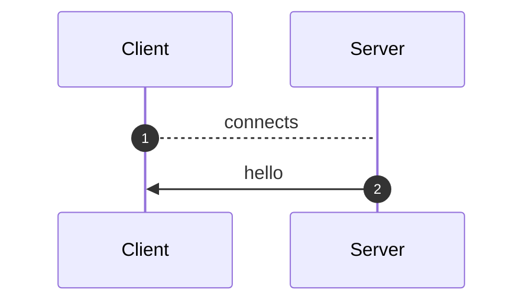
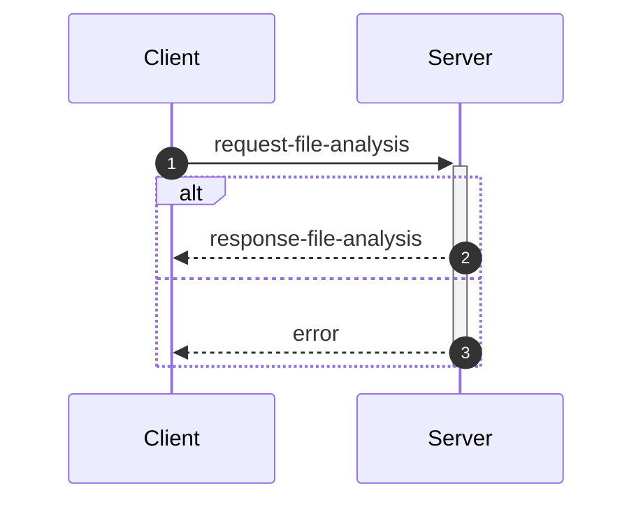
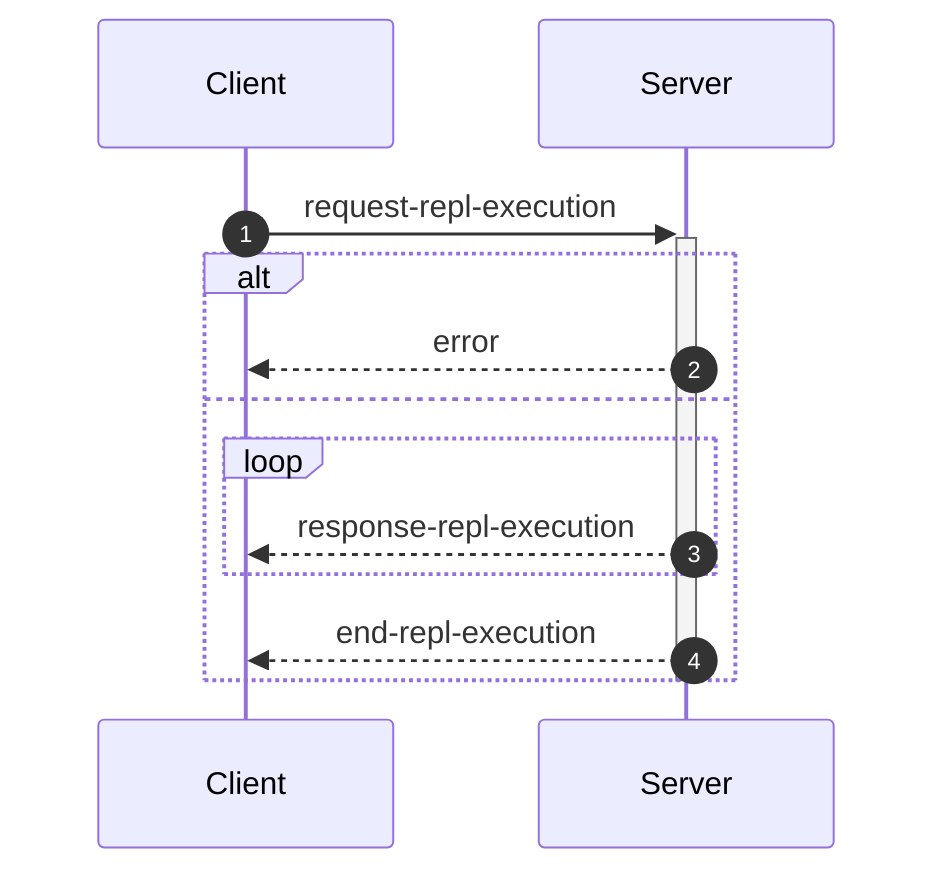
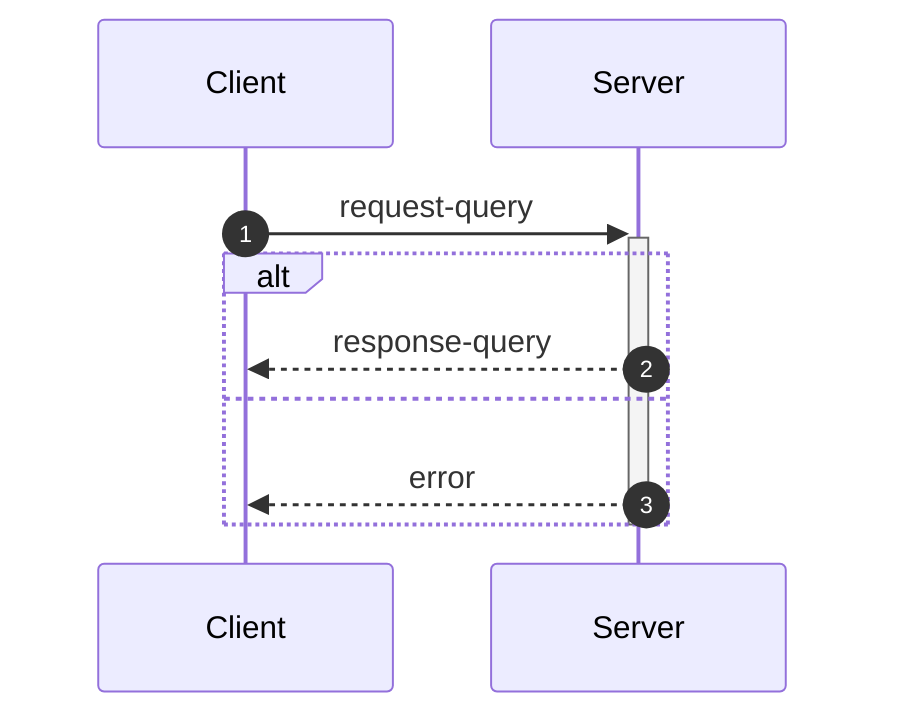

_<span title="an overview of flowR's interface">Generated</span> from '[wiki-interface.ts](https://github.com/flowr-analysis/flowr/tree/main/src/documentation/wiki-interface.ts "src/documentation/wiki-interface.ts")' on 2026-11-03, 07:59:48 UTC (v2.16.8, R v4.6.1), do not edit directly._

Although far from being as detailed as the in-depth explanation of [_flowR_](https://github.com/flowr-analysis/flowr/wiki/Core),
this wiki page explains how to interface with _flowR_ in more detail.
In general, command line arguments and other options provide short descriptions on hover over.

* [💻 Using the REPL](#using-the-repl)
* [⚙️ Configuring FlowR](#configuring-flowr)
* [⚒️ Writing Code](#writing-code)
* [💬 Communicating with the Server](#communicating-with-the-server)

<a id='using-the-repl'></a>
## 💻 Using the REPL

> [!NOTE]
> To execute arbitrary R commands with a repl request, _flowR_ has to be started explicitly with <span title="Description (Command Line Argument): Allow to access the underlying R session when using flowR (security warning: this allows the execution of arbitrary R code!)">`--r-session-access`</span>.
> Please be aware that this introduces a security risk and note that this relies on the [`r-shell` engine](https://github.com/flowr-analysis/flowr/wiki/Engines) .

Although primarily meant for users to explore,
there is nothing which forbids calling _flowR_ as a subprocess to use standard-in, -output, and -error
for communication (although you can access the REPL using the server as well,
with the [REPL Request](#message-request-repl-execution) message).

The read-eval-print loop&nbsp;(REPL) works relatively simple.
You can submit an expression (using <kbd>Enter</kbd>),
which is interpreted as an R&nbsp;expression by default but interpreted as a *command* if it starts with a colon (`:`).
The best command to get started with the REPL is <span title="Description (Repl Command): Show help information (aliases: :h, :?)">`:help`</span>.
Besides, you can leave the REPL either with the command <span title="Description (Repl Command): End the repl (aliases: :q, :exit)">`:quit`</span> or by pressing <kbd>Ctrl</kbd>+<kbd>C</kbd> twice.
When writing a *command*, you may press <kbd>Tab</kbd> to get a list of completions, if available.
Multiple commands can be entered in a single line by separating them with a semicolon (`;`), e.g. `:parse "x<-2"; :df*`.
If a command is given without R code, the REPL will re-use R code given in a previous command.
The prior example will hence return first the parsed AST of the program and then the dataflow graph for `"x <- 2"`.

> [!NOTE]
> If you develop flowR, you may want to launch the repl using the `npm run main-dev` command, this way, you get a non-minified version of flowR with debug information and hot-reloading of source files.

<details>
<summary>Available Commands</summary>

We currently offer the following commands (this with a `[*]` suffix are available with and without the star):

| Command | Description |
| ------- | ----------- |
| **<span title="Description (Repl Command): End the repl (aliases: :q, :exit)">:quit</span>** | End the repl (aliases: **:<span title="Alias of ':quit'. End the repl">q</span>**, **:<span title="Alias of ':quit'. End the repl">exit</span>**) |
| **<span title="Description (Repl Command): Execute the given code as R code. This requires the `--r-session-access` flag to be set and requires the r-shell engine. (aliases: :e, :r)">:execute</span>** | Execute the given code as R code. This requires the `--r-session-access` flag to be set and requires the r-shell engine. (aliases: **:<span title="Alias of ':execute'. Execute the given code as R code. This requires the `--r-session-access` flag to be set and requires the r-shell engine.">e</span>**, **:<span title="Alias of ':execute'. Execute the given code as R code. This requires the `--r-session-access` flag to be set and requires the r-shell engine.">r</span>**) |
| **<span title="Description (Repl Command): Get mermaid code for the control-flow graph of R code (aliases: :cfg, :cf)">:controlflow[*]</span>** | Get mermaid code for the control-flow graph of R code (star: Returns the URL to mermaid.live) (aliases: **:<span title="Alias of ':controlflow'. Get mermaid code for the control-flow graph of R code">cfg</span>**, **:<span title="Alias of ':controlflow'. Get mermaid code for the control-flow graph of R code">cf</span>**) |
| **<span title="Description (Repl Command): Get mermaid code for the control-flow graph with basic blocks (aliases: :cfgb, :cfb)">:controlflowbb[*]</span>** | Get mermaid code for the control-flow graph with basic blocks (star: Returns the URL to mermaid.live) (aliases: **:<span title="Alias of ':controlflowbb'. Get mermaid code for the control-flow graph with basic blocks">cfgb</span>**, **:<span title="Alias of ':controlflowbb'. Get mermaid code for the control-flow graph with basic blocks">cfb</span>**) |
| **<span title="Description (Repl Command): Get mermaid code for the dataflow graph (aliases: :d, :df)">:dataflow[*]</span>** | Get mermaid code for the dataflow graph (star: Returns the URL to mermaid.live) (aliases: **:<span title="Alias of ':dataflow'. Get mermaid code for the dataflow graph">d</span>**, **:<span title="Alias of ':dataflow'. Get mermaid code for the dataflow graph">df</span>**) |
| **<span title="Description (Repl Command): Get mermaid code for the normalized AST of R code (aliases: :n)">:normalize[*]</span>** | Get mermaid code for the normalized AST of R code (star: Returns the URL to mermaid.live) (alias: **:<span title="Alias of ':normalize'. Get mermaid code for the normalized AST of R code">n</span>**) |
| **<span title="Description (Repl Command): Get mermaid code for the simplified dataflow graph (aliases: :ds, :dfs)">:dataflowsimple[*]</span>** | Get mermaid code for the simplified dataflow graph (star: Returns the URL to mermaid.live) (aliases: **:<span title="Alias of ':dataflowsimple'. Get mermaid code for the simplified dataflow graph">ds</span>**, **:<span title="Alias of ':dataflowsimple'. Get mermaid code for the simplified dataflow graph">dfs</span>**) |
| **<span title="Description (Repl Command): Inspect and extend the signature database: `query` (identical to :query @signature), `info <name>` for where a function comes from (identical to :query @function-info), `add <path>` to mount another database/source, `download` to fetch the full-history database. (aliases: :sig)">:signature</span>** | Inspect and extend the signature database: `query` (identical to :query @signature), `info <name>` for where a function comes from (identical to :query @function-info), `add <path>` to mount another database/source, `download` to fetch the full-history database. (alias: **:<span title="Alias of ':signature'. Inspect and extend the signature database: `query` (identical to :query @signature), `info <name>` for where a function comes from (identical to :query @function-info), `add <path>` to mount another database/source, `download` to fetch the full-history database.">sig</span>**) |
| **<span title="Description (Repl Command): Just calculates the DFG, but only prints summary info (aliases: :d#, :df#)">:dataflowsilent</span>** | Just calculates the DFG, but only prints summary info (aliases: **:<span title="Alias of ':dataflowsilent'. Just calculates the DFG, but only prints summary info">d#</span>**, **:<span title="Alias of ':dataflowsilent'. Just calculates the DFG, but only prints summary info">df#</span>**) |
| **<span title="Description (Repl Command): Prints ASCII Art of the parsed, unmodified AST (aliases: :p)">:parse</span>** | Prints ASCII Art of the parsed, unmodified AST (alias: **:<span title="Alias of ':parse'. Prints ASCII Art of the parsed, unmodified AST">p</span>**) |
| **<span title="Description (Repl Command): Prints the version of flowR as well as the current version of R">:version</span>** | Prints the version of flowR as well as the current version of R
| **<span title="Description (Repl Command): Query the given R code (use 'help' for more information)">:query[*]</span>** | Query the given R code (use 'help' for more information) (star: Similar to query, but returns the output in json format.)
| **<span title="Description (Repl Command): Returns an ASCII representation of the dataflow graph (aliases: :df!)">:dataflowascii</span>** | Returns an ASCII representation of the dataflow graph (alias: **:<span title="Alias of ':dataflowascii'. Returns an ASCII representation of the dataflow graph">df!</span>**) |
| **<span title="Description (Repl Command): Returns summarization stats for the normalized AST (aliases: :n#)">:normalize#</span>** | Returns summarization stats for the normalized AST (alias: **:<span title="Alias of ':normalize#'. Returns summarization stats for the normalized AST">n#</span>**) |
| **<span title="Description (Repl Command): Show help information (aliases: :h, :?)">:help</span>** | Show help information (aliases: **:<span title="Alias of ':help'. Show help information">h</span>**, **:<span title="Alias of ':help'. Show help information">?</span>**) |

</details>

> [!TIP]
> 
> As indicated by the examples before, all REPL commands that operate on code keep track of the state.
> Hence, if you run a command like <span title="Description (Repl Command, starred version): Returns the URL to mermaid.live; Base Command: Get mermaid code for the dataflow graph (aliases: :d*, :df*)">`:dataflow*`</span> without providing R code,
> the REPL will re-use the R code provided in a previous command.
> Likewise, doing this will benefit from incrementality!
> If you request the dataflow graph with `:df* x <- 2 * y` and then want to see the parsed AST with `:parse`,
> the REPL will re-use previously obtained information and not re-parse the code again.
> 		

Generally, many commands offer shortcut versions in the REPL. Many queries, for example, offer a shortened format (see the example below).
Of special note, the [Config Query](https://github.com/flowr-analysis/flowr/wiki/%5BQuery%5D-Config)
can be used to also modify the currently active configuration of _flowR_ within the REPL (see the [wiki page](https://github.com/flowr-analysis/flowr/wiki/%5BQuery%5D-Config) for more information).

### Example: Retrieving the Dataflow Graph

To retrieve a URL to the [mermaid](https://mermaid.js.org/) diagram of the dataflow of a given expression,
use <span title="Description (Repl Command, starred version): Returns the URL to mermaid.live; Base Command: Get mermaid code for the dataflow graph (aliases: :d*, :df*)">`:dataflow*`</span> (or <span title="Description (Repl Command): Get mermaid code for the dataflow graph (aliases: :d, :df)">`:dataflow`</span> to get the mermaid code in the cli):

```shell
$ docker run -it --rm eagleoutice/flowr # or npm run flowr 
flowR repl v2.16.8, R grammar v14 (tree-sitter engine)
R> :dataflow* y <- 1 + x
```

<details>
<summary style='color:gray'>Output</summary>

```text
https://mermaid.live/view#base64:eyJjb2RlIjoiZmxvd2NoYXJ0IFREXG4gICAgMXt7XCJgKiM5MTtSTnVtYmVyIzkzOyogKioxKipcbiAgICAgICoxLjYqICgqKmlkOiAxKiopYFwifX1cbiAgICAyKFtcImAqIzkxO1JTeW1ib2wjOTM7KiAqKngqKlxuICAgICAgKjEuMTAqICgqKmlkOiAyKiopYFwiXSlcbiAgICAzW1tcImAqIzkxO1JCaW5hcnlPcCM5MzsqIGJhc2UjNTg7IzU4OyoqIzQzOyoqXG4gICAgICAqMS42LTEwKiAoKippZDogMyoqKVxuICAgIGFyZzogKDEsIDIpYFwiXV1cbiAgICBidWlsdC1pbjpfNDNfW1wiYEJ1aWx0LUluOlxuIzQzO2BcIl1cbiAgICBzdHlsZSBidWlsdC1pbjpfNDNfIHN0cm9rZTpncmF5LGZpbGw6Z3JheSxzdHJva2Utd2lkdGg6MnB4LG9wYWNpdHk6Ljg7XG4gICAgMFtcImAqIzkxO1JTeW1ib2wjOTM7KiAqKnkqKlxuICAgICAgKjEuMSogKCoqaWQ6IDAqKiwgdjogMylgXCJdXG4gICAgNFtbXCJgKiM5MTtSQmluYXJ5T3AjOTM7KiBiYXNlIzU4OyM1ODsqKiM2MDsjNDU7KipcbiAgICAgICoxLjEtMTAqICgqKmlkOiA0KiopXG4gICAgYXJnOiAoMCwgMylgXCJdXVxuICAgIGJ1aWx0LWluOl82MF8tW1wiYEJ1aWx0LUluOlxuIzYwOyM0NTtgXCJdXG4gICAgc3R5bGUgYnVpbHQtaW46XzYwXy0gc3Ryb2tlOmdyYXksZmlsbDpncmF5LHN0cm9rZS13aWR0aDoycHgsb3BhY2l0eTouODtcbiAgICAxIC0uLT58XCJmbG93XCJ8IDJcbiAgICBsaW5rU3R5bGUgMCBzdHJva2U6Z3JheSxjb2xvcjpncmF5O1xuICAgIDIgLS4tPnxcImZsb3dcInwgM1xuICAgIGxpbmtTdHlsZSAxIHN0cm9rZTpncmF5LGNvbG9yOmdyYXk7XG4gICAgMyAtLT58XCJyZWFkcywgYXJnXCJ8IDFcbiAgICAzIC0tPnxcInJlYWRzLCBhcmdcInwgMlxuICAgIDMgLS4tPnxcImZsb3dcInwgMFxuICAgIGxpbmtTdHlsZSA0IHN0cm9rZTpncmF5LGNvbG9yOmdyYXk7XG4gICAgMyAtLi0+fFwicmVhZHMsIGNhbGxzXCJ8IGJ1aWx0LWluOl80M19cbiAgICBsaW5rU3R5bGUgNSBzdHJva2U6Z3JheTtcbiAgICAwIC0tPnxcImRlZmluZWQtYnksIGZsb3dcInwgNFxuICAgIDAgLS0+fFwiZGVmaW5lZC1ieVwifCAzXG4gICAgNCAtLT58XCJyZWFkcywgYXJnXCJ8IDNcbiAgICA0IC0tPnxcInJldHVybnMsIGFyZ1wifCAwXG4gICAgNCAtLi0+fFwicmVhZHMsIGNhbGxzXCJ8IGJ1aWx0LWluOl82MF8tXG4gICAgbGlua1N0eWxlIDEwIHN0cm9rZTpncmF5OyIsIm1lcm1haWQiOnsiYXV0b1N5bmMiOnRydWV9fQ==
```

Retrieve the dataflow graph of the expression `y <- 1 + x`. It looks like this:


<details>

<summary style="color:gray">R Code of the Dataflow Graph</summary>

The analysis ran (parse and normalize with the [tree-sitter](https://github.com/flowr-analysis/flowr/wiki/Engines) engine) in the generation environment. No [signature database](https://github.com/flowr-analysis/flowr/wiki/Signature-Database) is mounted, so `library()` attaches no exports (base-R names are still qualified, e.g., `stats::acf`). 
We encountered no unknown side effects during the analysis.

```r
y <- 1 + x
```

</details>

</details>

For small graphs like this, <span title="Description (Repl Command): Returns an ASCII representation of the dataflow graph (aliases: :df!)">`:dataflowascii`</span> also provides an ASCII representation directly in the REPL:

```shell
$ docker run -it --rm eagleoutice/flowr # or npm run flowr 
flowR repl v2.16.8, R grammar v14 (tree-sitter engine)
R> :df! y <- 1 + x
```

<details open>
<summary style='color:gray'>Output</summary>

```text
                        v<0>v
 c<4>c──────────────────| y |
 |<- |     ┌────────────v---v
 c---c     │
    │   c<3>c   0<1>0
    └───| + |───| 1 |───u<2>u
        c---c   0---0   | x |
           └────────────u---u
Edges:
3 -> 1: reads, arg          3 -> 2: reads, arg
3 -> 0: flows-to            1 -> 2: flows-to
2 -> 3: flows-to            4 -> 3: reads, arg
4 -> 0: returns, arg        0 -> 4: defined-by, flows-to
0 -> 3: defined-by
```

Retrieve the dataflow graph of the expression `y <- 1 + x` as ASCII art.

</details>

For the slicing with <span title="Description (Repl Command): Static backwards executable slicer for R">`:slicer`</span>, you have access to the same [magic comments](#slice-magic-comments) as with the [slice request](#message-request-slice).
Pass `--inline` to splice resolvable `source()` calls into the reconstruction so the slice is a single self-contained R text (the same as the static slice query's `inlineSources` flag).
See `--help` for more flags!

### Example: Interfacing with the File System

Many commands that allow for an R-expression (like <span title="Description (Repl Command, starred version): Returns the URL to mermaid.live; Base Command: Get mermaid code for the dataflow graph (aliases: :d*, :df*)">`:dataflow*`</span>) allow for a file as well
if the argument starts with `file://`.
If you are working from the root directory of the _flowR_ repository, the following gives you the parsed AST of the example file using the <span title="Description (Repl Command): Prints ASCII Art of the parsed, unmodified AST (aliases: :p)">`:parse`</span> command:

> **Watch mode**: Replace `file://` with `watch://` to enter watch mode.
> flowR runs the command immediately and then re-runs it every time the file (or any file inside the folder) changes.
> Enter any other command to leave watch mode.
> For example: `:df watch://analysis.R`

```shell
$ docker run -it --rm eagleoutice/flowr # or npm run flowr 
flowR repl v2.16.8, R grammar v14 (tree-sitter engine)
R> :parse file://test/testfiles/example.R
```

<details>
<summary style='color:gray'>Output</summary>

```text
File: test/testfiles/example.R

program
├ binaryoperator
│ ├ identifier "sum" (1:1─4)
│ ├ <- "<-" (1:5─7)
│ ╰ float "0" (1:8─9)
├ binaryoperator
│ ├ identifier "product" (2:1─8)
│ ├ <- "<-" (2:9─11)
│ ╰ float "1" (2:12─13)
├ binaryoperator
│ ├ identifier "w" (3:1─2)
│ ├ <- "<-" (3:3─5)
│ ╰ float "7" (3:6─7)
├ binaryoperator
│ ├ identifier "N" (4:1─2)
│ ├ <- "<-" (4:3─5)
│ ╰ float "10" (4:6─8)
├ forstatement
│ ├ for "for" (6:1─4)
│ ├ ( "(" (6:5─6)
│ ├ identifier "i" (6:6─7)
│ ├ in "in" (6:8─10)
│ ├ binaryoperator
│ │ ├ float "1" (6:11─12)
│ │ ├ : ":" (6:12─13)
│ │ ╰ parenthesizedexpression
│ │   ├ ( "(" (6:13─14)
│ │   ├ binaryoperator
│ │   │ ├ identifier "N" (6:14─15)
│ │   │ ├ - "-" (6:15─16)
│ │   │ ╰ float "1" (6:16─17)
│ │   ╰ ) ")" (6:17─18)
│ ├ ) ")" (6:18─19)
│ ╰ bracedexpression
│   ├ { "{" (6:20─21)
│   ├ binaryoperator
│   │ ├ identifier "sum" (7:3─6)
│   │ ├ <- "<-" (7:7─9)
│   │ ╰ binaryoperator
│   │   ├ binaryoperator
│   │   │ ├ identifier "sum" (7:10─13)
│   │   │ ├ + "+" (7:14─15)
│   │   │ ╰ identifier "i" (7:16─17)
│   │   ├ + "+" (7:18─19)
│   │   ╰ identifier "w" (7:20─21)
│   ├ binaryoperator
│   │ ├ identifier "product" (8:3─10)
│   │ ├ <- "<-" (8:11─13)
│   │ ╰ binaryoperator
│   │   ├ identifier "product" (8:14─21)
│   │   ├  "" (8:22─23)
│   │   ╰ identifier "i" (8:24─25)
│   ╰ } "}" (9:1─2)
├ call
│ ├ identifier "cat" (11:1─4)
│ ╰ arguments
│   ├ ( "(" (11:4─5)
│   ├ argument
│   │ ╰ string
│   │   ├ stringopen "\"" (11:5─6)
│   │   ├ stringcontent "Sum:" (11:6─10)
│   │   ╰ stringclose "\"" (11:10─11)
│   ├ comma "," (11:11─12)
│   ├ argument
│   │ ╰ identifier "sum" (11:13─16)
│   ├ comma "," (11:16─17)
│   ├ argument
│   │ ╰ string
│   │   ├ stringopen "\"" (11:18─19)
│   │   ├ stringcontent
│   │   │ ╰ escapesequence "\\n" (11:19─21)
│   │   ╰ stringclose "\"" (11:21─22)
│   ╰ ) ")" (11:22─23)
╰ call
  ├ identifier "cat" (12:1─4)
  ╰ arguments
    ├ ( "(" (12:4─5)
    ├ argument
    │ ╰ string
    │   ├ stringopen "\"" (12:5─6)
    │   ├ stringcontent "Product:" (12:6─14)
    │   ╰ stringclose "\"" (12:14─15)
    ├ comma "," (12:15─16)
    ├ argument
    │ ╰ identifier "product" (12:17─24)
    ├ comma "," (12:24─25)
    ├ argument
    │ ╰ string
    │   ├ stringopen "\"" (12:26─27)
    │   ├ stringcontent
    │   │ ╰ escapesequence "\\n" (12:27─29)
    │   ╰ stringclose "\"" (12:29─30)
    ╰ ) ")" (12:30─31)
```

Retrieve the parsed AST of the example file.

<details>

<summary>File Content</summary>

```r
sum <- 0
product <- 1
w <- 7
N <- 10

for (i in 1:(N-1)) {
  sum <- sum + i + w
  product <- product * i
}

cat("Sum:", sum, "\n")
cat("Product:", product, "\n")
```

</details>

As _flowR_ directly transforms this AST the output focuses on being human-readable instead of being machine-readable.
		
</details>

### Example: Run a Query

You can run any query supported by _flowR_ using the <span title="Description (Repl Command): Query the given R code (use 'help' for more information)">`:query`</span> command.
For example, to obtain the shapes of all data frames in a given piece of code, you can run:

```shell
$ docker run -it --rm eagleoutice/flowr # or npm run flowr 
flowR repl v2.16.8, R grammar v14 (tree-sitter engine)
R> :query @absint df-shape "x <- data.frame(a = 1:10, b = 1:10)\ny <- x$a"
```

<details open>
<summary style='color:gray'>Output</summary>

```text
Query: absint (2 ms)
   ╰ $12: (colnames: [{"a", "b"}, {}], cols: [2, 2], rows: [10, 10])
   ╰ $0: (colnames: [{"a", "b"}, {}], cols: [2, 2], rows: [10, 10])
```

Retrieve the shapes of all data frames in the given code.

</details>

To run the linter on a file, you can use (in this example, we just issue the `dead-code` linter on a small piece of code):

```shell
$ docker run -it --rm eagleoutice/flowr # or npm run flowr 
flowR repl v2.16.8, R grammar v14 (tree-sitter engine)
R> :query @linter rules:dead-code "if(FALSE) x <- 2"
```

<details open>
<summary style='color:gray'>Output</summary>

```text
Query: linter (1 ms)
   ╰ Dead Code (dead-code):
       ╰ certain:
           ╰ Code at 1.11-16 (1 quick fix(es) available)
```

Run the linter on the given code, with only the `dead-code` rule enabled.

</details>

For more information on the available queries, please check out the [Query API](https://github.com/flowr-analysis/flowr/wiki/Query-API).

<a id='configuring-flowr'></a>
## ⚙️ Configuring FlowR

When running _flowR_, you may want to specify some behaviors with a dedicated configuration file.
By default, flowR looks for a file named `flowr.json` in the current working directory (or any higher directory).
You can also specify a different file with <span title="Description (Command Line Argument): The name of the configuration file to use">`--config-file`</span> or pass the configuration inline using <span title="Description (Command Line Argument): The flowR configuration to use, as a JSON string">`--config-json`</span>.
A `flowr.json` found this way belongs to the analyzed project, so flowR ignores its options that decide what flowR executes or loads
(`engines.*.wasmPath`, `engines.*.treeSitterWasmPath`, `engines.*.rPath`, `solver.sigdb.additionalPaths`, `solver.sigdb.downloadRepo`, `solver.sigdb.installedLibrary.paths`),
unless you pass <span title="Description (Command Line Argument): Keep the security-sensitive options (e.g., the R executable) of the flowr.json found in the working directory or a parent. Only use this for projects you trust.">`--trust-config`</span>.
To analyze code you do not trust, use the secure mode (<span title="Description (Command Line Argument): Run in secure mode for analyzing untrusted code: flowR does not start R (or any other process), does not access the network, does not search for project configs, and ignores security-sensitive options in every config. Cannot be disabled once enabled. Can also be enabled with the environment variable {italic FLOWR_SECURE_MODE=1}.">`--secure`</span>, see the [security policy](https://github.com/flowr-analysis/flowr/blob/main/.github/SECURITY.md)).
To inspect the current configuration, you can run flowr with the <span title="Description (Command Line Argument): Run with verbose logging (will be passed to the corresponding script)">`--verbose`</span> flag, or use the `config` [Query](https://github.com/flowr-analysis/flowr/wiki/Query-API).
Within the REPL this works by running the following:

```shell
:query @config
```

To work with the <a href="https://github.com/flowr-analysis/flowr/tree/main/src/config.ts#L119"><code><span title="The configuration file format for flowR.">FlowrConfig</span></code></a> you can use the provided helper objects alongside its methods like
<a href="https://github.com/flowr-analysis/flowr/tree/main/src/config.ts#L914"><code><span title="Creates a new flowr config that has the updated values.">FlowrConfig::<b>amend</b></span></code></a>.
The schema below documents every option; the ones you most likely want are:

- <a href="https://github.com/flowr-analysis/flowr/wiki/Interface#configuring-flowr" title="Configuration Option (boolean): Whether source calls should be ignored, causing {@link processSourceCall}&#39;s behavior to be skipped.">ignoreSourceCalls</a>: ignore source calls when analyzing the code, i.e., ignore the inclusion of other files.
- <a href="https://github.com/flowr-analysis/flowr/wiki/Interface#configuring-flowr" title="Configuration Option (boolean): Whether load calls should be ignored, causing {@link processLoadCall}&#39;s behavior to be skipped.">ignoreLoadCalls</a>: ignore load calls when analyzing the code, i.e., ignore the loading of r-data files.
- <a href="https://github.com/flowr-analysis/flowr/wiki/Interface#configuring-flowr" title="Configuration Option (object): Do you want to overwrite (parts) of the builtin definition?">semantics.environment.overwriteBuiltIns</a>: overwrite _flowR_'s handling of built-in functions, or clear the preset definitions entirely.
  See [Configure BuiltIn Semantics](#configure-builtin-semantics) for more information.
- <a href="https://github.com/flowr-analysis/flowr/wiki/Interface#configuring-flowr" title="Configuration Option (string): How to resolve variables and their values. (one of &quot;disabled&quot;, &quot;alias&quot;, &quot;builtin&quot;)">solver.variables</a>: how to resolve variables and their values (`disabled`, `alias`, `builtin`).
- <a href="https://github.com/flowr-analysis/flowr/wiki/Interface#configuring-flowr" title="Configuration Option (array): The engine or set of engines to use for interacting with R code. An empty array means all available engines will be used.">engines</a> and <a href="https://github.com/flowr-analysis/flowr/wiki/Interface#configuring-flowr" title="Configuration Option (string): The default engine to use for interacting with R code. If this is undefined, an arbitrary engine from the specified list will be used. (one of &quot;tree-sitter&quot;, &quot;r-shell&quot;)">defaultEngine</a>: the engines used to interact with R code, see the [Engines wiki page](https://github.com/flowr-analysis/flowr/wiki/Engines).
- <a href="https://github.com/flowr-analysis/flowr/wiki/Interface#configuring-flowr" title="Configuration Option (array): Files a framework loads on its own, without any source() call (e.g. global.R in a shiny app), in the order they are loaded; flowR orders the matching project files accordingly and analyzes them as one program. Entries are case-insensitive globs matched against the file path, a plain name matches any file with that name, and entries matching no project file are warned about. Usually set per project kind via specializeConfig.">project.implicitSources</a>: the files a framework loads without any `source()` call, in the order in which they are
  loaded. Entries are globs (e.g. `R/*.R`) matched against the file path ignoring capitalization; one matching no file is reported.
- <a href="https://github.com/flowr-analysis/flowr/wiki/Interface#configuring-flowr" title="Configuration Option (object): Overwrite (parts of) the configuration depending on the project kind flowR detects, e.g. to give a shiny app its implicit sources.">specializeConfig</a>: overwrite (parts of) the configuration depending on the kind of project _flowR_ detects
  (e.g. `shiny-app`), which is how a shiny app gets its implicit sources by default. What you configure directly wins.
- <a href="https://github.com/flowr-analysis/flowr/wiki/Interface#configuring-flowr" title="Configuration Option (string): Overwrite the project kind flowR would otherwise infer from the analyzed files, e.g. when auto-detection guesses wrong. (one of &quot;package&quot;, &quot;script&quot;, &quot;shiny-app&quot;, &quot;notebook&quot;, &quot;project&quot;, &quot;unknown&quot;)">project.useProjectType</a>: skip that detection and force a project kind yourself, when auto-detection guesses wrong.
- <a href="https://github.com/flowr-analysis/flowr/wiki/Interface#configuring-flowr" title="Configuration Option (array): The default plugins to load when creating a new instance of FlowrAnalyzer">defaultPlugins</a> and <a href="https://github.com/flowr-analysis/flowr/wiki/Interface#configuring-flowr" title="Configuration Option (array): The plugins to load in REPL mode">repl.plugins</a>: the plugins to load for a new <a href="https://github.com/flowr-analysis/flowr/tree/main/src/project/flowr-analyzer.ts#L210"><code><span title="Central class for conducting analyses with FlowR. Use the FlowrAnalyzerBuilder to create a new instance. If you want the original pattern of creating a pipeline and running all steps, you can still do this with FlowrAnalyzer#runFull . To inspect the context of the analyzer, use FlowrAnalyzer#inspectContext (if you are a plugin and need to modify it, use FlowrAnalyzer#context instead).">FlowrAnalyzer</span></code></a> and in the REPL
  (use `flowr:default` to reference the former).

So you can configure _flowR_ by adding a file like the following:

<details>

<summary>Example Configuration File</summary>

```json
{
  "ignoreSourceCalls": true,
  "ignoreLoadCalls": true,
  "semantics": {
    "environment": {
      "overwriteBuiltIns": {
        "definitions": [
          {
            "type": "function",
            "names": [
              "foo"
            ],
            "processor": "builtin:assign",
            "config": {}
          }
        ]
      }
    }
  },
  "defaultPlugins": [
    "file:description",
    "versions:description"
  ],
  "repl": {
    "quickStats": false,
    "dfProcessorHeat": false,
    "hints": true,
    "plugins": [
      "flowr:default"
    ]
  },
  "project": {
    "resolveUnknownPathsOnDisk": true,
    "implicitSources": [
      "global.R",
      "app.R"
    ]
  },
  "linter": {
    "disabledRules": []
  },
  "specializeConfig": {
    "shiny-app": {
      "project": {
        "implicitSources": [
          "global.R",
          "ui.R",
          "server.R",
          "app.R"
        ]
      }
    }
  },
  "engines": [
    {
      "type": "r-shell"
    }
  ],
  "solver": {
    "variables": "alias",
    "evalStrings": true,
    "trackEnvironments": true,
    "sigdb": {
      "enabled": true,
      "loadProjectDependencies": true,
      "eagerlyLoad": false,
      "eagerlyLoadExports": false,
      "linkBaseR": false,
      "linkDescriptionDependencies": false
    },
    "resolveSource": {
      "dropPaths": "no",
      "ignoreCapitalization": true,
      "inferWorkingDirectory": "active-script",
      "searchPath": []
    },
    "instrument": {},
    "slicer": {
      "threshold": 50
    }
  },
  "abstractInterpretation": {
    "wideningThreshold": 4,
    "followCalls": true,
    "dataFrame": {
      "maxColNames": 20,
      "readLoadedData": {
        "readExternalFiles": true,
        "maxReadLines": 1000000
      }
    }
  },
  "incremental": {
    "alwaysIncremental": false,
    "parsing": {
      "activated": false,
      "heuristics": {
        "activated": true,
        "mtime": true,
        "linesFrom": 500,
        "bytesFrom": 50000,
        "alwaysWithEdits": false,
        "minFiles": 1
      }
    }
  },
  "gas": {
    "thresholds": {
      "memory": {
        "problematic": 0.7,
        "critical": 0.9
      },
      "timeMs": {
        "problematic": 100000,
        "critical": 120000
      }
    },
    "features": {}
  }
}
```

</details>

<details>
<a id='configure-builtin-semantics'></a>
<summary>Configure Built-In Semantics</summary>

`semantics/environment/overwriteBuiltins` accepts two keys:

- `loadDefaults` (boolean, initially `true`): If set to `true`, the default built-in definitions are loaded before applying the custom definitions. Setting this flag to `false` explicitly disables the loading of the default definitions.
- `definitions` (array, initially empty): Allows to overwrite or define new built-in elements. Each object within must have a `type` which is one of the below. Furthermore, they may define a string array of `names` which specifies the identifiers to bind the definitions to. You may use `assumePrimitive` to specify whether _flowR_ should assume that this is a primitive non-library definition (so you probably just do not want to specify the key).

  | Type            | Description                                                                                                                                                                                                                                                                                              | Example                                                                                                    |
  | --------------- | -------------------------------------------------------------------------------------------------------------------------------------------------------------------------------------------------------------------------------------------------------------------------------------------------------- | ---------------------------------------------------------------------------------------------------------- |
  | `constant`    | Additionally allows for a `value` this should resolve to.                                                                                                                                                                                                                                                | `{ type: 'constant', names: ['NULL', 'NA'],  value: null }`                                                |
  | `function`    | Is a rather flexible way to define and bind built-in functions. For the time, we do not have extensive documentation to cover all the cases, so please either consult the sources with the `default-builtin-config.ts` or open a [new issue](https://github.com/flowr-analysis/flowr/issues/new/choose). | `{ type: 'function', names: ['next'], processor: 'builtin:d', config: { cfg: ExitPointType.Next } }` |
  | `replacement` | A comfortable way to specify replacement functions like `$<-` or `names<-`. `suffixes` describes the... suffixes to attach automatically. | `{ type: 'replacement', suffixes: ['<-', '<<-'], names: ['[', '[['] }` |

</details>

<details>

<summary style='color:gray'>Full Configuration-File Schema</summary>

- _The configuration file format for flowR._ (object)
    - **logLevel** [optional] _flowR's global minimum log level, applied when the config is loaded._ (string)
        Only allows: 'silly', 'trace', 'debug', 'info', 'warn', 'error', 'fatal'
    - **ignoreSourceCalls** [optional] _Whether source calls should be ignored, causing {@link processSourceCall}'s behavior to be skipped._ (boolean)
    - **ignoreLoadCalls** [optional] _Whether load calls should be ignored, causing {@link processLoadCall}'s behavior to be skipped._ (boolean)
    - **semantics** _Configure language semantics and how flowR handles them._ (object)
        - **environment** [optional] _Semantics regarding how to handle the R environment._ (object)
            - **overwriteBuiltIns** [optional] _Do you want to overwrite (parts) of the builtin definition?_ (object)
                - **loadDefaults** [optional] _Should the default configuration still be loaded?_ (boolean)
                - **definitions** [optional] _The definitions to load/overwrite._ (array)
                Valid item types:
                    - (object)
    - **defaultPlugins** [optional] _The default plugins to load when creating a new instance of FlowrAnalyzer_ (array)
    Valid item types:
        - (alternatives)
            - (string)
            - (array)
    - **repl** _Configuration options for the REPL._ (object)
        - **quickStats** [optional] _Whether to show quick stats in the REPL after each evaluation._ (boolean)
        - **dfProcessorHeat** [optional] _This instruments the dataflow processors to count how often each processor is called._ (boolean)
        - **hints** [optional] _Whether to show dim inline hints on the empty prompt (automatically disabled on non-interactive terminals)._ (boolean)
        - **plugins** [optional] _The plugins to load in REPL mode_ (array)
        Valid item types:
            - (alternatives)
                - (string)
                - (array)
        - **autoUseFileProtocol** [optional] _Prepend the file protocol to a repl input that looks like a path, instead of only warning about it._ (boolean)
        - **queryStats** [optional] _Whether `:query` closes with the line stating how long the queries took (`:query*` never prints it)._ (boolean)
        - **showPlugins** [optional] _Whether `:version` grays out the plugins that did not activate during the last analysis._ (boolean)
    - **project** _Project specific configuration options._ (object)
        - **resolveUnknownPathsOnDisk** [optional] _Whether to resolve unknown paths loaded by the r project disk when trying to source/analyze files._ (boolean)
        - **failOnInaccessiblePath** [optional] _Whether a directory that cannot be traversed during file discovery (e.g. due to permissions) aborts the analysis; when false (the default) such paths are logged and skipped._ (boolean)
        - **basePackages** [optional] _The packages considered part of R itself (base and recommended); if unset, flowR uses its built-in list._ (array)
        Valid item types:
            - (string)
        - **implicitSources** [optional] _Files a framework loads on its own, without any source() call (e.g. global.R in a shiny app), in the order they are loaded; flowR orders the matching project files accordingly and analyzes them as one program. Entries are case-insensitive globs matched against the file path, a plain name matches any file with that name, and entries matching no project file are warned about. Usually set per project kind via specializeConfig._ (array)
        Valid item types:
            - (string)
        - **useProjectType** [optional] _Overwrite the project kind flowR would otherwise infer from the analyzed files, e.g. when auto-detection guesses wrong._ (string)
            Only allows: 'package', 'script', 'shiny-app', 'notebook', 'project', 'unknown'
        - **assumeImplicitEcho** [optional] _Whether the top level of the analyzed code is echoed, so that every visible result printed there is collected as an output by the dependencies query (default true, false for a package)._ (boolean)
        - **discovery** [optional] _Scoping options for the default project discovery._ (object)
            - **full** [optional] _Collect every file below the project root (greedy) instead of only the files the detected project kind needs (default false)._ (boolean)
            - **perKind** [optional] _Per-kind include/exclude glob overrides layered on the default scoping._ (object)
            - **ignore** [optional] _Case-insensitive globs that drop matching files from the intelligent discovery, regardless of kind (e.g. .Renviron to ignore environment files)._ (array)
            Valid item types:
                - (string)
        - **classification** [optional] _Overrides for the signals flowR uses to classify the project kind._ (object)
            - **shinyDescriptionTypes** [optional] _DESCRIPTION Type: values that mark a shiny app._ (array)
            Valid item types:
                - (string)
            - **shinyEntryFiles** [optional] _File names a shiny app is assembled from._ (array)
            Valid item types:
                - (string)
            - **shinyUsagePattern** [optional] _Regex source evidencing shiny usage in an entry file._ (string)
            - **notebookExtensions** [optional] _File extensions marking a notebook._ (array)
            Valid item types:
                - (string)
    - **linter** _Linter configuration options._ (object)
        - **disabledRules** _Linting rule names excluded from the default rule set (a rule requested explicitly via a linter query still runs). Usually set per project kind via specializeConfig._ (array)
        Valid item types:
            - (string)
        - **disabledTags** [optional] _Linting rule tags whose rules are excluded from the default rule set (a rule requested explicitly via a linter query still runs). By default the cmd-check rules are disabled for everything but a package; a configured list replaces that default._ (array)
        Valid item types:
            - (string)
    - **inputSources** [optional] _Further frameworks the input-sources analysis should know about; entries are added to flowR's defaults._ (object)
        - **pure** [optional] _Functions that only pass the constantness of their arguments on._ (array)
        Valid item types:
            - (string)
        - **param** [optional] _Functions whose result is a 'param' input._ (array)
        Valid item types:
            - (string)
        - **file** [optional] _Functions whose result is a 'file' input._ (array)
        Valid item types:
            - (string)
        - **tempfile** [optional] _Functions whose result is a 'tempfile' input._ (array)
        Valid item types:
            - (string)
        - **glob** [optional] _Functions whose result is a 'glob' input._ (array)
        Valid item types:
            - (string)
        - **net** [optional] _Functions whose result is a 'net' input._ (array)
        Valid item types:
            - (string)
        - **rand** [optional] _Functions whose result is a 'rand' input._ (array)
        Valid item types:
            - (string)
        - **system** [optional] _Functions whose result is a 'system' input._ (array)
        Valid item types:
            - (string)
        - **ffi** [optional] _Functions whose result is a 'ffi' input._ (array)
        Valid item types:
            - (string)
        - **lang** [optional] _Functions whose result is a 'lang' input._ (array)
        Valid item types:
            - (string)
        - **options** [optional] _Functions whose result is a 'options' input._ (array)
        Valid item types:
            - (string)
        - **cmdline** [optional] _Functions whose result is a 'cmdline' input._ (array)
        Valid item types:
            - (string)
        - **user** [optional] _Functions whose result is a 'user' input._ (array)
        Valid item types:
            - (string)
        - **const** [optional] _Functions whose result is a 'const' input._ (array)
        Valid item types:
            - (string)
        - **scope** [optional] _Functions whose result is a 'scope' input._ (array)
        Valid item types:
            - (string)
        - **dconst** [optional] _Functions whose result is a 'dconst' input._ (array)
        Valid item types:
            - (string)
        - **unknown** [optional] _Functions whose result is a 'unknown' input._ (array)
        Valid item types:
            - (string)
        - **linkedObjects** [optional] _Objects a framework provides without a definition in the code, e.g. shiny's input._ (array)
        Valid item types:
            - (object)
        - **linkedEntryPoints** [optional] _Calls that hand a function to a framework, which binds its objects to the parameters by position._ (array)
        Valid item types:
            - (object)
    - **specializeConfig** [optional] _Overwrite (parts of) the configuration depending on the project kind flowR detects, e.g. to give a shiny app its implicit sources._ (object)
    - **engines** _The engine or set of engines to use for interacting with R code. An empty array means all available engines will be used._ (array)
    Valid item types:
        - (alternatives)
            - _The configuration for the tree sitter engine._ (object)
                - **type** [required] _Use the tree sitter engine._ (string)
                    Only allows: 'tree-sitter'
                - **wasmPath** [optional] _The path to the tree-sitter-r WASM binary to use. If this is undefined, this uses the default path._ (string)
                - **treeSitterWasmPath** [optional] _The path to the tree-sitter WASM binary to use. If this is undefined, this uses the default path._ (string)
                - **lax** [optional] _Whether to use the lax parser for parsing R code (allowing for syntax errors). If this is undefined, the strict parser will be used._ (boolean)
            - _The configuration for the R shell engine._ (object)
                - **type** [required] _Use the R shell engine._ (string)
                    Only allows: 'r-shell'
                - **rPath** [optional] _The path to the R executable to use. If this is undefined, this uses the default path._ (string)
                - **pipeBind** [optional] _Whether to enable R's experimental pipe-bind operator "=>" by setting _R_USE_PIPEBIND_ for the R session (default false); R itself keeps this off by default, as it is experimental and has never shipped in a release version of R._ (boolean)
    - **defaultEngine** [optional] _The default engine to use for interacting with R code. If this is undefined, an arbitrary engine from the specified list will be used._ (string)
        Only allows: 'tree-sitter', 'r-shell'
    - **solver** _How to resolve constants, constraints, cells, ..._ (object)
        - **variables** _How to resolve variables and their values._ (string)
            Only allows: 'disabled', 'alias', 'builtin'
        - **evalStrings** _Should we include eval(parse(text="...")) calls in the dataflow graph?_ (boolean)
        - **trackEnvironments** [optional] _Track user-created environments (new.env, assign/get/local with envir=, dollar-assign, attach). When false, all envir-style calls fall through conservatively._ (boolean)
        - **sigdb** _Resolving library exports from a signature database._ (object)
            - **enabled** [optional] _Resolve library()/use() exports from a signature database (default true); when false no database is consulted._ (boolean)
            - **loadProjectDependencies** [optional] _Load the project's declared dependencies from its metadata files (DESCRIPTION Imports/Depends, rproject.toml, uvr.toml, renv.lock, rv.lock, uvr.lock) (default true); when false these files are not read for dependencies._ (boolean)
            - **eagerlyLoad** [optional] _Parse the database up front rather than on the first package load (default false, ignored if disabled)._ (boolean)
            - **eagerlyLoadExports** [optional] _Add a vertex for every export on load rather than on demand (default false); keeps the dataflow graph small._ (boolean)
            - **assumedRVersion** [optional] _R version assumed when resolving versioned (base-R) exports: a pin like "4.5" or "auto" to detect the installed R (default "auto")._ (string)
            - **linkBaseR** [optional] _Eagerly attach base-R namespaces so bare base calls resolve without library() (default false)._ (boolean)
            - **linkBaseRCalls** [optional] _Add a lightweight Reads edge from a bare base-R call to its signature-database function vertex (default false; base-R qualification is edge-free otherwise)._ (boolean)
            - **linkPackageCalls** [optional] _Add a lightweight Reads edge from a resolved package call to its signature-database function vertex (default false)._ (boolean)
            - **linkDescriptionDependencies** [optional] _Eagerly attach the namespaces of the project's declared DESCRIPTION dependencies (Imports/Depends) so their exports resolve without an explicit library() (default false)._ (boolean)
            - **warmInBackground** [optional] _Decompress the hot shards (base + most-downloaded) in a background task on startup so the first library() lookup is warm (default false; for long-running servers/REPLs)._ (boolean)
            - **additionalPaths** [optional] _Extra directories or bundle/manifest files searched for signature databases (alongside the shipped default and $FLOWR_SIGDB_DIR); a downloaded full-history bundle placed here is mounted automatically._ (array)
            Valid item types:
                - (string)
            - **downloadRepo** [optional] _GitHub owner/repo the full-history bundle is downloaded from via ":signature download" (default "flowr-analysis/flowr"; the release tag comes from the committed sigdb.remote.json unless a version is given)._ (string)
            - **autoSync** [optional] _On startup, re-download shards whose committed sigdb.remote.json hash no longer matches the cache, in the background (default false; opt-in network sync after a git pull)._ (boolean)
            - **installedLibrary** [optional] _Recovering packages no signature database knows from the copy installed on this machine._ (object)
                - **enabled** [required] _Recover packages no signature database knows from their installed copy (default false)._ (boolean)
                - **paths** [optional] _Library directories to search; when empty they are discovered from the environment and the project._ (array)
                Valid item types:
                    - (string)
                - **useEnvironment** [optional] _Search the libraries R_LIBS_USER/R_LIBS/R_LIBS_SITE name (default true)._ (boolean)
                - **useProjectLibrary** [optional] _Search a project-local renv/packrat library (default true)._ (boolean)
                - **maxDepth** [optional] _How far to descend into the nested layout of a project-local library (default 3)._ (number)
                - **packages** [optional] _Only recover packages whose name matches one of these regular expressions; empty means any._ (array)
                Valid item types:
                    - (string)
            - **blobCacheBudgetMb** [optional] _How many MiB of decoded package blobs every open bundle may hold together (default 16)._ (number)
            - **versionSelection** [optional] _When a project constrains a dependency, resolve to the newest (default), oldest, or system-installed version satisfying it; system needs R and falls back to newest. Base-R packages always resolve against the assumed R version._ (string)
                Only allows: 'newest', 'oldest', 'system'
            - **versionOverrides** [optional] _Force an exact version for specific packages (name -> version), overriding both the project constraint and the versionSelection policy (default {})._ (object)
        - **versionManagement** _Policies for reasoning about dependency versions._ (object)
            - **linkedVersionGroups** [optional] _Groups of packages that must resolve to the same version; version guessing intersects each group so its members stay mutually compatible (default [])._ (array)
            Valid item types:
                - (array)
                Valid item types:
                    - (string)
        - **assumeAttachedPackages** [optional] _Packages to treat as attached without a `library()` call, so what the built-in configuration states about them applies to the analyzed code. The base packages R attaches on startup already resolve without it._ (array)
        Valid item types:
            - (string)
        - **transitiveSideEffectRounds** [optional] _How many rounds the transitive side-effect fixpoint may run before it is cut off (default 32); the propagation stops on its own as soon as a round adds nothing._ (number)
        - **maxOverlayDepth** [optional] _How many binding overlays may stack on one environment frame before a write flattens them (default 4); a pure performance knob, trading lookup cost against copy cost without changing any result._ (number)
        - **instrument** (object)
            - **dataflowExtractors** [optional] _These keys are only intended for use within code, allowing to instrument the dataflow analyzer!_ (any)
        - **resolveSource** [optional] _If lax source calls are active, flowR searches for sourced files much more freely, based on the configurations you give it. This option is only in effect if `ignoreSourceCalls` is set to false._ (object)
            - **dropPaths** _Allow to drop the first or all parts of the sourced path, if it is relative._ (string)
                Only allows: 'no', 'once', 'all'
            - **ignoreCapitalization** _Search for filenames matching in the lowercase._ (boolean)
            - **inferWorkingDirectory** _Try to infer the working directory from the main or any script to analyze._ (string)
                Only allows: 'no', 'main-script', 'active-script', 'any-script'
            - **searchPath** _Additionally search in these paths._ (array)
            Valid item types:
                - (string)
            - **repeatedSourceLimit** [optional] _How often the same file can be sourced within a single run? Please be aware: in case of cyclic sources this may not reach a fixpoint so give this a sensible limit._ (number)
            - **applyReplacements** _Provide name replacements for loaded files_ (array)
            Valid item types:
                - (object)
            - **assumeFilesExist** [optional] _Assume a sourced file is always there, making what it defines certain instead of conditional on the source call._ (boolean)
        - **slicer** [optional] _The configuration for the slicer._ (object)
            - **threshold** [optional] _The maximum number of iterations to perform on a single function call during slicing._ (number)
            - **autoExtend** [optional] _If set, the slicer will gain an additional post-pass._ (boolean)
    - **abstractInterpretation** _The configuration options for abstract interpretation._ (object)
        - **wideningThreshold** _The threshold for the number of visitations of a node at which widening should be performed to ensure the termination of the fixpoint iteration._ (number)
        - **followCalls** _Whether the abstract interpretation is interprocedural, i.e. whether it steps into the functions a call may dispatch to._ (boolean)
        - **dataFrame** _The configuration of the shape inference for data frames._ (object)
            - **maxColNames** _The maximum number of columns names to infer for data frames before over-approximating the column names to top._ (number)
            - **readLoadedData** _Configuration options for reading data frame shapes from loaded external data files, such as CSV files._ (object)
                - **readExternalFiles** _Whether data frame shapes should be extracted from loaded external files, such as CSV files._ (boolean)
                - **maxReadLines** _The maximum number of lines to read when extracting data frame shapes from loaded files, such as CSV files._ (number)
    - **incremental** (object)
        - **alwaysIncremental** _Always take the incremental path, regardless of heuristics._ (boolean)
        - **parsing** (object)
            - **activated** _If set, incremental parsing will be used._ (boolean)
            - **heuristics** (object)
                - **activated** [optional] _If set, the heuristics for incremental parsing will be used._ (boolean)
                - **mtime** [optional] _Skip reparsing entirely if the file's modification time is unchanged since the last parse._ (boolean)
                - **linesFrom** [optional] _Only consider incremental parsing for files with at least this many lines._ (number)
                - **bytesFrom** [optional] _Only consider incremental parsing for files with at least this many bytes._ (number)
                - **alwaysWithEdits** [optional] _Always take the incremental path whenever there is a computed edit region, regardless of the other thresholds._ (boolean)
                - **minFiles** [optional] _Only apply these heuristics once the project has at least this many files loaded._ (number)
    - **gas** [optional] _Resource-usage guard (gas) configuration. All feature factors default to 0 (disabled). See https://github.com/flowr-analysis/flowr/wiki/Core#gas-resource-guard._ (object)
        - **thresholds** [optional] _Thresholds for all gas checks (scaled by per-feature factor), boundable per feature._ (object)
            - **memory** [optional] _Heap-usage fraction thresholds (0-1), either shared or given per feature key (with `default` covering the rest)._ (object)
                - **problematic** [optional] _Heap fraction (0-1) above which Problematic is returned, for every feature without an entry of its own._ (number)
                - **critical** [optional] _Heap fraction (0-1) above which Critical is returned, for every feature without an entry of its own._ (number)
            - **timeMs** [optional] _Elapsed analysis time thresholds in milliseconds, either shared or given per feature key (with `default` covering the rest)._ (object)
                - **problematic** [optional] _Elapsed ms above which Problematic is returned, for every feature without an entry of its own._ (number)
                - **critical** [optional] _Elapsed ms above which Critical is returned, for every feature without an entry of its own._ (number)
            - **steps** [optional] _Processed-AST-node thresholds, counted rather than sampled; only a key that arms a budget (`dataflow`) reads them._ (object)
                - **problematic** [optional] _Processed AST nodes above which Problematic is returned, for every feature without an entry of its own._ (number)
                - **critical** [optional] _Processed AST nodes above which the extraction is cut short, for every feature without an entry of its own._ (number)
            - **vertices** [optional] _Created-dataflow-vertex thresholds, counted like `steps`._ (object)
                - **problematic** [optional] _Created dataflow vertices above which Problematic is returned, for every feature without an entry of its own._ (number)
                - **critical** [optional] _Created dataflow vertices above which the extraction is cut short, for every feature without an entry of its own._ (number)
        - **features** [optional] _Per-feature sensitivity factors. 0 or absent disables gas checking for that feature. A factor of 2 makes the feature twice as sensitive. Recognised keys: `source`, `side-effect-linking`, `linter`, `slicer`, `dataflow`._ (object)
        - **countedCheckEvery** [optional] _How many counted steps pass between two accountings of an armed check, be it a dataflow budget or the slicer's traversal (default 128); trades overshoot against the cost of the check._ (number)
        - **heapProvider** [optional] _Custom heap statistics source (programmatic configs only), overriding the built-in v8/performance.memory detection._ (function)

</details>

<a id='writing-code'></a>
## ⚒️ Writing Code

_flowR_ can be used as a [module](https://www.npmjs.com/package/@eagleoutice/flowr) and offers several main classes and interfaces that are interesting for extension writers 
(see the [Visual Studio Code extension](https://marketplace.visualstudio.com/items?itemName=code-inspect.vscode-flowr) or the [Core](https://github.com/flowr-analysis/flowr/wiki/Core) wiki page for more information).

### Creating Analyses with _flowR_

Nowadays, instances of the <a href="https://github.com/flowr-analysis/flowr/tree/main/src/project/flowr-analyzer.ts#L210"><code><span title="Central class for conducting analyses with FlowR. Use the FlowrAnalyzerBuilder to create a new instance. If you want the original pattern of creating a pipeline and running all steps, you can still do this with FlowrAnalyzer#runFull . To inspect the context of the analyzer, use FlowrAnalyzer#inspectContext (if you are a plugin and need to modify it, use FlowrAnalyzer#context instead).">FlowrAnalyzer</span></code></a> should be used as central frontend to get analysis results from _flowR_.
The entry points an analysis is written against are re-exported from the package root (`import { FlowrAnalyzerBuilder } from '@eagleoutice/flowr'`);
everything else stays reachable under its own path, as in `@eagleoutice/flowr/dataflow/graph/graph`.
For example, a program slice can be created like this:

```ts
const analyzer = await new FlowrAnalyzerBuilder()
    .setEngine('tree-sitter')
    .build();
analyzer.addRequest('x <- 1\ny <- x\nx');
const result = await analyzer.query([
    {
        type:     'static-slice',
        criteria: ['3@x']
    }
]);
```

For more information, please have a look at the [Analyzer](https://github.com/flowr-analysis/flowr/wiki/Analyzer) wiki page, which explains how to construct and use the <a href="https://github.com/flowr-analysis/flowr/tree/main/src/project/flowr-analyzer.ts#L210"><code><span title="Central class for conducting analyses with FlowR. Use the FlowrAnalyzerBuilder to create a new instance. If you want the original pattern of creating a pipeline and running all steps, you can still do this with FlowrAnalyzer#runFull . To inspect the context of the analyzer, use FlowrAnalyzer#inspectContext (if you are a plugin and need to modify it, use FlowrAnalyzer#context instead).">FlowrAnalyzer</span></code></a> in more detail.
To work with specific perspectives, you can also consult the respective pages like the [Dataflow Graph](https://github.com/flowr-analysis/flowr/wiki/Dataflow-Graph) or the [Abstract Interpretation](https://github.com/flowr-analysis/flowr/wiki/Abstract-Interpretation) wiki pages.
### The Pipeline Executor (Low-Level Interface)

Once, in the beginning, _flowR_ was meant to produce a dataflow graph merely to provide *program slices*. 
However, with continuous updates, the [Dataflow Graph](https://github.com/flowr-analysis/flowr/wiki/Dataflow-Graph) repeatedly proves to be the more interesting part.
With this, we restructured _flowR_'s originally *hardcoded* pipeline to be far more flexible. 
Now, it can be theoretically extended or replaced with arbitrary steps, optional steps, and what we call 'decorations' of these steps. 
In short, a slicing pipeline using the <a href="https://github.com/flowr-analysis/flowr/tree/main/src/core/pipeline-executor.ts#L97"><code><span title="**Please note:** The PipelineExecutor is now considered to be a rather low-level API for flowR. While it still works and is the basis for all other layers, we strongly recommend using the FlowrAnalyzer and its builder to create and use an analyzer instance that is pre-configured for your use-case. The pipeline executor allows to execute arbitrary pipelines in a step-by-step fashion. If you are not...">PipelineExecutor</span></code></a> looks like this:

```ts

const slicer = new PipelineExecutor(DEFAULT_SLICING_PIPELINE, {
  parser:    new RShell(),
  request:   requestFromInput('x <- 1\nx + 1'),
  criterion: ['2@x']
})
const slice = await slicer.allRemainingSteps()
// console.log(slice.reconstruct.code)
```

<details><summary>More Information</summary>

If you compare this, with what you would have done with the old (and removed) `SteppingSlicer`, 
this essentially just requires you to replace the `SteppingSlicer` with the <a href="https://github.com/flowr-analysis/flowr/tree/main/src/core/pipeline-executor.ts#L97"><code><span title="**Please note:** The PipelineExecutor is now considered to be a rather low-level API for flowR. While it still works and is the basis for all other layers, we strongly recommend using the FlowrAnalyzer and its builder to create and use an analyzer instance that is pre-configured for your use-case. The pipeline executor allows to execute arbitrary pipelines in a step-by-step fashion. If you are not...">PipelineExecutor</span></code></a>
and to pass the <a href="https://github.com/flowr-analysis/flowr/tree/main/src/core/steps/pipeline/default-pipelines.ts#L18"><code>DEFAULT_SLICING_PIPELINE</code></a> as the first argument.
The <a href="https://github.com/flowr-analysis/flowr/tree/main/src/core/pipeline-executor.ts#L97"><code><span title="**Please note:** The PipelineExecutor is now considered to be a rather low-level API for flowR. While it still works and is the basis for all other layers, we strongly recommend using the FlowrAnalyzer and its builder to create and use an analyzer instance that is pre-configured for your use-case. The pipeline executor allows to execute arbitrary pipelines in a step-by-step fashion. If you are not...">PipelineExecutor</span></code></a>...

1. Provides structures to investigate the results of all intermediate steps
2. Can be executed step-by-step
3. Can repeat steps (e.g., to calculate multiple slices on the same input)

See the in-code documentation for more information.

</details>

### Using the <a href="https://github.com/flowr-analysis/flowr/tree/main/src/r-bridge/shell.ts#L144"><code><span title="The RShell represents an interactive session with the R interpreter. You can configure it by RShellOptions . At the moment we are using a live R session (and not networking etc.) to communicate with R easily, which allows us to install packages etc. However, this might and probably will change in the future (leaving this as a legacy mode :D)">RShell</span></code></a> to Interact with R

The <a href="https://github.com/flowr-analysis/flowr/tree/main/src/r-bridge/shell.ts#L144"><code><span title="The RShell represents an interactive session with the R interpreter. You can configure it by RShellOptions . At the moment we are using a live R session (and not networking etc.) to communicate with R easily, which allows us to install packages etc. However, this might and probably will change in the future (leaving this as a legacy mode :D)">RShell</span></code></a> class allows interfacing with the `R`&nbsp;ecosystem installed on the host system.
Please have a look at [flowR's Engines](https://github.com/flowr-analysis/flowr/wiki/Engines) for more information on alternatives (for example, the <a href="https://github.com/flowr-analysis/flowr/tree/main/src/r-bridge/lang-4.x/tree-sitter/tree-sitter-executor.ts#L29"><code><span title="Synchronous and (way) faster alternative to the RShell using tree-sitter.">TreeSitterExecutor</span></code></a>).

> [!IMPORTANT]
> 
> Each <a href="https://github.com/flowr-analysis/flowr/tree/main/src/r-bridge/shell.ts#L144"><code><span title="The RShell represents an interactive session with the R interpreter. You can configure it by RShellOptions . At the moment we are using a live R session (and not networking etc.) to communicate with R easily, which allows us to install packages etc. However, this might and probably will change in the future (leaving this as a legacy mode :D)">RShell</span></code></a> controls a new instance of the R&nbsp;interpreter, 
> make sure to call <code><a href="https://github.com/flowr-analysis/flowr/tree/main/src/r-bridge/shell.ts#L350"><span title="Close the current R session, makes the object effectively invalid (can no longer be reopened etc.)">RShell::<i>close</i></span></a>()</code> when you are done.

You can start a new "session" by constructing a new object with <code>new <a href="https://github.com/flowr-analysis/flowr/tree/main/src/r-bridge/shell.ts#L144"><span title="The RShell represents an interactive session with the R interpreter. You can configure it by RShellOptions . At the moment we are using a live R session (and not networking etc.) to communicate with R easily, which allows us to install packages etc. However, this might and probably will change in the future (leaving this as a legacy mode :D)">RShell</span></a>()</code>.

However, there are several options that may be of interest 
(e.g., to automatically revive the shell in case of errors or to control the name location of the R process on the system).

With a shell object (let's call it `shell`), you can execute R code by using <a href="https://github.com/flowr-analysis/flowr/tree/main/src/r-bridge/shell.ts#L213"><code><span title="sends the given command directly to the current R session will not do anything to alter input markers!">RShell::<i>sendCommand</i></span></code></a>,
for example <code>shell.<a href="https://github.com/flowr-analysis/flowr/tree/main/src/r-bridge/shell.ts#L213"><span title="sends the given command directly to the current R session will not do anything to alter input markers!">sendCommand</span></a>("1 + 1")</code>.
However, this does not return anything, so if you want to collect the output of your command, use
<a href="https://github.com/flowr-analysis/flowr/tree/main/src/r-bridge/shell.ts#L296"><code><span title="Send a command and collect the output">RShell::<i>sendCommandWithOutput</i></span></code></a> instead.

<a id='communicating-with-the-server'></a>
## 💬 Communicating with the Server

As explained in the [Overview](https://github.com/flowr-analysis/flowr/wiki/Overview), you can run the [TCP](https://de.wikipedia.org/wiki/Transmission_Control_Protocol)&nbsp;server by adding the <span title="Description (Command Line Argument): Do not drop into a repl, but instead start a server on the given port (default: 1042) and listen for messages.">`--server`</span> flag (and, due to the interactive mode, exit with the conventional <kbd>CTRL</kbd>+<kbd>C</kbd>).
Currently, every connection is handled by the same underlying `RShell` - so the server is not designed to handle many clients at a time.
Additionally, the server is not well guarded against attacks (e.g., you can theoretically spawn an arbitrary number of&nbsp;RShell sessions on the target machine).

Every message has to be given in a single line (i.e., without a newline in-between) and end with a newline character. Nevertheless, we will pretty-print example given in the following segments for the ease of reading.

> [!NOTE]
> 
> The default <span title="Description (Command Line Argument): Do not drop into a repl, but instead start a server on the given port (default: 1042) and listen for messages.">`--server`</span> uses a simple [TCP](https://de.wikipedia.org/wiki/Transmission_Control_Protocol)
> connection. If you want _flowR_ to expose a [WebSocket](https://de.wikipedia.org/wiki/WebSocket) server instead, add the <span title="Description (Command Line Argument): If the server flag is set, use websocket for messaging">`--ws`</span> flag (i.e., <span title="Description (Command Line Argument): Do not drop into a repl, but instead start a server on the given port (default: 1042) and listen for messages.">`--server`</span> <span title="Description (Command Line Argument): If the server flag is set, use websocket for messaging">`--ws`</span>) when starting _flowR_ from the command line.

<ul><li>
<a id="message-hello"></a>
<b>Hello</b> Message (<code>hello</code>) 
<details>

<summary style="color:gray"> View Details. <i>The server informs the client about the successful connection and provides Meta-Information.</i> </summary>



After launching _flowR_, for example, with <code>docker run -it --rm eagleoutice/flowr <span title="Description (Command Line Argument): Do not drop into a repl, but instead start a server on the given port (default: 1042) and listen for messages.">-<span/>-server</span></code>&nbsp;(🐳️), connecting should present you with a `hello` message, that amongst others should reveal the versions of&nbsp;_flowR_ and&nbsp;R, using the [semver 2.0](https://semver.org/spec/v2.0.0.html) versioning scheme.
The message looks like this:

```json
{
  "type": "hello",
  "clientName": "client-0",
  "versions": {
    "flowr": "2.16.8",
    "r": "4.6.1",
    "engine": "r-shell"
  }
}
```

There are currently a few messages that you can send after the hello message.
If you want to _slice_ a piece of R code you first have to send an [analysis request](#message-request-file-analysis), so that you can send one or multiple slice requests afterward.
Requests for the [REPL](#message-request-repl-execution) are independent of that.
	
<hr>

<details>
<summary style="color:gray">Message schema (<code>hello</code>)</summary>

For the definition of the hello message, please see it's implementation at [`./src/cli/repl/server/messages/message-hello.ts`](https://github.com/flowr-analysis/flowr/tree/main/src/cli/repl/server/messages/message-hello.ts).

- [required] (object)
    - **type** [required] _The type of the hello message._ (string)
        Only allows: 'hello'
    - **id** [forbidden] _The id of the message is always undefined (as it is the initial message and not requested)._ (any)
    - **clientName** [required] _A unique name that is assigned to each client. It has no semantic meaning and is only used/useful for debugging._ (string)
    - **versions** [required] (object)
        - **flowr** [required] _The version of the flowr server running in semver format._ (string)
        - **r** [required] _The version of the underlying R shell running in semver format._ (string)
        - **engine** [required] _The parser backend that is used to parse the R code._ (string)

</details>

<hr>

</details>
	</li>

<li>
<a id="message-request-file-analysis"></a>
<b>Analysis</b> Message (<code>request-file-analysis</code>) 
<details>

<summary style="color:gray"> View Details. <i>The server builds the dataflow graph for a given input file (or a set of files).</i> </summary>



The request allows the server to analyze a file and prepare it for slicing.
The message can contain a `filetoken`, which is used to identify the file in later slice or query requests (if you do not add one, the request will not be stored and therefore, it is not available for subsequent requests).

> **Please note!**\
> If you want to send and process a lot of analysis requests, but do not want to slice them, please do not pass the `filetoken` field. This will save the server a lot of memory allocation.

Furthermore, the request must contain either a `content` field to directly pass the file's content or a `filepath` field which contains the path to the file (this path must be accessible for the server to be useful).
If you add the `id` field, the answer will use the same `id` so you can match requests and the corresponding answers.
See the implementation of the request-file-analysis message for more information.

You can drop one or more stored file tokens by adding the `invalidateToken` field (a single token or an array of tokens).
The server frees the corresponding analyses _after_ it has answered the request.

> **Tip!**\
> If you only want to drop tokens, you do not need a separate message: send a `request-file-analysis` that contains _just_ the `invalidateToken` field (and no `content` or `filepath`).
> Such a request behaves like an empty file analysis and the server replies with an empty `results` object.
> Because invalidation happens after the response, you may even pass the _current_ `filetoken` in `invalidateToken` to analyze a file once and have the server forget it right after you received the results.

<details>
<summary>Example of the <code>request-file-analysis</code> Message</summary>

_Note:_ even though we pretty-print these messages, they are sent as a single line, ending with a newline.

The following lists all messages that were sent and received in case you want to reproduce the scenario:

<ol>
<li> <code>hello</code> (response)
<details> 

<summary> Show Details </summary>

The first message is always a hello message.

```json
{"type":"hello","clientName":"client-0","versions":{"flowr":"2.16.8","r":"4.6.1","engine":"r-shell"}}
```

</details>
</li>

<li> <b><code>request-file-analysis</code> (request)</b>
<details open> 

<summary> Show Details </summary>

Let's suppose you simply want to analyze the following script:
 
```r
x <- 1
x + 1
```

 For this, you can send the following request:

```json
{"type":"request-file-analysis","id":"1","filetoken":"x","content":"x <- 1\nx + 1"}
```

</details>
</li>

<li> <code>response-file-analysis</code> (response)
<details> 

<summary> Show Details </summary>

The `results` field of the response effectively contains three keys of importance:

- `parse`: which contains 1:1 the parse result in CSV format that we received from the `RShell` (i.e., the AST produced by the parser of the R interpreter).
- `normalize`: which contains the normalized AST, including ids (see the `info` field and the [Normalized AST](https://github.com/flowr-analysis/flowr/wiki/Normalized-AST) wiki page).
- `dataflow`: especially important is the `graph` field which contains the dataflow graph as a set of root vertices (see the [Dataflow Graph](https://github.com/flowr-analysis/flowr/wiki/Dataflow-Graph) wiki page).
			
_As the code is pretty long, we inhibit pretty printing and syntax highlighting (JSON, hiding built-in):_

```text
{"type":"response-file-analysis","format":"json","id":"1","results":{"parse":{"files":[{"parsed":"[1,1,1,6,7,0,\"expr\",false,\"x <- 1\"],[1,1,1,1,1,3,\"SYMBOL\",true,\"x\"],[1,1,1,1,3,7,\"expr\",false,\"x\"],[1,3,1,4,2,7,\"LEFT_ASSIGN\",true,\"<-\"],[1,6,1,6,4,5,\"NUM_CONST\",true,\"1\"],[1,6,1,6,5,7,\"expr\",false,\"1\"],[2,1,2,5,16,0,\"expr\",false,\"x + 1\"],[2,1,2,1,10,12,\"SYMBOL\",true,\"x\"],[2,1,2,1,12,16,\"expr\",false,\"x\"],[2,3,2,3,11,16,\"'+'\",true,\"+\"],[2,5,2,5,13,14,\"NUM_CONST\",true,\"1\"],[2,5,2,5,14,16,\"expr\",false,\"1\"]","filePath":"/tmp/tmp-4022384-rnl82udNoQp4-.R"}],".meta":{}},"normalize":{"ast":{"type":"RProject","files":[{"root":{"type":"RExpressionList","children":[{"type":"RBinaryOp","location":[1,3,1,4],"lhs":{"type":"RSymbol","location":[1,1,1,1],"content":"x","lexeme":"x","info":{"fullRange":[1,1,1,1],"adToks":[],"id":0,"parent":2,"role":"bin-l","index":0,"nest":0,"file":"/tmp/tmp-4022384-rnl82udNoQp4-.R"}},"rhs":{"location":[1,6,1,6],"lexeme":"1","info":{"fullRange":[1,6,1,6],"adToks":[],"id":1,"parent":2,"role":"bin-r","index":1,"nest":0,"file":"/tmp/tmp-4022384-rnl82udNoQp4-.R"},"type":"RNumber","content":{"num":1,"complexNumber":false,"markedAsInt":false}},"operator":"<-","lexeme":"<-","info":{"fullRange":[1,1,1,6],"adToks":[],"id":2,"parent":6,"nest":0,"file":"/tmp/tmp-4022384-rnl82udNoQp4-.R","index":0,"role":"el-c"}},{"type":"RBinaryOp","location":[2,3,2,3],"lhs":{"type":"RSymbol","location":[2,1,2,1],"content":"x","lexeme":"x","info":{"fullRange":[2,1,2,1],"adToks":[],"id":3,"parent":5,"role":"bin-l","index":0,"nest":0,"file":"/tmp/tmp-4022384-rnl82udNoQp4-.R"}},"rhs":{"location":[2,5,2,5],"lexeme":"1","info":{"fullRange":[2,5,2,5],"adToks":[],"id":4,"parent":5,"role":"bin-r","index":1,"nest":0,"file":"/tmp/tmp-4022384-rnl82udNoQp4-.R"},"type":"RNumber","content":{"num":1,"complexNumber":false,"markedAsInt":false}},"operator":"+","lexeme":"+","info":{"fullRange":[2,1,2,5],"adToks":[],"id":5,"parent":6,"nest":0,"file":"/tmp/tmp-4022384-rnl82udNoQp4-.R","index":1,"role":"el-c"}}],"info":{"adToks":[],"id":6,"nest":0,"file":"/tmp/tmp-4022384-rnl82udNoQp4-.R","role":"root","index":0}},"filePath":"/tmp/tmp-4022384-rnl82udNoQp4-.R"}],"info":{"id":7}},".meta":{}},"dataflow":{"unknownReferences":[],"in":[{"nodeId":2,"name":"<-","type":2},{"nodeId":5,"name":"+","type":2}],"out":[{"nodeId":0,"name":"x","type":4,"definedAt":2,"value":[1]}],"environment":{"current":{"id":1535,"parent":"<BuiltInEnvironment>","memory":[["x",[{"nodeId":0,"name":"x","type":4,"definedAt":2,"value":[1]}]]],"globalEnv":true},"level":0},"graph":{"rootVertices":[1,0,2,3,4,5],"vertexInformation":[[1,{"tag":"value","id":1}],[0,{"tag":"vdef","id":0,"source":[1]}],[2,{"tag":"fcall","id":2,"name":"<-","onlyBuiltin":true,"args":[{"nodeId":0,"type":32},{"nodeId":1,"type":32}],"origin":["builtin:assign"]}],[3,{"tag":"use","id":3}],[4,{"tag":"value","id":4}],[5,{"tag":"fcall","id":5,"name":"+","onlyBuiltin":true,"args":[{"nodeId":3,"type":32},{"nodeId":4,"type":32}],"origin":["builtin:d"]}]],"edgeInformation":[[2,[[1,{"types":65}],[0,{"types":72}],["built-in:<-",{"types":5}],[3,{"types":4096}]]],[1,[[0,{"types":4096}]]],[0,[[2,{"types":4098}],[1,{"types":2}]]],[5,[[3,{"types":65}],[4,{"types":65}],["built-in:+",{"types":5}]]],[3,[[0,{"types":1}],[4,{"types":4096}]]],[4,[[5,{"types":4096}]]]],"_unknownSideEffects":[]},"entryPoint":2,"cfgEntry":1,"exitPoints":[{"type":0,"nodeId":5}],"hooks":[],".meta":{}}}}
```

</details>
</li>
</ol>

The complete round-trip covers validating the messages as well as starting and stopping the internal mock server.

</details>

You receive an error if, for whatever reason, the analysis fails (e.g., the message or code you sent contained syntax errors).
It contains a human-readable description *why* the analysis failed (see the error message implementation for more details).

<details>
<summary>Example Error Message</summary>

_Note:_ even though we pretty-print these messages, they are sent as a single line, ending with a newline.

The following lists all messages that were sent and received in case you want to reproduce the scenario:

<ol>
<li> <code>hello</code> (response)
<details> 

<summary> Show Details </summary>

The first message is always a hello message.

```json
{"type":"hello","clientName":"client-0","versions":{"flowr":"2.16.8","r":"4.6.1","engine":"r-shell"}}
```

</details>
</li>

<li> <code>request-file-analysis</code> (request)
<details> 

<summary> Show Details </summary>

```json
{"type":"request-file-analysis","id":"1","filename":"sample.R","content":"x <-"}
```

</details>
</li>

<li> <b><code>error</code> (response)</b>
<details open> 

<summary> Show Details </summary>

```json
{
  "id": "1",
  "type": "error",
  "fatal": false,
  "reason": "Error while analyzing file sample.R: GuardError: unable to parse R code (see the log for more information) for request {\"request\":\"text\",\"content\":\"x <-\"}}\n Report a Bug: https://github.com/flowr-analysis/flowr/issues/new?body=%3C!%2D%2D%20Please%20describe%20your%20issue%20in%20more%20detail%20below!%20%2D%2D%3E%0A%0A%0A%3C!%2D%2D%20Automatically%20generated%20issue%20metadata%2C%20please%20do%20not%20edit%20or%20delete%20content%20below%20this%20line%20%2D%2D%3E%0A%2D%2D%2D%0A%0AflowR%20version%3A%202.16.8%0Anode%20version%3A%20v26.10.0%0Anode%20arch%3A%20x64%0Anode%20platform%3A%20linux%0Amessage%3A%20%60unable%20to%20parse%20R%20code%20%28see%20the%20log%20for%20more%20information%29%20for%20request%20%7B%22request%22%3A%22text%22%2C%22content%22%3A%22x%20%3C%2D%22%7D%7D%60%0Astack%20trace%3A%0A%60%60%60%0A%20%20%20%20at%20guard%20%28%3C%3E%2Fsrc%2Futil%2Fassert.ts%3A128%3A9%29%0A%20%20%20%20at%20guardRetrievedOutput%20%28%3C%3E%2Fsrc%2Fr%2Dbridge%2Fretriever.ts%3A155%3A7%29%0A%20%20%20%20at%20%2Fhome%2Fostwind%2Fgit%2Fphd%2Fflowr%2Dfield%2Fflowr%2Fsrc%2Fr%2Dbridge%2Fretriever.ts%3A122%3A4%0A%20%20%20%20at%20processTicksAndRejections%20%28node%3Ainternal%2Fprocess%2Ftask_queues%3A104%3A5%29%0A%20%20%20%20at%20async%20Object.parseRequests%20%5Bas%20processor%5D%20%28%3C%3E%2Fsrc%2Fr%2Dbridge%2Fparser.ts%3A108%3A19%29%0A%20%20%20%20at%20async%20PipelineExecutor.nextStep%20%28%3C%3E%2Fsrc%2Fcore%2Fpipeline%2Dexecutor.ts%3A192%3A25%29%0A%20%20%20%20at%20async%20FlowrAnalyzerCache.stepTapeUntil%20%28%3C%3E%2Fsrc%2Fproject%2Fcache%2Fflowr%2Danalyzer%2Dcache.ts%3A124%3A4%29%0A%60%60%60%0A%0A%2D%2D%2D%0A%09"
}
```

</details>
</li>
</ol>

The complete round-trip covers validating the messages as well as starting and stopping the internal mock server.

</details>

&nbsp;

<a id="analysis-include-cfg"></a>
**Including the Control Flow Graph**

The control flow graph is a view on the dataflow graph: the dataflow analysis records the control flow while it walks
the program, and the graph projects those edges on demand. The server can expose that structure as well (please create
a [new issue](https://github.com/flowr-analysis/flowr/issues/new/choose) for any bug you may encounter).
For this, the analysis request may add `cfg: true` to its list of options.

<details>
<summary>Requesting a Control Flow Graph</summary>

_Note:_ even though we pretty-print these messages, they are sent as a single line, ending with a newline.

The following lists all messages that were sent and received in case you want to reproduce the scenario:

<ol>
<li> <code>hello</code> (response)
<details> 

<summary> Show Details </summary>

The first message is always a hello message.

```json
{"type":"hello","clientName":"client-0","versions":{"flowr":"2.16.8","r":"4.6.1","engine":"r-shell"}}
```

</details>
</li>

<li> <b><code>request-file-analysis</code> (request)</b>
<details open> 

<summary> Show Details </summary>

```json
{
  "type": "request-file-analysis",
  "id": "1",
  "filetoken": "x",
  "content": "if(unknown > 0) { x <- 2 } else { x <- 5 }\nfor(i in 1:x) { print(x); print(i) }",
  "cfg": true
}
```

</details>
</li>

<li> <code>response-file-analysis</code> (response)
<details> 

<summary> Show Details </summary>

The response looks basically the same as a response sent without the `cfg` flag. However, additionally it contains a `cfg` field. 
If you are interested in a visual representation of the control flow graph, see the 
[visualization with mermaid](https://mermaid.live/view#base64:eyJjb2RlIjoiZmxvd2NoYXJ0IFREXG4gICAgbjAoW1wiYFJTeW1ib2wgKDApXG4qKnVua25vd24qKmBcIl0pXG4gICAgbjEoW1wiYFJOdW1iZXIgKDEpXG4qKjAqKmBcIl0pXG4gICAgbjIoW1wiYFJCaW5hcnlPcCAoMilcbioqdW5rbm93biAjNjI7IDAqKmBcIl0pXG4gICAgbjYoW1wiYFJOdW1iZXIgKDYpXG4qKjIqKmBcIl0pXG4gICAgbjUoW1wiYFJTeW1ib2wgKDUpXG4qKngqKmBcIl0pXG4gICAgbjdbXCJgUkJpbmFyeU9wICg3KVxuKip4ICM2MDsjNDU7IDIqKmBcIl1cbiAgICBuOChbXCJgUkV4cHJlc3Npb25MaXN0ICg4KWBcIl0pXG4gICAgbjEyKFtcImBSTnVtYmVyICgxMilcbioqNSoqYFwiXSlcbiAgICBuMTEoW1wiYFJTeW1ib2wgKDExKVxuKip4KipgXCJdKVxuICAgIG4xM1tcImBSQmluYXJ5T3AgKDEzKVxuKip4ICM2MDsjNDU7IDUqKmBcIl1cbiAgICBuMTQoW1wiYFJFeHByZXNzaW9uTGlzdCAoMTQpYFwiXSlcbiAgICBuMTVbXCJgUklmVGhlbkVsc2UgKDE1KVxuKippZih1bmtub3duICM2MjsgMCkgIzEyMzsgeCAjNjA7IzQ1OyAyICMxMjU7IGVsc2UgIzEyMzsgeCAjNjA7IzQ1OyA1ICMxMjU7KipgXCJdXG4gICAgbjE2KFtcImBSU3ltYm9sICgxNilcbioqaSoqYFwiXSlcbiAgICBuMTcoW1wiYFJOdW1iZXIgKDE3KVxuKioxKipgXCJdKVxuICAgIG4xOChbXCJgUlN5bWJvbCAoMTgpXG4qKngqKmBcIl0pXG4gICAgbjE5KFtcImBSQmluYXJ5T3AgKDE5KVxuKioxIzU4O3gqKmBcIl0pXG4gICAgbjIzKFtcImBSU3ltYm9sICgyMylcbioqeCoqYFwiXSlcbiAgICBuMjVbXCJgUkZ1bmN0aW9uQ2FsbCAoMjUpXG4qKnByaW50KHgpKipgXCJdXG4gICAgbjI3KFtcImBSU3ltYm9sICgyNylcbioqaSoqYFwiXSlcbiAgICBuMjlbXCJgUkZ1bmN0aW9uQ2FsbCAoMjkpXG4qKnByaW50KGkpKipgXCJdXG4gICAgbjMwKFtcImBSRXhwcmVzc2lvbkxpc3QgKDMwKWBcIl0pXG4gICAgbjMxW1wiYFJGb3JMb29wICgzMSlcbioqZm9yKGkgaW4gMSM1ODt4KSAjMTIzOyBwcmludCh4KTsgcHJpbnQoaSkgIzEyNTsqKmBcIl1cbiAgICBuMiAtLi0+fFwiYnJhbmNoIG9uIHVua25vd24gIzYyOyAwICgyKSBpZiBUXCJ8IG42XG4gICAgbjIgLS4tPnxcImJyYW5jaCBvbiB1bmtub3duICM2MjsgMCAoMikgaWYgRlwifCBuMTJcbiAgICBuMCAtLT58XCJmbG93cyB0b1wifCBuMVxuICAgIG4xIC0tPnxcImZsb3dzIHRvXCJ8IG4yXG4gICAgbjcgLS0+fFwiZmxvd3MgdG9cInwgbjhcbiAgICBuNiAtLT58XCJmbG93cyB0b1wifCBuNVxuICAgIG41IC0tPnxcImZsb3dzIHRvXCJ8IG43XG4gICAgbjggLS0+fFwiZmxvd3MgdG9cInwgbjE1XG4gICAgbjE1IC0tPnxcImZsb3dzIHRvXCJ8IG4xN1xuICAgIG4xMyAtLT58XCJmbG93cyB0b1wifCBuMTRcbiAgICBuMTIgLS0+fFwiZmxvd3MgdG9cInwgbjExXG4gICAgbjExIC0tPnxcImZsb3dzIHRvXCJ8IG4xM1xuICAgIG4xNCAtLT58XCJmbG93cyB0b1wifCBuMTVcbiAgICBuMTkgLS0+fFwiZmxvd3MgdG9cInwgbjE2XG4gICAgbjE4IC0tPnxcImZsb3dzIHRvXCJ8IG4xOVxuICAgIG4xNyAtLT58XCJmbG93cyB0b1wifCBuMThcbiAgICBuMjUgLS0+fFwiZmxvd3MgdG9cInwgbjI3XG4gICAgbjIzIC0tPnxcImZsb3dzIHRvXCJ8IG4yNVxuICAgIG4yOSAtLT58XCJmbG93cyB0b1wifCBuMzBcbiAgICBuMjcgLS0+fFwiZmxvd3MgdG9cInwgbjI5XG4gICAgbjMwIC0tPnxcImZsb3dzIHRvXCJ8IG4xNlxuICAgIG4xNiAtLi0+fFwiYnJhbmNoIG9uIGkgKDE2KSBpZiBUXCJ8IG4yM1xuICAgIG4xNiAtLi0+fFwiYnJhbmNoIG9uIGkgKDE2KSBpZiBGXCJ8IG4zMVxuICAgIHN0eWxlIG4wIHN0cm9rZTpjeWFuLHN0cm9rZS13aWR0aDo2LjVweDsgICAgc3R5bGUgbjMxIHN0cm9rZTpncmVlbixzdHJva2Utd2lkdGg6Ni41cHg7IiwibWVybWFpZCI6eyJhdXRvU3luYyI6dHJ1ZX19).
			
_As the code is pretty long, we inhibit pretty printing and syntax highlighting (JSON, hiding built-in):_

```text
{"type":"response-file-analysis","format":"json","id":"1","cfg":{"graph":{"roots":[0,1,2,6,5,7,8,12,11,13,14,15,16,17,18,19,23,25,27,29,30,31],"vtxInfos":[[0,[2,0]],[1,[2,1]],[2,[2,2]],[6,[2,6]],[5,[2,5]],[7,[1,7]],[8,[2,8]],[12,[2,12]],[11,[2,11]],[13,[1,13]],[14,[2,14]],[15,[1,15]],[16,[2,16]],[17,[2,17]],[18,[2,18]],[19,[2,19]],[23,[2,23]],[25,[1,25]],[27,[2,27]],[29,[1,29]],[30,[2,30]],[31,[1,31]]],"bbChildren":[],"edgeInfos":[[2,[[6,{"id":15,"when":true}],[12,{"id":15,"when":false}]]],[0,[[1,0]]],[1,[[2,0]]],[7,[[8,0]]],[6,[[5,0]]],[5,[[7,0]]],[8,[[15,0]]],[15,[[17,0]]],[13,[[14,0]]],[12,[[11,0]]],[11,[[13,0]]],[14,[[15,0]]],[19,[[16,0]]],[18,[[19,0]]],[17,[[18,0]]],[25,[[27,0]]],[23,[[25,0]]],[29,[[30,0]]],[27,[[29,0]]],[30,[[16,0]]],[16,[[23,{"id":31,"when":true}],[31,{"id":31,"when":false}]]]],"mayHaveBasicBlocks":false},"entryPoints":[0],"exitPoints":[31],"returns":[],"breaks":[],"nexts":[]},"results":{"parse":{"files":[{"parsed":"[1,1,1,42,38,0,\"expr\",false,\"if(unknown > 0) { x <- 2 } else { x <- 5 }\"],[1,1,1,2,1,38,\"IF\",true,\"if\"],[1,3,1,3,2,38,\"'('\",true,\"(\"],[1,4,1,14,9,38,\"expr\",false,\"unknown > 0\"],[1,4,1,10,3,5,\"SYMBOL\",true,\"unknown\"],[1,4,1,10,5,9,\"expr\",false,\"unknown\"],[1,12,1,12,4,9,\"GT\",true,\">\"],[1,14,1,14,6,7,\"NUM_CONST\",true,\"0\"],[1,14,1,14,7,9,\"expr\",false,\"0\"],[1,15,1,15,8,38,\"')'\",true,\")\"],[1,17,1,26,22,38,\"expr\",false,\"{ x <- 2 }\"],[1,17,1,17,12,22,\"'{'\",true,\"{\"],[1,19,1,24,19,22,\"expr\",false,\"x <- 2\"],[1,19,1,19,13,15,\"SYMBOL\",true,\"x\"],[1,19,1,19,15,19,\"expr\",false,\"x\"],[1,21,1,22,14,19,\"LEFT_ASSIGN\",true,\"<-\"],[1,24,1,24,16,17,\"NUM_CONST\",true,\"2\"],[1,24,1,24,17,19,\"expr\",false,\"2\"],[1,26,1,26,18,22,\"'}'\",true,\"}\"],[1,28,1,31,23,38,\"ELSE\",true,\"else\"],[1,33,1,42,35,38,\"expr\",false,\"{ x <- 5 }\"],[1,33,1,33,25,35,\"'{'\",true,\"{\"],[1,35,1,40,32,35,\"expr\",false,\"x <- 5\"],[1,35,1,35,26,28,\"SYMBOL\",true,\"x\"],[1,35,1,35,28,32,\"expr\",false,\"x\"],[1,37,1,38,27,32,\"LEFT_ASSIGN\",true,\"<-\"],[1,40,1,40,29,30,\"NUM_CONST\",true,\"5\"],[1,40,1,40,30,32,\"expr\",false,\"5\"],[1,42,1,42,31,35,\"'}'\",true,\"}\"],[2,1,2,36,84,0,\"expr\",false,\"for(i in 1:x) { print(x); print(i) }\"],[2,1,2,3,41,84,\"FOR\",true,\"for\"],[2,4,2,13,53,84,\"forcond\",false,\"(i in 1:x)\"],[2,4,2,4,42,53,\"'('\",true,\"(\"],[2,5,2,5,43,53,\"SYMBOL\",true,\"i\"],[2,7,2,8,44,53,\"IN\",true,\"in\"],[2,10,2,12,51,53,\"expr\",false,\"1:x\"],[2,10,2,10,45,46,\"NUM_CONST\",true,\"1\"],[2,10,2,10,46,51,\"expr\",false,\"1\"],[2,11,2,11,47,51,\"':'\",true,\":\"],[2,12,2,12,48,50,\"SYMBOL\",true,\"x\"],[2,12,2,12,50,51,\"expr\",false,\"x\"],[2,13,2,13,49,53,\"')'\",true,\")\"],[2,15,2,36,81,84,\"expr\",false,\"{ print(x); print(i) }\"],[2,15,2,15,54,81,\"'{'\",true,\"{\"],[2,17,2,24,64,81,\"expr\",false,\"print(x)\"],[2,17,2,21,55,57,\"SYMBOL_FUNCTION_CALL\",true,\"print\"],[2,17,2,21,57,64,\"expr\",false,\"print\"],[2,22,2,22,56,64,\"'('\",true,\"(\"],[2,23,2,23,58,60,\"SYMBOL\",true,\"x\"],[2,23,2,23,60,64,\"expr\",false,\"x\"],[2,24,2,24,59,64,\"')'\",true,\")\"],[2,25,2,25,65,81,\"';'\",true,\";\"],[2,27,2,34,77,81,\"expr\",false,\"print(i)\"],[2,27,2,31,68,70,\"SYMBOL_FUNCTION_CALL\",true,\"print\"],[2,27,2,31,70,77,\"expr\",false,\"print\"],[2,32,2,32,69,77,\"'('\",true,\"(\"],[2,33,2,33,71,73,\"SYMBOL\",true,\"i\"],[2,33,2,33,73,77,\"expr\",false,\"i\"],[2,34,2,34,72,77,\"')'\",true,\")\"],[2,36,2,36,78,81,\"'}'\",true,\"}\"]","filePath":"/tmp/tmp-4022384-NpePabKGGvDg-.R"}],".meta":{}},"normalize":{"ast":{"type":"RProject","files":[{"root":{"type":"RExpressionList","children":[{"type":"RIfThenElse","condition":{"type":"RBinaryOp","location":[1,12,1,12],"lhs":{"type":"RSymbol","location":[1,4,1,10],"content":"unknown","lexeme":"unknown","info":{"fullRange":[1,4,1,10],"adToks":[],"id":0,"parent":2,"role":"bin-l","index":0,"nest":1,"file":"/tmp/tmp-4022384-NpePabKGGvDg-.R"}},"rhs":{"location":[1,14,1,14],"lexeme":"0","info":{"fullRange":[1,14,1,14],"adToks":[],"id":1,"parent":2,"role":"bin-r","index":1,"nest":1,"file":"/tmp/tmp-4022384-NpePabKGGvDg-.R"},"type":"RNumber","content":{"num":0,"complexNumber":false,"markedAsInt":false}},"operator":">","lexeme":">","info":{"fullRange":[1,4,1,14],"adToks":[],"id":2,"parent":15,"nest":1,"file":"/tmp/tmp-4022384-NpePabKGGvDg-.R","role":"if-c"}},"then":{"type":"RExpressionList","children":[{"type":"RBinaryOp","location":[1,21,1,22],"lhs":{"type":"RSymbol","location":[1,19,1,19],"content":"x","lexeme":"x","info":{"fullRange":[1,19,1,19],"adToks":[],"id":5,"parent":7,"role":"bin-l","index":0,"nest":1,"file":"/tmp/tmp-4022384-NpePabKGGvDg-.R"}},"rhs":{"location":[1,24,1,24],"lexeme":"2","info":{"fullRange":[1,24,1,24],"adToks":[],"id":6,"parent":7,"role":"bin-r","index":1,"nest":1,"file":"/tmp/tmp-4022384-NpePabKGGvDg-.R"},"type":"RNumber","content":{"num":2,"complexNumber":false,"markedAsInt":false}},"operator":"<-","lexeme":"<-","info":{"fullRange":[1,19,1,24],"adToks":[],"id":7,"parent":8,"nest":1,"file":"/tmp/tmp-4022384-NpePabKGGvDg-.R","index":0,"role":"el-c"}}],"grouping":[{"type":"RSymbol","location":[1,17,1,17],"content":"{","lexeme":"{","info":{"fullRange":[1,17,1,26],"adToks":[],"id":3,"role":"el-g","index":0,"nest":1,"file":"/tmp/tmp-4022384-NpePabKGGvDg-.R"}},{"type":"RSymbol","location":[1,26,1,26],"content":"}","lexeme":"}","info":{"fullRange":[1,17,1,26],"adToks":[],"id":4,"role":"el-g","index":0,"nest":1,"file":"/tmp/tmp-4022384-NpePabKGGvDg-.R"}}],"info":{"adToks":[],"id":8,"parent":15,"nest":1,"file":"/tmp/tmp-4022384-NpePabKGGvDg-.R","index":1,"role":"if-then"}},"location":[1,1,1,2],"lexeme":"if","info":{"fullRange":[1,1,1,42],"adToks":[],"id":15,"parent":32,"nest":1,"file":"/tmp/tmp-4022384-NpePabKGGvDg-.R","index":0,"role":"el-c"},"otherwise":{"type":"RExpressionList","children":[{"type":"RBinaryOp","location":[1,37,1,38],"lhs":{"type":"RSymbol","location":[1,35,1,35],"content":"x","lexeme":"x","info":{"fullRange":[1,35,1,35],"adToks":[],"id":11,"parent":13,"role":"bin-l","index":0,"nest":1,"file":"/tmp/tmp-4022384-NpePabKGGvDg-.R"}},"rhs":{"location":[1,40,1,40],"lexeme":"5","info":{"fullRange":[1,40,1,40],"adToks":[],"id":12,"parent":13,"role":"bin-r","index":1,"nest":1,"file":"/tmp/tmp-4022384-NpePabKGGvDg-.R"},"type":"RNumber","content":{"num":5,"complexNumber":false,"markedAsInt":false}},"operator":"<-","lexeme":"<-","info":{"fullRange":[1,35,1,40],"adToks":[],"id":13,"parent":14,"nest":1,"file":"/tmp/tmp-4022384-NpePabKGGvDg-.R","index":0,"role":"el-c"}}],"grouping":[{"type":"RSymbol","location":[1,33,1,33],"content":"{","lexeme":"{","info":{"fullRange":[1,33,1,42],"adToks":[],"id":9,"role":"el-g","index":0,"nest":1,"file":"/tmp/tmp-4022384-NpePabKGGvDg-.R"}},{"type":"RSymbol","location":[1,42,1,42],"content":"}","lexeme":"}","info":{"fullRange":[1,33,1,42],"adToks":[],"id":10,"role":"el-g","index":0,"nest":1,"file":"/tmp/tmp-4022384-NpePabKGGvDg-.R"}}],"info":{"adToks":[],"id":14,"parent":15,"nest":1,"file":"/tmp/tmp-4022384-NpePabKGGvDg-.R","index":2,"role":"if-other"}}},{"type":"RForLoop","variable":{"type":"RSymbol","location":[2,5,2,5],"content":"i","lexeme":"i","info":{"adToks":[],"id":16,"parent":31,"role":"for-var","index":0,"nest":1,"file":"/tmp/tmp-4022384-NpePabKGGvDg-.R"}},"vector":{"type":"RBinaryOp","location":[2,11,2,11],"lhs":{"location":[2,10,2,10],"lexeme":"1","info":{"fullRange":[2,10,2,10],"adToks":[],"id":17,"parent":19,"role":"bin-l","index":0,"nest":1,"file":"/tmp/tmp-4022384-NpePabKGGvDg-.R"},"type":"RNumber","content":{"num":1,"complexNumber":false,"markedAsInt":false}},"rhs":{"type":"RSymbol","location":[2,12,2,12],"content":"x","lexeme":"x","info":{"fullRange":[2,12,2,12],"adToks":[],"id":18,"parent":19,"role":"bin-r","index":1,"nest":1,"file":"/tmp/tmp-4022384-NpePabKGGvDg-.R"}},"operator":":","lexeme":":","info":{"fullRange":[2,10,2,12],"adToks":[],"id":19,"parent":31,"nest":1,"file":"/tmp/tmp-4022384-NpePabKGGvDg-.R","index":1,"role":"for-vec"}},"body":{"type":"RExpressionList","children":[{"type":"RFunctionCall","named":true,"location":[2,17,2,21],"lexeme":"print","functionName":{"type":"RSymbol","location":[2,17,2,21],"content":"print","lexeme":"print","info":{"fullRange":[2,17,2,24],"adToks":[],"id":22,"parent":25,"role":"call-name","index":0,"nest":1,"file":"/tmp/tmp-4022384-NpePabKGGvDg-.R"}},"arguments":[{"type":"RArgument","location":[2,23,2,23],"lexeme":"x","value":{"type":"RSymbol","location":[2,23,2,23],"content":"x","lexeme":"x","info":{"fullRange":[2,23,2,23],"adToks":[],"id":23,"parent":24,"role":"arg-v","index":0,"nest":1,"file":"/tmp/tmp-4022384-NpePabKGGvDg-.R"}},"info":{"fullRange":[2,23,2,23],"adToks":[],"id":24,"parent":25,"nest":1,"file":"/tmp/tmp-4022384-NpePabKGGvDg-.R","index":1,"role":"call-arg"}}],"info":{"fullRange":[2,17,2,24],"adToks":[],"id":25,"parent":30,"nest":1,"file":"/tmp/tmp-4022384-NpePabKGGvDg-.R","index":0,"role":"el-c"}},{"type":"RFunctionCall","named":true,"location":[2,27,2,31],"lexeme":"print","functionName":{"type":"RSymbol","location":[2,27,2,31],"content":"print","lexeme":"print","info":{"fullRange":[2,27,2,34],"adToks":[],"id":26,"parent":29,"role":"call-name","index":0,"nest":1,"file":"/tmp/tmp-4022384-NpePabKGGvDg-.R"}},"arguments":[{"type":"RArgument","location":[2,33,2,33],"lexeme":"i","value":{"type":"RSymbol","location":[2,33,2,33],"content":"i","lexeme":"i","info":{"fullRange":[2,33,2,33],"adToks":[],"id":27,"parent":28,"role":"arg-v","index":0,"nest":1,"file":"/tmp/tmp-4022384-NpePabKGGvDg-.R"}},"info":{"fullRange":[2,33,2,33],"adToks":[],"id":28,"parent":29,"nest":1,"file":"/tmp/tmp-4022384-NpePabKGGvDg-.R","index":1,"role":"call-arg"}}],"info":{"fullRange":[2,27,2,34],"adToks":[],"id":29,"parent":30,"nest":1,"file":"/tmp/tmp-4022384-NpePabKGGvDg-.R","index":1,"role":"el-c"}}],"grouping":[{"type":"RSymbol","location":[2,15,2,15],"content":"{","lexeme":"{","info":{"fullRange":[2,15,2,36],"adToks":[],"id":20,"role":"el-g","index":0,"nest":1,"file":"/tmp/tmp-4022384-NpePabKGGvDg-.R"}},{"type":"RSymbol","location":[2,36,2,36],"content":"}","lexeme":"}","info":{"fullRange":[2,15,2,36],"adToks":[],"id":21,"role":"el-g","index":0,"nest":1,"file":"/tmp/tmp-4022384-NpePabKGGvDg-.R"}}],"info":{"adToks":[],"id":30,"parent":31,"nest":1,"file":"/tmp/tmp-4022384-NpePabKGGvDg-.R","index":2,"role":"for-b"}},"lexeme":"for","info":{"fullRange":[2,1,2,36],"adToks":[],"id":31,"parent":32,"nest":1,"file":"/tmp/tmp-4022384-NpePabKGGvDg-.R","index":1,"role":"el-c"},"location":[2,1,2,3]}],"info":{"adToks":[],"id":32,"nest":0,"file":"/tmp/tmp-4022384-NpePabKGGvDg-.R","role":"root","index":0}},"filePath":"/tmp/tmp-4022384-NpePabKGGvDg-.R"}],"info":{"id":33}},".meta":{}},"dataflow":{"unknownReferences":[],"in":[{"nodeId":15,"name":"if","type":2},{"nodeId":0,"name":"unknown","type":1024},{"nodeId":2,"name":">","type":2},{"nodeId":7,"name":"<-","cds":[{"id":15,"when":true}],"type":2},{"nodeId":13,"name":"<-","cds":[{"id":15,"when":false}],"type":2},{"nodeId":8,"name":"{","cds":[{"id":15,"when":true}],"type":2},{"nodeId":14,"name":"{","cds":[{"id":15,"when":false}],"type":2},{"nodeId":31,"name":"for","type":2},{"nodeId":19,"name":":","type":2},{"nodeId":25,"name":"print","type":2},{"nodeId":29,"name":"print","type":2}],"out":[{"nodeId":5,"name":"x","type":4,"definedAt":7,"cds":[{"id":15,"when":true}],"value":[6]},{"nodeId":11,"name":"x","type":4,"definedAt":13,"cds":[{"id":15,"when":false}],"value":[12]},{"nodeId":16,"name":"i","type":1}],"environment":{"current":{"id":1557,"parent":"<BuiltInEnvironment>","memory":[["x",[{"nodeId":5,"name":"x","type":4,"definedAt":7,"cds":[{"id":15,"when":true}],"value":[6]},{"nodeId":11,"name":"x","type":4,"definedAt":13,"cds":[{"id":15,"when":false}],"value":[12]}]],["i",[{"nodeId":16,"name":"i","type":1,"definedAt":31,"value":[19],"iterated":true}]]],"globalEnv":true},"level":0},"graph":{"rootVertices":[0,1,2,6,5,7,8,12,11,13,14,15,16,17,18,19,23,25,27,29,30,31],"vertexInformation":[[0,{"tag":"use","id":0}],[1,{"tag":"value","id":1}],[2,{"tag":"fcall","id":2,"name":">","onlyBuiltin":true,"args":[{"nodeId":0,"type":32},{"nodeId":1,"type":32}],"origin":["builtin:d"]}],[6,{"tag":"value","id":6}],[5,{"tag":"vdef","id":5,"cds":[{"id":15,"when":true}],"source":[6]}],[7,{"tag":"fcall","id":7,"name":"<-","onlyBuiltin":true,"cds":[{"id":15,"when":true}],"args":[{"nodeId":5,"type":32},{"nodeId":6,"type":32}],"origin":["builtin:assign"]}],[8,{"tag":"fcall","id":8,"name":"{","onlyBuiltin":true,"cds":[{"id":15,"when":true}],"args":[{"nodeId":7,"type":32}],"origin":["builtin:el"]}],[12,{"tag":"value","id":12}],[11,{"tag":"vdef","id":11,"cds":[{"id":15,"when":false}],"source":[12]}],[13,{"tag":"fcall","id":13,"name":"<-","onlyBuiltin":true,"cds":[{"id":15,"when":false}],"args":[{"nodeId":11,"type":32},{"nodeId":12,"type":32}],"origin":["builtin:assign"]}],[14,{"tag":"fcall","id":14,"name":"{","onlyBuiltin":true,"cds":[{"id":15,"when":false}],"args":[{"nodeId":13,"type":32}],"origin":["builtin:el"]}],[15,{"tag":"fcall","id":15,"name":"if","onlyBuiltin":true,"args":[{"nodeId":2,"type":32},{"nodeId":8,"type":32},{"nodeId":14,"type":32}],"origin":["builtin:ite"]}],[16,{"tag":"vdef","id":16,"source":[19]}],[17,{"tag":"value","id":17}],[18,{"tag":"use","id":18}],[19,{"tag":"fcall","id":19,"name":":","onlyBuiltin":true,"args":[{"nodeId":17,"type":32},{"nodeId":18,"type":32}],"origin":["builtin:d"]}],[23,{"tag":"use","id":23,"cds":[{"id":31,"when":true}]}],[25,{"tag":"fcall","id":25,"name":"print","onlyBuiltin":true,"cds":[{"id":31,"when":true}],"args":[{"nodeId":23,"type":32}],"origin":["builtin:d"]}],[27,{"tag":"use","id":27,"cds":[{"id":31,"when":true}]}],[29,{"tag":"fcall","id":29,"name":"print","onlyBuiltin":true,"cds":[{"id":31,"when":true}],"args":[{"nodeId":27,"type":32}],"origin":["builtin:d"]}],[30,{"tag":"fcall","id":30,"name":"{","onlyBuiltin":true,"cds":[{"id":31,"when":true}],"args":[{"nodeId":25,"type":32},{"nodeId":29,"type":32}],"origin":["builtin:el"]}],[31,{"tag":"fcall","id":31,"name":"for","onlyBuiltin":true,"args":[{"nodeId":16,"type":32},{"nodeId":19,"type":32},{"nodeId":30,"type":32}],"origin":["builtin:fl"]}]],"edgeInformation":[[2,[[0,{"types":65}],[1,{"types":65}],[6,{"types":8192,"cd":{"id":15,"when":true}}],[12,{"types":8192,"cd":{"id":15,"when":false}}],["built-in:>",{"types":5}]]],[0,[[1,{"types":4096}]]],[1,[[2,{"types":4096}]]],[7,[[6,{"types":65}],[5,{"types":72}],["built-in:<-",{"types":5}],[8,{"types":4096}]]],[6,[[5,{"types":4096}]]],[5,[[7,{"types":4098}],[6,{"types":2}]]],[8,[[7,{"types":72}],["built-in:{",{"types":5}],[15,{"types":4096}]]],[15,[[8,{"types":72}],[14,{"types":72}],[2,{"types":65}],["built-in:if",{"types":5}],[17,{"types":4096}]]],[13,[[12,{"types":65}],[11,{"types":72}],["built-in:<-",{"types":5}],[14,{"types":4096}]]],[12,[[11,{"types":4096}]]],[11,[[13,{"types":4098}],[12,{"types":2}]]],[14,[[13,{"types":72}],["built-in:{",{"types":5}],[15,{"types":4096}]]],[19,[[17,{"types":65}],[18,{"types":65}],[16,{"types":4096}],["built-in::",{"types":5}]]],[18,[[5,{"types":1}],[11,{"types":1}],[19,{"types":4096}]]],[17,[[18,{"types":4096}]]],[25,[[23,{"types":73}],["built-in:print",{"types":5}],[27,{"types":4096}]]],[23,[[5,{"types":1}],[11,{"types":1}],[25,{"types":4096}]]],[29,[[27,{"types":73}],["built-in:print",{"types":5}],[30,{"types":4096}]]],[27,[[16,{"types":1}],[29,{"types":4096}]]],[30,[[25,{"types":64}],[29,{"types":72}],["built-in:{",{"types":5}],[16,{"types":4096}]]],[16,[[19,{"types":2}],[23,{"types":8192,"cd":{"id":31,"when":true}}],[31,{"types":8192,"cd":{"id":31,"when":false}}]]],[31,[[16,{"types":64}],[19,{"types":65}],[30,{"types":320}],["built-in:for",{"types":5}]]]],"_unknownSideEffects":[{"id":25,"linkTo":{"type":"link-to-last-call","callName":{}}},{"id":29,"linkTo":{"type":"link-to-last-call","callName":{}}}]},"entryPoint":15,"cfgEntry":0,"exitPoints":[{"type":0,"nodeId":31}],"hooks":[],".meta":{}}}}
```

</details>
</li>
</ol>

The complete round-trip covers validating the messages as well as starting and stopping the internal mock server.

</details>

&nbsp;

<a id="analysis-format-n-quads"></a>
**Retrieve the Output as RDF N-Quads**

The default response is formatted as JSON.
However, by specifying `format: "n-quads"`, you can retrieve the individual results (e.g., the [Normalized AST](https://github.com/flowr-analysis/flowr/wiki/Normalized-AST)),
as [RDF N-Quads](https://www.w3.org/TR/n-quads/).
This works with and without the control flow graph as described [above](#analysis-include-cfg).

<details>
<summary>Requesting RDF N-Quads</summary>

_Note:_ even though we pretty-print these messages, they are sent as a single line, ending with a newline.

The following lists all messages that were sent and received in case you want to reproduce the scenario:

<ol>
<li> <code>hello</code> (response)
<details> 

<summary> Show Details </summary>

The first message is always a hello message.

```json
{"type":"hello","clientName":"client-0","versions":{"flowr":"2.16.8","r":"4.6.1","engine":"r-shell"}}
```

</details>
</li>

<li> <b><code>request-file-analysis</code> (request)</b>
<details open> 

<summary> Show Details </summary>

```json
{"type":"request-file-analysis","id":"1","filetoken":"x","content":"x <- 1\nx + 1","format":"n-quads","cfg":true}
```

</details>
</li>

<li> <code>response-file-analysis</code> (response)
<details> 

<summary> Show Details </summary>

The base message format is still JSON, only the individual results get converted.
While the context is derived from the `filename`, we currently offer no way to customize other parts of the quads 
(please open a [new issue](https://github.com/flowr-analysis/flowr/issues/new/choose) if you require this).

_As the code is pretty long, we inhibit pretty printing and syntax highlighting (JSON, hiding built-in):_

```text
{"type":"response-file-analysis","format":"n-quads","id":"1","cfg":"<https://uni-ulm.de/r-ast/unknown/0> <https://uni-ulm.de/r-ast/rootIds> \"1\"^^<http://www.w3.org/2001/XMLSchema#integer> <unknown> .\n<https://uni-ulm.de/r-ast/unknown/0> <https://uni-ulm.de/r-ast/rootIds> \"0\"^^<http://www.w3.org/2001/XMLSchema#integer> <unknown> .\n<https://uni-ulm.de/r-ast/unknown/0> <https://uni-ulm.de/r-ast/rootIds> \"2\"^^<http://www.w3.org/2001/XMLSchema#integer> <unknown> .\n<https://uni-ulm.de/r-ast/unknown/0> <https://uni-ulm.de/r-ast/rootIds> \"3\"^^<http://www.w3.org/2001/XMLSchema#integer> <unknown> .\n<https://uni-ulm.de/r-ast/unknown/0> <https://uni-ulm.de/r-ast/rootIds> \"4\"^^<http://www.w3.org/2001/XMLSchema#integer> <unknown> .\n<https://uni-ulm.de/r-ast/unknown/0> <https://uni-ulm.de/r-ast/rootIds> \"5\"^^<http://www.w3.org/2001/XMLSchema#integer> <unknown> .\n<https://uni-ulm.de/r-ast/unknown/0> <https://uni-ulm.de/r-ast/vertices> <https://uni-ulm.de/r-ast/unknown/1> <unknown> .\n<https://uni-ulm.de/r-ast/unknown/1> <https://uni-ulm.de/r-ast/next> <https://uni-ulm.de/r-ast/unknown/2> <unknown> .\n<https://uni-ulm.de/r-ast/unknown/1> <https://uni-ulm.de/r-ast/id> \"1\"^^<http://www.w3.org/2001/XMLSchema#integer> <unknown> .\n<https://uni-ulm.de/r-ast/unknown/0> <https://uni-ulm.de/r-ast/vertices> <https://uni-ulm.de/r-ast/unknown/2> <unknown> .\n<https://uni-ulm.de/r-ast/unknown/2> <https://uni-ulm.de/r-ast/next> <https://uni-ulm.de/r-ast/unknown/3> <unknown> .\n<https://uni-ulm.de/r-ast/unknown/2> <https://uni-ulm.de/r-ast/id> \"0\"^^<http://www.w3.org/2001/XMLSchema#integer> <unknown> .\n<https://uni-ulm.de/r-ast/unknown/0> <https://uni-ulm.de/r-ast/vertices> <https://uni-ulm.de/r-ast/unknown/3> <unknown> .\n<https://uni-ulm.de/r-ast/unknown/3> <https://uni-ulm.de/r-ast/next> <https://uni-ulm.de/r-ast/unknown/4> <unknown> .\n<https://uni-ulm.de/r-ast/unknown/3> <https://uni-ulm.de/r-ast/id> \"2\"^^<http://www.w3.org/2001/XMLSchema#integer> <unknown> .\n<https://uni-ulm.de/r-ast/unknown/0> <https://uni-ulm.de/r-ast/vertices> <https://uni-ulm.de/r-ast/unknown/4> <unknown> .\n<https://uni-ulm.de/r-ast/unknown/4> <https://uni-ulm.de/r-ast/next> <https://uni-ulm.de/r-ast/unknown/5> <unknown> .\n<https://uni-ulm.de/r-ast/unknown/4> <https://uni-ulm.de/r-ast/id> \"3\"^^<http://www.w3.org/2001/XMLSchema#integer> <unknown> .\n<https://uni-ulm.de/r-ast/unknown/0> <https://uni-ulm.de/r-ast/vertices> <https://uni-ulm.de/r-ast/unknown/5> <unknown> .\n<https://uni-ulm.de/r-ast/unknown/5> <https://uni-ulm.de/r-ast/next> <https://uni-ulm.de/r-ast/unknown/6> <unknown> .\n<https://uni-ulm.de/r-ast/unknown/5> <https://uni-ulm.de/r-ast/id> \"4\"^^<http://www.w3.org/2001/XMLSchema#integer> <unknown> .\n<https://uni-ulm.de/r-ast/unknown/0> <https://uni-ulm.de/r-ast/vertices> <https://uni-ulm.de/r-ast/unknown/6> <unknown> .\n<https://uni-ulm.de/r-ast/unknown/6> <https://uni-ulm.de/r-ast/id> \"5\"^^<http://www.w3.org/2001/XMLSchema#integer> <unknown> .\n<https://uni-ulm.de/r-ast/unknown/0> <https://uni-ulm.de/r-ast/edges> <https://uni-ulm.de/r-ast/unknown/7> <unknown> .\n<https://uni-ulm.de/r-ast/unknown/7> <https://uni-ulm.de/r-ast/next> <https://uni-ulm.de/r-ast/unknown/8> <unknown> .\n<https://uni-ulm.de/r-ast/unknown/7> <https://uni-ulm.de/r-ast/from> \"2\"^^<http://www.w3.org/2001/XMLSchema#integer> <unknown> .\n<https://uni-ulm.de/r-ast/unknown/7> <https://uni-ulm.de/r-ast/to> \"3\"^^<http://www.w3.org/2001/XMLSchema#integer> <unknown> .\n<https://uni-ulm.de/r-ast/unknown/7> <https://uni-ulm.de/r-ast/type> \"0\"^^<http://www.w3.org/2001/XMLSchema#integer> <unknown> .\n<https://uni-ulm.de/r-ast/unknown/0> <https://uni-ulm.de/r-ast/edges> <https://uni-ulm.de/r-ast/unknown/8> <unknown> .\n<https://uni-ulm.de/r-ast/unknown/8> <https://uni-ulm.de/r-ast/next> <https://uni-ulm.de/r-ast/unknown/9> <unknown> .\n<https://uni-ulm.de/r-ast/unknown/8> <https://uni-ulm.de/r-ast/from> \"1\"^^<http://www.w3.org/2001/XMLSchema#integer> <unknown> .\n<https://uni-ulm.de/r-ast/unknown/8> <https://uni-ulm.de/r-ast/to> \"0\"^^<http://www.w3.org/2001/XMLSchema#integer> <unknown> .\n<https://uni-ulm.de/r-ast/unknown/8> <https://uni-ulm.de/r-ast/type> \"0\"^^<http://www.w3.org/2001/XMLSchema#integer> <unknown> .\n<https://uni-ulm.de/r-ast/unknown/0> <https://uni-ulm.de/r-ast/edges> <https://uni-ulm.de/r-ast/unknown/9> <unknown> .\n<https://uni-ulm.de/r-ast/unknown/9> <https://uni-ulm.de/r-ast/next> <https://uni-ulm.de/r-ast/unknown/10> <unknown> .\n<https://uni-ulm.de/r-ast/unknown/9> <https://uni-ulm.de/r-ast/from> \"0\"^^<http://www.w3.org/2001/XMLSchema#integer> <unknown> .\n<https://uni-ulm.de/r-ast/unknown/9> <https://uni-ulm.de/r-ast/to> \"2\"^^<http://www.w3.org/2001/XMLSchema#integer> <unknown> .\n<https://uni-ulm.de/r-ast/unknown/9> <https://uni-ulm.de/r-ast/type> \"0\"^^<http://www.w3.org/2001/XMLSchema#integer> <unknown> .\n<https://uni-ulm.de/r-ast/unknown/0> <https://uni-ulm.de/r-ast/edges> <https://uni-ulm.de/r-ast/unknown/10> <unknown> .\n<https://uni-ulm.de/r-ast/unknown/10> <https://uni-ulm.de/r-ast/next> <https://uni-ulm.de/r-ast/unknown/11> <unknown> .\n<https://uni-ulm.de/r-ast/unknown/10> <https://uni-ulm.de/r-ast/from> \"3\"^^<http://www.w3.org/2001/XMLSchema#integer> <unknown> .\n<https://uni-ulm.de/r-ast/unknown/10> <https://uni-ulm.de/r-ast/to> \"4\"^^<http://www.w3.org/2001/XMLSchema#integer> <unknown> .\n<https://uni-ulm.de/r-ast/unknown/10> <https://uni-ulm.de/r-ast/type> \"0\"^^<http://www.w3.org/2001/XMLSchema#integer> <unknown> .\n<https://uni-ulm.de/r-ast/unknown/0> <https://uni-ulm.de/r-ast/edges> <https://uni-ulm.de/r-ast/unknown/11> <unknown> .\n<https://uni-ulm.de/r-ast/unknown/11> <https://uni-ulm.de/r-ast/from> \"4\"^^<http://www.w3.org/2001/XMLSchema#integer> <unknown> .\n<https://uni-ulm.de/r-ast/unknown/11> <https://uni-ulm.de/r-ast/to> \"5\"^^<http://www.w3.org/2001/XMLSchema#integer> <unknown> .\n<https://uni-ulm.de/r-ast/unknown/11> <https://uni-ulm.de/r-ast/type> \"0\"^^<http://www.w3.org/2001/XMLSchema#integer> <unknown> .\n<https://uni-ulm.de/r-ast/unknown/0> <https://uni-ulm.de/r-ast/entryPoints> \"1\"^^<http://www.w3.org/2001/XMLSchema#integer> <unknown> .\n<https://uni-ulm.de/r-ast/unknown/0> <https://uni-ulm.de/r-ast/exitPoints> \"5\"^^<http://www.w3.org/2001/XMLSchema#integer> <unknown> .\n","results":{"parse":"<https://uni-ulm.de/r-ast/unknown/0> <https://uni-ulm.de/r-ast/token> \"exprlist\" <unknown> .\n<https://uni-ulm.de/r-ast/unknown/0> <https://uni-ulm.de/r-ast/text> \"\" <unknown> .\n<https://uni-ulm.de/r-ast/unknown/0> <https://uni-ulm.de/r-ast/id> \"0\"^^<http://www.w3.org/2001/XMLSchema#integer> <unknown> .\n<https://uni-ulm.de/r-ast/unknown/0> <https://uni-ulm.de/r-ast/parent> \"0\"^^<http://www.w3.org/2001/XMLSchema#integer> <unknown> .\n<https://uni-ulm.de/r-ast/unknown/0> <https://uni-ulm.de/r-ast/line1> \"1\"^^<http://www.w3.org/2001/XMLSchema#integer> <unknown> .\n<https://uni-ulm.de/r-ast/unknown/0> <https://uni-ulm.de/r-ast/col1> \"1\"^^<http://www.w3.org/2001/XMLSchema#integer> <unknown> .\n<https://uni-ulm.de/r-ast/unknown/0> <https://uni-ulm.de/r-ast/line2> \"2\"^^<http://www.w3.org/2001/XMLSchema#integer> <unknown> .\n<https://uni-ulm.de/r-ast/unknown/0> <https://uni-ulm.de/r-ast/col2> \"5\"^^<http://www.w3.org/2001/XMLSchema#integer> <unknown> .\n<https://uni-ulm.de/r-ast/unknown/0> <https://uni-ulm.de/r-ast/children> <https://uni-ulm.de/r-ast/unknown/1> <unknown> .\n<https://uni-ulm.de/r-ast/unknown/1> <https://uni-ulm.de/r-ast/next> <https://uni-ulm.de/r-ast/unknown/2> <unknown> .\n<https://uni-ulm.de/r-ast/unknown/1> <https://uni-ulm.de/r-ast/line1> \"1\"^^<http://www.w3.org/2001/XMLSchema#integer> <unknown> .\n<https://uni-ulm.de/r-ast/unknown/1> <https://uni-ulm.de/r-ast/col1> \"1\"^^<http://www.w3.org/2001/XMLSchema#integer> <unknown> .\n<https://uni-ulm.de/r-ast/unknown/1> <https://uni-ulm.de/r-ast/line2> \"1\"^^<http://www.w3.org/2001/XMLSchema#integer> <unknown> .\n<https://uni-ulm.de/r-ast/unknown/1> <https://uni-ulm.de/r-ast/col2> \"6\"^^<http://www.w3.org/2001/XMLSchema#integer> <unknown> .\n<https://uni-ulm.de/r-ast/unknown/1> <https://uni-ulm.de/r-ast/id> \"7\"^^<http://www.w3.org/2001/XMLSchema#integer> <unknown> .\n<https://uni-ulm.de/r-ast/unknown/1> <https://uni-ulm.de/r-ast/parent> \"0\"^^<http://www.w3.org/2001/XMLSchema#integer> <unknown> .\n<https://uni-ulm.de/r-ast/unknown/1> <https://uni-ulm.de/r-ast/token> \"expr\" <unknown> .\n<https://uni-ulm.de/r-ast/unknown/1> <https://uni-ulm.de/r-ast/terminal> \"false\"^^<http://www.w3.org/2001/XMLSchema#boolean> <unknown> .\n<https://uni-ulm.de/r-ast/unknown/1> <https://uni-ulm.de/r-ast/text> \"x <- 1\" <unknown> .\n<https://uni-ulm.de/r-ast/unknown/1> <https://uni-ulm.de/r-ast/children> <https://uni-ulm.de/r-ast/unknown/3> <unknown> .\n<https://uni-ulm.de/r-ast/unknown/3> <https://uni-ulm.de/r-ast/next> <https://uni-ulm.de/r-ast/unknown/4> <unknown> .\n<https://uni-ulm.de/r-ast/unknown/3> <https://uni-ulm.de/r-ast/line1> \"1\"^^<http://www.w3.org/2001/XMLSchema#integer> <unknown> .\n<https://uni-ulm.de/r-ast/unknown/3> <https://uni-ulm.de/r-ast/col1> \"1\"^^<http://www.w3.org/2001/XMLSchema#integer> <unknown> .\n<https://uni-ulm.de/r-ast/unknown/3> <https://uni-ulm.de/r-ast/line2> \"1\"^^<http://www.w3.org/2001/XMLSchema#integer> <unknown> .\n<https://uni-ulm.de/r-ast/unknown/3> <https://uni-ulm.de/r-ast/col2> \"1\"^^<http://www.w3.org/2001/XMLSchema#integer> <unknown> .\n<https://uni-ulm.de/r-ast/unknown/3> <https://uni-ulm.de/r-ast/id> \"3\"^^<http://www.w3.org/2001/XMLSchema#integer> <unknown> .\n<https://uni-ulm.de/r-ast/unknown/3> <https://uni-ulm.de/r-ast/parent> \"7\"^^<http://www.w3.org/2001/XMLSchema#integer> <unknown> .\n<https://uni-ulm.de/r-ast/unknown/3> <https://uni-ulm.de/r-ast/token> \"expr\" <unknown> .\n<https://uni-ulm.de/r-ast/unknown/3> <https://uni-ulm.de/r-ast/terminal> \"false\"^^<http://www.w3.org/2001/XMLSchema#boolean> <unknown> .\n<https://uni-ulm.de/r-ast/unknown/3> <https://uni-ulm.de/r-ast/text> \"x\" <unknown> .\n<https://uni-ulm.de/r-ast/unknown/3> <https://uni-ulm.de/r-ast/children> <https://uni-ulm.de/r-ast/unknown/5> <unknown> .\n<https://uni-ulm.de/r-ast/unknown/5> <https://uni-ulm.de/r-ast/line1> \"1\"^^<http://www.w3.org/2001/XMLSchema#integer> <unknown> .\n<https://uni-ulm.de/r-ast/unknown/5> <https://uni-ulm.de/r-ast/col1> \"1\"^^<http://www.w3.org/2001/XMLSchema#integer> <unknown> .\n<https://uni-ulm.de/r-ast/unknown/5> <https://uni-ulm.de/r-ast/line2> \"1\"^^<http://www.w3.org/2001/XMLSchema#integer> <unknown> .\n<https://uni-ulm.de/r-ast/unknown/5> <https://uni-ulm.de/r-ast/col2> \"1\"^^<http://www.w3.org/2001/XMLSchema#integer> <unknown> .\n<https://uni-ulm.de/r-ast/unknown/5> <https://uni-ulm.de/r-ast/id> \"1\"^^<http://www.w3.org/2001/XMLSchema#integer> <unknown> .\n<https://uni-ulm.de/r-ast/unknown/5> <https://uni-ulm.de/r-ast/parent> \"3\"^^<http://www.w3.org/2001/XMLSchema#integer> <unknown> .\n<https://uni-ulm.de/r-ast/unknown/5> <https://uni-ulm.de/r-ast/token> \"SYMBOL\" <unknown> .\n<https://uni-ulm.de/r-ast/unknown/5> <https://uni-ulm.de/r-ast/terminal> \"true\"^^<http://www.w3.org/2001/XMLSchema#boolean> <unknown> .\n<https://uni-ulm.de/r-ast/unknown/5> <https://uni-ulm.de/r-ast/text> \"x\" <unknown> .\n<https://uni-ulm.de/r-ast/unknown/1> <https://uni-ulm.de/r-ast/children> <https://uni-ulm.de/r-ast/unknown/4> <unknown> .\n<https://uni-ulm.de/r-ast/unknown/4> <https://uni-ulm.de/r-ast/next> <https://uni-ulm.de/r-ast/unknown/6> <unknown> .\n<https://uni-ulm.de/r-ast/unknown/4> <https://uni-ulm.de/r-ast/line1> \"1\"^^<http://www.w3.org/2001/XMLSchema#integer> <unknown> .\n<https://uni-ulm.de/r-ast/unknown/4> <https://uni-ulm.de/r-ast/col1> \"3\"^^<http://www.w3.org/2001/XMLSchema#integer> <unknown> .\n<https://uni-ulm.de/r-ast/unknown/4> <https://uni-ulm.de/r-ast/line2> \"1\"^^<http://www.w3.org/2001/XMLSchema#integer> <unknown> .\n<https://uni-ulm.de/r-ast/unknown/4> <https://uni-ulm.de/r-ast/col2> \"4\"^^<http://www.w3.org/2001/XMLSchema#integer> <unknown> .\n<https://uni-ulm.de/r-ast/unknown/4> <https://uni-ulm.de/r-ast/id> \"2\"^^<http://www.w3.org/2001/XMLSchema#integer> <unknown> .\n<https://uni-ulm.de/r-ast/unknown/4> <https://uni-ulm.de/r-ast/parent> \"7\"^^<http://www.w3.org/2001/XMLSchema#integer> <unknown> .\n<https://uni-ulm.de/r-ast/unknown/4> <https://uni-ulm.de/r-ast/token> \"LEFT_ASSIGN\" <unknown> .\n<https://uni-ulm.de/r-ast/unknown/4> <https://uni-ulm.de/r-ast/terminal> \"true\"^^<http://www.w3.org/2001/XMLSchema#boolean> <unknown> .\n<https://uni-ulm.de/r-ast/unknown/4> <https://uni-ulm.de/r-ast/text> \"<-\" <unknown> .\n<https://uni-ulm.de/r-ast/unknown/1> <https://uni-ulm.de/r-ast/children> <https://uni-ulm.de/r-ast/unknown/6> <unknown> .\n<https://uni-ulm.de/r-ast/unknown/6> <https://uni-ulm.de/r-ast/line1> \"1\"^^<http://www.w3.org/2001/XMLSchema#integer> <unknown> .\n<https://uni-ulm.de/r-ast/unknown/6> <https://uni-ulm.de/r-ast/col1> \"6\"^^<http://www.w3.org/2001/XMLSchema#integer> <unknown> .\n<https://uni-ulm.de/r-ast/unknown/6> <https://uni-ulm.de/r-ast/line2> \"1\"^^<http://www.w3.org/2001/XMLSchema#integer> <unknown> .\n<https://uni-ulm.de/r-ast/unknown/6> <https://uni-ulm.de/r-ast/col2> \"6\"^^<http://www.w3.org/2001/XMLSchema#integer> <unknown> .\n<https://uni-ulm.de/r-ast/unknown/6> <https://uni-ulm.de/r-ast/id> \"5\"^^<http://www.w3.org/2001/XMLSchema#integer> <unknown> .\n<https://uni-ulm.de/r-ast/unknown/6> <https://uni-ulm.de/r-ast/parent> \"7\"^^<http://www.w3.org/2001/XMLSchema#integer> <unknown> .\n<https://uni-ulm.de/r-ast/unknown/6> <https://uni-ulm.de/r-ast/token> \"expr\" <unknown> .\n<https://uni-ulm.de/r-ast/unknown/6> <https://uni-ulm.de/r-ast/terminal> \"false\"^^<http://www.w3.org/2001/XMLSchema#boolean> <unknown> .\n<https://uni-ulm.de/r-ast/unknown/6> <https://uni-ulm.de/r-ast/text> \"1\" <unknown> .\n<https://uni-ulm.de/r-ast/unknown/6> <https://uni-ulm.de/r-ast/children> <https://uni-ulm.de/r-ast/unknown/7> <unknown> .\n<https://uni-ulm.de/r-ast/unknown/7> <https://uni-ulm.de/r-ast/line1> \"1\"^^<http://www.w3.org/2001/XMLSchema#integer> <unknown> .\n<https://uni-ulm.de/r-ast/unknown/7> <https://uni-ulm.de/r-ast/col1> \"6\"^^<http://www.w3.org/2001/XMLSchema#integer> <unknown> .\n<https://uni-ulm.de/r-ast/unknown/7> <https://uni-ulm.de/r-ast/line2> \"1\"^^<http://www.w3.org/2001/XMLSchema#integer> <unknown> .\n<https://uni-ulm.de/r-ast/unknown/7> <https://uni-ulm.de/r-ast/col2> \"6\"^^<http://www.w3.org/2001/XMLSchema#integer> <unknown> .\n<https://uni-ulm.de/r-ast/unknown/7> <https://uni-ulm.de/r-ast/id> \"4\"^^<http://www.w3.org/2001/XMLSchema#integer> <unknown> .\n<https://uni-ulm.de/r-ast/unknown/7> <https://uni-ulm.de/r-ast/parent> \"5\"^^<http://www.w3.org/2001/XMLSchema#integer> <unknown> .\n<https://uni-ulm.de/r-ast/unknown/7> <https://uni-ulm.de/r-ast/token> \"NUM_CONST\" <unknown> .\n<https://uni-ulm.de/r-ast/unknown/7> <https://uni-ulm.de/r-ast/terminal> \"true\"^^<http://www.w3.org/2001/XMLSchema#boolean> <unknown> .\n<https://uni-ulm.de/r-ast/unknown/7> <https://uni-ulm.de/r-ast/text> \"1\" <unknown> .\n<https://uni-ulm.de/r-ast/unknown/0> <https://uni-ulm.de/r-ast/children> <https://uni-ulm.de/r-ast/unknown/2> <unknown> .\n<https://uni-ulm.de/r-ast/unknown/2> <https://uni-ulm.de/r-ast/line1> \"2\"^^<http://www.w3.org/2001/XMLSchema#integer> <unknown> .\n<https://uni-ulm.de/r-ast/unknown/2> <https://uni-ulm.de/r-ast/col1> \"1\"^^<http://www.w3.org/2001/XMLSchema#integer> <unknown> .\n<https://uni-ulm.de/r-ast/unknown/2> <https://uni-ulm.de/r-ast/line2> \"2\"^^<http://www.w3.org/2001/XMLSchema#integer> <unknown> .\n<https://uni-ulm.de/r-ast/unknown/2> <https://uni-ulm.de/r-ast/col2> \"5\"^^<http://www.w3.org/2001/XMLSchema#integer> <unknown> .\n<https://uni-ulm.de/r-ast/unknown/2> <https://uni-ulm.de/r-ast/id> \"16\"^^<http://www.w3.org/2001/XMLSchema#integer> <unknown> .\n<https://uni-ulm.de/r-ast/unknown/2> <https://uni-ulm.de/r-ast/parent> \"0\"^^<http://www.w3.org/2001/XMLSchema#integer> <unknown> .\n<https://uni-ulm.de/r-ast/unknown/2> <https://uni-ulm.de/r-ast/token> \"expr\" <unknown> .\n<https://uni-ulm.de/r-ast/unknown/2> <https://uni-ulm.de/r-ast/terminal> \"false\"^^<http://www.w3.org/2001/XMLSchema#boolean> <unknown> .\n<https://uni-ulm.de/r-ast/unknown/2> <https://uni-ulm.de/r-ast/text> \"x + 1\" <unknown> .\n<https://uni-ulm.de/r-ast/unknown/2> <https://uni-ulm.de/r-ast/children> <https://uni-ulm.de/r-ast/unknown/8> <unknown> .\n<https://uni-ulm.de/r-ast/unknown/8> <https://uni-ulm.de/r-ast/next> <https://uni-ulm.de/r-ast/unknown/9> <unknown> .\n<https://uni-ulm.de/r-ast/unknown/8> <https://uni-ulm.de/r-ast/line1> \"2\"^^<http://www.w3.org/2001/XMLSchema#integer> <unknown> .\n<https://uni-ulm.de/r-ast/unknown/8> <https://uni-ulm.de/r-ast/col1> \"1\"^^<http://www.w3.org/2001/XMLSchema#integer> <unknown> .\n<https://uni-ulm.de/r-ast/unknown/8> <https://uni-ulm.de/r-ast/line2> \"2\"^^<http://www.w3.org/2001/XMLSchema#integer> <unknown> .\n<https://uni-ulm.de/r-ast/unknown/8> <https://uni-ulm.de/r-ast/col2> \"1\"^^<http://www.w3.org/2001/XMLSchema#integer> <unknown> .\n<https://uni-ulm.de/r-ast/unknown/8> <https://uni-ulm.de/r-ast/id> \"12\"^^<http://www.w3.org/2001/XMLSchema#integer> <unknown> .\n<https://uni-ulm.de/r-ast/unknown/8> <https://uni-ulm.de/r-ast/parent> \"16\"^^<http://www.w3.org/2001/XMLSchema#integer> <unknown> .\n<https://uni-ulm.de/r-ast/unknown/8> <https://uni-ulm.de/r-ast/token> \"expr\" <unknown> .\n<https://uni-ulm.de/r-ast/unknown/8> <https://uni-ulm.de/r-ast/terminal> \"false\"^^<http://www.w3.org/2001/XMLSchema#boolean> <unknown> .\n<https://uni-ulm.de/r-ast/unknown/8> <https://uni-ulm.de/r-ast/text> \"x\" <unknown> .\n<https://uni-ulm.de/r-ast/unknown/8> <https://uni-ulm.de/r-ast/children> <https://uni-ulm.de/r-ast/unknown/10> <unknown> .\n<https://uni-ulm.de/r-ast/unknown/10> <https://uni-ulm.de/r-ast/line1> \"2\"^^<http://www.w3.org/2001/XMLSchema#integer> <unknown> .\n<https://uni-ulm.de/r-ast/unknown/10> <https://uni-ulm.de/r-ast/col1> \"1\"^^<http://www.w3.org/2001/XMLSchema#integer> <unknown> .\n<https://uni-ulm.de/r-ast/unknown/10> <https://uni-ulm.de/r-ast/line2> \"2\"^^<http://www.w3.org/2001/XMLSchema#integer> <unknown> .\n<https://uni-ulm.de/r-ast/unknown/10> <https://uni-ulm.de/r-ast/col2> \"1\"^^<http://www.w3.org/2001/XMLSchema#integer> <unknown> .\n<https://uni-ulm.de/r-ast/unknown/10> <https://uni-ulm.de/r-ast/id> \"10\"^^<http://www.w3.org/2001/XMLSchema#integer> <unknown> .\n<https://uni-ulm.de/r-ast/unknown/10> <https://uni-ulm.de/r-ast/parent> \"12\"^^<http://www.w3.org/2001/XMLSchema#integer> <unknown> .\n<https://uni-ulm.de/r-ast/unknown/10> <https://uni-ulm.de/r-ast/token> \"SYMBOL\" <unknown> .\n<https://uni-ulm.de/r-ast/unknown/10> <https://uni-ulm.de/r-ast/terminal> \"true\"^^<http://www.w3.org/2001/XMLSchema#boolean> <unknown> .\n<https://uni-ulm.de/r-ast/unknown/10> <https://uni-ulm.de/r-ast/text> \"x\" <unknown> .\n<https://uni-ulm.de/r-ast/unknown/2> <https://uni-ulm.de/r-ast/children> <https://uni-ulm.de/r-ast/unknown/9> <unknown> .\n<https://uni-ulm.de/r-ast/unknown/9> <https://uni-ulm.de/r-ast/next> <https://uni-ulm.de/r-ast/unknown/11> <unknown> .\n<https://uni-ulm.de/r-ast/unknown/9> <https://uni-ulm.de/r-ast/line1> \"2\"^^<http://www.w3.org/2001/XMLSchema#integer> <unknown> .\n<https://uni-ulm.de/r-ast/unknown/9> <https://uni-ulm.de/r-ast/col1> \"3\"^^<http://www.w3.org/2001/XMLSchema#integer> <unknown> .\n<https://uni-ulm.de/r-ast/unknown/9> <https://uni-ulm.de/r-ast/line2> \"2\"^^<http://www.w3.org/2001/XMLSchema#integer> <unknown> .\n<https://uni-ulm.de/r-ast/unknown/9> <https://uni-ulm.de/r-ast/col2> \"3\"^^<http://www.w3.org/2001/XMLSchema#integer> <unknown> .\n<https://uni-ulm.de/r-ast/unknown/9> <https://uni-ulm.de/r-ast/id> \"11\"^^<http://www.w3.org/2001/XMLSchema#integer> <unknown> .\n<https://uni-ulm.de/r-ast/unknown/9> <https://uni-ulm.de/r-ast/parent> \"16\"^^<http://www.w3.org/2001/XMLSchema#integer> <unk
... [23500 more characters cut, run the example to see the whole response]
```

</details>
</li>
</ol>

The complete round-trip covers validating the messages as well as starting and stopping the internal mock server.

</details>

<a id="analysis-format-compact"></a>
**Retrieve the Output in a Compacted Form**

The default JSON response can get very big quickly.
By specifying `format: "compact"`, you can retrieve the results heavily compacted (using [lz-string](https://www.npmjs.com/package/lz-string)).
This works with and without the control flow graph as described [above](#analysis-include-cfg).

<details>
<summary>Requesting Compacted Results</summary>

_Note:_ even though we pretty-print these messages, they are sent as a single line, ending with a newline.

The following lists all messages that were sent and received in case you want to reproduce the scenario:

<ol>
<li> <code>hello</code> (response)
<details> 

<summary> Show Details </summary>

The first message is always a hello message.

```json
{"type":"hello","clientName":"client-0","versions":{"flowr":"2.16.8","r":"4.6.1","engine":"r-shell"}}
```

</details>
</li>

<li> <b><code>request-file-analysis</code> (request)</b>
<details open> 

<summary> Show Details </summary>

```json
{"type":"request-file-analysis","id":"1","filetoken":"x","content":"x <- 1\nx + 1","format":"compact","cfg":true}
```

</details>
</li>

<li> <code>response-file-analysis</code> (response)
<details> 

<summary> Show Details </summary>

The base message format is still JSON, only the individual results are printed as binary objects.
			
_As the code is pretty long, we inhibit pretty printing and syntax highlighting (JSON, hiding built-in):_

```text
{"type":"response-file-analysis","format":"compact","id":"1","cfg":"ᯡ࡙䂼ࢀܠ墠⹰ₛ⨢灓䤦栱䀭&℡ᤨ೨‶™堥樲Wؠ㰤䠧〬檧ᅎŢ尵礻ᬅᜲ╌⋈夥峴獊嗳䧊彬⢳ʰfጡ䊐ŌŒlဢ䲙獑җ㘱瞠傱▊祵ᄨ咸䕍ᖳ䮦嗵㢔ᤉ㛎άᜀג䀢㰠ተ噧0䨫րٔᓺ僪ö⅞ᐭ䬱怫熆㢀⃒*呋བ༲⻱拐挗笧䉬ᙇؠᗢϧ玑ᥙℋ⹌ṧܴ眱䋴  ","results":"ᯡࠣ䄬Ԁ朥ᢠ⹰ڀ■㚑䤦檲ⲐŒ≎ĸó⻀ᬵǸ吠拀ຨ㠠禥Ꮚᐰᨀ㢦瀠‣怫₱⧠ᝪ劭᫺⨡䲂ƴŔƄ¤Ȅ„Ƞ峀˙憮牲凃㮓✾㸢䉧溔㤦⫋㗈L⨠ጳ౬怪ဣࠠ吡稠䄽ຠበเβ嫹籡㉮唦㴵᱀૦ᗨˈ඲â፼仂⃎晀吮㥳䰚呕睎⽟аⱊᔁ甥⏈兕ਦᬧ䲛敔Ⲱͳ敫玱畖Դ㎿Ⲏ㔊瀍吮❔ٕ垤柺㹃㻲䒦椾†犍倅㦩嬻䛈声←厯⩔ⵖ䏁᭸崹䰸㥍憅䱩玭፿ᯄ偬ₔଠH₶\"晠ȉᘠ᛬φᥒ⡥䂨⊺#䨱䣊Z䀤偒勉ᰦ揰Š岠ਃဠ璢䠠ؖ⡠禝ᜤ塀⑈ঃ∉㐠ހιႺ㋙⫀䁦䀾攧厤㐠؀䍀
ة㌊ٶǚ⁡㒵˺Kᰠٖ篍ኖޥţ宗弋稣㉀嬳ැᠺஊ᫬㐷呬䝉䱑ԣ䂭ԏ怌ܥ⍑崡䩬〱ᆥ孃੾㵼↢㕈⛈慉᱊㝸暔ᦝဢ᫺ᢖ珝瀆砷ڦ噧秫૒侩涾ษ喱层㣲䋺㺴ۡ䂁ʨᓶ盈⹕∬≅㚠᫴㷡喈⤱΃䂈ෙ၈䈢䍌٣➃⍃枋ⲋ࠾ҠÃⶠ匠᜺椦ⓩヶ⻪㤾⟩Ա♈▉❊ᔵ▉䂱搈㭎濋᝞慳桁濚ཤȠ⠳撉伫斘潛抈ᾆῳί戙㼿栛⡠᥹ഴ樧䃠攥ഹԣ㢤Ლ္ኧட欺だ泫ザ⛨㦎⯨ց⩋䕉⭈ᕅ╥厚殰氹朣唋⇛攀Ἁൗᒠ播棩ゎଇ崕ᢢ庛Ȣᵈ༘䡴䌢㊙ᒣ⋫ⶊ洠攠⦛♢摝淠འ恵悾ẛ嵫涚澛招呱ᶈ彗標灉ሧⵢఄᠻ⪥Ⴃᄤ㤃ᲆ焓ၥⴂᮅ䢧ᇆᄝᘥ杠朠〹ऺ⣊ߋ䜮ჹᭈ˹宋❥᝾殡㹣䧁ܺᙛ卍奘杙惛梾枠ນ仚㝿ᯘ໖ᠻདྷ實⬞፵ԇ宑坦幄嫞曶ႍ୆粺佔ڰ˄悹嗇ჾ坔メ喧ۓᾦⳂᎆ䤛ᅤ㌊ᩚ䁣僧ຨ⣒壂廦㤎‖偠㡄὚㑑䔆奅惟渱懴墠ᇅᤧ⃯ሣ惹叆㈔ᢆユ➭炫ᡧⲲជ䣧ᶋᲬ渷✯ቻ弁㨣級⠵㳻∴碝㢍⋭䶉护屡ኴ劻勊ᖴ㳼头䂍䡷૒ဍ纪囯⪮㈬ᚎ㸮秶忭ဤ㧷؎寅儞咆熼ᾮ嘑屮㘉噶㒫㢮ᜅ嫖ⴿ湴絆充揉㠘叙㺾ᖳᘠ䚢㛌⚲㗍॑㇥ጸ敍ൂ耛䧘湩⤶糎䛢㻎⛲㤆⯶㽽ၦ๬㕍⏊匣ⲉ䵱畧ࠪ℠倮怣岝ඤ㗿᷊㺭⃇p޵ⵃ㲅۪䶇㐰晧絠凁¹極嚋储⭪㛖䘜羡ട䦻ΰךࠫ⩻⇐ᓯ䁖丢瀻級䛳羯椲⻔⁡ぢ琢䉎情嚠ý䈮恷ᅢ啕其㤫⁰扔䵢㙀स㘪Ą䕒䁏爥ᕣ傆ȶḲ库ⵘ㘳ŌՊ戱厰刦∸哴穯㑒䞡㠤Ȋೡ䰤拀縫偢࢞捨䩛乃ቆ↭ᄢ㒖䑰唫㪟ᛜ歭į䇂甫⊩᪒㴢NJ⠐惟晦ऱ䂶ຂ䚲捼㭦唰₈橡梭囚紽㑤ᒃ⑒Т⡄Ⲏ⍤䶨悊๠⩄熘Գ湓掚ത▸穮䒨䥰⢼䣦䗘䉪Ʋم恲Ϥ䠤⒲൨ጺ䧡ᦃ⤮劜凇᩶┄瀣撼ࡉಸ᤭ሄ⍙ඪ㯧傆ґ⦬Ӟ亹窷ãዉਲᏆ㋓Ш月曷㓮乑犾妵Ჱ݃Ȇ㊧㉻厬掬䳞旉宿᤾ἠ╇扶㿤⩨␼尢᳽俹Ƽ઀ਵ䝖ዽആ౷└䁏甄䂥⡴␯ᙒ፝䗴㪆兯ʜ括㤅䰑㖶䦠帪囲఑㐴檎ᙲ㐠䂈掹ᚷ儦ᱢ᝕㎚㬆䬣ᕒ卯⋻෴ⱼ熔寪宿䯍అ㱱ᖴ杊⋱⧪㹼槵Ꭺ့ၹ㔅奲➔旫ያ୵Ÿ票ྂᠥ珑⍤඄嘲業磽⣹Ͳ嘊䶰ᶣ扐٥摪䃢孪檤⯕ିᓮ安⻝欭㌵䶓䐦䯎࠰櫕澴姒怒坄ፃ⡗⎌䓲窯䩃ԑ岣䅐ठ⿦ᩮ⹄絧ᙆ廊暼毭˷Q删ᣉ玥⃆⮜̆曇曦ⷍ瓻ෲ厊罔䬚◕总㞀ඉۧ⨽⋵疨ܫ泙ጅ⥖၄瞖綌ૼ伭曽丐ݺ勇玩⿷፶疖岬㫤䐴㪫࠺剺फ़૫ₔⱹ瑾梋㨥ࣽ㞸綷叺篁ᰏ⑄㽦㒠≢廸ⵍ秾⶝ᐧ⍅笪ท咄ౌ岉䫻⡽㵴ή弱⤬悔ᐗ୨೾崉檴ᰉౕ䎿嫚䛞渑ᬧ䵩ཱྀ公⇞楅⹲৔㦛梘ߝ㼯㖂ᙎ籦㻔傖橜熜㘛燙ߠ拥礃哅ਠ熹洣䉑ፁፇ粑m㘬䀪亩刿眆ᱠᕘ畒ׇ㢓䙚㜕䄏癀ᆹ煵έ⅐⧶㭇媑䘯⫬೾擴堣⁙ᶽ湚獾㫇ᨾ⡈ᑀ⠵†✤⇰ᕤ桊䌄烘愁㬭祍爢秮繳ൂ䁼㫘䑨䒫ࢢ䏀㺁⚘潶猞⸵檿⣬䤠⌤⑭Ѩ$⑨撄♠ᭁठiॆℲ\"䤲&䤲㖩#Ʉ畽㑆ѩ⒨䠠ᅨ䢵᫱କ叡嵢ቩ≄繤␠DŽ⒚Ѩ+␓⽝⏪惌团༖䙽㨓峋䝵䂶๊㠳歺㹭㤏唱䖬㸇嫋཮煅䑩␾䊩৬䀹卺㕃䅂⌬≮納䑩曱抩ᴐ㪱ဠ⏏㤲௽穂⇐瑴┇涉㽤Ŵ㫳ᴩ澺俸礼㷽ㅛ卨嵯〠޴㹪⥜偠㔆亂夛㯷双畨ᴋ伞濍漱Ꮴᰦ琋⁐栤Ⓣߠ䒦⻩搡笅簕嘃䮻§ဣ傐࿔․懃ʎ洧咠⍺䙪㺑ƞ枼畎垛篤狯ⷰ従揎㰜䶛噻朶㿯ᮽ九粬犚䚫羶㚑㲷嬦࿲紡▮⼘ጢᗤ͋櫙↕㣠斚䡺玁䖹㜕殐⊱ሻ斢ۣ㛔岢㜧䂍ዼ湿䃟㲉滥῟䨠篇ᵙ䮫式ፑ樠࿮♮ள㸂乹澜嬾፠㸊n檰値梀ै旬͛ᤦࡸᄠ峧廘ໂ攅䅂㥤჌ࡤ޿p挠凬堶╤簳墓Ự䞎呸焣⤽⃳ሟ㠔绾竗弽☠汔珠ಁ᧖䡂^㍐ᇉⴚ␞䀒樱壧慞壆䁛燇歞稔稲籘䋞ᤧࢰ◰ଠ䈂忉索䑂浥価◌ޘᠣḣ傀̀䐆権◷曂係牄★ૡদろњ䨸᠁䀬Ə欒狰㾱ၲ滂䠯翝෎濚⿑Ҹ䏀ᤊ㈪ᨥЍҮ䀯矀締ᆂԪ⡣傀Ạ㠪侬紇挠ؓ⁧减ড搱䠮ʓ沞ⳃᾱɀɡ㞲梅Љൡ娩樺倸៸电絓ʊ⫡祧ま敏淡ᰒ䀽籰摁൑㢒䉄ᄎڔ⻌⊔ὁ㼖š䍼桜潃桯刐ᾁᶄ㡷熝δ䔭㢛䊯佡爔わ槢拡㘪偍⍘ᮁḫ灤∤ᩪࠒ㿐䈻桜圑㧔䌰จ㞐祐ᥝ槔㔭䰦ᧈᨐ⁈粒᪸䊭ၩ⏔ᜁᨨ呺儒ᠴ㨥ҕ綘ῡ⚀瑨┿掴溯᪬捦᜞㜕㦥戰ऊ䜩ᩅねŨ㦭⢚⍆ᨖ╔‣抾጑崪咂押Ể撫Ⱨ䉪◑流汷̖᫱䢬࢑拚ᇆᾮ沿揍؈੡恛絼沩枪渠ณ↠㐠”瑆Ẓᾒ⊡ኩ‑㠮ၱ≡ṱ㨬汩糯攩暯ѼኮᢠᎮ㿝䳾⥩庮媭氦Ῡ籮橄㈁晑毅ኙ䲧柆瑯કኝ୩斯ၹ⏶ᣩ桨ႄ᎖ዱή⥊╚᪑ൗ䩤剠ಢ䰤投接ᙉ碔㫅硭ᚱါኌ励⾉᭬⪀ጉዑ㕫ɳጌ᷑ᵯ㊛∭Ⴉ⍭犚䓽ᣪ卯ᩨ䀲ሞ㺴䙢匽⥸ᠧ勚ㅅᜈ楫‹䱳ᚹ㦯マ〶ៈ▮㢗厴ჩ伬ڞ拺ᢑც犂Ꮳᘤ氣暖ᷕঀ䭯瑷掓ᄠ瓧岙վቩ瞮㩦䉢℠绨窑㊡ᱱ啯ᚚ卋ᴩ嵩嚞卄⢉ṩࡧ凧ᚩ㛨癰勞ᙙ㮨禤㌴ᤪ⩨暀⢧ፉᇬ⁝副ᖱ䋨ʄ狝ፙ⨫亀⃋ᬩ惩⺈㋷ჾᯬበ券毙䭓繵ጽ⨀㯦ၜ儾២㏪s协ᬆ灎༴ી̥˭䁲剫ᰩ㋩㺏叿៉簖繹掼⒥䡎䆐᳎᧹䭕ᅪଘ№ᔬຜ௓ၑఢ⏚ફᮁ⵩䥒匙᛹⋧橄ㅑᾥ◬ᆝ㋣ộ噍㙦ጃᬆ䥌㪩兄嬥⳪䱷戴囥沨㺇૯恱⧯⊞僝ڠ䅋㹢犣᭹⿫९班⛅⥏㙬䨦ᶅ䝲ᩌ㊴写晊米䪑懅㠨䊗ૐ回㹈ᥱ䪺ᖞ䗨牽㏙ᱥʰ祭䪗ᕁ睍䚃喣䜑♉⦅䶀★岮㊖拹̈́漬澷Ø䥰ਡ〵⅂✠ࢠ䱈ⱪ刱ፎ噸⯬儵ൕ䂿⊠埆羄ᧃ剒ၑᤠ乶䯒勠峈ʞ⬀ࡵ⫍ᕭ◪奵拍ᖐ⫢᝵俬ӊ獂園ỏ▼⭌揵䝰5Ꮚἷ杄⤍㺃ᩳ猝࠭ⴲ䍾儱啭㫊፱⫂坵㚊グ⋈䔱⍭ݹ⋶吽‬㒫嬁曙䠊䝽狌噢❋東彫嚭㪊敷㫑哵ⶳ獶㋥囝㇒ñ笕嘉䠋ເ]⿴Ⴠㅘ氦晷組ඇ⭿״૚瘃Ⳛ䱕⇑痁⡺练ᇝ㤤武倉瓧ථ倠⥇ᮑ圅䭖玏⩮娭㊏ͥᰎ啭⸡卣殤彵⒈妒毴⁍㗋㍲ᐥ嗭ᩡ獫䩲娑纈殀审峐憋敤ᭉ崭压厉䮷ᝍ䛌㚇ᬕ峍䞓榽媙巕䏎╷⫞ᗕ矈斛傜嘭䘪嶘嫭吽ஈ⍵嬹彍㟏㵫⯱傕᷌㪠Ƙ৻更嘉䥛竼⛣㚳㣺拻ۻ垻♺೴媭ᯇ⇻ष喔癚䀡ө櫶䟖⳦崹欂槶۔ⶡ毮畔௖唿䱦䒔淝㦭歎粄ⱱ嶮倠Ἢ㪕埆਌ᎏ娭勽羉碎㫁徽ᄌត㮫壹ᨍ㎃媱⅝䝲䡄簖壚䐍佡ȇ咍犏㝪筛囝漎㶜ፃ壹吉澙㬚⢝爍垛嬖幩䗳ྍ㯸岕ఎ杵筁厕對䎈㪛帽丏⺟簂ᖩƯ䃡竟壥笋榴䀠㐍琌杢穥倽〸䮄欏弭栽ট㨻榣к婷拈㗭ⷌ殗笞偑予ン㩹ᷨҁ杭⍂♮䚯⽬ڹ僾嘼残箧刲ᄸLJᮭࣣ㐹罫匷ⵃ⍥खܚ巄䘏敯ڊⷈ槠䄣⌁刵䮏უ㏷ᓃ儹䝪嬴㍃P焽㰄㖙嬼ðᮐ㧣ി⢪ţҮ།穊ᵀぃ挿ॣ㴼ㆃ希⺧ো咝怋檵㯸㿵圎呷㭨ㄝ乨儙咂㑝坑䔃吠࿩থช坆柿䇅瘧≀Ɍ໒䷰æ獶↷啟㶓Ֆ㔝⋦ㄦ弻䦧奶ӱᏧ㈆ග⬡⚭槇ള㧛䋳挕ਟ஥㚪㺊ݠҢ帾⛿偰ᆡ啔窱ᗴ畇乏槎䵣䱧㉹槩牚墠ڧ䧋攼絫瞼熱亳ⲇ塉ᨉ䳨ᚆᶽ憩䅌文瓱廁ྺ䴇呕⋝ᮜ燴䖡吪⋁㠈䱗䛏䘢燱嘦䀲㫈桻块犩亦ἇཙ⣱㙌禆停䨐咸懝ნָⴜ琋௏䘈⼾6〬潗႙ც❚獠ⶻڷ⭤⨘⼙⪒䣕ᦹ丸ⴶ॓〘綇㣞㔦⽲甫䳛妡䒪暃㓑榡䳱߇惙㍍䵲Ꮺ᝜᦮ඒĸ㝑斴⾒纇棒稅䳴孜瀬潜桬፡来䗕也⎆Ռ嘙ⱪ濇筓∪⵲笐瓙ᗪⲺ噇Ⴚ燿≂稡䣕旙䷘琉⽝㗹㘗⡷乂ᖯⲄ毷滟᱗〖㩐祠嗞㘉倷⧜⽩㇢纛绝嗀溒戆竖ඬⷜ棧˘ਁ⹲杗槔痫ᮆ橑㧐͠ⴒ兵拉疨⹲揗೅涶ⰶ獶㩴⢽Ⲧ樆୘㗪涧⁇ᙻ෾濲受☈淌汎汵ۦ疮悺ძ䈭淆湲殖㯚徜泘碖Ǟ昂漊瑗䕙凉湦棛Ὗḙ∾毑Ⰲৗ瑸倶⿛巗⹾ࣱ冤稬滇⤵×綠὎႗⟕嗠淼粖㳔庪濾搇畗䗪ⶡ暸䓛າⷁ猙悝Ɑ瀑⾗⯜緢ṡ秛דЀ溶笗佗昉滴盶㇐⥏溱斖ₐ㷢ᷚ碠䡋冡旝奪叾搙⎑砜穔᧙畡撖兹㷘 瞶ᇐᗦᳶ樖⊛揬Ṹ潵Ú厨ᇚ殅ൄ⏁ḉ禖⟞⏓洶瘯咑ᶣⷱ椯ɒ䏺濪࣯ዮ縑เံ亖淾湲呈ڝ䐙∂嘶櫑Ᏻὡ挖ᚚ䗙᱁漗઒䧆ᷜ巗庘䈤洖翯ঞ◣敫኶㥤❐⺆桯妛瘓禹犮◑ఒ潥缚㛛అὑ歎ဤ❖ḙ惎滛䱳∈睏䂗珶屉㽒⚑嗰庮景᚟ϻ泹晎㣓Ⱈ干篎抒琚⽭瞘㪑䯃⍂矮竂寉丵橮潆ḁ幥璎ઙ⯈滠懜ᮐ毙尬ⴎ縛儡灯௃㰃津朦屽少䴭泎㟛炪嵄櫎᎗᷈咎ทʵ䐕崣怭㤨ᐳ΍伏䟷啨㽣殏柘ᰐ嶶氏懟旃属绮⋅޸㹕績礑޶䍸䏏瞟޲㵃糮咙篺ḽ砏䞘緉䩳祏ᚋ䡪㼞翗槖⟘㸔吮崗万巈涶⤓⟔㷳猾ഝ䟛⵭繰䈦万Უ据紖䎡㺙确䟧ូ刾ᘾ兒垭㾊୿ፆ␍ᝃ穯⤓⏩涭欿䢓᠕উ獾Ṝ㞢䀋揢䜘㱗⿺ĩᖬܾ㸋琗ᓕ矇灱⿏䗭⟲徫櫿甘ㆹ潶怿㌔྿㿉瑇᪘࿈Λ撠†㧇ࣝ俿祗榌羺擾煞Ⰻ㵫盾熞兢翖奞῜㢣ℇ笎䘗俋晗磞⓿ৈ嶷晞ಝⰘ翝曟ⴗ卦繚剐ᠩ瑼編矇ᚆᾩ縵溡绑᠚ᾂ懋ᘞ憑缐㛟⺛῭罆⪆渒澼栏棟抒篳㵏盯㏐圙勿Ԟផ洃糷璞玠㿉繊潬䄖濳缫瓟刓⦵罻⛟⠜砒⯥὞䦠ટ䍎⽢氭ేҜ㰀䁇⽜ᙆ䁆恸͋ɧ䝚祢᫡⣞䘡௴⿣ො皓寿攸͌Π⮞坐倶䁡犱ᐞ棛᫼絃偖⺖粪瀻峾㆚⸍㏋曺ᮮ஠窨Ⰲ䳣ራⷮ䇉ň㶑е倵圃㫏楗㣬᷐偒瞙˽扌ᯎؤⱨ㑏˛揯棟ᒝ沤า罘総烰㕡∙ᅬぶ䆮史䝞ഘ権Ҫ惄ѐཆ䏼拈∯傔䆠ۨሠ㶢㘬㬫⡪⇠▪奾ଳ㰶㑗簡⌋澿㈣愮翵䭐洢Ⴘ¡猙࠶徯粌⯿榆⩢‚德潗紒瑽ᭁ稚⿊ᛜ√ᠸᓇ㾝㘰兽ოᠪ๰㫐ࢥ⽈㑝⅑ܠ槿㹴┬⑇张σ㔐⧁ԥ㹇桻尰ʢ殰杼竄㨰ᜬᖢ熄䣁䘨㨼徿湒Ѵᅐ罢伆ీز䕦ᑟ䂂䶦笄៌∈篬ᙰ徝堕汕ポᣮಕఠ㺤ᨿ猭慍٩梐縢ବ㏧༢䧎๔ᴁⳒر䯕戋ۼၑΰጨ煤甽Ϊຘ㤁翛〄ѷ戙ӌᤊ⊝㘬‱ࢶȷ獝匡ࡧ尳桥ⅈ䓛憂≃眲ᨬ亍䌗ቄ㭡瑧䧄㡶ᅇ㮺䞘㋙唪⊮䣌紽盷帡熪峆ᡡ㹌䝛樿㪬伪ѿ偊䃊Ԩڊ橥ᨆ礻幮礋枨燥岨篣᜽෺甸㲾㺲ᔷ塴憇笷ƨ䃃円੔⣢ˏ熨厼姚䀷⿀拦䓰፲⒀⩡摟䜮≵࣑᫱硂ਰ䖴猔䫞⿗⚉电橄⢷䏅爠⛱塥畤璐砻ئဨ垅憨㱊猱㱵ᕈ嚒彩戽瑰凞䙢ᓐ槢冨㉑㩈ģ૘㏰㱨⌹㍄~䏊ረ儌屔剙為䨀ߺᏁ耚ᘱ灥⇥䐶ፈ戡䶬婝⊖扸ɤ⯑牤⬾Ѡ凕୶៎ɢ纨埳惾捬࿨㽑㠣㬸甼ㄒ䉠ෳृ ⹉㢽䶙඀⥑䇦≢䀭㇃䗆᣸瘜殨刧㍌挕⅜℆೘㡦烘⅋䒟朄♣⢭䱋彁拝ৼㄑ汧〃㱳燍䔞ဴ⤜湠ᑐ墧挹Ԭў綦娺⾻爊䊂ႈ憢᪁幘ӟ抠伢‬ᯤ嘲ɲᐸ⠜ᴸ䳢⁖姦ӊ␀佈㰑㝂ゲ䊝ᄐ䝾Ṥ柢塬⺣Ӛጐ䥏崾ⴻ弰㱸冏ל䣤獣枯V䔜᱒甔΅䗻箊⽝熬䗎擛⃜᪮௯ͺᲨ䮢⥁䍦ᭌቿ㚜儦៲᪳≨楞煚岒癴⤡凫璲瑻⇿㨐ᬤ䠃ᱮၘ⒢峇௵ᛩ竘姬՝Ⅎ⒗䌄慼䉀⥎克ቨ䥘⍬䵡䗯㉿⒡☩ᤲᇬ⠢㦭擝⡂䬧᎑⽅⸈劏䧪⑁᣹ⱳᩨ㾭h向។ᢲ㭧㗄㊂Í৾⭄侴ำ㩇հ⑖ᚢ㱉⣢๢ゅ噞⒑᠄呃䚵敃ᒹ׺乬丠ཱི⊷楅テ珥፴帣䥪瑁壏扔怺⏉䐡⚷㒱傈σ䵢㴲竄弡㓅厸仲᳉⟫挻䋕⧌⚮፲㇀Ⴠ㊷䜷墲亊╉剄㓪媂標䨑ᆂෳ呄᳦怳昈䓯妉̘庸Ⓕ椰⚵ႍɳѬ䒨瓪⡮䫠ഉ⛆䨽㉺绤ƝᏛᜀ唭ᩕ朸㍾䦘咠㵅Ɔ▲ᇢ╢戫➳䍯ㅒಶ右੤劶ᲆঌ੥䓸搲溷⑩䉬䩕䣌㍉㟆➱䡆㏀ڏᙐ❂暋ℜな攦䱽浄ࢦ⻑喺帳㉳ᦒ䗽᢬癅括ᯪ⢮扝ă䝜㻆⦸噩⦅䗓ᾬ斲ᝫൔⳕ綤䱄䛢篇ಲ⏑ㄈ攦撾⍒ᴂ炢沶Ϲ䶜⡹㇧ሹ炐䨆柲ᕌ䃤⻮孕≫Ρ◔℡筦હ⑏妘栍ᆄ焳ᝯ祑奀牿ϧᧆ䂥䀼࢐㨒ࡠ¾߳ᨱ❉睟剕䴮㴉䊄⎺檃㋺䋇ᓳׄ癲籨崄汒瓴आ⃇ᖲॕ㦈ĥᇔ勭᫫缾⠽ԥ䤺㭹竦疻桩­杔ៅ㲒暨㝌⹧⤶䯜ᧆ㙥╀ຟ幁ၯὄˑ㛬歜Ჽ㐝ഐ↙⨄拆⺅䲻摋ຬ糝ⷓ❘泣爻㓼▙╅垾ᱥ⇢⚿ᣏ‵ℒ楕⼥㰠揞⤱㠄報㺈楝柏ᅰ䠓ⶫ㽝೤緾䯎㰂㔘㐋窚姏㤇ᄌ栂㒮㢸─਱䢞⡁掅ၰͅҾ⊠妢掣ê睏᳋犽䣈✥ⷫⓊ槅䱘ស䠌筂ի佈哨ઠ㓮䰙漄䖻纕繐q⑜伒犳⍈⓪ⱜ癞Ⱕ䝙٬㏋ᥑ䗝殓ܢ嚐獖ˈ㎽倁⑥簆⑊䅰䔾㯃ḛⰱ⁏歖梍浿㕒≥巚樈䪌䕤放ቬ琌㩊Ỻ㔍ஔ⨝侥⩻▌斶䗾媪歫㐃⺭௢Ὦʄ⿡㡹瞹ࡽ㿐䦬妪涂䮫่Ʈ䲾Ჵ࿪㴦䥇ԅউㆬឨ嚏໼ᾔ䟯ʢ㌜⫍䬉啅ᦰ䦈☑ᚩ潌媲榔孀ឝੲ⾛䋾椷涻熃奊⟎≲痐│ᭈ⌒䯱䦻媙䳪枹࢑妽ᒧḿᘌ㕍෷᳌䮃燩㇅י嬉ᙪԩ昔壗㳒ೖ㾴˅䩊ⰹ㙮᫅恾ᒝ廾夒⫲櫫㿖ᨨ䥎䯯ᗁ㟅㝙億㥫ㆻ䘀滒廽ᭋ䣂僰᳎⦹㥥㦴⹷ឫ昊窾ؒ悫溓྾㔋䫤⿢㙑咷⩲ᯙ䦃᜗恼笅罎Ⴘ猉匁⬙ⷶ䀂岸㉽ի᝔᎒棬▒ೂ૯僁⼈㸥嫙䶋抛奉㫂嶗㏁爬ࣈ梊Ⰸ൤⊮ベ⑿䕯ٻᖑṓ㵋䰭㙎䫅ˀཧਠ㳇綶㥵牐*囌剪⃈㳔抩医ጵふ槇整ᢰ䦟熃᫊箪晨ዞ勴区⽵㗑亐瀯ᱧー篂庒䨑㚣὘શᏜ侅㢡獴ᮊ榝嘊⊯朠☠娬ࣅ籗⭭É⛵䞷㼺疁ዾ味ሲ⟋Ǎс⣻ȟ㉤㤰⣴㕽ᖞ㧤昷᤺磍ⵉ䛜尬嵜ɤ㍕㣴恻㕺绹囖ᦺ䏸㩋嵴ˍ洎嚎㹩挵獹炙㗳◶屺䧁䕲≋㮆檓⸕♵扵幪涗㇡噀Ϻ繅搃⋆ጛൈ਽⿑磶ࡰ楣㴋熲孒姃㏈Ƴ悚K唡㦕䋊⭶Ѭ䕕呴Ớ瓲篌㛂䂝僫⧱⤕৶獷畦䳍堋䫲瘋ώ໘⫸䬷▋崕໴፶ㅼ啬⛔匚琝ᐑ໚㼯綍յ䭙ლ❳纕秿䔡嵔䜁ۈ⩖峳⫏ᛴଵ⭵綁⒀ᥛ坿撦瓲墋楎䔇સ䧙⮕箄ヲ♷瘄噹䨈⟣眱䇋಺ᬹ⭣㮕䯶咷⎞啔㟼▦悪䟦⇄ܞ峠涁∭⑨㣿啮൰ܺԮ⠫ⶐ湅ۍ扏ⴍ㮅㊉ദ㲙ඒ䦩庤倻抈⇕昸᫄樃㮂≔䙽啤攭玉崦窺‚⇃✟毿牥˭執⭴掚狖㘖宆渻ઌ㍕✚ᰛಃ⹭๴ᖱ玞喲㑤劆朻䆌滁䜂ᨼ梏ᆴ㍕筽ஊ㈱ᕙ嗂厺憊秂ᚿ᪌乫㗅⹗⤧必磴ᓯቊ刜禉竘抺䢮㛽囪ȷ䃰঄楨ኦ៺梁䖎羨㫌励ල㗍盶䫵⿘籤䮣ቦ栊⚧䵌ຏ橺涳ᇕᛴ瑲⭦☖煵忦䵻඲滾嫩射Ꮌઆ煆㓰ᣑ㲇抨密樻⦈᧟囧᭶浞ᦖ哷໱嶢全ᆠප㒊垉巓曞ᰜ⺽㳴挐庿㮋㇏㝽冖摩僗刺㎈歰君㠭⠶七㧟㨍䣨ഠ嚣Ẫ櫆剳烫֯Ꮩ申懼㥧㑏惐唖今㴴ϟ眇᪑涣㉄⥰㷪űᵌ服卆井殨換የ珷ᕇ㩱嚷槿ᙱ晰̳凖埤ⴈް䜐尒勇㚍䲕೵禳э獉咪❚帀旾籄⋅梛㴾ઓ秳❬ᔭ烫嫸哛劀ㅪ曜䌕ⓨᴆ犕儿定䔒瘲幔型橁毚㔓㬽⁐ᰤ⑧ⷰ憅曜㗫嵮磫㔈㞮漉叽沕ǡ䄷㷲䭸㙦瘹嬎秉㼍㓁惧⢺߬ᘼ䄴⏴㐴㶞畛僎䯚䬏᪦Ộ筺ⵯ㬎圵᱾枅䳡ᗘ弾五໖㯚૤毷Ꮿ╕冔ἅ侚ग़␮樢窲ϐៜ䵂笳楏␕痨᯺㮅㷡䛷帖䵨ᩈ䷖括牡毳➽田导㞏㤵Я基䄚Ô⣉ࢡ઻洶䊝䄗ᏻජ綝嗈冷㚼❋䅩窸吒⶷ポ᝻௴▜䷛睭ᦞ犄乬࣎攅笸ᕿㄍܓ濺榓⻂㝬囶䋫㡌㿔绶篯渓㿅㻷穸畝㙸ᔇ埆ᠦ皍୯㹙䔺倏〝䨕塱匴Ν啠㑐斡犧娾⡴沱થ䬣⠠灑㝇稈磍悔岢栉ᯞ✜ߐᷠ濕ᨮ࡛䄚ᧈམ呡䰓䠊痑帤ᆤ୿㓝⣕殂涣嗽畟ᛡ殍嵫9႞䲱ೌɣ⤬㡝᭣噸ཀ䥡唛✫殲⇊懆䦰捣ツ橦湵壇䪠忁懀ወ㯐䄩௽౬㴾⃰⌤㜸㦷杵崖玩䘽ṿ敒ઈ㗯∠Ⱜ䱞䊈ボଡ὾徧秃⅞↿૗慰礣䛪⌤ऒ্ᝤ㐦灦㜏䡾ሟ٢ᴡ㋠ᒮ቟㞚囃琻嬮硧耊傗暬䚂ᤨ損䲮樱䯗F嚋姨䖩唹䥄㻞⏜䧉ྦ帯寰漣⏳▔㽞珸ⷔ⿇摂ČẎ㍹㚯ῼᗀ搐̬㿒擧紻䵐ݰ୶䢣䒃ᠶ婑࣠䶭䥌㝚寪暪沟्⇲䰱䀜䎬噒棡⍨ಌ㻙㇦奮ෘ∄Ȯ᧘於੢ᇺŴᚨ矧垒冫压⩜䇔ࣾᪧة悆ᤪڜゥ່〴珦䪏仕枟䛒ඤ灥㾤㉓即⍒㚜㺲塦Ǔ⧬২䟷ᑤ縃嚵煓䮕熫寢㽾䥇Ⴟọਏஊ⸤䋱疯曱澙፨佡哩沘滒ⴸ呴儞ⳅ䎳嘲䱓䣿ᅴ伬妕ⰰはࡻ৫䝰瞴ឳ恁㟳擶œ䵜㒩嗒ᄅ㲒঵⛉痥⎅璚暋礉ブ䈹⨩䑠ⰥТ熦☻栘捳稯啛唛඗䊶儡捂䢈四仜䛺ᧉඵ䣖椼甕䕞乚䔤□⟥␾嚲㪩ሬ绍ࠕ៌缬ॲ熺㔁䅨ƿڙʽ䝼瑬硓帶৶೩䄀໴ㄈ䡩া暚Ǧ׃᱇㺳磭幠Ⳳ䗼ᕂ䥹䀹হ润凧歧⠸廓䭵痿原ǟ໦㻱泊甋ځ姊柨⯳ᗓ杴㌈䳮䂅䃀ঀ⥝ຼ⺼㧩柇ᩌ橓徯樷೶Ḇ叮㖴挆緌溊㨐䣧ᬬ抓ⷭᛪഀ㍧䵮㓖⒇祱ᚏ⇒柷ẑន䬢⽘极猫乏হ悇昂૆䊣笚⑬氓◯⽗㴀崯䶦〥伆恾☠٧䔕擱㚓㵰惙Յ፺俼庯ጃ担⺒ቖዅ䐻㻰卹㬭礲Ḁ™ତ㰧湑䋽瓒᛭ហ࣠ᥡ㜢筃⨃མ䢥灝傽㦥䗱◀ތ徰≪⳴泠ഴ䮊ࡊ䰠㱼೵榣૲⻄惭佒⬮䁇吉㓄ᑅ眷㱼⫉▱ᙴ嬢墘畏᜿˿⑵䌰ළ片ው撂☐⪁滢栜䣇䦶峨ଥᐉ㢅缊婽ঈ䧨䢄Ằ撑൵㵜焻䬭㒮Ḟᰡ椆ࣛ禢実Ῐ灋窲䲵狡┐Υ㗩殂ㅺևᒬŗႳ⺐䷫᮶帢䮾ؐⲵ毫喾㻍ᘂ䯒䃷㾫歖ᝣ沧䣚瓂㦵簋㶺䗘嘋਺徼㥢੣徲欟ᐎ䐟Ԥ⾱参㙥砹ę䨌ܼӀ攤⣙ⷝ㘳䰘⃬ጬ⹕՘埦後幰⦬燢㗜ₗ䉦͈᳸㘦☾ᡕ₮ㄍळጢ笢恎扼⧻ᵅ晪㶽ᯘ䢖埆䶐嗋焮዗㽾屯ⳅ唵寨㈽㶍纷噂废姅⑧䩹玛氊ሣ㠘楪ᠽ捐⋒㎡๒澍ヹ䅁㉵溨澣憄甀㊥ⷨ䘊絡᧒桝⮓⦽᪔ᬱᖛᖬ煖䃺斆糲㠕⹆稞ఠ琨籠ᮓ䇳㜁ᾃ䃸ᙶ业㜛⨧䦻ʔ橬䗗᯲൬濭套㕾嶏䶮㝻ଶ离᪌ఢ牿病ⶋ帠崀㋿ၥ丒㝀棠᥻䔪䳱圌嬻լ槍峖㾾㚁罳瀭嵶摻祗ᆆ㛣⸚漋㘥㤙ᨼࣕ櫁ᇘ楤罽嚏ᷘ省㔮漈㻂∶䢯箔ᇅ痰夒ጫ཮織ᵾఞ㬴䑥癱⑹࡝∦梘ᧉ๫䩌Ꮭ⋼Ô⿱㲽緝㉀礦ᡦ᝹尮痑羍䈵ᜤ䷟獁㕙㡛吲䏛檸㩣嶇㠃᤯䠋⽌卐➁㤽斁凼ᆊ䗘皓幄ʫ悑⣒㖶㯀丷㛍燅ᗾ’帙ᕀီ纛妕䇴㦤ᶕ涺ý䕀᡾㞖׮椵ᣒ㏛屏㯐⋼Љ瀗㑥檗䏿➔㷚៧媰㊛䛪柭ứ㰓涷㴠孻䀃㾉㷟ᒋ岧㨶笎㖾䒢唶▚ִ〷㣾䖃縋ĵⲡ璓䢱䑇缊叚ⵤ᠞Ȯ嗺ᑧ緕砑⫼ᮠᣠ悽ノޱႏ恣匶ၙℎ㘍㧟⦡拡⠧Ⱒᒱ揔Ỿ⚣嶶⯽垕Гឞᯁ漧∌ߖ㻨答⳿ュ帖᛼䐟整嶠ᆧ瀓Ⱓ狤䷲Კ㜕縖圻䤆竛䚄ᙱ曝⹌獟᛽⍁噎攣堗嗹ㄗ縒ྫྷ嘱碡໻璗籾䟐ὶᶀ㆙庇儐⪣✠岥ソᤌ燞徔⮖὘簡瞯庆畈⑑䇼尩慼憍❿㳡⑯ंׁ盩兟䥪Ꮐ伤⦢摇䚮懚恱㬩Ấ牽普㙟⢡ᐂݠ⿩籶坮委⧬➡ᱻ䳵䏀ᒠ㖰⌛坌׉慧㌽堏⨃➮埕ヶ㷤徉ډϱ旚㻨突䃂姓沠〱䶅忳噢⠇䨧熤⛆㦹秙嚏灍᧽᎝啌琑懭倴ࣁЮ坕໲ᖻ涽⿷Ⴔƴ䆍㏕孺❞消଒㭹嵬唇ᛧ㽱㧹朡“㨩慯孁㴘໔乄⣡涧势庙Ԉጲ瀜璩粁倒椈涡ᘸ䮌攳嚌㜩ᘷգ侁឴㐝㵭甑-愦亳㘷᎓㞸䗴ᝇ兴㏃⇖ⅾᮒ昼อⱋ喻牽異䗧䎚㍲班缢皤傫ആ⺙ሺ㋅㜯瓀ኰ䪪ᵥ囫湎瓜㉀⯢⊀ڠഠ榾窩掂䌂幪玁ݎ㝓楿䕣ᖙ㺉秹᥾僇ᘀ磔弜汋壏᫟写⫗༥⨛୷⑤㱢㗶傸ฺ灒徴䫜յⰐ侌壌殫卼涚↍䪘帊䆋斠滝甬௓⹝⻠緷ೌ⑿㗯ំᵚ縣眳䇚䬋䰁珗疭瓹೘侤ᵧ䢡庠媻惻槙܁⯛⸢傭撧㞱㎒䉁́崊籫؃Ҷ朌尟⹳㵢䒠䝡ഡ䷺᜾ᧀࣻ币ǝܓ䰐湵㲭燣ࢿஐ渑m嶖煻搒ᙃ㜃将溍㲕Ḑ嬢៬ါ㟙丵Ὓ皙澢⼗ᰉ᫖䬑篐ݿ算ᮙ㐊ᇎ磛䘠揞湿ᗝ⡯㣽洗姼㌉籒矺Ḇ㢠Ў察Ꮗ㯾ᔗ㱍疻埽掞ᷪ䗟彆篞С⠬刽ṧ湁㭊粁ၞ䬮ϻ矵ⶦ灻徎䗟⢱桰ἀ簝挗⽼䊳ϸདྷ䆺眎׋ၷ㬕燂ớ㯭睪⑝ˊ朒䔀Ꮎ缁滎ḃሎ篨䡇䡢ȯቾ↗唻࿆寡皳䠏∲刑殡澽㽱ޯ穞㶔ᘂ甂㳑緃ܿ嵌ᗓ㜒ῗ㱣気摞姝㘆༬㹶竈䄾ᦔ␦怱坚懰᧌䄴ഔ㏩俖幱盇甾糟᪼柘…ٓ瓯磾⾑́侮㽙熢琡犝᳔ᖰ䥐⹳縗啟㦞叽修ሥ繻嘾力檲៚潂╞ጠ෣㠫琞緄帉䢷䘡䦚؁޾溤硝恽棿ᇴ䰍偉㵥緇䔎⅄昛៹‘৥玭竜噘嘞⽈㲚ࣷ耏潈䀧ట➭˖ᕏ䐥桲刿⾜㶸㡉纎㚞ਐ篡濴∻纰ड़᎚獌澚㹤䒀⥿継瓊祵廪箭紙㳜✐Ⰲ嶜ྺ䗗糾溘墤矺忸⍌౵痞ᔕ磉づ䈥㉗䃇⃌ਟ㟶帾秛糏䥞ᤓ澃濫㳇㑸႓㗚⭕寀㺓㧻穭ჟᖛ㏺垟枣爯盏冝縏劔ųႧ栯᪱ᮒ㝒斈徃狫䤧䶟㸆䟛悑簵政甦䨒旰慞⌮Ġᖁ㞟稑F滗χ憿柞ږᰕ俁㻣画枮潁㐉㒚⧹竳栏ᵞ⨛⠐当忥疯撀⡣䔱倔廬ஷ愐὜㨛娋潼峣祗慿紝∅⾥㿞硻窂Ν嘓᠚䔙䇠જኙଚ爏剫㿍翣絿’眓柮徧㲔㺊Ϟ㜚ᰌ瞰䧝窗糿䁁ᡨ䰜Óⶅஏ吾組䀤ῂ慭㍹爿犗∟帋⽑絠ਿ粞獝ఘ濏䓳磯籟〠ș汪㨉緧絓撞૸墯ῒ罔羵樿垟㘐㯲㵧㽘䵿墟㘚␂垵ૻ縃棟愞䰖ပ⾋㲱皫侟犢ရ㟚纳碏敟䖼䰟俤翇㾁畿紞昜〒矐-Ὸ婿傜垗ↆ罊ࠆη埮㐞缜᠗䋗簀䞟伝䘙⯻ㆷ紿禗楁⒠堇⏤ƿ繟璏䶞箛柨佥㲠ȟ埿㌞Ⴑ%А⠋忩篁⦐śᱽ礳玗擿䷝ᵶ獱倧䨗ంथu慙互↨祪甡⛓嬠栞៝䨙倓䐍ѫž䭅繑㷃箰๢䦗啒྄☱㚢怖㼏⁋晈ぢƼ緟磕燙暹ᆠ攡જ㈲砯〹㯥ຫ捔⻂ʬ妟矷⪅䖵⭾ण卫搬㪡၈ନ慝缇ᖴѱᜲ槫僥Ọ嚌ᨦ炵㓏偆䲼ᴤ㬌炎ઠ僰ၦ婭㒡洣ቻ帖㠉矹扅䄍䚞細͘࿸溮ݣ᭺Ì帤ಔ磇䕵垬⭿ȑⲜը㠒樀㡠㺀䐼樦䕱砹ࡈᪧ挴ᘱ㢎㧤ऌ°㰕⩡⢢ḧ㰬掬广䢸ݝ㺋瀢婊噈ᖐ䡕ḡң⩑㫗㜌ᘰĨOナ‰䉐䝧⨢ฌࠠ吁⡱㜢塨㈧ฮ㩘怾燂恅犺怩剄႒爑ᒠ࢓响焭搵㱬粣पǰ䍱䕰ᣳҪૡ疓⡄㱣没ຮᰬჶ䁚ۃ埥⿰㣾⃡㢕䌦繓ల㐢わ捵犟紪֠hᤑ᳼㍡巌吥Ⱆ竈甬ᠠよ䆰̈⪜໹௵ᫀ澰㪢ത桁畈㓥⡚桖䈛˚צ؈ṭऀ仜Ꭳ䖛ࠦ瓣ɢ灵愛ؿ䔼⃬ฯ佂ƀ忄⵩䬤¡峦塞獆惐û͡慏ឈ᧰☀穜Ѣ猱ᄯ㐶㡂據ჩ䆷⵺稜໷ऐⰰ伤圢岥歔㈮㗨⡱♠⇕Κ墢ઈḨ㗀縨ᩣ䝋㨫͍䜾ࢁ䠡䄲椲磂स፲ධ痡ࡥ墤⊣䰰儱つቂ⇋ϒ炌৪Ũ⿗㎐㶣㒧Քྏ榸灺傶ↈ䎽墂ഹ▕幭㔀ᅣ愁•㰸㓧῅䱏↍䈄ቜ㐱⿈ᭉ⣁᧠㔤偠䨺᧴࢓您⇝ⷁנtᠫ俀䫁䝢䌤㔯᰺瑝䡶奲䊚䎆؞єၨ㒐ু乽⒧䴪氵㑞梞㊄憖䈹ѬʄỈ㔰棡峢㪧㾲上᏷案タ↞䌙ܠస䤑尜㤨澣ႚⰑ䡪᱀ࡴダ⇑䋋Ϧິᤨ㙰犁哢炦䗄㘸ᑫᢋネ∍䍑оᑌᮨ㺀嶠⍣䃳䬩ሶ㑆⁙ც⇶䌅އㆧ⇘㧐珁㛣挥猩尵江羬I懶䂙ݜࠬᝉઐ検ጝ㚣ሣ,‪ᒺᝎ悬ɠ䖡ຼ᷵屰孡䥣㲥湂⸹娶硪ヸⅪ䏷҆౤ᔈ㭐歁巣溧☯樼ⱟࢆ剒態ɋѾ૜፸㞀娱ۣ塦᤭愽屝≖僝愲䷭ᮺ䒢ᨸᨨ塘ΰ约尪焼ɔѸ浿䉐∱ᦩ༟䙈♐䈱㣢劤娩ℽ㨭Ҋ烬ᆬখՒ෶ྤ☐濦ᛣ᪤㤨Ḵ侨硼3懤棯ؙⓌᦘ⋰瘁嫣Ԃ洬ᰴ幽⒏ķⅺ≌䤉ऌၰ◟㯢ू籤ܭ㰾䁆ѵ慀ᬍ䧂ᧀ̠వ䅯፞东庠怦Ժ੖Ҕズ惒䌰䑆঴᪤▐䘱ヸ橤◀椴牒灾ヷᆌ⌺ᐉࡔᩤ⦀䔱珣欤Ⲯ嘴㊦碝ホᆚᠼ䟆⇪ᜈ⮐溱糢Ṙ㲭▨ਗ਼ᒊ੸凿䎝Ձజᖶை䱱⍼Ẹ牄࣍怼㒄䢹成⌲䛩੢ᢸ⨰流敂ᥧ沪攸牙碎⤍ᅯ䋆ԵूᲘ㓐䊐㋂晥⢬夳≚䢍⤛憋⊞梍ৼᴄ☩㹱䉂哙⚮礷⑍‚i兵࢚硒Ȍ事䢲⏀綐唤暮䤷ᩞ㡼䤄ᅩ䎶䟅࿄ᶔ➡⍱䷃䵦丫愸≏㑾Ⴃ冄⊮䜲ग़ᅴ㪨畱歂㚤ส崿⩝㒜ᣛ养≼䔍ऄ᫭䁓Q≡⽦ګ亏穗瑵慣ᓸᲛ૓੫䵔⸨䡑呂䥦ᜬ䌿ᑚಚ㄂ㅗ⍩䓑ࡂዴⷨ䆁᭠㢤಩ᘱ䙄ⱑ棉攆⎑䔌ࣚᮄ⢸挱冂猱᪫改♍呧僿᩾ス₳䟆ᬀ㣸孑ල摃ᯢ射䑩偭墦峜䗫թੴ䯬㺈牱卢㣥亭耎籐傝墴ိ㣭䘮ဖᮌㇴ໸ਡ⯉冗ܱ嵩汥ࢷㅷ℣ȓྲᥤ⯸啱Აࡡ砢䘪䙡`΂˱按䠕ผᬀ㽘揈渠ᇥᄳᜳๅۓ夀㇎挴䕇๢ኼⲰ矑甂笂⬡絃么凑Ū焥搛ם௟揼⥠簰乸䢪጖༢ṝ弭㤎㆕挳䟛౼ᓼ⫐旁㲂᧧宮朷ၘ㲎ᵞ愣⍼֯༃倖岙ච⹍猊䁰佈ᕾ⺦楉爑∳䖰Žᄨ↘敱☃ⷦ㎨眺毴粅䂓煡掜䙀Ξᅮ࢘玎⯣⏧ഡⅥ塗歅碾噒⋡䑍઒ඬ㧘媑ₐ淥㎯䍉湜ৃ㉑燠቉ܗ໾ᡘⴤ䀩䀂ᯣ㔥氱えʆ倢৴䎃䐡ޮ᝘㇀吩侃うᾯ䂼繍㱾䄂঻憈䚟࠰ᜀ▤椩◘䌧ᮗ䞥擨䉿ә噐έק෎ᶜ⎨⸑栳䫦享䂳㴱䉲ԕ煢ቂ娕ఎწ⽴ᨩ縳⍥犕筏玳碛䬷悚ፑ㫩ᇙ䭤㄄ƶ㫂嫤眩㸪⼪䗞焫ካ⓮㡹ၢ೫஧㲌⩍䅡祑ौ恥౧傑কϬⓍদቌ㫤矜ȍ癄悴㢰ⱦҫ䓿䙄䈃婤䔑ᷘᯤ枰弲曡ନফ瀵⠿杣ঢ⥭惦❱ῴ坤幩籨嶠ίึ翺ᑳ㥵ೆᏉ޸䧧ડ᪢ৌ畁᫥ᬩ䵠噈址墘無᎝䤤丶ᗌ⢨䙩䩑瀣㉯ 撬劂唩䧽┬✰Ҭฤ♀亄崳㍅抲௫⥌❝⓫঍ᎀ⢔䭤◲㿤潶䂲䋧ᔩҷ剆ⲑ࣬䥃፺箸丳䝒♇೩害卆⃁‪㸾㉯愓䫷ᎾⓌ䥑᠅೤濒穂❄ථ㸯奍傁撾䅊⊷劅໹ᚒ⢄穰⮳㩆㹭䝊⹰㡧撷䤻֝䯿ֱ࣠㳄朾⤜ᙃ䱨抸愹䉖䅨堲ᖞⓞϔ៮䦰凢䛁䃆攭ʸ呌ᭅᒩ㓴叁☾ඥᎲ㢠ʼnⱲ睆㥨キ救牼帹亏ᴬ╮ㅹ渟඄纄ඳⵆ㜭洷煚㱿〣䧝ኮ▁ࠥዪ㵄孉䶡⍆䠬䵏՞㎧⽓∿᏶㤏刢➌⓴捊ታ᳚梬崶ච沾ヨ⧒叚␫তᘪ⛴椼㜲噆乯⪰㉝䩸擊粆卻ࣣሴ὘䦙⚎㈳⭅糀㐽₾䩐硑ᲄ剌␳௜Ἥ嬠ࣱ䁙̦ອ⇇奞⩽⃔兎叱灁܊ሴ⌮✁䆲᫅㉭㘋≑櫞礬屆䆽Ȱ䭥捺㚨䵩ࣳ⍙⍨䅫ൎ剿撻ᆤ抳␶䴪᪺㷄岲ୀ㓅㍪㪾䉗ᩮ㪜楉剀燆䵦᱒⣨歾۳咦婴⺳慆剔灺楁勱㯎䲍Ḻ⪒⒉ᤡ凇ࠧ㚾奓婢㓚ℳ厳┕੍ፚゔ佀懲埧㍪䌾ᵜ䵄瓋樝劯憚䮸ᐊ㭴掄淲䯆咔‧絕㪏䈭槱ᓾ╾✀ਦㅅൄ曲喢孩䚿䲮ᩮ᲋⦙协☶依Ẻ㏄縉姢䭦֮㺺ᚵ窚ഉ椣卟☞ܝ៯䏈䠹૲†⃨愧᩸籺ᝫ焇抻☎䦍ႚⷔ戹໳擅㭬⚺䍗媕璡槀䔏◪䢝ᩚ⿄䰉㑒緇ࣨ纻ᙋ窆哶幬㏆䩉中ᯤ໇ᙲ咑拆惬⡮捁ٵႳ槼㋯◺ృᕆ㻁ฉ⅓ᧆ䓭憼畁䩿೉槆㉨曩䭃὆㖻㨠啒K哨Ʃ愮֢撡䑾㎚僼柽ᢚⱮਰ䃭皢䵂䪳济晶擬᧛፹娙䰍⠆㰜➀Ӏ൛猡℧䎭囒ⳍ⁑痲收䳳᫦⸬亹⏳禰䋭ἦୗ屇㒸㬞ғ憹䨽䨰܇ᙹ哒䚢独ǯ૱噮Ⲷ汯∜奠ࠌ䔠ݠ⍹漢㶄㲧疾ᒳ㏞Ⳃ䒡㉘木⋴ٶ㹈չ湒喆ʮ䖳奂繏哂䅣㌚搭丠戄៌䣹ᓒᬫ欀疱䭎绁泔妽㎶ᣑ䢻ᛦ⡌澈ᴈ㘻穖䬾㍔叉洆娇㉼݂䦛ዶ㦐㲤Ḡ䶅㻮抾੉⾲≿奧㌒攣ྵᕢ♠㘮₱幣绫弰୚癴沸㬗㌌ᨵෝὶⶌ瑙傓ⶆ危ζ㭃ᚈ縮悤⸋椳亣၉嗡㘹㘱䮥Ὤ⨽ᅈ儸繀᫸ª摡Ƨ⸄ᶢԠⓐ♈罨矊❚ۏ᳢㦬獲狝乛ቮぼ汙㟓䓆䂤債㍌㪍Ჩਬ琀ϡ之ᾪ䶼唠⹠ᴇ叐椵⋭碎彪ᨋ磥栃䯫ᜱ咼僙㢒䛋㏣熁⥙箩砫㧞塉撩伡ᵮ⼬峙璙⬇嗬玾ⵛቜⵞ橖琂栫侠રᬐ㙙糡䓚ǫ專瑴亀㲬á狕寗愠䎓ż卙ᯓ䡄煖ᧉ཈ẁ峁嚜猹敧䦯ᣫ俋ㄠ䋡㩠౬឴ㄳ玬೉摨㉵杩䷜憄䐐Ė殜䷹ࣖ㼮Ľ檸厗恁⍼䁄䦫ᑚ⇼泱呃瓅匯፪坉䡸㬫㸲䣈婗俈╥䗜凬⃵渆㯨殨ᙤ媗唇ᦋ㏬┷䰥渕䘐✙紓晆ᬠη珨๾咝祶Ϟ♷䬃ᆂ㖼璹ἓ䊆ᵩʴ啟ڃȱ礮㏮◮䫵ᅦ㇠摮径ࠄ祭羸祉倣ᖁ⧤Ġធ哛ၲ૜瘙筒䠃䳬厳晑⒀糕懯犏曮佃ᮐ⽼禩倫ι㾬恿ⁱ犀偦塋ㆠᐰⳛม㣗☙羲̈́囫徻╀㺃粻᨝Ꮆ曒䵿ᙺ⎴䤥ṳ氶ຂदੈ纘㴃䓼జ攜䣀姒㣔尥ӂ琷竖⪺剚瑪糙᧌૶朰0基兢凮ӝ㒦短༾僌庄峲⨊戮֐⟉ވ㨼廆ᬓ∰㳑䅍㻻᷒糑Ԫ劅枩䴶䲁⋩ఙ㠽昶≤塻㻦♻糔מ挕杆ࣰ基俢皥┣㒦翬࣌䱔ᆆ甫⤲劘枾但䊮⽐玥⁲⏅汊䡴庾ᅩ䌈ג઼柨⼇ჾ᱂夺㙌̳牍箆䉋Ɔ䌃䪅௭⚡ڨ墆㼵㩥✪⠵篯䁸ధᩣ˘䗳䆌ᡄⲈ婦⌄紉㴣㒦⩍㙌䱌冗粝攌મ᦬ⱀ叁㋴庥幒瞄㩈㶾畉䆝糇㧶㊧暫⟈哑㑢猥㤫ᝄ溔䱹㬻窡挜┛䣺檼⫈寁Ɱਹ浥㼺浫䒳჆憃甇㨋ଆॶ᜿✊㞑ϥᶫ夵癋ⶶᗽᖱ挑擃ఛ቙撔א䴷㿥卸ڢ᱃Ꮉ柾Ṱ䋋䔺捶䒫੨妆㖂泙ឪჅ㹉瑾罐႞牰═䬵Ⰲ⺤尬ဨ桱㠤䨺Ⱓ,僣檯㉒˽沰ⅲ⧄幖∢泥墪Ϋ湈ʲ᧿■筍㨉洈㩑㒘噆㕂筢㞫磥᤮牿⭪䖿ዘຬ᷌វ⸈刞㴢堙湄璴⥌㉽ⓐ㰡⒡ᆊ䨹ᝀ䓴嬜僨㓆渡籲䏭灻䕄ሢ焾Æ䬤ᑿ俳ᖞ㮑ጥ堪䴷䑈ⁿ⃓ঈ劽⋏犁●䷨床૲䧅⣂睹ൎ婴೘᩶૊㍣⑦ⵜdžⲢ礶筪皤䨵喺㶢普೚⨎䪰ᕏ♬帉㓔濥㽫乀᜵䙼ೆ᥵㢐旆妓˚ޞ⒉㋒汅䟩Ⲷፏ拃䳈縪抩֯灥ᐳᇝᎩ㯢滙ᕪ঴⭉㨧䫰㡢煺斦䩃៲ߴϏᩒ槌৪ڡ歉䱸泆໓㋴☉䫻៸⶘嘉㏢俅Ძ ာᙴ㓖㥣ᴠᤫ䔯ᝓ偔嗓崒摥檪ࢵ欭夰マ␽儌ᚰ剷᠗䱲᫱⏲殮䂜⢶偍穻峚痑k旍ᐠ坈㘨傪䱂流役炵浍广僘繁䋶⪼䫈ᓚⷐ庩㶒䵆煫㦴塏晷糞⛒ゥİ⭠喎Ǚᬒ⫼慲擣䑶⃌屳ˎㆇ·敢䩲ᕟ佢坥ⅲ湅纫䝈⣈ѻ⑂䖁૾ṋ᱌֑⾹毨䨪兤⭲䢶噗癵奆剄勫盌㵎㢿㆐學䗒津㟪㔄㽏撁䋖䲤杂ᙱᐄ圮ᑲ喱ㅲ岡Ŋ拇㕎悼㋍✯ૃਅન咴䮯ᕥ♂搅䑋䬷ᓉ㑺勋ᥥ欭ᔦ⭸嗍佂宅ⓙ୬〃㹷瑬奷䥁榯䳏䑡⯨⃚ㅣⱅ⇒电癪ᢻᣍ㙲務熛䫯攲⯖ព⸜峉⾒䅨䣊ᗊ䳌յ拔ᕺᓣॢ勱㭼䰲寚⑪炥楲㟇ዌب䃜ઞ⪆ᕹ⪗ᔅⴶ毂㺇ⅵำᕵ楐િ弸獓欹䥫₦哒⽀壙㤲刵ۊ搡᫊䵴惍喖મ営沶⚭⮂䏵㸈痩䇋曠թᕼ᫒Ծ欑唹⨫晰⺒岱⍒撥䙊⵷ㅌ㦸㋃䩱䒢喑敼ݼ䥊偕ⶊ塵灓ୄ䛌ቯ␺ᖙ粺喳⮢❭⦒孕㍒獵ೊ嶶滎祰ⳛ纗檣₯⪱─⵺吕⋊⇬縘ᶠ䕬溾૒显磇ᓖ䅑喩戲傂䚌祹᫂扴珇䖴摟᪅䂛⧈㴜ࣻ傑ᅂᎇᔶ堬窺ᥢ݂〸㙓㲼๦䡽Ӹ亇t⥪秵哂湷䇋ᩥ6е᫴ე殂䏳⸧ल⦺䆖甍⳵ᱏ㍷3䵠筿姜櫻ࠓ⼦⭊ㆊ彥ԫ棷燊㲽⑃㕽罼㔸歭圡䤠ظࢲᶚ㑼盵ỡ淁抺⺌僲↊⇾Ѩ先䷧᳸㬮䢡㮩嘅〫♹≅砸恛煙߻⬏⡱ⰂᏕ⻹䶋椢帪䒢⚡偄畷ᵽ垨上戍㖽⡢澊ၱ⶧ɯẦ珊㬑籍䘕⛙旬ࢽ㓚糒ㅽ囡Ố䧏縪䩋殐㥷拓垅攖宽㎷࿕̋㠄㇩䍷撱嶉㊠ᑉ䵈ਯ⪤媴ᒂ痐㎪叶⌨䎶桛ᵷ嫎瘙欝堌⦾張䲚䛢嗄⑴煨丳ᩫ㵼⣧㧈∷嚗⧙䷽▚笙縊Ớ੫抿廙᤽倮犥ḏ啵㓲䜍⤚箕ᴋ焅糃ὲ佒⧙呶㪑࣏坝⪞嘸埏ॶ削瑈猵ð㻊乻笚尽歟啮✞喒㚏⨡㰝ၕ洡浱䮪!罓▉㴘ᓭᇡ崣⑤㯕砋௶俎⽳练䒗䭢ච᮱☰漊⯠ᷫ⌭娋ⷷ柍ჲ㻋絥ۘ⧬᭼筂䩍▣㨂ᔲ岝壴⸴ࣸ琨䍬磒ç樰㔴≡婳䱦佄猊㦰ᒋى帺↡塚ьᬯ噉ັ坮㉇ᜭ劼ᩖᒎ␉嫈捦慎惀㶩ࡵ⣑婸᥼க活Ƣ璋松Ṝ綟㫜乖ᭉ͋䉱叐䏦矒ⰻᾚ爬ᔀূ⍤䒮䤌᪄㠈榑奣⤗ᠰ悻㑔灎Ӽ䲨␡㫛竩ᮿ嗠▞參㱆庭࿌ٗ埫⓺䇅⋌戢痩䥜㟽呉晳◺䰕䴊汕悈罳䧏Ꮎ⛗෴ℋϢ煑嚣㋆湮぀ᠣ‹心槀ͷ᣶ൄᬊ㖰洁唳⬄罭༅㱔灌䳹䇕旁發ണ㷾⑌椩国⒆䜭䐺䵔烍私ᛒ拏№䵥᩶㝆⋎壭Ն慮Ꮊ偕㒉䃵䧝㍤⛼七᭪㡼棡塳㸅π⯡❕暍玄㐥ͽ綏䶷ᬦ㑘檱嶳㧦濕梻厙䂣糼秞ᎏ⫨ⵅ᫐㛮先䅉Ⴧɍ㯡⚳沎峸燘୲窧下牱㕿ƙ傊⼶淄ⰺ㰵炈婳ᩦ†⛬⷗ᨺ㖡˹峕➆丞氊⅀ᕶ♭廌ẙᛈቓ嗯⸹媜Ḧ浍㤻氅䇦磵沤⒋䬳媈Ǥ⏦摉楋㩶焚檻㳖悏狿⧄୯㫲互尘䀲涓亿嗵㳍ඤᐛ⑔᫵㧘䎒嚡ⶊ孼㞌湀⩿䭏⥾浺㦲ඏ屨ݫ懅㪲㛰䪶妭⽥媋✆䫍冻᭔熎㓾ᗱ栧囖ᓂ婈歚椭倦Ḑ⡲䖺ᮚ峦䛻囤殄䚮ၮᯑ㚢涋悻╻㑍矃᧕㗓ŭ䰳₤๕樥宓}亳⏨፠⠰᮫䇶嬑戣䰧๠೚涥婪ᕜ┙⠜Ⴒ⯀灼㯵怕㛼℩桇㛵䴯珗ザአ෰㷖愅杴懑晀倫履獄⑫㹆䪵哠⯋ᶄ䵣ী㛻緗⏉ཱི塻㈦皮涝甝宇儱咪Ӱㅮ↘哖曌弦ᷓ㮓᱊ၙ榚曮؎溽䕒㍕甌啣㯮偷滊殕繳淳▟㜼溰溳☏㺨ıືϏ矊⎧㹇䱈ᬀ㭎劂䴒ԧ㝛ぞৌ㗖㢲䳾岪㍻絯䴶籬曦毛榆ႋ࢙䇻㊧翠උ䏎籹⦅䀠⇋㓮淕⶟Ⴎ沙囤ಗ珬中᮫⠣ф⋌㪶寑楽؋㥖兡₰⍻庲猈娥㨨歪ヤ䅜㍏䆿൫Ṩಠመ呡ⰳ吥㸦簱倽ß䆋≥ᆍ䩘ᘔᲲ烐⚹䄍出巃☷༟砼㬛⪹樃偫剄᜽䵫暖䁵姼䄼杠ᚬⶄŨ甩洁⛹ᑮ様煚ឡ┏⁣Ꮟ䧜伓ⴄ悴瓉濿仇ℨⱠⵛ冠甉䆪⩚䞅ㄡ≦㯲歿撓嗘֔⭪瓚Ზᵢ燿㒪枇໱園䈒璅湑Ꮻ⢆樱睛ປԋ業珎ใ伩ᴾᠫ咑р΢ᇝⴊ੡搩幦ḯ⼦彗⻗撪㭝͉滞ķ⍮瑽䠁㆕冩䔢㪿➀堺ᶦ扈収⏫壁Î䖽⋚▔猈早㏗毂灐ᨀᯮ⮍汚࡭㴖䵭ቚ媠搠秳㊰ᠱ漜擞㭊䐙液۷㦖ݽ穫乁庱ᨢ儡瑐䂋夆奵ᑔ䔛囈ߠؠ༰ર㢣ᠤ栭ျ䑰嵣㯢盿ҫ姇⊎涴䍂㭆朌᧰寍᝱⼟硗㯆䨽添彌宎妠䅁ߧ䅎Ỹ崠佱Ợ╩婰噵潛妗⏷㗽㲛疖䛓秼毝՚ቘ噃⳨Ƹըரᭀᵠ咡夡壡┸削坬债嵾㫨͙毛媠Ȏ瞰皛Ϣ㨋ϳ柏你廁㶊䃢璭殧噗♎剝嵛≆ገ牶尮䝩们㵺䄩皺ه呙Ⱈ祝஛ҵض巎伯ƨ杧㵥ᧅ䎐ŐʠṀ⸼ౘ獡ᱠ篵矟笭ᡄӒ㪗ϤψॖೲᇀᵊȔ㋮⏻㵛吮㩐綳ナ¼¦⇡Ꭹ࣮⌥伕嶱䝶塡潿䛢໹穻⤷涗屜ޠ㿝澚佡礳篹矒從む綪䱘䅇毧Կ⹪䲝ᾚ笕ހ⟾⚯㘺峨䣭窦ˇ濡⺿⟭⚝⯴☖嬷࿯俛柔绡઴ᆇ瞟掗兿ぞ喝ᵀ㡃᠋懠濃琠绨緱笋眖ԏ媛ᯞ棔弛縳呠࿲俐縭⑄縒䅅ʁ䊝Đ൞懑㈛ඳ栌䊣俛㭷扗綮筦ᛯ梎僟㕦ጝ嬚Ⱆᢣ⿹吣㽰㻠巻篣瓗毿删愞籽ࡨ嗔簎ѭ㿆Ā绋紤摧眨熟喑䊞凥樚嵛怊捀ˆ⼰Ȗ絵箟䏏渠㧟⨡烐ဠ㰖⾣䁛࿐罶劋攵▿ᅵჴ亯៞昣糢ᇴ㐎巈ॡ㾘枂ϩ攟痂直੠癩㤣縛浡Ӡ䁓氫㾝Ǧύ窖塰ᲂૠ璐㬣淅⬰⭇拋悂ಠ䇱絢ڭࢨᠣᕀ污䙼ᦑ䟉冑塛檶ℜnjࡕ穔ഺٰ㏘఼ጣ㜚爭搊⁑䩂ぅ织縌喐ෛ嘚៺廡䉂❚巔㦍潸擊卼ɧϑ竈ྠᧀ㤠擰࢝㈡⨯ᠸ矸䂘൒Ƴ緈ߴ‽䐏嚠神儝Ⱗ倖䰼㙧࢛ŧҺ䌠㈂ɨ䝻⩯⽴⍣䂱焬紤⑓矙ѕǷЎۨʘ᭰㗘ᗡ哽փ礮咨ў⢉䅅∝㤋䣺๗喉⽐愖䌣来Ɋᨸ䚈Œ徛廴䍵窚ೄᰈ㝠握氣漦丮簻摟炃öୢ䎀↼䙶淀▌ʳᾝ悦唭昽ⱚ汽ユ㌺䣄䂠椲⁸暫封満を搭㘼⡘戯ㄚ媽䐕笮బṘ㻀柡嚣礦紦☻灗炵旍懞̸ᬾྀỹ到糴C徧䬺婷扑䎼⇗榄电⮀姣ូ堀璣⿦梼┮䑀ᨢ㲥9ᱛ䏦笻თ㋄㌳䔹Ṅ䝱矠憷⏈ᅿ䤊ƙ敽ޖྦ䔤㜀稱䜰䆧夭Ⰸ≘䀼ヤᔄ⍓ߏ猪ᰴ㫎䒠ࣃϒሬ娿畁ΐㄆ䡩⏥恼ဏ瀈㍈瘱烣硧㤭ဋۯ⣏䃳䱞͛礵摬ѣ娡၄⯃冣ᮒ意灚咒㓞Ơᤶ䋌๤䋱ᏸ塤潴ㄤ怣尹ᠬ僮ὦ廵Ḑ篦瞉瀃堺帐ᑙ孠っ猱ⴢ弤堪籨䔃჈䁾瀎௲㦮卝㇌㶊⫶㈷䉞Ī⽰挩။ෑ毦᫕嶋⛶㥊ᶳ盒⹊Ⱘ疲ࡳ固ܥ䃼拱ᤅ㩘ᕑ哚᪁欽㙊ಉₔ™包Ϥݮᾕ⸟ቑ璃壧㪗挽෵ே⽤仹⇉䟳ຆᬔම繖㬨㳧⽀ହⶵ࣏敀燆昕ਕস盟䕞↑憡秧漥⮱昩⟕燋燫䓊ᢷ฼᦬㊸ᖑ䱝䶚檗㘌⏵岕Ѯ爂碛䚁攆ᬒಘ綨⨃㔹ㅶ勦ࢴ䳚礚Ạ刿䛍璐侍ً咲䙼捡ూ猢抂女ઁਃ巒◟࿄ᰄ氘璁愉ⓑ☐漾绱匿ӱぉⵆ䖓疆慂㫤繹┤䅧᧛洠橕粎>岅掟䚍འ嗃䃤憶拽ܐ㱮タ㴻ኍ嬢ࡥ犞䄷楉ῴ˄棆Գᄛ呭为ナ๲⓯䌋㓷硔睉᤟嬀ⓩ窳̚㕂竤ࣃ㊑㣰䧈损䙷ඩὟ來咑掄㭇ⵊ竣э㭥ᤨ䭇捄ࢮ᧝吒㿨I禙ὠ婭⢾㥕栽ཝᆩ㓮䝡ᮂ᪲㻢塉亀僇ⴊ瞥厠͇繏䧔厁⠑ዅḀ䍍垢౅㱚䴘犼朴⪃Ԙ⨗₱⟗ĉᷳ厽้扩ธ⺭Ḿ᧷ᕰ唑䊊台ᶒ䵵᥊㑄὜䕳㽇撣䕁䉳倩▫概単❾㡢⬊㩔掗Ⴐ৆屹⚹留劁擨䦺፭✲㯥ᶊ㢴洩杳㻆〠ᚿ൙᪌T槲叝❊伽᪬䪔斉秳Ệ在㬥ዴ姊祄ᑈᙥ᣷උ棼㈤救燀㓦ၭ࢐Ṝ㶶ԃ㑺ⵊ扻䕾ṫ峛㢺㷙⋦؄ᾬ刾☱䔃㊗口橾ʌмᚬ淖ᡅ㸕⽯榅损獐牅䁄儑­ŔǬ㥴Ꮤ■撡摳涄玤娫+ⓡ嵐Ʀ瑆Ḣ㲸瑆砳೦䃮征͝㰿ᤙᢒ冔ፉՎ⿈䭧ⲁ媅坛䖯竕⬶娶磳ৢ㎝⌄❥мቩ㹹ⴀ帡佯䶕ᘍ䚈单䂀⡄暀Ƴᣆ㈋હ䰐᪆瓯㭰㍝㰰氳≏占⚞亓Ḋ淬爩灓峦ˬ伺୓ő㲈委㸉匁亽歼坌礹牳൑᫭疹稲嚓೷碨珺曢ऑۻⶣ㭹偳䔆残Ꮈ絝羡洂㇭掟⛏䌎Ḇ㴤椑染㡇廬摭✿⅌ⴔᦠ獲柝㙕⸉ሼ揉嗦䰁曈仰杘Ḯ⳾႘£䊟懇ᮎ㶬翳㐠㶆┉޹❞ᕘ䴉ᨒ㎴杰ͳ᷆㪥တ㤚ᮆ䳮䲖村暒㝷᨟匥曓ณᤖㆠၹ硓夳ᗯ綼䭓パ⪌姨㏁本丗⛟䆋剙枓喇㇮䞺䆉ぴ䝈֋幐ͷ䵛὾㌌玙恓渆䗭禿潛⅗洒ྃ玊ᤣ䵊殔府渤易廫埬㓧㽐⹚ᴏ䁡憨ឿ珩ɡര糲漕潁⾊劓䁩纁ྒྷ姖䇎末举ᰡ㘌愙䖓㾇礥ฉ὜䋌紃籦琎♛檎ӡ㒢纤垓㠡Φ灿フ㡦乍䇝⍵簤⼕⑁㒸簙䤫怆㳯羿ლڈ⨵ֱ㏀ឈⱫἡ㭼羮恩昶૮冹ࣜ嚓䋣禮৹∓⃓䈣⊼剐ㄓ㲜♎ೄ䝚冬⌎㦭琙期倎᧾㌤擙塓怷࣭ᑿ䷳⺔糣紈ఔᎀⲛ瞡㣹ᥤᣎ⬶揯澹䝕䊒拹䘘獔Ლ䑸王⴫ఠɫ俆o妺罔䟇糣䘉୮ᘠⷨ巩Â搥側〶䠭命ӱ冂糳㦹橩ᙲⵧᯱ㤲縈呚撶穛煂禢䈼拰䖹ҍក媇᧑㚲綑儫ष宭⑻㭜熘峾秪ఎᜅ䵷ᮽ市憥澫☷ᕌ塹仍榎約᧎ଢ଼杶⻤夬㉿䳉爙椝㭎䑿瓝窐㌆◩௹ᝦ⸄嶑㽂檅摓ᦶ瑎呹磑㫑㋬׊䯨̮⼈廜ῂ縈媞紒偠㩼絲泤ᑸ秞䯌极癛ᵙ㨤煨椫ᤷ糬♽᝘⦃挑★୐書ප岁㒪烵ᯫ偍ᇭ㡰泛ຘଓ秈˱఼䳇ᢳ≪柅䠓掶჏䑻᳜ᦂ狹ט⭠᠏䝬奉㞰紵䋫䱷独冺岁▗૥瞜⬼Ꮪ䚲婅㈸稉䏑ụ拌Ϊ᳖֐Ӯ㧿吖ᘡ䴄媢㭂笅䅫家灇湹⣑ҤŜᦪ䯏ា⽀વ㮌㐅嗁澶砙冸䫚⹒䥊㰩兖堇ᛸ塵㖲極旫啷烍屹㋗㦍䬑᩽⭡曀Ⳝ怑㶪惄㜠筶ᱍ㹸㓐Ṕᬀु夠浘⏅㇉ᅜ磹唓㎆㏬ⶻ佗愺泡塻㏬杁捲徵㱢纵䯋䙷㯯᥾୔⦅ԕ㦥㇞址⿷ᰑ㒬桕眲㣷禰≹⃕繃䈬㗔㕨䳘姻๬୲琵孓Ʒ㓍ⅾ已ᦘ嫫䘗⭗᝝⺊引㗉᫕䕽罶峌ɸ㠴ঝ㥗๎歠ᴊ⾦嶍㇢ⶕ䉫బÏ県㑁␺挊擤歆柇伲־㖌熙嚋昇盭獻⽗▌Ԉ痸⭅坆⵮婞㊪絔崋䁺㋬Ϳ囘㖏ඵጐ䰋៭Ⳉ劥䁜模ⴾ⩠㨣梠㭹榈哔෪⃐㝗墔ᾔऊ惕琋ٷ⿏䝽ᛓ皋䫶嗴⯃䂟⽫ᡦ㧂枵䴊⑖⢏᷌䬢涛峷碸t㜀潌ὧຮĕ瞍柽Ⲍ佽䥁䎈㋶ෂ歘㟦⸁彎㣂礵垫⫶住κⳕ冝㤷ෑ玘因濜厳㩊涔猭ኔ㱗筿˟䶏䜔ᖷ毙᛽⼩嬺梜暥碻чኌ᝿ᇖທ穯ۚ᯼ឃ乐毲⟡م䟳朴亏㣸煫掉笎丌ᰚ㚹⿞孍て暕焻獗㗏罻眄嶑”≼䪎㙠潀心㇢⊞➀䡗㮪ほḡ䀠չᗶ滉㜇…帉㑏Ꮽ焋㈠ノ系㻐䖃⬇痳᭚噢溣⯍㸶懕箬泗榍噻䗗㎃䉹灮ࢉ㞒澈传๊箠ᖭїᛍ竹䫐ᶄ狰痜猢㙪漁怓㾦疵堋ॗ獏Ṽ⻟⮇園゙⁣㝭⽵౳㚈傍喳以拎层❹ᖕ㛡渑糣㛔湞屋㇤ᣍ䫋㽖斌㽹᧔䯖㌜淝⬭柄汱婕㲖祢⇻ූ⾁㛽㧩㖄目假友㚨₡焔ォ屵桛瞺枍數州ᮋ㴄淁᯳㙤澶媦㔖泭䋻⥖ی擸㞩㖊༘ᷭ殆噃⾗璧ㄜఽ睻㲗堣䝰䏒ފ伀洸㰉ᝁ⿣岑㎖瓍䟋×㎎⫾͢⎎峭ⷐ学⡂漇຤⩮熕࿻ಇ富繹௞ᵪ⏔]䰘ᬠ㣵ᴠv禽狋瞆厍滸珕疎㛦ᶷ寕㘥潍塷㘺梽䓛㰝܏ ㇓ࢍ羦炗ᮺ⦵湊塧㫮絽筛᧖嬍㧹竝⮏竲淠ᬥᇍ滥忉㊎敥⿛ᕖ绻Ṇ孋⨩Ꮘ㷓䋉ច⹓嬻㾎施嫛⒖ᬌ巾仝垊圆ᶫᮏ㛌泅䜧ा托᠑፠税檧䥢㐮ᳫ业槅瞕䲢快ㄚ捅旻အ垎ᏸ僜侅ༀⷔ篼癝涱嫯㖜橍些䌖明ާ㴿澊弐㷼筵ኈ氧㖿೦缥俀㮗仌᷺㟟䦞Ԇ巴箎瞇⺗念㠺篽䜰䌗搎᯲࿕ᾕ۷⛘⼍昹妐䇗ぢ盝卛礗⬍䙾㟜瞕弇ᷧ嬯៳漋怇㖪箝䆄琖揯庩῜䮓晓樔氙㕍潞獦㐡憽愋㬷琌ᏻ忔後峱上ாឿ澊夏ㆾ瑍埛Ზ䳡䁛单繛Ȝ禠ᠽʛႡບ㝎粶愧ब森ᗺ硅㾎ἔϻ筷ᙇ⿊忛㒡烾䨧瞖栽秸悞箕敱Ϫߢए箰㹀粸὜嘠绨ᠠⷾ惖翴⇲栫篓皈ᵠ㽙ㅖ燽力ࠖ࠾䓸回䞕绿嘔޶㚛漼♺䃾柉ಧ‖砛⑟࢝妐瓎᧥抹㘰濋Ố瞶枭粧❷਼៽䂖喙㻪㶪寨ຨ浀ȇ㻂瘍癛渮搡汜䝞穄ᇥ䏼眂创ㄖߐ猔湖擌䆭儽ပ䢞䎉戆ฏ᭪༷濘㾠灲ȹ欛漯忌㟸ҕ従Ǧ絈䞘㦂ᾏᐵ㘱煃䕧耗䂲⫐䢖◗㶘吰倮๜淄㧳㉚柭犧簗Ꮜ基碚愇戂_ࠅឪᰡ嵈穡ᇃ粻Ŷ美㉆䲚ᾌȌΏᦠ垓稠㹸無璍䊧䋷⸼ᡜ᧛䤘曫έ斺཰ᷟ嬀綾恢ዧ琱Ⰲ◾☬䠣ㇸ੊ቁ⋓⥜㰦፾晝搧朮㬼恛沜䞍∊ᷢᮥ๘ẛ巰眢矝䂤ϡڢ昻怉ԙ燠⤘ᔨ䰭ᡞ⩆㢌犙槓秡曭㔧™䶑䳽妶㍃㚉⾌䀃㯑惭忧ί࠽䓸ᒟ↌爈Ꮰ䰀侰Ղ㳌㮆欹捇ᄯ娶ѴۈסᬊᏄ氈乏ž忠玩筕䬓亮序㩜撖焑䇧䏧篎盉Ṝ帤痾灃䗧⪑沾ৼ淜➝狇ᐜ禮௲ᬝ䥤煨ള䘋禘墿⽸㟔序਎㖯䝻ໞἲ㨘穩旝翧㜖氍笺ᒗ垃缄搇Қ以潴㯟沁㲙㩘庺⟤͘೽攀樏Ꮓ✢乓⳾巤玺窣嗇䉮㚼㉙ኛ㮕∙ᐕވ癿濒嶔缞箵狇朱Ⲏ窍㨃甅⊡㏘䔗ঔㄸ䍵⧩罳凓珶⧎⽻⛚㔜㽍疫➑丩ᾉ嬴瑶潭潧㠯࣍ῺಔԆ䨗㷐⠚ັၶ㷕㛉砍䛇㍥䚪⭛㮣唏࿃䌑獜伋ᲂ㵭㊉灳璇慯矏捘皟⾑弄吝䜲䔮Ṳ㠼紖筣朧婯䯏楚室崙䧷碩斚乚ホ㘠祁稗ᘠ៮㖾ൟ嚜㔒洆珓❍侃ᷯ妐瞉敓罧伮ྍ余毑㴄ਐ珚⟃丶櫤炬澙掤䠇Ṫ↦經损ज岱ቒጼ⠭䶦㵼翩燓耇曮ㆼ䕝溗ކ缋嗐ᝬฦṡ㹘禹綣儇╮稽㥄懋䌙嬈ฉ柎㧴䳻⸸⑸ହ₅⿯憼罜䚐庀ؙ஽栍仈巰㧂目簫䳇粮偽㑙囙㴎ؕ玤ឭᖤ徚㮸爌填䁱甐ᾖ࿮㒖翳㾱䯒浆ዯ⽆孼烹掓咇䥏宿煟ᷗ⾅⼜䯇㮪⼽‖㲂盡綝䋇世ጽɜ由㌙傪ி䮓䂅̹㫨ℵ澽ḡᣏ➨䓚ᆙ䔏秣䯒ᝮ⽍ᳩ㶒絥沕䪧低榼Śכ焛ᨙ揖៲☹ῇ䐇⥙籽类烎ᕼዙ㌵䌟ݭ↖溩⺌弱㿒煅测帋杏ㄍ㋛䦓䬏函நᝧ࿓ឫḸ穑挵嘇䣖婾燹㖛匇䘟䰶埽┌᧜瘸樹盓孷擏墽㝞疑䬅昕縞垢㜦彪㬒等敫槧ᡏ઼䩚֓兘ㆸ⯔ඓೀ௜盼੡瞚簠፠粹⡘ᆑ嬏䧶毆栆亠庪㿼緹歃哇Ჯ䞼⥘梔挏旫ఋ垙係孝㹤罕恝篪矏ώ৖ۢ⛳พ娋៟⿷᳅㴊瀭披晷ώⁿ桟媚䴂บ㏠⠇仴廡㶂牙綫剄塘䜏啙⎓ᴅ丗籉惓䆼偩圆睘ఋ湗࣮⑾勚᎝ጟ㘍ϒ㠎⾒崭㩲硑柫磷拎卽׾ᩯ朙攵Ⰲ柈滵怇䶃㵹灥⻗䫮㣼坜涟䜛㘃䯽垍久崲㩬稥慫泗叏䩼ᗜນ㬀ᗽ⸍箂㷱戋㩌矅氂Ǘ唐㠈䞉毆粂啬煈a潟຾幖瞭滫䅗窇৚官䴜⨒㏛㝇〒嵚㮴竅纕产൏卽᧘牚༜᷷ஶ嬿㌣帳Ṭ䗎ᩣ▗⎏Ѽ䷙䞖㜋嘋㐀៿࿩廱㭮畭惋箛晎⻿䙛㮑甏Ꮥ㮭㝞潌拸ܭ⤲ܣ株ᰯ䮾毞䞛紁巸宾埑矍彇㷖爅绻窗潏⍾⭾䆗✊瘀Ⱈ㞏Ⴧ忽㥱❬翳᷍䄵᫮嫝侞ጎᷴ䯥瞿࿲᳏㶎窽簻喜Ꮾ僾糞ן猗帞帗㟨懯崯㡺狹件慙枮Ịृ㲕㌊Ḑ宮埗濲幻㸊穭旛瓗描⿽䊌䎑䴓緱Ⰿ瞎侓ẵ㼜℣疻唇皏尒࢟滚攉潵ኪཕ溞峠綮瑉拻玗孯俽域㞖缃ϭᮽ矹濴屓㾢羽綒л樿\\䢙屬㶂䏦͍➴ὄ㳰缜箅溛翷礏拾ႜ䮜䈀㘏㐒嬬⻗岼㼎篝痻瀗缏瀲綕⪜㼝犴ᙩྲྀ揃宲⽠◓䟉▯埛㵲ॆ並⚆䓳޻㝌ẅ巐罡絭翹狻箂嶡Ⲛ熖兕恿䟽◬疌㻺¬ᨢ廸䑯湻ヺ〈ᴥᗙ揼㼘㎩爷݇එ甝攧窯昮磦Ꮺ⮼㵞ᕧ箣友埢㱦૾ᑼ㡘楯煺㕂喪悉ਞ婫㣚俑ὦ箶಑璳睮䩯劒楟獄単㑏㘒䠅睽亚ả㩜绣絓垰劓神㣬≽测笒淺佑ὐ⑴硏㣳熇䖯煬兞沟ઁ㹞瀣㷤伨ڂ俣ᦠࢷ䤳㝯㮺捞㯙杯၈澏䟍侃㏸⟝࿖ṁ˧䨰᰼盦沝㴒ᅔ碎柖伧Ẃ䄼祙穸ഇ徇㏏ళ⺙◰㈄ᱻ柵ॸዟ䕢缋㾌㍘橎їࣝ⚴伳稟㏭ঠ⽤䢡㾣ཙ瘃猇祔灿䕜ᯥ⌓橩㐟࣪俶抱㰡䀠Ť䑾䰚樁፮❤䳥ᨳឱ堈Ƴ䚎敾̤㌑慞䰟䭠曏佬峐঻ၓ吠ᇯ珛㎄㯭ᨣ₩䉀䍽倴㰞䥱澦擢ᷨ决捨拜䨪ଐ̯ឃ健碥㭉㇙ՠ䱧⚾偨嫚垕䠠,♕炋竰ⷲ巁乺᥏㡗௘硪ảḈ硵埕ࣵ磹ཷ䧏㗚䛟疞ዲ烓ǜ0ਰ䫕Α渳埧㑆椽啺窔㶟ჾ᧌ᬸ㠙㖱ႅ㷆篰拵䴗ڏ฼揷攥朞扜䍛ը濉忕㵦紘㻂ၰ⽝䋿⁋⮞搨⸅枏ᶮ႑帲҆羨ဇ┋໩磑嵡᎟⛶ධ寬े畫崧㷠短穛綱笄竿ෞ婶伜瑬縑ž寋༣ޠ䏑弑撻岛զᐠ⮊⩒櫍⸱㠕䱗杷㽭ᖼࣛ瘙㚏城瀛滗⮙厀㏢嗍潛幒䠎缕狚晩䘏㯍濟摄⪨欉侹ȡᐋ弳库ᷳ嘮䈄㹊碕⵸᤾乢縳摅㛦¬Êね⑽冋ɀ᰿џ簨挣ῷˋ䦽戊扣啚睸糣缮䨘㗣炕䢜䦙㷍縛ۅ࿭ᚤ吓ȏ㍽⼧⺯泆ⴆ䃼梿咱渕牎仙㋸Ὧ呟ˠଷ⫢͒篣篟巪嫩緙㛿ᔆ࢛洫⩑禁తʔ὇䄵犢ᔙ㈙⌋ᘃ⧪∹ာʞ䍧ႁᤢㆤ吨猦ߕ恧䄨⸝㐅ᾴ杓↉糝ۈṰ ్㯑幧䨭㐄剒倆桎㾌翤ת≱ᷯ橠浟⺟洝ތဢ唳侯ῶ䁌罾ݡᥨ㑏徿᭟憞̝㏄差ⳬ〟ᾯ⣮姒̄ೖ扏欶倛ᚃ㌘Ƨ㐇ΰ⾵䞧坼戵碓烋㌝媿氖᪟਱㨝ᙏ⟱䈳Ѧ䀐㪹纡纇砋喿壞Ɲଜ☑䔋堊【弭ひ緥罴؇灵྿ᇞ㶜⬙ؐᰔ㠖⿈徝峆绹硫绻㆏冴旟㶮ࡀ昕䰕㟠奶挅㾪簵緉樢䷯璛෾癎欛䱏Ⱇ⟢Ʉѭ㼬縘䖋珌೯涷糟䮟挝瘞淗栀瀕⃣㼆给缻烁ࠏ糿㷞ᠢ期⨦ఏ矪粕彥়羕祻瘗楏摓䷞ᵆᠡ渗缌矡濮丹㨅ģ稓瓇缿畩^矝ğ䗹䁦矱籦彈ष惕突΁ᰋ沯ὡ澜Ȝ␑Ⰴဋ借徰縱羥穇粔ᮿ濿䏞綜∟䐘᠝਌ᾮ㾌羪籫絧籏ᴿ䬠䳟ᤝ稞䵇䠛柸祼㾀繞嚵砸䑏緖念ຯ喞㞟ᐙ君埣⿛徦ࢉ纸⚛籱᷏寿仞̞䈚␟氁瀇Ῡ㿜绵耓紷礏暏察梟ᆟጝ㐙簂埬忶㽻㽖䢃硑篏硏䫟䶟䞜戜睚㰜〇㧵ἷ䀏㼻篋窏眏籰篟᜝標ᨒ簖瀓‛㽾翆紽礛砗矿櫟৞挃䰚䠞ࠒ忲㾴㾡翵ƣ礯猏浏綤ञ㝽縛Ἄ倕劢澰猺纽籫穳竿祟渏☎樜抸吙倊候思῭㺾翳簾࣯瑫巟䭟渝Л᠜瀍栍䀅㿕羃绷粏眢℟焟ğ渝䐚⳥瀀縆㑑耋ᘮ緿禡ㆺ启取᠟గ羆撠䈵意毦厏㖒䮟糆㚪۔Ҭ㞕˥ᒏ嘣眞攣熧⟄㖣玣獊䞣叄ㄟ熣卧ኛሓ∊⟻睼䝠৫疐ዠར₣矏₣煯琣猈爹炴瘘珛ㆺ唗㕌㘠ࢋ嗨炌㒺曌ㆺ朼ぺ撌ㅺ枠ͺ栝䖌ㇺ昅昴勚哚挜剢偖噒ᝃ䝜㚢傒剄Ӝ㟙㋸卭ᙻ㟂ڣₚ抠␥瓗ᄃ㑊♙燥環ᛎވ㑫矴ࠌ䟛焍皋冲ŕ䉪Ĭչ䔲䍰ຄ曀叨斨ǻՄɻƝ燜皪扰౵⊐༊⟄兒矦ㇽ厐ช䎹᏾Ʋϊ㞲Š㞫剐๚㟌┲䓌̐೐ଭ䉮朆ҽ瀰䜨ഁڈ⓺勴hഴ䔡柁捨༟䘨ॐ౼䍐๏ЦᅠϾжȳᄠ䌑し㏨൲攡挝牽盷睎⑵牉䗱䙫ᒷ呩曀灣ᚇݽ֪㑩慠ॽ刓⛐ٷғ⏈छ⑵狈ࣆバཨ旺ĸ྘敱䂈ധ唸˩懛ᎈഠĒԬؖɸࢍ䐍囜ձƴ㊌ø௞᛺㔩旮␨㐧枍冗哉䘸甉ᔂ☈ೣ✸ಘ㐸঴¸঒敘ዄݤ痾ԋăံ剁ኘॿƘ஘ી皸ྦྷĂ߄ㄔּز昈嗭㖈ೆϝ勞䔈ࢦ␨㘎僘࠸ོ䅙瓄ژൔ֘༤ࡰᘂ慤๋॔ͤᗝ叢㖱ĜΠߞС推犊焣䁄ࡪلੲ昊䇮䕩እᕠࡑ矢㑄ૄ།㋿⃄੄ൢ܍㊱拪˪⏔Մཊ㏨คྈ獩旽灆⎔㇤ƛЀ㇤Őx叐搀㉛唔㞅℡挓ŠЄཱྀ␴൴೮㜝⃴୴န摙ɥ勽៴ช䋨ന௉䚼ɔ଒Hྰやਪ癦Ôँ᝔ลح珰挔牐挔真䈐པܳ生㔙砀煱☔ಕԠб∬૜恆⎐⍠৘瀰䄬ྚᔠɫᔁ؂イ員㠝熰ㄟ燐̟矿刟瞫喲㌓盜ӻ䎽፜ㇰ㎪垻ឭጀʠྺ勰ؠ䋂恴ຏ៴戁昱ᚴ憟燣瓚䌸‚慣瞣父卤卼儌埦ᓍ匄ˌ෻哶嗌ථ柌෠࣌୊䆌๣畣狼召呖嘱搀䞬ोᆽ≬ல㕗㙼࿤䓧卼੘惼ࡼ೸灬獇玅畠燈党剄נີᘌিၠী¨ͧᓀࡦ㜌෸᝜཮撳熙䛜ຼૢ喼༏熠ۼઠô㜝✜ঈძ䝱б∢຾犱ؾࠔቪºㅑ柬ல↜ℒ先≪㎂璅ܵ䇯ㄢྚ᝱ҕߪ䘢ढེ煪ə䈀䒢ൡ憢६䑊撈㉺ߺᚻ劢✲埬ᑢಆ癢ࡐ狢ँ៪䒕 ł≃ㄩ儓愨䄩䀢䄪桃䟱ᄭ斃ᄯ◑児᱃ᲇ妤䐧ᓦє䘡ℨࡠ焨炳ㄬ㪠 ूፉڑޡбԑԱ܉栩ࠖ℩ѱ٤ݱқ䊼թөՓˉҐ䭉ٚ䉀˸抠卹јᨬ㎝磡ٳ叞c䂂ᬻ房䇢ԙ厉䭁Ԇ8㧹֟৹չ࠙۹࠙ߟ篓秧歙ۙ۰Ꮩּۥ䦙Ӭ捩ܙמ䅀ʥߝ୹ޤ戁ᯒ槞㨵႕原愇⎙̣䇒Υ䃡ᇫ欺⪤爐ᬨʀ㏲ᡧ⮚ܨ熡⬒Ⅻƣ䆤㭴篻扟̘ɏ凕ر㉩ஒ揚5ְ¦熫檮ʳ䈢燺ưʭٿ禦揚爐ᨭѬ‚᫃䂙ڑᏵۢ劕ӎӈ内ᅍΜ䏩⊌牯㦭䦈ࢡ笎搛⫠Ժ抖ს楖֐ɾӡ჋⥱ㆩ僲扵偯㌨煈⡟ㆭ䭎䫈⣴禊̖儍ٸ̖剄୷ㆶڧᄽߠز䬜ㅽ߇ヽڔਨ焣ኊӳ⧵准篒剝ߎ⎐⮝ӝ֝С䌓㧂烾筸௤窰㌻惡ብ঱硭⁽۳ብ秗憽ٗ㏴ኁ笵ቱき׀ۨ䃍̻ɶᡩↅᯑᩓ䐇䯤⩾筞燓߯憃ԇₛ䌃ڽժسթ⬳Է抳Կ害נ猅ᅳػࡐ䇳ԙŃ㭴᫪ٶ᫔劓ѝ䐑⁤Ϲ毃׋ݙ殂劤´ڐ㍞վ۱ؐ竺䯋ӎ䁩↋څ校䢻ڍ欏䅈⫝̸㉝؍٠нڷ怣гԣѹႣ٣ؒߕ寵刢㉉勽ѣף֭䠨穝۔史(Ⰶ棺⥛㈦⩶᫈揤ۓ僠ɪǎ䄠۾䧐ᇜ䊾ӛזܽߔଣ燠〫ߛ؀灓ᆮփ珀䀯ㆣӁ毽ތ毣ї䊦⥋ٖ棧ࠇ䩺㈞扰窶ǫ搎祕煛߮ã倯櫡篋䫵፥ऒ⦮ԧد塺㏊㍗ݺ㍊㍗ۋ޺է䆶兪椅,Ӧ笕㊫殫樜⃖笢䄞ٲèɵ㭫橩櫓櫕械䭝樁篸竅䋽᩼℧Ꭸ㡨ӡ樌筮x匴猗到㐆ɛ欕櫟̷熭ᬣNJĉ⨘䊗剟ՙ⎛ᆧ穐ȶޖ傻⭰‶䉍ᤔ祝䇋⪠䖿۽䮳↠䙳樐ᢴጸᬨ牘筿托硏ֹᨮீ䖧䎕ቍᏪ篙㈀䝸祖簑棏ڙ槏Դࣧ䆏ԏ۰߽氏ђ䈿ߢ猿֕槟ޠ䔲ࠋ䈃ф竿ױ¶_ր㈟ٻ䄴⏠䒟ߺ秩⮟ؐ䕟ࠟԌ䢪጖稙ⅻ⭠䟟Ѡ䖪℧၈䛐䖙ħᎪ⋈䘲⢏㉈䛭Ըᨻી䔊䨰䛍ۜ栥と䏀Ꮡ午䒮䇃儞簌婳በ䚶͸䓶䊺碫櫳歵榰䘂⏏ٰ䞏х㣰ݓ櫰䞻Õ毰䟑橐䘭吁筘㄃䊐䖹䊬炶ԐƯ懆ࠆℽኟ窺扨䘨䕥℩ⅱğԽ㉛欉᢬抡檒珨䔘䜈䙕X䓈䔴䛐䓣勧䨐᪐䗚ᢇ௹㊚ᩁ篤䞐〧⨽዆ߑ狄䐧⯒券䛉ኴ䕘䚖䌚ㅸ䝶䐔䜀䞸䜮䄬䑆с婶̸䘔䝆ґℇ惶䎄䚌܉榄䐨䜄䓬ᐄ䓼戴䜨䜕悈䚞δ䞈䙒䣠䘈䠀區䞌殔䒁榸䟪磬䒸䐺䩼䙶ͼ䛃һ⡜䒒㥜䞬䟮⯬䚖䉌䓱ᣌ䔄䖎簈䌋Ѩ册䔼䔈䗈䙀䟴⊼䑒殼䑗䅻⭜䙯櫜䟖䍘䜦䭁⎌䝶⭂䔼䟗扴揫䬌䖈䒨䗬稟㬰䉡⃂䔛䯡Ɏᄼ䟯参⋻ᨲ䓠䟓ԅو⎊ɲ䚲䙈䕰㥀ᢌ䘙⊶ŦȌ䓂䘢㭍嬺r䖀Ų䕒䙂䠥⢐䬒䟲䠒䙒䞠䠇䮌䙪ó䈜ᠭ壠䓪䛠˕䬒ኂ䚒珒䚈䠌䜂䚴؟㭪䛪䝌㎻⮗灊䘊䒴⮌䞻䐑䧪䝎磴რ䖺䕥䢂䛒䕮⏊䚒䜢䔘礊䝺䙩䨅䠺䟜劺䟚䖕䢅悺慂ᐚ䟴ڵ燴Μ䇌䛏Ġ䞯傠䚊䕈䕠䝦䠂儲䘐᥄䑄䠐䒼и䕪歿戦䛖ᐚ䐿⋍⊠删䋈憴䤸’٢䌏㌙Ȝ䓨䚷成᭤٫愂᪈Ᏻ孅ؠ䏝࠵ɇ⅂ᆀ愫戶䜶䛗㊒㋒穱܀恶䚧ᅶ䘪䅐͟槶䙄Ш†揝େ≙孳嫙孳媉䫬≸Ňہ⇲㇧橚ř琎⍻剶Ͻ磱ᩩ祑篩Xဢپۡࠄ䛱抁筤ځ窐䖽лࠗ䄣ᐛޣֱ笤᪮䘤兞䛥兞䘪祇ز⃏㍴ӈװ吟䂞䜞IJ⇎簝⬄㥦ί惆₴䁯愮剗欶⁎䕎䙗ᇉ拎䕇䋜ࠖ⊎䗠Ύ䗧欎䗩簎䓸ሾ䔣ڄ䛕᣷䋹㦞Ҷሤ䗏䊤̱‾䜐䌰σͅՔ˕᧿੶ʷ⥷殱䀡䓉ᠠ䚪ҠDZ䗯惔䗳⥲S⨐ᤱ筸硢䗑㭚ᧉōĽ¶穎䕚ƞ䙃䇫⭒椵ᆊО䓩䘪窄ò䜞䖊ˉ䛺⦭㊡䔡–⍚ᨱ䔚̱䠇䇙殱䞦䉱䟷ñ䑕ݚᦑʄ䚎Çቈ⎹䜞ƉƠᨦ͚᫃⭺ɑ䑩䒑ȩ㯑䖦捹䜼䒣㋕᧽∐ᯚ燚ᢎ™Ȫ᧚ᣗ㐔䔚ᧃご䝃匇ߥ䟏息掻䅙䎪Ե穈№êڔ⥅䞑恧卻6ጩ䙓㪩䚙䘅䥼ら䔃䂰䰘ၚ⤪塵䠌㉸ë㈑䜪碘֜␟䉕䝵䙱⡶उ䞡䝞ʮ䘒㈶Eʁ⋡䞪烎䝌䗾Ķ䟿¶䗗㌫Çԩ〨⯚ř䝘ᠨ↭凂⇎э䝱䟨ᤇ媔䀲ᰁ扛π䌻᯺ń窨⎱䕔⃛ㅒ扙䒍䜛歍䗿୚ᯁ䛀䉍䝷栨⃝殰ቌूᤑ䒫∟ϸ礚ᮍ䔶䠩䙅䔚ᡖ䆑䚏愚ᯠΝ欣䄵䘐碵䞩䖵䓮冊ϕ䑓⫫⥕䟩䗕䗫⯵䙭䖖䟣䝕䞁㢄ᆊσ䚖䊃䚕䒲க䗲੡䘭吕䗀ȭ䙌⌭䝎䑁䖭䔺m䔏㍭䟛ȩ䇭䖊dzㅹㆉ̴ˍ…恎䚔᩽䞢ᣢ᧾槍䕱䖉̈́ᩘ毢䄍䗿ૠ〽䕠Ľ䖱䚸熽䖪恽䙹䔇壍䞣䅶Œ揓䗩㐅Γ䛽䔕߽䙽䓙䗙楐䑸䟾ࠥ䒝䞤䜅䑫䜝䑅琝䗚ᨣ䟱䒣䜢䐒䙊ڑᅣ䕑䝌㎵䕞㉓䗠3䜘ᅃ䛘ట䈃䓟3䔬၅˄!搖‿䧯䦮ञ䞼剚Χ䙧䚇㏡Nᥖ䭳䟡䐭̉槎䝁䜛䘁㏁䖭䝾đ׍䜉檁䘒〾䞽ڻ䄫₾䞳↞Ճ䊁箯ؼס梚䃾䙞䚫嬤塠ɇ䔈݇䞡߄ࠡ䡇䗁䕇䝧䝰狵Ꭿ憫棛Þ䚌窯䙅Þ䟹ᨋ䊠թ禶䟥椉Ⱅ䤎ק櫓䕩䓳䚇䟥殇䒎䘇䔕ҷ䛩禷䔁䑋ዮ卪ノ䅷䜿欒戮䔺䁩ځ禀ֿ䒚䃡ኳ䝖玹梼ϸܹᇗ䒴祯䞯䗗䔡⮩䖯䕅Ɏ倿⊵Ȇ䠆䔫愅ᢙȠ╡䙏䓥ᢖ䜧䞖䒩ѿ⍷䝹捿䕍ჶ䑒歟䐸㥨ɖ䗿玀⚍₅惨ï⊠到⓲ݻ熠Ï䔞ׁ䜯Ʉˬ捠⇧槠┛䞠әᮦ䕤Ԯ䞇ܝͳԀᣯ䔇墰▟ࢰ☹䆯ℰ◂爰➏⋈恠╠Š△䓠ⓥ̼礖⁰ⓟφヰ✓䟰➭䚖䚶䜫Jᨠ䛐⓿䟐☈䛗䗮䔐☨☚ߜ储❒ኈ楤礀ႍᆈ●䃝በ☕䝨□槚᧼⩡礲䕘╪槿Յ䑞橓䥅䐻ךᡷ䏇灡⫁毅勾䍱捿恃㐙⯩䖢≚䀠Ƴ≅ᄲ扄Ი‣ᴡᙧ按〦Ԡ䜣礡α纘ದ椁ત悱䧡થඦ㓙લ぀㈧址ቅ筰ቆᵠ 緊኱ঊጲᎲኗ∾⇲ቤ壒፡ͳ䍫焒᎘ㅊ偸Ǣ悪ጓ巈ᆇƆ఻怺ጛ⠺ኂᐂጺፖɳ䍤䍠㇎凓䎨ナ凰ዸ岦ዪሻ愂ፊሠ愊ጤ⢖Ꮯ燧為ኀ䌆ዻ僠ㄶዅ偶ጹ島ቦᏭ№፺⤊ኊኤሰ淊፤ᐖࡢ䔀ũÛ␜৲汜䄁ሆ↿括Ŏ䁳䐃䈫ġጤ愫樅ㅐ糀ȅ㇣Τ㣜懳်䎾Ꭼይऱዙ僋僧冄〰浙僱ቴㅾሣ^፛⃞Ꮭ焁ဥ࡯抧⠡፧¡Ꮂ͹槩ቚ዁Ꭼၿҫ⎎䂙峖䶻桁፼姁ጭ䔁ጷʹ䃑Ᏹ኱፼熙ች偳㤄ഊ㡥ጒ䏩円ㆼ፮̰緪䌂憂䍶斤㡰šҺ䎶拥ᐄ䴄ഽ⇸$Š⣕኉Ʌኇ情Ꮺゅ፜䃪〦ሠᢵከ‬ᶕዟ䖕ሯ䒼⑯䔄喚傔命㶼夐䎆䀠䁠̯戼Ꭵ焿㱚΅ዊㇹ⢔嗏炣ጛ⢣ᐝᡣቩ档Ꮯ熽ጮബ壽ፌ拜೮㥶⃃፝ᎈ糐抛⋦౭ᤕ䋻儲㦬䍘䣃ጉ棃ጹ棣ዀी㢩Ⴜ痿塰㧫Ᏻ啔傃ፈ䱾嵽ዖ೐‸₰ሃᎫ䅳ዠϝኜ冝጖ɭክኻ探ᄣጽ዇壋የ਎㧒䳫ዧᐅ䧋ɯ⤔⥥Қ䌶ϳ←拵㸈₢㠡ʢ㥁ʓ።㢨ㅏɻ捘䧋ȶ栧·栧ʧ䒔堰沱̕ረ撐ࡈŔDz揪䐔⊂敘䡏ቔ憿ኦᑔ塒炱̐槤֘壯昐崜兌ᤖ䡇●ᎏᏧЏቮ⎂䊿ቴ塿ኟ᏾攢咀収烍砿抱ࠣ䒰努ん僌ࣁ惽ಳ䇣唀㤧ᔵΊ䏖㑰䃭䍮焰厼畺⡰劍䎧ঢ়扰¡拴揮⢣房䆈匩括䖩挔戨捠挬捦妬搛䅬䋰抐扥抶抹䂸厌搄䈌揌࠲ൎ拥拨Ɛⳤ勅捋慀ᐕ戤匾抹䇰Ǩ䊑憼䁈䍺о掲怤჊戢঄戣挬䓕⒓傸叾捴史汾惢挌掙⊲挔吃⓽ത挆ჽ෫䍌n䵦ჽರ⌭䕤扽奄搏䂈匽挱揊掱掑挸合搄僃√ㆱ㵍≯㑂叕䏌еᏖ㑭ႄƼ琱䎂卍䎹䌷‴关⅂匋ᥜ⁕䈰泅ℂ叻ᢙŘ䢲割刻愪史厒綧ᤒ右ℾᵢ䓥痛⃷⤹ĝª勽堲刹㓪厨叭 :勨医㑺区双瓄咙ᣝሤ⓱㦤䥫掸緑⡸Û㰬㵆勦叱䴧ж勳ጵᤓ৘ⅰ匐Ҡ䈄䅰勢棟㒏綤↖利᧖勊䌊剓⤶匏悽塎勩槺剪匟峆各䅎劄絶受ď怢䕉ㆫ慖卧碠槆㢸Ӻ勲㤂䈬㵂䖞劮删斡卞午厫硖变簱ᡮ叽爇ᖘ籯䇔甤絆⅜䊡匁劁則౑刹䡶楦㣂劊͌愒О剋斄㔘綱变糱叛粩勊卼׉厦卤Ⴊ璁匙峰炫䏟燘籦ᷝ哩判籉刨刮厨搁匵⤹劑勀ࢥ去灁ᕥ匧烹刹䡙勛哙剁梙叱搭汅勗旒䶵剤ᱭ呆梃䦿਍∡啅╊旫Д⁛ͷᐷ⸏Ќ䘔࢟ᗺ哸峍哰≕厯ኃ䧢叒匀才ई勏გ卽₽卮䦗̗ᴰᏸᲩ掇炚拣・燊⏱⋽౿ǡ揨綸塂剝劌敝⋭ࣽ厤ǃ卡㢤䥪⋑䡳勉疷䋼⋧捍㳜⍗䊜⌦㆗䊺畨戯䉢⍐䕞掸⊓䌨˂∣惇撥敳㥆瑿䌦燅ৠ緝ş䋤⋆畏䴒⍏抷冻叭把⏂䊕瀼叇උ叞䥊桁措ፗ姹唢⣳厤榴⋓煗䃤ѱ㸇剔͚奎嵨⏓剈⎓又␜⊅甈⍹৺瑭掼ᦽ烂⍏䇍叴⏷㆟䉽璎奈ዲ⍲⤯Ż劖姤⏯剳⋄∳㴆璼ভ烐劀瓽౯厍勮䊟䎿向䈺淏劧䎎㶇厴ᒷ可㳐ⱥ㴪䥈ᇆᘏ㖸७ቼᖒҿΓጭ䑯䀬ᶀ㋟䖀㏤᤭䷼堣Į̃桍▛ቍㄭ䑅听ᲄᦐ㊱嘐㏚汱椖甃拏ᆈ㏉ఫエ㎧易Ī䌚ኀ䨉൘Ꮦ㕯䅃ʹ䄸㐙፼怤㋱嗃墅㓱㧘煤㍊絚ౡുථ姍ijው൮ඔ璫IJ£䥓ȯ΍൙㡓䏱炛卄ঠႇ㓄嗙〯㴿冑඼⁄㋦Ⲡ咸җ䴽⁣⎝捱挤⦌㌝揚䊼ᅠĵ掉゗汕扢⥒䄵䊏䒜㍏絮倭甸ჼ㎹ㄘญഭ䒀ŔˆᇎᎼℼ㐌㍻ং㊺扁熞攝捠⦒Ʋ㌂㋊зᏵ捫㧼㏒㊹ぱ悜㍄├㌞䁜䈔ЉĈ抠棚痫⎆勣ㆢ㊲搊ᑜ叡⏢㍂㈠嗏烲㊐㢼㍺⧺㈺捱挥㷒Ŝ㋼⡄棕Ț㊒㋯㖠扅ॸ剀拒㊓氣憻䊅೵惈䂍ॽ㲄᏿劕焘്ኝാ჎楜ᎌⅬ刼匍抖ⶪ⋽඾护拼ᐣ撀Ų揩沲探㉦ౡ抹೐r䆰環桿䃞⊋㒖╪匸Ȅ瓍祏Ц㎘刱嵌f㐒㐝抢匣掦㎞㈰刬䠰淅Ⲫㄕ抡Ⴔ別托䆤劁楬勡∥ࣧ匦᎙œ⋫桭ⴢ吔匧ׅⳖ䈺㤽捞䍬剝ͺ䴎搁㎈拢劵͑㋚䈱䏒搢匌各揘ᒱ㏧尹㉲房䀣姹㎘ᅲ揜ϩ㌴剌挤匣±㍪厉㏙Ꮈ姙㉎㍙㎡㌑㈫浅㎙㌩㊔h᳙㍌µ㎤ᴙ㉇灉㌥㋎护叉㍥㊄Ñ㈻懘ᓵ㍋ಹ㍼֭㎵㏟憾䷌⋺槍㉯瀫␙㌁㏕㈱㍘挕㊜梀å㏸⤍㍅勭㊛䷝㊳务䤳䊸⃨তŬ剶⢣㌥⤯䗃搢刽㍕㈥㈾扽㉥㏽㍝㊸䱃㉣㏃㏘掑㊊拢ᳳ㋃㍹㎙堯K惣㉉ප∛ᅩ㎃㎘ვ㈳㋉㌇炵ᕶታ㉙ഫ㋫㌹㌄掾咻㌀ȓ㊔☟憫㍆⏐Ņ㉕㍋㐃㐙抋㎗炉㈭㌉㉿椛㊩㍓㎝㊱嗛㏉㋹㋄损⌠扵㊴扷㊁㌽㋟ʼn㈺䊳㌇Ȼ㐉㊷㍸掵憇㉘◘ᓷ㋸挘⤹䠧㏤勗㏕㊭挱㏉㌍ಜ㏾扱㌀㧁ㄌ᧲抐勧㌭㎉ॊ捻㎶吓攤巙᧏㋋㌭掲䋼掖₿㊒揾所獚␕㊟㐇〬剡㋵䲦䳕²䇜ҭ䶸厵䕆㏷ŗ㊋Nj㈺䌫區犻ᆧ㖾憵扭తᆫ憖Ёӄ痾拈現扖㌘ෂ捂掍推粢጗㏧㏥㐞㏰犅㏓㍭泰琓斋䏚䴲㏃䍭ᒼ㍴ㆢ㏨犕㌣õ掁㎏㈾搏㉍搌㵾搁׭扮㊼刿᐀片㊚刻䊼㉯㏾䒤獣扒烌ࡲ㋱㡬牒㊥煄琘厽㎲䎄猐玌ᐴ玲䏴玨狾挘඼犝൜叟㏔玼⇬牤狓㐄掜牚挩㍬爰淘ᗤ獌玞㋄牽㌌猃㊽㌼爺䎼牴珷Ӵ爯劲捜狔狘猯崁挂㐔猏磢玚㊾帘粚㉤犦㊪珢玄䣌牄創揎搐掂琄狠爲獲犲牆෾揼猺㋱㏢㐗㎁拪犒琟㈸汙ᧃ¬獼姻㉢珂叓ࡦ牌牊獂珌爨獵抎搌爭掼押犺狭捺獲牜犺㋜獒犔╫㌌㌜玒犪㑆猲㌥㲛㋦猕∇㍓㊩哚搝匉չ唙ၮ扆㱙㋧煘剨扬扈抆玧㊗㋢卧悫䠼揌犓沄劌勈䂴⃋慠状爺䊄᡿㕤匒摔叻十ғ沀Ƶ㊕䄋Ŕ匝ᆫ憼䃄狄剺畣DZ珧ǩ䁬匽抸爰☀ǁ猠烐劑玳Ƙ࣌卤劌刡揄揷㍣匲䎡搖㋸琍掭⊲捡扽抝ർኌ畔í㉡抱珘㍚卞㐛掅䋈ࢯ䤅⨛㎘玢叇㍧㉣㶈厴瑍∩包ᅅ㌵獌岺ᤰ䳋炐猖揘ᨎ牪∔托叽¬戯þ独扞珊犹䈒⃈䃖ᣄ猴牡犉戅䲙䊂䋑稄別呹獮㊵ɥ牛扳ԅ疱Ǹ᥅玅狡⵺搮獱嵵理䧞摒烲㎑ᆌ␐㓃獱ᇟ燨᳻ጆ䄝刉ѵ൝犄ť玝獨࠻ㇷᄃ珧ቒ吁灱ᆙ౒炅∵焐匤⥫玓㇫爳牍ҳ爠䁳猳痰ඁɞ㉓珝狥猝牅珷ᅋ琍Nj獺⧛獰僋ᑇ⁣—䃛抱ਅƧ牬ᣰȃⶡಭ඄㋐‴㌀fธ䏐Ī姄ℶ勨ȃ卷悍ɐቾ఻懧猡榞డᐠ昗牧狇琅䨅ý䂮粴絏猚縌䎇犷爠䀷犷珔䉷玒壷牾合ൗ牄Ϛʐ඗班⁏爼䐖縛粏珞絵䉀ֵ猹慸烔׋㓭ኪᦼሶ楸熏⥘煅棓䓤㈰渏䄏沥熞㱹ጭ璊䌵劜楷䔯ೇ㵰ௐ̧ѐઓ೙岐炼೗ˈம昖ፑ㴃畏䄠䲮姫悭Į恜䆍/∿㵢ŋ㖃Dž卵⌱努珈ဵ勎㵬ս戨੨௸⤹勥ጟΈ੩ාࠡ壆椸嶀୾॰ᣂᧀ樊抍㊮ᣕÔ୮᧺ᗀ犧㲱懿搘㶁捌Ɣૣ㑵独੢瑥匣灿抰粈ఘ⎭ᕼᡇ簿巷䴞≚吐㵵嶌઼શ券沪璯种ᗚ浝ƾ⎼⦁≼்ḗʬ䔟嶢૾⍢⠾⌆䣹栰浏䃙桩絇終ஶ液஽煺⥒అৢ䢸∜熩䲃珩㑹株ଭ䰽⵸糣⌝ㅤΕ古ɿᖺᓨǿᒑ悤΂ʥ椨ᡩ⸃犠嘒௺஫犌璪畫ė愭㱤䠦௮綨Ε疸ዊ੃␑䔈䑀扡员䄺தჁ咛ᔘ㲙㰪⃘瘚਱拒甚୉&ଆ䥳ణ⊼刞䳝勈巼ொફΊᔊ୽ᕼ啲吶૜ᗒ啜ୖᠮ఑㐲放஽Лᗻ䧻㏋ᑃᕋƖ犮௴縂璯ɰ施ᖏІ੍劶嘎௷့৞ੋ恫ᕭチડᑳ㢭ᔄ䆭燇ᗾੲ଼ᴭ絎縞એᖊୟ㘈啰嗁䖺ஶ流ોÒயᔱ੩ஒਤͲ烠ǟ≠ᲀ㊭ᗍ沠戭絳終ఌ嗮஑ர咾ᓶᒺଶ଎௙㶯࠹૒䅐⋐㌥ઉ૧ᕭㄖ૴摃ᕅનͩ糼૑૤Ϲ௱攑੥嗎ୡ੟Ȯ刷ࢅୋ◅ମ௫ᑙ惔呱௄喞ઊ簵ઊવડஆ઴䐩ங୍吙੔怷ভன≃ᖭஒ璪瓣eሼ痽૥ᏢଗЅં䰡૤喡୥嗵ଋ㐍஝㷝ை୻ࣘ瑝઼ය梾ੳ咾ந⏉畼⏭㱅瘉痍㵺熍ဴ䓎௙૥哴䗭剸喁␫˹ெଊ咁̮፟஠ᤕஞসࣖ劇浙磠╨浨疳簽㱻­ƴ璼↨Ƙ䍭ƶ㍤≜䂅«敟ÿü峴㷒᳈䀫刾疆っ疢畅勛妼ᢸ׬╲⎈⁡㴽峔㲝഍Ǿ੿Z⏱㉵嵱䷙⦆沞ⶅ怾悳愹ᖫ璅ïେ䓤▗屻੏䱔㱦嵝ᖆⶶ浧捏૊峐⍯੠喩ⵋĽ姩⷟୽夂㷏௘㷷䊢⁣丏୯Ჽ尭汉ⵢ峕洺Ⳁ䯰䡭斥ⲟੀ䐰䬀䫏ੈ╷叮畠䪒㲪㱺૾瑰䬟ન㰤䘐䪤䱪ᘙႶ奰䩄榏ᇨ䨨䯱㳅摐䩠䬏ௐ䭐㱃参壈䬰䯀䭳洺⳸䬀䬓৉悛৞疽啠┠䮟Ⱔ璜⌘䭷అ岷凂Ɂ㷛絀Ę䪁㶶㰬Ⱔ䪚ੀ璇䎖䆤炅ǀ⁻⨇䎻T䫔䩦ଅ૦ં䷐୊௓Ꮏ敉¬䌮㍡⌨㧼ኘ⏾拜ጨ壽ణᒐ叠厐䰍ゔ䯴䬷㸔䭇瑜䰐磜䰟䃻ㄉ⊁緖≽吉ア䭂籢䩭ભ綬䨸ਵൕ犚䅢攆擩喆㶣૵ફଙஶ஬䷢䫯㥂䰄㊾哵䷒䩅⍎䰱ऌବᣱ㠢ఌ૏ᕁ恍⨞ΩŴ䄢઩űㇽǂ㧶才猶䁗Ꮱ䄟´匴狣吀⒤ǁ淿攺䃇ᤍ䂴勑牝Ʀ䭅䈑沛␑狁͢㥣厨ǣ勄呆䯤த㥧㘜਋摔恊䭼ᦵ䍪䩉涅沪஗唨Ú䏀ਪᶶ沮䪎␞渖䭥ჀBǧ熇ర淀঎䬤䁼㨓҄䬙双¾䮛戫牀ၞ䬎䫧嶌㢎䪻㕫㗼ϑ挅ၞ䪡䮵␂勧楾䩸䮘儡䩫㐻㗞䮰ৡ䨱䩃犌䫝Ş⠹┇䉑䯁䘃ᓆ੖◟ѽ∃⎜≳ᕬ烪Ⲛ╎和攩ଟ嶍║䩵励䩢↉䩐䔮ぷዂ㱷ኮ嘑䭯◡悩䩗姚ㅩ䩕㇩䩑ⲍஎ଍୒䩔恹棏棵㳠୐᡹楢䩸刘冤爉糔拮ய̩䪣↩䬙䬤攊摵੭厓◉䨬㶉䮅䰋⠵䪭䫽୉ヽ匦੍䰕䷑ੜ拙䩍䮙䰅㈙䭧椥䭙ⶥ䯗ᓡ௣શ璪瓍䯃௝䪩䯱䦼⵸ᥐ௩梙!⌑␆厛カ䳒楃䩝ㇱ䡁䪫㑆劙ᥱ䰟୦禭᧺⇕≃䫪䌜䴱䯊匂⨃䩪ᔣ䩀䐠ⷫ㒘੘扪ࣾ䯡஬棃䨠旌㐌⤲૮牤ᣱੱᢛ፮䯂஖⢯ᐹ䪤⣍琌⦋掹ፘ槆烵崪灻䨧ᶶ涤䦛䮎瀢梶大䪽㔢䳔⢬㎻䦧䩀䯂ఇ䫒槙ざ㧮䯾㱗䩸ष䯷ੋ䭝䭩㴕惎䯠㉗䭔塃ዱ㣋Ãት⋓ች∬㱏䮧ኄ籫ᎊ䧮䭃䔷县䬍族䯣䯛籓䘖䩗⤟拿䩐᥻䌫䨰浍ᦣ䮻䨤⇰䈘ர኷䨬㱠⯋䭛䮀⮃䪌ୄ㋺椚஫䩣䯠⬘୾ⅵ≓䭟Ͱ⬯඄ர⭈ୄ㌅䭺挐⩑䏰⬈@⫐⫀⮗䮁䨹劃䯵尨⬙专摆ㆇ䫱㥸⮹∭兕ㅈ⭐⯸䁼ࣿ剧䬟屘⯆䦤⪨⪘䂫䎹去慑南৘⫈⬘⬔࢏䮐⯝ㅑ刨⯤⩅梩䍿䱆吀૏䫣䯋㔓Ꮒఀ૒椎ᓠ倾™㗯䭬⩼⌶䁑⁾ႄß䊵㵓冝ᐖ䋛䋇㔲㥍ㄔड䉷Ꭼ੶௳䉌⬛⣐͑恬⪷㧐勓⠾Ⅹ⏘∌䊺⌷牓Κ㷩紟紥⠠˭䱳䉛ሷ抆挤憫句₍㏳䎺ϋŖၮ剘緸䀵තᣣ䪼Ⱁ⢀˓䎈৵㱃內̻ሏ探⬜⭢⮢⬮ㅔ䩌⣕勂㶺⭯剒奢惛匿઎㴟峜䩺⮳ᦢ㷺⩕匩㎓⃛抹ጇ„慱慞䋦⫯牆⩐Æ⭜䡒紴⨮变ᖆⰛሆ⬶⬛⣶⯛V⫵崶⫭䫀其瓝௭䭶畋⥮偶⭋䯭⃘痘ᘚ卛䪎⨪甮⮫ᔤ⣘疾⯮⫹ŎⰗ䯎⪪瓾⭖਴⦘䄮⯘ᓜ惑择˩痝䫕ơⰇ灎⭟䨮刾⫉ᓰ儞⪮Ⰱ⭋㲣Ə痹犥ೱ⪵⏵爡叁⪐⨮匥ő⮡䯆䠩⬵⊩⬮⭇ᐮ䫿磘瑉⫁⩞⪁⫎⮼⇉⬇ᒑ璪璉⯩⬇ᖽō礦੉⭙⩇᲎⦑⭻䨬㲹⭕ƙ⩎䭼憥⬀ť⫬ፉ⮿㦈Ⴘ㎐〥⬤⭁㱚ਠ攅⭆㥛dž㦹⮆㡕⪉⭱व⯀⮄䯘ᅕ⩛䮓䰒ࢭ⫹ⰑϪᵧ猞⦊᷍⯾⬢㎈⫼䰂熍⫯猱⡽Ⰱଷ㌥ƚ撩⪲㦑揝⭁䮖槐⬥⯛緘ᓝ⯱⩫夝⯹献⯐ࠫ࡮⫐ਃ牵⊈⪚⬗䫥䩃୉ゃ⫥⨦ი瑓⯀壕㶝⪕㷳勺טᒄDž㶗䄅㷻䖓㇝䢖☕⬽Ⰶ㴓⩃⪕㴩㍻«╞䎻⨣⯪瑤䮫⨸瘌⮻傋⮳⬈⯵捌û⬩ఠ旘ᖧ⨫䫍䂻㡽䂬㐋楇⩀凗⌕⬉⨳攇⮧䂀䅋ᷙ⌟嵜☇⩷䪋䩷⯇⩨ᅈ஬抈ય⩙䪛燋撤㓅
... [2162 more characters cut, run the example to see the whole response]
```

</details>
</li>
</ol>

The complete round-trip covers validating the messages as well as starting and stopping the internal mock server.

</details>

<hr>

<details>
<summary style="color:gray">Message schema (<code>request-file-analysis</code>)</summary>

For the definition of the hello message, please see it's implementation at [`./src/cli/repl/server/messages/message-analysis.ts`](https://github.com/flowr-analysis/flowr/tree/main/src/cli/repl/server/messages/message-analysis.ts).

- (object)
    - **type** [required] _The type of the message._ (string)
        Only allows: 'request-file-analysis'
    - **id** [optional] _You may pass an id to link requests with responses (they get the same id)._ (string)
    - **filetoken** [optional] _A unique token to identify the file for subsequent requests. Only use this if you plan to send more queries!_ (string)
    - **filename** [optional] _A human-readable name of the file, only for debugging purposes._ (string)
    - **content** [optional] _The content of the file or an R expression (either give this or the filepath)._ (string)
    - **filepath** [optional] _The path to the file(s) on the local machine (either give this or the content)._ (alternatives)
        - (string)
        - (array)
        Valid item types:
            - (string)
    - **cfg** [optional] _If you want to extract the control flow information of the file._ (boolean)
    - **format** [optional] _The format of the results, if missing we assume json._ (string)
        Only allows: 'json', 'n-quads', 'compact'
    - **invalidateToken** [optional] _One or more file tokens to drop from the server store after this request has been answered._ (alternatives)
        - (string)
        - (array)
        Valid item types:
            - (string)

</details>

<details>
<summary style="color:gray">Message schema (<code>response-file-analysis</code>)</summary>

For the definition of the hello message, please see it's implementation at [`./src/cli/repl/server/messages/message-analysis.ts`](https://github.com/flowr-analysis/flowr/tree/main/src/cli/repl/server/messages/message-analysis.ts).

- [required] _The response to a file analysis request (based on the `format` field)._ (alternatives)
    - _The response in JSON format._ (object)
        - **type** [required] _The type of the message._ (string)
            Only allows: 'response-file-analysis'
        - **id** [optional] _The id of the message, if you passed one in the request._ (string)
        - **format** [required] _The format of the results in json format._ (string)
            Only allows: 'json'
        - **results** [required] _The results of the analysis (one field per step)._ (object)
        - **cfg** [optional] _The control flow information of the file, only present if requested._ (object)
    - _The response as n-quads._ (object)
        - **type** [required] _The type of the message._ (string)
            Only allows: 'response-file-analysis'
        - **id** [optional] _The id of the message, if you passed one in the request._ (string)
        - **format** [required] _The format of the results in n-quads format._ (string)
            Only allows: 'n-quads'
        - **results** [required] _The results of the analysis (one field per step). Quads are presented as string._ (object)
        - **cfg** [optional] _The control flow information of the file, only present if requested._ (string)
    - (object)
        - **type** [required] _The type of the message._ (string)
            Only allows: 'response-file-analysis'
        - **id** [optional] _The id of the message, if you passed one in the request._ (string)
        - **format** [required] _The format of the results in compact format._ (string)
            Only allows: 'compact'
        - **results** [required] _The results of the analysis (one field per step)._ (string)
        - **cfg** [optional] _The control flow information of the file, only present if requested._ (string)

</details>

<hr>

</details>
	</li>

<li>
<a id="message-request-slice"></a>
<b>Slice</b> Message (<code>request-slice</code>) 
<details>

<summary style="color:gray"> View Details. <i>(<a href="https://github.com/flowr-analysis/flowr/wiki/Query%20API">deprecated</a>) The server slices a file based on the given criteria.</i> </summary>


**We deprecated the slice request in favor of the `static-slice` [Query](https://github.com/flowr-analysis/flowr/wiki/Query-API).**

To slice, you have to send a file analysis request first. The `filetoken` you assign is of use here as you can re-use it to repeatedly slice the same file.
Besides that, you only need to add an array of slicing criteria, using one of the formats described on the [terminology wiki page](https://github.com/flowr-analysis/flowr/wiki/Terminology#slicing-criterion) 
(however, instead of using `;`, you can pass separate array elements).
See the implementation of the request-slice message for more information.

Additionally, you may pass `"noMagicComments": true` to disable the automatic selection of elements based on magic comments (see below).

<details>
<summary>Example of the <code>request-slice</code> Message</summary>

_Note:_ even though we pretty-print these messages, they are sent as a single line, ending with a newline.

The following lists all messages that were sent and received in case you want to reproduce the scenario:

<ol>
<li> <code>hello</code> (response)
<details> 

<summary> Show Details </summary>

The first message is always a hello message.

```json
{"type":"hello","clientName":"client-0","versions":{"flowr":"2.16.8","r":"4.6.1","engine":"r-shell"}}
```

</details>
</li>

<li> <code>request-file-analysis</code> (request)
<details> 

<summary> Show Details </summary>

Let's assume you want to slice the following script:

```r
x <- 1
x + 1
```

For this we first request the analysis, using a `filetoken` of `x` to slice the file in the next request.

```json
{"type":"request-file-analysis","id":"1","filetoken":"x","content":"x <- 1\nx + 1"}
```

</details>
</li>

<li> <code>response-file-analysis</code> (response)
<details> 

<summary> Show Details </summary>

See [above](#message-request-file-analysis) for the general structure of the response.
			
_As the code is pretty long, we inhibit pretty printing and syntax highlighting (JSON, hiding built-in):_

```text
{"type":"response-file-analysis","format":"json","id":"1","results":{"parse":{"files":[{"parsed":"[1,1,1,6,7,0,\"expr\",false,\"x <- 1\"],[1,1,1,1,1,3,\"SYMBOL\",true,\"x\"],[1,1,1,1,3,7,\"expr\",false,\"x\"],[1,3,1,4,2,7,\"LEFT_ASSIGN\",true,\"<-\"],[1,6,1,6,4,5,\"NUM_CONST\",true,\"1\"],[1,6,1,6,5,7,\"expr\",false,\"1\"],[2,1,2,5,16,0,\"expr\",false,\"x + 1\"],[2,1,2,1,10,12,\"SYMBOL\",true,\"x\"],[2,1,2,1,12,16,\"expr\",false,\"x\"],[2,3,2,3,11,16,\"'+'\",true,\"+\"],[2,5,2,5,13,14,\"NUM_CONST\",true,\"1\"],[2,5,2,5,14,16,\"expr\",false,\"1\"]","filePath":"/tmp/tmp-4022384-fmR3vUONFkWB-.R"}],".meta":{}},"normalize":{"ast":{"type":"RProject","files":[{"root":{"type":"RExpressionList","children":[{"type":"RBinaryOp","location":[1,3,1,4],"lhs":{"type":"RSymbol","location":[1,1,1,1],"content":"x","lexeme":"x","info":{"fullRange":[1,1,1,1],"adToks":[],"id":0,"parent":2,"role":"bin-l","index":0,"nest":0,"file":"/tmp/tmp-4022384-fmR3vUONFkWB-.R"}},"rhs":{"location":[1,6,1,6],"lexeme":"1","info":{"fullRange":[1,6,1,6],"adToks":[],"id":1,"parent":2,"role":"bin-r","index":1,"nest":0,"file":"/tmp/tmp-4022384-fmR3vUONFkWB-.R"},"type":"RNumber","content":{"num":1,"complexNumber":false,"markedAsInt":false}},"operator":"<-","lexeme":"<-","info":{"fullRange":[1,1,1,6],"adToks":[],"id":2,"parent":6,"nest":0,"file":"/tmp/tmp-4022384-fmR3vUONFkWB-.R","index":0,"role":"el-c"}},{"type":"RBinaryOp","location":[2,3,2,3],"lhs":{"type":"RSymbol","location":[2,1,2,1],"content":"x","lexeme":"x","info":{"fullRange":[2,1,2,1],"adToks":[],"id":3,"parent":5,"role":"bin-l","index":0,"nest":0,"file":"/tmp/tmp-4022384-fmR3vUONFkWB-.R"}},"rhs":{"location":[2,5,2,5],"lexeme":"1","info":{"fullRange":[2,5,2,5],"adToks":[],"id":4,"parent":5,"role":"bin-r","index":1,"nest":0,"file":"/tmp/tmp-4022384-fmR3vUONFkWB-.R"},"type":"RNumber","content":{"num":1,"complexNumber":false,"markedAsInt":false}},"operator":"+","lexeme":"+","info":{"fullRange":[2,1,2,5],"adToks":[],"id":5,"parent":6,"nest":0,"file":"/tmp/tmp-4022384-fmR3vUONFkWB-.R","index":1,"role":"el-c"}}],"info":{"adToks":[],"id":6,"nest":0,"file":"/tmp/tmp-4022384-fmR3vUONFkWB-.R","role":"root","index":0}},"filePath":"/tmp/tmp-4022384-fmR3vUONFkWB-.R"}],"info":{"id":7}},".meta":{}},"dataflow":{"unknownReferences":[],"in":[{"nodeId":2,"name":"<-","type":2},{"nodeId":5,"name":"+","type":2}],"out":[{"nodeId":0,"name":"x","type":4,"definedAt":2,"value":[1]}],"environment":{"current":{"id":1571,"parent":"<BuiltInEnvironment>","memory":[["x",[{"nodeId":0,"name":"x","type":4,"definedAt":2,"value":[1]}]]],"globalEnv":true},"level":0},"graph":{"rootVertices":[1,0,2,3,4,5],"vertexInformation":[[1,{"tag":"value","id":1}],[0,{"tag":"vdef","id":0,"source":[1]}],[2,{"tag":"fcall","id":2,"name":"<-","onlyBuiltin":true,"args":[{"nodeId":0,"type":32},{"nodeId":1,"type":32}],"origin":["builtin:assign"]}],[3,{"tag":"use","id":3}],[4,{"tag":"value","id":4}],[5,{"tag":"fcall","id":5,"name":"+","onlyBuiltin":true,"args":[{"nodeId":3,"type":32},{"nodeId":4,"type":32}],"origin":["builtin:d"]}]],"edgeInformation":[[2,[[1,{"types":65}],[0,{"types":72}],["built-in:<-",{"types":5}],[3,{"types":4096}]]],[1,[[0,{"types":4096}]]],[0,[[2,{"types":4098}],[1,{"types":2}]]],[5,[[3,{"types":65}],[4,{"types":65}],["built-in:+",{"types":5}]]],[3,[[0,{"types":1}],[4,{"types":4096}]]],[4,[[5,{"types":4096}]]]],"_unknownSideEffects":[]},"entryPoint":2,"cfgEntry":1,"exitPoints":[{"type":0,"nodeId":5}],"hooks":[],".meta":{}}}}
```

</details>
</li>

<li> <b><code>request-slice</code> (request)</b>
<details open> 

<summary> Show Details </summary>

The second slice criterion `2:1` is redundant for the input, as they refer to the same variable. It is only for demonstration purposes.

```json
{"type":"request-slice","id":"2","filetoken":"x","criterion":["2@x","2:1"]}
```

</details>
</li>

<li> <code>response-slice</code> (response)
<details> 

<summary> Show Details </summary>

The `results` field of the response contains two keys of importance:

- `slice`: which contains the result of the slicing (e.g., the ids included in the slice in `result`).
- `reconstruct`: contains the reconstructed code, as well as additional meta information. 
                   The automatically selected lines correspond to additional filters (e.g., magic comments) which force the unconditional inclusion of certain elements.

```json
{"type":"response-slice","id":"2","results":{}}
```

</details>
</li>
</ol>

The complete round-trip covers validating the messages as well as starting and stopping the internal mock server.

</details>

The semantics of the error message are similar. If, for example, the slicing criterion is invalid or the `filetoken` is unknown, _flowR_ will respond with an error.

&nbsp;

<a id="slice-magic-comments"></a>
**Magic Comments**

Within a document that is to be sliced, you can use magic comments to influence the slicing process:

- `# flowr@include_next_line` will cause the next line to be included, independent of if it is important for the slice.
- `# flowr@include_this_line` will cause the current line to be included, independent of if it is important for the slice.
- `# flowr@include_start` and `# flowr@include_end` will cause the lines between them to be included, independent of if they are important for the slice. These magic comments can be nested but should appear on a separate line.

<hr>

<details>
<summary style="color:gray">Message schema (<code>request-slice</code>)</summary>

For the definition of the hello message, please see it's implementation at [`./src/cli/repl/server/messages/message-slice.ts`](https://github.com/flowr-analysis/flowr/tree/main/src/cli/repl/server/messages/message-slice.ts).

- (object)
    - **type** [required] _The type of the message._ (string)
        Only allows: 'request-slice'
    - **id** [optional] _The id of the message, if you passed one in the request._ (string)
    - **filetoken** [required] _The filetoken of the file to slice must be the same as with the analysis request._ (string)
    - **criterion** [required] _The slicing criteria to use._ (array)
    Valid item types:
        - (string)
    - **direction** _The direction to slice in. Defaults to backward slicing if unset._ (string)
        Only allows: 'backward', 'forward'

</details>

<details>
<summary style="color:gray">Message schema (<code>response-slice</code>)</summary>

For the definition of the hello message, please see it's implementation at [`./src/cli/repl/server/messages/message-slice.ts`](https://github.com/flowr-analysis/flowr/tree/main/src/cli/repl/server/messages/message-slice.ts).

- _The response to a slice request._ (object)
    - **type** [required] _The type of the message._ (string)
        Only allows: 'response-slice'
    - **id** [optional] _The id of the message, if you passed one in the request._ (string)
    - **results** [required] _The results of the slice (one field per step slicing step)._ (object)

</details>

<hr>

</details>
	</li>

<li>
<a id="message-request-repl-execution"></a>
<b>REPL</b> Message (<code>request-repl-execution</code>) 
<details>

<summary style="color:gray"> View Details. <i>Access the read evaluate print loop of flowR.</i> </summary>



> [!WARNING]
> To execute arbitrary R commands with a request, the server has to be started explicitly with <span title="Description (Command Line Argument): Allow to access the underlying R session when using flowR (security warning: this allows the execution of arbitrary R code!)">`--r-session-access`</span>.
> Please be aware that this introduces a security risk.

The REPL execution message allows to send a REPL command to receive its output. 
For more on the REPL, see the [introduction](https://github.com/flowr-analysis/flowr/wiki/Overview#the-read-eval-print-loop-repl), or the [description below](#using-the-repl).
You only have to pass the command you want to execute in the `expression` field. 
Furthermore, you can set the `ansi` field to `true` if you are interested in output formatted using [ANSI escape codes](https://en.wikipedia.org/wiki/ANSI_escape_code).
We strongly recommend you to make use of the `id` field to link answers with requests as you can theoretically request the execution of multiple scripts at the same time, which then happens in parallel.

> [!WARNING]
> There is currently no automatic sandboxing or safeguarding against such requests. They execute the respective&nbsp;R code on your machine.
> Please be very careful (and do not use <span title="Description (Command Line Argument): Allow to access the underlying R session when using flowR (security warning: this allows the execution of arbitrary R code!)">`--r-session-access`</span> if you are unsure).

The answer on such a request is different from the other messages as the `response-repl-execution` message may be sent multiple times. 
This allows to better handle requests that require more time but already output intermediate results.
You can detect the end of the execution by receiving the `end-repl-execution` message.

The semantics of the error message are similar to that of the other messages.

<details>
<summary>Example of the <code>request-slice</code> Message</summary>

_Note:_ even though we pretty-print these messages, they are sent as a single line, ending with a newline.

The following lists all messages that were sent and received in case you want to reproduce the scenario:

<ol>
<li> <code>hello</code> (response)
<details> 

<summary> Show Details </summary>

The first message is always a hello message.

```json
{"type":"hello","clientName":"client-0","versions":{"flowr":"2.16.8","r":"4.6.1","engine":"r-shell"}}
```

</details>
</li>

<li> <b><code>request-repl-execution</code> (request)</b>
<details open> 

<summary> Show Details </summary>

```json
{"type":"request-repl-execution","id":"1","expression":":help"}
```

</details>
</li>

<li> <code>response-repl-execution</code> (response)
<details> 

<summary> Show Details </summary>

The `stream` field (either `stdout` or `stderr`) informs you of the output's origin: either the standard output or the standard error channel. After this message follows the end marker.

<details>
<summary>Pretty-Printed Result</summary>

```text

If enabled ('--r-session-access' and if using the 'r-shell' engine), you can just enter R expressions which get evaluated right away:
R> 1 + 1
[1] 2

Besides that, you can use the following commands. The scripts can accept further arguments. In general, those ending with [*] may be called with and without the star. 
There are the following basic commands:
  :controlflow[*]     Get mermaid code for the control-flow graph of R code (star: Returns the URL to mermaid.live) (aliases: :cfg, :cf)
     variants: :controlflowbb[*] (:cfgb, :cfb)
  :dataflow[*]        Get mermaid code for the dataflow graph (star: Returns the URL to mermaid.live) (aliases: :d, :df)
     variants: :dataflowascii (:df!), :dataflowsilent (:d#, :df#), :dataflowsimple[*] (:ds, :dfs)
  :execute            Execute the given code as R code. This requires the `--r-session-access` flag to be set and requires the r-shell engine. (aliases: :e, :r)
  :help               Show help information (aliases: :h, :?)
  :normalize[*]       Get mermaid code for the normalized AST of R code (star: Returns the URL to mermaid.live) (alias: :n)
     variants: :normalize# (:n#)
  :parse              Prints ASCII Art of the parsed, unmodified AST (alias: :p)
  :query[*]           Query the given R code (use 'help' for more information) (star: Similar to query, but returns the output in json format.)
  :quit               End the repl (aliases: :q, :exit)
  :signature          Inspect and extend the signature database: `query` (identical to :query @signature), `info <name>` for where a function comes from (identical to :query @function-info), `add <path>` to mount another database/source, `download` to fetch the full-history database. (alias: :sig)
  :version            Prints the version of flowR as well as the current version of R

Furthermore, you can directly call the following scripts which accept arguments. If you are unsure, try to add --help after the command.
  :benchmark          Benchmark the static backwards slicer
  :slicer             Static backwards executable slicer for R
  :summarizer         Summarize the results of the benchmark

You can combine commands by separating them with a semicolon ;.

Commands that accept a file path support two path prefixes:
  file://<path>   run the command once on the given file or folder
  watch://<path>  re-run the command whenever the file (or any file in the folder) changes
                     Press Ctrl+C or enter any other command to leave watch mode.

You are running flowR v2.16.8 (use :version for details). Check for newer releases and per-install upgrade steps (Docker, npm, source) at:
  https://github.com/flowr-analysis/flowr/releases
```

</details>
				
```json
{
  "type": "response-repl-execution",
  "id": "1",
  "result": "\nIf enabled ('--r-session-access' and if using the 'r-shell' engine), you can just enter R expressions which get evaluated right away:\nR> 1 + 1\n[1] 2\n\nBesides that, you can use the following commands. The scripts can accept further arguments. In general, those ending with [*] may be called with and without the star. \nThere are the following basic commands:\n  :controlflow[*]     Get mermaid code for the control-flow graph of R code (star: Returns the URL to mermaid.live) (aliases: :cfg, :cf)\n     variants: :controlflowbb[*] (:cfgb, :cfb)\n  :dataflow[*]        Get mermaid code for the dataflow graph (star: Returns the URL to mermaid.live) (aliases: :d, :df)\n     variants: :dataflowascii (:df!), :dataflowsilent (:d#, :df#), :dataflowsimple[*] (:ds, :dfs)\n  :execute            Execute the given code as R code. This requires the `--r-session-access` flag to be set and requires the r-shell engine. (aliases: :e, :r)\n  :help               Show help information (aliases: :h, :?)\n  :normalize[*]       Get mermaid code for the normalized AST of R code (star: Returns the URL to mermaid.live) (alias: :n)\n     variants: :normalize# (:n#)\n  :parse              Prints ASCII Art of the parsed, unmodified AST (alias: :p)\n  :query[*]           Query the given R code (use 'help' for more information) (star: Similar to query, but returns the output in json format.)\n  :quit               End the repl (aliases: :q, :exit)\n  :signature          Inspect and extend the signature database: `query` (identical to :query @signature), `info <name>` for where a function comes from (identical to :query @function-info), `add <path>` to mount another database/source, `download` to fetch the full-history database. (alias: :sig)\n  :version            Prints the version of flowR as well as the current version of R\n\nFurthermore, you can directly call the following scripts which accept arguments. If you are unsure, try to add --help after the command.\n  :benchmark          Benchmark the static backwards slicer\n  :slicer             Static backwards executable slicer for R\n  :summarizer         Summarize the results of the benchmark\n\nYou can combine commands by separating them with a semicolon ;.\n\nCommands that accept a file path support two path prefixes:\n  file://<path>   run the command once on the given file or folder\n  watch://<path>  re-run the command whenever the file (or any file in the folder) changes\n                     Press Ctrl+C or enter any other command to leave watch mode.\n\nYou are running flowR v2.16.8 (use :version for details). Check for newer releases and per-install upgrade steps (Docker, npm, source) at:\n  https://github.com/flowr-analysis/flowr/releases\n",
  "stream": "stdout"
}
```

</details>
</li>

<li> <code>end-repl-execution</code> (response)
<details> 

<summary> Show Details </summary>

```json
{"type":"end-repl-execution","id":"1"}
```

</details>
</li>
</ol>

The complete round-trip covers validating the messages as well as starting and stopping the internal mock server.

</details>

<hr>

<details>
<summary style="color:gray">Message schema (<code>request-repl-execution</code>)</summary>

For the definition of the hello message, please see it's implementation at [`./src/cli/repl/server/messages/message-repl.ts`](https://github.com/flowr-analysis/flowr/tree/main/src/cli/repl/server/messages/message-repl.ts).

- (object)
    - **type** [required] _The type of the message._ (string)
        Only allows: 'request-repl-execution'
    - **id** [optional] _The id of the message, will be the same for the request._ (string)
    - **ansi** [optional] _Should ansi formatting be enabled for the response? Is `false` by default._ (boolean)
    - **expression** [required] _The expression to execute._ (string)

</details>

<details>
<summary style="color:gray">Message schema (<code>response-repl-execution</code>)</summary>

For the definition of the hello message, please see it's implementation at [`./src/cli/repl/server/messages/message-repl.ts`](https://github.com/flowr-analysis/flowr/tree/main/src/cli/repl/server/messages/message-repl.ts).

- (object)
    - **type** [required] _The type of the message._ (string)
        Only allows: 'response-repl-execution'
    - **id** [optional] _The id of the message, will be the same for the request._ (string)
    - **stream** [required] _The stream the message is from._ (string)
        Only allows: 'stdout', 'stderr'
    - **result** [required] _The output of the execution._ (string)

</details>

<details>
<summary style="color:gray">Message schema (<code>end-repl-execution</code>)</summary>

For the definition of the hello message, please see it's implementation at [`./src/cli/repl/server/messages/message-repl.ts`](https://github.com/flowr-analysis/flowr/tree/main/src/cli/repl/server/messages/message-repl.ts).

- (object)
    - **type** [required] _The type of the message._ (string)
        Only allows: 'end-repl-execution'
    - **id** [optional] _The id of the message, will be the same for the request._ (string)

</details>

<hr>

</details>
	</li>

<li>
<a id="message-request-query"></a>
<b>Query</b> Message (<code>request-query</code>) 
<details>

<summary style="color:gray"> View Details. <i>Query an analysis result for specific information.</i> </summary>



To send queries, you have to send an [analysis request](#message-request-file-analysis) first. The `filetoken` you assign is of use here as you can re-use it to repeatedly query the same file.
This message provides direct access to _flowR_'s Query API. Please consult the [Query API documentation](https://github.com/flowr-analysis/flowr/wiki/Query-API) for more information.

<details>
<summary>Example of the <code>request-query</code> Message</summary>

_Note:_ even though we pretty-print these messages, they are sent as a single line, ending with a newline.

The following lists all messages that were sent and received in case you want to reproduce the scenario:

<ol>
<li> <code>hello</code> (response)
<details> 

<summary> Show Details </summary>

The first message is always a hello message.

```json
{"type":"hello","clientName":"client-0","versions":{"flowr":"2.16.8","r":"4.6.1","engine":"r-shell"}}
```

</details>
</li>

<li> <code>request-file-analysis</code> (request)
<details> 

<summary> Show Details </summary>

Let's assume you want to query the following script:

```r
library(ggplot)
library(dplyr)
library(readr)

# read data with read_csv
data <- read_csv('data.csv')
data2 <- read_csv('data2.csv')

m <- mean(data$x) 
print(m)

data %>%
	ggplot(aes(x = x, y = y)) +
	geom_point()
	
plot(data2$x, data2$y)
points(data2$x, data2$y)
	
print(mean(data2$k))
```
.

For this we first request the analysis, using a dummy `filetoken` of `x` to slice the file in the next request.

```json
{
  "type": "request-file-analysis",
  "id": "1",
  "filetoken": "x",
  "content": "library(ggplot)\nlibrary(dplyr)\nlibrary(readr)\n\n# read data with read_csv\ndata <- read_csv('data.csv')\ndata2 <- read_csv('data2.csv')\n\nm <- mean(data$x) \nprint(m)\n\ndata %>%\n\tggplot(aes(x = x, y = y)) +\n\tgeom_point()\n\t\nplot(data2$x, data2$y)\npoints(data2$x, data2$y)\n\t\nprint(mean(data2$k))"
}
```

</details>
</li>

<li> <code>response-file-analysis</code> (response)
<details> 

<summary> Show Details </summary>

See [above](#message-request-file-analysis) for the general structure of the response.
			
_As the code is pretty long, we inhibit pretty printing and syntax highlighting (JSON, hiding built-in):_

```text
{"type":"response-file-analysis","format":"json","id":"1","results":{"parse":{"files":[{"parsed":"[1,1,1,15,10,0,\"expr\",false,\"library(ggplot)\"],[1,1,1,7,1,3,\"SYMBOL_FUNCTION_CALL\",true,\"library\"],[1,1,1,7,3,10,\"expr\",false,\"library\"],[1,8,1,8,2,10,\"'('\",true,\"(\"],[1,9,1,14,4,6,\"SYMBOL\",true,\"ggplot\"],[1,9,1,14,6,10,\"expr\",false,\"ggplot\"],[1,15,1,15,5,10,\"')'\",true,\")\"],[2,1,2,14,23,0,\"expr\",false,\"library(dplyr)\"],[2,1,2,7,14,16,\"SYMBOL_FUNCTION_CALL\",true,\"library\"],[2,1,2,7,16,23,\"expr\",false,\"library\"],[2,8,2,8,15,23,\"'('\",true,\"(\"],[2,9,2,13,17,19,\"SYMBOL\",true,\"dplyr\"],[2,9,2,13,19,23,\"expr\",false,\"dplyr\"],[2,14,2,14,18,23,\"')'\",true,\")\"],[3,1,3,14,36,0,\"expr\",false,\"library(readr)\"],[3,1,3,7,27,29,\"SYMBOL_FUNCTION_CALL\",true,\"library\"],[3,1,3,7,29,36,\"expr\",false,\"library\"],[3,8,3,8,28,36,\"'('\",true,\"(\"],[3,9,3,13,30,32,\"SYMBOL\",true,\"readr\"],[3,9,3,13,32,36,\"expr\",false,\"readr\"],[3,14,3,14,31,36,\"')'\",true,\")\"],[5,1,5,25,42,-59,\"COMMENT\",true,\"# read data with read_csv\"],[6,1,6,28,59,0,\"expr\",false,\"data <- read_csv('data.csv')\"],[6,1,6,4,45,47,\"SYMBOL\",true,\"data\"],[6,1,6,4,47,59,\"expr\",false,\"data\"],[6,6,6,7,46,59,\"LEFT_ASSIGN\",true,\"<-\"],[6,9,6,28,57,59,\"expr\",false,\"read_csv('data.csv')\"],[6,9,6,16,48,50,\"SYMBOL_FUNCTION_CALL\",true,\"read_csv\"],[6,9,6,16,50,57,\"expr\",false,\"read_csv\"],[6,17,6,17,49,57,\"'('\",true,\"(\"],[6,18,6,27,51,53,\"STR_CONST\",true,\"'data.csv'\"],[6,18,6,27,53,57,\"expr\",false,\"'data.csv'\"],[6,28,6,28,52,57,\"')'\",true,\")\"],[7,1,7,30,76,0,\"expr\",false,\"data2 <- read_csv('data2.csv')\"],[7,1,7,5,62,64,\"SYMBOL\",true,\"data2\"],[7,1,7,5,64,76,\"expr\",false,\"data2\"],[7,7,7,8,63,76,\"LEFT_ASSIGN\",true,\"<-\"],[7,10,7,30,74,76,\"expr\",false,\"read_csv('data2.csv')\"],[7,10,7,17,65,67,\"SYMBOL_FUNCTION_CALL\",true,\"read_csv\"],[7,10,7,17,67,74,\"expr\",false,\"read_csv\"],[7,18,7,18,66,74,\"'('\",true,\"(\"],[7,19,7,29,68,70,\"STR_CONST\",true,\"'data2.csv'\"],[7,19,7,29,70,74,\"expr\",false,\"'data2.csv'\"],[7,30,7,30,69,74,\"')'\",true,\")\"],[9,1,9,17,98,0,\"expr\",false,\"m <- mean(data$x)\"],[9,1,9,1,81,83,\"SYMBOL\",true,\"m\"],[9,1,9,1,83,98,\"expr\",false,\"m\"],[9,3,9,4,82,98,\"LEFT_ASSIGN\",true,\"<-\"],[9,6,9,17,96,98,\"expr\",false,\"mean(data$x)\"],[9,6,9,9,84,86,\"SYMBOL_FUNCTION_CALL\",true,\"mean\"],[9,6,9,9,86,96,\"expr\",false,\"mean\"],[9,10,9,10,85,96,\"'('\",true,\"(\"],[9,11,9,16,91,96,\"expr\",false,\"data$x\"],[9,11,9,14,87,89,\"SYMBOL\",true,\"data\"],[9,11,9,14,89,91,\"expr\",false,\"data\"],[9,15,9,15,88,91,\"'$'\",true,\"$\"],[9,16,9,16,90,91,\"SYMBOL\",true,\"x\"],[9,17,9,17,92,96,\"')'\",true,\")\"],[10,1,10,8,110,0,\"expr\",false,\"print(m)\"],[10,1,10,5,101,103,\"SYMBOL_FUNCTION_CALL\",true,\"print\"],[10,1,10,5,103,110,\"expr\",false,\"print\"],[10,6,10,6,102,110,\"'('\",true,\"(\"],[10,7,10,7,104,106,\"SYMBOL\",true,\"m\"],[10,7,10,7,106,110,\"expr\",false,\"m\"],[10,8,10,8,105,110,\"')'\",true,\")\"],[12,1,14,20,158,0,\"expr\",false,\"data %>%\\n\\tggplot(aes(x = x, y = y)) +\\n\\tgeom_point()\"],[12,1,13,33,149,158,\"expr\",false,\"data %>%\\n\\tggplot(aes(x = x, y = y))\"],[12,1,12,4,116,118,\"SYMBOL\",true,\"data\"],[12,1,12,4,118,149,\"expr\",false,\"data\"],[12,6,12,8,117,149,\"SPECIAL\",true,\"%>%\"],[13,9,13,33,147,149,\"expr\",false,\"ggplot(aes(x = x, y = y))\"],[13,9,13,14,120,122,\"SYMBOL_FUNCTION_CALL\",true,\"ggplot\"],[13,9,13,14,122,147,\"expr\",false,\"ggplot\"],[13,15,13,15,121,147,\"'('\",true,\"(\"],[13,16,13,32,142,147,\"expr\",false,\"aes(x = x, y = y)\"],[13,16,13,18,123,125,\"SYMBOL_FUNCTION_CALL\",true,\"aes\"],[13,16,13,18,125,142,\"expr\",false,\"aes\"],[13,19,13,19,124,142,\"'('\",true,\"(\"],[13,20,13,20,126,142,\"SYMBOL_SUB\",true,\"x\"],[13,22,13,22,127,142,\"EQ_SUB\",true,\"=\"],[13,24,13,24,128,130,\"SYMBOL\",true,\"x\"],[13,24,13,24,130,142,\"expr\",false,\"x\"],[13,25,13,25,129,142,\"','\",true,\",\"],[13,27,13,27,134,142,\"SYMBOL_SUB\",true,\"y\"],[13,29,13,29,135,142,\"EQ_SUB\",true,\"=\"],[13,31,13,31,136,138,\"SYMBOL\",true,\"y\"],[13,31,13,31,138,142,\"expr\",false,\"y\"],[13,32,13,32,137,142,\"')'\",true,\")\"],[13,33,13,33,143,147,\"')'\",true,\")\"],[13,35,13,35,148,158,\"'+'\",true,\"+\"],[14,9,14,20,156,158,\"expr\",false,\"geom_point()\"],[14,9,14,18,151,153,\"SYMBOL_FUNCTION_CALL\",true,\"geom_point\"],[14,9,14,18,153,156,\"expr\",false,\"geom_point\"],[14,19,14,19,152,156,\"'('\",true,\"(\"],[14,20,14,20,154,156,\"')'\",true,\")\"],[16,1,16,22,184,0,\"expr\",false,\"plot(data2$x, data2$y)\"],[16,1,16,4,163,165,\"SYMBOL_FUNCTION_CALL\",true,\"plot\"],[16,1,16,4,165,184,\"expr\",false,\"plot\"],[16,5,16,5,164,184,\"'('\",true,\"(\"],[16,6,16,12,170,184,\"expr\",false,\"data2$x\"],[16,6,16,10,166,168,\"SYMBOL\",true,\"data2\"],[16,6,16,10,168,170,\"expr\",false,\"data2\"],[16,11,16,11,167,170,\"'$'\",true,\"$\"],[16,12,16,12,169,170,\"SYMBOL\",true,\"x\"],[16,13,16,13,171,184,\"','\",true,\",\"],[16,15,16,21,179,184,\"expr\",false,\"data2$y\"],[16,15,16,19,175,177,\"SYMBOL\",true,\"data2\"],[16,15,16,19,177,179,\"expr\",false,\"data2\"],[16,20,16,20,176,179,\"'$'\",true,\"$\"],[16,21,16,21,178,179,\"SYMBOL\",true,\"y\"],[16,22,16,22,180,184,\"')'\",true,\")\"],[17,1,17,24,209,0,\"expr\",false,\"points(data2$x, data2$y)\"],[17,1,17,6,188,190,\"SYMBOL_FUNCTION_CALL\",true,\"points\"],[17,1,17,6,190,209,\"expr\",false,\"points\"],[17,7,17,7,189,209,\"'('\",true,\"(\"],[17,8,17,14,195,209,\"expr\",false,\"data2$x\"],[17,8,17,12,191,193,\"SYMBOL\",true,\"data2\"],[17,8,17,12,193,195,\"expr\",false,\"data2\"],[17,13,17,13,192,195,\"'$'\",true,\"$\"],[17,14,17,14,194,195,\"SYMBOL\",true,\"x\"],[17,15,17,15,196,209,\"','\",true,\",\"],[17,17,17,23,204,209,\"expr\",false,\"data2$y\"],[17,17,17,21,200,202,\"SYMBOL\",true,\"data2\"],[17,17,17,21,202,204,\"expr\",false,\"data2\"],[17,22,17,22,201,204,\"'$'\",true,\"$\"],[17,23,17,23,203,204,\"SYMBOL\",true,\"y\"],[17,24,17,24,205,209,\"')'\",true,\")\"],[19,1,19,20,235,0,\"expr\",false,\"print(mean(data2$k))\"],[19,1,19,5,215,217,\"SYMBOL_FUNCTION_CALL\",true,\"print\"],[19,1,19,5,217,235,\"expr\",false,\"print\"],[19,6,19,6,216,235,\"'('\",true,\"(\"],[19,7,19,19,230,235,\"expr\",false,\"mean(data2$k)\"],[19,7,19,10,218,220,\"SYMBOL_FUNCTION_CALL\",true,\"mean\"],[19,7,19,10,220,230,\"expr\",false,\"mean\"],[19,11,19,11,219,230,\"'('\",true,\"(\"],[19,12,19,18,225,230,\"expr\",false,\"data2$k\"],[19,12,19,16,221,223,\"SYMBOL\",true,\"data2\"],[19,12,19,16,223,225,\"expr\",false,\"data2\"],[19,17,19,17,222,225,\"'$'\",true,\"$\"],[19,18,19,18,224,225,\"SYMBOL\",true,\"k\"],[19,19,19,19,226,230,\"')'\",true,\")\"],[19,20,19,20,231,235,\"')'\",true,\")\"]","filePath":"/tmp/tmp-4022384-xKvWMqD1xnaR-.R"}],".meta":{}},"normalize":{"ast":{"type":"RProject","files":[{"root":{"type":"RExpressionList","children":[{"type":"RFunctionCall","named":true,"location":[1,1,1,7],"lexeme":"library","functionName":{"type":"RSymbol","location":[1,1,1,7],"content":"library","lexeme":"library","info":{"fullRange":[1,1,1,15],"adToks":[],"id":0,"parent":3,"role":"call-name","index":0,"nest":0,"file":"/tmp/tmp-4022384-xKvWMqD1xnaR-.R"}},"arguments":[{"type":"RArgument","location":[1,9,1,14],"lexeme":"ggplot","value":{"type":"RSymbol","location":[1,9,1,14],"content":"ggplot","lexeme":"ggplot","info":{"fullRange":[1,9,1,14],"adToks":[],"id":1,"parent":2,"role":"arg-v","index":0,"nest":0,"file":"/tmp/tmp-4022384-xKvWMqD1xnaR-.R"}},"info":{"fullRange":[1,9,1,14],"adToks":[],"id":2,"parent":3,"nest":0,"file":"/tmp/tmp-4022384-xKvWMqD1xnaR-.R","index":1,"role":"call-arg"}}],"info":{"fullRange":[1,1,1,15],"adToks":[],"id":3,"parent":90,"nest":0,"file":"/tmp/tmp-4022384-xKvWMqD1xnaR-.R","index":0,"role":"el-c"}},{"type":"RFunctionCall","named":true,"location":[2,1,2,7],"lexeme":"library","functionName":{"type":"RSymbol","location":[2,1,2,7],"content":"library","lexeme":"library","info":{"fullRange":[2,1,2,14],"adToks":[],"id":4,"parent":7,"role":"call-name","index":0,"nest":0,"file":"/tmp/tmp-4022384-xKvWMqD1xnaR-.R"}},"arguments":[{"type":"RArgument","location":[2,9,2,13],"lexeme":"dplyr","value":{"type":"RSymbol","location":[2,9,2,13],"content":"dplyr","lexeme":"dplyr","info":{"fullRange":[2,9,2,13],"adToks":[],"id":5,"parent":6,"role":"arg-v","index":0,"nest":0,"file":"/tmp/tmp-4022384-xKvWMqD1xnaR-.R"}},"info":{"fullRange":[2,9,2,13],"adToks":[],"id":6,"parent":7,"nest":0,"file":"/tmp/tmp-4022384-xKvWMqD1xnaR-.R","index":1,"role":"call-arg"}}],"info":{"fullRange":[2,1,2,14],"adToks":[],"id":7,"parent":90,"nest":0,"file":"/tmp/tmp-4022384-xKvWMqD1xnaR-.R","index":1,"role":"el-c"}},{"type":"RFunctionCall","named":true,"location":[3,1,3,7],"lexeme":"library","functionName":{"type":"RSymbol","location":[3,1,3,7],"content":"library","lexeme":"library","info":{"fullRange":[3,1,3,14],"adToks":[],"id":8,"parent":11,"role":"call-name","index":0,"nest":0,"file":"/tmp/tmp-4022384-xKvWMqD1xnaR-.R"}},"arguments":[{"type":"RArgument","location":[3,9,3,13],"lexeme":"readr","value":{"type":"RSymbol","location":[3,9,3,13],"content":"readr","lexeme":"readr","info":{"fullRange":[3,9,3,13],"adToks":[],"id":9,"parent":10,"role":"arg-v","index":0,"nest":0,"file":"/tmp/tmp-4022384-xKvWMqD1xnaR-.R"}},"info":{"fullRange":[3,9,3,13],"adToks":[],"id":10,"parent":11,"nest":0,"file":"/tmp/tmp-4022384-xKvWMqD1xnaR-.R","index":1,"role":"call-arg"}}],"info":{"fullRange":[3,1,3,14],"adToks":[],"id":11,"parent":90,"nest":0,"file":"/tmp/tmp-4022384-xKvWMqD1xnaR-.R","index":2,"role":"el-c"}},{"type":"RBinaryOp","location":[6,6,6,7],"lhs":{"type":"RSymbol","location":[6,1,6,4],"content":"data","lexeme":"data","info":{"fullRange":[6,1,6,4],"adToks":[],"id":12,"parent":17,"role":"bin-l","index":0,"nest":0,"file":"/tmp/tmp-4022384-xKvWMqD1xnaR-.R"}},"rhs":{"type":"RFunctionCall","named":true,"location":[6,9,6,16],"lexeme":"read_csv","functionName":{"type":"RSymbol","location":[6,9,6,16],"content":"read_csv","lexeme":"read_csv","info":{"fullRange":[6,9,6,28],"adToks":[],"id":13,"parent":16,"role":"call-name","index":0,"nest":0,"file":"/tmp/tmp-4022384-xKvWMqD1xnaR-.R"}},"arguments":[{"type":"RArgument","location":[6,18,6,27],"lexeme":"'data.csv'","value":{"type":"RString","location":[6,18,6,27],"content":{"str":"data.csv","quotes":"'"},"lexeme":"'data.csv'","info":{"fullRange":[6,18,6,27],"adToks":[],"id":14,"parent":15,"role":"arg-v","index":0,"nest":0,"file":"/tmp/tmp-4022384-xKvWMqD1xnaR-.R"}},"info":{"fullRange":[6,18,6,27],"adToks":[],"id":15,"parent":16,"nest":0,"file":"/tmp/tmp-4022384-xKvWMqD1xnaR-.R","index":1,"role":"call-arg"}}],"info":{"fullRange":[6,9,6,28],"adToks":[],"id":16,"parent":17,"nest":0,"file":"/tmp/tmp-4022384-xKvWMqD1xnaR-.R","index":1,"role":"bin-r"}},"operator":"<-","lexeme":"<-","info":{"fullRange":[6,1,6,28],"adToks":[{"type":"RComment","location":[5,1,5,25],"lexeme":"# read data with read_csv","info":{"fullRange":[6,1,6,28],"adToks":[]}}],"id":17,"parent":90,"nest":0,"file":"/tmp/tmp-4022384-xKvWMqD1xnaR-.R","index":3,"role":"el-c"}},{"type":"RBinaryOp","location":[7,7,7,8],"lhs":{"type":"RSymbol","location":[7,1,7,5],"content":"data2","lexeme":"data2","info":{"fullRange":[7,1,7,5],"adToks":[],"id":18,"parent":23,"role":"bin-l","index":0,"nest":0,"file":"/tmp/tmp-4022384-xKvWMqD1xnaR-.R"}},"rhs":{"type":"RFunctionCall","named":true,"location":[7,10,7,17],"lexeme":"read_csv","functionName":{"type":"RSymbol","location":[7,10,7,17],"content":"read_csv","lexeme":"read_csv","info":{"fullRange":[7,10,7,30],"adToks":[],"id":19,"parent":22,"role":"call-name","index":0,"nest":0,"file":"/tmp/tmp-4022384-xKvWMqD1xnaR-.R"}},"arguments":[{"type":"RArgument","location":[7,19,7,29],"lexeme":"'data2.csv'","value":{"type":"RString","location":[7,19,7,29],"content":{"str":"data2.csv","quotes":"'"},"lexeme":"'data2.csv'","info":{"fullRange":[7,19,7,29],"adToks":[],"id":20,"parent":21,"role":"arg-v","index":0,"nest":0,"file":"/tmp/tmp-4022384-xKvWMqD1xnaR-.R"}},"info":{"fullRange":[7,19,7,29],"adToks":[],"id":21,"parent":22,"nest":0,"file":"/tmp/tmp-4022384-xKvWMqD1xnaR-.R","index":1,"role":"call-arg"}}],"info":{"fullRange":[7,10,7,30],"adToks":[],"id":22,"parent":23,"nest":0,"file":"/tmp/tmp-4022384-xKvWMqD1xnaR-.R","index":1,"role":"bin-r"}},"operator":"<-","lexeme":"<-","info":{"fullRange":[7,1,7,30],"adToks":[],"id":23,"parent":90,"nest":0,"file":"/tmp/tmp-4022384-xKvWMqD1xnaR-.R","index":4,"role":"el-c"}},{"type":"RBinaryOp","location":[9,3,9,4],"lhs":{"type":"RSymbol","location":[9,1,9,1],"content":"m","lexeme":"m","info":{"fullRange":[9,1,9,1],"adToks":[],"id":24,"parent":32,"role":"bin-l","index":0,"nest":0,"file":"/tmp/tmp-4022384-xKvWMqD1xnaR-.R"}},"rhs":{"type":"RFunctionCall","named":true,"location":[9,6,9,9],"lexeme":"mean","functionName":{"type":"RSymbol","location":[9,6,9,9],"content":"mean","lexeme":"mean","info":{"fullRange":[9,6,9,17],"adToks":[],"id":25,"parent":31,"role":"call-name","index":0,"nest":0,"file":"/tmp/tmp-4022384-xKvWMqD1xnaR-.R"}},"arguments":[{"type":"RArgument","location":[9,11,9,16],"lexeme":"data$x","value":{"type":"RAccess","location":[9,15,9,15],"lexeme":"$","accessed":{"type":"RSymbol","location":[9,11,9,14],"content":"data","lexeme":"data","info":{"fullRange":[9,11,9,14],"adToks":[],"id":26,"parent":29,"role":"acc","index":0,"nest":0,"file":"/tmp/tmp-4022384-xKvWMqD1xnaR-.R"}},"operator":"$","access":[{"type":"RArgument","location":[9,16,9,16],"lexeme":"x","value":{"type":"RSymbol","location":[9,16,9,16],"content":"x","lexeme":"x","info":{"fullRange":[9,16,9,16],"adToks":[],"id":27,"parent":28,"role":"arg-v","index":0,"nest":0,"file":"/tmp/tmp-4022384-xKvWMqD1xnaR-.R"}},"info":{"fullRange":[9,16,9,16],"adToks":[],"id":28,"parent":29,"nest":0,"file":"/tmp/tmp-4022384-xKvWMqD1xnaR-.R","index":1,"role":"idx-acc"}}],"info":{"fullRange":[9,11,9,16],"adToks":[],"id":29,"parent":30,"nest":0,"file":"/tmp/tmp-4022384-xKvWMqD1xnaR-.R","index":0,"role":"arg-v"}},"info":{"fullRange":[9,11,9,16],"adToks":[],"id":30,"parent":31,"nest":0,"file":"/tmp/tmp-4022384-xKvWMqD1xnaR-.R","index":1,"role":"call-arg"}}],"info":{"fullRange":[9,6,9,17],"adToks":[],"id":31,"parent":32,"nest":0,"file":"/tmp/tmp-4022384-xKvWMqD1xnaR-.R","index":1,"role":"bin-r"}},"operator":"<-","lexeme":"<-","info":{"fullRange":[9,1,9,17],"adToks":[],"id":32,"parent":90,"nest":0,"file":"/tmp/tmp-4022384-xKvWMqD1xnaR-.R","index":5,"role":"el-c"}},{"type":"RFunctionCall","named":true,"location":[10,1,10,5],"lexeme":"print","functionName":{"type":"RSymbol","location":[10,1,10,5],"content":"print","lexeme":"print","info":{"fullRange":[10,1,10,8],"adToks":[],"id":33,"parent":36,"role":"call-name","index":0,"nest":0,"file":"/tmp/tmp-4022384-xKvWMqD1xnaR-.R"}},"arguments":[{"type":"RArgument","location":[10,7,10,7],"lexeme":"m","value":{"type":"RSymbol","location":[10,7,10,7],"content":"m","lexeme":"m","info":{"fullRange":[10,7,10,7],"adToks":[],"id":34,"parent":35,"role":"arg-v","index":0,"nest":0,"file":"/tmp/tmp-4022384-xKvWMqD1xnaR-.R"}},"info":{"fullRange":[10,7,10,7],"adToks":[],"id":35,"parent":36,"nest":0,"file":"/tmp/tmp-4022384-xKvWMqD1xnaR-.R","index":1,"role":"call-arg"}}],"info":{"fullRange":[10,1,10,8],"adToks":[],"id":36,"parent":90,"nest":0,"file":"/tmp/tmp-4022384-xKvWMqD1xnaR-.R","index":6,"role":"el-c"}},{"type":"RBinaryOp","location":[13,35,13,35],"lhs":{"type":"RFunctionCall","named":true,"infixSpecial":true,"lexeme":"data %>%\n\tggplot(aes(x = x, y = y))","location":[12,6,12,8],"functionName":{"type":"RSymbol","location":[12,6,12,8],"lexeme":"%>%","content":"%>%","info":{"id":37,"parent":52,"role":"call-name","index":0,"nest":0,"file":"/tmp/tmp-4022384-xKvWMqD1xnaR-.R"}},"arguments":[{"type":"RArgument","location":[12,1,12,4],"value":{"type":"RSymbol","location":[12,1,12,4],"content":"data","lexeme":"data","info":{"fullRange":[12,1,12,4],"adToks":[],"id":38,"parent":39,"role":"arg-v","index":0,"nest":0,"file":"/tmp/tmp-4022384-xKvWMqD1xnaR-.R"}},"lexeme":"data","info":{"id":39,"parent":52,"nest":0,"file":"/tmp/tmp-4022384-xKvWMqD1xnaR-.R","index":1,"role":"call-arg"}},{"type":"RArgument","location":[13,9,13,14],"value":{"type":"RFunctionCall","named":true,"location":[13,9,13,14],"lexeme":"ggplot","functionName":{"type":"RSymbol","location":[13,9,13,14],"content":"ggplot","lexeme":"ggplot","info":{"fullRange":[13,9,13,33],"adToks":[],"id":40,"parent":50,"role":"call-name","index":0,"nest":0,"file":"/tmp/tmp-4022384-xKvWMqD1xnaR-.R"}},"arguments":[{"type":"RArgument","location":[13,16,13,32],"lexeme":"aes(x = x, y = y)","value":{"type":"RFunctionCall","named":true,"location":[13,16,13,18],"lexeme":"aes","functionName":{"type":"RSymbol","location":[13,16,13,18],"content":"aes","lexeme":"aes","info":{"fullRange":[13,16,13,32],"adToks":[],"id":41,"parent":48,"role":"call-name","index":0,"nest":0,"file":"/tmp/tmp-4022384-xKvWMqD1xnaR-.R"}},"arguments":[{"type":"RArgument","location":[13,20,13,20],"lexeme":"x","name":{"type":"RSymbol","location":[13,20,13,20],"content":"x","lexeme":"x","info":{"fullRange":[13,20,13,20],"adToks":[],"id":42,"parent":44,"role":"arg-n","index":0,"nest":0,"file":"/tmp/tmp-4022384-xKvWMqD1xnaR-.R"}},"value":{"type":"RSymbol","location":[13,24,13,24],"content":"x","lexeme":"x","info":{"fullRange":[13,24,13,24],"adToks":[],"id":43,"parent":44,"role":"arg-v","index":1,"nest":0,"file":"/tmp/tmp-4022384-xKvWMqD1xnaR-.R"}},"info":{"fullRange":[13,20,13,20],"adToks":[],"id":44,"parent":48,"nest":0,"file":"/tmp/tmp-4022384-xKvWMqD1xnaR-.R","index":1,"role":"call-arg"}},{"type":"RArgument","location":[13,27,13,27],"lexeme":"y","name":{"type":"RSymbol","location":[13,27,13,27],"content":"y","lexeme":"y","info":{"fullRange":[13,27,13,27],"adToks":[],"id":45,"parent":47,"role":"arg-n","index":0,"nest":0,"file":"/tmp/tmp-4022384-xKvWMqD1xnaR-.R"}},"value":{"type":"RSymbol","location":[13,31,13,31],"content":"y","lexeme":"y","info":{"fullRange":[13,31,13,31],"adToks":[],"id":46,"parent":47,"role":"arg-v","index":1,"nest":0,"file":"/tmp/tmp-4022384-xKvWMqD1xnaR-.R"}},"info":{"fullRange":[13,27,13,27],"adToks":[],"id":47,"parent":48,"nest":0,"file":"/tmp/tmp-4022384-xKvWMqD1xnaR-.R","index":2,"role":"call-arg"}}],"info":{"fullRange":[13,16,13,32],"adToks":[],"id":48,"parent":49,"nest":0,"file":"/tmp/tmp-4022384-xKvWMqD1xnaR-.R","index":0,"role":"arg-v"}},"info":{"fullRange":[13,16,13,32],"adToks":[],"id":49,"parent":50,"nest":0,"file":"/tmp/tmp-4022384-xKvWMqD1xnaR-.R","index":1,"role":"call-arg"}}],"info":{"fullRange":[13,9,13,33],"adToks":[],"id":50,"parent":51,"nest":0,"file":"/tmp/tmp-4022384-xKvWMqD1xnaR-.R","index":0,"role":"arg-v"}},"lexeme":"ggplot","info":{"id":51,"parent":52,"nest":0,"file":"/tmp/tmp-4022384-xKvWMqD1xnaR-.R","index":2,"role":"call-arg"}}],"info":{"adToks":[],"id":52,"parent":55,"nest":0,"file":"/tmp/tmp-4022384-xKvWMqD1xnaR-.R","role":"bin-l"}},"rhs":{"type":"RFunctionCall","named":true,"location":[14,9,14,18],"lexeme":"geom_point","functionName":{"type":"RSymbol","location":[14,9,14,18],"content":"geom_point","lexeme":"geom_point","info":{"fullRange":[14,9,14,20],"adToks":[],"id":53,"parent":54,"role":"call-name","index":0,"nest":0,"file":"/tmp/tmp-4022384-xKvWMqD1xnaR-.R"}},"arguments":[],"info":{"fullRange":[14,9,14,20],"adToks":[],"id":54,"parent":55,"nest":0,"file":"/tmp/tmp-4022384-xKvWMqD1xnaR-.R","index":1,"role":"bin-r"}},"operator":"+","lexeme":"+","info":{"fullRange":[12,1,14,20],"adToks":[],"id":55,"parent":90,"nest":0,"file":"/tmp/tmp-4022384-xKvWMqD1xnaR-.R","index":7,"role":"el-c"}},{"type":"RFunctionCall","named":true,"location":[16,1,16,4],"lexeme":"plot","functionName":{"type":"RSymbol","location":[16,1,16,4],"content":"plot","lexeme":"plot","info":{"fullRange":[16,1,16,22],"adToks":[],"id":56,"parent":67,"role":"call-name","index":0,"nest":0,"file":"/tmp/tmp-4022384-xKvWMqD1xnaR-.R"}},"arguments":[{"type":"RArgument","location":[16,6,16,12],"lexeme":"data2$x","value":{"type":"RAccess","location":[16,11,16,11],"lexeme":"$","accessed":{"t
... [769610 more characters cut, run the example to see the whole response]
```

</details>
</li>

<li> <b><code>request-query</code> (request)</b>
<details open> 

<summary> Show Details </summary>

```json
{
  "type": "request-query",
  "id": "2",
  "filetoken": "x",
  "query": [
    {
      "type": "compound",
      "query": "call-context",
      "commonArguments": {"kind":"visualize","subkind":"text","callTargets":"global"},
      "arguments": [{"callName":"^mean$"},{"callName":"^print$","callTargets":"local"}]
    }
  ]
}
```

</details>
</li>

<li> <code>response-query</code> (response)
<details> 

<summary> Show Details </summary>

```json
{
  "type": "response-query",
  "id": "2",
  "results": {
    "call-context": {".meta":{},"kinds":{"visualize":{"subkinds":{"text":[{"id":31,"name":"mean","calls":["built-in"]},{"id":87,"name":"mean","calls":["built-in"]}]}}}},
    ".meta": {}
  }
}
```

</details>
</li>
</ol>

The complete round-trip covers validating the messages as well as starting and stopping the internal mock server.

</details>

<hr>

<details>
<summary style="color:gray">Message schema (<code>request-query</code>)</summary>

For the definition of the hello message, please see it's implementation at [`./src/cli/repl/server/messages/message-query.ts`](https://github.com/flowr-analysis/flowr/tree/main/src/cli/repl/server/messages/message-query.ts).

- _Request a query to be run on the file analysis information._ (object)
    - **type** [required] _The type of the message._ (string)
        Only allows: 'request-query'
    - **id** [optional] _If you give the id, the response will be sent to the client with the same id._ (string)
    - **filetoken** [required] _The filetoken of the file/data retrieved from the analysis request._ (string)
    - **query** [required] _The query to run on the file analysis information._ (array)
    Valid item types:
        - _A virtual or an active query!_ (alternatives)
            - _Supported queries_ (alternatives)
                - _Call context query used to find calls in the dataflow graph_ (object)
                    - **type** [required] _The type of the query._ (string)
                        Only allows: 'call-context'
                    - **callName** [required] _Regex regarding the function name!_ (string)
                    - **callNameExact** [optional] _Should we automatically add the `^` and `$` anchors to the regex to make it an exact match?_ (boolean)
                    - **kind** [optional] _The kind of the call, this can be used to group calls together (e.g., linking `plot` to `visualize`). Defaults to `.`_ (string)
                    - **subkind** [optional] _The subkind of the call, this can be used to uniquely identify the respective call type when grouping the output (e.g., the normalized name, linking `ggplot` to `plot`). Defaults to `.`_ (string)
                    - **callTargets** [optional] _Call targets the function may have. This defaults to `any`. Request this specifically to gain all call targets we can resolve._ (string)
                        Only allows: 'global', 'must-include-global', 'local', 'must-include-local', 'any'
                    - **callTargetNamespace** [optional] _Only keep calls that resolve to (or are explicitly qualified with) this package (e.g. `bar` to find `bar::foo`)._ (string)
                    - **ignoreParameterValues** [optional] _Should we ignore default values for parameters in the results?_ (boolean)
                    - **includeAliases** [optional] _Consider a case like `f <- function_of_interest`, do you want uses of `f` to be included in the results?_ (boolean)
                    - **fileFilter** [optional] _Filter that, when set, a node's file attribute must match to be considered_ (object)
                        - **fileFilter** [required] _Regex that a node's file attribute must match to be considered_ (string)
                        - **includeUndefinedFiles** [optional] _If `fileFilter` is set, but a nodes `file` attribute is `undefined`, should we include it in the results? Defaults to `true`._ (boolean)
                    - **linkTo** [optional] _Links the current call to the last call of the given kind. This way, you can link a call like `points` to the latest graphics plot etc._ (alternatives)
                        - (alternatives)
                            - _Links the current call to the last call of the given kind. This way, you can link a call like `points` to the latest graphics plot etc._ (object)
                                - **type** [required] _The type of the linkTo sub-query._ (string)
                                    Only allows: 'link-to-last-call'
                                - **callName** [required] _Test regarding the function name of the last call. Similar to `callName`, strings are interpreted as a regular expression, and string arrays are checked for containment._ (alternatives)
                                    - (string)
                                    - (array)
                                    Valid item types:
                                        - (string)
                                - **ignoreIf** [optional] _Should we ignore this (source) call? Currently, there is no well working serialization for this._ (function)
                                - **cascadeIf** [optional] _Should we continue searching after the link was created? Currently, there is no well working serialization for this._ (function)
                                - **attachLinkInfo** [optional] _Additional information to attach to the link._ (object)
                            - _Allows to link nested calls to their parent calls. This way, you can link an `assert_equal` call to the parent `test_that` call etc._ (object)
                                - **type** [required] _The type of the linkTo sub-query._ (string)
                                    Only allows: 'link-to-nested-call'
                                - **callName** [required] _Test regarding the function name of the last call. Similar to `callName`, strings are interpreted as a regular expression, and string arrays are checked for containment._ (alternatives)
                                    - (string)
                                    - (array)
                                    Valid item types:
                                        - (string)
                                - **ignoreIf** [optional] _Should we ignore this (source) call? Currently, there is no well working serialization for this._ (function)
                                - **attachLinkInfo** [optional] _Additional information to attach to the link._ (object)
                        - (array)
                        Valid item types:
                            - (alternatives)
                                - _Links the current call to the last call of the given kind. This way, you can link a call like `points` to the latest graphics plot etc._ (object)
                                    - **type** [required] _The type of the linkTo sub-query._ (string)
                                        Only allows: 'link-to-last-call'
                                    - **callName** [required] _Test regarding the function name of the last call. Similar to `callName`, strings are interpreted as a regular expression, and string arrays are checked for containment._ (alternatives)
                                        - (string)
                                        - (array)
                                        Valid item types:
                                            - (string)
                                    - **ignoreIf** [optional] _Should we ignore this (source) call? Currently, there is no well working serialization for this._ (function)
                                    - **cascadeIf** [optional] _Should we continue searching after the link was created? Currently, there is no well working serialization for this._ (function)
                                    - **attachLinkInfo** [optional] _Additional information to attach to the link._ (object)
                                - _Allows to link nested calls to their parent calls. This way, you can link an `assert_equal` call to the parent `test_that` call etc._ (object)
                                    - **type** [required] _The type of the linkTo sub-query._ (string)
                                        Only allows: 'link-to-nested-call'
                                    - **callName** [required] _Test regarding the function name of the last call. Similar to `callName`, strings are interpreted as a regular expression, and string arrays are checked for containment._ (alternatives)
                                        - (string)
                                        - (array)
                                        Valid item types:
                                            - (string)
                                    - **ignoreIf** [optional] _Should we ignore this (source) call? Currently, there is no well working serialization for this._ (function)
                                    - **attachLinkInfo** [optional] _Additional information to attach to the link._ (object)
                - _The config query retrieves the current configuration of the flowR instance and optionally also updates it._ (object)
                    - **type** [required] _The type of the query._ (string)
                        Only allows: 'config'
                    - **update** [optional] _An optional partial configuration to update the current configuration with before returning it. Only the provided fields will be updated, all other fields will remain unchanged._ (object)
                    - **inspect** [optional] _An optional `.`-separated path (as a string array) to read a single configuration value instead of returning the whole configuration._ (array)
                    Valid item types:
                        - (string)
                    - **reset** [optional] _If true, discard every prior update and revert to the config the analyzer was created with, before returning it._ (boolean)
                - _The control flow query provides the control flow graph of the analysis, optionally simplified._ (object)
                    - **type** [required] _The type of the query._ (string)
                        Only allows: 'control-flow'
                    - **config** [optional] _Optional configuration for the control flow query._ (object)
                        - **simplificationPasses** _The simplification passes to apply to the control flow graph. If unset, the default simplification order will be used._ (array)
                        Valid item types:
                            - (string)
                                Only allows: 'unique-cf-sets', 'analyze-dead-code', 'remove-dead-code', 'to-basic-blocks'
                - _A query to compute the Call Graph of the analyzed project._ (object)
                    - **type** [required] _The type of the query._ (string)
                        Only allows: 'call-graph'
                    - **expandLibraryInternals** [optional] _Expand library/built-in leaf calls into their internal callees via the signature database (default false)._ (boolean)
                    - **reportUnreachable** [optional] _Also report the calls that top-level execution never reaches (default false)._ (boolean)
                - _The dataflow query simply returns the dataflow graph, there is no need to pass it multiple times!_ (object)
                    - **type** [required] _The type of the query._ (string)
                        Only allows: 'dataflow'
                    - **environments** [optional] _Whether to include the environments of the vertices and function definitions (default: true). They make up most of the answer, so leave them out if only the graph itself is of interest._ (boolean)
                - _Either returns all function definitions alongside whether they are recursive, or just those matching the filters._ (object)
                    - **type** [required] _The type of the query._ (string)
                        Only allows: 'does-call'
                    - **queryId** [optional] _An optional unique identifier for this query, to identify it in the output._ (string)
                    - **call** _The function from which calls are being made. This is a slicing criterion that resolves to a function definition node._ (string)
                    - **calls** [required] _The constraints on which functions are being called. This can be a combination of name-based or id-based constraints, combined with logical operators (and, or, one-of)._ (object)
                    - **expandLibraryInternals** [optional] _Expand a reached library/built-in leaf call into its internal callees via the signature database and match constraints against those too (default false)._ (boolean)
                - _The dataflow-lens query returns a simplified view on the dataflow graph_ (object)
                    - **type** [required] _The type of the query._ (string)
                        Only allows: 'dataflow-lens'
                - _The abstract interpretation query retrieves inferred abstract values_ (object)
                    - **type** [required] _The type of the query._ (string)
                        Only allows: 'absint'
                    - **inference** [required] _The type of abstract interpretation inference._ (string)
                        Only allows: 'df-shape'
                    - **criteria** [optional] _The slicing criteria of the nodes to get the inferred abstract values for._ (array)
                    Valid item types:
                        - (string)
                - _The taint query conducts taint analyses and returns their results._ (object)
                    - **type** [required] _The type of the query._ (string)
                        Only allows: 'taint'
                    - **defs** _The taint analyses to run._ (array)
                - _The file query finds files in the project based on their roles and path patterns._ (object)
                    - **type** [required] _The type of the query._ (string)
                        Only allows: 'files'
                    - **roles** [optional] _Optional roles of the files to query. If not provided, all roles are considered._ (array)
                    Valid item types:
                        - (string)
                            Only allows: 'description', 'namespace', 'news', 'vignette', 'test', 'install', 'data', 'documentation', 'license', 'virtual-env', 'manifest', 'startup', 'environment', 'source', 'other'
                    - **matchesPathRegex** [optional] _An optional regular expression to match the file paths against._ (string)
                - _The id map query retrieves the id map from the normalized AST._ (object)
                    - **type** [required] _The type of the query._ (string)
                        Only allows: 'id-map'
                - _The normalized AST query simply returns the normalized AST, there is no need to pass it multiple times!_ (object)
                    - **type** [required] _The type of the query._ (string)
                        Only allows: 'normalized-ast'
                - _The cluster query calculates and returns all clusters in the dataflow graph._ (object)
                    - **type** [required] _The type of the query._ (string)
                        Only allows: 'dataflow-cluster'
                - _Slice query used to slice the dataflow graph_ (object)
                    - **type** [required] _The type of the query._ (string)
                        Only allows: 'static-slice'
                    - **criteria** [required] _The slicing criteria to use._ (array)
                    Valid item types:
                        - (string)
                    - **direction** [optional] _The direction to slice in. Defaults to backward slicing if unset._ (string)
                        Only allows: 'backward', 'forward'
                    - **removal** [optional] _Compute the removal slice instead: the code that only exists for the criteria, which can go while the rest keeps working. The result holds the removed statements, the reconstruction the program without them._ (boolean)
                    - **name** [optional] _What to call this slice: the results are keyed by it instead of by the serialized query._ (string)
                    - **noReconstruction** [optional] _Do not reconstruct the slice into readable code._ (boolean)
                    - **noMagicComments** [optional] _Should the magic comments (force-including lines within the slice) be ignored?_ (boolean)
                    - **inlineSources** [optional] _Inline resolvable source() calls into the reconstruction so the result is a single self-contained R text; "banner" marks where each spliced file begins and ends with a banner comment naming it._ (alternatives)
                        - (boolean)
                        - (string)
                            Only allows: 'banner'
                    - **inlineFull** [optional] _Inline all files into the reconstruction, in flowR's loading order and independent of whether they are sourced explicitly; "banner" precedes every file with a banner comment naming it._ (alternatives)
                        - (boolean)
                        - (string)
                            Only allows: 'banner'
                    - **includeCallees** [optional] _If set (and slicing backward), continue the slice past a function-definition boundary, also including the definition's binding and call sites._ (boolean)
                    - **perFile** [optional] _Reconstruct the slice as the project's files, reported in `reconstruct.files` in loading order with their paths, instead of only the entry file._ (boolean)
                    - **reportPackages** [optional] _Also report the packages the slice calls into, i.e. what this selection needs installed rather than what the whole program loads._ (boolean)
                - _Provenance query definition_ (object)
                    - **type** [required] _The type of the query._ (string)
                        Only allows: 'provenance'
                    - **criterion** [required] _The slicing criterion to use._ (string)
                    - **restrictFdef** [required] _Whether to stop on fdef boundaries._ (boolean)
                - _Input Sources query definition_ (object)
                    - **type** [required] _The type of the query._ (string)
                        Only allows: 'input-sources'
                    - **criterion** [required] _The slicing criterion or array of criteria to use._ (alternatives)
                        - (string)
                        - (array)
                        Valid item types:
                            - (string)
                    - **config** [optional] (object)
                        - **pure** [optional] _Deterministic/pure functions: functions that preserve constantness of their inputs (e.g., arithmetic, parse)._ (array)
                        Valid item types:
                            - (string)
                        - **file** [optional] _Functions that read from the filesystem and produce data (e.g., read.csv, readRDS)._ (array)
                        Valid item types:
                            - (string)
                        - **tempfile** [optional] _Functions that produce a temporary file path, which on its own touches no file system (e.g., tempfile, tempdir)._ (array)
                        Valid item types:
                            - (string)
                        - **glob** [optional] _Functions that answer with the paths they match at run time (e.g., list.files, Sys.glob)._ (array)
                        Valid item types:
                            - (string)
                        - **net** [optional] _Functions that fetch data from the network (e.g., download.file, url connections)._ (array)
                        Valid item types:
                            - (string)
                        - **rand** [optional] _Functions that produce randomness (e.g., runif, rnorm)._ (array)
                        Valid item types:
                            - (string)
                        - **system** [optional] _Functions that execute system commands (e.g., system, system2, shell, pipe)._ (array)
                        Valid item types:
                            - (string)
                        - **ffi** [optional] _Functions that call native code via the R FFI (.C, .Call, .Fortran, .External, dyn.load)._ (array)
                        Valid item types:
                            - (string)
                        - **lang** [optional] _Functions that produce language objects (e.g., substitute, quote, bquote, expression)._ (array)
                        Valid item types:
                            - (string)
                        - **options** [optional] _Functions that access or set global options (e.g., options, getOption)._ (array)
                        Valid item types:
                            - (string)
                        - **cmdline** [optional] _Functions that hand back what the program was invoked with (e.g., commandArgs)._ (array)
                        Valid item types:
                            - (string)
                        - **user** [optional] _Functions that read interactive user input (e.g., file.choose, readline, menu, askYesNo)._ (array)
                        Valid item types:
                            - (string)
                        - **sanitizers** [optional] _Functions whose result counts as a derived constant whatever flows in (e.g., an escaping function)._ (array)
                        Valid item types:
                            - (string)
                        - **evaluating** [optional] _Functions that evaluate code or look up names at run time, whose result is unknown (e.g., eval, do.call, exists)._ (array)
                        Valid item types:
                            - (string)
                        - **editing** [optional] _Functions that cut or replace parts of a string, undoing what a sanitizer escaped (e.g., gsub, substr)._ (array)
                        Valid item types:
                            - (string)
                        - **linkedObjects** [optional] _Objects a framework provides without a definition in the code, e.g. shiny's input._ (array)
                        Valid item types:
                            - (object)
                                - **name** [required] _Name of the object, e.g. input._ (string)
                                - **type** [required] _How reads of the object (or of its fields) are classified._ (string)
                                    Only allows: 'param', 'file', 'tempfile', 'glob', 'net', 'rand', 'system', 'ffi', 'lang', 'options', 'cmdline', 'user', 'const', 'scope', 'dconst', 'unknown'
                                - **withParams** [optional] _Only link the object if the function binding it declares all of these parameters as well._ (array)
                                Valid item types:
                                    - (string)
                        - **linkedEntryPoints** [optional] _Calls that hand a function to a framework, which binds its objects to the parameters by position._ (array)
                        Valid item types:
                            - (object)
                                - **call** [required] _The call taking the function, e.g. shiny::shinyApp._ (string)
                                - **argName** [required] _Name of the argument holding the function._ (string)
                                - **argIdx** [required] _Index of that argument when it is passed positionally._ (number)
                                - **params** [required] _Which linkedObject the framework binds to each parameter, by position._ (array)
                                Valid item types:
                                    - (string)
                                        Only allows: 'null'
                - _The dependencies query retrieves and returns the set of all dependencies in the dataflow graph, which includes libraries, sourced files, read data, and written data._ (object)
                    - **type** [required] _The type of the query._ (string)
                        Only allows: 'dependencies'
                    - **ignoreDefaultFunctions** [optional] _Should the set of functions that are detected by default be ignored/skipped? Defaults to false._ (boolean)
                    - **libraryFunctions** [optional] _The set of library functions to search for._ (array)
                    Valid item types:
                        - (object)
                            - **name** [required] _The name of the library function._ (string)
                            - **package** [optional] _The package name of the library function_ (string)
                            - **argIdx** [optional] _The index of the argument that contains the library name._ (number)
                            - **argName** [optional] _The name of the argument that contains the library name._ (string)
                    - **remoteFunctions** [optional] _The set of remote functions to search for._ (array)
                    Valid item types:
                        - (object)
                            - **name** [required] _The name of the library function._ (string)
                            - **package** [optional] _The package name of the library function_ (string)
                            - **argIdx** [optional] _The index of the argument that contains the library name._ (number)
                            - **argName** [optional] _The name of the argument that contains the library name._ (string)
                    - **sourceFunctions** [optional] _The set of source functions to search for._ (array)
                    Valid item types:
                        - (object)
                            - **name** [required] _The name of the library function._ (string)
                            - **package** [optional] _The package name of the library function_ (string)
                            - **argIdx** [optional] _The index of the argument that contains the library name._ (number)
                            - **argName** [optional] _The name of the argument that contains the library name._ (string)
                    - **readFunctions** [optional] _The set of read functions to search for._ (array)
                    Valid item types:
                        - (object)
                            - **name** [required] _The name of the library function._ (string)
                            - **package** [optional] _The package name of the library function_ (string)
                            - **argIdx** [optional] _The index of the argument that contains the library name._ (number)
                            - **argName** [optional] _The name of the argument that contains the library name._ (string)
                    - **writeFunctions** [optional] _The set of write functions to search for._ (array)
                    Valid item types:
                        - (object)
                            - **name** [required] _The name of the library function._ (string)
                            - **package** [optional] _The package name of the library function_ (string)
                            - **argIdx** [optional] _The index of the argument that contains the library name._ (number)
                            - **argName** [optional] _The name of the argument that contains the library name._ (string)
                    - **visualizeFunctions** [optional] _The set of visualize functions to search for._ (array)
                    Valid item types:
                        - (object)
                            - **name** [required] _The name of the library function._ (string)
                            - **package** [optional] _The package name of the library function_ (string)
                            - **argIdx** [optional] _The index of the argument that contains the library name._ (number)
                            - **argName** [optional] _The name of the argument that contains the library name._ (string)
                    - **transformFunctions** [optional] _The set of transform functions to search for._ (array)
                    Valid item types:
                        - (object)
                            - **name** [required] _The name of the library function._ (string)
                            - **package** [optional] _The package name of the library function_ (string)
                            - **argIdx** [optional] _The index of the argument that contains the library name._ (number)
                            - **argName** [optional] _The name of the argument that contains the library name._ (string)
                    - **testFunctions** [optional] _The set of test functions to search for._ (array)
                    Valid item types:
                        - (object)
                            - **name** [required] _The name of the library function._ (string)
                            - **package** [optional] _The package name of the library function_ (string)
                            - **argIdx** [optional] _The index of the argument that contains the library name._ (number)
                            - **argName** [optional] _The name of the argument that contains the library name._ (string)
                    - **statisticsFunctions** [optional] _The set of statistics functions to search for._ (array)
                    Valid item types:
                        - (object)
                            - **name** [required] _The name of the library function._ (string)
                            - **package** [optional] _The package name of the library function_ (string)
                            - **argIdx** [optional] _The index of the argument that contains the library name._ (number)
                            - **argName** [optional] _The name of the argument that contains the library name._ (string)
                    - **enabledCategories** [optional] _A set of flags that determines what types of dependencies are searched for. If unset, all dependency types are searched for._ (array)
                    Valid item types:
                        - (string)
                    - **focus** [optional] _Focus on the dependencies at these slicing criteria: the result names every node taking part in them in `.meta.focus`._ (array)
                    Valid item types:
                        - (string)
                    - **assumedPackages** [optional] _Also report the base packages R attaches on startup (e.g. `stats` for a bare `sd()`) that the code uses but never asks for explicitly, as `library` entries marked `implicit`. `base` is reported too, additionally marked `alwaysAttached`. Defaults to false._ (boolean)
                    - **additionalCategories** [optional] _A set of additional, user-supplied dependency categories, whose results will be included in the query return value. Using the name of a built-in category extends it instead of replacing it._ (object)
                        Only allows: '[object Object]'
                - _The location map query retrieves the location of every id in the ast._ (object)
                    - **type** [required] _The type of the query._ (string)
                        Only allows: 'location-map'
                    - **ids** [optional] _Optional list of ids to filter the results by._ (array)
                    Valid item types:
                        - (string)
                    - **span** [optional] _How much of the source the reported range covers: the token itself (default), the whole subtree of the node, or the top-level statement it belongs to._ (string)
                        Only allows: 'token', 'full', 'statement'
                - _The search query searches the normalized AST and dataflow graph for nodes that match the given search query._ (object)
                    - **type** [required] _The type of the query._ (string)
                        Only allows: 'search'
                    - **search** [required] _The search query to execute._ (object)
                - _Happens-Before tracks whether a always happens before b._ (object)
                    - **type** [required] _The type of the query._ (string)
                        Only allows: 'happens-before'
                    - **a** [required] _The first slicing criterion._ (string)
                    - **b** [required] _The second slicing criterion._ (string)
                - _Query to inspect which functions throw exceptions._ (object)
                    - **type** [required] _The type of the query._ (string)
                        Only allows: 'inspect-exception'
                    - **filter** [optional] _If given, only function definitions that match one of the given slicing criteria are considered. Each criterion can be either `line:column`, `line@variable-name`, or `$id`, where the latter directly specifies the node id of the function definition to be considered._ (array)
                    Valid item types:
                        - [required] (string)
                - _Either returns all function definitions alongside whether they are higher-order functions, or just those matching the filters._ (object)
                    - **type** [required] _The type of the query._ (string)
                        Only allows: 'inspect-higher-order'
                    - **filter** [optional] _If given, only function definitions that match one of the given slicing criteria are considered. Each criterion can be either `line:column`, `line@variable-name`, or `$id`, where the latter directly specifies the node id of the function definition to be considered._ (array)
                    Valid item types:
                        - [required] (string)
                - _Either returns all function definitions alongside whether they are recursive, or just those matching the filters._ (object)
                    - **type** [required] _The type of the query._ (string)
                        Only allows: 'inspect-recursion'
                    - **filter** [optional] _If given, only function definitions that match one of the given slicing criteria are considered. Each criterion can be either `line:column`, `line@variable-name`, or `$id`, where the latter directly specifies the node id of the function definition to be considered._ (array)
                    Valid item types:
                        - [required] (string)
                - _Either returns all function definitions alongside what they and their formals do, or just those matching the filters._ (object)
                    - **type** [required] _The type of the query._ (string)
                        Only allows: 'inspect-fn-props'
                    - **filter** [optional] _If given, only function definitions that match one of the given slicing criteria are considered. Each criterion can be either `line:column`, `line@variable-name`, or `$id`, where the latter directly specifies the node id of the function definition to be considered._ (array)
                    Valid item types:
                        - [required] (string)
                    - **maxDepth** [optional] _How far a value is followed back through names and calls when deciding what a formal stands for (default 6)._ (number)
                    - **only** [optional] _Infer only what the formals do, or only what the function itself does; both are inferred when this is left out._ (string)
                        Only allows: 'arguments', 'function'
                    - **formals** [optional] _Keep only the formals written as one of these names._ (array)
                    Valid item types:
                        - (string)
                    - **props** [optional] _Keep only these properties, named as the ArgProp/CallProp/SemanticCallTag members they are._ (array)
                    Valid item types:
                        - (string)
                            Only allows: 'Forced', 'NoDefault', 'Alias', 'Value', 'Shape', 'Flag', 'Resource', 'Written', 'Nse', 'Callee', 'Presence', 'Bounds', 'Atomic', 'Handle', 'Lazy', 'Injectable', 'Deparsed', 'Pure', 'MayPure', 'Throws', 'Invisible', 'Generic', 'Method', 'Scope', 'NonDet', 'Ambient', 'Configures', 'Ffi', 'Lang', 'Strict', 'Concurrent', 'Primitive', 'Random', 'File', 'TempFile', 'Network', 'Process', 'User', 'CommandLine', 'Glob', 'Graphics', 'Database', 'Opens', 'Closes', 'Reads', 'Writes', 'Prints', 'Narrows', 'Edits', 'Statistics', 'Transforms', 'Deprecated', 'Eval', 'Html', 'JavaScript', 'LoadsPackage', 'AttachesPackage', 'ChecksPackage', 'Declares', 'Frames'
                - _The resolve value query used to get definitions of an identifier_ (object)
                    - **type** [required] _The type of the query._ (string)
                        Only allows: 'resolve-value'
                    - **criteria** [required] _The slicing criteria to use._ (array)
                    Valid item types:
                        - (string)
                - _The project query provides information on the analyzed project._ (object)
                    - **type** [required] _The type of the query._ (string)
                        Only allows: 'project'
                    - **withDf** [optional] _Whether to include Dataflow information in the result._ (boolean)
                    - **showFiles** [optional] _Whether to include the list of files in the result._ (boolean)
                - _Inspects the loaded signature database(s): loaded databases, a package, a function, or wildcard matches (optionally filtered by parameter name or required-parameter count). Names no database records are answered from flowR's own built-in configuration instead and marked as such._ (object)
                    - **type** [required] _The type of the query._ (string)
                        Only allows: 'signature'
                    - **package** [optional] _The package to inspect (glob wildcards allowed); omit for a summary of the loaded databases._ (string)
                    - **function** [optional] _A function/symbol to inspect (glob wildcards allowed)._ (string)
                    - **version** [optional] _A version spec: an exact version, a glob (3.*), a semver range (>=3.0.0, 3.x), or a release-date bound (<=2026, >=2021.05 in YYYY.MM.DD)._ (string)
                    - **parameters** [optional] _Keep only functions that have a parameter matching every one of these names (glob wildcards allowed, position-independent)._ (array)
                    Valid item types:
                        - (string)
                    - **requiredParameters** [optional] _Keep only functions with exactly this many required (no-default) parameters, excluding `...`._ (number)
                    - **flowr** [optional] _A spec over flowR's own built-in view: name(arg, [role], name[role], *) [prop], e.g. p*([alias]) [invisible]._ (string)
                    - **callGraph** [optional] _For a single function, also render its transitive call graph as a mermaid.live link (`--cg`)._ (boolean)
                    - **callGraphMaxNodes** [optional] _How many nodes the rendered call graph may hold before the expansion stops (default 300, `--cg-max <n>`)._ (number)
                - _The resolve value query used to get definitions of an identifier_ (object)
                    - **type** [required] _The type of the query._ (string)
                        Only allows: 'origin'
                    - **criterion** [required] _The slicing criteria to use_ (string)
                - _The linter query lints for the given set of rules and returns the result._ (object)
                    - **type** [required] _The type of the query._ (string)
                        Only allows: 'linter'
                    - **format** [optional] _Print the findings in a machine-readable format instead of the human-readable summary._ (string)
                        Only allows: 'text', 'sarif', 'github'
                    - **rules** _The rules to lint for. If unset, all rules will be included._ (array)
                    Valid item types:
                        - (string)
                            Only allows: 'deprecated-functions', 'file-path-validity', 'seeded-randomness', 'absolute-file-paths', 'unused-definitions', 'naming-convention', 'network-functions', 'dataframe-access-validation', 'dead-code', 'useless-loop', 'problematic-inputs', 'stop-call', 'roxygen-arguments', 'software-has-license', 'software-has-tests', 'no-leaked-credentials', 'undefined-symbol', 'unused-import', 'syntactically-valid', 'unclosed-connection', 'overwritten-file', 'unescaped-arguments', 'namespace-access', 'class-string-comparison', 'description-metadata', 'documentation-mismatch', 'non-ascii-code', 'true-false-abbreviation', 'bogus-return', 'package-hooks', 'global-environment-modification', 'namespace-tampering', 's3-method-consistency', 'foreign-function-calls', 'dependency-declaration', 'call-arguments', 'package-structure', 'compiled-code', 'package-metafiles', 'rd-files', 'package-data', 'package-runtime', 'secret-exfiltration', 'process-state-in-session'
                        - (object)
                            - **name** [required] (string)
                                Only allows: 'deprecated-functions', 'file-path-validity', 'seeded-randomness', 'absolute-file-paths', 'unused-definitions', 'naming-convention', 'network-functions', 'dataframe-access-validation', 'dead-code', 'useless-loop', 'problematic-inputs', 'stop-call', 'roxygen-arguments', 'software-has-license', 'software-has-tests', 'no-leaked-credentials', 'undefined-symbol', 'unused-import', 'syntactically-valid', 'unclosed-connection', 'overwritten-file', 'unescaped-arguments', 'namespace-access', 'class-string-comparison', 'description-metadata', 'documentation-mismatch', 'non-ascii-code', 'true-false-abbreviation', 'bogus-return', 'package-hooks', 'global-environment-modification', 'namespace-tampering', 's3-method-consistency', 'foreign-function-calls', 'dependency-declaration', 'call-arguments', 'package-structure', 'compiled-code', 'package-metafiles', 'rd-files', 'package-data', 'package-runtime', 'secret-exfiltration', 'process-state-in-session'
                            - **config** (object)
                    - **tags** [optional] _Lint for every rule carrying one of these tags, e.g. cmd-check for the R CMD check rules._ (array)
                    Valid item types:
                        - (string)
                            Only allows: 'bug', 'deprecated', 'documentation', 'experimental', 'performance', 'robustness', 'rver3', 'rver4', 'readability', 'reproducibility', 'security', 'shiny', 'smell', 'style', 'usability', 'cmd-check', 'quickfix'
                - _Dice query: selects only paths from the given start nodes that reach the given end nodes._ (object)
                    - **type** [required] _The type of the query._ (string)
                        Only allows: 'dice'
                    - **from** [required] _Slicing criteria for the start of the dice (forward slice seeds)._ (array)
                    Valid item types:
                        - (string)
                    - **to** [required] _Slicing criteria for the end of the dice (backward slice seeds)._ (array)
                    Valid item types:
                        - (string)
                    - **name** [optional] _What to call this slice: the results are keyed by it instead of by the serialized query._ (string)
                    - **noReconstruction** [optional] _Do not reconstruct the slice into readable code._ (boolean)
                    - **noMagicComments** [optional] _Should the magic comments (force-including lines within the slice) be ignored?_ (boolean)
                    - **inlineSources** [optional] _Inline resolvable source() calls into the reconstruction so the result is a single self-contained R text; "banner" marks where each spliced file begins and ends with a banner comment naming it._ (alternatives)
                        - (boolean)
                        - (string)
                            Only allows: 'banner'
                    - **inlineFull** [optional] _Inline all files into the reconstruction, in flowR's loading order and independent of whether they are sourced explicitly; "banner" precedes every file with a banner comment naming it._ (alternatives)
                        - (boolean)
                        - (string)
                            Only allows: 'banner'
                    - **includeCallees** [optional] _If set (and slicing backward), continue the slice past a function-definition boundary, also including the definition's binding and call sites._ (boolean)
                    - **perFile** [optional] _Reconstruct the slice as the project's files, reported in `reconstruct.files` in loading order with their paths, instead of only the entry file._ (boolean)
                    - **reportPackages** [optional] _Also report the packages the slice calls into, i.e. what this selection needs installed rather than what the whole program loads._ (boolean)
                - _Guesses the possible version range of every dependency from declared constraints and signature-database usage._ (object)
                    - **type** [required] _The type of the query._ (string)
                        Only allows: 'guess-dep-versions'
                    - **packages** [optional] _Restrict the guess to these packages; omit to guess for every declared and used dependency._ (array)
                    Valid item types:
                        - (string)
                    - **date** [optional] _Only consider versions released on or before this day, written YYYY.MM.DD (also YYYY or YYYY.MM)._ (string)
                    - **maxCandidates** [optional] _Cap the number of candidate versions listed per dependency._ (number)
                    - **maxIterations** [optional] _Bound both fixpoint loops (mutual transitive refinement and arc consistency)._ (number)
                    - **clean** [optional] _Ignore the project declared constraints (DESCRIPTION/lockfile/transitive); guess purely from code usage and the date/R bounds._ (boolean)
                    - **disabled** [optional] _Exclude these evidence sources from consideration entirely (repl: --disabled followed by their one-letter codes, e.g. --disabled ds for declared+signature)._ (array)
                    Valid item types:
                        - (string)
                            Only allows: 'declared', 'transitive', 'signature', 'date', 'base-r', 'available', 'indirect'
                    - **explode** [optional] _Also explode the guessed space into concrete per-dependency version assignments._ (object)
                        - **order** [optional] _Iterate each dependency newest-first (default) or oldest-first._ (string)
                            Only allows: 'newest', 'oldest'
                        - **prefer** [optional] _A version to prefer per dependency when it survives the constraints._ (object)
                        - **limit** [optional] _Cap the number of version combinations considered. Combinations whose versions cannot be loaded together are skipped, so fewer assignments may come out._ (number)
                - _Reports which packages export a function name, its signature/details in each, and whether flowR itself carries a built-in definition for it._ (object)
                    - **type** [required] _The type of the query._ (string)
                        Only allows: 'function-info'
                    - **name** [required] _The bare function/symbol name to look up._ (string)
                    - **packages** [optional] _Restrict the package list to these names; every exporting package is considered when omitted._ (array)
                    Valid item types:
                        - (string)
            - _Virtual queries (used for structure)_ (alternatives)
                - _Compound query used to combine queries of the same type_ (object)
                    - **type** [required] _The type of the query._ (string)
                        Only allows: 'compound'
                    - **query** [required] _The query to run on the file analysis information._ (string)
                    - **commonArguments** [required] _Common arguments for all queries._ (object)
                    - **arguments** [required] _Arguments for each query._ (array)
                    Valid item types:
                        - (object)

</details>

<details>
<summary style="color:gray">Message schema (<code>response-query</code>)</summary>

For the definition of the hello message, please see it's implementation at [`./src/cli/repl/server/messages/message-query.ts`](https://github.com/flowr-analysis/flowr/tree/main/src/cli/repl/server/messages/message-query.ts).

- _The response to a query request._ (object)
    - **type** [required] (string)
        Only allows: 'response-query'
    - **id** [optional] _The id of the message, will be the same for the request._ (string)
    - **results** [required] _The results of the query._ (object)

</details>

<hr>

</details>
	</li>

</ul>

### 📡 Ways of Connecting

If you are interested in clients that communicate with _flowR_, please check out the [R adapter](https://github.com/flowr-analysis/flowr-r-adapter)
as well as the [Visual Studio Code extension](https://github.com/flowr-analysis/vscode-flowr).

<ol>

<li>
<a id="using-netcat-without-websocket"></a>Using Netcat

<details>

<summary>Without Websocket</summary>

Suppose, you want to launch the server using a docker container. Then, start the server by (forwarding the internal default port):

```shell
docker run -p1042:1042 -it --rm eagleoutice/flowr --server
```

Now, using a tool like [_netcat_](https://linux.die.net/man/1/nc) to connect:

```shell
nc 127.0.0.1 1042
```

Within the started session, type the following message (as a single line) and press enter to see the response:

```json
{"type":"request-file-analysis","content":"x <- 1","id":"1"}
```

</details>
</li>

<li> Using Python
<details>
<summary>Without Websocket</summary>

In Python, a similar process would look like this. After starting the server as with using [netcat](#using-netcat-without-websocket), you can use the following script to connect:

```python

import socket

with socket.socket(socket.AF_INET, socket.SOCK_STREAM) as s:
    s.connect(('127.0.0.1', 1042))
    print(s.recv(4096))  # for the hello message

    s.send(b'{"type":"request-file-analysis","content":"x <- 1","id":"1"}\n')

    print(s.recv(65536))  # for the response (please use a more sophisticated mechanism)
```

</details>
</li>

</ol>
