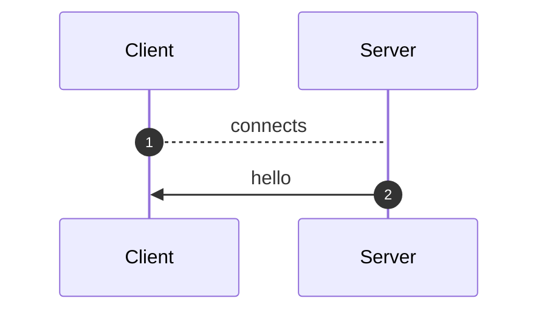
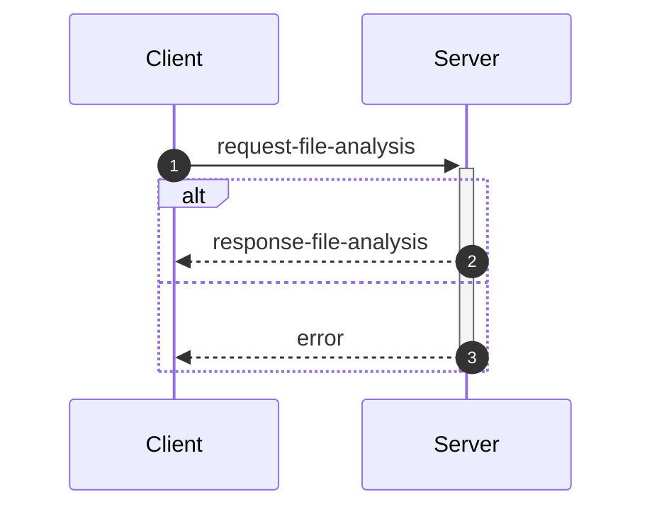
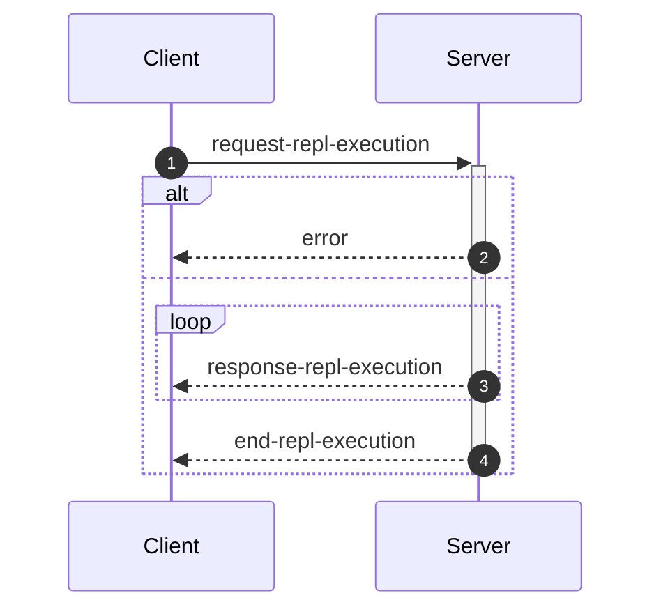
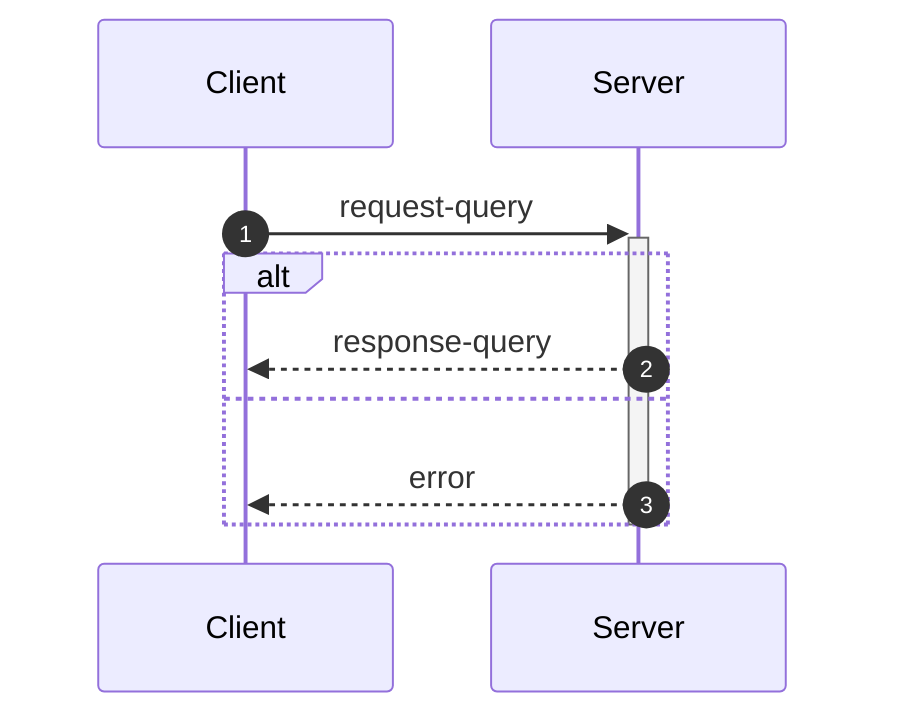

_<span title="an overview of flowR's interface">Generated</span> from '[wiki-interface.ts](https://github.com/flowr-analysis/flowr/tree/main/src/documentation/wiki-interface.ts "src/documentation/wiki-interface.ts")' on 2026-11-07, 23:01:41 UTC (v2.17.3, R v4.6.1), do not edit directly._

Although far from being as detailed as the in-depth explanation of [_flowR_](https://github.com/flowr-analysis/flowr/wiki/Core),
this wiki page explains how to interface with _flowR_ in more detail.
In general, command line arguments and other options provide short descriptions on hover over.

* [💻 Using the REPL](#using-the-repl)
* [⚙️ Configuring FlowR](#configuring-flowr)
* [⚒️ Writing Code](#writing-code)
* [💬 Communicating with the Server](#communicating-with-the-server)

<a id='using-the-repl'></a>
## 💻 Using the REPL

> [!NOTE]
> To execute arbitrary R commands with a repl request, _flowR_ has to be started explicitly with <span title="Description (Command Line Argument): Allow to access the underlying R session when using flowR (security warning: this allows the execution of arbitrary R code!)">`--r-session-access`</span>.
> Please be aware that this introduces a security risk and note that this relies on the [`r-shell` engine](https://github.com/flowr-analysis/flowr/wiki/Engines) .

Although primarily meant for users to explore,
there is nothing which forbids calling _flowR_ as a subprocess to use standard-in, -output, and -error
for communication (although you can access the REPL using the server as well,
with the [REPL Request](#message-request-repl-execution) message).

The read-eval-print loop&nbsp;(REPL) works relatively simple.
You can submit an expression (using <kbd>Enter</kbd>),
which is interpreted as an R&nbsp;expression by default but interpreted as a *command* if it starts with a colon (`:`).
The best command to get started with the REPL is <span title="Description (Repl Command): Show help information (aliases: :h, :?)">`:help`</span>.
Besides, you can leave the REPL either with the command <span title="Description (Repl Command): End the repl (aliases: :q, :exit)">`:quit`</span> or by pressing <kbd>Ctrl</kbd>+<kbd>C</kbd> twice.
When writing a *command*, you may press <kbd>Tab</kbd> to get a list of completions, if available.
Multiple commands can be entered in a single line by separating them with a semicolon (`;`), e.g. `:parse "x<-2"; :df*`.
If a command is given without R code, the REPL will re-use R code given in a previous command.
The prior example will hence return first the parsed AST of the program and then the dataflow graph for `"x <- 2"`.

> [!NOTE]
> If you develop flowR, you may want to launch the repl using the `npm run main-dev` command, this way, you get a non-minified version of flowR with debug information and hot-reloading of source files.

<details>
<summary>Available Commands</summary>

We currently offer the following commands (this with a `[*]` suffix are available with and without the star):

| Command | Description |
| ------- | ----------- |
| **<span title="Description (Repl Command): End the repl (aliases: :q, :exit)">:quit</span>** | End the repl (aliases: **:<span title="Alias of ':quit'. End the repl">q</span>**, **:<span title="Alias of ':quit'. End the repl">exit</span>**) |
| **<span title="Description (Repl Command): Execute the given code as R code. This requires the `--r-session-access` flag to be set and requires the r-shell engine. (aliases: :e, :r)">:execute</span>** | Execute the given code as R code. This requires the `--r-session-access` flag to be set and requires the r-shell engine. (aliases: **:<span title="Alias of ':execute'. Execute the given code as R code. This requires the `--r-session-access` flag to be set and requires the r-shell engine.">e</span>**, **:<span title="Alias of ':execute'. Execute the given code as R code. This requires the `--r-session-access` flag to be set and requires the r-shell engine.">r</span>**) |
| **<span title="Description (Repl Command): Get mermaid code for the control-flow graph of R code (aliases: :cfg, :cf)">:controlflow[*]</span>** | Get mermaid code for the control-flow graph of R code (star: Returns the URL to mermaid.live) (aliases: **:<span title="Alias of ':controlflow'. Get mermaid code for the control-flow graph of R code">cfg</span>**, **:<span title="Alias of ':controlflow'. Get mermaid code for the control-flow graph of R code">cf</span>**) |
| **<span title="Description (Repl Command): Get mermaid code for the control-flow graph with basic blocks (aliases: :cfgb, :cfb)">:controlflowbb[*]</span>** | Get mermaid code for the control-flow graph with basic blocks (star: Returns the URL to mermaid.live) (aliases: **:<span title="Alias of ':controlflowbb'. Get mermaid code for the control-flow graph with basic blocks">cfgb</span>**, **:<span title="Alias of ':controlflowbb'. Get mermaid code for the control-flow graph with basic blocks">cfb</span>**) |
| **<span title="Description (Repl Command): Get mermaid code for the dataflow graph (aliases: :d, :df)">:dataflow[*]</span>** | Get mermaid code for the dataflow graph (star: Returns the URL to mermaid.live) (aliases: **:<span title="Alias of ':dataflow'. Get mermaid code for the dataflow graph">d</span>**, **:<span title="Alias of ':dataflow'. Get mermaid code for the dataflow graph">df</span>**) |
| **<span title="Description (Repl Command): Get mermaid code for the normalized AST of R code (aliases: :n)">:normalize[*]</span>** | Get mermaid code for the normalized AST of R code (star: Returns the URL to mermaid.live) (alias: **:<span title="Alias of ':normalize'. Get mermaid code for the normalized AST of R code">n</span>**) |
| **<span title="Description (Repl Command): Get mermaid code for the simplified dataflow graph (aliases: :ds, :dfs)">:dataflowsimple[*]</span>** | Get mermaid code for the simplified dataflow graph (star: Returns the URL to mermaid.live) (aliases: **:<span title="Alias of ':dataflowsimple'. Get mermaid code for the simplified dataflow graph">ds</span>**, **:<span title="Alias of ':dataflowsimple'. Get mermaid code for the simplified dataflow graph">dfs</span>**) |
| **<span title="Description (Repl Command): Inspect and extend the signature database: `query` (identical to :query @signature), `info <name>` for where a function comes from (identical to :query @function-info), `add <path>` to mount another database/source, `download` to fetch the full-history database. (aliases: :sig)">:signature</span>** | Inspect and extend the signature database: `query` (identical to :query @signature), `info <name>` for where a function comes from (identical to :query @function-info), `add <path>` to mount another database/source, `download` to fetch the full-history database. (alias: **:<span title="Alias of ':signature'. Inspect and extend the signature database: `query` (identical to :query @signature), `info <name>` for where a function comes from (identical to :query @function-info), `add <path>` to mount another database/source, `download` to fetch the full-history database.">sig</span>**) |
| **<span title="Description (Repl Command): Just calculates the DFG, but only prints summary info (aliases: :d#, :df#)">:dataflowsilent</span>** | Just calculates the DFG, but only prints summary info (aliases: **:<span title="Alias of ':dataflowsilent'. Just calculates the DFG, but only prints summary info">d#</span>**, **:<span title="Alias of ':dataflowsilent'. Just calculates the DFG, but only prints summary info">df#</span>**) |
| **<span title="Description (Repl Command): Prints ASCII Art of the parsed, unmodified AST (aliases: :p)">:parse</span>** | Prints ASCII Art of the parsed, unmodified AST (alias: **:<span title="Alias of ':parse'. Prints ASCII Art of the parsed, unmodified AST">p</span>**) |
| **<span title="Description (Repl Command): Prints the version of flowR as well as the current version of R">:version</span>** | Prints the version of flowR as well as the current version of R
| **<span title="Description (Repl Command): Query the given R code (use 'help' for more information)">:query[*]</span>** | Query the given R code (use 'help' for more information) (star: Similar to query, but returns the output in json format.)
| **<span title="Description (Repl Command): Returns an ASCII representation of the dataflow graph (aliases: :df!)">:dataflowascii</span>** | Returns an ASCII representation of the dataflow graph (alias: **:<span title="Alias of ':dataflowascii'. Returns an ASCII representation of the dataflow graph">df!</span>**) |
| **<span title="Description (Repl Command): Returns summarization stats for the normalized AST (aliases: :n#)">:normalize#</span>** | Returns summarization stats for the normalized AST (alias: **:<span title="Alias of ':normalize#'. Returns summarization stats for the normalized AST">n#</span>**) |
| **<span title="Description (Repl Command): Show help information (aliases: :h, :?)">:help</span>** | Show help information (aliases: **:<span title="Alias of ':help'. Show help information">h</span>**, **:<span title="Alias of ':help'. Show help information">?</span>**) |

</details>

> [!TIP]
> 
> As indicated by the examples before, all REPL commands that operate on code keep track of the state.
> Hence, if you run a command like <span title="Description (Repl Command, starred version): Returns the URL to mermaid.live; Base Command: Get mermaid code for the dataflow graph (aliases: :d*, :df*)">`:dataflow*`</span> without providing R code,
> the REPL will re-use the R code provided in a previous command.
> Likewise, doing this will benefit from incrementality!
> If you request the dataflow graph with `:df* x <- 2 * y` and then want to see the parsed AST with `:parse`,
> the REPL will re-use previously obtained information and not re-parse the code again.
> 		

Generally, many commands offer shortcut versions in the REPL. Many queries, for example, offer a shortened format (see the example below).
Of special note, the [Config Query](https://github.com/flowr-analysis/flowr/wiki/%5BQuery%5D-Config)
can be used to also modify the currently active configuration of _flowR_ within the REPL (see the [wiki page](https://github.com/flowr-analysis/flowr/wiki/%5BQuery%5D-Config) for more information).

### Example: Retrieving the Dataflow Graph

To retrieve a URL to the [mermaid](https://mermaid.js.org/) diagram of the dataflow of a given expression,
use <span title="Description (Repl Command, starred version): Returns the URL to mermaid.live; Base Command: Get mermaid code for the dataflow graph (aliases: :d*, :df*)">`:dataflow*`</span> (or <span title="Description (Repl Command): Get mermaid code for the dataflow graph (aliases: :d, :df)">`:dataflow`</span> to get the mermaid code in the cli):

```shell
$ docker run -it --rm eagleoutice/flowr # or npm run flowr 
flowR repl v2.17.3, R grammar v14 (tree-sitter engine)
R> :dataflow* y <- 1 + x
```

<details>
<summary style='color:gray'>Output</summary>

```text
https://mermaid.live/view#base64:eyJjb2RlIjoiZmxvd2NoYXJ0IFREXG4gICAgMXt7XCJgKiM5MTtSTnVtYmVyIzkzOyogKioxKipcbiAgICAgICoxLjYqICgqKmlkOiAxKiopYFwifX1cbiAgICAyKFtcImAqIzkxO1JTeW1ib2wjOTM7KiAqKngqKlxuICAgICAgKjEuMTAqICgqKmlkOiAyKiopYFwiXSlcbiAgICAzW1tcImAqIzkxO1JCaW5hcnlPcCM5MzsqIGJhc2UjNTg7IzU4OyoqIzQzOyoqXG4gICAgICAqMS42LTEwKiAoKippZDogMyoqKVxuICAgIGFyZzogKDEsIDIpYFwiXV1cbiAgICBidWlsdC1pbjpfNDNfW1wiYEJ1aWx0LUluOlxuIzQzO2BcIl1cbiAgICBzdHlsZSBidWlsdC1pbjpfNDNfIHN0cm9rZTpncmF5LGZpbGw6Z3JheSxzdHJva2Utd2lkdGg6MnB4LG9wYWNpdHk6Ljg7XG4gICAgMFtcImAqIzkxO1JTeW1ib2wjOTM7KiAqKnkqKlxuICAgICAgKjEuMSogKCoqaWQ6IDAqKiwgdjogMylgXCJdXG4gICAgNFtbXCJgKiM5MTtSQmluYXJ5T3AjOTM7KiBiYXNlIzU4OyM1ODsqKiM2MDsjNDU7KipcbiAgICAgICoxLjEtMTAqICgqKmlkOiA0KiopXG4gICAgYXJnOiAoMCwgMylgXCJdXVxuICAgIGJ1aWx0LWluOl82MF8tW1wiYEJ1aWx0LUluOlxuIzYwOyM0NTtgXCJdXG4gICAgc3R5bGUgYnVpbHQtaW46XzYwXy0gc3Ryb2tlOmdyYXksZmlsbDpncmF5LHN0cm9rZS13aWR0aDoycHgsb3BhY2l0eTouODtcbiAgICAxIC0uLT58XCJmbG93XCJ8IDJcbiAgICBsaW5rU3R5bGUgMCBzdHJva2U6Z3JheSxjb2xvcjpncmF5O1xuICAgIDIgLS4tPnxcImZsb3dcInwgM1xuICAgIGxpbmtTdHlsZSAxIHN0cm9rZTpncmF5LGNvbG9yOmdyYXk7XG4gICAgMyAtLT58XCJyZWFkcywgYXJnXCJ8IDFcbiAgICAzIC0tPnxcInJlYWRzLCBhcmdcInwgMlxuICAgIDMgLS4tPnxcImZsb3dcInwgMFxuICAgIGxpbmtTdHlsZSA0IHN0cm9rZTpncmF5LGNvbG9yOmdyYXk7XG4gICAgMyAtLi0+fFwicmVhZHMsIGNhbGxzXCJ8IGJ1aWx0LWluOl80M19cbiAgICBsaW5rU3R5bGUgNSBzdHJva2U6Z3JheTtcbiAgICAwIC0tPnxcImRlZmluZWQtYnksIGZsb3dcInwgNFxuICAgIDAgLS0+fFwiZGVmaW5lZC1ieVwifCAzXG4gICAgNCAtLT58XCJyZWFkcywgYXJnXCJ8IDNcbiAgICA0IC0tPnxcInJldHVybnMsIGFyZ1wifCAwXG4gICAgNCAtLi0+fFwicmVhZHMsIGNhbGxzXCJ8IGJ1aWx0LWluOl82MF8tXG4gICAgbGlua1N0eWxlIDEwIHN0cm9rZTpncmF5OyIsIm1lcm1haWQiOnsiYXV0b1N5bmMiOnRydWV9fQ==
```

Retrieve the dataflow graph of the expression `y <- 1 + x`. It looks like this:


<details>

<summary style="color:gray">R Code of the Dataflow Graph</summary>

The analysis ran (parse and normalize with the [tree-sitter](https://github.com/flowr-analysis/flowr/wiki/Engines) engine) in the generation environment. No [signature database](https://github.com/flowr-analysis/flowr/wiki/Signature-Database) is mounted, so `library()` attaches no exports (base-R names are still qualified, e.g., `stats::acf`). 
We encountered no unknown side effects during the analysis.

```r
y <- 1 + x
```

</details>

</details>

For small graphs like this, <span title="Description (Repl Command): Returns an ASCII representation of the dataflow graph (aliases: :df!)">`:dataflowascii`</span> also provides an ASCII representation directly in the REPL:

```shell
$ docker run -it --rm eagleoutice/flowr # or npm run flowr 
flowR repl v2.17.3, R grammar v14 (tree-sitter engine)
R> :df! y <- 1 + x
```

<details open>
<summary style='color:gray'>Output</summary>

```text
                        v<0>v
 c<4>c──────────────────| y |
 |<- |     ┌────────────v---v
 c---c     │
    │   c<3>c   0<1>0
    └───| + |───| 1 |───u<2>u
        c---c   0---0   | x |
           └────────────u---u
Edges:
3 -> 1: reads, arg          3 -> 2: reads, arg
3 -> 0: flows-to            1 -> 2: flows-to
2 -> 3: flows-to            4 -> 3: reads, arg
4 -> 0: returns, arg        0 -> 4: defined-by, flows-to
0 -> 3: defined-by
```

Retrieve the dataflow graph of the expression `y <- 1 + x` as ASCII art.

</details>

For the slicing with <span title="Description (Repl Command): Static backwards executable slicer for R">`:slicer`</span>, you have access to the same [magic comments](#slice-magic-comments) as with the [slice request](#message-request-slice).
Pass `--inline` to splice resolvable `source()` calls into the reconstruction so the slice is a single self-contained R text (the same as the static slice query's `inlineSources` flag).
See `--help` for more flags!

### Example: Interfacing with the File System

Many commands that allow for an R-expression (like <span title="Description (Repl Command, starred version): Returns the URL to mermaid.live; Base Command: Get mermaid code for the dataflow graph (aliases: :d*, :df*)">`:dataflow*`</span>) allow for a file as well
if the argument starts with `file://`.
If you are working from the root directory of the _flowR_ repository, the following gives you the parsed AST of the example file using the <span title="Description (Repl Command): Prints ASCII Art of the parsed, unmodified AST (aliases: :p)">`:parse`</span> command:

> **Watch mode**: Replace `file://` with `watch://` to enter watch mode.
> flowR runs the command immediately and then re-runs it every time the file (or any file inside the folder) changes.
> Enter any other command to leave watch mode.
> For example: `:df watch://analysis.R`

```shell
$ docker run -it --rm eagleoutice/flowr # or npm run flowr 
flowR repl v2.17.3, R grammar v14 (tree-sitter engine)
R> :parse file://test/testfiles/example.R
```

<details>
<summary style='color:gray'>Output</summary>

```text
File: test/testfiles/example.R

program
├ binaryoperator
│ ├ identifier "sum" (1:1─4)
│ ├ <- "<-" (1:5─7)
│ ╰ float "0" (1:8─9)
├ binaryoperator
│ ├ identifier "product" (2:1─8)
│ ├ <- "<-" (2:9─11)
│ ╰ float "1" (2:12─13)
├ binaryoperator
│ ├ identifier "w" (3:1─2)
│ ├ <- "<-" (3:3─5)
│ ╰ float "7" (3:6─7)
├ binaryoperator
│ ├ identifier "N" (4:1─2)
│ ├ <- "<-" (4:3─5)
│ ╰ float "10" (4:6─8)
├ forstatement
│ ├ for "for" (6:1─4)
│ ├ ( "(" (6:5─6)
│ ├ identifier "i" (6:6─7)
│ ├ in "in" (6:8─10)
│ ├ binaryoperator
│ │ ├ float "1" (6:11─12)
│ │ ├ : ":" (6:12─13)
│ │ ╰ parenthesizedexpression
│ │   ├ ( "(" (6:13─14)
│ │   ├ binaryoperator
│ │   │ ├ identifier "N" (6:14─15)
│ │   │ ├ - "-" (6:15─16)
│ │   │ ╰ float "1" (6:16─17)
│ │   ╰ ) ")" (6:17─18)
│ ├ ) ")" (6:18─19)
│ ╰ bracedexpression
│   ├ { "{" (6:20─21)
│   ├ binaryoperator
│   │ ├ identifier "sum" (7:3─6)
│   │ ├ <- "<-" (7:7─9)
│   │ ╰ binaryoperator
│   │   ├ binaryoperator
│   │   │ ├ identifier "sum" (7:10─13)
│   │   │ ├ + "+" (7:14─15)
│   │   │ ╰ identifier "i" (7:16─17)
│   │   ├ + "+" (7:18─19)
│   │   ╰ identifier "w" (7:20─21)
│   ├ binaryoperator
│   │ ├ identifier "product" (8:3─10)
│   │ ├ <- "<-" (8:11─13)
│   │ ╰ binaryoperator
│   │   ├ identifier "product" (8:14─21)
│   │   ├  "" (8:22─23)
│   │   ╰ identifier "i" (8:24─25)
│   ╰ } "}" (9:1─2)
├ call
│ ├ identifier "cat" (11:1─4)
│ ╰ arguments
│   ├ ( "(" (11:4─5)
│   ├ argument
│   │ ╰ string
│   │   ├ stringopen "\"" (11:5─6)
│   │   ├ stringcontent "Sum:" (11:6─10)
│   │   ╰ stringclose "\"" (11:10─11)
│   ├ comma "," (11:11─12)
│   ├ argument
│   │ ╰ identifier "sum" (11:13─16)
│   ├ comma "," (11:16─17)
│   ├ argument
│   │ ╰ string
│   │   ├ stringopen "\"" (11:18─19)
│   │   ├ stringcontent
│   │   │ ╰ escapesequence "\\n" (11:19─21)
│   │   ╰ stringclose "\"" (11:21─22)
│   ╰ ) ")" (11:22─23)
╰ call
  ├ identifier "cat" (12:1─4)
  ╰ arguments
    ├ ( "(" (12:4─5)
    ├ argument
    │ ╰ string
    │   ├ stringopen "\"" (12:5─6)
    │   ├ stringcontent "Product:" (12:6─14)
    │   ╰ stringclose "\"" (12:14─15)
    ├ comma "," (12:15─16)
    ├ argument
    │ ╰ identifier "product" (12:17─24)
    ├ comma "," (12:24─25)
    ├ argument
    │ ╰ string
    │   ├ stringopen "\"" (12:26─27)
    │   ├ stringcontent
    │   │ ╰ escapesequence "\\n" (12:27─29)
    │   ╰ stringclose "\"" (12:29─30)
    ╰ ) ")" (12:30─31)
```

Retrieve the parsed AST of the example file.

<details>

<summary>File Content</summary>

```r
sum <- 0
product <- 1
w <- 7
N <- 10

for (i in 1:(N-1)) {
  sum <- sum + i + w
  product <- product * i
}

cat("Sum:", sum, "\n")
cat("Product:", product, "\n")
```

</details>

As _flowR_ directly transforms this AST the output focuses on being human-readable instead of being machine-readable.
		
</details>

### Example: Run a Query

You can run any query supported by _flowR_ using the <span title="Description (Repl Command): Query the given R code (use 'help' for more information)">`:query`</span> command.
For example, to obtain the shapes of all data frames in a given piece of code, you can run:

```shell
$ docker run -it --rm eagleoutice/flowr # or npm run flowr 
flowR repl v2.17.3, R grammar v14 (tree-sitter engine)
R> :query @absint df-shape "x <- data.frame(a = 1:10, b = 1:10)\ny <- x$a"
```

<details open>
<summary style='color:gray'>Output</summary>

```text
Query: absint (2 ms)
   ╰ $12: (colnames: [{"a", "b"}, {}], cols: [2, 2], rows: [10, 10])
   ╰ $0: (colnames: [{"a", "b"}, {}], cols: [2, 2], rows: [10, 10])
```

Retrieve the shapes of all data frames in the given code.

</details>

To run the linter on a file, you can use (in this example, we just issue the `dead-code` linter on a small piece of code):

```shell
$ docker run -it --rm eagleoutice/flowr # or npm run flowr 
flowR repl v2.17.3, R grammar v14 (tree-sitter engine)
R> :query @linter rules:dead-code "if(FALSE) x <- 2"
```

<details open>
<summary style='color:gray'>Output</summary>

```text
Query: linter (3 ms)
   ╰ Dead Code (dead-code):
       ╰ certain:
           ╰ Code at 1.11-16 (1 quick fix(es) available)
```

Run the linter on the given code, with only the `dead-code` rule enabled.

</details>

For more information on the available queries, please check out the [Query API](https://github.com/flowr-analysis/flowr/wiki/Query-API).

<a id='configuring-flowr'></a>
## ⚙️ Configuring FlowR

When running _flowR_, you may want to specify some behaviors with a dedicated configuration file.
By default, flowR looks for a file named `flowr.json` in the current working directory (or any higher directory).
You can also specify a different file with <span title="Description (Command Line Argument): The name of the configuration file to use">`--config-file`</span> or pass the configuration inline using <span title="Description (Command Line Argument): The flowR configuration to use, as a JSON string">`--config-json`</span>.
A `flowr.json` found this way belongs to the analyzed project, so flowR ignores its options that decide what flowR executes or loads
(`engines.*.wasmPath`, `engines.*.treeSitterWasmPath`, `engines.*.rPath`, `solver.sigdb.additionalPaths`, `solver.sigdb.downloadRepo`, `solver.sigdb.installedLibrary.paths`, `solver.sigdb.onDemand.enabled`, `solver.sigdb.onDemand.repositories`, `solver.sigdb.onDemand.cranMirror`, `solver.sigdb.onDemand.bioconductorMirror`, `solver.sigdb.onDemand.cacheDir`),
unless you pass <span title="Description (Command Line Argument): Keep the security-sensitive options (e.g., the R executable) of the flowr.json found in the working directory or a parent. Only use this for projects you trust.">`--trust-config`</span>.
To analyze code you do not trust, use the secure mode (<span title="Description (Command Line Argument): Run in secure mode for analyzing untrusted code: flowR does not start R (or any other process), does not access the network, does not search for project configs, and ignores security-sensitive options in every config. Cannot be disabled once enabled. Can also be enabled with the environment variable {italic FLOWR_SECURE_MODE=1}.">`--secure`</span>, see the [security policy](https://github.com/flowr-analysis/flowr/blob/main/.github/SECURITY.md)).
To inspect the current configuration, you can run flowr with the <span title="Description (Command Line Argument): Run with verbose logging (will be passed to the corresponding script)">`--verbose`</span> flag, or use the `config` [Query](https://github.com/flowr-analysis/flowr/wiki/Query-API).
Within the REPL this works by running the following:

```shell
:query @config
```

To work with the <a href="https://github.com/flowr-analysis/flowr/tree/main/src/config.ts#L119"><code><span title="The configuration file format for flowR.">FlowrConfig</span></code></a> you can use the provided helper objects alongside its methods like
<a href="https://github.com/flowr-analysis/flowr/tree/main/src/config.ts#L985"><code><span title="Creates a new flowr config that has the updated values.">FlowrConfig::<b>amend</b></span></code></a>.
The schema below documents every option; the ones you most likely want are:

- <a href="https://github.com/flowr-analysis/flowr/wiki/Interface#configuring-flowr" title="Configuration Option (boolean): Whether source calls should be ignored, causing {@link processSourceCall}&#39;s behavior to be skipped.">ignoreSourceCalls</a>: ignore source calls when analyzing the code, i.e., ignore the inclusion of other files.
- <a href="https://github.com/flowr-analysis/flowr/wiki/Interface#configuring-flowr" title="Configuration Option (boolean): Whether load calls should be ignored, causing {@link processLoadCall}&#39;s behavior to be skipped.">ignoreLoadCalls</a>: ignore load calls when analyzing the code, i.e., ignore the loading of r-data files.
- <a href="https://github.com/flowr-analysis/flowr/wiki/Interface#configuring-flowr" title="Configuration Option (object): Do you want to overwrite (parts) of the builtin definition?">semantics.environment.overwriteBuiltIns</a>: overwrite _flowR_'s handling of built-in functions, or clear the preset definitions entirely.
  See [Configure BuiltIn Semantics](#configure-builtin-semantics) for more information.
- <a href="https://github.com/flowr-analysis/flowr/wiki/Interface#configuring-flowr" title="Configuration Option (boolean): Whether calls drawing on a graphics device (e.g., `plot`) count as writing to it, which the ambient state queries then report.">semantics.ambient.drawingWritesDevice</a>: whether calls drawing on a graphics device (e.g., `plot`) count as writing the device in the ambient state queries.
- <a href="https://github.com/flowr-analysis/flowr/wiki/Interface#configuring-flowr" title="Configuration Option (string): How to resolve variables and their values. (one of &quot;disabled&quot;, &quot;alias&quot;, &quot;builtin&quot;)">solver.variables</a>: how to resolve variables and their values (`disabled`, `alias`, `builtin`).
- <a href="https://github.com/flowr-analysis/flowr/wiki/Interface#configuring-flowr" title="Configuration Option (array): The engine or set of engines to use for interacting with R code. An empty array means all available engines will be used.">engines</a> and <a href="https://github.com/flowr-analysis/flowr/wiki/Interface#configuring-flowr" title="Configuration Option (string): The default engine to use for interacting with R code. If this is undefined, an arbitrary engine from the specified list will be used. (one of &quot;tree-sitter&quot;, &quot;r-shell&quot;)">defaultEngine</a>: the engines used to interact with R code, see the [Engines wiki page](https://github.com/flowr-analysis/flowr/wiki/Engines).
- <a href="https://github.com/flowr-analysis/flowr/wiki/Interface#configuring-flowr" title="Configuration Option (array): Files a framework loads on its own, without any source() call (e.g. global.R in a shiny app), in the order they are loaded; flowR orders the matching project files accordingly and analyzes them as one program. Entries are case-insensitive globs matched against the file path, a plain name matches any file with that name, and entries matching no project file are warned about. Usually set per project kind via specializeConfig.">project.implicitSources</a>: the files a framework loads without any `source()` call, in the order in which they are
  loaded. Entries are globs (e.g. `R/*.R`) matched against the file path ignoring capitalization; one matching no file is reported.
- <a href="https://github.com/flowr-analysis/flowr/wiki/Interface#configuring-flowr" title="Configuration Option (object): Overwrite (parts of) the configuration depending on the project kind flowR detects, e.g. to give a shiny app its implicit sources.">specializeConfig</a>: overwrite (parts of) the configuration depending on the kind of project _flowR_ detects
  (e.g. `shiny-app`), which is how a shiny app gets its implicit sources by default. What you configure directly wins.
- <a href="https://github.com/flowr-analysis/flowr/wiki/Interface#configuring-flowr" title="Configuration Option (string): Overwrite the project kind flowR would otherwise infer from the analyzed files, e.g. when auto-detection guesses wrong. (one of &quot;package&quot;, &quot;script&quot;, &quot;shiny-app&quot;, &quot;notebook&quot;, &quot;project&quot;, &quot;unknown&quot;)">project.useProjectType</a>: skip that detection and force a project kind yourself, when auto-detection guesses wrong.
- <a href="https://github.com/flowr-analysis/flowr/wiki/Interface#configuring-flowr" title="Configuration Option (array): The default plugins to load when creating a new instance of FlowrAnalyzer">defaultPlugins</a> and <a href="https://github.com/flowr-analysis/flowr/wiki/Interface#configuring-flowr" title="Configuration Option (array): The plugins to load in REPL mode">repl.plugins</a>: the plugins to load for a new <a href="https://github.com/flowr-analysis/flowr/tree/main/src/project/flowr-analyzer.ts#L240"><code><span title="Central class for conducting analyses with FlowR. Use the FlowrAnalyzerBuilder to create a new instance. If you want the original pattern of creating a pipeline and running all steps, you can still do this with FlowrAnalyzer#runFull . To inspect the context of the analyzer, use FlowrAnalyzer#inspectContext (if you are a plugin and need to modify it, use FlowrAnalyzer#context instead).">FlowrAnalyzer</span></code></a> and in the REPL
  (use `flowr:default` to reference the former).

So you can configure _flowR_ by adding a file like the following:

<details>

<summary>Example Configuration File</summary>

```json
{
  "ignoreSourceCalls": true,
  "ignoreLoadCalls": true,
  "semantics": {
    "environment": {
      "overwriteBuiltIns": {
        "definitions": [
          {
            "type": "function",
            "names": [
              "foo"
            ],
            "processor": "builtin:assign",
            "config": {}
          }
        ]
      }
    }
  },
  "defaultPlugins": [
    "file:description",
    "versions:description"
  ],
  "repl": {
    "quickStats": false,
    "dfProcessorHeat": false,
    "hints": true,
    "plugins": [
      "flowr:default"
    ]
  },
  "project": {
    "resolveUnknownPathsOnDisk": true,
    "implicitSources": [
      "global.R",
      "app.R"
    ]
  },
  "linter": {
    "disabledRules": []
  },
  "specializeConfig": {
    "shiny-app": {
      "project": {
        "implicitSources": [
          "global.R",
          "ui.R",
          "server.R",
          "app.R"
        ]
      }
    }
  },
  "engines": [
    {
      "type": "r-shell"
    }
  ],
  "solver": {
    "variables": "alias",
    "evalStrings": true,
    "trackEnvironments": true,
    "sigdb": {
      "enabled": true,
      "loadProjectDependencies": true,
      "eagerlyLoad": false,
      "eagerlyLoadExports": false,
      "linkBaseR": false,
      "linkDescriptionDependencies": false
    },
    "resolveSource": {
      "dropPaths": "no",
      "ignoreCapitalization": true,
      "inferWorkingDirectory": "active-script",
      "searchPath": []
    },
    "instrument": {},
    "slicer": {
      "threshold": 50
    }
  },
  "abstractInterpretation": {
    "wideningThreshold": 4,
    "followCalls": true,
    "dataFrame": {
      "maxColNames": 20,
      "readLoadedData": {
        "readExternalFiles": true,
        "maxReadLines": 1000000
      }
    }
  },
  "incremental": {
    "alwaysIncremental": false,
    "parsing": {
      "activated": false,
      "heuristics": {
        "activated": true,
        "mtime": true,
        "linesFrom": 500,
        "bytesFrom": 50000,
        "alwaysWithEdits": false,
        "minFiles": 1
      }
    }
  },
  "gas": {
    "thresholds": {
      "memory": {
        "problematic": 0.7,
        "critical": 0.9
      },
      "timeMs": {
        "problematic": 100000,
        "critical": 120000
      }
    },
    "features": {}
  }
}
```

</details>

<details>
<a id='configure-builtin-semantics'></a>
<summary>Configure Built-In Semantics</summary>

`semantics/environment/overwriteBuiltins` accepts two keys:

- `loadDefaults` (boolean, initially `true`): If set to `true`, the default built-in definitions are loaded before applying the custom definitions. Setting this flag to `false` explicitly disables the loading of the default definitions.
- `definitions` (array, initially empty): Allows to overwrite or define new built-in elements. Each object within must have a `type` which is one of the below. Furthermore, they may define a string array of `names` which specifies the identifiers to bind the definitions to. You may use `assumePrimitive` to specify whether _flowR_ should assume that this is a primitive non-library definition (so you probably just do not want to specify the key).

  | Type            | Description                                                                                                                                                                                                                                                                                              | Example                                                                                                    |
  | --------------- | -------------------------------------------------------------------------------------------------------------------------------------------------------------------------------------------------------------------------------------------------------------------------------------------------------- | ---------------------------------------------------------------------------------------------------------- |
  | `constant`    | Additionally allows for a `value` this should resolve to.                                                                                                                                                                                                                                                | `{ type: 'constant', names: ['NULL', 'NA'],  value: null }`                                                |
  | `function`    | Is a rather flexible way to define and bind built-in functions. For the time, we do not have extensive documentation to cover all the cases, so please either consult the sources with the `default-builtin-config/` folder or open a [new issue](https://github.com/flowr-analysis/flowr/issues/new/choose). | `{ type: 'function', names: ['next'], processor: 'builtin:d', config: { cfg: ExitPointType.Next } }` |
  | `replacement` | A comfortable way to specify replacement functions like `$<-` or `names<-`. `suffixes` describes the... suffixes to attach automatically. | `{ type: 'replacement', suffixes: ['<-', '<<-'], names: ['[', '[['] }` |

</details>

<details>

<summary style='color:gray'>Full Configuration-File Schema</summary>

- _The configuration file format for flowR._ (object)
    - **logLevel** [optional] _flowR's global minimum log level, applied when the config is loaded._ (string)
        Only allows: 'silly', 'trace', 'debug', 'info', 'warn', 'error', 'fatal'
    - **ignoreSourceCalls** [optional] _Whether source calls should be ignored, causing {@link processSourceCall}'s behavior to be skipped._ (boolean)
    - **ignoreLoadCalls** [optional] _Whether load calls should be ignored, causing {@link processLoadCall}'s behavior to be skipped._ (boolean)
    - **semantics** _Configure language semantics and how flowR handles them._ (object)
        - **environment** [optional] _Semantics regarding how to handle the R environment._ (object)
            - **overwriteBuiltIns** [optional] _Do you want to overwrite (parts) of the builtin definition?_ (object)
                - **loadDefaults** [optional] _Should the default configuration still be loaded?_ (boolean)
                - **definitions** [optional] _The definitions to load/overwrite._ (array)
                Valid item types:
                    - (object)
        - **ambient** [optional] _Semantics regarding the global state (options, devices, files, ...) calls access._ (object)
            - **drawingWritesDevice** [optional] _Whether calls drawing on a graphics device (e.g., `plot`) count as writing to it, which the ambient state queries then report._ (boolean)
    - **defaultPlugins** [optional] _The default plugins to load when creating a new instance of FlowrAnalyzer_ (array)
    Valid item types:
        - (alternatives)
            - (string)
            - (array)
    - **repl** _Configuration options for the REPL._ (object)
        - **quickStats** [optional] _Whether to show quick stats in the REPL after each evaluation._ (boolean)
        - **dfProcessorHeat** [optional] _This instruments the dataflow processors to count how often each processor is called._ (boolean)
        - **hints** [optional] _Whether to show dim inline hints on the empty prompt (automatically disabled on non-interactive terminals)._ (boolean)
        - **plugins** [optional] _The plugins to load in REPL mode_ (array)
        Valid item types:
            - (alternatives)
                - (string)
                - (array)
        - **autoUseFileProtocol** [optional] _Prepend the file protocol to a repl input that looks like a path, instead of only warning about it._ (boolean)
        - **queryStats** [optional] _Whether `:query` closes with the line stating how long the queries took (`:query*` never prints it)._ (boolean)
        - **showPlugins** [optional] _Whether `:version` grays out the plugins that did not activate during the last analysis._ (boolean)
    - **project** _Project specific configuration options._ (object)
        - **resolveUnknownPathsOnDisk** [optional] _Whether to resolve unknown paths loaded by the r project disk when trying to source/analyze files._ (boolean)
        - **failOnInaccessiblePath** [optional] _Whether a directory that cannot be traversed during file discovery (e.g. due to permissions) aborts the analysis; when false (the default) such paths are logged and skipped._ (boolean)
        - **basePackages** [optional] _The packages considered part of R itself (base and recommended); if unset, flowR uses its built-in list._ (array)
        Valid item types:
            - (string)
        - **implicitSources** [optional] _Files a framework loads on its own, without any source() call (e.g. global.R in a shiny app), in the order they are loaded; flowR orders the matching project files accordingly and analyzes them as one program. Entries are case-insensitive globs matched against the file path, a plain name matches any file with that name, and entries matching no project file are warned about. Usually set per project kind via specializeConfig._ (array)
        Valid item types:
            - (string)
        - **useProjectType** [optional] _Overwrite the project kind flowR would otherwise infer from the analyzed files, e.g. when auto-detection guesses wrong._ (string)
            Only allows: 'package', 'script', 'shiny-app', 'notebook', 'project', 'unknown'
        - **assumeImplicitEcho** [optional] _Whether the top level of the analyzed code is echoed, so that every visible result printed there is collected as an output by the dependencies query (default true, false for a package)._ (boolean)
        - **discovery** [optional] _Scoping options for the default project discovery._ (object)
            - **full** [optional] _Collect every file below the project root (greedy) instead of only the files the detected project kind needs (default false)._ (boolean)
            - **perKind** [optional] _Per-kind include/exclude glob overrides layered on the default scoping._ (object)
            - **ignore** [optional] _Case-insensitive globs that drop matching files from the intelligent discovery, regardless of kind (e.g. .Renviron to ignore environment files)._ (array)
            Valid item types:
                - (string)
        - **classification** [optional] _Overrides for the signals flowR uses to classify the project kind._ (object)
            - **shinyDescriptionTypes** [optional] _DESCRIPTION Type: values that mark a shiny app._ (array)
            Valid item types:
                - (string)
            - **shinyEntryFiles** [optional] _File names a shiny app is assembled from._ (array)
            Valid item types:
                - (string)
            - **shinyUsagePattern** [optional] _Regex source evidencing shiny usage in an entry file._ (string)
            - **notebookExtensions** [optional] _File extensions marking a notebook._ (array)
            Valid item types:
                - (string)
    - **linter** _Linter configuration options._ (object)
        - **disabledRules** _Linting rule names excluded from the default rule set (a rule requested explicitly via a linter query still runs). Usually set per project kind via specializeConfig._ (array)
        Valid item types:
            - (string)
        - **disabledTags** [optional] _Linting rule tags whose rules are excluded from the default rule set (a rule requested explicitly via a linter query still runs). By default the cmd-check rules are disabled for everything but a package; a configured list replaces that default._ (array)
        Valid item types:
            - (string)
    - **inputSources** [optional] _Further frameworks the input-sources analysis should know about; entries are added to flowR's defaults._ (object)
        - **pure** [optional] _Functions that only pass the constantness of their arguments on._ (array)
        Valid item types:
            - (string)
        - **param** [optional] _Functions whose result is a 'param' input._ (array)
        Valid item types:
            - (string)
        - **file** [optional] _Functions whose result is a 'file' input._ (array)
        Valid item types:
            - (string)
        - **tempfile** [optional] _Functions whose result is a 'tempfile' input._ (array)
        Valid item types:
            - (string)
        - **glob** [optional] _Functions whose result is a 'glob' input._ (array)
        Valid item types:
            - (string)
        - **net** [optional] _Functions whose result is a 'net' input._ (array)
        Valid item types:
            - (string)
        - **rand** [optional] _Functions whose result is a 'rand' input._ (array)
        Valid item types:
            - (string)
        - **system** [optional] _Functions whose result is a 'system' input._ (array)
        Valid item types:
            - (string)
        - **ffi** [optional] _Functions whose result is a 'ffi' input._ (array)
        Valid item types:
            - (string)
        - **lang** [optional] _Functions whose result is a 'lang' input._ (array)
        Valid item types:
            - (string)
        - **options** [optional] _Functions whose result is a 'options' input._ (array)
        Valid item types:
            - (string)
        - **cmdline** [optional] _Functions whose result is a 'cmdline' input._ (array)
        Valid item types:
            - (string)
        - **user** [optional] _Functions whose result is a 'user' input._ (array)
        Valid item types:
            - (string)
        - **const** [optional] _Functions whose result is a 'const' input._ (array)
        Valid item types:
            - (string)
        - **scope** [optional] _Functions whose result is a 'scope' input._ (array)
        Valid item types:
            - (string)
        - **dconst** [optional] _Functions whose result is a 'dconst' input._ (array)
        Valid item types:
            - (string)
        - **unknown** [optional] _Functions whose result is a 'unknown' input._ (array)
        Valid item types:
            - (string)
        - **linkedObjects** [optional] _Objects a framework provides without a definition in the code, e.g. shiny's input._ (array)
        Valid item types:
            - (object)
        - **linkedEntryPoints** [optional] _Calls that hand a function to a framework, which binds its objects to the parameters by position._ (array)
        Valid item types:
            - (object)
    - **specializeConfig** [optional] _Overwrite (parts of) the configuration depending on the project kind flowR detects, e.g. to give a shiny app its implicit sources._ (object)
    - **engines** _The engine or set of engines to use for interacting with R code. An empty array means all available engines will be used._ (array)
    Valid item types:
        - (alternatives)
            - _The configuration for the tree sitter engine._ (object)
                - **type** [required] _Use the tree sitter engine._ (string)
                    Only allows: 'tree-sitter'
                - **wasmPath** [optional] _The path to the tree-sitter-r WASM binary to use. If this is undefined, this uses the default path._ (string)
                - **treeSitterWasmPath** [optional] _The path to the tree-sitter WASM binary to use. If this is undefined, this uses the default path._ (string)
                - **lax** [optional] _Whether to use the lax parser for parsing R code (allowing for syntax errors). If this is undefined, the strict parser will be used._ (boolean)
            - _The configuration for the R shell engine._ (object)
                - **type** [required] _Use the R shell engine._ (string)
                    Only allows: 'r-shell'
                - **rPath** [optional] _The path to the R executable to use. If this is undefined, this uses the default path._ (string)
                - **pipeBind** [optional] _Whether to enable R's experimental pipe-bind operator "=>" by setting _R_USE_PIPEBIND_ for the R session (default false); R itself keeps this off by default, as it is experimental and has never shipped in a release version of R._ (boolean)
    - **defaultEngine** [optional] _The default engine to use for interacting with R code. If this is undefined, an arbitrary engine from the specified list will be used._ (string)
        Only allows: 'tree-sitter', 'r-shell'
    - **solver** _How to resolve constants, constraints, cells, ..._ (object)
        - **variables** _How to resolve variables and their values._ (string)
            Only allows: 'disabled', 'alias', 'builtin'
        - **evalStrings** _Should we include eval(parse(text="...")) calls in the dataflow graph?_ (boolean)
        - **trackEnvironments** [optional] _Track user-created environments (new.env, assign/get/local with envir=, dollar-assign, attach). When false, all envir-style calls fall through conservatively._ (boolean)
        - **sigdb** _Resolving library exports from a signature database._ (object)
            - **enabled** [optional] _Resolve library()/use() exports from a signature database (default true); when false no database is consulted._ (boolean)
            - **loadProjectDependencies** [optional] _Load the project's declared dependencies from its metadata files (DESCRIPTION Imports/Depends, rproject.toml, uvr.toml, rig rproj.toml and script blocks, renv.lock, rv.lock, uvr.lock, rig lockfiles) (default true); when false these files are not read for dependencies._ (boolean)
            - **eagerlyLoad** [optional] _Parse the database up front rather than on the first package load (default false, ignored if disabled)._ (boolean)
            - **eagerlyLoadExports** [optional] _Add a vertex for every export on load rather than on demand (default false); keeps the dataflow graph small._ (boolean)
            - **assumedRVersion** [optional] _R version assumed when resolving versioned (base-R) exports: a pin like "4.5" or "auto" to detect the installed R (default "auto")._ (string)
            - **linkBaseR** [optional] _Eagerly attach base-R namespaces so bare base calls resolve without library() (default false)._ (boolean)
            - **linkBaseRCalls** [optional] _Add a lightweight Reads edge from a bare base-R call to its signature-database function vertex (default false; base-R qualification is edge-free otherwise)._ (boolean)
            - **linkPackageCalls** [optional] _Add a lightweight Reads edge from a resolved package call to its signature-database function vertex (default false)._ (boolean)
            - **linkDescriptionDependencies** [optional] _Eagerly attach the namespaces of the project's declared DESCRIPTION dependencies (Imports/Depends) so their exports resolve without an explicit library() (default false)._ (boolean)
            - **warmInBackground** [optional] _Decompress the hot shards (base + most-downloaded) in a background task on startup so the first library() lookup is warm (default false; for long-running servers/REPLs)._ (boolean)
            - **additionalPaths** [optional] _Extra directories or bundle/manifest files searched for signature databases (alongside the shipped default and $FLOWR_SIGDB_DIR); a downloaded full-history bundle placed here is mounted automatically._ (array)
            Valid item types:
                - (string)
            - **downloadRepo** [optional] _GitHub owner/repo the full-history bundle is downloaded from via ":signature download" (default "flowr-analysis/flowr"; the release tag comes from the committed sigdb.remote.json unless a version is given)._ (string)
            - **autoSync** [optional] _On startup, re-download shards whose committed sigdb.remote.json hash no longer matches the cache, in the background (default false; opt-in network sync after a git pull)._ (boolean)
            - **installedLibrary** [optional] _Recovering packages no signature database knows from the copy installed on this machine._ (object)
                - **enabled** [required] _Recover packages no signature database knows from their installed copy (default false)._ (boolean)
                - **paths** [optional] _Library directories to search; when empty they are discovered from the environment and the project._ (array)
                Valid item types:
                    - (string)
                - **useEnvironment** [optional] _Search the libraries R_LIBS_USER/R_LIBS/R_LIBS_SITE name (default true)._ (boolean)
                - **useProjectLibrary** [optional] _Search a project-local renv/packrat library (default true)._ (boolean)
                - **maxDepth** [optional] _How far to descend into the nested layout of a project-local library (default 3)._ (number)
                - **packages** [optional] _Only recover packages whose name matches one of these regular expressions; empty means any._ (array)
                Valid item types:
                    - (string)
            - **onDemand** [optional] _Recovering packages no signature database knows from their sources on CRAN, Bioconductor, or GitHub._ (object)
                - **enabled** [required] _Fetch and recover the sources of packages no signature database knows when the analyzed code uses them (default false, accesses the network)._ (boolean)
                - **sources** [optional] _Where to look, in order: github, cran, bioconductor, or a source a plugin adds (default ["github", "cran", "bioconductor"])._ (array)
                Valid item types:
                    - (string)
                - **repositories** [optional] _GitHub repositories (owner/repo[/subdir][@ref]) to fetch packages from, by package name. The analyzed project may name more (DESCRIPTION Remotes, install_github calls)._ (object)
                - **packages** [optional] _Only recover packages whose name matches one of these regular expressions, empty means any._ (array)
                Valid item types:
                    - (string)
                - **cranMirror** [optional] _The CRAN src/contrib/ to fetch from, over https (default https://cloud.r-project.org/src/contrib/). It may be on the local network._ (string)
                - **bioconductorMirror** [optional] _The Bioconductor host, over https (default https://bioconductor.org). It may be on the local network._ (string)
                - **bioconductorRelease** [optional] _The Bioconductor release to fetch from: release, devel, or a number like 3.20 (default release)._ (string)
                - **githubMirrors** [optional] _Use the GitHub mirrors of CRAN (cran/<pkg>) and Bioconductor (bioc/<pkg>) (default true)._ (boolean)
                - **maxPackages** [optional] _The most packages to fetch for one analysis (default 25)._ (number)
                - **maxArchiveMb** [optional] _The most MiB a package archive may have (default 32). It may unpack to three times that, at most 128 MiB._ (number)
                - **offline** [optional] _Only use what was fetched before, never the network (default false)._ (boolean)
                - **retryAfterHours** [optional] _How many hours to wait before asking again for a package no source had (default 24)._ (number)
                - **cacheDir** [optional] _Where to cache what was fetched (default the on-demand directory of the signature cache)._ (string)
            - **blobCacheBudgetMb** [optional] _How many MiB of decoded package blobs every open bundle may hold together (default 16)._ (number)
            - **versionSelection** [optional] _When a project constrains a dependency, resolve to the newest (default), oldest, or system-installed version satisfying it; system needs R and falls back to newest. Base-R packages always resolve against the assumed R version._ (string)
                Only allows: 'newest', 'oldest', 'system'
            - **versionOverrides** [optional] _Force an exact version for specific packages (name -> version), overriding both the project constraint and the versionSelection policy (default {})._ (object)
        - **versionManagement** _Policies for reasoning about dependency versions._ (object)
            - **linkedVersionGroups** [optional] _Groups of packages that must resolve to the same version; version guessing intersects each group so its members stay mutually compatible (default [])._ (array)
            Valid item types:
                - (array)
                Valid item types:
                    - (string)
        - **assumeAttachedPackages** [optional] _Packages to treat as attached without a `library()` call, so what the built-in configuration states about them applies to the analyzed code. The base packages R attaches on startup already resolve without it._ (array)
        Valid item types:
            - (string)
        - **transitiveSideEffectRounds** [optional] _How many rounds the transitive side-effect fixpoint may run before it is cut off (default 32); the propagation stops on its own as soon as a round adds nothing._ (number)
        - **maxOverlayDepth** [optional] _How many binding overlays may stack on one environment frame before a write flattens them (default 4); a pure performance knob, trading lookup cost against copy cost without changing any result._ (number)
        - **instrument** (object)
            - **dataflowExtractors** [optional] _These keys are only intended for use within code, allowing to instrument the dataflow analyzer!_ (any)
        - **resolveSource** [optional] _If lax source calls are active, flowR searches for sourced files much more freely, based on the configurations you give it. This option is only in effect if `ignoreSourceCalls` is set to false._ (object)
            - **dropPaths** _Allow to drop the first or all parts of the sourced path, if it is relative._ (string)
                Only allows: 'no', 'once', 'all'
            - **ignoreCapitalization** _Search for filenames matching in the lowercase._ (boolean)
            - **inferWorkingDirectory** _Try to infer the working directory from the main or any script to analyze._ (string)
                Only allows: 'no', 'main-script', 'active-script', 'any-script'
            - **searchPath** _Additionally search in these paths._ (array)
            Valid item types:
                - (string)
            - **repeatedSourceLimit** [optional] _How often the same file can be sourced within a single run? Please be aware: in case of cyclic sources this may not reach a fixpoint so give this a sensible limit._ (number)
            - **applyReplacements** _Provide name replacements for loaded files_ (array)
            Valid item types:
                - (object)
            - **assumeFilesExist** [optional] _Assume a sourced file is always there, making what it defines certain instead of conditional on the source call._ (boolean)
        - **slicer** [optional] _The configuration for the slicer._ (object)
            - **threshold** [optional] _The maximum number of iterations to perform on a single function call during slicing._ (number)
            - **autoExtend** [optional] _If set, the slicer will gain an additional post-pass._ (boolean)
    - **abstractInterpretation** _The configuration options for abstract interpretation._ (object)
        - **wideningThreshold** _The threshold for the number of visitations of a node at which widening should be performed to ensure the termination of the fixpoint iteration._ (number)
        - **followCalls** _Whether the abstract interpretation is interprocedural, i.e. whether it steps into the functions a call may dispatch to._ (boolean)
        - **dataFrame** _The configuration of the shape inference for data frames._ (object)
            - **maxColNames** _The maximum number of columns names to infer for data frames before over-approximating the column names to top._ (number)
            - **readLoadedData** _Configuration options for reading data frame shapes from loaded external data files, such as CSV files._ (object)
                - **readExternalFiles** _Whether data frame shapes should be extracted from loaded external files, such as CSV files._ (boolean)
                - **maxReadLines** _The maximum number of lines to read when extracting data frame shapes from loaded files, such as CSV files._ (number)
    - **incremental** (object)
        - **alwaysIncremental** _Always take the incremental path, regardless of heuristics._ (boolean)
        - **parsing** (object)
            - **activated** _If set, incremental parsing will be used._ (boolean)
            - **heuristics** (object)
                - **activated** [optional] _If set, the heuristics for incremental parsing will be used._ (boolean)
                - **mtime** [optional] _Skip reparsing entirely if the file's modification time is unchanged since the last parse._ (boolean)
                - **linesFrom** [optional] _Only consider incremental parsing for files with at least this many lines._ (number)
                - **bytesFrom** [optional] _Only consider incremental parsing for files with at least this many bytes._ (number)
                - **alwaysWithEdits** [optional] _Always take the incremental path whenever there is a computed edit region, regardless of the other thresholds._ (boolean)
                - **minFiles** [optional] _Only apply these heuristics once the project has at least this many files loaded._ (number)
    - **gas** [optional] _Resource-usage guard (gas) configuration. All feature factors default to 0 (disabled). See https://github.com/flowr-analysis/flowr/wiki/Core#gas-resource-guard._ (object)
        - **thresholds** [optional] _Thresholds for all gas checks (scaled by per-feature factor), boundable per feature._ (object)
            - **memory** [optional] _Heap-usage fraction thresholds (0-1), either shared or given per feature key (with `default` covering the rest)._ (object)
                - **problematic** [optional] _Heap fraction (0-1) above which Problematic is returned, for every feature without an entry of its own._ (number)
                - **critical** [optional] _Heap fraction (0-1) above which Critical is returned, for every feature without an entry of its own._ (number)
            - **timeMs** [optional] _Elapsed analysis time thresholds in milliseconds, either shared or given per feature key (with `default` covering the rest)._ (object)
                - **problematic** [optional] _Elapsed ms above which Problematic is returned, for every feature without an entry of its own._ (number)
                - **critical** [optional] _Elapsed ms above which Critical is returned, for every feature without an entry of its own._ (number)
            - **steps** [optional] _Processed-AST-node thresholds, counted rather than sampled; only a key that arms a budget (`dataflow`) reads them._ (object)
                - **problematic** [optional] _Processed AST nodes above which Problematic is returned, for every feature without an entry of its own._ (number)
                - **critical** [optional] _Processed AST nodes above which the extraction is cut short, for every feature without an entry of its own._ (number)
            - **vertices** [optional] _Created-dataflow-vertex thresholds, counted like `steps`._ (object)
                - **problematic** [optional] _Created dataflow vertices above which Problematic is returned, for every feature without an entry of its own._ (number)
                - **critical** [optional] _Created dataflow vertices above which the extraction is cut short, for every feature without an entry of its own._ (number)
        - **features** [optional] _Per-feature sensitivity factors. 0 or absent disables gas checking for that feature. A factor of 2 makes the feature twice as sensitive. Recognised keys: `source`, `side-effect-linking`, `linter`, `slicer`, `dataflow`._ (object)
        - **countedCheckEvery** [optional] _How many counted steps pass between two accountings of an armed check, be it a dataflow budget or the slicer's traversal (default 128); trades overshoot against the cost of the check._ (number)
        - **heapProvider** [optional] _Custom heap statistics source (programmatic configs only), overriding the built-in v8/performance.memory detection._ (function)

</details>

<a id='writing-code'></a>
## ⚒️ Writing Code

_flowR_ can be used as a [module](https://www.npmjs.com/package/@eagleoutice/flowr) and offers several main classes and interfaces that are interesting for extension writers 
(see the [Visual Studio Code extension](https://marketplace.visualstudio.com/items?itemName=code-inspect.vscode-flowr) or the [Core](https://github.com/flowr-analysis/flowr/wiki/Core) wiki page for more information).

### Creating Analyses with _flowR_

Nowadays, instances of the <a href="https://github.com/flowr-analysis/flowr/tree/main/src/project/flowr-analyzer.ts#L240"><code><span title="Central class for conducting analyses with FlowR. Use the FlowrAnalyzerBuilder to create a new instance. If you want the original pattern of creating a pipeline and running all steps, you can still do this with FlowrAnalyzer#runFull . To inspect the context of the analyzer, use FlowrAnalyzer#inspectContext (if you are a plugin and need to modify it, use FlowrAnalyzer#context instead).">FlowrAnalyzer</span></code></a> should be used as central frontend to get analysis results from _flowR_.
The entry points an analysis is written against are re-exported from the package root (`import { FlowrAnalyzerBuilder } from '@eagleoutice/flowr'`);
everything else stays reachable under its own path, as in `@eagleoutice/flowr/dataflow/graph/graph`.
For example, a program slice can be created like this:

```ts
const analyzer = await new FlowrAnalyzerBuilder()
    .setEngine('tree-sitter')
    .build();
analyzer.addRequest('x <- 1\ny <- x\nx');
const { slice, reconstruct } = await analyzer.query({
    type:     'static-slice',
    criteria: ['3@x']
});
```

For more information, please have a look at the [Analyzer](https://github.com/flowr-analysis/flowr/wiki/Analyzer) wiki page, which explains how to construct and use the <a href="https://github.com/flowr-analysis/flowr/tree/main/src/project/flowr-analyzer.ts#L240"><code><span title="Central class for conducting analyses with FlowR. Use the FlowrAnalyzerBuilder to create a new instance. If you want the original pattern of creating a pipeline and running all steps, you can still do this with FlowrAnalyzer#runFull . To inspect the context of the analyzer, use FlowrAnalyzer#inspectContext (if you are a plugin and need to modify it, use FlowrAnalyzer#context instead).">FlowrAnalyzer</span></code></a> in more detail.
To work with specific perspectives, you can also consult the respective pages like the [Dataflow Graph](https://github.com/flowr-analysis/flowr/wiki/Dataflow-Graph) or the [Abstract Interpretation](https://github.com/flowr-analysis/flowr/wiki/Abstract-Interpretation) wiki pages.
### The Pipeline Executor (Low-Level Interface)

Once, in the beginning, _flowR_ was meant to produce a dataflow graph merely to provide *program slices*. 
However, with continuous updates, the [Dataflow Graph](https://github.com/flowr-analysis/flowr/wiki/Dataflow-Graph) repeatedly proves to be the more interesting part.
With this, we restructured _flowR_'s originally *hardcoded* pipeline to be far more flexible. 
Now, it can be theoretically extended or replaced with arbitrary steps, optional steps, and what we call 'decorations' of these steps. 
In short, a slicing pipeline using the <a href="https://github.com/flowr-analysis/flowr/tree/main/src/core/pipeline-executor.ts#L97"><code><span title="**Please note:** The PipelineExecutor is now considered to be a rather low-level API for flowR. While it still works and is the basis for all other layers, we strongly recommend using the FlowrAnalyzer and its builder to create and use an analyzer instance that is pre-configured for your use-case. The pipeline executor allows to execute arbitrary pipelines in a step-by-step fashion. If you are not...">PipelineExecutor</span></code></a> looks like this:

```ts

const slicer = new PipelineExecutor(DEFAULT_SLICING_PIPELINE, {
  parser:    new RShell(),
  request:   requestFromInput('x <- 1\nx + 1'),
  criterion: ['2@x']
})
const slice = await slicer.allRemainingSteps()
// console.log(slice.reconstruct.code)
```

<details><summary>More Information</summary>

If you compare this, with what you would have done with the old (and removed) `SteppingSlicer`, 
this essentially just requires you to replace the `SteppingSlicer` with the <a href="https://github.com/flowr-analysis/flowr/tree/main/src/core/pipeline-executor.ts#L97"><code><span title="**Please note:** The PipelineExecutor is now considered to be a rather low-level API for flowR. While it still works and is the basis for all other layers, we strongly recommend using the FlowrAnalyzer and its builder to create and use an analyzer instance that is pre-configured for your use-case. The pipeline executor allows to execute arbitrary pipelines in a step-by-step fashion. If you are not...">PipelineExecutor</span></code></a>
and to pass the <a href="https://github.com/flowr-analysis/flowr/tree/main/src/core/steps/pipeline/default-pipelines.ts#L18"><code>DEFAULT_SLICING_PIPELINE</code></a> as the first argument.
The <a href="https://github.com/flowr-analysis/flowr/tree/main/src/core/pipeline-executor.ts#L97"><code><span title="**Please note:** The PipelineExecutor is now considered to be a rather low-level API for flowR. While it still works and is the basis for all other layers, we strongly recommend using the FlowrAnalyzer and its builder to create and use an analyzer instance that is pre-configured for your use-case. The pipeline executor allows to execute arbitrary pipelines in a step-by-step fashion. If you are not...">PipelineExecutor</span></code></a>...

1. Provides structures to investigate the results of all intermediate steps
2. Can be executed step-by-step
3. Can repeat steps (e.g., to calculate multiple slices on the same input)

See the in-code documentation for more information.

</details>

### Using the <a href="https://github.com/flowr-analysis/flowr/tree/main/src/r-bridge/shell.ts#L144"><code><span title="The RShell represents an interactive session with the R interpreter. You can configure it by RShellOptions . At the moment we are using a live R session (and not networking etc.) to communicate with R easily, which allows us to install packages etc. However, this might and probably will change in the future (leaving this as a legacy mode :D)">RShell</span></code></a> to Interact with R

The <a href="https://github.com/flowr-analysis/flowr/tree/main/src/r-bridge/shell.ts#L144"><code><span title="The RShell represents an interactive session with the R interpreter. You can configure it by RShellOptions . At the moment we are using a live R session (and not networking etc.) to communicate with R easily, which allows us to install packages etc. However, this might and probably will change in the future (leaving this as a legacy mode :D)">RShell</span></code></a> class allows interfacing with the `R`&nbsp;ecosystem installed on the host system.
Please have a look at [flowR's Engines](https://github.com/flowr-analysis/flowr/wiki/Engines) for more information on alternatives (for example, the <a href="https://github.com/flowr-analysis/flowr/tree/main/src/r-bridge/lang-4.x/tree-sitter/tree-sitter-executor.ts#L29"><code><span title="Synchronous and (way) faster alternative to the RShell using tree-sitter.">TreeSitterExecutor</span></code></a>).

> [!IMPORTANT]
> 
> Each <a href="https://github.com/flowr-analysis/flowr/tree/main/src/r-bridge/shell.ts#L144"><code><span title="The RShell represents an interactive session with the R interpreter. You can configure it by RShellOptions . At the moment we are using a live R session (and not networking etc.) to communicate with R easily, which allows us to install packages etc. However, this might and probably will change in the future (leaving this as a legacy mode :D)">RShell</span></code></a> controls a new instance of the R&nbsp;interpreter, 
> make sure to call <code><a href="https://github.com/flowr-analysis/flowr/tree/main/src/r-bridge/shell.ts#L350"><span title="Close the current R session, makes the object effectively invalid (can no longer be reopened etc.)">RShell::<i>close</i></span></a>()</code> when you are done.

You can start a new "session" by constructing a new object with <code>new <a href="https://github.com/flowr-analysis/flowr/tree/main/src/r-bridge/shell.ts#L144"><span title="The RShell represents an interactive session with the R interpreter. You can configure it by RShellOptions . At the moment we are using a live R session (and not networking etc.) to communicate with R easily, which allows us to install packages etc. However, this might and probably will change in the future (leaving this as a legacy mode :D)">RShell</span></a>()</code>.

However, there are several options that may be of interest 
(e.g., to automatically revive the shell in case of errors or to control the name location of the R process on the system).

With a shell object (let's call it `shell`), you can execute R code by using <a href="https://github.com/flowr-analysis/flowr/tree/main/src/r-bridge/shell.ts#L213"><code><span title="sends the given command directly to the current R session will not do anything to alter input markers!">RShell::<i>sendCommand</i></span></code></a>,
for example <code>shell.<a href="https://github.com/flowr-analysis/flowr/tree/main/src/r-bridge/shell.ts#L213"><span title="sends the given command directly to the current R session will not do anything to alter input markers!">sendCommand</span></a>("1 + 1")</code>.
However, this does not return anything, so if you want to collect the output of your command, use
<a href="https://github.com/flowr-analysis/flowr/tree/main/src/r-bridge/shell.ts#L296"><code><span title="Send a command and collect the output">RShell::<i>sendCommandWithOutput</i></span></code></a> instead.

<a id='communicating-with-the-server'></a>
## 💬 Communicating with the Server

As explained in the [Overview](https://github.com/flowr-analysis/flowr/wiki/Overview), you can run the [TCP](https://de.wikipedia.org/wiki/Transmission_Control_Protocol)&nbsp;server by adding the <span title="Description (Command Line Argument): Do not drop into a repl, but instead start a server on the given port (default: 1042) and listen for messages.">`--server`</span> flag (and, due to the interactive mode, exit with the conventional <kbd>CTRL</kbd>+<kbd>C</kbd>).
Currently, every connection is handled by the same underlying `RShell` - so the server is not designed to handle many clients at a time.
Additionally, the server is not well guarded against attacks (e.g., you can theoretically spawn an arbitrary number of&nbsp;RShell sessions on the target machine).

Every message has to be given in a single line (i.e., without a newline in-between) and end with a newline character. Nevertheless, we will pretty-print example given in the following segments for the ease of reading.

> [!NOTE]
> 
> The default <span title="Description (Command Line Argument): Do not drop into a repl, but instead start a server on the given port (default: 1042) and listen for messages.">`--server`</span> uses a simple [TCP](https://de.wikipedia.org/wiki/Transmission_Control_Protocol)
> connection. If you want _flowR_ to expose a [WebSocket](https://de.wikipedia.org/wiki/WebSocket) server instead, add the <span title="Description (Command Line Argument): If the server flag is set, use websocket for messaging">`--ws`</span> flag (i.e., <span title="Description (Command Line Argument): Do not drop into a repl, but instead start a server on the given port (default: 1042) and listen for messages.">`--server`</span> <span title="Description (Command Line Argument): If the server flag is set, use websocket for messaging">`--ws`</span>) when starting _flowR_ from the command line.

<ul><li>
<a id="message-hello"></a>
<b>Hello</b> Message (<code>hello</code>) 
<details>

<summary style="color:gray"> View Details. <i>The server informs the client about the successful connection and provides Meta-Information.</i> </summary>



After launching _flowR_, for example, with <code>docker run -it --rm eagleoutice/flowr <span title="Description (Command Line Argument): Do not drop into a repl, but instead start a server on the given port (default: 1042) and listen for messages.">-<span/>-server</span></code>&nbsp;(🐳️), connecting should present you with a `hello` message, that amongst others should reveal the versions of&nbsp;_flowR_ and&nbsp;R, using the [semver 2.0](https://semver.org/spec/v2.0.0.html) versioning scheme.
The message looks like this:

```json
{
  "type": "hello",
  "clientName": "client-0",
  "versions": {
    "flowr": "2.17.3",
    "r": "4.6.1",
    "engine": "r-shell"
  }
}
```

There are currently a few messages that you can send after the hello message.
If you want to _slice_ a piece of R code you first have to send an [analysis request](#message-request-file-analysis), so that you can send one or multiple slice requests afterward.
Requests for the [REPL](#message-request-repl-execution) are independent of that.
	
<hr>

<details>
<summary style="color:gray">Message schema (<code>hello</code>)</summary>

For the definition of the hello message, please see it's implementation at [`./src/cli/repl/server/messages/message-hello.ts`](https://github.com/flowr-analysis/flowr/tree/main/src/cli/repl/server/messages/message-hello.ts).

- [required] (object)
    - **type** [required] _The type of the hello message._ (string)
        Only allows: 'hello'
    - **id** [forbidden] _The id of the message is always undefined (as it is the initial message and not requested)._ (any)
    - **clientName** [required] _A unique name that is assigned to each client. It has no semantic meaning and is only used/useful for debugging._ (string)
    - **versions** [required] (object)
        - **flowr** [required] _The version of the flowr server running in semver format._ (string)
        - **r** [required] _The version of the underlying R shell running in semver format._ (string)
        - **engine** [required] _The parser backend that is used to parse the R code._ (string)

</details>

<hr>

</details>
	</li>

<li>
<a id="message-request-file-analysis"></a>
<b>Analysis</b> Message (<code>request-file-analysis</code>) 
<details>

<summary style="color:gray"> View Details. <i>The server builds the dataflow graph for a given input file (or a set of files).</i> </summary>



The request allows the server to analyze a file and prepare it for slicing.
The message can contain a `filetoken`, which is used to identify the file in later slice or query requests (if you do not add one, the request will not be stored and therefore, it is not available for subsequent requests).

> **Please note!**\
> If you want to send and process a lot of analysis requests, but do not want to slice them, please do not pass the `filetoken` field. This will save the server a lot of memory allocation.

Furthermore, the request must contain either a `content` field to directly pass the file's content or a `filepath` field which contains the path to the file (this path must be accessible for the server to be useful).
If you add the `id` field, the answer will use the same `id` so you can match requests and the corresponding answers.
See the implementation of the request-file-analysis message for more information.

You can drop one or more stored file tokens by adding the `invalidateToken` field (a single token or an array of tokens).
The server frees the corresponding analyses _after_ it has answered the request.

> **Tip!**\
> If you only want to drop tokens, you do not need a separate message: send a `request-file-analysis` that contains _just_ the `invalidateToken` field (and no `content` or `filepath`).
> Such a request behaves like an empty file analysis and the server replies with an empty `results` object.
> Because invalidation happens after the response, you may even pass the _current_ `filetoken` in `invalidateToken` to analyze a file once and have the server forget it right after you received the results.

<details>
<summary>Example of the <code>request-file-analysis</code> Message</summary>

_Note:_ even though we pretty-print these messages, they are sent as a single line, ending with a newline.

The following lists all messages that were sent and received in case you want to reproduce the scenario:

<ol>
<li> <code>hello</code> (response)
<details> 

<summary> Show Details </summary>

The first message is always a hello message.

```json
{"type":"hello","clientName":"client-0","versions":{"flowr":"2.17.3","r":"4.6.1","engine":"r-shell"}}
```

</details>
</li>

<li> <b><code>request-file-analysis</code> (request)</b>
<details open> 

<summary> Show Details </summary>

Let's suppose you simply want to analyze the following script:
 
```r
x <- 1
x + 1
```

 For this, you can send the following request:

```json
{"type":"request-file-analysis","id":"1","filetoken":"x","content":"x <- 1\nx + 1"}
```

</details>
</li>

<li> <code>response-file-analysis</code> (response)
<details> 

<summary> Show Details </summary>

The `results` field of the response effectively contains three keys of importance:

- `parse`: which contains 1:1 the parse result in CSV format that we received from the `RShell` (i.e., the AST produced by the parser of the R interpreter).
- `normalize`: which contains the normalized AST, including ids (see the `info` field and the [Normalized AST](https://github.com/flowr-analysis/flowr/wiki/Normalized-AST) wiki page).
- `dataflow`: especially important is the `graph` field which contains the dataflow graph as a set of root vertices (see the [Dataflow Graph](https://github.com/flowr-analysis/flowr/wiki/Dataflow-Graph) wiki page).
			
_As the code is pretty long, we inhibit pretty printing and syntax highlighting (JSON, hiding built-in):_

```text
{"type":"response-file-analysis","format":"json","id":"1","results":{"parse":{"files":[{"parsed":"[1,1,1,6,7,0,\"expr\",false,\"x <- 1\"],[1,1,1,1,1,3,\"SYMBOL\",true,\"x\"],[1,1,1,1,3,7,\"expr\",false,\"x\"],[1,3,1,4,2,7,\"LEFT_ASSIGN\",true,\"<-\"],[1,6,1,6,4,5,\"NUM_CONST\",true,\"1\"],[1,6,1,6,5,7,\"expr\",false,\"1\"],[2,1,2,5,16,0,\"expr\",false,\"x + 1\"],[2,1,2,1,10,12,\"SYMBOL\",true,\"x\"],[2,1,2,1,12,16,\"expr\",false,\"x\"],[2,3,2,3,11,16,\"'+'\",true,\"+\"],[2,5,2,5,13,14,\"NUM_CONST\",true,\"1\"],[2,5,2,5,14,16,\"expr\",false,\"1\"]","filePath":"/tmp/tmp-3903592-z0LZedR9Av21-.R"}],".meta":{}},"normalize":{"ast":{"type":"RProject","files":[{"root":{"type":"RExpressionList","children":[{"type":"RBinaryOp","location":[1,3,1,4],"lhs":{"type":"RSymbol","location":[1,1,1,1],"content":"x","lexeme":"x","info":{"fullRange":[1,1,1,1],"adToks":[],"id":0,"parent":2,"role":"bin-l","index":0,"nest":0,"file":"/tmp/tmp-3903592-z0LZedR9Av21-.R"}},"rhs":{"location":[1,6,1,6],"lexeme":"1","info":{"fullRange":[1,6,1,6],"adToks":[],"id":1,"parent":2,"role":"bin-r","index":1,"nest":0,"file":"/tmp/tmp-3903592-z0LZedR9Av21-.R"},"type":"RNumber","content":{"num":1,"complexNumber":false,"markedAsInt":false}},"operator":"<-","lexeme":"<-","info":{"fullRange":[1,1,1,6],"adToks":[],"id":2,"parent":6,"nest":0,"file":"/tmp/tmp-3903592-z0LZedR9Av21-.R","index":0,"role":"el-c"}},{"type":"RBinaryOp","location":[2,3,2,3],"lhs":{"type":"RSymbol","location":[2,1,2,1],"content":"x","lexeme":"x","info":{"fullRange":[2,1,2,1],"adToks":[],"id":3,"parent":5,"role":"bin-l","index":0,"nest":0,"file":"/tmp/tmp-3903592-z0LZedR9Av21-.R"}},"rhs":{"location":[2,5,2,5],"lexeme":"1","info":{"fullRange":[2,5,2,5],"adToks":[],"id":4,"parent":5,"role":"bin-r","index":1,"nest":0,"file":"/tmp/tmp-3903592-z0LZedR9Av21-.R"},"type":"RNumber","content":{"num":1,"complexNumber":false,"markedAsInt":false}},"operator":"+","lexeme":"+","info":{"fullRange":[2,1,2,5],"adToks":[],"id":5,"parent":6,"nest":0,"file":"/tmp/tmp-3903592-z0LZedR9Av21-.R","index":1,"role":"el-c"}}],"info":{"adToks":[],"id":6,"nest":0,"file":"/tmp/tmp-3903592-z0LZedR9Av21-.R","role":"root","index":0}},"filePath":"/tmp/tmp-3903592-z0LZedR9Av21-.R"}],"info":{"id":7}},".meta":{}},"dataflow":{"unknownReferences":[],"in":[{"nodeId":2,"name":"<-","type":2},{"nodeId":5,"name":"+","type":2}],"out":[{"nodeId":0,"name":"x","type":4,"definedAt":2,"value":[1]}],"environment":{"current":{"id":2703,"parent":"<BuiltInEnvironment>","memory":[["x",[{"nodeId":0,"name":"x","type":4,"definedAt":2,"value":[1]}]]],"globalEnv":true},"level":0},"graph":{"rootVertices":[1,0,2,3,4,5],"vertexInformation":[[1,{"tag":"value","id":1}],[0,{"tag":"vdef","id":0,"source":[1]}],[2,{"tag":"fcall","id":2,"name":"<-","onlyBuiltin":true,"args":[{"nodeId":0,"type":32},{"nodeId":1,"type":32}],"origin":["builtin:assign"]}],[3,{"tag":"use","id":3}],[4,{"tag":"value","id":4}],[5,{"tag":"fcall","id":5,"name":"+","onlyBuiltin":true,"args":[{"nodeId":3,"type":32},{"nodeId":4,"type":32}],"origin":["builtin:d"]}]],"edgeInformation":[[2,[[1,{"types":65}],[0,{"types":72}],["built-in:<-",{"types":5}],[3,{"types":4096}]]],[1,[[0,{"types":4096}]]],[0,[[2,{"types":4098}],[1,{"types":2}]]],[5,[[3,{"types":65}],[4,{"types":65}],["built-in:+",{"types":5}]]],[3,[[0,{"types":1}],[4,{"types":4096}]]],[4,[[5,{"types":4096}]]]],"_unknownSideEffects":[],"_ambientAccess":[[5,{"reads":["#options"],"writes":[],"assumed":[],"local":[]}]]},"entryPoint":2,"cfgEntry":1,"exitPoints":[{"type":0,"nodeId":5}],"hooks":[],".meta":{}}}}
```

</details>
</li>
</ol>

The complete round-trip covers validating the messages as well as starting and stopping the internal mock server.

</details>

You receive an error if, for whatever reason, the analysis fails (e.g., the message or code you sent contained syntax errors).
It contains a human-readable description *why* the analysis failed (see the error message implementation for more details).

<details>
<summary>Example Error Message</summary>

_Note:_ even though we pretty-print these messages, they are sent as a single line, ending with a newline.

The following lists all messages that were sent and received in case you want to reproduce the scenario:

<ol>
<li> <code>hello</code> (response)
<details> 

<summary> Show Details </summary>

The first message is always a hello message.

```json
{"type":"hello","clientName":"client-0","versions":{"flowr":"2.17.3","r":"4.6.1","engine":"r-shell"}}
```

</details>
</li>

<li> <code>request-file-analysis</code> (request)
<details> 

<summary> Show Details </summary>

```json
{"type":"request-file-analysis","id":"1","filename":"sample.R","content":"x <-"}
```

</details>
</li>

<li> <b><code>error</code> (response)</b>
<details open> 

<summary> Show Details </summary>

```json
{
  "id": "1",
  "type": "error",
  "fatal": false,
  "reason": "Error while analyzing file sample.R: GuardError: unable to parse R code (see the log for more information) for request {\"request\":\"text\",\"content\":\"x <-\"}}\n Report a Bug: https://github.com/flowr-analysis/flowr/issues/new?body=%3C!%2D%2D%20Please%20describe%20your%20issue%20in%20more%20detail%20below!%20%2D%2D%3E%0A%0A%0A%3C!%2D%2D%20Automatically%20generated%20issue%20metadata%2C%20please%20do%20not%20edit%20or%20delete%20content%20below%20this%20line%20%2D%2D%3E%0A%2D%2D%2D%0A%0AflowR%20version%3A%202.17.3%0Anode%20version%3A%20v26.10.0%0Anode%20arch%3A%20x64%0Anode%20platform%3A%20linux%0Amessage%3A%20%60unable%20to%20parse%20R%20code%20%28see%20the%20log%20for%20more%20information%29%20for%20request%20%7B%22request%22%3A%22text%22%2C%22content%22%3A%22x%20%3C%2D%22%7D%7D%60%0Astack%20trace%3A%0A%60%60%60%0A%20%20%20%20at%20guard%20%28%3C%3E%2Fsrc%2Futil%2Fassert.ts%3A128%3A9%29%0A%20%20%20%20at%20guardRetrievedOutput%20%28%3C%3E%2Fsrc%2Fr%2Dbridge%2Fretriever.ts%3A155%3A7%29%0A%20%20%20%20at%20%2Fhome%2Fostwind%2Fgit%2Fphd%2Fflowr%2Dfield%2Fflowr%2Fsrc%2Fr%2Dbridge%2Fretriever.ts%3A122%3A4%0A%20%20%20%20at%20processTicksAndRejections%20%28node%3Ainternal%2Fprocess%2Ftask_queues%3A104%3A5%29%0A%20%20%20%20at%20async%20Object.parseRequests%20%5Bas%20processor%5D%20%28%3C%3E%2Fsrc%2Fr%2Dbridge%2Fparser.ts%3A108%3A19%29%0A%20%20%20%20at%20async%20PipelineExecutor.nextStep%20%28%3C%3E%2Fsrc%2Fcore%2Fpipeline%2Dexecutor.ts%3A192%3A25%29%0A%20%20%20%20at%20async%20FlowrAnalyzerCache.stepTapeUntil%20%28%3C%3E%2Fsrc%2Fproject%2Fcache%2Fflowr%2Danalyzer%2Dcache.ts%3A127%3A4%29%0A%60%60%60%0A%0A%2D%2D%2D%0A%09"
}
```

</details>
</li>
</ol>

The complete round-trip covers validating the messages as well as starting and stopping the internal mock server.

</details>

&nbsp;

<a id="analysis-include-cfg"></a>
**Including the Control Flow Graph**

The control flow graph is a view on the dataflow graph: the dataflow analysis records the control flow while it walks
the program, and the graph projects those edges on demand. The server can expose that structure as well (please create
a [new issue](https://github.com/flowr-analysis/flowr/issues/new/choose) for any bug you may encounter).
For this, the analysis request may add `cfg: true` to its list of options.

<details>
<summary>Requesting a Control Flow Graph</summary>

_Note:_ even though we pretty-print these messages, they are sent as a single line, ending with a newline.

The following lists all messages that were sent and received in case you want to reproduce the scenario:

<ol>
<li> <code>hello</code> (response)
<details> 

<summary> Show Details </summary>

The first message is always a hello message.

```json
{"type":"hello","clientName":"client-0","versions":{"flowr":"2.17.3","r":"4.6.1","engine":"r-shell"}}
```

</details>
</li>

<li> <b><code>request-file-analysis</code> (request)</b>
<details open> 

<summary> Show Details </summary>

```json
{
  "type": "request-file-analysis",
  "id": "1",
  "filetoken": "x",
  "content": "if(unknown > 0) { x <- 2 } else { x <- 5 }\nfor(i in 1:x) { print(x); print(i) }",
  "cfg": true
}
```

</details>
</li>

<li> <code>response-file-analysis</code> (response)
<details> 

<summary> Show Details </summary>

The response looks basically the same as a response sent without the `cfg` flag. However, additionally it contains a `cfg` field. 
If you are interested in a visual representation of the control flow graph, see the 
[visualization with mermaid](https://mermaid.live/view#base64:eyJjb2RlIjoiZmxvd2NoYXJ0IFREXG4gICAgbjAoW1wiYFJTeW1ib2wgKDApXG4qKnVua25vd24qKmBcIl0pXG4gICAgbjEoW1wiYFJOdW1iZXIgKDEpXG4qKjAqKmBcIl0pXG4gICAgbjIoW1wiYFJCaW5hcnlPcCAoMilcbioqdW5rbm93biAjNjI7IDAqKmBcIl0pXG4gICAgbjYoW1wiYFJOdW1iZXIgKDYpXG4qKjIqKmBcIl0pXG4gICAgbjUoW1wiYFJTeW1ib2wgKDUpXG4qKngqKmBcIl0pXG4gICAgbjdbXCJgUkJpbmFyeU9wICg3KVxuKip4ICM2MDsjNDU7IDIqKmBcIl1cbiAgICBuOChbXCJgUkV4cHJlc3Npb25MaXN0ICg4KWBcIl0pXG4gICAgbjEyKFtcImBSTnVtYmVyICgxMilcbioqNSoqYFwiXSlcbiAgICBuMTEoW1wiYFJTeW1ib2wgKDExKVxuKip4KipgXCJdKVxuICAgIG4xM1tcImBSQmluYXJ5T3AgKDEzKVxuKip4ICM2MDsjNDU7IDUqKmBcIl1cbiAgICBuMTQoW1wiYFJFeHByZXNzaW9uTGlzdCAoMTQpYFwiXSlcbiAgICBuMTVbXCJgUklmVGhlbkVsc2UgKDE1KVxuKippZih1bmtub3duICM2MjsgMCkgIzEyMzsgeCAjNjA7IzQ1OyAyICMxMjU7IGVsc2UgIzEyMzsgeCAjNjA7IzQ1OyA1ICMxMjU7KipgXCJdXG4gICAgbjE2KFtcImBSU3ltYm9sICgxNilcbioqaSoqYFwiXSlcbiAgICBuMTcoW1wiYFJOdW1iZXIgKDE3KVxuKioxKipgXCJdKVxuICAgIG4xOChbXCJgUlN5bWJvbCAoMTgpXG4qKngqKmBcIl0pXG4gICAgbjE5KFtcImBSQmluYXJ5T3AgKDE5KVxuKioxIzU4O3gqKmBcIl0pXG4gICAgbjIzKFtcImBSU3ltYm9sICgyMylcbioqeCoqYFwiXSlcbiAgICBuMjVbXCJgUkZ1bmN0aW9uQ2FsbCAoMjUpXG4qKnByaW50KHgpKipgXCJdXG4gICAgbjI3KFtcImBSU3ltYm9sICgyNylcbioqaSoqYFwiXSlcbiAgICBuMjlbXCJgUkZ1bmN0aW9uQ2FsbCAoMjkpXG4qKnByaW50KGkpKipgXCJdXG4gICAgbjMwKFtcImBSRXhwcmVzc2lvbkxpc3QgKDMwKWBcIl0pXG4gICAgbjMxW1wiYFJGb3JMb29wICgzMSlcbioqZm9yKGkgaW4gMSM1ODt4KSAjMTIzOyBwcmludCh4KTsgcHJpbnQoaSkgIzEyNTsqKmBcIl1cbiAgICBuMiAtLi0+fFwiYnJhbmNoIG9uIHVua25vd24gIzYyOyAwICgyKSBpZiBUXCJ8IG42XG4gICAgbjIgLS4tPnxcImJyYW5jaCBvbiB1bmtub3duICM2MjsgMCAoMikgaWYgRlwifCBuMTJcbiAgICBuMCAtLT58XCJmbG93cyB0b1wifCBuMVxuICAgIG4xIC0tPnxcImZsb3dzIHRvXCJ8IG4yXG4gICAgbjcgLS0+fFwiZmxvd3MgdG9cInwgbjhcbiAgICBuNiAtLT58XCJmbG93cyB0b1wifCBuNVxuICAgIG41IC0tPnxcImZsb3dzIHRvXCJ8IG43XG4gICAgbjggLS0+fFwiZmxvd3MgdG9cInwgbjE1XG4gICAgbjE1IC0tPnxcImZsb3dzIHRvXCJ8IG4xN1xuICAgIG4xMyAtLT58XCJmbG93cyB0b1wifCBuMTRcbiAgICBuMTIgLS0+fFwiZmxvd3MgdG9cInwgbjExXG4gICAgbjExIC0tPnxcImZsb3dzIHRvXCJ8IG4xM1xuICAgIG4xNCAtLT58XCJmbG93cyB0b1wifCBuMTVcbiAgICBuMTkgLS0+fFwiZmxvd3MgdG9cInwgbjE2XG4gICAgbjE4IC0tPnxcImZsb3dzIHRvXCJ8IG4xOVxuICAgIG4xNyAtLT58XCJmbG93cyB0b1wifCBuMThcbiAgICBuMjUgLS0+fFwiZmxvd3MgdG9cInwgbjI3XG4gICAgbjIzIC0tPnxcImZsb3dzIHRvXCJ8IG4yNVxuICAgIG4yOSAtLT58XCJmbG93cyB0b1wifCBuMzBcbiAgICBuMjcgLS0+fFwiZmxvd3MgdG9cInwgbjI5XG4gICAgbjMwIC0tPnxcImZsb3dzIHRvXCJ8IG4xNlxuICAgIG4xNiAtLi0+fFwiYnJhbmNoIG9uIGkgKDE2KSBpZiBUXCJ8IG4yM1xuICAgIG4xNiAtLi0+fFwiYnJhbmNoIG9uIGkgKDE2KSBpZiBGXCJ8IG4zMVxuICAgIHN0eWxlIG4wIHN0cm9rZTpjeWFuLHN0cm9rZS13aWR0aDo2LjVweDsgICAgc3R5bGUgbjMxIHN0cm9rZTpncmVlbixzdHJva2Utd2lkdGg6Ni41cHg7IiwibWVybWFpZCI6eyJhdXRvU3luYyI6dHJ1ZX19).
			
_As the code is pretty long, we inhibit pretty printing and syntax highlighting (JSON, hiding built-in):_

```text
{"type":"response-file-analysis","format":"json","id":"1","cfg":{"graph":{"roots":[0,1,2,6,5,7,8,12,11,13,14,15,16,17,18,19,23,25,27,29,30,31],"vtxInfos":[[0,[2,0]],[1,[2,1]],[2,[2,2]],[6,[2,6]],[5,[2,5]],[7,[1,7]],[8,[2,8]],[12,[2,12]],[11,[2,11]],[13,[1,13]],[14,[2,14]],[15,[1,15]],[16,[2,16]],[17,[2,17]],[18,[2,18]],[19,[2,19]],[23,[2,23]],[25,[1,25]],[27,[2,27]],[29,[1,29]],[30,[2,30]],[31,[1,31]]],"bbChildren":[],"edgeInfos":[[2,[[6,{"id":15,"when":true}],[12,{"id":15,"when":false}]]],[0,[[1,0]]],[1,[[2,0]]],[7,[[8,0]]],[6,[[5,0]]],[5,[[7,0]]],[8,[[15,0]]],[15,[[17,0]]],[13,[[14,0]]],[12,[[11,0]]],[11,[[13,0]]],[14,[[15,0]]],[19,[[16,0]]],[18,[[19,0]]],[17,[[18,0]]],[25,[[27,0]]],[23,[[25,0]]],[29,[[30,0]]],[27,[[29,0]]],[30,[[16,0]]],[16,[[23,{"id":31,"when":true}],[31,{"id":31,"when":false}]]]],"mayHaveBasicBlocks":false},"entryPoints":[0],"exitPoints":[31],"returns":[],"breaks":[],"nexts":[]},"results":{"parse":{"files":[{"parsed":"[1,1,1,42,38,0,\"expr\",false,\"if(unknown > 0) { x <- 2 } else { x <- 5 }\"],[1,1,1,2,1,38,\"IF\",true,\"if\"],[1,3,1,3,2,38,\"'('\",true,\"(\"],[1,4,1,14,9,38,\"expr\",false,\"unknown > 0\"],[1,4,1,10,3,5,\"SYMBOL\",true,\"unknown\"],[1,4,1,10,5,9,\"expr\",false,\"unknown\"],[1,12,1,12,4,9,\"GT\",true,\">\"],[1,14,1,14,6,7,\"NUM_CONST\",true,\"0\"],[1,14,1,14,7,9,\"expr\",false,\"0\"],[1,15,1,15,8,38,\"')'\",true,\")\"],[1,17,1,26,22,38,\"expr\",false,\"{ x <- 2 }\"],[1,17,1,17,12,22,\"'{'\",true,\"{\"],[1,19,1,24,19,22,\"expr\",false,\"x <- 2\"],[1,19,1,19,13,15,\"SYMBOL\",true,\"x\"],[1,19,1,19,15,19,\"expr\",false,\"x\"],[1,21,1,22,14,19,\"LEFT_ASSIGN\",true,\"<-\"],[1,24,1,24,16,17,\"NUM_CONST\",true,\"2\"],[1,24,1,24,17,19,\"expr\",false,\"2\"],[1,26,1,26,18,22,\"'}'\",true,\"}\"],[1,28,1,31,23,38,\"ELSE\",true,\"else\"],[1,33,1,42,35,38,\"expr\",false,\"{ x <- 5 }\"],[1,33,1,33,25,35,\"'{'\",true,\"{\"],[1,35,1,40,32,35,\"expr\",false,\"x <- 5\"],[1,35,1,35,26,28,\"SYMBOL\",true,\"x\"],[1,35,1,35,28,32,\"expr\",false,\"x\"],[1,37,1,38,27,32,\"LEFT_ASSIGN\",true,\"<-\"],[1,40,1,40,29,30,\"NUM_CONST\",true,\"5\"],[1,40,1,40,30,32,\"expr\",false,\"5\"],[1,42,1,42,31,35,\"'}'\",true,\"}\"],[2,1,2,36,84,0,\"expr\",false,\"for(i in 1:x) { print(x); print(i) }\"],[2,1,2,3,41,84,\"FOR\",true,\"for\"],[2,4,2,13,53,84,\"forcond\",false,\"(i in 1:x)\"],[2,4,2,4,42,53,\"'('\",true,\"(\"],[2,5,2,5,43,53,\"SYMBOL\",true,\"i\"],[2,7,2,8,44,53,\"IN\",true,\"in\"],[2,10,2,12,51,53,\"expr\",false,\"1:x\"],[2,10,2,10,45,46,\"NUM_CONST\",true,\"1\"],[2,10,2,10,46,51,\"expr\",false,\"1\"],[2,11,2,11,47,51,\"':'\",true,\":\"],[2,12,2,12,48,50,\"SYMBOL\",true,\"x\"],[2,12,2,12,50,51,\"expr\",false,\"x\"],[2,13,2,13,49,53,\"')'\",true,\")\"],[2,15,2,36,81,84,\"expr\",false,\"{ print(x); print(i) }\"],[2,15,2,15,54,81,\"'{'\",true,\"{\"],[2,17,2,24,64,81,\"expr\",false,\"print(x)\"],[2,17,2,21,55,57,\"SYMBOL_FUNCTION_CALL\",true,\"print\"],[2,17,2,21,57,64,\"expr\",false,\"print\"],[2,22,2,22,56,64,\"'('\",true,\"(\"],[2,23,2,23,58,60,\"SYMBOL\",true,\"x\"],[2,23,2,23,60,64,\"expr\",false,\"x\"],[2,24,2,24,59,64,\"')'\",true,\")\"],[2,25,2,25,65,81,\"';'\",true,\";\"],[2,27,2,34,77,81,\"expr\",false,\"print(i)\"],[2,27,2,31,68,70,\"SYMBOL_FUNCTION_CALL\",true,\"print\"],[2,27,2,31,70,77,\"expr\",false,\"print\"],[2,32,2,32,69,77,\"'('\",true,\"(\"],[2,33,2,33,71,73,\"SYMBOL\",true,\"i\"],[2,33,2,33,73,77,\"expr\",false,\"i\"],[2,34,2,34,72,77,\"')'\",true,\")\"],[2,36,2,36,78,81,\"'}'\",true,\"}\"]","filePath":"/tmp/tmp-3903592-JtT6en9Yilfv-.R"}],".meta":{}},"normalize":{"ast":{"type":"RProject","files":[{"root":{"type":"RExpressionList","children":[{"type":"RIfThenElse","condition":{"type":"RBinaryOp","location":[1,12,1,12],"lhs":{"type":"RSymbol","location":[1,4,1,10],"content":"unknown","lexeme":"unknown","info":{"fullRange":[1,4,1,10],"adToks":[],"id":0,"parent":2,"role":"bin-l","index":0,"nest":1,"file":"/tmp/tmp-3903592-JtT6en9Yilfv-.R"}},"rhs":{"location":[1,14,1,14],"lexeme":"0","info":{"fullRange":[1,14,1,14],"adToks":[],"id":1,"parent":2,"role":"bin-r","index":1,"nest":1,"file":"/tmp/tmp-3903592-JtT6en9Yilfv-.R"},"type":"RNumber","content":{"num":0,"complexNumber":false,"markedAsInt":false}},"operator":">","lexeme":">","info":{"fullRange":[1,4,1,14],"adToks":[],"id":2,"parent":15,"nest":1,"file":"/tmp/tmp-3903592-JtT6en9Yilfv-.R","role":"if-c"}},"then":{"type":"RExpressionList","children":[{"type":"RBinaryOp","location":[1,21,1,22],"lhs":{"type":"RSymbol","location":[1,19,1,19],"content":"x","lexeme":"x","info":{"fullRange":[1,19,1,19],"adToks":[],"id":5,"parent":7,"role":"bin-l","index":0,"nest":1,"file":"/tmp/tmp-3903592-JtT6en9Yilfv-.R"}},"rhs":{"location":[1,24,1,24],"lexeme":"2","info":{"fullRange":[1,24,1,24],"adToks":[],"id":6,"parent":7,"role":"bin-r","index":1,"nest":1,"file":"/tmp/tmp-3903592-JtT6en9Yilfv-.R"},"type":"RNumber","content":{"num":2,"complexNumber":false,"markedAsInt":false}},"operator":"<-","lexeme":"<-","info":{"fullRange":[1,19,1,24],"adToks":[],"id":7,"parent":8,"nest":1,"file":"/tmp/tmp-3903592-JtT6en9Yilfv-.R","index":0,"role":"el-c"}}],"grouping":[{"type":"RSymbol","location":[1,17,1,17],"content":"{","lexeme":"{","info":{"fullRange":[1,17,1,26],"adToks":[],"id":3,"parent":8,"role":"el-g","index":0,"nest":1,"file":"/tmp/tmp-3903592-JtT6en9Yilfv-.R"}},{"type":"RSymbol","location":[1,26,1,26],"content":"}","lexeme":"}","info":{"fullRange":[1,17,1,26],"adToks":[],"id":4,"parent":8,"role":"el-g","index":0,"nest":1,"file":"/tmp/tmp-3903592-JtT6en9Yilfv-.R"}}],"info":{"adToks":[],"id":8,"parent":15,"nest":1,"file":"/tmp/tmp-3903592-JtT6en9Yilfv-.R","index":1,"role":"if-then"}},"location":[1,1,1,2],"lexeme":"if","info":{"fullRange":[1,1,1,42],"adToks":[],"id":15,"parent":32,"nest":1,"file":"/tmp/tmp-3903592-JtT6en9Yilfv-.R","index":0,"role":"el-c"},"otherwise":{"type":"RExpressionList","children":[{"type":"RBinaryOp","location":[1,37,1,38],"lhs":{"type":"RSymbol","location":[1,35,1,35],"content":"x","lexeme":"x","info":{"fullRange":[1,35,1,35],"adToks":[],"id":11,"parent":13,"role":"bin-l","index":0,"nest":1,"file":"/tmp/tmp-3903592-JtT6en9Yilfv-.R"}},"rhs":{"location":[1,40,1,40],"lexeme":"5","info":{"fullRange":[1,40,1,40],"adToks":[],"id":12,"parent":13,"role":"bin-r","index":1,"nest":1,"file":"/tmp/tmp-3903592-JtT6en9Yilfv-.R"},"type":"RNumber","content":{"num":5,"complexNumber":false,"markedAsInt":false}},"operator":"<-","lexeme":"<-","info":{"fullRange":[1,35,1,40],"adToks":[],"id":13,"parent":14,"nest":1,"file":"/tmp/tmp-3903592-JtT6en9Yilfv-.R","index":0,"role":"el-c"}}],"grouping":[{"type":"RSymbol","location":[1,33,1,33],"content":"{","lexeme":"{","info":{"fullRange":[1,33,1,42],"adToks":[],"id":9,"parent":14,"role":"el-g","index":0,"nest":1,"file":"/tmp/tmp-3903592-JtT6en9Yilfv-.R"}},{"type":"RSymbol","location":[1,42,1,42],"content":"}","lexeme":"}","info":{"fullRange":[1,33,1,42],"adToks":[],"id":10,"parent":14,"role":"el-g","index":0,"nest":1,"file":"/tmp/tmp-3903592-JtT6en9Yilfv-.R"}}],"info":{"adToks":[],"id":14,"parent":15,"nest":1,"file":"/tmp/tmp-3903592-JtT6en9Yilfv-.R","index":2,"role":"if-other"}}},{"type":"RForLoop","variable":{"type":"RSymbol","location":[2,5,2,5],"content":"i","lexeme":"i","info":{"adToks":[],"id":16,"parent":31,"role":"for-var","index":0,"nest":1,"file":"/tmp/tmp-3903592-JtT6en9Yilfv-.R"}},"vector":{"type":"RBinaryOp","location":[2,11,2,11],"lhs":{"location":[2,10,2,10],"lexeme":"1","info":{"fullRange":[2,10,2,10],"adToks":[],"id":17,"parent":19,"role":"bin-l","index":0,"nest":1,"file":"/tmp/tmp-3903592-JtT6en9Yilfv-.R"},"type":"RNumber","content":{"num":1,"complexNumber":false,"markedAsInt":false}},"rhs":{"type":"RSymbol","location":[2,12,2,12],"content":"x","lexeme":"x","info":{"fullRange":[2,12,2,12],"adToks":[],"id":18,"parent":19,"role":"bin-r","index":1,"nest":1,"file":"/tmp/tmp-3903592-JtT6en9Yilfv-.R"}},"operator":":","lexeme":":","info":{"fullRange":[2,10,2,12],"adToks":[],"id":19,"parent":31,"nest":1,"file":"/tmp/tmp-3903592-JtT6en9Yilfv-.R","index":1,"role":"for-vec"}},"body":{"type":"RExpressionList","children":[{"type":"RFunctionCall","named":true,"location":[2,17,2,21],"lexeme":"print","functionName":{"type":"RSymbol","location":[2,17,2,21],"content":"print","lexeme":"print","info":{"fullRange":[2,17,2,24],"adToks":[],"id":22,"parent":25,"role":"call-name","index":0,"nest":1,"file":"/tmp/tmp-3903592-JtT6en9Yilfv-.R"}},"arguments":[{"type":"RArgument","location":[2,23,2,23],"lexeme":"x","value":{"type":"RSymbol","location":[2,23,2,23],"content":"x","lexeme":"x","info":{"fullRange":[2,23,2,23],"adToks":[],"id":23,"parent":24,"role":"arg-v","index":0,"nest":1,"file":"/tmp/tmp-3903592-JtT6en9Yilfv-.R"}},"info":{"fullRange":[2,23,2,23],"adToks":[],"id":24,"parent":25,"nest":1,"file":"/tmp/tmp-3903592-JtT6en9Yilfv-.R","index":1,"role":"call-arg"}}],"info":{"fullRange":[2,17,2,24],"adToks":[],"id":25,"parent":30,"nest":1,"file":"/tmp/tmp-3903592-JtT6en9Yilfv-.R","index":0,"role":"el-c"}},{"type":"RFunctionCall","named":true,"location":[2,27,2,31],"lexeme":"print","functionName":{"type":"RSymbol","location":[2,27,2,31],"content":"print","lexeme":"print","info":{"fullRange":[2,27,2,34],"adToks":[],"id":26,"parent":29,"role":"call-name","index":0,"nest":1,"file":"/tmp/tmp-3903592-JtT6en9Yilfv-.R"}},"arguments":[{"type":"RArgument","location":[2,33,2,33],"lexeme":"i","value":{"type":"RSymbol","location":[2,33,2,33],"content":"i","lexeme":"i","info":{"fullRange":[2,33,2,33],"adToks":[],"id":27,"parent":28,"role":"arg-v","index":0,"nest":1,"file":"/tmp/tmp-3903592-JtT6en9Yilfv-.R"}},"info":{"fullRange":[2,33,2,33],"adToks":[],"id":28,"parent":29,"nest":1,"file":"/tmp/tmp-3903592-JtT6en9Yilfv-.R","index":1,"role":"call-arg"}}],"info":{"fullRange":[2,27,2,34],"adToks":[],"id":29,"parent":30,"nest":1,"file":"/tmp/tmp-3903592-JtT6en9Yilfv-.R","index":1,"role":"el-c"}}],"grouping":[{"type":"RSymbol","location":[2,15,2,15],"content":"{","lexeme":"{","info":{"fullRange":[2,15,2,36],"adToks":[],"id":20,"parent":30,"role":"el-g","index":0,"nest":1,"file":"/tmp/tmp-3903592-JtT6en9Yilfv-.R"}},{"type":"RSymbol","location":[2,36,2,36],"content":"}","lexeme":"}","info":{"fullRange":[2,15,2,36],"adToks":[],"id":21,"parent":30,"role":"el-g","index":0,"nest":1,"file":"/tmp/tmp-3903592-JtT6en9Yilfv-.R"}}],"info":{"adToks":[],"id":30,"parent":31,"nest":1,"file":"/tmp/tmp-3903592-JtT6en9Yilfv-.R","index":2,"role":"for-b"}},"lexeme":"for","info":{"fullRange":[2,1,2,36],"adToks":[],"id":31,"parent":32,"nest":1,"file":"/tmp/tmp-3903592-JtT6en9Yilfv-.R","index":1,"role":"el-c"},"location":[2,1,2,3]}],"info":{"adToks":[],"id":32,"nest":0,"file":"/tmp/tmp-3903592-JtT6en9Yilfv-.R","role":"root","index":0}},"filePath":"/tmp/tmp-3903592-JtT6en9Yilfv-.R"}],"info":{"id":33}},".meta":{}},"dataflow":{"unknownReferences":[],"in":[{"nodeId":15,"name":"if","type":2},{"nodeId":0,"name":"unknown","type":1024},{"nodeId":2,"name":">","type":2},{"nodeId":7,"name":"<-","cds":[{"id":15,"when":true}],"type":2},{"nodeId":13,"name":"<-","cds":[{"id":15,"when":false}],"type":2},{"nodeId":8,"name":"{","cds":[{"id":15,"when":true}],"type":2},{"nodeId":14,"name":"{","cds":[{"id":15,"when":false}],"type":2},{"nodeId":31,"name":"for","type":2},{"nodeId":19,"name":":","type":2},{"nodeId":25,"name":"print","type":2},{"nodeId":29,"name":"print","type":2}],"out":[{"nodeId":5,"name":"x","type":4,"definedAt":7,"cds":[{"id":15,"when":true}],"value":[6]},{"nodeId":11,"name":"x","type":4,"definedAt":13,"cds":[{"id":15,"when":false}],"value":[12]},{"nodeId":16,"name":"i","type":1}],"environment":{"current":{"id":2738,"parent":"<BuiltInEnvironment>","memory":[["x",[{"nodeId":5,"name":"x","type":4,"definedAt":7,"cds":[{"id":15,"when":true}],"value":[6]},{"nodeId":11,"name":"x","type":4,"definedAt":13,"cds":[{"id":15,"when":false}],"value":[12]}]],["i",[{"nodeId":16,"name":"i","type":1,"definedAt":31,"value":[19],"iterated":true}]]],"globalEnv":true},"level":0},"graph":{"rootVertices":[0,1,2,6,5,7,8,12,11,13,14,15,16,17,18,19,23,25,27,29,30,31],"vertexInformation":[[0,{"tag":"use","id":0}],[1,{"tag":"value","id":1}],[2,{"tag":"fcall","id":2,"name":">","onlyBuiltin":true,"args":[{"nodeId":0,"type":32},{"nodeId":1,"type":32}],"origin":["builtin:d"]}],[6,{"tag":"value","id":6}],[5,{"tag":"vdef","id":5,"cds":[{"id":15,"when":true}],"source":[6]}],[7,{"tag":"fcall","id":7,"name":"<-","onlyBuiltin":true,"cds":[{"id":15,"when":true}],"args":[{"nodeId":5,"type":32},{"nodeId":6,"type":32}],"origin":["builtin:assign"]}],[8,{"tag":"fcall","id":8,"name":"{","onlyBuiltin":true,"cds":[{"id":15,"when":true}],"args":[{"nodeId":7,"type":32}],"origin":["builtin:el"]}],[12,{"tag":"value","id":12}],[11,{"tag":"vdef","id":11,"cds":[{"id":15,"when":false}],"source":[12]}],[13,{"tag":"fcall","id":13,"name":"<-","onlyBuiltin":true,"cds":[{"id":15,"when":false}],"args":[{"nodeId":11,"type":32},{"nodeId":12,"type":32}],"origin":["builtin:assign"]}],[14,{"tag":"fcall","id":14,"name":"{","onlyBuiltin":true,"cds":[{"id":15,"when":false}],"args":[{"nodeId":13,"type":32}],"origin":["builtin:el"]}],[15,{"tag":"fcall","id":15,"name":"if","onlyBuiltin":true,"args":[{"nodeId":2,"type":32},{"nodeId":8,"type":32},{"nodeId":14,"type":32}],"origin":["builtin:ite"]}],[16,{"tag":"vdef","id":16,"source":[19]}],[17,{"tag":"value","id":17}],[18,{"tag":"use","id":18}],[19,{"tag":"fcall","id":19,"name":":","onlyBuiltin":true,"args":[{"nodeId":17,"type":32},{"nodeId":18,"type":32}],"origin":["builtin:d"]}],[23,{"tag":"use","id":23,"cds":[{"id":31,"when":true}]}],[25,{"tag":"fcall","id":25,"name":"print","onlyBuiltin":true,"cds":[{"id":31,"when":true}],"args":[{"nodeId":23,"type":32}],"origin":["builtin:d"]}],[27,{"tag":"use","id":27,"cds":[{"id":31,"when":true}]}],[29,{"tag":"fcall","id":29,"name":"print","onlyBuiltin":true,"cds":[{"id":31,"when":true}],"args":[{"nodeId":27,"type":32}],"origin":["builtin:d"]}],[30,{"tag":"fcall","id":30,"name":"{","onlyBuiltin":true,"cds":[{"id":31,"when":true}],"args":[{"nodeId":25,"type":32},{"nodeId":29,"type":32}],"origin":["builtin:el"]}],[31,{"tag":"fcall","id":31,"name":"for","onlyBuiltin":true,"args":[{"nodeId":16,"type":32},{"nodeId":19,"type":32},{"nodeId":30,"type":32}],"origin":["builtin:fl"]}]],"edgeInformation":[[2,[[0,{"types":65}],[1,{"types":65}],[6,{"types":8192,"cd":{"id":15,"when":true}}],[12,{"types":8192,"cd":{"id":15,"when":false}}],["built-in:>",{"types":5}]]],[0,[[1,{"types":4096}]]],[1,[[2,{"types":4096}]]],[7,[[6,{"types":65}],[5,{"types":72}],["built-in:<-",{"types":5}],[8,{"types":4096}]]],[6,[[5,{"types":4096}]]],[5,[[7,{"types":4098}],[6,{"types":2}]]],[8,[[7,{"types":72}],["built-in:{",{"types":5}],[15,{"types":4096}]]],[15,[[8,{"types":72}],[14,{"types":72}],[2,{"types":65}],["built-in:if",{"types":5}],[17,{"types":4096}]]],[13,[[12,{"types":65}],[11,{"types":72}],["built-in:<-",{"types":5}],[14,{"types":4096}]]],[12,[[11,{"types":4096}]]],[11,[[13,{"types":4098}],[12,{"types":2}]]],[14,[[13,{"types":72}],["built-in:{",{"types":5}],[15,{"types":4096}]]],[19,[[17,{"types":65}],[18,{"types":65}],[16,{"types":4096}],["built-in::",{"types":5}]]],[18,[[5,{"types":1}],[11,{"types":1}],[19,{"types":4096}]]],[17,[[18,{"types":4096}]]],[25,[[23,{"types":73}],["built-in:print",{"types":5}],[27,{"types":4096}]]],[23,[[5,{"types":1}],[11,{"types":1}],[25,{"types":4096}]]],[29,[[27,{"types":73}],["built-in:print",{"types":5}],[30,{"types":4096}]]],[27,[[16,{"types":1}],[29,{"types":4096}]]],[30,[[25,{"types":64}],[29,{"types":72}],["built-in:{",{"types":5}],[16,{"types":4096}]]],[16,[[19,{"types":2}],[23,{"types":8192,"cd":{"id":31,"when":true}}],[31,{"types":8192,"cd":{"id":31,"when":false}}]]],[31,[[16,{"types":64}],[19,{"types":65}],[30,{"types":320}],["built-in:for",{"types":5}]]]],"_unknownSideEffects":[{"id":25,"linkTo":{"type":"link-to-last-call","callName":{}}},{"id":29,"linkTo":{"type":"link-to-last-call","callName":{}}}],"_ambientAccess":[[15,{"reads":["#options"],"writes":[],"assumed":[],"local":[]}],[25,{"reads":["#option:digits","#option:width","#option:max.print","#option:digits.secs","#option:useFancyQuotes","#option:*"],"writes":[],"assumed":[],"local":[]}],[29,{"reads":["#options"],"writes":[],"assumed":[],"local":[]}]]},"entryPoint":15,"cfgEntry":0,"exitPoints":[{"type":0,"nodeId":31}],"hooks":[],".meta":{}}}}
```

</details>
</li>
</ol>

The complete round-trip covers validating the messages as well as starting and stopping the internal mock server.

</details>

&nbsp;

<a id="analysis-format-n-quads"></a>
**Retrieve the Output as RDF N-Quads**

The default response is formatted as JSON.
However, by specifying `format: "n-quads"`, you can retrieve the individual results (e.g., the [Normalized AST](https://github.com/flowr-analysis/flowr/wiki/Normalized-AST)),
as [RDF N-Quads](https://www.w3.org/TR/n-quads/).
This works with and without the control flow graph as described [above](#analysis-include-cfg).

<details>
<summary>Requesting RDF N-Quads</summary>

_Note:_ even though we pretty-print these messages, they are sent as a single line, ending with a newline.

The following lists all messages that were sent and received in case you want to reproduce the scenario:

<ol>
<li> <code>hello</code> (response)
<details> 

<summary> Show Details </summary>

The first message is always a hello message.

```json
{"type":"hello","clientName":"client-0","versions":{"flowr":"2.17.3","r":"4.6.1","engine":"r-shell"}}
```

</details>
</li>

<li> <b><code>request-file-analysis</code> (request)</b>
<details open> 

<summary> Show Details </summary>

```json
{"type":"request-file-analysis","id":"1","filetoken":"x","content":"x <- 1\nx + 1","format":"n-quads","cfg":true}
```

</details>
</li>

<li> <code>response-file-analysis</code> (response)
<details> 

<summary> Show Details </summary>

The base message format is still JSON, only the individual results get converted.
While the context is derived from the `filename`, we currently offer no way to customize other parts of the quads 
(please open a [new issue](https://github.com/flowr-analysis/flowr/issues/new/choose) if you require this).

_As the code is pretty long, we inhibit pretty printing and syntax highlighting (JSON, hiding built-in):_

```text
{"type":"response-file-analysis","format":"n-quads","id":"1","cfg":"<https://uni-ulm.de/r-ast/unknown/0> <https://uni-ulm.de/r-ast/rootIds> \"1\"^^<http://www.w3.org/2001/XMLSchema#integer> <unknown> .\n<https://uni-ulm.de/r-ast/unknown/0> <https://uni-ulm.de/r-ast/rootIds> \"0\"^^<http://www.w3.org/2001/XMLSchema#integer> <unknown> .\n<https://uni-ulm.de/r-ast/unknown/0> <https://uni-ulm.de/r-ast/rootIds> \"2\"^^<http://www.w3.org/2001/XMLSchema#integer> <unknown> .\n<https://uni-ulm.de/r-ast/unknown/0> <https://uni-ulm.de/r-ast/rootIds> \"3\"^^<http://www.w3.org/2001/XMLSchema#integer> <unknown> .\n<https://uni-ulm.de/r-ast/unknown/0> <https://uni-ulm.de/r-ast/rootIds> \"4\"^^<http://www.w3.org/2001/XMLSchema#integer> <unknown> .\n<https://uni-ulm.de/r-ast/unknown/0> <https://uni-ulm.de/r-ast/rootIds> \"5\"^^<http://www.w3.org/2001/XMLSchema#integer> <unknown> .\n<https://uni-ulm.de/r-ast/unknown/0> <https://uni-ulm.de/r-ast/vertices> <https://uni-ulm.de/r-ast/unknown/1> <unknown> .\n<https://uni-ulm.de/r-ast/unknown/1> <https://uni-ulm.de/r-ast/next> <https://uni-ulm.de/r-ast/unknown/2> <unknown> .\n<https://uni-ulm.de/r-ast/unknown/1> <https://uni-ulm.de/r-ast/id> \"1\"^^<http://www.w3.org/2001/XMLSchema#integer> <unknown> .\n<https://uni-ulm.de/r-ast/unknown/0> <https://uni-ulm.de/r-ast/vertices> <https://uni-ulm.de/r-ast/unknown/2> <unknown> .\n<https://uni-ulm.de/r-ast/unknown/2> <https://uni-ulm.de/r-ast/next> <https://uni-ulm.de/r-ast/unknown/3> <unknown> .\n<https://uni-ulm.de/r-ast/unknown/2> <https://uni-ulm.de/r-ast/id> \"0\"^^<http://www.w3.org/2001/XMLSchema#integer> <unknown> .\n<https://uni-ulm.de/r-ast/unknown/0> <https://uni-ulm.de/r-ast/vertices> <https://uni-ulm.de/r-ast/unknown/3> <unknown> .\n<https://uni-ulm.de/r-ast/unknown/3> <https://uni-ulm.de/r-ast/next> <https://uni-ulm.de/r-ast/unknown/4> <unknown> .\n<https://uni-ulm.de/r-ast/unknown/3> <https://uni-ulm.de/r-ast/id> \"2\"^^<http://www.w3.org/2001/XMLSchema#integer> <unknown> .\n<https://uni-ulm.de/r-ast/unknown/0> <https://uni-ulm.de/r-ast/vertices> <https://uni-ulm.de/r-ast/unknown/4> <unknown> .\n<https://uni-ulm.de/r-ast/unknown/4> <https://uni-ulm.de/r-ast/next> <https://uni-ulm.de/r-ast/unknown/5> <unknown> .\n<https://uni-ulm.de/r-ast/unknown/4> <https://uni-ulm.de/r-ast/id> \"3\"^^<http://www.w3.org/2001/XMLSchema#integer> <unknown> .\n<https://uni-ulm.de/r-ast/unknown/0> <https://uni-ulm.de/r-ast/vertices> <https://uni-ulm.de/r-ast/unknown/5> <unknown> .\n<https://uni-ulm.de/r-ast/unknown/5> <https://uni-ulm.de/r-ast/next> <https://uni-ulm.de/r-ast/unknown/6> <unknown> .\n<https://uni-ulm.de/r-ast/unknown/5> <https://uni-ulm.de/r-ast/id> \"4\"^^<http://www.w3.org/2001/XMLSchema#integer> <unknown> .\n<https://uni-ulm.de/r-ast/unknown/0> <https://uni-ulm.de/r-ast/vertices> <https://uni-ulm.de/r-ast/unknown/6> <unknown> .\n<https://uni-ulm.de/r-ast/unknown/6> <https://uni-ulm.de/r-ast/id> \"5\"^^<http://www.w3.org/2001/XMLSchema#integer> <unknown> .\n<https://uni-ulm.de/r-ast/unknown/0> <https://uni-ulm.de/r-ast/edges> <https://uni-ulm.de/r-ast/unknown/7> <unknown> .\n<https://uni-ulm.de/r-ast/unknown/7> <https://uni-ulm.de/r-ast/next> <https://uni-ulm.de/r-ast/unknown/8> <unknown> .\n<https://uni-ulm.de/r-ast/unknown/7> <https://uni-ulm.de/r-ast/from> \"2\"^^<http://www.w3.org/2001/XMLSchema#integer> <unknown> .\n<https://uni-ulm.de/r-ast/unknown/7> <https://uni-ulm.de/r-ast/to> \"3\"^^<http://www.w3.org/2001/XMLSchema#integer> <unknown> .\n<https://uni-ulm.de/r-ast/unknown/7> <https://uni-ulm.de/r-ast/type> \"0\"^^<http://www.w3.org/2001/XMLSchema#integer> <unknown> .\n<https://uni-ulm.de/r-ast/unknown/0> <https://uni-ulm.de/r-ast/edges> <https://uni-ulm.de/r-ast/unknown/8> <unknown> .\n<https://uni-ulm.de/r-ast/unknown/8> <https://uni-ulm.de/r-ast/next> <https://uni-ulm.de/r-ast/unknown/9> <unknown> .\n<https://uni-ulm.de/r-ast/unknown/8> <https://uni-ulm.de/r-ast/from> \"1\"^^<http://www.w3.org/2001/XMLSchema#integer> <unknown> .\n<https://uni-ulm.de/r-ast/unknown/8> <https://uni-ulm.de/r-ast/to> \"0\"^^<http://www.w3.org/2001/XMLSchema#integer> <unknown> .\n<https://uni-ulm.de/r-ast/unknown/8> <https://uni-ulm.de/r-ast/type> \"0\"^^<http://www.w3.org/2001/XMLSchema#integer> <unknown> .\n<https://uni-ulm.de/r-ast/unknown/0> <https://uni-ulm.de/r-ast/edges> <https://uni-ulm.de/r-ast/unknown/9> <unknown> .\n<https://uni-ulm.de/r-ast/unknown/9> <https://uni-ulm.de/r-ast/next> <https://uni-ulm.de/r-ast/unknown/10> <unknown> .\n<https://uni-ulm.de/r-ast/unknown/9> <https://uni-ulm.de/r-ast/from> \"0\"^^<http://www.w3.org/2001/XMLSchema#integer> <unknown> .\n<https://uni-ulm.de/r-ast/unknown/9> <https://uni-ulm.de/r-ast/to> \"2\"^^<http://www.w3.org/2001/XMLSchema#integer> <unknown> .\n<https://uni-ulm.de/r-ast/unknown/9> <https://uni-ulm.de/r-ast/type> \"0\"^^<http://www.w3.org/2001/XMLSchema#integer> <unknown> .\n<https://uni-ulm.de/r-ast/unknown/0> <https://uni-ulm.de/r-ast/edges> <https://uni-ulm.de/r-ast/unknown/10> <unknown> .\n<https://uni-ulm.de/r-ast/unknown/10> <https://uni-ulm.de/r-ast/next> <https://uni-ulm.de/r-ast/unknown/11> <unknown> .\n<https://uni-ulm.de/r-ast/unknown/10> <https://uni-ulm.de/r-ast/from> \"3\"^^<http://www.w3.org/2001/XMLSchema#integer> <unknown> .\n<https://uni-ulm.de/r-ast/unknown/10> <https://uni-ulm.de/r-ast/to> \"4\"^^<http://www.w3.org/2001/XMLSchema#integer> <unknown> .\n<https://uni-ulm.de/r-ast/unknown/10> <https://uni-ulm.de/r-ast/type> \"0\"^^<http://www.w3.org/2001/XMLSchema#integer> <unknown> .\n<https://uni-ulm.de/r-ast/unknown/0> <https://uni-ulm.de/r-ast/edges> <https://uni-ulm.de/r-ast/unknown/11> <unknown> .\n<https://uni-ulm.de/r-ast/unknown/11> <https://uni-ulm.de/r-ast/from> \"4\"^^<http://www.w3.org/2001/XMLSchema#integer> <unknown> .\n<https://uni-ulm.de/r-ast/unknown/11> <https://uni-ulm.de/r-ast/to> \"5\"^^<http://www.w3.org/2001/XMLSchema#integer> <unknown> .\n<https://uni-ulm.de/r-ast/unknown/11> <https://uni-ulm.de/r-ast/type> \"0\"^^<http://www.w3.org/2001/XMLSchema#integer> <unknown> .\n<https://uni-ulm.de/r-ast/unknown/0> <https://uni-ulm.de/r-ast/entryPoints> \"1\"^^<http://www.w3.org/2001/XMLSchema#integer> <unknown> .\n<https://uni-ulm.de/r-ast/unknown/0> <https://uni-ulm.de/r-ast/exitPoints> \"5\"^^<http://www.w3.org/2001/XMLSchema#integer> <unknown> .\n","results":{"parse":"<https://uni-ulm.de/r-ast/unknown/0> <https://uni-ulm.de/r-ast/token> \"exprlist\" <unknown> .\n<https://uni-ulm.de/r-ast/unknown/0> <https://uni-ulm.de/r-ast/text> \"\" <unknown> .\n<https://uni-ulm.de/r-ast/unknown/0> <https://uni-ulm.de/r-ast/id> \"0\"^^<http://www.w3.org/2001/XMLSchema#integer> <unknown> .\n<https://uni-ulm.de/r-ast/unknown/0> <https://uni-ulm.de/r-ast/parent> \"0\"^^<http://www.w3.org/2001/XMLSchema#integer> <unknown> .\n<https://uni-ulm.de/r-ast/unknown/0> <https://uni-ulm.de/r-ast/line1> \"1\"^^<http://www.w3.org/2001/XMLSchema#integer> <unknown> .\n<https://uni-ulm.de/r-ast/unknown/0> <https://uni-ulm.de/r-ast/col1> \"1\"^^<http://www.w3.org/2001/XMLSchema#integer> <unknown> .\n<https://uni-ulm.de/r-ast/unknown/0> <https://uni-ulm.de/r-ast/line2> \"2\"^^<http://www.w3.org/2001/XMLSchema#integer> <unknown> .\n<https://uni-ulm.de/r-ast/unknown/0> <https://uni-ulm.de/r-ast/col2> \"5\"^^<http://www.w3.org/2001/XMLSchema#integer> <unknown> .\n<https://uni-ulm.de/r-ast/unknown/0> <https://uni-ulm.de/r-ast/children> <https://uni-ulm.de/r-ast/unknown/1> <unknown> .\n<https://uni-ulm.de/r-ast/unknown/1> <https://uni-ulm.de/r-ast/next> <https://uni-ulm.de/r-ast/unknown/2> <unknown> .\n<https://uni-ulm.de/r-ast/unknown/1> <https://uni-ulm.de/r-ast/line1> \"1\"^^<http://www.w3.org/2001/XMLSchema#integer> <unknown> .\n<https://uni-ulm.de/r-ast/unknown/1> <https://uni-ulm.de/r-ast/col1> \"1\"^^<http://www.w3.org/2001/XMLSchema#integer> <unknown> .\n<https://uni-ulm.de/r-ast/unknown/1> <https://uni-ulm.de/r-ast/line2> \"1\"^^<http://www.w3.org/2001/XMLSchema#integer> <unknown> .\n<https://uni-ulm.de/r-ast/unknown/1> <https://uni-ulm.de/r-ast/col2> \"6\"^^<http://www.w3.org/2001/XMLSchema#integer> <unknown> .\n<https://uni-ulm.de/r-ast/unknown/1> <https://uni-ulm.de/r-ast/id> \"7\"^^<http://www.w3.org/2001/XMLSchema#integer> <unknown> .\n<https://uni-ulm.de/r-ast/unknown/1> <https://uni-ulm.de/r-ast/parent> \"0\"^^<http://www.w3.org/2001/XMLSchema#integer> <unknown> .\n<https://uni-ulm.de/r-ast/unknown/1> <https://uni-ulm.de/r-ast/token> \"expr\" <unknown> .\n<https://uni-ulm.de/r-ast/unknown/1> <https://uni-ulm.de/r-ast/terminal> \"false\"^^<http://www.w3.org/2001/XMLSchema#boolean> <unknown> .\n<https://uni-ulm.de/r-ast/unknown/1> <https://uni-ulm.de/r-ast/text> \"x <- 1\" <unknown> .\n<https://uni-ulm.de/r-ast/unknown/1> <https://uni-ulm.de/r-ast/children> <https://uni-ulm.de/r-ast/unknown/3> <unknown> .\n<https://uni-ulm.de/r-ast/unknown/3> <https://uni-ulm.de/r-ast/next> <https://uni-ulm.de/r-ast/unknown/4> <unknown> .\n<https://uni-ulm.de/r-ast/unknown/3> <https://uni-ulm.de/r-ast/line1> \"1\"^^<http://www.w3.org/2001/XMLSchema#integer> <unknown> .\n<https://uni-ulm.de/r-ast/unknown/3> <https://uni-ulm.de/r-ast/col1> \"1\"^^<http://www.w3.org/2001/XMLSchema#integer> <unknown> .\n<https://uni-ulm.de/r-ast/unknown/3> <https://uni-ulm.de/r-ast/line2> \"1\"^^<http://www.w3.org/2001/XMLSchema#integer> <unknown> .\n<https://uni-ulm.de/r-ast/unknown/3> <https://uni-ulm.de/r-ast/col2> \"1\"^^<http://www.w3.org/2001/XMLSchema#integer> <unknown> .\n<https://uni-ulm.de/r-ast/unknown/3> <https://uni-ulm.de/r-ast/id> \"3\"^^<http://www.w3.org/2001/XMLSchema#integer> <unknown> .\n<https://uni-ulm.de/r-ast/unknown/3> <https://uni-ulm.de/r-ast/parent> \"7\"^^<http://www.w3.org/2001/XMLSchema#integer> <unknown> .\n<https://uni-ulm.de/r-ast/unknown/3> <https://uni-ulm.de/r-ast/token> \"expr\" <unknown> .\n<https://uni-ulm.de/r-ast/unknown/3> <https://uni-ulm.de/r-ast/terminal> \"false\"^^<http://www.w3.org/2001/XMLSchema#boolean> <unknown> .\n<https://uni-ulm.de/r-ast/unknown/3> <https://uni-ulm.de/r-ast/text> \"x\" <unknown> .\n<https://uni-ulm.de/r-ast/unknown/3> <https://uni-ulm.de/r-ast/children> <https://uni-ulm.de/r-ast/unknown/5> <unknown> .\n<https://uni-ulm.de/r-ast/unknown/5> <https://uni-ulm.de/r-ast/line1> \"1\"^^<http://www.w3.org/2001/XMLSchema#integer> <unknown> .\n<https://uni-ulm.de/r-ast/unknown/5> <https://uni-ulm.de/r-ast/col1> \"1\"^^<http://www.w3.org/2001/XMLSchema#integer> <unknown> .\n<https://uni-ulm.de/r-ast/unknown/5> <https://uni-ulm.de/r-ast/line2> \"1\"^^<http://www.w3.org/2001/XMLSchema#integer> <unknown> .\n<https://uni-ulm.de/r-ast/unknown/5> <https://uni-ulm.de/r-ast/col2> \"1\"^^<http://www.w3.org/2001/XMLSchema#integer> <unknown> .\n<https://uni-ulm.de/r-ast/unknown/5> <https://uni-ulm.de/r-ast/id> \"1\"^^<http://www.w3.org/2001/XMLSchema#integer> <unknown> .\n<https://uni-ulm.de/r-ast/unknown/5> <https://uni-ulm.de/r-ast/parent> \"3\"^^<http://www.w3.org/2001/XMLSchema#integer> <unknown> .\n<https://uni-ulm.de/r-ast/unknown/5> <https://uni-ulm.de/r-ast/token> \"SYMBOL\" <unknown> .\n<https://uni-ulm.de/r-ast/unknown/5> <https://uni-ulm.de/r-ast/terminal> \"true\"^^<http://www.w3.org/2001/XMLSchema#boolean> <unknown> .\n<https://uni-ulm.de/r-ast/unknown/5> <https://uni-ulm.de/r-ast/text> \"x\" <unknown> .\n<https://uni-ulm.de/r-ast/unknown/1> <https://uni-ulm.de/r-ast/children> <https://uni-ulm.de/r-ast/unknown/4> <unknown> .\n<https://uni-ulm.de/r-ast/unknown/4> <https://uni-ulm.de/r-ast/next> <https://uni-ulm.de/r-ast/unknown/6> <unknown> .\n<https://uni-ulm.de/r-ast/unknown/4> <https://uni-ulm.de/r-ast/line1> \"1\"^^<http://www.w3.org/2001/XMLSchema#integer> <unknown> .\n<https://uni-ulm.de/r-ast/unknown/4> <https://uni-ulm.de/r-ast/col1> \"3\"^^<http://www.w3.org/2001/XMLSchema#integer> <unknown> .\n<https://uni-ulm.de/r-ast/unknown/4> <https://uni-ulm.de/r-ast/line2> \"1\"^^<http://www.w3.org/2001/XMLSchema#integer> <unknown> .\n<https://uni-ulm.de/r-ast/unknown/4> <https://uni-ulm.de/r-ast/col2> \"4\"^^<http://www.w3.org/2001/XMLSchema#integer> <unknown> .\n<https://uni-ulm.de/r-ast/unknown/4> <https://uni-ulm.de/r-ast/id> \"2\"^^<http://www.w3.org/2001/XMLSchema#integer> <unknown> .\n<https://uni-ulm.de/r-ast/unknown/4> <https://uni-ulm.de/r-ast/parent> \"7\"^^<http://www.w3.org/2001/XMLSchema#integer> <unknown> .\n<https://uni-ulm.de/r-ast/unknown/4> <https://uni-ulm.de/r-ast/token> \"LEFT_ASSIGN\" <unknown> .\n<https://uni-ulm.de/r-ast/unknown/4> <https://uni-ulm.de/r-ast/terminal> \"true\"^^<http://www.w3.org/2001/XMLSchema#boolean> <unknown> .\n<https://uni-ulm.de/r-ast/unknown/4> <https://uni-ulm.de/r-ast/text> \"<-\" <unknown> .\n<https://uni-ulm.de/r-ast/unknown/1> <https://uni-ulm.de/r-ast/children> <https://uni-ulm.de/r-ast/unknown/6> <unknown> .\n<https://uni-ulm.de/r-ast/unknown/6> <https://uni-ulm.de/r-ast/line1> \"1\"^^<http://www.w3.org/2001/XMLSchema#integer> <unknown> .\n<https://uni-ulm.de/r-ast/unknown/6> <https://uni-ulm.de/r-ast/col1> \"6\"^^<http://www.w3.org/2001/XMLSchema#integer> <unknown> .\n<https://uni-ulm.de/r-ast/unknown/6> <https://uni-ulm.de/r-ast/line2> \"1\"^^<http://www.w3.org/2001/XMLSchema#integer> <unknown> .\n<https://uni-ulm.de/r-ast/unknown/6> <https://uni-ulm.de/r-ast/col2> \"6\"^^<http://www.w3.org/2001/XMLSchema#integer> <unknown> .\n<https://uni-ulm.de/r-ast/unknown/6> <https://uni-ulm.de/r-ast/id> \"5\"^^<http://www.w3.org/2001/XMLSchema#integer> <unknown> .\n<https://uni-ulm.de/r-ast/unknown/6> <https://uni-ulm.de/r-ast/parent> \"7\"^^<http://www.w3.org/2001/XMLSchema#integer> <unknown> .\n<https://uni-ulm.de/r-ast/unknown/6> <https://uni-ulm.de/r-ast/token> \"expr\" <unknown> .\n<https://uni-ulm.de/r-ast/unknown/6> <https://uni-ulm.de/r-ast/terminal> \"false\"^^<http://www.w3.org/2001/XMLSchema#boolean> <unknown> .\n<https://uni-ulm.de/r-ast/unknown/6> <https://uni-ulm.de/r-ast/text> \"1\" <unknown> .\n<https://uni-ulm.de/r-ast/unknown/6> <https://uni-ulm.de/r-ast/children> <https://uni-ulm.de/r-ast/unknown/7> <unknown> .\n<https://uni-ulm.de/r-ast/unknown/7> <https://uni-ulm.de/r-ast/line1> \"1\"^^<http://www.w3.org/2001/XMLSchema#integer> <unknown> .\n<https://uni-ulm.de/r-ast/unknown/7> <https://uni-ulm.de/r-ast/col1> \"6\"^^<http://www.w3.org/2001/XMLSchema#integer> <unknown> .\n<https://uni-ulm.de/r-ast/unknown/7> <https://uni-ulm.de/r-ast/line2> \"1\"^^<http://www.w3.org/2001/XMLSchema#integer> <unknown> .\n<https://uni-ulm.de/r-ast/unknown/7> <https://uni-ulm.de/r-ast/col2> \"6\"^^<http://www.w3.org/2001/XMLSchema#integer> <unknown> .\n<https://uni-ulm.de/r-ast/unknown/7> <https://uni-ulm.de/r-ast/id> \"4\"^^<http://www.w3.org/2001/XMLSchema#integer> <unknown> .\n<https://uni-ulm.de/r-ast/unknown/7> <https://uni-ulm.de/r-ast/parent> \"5\"^^<http://www.w3.org/2001/XMLSchema#integer> <unknown> .\n<https://uni-ulm.de/r-ast/unknown/7> <https://uni-ulm.de/r-ast/token> \"NUM_CONST\" <unknown> .\n<https://uni-ulm.de/r-ast/unknown/7> <https://uni-ulm.de/r-ast/terminal> \"true\"^^<http://www.w3.org/2001/XMLSchema#boolean> <unknown> .\n<https://uni-ulm.de/r-ast/unknown/7> <https://uni-ulm.de/r-ast/text> \"1\" <unknown> .\n<https://uni-ulm.de/r-ast/unknown/0> <https://uni-ulm.de/r-ast/children> <https://uni-ulm.de/r-ast/unknown/2> <unknown> .\n<https://uni-ulm.de/r-ast/unknown/2> <https://uni-ulm.de/r-ast/line1> \"2\"^^<http://www.w3.org/2001/XMLSchema#integer> <unknown> .\n<https://uni-ulm.de/r-ast/unknown/2> <https://uni-ulm.de/r-ast/col1> \"1\"^^<http://www.w3.org/2001/XMLSchema#integer> <unknown> .\n<https://uni-ulm.de/r-ast/unknown/2> <https://uni-ulm.de/r-ast/line2> \"2\"^^<http://www.w3.org/2001/XMLSchema#integer> <unknown> .\n<https://uni-ulm.de/r-ast/unknown/2> <https://uni-ulm.de/r-ast/col2> \"5\"^^<http://www.w3.org/2001/XMLSchema#integer> <unknown> .\n<https://uni-ulm.de/r-ast/unknown/2> <https://uni-ulm.de/r-ast/id> \"16\"^^<http://www.w3.org/2001/XMLSchema#integer> <unknown> .\n<https://uni-ulm.de/r-ast/unknown/2> <https://uni-ulm.de/r-ast/parent> \"0\"^^<http://www.w3.org/2001/XMLSchema#integer> <unknown> .\n<https://uni-ulm.de/r-ast/unknown/2> <https://uni-ulm.de/r-ast/token> \"expr\" <unknown> .\n<https://uni-ulm.de/r-ast/unknown/2> <https://uni-ulm.de/r-ast/terminal> \"false\"^^<http://www.w3.org/2001/XMLSchema#boolean> <unknown> .\n<https://uni-ulm.de/r-ast/unknown/2> <https://uni-ulm.de/r-ast/text> \"x + 1\" <unknown> .\n<https://uni-ulm.de/r-ast/unknown/2> <https://uni-ulm.de/r-ast/children> <https://uni-ulm.de/r-ast/unknown/8> <unknown> .\n<https://uni-ulm.de/r-ast/unknown/8> <https://uni-ulm.de/r-ast/next> <https://uni-ulm.de/r-ast/unknown/9> <unknown> .\n<https://uni-ulm.de/r-ast/unknown/8> <https://uni-ulm.de/r-ast/line1> \"2\"^^<http://www.w3.org/2001/XMLSchema#integer> <unknown> .\n<https://uni-ulm.de/r-ast/unknown/8> <https://uni-ulm.de/r-ast/col1> \"1\"^^<http://www.w3.org/2001/XMLSchema#integer> <unknown> .\n<https://uni-ulm.de/r-ast/unknown/8> <https://uni-ulm.de/r-ast/line2> \"2\"^^<http://www.w3.org/2001/XMLSchema#integer> <unknown> .\n<https://uni-ulm.de/r-ast/unknown/8> <https://uni-ulm.de/r-ast/col2> \"1\"^^<http://www.w3.org/2001/XMLSchema#integer> <unknown> .\n<https://uni-ulm.de/r-ast/unknown/8> <https://uni-ulm.de/r-ast/id> \"12\"^^<http://www.w3.org/2001/XMLSchema#integer> <unknown> .\n<https://uni-ulm.de/r-ast/unknown/8> <https://uni-ulm.de/r-ast/parent> \"16\"^^<http://www.w3.org/2001/XMLSchema#integer> <unknown> .\n<https://uni-ulm.de/r-ast/unknown/8> <https://uni-ulm.de/r-ast/token> \"expr\" <unknown> .\n<https://uni-ulm.de/r-ast/unknown/8> <https://uni-ulm.de/r-ast/terminal> \"false\"^^<http://www.w3.org/2001/XMLSchema#boolean> <unknown> .\n<https://uni-ulm.de/r-ast/unknown/8> <https://uni-ulm.de/r-ast/text> \"x\" <unknown> .\n<https://uni-ulm.de/r-ast/unknown/8> <https://uni-ulm.de/r-ast/children> <https://uni-ulm.de/r-ast/unknown/10> <unknown> .\n<https://uni-ulm.de/r-ast/unknown/10> <https://uni-ulm.de/r-ast/line1> \"2\"^^<http://www.w3.org/2001/XMLSchema#integer> <unknown> .\n<https://uni-ulm.de/r-ast/unknown/10> <https://uni-ulm.de/r-ast/col1> \"1\"^^<http://www.w3.org/2001/XMLSchema#integer> <unknown> .\n<https://uni-ulm.de/r-ast/unknown/10> <https://uni-ulm.de/r-ast/line2> \"2\"^^<http://www.w3.org/2001/XMLSchema#integer> <unknown> .\n<https://uni-ulm.de/r-ast/unknown/10> <https://uni-ulm.de/r-ast/col2> \"1\"^^<http://www.w3.org/2001/XMLSchema#integer> <unknown> .\n<https://uni-ulm.de/r-ast/unknown/10> <https://uni-ulm.de/r-ast/id> \"10\"^^<http://www.w3.org/2001/XMLSchema#integer> <unknown> .\n<https://uni-ulm.de/r-ast/unknown/10> <https://uni-ulm.de/r-ast/parent> \"12\"^^<http://www.w3.org/2001/XMLSchema#integer> <unknown> .\n<https://uni-ulm.de/r-ast/unknown/10> <https://uni-ulm.de/r-ast/token> \"SYMBOL\" <unknown> .\n<https://uni-ulm.de/r-ast/unknown/10> <https://uni-ulm.de/r-ast/terminal> \"true\"^^<http://www.w3.org/2001/XMLSchema#boolean> <unknown> .\n<https://uni-ulm.de/r-ast/unknown/10> <https://uni-ulm.de/r-ast/text> \"x\" <unknown> .\n<https://uni-ulm.de/r-ast/unknown/2> <https://uni-ulm.de/r-ast/children> <https://uni-ulm.de/r-ast/unknown/9> <unknown> .\n<https://uni-ulm.de/r-ast/unknown/9> <https://uni-ulm.de/r-ast/next> <https://uni-ulm.de/r-ast/unknown/11> <unknown> .\n<https://uni-ulm.de/r-ast/unknown/9> <https://uni-ulm.de/r-ast/line1> \"2\"^^<http://www.w3.org/2001/XMLSchema#integer> <unknown> .\n<https://uni-ulm.de/r-ast/unknown/9> <https://uni-ulm.de/r-ast/col1> \"3\"^^<http://www.w3.org/2001/XMLSchema#integer> <unknown> .\n<https://uni-ulm.de/r-ast/unknown/9> <https://uni-ulm.de/r-ast/line2> \"2\"^^<http://www.w3.org/2001/XMLSchema#integer> <unknown> .\n<https://uni-ulm.de/r-ast/unknown/9> <https://uni-ulm.de/r-ast/col2> \"3\"^^<http://www.w3.org/2001/XMLSchema#integer> <unknown> .\n<https://uni-ulm.de/r-ast/unknown/9> <https://uni-ulm.de/r-ast/id> \"11\"^^<http://www.w3.org/2001/XMLSchema#integer> <unknown> .\n<https://uni-ulm.de/r-ast/unknown/9> <https://uni-ulm.de/r-ast/parent> \"16\"^^<http://www.w3.org/2001/XMLSchema#integer> <unk
... [23500 more characters cut, run the example to see the whole response]
```

</details>
</li>
</ol>

The complete round-trip covers validating the messages as well as starting and stopping the internal mock server.

</details>

<a id="analysis-format-compact"></a>
**Retrieve the Output in a Compacted Form**

The default JSON response can get very big quickly.
By specifying `format: "compact"`, you can retrieve the results heavily compacted (using [lz-string](https://www.npmjs.com/package/lz-string)).
This works with and without the control flow graph as described [above](#analysis-include-cfg).

<details>
<summary>Requesting Compacted Results</summary>

_Note:_ even though we pretty-print these messages, they are sent as a single line, ending with a newline.

The following lists all messages that were sent and received in case you want to reproduce the scenario:

<ol>
<li> <code>hello</code> (response)
<details> 

<summary> Show Details </summary>

The first message is always a hello message.

```json
{"type":"hello","clientName":"client-0","versions":{"flowr":"2.17.3","r":"4.6.1","engine":"r-shell"}}
```

</details>
</li>

<li> <b><code>request-file-analysis</code> (request)</b>
<details open> 

<summary> Show Details </summary>

```json
{"type":"request-file-analysis","id":"1","filetoken":"x","content":"x <- 1\nx + 1","format":"compact","cfg":true}
```

</details>
</li>

<li> <code>response-file-analysis</code> (response)
<details> 

<summary> Show Details </summary>

The base message format is still JSON, only the individual results are printed as binary objects.
			
_As the code is pretty long, we inhibit pretty printing and syntax highlighting (JSON, hiding built-in):_

```text
{"type":"response-file-analysis","format":"compact","id":"1","cfg":"ᯡ࡙䂼ࢀܠ墠⹰ₛ⨢灓䤦栱䀭&℡ᤨ೨‶™堥樲Wؠ㰤䠧〬檧ᅎŢ尵礻ᬅᜲ╌⋈夥峴獊嗳䧊彬⢳ʰfጡ䊐ŌŒlဢ䲙獑җ㘱瞠傱▊祵ᄨ咸䕍ᖳ䮦嗵㢔ᤉ㛎άᜀג䀢㰠ተ噧0䨫րٔᓺ僪ö⅞ᐭ䬱怫熆㢀⃒*呋བ༲⻱拐挗笧䉬ᙇؠᗢϧ玑ᥙℋ⹌ṧܴ眱䋴  ","results":"ᯡࠣ䄬Ԁ朥ᢠ⹰ڀ■㚑䤦檲ⲐŒ≎ĸó⻀ᬵǸ吠拀ຨ㠠禥Ꮚᐰᨀ㢦瀠‣怫₱⧠ᝪ劭᫺⨡䲂ƴŔƄ¤Ȅ„Ƞ峀˙憮牲凃㮓✾㸢䉧溔㤦⫋㗈L⨠ጳ౬怪ဣࠠ吡稠䄽ຠበเβ嫹籡㉮唦㴵᱀૦ᗨˈ඲â፼仂⃎晀吮㥳䰚呕睎⽟аⱊᔁ甥⏈兕ਦᬧ䲛敔Ⲱͳ敫玱畖Դ㎿Ⲏ㔊瀍吮❔ٕ垤柺㹃㻲䒦椾†犍倅㦩嬻䛈声←厯⩔ⵖ䏁᭸崹䰸㥍憅䱩玭፿ᯄ偬ₔଠH₶\"晠ȉᘠ᛬φᥒ⚠ԁㅔ⪻ᄱ䠠楊䀡ᆀ:B䔥 溌湲憰”2䐠̛ᑀ˞䮢ⰰሴӑ儔娠ϐǬ䡚ᕺ啰″ ㊣槢ᨠ̐↰ဤ̤娕၅䀤禠Ằॺ╡皠૮#ඝ孩ᶣ慠झ尌笣惹Ӎ䓦氬ڧ婭㌺Њኃ䪆ౢ䄀᎒䀊٣╱䪎䀣ጸѨ戍ᣥ᡻地悺䨰橐䩮Ƽ㟓ᴠ㽨­皬௓渖䗜ף₊㇂狫⿇扎枧Ί撎ࢺ㓁盟┣むᡅ∮㒛⨷ͱ̱ছ‭ゾ瀺娴䉀㘼͠㷩Ťဢᦀ㈮㪺ᤩ㫺卸䄐␸Һ氽ᬡ䓶䡒♷ے๫䤒繨⪪ॺ⫪祹⧊᭲ޮ㽻嬖䍭㨮ા䊮⏤穀ဢ䎾፲签対穞㍹科纭碞濷簞䁚䂡᫤毆ࡊҦ塄棨⠯䝁㏱ϩ瑌夡ӳ¦景Ӓ癳䮒幠⬪煲⣪㥱⣊婓ᥖ岦揮㠫⛺淩□佤檙␾➎䙫ΐཋ斉䐵珸္楠⿤䋄ᠳᅉ␮᝺孾欦⠢䩚㈶∾游碦拑ࠑ⯳棾㯡神痽⁩孽窞`˩灖樰Á䇺ౕܹ桛䖹㍀䕹扖斱ݒ䝙浅Թ䡑㢦㠣èᣦ䕰ͪ㮑曵奠盳嫺䙕㠮尫爼䴴㯱䧫ᬍ᧾㩎早䠖㰠珬ⷧ㠥ϸ皑წ穵ņ唩竔◝害㣕⥝嘮仑ΈՀᓴ◘㒠畞߭嵍Э䗛ҭ屌㙹≆暱筂䕙橛ᗱ৴½晌瑢䖣䚵⹇䘑ₕ£ᅙ穓↲◕ᥑء炱ಅ䐹້ᡎԙဩэ絇ඁፇْ䊐䝹቎枱䝊䓙孭枆⣎㮙狫疫倨៲თ柺烇䄻᎖ᚌ孱ᝅ戵ៅ瓫ᛱ峛搵ᣄΌዌ喰ℐཱུ于垓炁㈓⢀ⲕ↉̓Ọ⸕͓ԭ區倁⊃⵭㊇ⷭ䫇❻ᒅ㗍ේ氞⫏櫕楑ừ䁝ṋⴅ⾹〼㜳䶚㞳嶈䩫湕᯦妄檷⁊乆牪䯗㖂㒳ⶆ㑳ᝆ岓✉ɐ⪋⤊㵣᤺卢桯婘䁲ࠥΖ=栈氳☘ᴫ犉ᕘʣ㳺挹፸㥷欧Ⲧ㉠ᄤ䴤˓հ㙛储᭡㜖䰝yഠ㖹䏈Қ㠨檛⇐瓯䂖䔢瀯紦仱Ÿ椲ǔ‱㙢琮䌎泅㚪⦤໣坂䏊ⷅ噉⍠࣢㓺二…ᢌਢᓚ㊠7Ŧπ祊亜ờ୮㢌ጢⱚ⫤ূ䩄٤磍唔䤈ƯƐР?䊀ぱҼ 狺⤭ᨴ埼䤽ᅒઉࠧ⊍復偁窠⯕⑈͔ᠪ䨦จ滬䆤Ĩ䀡㈿⸤椕඀₠䩸Ⴄᄱ⁕ྡྷ犤獌⚠ᣰ䗂墾繐̡ືሐ☩⑦Ⱥৄ₂Ӳ㵫㒐ᴙ婈䤇ᯰဦ償㘬Ŕ㗩祭ㅚỈ慌ᴔ➊಑䝟⦨傼䳑欰䆞⺡๜Cణ扽ʤଧ䤠䣱⸫抵ŠⰪ僢⸠∤护૫ⴚ༊ࣦ䤹ᔠ奕䱌⽇ⱱ⠅ᅃᓜЮ䪽⧝ণ偀㌒⫤ੰ㧔䪡9ױ淇㫽ሠ♜䍲᳥᩻晀࿫壱䰔墹᥁ⵓ㍖樆を㑼Ō盭ⴕ䳹方䖛Ṓ㶿ᥒ㭇㢹栄慮ᔋ久䴹ֈ愓㕋ʐ⒵䆕䔜柬梠˅糤पࢤㆠ寳䃔ଦ⃆㥴ᑘ䱈䳉䦹㦾ᕈ壒孇㋑ⅶ煪␼慎ᴂⲉ椱㤴婲哄ť㚷恃旴捊櫷仑乶敀ͨ峟⎙⟅䡹䓜獨ᓻ⬵ㆻղ墫繖⪢㹴煺斜䛮⫽䵵ɾ䥤媒䵇⫎⽵㣆䟚凉哲䢅ں☀宋囀Ĕ盋刽㾵ᶟ╒烌⁼椕ॷਐ嵊䣏歱㴶ᖐ㞂䙋ܝ䢭⎲㦊⌺Ւ牪⼤፨ζ犉᫔榕灻䷶倡⒳垻罀媡㧴䭥吴甍ᮛക䥽ⵞ岫绍ୣ⥶Δ➦懪䛎滵ỻ嘝平⯖棊㣷榓敎毌⁵檽ᩣᵊࠒẠ਷㣗䶓癮簋⼈ⴔ⽵嵒堳痟㪻㾕熊⟊枉㫸氍᮸᱀ࠦῘ㨿㻅䞕䒁嫆䓏侅兹榓埫㿄ஐ摶൨曪䄤滝ᗍ䡐്傛Ⲏ۵㉔㖔㞾祋䛋淙扟㨗媻࿟篡⡯ⵠ̑┌瞞紈૥漳欳Ꮰ㝧磎ଔ䄴⃢明戉䇣椃盺㵨㆛粕ݔ㕮潽ᚩ为㼐⵳歰¤奙緼埄ઈ孈绯Ⱬ䷉䜊囍᧍彼掚㫦ڝ䞯℮㖉ᝁ效ໟồᅔ禖㳆Տ柍‡礄枷䤂丞䚎夌壍偐揫శ㯊ࠔ男ᮂ唹䨎燓潙㍒䐚屶墖曭ヌખⶅ殽ሙᯫ⽔ᗫ墡ᦕ杘⣐䄝ล祾滚榃䛳⯐㔶岑ڿ⹏掙➭点⚴嬋晳毒㶊刧ᙜ梍窗䷅戥ᶲ妻䵗᭚㝊憉㛘ᛌ啻㑕竿续堳㑛㬽㿗槐皎悭䉴䐕堍旧ⳛᇜ細耇ᗁ矔榮瓣㚂䑻嗵复ᣝ涜㫶ρາ澎䶐Ặ䉚伖⤝ǝޥ嬮咅竉焾䬌淰≮⍪娚㙦ुᷯ疚ᚘ秏爜⽾卞Ꮁ欳滘杓啛⚺仁紌戀呓攋䰆㿛確䞒倭崋玕ຓ₵ȓ癙᦭妋ᆛ㧊犉ᢎ穩璔糪痋痎煗῕௜圮碠⼒㟷⤽⚛ᶋ翌䩻㚣䴹ぷ䢆✑坬硽㜍枛淘䯴媷湌率㐛禊盅槯嗦侚叿窠㒫俐᝭㙫㷂滰束䘖ఽ榉栋⠠纔紓窙短瞖↍ๆɁ⨽>澟砞㭻岛挵眾梃幠ദ〮˷奝ฆ祛䡳➪睮Ἒ癠㚭䚏ズᆣ䁇猠డď滣榩⋻㤾䈿㸧暨͈䬙樱䃔ᓠ䟄幧災䦗値嶀倂䇅劐㏑⧄拾瞒⦴屆淞㽥濞累沞吐ԥ紓浺ᰒ矖岛昲⠑㿃ÿ澪⿕ྰ巟愂怓綨F校侖᷁ൔ╀ૅ⾦㶦搡⸒䷚䲀΀㳅┯糯棂䊥祃熀ᜠ␑Ᾱ⣥䒡げ׊͙澞䰩傢ſ汞Ე翕䒨ᚈር⇑⁠Ⅱ世•Ϟⱶ稭㞦糅捀盒䂇傀Ɯࠣ.䅰┠砅␸礲ഠ兇῏͘⿡Д࢜ɤᬁ⺦₂ĸĤ互恼䊐ᘒ椨⢉岞恲ᔫ⢆呬ᶒ箖嶢⏍⊁紨⮣˻沱䳕ᡫ˦⛡ฯⓑϘᢠ␨塵䊌ᷢ第㢓䊕ϡ㼩䂇䊤Ⴁ儫㢘䌢ᮞအѤ惢ឞబ䒔㳭梠墬垾䏺旁挩摸᳞†㈹䚠⥽怲ݙ䜇夝⺮兲䗘⸠倄咑怠ᵲ䣕䟈米䑁ሦᄇ˹௥䂌䗷ど㙺焦ᗠ簸㿬延ᆠಠᜨ璟㓱૤毳嘫皝૧ⵠ^恨Ⲛ粶᩺偭ⱤǶᲑ䘱沞挮ၘ㣄忟差᧱⮩屯Ḏᛨ䞨ಗ涂恲瞬粅㵔⴩㾪Σ᷁ᶊ禭㯞㓠ၶ斩䉼ኽ侨缬㷇≾拠庫㷒咐ၩȫኩ᎒䙩ဣ劀᱆ᳩၯɥഁ渪ぬ瞺扖᪩๩⎺Η⺮幩ڮᐥᔾ䉫推勞ᆆဤ⪄劲ᕎな仝刅漆䲪ᡨᵇ⎉崕ᲇ≥Ő宩>䁝ᔑ乔⢋揭慞䴲㩭岌敩侑ڔ掣ᷠ孫㯂抹᩺䧱䙫勪有Ὢ糗劭氉捔ಔ⎃渑瑖⚅ዅᢹ擮媻̇༠磠ᢃዓ戮૪嚎㶼⬂眱䁇䒀ข湅碧拰⍀琥䀨祮᳠罠䀻䖎ⶀ䟡䁅炽༑ᐅ橃擄ᅐ䞪粢具ᓙ泯恲䊛♉۫咑㉍όᬤ噽⏍⅙።亃働佩㉗䙽㍫⚙௪㨳㏀ؘᜳ㢧䓜≠ἳ帯㐅࿹㋣≨⦧ᯈ㇫↣珇Ὠ姭ἢ獎ộᗫ⹵ȑΈⅨ岸叠妙巒➽㵦溥⟮嫖兼❁᫭府双⁥や瞨டဈ糇Ṥી彙ᢳᖵ凿瀉ᤗྡ㏨坁獬䮨᳘唹⽣ᨹ傋ڈ੢ᅦ⌬ᤩ凕ຐ䬀੅工枵௧᭥䟬䅬䄇ៈ♍㏒૗Ᾱ፩䥨䫤周ὠ刼縞ხ͋䥱䯫ᒞ㐦噤䮋ᩥ扭奨磬ႈ凮冎૴凅䞵ᱫଐ᩾癌庩劀̅䱏侣ᵢ冠㭈३䪃ؘ奬枳䬰ܵӌ內䮴奙穏⦔૔岮ᵈپ䰕⪵≡侨䃐倩灱ᖕ咏䉵毬ඩਹ歵嵧䖂䩒嘥ᕎ敯䬒啒ˊ֙丕⳵ᐓ▔紭๵࣌箰歺嶊᫡䁅჌ṅ㭬䥢㍦歕秊晚⭠嘾仌幣୔埵↨煩勶僕捍橅䃬帹毑ᵶ㇍℠⥤⵼㉁ዕ柷嶗ૼ剙ⷉ其⮖厵䙈ᵾ㊮忊㟋ᶉ䩊内߈঍⫢彵媓䩳⯯ጭᾖ䷇歜叕᧫綞歸唱≪ᕠ痁崵ሄ➤毎恭ᣎ嫇䄿ౠզॠ䖁回碌篅᫧䍭⠣厒᯴擅້給ᯚ倭岊͠疹嵭媍ၞ玘婺憍㍠䗍↠⯮ᆓ欏ᩖ㦉⚌渕仵䴱ᦁ傝ڠᣣ俟ᬑ桍犱⭲ᗮ妕ዮ⭵姍⚈ᎈ⮃ᯎ掍⯨獠ⰾ滍⿊殉ㄭߍ䂠᭸綢忊䞍ͥ毡娎䄎媩凪彭筪䦓瑃厠伕㪊ᮎ∍ᶎ简厔咍害䝰㯭備勶枕咯暸䓌ょ岫嬅㲫穜檀ݰ將弩傔$㠥䐪䜸᪇㦨ǂ宜ᤧߜঢ়཈廣幙㆜⻖怢匷᭔⵸ࠠ彛掤喁䫣➇⍷჈ঠ偁ผᄰᆂÌࠢ䃎䡃䁛炄ཝ〤⽮É䴑㙌ᵸ叫妥㱧䀩᫅殝歲ᩈ猾僩䛌篋穈崍㽦塁筌઴碡ᨳ↜⶘愬塒Ⅵ宒搖ᬽ灭䞪欍坽稍Ĝ䜎Å㫻尽寁ٗ㫟௽筧睯凶䘣㸫常穇凍䁷敌箯徴名殅歙拝㘈澘䋗勴秣‾筛卸␉ό策䀵ឯㅸ叟工ļル慖झ႗࣠䨷௠滧奲欼僮䔽待ଘ㠣ᠦĈާ却࠺䃻ᬠ䧂堽ⴶÔ䢣潦ℝ㯰㳽圍䙖ࠗ垣Ⱥᄀ筨㼁爾ዘ筼䕣樍億䚷凉䴱ㄆ炚帤渊烯ڨ₝縿儀䙏堉᲌᭸剔㳃≢Ԝ㬂䭃勷┑㯫᎜琅℗䥔㞍Ⓦ䕱❏䩳಼瞲܋媣܊㞆ڼㇽ墽㣿㮯汣∋碯♈㠃⿈Ӽ稲㕃൦モ௷儳䐠烷凂㇢墻烱ⓒ㑃䰉⓸粗ᕳኺ䁆䙠೓簋䁎❦曡繆唖晒㶊⪳ᴑ㫃峕▎㻅暖㈕耈到٠㘣䌿㽄߀㚦猿䃵䞈佳ᐻℓ✼㻽䀉洷㭭ྣ亸ཀྵާ噣ధ瓻寈呓㨸⾈枷兓㘸ㆬ暗巣禸䌂曱ャ澊⓮㈭ồ⃭劵晧䟓Ჿᦇ尾㺓崬嘠௪㩽毕㋥㮝樈䁻壨ᛐ㛳ࡸ甁ۚ㈃硺礂᚜㥣䆹儐柱㰳熽⾘✠嵓⢽潡ᜎ䜳▹ഉឝ呎ㆈᙷᝒ㯋油䣣᝙㨍ŋ祘㷘≽Ⲫ䮭垌ᮾ㹼㔝䙺㘫᰻ဨ埼㜫庽ྔ嘦㊫㥾ጀ䛦ブゼ䴊垑㝓㄰ⴁ窕ニ琏欙㳥ᔋ㭽娽៭㖕䝹湓圫帄像嫣卫➴⋻哭䘺㰫ఽ̓䝛吋ㅻ竨篜㗤弾⌍敱㳓烾㇄㟑㠶᣸櫼㜩セ僺䣹᝗ᡵ䍹᩹㛞ᖻ弤ᴓ璇ぅ唱䀤ƕ噳݌羕汷㛛ᣤ㴅㮙㥻⁺㓭㜥㸫⵸㜌ᚚ㳻⥽㛬垣㍝祹ዳك㖫⦸༞ᚧ㗋≾ⴘ眢嶝⩹漚瞊㯓卾䤜癍㕎⁛漓ᛢ␈㚋%㇀˃⟏孴帀皠䑟䵴Ǚ㊭坾団䛯㘋湄弗❜㟳䃿㛺൛㘧滸ⳏ㟿㻋俿Ứゟ㘧㿹࣠หᆧⱞ⇩嚳㸧ࠌ䈝㏌ধ⑙戌⫠ં෽⣶矰畇瑇滯ᝠྦྷᏼላ♸縋⡻㤃㟏カ⑺➕๣㗻䱾⫴㝗哧ᢾ༜☤燧Ⰼͮ爴瘁殽Ǡ倖ホ⫊㨓箔ᤠᘷ䞛ᘽ㈮彝䀫嚯㿫司樑ཁ㏽᡻ᇤ噈瞛⃸眑侈窇嘼㈇ܧ㧇∁༏癳㪥⩾؜㭼紛䅘ᴐ佫㛛ი崆ྊ〷ዽ෌ࢴ瞧ホ㫠坂猃浝䘘堝㋻ལ㜁仇劷ś凼吸紻䭜欋ྒ继糞湵ᚺ爧ⶋ᫤ຓ㈮䗘ᔎ䊀̸᫦㧪๟壍擎渎澺细啟㬍㚥㆛⻝૵矨瀻䓚凰漿㩛䕽㻹伛㧆࿺娗皆箇㧜ᒮ犖眠㷙杹⹜眑悝Ё㮴ト瑂弭更㙽墟䐈⺋啻㕘竽㟺㎗彻樄嘬祝樹㷩乢㧈㟽⫿ᔑ㐗槙娉⼌盓͹彪ἀ¯ዜछ乊穖猋䐋Ḥ巠⣍ᣑ㚃帪Ɲ妚ࣱ箃㛘䘇坚猷寛䘏⾏㿷篾◩ὲ癯營硵ᾃ㶷浽㸒㟑容Ƌ੸忛元ぜ珺潫⚏↞媷ׅ༝ᯬᷣ᰽礭ⴸċ栔㓘ྐྵ橑䘤␓ࠣ䄅䚝守珟㘌怋㮯嵟巿〕૏⍟⯨滲狋涜易ໂ盧翚ᯥᚹ畫㞘寻倉㶏凐០䮨ڸ煟渓廰爮ଜ堵㽅熯௚ᇼ忁ハộ弁“㱗勝ฟ哕繁ᶚ昆㼞罯š伞嘋磿䳼少㹍崚樞戏刐全ᥝ⇥❝洈䬥᷸斾㏃㴿㴊¬㸓㌺ߥ䘰〫囘ᇶỎ箣椛帜⸾狏ⓜ⠀♕瓋瓜吚㺉癠ⴟ࿮㹈⯭槥ᬜₓ仨✲綿⛿寮㡚呦䱅ၚő௘ྱ疑௭煘ˉѠ⊰搥ᰌ㶫㸽㥧潏ṝ㈖⯾ί綾瞟奞䶘⨆俌晃簏〟≬ᐑ湣¤ʰॖ᚞⌛㎀徵⫌րᦀร囀1摀笜ޕ埴娱Η狎嬞䲚⼇埉ຽ簉楧⃽䔔偏弴緬爿䠞⧙耆ᾳƠ҇♉ᒢ䮓᭼ཎ㶿⅐㎎ケ末恐幏⮢䮀埤ίߦ⾌㶥ゟ兾⼘吴➭๴ڟ檿㚢琨柡䄝˧㚀↎㬦㠺⮵幜ݸ䔀䂵态瘬₺絗盛ुᡘ崂炌䈘٧掯ᄢ㈒㿮ᾄ3烀⨖ヺ㐹箤烣碤ᯣᡢ竔ᡒ㭑⑒৹尡狚‾ԫ⇐㦜䦘㜩ហ怸䀴䈺冗叼庥 梀慀㮄ắḢሗ㡚眢䌿牷寞她ᐁ傕Ŀ㥬捰瀜㦓叠愁ฌ煗䪶ㆤ☺桼综؇⩖ৣத䱚惏䢙眀ф吤᰽ㄣ慁ጟ⢛ೣ憗⧯Ⴏ̶ଐ㥡䟚吷炚愡ֈღ㛣㨭汑ᬠȮಇ啖䋚戈碟๑߯榐挌䢯⢦པ怵¢圐ኳḷ㧘ᑜ稂Პ⸣弭忡⃯ʴࡇ䟡Ἑ嘱⡦慿竰ᵯᑃ笓旱僱റ৤㒱㻱娱ޡ⑄䙾⾨䂴㴕Ⴂ{懋瘸≡溚戎ᒄ刄䝫搐糣砗籆䢤屿犛䵡犤ㆄ撀ℰ䔈ᘛⵜク汕㎃㵲㜄㋠գ攷䤪ᄼ秂ᅍⳂ㢩婅㼿ᴅ໠ᢢ笥ऺ碛兟牊᎟㲢冔⡉孠⍕ฤ㟞䙥䄵⡲°䔺ៀ廣愬牋䞉涝ഔ㩁筤⸸瑦ᇮ䒚᫁Ⱶ㪡ױཙᱤ皠ᣎ榥☀ಋ㺤ߗ池兣␩ᑜ䄍∭熢䟖ᨥȺ摼ㇰ䝖ჯ㧃ᓖ燠夂帙࣐⫊ǧⶋ䨽⺻墬ᶖ㜁刬籂壙ˋ࿨⛑䊧ᘷ⒊戊٦἗㍃涭毴㼤戺த㟑㴘ୃᱸȇۍ朰䅩➫屓≁ᗀׂ䊪䉧዇㱯ӱ恶昐勃ᒪٚ䢰掉ਤ㟡ࣦ电౶憦䘋棠抃ޭ柡ࣲѿ࢜㮪䯦ါʔ㣶榺ླᓂ烳⑊⹁ᓰ倔↑ȥᜳ厲懾ࠞὨ䜂䁪湟⣠妃ଢ㻁䎚₴€ẟ玁ᾈኬ⺐⅙䓶፽଩ࡪ淛〱恳焬焑Ỡ䳑斮㟮ホ糔獴㠑൥䠵周ᆻ䛖᧐砝䄩汝䣹岳࢓䦩㜳Ҹ䢶㈀儩៤嚱眔㨦䭏⎲囼ޤ姤唃䢘䥴䕩ᾯಲණ䥐ӗ崴仼⃱ᕅ夾ɡ熆䕡ၷ⤤᙭ᥘ㤋ढ䦠㼁攻縆ᚠ䧨秆ऴ渳㤩⩒┅抨䴬㙩烤᤾≻䦴⚉䵤异⚨䅗撦ፇ疆᳚㣇ʸᑤ⧰᭺䆜㴭䤧᝿杩抅ຝۉ⬩檼冹ㄧ孹መ斃硫籙ᒠ⌟ବ
ೆ岿⎻ㄾ⒖፤缂瑬ᕈ惟硺䬠෉㓣଀䉢楫✧⭍㛥⭢ృҮⳅ拠ȊడⲲK䇪䑩ቧဂ๮㿭ᔁ勨䴺Ⲏ燅⢺ɾ⧽䑤ᩡdz孩ǡү劮伈㍤焸ᔣ婣᪸◨洈⢱ê䱓咳劌䮐㴉棛窾咕楮⟅ប䰌奯ɉ瓯፛୲㭞穅暺₠ᥛᡁᡬ忳⏦⁄纚ぁ仙婉毒䴮♼ㄝ䅳ᮧ᧼ルᵎ撤㏄䩦₎寄甿㩠纯┅ᴔ档卩⳹ፃ揀䥔亹㾀ᦴⰳᦀ竤Ẩ硈勯攦ⲳ℅䵜寨烃⦸橨ᨗ䪋Ე槲徫㟰䒡匼伆㒩庅冶ᩲ䥌䜎᱌繲㹫୏攀ɭᙠ⭹ሃᜎで⇶ᇛᘴ暩╭⢹Фႉ䪞䉉䄆嚯ઍ䧿䟹በ䫢࿕⍅夋㏼䳦㊉ោ㤷䙳↟瀧ᄲ⺳䨂׬᲼牉埄ᣰ⏀䎲ݑ灅晧ᬬ筒⛬⍘儓㏷ೖㅙ߄涳岝ƕҫᏸ珓౭ၢ峬ᶓ仢娔㼆㬨⻝傔摕ᭇᔂ俳ཉ␮厴燂叾崹庀㇑线᧥ᠿゝ᠓ߵ䳃㏋෎㎹笆䨴沉Ỡ⑭摌䞒໩䵉泂劏冾㡚瓥⒀噾䧏׿ẝ⺥朐佃㽝剡愞ㅪ洹㸄㿑၇碸挣㨜罕ߺഎ匐丘ↁ຅⺸㺃㈒⚅ᒼ癲Ꭶ緫擺፥佅䜙⩺羰纗婯昇᩺〒᫮瀽Ԁ㏟䯶ⲥ䀆ី㾪祠ᗏ᪟ប恉ߺ捈ਲ䮦㡑砷欰溜㥭栗樳Ò桌䷻ഏዏ仡㼹垄砫◙焰сᯘ㔫䈪ࡁ桇撫ા␼ᄤ呴皳期敏ḏ㠭౉Ã㲫縞㛾㶥⤇ල殡祜ᔿᒢ当ɍ㝇଱૆䳞⬥৹㤰Ⳇ䔸⪻☭Åϯʫ拜ᖔሯ峾㍄Ⳁ㜰帾磜柂怪䈤ᣀὓ絗䵑㈥秤㡳⹵䗼ᗧᛏʒɏᏱ抴猍䣞㘉൅ะⲨ▱៓検䏂䑎䥢ኩ㸐偱㲥椈帰⥝Ⴍᓰ崲崪㼕⽏潆ஞ㖁⬞猷⮽๼ב旎២玃㥌࿢㓢䰃㔎⸉፩婽ᅽ兵ᚆ፲吣浌浔⑑烢ⴗଠ涶ඃ再׫枔僢潪䙌Ⓞ抨ଭ䰬㋥༛Ⱶ䥻缜ᙴሤ噒⹎ᓃᲯ੭៹㛐䍹ܽ癡⑟ᔌ媙ᶵ܃᝞祰⯾劦㾞7桷ঙ攩ᝐ咲痪㯭峏㲬䫦⥂㇙䦴幼劊㨖撜孔暒ִᨲ恣㥊⡁㫅缴綹ւ⇼ʶ௒穣瓋佅സ⪂⮥㠥䑷穵幪▂✬垒涃⮪拂㊳版䣦べ㞵厾劇早䜣⳪䫫ᓋⳚ䪸䘅ⴾ⌠á䴦尺䕭✲ᣘۊ嫈籀桽૚⡑ℵ匹ᅵ㥻׉ᑸ庪緫᥏೛ጇ䬕༵㫁琅智煷㥘ᐶ☠ị᫉ၿ犤ኝ⽵⿵入畹,磺國ᷯᢊᒦ刪ኣ籮ⵕⰆழ⵾ŵ喜嗓ቒ缓盎૑檼⮽⺬ㄠ峄ॾ乱ᕿ᠊䐺傁㇈⫅㝙ଵ䦞㵵烷⤨⻗ڬ啟⫺粋ネ᳞଄櫙⦁➵᮶᜷檖㖸唭ᆌ纋⟭孝崗⬩⻞㉥૴㭱▍㘍ئ嫺䳴乓㛄ฺ愃ĉ⅕紶縋涙嗼坄塚潳ぉ໎壧䫪ࢽⱵ䋷୴⦉㖓圲岕܋硎⻀⣤Ǘ⬂Ⰴ砡䴦㽇稂զ崚》翍滋嫄毷䳙ⵕ䆷⵿斍喢圱ᙚ癋⋏⍎竗⯌焕ↅ拉擊ͻ畾摁ሦ开濫Ҿ磴ఠ浨㊥楈硦⍸ฌ垖姪刋緉ổુ毯⣥㌕ݵṳ㶊ා᠂儚瓊旍䫀㩲ᮇ凍㼭竴才⎈丅䫮Ø⒕惊ᳶ⛥恹ⴆ壵䓴ཹΊ㔣ᖸ嬦暊ˉ⹑ڻ叧⥣┥᝴挾䎏漓ᒴ冈眼䪌䝩㬑ᮿ乄仭払㹢ႈ▱噱妀傢Ẍ᫁㳮䯴樉ㄕ倷ᅾ䶌憐㐱Ủ僊䢉ૃ罻殘涹⌭姴⑼綞唎㑴娌徫ᕶ墽᜚䮔៪߰潂㈦ٳ廲䔡帪Ż䠮ᗍ絺ᩭ⣳⿅♔兴᥾丐㐹媴牒㳮燔曔ᭅ⥍⟷䭰ᵅⵥ㒵噆噺ആ්Š嫡䆺䛠ୢ㳸௉㓖ϭ堆孊疊ד✃檺淳㞙䣕浺ᵱ䷨㗥另幋ঌ姓܋ᬛ๚亍㇕⥽䭡⓫㐩ⴣ˺ඖ㺹盵嫴濽⎍ۖ䋳ͦ㗛㜮唶憺ᶎ᧘眎娲溽⥍䟴勸ᮙ┏㐦兆戲⁈峥䓭欒㕧㏕㩔⃳箅喟㞥勶建࢏㗗䋜橬榎㥙ॵ磳ᶔḎᔩ干⊭㞊⫞盤9濗婊匄疵玘ᑑ䏓孶恺李ט挈᪔瀛ⴵ䊕嫸᪁淑㠘ἶ槻ᄏᷙ᛺㭔䥜㞽㱗䛹眯ḝ曏揟Ⱂ植යý㭑潻⁽䷖᫶୥ᆂ瘣忖䜻㧊燌伞㐒ⳇⴍ捦ᗿ緒嶫ᗏ梎䎻欎滳漑玷ツ༥Օ‸ྉ䑊㘏樖汪ಉחັ㰑栧ⶭ殗⋵ញᶀ瞳媢离㶏燗ೡ᯽濵ᮞ㰷㷷㭣ᰥ疧偅 ᒚ睞䥾枙䥤࡭祯ᄗŐത硩啀༹Ḡ拖䍊庛ⳡ埀૤ŋ潽㋠渲翬ཥⵚ䂯宾ಀ⠤Ἶ⑚章ⴜ朖籏ਭ䄐˅ุຄ㈁嘸㻈hᐒ川悪摁ᠷ㷙皴廁༛ᐏᕓ窩笗桱侦㓉䟿ࡣ緙燏圠ܚ择䞮㠷箜䆿⯈㜕ብ䎉摟砗帞戔ॷݹ㊷嫰ࡉᴨ樶㯭ᾁ砨怿堡旻䞯⡮Ʊ瀰䳠恪倣⁒榇倩歑⢞䔲⎧❰唨猟揠翝倣⵩兞Ͼ䐴佡䟺W┸䁽㗐ժݠ兛䴩䩓墊䡵䬥ᚅ灶⫩Ք۟憬Έ䀓ᡐ䊆䒔࿰㔞匧䰺᳂䡖٘ᶌ宣㚊硖擈䀧梄䆠ϵ焦烠ヶ笜吰禬ᶑ䉦স䏽眃⊞ᒧ␷窺缟⧍†Ҫ弐⧼ᾭⵣ㒱㡓愁硨૭⣘↧䘼Ĭↆᗬ᡹ዣ⾰湩࠿㰻䧛垁撧⌲碟弗ߍ†c戋࣒ἐ沘甭籕僠⎎तめ尠䘽⴬ᇖ䖨ᣤ䏝瓪㑫ऀ簩ຑ枹㶧⌵撟廌䞽憗ᅣ⾓㷡竒妠ᄛ櫉❘怢績㚧砺ứቀ䋵乌䥘䏶Ꮎ⍀㶧禥౫渡玹潸篃Ắ㧸守沝༇䡑炡⸍ಜㆬ҂Ẹ橄⦹晐޲捋࿄䛑竧堈ᲅ紴ǒᡉഠ㞮㯩朿䢂棬䶩៨繡䀡⠼⇮ᳱᡠ⭦䅚ॕ掌狀㮁幘癷䅓⩯䙖ᢇԳၫ剉Ṯ嗶ጢ⮱㴒劖ش䢏Չǘ㯨濓ሤ⑌⊆ýૉ☚簎劂㠱䘶挼Ṛ旪㑥]ࢵ͔㢐幘Һ⊕䱼❱ᴗၳ⧱ᳩ䭌㊠㖓垦ᣇᢀ絯䧂➤ᅄ悁㉮㕬喷健ૈ⃩弧河劘堺⠘ᤄ淒ܲ⤩ぞ簯⇩劑獇᲻㊚䱍䧙ᾤ㘁䱛祒ౄ瑒䴪㶖⯇抸०砳ⅵ侘癈ᰁ絝磢泮୥‥፧䇃ధ幊䈑ᕵ䜃֬੢䁚䫯抬␉傇縋⚞䰡ᗸ0ៃᳮ珩杈㍶姤㿾⒆簦䚆懓笑扬璤冫獝㾞㏶卮〉玆䐽㎽䡀䐶曁ߨ弐浟0䄳Žٹ侇皿୚抓煳᱊ᬝ曯坼థᄞ䳶ݙ獒⻷箧䡎Ⓝ᫰ᒓ漅‧焥綢ࠠ漉哙ஸẚ哪惡ⷸ瘍灰⾦㳴ᘘ估㛙奝㼽扳楈⛎ᠧ䌘差㕭㴒壷瞞㴤ᮦ琰庆ǤżẀ庙䖸籑繊剣笡଱ጚ祧笨呶⤟敨愩偎奫僈஠ⶂ㹶疨塹劣用᠒᭩᭳崬惒樦厌ᅗ傥碘ǥ偹ײհ屧㼫ň㉝䋷禛ཞ䛥䄶僪ᆝ䆲ᚔᥘ䈱塎⣟˿壔ⵁ㛈‘ᴸ⅛䗶᠈怔涫が凇挚䏄⴩㕤䢶尶农◢凘䁲皨用擘䝲䬸ⶤ䀠DŽ琹๮亅翇ᙾ妖旭呱㐰宕ㅊ䠮℟⨤炦྅䶷޹Χ旻៍⟈ೠ㌡仭ᥑ㇅匥㨵唩䠌
ᑛ惉㊪籊氕ዔଊ₁Ⲱ䮥䅩㤧▆ᘇ硵瑪睋ṋ噾Ԯ⬢⤅㲰ᓓ≢䀢䨚㗢影㉋咢⫟牕⯕ⶔ⬵礕վ㖗㡶垲怏⋋⫏㲡⓺⯩Ȑ憠⵷Ⰷ喛਌嚺嬺淋溨䨵櫼殝ⱁᅵ狶⍻Ԩ績F塷ઋⳎအ⬆欱⏭ㇵ憷竄ᶖ汍埘Ί確ᓍ᫔㬖氅⿽㶧Ւ䍸斂ᗱ央妚湐㟍狛⅂欥䦝㴠⯶㕹ⶑເ㙵习㢋崩㉫䡛欭⺝ㄠ᱖罸稾ᖬIJ婦氻❔໙䜕吪䎄෸ᕨᠣ䢡≚坒媴惄粎ড়ဩ᭤䁍㧵䆄哿娨䷺㟥兊竤⚌姟ᄠ䨪䄸൲➉ⅶࡵ䷩埩崂簴序租䅀小拓㻵繷爒勢⸘%岠ٻ溍姜喂j淠ˍ僗峻掏丘ƥ巺瑻䯬㧘㜓㬊淫䀕䍖⚶殖ⷻ堛濖罻崪ሤ吽⃑ϣ㵕戠滸箎䷸嚰ᅔ埻侌㗜析㬢⩄؍绷ᇹ⎕廀监徆惄䤏ⵯࡊ₆ĈȽ䣖὾㺵Ḕ癣廖揰啨䵋仦㬩溋㉽柖⧺䞂䷤Ȃࠖ繻䅍⦇⼈㬬燷㶊㩰强极ง桛忎耋㒍⦋滫㮾猗㪱ᄖ巾箆⁁瘫婠›˩⟟戹㯬瑏㜑䮋嗻஑槞癝ӰŰਣ㙭㈽uƒ‚ᭁణ㈡ಉ泰ɾ憼⥘Ӈࡂ₩ˤӈມ毻ᮀ力眿庞殛宱૔〱ၭIJ ࢱᄙ潗㈠㙠䒤ਨ䡬䂩 ੨䡞₩ڪ搠̡ब䛨FIJ੨ᅀ抢ሥ⡻ⁿ巔ٛအ樤␠Š≡癄⑛勖䊆∠ 婆吊䈝吗ўᖓⶶໟ峺⁡䋺応˶\\Ḷ፝娸緃丼塂ℭ㜂䰃嶹धඌ塤䉦Ѩࣴ繂㭤䄨秠Ʉ“孠斬⮨硖dz㑨᭜á=烷₸㠽g搧ଈ眗楚䅸糛༁ᒠ⨨ὑ໩廮簴唱ᒤ燫䟿淁䬣搀䒧䐮w๰㺠ࢰ咣䭛㑇䔏۠玜ᰯ㞧Ԇ皢༤ቄӠ᷶洫䡝僄沠ࠣ沁晟ᒳ揊↼㮼чᬾᇸ⨗䝅᱘瘃屝匸侟㖪侊㥜ᙛ㼾ἣ〻ァἤ简ݮ兞䀢墐优Ӡࢰ梿抑៍僑Ὴ墳姀氉༧⁡֗ڪᕇ㣣᧑恨¹ᱝ⣓淁㥝Ᾰ汋ഠ璑槇湉䪝䜃❗ኾ〉猆缂ū⣏ᔖ嚎ボ窭牳璧䮧Ⱋ⁚ᅔ憷䣀╌ǭ­㟃᾽䴡ൿ䶆ച䑯
劏㱹態㏰ᇀིӭ燌㛍゠巨粓抗ࠠ̆㲋⧸ᾶ䠫ȯ㆚嚵糀嵰渫䒁㑒䌞珞䖁㫼棉㞿䩯䘐篷㐂猝ぇ尓㍠౾䝫˴ʰ㙼ট伶兄嶱峑䮄ᓙ索䁘、ᰖ䂊Dz㦚旺æỂ种䳏峛䬀╮⽍䜒᝺罭喘潻ᨮ෪ㄱ兎彰ଌ䰁⾒⠦౷橼㏋☍擺就⧋䍎包嬃⯊燿䩥檰牕䫳⻦ូ伢獱牐惙৒௳⽑፾垲㠖ຟໆ䁷⃜砭㗎㽓㬇殥⾹漕痭翇Ŗ䛶堉崩௫籉済܂ு⻧ፕ瑗䭾➇෺㞐箆焋岬姞ཹ䮥‾噹攡屾ᡘ䁇ឭ屩㛹牘秞ጐᯢ濁㢙檷᣼׎⸌壠䲖留笯䴏㜉换刋㼳䐻䳼ᔠ巯歂╣ኡ翏㷘᜜䰂溧㢿咗乼垓䂕㟅刾縕患㨴猛塓↕噘憣擉⾟㐭督椆痆ྎ䛛眇㮰漗㾥獚㑒ᾜ緽睳巂㰩瘏㟚⸾寬松䟝搯屦͕䳷㠈䪎爛眏䇛咇箩⸭そ砳⡜൴丌࿘㷶ཻ墆䵍峡篰ᾫḕ緓媯玚◰㝥從熋焏۶戁⠲῏嬞䊯㋣殑⾱猇䴁㍽杏㲘᮶禴㑗䀅琗㑞ᝁ䏵㎲嶙㎋灇䊟ዟ߮῍ൡѯ啿Řᬓ㜢㲏㈑嚾⵽ⴟⰊᾰ绂壷穜ޙ◳ရ嵪繲❏媘爖䲣ẚ奖ẗ䯌⊤巣毦Ἱ緻䴾寛刟宱⿭㼵癯ⱞ洐吒砎㳁ʛ棹ߚ䘌碚溈㉽楏䑞玗珪༡㶞级疿㿝㈅᠀ὴ穫绗ˣ䴯揧ஏ淖簩䥾㛵ਝ⚑ὴན灏巼猙䐙㳌㽵糇柯ऌ猃垤ǣ啅翳፠ܚ䰃భ㹩烧百↘෕琐廰戻甦䝝◯᯵礁殎఼䮏䥵窉琱怄䗃灷ⳟ┒氈⾍㻭烱嫿ஙΫ㞨ẁ婴Ӡ⨼愙睎⃗㿽畧比掝∂㟣廆禧⚏祝僤篽漷㹥㴗祶⴦䖗凼䃡綝瞏罟眕Ᏸ䍧㽭笻槾歚䐆᠇楁罐፯層⦵᳧᝘㼃盛帆櫷㸓᠘㹌᥍禯㥝䒀⟳㝠绥筯䒶㲝ἷज冺㿧竱᚞┭ᤋ澺犳眯柾ञ縉⺱湱稳殿㚝ຕ氖ᰂ缊૯癩痜㨹к惂䣻瘯▞徨㦚矉䰓犋惞ᔙ䨉࿱㼞磍捿ᖟ樜絇ឆ綞▫净敀笗㓝Ἢ⏗橻梟啅簉㞾ⶪⶫ緞ᜟʧ濷㿣喗戏毒縓尛形纛簗壄战ᘔῠ羔ሇ㰜罭ᐐ礘㽄఻碯俿䤙ᰓ䉎䷌㺷洷唞厔娣磡缔㩫沞㺛球濊㻢緯狟愝搔㴃☩綤䛗墟㴸砉怊绫䗏曯崟㰝吡㿩ぁᑟ劁斶∮ᢎ४沗拏硘氭῭ヰ罏⠣琵䈸㣙玡纗኿瞝⦞䠘䝢罫縕篁⿇墔ผ❗㿿㭓粏䭞䖛撡堻続ޘ⨬敺栨㧭ਇ殟橗⤜琓စ耈緡↿猩澥ᓐ㕾罭䚡੅炎俶凁漶{榟笻猴䤠㰠怡㉈怤ྥ䕬ਤῚຌǜ締惇晗ஷ䔿ᬤ➈⪛⻥်ᑢᡊ彽ḵ㶂↋癇桫䃜✞⳨瘘伕栏⁏濋憊ǫ奭`ఀḿ剃㪚∣⶚绤Ⳁၙ徿ਫ਼Nj秹㧋狿䄠ᯯ㛞嚐䈤ᷲ瀌⁗ΐ備⺥絕媈࠲䜤䆓ᰂ簢䆃曢敂ၘ瞸䄝⤚˰ѝ噢␇ᣰ⤚㤣垁䀧堵㿶e॓Ŧ籸磃皐ᅀ㲠吔ᜣײ琩怴நၱ䃓䐷६ـଐᇠ㑀御ႢਤӃᰏ瓩ၬ¨䅈ᑜއ牠ᕫՀ撡勰䤥滁ᨤ硱恴屧意֛秞玐ᤰⶠ䖡慕ԥ㠩䑧⡋த彚以̋獔ຉ昰╞∖⪡堁∮吅▣╜弮䆑ͫ∬༇折ᔒࡪ娜ᑉḗ殮╼傓Ç伝ÊĔൟ⨀㿀䥊⦣甦䩂氿㞽␭Ē廠ⲃЌ஗氶ࢾⷮ䲈⋙䊆琻桚傀㈳扇όـ٘ᒤའ握ଝ༥䈯⩮㡝ൗ䩼命ɶۼ໿敫ਠ⟡ᆣ⭰丬ᝠẺん╶溰Ī櫘୨᱀⸮੮嘣䙂䬧ہⰣ籘ᎀ♧岙⮸࿘ᵛᨰ盡硢ੱℬᗂ怿槉ი´䍲ذ।ᒔྼ㩁䆌ฒๆ六琹㯙瞜∋Ћ磿⚤᭨㝀睜繣庸䲤͍⵸ႉ㑤悂䊡㡌ඤ撨㕠吞ᐡ瀢ᤨ潮惥䡶ᄖ⇘䋙݄偄Ⴋ圄ᓁ⛵嬤മ囏㞳摅©⇅磭؀පዀ㊷⟄ジᤤ䘖䐶䶪桹čǬ瓘≡☪ઈㆰ༡ୣ係㴬瀸၄恴⍧丮䌚ܒ࿯䨄ࡐ惁ã冤砩稴ࡋ忇䡰䅖䉣Ӣ矔Ⴅᇰ扦杢冧ர␴硓梎䃤愢γܷႰᚸㆀ瑦ᘣ妤婒搲㱥ᢏ䄗⇎礻Ա瘩◈㠻⬎罬Ქ焪ᐆᏠ段バ慹䉃ߐຈ⇸㈻⫮灣⽳䜬⼇㪸প⽾䘼䐒究༝榸㥶ⶁṬᬧ瓇丳ẻひ烽战⤯偘වᰥ孰nᷝ䎳┓⸶偔₁ᄜ穧䏖־஌ᘲᶣ⮔罭⾧⒐ⰹ㱈⇕烶Ǡ䈫႞໸ᠤ㳒⏀剜䤐⠭Ľ߸Եث䇽⥷Ӟඬߣᔠ倞ᄬ㞦甫缉嚲ѳ惃䣿嗹ᮌ⁼澤⌐簱呂羧含੣ⰻᎴ焑稪ႊ傺͠р䘜⽦ᰁ瑤忣нɋ界ट䈈㵝ኺӺ氭䑯㲔忢ᮤᵓ帿䚮䑣झ纖燑孑ࢲṿᶢ㑴♀徳累簏ቖ篎瀦ȝ䎆掞ࡗ揤⮏⍀繂堢Ҫ墌ᱎ灾儊᳊⌴䘺拂ᆒ˨家䒤ⳛᖕ䠲㱀䆧ჹ⺪̸ߤ䛲ᨸ⨟㢁卂ᡧ啒猊Ꭻ⁡羌㛎⌼䟹ഇ杏岀䱁㉜ᙲᔗ㐻⯥㧕枎ᆁᅩ㡦璙殴ẸḎᑂ㖤䜩吾⤣䡸惩㺛䐂䕥๊᝘⶯ㆆ䗢岚⺑㎠笫摦㄃ላ䌒䚩ࡊ፴Ⓢ敱湝涧Ვ㹄⡙撋㜮∗䑀ƴੰὴ㢨湱㽃⏚ڭ由橈㑶ᄶⰩ娝ᨼ➜Ԥ㲈勡慂掺媭岬婐欹⩼瓸沖䐩◴ѓ奨俒㗹㵒䚬礶婗撟烷㌇⍪冭⟺ᚫ夈痾ケ媣塗ḻ棽瑺“憌⋶䘠䁴ૂ䝈竱ᛂ晦㑦紻穓沧用㇯䋼比牲Й埃̱䟠捲ኪ崇刡咀睁ᇀ搜䝃ࡦṪ䨸瘚㲃⣤⊫䓉淺呮὚㹛㷎䒹ේᰭᆿ┎歂㄰ᦪ᥋催䱾ὶ䆲䌩磏煪ቤ⎈瞒罃泤斢㌴瘮侥⤋㸧ͅᥛ焄ᅌ➸嘁⛂桤礭ี▦ⱴ…㹪⎃ڔᘤ歌㫴㞆罬竧⦭猱ᩎ䱠琣㈞წ࢞叶ṹቸ䔺➜〠㒫嘃埾Ɀᢼ㇃帍䖣愝⼌⋈䎾參䳤ᔡ笵硌炌Ὕ㺗緋ң಺ኯ䎰䂑ᆂ処ക㌲⍴޳瞐ỽ䌳䘡烚ሄ₠滞ଡ଼䆙ܮ㔱๗ᾧაṏ岾ط੮ጛ䋈竎嵼⧦⮓嬇嗲璆㣝幁抓䔙ෆᙤ╸嚎嬂ᵦ⮬欁⩉➬⤐ᅅ̴築瞸ὼ㣠䱞೜̚䎭朸噓ႎヒ䩣挘穩म亰䆘䚾ૂ庛⮨漼౜㱭缯平扻䘇ॖᛴ㉏᷐惂剥冑瘿௢ᒏ⾊煗抨䖇ઋ捬ㄘ宑稂ડ澬欼傪垡碟暷巳㠲ᔆჯ囇⧡䍽㯥䨗氍牟䱭ᝑ㺟揖׊珴ध哰≆◼摁ၮ漱Ꮿ㲓㣨ॶ巀✂ᑡჅ਀李ᐲ撦羯笿ㄮ䒞Ү㸷䄐◃ொ៫䈘䇾ΰ⻤灪傾ⅉ㱧疛Ẅኰ⟶琡ಘ㄀䄦㠲␰圯傾⟢ɳӼ縢ᎀ☟ඦჱ嗰!庬⚢摯 ⑘⊘Ӧ则抃穈䬩攐Ⅴ昞狨䈨┅笲䪿⊍⢭㢹搅䟈䫅䌠ᣤ盡⬲ኑ滄噭汁扺Ҵ儶ዪ⥘䤞ጱǤ历滠᳧窮╬⦲㮰䔓१搕Ԙ丶᳸㒁ᡩ歸瀢〤怸ㅝ籌┈ơ揳փ଱ᚻل瞔ᗔ⋤ቬ撴㩖恏匫伙ጋ䒇ାἤ㗤毒⊳嬧ᄠᒱ⚪჏⍯àጧڱොᘬ㒀៤ᆂെ旂㼍䔿珗ⓦ䦅ቢ├搉ᔐ㬗⛨⺲暠噧窍㷲㊓䔀䥏揞⥞熹ሂ㴷⋩䩣斱匵璇瑹≼撶䨞⋖❌䰔⭲㧠勨窳㰣椢ⲥ硃Ὲ䔒䨚兜μ仸ធ㞨㣩ਠᴉ籨㎭ᥙ惈礐䄣ᐆ⠊䄙᷐䀄竩帲勧栐嘵祎⡯擽䦎抻ҥ୥扷䲑Ϟᦢᖛ㜧ߎ䙛牫䓡䦺ၱ➌໥ᥐ㠴淑૝㪢ѯʵ㥍⊆ᒱ摄ࡥ䔲俒᩸․甁ひ╇兩沾䉊㒜ᒲ爐匎厂䱑ኞỰ⩉娲榛攫娶䥅ⱷᔅ䥜剫窿ߥᨋ婸畉涳ౄ湮োᕌ⪕ᓀ⦑啖⚺α歈㒴橩ճ敀䬑⌁ू䁦咤⦊匉➓嘅᧊⒴敡殳擄全᪻Փⶽ哃冯䅭◜䴗Ѫ㋴捉ࡲᣆ繯㴂畊功哙懦叙⠊䱤ᤪ▴撑僳泇൬犱㕛塳哙⥚⎥▴偭ᙊ⧴巴ཱི嶦㍬⚳㕗橡⤌槪匣⠅啡ϒ僤䒀ᰀ໥ክᒴ㙐ਣ䑛ᑦ⎕⛼䝍᩺㦄玉刡歆呁⊈ㅇ縷㔄䥭፝Ꮠ㇝澜䬤妎ሣ䐲筩ଳ浕㷛祇湳ᎇ⛬䲁ᘒᅜ㍩ࣳ㨛⾐ʻᵔ祂灍䰷ᷗ⑿ɓ斊ぴ坘擳⻩睬丸㕊⹘㱳䱧⍰↠Ϫ௚㶢㸉ᳲ擅獯๫㵉窒擻ⲗ卼笈┳佨ᑭ↩㿲†㨭⡂‾婬䀬᳜඗㪚✜濳帟ᡨ濭㮣◓䡢ᵋ澵ᙀ᥃緯䚋ャჃ᫄ⱦ庭㜂扔岽㕎⩁債楪搒䛼䑃Ꮿ䑸甹ণ㨳塓濂桍檃᜶ࡤ㋕⒱倕٦㔬璞Ƣ沄棨康⾿䚝೐䡯戝ᦩ亝 ೧㤹娂宧畠䦼奌⚛㬼⹌㋅挵匭ᙯᩬ伹䀝Ϲ崨㪼杽⚕吣pምᬹ䳍ᚪ㯴杘ⵒ⟇畣ᦽ塎暕呗攞䲼晩䳱ආ㇔娸ᝓ䭅ᳮ媤栨塂䝣ঞ㉭%乃ᒚ㷬祉⃒ↄ䖬䖰ኻ屴䎙ग़帍㪥䴈下䚘叁㥒ρ拮氵䭞潖傴纙㍼斗暶❐䙹犱㶤煫斾ᥙᲁ䓂煠㱘放䵫ፆ㵌撁˨疅籡ା歕⮼㣍⹝㌪敕仳ὸ㉹ό斲ນ㆖༿湝接搩夺㍙怭䧓ၚ࿘倱᧒㍲眫ᚶ孙ᙹẙ夾㏹ᢍ䤶ᑷ䮎㠑䧓巹⫂ᶷᙙ䧑ⴆ姅㍺撥⍛ᶤⴌ滑姼㪙硭㜁ᷯ境墳ẽৣ䨮ㄟ摶㠇ᲊ䇒珤䵃㶽塄ຖ崥₮䀻㨄瑑ᷟȼ吠⢓䕆㒫㸉木㟃朢䥷㌋ԣ俯Ⅸ฼䉙䟢㤆⇬㜁੄๨㒤㦽嵖杛༦ᖢࠌ䋹搂┅䕯༄筏₀䊄䁟ᰨ䙍ᎇᡶⱘ矎࢒⸈㇬渳㭒恫ᳮ㧍厥攼⟗䄸ᵄႁ⼝ጆ䋃稱❑㩽択㥂⍺┍昅ᝎ⓬憁妓ᰦ佃⮵ᝏ梏⌦糺琅摕䭺ᯮᚼ礄㶒ᬅⲬি㲪湮峽ӼƜⓝ乪䔎㸌喉绲㢳ᗬ洺楍準惟㥏樜䄰ݩ懫䡜簠璼₆⧩ᤂ⭓๹ⲻ⺁獿⪭䡯Ꮪ嚨琾♂瑤൰ⰶ㝆Ṡ崅ㄥ䦸䘁痗ᩖÜ璩缰㪢®皾⽓燇烏䧹珝搫஖ᕾ⸐瘱✓叅庨刧͋瑧㳯⥨犰節䬡῜㏲᳡ᑒ慀ᴦ濧͗⑿ज倢⊓擋倒Ṟ㻴嘹暔ఆ䔱⾸ㅙ悗㲭᦭揓䝡䬩౞㚜俙罂ᰆ天ሲ彗ᚔU祽緐燏䳻ᷞ㈘䶉縓瘅ဍ㽓㺁ヷ祇琋㫍Ȑ䓛尜眤䎂砄ᡭ֠䈳楃㉇秸Ꮴ✢㐟ᘤ¤吥Ⱑ尳㗰嘣橞㚷㳶⇨ઙ䘠⤱ᝊ᧢⏮ૠ揨䣔䐢怴၀᳘禈〷柀⪘ṡ✢䚉䟠㵅䵮⡤╛ਢ崆ᤆ珢ဿ䢏᤼ㆢ弁⸪㖒Ⱐ张炦沔咪廐℘ᐨⶻሹ切⮮ራ̄ݡࡿ情媍೛ᔒ௻✈⎰劀ᨌ䡉恌樷巨妽啜ৄ䌖ׯ狲ㅈ⽰巐㭢䊬┪⊣ᷬ桰⃮ⅵ䊽؜削Ծ䥉ਉ੢䗙㑐瘶ᦪឿ㦲慼睵ժઔɶŠঀ᰿㴥ʰ父Ɍ粂ࣜ↓ష׃猬ᑠ⹐埡㉂灥搽਷ቊѽࣗ䅥破䖶Ȑ㠱䠨妱㼧㌥ְ焴扐⑺ᵗᾤ⋂䖆ପᕤ⥾΀䥢普あ厇䉊㑵䡰窇≘䕛㋱䏔⤙濆㵦ὥ⟕஻圕⦲ܶ┱籍秡抗暔✭Ⲡ堜⟄㄃䐲ᴣ䀬巡牜ഛ䋾‰䌣འੴ౺け㠔䘠̢↳❇兤抮姾ఔ䢬⿬ⲧؠỤ㭉⻄巬䕠Ɫ畝抹↽ੴ☯䬩ߠោ▦Ẫ♰焃屰磆扫拀▸嶔ጜ匤夑⛢殎䡪漴篨綻珴架㩻纸ጀ烸֎䋋尢敥ㅨ炷Ŋ㰷䓜ঊ⣴ℵ統ؖ佅ᣙ宀故狨瀡еႲ棄登扺☔䬺➲倌择◜嵅㪅ㅳɖᶽ盿⇛幖ᆌ䮙ᓸ䤴垕཈હ➫ἀᛅ⣄ᓕ穨䜩▛䌵ᕖ㓜余僤䐴㕪纉⧲◉䩟塑⺄倡䁱ㇶ俞∠̘0⁽ᨦƲ梂Ḱ㪝㓗燑䆪營垨घِ€ㅠ㘡匢☡吭⢆ც⁆'Ðܭٔ⛔䷱祫ᩀ㕏瑴彁两㌆㦀Yᚲ⮬巩㕀䕅䄨Ჶ䗬♱䨸擉碴繷掳ᖦⲻඹバ嘑涔㳘懯Ը⭇攳羅庈珮祟玼8ᢏけĝ䐘⩋↲hᒞᲮ斗⢆䞒䨌娶㲴峱㷢㍧ರ怣倬桮㋱昃䬓ᕢ䥧曗䲒搴ᱳண杉᠊◹㥢獴ಋ䯇ᛎ佂ᇙ⪒殉巪ழ䝈ᠤ㱑ઌᄓካ䆯᙮⑤ᮊ⌒䨅䗪ᠢ⽏ṧ偕̓狳旑⍝抲疜嶙㽒栅㯪伦罊幱⚡戱扣॑Ꮦ⮞⦼宿䰪䠵斳偶䯨䱿瓡ցⳙ䗾‶ᖤ䉸嫁ւ嫥捰ᬷ網汳❑繑絼ᗤ䄅㥉ࡘ张ं䧥手⚠Ềᢳ翬熅዇䄨⬪㋘瓹ᒙં埴げᝰ⃯碂ᗥս絇繃தᐟ䱸夓如䶀汊爳ƫ攭壗皎拒ᗟ㌮᜼⩬༦䀂笵汃汷ⷀ器䋛▒䓂㱼⯾ቡ䣔ல循娵⾰䉴婇䘪ዉ翘䫵䗝䂐坩⿢履㹪绥䕊ᑷᓌ䜍෼䩻䒕ᗫኜ喨熂弧ῳ΄欠ᱷ⣀ᥳ拈冺኿橏ା㤚Դ䶩ⷒ䡴⏨䅴㓌噪ૐᖏ଎楉⫒囿䫁䄵⣪䣎皵થ紂奶ब⭋㋾᧼㢒啥⭪塵㊟ⰠᢉᭇⰤ௢ㅀǒዔᠥ⮘圏䨝⌭ᏲவɊ硴睔ൽἽ敵ଚᖌ䩺啃Ⓗᕕズ㺂Ḱ⒵䉉╭〱䖟㌜昐㥶哭⡺剜兟㌜പӅห浶૖爷⫈啝ો玤䠸凎䤊䍵焐埻㭮堧㫆ᆈ䓅樋௄ᘇ䤪䤕ⲙࡅ᱙彷坵ड峴䥠᫨事⭀垱ல䔩呼灕礂彂擆䍸䋄╄᪦姾⬱咎㐒媭㳓㿵⏡熅ᛍ⍽ݔඖ犰ℰ歪䁘㟻ᱭ⽇ૅ❠ᒠ—⩺哒怭᪢㔴㋖䗁䂬僭⑸歕䒥忆䭬⸵曜暃䊪#䮙啊⸬ప䟮Өաဆ穕䊡ᛋの澒⧲欿杌䡶寐↬弄庭䡡嫍ᱮ╃⵰ࢳ摻㥉Ϛⴔ尵⃺䟅簲愥奉᭴㛛҅嬂৤䬟⮗䥲吭↜䪵ၓ穷塖煸⫇全䪇㖸㎷䔾㇣ℍⓟֲᳪึ䱫椣㳇⎥夋竡殬䪳㌏斳娿ฅ沽ӧ篶渣≑溞屗攣扡憰刯䟪ⱚ䃕糫㧷屩❰䉸嵩㽸᧰䨮吰㓎岕⺏⩅ẫ㗵ḭ坺㳷ⴳ䝄慫⭋喒瞒᯾⁴羙䨂၊ৈᙥ滖ႅ挋ࡃ樲ۗ⩠匀ヤ䤕ٳ㷵ᱏ睴湑嶂窖畐勃᚛䎾婾㿓⭙။ᭆ楍潼╋檕缴┸ᐞᐿ⤷ᥚ⌚磙ⷘ߷Тᘢ䃉㕮笛畩፭暜ⰾ哭㗄琕滠䥅⿊ࡌ䠥絥债╺ḗ喈琚ៈ帊改㑑綸汭剻ષ㹐⪤൮⸕Ԟ㛵䱷௤㯤㠔筙䨆愩Т䀥m\"䤃᫢㚑⡘µ⊀ᗅṢ皒繨滧ͯ猢ธᬨ㔾䠘咣℄䈭痵澣ⴶ俀≓䎑Ž෨᩹囀汹䞟圦或ւ梤Uჺ弿⼥܋䡴᭕築㔈䩃⡔㇑⾊৑㢎䤆⛗䎗ڮ෤¿䏨䆁׊咲簀紻䱂塥枨妵ွ灥穤㕻檾唕丱喼݀⤻篱⭁煴㊧抢䪎ဠƨ䱂ဢ媥娳崻䛍㓼⡢㖰ؑ忍偆䴊夻╃撏ᰋ⇔㇘僑ൎ搈₊ɇ䮣⴦張Ⓔ⩗䎪Ž⤱㍉䛣ප勧呝偭䡳㳦噎棣澥⪌瞫哦9ݸ困⸏ᡡݩ媣⛉≆㰝沘䫌ᮬ䧂㒓榉ญᮗȖ⅒ॣ㩈ഭ♭䲁㪏畳糷厎⛳ᅎঢ়磴湹ᱠ૆历䒂䭴㊊㳥↷氲掙咃懩⢄渱境䶺৥岵䡣༄懠䏬⍬፤䡎᭛刬殠౓ヨ岭ㆻ`⚈Ⲯ㧇㝅月ỷ᯵β䣩廭㥸㗔坡㡖穓ᨢוͶ曏呛᯾ሌ湀“⡦䊌拘ཕ瀔糰䎪玎撂෗ᰚ㠏ₙ唓◺旐樺潗硔玦䗛獶啿䶇ੁ㚕狚儍᪶䨞ᬥ瓗絓两旀⎆䐸ⵒā㑂潅⒓㛰੍ᅼ擕䀠拻ᣤ䍮᜛䵇ᬾ㓤比ܳ㲆䥍ב˗֍⓾╅䭠ᚲ䵌璹㝺䜀૫㟃ᛍ䶻僋㚉୻׊䵗ᜎᓜ孭ᑪ浥嶠ఆ働Άᣖ⒋ૻয୴团⴪ᨲ㟪櫕庫㛶猭牳㫖傉଻症籸␻烲㏳杩䵻₋㛐ᇍ綺剚ᆏ㸬䗂歠嚯⸄実捼櫥咲Ƕ䑌❺⍔床ዸ凌伢囏⵪尓ᜦ滸ቻⶆ䂰畫Ἳ咒䋽⊣䭷ᚸ浜媱㜼椉墻⌆䷍੺盔偓峸痂⮞ᛱ䷙嫽㝑䁍击㯶纅琠ᗗᙯ໵㰦啐櫣ৼᇳ䛒傭寓㣶簲ᵠ២ᴡ൤㧌獲㜖浉孛㓴㞸昭⪶㴍勻䍴䂯䕣吨ᚚࡀ暻ኛͅ߆呸ᬖ䈾烻僖ඌ狲巚爺皭洣悻㜄兄急ᕖ播慪។ᾉᨤ線ޡ擛涷嬿㕘斚ͩㇾᐠᬨₗˎ礫⋉ޝ盖哏孃㟞溭娛⾢砍洽㿖㩇绿రݷ㛖◈㯜䏁毼䂒㊮戽⡛㡦₡佥㷖ݱ䛼㗬㪀矆㇍宒໖䠍岵䳻⌧┄摈ݯ犮ᶀ㭸眴淅咙䱮砽㗡ᐚ礐㉿擒怢们ᷴ⢡᭍ؒ䂛⽆犔敛⡂⍋筲Ꭵ➜伏ᄛ⪤ᜡ㈔೏呚檢畛偠溋䊎䉇㿅亰╮㰄盲䬸婺ˮ紕予呐洋涮⏗篃伕甦㩜睉溰ᰚ㩥ଽ᯺䭶ᩴ䗼緃畖勍ⱛᮛ卨坺১⭓⎂幛㢗礋丨Ꮜ啽代浣櫄⦰喫儧⪴䑽㓚炖瑁泼䡄ⶋ眹䳍ᯩⰒ淩⠄঒⾘幩㹤㎊櫥䷙玌⛷䶙媞ᦊ偑۷㱦燘ẫ喕Ḯ嗳ⓎC絇畀硦厴࿋啣͆卽亨ⶖ჆ෲ䧓坨ゎ崤媅㜲澄䁗㠜ჽ⪡涖榯ώᯖͥ漋⡛ᭂ箩檫弇㒌෽㽁㊕࿈⽰䤡禣⼎ᑋ㬿ᨭ棻埳㉵í廻仕眏痰嬭㞑滳嶧拦璫ⷛ北㮀叽૚犖ᐖ瘣䋋循Ẻঁ毰⮃ᇻ庝ୱཚ平堠焏䋷嬰睲爪ć汦矘⫥ắ✴䵝㚔Ԗ戈䧲俽ྃỎᵄ刿ᡅ滻启㭖掂粛瀡⎎Ᏺᗼྙỿ妯綡䚦⩝勎䆾珽⚛֤娉䯷瓻扺絊疆㨨ᮿٷ坷㒦湍溛佖梥ᏸ䊤⽵ἂ⃯焆儺ॗ峺夾䅝⬺ᠠ䬊ᘥ仕冓愔㷶箍畞⤻柪ࢾὝ䊛痔㿍䦳ნ噳廛恎箝咞唗崏ㄾ吅崺■ಡ烼‪Ὣ嬎ᶢᬻ㗦樷嗊䆦䄭幨晷妋╬ْ愠䬀㆏惀⇤䴠嘘ጮް奊⋗ㆈϾ⇛ᮏ⺡渏ᬅ⇍歯哣㳂吞濠⍶琍羯俋㟛Έǥ筫瑄畲堓⠒䊌㤛䈗⿴⳪Ῑ些瀶恲匇笡㑹䍟㕮䨭┛䐡瀓ⷶ⏀筶漘扥ᆡ瘕氽僒ᶞ墈㔻吕̈绀忌ទ጗恭´✸湀ඟ⭤䰍橉ݕउ緷巂徚㛊絥ᖗ痷段峦ᄞ植䦚⿉《⢺᝘èĜ媅ᬠ㨰痟哈ਡ匝䔛⛔怌玬凝羗㛄嫿筽㟷樯͓⤞䪅ጺ瀯罌䁒绫஢曣৤Ũ๟湿墠神湪ᐦ澢眶䣴▣Ĝ⛌Ё䪐ఠ᱋啟ʡ䣑爦竴შ䫹ῖ㵠䇒笉籞畍殉傻㾄㿚岵䕶㵄㟹倱䎏ኅ↯Ჴ垭⺭旟㮨๝᳻ᠮ耈ⲫႝ忊㺥Љ稹ӈᬺ勅⊊掕愧列ᯊ塑ῷ℣曥絢ܱᩘ᳙ᙀ氊㋽ӻ妖猍恲ᷞ䃨繠㶨䴛㞈ᦀ㯀湴½埴爮簺࿸Ÿ⨣䇳緟䱅㙏滊⅋㼞榽㨚㗴刹U啍想纩͍嫜౤ᡐ㜟⿡䚜¦䍗ᠽ䫰㯁㙘⇁ᵥنɲ潅ᄓ㕁盡⚧栛䭃㵫šó窮䌤ݼ೔漰㣷㏡杤᪦整稷僴ら䍩↠傅݅㓷溵域㖡䠠ᆧཚ炊㟷咿煯⇖ຳ卖໥Ω䷺⾁徺箝楢湣ө֬堭暼䍴޻㚼濄ᘒઆ塨㨦ᨯ䶌ё⢟㞎䌠䊾䨎ඬᨉ宠綊䇣涧ჳ娸㵯癔㛞戀␒᣽疊ᄐ㾰楦笣⦦拠昺ћ⿇⃵∆ᢔ߂༊ઁષ㿨ⴒᷨ潰䄹嗍䉟ज䙻㼐犘ʛ⟗壩⟔ନၭ䳈䵈⟶悅㽽罒᤻篈秀ᡷ⬐琾猸ᙧ㼬戼ⶳ⒜䣯偑縝甸曲ᣄ㉈⬠㎮䤭⬺⮌䩟㣿ᶊ䆇絔ݚᆧ疹帖㕪媍癦⼊㤿濷ᔵ⣮✕⌶ࠞ㚪ྴ㒈⓱瓃ޭ懲啎䕮琺㰪弔䏍峔⣚ה㹈⭲珚㈠⸰搧⻴䨠籚䨶࡯㋑ର桥୑㱰䰹占〡㪃䛌ٞ䠬杝䐤㩆堆⪔㎈渠᷃泓嚭崡♒㑁䙸^㨊檓຋⺉唨潁唵熱刭嚭ⱑᢈ䎇纾浏܆೚椨㪨昊捃㤨欬㠼罿牐タᴅ丙䘤停瀔柸爱拃拦⻶ڕ打櫙夝⇛ⷉ攱ഊᱸ㘼㴱斣吳䭅笾⑘䓣⎟ㆩ⸋䜧ຝ滘㘉㳑磣䔦᯳✾毻ⲇ垜憿維䜺䞜ᦌ㥸淑濝࿋ㄮ㜻烹凍⭣朕揶元ǹ♝毱向悮崑ᴕ䠠ө刷䇃ㅺᐵ磍䌎璸惢受ଠቕ⩀澧䘫ʇ冏爃滫ተ䴞䮣䒈ἱԩ⠊塯࿣᭿௝椗ࡀ᎛璠㖊ጢ㈾سᭅ㱆ṗ䶫ͩ癆䔍媿橠ზ實⼈㞌൒愳禔↠䢹Ş⊊䵅৭⎌䩸乪ᩬ傒⑩櫥湫洭润ձኟ磱৕ˠ⛨仈Ⴢㄤ硩䲳≦㉮曳儹滷ඓࢺ稓搠伱ᧁ䓄橫ળņ橬罏楑癜㾕䦹呺ᐷᡙᴏ҄煩椳㍆䔒咹篲歁磰浇᎔➣冿梒㍕ᵨ࢘㋲Ⅿ㑲䍂犗䔒䦯ጶ⛜佽䨒㾳㱉䶳缕₦䴡ޣᪧ檣ᕒ楹☵൥ᥒ㜄琩屳⾋㥬劸⅍妬㲪犦䦅及䷚ἂ㠤惉弳獆揢⢹♵ࡿ擳棭㙕䄌࣭┲侸↓έ条牯檾ᥓẴ擱⦶厶✙င氺㟺ᓚ扚地䁁ھՓ帡㧑墙擮☴佥ᾒ㕣Ꮹ埕痆獭⏍═㪏₏づ纴䄚䕪⻚䚔拐ࣱ䍆孮᪹䕛媘哥ኻ匷⛪䱍ᮚ㽔㕈䖀勠⁖燍絕ㅘ㔍ⅸ䳻♆価ᾪ㬾⿾厉䂆恗暾掇サ䬠獾厐Ţ䱷甲਴滉䡓ࡸ惯碼䵙ڗṴܖ☸暽口᭥桥͉繺ெ俄Ⱆ卐㵞瓨槷፭➂倃ᬖ坬牚紳爛泭琨怤犂忏ᨏ੸杴䬃Ẋㄬ毺䃓奪擭㪸䭕㚿ᚸཪ⏾沗᥇௪ㄔ沉慳㲆括⥏䭑突ഖ妹呑䞺懃ᷦ傌罄♓⹇壭㖁୒暓⳯犳㐉❩䴽Ὂ㞌沜庡፡䥭䭫㭟㚘ഐ姧卛⛞刍ᣄ娌旹枭仇䴉矶╓ᪧ繍ਹ崯㮿⋠ـ䴼篹孂⮇佮妸創ຑ砨橉㎁晓仿ϰᣇ㾋Ʃↇ䧮綿͚檇祧奧㌫✸瞬ၼ悄攺㹳㖇䳮厹孝᪉媔䞌猳㓻枹⿽ᚠቤ㱌ଝ㷯箸⻾匱峥碑区柫䷗᭣Ԡ࢙喎໇䆖囃佗ⷿᚹ劬û䂼䕽ᩜ曜掙劓沄⧯綹㵓糇㳦ᴥ率穯䱅瘩⛭᧰ᰑ⍡嶧⾸䀫㺂ᓣᦫ㍜❫乯᪺㧠硭Г⠆㫬⾩罐ⰶ⳸⑏息䈵倍ㄡ㠙㣙缓砇⋭➺罞⤢˵犰玫枿≀墯儩⽐ᅤ㙛㇯䅡戯䰢ݢ惄䢺śᦅኈ栄㜲昫ˡ؅┏ᝉ→坽嫼ॣ౓හᩥὟ⹪⌫杧瓬᮸⥒ኳ浗䢁䵬៽Ĺጄ䫣߁⢫発瀸拀橒Ꮧ㊘᫓‼ឳ๽⣾嶕ᶥ夨丶ヶ漱捳䆚戹偤㧃暘⳿1㻂眾奜婊஠᳍綻᪯㤮拊演⪤䰥櫅䯂简厫綆஻Ά㷽ᤲ℥ॸ᎗ޫᤘ怖⯪⊀㾫⸠ٔ粦ӑ啃⯝祄ጠ禅᜽⏳᳂椓ါ⾱㪵渉嗿☥ⴃ᧗൉ᙃ痦㒀೐ᠨ〲浚梃㉾੐䉤勠䨹恵㲕Ő䠔楲绲漀⮍曮咳㣰㓃ⱸ✎ၕឍ:⤎䰾૸ង圱ฉᒡ䠫矬䭒ᲇ൏ᒪ⺈䏉㕹Ꮕ狩榷啌巓ҧ⦟ᤇ◾䛫ᛰ⋬媉㛨䗅尠à浏仁ⴥ㛻匕瀨悝ᛝ,孟౒灟ႅৠ唠∠ᓟ୲㋨•䬭ᝈ䗊榙㍲竴ᵫ嫈୍揊⵽禜祏旝玚碖⸌展仲摅癮掶㕢乻ဨ‿Ɋি破䂇竼䍜୲ᗿᨸ㑷⍍♧೐⵼䋵ᘠ⭓ᛍ墫౅㐪氅懅窶❡䬑䉼䪾㋹ᔵ恃承佔姴̀ᗅ硋η廐᥾煭֕Lᘎᄐ埕ɂ幀䲪禟ᨸ䕃᫈຦㴬ဤ並ᗌ⦂⡅⿈䃴Ѐ̠ᕨ囉屡䰢㐦䠤ᖰ䚛෸᤼㖬婀兒懥䆄㩶响塮忊㖋䫥▪⭵䣬©މ椘怅䷋ᵠ盏䴠㫑䟚壤ᙰⰛᚬ傱拕㗲瞅佫㹶㼀䳀攠ඃㄨSɃ΄ψરᭀ▖࠰䅔奻㋔ະ狴ᗠ歇ᙣ掑Ȥ摪⒘Dž㈠凌捻䛐䶆䐦偽⬳䈕⻼忙㒊癥䅋杶ℷ浼቗ᦁ嬋嘉乕㕷燾䲹晹⯕巳ᒈ狣㠡ᠢ䀾ၜཷ傫⃪℮夽㰉庸තㆀ‣戣吮䇦簣࣯╳圝᪌␐䊡俈❘׷䣹⨡ᰮᇒ姇立Ӧ䧑朖忧ẚ発਋滷罛⽻盞匠㬄痱歌∔䐀䊝㵚翐ⴋ緡㯎䫁ᨢ嶗㠺痌昻噔嬙盽ブڧෆῶ䌠ཹᄴ㶞礒䉛概䦯掾夹រ恪㔨ᑗ㴸ヺᾯ㶌㉃瘁毯嘧˞廴༚畹᠋㈠傏⟣绚㛜凁ෳٕೠ潑䂣㘲ਭ缋⡇㯌ᔣᄆ仯涣恣毀扯ⶪ⛣㷺禄傻濇䱮ヾ瑒䎏曞෠ᮃ垨淠Ճ㍚挅矰䩗䯌棽䧒截嬟絮㣬㛞⋑妣㋠⸭瞳ї⟌ݥ⻥᎛ㄅ瘀䨲㟔ⳤ⊳け䲘༠䕖揌c㻐⎃竱を᯼ⅴ潱嵽㝦砭璌ᮽ㼥溕擃⇪Ӹ⚈䰐尤泋࣓㛋ⴭ擡᭖寬䇥樯㎊ಬ丟ᯎ㙨濙孃㳆溕侻翷㒌㳸ล厚㌰ⶾ㒟̸准↸扤㉍䭩棗ᬦ拹僟㲾ᜎ䉯࣏ኲ溶䎋㢑凭愋泖䂍傣㧑厄样丂⃟嘪洭心㿻०䨚͖䬥೸╒㎌⤷⷇䅽㟎璌妁㚙↼ẽ⸶࿌竾㧒戳ᛢ䷞宿垒澞屽㙖絭羻ዖ⑌ᙥ槙儳᥄ณ寰㟢汁➻㔬氜∻沣殏戎緒仺≟ॅ啦ഒℍ寣㟖礍䬰ǖ妍۹ෝᇭ⛿䷂害㛞獭庛㺥㶒⦱竗䗻绺⣒䆜ਰᶫ湌㝾ظ䩐拺⇭亰緖Ƶ㛧Ꮣނ眜ḕ毷㞱淑嵧㢥ᕈ燆磡䑎䟭嬦罍省᧛ᯆ㟪⌳姗ᓶ璌Ûʼn⒢祫奦佉㕸嶢悑㫲涣墻㹚炍愻檗㚡懸Ǖ㮚冴涼൓㛀䰣ǔ曭೰৆䇬偭䟪珟掓盡㊉㬲矈ⱄ大֎絎䐣孉੧姨⤻⊁㝪凧买䴛᤺ג䊠ф㭛籶ְ䙋⤾㖕ᓷ䈰笢⢿䃌澞ๆ⒠⌞ཷ榌ᇼ⯕ޙ⼉淒Ð瞜濋婯㒡ʁ㔴挼硆㔊毜䂇⻳ᶻ☥瞹澹ⶇ㲎播⒦佁塭Ⓤ䅘Ɨ漟巗晱㙍沺⊯㼾简枛ᤗ⮆ዹ勑᭭܇㱤簋堄浳孯㷤͝磻඗ᯌ᣾౓䯕窴৏䙰➫磉⸩㩢ᛱ⡨⾰Ⓒሆӑஜ滿᷆楣睻ⓕ弘嶉⪰稛嬔ℐ៵ᷜ彮捫൓櫊䕦⣻匬⌄梶㥫烶䚵ݮ⋾㓎⏅勱捖䮭ᕴ塁⩕㳃௅㝪㒎⻁穽潟榊࠻䮱ᣕࠠ㿾Ꮃ⏎涉畢沧Ꮑ濔␦ᦀ㸉沷皵垿屜ẲႱ埱糡䷌㻇俅綎绠ⷾ⬑畍橇則⥎夹ၢ⊘䠽⸨Ⅷ㗉ଙ⪈൞盐̾⹀琝ᢟ⬌ 㼻ⷻ嘫䄞硠䏰笨⒤Ზ忐㴠ຨ琡庬ḕ扫秉№绫㴺ܵ埲⥇嘧⁗ĝ◣㑐氽♰炑庫䈕੆筸Ė၈㵰狁瘚冀瞋⽠⑘ວㄋኋ熻݀❏㠸桌LJ僤䴵勠緮᥹⍮儚㎲絭݅㟾瑃ڳ曐㸭䯒統縼籙勻㞔篗䏠䜬媚ਗ਼Ư㭭⻢ߋႯ͎Ⱖ傑छ箬␃ᮑว⍮⋨祛㍃穧翅䡠ᆬإ嗮刉ᕼᮞ䄒ᶤ㥿✹壃乑ㄸ䴽泇㱂ᙉ嵝⏑ᮺႀ㨸䴸盁笝唧炯ᬏᇯ䪴禜㇨墸ລᤏ⛭⏘刁沒㙵ᖯ禣ⱛ激㸡⣻⏆竳༜ና䊤掳㖝歆溯ᙆὭⲓ夑⇦掣䧷࿖ῌ㥏恱ࠂ穨縯䈾᷊㽸礝燹ϱᄛཆᲈ㤈癯ᔃ箞紜⩷㧻侱妫㈏揉߅ᜯ礜㮌䠑满穅ᡮ〣䤧䕦纻䇒ຖп໿冠姎欑疃䙇⿠墼幍抜䔀ਝ㵀➶䵢悎㍘縩挃玧㵳ࢼ䥛ና䔌>ᐟ䝖፹Ἥ➄玧ʳ屇壈毖ш㩔㮤⨐ᗒ෩堅Κ᥏庈࿱堊㔰剻ⰋṟⲒ儛戙ⵌႚᆙ⻘枲溠〰ᷧҗᔿ曵唉䀷䬃⭁⡅᳗䰀勁⦅䕋佀幂橿媜琣奄号ൌ团㚘椬ฃ⇳毇孠ቤວ䉷友笅㗢䄐໔挂崇່爦奧犱彌嵙ൢ▙樃厺╶䘀ʼn࿾嚹搾ὕ倠⹭岏⭖咷କ姡ᎄ秳ᶫ└䝉糓䝛⪊ᠠᔤ嚗ૂ⓽㏢㭑些䩺㫬燌⬚箇孮彁ᔡ䛛⋊䌌绶ତඛᾄࠌ灢牉䊳糮䥆⭟䐧斐ᦊ噛䬦乻䲶㸨䪵◓煲犰⎽䝙寓䞚戶珢洔᚛᳦忌碂⒓䨇⠶⃌奻㥕榉ь琌氓仵Ⴟ㐊౹戩杤Ꮿằጺ㚚ⵔƃ㐗枷หᆾ㱇㣆㤓毡ᒕ䐢⺸࿘斪ȫ⏙拂璨灤㩁㎖湴࿆䫊㸋槶䆖ッ؅ᬇℒ㑖㝺ᡴ㷁暣槤䑎䩕抔╷❿⢞௃ⅴ⼑孥⎼ވ悳叞䫃瑾捰⩞Ⴍ䛥䴰惡ᩙ⶚㼩坥晠ᎊ拘Ƽ̢ږ䄤ᨑ扝㴫ㅱ烹⸔洞ᤨ⸓簲ভ歼㎇⌁䘖愆ដ⼎匰Ĝ؂᯾⫋ᤆᶏⓆ榔炣夾䰁呵敓⢵夂緎稭濹䫪᾿♗⺜桸明䯿च⼗ә㵒眅糫檇䅡皡尌垹〯无⯟᪤⻌忼͇䉩尐∸⠝崲泙埐䏩◣仫ग़䆢幆㭵啹ോ幩愩Մ狟㹃孰ᢲʝᕯ灥㭾㍴厉䊒㰐ὁ䑎ᠢࢮ夾䪻ᶨ䃕⽫ᮢ㞬Ή䀣疛῵䋍砓䅩儺秋硾坼ǽ坷庄禵ዃ啉ᖄ㔾ⅺᓿ罞劈◂感獢屟墑剱䤶洇扰㨏પᛎ⊙簶–璝䦪䛰ᭂ炂ჾ繽➶䱀曙䁻˞㗵୬旚࠵Ј呑ᄕ粮ᑒノ渳ᢁ斀〤᷐伆攏䣻ኞ₉မҘ᫺纕佼ಅө笓润倥⃙䈆᜼㍣Èሻ揨ߎ✭ᇞ䎟࠴ҍੴ㟉Þ彃㶦窥㡠⛨Ҏ棾洣Λⴙ㍑ᮼ㝰潩怃㪃ṭ氮╗岎䚃檩䲠ㄩ狹ᰕ᠚ᔑ嫳㨸瀉䘻太ʎ⏭䙣㶜㤂ᬲᮩෟ⽻Ꮦ┌䉥ₒℨ䤕瑈㧜㎝✓⠯ᰘ㜰滉彃㠡泍礻䙗᱘壼痞䎖圃1ᮭ㝬潩徛斆䁇჻䵗Ǝ瓽ⷝᗨ㜜᧸坶㠌澭忉㾖瞭䚺潦ᒏ祽惜䗦⢬⸆宩㝏䣿ᅫ㠦纾瓊糗掴徊㔧滆㜅⸟ᯘ㝞砳嶋㻦纍獰ỗ㏩槾Ꮮᮚ㜓⠩ᯘ矞ွ帨懖竍滻僦ጎ剑ᷝ據眂樞呿㟫ቱ布㋮疭樋殗心≩桟䆞笈Ḏ᮰睩⃣岞ℌ䍣㙻䀴罔篊r⮚伈淥㰕㜥潕彣㻶獝璻䞗㏀௼㏚➘ᜟḂᯥ眶澫屳㥾繽祛喗澈㗼㥄〧⼙◽孕砊⾏従㮾犍澻店୎循ϙ目ᜇ瘈㮶擣溅崣㺮瀶噛甗ฏ㧾Ῑ枖伌巢偻瞰ṿ幠糖碝搧幗䠏⟿⣅澔朙清箶Œ瀋尮䋾睭榢䣑㰾䌹䙯嶟Ȓ漯寒ྎ㢶录厞篽搛炗』ϼ翟綒ἐ෴㰝〪潮⬠筡稣祛砯☏籞埜掐০Ѓ箽瞥滩峀簱粝灻咯琎䎱⿞▘曲䏬ⅆ睊ἲ㏽㹖畃樋嚯㶹呜૙瞚᜞䐟㯦࿏䦸㽫㴾耝控䲗⨏燾ႝ侗戎Д䟈࿢ῷ崐穡粽籧弗⌎瞡撚ᾔ∘‿䠛༸ἴ㿖᬴䀳纻唯䈿㩟夀䉲⬔֜⠉ᯒ⺌́Ȼ㿚䳂␉偂楟庅⩯ὤ䷅毶䒞প弼㗩┩䛋海疱ⅎ㷽䦘ং⎟亶䧻ࢠ確⒉熑⡽儒ዏ眑啊砉哋工嵶ᩯ癏⭇噦Ⲙ棅ࠛအ働⟂˜ㇷ绱႟簘ྍᑽ⟔刡槲砧䎋❕፹噞⢎壨ỽ〉䏆㘻䖌㪳⬶憧০糖␽ᙖᲖ焉柣佯ᚸ䄂侼湹ೲ䨙滲佝惪橼މ䚁倧咁漏Ḕ徲ܞ䐝᜚↨ᘱ泃㴟⯳乌‱⃄䈐㥙㳑ᬓ熜漇扩烟猰╼櫁ᕿ䴠〈佟欢缯ഀ倝ㄨ㓺糂❷ᢜ亷䈓㪊ᩒ恬瘤䢐癁悹呇䬳㣜䅍੪㲲⬀೶⾞㐭懾歀भ㻖䡼Œ✼㝖৿⨗⢕䂗䈵ᐚ᷊洵瞲⁐⠬枿܄ລ䬖稃畇៕⮍ኅ䌒礎䕫恘ᛏ氯ⶡ漠䛖冟⯹䦡⾱ᶟٓ嬸㑑寕夫笶ⵅ▟↰嘍纇璧⾿琌౜⼗䂜ၰ଍䋥䨽嶝碡瘋毢况⼩⡚ⷃ⨯䨤ㆳ㼦ൾ૸䅜ଞᇑ仹氘⺖徧圚篜ဋ穖傮ᆂ佞⤧㬞㐳氚㞲繖榹嬨ǭ皈བྷ煝潾䭶சᎂ⸌尅䙜匫䄡ᘆ檭翫抩㲏᭾⋟妙ᩥ⸘寿埼漡徼⽳㇗寻瓗羏䄒劣㼤硠Ӏ崀侙࠳庿䅮硌惖ߨ㙑ӿ埿扝伜䨾㰌⪢ऻ彇㻥ⲿ殴ᐃπ槾盦熚ἑ棑䩲஥⇡ᚑϧ⊢㎨Ӡ̛璼偭⥺Ӛٞᕴ临ç店稾笝猇ڊ瀏濾⁥⩃牿嫣ረဎ孜瑲㸵嵶⺳淢է犭஢⾣曰ㄟ儛䇸淋窩Ô礵殣㢥䆨悃⿟࣍䘢ⓤ㕠ΰ✑Ό漮㒭擵滋籃琰⪾眈ⱚ࢛ā屜ἤ㸹ⲭ⹃焾ᩪ病牟奧澛భ␙嗽燲䝉⦌ቴ㤪乇穣戞⥟ㅰ浽䨝浞⟤ခ篩ὲ㸱宣码ত㇣ຶ啟ᒴ᪙䧁ऩ⟸⏌㾙↗歑囝ɀソᆿ兗㚚㈙㲅䟣㸜῟㉎崙Ř੗‾㠿Ხ㮱ᔚ稝䉇栏㷫湏憜Ɗ爫玥⭲烎你侻㢢↲ḯ㋤瀳ฤ寊䊀䍒㢽Ꮌ౿ぬঝ澘珟梠༲燩㋁㿄糫灋甖䵺斏ᩚᐿ⿿攚愤儤␏⧥ặ̎睉篩ߵ㔿䪿暝—ᩛ筂ዩ曯ᗀ扈ඖ秃剌ↆ痔ᵡ㒥䆍ป伯Ꮽ殺当༛暡䥊磷暯盄嵟Ẳ㬛ҭ氞婨欓澶ƚஞ㰋獧₏斠Ţ䎜✝䭨挂埝䵹⇶⹱晙㼘孳犯橈ᗞ⒊粛ࠀ簄р䝃嶐㥠䖱ⶏン繤㙃ڶ⚷㹷䊝䛼啕滇瀗斚᢬ᮂ糥ᬏ咷察眫漟弔簋牑㯷彰❬嘭㧢ᐗ琸噃᭹㙗㈨䐒ࠍ௔‏亾桂ˌ婺剧䊿捫灳™䈢ጘ坚㘋俾⣀揉绬弙⹯皅杹⺟୍㹧刪₋瑥ƪ徢࣊籍㱠䭗濚糿⍟梙ᬛ㘚㔕㠕ᴊᖟ庖粶䫌瘒Ώ縒Ⓩῷ笟柍悍⭠忞α䷥ມ⯄ト滆䍭܌䵖㻮䰐氛箼忏䤝⾷禈٧绷翊煱ឞ潥ᘞ̹堗堜暣志ይ籜䨯碡⧧਷㋪样䐘䲚᠚㟤忹筄縊粪犣㍵攋䈱淙㽈䛘ϫ堀㩙ˈ罂掓緤疶䟼罈⭏羽䘜窐底ᔖፗ嘖⯞囫昔瓄E痱佋扡䇌վ哓击嗪ᗃޜ亟刼≚⑨׏垀㼆沘笧ᘭ呂๤㩥⭻㇈勋㕄瘬ͰŻڱ㶦⠜䴍䨠䫇吟᏾倘帩㡃ોς⪢滠燕ᰜ抓纻©籖ⅇ耇粳桻ݟ炱䯻敹㖎甫冔䎜怛ើ㿿瑚㯎傂 您借枟ᘝ剔㘜槌搡瀠ผ东䃘⸝㵌烍䃹ˍ⭘䣌㵼㸝⠝山縜弰䐝䝠␝ౡ搝ᶥ䠩Ⱍ吜埁㐝㸜简䰜搠Ⱌ䖠氜᭜䦉ᰜჍ幔㰝ⱼ簜ȹ⠰䔐䠝Ⱄ堝䷍栜᪤氢∽ܱ煱漰砜జ↭䠢ᦝ簍♤〜䓵耝֝擭㒴剁䰘ᧄ⵱ᒡ㫸夽தȨ᠝ਢọ嚜廌⧍㭌㻌幕瘝࣬ဢ牘倢渝〢ḝ䙰帝⋌ഹ䖑栣糀⋵ᢝు尠傝䡠籡ร⬵搣砣㼘玙竱ᐢଉ吢᳌㹔琣滘ణ㶥纵ፘ䑼ᄸ䰢呐Ⱒ簢䐣ᒸ⨣ᰣ簢㠝䲁⼔ᤝ㕝氍箸握燰㟜ย牼爰偭㱤㤢砢㦝烘戢效焢ਢ勹⫹ሣ᫸ᰣ攣䐙ᔣ䴄ሢ樢耜㈢㫸ᔢ祽ܬ洣濠™ᬰ䠱䄢吝ऌ勀ᄢ彰儢尣潰㰢㾡⌢奔䈣喌Ⱔ䡬伬䓑㸢瘝㐢緬آ濨Đ┢⿉ണᴢ唢懭刣纬䴢嵅澠䴣㖅皠䜣嬣㨁眙ᔣ崣⸈紣℣㖝甝漕ᄣ✣Ⱒढ匣堝䈢ࡰ猣Ọ㸢㱼尜籼⬣㰜᢭ῴᬢ罅伣䜣䭄Ⱒܢ泤䡠报匣㴸摁哱⼢⎙Ѐ礕挣儢䈢☽ᬨ佌ࢣィ漢伤㢣⼣Ȅ♱灑ࢢ䐣枝䁹憭㪠⒣㢣碼疔䌢檔梣ጣᢣ榐位ᒣ㹀␠㒣岽⬍ཥࣜ淙枰咢堡⒣䠢☘ढ摘޽塍ٽௐ䐢抣燭ᨅ⏤⢣嚕ಣ⼣䲣慐位⊣抢␰筥㲣檣㊣☄ण㥘淔࢘勴䐢ڣ囕㌌╄ઢἔ䪢ㄢ⪣ፐ檢⚢㯕俔媢Έ窣ຣ޼㢤孅啥筄孕ѱᘠൔ泰嬤㐽亠ơỜཱ䚄㖠懽⸈⺝挜䩠亄㪝涝ణ಍幤㚸煽浼䤝猜ⴜ昌⚡ܰ㶝᨜再ᑸ接筄㇤֣Ⱁ䥡⤠೨཰㐔㸕࿵㚍ࠡ亠斢ᖢ瀠喣⨼㺢⸱红㽤᪘䆣䍥↢瀡憣瀈ᆝ㴣㹀〡ᔰ府㐽冣㝽Q⹁峜囸昸幍䲀〡㎡ͽ戝曝ྜྷ⓹ف粌֣ဠජ彜䶢䡡⨽稝宣瀉ඣ䶣Ḽࡥ䠀惍ᰰ᭄䭴䇩䍤⥡ᮣ刜怠挜Ꭳ⸈֌⎢㈌㐼֨涣倠ᶣ䍠䠱䆢㶢綣ᆢ掣㈝ㆢ厢嶱ᑸ₸㎣愢䦢ヘ偬煽㶹歀倀偣⓹ằ㄰⡢᚜ⶼ⌰̥⭠瞣滠ྡྷ㰭㡣អ▣睼㨡ᨡˌⒹ⊼䎽ⷘઠ摢ᑣᬅ懕㺣涣ƣ羢䞣兙䛡⸉㱍ֈ糜䕽㔰所`壠䱩㖡付㭭㺢䴡稘纠ɢ旡樱䘙䛝㊝Ạ剣▍␱瑣淅簜埝㞩䉢嗤ᘍ唕䨙婢ॠ㪡ᑢ椌đ㄰ᣡ૸瑢٢ౣѝ晢咠⚅罴籍࢕摢ᙢ呣ᮌᾴ牱癣噣٣楰䱢㾢Ɫ渱疣㶣䍤ᱢ㐼屣癙ᾢ籣ባ䐡ɢど㖠杙櫰扢ቢ੣ᅣ剣᫁㉢笕牣籀䥢䩣樰⩢⦜ಀࠝᴁ孉ㄸ㚹㉢穢㥢穢⺜᚝Ⴜ㼄♣Ᾰ䎈湣屢ṣᙢ櫔Ⅲ咕๢㙣嶽ᩀ֍纸嵣Ḁ֌↽炴永ୡ䁠厜晔ㆣ䂽䑽℡䑍殹ᅘ摌Đ㵣Ṉ㒍嬤嵢ᝐ㵢҅獢ὰ絣➌債͢兢欌橡獢⍢՝换㣐䐵ജ璼㍣焹♥獢⚰玡獣㒅䭢宐㥴癰᭍䅴佣䐈Ѭ僩᭣ℼ䒈͢㶍㡀䱀澰㭢旡ݣ喜爜₍煀⑼㇜ᝢ⵽჌䙣烙坣䕰潢⽢畵Ⓢ⽢嵅䗥㵅䗥憝ⁱ†㕍熣⚼櫝峜冹ች杢㹠㥔ᕢ㐡ⴝ∢Ო㡈㓢ႢᲝ啩碴㻝漵珩ⓕ氘є夢ᝢ㚸∣䑕澹碵䧜䃙᧝䂵ೢ咠溕ኢ垸༴应簐づ䆍ᜤ杕泣ᨡ᳢㶸ㆹ扔弢繰糢䃘⚰姝焭縉嫣★焐ᡣلۣᭌ僩ᴁ嗰燉䅍≀濜嵽溠濝⯝㪥桠囸⚱䛣䓌櫔⻣槵屩ϝᔝ㖣巜㽙奘ᲄ֕῵⥰㈠ᴜǰ廣⻢浝穩懢ợ⽵榽櫸҅啀⛣䟵皔䇢⵱硑⇣㈵ৢᇣ䤽ඐ姢㇣⣁ಡơ廣拣噁䞠䋔筍㔝䧣ǣㄽ䭵䍰⇢代㝅עᗢ潍ᇣ◢䷣Ὅ嵥掣㍼䭴Ფ巢坼榤ྼ䩝室⡢䝢ᵤ緢睽張⁠䩡ۣ䚣㱁ۣ䒅嗣⊜ᮽ㝁≁珢⋥⯢ᷢᦢ换ㅼ獽⍢Ꭲㅼ௣杽⁣ᘠߢᵅ䟣ࢁ⏩䂹戀㏢䭴⶜ድ皡珢Ǣ檣㳅矢毢櫔矣埣ᯣ眨叢嚩兤咤㿢䌤Ọṭ㭽ⵐݽ奁盢慝֐B翢伥⯢翢寄⋴罍㖣㣜䧣௕绬⁃筼翢၂㗣䯢恰㭔ⷢ㧣俀⡂紝᫰ᓌぃ᭄摂Ἔ纈翣孼⩬ᡃ屴塃淝၃㚈㢘呃Ꮕᑂଘ宐᱂ⶵઝⱂ㸘僨㑃༣桃柡⁃ూ㉌䏣䕱层⻵求籂ⶵܣ乣澵垀Ⱓ✥璢圬䚽ᢝ㐬㍔搹猢⏑㎭䲝❝區⊜஍É伢䢍♂⍅♂爢᠜姅爢溽劽ⳍ娣㘝㨢怣稢撅捝᧌ネ姌੠࣍瀣昣敀敽α㕜ʀ糔਽㞕柡㫰Ŭ㐜⢴ᴤŃཀ␣䂍壌⠱っ绁ㅂ㌣怡⤣␅匹䅌Ḕ慂੤免粌攣䴩Ղ◥Ճ㑥Ⴃ朢珔ᇰ悢ᕃᘝ溽犡⧍㱽屠⹂ᖠآ䩘ṃ㳌幃渜䋍⨰⋍敀侵棌ⶵḢ㻱仼琠䖽繐㯡焢㚢⪭ᤢ㣤ፂ牘⚰㟡敂産洢⋥ୃ啃䭂Ɯࡥ㙂搬獃ኼ䀢娢惌•䵃߱⹃丝浃⸝ᵂ☣嵃Aࠢ匸ᴥ嘢歂⭥㹠ᐜ渣堽唽祘㠘➡జ㒍䰜⽃紣氜䕉ଣ㨣幕䵃ฝڤుֽۍ䂨獃ԕ䪢⪬奂瞜㍂彁གྷ笴Ⰼ罃巌澜࢜禣㭅㭂㡣孃䭕㭃掄欴Ϭ㞢࿢๨猌攍愌ᔌ咍名娌渱□डܰ᪝惢榙侽祴஝ᴱ⥂凙㳁毱⤝䋙摽ⴹ渌吐擃Ṑ㰬⋂⯬慀甡瀡䞵浣纸勃㶢乣羬ᆝ‡孈≣屡⫂婢䬬ᄜ搡䬬⍂㍀ཌྷ䲀᫃盘偭䬬㌹♤〡ᨡ橱ࠌ梁狂㋃ṣ䭅㛃ૃᐘ哱倡䐡夡ᩣ盙䵴⻂櫥滃桡᫃Ѹ歼呼愣䨤Ⱐۂୁ䰌༭㖹傸ẝᛃ̨㰙廂滂ể⓴᥼䓄⟠㻂䧃敹剈盃ᬄᄘ姃ૃḀ㠹䇃Ә懂狀䛂刹䅍⛂簍ἣ濝㇃囃ᩁ㤠秃㋂伤ෂ摉姂ᵢ歘噰㡭㖢ස牰Ọ୨䃣ୡ⦜஀弹燜ẝఠ㈡繣墬䠙攄⚰㷃㑬⋤珂䱭ᩀ抢䷘᦭纸⯃㑸毃ḁ緂罣ς令஁窍㾝㪤〡揃Ꮓ㧍㘠哤ְᯃຠ寃䭅埂泱㛢磹憡篡㮢糽促䚡⿂⪝ᓂ଍䁠筢଍Ĺ堡㲵㉁䟢ậϝМ媔渌痃᪡濂ግʵќゃ⿂磹ỡ˼糽䢂瓽嶍心纍㿃ᨌ゜䂌‚ʵ塀⚡侢┱㭐悂䱂㗢ᤌ෼梃㳼伤ડ咃䜸䘜泐唝ᒘ濴Ĩ啣巨嵔涅ᒘ㴜嵥⊅ㆡ⑑㴸信擃珨瑽䁑㒼⡈櫢ႂⵅ⹸ዐḍ粂ዐ⋤䊂恐㊈㢘璍㱂炘ऌ䪰緬抂㐼㟡䟑纵ᥘ⚡瑙幡皠熢ࡽ።ၠ㑃ᚣ㭭瑃漰扃ᴀ䷴倝ῴ㊃㕢竄摂檂݅溂ऍ眐⨙組窩沂౩甄⚱䧃ⷢ垨犝嫤櫩撬⟝琘ᓍ㋨冃⿽սጜᔥ௣䙃ⶽቂᆂ抭窕ụㆃᆂൽ癥䜣啥患㵝ᾩং瘠位庡患䖢傢䇔悕䲄◢Հ㟡沅⽽䭼竌憼㡝敁ංʅↃࠡᶂ⊄彁⊭䄐ṕ櫴㒭΂ὣ䟴❜⑵̬ガ攐㲭扔Ȍ伬娭䢬ඬ᪽岭奔玂澸㴴΃婐㬢ഀ宂P卽ୂ僑纹ނ秭∬條㤬厂㜭梙㍕寉局֡漑ᣃ潃Ἔ斸哰⍼ஂ㬕ಜឬ⮃幤㞃ㆠ瞂栠ྂ䰌侂澝䋱᨜㴴➃楽嶂ᄃ囌媥Ǩ亽㄂ౣ夭枂橃伬垃ॕģ䬤弜丣侃ᩀ瀉䤡㺽娔圹澃➭ᾂ⢭徃⒅琣ᤃ紝弜偬礂Ԃ愃擄界ᖠ焂伤䴃ᒠ焂歕ክ⎃ₜ㗸劥崃瀭❝⤂箬窩㍔獱⡑㜼笼澃盕弢崔┃緔攃煠ĩ⌂㰌ጃ暡⶜䗕叭䶭䯙宂暬崂㬃ᴃ⬴㖡⩁漑炣⊤䜂奘Ọ⋽煡窝徔巕䔂孝⪼㭜奡⍼࠭å䞠ᜃ㬃܃漃­㨰畍ᆠ檂歌ᓍ缃᪃穝综⭼䕜̬徔䌬㌂搡ஃ枬ଂ䂢㡂抰缂Ẃ䦽䂹䈃କ傢崃㥠ၽ嗵ⷘ紂㨂̃ᎃ听瘢䌂≕ヌ唂戀ሁܕ䥍㑴ά澝㞃燭Ăج怠Ơ媠㔂⸂渂现ญ⠬㩂䟰穃皝憴ᘃ㍕戁ᡢ慀ᜃ㏬ዕᵼ硤༑瞂㸃¸㨃渃夂澜㎨市Ṕȍ帣㌂༃┃䮃ଃ䏂ᘃ㳂嘂毰ᔕ㘃幡瘂偭ข球吃ᎁ⸂䰃琂壅ః市ഃ涂吭ᆙ⸃ἂ瀃䌽䘃ᕥ➃✃ኬ硐䘂䪭☃徕䠭䐂㥕␂㐠⠃泔瘂吂㤂߱㐂ă砂㠂渃ڬⰍဃ氂䔃匂ᨢᲭ㚜徂簂梬怲簅嘃᚝搂〳⡄ข羂丂䠳Ⰲ砃堂㐲倃Ἔ筀➭尃猃㰂䩔ࠂ䐳䠃㾄ᐃ栃䒴࠳丂ః㠃⠳ḃᅤ㸂ᬂቃ攽⊤3碢刲䞂܂濥㎡刲考⬴ண璡刳ᐬࠬ㿕䨔杝厃″Ⅼ␃嘂倲䬬搳੼᠃ᐲ堂瀲㐳䈳Ȳ氃☳㸂㈂嶨Ѓ攂䈁в笁䐳Ằ㰳〲ᐳ簳吳ః嘲ဃ㠂లᰂ兕᧔ᾃⰳ檽砳懂ᰲ渲尳␲栂帲昲㸲琲縲Ḃ㘳∳倂毝ሳክ⨳樳Õ夳ਲ爲娂弃碄᭔會㖠㴙䖂㵩戃圃ሂ娳䀳刂稲垰سㄳ禔縂㰕㠲ଃ氳稳怳渲瀁䰳㌭༂皝串䐃Ⅽࠃ纡ز㪽墢攲䒄礳䔳᱂༬⚬䋵㊭⬴⟌᨜法䘂申燕㨳䏂♠䭀㘃䶭壁ⲭ㺘媭尔䢭爂氲瑔堠笲␳垭ܳⷁ紲朲檼漭ᄳ䡽㬳ㄳ㜲Ⲣ⼂嬃⬲਴櫔劤㼳淂▘ٽၼ䛅➃\"畃湔更㐢䂳䪽拔猃䄬ᄳ䚜爱ق䝜済ᎃ催椂㬲㵔搸佌コ瞄秭垕㦂剌儜䒲֭涸ྸ兽䇝䒠ᩡ熂ⵡ䫃ӣॢ兣樱₹㑡澡`ᥣ㩡犌㹁婼቙俠ኩ㚩ɹⲳ䄵໠Ჳ耉樰柡⡬⺨ቼⓣ㪀᮸ᆹ悸㲲對悹䊲慍⃤倡᳕繼⍰⚰熂禂᎕⒳⊩▨㴂伙Р憝ⲃཌ。㸜䐠⒥ڳ獴ᄡ䠀䨼俵嘠皲≡併樈皢ᚳ᫰亳皲渽嶃炑亲枢ㅴ倠ᔜ瑌ኢ₳梐亲硌塍⾕ࢴ玝Ռẳ曤䆳ᆲμ㽵䆲漽䦳ಃ㿢㘔昜㺡㡄枬ಬᬳ橃ΩӸ奔ᇈ䜳械✳าᴳ㰃ਂ䯣〜㦲勔㲃ᦳ㬔ಅ⚽䎂嚕窜曔嗜▲燈斲榘ᖲ㉔喲ᄲ㖳⦃㡃፝夌Έ಄攜㦳ಅ撢и⒙嚨纑2ᢜ䖳䳹嶳Ꭽ瘳堳媭γ伳䎳澍繩ᴝ厳ல⍅Ựள喑㼂ᓌ嶳ل畍ឲᨳ̃ᶳ䖲♵ᔃ㶳䦂洳༲伃ᬡ㮲㴌概ρ垳䖳ⴂឳ䖳毤ʂ㷣㢤⽽ೄ䥀ഝ㗌ሳ䟥礑䖣䓃⽥⤜倴↳μ⹢⯥㒬榳掼ᚢⰡ畸熳ᤳ䟤䦳▔熌䡲ᡲ䤕渙䁳㖣䊂澕უ㡳偳㝁ひ櫕埐ᗤ疂憲℀Ფ䶃恲ᚂ偳䱃䏢㌲䑳ݙ埤皉㟥ɲ㮙味暲硳㝀Ქ⨲ᚹ泄ਲ਼འࡳ悹糃஥糂愥≲㲉斃䩲㇥䋘壙Ȱ㚲㭂⚲Ọ።卢磌位䡡穳㫴晲ᓰ㢃纹㖡正犣❢屲䨂哐㙳ୢҴ噳婳穲❄㞢㩲䐠ᝄக癳䙳熳♳ڲᝅѢṲȈ栴窑⠴䠵ᑲㆲⅡ朱窼ঠ孼ઢ㑳屳处ᅳ⋂ܝ帅灳憃女檂ㅲἅ煲塠䥲玣愉㢲ᓍ瑳㺳敳䪂屃⁲瞡㎳ⷘண㕳វ彅ճॳ䓁䥲扳㑳偔啲畲㙄㵲愝⠙擘䛢䍲⩲縀䕳䓀⭀㍐⥳๲ֱ惙眼⋤獲⼼ᓍ籠Ἔᑃ様ぃ⍲ॳ⸜፳瀤⋡即㖳ᙅ䭲᭲㉂焑灃睽⮱⭡冃䁸⯱ᝲ᪅䉕Y䭩抂窬烣扲ࣼᝳᰌ䷽潳ಔ⯰䶄㻽⮰䶅ᮅ睳ི㐼⤄⽲嵲่óѝ罳䖄磹⮱Ḙ䭴⯰嘘ἴ䃳ⶂ䙜ୁᾜ弲祉㈘僳楤睰嵕஥ᲂ繳ၲ窩㍣熲⺡揼㇥沘ᓰ倁罭㖢ⵜ恕熕璳₸⇜⃴磣䴜晭⚡弑໡暂䙳ਝ╜᮹敝亜依哢壣䵜㓲ཅ拳哳Ŝ团ढ़勲㿣ႜ㤣奜ِᥜ矄奝檜㥝簸⃢换⢜坂⪹̓⣀棵戽嵠㿣歼屡垍繲糳卣啼䮝焴˃㣱墜乳䡢㋳ぴ仳狲壘Ơ櫩䩂搬ỳ␜佂汥孁䥂Ⱕ溳⽲台㻲廳䭔懳ᙃ㨰⸰奁㮣暹஠᷸ሁ掜⟢綠ཱ燲ᠡ৲健⳼๲ݲְㇳ⧲瀡槳᧲䱴㪡ㇳ࠲䗳㗡操䂸⸱䗢ⱳ◁垲䃍戙䆬娈㏈ൂ缣熢浃ڴ姌杌嵃㹂㵃㝂㽠和怴Уᒸ〘១ㄠ䷢ὃ⣍䍂㧲⎳䨂ឳෲⷍ嗲操枲ژᗕȂ毳嗕情䷳筲珳痍᯳嬤界ឡ叕⯲㓰㪠劐੃姵痲௲㰑泱㊤㯳ᵳ⥲㾲㟲៳߲⿲㋱㨰䪡᲌᪣抅忳㪢漘࿲橳熲忲㊣䦲伤⁒㿲嗲ዴ䚠䚲ᖘ畍ڠᴥ矲㍁㏲箳ㆽ㝁灒げ濲埣ᡒ偒ࡒ瀡⺠䖡こ䁸ᡓ媠ђ捘弥S╳熲⑓硓ђ塓偓⑒瑒䴤巃疃Հ漍寳䡒Ų⇳Á珂櫔倃װ݀౒䑒й⥀䉒S᱓㯳⡓徳敁≒硒⒥ɒ牓ȅ瓩ῃ∅䩓࠳扒◂થ䇳惲擩勩ῂ䨄橒㼃屨㪠䪡宼⡳ੂ塨♒晒璣Dz䬥婒俲焈噒㿲◲礵噒偒氘ⱒ痳⎀界Ṓٲ㣐╲溳羼⚰㹓㱓嶂⅒䯃㭐嚽䧲០㦼ⷲბậ㊽㺭಄ƭ㥣ⴁᑓœᣲ⸰ㅓ乌ኼ㒴ผ⢕祓᭭೬ଣ㼣傲❂ⵃ惂䆬ቓ࿲㍳ᚽՓ㒕祒祓࣭㰝ᘄผⵓ㕃Ã╒縢†⃃敒惂⚥凐Œ婒䅓墈浓ᔂ൓䵓琢歕峵┲┌Ꮍ䕒⏐䃃庽⃃ⵃ憼ᵲ䁓屒ࢢཥ㐁㲢孓抴ፁ㕜㳴ݒ᥍⿭✲䭓慔⭓ᕓᯰ䍒䇲⍓䊉ダ䅃亣堈嘱䝒▜Խ㯕ࡴ㪠ᶡ暣屍೭ậ奍⥓䤁楓䍓ᥒ归ὒ⹓当溢ֵ亠握ᆣ煅㛠ビ满䩲䡒䮼彰慡࣓灠䌑㚢睓斄࣒哰烓䭅棓磒婲㕲୙䅵ڴ擓欳៰⨕禥◄༝罨䈅Ḕ嶝ᡴቴᚔ窔宜Ⳓ⨳䪔⚕渔毐洌嶜⚠㶬倘挂១㴄㰐桁ᐝ㞕稸䠳瘥篡溡⣃殝⤽㸼澜硓泒畝ᰔำ笑杒㹔ᷢ敳։煍㲣൲擒⪂୘琵㖢䛓䞠䰵禳哓䶔磒瓒㛲糂ᬽ瓓曤⪕䋓峒㱀煵↕ᾜᬝ˒約⾹櫹仓ᘰ前冭ࡅ䚡狓堂़椽堃⫒绒᮲బᰜ嵒䬣㫓熲ᛓ璠ќ᥼ᓓᛓㅱ縝⌵ⱒ獰ᙐ䘂㛓⮕璡⣃㕼䨬㧒⬭䠁玉㩥猵㳓䇓⌔⩱硬創㾄ㆬ㺠熬䥡堃⠽᮲杓৓䃃䧓屓秒ં᥼ᗓ新㧓㒭儅᭄揓壵⿘䉃㐜纰㢜㾸沝樭᫒╓㑬㐣緒㩓ϓ㖽叓围ᙑ插⻙弴亸咤䟓欳ᦕ̕ⱱⷔ暣傘䯓搃㖔䒝帔䘔燓縬৒毓嵒ᅕ槴檢⟒䫴䟓㩔ẉ㠕㺉禲ᡔ㈠塕氽༉斲位୑㺈婕烔眐䔳Ქ繽⤕┲崂兽⚳竔彰䂒ₓ壓塃㧲⚰紂⢒㮃〈⊤破ԕ癤徠稡堡ᥘ⧤撒ᒒ寳珨䔐ᢓ瀡塕ቒ徳⎳檹咒〡ᒓ岢㭒Ὲ幁撒Გ⟳渙碓㦲弼ᑲ䊒動’ᶱᡕಓₒⲣ熳䒓瀡䊓ິ㲢∔抒㴕㭴࢓⬵Ꮃ煄䊒媓㞲沒劒ࡐ⡒Ⲓ槐㪒Ӣ体⧵⚒ᩍ穢䅠ဥ㖡穙欲ಓڒ屒㩓汁皓⍱岓堉⺓䊼筼嚩磳㎔㺓ᵤ浵璓ና䂓劒墓㢳怄熡Ɠ孓捱堉瀠ƒ哳⻜⚡X㽥埙ᨸ煄㻝䦓⦒俙榓瘼璒呑ຒ䲒㕒㢓ㄭ⚠⦓矴暡㦒⮉暓⭨斓妓ᖓ㱵ೢ妒ᖓ綬疒ⶒຒ↓ᢒ䚓瓝䧝䶓毄岓㆓㫢涓毄᫩ಡ⃕冔既竕禒ᱤ旣磔㊒ᨉ䦂佌୘怡⫕嶃䮓塡⎒怠媓܄旣㪓禳䮒玒墓撂▓潙㮒Ӣ斕ಡᎲ琹汸幓俁㠡䩹檁⩸ɸ▌ـ婹䔰㩹祠ቹ穸౹樰㈹उ瞒晸彁瞒㞒稃䥱䄒㱹恸৑ၹ↽爜㥨澓⨰批ᾒ穸ᨰ㾓ᫀ羓壹愒ɰ䅀ℓ⬕ⷙ夒ᄒ⩸儓䑸ῠ⾓焒Ꭲᶡ㩸瑹⤓Ⳡ丹縉礒夓ᤓم夒ྒ捀侒┒䦃⾒ᑹ婸䩠ᔒ䤒瑹䀱刹椒棙䴓Ē睃堠㤒押ഁ眘ⴒ纠洒ㄒⳂ䗈攓ओࡹ徒晭仢丘୲勸㨱᥃䐘੹䍳㬒㌓Ạ猒̢ㆨ䬒ᾒ⬒⤒欓竁売滢嬓嬓綂⼙㬒Ⰰ㞣༓挒ԓྒ䔓籹洓ㄓ唨朒㴒㑹䤒̒e⼓䔝᫹䶴漓昐−笓䎃璡匓ܒ⦡ἒ橸䗃㼒崓澓缓ᔒ䕠䈒⚱戓∓䴈㨒ٹ⻙ݨ〠ጓ呣䥰㽩䘓漓ⴓਓ侒ᴒ缓潒ᨓ⬒杸ᙘ孩皉ᶄ⸒ᘓ彙渓划唜帓爓嫑儒✓ଓ⨒ओ朒従ᜒ专ࣘ䘒Å㸓⌒羅䣘☓⡳筨৘縓䜓䨓✓䐓攒Ȓ唒圓专羅吓羅眒晑䰒ఒᙒ㿩䠓ᘓ㌓嘓弒ଓᴓ檹崓瘒紓ᨓ唓ࣘ簒⍅栓ሓ璠⠒埳⎁壘Ⱂ堓猓ᔐ瘓㴒ᜒ娒吐矬伥䀓㐓䀒怒༕倪᠒䜓耓Г㠒灹␓ȓ‫粬ےᎲ䚠ؒ⒈Ȩ泱ቀ䢄〪咭䌰砪緬ᭌḓ㕕ࠪ氓ࠡ畸⠫樓ဓฒ⫥␪Ы剂熍䰫搫ࠒ庡氫Ъ䐫廹堩砪ᰪ耓澠Г含㐫≹⠫紓倒ታ尫Ⱛ嶃簪搪㰫㐓簫㰫筹䨫瀪ਓ䈫䔒+縰戫砓䀪搓栫秅ⅴ╃嘡ᰫ䨪⨪㗹昫樫縒娫Г㨪樒ဒ‫ث别䘫䫅☫ᰫ䘘ᘪ伙ḫ嘫Ⱂ▍瘪␓琪‪刪拌ቢ猕怀ḫ稙帒ᑲ優䈫䐠∫縫寱截䄪ث丫Å㩣ӓㄫ㐓ธ伓殴昙㤫ᐫᨪ弓娫戰īᰒณ耀㰓祕⸘㱃箵礪ሒ㍰㔫挒帪ᖘ㤫䴫㸪含पᰓ䬓⤪Å沸䴫㨒ᎈ̪㠪ః㳬嬓伒ᑳ஡匒ᴪ䔪䨒崪砒ห稫Ȓ紫ᎀ挫㔫奄匫挪推欫洪Ꮄ爒㌫焫㘫∪䤪稪尒倒唪瑳ᬫ欪౲圫㬫ᙲ篢栀⴫䁹揣ᘠ焪प䦂攪㴫䬪ᜫᵴ₃⹲༪管ᰪ⼫儫ⱓ䂪漪䜫猪琫ห㴪㼫⮣⏣缪䝢⌫ᩀ஡恼伫㘵偽悫䔫Вᄡ硕橣䒡䝼㈱狸⼝䊜澡䤫傫弪ᐒ咄᡼伤⢪ơᰫ㒪₫㞓ศ᢫ᢪ猪䦂㢪ᅽ䠬ҫѴ䒫敜䐁崪ራ末ᒪḵ咫䭄ಫᰪ᪴∠梫稃硽Ⲫ㘒㼓恡㢫⑽廓ᩀ煼粪䞬撪䬫尓䊫憴命碣㊫㐓ካ䘓劫繅㊪犫堓凐䪪㡕岫⪪䑵檫⒫✪ᔪٹ䜨窪唼㖽䚫㐒猄瓩㩭曒=痭ㅳ௴㡔浉古ቕ倽ⲥ墤Ťᖅ缴纪㙄ㆪㄐ傜䲃㖢䠀প䆓捂㼵ᙤ瓝ࠅ⏙䦪✔妃堈㦪㍘矹࿬灵纸盌₹䁵决勣͐⹹粃橥ᦪᰵ㨘斪▪伤䶪ᖪ䝤㪡祡㍬᝘ᶫ⎰䭬緁禳♳⹸疪㴵㮠Ꮀ嶪伥⎫ᶪ綫⊨管㶫絭氅㎫措窓Ϋ㖪徰㴴⋴ⁱ厫ぃ஫厪傥䠣嚨溣↳ℒ㟸䐢ޫڣᡲ桃乹榪癥殫➫䏕ንу䒨瞫ޫ灴綪纅恽ࡴ澫⊪Ϊ㖪ᦪ朴循ᾪ䱴j怂ヒ㖘沽≠㯢䭵撠䐢ߢ㾫垫䎫擅偫᦭䠣⟣ᥳ▘⡫堜៣睼ՔЬ㻽㡪汙灪䎪殫擄漃砬嬬櫔摪穔瀬磹⯐ཱᴬ糼瑪ࠁ㴬䑫⮫湹⑪䱪౫㒃ᱪ㑫㨰⩁ᕤῃ畳䥱籫共ɪ䘂⮪羪䡫䞠ɫᮝᐵ剫≫ᮜⳜơ෰㽘坲й⋜⩫緢梒垫䑫汫禴ᩪ♠懌仝䩫٫ಕᕼઍ晓怒䑃፽〽欲ቪ㞫擅晫㙪仝䈱〼ⳝ⹫丅狜ṫ纪喪㩪汫疪䘵盝幪啄㙪澤ɒ瓩ᆙ信尐᠌ᅫ宠兪㵝婪᷑㾪๫禴撜煪⠡八ぃ㲝楫兪Ԥ奙擳㺓ኴ䲫䨰ຠ倀➲⛱䮫䥫࡫禵ྡ祫玲ᕪ㇥╪ժ沘䥌晑璡㡄嚨᧙㖅浫校ᵫ班Ⱬቫ禴狰ᵫᗘ䏓嶃䍫㵫⍫牲己浪១፪嵫罙㍫獫絫५咐啪⑪䍪䭪癰卪Ä孪絪ዃヴ፫孪୫ᗜ䝫筪䋼翰榫㩪ūव์杪㭪䱵睪᧙➰徠ㆠ◒᝙⽫潪癫歪穫ᬃ纡Ὣ̍ྪ㻨ê䝤徠劤⽤Ὣ惫睥彪ࡪ᭪罫ᘠ惫⊤ცᎫ࣫ኬც⽪劥宓冕⣫᪒Ӣͪ⥫烪㣫➲啄䓪垓㿄御掕܄ᓪ矓ᕫル㽫灍掱哪ぴ哄䳫☄࣫ἔὪᳪル坪⎫⽪㔔⣪ᳪ⽫禬䉪ഀ࣫䋫扪㽪㝪㢵梄御拪⣫拪⽫୐Ὢ䫫峫繫㳪⫫ῄ徠䫫囀䪡䐠畩㩳ʂ竪晳⫫ͪ罫㫫竪嚳恒䛪㚳㺄䪡凍Ტ⊓ⱒ䴠盫㤠໪ભ㸩ዪ㴵仫盪ण̫ἁ廫⻫㻪ɱ⺡ᢑ䊓㒭ᕼ橫ⷘ⇪熴劥剉ჸዪ瓪勪䥵竁凪懪燪ᓩ嬥⧫㇪摉燪᱕㧓䕫╕疅⭪叱Ừ砭ⵜ䃫׫卪䮥߱秫䞫劵玤㗪৪㳪δ෪䂘灲捹夘ᷪ總ⷪᝪᦠ坪櫫擅᳘巫⎄㷪㳸Ңㄢ佽揫匣㓫䷫禵ౌ䊢碢䷼叫漢磸䷈໪糼毪䢢㏪Ϫ珫ᯪᏪ䷼篪䈣װາ䦪禓㽓┭篰䦕䡡䱁㸌Ⅎ嶔愲ࢲ唸棳⼲㽙匹㍔暵䐠ᇉằܰ嘌ߤ尘卑஽乨⍩䖐ᢳ䌃䠭٪濪㥔Ὺ忪慀㿫܍⌭䛥⥪䥅䉱㥘㟫䌃LjƳᩁᆡ䆠㖣ⱓ塊牰筃៪⋵䦸桋コ᭜̲㰂㑕濽懂။䵙濪㍜倘灊䜌翪群J㗌⣨䷨淠㨳ᢲ梭㑋䢲偊ో忪恵䱊⯝擅硊⮈⡋嬰橸Έ扊ੑಡ䳕牊䕒៫ᷰ埪剋㟪༲㪭告⿫攲瑊ɋῪąか䉊ࡊ獔஽汋ᶈ穝⁊≔籋殳༝ɋً㿫≋禴玡ੋₑ⡋剋堉乊㭴簅嘄᝘㹊䩋匬䑋㖠⑊᰸摋ℳ炲䮂告瑜㑋⿫㩊ࢄ癋尌䙊↫⎕♋⣓匉⩝ᙊ௒ㅋ籊煋穋མ䱋䙊ጔ೪恰繋⹊橋桋उڠ慪宐务㡊ת⥰㕋ъ⩋䑋埪⅋ᰃ㈂࿪ᅊ俪⼲ຝㄹ瑋㥋ోॊⱋ䥋縱J᱋䶨届昃᥊㩋奋㙋絊䉊๋ᔕ缴ോ㐐湊⑹Ụോᵝٔ畩䐠㺫ⱓ㶠孊宒㹪痡燒䵊䅊ⵋ橊炲ⰳ࿪佲㵋၊㥊おॊ୊⥔Ⴣ汼晋℈呜᥋ᩂ奊㙊絽煋ᩁ祊䥊䜕筊ᆡ孋剙ቊ桋⇭⼐喑皡⃋⊨㭊咥烋繊ࢭŊᩡ杊綘矪専ᑋ愲嵊䢲㽋峀͊佋㽊獋୊⽊ಁ⍋晋ᜐֳፊ彊㍊戀厠Ӌ灋ཙ偊ً佋⥫࣋╊჋媣烋២ᝰ暢咥㳅㳋棕ോㅑ⩋⑊测ᨬᵋ朳ᅋ俪ຜ磋မ獋ೊ候䳋Ë⢳⽋⥋⨈Ὃ䎬噊㼬簅瓊૊≋睊ⳋࡊ罪⶝ˋ᝔⛑⭋敋壹⛋ڣ紑僁م尡盋悳❋⣊敋⅋矫慊勊㣋ᜳ㓋磋立䙋䫊䍋䱔⥊䁊২ፊ′墳㻋狋癋૊憭䓋Ⳋ罫໋拀⭊敋჋ἀ䧊䁕縴ಠ嘱䳔癱亡ὄ䳍䣊⻋䅊ᝋ摊澲簔婋㋋ᘂ绊㇊ۋ㍊ཋ⩔⇊捊ᙊ嫊半狊立㗊NJ罋㥔乊秊㧊⧋᳊Ὲ∵秋⊨ᅃ冘勴揊㷵積俓䗊棋滋ᣋ旊ϕᗊك怲᷋ཋ㇋ۊ⫋ⓋƁ擋潋楋ⷊ㓋淊᭱绊䳋巋Ջ
... [4211 more characters cut, run the example to see the whole response]
```

</details>
</li>
</ol>

The complete round-trip covers validating the messages as well as starting and stopping the internal mock server.

</details>

<hr>

<details>
<summary style="color:gray">Message schema (<code>request-file-analysis</code>)</summary>

For the definition of the hello message, please see it's implementation at [`./src/cli/repl/server/messages/message-analysis.ts`](https://github.com/flowr-analysis/flowr/tree/main/src/cli/repl/server/messages/message-analysis.ts).

- (object)
    - **type** [required] _The type of the message._ (string)
        Only allows: 'request-file-analysis'
    - **id** [optional] _You may pass an id to link requests with responses (they get the same id)._ (string)
    - **filetoken** [optional] _A unique token to identify the file for subsequent requests. Only use this if you plan to send more queries!_ (string)
    - **filename** [optional] _A human-readable name of the file, only for debugging purposes._ (string)
    - **content** [optional] _The content of the file or an R expression (either give this or the filepath)._ (string)
    - **filepath** [optional] _The path to the file(s) on the local machine (either give this or the content)._ (alternatives)
        - (string)
        - (array)
        Valid item types:
            - (string)
    - **cfg** [optional] _If you want to extract the control flow information of the file._ (boolean)
    - **format** [optional] _The format of the results, if missing we assume json._ (string)
        Only allows: 'json', 'n-quads', 'compact'
    - **invalidateToken** [optional] _One or more file tokens to drop from the server store after this request has been answered._ (alternatives)
        - (string)
        - (array)
        Valid item types:
            - (string)

</details>

<details>
<summary style="color:gray">Message schema (<code>response-file-analysis</code>)</summary>

For the definition of the hello message, please see it's implementation at [`./src/cli/repl/server/messages/message-analysis.ts`](https://github.com/flowr-analysis/flowr/tree/main/src/cli/repl/server/messages/message-analysis.ts).

- [required] _The response to a file analysis request (based on the `format` field)._ (alternatives)
    - _The response in JSON format._ (object)
        - **type** [required] _The type of the message._ (string)
            Only allows: 'response-file-analysis'
        - **id** [optional] _The id of the message, if you passed one in the request._ (string)
        - **format** [required] _The format of the results in json format._ (string)
            Only allows: 'json'
        - **results** [required] _The results of the analysis (one field per step)._ (object)
        - **cfg** [optional] _The control flow information of the file, only present if requested._ (object)
    - _The response as n-quads._ (object)
        - **type** [required] _The type of the message._ (string)
            Only allows: 'response-file-analysis'
        - **id** [optional] _The id of the message, if you passed one in the request._ (string)
        - **format** [required] _The format of the results in n-quads format._ (string)
            Only allows: 'n-quads'
        - **results** [required] _The results of the analysis (one field per step). Quads are presented as string._ (object)
        - **cfg** [optional] _The control flow information of the file, only present if requested._ (string)
    - (object)
        - **type** [required] _The type of the message._ (string)
            Only allows: 'response-file-analysis'
        - **id** [optional] _The id of the message, if you passed one in the request._ (string)
        - **format** [required] _The format of the results in compact format._ (string)
            Only allows: 'compact'
        - **results** [required] _The results of the analysis (one field per step)._ (string)
        - **cfg** [optional] _The control flow information of the file, only present if requested._ (string)

</details>

<hr>

</details>
	</li>

<li>
<a id="message-request-slice"></a>
<b>Slice</b> Message (<code>request-slice</code>) 
<details>

<summary style="color:gray"> View Details. <i>(<a href="https://github.com/flowr-analysis/flowr/wiki/Query%20API">deprecated</a>) The server slices a file based on the given criteria.</i> </summary>


**We deprecated the slice request in favor of the `static-slice` [Query](https://github.com/flowr-analysis/flowr/wiki/Query-API).**

To slice, you have to send a file analysis request first. The `filetoken` you assign is of use here as you can re-use it to repeatedly slice the same file.
Besides that, you only need to add an array of slicing criteria, using one of the formats described on the [terminology wiki page](https://github.com/flowr-analysis/flowr/wiki/Terminology#slicing-criterion) 
(however, instead of using `;`, you can pass separate array elements).
See the implementation of the request-slice message for more information.

Additionally, you may pass `"noMagicComments": true` to disable the automatic selection of elements based on magic comments (see below).

<details>
<summary>Example of the <code>request-slice</code> Message</summary>

_Note:_ even though we pretty-print these messages, they are sent as a single line, ending with a newline.

The following lists all messages that were sent and received in case you want to reproduce the scenario:

<ol>
<li> <code>hello</code> (response)
<details> 

<summary> Show Details </summary>

The first message is always a hello message.

```json
{"type":"hello","clientName":"client-0","versions":{"flowr":"2.17.3","r":"4.6.1","engine":"r-shell"}}
```

</details>
</li>

<li> <code>request-file-analysis</code> (request)
<details> 

<summary> Show Details </summary>

Let's assume you want to slice the following script:

```r
x <- 1
x + 1
```

For this we first request the analysis, using a `filetoken` of `x` to slice the file in the next request.

```json
{"type":"request-file-analysis","id":"1","filetoken":"x","content":"x <- 1\nx + 1"}
```

</details>
</li>

<li> <code>response-file-analysis</code> (response)
<details> 

<summary> Show Details </summary>

See [above](#message-request-file-analysis) for the general structure of the response.
			
_As the code is pretty long, we inhibit pretty printing and syntax highlighting (JSON, hiding built-in):_

```text
{"type":"response-file-analysis","format":"json","id":"1","results":{"parse":{"files":[{"parsed":"[1,1,1,6,7,0,\"expr\",false,\"x <- 1\"],[1,1,1,1,1,3,\"SYMBOL\",true,\"x\"],[1,1,1,1,3,7,\"expr\",false,\"x\"],[1,3,1,4,2,7,\"LEFT_ASSIGN\",true,\"<-\"],[1,6,1,6,4,5,\"NUM_CONST\",true,\"1\"],[1,6,1,6,5,7,\"expr\",false,\"1\"],[2,1,2,5,16,0,\"expr\",false,\"x + 1\"],[2,1,2,1,10,12,\"SYMBOL\",true,\"x\"],[2,1,2,1,12,16,\"expr\",false,\"x\"],[2,3,2,3,11,16,\"'+'\",true,\"+\"],[2,5,2,5,13,14,\"NUM_CONST\",true,\"1\"],[2,5,2,5,14,16,\"expr\",false,\"1\"]","filePath":"/tmp/tmp-3903592-Ij8S3ZSx3UMu-.R"}],".meta":{}},"normalize":{"ast":{"type":"RProject","files":[{"root":{"type":"RExpressionList","children":[{"type":"RBinaryOp","location":[1,3,1,4],"lhs":{"type":"RSymbol","location":[1,1,1,1],"content":"x","lexeme":"x","info":{"fullRange":[1,1,1,1],"adToks":[],"id":0,"parent":2,"role":"bin-l","index":0,"nest":0,"file":"/tmp/tmp-3903592-Ij8S3ZSx3UMu-.R"}},"rhs":{"location":[1,6,1,6],"lexeme":"1","info":{"fullRange":[1,6,1,6],"adToks":[],"id":1,"parent":2,"role":"bin-r","index":1,"nest":0,"file":"/tmp/tmp-3903592-Ij8S3ZSx3UMu-.R"},"type":"RNumber","content":{"num":1,"complexNumber":false,"markedAsInt":false}},"operator":"<-","lexeme":"<-","info":{"fullRange":[1,1,1,6],"adToks":[],"id":2,"parent":6,"nest":0,"file":"/tmp/tmp-3903592-Ij8S3ZSx3UMu-.R","index":0,"role":"el-c"}},{"type":"RBinaryOp","location":[2,3,2,3],"lhs":{"type":"RSymbol","location":[2,1,2,1],"content":"x","lexeme":"x","info":{"fullRange":[2,1,2,1],"adToks":[],"id":3,"parent":5,"role":"bin-l","index":0,"nest":0,"file":"/tmp/tmp-3903592-Ij8S3ZSx3UMu-.R"}},"rhs":{"location":[2,5,2,5],"lexeme":"1","info":{"fullRange":[2,5,2,5],"adToks":[],"id":4,"parent":5,"role":"bin-r","index":1,"nest":0,"file":"/tmp/tmp-3903592-Ij8S3ZSx3UMu-.R"},"type":"RNumber","content":{"num":1,"complexNumber":false,"markedAsInt":false}},"operator":"+","lexeme":"+","info":{"fullRange":[2,1,2,5],"adToks":[],"id":5,"parent":6,"nest":0,"file":"/tmp/tmp-3903592-Ij8S3ZSx3UMu-.R","index":1,"role":"el-c"}}],"info":{"adToks":[],"id":6,"nest":0,"file":"/tmp/tmp-3903592-Ij8S3ZSx3UMu-.R","role":"root","index":0}},"filePath":"/tmp/tmp-3903592-Ij8S3ZSx3UMu-.R"}],"info":{"id":7}},".meta":{}},"dataflow":{"unknownReferences":[],"in":[{"nodeId":2,"name":"<-","type":2},{"nodeId":5,"name":"+","type":2}],"out":[{"nodeId":0,"name":"x","type":4,"definedAt":2,"value":[1]}],"environment":{"current":{"id":2767,"parent":"<BuiltInEnvironment>","memory":[["x",[{"nodeId":0,"name":"x","type":4,"definedAt":2,"value":[1]}]]],"globalEnv":true},"level":0},"graph":{"rootVertices":[1,0,2,3,4,5],"vertexInformation":[[1,{"tag":"value","id":1}],[0,{"tag":"vdef","id":0,"source":[1]}],[2,{"tag":"fcall","id":2,"name":"<-","onlyBuiltin":true,"args":[{"nodeId":0,"type":32},{"nodeId":1,"type":32}],"origin":["builtin:assign"]}],[3,{"tag":"use","id":3}],[4,{"tag":"value","id":4}],[5,{"tag":"fcall","id":5,"name":"+","onlyBuiltin":true,"args":[{"nodeId":3,"type":32},{"nodeId":4,"type":32}],"origin":["builtin:d"]}]],"edgeInformation":[[2,[[1,{"types":65}],[0,{"types":72}],["built-in:<-",{"types":5}],[3,{"types":4096}]]],[1,[[0,{"types":4096}]]],[0,[[2,{"types":4098}],[1,{"types":2}]]],[5,[[3,{"types":65}],[4,{"types":65}],["built-in:+",{"types":5}]]],[3,[[0,{"types":1}],[4,{"types":4096}]]],[4,[[5,{"types":4096}]]]],"_unknownSideEffects":[],"_ambientAccess":[[5,{"reads":["#options"],"writes":[],"assumed":[],"local":[]}]]},"entryPoint":2,"cfgEntry":1,"exitPoints":[{"type":0,"nodeId":5}],"hooks":[],".meta":{}}}}
```

</details>
</li>

<li> <b><code>request-slice</code> (request)</b>
<details open> 

<summary> Show Details </summary>

The second slice criterion `2:1` is redundant for the input, as they refer to the same variable. It is only for demonstration purposes.

```json
{"type":"request-slice","id":"2","filetoken":"x","criterion":["2@x","2:1"]}
```

</details>
</li>

<li> <code>response-slice</code> (response)
<details> 

<summary> Show Details </summary>

The `results` field of the response contains two keys of importance:

- `slice`: which contains the result of the slicing (e.g., the ids included in the slice in `result`).
- `reconstruct`: contains the reconstructed code, as well as additional meta information. 
                   The automatically selected lines correspond to additional filters (e.g., magic comments) which force the unconditional inclusion of certain elements.

```json
{
  "type": "response-slice",
  "id": "2",
  "results": {
    "slice": {"timesHitThreshold":0,"result":[3,0,2,1],"slicedFor":[3,3],"freeNames":[],".meta":{}},
    "reconstruct": {"code":"x <- 1\nx","files":[{"path":"/tmp/tmp-3903592-Ij8S3ZSx3UMu-.R","code":"x <- 1\nx"}],"linesWithAutoSelected":0,".meta":{}}
  }
}
```

</details>
</li>
</ol>

The complete round-trip covers validating the messages as well as starting and stopping the internal mock server.

</details>

The semantics of the error message are similar. If, for example, the slicing criterion is invalid or the `filetoken` is unknown, _flowR_ will respond with an error.

&nbsp;

<a id="slice-magic-comments"></a>
**Magic Comments**

Within a document that is to be sliced, you can use magic comments to influence the slicing process:

- `# flowr@include_next_line` will cause the next line to be included, independent of if it is important for the slice.
- `# flowr@include_this_line` will cause the current line to be included, independent of if it is important for the slice.
- `# flowr@include_start` and `# flowr@include_end` will cause the lines between them to be included, independent of if they are important for the slice. These magic comments can be nested but should appear on a separate line.

<hr>

<details>
<summary style="color:gray">Message schema (<code>request-slice</code>)</summary>

For the definition of the hello message, please see it's implementation at [`./src/cli/repl/server/messages/message-slice.ts`](https://github.com/flowr-analysis/flowr/tree/main/src/cli/repl/server/messages/message-slice.ts).

- (object)
    - **type** [required] _The type of the message._ (string)
        Only allows: 'request-slice'
    - **id** [optional] _The id of the message, if you passed one in the request._ (string)
    - **filetoken** [required] _The filetoken of the file to slice must be the same as with the analysis request._ (string)
    - **criterion** [required] _The slicing criteria to use._ (array)
    Valid item types:
        - (string)
    - **direction** _The direction to slice in. Defaults to backward slicing if unset._ (string)
        Only allows: 'backward', 'forward'

</details>

<details>
<summary style="color:gray">Message schema (<code>response-slice</code>)</summary>

For the definition of the hello message, please see it's implementation at [`./src/cli/repl/server/messages/message-slice.ts`](https://github.com/flowr-analysis/flowr/tree/main/src/cli/repl/server/messages/message-slice.ts).

- _The response to a slice request._ (object)
    - **type** [required] _The type of the message._ (string)
        Only allows: 'response-slice'
    - **id** [optional] _The id of the message, if you passed one in the request._ (string)
    - **results** [required] _The results of the slice (one field per step slicing step)._ (object)

</details>

<hr>

</details>
	</li>

<li>
<a id="message-request-repl-execution"></a>
<b>REPL</b> Message (<code>request-repl-execution</code>) 
<details>

<summary style="color:gray"> View Details. <i>Access the read evaluate print loop of flowR.</i> </summary>



> [!WARNING]
> To execute arbitrary R commands with a request, the server has to be started explicitly with <span title="Description (Command Line Argument): Allow to access the underlying R session when using flowR (security warning: this allows the execution of arbitrary R code!)">`--r-session-access`</span>.
> Please be aware that this introduces a security risk.

The REPL execution message allows to send a REPL command to receive its output. 
For more on the REPL, see the [introduction](https://github.com/flowr-analysis/flowr/wiki/Overview#the-read-eval-print-loop-repl), or the [description below](#using-the-repl).
You only have to pass the command you want to execute in the `expression` field. 
Furthermore, you can set the `ansi` field to `true` if you are interested in output formatted using [ANSI escape codes](https://en.wikipedia.org/wiki/ANSI_escape_code).
We strongly recommend you to make use of the `id` field to link answers with requests as you can theoretically request the execution of multiple scripts at the same time, which then happens in parallel.

> [!WARNING]
> There is currently no automatic sandboxing or safeguarding against such requests. They execute the respective&nbsp;R code on your machine.
> Please be very careful (and do not use <span title="Description (Command Line Argument): Allow to access the underlying R session when using flowR (security warning: this allows the execution of arbitrary R code!)">`--r-session-access`</span> if you are unsure).

The answer on such a request is different from the other messages as the `response-repl-execution` message may be sent multiple times. 
This allows to better handle requests that require more time but already output intermediate results.
You can detect the end of the execution by receiving the `end-repl-execution` message.

The semantics of the error message are similar to that of the other messages.

<details>
<summary>Example of the <code>request-slice</code> Message</summary>

_Note:_ even though we pretty-print these messages, they are sent as a single line, ending with a newline.

The following lists all messages that were sent and received in case you want to reproduce the scenario:

<ol>
<li> <code>hello</code> (response)
<details> 

<summary> Show Details </summary>

The first message is always a hello message.

```json
{"type":"hello","clientName":"client-0","versions":{"flowr":"2.17.3","r":"4.6.1","engine":"r-shell"}}
```

</details>
</li>

<li> <b><code>request-repl-execution</code> (request)</b>
<details open> 

<summary> Show Details </summary>

```json
{"type":"request-repl-execution","id":"1","expression":":help"}
```

</details>
</li>

<li> <code>response-repl-execution</code> (response)
<details> 

<summary> Show Details </summary>

The `stream` field (either `stdout` or `stderr`) informs you of the output's origin: either the standard output or the standard error channel. After this message follows the end marker.

<details>
<summary>Pretty-Printed Result</summary>

```text

If enabled ('--r-session-access' and if using the 'r-shell' engine), you can just enter R expressions which get evaluated right away:
R> 1 + 1
[1] 2

Besides that, you can use the following commands. The scripts can accept further arguments. In general, those ending with [*] may be called with and without the star. 
There are the following basic commands:
  :controlflow[*]     Get mermaid code for the control-flow graph of R code (star: Returns the URL to mermaid.live) (aliases: :cfg, :cf)
     variants: :controlflowbb[*] (:cfgb, :cfb)
  :dataflow[*]        Get mermaid code for the dataflow graph (star: Returns the URL to mermaid.live) (aliases: :d, :df)
     variants: :dataflowascii (:df!), :dataflowsilent (:d#, :df#), :dataflowsimple[*] (:ds, :dfs)
  :execute            Execute the given code as R code. This requires the `--r-session-access` flag to be set and requires the r-shell engine. (aliases: :e, :r)
  :help               Show help information (aliases: :h, :?)
  :normalize[*]       Get mermaid code for the normalized AST of R code (star: Returns the URL to mermaid.live) (alias: :n)
     variants: :normalize# (:n#)
  :parse              Prints ASCII Art of the parsed, unmodified AST (alias: :p)
  :query[*]           Query the given R code (use 'help' for more information) (star: Similar to query, but returns the output in json format.)
  :quit               End the repl (aliases: :q, :exit)
  :signature          Inspect and extend the signature database: `query` (identical to :query @signature), `info <name>` for where a function comes from (identical to :query @function-info), `add <path>` to mount another database/source, `download` to fetch the full-history database. (alias: :sig)
  :version            Prints the version of flowR as well as the current version of R

Furthermore, you can directly call the following scripts which accept arguments. If you are unsure, try to add --help after the command.
  :benchmark          Benchmark the static backwards slicer
  :slicer             Static backwards executable slicer for R
  :summarizer         Summarize the results of the benchmark

You can combine commands by separating them with a semicolon ;.

Commands that accept a file path support two path prefixes:
  file://<path>   run the command once on the given file or folder
  watch://<path>  re-run the command whenever the file (or any file in the folder) changes
                     Press Ctrl+C or enter any other command to leave watch mode.

You are running flowR v2.17.3 (use :version for details). Check for newer releases and per-install upgrade steps (Docker, npm, source) at:
  https://github.com/flowr-analysis/flowr/releases
```

</details>
				
```json
{
  "type": "response-repl-execution",
  "id": "1",
  "result": "\nIf enabled ('--r-session-access' and if using the 'r-shell' engine), you can just enter R expressions which get evaluated right away:\nR> 1 + 1\n[1] 2\n\nBesides that, you can use the following commands. The scripts can accept further arguments. In general, those ending with [*] may be called with and without the star. \nThere are the following basic commands:\n  :controlflow[*]     Get mermaid code for the control-flow graph of R code (star: Returns the URL to mermaid.live) (aliases: :cfg, :cf)\n     variants: :controlflowbb[*] (:cfgb, :cfb)\n  :dataflow[*]        Get mermaid code for the dataflow graph (star: Returns the URL to mermaid.live) (aliases: :d, :df)\n     variants: :dataflowascii (:df!), :dataflowsilent (:d#, :df#), :dataflowsimple[*] (:ds, :dfs)\n  :execute            Execute the given code as R code. This requires the `--r-session-access` flag to be set and requires the r-shell engine. (aliases: :e, :r)\n  :help               Show help information (aliases: :h, :?)\n  :normalize[*]       Get mermaid code for the normalized AST of R code (star: Returns the URL to mermaid.live) (alias: :n)\n     variants: :normalize# (:n#)\n  :parse              Prints ASCII Art of the parsed, unmodified AST (alias: :p)\n  :query[*]           Query the given R code (use 'help' for more information) (star: Similar to query, but returns the output in json format.)\n  :quit               End the repl (aliases: :q, :exit)\n  :signature          Inspect and extend the signature database: `query` (identical to :query @signature), `info <name>` for where a function comes from (identical to :query @function-info), `add <path>` to mount another database/source, `download` to fetch the full-history database. (alias: :sig)\n  :version            Prints the version of flowR as well as the current version of R\n\nFurthermore, you can directly call the following scripts which accept arguments. If you are unsure, try to add --help after the command.\n  :benchmark          Benchmark the static backwards slicer\n  :slicer             Static backwards executable slicer for R\n  :summarizer         Summarize the results of the benchmark\n\nYou can combine commands by separating them with a semicolon ;.\n\nCommands that accept a file path support two path prefixes:\n  file://<path>   run the command once on the given file or folder\n  watch://<path>  re-run the command whenever the file (or any file in the folder) changes\n                     Press Ctrl+C or enter any other command to leave watch mode.\n\nYou are running flowR v2.17.3 (use :version for details). Check for newer releases and per-install upgrade steps (Docker, npm, source) at:\n  https://github.com/flowr-analysis/flowr/releases\n",
  "stream": "stdout"
}
```

</details>
</li>

<li> <code>end-repl-execution</code> (response)
<details> 

<summary> Show Details </summary>

```json
{"type":"end-repl-execution","id":"1"}
```

</details>
</li>
</ol>

The complete round-trip covers validating the messages as well as starting and stopping the internal mock server.

</details>

<hr>

<details>
<summary style="color:gray">Message schema (<code>request-repl-execution</code>)</summary>

For the definition of the hello message, please see it's implementation at [`./src/cli/repl/server/messages/message-repl.ts`](https://github.com/flowr-analysis/flowr/tree/main/src/cli/repl/server/messages/message-repl.ts).

- (object)
    - **type** [required] _The type of the message._ (string)
        Only allows: 'request-repl-execution'
    - **id** [optional] _The id of the message, will be the same for the request._ (string)
    - **ansi** [optional] _Should ansi formatting be enabled for the response? Is `false` by default._ (boolean)
    - **expression** [required] _The expression to execute._ (string)

</details>

<details>
<summary style="color:gray">Message schema (<code>response-repl-execution</code>)</summary>

For the definition of the hello message, please see it's implementation at [`./src/cli/repl/server/messages/message-repl.ts`](https://github.com/flowr-analysis/flowr/tree/main/src/cli/repl/server/messages/message-repl.ts).

- (object)
    - **type** [required] _The type of the message._ (string)
        Only allows: 'response-repl-execution'
    - **id** [optional] _The id of the message, will be the same for the request._ (string)
    - **stream** [required] _The stream the message is from._ (string)
        Only allows: 'stdout', 'stderr'
    - **result** [required] _The output of the execution._ (string)

</details>

<details>
<summary style="color:gray">Message schema (<code>end-repl-execution</code>)</summary>

For the definition of the hello message, please see it's implementation at [`./src/cli/repl/server/messages/message-repl.ts`](https://github.com/flowr-analysis/flowr/tree/main/src/cli/repl/server/messages/message-repl.ts).

- (object)
    - **type** [required] _The type of the message._ (string)
        Only allows: 'end-repl-execution'
    - **id** [optional] _The id of the message, will be the same for the request._ (string)

</details>

<hr>

</details>
	</li>

<li>
<a id="message-request-query"></a>
<b>Query</b> Message (<code>request-query</code>) 
<details>

<summary style="color:gray"> View Details. <i>Query an analysis result for specific information.</i> </summary>



To send queries, you have to send an [analysis request](#message-request-file-analysis) first. The `filetoken` you assign is of use here as you can re-use it to repeatedly query the same file.
This message provides direct access to _flowR_'s Query API. Please consult the [Query API documentation](https://github.com/flowr-analysis/flowr/wiki/Query-API) for more information.

<details>
<summary>Example of the <code>request-query</code> Message</summary>

_Note:_ even though we pretty-print these messages, they are sent as a single line, ending with a newline.

The following lists all messages that were sent and received in case you want to reproduce the scenario:

<ol>
<li> <code>hello</code> (response)
<details> 

<summary> Show Details </summary>

The first message is always a hello message.

```json
{"type":"hello","clientName":"client-0","versions":{"flowr":"2.17.3","r":"4.6.1","engine":"r-shell"}}
```

</details>
</li>

<li> <code>request-file-analysis</code> (request)
<details> 

<summary> Show Details </summary>

Let's assume you want to query the following script:

```r
library(ggplot)
library(dplyr)
library(readr)

# read data with read_csv
data <- read_csv('data.csv')
data2 <- read_csv('data2.csv')

m <- mean(data$x) 
print(m)

data %>%
	ggplot(aes(x = x, y = y)) +
	geom_point()
	
plot(data2$x, data2$y)
points(data2$x, data2$y)
	
print(mean(data2$k))
```
.

For this we first request the analysis, using a dummy `filetoken` of `x` to slice the file in the next request.

```json
{
  "type": "request-file-analysis",
  "id": "1",
  "filetoken": "x",
  "content": "library(ggplot)\nlibrary(dplyr)\nlibrary(readr)\n\n# read data with read_csv\ndata <- read_csv('data.csv')\ndata2 <- read_csv('data2.csv')\n\nm <- mean(data$x) \nprint(m)\n\ndata %>%\n\tggplot(aes(x = x, y = y)) +\n\tgeom_point()\n\t\nplot(data2$x, data2$y)\npoints(data2$x, data2$y)\n\t\nprint(mean(data2$k))"
}
```

</details>
</li>

<li> <code>response-file-analysis</code> (response)
<details> 

<summary> Show Details </summary>

See [above](#message-request-file-analysis) for the general structure of the response.
			
_As the code is pretty long, we inhibit pretty printing and syntax highlighting (JSON, hiding built-in):_

```text
{"type":"response-file-analysis","format":"json","id":"1","results":{"parse":{"files":[{"parsed":"[1,1,1,15,10,0,\"expr\",false,\"library(ggplot)\"],[1,1,1,7,1,3,\"SYMBOL_FUNCTION_CALL\",true,\"library\"],[1,1,1,7,3,10,\"expr\",false,\"library\"],[1,8,1,8,2,10,\"'('\",true,\"(\"],[1,9,1,14,4,6,\"SYMBOL\",true,\"ggplot\"],[1,9,1,14,6,10,\"expr\",false,\"ggplot\"],[1,15,1,15,5,10,\"')'\",true,\")\"],[2,1,2,14,23,0,\"expr\",false,\"library(dplyr)\"],[2,1,2,7,14,16,\"SYMBOL_FUNCTION_CALL\",true,\"library\"],[2,1,2,7,16,23,\"expr\",false,\"library\"],[2,8,2,8,15,23,\"'('\",true,\"(\"],[2,9,2,13,17,19,\"SYMBOL\",true,\"dplyr\"],[2,9,2,13,19,23,\"expr\",false,\"dplyr\"],[2,14,2,14,18,23,\"')'\",true,\")\"],[3,1,3,14,36,0,\"expr\",false,\"library(readr)\"],[3,1,3,7,27,29,\"SYMBOL_FUNCTION_CALL\",true,\"library\"],[3,1,3,7,29,36,\"expr\",false,\"library\"],[3,8,3,8,28,36,\"'('\",true,\"(\"],[3,9,3,13,30,32,\"SYMBOL\",true,\"readr\"],[3,9,3,13,32,36,\"expr\",false,\"readr\"],[3,14,3,14,31,36,\"')'\",true,\")\"],[5,1,5,25,42,-59,\"COMMENT\",true,\"# read data with read_csv\"],[6,1,6,28,59,0,\"expr\",false,\"data <- read_csv('data.csv')\"],[6,1,6,4,45,47,\"SYMBOL\",true,\"data\"],[6,1,6,4,47,59,\"expr\",false,\"data\"],[6,6,6,7,46,59,\"LEFT_ASSIGN\",true,\"<-\"],[6,9,6,28,57,59,\"expr\",false,\"read_csv('data.csv')\"],[6,9,6,16,48,50,\"SYMBOL_FUNCTION_CALL\",true,\"read_csv\"],[6,9,6,16,50,57,\"expr\",false,\"read_csv\"],[6,17,6,17,49,57,\"'('\",true,\"(\"],[6,18,6,27,51,53,\"STR_CONST\",true,\"'data.csv'\"],[6,18,6,27,53,57,\"expr\",false,\"'data.csv'\"],[6,28,6,28,52,57,\"')'\",true,\")\"],[7,1,7,30,76,0,\"expr\",false,\"data2 <- read_csv('data2.csv')\"],[7,1,7,5,62,64,\"SYMBOL\",true,\"data2\"],[7,1,7,5,64,76,\"expr\",false,\"data2\"],[7,7,7,8,63,76,\"LEFT_ASSIGN\",true,\"<-\"],[7,10,7,30,74,76,\"expr\",false,\"read_csv('data2.csv')\"],[7,10,7,17,65,67,\"SYMBOL_FUNCTION_CALL\",true,\"read_csv\"],[7,10,7,17,67,74,\"expr\",false,\"read_csv\"],[7,18,7,18,66,74,\"'('\",true,\"(\"],[7,19,7,29,68,70,\"STR_CONST\",true,\"'data2.csv'\"],[7,19,7,29,70,74,\"expr\",false,\"'data2.csv'\"],[7,30,7,30,69,74,\"')'\",true,\")\"],[9,1,9,17,98,0,\"expr\",false,\"m <- mean(data$x)\"],[9,1,9,1,81,83,\"SYMBOL\",true,\"m\"],[9,1,9,1,83,98,\"expr\",false,\"m\"],[9,3,9,4,82,98,\"LEFT_ASSIGN\",true,\"<-\"],[9,6,9,17,96,98,\"expr\",false,\"mean(data$x)\"],[9,6,9,9,84,86,\"SYMBOL_FUNCTION_CALL\",true,\"mean\"],[9,6,9,9,86,96,\"expr\",false,\"mean\"],[9,10,9,10,85,96,\"'('\",true,\"(\"],[9,11,9,16,91,96,\"expr\",false,\"data$x\"],[9,11,9,14,87,89,\"SYMBOL\",true,\"data\"],[9,11,9,14,89,91,\"expr\",false,\"data\"],[9,15,9,15,88,91,\"'$'\",true,\"$\"],[9,16,9,16,90,91,\"SYMBOL\",true,\"x\"],[9,17,9,17,92,96,\"')'\",true,\")\"],[10,1,10,8,110,0,\"expr\",false,\"print(m)\"],[10,1,10,5,101,103,\"SYMBOL_FUNCTION_CALL\",true,\"print\"],[10,1,10,5,103,110,\"expr\",false,\"print\"],[10,6,10,6,102,110,\"'('\",true,\"(\"],[10,7,10,7,104,106,\"SYMBOL\",true,\"m\"],[10,7,10,7,106,110,\"expr\",false,\"m\"],[10,8,10,8,105,110,\"')'\",true,\")\"],[12,1,14,20,158,0,\"expr\",false,\"data %>%\\n\\tggplot(aes(x = x, y = y)) +\\n\\tgeom_point()\"],[12,1,13,33,149,158,\"expr\",false,\"data %>%\\n\\tggplot(aes(x = x, y = y))\"],[12,1,12,4,116,118,\"SYMBOL\",true,\"data\"],[12,1,12,4,118,149,\"expr\",false,\"data\"],[12,6,12,8,117,149,\"SPECIAL\",true,\"%>%\"],[13,9,13,33,147,149,\"expr\",false,\"ggplot(aes(x = x, y = y))\"],[13,9,13,14,120,122,\"SYMBOL_FUNCTION_CALL\",true,\"ggplot\"],[13,9,13,14,122,147,\"expr\",false,\"ggplot\"],[13,15,13,15,121,147,\"'('\",true,\"(\"],[13,16,13,32,142,147,\"expr\",false,\"aes(x = x, y = y)\"],[13,16,13,18,123,125,\"SYMBOL_FUNCTION_CALL\",true,\"aes\"],[13,16,13,18,125,142,\"expr\",false,\"aes\"],[13,19,13,19,124,142,\"'('\",true,\"(\"],[13,20,13,20,126,142,\"SYMBOL_SUB\",true,\"x\"],[13,22,13,22,127,142,\"EQ_SUB\",true,\"=\"],[13,24,13,24,128,130,\"SYMBOL\",true,\"x\"],[13,24,13,24,130,142,\"expr\",false,\"x\"],[13,25,13,25,129,142,\"','\",true,\",\"],[13,27,13,27,134,142,\"SYMBOL_SUB\",true,\"y\"],[13,29,13,29,135,142,\"EQ_SUB\",true,\"=\"],[13,31,13,31,136,138,\"SYMBOL\",true,\"y\"],[13,31,13,31,138,142,\"expr\",false,\"y\"],[13,32,13,32,137,142,\"')'\",true,\")\"],[13,33,13,33,143,147,\"')'\",true,\")\"],[13,35,13,35,148,158,\"'+'\",true,\"+\"],[14,9,14,20,156,158,\"expr\",false,\"geom_point()\"],[14,9,14,18,151,153,\"SYMBOL_FUNCTION_CALL\",true,\"geom_point\"],[14,9,14,18,153,156,\"expr\",false,\"geom_point\"],[14,19,14,19,152,156,\"'('\",true,\"(\"],[14,20,14,20,154,156,\"')'\",true,\")\"],[16,1,16,22,184,0,\"expr\",false,\"plot(data2$x, data2$y)\"],[16,1,16,4,163,165,\"SYMBOL_FUNCTION_CALL\",true,\"plot\"],[16,1,16,4,165,184,\"expr\",false,\"plot\"],[16,5,16,5,164,184,\"'('\",true,\"(\"],[16,6,16,12,170,184,\"expr\",false,\"data2$x\"],[16,6,16,10,166,168,\"SYMBOL\",true,\"data2\"],[16,6,16,10,168,170,\"expr\",false,\"data2\"],[16,11,16,11,167,170,\"'$'\",true,\"$\"],[16,12,16,12,169,170,\"SYMBOL\",true,\"x\"],[16,13,16,13,171,184,\"','\",true,\",\"],[16,15,16,21,179,184,\"expr\",false,\"data2$y\"],[16,15,16,19,175,177,\"SYMBOL\",true,\"data2\"],[16,15,16,19,177,179,\"expr\",false,\"data2\"],[16,20,16,20,176,179,\"'$'\",true,\"$\"],[16,21,16,21,178,179,\"SYMBOL\",true,\"y\"],[16,22,16,22,180,184,\"')'\",true,\")\"],[17,1,17,24,209,0,\"expr\",false,\"points(data2$x, data2$y)\"],[17,1,17,6,188,190,\"SYMBOL_FUNCTION_CALL\",true,\"points\"],[17,1,17,6,190,209,\"expr\",false,\"points\"],[17,7,17,7,189,209,\"'('\",true,\"(\"],[17,8,17,14,195,209,\"expr\",false,\"data2$x\"],[17,8,17,12,191,193,\"SYMBOL\",true,\"data2\"],[17,8,17,12,193,195,\"expr\",false,\"data2\"],[17,13,17,13,192,195,\"'$'\",true,\"$\"],[17,14,17,14,194,195,\"SYMBOL\",true,\"x\"],[17,15,17,15,196,209,\"','\",true,\",\"],[17,17,17,23,204,209,\"expr\",false,\"data2$y\"],[17,17,17,21,200,202,\"SYMBOL\",true,\"data2\"],[17,17,17,21,202,204,\"expr\",false,\"data2\"],[17,22,17,22,201,204,\"'$'\",true,\"$\"],[17,23,17,23,203,204,\"SYMBOL\",true,\"y\"],[17,24,17,24,205,209,\"')'\",true,\")\"],[19,1,19,20,235,0,\"expr\",false,\"print(mean(data2$k))\"],[19,1,19,5,215,217,\"SYMBOL_FUNCTION_CALL\",true,\"print\"],[19,1,19,5,217,235,\"expr\",false,\"print\"],[19,6,19,6,216,235,\"'('\",true,\"(\"],[19,7,19,19,230,235,\"expr\",false,\"mean(data2$k)\"],[19,7,19,10,218,220,\"SYMBOL_FUNCTION_CALL\",true,\"mean\"],[19,7,19,10,220,230,\"expr\",false,\"mean\"],[19,11,19,11,219,230,\"'('\",true,\"(\"],[19,12,19,18,225,230,\"expr\",false,\"data2$k\"],[19,12,19,16,221,223,\"SYMBOL\",true,\"data2\"],[19,12,19,16,223,225,\"expr\",false,\"data2\"],[19,17,19,17,222,225,\"'$'\",true,\"$\"],[19,18,19,18,224,225,\"SYMBOL\",true,\"k\"],[19,19,19,19,226,230,\"')'\",true,\")\"],[19,20,19,20,231,235,\"')'\",true,\")\"]","filePath":"/tmp/tmp-3903592-GO8qVPHYUO3U-.R"}],".meta":{}},"normalize":{"ast":{"type":"RProject","files":[{"root":{"type":"RExpressionList","children":[{"type":"RFunctionCall","named":true,"location":[1,1,1,7],"lexeme":"library","functionName":{"type":"RSymbol","location":[1,1,1,7],"content":"library","lexeme":"library","info":{"fullRange":[1,1,1,15],"adToks":[],"id":0,"parent":3,"role":"call-name","index":0,"nest":0,"file":"/tmp/tmp-3903592-GO8qVPHYUO3U-.R"}},"arguments":[{"type":"RArgument","location":[1,9,1,14],"lexeme":"ggplot","value":{"type":"RSymbol","location":[1,9,1,14],"content":"ggplot","lexeme":"ggplot","info":{"fullRange":[1,9,1,14],"adToks":[],"id":1,"parent":2,"role":"arg-v","index":0,"nest":0,"file":"/tmp/tmp-3903592-GO8qVPHYUO3U-.R"}},"info":{"fullRange":[1,9,1,14],"adToks":[],"id":2,"parent":3,"nest":0,"file":"/tmp/tmp-3903592-GO8qVPHYUO3U-.R","index":1,"role":"call-arg"}}],"info":{"fullRange":[1,1,1,15],"adToks":[],"id":3,"parent":90,"nest":0,"file":"/tmp/tmp-3903592-GO8qVPHYUO3U-.R","index":0,"role":"el-c"}},{"type":"RFunctionCall","named":true,"location":[2,1,2,7],"lexeme":"library","functionName":{"type":"RSymbol","location":[2,1,2,7],"content":"library","lexeme":"library","info":{"fullRange":[2,1,2,14],"adToks":[],"id":4,"parent":7,"role":"call-name","index":0,"nest":0,"file":"/tmp/tmp-3903592-GO8qVPHYUO3U-.R"}},"arguments":[{"type":"RArgument","location":[2,9,2,13],"lexeme":"dplyr","value":{"type":"RSymbol","location":[2,9,2,13],"content":"dplyr","lexeme":"dplyr","info":{"fullRange":[2,9,2,13],"adToks":[],"id":5,"parent":6,"role":"arg-v","index":0,"nest":0,"file":"/tmp/tmp-3903592-GO8qVPHYUO3U-.R"}},"info":{"fullRange":[2,9,2,13],"adToks":[],"id":6,"parent":7,"nest":0,"file":"/tmp/tmp-3903592-GO8qVPHYUO3U-.R","index":1,"role":"call-arg"}}],"info":{"fullRange":[2,1,2,14],"adToks":[],"id":7,"parent":90,"nest":0,"file":"/tmp/tmp-3903592-GO8qVPHYUO3U-.R","index":1,"role":"el-c"}},{"type":"RFunctionCall","named":true,"location":[3,1,3,7],"lexeme":"library","functionName":{"type":"RSymbol","location":[3,1,3,7],"content":"library","lexeme":"library","info":{"fullRange":[3,1,3,14],"adToks":[],"id":8,"parent":11,"role":"call-name","index":0,"nest":0,"file":"/tmp/tmp-3903592-GO8qVPHYUO3U-.R"}},"arguments":[{"type":"RArgument","location":[3,9,3,13],"lexeme":"readr","value":{"type":"RSymbol","location":[3,9,3,13],"content":"readr","lexeme":"readr","info":{"fullRange":[3,9,3,13],"adToks":[],"id":9,"parent":10,"role":"arg-v","index":0,"nest":0,"file":"/tmp/tmp-3903592-GO8qVPHYUO3U-.R"}},"info":{"fullRange":[3,9,3,13],"adToks":[],"id":10,"parent":11,"nest":0,"file":"/tmp/tmp-3903592-GO8qVPHYUO3U-.R","index":1,"role":"call-arg"}}],"info":{"fullRange":[3,1,3,14],"adToks":[],"id":11,"parent":90,"nest":0,"file":"/tmp/tmp-3903592-GO8qVPHYUO3U-.R","index":2,"role":"el-c"}},{"type":"RBinaryOp","location":[6,6,6,7],"lhs":{"type":"RSymbol","location":[6,1,6,4],"content":"data","lexeme":"data","info":{"fullRange":[6,1,6,4],"adToks":[],"id":12,"parent":17,"role":"bin-l","index":0,"nest":0,"file":"/tmp/tmp-3903592-GO8qVPHYUO3U-.R"}},"rhs":{"type":"RFunctionCall","named":true,"location":[6,9,6,16],"lexeme":"read_csv","functionName":{"type":"RSymbol","location":[6,9,6,16],"content":"read_csv","lexeme":"read_csv","info":{"fullRange":[6,9,6,28],"adToks":[],"id":13,"parent":16,"role":"call-name","index":0,"nest":0,"file":"/tmp/tmp-3903592-GO8qVPHYUO3U-.R"}},"arguments":[{"type":"RArgument","location":[6,18,6,27],"lexeme":"'data.csv'","value":{"type":"RString","location":[6,18,6,27],"content":{"str":"data.csv","quotes":"'"},"lexeme":"'data.csv'","info":{"fullRange":[6,18,6,27],"adToks":[],"id":14,"parent":15,"role":"arg-v","index":0,"nest":0,"file":"/tmp/tmp-3903592-GO8qVPHYUO3U-.R"}},"info":{"fullRange":[6,18,6,27],"adToks":[],"id":15,"parent":16,"nest":0,"file":"/tmp/tmp-3903592-GO8qVPHYUO3U-.R","index":1,"role":"call-arg"}}],"info":{"fullRange":[6,9,6,28],"adToks":[],"id":16,"parent":17,"nest":0,"file":"/tmp/tmp-3903592-GO8qVPHYUO3U-.R","index":1,"role":"bin-r"}},"operator":"<-","lexeme":"<-","info":{"fullRange":[6,1,6,28],"adToks":[{"type":"RComment","location":[5,1,5,25],"lexeme":"# read data with read_csv","info":{"fullRange":[6,1,6,28],"adToks":[]}}],"id":17,"parent":90,"nest":0,"file":"/tmp/tmp-3903592-GO8qVPHYUO3U-.R","index":3,"role":"el-c"}},{"type":"RBinaryOp","location":[7,7,7,8],"lhs":{"type":"RSymbol","location":[7,1,7,5],"content":"data2","lexeme":"data2","info":{"fullRange":[7,1,7,5],"adToks":[],"id":18,"parent":23,"role":"bin-l","index":0,"nest":0,"file":"/tmp/tmp-3903592-GO8qVPHYUO3U-.R"}},"rhs":{"type":"RFunctionCall","named":true,"location":[7,10,7,17],"lexeme":"read_csv","functionName":{"type":"RSymbol","location":[7,10,7,17],"content":"read_csv","lexeme":"read_csv","info":{"fullRange":[7,10,7,30],"adToks":[],"id":19,"parent":22,"role":"call-name","index":0,"nest":0,"file":"/tmp/tmp-3903592-GO8qVPHYUO3U-.R"}},"arguments":[{"type":"RArgument","location":[7,19,7,29],"lexeme":"'data2.csv'","value":{"type":"RString","location":[7,19,7,29],"content":{"str":"data2.csv","quotes":"'"},"lexeme":"'data2.csv'","info":{"fullRange":[7,19,7,29],"adToks":[],"id":20,"parent":21,"role":"arg-v","index":0,"nest":0,"file":"/tmp/tmp-3903592-GO8qVPHYUO3U-.R"}},"info":{"fullRange":[7,19,7,29],"adToks":[],"id":21,"parent":22,"nest":0,"file":"/tmp/tmp-3903592-GO8qVPHYUO3U-.R","index":1,"role":"call-arg"}}],"info":{"fullRange":[7,10,7,30],"adToks":[],"id":22,"parent":23,"nest":0,"file":"/tmp/tmp-3903592-GO8qVPHYUO3U-.R","index":1,"role":"bin-r"}},"operator":"<-","lexeme":"<-","info":{"fullRange":[7,1,7,30],"adToks":[],"id":23,"parent":90,"nest":0,"file":"/tmp/tmp-3903592-GO8qVPHYUO3U-.R","index":4,"role":"el-c"}},{"type":"RBinaryOp","location":[9,3,9,4],"lhs":{"type":"RSymbol","location":[9,1,9,1],"content":"m","lexeme":"m","info":{"fullRange":[9,1,9,1],"adToks":[],"id":24,"parent":32,"role":"bin-l","index":0,"nest":0,"file":"/tmp/tmp-3903592-GO8qVPHYUO3U-.R"}},"rhs":{"type":"RFunctionCall","named":true,"location":[9,6,9,9],"lexeme":"mean","functionName":{"type":"RSymbol","location":[9,6,9,9],"content":"mean","lexeme":"mean","info":{"fullRange":[9,6,9,17],"adToks":[],"id":25,"parent":31,"role":"call-name","index":0,"nest":0,"file":"/tmp/tmp-3903592-GO8qVPHYUO3U-.R"}},"arguments":[{"type":"RArgument","location":[9,11,9,16],"lexeme":"data$x","value":{"type":"RAccess","location":[9,15,9,15],"lexeme":"$","accessed":{"type":"RSymbol","location":[9,11,9,14],"content":"data","lexeme":"data","info":{"fullRange":[9,11,9,14],"adToks":[],"id":26,"parent":29,"role":"acc","index":0,"nest":0,"file":"/tmp/tmp-3903592-GO8qVPHYUO3U-.R"}},"operator":"$","access":[{"type":"RArgument","location":[9,16,9,16],"lexeme":"x","value":{"type":"RSymbol","location":[9,16,9,16],"content":"x","lexeme":"x","info":{"fullRange":[9,16,9,16],"adToks":[],"id":27,"parent":28,"role":"arg-v","index":0,"nest":0,"file":"/tmp/tmp-3903592-GO8qVPHYUO3U-.R"}},"info":{"fullRange":[9,16,9,16],"adToks":[],"id":28,"parent":29,"nest":0,"file":"/tmp/tmp-3903592-GO8qVPHYUO3U-.R","index":1,"role":"idx-acc"}}],"info":{"fullRange":[9,11,9,16],"adToks":[],"id":29,"parent":30,"nest":0,"file":"/tmp/tmp-3903592-GO8qVPHYUO3U-.R","index":0,"role":"arg-v"}},"info":{"fullRange":[9,11,9,16],"adToks":[],"id":30,"parent":31,"nest":0,"file":"/tmp/tmp-3903592-GO8qVPHYUO3U-.R","index":1,"role":"call-arg"}}],"info":{"fullRange":[9,6,9,17],"adToks":[],"id":31,"parent":32,"nest":0,"file":"/tmp/tmp-3903592-GO8qVPHYUO3U-.R","index":1,"role":"bin-r"}},"operator":"<-","lexeme":"<-","info":{"fullRange":[9,1,9,17],"adToks":[],"id":32,"parent":90,"nest":0,"file":"/tmp/tmp-3903592-GO8qVPHYUO3U-.R","index":5,"role":"el-c"}},{"type":"RFunctionCall","named":true,"location":[10,1,10,5],"lexeme":"print","functionName":{"type":"RSymbol","location":[10,1,10,5],"content":"print","lexeme":"print","info":{"fullRange":[10,1,10,8],"adToks":[],"id":33,"parent":36,"role":"call-name","index":0,"nest":0,"file":"/tmp/tmp-3903592-GO8qVPHYUO3U-.R"}},"arguments":[{"type":"RArgument","location":[10,7,10,7],"lexeme":"m","value":{"type":"RSymbol","location":[10,7,10,7],"content":"m","lexeme":"m","info":{"fullRange":[10,7,10,7],"adToks":[],"id":34,"parent":35,"role":"arg-v","index":0,"nest":0,"file":"/tmp/tmp-3903592-GO8qVPHYUO3U-.R"}},"info":{"fullRange":[10,7,10,7],"adToks":[],"id":35,"parent":36,"nest":0,"file":"/tmp/tmp-3903592-GO8qVPHYUO3U-.R","index":1,"role":"call-arg"}}],"info":{"fullRange":[10,1,10,8],"adToks":[],"id":36,"parent":90,"nest":0,"file":"/tmp/tmp-3903592-GO8qVPHYUO3U-.R","index":6,"role":"el-c"}},{"type":"RBinaryOp","location":[13,35,13,35],"lhs":{"type":"RFunctionCall","named":true,"infixSpecial":true,"lexeme":"data %>%\n\tggplot(aes(x = x, y = y))","location":[12,6,12,8],"functionName":{"type":"RSymbol","location":[12,6,12,8],"lexeme":"%>%","content":"%>%","info":{"id":37,"parent":52,"role":"call-name","index":0,"nest":0,"file":"/tmp/tmp-3903592-GO8qVPHYUO3U-.R"}},"arguments":[{"type":"RArgument","location":[12,1,12,4],"value":{"type":"RSymbol","location":[12,1,12,4],"content":"data","lexeme":"data","info":{"fullRange":[12,1,12,4],"adToks":[],"id":38,"parent":39,"role":"arg-v","index":0,"nest":0,"file":"/tmp/tmp-3903592-GO8qVPHYUO3U-.R"}},"lexeme":"data","info":{"id":39,"parent":52,"nest":0,"file":"/tmp/tmp-3903592-GO8qVPHYUO3U-.R","index":1,"role":"call-arg"}},{"type":"RArgument","location":[13,9,13,14],"value":{"type":"RFunctionCall","named":true,"location":[13,9,13,14],"lexeme":"ggplot","functionName":{"type":"RSymbol","location":[13,9,13,14],"content":"ggplot","lexeme":"ggplot","info":{"fullRange":[13,9,13,33],"adToks":[],"id":40,"parent":50,"role":"call-name","index":0,"nest":0,"file":"/tmp/tmp-3903592-GO8qVPHYUO3U-.R"}},"arguments":[{"type":"RArgument","location":[13,16,13,32],"lexeme":"aes(x = x, y = y)","value":{"type":"RFunctionCall","named":true,"location":[13,16,13,18],"lexeme":"aes","functionName":{"type":"RSymbol","location":[13,16,13,18],"content":"aes","lexeme":"aes","info":{"fullRange":[13,16,13,32],"adToks":[],"id":41,"parent":48,"role":"call-name","index":0,"nest":0,"file":"/tmp/tmp-3903592-GO8qVPHYUO3U-.R"}},"arguments":[{"type":"RArgument","location":[13,20,13,20],"lexeme":"x","name":{"type":"RSymbol","location":[13,20,13,20],"content":"x","lexeme":"x","info":{"fullRange":[13,20,13,20],"adToks":[],"id":42,"parent":44,"role":"arg-n","index":0,"nest":0,"file":"/tmp/tmp-3903592-GO8qVPHYUO3U-.R"}},"value":{"type":"RSymbol","location":[13,24,13,24],"content":"x","lexeme":"x","info":{"fullRange":[13,24,13,24],"adToks":[],"id":43,"parent":44,"role":"arg-v","index":1,"nest":0,"file":"/tmp/tmp-3903592-GO8qVPHYUO3U-.R"}},"info":{"fullRange":[13,20,13,20],"adToks":[],"id":44,"parent":48,"nest":0,"file":"/tmp/tmp-3903592-GO8qVPHYUO3U-.R","index":1,"role":"call-arg"}},{"type":"RArgument","location":[13,27,13,27],"lexeme":"y","name":{"type":"RSymbol","location":[13,27,13,27],"content":"y","lexeme":"y","info":{"fullRange":[13,27,13,27],"adToks":[],"id":45,"parent":47,"role":"arg-n","index":0,"nest":0,"file":"/tmp/tmp-3903592-GO8qVPHYUO3U-.R"}},"value":{"type":"RSymbol","location":[13,31,13,31],"content":"y","lexeme":"y","info":{"fullRange":[13,31,13,31],"adToks":[],"id":46,"parent":47,"role":"arg-v","index":1,"nest":0,"file":"/tmp/tmp-3903592-GO8qVPHYUO3U-.R"}},"info":{"fullRange":[13,27,13,27],"adToks":[],"id":47,"parent":48,"nest":0,"file":"/tmp/tmp-3903592-GO8qVPHYUO3U-.R","index":2,"role":"call-arg"}}],"info":{"fullRange":[13,16,13,32],"adToks":[],"id":48,"parent":49,"nest":0,"file":"/tmp/tmp-3903592-GO8qVPHYUO3U-.R","index":0,"role":"arg-v"}},"info":{"fullRange":[13,16,13,32],"adToks":[],"id":49,"parent":50,"nest":0,"file":"/tmp/tmp-3903592-GO8qVPHYUO3U-.R","index":1,"role":"call-arg"}}],"info":{"fullRange":[13,9,13,33],"adToks":[],"id":50,"parent":51,"nest":0,"file":"/tmp/tmp-3903592-GO8qVPHYUO3U-.R","index":0,"role":"arg-v"}},"lexeme":"ggplot","info":{"id":51,"parent":52,"nest":0,"file":"/tmp/tmp-3903592-GO8qVPHYUO3U-.R","index":2,"role":"call-arg"}}],"info":{"adToks":[],"id":52,"parent":55,"nest":0,"file":"/tmp/tmp-3903592-GO8qVPHYUO3U-.R","role":"bin-l"}},"rhs":{"type":"RFunctionCall","named":true,"location":[14,9,14,18],"lexeme":"geom_point","functionName":{"type":"RSymbol","location":[14,9,14,18],"content":"geom_point","lexeme":"geom_point","info":{"fullRange":[14,9,14,20],"adToks":[],"id":53,"parent":54,"role":"call-name","index":0,"nest":0,"file":"/tmp/tmp-3903592-GO8qVPHYUO3U-.R"}},"arguments":[],"info":{"fullRange":[14,9,14,20],"adToks":[],"id":54,"parent":55,"nest":0,"file":"/tmp/tmp-3903592-GO8qVPHYUO3U-.R","index":1,"role":"bin-r"}},"operator":"+","lexeme":"+","info":{"fullRange":[12,1,14,20],"adToks":[],"id":55,"parent":90,"nest":0,"file":"/tmp/tmp-3903592-GO8qVPHYUO3U-.R","index":7,"role":"el-c"}},{"type":"RFunctionCall","named":true,"location":[16,1,16,4],"lexeme":"plot","functionName":{"type":"RSymbol","location":[16,1,16,4],"content":"plot","lexeme":"plot","info":{"fullRange":[16,1,16,22],"adToks":[],"id":56,"parent":67,"role":"call-name","index":0,"nest":0,"file":"/tmp/tmp-3903592-GO8qVPHYUO3U-.R"}},"arguments":[{"type":"RArgument","location":[16,6,16,12],"lexeme":"data2$x","value":{"type":"RAccess","location":[16,11,16,11],"lexeme":"$","accessed":{"t
... [842725 more characters cut, run the example to see the whole response]
```

</details>
</li>

<li> <b><code>request-query</code> (request)</b>
<details open> 

<summary> Show Details </summary>

```json
{
  "type": "request-query",
  "id": "2",
  "filetoken": "x",
  "query": [
    {
      "type": "compound",
      "query": "call-context",
      "commonArguments": {"kind":"visualize","subkind":"text","callTargets":"global"},
      "arguments": [{"callName":"^mean$"},{"callName":"^print$","callTargets":"local"}]
    }
  ]
}
```

</details>
</li>

<li> <code>response-query</code> (response)
<details> 

<summary> Show Details </summary>

```json
{
  "type": "response-query",
  "id": "2",
  "results": {
    "call-context": {".meta":{},"kinds":{"visualize":{"subkinds":{"text":[{"id":31,"name":"mean","calls":["built-in"]},{"id":87,"name":"mean","calls":["built-in"]}]}}}},
    ".meta": {}
  }
}
```

</details>
</li>
</ol>

The complete round-trip covers validating the messages as well as starting and stopping the internal mock server.

</details>

<hr>

<details>
<summary style="color:gray">Message schema (<code>request-query</code>)</summary>

For the definition of the hello message, please see it's implementation at [`./src/cli/repl/server/messages/message-query.ts`](https://github.com/flowr-analysis/flowr/tree/main/src/cli/repl/server/messages/message-query.ts).

- _Request a query to be run on the file analysis information._ (object)
    - **type** [required] _The type of the message._ (string)
        Only allows: 'request-query'
    - **id** [optional] _If you give the id, the response will be sent to the client with the same id._ (string)
    - **filetoken** [required] _The filetoken of the file/data retrieved from the analysis request._ (string)
    - **query** [required] _The query to run on the file analysis information._ (array)
    Valid item types:
        - _A virtual or an active query!_ (alternatives)
            - _Supported queries_ (alternatives)
                - _Call context query used to find calls in the dataflow graph_ (object)
                    - **type** [required] _The type of the query._ (string)
                        Only allows: 'call-context'
                    - **callName** [required] _Regex regarding the function name!_ (string)
                    - **callNameExact** [optional] _Should we automatically add the `^` and `$` anchors to the regex to make it an exact match?_ (boolean)
                    - **kind** [optional] _The kind of the call, this can be used to group calls together (e.g., linking `plot` to `visualize`). Defaults to `.`_ (string)
                    - **subkind** [optional] _The subkind of the call, this can be used to uniquely identify the respective call type when grouping the output (e.g., the normalized name, linking `ggplot` to `plot`). Defaults to `.`_ (string)
                    - **callTargets** [optional] _Call targets the function may have. This defaults to `any`. Request this specifically to gain all call targets we can resolve._ (string)
                        Only allows: 'global', 'must-include-global', 'local', 'must-include-local', 'any'
                    - **callTargetNamespace** [optional] _Only keep calls that resolve to (or are explicitly qualified with) this package (e.g. `bar` to find `bar::foo`)._ (string)
                    - **ignoreParameterValues** [optional] _Should we ignore default values for parameters in the results?_ (boolean)
                    - **includeAliases** [optional] _Consider a case like `f <- function_of_interest`, do you want uses of `f` to be included in the results?_ (boolean)
                    - **fileFilter** [optional] _Filter that, when set, a node's file attribute must match to be considered_ (object)
                        - **fileFilter** [required] _Regex that a node's file attribute must match to be considered_ (string)
                        - **includeUndefinedFiles** [optional] _If `fileFilter` is set, but a nodes `file` attribute is `undefined`, should we include it in the results? Defaults to `true`._ (boolean)
                    - **linkTo** [optional] _Links the current call to the last call of the given kind. This way, you can link a call like `points` to the latest graphics plot etc._ (alternatives)
                        - (alternatives)
                            - _Links the current call to the last call of the given kind. This way, you can link a call like `points` to the latest graphics plot etc._ (object)
                                - **type** [required] _The type of the linkTo sub-query._ (string)
                                    Only allows: 'link-to-last-call'
                                - **callName** [required] _Test regarding the function name of the last call. Similar to `callName`, strings are interpreted as a regular expression, and string arrays are checked for containment._ (alternatives)
                                    - (string)
                                    - (array)
                                    Valid item types:
                                        - (string)
                                - **ignoreIf** [optional] _Should we ignore this (source) call? Currently, there is no well working serialization for this._ (function)
                                - **cascadeIf** [optional] _Should we continue searching after the link was created? Currently, there is no well working serialization for this._ (function)
                                - **attachLinkInfo** [optional] _Additional information to attach to the link._ (object)
                            - _Allows to link nested calls to their parent calls. This way, you can link an `assert_equal` call to the parent `test_that` call etc._ (object)
                                - **type** [required] _The type of the linkTo sub-query._ (string)
                                    Only allows: 'link-to-nested-call'
                                - **callName** [required] _Test regarding the function name of the last call. Similar to `callName`, strings are interpreted as a regular expression, and string arrays are checked for containment._ (alternatives)
                                    - (string)
                                    - (array)
                                    Valid item types:
                                        - (string)
                                - **ignoreIf** [optional] _Should we ignore this (source) call? Currently, there is no well working serialization for this._ (function)
                                - **attachLinkInfo** [optional] _Additional information to attach to the link._ (object)
                        - (array)
                        Valid item types:
                            - (alternatives)
                                - _Links the current call to the last call of the given kind. This way, you can link a call like `points` to the latest graphics plot etc._ (object)
                                    - **type** [required] _The type of the linkTo sub-query._ (string)
                                        Only allows: 'link-to-last-call'
                                    - **callName** [required] _Test regarding the function name of the last call. Similar to `callName`, strings are interpreted as a regular expression, and string arrays are checked for containment._ (alternatives)
                                        - (string)
                                        - (array)
                                        Valid item types:
                                            - (string)
                                    - **ignoreIf** [optional] _Should we ignore this (source) call? Currently, there is no well working serialization for this._ (function)
                                    - **cascadeIf** [optional] _Should we continue searching after the link was created? Currently, there is no well working serialization for this._ (function)
                                    - **attachLinkInfo** [optional] _Additional information to attach to the link._ (object)
                                - _Allows to link nested calls to their parent calls. This way, you can link an `assert_equal` call to the parent `test_that` call etc._ (object)
                                    - **type** [required] _The type of the linkTo sub-query._ (string)
                                        Only allows: 'link-to-nested-call'
                                    - **callName** [required] _Test regarding the function name of the last call. Similar to `callName`, strings are interpreted as a regular expression, and string arrays are checked for containment._ (alternatives)
                                        - (string)
                                        - (array)
                                        Valid item types:
                                            - (string)
                                    - **ignoreIf** [optional] _Should we ignore this (source) call? Currently, there is no well working serialization for this._ (function)
                                    - **attachLinkInfo** [optional] _Additional information to attach to the link._ (object)
                - _The config query retrieves the current configuration of the flowR instance and optionally also updates it._ (object)
                    - **type** [required] _The type of the query._ (string)
                        Only allows: 'config'
                    - **update** [optional] _An optional partial configuration to update the current configuration with before returning it. Only the provided fields will be updated, all other fields will remain unchanged._ (object)
                    - **inspect** [optional] _An optional `.`-separated path (as a string array) to read a single configuration value instead of returning the whole configuration._ (array)
                    Valid item types:
                        - (string)
                    - **reset** [optional] _If true, discard every prior update and revert to the config the analyzer was created with, before returning it._ (boolean)
                - _The control flow query provides the control flow graph of the analysis, optionally simplified._ (object)
                    - **type** [required] _The type of the query._ (string)
                        Only allows: 'control-flow'
                    - **config** [optional] _Optional configuration for the control flow query._ (object)
                        - **simplificationPasses** _The simplification passes to apply to the control flow graph. If unset, the default simplification order will be used._ (array)
                        Valid item types:
                            - (string)
                                Only allows: 'unique-cf-sets', 'analyze-dead-code', 'remove-dead-code', 'to-basic-blocks'
                - _A query to compute the Call Graph of the analyzed project._ (object)
                    - **type** [required] _The type of the query._ (string)
                        Only allows: 'call-graph'
                    - **expandLibraryInternals** [optional] _Expand library/built-in leaf calls into their internal callees via the signature database (default false)._ (boolean)
                    - **reportUnreachable** [optional] _Also report the calls that top-level execution never reaches (default false)._ (boolean)
                - _The dataflow query simply returns the dataflow graph, there is no need to pass it multiple times!_ (object)
                    - **type** [required] _The type of the query._ (string)
                        Only allows: 'dataflow'
                    - **environments** [optional] _Whether to include the environments of the vertices and function definitions (default: true). They make up most of the answer, so leave them out if only the graph itself is of interest._ (boolean)
                - _Either returns all function definitions alongside whether they are recursive, or just those matching the filters._ (object)
                    - **type** [required] _The type of the query._ (string)
                        Only allows: 'does-call'
                    - **queryId** [optional] _An optional unique identifier for this query, to identify it in the output._ (string)
                    - **call** _The function from which calls are being made. This is a slicing criterion that resolves to a function definition node._ (string)
                    - **calls** [required] _The constraints on which functions are being called. This can be a combination of name-based or id-based constraints, combined with logical operators (and, or, one-of)._ (object)
                    - **expandLibraryInternals** [optional] _Expand a reached library/built-in leaf call into its internal callees via the signature database and match constraints against those too (default false)._ (boolean)
                - _The dataflow-lens query returns a simplified view on the dataflow graph_ (object)
                    - **type** [required] _The type of the query._ (string)
                        Only allows: 'dataflow-lens'
                - _The abstract interpretation query retrieves inferred abstract values_ (object)
                    - **type** [required] _The type of the query._ (string)
                        Only allows: 'absint'
                    - **inference** [required] _The type of abstract interpretation inference._ (string)
                        Only allows: 'df-shape'
                    - **criteria** [optional] _The slicing criteria of the nodes to get the inferred abstract values for._ (array)
                    Valid item types:
                        - (string)
                - _The taint query conducts taint analyses and returns their results._ (object)
                    - **type** [required] _The type of the query._ (string)
                        Only allows: 'taint'
                    - **defs** _The taint analyses to run._ (array)
                - _The file query finds files in the project based on their roles and path patterns._ (object)
                    - **type** [required] _The type of the query._ (string)
                        Only allows: 'files'
                    - **roles** [optional] _Optional roles of the files to query. If not provided, all roles are considered._ (array)
                    Valid item types:
                        - (string)
                            Only allows: 'description', 'namespace', 'news', 'vignette', 'test', 'install', 'data', 'documentation', 'license', 'virtual-env', 'manifest', 'startup', 'environment', 'source', 'other'
                    - **matchesPathRegex** [optional] _An optional regular expression to match the file paths against._ (string)
                - _The id map query retrieves the id map from the normalized AST._ (object)
                    - **type** [required] _The type of the query._ (string)
                        Only allows: 'id-map'
                - _The normalized AST query simply returns the normalized AST, there is no need to pass it multiple times!_ (object)
                    - **type** [required] _The type of the query._ (string)
                        Only allows: 'normalized-ast'
                - _The cluster query calculates and returns all clusters in the dataflow graph._ (object)
                    - **type** [required] _The type of the query._ (string)
                        Only allows: 'dataflow-cluster'
                - _Slice query used to slice the dataflow graph_ (object)
                    - **type** [required] _The type of the query._ (string)
                        Only allows: 'static-slice'
                    - **criteria** [required] _The slicing criteria to use._ (array)
                    Valid item types:
                        - (string)
                    - **direction** [optional] _The direction to slice in. Defaults to backward slicing if unset._ (string)
                        Only allows: 'backward', 'forward'
                    - **removal** [optional] _Compute the removal slice instead: the code that only exists for the criteria, which can go while the rest keeps working. The result holds the removed statements, the reconstruction the program without them._ (boolean)
                    - **name** [optional] _What to call this slice: the results are keyed by it instead of by the serialized query._ (string)
                    - **noReconstruction** [optional] _Do not reconstruct the slice into readable code._ (boolean)
                    - **noMagicComments** [optional] _Should the magic comments (force-including lines within the slice) be ignored?_ (boolean)
                    - **inlineSources** [optional] _Inline resolvable source() calls into the reconstruction so the result is a single self-contained R text; "banner" marks where each spliced file begins and ends with a banner comment naming it._ (alternatives)
                        - (boolean)
                        - (string)
                            Only allows: 'banner'
                    - **inlineFull** [optional] _Inline all files into the reconstruction, in flowR's loading order and independent of whether they are sourced explicitly; "banner" precedes every file with a banner comment naming it._ (alternatives)
                        - (boolean)
                        - (string)
                            Only allows: 'banner'
                    - **includeCallees** [optional] _If set (and slicing backward), continue the slice past a function-definition boundary, also including the definition's binding and call sites._ (boolean)
                    - **perFile** [optional] _Reconstruct the slice as the project's files, reported in `reconstruct.files` in loading order with their paths, instead of only the entry file._ (boolean)
                    - **reportPackages** [optional] _Also report the packages the slice calls into, i.e. what this selection needs installed rather than what the whole program loads._ (boolean)
                - _Provenance query definition_ (object)
                    - **type** [required] _The type of the query._ (string)
                        Only allows: 'provenance'
                    - **criterion** [required] _The slicing criterion to use._ (string)
                    - **restrictFdef** [required] _Whether to stop on fdef boundaries._ (boolean)
                - _Input Sources query definition_ (object)
                    - **type** [required] _The type of the query._ (string)
                        Only allows: 'input-sources'
                    - **criterion** [required] _The slicing criterion or array of criteria to use._ (alternatives)
                        - (string)
                        - (array)
                        Valid item types:
                            - (string)
                    - **config** [optional] (object)
                        - **pure** [optional] _Deterministic/pure functions: functions that preserve constantness of their inputs (e.g., arithmetic, parse)._ (array)
                        Valid item types:
                            - (string)
                        - **file** [optional] _Functions that read from the filesystem and produce data (e.g., read.csv, readRDS)._ (array)
                        Valid item types:
                            - (string)
                        - **tempfile** [optional] _Functions that produce a temporary file path, which on its own touches no file system (e.g., tempfile, tempdir)._ (array)
                        Valid item types:
                            - (string)
                        - **glob** [optional] _Functions that answer with the paths they match at run time (e.g., list.files, Sys.glob)._ (array)
                        Valid item types:
                            - (string)
                        - **net** [optional] _Functions that fetch data from the network (e.g., download.file, url connections)._ (array)
                        Valid item types:
                            - (string)
                        - **rand** [optional] _Functions that produce randomness (e.g., runif, rnorm)._ (array)
                        Valid item types:
                            - (string)
                        - **system** [optional] _Functions that execute system commands (e.g., system, system2, shell, pipe)._ (array)
                        Valid item types:
                            - (string)
                        - **ffi** [optional] _Functions that call native code via the R FFI (.C, .Call, .Fortran, .External, dyn.load)._ (array)
                        Valid item types:
                            - (string)
                        - **lang** [optional] _Functions that produce language objects (e.g., substitute, quote, bquote, expression)._ (array)
                        Valid item types:
                            - (string)
                        - **options** [optional] _Functions that access or set global options (e.g., options, getOption)._ (array)
                        Valid item types:
                            - (string)
                        - **cmdline** [optional] _Functions that hand back what the program was invoked with (e.g., commandArgs)._ (array)
                        Valid item types:
                            - (string)
                        - **user** [optional] _Functions that read interactive user input (e.g., file.choose, readline, menu, askYesNo)._ (array)
                        Valid item types:
                            - (string)
                        - **sanitizers** [optional] _Functions whose result counts as a derived constant whatever flows in (e.g., an escaping function)._ (array)
                        Valid item types:
                            - (string)
                        - **evaluating** [optional] _Functions that evaluate code or look up names at run time, whose result is unknown (e.g., eval, do.call, exists)._ (array)
                        Valid item types:
                            - (string)
                        - **editing** [optional] _Functions that cut or replace parts of a string, undoing what a sanitizer escaped (e.g., gsub, substr)._ (array)
                        Valid item types:
                            - (string)
                        - **linkedObjects** [optional] _Objects a framework provides without a definition in the code, e.g. shiny's input._ (array)
                        Valid item types:
                            - (object)
                                - **name** [required] _Name of the object, e.g. input._ (string)
                                - **type** [required] _How reads of the object (or of its fields) are classified._ (string)
                                    Only allows: 'param', 'file', 'tempfile', 'glob', 'net', 'rand', 'system', 'ffi', 'lang', 'options', 'cmdline', 'user', 'const', 'scope', 'dconst', 'unknown'
                                - **withParams** [optional] _Only link the object if the function binding it declares all of these parameters as well._ (array)
                                Valid item types:
                                    - (string)
                        - **linkedEntryPoints** [optional] _Calls that hand a function to a framework, which binds its objects to the parameters by position._ (array)
                        Valid item types:
                            - (object)
                                - **call** [required] _The call taking the function, e.g. shiny::shinyApp._ (string)
                                - **argName** [required] _Name of the argument holding the function._ (string)
                                - **argIdx** [required] _Index of that argument when it is passed positionally._ (number)
                                - **params** [required] _Which linkedObject the framework binds to each parameter, by position._ (array)
                                Valid item types:
                                    - (string)
                                        Only allows: 'null'
                - _The dependencies query retrieves and returns the set of all dependencies in the dataflow graph, which includes libraries, sourced files, read data, and written data._ (object)
                    - **type** [required] _The type of the query._ (string)
                        Only allows: 'dependencies'
                    - **ignoreDefaultFunctions** [optional] _Should the set of functions that are detected by default be ignored/skipped? Defaults to false._ (boolean)
                    - **libraryFunctions** [optional] _The set of library functions to search for._ (array)
                    Valid item types:
                        - (object)
                            - **name** [required] _The name of the library function._ (string)
                            - **package** [optional] _The package name of the library function_ (string)
                            - **argIdx** [optional] _The index of the argument that contains the library name._ (number)
                            - **argName** [optional] _The name of the argument that contains the library name._ (string)
                    - **remoteFunctions** [optional] _The set of remote functions to search for._ (array)
                    Valid item types:
                        - (object)
                            - **name** [required] _The name of the library function._ (string)
                            - **package** [optional] _The package name of the library function_ (string)
                            - **argIdx** [optional] _The index of the argument that contains the library name._ (number)
                            - **argName** [optional] _The name of the argument that contains the library name._ (string)
                    - **sourceFunctions** [optional] _The set of source functions to search for._ (array)
                    Valid item types:
                        - (object)
                            - **name** [required] _The name of the library function._ (string)
                            - **package** [optional] _The package name of the library function_ (string)
                            - **argIdx** [optional] _The index of the argument that contains the library name._ (number)
                            - **argName** [optional] _The name of the argument that contains the library name._ (string)
                    - **readFunctions** [optional] _The set of read functions to search for._ (array)
                    Valid item types:
                        - (object)
                            - **name** [required] _The name of the library function._ (string)
                            - **package** [optional] _The package name of the library function_ (string)
                            - **argIdx** [optional] _The index of the argument that contains the library name._ (number)
                            - **argName** [optional] _The name of the argument that contains the library name._ (string)
                    - **writeFunctions** [optional] _The set of write functions to search for._ (array)
                    Valid item types:
                        - (object)
                            - **name** [required] _The name of the library function._ (string)
                            - **package** [optional] _The package name of the library function_ (string)
                            - **argIdx** [optional] _The index of the argument that contains the library name._ (number)
                            - **argName** [optional] _The name of the argument that contains the library name._ (string)
                    - **visualizeFunctions** [optional] _The set of visualize functions to search for._ (array)
                    Valid item types:
                        - (object)
                            - **name** [required] _The name of the library function._ (string)
                            - **package** [optional] _The package name of the library function_ (string)
                            - **argIdx** [optional] _The index of the argument that contains the library name._ (number)
                            - **argName** [optional] _The name of the argument that contains the library name._ (string)
                    - **transformFunctions** [optional] _The set of transform functions to search for._ (array)
                    Valid item types:
                        - (object)
                            - **name** [required] _The name of the library function._ (string)
                            - **package** [optional] _The package name of the library function_ (string)
                            - **argIdx** [optional] _The index of the argument that contains the library name._ (number)
                            - **argName** [optional] _The name of the argument that contains the library name._ (string)
                    - **testFunctions** [optional] _The set of test functions to search for._ (array)
                    Valid item types:
                        - (object)
                            - **name** [required] _The name of the library function._ (string)
                            - **package** [optional] _The package name of the library function_ (string)
                            - **argIdx** [optional] _The index of the argument that contains the library name._ (number)
                            - **argName** [optional] _The name of the argument that contains the library name._ (string)
                    - **statisticsFunctions** [optional] _The set of statistics functions to search for._ (array)
                    Valid item types:
                        - (object)
                            - **name** [required] _The name of the library function._ (string)
                            - **package** [optional] _The package name of the library function_ (string)
                            - **argIdx** [optional] _The index of the argument that contains the library name._ (number)
                            - **argName** [optional] _The name of the argument that contains the library name._ (string)
                    - **enabledCategories** [optional] _A set of flags that determines what types of dependencies are searched for. If unset, all dependency types are searched for._ (array)
                    Valid item types:
                        - (string)
                    - **focus** [optional] _Focus on the dependencies at these slicing criteria: the result names every node taking part in them in `.meta.focus`._ (array)
                    Valid item types:
                        - (string)
                    - **assumedPackages** [optional] _Also report the base packages R attaches on startup (e.g. `stats` for a bare `sd()`) that the code uses but never asks for explicitly, as `library` entries marked `implicit`. `base` is reported too, additionally marked `alwaysAttached`. Defaults to false._ (boolean)
                    - **additionalCategories** [optional] _A set of additional, user-supplied dependency categories, whose results will be included in the query return value. Using the name of a built-in category extends it instead of replacing it._ (object)
                        Only allows: '[object Object]'
                - _The location map query retrieves the location of every id in the ast._ (object)
                    - **type** [required] _The type of the query._ (string)
                        Only allows: 'location-map'
                    - **ids** [optional] _Optional list of ids to filter the results by._ (array)
                    Valid item types:
                        - (string)
                    - **span** [optional] _How much of the source the reported range covers: the token itself (default), the whole subtree of the node, or the top-level statement it belongs to._ (string)
                        Only allows: 'token', 'full', 'statement'
                - _The search query searches the normalized AST and dataflow graph for nodes that match the given search query._ (object)
                    - **type** [required] _The type of the query._ (string)
                        Only allows: 'search'
                    - **search** [required] _The search query to execute._ (object)
                - _Happens-Before tracks whether a always happens before b._ (object)
                    - **type** [required] _The type of the query._ (string)
                        Only allows: 'happens-before'
                    - **a** [required] _The first slicing criterion._ (string)
                    - **b** [required] _The second slicing criterion._ (string)
                - _Query to inspect which functions throw exceptions._ (object)
                    - **type** [required] _The type of the query._ (string)
                        Only allows: 'inspect-exception'
                    - **filter** [optional] _If given, only function definitions that match one of the given slicing criteria are considered. Each criterion can be either `line:column`, `line@variable-name`, or `$id`, where the latter directly specifies the node id of the function definition to be considered._ (array)
                    Valid item types:
                        - [required] (string)
                - _Either returns all function definitions alongside whether they are higher-order functions, or just those matching the filters._ (object)
                    - **type** [required] _The type of the query._ (string)
                        Only allows: 'inspect-higher-order'
                    - **filter** [optional] _If given, only function definitions that match one of the given slicing criteria are considered. Each criterion can be either `line:column`, `line@variable-name`, or `$id`, where the latter directly specifies the node id of the function definition to be considered._ (array)
                    Valid item types:
                        - [required] (string)
                - _Either returns all function definitions alongside whether they are recursive, or just those matching the filters._ (object)
                    - **type** [required] _The type of the query._ (string)
                        Only allows: 'inspect-recursion'
                    - **filter** [optional] _If given, only function definitions that match one of the given slicing criteria are considered. Each criterion can be either `line:column`, `line@variable-name`, or `$id`, where the latter directly specifies the node id of the function definition to be considered._ (array)
                    Valid item types:
                        - [required] (string)
                - _Either returns all function definitions alongside what they and their formals do, or just those matching the filters._ (object)
                    - **type** [required] _The type of the query._ (string)
                        Only allows: 'inspect-fn-props'
                    - **filter** [optional] _If given, only function definitions that match one of the given slicing criteria are considered. Each criterion can be either `line:column`, `line@variable-name`, or `$id`, where the latter directly specifies the node id of the function definition to be considered._ (array)
                    Valid item types:
                        - [required] (string)
                    - **maxDepth** [optional] _How far a value is followed back through names and calls when deciding what a formal stands for (default 6)._ (number)
                    - **only** [optional] _Infer only what the formals do, or only what the function itself does; both are inferred when this is left out._ (string)
                        Only allows: 'arguments', 'function'
                    - **formals** [optional] _Keep only the formals written as one of these names._ (array)
                    Valid item types:
                        - (string)
                    - **props** [optional] _Keep only these properties, named as the ArgProp/CallProp/SemanticCallTag members they are._ (array)
                    Valid item types:
                        - (string)
                            Only allows: 'Forced', 'NoDefault', 'Alias', 'Value', 'Shape', 'Flag', 'Resource', 'Written', 'Nse', 'Callee', 'Presence', 'Bounds', 'Atomic', 'Handle', 'Lazy', 'Injectable', 'Deparsed', 'Optional', 'Pure', 'MayPure', 'Throws', 'Invisible', 'Generic', 'Method', 'Scope', 'NonDet', 'Ambient', 'Configures', 'Ffi', 'Lang', 'Strict', 'Concurrent', 'Primitive', 'Random', 'File', 'TempFile', 'Network', 'Process', 'User', 'CommandLine', 'Glob', 'Graphics', 'Console', 'Database', 'Opens', 'Closes', 'Reads', 'Writes', 'Prints', 'Narrows', 'Edits', 'Statistics', 'Transforms', 'Deprecated', 'Eval', 'Html', 'JavaScript', 'LoadsPackage', 'AttachesPackage', 'ChecksPackage', 'DetachesPackage', 'Declares', 'Frames'
                - _What code reads and writes of the global state (options, environment variables, devices, ...)._ (object)
                    - **type** [required] _The type of the query._ (string)
                        Only allows: 'ambient-access'
                    - **criteria** [optional] _The code to ask for, each slicing criterion with all the code its node spans. Without, every file and the whole project._ (array)
                    Valid item types:
                        - (string)
                    - **functions** [optional] _Also answer for every function definition the code writes._ (boolean)
                    - **includeCallees** [optional] _Whether what the called functions access counts as well (default true)._ (boolean)
                - _The resolve value query used to get definitions of an identifier_ (object)
                    - **type** [required] _The type of the query._ (string)
                        Only allows: 'resolve-value'
                    - **criteria** [required] _The slicing criteria to use._ (array)
                    Valid item types:
                        - (string)
                - _The project query provides information on the analyzed project._ (object)
                    - **type** [required] _The type of the query._ (string)
                        Only allows: 'project'
                    - **withDf** [optional] _Whether to include Dataflow information in the result._ (boolean)
                    - **showFiles** [optional] _Whether to include the list of files in the result._ (boolean)
                - _Inspects the loaded signature database(s): loaded databases, a package, a function, or wildcard matches (optionally filtered by parameter name or required-parameter count). Names no database records are answered from flowR's own built-in configuration instead and marked as such._ (object)
                    - **type** [required] _The type of the query._ (string)
                        Only allows: 'signature'
                    - **package** [optional] _The package to inspect (glob wildcards allowed); omit for a summary of the loaded databases._ (string)
                    - **function** [optional] _A function/symbol to inspect (glob wildcards allowed)._ (string)
                    - **version** [optional] _A version spec: an exact version, a glob (3.*), a semver range (>=3.0.0, 3.x), or a release-date bound (<=2026, >=2021.05 in YYYY.MM.DD)._ (string)
                    - **parameters** [optional] _Keep only functions that have a parameter matching every one of these names (glob wildcards allowed, position-independent)._ (array)
                    Valid item types:
                        - (string)
                    - **requiredParameters** [optional] _Keep only functions with exactly this many required (no-default) parameters, excluding `...`._ (number)
                    - **flowr** [optional] _A spec over flowR's own built-in view: name(arg, [role], name[role], *) [prop], e.g. p*([alias]) [invisible]._ (string)
                    - **callGraph** [optional] _For a single function, also render its transitive call graph as a mermaid.live link (`--cg`)._ (boolean)
                    - **callGraphMaxNodes** [optional] _How many nodes the rendered call graph may hold before the expansion stops (default 300, `--cg-max <n>`)._ (number)
                - _The resolve value query used to get definitions of an identifier_ (object)
                    - **type** [required] _The type of the query._ (string)
                        Only allows: 'origin'
                    - **criterion** [required] _The slicing criteria to use_ (string)
                - _The linter query lints for the given set of rules and returns the result._ (object)
                    - **type** [required] _The type of the query._ (string)
                        Only allows: 'linter'
                    - **format** [optional] _Print the findings in a machine-readable format instead of the human-readable summary._ (string)
                        Only allows: 'text', 'sarif', 'github'
                    - **rules** _The rules to lint for. If unset, all rules will be included._ (array)
                    Valid item types:
                        - (string)
                            Only allows: 'deprecated-functions', 'file-path-validity', 'seeded-randomness', 'absolute-file-paths', 'unused-definitions', 'naming-convention', 'network-functions', 'dataframe-access-validation', 'dead-code', 'useless-loop', 'problematic-inputs', 'stop-call', 'roxygen-arguments', 'software-has-license', 'software-has-tests', 'no-leaked-credentials', 'undefined-symbol', 'unused-import', 'syntactically-valid', 'unclosed-connection', 'overwritten-file', 'unescaped-arguments', 'namespace-access', 'class-string-comparison', 'description-metadata', 'documentation-mismatch', 'non-ascii-code', 'true-false-abbreviation', 'bogus-return', 'package-hooks', 'global-environment-modification', 'namespace-tampering', 's3-method-consistency', 'foreign-function-calls', 'dependency-declaration', 'call-arguments', 'package-structure', 'compiled-code', 'package-metafiles', 'rd-files', 'package-data', 'package-runtime', 'secret-exfiltration', 'process-state-in-session', 'code-clones'
                        - (object)
                            - **name** [required] (string)
                                Only allows: 'deprecated-functions', 'file-path-validity', 'seeded-randomness', 'absolute-file-paths', 'unused-definitions', 'naming-convention', 'network-functions', 'dataframe-access-validation', 'dead-code', 'useless-loop', 'problematic-inputs', 'stop-call', 'roxygen-arguments', 'software-has-license', 'software-has-tests', 'no-leaked-credentials', 'undefined-symbol', 'unused-import', 'syntactically-valid', 'unclosed-connection', 'overwritten-file', 'unescaped-arguments', 'namespace-access', 'class-string-comparison', 'description-metadata', 'documentation-mismatch', 'non-ascii-code', 'true-false-abbreviation', 'bogus-return', 'package-hooks', 'global-environment-modification', 'namespace-tampering', 's3-method-consistency', 'foreign-function-calls', 'dependency-declaration', 'call-arguments', 'package-structure', 'compiled-code', 'package-metafiles', 'rd-files', 'package-data', 'package-runtime', 'secret-exfiltration', 'process-state-in-session', 'code-clones'
                            - **config** (object)
                    - **tags** [optional] _Lint for every rule carrying one of these tags, e.g. cmd-check for the R CMD check rules._ (array)
                    Valid item types:
                        - (string)
                            Only allows: 'bug', 'deprecated', 'documentation', 'experimental', 'performance', 'robustness', 'rver3', 'rver4', 'readability', 'reproducibility', 'security', 'shiny', 'smell', 'style', 'usability', 'cmd-check', 'quickfix'
                - _Dice query: selects only paths from the given start nodes that reach the given end nodes._ (object)
                    - **type** [required] _The type of the query._ (string)
                        Only allows: 'dice'
                    - **from** [required] _Slicing criteria for the start of the dice (forward slice seeds)._ (array)
                    Valid item types:
                        - (string)
                    - **to** [required] _Slicing criteria for the end of the dice (backward slice seeds)._ (array)
                    Valid item types:
                        - (string)
                    - **name** [optional] _What to call this slice: the results are keyed by it instead of by the serialized query._ (string)
                    - **noReconstruction** [optional] _Do not reconstruct the slice into readable code._ (boolean)
                    - **noMagicComments** [optional] _Should the magic comments (force-including lines within the slice) be ignored?_ (boolean)
                    - **inlineSources** [optional] _Inline resolvable source() calls into the reconstruction so the result is a single self-contained R text; "banner" marks where each spliced file begins and ends with a banner comment naming it._ (alternatives)
                        - (boolean)
                        - (string)
                            Only allows: 'banner'
                    - **inlineFull** [optional] _Inline all files into the reconstruction, in flowR's loading order and independent of whether they are sourced explicitly; "banner" precedes every file with a banner comment naming it._ (alternatives)
                        - (boolean)
                        - (string)
                            Only allows: 'banner'
                    - **includeCallees** [optional] _If set (and slicing backward), continue the slice past a function-definition boundary, also including the definition's binding and call sites._ (boolean)
                    - **perFile** [optional] _Reconstruct the slice as the project's files, reported in `reconstruct.files` in loading order with their paths, instead of only the entry file._ (boolean)
                    - **reportPackages** [optional] _Also report the packages the slice calls into, i.e. what this selection needs installed rather than what the whole program loads._ (boolean)
                - _Guesses the possible version range of every dependency from declared constraints and signature-database usage._ (object)
                    - **type** [required] _The type of the query._ (string)
                        Only allows: 'guess-dep-versions'
                    - **packages** [optional] _Restrict the guess to these packages; omit to guess for every declared and used dependency._ (array)
                    Valid item types:
                        - (string)
                    - **date** [optional] _Only consider versions released on or before this day, written YYYY.MM.DD (also YYYY or YYYY.MM)._ (string)
                    - **maxCandidates** [optional] _Cap the number of candidate versions listed per dependency._ (number)
                    - **maxIterations** [optional] _Bound both fixpoint loops (mutual transitive refinement and arc consistency)._ (number)
                    - **clean** [optional] _Ignore the project declared constraints (DESCRIPTION/lockfile/transitive); guess purely from code usage and the date/R bounds._ (boolean)
                    - **disabled** [optional] _Exclude these evidence sources from consideration entirely (repl: --disabled followed by their one-letter codes, e.g. --disabled ds for declared+signature)._ (array)
                    Valid item types:
                        - (string)
                            Only allows: 'declared', 'transitive', 'signature', 'date', 'base-r', 'available', 'indirect'
                    - **explode** [optional] _Also explode the guessed space into concrete per-dependency version assignments._ (object)
                        - **order** [optional] _Iterate each dependency newest-first (default) or oldest-first._ (string)
                            Only allows: 'newest', 'oldest'
                        - **prefer** [optional] _A version to prefer per dependency when it survives the constraints._ (object)
                        - **limit** [optional] _Cap the number of version combinations considered. Combinations whose versions cannot be loaded together are skipped, so fewer assignments may come out._ (number)
                - _Reports which packages export a function name, its signature/details in each, and whether flowR itself carries a built-in definition for it._ (object)
                    - **type** [required] _The type of the query._ (string)
                        Only allows: 'function-info'
                    - **name** [required] _The bare function/symbol name to look up._ (string)
                    - **packages** [optional] _Restrict the package list to these names; every exporting package is considered when omitted._ (array)
                    Valid item types:
                        - (string)
                - _Finds code clones with a configurable selection of algorithms (AST, token, fingerprint, and dependence-graph based)._ (object)
                    - **type** [required] _The type of the query._ (string)
                        Only allows: 'code-clones'
                    - **algorithms** [optional] _The clone detection algorithms to run (default: gst)._ (array)
                    Valid item types:
                        - (string)
                            Only allows: 'baxter', 'gst', 'winnowing', 'similar'
                    - **perspective** [optional] _How the code is presented to the algorithms: as written (syntax), with sugar and newer R features rewritten (canonical, default), or additionally with single-use temporaries inlined along the dataflow (dataflow)._ (string)
                        Only allows: 'syntax', 'canonical', 'dataflow'
                    - **config** [optional] _Thresholds and options of the algorithms, merged into the defaults._ (object)
                        - **scope** [optional] (string)
                            Only allows: 'all', 'cross-file'
                        - **maxPairs** [optional] (number)
                        - **gst** [optional] (object)
                            - **tokens** (string)
                                Only allows: 'jplag', 'normalized', 'exact'
                            - **minimumMatchLength** (number)
                            - **threshold** (number)
                            - **unit** (string)
                                Only allows: 'function', 'file'
                        - **winnowing** [optional] (object)
                            - **tokens** (string)
                                Only allows: 'jplag', 'normalized', 'exact'
                            - **k** (number)
                            - **t** (number)
                            - **threshold** (number)
                            - **maxDocumentFrequency** (number)
                            - **unit** (string)
                                Only allows: 'function', 'file'
                        - **baxter** [optional] (object)
                            - **massThreshold** (number)
                            - **similarityThreshold** (number)
                        - **similar** [optional] (object)
                            - **iterations** (number)
                            - **threshold** (number)
                            - **minimumVertices** (number)
                    - **exportIndex** [optional] _Also return the clone index of the analyzed files, including the program dependence graphs of all functions so it can serve every algorithm later. Building it runs the dataflow analysis._ (boolean)
                    - **against** [optional] _Previously exported clone indices to search the analyzed files against. They must use the same perspective as the query._ (array)
                    Valid item types:
                        - (object)
                            - **format** [required] (string)
                                Only allows: 'flowr-clone-index'
                            - **version** [required] (number)
                                Only allows: '1'
                            - **perspective** [required] (string)
                                Only allows: 'syntax', 'canonical', 'dataflow'
                            - **files** [required] (array)
                            Valid item types:
                                - (object)
                            - **pdgs** [optional] (array)
            - _Virtual queries (used for structure)_ (alternatives)
                - _Compound query used to combine queries of the same type_ (object)
                    - **type** [required] _The type of the query._ (string)
                        Only allows: 'compound'
                    - **query** [required] _The query to run on the file analysis information._ (string)
                    - **commonArguments** [required] _Common arguments for all queries._ (object)
                    - **arguments** [required] _Arguments for each query._ (array)
                    Valid item types:
                        - (object)

</details>

<details>
<summary style="color:gray">Message schema (<code>response-query</code>)</summary>

For the definition of the hello message, please see it's implementation at [`./src/cli/repl/server/messages/message-query.ts`](https://github.com/flowr-analysis/flowr/tree/main/src/cli/repl/server/messages/message-query.ts).

- _The response to a query request._ (object)
    - **type** [required] (string)
        Only allows: 'response-query'
    - **id** [optional] _The id of the message, will be the same for the request._ (string)
    - **results** [required] _The results of the query._ (object)

</details>

<hr>

</details>
	</li>

</ul>

### 📡 Ways of Connecting

If you are interested in clients that communicate with _flowR_, please check out the [R adapter](https://github.com/flowr-analysis/flowr-r-adapter)
as well as the [Visual Studio Code extension](https://github.com/flowr-analysis/vscode-flowr).

<ol>

<li>
<a id="using-netcat-without-websocket"></a>Using Netcat

<details>

<summary>Without Websocket</summary>

Suppose, you want to launch the server using a docker container. Then, start the server by (forwarding the internal default port):

```shell
docker run -p1042:1042 -it --rm eagleoutice/flowr --server
```

Now, using a tool like [_netcat_](https://linux.die.net/man/1/nc) to connect:

```shell
nc 127.0.0.1 1042
```

Within the started session, type the following message (as a single line) and press enter to see the response:

```json
{"type":"request-file-analysis","content":"x <- 1","id":"1"}
```

</details>
</li>

<li> Using Python
<details>
<summary>Without Websocket</summary>

In Python, a similar process would look like this. After starting the server as with using [netcat](#using-netcat-without-websocket), you can use the following script to connect:

```python

import socket

with socket.socket(socket.AF_INET, socket.SOCK_STREAM) as s:
    s.connect(('127.0.0.1', 1042))
    print(s.recv(4096))  # for the hello message

    s.send(b'{"type":"request-file-analysis","content":"x <- 1","id":"1"}\n')

    print(s.recv(65536))  # for the response (please use a more sophisticated mechanism)
```

</details>
</li>

</ol>
