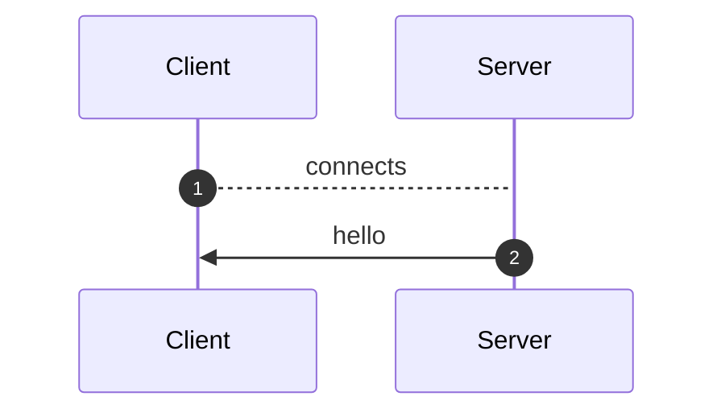
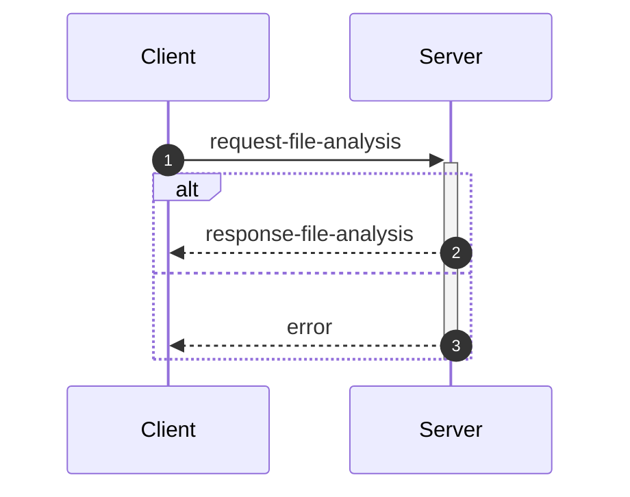
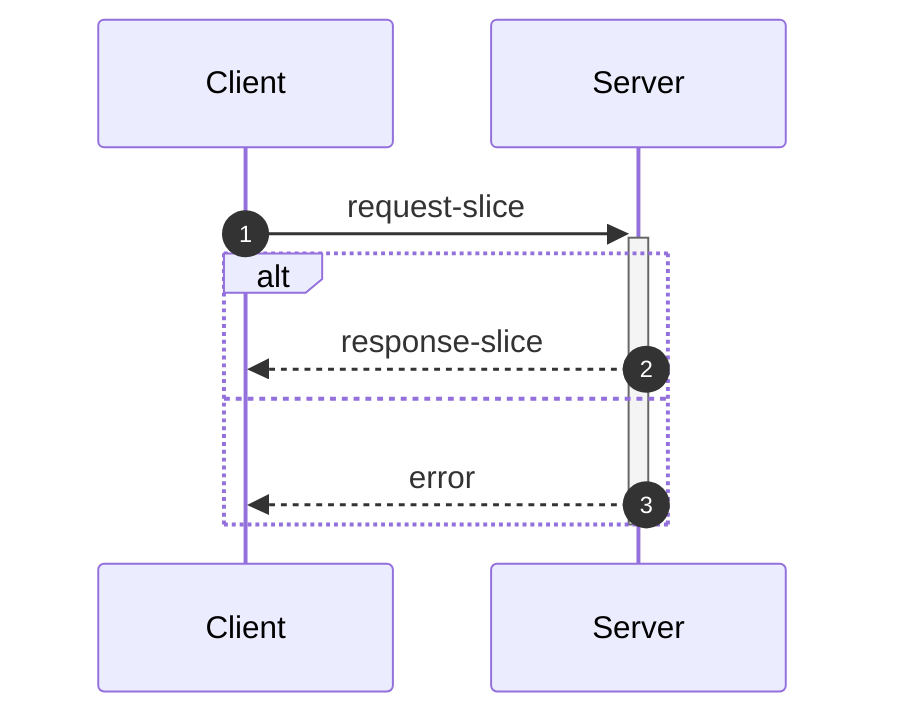
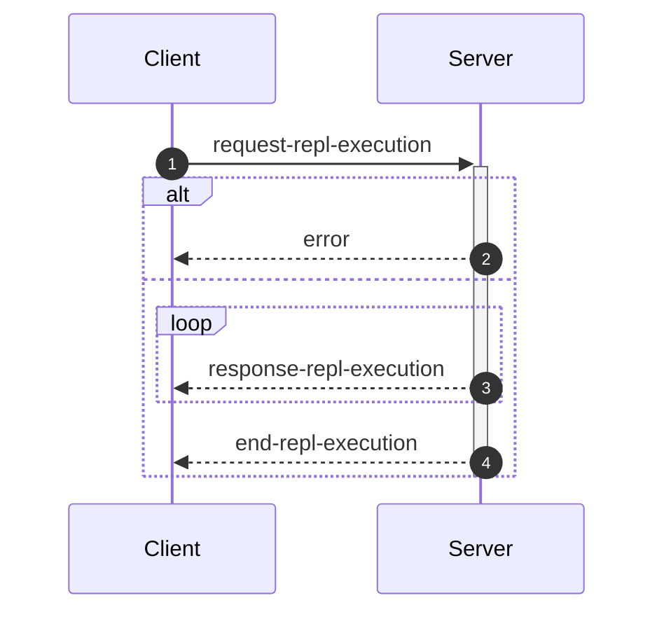

_<span title="an overview of flowR's interface">Generated</span> from '[wiki-interface.ts](https://github.com/flowr-analysis/flowr/tree/main/src/documentation/wiki-interface.ts "src/documentation/wiki-interface.ts")' on 2026-10-15, 15:12:48 UTC (v2.16.0, R v4.5.0), do not edit directly._

Although far from being as detailed as the in-depth explanation of [_flowR_](https://github.com/flowr-analysis/flowr/wiki/Core),
this wiki page explains how to interface with _flowR_ in more detail.
In general, command line arguments and other options provide short descriptions on hover over.

* [💻 Using the REPL](#using-the-repl)
* [⚙️ Configuring FlowR](#configuring-flowr)
* [⚒️ Writing Code](#writing-code)
* [💬 Communicating with the Server](#communicating-with-the-server)

<a id='using-the-repl'></a>
## 💻 Using the REPL

> [!NOTE]
> To execute arbitrary R commands with a repl request, _flowR_ has to be started explicitly with <span title="Description (Command Line Argument): Allow to access the underlying R session when using flowR (security warning: this allows the execution of arbitrary R code!)">`--r-session-access`</span>.
> Please be aware that this introduces a security risk and note that this relies on the [`r-shell` engine](https://github.com/flowr-analysis/flowr/wiki/Engines) .

Although primarily meant for users to explore,
there is nothing which forbids calling _flowR_ as a subprocess to use standard-in, -output, and -error
for communication (although you can access the REPL using the server as well,
with the [REPL Request](#message-request-repl-execution) message).

The read-eval-print loop&nbsp;(REPL) works relatively simple.
You can submit an expression (using <kbd>Enter</kbd>),
which is interpreted as an R&nbsp;expression by default but interpreted as a *command* if it starts with a colon (`:`).
The best command to get started with the REPL is <span title="Description (Repl Command): Show help information (aliases: :h, :?)">`:help`</span>.
Besides, you can leave the REPL either with the command <span title="Description (Repl Command): End the repl (aliases: :q, :exit)">`:quit`</span> or by pressing <kbd>Ctrl</kbd>+<kbd>C</kbd> twice.
When writing a *command*, you may press <kbd>Tab</kbd> to get a list of completions, if available.
Multiple commands can be entered in a single line by separating them with a semicolon (`;`), e.g. `:parse "x<-2"; :df*`.
If a command is given without R code, the REPL will re-use R code given in a previous command.
The prior example will hence return first the parsed AST of the program and then the dataflow graph for `"x <- 2"`.

> [!NOTE]
> If you develop flowR, you may want to launch the repl using the `npm run main-dev` command, this way, you get a non-minified version of flowR with debug information and hot-reloading of source files.

<details>
<summary>Available Commands</summary>

We currently offer the following commands (this with a `[*]` suffix are available with and without the star):

| Command | Description |
| ------- | ----------- |
| **<span title="Description (Repl Command): End the repl (aliases: :q, :exit)">:quit</span>** | End the repl (aliases: **:<span title="Alias of ':quit'. End the repl">q</span>**, **:<span title="Alias of ':quit'. End the repl">exit</span>**) |
| **<span title="Description (Repl Command): Execute the given code as R code. This requires the `--r-session-access` flag to be set and requires the r-shell engine. (aliases: :e, :r)">:execute</span>** | Execute the given code as R code. This requires the `--r-session-access` flag to be set and requires the r-shell engine. (aliases: **:<span title="Alias of ':execute'. Execute the given code as R code. This requires the `--r-session-access` flag to be set and requires the r-shell engine.">e</span>**, **:<span title="Alias of ':execute'. Execute the given code as R code. This requires the `--r-session-access` flag to be set and requires the r-shell engine.">r</span>**) |
| **<span title="Description (Repl Command): Get mermaid code for the control-flow graph of R code (aliases: :cfg, :cf)">:controlflow[*]</span>** | Get mermaid code for the control-flow graph of R code (star: Returns the URL to mermaid.live) (aliases: **:<span title="Alias of ':controlflow'. Get mermaid code for the control-flow graph of R code">cfg</span>**, **:<span title="Alias of ':controlflow'. Get mermaid code for the control-flow graph of R code">cf</span>**) |
| **<span title="Description (Repl Command): Get mermaid code for the control-flow graph with basic blocks (aliases: :cfgb, :cfb)">:controlflowbb[*]</span>** | Get mermaid code for the control-flow graph with basic blocks (star: Returns the URL to mermaid.live) (aliases: **:<span title="Alias of ':controlflowbb'. Get mermaid code for the control-flow graph with basic blocks">cfgb</span>**, **:<span title="Alias of ':controlflowbb'. Get mermaid code for the control-flow graph with basic blocks">cfb</span>**) |
| **<span title="Description (Repl Command): Get mermaid code for the dataflow graph (aliases: :d, :df)">:dataflow[*]</span>** | Get mermaid code for the dataflow graph (star: Returns the URL to mermaid.live) (aliases: **:<span title="Alias of ':dataflow'. Get mermaid code for the dataflow graph">d</span>**, **:<span title="Alias of ':dataflow'. Get mermaid code for the dataflow graph">df</span>**) |
| **<span title="Description (Repl Command): Get mermaid code for the normalized AST of R code (aliases: :n)">:normalize[*]</span>** | Get mermaid code for the normalized AST of R code (star: Returns the URL to mermaid.live) (alias: **:<span title="Alias of ':normalize'. Get mermaid code for the normalized AST of R code">n</span>**) |
| **<span title="Description (Repl Command): Get mermaid code for the simplified dataflow graph (aliases: :ds, :dfs)">:dataflowsimple[*]</span>** | Get mermaid code for the simplified dataflow graph (star: Returns the URL to mermaid.live) (aliases: **:<span title="Alias of ':dataflowsimple'. Get mermaid code for the simplified dataflow graph">ds</span>**, **:<span title="Alias of ':dataflowsimple'. Get mermaid code for the simplified dataflow graph">dfs</span>**) |
| **<span title="Description (Repl Command): Inspect and extend the signature database: `query` (identical to :query @signature), `info <name>` for where a function comes from (identical to :query @function-info), `add <path>` to mount another database/source, `download` to fetch the full-history database. (aliases: :sig)">:signature</span>** | Inspect and extend the signature database: `query` (identical to :query @signature), `info <name>` for where a function comes from (identical to :query @function-info), `add <path>` to mount another database/source, `download` to fetch the full-history database. (alias: **:<span title="Alias of ':signature'. Inspect and extend the signature database: `query` (identical to :query @signature), `info <name>` for where a function comes from (identical to :query @function-info), `add <path>` to mount another database/source, `download` to fetch the full-history database.">sig</span>**) |
| **<span title="Description (Repl Command): Just calculates the DFG, but only prints summary info (aliases: :d#, :df#)">:dataflowsilent</span>** | Just calculates the DFG, but only prints summary info (aliases: **:<span title="Alias of ':dataflowsilent'. Just calculates the DFG, but only prints summary info">d#</span>**, **:<span title="Alias of ':dataflowsilent'. Just calculates the DFG, but only prints summary info">df#</span>**) |
| **<span title="Description (Repl Command): Prints ASCII Art of the parsed, unmodified AST (aliases: :p)">:parse</span>** | Prints ASCII Art of the parsed, unmodified AST (alias: **:<span title="Alias of ':parse'. Prints ASCII Art of the parsed, unmodified AST">p</span>**) |
| **<span title="Description (Repl Command): Prints the version of flowR as well as the current version of R">:version</span>** | Prints the version of flowR as well as the current version of R
| **<span title="Description (Repl Command): Query the given R code (use 'help' for more information)">:query[*]</span>** | Query the given R code (use 'help' for more information) (star: Similar to query, but returns the output in json format.)
| **<span title="Description (Repl Command): Returns an ASCII representation of the dataflow graph (aliases: :df!)">:dataflowascii</span>** | Returns an ASCII representation of the dataflow graph (alias: **:<span title="Alias of ':dataflowascii'. Returns an ASCII representation of the dataflow graph">df!</span>**) |
| **<span title="Description (Repl Command): Returns summarization stats for the normalized AST (aliases: :n#)">:normalize#</span>** | Returns summarization stats for the normalized AST (alias: **:<span title="Alias of ':normalize#'. Returns summarization stats for the normalized AST">n#</span>**) |
| **<span title="Description (Repl Command): Show help information (aliases: :h, :?)">:help</span>** | Show help information (aliases: **:<span title="Alias of ':help'. Show help information">h</span>**, **:<span title="Alias of ':help'. Show help information">?</span>**) |

</details>

> [!TIP]
> 
> As indicated by the examples before, all REPL commands that operate on code keep track of the state.
> Hence, if you run a command like <span title="Description (Repl Command, starred version): Returns the URL to mermaid.live; Base Command: Get mermaid code for the dataflow graph (aliases: :d*, :df*)">`:dataflow*`</span> without providing R code,
> the REPL will re-use the R code provided in a previous command.
> Likewise, doing this will benefit from incrementality!
> If you request the dataflow graph with `:df* x <- 2 * y` and then want to see the parsed AST with `:parse`,
> the REPL will re-use previously obtained information and not re-parse the code again.
> 		

Generally, many commands offer shortcut versions in the REPL. Many queries, for example, offer a shortened format (see the example below).
Of special note, the [Config Query](https://github.com/flowr-analysis/flowr/wiki/%5BQuery%5D-Config)
can be used to also modify the currently active configuration of _flowR_ within the REPL (see the [wiki page](https://github.com/flowr-analysis/flowr/wiki/%5BQuery%5D-Config) for more information).

### Example: Retrieving the Dataflow Graph

To retrieve a URL to the [mermaid](https://mermaid.js.org/) diagram of the dataflow of a given expression,
use <span title="Description (Repl Command, starred version): Returns the URL to mermaid.live; Base Command: Get mermaid code for the dataflow graph (aliases: :d*, :df*)">`:dataflow*`</span> (or <span title="Description (Repl Command): Get mermaid code for the dataflow graph (aliases: :d, :df)">`:dataflow`</span> to get the mermaid code in the cli):

```shell
$ docker run -it --rm eagleoutice/flowr # or npm run flowr 
flowR repl v2.16.0, R grammar v14 (tree-sitter engine)
R> :dataflow* y <- 1 + x
```

<details>
<summary style='color:gray'>Output</summary>

```text
https://mermaid.live/view#base64:eyJjb2RlIjoiZmxvd2NoYXJ0IFREXG4gICAgMXt7XCJgKiM5MTtSTnVtYmVyIzkzOyogKioxKipcbiAgICAgICoxLjYqICgqKmlkOiAxKiopYFwifX1cbiAgICAyKFtcImAqIzkxO1JTeW1ib2wjOTM7KiAqKngqKlxuICAgICAgKjEuMTAqICgqKmlkOiAyKiopYFwiXSlcbiAgICAzW1tcImAqIzkxO1JCaW5hcnlPcCM5MzsqIGJhc2UjNTg7IzU4OyoqIzQzOyoqXG4gICAgICAqMS42LTEwKiAoKippZDogMyoqKVxuICAgIGFyZzogKDEsIDIpYFwiXV1cbiAgICBidWlsdC1pbjpfNDNfW1wiYEJ1aWx0LUluOlxuIzQzO2BcIl1cbiAgICBzdHlsZSBidWlsdC1pbjpfNDNfIHN0cm9rZTpncmF5LGZpbGw6Z3JheSxzdHJva2Utd2lkdGg6MnB4LG9wYWNpdHk6Ljg7XG4gICAgMFtcImAqIzkxO1JTeW1ib2wjOTM7KiAqKnkqKlxuICAgICAgKjEuMSogKCoqaWQ6IDAqKiwgdjogMylgXCJdXG4gICAgNFtbXCJgKiM5MTtSQmluYXJ5T3AjOTM7KiBiYXNlIzU4OyM1ODsqKiM2MDsjNDU7KipcbiAgICAgICoxLjEtMTAqICgqKmlkOiA0KiopXG4gICAgYXJnOiAoMCwgMylgXCJdXVxuICAgIGJ1aWx0LWluOl82MF8tW1wiYEJ1aWx0LUluOlxuIzYwOyM0NTtgXCJdXG4gICAgc3R5bGUgYnVpbHQtaW46XzYwXy0gc3Ryb2tlOmdyYXksZmlsbDpncmF5LHN0cm9rZS13aWR0aDoycHgsb3BhY2l0eTouODtcbiAgICAxIC0uLT58XCJmbG93XCJ8IDJcbiAgICBsaW5rU3R5bGUgMCBzdHJva2U6Z3JheSxjb2xvcjpncmF5O1xuICAgIDIgLS4tPnxcImZsb3dcInwgM1xuICAgIGxpbmtTdHlsZSAxIHN0cm9rZTpncmF5LGNvbG9yOmdyYXk7XG4gICAgMyAtLT58XCJyZWFkcywgYXJnXCJ8IDFcbiAgICAzIC0tPnxcInJlYWRzLCBhcmdcInwgMlxuICAgIDMgLS4tPnxcImZsb3dcInwgMFxuICAgIGxpbmtTdHlsZSA0IHN0cm9rZTpncmF5LGNvbG9yOmdyYXk7XG4gICAgMyAtLi0+fFwicmVhZHMsIGNhbGxzXCJ8IGJ1aWx0LWluOl80M19cbiAgICBsaW5rU3R5bGUgNSBzdHJva2U6Z3JheTtcbiAgICAwIC0tPnxcImRlZmluZWQtYnksIGZsb3dcInwgNFxuICAgIDAgLS0+fFwiZGVmaW5lZC1ieVwifCAzXG4gICAgNCAtLT58XCJyZWFkcywgYXJnXCJ8IDNcbiAgICA0IC0tPnxcInJldHVybnMsIGFyZ1wifCAwXG4gICAgNCAtLi0+fFwicmVhZHMsIGNhbGxzXCJ8IGJ1aWx0LWluOl82MF8tXG4gICAgbGlua1N0eWxlIDEwIHN0cm9rZTpncmF5OyIsIm1lcm1haWQiOnsiYXV0b1N5bmMiOnRydWV9fQ==
```

Retrieve the dataflow graph of the expression `y <- 1 + x`. It looks like this:


<details>

<summary style="color:gray">R Code of the Dataflow Graph</summary>

The analysis ran (including parse and normalize, using the [tree-sitter](https://github.com/flowr-analysis/flowr/wiki/Engines) engine) within the generation environment. No [signature database](https://github.com/flowr-analysis/flowr/wiki/Signature-Database) is mounted for these generated graphs, so `library()` calls attach no package exports; base-R names are still qualified via the generated base-package store (e.g. `acf` as `stats::acf`). 
We encountered no unknown side effects during the analysis.

```r
y <- 1 + x
```

</details>

</details>

For small graphs like this, <span title="Description (Repl Command): Returns an ASCII representation of the dataflow graph (aliases: :df!)">`:dataflowascii`</span> also provides an ASCII representation directly in the REPL:

```shell
$ docker run -it --rm eagleoutice/flowr # or npm run flowr 
flowR repl v2.16.0, R grammar v14 (tree-sitter engine)
R> :df! y <- 1 + x
```

<details open>
<summary style='color:gray'>Output</summary>

```text
                        v<0>v
 c<4>c──────────────────| y |
 |<- |     ┌────────────v---v
 c---c     │
    │   c<3>c   0<1>0
    └───| + |───| 1 |───u<2>u
        c---c   0---0   | x |
           └────────────u---u
Edges:
3 -> 1: reads, arg          3 -> 2: reads, arg
3 -> 0: flows-to            1 -> 2: flows-to
2 -> 3: flows-to            4 -> 3: reads, arg
4 -> 0: returns, arg        0 -> 4: defined-by, flows-to
0 -> 3: defined-by
```

Retrieve the dataflow graph of the expression `y <- 1 + x` as ASCII art.

</details>

For the slicing with <span title="Description (Repl Command): Static backwards executable slicer for R">`:slicer`</span>, you have access to the same [magic comments](#slice-magic-comments) as with the [slice request](#message-request-slice).
Pass `--inline` to splice resolvable `source()` calls into the reconstruction so the slice is a single self-contained R text (the same as the static slice query's `inlineSources` flag).
See `--help` for more flags!

### Example: Interfacing with the File System

Many commands that allow for an R-expression (like <span title="Description (Repl Command, starred version): Returns the URL to mermaid.live; Base Command: Get mermaid code for the dataflow graph (aliases: :d*, :df*)">`:dataflow*`</span>) allow for a file as well
if the argument starts with `file://`.
If you are working from the root directory of the _flowR_ repository, the following gives you the parsed AST of the example file using the <span title="Description (Repl Command): Prints ASCII Art of the parsed, unmodified AST (aliases: :p)">`:parse`</span> command:

> **Watch mode**: Replace `file://` with `watch://` to enter watch mode.
> flowR runs the command immediately and then re-runs it every time the file (or any file inside the folder) changes.
> Enter any other command to leave watch mode.
> For example: `:df watch://analysis.R`

```shell
$ docker run -it --rm eagleoutice/flowr # or npm run flowr 
flowR repl v2.16.0, R grammar v14 (tree-sitter engine)
R> :parse file://test/testfiles/example.R
```

<details>
<summary style='color:gray'>Output</summary>

```text
File: test/testfiles/example.R

program
├ binaryoperator
│ ├ identifier "sum" (1:1─4)
│ ├ <- "<-" (1:5─7)
│ ╰ float "0" (1:8─9)
├ binaryoperator
│ ├ identifier "product" (2:1─8)
│ ├ <- "<-" (2:9─11)
│ ╰ float "1" (2:12─13)
├ binaryoperator
│ ├ identifier "w" (3:1─2)
│ ├ <- "<-" (3:3─5)
│ ╰ float "7" (3:6─7)
├ binaryoperator
│ ├ identifier "N" (4:1─2)
│ ├ <- "<-" (4:3─5)
│ ╰ float "10" (4:6─8)
├ forstatement
│ ├ for "for" (6:1─4)
│ ├ ( "(" (6:5─6)
│ ├ identifier "i" (6:6─7)
│ ├ in "in" (6:8─10)
│ ├ binaryoperator
│ │ ├ float "1" (6:11─12)
│ │ ├ : ":" (6:12─13)
│ │ ╰ parenthesizedexpression
│ │   ├ ( "(" (6:13─14)
│ │   ├ binaryoperator
│ │   │ ├ identifier "N" (6:14─15)
│ │   │ ├ - "-" (6:15─16)
│ │   │ ╰ float "1" (6:16─17)
│ │   ╰ ) ")" (6:17─18)
│ ├ ) ")" (6:18─19)
│ ╰ bracedexpression
│   ├ { "{" (6:20─21)
│   ├ binaryoperator
│   │ ├ identifier "sum" (7:3─6)
│   │ ├ <- "<-" (7:7─9)
│   │ ╰ binaryoperator
│   │   ├ binaryoperator
│   │   │ ├ identifier "sum" (7:10─13)
│   │   │ ├ + "+" (7:14─15)
│   │   │ ╰ identifier "i" (7:16─17)
│   │   ├ + "+" (7:18─19)
│   │   ╰ identifier "w" (7:20─21)
│   ├ binaryoperator
│   │ ├ identifier "product" (8:3─10)
│   │ ├ <- "<-" (8:11─13)
│   │ ╰ binaryoperator
│   │   ├ identifier "product" (8:14─21)
│   │   ├  "" (8:22─23)
│   │   ╰ identifier "i" (8:24─25)
│   ╰ } "}" (9:1─2)
├ call
│ ├ identifier "cat" (11:1─4)
│ ╰ arguments
│   ├ ( "(" (11:4─5)
│   ├ argument
│   │ ╰ string
│   │   ├ " "\"" (11:5─6)
│   │   ├ stringcontent "Sum:" (11:6─10)
│   │   ╰ " "\"" (11:10─11)
│   ├ comma "," (11:11─12)
│   ├ argument
│   │ ╰ identifier "sum" (11:13─16)
│   ├ comma "," (11:16─17)
│   ├ argument
│   │ ╰ string
│   │   ├ " "\"" (11:18─19)
│   │   ├ stringcontent
│   │   │ ╰ escapesequence "\\n" (11:19─21)
│   │   ╰ " "\"" (11:21─22)
│   ╰ ) ")" (11:22─23)
╰ call
  ├ identifier "cat" (12:1─4)
  ╰ arguments
    ├ ( "(" (12:4─5)
    ├ argument
    │ ╰ string
    │   ├ " "\"" (12:5─6)
    │   ├ stringcontent "Product:" (12:6─14)
    │   ╰ " "\"" (12:14─15)
    ├ comma "," (12:15─16)
    ├ argument
    │ ╰ identifier "product" (12:17─24)
    ├ comma "," (12:24─25)
    ├ argument
    │ ╰ string
    │   ├ " "\"" (12:26─27)
    │   ├ stringcontent
    │   │ ╰ escapesequence "\\n" (12:27─29)
    │   ╰ " "\"" (12:29─30)
    ╰ ) ")" (12:30─31)
```

Retrieve the parsed AST of the example file.

<details>

<summary>File Content</summary>

```r
sum <- 0
product <- 1
w <- 7
N <- 10

for (i in 1:(N-1)) {
  sum <- sum + i + w
  product <- product * i
}

cat("Sum:", sum, "\n")
cat("Product:", product, "\n")
```

</details>

As _flowR_ directly transforms this AST the output focuses on being human-readable instead of being machine-readable.
		
</details>

### Example: Run a Query

You can run any query supported by _flowR_ using the <span title="Description (Repl Command): Query the given R code (use 'help' for more information)">`:query`</span> command.
For example, to obtain the shapes of all data frames in a given piece of code, you can run:

```shell
$ docker run -it --rm eagleoutice/flowr # or npm run flowr 
flowR repl v2.16.0, R grammar v14 (tree-sitter engine)
R> :query @absint df-shape "x <- data.frame(a = 1:10, b = 1:10)\ny <- x$a"
```

<details open>
<summary style='color:gray'>Output</summary>

```text
Query: absint (1 ms)
```

Retrieve the shapes of all data frames in the given code.

</details>

To run the linter on a file, you can use (in this example, we just issue the `dead-code` linter on a small piece of code):

```shell
$ docker run -it --rm eagleoutice/flowr # or npm run flowr 
flowR repl v2.16.0, R grammar v14 (tree-sitter engine)
R> :query @linter rules:dead-code "if(FALSE) x <- 2"
```

<details open>
<summary style='color:gray'>Output</summary>

```text
Query: linter (1 ms)
   ╰ Dead Code (dead-code):
       ╰ certain:
           ╰ Code at 1.11-16
```

Run the linter on the given code, with only the `dead-code` rule enabled.

</details>

For more information on the available queries, please check out the [Query API](https://github.com/flowr-analysis/flowr/wiki/Query-API).

<a id='configuring-flowr'></a>
## ⚙️ Configuring FlowR

When running _flowR_, you may want to specify some behaviors with a dedicated configuration file.
By default, flowR looks for a file named `flowr.json` in the current working directory (or any higher directory).
You can also specify a different file with <span title="Description (Command Line Argument): The name of the configuration file to use">`--config-file`</span> or pass the configuration inline using <span title="Description (Command Line Argument): The flowR configuration to use, as a JSON string">`--config-json`</span>.
A `flowr.json` found this way belongs to the analyzed project, so flowR ignores its options that decide what flowR executes or loads
(`engines.*.wasmPath`, `engines.*.treeSitterWasmPath`, `engines.*.rPath`, `solver.sigdb.additionalPaths`, `solver.sigdb.downloadRepo`, `solver.sigdb.installedLibrary.paths`),
unless you pass <span title="Description (Command Line Argument): Keep the security-sensitive options (e.g., the R executable) of the flowr.json found in the working directory or a parent. Only use this for projects you trust.">`--trust-config`</span>.
To analyze code you do not trust, use the secure mode (<span title="Description (Command Line Argument): Run in secure mode for analyzing untrusted code: flowR does not start R (or any other process), does not access the network, does not search for project configs, and ignores security-sensitive options in every config. Cannot be disabled once enabled. Can also be enabled with the environment variable {italic FLOWR_SECURE_MODE=1}.">`--secure`</span>, see the [security policy](https://github.com/flowr-analysis/flowr/blob/main/.github/SECURITY.md)).
To inspect the current configuration, you can run flowr with the <span title="Description (Command Line Argument): Run with verbose logging (will be passed to the corresponding script)">`--verbose`</span> flag, or use the `config` [Query](https://github.com/flowr-analysis/flowr/wiki/Query-API).
Within the REPL this works by running the following:

```shell
:query @config
```

To work with the <a href="https://github.com/flowr-analysis/flowr/tree/main/src/config.ts#L119"><code><span title="The configuration file format for flowR.">FlowrConfig</span></code></a> you can use the provided helper objects alongside its methods like
<a href="https://github.com/flowr-analysis/flowr/tree/main/src/config.ts#L905"><code><span title="Creates a new flowr config that has the updated values.">FlowrConfig::<b>amend</b></span></code></a>.
The schema below documents every option; the ones you most likely want are:

- <a href="https://github.com/flowr-analysis/flowr/wiki/Interface#configuring-flowr" title="Configuration Option (boolean): Whether source calls should be ignored, causing {@link processSourceCall}&#39;s behavior to be skipped.">ignoreSourceCalls</a>: ignore source calls when analyzing the code, i.e., ignore the inclusion of other files.
- <a href="https://github.com/flowr-analysis/flowr/wiki/Interface#configuring-flowr" title="Configuration Option (boolean): Whether load calls should be ignored, causing {@link processLoadCall}&#39;s behavior to be skipped.">ignoreLoadCalls</a>: ignore load calls when analyzing the code, i.e., ignore the loading of r-data files.
- <a href="https://github.com/flowr-analysis/flowr/wiki/Interface#configuring-flowr" title="Configuration Option (object): Do you want to overwrite (parts) of the builtin definition?">semantics.environment.overwriteBuiltIns</a>: overwrite _flowR_'s handling of built-in functions, or clear the preset definitions entirely.
  See [Configure BuiltIn Semantics](#configure-builtin-semantics) for more information.
- <a href="https://github.com/flowr-analysis/flowr/wiki/Interface#configuring-flowr" title="Configuration Option (string): How to resolve variables and their values. (one of &quot;disabled&quot;, &quot;alias&quot;, &quot;builtin&quot;)">solver.variables</a>: how to resolve variables and their values (`disabled`, `alias`, `builtin`).
- <a href="https://github.com/flowr-analysis/flowr/wiki/Interface#configuring-flowr" title="Configuration Option (array): The engine or set of engines to use for interacting with R code. An empty array means all available engines will be used.">engines</a> and <a href="https://github.com/flowr-analysis/flowr/wiki/Interface#configuring-flowr" title="Configuration Option (string): The default engine to use for interacting with R code. If this is undefined, an arbitrary engine from the specified list will be used. (one of &quot;tree-sitter&quot;, &quot;r-shell&quot;)">defaultEngine</a>: the engines used to interact with R code, see the [Engines wiki page](https://github.com/flowr-analysis/flowr/wiki/Engines).
- <a href="https://github.com/flowr-analysis/flowr/wiki/Interface#configuring-flowr" title="Configuration Option (array): Files a framework loads on its own, without any source() call (e.g. global.R in a shiny app), in the order they are loaded; flowR orders the matching project files accordingly and analyzes them as one program. Entries are case-insensitive globs matched against the file path, a plain name matches any file with that name, and entries matching no project file are warned about. Usually set per project kind via specializeConfig.">project.implicitSources</a>: the files a framework loads without any `source()` call, in the order in which they are
  loaded. Entries are globs (e.g. `R/*.R`) matched against the file path ignoring capitalization; one matching no file is reported.
- <a href="https://github.com/flowr-analysis/flowr/wiki/Interface#configuring-flowr" title="Configuration Option (object): Overwrite (parts of) the configuration depending on the project kind flowR detects, e.g. to give a shiny app its implicit sources.">specializeConfig</a>: overwrite (parts of) the configuration depending on the kind of project _flowR_ detects
  (e.g. `shiny-app`), which is how a shiny app gets its implicit sources by default. What you configure directly wins.
- <a href="https://github.com/flowr-analysis/flowr/wiki/Interface#configuring-flowr" title="Configuration Option (string): Overwrite the project kind flowR would otherwise infer from the analyzed files, e.g. when auto-detection guesses wrong. (one of &quot;package&quot;, &quot;script&quot;, &quot;shiny-app&quot;, &quot;notebook&quot;, &quot;project&quot;, &quot;unknown&quot;)">project.useProjectType</a>: skip that detection and force a project kind yourself, when auto-detection guesses wrong.
- <a href="https://github.com/flowr-analysis/flowr/wiki/Interface#configuring-flowr" title="Configuration Option (array): The default plugins to load when creating a new instance of FlowrAnalyzer">defaultPlugins</a> and <a href="https://github.com/flowr-analysis/flowr/wiki/Interface#configuring-flowr" title="Configuration Option (array): The plugins to load in REPL mode">repl.plugins</a>: the plugins to load for a new <a href="https://github.com/flowr-analysis/flowr/tree/main/src/project/flowr-analyzer.ts#L205"><code><span title="Central class for conducting analyses with FlowR. Use the FlowrAnalyzerBuilder to create a new instance. If you want the original pattern of creating a pipeline and running all steps, you can still do this with FlowrAnalyzer#runFull . To inspect the context of the analyzer, use FlowrAnalyzer#inspectContext (if you are a plugin and need to modify it, use FlowrAnalyzer#context instead).">FlowrAnalyzer</span></code></a> and in the REPL
  (use `flowr:default` to reference the former).

So you can configure _flowR_ by adding a file like the following:

<details>

<summary>Example Configuration File</summary>

```json
{
  "ignoreSourceCalls": true,
  "ignoreLoadCalls": true,
  "semantics": {
    "environment": {
      "overwriteBuiltIns": {
        "definitions": [
          {
            "type": "function",
            "names": [
              "foo"
            ],
            "processor": "builtin:assign",
            "config": {}
          }
        ]
      }
    }
  },
  "defaultPlugins": [
    "file:description",
    "versions:description"
  ],
  "repl": {
    "quickStats": false,
    "dfProcessorHeat": false,
    "hints": true,
    "plugins": [
      "flowr:default"
    ]
  },
  "project": {
    "resolveUnknownPathsOnDisk": true,
    "implicitSources": [
      "global.R",
      "app.R"
    ]
  },
  "linter": {
    "disabledRules": []
  },
  "specializeConfig": {
    "shiny-app": {
      "project": {
        "implicitSources": [
          "global.R",
          "ui.R",
          "server.R",
          "app.R"
        ]
      }
    }
  },
  "engines": [
    {
      "type": "r-shell"
    }
  ],
  "solver": {
    "variables": "alias",
    "evalStrings": true,
    "trackEnvironments": true,
    "sigdb": {
      "enabled": true,
      "loadProjectDependencies": true,
      "eagerlyLoad": false,
      "eagerlyLoadExports": false,
      "linkBaseR": false,
      "linkDescriptionDependencies": false
    },
    "resolveSource": {
      "dropPaths": "no",
      "ignoreCapitalization": true,
      "inferWorkingDirectory": "active-script",
      "searchPath": []
    },
    "instrument": {},
    "slicer": {
      "threshold": 50
    }
  },
  "abstractInterpretation": {
    "wideningThreshold": 4,
    "followCalls": true,
    "dataFrame": {
      "maxColNames": 20,
      "readLoadedData": {
        "readExternalFiles": true,
        "maxReadLines": 1000000
      }
    }
  },
  "incremental": {
    "alwaysIncremental": false,
    "parsing": {
      "activated": false,
      "heuristics": {
        "activated": true,
        "mtime": true,
        "linesFrom": 500,
        "bytesFrom": 50000,
        "alwaysWithEdits": false,
        "minFiles": 1
      }
    }
  },
  "gas": {
    "thresholds": {
      "memory": {
        "problematic": 0.7,
        "critical": 0.9
      },
      "timeMs": {
        "problematic": 100000,
        "critical": 120000
      }
    },
    "features": {}
  }
}
```

</details>

<details>
<a id='configure-builtin-semantics'></a>
<summary>Configure Built-In Semantics</summary>

`semantics/environment/overwriteBuiltins` accepts two keys:

- `loadDefaults` (boolean, initially `true`): If set to `true`, the default built-in definitions are loaded before applying the custom definitions. Setting this flag to `false` explicitly disables the loading of the default definitions.
- `definitions` (array, initially empty): Allows to overwrite or define new built-in elements. Each object within must have a `type` which is one of the below. Furthermore, they may define a string array of `names` which specifies the identifiers to bind the definitions to. You may use `assumePrimitive` to specify whether _flowR_ should assume that this is a primitive non-library definition (so you probably just do not want to specify the key).

  | Type            | Description                                                                                                                                                                                                                                                                                              | Example                                                                                                    |
  | --------------- | -------------------------------------------------------------------------------------------------------------------------------------------------------------------------------------------------------------------------------------------------------------------------------------------------------- | ---------------------------------------------------------------------------------------------------------- |
  | `constant`    | Additionally allows for a `value` this should resolve to.                                                                                                                                                                                                                                                | `{ type: 'constant', names: ['NULL', 'NA'],  value: null }`                                                |
  | `function`    | Is a rather flexible way to define and bind built-in functions. For the time, we do not have extensive documentation to cover all the cases, so please either consult the sources with the `default-builtin-config.ts` or open a [new issue](https://github.com/flowr-analysis/flowr/issues/new/choose). | `{ type: 'function', names: ['next'], processor: 'builtin:d', config: { cfg: ExitPointType.Next } }` |
  | `replacement` | A comfortable way to specify replacement functions like `$<-` or `names<-`. `suffixes` describes the... suffixes to attach automatically. | `{ type: 'replacement', suffixes: ['<-', '<<-'], names: ['[', '[['] }` |

</details>

<details>

<summary style='color:gray'>Full Configuration-File Schema</summary>

- _The configuration file format for flowR._ (object)
    - **logLevel** [optional] _flowR's global minimum log level, applied when the config is loaded._ (string)
        Only allows: 'silly', 'trace', 'debug', 'info', 'warn', 'error', 'fatal'
    - **ignoreSourceCalls** [optional] _Whether source calls should be ignored, causing {@link processSourceCall}'s behavior to be skipped._ (boolean)
    - **ignoreLoadCalls** [optional] _Whether load calls should be ignored, causing {@link processLoadCall}'s behavior to be skipped._ (boolean)
    - **semantics** _Configure language semantics and how flowR handles them._ (object)
        - **environment** [optional] _Semantics regarding how to handle the R environment._ (object)
            - **overwriteBuiltIns** [optional] _Do you want to overwrite (parts) of the builtin definition?_ (object)
                - **loadDefaults** [optional] _Should the default configuration still be loaded?_ (boolean)
                - **definitions** [optional] _The definitions to load/overwrite._ (array)
                Valid item types:
                    - (object)
    - **defaultPlugins** [optional] _The default plugins to load when creating a new instance of FlowrAnalyzer_ (array)
    Valid item types:
        - (alternatives)
            - (string)
            - (array)
    - **repl** _Configuration options for the REPL._ (object)
        - **quickStats** [optional] _Whether to show quick stats in the REPL after each evaluation._ (boolean)
        - **dfProcessorHeat** [optional] _This instruments the dataflow processors to count how often each processor is called._ (boolean)
        - **hints** [optional] _Whether to show dim inline hints on the empty prompt (automatically disabled on non-interactive terminals)._ (boolean)
        - **plugins** [optional] _The plugins to load in REPL mode_ (array)
        Valid item types:
            - (alternatives)
                - (string)
                - (array)
        - **autoUseFileProtocol** [optional] _Prepend the file protocol to a repl input that looks like a path, instead of only warning about it._ (boolean)
        - **queryStats** [optional] _Whether `:query` closes with the line stating how long the queries took (`:query*` never prints it)._ (boolean)
        - **showPlugins** [optional] _Whether `:version` grays out the plugins that did not activate during the last analysis._ (boolean)
    - **project** _Project specific configuration options._ (object)
        - **resolveUnknownPathsOnDisk** [optional] _Whether to resolve unknown paths loaded by the r project disk when trying to source/analyze files._ (boolean)
        - **failOnInaccessiblePath** [optional] _Whether a directory that cannot be traversed during file discovery (e.g. due to permissions) aborts the analysis; when false (the default) such paths are logged and skipped._ (boolean)
        - **basePackages** [optional] _The packages considered part of R itself (base and recommended); if unset, flowR uses its built-in list._ (array)
        Valid item types:
            - (string)
        - **implicitSources** [optional] _Files a framework loads on its own, without any source() call (e.g. global.R in a shiny app), in the order they are loaded; flowR orders the matching project files accordingly and analyzes them as one program. Entries are case-insensitive globs matched against the file path, a plain name matches any file with that name, and entries matching no project file are warned about. Usually set per project kind via specializeConfig._ (array)
        Valid item types:
            - (string)
        - **useProjectType** [optional] _Overwrite the project kind flowR would otherwise infer from the analyzed files, e.g. when auto-detection guesses wrong._ (string)
            Only allows: 'package', 'script', 'shiny-app', 'notebook', 'project', 'unknown'
        - **assumeImplicitEcho** [optional] _Whether the top level of the analyzed code is echoed, so that every visible result printed there is collected as an output by the dependencies query (default true, false for a package)._ (boolean)
        - **discovery** [optional] _Scoping options for the default project discovery._ (object)
            - **full** [optional] _Collect every file below the project root (greedy) instead of only the files the detected project kind needs (default false)._ (boolean)
            - **perKind** [optional] _Per-kind include/exclude glob overrides layered on the default scoping._ (object)
            - **ignore** [optional] _Case-insensitive globs that drop matching files from the intelligent discovery, regardless of kind (e.g. .Renviron to ignore environment files)._ (array)
            Valid item types:
                - (string)
        - **classification** [optional] _Overrides for the signals flowR uses to classify the project kind._ (object)
            - **shinyDescriptionTypes** [optional] _DESCRIPTION Type: values that mark a shiny app._ (array)
            Valid item types:
                - (string)
            - **shinyEntryFiles** [optional] _File names a shiny app is assembled from._ (array)
            Valid item types:
                - (string)
            - **shinyUsagePattern** [optional] _Regex source evidencing shiny usage in an entry file._ (string)
            - **notebookExtensions** [optional] _File extensions marking a notebook._ (array)
            Valid item types:
                - (string)
    - **linter** _Linter configuration options._ (object)
        - **disabledRules** _Linting rule names excluded from the default rule set (a rule requested explicitly via a linter query still runs). Usually set per project kind via specializeConfig._ (array)
        Valid item types:
            - (string)
    - **inputSources** [optional] _Further frameworks the input-sources analysis should know about; entries are added to flowR's defaults._ (object)
        - **pure** [optional] _Functions that only pass the constantness of their arguments on._ (array)
        Valid item types:
            - (string)
        - **param** [optional] _Functions whose result is a 'param' input._ (array)
        Valid item types:
            - (string)
        - **file** [optional] _Functions whose result is a 'file' input._ (array)
        Valid item types:
            - (string)
        - **tempfile** [optional] _Functions whose result is a 'tempfile' input._ (array)
        Valid item types:
            - (string)
        - **glob** [optional] _Functions whose result is a 'glob' input._ (array)
        Valid item types:
            - (string)
        - **net** [optional] _Functions whose result is a 'net' input._ (array)
        Valid item types:
            - (string)
        - **rand** [optional] _Functions whose result is a 'rand' input._ (array)
        Valid item types:
            - (string)
        - **system** [optional] _Functions whose result is a 'system' input._ (array)
        Valid item types:
            - (string)
        - **ffi** [optional] _Functions whose result is a 'ffi' input._ (array)
        Valid item types:
            - (string)
        - **lang** [optional] _Functions whose result is a 'lang' input._ (array)
        Valid item types:
            - (string)
        - **options** [optional] _Functions whose result is a 'options' input._ (array)
        Valid item types:
            - (string)
        - **cmdline** [optional] _Functions whose result is a 'cmdline' input._ (array)
        Valid item types:
            - (string)
        - **user** [optional] _Functions whose result is a 'user' input._ (array)
        Valid item types:
            - (string)
        - **const** [optional] _Functions whose result is a 'const' input._ (array)
        Valid item types:
            - (string)
        - **scope** [optional] _Functions whose result is a 'scope' input._ (array)
        Valid item types:
            - (string)
        - **dconst** [optional] _Functions whose result is a 'dconst' input._ (array)
        Valid item types:
            - (string)
        - **unknown** [optional] _Functions whose result is a 'unknown' input._ (array)
        Valid item types:
            - (string)
        - **linkedObjects** [optional] _Objects a framework provides without a definition in the code, e.g. shiny's input._ (array)
        Valid item types:
            - (object)
        - **linkedEntryPoints** [optional] _Calls that hand a function to a framework, which binds its objects to the parameters by position._ (array)
        Valid item types:
            - (object)
    - **specializeConfig** [optional] _Overwrite (parts of) the configuration depending on the project kind flowR detects, e.g. to give a shiny app its implicit sources._ (object)
    - **engines** _The engine or set of engines to use for interacting with R code. An empty array means all available engines will be used._ (array)
    Valid item types:
        - (alternatives)
            - _The configuration for the tree sitter engine._ (object)
                - **type** [required] _Use the tree sitter engine._ (string)
                    Only allows: 'tree-sitter'
                - **wasmPath** [optional] _The path to the tree-sitter-r WASM binary to use. If this is undefined, this uses the default path._ (string)
                - **treeSitterWasmPath** [optional] _The path to the tree-sitter WASM binary to use. If this is undefined, this uses the default path._ (string)
                - **lax** [optional] _Whether to use the lax parser for parsing R code (allowing for syntax errors). If this is undefined, the strict parser will be used._ (boolean)
            - _The configuration for the R shell engine._ (object)
                - **type** [required] _Use the R shell engine._ (string)
                    Only allows: 'r-shell'
                - **rPath** [optional] _The path to the R executable to use. If this is undefined, this uses the default path._ (string)
                - **pipeBind** [optional] _Whether to enable R's experimental pipe-bind operator "=>" by setting _R_USE_PIPEBIND_ for the R session (default false); R itself keeps this off by default, as it is experimental and has never shipped in a release version of R._ (boolean)
    - **defaultEngine** [optional] _The default engine to use for interacting with R code. If this is undefined, an arbitrary engine from the specified list will be used._ (string)
        Only allows: 'tree-sitter', 'r-shell'
    - **solver** _How to resolve constants, constraints, cells, ..._ (object)
        - **variables** _How to resolve variables and their values._ (string)
            Only allows: 'disabled', 'alias', 'builtin'
        - **evalStrings** _Should we include eval(parse(text="...")) calls in the dataflow graph?_ (boolean)
        - **trackEnvironments** [optional] _Track user-created environments (new.env, assign/get/local with envir=, dollar-assign, attach). When false, all envir-style calls fall through conservatively._ (boolean)
        - **sigdb** _Resolving library exports from a signature database._ (object)
            - **enabled** [optional] _Resolve library()/use() exports from a signature database (default true); when false no database is consulted._ (boolean)
            - **loadProjectDependencies** [optional] _Load the project's declared dependencies from its metadata files (DESCRIPTION Imports/Depends, rproject.toml, uvr.toml, renv.lock, rv.lock, uvr.lock) (default true); when false these files are not read for dependencies._ (boolean)
            - **eagerlyLoad** [optional] _Parse the database up front rather than on the first package load (default false, ignored if disabled)._ (boolean)
            - **eagerlyLoadExports** [optional] _Add a vertex for every export on load rather than on demand (default false); keeps the dataflow graph small._ (boolean)
            - **assumedRVersion** [optional] _R version assumed when resolving versioned (base-R) exports: a pin like "4.5" or "auto" to detect the installed R (default "auto")._ (string)
            - **linkBaseR** [optional] _Eagerly attach base-R namespaces so bare base calls resolve without library() (default false)._ (boolean)
            - **linkBaseRCalls** [optional] _Add a lightweight Reads edge from a bare base-R call to its signature-database function vertex (default false; base-R qualification is edge-free otherwise)._ (boolean)
            - **linkPackageCalls** [optional] _Add a lightweight Reads edge from a resolved package call to its signature-database function vertex (default false)._ (boolean)
            - **linkDescriptionDependencies** [optional] _Eagerly attach the namespaces of the project's declared DESCRIPTION dependencies (Imports/Depends) so their exports resolve without an explicit library() (default false)._ (boolean)
            - **warmInBackground** [optional] _Decompress the hot shards (base + most-downloaded) in a background task on startup so the first library() lookup is warm (default false; for long-running servers/REPLs)._ (boolean)
            - **additionalPaths** [optional] _Extra directories or bundle/manifest files searched for signature databases (alongside the shipped default and $FLOWR_SIGDB_DIR); a downloaded full-history bundle placed here is mounted automatically._ (array)
            Valid item types:
                - (string)
            - **downloadRepo** [optional] _GitHub owner/repo the full-history bundle is downloaded from via ":signature download" (default "flowr-analysis/flowr", release tag "sigdb-v<flowR-version>")._ (string)
            - **autoSync** [optional] _On startup, re-download shards whose committed sigdb.remote.json hash no longer matches the cache, in the background (default false; opt-in network sync after a git pull)._ (boolean)
            - **installedLibrary** [optional] _Recovering packages no signature database knows from the copy installed on this machine._ (object)
                - **enabled** [required] _Recover packages no signature database knows from their installed copy (default false)._ (boolean)
                - **paths** [optional] _Library directories to search; when empty they are discovered from the environment and the project._ (array)
                Valid item types:
                    - (string)
                - **useEnvironment** [optional] _Search the libraries R_LIBS_USER/R_LIBS/R_LIBS_SITE name (default true)._ (boolean)
                - **useProjectLibrary** [optional] _Search a project-local renv/packrat library (default true)._ (boolean)
                - **maxDepth** [optional] _How far to descend into the nested layout of a project-local library (default 3)._ (number)
                - **packages** [optional] _Only recover packages whose name matches one of these regular expressions; empty means any._ (array)
                Valid item types:
                    - (string)
            - **blobCacheBudgetMb** [optional] _How many MiB of decoded package blobs every open bundle may hold together (default 16)._ (number)
            - **versionSelection** [optional] _When a project constrains a dependency, resolve to the newest (default), oldest, or system-installed version satisfying it; system needs R and falls back to newest. Base-R packages always resolve against the assumed R version._ (string)
                Only allows: 'newest', 'oldest', 'system'
            - **versionOverrides** [optional] _Force an exact version for specific packages (name -> version), overriding both the project constraint and the versionSelection policy (default {})._ (object)
        - **versionManagement** _Policies for reasoning about dependency versions._ (object)
            - **linkedVersionGroups** [optional] _Groups of packages that must resolve to the same version; version guessing intersects each group so its members stay mutually compatible (default [])._ (array)
            Valid item types:
                - (array)
                Valid item types:
                    - (string)
        - **assumeAttachedPackages** [optional] _Packages to treat as attached without a `library()` call, so what the built-in configuration states about them applies to the analyzed code. The base packages R attaches on startup already resolve without it._ (array)
        Valid item types:
            - (string)
        - **transitiveSideEffectRounds** [optional] _How many rounds the transitive side-effect fixpoint may run before it is cut off (default 32); the propagation stops on its own as soon as a round adds nothing._ (number)
        - **maxOverlayDepth** [optional] _How many binding overlays may stack on one environment frame before a write flattens them (default 4); a pure performance knob, trading lookup cost against copy cost without changing any result._ (number)
        - **instrument** (object)
            - **dataflowExtractors** [optional] _These keys are only intended for use within code, allowing to instrument the dataflow analyzer!_ (any)
        - **resolveSource** [optional] _If lax source calls are active, flowR searches for sourced files much more freely, based on the configurations you give it. This option is only in effect if `ignoreSourceCalls` is set to false._ (object)
            - **dropPaths** _Allow to drop the first or all parts of the sourced path, if it is relative._ (string)
                Only allows: 'no', 'once', 'all'
            - **ignoreCapitalization** _Search for filenames matching in the lowercase._ (boolean)
            - **inferWorkingDirectory** _Try to infer the working directory from the main or any script to analyze._ (string)
                Only allows: 'no', 'main-script', 'active-script', 'any-script'
            - **searchPath** _Additionally search in these paths._ (array)
            Valid item types:
                - (string)
            - **repeatedSourceLimit** [optional] _How often the same file can be sourced within a single run? Please be aware: in case of cyclic sources this may not reach a fixpoint so give this a sensible limit._ (number)
            - **applyReplacements** _Provide name replacements for loaded files_ (array)
            Valid item types:
                - (object)
            - **assumeFilesExist** [optional] _Assume a sourced file is always there, making what it defines certain instead of conditional on the source call._ (boolean)
        - **slicer** [optional] _The configuration for the slicer._ (object)
            - **threshold** [optional] _The maximum number of iterations to perform on a single function call during slicing._ (number)
            - **autoExtend** [optional] _If set, the slicer will gain an additional post-pass._ (boolean)
    - **abstractInterpretation** _The configuration options for abstract interpretation._ (object)
        - **wideningThreshold** _The threshold for the number of visitations of a node at which widening should be performed to ensure the termination of the fixpoint iteration._ (number)
        - **followCalls** _Whether the abstract interpretation is interprocedural, i.e. whether it steps into the functions a call may dispatch to._ (boolean)
        - **dataFrame** _The configuration of the shape inference for data frames._ (object)
            - **maxColNames** _The maximum number of columns names to infer for data frames before over-approximating the column names to top._ (number)
            - **readLoadedData** _Configuration options for reading data frame shapes from loaded external data files, such as CSV files._ (object)
                - **readExternalFiles** _Whether data frame shapes should be extracted from loaded external files, such as CSV files._ (boolean)
                - **maxReadLines** _The maximum number of lines to read when extracting data frame shapes from loaded files, such as CSV files._ (number)
    - **incremental** (object)
        - **alwaysIncremental** _Always take the incremental path, regardless of heuristics._ (boolean)
        - **parsing** (object)
            - **activated** _If set, incremental parsing will be used._ (boolean)
            - **heuristics** (object)
                - **activated** [optional] _If set, the heuristics for incremental parsing will be used._ (boolean)
                - **mtime** [optional] _Skip reparsing entirely if the file's modification time is unchanged since the last parse._ (boolean)
                - **linesFrom** [optional] _Only consider incremental parsing for files with at least this many lines._ (number)
                - **bytesFrom** [optional] _Only consider incremental parsing for files with at least this many bytes._ (number)
                - **alwaysWithEdits** [optional] _Always take the incremental path whenever there is a computed edit region, regardless of the other thresholds._ (boolean)
                - **minFiles** [optional] _Only apply these heuristics once the project has at least this many files loaded._ (number)
    - **gas** [optional] _Resource-usage guard (gas) configuration. All feature factors default to 0 (disabled). See https://github.com/flowr-analysis/flowr/wiki/Core#gas-resource-guard._ (object)
        - **thresholds** [optional] _Thresholds for all gas checks (scaled by per-feature factor), boundable per feature._ (object)
            - **memory** [optional] _Heap-usage fraction thresholds (0-1), either shared or given per feature key (with `default` covering the rest)._ (object)
                - **problematic** [optional] _Heap fraction (0-1) above which Problematic is returned, for every feature without an entry of its own._ (number)
                - **critical** [optional] _Heap fraction (0-1) above which Critical is returned, for every feature without an entry of its own._ (number)
            - **timeMs** [optional] _Elapsed analysis time thresholds in milliseconds, either shared or given per feature key (with `default` covering the rest)._ (object)
                - **problematic** [optional] _Elapsed ms above which Problematic is returned, for every feature without an entry of its own._ (number)
                - **critical** [optional] _Elapsed ms above which Critical is returned, for every feature without an entry of its own._ (number)
            - **steps** [optional] _Processed-AST-node thresholds, counted rather than sampled; only a key that arms a budget (`dataflow`) reads them._ (object)
                - **problematic** [optional] _Processed AST nodes above which Problematic is returned, for every feature without an entry of its own._ (number)
                - **critical** [optional] _Processed AST nodes above which the extraction is cut short, for every feature without an entry of its own._ (number)
            - **vertices** [optional] _Created-dataflow-vertex thresholds, counted like `steps`._ (object)
                - **problematic** [optional] _Created dataflow vertices above which Problematic is returned, for every feature without an entry of its own._ (number)
                - **critical** [optional] _Created dataflow vertices above which the extraction is cut short, for every feature without an entry of its own._ (number)
        - **features** [optional] _Per-feature sensitivity factors. 0 or absent disables gas checking for that feature. A factor of 2 makes the feature twice as sensitive. Recognised keys: `source`, `side-effect-linking`, `linter`, `slicer`, `dataflow`._ (object)
        - **countedCheckEvery** [optional] _How many counted steps pass between two accountings of an armed check, be it a dataflow budget or the slicer's traversal (default 128); trades overshoot against the cost of the check._ (number)
        - **heapProvider** [optional] _Custom heap statistics source (programmatic configs only), overriding the built-in v8/performance.memory detection._ (function)

</details>

<a id='writing-code'></a>
## ⚒️ Writing Code

_flowR_ can be used as a [module](https://www.npmjs.com/package/@eagleoutice/flowr) and offers several main classes and interfaces that are interesting for extension writers 
(see the [Visual Studio Code extension](https://marketplace.visualstudio.com/items?itemName=code-inspect.vscode-flowr) or the [Core](https://github.com/flowr-analysis/flowr/wiki/Core) wiki page for more information).

### Creating Analyses with _flowR_

Nowadays, instances of the <a href="https://github.com/flowr-analysis/flowr/tree/main/src/project/flowr-analyzer.ts#L205"><code><span title="Central class for conducting analyses with FlowR. Use the FlowrAnalyzerBuilder to create a new instance. If you want the original pattern of creating a pipeline and running all steps, you can still do this with FlowrAnalyzer#runFull . To inspect the context of the analyzer, use FlowrAnalyzer#inspectContext (if you are a plugin and need to modify it, use FlowrAnalyzer#context instead).">FlowrAnalyzer</span></code></a> should be used as central frontend to get analysis results from _flowR_.
The entry points an analysis is written against are re-exported from the package root (`import { FlowrAnalyzerBuilder } from '@eagleoutice/flowr'`);
everything else stays reachable under its own path, as in `@eagleoutice/flowr/dataflow/graph/graph`.
For example, a program slice can be created like this:

```ts
const analyzer = await new FlowrAnalyzerBuilder()
    .setEngine('tree-sitter')
    .build();
analyzer.addRequest('x <- 1\ny <- x\nx');
const result = await analyzer.query([
    {
        type:     'static-slice',
        criteria: ['3@x']
    }
]);
```

For more information, please have a look at the [Analyzer](https://github.com/flowr-analysis/flowr/wiki/Analyzer) wiki page, which explains how to construct and use the <a href="https://github.com/flowr-analysis/flowr/tree/main/src/project/flowr-analyzer.ts#L205"><code><span title="Central class for conducting analyses with FlowR. Use the FlowrAnalyzerBuilder to create a new instance. If you want the original pattern of creating a pipeline and running all steps, you can still do this with FlowrAnalyzer#runFull . To inspect the context of the analyzer, use FlowrAnalyzer#inspectContext (if you are a plugin and need to modify it, use FlowrAnalyzer#context instead).">FlowrAnalyzer</span></code></a> in more detail.
To work with specific perspectives, you can also consult the respective pages like the [Dataflow Graph](https://github.com/flowr-analysis/flowr/wiki/Dataflow-Graph) or the [Abstract Interpretation](https://github.com/flowr-analysis/flowr/wiki/Abstract-Interpretation) wiki pages.
### The Pipeline Executor (Low-Level Interface)

Once, in the beginning, _flowR_ was meant to produce a dataflow graph merely to provide *program slices*. 
However, with continuous updates, the [Dataflow Graph](https://github.com/flowr-analysis/flowr/wiki/Dataflow-Graph) repeatedly proves to be the more interesting part.
With this, we restructured _flowR_'s originally *hardcoded* pipeline to be far more flexible. 
Now, it can be theoretically extended or replaced with arbitrary steps, optional steps, and what we call 'decorations' of these steps. 
In short, a slicing pipeline using the <a href="https://github.com/flowr-analysis/flowr/tree/main/src/core/pipeline-executor.ts#L97"><code><span title="**Please note:** The PipelineExecutor is now considered to be a rather low-level API for flowR. While it still works and is the basis for all other layers, we strongly recommend using the FlowrAnalyzer and its builder to create and use an analyzer instance that is pre-configured for your use-case. The pipeline executor allows to execute arbitrary pipelines in a step-by-step fashion. If you are not...">PipelineExecutor</span></code></a> looks like this:

```ts

const slicer = new PipelineExecutor(DEFAULT_SLICING_PIPELINE, {
  parser:    new RShell(),
  request:   requestFromInput('x <- 1\nx + 1'),
  criterion: ['2@x']
})
const slice = await slicer.allRemainingSteps()
// console.log(slice.reconstruct.code)
```

<details><summary>More Information</summary>

If you compare this, with what you would have done with the old (and removed) `SteppingSlicer`, 
this essentially just requires you to replace the `SteppingSlicer` with the <a href="https://github.com/flowr-analysis/flowr/tree/main/src/core/pipeline-executor.ts#L97"><code><span title="**Please note:** The PipelineExecutor is now considered to be a rather low-level API for flowR. While it still works and is the basis for all other layers, we strongly recommend using the FlowrAnalyzer and its builder to create and use an analyzer instance that is pre-configured for your use-case. The pipeline executor allows to execute arbitrary pipelines in a step-by-step fashion. If you are not...">PipelineExecutor</span></code></a>
and to pass the <a href="https://github.com/flowr-analysis/flowr/tree/main/src/core/steps/pipeline/default-pipelines.ts#L18"><code>DEFAULT_SLICING_PIPELINE</code></a> as the first argument.
The <a href="https://github.com/flowr-analysis/flowr/tree/main/src/core/pipeline-executor.ts#L97"><code><span title="**Please note:** The PipelineExecutor is now considered to be a rather low-level API for flowR. While it still works and is the basis for all other layers, we strongly recommend using the FlowrAnalyzer and its builder to create and use an analyzer instance that is pre-configured for your use-case. The pipeline executor allows to execute arbitrary pipelines in a step-by-step fashion. If you are not...">PipelineExecutor</span></code></a>...

1. Provides structures to investigate the results of all intermediate steps
2. Can be executed step-by-step
3. Can repeat steps (e.g., to calculate multiple slices on the same input)

See the in-code documentation for more information.

</details>

### Using the <a href="https://github.com/flowr-analysis/flowr/tree/main/src/r-bridge/shell.ts#L144"><code><span title="The RShell represents an interactive session with the R interpreter. You can configure it by RShellOptions . At the moment we are using a live R session (and not networking etc.) to communicate with R easily, which allows us to install packages etc. However, this might and probably will change in the future (leaving this as a legacy mode :D)">RShell</span></code></a> to Interact with R

The <a href="https://github.com/flowr-analysis/flowr/tree/main/src/r-bridge/shell.ts#L144"><code><span title="The RShell represents an interactive session with the R interpreter. You can configure it by RShellOptions . At the moment we are using a live R session (and not networking etc.) to communicate with R easily, which allows us to install packages etc. However, this might and probably will change in the future (leaving this as a legacy mode :D)">RShell</span></code></a> class allows interfacing with the `R`&nbsp;ecosystem installed on the host system.
Please have a look at [flowR's Engines](https://github.com/flowr-analysis/flowr/wiki/Engines) for more information on alternatives (for example, the <a href="https://github.com/flowr-analysis/flowr/tree/main/src/r-bridge/lang-4.x/tree-sitter/tree-sitter-executor.ts#L29"><code><span title="Synchronous and (way) faster alternative to the RShell using tree-sitter.">TreeSitterExecutor</span></code></a>).

> [!IMPORTANT]
> 
> Each <a href="https://github.com/flowr-analysis/flowr/tree/main/src/r-bridge/shell.ts#L144"><code><span title="The RShell represents an interactive session with the R interpreter. You can configure it by RShellOptions . At the moment we are using a live R session (and not networking etc.) to communicate with R easily, which allows us to install packages etc. However, this might and probably will change in the future (leaving this as a legacy mode :D)">RShell</span></code></a> controls a new instance of the R&nbsp;interpreter, 
> make sure to call <code><a href="https://github.com/flowr-analysis/flowr/tree/main/src/r-bridge/shell.ts#L354"><span title="Close the current R session, makes the object effectively invalid (can no longer be reopened etc.)">RShell::<i>close</i></span></a>()</code> when you are done.

You can start a new "session" by constructing a new object with <code>new <a href="https://github.com/flowr-analysis/flowr/tree/main/src/r-bridge/shell.ts#L144"><span title="The RShell represents an interactive session with the R interpreter. You can configure it by RShellOptions . At the moment we are using a live R session (and not networking etc.) to communicate with R easily, which allows us to install packages etc. However, this might and probably will change in the future (leaving this as a legacy mode :D)">RShell</span></a>()</code>.

However, there are several options that may be of interest 
(e.g., to automatically revive the shell in case of errors or to control the name location of the R process on the system).

With a shell object (let's call it `shell`), you can execute R code by using <a href="https://github.com/flowr-analysis/flowr/tree/main/src/r-bridge/shell.ts#L213"><code><span title="sends the given command directly to the current R session will not do anything to alter input markers!">RShell::<i>sendCommand</i></span></code></a>,
for example <code>shell.<a href="https://github.com/flowr-analysis/flowr/tree/main/src/r-bridge/shell.ts#L213"><span title="sends the given command directly to the current R session will not do anything to alter input markers!">sendCommand</span></a>("1 + 1")</code>.
However, this does not return anything, so if you want to collect the output of your command, use
<a href="https://github.com/flowr-analysis/flowr/tree/main/src/r-bridge/shell.ts#L296"><code><span title="Send a command and collect the output">RShell::<i>sendCommandWithOutput</i></span></code></a> instead.

<a id='communicating-with-the-server'></a>
## 💬 Communicating with the Server

As explained in the [Overview](https://github.com/flowr-analysis/flowr/wiki/Overview), you can run the [TCP](https://de.wikipedia.org/wiki/Transmission_Control_Protocol)&nbsp;server by adding the <span title="Description (Command Line Argument): Do not drop into a repl, but instead start a server on the given port (default: 1042) and listen for messages.">`--server`</span> flag (and, due to the interactive mode, exit with the conventional <kbd>CTRL</kbd>+<kbd>C</kbd>).
Currently, every connection is handled by the same underlying `RShell` - so the server is not designed to handle many clients at a time.
Additionally, the server is not well guarded against attacks (e.g., you can theoretically spawn an arbitrary number of&nbsp;RShell sessions on the target machine).

Every message has to be given in a single line (i.e., without a newline in-between) and end with a newline character. Nevertheless, we will pretty-print example given in the following segments for the ease of reading.

> [!NOTE]
> 
> The default <span title="Description (Command Line Argument): Do not drop into a repl, but instead start a server on the given port (default: 1042) and listen for messages.">`--server`</span> uses a simple [TCP](https://de.wikipedia.org/wiki/Transmission_Control_Protocol)
> connection. If you want _flowR_ to expose a [WebSocket](https://de.wikipedia.org/wiki/WebSocket) server instead, add the <span title="Description (Command Line Argument): If the server flag is set, use websocket for messaging">`--ws`</span> flag (i.e., <span title="Description (Command Line Argument): Do not drop into a repl, but instead start a server on the given port (default: 1042) and listen for messages.">`--server`</span> <span title="Description (Command Line Argument): If the server flag is set, use websocket for messaging">`--ws`</span>) when starting _flowR_ from the command line.

<ul><li>
<a id="message-hello"></a>
<b>Hello</b> Message (<code>hello</code>) 
<details>

<summary style="color:gray"> View Details. <i>The server informs the client about the successful connection and provides Meta-Information.</i> </summary>



After launching _flowR_, for example, with <code>docker run -it --rm eagleoutice/flowr <span title="Description (Command Line Argument): Do not drop into a repl, but instead start a server on the given port (default: 1042) and listen for messages.">-<span/>-server</span></code>&nbsp;(🐳️), connecting should present you with a `hello` message, that amongst others should reveal the versions of&nbsp;_flowR_ and&nbsp;R, using the [semver 2.0](https://semver.org/spec/v2.0.0.html) versioning scheme.
The message looks like this:

```json
{
  "type": "hello",
  "clientName": "client-0",
  "versions": {
    "flowr": "2.16.0",
    "r": "4.5.0",
    "engine": "r-shell"
  }
}
```

There are currently a few messages that you can send after the hello message.
If you want to _slice_ a piece of R code you first have to send an [analysis request](#message-request-file-analysis), so that you can send one or multiple slice requests afterward.
Requests for the [REPL](#message-request-repl-execution) are independent of that.
	
<hr>

<details>
<summary style="color:gray">Message schema (<code>hello</code>)</summary>

For the definition of the hello message, please see it's implementation at [`./src/cli/repl/server/messages/message-hello.ts`](https://github.com/flowr-analysis/flowr/tree/main/src/cli/repl/server/messages/message-hello.ts).

- [required] (object)
    - **type** [required] _The type of the hello message._ (string)
        Only allows: 'hello'
    - **id** [forbidden] _The id of the message is always undefined (as it is the initial message and not requested)._ (any)
    - **clientName** [required] _A unique name that is assigned to each client. It has no semantic meaning and is only used/useful for debugging._ (string)
    - **versions** [required] (object)
        - **flowr** [required] _The version of the flowr server running in semver format._ (string)
        - **r** [required] _The version of the underlying R shell running in semver format._ (string)
        - **engine** [required] _The parser backend that is used to parse the R code._ (string)

</details>

<hr>

</details>
	</li>

<li>
<a id="message-request-file-analysis"></a>
<b>Analysis</b> Message (<code>request-file-analysis</code>) 
<details>

<summary style="color:gray"> View Details. <i>The server builds the dataflow graph for a given input file (or a set of files).</i> </summary>



The request allows the server to analyze a file and prepare it for slicing.
The message can contain a `filetoken`, which is used to identify the file in later slice or query requests (if you do not add one, the request will not be stored and therefore, it is not available for subsequent requests).

> **Please note!**\
> If you want to send and process a lot of analysis requests, but do not want to slice them, please do not pass the `filetoken` field. This will save the server a lot of memory allocation.

Furthermore, the request must contain either a `content` field to directly pass the file's content or a `filepath` field which contains the path to the file (this path must be accessible for the server to be useful).
If you add the `id` field, the answer will use the same `id` so you can match requests and the corresponding answers.
See the implementation of the request-file-analysis message for more information.

You can drop one or more stored file tokens by adding the `invalidateToken` field (a single token or an array of tokens).
The server frees the corresponding analyses _after_ it has answered the request.

> **Tip!**\
> If you only want to drop tokens, you do not need a separate message: send a `request-file-analysis` that contains _just_ the `invalidateToken` field (and no `content` or `filepath`).
> Such a request behaves like an empty file analysis and the server replies with an empty `results` object.
> Because invalidation happens after the response, you may even pass the _current_ `filetoken` in `invalidateToken` to analyze a file once and have the server forget it right after you received the results.

<details>
<summary>Example of the <code>request-file-analysis</code> Message</summary>

_Note:_ even though we pretty-print these messages, they are sent as a single line, ending with a newline.

The following lists all messages that were sent and received in case you want to reproduce the scenario:

<ol>
<li> <code>hello</code> (response)
<details> 

<summary> Show Details </summary>

The first message is always a hello message.

```json
{"type":"hello","clientName":"client-0","versions":{"flowr":"2.16.0","r":"4.5.0","engine":"r-shell"}}
```

</details>
</li>

<li> <b><code>request-file-analysis</code> (request)</b>
<details open> 

<summary> Show Details </summary>

Let's suppose you simply want to analyze the following script:
 
```r
x <- 1
x + 1
```

 For this, you can send the following request:

```json
{"type":"request-file-analysis","id":"1","filetoken":"x","content":"x <- 1\nx + 1"}
```

</details>
</li>

<li> <code>response-file-analysis</code> (response)
<details> 

<summary> Show Details </summary>

The `results` field of the response effectively contains three keys of importance:

- `parse`: which contains 1:1 the parse result in CSV format that we received from the `RShell` (i.e., the AST produced by the parser of the R interpreter).
- `normalize`: which contains the normalized AST, including ids (see the `info` field and the [Normalized AST](https://github.com/flowr-analysis/flowr/wiki/Normalized-AST) wiki page).
- `dataflow`: especially important is the `graph` field which contains the dataflow graph as a set of root vertices (see the [Dataflow Graph](https://github.com/flowr-analysis/flowr/wiki/Dataflow-Graph) wiki page).
			
_As the code is pretty long, we inhibit pretty printing and syntax highlighting (JSON, hiding built-in):_

```text
{"type":"response-file-analysis","format":"json","id":"1","results":{"parse":{"files":[{"parsed":"[1,1,1,6,7,0,\"expr\",false,\"x <- 1\"],[1,1,1,1,1,3,\"SYMBOL\",true,\"x\"],[1,1,1,1,3,7,\"expr\",false,\"x\"],[1,3,1,4,2,7,\"LEFT_ASSIGN\",true,\"<-\"],[1,6,1,6,4,5,\"NUM_CONST\",true,\"1\"],[1,6,1,6,5,7,\"expr\",false,\"1\"],[2,1,2,5,16,0,\"expr\",false,\"x + 1\"],[2,1,2,1,10,12,\"SYMBOL\",true,\"x\"],[2,1,2,1,12,16,\"expr\",false,\"x\"],[2,3,2,3,11,16,\"'+'\",true,\"+\"],[2,5,2,5,13,14,\"NUM_CONST\",true,\"1\"],[2,5,2,5,14,16,\"expr\",false,\"1\"]","filePath":"/tmp/tmp-22274-NZNJOXUtv8OO-.R"}],".meta":{}},"normalize":{"ast":{"type":"RProject","files":[{"root":{"type":"RExpressionList","children":[{"type":"RBinaryOp","location":[1,3,1,4],"lhs":{"type":"RSymbol","location":[1,1,1,1],"content":"x","lexeme":"x","info":{"fullRange":[1,1,1,1],"adToks":[],"id":0,"parent":2,"role":"bin-l","index":0,"nest":0,"file":"/tmp/tmp-22274-NZNJOXUtv8OO-.R"}},"rhs":{"location":[1,6,1,6],"lexeme":"1","info":{"fullRange":[1,6,1,6],"adToks":[],"id":1,"parent":2,"role":"bin-r","index":1,"nest":0,"file":"/tmp/tmp-22274-NZNJOXUtv8OO-.R"},"type":"RNumber","content":{"num":1,"complexNumber":false,"markedAsInt":false}},"operator":"<-","lexeme":"<-","info":{"fullRange":[1,1,1,6],"adToks":[],"id":2,"parent":6,"nest":0,"file":"/tmp/tmp-22274-NZNJOXUtv8OO-.R","index":0,"role":"el-c"}},{"type":"RBinaryOp","location":[2,3,2,3],"lhs":{"type":"RSymbol","location":[2,1,2,1],"content":"x","lexeme":"x","info":{"fullRange":[2,1,2,1],"adToks":[],"id":3,"parent":5,"role":"bin-l","index":0,"nest":0,"file":"/tmp/tmp-22274-NZNJOXUtv8OO-.R"}},"rhs":{"location":[2,5,2,5],"lexeme":"1","info":{"fullRange":[2,5,2,5],"adToks":[],"id":4,"parent":5,"role":"bin-r","index":1,"nest":0,"file":"/tmp/tmp-22274-NZNJOXUtv8OO-.R"},"type":"RNumber","content":{"num":1,"complexNumber":false,"markedAsInt":false}},"operator":"+","lexeme":"+","info":{"fullRange":[2,1,2,5],"adToks":[],"id":5,"parent":6,"nest":0,"file":"/tmp/tmp-22274-NZNJOXUtv8OO-.R","index":1,"role":"el-c"}}],"info":{"adToks":[],"id":6,"nest":0,"file":"/tmp/tmp-22274-NZNJOXUtv8OO-.R","role":"root","index":0}},"filePath":"/tmp/tmp-22274-NZNJOXUtv8OO-.R"}],"info":{"id":7}},".meta":{}},"dataflow":{"unknownReferences":[],"in":[{"nodeId":2,"name":"<-","type":2},{"nodeId":5,"name":"+","type":2}],"out":[{"nodeId":0,"name":"x","type":4,"definedAt":2,"value":[1]}],"environment":{"current":{"id":952,"parent":"<BuiltInEnvironment>","memory":[["x",[{"nodeId":0,"name":"x","type":4,"definedAt":2,"value":[1]}]]],"globalEnv":true},"level":0},"graph":{"rootVertices":[1,0,2,3,4,5],"vertexInformation":[[1,{"tag":"value","id":1}],[0,{"tag":"vdef","id":0,"source":[1]}],[2,{"tag":"fcall","id":2,"name":"<-","onlyBuiltin":true,"args":[{"nodeId":0,"type":32},{"nodeId":1,"type":32}],"origin":["builtin:assign"]}],[3,{"tag":"use","id":3}],[4,{"tag":"value","id":4}],[5,{"tag":"fcall","id":5,"name":"+","onlyBuiltin":true,"args":[{"nodeId":3,"type":32},{"nodeId":4,"type":32}],"origin":["builtin:d"]}]],"edgeInformation":[[2,[[1,{"types":65}],[0,{"types":72}],["built-in:<-",{"types":5}],[3,{"types":4096}]]],[1,[[0,{"types":4096}]]],[0,[[2,{"types":4098}],[1,{"types":2}]]],[5,[[3,{"types":65}],[4,{"types":65}],["built-in:+",{"types":5}]]],[3,[[0,{"types":1}],[4,{"types":4096}]]],[4,[[5,{"types":4096}]]]],"_unknownSideEffects":[]},"entryPoint":2,"cfgEntry":1,"exitPoints":[{"type":0,"nodeId":5}],"hooks":[],".meta":{}}}}
```

</details>
</li>
</ol>

The complete round-trip covers validating the messages as well as starting and stopping the internal mock server.

</details>

You receive an error if, for whatever reason, the analysis fails (e.g., the message or code you sent contained syntax errors).
It contains a human-readable description *why* the analysis failed (see the error message implementation for more details).

<details>
<summary>Example Error Message</summary>

_Note:_ even though we pretty-print these messages, they are sent as a single line, ending with a newline.

The following lists all messages that were sent and received in case you want to reproduce the scenario:

<ol>
<li> <code>hello</code> (response)
<details> 

<summary> Show Details </summary>

The first message is always a hello message.

```json
{"type":"hello","clientName":"client-0","versions":{"flowr":"2.16.0","r":"4.5.0","engine":"r-shell"}}
```

</details>
</li>

<li> <code>request-file-analysis</code> (request)
<details> 

<summary> Show Details </summary>

```json
{"type":"request-file-analysis","id":"1","filename":"sample.R","content":"x <-"}
```

</details>
</li>

<li> <b><code>error</code> (response)</b>
<details open> 

<summary> Show Details </summary>

```json
{
  "id": "1",
  "type": "error",
  "fatal": false,
  "reason": "Error while analyzing file sample.R: GuardError: unable to parse R code (see the log for more information) for request {\"request\":\"text\",\"content\":\"x <-\"}}\n Report a Bug: https://github.com/flowr-analysis/flowr/issues/new?body=%3C!%2D%2D%20Please%20describe%20your%20issue%20in%20more%20detail%20below!%20%2D%2D%3E%0A%0A%0A%3C!%2D%2D%20Automatically%20generated%20issue%20metadata%2C%20please%20do%20not%20edit%20or%20delete%20content%20below%20this%20line%20%2D%2D%3E%0A%2D%2D%2D%0A%0AflowR%20version%3A%202.16.0%0Anode%20version%3A%20v25.6.1%0Anode%20arch%3A%20x64%0Anode%20platform%3A%20linux%0Amessage%3A%20%60unable%20to%20parse%20R%20code%20%28see%20the%20log%20for%20more%20information%29%20for%20request%20%7B%22request%22%3A%22text%22%2C%22content%22%3A%22x%20%3C%2D%22%7D%7D%60%0Astack%20trace%3A%0A%60%60%60%0A%20%20%20%20at%20guard%20%28%3C%3E%2Fsrc%2Futil%2Fassert.ts%3A128%3A9%29%0A%20%20%20%20at%20guardRetrievedOutput%20%28%3C%3E%2Fsrc%2Fr%2Dbridge%2Fretriever.ts%3A167%3A7%29%0A%20%20%20%20at%20%2Fhome%2Frunner%2Fwork%2Fflowr%2Fflowr%2Fsrc%2Fr%2Dbridge%2Fretriever.ts%3A123%3A4%0A%20%20%20%20at%20processTicksAndRejections%20%28node%3Ainternal%2Fprocess%2Ftask_queues%3A104%3A5%29%0A%20%20%20%20at%20async%20Object.parseRequests%20%5Bas%20processor%5D%20%28%3C%3E%2Fsrc%2Fr%2Dbridge%2Fparser.ts%3A108%3A19%29%0A%20%20%20%20at%20async%20PipelineExecutor.nextStep%20%28%3C%3E%2Fsrc%2Fcore%2Fpipeline%2Dexecutor.ts%3A192%3A25%29%0A%20%20%20%20at%20async%20FlowrAnalyzerCache.stepTapeUntil%20%28%3C%3E%2Fsrc%2Fproject%2Fcache%2Fflowr%2Danalyzer%2Dcache.ts%3A117%3A4%29%0A%20%20%20%20at%20async%20FlowRServerConnection.sendFileAnalysisResponse%20%28%3C%3E%2Fsrc%2Fcli%2Frepl%2Fserver%2Fconnection.ts%3A216%3A53%29%0A%60%60%60%0A%0A%2D%2D%2D%0A%09"
}
```

</details>
</li>
</ol>

The complete round-trip covers validating the messages as well as starting and stopping the internal mock server.

</details>

&nbsp;

<a id="analysis-include-cfg"></a>
**Including the Control Flow Graph**

The control flow graph is a view on the dataflow graph: the dataflow analysis records the control flow while it walks
the program, and the graph projects those edges on demand. The server can expose that structure as well (please create
a [new issue](https://github.com/flowr-analysis/flowr/issues/new/choose) for any bug you may encounter).
For this, the analysis request may add `cfg: true` to its list of options.

<details>
<summary>Requesting a Control Flow Graph</summary>

_Note:_ even though we pretty-print these messages, they are sent as a single line, ending with a newline.

The following lists all messages that were sent and received in case you want to reproduce the scenario:

<ol>
<li> <code>hello</code> (response)
<details> 

<summary> Show Details </summary>

The first message is always a hello message.

```json
{"type":"hello","clientName":"client-0","versions":{"flowr":"2.16.0","r":"4.5.0","engine":"r-shell"}}
```

</details>
</li>

<li> <b><code>request-file-analysis</code> (request)</b>
<details open> 

<summary> Show Details </summary>

```json
{
  "type": "request-file-analysis",
  "id": "1",
  "filetoken": "x",
  "content": "if(unknown > 0) { x <- 2 } else { x <- 5 }\nfor(i in 1:x) { print(x); print(i) }",
  "cfg": true
}
```

</details>
</li>

<li> <code>response-file-analysis</code> (response)
<details> 

<summary> Show Details </summary>

The response looks basically the same as a response sent without the `cfg` flag. However, additionally it contains a `cfg` field. 
If you are interested in a visual representation of the control flow graph, see the 
[visualization with mermaid](https://mermaid.live/view#base64:eyJjb2RlIjoiZmxvd2NoYXJ0IFREXG4gICAgbjAoW1wiYFJTeW1ib2wgKDApXG4qKnVua25vd24qKmBcIl0pXG4gICAgbjEoW1wiYFJOdW1iZXIgKDEpXG4qKjAqKmBcIl0pXG4gICAgbjIoW1wiYFJCaW5hcnlPcCAoMilcbioqdW5rbm93biAjNjI7IDAqKmBcIl0pXG4gICAgbjYoW1wiYFJOdW1iZXIgKDYpXG4qKjIqKmBcIl0pXG4gICAgbjUoW1wiYFJTeW1ib2wgKDUpXG4qKngqKmBcIl0pXG4gICAgbjdbXCJgUkJpbmFyeU9wICg3KVxuKip4ICM2MDsjNDU7IDIqKmBcIl1cbiAgICBuOChbXCJgUkV4cHJlc3Npb25MaXN0ICg4KWBcIl0pXG4gICAgbjEyKFtcImBSTnVtYmVyICgxMilcbioqNSoqYFwiXSlcbiAgICBuMTEoW1wiYFJTeW1ib2wgKDExKVxuKip4KipgXCJdKVxuICAgIG4xM1tcImBSQmluYXJ5T3AgKDEzKVxuKip4ICM2MDsjNDU7IDUqKmBcIl1cbiAgICBuMTQoW1wiYFJFeHByZXNzaW9uTGlzdCAoMTQpYFwiXSlcbiAgICBuMTVbXCJgUklmVGhlbkVsc2UgKDE1KVxuKippZih1bmtub3duICM2MjsgMCkgIzEyMzsgeCAjNjA7IzQ1OyAyICMxMjU7IGVsc2UgIzEyMzsgeCAjNjA7IzQ1OyA1ICMxMjU7KipgXCJdXG4gICAgbjE2KFtcImBSU3ltYm9sICgxNilcbioqaSoqYFwiXSlcbiAgICBuMTcoW1wiYFJOdW1iZXIgKDE3KVxuKioxKipgXCJdKVxuICAgIG4xOChbXCJgUlN5bWJvbCAoMTgpXG4qKngqKmBcIl0pXG4gICAgbjE5KFtcImBSQmluYXJ5T3AgKDE5KVxuKioxIzU4O3gqKmBcIl0pXG4gICAgbjIzKFtcImBSU3ltYm9sICgyMylcbioqeCoqYFwiXSlcbiAgICBuMjVbXCJgUkZ1bmN0aW9uQ2FsbCAoMjUpXG4qKnByaW50KHgpKipgXCJdXG4gICAgbjI3KFtcImBSU3ltYm9sICgyNylcbioqaSoqYFwiXSlcbiAgICBuMjlbXCJgUkZ1bmN0aW9uQ2FsbCAoMjkpXG4qKnByaW50KGkpKipgXCJdXG4gICAgbjMwKFtcImBSRXhwcmVzc2lvbkxpc3QgKDMwKWBcIl0pXG4gICAgbjMxW1wiYFJGb3JMb29wICgzMSlcbioqZm9yKGkgaW4gMSM1ODt4KSAjMTIzOyBwcmludCh4KTsgcHJpbnQoaSkgIzEyNTsqKmBcIl1cbiAgICBuMiAtLi0+fFwiYnJhbmNoIG9uIHVua25vd24gIzYyOyAwICgyKSBpZiBUXCJ8IG42XG4gICAgbjIgLS4tPnxcImJyYW5jaCBvbiB1bmtub3duICM2MjsgMCAoMikgaWYgRlwifCBuMTJcbiAgICBuMCAtLT58XCJmbG93cyB0b1wifCBuMVxuICAgIG4xIC0tPnxcImZsb3dzIHRvXCJ8IG4yXG4gICAgbjcgLS0+fFwiZmxvd3MgdG9cInwgbjhcbiAgICBuNiAtLT58XCJmbG93cyB0b1wifCBuNVxuICAgIG41IC0tPnxcImZsb3dzIHRvXCJ8IG43XG4gICAgbjggLS0+fFwiZmxvd3MgdG9cInwgbjE1XG4gICAgbjE1IC0tPnxcImZsb3dzIHRvXCJ8IG4xN1xuICAgIG4xMyAtLT58XCJmbG93cyB0b1wifCBuMTRcbiAgICBuMTIgLS0+fFwiZmxvd3MgdG9cInwgbjExXG4gICAgbjExIC0tPnxcImZsb3dzIHRvXCJ8IG4xM1xuICAgIG4xNCAtLT58XCJmbG93cyB0b1wifCBuMTVcbiAgICBuMTkgLS0+fFwiZmxvd3MgdG9cInwgbjE2XG4gICAgbjE4IC0tPnxcImZsb3dzIHRvXCJ8IG4xOVxuICAgIG4xNyAtLT58XCJmbG93cyB0b1wifCBuMThcbiAgICBuMjUgLS0+fFwiZmxvd3MgdG9cInwgbjI3XG4gICAgbjIzIC0tPnxcImZsb3dzIHRvXCJ8IG4yNVxuICAgIG4yOSAtLT58XCJmbG93cyB0b1wifCBuMzBcbiAgICBuMjcgLS0+fFwiZmxvd3MgdG9cInwgbjI5XG4gICAgbjMwIC0tPnxcImZsb3dzIHRvXCJ8IG4xNlxuICAgIG4xNiAtLi0+fFwiYnJhbmNoIG9uIGkgKDE2KSBpZiBUXCJ8IG4yM1xuICAgIG4xNiAtLi0+fFwiYnJhbmNoIG9uIGkgKDE2KSBpZiBGXCJ8IG4zMVxuICAgIHN0eWxlIG4wIHN0cm9rZTpjeWFuLHN0cm9rZS13aWR0aDo2LjVweDsgICAgc3R5bGUgbjMxIHN0cm9rZTpncmVlbixzdHJva2Utd2lkdGg6Ni41cHg7IiwibWVybWFpZCI6eyJhdXRvU3luYyI6dHJ1ZX19).
			
_As the code is pretty long, we inhibit pretty printing and syntax highlighting (JSON, hiding built-in):_

```text
{"type":"response-file-analysis","format":"json","id":"1","cfg":{"graph":{"roots":[0,1,2,6,5,7,8,12,11,13,14,15,16,17,18,19,23,25,27,29,30,31],"vtxInfos":[[0,[2,0]],[1,[2,1]],[2,[2,2]],[6,[2,6]],[5,[2,5]],[7,[1,7]],[8,[2,8]],[12,[2,12]],[11,[2,11]],[13,[1,13]],[14,[2,14]],[15,[1,15]],[16,[2,16]],[17,[2,17]],[18,[2,18]],[19,[2,19]],[23,[2,23]],[25,[1,25]],[27,[2,27]],[29,[1,29]],[30,[2,30]],[31,[1,31]]],"bbChildren":[],"edgeInfos":[[2,[[6,{"id":15,"when":true}],[12,{"id":15,"when":false}]]],[0,[[1,0]]],[1,[[2,0]]],[7,[[8,0]]],[6,[[5,0]]],[5,[[7,0]]],[8,[[15,0]]],[15,[[17,0]]],[13,[[14,0]]],[12,[[11,0]]],[11,[[13,0]]],[14,[[15,0]]],[19,[[16,0]]],[18,[[19,0]]],[17,[[18,0]]],[25,[[27,0]]],[23,[[25,0]]],[29,[[30,0]]],[27,[[29,0]]],[30,[[16,0]]],[16,[[23,{"id":31,"when":true}],[31,{"id":31,"when":false}]]]],"mayHaveBasicBlocks":false},"entryPoints":[0],"exitPoints":[31],"returns":[],"breaks":[],"nexts":[]},"results":{"parse":{"files":[{"parsed":"[1,1,1,42,38,0,\"expr\",false,\"if(unknown > 0) { x <- 2 } else { x <- 5 }\"],[1,1,1,2,1,38,\"IF\",true,\"if\"],[1,3,1,3,2,38,\"'('\",true,\"(\"],[1,4,1,14,9,38,\"expr\",false,\"unknown > 0\"],[1,4,1,10,3,5,\"SYMBOL\",true,\"unknown\"],[1,4,1,10,5,9,\"expr\",false,\"unknown\"],[1,12,1,12,4,9,\"GT\",true,\">\"],[1,14,1,14,6,7,\"NUM_CONST\",true,\"0\"],[1,14,1,14,7,9,\"expr\",false,\"0\"],[1,15,1,15,8,38,\"')'\",true,\")\"],[1,17,1,26,22,38,\"expr\",false,\"{ x <- 2 }\"],[1,17,1,17,12,22,\"'{'\",true,\"{\"],[1,19,1,24,19,22,\"expr\",false,\"x <- 2\"],[1,19,1,19,13,15,\"SYMBOL\",true,\"x\"],[1,19,1,19,15,19,\"expr\",false,\"x\"],[1,21,1,22,14,19,\"LEFT_ASSIGN\",true,\"<-\"],[1,24,1,24,16,17,\"NUM_CONST\",true,\"2\"],[1,24,1,24,17,19,\"expr\",false,\"2\"],[1,26,1,26,18,22,\"'}'\",true,\"}\"],[1,28,1,31,23,38,\"ELSE\",true,\"else\"],[1,33,1,42,35,38,\"expr\",false,\"{ x <- 5 }\"],[1,33,1,33,25,35,\"'{'\",true,\"{\"],[1,35,1,40,32,35,\"expr\",false,\"x <- 5\"],[1,35,1,35,26,28,\"SYMBOL\",true,\"x\"],[1,35,1,35,28,32,\"expr\",false,\"x\"],[1,37,1,38,27,32,\"LEFT_ASSIGN\",true,\"<-\"],[1,40,1,40,29,30,\"NUM_CONST\",true,\"5\"],[1,40,1,40,30,32,\"expr\",false,\"5\"],[1,42,1,42,31,35,\"'}'\",true,\"}\"],[2,1,2,36,84,0,\"expr\",false,\"for(i in 1:x) { print(x); print(i) }\"],[2,1,2,3,41,84,\"FOR\",true,\"for\"],[2,4,2,13,53,84,\"forcond\",false,\"(i in 1:x)\"],[2,4,2,4,42,53,\"'('\",true,\"(\"],[2,5,2,5,43,53,\"SYMBOL\",true,\"i\"],[2,7,2,8,44,53,\"IN\",true,\"in\"],[2,10,2,12,51,53,\"expr\",false,\"1:x\"],[2,10,2,10,45,46,\"NUM_CONST\",true,\"1\"],[2,10,2,10,46,51,\"expr\",false,\"1\"],[2,11,2,11,47,51,\"':'\",true,\":\"],[2,12,2,12,48,50,\"SYMBOL\",true,\"x\"],[2,12,2,12,50,51,\"expr\",false,\"x\"],[2,13,2,13,49,53,\"')'\",true,\")\"],[2,15,2,36,81,84,\"expr\",false,\"{ print(x); print(i) }\"],[2,15,2,15,54,81,\"'{'\",true,\"{\"],[2,17,2,24,64,81,\"expr\",false,\"print(x)\"],[2,17,2,21,55,57,\"SYMBOL_FUNCTION_CALL\",true,\"print\"],[2,17,2,21,57,64,\"expr\",false,\"print\"],[2,22,2,22,56,64,\"'('\",true,\"(\"],[2,23,2,23,58,60,\"SYMBOL\",true,\"x\"],[2,23,2,23,60,64,\"expr\",false,\"x\"],[2,24,2,24,59,64,\"')'\",true,\")\"],[2,25,2,25,65,81,\"';'\",true,\";\"],[2,27,2,34,77,81,\"expr\",false,\"print(i)\"],[2,27,2,31,68,70,\"SYMBOL_FUNCTION_CALL\",true,\"print\"],[2,27,2,31,70,77,\"expr\",false,\"print\"],[2,32,2,32,69,77,\"'('\",true,\"(\"],[2,33,2,33,71,73,\"SYMBOL\",true,\"i\"],[2,33,2,33,73,77,\"expr\",false,\"i\"],[2,34,2,34,72,77,\"')'\",true,\")\"],[2,36,2,36,78,81,\"'}'\",true,\"}\"]","filePath":"/tmp/tmp-22274-v6cbaBrTOKVX-.R"}],".meta":{}},"normalize":{"ast":{"type":"RProject","files":[{"root":{"type":"RExpressionList","children":[{"type":"RIfThenElse","condition":{"type":"RBinaryOp","location":[1,12,1,12],"lhs":{"type":"RSymbol","location":[1,4,1,10],"content":"unknown","lexeme":"unknown","info":{"fullRange":[1,4,1,10],"adToks":[],"id":0,"parent":2,"role":"bin-l","index":0,"nest":1,"file":"/tmp/tmp-22274-v6cbaBrTOKVX-.R"}},"rhs":{"location":[1,14,1,14],"lexeme":"0","info":{"fullRange":[1,14,1,14],"adToks":[],"id":1,"parent":2,"role":"bin-r","index":1,"nest":1,"file":"/tmp/tmp-22274-v6cbaBrTOKVX-.R"},"type":"RNumber","content":{"num":0,"complexNumber":false,"markedAsInt":false}},"operator":">","lexeme":">","info":{"fullRange":[1,4,1,14],"adToks":[],"id":2,"parent":15,"nest":1,"file":"/tmp/tmp-22274-v6cbaBrTOKVX-.R","role":"if-c"}},"then":{"type":"RExpressionList","children":[{"type":"RBinaryOp","location":[1,21,1,22],"lhs":{"type":"RSymbol","location":[1,19,1,19],"content":"x","lexeme":"x","info":{"fullRange":[1,19,1,19],"adToks":[],"id":5,"parent":7,"role":"bin-l","index":0,"nest":1,"file":"/tmp/tmp-22274-v6cbaBrTOKVX-.R"}},"rhs":{"location":[1,24,1,24],"lexeme":"2","info":{"fullRange":[1,24,1,24],"adToks":[],"id":6,"parent":7,"role":"bin-r","index":1,"nest":1,"file":"/tmp/tmp-22274-v6cbaBrTOKVX-.R"},"type":"RNumber","content":{"num":2,"complexNumber":false,"markedAsInt":false}},"operator":"<-","lexeme":"<-","info":{"fullRange":[1,19,1,24],"adToks":[],"id":7,"parent":8,"nest":1,"file":"/tmp/tmp-22274-v6cbaBrTOKVX-.R","index":0,"role":"el-c"}}],"grouping":[{"type":"RSymbol","location":[1,17,1,17],"content":"{","lexeme":"{","info":{"fullRange":[1,17,1,26],"adToks":[],"id":3,"role":"el-g","index":0,"nest":1,"file":"/tmp/tmp-22274-v6cbaBrTOKVX-.R"}},{"type":"RSymbol","location":[1,26,1,26],"content":"}","lexeme":"}","info":{"fullRange":[1,17,1,26],"adToks":[],"id":4,"role":"el-g","index":0,"nest":1,"file":"/tmp/tmp-22274-v6cbaBrTOKVX-.R"}}],"info":{"adToks":[],"id":8,"parent":15,"nest":1,"file":"/tmp/tmp-22274-v6cbaBrTOKVX-.R","index":1,"role":"if-then"}},"location":[1,1,1,2],"lexeme":"if","info":{"fullRange":[1,1,1,42],"adToks":[],"id":15,"parent":32,"nest":1,"file":"/tmp/tmp-22274-v6cbaBrTOKVX-.R","index":0,"role":"el-c"},"otherwise":{"type":"RExpressionList","children":[{"type":"RBinaryOp","location":[1,37,1,38],"lhs":{"type":"RSymbol","location":[1,35,1,35],"content":"x","lexeme":"x","info":{"fullRange":[1,35,1,35],"adToks":[],"id":11,"parent":13,"role":"bin-l","index":0,"nest":1,"file":"/tmp/tmp-22274-v6cbaBrTOKVX-.R"}},"rhs":{"location":[1,40,1,40],"lexeme":"5","info":{"fullRange":[1,40,1,40],"adToks":[],"id":12,"parent":13,"role":"bin-r","index":1,"nest":1,"file":"/tmp/tmp-22274-v6cbaBrTOKVX-.R"},"type":"RNumber","content":{"num":5,"complexNumber":false,"markedAsInt":false}},"operator":"<-","lexeme":"<-","info":{"fullRange":[1,35,1,40],"adToks":[],"id":13,"parent":14,"nest":1,"file":"/tmp/tmp-22274-v6cbaBrTOKVX-.R","index":0,"role":"el-c"}}],"grouping":[{"type":"RSymbol","location":[1,33,1,33],"content":"{","lexeme":"{","info":{"fullRange":[1,33,1,42],"adToks":[],"id":9,"role":"el-g","index":0,"nest":1,"file":"/tmp/tmp-22274-v6cbaBrTOKVX-.R"}},{"type":"RSymbol","location":[1,42,1,42],"content":"}","lexeme":"}","info":{"fullRange":[1,33,1,42],"adToks":[],"id":10,"role":"el-g","index":0,"nest":1,"file":"/tmp/tmp-22274-v6cbaBrTOKVX-.R"}}],"info":{"adToks":[],"id":14,"parent":15,"nest":1,"file":"/tmp/tmp-22274-v6cbaBrTOKVX-.R","index":2,"role":"if-other"}}},{"type":"RForLoop","variable":{"type":"RSymbol","location":[2,5,2,5],"content":"i","lexeme":"i","info":{"adToks":[],"id":16,"parent":31,"role":"for-var","index":0,"nest":1,"file":"/tmp/tmp-22274-v6cbaBrTOKVX-.R"}},"vector":{"type":"RBinaryOp","location":[2,11,2,11],"lhs":{"location":[2,10,2,10],"lexeme":"1","info":{"fullRange":[2,10,2,10],"adToks":[],"id":17,"parent":19,"role":"bin-l","index":0,"nest":1,"file":"/tmp/tmp-22274-v6cbaBrTOKVX-.R"},"type":"RNumber","content":{"num":1,"complexNumber":false,"markedAsInt":false}},"rhs":{"type":"RSymbol","location":[2,12,2,12],"content":"x","lexeme":"x","info":{"fullRange":[2,12,2,12],"adToks":[],"id":18,"parent":19,"role":"bin-r","index":1,"nest":1,"file":"/tmp/tmp-22274-v6cbaBrTOKVX-.R"}},"operator":":","lexeme":":","info":{"fullRange":[2,10,2,12],"adToks":[],"id":19,"parent":31,"nest":1,"file":"/tmp/tmp-22274-v6cbaBrTOKVX-.R","index":1,"role":"for-vec"}},"body":{"type":"RExpressionList","children":[{"type":"RFunctionCall","named":true,"location":[2,17,2,21],"lexeme":"print","functionName":{"type":"RSymbol","location":[2,17,2,21],"content":"print","lexeme":"print","info":{"fullRange":[2,17,2,24],"adToks":[],"id":22,"parent":25,"role":"call-name","index":0,"nest":1,"file":"/tmp/tmp-22274-v6cbaBrTOKVX-.R"}},"arguments":[{"type":"RArgument","location":[2,23,2,23],"lexeme":"x","value":{"type":"RSymbol","location":[2,23,2,23],"content":"x","lexeme":"x","info":{"fullRange":[2,23,2,23],"adToks":[],"id":23,"parent":24,"role":"arg-v","index":0,"nest":1,"file":"/tmp/tmp-22274-v6cbaBrTOKVX-.R"}},"info":{"fullRange":[2,23,2,23],"adToks":[],"id":24,"parent":25,"nest":1,"file":"/tmp/tmp-22274-v6cbaBrTOKVX-.R","index":1,"role":"call-arg"}}],"info":{"fullRange":[2,17,2,24],"adToks":[],"id":25,"parent":30,"nest":1,"file":"/tmp/tmp-22274-v6cbaBrTOKVX-.R","index":0,"role":"el-c"}},{"type":"RFunctionCall","named":true,"location":[2,27,2,31],"lexeme":"print","functionName":{"type":"RSymbol","location":[2,27,2,31],"content":"print","lexeme":"print","info":{"fullRange":[2,27,2,34],"adToks":[],"id":26,"parent":29,"role":"call-name","index":0,"nest":1,"file":"/tmp/tmp-22274-v6cbaBrTOKVX-.R"}},"arguments":[{"type":"RArgument","location":[2,33,2,33],"lexeme":"i","value":{"type":"RSymbol","location":[2,33,2,33],"content":"i","lexeme":"i","info":{"fullRange":[2,33,2,33],"adToks":[],"id":27,"parent":28,"role":"arg-v","index":0,"nest":1,"file":"/tmp/tmp-22274-v6cbaBrTOKVX-.R"}},"info":{"fullRange":[2,33,2,33],"adToks":[],"id":28,"parent":29,"nest":1,"file":"/tmp/tmp-22274-v6cbaBrTOKVX-.R","index":1,"role":"call-arg"}}],"info":{"fullRange":[2,27,2,34],"adToks":[],"id":29,"parent":30,"nest":1,"file":"/tmp/tmp-22274-v6cbaBrTOKVX-.R","index":1,"role":"el-c"}}],"grouping":[{"type":"RSymbol","location":[2,15,2,15],"content":"{","lexeme":"{","info":{"fullRange":[2,15,2,36],"adToks":[],"id":20,"role":"el-g","index":0,"nest":1,"file":"/tmp/tmp-22274-v6cbaBrTOKVX-.R"}},{"type":"RSymbol","location":[2,36,2,36],"content":"}","lexeme":"}","info":{"fullRange":[2,15,2,36],"adToks":[],"id":21,"role":"el-g","index":0,"nest":1,"file":"/tmp/tmp-22274-v6cbaBrTOKVX-.R"}}],"info":{"adToks":[],"id":30,"parent":31,"nest":1,"file":"/tmp/tmp-22274-v6cbaBrTOKVX-.R","index":2,"role":"for-b"}},"lexeme":"for","info":{"fullRange":[2,1,2,36],"adToks":[],"id":31,"parent":32,"nest":1,"file":"/tmp/tmp-22274-v6cbaBrTOKVX-.R","index":1,"role":"el-c"},"location":[2,1,2,3]}],"info":{"adToks":[],"id":32,"nest":0,"file":"/tmp/tmp-22274-v6cbaBrTOKVX-.R","role":"root","index":0}},"filePath":"/tmp/tmp-22274-v6cbaBrTOKVX-.R"}],"info":{"id":33}},".meta":{}},"dataflow":{"unknownReferences":[],"in":[{"nodeId":15,"name":"if","type":2},{"nodeId":0,"name":"unknown","type":1024},{"nodeId":2,"name":">","type":2},{"nodeId":7,"name":"<-","cds":[{"id":15,"when":true}],"type":2},{"nodeId":13,"name":"<-","cds":[{"id":15,"when":false}],"type":2},{"nodeId":8,"name":"{","cds":[{"id":15,"when":true}],"type":2},{"nodeId":14,"name":"{","cds":[{"id":15,"when":false}],"type":2},{"nodeId":31,"name":"for","type":2},{"nodeId":19,"name":":","type":2},{"nodeId":25,"name":"print","type":2},{"nodeId":29,"name":"print","type":2}],"out":[{"nodeId":5,"name":"x","type":4,"definedAt":7,"cds":[{"id":15,"when":true}],"value":[6]},{"nodeId":11,"name":"x","type":4,"definedAt":13,"cds":[{"id":15,"when":false}],"value":[12]},{"nodeId":16,"name":"i","type":1}],"environment":{"current":{"id":974,"parent":"<BuiltInEnvironment>","memory":[["x",[{"nodeId":5,"name":"x","type":4,"definedAt":7,"cds":[{"id":15,"when":true}],"value":[6]},{"nodeId":11,"name":"x","type":4,"definedAt":13,"cds":[{"id":15,"when":false}],"value":[12]}]],["i",[{"nodeId":16,"name":"i","type":1,"definedAt":31,"value":[19],"iterated":true}]]],"globalEnv":true},"level":0},"graph":{"rootVertices":[0,1,2,6,5,7,8,12,11,13,14,15,16,17,18,19,23,25,27,29,30,31],"vertexInformation":[[0,{"tag":"use","id":0}],[1,{"tag":"value","id":1}],[2,{"tag":"fcall","id":2,"name":">","onlyBuiltin":true,"args":[{"nodeId":0,"type":32},{"nodeId":1,"type":32}],"origin":["builtin:d"]}],[6,{"tag":"value","id":6}],[5,{"tag":"vdef","id":5,"cds":[{"id":15,"when":true}],"source":[6]}],[7,{"tag":"fcall","id":7,"name":"<-","onlyBuiltin":true,"cds":[{"id":15,"when":true}],"args":[{"nodeId":5,"type":32},{"nodeId":6,"type":32}],"origin":["builtin:assign"]}],[8,{"tag":"fcall","id":8,"name":"{","onlyBuiltin":true,"cds":[{"id":15,"when":true}],"args":[{"nodeId":7,"type":32}],"origin":["builtin:el"]}],[12,{"tag":"value","id":12}],[11,{"tag":"vdef","id":11,"cds":[{"id":15,"when":false}],"source":[12]}],[13,{"tag":"fcall","id":13,"name":"<-","onlyBuiltin":true,"cds":[{"id":15,"when":false}],"args":[{"nodeId":11,"type":32},{"nodeId":12,"type":32}],"origin":["builtin:assign"]}],[14,{"tag":"fcall","id":14,"name":"{","onlyBuiltin":true,"cds":[{"id":15,"when":false}],"args":[{"nodeId":13,"type":32}],"origin":["builtin:el"]}],[15,{"tag":"fcall","id":15,"name":"if","onlyBuiltin":true,"args":[{"nodeId":2,"type":32},{"nodeId":8,"type":32},{"nodeId":14,"type":32}],"origin":["builtin:ite"]}],[16,{"tag":"vdef","id":16,"source":[19]}],[17,{"tag":"value","id":17}],[18,{"tag":"use","id":18}],[19,{"tag":"fcall","id":19,"name":":","onlyBuiltin":true,"args":[{"nodeId":17,"type":32},{"nodeId":18,"type":32}],"origin":["builtin:d"]}],[23,{"tag":"use","id":23,"cds":[{"id":31,"when":true}]}],[25,{"tag":"fcall","id":25,"name":"print","onlyBuiltin":true,"cds":[{"id":31,"when":true}],"args":[{"nodeId":23,"type":32}],"origin":["builtin:d"]}],[27,{"tag":"use","id":27,"cds":[{"id":31,"when":true}]}],[29,{"tag":"fcall","id":29,"name":"print","onlyBuiltin":true,"cds":[{"id":31,"when":true}],"args":[{"nodeId":27,"type":32}],"origin":["builtin:d"]}],[30,{"tag":"fcall","id":30,"name":"{","onlyBuiltin":true,"cds":[{"id":31,"when":true}],"args":[{"nodeId":25,"type":32},{"nodeId":29,"type":32}],"origin":["builtin:el"]}],[31,{"tag":"fcall","id":31,"name":"for","onlyBuiltin":true,"args":[{"nodeId":16,"type":32},{"nodeId":19,"type":32},{"nodeId":30,"type":32}],"origin":["builtin:fl"]}]],"edgeInformation":[[2,[[0,{"types":65}],[1,{"types":65}],[6,{"types":8192,"cd":{"id":15,"when":true}}],[12,{"types":8192,"cd":{"id":15,"when":false}}],["built-in:>",{"types":5}]]],[0,[[1,{"types":4096}]]],[1,[[2,{"types":4096}]]],[7,[[6,{"types":65}],[5,{"types":72}],["built-in:<-",{"types":5}],[8,{"types":4096}]]],[6,[[5,{"types":4096}]]],[5,[[7,{"types":4098}],[6,{"types":2}]]],[8,[[7,{"types":72}],["built-in:{",{"types":5}],[15,{"types":4096}]]],[15,[[8,{"types":72}],[14,{"types":72}],[2,{"types":65}],["built-in:if",{"types":5}],[17,{"types":4096}]]],[13,[[12,{"types":65}],[11,{"types":72}],["built-in:<-",{"types":5}],[14,{"types":4096}]]],[12,[[11,{"types":4096}]]],[11,[[13,{"types":4098}],[12,{"types":2}]]],[14,[[13,{"types":72}],["built-in:{",{"types":5}],[15,{"types":4096}]]],[19,[[17,{"types":65}],[18,{"types":65}],[16,{"types":4096}],["built-in::",{"types":5}]]],[18,[[5,{"types":1}],[11,{"types":1}],[19,{"types":4096}]]],[17,[[18,{"types":4096}]]],[25,[[23,{"types":73}],["built-in:print",{"types":5}],[27,{"types":4096}]]],[23,[[5,{"types":1}],[11,{"types":1}],[25,{"types":4096}]]],[29,[[27,{"types":73}],["built-in:print",{"types":5}],[30,{"types":4096}]]],[27,[[16,{"types":1}],[29,{"types":4096}]]],[30,[[25,{"types":64}],[29,{"types":72}],["built-in:{",{"types":5}],[16,{"types":4096}]]],[16,[[19,{"types":2}],[23,{"types":8192,"cd":{"id":31,"when":true}}],[31,{"types":8192,"cd":{"id":31,"when":false}}]]],[31,[[16,{"types":64}],[19,{"types":65}],[30,{"types":320}],["built-in:for",{"types":5}]]]],"_unknownSideEffects":[{"id":25,"linkTo":{"type":"link-to-last-call","callName":{}}},{"id":29,"linkTo":{"type":"link-to-last-call","callName":{}}}]},"entryPoint":15,"cfgEntry":0,"exitPoints":[{"type":0,"nodeId":31}],"hooks":[],".meta":{}}}}
```

</details>
</li>
</ol>

The complete round-trip covers validating the messages as well as starting and stopping the internal mock server.

</details>

&nbsp;

<a id="analysis-format-n-quads"></a>
**Retrieve the Output as RDF N-Quads**

The default response is formatted as JSON.
However, by specifying `format: "n-quads"`, you can retrieve the individual results (e.g., the [Normalized AST](https://github.com/flowr-analysis/flowr/wiki/Normalized-AST)),
as [RDF N-Quads](https://www.w3.org/TR/n-quads/).
This works with and without the control flow graph as described [above](#analysis-include-cfg).

<details>
<summary>Requesting RDF N-Quads</summary>

_Note:_ even though we pretty-print these messages, they are sent as a single line, ending with a newline.

The following lists all messages that were sent and received in case you want to reproduce the scenario:

<ol>
<li> <code>hello</code> (response)
<details> 

<summary> Show Details </summary>

The first message is always a hello message.

```json
{"type":"hello","clientName":"client-0","versions":{"flowr":"2.16.0","r":"4.5.0","engine":"r-shell"}}
```

</details>
</li>

<li> <b><code>request-file-analysis</code> (request)</b>
<details open> 

<summary> Show Details </summary>

```json
{"type":"request-file-analysis","id":"1","filetoken":"x","content":"x <- 1\nx + 1","format":"n-quads","cfg":true}
```

</details>
</li>

<li> <code>response-file-analysis</code> (response)
<details> 

<summary> Show Details </summary>

The base message format is still JSON, only the individual results get converted.
While the context is derived from the `filename`, we currently offer no way to customize other parts of the quads 
(please open a [new issue](https://github.com/flowr-analysis/flowr/issues/new/choose) if you require this).

_As the code is pretty long, we inhibit pretty printing and syntax highlighting (JSON, hiding built-in):_

```text
{"type":"response-file-analysis","format":"n-quads","id":"1","cfg":"<https://uni-ulm.de/r-ast/unknown/0> <https://uni-ulm.de/r-ast/rootIds> \"1\"^^<http://www.w3.org/2001/XMLSchema#integer> <unknown> .\n<https://uni-ulm.de/r-ast/unknown/0> <https://uni-ulm.de/r-ast/rootIds> \"0\"^^<http://www.w3.org/2001/XMLSchema#integer> <unknown> .\n<https://uni-ulm.de/r-ast/unknown/0> <https://uni-ulm.de/r-ast/rootIds> \"2\"^^<http://www.w3.org/2001/XMLSchema#integer> <unknown> .\n<https://uni-ulm.de/r-ast/unknown/0> <https://uni-ulm.de/r-ast/rootIds> \"3\"^^<http://www.w3.org/2001/XMLSchema#integer> <unknown> .\n<https://uni-ulm.de/r-ast/unknown/0> <https://uni-ulm.de/r-ast/rootIds> \"4\"^^<http://www.w3.org/2001/XMLSchema#integer> <unknown> .\n<https://uni-ulm.de/r-ast/unknown/0> <https://uni-ulm.de/r-ast/rootIds> \"5\"^^<http://www.w3.org/2001/XMLSchema#integer> <unknown> .\n<https://uni-ulm.de/r-ast/unknown/0> <https://uni-ulm.de/r-ast/vertices> <https://uni-ulm.de/r-ast/unknown/1> <unknown> .\n<https://uni-ulm.de/r-ast/unknown/1> <https://uni-ulm.de/r-ast/next> <https://uni-ulm.de/r-ast/unknown/2> <unknown> .\n<https://uni-ulm.de/r-ast/unknown/1> <https://uni-ulm.de/r-ast/id> \"1\"^^<http://www.w3.org/2001/XMLSchema#integer> <unknown> .\n<https://uni-ulm.de/r-ast/unknown/0> <https://uni-ulm.de/r-ast/vertices> <https://uni-ulm.de/r-ast/unknown/2> <unknown> .\n<https://uni-ulm.de/r-ast/unknown/2> <https://uni-ulm.de/r-ast/next> <https://uni-ulm.de/r-ast/unknown/3> <unknown> .\n<https://uni-ulm.de/r-ast/unknown/2> <https://uni-ulm.de/r-ast/id> \"0\"^^<http://www.w3.org/2001/XMLSchema#integer> <unknown> .\n<https://uni-ulm.de/r-ast/unknown/0> <https://uni-ulm.de/r-ast/vertices> <https://uni-ulm.de/r-ast/unknown/3> <unknown> .\n<https://uni-ulm.de/r-ast/unknown/3> <https://uni-ulm.de/r-ast/next> <https://uni-ulm.de/r-ast/unknown/4> <unknown> .\n<https://uni-ulm.de/r-ast/unknown/3> <https://uni-ulm.de/r-ast/id> \"2\"^^<http://www.w3.org/2001/XMLSchema#integer> <unknown> .\n<https://uni-ulm.de/r-ast/unknown/0> <https://uni-ulm.de/r-ast/vertices> <https://uni-ulm.de/r-ast/unknown/4> <unknown> .\n<https://uni-ulm.de/r-ast/unknown/4> <https://uni-ulm.de/r-ast/next> <https://uni-ulm.de/r-ast/unknown/5> <unknown> .\n<https://uni-ulm.de/r-ast/unknown/4> <https://uni-ulm.de/r-ast/id> \"3\"^^<http://www.w3.org/2001/XMLSchema#integer> <unknown> .\n<https://uni-ulm.de/r-ast/unknown/0> <https://uni-ulm.de/r-ast/vertices> <https://uni-ulm.de/r-ast/unknown/5> <unknown> .\n<https://uni-ulm.de/r-ast/unknown/5> <https://uni-ulm.de/r-ast/next> <https://uni-ulm.de/r-ast/unknown/6> <unknown> .\n<https://uni-ulm.de/r-ast/unknown/5> <https://uni-ulm.de/r-ast/id> \"4\"^^<http://www.w3.org/2001/XMLSchema#integer> <unknown> .\n<https://uni-ulm.de/r-ast/unknown/0> <https://uni-ulm.de/r-ast/vertices> <https://uni-ulm.de/r-ast/unknown/6> <unknown> .\n<https://uni-ulm.de/r-ast/unknown/6> <https://uni-ulm.de/r-ast/id> \"5\"^^<http://www.w3.org/2001/XMLSchema#integer> <unknown> .\n<https://uni-ulm.de/r-ast/unknown/0> <https://uni-ulm.de/r-ast/edges> <https://uni-ulm.de/r-ast/unknown/7> <unknown> .\n<https://uni-ulm.de/r-ast/unknown/7> <https://uni-ulm.de/r-ast/next> <https://uni-ulm.de/r-ast/unknown/8> <unknown> .\n<https://uni-ulm.de/r-ast/unknown/7> <https://uni-ulm.de/r-ast/from> \"2\"^^<http://www.w3.org/2001/XMLSchema#integer> <unknown> .\n<https://uni-ulm.de/r-ast/unknown/7> <https://uni-ulm.de/r-ast/to> \"3\"^^<http://www.w3.org/2001/XMLSchema#integer> <unknown> .\n<https://uni-ulm.de/r-ast/unknown/7> <https://uni-ulm.de/r-ast/type> \"0\"^^<http://www.w3.org/2001/XMLSchema#integer> <unknown> .\n<https://uni-ulm.de/r-ast/unknown/0> <https://uni-ulm.de/r-ast/edges> <https://uni-ulm.de/r-ast/unknown/8> <unknown> .\n<https://uni-ulm.de/r-ast/unknown/8> <https://uni-ulm.de/r-ast/next> <https://uni-ulm.de/r-ast/unknown/9> <unknown> .\n<https://uni-ulm.de/r-ast/unknown/8> <https://uni-ulm.de/r-ast/from> \"1\"^^<http://www.w3.org/2001/XMLSchema#integer> <unknown> .\n<https://uni-ulm.de/r-ast/unknown/8> <https://uni-ulm.de/r-ast/to> \"0\"^^<http://www.w3.org/2001/XMLSchema#integer> <unknown> .\n<https://uni-ulm.de/r-ast/unknown/8> <https://uni-ulm.de/r-ast/type> \"0\"^^<http://www.w3.org/2001/XMLSchema#integer> <unknown> .\n<https://uni-ulm.de/r-ast/unknown/0> <https://uni-ulm.de/r-ast/edges> <https://uni-ulm.de/r-ast/unknown/9> <unknown> .\n<https://uni-ulm.de/r-ast/unknown/9> <https://uni-ulm.de/r-ast/next> <https://uni-ulm.de/r-ast/unknown/10> <unknown> .\n<https://uni-ulm.de/r-ast/unknown/9> <https://uni-ulm.de/r-ast/from> \"0\"^^<http://www.w3.org/2001/XMLSchema#integer> <unknown> .\n<https://uni-ulm.de/r-ast/unknown/9> <https://uni-ulm.de/r-ast/to> \"2\"^^<http://www.w3.org/2001/XMLSchema#integer> <unknown> .\n<https://uni-ulm.de/r-ast/unknown/9> <https://uni-ulm.de/r-ast/type> \"0\"^^<http://www.w3.org/2001/XMLSchema#integer> <unknown> .\n<https://uni-ulm.de/r-ast/unknown/0> <https://uni-ulm.de/r-ast/edges> <https://uni-ulm.de/r-ast/unknown/10> <unknown> .\n<https://uni-ulm.de/r-ast/unknown/10> <https://uni-ulm.de/r-ast/next> <https://uni-ulm.de/r-ast/unknown/11> <unknown> .\n<https://uni-ulm.de/r-ast/unknown/10> <https://uni-ulm.de/r-ast/from> \"3\"^^<http://www.w3.org/2001/XMLSchema#integer> <unknown> .\n<https://uni-ulm.de/r-ast/unknown/10> <https://uni-ulm.de/r-ast/to> \"4\"^^<http://www.w3.org/2001/XMLSchema#integer> <unknown> .\n<https://uni-ulm.de/r-ast/unknown/10> <https://uni-ulm.de/r-ast/type> \"0\"^^<http://www.w3.org/2001/XMLSchema#integer> <unknown> .\n<https://uni-ulm.de/r-ast/unknown/0> <https://uni-ulm.de/r-ast/edges> <https://uni-ulm.de/r-ast/unknown/11> <unknown> .\n<https://uni-ulm.de/r-ast/unknown/11> <https://uni-ulm.de/r-ast/from> \"4\"^^<http://www.w3.org/2001/XMLSchema#integer> <unknown> .\n<https://uni-ulm.de/r-ast/unknown/11> <https://uni-ulm.de/r-ast/to> \"5\"^^<http://www.w3.org/2001/XMLSchema#integer> <unknown> .\n<https://uni-ulm.de/r-ast/unknown/11> <https://uni-ulm.de/r-ast/type> \"0\"^^<http://www.w3.org/2001/XMLSchema#integer> <unknown> .\n<https://uni-ulm.de/r-ast/unknown/0> <https://uni-ulm.de/r-ast/entryPoints> \"1\"^^<http://www.w3.org/2001/XMLSchema#integer> <unknown> .\n<https://uni-ulm.de/r-ast/unknown/0> <https://uni-ulm.de/r-ast/exitPoints> \"5\"^^<http://www.w3.org/2001/XMLSchema#integer> <unknown> .\n","results":{"parse":"<https://uni-ulm.de/r-ast/unknown/0> <https://uni-ulm.de/r-ast/token> \"exprlist\" <unknown> .\n<https://uni-ulm.de/r-ast/unknown/0> <https://uni-ulm.de/r-ast/text> \"\" <unknown> .\n<https://uni-ulm.de/r-ast/unknown/0> <https://uni-ulm.de/r-ast/id> \"0\"^^<http://www.w3.org/2001/XMLSchema#integer> <unknown> .\n<https://uni-ulm.de/r-ast/unknown/0> <https://uni-ulm.de/r-ast/parent> \"0\"^^<http://www.w3.org/2001/XMLSchema#integer> <unknown> .\n<https://uni-ulm.de/r-ast/unknown/0> <https://uni-ulm.de/r-ast/line1> \"1\"^^<http://www.w3.org/2001/XMLSchema#integer> <unknown> .\n<https://uni-ulm.de/r-ast/unknown/0> <https://uni-ulm.de/r-ast/col1> \"1\"^^<http://www.w3.org/2001/XMLSchema#integer> <unknown> .\n<https://uni-ulm.de/r-ast/unknown/0> <https://uni-ulm.de/r-ast/line2> \"2\"^^<http://www.w3.org/2001/XMLSchema#integer> <unknown> .\n<https://uni-ulm.de/r-ast/unknown/0> <https://uni-ulm.de/r-ast/col2> \"5\"^^<http://www.w3.org/2001/XMLSchema#integer> <unknown> .\n<https://uni-ulm.de/r-ast/unknown/0> <https://uni-ulm.de/r-ast/children> <https://uni-ulm.de/r-ast/unknown/1> <unknown> .\n<https://uni-ulm.de/r-ast/unknown/1> <https://uni-ulm.de/r-ast/next> <https://uni-ulm.de/r-ast/unknown/2> <unknown> .\n<https://uni-ulm.de/r-ast/unknown/1> <https://uni-ulm.de/r-ast/line1> \"1\"^^<http://www.w3.org/2001/XMLSchema#integer> <unknown> .\n<https://uni-ulm.de/r-ast/unknown/1> <https://uni-ulm.de/r-ast/col1> \"1\"^^<http://www.w3.org/2001/XMLSchema#integer> <unknown> .\n<https://uni-ulm.de/r-ast/unknown/1> <https://uni-ulm.de/r-ast/line2> \"1\"^^<http://www.w3.org/2001/XMLSchema#integer> <unknown> .\n<https://uni-ulm.de/r-ast/unknown/1> <https://uni-ulm.de/r-ast/col2> \"6\"^^<http://www.w3.org/2001/XMLSchema#integer> <unknown> .\n<https://uni-ulm.de/r-ast/unknown/1> <https://uni-ulm.de/r-ast/id> \"7\"^^<http://www.w3.org/2001/XMLSchema#integer> <unknown> .\n<https://uni-ulm.de/r-ast/unknown/1> <https://uni-ulm.de/r-ast/parent> \"0\"^^<http://www.w3.org/2001/XMLSchema#integer> <unknown> .\n<https://uni-ulm.de/r-ast/unknown/1> <https://uni-ulm.de/r-ast/token> \"expr\" <unknown> .\n<https://uni-ulm.de/r-ast/unknown/1> <https://uni-ulm.de/r-ast/terminal> \"false\"^^<http://www.w3.org/2001/XMLSchema#boolean> <unknown> .\n<https://uni-ulm.de/r-ast/unknown/1> <https://uni-ulm.de/r-ast/text> \"x <- 1\" <unknown> .\n<https://uni-ulm.de/r-ast/unknown/1> <https://uni-ulm.de/r-ast/children> <https://uni-ulm.de/r-ast/unknown/3> <unknown> .\n<https://uni-ulm.de/r-ast/unknown/3> <https://uni-ulm.de/r-ast/next> <https://uni-ulm.de/r-ast/unknown/4> <unknown> .\n<https://uni-ulm.de/r-ast/unknown/3> <https://uni-ulm.de/r-ast/line1> \"1\"^^<http://www.w3.org/2001/XMLSchema#integer> <unknown> .\n<https://uni-ulm.de/r-ast/unknown/3> <https://uni-ulm.de/r-ast/col1> \"1\"^^<http://www.w3.org/2001/XMLSchema#integer> <unknown> .\n<https://uni-ulm.de/r-ast/unknown/3> <https://uni-ulm.de/r-ast/line2> \"1\"^^<http://www.w3.org/2001/XMLSchema#integer> <unknown> .\n<https://uni-ulm.de/r-ast/unknown/3> <https://uni-ulm.de/r-ast/col2> \"1\"^^<http://www.w3.org/2001/XMLSchema#integer> <unknown> .\n<https://uni-ulm.de/r-ast/unknown/3> <https://uni-ulm.de/r-ast/id> \"3\"^^<http://www.w3.org/2001/XMLSchema#integer> <unknown> .\n<https://uni-ulm.de/r-ast/unknown/3> <https://uni-ulm.de/r-ast/parent> \"7\"^^<http://www.w3.org/2001/XMLSchema#integer> <unknown> .\n<https://uni-ulm.de/r-ast/unknown/3> <https://uni-ulm.de/r-ast/token> \"expr\" <unknown> .\n<https://uni-ulm.de/r-ast/unknown/3> <https://uni-ulm.de/r-ast/terminal> \"false\"^^<http://www.w3.org/2001/XMLSchema#boolean> <unknown> .\n<https://uni-ulm.de/r-ast/unknown/3> <https://uni-ulm.de/r-ast/text> \"x\" <unknown> .\n<https://uni-ulm.de/r-ast/unknown/3> <https://uni-ulm.de/r-ast/children> <https://uni-ulm.de/r-ast/unknown/5> <unknown> .\n<https://uni-ulm.de/r-ast/unknown/5> <https://uni-ulm.de/r-ast/line1> \"1\"^^<http://www.w3.org/2001/XMLSchema#integer> <unknown> .\n<https://uni-ulm.de/r-ast/unknown/5> <https://uni-ulm.de/r-ast/col1> \"1\"^^<http://www.w3.org/2001/XMLSchema#integer> <unknown> .\n<https://uni-ulm.de/r-ast/unknown/5> <https://uni-ulm.de/r-ast/line2> \"1\"^^<http://www.w3.org/2001/XMLSchema#integer> <unknown> .\n<https://uni-ulm.de/r-ast/unknown/5> <https://uni-ulm.de/r-ast/col2> \"1\"^^<http://www.w3.org/2001/XMLSchema#integer> <unknown> .\n<https://uni-ulm.de/r-ast/unknown/5> <https://uni-ulm.de/r-ast/id> \"1\"^^<http://www.w3.org/2001/XMLSchema#integer> <unknown> .\n<https://uni-ulm.de/r-ast/unknown/5> <https://uni-ulm.de/r-ast/parent> \"3\"^^<http://www.w3.org/2001/XMLSchema#integer> <unknown> .\n<https://uni-ulm.de/r-ast/unknown/5> <https://uni-ulm.de/r-ast/token> \"SYMBOL\" <unknown> .\n<https://uni-ulm.de/r-ast/unknown/5> <https://uni-ulm.de/r-ast/terminal> \"true\"^^<http://www.w3.org/2001/XMLSchema#boolean> <unknown> .\n<https://uni-ulm.de/r-ast/unknown/5> <https://uni-ulm.de/r-ast/text> \"x\" <unknown> .\n<https://uni-ulm.de/r-ast/unknown/1> <https://uni-ulm.de/r-ast/children> <https://uni-ulm.de/r-ast/unknown/4> <unknown> .\n<https://uni-ulm.de/r-ast/unknown/4> <https://uni-ulm.de/r-ast/next> <https://uni-ulm.de/r-ast/unknown/6> <unknown> .\n<https://uni-ulm.de/r-ast/unknown/4> <https://uni-ulm.de/r-ast/line1> \"1\"^^<http://www.w3.org/2001/XMLSchema#integer> <unknown> .\n<https://uni-ulm.de/r-ast/unknown/4> <https://uni-ulm.de/r-ast/col1> \"3\"^^<http://www.w3.org/2001/XMLSchema#integer> <unknown> .\n<https://uni-ulm.de/r-ast/unknown/4> <https://uni-ulm.de/r-ast/line2> \"1\"^^<http://www.w3.org/2001/XMLSchema#integer> <unknown> .\n<https://uni-ulm.de/r-ast/unknown/4> <https://uni-ulm.de/r-ast/col2> \"4\"^^<http://www.w3.org/2001/XMLSchema#integer> <unknown> .\n<https://uni-ulm.de/r-ast/unknown/4> <https://uni-ulm.de/r-ast/id> \"2\"^^<http://www.w3.org/2001/XMLSchema#integer> <unknown> .\n<https://uni-ulm.de/r-ast/unknown/4> <https://uni-ulm.de/r-ast/parent> \"7\"^^<http://www.w3.org/2001/XMLSchema#integer> <unknown> .\n<https://uni-ulm.de/r-ast/unknown/4> <https://uni-ulm.de/r-ast/token> \"LEFT_ASSIGN\" <unknown> .\n<https://uni-ulm.de/r-ast/unknown/4> <https://uni-ulm.de/r-ast/terminal> \"true\"^^<http://www.w3.org/2001/XMLSchema#boolean> <unknown> .\n<https://uni-ulm.de/r-ast/unknown/4> <https://uni-ulm.de/r-ast/text> \"<-\" <unknown> .\n<https://uni-ulm.de/r-ast/unknown/1> <https://uni-ulm.de/r-ast/children> <https://uni-ulm.de/r-ast/unknown/6> <unknown> .\n<https://uni-ulm.de/r-ast/unknown/6> <https://uni-ulm.de/r-ast/line1> \"1\"^^<http://www.w3.org/2001/XMLSchema#integer> <unknown> .\n<https://uni-ulm.de/r-ast/unknown/6> <https://uni-ulm.de/r-ast/col1> \"6\"^^<http://www.w3.org/2001/XMLSchema#integer> <unknown> .\n<https://uni-ulm.de/r-ast/unknown/6> <https://uni-ulm.de/r-ast/line2> \"1\"^^<http://www.w3.org/2001/XMLSchema#integer> <unknown> .\n<https://uni-ulm.de/r-ast/unknown/6> <https://uni-ulm.de/r-ast/col2> \"6\"^^<http://www.w3.org/2001/XMLSchema#integer> <unknown> .\n<https://uni-ulm.de/r-ast/unknown/6> <https://uni-ulm.de/r-ast/id> \"5\"^^<http://www.w3.org/2001/XMLSchema#integer> <unknown> .\n<https://uni-ulm.de/r-ast/unknown/6> <https://uni-ulm.de/r-ast/parent> \"7\"^^<http://www.w3.org/2001/XMLSchema#integer> <unknown> .\n<https://uni-ulm.de/r-ast/unknown/6> <https://uni-ulm.de/r-ast/token> \"expr\" <unknown> .\n<https://uni-ulm.de/r-ast/unknown/6> <https://uni-ulm.de/r-ast/terminal> \"false\"^^<http://www.w3.org/2001/XMLSchema#boolean> <unknown> .\n<https://uni-ulm.de/r-ast/unknown/6> <https://uni-ulm.de/r-ast/text> \"1\" <unknown> .\n<https://uni-ulm.de/r-ast/unknown/6> <https://uni-ulm.de/r-ast/children> <https://uni-ulm.de/r-ast/unknown/7> <unknown> .\n<https://uni-ulm.de/r-ast/unknown/7> <https://uni-ulm.de/r-ast/line1> \"1\"^^<http://www.w3.org/2001/XMLSchema#integer> <unknown> .\n<https://uni-ulm.de/r-ast/unknown/7> <https://uni-ulm.de/r-ast/col1> \"6\"^^<http://www.w3.org/2001/XMLSchema#integer> <unknown> .\n<https://uni-ulm.de/r-ast/unknown/7> <https://uni-ulm.de/r-ast/line2> \"1\"^^<http://www.w3.org/2001/XMLSchema#integer> <unknown> .\n<https://uni-ulm.de/r-ast/unknown/7> <https://uni-ulm.de/r-ast/col2> \"6\"^^<http://www.w3.org/2001/XMLSchema#integer> <unknown> .\n<https://uni-ulm.de/r-ast/unknown/7> <https://uni-ulm.de/r-ast/id> \"4\"^^<http://www.w3.org/2001/XMLSchema#integer> <unknown> .\n<https://uni-ulm.de/r-ast/unknown/7> <https://uni-ulm.de/r-ast/parent> \"5\"^^<http://www.w3.org/2001/XMLSchema#integer> <unknown> .\n<https://uni-ulm.de/r-ast/unknown/7> <https://uni-ulm.de/r-ast/token> \"NUM_CONST\" <unknown> .\n<https://uni-ulm.de/r-ast/unknown/7> <https://uni-ulm.de/r-ast/terminal> \"true\"^^<http://www.w3.org/2001/XMLSchema#boolean> <unknown> .\n<https://uni-ulm.de/r-ast/unknown/7> <https://uni-ulm.de/r-ast/text> \"1\" <unknown> .\n<https://uni-ulm.de/r-ast/unknown/0> <https://uni-ulm.de/r-ast/children> <https://uni-ulm.de/r-ast/unknown/2> <unknown> .\n<https://uni-ulm.de/r-ast/unknown/2> <https://uni-ulm.de/r-ast/line1> \"2\"^^<http://www.w3.org/2001/XMLSchema#integer> <unknown> .\n<https://uni-ulm.de/r-ast/unknown/2> <https://uni-ulm.de/r-ast/col1> \"1\"^^<http://www.w3.org/2001/XMLSchema#integer> <unknown> .\n<https://uni-ulm.de/r-ast/unknown/2> <https://uni-ulm.de/r-ast/line2> \"2\"^^<http://www.w3.org/2001/XMLSchema#integer> <unknown> .\n<https://uni-ulm.de/r-ast/unknown/2> <https://uni-ulm.de/r-ast/col2> \"5\"^^<http://www.w3.org/2001/XMLSchema#integer> <unknown> .\n<https://uni-ulm.de/r-ast/unknown/2> <https://uni-ulm.de/r-ast/id> \"16\"^^<http://www.w3.org/2001/XMLSchema#integer> <unknown> .\n<https://uni-ulm.de/r-ast/unknown/2> <https://uni-ulm.de/r-ast/parent> \"0\"^^<http://www.w3.org/2001/XMLSchema#integer> <unknown> .\n<https://uni-ulm.de/r-ast/unknown/2> <https://uni-ulm.de/r-ast/token> \"expr\" <unknown> .\n<https://uni-ulm.de/r-ast/unknown/2> <https://uni-ulm.de/r-ast/terminal> \"false\"^^<http://www.w3.org/2001/XMLSchema#boolean> <unknown> .\n<https://uni-ulm.de/r-ast/unknown/2> <https://uni-ulm.de/r-ast/text> \"x + 1\" <unknown> .\n<https://uni-ulm.de/r-ast/unknown/2> <https://uni-ulm.de/r-ast/children> <https://uni-ulm.de/r-ast/unknown/8> <unknown> .\n<https://uni-ulm.de/r-ast/unknown/8> <https://uni-ulm.de/r-ast/next> <https://uni-ulm.de/r-ast/unknown/9> <unknown> .\n<https://uni-ulm.de/r-ast/unknown/8> <https://uni-ulm.de/r-ast/line1> \"2\"^^<http://www.w3.org/2001/XMLSchema#integer> <unknown> .\n<https://uni-ulm.de/r-ast/unknown/8> <https://uni-ulm.de/r-ast/col1> \"1\"^^<http://www.w3.org/2001/XMLSchema#integer> <unknown> .\n<https://uni-ulm.de/r-ast/unknown/8> <https://uni-ulm.de/r-ast/line2> \"2\"^^<http://www.w3.org/2001/XMLSchema#integer> <unknown> .\n<https://uni-ulm.de/r-ast/unknown/8> <https://uni-ulm.de/r-ast/col2> \"1\"^^<http://www.w3.org/2001/XMLSchema#integer> <unknown> .\n<https://uni-ulm.de/r-ast/unknown/8> <https://uni-ulm.de/r-ast/id> \"12\"^^<http://www.w3.org/2001/XMLSchema#integer> <unknown> .\n<https://uni-ulm.de/r-ast/unknown/8> <https://uni-ulm.de/r-ast/parent> \"16\"^^<http://www.w3.org/2001/XMLSchema#integer> <unknown> .\n<https://uni-ulm.de/r-ast/unknown/8> <https://uni-ulm.de/r-ast/token> \"expr\" <unknown> .\n<https://uni-ulm.de/r-ast/unknown/8> <https://uni-ulm.de/r-ast/terminal> \"false\"^^<http://www.w3.org/2001/XMLSchema#boolean> <unknown> .\n<https://uni-ulm.de/r-ast/unknown/8> <https://uni-ulm.de/r-ast/text> \"x\" <unknown> .\n<https://uni-ulm.de/r-ast/unknown/8> <https://uni-ulm.de/r-ast/children> <https://uni-ulm.de/r-ast/unknown/10> <unknown> .\n<https://uni-ulm.de/r-ast/unknown/10> <https://uni-ulm.de/r-ast/line1> \"2\"^^<http://www.w3.org/2001/XMLSchema#integer> <unknown> .\n<https://uni-ulm.de/r-ast/unknown/10> <https://uni-ulm.de/r-ast/col1> \"1\"^^<http://www.w3.org/2001/XMLSchema#integer> <unknown> .\n<https://uni-ulm.de/r-ast/unknown/10> <https://uni-ulm.de/r-ast/line2> \"2\"^^<http://www.w3.org/2001/XMLSchema#integer> <unknown> .\n<https://uni-ulm.de/r-ast/unknown/10> <https://uni-ulm.de/r-ast/col2> \"1\"^^<http://www.w3.org/2001/XMLSchema#integer> <unknown> .\n<https://uni-ulm.de/r-ast/unknown/10> <https://uni-ulm.de/r-ast/id> \"10\"^^<http://www.w3.org/2001/XMLSchema#integer> <unknown> .\n<https://uni-ulm.de/r-ast/unknown/10> <https://uni-ulm.de/r-ast/parent> \"12\"^^<http://www.w3.org/2001/XMLSchema#integer> <unknown> .\n<https://uni-ulm.de/r-ast/unknown/10> <https://uni-ulm.de/r-ast/token> \"SYMBOL\" <unknown> .\n<https://uni-ulm.de/r-ast/unknown/10> <https://uni-ulm.de/r-ast/terminal> \"true\"^^<http://www.w3.org/2001/XMLSchema#boolean> <unknown> .\n<https://uni-ulm.de/r-ast/unknown/10> <https://uni-ulm.de/r-ast/text> \"x\" <unknown> .\n<https://uni-ulm.de/r-ast/unknown/2> <https://uni-ulm.de/r-ast/children> <https://uni-ulm.de/r-ast/unknown/9> <unknown> .\n<https://uni-ulm.de/r-ast/unknown/9> <https://uni-ulm.de/r-ast/next> <https://uni-ulm.de/r-ast/unknown/11> <unknown> .\n<https://uni-ulm.de/r-ast/unknown/9> <https://uni-ulm.de/r-ast/line1> \"2\"^^<http://www.w3.org/2001/XMLSchema#integer> <unknown> .\n<https://uni-ulm.de/r-ast/unknown/9> <https://uni-ulm.de/r-ast/col1> \"3\"^^<http://www.w3.org/2001/XMLSchema#integer> <unknown> .\n<https://uni-ulm.de/r-ast/unknown/9> <https://uni-ulm.de/r-ast/line2> \"2\"^^<http://www.w3.org/2001/XMLSchema#integer> <unknown> .\n<https://uni-ulm.de/r-ast/unknown/9> <https://uni-ulm.de/r-ast/col2> \"3\"^^<http://www.w3.org/2001/XMLSchema#integer> <unknown> .\n<https://uni-ulm.de/r-ast/unknown/9> <https://uni-ulm.de/r-ast/id> \"11\"^^<http://www.w3.org/2001/XMLSchema#integer> <unknown> .\n<https://uni-ulm.de/r-ast/unknown/9> <https://uni-ulm.de/r-ast/parent> \"16\"^^<http://www.w3.org/2001/XMLSchema#integer> <unk
... [23500 more characters cut, run the example to see the whole response]
```

</details>
</li>
</ol>

The complete round-trip covers validating the messages as well as starting and stopping the internal mock server.

</details>

<a id="analysis-format-compact"></a>
**Retrieve the Output in a Compacted Form**

The default JSON response can get very big quickly.
By specifying `format: "compact"`, you can retrieve the results heavily compacted (using [lz-string](https://www.npmjs.com/package/lz-string)).
This works with and without the control flow graph as described [above](#analysis-include-cfg).

<details>
<summary>Requesting Compacted Results</summary>

_Note:_ even though we pretty-print these messages, they are sent as a single line, ending with a newline.

The following lists all messages that were sent and received in case you want to reproduce the scenario:

<ol>
<li> <code>hello</code> (response)
<details> 

<summary> Show Details </summary>

The first message is always a hello message.

```json
{"type":"hello","clientName":"client-0","versions":{"flowr":"2.16.0","r":"4.5.0","engine":"r-shell"}}
```

</details>
</li>

<li> <b><code>request-file-analysis</code> (request)</b>
<details open> 

<summary> Show Details </summary>

```json
{"type":"request-file-analysis","id":"1","filetoken":"x","content":"x <- 1\nx + 1","format":"compact","cfg":true}
```

</details>
</li>

<li> <code>response-file-analysis</code> (response)
<details> 

<summary> Show Details </summary>

The base message format is still JSON, only the individual results are printed as binary objects.
			
_As the code is pretty long, we inhibit pretty printing and syntax highlighting (JSON, hiding built-in):_

```text
{"type":"response-file-analysis","format":"compact","id":"1","cfg":"ᯡ࡙䂼ࢀܠ墠⹰ₛ⨢灓䤦栱䀭&℡ᤨ೨‶™堥樲Wؠ㰤䠧〬檧ᅎŢ尵礻ᬅᜲ╌⋈夥峴獊嗳䧊彬⢳ʰfጡ䊐ŌŒlဢ䲙獑җ㘱瞠傱▊祵ᄨ咸䕍ᖳ䮦嗵㢔ᤉ㛎άᜀג䀢㰠ተ噧0䨫րٔᓺ僪ö⅞ᐭ䬱怫熆㢀⃒*呋བ༲⻱拐挗笧䉬ᙇؠᗢϧ玑ᥙℋ⹌ṧܴ眱䋴  ","results":"ᯡࠣ䄬Ԁ朥ᢠ⹰ڀ■㚑䤦檲ⲐŒ≎ĸó⻀ᬵǸ吠拀ຨ㠠禥Ꮚᐰᨀ㢦瀠‣怫₱⧠ᝪ劭᫺⨡䲂ƴŔƄ¤Ȅ„Ƞ峀˙憮牲凃㮓✾㸢䉧溔㤦⫋㗈L⨠ጳ౬怪ဣࠠ吡稠䄽ຠበเβ嫹籡㉮唦㴵᱀૦ᗨˈ඲â፼仂⃎晀吮㥳䰚呕睎⽟аⱊᔁ甥⏈兕ਦᬧ䲛敔Ⲱͳ敫玱畖Դ㎿Ⲏ㔊瀍吮❔ٕ垤柺㹃㻲䒦椾†犍倅㦩嬻䛈声←厯⩔ⵖ䏁᭸崹䰸㥍憅䱩玭፿ᯄ偬ₔଠH₶\"晠ȉᘠ᛬φᥒѭ䲂䉒ᴴᑨ®剼ڠnj.+愡ᢄ=$儠Þ攨൏匀䬤ҥŌ㑝ᚠȓሳ⁴ᕴ࠿⠣泀窐䚣ਰ搨ġ䅌⵨ঀŜ恇␫ᚲ偋‥㎠æ睥剮愐倰㖏㮽澏噥䮂㇖̣⃍絹䚣㪩ㄅᦦჀ㡞嬼窝㾌咀ᯀ⽩䘢ቐ⭸ㅮ晋䑐⛅ֵ౅Ꭲ⟋哮䘏删⍋⌢淖ᶼ漢烱䫐杙㎷਑ד懠櫒ᮤ␺⡋⏲䃸ᠬᙱĺ仵׬呡䑤䫴ᔯ㢅⴪≀沐ᨡ嵀儨Ȭ堹¼ڬ䆼ᚡ噀㰲ȝ竖Ѭ㿔㗄ಳ፣ⳛᔅ岿ဵ䋘咴㋜協ᚴмị㞌㪢県ᕝࠌ㮾瑠‥ѝ竑畝柅盝ۍ珃紣犜⾻焜忕؜旞呭ఔ悞冰倻ঢ߂ܲࡡ㜜准Е䳚঄沤℄岯᠅ˈ傴劼呴ᛒ㇍㤭䒼瀲䣕⮴倝仞咒䡘䵽ಶ܀๳䩳ࡋ某‽加䊩ըう⊲䠸⥂‵嘔倥ᇔ摌䛽屎琕奴ྂ⟓卜឵燝௚䀲ᛃ皝⾾Բe呀ṣӕࡼ໲ₓ௲窆੓墉䯢ᚁ໓ժ䴊䂔琔瀦ư懂坕媨皃㗝㊡ීフᒜ猍㠷摙᩟㝃䎪㕺揄皽㎵ഌ砡枸⮺焒寖沂纡瑊ᱩ⬃斏௛㝒燊䊝⼍ං۰ቧ䧈厗⤡牤๳ぶ例᪒৳⢃ᐋڑ䧢暞೒䒂浂➈ǻ呾梥ଣ෪䱫ஂ徊Ț㲍瓆䍀䯊≴ଝ慄ᡫࡔᶳₘ঒⁔੧橧⹦⡯⭢壶॓㢙䡂嚑ි⮟刪Ꮣ䱌使ᴠ庝ሓ⹵堒㱆廷ↆ惕ᆔ⹁㆜ⱬ䦙兪楦⤪⁖懪祹ԗᾑⲆ斓‚଻ᨦ᳣⬆䡔ᦊ系⣲䡷ⷳ㋦໧΂忧⎜圻按຺摌澻୧牊ọ⸲ለ嬜爄孧ㄏ⥯猎ḻ䬁ᷯㄜ㒭⌞傻忒⺭撵ყ穸ࠊ㣰橶ԕ䩴继唜䡃٫⫚哴䧎偕䛏㺗䐥Ⴀ⡋〡渾䛧橢嫷瀚噳䁈᧯ᚁ䙕Υ㋖婐㍂纠㽰䃔惊嚇≂ⶶ䫰德獣ࠕ卿㈞❧绪䖈㘱ᨐ%„檠篲ቛበẃ̈¤盺⑍!嶤໢ᝂ䍯ᜧ橜ୠ⃯咊䟌‬ᢌਢⓂ㊠ᴔ†ԁਾㆮ昹⺳⅘㘳ŌṊ扙Հ㉇Օ⟄᭥璘஠‾僬ೠ♜׀戦爫ⓡͣ઻俣Ɇ‭ᄠᑲ䠀愪㩏ნ୬䆘ག由⊩ʒ崢͊㐓䁷產ı䂶࿃窰掌⥥ᔰ⏨橦⤅博甲ºᶣ⤧≜⯤ಎ⌤䦨恂๠枅ㇽ䐳癑掚Ħ屷燣Ɱ磣ษ²偡Ჰڽ㦘䨣ረ①刧Ө仱眷刑᪰ᕝ旊㛅ቪ✠ᩬ罻杉䪷}ᖳ瀧ቼⷧᣎ䚘全⒮䫉杋⧅ᝃ獌妤ᯄ呪橔嘒梼উ妶槩໒ᠻ剠§ታ刔斨ഋ୹㠡妃ᔃᙐ̒℅扯䟼揩ⴒ䰒〠઻ᨲ产㋐㧇⚁┼忨˂⃙庿楬⫓浊ઘഄᲘ杘毪䲢䶉侴䕆瀒⣑⤴၇晱㍠Р䙅䯉唲֛ᴳ潎㊱㊳䦅ᓴ䱍ᣍ➥䆺◬庵ⳕ௒⌶႘ᔂ煮⑒Ⰵ痦敟᮰့ᇉ㮄ゎ敤䱭ૹ⾵Ặㅼ⎒ࣞ⌅⨄⚆᠄䳨糣࿵᾽ᓹ૸ใd⼤ᕸ╊桏沱ⱙἹ㗶局盝䭎㎴疀撚嗁嬏⣔㑼秙ᖪ⛈匣㡖䑥唸⎭䫕↠䠧㹁嗓ໃ⎵ⰷㅻ噀㓀✘ɭ氪䶐Ȼ权䭲㿷ⱡ㙆䃩⚪⭍儺ජ匓䋗᭭㛕஝㚶矏䛧཭⁰楮坫⫏᫛⧗涆嘚旅岬䢽狶ඦ建净户⹗ॹ♄ⳃ呸䂕恲ᵊ僪ٛ㮗⟴劘䝶䙭ờ榍瑶涏ᬋ⛆窩う቞眮嚎㬚⪝⊾緳墡៖㮕䀕懋㑦燈䊿ྜྷ᾿ࣉڀ㨶穓ℕ㾈眾侫䆤ᷝૻ疶澩䂐㍐焬൰噞䞊ᓂ᯽塑綊ᢚ㧕㩐紕ᴸ⥾岯䐲ᢝ䣵Ψ໦㽞ᑰڮ楱眞䆯燆᩠猱䃌㈠抎篣㊆℈喩俩䡹ṣ俱৹匋撀捴綫䔂ɩ璻榡᮳时⌬㢠⚕竪Ⱑ偀䷱皼姛ᡓ䴭ᐴਰᐪ僸≁栵⊈ᕡ੖ಀ㘱܉ᝂ⺌杨殮䕫䴜層⑤䖨奣倮㪧䊇⚜⅍ዪⰹ岬⒰ɐ≤桤䀠≤䶧沂槒ࢰ$䢲㈱ဠᒱဠ㒱ጸ䠠ᡂ⃵ဢつ䩨䒠Ĵ䒫ᱠᕌⵈ෴ᅀUᅀ•ᅀ-ᅃ桂†⴩䮽㤽䯩ㅖ悞穀紮၎漅俪恫ʵᰢ偣孧榞䟘挍⻾Ⳛ㶬ᙂ╀ୠ䁱䑩䚢槉਩ॐㄲჁ㙂⑖䬴⑇䳴䒷䢩ѻ⼇儲ඡ䋂⑞ୡ穀͂ᚬ⣖睵ἓ䩃匎䗥ᯭʛV㝂削╉ᩰ․灮᩼樏欽卽❴䝮അ皺笑ड़⇠⍘娣ڠ≪䢜ѩ䌛๠৏࿓⾾⣙塟弻㠥媝ㄸ㶊棇␢䬘㈃惯㏺㿇䆐㰒㒋䞀潙熼繥嵸䷿哛庇㑒፞ᎏ㝀܄➽㲣㈓䃝墏㨷栤Ⳃ矡ᠢ⹀੼既৫䘢䯴䑷ᬠⰶ䏀⬝㦢䢰䰤ㄦ盐婼䓷工噂揎短ᾼ㮌⊺狳淙ᰓᦫ㳺瞛䐒/捦✤⨎槯㤓㼻㬳‭甠ᮊ䡰࢈〶ᖥ昢涹̨␱L惾尧ᇸ焰售䄢⩤惄ॏ䣄漐Ȭ〤ᳫু᱋䯌⯟⯩Ἵ玙粸ǐ৯±仆橢჻燼㌅使渟⨽㈏㼑૰щИ㻃疔ԛᢪ㹒ࠁឫ倶½搀⩳矹䁓瘏Ⲩ庫㺅ᚴ㨤☫㹄ᚳ㰙濣䙧㚗∢灓繟ᛐ㘀怸磖䆏ᐛ寧窹㐣㩳產䅖䂧ᴨ猽_瀿ᄘ䟦ƒ焠䯀⼼ǐᆰᐦᏧ㺐਒Ȧ柹Ŀ╠岫做⢸ๅ㈘㉬䅬ೀ欧৳䛄畕ᪧᡊ䅟ᘖК寶䇌牉㠩岣䄾䖠弘粻䡌ܲ㒧㬮⊐ւ╠⠥䁵Щᰠ∢ゾ㔐犧⓼ɺࡀ紦㶥⛴ຟ፨㯴⩒̟ᖧᴦ戛矐接ၙ慼ΐ羥㱌剞ఐ䞥㱛Ĥ㛑ᱥ⋻⇧㎨俨*䤱匮ᷕ⏛悱ȥ濒⍢āୢ㢜籒ឱ©撏䏼ေ䊯֨Ȋ᚞㊬႕⊞⍨᪩㾣浥║ګ⑳≄ᛄᒯ㑺⍚ᬁ溮摫䌚ᖱ䂪ᑦ☆ᩑ催妴択†㶉䝤⺣ᚉ㢥䔟䥂瘺棴䗯䗣᤿䤏܌␃̶⽛䜼Ⅽ䞉㢿䠠ᒸॷ૳෧㣴਑౸碦汅㇯୸毥㩟击଀៤م→ᚤ楤乊ঀ䤤䵁䅎滊ᅐ䳤扏᫠䩄䱄ṙ兯ஈ戧ᅓ㇈䴘囧癈ㅴ乄翥䷰䆼䳇ョ橘慔ང摆䕲元೐汆ṍ⑨习獅癗册䨘滋䕟Ġ伸䓦㝮∠؆檘ቹ沖嵩劕䌉Ⴉ٨瑻拹ᣉ᙮⪀播ᮩ畯偱办†䉝⒲█撽㣓и䷳䚸䣳❌ᄳಷᔗ䔔➂䪵䒰Ț⇲㲿⃟├䀠級䪗㴧፞煆乸傇䵝ㆶ䦄病癖槶ᝬ睄坻䛩䨙ᒠ单综㋌䚄͋᧋ब穧敃焥优咅歔夶㗌罆፝楢䪨䑄絇挝倔勧慛᥏ബ嗄⍆楱䬼沅䭔⪃䳌䄆滫槣乛ᒣ嵍䇿瓬攅ᭂ楈䡴崆୓姛䤨揆⳧㨜两敧ॐ㧕ค䐇䝎৩౟㑓གྷ璌ᐩ㙚罈夹ៜ坅⽎ᦶ㘢帄റ礻临矇໸॰⮜瓇❝ᅟ䰩ۀ✤Ѵ\"咄ჟ⡀⼣㘅⅑՟ᚂ߅亳㤦䱀夵睑刏䯐栆敝ᅈȬњ体棰睜璸棔׫䯭㌲嵚姓௭௅აᥧ䷬䯱㣀熒ᔲ匄答⫂⨙#碤兩卵⦝㍠ಙ晪⾪緍ៅ癫ំ䩠ଢ䰡恙紨᫅珗ᙁ儧乥❤冊㍌斠⍧妍ૅṅ惨橐緌∜䘲婞碀̀栥禒凟ᅐਤ〱䰑殅睍煢䫩朵橡糑ƕۅ八暺⭸᥉婬㚗䩀అಷ祰ア刵温撤⪈വ䁋䣖⫵ᘥ湗啯易ૈ੢䀺^䔙ᅩຂź垈欤畸䰒僩Ὃ㹌琢噵僈女୚ሔ⣉䖀昚廵⇏䦍㵭ⳕ䇈ḫ⪀ൈΆ㤺6䄅ὅ䅶猨᫵緈畱橜垵䏨ᕱ⬄≵䃎֔歊奅秉啴㉎处ώ嵢⯶呲濋⨵氙ᬅ㭏ᅑ欿摙⩏偸᫉ࢮ峈ṧ牥ബ㇋禔Ū匕૏֛歂崵㊰➼Ė彺ত栱榊删㢈䎗㈡傂⪉怮欖嗤್疗橏ౕ䏬ㆇ優幕⟊䶖ᮆ坂࿌ⶕ䓹嵞翉梀ᮖ奆繭㕾ףঀ䳄䍳䪋ᩊ㦈⭲媎咭ى⎍䢙庭䧊捸⬥匔׈厚孓扌঎ᶥ嬵哄䚈䪥ᓅ⋭ᮍ涃孹⇭撍⎞宪冭柏ᖑ宻᝕㲉୦╺弍枋ⶄ娬⸽干㮖夹嫸䍤ᶐ䁽底巊❪㯇梭۬玎寙儕ৌ捠㪆吽↉ޙ婓喈攏㙘嬨壵㖊坭㭳壭㏧樤ㆎ䳍叉䎅䵺国༈⸶䰈勑⺋⎏嬭剽㟎⊐孋嵈缏ጣ⬘凕巏侍椳徸簑䆔ᮼ左囈怦筝反澌᝿᪭婽⫋᭷橓傝⤍㮔列偸䚎ာՐ帖滋䆚㯅ഝᰒ慶宓嘍㶉὿尙堽ఌ綔䵺帝堌⾂⮷嘝᠉Ńᮦ⵲㔏傋⮰㶾䀈习ث寭总ὴ窄ᅽⰎ䨦ۍ彽☊䮉ݚ₽⵭଻少‴吽督ݭ䦮ᴎ惱笠㞣਍㵮ᯇ屣࠽メᕑ涍倎⋖欈㫵瓇⏛竮嚣巉䤁穧徽㈌㶞݇忣∾喈㬄ⵃࠧ⎭ᯃ吂紼ὃ᫓҈ⱋ䣯㮗寕଼ᩏ穘㱝Е⣯寴㯣Ƌញ寠㍅稾䩝䞟噃Կ礚礰㝣絥ᖓߘ愳䃎⤘䣴㑽羋烩媇唹ᢼᣰ❌溳繯㝵棛川喋曎⟓廡佊暗ح屽撺礊⟄汳ᠽ卯䘊㍊奡ᡂ渒㴙稭摋⟺㖣朸唘竊㨃〽検䒚ン挼ᣘ暅⋰挶壮竵⭓㢸ഛ䚦㨣岉棥ᮒӓ尌႖柬୍ᘊ㭲将㡳㠺ࡅ家㮣䪺┐晖㦝℻侑柨㢖≌㝳李㔝ḃ侚⤗dzị徖硕Г㞓甒੶㢳ဿᾝ暜㑑䠾糫ୡ㦳嬺罢ឞ゠䚉娬࣫ਖ厾ॼۑ㎜俓̀㉁㪝䴹─䞜㫵䉹拤朏孫ሧ犖⮰ⶖ㱿⥱⑹㉭∎Ⅴ䨤㧓⣪猒㘉㡡ⅹ䘯敹㔳兴䫯ᛜ厹繸㴏䚅㒃揔䫯擣Ơ坣㋶筚㦆ൺ櫼✈׭ᆸ厞嚀Ѯ਽䃱⓭ロ㨽ᕬ培㦵卷嬗ᙩ㹳᪺勰扽㱋嶿傗埥㝣嗠怣嚕〫䈪ܒ嚼㸫ླྀଔ䱃㬋摽૜㞥㖞摠䘣ӿ娻ဏ偻册ົ㋢崑珅੶Ḁ䱏狰ᆡ汍എ㚌ྻ濑⬁ʋ㝻Ჸ䪴嚪㫻奼㚈竼㤫Ⱥ椊੣噲㐲囹Ⓡ栵ҵ፱棪ⴴᖐ件䇩嚳໸㜝ϻ寪繫橙執䛻㚗晝䜭㲋箹〤ℛŭ෻漏坌暛ⷹ糓ᑧ摞淺ᓍ瘠᡻䥍宧䎯㩓⟿引姵२䀵᝻朓☛换志䨞㶻㠓ǻ圎彋搨⡹㟋㔧䓻曕紭䐒堭拶㠄㴆⃦ዴ㜅㊥亯䇵㙉冧ᅿ偹࿍悈߸ᢾ偋৻ᡜሜ䍋㎥楓则ཏ㵧殐䀷⫐玃关婛ݪ㮕ᚭ䈚⎨竧弼১࿘浇ᾴみ槠綧湐⨝㠐牕♙⨫ས㫇ᥝ૎俵㽄䱟宪少㶋⍜ᬐ㊫㷇卸姥矘昸ୟ䧽伽㯵⠣娔ཤ秇ख़槧侰紋❛僸Ǹ瓇繛曐⿈烧᰾娂䉨甹ࣟ划瞼滧瑞䨈⸶㸷㓜秷ۜ㐇剚星亪ⰷṟ犍ᚈ琂㋚䗮⺂炧ઌ嗲⿘晷ᾶ幖ᵼ粖ᛟ漞㪊眷楐瘝佥⇷哋⋻峺穋懛紖⺅᮷᭜ଘ瀋㡷̲ˤaヾ⃝㩚燪碠䠣㨺侤緍ᔺ纄䪜癲砢浄亦ᷗෟ瘘⿶熫㗙淫Ŗ禗㠤㷵⸮犍換䣉澊缷寝㷣⾂栗繮䙔兀྅凟偨ỡ瀮䧙㤁澱ᨗ扦緯⾜㔯੡䏢溜⚯䈇⬃䥰秗稷剞Ỿ留䩹༓ྂ纗㌔ᐑḡ瞺᪞祎Ἱ஧ʜ㤹๩矫洿ᛥẞ眻㚙㐕潭⡯䩜܃䣲焯㵻௩⹙疇඾珶佉穓䊘ᘅ场㢠料ᗳṢ煏ݛఄ⾁积ǿᏢ徙簃斟氆῵矏૦㗻嬃刍瓛ᳱ╽ൈऌ愚伸癯禛旴㉽眏ួᯅج⠏箞㮍忈㣒ᝁ毠澖噣䭛ਐ㮭琏廝䟭أ獾䦹㯼㿣禽嬌淫従窽ᦘ⠙㪳獗ᔟ徕㫓埇㳰៵㼓縿䯌ᶞ㿅吕ႎ᠆仰养䖘卫庻砕喜栋㾡峿焚⤃廬簿䔸ᤜ㽛炧漝ᯰ扽繟㪝᫒纇縿⠺壿๒盟巊瀎瀗”穫俹㺛簏縘ℜ漧绷䰙罽漢⠏䘽䄤繙㕟垞㿰亯秣㍭‗快簃ᐜ汑埯㼯綠໗Ȅ穛␇⽄Ƒᥨ❏⁩䨒䧶á㲪⍴ូ哉倢䁉䳰ں䚵㘢瀪篱 ʦ០㓬嘚㦅䁠䱷烺ঢ়ঽ巵濨券ƈీ♖禘悦ౚ攇妳Ⱡ稜㠱さ£সઠᷰ祙急ᵎťᆶ׎ߝ瀲၁㼴㳝㜰␡⤧ᐳ祑碈̒ѢⰜ仒ᒣ⃍̯珂太砧福ឡ傟Ꮂ䬝㗹耓灗掝ϔࣀ⃤笤 ⥑VМ䊽㬁䚕ቡ䃇㴶瞐㾚⩁ᦂ➩䅼稤亀繉ᘪ怺惾̷獏෡༥ȼ◅帩ؤᅨፍ␴淳屹̈́ឰ➾䔥䯩湅廂װ挏ôᵵ燾䂢䵇爑ುᗉ䀄む㋁Ի掀屣㫃呋㔵Ͽ睈⢊丙朂濊ᛠ婂慗๢橦㑑ᾙ㵪噆䟶禚劮☱㹜шᕯ㭣簗瑐⃺䍶ਸ㴶繨ః㻄䈏硟ⶰ廽䠓౏Ⴓ㰪ॸ㼚ᰊᰱ塵憯檴ᯕٕ戀౉烉㥦પ䴁␥᠈碃ӯߌᢠ௝⼩汎捰䵓㋈㝶湐帀ু䆅ᩮ⹐榝⴨屐㉈⍡ଈ㜁桧祉␣擾ښⰀ䵣ࠢ扑硶ˊ呤㦁䆲़▹䩂‡沖Ճ粰樴ḽΚ傄Ⓠ瀛᲏ѫ棄䚬拨牘㪦剒斚ҙࢠⵊ庑᤾㜩ˆʪᬯ݂帗⣺⡊؇㖨⤱欱唢ᒂ⺎䁲'Δ〫⩟䥍ϏЄⰱἧ⨶羯䔚䕩ຬࡣἩ၌库⌭੄ͱ䬡㔴ྐྵ兖:Ậ㢜ᝓ孠ハ⍕垘㫱嬧㸱秗刟ӛ氈緔瑗ٓ㝈扩瀬ⷁ䆰挳㢅墿ᡜᵈ⍌㢨兯ࣳ∡෺嵑៺䰴呹ᇶმ枸梃㦪䀻ବ䌈ぁਫ਼ḙ簳焭㈙䖤ᓐ棭ද㑣⡇⊉ీ凑Ⱀ㌸状㇚Ԩឧ㇢䀓翰夊涩㒔㧱⭹ܸ㧑᪻㡽⧈ޜ擐棺匲⍦㑼ⴱ㻋◉呋㨦䇀֗㻢♑⽿㣋尭矚䞦㖻ↀⲌ穸ှᶟ⯭媯᳴碷̔㕯休䏥欿䒚ٝ琊྘洜⮨磽㌻扨㉜ؑⷤ缱粋熞ᢟԠ堃妬⹑ភ䊻ၩ岶㗤ျỌर┎ᎏ㡬抠盨磣ᨐ䭽䎾滹„ʕ熁ѳ⿈ㄲ⌇籆䓶泏昄ѡ䷘怬扱憌䜒歏࠲㠷ㅋ㣖ቸ事圜紛Ҽ屻ǃ᯳䆋␂⺨ɘⒿ䤗䋔Ԇ硆ܵ䟋ゞ䒮ᴃ⇜ጭೡ⓭㕍痲≑䂱澩䀶皂䞦案㼔䚠Ŝ⓳ⱌ䵒⥑捆Ⲳνۨ䏗▰涠湫ढ़㢪㕼䠿婩᧤籫犟ኾʍ戴垲ᡪ䙬ᓄ扢佛᫚㺪ࢴ亿⌇䒷槨棭४湝ᓸ匭Đ厎┈犾੯৞ᨅ‗◝䕯牶㹘Ꮱଭ䝖弑Ⴑ劏ᘧ娵ᑑճ籭啘ᓾȉΐ傩伢㪹毜Ṵ♥ᇴ宥兪ൔඊ瑈˺ʼn燆嗬䊃⤣❩䞴櫙╮䵜哨崨䣑俉∤⧁媟愻⟊斈㛌啨䇡朣卖䧒⩒嗡Ⓒྠ⨊窽ᩡ⣃Ѩ樮哮Ꮴ厺◁湥┼⡦į׍᳄潵⺧毶㓎层䥯䋾ᰚࡀڎয穽᾿౓⑮͉哒硉╚㑑ᢇᬄ窞㸸柣ῴ篳㸒捉ᢽ烁䥛䃰“嚲♹槾╦Ↄٝ惩啟⠴唣ず㒹㿇໩㩬Ṡ攃᷄槌䳪湍䴚⏏چ⤉敚䕤窛ᨕ⛝Ⴌ糳㹕ୋ㢹㎍睆⳩稪↶ᙫ楽婫ᮬ䘜૨ፚ䲽䌙䱶㋬撄怢嚃↊暓Ⴈ䒲竨ፏ䴔㈥䳦㛹沅㚻瞬姁䗫ឋ఩巤淨ᢃ熧൶㏾煆尻漡煑ѳ☌䟓缭ݔ䁋禊䫠㖩椇䠼䊗৭䗵⠼枃䪨撢咸玖䮮ⲉ㿑⚴圢㥉⛪ᵾ᪒牂❣ᔊ瘉ຼ၊洒ẵ⺞礎箫᪌揓劄⭠籬ඪ௎㚦瑈恦:⡹ԗ៼䏓杩㝀㴖玉䳓ᅺ眥箺₧⬔䄥⼄滁班䙟泙ਗ䙌࡜䕥䩦庝焭凿༸疩ͳ佊瓎挥඾㺙ᾱ䍫㝁ষ暢懬䧕儗潃ሻ牆瓗娙桅勅5祌暪楢ᖘ矪磡粲牂☞⤶爅᫂Ɗ溡ቿৗ㐪䏮ṷเ஀⩬㨥㹐⇨⊆⁙⩗ួ᧒†⃈墬䡐⫼ゥᾰనņ滄ᔛኌ瘪⛳惔㌪૗࿁⠄査疽捓Ԧ秝᧱⴪ᓳヒ澇沞⊈ݐ悐塺ᔠ䘚䄨廢竓᱌㽎≱௤ⳗ噥Ჹ尌濐䕥᥈嶕䀓䞲卺⋫⃴⫼㿞繫縀⟈㸭望ᴷ⒴婊Ð挟䌬⫪㫞ᔶ䵨⿋ᅴᖸ岩֫硍᝞彂粳಑㙺㔘᜷煼؆ᝅⷂ岝缮柮䌣絖璩ぅ圷ɴƔ╩䙤彇ഝ癊䡅ኩઐ⮑❮璶⸄冴㦶᤺ᮨ䧂⩪ၵअ獔⮩㷥䐨੺橭╟Ꮻ⦓⩪ـ㓄᢬䩭卿ᰌ䖦䮹⦋ㄺ毇恈斸ⵌ攻䝫óઠᩰڶ㜀᪸攳ᜋ乲氌⹧䯳擊䯆⧔ᚅ㽇⺶埊昃ᙬ帿ძ㖪ୌᝰЖ⣆℡㊰㩹ᶤ䧛⢼噸竫庫ࡌ„䅼唖╼➷䬪㥡ㆅᅳ⚸氩婋ᘱ猇䯣䶙㨅ॻᜂ㘡熻㢟ڸ廀ᱮ㣗჏ಣ┬ᵼ㐛㑵֘ᖽ慮ኜ噬惉䋀拀懭㞇傩两າ䴠庍ᓏᖮ㚫䓈ዌ䫫㷉ⵅⲥ别楸▗禢䝒噪䚪杈⾻⋫ǹ⭁䀁幷煰斄㦔ᮐӄ懫న᢬⪱㈝ࣅ䀒冻╵岂啍⯙Ѡ㉋Ѯಭ⫸⮁࿿ഁ祷䷊喜è商᧊凊┬ң⃡用䳕㨉㡵✎屹┚啦⎊圂⻊徽⡒͸䤕⪡⛧庸疖䖗犚寔矊Щೃ㳢ሦ僾㲵呆圷㧇斒ႁ▥ዪ⛠刣㳓Β㒄ੁᣡy൭᨞▌媺䍓ņᗷ䫡㎭ࢤ㙌峵亳൥তᨚ傺絘䧍೤嫈歍熍⣕㊰╥⵳╞ᆖ塺疊㷓ⅎ᫄珙嚡勥平㭰牤瘝噓⭔Ṱॡ盛㤉ℇ⧁᭵ᅙත㧀曗ᬡᝉ␱猓恨˶呷〜౅巋཰䨸㖦玞愺憊甆绶འዏ்㏂僋标ᄱぶ䈽ⶺ䑠ⰥХ㋻歿〘㝕㯷Ჸ羳樑⛒傌砺὎⁾⫒䣰另㬐Ⓠ⸈⚏䈷搾῜⩠懮彃یᭈ⧵㫎䥉᜿ៀ屵ᖡঀ☺懪♜䛪ᩥⰩڭጠ๾ⶕ⦶け半嘪⹎⁸䜚ᯔ⮃⮑㹗僱⍲洂坑岔棈㒎ঢ়䛳ନ湤宭㊲䣺ᦤ䶚■幆䘻኏牦䚽ƫŠዠ㦺⃽捆䷺㜉匦穤犌㵷䚬᫔櫠㣭羦೽㎟䒔᧹叆嚐㢈凊朇ᩬ榝⸕䭠⳶獱䶃㋟ᦆ羺᪈懗Ṛͤ渶⽔ᩕ䋹獼䓼㑳ⴶ䊁粍׉ᚿ䤭࠙㈨䉇勲圳䔤㟝槚櫭富兝ᅐ㳅⟃幾⌆檳㐱ᬍ䎬䧜䑹乤䄫匂⅚嘨㧍䊉థ瑚烷ㄐᅭ㙻罂湟嚹慳㚠ৱ秐༶⵱┵品懈ࢢ〧ෝ斟犋⪝㿖浆泦ⱚ(㕳᭖壺ᎏ煇㜙嬖標᳐戢໾ߞ䷂傽嚖燒禋䏱竂宿⽖┎ᬣ〺媵╷㑍垺曫ፐ緈盛Ⱶ憙⚉๔倅೟敻䖣弊潀ሒ竊໪䦇狆⸠墔᝴䲜h瞺劗㔁狵ㅓຸ⏷⬸⪹Თ碸➓⺉⇀冖涝┋䁗潪㭣ೇ㹩ᘨ⤭ౣᶋ嚷क़ᨠṥ嶨Ҍ⊄θ㏐䒓⊥瑘檉⭇⪼䠡篤總敡ᵡ焊夽憕ο燘エ爳⼰㘀憢稨㘻3Ƭᥰ㓈᭪⵩䁽䃐ഌㆢ熪ÃⅦ㰞བྷ㴽㤳繽ނ痖痣嶬桚⬃寉ᢧ㩏Ⲇ㠡䗴⒇橥榿笓‎䣪ᔪ䳞僸婂╍壾沺⏴෗䴳䆚ळ㵻䁏刦⮟歚ਣ㑝曚縺毙ᶋ禇導潼稍ُἝ剐ǰ༾ʛ✦⽱Ἑ疻楾禛噋埚弙ᴢ勏ㄉࣕ๵ၫ㸕璄娮垛嘏ݏ廻Ⲭ亼à䠥寵᭫േ⒀ਫ਼礤㘊౨ᬹ窸ု㪝㈗祊⫂縃皆ᱲ宽Ű濎㻒秷浿₝縁矼㮏㴏ᙎ塈⼱㛍巈欴㕂佟ㅎ䮙⿾祺ⶀ癎忶墛▎㤼因䥊汔᫰㋢帍䥂㶉⅕啛Ჩツ瓂ƶ宒䔛᷍砢㫽殅斅်ཌྷଳફ痝组损洣偼痄濥罥ႅ㞙冶掉⯎租绠ڊ椠种〬偗ᅆ涍㓠ㇶ坻姍痊䳢ޖ䱀浍砒㜌ἷЄ圾⸞栓␹旜䆳橊漓⫍‮櫽đ㖭㑐㬡猦ᛌ₍䆾娷㚳c排⸍儙⥗猆櫤䆧嘣߈岭≐´ㅺ㏚ᄋ㼩䏼໸㢄珺฽᥀䈇ی䦩㤢痣㠩౜廂घ㠲⛍ਂ哗š嗼ᥧ㣣ᦖ䃲㯕䁉吏⸶䔚抉䷖/ɹ楘⼍੶扑֑幬࿠㌡紧਍゙Ǭߖ湨湃緖䩑֊㚬ဣ壚溍堸獄刌ݍ珈怽畺祧ヱᘍ൩垊屜ᝪ璗䴞䛊ᱶ廬媯Ⱜᤉ䏑璠㰱壧῏ᒜ㇑Θ䌸؅䖯䗤瞔䲅䃌㿲壤绑ಧ࢞◒泸羣ත癖夏䘧಼㎡燦䬸ⲇ㡃唨䫘溅἗噛夎⠻ᖂ勇௧㬂徤ṉ႐৯⦡ᾮⰯຐḙ㜾⊠㵁縹㙛㓠⟨ຈ昳悛᧲⭂當畂㔑橝ࢺ湅ঽ䎛䥛㽞ᱭ⣾碕ᷞ䅱劦繆璊໱嫢䫗溻㝢䩭抅ೂ㔯䞝岖⍇粱塺⡶✷⾄玳墛挋弧᎔倜ᷩ嵇⥴羱㪸ᅲᴼぶㅮቲ⃟润䌆嶺緦⍄⪁ര♈ڗⅳ䋷㍶睪叺䴯姺䢺़䗈⾕Ꮔ歲࿽Ґ㬽ᱺ廋䉘㼚曘ᘉ䡝⧟㫕擥₅Ꮗ浣祗䎲⚍搉梳㲾䦿槤㧽Ỹ独惬瘽㐡ԙ祦㓘瓂ე㩃㵣呌嘗噓ݧⵞ磠溉何擡㐠栠犃呥毨Ꮼ惓ㄫ帰䂢⚩䷚ಹ恡⦹䀤娎婑⣬揳⳯歑櫉㏶疡䉀司ᶼ淡抎柵Թ㇓嘦⭑汲㎁䃆㵆㾇ᘡ皘㨖捕೬橍凖村橞樃ᗮ㑪嫪玿䚀嚹磧Ọ抓嫭掅崁㎛䱎㋹絜➿屐ቝ熊互៓摯矀ĝ珻侶ス缆㪤Ẃ䵻枿ὼ甓僭煊ᔯ猨∞㶙奨ⱷ㏘䁛∕œ炩ࡌ䠭ˣ獛亮ㇸȇᎽ⏣唤៏ɢ怫䁚䵯˴௸⼮㐒Ⴡ㘧ྸ⁸᠞ᡑᒫԑԡ⌋琊䱶㏻ᖇ᾿ↈㄺ៨壠ܫ曭䍝挧ஔⶑ㱥崭⾤冂⬚挰IJ憫獬㸻峫୕䱳⥅耆㱼Əᩥᛠ嫇Ƞ嫺⤣཈䰍癪匎⚶䖡榊▾䚸屎乫⿭⍇㐶䯦ⵉ㺙漶ʔᦛ●↛ỗᅩ戢瓜㓧㷔㯙㒥將㉸纞○វ廼眫⟥倲ଊ玔ᰊጤ➷咼俔⨸嚩兒眍㍏䛁㋻௖䗚ᬵ桷䩻憈剄坼妒⹋继㟲擿䮬⿞㪥欶䞾䭛䘛ᙴ巰䣋㟰氠ឍⱚε䣚扡⵻䀫梖坚幢禫䃎ⳝፗ⮍ⲕ㺹䍷祹ầ嗞噆忉㨠ዌ仆⬗ㆫⳅ㞮䲶⡹樭׺嚦ᇌ㻋令⽚㕞止⸤乎䘡⮦瀩㗈㒉ᩉᴋ䯌⫝ዺ⯶ႅ㯕妙睺娪痼囆弪惤࿍㻕ଃ纮䴶㰭䐊ž喈ᗾ嵡嬪晩ࠢᵞ䎕儔䍽㪇㚃牡ᬱ疾䛊建曋Ӕമ䜗殧ⱙ㔶幖䣽ᶌ剃Ş幦悑廈⧐۹㐊䶃㹙晷㫅厀疻❆㖆治矷ଦ扵ᭋ⿰⑸㺀儏⶟㞘䲦墦撋㎘秜᛽䮤湕㶋㓗䵿Ɵᡌ⍠徨繋䒯烒囫珇仪嗕卖潽檽C㊕嬰䘻ᯇේ囲嬺ⷆ㣚琷ᬃ䚏⸑㟑岦橮毠ᷙ᫼寳ⰹ㶹崭偿⸠㠨ǫІ看婘഻ᩓᓡ沫㚱捖㭽Ỽᷠ盃嶶綻玐Ꮩ໬୼汥ظȱᅡށᗚ秓巼උ嶌᧞۫宲洬⽨↗㧸ᎅᷢӋ姮磛界加䉞礁爇㧍全㦣䀭嶷ៃ崼㙛᲍⍍漏㮌湎㪊ग淼枒j৥澠᩽哀㯒㓱⸰˯㾸ᅕ岹រ◡睽壛喛⠡柑弟Ꮥ澯㋝嬗珼澙嶹瘯彾掳☏㳓煕箧淿㿽罬旸ᮔ䞝瞿娼祛同౤缍筟浿㘝渗罿徟◍屠㾾氧堏⎏囼㯟㮿㑭య㿺ᶌ綻矀㳠ȋ樎㽾㖮㄀ᾩ㘠ⸯ䰨枋㷬㟿塡穬∾瞏䇩箈‟㱣洯ûᒴ䡲
㿤㖧ಎ滳廥㮅犐督兗⛇焙䎨妯屌炩䰎╖缜ݣ浰癃姖祽綑縙ཛἄ牨ཌ㝕⌒䞫潸ʖ圮᭹焙䷡䣴㯱恧福翜㼚䟶泯䳪ᶸ䆧ㄛᣃ㉀ϑ櫰紾䗘㈁宣ᅘ猃夗瑙碻揪ॼ㳮箙烵㒘䀨❗㒍㞞爕ឨ㷂䴨仗ࡩ栄ࢽ嫉⡾䰂Ⳅ疷ዻύ䛌ᕈ敒㺷䥑ʾ⒆㬚秔王昳景ï⪚ᐛ嫁㔑竤⪽ῲ卾㑭᾵᢮寫ᕯ┟ࣴ㭚㠽㲩ᗔᇻ搿⟡圬爪崭㵞ࠧ᡼狢㲹痐ク㊐᧼❣ὄՓ塧䴸甍㏈䛞瑧☽扥༃㒎哈砑ᯓ稽游䤁㎭፟䌢Ϩࠐ嶮Ⱜ䁐⁰䟜耑⩃௃喕恤ᇲѓ䥋⌫㜿䲇Ⱬ倮㳜墭瞲䡨⠒ৢ奰楩⨣絤ᛅ䀸氵㩻也⽑ิ၍߾Ї涔䷇移尠嶏ᐫ瞻⃜ᨼఏ᫞୏ఠク勳坓柸徸礝喲㽆ط根令忤㦷ᆱ彍㨛ᶜ懼窴Ϯ佚细摮㭑㿜Ⰷ梤ᴻ秮䤟᷂⹎無癱̊绲⹱⮫娷卪憓簢☨嶵ⲫ堡⣚ሽగ亗䲛◍坉熛ᘁ៦笲糋坂ᓰ猉⺊⿤ଝ⻛稫涑厃ႝ䲚瑝㝏㝜珟䮥ᄥ㦙檠ᅽ㆞ᗮ厀佪纋恏狞̐ኋ⹁㽘⨷曃喗؎珺嵂纴Ỏ㖼✭์⾪洈圷㾻熚庅垪嶢炻祏㫀丫殰Ľ㷅旷噔㶚₯喫唊`矎洍笞溛丣㪕桗ჽ䖝య柨䨶縖ㆎ挍ᜎᯅ⹋㦻䵷斨㖟׬䘹峂綻槏痕ଙǵ嬸Ჭ棗୼掔☔瞄帼硒ᮏ搫圙毟眢䨕⬜㰲妝樃䟗嶒移潎绞ኑ珞湑㘭篗෽怦ฐ矨મ煐㤎狘⬊㰒溯㽟亗硨ព䷲睒̊翋于ᣛ朄毠‚Ͻ琯㊳掑Ϡ㖯屺ປ帐ෞ熦g濵㟾櫰撡䀬‿掌徆Ỹᒞ刉箻乿㼍翷矾榜ᘗ矁崮祋䤎㯛༃߸滐籝敷⓿߃϶垐㱁竛懎㿟望㯓⾗㺭猯㤳ㄖᏲ弄㹑皛吠㓘式搕㳔竃窡⃙ᤕ擹依ᤚ竧寯沜ܓ管潞㸃朷䭧䞜ᶹ㝄屆爧炿პ⡪߁慄稍嵗硞㎘䏺矙强痛塿梟Ⅴ㡋⽤羷䯯ᱝ|㐏泚㲞瑧汸䲟⇠瓇⍘ୠఠ疎䫚༃筙㳠޷䅿䲙猎ɷ渥㤝殯㞼羗緿༠㳙皩ᮾ悘稛曤幔祁࿯⤂厕ᐂ១㳎碙刾䛜漙柌ᕼ綫緯᭼唝琂㟭嚵繷析қ匛淍嶶礊䋏潭ⱈ嶗›㹹紛畾沛㼎栚念䒋槯⼻冝ᯪゑ㾡粏㝿㛝Ⴆ஡弢纳摏奞ⴾ᯽ᜱ嵭盷䳾ᶛ一䰝溚窬䄏␫焖䰝㞷幀य目烠Ṏ桩勢㽃┿䫝㮓㏹澕㻜禗伿彞㘙䕶庂翛皏佞➕ԋ潉床爗僾㊝ช៿帴窫漏濓䨕氅὞㼃ヨ㎯⦛樐䟘㿱簇紮䏉㱔箸彏礽狧䧿夝嘓䟜㻮䘛槏䧞Ԛ⠛ῠ米瘯䯾綟猽矢璢碇洷῟攚䏩ὣ夣片揾চ琑㟲ᵅ糧ඏ೟䌀砟ቫば״塯漞ൔナ䈎Ɣᤏཡ昛淢徫忳瘗漯㫆簟倔弁纯祇桃ỉ寘巽慇眗῟b娇䊀繘稵秸䇜疑࿱䞭ṇ瓜涎ㄟ樐⏛坫硔湤絤䐰䆁ਕ繸¢擼ᨙ唰ῳ儝ד眿ㄞఒᰑ㼹ፗ竿叞焞မ䮑̖刎橅䨞寜凛㼡糫琿竐㸝ࠖࠐ縧碉捄➽⠘㇈缦㴏睟墣ྥ㯤䞷䩯碼秳㙤ኈ㘚擇㖻瀯唏ྦ枹圄㸅狰⭽潔㠽獩ᄀ༯彨⬊垘⑪涐砄忻塇ᵛ繊粎箻獳涨䘟ద㠝ŀ䀒差恮㋏䍬Ÿ紭ᠠࣼР⺩ໞ枔᠙倐娥⑹濓嚌⋇糝ᡬ瞌׳䯫Ю㋜助ᲁ怃篮翂ᲀӡ⤩光ҫ殗䃂㊎㖄㳡㐔嘦秲•澟床続祳ᛀῤ剠爞ཌྷ䐡䌡刏㷤劽罏甒˿ᅐพ䋠∟᫞⡭㰥珇瀹濮珐䃢㻊粠秂∗䈼岠岡塬ⵙ䠩 き㻙´ě怴۰༲泀⧠灆氜㷒瀖扂査䂘焧怦ɀޓ儰ᕋ刟ᕞଢ⠘㰭牎㊮࿛䄇Į̿ɿ݁࠳䚠䛖昌ف瀖␱K䈺䄏ǬΜҺ琡⹛低⺡撉稥䀬ᠲࡘ恠֔㳆ȢՊ@ᱠᭀ橡炕墨娭搳၎㵇ᎅ♱ʙᩐ࿨ᇀダ圡ᠢ眚䀪嘈ၝⰱ䂩⹆ς硤ઈᷰびᨆ⾌䩚ဧ㠺擵ᔻṈ䩻ʧ又ཽ抧剏⇢”⌦䨬楈㼢偤愐Ǽ㴧㣴ೱ⎝ᴠ硡溝ധⓣ㡃ⷥႶ愙኶䔀夝瀸᡽ῷぴ晱巢翁砸簱้彨幐⃪箍灾䴷坿஬஢夛爑尳ᡋ捄Ⴕ庽校㮨ຳࢋ彩߂㨹ڡ䔧⌅䭰䡯悭ሩ᨞ӨФᱠᠰ䅡偣憘✕∽䀽ࢀ穬ↅʕ偂໓撨㇯ⷡ䥈梧ℨ戰⢹灹挲↡ᢌԴ䁄ኤ̙ࣁ⩬䖛珕᪡᰺⡾⃟䇤䰡ݾۄύа縞摜ᆘ䷃爿䯦ࢋდ䆼ᇦق੷斗䞰牄㵢֘ԭ稅ಡ⡮ბΩል؂ట⣈㾏ᯁ㺹撤唬制呆䡰惚⇺䈹ܾ⋔ႈ➠凁๣㌙㤭缊ࡒ桳ᄞ⅌䌥ѳ✀Ȉ㋾㊁䥢瑓ྤ㠆৳ᡲ儑吴䋉ؚ࿍䧀ぐ忾幢熧甩娷ю纤ラ䆆䈩磂ฬṸ㫰䊁季劀猯籃䱓灧ࢄ♸ׁ抚਍侸㟰䛁婢媧ᨑᬂ౒塻Ⴕౕ䋎ѕ矌ḻ䳐呁ૢⶥㄭ⏫汓৚焕ɰŒ殆໼᮸㫤℁⁣痐Ⴀ凃㐴้ࢁ䇚䊻ڦ໿ô䤜ᮁ㷢ᶥ眩偆఺ᑅ䁱ਨ‧凄ප᧽䡡ᮀ㟢ᾤᗄ睯汙⢙ふⅧ䊩¾࿾ژ㸼☁⼸習Ꮴᨷ㱔အᵷ戊䄠䖞ੇ⚤㸐亀俢௳嵲䀮䃧 烑✋▼䄱ूᕃ䯰報ὢၦⱧ⨭Ɋᑌࣚ↱㰰䙦ɢᅌ䔨两牃乣ࢮ愲㧰䒏࣪ᆋ琬めতᾑ周渱⁃ϰ䂫昽瑀墘㒃撨吵勵押Ἠ㐽⒱絠硧­擉剛③灲ќ䖉າḘ㦋ㅾ䁐䙥䒮Ĵ熠⁷㽒Č㳜ᦘ䎒࿄⛾ь䏣檤䶖⤼䕠Ժ䤊愬䳌䕩ೢ၊偈䦱䱃櫒嬣嗄╲ᒎᶝ峧塭۰䎼Შ㱶ь൸ݫ〥儹牒ុ䡬дŢ恔஭䌴㞹ᅱࣃ楤䀃ԾቌᎺ⤙癎⍬䠎戓´㭟ᒁ⛝稘箆唱䩁⑩圼兴eȅঠ汛᧍▎䆱浧䪭㤼⩌咍⤐冱䖲℻ᚬ⍔㉇ᱱ᧢ປ⌬ᐌ瘸祗⣾则⏟ᯭ೤揔㓈簠咠ឣⲩ昩彧硦⃾橑⌮䒀ٚᓞ与㐘ҹ浧䂪攱㩲瑱检刄憯䠹瞊ᖔ✈涞⺕ྡ猠椮㿸䁀ᢽ⛟Ϧ劊ই淴㲗〚㊰⾡ᑓ㞊ჱọ硠ࣆ☗⤪߫愄ဟᖁ玣൦欫稭ᡁ㢒ኈㆈ䦁䗨䞦ᢾ儸紼曔⣥勇㢎䙓ಜ岂䚱ɡ䖈䔚ᕿ區療傂罥瀓嘦㉆疼僵ʯ䄙䠎ࣩब⯈䬁㽃㣦᠔尵⡑破ĕ克䊥Ոᘶᘬ录⓬庂岓维㸤栤䓏ℂÚ挈䫩໑์㭈擑烢磦未䰽⡁墄䨲㇍䎜ㇿ瑖ᗑ康᫡汥仦ሮ㐺⬢㙞壹⃾捥䙉牌ᜤ㑠絡ᲃ䚤断ᨰ♆汱ᢶ庯絷Ӌଖῖᝅ㭡羃⥲碤ᘎ㉐Ⲃ溔無抹窈स᜼㋸峑戠૥䈫࠼噞Ⴎ㤟䋤“䝄狥淬㥟㶑㚃畦£氿⑇⧀ጶ㹮⏜毻ज़䍱幾Ⅶ瘭擱மⴺ⹙ॗ㤃㳝抖㭸う䛁䣃ܦ碼䷥Ư籃緡屽㤛扂挷⤞瓾Ợ䇈漆㥜ܤ䷆礰䷾沀⃪䇃抃݀♞ᏼ⥸挑ข櫧ᥔၭ幋ⱹ歌⸾拗䗟ू⯜㗘惡綢㪤ᅰ两䕤粙壛ᆗᷭۻ๤䶜㊘渑粽ῥඬ寣緣汵簨Ē椝䔛ඹ抢⸠ᨩᜂაྯ缴剐ɪ䤌䙄糯䛫ࣞᆈ⬘愩ὂ㞸䡨圴㧳ʖӽ刬፳䑬瓡᫤䶤椲㸂淤䬩㐈䞨炑Ӣ焱捙׶๪‛屮㚼⾵眤桫䜷⅋控Ҵ㪌Ꮀ⟫╁䞈ᅮ㫲䰲⩆ૅ䔲㡾璏礖熞ɨ⒯໘ᷨ∤沑猃孨㑭樥兟䓅䓵ৰ◻5热䐒勠ᠠ徵弋Ე堤煆ȫ䓗০拥䒻瑞ᵗᅾ㋖䞢⺡䥒⢀ᩁj⍫䫄ፃ䖰ܡጼ㱤灩䄃甦䞇Ҹ佲ኀ⑬䚱䀷䑽ᄑᘂ㘤⮩伀␥成㢹煈Ǘ䓂䧠碔䍎圀ǝᔈ暑忢夐橩瀯⥗Ᲊ墯岵塘䘐ੑᑀ㩘墩≘嵆ጪ䙢޵剻傖㇎捦◴伹ᵲ⬠㔬滣弥晪ḧ汜౩墱懜ኦ⛾ം᯲㫸糑䰂䥆䎭䢶奉㉩㡫㩕Ꮆ⛬䩆䖸ᇰ㒂᪳均㑮樧兂硫࣮䧑㤭ڠ丨្⊤䇩塢䝇籫䲿㥃㡠ᒧ⃰②灢㗴͈㇄秱僀㕇䅩ె⑉犟椛纱㶨珜䨨᷻傸䃩粥ᢥ繬ܺ吧⠫祧⇭ጆ◢侞╲㱳㥉瀃㡄ɮᬌ䷲别ὂ猞΂✨䰔²⬴橲Ⴓ晆ք劲䡪劚磯拔㱪⤞癱䯂ペḩ⊬㰃楩ᬈ敐扰䓨慂ቬ♄䭻⊲㠄帑㏤ࡅ㆗牣緥䄔䄯淢㦂燵ቊ㪴瀔灢朩ᥩ沰啅㒉䔚櫌綦❩䛵ᾀ▘應笣糇ዔઈ≻⪟₰⛂剁䓲䨬ᗪ仴搜璳䶋ု䢇湚懓ᔙ⧌吇ߒ䦵ᨲ㧧ㅆ岬䠦㗲巪翿屣壁䑾劶Ҵ䡓涺㨦ᯉਣ෧漲ᚷ㩄橿碠樑咣╦俦ἲ㙔兞敳嗆煭縊ⵔ政ᅲƗⴭ♿狵ᗺ⒯к䅳㵳㕬怄䩴ハ唃䤵卫ն䣕ᝊ㛔猰㙲ළự⪳䕍⩭ⵞ楑Й࢓਑њⶔ坡Ả慛ᐮ窵灌⪚操ǁ捍╧ଙᎊ⃗⴩ᚂʹ䝳㚻ࡀ枡璱⛺掄ۭݪ侎勠簉䰴䟅絯稼䕖ぺᔓ焸吚⑎䪍ᮚ㶜ࠉ߲ᯆ嶮⠹͍݋璪ȝ匴י杀ᱚ㷄䨉̂戧佫ဩ䕌ٳᔆ槪ϰ朰ྍᜰ⴬伉䑓炇ჭ㠿䑮ڗ璱椨厯⠞䡑ᡂ␄䠹䯲䫅ᝯ媸癋窞窚⁩▓⚎䮖ក㺬獌䃉窢嬢䐵硌Ꮣ窓炲㉜娺畹ᱵƨ䰱㇜曅㲀ォȼ㯄Ⴠ⛃˵Ųࠅ⼟䁤ᣆ曔ᝊ➨劥䑤恛Ⲅㇾෲ䀾皟慮ߏู㧳痄䷄榺䥎啂࢟ȇᖟ㈹䥭Ữ䝄䰦㍓猓嬢ᘧ*晲䍃ᆖ㌂硙䦨⽐☀碹祒珰缔঺癖♤䳋⁲㋢㈤䘬˜剚Ⅎ峓ក䱳內㉓他坥Ⴌ屁㉐⚞䢌቏߰ࢠ㞻Ẁ䰢怱缴䒃炱䁺旺珫ᙜ嵸燸䋒成⚕樮㰽჌㦚⃣㋯ૹഏ晶♦չၘ喅唩ᬣ䤷䬵᥁妺壯஻㍷䖸ಌ嫹桅疺䶣寎兟㚃嶉㺷φ搸斻ᎄន㕹䗒懥㢭磧孀䩋嶆䚿愾旣噡᪌ᶤ䟹໼急仯漡㭕咁㪋姕㋉䣝䴴᯶㇖⡙桄Ṫ㎷岁偳恩ⳉ姽巪暟Ꮋᖖ↌灙疬焆㷐皹䡋ຜ习ڄ琧✽䔞⋡ጿ≱疁䤆⫫⎺俣຃墢㧸猂߳亓䉭叹ᩖῲऄ绪⎳ᭅ຅沤䱠狗磻厇ხ⨔僙祙员ᩨ଴楍゘峒㥭⊵穳䵧៮㴼䃙⁀㌇村ⰳቪ,峑˜~⬋伛᪖⮼秹Ẓć䛇玱た⺒悼㥞ძ̋侳䢈ᐘ᷀侄༄,㮅㧱๻朥㧜犛㎻䴧⌎⧼站殒欧緭湇㖫Ⱖ偶㧫憅杏瞷ᷮ⪼務᪒⬇崂䞸ཎ႘㳰禡Ⴠϖ˲涾䢼愤ⴒ乹帷㮹杓湼㳥㥞玵撧ᛯᑸ੼۹ඃ嘆⤡䢯Ꮀⶻ९㉍猁总䤇⒎「䧙秓ਅ⯮䮌ᝈ♶㳡稖猀ɍ俗⯤ʜ䧹⼓☇෯䞱⽟广崑秌ऋ朳䪿Ⴆ㍜掙䈅眻㟮ᖻҴ嚗㴟妝犊敇䯿ᖉ䠋⛙琒氋΅Ꮏ㝶繢儹稄玃柯住ᠮ㋜桚ࠓⰆᒔ段罆繵㸩㥈沴ڇ⍴曨儜崙ἒఇ忪⾾壤Ű糸ᦐఄ玍䧴ࢭ叹㈥ᚓḇΎ稥睔溕䑿㨋෰ᛀⵯᔚア拹粒䌇混模⃉繼崌օ珝杠ⵟሼ䪢䘥⮓ആ䗫嫡⩱䅙焛䙼௏ξী匾⺢氙ت朄㿯ⲇ惄籜ʭ廐Ɗ䮐⭿↼㉼瑉భȷ沮ㄣ䃄繭泰㩭䵏擽ᐲ➋᝴姱絲倣懨ᾱ睂亝˼Թሐᙛཀ⛞㽜䦾䴓痩倧炮暾滓䋷י㒟掠⣐剁⫢䷚焫໤㱎㍬⃘㺐⌖㔒㨞媛ከ妡㚢夠ഫ唅ᡍσ࣍䅳瓈䖹瓌⒤摇ኦ㷎ⴒ旘宇⏫⡱ल憆䋺㥫礒ᖄ⺰嫐⽓᷀䪪⑻倵崸≨⠣⋰Լ猭摠⹟ᢱ⭢璸暪䠊削঻棖㻑洬悻壍⦤燤সۨ竆丱ᨢ¦痩歐㒿i䕒⎿梬⫬„㹳㉹ခ篲ᴢ㇃⍛ᢦ捍䘖䆖ᘴ⸨Ჽގᐠ⾽嬴䅯孢㚻瘥;暱⤢⎗㏉ᠶ⮄弡䵬䜴癉疸繇㇁偏䕗ఖ᧼㌩梈ᵥ㆙皪匧ྡྷ屼㣐久洃攈ೇǵ嚋♸ĕ㍺勁壥▯帶㣭熡佰▋痒᠌⩰Ữ㜝⡠昑⽇᫨҃㺥嚍䰴㋴䩼Ⴤ঒ݩ⯘⫖℄ᒴ䎴桤╍ゆ糘㇭䌺ᖤ瘇⊔㔂瞎㰐㴊祈㍦剑䁒怿惽㠾ᗵ挴嗘䁲匚ᾰ採沇⨮Ⱒ₸✵┪痷͖䐉䮛ເਐ㐁窠琤縦ⴻ¢婁恠㆙㇐䘝⹩㦐Ք⵪砃啊湈瓍⥦瑠䡺䮯䅚⺍ࡤ史匤㝪堙棇橸㓜♩劸ბǭᑦӔ塰࿨䷅Ẁ㊶䚃穽瓋⹅幄攡䰙ዚ⦼杘ᮞẙ稩ᦴ皤㣡剸ᦉ硰旆䩃᝿ʬ噂ْ暲㣪皶敊䙯䳛ᥳፘ㺭䮋卡ዴ呲㧲挊໫ぁ㭋橺琠楩㌓炁䫭ᑶⴌ⃡ீҾ哼঴ᵌொ޷妎勴斓䭛៚⭉হⳠ༰㝤橆㕋乷㼣㥱偍支በ̶⩔剙㳒䗅⫫Ꮅ弖䩰㧶᝝㌉ᤋ䭗᝸倘⤙ℒ疩湙㷨握߉糈幻ᅑーlÀިಜጨ牐搱wÏ㝮☠į橞぀ȂǴ؋ಜ౔搵偊嚴△㔬㲡զ听繪䓐ᅹ㑭ᘙ㵝စ傉Ѷ珩摸₳⬩ુ生䩀咡⡾䕗ᰪ倵穋ᶠ惈傌戻֒Ო⁈⩸哱ݢ囌匪撴ᗐ㵦ɤ煴ᠤ瀾૔劄⩒䭩⡺浥ォĨ橊絒棎ㅵ˖瑃ડ䢔⫴唆΂崔౪榴湋⧅急ⅰ拟䕾㩡ᗨ䦤嗨➢墥⊀⸵㊱塷┡䶯̬稣恩ᔴ椴堜䊷এᏪ堅搳牴な⥴熥╩䬕ᘊ⅔囉⬜ᯅ⸪纵摊䙶䋋煽Ⳛ⤼拁ᕪ࠼囹⼲僶Ⅱ㸵ᰩ創ᡩᅲ❫敾ፂ啔⯛䄐˲娥㸘ѵӋ窣⋌渫ૐ敶崺喷䯢䍅⥖䱅⭊繢֫㶑ᓍኄ⫞璠⫼攳攒坉⭊倥㉊䌵⫊檠⫎䅴ἶ֝⪬唦⪘垉⬌څ⢐ੵ䭊ጢ㫏ᱍ櫚Ⲩ櫏別⬈㌫䕧摕㮬ㇵ㟨ⅶ磌ᯏ甦㖋૙嘌⮩Ƒ⹺嚥⥊槄්™泈䥽䫎䊿ᾟ䌇⮀戨䇎☳幀⁕溭ゲ⻉⵴䄺啵櫚善Ǩ৥⪊喕◊唁矋䱲㻎浻Ⴔ㌨᫯࡟ଁ箃⠻ᩅ㨨⛼ႊҸ㒰䍺˞є᪵嗐殸䏣Ⲋ廘᧊䔅囊潴熗⍷罭ᕭ嵧廓ଢ≃㠍≅⊺ॕ撥Ჶ׏牪␠璡煮璤ⓥ喆Ƥᩕ╨ⷵᩁᓷ⛈䵷㫐桜櫘㕯Ⰲ啃⪆劭㖺晵皊≵䩠畩毫⁖櫾㗅咴ၳ⚶免▂杅残硥梄弦灯㳂畇㗕墯ឳ⢂响㱌䫕ᵋ睷ả卼竔斋欅䓈樫㧓⣆䜍◺爪ሡ滴䒬൱⋏欨欀喃⨵喖ܪ峍⛊䵕䟋䐧槎᥽囍㕮娫ᖴአ▍Ⲙ夰ࣩ⁦砡垁᥌悩焢䥶ླྀ䳌µ଍⬕俕㎲暎绊䆐旴⡴×啀ፗ摓壠ǵ⥐ఒ䝺爅Ǫ↷݋ᙹ೜㦇ᵫቢ䂄ɋ₢໗Ẉᔘ䋠吃୤犬瘧慲彨ƪ䰙欕㈷⊼䰰旎怐坸߈梢㻁⻃ᾅ㫊痵椹ⵎ䯎䰾ᆀΔ灣ෳ㵳昡ፇ㤉⦖⨪䜘擞咸䂚牮栠羫五唊Ǟ撳䙁畃櫧唡䅜婹㱒洕⇡珴ത⽼廐ᇓ䤕痎⅗嗮䐉ȝ⯖ᜩỸ㿴公囨ᑁ檄ܕ亼䫉䝾搖榸ᨒ䒊稻ઑ突䃿益⑈竤愐ᭇ售⹔卝Ⲓ䨭滼௵៊娢廍栺竗֔ᆐ㕑ߡ啘Ⲕ䙨ሺ皷䢎⁎㖹祲ㆄ椕䴞䃊僁ָಕۊᒢ㩖ୋ㉊懍ⶊ甮෨櫮ڥ䍇䓃⸶㺭ᜪ愆繍睫㇀媄ㄻ⁎欀嫘橜岃㺊妭爋凑⫆壶⼲䅔㬝ሾᮅ僡Ô⸈Ƒ㡭ᵡᅕ߂磺㇎ͨ㫩摶ᩗ୤桜⸅㎲槅ࢺ丅̅㘫滚䷑沟䡩㒧偀溾咣㾦傥㈠䉔ろ⽻⺻ᴴ䛋䣩‫筎狭昙仒眘帊ោ䮪ᰉ㭙㙵ݜ䴦儑ϠS摳㏓ᖩ淫❵嗃墶偝㉅䁸儑ȕŔݾ剴ᇔ■撡榊塥ᝏ✶㐶nǮ慪㜐潉写⣂畭ᄻᡗ䒏哱㰫㶊⒟ץ੗竔棹យ⏆禥㸋崈窈ჸ㲫畔月㺻粦㗠S湓㨩ᔀ帠͖᝶˺ᧆ㍣摙䵐6㕌澆䋓⼘᫭ය御㚊次㰻ⱁ∣䶇䮰㙴溂ઓ㑦嘭ऺ畗⺉䣾忿徣暳⻤㦅ᙻങᷳ⣟⽭煈皦㻐䋳秂䭿暣ἀ娦㚡枂ۼ䭼桍Ȭ㳗⮳狼⧟奬a旇䬘㜼浡劜ᡦ䅍஺᯵⺋惴槎俙᜝⻄᪾㓶䩈夠㸆徱中˗殶ૺ対䮛ᛁ᧷爕㝙¥农娠୍氅囖䆌稻᧞㎂朅䷈Ŷ㟌椊䊫㊺㛭瑺筗绦烱ᗈ玅㊳䶈ᮅ㞼毉僋⌠्敺ܚ㼔瀎嗉熆固ⷣ㱉㒜湨䞈⻶䣍Ẻ⛖嶯皉㗎䌯ᮜ东浌怶殜䖫㉶傍楻桕亍哽䇒⎂圉෱媥櫦棅弻㻲䵍癒瓖㠕⛷オᤩ㛶ⶨ㳢䀹煍婉䦢㩭᨝⏖抍૾ᗑΈ狉ⶢᩣ㓴欱帻✦綍䚻㝖ท勺淚䭬瓍ⶏᰉ㞖楸䵉䊖涙೭委㜗ӳᛇ᎐絉ၐᄖᘊ䢡朄ኙᡕ‐旖΋使᷆⮂盢⶷ᭃ㕊潽峻⵶筭䓺ᷗᎏ欀㷙〿崻洬ᅲ笜氽呆㈖渍㙭Ԁ仌❼猹މ㜟ⵓ寯ᑶ椝啻⹶猍㫻㿔ᮏ绿㧐ݰ⒤渍嬚⟫৵姄幎㨽绻姙愍㬶䨥ᩚ瘣勋泣ú欩敂ồ⇴ᙺ叕⟌᳻᷇ݻ果ⶁ宋㜲氝埿䗆夽᧫ᒖ癬盲䷗⭻ຖᶜ㰍㖆檃凗䞮䜽㳺奆ۃ!ᔰ孥䣼洙㴬璁欵塇㬶䕭惻ῗ⮊⻱Ꮑ厖笉᷀㰄夡澳嬓㪮缍敛瞇甋᧰揔㟆仵䅆㨬矔㝊➆Ĩ᜽䦺⢓䌉旂ᗉ捋省ḏ孤瑎毓帛≖咍ቛ⫖崏ᇶ淇㭲㚺ᶝᰎ擥瀃凇㎀ƾᓰ婂甍妯廰š⛢ӷ浺ᛢ嶧⥎竐ㅚ㗕ঌ㧳㧙杯⛍淯ᩫ摉榓墙尮崠䐽ງ䰕䇶⯈♣⻖⚙ᮗ祝掻坟䓆昽㊻ঔҎ◻㏟ݣ仵浮㫩㓩滫均⽎䠽瞻熒ᜎ倏珚癀⺹ዃᰆ瞚㓨放ᾏ㷽⏫䶔熉姷䏜➇⺽巽㬖甭沙內⤎唽䕚悔−㷳ύ䭵溻勼š眃搲᫯ᘾ满䝺プᶏ䋺痑஛园䵾嫱㜌淊挗㫮斍僺ᶔ羈旳毓㭻亠㶣㩮瘓枧兗㰾哽垃瑂戍╠䰯极ই瓅啦殹溽嫗◎竽㛚⦕㜌練⏍㭩Ộ涄筚㜁䯽嗻ぶ㍝僚ប帣叾㷆⽧ằ䪱㭰盩惄࿧ㆠ扝塺⻗ण㫼䗚扆噌㴸尖㓍樳可㜶敔纚ᾕਊ䧳篗坸康䵽ᮞ申Ζ挂㵮燍࢚׋帍◁᧵ṋট㷫㩌甐櫓坛⎎篽䊛榕渎㓲矏垐໠㵎箲䍕ᐯ卯ₖ䋝⃛缕⿢䢠䰲䠮䁊ᄙ㎆㮇櫄޿㢣㼙៺朖䐉৷染㝭廈緤㩥瓖沗偗⏮偝᫬䨕䯡䀤⿗ᾞ㻬೅㮜ε欏剿⣌緆အ㲢礥⯸ⓗ唸续㵥䩋瞶涋哏巎綽䆛䔗渍Ᏻ䯛㮘弆ჺ尗㕦⚿律㌵ᨍ喣簖縏减坚糅崘嶓竿㜓汿嶏㉞䬍↛㮔搈㯱忟坤኶綩笍ٻ䰏屓⡬䔀㮒༫ᠴ燿旌Ꮆ噖恓竹ଃ欯嵿≞猝宛瘕堍௶翞ὥỽ絉禠ವ洗庿㘻Ḯဧ⠗䃕廼㰣Q)縗寤嬾ౠ璡緍Ⱋ䈔΋ⷹ㟉㽺⻧緋穿矏汛嗟⤴堝汢䐯✡偙䷛ğ㻁ᦴ٬᠐᫋儶ຎ眠牋ᐖઊ䡛糈ᦕ绦Ώ㨩矠ᯏ屏⤡掝ᐧ溗Ḍ台Ǟ⃸Ổ緢޸琸ὣ䝗⍢ヹךড柁どよίἓ㷏㰑疞澵嫠穞䫍線浗㐿ᏹ翏⃥溓ϖݕ㈸ᲃ厠有෽ଦ䄭䰾塙䄳◝㫎⚓㪂྾ʱ洠櫞帝ᬚဖऋけ炖έ㺯線߰ဈẨ㖜ᙁ凍䧛䘬㜑巸䢞嵴⇱䪰䋺䯤ᩈ㋴廡施稛㠕紦ず炓ᄛ䆸淄㨮盾〛嗠枞哝纻യ樽⟲࢜儊惪䏸ú䢭咓Ổ嚍⍽猛琭ㄊ㡛䏕⃫ǎ䎨߸ཀᴀ㔏≾枽憦㺗․⎫翟玉囥䌦ᕲ䊠᪫媉刡抣ᖧ崕嘿߱墓億伍䏹ݿ瘌ẏ徰椁級殧ȭ䨻翿⟀ऊ䝯橲↊甶漃ൣ䈱摍੠仕憉丠䗝⡚ữⵦ窖㒻氕夐燡幝疦⸬ए㱑傇ヶ䈏䎙خ໗渻帇⌎㡃冔本䚉剗穒撲卐乬䚶ധ盷岯⤱橝ᑦܔ㉧≓症ི䆫㵊ࠑྍ檟帗㢱沽级㦖ؼ䯴取䝢榆熒窯瓩ᖄ㽨䣨噢൦कↈ≛埂猯ᆯⶦ篝㞃泥呈稁氣垦ҭ㬍ዹᒏ僢Ṫ治簖ྏ殴㘧⪱慢ⵧ挬̍і垻屯摑縔猷Ⱊᯟᄋ❱剝䑧➣瘌ᩗ撘椆ᆩ痸䝋瑏澈㾟ⵡ宣ྦ㴭㌊硚⒖㹺ǎ涎䞕ΩᲟᢟ⯾擬˧岵拴慥儤⒳ᇘ⏰媕瓃毷嚯㞱橍౧㻕挸㡐䲍僵✄掻ܩཟ洘㇠穱揃ᾧ撬砼Aⲁ瞇凫巾䝓玮Ả℩䭱䒊ਂ↯愻ٗ咒ᣦ἞⍆䝭矦ᶈ㓠篑寣歧෗Ⱡ滻墐㤛缌揞ت๷㉼㝨桬紃漭⃲癖懂撉礞ി磚ᱷ෶ᬄヸ惱䜃ᣧⶬ刼♕沝ც㇍䍤䠛຾῔㇋❡䤃㼦昁〦忌▶礋墤Ꮨ䶻㣮㒥ᓁ㽴䱭䌺瑰㼽噙撂ᤃ㇈揭䘥຺᧼㎟⾑䠳ủޮ㌌硗篆⣳刎ΐ➕℁῍䲤掏ᬳᶥ升琁煝咓礁਄⍨婨亃榌㡈抩犣朧⦔༺緳㒂өᇓ揈ݏผᩦ⟤犑糝䦧ヸ碾昃༰核拻䍥㧇ƚϲ㎞帑䝃烦䉮儺ᩜ㟀ӹ凼⍏ݥ೏漈㓻㟁暃䕆はᴼ᱒䷞ᜱ䦳Ꮱ۝ຉᬨ㰄掂熊⍇H⒓՗⡟䓡ফᏼ䞤丞᧒㹄緑漃ᅧ剭ⴽ䥔㲛㾠໛⎐㠽྾᫠嬤欑䕎䣇湰㢺䱒⪃媤Ⲗ㨲粯᠁ᷴ㽸罱米㑧羭ኹ㑙⊕ᓠ庤Ѐ⟳࿱᳅垴楩濣潆呛⪾⩜Ⲑ厕⧑̊嘗┰乼㌴涑焳ӆ扯䢾╞檊┇⨕Ν䚚䴄ἐ㭈毩灝枭䛉䪼殲剝檢匭悰䞬瓊㝚㍸绉砃䛆噯⌼╜媍唄䧜⎉⛥඄᫺㘐緩侣䇇筯滪嵛Ҕ㔔爃夐î仢ᳯ⦭὞⇔ᯇ⮬ᪿ⹜檉甖熵叏☼保᪒㚸早䚃ن䎭䤼祑⒁䵏常㏠朢䷋柡乴岐ᔀ橥㔺⦾並撉ᡙ䨙叟䜱䵍Ṧ㌔硱嫳嬛⦯㪺捛檎ὧ䨆፥⚮㫳Ệ㻄敱䷲ᠠ⋭纫࿽Ⲑᤏၹ㏓➎䴱Ẇ㶄疹噃ᒆ᳭庿ⵝ暓㔏ᨍ卹䘪倃ᴼ㑑ٹ斃唓拭嘅᭕༹እ抬ਬᰗ⛽抠ތ禦囝僦徯ᖺ㕚嚌䓻ᦰ絉❙䲄Ḍㅈ繩哃⡆̭ᢺ౔᪑沃娇㐌⚤༢ᦰ崼窆粼䖑Ứ厾䕔嚒擳ㇱ᏾柵俓ὔ㚰渡䴳ೆ瑯疹絛媀䴋廏ⲉ曥䶭`ኼ渝ᴐပگ去䍗㪁೷姍揙枝仍᫶㗬氩滓揧奭岽ݘ折㣱妶Ꭳိ璳ᾮ㫐⃾䘒俌綸ឹ㝞皓᳨䧭揑䜠亖ᯥ忘絉磃㥆彬ܹཛ䚂磿槖絬嬽秧὘㎻↙䑱糜ԓ矂ύ㿱䴜ᦥ卌暓䷖ᯮ㾄拱掳⻆ϭ㊽㥓䚟ᓼ⌑獢枦䑟‒㕘璹擬൸矬嘈㉒ཥ抜؅玢✂䱝ᵂ㧼搙瞓咇忯冽罔຀約ৼ台➞丵ᥲ㯊Šృ婧៬ഐ僟Ƅ㊺凛㘴䀸⹋ᶎ㈌津皓షᯭ⢼ᝓ኏㴆⧚呣朠Ⱝᵁ㤼狛ጫ╦㗬䆿垎ᆈಈ卜഼࣠␶朴楟䳄䚌㟩篰✠⳾㇋䋧⧞玡栗下Ἒ㒜璆༞唶䩏䰐ఎ寵ら䘜䤥处ⷆឍ櫯㊟ᗀ盼減縐棕农㵻೗伍⎓簖癑ᶊ㎬秢竫䪠瑿筚ʟ⌟כ䷸末åચᡸ㽤彳ൻ劻摹㣓史拰㲽纉᠖ᤷ炑㢁⨴绉⎜祏栗㣒烓拰ಏఊ憜⾽燊༫㱤⋞ᣳ≅䃪勻珫峣ǭ㎈柕倗ῡ㢂磶崨㢷ᥤቹ炴䦁᭴㉂䯹េ碄宧湒瑕Ѫ䨜߉᱿䣐㵭挀࠯ோ⯋ᖐᦠ๎哕ᾫ俽ᨬ䎾⁠䧾楪☍║綁砿瞹㝉偄∞צ㊆栐穛矴匆䘕䮳䭖⾌婌௒瑢愓6⛙๿幻熦狣燩䯑籎⿨塢Ę绥勥൪ٮᜄ倅ք匊旒䭏២䇜塜−紏ও⌷ݍ䪕೒硎ଔ䅓䮵糲栂孰❣ Ն渪⮑ᬀË䖡姣⥆机⎘Ŗ榢勚療䬛唪᪝䐪ⷰࢂ᜘揰ຫ䌊挩╍樹℠᫏ᖳ亼基㪬垠ర䲨瓋᩶糏ᴤ泞吳冕勻╽ஊ撻↵㨖Ṿّㄅ䧊洠冇喇⫶ⓨ㧲䆭ⶪ徵㰰䔽㫀֔喩⁵搭䠢欋嫧⯮坴ᚓ儴叮⋰㇋碡ⱳ忋礴ଭ吢㳆Ն榽ⰺ寔ץ䱕構緒凎⏍㫔⛟烌傘款昇估ư㹠缱ᔀ㓷ᴖ㾾᳸ᖂ䀬拐疬අ愠勭ㆳ㰼紤㋶ࢺൾ卞燆嬝᧰\"嘹ⴙэ㎫䓕啪玕⋬䊏囜੡䥮〪ڷ甛⽰䅝⁇⬥烃⁑䌩ᴦ㾦Ӥ嬆椁爁䍂䤮堽㴴䦕耀ୱ憮᝶䨡嶔㬛◷嵠カい䁐ச៨瀘⣀0硃灤斶䶅ёҕ❸⽚˽㳓㹢∋㷱䪣┧☦⭵ᵜ琷歙თ⳶䈝㜚繀ⴢ䘩翎刢ớ⫸惋∱ⁱ䤿ⱨ泗䬦碍ᴬ矷常翲៨≹܇痏؜圌丆廌傚氭爋渐尲E灬ª竫ⶈӈᆿ侞ᡣ㨦簭尋࿷⢍ᄾ㻐⎗竩ⲏ毌㜠漡帇Ǧ纭砽๠Ⱓ⃾䦡䎉䛶焱ᮿ摻允婤溦申ᴣආ篍烺ᷣ綄䝕塟礇嚠Ꭿ䝃㠁䪭寓ᐶ⪠ⲹ㇟⎂桘不䖔㝿⼹徃㢆糭䫀⁖∨䃽燚綟䛴මᯈ一沵䃕ஆ浢⛼楡Ẍ䃾㑖ᶁ✄猜ᰀ㙴溾怟෡ͭ缤浗㙣⣸稫⎁朏痦ᬲ㞸泊#ㆆ泭瀋彖㲍⳸䇔桹朐䷌寭᱋⹹䈓㷦梹தறⅪ⫽ᕱ喦怬࠺唶⠗ⵯᗀ⃶禆䬸ဠ䏵浥␾拈آ⚑ˉ楂碼㖸壠ҍ瞤٫床澤䔺剁㬔䲞宕榪澑䎻も䋽ᅊஔ㯎嘺罐⺒棧槛㶵᝟琿⤧ҝ㤑䨕㒐柵◴÷ᝩ梭竅㬐u毗₞嗎劓㤩⯲㺚㥬Ჳ䙈䍳಩榨瀴㔅梘Ṽ⹖᫻㩵ഉ⿧㳙᭣ᬃ䝐㭼岑呩姴ཌྷᴕ濋䗒厒৅䔨భ塆ぬ偯傤ॣ峤厢噀ዸ剠姣ɑ插䝪໸䆒䨜挛圳佴âᓩ䟀礢ᯣ䒧䓱尧捰ఴ㭐ñ渱瘰⼒Ꮈ䕛≠瞤灲䂇绐Էᵞ㯣犉溨㕭䪴^瓛∉洎㧸揞瘤樰䅋ڥ䁰́Ō媕抳淕㌌凵⯓ṽ᫱䊨໶4໢ⓢ倘㽘ዦ㽺䞤⧢嚥熤熩瘄ᄬ䱖䋫ᖗ㢎榆䗕囼᭢㷺䛄熢漋烋㯋ే囻報崄ࡐ㯐焗᫱ぢ侣ᄺ笖拟ᖗ்湂្巛䅝挘昑漵琩㯕琷滷浘㻆眓涊䢻⢨綘⵸⇣献⪑៕Ἤ廥㶦殐慈䊣䚂Ƒ庼ⴢ⇡涌ᒫ寝㤡漒㷅⋘⮎栄盏㆘ᛝ梛䒼䐍Ჷ៚ᾋ⍫灌ন⁙癎占捞猘㦦⤽䞲ᙰй䓎癭䛜࡫眇泈ⳗ䣞穈㌛ᷕ敩ⱒ恍㐨杶㤟ງ癰宩䑺枊瞤ㆡ垃㛉戢〪䊄ろ唥䫹ᜋ寓ஞ摶獦ᰖ砌⾷ⲣ惍࿈ϗ攒皣Ɠ峧ㇺৰ䐧坁欍᪡䷐㢮ఢμ洰ๅ㋼妥㓳ȅ䚲ږ⚢㟹⡮樨ଋ夐⮽䵠Ɏ哀瑁婱殕㧰‣⡘渊&䂣їීᶏ㝧⥮孶绍嗵䛗喵ʎ᥽ᰠ籂⡋〶᪟䖝庂ဦ㨠桩瀗䣤㽱䒼獛䄞攋楒࿓ᙥ侰糬₽⬧曫斔㡝涻峏∋णߺຓⰥ廓塊湦䫉⑲ⲇ㐯剳䡒ᔤ″殛㞽睈㬃ᙖ绣䴠䜯ᧄ㰎ᢕ佇∉囿ݏᴈ㇨䑽∱皉籰㓉Қ抡株ࣣ㱛ⷎእ撲礅ⵠ瘱掏Შᾱᴲ䉛Қ皂䠤␇⻱ྂᲨ㿣ʩ✽ࡕ姀徣獺楈嵜烒␔䤄ŲỌഈ䐒 ॆ湶䟱✒ᵤ㦠̱牃㦭ኮᠣ旃ᒒₜ换⏑抅ᆍ戹ℷ㻱痸歧ᾰ Ֆ灌㤈緼ὃ睧䊯揷穜ಞ杸㈏䚩㉘ᒫ䡬㳯㉎榃毑֯⑱䣄ᅈ䀦䔪㫬᭥ཤ 刴ࠖ೺寘ےЍ⽢‣⊣㞵搞⑷๎ᶤ瘘熕㕵⦻爋䈺ṛ᝾ᤅ燶㸒䇤มᴩ䠤狵ὅ嘳࠽᧩窄⬶๵儻а奇⎊⛌㛺局ᒅ০仒䐿幙⊑實Ტᏹ偱⋢㦀ᓄ璙㘊㏀㝁祃㝒稯㸫ฮ压₄Yᾡ楖䝙宊䭇᠖㳷⇥㲕窺籏䀨ዂ俦⇅啂ሩ♳⋮燈䮍櫭፤㈴㛭ኾ嫏矦漻捓ᳶ䒹Ǵ唄᰹㑑䪋僪狹⒔燏㣒毊ࠛ䝉竤ˇ㊙䎌啛墚ᖓ⨋摅ٚ乞㢈㜨〞栳㯒፶綈ⵜ෇甜瘥構箨ť互噤䮎Ṿᄮ㕯渾ᵟ䯥Ἲホ΍啂จ獹⸰☀䥳婲লᮛ⤱粬㹈᧴峜极瑃ấẬ玱ͳ岇௠া䭘䖪⿉ಊ㏺ʍ㖥Ὡ䑌耐僓秸จᄡ㭈╁洏奢㥰䃺盋⟊Ⲕ竾൉྇䗫Ჶิ皚峊丵㢨橵揃⤖懔猻໳織ݯ氏乶㪘佼绢なК埢௳ᗴ缉甖㴇䮙璢殫僦ᥕ᳗⦉䧂璼ㆶÇ㌠ڌ█碮笼ↂ⺕⪥㨉✻瀹仫Ი㸐淐哺欘䷯媼ཛ㪓ॐ㒻┟䊷伞䜡厎䂢棐ᴔዶ惹竼嗙௬▇珷ɬ䎑ᨡ㾮橺儫养ܻ欕烛䆞洂㡚⡷㮫呔⾱㭗㞮冠㢧燉犇˅⚧⋹䎑̫᤹⎸彸䲫槥煮㛵托琿燡㡽⌃ᒰ䰏㢂Ӕੰ䓢㕮罜扚ı晌Ꮃቻ峱䗬䀾᠕壸嶥䪂煪֫媼ⱥ⾦㓝㸵挞粶䰇斜⽋〩㰹ٸɫ禫攂噿₷⦙␸婎祉ផ㪵䩽䃓ᤅ瓔ᰄ羘܉㽍沟䪱◢⚅៊⺩Ϲ㤂粅瀈⑾寂䦾楎峒圪皣㪷Ӽǘᾝ䛺庀奄ⱶ᳠䑵᭜F猈堧䯦桻䘌怅㨨禾㙫撷拏乽ℿ槦⬌堥⯗擌奫ℙ㮯㐦ᯫ䒹曏䷌ᅀ֓涨ᘘ⮽᠁䅿É㸊瑰⢋䖕ԥ晽灉喗.嗰ᕻផ⾂䩞ں畔䆋侈ˎ䏰᫜㚤欜掋⯿឵རЖ㢥䏵惫䑷⍎䝼務㝶䩳ᚑ‰埾ᕎ巭㲬ⴤᐾࣷ澣巢ờᶜ冯╊⣽ᜣ⾢巧椹ᄕ硋姩៏䅼啰橎䗃旊䰜柰刭ʣ㫠อ矋綛擊嵾௃ַ匐㗻毿地ᢸႊ̦笕筫勚剒Õ㇚侢‷෶䓟凊⺆戳䒶嘳䊻啗᥃⌨㻝溂䜛痰殬㜠ᮚ平㶰卄㕌䕣ຎ瓿䫽縪㬇⸲烾╯㦚弫㺄ᝮ攁⍗߂彿瓞榒ᦘ狵ޑ㟷䎠䔓㪸㋍摻䏕唭ᕼⲬ፦粸୽ₑ䢞、Ꭴ䐪禕繻檭像᛿ໝ吶笔㗾䚖甉⺩劅㱿੓ύ䞁䥮瑐તᅍ縩捕ÃÓ砞⁨㐆௕煫啴淊䌍ᠥݬ⠤克夌偟ᇷᄀ㱠௙Ώ瘀䄏៣Ϟឡ爬ḑ㫃㲱湙⍧㤷㯙ΏỄ官䴮ࢲ櫦ᢀば粕乚凲㜾垈࿋☩刴斣使ᣴᴊ䉊疇泭癕ẉᕄ垽煞㖵⤏噵⍙纖崁戕䫷⟌䪐屿抈㷌䗉݋⟯篱勅䓷ᖅ㸇灑淾嵗〠㞂夒㛛斠笏ካ₂㞞༼弜婖瞐[徯⬎翺掐⾗㈱瘿ᶡ嫤⼻礄妽岦憸䃠Ԩत₄⾗ᘱ䐢咦筶
倵㫫妅䃶柉⧣ם牆䈍㩎⛱䂘᫠眂ᑏ䳯壻⫷䮞㺎巔仛緀㘎匃瓫绥ᄃ㞽籭砘ễ⺄Ҧ翊⼜┯⽎嗵忘稡缟澗篿砞倠㹷ء缑曶⬰᠎殢埒の戓硊䠬疞䂍㇁僜ᔣ暨㴬ٻ䬰ႚ磭戜ਛ畊疝৖嗮㊄嫘᧨௕♪搹㒟凍䜩䦆߅ఊ 㵿j穐ݲ童絡瀎䯎㝺灪栠䕳ぷ㧦忇᝴ୣ栖ƹ戾䆖岛紷㼴㺧䟏⪶Ĝ㴰笅毝碕咰㳡兡Еի䈁帉箶堉溣床曮矬᷍泺ᴃ亡Қ䍻☺䃛≣ܹẠ㽀㯈礲ۺ宱猑Ⴆ泼磕箷縁⊋竟⤤㰴笢彡杇罫⵸㟿恤攑勖䰥⤪₊ᝨ↢㑱磩И㥩濑㗷ᕡᔐᨐ揨柠䡰ರ㾺捑缠ᡠぢ朾㭚ʛ℞ܭϰ㳿ྋṙ⺇㩩眠ࡇ罊㥷㭞᭠ᴘ喔5㯝眻䁂㵼䜆䢝礛掗碿窠㏟ࢌ䨑汈䏔倊䃫櫝啲ଽ甤㑯Ḱᵜ䂝卷ӏ᐀ߵၳ⯐ᖬ翢ᶌᘄ్᭡ᕜ柦唜瘶叵檚侼ὰὔ祥碕ఇ曺Ⳁ燼涃㔖؃㪽␎俣ẩ∋⻺婫浥涯佒ᾪ㯀愚囪㏹␹倀ẉ㳯䂙ଭ栝眱䬡䝝澥ᴞ娃搆栕⃜怖㾌簖愠ᩈ⩠༉狱禫匷㷶℔䗩⿲开˪窡傪⼇庆޿喷ᯘ徟娚嚭簘伷䇚Ḅ稣ޝ汇峭篸緽㗢煎༒╄妨㣶⬀怋⸜畝璆᷀╾焌喞䄯㉴秤堋矪彵㹒玹㧋ֳ巐傾㐘䎙䔮บ䫪屎寽溓彶⬭ᱤⓣ礕྾䟾㖛䔝嘜縋㰝⼵⦏廎媲झ指䰶㻪㛝ߝ០⼗橄⁠壾ࡎ⍎嚍ܹ瑇綏⧰✡⩷⾮༪ᯢ箴䋓⁛㶦穾縍査塮⤠综㒶徦䨶ᐥ⤾寵䨣幄礮罪欒垴孿糒⮞桋־䈐矘眻㱗䀒↰ູႩ⼏㟨孏Ზ✗焏ۂ₟佻⸲㲪窽烛癧䐛⤏⮼度斗⤀篰䲣潊ㄳሎ笩毛擒Ꭼㇿ习➝啃㸜ᐱ矐G式䆾磝繝⚗瘏ӿ㟟慃䤟Ӑ布砚契溟㹡൸ầ梎ҙ煬ሊ兟㡀Дᐐ࿛╬䰘▯㤺穧既斜⏈䲴ᅏ┶㈋巹䟜砧浕➀綻䎧稬晫勸㽀#ᄑ系䟧絥䐠ㅡ浾❋䷛ᐰ㡜汌⋨垑涳惤罏ᬼه媮昂ԟ籈ᐇ爠?ڿ䷘媝ԙਙ漂爤候嫲㼎ὓ⪎⌻ṯ怄㼨Ⱐ㡥೫吟烎俾ἢ㼔緧妜燇༂墄䟿㤳穃⼛唿䟺倞⓺㼷⤥簉䧋Ὧ常箯⌼㴞瑥球ॏ信䡁㽍玉糳瘛祛䚿忿畫猓䀪␯㏿瘲Ϯ⇎㒠͙౻泠ৰ盗瞾槽ᘞ澔∆䔨㓶⫨䍽䅝䱡絏䘿᥄⶜䅁㩨䲺Ւ㰀Ⓗ㻙ᅦ拫玷燔ṿ汹֞持㨪ਊ堉侫愴盆籥缪÷惠㦎䄎ᝡ⦿᣻Ⱊ癝⾨㑭㿾ἕ笋竷有ỿɩᆩᇎ⊊㰕ৱു礜ጬ億⛗㧞ਲ਼筁戯⯰撨渌簀⸛!¤⑞績糛焃ܚ෿䓏㢼殙௝簈⚗濟⍦⭖熦䮜䘺⻊痺ࢮ䣠缤痐⸞㯹俩操嚛洣祿ŭᨿ翢梞៪爞彋䠏卌ῖෛ㓉C罥炭⎎㓨抟䤜爯徚༃嗯疝垸繼䉬㯔ᱯ瘙㹟ঽ䘸༵癴ヶ懟ᾩ夺╩粸潚㨖势擰番1☚䷯⠛囼࿔䀛灑紉⏛禾旷罕丬䌞㱯⪹擄ᇐ怈ዒໆ䨇朕枻琠㏅⭿຾䘧஬澚熲㷵䚈䤸纘㹳羮ൣ翢瀖ਛ件➝妁㒓傀愱瑈ʈʄ劑哫汼≮મ粅簖ᾇ༽ٿ㿟⒝籭囉曨䁟丿℞∝漟ᶕⱐ㻵ဧ熐縃簫㶎泻爵ྖ挞䏳ཅ廠ܩ䦗ҙ佀勹ᜲ㩵䩿濒旜⌟亴皚弫ᨊ䏯ᖾ⼽罹㸔斞縸ḛ惚显䁣⻆₦䘋᏿偮羷㌿㠐篝䐞χ䑏㈡㐟⇜嶹ᄠ幁ឮ࿤庺㾌㴼ង˃慠耀ᵝ䋧傘∟笠埂࿱䬌Ī๜䵟攧稠犮㗷⾈㉋㩉䥹翍ΩἹ㶸禾禀Ჰ㷗♫籽嗑䋝㸝䡝⡝˜焘码០⠡吜榉ề⹱僌欕⋀๐䇁ଢ଼㪴䃨尌昁䠢㛁丝Ჴ堣⠣ᐥ璉เ嶼椘䐢栢㕙朥槔㋍掼஍抉␢Т㤱ಡ庡䐣䧽㮠֘Ⲽ搣剹繥㎍ణ氢⦵ᲵⰢ䰣厼᎝䷝ଜ௉ᗼ柈⤝爐䜈ᘐ曝䯌⢈ሢഝ曜沸羠剠昜ቘ⨢Ҽᰢ㴸尣泼䱀昜䁔ᨣ䘝梑أᏌ拼稣☣烨ᠣ㫁局⮑總䲔☣嬩䞈⤜寵ύਣ⯈⸢ቈ嘣́㈢ᮠḣ倉丣㝁妙㭱૰樢㓼ݨᲹ⹙㶽搢墵咭䄣ᄣ吣ѽㆁ愢™渜⹩绘ࠢ૝ʩ椣ᶐ帢ߩ夢ˉ夢堀玴ᘣ歩䔢|絑☣ࠡ倁伌㠰攣⁈㐢⢐産၈➐䴣䲭䧼´㘣瘍ᔣ唣ᱤ哩ⴢ妼䆕索捨䒩ᑽ᝽ᚐ䣼翄䇤⽅刼揘⟑਼碅„䶜ᓱ犅旨䒩棨᪡⅙䧽發㾝䢰毨ᜉ兼倜Ⴜ罐ٝ⁕敥㞹ᖵ塜ผ䰑㥽稌ڙ嬣甈矕䜌ᐬ暸瑰䢝洜㗜緤Ḅ〹∜ྜྷ厤依᫱⾝䍉羉㺠⮍卬₣Ⰽተ䎍㼣橥漽罈僔ޜ欐炢ℌ爝䖠㦵ࠣⵙ⢢䞴梽ᾁ᚝㞝㢽傢㨢甽審㿰ᮙ䒣濩⹙䯕ⴔᒢኔ擵⧵㻵坴䭴嫵ჴ⛽䣰䇍஽⡼⛰笣Ƅ倀༵⏐ᕱ煉咢炍Ჵ俱䀸ᄴ瑐䛽⋝繝ைኣ糜朜䕱†壜ୡ䱡ઢ儀‌๤檢⎕ⴰ㞵䢰⪢⡜偅俜昀㊢歝缨䚣繜㋀䙥㊣ѩ㤠ᚣ䚣ᚙ朝㗙斡㽰搡㪢⥠檣䱡埥仠䞡乡ऍ璠恜ݨ橌ⲣ璱媣䠱㪢䲴偄\"晽⍑嚣帹㊢䦩冣⭜暢ፙ檡夡ຣ渐狌⦢⁹䩈皣犣⠼嘀災㓵㌁仠䚐堜₝⿑Ⴝ᡽⚀䲵榈㷨晜ⳝ䡝“塝嘜ᒜ奅㕨㵜䙜㫽ㅠ㬀䈠䤬晝ણ䵴泜宄Ӂ煠Ⲵ佨矡᭽ᜣም䵩䦣⦢妣瀜䋝ᘠᦢ亢堽㉐慘䮕縜嗵ᰝÝ漼〣ᆘ砜戜峝ฝِ玢焘䠙碥桥ⳝ暽澤縝综ᮢ秝浜൜䃜†㮢捍枣‣䞣㢵⾢獜劼垢嫐嶣簹ᾢ〠羢䏰Ӝ瞢䓝൝㓡侢ڼ㾣曐䁢怣᠝卌b羣徢㨠祔帝批槤⡢ড瘌⁢཰恣ྣၢ朹Ὕ⡢᠝栜ᾣᘡᡣᶨ堀祕๽Ⱪ呣⻐㞣ⵝ⁢尝恢吝恝䷄〠瑢㻐灣④⛕ᱢǑ愩྽ᑁṅ䈠砜᫉ɢ∨溩坥垣砽㞣㡣䱣硢汣ᗰ㎀䉣ቢ砝屣Ṝ㉩禡䩢ቢ≣੣╼剁狱≣卬٢瀠橢ౣ曑ᮢྣ宣੣伈♢橣澣挌癢穢䛵堠b⽈砀晢㉣ౢ牢宣⠼Ѣ䨨Ṣ縜๣ゅ⹣偢罥槤摝寽ឣᅣᏕ晣琜澠硣噢ۑ䷄ᅢ硝寽橢䈅⥣⯼揕㜐⸐瑝幢ॣ䱢≝⁝੢䟤檢⡜箢窔坰ᶄ倌㕣㸑ँ䅢ᮙ⺡ݐன塣㉣բᵝ䕣䱠扝擜D㙝孴㵢ᗵᗰ③ᩢ㝩禠勍ㅠŝ፣䁣浣ᖡ㹢甼Ɒ搵䪠ᬸᯱԀᐝᵜ纡૰炵㽘绌⡜孢⡝ᡀ͜㩜䳝⯨怜沝峝卢ᥢဣ檡፣䌵畅ᚣ挴㞽㰱㚢乑ણ正ྣ䵜㡢ᵢ൜嵣͜涢瞐ᓜⶢ9罢晝\"ᓱ偽ㆣൣ⬤ტ拜燙⺠ལ䧽㟑ㆣ⽢㎢憡潣漽ὣ㍢圥ᵣ漼哜癌尤͜磢❣ဌᓰ䣣㚢僢㉨擣ণŁ槤ࣣ梣⛁㓢⽢ᩨ潣ᛝॢᣜ㐜壣瞣䉝㣣ⶢ擜絝㽙ӣ㳣哜ᆣ戝⍑ೢ劢坢摣糝滈堠ᆠ瓣ᤢ瀀珈狢䳢沨Ⳣజ噣波⿽᳢恣㽢䓣㵣絜⡜竢泜惢उ㋢ণ䅝湝灣斔䫣曣೉羈♣狢ᄌ䨥㮠稁䣣䳣⣣棣᫣⹡嫢䕢㳣䃢糢ӣۢ䋣涢捼㪐⻣៽擢᭜撄໣モ緤慢ŝṢ沨ᝉ槩啝廣㾣Нౝ䐝㮠搠㿼翼檡Ợ甼〣帀〝琜Ạ甼Ⱌ䪴㿑䅡ᙣ峣⠽罈⢴ᮡ㭡⡁喠ࠝ堜忘ⓝ䑢櫡㺡ⷢ瀡唘ঠড喡止䰝䱡〱૰桁䥡㠝ⳝ孵痣⹢剠䷢泝⏢ϣ瞙橜籝Ⱌ泜ᝁそ穝僨崌晝፝㖣糽獜᳜䭝䗉䶢段ᨡ䞢Σᷢڢ䝘湣ᛢ㱣⻥ţ䥢䦢慢ڵ哽洢c⿣瓼ᩩ䧢啜㥀М᫑᧣ῼ㧣ⱜҀף琼噁仠㛉正㽣氝ゴᏢ斢网孵ぃຄඣ涢㡜⿢羨㉤ᓢዬΰᡂ˽嚢༄˅瓢獀⍀⎄䏱ᣙ乘猜㾠織ˣ竴孑⑂笜ണ⛀т⎄㽁ᓽᛰ瘝௉求盱᱂結ᑂ怠呂橤⛰扵縌冱层㚡㱃ᜑ扂ᵰ㝄ᛁƠ毡ờ庍牂ト栠変╵狵璣፡唝秵䲢䂁ᬽ⹁窠燝ഝᮠ砣吀㔣㹑务䩂ዴ橂䦩ᙃ㏩噃偩加໡⊍ᯍ乃䦍¼ᩃ೴㾡婃೴穃堠㤉䉁ሣ䪢瀣納㴣䊌湃⚍缨乂䂽ኍᒵਁ嶽瓹ᰢ᱉礩⼝́籅幈߰㽁១ᒢ慙奂㒢沨歍殝㐼Ңᐣ劀祂䊢䱂䕁敃ࢌ奅䔣➝┢⯱果乑Ճ揵䟠㱔܉㨁窡殁习嚡㷽秌ᤝᔣ೽䞰䝍䭜㐀畃ჵ㭩捂卤䙨ԑ噩嶑⥃噀㢵炔勌㑣㔹檡⭂惸ф㙜䭈ᄁ䄹歃⻑瘴㧑筂⧐ፘ玵硙ⵅ᠌匄ᴣ权⼵☽㯍昼ᵼィ瞄杂◝㝃ፃ㦩⽃ᔸ༩୼怬〡坼犍㧌䇕界⨑坽爢睼ᛈ婤⎑妥Ⴣ烄倬㢌䃃ࠜ涤ヂ瘢ᮙ䟠၂ᅉᑁ⼑㍕㫽䆼Ῠ壂僕侕烃掵㶍ࣅ檅䡥਽珅䷄磃ᰨӂ宩哃壂ᦴ玴䖠氁ᮐ媵䳃糉殌伬གྷᎵ屄接㞄ᓃ病䷄泃ᒠⳂ⾴䳂⋂盢Ⴢ௵ᮑ䟡勃纍睃㢌㳃ⓃŅ擂㯔恅˂ᓱ㋂桕⻈ኅ嫃ἤ獄斠♣㝄ۃ懣ӂቭ揍喵㳂擃孄櫃侌ǐ罼⛂䛂杅ໂ稁ᝅ犩斠僃䧼ℑቡ㟩㐕曃ƍ慠囂⫂㛃丼痄䵍䷅廂ểӅᕂفᇃ棃剄㖉⥠䜍峌ᐬ㕅⮠怠㑽墍练峃ǃ䫃翥⫃⇂⺅懃徸槂䧂䃅ূᧂ滂狃ୄ䓰狃᳂㢭ૃ㧂ሽ䍍糃㛂Ōⵤ◂獄痃㢤巂竃睼獅৅塼㗂甁楅痂ᶭ晔䇃秂⇃棄䥥ૅ㛐ໂ䓱ςⒹᲴℐ䯃撸牀媵䆡畂㮵㭰寂ፂ揂⥬Ⓝ䷂糂˃䗂ප玴篃䅤䦩ᯂ䣵祈怽洣嫃狂ᮍෂ勥ᾍጣौ墄䂘猢淃㏃ō泅㞘䬢⮄刴姨刵䘣༢⧃碩Р࣌ˬ⊴姕␔瘠᭠܈ڵ䡁䐠㴽毠▢ᚠب᭡å⾡価屍完ᣬ毕ᣍ߬䑌晝嚡滃ྡ⻼ޢ篸⋡〕㳼␔⇝幅㥩戀䲃標缙䫌幀㒕㚭䏭⒂䫼䕨ⲃ㹄璃⬥ಃ㽉弸焹繐㓂᠉歨⤸ኂ斠᠈⭌も⫌岃䇬㥬㽅罍䵨㊂傤㓍ঐ䊂㉩奅㊃媃敩ኃᔌ⹼瀁䚃傂⑍忼䪂底筍⪃ͅ䥌㠱暂猕斕暃筤坄亃兤敤媃犃ཌྷᨘ䱭も㚃岂䉌⽤庂亃橬彤ㅤڃ〈殐Ԁ拽ㆂ沂纂揭泜幁အㆃ䒃э椰函檂ᓙଡ଼䖅Ӎ̘⍕㦂ᮑ⑽呼忰庡⁁㥩≼᭠斂ᖂ係峂⿂圕佌䕃䓥ᒠጼ⟣盼怌咝ᑠ͜璜疈䲴卄㕣⇣䬢喂⹸槍㖂᥂摼ච㖃ῡ㹈ヽ⓽㱠档徨䓽ᖼჼ睃係ࣃᎴⵂᘼ擐⪄䱤檅Ņ׃䬙㲙䷅僽壼屹⮂⒅࿄䊅➃熽⮃㦽ὃᝃ僄㝂夸窵੨不䒠੠ᝂⅽ皢笹祝棜甼笸㯵䐠徠㫣漽ྡ䓐唬潝㸠㯴㪈ᛠ恣䏢⺡㄂⋡ᄂ⵵灂䲱圌䲵愂晝㯡ᇰም時䌱侂䔩Ჵԃ䨢䐠昢疈㐽䙍Ὸ攂䊸✬䜜ᯱ䦄㌤ृ⍉垘䪄嘽䖥㗙囁䍽癱嵄稥猣₅䷅ܩം㪹╨ഃ䞂ᣃ悂䢽扸Ῠᢅ䲅㾀崃屼六㴃攥紂ᲅ珂⼥圜⤩⋍涼溠忰㟍ᖃ㬂Ῡ瘍㳂ᴂ堣崂ā䬃沥⬂◥挂冰䌂䜂≽܃笃䪴玴會嶵⼂崃㬥ࣅ✂ଂ䙽烰柄ᛤ㿃Ε㜂ྴἂ䇀⺴戂圁⦨㥂嬢滱祂㴹᱁ⴜ㎴᠑⊣玍ण㘐爂抣တ柈欴濣䑃瀐ጵ⌴勼䀐㿉慁䨂㈣㨃㛴㇃㜩؃ᙝ䮌渵⮌䓕匵℡㌴䂔祄ᕃ樂䌑毵ฑể稃㜨翩七⸂⠬⨂嘁爢ঽ䂩繐⋬̩盜殜┑⬜㬌ᘐ㐂祑嫩ᐃᝠ㕂粣㹰䖹粣ㄑ琂唂䓭ᰂӨᕱ⊹Р咽䧼だ⠂䞵䡱㰃㲃妃㫁栂甂瓂⬀ဂ丣ԝ挴秵潽㿈μ㠃⍑斠崝簣瀃䠂甃Ἐ栂倂䐠㼘₸ⴜ怂檂♍″瀡䍩巜᠂㱝拜硼㈂縃ࠡ䂈ҭЃa͂䯝怃㡼ࡼҕ㻜⠳布❃ᨂ㮥洢䳃爃㞈̓嬩ࠠ䍂ః佂搳籩ᐲ娂ⴢ搳ஃ๘ⰳ↼堲冡㐳琲簃㔣氳䰲䈳⃉粣ѩ繰ࠃ漨㐲珁濑熴ల䌰ሲ̢㉩ਲᓭ勰┣㍘玵污攢刲⸃堳㐳㈲渃Ȳ筰ᘢ⤉ᨳ☣䶑籅ᗽ楂೽ 皴ᴝ㶑楂⢈䜥䞈ᝀḅ嵩⸲䊴潘玌溩὘懅ᇨ橤ᤜ⡼Ό༜⹠擰䟐綡㾽ㆼ䀂Ḳ偼Ḳ⸲ᑸ㘝᠈痝ळ⍵䥽ⶌ界碍䶌∩椲䢭涌ଝ燜⥝∽Р̀勀㑢᥀᜸ᖡ僘ᨣ㻌珁ˍဲ澼Ტ洜䪼⎍࿝䀉惣䤲ᨢ宨玍ོ䱁䳑斃ᘐ⌣ⴕ紲⬢ℨ傍زÍ䌲挣嗥ጲ欢枣ᘡ㋁ờ⮝厡粁儁អଳ⩂瀠䬲ᠠ⬲瀨挳䐂偣欳狰嬲㬳缩槥ܳᬲ⋬㬲⼃㭱槥䰢栲媵㜲娣㠉瘱挲䌰༳榴拂㜳榵圳獅⬲㯃㼳ې⼳笳㹐媴ᝅἲ²㼳槤皀峌匃碩漲⹅෬ܐ䂳昂₳⼃檡傲ሂ弲ࢳ毂ຣዌ 拌ᴑ䢳爳ᠢҲ㠹拌奂乴ߣ⻵ᒲ峽䘃ᩨ䒲ȳ㹑㊠㒲瘃ৌⲲ毰瑐媴ӄ㣂匄岲Ⴥ³ⴱ⼲昀粳凃Ḃ䕀⊳涴玵岲抡巹Ⳃ劲Ⴤ㊲Ꭽ䡨ಲ砳柃䄢ળ㊳悳劳㊳墜㲳僄䃑᠃扰⪳倲ᓰڲ瓃ⱃ巴涠Ჹ粲岹倽嚳ッ娣䚳皃㣌T皳岲宩〰憡皳偩᫈仰ᬳ繈勀纲㙃䪳ʳ䂲㙕Ƴ䫜ၩ⫈䆳偩槥㊡根ⲳឣ熲咳᎑簳⪲偣䦳㒳纼㳜লᲲẴ玴◐䑂ૣ岀媵ֳڳ⇵㠲⚲檳䗐摃埂ֲᚲ㓣檠䶡ᕥ䧽槥䶲匴怴䱭槥⊵僝璳↲⢲䌰涳⋽✲䶳⋽筩⼅巠᷽弈⛡偸盡専↳㔙䣼㎲檤ၡᖬ泽缬Ꮂ玲ࠂ瓉䮳Ꮂ䠃␳Ȕൂ⨔洃戰㯢曥᮳䴳皼巠␸宼9喉繑ᘡ忰漵⠸瞲䀸溡壑Ⅎ〸淸夸⁽擅篈翑篡乄䕄榨へ湡䰨塱峵杉箨窡ມ瀹⥼乔ၳ⩜ჅⲂ伌慃ల⨕䴸姢斬捃´咄代㵰䱝㮠ಅ㿅噁ẳᦠዤឳ⛴ⴳထ粢᡼徑ྲ⡲窔ᾳ庉澳ᆑ叽窠羳渼嶙⯹侲唁偲⃄灳箽婔癕ᵈ䡲檡౲漽桲䑳䈳⨀梈ፘ墨ฃ㍘ੲ墌䦡䑕倽摳奥璠灳呲➑䩲䀙᫐羁槈㞳䶉徳㱳ạరᱢ摃⚄ਁᘡ玁⪅ၲ伤㠰穳㭨穲堁䩳㕄獉歩湳㜹㧤摲獝ῃ⛴⊡窽瞅平⼹籩ⅲ弸䆐妜ጙ瞘繅擥牤䎥⅃植繲垤嫽ᷱ㌴䅲〹给ᆅ㥐狝厍礂ᓙ兲䊹兲㈥㋭竤૬➲氤㈠ᰥ૽寔ճ㫀砘૭䧥ྡ喭竂㖈翑璜㶤獄Έᵲ煲᎜ͼ㕳糬⠼䌰ℐ㵲ᔂ㷃浳੨廽娂䊠稡堡㨀⸑㍳獲⭅ಅ捰啳Ͳ䊲⬨䭲罂綥櫽㠭孲୲洸卲䓰亙ᴹ䝳䌃䜂㷑歳瀡ᰥ᭳䍤ᵳ珹垘筲㝨捲❳⭥ǐི䓰㌃弉ὲ笃俔兝ױ坲ᣔ睳ୃ㽳彳Ო╄想嬂瑔幠卉斠⤀弃ó搁氤㝳㕲滝烳毄䈄㑀⤀㋢૰眩ྃ呜㛣磳㧤䃳㝲憲Ḕ䓳楃佳ᮅᓳ᥂爜ڡ▁ከ䧰梃恕ਝ窡ೲ卙ڠⳳ秩⭳䖩䣳啳⣳殳潸ೲ䳳嗱峳ᣳ稜⋳ᳳ拲ਙ泳⋳狝硳䞀⨘ᳲ早ࣲ歳糲᭳擳㫁䫳狲ዲ秄勲早٥ಠ䒤慙⨀怡અ㳳⨱Ⱒ懘棳ቲ䌰曲ລ嘃ᙥ䛲⺤䏑Ⱓ彳ཀྵ滳圜➲曲㛲䍳畲⟘廲⻥ᱬ䇳粱㠡ϝ䧽懳磜ᩨ砙ᴽ矡ˍ慁䗝♕⻡庩䱡忡滝筝戀嫡⤃漼഼㉨凲懳寝ℼ䗲絑ㇲ⬽̙Ƣༀ䧲ⴌ⧳〼◲᧳ጁ姲䳵䐼秲㝩懲৽䄼ײ夼⏜沨旳ᄽ燲ᵽ৲䒜㗳习滠磝愀绝ෲ亡䃂⤽ⷲ欑琀ᷳŀ௲ᇲ栳䯳凳㷳墨燲ᢃ䏰䏳Ꮬ⏳楡⧳䔡槳Ᏺ姳右ࣃ㏲ࢣፐ毲㥑痀⯳䖳勑㟳毲瑰緲៙ᗳ㯲䂝篲揲槲燼ෳ⟲㧲䫐৑Ჵⳑ௲䜣堠䗳戳㟲㷳俳᯳旲ϳ炜䎡濳᝝汕㗳满痲⟲庠䷲㏲ਲ਼R仳䁒⁓䧩䨉࿲光㪡䁒俳グ⿲ᗲ৳簥䏳䡓⏳߳䟳兠右翳␨⑒㡒抳஑ⱓ䧁硒䨈硒┱ⴕ᱒恒偓摒こ緳寳励ࡓ曜䶠瑒痲౓᧲ᡒ柲淢Ìɒ䨲㝨拐〡寝欢ᵰူ恒籒怭ក婓㶵橒摒䀀ᑒ灓䬜᪁嗳㑒߲痲㿳桓ᡓ柳圣ͱ婒⩒擭穒⸵ٓ屓䐸ٓ嶉恒穒乒Ṓ䉒♒≓⿲呒㕠㑓ᘠ剓噓⡓㉒䱓䷳㶐湓乓ռ॒Œᔱ┩穒石૲ჩ楓䙒ạ♒打⚰ቓ䧳剓⡓㙓౒翲煒㥼瘸ө奒㬩楒ᥒ伣碨幒◲瞽䅓ᑓϳ呒篲噒忲䟳╒牓癓੓๓䇳唴畓⥓ᗴ嫑畒ႂ璘嗵œ㥓ⵒ晒厥Փῳ瑓㵓ㅒ塓唐縜瓉卓⍓᷉卒ፓゲ卓捒㍓亠祒⌼Ւᵒῲ嵓瑒ㅓ敒歓㫀㛑䕥ݓ孓嵉狰∠筓剽ヱ戩ᒼ䝒熠獓祓䬱୓ᝒ㙒Ᏺ敓牓䱓灭ὒ巌Ꮌგ䙓ྫྷ⽓橒潓⚃ཱྀ僓䵒ㇳ㽓❓罓杒䡒ᅒ⡒奡坓⃒ᕒ䌰堠烒ᥩ䣓屓绐ビ眉抄䑒䏰❒濳ᣓቒ㣓忳䃒絒੓㷣欸哒屣㥈᳒㩒氉峓烓㩓䧽擒⣒᯳ྠ寳棓⛽瓒䕒兓㣒⭒㝒๒ࠈ糓愈糒ᩓ೩䇑哓᮸櫒屒㥓䝒棒瓒慓ᵓ壓䕓揳⪌⃓絒泓㘉᫒⌃Ჵ䧐㳒☉㱒ᘉᛓ糒澱㓓⅒᎜ۓᅓ嵒桓⛓Ⳓ缉໓䰉盒丢渢ᮠ࣒啼秀㸢剡归䣄拒竒滒ᝓۓ勒䳒⛒Ⳓ惓㫁懒䔂仲槓屓᧒⇒ᙥ姓嫒㽓⋓げ罒ዓ竒燒Ồ坓㋓磓㝓帣ሢ偼⤜⫒Ĺ䥰㧓䆼哱ᇒ⻓浓◒壓旒䃒䧓⭓狓ㅰ湱㜢䊅ⷒ体ᓰ䷓䷒包ⷒ淓㫓⻓ᙓ燓Ồ磒曒眂煉幉揓⏓奰Ꮣ窳㪡叓ד≓拒ࡓዒ䭒㷓䀁廒⧓́畱嗥寓毓寓ᯓ竄ᯒ㯓䐡凓㏓慓巓兓ᗒ䯒ᬂᲴ仳矓⏒旍㟒ၘ翓秒凒䗓篒`Ἑᨘ⿓೓㽝㷒狒͒昀嗍㚉@庡屒翓翓批⢒䂓淓灒悓沃႒䛒槳௒㻒厸䢓粈䢒ීЭ痌梓碩᷌ᓓ◲㏓䴝悓᷒೓碓傒⟓䧒ӓŔഉგ仲㒓屓㲒咓妩粓ᢓ璓墒琳ಓ㇒巒傒廓沓嗒⛤岒⹓ፐ䊓粱䴼ʒ╈⪓䊓㯓⿲溜◒ና䲒৓ⲓ㿲嗓緒纡匼ᮙ檓䪓㹓䧼⪒࿓凓媒ߒ䲒勒௓濒䒓⠽⚓⬥嚓⏒猽⪓㵰庒᪓࿒ₓ玜୓ߓÒ╓䳒緒炓㓠✼ᮙ㺓粰库库䞀熒纓㚒䔲杒ຒ䟒濒憓ん曒甼冓⬥ও㍄ؔ廃⃵㻉හ⒡ᇱ猑瀜䨸妡Ⴄ㷥ᑁ瑁᫑ᾳ箼夸᷍䖓ℵፅ䖓⧐㔸ବ㔸絳㾌孂䑅築槂ᬘ➐涴怙ች䅥䶈搰⻵〙殡㘱䜑枥匸㶓݂瀁㎓粰 ۠䢓໠䢋㦻㠻㥻㥛㦊槧䙊炅䁩ѻ籀›㧻㦷槧〷㥛㤡Ⴅࢲჲჺᤐᄊ䢯䆸烊Ⴎた傠⁢盔⃝㳻烆ᇾ倵ᥤ姓℞囉站ᦪ⑧滮₿䴗惊Œ'⃵ê䄈౾ోদ嘬⬓烴¯ሻ恘〮ӌ်䱡Œ8禄˜Ⴇ↱惨惬щ庴Ý㱊q$秔樤㫌ဨ燿惎湦Ñჴ㡾ᙬ⅏㥽慮䃓ଟ愊䤑ᡋ⃼称ღ櫌禒ც瘻э⒴秘úT秆⠴燌჆䁡āò祱滜ႨH≡Uò祈”秠ᄏༀၬ祌祒㹎䄌祜䠰惊ჼ稍慜䡿欜祰ံ䀲ᇩ梛ₐ๞Ⴤß㥿さ戦ᅶ甊⬓灱ˆ祿岖
᥵ó惘Ę礰ၣ䂔⺡稔ࠥ⁠儞㲡祲祁稈ၖ㻃㫤偡ôē烡禞稑禌Ⴉ祺䢌~秞秵䁣䁪㺡稈禑禔গ㥊Uē烑稉禊အ礪禙秞䄞稁禶マ恱祱悅禲祊a稕稗惘祊ª祅礸乹禕稓瀺礣礩禗㧪䃩ᄪ兡嬏䃮总䀻₂檐璔ন຦䁂჆瘻吷ᅫ秐䙶抇ℐ⁜䣕稟わㆼ恊䄚㉋惺䂋恶␶䲆䁠  "}
```

</details>
</li>
</ol>

The complete round-trip covers validating the messages as well as starting and stopping the internal mock server.

</details>

<hr>

<details>
<summary style="color:gray">Message schema (<code>request-file-analysis</code>)</summary>

For the definition of the hello message, please see it's implementation at [`./src/cli/repl/server/messages/message-analysis.ts`](https://github.com/flowr-analysis/flowr/tree/main/src/cli/repl/server/messages/message-analysis.ts).

- (object)
    - **type** [required] _The type of the message._ (string)
        Only allows: 'request-file-analysis'
    - **id** [optional] _You may pass an id to link requests with responses (they get the same id)._ (string)
    - **filetoken** [optional] _A unique token to identify the file for subsequent requests. Only use this if you plan to send more queries!_ (string)
    - **filename** [optional] _A human-readable name of the file, only for debugging purposes._ (string)
    - **content** [optional] _The content of the file or an R expression (either give this or the filepath)._ (string)
    - **filepath** [optional] _The path to the file(s) on the local machine (either give this or the content)._ (alternatives)
        - (string)
        - (array)
        Valid item types:
            - (string)
    - **cfg** [optional] _If you want to extract the control flow information of the file._ (boolean)
    - **format** [optional] _The format of the results, if missing we assume json._ (string)
        Only allows: 'json', 'n-quads', 'compact'
    - **invalidateToken** [optional] _One or more file tokens to drop from the server store after this request has been answered._ (alternatives)
        - (string)
        - (array)
        Valid item types:
            - (string)

</details>

<details>
<summary style="color:gray">Message schema (<code>response-file-analysis</code>)</summary>

For the definition of the hello message, please see it's implementation at [`./src/cli/repl/server/messages/message-analysis.ts`](https://github.com/flowr-analysis/flowr/tree/main/src/cli/repl/server/messages/message-analysis.ts).

- [required] _The response to a file analysis request (based on the `format` field)._ (alternatives)
    - _The response in JSON format._ (object)
        - **type** [required] _The type of the message._ (string)
            Only allows: 'response-file-analysis'
        - **id** [optional] _The id of the message, if you passed one in the request._ (string)
        - **format** [required] _The format of the results in json format._ (string)
            Only allows: 'json'
        - **results** [required] _The results of the analysis (one field per step)._ (object)
        - **cfg** [optional] _The control flow information of the file, only present if requested._ (object)
    - _The response as n-quads._ (object)
        - **type** [required] _The type of the message._ (string)
            Only allows: 'response-file-analysis'
        - **id** [optional] _The id of the message, if you passed one in the request._ (string)
        - **format** [required] _The format of the results in n-quads format._ (string)
            Only allows: 'n-quads'
        - **results** [required] _The results of the analysis (one field per step). Quads are presented as string._ (object)
        - **cfg** [optional] _The control flow information of the file, only present if requested._ (string)
    - (object)
        - **type** [required] _The type of the message._ (string)
            Only allows: 'response-file-analysis'
        - **id** [optional] _The id of the message, if you passed one in the request._ (string)
        - **format** [required] _The format of the results in bson format._ (string)
            Only allows: 'bson'
        - **results** [required] _The results of the analysis (one field per step)._ (string)
        - **cfg** [optional] _The control flow information of the file, only present if requested._ (string)

</details>

<hr>

</details>
	</li>

<li>
<a id="message-request-slice"></a>
<b>Slice</b> Message (<code>request-slice</code>) 
<details>

<summary style="color:gray"> View Details. <i>(<a href="https://github.com/flowr-analysis/flowr/wiki/Query%20API">deprecated</a>) The server slices a file based on the given criteria.</i> </summary>



**We deprecated the slice request in favor of the `static-slice` [Query](https://github.com/flowr-analysis/flowr/wiki/Query-API).**

To slice, you have to send a file analysis request first. The `filetoken` you assign is of use here as you can re-use it to repeatedly slice the same file.
Besides that, you only need to add an array of slicing criteria, using one of the formats described on the [terminology wiki page](https://github.com/flowr-analysis/flowr/wiki/Terminology#slicing-criterion) 
(however, instead of using `;`, you can pass separate array elements).
See the implementation of the request-slice message for more information.

Additionally, you may pass `"noMagicComments": true` to disable the automatic selection of elements based on magic comments (see below).

<details>
<summary>Example of the <code>request-slice</code> Message</summary>

_Note:_ even though we pretty-print these messages, they are sent as a single line, ending with a newline.

The following lists all messages that were sent and received in case you want to reproduce the scenario:

<ol>
<li> <code>hello</code> (response)
<details> 

<summary> Show Details </summary>

The first message is always a hello message.

```json
{"type":"hello","clientName":"client-0","versions":{"flowr":"2.16.0","r":"4.5.0","engine":"r-shell"}}
```

</details>
</li>

<li> <code>request-file-analysis</code> (request)
<details> 

<summary> Show Details </summary>

Let's assume you want to slice the following script:

```r
x <- 1
x + 1
```

For this we first request the analysis, using a `filetoken` of `x` to slice the file in the next request.

```json
{"type":"request-file-analysis","id":"1","filetoken":"x","content":"x <- 1\nx + 1"}
```

</details>
</li>

<li> <code>response-file-analysis</code> (response)
<details> 

<summary> Show Details </summary>

See [above](#message-request-file-analysis) for the general structure of the response.
			
_As the code is pretty long, we inhibit pretty printing and syntax highlighting (JSON, hiding built-in):_

```text
{"type":"response-file-analysis","format":"json","id":"1","results":{"parse":{"files":[{"parsed":"[1,1,1,6,7,0,\"expr\",false,\"x <- 1\"],[1,1,1,1,1,3,\"SYMBOL\",true,\"x\"],[1,1,1,1,3,7,\"expr\",false,\"x\"],[1,3,1,4,2,7,\"LEFT_ASSIGN\",true,\"<-\"],[1,6,1,6,4,5,\"NUM_CONST\",true,\"1\"],[1,6,1,6,5,7,\"expr\",false,\"1\"],[2,1,2,5,16,0,\"expr\",false,\"x + 1\"],[2,1,2,1,10,12,\"SYMBOL\",true,\"x\"],[2,1,2,1,12,16,\"expr\",false,\"x\"],[2,3,2,3,11,16,\"'+'\",true,\"+\"],[2,5,2,5,13,14,\"NUM_CONST\",true,\"1\"],[2,5,2,5,14,16,\"expr\",false,\"1\"]","filePath":"/tmp/tmp-22274-0T3FWViX6jEi-.R"}],".meta":{}},"normalize":{"ast":{"type":"RProject","files":[{"root":{"type":"RExpressionList","children":[{"type":"RBinaryOp","location":[1,3,1,4],"lhs":{"type":"RSymbol","location":[1,1,1,1],"content":"x","lexeme":"x","info":{"fullRange":[1,1,1,1],"adToks":[],"id":0,"parent":2,"role":"bin-l","index":0,"nest":0,"file":"/tmp/tmp-22274-0T3FWViX6jEi-.R"}},"rhs":{"location":[1,6,1,6],"lexeme":"1","info":{"fullRange":[1,6,1,6],"adToks":[],"id":1,"parent":2,"role":"bin-r","index":1,"nest":0,"file":"/tmp/tmp-22274-0T3FWViX6jEi-.R"},"type":"RNumber","content":{"num":1,"complexNumber":false,"markedAsInt":false}},"operator":"<-","lexeme":"<-","info":{"fullRange":[1,1,1,6],"adToks":[],"id":2,"parent":6,"nest":0,"file":"/tmp/tmp-22274-0T3FWViX6jEi-.R","index":0,"role":"el-c"}},{"type":"RBinaryOp","location":[2,3,2,3],"lhs":{"type":"RSymbol","location":[2,1,2,1],"content":"x","lexeme":"x","info":{"fullRange":[2,1,2,1],"adToks":[],"id":3,"parent":5,"role":"bin-l","index":0,"nest":0,"file":"/tmp/tmp-22274-0T3FWViX6jEi-.R"}},"rhs":{"location":[2,5,2,5],"lexeme":"1","info":{"fullRange":[2,5,2,5],"adToks":[],"id":4,"parent":5,"role":"bin-r","index":1,"nest":0,"file":"/tmp/tmp-22274-0T3FWViX6jEi-.R"},"type":"RNumber","content":{"num":1,"complexNumber":false,"markedAsInt":false}},"operator":"+","lexeme":"+","info":{"fullRange":[2,1,2,5],"adToks":[],"id":5,"parent":6,"nest":0,"file":"/tmp/tmp-22274-0T3FWViX6jEi-.R","index":1,"role":"el-c"}}],"info":{"adToks":[],"id":6,"nest":0,"file":"/tmp/tmp-22274-0T3FWViX6jEi-.R","role":"root","index":0}},"filePath":"/tmp/tmp-22274-0T3FWViX6jEi-.R"}],"info":{"id":7}},".meta":{}},"dataflow":{"unknownReferences":[],"in":[{"nodeId":2,"name":"<-","type":2},{"nodeId":5,"name":"+","type":2}],"out":[{"nodeId":0,"name":"x","type":4,"definedAt":2,"value":[1]}],"environment":{"current":{"id":988,"parent":"<BuiltInEnvironment>","memory":[["x",[{"nodeId":0,"name":"x","type":4,"definedAt":2,"value":[1]}]]],"globalEnv":true},"level":0},"graph":{"rootVertices":[1,0,2,3,4,5],"vertexInformation":[[1,{"tag":"value","id":1}],[0,{"tag":"vdef","id":0,"source":[1]}],[2,{"tag":"fcall","id":2,"name":"<-","onlyBuiltin":true,"args":[{"nodeId":0,"type":32},{"nodeId":1,"type":32}],"origin":["builtin:assign"]}],[3,{"tag":"use","id":3}],[4,{"tag":"value","id":4}],[5,{"tag":"fcall","id":5,"name":"+","onlyBuiltin":true,"args":[{"nodeId":3,"type":32},{"nodeId":4,"type":32}],"origin":["builtin:d"]}]],"edgeInformation":[[2,[[1,{"types":65}],[0,{"types":72}],["built-in:<-",{"types":5}],[3,{"types":4096}]]],[1,[[0,{"types":4096}]]],[0,[[2,{"types":4098}],[1,{"types":2}]]],[5,[[3,{"types":65}],[4,{"types":65}],["built-in:+",{"types":5}]]],[3,[[0,{"types":1}],[4,{"types":4096}]]],[4,[[5,{"types":4096}]]]],"_unknownSideEffects":[]},"entryPoint":2,"cfgEntry":1,"exitPoints":[{"type":0,"nodeId":5}],"hooks":[],".meta":{}}}}
```

</details>
</li>

<li> <b><code>request-slice</code> (request)</b>
<details open> 

<summary> Show Details </summary>

The second slice criterion `2:1` is redundant for the input, as they refer to the same variable. It is only for demonstration purposes.

```json
{"type":"request-slice","id":"2","filetoken":"x","criterion":["2@x","2:1"]}
```

</details>
</li>

<li> <code>response-slice</code> (response)
<details> 

<summary> Show Details </summary>

The `results` field of the response contains two keys of importance:

- `slice`: which contains the result of the slicing (e.g., the ids included in the slice in `result`).
- `reconstruct`: contains the reconstructed code, as well as additional meta information. 
                   The automatically selected lines correspond to additional filters (e.g., magic comments) which force the unconditional inclusion of certain elements.

```json
{"type":"response-slice","id":"2","results":{}}
```

</details>
</li>
</ol>

The complete round-trip covers validating the messages as well as starting and stopping the internal mock server.

</details>

The semantics of the error message are similar. If, for example, the slicing criterion is invalid or the `filetoken` is unknown, _flowR_ will respond with an error.

&nbsp;

<a id="slice-magic-comments"></a>
**Magic Comments**

Within a document that is to be sliced, you can use magic comments to influence the slicing process:

- `# flowr@include_next_line` will cause the next line to be included, independent of if it is important for the slice.
- `# flowr@include_this_line` will cause the current line to be included, independent of if it is important for the slice.
- `# flowr@include_start` and `# flowr@include_end` will cause the lines between them to be included, independent of if they are important for the slice. These magic comments can be nested but should appear on a separate line.

<hr>

<details>
<summary style="color:gray">Message schema (<code>request-slice</code>)</summary>

For the definition of the hello message, please see it's implementation at [`./src/cli/repl/server/messages/message-slice.ts`](https://github.com/flowr-analysis/flowr/tree/main/src/cli/repl/server/messages/message-slice.ts).

- (object)
    - **type** [required] _The type of the message._ (string)
        Only allows: 'request-slice'
    - **id** [optional] _The id of the message, if you passed one in the request._ (string)
    - **filetoken** [required] _The filetoken of the file to slice must be the same as with the analysis request._ (string)
    - **criterion** [required] _The slicing criteria to use._ (array)
    Valid item types:
        - (string)
    - **direction** _The direction to slice in. Defaults to backward slicing if unset._ (string)
        Only allows: 'backward', 'forward'

</details>

<details>
<summary style="color:gray">Message schema (<code>response-slice</code>)</summary>

For the definition of the hello message, please see it's implementation at [`./src/cli/repl/server/messages/message-slice.ts`](https://github.com/flowr-analysis/flowr/tree/main/src/cli/repl/server/messages/message-slice.ts).

- _The response to a slice request._ (object)
    - **type** [required] _The type of the message._ (string)
        Only allows: 'response-slice'
    - **id** [optional] _The id of the message, if you passed one in the request._ (string)
    - **results** [required] _The results of the slice (one field per step slicing step)._ (object)

</details>

<hr>

</details>
	</li>

<li>
<a id="message-request-repl-execution"></a>
<b>REPL</b> Message (<code>request-repl-execution</code>) 
<details>

<summary style="color:gray"> View Details. <i>Access the read evaluate print loop of flowR.</i> </summary>



> [!WARNING]
> To execute arbitrary R commands with a request, the server has to be started explicitly with <span title="Description (Command Line Argument): Allow to access the underlying R session when using flowR (security warning: this allows the execution of arbitrary R code!)">`--r-session-access`</span>.
> Please be aware that this introduces a security risk.

The REPL execution message allows to send a REPL command to receive its output. 
For more on the REPL, see the [introduction](https://github.com/flowr-analysis/flowr/wiki/Overview#the-read-eval-print-loop-repl), or the [description below](#using-the-repl).
You only have to pass the command you want to execute in the `expression` field. 
Furthermore, you can set the `ansi` field to `true` if you are interested in output formatted using [ANSI escape codes](https://en.wikipedia.org/wiki/ANSI_escape_code).
We strongly recommend you to make use of the `id` field to link answers with requests as you can theoretically request the execution of multiple scripts at the same time, which then happens in parallel.

> [!WARNING]
> There is currently no automatic sandboxing or safeguarding against such requests. They execute the respective&nbsp;R code on your machine.
> Please be very careful (and do not use <span title="Description (Command Line Argument): Allow to access the underlying R session when using flowR (security warning: this allows the execution of arbitrary R code!)">`--r-session-access`</span> if you are unsure).

The answer on such a request is different from the other messages as the `response-repl-execution` message may be sent multiple times. 
This allows to better handle requests that require more time but already output intermediate results.
You can detect the end of the execution by receiving the `end-repl-execution` message.

The semantics of the error message are similar to that of the other messages.

<details>
<summary>Example of the <code>request-slice</code> Message</summary>

_Note:_ even though we pretty-print these messages, they are sent as a single line, ending with a newline.

The following lists all messages that were sent and received in case you want to reproduce the scenario:

<ol>
<li> <code>hello</code> (response)
<details> 

<summary> Show Details </summary>

The first message is always a hello message.

```json
{"type":"hello","clientName":"client-0","versions":{"flowr":"2.16.0","r":"4.5.0","engine":"r-shell"}}
```

</details>
</li>

<li> <b><code>request-repl-execution</code> (request)</b>
<details open> 

<summary> Show Details </summary>

```json
{"type":"request-repl-execution","id":"1","expression":":help"}
```

</details>
</li>

<li> <code>response-repl-execution</code> (response)
<details> 

<summary> Show Details </summary>

The `stream` field (either `stdout` or `stderr`) informs you of the output's origin: either the standard output or the standard error channel. After this message follows the end marker.

<details>
<summary>Pretty-Printed Result</summary>

```text

If enabled ('--r-session-access' and if using the 'r-shell' engine), you can just enter R expressions which get evaluated right away:
R> 1 + 1
[1] 2

Besides that, you can use the following commands. The scripts can accept further arguments. In general, those ending with [*] may be called with and without the star. 
There are the following basic commands:
  :controlflow[*]     Get mermaid code for the control-flow graph of R code (star: Returns the URL to mermaid.live) (aliases: :cfg, :cf)
     variants: :controlflowbb[*] (:cfgb, :cfb)
  :dataflow[*]        Get mermaid code for the dataflow graph (star: Returns the URL to mermaid.live) (aliases: :d, :df)
     variants: :dataflowascii (:df!), :dataflowsilent (:d#, :df#), :dataflowsimple[*] (:ds, :dfs)
  :execute            Execute the given code as R code. This requires the `--r-session-access` flag to be set and requires the r-shell engine. (aliases: :e, :r)
  :help               Show help information (aliases: :h, :?)
  :normalize[*]       Get mermaid code for the normalized AST of R code (star: Returns the URL to mermaid.live) (alias: :n)
     variants: :normalize# (:n#)
  :parse              Prints ASCII Art of the parsed, unmodified AST (alias: :p)
  :query[*]           Query the given R code (use 'help' for more information) (star: Similar to query, but returns the output in json format.)
  :quit               End the repl (aliases: :q, :exit)
  :signature          Inspect and extend the signature database: `query` (identical to :query @signature), `info <name>` for where a function comes from (identical to :query @function-info), `add <path>` to mount another database/source, `download` to fetch the full-history database. (alias: :sig)
  :version            Prints the version of flowR as well as the current version of R

Furthermore, you can directly call the following scripts which accept arguments. If you are unsure, try to add --help after the command.
  :benchmark          Benchmark the static backwards slicer
  :slicer             Static backwards executable slicer for R
  :summarizer         Summarize the results of the benchmark

You can combine commands by separating them with a semicolon ;.

Commands that accept a file path support two path prefixes:
  file://<path>   run the command once on the given file or folder
  watch://<path>  re-run the command whenever the file (or any file in the folder) changes
                     Press Ctrl+C or enter any other command to leave watch mode.

You are running flowR v2.16.0 (use :version for details). Check for newer releases and per-install upgrade steps (Docker, npm, source) at:
  https://github.com/flowr-analysis/flowr/releases
```

</details>
				
```json
{
  "type": "response-repl-execution",
  "id": "1",
  "result": "\nIf enabled ('--r-session-access' and if using the 'r-shell' engine), you can just enter R expressions which get evaluated right away:\nR> 1 + 1\n[1] 2\n\nBesides that, you can use the following commands. The scripts can accept further arguments. In general, those ending with [*] may be called with and without the star. \nThere are the following basic commands:\n  :controlflow[*]     Get mermaid code for the control-flow graph of R code (star: Returns the URL to mermaid.live) (aliases: :cfg, :cf)\n     variants: :controlflowbb[*] (:cfgb, :cfb)\n  :dataflow[*]        Get mermaid code for the dataflow graph (star: Returns the URL to mermaid.live) (aliases: :d, :df)\n     variants: :dataflowascii (:df!), :dataflowsilent (:d#, :df#), :dataflowsimple[*] (:ds, :dfs)\n  :execute            Execute the given code as R code. This requires the `--r-session-access` flag to be set and requires the r-shell engine. (aliases: :e, :r)\n  :help               Show help information (aliases: :h, :?)\n  :normalize[*]       Get mermaid code for the normalized AST of R code (star: Returns the URL to mermaid.live) (alias: :n)\n     variants: :normalize# (:n#)\n  :parse              Prints ASCII Art of the parsed, unmodified AST (alias: :p)\n  :query[*]           Query the given R code (use 'help' for more information) (star: Similar to query, but returns the output in json format.)\n  :quit               End the repl (aliases: :q, :exit)\n  :signature          Inspect and extend the signature database: `query` (identical to :query @signature), `info <name>` for where a function comes from (identical to :query @function-info), `add <path>` to mount another database/source, `download` to fetch the full-history database. (alias: :sig)\n  :version            Prints the version of flowR as well as the current version of R\n\nFurthermore, you can directly call the following scripts which accept arguments. If you are unsure, try to add --help after the command.\n  :benchmark          Benchmark the static backwards slicer\n  :slicer             Static backwards executable slicer for R\n  :summarizer         Summarize the results of the benchmark\n\nYou can combine commands by separating them with a semicolon ;.\n\nCommands that accept a file path support two path prefixes:\n  file://<path>   run the command once on the given file or folder\n  watch://<path>  re-run the command whenever the file (or any file in the folder) changes\n                     Press Ctrl+C or enter any other command to leave watch mode.\n\nYou are running flowR v2.16.0 (use :version for details). Check for newer releases and per-install upgrade steps (Docker, npm, source) at:\n  https://github.com/flowr-analysis/flowr/releases\n",
  "stream": "stdout"
}
```

</details>
</li>

<li> <code>end-repl-execution</code> (response)
<details> 

<summary> Show Details </summary>

```json
{"type":"end-repl-execution","id":"1"}
```

</details>
</li>
</ol>

The complete round-trip covers validating the messages as well as starting and stopping the internal mock server.

</details>

<hr>

<details>
<summary style="color:gray">Message schema (<code>request-repl-execution</code>)</summary>

For the definition of the hello message, please see it's implementation at [`./src/cli/repl/server/messages/message-repl.ts`](https://github.com/flowr-analysis/flowr/tree/main/src/cli/repl/server/messages/message-repl.ts).

- (object)
    - **type** [required] _The type of the message._ (string)
        Only allows: 'request-repl-execution'
    - **id** [optional] _The id of the message, will be the same for the request._ (string)
    - **ansi** [optional] _Should ansi formatting be enabled for the response? Is `false` by default._ (boolean)
    - **expression** [required] _The expression to execute._ (string)

</details>

<details>
<summary style="color:gray">Message schema (<code>response-repl-execution</code>)</summary>

For the definition of the hello message, please see it's implementation at [`./src/cli/repl/server/messages/message-repl.ts`](https://github.com/flowr-analysis/flowr/tree/main/src/cli/repl/server/messages/message-repl.ts).

- (object)
    - **type** [required] _The type of the message._ (string)
        Only allows: 'response-repl-execution'
    - **id** [optional] _The id of the message, will be the same for the request._ (string)
    - **stream** [required] _The stream the message is from._ (string)
        Only allows: 'stdout', 'stderr'
    - **result** [required] _The output of the execution._ (string)

</details>

<details>
<summary style="color:gray">Message schema (<code>end-repl-execution</code>)</summary>

For the definition of the hello message, please see it's implementation at [`./src/cli/repl/server/messages/message-repl.ts`](https://github.com/flowr-analysis/flowr/tree/main/src/cli/repl/server/messages/message-repl.ts).

- (object)
    - **type** [required] _The type of the message._ (string)
        Only allows: 'end-repl-execution'
    - **id** [optional] _The id of the message, will be the same for the request._ (string)

</details>

<hr>

</details>
	</li>

<li>
<a id="message-request-query"></a>
<b>Query</b> Message (<code>request-query</code>) 
<details>

<summary style="color:gray"> View Details. <i>Query an analysis result for specific information.</i> </summary>


To send queries, you have to send an [analysis request](#message-request-file-analysis) first. The `filetoken` you assign is of use here as you can re-use it to repeatedly query the same file.
This message provides direct access to _flowR_'s Query API. Please consult the [Query API documentation](https://github.com/flowr-analysis/flowr/wiki/Query-API) for more information.

<details>
<summary>Example of the <code>request-query</code> Message</summary>

_Note:_ even though we pretty-print these messages, they are sent as a single line, ending with a newline.

The following lists all messages that were sent and received in case you want to reproduce the scenario:

<ol>
<li> <code>hello</code> (response)
<details> 

<summary> Show Details </summary>

The first message is always a hello message.

```json
{"type":"hello","clientName":"client-0","versions":{"flowr":"2.16.0","r":"4.5.0","engine":"r-shell"}}
```

</details>
</li>

<li> <code>request-file-analysis</code> (request)
<details> 

<summary> Show Details </summary>

Let's assume you want to query the following script:

```r
library(ggplot)
library(dplyr)
library(readr)

# read data with read_csv
data <- read_csv('data.csv')
data2 <- read_csv('data2.csv')

m <- mean(data$x) 
print(m)

data %>%
	ggplot(aes(x = x, y = y)) +
	geom_point()
	
plot(data2$x, data2$y)
points(data2$x, data2$y)
	
print(mean(data2$k))
```
.

For this we first request the analysis, using a dummy `filetoken` of `x` to slice the file in the next request.

```json
{
  "type": "request-file-analysis",
  "id": "1",
  "filetoken": "x",
  "content": "library(ggplot)\nlibrary(dplyr)\nlibrary(readr)\n\n# read data with read_csv\ndata <- read_csv('data.csv')\ndata2 <- read_csv('data2.csv')\n\nm <- mean(data$x) \nprint(m)\n\ndata %>%\n\tggplot(aes(x = x, y = y)) +\n\tgeom_point()\n\t\nplot(data2$x, data2$y)\npoints(data2$x, data2$y)\n\t\nprint(mean(data2$k))"
}
```

</details>
</li>

<li> <code>response-file-analysis</code> (response)
<details> 

<summary> Show Details </summary>

See [above](#message-request-file-analysis) for the general structure of the response.
			
_As the code is pretty long, we inhibit pretty printing and syntax highlighting (JSON, hiding built-in):_

```text
{"type":"response-file-analysis","format":"json","id":"1","results":{"parse":{"files":[{"parsed":"[1,1,1,15,10,0,\"expr\",false,\"library(ggplot)\"],[1,1,1,7,1,3,\"SYMBOL_FUNCTION_CALL\",true,\"library\"],[1,1,1,7,3,10,\"expr\",false,\"library\"],[1,8,1,8,2,10,\"'('\",true,\"(\"],[1,9,1,14,4,6,\"SYMBOL\",true,\"ggplot\"],[1,9,1,14,6,10,\"expr\",false,\"ggplot\"],[1,15,1,15,5,10,\"')'\",true,\")\"],[2,1,2,14,23,0,\"expr\",false,\"library(dplyr)\"],[2,1,2,7,14,16,\"SYMBOL_FUNCTION_CALL\",true,\"library\"],[2,1,2,7,16,23,\"expr\",false,\"library\"],[2,8,2,8,15,23,\"'('\",true,\"(\"],[2,9,2,13,17,19,\"SYMBOL\",true,\"dplyr\"],[2,9,2,13,19,23,\"expr\",false,\"dplyr\"],[2,14,2,14,18,23,\"')'\",true,\")\"],[3,1,3,14,36,0,\"expr\",false,\"library(readr)\"],[3,1,3,7,27,29,\"SYMBOL_FUNCTION_CALL\",true,\"library\"],[3,1,3,7,29,36,\"expr\",false,\"library\"],[3,8,3,8,28,36,\"'('\",true,\"(\"],[3,9,3,13,30,32,\"SYMBOL\",true,\"readr\"],[3,9,3,13,32,36,\"expr\",false,\"readr\"],[3,14,3,14,31,36,\"')'\",true,\")\"],[5,1,5,25,42,-59,\"COMMENT\",true,\"# read data with read_csv\"],[6,1,6,28,59,0,\"expr\",false,\"data <- read_csv('data.csv')\"],[6,1,6,4,45,47,\"SYMBOL\",true,\"data\"],[6,1,6,4,47,59,\"expr\",false,\"data\"],[6,6,6,7,46,59,\"LEFT_ASSIGN\",true,\"<-\"],[6,9,6,28,57,59,\"expr\",false,\"read_csv('data.csv')\"],[6,9,6,16,48,50,\"SYMBOL_FUNCTION_CALL\",true,\"read_csv\"],[6,9,6,16,50,57,\"expr\",false,\"read_csv\"],[6,17,6,17,49,57,\"'('\",true,\"(\"],[6,18,6,27,51,53,\"STR_CONST\",true,\"'data.csv'\"],[6,18,6,27,53,57,\"expr\",false,\"'data.csv'\"],[6,28,6,28,52,57,\"')'\",true,\")\"],[7,1,7,30,76,0,\"expr\",false,\"data2 <- read_csv('data2.csv')\"],[7,1,7,5,62,64,\"SYMBOL\",true,\"data2\"],[7,1,7,5,64,76,\"expr\",false,\"data2\"],[7,7,7,8,63,76,\"LEFT_ASSIGN\",true,\"<-\"],[7,10,7,30,74,76,\"expr\",false,\"read_csv('data2.csv')\"],[7,10,7,17,65,67,\"SYMBOL_FUNCTION_CALL\",true,\"read_csv\"],[7,10,7,17,67,74,\"expr\",false,\"read_csv\"],[7,18,7,18,66,74,\"'('\",true,\"(\"],[7,19,7,29,68,70,\"STR_CONST\",true,\"'data2.csv'\"],[7,19,7,29,70,74,\"expr\",false,\"'data2.csv'\"],[7,30,7,30,69,74,\"')'\",true,\")\"],[9,1,9,17,98,0,\"expr\",false,\"m <- mean(data$x)\"],[9,1,9,1,81,83,\"SYMBOL\",true,\"m\"],[9,1,9,1,83,98,\"expr\",false,\"m\"],[9,3,9,4,82,98,\"LEFT_ASSIGN\",true,\"<-\"],[9,6,9,17,96,98,\"expr\",false,\"mean(data$x)\"],[9,6,9,9,84,86,\"SYMBOL_FUNCTION_CALL\",true,\"mean\"],[9,6,9,9,86,96,\"expr\",false,\"mean\"],[9,10,9,10,85,96,\"'('\",true,\"(\"],[9,11,9,16,91,96,\"expr\",false,\"data$x\"],[9,11,9,14,87,89,\"SYMBOL\",true,\"data\"],[9,11,9,14,89,91,\"expr\",false,\"data\"],[9,15,9,15,88,91,\"'$'\",true,\"$\"],[9,16,9,16,90,91,\"SYMBOL\",true,\"x\"],[9,17,9,17,92,96,\"')'\",true,\")\"],[10,1,10,8,110,0,\"expr\",false,\"print(m)\"],[10,1,10,5,101,103,\"SYMBOL_FUNCTION_CALL\",true,\"print\"],[10,1,10,5,103,110,\"expr\",false,\"print\"],[10,6,10,6,102,110,\"'('\",true,\"(\"],[10,7,10,7,104,106,\"SYMBOL\",true,\"m\"],[10,7,10,7,106,110,\"expr\",false,\"m\"],[10,8,10,8,105,110,\"')'\",true,\")\"],[12,1,14,20,158,0,\"expr\",false,\"data %>%\\n\\tggplot(aes(x = x, y = y)) +\\n\\tgeom_point()\"],[12,1,13,33,149,158,\"expr\",false,\"data %>%\\n\\tggplot(aes(x = x, y = y))\"],[12,1,12,4,116,118,\"SYMBOL\",true,\"data\"],[12,1,12,4,118,149,\"expr\",false,\"data\"],[12,6,12,8,117,149,\"SPECIAL\",true,\"%>%\"],[13,9,13,33,147,149,\"expr\",false,\"ggplot(aes(x = x, y = y))\"],[13,9,13,14,120,122,\"SYMBOL_FUNCTION_CALL\",true,\"ggplot\"],[13,9,13,14,122,147,\"expr\",false,\"ggplot\"],[13,15,13,15,121,147,\"'('\",true,\"(\"],[13,16,13,32,142,147,\"expr\",false,\"aes(x = x, y = y)\"],[13,16,13,18,123,125,\"SYMBOL_FUNCTION_CALL\",true,\"aes\"],[13,16,13,18,125,142,\"expr\",false,\"aes\"],[13,19,13,19,124,142,\"'('\",true,\"(\"],[13,20,13,20,126,142,\"SYMBOL_SUB\",true,\"x\"],[13,22,13,22,127,142,\"EQ_SUB\",true,\"=\"],[13,24,13,24,128,130,\"SYMBOL\",true,\"x\"],[13,24,13,24,130,142,\"expr\",false,\"x\"],[13,25,13,25,129,142,\"','\",true,\",\"],[13,27,13,27,134,142,\"SYMBOL_SUB\",true,\"y\"],[13,29,13,29,135,142,\"EQ_SUB\",true,\"=\"],[13,31,13,31,136,138,\"SYMBOL\",true,\"y\"],[13,31,13,31,138,142,\"expr\",false,\"y\"],[13,32,13,32,137,142,\"')'\",true,\")\"],[13,33,13,33,143,147,\"')'\",true,\")\"],[13,35,13,35,148,158,\"'+'\",true,\"+\"],[14,9,14,20,156,158,\"expr\",false,\"geom_point()\"],[14,9,14,18,151,153,\"SYMBOL_FUNCTION_CALL\",true,\"geom_point\"],[14,9,14,18,153,156,\"expr\",false,\"geom_point\"],[14,19,14,19,152,156,\"'('\",true,\"(\"],[14,20,14,20,154,156,\"')'\",true,\")\"],[16,1,16,22,184,0,\"expr\",false,\"plot(data2$x, data2$y)\"],[16,1,16,4,163,165,\"SYMBOL_FUNCTION_CALL\",true,\"plot\"],[16,1,16,4,165,184,\"expr\",false,\"plot\"],[16,5,16,5,164,184,\"'('\",true,\"(\"],[16,6,16,12,170,184,\"expr\",false,\"data2$x\"],[16,6,16,10,166,168,\"SYMBOL\",true,\"data2\"],[16,6,16,10,168,170,\"expr\",false,\"data2\"],[16,11,16,11,167,170,\"'$'\",true,\"$\"],[16,12,16,12,169,170,\"SYMBOL\",true,\"x\"],[16,13,16,13,171,184,\"','\",true,\",\"],[16,15,16,21,179,184,\"expr\",false,\"data2$y\"],[16,15,16,19,175,177,\"SYMBOL\",true,\"data2\"],[16,15,16,19,177,179,\"expr\",false,\"data2\"],[16,20,16,20,176,179,\"'$'\",true,\"$\"],[16,21,16,21,178,179,\"SYMBOL\",true,\"y\"],[16,22,16,22,180,184,\"')'\",true,\")\"],[17,1,17,24,209,0,\"expr\",false,\"points(data2$x, data2$y)\"],[17,1,17,6,188,190,\"SYMBOL_FUNCTION_CALL\",true,\"points\"],[17,1,17,6,190,209,\"expr\",false,\"points\"],[17,7,17,7,189,209,\"'('\",true,\"(\"],[17,8,17,14,195,209,\"expr\",false,\"data2$x\"],[17,8,17,12,191,193,\"SYMBOL\",true,\"data2\"],[17,8,17,12,193,195,\"expr\",false,\"data2\"],[17,13,17,13,192,195,\"'$'\",true,\"$\"],[17,14,17,14,194,195,\"SYMBOL\",true,\"x\"],[17,15,17,15,196,209,\"','\",true,\",\"],[17,17,17,23,204,209,\"expr\",false,\"data2$y\"],[17,17,17,21,200,202,\"SYMBOL\",true,\"data2\"],[17,17,17,21,202,204,\"expr\",false,\"data2\"],[17,22,17,22,201,204,\"'$'\",true,\"$\"],[17,23,17,23,203,204,\"SYMBOL\",true,\"y\"],[17,24,17,24,205,209,\"')'\",true,\")\"],[19,1,19,20,235,0,\"expr\",false,\"print(mean(data2$k))\"],[19,1,19,5,215,217,\"SYMBOL_FUNCTION_CALL\",true,\"print\"],[19,1,19,5,217,235,\"expr\",false,\"print\"],[19,6,19,6,216,235,\"'('\",true,\"(\"],[19,7,19,19,230,235,\"expr\",false,\"mean(data2$k)\"],[19,7,19,10,218,220,\"SYMBOL_FUNCTION_CALL\",true,\"mean\"],[19,7,19,10,220,230,\"expr\",false,\"mean\"],[19,11,19,11,219,230,\"'('\",true,\"(\"],[19,12,19,18,225,230,\"expr\",false,\"data2$k\"],[19,12,19,16,221,223,\"SYMBOL\",true,\"data2\"],[19,12,19,16,223,225,\"expr\",false,\"data2\"],[19,17,19,17,222,225,\"'$'\",true,\"$\"],[19,18,19,18,224,225,\"SYMBOL\",true,\"k\"],[19,19,19,19,226,230,\"')'\",true,\")\"],[19,20,19,20,231,235,\"')'\",true,\")\"]","filePath":"/tmp/tmp-22274-R9XUVbfRBvGR-.R"}],".meta":{}},"normalize":{"ast":{"type":"RProject","files":[{"root":{"type":"RExpressionList","children":[{"type":"RFunctionCall","named":true,"location":[1,1,1,7],"lexeme":"library","functionName":{"type":"RSymbol","location":[1,1,1,7],"content":"library","lexeme":"library","info":{"fullRange":[1,1,1,15],"adToks":[],"id":0,"parent":3,"role":"call-name","index":0,"nest":0,"file":"/tmp/tmp-22274-R9XUVbfRBvGR-.R"}},"arguments":[{"type":"RArgument","location":[1,9,1,14],"lexeme":"ggplot","value":{"type":"RSymbol","location":[1,9,1,14],"content":"ggplot","lexeme":"ggplot","info":{"fullRange":[1,9,1,14],"adToks":[],"id":1,"parent":2,"role":"arg-v","index":0,"nest":0,"file":"/tmp/tmp-22274-R9XUVbfRBvGR-.R"}},"info":{"fullRange":[1,9,1,14],"adToks":[],"id":2,"parent":3,"nest":0,"file":"/tmp/tmp-22274-R9XUVbfRBvGR-.R","index":1,"role":"call-arg"}}],"info":{"fullRange":[1,1,1,15],"adToks":[],"id":3,"parent":90,"nest":0,"file":"/tmp/tmp-22274-R9XUVbfRBvGR-.R","index":0,"role":"el-c"}},{"type":"RFunctionCall","named":true,"location":[2,1,2,7],"lexeme":"library","functionName":{"type":"RSymbol","location":[2,1,2,7],"content":"library","lexeme":"library","info":{"fullRange":[2,1,2,14],"adToks":[],"id":4,"parent":7,"role":"call-name","index":0,"nest":0,"file":"/tmp/tmp-22274-R9XUVbfRBvGR-.R"}},"arguments":[{"type":"RArgument","location":[2,9,2,13],"lexeme":"dplyr","value":{"type":"RSymbol","location":[2,9,2,13],"content":"dplyr","lexeme":"dplyr","info":{"fullRange":[2,9,2,13],"adToks":[],"id":5,"parent":6,"role":"arg-v","index":0,"nest":0,"file":"/tmp/tmp-22274-R9XUVbfRBvGR-.R"}},"info":{"fullRange":[2,9,2,13],"adToks":[],"id":6,"parent":7,"nest":0,"file":"/tmp/tmp-22274-R9XUVbfRBvGR-.R","index":1,"role":"call-arg"}}],"info":{"fullRange":[2,1,2,14],"adToks":[],"id":7,"parent":90,"nest":0,"file":"/tmp/tmp-22274-R9XUVbfRBvGR-.R","index":1,"role":"el-c"}},{"type":"RFunctionCall","named":true,"location":[3,1,3,7],"lexeme":"library","functionName":{"type":"RSymbol","location":[3,1,3,7],"content":"library","lexeme":"library","info":{"fullRange":[3,1,3,14],"adToks":[],"id":8,"parent":11,"role":"call-name","index":0,"nest":0,"file":"/tmp/tmp-22274-R9XUVbfRBvGR-.R"}},"arguments":[{"type":"RArgument","location":[3,9,3,13],"lexeme":"readr","value":{"type":"RSymbol","location":[3,9,3,13],"content":"readr","lexeme":"readr","info":{"fullRange":[3,9,3,13],"adToks":[],"id":9,"parent":10,"role":"arg-v","index":0,"nest":0,"file":"/tmp/tmp-22274-R9XUVbfRBvGR-.R"}},"info":{"fullRange":[3,9,3,13],"adToks":[],"id":10,"parent":11,"nest":0,"file":"/tmp/tmp-22274-R9XUVbfRBvGR-.R","index":1,"role":"call-arg"}}],"info":{"fullRange":[3,1,3,14],"adToks":[],"id":11,"parent":90,"nest":0,"file":"/tmp/tmp-22274-R9XUVbfRBvGR-.R","index":2,"role":"el-c"}},{"type":"RBinaryOp","location":[6,6,6,7],"lhs":{"type":"RSymbol","location":[6,1,6,4],"content":"data","lexeme":"data","info":{"fullRange":[6,1,6,4],"adToks":[],"id":12,"parent":17,"role":"bin-l","index":0,"nest":0,"file":"/tmp/tmp-22274-R9XUVbfRBvGR-.R"}},"rhs":{"type":"RFunctionCall","named":true,"location":[6,9,6,16],"lexeme":"read_csv","functionName":{"type":"RSymbol","location":[6,9,6,16],"content":"read_csv","lexeme":"read_csv","info":{"fullRange":[6,9,6,28],"adToks":[],"id":13,"parent":16,"role":"call-name","index":0,"nest":0,"file":"/tmp/tmp-22274-R9XUVbfRBvGR-.R"}},"arguments":[{"type":"RArgument","location":[6,18,6,27],"lexeme":"'data.csv'","value":{"type":"RString","location":[6,18,6,27],"content":{"str":"data.csv","quotes":"'"},"lexeme":"'data.csv'","info":{"fullRange":[6,18,6,27],"adToks":[],"id":14,"parent":15,"role":"arg-v","index":0,"nest":0,"file":"/tmp/tmp-22274-R9XUVbfRBvGR-.R"}},"info":{"fullRange":[6,18,6,27],"adToks":[],"id":15,"parent":16,"nest":0,"file":"/tmp/tmp-22274-R9XUVbfRBvGR-.R","index":1,"role":"call-arg"}}],"info":{"fullRange":[6,9,6,28],"adToks":[],"id":16,"parent":17,"nest":0,"file":"/tmp/tmp-22274-R9XUVbfRBvGR-.R","index":1,"role":"bin-r"}},"operator":"<-","lexeme":"<-","info":{"fullRange":[6,1,6,28],"adToks":[{"type":"RComment","location":[5,1,5,25],"lexeme":"# read data with read_csv","info":{"fullRange":[6,1,6,28],"adToks":[]}}],"id":17,"parent":90,"nest":0,"file":"/tmp/tmp-22274-R9XUVbfRBvGR-.R","index":3,"role":"el-c"}},{"type":"RBinaryOp","location":[7,7,7,8],"lhs":{"type":"RSymbol","location":[7,1,7,5],"content":"data2","lexeme":"data2","info":{"fullRange":[7,1,7,5],"adToks":[],"id":18,"parent":23,"role":"bin-l","index":0,"nest":0,"file":"/tmp/tmp-22274-R9XUVbfRBvGR-.R"}},"rhs":{"type":"RFunctionCall","named":true,"location":[7,10,7,17],"lexeme":"read_csv","functionName":{"type":"RSymbol","location":[7,10,7,17],"content":"read_csv","lexeme":"read_csv","info":{"fullRange":[7,10,7,30],"adToks":[],"id":19,"parent":22,"role":"call-name","index":0,"nest":0,"file":"/tmp/tmp-22274-R9XUVbfRBvGR-.R"}},"arguments":[{"type":"RArgument","location":[7,19,7,29],"lexeme":"'data2.csv'","value":{"type":"RString","location":[7,19,7,29],"content":{"str":"data2.csv","quotes":"'"},"lexeme":"'data2.csv'","info":{"fullRange":[7,19,7,29],"adToks":[],"id":20,"parent":21,"role":"arg-v","index":0,"nest":0,"file":"/tmp/tmp-22274-R9XUVbfRBvGR-.R"}},"info":{"fullRange":[7,19,7,29],"adToks":[],"id":21,"parent":22,"nest":0,"file":"/tmp/tmp-22274-R9XUVbfRBvGR-.R","index":1,"role":"call-arg"}}],"info":{"fullRange":[7,10,7,30],"adToks":[],"id":22,"parent":23,"nest":0,"file":"/tmp/tmp-22274-R9XUVbfRBvGR-.R","index":1,"role":"bin-r"}},"operator":"<-","lexeme":"<-","info":{"fullRange":[7,1,7,30],"adToks":[],"id":23,"parent":90,"nest":0,"file":"/tmp/tmp-22274-R9XUVbfRBvGR-.R","index":4,"role":"el-c"}},{"type":"RBinaryOp","location":[9,3,9,4],"lhs":{"type":"RSymbol","location":[9,1,9,1],"content":"m","lexeme":"m","info":{"fullRange":[9,1,9,1],"adToks":[],"id":24,"parent":32,"role":"bin-l","index":0,"nest":0,"file":"/tmp/tmp-22274-R9XUVbfRBvGR-.R"}},"rhs":{"type":"RFunctionCall","named":true,"location":[9,6,9,9],"lexeme":"mean","functionName":{"type":"RSymbol","location":[9,6,9,9],"content":"mean","lexeme":"mean","info":{"fullRange":[9,6,9,17],"adToks":[],"id":25,"parent":31,"role":"call-name","index":0,"nest":0,"file":"/tmp/tmp-22274-R9XUVbfRBvGR-.R"}},"arguments":[{"type":"RArgument","location":[9,11,9,16],"lexeme":"data$x","value":{"type":"RAccess","location":[9,15,9,15],"lexeme":"$","accessed":{"type":"RSymbol","location":[9,11,9,14],"content":"data","lexeme":"data","info":{"fullRange":[9,11,9,14],"adToks":[],"id":26,"parent":29,"role":"acc","index":0,"nest":0,"file":"/tmp/tmp-22274-R9XUVbfRBvGR-.R"}},"operator":"$","access":[{"type":"RArgument","location":[9,16,9,16],"lexeme":"x","value":{"type":"RSymbol","location":[9,16,9,16],"content":"x","lexeme":"x","info":{"fullRange":[9,16,9,16],"adToks":[],"id":27,"parent":28,"role":"arg-v","index":0,"nest":0,"file":"/tmp/tmp-22274-R9XUVbfRBvGR-.R"}},"info":{"fullRange":[9,16,9,16],"adToks":[],"id":28,"parent":29,"nest":0,"file":"/tmp/tmp-22274-R9XUVbfRBvGR-.R","index":1,"role":"idx-acc"}}],"info":{"fullRange":[9,11,9,16],"adToks":[],"id":29,"parent":30,"nest":0,"file":"/tmp/tmp-22274-R9XUVbfRBvGR-.R","index":0,"role":"arg-v"}},"info":{"fullRange":[9,11,9,16],"adToks":[],"id":30,"parent":31,"nest":0,"file":"/tmp/tmp-22274-R9XUVbfRBvGR-.R","index":1,"role":"call-arg"}}],"info":{"fullRange":[9,6,9,17],"adToks":[],"id":31,"parent":32,"nest":0,"file":"/tmp/tmp-22274-R9XUVbfRBvGR-.R","index":1,"role":"bin-r"}},"operator":"<-","lexeme":"<-","info":{"fullRange":[9,1,9,17],"adToks":[],"id":32,"parent":90,"nest":0,"file":"/tmp/tmp-22274-R9XUVbfRBvGR-.R","index":5,"role":"el-c"}},{"type":"RFunctionCall","named":true,"location":[10,1,10,5],"lexeme":"print","functionName":{"type":"RSymbol","location":[10,1,10,5],"content":"print","lexeme":"print","info":{"fullRange":[10,1,10,8],"adToks":[],"id":33,"parent":36,"role":"call-name","index":0,"nest":0,"file":"/tmp/tmp-22274-R9XUVbfRBvGR-.R"}},"arguments":[{"type":"RArgument","location":[10,7,10,7],"lexeme":"m","value":{"type":"RSymbol","location":[10,7,10,7],"content":"m","lexeme":"m","info":{"fullRange":[10,7,10,7],"adToks":[],"id":34,"parent":35,"role":"arg-v","index":0,"nest":0,"file":"/tmp/tmp-22274-R9XUVbfRBvGR-.R"}},"info":{"fullRange":[10,7,10,7],"adToks":[],"id":35,"parent":36,"nest":0,"file":"/tmp/tmp-22274-R9XUVbfRBvGR-.R","index":1,"role":"call-arg"}}],"info":{"fullRange":[10,1,10,8],"adToks":[],"id":36,"parent":90,"nest":0,"file":"/tmp/tmp-22274-R9XUVbfRBvGR-.R","index":6,"role":"el-c"}},{"type":"RBinaryOp","location":[13,35,13,35],"lhs":{"type":"RFunctionCall","named":true,"infixSpecial":true,"lexeme":"data %>%\n\tggplot(aes(x = x, y = y))","location":[12,6,12,8],"functionName":{"type":"RSymbol","location":[12,6,12,8],"lexeme":"%>%","content":"%>%","info":{"id":37,"parent":52,"role":"call-name","index":0,"nest":0,"file":"/tmp/tmp-22274-R9XUVbfRBvGR-.R"}},"arguments":[{"type":"RArgument","location":[12,1,12,4],"value":{"type":"RSymbol","location":[12,1,12,4],"content":"data","lexeme":"data","info":{"fullRange":[12,1,12,4],"adToks":[],"id":38,"parent":39,"role":"arg-v","index":0,"nest":0,"file":"/tmp/tmp-22274-R9XUVbfRBvGR-.R"}},"lexeme":"data","info":{"id":39,"parent":52,"nest":0,"file":"/tmp/tmp-22274-R9XUVbfRBvGR-.R","index":1,"role":"call-arg"}},{"type":"RArgument","location":[13,9,13,14],"value":{"type":"RFunctionCall","named":true,"location":[13,9,13,14],"lexeme":"ggplot","functionName":{"type":"RSymbol","location":[13,9,13,14],"content":"ggplot","lexeme":"ggplot","info":{"fullRange":[13,9,13,33],"adToks":[],"id":40,"parent":50,"role":"call-name","index":0,"nest":0,"file":"/tmp/tmp-22274-R9XUVbfRBvGR-.R"}},"arguments":[{"type":"RArgument","location":[13,16,13,32],"lexeme":"aes(x = x, y = y)","value":{"type":"RFunctionCall","named":true,"location":[13,16,13,18],"lexeme":"aes","functionName":{"type":"RSymbol","location":[13,16,13,18],"content":"aes","lexeme":"aes","info":{"fullRange":[13,16,13,32],"adToks":[],"id":41,"parent":48,"role":"call-name","index":0,"nest":0,"file":"/tmp/tmp-22274-R9XUVbfRBvGR-.R"}},"arguments":[{"type":"RArgument","location":[13,20,13,20],"lexeme":"x","name":{"type":"RSymbol","location":[13,20,13,20],"content":"x","lexeme":"x","info":{"fullRange":[13,20,13,20],"adToks":[],"id":42,"parent":44,"role":"arg-n","index":0,"nest":0,"file":"/tmp/tmp-22274-R9XUVbfRBvGR-.R"}},"value":{"type":"RSymbol","location":[13,24,13,24],"content":"x","lexeme":"x","info":{"fullRange":[13,24,13,24],"adToks":[],"id":43,"parent":44,"role":"arg-v","index":1,"nest":0,"file":"/tmp/tmp-22274-R9XUVbfRBvGR-.R"}},"info":{"fullRange":[13,20,13,20],"adToks":[],"id":44,"parent":48,"nest":0,"file":"/tmp/tmp-22274-R9XUVbfRBvGR-.R","index":1,"role":"call-arg"}},{"type":"RArgument","location":[13,27,13,27],"lexeme":"y","name":{"type":"RSymbol","location":[13,27,13,27],"content":"y","lexeme":"y","info":{"fullRange":[13,27,13,27],"adToks":[],"id":45,"parent":47,"role":"arg-n","index":0,"nest":0,"file":"/tmp/tmp-22274-R9XUVbfRBvGR-.R"}},"value":{"type":"RSymbol","location":[13,31,13,31],"content":"y","lexeme":"y","info":{"fullRange":[13,31,13,31],"adToks":[],"id":46,"parent":47,"role":"arg-v","index":1,"nest":0,"file":"/tmp/tmp-22274-R9XUVbfRBvGR-.R"}},"info":{"fullRange":[13,27,13,27],"adToks":[],"id":47,"parent":48,"nest":0,"file":"/tmp/tmp-22274-R9XUVbfRBvGR-.R","index":2,"role":"call-arg"}}],"info":{"fullRange":[13,16,13,32],"adToks":[],"id":48,"parent":49,"nest":0,"file":"/tmp/tmp-22274-R9XUVbfRBvGR-.R","index":0,"role":"arg-v"}},"info":{"fullRange":[13,16,13,32],"adToks":[],"id":49,"parent":50,"nest":0,"file":"/tmp/tmp-22274-R9XUVbfRBvGR-.R","index":1,"role":"call-arg"}}],"info":{"fullRange":[13,9,13,33],"adToks":[],"id":50,"parent":51,"nest":0,"file":"/tmp/tmp-22274-R9XUVbfRBvGR-.R","index":0,"role":"arg-v"}},"lexeme":"ggplot","info":{"id":51,"parent":52,"nest":0,"file":"/tmp/tmp-22274-R9XUVbfRBvGR-.R","index":2,"role":"call-arg"}}],"info":{"adToks":[],"id":52,"parent":55,"nest":0,"file":"/tmp/tmp-22274-R9XUVbfRBvGR-.R","role":"bin-l"}},"rhs":{"type":"RFunctionCall","named":true,"location":[14,9,14,18],"lexeme":"geom_point","functionName":{"type":"RSymbol","location":[14,9,14,18],"content":"geom_point","lexeme":"geom_point","info":{"fullRange":[14,9,14,20],"adToks":[],"id":53,"parent":54,"role":"call-name","index":0,"nest":0,"file":"/tmp/tmp-22274-R9XUVbfRBvGR-.R"}},"arguments":[],"info":{"fullRange":[14,9,14,20],"adToks":[],"id":54,"parent":55,"nest":0,"file":"/tmp/tmp-22274-R9XUVbfRBvGR-.R","index":1,"role":"bin-r"}},"operator":"+","lexeme":"+","info":{"fullRange":[12,1,14,20],"adToks":[],"id":55,"parent":90,"nest":0,"file":"/tmp/tmp-22274-R9XUVbfRBvGR-.R","index":7,"role":"el-c"}},{"type":"RFunctionCall","named":true,"location":[16,1,16,4],"lexeme":"plot","functionName":{"type":"RSymbol","location":[16,1,16,4],"content":"plot","lexeme":"plot","info":{"fullRange":[16,1,16,22],"adToks":[],"id":56,"parent":67,"role":"call-name","index":0,"nest":0,"file":"/tmp/tmp-22274-R9XUVbfRBvGR-.R"}},"arguments":[{"type":"RArgument","location":[16,6,16,12],"lexeme":"data2$x","value":{"type":"RAccess","location":[16,11,16,11],"lexeme":"$","accessed":{"type":"RSymbol","location":[16,6,16,10],"content":"data2","lexeme":"data2","info":{"fullRange":[16,6,16,10],"adToks":
... [739726 more characters cut, run the example to see the whole response]
```

</details>
</li>

<li> <b><code>request-query</code> (request)</b>
<details open> 

<summary> Show Details </summary>

```json
{
  "type": "request-query",
  "id": "2",
  "filetoken": "x",
  "query": [
    {
      "type": "compound",
      "query": "call-context",
      "commonArguments": {"kind":"visualize","subkind":"text","callTargets":"global"},
      "arguments": [{"callName":"^mean$"},{"callName":"^print$","callTargets":"local"}]
    }
  ]
}
```

</details>
</li>

<li> <code>response-query</code> (response)
<details> 

<summary> Show Details </summary>

```json
{
  "type": "response-query",
  "id": "2",
  "results": {
    "call-context": {".meta":{},"kinds":{"visualize":{"subkinds":{"text":[{"id":31,"name":"mean","calls":["built-in"]},{"id":87,"name":"mean","calls":["built-in"]}]}}}},
    ".meta": {}
  }
}
```

</details>
</li>
</ol>

The complete round-trip covers validating the messages as well as starting and stopping the internal mock server.

</details>

<hr>

<details>
<summary style="color:gray">Message schema (<code>request-query</code>)</summary>

For the definition of the hello message, please see it's implementation at [`./src/cli/repl/server/messages/message-query.ts`](https://github.com/flowr-analysis/flowr/tree/main/src/cli/repl/server/messages/message-query.ts).

- _Request a query to be run on the file analysis information._ (object)
    - **type** [required] _The type of the message._ (string)
        Only allows: 'request-query'
    - **id** [optional] _If you give the id, the response will be sent to the client with the same id._ (string)
    - **filetoken** [required] _The filetoken of the file/data retrieved from the analysis request._ (string)
    - **query** [required] _The query to run on the file analysis information._ (array)
    Valid item types:
        - _A virtual or an active query!_ (alternatives)
            - _Supported queries_ (alternatives)
                - _Call context query used to find calls in the dataflow graph_ (object)
                    - **type** [required] _The type of the query._ (string)
                        Only allows: 'call-context'
                    - **callName** [required] _Regex regarding the function name!_ (string)
                    - **callNameExact** [optional] _Should we automatically add the `^` and `$` anchors to the regex to make it an exact match?_ (boolean)
                    - **kind** [optional] _The kind of the call, this can be used to group calls together (e.g., linking `plot` to `visualize`). Defaults to `.`_ (string)
                    - **subkind** [optional] _The subkind of the call, this can be used to uniquely identify the respective call type when grouping the output (e.g., the normalized name, linking `ggplot` to `plot`). Defaults to `.`_ (string)
                    - **callTargets** [optional] _Call targets the function may have. This defaults to `any`. Request this specifically to gain all call targets we can resolve._ (string)
                        Only allows: 'global', 'must-include-global', 'local', 'must-include-local', 'any'
                    - **callTargetNamespace** [optional] _Only keep calls that resolve to (or are explicitly qualified with) this package (e.g. `bar` to find `bar::foo`)._ (string)
                    - **ignoreParameterValues** [optional] _Should we ignore default values for parameters in the results?_ (boolean)
                    - **includeAliases** [optional] _Consider a case like `f <- function_of_interest`, do you want uses of `f` to be included in the results?_ (boolean)
                    - **fileFilter** [optional] _Filter that, when set, a node's file attribute must match to be considered_ (object)
                        - **fileFilter** [required] _Regex that a node's file attribute must match to be considered_ (string)
                        - **includeUndefinedFiles** [optional] _If `fileFilter` is set, but a nodes `file` attribute is `undefined`, should we include it in the results? Defaults to `true`._ (boolean)
                    - **linkTo** [optional] _Links the current call to the last call of the given kind. This way, you can link a call like `points` to the latest graphics plot etc._ (alternatives)
                        - (alternatives)
                            - _Links the current call to the last call of the given kind. This way, you can link a call like `points` to the latest graphics plot etc._ (object)
                                - **type** [required] _The type of the linkTo sub-query._ (string)
                                    Only allows: 'link-to-last-call'
                                - **callName** [required] _Test regarding the function name of the last call. Similar to `callName`, strings are interpreted as a regular expression, and string arrays are checked for containment._ (alternatives)
                                    - (string)
                                    - (array)
                                    Valid item types:
                                        - (string)
                                - **ignoreIf** [optional] _Should we ignore this (source) call? Currently, there is no well working serialization for this._ (function)
                                - **cascadeIf** [optional] _Should we continue searching after the link was created? Currently, there is no well working serialization for this._ (function)
                                - **attachLinkInfo** [optional] _Additional information to attach to the link._ (object)
                            - _Allows to link nested calls to their parent calls. This way, you can link an `assert_equal` call to the parent `test_that` call etc._ (object)
                                - **type** [required] _The type of the linkTo sub-query._ (string)
                                    Only allows: 'link-to-nested-call'
                                - **callName** [required] _Test regarding the function name of the last call. Similar to `callName`, strings are interpreted as a regular expression, and string arrays are checked for containment._ (alternatives)
                                    - (string)
                                    - (array)
                                    Valid item types:
                                        - (string)
                                - **ignoreIf** [optional] _Should we ignore this (source) call? Currently, there is no well working serialization for this._ (function)
                                - **attachLinkInfo** [optional] _Additional information to attach to the link._ (object)
                        - (array)
                        Valid item types:
                            - (alternatives)
                                - _Links the current call to the last call of the given kind. This way, you can link a call like `points` to the latest graphics plot etc._ (object)
                                    - **type** [required] _The type of the linkTo sub-query._ (string)
                                        Only allows: 'link-to-last-call'
                                    - **callName** [required] _Test regarding the function name of the last call. Similar to `callName`, strings are interpreted as a regular expression, and string arrays are checked for containment._ (alternatives)
                                        - (string)
                                        - (array)
                                        Valid item types:
                                            - (string)
                                    - **ignoreIf** [optional] _Should we ignore this (source) call? Currently, there is no well working serialization for this._ (function)
                                    - **cascadeIf** [optional] _Should we continue searching after the link was created? Currently, there is no well working serialization for this._ (function)
                                    - **attachLinkInfo** [optional] _Additional information to attach to the link._ (object)
                                - _Allows to link nested calls to their parent calls. This way, you can link an `assert_equal` call to the parent `test_that` call etc._ (object)
                                    - **type** [required] _The type of the linkTo sub-query._ (string)
                                        Only allows: 'link-to-nested-call'
                                    - **callName** [required] _Test regarding the function name of the last call. Similar to `callName`, strings are interpreted as a regular expression, and string arrays are checked for containment._ (alternatives)
                                        - (string)
                                        - (array)
                                        Valid item types:
                                            - (string)
                                    - **ignoreIf** [optional] _Should we ignore this (source) call? Currently, there is no well working serialization for this._ (function)
                                    - **attachLinkInfo** [optional] _Additional information to attach to the link._ (object)
                - _The config query retrieves the current configuration of the flowR instance and optionally also updates it._ (object)
                    - **type** [required] _The type of the query._ (string)
                        Only allows: 'config'
                    - **update** [optional] _An optional partial configuration to update the current configuration with before returning it. Only the provided fields will be updated, all other fields will remain unchanged._ (object)
                    - **inspect** [optional] _An optional `.`-separated path (as a string array) to read a single configuration value instead of returning the whole configuration._ (array)
                    Valid item types:
                        - (string)
                    - **reset** [optional] _If true, discard every prior update and revert to the config the analyzer was created with, before returning it._ (boolean)
                - _The control flow query provides the control flow graph of the analysis, optionally simplified._ (object)
                    - **type** [required] _The type of the query._ (string)
                        Only allows: 'control-flow'
                    - **config** [optional] _Optional configuration for the control flow query._ (object)
                        - **simplificationPasses** _The simplification passes to apply to the control flow graph. If unset, the default simplification order will be used._ (array)
                        Valid item types:
                            - (string)
                                Only allows: 'unique-cf-sets', 'analyze-dead-code', 'remove-dead-code', 'to-basic-blocks'
                - _A query to compute the Call Graph of the analyzed project._ (object)
                    - **type** [required] _The type of the query._ (string)
                        Only allows: 'call-graph'
                    - **expandLibraryInternals** [optional] _Expand library/built-in leaf calls into their internal callees via the signature database (default false)._ (boolean)
                    - **reportUnreachable** [optional] _Also report the calls that top-level execution never reaches (default false)._ (boolean)
                - _The dataflow query simply returns the dataflow graph, there is no need to pass it multiple times!_ (object)
                    - **type** [required] _The type of the query._ (string)
                        Only allows: 'dataflow'
                    - **environments** [optional] _Whether to include the environments of the vertices and function definitions (default: true). They make up most of the answer, so leave them out if only the graph itself is of interest._ (boolean)
                - _Either returns all function definitions alongside whether they are recursive, or just those matching the filters._ (object)
                    - **type** [required] _The type of the query._ (string)
                        Only allows: 'does-call'
                    - **queryId** [optional] _An optional unique identifier for this query, to identify it in the output._ (string)
                    - **call** _The function from which calls are being made. This is a slicing criterion that resolves to a function definition node._ (string)
                    - **calls** [required] _The constraints on which functions are being called. This can be a combination of name-based or id-based constraints, combined with logical operators (and, or, one-of)._ (object)
                    - **expandLibraryInternals** [optional] _Expand a reached library/built-in leaf call into its internal callees via the signature database and match constraints against those too (default false)._ (boolean)
                - _The dataflow-lens query returns a simplified view on the dataflow graph_ (object)
                    - **type** [required] _The type of the query._ (string)
                        Only allows: 'dataflow-lens'
                - _The abstract interpretation query retrieves inferred abstract values_ (object)
                    - **type** [required] _The type of the query._ (string)
                        Only allows: 'absint'
                    - **inference** [required] _The type of abstract interpretation inference._ (string)
                        Only allows: 'df-shape'
                    - **criteria** [optional] _The slicing criteria of the nodes to get the inferred abstract values for._ (array)
                    Valid item types:
                        - (string)
                - _The file query finds files in the project based on their roles and path patterns._ (object)
                    - **type** [required] _The type of the query._ (string)
                        Only allows: 'files'
                    - **roles** [optional] _Optional roles of the files to query. If not provided, all roles are considered._ (array)
                    Valid item types:
                        - (string)
                            Only allows: 'description', 'namespace', 'news', 'vignette', 'test', 'install', 'data', 'documentation', 'license', 'virtual-env', 'manifest', 'startup', 'environment', 'source', 'other'
                    - **matchesPathRegex** [optional] _An optional regular expression to match the file paths against._ (string)
                - _The id map query retrieves the id map from the normalized AST._ (object)
                    - **type** [required] _The type of the query._ (string)
                        Only allows: 'id-map'
                - _The normalized AST query simply returns the normalized AST, there is no need to pass it multiple times!_ (object)
                    - **type** [required] _The type of the query._ (string)
                        Only allows: 'normalized-ast'
                - _The cluster query calculates and returns all clusters in the dataflow graph._ (object)
                    - **type** [required] _The type of the query._ (string)
                        Only allows: 'dataflow-cluster'
                - _Slice query used to slice the dataflow graph_ (object)
                    - **type** [required] _The type of the query._ (string)
                        Only allows: 'static-slice'
                    - **criteria** [required] _The slicing criteria to use._ (array)
                    Valid item types:
                        - (string)
                    - **direction** [optional] _The direction to slice in. Defaults to backward slicing if unset._ (string)
                        Only allows: 'backward', 'forward'
                    - **name** [optional] _What to call this slice: the results are keyed by it instead of by the serialized query._ (string)
                    - **noReconstruction** [optional] _Do not reconstruct the slice into readable code._ (boolean)
                    - **noMagicComments** [optional] _Should the magic comments (force-including lines within the slice) be ignored?_ (boolean)
                    - **inlineSources** [optional] _Inline resolvable source() calls into the reconstruction so the result is a single self-contained R text._ (boolean)
                    - **inlineFull** [optional] _Inline all files into the reconstruction, in flowR's loading order and independent of whether they are sourced explicitly; "banner" precedes every file with a banner comment naming it._ (alternatives)
                        - (boolean)
                        - (string)
                            Only allows: 'banner'
                    - **includeCallees** [optional] _If set (and slicing backward), continue the slice past a function-definition boundary, also including the definition's binding and call sites._ (boolean)
                    - **perFile** [optional] _Reconstruct the slice as the project's files, reported in `reconstruct.files` in loading order with their paths, instead of only the entry file._ (boolean)
                    - **reportPackages** [optional] _Also report the packages the slice calls into, i.e. what this selection needs installed rather than what the whole program loads._ (boolean)
                - _Provenance query definition_ (object)
                    - **type** [required] _The type of the query._ (string)
                        Only allows: 'provenance'
                    - **criterion** [required] _The slicing criterion to use._ (string)
                    - **restrictFdef** [required] _Whether to stop on fdef boundaries._ (boolean)
                - _Input Sources query definition_ (object)
                    - **type** [required] _The type of the query._ (string)
                        Only allows: 'input-sources'
                    - **criterion** [required] _The slicing criterion or array of criteria to use._ (alternatives)
                        - (string)
                        - (array)
                        Valid item types:
                            - (string)
                    - **config** [optional] (object)
                        - **pure** [optional] _Deterministic/pure functions: functions that preserve constantness of their inputs (e.g., arithmetic, parse)._ (array)
                        Valid item types:
                            - (string)
                        - **file** [optional] _Functions that read from the filesystem and produce data (e.g., read.csv, readRDS)._ (array)
                        Valid item types:
                            - (string)
                        - **tempfile** [optional] _Functions that produce a temporary file path, which on its own touches no file system (e.g., tempfile, tempdir)._ (array)
                        Valid item types:
                            - (string)
                        - **glob** [optional] _Functions that answer with the paths they match at run time (e.g., list.files, Sys.glob)._ (array)
                        Valid item types:
                            - (string)
                        - **net** [optional] _Functions that fetch data from the network (e.g., download.file, url connections)._ (array)
                        Valid item types:
                            - (string)
                        - **rand** [optional] _Functions that produce randomness (e.g., runif, rnorm)._ (array)
                        Valid item types:
                            - (string)
                        - **system** [optional] _Functions that execute system commands (e.g., system, system2, shell, pipe)._ (array)
                        Valid item types:
                            - (string)
                        - **ffi** [optional] _Functions that call native code via the R FFI (.C, .Call, .Fortran, .External, dyn.load)._ (array)
                        Valid item types:
                            - (string)
                        - **lang** [optional] _Functions that produce language objects (e.g., substitute, quote, bquote, expression)._ (array)
                        Valid item types:
                            - (string)
                        - **options** [optional] _Functions that access or set global options (e.g., options, getOption)._ (array)
                        Valid item types:
                            - (string)
                        - **cmdline** [optional] _Functions that hand back what the program was invoked with (e.g., commandArgs)._ (array)
                        Valid item types:
                            - (string)
                        - **user** [optional] _Functions that read interactive user input (e.g., file.choose, readline, menu, askYesNo)._ (array)
                        Valid item types:
                            - (string)
                        - **linkedObjects** [optional] _Objects a framework provides without a definition in the code, e.g. shiny's input._ (array)
                        Valid item types:
                            - (object)
                                - **name** [required] _Name of the object, e.g. input._ (string)
                                - **type** [required] _How reads of the object (or of its fields) are classified._ (string)
                                    Only allows: 'param', 'file', 'tempfile', 'glob', 'net', 'rand', 'system', 'ffi', 'lang', 'options', 'cmdline', 'user', 'const', 'scope', 'dconst', 'unknown'
                                - **withParams** [optional] _Only link the object if the function binding it declares all of these parameters as well._ (array)
                                Valid item types:
                                    - (string)
                        - **linkedEntryPoints** [optional] _Calls that hand a function to a framework, which binds its objects to the parameters by position._ (array)
                        Valid item types:
                            - (object)
                                - **call** [required] _The call taking the function, e.g. shiny::shinyApp._ (string)
                                - **argName** [required] _Name of the argument holding the function._ (string)
                                - **argIdx** [required] _Index of that argument when it is passed positionally._ (number)
                                - **params** [required] _Which linkedObject the framework binds to each parameter, by position._ (array)
                                Valid item types:
                                    - (string)
                                        Only allows: 'null'
                - _The dependencies query retrieves and returns the set of all dependencies in the dataflow graph, which includes libraries, sourced files, read data, and written data._ (object)
                    - **type** [required] _The type of the query._ (string)
                        Only allows: 'dependencies'
                    - **ignoreDefaultFunctions** [optional] _Should the set of functions that are detected by default be ignored/skipped? Defaults to false._ (boolean)
                    - **libraryFunctions** [optional] _The set of library functions to search for._ (array)
                    Valid item types:
                        - (object)
                            - **name** [required] _The name of the library function._ (string)
                            - **package** [optional] _The package name of the library function_ (string)
                            - **argIdx** [optional] _The index of the argument that contains the library name._ (number)
                            - **argName** [optional] _The name of the argument that contains the library name._ (string)
                    - **remoteFunctions** [optional] _The set of remote functions to search for._ (array)
                    Valid item types:
                        - (object)
                            - **name** [required] _The name of the library function._ (string)
                            - **package** [optional] _The package name of the library function_ (string)
                            - **argIdx** [optional] _The index of the argument that contains the library name._ (number)
                            - **argName** [optional] _The name of the argument that contains the library name._ (string)
                    - **sourceFunctions** [optional] _The set of source functions to search for._ (array)
                    Valid item types:
                        - (object)
                            - **name** [required] _The name of the library function._ (string)
                            - **package** [optional] _The package name of the library function_ (string)
                            - **argIdx** [optional] _The index of the argument that contains the library name._ (number)
                            - **argName** [optional] _The name of the argument that contains the library name._ (string)
                    - **readFunctions** [optional] _The set of read functions to search for._ (array)
                    Valid item types:
                        - (object)
                            - **name** [required] _The name of the library function._ (string)
                            - **package** [optional] _The package name of the library function_ (string)
                            - **argIdx** [optional] _The index of the argument that contains the library name._ (number)
                            - **argName** [optional] _The name of the argument that contains the library name._ (string)
                    - **writeFunctions** [optional] _The set of write functions to search for._ (array)
                    Valid item types:
                        - (object)
                            - **name** [required] _The name of the library function._ (string)
                            - **package** [optional] _The package name of the library function_ (string)
                            - **argIdx** [optional] _The index of the argument that contains the library name._ (number)
                            - **argName** [optional] _The name of the argument that contains the library name._ (string)
                    - **visualizeFunctions** [optional] _The set of visualize functions to search for._ (array)
                    Valid item types:
                        - (object)
                            - **name** [required] _The name of the library function._ (string)
                            - **package** [optional] _The package name of the library function_ (string)
                            - **argIdx** [optional] _The index of the argument that contains the library name._ (number)
                            - **argName** [optional] _The name of the argument that contains the library name._ (string)
                    - **testFunctions** [optional] _The set of test functions to search for._ (array)
                    Valid item types:
                        - (object)
                            - **name** [required] _The name of the library function._ (string)
                            - **package** [optional] _The package name of the library function_ (string)
                            - **argIdx** [optional] _The index of the argument that contains the library name._ (number)
                            - **argName** [optional] _The name of the argument that contains the library name._ (string)
                    - **statisticsFunctions** [optional] _The set of statistics functions to search for._ (array)
                    Valid item types:
                        - (object)
                            - **name** [required] _The name of the library function._ (string)
                            - **package** [optional] _The package name of the library function_ (string)
                            - **argIdx** [optional] _The index of the argument that contains the library name._ (number)
                            - **argName** [optional] _The name of the argument that contains the library name._ (string)
                    - **enabledCategories** [optional] _A set of flags that determines what types of dependencies are searched for. If unset, all dependency types are searched for._ (array)
                    Valid item types:
                        - (string)
                    - **assumedPackages** [optional] _Also report the base packages R attaches on startup (e.g. `stats` for a bare `sd()`) that the code uses but never asks for explicitly, as `library` entries marked `implicit`. `base` is reported too, additionally marked `alwaysAttached`. Defaults to false._ (boolean)
                    - **additionalCategories** [optional] _A set of additional, user-supplied dependency categories, whose results will be included in the query return value. Using the name of a built-in category extends it instead of replacing it._ (object)
                        Only allows: '[object Object]'
                - _The location map query retrieves the location of every id in the ast._ (object)
                    - **type** [required] _The type of the query._ (string)
                        Only allows: 'location-map'
                    - **ids** [optional] _Optional list of ids to filter the results by._ (array)
                    Valid item types:
                        - (string)
                    - **span** [optional] _How much of the source the reported range covers: the token itself (default), the whole subtree of the node, or the top-level statement it belongs to._ (string)
                        Only allows: 'token', 'full', 'statement'
                - _The search query searches the normalized AST and dataflow graph for nodes that match the given search query._ (object)
                    - **type** [required] _The type of the query._ (string)
                        Only allows: 'search'
                    - **search** [required] _The search query to execute._ (object)
                - _Happens-Before tracks whether a always happens before b._ (object)
                    - **type** [required] _The type of the query._ (string)
                        Only allows: 'happens-before'
                    - **a** [required] _The first slicing criterion._ (string)
                    - **b** [required] _The second slicing criterion._ (string)
                - _Query to inspect which functions throw exceptions._ (object)
                    - **type** [required] _The type of the query._ (string)
                        Only allows: 'inspect-exception'
                    - **filter** [optional] _If given, only function definitions that match one of the given slicing criteria are considered. Each criterion can be either `line:column`, `line@variable-name`, or `$id`, where the latter directly specifies the node id of the function definition to be considered._ (array)
                    Valid item types:
                        - [required] (string)
                - _Either returns all function definitions alongside whether they are higher-order functions, or just those matching the filters._ (object)
                    - **type** [required] _The type of the query._ (string)
                        Only allows: 'inspect-higher-order'
                    - **filter** [optional] _If given, only function definitions that match one of the given slicing criteria are considered. Each criterion can be either `line:column`, `line@variable-name`, or `$id`, where the latter directly specifies the node id of the function definition to be considered._ (array)
                    Valid item types:
                        - [required] (string)
                - _Either returns all function definitions alongside whether they are recursive, or just those matching the filters._ (object)
                    - **type** [required] _The type of the query._ (string)
                        Only allows: 'inspect-recursion'
                    - **filter** [optional] _If given, only function definitions that match one of the given slicing criteria are considered. Each criterion can be either `line:column`, `line@variable-name`, or `$id`, where the latter directly specifies the node id of the function definition to be considered._ (array)
                    Valid item types:
                        - [required] (string)
                - _Either returns all function definitions alongside what they and their formals do, or just those matching the filters._ (object)
                    - **type** [required] _The type of the query._ (string)
                        Only allows: 'inspect-fn-props'
                    - **filter** [optional] _If given, only function definitions that match one of the given slicing criteria are considered. Each criterion can be either `line:column`, `line@variable-name`, or `$id`, where the latter directly specifies the node id of the function definition to be considered._ (array)
                    Valid item types:
                        - [required] (string)
                    - **maxDepth** [optional] _How far a value is followed back through names and calls when deciding what a formal stands for (default 6)._ (number)
                    - **only** [optional] _Infer only what the formals do, or only what the function itself does; both are inferred when this is left out._ (string)
                        Only allows: 'arguments', 'function'
                    - **formals** [optional] _Keep only the formals written as one of these names._ (array)
                    Valid item types:
                        - (string)
                    - **props** [optional] _Keep only these properties, named as the ArgProp/CallProp/SemanticCallTag members they are._ (array)
                    Valid item types:
                        - (string)
                            Only allows: 'Forced', 'NoDefault', 'Alias', 'Value', 'Shape', 'Flag', 'Resource', 'Written', 'Nse', 'Callee', 'Presence', 'Bounds', 'Atomic', 'Handle', 'Lazy', 'Injectable', 'Pure', 'MayPure', 'Throws', 'Invisible', 'Generic', 'Method', 'Scope', 'NonDet', 'Ambient', 'Configures', 'Ffi', 'Lang', 'Strict', 'Concurrent', 'Primitive', 'Random', 'File', 'TempFile', 'Network', 'Process', 'User', 'CommandLine', 'Glob', 'Graphics', 'Database', 'Opens', 'Closes', 'Reads', 'Writes', 'Prints', 'Narrows', 'Statistics', 'Deprecated', 'Eval', 'Html', 'JavaScript', 'LoadsPackage', 'AttachesPackage', 'ChecksPackage'
                - _The resolve value query used to get definitions of an identifier_ (object)
                    - **type** [required] _The type of the query._ (string)
                        Only allows: 'resolve-value'
                    - **criteria** [required] _The slicing criteria to use._ (array)
                    Valid item types:
                        - (string)
                - _The project query provides information on the analyzed project._ (object)
                    - **type** [required] _The type of the query._ (string)
                        Only allows: 'project'
                    - **withDf** [optional] _Whether to include Dataflow information in the result._ (boolean)
                - _Inspects the loaded signature database(s): loaded databases, a package, a function, or wildcard matches (optionally filtered by parameter name or required-parameter count). Names no database records are answered from flowR's own built-in configuration instead and marked as such._ (object)
                    - **type** [required] _The type of the query._ (string)
                        Only allows: 'signature'
                    - **package** [optional] _The package to inspect (glob wildcards allowed); omit for a summary of the loaded databases._ (string)
                    - **function** [optional] _A function/symbol to inspect (glob wildcards allowed)._ (string)
                    - **version** [optional] _A version spec: an exact version, a glob (3.*), a semver range (>=3.0.0, 3.x), or a release-date bound (<=2026, >=2021.05 in YYYY.MM.DD)._ (string)
                    - **parameters** [optional] _Keep only functions that have a parameter matching every one of these names (glob wildcards allowed, position-independent)._ (array)
                    Valid item types:
                        - (string)
                    - **requiredParameters** [optional] _Keep only functions with exactly this many required (no-default) parameters, excluding `...`._ (number)
                    - **callGraph** [optional] _For a single function, also render its transitive call graph as a mermaid.live link (`--cg`)._ (boolean)
                    - **callGraphMaxNodes** [optional] _How many nodes the rendered call graph may hold before the expansion stops (default 300, `--cg-max <n>`)._ (number)
                - _The resolve value query used to get definitions of an identifier_ (object)
                    - **type** [required] _The type of the query._ (string)
                        Only allows: 'origin'
                    - **criterion** [required] _The slicing criteria to use_ (string)
                - _The linter query lints for the given set of rules and returns the result._ (object)
                    - **type** [required] _The type of the query._ (string)
                        Only allows: 'linter'
                    - **format** [optional] _Print the findings in a machine-readable format instead of the human-readable summary._ (string)
                        Only allows: 'text', 'sarif', 'github'
                    - **rules** _The rules to lint for. If unset, all rules will be included._ (array)
                    Valid item types:
                        - (string)
                            Only allows: 'deprecated-functions', 'file-path-validity', 'seeded-randomness', 'absolute-file-paths', 'unused-definitions', 'naming-convention', 'network-functions', 'dataframe-access-validation', 'dead-code', 'useless-loop', 'problematic-inputs', 'stop-call', 'roxygen-arguments', 'software-has-license', 'software-has-tests', 'no-leaked-credentials', 'undefined-symbol', 'unused-import', 'syntactically-valid', 'unclosed-connection', 'unescaped-arguments', 'namespace-access'
                        - (object)
                            - **name** [required] (string)
                                Only allows: 'deprecated-functions', 'file-path-validity', 'seeded-randomness', 'absolute-file-paths', 'unused-definitions', 'naming-convention', 'network-functions', 'dataframe-access-validation', 'dead-code', 'useless-loop', 'problematic-inputs', 'stop-call', 'roxygen-arguments', 'software-has-license', 'software-has-tests', 'no-leaked-credentials', 'undefined-symbol', 'unused-import', 'syntactically-valid', 'unclosed-connection', 'unescaped-arguments', 'namespace-access'
                            - **config** (object)
                - _Dice query: selects only paths from the given start nodes that reach the given end nodes._ (object)
                    - **type** [required] _The type of the query._ (string)
                        Only allows: 'dice'
                    - **from** [required] _Slicing criteria for the start of the dice (forward slice seeds)._ (array)
                    Valid item types:
                        - (string)
                    - **to** [required] _Slicing criteria for the end of the dice (backward slice seeds)._ (array)
                    Valid item types:
                        - (string)
                    - **name** [optional] _What to call this slice: the results are keyed by it instead of by the serialized query._ (string)
                    - **noReconstruction** [optional] _Do not reconstruct the slice into readable code._ (boolean)
                    - **noMagicComments** [optional] _Should the magic comments (force-including lines within the slice) be ignored?_ (boolean)
                    - **inlineSources** [optional] _Inline resolvable source() calls into the reconstruction so the result is a single self-contained R text._ (boolean)
                    - **inlineFull** [optional] _Inline all files into the reconstruction, in flowR's loading order and independent of whether they are sourced explicitly; "banner" precedes every file with a banner comment naming it._ (alternatives)
                        - (boolean)
                        - (string)
                            Only allows: 'banner'
                    - **includeCallees** [optional] _If set (and slicing backward), continue the slice past a function-definition boundary, also including the definition's binding and call sites._ (boolean)
                    - **perFile** [optional] _Reconstruct the slice as the project's files, reported in `reconstruct.files` in loading order with their paths, instead of only the entry file._ (boolean)
                    - **reportPackages** [optional] _Also report the packages the slice calls into, i.e. what this selection needs installed rather than what the whole program loads._ (boolean)
                - _Guesses the possible version range of every dependency from declared constraints and signature-database usage._ (object)
                    - **type** [required] _The type of the query._ (string)
                        Only allows: 'guess-dep-versions'
                    - **packages** [optional] _Restrict the guess to these packages; omit to guess for every declared and used dependency._ (array)
                    Valid item types:
                        - (string)
                    - **date** [optional] _Only consider versions released on or before this day, written YYYY.MM.DD (also YYYY or YYYY.MM)._ (string)
                    - **maxCandidates** [optional] _Cap the number of candidate versions listed per dependency._ (number)
                    - **maxIterations** [optional] _Bound both fixpoint loops (mutual transitive refinement and arc consistency)._ (number)
                    - **clean** [optional] _Ignore the project declared constraints (DESCRIPTION/lockfile/transitive); guess purely from code usage and the date/R bounds._ (boolean)
                    - **disabled** [optional] _Exclude these evidence sources from consideration entirely (repl: --disabled followed by their one-letter codes, e.g. --disabled ds for declared+signature)._ (array)
                    Valid item types:
                        - (string)
                            Only allows: 'declared', 'transitive', 'signature', 'date', 'base-r', 'available', 'indirect'
                    - **explode** [optional] _Also explode the guessed space into concrete per-dependency version assignments._ (object)
                        - **order** [optional] _Iterate each dependency newest-first (default) or oldest-first._ (string)
                            Only allows: 'newest', 'oldest'
                        - **prefer** [optional] _A version to prefer per dependency when it survives the constraints._ (object)
                        - **limit** [optional] _Cap the number of version combinations considered. Combinations whose versions cannot be loaded together are skipped, so fewer assignments may come out._ (number)
                - _Reports which packages export a function name, its signature/details in each, and whether flowR itself carries a built-in definition for it._ (object)
                    - **type** [required] _The type of the query._ (string)
                        Only allows: 'function-info'
                    - **name** [required] _The bare function/symbol name to look up._ (string)
                    - **packages** [optional] _Restrict the package list to these names; every exporting package is considered when omitted._ (array)
                    Valid item types:
                        - (string)
            - _Virtual queries (used for structure)_ (alternatives)
                - _Compound query used to combine queries of the same type_ (object)
                    - **type** [required] _The type of the query._ (string)
                        Only allows: 'compound'
                    - **query** [required] _The query to run on the file analysis information._ (string)
                    - **commonArguments** [required] _Common arguments for all queries._ (object)
                    - **arguments** [required] _Arguments for each query._ (array)
                    Valid item types:
                        - (object)

</details>

<details>
<summary style="color:gray">Message schema (<code>response-query</code>)</summary>

For the definition of the hello message, please see it's implementation at [`./src/cli/repl/server/messages/message-query.ts`](https://github.com/flowr-analysis/flowr/tree/main/src/cli/repl/server/messages/message-query.ts).

- _The response to a query request._ (object)
    - **type** [required] (string)
        Only allows: 'response-query'
    - **id** [optional] _The id of the message, will be the same for the request._ (string)
    - **results** [required] _The results of the query._ (object)

</details>

<hr>

</details>
	</li>

</ul>

### 📡 Ways of Connecting

If you are interested in clients that communicate with _flowR_, please check out the [R adapter](https://github.com/flowr-analysis/flowr-r-adapter)
as well as the [Visual Studio Code extension](https://github.com/flowr-analysis/vscode-flowr).

<ol>

<li>
<a id="using-netcat-without-websocket"></a>Using Netcat

<details>

<summary>Without Websocket</summary>

Suppose, you want to launch the server using a docker container. Then, start the server by (forwarding the internal default port):

```shell
docker run -p1042:1042 -it --rm eagleoutice/flowr --server
```

Now, using a tool like [_netcat_](https://linux.die.net/man/1/nc) to connect:

```shell
nc 127.0.0.1 1042
```

Within the started session, type the following message (as a single line) and press enter to see the response:

```json
{"type":"request-file-analysis","content":"x <- 1","id":"1"}
```

</details>
</li>

<li> Using Python
<details>
<summary>Without Websocket</summary>

In Python, a similar process would look like this. After starting the server as with using [netcat](#using-netcat-without-websocket), you can use the following script to connect:

```python

import socket

with socket.socket(socket.AF_INET, socket.SOCK_STREAM) as s:
    s.connect(('127.0.0.1', 1042))
    print(s.recv(4096))  # for the hello message

    s.send(b'{"type":"request-file-analysis","content":"x <- 1","id":"1"}\n')

    print(s.recv(65536))  # for the response (please use a more sophisticated mechanism)
```

</details>
</li>

</ol>
