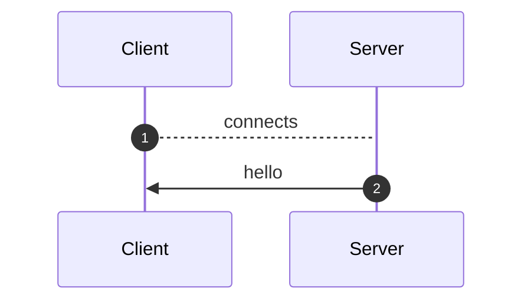
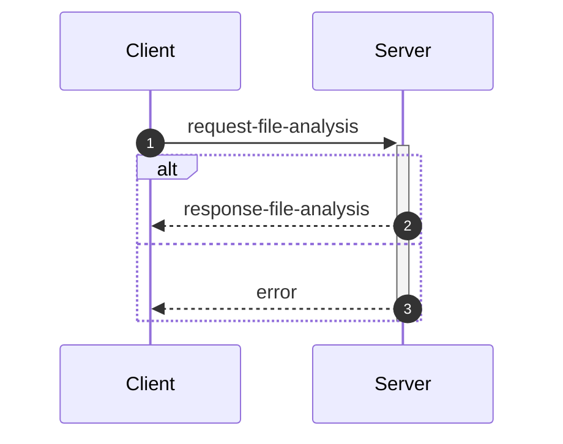
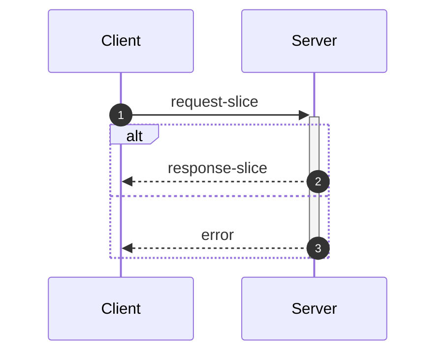
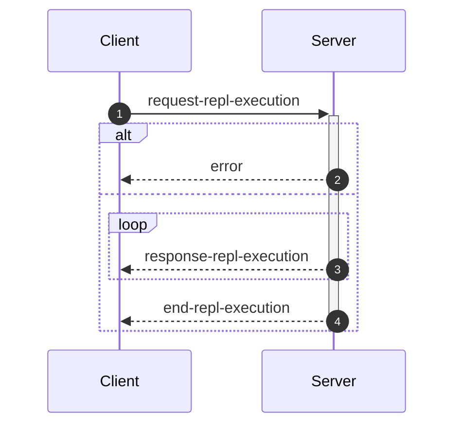

_<span title="an overview of flowR's interface">Generated</span> from '[wiki-interface.ts](https://github.com/flowr-analysis/flowr/tree/main/src/documentation/wiki-interface.ts "src/documentation/wiki-interface.ts")' on 2026-10-18, 14:26:19 UTC (v2.16.2, R v4.6.1), do not edit directly._

Although far from being as detailed as the in-depth explanation of [_flowR_](https://github.com/flowr-analysis/flowr/wiki/Core),
this wiki page explains how to interface with _flowR_ in more detail.
In general, command line arguments and other options provide short descriptions on hover over.

* [💻 Using the REPL](#using-the-repl)
* [⚙️ Configuring FlowR](#configuring-flowr)
* [⚒️ Writing Code](#writing-code)
* [💬 Communicating with the Server](#communicating-with-the-server)

<a id='using-the-repl'></a>
## 💻 Using the REPL

> [!NOTE]
> To execute arbitrary R commands with a repl request, _flowR_ has to be started explicitly with <span title="Description (Command Line Argument): Allow to access the underlying R session when using flowR (security warning: this allows the execution of arbitrary R code!)">`--r-session-access`</span>.
> Please be aware that this introduces a security risk and note that this relies on the [`r-shell` engine](https://github.com/flowr-analysis/flowr/wiki/Engines) .

Although primarily meant for users to explore,
there is nothing which forbids calling _flowR_ as a subprocess to use standard-in, -output, and -error
for communication (although you can access the REPL using the server as well,
with the [REPL Request](#message-request-repl-execution) message).

The read-eval-print loop&nbsp;(REPL) works relatively simple.
You can submit an expression (using <kbd>Enter</kbd>),
which is interpreted as an R&nbsp;expression by default but interpreted as a *command* if it starts with a colon (`:`).
The best command to get started with the REPL is <span title="Description (Repl Command): Show help information (aliases: :h, :?)">`:help`</span>.
Besides, you can leave the REPL either with the command <span title="Description (Repl Command): End the repl (aliases: :q, :exit)">`:quit`</span> or by pressing <kbd>Ctrl</kbd>+<kbd>C</kbd> twice.
When writing a *command*, you may press <kbd>Tab</kbd> to get a list of completions, if available.
Multiple commands can be entered in a single line by separating them with a semicolon (`;`), e.g. `:parse "x<-2"; :df*`.
If a command is given without R code, the REPL will re-use R code given in a previous command.
The prior example will hence return first the parsed AST of the program and then the dataflow graph for `"x <- 2"`.

> [!NOTE]
> If you develop flowR, you may want to launch the repl using the `npm run main-dev` command, this way, you get a non-minified version of flowR with debug information and hot-reloading of source files.

<details>
<summary>Available Commands</summary>

We currently offer the following commands (this with a `[*]` suffix are available with and without the star):

| Command | Description |
| ------- | ----------- |
| **<span title="Description (Repl Command): End the repl (aliases: :q, :exit)">:quit</span>** | End the repl (aliases: **:<span title="Alias of ':quit'. End the repl">q</span>**, **:<span title="Alias of ':quit'. End the repl">exit</span>**) |
| **<span title="Description (Repl Command): Execute the given code as R code. This requires the `--r-session-access` flag to be set and requires the r-shell engine. (aliases: :e, :r)">:execute</span>** | Execute the given code as R code. This requires the `--r-session-access` flag to be set and requires the r-shell engine. (aliases: **:<span title="Alias of ':execute'. Execute the given code as R code. This requires the `--r-session-access` flag to be set and requires the r-shell engine.">e</span>**, **:<span title="Alias of ':execute'. Execute the given code as R code. This requires the `--r-session-access` flag to be set and requires the r-shell engine.">r</span>**) |
| **<span title="Description (Repl Command): Get mermaid code for the control-flow graph of R code (aliases: :cfg, :cf)">:controlflow[*]</span>** | Get mermaid code for the control-flow graph of R code (star: Returns the URL to mermaid.live) (aliases: **:<span title="Alias of ':controlflow'. Get mermaid code for the control-flow graph of R code">cfg</span>**, **:<span title="Alias of ':controlflow'. Get mermaid code for the control-flow graph of R code">cf</span>**) |
| **<span title="Description (Repl Command): Get mermaid code for the control-flow graph with basic blocks (aliases: :cfgb, :cfb)">:controlflowbb[*]</span>** | Get mermaid code for the control-flow graph with basic blocks (star: Returns the URL to mermaid.live) (aliases: **:<span title="Alias of ':controlflowbb'. Get mermaid code for the control-flow graph with basic blocks">cfgb</span>**, **:<span title="Alias of ':controlflowbb'. Get mermaid code for the control-flow graph with basic blocks">cfb</span>**) |
| **<span title="Description (Repl Command): Get mermaid code for the dataflow graph (aliases: :d, :df)">:dataflow[*]</span>** | Get mermaid code for the dataflow graph (star: Returns the URL to mermaid.live) (aliases: **:<span title="Alias of ':dataflow'. Get mermaid code for the dataflow graph">d</span>**, **:<span title="Alias of ':dataflow'. Get mermaid code for the dataflow graph">df</span>**) |
| **<span title="Description (Repl Command): Get mermaid code for the normalized AST of R code (aliases: :n)">:normalize[*]</span>** | Get mermaid code for the normalized AST of R code (star: Returns the URL to mermaid.live) (alias: **:<span title="Alias of ':normalize'. Get mermaid code for the normalized AST of R code">n</span>**) |
| **<span title="Description (Repl Command): Get mermaid code for the simplified dataflow graph (aliases: :ds, :dfs)">:dataflowsimple[*]</span>** | Get mermaid code for the simplified dataflow graph (star: Returns the URL to mermaid.live) (aliases: **:<span title="Alias of ':dataflowsimple'. Get mermaid code for the simplified dataflow graph">ds</span>**, **:<span title="Alias of ':dataflowsimple'. Get mermaid code for the simplified dataflow graph">dfs</span>**) |
| **<span title="Description (Repl Command): Inspect and extend the signature database: `query` (identical to :query @signature), `info <name>` for where a function comes from (identical to :query @function-info), `add <path>` to mount another database/source, `download` to fetch the full-history database. (aliases: :sig)">:signature</span>** | Inspect and extend the signature database: `query` (identical to :query @signature), `info <name>` for where a function comes from (identical to :query @function-info), `add <path>` to mount another database/source, `download` to fetch the full-history database. (alias: **:<span title="Alias of ':signature'. Inspect and extend the signature database: `query` (identical to :query @signature), `info <name>` for where a function comes from (identical to :query @function-info), `add <path>` to mount another database/source, `download` to fetch the full-history database.">sig</span>**) |
| **<span title="Description (Repl Command): Just calculates the DFG, but only prints summary info (aliases: :d#, :df#)">:dataflowsilent</span>** | Just calculates the DFG, but only prints summary info (aliases: **:<span title="Alias of ':dataflowsilent'. Just calculates the DFG, but only prints summary info">d#</span>**, **:<span title="Alias of ':dataflowsilent'. Just calculates the DFG, but only prints summary info">df#</span>**) |
| **<span title="Description (Repl Command): Prints ASCII Art of the parsed, unmodified AST (aliases: :p)">:parse</span>** | Prints ASCII Art of the parsed, unmodified AST (alias: **:<span title="Alias of ':parse'. Prints ASCII Art of the parsed, unmodified AST">p</span>**) |
| **<span title="Description (Repl Command): Prints the version of flowR as well as the current version of R">:version</span>** | Prints the version of flowR as well as the current version of R
| **<span title="Description (Repl Command): Query the given R code (use 'help' for more information)">:query[*]</span>** | Query the given R code (use 'help' for more information) (star: Similar to query, but returns the output in json format.)
| **<span title="Description (Repl Command): Returns an ASCII representation of the dataflow graph (aliases: :df!)">:dataflowascii</span>** | Returns an ASCII representation of the dataflow graph (alias: **:<span title="Alias of ':dataflowascii'. Returns an ASCII representation of the dataflow graph">df!</span>**) |
| **<span title="Description (Repl Command): Returns summarization stats for the normalized AST (aliases: :n#)">:normalize#</span>** | Returns summarization stats for the normalized AST (alias: **:<span title="Alias of ':normalize#'. Returns summarization stats for the normalized AST">n#</span>**) |
| **<span title="Description (Repl Command): Show help information (aliases: :h, :?)">:help</span>** | Show help information (aliases: **:<span title="Alias of ':help'. Show help information">h</span>**, **:<span title="Alias of ':help'. Show help information">?</span>**) |

</details>

> [!TIP]
> 
> As indicated by the examples before, all REPL commands that operate on code keep track of the state.
> Hence, if you run a command like <span title="Description (Repl Command, starred version): Returns the URL to mermaid.live; Base Command: Get mermaid code for the dataflow graph (aliases: :d*, :df*)">`:dataflow*`</span> without providing R code,
> the REPL will re-use the R code provided in a previous command.
> Likewise, doing this will benefit from incrementality!
> If you request the dataflow graph with `:df* x <- 2 * y` and then want to see the parsed AST with `:parse`,
> the REPL will re-use previously obtained information and not re-parse the code again.
> 		

Generally, many commands offer shortcut versions in the REPL. Many queries, for example, offer a shortened format (see the example below).
Of special note, the [Config Query](https://github.com/flowr-analysis/flowr/wiki/%5BQuery%5D-Config)
can be used to also modify the currently active configuration of _flowR_ within the REPL (see the [wiki page](https://github.com/flowr-analysis/flowr/wiki/%5BQuery%5D-Config) for more information).

### Example: Retrieving the Dataflow Graph

To retrieve a URL to the [mermaid](https://mermaid.js.org/) diagram of the dataflow of a given expression,
use <span title="Description (Repl Command, starred version): Returns the URL to mermaid.live; Base Command: Get mermaid code for the dataflow graph (aliases: :d*, :df*)">`:dataflow*`</span> (or <span title="Description (Repl Command): Get mermaid code for the dataflow graph (aliases: :d, :df)">`:dataflow`</span> to get the mermaid code in the cli):

```shell
$ docker run -it --rm eagleoutice/flowr # or npm run flowr 
flowR repl v2.16.2, R grammar v14 (tree-sitter engine)
R> :dataflow* y <- 1 + x
```

<details>
<summary style='color:gray'>Output</summary>

```text
https://mermaid.live/view#base64:eyJjb2RlIjoiZmxvd2NoYXJ0IFREXG4gICAgMXt7XCJgKiM5MTtSTnVtYmVyIzkzOyogKioxKipcbiAgICAgICoxLjYqICgqKmlkOiAxKiopYFwifX1cbiAgICAyKFtcImAqIzkxO1JTeW1ib2wjOTM7KiAqKngqKlxuICAgICAgKjEuMTAqICgqKmlkOiAyKiopYFwiXSlcbiAgICAzW1tcImAqIzkxO1JCaW5hcnlPcCM5MzsqIGJhc2UjNTg7IzU4OyoqIzQzOyoqXG4gICAgICAqMS42LTEwKiAoKippZDogMyoqKVxuICAgIGFyZzogKDEsIDIpYFwiXV1cbiAgICBidWlsdC1pbjpfNDNfW1wiYEJ1aWx0LUluOlxuIzQzO2BcIl1cbiAgICBzdHlsZSBidWlsdC1pbjpfNDNfIHN0cm9rZTpncmF5LGZpbGw6Z3JheSxzdHJva2Utd2lkdGg6MnB4LG9wYWNpdHk6Ljg7XG4gICAgMFtcImAqIzkxO1JTeW1ib2wjOTM7KiAqKnkqKlxuICAgICAgKjEuMSogKCoqaWQ6IDAqKiwgdjogMylgXCJdXG4gICAgNFtbXCJgKiM5MTtSQmluYXJ5T3AjOTM7KiBiYXNlIzU4OyM1ODsqKiM2MDsjNDU7KipcbiAgICAgICoxLjEtMTAqICgqKmlkOiA0KiopXG4gICAgYXJnOiAoMCwgMylgXCJdXVxuICAgIGJ1aWx0LWluOl82MF8tW1wiYEJ1aWx0LUluOlxuIzYwOyM0NTtgXCJdXG4gICAgc3R5bGUgYnVpbHQtaW46XzYwXy0gc3Ryb2tlOmdyYXksZmlsbDpncmF5LHN0cm9rZS13aWR0aDoycHgsb3BhY2l0eTouODtcbiAgICAxIC0uLT58XCJmbG93XCJ8IDJcbiAgICBsaW5rU3R5bGUgMCBzdHJva2U6Z3JheSxjb2xvcjpncmF5O1xuICAgIDIgLS4tPnxcImZsb3dcInwgM1xuICAgIGxpbmtTdHlsZSAxIHN0cm9rZTpncmF5LGNvbG9yOmdyYXk7XG4gICAgMyAtLT58XCJyZWFkcywgYXJnXCJ8IDFcbiAgICAzIC0tPnxcInJlYWRzLCBhcmdcInwgMlxuICAgIDMgLS4tPnxcImZsb3dcInwgMFxuICAgIGxpbmtTdHlsZSA0IHN0cm9rZTpncmF5LGNvbG9yOmdyYXk7XG4gICAgMyAtLi0+fFwicmVhZHMsIGNhbGxzXCJ8IGJ1aWx0LWluOl80M19cbiAgICBsaW5rU3R5bGUgNSBzdHJva2U6Z3JheTtcbiAgICAwIC0tPnxcImRlZmluZWQtYnksIGZsb3dcInwgNFxuICAgIDAgLS0+fFwiZGVmaW5lZC1ieVwifCAzXG4gICAgNCAtLT58XCJyZWFkcywgYXJnXCJ8IDNcbiAgICA0IC0tPnxcInJldHVybnMsIGFyZ1wifCAwXG4gICAgNCAtLi0+fFwicmVhZHMsIGNhbGxzXCJ8IGJ1aWx0LWluOl82MF8tXG4gICAgbGlua1N0eWxlIDEwIHN0cm9rZTpncmF5OyIsIm1lcm1haWQiOnsiYXV0b1N5bmMiOnRydWV9fQ==
```

Retrieve the dataflow graph of the expression `y <- 1 + x`. It looks like this:


<details>

<summary style="color:gray">R Code of the Dataflow Graph</summary>

The analysis ran (including parse and normalize, using the [tree-sitter](https://github.com/flowr-analysis/flowr/wiki/Engines) engine) within the generation environment. No [signature database](https://github.com/flowr-analysis/flowr/wiki/Signature-Database) is mounted for these generated graphs, so `library()` calls attach no package exports; base-R names are still qualified via the generated base-package store (e.g. `acf` as `stats::acf`). 
We encountered no unknown side effects during the analysis.

```r
y <- 1 + x
```

</details>

</details>

For small graphs like this, <span title="Description (Repl Command): Returns an ASCII representation of the dataflow graph (aliases: :df!)">`:dataflowascii`</span> also provides an ASCII representation directly in the REPL:

```shell
$ docker run -it --rm eagleoutice/flowr # or npm run flowr 
flowR repl v2.16.2, R grammar v14 (tree-sitter engine)
R> :df! y <- 1 + x
```

<details open>
<summary style='color:gray'>Output</summary>

```text
                        v<0>v
 c<4>c──────────────────| y |
 |<- |     ┌────────────v---v
 c---c     │
    │   c<3>c   0<1>0
    └───| + |───| 1 |───u<2>u
        c---c   0---0   | x |
           └────────────u---u
Edges:
3 -> 1: reads, arg          3 -> 2: reads, arg
3 -> 0: flows-to            1 -> 2: flows-to
2 -> 3: flows-to            4 -> 3: reads, arg
4 -> 0: returns, arg        0 -> 4: defined-by, flows-to
0 -> 3: defined-by
```

Retrieve the dataflow graph of the expression `y <- 1 + x` as ASCII art.

</details>

For the slicing with <span title="Description (Repl Command): Static backwards executable slicer for R">`:slicer`</span>, you have access to the same [magic comments](#slice-magic-comments) as with the [slice request](#message-request-slice).
Pass `--inline` to splice resolvable `source()` calls into the reconstruction so the slice is a single self-contained R text (the same as the static slice query's `inlineSources` flag).
See `--help` for more flags!

### Example: Interfacing with the File System

Many commands that allow for an R-expression (like <span title="Description (Repl Command, starred version): Returns the URL to mermaid.live; Base Command: Get mermaid code for the dataflow graph (aliases: :d*, :df*)">`:dataflow*`</span>) allow for a file as well
if the argument starts with `file://`.
If you are working from the root directory of the _flowR_ repository, the following gives you the parsed AST of the example file using the <span title="Description (Repl Command): Prints ASCII Art of the parsed, unmodified AST (aliases: :p)">`:parse`</span> command:

> **Watch mode**: Replace `file://` with `watch://` to enter watch mode.
> flowR runs the command immediately and then re-runs it every time the file (or any file inside the folder) changes.
> Enter any other command to leave watch mode.
> For example: `:df watch://analysis.R`

```shell
$ docker run -it --rm eagleoutice/flowr # or npm run flowr 
flowR repl v2.16.2, R grammar v14 (tree-sitter engine)
R> :parse file://test/testfiles/example.R
```

<details>
<summary style='color:gray'>Output</summary>

```text
File: test/testfiles/example.R

program
├ binaryoperator
│ ├ identifier "sum" (1:1─4)
│ ├ <- "<-" (1:5─7)
│ ╰ float "0" (1:8─9)
├ binaryoperator
│ ├ identifier "product" (2:1─8)
│ ├ <- "<-" (2:9─11)
│ ╰ float "1" (2:12─13)
├ binaryoperator
│ ├ identifier "w" (3:1─2)
│ ├ <- "<-" (3:3─5)
│ ╰ float "7" (3:6─7)
├ binaryoperator
│ ├ identifier "N" (4:1─2)
│ ├ <- "<-" (4:3─5)
│ ╰ float "10" (4:6─8)
├ forstatement
│ ├ for "for" (6:1─4)
│ ├ ( "(" (6:5─6)
│ ├ identifier "i" (6:6─7)
│ ├ in "in" (6:8─10)
│ ├ binaryoperator
│ │ ├ float "1" (6:11─12)
│ │ ├ : ":" (6:12─13)
│ │ ╰ parenthesizedexpression
│ │   ├ ( "(" (6:13─14)
│ │   ├ binaryoperator
│ │   │ ├ identifier "N" (6:14─15)
│ │   │ ├ - "-" (6:15─16)
│ │   │ ╰ float "1" (6:16─17)
│ │   ╰ ) ")" (6:17─18)
│ ├ ) ")" (6:18─19)
│ ╰ bracedexpression
│   ├ { "{" (6:20─21)
│   ├ binaryoperator
│   │ ├ identifier "sum" (7:3─6)
│   │ ├ <- "<-" (7:7─9)
│   │ ╰ binaryoperator
│   │   ├ binaryoperator
│   │   │ ├ identifier "sum" (7:10─13)
│   │   │ ├ + "+" (7:14─15)
│   │   │ ╰ identifier "i" (7:16─17)
│   │   ├ + "+" (7:18─19)
│   │   ╰ identifier "w" (7:20─21)
│   ├ binaryoperator
│   │ ├ identifier "product" (8:3─10)
│   │ ├ <- "<-" (8:11─13)
│   │ ╰ binaryoperator
│   │   ├ identifier "product" (8:14─21)
│   │   ├  "" (8:22─23)
│   │   ╰ identifier "i" (8:24─25)
│   ╰ } "}" (9:1─2)
├ call
│ ├ identifier "cat" (11:1─4)
│ ╰ arguments
│   ├ ( "(" (11:4─5)
│   ├ argument
│   │ ╰ string
│   │   ├ " "\"" (11:5─6)
│   │   ├ stringcontent "Sum:" (11:6─10)
│   │   ╰ " "\"" (11:10─11)
│   ├ comma "," (11:11─12)
│   ├ argument
│   │ ╰ identifier "sum" (11:13─16)
│   ├ comma "," (11:16─17)
│   ├ argument
│   │ ╰ string
│   │   ├ " "\"" (11:18─19)
│   │   ├ stringcontent
│   │   │ ╰ escapesequence "\\n" (11:19─21)
│   │   ╰ " "\"" (11:21─22)
│   ╰ ) ")" (11:22─23)
╰ call
  ├ identifier "cat" (12:1─4)
  ╰ arguments
    ├ ( "(" (12:4─5)
    ├ argument
    │ ╰ string
    │   ├ " "\"" (12:5─6)
    │   ├ stringcontent "Product:" (12:6─14)
    │   ╰ " "\"" (12:14─15)
    ├ comma "," (12:15─16)
    ├ argument
    │ ╰ identifier "product" (12:17─24)
    ├ comma "," (12:24─25)
    ├ argument
    │ ╰ string
    │   ├ " "\"" (12:26─27)
    │   ├ stringcontent
    │   │ ╰ escapesequence "\\n" (12:27─29)
    │   ╰ " "\"" (12:29─30)
    ╰ ) ")" (12:30─31)
```

Retrieve the parsed AST of the example file.

<details>

<summary>File Content</summary>

```r
sum <- 0
product <- 1
w <- 7
N <- 10

for (i in 1:(N-1)) {
  sum <- sum + i + w
  product <- product * i
}

cat("Sum:", sum, "\n")
cat("Product:", product, "\n")
```

</details>

As _flowR_ directly transforms this AST the output focuses on being human-readable instead of being machine-readable.
		
</details>

### Example: Run a Query

You can run any query supported by _flowR_ using the <span title="Description (Repl Command): Query the given R code (use 'help' for more information)">`:query`</span> command.
For example, to obtain the shapes of all data frames in a given piece of code, you can run:

```shell
$ docker run -it --rm eagleoutice/flowr # or npm run flowr 
flowR repl v2.16.2, R grammar v14 (tree-sitter engine)
R> :query @absint df-shape "x <- data.frame(a = 1:10, b = 1:10)\ny <- x$a"
```

<details open>
<summary style='color:gray'>Output</summary>

```text
Query: absint (6 ms)
```

Retrieve the shapes of all data frames in the given code.

</details>

To run the linter on a file, you can use (in this example, we just issue the `dead-code` linter on a small piece of code):

```shell
$ docker run -it --rm eagleoutice/flowr # or npm run flowr 
flowR repl v2.16.2, R grammar v14 (tree-sitter engine)
R> :query @linter rules:dead-code "if(FALSE) x <- 2"
```

<details open>
<summary style='color:gray'>Output</summary>

```text
Query: linter (3 ms)
   ╰ Dead Code (dead-code):
       ╰ certain:
           ╰ Code at 1.11-16
```

Run the linter on the given code, with only the `dead-code` rule enabled.

</details>

For more information on the available queries, please check out the [Query API](https://github.com/flowr-analysis/flowr/wiki/Query-API).

<a id='configuring-flowr'></a>
## ⚙️ Configuring FlowR

When running _flowR_, you may want to specify some behaviors with a dedicated configuration file.
By default, flowR looks for a file named `flowr.json` in the current working directory (or any higher directory).
You can also specify a different file with <span title="Description (Command Line Argument): The name of the configuration file to use">`--config-file`</span> or pass the configuration inline using <span title="Description (Command Line Argument): The flowR configuration to use, as a JSON string">`--config-json`</span>.
A `flowr.json` found this way belongs to the analyzed project, so flowR ignores its options that decide what flowR executes or loads
(`engines.*.wasmPath`, `engines.*.treeSitterWasmPath`, `engines.*.rPath`, `solver.sigdb.additionalPaths`, `solver.sigdb.downloadRepo`, `solver.sigdb.installedLibrary.paths`),
unless you pass <span title="Description (Command Line Argument): Keep the security-sensitive options (e.g., the R executable) of the flowr.json found in the working directory or a parent. Only use this for projects you trust.">`--trust-config`</span>.
To analyze code you do not trust, use the secure mode (<span title="Description (Command Line Argument): Run in secure mode for analyzing untrusted code: flowR does not start R (or any other process), does not access the network, does not search for project configs, and ignores security-sensitive options in every config. Cannot be disabled once enabled. Can also be enabled with the environment variable {italic FLOWR_SECURE_MODE=1}.">`--secure`</span>, see the [security policy](https://github.com/flowr-analysis/flowr/blob/main/.github/SECURITY.md)).
To inspect the current configuration, you can run flowr with the <span title="Description (Command Line Argument): Run with verbose logging (will be passed to the corresponding script)">`--verbose`</span> flag, or use the `config` [Query](https://github.com/flowr-analysis/flowr/wiki/Query-API).
Within the REPL this works by running the following:

```shell
:query @config
```

To work with the <a href="https://github.com/flowr-analysis/flowr/tree/main/src/config.ts#L119"><code><span title="The configuration file format for flowR.">FlowrConfig</span></code></a> you can use the provided helper objects alongside its methods like
<a href="https://github.com/flowr-analysis/flowr/tree/main/src/config.ts#L905"><code><span title="Creates a new flowr config that has the updated values.">FlowrConfig::<b>amend</b></span></code></a>.
The schema below documents every option; the ones you most likely want are:

- <a href="https://github.com/flowr-analysis/flowr/wiki/Interface#configuring-flowr" title="Configuration Option (boolean): Whether source calls should be ignored, causing {@link processSourceCall}&#39;s behavior to be skipped.">ignoreSourceCalls</a>: ignore source calls when analyzing the code, i.e., ignore the inclusion of other files.
- <a href="https://github.com/flowr-analysis/flowr/wiki/Interface#configuring-flowr" title="Configuration Option (boolean): Whether load calls should be ignored, causing {@link processLoadCall}&#39;s behavior to be skipped.">ignoreLoadCalls</a>: ignore load calls when analyzing the code, i.e., ignore the loading of r-data files.
- <a href="https://github.com/flowr-analysis/flowr/wiki/Interface#configuring-flowr" title="Configuration Option (object): Do you want to overwrite (parts) of the builtin definition?">semantics.environment.overwriteBuiltIns</a>: overwrite _flowR_'s handling of built-in functions, or clear the preset definitions entirely.
  See [Configure BuiltIn Semantics](#configure-builtin-semantics) for more information.
- <a href="https://github.com/flowr-analysis/flowr/wiki/Interface#configuring-flowr" title="Configuration Option (string): How to resolve variables and their values. (one of &quot;disabled&quot;, &quot;alias&quot;, &quot;builtin&quot;)">solver.variables</a>: how to resolve variables and their values (`disabled`, `alias`, `builtin`).
- <a href="https://github.com/flowr-analysis/flowr/wiki/Interface#configuring-flowr" title="Configuration Option (array): The engine or set of engines to use for interacting with R code. An empty array means all available engines will be used.">engines</a> and <a href="https://github.com/flowr-analysis/flowr/wiki/Interface#configuring-flowr" title="Configuration Option (string): The default engine to use for interacting with R code. If this is undefined, an arbitrary engine from the specified list will be used. (one of &quot;tree-sitter&quot;, &quot;r-shell&quot;)">defaultEngine</a>: the engines used to interact with R code, see the [Engines wiki page](https://github.com/flowr-analysis/flowr/wiki/Engines).
- <a href="https://github.com/flowr-analysis/flowr/wiki/Interface#configuring-flowr" title="Configuration Option (array): Files a framework loads on its own, without any source() call (e.g. global.R in a shiny app), in the order they are loaded; flowR orders the matching project files accordingly and analyzes them as one program. Entries are case-insensitive globs matched against the file path, a plain name matches any file with that name, and entries matching no project file are warned about. Usually set per project kind via specializeConfig.">project.implicitSources</a>: the files a framework loads without any `source()` call, in the order in which they are
  loaded. Entries are globs (e.g. `R/*.R`) matched against the file path ignoring capitalization; one matching no file is reported.
- <a href="https://github.com/flowr-analysis/flowr/wiki/Interface#configuring-flowr" title="Configuration Option (object): Overwrite (parts of) the configuration depending on the project kind flowR detects, e.g. to give a shiny app its implicit sources.">specializeConfig</a>: overwrite (parts of) the configuration depending on the kind of project _flowR_ detects
  (e.g. `shiny-app`), which is how a shiny app gets its implicit sources by default. What you configure directly wins.
- <a href="https://github.com/flowr-analysis/flowr/wiki/Interface#configuring-flowr" title="Configuration Option (string): Overwrite the project kind flowR would otherwise infer from the analyzed files, e.g. when auto-detection guesses wrong. (one of &quot;package&quot;, &quot;script&quot;, &quot;shiny-app&quot;, &quot;notebook&quot;, &quot;project&quot;, &quot;unknown&quot;)">project.useProjectType</a>: skip that detection and force a project kind yourself, when auto-detection guesses wrong.
- <a href="https://github.com/flowr-analysis/flowr/wiki/Interface#configuring-flowr" title="Configuration Option (array): The default plugins to load when creating a new instance of FlowrAnalyzer">defaultPlugins</a> and <a href="https://github.com/flowr-analysis/flowr/wiki/Interface#configuring-flowr" title="Configuration Option (array): The plugins to load in REPL mode">repl.plugins</a>: the plugins to load for a new <a href="https://github.com/flowr-analysis/flowr/tree/main/src/project/flowr-analyzer.ts#L205"><code><span title="Central class for conducting analyses with FlowR. Use the FlowrAnalyzerBuilder to create a new instance. If you want the original pattern of creating a pipeline and running all steps, you can still do this with FlowrAnalyzer#runFull . To inspect the context of the analyzer, use FlowrAnalyzer#inspectContext (if you are a plugin and need to modify it, use FlowrAnalyzer#context instead).">FlowrAnalyzer</span></code></a> and in the REPL
  (use `flowr:default` to reference the former).

So you can configure _flowR_ by adding a file like the following:

<details>

<summary>Example Configuration File</summary>

```json
{
  "ignoreSourceCalls": true,
  "ignoreLoadCalls": true,
  "semantics": {
    "environment": {
      "overwriteBuiltIns": {
        "definitions": [
          {
            "type": "function",
            "names": [
              "foo"
            ],
            "processor": "builtin:assign",
            "config": {}
          }
        ]
      }
    }
  },
  "defaultPlugins": [
    "file:description",
    "versions:description"
  ],
  "repl": {
    "quickStats": false,
    "dfProcessorHeat": false,
    "hints": true,
    "plugins": [
      "flowr:default"
    ]
  },
  "project": {
    "resolveUnknownPathsOnDisk": true,
    "implicitSources": [
      "global.R",
      "app.R"
    ]
  },
  "linter": {
    "disabledRules": []
  },
  "specializeConfig": {
    "shiny-app": {
      "project": {
        "implicitSources": [
          "global.R",
          "ui.R",
          "server.R",
          "app.R"
        ]
      }
    }
  },
  "engines": [
    {
      "type": "r-shell"
    }
  ],
  "solver": {
    "variables": "alias",
    "evalStrings": true,
    "trackEnvironments": true,
    "sigdb": {
      "enabled": true,
      "loadProjectDependencies": true,
      "eagerlyLoad": false,
      "eagerlyLoadExports": false,
      "linkBaseR": false,
      "linkDescriptionDependencies": false
    },
    "resolveSource": {
      "dropPaths": "no",
      "ignoreCapitalization": true,
      "inferWorkingDirectory": "active-script",
      "searchPath": []
    },
    "instrument": {},
    "slicer": {
      "threshold": 50
    }
  },
  "abstractInterpretation": {
    "wideningThreshold": 4,
    "followCalls": true,
    "dataFrame": {
      "maxColNames": 20,
      "readLoadedData": {
        "readExternalFiles": true,
        "maxReadLines": 1000000
      }
    }
  },
  "incremental": {
    "alwaysIncremental": false,
    "parsing": {
      "activated": false,
      "heuristics": {
        "activated": true,
        "mtime": true,
        "linesFrom": 500,
        "bytesFrom": 50000,
        "alwaysWithEdits": false,
        "minFiles": 1
      }
    }
  },
  "gas": {
    "thresholds": {
      "memory": {
        "problematic": 0.7,
        "critical": 0.9
      },
      "timeMs": {
        "problematic": 100000,
        "critical": 120000
      }
    },
    "features": {}
  }
}
```

</details>

<details>
<a id='configure-builtin-semantics'></a>
<summary>Configure Built-In Semantics</summary>

`semantics/environment/overwriteBuiltins` accepts two keys:

- `loadDefaults` (boolean, initially `true`): If set to `true`, the default built-in definitions are loaded before applying the custom definitions. Setting this flag to `false` explicitly disables the loading of the default definitions.
- `definitions` (array, initially empty): Allows to overwrite or define new built-in elements. Each object within must have a `type` which is one of the below. Furthermore, they may define a string array of `names` which specifies the identifiers to bind the definitions to. You may use `assumePrimitive` to specify whether _flowR_ should assume that this is a primitive non-library definition (so you probably just do not want to specify the key).

  | Type            | Description                                                                                                                                                                                                                                                                                              | Example                                                                                                    |
  | --------------- | -------------------------------------------------------------------------------------------------------------------------------------------------------------------------------------------------------------------------------------------------------------------------------------------------------- | ---------------------------------------------------------------------------------------------------------- |
  | `constant`    | Additionally allows for a `value` this should resolve to.                                                                                                                                                                                                                                                | `{ type: 'constant', names: ['NULL', 'NA'],  value: null }`                                                |
  | `function`    | Is a rather flexible way to define and bind built-in functions. For the time, we do not have extensive documentation to cover all the cases, so please either consult the sources with the `default-builtin-config.ts` or open a [new issue](https://github.com/flowr-analysis/flowr/issues/new/choose). | `{ type: 'function', names: ['next'], processor: 'builtin:d', config: { cfg: ExitPointType.Next } }` |
  | `replacement` | A comfortable way to specify replacement functions like `$<-` or `names<-`. `suffixes` describes the... suffixes to attach automatically. | `{ type: 'replacement', suffixes: ['<-', '<<-'], names: ['[', '[['] }` |

</details>

<details>

<summary style='color:gray'>Full Configuration-File Schema</summary>

- _The configuration file format for flowR._ (object)
    - **logLevel** [optional] _flowR's global minimum log level, applied when the config is loaded._ (string)
        Only allows: 'silly', 'trace', 'debug', 'info', 'warn', 'error', 'fatal'
    - **ignoreSourceCalls** [optional] _Whether source calls should be ignored, causing {@link processSourceCall}'s behavior to be skipped._ (boolean)
    - **ignoreLoadCalls** [optional] _Whether load calls should be ignored, causing {@link processLoadCall}'s behavior to be skipped._ (boolean)
    - **semantics** _Configure language semantics and how flowR handles them._ (object)
        - **environment** [optional] _Semantics regarding how to handle the R environment._ (object)
            - **overwriteBuiltIns** [optional] _Do you want to overwrite (parts) of the builtin definition?_ (object)
                - **loadDefaults** [optional] _Should the default configuration still be loaded?_ (boolean)
                - **definitions** [optional] _The definitions to load/overwrite._ (array)
                Valid item types:
                    - (object)
    - **defaultPlugins** [optional] _The default plugins to load when creating a new instance of FlowrAnalyzer_ (array)
    Valid item types:
        - (alternatives)
            - (string)
            - (array)
    - **repl** _Configuration options for the REPL._ (object)
        - **quickStats** [optional] _Whether to show quick stats in the REPL after each evaluation._ (boolean)
        - **dfProcessorHeat** [optional] _This instruments the dataflow processors to count how often each processor is called._ (boolean)
        - **hints** [optional] _Whether to show dim inline hints on the empty prompt (automatically disabled on non-interactive terminals)._ (boolean)
        - **plugins** [optional] _The plugins to load in REPL mode_ (array)
        Valid item types:
            - (alternatives)
                - (string)
                - (array)
        - **autoUseFileProtocol** [optional] _Prepend the file protocol to a repl input that looks like a path, instead of only warning about it._ (boolean)
        - **queryStats** [optional] _Whether `:query` closes with the line stating how long the queries took (`:query*` never prints it)._ (boolean)
        - **showPlugins** [optional] _Whether `:version` grays out the plugins that did not activate during the last analysis._ (boolean)
    - **project** _Project specific configuration options._ (object)
        - **resolveUnknownPathsOnDisk** [optional] _Whether to resolve unknown paths loaded by the r project disk when trying to source/analyze files._ (boolean)
        - **failOnInaccessiblePath** [optional] _Whether a directory that cannot be traversed during file discovery (e.g. due to permissions) aborts the analysis; when false (the default) such paths are logged and skipped._ (boolean)
        - **basePackages** [optional] _The packages considered part of R itself (base and recommended); if unset, flowR uses its built-in list._ (array)
        Valid item types:
            - (string)
        - **implicitSources** [optional] _Files a framework loads on its own, without any source() call (e.g. global.R in a shiny app), in the order they are loaded; flowR orders the matching project files accordingly and analyzes them as one program. Entries are case-insensitive globs matched against the file path, a plain name matches any file with that name, and entries matching no project file are warned about. Usually set per project kind via specializeConfig._ (array)
        Valid item types:
            - (string)
        - **useProjectType** [optional] _Overwrite the project kind flowR would otherwise infer from the analyzed files, e.g. when auto-detection guesses wrong._ (string)
            Only allows: 'package', 'script', 'shiny-app', 'notebook', 'project', 'unknown'
        - **assumeImplicitEcho** [optional] _Whether the top level of the analyzed code is echoed, so that every visible result printed there is collected as an output by the dependencies query (default true, false for a package)._ (boolean)
        - **discovery** [optional] _Scoping options for the default project discovery._ (object)
            - **full** [optional] _Collect every file below the project root (greedy) instead of only the files the detected project kind needs (default false)._ (boolean)
            - **perKind** [optional] _Per-kind include/exclude glob overrides layered on the default scoping._ (object)
            - **ignore** [optional] _Case-insensitive globs that drop matching files from the intelligent discovery, regardless of kind (e.g. .Renviron to ignore environment files)._ (array)
            Valid item types:
                - (string)
        - **classification** [optional] _Overrides for the signals flowR uses to classify the project kind._ (object)
            - **shinyDescriptionTypes** [optional] _DESCRIPTION Type: values that mark a shiny app._ (array)
            Valid item types:
                - (string)
            - **shinyEntryFiles** [optional] _File names a shiny app is assembled from._ (array)
            Valid item types:
                - (string)
            - **shinyUsagePattern** [optional] _Regex source evidencing shiny usage in an entry file._ (string)
            - **notebookExtensions** [optional] _File extensions marking a notebook._ (array)
            Valid item types:
                - (string)
    - **linter** _Linter configuration options._ (object)
        - **disabledRules** _Linting rule names excluded from the default rule set (a rule requested explicitly via a linter query still runs). Usually set per project kind via specializeConfig._ (array)
        Valid item types:
            - (string)
    - **inputSources** [optional] _Further frameworks the input-sources analysis should know about; entries are added to flowR's defaults._ (object)
        - **pure** [optional] _Functions that only pass the constantness of their arguments on._ (array)
        Valid item types:
            - (string)
        - **param** [optional] _Functions whose result is a 'param' input._ (array)
        Valid item types:
            - (string)
        - **file** [optional] _Functions whose result is a 'file' input._ (array)
        Valid item types:
            - (string)
        - **tempfile** [optional] _Functions whose result is a 'tempfile' input._ (array)
        Valid item types:
            - (string)
        - **glob** [optional] _Functions whose result is a 'glob' input._ (array)
        Valid item types:
            - (string)
        - **net** [optional] _Functions whose result is a 'net' input._ (array)
        Valid item types:
            - (string)
        - **rand** [optional] _Functions whose result is a 'rand' input._ (array)
        Valid item types:
            - (string)
        - **system** [optional] _Functions whose result is a 'system' input._ (array)
        Valid item types:
            - (string)
        - **ffi** [optional] _Functions whose result is a 'ffi' input._ (array)
        Valid item types:
            - (string)
        - **lang** [optional] _Functions whose result is a 'lang' input._ (array)
        Valid item types:
            - (string)
        - **options** [optional] _Functions whose result is a 'options' input._ (array)
        Valid item types:
            - (string)
        - **cmdline** [optional] _Functions whose result is a 'cmdline' input._ (array)
        Valid item types:
            - (string)
        - **user** [optional] _Functions whose result is a 'user' input._ (array)
        Valid item types:
            - (string)
        - **const** [optional] _Functions whose result is a 'const' input._ (array)
        Valid item types:
            - (string)
        - **scope** [optional] _Functions whose result is a 'scope' input._ (array)
        Valid item types:
            - (string)
        - **dconst** [optional] _Functions whose result is a 'dconst' input._ (array)
        Valid item types:
            - (string)
        - **unknown** [optional] _Functions whose result is a 'unknown' input._ (array)
        Valid item types:
            - (string)
        - **linkedObjects** [optional] _Objects a framework provides without a definition in the code, e.g. shiny's input._ (array)
        Valid item types:
            - (object)
        - **linkedEntryPoints** [optional] _Calls that hand a function to a framework, which binds its objects to the parameters by position._ (array)
        Valid item types:
            - (object)
    - **specializeConfig** [optional] _Overwrite (parts of) the configuration depending on the project kind flowR detects, e.g. to give a shiny app its implicit sources._ (object)
    - **engines** _The engine or set of engines to use for interacting with R code. An empty array means all available engines will be used._ (array)
    Valid item types:
        - (alternatives)
            - _The configuration for the tree sitter engine._ (object)
                - **type** [required] _Use the tree sitter engine._ (string)
                    Only allows: 'tree-sitter'
                - **wasmPath** [optional] _The path to the tree-sitter-r WASM binary to use. If this is undefined, this uses the default path._ (string)
                - **treeSitterWasmPath** [optional] _The path to the tree-sitter WASM binary to use. If this is undefined, this uses the default path._ (string)
                - **lax** [optional] _Whether to use the lax parser for parsing R code (allowing for syntax errors). If this is undefined, the strict parser will be used._ (boolean)
            - _The configuration for the R shell engine._ (object)
                - **type** [required] _Use the R shell engine._ (string)
                    Only allows: 'r-shell'
                - **rPath** [optional] _The path to the R executable to use. If this is undefined, this uses the default path._ (string)
                - **pipeBind** [optional] _Whether to enable R's experimental pipe-bind operator "=>" by setting _R_USE_PIPEBIND_ for the R session (default false); R itself keeps this off by default, as it is experimental and has never shipped in a release version of R._ (boolean)
    - **defaultEngine** [optional] _The default engine to use for interacting with R code. If this is undefined, an arbitrary engine from the specified list will be used._ (string)
        Only allows: 'tree-sitter', 'r-shell'
    - **solver** _How to resolve constants, constraints, cells, ..._ (object)
        - **variables** _How to resolve variables and their values._ (string)
            Only allows: 'disabled', 'alias', 'builtin'
        - **evalStrings** _Should we include eval(parse(text="...")) calls in the dataflow graph?_ (boolean)
        - **trackEnvironments** [optional] _Track user-created environments (new.env, assign/get/local with envir=, dollar-assign, attach). When false, all envir-style calls fall through conservatively._ (boolean)
        - **sigdb** _Resolving library exports from a signature database._ (object)
            - **enabled** [optional] _Resolve library()/use() exports from a signature database (default true); when false no database is consulted._ (boolean)
            - **loadProjectDependencies** [optional] _Load the project's declared dependencies from its metadata files (DESCRIPTION Imports/Depends, rproject.toml, uvr.toml, renv.lock, rv.lock, uvr.lock) (default true); when false these files are not read for dependencies._ (boolean)
            - **eagerlyLoad** [optional] _Parse the database up front rather than on the first package load (default false, ignored if disabled)._ (boolean)
            - **eagerlyLoadExports** [optional] _Add a vertex for every export on load rather than on demand (default false); keeps the dataflow graph small._ (boolean)
            - **assumedRVersion** [optional] _R version assumed when resolving versioned (base-R) exports: a pin like "4.5" or "auto" to detect the installed R (default "auto")._ (string)
            - **linkBaseR** [optional] _Eagerly attach base-R namespaces so bare base calls resolve without library() (default false)._ (boolean)
            - **linkBaseRCalls** [optional] _Add a lightweight Reads edge from a bare base-R call to its signature-database function vertex (default false; base-R qualification is edge-free otherwise)._ (boolean)
            - **linkPackageCalls** [optional] _Add a lightweight Reads edge from a resolved package call to its signature-database function vertex (default false)._ (boolean)
            - **linkDescriptionDependencies** [optional] _Eagerly attach the namespaces of the project's declared DESCRIPTION dependencies (Imports/Depends) so their exports resolve without an explicit library() (default false)._ (boolean)
            - **warmInBackground** [optional] _Decompress the hot shards (base + most-downloaded) in a background task on startup so the first library() lookup is warm (default false; for long-running servers/REPLs)._ (boolean)
            - **additionalPaths** [optional] _Extra directories or bundle/manifest files searched for signature databases (alongside the shipped default and $FLOWR_SIGDB_DIR); a downloaded full-history bundle placed here is mounted automatically._ (array)
            Valid item types:
                - (string)
            - **downloadRepo** [optional] _GitHub owner/repo the full-history bundle is downloaded from via ":signature download" (default "flowr-analysis/flowr", release tag "sigdb-v<flowR-version>")._ (string)
            - **autoSync** [optional] _On startup, re-download shards whose committed sigdb.remote.json hash no longer matches the cache, in the background (default false; opt-in network sync after a git pull)._ (boolean)
            - **installedLibrary** [optional] _Recovering packages no signature database knows from the copy installed on this machine._ (object)
                - **enabled** [required] _Recover packages no signature database knows from their installed copy (default false)._ (boolean)
                - **paths** [optional] _Library directories to search; when empty they are discovered from the environment and the project._ (array)
                Valid item types:
                    - (string)
                - **useEnvironment** [optional] _Search the libraries R_LIBS_USER/R_LIBS/R_LIBS_SITE name (default true)._ (boolean)
                - **useProjectLibrary** [optional] _Search a project-local renv/packrat library (default true)._ (boolean)
                - **maxDepth** [optional] _How far to descend into the nested layout of a project-local library (default 3)._ (number)
                - **packages** [optional] _Only recover packages whose name matches one of these regular expressions; empty means any._ (array)
                Valid item types:
                    - (string)
            - **blobCacheBudgetMb** [optional] _How many MiB of decoded package blobs every open bundle may hold together (default 16)._ (number)
            - **versionSelection** [optional] _When a project constrains a dependency, resolve to the newest (default), oldest, or system-installed version satisfying it; system needs R and falls back to newest. Base-R packages always resolve against the assumed R version._ (string)
                Only allows: 'newest', 'oldest', 'system'
            - **versionOverrides** [optional] _Force an exact version for specific packages (name -> version), overriding both the project constraint and the versionSelection policy (default {})._ (object)
        - **versionManagement** _Policies for reasoning about dependency versions._ (object)
            - **linkedVersionGroups** [optional] _Groups of packages that must resolve to the same version; version guessing intersects each group so its members stay mutually compatible (default [])._ (array)
            Valid item types:
                - (array)
                Valid item types:
                    - (string)
        - **assumeAttachedPackages** [optional] _Packages to treat as attached without a `library()` call, so what the built-in configuration states about them applies to the analyzed code. The base packages R attaches on startup already resolve without it._ (array)
        Valid item types:
            - (string)
        - **transitiveSideEffectRounds** [optional] _How many rounds the transitive side-effect fixpoint may run before it is cut off (default 32); the propagation stops on its own as soon as a round adds nothing._ (number)
        - **maxOverlayDepth** [optional] _How many binding overlays may stack on one environment frame before a write flattens them (default 4); a pure performance knob, trading lookup cost against copy cost without changing any result._ (number)
        - **instrument** (object)
            - **dataflowExtractors** [optional] _These keys are only intended for use within code, allowing to instrument the dataflow analyzer!_ (any)
        - **resolveSource** [optional] _If lax source calls are active, flowR searches for sourced files much more freely, based on the configurations you give it. This option is only in effect if `ignoreSourceCalls` is set to false._ (object)
            - **dropPaths** _Allow to drop the first or all parts of the sourced path, if it is relative._ (string)
                Only allows: 'no', 'once', 'all'
            - **ignoreCapitalization** _Search for filenames matching in the lowercase._ (boolean)
            - **inferWorkingDirectory** _Try to infer the working directory from the main or any script to analyze._ (string)
                Only allows: 'no', 'main-script', 'active-script', 'any-script'
            - **searchPath** _Additionally search in these paths._ (array)
            Valid item types:
                - (string)
            - **repeatedSourceLimit** [optional] _How often the same file can be sourced within a single run? Please be aware: in case of cyclic sources this may not reach a fixpoint so give this a sensible limit._ (number)
            - **applyReplacements** _Provide name replacements for loaded files_ (array)
            Valid item types:
                - (object)
            - **assumeFilesExist** [optional] _Assume a sourced file is always there, making what it defines certain instead of conditional on the source call._ (boolean)
        - **slicer** [optional] _The configuration for the slicer._ (object)
            - **threshold** [optional] _The maximum number of iterations to perform on a single function call during slicing._ (number)
            - **autoExtend** [optional] _If set, the slicer will gain an additional post-pass._ (boolean)
    - **abstractInterpretation** _The configuration options for abstract interpretation._ (object)
        - **wideningThreshold** _The threshold for the number of visitations of a node at which widening should be performed to ensure the termination of the fixpoint iteration._ (number)
        - **followCalls** _Whether the abstract interpretation is interprocedural, i.e. whether it steps into the functions a call may dispatch to._ (boolean)
        - **dataFrame** _The configuration of the shape inference for data frames._ (object)
            - **maxColNames** _The maximum number of columns names to infer for data frames before over-approximating the column names to top._ (number)
            - **readLoadedData** _Configuration options for reading data frame shapes from loaded external data files, such as CSV files._ (object)
                - **readExternalFiles** _Whether data frame shapes should be extracted from loaded external files, such as CSV files._ (boolean)
                - **maxReadLines** _The maximum number of lines to read when extracting data frame shapes from loaded files, such as CSV files._ (number)
    - **incremental** (object)
        - **alwaysIncremental** _Always take the incremental path, regardless of heuristics._ (boolean)
        - **parsing** (object)
            - **activated** _If set, incremental parsing will be used._ (boolean)
            - **heuristics** (object)
                - **activated** [optional] _If set, the heuristics for incremental parsing will be used._ (boolean)
                - **mtime** [optional] _Skip reparsing entirely if the file's modification time is unchanged since the last parse._ (boolean)
                - **linesFrom** [optional] _Only consider incremental parsing for files with at least this many lines._ (number)
                - **bytesFrom** [optional] _Only consider incremental parsing for files with at least this many bytes._ (number)
                - **alwaysWithEdits** [optional] _Always take the incremental path whenever there is a computed edit region, regardless of the other thresholds._ (boolean)
                - **minFiles** [optional] _Only apply these heuristics once the project has at least this many files loaded._ (number)
    - **gas** [optional] _Resource-usage guard (gas) configuration. All feature factors default to 0 (disabled). See https://github.com/flowr-analysis/flowr/wiki/Core#gas-resource-guard._ (object)
        - **thresholds** [optional] _Thresholds for all gas checks (scaled by per-feature factor), boundable per feature._ (object)
            - **memory** [optional] _Heap-usage fraction thresholds (0-1), either shared or given per feature key (with `default` covering the rest)._ (object)
                - **problematic** [optional] _Heap fraction (0-1) above which Problematic is returned, for every feature without an entry of its own._ (number)
                - **critical** [optional] _Heap fraction (0-1) above which Critical is returned, for every feature without an entry of its own._ (number)
            - **timeMs** [optional] _Elapsed analysis time thresholds in milliseconds, either shared or given per feature key (with `default` covering the rest)._ (object)
                - **problematic** [optional] _Elapsed ms above which Problematic is returned, for every feature without an entry of its own._ (number)
                - **critical** [optional] _Elapsed ms above which Critical is returned, for every feature without an entry of its own._ (number)
            - **steps** [optional] _Processed-AST-node thresholds, counted rather than sampled; only a key that arms a budget (`dataflow`) reads them._ (object)
                - **problematic** [optional] _Processed AST nodes above which Problematic is returned, for every feature without an entry of its own._ (number)
                - **critical** [optional] _Processed AST nodes above which the extraction is cut short, for every feature without an entry of its own._ (number)
            - **vertices** [optional] _Created-dataflow-vertex thresholds, counted like `steps`._ (object)
                - **problematic** [optional] _Created dataflow vertices above which Problematic is returned, for every feature without an entry of its own._ (number)
                - **critical** [optional] _Created dataflow vertices above which the extraction is cut short, for every feature without an entry of its own._ (number)
        - **features** [optional] _Per-feature sensitivity factors. 0 or absent disables gas checking for that feature. A factor of 2 makes the feature twice as sensitive. Recognised keys: `source`, `side-effect-linking`, `linter`, `slicer`, `dataflow`._ (object)
        - **countedCheckEvery** [optional] _How many counted steps pass between two accountings of an armed check, be it a dataflow budget or the slicer's traversal (default 128); trades overshoot against the cost of the check._ (number)
        - **heapProvider** [optional] _Custom heap statistics source (programmatic configs only), overriding the built-in v8/performance.memory detection._ (function)

</details>

<a id='writing-code'></a>
## ⚒️ Writing Code

_flowR_ can be used as a [module](https://www.npmjs.com/package/@eagleoutice/flowr) and offers several main classes and interfaces that are interesting for extension writers 
(see the [Visual Studio Code extension](https://marketplace.visualstudio.com/items?itemName=code-inspect.vscode-flowr) or the [Core](https://github.com/flowr-analysis/flowr/wiki/Core) wiki page for more information).

### Creating Analyses with _flowR_

Nowadays, instances of the <a href="https://github.com/flowr-analysis/flowr/tree/main/src/project/flowr-analyzer.ts#L205"><code><span title="Central class for conducting analyses with FlowR. Use the FlowrAnalyzerBuilder to create a new instance. If you want the original pattern of creating a pipeline and running all steps, you can still do this with FlowrAnalyzer#runFull . To inspect the context of the analyzer, use FlowrAnalyzer#inspectContext (if you are a plugin and need to modify it, use FlowrAnalyzer#context instead).">FlowrAnalyzer</span></code></a> should be used as central frontend to get analysis results from _flowR_.
The entry points an analysis is written against are re-exported from the package root (`import { FlowrAnalyzerBuilder } from '@eagleoutice/flowr'`);
everything else stays reachable under its own path, as in `@eagleoutice/flowr/dataflow/graph/graph`.
For example, a program slice can be created like this:

```ts
const analyzer = await new FlowrAnalyzerBuilder()
    .setEngine('tree-sitter')
    .build();
analyzer.addRequest('x <- 1\ny <- x\nx');
const result = await analyzer.query([
    {
        type:     'static-slice',
        criteria: ['3@x']
    }
]);
```

For more information, please have a look at the [Analyzer](https://github.com/flowr-analysis/flowr/wiki/Analyzer) wiki page, which explains how to construct and use the <a href="https://github.com/flowr-analysis/flowr/tree/main/src/project/flowr-analyzer.ts#L205"><code><span title="Central class for conducting analyses with FlowR. Use the FlowrAnalyzerBuilder to create a new instance. If you want the original pattern of creating a pipeline and running all steps, you can still do this with FlowrAnalyzer#runFull . To inspect the context of the analyzer, use FlowrAnalyzer#inspectContext (if you are a plugin and need to modify it, use FlowrAnalyzer#context instead).">FlowrAnalyzer</span></code></a> in more detail.
To work with specific perspectives, you can also consult the respective pages like the [Dataflow Graph](https://github.com/flowr-analysis/flowr/wiki/Dataflow-Graph) or the [Abstract Interpretation](https://github.com/flowr-analysis/flowr/wiki/Abstract-Interpretation) wiki pages.
### The Pipeline Executor (Low-Level Interface)

Once, in the beginning, _flowR_ was meant to produce a dataflow graph merely to provide *program slices*. 
However, with continuous updates, the [Dataflow Graph](https://github.com/flowr-analysis/flowr/wiki/Dataflow-Graph) repeatedly proves to be the more interesting part.
With this, we restructured _flowR_'s originally *hardcoded* pipeline to be far more flexible. 
Now, it can be theoretically extended or replaced with arbitrary steps, optional steps, and what we call 'decorations' of these steps. 
In short, a slicing pipeline using the <a href="https://github.com/flowr-analysis/flowr/tree/main/src/core/pipeline-executor.ts#L97"><code><span title="**Please note:** The PipelineExecutor is now considered to be a rather low-level API for flowR. While it still works and is the basis for all other layers, we strongly recommend using the FlowrAnalyzer and its builder to create and use an analyzer instance that is pre-configured for your use-case. The pipeline executor allows to execute arbitrary pipelines in a step-by-step fashion. If you are not...">PipelineExecutor</span></code></a> looks like this:

```ts

const slicer = new PipelineExecutor(DEFAULT_SLICING_PIPELINE, {
  parser:    new RShell(),
  request:   requestFromInput('x <- 1\nx + 1'),
  criterion: ['2@x']
})
const slice = await slicer.allRemainingSteps()
// console.log(slice.reconstruct.code)
```

<details><summary>More Information</summary>

If you compare this, with what you would have done with the old (and removed) `SteppingSlicer`, 
this essentially just requires you to replace the `SteppingSlicer` with the <a href="https://github.com/flowr-analysis/flowr/tree/main/src/core/pipeline-executor.ts#L97"><code><span title="**Please note:** The PipelineExecutor is now considered to be a rather low-level API for flowR. While it still works and is the basis for all other layers, we strongly recommend using the FlowrAnalyzer and its builder to create and use an analyzer instance that is pre-configured for your use-case. The pipeline executor allows to execute arbitrary pipelines in a step-by-step fashion. If you are not...">PipelineExecutor</span></code></a>
and to pass the <a href="https://github.com/flowr-analysis/flowr/tree/main/src/core/steps/pipeline/default-pipelines.ts#L18"><code>DEFAULT_SLICING_PIPELINE</code></a> as the first argument.
The <a href="https://github.com/flowr-analysis/flowr/tree/main/src/core/pipeline-executor.ts#L97"><code><span title="**Please note:** The PipelineExecutor is now considered to be a rather low-level API for flowR. While it still works and is the basis for all other layers, we strongly recommend using the FlowrAnalyzer and its builder to create and use an analyzer instance that is pre-configured for your use-case. The pipeline executor allows to execute arbitrary pipelines in a step-by-step fashion. If you are not...">PipelineExecutor</span></code></a>...

1. Provides structures to investigate the results of all intermediate steps
2. Can be executed step-by-step
3. Can repeat steps (e.g., to calculate multiple slices on the same input)

See the in-code documentation for more information.

</details>

### Using the <a href="https://github.com/flowr-analysis/flowr/tree/main/src/r-bridge/shell.ts#L144"><code><span title="The RShell represents an interactive session with the R interpreter. You can configure it by RShellOptions . At the moment we are using a live R session (and not networking etc.) to communicate with R easily, which allows us to install packages etc. However, this might and probably will change in the future (leaving this as a legacy mode :D)">RShell</span></code></a> to Interact with R

The <a href="https://github.com/flowr-analysis/flowr/tree/main/src/r-bridge/shell.ts#L144"><code><span title="The RShell represents an interactive session with the R interpreter. You can configure it by RShellOptions . At the moment we are using a live R session (and not networking etc.) to communicate with R easily, which allows us to install packages etc. However, this might and probably will change in the future (leaving this as a legacy mode :D)">RShell</span></code></a> class allows interfacing with the `R`&nbsp;ecosystem installed on the host system.
Please have a look at [flowR's Engines](https://github.com/flowr-analysis/flowr/wiki/Engines) for more information on alternatives (for example, the <a href="https://github.com/flowr-analysis/flowr/tree/main/src/r-bridge/lang-4.x/tree-sitter/tree-sitter-executor.ts#L29"><code><span title="Synchronous and (way) faster alternative to the RShell using tree-sitter.">TreeSitterExecutor</span></code></a>).

> [!IMPORTANT]
> 
> Each <a href="https://github.com/flowr-analysis/flowr/tree/main/src/r-bridge/shell.ts#L144"><code><span title="The RShell represents an interactive session with the R interpreter. You can configure it by RShellOptions . At the moment we are using a live R session (and not networking etc.) to communicate with R easily, which allows us to install packages etc. However, this might and probably will change in the future (leaving this as a legacy mode :D)">RShell</span></code></a> controls a new instance of the R&nbsp;interpreter, 
> make sure to call <code><a href="https://github.com/flowr-analysis/flowr/tree/main/src/r-bridge/shell.ts#L354"><span title="Close the current R session, makes the object effectively invalid (can no longer be reopened etc.)">RShell::<i>close</i></span></a>()</code> when you are done.

You can start a new "session" by constructing a new object with <code>new <a href="https://github.com/flowr-analysis/flowr/tree/main/src/r-bridge/shell.ts#L144"><span title="The RShell represents an interactive session with the R interpreter. You can configure it by RShellOptions . At the moment we are using a live R session (and not networking etc.) to communicate with R easily, which allows us to install packages etc. However, this might and probably will change in the future (leaving this as a legacy mode :D)">RShell</span></a>()</code>.

However, there are several options that may be of interest 
(e.g., to automatically revive the shell in case of errors or to control the name location of the R process on the system).

With a shell object (let's call it `shell`), you can execute R code by using <a href="https://github.com/flowr-analysis/flowr/tree/main/src/r-bridge/shell.ts#L213"><code><span title="sends the given command directly to the current R session will not do anything to alter input markers!">RShell::<i>sendCommand</i></span></code></a>,
for example <code>shell.<a href="https://github.com/flowr-analysis/flowr/tree/main/src/r-bridge/shell.ts#L213"><span title="sends the given command directly to the current R session will not do anything to alter input markers!">sendCommand</span></a>("1 + 1")</code>.
However, this does not return anything, so if you want to collect the output of your command, use
<a href="https://github.com/flowr-analysis/flowr/tree/main/src/r-bridge/shell.ts#L296"><code><span title="Send a command and collect the output">RShell::<i>sendCommandWithOutput</i></span></code></a> instead.

<a id='communicating-with-the-server'></a>
## 💬 Communicating with the Server

As explained in the [Overview](https://github.com/flowr-analysis/flowr/wiki/Overview), you can run the [TCP](https://de.wikipedia.org/wiki/Transmission_Control_Protocol)&nbsp;server by adding the <span title="Description (Command Line Argument): Do not drop into a repl, but instead start a server on the given port (default: 1042) and listen for messages.">`--server`</span> flag (and, due to the interactive mode, exit with the conventional <kbd>CTRL</kbd>+<kbd>C</kbd>).
Currently, every connection is handled by the same underlying `RShell` - so the server is not designed to handle many clients at a time.
Additionally, the server is not well guarded against attacks (e.g., you can theoretically spawn an arbitrary number of&nbsp;RShell sessions on the target machine).

Every message has to be given in a single line (i.e., without a newline in-between) and end with a newline character. Nevertheless, we will pretty-print example given in the following segments for the ease of reading.

> [!NOTE]
> 
> The default <span title="Description (Command Line Argument): Do not drop into a repl, but instead start a server on the given port (default: 1042) and listen for messages.">`--server`</span> uses a simple [TCP](https://de.wikipedia.org/wiki/Transmission_Control_Protocol)
> connection. If you want _flowR_ to expose a [WebSocket](https://de.wikipedia.org/wiki/WebSocket) server instead, add the <span title="Description (Command Line Argument): If the server flag is set, use websocket for messaging">`--ws`</span> flag (i.e., <span title="Description (Command Line Argument): Do not drop into a repl, but instead start a server on the given port (default: 1042) and listen for messages.">`--server`</span> <span title="Description (Command Line Argument): If the server flag is set, use websocket for messaging">`--ws`</span>) when starting _flowR_ from the command line.

<ul><li>
<a id="message-hello"></a>
<b>Hello</b> Message (<code>hello</code>) 
<details>

<summary style="color:gray"> View Details. <i>The server informs the client about the successful connection and provides Meta-Information.</i> </summary>



After launching _flowR_, for example, with <code>docker run -it --rm eagleoutice/flowr <span title="Description (Command Line Argument): Do not drop into a repl, but instead start a server on the given port (default: 1042) and listen for messages.">-<span/>-server</span></code>&nbsp;(🐳️), connecting should present you with a `hello` message, that amongst others should reveal the versions of&nbsp;_flowR_ and&nbsp;R, using the [semver 2.0](https://semver.org/spec/v2.0.0.html) versioning scheme.
The message looks like this:

```json
{
  "type": "hello",
  "clientName": "client-0",
  "versions": {
    "flowr": "2.16.2",
    "r": "4.6.1",
    "engine": "r-shell"
  }
}
```

There are currently a few messages that you can send after the hello message.
If you want to _slice_ a piece of R code you first have to send an [analysis request](#message-request-file-analysis), so that you can send one or multiple slice requests afterward.
Requests for the [REPL](#message-request-repl-execution) are independent of that.
	
<hr>

<details>
<summary style="color:gray">Message schema (<code>hello</code>)</summary>

For the definition of the hello message, please see it's implementation at [`./src/cli/repl/server/messages/message-hello.ts`](https://github.com/flowr-analysis/flowr/tree/main/src/cli/repl/server/messages/message-hello.ts).

- [required] (object)
    - **type** [required] _The type of the hello message._ (string)
        Only allows: 'hello'
    - **id** [forbidden] _The id of the message is always undefined (as it is the initial message and not requested)._ (any)
    - **clientName** [required] _A unique name that is assigned to each client. It has no semantic meaning and is only used/useful for debugging._ (string)
    - **versions** [required] (object)
        - **flowr** [required] _The version of the flowr server running in semver format._ (string)
        - **r** [required] _The version of the underlying R shell running in semver format._ (string)
        - **engine** [required] _The parser backend that is used to parse the R code._ (string)

</details>

<hr>

</details>
	</li>

<li>
<a id="message-request-file-analysis"></a>
<b>Analysis</b> Message (<code>request-file-analysis</code>) 
<details>

<summary style="color:gray"> View Details. <i>The server builds the dataflow graph for a given input file (or a set of files).</i> </summary>



The request allows the server to analyze a file and prepare it for slicing.
The message can contain a `filetoken`, which is used to identify the file in later slice or query requests (if you do not add one, the request will not be stored and therefore, it is not available for subsequent requests).

> **Please note!**\
> If you want to send and process a lot of analysis requests, but do not want to slice them, please do not pass the `filetoken` field. This will save the server a lot of memory allocation.

Furthermore, the request must contain either a `content` field to directly pass the file's content or a `filepath` field which contains the path to the file (this path must be accessible for the server to be useful).
If you add the `id` field, the answer will use the same `id` so you can match requests and the corresponding answers.
See the implementation of the request-file-analysis message for more information.

You can drop one or more stored file tokens by adding the `invalidateToken` field (a single token or an array of tokens).
The server frees the corresponding analyses _after_ it has answered the request.

> **Tip!**\
> If you only want to drop tokens, you do not need a separate message: send a `request-file-analysis` that contains _just_ the `invalidateToken` field (and no `content` or `filepath`).
> Such a request behaves like an empty file analysis and the server replies with an empty `results` object.
> Because invalidation happens after the response, you may even pass the _current_ `filetoken` in `invalidateToken` to analyze a file once and have the server forget it right after you received the results.

<details>
<summary>Example of the <code>request-file-analysis</code> Message</summary>

_Note:_ even though we pretty-print these messages, they are sent as a single line, ending with a newline.

The following lists all messages that were sent and received in case you want to reproduce the scenario:

<ol>
<li> <code>hello</code> (response)
<details> 

<summary> Show Details </summary>

The first message is always a hello message.

```json
{"type":"hello","clientName":"client-0","versions":{"flowr":"2.16.2","r":"4.6.1","engine":"r-shell"}}
```

</details>
</li>

<li> <b><code>request-file-analysis</code> (request)</b>
<details open> 

<summary> Show Details </summary>

Let's suppose you simply want to analyze the following script:
 
```r
x <- 1
x + 1
```

 For this, you can send the following request:

```json
{"type":"request-file-analysis","id":"1","filetoken":"x","content":"x <- 1\nx + 1"}
```

</details>
</li>

<li> <code>response-file-analysis</code> (response)
<details> 

<summary> Show Details </summary>

The `results` field of the response effectively contains three keys of importance:

- `parse`: which contains 1:1 the parse result in CSV format that we received from the `RShell` (i.e., the AST produced by the parser of the R interpreter).
- `normalize`: which contains the normalized AST, including ids (see the `info` field and the [Normalized AST](https://github.com/flowr-analysis/flowr/wiki/Normalized-AST) wiki page).
- `dataflow`: especially important is the `graph` field which contains the dataflow graph as a set of root vertices (see the [Dataflow Graph](https://github.com/flowr-analysis/flowr/wiki/Dataflow-Graph) wiki page).
			
_As the code is pretty long, we inhibit pretty printing and syntax highlighting (JSON, hiding built-in):_

```text
{"type":"response-file-analysis","format":"json","id":"1","results":{"parse":{"files":[{"parsed":"[1,1,1,6,7,0,\"expr\",false,\"x <- 1\"],[1,1,1,1,1,3,\"SYMBOL\",true,\"x\"],[1,1,1,1,3,7,\"expr\",false,\"x\"],[1,3,1,4,2,7,\"LEFT_ASSIGN\",true,\"<-\"],[1,6,1,6,4,5,\"NUM_CONST\",true,\"1\"],[1,6,1,6,5,7,\"expr\",false,\"1\"],[2,1,2,5,16,0,\"expr\",false,\"x + 1\"],[2,1,2,1,10,12,\"SYMBOL\",true,\"x\"],[2,1,2,1,12,16,\"expr\",false,\"x\"],[2,3,2,3,11,16,\"'+'\",true,\"+\"],[2,5,2,5,13,14,\"NUM_CONST\",true,\"1\"],[2,5,2,5,14,16,\"expr\",false,\"1\"]","filePath":"/tmp/tmp-2227683-dYfhv56F6Mp9-.R"}],".meta":{}},"normalize":{"ast":{"type":"RProject","files":[{"root":{"type":"RExpressionList","children":[{"type":"RBinaryOp","location":[1,3,1,4],"lhs":{"type":"RSymbol","location":[1,1,1,1],"content":"x","lexeme":"x","info":{"fullRange":[1,1,1,1],"adToks":[],"id":0,"parent":2,"role":"bin-l","index":0,"nest":0,"file":"/tmp/tmp-2227683-dYfhv56F6Mp9-.R"}},"rhs":{"location":[1,6,1,6],"lexeme":"1","info":{"fullRange":[1,6,1,6],"adToks":[],"id":1,"parent":2,"role":"bin-r","index":1,"nest":0,"file":"/tmp/tmp-2227683-dYfhv56F6Mp9-.R"},"type":"RNumber","content":{"num":1,"complexNumber":false,"markedAsInt":false}},"operator":"<-","lexeme":"<-","info":{"fullRange":[1,1,1,6],"adToks":[],"id":2,"parent":6,"nest":0,"file":"/tmp/tmp-2227683-dYfhv56F6Mp9-.R","index":0,"role":"el-c"}},{"type":"RBinaryOp","location":[2,3,2,3],"lhs":{"type":"RSymbol","location":[2,1,2,1],"content":"x","lexeme":"x","info":{"fullRange":[2,1,2,1],"adToks":[],"id":3,"parent":5,"role":"bin-l","index":0,"nest":0,"file":"/tmp/tmp-2227683-dYfhv56F6Mp9-.R"}},"rhs":{"location":[2,5,2,5],"lexeme":"1","info":{"fullRange":[2,5,2,5],"adToks":[],"id":4,"parent":5,"role":"bin-r","index":1,"nest":0,"file":"/tmp/tmp-2227683-dYfhv56F6Mp9-.R"},"type":"RNumber","content":{"num":1,"complexNumber":false,"markedAsInt":false}},"operator":"+","lexeme":"+","info":{"fullRange":[2,1,2,5],"adToks":[],"id":5,"parent":6,"nest":0,"file":"/tmp/tmp-2227683-dYfhv56F6Mp9-.R","index":1,"role":"el-c"}}],"info":{"adToks":[],"id":6,"nest":0,"file":"/tmp/tmp-2227683-dYfhv56F6Mp9-.R","role":"root","index":0}},"filePath":"/tmp/tmp-2227683-dYfhv56F6Mp9-.R"}],"info":{"id":7}},".meta":{}},"dataflow":{"unknownReferences":[],"in":[{"nodeId":2,"name":"<-","type":2},{"nodeId":5,"name":"+","type":2}],"out":[{"nodeId":0,"name":"x","type":4,"definedAt":2,"value":[1]}],"environment":{"current":{"id":1902,"parent":"<BuiltInEnvironment>","memory":[["x",[{"nodeId":0,"name":"x","type":4,"definedAt":2,"value":[1]}]]],"globalEnv":true},"level":0},"graph":{"rootVertices":[1,0,2,3,4,5],"vertexInformation":[[1,{"tag":"value","id":1}],[0,{"tag":"vdef","id":0,"source":[1]}],[2,{"tag":"fcall","id":2,"name":"<-","onlyBuiltin":true,"args":[{"nodeId":0,"type":32},{"nodeId":1,"type":32}],"origin":["builtin:assign"]}],[3,{"tag":"use","id":3}],[4,{"tag":"value","id":4}],[5,{"tag":"fcall","id":5,"name":"+","onlyBuiltin":true,"args":[{"nodeId":3,"type":32},{"nodeId":4,"type":32}],"origin":["builtin:d"]}]],"edgeInformation":[[2,[[1,{"types":65}],[0,{"types":72}],["built-in:<-",{"types":5}],[3,{"types":4096}]]],[1,[[0,{"types":4096}]]],[0,[[2,{"types":4098}],[1,{"types":2}]]],[5,[[3,{"types":65}],[4,{"types":65}],["built-in:+",{"types":5}]]],[3,[[0,{"types":1}],[4,{"types":4096}]]],[4,[[5,{"types":4096}]]]],"_unknownSideEffects":[]},"entryPoint":2,"cfgEntry":1,"exitPoints":[{"type":0,"nodeId":5}],"hooks":[],".meta":{}}}}
```

</details>
</li>
</ol>

The complete round-trip covers validating the messages as well as starting and stopping the internal mock server.

</details>

You receive an error if, for whatever reason, the analysis fails (e.g., the message or code you sent contained syntax errors).
It contains a human-readable description *why* the analysis failed (see the error message implementation for more details).

<details>
<summary>Example Error Message</summary>

_Note:_ even though we pretty-print these messages, they are sent as a single line, ending with a newline.

The following lists all messages that were sent and received in case you want to reproduce the scenario:

<ol>
<li> <code>hello</code> (response)
<details> 

<summary> Show Details </summary>

The first message is always a hello message.

```json
{"type":"hello","clientName":"client-0","versions":{"flowr":"2.16.2","r":"4.6.1","engine":"r-shell"}}
```

</details>
</li>

<li> <code>request-file-analysis</code> (request)
<details> 

<summary> Show Details </summary>

```json
{"type":"request-file-analysis","id":"1","filename":"sample.R","content":"x <-"}
```

</details>
</li>

<li> <b><code>error</code> (response)</b>
<details open> 

<summary> Show Details </summary>

```json
{
  "id": "1",
  "type": "error",
  "fatal": false,
  "reason": "Error while analyzing file sample.R: GuardError: unable to parse R code (see the log for more information) for request {\"request\":\"text\",\"content\":\"x <-\"}}\n Report a Bug: https://github.com/flowr-analysis/flowr/issues/new?body=%3C!%2D%2D%20Please%20describe%20your%20issue%20in%20more%20detail%20below!%20%2D%2D%3E%0A%0A%0A%3C!%2D%2D%20Automatically%20generated%20issue%20metadata%2C%20please%20do%20not%20edit%20or%20delete%20content%20below%20this%20line%20%2D%2D%3E%0A%2D%2D%2D%0A%0AflowR%20version%3A%202.16.2%0Anode%20version%3A%20v26.8.1%0Anode%20arch%3A%20x64%0Anode%20platform%3A%20linux%0Amessage%3A%20%60unable%20to%20parse%20R%20code%20%28see%20the%20log%20for%20more%20information%29%20for%20request%20%7B%22request%22%3A%22text%22%2C%22content%22%3A%22x%20%3C%2D%22%7D%7D%60%0Astack%20trace%3A%0A%60%60%60%0A%20%20%20%20at%20guard%20%28%3C%3E%2Fsrc%2Futil%2Fassert.ts%3A128%3A9%29%0A%20%20%20%20at%20guardRetrievedOutput%20%28%3C%3E%2Fsrc%2Fr%2Dbridge%2Fretriever.ts%3A155%3A7%29%0A%20%20%20%20at%20%2Fhome%2Fostwind%2Fgit%2Fphd%2Fflowr%2Dfield%2Fflowr%2Fsrc%2Fr%2Dbridge%2Fretriever.ts%3A122%3A4%0A%20%20%20%20at%20processTicksAndRejections%20%28node%3Ainternal%2Fprocess%2Ftask_queues%3A104%3A5%29%0A%20%20%20%20at%20async%20Object.parseRequests%20%5Bas%20processor%5D%20%28%3C%3E%2Fsrc%2Fr%2Dbridge%2Fparser.ts%3A108%3A19%29%0A%20%20%20%20at%20async%20PipelineExecutor.nextStep%20%28%3C%3E%2Fsrc%2Fcore%2Fpipeline%2Dexecutor.ts%3A192%3A25%29%0A%20%20%20%20at%20async%20FlowrAnalyzerCache.stepTapeUntil%20%28%3C%3E%2Fsrc%2Fproject%2Fcache%2Fflowr%2Danalyzer%2Dcache.ts%3A117%3A4%29%0A%20%20%20%20at%20async%20FlowRServerConnection.sendFileAnalysisResponse%20%28%3C%3E%2Fsrc%2Fcli%2Frepl%2Fserver%2Fconnection.ts%3A216%3A53%29%0A%60%60%60%0A%0A%2D%2D%2D%0A%09"
}
```

</details>
</li>
</ol>

The complete round-trip covers validating the messages as well as starting and stopping the internal mock server.

</details>

&nbsp;

<a id="analysis-include-cfg"></a>
**Including the Control Flow Graph**

The control flow graph is a view on the dataflow graph: the dataflow analysis records the control flow while it walks
the program, and the graph projects those edges on demand. The server can expose that structure as well (please create
a [new issue](https://github.com/flowr-analysis/flowr/issues/new/choose) for any bug you may encounter).
For this, the analysis request may add `cfg: true` to its list of options.

<details>
<summary>Requesting a Control Flow Graph</summary>

_Note:_ even though we pretty-print these messages, they are sent as a single line, ending with a newline.

The following lists all messages that were sent and received in case you want to reproduce the scenario:

<ol>
<li> <code>hello</code> (response)
<details> 

<summary> Show Details </summary>

The first message is always a hello message.

```json
{"type":"hello","clientName":"client-0","versions":{"flowr":"2.16.2","r":"4.6.1","engine":"r-shell"}}
```

</details>
</li>

<li> <b><code>request-file-analysis</code> (request)</b>
<details open> 

<summary> Show Details </summary>

```json
{
  "type": "request-file-analysis",
  "id": "1",
  "filetoken": "x",
  "content": "if(unknown > 0) { x <- 2 } else { x <- 5 }\nfor(i in 1:x) { print(x); print(i) }",
  "cfg": true
}
```

</details>
</li>

<li> <code>response-file-analysis</code> (response)
<details> 

<summary> Show Details </summary>

The response looks basically the same as a response sent without the `cfg` flag. However, additionally it contains a `cfg` field. 
If you are interested in a visual representation of the control flow graph, see the 
[visualization with mermaid](https://mermaid.live/view#base64:eyJjb2RlIjoiZmxvd2NoYXJ0IFREXG4gICAgbjAoW1wiYFJTeW1ib2wgKDApXG4qKnVua25vd24qKmBcIl0pXG4gICAgbjEoW1wiYFJOdW1iZXIgKDEpXG4qKjAqKmBcIl0pXG4gICAgbjIoW1wiYFJCaW5hcnlPcCAoMilcbioqdW5rbm93biAjNjI7IDAqKmBcIl0pXG4gICAgbjYoW1wiYFJOdW1iZXIgKDYpXG4qKjIqKmBcIl0pXG4gICAgbjUoW1wiYFJTeW1ib2wgKDUpXG4qKngqKmBcIl0pXG4gICAgbjdbXCJgUkJpbmFyeU9wICg3KVxuKip4ICM2MDsjNDU7IDIqKmBcIl1cbiAgICBuOChbXCJgUkV4cHJlc3Npb25MaXN0ICg4KWBcIl0pXG4gICAgbjEyKFtcImBSTnVtYmVyICgxMilcbioqNSoqYFwiXSlcbiAgICBuMTEoW1wiYFJTeW1ib2wgKDExKVxuKip4KipgXCJdKVxuICAgIG4xM1tcImBSQmluYXJ5T3AgKDEzKVxuKip4ICM2MDsjNDU7IDUqKmBcIl1cbiAgICBuMTQoW1wiYFJFeHByZXNzaW9uTGlzdCAoMTQpYFwiXSlcbiAgICBuMTVbXCJgUklmVGhlbkVsc2UgKDE1KVxuKippZih1bmtub3duICM2MjsgMCkgIzEyMzsgeCAjNjA7IzQ1OyAyICMxMjU7IGVsc2UgIzEyMzsgeCAjNjA7IzQ1OyA1ICMxMjU7KipgXCJdXG4gICAgbjE2KFtcImBSU3ltYm9sICgxNilcbioqaSoqYFwiXSlcbiAgICBuMTcoW1wiYFJOdW1iZXIgKDE3KVxuKioxKipgXCJdKVxuICAgIG4xOChbXCJgUlN5bWJvbCAoMTgpXG4qKngqKmBcIl0pXG4gICAgbjE5KFtcImBSQmluYXJ5T3AgKDE5KVxuKioxIzU4O3gqKmBcIl0pXG4gICAgbjIzKFtcImBSU3ltYm9sICgyMylcbioqeCoqYFwiXSlcbiAgICBuMjVbXCJgUkZ1bmN0aW9uQ2FsbCAoMjUpXG4qKnByaW50KHgpKipgXCJdXG4gICAgbjI3KFtcImBSU3ltYm9sICgyNylcbioqaSoqYFwiXSlcbiAgICBuMjlbXCJgUkZ1bmN0aW9uQ2FsbCAoMjkpXG4qKnByaW50KGkpKipgXCJdXG4gICAgbjMwKFtcImBSRXhwcmVzc2lvbkxpc3QgKDMwKWBcIl0pXG4gICAgbjMxW1wiYFJGb3JMb29wICgzMSlcbioqZm9yKGkgaW4gMSM1ODt4KSAjMTIzOyBwcmludCh4KTsgcHJpbnQoaSkgIzEyNTsqKmBcIl1cbiAgICBuMiAtLi0+fFwiYnJhbmNoIG9uIHVua25vd24gIzYyOyAwICgyKSBpZiBUXCJ8IG42XG4gICAgbjIgLS4tPnxcImJyYW5jaCBvbiB1bmtub3duICM2MjsgMCAoMikgaWYgRlwifCBuMTJcbiAgICBuMCAtLT58XCJmbG93cyB0b1wifCBuMVxuICAgIG4xIC0tPnxcImZsb3dzIHRvXCJ8IG4yXG4gICAgbjcgLS0+fFwiZmxvd3MgdG9cInwgbjhcbiAgICBuNiAtLT58XCJmbG93cyB0b1wifCBuNVxuICAgIG41IC0tPnxcImZsb3dzIHRvXCJ8IG43XG4gICAgbjggLS0+fFwiZmxvd3MgdG9cInwgbjE1XG4gICAgbjE1IC0tPnxcImZsb3dzIHRvXCJ8IG4xN1xuICAgIG4xMyAtLT58XCJmbG93cyB0b1wifCBuMTRcbiAgICBuMTIgLS0+fFwiZmxvd3MgdG9cInwgbjExXG4gICAgbjExIC0tPnxcImZsb3dzIHRvXCJ8IG4xM1xuICAgIG4xNCAtLT58XCJmbG93cyB0b1wifCBuMTVcbiAgICBuMTkgLS0+fFwiZmxvd3MgdG9cInwgbjE2XG4gICAgbjE4IC0tPnxcImZsb3dzIHRvXCJ8IG4xOVxuICAgIG4xNyAtLT58XCJmbG93cyB0b1wifCBuMThcbiAgICBuMjUgLS0+fFwiZmxvd3MgdG9cInwgbjI3XG4gICAgbjIzIC0tPnxcImZsb3dzIHRvXCJ8IG4yNVxuICAgIG4yOSAtLT58XCJmbG93cyB0b1wifCBuMzBcbiAgICBuMjcgLS0+fFwiZmxvd3MgdG9cInwgbjI5XG4gICAgbjMwIC0tPnxcImZsb3dzIHRvXCJ8IG4xNlxuICAgIG4xNiAtLi0+fFwiYnJhbmNoIG9uIGkgKDE2KSBpZiBUXCJ8IG4yM1xuICAgIG4xNiAtLi0+fFwiYnJhbmNoIG9uIGkgKDE2KSBpZiBGXCJ8IG4zMVxuICAgIHN0eWxlIG4wIHN0cm9rZTpjeWFuLHN0cm9rZS13aWR0aDo2LjVweDsgICAgc3R5bGUgbjMxIHN0cm9rZTpncmVlbixzdHJva2Utd2lkdGg6Ni41cHg7IiwibWVybWFpZCI6eyJhdXRvU3luYyI6dHJ1ZX19).
			
_As the code is pretty long, we inhibit pretty printing and syntax highlighting (JSON, hiding built-in):_

```text
{"type":"response-file-analysis","format":"json","id":"1","cfg":{"graph":{"roots":[0,1,2,6,5,7,8,12,11,13,14,15,16,17,18,19,23,25,27,29,30,31],"vtxInfos":[[0,[2,0]],[1,[2,1]],[2,[2,2]],[6,[2,6]],[5,[2,5]],[7,[1,7]],[8,[2,8]],[12,[2,12]],[11,[2,11]],[13,[1,13]],[14,[2,14]],[15,[1,15]],[16,[2,16]],[17,[2,17]],[18,[2,18]],[19,[2,19]],[23,[2,23]],[25,[1,25]],[27,[2,27]],[29,[1,29]],[30,[2,30]],[31,[1,31]]],"bbChildren":[],"edgeInfos":[[2,[[6,{"id":15,"when":true}],[12,{"id":15,"when":false}]]],[0,[[1,0]]],[1,[[2,0]]],[7,[[8,0]]],[6,[[5,0]]],[5,[[7,0]]],[8,[[15,0]]],[15,[[17,0]]],[13,[[14,0]]],[12,[[11,0]]],[11,[[13,0]]],[14,[[15,0]]],[19,[[16,0]]],[18,[[19,0]]],[17,[[18,0]]],[25,[[27,0]]],[23,[[25,0]]],[29,[[30,0]]],[27,[[29,0]]],[30,[[16,0]]],[16,[[23,{"id":31,"when":true}],[31,{"id":31,"when":false}]]]],"mayHaveBasicBlocks":false},"entryPoints":[0],"exitPoints":[31],"returns":[],"breaks":[],"nexts":[]},"results":{"parse":{"files":[{"parsed":"[1,1,1,42,38,0,\"expr\",false,\"if(unknown > 0) { x <- 2 } else { x <- 5 }\"],[1,1,1,2,1,38,\"IF\",true,\"if\"],[1,3,1,3,2,38,\"'('\",true,\"(\"],[1,4,1,14,9,38,\"expr\",false,\"unknown > 0\"],[1,4,1,10,3,5,\"SYMBOL\",true,\"unknown\"],[1,4,1,10,5,9,\"expr\",false,\"unknown\"],[1,12,1,12,4,9,\"GT\",true,\">\"],[1,14,1,14,6,7,\"NUM_CONST\",true,\"0\"],[1,14,1,14,7,9,\"expr\",false,\"0\"],[1,15,1,15,8,38,\"')'\",true,\")\"],[1,17,1,26,22,38,\"expr\",false,\"{ x <- 2 }\"],[1,17,1,17,12,22,\"'{'\",true,\"{\"],[1,19,1,24,19,22,\"expr\",false,\"x <- 2\"],[1,19,1,19,13,15,\"SYMBOL\",true,\"x\"],[1,19,1,19,15,19,\"expr\",false,\"x\"],[1,21,1,22,14,19,\"LEFT_ASSIGN\",true,\"<-\"],[1,24,1,24,16,17,\"NUM_CONST\",true,\"2\"],[1,24,1,24,17,19,\"expr\",false,\"2\"],[1,26,1,26,18,22,\"'}'\",true,\"}\"],[1,28,1,31,23,38,\"ELSE\",true,\"else\"],[1,33,1,42,35,38,\"expr\",false,\"{ x <- 5 }\"],[1,33,1,33,25,35,\"'{'\",true,\"{\"],[1,35,1,40,32,35,\"expr\",false,\"x <- 5\"],[1,35,1,35,26,28,\"SYMBOL\",true,\"x\"],[1,35,1,35,28,32,\"expr\",false,\"x\"],[1,37,1,38,27,32,\"LEFT_ASSIGN\",true,\"<-\"],[1,40,1,40,29,30,\"NUM_CONST\",true,\"5\"],[1,40,1,40,30,32,\"expr\",false,\"5\"],[1,42,1,42,31,35,\"'}'\",true,\"}\"],[2,1,2,36,84,0,\"expr\",false,\"for(i in 1:x) { print(x); print(i) }\"],[2,1,2,3,41,84,\"FOR\",true,\"for\"],[2,4,2,13,53,84,\"forcond\",false,\"(i in 1:x)\"],[2,4,2,4,42,53,\"'('\",true,\"(\"],[2,5,2,5,43,53,\"SYMBOL\",true,\"i\"],[2,7,2,8,44,53,\"IN\",true,\"in\"],[2,10,2,12,51,53,\"expr\",false,\"1:x\"],[2,10,2,10,45,46,\"NUM_CONST\",true,\"1\"],[2,10,2,10,46,51,\"expr\",false,\"1\"],[2,11,2,11,47,51,\"':'\",true,\":\"],[2,12,2,12,48,50,\"SYMBOL\",true,\"x\"],[2,12,2,12,50,51,\"expr\",false,\"x\"],[2,13,2,13,49,53,\"')'\",true,\")\"],[2,15,2,36,81,84,\"expr\",false,\"{ print(x); print(i) }\"],[2,15,2,15,54,81,\"'{'\",true,\"{\"],[2,17,2,24,64,81,\"expr\",false,\"print(x)\"],[2,17,2,21,55,57,\"SYMBOL_FUNCTION_CALL\",true,\"print\"],[2,17,2,21,57,64,\"expr\",false,\"print\"],[2,22,2,22,56,64,\"'('\",true,\"(\"],[2,23,2,23,58,60,\"SYMBOL\",true,\"x\"],[2,23,2,23,60,64,\"expr\",false,\"x\"],[2,24,2,24,59,64,\"')'\",true,\")\"],[2,25,2,25,65,81,\"';'\",true,\";\"],[2,27,2,34,77,81,\"expr\",false,\"print(i)\"],[2,27,2,31,68,70,\"SYMBOL_FUNCTION_CALL\",true,\"print\"],[2,27,2,31,70,77,\"expr\",false,\"print\"],[2,32,2,32,69,77,\"'('\",true,\"(\"],[2,33,2,33,71,73,\"SYMBOL\",true,\"i\"],[2,33,2,33,73,77,\"expr\",false,\"i\"],[2,34,2,34,72,77,\"')'\",true,\")\"],[2,36,2,36,78,81,\"'}'\",true,\"}\"]","filePath":"/tmp/tmp-2227683-2EBqGsxt13oX-.R"}],".meta":{}},"normalize":{"ast":{"type":"RProject","files":[{"root":{"type":"RExpressionList","children":[{"type":"RIfThenElse","condition":{"type":"RBinaryOp","location":[1,12,1,12],"lhs":{"type":"RSymbol","location":[1,4,1,10],"content":"unknown","lexeme":"unknown","info":{"fullRange":[1,4,1,10],"adToks":[],"id":0,"parent":2,"role":"bin-l","index":0,"nest":1,"file":"/tmp/tmp-2227683-2EBqGsxt13oX-.R"}},"rhs":{"location":[1,14,1,14],"lexeme":"0","info":{"fullRange":[1,14,1,14],"adToks":[],"id":1,"parent":2,"role":"bin-r","index":1,"nest":1,"file":"/tmp/tmp-2227683-2EBqGsxt13oX-.R"},"type":"RNumber","content":{"num":0,"complexNumber":false,"markedAsInt":false}},"operator":">","lexeme":">","info":{"fullRange":[1,4,1,14],"adToks":[],"id":2,"parent":15,"nest":1,"file":"/tmp/tmp-2227683-2EBqGsxt13oX-.R","role":"if-c"}},"then":{"type":"RExpressionList","children":[{"type":"RBinaryOp","location":[1,21,1,22],"lhs":{"type":"RSymbol","location":[1,19,1,19],"content":"x","lexeme":"x","info":{"fullRange":[1,19,1,19],"adToks":[],"id":5,"parent":7,"role":"bin-l","index":0,"nest":1,"file":"/tmp/tmp-2227683-2EBqGsxt13oX-.R"}},"rhs":{"location":[1,24,1,24],"lexeme":"2","info":{"fullRange":[1,24,1,24],"adToks":[],"id":6,"parent":7,"role":"bin-r","index":1,"nest":1,"file":"/tmp/tmp-2227683-2EBqGsxt13oX-.R"},"type":"RNumber","content":{"num":2,"complexNumber":false,"markedAsInt":false}},"operator":"<-","lexeme":"<-","info":{"fullRange":[1,19,1,24],"adToks":[],"id":7,"parent":8,"nest":1,"file":"/tmp/tmp-2227683-2EBqGsxt13oX-.R","index":0,"role":"el-c"}}],"grouping":[{"type":"RSymbol","location":[1,17,1,17],"content":"{","lexeme":"{","info":{"fullRange":[1,17,1,26],"adToks":[],"id":3,"role":"el-g","index":0,"nest":1,"file":"/tmp/tmp-2227683-2EBqGsxt13oX-.R"}},{"type":"RSymbol","location":[1,26,1,26],"content":"}","lexeme":"}","info":{"fullRange":[1,17,1,26],"adToks":[],"id":4,"role":"el-g","index":0,"nest":1,"file":"/tmp/tmp-2227683-2EBqGsxt13oX-.R"}}],"info":{"adToks":[],"id":8,"parent":15,"nest":1,"file":"/tmp/tmp-2227683-2EBqGsxt13oX-.R","index":1,"role":"if-then"}},"location":[1,1,1,2],"lexeme":"if","info":{"fullRange":[1,1,1,42],"adToks":[],"id":15,"parent":32,"nest":1,"file":"/tmp/tmp-2227683-2EBqGsxt13oX-.R","index":0,"role":"el-c"},"otherwise":{"type":"RExpressionList","children":[{"type":"RBinaryOp","location":[1,37,1,38],"lhs":{"type":"RSymbol","location":[1,35,1,35],"content":"x","lexeme":"x","info":{"fullRange":[1,35,1,35],"adToks":[],"id":11,"parent":13,"role":"bin-l","index":0,"nest":1,"file":"/tmp/tmp-2227683-2EBqGsxt13oX-.R"}},"rhs":{"location":[1,40,1,40],"lexeme":"5","info":{"fullRange":[1,40,1,40],"adToks":[],"id":12,"parent":13,"role":"bin-r","index":1,"nest":1,"file":"/tmp/tmp-2227683-2EBqGsxt13oX-.R"},"type":"RNumber","content":{"num":5,"complexNumber":false,"markedAsInt":false}},"operator":"<-","lexeme":"<-","info":{"fullRange":[1,35,1,40],"adToks":[],"id":13,"parent":14,"nest":1,"file":"/tmp/tmp-2227683-2EBqGsxt13oX-.R","index":0,"role":"el-c"}}],"grouping":[{"type":"RSymbol","location":[1,33,1,33],"content":"{","lexeme":"{","info":{"fullRange":[1,33,1,42],"adToks":[],"id":9,"role":"el-g","index":0,"nest":1,"file":"/tmp/tmp-2227683-2EBqGsxt13oX-.R"}},{"type":"RSymbol","location":[1,42,1,42],"content":"}","lexeme":"}","info":{"fullRange":[1,33,1,42],"adToks":[],"id":10,"role":"el-g","index":0,"nest":1,"file":"/tmp/tmp-2227683-2EBqGsxt13oX-.R"}}],"info":{"adToks":[],"id":14,"parent":15,"nest":1,"file":"/tmp/tmp-2227683-2EBqGsxt13oX-.R","index":2,"role":"if-other"}}},{"type":"RForLoop","variable":{"type":"RSymbol","location":[2,5,2,5],"content":"i","lexeme":"i","info":{"adToks":[],"id":16,"parent":31,"role":"for-var","index":0,"nest":1,"file":"/tmp/tmp-2227683-2EBqGsxt13oX-.R"}},"vector":{"type":"RBinaryOp","location":[2,11,2,11],"lhs":{"location":[2,10,2,10],"lexeme":"1","info":{"fullRange":[2,10,2,10],"adToks":[],"id":17,"parent":19,"role":"bin-l","index":0,"nest":1,"file":"/tmp/tmp-2227683-2EBqGsxt13oX-.R"},"type":"RNumber","content":{"num":1,"complexNumber":false,"markedAsInt":false}},"rhs":{"type":"RSymbol","location":[2,12,2,12],"content":"x","lexeme":"x","info":{"fullRange":[2,12,2,12],"adToks":[],"id":18,"parent":19,"role":"bin-r","index":1,"nest":1,"file":"/tmp/tmp-2227683-2EBqGsxt13oX-.R"}},"operator":":","lexeme":":","info":{"fullRange":[2,10,2,12],"adToks":[],"id":19,"parent":31,"nest":1,"file":"/tmp/tmp-2227683-2EBqGsxt13oX-.R","index":1,"role":"for-vec"}},"body":{"type":"RExpressionList","children":[{"type":"RFunctionCall","named":true,"location":[2,17,2,21],"lexeme":"print","functionName":{"type":"RSymbol","location":[2,17,2,21],"content":"print","lexeme":"print","info":{"fullRange":[2,17,2,24],"adToks":[],"id":22,"parent":25,"role":"call-name","index":0,"nest":1,"file":"/tmp/tmp-2227683-2EBqGsxt13oX-.R"}},"arguments":[{"type":"RArgument","location":[2,23,2,23],"lexeme":"x","value":{"type":"RSymbol","location":[2,23,2,23],"content":"x","lexeme":"x","info":{"fullRange":[2,23,2,23],"adToks":[],"id":23,"parent":24,"role":"arg-v","index":0,"nest":1,"file":"/tmp/tmp-2227683-2EBqGsxt13oX-.R"}},"info":{"fullRange":[2,23,2,23],"adToks":[],"id":24,"parent":25,"nest":1,"file":"/tmp/tmp-2227683-2EBqGsxt13oX-.R","index":1,"role":"call-arg"}}],"info":{"fullRange":[2,17,2,24],"adToks":[],"id":25,"parent":30,"nest":1,"file":"/tmp/tmp-2227683-2EBqGsxt13oX-.R","index":0,"role":"el-c"}},{"type":"RFunctionCall","named":true,"location":[2,27,2,31],"lexeme":"print","functionName":{"type":"RSymbol","location":[2,27,2,31],"content":"print","lexeme":"print","info":{"fullRange":[2,27,2,34],"adToks":[],"id":26,"parent":29,"role":"call-name","index":0,"nest":1,"file":"/tmp/tmp-2227683-2EBqGsxt13oX-.R"}},"arguments":[{"type":"RArgument","location":[2,33,2,33],"lexeme":"i","value":{"type":"RSymbol","location":[2,33,2,33],"content":"i","lexeme":"i","info":{"fullRange":[2,33,2,33],"adToks":[],"id":27,"parent":28,"role":"arg-v","index":0,"nest":1,"file":"/tmp/tmp-2227683-2EBqGsxt13oX-.R"}},"info":{"fullRange":[2,33,2,33],"adToks":[],"id":28,"parent":29,"nest":1,"file":"/tmp/tmp-2227683-2EBqGsxt13oX-.R","index":1,"role":"call-arg"}}],"info":{"fullRange":[2,27,2,34],"adToks":[],"id":29,"parent":30,"nest":1,"file":"/tmp/tmp-2227683-2EBqGsxt13oX-.R","index":1,"role":"el-c"}}],"grouping":[{"type":"RSymbol","location":[2,15,2,15],"content":"{","lexeme":"{","info":{"fullRange":[2,15,2,36],"adToks":[],"id":20,"role":"el-g","index":0,"nest":1,"file":"/tmp/tmp-2227683-2EBqGsxt13oX-.R"}},{"type":"RSymbol","location":[2,36,2,36],"content":"}","lexeme":"}","info":{"fullRange":[2,15,2,36],"adToks":[],"id":21,"role":"el-g","index":0,"nest":1,"file":"/tmp/tmp-2227683-2EBqGsxt13oX-.R"}}],"info":{"adToks":[],"id":30,"parent":31,"nest":1,"file":"/tmp/tmp-2227683-2EBqGsxt13oX-.R","index":2,"role":"for-b"}},"lexeme":"for","info":{"fullRange":[2,1,2,36],"adToks":[],"id":31,"parent":32,"nest":1,"file":"/tmp/tmp-2227683-2EBqGsxt13oX-.R","index":1,"role":"el-c"},"location":[2,1,2,3]}],"info":{"adToks":[],"id":32,"nest":0,"file":"/tmp/tmp-2227683-2EBqGsxt13oX-.R","role":"root","index":0}},"filePath":"/tmp/tmp-2227683-2EBqGsxt13oX-.R"}],"info":{"id":33}},".meta":{}},"dataflow":{"unknownReferences":[],"in":[{"nodeId":15,"name":"if","type":2},{"nodeId":0,"name":"unknown","type":1024},{"nodeId":2,"name":">","type":2},{"nodeId":7,"name":"<-","cds":[{"id":15,"when":true}],"type":2},{"nodeId":13,"name":"<-","cds":[{"id":15,"when":false}],"type":2},{"nodeId":8,"name":"{","cds":[{"id":15,"when":true}],"type":2},{"nodeId":14,"name":"{","cds":[{"id":15,"when":false}],"type":2},{"nodeId":31,"name":"for","type":2},{"nodeId":19,"name":":","type":2},{"nodeId":25,"name":"print","type":2},{"nodeId":29,"name":"print","type":2}],"out":[{"nodeId":5,"name":"x","type":4,"definedAt":7,"cds":[{"id":15,"when":true}],"value":[6]},{"nodeId":11,"name":"x","type":4,"definedAt":13,"cds":[{"id":15,"when":false}],"value":[12]},{"nodeId":16,"name":"i","type":1}],"environment":{"current":{"id":1924,"parent":"<BuiltInEnvironment>","memory":[["x",[{"nodeId":5,"name":"x","type":4,"definedAt":7,"cds":[{"id":15,"when":true}],"value":[6]},{"nodeId":11,"name":"x","type":4,"definedAt":13,"cds":[{"id":15,"when":false}],"value":[12]}]],["i",[{"nodeId":16,"name":"i","type":1,"definedAt":31,"value":[19],"iterated":true}]]],"globalEnv":true},"level":0},"graph":{"rootVertices":[0,1,2,6,5,7,8,12,11,13,14,15,16,17,18,19,23,25,27,29,30,31],"vertexInformation":[[0,{"tag":"use","id":0}],[1,{"tag":"value","id":1}],[2,{"tag":"fcall","id":2,"name":">","onlyBuiltin":true,"args":[{"nodeId":0,"type":32},{"nodeId":1,"type":32}],"origin":["builtin:d"]}],[6,{"tag":"value","id":6}],[5,{"tag":"vdef","id":5,"cds":[{"id":15,"when":true}],"source":[6]}],[7,{"tag":"fcall","id":7,"name":"<-","onlyBuiltin":true,"cds":[{"id":15,"when":true}],"args":[{"nodeId":5,"type":32},{"nodeId":6,"type":32}],"origin":["builtin:assign"]}],[8,{"tag":"fcall","id":8,"name":"{","onlyBuiltin":true,"cds":[{"id":15,"when":true}],"args":[{"nodeId":7,"type":32}],"origin":["builtin:el"]}],[12,{"tag":"value","id":12}],[11,{"tag":"vdef","id":11,"cds":[{"id":15,"when":false}],"source":[12]}],[13,{"tag":"fcall","id":13,"name":"<-","onlyBuiltin":true,"cds":[{"id":15,"when":false}],"args":[{"nodeId":11,"type":32},{"nodeId":12,"type":32}],"origin":["builtin:assign"]}],[14,{"tag":"fcall","id":14,"name":"{","onlyBuiltin":true,"cds":[{"id":15,"when":false}],"args":[{"nodeId":13,"type":32}],"origin":["builtin:el"]}],[15,{"tag":"fcall","id":15,"name":"if","onlyBuiltin":true,"args":[{"nodeId":2,"type":32},{"nodeId":8,"type":32},{"nodeId":14,"type":32}],"origin":["builtin:ite"]}],[16,{"tag":"vdef","id":16,"source":[19]}],[17,{"tag":"value","id":17}],[18,{"tag":"use","id":18}],[19,{"tag":"fcall","id":19,"name":":","onlyBuiltin":true,"args":[{"nodeId":17,"type":32},{"nodeId":18,"type":32}],"origin":["builtin:d"]}],[23,{"tag":"use","id":23,"cds":[{"id":31,"when":true}]}],[25,{"tag":"fcall","id":25,"name":"print","onlyBuiltin":true,"cds":[{"id":31,"when":true}],"args":[{"nodeId":23,"type":32}],"origin":["builtin:d"]}],[27,{"tag":"use","id":27,"cds":[{"id":31,"when":true}]}],[29,{"tag":"fcall","id":29,"name":"print","onlyBuiltin":true,"cds":[{"id":31,"when":true}],"args":[{"nodeId":27,"type":32}],"origin":["builtin:d"]}],[30,{"tag":"fcall","id":30,"name":"{","onlyBuiltin":true,"cds":[{"id":31,"when":true}],"args":[{"nodeId":25,"type":32},{"nodeId":29,"type":32}],"origin":["builtin:el"]}],[31,{"tag":"fcall","id":31,"name":"for","onlyBuiltin":true,"args":[{"nodeId":16,"type":32},{"nodeId":19,"type":32},{"nodeId":30,"type":32}],"origin":["builtin:fl"]}]],"edgeInformation":[[2,[[0,{"types":65}],[1,{"types":65}],[6,{"types":8192,"cd":{"id":15,"when":true}}],[12,{"types":8192,"cd":{"id":15,"when":false}}],["built-in:>",{"types":5}]]],[0,[[1,{"types":4096}]]],[1,[[2,{"types":4096}]]],[7,[[6,{"types":65}],[5,{"types":72}],["built-in:<-",{"types":5}],[8,{"types":4096}]]],[6,[[5,{"types":4096}]]],[5,[[7,{"types":4098}],[6,{"types":2}]]],[8,[[7,{"types":72}],["built-in:{",{"types":5}],[15,{"types":4096}]]],[15,[[8,{"types":72}],[14,{"types":72}],[2,{"types":65}],["built-in:if",{"types":5}],[17,{"types":4096}]]],[13,[[12,{"types":65}],[11,{"types":72}],["built-in:<-",{"types":5}],[14,{"types":4096}]]],[12,[[11,{"types":4096}]]],[11,[[13,{"types":4098}],[12,{"types":2}]]],[14,[[13,{"types":72}],["built-in:{",{"types":5}],[15,{"types":4096}]]],[19,[[17,{"types":65}],[18,{"types":65}],[16,{"types":4096}],["built-in::",{"types":5}]]],[18,[[5,{"types":1}],[11,{"types":1}],[19,{"types":4096}]]],[17,[[18,{"types":4096}]]],[25,[[23,{"types":73}],["built-in:print",{"types":5}],[27,{"types":4096}]]],[23,[[5,{"types":1}],[11,{"types":1}],[25,{"types":4096}]]],[29,[[27,{"types":73}],["built-in:print",{"types":5}],[30,{"types":4096}]]],[27,[[16,{"types":1}],[29,{"types":4096}]]],[30,[[25,{"types":64}],[29,{"types":72}],["built-in:{",{"types":5}],[16,{"types":4096}]]],[16,[[19,{"types":2}],[23,{"types":8192,"cd":{"id":31,"when":true}}],[31,{"types":8192,"cd":{"id":31,"when":false}}]]],[31,[[16,{"types":64}],[19,{"types":65}],[30,{"types":320}],["built-in:for",{"types":5}]]]],"_unknownSideEffects":[{"id":25,"linkTo":{"type":"link-to-last-call","callName":{}}},{"id":29,"linkTo":{"type":"link-to-last-call","callName":{}}}]},"entryPoint":15,"cfgEntry":0,"exitPoints":[{"type":0,"nodeId":31}],"hooks":[],".meta":{}}}}
```

</details>
</li>
</ol>

The complete round-trip covers validating the messages as well as starting and stopping the internal mock server.

</details>

&nbsp;

<a id="analysis-format-n-quads"></a>
**Retrieve the Output as RDF N-Quads**

The default response is formatted as JSON.
However, by specifying `format: "n-quads"`, you can retrieve the individual results (e.g., the [Normalized AST](https://github.com/flowr-analysis/flowr/wiki/Normalized-AST)),
as [RDF N-Quads](https://www.w3.org/TR/n-quads/).
This works with and without the control flow graph as described [above](#analysis-include-cfg).

<details>
<summary>Requesting RDF N-Quads</summary>

_Note:_ even though we pretty-print these messages, they are sent as a single line, ending with a newline.

The following lists all messages that were sent and received in case you want to reproduce the scenario:

<ol>
<li> <code>hello</code> (response)
<details> 

<summary> Show Details </summary>

The first message is always a hello message.

```json
{"type":"hello","clientName":"client-0","versions":{"flowr":"2.16.2","r":"4.6.1","engine":"r-shell"}}
```

</details>
</li>

<li> <b><code>request-file-analysis</code> (request)</b>
<details open> 

<summary> Show Details </summary>

```json
{"type":"request-file-analysis","id":"1","filetoken":"x","content":"x <- 1\nx + 1","format":"n-quads","cfg":true}
```

</details>
</li>

<li> <code>response-file-analysis</code> (response)
<details> 

<summary> Show Details </summary>

The base message format is still JSON, only the individual results get converted.
While the context is derived from the `filename`, we currently offer no way to customize other parts of the quads 
(please open a [new issue](https://github.com/flowr-analysis/flowr/issues/new/choose) if you require this).

_As the code is pretty long, we inhibit pretty printing and syntax highlighting (JSON, hiding built-in):_

```text
{"type":"response-file-analysis","format":"n-quads","id":"1","cfg":"<https://uni-ulm.de/r-ast/unknown/0> <https://uni-ulm.de/r-ast/rootIds> \"1\"^^<http://www.w3.org/2001/XMLSchema#integer> <unknown> .\n<https://uni-ulm.de/r-ast/unknown/0> <https://uni-ulm.de/r-ast/rootIds> \"0\"^^<http://www.w3.org/2001/XMLSchema#integer> <unknown> .\n<https://uni-ulm.de/r-ast/unknown/0> <https://uni-ulm.de/r-ast/rootIds> \"2\"^^<http://www.w3.org/2001/XMLSchema#integer> <unknown> .\n<https://uni-ulm.de/r-ast/unknown/0> <https://uni-ulm.de/r-ast/rootIds> \"3\"^^<http://www.w3.org/2001/XMLSchema#integer> <unknown> .\n<https://uni-ulm.de/r-ast/unknown/0> <https://uni-ulm.de/r-ast/rootIds> \"4\"^^<http://www.w3.org/2001/XMLSchema#integer> <unknown> .\n<https://uni-ulm.de/r-ast/unknown/0> <https://uni-ulm.de/r-ast/rootIds> \"5\"^^<http://www.w3.org/2001/XMLSchema#integer> <unknown> .\n<https://uni-ulm.de/r-ast/unknown/0> <https://uni-ulm.de/r-ast/vertices> <https://uni-ulm.de/r-ast/unknown/1> <unknown> .\n<https://uni-ulm.de/r-ast/unknown/1> <https://uni-ulm.de/r-ast/next> <https://uni-ulm.de/r-ast/unknown/2> <unknown> .\n<https://uni-ulm.de/r-ast/unknown/1> <https://uni-ulm.de/r-ast/id> \"1\"^^<http://www.w3.org/2001/XMLSchema#integer> <unknown> .\n<https://uni-ulm.de/r-ast/unknown/0> <https://uni-ulm.de/r-ast/vertices> <https://uni-ulm.de/r-ast/unknown/2> <unknown> .\n<https://uni-ulm.de/r-ast/unknown/2> <https://uni-ulm.de/r-ast/next> <https://uni-ulm.de/r-ast/unknown/3> <unknown> .\n<https://uni-ulm.de/r-ast/unknown/2> <https://uni-ulm.de/r-ast/id> \"0\"^^<http://www.w3.org/2001/XMLSchema#integer> <unknown> .\n<https://uni-ulm.de/r-ast/unknown/0> <https://uni-ulm.de/r-ast/vertices> <https://uni-ulm.de/r-ast/unknown/3> <unknown> .\n<https://uni-ulm.de/r-ast/unknown/3> <https://uni-ulm.de/r-ast/next> <https://uni-ulm.de/r-ast/unknown/4> <unknown> .\n<https://uni-ulm.de/r-ast/unknown/3> <https://uni-ulm.de/r-ast/id> \"2\"^^<http://www.w3.org/2001/XMLSchema#integer> <unknown> .\n<https://uni-ulm.de/r-ast/unknown/0> <https://uni-ulm.de/r-ast/vertices> <https://uni-ulm.de/r-ast/unknown/4> <unknown> .\n<https://uni-ulm.de/r-ast/unknown/4> <https://uni-ulm.de/r-ast/next> <https://uni-ulm.de/r-ast/unknown/5> <unknown> .\n<https://uni-ulm.de/r-ast/unknown/4> <https://uni-ulm.de/r-ast/id> \"3\"^^<http://www.w3.org/2001/XMLSchema#integer> <unknown> .\n<https://uni-ulm.de/r-ast/unknown/0> <https://uni-ulm.de/r-ast/vertices> <https://uni-ulm.de/r-ast/unknown/5> <unknown> .\n<https://uni-ulm.de/r-ast/unknown/5> <https://uni-ulm.de/r-ast/next> <https://uni-ulm.de/r-ast/unknown/6> <unknown> .\n<https://uni-ulm.de/r-ast/unknown/5> <https://uni-ulm.de/r-ast/id> \"4\"^^<http://www.w3.org/2001/XMLSchema#integer> <unknown> .\n<https://uni-ulm.de/r-ast/unknown/0> <https://uni-ulm.de/r-ast/vertices> <https://uni-ulm.de/r-ast/unknown/6> <unknown> .\n<https://uni-ulm.de/r-ast/unknown/6> <https://uni-ulm.de/r-ast/id> \"5\"^^<http://www.w3.org/2001/XMLSchema#integer> <unknown> .\n<https://uni-ulm.de/r-ast/unknown/0> <https://uni-ulm.de/r-ast/edges> <https://uni-ulm.de/r-ast/unknown/7> <unknown> .\n<https://uni-ulm.de/r-ast/unknown/7> <https://uni-ulm.de/r-ast/next> <https://uni-ulm.de/r-ast/unknown/8> <unknown> .\n<https://uni-ulm.de/r-ast/unknown/7> <https://uni-ulm.de/r-ast/from> \"2\"^^<http://www.w3.org/2001/XMLSchema#integer> <unknown> .\n<https://uni-ulm.de/r-ast/unknown/7> <https://uni-ulm.de/r-ast/to> \"3\"^^<http://www.w3.org/2001/XMLSchema#integer> <unknown> .\n<https://uni-ulm.de/r-ast/unknown/7> <https://uni-ulm.de/r-ast/type> \"0\"^^<http://www.w3.org/2001/XMLSchema#integer> <unknown> .\n<https://uni-ulm.de/r-ast/unknown/0> <https://uni-ulm.de/r-ast/edges> <https://uni-ulm.de/r-ast/unknown/8> <unknown> .\n<https://uni-ulm.de/r-ast/unknown/8> <https://uni-ulm.de/r-ast/next> <https://uni-ulm.de/r-ast/unknown/9> <unknown> .\n<https://uni-ulm.de/r-ast/unknown/8> <https://uni-ulm.de/r-ast/from> \"1\"^^<http://www.w3.org/2001/XMLSchema#integer> <unknown> .\n<https://uni-ulm.de/r-ast/unknown/8> <https://uni-ulm.de/r-ast/to> \"0\"^^<http://www.w3.org/2001/XMLSchema#integer> <unknown> .\n<https://uni-ulm.de/r-ast/unknown/8> <https://uni-ulm.de/r-ast/type> \"0\"^^<http://www.w3.org/2001/XMLSchema#integer> <unknown> .\n<https://uni-ulm.de/r-ast/unknown/0> <https://uni-ulm.de/r-ast/edges> <https://uni-ulm.de/r-ast/unknown/9> <unknown> .\n<https://uni-ulm.de/r-ast/unknown/9> <https://uni-ulm.de/r-ast/next> <https://uni-ulm.de/r-ast/unknown/10> <unknown> .\n<https://uni-ulm.de/r-ast/unknown/9> <https://uni-ulm.de/r-ast/from> \"0\"^^<http://www.w3.org/2001/XMLSchema#integer> <unknown> .\n<https://uni-ulm.de/r-ast/unknown/9> <https://uni-ulm.de/r-ast/to> \"2\"^^<http://www.w3.org/2001/XMLSchema#integer> <unknown> .\n<https://uni-ulm.de/r-ast/unknown/9> <https://uni-ulm.de/r-ast/type> \"0\"^^<http://www.w3.org/2001/XMLSchema#integer> <unknown> .\n<https://uni-ulm.de/r-ast/unknown/0> <https://uni-ulm.de/r-ast/edges> <https://uni-ulm.de/r-ast/unknown/10> <unknown> .\n<https://uni-ulm.de/r-ast/unknown/10> <https://uni-ulm.de/r-ast/next> <https://uni-ulm.de/r-ast/unknown/11> <unknown> .\n<https://uni-ulm.de/r-ast/unknown/10> <https://uni-ulm.de/r-ast/from> \"3\"^^<http://www.w3.org/2001/XMLSchema#integer> <unknown> .\n<https://uni-ulm.de/r-ast/unknown/10> <https://uni-ulm.de/r-ast/to> \"4\"^^<http://www.w3.org/2001/XMLSchema#integer> <unknown> .\n<https://uni-ulm.de/r-ast/unknown/10> <https://uni-ulm.de/r-ast/type> \"0\"^^<http://www.w3.org/2001/XMLSchema#integer> <unknown> .\n<https://uni-ulm.de/r-ast/unknown/0> <https://uni-ulm.de/r-ast/edges> <https://uni-ulm.de/r-ast/unknown/11> <unknown> .\n<https://uni-ulm.de/r-ast/unknown/11> <https://uni-ulm.de/r-ast/from> \"4\"^^<http://www.w3.org/2001/XMLSchema#integer> <unknown> .\n<https://uni-ulm.de/r-ast/unknown/11> <https://uni-ulm.de/r-ast/to> \"5\"^^<http://www.w3.org/2001/XMLSchema#integer> <unknown> .\n<https://uni-ulm.de/r-ast/unknown/11> <https://uni-ulm.de/r-ast/type> \"0\"^^<http://www.w3.org/2001/XMLSchema#integer> <unknown> .\n<https://uni-ulm.de/r-ast/unknown/0> <https://uni-ulm.de/r-ast/entryPoints> \"1\"^^<http://www.w3.org/2001/XMLSchema#integer> <unknown> .\n<https://uni-ulm.de/r-ast/unknown/0> <https://uni-ulm.de/r-ast/exitPoints> \"5\"^^<http://www.w3.org/2001/XMLSchema#integer> <unknown> .\n","results":{"parse":"<https://uni-ulm.de/r-ast/unknown/0> <https://uni-ulm.de/r-ast/token> \"exprlist\" <unknown> .\n<https://uni-ulm.de/r-ast/unknown/0> <https://uni-ulm.de/r-ast/text> \"\" <unknown> .\n<https://uni-ulm.de/r-ast/unknown/0> <https://uni-ulm.de/r-ast/id> \"0\"^^<http://www.w3.org/2001/XMLSchema#integer> <unknown> .\n<https://uni-ulm.de/r-ast/unknown/0> <https://uni-ulm.de/r-ast/parent> \"0\"^^<http://www.w3.org/2001/XMLSchema#integer> <unknown> .\n<https://uni-ulm.de/r-ast/unknown/0> <https://uni-ulm.de/r-ast/line1> \"1\"^^<http://www.w3.org/2001/XMLSchema#integer> <unknown> .\n<https://uni-ulm.de/r-ast/unknown/0> <https://uni-ulm.de/r-ast/col1> \"1\"^^<http://www.w3.org/2001/XMLSchema#integer> <unknown> .\n<https://uni-ulm.de/r-ast/unknown/0> <https://uni-ulm.de/r-ast/line2> \"2\"^^<http://www.w3.org/2001/XMLSchema#integer> <unknown> .\n<https://uni-ulm.de/r-ast/unknown/0> <https://uni-ulm.de/r-ast/col2> \"5\"^^<http://www.w3.org/2001/XMLSchema#integer> <unknown> .\n<https://uni-ulm.de/r-ast/unknown/0> <https://uni-ulm.de/r-ast/children> <https://uni-ulm.de/r-ast/unknown/1> <unknown> .\n<https://uni-ulm.de/r-ast/unknown/1> <https://uni-ulm.de/r-ast/next> <https://uni-ulm.de/r-ast/unknown/2> <unknown> .\n<https://uni-ulm.de/r-ast/unknown/1> <https://uni-ulm.de/r-ast/line1> \"1\"^^<http://www.w3.org/2001/XMLSchema#integer> <unknown> .\n<https://uni-ulm.de/r-ast/unknown/1> <https://uni-ulm.de/r-ast/col1> \"1\"^^<http://www.w3.org/2001/XMLSchema#integer> <unknown> .\n<https://uni-ulm.de/r-ast/unknown/1> <https://uni-ulm.de/r-ast/line2> \"1\"^^<http://www.w3.org/2001/XMLSchema#integer> <unknown> .\n<https://uni-ulm.de/r-ast/unknown/1> <https://uni-ulm.de/r-ast/col2> \"6\"^^<http://www.w3.org/2001/XMLSchema#integer> <unknown> .\n<https://uni-ulm.de/r-ast/unknown/1> <https://uni-ulm.de/r-ast/id> \"7\"^^<http://www.w3.org/2001/XMLSchema#integer> <unknown> .\n<https://uni-ulm.de/r-ast/unknown/1> <https://uni-ulm.de/r-ast/parent> \"0\"^^<http://www.w3.org/2001/XMLSchema#integer> <unknown> .\n<https://uni-ulm.de/r-ast/unknown/1> <https://uni-ulm.de/r-ast/token> \"expr\" <unknown> .\n<https://uni-ulm.de/r-ast/unknown/1> <https://uni-ulm.de/r-ast/terminal> \"false\"^^<http://www.w3.org/2001/XMLSchema#boolean> <unknown> .\n<https://uni-ulm.de/r-ast/unknown/1> <https://uni-ulm.de/r-ast/text> \"x <- 1\" <unknown> .\n<https://uni-ulm.de/r-ast/unknown/1> <https://uni-ulm.de/r-ast/children> <https://uni-ulm.de/r-ast/unknown/3> <unknown> .\n<https://uni-ulm.de/r-ast/unknown/3> <https://uni-ulm.de/r-ast/next> <https://uni-ulm.de/r-ast/unknown/4> <unknown> .\n<https://uni-ulm.de/r-ast/unknown/3> <https://uni-ulm.de/r-ast/line1> \"1\"^^<http://www.w3.org/2001/XMLSchema#integer> <unknown> .\n<https://uni-ulm.de/r-ast/unknown/3> <https://uni-ulm.de/r-ast/col1> \"1\"^^<http://www.w3.org/2001/XMLSchema#integer> <unknown> .\n<https://uni-ulm.de/r-ast/unknown/3> <https://uni-ulm.de/r-ast/line2> \"1\"^^<http://www.w3.org/2001/XMLSchema#integer> <unknown> .\n<https://uni-ulm.de/r-ast/unknown/3> <https://uni-ulm.de/r-ast/col2> \"1\"^^<http://www.w3.org/2001/XMLSchema#integer> <unknown> .\n<https://uni-ulm.de/r-ast/unknown/3> <https://uni-ulm.de/r-ast/id> \"3\"^^<http://www.w3.org/2001/XMLSchema#integer> <unknown> .\n<https://uni-ulm.de/r-ast/unknown/3> <https://uni-ulm.de/r-ast/parent> \"7\"^^<http://www.w3.org/2001/XMLSchema#integer> <unknown> .\n<https://uni-ulm.de/r-ast/unknown/3> <https://uni-ulm.de/r-ast/token> \"expr\" <unknown> .\n<https://uni-ulm.de/r-ast/unknown/3> <https://uni-ulm.de/r-ast/terminal> \"false\"^^<http://www.w3.org/2001/XMLSchema#boolean> <unknown> .\n<https://uni-ulm.de/r-ast/unknown/3> <https://uni-ulm.de/r-ast/text> \"x\" <unknown> .\n<https://uni-ulm.de/r-ast/unknown/3> <https://uni-ulm.de/r-ast/children> <https://uni-ulm.de/r-ast/unknown/5> <unknown> .\n<https://uni-ulm.de/r-ast/unknown/5> <https://uni-ulm.de/r-ast/line1> \"1\"^^<http://www.w3.org/2001/XMLSchema#integer> <unknown> .\n<https://uni-ulm.de/r-ast/unknown/5> <https://uni-ulm.de/r-ast/col1> \"1\"^^<http://www.w3.org/2001/XMLSchema#integer> <unknown> .\n<https://uni-ulm.de/r-ast/unknown/5> <https://uni-ulm.de/r-ast/line2> \"1\"^^<http://www.w3.org/2001/XMLSchema#integer> <unknown> .\n<https://uni-ulm.de/r-ast/unknown/5> <https://uni-ulm.de/r-ast/col2> \"1\"^^<http://www.w3.org/2001/XMLSchema#integer> <unknown> .\n<https://uni-ulm.de/r-ast/unknown/5> <https://uni-ulm.de/r-ast/id> \"1\"^^<http://www.w3.org/2001/XMLSchema#integer> <unknown> .\n<https://uni-ulm.de/r-ast/unknown/5> <https://uni-ulm.de/r-ast/parent> \"3\"^^<http://www.w3.org/2001/XMLSchema#integer> <unknown> .\n<https://uni-ulm.de/r-ast/unknown/5> <https://uni-ulm.de/r-ast/token> \"SYMBOL\" <unknown> .\n<https://uni-ulm.de/r-ast/unknown/5> <https://uni-ulm.de/r-ast/terminal> \"true\"^^<http://www.w3.org/2001/XMLSchema#boolean> <unknown> .\n<https://uni-ulm.de/r-ast/unknown/5> <https://uni-ulm.de/r-ast/text> \"x\" <unknown> .\n<https://uni-ulm.de/r-ast/unknown/1> <https://uni-ulm.de/r-ast/children> <https://uni-ulm.de/r-ast/unknown/4> <unknown> .\n<https://uni-ulm.de/r-ast/unknown/4> <https://uni-ulm.de/r-ast/next> <https://uni-ulm.de/r-ast/unknown/6> <unknown> .\n<https://uni-ulm.de/r-ast/unknown/4> <https://uni-ulm.de/r-ast/line1> \"1\"^^<http://www.w3.org/2001/XMLSchema#integer> <unknown> .\n<https://uni-ulm.de/r-ast/unknown/4> <https://uni-ulm.de/r-ast/col1> \"3\"^^<http://www.w3.org/2001/XMLSchema#integer> <unknown> .\n<https://uni-ulm.de/r-ast/unknown/4> <https://uni-ulm.de/r-ast/line2> \"1\"^^<http://www.w3.org/2001/XMLSchema#integer> <unknown> .\n<https://uni-ulm.de/r-ast/unknown/4> <https://uni-ulm.de/r-ast/col2> \"4\"^^<http://www.w3.org/2001/XMLSchema#integer> <unknown> .\n<https://uni-ulm.de/r-ast/unknown/4> <https://uni-ulm.de/r-ast/id> \"2\"^^<http://www.w3.org/2001/XMLSchema#integer> <unknown> .\n<https://uni-ulm.de/r-ast/unknown/4> <https://uni-ulm.de/r-ast/parent> \"7\"^^<http://www.w3.org/2001/XMLSchema#integer> <unknown> .\n<https://uni-ulm.de/r-ast/unknown/4> <https://uni-ulm.de/r-ast/token> \"LEFT_ASSIGN\" <unknown> .\n<https://uni-ulm.de/r-ast/unknown/4> <https://uni-ulm.de/r-ast/terminal> \"true\"^^<http://www.w3.org/2001/XMLSchema#boolean> <unknown> .\n<https://uni-ulm.de/r-ast/unknown/4> <https://uni-ulm.de/r-ast/text> \"<-\" <unknown> .\n<https://uni-ulm.de/r-ast/unknown/1> <https://uni-ulm.de/r-ast/children> <https://uni-ulm.de/r-ast/unknown/6> <unknown> .\n<https://uni-ulm.de/r-ast/unknown/6> <https://uni-ulm.de/r-ast/line1> \"1\"^^<http://www.w3.org/2001/XMLSchema#integer> <unknown> .\n<https://uni-ulm.de/r-ast/unknown/6> <https://uni-ulm.de/r-ast/col1> \"6\"^^<http://www.w3.org/2001/XMLSchema#integer> <unknown> .\n<https://uni-ulm.de/r-ast/unknown/6> <https://uni-ulm.de/r-ast/line2> \"1\"^^<http://www.w3.org/2001/XMLSchema#integer> <unknown> .\n<https://uni-ulm.de/r-ast/unknown/6> <https://uni-ulm.de/r-ast/col2> \"6\"^^<http://www.w3.org/2001/XMLSchema#integer> <unknown> .\n<https://uni-ulm.de/r-ast/unknown/6> <https://uni-ulm.de/r-ast/id> \"5\"^^<http://www.w3.org/2001/XMLSchema#integer> <unknown> .\n<https://uni-ulm.de/r-ast/unknown/6> <https://uni-ulm.de/r-ast/parent> \"7\"^^<http://www.w3.org/2001/XMLSchema#integer> <unknown> .\n<https://uni-ulm.de/r-ast/unknown/6> <https://uni-ulm.de/r-ast/token> \"expr\" <unknown> .\n<https://uni-ulm.de/r-ast/unknown/6> <https://uni-ulm.de/r-ast/terminal> \"false\"^^<http://www.w3.org/2001/XMLSchema#boolean> <unknown> .\n<https://uni-ulm.de/r-ast/unknown/6> <https://uni-ulm.de/r-ast/text> \"1\" <unknown> .\n<https://uni-ulm.de/r-ast/unknown/6> <https://uni-ulm.de/r-ast/children> <https://uni-ulm.de/r-ast/unknown/7> <unknown> .\n<https://uni-ulm.de/r-ast/unknown/7> <https://uni-ulm.de/r-ast/line1> \"1\"^^<http://www.w3.org/2001/XMLSchema#integer> <unknown> .\n<https://uni-ulm.de/r-ast/unknown/7> <https://uni-ulm.de/r-ast/col1> \"6\"^^<http://www.w3.org/2001/XMLSchema#integer> <unknown> .\n<https://uni-ulm.de/r-ast/unknown/7> <https://uni-ulm.de/r-ast/line2> \"1\"^^<http://www.w3.org/2001/XMLSchema#integer> <unknown> .\n<https://uni-ulm.de/r-ast/unknown/7> <https://uni-ulm.de/r-ast/col2> \"6\"^^<http://www.w3.org/2001/XMLSchema#integer> <unknown> .\n<https://uni-ulm.de/r-ast/unknown/7> <https://uni-ulm.de/r-ast/id> \"4\"^^<http://www.w3.org/2001/XMLSchema#integer> <unknown> .\n<https://uni-ulm.de/r-ast/unknown/7> <https://uni-ulm.de/r-ast/parent> \"5\"^^<http://www.w3.org/2001/XMLSchema#integer> <unknown> .\n<https://uni-ulm.de/r-ast/unknown/7> <https://uni-ulm.de/r-ast/token> \"NUM_CONST\" <unknown> .\n<https://uni-ulm.de/r-ast/unknown/7> <https://uni-ulm.de/r-ast/terminal> \"true\"^^<http://www.w3.org/2001/XMLSchema#boolean> <unknown> .\n<https://uni-ulm.de/r-ast/unknown/7> <https://uni-ulm.de/r-ast/text> \"1\" <unknown> .\n<https://uni-ulm.de/r-ast/unknown/0> <https://uni-ulm.de/r-ast/children> <https://uni-ulm.de/r-ast/unknown/2> <unknown> .\n<https://uni-ulm.de/r-ast/unknown/2> <https://uni-ulm.de/r-ast/line1> \"2\"^^<http://www.w3.org/2001/XMLSchema#integer> <unknown> .\n<https://uni-ulm.de/r-ast/unknown/2> <https://uni-ulm.de/r-ast/col1> \"1\"^^<http://www.w3.org/2001/XMLSchema#integer> <unknown> .\n<https://uni-ulm.de/r-ast/unknown/2> <https://uni-ulm.de/r-ast/line2> \"2\"^^<http://www.w3.org/2001/XMLSchema#integer> <unknown> .\n<https://uni-ulm.de/r-ast/unknown/2> <https://uni-ulm.de/r-ast/col2> \"5\"^^<http://www.w3.org/2001/XMLSchema#integer> <unknown> .\n<https://uni-ulm.de/r-ast/unknown/2> <https://uni-ulm.de/r-ast/id> \"16\"^^<http://www.w3.org/2001/XMLSchema#integer> <unknown> .\n<https://uni-ulm.de/r-ast/unknown/2> <https://uni-ulm.de/r-ast/parent> \"0\"^^<http://www.w3.org/2001/XMLSchema#integer> <unknown> .\n<https://uni-ulm.de/r-ast/unknown/2> <https://uni-ulm.de/r-ast/token> \"expr\" <unknown> .\n<https://uni-ulm.de/r-ast/unknown/2> <https://uni-ulm.de/r-ast/terminal> \"false\"^^<http://www.w3.org/2001/XMLSchema#boolean> <unknown> .\n<https://uni-ulm.de/r-ast/unknown/2> <https://uni-ulm.de/r-ast/text> \"x + 1\" <unknown> .\n<https://uni-ulm.de/r-ast/unknown/2> <https://uni-ulm.de/r-ast/children> <https://uni-ulm.de/r-ast/unknown/8> <unknown> .\n<https://uni-ulm.de/r-ast/unknown/8> <https://uni-ulm.de/r-ast/next> <https://uni-ulm.de/r-ast/unknown/9> <unknown> .\n<https://uni-ulm.de/r-ast/unknown/8> <https://uni-ulm.de/r-ast/line1> \"2\"^^<http://www.w3.org/2001/XMLSchema#integer> <unknown> .\n<https://uni-ulm.de/r-ast/unknown/8> <https://uni-ulm.de/r-ast/col1> \"1\"^^<http://www.w3.org/2001/XMLSchema#integer> <unknown> .\n<https://uni-ulm.de/r-ast/unknown/8> <https://uni-ulm.de/r-ast/line2> \"2\"^^<http://www.w3.org/2001/XMLSchema#integer> <unknown> .\n<https://uni-ulm.de/r-ast/unknown/8> <https://uni-ulm.de/r-ast/col2> \"1\"^^<http://www.w3.org/2001/XMLSchema#integer> <unknown> .\n<https://uni-ulm.de/r-ast/unknown/8> <https://uni-ulm.de/r-ast/id> \"12\"^^<http://www.w3.org/2001/XMLSchema#integer> <unknown> .\n<https://uni-ulm.de/r-ast/unknown/8> <https://uni-ulm.de/r-ast/parent> \"16\"^^<http://www.w3.org/2001/XMLSchema#integer> <unknown> .\n<https://uni-ulm.de/r-ast/unknown/8> <https://uni-ulm.de/r-ast/token> \"expr\" <unknown> .\n<https://uni-ulm.de/r-ast/unknown/8> <https://uni-ulm.de/r-ast/terminal> \"false\"^^<http://www.w3.org/2001/XMLSchema#boolean> <unknown> .\n<https://uni-ulm.de/r-ast/unknown/8> <https://uni-ulm.de/r-ast/text> \"x\" <unknown> .\n<https://uni-ulm.de/r-ast/unknown/8> <https://uni-ulm.de/r-ast/children> <https://uni-ulm.de/r-ast/unknown/10> <unknown> .\n<https://uni-ulm.de/r-ast/unknown/10> <https://uni-ulm.de/r-ast/line1> \"2\"^^<http://www.w3.org/2001/XMLSchema#integer> <unknown> .\n<https://uni-ulm.de/r-ast/unknown/10> <https://uni-ulm.de/r-ast/col1> \"1\"^^<http://www.w3.org/2001/XMLSchema#integer> <unknown> .\n<https://uni-ulm.de/r-ast/unknown/10> <https://uni-ulm.de/r-ast/line2> \"2\"^^<http://www.w3.org/2001/XMLSchema#integer> <unknown> .\n<https://uni-ulm.de/r-ast/unknown/10> <https://uni-ulm.de/r-ast/col2> \"1\"^^<http://www.w3.org/2001/XMLSchema#integer> <unknown> .\n<https://uni-ulm.de/r-ast/unknown/10> <https://uni-ulm.de/r-ast/id> \"10\"^^<http://www.w3.org/2001/XMLSchema#integer> <unknown> .\n<https://uni-ulm.de/r-ast/unknown/10> <https://uni-ulm.de/r-ast/parent> \"12\"^^<http://www.w3.org/2001/XMLSchema#integer> <unknown> .\n<https://uni-ulm.de/r-ast/unknown/10> <https://uni-ulm.de/r-ast/token> \"SYMBOL\" <unknown> .\n<https://uni-ulm.de/r-ast/unknown/10> <https://uni-ulm.de/r-ast/terminal> \"true\"^^<http://www.w3.org/2001/XMLSchema#boolean> <unknown> .\n<https://uni-ulm.de/r-ast/unknown/10> <https://uni-ulm.de/r-ast/text> \"x\" <unknown> .\n<https://uni-ulm.de/r-ast/unknown/2> <https://uni-ulm.de/r-ast/children> <https://uni-ulm.de/r-ast/unknown/9> <unknown> .\n<https://uni-ulm.de/r-ast/unknown/9> <https://uni-ulm.de/r-ast/next> <https://uni-ulm.de/r-ast/unknown/11> <unknown> .\n<https://uni-ulm.de/r-ast/unknown/9> <https://uni-ulm.de/r-ast/line1> \"2\"^^<http://www.w3.org/2001/XMLSchema#integer> <unknown> .\n<https://uni-ulm.de/r-ast/unknown/9> <https://uni-ulm.de/r-ast/col1> \"3\"^^<http://www.w3.org/2001/XMLSchema#integer> <unknown> .\n<https://uni-ulm.de/r-ast/unknown/9> <https://uni-ulm.de/r-ast/line2> \"2\"^^<http://www.w3.org/2001/XMLSchema#integer> <unknown> .\n<https://uni-ulm.de/r-ast/unknown/9> <https://uni-ulm.de/r-ast/col2> \"3\"^^<http://www.w3.org/2001/XMLSchema#integer> <unknown> .\n<https://uni-ulm.de/r-ast/unknown/9> <https://uni-ulm.de/r-ast/id> \"11\"^^<http://www.w3.org/2001/XMLSchema#integer> <unknown> .\n<https://uni-ulm.de/r-ast/unknown/9> <https://uni-ulm.de/r-ast/parent> \"16\"^^<http://www.w3.org/2001/XMLSchema#integer> <unk
... [23500 more characters cut, run the example to see the whole response]
```

</details>
</li>
</ol>

The complete round-trip covers validating the messages as well as starting and stopping the internal mock server.

</details>

<a id="analysis-format-compact"></a>
**Retrieve the Output in a Compacted Form**

The default JSON response can get very big quickly.
By specifying `format: "compact"`, you can retrieve the results heavily compacted (using [lz-string](https://www.npmjs.com/package/lz-string)).
This works with and without the control flow graph as described [above](#analysis-include-cfg).

<details>
<summary>Requesting Compacted Results</summary>

_Note:_ even though we pretty-print these messages, they are sent as a single line, ending with a newline.

The following lists all messages that were sent and received in case you want to reproduce the scenario:

<ol>
<li> <code>hello</code> (response)
<details> 

<summary> Show Details </summary>

The first message is always a hello message.

```json
{"type":"hello","clientName":"client-0","versions":{"flowr":"2.16.2","r":"4.6.1","engine":"r-shell"}}
```

</details>
</li>

<li> <b><code>request-file-analysis</code> (request)</b>
<details open> 

<summary> Show Details </summary>

```json
{"type":"request-file-analysis","id":"1","filetoken":"x","content":"x <- 1\nx + 1","format":"compact","cfg":true}
```

</details>
</li>

<li> <code>response-file-analysis</code> (response)
<details> 

<summary> Show Details </summary>

The base message format is still JSON, only the individual results are printed as binary objects.
			
_As the code is pretty long, we inhibit pretty printing and syntax highlighting (JSON, hiding built-in):_

```text
{"type":"response-file-analysis","format":"compact","id":"1","cfg":"ᯡ࡙䂼ࢀܠ墠⹰ₛ⨢灓䤦栱䀭&℡ᤨ೨‶™堥樲Wؠ㰤䠧〬檧ᅎŢ尵礻ᬅᜲ╌⋈夥峴獊嗳䧊彬⢳ʰfጡ䊐ŌŒlဢ䲙獑җ㘱瞠傱▊祵ᄨ咸䕍ᖳ䮦嗵㢔ᤉ㛎άᜀג䀢㰠ተ噧0䨫րٔᓺ僪ö⅞ᐭ䬱怫熆㢀⃒*呋བ༲⻱拐挗笧䉬ᙇؠᗢϧ玑ᥙℋ⹌ṧܴ眱䋴  ","results":"ᯡࠣ䄬Ԁ朥ᢠ⹰ڀ■㚑䤦檲ⲐŒ≎ĸó⻀ᬵǸ吠拀ຨ㠠禥Ꮚᐰᨀ㢦瀠‣怫₱⧠ᝪ劭᫺⨡䲂ƴŔƄ¤Ȅ„Ƞ峀˙憮牲凃㮓✾㸢䉧溔㤦⫋㗈L⨠ጳ౬怪ဣࠠ吡稠䄽ຠበเβ嫹籡㉮唦㴵᱀૦ᗨˈ඲â፼仂⃎晀吮㥳䰚呕睎⽟аⱊᔁ甥⏈兕ਦᬧ䲛敔Ⲱͳ敫玱畖Դ㎿Ⲏ㔊瀍吮❔ٕ垤柺㹃㻲䒦椾†犍倅㦩嬻䛈声←厯⩔ⵖ䏁᭸崹䰸㥍憅䱩玭፿ᯄ偬ₔଠH₶\"晠ȉᘠ᛬φᥒѭ䲁栠݆䍀D䵆卦䃠ᡮ⌤校癚ಠπ´†៹℠昔尲悡Ⴠ▭߅倠ᶠຄ䇱૥⪢:ወẼᇀOȹĠ⁐▻⤢Ⱐ➸ഉą剴ňÌ瀠ᣣ泔䧸Ḵج┾䯇氕䢒汬㛠悈Ӏ歓ձ䠼᳆ヤᐮU捾濟段ದ琻楑䁤䘢⼬⥙斑ة品ૃӄ烩䶍᧳㸔䀨慈慻眇㮻恼ᨪ帽杌૲㹅㚘㡚噦炩䍪Ō穰ᬦƣ䩀掓嫁㡵ࡑࢰ䨠殁眢嗁⑤ථ͡᮲ʨ⁐㋠摄瑔㉌瓕ۑȀ䠿灕堲㐜㇍ႄ䲦අ沷ህ糀嘵⋘劵㊢坕ᚴȽẻㄍ㫂爌ᕝ=㯞瑠‥ɜک獜឵燜䚽璃絃皜澧猜㿕ࠝ斡剭䂈နၡ冰假ண߂ʲ䢛偣准ࠕ䳆঄沤℅岿ဴ䊨匵ዔ垴䫅六㗎⇐厼ճᚺ疳k偕⹲ʲ毃ዡ尫䮓⪂֙瘨ϔ偋煁⤬ө㉲ʫ摨´纴Ä㚹ְ㯗Ͻ绞⦢岉熕柅盝㞲睱䊅劜⿛珠ተೕЯ䢀囒ෳ䓞佣ು代⚎࣒ҕ乂癢啋檏⡲搼à㉘㉴ᚮ唼汽れ倳ㆍᚭࡽ巎̙݆䀼周畭ᮘ犼㎼痂嶾Y獊睼㺖矺ⲟ呝▗࣋㲕⠲侍慼ඈ亊㷋ⱡ婔䨒㔨ঽ઄ຢ⁌ྣ㿅囲⡾䬢沁䨺♹䯣ᚁ৒⒝佫ᒐ甠ݽਗ਼Ⴢ暃֋ྃ᱿浠ğ௜೰愲䶘䦢㿘▦⦂ާ獻ੲ⩺佦婯⣦綎ᤡ磶ే⎞૒䒍䵂ຕ㋚Ƹⲽ湱ጒᯈ崠纝ါṤ嘪㱁幗ᆆ擕㆜⹁঒⩬楥僪奮⢪⁖恊䕹ȯ㾙⤆啷Ḧ୏ᬧ糫ⰶ䡜ᤋ⋷⫧㵺௦ᡡ᧣晦嵇፮妻㋥౦୲楻暷獋ể⬳ਊ᨝樜嵣綖㰻⫾㹇捶彇卢᩶ু㍦ᩫݪ㇙ዄͱ䬡䍱ᬻ᫹᪺䪭㾆䷲ҁ楺僴嫒㏵ک嘝榑ÄဪΌ[叱堦嘖媷想䪐ԧ㤵展䚰瓊囶丬摟堨തÓॳ殇₨㗅㐲䠜㾾ಠ▹䎸ԡ㋄娩⇐⓯䁰ጣ㵾Ϟ䢱Ჲ᰷̫⁄ព㥉㐠܌႖әਥ˘ð⡺̦LJ⪓㉌ᬥRⒹ※砢䀢㥔᡺厯ҏ˔主Ӡ䬬䫑࣢䠹ূ嵳椭厚ḥ怰߈㌦〳ঢёĈࢤ忁偅ᜀ䣉র䍨䂺᷃ᑚ䎽࿪⽆ᬠ帀棚䋱≩᲎䂠⪷紀‛䃄䒀■墣⋑㜽凪䐰ᩕ႔㶉⺡䙺ㄮᣒࠩ猹㇙̳㙃ˆ㤠緎؀㑨磏จⰷ煟䈠晈ቢ⫤抄Ⓢ㑮④⃼Ņéଲ䡟⌬⒤䲊╴穭⑦伒ᚶ楹Ꮃ䀯Ꮌ⃄㊀杔箱ಪ义Ἵƅ᯳䅟劆⸣ڊ祤瓯ᚁĹ崱娩ሠ䥔䍲ᓦɺ暤滫䂝䩄⨽䧮乒乕䗴✅溅劘簡ᓿထ䦉㧵ἒᠭ匊⸄ٰ⦠ࡰ᳘五掺㥝‒楚珡㛺ⅯϬ䏫಩䶙ڱհ味彉㏐ㄵ窒ᝄṏ⌍俉榼⳰ġᆮ㏺⽥慱䖼䗪⊺佅䩧┬嫳睎揕᬴屭ធ癵猙䬙漹䛫᠒ᕀ௶㚵䕦爒案梨ר♴㥽Ჳ杕㌡㵷禃敀Ψ怷丵͹禫ᵋ䓎⩙㝀ඊ哪㙣㙯࣠失↺弳嫍䬕㋥ᵫ在㯌ᫌ⭕ʿ甲䬊䇒欩㫴噩ᕼ戧ۨ殱䝴まᾋ檦ŀЙ⎁斚扭㊤ⷕ剸䶉张᧛Ǔ⸡⍨ʂ只ૐ歍㠡⵹彫嗎⏃⩶䪌噴䊉䩆榍⫴෉嘃㧆୭᯵ஏ㝴羍ຮ淍Ż䧁叹⪩媋㉴繬垴甋竕業䔥঩݈甶ᅝ㘶❪⟦番ẳ渭杠凫廂㟔筛㎔浮皤琊勇歝ৰⷽᦛ䗁ᬲ༗撁≞䠡Ƿ橅㣴Ϸ帚‾ᅲೠ琫瘆稏纽⾅ዴ䍈㌚ை檽弱ⵄ擎渽↢⬍徽帒娳撔筵㹂羇⚁俊廫ઃ冼瑱℧ᲁ㊃㯔棧ᕑ櫎┴ڃᙰϚ廧⅌❠焠䵤෩琽䚾淃䐧Ꮚ十䪝ܟ┆஀ಞ戦槎ឳ䕒⍘劇抅✤矶䉵䱁堣
ᣝ楗ζᔇ犓₅ʢ䈥Ŵ㼨䑚ˈ䴥⢼俣ర≀珬洕෹戤秵⮨䒨䣑݈㨥杸檗唒⻅穿䨕೩ဤつ䓰䒠d䒿ܘ筁ॏᄲ♢ሠʲሠڲሻठ̤␺妈☨䥩ࢰB䢰ަ⹺ᐹZ䉄&剄.剄!剄㴤␠׃秄㻃㦍៦羭⣶知滿旵⫠䬬啘ˁ揅䠔橯モ㞽旸ᗷℑᎄⓄঈ࠺ᢩӲⵕსᅁق▜囤⑶榬䒴秺䢰C䢰㲨Ž埂ሻߙ≭㺶䐔‵⍍DZ㛮ᕝ箶⎭榣㕑敤笠࢙⎄劰攤ɮ┄旛嫣磓❴佯അ皺朑ड़⇠፜娣ڠ≪䢜ѩ䌗๠ৎ濓Ȿ⣙塟夠ᴧ›∠☲ᢚ扰㶅厵䒀Ꮇ྇㪐枢炖濖ڬ棾㧳Ị嗟攋変䥚杒㢠眒㋘惄秿䩖὘௻ȗ↝å䩎簳E戡◬嵁᳘恉㵨䖓ず⦈⬌W᱉द幸Ҏ᭫◨涗屦梮笃緳柧㛬⯎ᵟ寓㭇⅒ⶎ翙⫀ĝ䲄煙୎ച䳗䷒煔ɞ倪盉Ԡ䚦IJ塼总妰ァ⎌扞尮凘焰售䃂㥥惔ॏ杀἖嘬〬ᳫুᲴျ▗㯭㻉嶘⚶絵ᠣコ传冷❔䉃寫᷑箽ӻ翟ൢ㛙亡縆ᓰ֜ᄘ䟬㺎䒿ᬳ⟦′ᘩ㨢怰墜Ӫ㼛ᠩຝ獱߱㟾剒䛠䓡㟮䈰㌟К⣼漄煍ℤ翵⫶ǜఠ伶棍熟ޙ峨晴ࡔത洢๥䐟ᨤ崰㻣甿ణ䟢ǎ䓜㐧偦ₐ੯㠢矹ƶ䖿㨤纳Ȋᛠ䳂灀穇睱ଥ塎䇑㉛௚㑖䅶敵ᢑ῭庬࢛㕪ၫ攟甔∥矠ᐦᆀᒱ摇夊Ꭰܲ⨢䁌ˈᑩ怢ဳГឥ呂ڨᕇ؛拨ᱺ㟀氛慳帼冰〚篠ǖ࿿Υᱛ䈓猀㮤ɛ戕ᘐ羦㱛战࣓஫扇∏坳㱦啠t⢫ᢜⲊ᏾欩㩒␌ᨰ䜭䢚⍼ᖱʩ硿䉜ᠱ⊯撪琺ẞ孑㮭⍵⍨媫㿖ⱙ║䚮灡DŽ᫱皭⁼糚ᾱ䂭摿⏒ᐱ抨ᓜ捦᜶ធ䲊吠ߍᢸ䕐㵬ᜰ壄䝌㍩⤱椕䚄㎂㤺炽䔔ゃ昋㣃䜈␝ࠡ㣵⠠ᒸষࡓ㗤㥴ऩઈ勥၅ㆉঘ宥幗先优之⅌儶睳㑄䅆䢀䢗Ẫ䱆㇑्ぇ煆ফર籆ṍ冨你片穝煼Ԙ䃧呄Ą䡄忧䩊ऴ仈䍤䱁䅄䲤䦉⩄ㅶૄ䭦㒹焬伈囤㹍਌䬴焦毾儳໿㪨7䧉灯巜ⷕᥩ箩劒愉ፉᜭ㱳፱ᦉ瑩㢡勑ᩡӰ᪊吠ࡣ哢⒍ᢲ圾ル૚ヲ㘰碳⛌㧢ᤸ擽䞌ㅲႋ甛♿嫅㺺唠Ȓ留渠䱬巧絘楯୸泄兜᧶侄檇㥛़呬櫉␩ᨏ牓ᦅ卙儡䳬炄㙒槙䷸䷄੪妥䢔畩䭁ᦎ䰴瑤⅛槁ឬ密㡑ሉ䯐浅͓儶䬬䋅獂٣䥴塤巡㧅䨌䷺㵟娑㊰㄄╈樃䰬絇䵔ᥝઌ埧奛㦫䬸䁄⽄ॵࡄ澅橅滠䯜忄歃ᦧ瞦㶄㺿䉱ᗧင孅㫯䬄桥⽈晠⡣うാ程䨴埇拲Ԧ䌄漅䝟㺆䣨俰罞劺䒼ᠱ⠿稌䡢瀵⵴՘䪢䈹墽楷⃼廄巢䕃䶤畇睎䀿䭢窨倸ᠰ熼埃⇹娌䯂䠷เঌ↔禆晄嫮䶜居ᣔ楹佔俲磒ᦷ䰲冸ⓕ⨠ࠅউሳ⇅櫭7猹ᓞᘕ暁䬖ᑑ由楨ǰ⦠ᰥ⩫屔嚖ૢᩔ祈崈橎♱䳐ಈ杏冄压ፅ䵡ྡ⒠◢।弬„ഠ䃉⨷犞䅠䘥ᦙ㵜唅—㙬㍌⒵樅⫑ĕ৅ᅨ⛖⩘Ქ㟮䦊戢刘ቑո⩂埡኱䕤愂債ᱰᕲ䰞ᒆ曍⫐僵Ũ⠣ 栿᱉Ǭ⁇⬍඀廌䦃ੲ ࠤժ疢尸⫌䕭䭸刔ۈƚ䖦巵㇎䚜ⱖ婕䏠畬…ঌ睃‪桼倴塌湫嵚岕ịᵯ䬗ᥕ勎䶙⬆娵烌ⶍ⫇ᬵ磋ⶊ᤮宕叉㕯ቫ⎕坁ᵵ㡕ሠೊ兙殿柹ᩈɬ᮱摵⥉⑫૝̕⃎䁜橞卵棎綝Ⰲ彲䔓䀱殼▖䴣ᴿ殱尭⋩ᛍᨮ咕幅斀櫡妘燊䩡絙༬㋎掅⬑唵旉綃⩼⻭ᒀঋ⯴湍є略у־ཇ畼௎墕禌䙎⦔兕笨捿ᮆ厭矎啰宄庥⊍ୡ┅働䶍╮櫵喍啂㎂嘉Ⳋ嚍孬傽寪亍嚎嫑忍Ɗ᭲橭廂ᆋ綇⩝匍淍⮛孥ⴍ掂㍻キક愥㭴㨳咽ᒅ⎖嬾ᐍ᧏⢻樶徭憋ᮈ㬮嚽໠䮑ழ嵍匈䩂㯫孍䏏ḡ元औ㢋㥥㏋午✉㞂烕嗭晉玃䦝垽Έទ嬊占忏㊇⯛坬㪈皅䒇宜Ἄ噜㨫ʽl畦Ƿ埽澌྆ᮓ兵岈ݷ橾ሽ樍ᝮ窍媽瘊㎑ð⎥濖⭵歗墕簋忎ਾ劥ᶏ潾婧怍俈፹箫冝ᥧ㾃簇嚵傴疘۠䓭⚴沮㶿墭⍔畢ٺ☍短羐窯墍䀺ង篭勚㐺ಮ㷏嬝ᥧ⃼㫁嘽呱Ԧ筰㢕੶揆㰛厽埍ྀ嬣兝嗍ē݀㜍縺㎖⥑沣睌睨䝐㓥瘿玑簐㐽ᗊ佤൚奃䤈億䚹嶸捥慸䙛凪今棱兟嫣㸍獮ࠓ嗣吏䡨޴㢕䌼羄婡傺̼Ἴہ傈秈ㄚ䱜㨵⤽Ⅱ穘〣䌈⤙穀搃䲗ჱ䷢ウ朋崻㭎劣漻⸦㫘ᤕ殀Ԍ䜐㰳Ḻ⤞掆岳Ĺ㯌➇૊岣䨩䄶漳ҏࣽ嗪㥳『ᖟ䜟宣㈎焁ᬨ㠕㊸唁☡ᗳ䗕ᓫ₌⯃ㅈ⛎Ω㠃璾㓥䙯吣欸甛ዦ㺀Ẻᧂ時⍣䜎㮆宦㗅檱來朱抃捪ཱྀ篆㽃Ჺᄚ橖㇍䒔㤝ᮼ㖓䖈㝸ۯ䗽泇渵✿ᅣ各橋柽想㒌䴙䝘㍓Ƚ焍䞾㐓癋納昷崣㠉㳴᜻滓ᥡ娼৫ਖ涻斎朮媫㠄緟曓啄⦾˹柺㘫㲼峪ᛀګሦⴇ㮑㺫ѐᖎӎ榫䇎㋥ᩆㅙ䏭ᮜ晀懫䳳勧ᐥ㬸啱㋷䙙⹋师晬䯮㠕⥼䔗䝙㫊烠总兹㌥檻棩㕵㻋⹾率狩㮳㍊ᘺ嚀ɮ䬊䭧ᖕ㺋ї䵴囹㼶筼猔堗ᨫ捿៓圥㛃⍒笈囁岳ݼ欇暬栻᝸ዷ᯽㆓丨怢嚁㔣䐣܀嚏沨䣤炳箣さ磗㩍䃳㹸絾⵬凪暜ত慲䊐ឥ棹曭䄓㸖䕸狕㞋㌳䕰䫩㖻婊絸ཹ䙮㉫沺᫴␨⥻窶俈⩒⅐⪊䓜⥵晛⴦厛ᏻ㉎ὺⓧ㞍汈䌽㛢㘕຋䐄盦᪘㋠ࢧ瘿櫗㻛◸犩皗㫊湵࿐籗㵲毹a㘴㾎伬ἔ㘿㮛ក橅ᇀ⠽⬈犧癭Ξ罀糶㙽殞䋍┗篙㡻૿慡ɠ罻㈯祊唰ᆫ䳹⭠ደ移奺互䍫㴻汛ứ㗐竛䫥Ȇཌྷ梈ᱜ乫搐祻揾刑བྷ㵧宐䀿⩐猝䮗㇭ນ㹻ᔨ㈛ግථ磻㎯ཱུⶴᫀ凷࿴楇₅㫳欘竈㡞䛼伋㩇ន⧢෣ӄ瑘瓛㩦㵲ᵝ䅏ྀ灇硘勱㆔瑋ᵾ姤俌絇䒸犴<焻㽍刚Ј熇፹㧩侸絲彘ᩉŰ翈牜㫫峠਷巿潷狜硧⣟秧䳂爷Ṝ㧭♨籇棜᫽๴砕䣝◲ำ⾷緊䍣ᜏ㦂㋘⧯篒稇峟㊅⼪絲㋝⪭熑渷m㗶⻬灧㿌瘂⽢⧷Ⳉ⋻晓㿇ҿ☞⮦砓䎻㫢䜂砕澸䁏柾㣷䬴⸒渰ધ㝠湙⽢⤠督囬濱匷㱙⨝☀ߔ潟៞準翷Ӗ渆滁厗㠡ぎ瀎炗埚嘖㩮玷獚䒥溚绩柜縊漖焗埝⪬ゅठ杏㗱䳁猯ᓊḕ⿚瑛㙈Ѐ乀悯੡╦両ᶯ䳈܋䡀眗烦ᐂྱ猧Ⴘᇶ̊焦㊟利Ἆ烯ኙ⬋䢨眯畐㏱໼獋ཛ䥭‘砯窟㐐㈑㞯僽ఔה笄䳛☖嘳⃯㦝珩⪴熥⢷丛ኵ灷চ琌忤瑯穠☇῍㭏♙Ⰲ丨㙻敛緿檵纏嶝ᯱ彸甭㝦䝯ᑃ劏ዳ㰘㫨㥯Ϫ實弉禇ᾙ䞇嬎稿ྞ僴⓽竃⾘⛌㹀ij羛嚛⟍秏ࡔ⟤✽縏䏈棴᯵௮禜ᨅ䔫繧஘Ԫɇ庿愙᫹㺌秛宵⽴ᯒ加歗䠕╻綆ଜ椵㻳琿実㉷㸻秿㐣㟢ಀΈ䠔燳仨ᕟ絻砐۱翆烣泉癇㭯䈘ႜ缎祟⠠稤伀ώ༜壙ゕ揿㣌ࠆ羥禇㐙ဉ纯炦尃⁌ᲈⱿᶼ壓罿碗⡜㔅㻏绕Ɑಣ励絋墋狿勮〙怊߂pٝ攲ㄠ㘤䊩ᴭ愔牄岎֚㰄䂖竔⋲昗☝唖⿰栨⡠ૠడȘ瀂㗂Ǩ܀ṏ◌乒恆䂪↉㓀与䋣縈徼最ٰṾↀ㨐⚠罷㴮儺䟊๙䜅喩㸣㬨᧕ଭ䀐˷张ʍ爀✴㞘䐵媬NJӨႦᯝ殔⋴㞔Ʉट䩡ࡹᜇ偢纪߭⹭㟍圔攮䲄疇ダ㌾ᄛ憉֨漗笸ᯀ客ⶔ彩ḳ綬໾剢ฦᐱ俓䅒䀤០索睖咭澐䏔ౚ䜺ऑ弆瞢ⅲ焤ᡠ眢丩᫹჎लࢯ幁Ღ呥㷍撈Қ↠撣ࠤ券儓ϲಐ⬎ᱲ⨴籊᳚䂨ɡʌമת൭⃣枟䬶䬱㨲䧈犟硈፰瘝᤭灂Ž䍌嚈〖⭸䭯梕᱄ǀѿᾣ⼄ⱈ弫絘࠷妞‰攭傦繢禬Ꭺ㫁奷ⱝ株₆ࢀ㓞㖧ᰅो繗䍔῀楣ح瑔ቛ䎄䠊ἡ䶦禁䡽ⅎᇜᄐ兀本堢烈䍌⠘㿈漥㯏妲ℯ᭻』っ㘗ឭ潁ǎ㞐ㄠ摧ℹߔᅝح⊨揭砨≂³ⴑ໖御檰䤰皰䅴売扰唴攪ᡝࢼⷉ㏥䨖欚樽ර帬娀ᇀ卂㒨↪䉅㒇炻嫄Ŧ夿濈懟д䩈沥᪦ɕ儘奥য়ᚱ坋椲碂PЂ漨䣢ܬ䩅㨭⌡ප␱塻唱桬㺧⥰案碢⇗⦭漫⍬烩俺㤹箄徯愼䞺ᩣ෭ᄮᩖ梯⌂ନ㛚甈愿瑽㬖ѿ榹ㅌ䅗ོ⢽⋽ฬけ㲥挿⻄ᆠ榽⋐寜⦯婂ᣇ⋃ঔ㶱廘ǎڽ檈䟆ᡸ偕Ⴍ䃱烚⎾఺䝡ࠋಇႁᜁ䔢椸孭㦨䩖ᢪ掫ஞ仑砧ބ憽ܐℂἶ࿜έ䡐ㄙȣ炔䀚泦嬵恾㈌䢮ឌࢼ庨⛱㣔⡪獔♰笺⬲咕㇣䗸欃ဝ掬ዥŌ拒㇬⺑盧猵岁煽䓾᷃⾃ᓒ­眻哕ߠ⧑Ỹ嬵ㆶ懚䕞᜘䰣⾪㳤䉔Ǝ煸⚚䍠䂴㱣ଝ業⨘䴃微籚ᮐርҢⴱ摆傿Ǐ㱈⚡ᑈ昣௷㩘ӻ峣ජう硆暃籲त②ᑤ奃硬僫ҬᎱ㈡౎屇䨺粙㹉碱ᦳ⭬࡮ݹ⃑㐡坸㚩㡻䧃㢝␦䁚˻ᄂ䕔䥃宗抄㒔㴑姤⢿ᗌ䦫壠ᅄ䮌㠅䎿㽗岀Dz㶡ۤ悿柂টⰉᯄ漜ٮ桞繄䊌侜㜮峦笇㉦䅖♣書᛭ⱨ㉂簩℁੒㷮㖛碰⥗䧄䓎ἶびᒪ䒣籬—㚲′⣇㟌㑝册䗻朠㑳८㏵ᒤ加甈㛠有堻䪝檼Ⓓ៤懢⹆∯ᓛ巪䲦䟢帡弉瀲⨝稝⽴巽畫ᶶ嵞䑶࡮係扇ઽ糔㙽◂ၔ孲䚤硭眤畦俒㟉疘構⺤楐ޭᄯᑕ㐁ㅊ棐ᰡᙺ⯎᪥䲷潙㻢⟊Ꮤ䈹ḧ刽愵䊮侐䱑㷺᪾撹榈䓽᱔䔠筤畖㓕㡳瓚㇩癫䚶圾榿⑯擧ૢ婔浙ᔖ␡䷿䗾䣄┡嗊榴㦓愬恒坯叶ആ㶁䳀妁佅唹吧ঞ▀捷ળ沰捍ज㏜చⴹ᫤䆱㩯溓䠆ᄏ⡲⼃㨬ഁ泷Ҧ⃡此㥯╂ᨄ攃᪄䌃೮ᙇ䲶帑䶪⣬㐂ㆼ㱻ش會ᦿÒᨬፉ㓣‡栚⹹㢇庰⃂姀携൨ૌჯ䭄䴘夹䩧䬹椻䖵晢ᥐ̃捬屲嫨↣഍㋁䦳䎴殅ᖹ♾ᥗ䆻၆䀌猩㭎ჵ㋳૱役円䲈ྵᨊ斖ᣌ䭼竪⑜ᴙክ䥊㠑坢⎱傘㨜暛ᡌ䷂໪䝓䲸牙୮㩹侄┆䄰⺏㬦ஜ⛂۬寻⢳䤛愢㲡㿉ர⹽滕暺ẗ໲搓楙崎粪䠪㦞泊Ꮗᒉ⤥ፍዼ桒䚡⅜⚁勦䷎䇉㛧呡崿㥋假⡔䔓ᐱ临ᕄಕ䯰妙䰁縊⹪ṻ☃ᇜ夬筪枪粈糐卡ఠⳁ堶㹥稉昧ៜ刣埩䁋ẛ牯䣰䟊穡䋏䩾倿搲ᕘ圡奶Ɇ‼沗㝂ㄩ窲⾢ⱐ㰮֠剸܁ⷀ缰ᒵ楦垞⋶㞆昰ၻ礿曊䥊㷘⬮惚㞍珞烮䀐杊掷䅪溛▰夘䖒倡惍㲠◒凁㼥羇ㆼ嫂Ḩៈ䃢疘筬烒㉵⦿䎛徥ᰄᒏ䝌稊ረ匠缫⊀䎥レ䅀皁ヹ∴䑻ຌ䖈䓈嫊ơ匑❃䨭੫侱㤎䔷塵歆䕐Ԉ傦␌婉ᚼ抮㎶剱㩖⬵皸緊咲䀺మ֪৆㣕挋தⱑ⏥㑦籶ᗉ㇉䗰唳໯ᩦൣ੓௛䍑ᕹ䐉矐╼秤嗜庪㯪繢ዱફɩ㏱吶⸺ॏ帱⟴䙽㶢佩ـㄈሣ䡱嵅夅ੱ⺮◀䚤䍲法㺫㣗㎆䫜⭩㇪ስႶ楾榖䖅⏸寽ᶪࣃ勏ᐡ斮⢅ᠦ㬱Ꮂ㺥擬屒唄啍⧮㊸Г砛圑ᚶⱭ屸兏ੌ巔䐂梪法⪕㘑ॸ㤅彄剸→檋玝俐瑕ᵋ೚᭓䯒ⱛᝅ䐡ṽ✥ၴ壪ໍ᯼⍲糇犿狟ᄑ偾⭡介๿敖䎜忎᷼჊䀪ଊ匛ྥ┅Ҷ妷㛊ሓᕯᅾᰱ揓仳ὔⰑ਄⤵峂ဆR₾⨷ᫎ᥊ᖣӔ̕ࢁ入崤䌷䬪▙ᘕ晲幪壌䮕嬤ӗ岖༅ラழ࠵粤㒁䊋䳟ࡢ⛓狟⡢悡੔⅖⥴祲嗐ㄆ墓抪仍䫊暬⼺⭓俉ဒ棺堁چ嗦ᘍႊ䫊嫌側櫃⮵ࣚ侑㴪⵳柋槱昕ᯊ憫ᘧ嫋⫪叽⺷啴渠㲻㚌縩匚傓īᷮ寯⫟咣⭤㉕໋㲤‸喀⛦张ᣊ᠔⡜ᬉ申⡶䴩೶㗪啓绝棌ឺ䣓敊᳼峔橀摍ⴱ૴濡呐縻᚟䍺夝淩ە᫣ਿ旍☡㛶᭱祻啖杓ᛔ眼㷌浌碾በ⧵⍢ڒ烍㟕偃⩠嶏ㄣ⣅ၖᠬ䪇ⶖ★窶巡⑐㱉㨮坺䉸⯊໙壒ጴ໢劕磚㝺嶜儱㰎嬲琡篍滑⩛櫜⸽㋦凷ᵾᵤعᑞ庚婂忌້䵥傪䅪ផ仈ö愠嗥园洚䡌੔ⴤૂђ⤣⬠さ傸㫈ච⇑揺絙ῑⱅ㫌᪵拴⨭剸幉નᗥ䁪કጊᄡ〴႐⯯⯣ⴱ屔䣴乡倽◊傿ٓ嵬㫈䋝Ⰺ⚺↑๗ର፶Հ♿રᶓ㡉ৌ⛽ੀ濱㦊㟧⸈ᝉֲ㗷ጠ䐱ᘥী崁᯴楐ዱ㻷↱攺䶷愉巊毹䰔⧚᭣ᮬ毛勭ʷ➲፲沞嘉垌䦉ڈ㧘᫡⫛㎳␵獕绊獨⦕᜺᠆涺ᕁে′恰Ӑࢆ㙗⩨㍸ⶃ穥劆粺兇ᇩ✕ᬂ梫㏌ਸ਼䋾ୢ⵺㙿ຶ斡占䧍ᚼ娧䌃⯭润౻உⶈ䝵弶夰僴᧏ẉ縝⸴㋤⛖ጨ䭵ⵂ㝕孶佻ᶍ⪨梆⯀䅸⢍喑䩻犫ן暼洈稤ㄖ⪥ᛈ䧵矉މ᭡䧁汗摰ៈ䖴㐱㝏‰呯妎ⵆ䣠潢恳䖔㚃㙢䚨旺╒ⵓ⢝粀޻Щ廵Ḳ晹̗㜢ᔖ瞵斎䷗嬫扈俉ྠ⌱磰₧涯㝝傒塚很歊പ憨ܧ㘾棖Ⱨݢᶞ擩叜愻㎈ϝ≻磻狺噙ᒗ⇻㩰⻈痺櫎Պ⽩ەᆖ▹⭤㚽櫶懯≫⵮㐦嵲㰡ഊ㒷䞀㌀ć⠭໴秴杤繓䏫⟄烚偬䷟㥍燗烠ѽ帙䗽偶⣲ᕃ偗⋚ఐ⹕⺨絵沧嶢੡开ノ嵺欠䄤ྰ㞁ĸ傹ƌଌ᤼磃㴮⫗㥵撃丘㞵䊖䏧啞㰍渤⮑ࣣᇪ⛜⁗䎦จჸ㘤☶ᠵ⇒喍ߕጣ㬮Ḯ糦䦜ᙚ劢᥏毂Ⴀ娳㙯ⲽ〢׻嶓ᕹ璓፮櫙㨋浇Ữ㭕䩼㒾凥㌅垥㵨斷冦梣㽊桃ଔԶ焥㩆涤આ㎗傾ᦍ兼絀動减㔦᫔ঋ䃁⒦䟾乢爃璈ᩞ曒ᠡ核侒笇桿⊝҅៸枯畓䏯廞库禎⿅ㄙ哗楦䪽࿨槺ુ綔疿僞洚آ㟩䳷尛⦦⌠ᰗ⡉⾊緯盐⇞君㠋嫴ᖗ笏櫌⸍ӳ曇羋緗笟帞經怹㿕⩴判䅺▽㛖䉫ĕᕋ癹没滳曪ᦽƤ᥎殛圣✗䵏ᮛ䢫㜑刪櫻斧㭸刾窖潛㻄㫲桖拏⪘Խ张৺枉矐梙㑌䢽倊簬总䄐ຢ琝ឞȋߴⱀˀଲ䶝⢣ᨴ䅼᭻㓨㝏泖竵䏫ⷒ䇭宎⧀柝緗ᡖ㨩ᫌຽ哚伧䃩ࢗ㼱ܦ欟༣䬭Ѽ様䐁⩨㊈㒦ᒠⷎ∑娴ᰢॣ㈮呑⃦浗ᘈ㷖箱㮏碏吣娸᳒䃣瘯౑̨糆တ㦁悦㧓楎繤䚌᧡代䀶䛅ᄂ䆇ѹᶏ㯁ᥥ㛙ላ.⩈硍䈪㉗筐䐗灴㩁祵椸㢗䓏ₘʬ᫾न婕ह圍ඹᩱ䱲᷉璑ᒴ涀٠㦽簗瓾筰揻殡兎治㿯咆凷殴ᩧᢃၴ瑘㮐⍺೐㜠ᬦ䘽拒朼泓Ⓒ爽মᕷ㭷Ԅ眎去ⵛ⠹᫲爓䙛⻐ẽú䕬⤝痯࿙庮旫㌿罞戙䛕玘栕羮ٕ体䰷ླྀ఩䦻ହ佖᲼淡᷿䰳牕䧰ሸ怴啂㹎㗧Ổ⃹৖⭱ḫⲍᱭ灞ⱞᐈ䴂䞩乁垌ኌ䧣粱ấ㾝䱯ⅷ佤ఴ丵ྕᆚ璸⋇໰禄䞏好畦㥙〳㔾㗝ạਡ璧㒊礀㌙Ἇ侉䵵ᩪṴ᫩疵䯚䋇‾ቇ⻫ĵᦠ㥳ᛛ侷ݲ⅚䳉怏㫚纡⧏㒨ȕ᲎㸕ᴸ祒㶘嶉᪉ഌ䠋࿨今䋻҅ǔ渎坯嵟䁰ớ燚㴉婃ế窋ᔿ禗⮢ઃ㭬⠤ᾨ㎳ᑰⓔ敀䈉ߏ┘枣橂ンȫፘ䴎縹䴍敩䬊䯍劈桜暯氵㤆㪯㹑䣻嶮ဇ塹稊䯉ⳓ㉂柔璓㒃杖ᘎ㥧掱䱃᢮ⳋៈ存ᛕ憯爄悓絹⯾㾯㏖⡻ሊ࿋塷翗㣠ߊ✀ړᇬ⃨峣᳨玮㓙E⮽㥕澋⃈≨⾓翥刼榰ᄥ䊽⎅̃޸ᩜ烾暥䫜旎嘫…䀻卝⌎嵡ᐆ⾼ф᫳抐㕜緰珮ȩ㳬?仠半懃㞹婑禾啟ᰰ⩄伳砄第ஏ㯡㦀∷⁾呄秹⋯Ἤ̓ࡐ僖䌋獨玡ㅙ冹硸樲恄᝕䮥㴫篶ⅳ⋦懅倗ᖥ耆㡼Ƌ姄ᚅড়撫ᢇ⣓樻䥛⟙ǥ䫢០গ䗏朥⨜焚㿮甪拿橂⼯ᡅ紶᮹ᅣ䪙ᚰ䌲瘫窳壆䀩–䀺х佇婽榆砮ᘸ帞㩫M擓櫑䰚ⵉ㱥朇焖妘䁝ᝈ媦嘐嬠⟬အ䯍㘁ᨲ㮷ਅ㸫昚ឯḜ禫᥎烙㏟䮾Ⲁઅ犷滨⚪ᗠ嚂形畴矣㳐䄏䮨Dž㰵砇౻橌ᗫ៹ᛪ炫㣍偽⥑⭚⇑捻╁㈇▅姶㭫炠᫋嫌狑ዾ⭘琵㭅傼䵾ᘥ喲堌奲络Ọ櫝瑋䯋焙ᱠᵶ8㿜笩坬太橫仌⋗⾼殖ⶑㄅ窹䩆䂬㘚䤎஢ઋ㧬曒ⴾ殄櫕ㇹ撷数妋喨ᡮ嶪悋磏⩫㫪⮽н㎊紆累䶗ᘓᚶ宂狮੍囗ᒗఖ攍㔚ච㜍爧妗ⱨ఻㠣㴡۴ᮆ⺁㧸ଷ䭿ឦฐ㝁廜瀻෌㥡䛼ᬨ瀒ᴠ⯷烷㶔ሡ⍞宊簋ᒏ䋛竩嘴氣㝊䋃䓾㶊ቫ煐ͼᮠኌഀ撛ᬸʓ㥭秷浺ᆆ䷢噀搆恻䚌⃑攤嬲䆓㫭焍嬂⑉⶿玱巴ᔻ㪍ᄲ囨存渭タ዗䊎仛䷵⌦割ᛸ䆏♘ׂ毂潽㦇᧗璣嶝㗝㚂汔᳻֏呤〼實滺倩⟗狼ᆀ䛰嚍学朴㾎ᷛ団殶ᆧ㼍晫䊤㏆䖵䎫ή拻࣯ו㫨㭎ᅇ㿄碖䳹㮫Ḙ眘徴硰䪤㓗垑㮪Ⱗ㳺畗櫽厎☒睫崂扛㋎Ɱ䁉夵湵みก嬃㹇ێ砗ᵶ桛ᬍ䗙㎾䯽澃㮽䁅⏿溍䞏ᄧ ː澍䧑嶌篼偏㚕旗劶垛֬瘪⏲掐㨍域櫳宱溤䟝拱⯽妐巵秣ɢᙈ䘍໙嶭箛䃓㥽䦆寸殘筇眏媶栻笑㿒继㭱ጆܠ☐ሇ後ㆤ榠㴡璋瘎叞缍㰕㥁ണ亗勹ᚪϐ຃岠ᦤ皏怪瞆⤀Ỗ㵲ᘮ倡愌䵯❿夌浛῍猁ᡩߢ䆰簉倗㣹ᇶ䏲༐㳯㌧嘿梖瓡ܭⶣ涣眯罸儃㷂ⴧ廾獻ᱳ࢖懰䞲વ㬒咯əΟ砡ྐ㶶翻弤祐刊䜼涛㬣琽≞守㷻㙭㋱沺㔼傛绱⹼ᾈ翭溮埼Ϝ䜓ⶓ؁焣ӒᲙ῅簂⹰缣焖♟㤙揆྽夓ῧ伾㓞光Ⴤ䃘禵䑮⧿椊䐀癄㦑ه䂼俘䁒⠖ᾍ壣氆⬯ᄋ掱ဂ㩑枛ᗲ犖̑篭渍斳怯Čㄆ⑩嘳峱曇㢖抔ᡡ䞷⽰琉縯嘢㔅ᐒ串撉桎┾䶶㔓в䅤繰僮了ع厩截㼱泩湲⚚᧯⟏ᑬ牓劯恍ᵥ眉噀㻉·䠵ὸ㵲䦩ᰴ䟓䘋ᙝ洂ʸ㫹峙毊ㄤ㋞⢉柗Ỵ㷤䰋沴㴙⽝叾㡗嬇䶽唬♯䬯᳼炷Ǯ灪ᴏ疗俉䵯㹌ࡽ䒳䝯ᵴ埠㽵殯洈⌙珥ቧ⼇㘼呾砏קᕫ⟢籀⺁ᔹ犅௢⿲䤥璩ま㆜䠹ᝪ獪に宀̿挞ห䚙滈㙎䑤煮条斌廁溴乯擜杨溽ᝥ䊟៸ૠ搧ȳԐᙠ䟂ࠡ១畣㢑ؔ䝼檒ᣣ淬଻᭮瑜彲╢縄刬⦸挈ⅴੲ⪡⣼᛹ど箥⑖姆၎⎭ѫ‵㲢㥩ಫ喞睆垀ដ爪廎䚠ᬄ઩⯎睅梍㶓▚ྒྷݥ㥒甲ࢀ约ጀ஦⏃㳹ᲊ慼粦ᘆ⠲嵪煦䎱✊㬉⮸慵㦘䷷瞸㶞兛ᯤƔ寋氦统૎圳⸾ፕ瀐暺ⶕ⪭垀Ǻ瑨Ϗ狜⬌ᮥഫ㼛ᣗ祽㶜徯坵廚᠕ʎ䬆܈缪ᩇ婓Თђ✨摒஫帻啘࣎ᡅᯍᰅၓ㦵檠泽㮜嗹Ơ䗊翄ۏ䲵᜜尕ধ㱕煝籊殓ⓝ㜶岨涋癱ⷘƇౚ沓㼍氒廼☯渙睚幾祻瘎Ǚ抡㯕㥇㴭暗畑䄕㙷㗛圊๟ଏ䜍ଃ㰃❅㪽林㷾₰㷽㏿岾缋娏Ϟ寪簟⺋㶯㲒߾羴渓矖州磌ࠎ巙㬑䇯ᐨ竵泗\\䀢␕㝤䜐ᜧ䠠႞伕Ρ˛⧟ʤ壿源摬‚㵆竛䪏⢟✃߭嶗㤉Ꮧ汝玔㷡㠘㴶硧笿廚Ȕ䟡紏㣃糷⩝ᾓါ㞍忞熮⌿ഹ缟倽ṏ㴃罯湞孽ᐅ倢㲟ԧ䎍劙⫶䎩↲̠ᢠ湭掖呧ぃᰥ琷䲿䢟⼅⟭濰紭歗ᕞ㾓䐞㟢䶉矻䎾Ლ爔㰚७㥓燗㍜ⴗ⏧㞿嵑罧樎沜㨛᠙搉琓扏漘㴝渊➁㼦ཷ掹ᆝ滐ឡ☸噭支壝儝已佸㼆狋䚾榝慿寡涨纓竾翼ഘޱ俣䉱灷嗏暙㼒栚ῌ纕盯ྦ✚ᰰ睓㹵燧䠾⹂瘗癈c㰳紇དྷ⌚䎤᧠䛏暠⪘ế帆g徾穣涗⫡斗ఀ澩㷪粷窿䭰㬏㟴怮翵笗㧜崘Ꮒ濩搅玣㔾殝刕䗋Ἵ㧓瘕႟᥅᯴⓵㺚篇瑟㇫5砗弫ҋ毯ቛਓ櫓潞坸⯚眡㔘ዷ垸庞砻煯翜㚪叨澧弣篗噟箞丂ྰ⫁秫瘿ㆃ战㻂ὥ㳃秗婟官搗価渙秧焏㲞ᴒ㯡└緀⼇䗿ટᐐᬋӔ比ሉṭ哴㟴⽿㴖ཇ圎洝䬃俠㽦稇抏㺝䈐᠏垰紱罘棟䮘␐堕循礘㎿⿿ྔ砂彎罋硏猝䌙嘎涰ይ绷猏佝Ԓ監ႆ乙䪕܀睚⌓ᗇᠹ⌼⟏奝笒柢伩㻻翌㷟崙省⿌ᒵ磍扟姜㸞ᓷ怂緻小牟盘ࠔ垽幣经江嬝帔៣㽦崣溿愃粙氒߄繜愿掑窱ᛡ
楜䷯纔敝ᒚ㐓桂翍祏爗嗝☔⨚䑫羽炿卿㵘―⪖㚢瞚与琟濍繯㻋簷穂ܟ熜朇氵徻㰗磧猓〙䀜㿚繯稲㠞䰴僱渷濢ᅥエëBᔏ碹獿榔῰⿾ᮝ尛怓㠌㧥㨤ÈƄ縟穀ݠᓫञᇴွ͉瀪℅斾翔⾕縼簰֏畓揟䐟἞結ᑃ瀨䓩䁚矈⑉⺬˩楞ޖ䕇䊵✡ᱍ栒㏆㓡淯㉜ᵎ縹㶵神ǯஒ䌾㗜堙ᦻ⸃䄦ժሩ၀䜀播犎ޗ䈄ᒗͰࠝ徘㨖࠲䯬㟙剬㼂˱ㆤ㚰ᮐ䕓㟸礣僊婔怢偞到⡐ᨺІ磣矯⯠㮠旀⭈⴨堬‬။䁴獅刽䄱㮌瑁槒䡀磴䄢țЮ⎮¼ᕉ᩵ᄒ籣窫眆䱌ᘠ壎索䄚Ⱂ␼吸೘⃽紁̯犐เุᡏҾ㕤縧ਮ瘅⒲ႇ窈䇂Ο㭒➻乧夎⩡ᴣ᜘唐搰矫ၸ䃦纎͆婴ேⱰ䰦ॡร፸値弪⡋Ῑ⅟ȃˊР⇈᝻ເ扡Ả䛛㐫ှ桎⯇₪纘㷛礯燎⑐㚀卢歈堤昨䰺ᡙ籃б仡̮夌炟䔘̀匨ᘱ㯒˦஄ၘ傹⽖ଖ㴓ৌࣗ溰㳽♡⿩ἧ箔毯塞灥で䇝樋ᦢ೘ᔐダ壡⽭㒺㠨䗏瓫ⴢ悤㤏Њ֜૜␐⹯ݡ羢崤瘩ⰳ㷭ⅈᄘⅈ䊕娋瀫䂐㷳ᙴ皙͉椭∳䆤埚ᾅ哑ַ猸໤᣸儜⭡疢招䰕戀奧㵍䃽䇤䎭㤯悄ᥒ亰摜ྥ䉸А࠳䆳㯘⪎⡡㥟凜જಮᏟⰊ㡀澙⨓佥硙ၠ稾⇟Φ秠P᳕᭰䥞圉᫙䔪揠࿯㒺ࡡ娮䀽㪭劔ᝈ⇑㍬䕢㈣ᔮဪ告ၦჹ㺇㓕ހӔ᯽᫰獡 䚦焨Џ巠ࡴ爫⇚䋍ش⇨ᴱ嗰䎬䰭檁ഥ☵ⅲ㠶㄄ᛙ䌹ؿ└Ḉ㟰浡罣ș䬗䘴篯⡸ノⅧ炑ط珗挸₰岁惢দ䌪☻獿ᢊ䵼慞嘓ӌᜀ׸㹰憁捬䪤漡稷ⶭ⡨䂠慡籾ቶ൯ࢸ㮜ⶁ䣢ඥ䰒㘽塅塮僊愫䊍ٹ怼ᇻ侉ἁࡤ僲澣3擤硤₥⅃䋝֮ौᣐⳐ曁獣ⶥ㜯㘸屌Ⳓ焆㺭䋴策඼ᔘ㺐䰁ᷢ⛓伫差㱚⢗ࡅ⚃私怲愔ᖘ㣐䔁㽣檥㜔ظ籓㡿焒᱕䋿߶ज᫘Ⱀ笁ῢ⡧⬨瘾撽8࣭☰⊿煠Ļ⚘⊨䘁懢ᖢ䜩⨷ⶩњ䴻⃀灈䂂ਬᾤ㮐碁濙䠃䭶儼ɚ䑭粖愑⇵ᬆɢ˝ᑽ㢀ᅃ之䒫樵ɒ硽ऋ愬⊩őೞˤ㴰䈱埴㿑Ꮷℷ康䑾掁ᄺ䂄䑋▎䇺僨梱͡㉦Ầ囅+䆮䂓ᆚ◼䇹࢒ၸ㳊ᆁᯣ౤㔣⤷ਣ⑨䃍ሗ㰺۞௲ᷮ囨箰筂剧⍗匊੊X⢱ᆖ墳猹ࢲᶾ䅈墱ፃႥܫ㤳Ƀ撃⌱⪹吸玑२፮䕈斱㓂ᠹ↔槬⩊撂灪ӭല䘊ॸ↿䋨啱⋴咲怪尃ေ咒桴儲⍿硉඀䓄㲐乱䧡⋉㩐ᔸ㑏್⤎冒⌯䩭ॊᏴ⁖ᮀ䷕৺ᚭ媍ΰ筆ऒǸ⋙窪昶櫋ȹ㘠ǂ恢彲礫䂢䁀䒈繆外䚍冠▔⪥ⷱ瞈卦密ⴿ婁瑼棙ᇏ⑾ۚΈኈ⃠潱䐉㝧梬഼㩗嵇ၓ凡ധ㋼坷拚Ἀ垰曂㿈嚭㴷ٍ擂㱍乗͢ڤ䃞ʬ⮶㫱⿃欤纯⨃瘫礩棊À揮䗩㛩ઌ䴱♑䪂⫐嚭␩㰮呵嵲㲔戹䙝෬౹䐃Ⱈ暸æຮ碥垥䲑ࡗ公掹瀫ಆỬ㒀纀浀㰧ࠤ䬷ⳣᑰ⦘ᆞ⎶匳ဍ扡嵤ᰀキ⁚摑矎縺Ȭ⥜䛏䂾磙Űႈ㮰䛱ජ稧焭愾䂥ⲓቕㄹⅸ䛼勶ṧᜅ⻑泉楨ඪᬿᜡ悠ࢬ♯䆅䓀卽Ⲉ塠䂑冣疣⸫㶀绪䡳炐煔⏪剮ୋ殌⡈嘬矣㨧疢氰ᑅ焲㣿ㅘ冤ۧஅ⌼㺹㪨愢䴡撴∼‴岚䦙ㅋ倳䙔㛮ᙔ⳸湑换碥ἣᨰ冻Გ・糥Ջ䝜兘᷼▖ᑔ愢犣䫧ථ⹘㲞沊燬㴏ډಗ晀㓸嶁✂冦ⶭ㜻౓⟖⃲∃挦߼ाᓫhࣦႢ籚ဦဧ幎ᱢ売慓揚إಜ۰　䬑濣掙枬眵⁤籽溃燑䳹妖甮ᯚ吗᠑௅ὥ儮丼䜯䦹⽦凄㑿޽杘涏ᤍ↦䪉哳䶫父屓Ლɰ৫碳䑠䳛䔲ᨤ摦㧹惚㾮ᢨ๋o礜नㅟ㰇ॸ⩢㳾߱恀G䬪ലᩌɺ࣢䔐ᐑ䟿པ䮴Ⱶ㗜༃㡆₷朳b䊌ᝠ繝拏禖爱ὄ怘十༜Ⲥᒇソ㷾岂碵戞䈙ۅ玁᱔⽈朩翢俥䀑ࢷቯ䊖䒱㡗灀ϫ⓾ᆑ僤尠挲翧⡨䢹纡碔䓵़ኴы盞ᯨ▤痑ᔳ瑇夬㢹克䯉䔓৲䲜┏ࡑ᭎怉⦩枣ᙆ࿆㈷៵ཕ幖⇢䌇䝐䩫梢㥤䙤㣙ՉԨ㢾幘ನ⓽籁ጢ△⏴ൕޑ⒑宣 䱬僧㐾✯㹎ㅶሸ穤䳞Ὲ㹄璁᱂䡅బ碶㉴办⒪䦞ᐅ冴䡉᷇ೳ■瓸ೊⰣ(敾竟ⓡ䦈ᆦ⚬侲Ḳ㉤浩๼羑㓒堎儬槑单䛁紜ᰝ晸搌⇄栁淂䥄挲Ⲳᑕ㊎匾稰探ᠼ㈅␌⯤暖熲ᐺ♩ಸⰫ悅ძ࠽䅳恬佡ऒℬᑜḠ֢杒ᒾ䙒ᑞ䠹⃟ᏽ“່ᵲ㟨奾穙㩤厭沾乊沓┄䤵姍Ӽ䭞᙭ᐴ澒剂堠䅮瀧祛犐ᔃ惰熅Ԃ䩅᪜⛘拑桲⣅ᡪ⸿՟栦㢣䦩畱◷㕅᭼༎ᑜ㉳劤煮昤琬巗ᓧ⃋⎳ɢ䮂ᆜↄ嘑㩲搠ᥬᠼ䕀❓ᓂᇠ劙⟉杬᫅䅴䃉ɲ㣆䕓樨⥔䶴㢶盠单Ⓧ撾ፏ䳽⣉叙㋄楫␺㝪⪊ṙ⧖䉕✊݁ⳊⓔᑜͲ呋ࠢ粺ೣ橥䓷䆓ᏸᥨ⊉ٷ冃ㆡ✳䷦ᩯ沽ᕁỐ㓔⥋函❬企☒ⴟណ愳⡩㼂咻ᥚ扭伽砡区ᤦ䲑ᅊⶨኩࣲ濈昕媹㎳箺ᆒ榩區䬬ಸႜ㗧⠎᫲峑卯䜻畆㢅煉爂各▁౱ᢲ⣔溉ಳ拹㮔㚷㮡婠惊椻䄝ᢞ坁ᑚ⯳╩ὲᧇ普䙂ⵙ䤩據狗ᖄ۽抰ᤢ㆐旉Ҳ䵆᥯皴⑕㪚擽嚶ˬގ䧮ጂǔ洉枳ф杪څڡ婿Ą椳县⛆侽፲⤨禒想秆Г㜶摨犃礎৏剜լᙘ᐀⨔眡燳殉┕㇂௰㕄ಪࢼ㐨⭖佥ᢤⷔ癚旲㯄澩㢴䕒᪋ⓗ乣匘ޕᗝᄦ⢬氹冣Ꮕⵗ䆴疨れ瓃⧕掶ږ䷽᧐ㄴ捉⣳⒥⣫囪⍜ᯔ㣚丯勂⁴౺ε᭝ს瘐⊄晩㚾㹉ⱽⒺ慌㎷䜰ࠝ᰿䠬彡〹䊄㡁熴৴ሰ䴍璦ध䔬ใᵌ㿠爹揤㑅ᘭ似捇٫㣥᧋房䕿ອᱼ⃬䔹伣匩箯㠴䍒䚘䴚ₐ㋪ح⇳ៈӬ䌴㍓汤⳯咵浍Ოᓖᥥ剘曉䬓ቦ㗬価罓庅ᦅՠ㐭堲Ⴙ⅜䲏秅䢴ƶ㻑ת呓㍱㲯⤺䟶䊋畮ࣰ∛㮊င泒♈㠌䴴㈦②ڋ㥺狉ක⢵Ѭϕ䇶ᣙ孈Ếढ唀ਖ憼煏㪘㔅吵㌢䟴䛋ᇨ㵤㫀⩠඄Ⱙ榅థ嚒摖姥䄀ʕ䬨泱埌䇾结搪稯狪䭝ᙸ悠纺㍲㮅䩛ᗽऐ咎၅煈棩㮢ద皒▜纘扴祖煲Q塻Ⓖ簈因ᙐ䰡ࠩₖᄶQ禴⋿ʬЮⲗ⏹异㸤Ứ嶢繵ŝါ惬ջ䡃䭵䪹䇑᭱埒≓廪ǩ筌㢍堲䤝榡䨊ѧᑤ乧㬊泠⤅ᇨᢷ㘫ỐⒺ㦼畞碻哧ᒿᬼ滐暸徇燯伿剆燐є⢥璽⑆䘢潮╈㕙㑰穪积於筂濉嵗奔ᒑ期ᄇᐖ㍄巐δጅ⡵效ṿ㻓繙䆕懞䝓䳞૮〈祴䖓⠧ம殾Ụ炙岩ᳶ䇔ᐏ凗ᝂ䩼卙㥽㌄㻨⮷䝉⺃᎛㤶猲斛俓䬍䥽᷹iƓ燬㎾愹湶᳙㦌犐セ䧎⾍导漹吘爄│ᐌᐰ岪㴐⤠ࡑ枧䦇᤾⣼䅨ᤒ㔋可䞵南恱㳣糕╤摷䲇柎㭜䇙崓㤄【箵湊幹ᴀ燍┧䔺ءވკ➙⎘䞻凩垱查溜崖㨎獭撡؏᷾㇛௩浓ᐅ㔧姫帰岱塭℆粽支䢯ᬎ㒜掙爒⺒៮侲㡙㺜糡焽䇊姕戄攠Ԝ熀咤Є廭垸㝁店沽禷獉ū䖏Ⴛ̜烶䊥䠄䬧楈⹿᷊糐程犓暏亯ᙞ⛙䀙縓ই翨䧠ሤẞ絸Ԯ獺䘯俶౞⩜戔̓ಸ၎ឺ䧸㸼œ㤲㡿板៿⡡⨌別尒䀵毩~䃌ŭᴲ׽与嬔瓂͸ᡍԱ⾓娊掇だÑ羥̛禎珗擷ᄀ巁ʰ䧡䄪窆ӫ❯祇⪑⓿IJ૘ᚍနડ⽜䬈ఫ㠒摌䁰佛⚌䊩᱈玕ͮ呎⏁㿼岥㠢搢ᑈ㾹杆亡䋝؊੫曺Üு㼢愑͠爇㏲㡸ピẗʴԻ牧暠　卮嗢喥愪㼅Ꮼ༼婲❋झ竁એˑ໏ṡ㏢瀥漫吶籌㊉࣎籖˦Չୡ恩柾ᚬㄘ䖲᢫匇痭灵彑繭㥲乭浾⬉Ⴓ䭺❂殮⠠㬄崢枳惞广ʲ䕔痛營䪕䝉偬朒㐠ቀ㧆柃棏兤浬秨਴ᖘ⭠岎⚢捆䆪ⳳⱉ恳ᣃ䴤乕ລ斶៘⾰劁㲂劥挂匶瀅ⱸࣃ↏䄅䕃瘒⓾ုᰆ㢑ᰒ◘ᔅ౉䮹壌慳㳌䊷୮ᗄ⶙┙仰㏥哌昒⑉玆呵砷抻䖥஺᜴⽐儦ဂ䐦綪★䅎䂋ݳᡖ皜橜䲑ƆՒ‏ज⚠恀拆堦䛨䓎ॹ⣀焩姑ឆۊῆ⣰◹‱寱ᴥ槅ᡁ䣁፲☖䁉ᐢⶃᢽĎᐠ敼撴ը㭬媻瘥Eȕ⢠㥁ϥᓖ⸤匁櫭㒷䥈ὀᝊ䡩ኲ࢔䬁攺ȩ⠾⣬᳅٪稦澥㉳ᓊ乁ᣉ摼෇ˆ㘨湸ḭỺ妪㰸᮪ᾮ撩⥽湅◺ఔᔁ晿ય࠼橩┑皷㛴⍄瓁䉃悩䃎䬅䢽☎⸮⋢嵚ㄫ畂ⷷ଻嵨ᥧ絕䗦૸䁟䃗⪤✠࿐⺉ణᘣ縡䓛䥿橰攤ኜ׆⡣๘໦ۀ灢澓㍊篆㘿䁣ㆋ沕ď䁟Tπᰐ㖈㜘૳ܠ㺨汿䉕൴㱉䯹ံ⢟޹⼎㮅峫篁≠ᙻ㸣奧㐵䌝䭸ᄖ⹌岘哒禅哒喵悥䐫Ⳓᡝ㌐᢭䮻ᗭ惍䫹∬अ䇫树皴湶᳋ᦍ嵢攧⇈枼⦗෹㔫㴀䦒咲❏弭᳚奼狷瀫䫠憔ټ屌ᥒ璌㏪䞵ᕯᔰң祥狊ਥ䬾⚖⸼備〪紈䴉垴⭉乳ⳁ祼兤-䬒祆⭕ᯩ《5琱ᶴ怵ⅴⳟ㥮㋨嬜₌̔䷽⚙ⳠḵɊӐ⃍幻᳞㦌ଘᖕ屬秞⥢備∜ㄵ捡硶㩨䩹ㄨ䕩ીれ㧯䫧䂏⯥㬜爂刀☠倧䐬庮㴢塼ࡂ⫤块⏆ȡ᰺⣐䑐產竤奠㐣㩼9ᔲ⌀啎⬶◴ఒ㱠敊ጡ⨡ᰨ灯ŗ⬡ᕣ瑌喽䕹៥㞕ᫌ୊嫳Ӎॾዑ瑆等ᗮ⮄喖޲岦䶨Ƶᕋ㟣哌楱዆䕶ٝᕳ䡶悳઩ࠅ⣪䦵冤晴⃧她Ԫ⹗椻ᕿ狂ⅰ䂒媒啊磴❊䅶峊椬焺╫䫼惾⯾䍥ⴐᛅ㋠幵穀ⅶඳղ碢ᖂ䉅ᗝㆬ堝俉ࠅ♰೸摑㟀ḥ᥸祻ᕽ測啩⩇瀭⸩ᄅ₶⹵拋嶠૏⨤⫓敩⬁砪⫗ε⵲堵⪊吅检劳兏պ傽喁䫁䃑⨮௥⯸恕⏕㙵浭䍵彗൹亲㖜欎悠ᄪ咙⥾䩵ㅪ䫵Ê啷囎楼糋㖒樨喍⨮ଚ⳯乕㓳ᖵ亥⍷ⵕᵳ㫈ᜯY啺⨾园⪚坅ㆊ侵曋⤂⫉ߍ⫛塍⬁惻⨺嘝䲐⠭》⧵䐅杵⇆஬㟡⦚䲒㕙⯁垐֦充ㄨ⏵䲊⽵㜦矮竃ඇ欌㖍ₛ㣥〚墾夊䧌檊瞓⧍⪩ᥕ㳅᪮⢂毾ᥲ◚圭⳴㵕⽋䣵䫏浺嫃畽檭嗼⎑埀⒊唲ඌ⑵㷊⵶໏獽ඪ⵺ᅳ㖬ツ⎫⥜倩Ṁ◕榊2旈㍿ᛑං嫃⫨Ǔ⽦凘ጺ䛕ⴈ嫵భ獴孵ℿ橻㕡ᇥឞ⩓਽◺ו煔㲺淈᪀汱涋䫦㔨殹啋Ⱳ娍ⶊ竕⿋᭴ṇ筺痰ᶉΝ㗥扃秂⹫⮌ᰕ⑵ᄊ纐怷䝱㓤Iဨ㉀Ⓘ䔒㒎嶸Ḉ投媊૷梡❾孅浢櫗㕈歓嗋⫲嗭ㄠ㺕㙉״䪲㕳檿徶䁞㗳啋含⽏۽㧚摁㷅⯵柁ዃ䁩ຈ䳆ʈ牎⡯⫔Ȫ䲳㆕碓䠨倥掦⻟ゞ竏斘䮈替⡣ജᄡ㰪巵俴殄઻愫嶟㬈竮櫳嘯⾚ౝ⎺皕㈊䟷⳥㕽ල綋窩੄_埥೪庞㈺枕畁巷⛋罵᫅䵧嫔㕹歧唉⯾併㴢಩粊婻࢏⢣㖾5汷◤Ⴂₚ⧧氃ጲ棢䊊㺓৏ㅽ協䵴⑞☾䳽殦㔔՛ఠ୕ጡೈ珏綦琬奭狧灰Ⰿᗶ⽸囤ʼnⰀໂኡ₦淬娺㸩墉砵儥ℛ҈傪㗘暅䭠㜉淴坅䕊࿀Ɏ㚼ᬲℸ槬嵏埽㿚䄕ᘦχ߃޸場㴤႑䬓圫ډ䰢❔况௃垓㢈ڏ燌翔4ጜ岙᭛จ榽ྦ䂭℺භ䣈䣷㳊䖕ᠵẒᨴ㕈澔˃㿂冀画⒃䙣㣾粼⊁穏ා嘈煆༶氳㟃⟮犻ᇛ橤暬˾✮ൌ惄⭂㗠շള⥐Ɑ儺厷抌关ˉ፼圴䵹烲㜤䝎䆽ᭆ欰岻屦૬攍䵘卥㙲䵃洺㗑⢮姕円唪中䊢穎ṵⓍ⣚朌悮䶺㛔潮妀ၦ筭㰻祔憠佯ᧄ歎曭䶗櫐Ӽ梡䷎䌜盉ᾫ㢨洦䃰㧟䍱暳䷞歃㈰ዙ幾ᚢ㐭筣潕嚋䄮硧栫熐ⷚ䅁㖋⊩帓♆姭姙᝕Ⴖ䋲ɹᖋہ咈孁㛁掌න‴我䡱ᶉ㗃䓹ⳁᎏ⚹෰椭Ϩ氹姱䍆棭䯠ᩖ牢汲㤵忋睹ᙍ䮳䞮⇦᷃㉌殑帝⭣⋣拼₯࡜?Ť嫢㫃݉ጓ⓻໴楺ᄥ癤堨䨾အ偆䃊ᩊ䇖䓐ರࢍἨ㨄ംᚢ怠䡇汉ᛩඩᭉ㐬汱坫⒆媭䙺㥗劣䀃⏽䭵ᒡ᱉䭕囇ࢬ劊ㅬ䃍瓁块斎氂䁔⭼?ĽᏓ׫サ岥䱖烍呣૗ᖍ⫾嗕F圍ⵝ⢟Dz埵妘᣸ᅤ፻擗⒈竱㗈㎝ᚻⴸ¹㑬滀Რ⧶捦穙⻕総㫵㕜滗圖⓳䆘Ŧ欿总⩈ྡ䛻懗Ă焬㹪X㚫䛗懜䪏ᘍ峻㰪杭焺擔窉曺㝯᭵囵඾⃦㟶䆅奏嚠䖍㗪峔燉国㍉࿙㚿⸅熏掖楾ⱛ㢶䮍狻ǔ簯滸ᷝ摇㛦嫰ě㜀嗝剛㷰䲍ᠠ⫕喈獡嗃簶嚽ⵉ寁准汕尕䭖攍䟫㧗⦍⓻ᷓ፨朂渖媝磰ॠ᭓◶笍⁁ᯖ壯狲巗㮈༧淧娥㖾桘弥嬖乞Ḉ⬨翩烲琰ޔૉ淩᭠盲湱嶋㺖淍熻傔☓㋶淾ޒ૗⸆掋㛁楠ầ◤ㄽ珝ⷖ㘡砷揓Ⳍ䡔ࢴ䬋⚅㕖ه㲊᤽⤻䂗➊凹㗆䝼盌且㬷㕀ಕ勧㎶棞ṻ⌶╫囶䏊廈仮ज㭯㗖桘啇⓮樼抐ᓷⷊᦥ䨫ᨬ仑涰⯓㟩泃垜మ犽࡚௖㒈槽巋➊犤ᵚ㮰瑉倓倥䞮䅨ݛ悘垉懲⽊ផᰨ㈳ףǾ樄泂ᠫ⧴㻺摷ᴈ兾⏍枟⛥ḙ守盉橍型⦖猽䭍媗夏ֱ痟₝㚨ᢉ㪲皅滣庇ⓜ䍽೛䋖ْ㸈唿୴䋠⥠ᓠΕ檓匠౦䮽⁛ぴᔈ秽⏝፱⻨᷅㬜琪涃勘ᡎ䜽ⷺ疕癕ൠᯙ燉仫ṍ㭲㰕氻厞৬ሰᓚድ䡂᷾᭸箈省嵽ᩇ㜅漻弇⚶劽槚⪖月ㇶ⯖ޙ㛥嵵嫖咥槱嘋ヮ䄤珚䶔挍添槫ᩑ䒜ᶠ疈㮜ⶵ儷ᨾ僽ᇚ㦕攏巿䯒㝳漁䵏㪜睒澻勛Ⰾ戽爋㾕福緽揈ཛྷ἟ⶆ㬤琼⹁欹⨎ṍ瘣ᶙ樎ဲ◛ភ⛛嶝ᩙ磮欓僫Ⓨ寽Ლ炖⬊杪缷䮞从ᵛ媡牓桀ṯ➎敝㣚጗⾡竉㥚ḽὥ㶿歘磓淛岯㶾绐些侗㴋⧻珔宆亪嶡㫸瘫楻劧㢾壝ᗬ⬗㜋㼊ߕ狗;㶌祢䚳攁୎䨨琍埻燗त⛽緀刺噃ㄉ媭㒨滛幛㓶䕍ၚ椖ଌ揿埛ཱྀ廐崼婭畍油序㑎嫽䯂漕殆㗳៙埆㺴奝嗀ĕ涙弶ἚƝ㲪垖ል㏹埜歡⼐᷼竀矝歍倷㺪䪝櫛Ზ⸋㜁ெ᪂ち嵲笍甇渉橿ℎ枖憲凖篕࿹㯉箍摅ⵏ嬃㟞桭娛⥖滍哻ȗ羌曾埜ὥ໴㶯㯃瘋樇廇㹞䋽ƚ励؋槶戶坠ằ瘴䆡琩渐Ѐ⒊⑝Ე孹⤡栫∶白伕ᡐƿ癲֟崁咢䀤奚曖␉濷⿐季㻞㶿㮯瑜╟嬱⢾䊝士䃫䀍翻ݑ๖㻛紧૟甙ᆟ土⸼汘墐➔䀈犧䂓ᝥ㺻嶻笒璓淏嗯Ⱑ峽䐛㤕‹剣€入弘΢孌猰ẍ叹噎橮ฦΊ᫰垻䅪庉ǐ緎㩱癰᪯娠溮缝Κ໖堻揺៩䃺糟巌ۛ睯ዏᚠ汶渽嫅帪⠆◶ῇ䧚嚖恄٫ᒏ洰㗏㿰ໝಚ簗䀻偟柉ᾗ漈ω箴࿇橤┃佡嘽ႚЖ幋㡘翘䠸亳怸ǽ⠈ᵛ傺Ԑ✨¦䄮⠈乺れ㞙䇒¶ث㕨᧐㭀椞綣粛ਮN㡙㿕⧘↹悱ݩ窘ὠ㉾ⱁ嵥㲧㸬▉䨭怬繨⇂ດ竊ృ歀㚀曞䒣樦䤮根⑟₍ტ䇇ΐټ๨珈㕎͡傍⪚᳣̮台ケ๧厑䐌ॆན洯婗ⶾ獣ဧ⴯଎⑓ω徑庶綆竻盍滨㶗᪁涥㕹㜔列対嵢僤懃䏘嬳lj䨰ށ⪁痣戰䵸梋䱙⿃⽰Ʃ巫ޕ矷澈㻐棾抝ⶦ⠔稹௱濜ម座䍏悾ఴᷟ姀百硃宦㑕⸸再呀璣ἐ⌻⑾๔ᶨ㓐珮埣ᨧ㴖氼䁕梕徐弓紦㩩甪此㊨攖瓝⊧⥘⨾≜Ṣ㽝洸㵞沬愄ワᨈအ䒝ྦ㢭ⰾ籟䒃僽䆠⎮ږ೐ᰈ㌂ᶱ燣⯑✯ഴ䩙噠䄖曡咋䆬ཤᾸ㒯㸁䏽幧म嘹籔揃瞓㻄ᗩ篖ಲᴕ勀櫝ฝછ㒮窖⩑毉睙൹၌䚷壇䢔ニ㪞沍㟻㎠㾈樤忇筠㺣ⴹ宭㓤ᱸ㰠歱䳽Ⲛ◖Լቜᒆ䥎仸Ϡ䛭ཥ䟔㖪⢁磍ⓦ㔔㩖Ⴗ㋓ᣧ廗⏓穝඾ؗ岻㿾怍æ∖帿ၖႛ⽵Ǽ⎍إ༜᮰ム箶慝磧抯縎晒䲀煢⦟Ⱓ妺᧐ᘌ㴻㝑埝稚㼖᠋篷嗕㾉㇕㶊䛋璊ỿ娸晞璣㤛ᆬഽ緪㟇睰ᇲ⏂筛瑭౼效昀ឣ痵⁆啣恖惜Œ᱖ՙ䙉Ϛ἗动寱夃ᘛ纯Њ乞ⲉ僨㇉嶜䜑ి湼㧐烱䎣ᣧ䶮㜹ɚ拵⃨3掼గ析ḉ昤溢୼᱉䙂沲癚璊磾ㆻ接䞷眞梼㔘殱圝焧Ἤ㼽噕粞夊∈搃䡒ಘ⸈㟐敡ᰳ▛咯簊婚磚䓵ձ✝䚐检䳜㍟⢑柃ؚ瞭ି๘粀ݰ㈊綏䟱瞊ᶛ塤潱䛣羧㾯券湚㒕壪璆Ꮫ䜛璼ᡜ㲈兩操Ⱐ瀻⵵痸㹓┉攖᏷䞧໾ᬝ寤我傝Ň厭帾牙咝礈䨐掬㩻簊᨜㫘棱恃兦樖⢹㢧劅⚧ㆲ秾⠋哢櫹兇㳁⁳喚嵛Ⴜ煐Ⲕ㤉䦬ᐜ⟷癹ᣌ㜰癦疃籆㪭欸䥗碙歺熱⍆䙏瞲ᰚ戤吚⾳咽Ⅿ㐳抸璗⩠溒卨♘䷯欂㉘枩稳㽧景抹㹕䒘┎缞␂✼乩᫪㬄杉娝㥇Ṭ੧㇪余└凵Ꮛ䗊䷽疯҈Ḳ䵣悽㍯努俱઎哴⧦叞䙫ඁᰲ㭘眩紃欧㪬窼敚巈ទᇡ厙⛍癹扇擔糞ㅳ庽坯㴣䵐ᅁ甇悼乓䆝ă懊㢄绉熳ὧ䖮ジ奖檘ᣯᇻᎁ䞃瑦ᩂ㧰撩焀㉇ᓔ⺾湘䲖ṇ惺ፊ⠈䶼ᾚ㛢售ຶ཭壬ܽⵟ䲋棩䧆卻✡亂Ḧ㎄摩塓䗦წ㊸㙔⒘椙槒⎷♬㬃ᥦㅔ洹燂❑欅犭劌䵠₇廕厤朞丑ᦊ㠸慉氃ႇᓬ᜻ⱛ⚘䔔䨎䐎⛒စᨓ䞴ⶹ缃ງ瀆㍶囈ⳳ㠥⨉ؐ•䳚᯦㭴悹眳⊇᭬ƽ㕖⚈┄姮县䚄๣ᨴ㽌洉岃䁆ভ癐㚋嚏㤄঵亾晽ಯ嗦䙞偙燓濇歯䶿絗ઌ⳰ᦻ㌴服䰱ᢖ㭌樹珓ڇ⻭ھ⭔䑠ⵗ妹⏋䕓䳿䂼൘ׁצ紆㎠㤾☠ᚔ泣⨐獂曷畧Ỗ㯔櫑䭣᫦楯㪸ᒬ巉泫䧟揄➄俣ᴤちᣙ憓㖆㻯䧯睞䲗㗌ᱤᏛ唐౯ᡒ㊤棩娳இᇭ䬻坝㊎㤈ᨉ㎧❻侵檲ㇼ晩拓ੇ槬煢佟ʂԖ㨘塧柃捬嚄孂䂪缚ߘ倣⾸咿暐㤀姓㏢曬䳷᩾㉀緉淓䤧䷬Ꮊᵗ⚚ೲx㍕㪹䱃ᷟ䞜戙嚝䊦ガ灌䃟ᗂ❂屢牨ᙣ仯ᨚ㽜扙棓倆ବ掽⽕ 甚⦠ஒ暗䱋ᷪ㘢矙渜ᐷϮ侼槤䆐㚱ㇽ檞筰⹥ᨶ㾘癉嘫柧䯬炸㝗䊎攘ᦧᎻ暼侏᷋䪔教猣ཆ߬屢ポ→㔜ⱟ㵸ᔅ塦毯浰㳙樳棇䓮ⶽ坕纜䳾ט玟暷๛᪬㲼淩夫ⷦᑌ䶄㛵亖⋫屫௔抾筓࿑㳢昙斓㠇汌㾼烝冗˾槕猤ᙻ䳦䫾㟴珙䱓漇摏¿猸熆⋦姽㋻桻嚔㯼岞籫匆㪢呻佞冁㳧،ጴژ」ᬊ䀜灥潳Ꮗ奮ᠹӖㆌጝ⼋綉䛌ⵤ妗ğ⫅䘺⻦竮ũ൨榋瓺א珎ឺ俘嫩㥸拡䩳㸷哬ѿ磔ᆐጎ秳ୠ☰౴嵢滸春烣囚ᒢ婾ڀ恍牠攜況䴐ӌ彭乕ᮚ─ᕻ㻴空╕◑崊⧑ᐙឦ⸴徰㔹妅巩栶䠘柪ἱ妆猎¦IJ䄰磌ᎀᬒ绂粢囋筢穋泜ᇚ坸坻凯結碭䵔ᮆ㳲▍ባ塏唹⽝熟˾▣ன昣㚺柺ᠬ㜐稹冶஑瀬糘㿯羯䂯䰃稈⷗煥䜒枳⼞剶彍㏄刃妟狣㌙ᨚ憡⸝炊༛Ⅴ⦞ỳ篅୪䋜㗦૬燘⭙᚜⹂姆㑢晎橋਻㳧宕㚵䖌榍ê⮘噇礘ࣅ㮪榅憅䈢ధ想怏㠪䮎旌㕫䩭ೠކ揺䐵劾ɦ⮯偅ᴌ䋊猊嗿縪嘮ᗐੀ䋊羲冝墛瑉࠯癙喘эᗽ⯯䰕⸺幌ಊ抂䅫揇⿈⵺ⷵ㖉欜嗋庖国⼎᥵㐮傓˳嘢砧捹ဵ喋欏嫿⭀☝⸝璏尺禊⢋痫ᚑ堩⛓㖊᫩㴂殗祵†Ã㷣ⶎ୫⛏䴠ᮄ䄜栥㙌䢥࿰zⳡ歹ឳ⶚嫚䶍Ꮵ篠熙ຳ▙➉䒝㈊煲ፏᨼ愵嫐疾⼝噇炊̗➠怉ጋ砡岩֔ൕ೙冟㩆放᪜ᒴ⹺仚琌㗜䎂痩❱毃૬竩瘟岊犅;嶽ㅥ夕紋旷痵攥搭䠡竻窯歿堒ᕈ—ේ粷㘋碠ᱲ岋ാଫ呐኿姫⣟Ȿ巔؅嘭渋᪓ࢍ织㻙綆嵾楔ᬯ嘴⼰ۈ㡠旭㐨䅊౰๽糰ವॸ۹㠹ᗇ́巋⡦簄昋⚷ߧ痰ཛྷႇ˰Ʃ氄㞡穱嶮⳦絒䇥幖囩䕡䫺撝☵ȯ䵆ߥ俕ᢌ宁䈄⍦瀴܉᫋৙ၔ搧်剷ዱᙐճ㱛੐፵猺旵᮶ཁ␫㋹笐એ憖囘⠞⹛‌忴╖өӼᵃїᡂ䍳劮㝸ₘ㋫奆硑䎅㌥ࠢ忦缉⎔䱰勗懷╼湈ㆠ⸨⬀爺䝱禮睱䨣ஃ朔㨖᭫䮂炄䁐̚‒ௐ
″硄࡫▭䐻⎜ࣉ᠊䷥彵品ᕍ樈ᕠ㊠㌠ⷌ亥㨬傒孅ᄂ润䂋㥶繀ᔜ䥙䶎刣◛竾᥻≮ℌ䡪溄毺⡖眍ۜ櫗䐻ੱ犅⮑㦤渁䖼䛧ⴆ梌劶母穻䗣㰲䁀࡮¯᛿⢘ҥ㞿䱷᤻㧶篍敻燗ొ㴻ᗒ宑囹ⱚ孍㝍ê΋㿟ύ䷻䯖䔲竹〯殂ٔ涺寕ᘏ哛䌛㭖愬፻壖᪺壽䋘宙᛾ฦ尙⌠ᇥ۫㘡ʜ㛻˗๡ૼ稨㮙眑淛寇㛩ᔽ壋㞖笍䗻ಗ⪠ỹっ䞇因㉦㘦沊㘻㙶ᇴㅛ໗㆏槿ⱊޏ䬘ḇ旫㟚潣彻㎶殍票⒖庠凹㨦䞀伎᷵⁸瞊沫嫛㩮痍筻庑椌⫻擹ᝲ伇淆㯘䫐߽嶷あ⤞⓻䓷ࠣ㗻䷒琸䃖⑘Ⴘ権䵍忞╟ᓽ竍Ṑ‡碏㪩இ摔䷔䛒㝿⪿⣳㧆柢ుᐋ䷲ᚩ痢㓛亙㲝㯗▄漙皕㉆競ǚӖ屏㉻瓜㦀㋭䆦⮐ܔ㛻宦梃⟙ہ䇽♖巰㎱⹽ỷ嶋ฐĝ歗⏑刾圫⸹䙲⥄㭯樻䯻洡⛉ᦿ匋ᤴ檩Ẳ㈘浾ᔕ㾍抵毃㼯權ᢢⷨ岛浆献壢坰㳔泖₏燬澊⚱ᐰゖ恹䆒䏦䓹⁞擲優墠䮂䤦䴭ө㻧㔡箧祶Ⱨ৲㭱⍰✨ᛂ0䨪ἥሾ୳㘃䶨宿ᕯ妠͞珯Ἔ喰ထ矺ሦ涙㕝;〠⣭櫟塘幸ᘝ䪌ʭ₹Xዧ㾁综綠烝兖⦇䆚⊠घエ㸈纏斾̓Ēມ⍪ћ−䤱嫄䎥ᡨ䋰ⱬ欔ᢪ厤崦ڶጬ寢䩀捸å峓㻹☧య庡喉滀橇㑃Н亹榐ᵩ࿠皩傣礁戯‣岦ؠภ∕媉▷䅴␅墌ف睸㺴㈯ศ₊Ⲷⓖ敩䩎㦘摸ṷⲞ⛁瀕␉柔Ắྥ爡牀㚙ҽ߳焔᰸㹩ㅲڨ⡘㙁⟶崦丠筵ᑓ堾ަ寉䊊⩤䭁璁Эᔯ拻౜帪ㄈ䇿඲禦坉̈㹔࿁翣卪ਰ澡䱮ℨ⿅磃ш䟯悒ᢱ毲䕙፠矡ਯᚒ㡐⒓एᆏ▘䠑ℲᲝ劄㦴ಞ㗀ㄖ䯻牒㦢䀬刞噃瘔㥽ᔂ˛߭✰ঠ㬲冡秊ṻ⇌撬ϲ䟧寅ᤔ㻈矠渫Ứ炪✘䙟൦Ęᡃ縙筠ㇺ殬㴒ܡ箺灻旰ᕃ晙ឹ᰼ㇸ嘶፜䱃ⶋ⍟㒠ظ㋧㲹嵡ᒹឱඕ⩈}檷࿺⨺᪁婦Р㗧咽‡Ҭ炪统璸休᭢⪝泸ŗ㕕⳽包⁺ᩴ朢张焘䘻ٚ箈㉥╮଀̎瑌婅湡䄺㩙欶⍬ᆿጰ⧒㠇哵᐀७խ䬘ჲ䯧ᐸ䋚痣烜ᏻ䩨佽䓂㻀淣㴳綢絗⸱䘡抙厏ৣ䳄㠿༎㞾殄煟ᆪ杇⌆癐祚䟙熉᜗檱⏡㈰䖝䖤睲㒳灦ࣖṠ丧႘侞ᣱᏊ筲佝濚⧀İ᜗げ湯⼿奘恝唙獢ಕࣛ咭ῑṪඵᏯ≰ᴠ㔹ࣥࠨ污擛㔃㗿癭Ễ睱૊͂㇇፮俬⤣᪝ᷲ樕去㰚䫥櫻ⱺИʕ檜䱵璓៉㌮甄幦≵⠠h澒፞᭓甂槬K➵䶝嘦㦷⇅❫⁣剖紒䍶◎眹⇩簰é乫晆㵵 m睍㎴条㦝ῆ㻔烹㭓糔惯禾學哀̈́㵛晲杋ဋᲷ䷌竊ᄠԴᖥ⎼槎線Ԗ樀ჷ悟〷咶㿧塴▃䔇ΪᎼ䝝⺞ᴕ㧤櫸櫸瘡⻮㾼籹濓匇燂⮿㝝┊ᴘ┭ڊ䖝睒娯၅䑬㝐⟸㚩籃呭に䕍িᬁ4ⵯ垣倗㙹缓橮ᜄᵲ徥砢籴ؕ棁⹕⡽ƙ݉ཥ寰⠐Ა疻ⴣဢ䌑⼟䙏摔ⴙ呁㪈繽㼺梔ࡏ㪼䯫࿨娻牀洰曃㗃ᤝ决㲽᠌紕䵗䓳ᵉ抚唆㬒繶夼෵䮚ⶡᆖ剈晍ᐃ摾Ⱔ緩⌐◺᝷в乇叛岂眉㖫痜癏㝉㵌⬍挅㛀搞✙撏⼐ヴȯྉἑ䗄ᴺ᣽㤂掊亯昇洎燍焳皂箱௽猜樐嘩౓獳ჼ䜳⫝糈ӌ瀕ဨ窳䗁⣕㚯穾㋑䢾ㄟ嵑䯀⫆⹘㙃Ꮔ絅浃焌䯡㙼Ⳟ淇翛ⱳ䯉糬෌濵朒皍㕋姸ˠᄡÉ犎࡫ᗸ૊㫁Ţŀ㳥⍉绊ఘ绅᥿僎絉⬗奭⚷煘㑿䑲灉о溫撷ᙎᅼ曩ⶱ惥◸∓歱ဴ屛囙ί㇋廲穡籼慏抻嵳ઙ䐟篧皀í䑽Ύ縝泦煏浑嫞䃆㎓ਅ䯕⟍೼঍㴊綪䎫䦖䇎儹偗ᕕ䕏㓔氎櫥䃛剱弿厕槚ᐌᩏ㎢彷ᕾ嬃䋐ン䧷毚媁咚猪亭⏷೎ᬼϤ畋棛ᑆϏ岬â➵≛ḵ᭔⁶ળ主嫨ᴿܗ剳䍉ᄤ⬙埴㣊簭戻糲ゎ㼂စ㿬愸⛲箒惤滶⼱ᗔ尜嘻䲠咏ࣼ⻦⎗ܞ䨢ᯣ岵ӄ䝓㣦琬ᴻ歗刻ਉ湝朳杲≅᯶☴滈⥃㹌࡚ුቢ䚏ዼ⧂嚮ᪿኴ㵞ᕽ亅㍳㺉䭭纻嶌এᔪ㧝玚絬ᦝ䮷┨յ惃嗁宱ᮠ⫌ᾯ征秊ᯝ㜅଺⳥硹敕ǫ㳭Í扞ⳗ䩠勼斗榶᜛渉ᯪ叞ʥ岳䀖繕ֶᖈ斏戼ᭊ⮘眀娔䪕㝘ᥕ峓㪉廭縐ᵗ攏峾塰枓㜀䶊亀砅䅣巒吖罍穻孲⟡׽ặធ⼓燣ઐ瞍元弛⦮狍汓慷⦻僲狯䏎伋䷷㑠⇹漙徃㦺╽添瓗㯘䞆䏞䨰᧫ⷹ㭩瞝滞爹◺᪽潻婗浛狄柞瞕♖єṞ睑哮ெ沺旍柫嬲嘩᪡矚澝漟旾㪤砟⌷嶗㿶狝祦㈗樐␡保㎓睡ᙡ拣⃛滐Џ㻮穜癋瞗᧑䔀寍毕圐Ќ„┤ᘇ弟፻ᇭ眛猗⺧└šęє皝樌瞀Ἡ᝝Ữ矎Ꭸ糳籖噛㯙愒ౄ绺棋砅⢀㷇㪾禒穌㘯忢牦傟䤋∗Ϡ䓲㒏㥸㶋⒍坰ᰄ⫗燨僿ג➞弁呇宴㞝溙広䀊縑羋⺀┯凓墙䁊戔奉∵䋀ᅓ儤੐റ爴㮦冀ⷿ⧘佧曓继嘰ࣅ࡫栅յۙ᝽伄ۤ橜㒛⫢⼱滲ᛩ哚Ὼ㐈砵Ӡࢦࠠ懩⥘畁桒䒇泚ሙᇘୌM㨊倉䀵巀碍♄㑷ᘭ䮗浬叇ᮻ䄿㍸㫒瞉槧匜⛋‎瓽֜椊旻㰩࿧⾛䮝㯥〃瓳㜌䙦緌ᛞ潯繯܂刌氺䁊㾞ݥ咻哇宻ㄓᅱ檚㺊ਁ妘⠝ࠒ棂㷠Ʃ瀪湇䭯╻㟑ኟ㩳瘼䎑㲚卐ƍ槇䍀̠ᑀ઱朱फ़硦ဦḥㇳ⁓ⳑ䫸䛃䶒偦LJ乍湂籜ᒄ洗喲၊粚妿ㄙ嚹孹き扱筯䪿൝㾃䶳ፏ㝣枣侉⩀❨䑞祇䍰♠猯፜⌦䴛ᨏ㡜查來偶㵗ݹ粑粦䜰ি殠☵ど؛砦䠹嘞䇨㘘∖๸ជ細翉㫡╆ᴔ♋㐛䉞㔸弙峱㖔囘ᷨⰕ坫爸榛䆋䜵業栏墴廖㸋䛓ñ暍欤⻡ⴿ屪僱ᐲ⠽塻岗‛䨜繧ୖ⠖⯯゚拞᝼堣㽥球䣙⾷Ẻ㽍ጣ⾸Ṉ㬞㚾䅜㪘䃠֚搓硭ྖὥ䃻忛⊜ヽ嫯ᰱ眾䞵䡩攜毦䢘㔪୹⇏⵾䌌ᦄ఍᭡罌燴ⴔ⢮Ƥ᪄⼶彄啺緶๣₇昨ᑿ楑كⱤĵ㌃満㺜澶䤹巙犍炩⮔殾◸妟╷ㄴ琍嘦ඐ嶤Ȁᄵ矈䍰㳏䥿愂⺟峐缤尗喜⺥㓼ᢟˍ灚旵孃ൠ۞沛䀠清⯮楕⾈U㴪䰩簳榁⻏椎㞣咝㜕刋汃䏳⼺䈇樃僲౰ᣧ唏儱懞Ι㌭㘕䧮可⃫帽㲸⪕痝㗷盁ߗờᇦ笓瘷毽檟⿰彃㷎筝窕ڗ绺㳁䙜䎞䆖฀᯺᠙佛┳㻦稆库惭璏捖呖瞝✝㧳㘋勚棹彈㠝旙ฝ毃睚嫿۟实⬜稒⯥㞶澕帰籊箃伴ᕀஔ禉懧嶯ਃ⨖勤L὘㻖᫡©弈⭷䄏亾䮷㪜䔖孠㐐矫愉侍㱖⨹瘦兇寅㠖繲功⁣ᨂำ⫟堒ོ႖䗩粛᢯罯剞碜⪌拷㐤䟨緒ᾭ俊㒝㭵䂥緸㍯䈣⪜አ樟ⶕ⹝嶶࡞⨻៉⿒ᇛ怵挏橞䏞椘䞣樝寣ဈឌ㽢汄紹笈ᧇ䡉称な礚求爈橄⁐塞࠾⇙秷ඏᵶ໲䃞敿䙴ⴡ༻⠑⟬⸋烂翉磺⩹ӈ㊯ᔾඪ濢攨䨵Ⱍ䠇昚廰縹碑竱Ꮿ潌潞瀒ಞᔪĵᎴ䁳཰梄ˆⅸ⭷粊Nj㍬⚟Ẋ䧈䠫Ⰳ㮱潖ῧ㷧㸼࡫歲殯⥎㽣ዙⲐ氀煣⿍ᤑ䤊紒㗋灹ፚ㩿睁ᦝ㮞昝਩埸6弿惺粕篵痷沗减去䊼楇瘒碠揰㬓俿瞆糉ฉ榗梎ଙ僬◓彪⎤䁱㠓⠜怌瞎ᲆᩯெ皛毅ᶷ纩仅Ȟ爧⥦㠍埌⽽᠇䅁撺㌲䋼ߞ悇㰫嫒ⶵ⨠R቟㟘⤟㙸䀠琪ᷲ猝㮒䂧ϭ䓈⸊睚哺ਈ⾽䍷硢怿䈴㎷ई缎珃絵 ߡ俻湆㼸绑绤碙ޯ爍⅟槯䔜ᑰღ⠗礥Ὴ㿱她緽文粯洿孟焮䭿粴牷ᒪ◾⊞䒅㸪⋃篇炦ᦿ漊䶞ӑ喇㐓㔏俹㦝ᐪ绍ဤⅷ狚᭿廲暟ട✝毐栎㟱䥇庐ũǖ稝䠰編ፍအ獀䌞ཆ〢琠㏃答ᖝ缮Ǘ㚲嘺ക墈䟑䭛尕㰕狔㾰⓮䨃፡◷㰩ş刴ޞ纣ḛ㚪砍ଧ御ᱎ㾶䤧縇盤⾝憟綞ᑡܠᠡ߽⏭栢珞正絽䜯疖቟䫧ᔟਜ搟⻊瀌ॄẕ啪䲛籞㪼䤵ධ䦴ஏ᾽級碜㤖㵉䣴亳纩ᕤ䞀@ց㴟䛞Пߢလ弫১䡭礎ặ簼⩿粘洔攓Оӓ哉㍺䝬樚ᡟ悖眼羈硋秄Ꭽ椧刟䲼滒‗婽▜睗翛啇Ÿ繟禀㔟瑚琟僝泴㮑ዡ怜堜Ⴅ䍝㶜䁡咉䕼ರ墹綼盹怜ᑈ瀜सピ桴䤹唸⁨栢嫰⠜䝔栝㓵㵡悤‰#楐怢༌㠝ޝ箱砜㈽ဝ⪽䇴☸ᠢ̈́㑩ᣕ改ᠢ㦸僰䢼佩痱܉偽簼牀捝ⱽ⌡持嘽䢹⸽〢梹䲱╽檽唝缔឴௨䦩娽उ㬌䄽䰝㎤ྜᐡᨡ᳝᾽㧼ڤ潘ᄈ⏄ᄈ栙侉罙硝㭘䘢⑜⺠徰⸉Ⴁᨣᰝ娢捥㨢咡იḌ䚀䄼䗥嵡០憝㯈䡙ḣ縜⼱埐ā⺴≁曼㤈櫅儝羼慐⁘㸢筩帢禴緍俠⠡悝૝焣ढ笼泜䃝Ạ㍜ސ囡栕睱㡀៝ᛜⳡण烝㉡ࣜ㟐໴ǝ寜污⛡┣㫠䩁؁⇝⭝⣜⬽栠↽䤀乡↽ԡ၁䯜メᇜዝ㿐旜⽝ழ瘡ᷤ徰⤢糴ⴣĬႜฤࣝ´䄢疅̢猣䳜猢ͽᘡ撡ɝ⺴Ͻゝ䤢孜̣䢜堤ခ嬢竑ΈǁṰৌ☣ᙀ䙐ᇁ秝祽ʹ⚵儸✢啼籼༣㕽叨幁好㬍዁桵່Ȍᢕ母珀ᑈ漢⼢尡ಠ㺡漣朢䠸₢ࡼ㜢ᶹ➼根Ⴃ༢㐼◀管⨀傢ĥᮩ沜Ḹ㻩Ɯ搣䤼皼Ⱐ㈉ℨᢢ紈╝墢ڝ梈侐a㉡Ḣ㥙ᒢ㾽傢≙ア♙㒢儣ᣔ≀憜宑局ᮐẹ䲢昨凨㼣➘㲢筼〨沢昨〹堝ᘠᩔ卽抣ኣ擩粣䵽劣僑ᣔ䒢ኣ㱈皭ݰ威咣ᩘშ溹⍘弣䠈眢坭媢᪢ࢣ丣檁晼㪣沣ᴩᯘ朣Ҝ°〼窣㜢犣ࡉ嚢Ө⺢秭෰筽罨޵㲢Ӑ㺍　䜼㜹庢䊣劸䆣⪣羑↣廐庢ả懑᧰纣愢笸ᆢ疸↣冣䧑氢᷽揩ഩ癨摝ႽỔ斘℘䟑㿅囅㊅ምϼ琩ࢣཱྀ榣糨⻽㸌ࠍ᥸㫽ⅅ种峁洼ⅼ匣㶼ℜ◙䅕⽤≹ྵ儝粉喣ʉ綢佔笉涸咰徱动尜၄ⳙ劼瀢➽岤施㐱渝䚨஢Ⓣ吔ᔉ⮢嫱吢Ṡ䆍䅤⬽䳉殢㘵⛼帍࿄■䅬㔵᥸᭙឴1ྼ痩̜␝㘣搝ᇜឣ౥㵘侢⦅ᐹ紵潍⍘㎕䡔ヴ㿵㵠䀢᩵ᳵ㠝峱ႍ伍㑽ජ܈哰、岵䏐㕰᥉矱澢㾌堤ࡣ囕⫀屝條◝㯉桢ᷝ尢㍱†㟜⭠池Ѣ儀洼搠䑕桼⬱ࡴ⼱䑢㿝櫥④枝沱塣࢜〨䱢ᢜ僱㤡䴸㡢⬨ᱣஸ㡣ഘ㰣粘ᖠჰ搠㑢ᥡ③污摣㽡湡損璡᭜შ孌㱜佰呣栰㑣愝瑢ᬢᗑל潁ᱣ䱢筨㱢䫜汣ႝᘡ夠䉢䖩ⳙ䙣♢䃱㡢䥕ᇝ嘁ཽ禍㌀㻡㪐䌣⮜厱眀糵䑀猢䎈柨猢悜㬣㧝狙槜猢叼Ţড়㇜猢砍泝Ⴌ幣ᙣ憠㻵Ⅲ窠棁䥡祝缉殅ㇼ愣ඩ゜♣橸噣猢笣柔᪡奣䉢嬽≐㬽ጔӐ保㧱ഢԣ纠䔣⿈挣娣珑敢索勝⽉䐤ɼ⤣䉼⤢ᕢ孜ഢ僜㕢搠畢暴䙥繢祣紣ૌ⍢䜢僰篥悝泜砹፣曐獣⤣櫐絣䯝㷵͢㬢Ⲽ㍢椣帐ⵣ睍季櫐獢ɼ㨠磔㽜檨篤❣ঠÝ㵣保啢⯝㕣᭢᩽ᘡᝢ壄筢堤ᝣ❢ᐐ磔ⷀ穩形ㆢ噜㝢啣絣睢᭢卣䃨罣廐捣ⵣ攄უ嶬⮉獽䱀ͅ䈡ᵢ㲹䊠㎁ࣣ硵抡⍣⩝âᾠ督止池䍣㙑棣簑ᣣ嵢潣䇔ࣣⓣ䣣ལʄ管稀⣣㬍斡䩁狱嵢㣢⭣㝣䃢Ӣ†䓢巤Ⳣ瀡擣旜緥糢畢瓢ခೣ悢䇽拣壢â᳢䃢止᭝ལ稉勢杜僣睍窴ୢ翽ɣ嫝ཝフ䉽畜啝૽㣢喠ૣ䜽㳢⛐篤ۢ作櫣潣潝ۣ帨エ䛢狢磣䃢濝ӣལ䭰䑕㑢㳣繢糴䁈拉᳜愄溩㬣换ܴ溠෰⾩坣仢⛣⿜⬼擝瑁䋉瑣ⓜ孜細⎝᤽拜䋣ᓣ㋝ॡ૜㧣䭣曑⭢ǝ峣汰ิ汤䲵ខ礢湵眼威刼櫙₍廢㗣廣ṣ廢瓝涣Ţₜ嗐᪠秢㛢բ㐕ݩ杼ȱ࢝❨Ϣ籣᧰ѣᗣ䗣䇝䛣津䯜滢凝῝⯠燝廢慣翝ൢႁ卼籢ᓢܴᯣ䫜埐溠屢㲹埑⏢ඩ揣⍝磣䴢口凢㏣㇣䜼⯣秐ৢ櫙燜῝慢ţᬢႀ䟣䱢寢☄ΰ٣畀篤ߣ㬍翣䱢揣ㅢᏢ២፝叢⿜䴣㟣俢孌࿢ט俣ڌ⿢ᩢʐ婣嫣ᯣ᧢ܴ䁃㿢烘堡ᆠCዣ瀠硂٣ᡢӑ⟣攣ៜ䇜၂埢偂ᇝ眼矢忝忙ࡂ翜䧝ౕᷣ䑂ᡂଢբ᱃㯣窅糢у㚣㻑瓣㵝䁂⟣⁂柢峣恃ṡ၂睢珢ృ௣応绣ぃⱂô秽籃ΰᡂޣ橂㡂䤁᫣૜波ඩⶄ窩廝剃ݣ椢ᘢ⃝夣䟜䭝檠恂曣᭢㸀崨䣜ቃᇝ唣㌢㻠産஝᳣㏣㮣⬀᫢┢牥洢᭵၁ᇜ⊠坣础㖠ᴣ䌢矘娀乡ᗣᔣ咱ㅃ⎡楡⌣㻢瓢䄉瀠Ńⷱģ䆠䥂愙ᓜ㌢憵₝皡ۢţ瓁ဍଢ䅢Ţ尹ᡜ猣瀡秝ᾁĢ㾜綵ᨠ潣Ⅳὢౢа穂䢝⇢☄⫣㛐緍悜斵䁝у᫣䍃䭭䞨䙂廜╁Ý⫐ᤣᙂ惜㙃絜ቃ⛣㙣㱈ᕵ⻵ᯜ㟣㴢؁䔀氬䅽䞼㕕㭂΄䳜啂桃絃垕♤忢潝檸孝捂ɄᱣḄ㡩㬍གྷ㯴Ӑ૘暹䐢ૠ罔䱂ݴ槢⛑⽂䰣斣Áᭀ唄僱]坑™⬨Ⴣ૱℣潂⿘彂羠㽂厱敵ḽ沰ヂ㚠烂筨ᣂ㵱㳅ເ䆠ߠજ澐㊠Ӄ勈校演僴⡔羢ૠb㻴Ì涼繀ڡ窝煝ੵᜣ⻁岜⧤΍Ⓝ䷵漕䎍峂䓃ແỠčㆌ䋂枌㓴哂瓂羡㓂䁣侴ೂ㉁抢≢✢᳃ۨ亢䨱⋃夌瞐㊡櫃䧰᥼ᩙ㬌沤㜼⹭刢珨埱啼啘扈ᆠ珔⬩信徣䞩槍箼ᾜྣ昀㛂⪕ᢍᛃ଴䭩庢㸜冣㝽櫴嫱盂ඵ㟡揔刈稀ڡ殁湠ኡड़᲍℠梵冠温援䖜◙᝘゜緭෰縝䦣㻃獥ᅩ┑Ꮸ≌琣甐㿉㋜㽣晣䗂⧉㙅湄又ᄁ傸᪡◂ᴴ䏌⪣⦣憢㣑穹㽅攽ǽᤢ໽㣄坄ʼ沍揍䁣ಢ篔޵乙ⷂ݈䏂ⷂʴ焨ᗼج〡׼㷂愍䂔泌磉㏂╝揽䞥ᙥ漀׉毃ۄኍঌ緃䌣旈寂䑽⥙㟡祀奱䱁滱૔ǽ刴ైៃ吕⬔⒌暝䋄斅缍㿅ׄⲼ㟃Ⱀ矂梨ῃៃ塵凰氁禴޵䖠‚᢭ʼ篃兠㑄㙄ᡥÍ昍⯠涴䂃ᒠ₂ᡴࢂƒ㧈榅哔汝梃⤵₃㷂洌ႂ係傂穥⿃㷄ⲽ㟠牕ᗈ境ᤴ䗸㣅䳣稀糄擱㒂ᓂ㯃刍呴䮵ႂ剅傂઼ׄ⒂Ⳅಃ䉂䟃㵘儑ಂ呈䊂ᖠᯃٹ䃄㉠䱉䒌஌ூ沂҂ᲂ䒂も惍㽥㲃㬨抃໅䃂竄㒂᪂⊃䃅䪭啝䅬幩窃ᥡ堼-㊃ⲃ侵沃㕅ᲂ嚄懅惍⎘Ⲽ儐ڂ᯼㣄⺂峄擱撃恤㣄庂珃ⴌ犂嚂ં㚂䪂岂翄Ӥ檃㺃皥䃅撂ẃ甁暹璂熂歄ബ悂碂῅ᣌԄↂ皂筄຃ߘ亃䃅䟅⺂擰փ⫀ִ↡廂㲹▂縜ⴌ噭⦃㿨ᅄ必ↂ濂౵ݰ斂练䢂ⶃ歴㠀ᢂ᜹嶂纂㖂Ƃܜ㫰Ⴜᓄ௄必ҥ㿘֣䪃皂䪄毤緘▢䔅墂᷈ᢂᲣ岣盵傑␥才章况墕瘠㭠刈斵㡁䐠ᦽߠ⹣ᚡ怐㭡ዥ澠⾡墭ˍ盭䳕㧍Lᾝ扩⍙䈥剝ೝґ橩⤬璭穅氢ሁፄ捩羃卄Ⱈ〤富᪠⨬ာ曍჌比㓰䄂傭ҬṼ焂ᐑῂ⠹罨⤃昣彍℃⧭宂梕ᄃ乬秂懌б椂箭柕䔃㓤⽤㪤ⵕ簍ό煨ࣥᔂ⠹値羡竍愃廔礃䉍儂䆕糤ᔃ䔃捬堥睥甂Ʌᝄ俌㴃罩䌸宨㴂ọ㉬㤃岔洃勍ĕጹ挃斠ഃ徂愔挂̃ກ秝ㄅ岢䔀␤夃ᮂ愃ဠ㬃ྃ䑍栱‍׌䲢㬃◍ਙ拕ᬂ氢᦭㣽⍹㢍灀捨Ӽ㭠恑庠⼂㢃珃ᚃ兠ǂᄌ姥ᒡ湢᱕㏼ᴽ㴵羜糽媵筤猢㽄䩬⡂⧃ᚐ㭍惼伃ἃ䁁ͨ漂⨂⼂㯼⟼ㅸ߼焼忼⿼Յ昼࿂ඵ缂ᐣ䅍厉䖄㹥▄㙅ං㲃槈؂稂⺅悄´࿼兼稃⋵揂坄⬩䏂Ꮒⓔ㹨嘽䒡䩠⏂ൠɢ撸盜ͣ䈣挀婕䐠㾡㉂⬼価磑༬眭笜婔ᆉ໠睢ृ柠ᇰ瞁兢㧴⥂厱㾼㈑㐂猣専㨀羼᤼⛑㸃巂筩堃ዕР䭥ᩙ倡ၽ窢䑉峍└䐠ƹ倂呈㧐ᄠ櫑⅕㬍䀃考碉〃矽殔倠考籠䜹ဳ䪜䑸ဲҴ⍃Ƀ―嘠好サ㕂и㋅ᛍ℉瀲栳♥紼㠲᥃㕃㫂ᑸ䄙⃽溡ងᘘಅᓅ㾀⻁സ䂤㓅㚃䎄Ⱝ憂Ὠ֠ᐲ䦣ᣕ愩氲嫢౉͈Ȣ吳劅䤀泂琳Ὤ憅ళ⇅↔ⰳ糐ȣ屈㏍䐲恑䱀杣Ͱ尲౉昽⊽傽䈲丹乱ツ⫃֢冄Ⲽ⨳ਲ਼樃搳⨲翃䈳Ѵ޵昳ኄ㦢甥溙㐲娳ヰ㨲ⴤ稲知㦃䶂㊠嘲㮵ᘳ㐳Ⴉ㒔墣㛂ᶸ䠀䕼怲夨䱑⻃ᣔ㼑⩕Ⴈ࠲硜䠳⣈᾽窵栲㸐咉䝁瑴ன⢉㠳毴ᄲᤳг噤ǐ囂䎸⾔⇈吣䠽㖘䎍ᣕ⡢咩㑉㬍榩劂≘┲⑍椳㙼瞩⟂咩粝㘜澸癑緭竐ലԂᜃ⸬宩崲঩洲睠␉Ű澸灢᠑㴲ᴂ堲∑ጳ⚸㕱䆸ဂ埃Ä灡䬲㴲㇂甼㄂冹欳⿥⬁怂ຌ“⺍思ᔐ咉䄲࡝毢廴ʃ⽈ᖡ䠢⸑笲䐠ఙ㬌欳怃䰙ၝ倢ℳ昀⼳༳忂༳瀠烜␔㝼縳⦔璈ij申䰁⡡燂停椲卌䂳愲媃⟹₲儳Ể愲ᾢⓘ䂂䔳ˈ㳰琡Ⴓ⒁傳┲ণ⢲䡣柔ᢲỂ䷃ࡢ䨳姑⒳ټ墲Ⴒ燂碳ৃਉ紲峙咳湼愕Ⲳㅑὰ帢岲匲璳䒡燃⿑⾴ҳወ㲳儣ά溢䝱㲢㻂屠䊢⢴粲㺍ʳἲⲲð㺢ᧂ㊲憣ᅽҔجۃ✲ἲ䨕瀢夨ۃ⚹ㄨ〸ཀⳙ❨暳䪵竡笍硴䫙橵䆐ե砝佽സ漌ᨢ濑ℜ椼䵩ᚲ⵩ᚳ⚲幸䄢卼ƜƲ㮼国㼼睵缽洌ᜍ簐圍濔㜍␢撣䛝฽С乁䫀㽢⯀㘽ᖠ⛙㒢₍⒁⁔窳亳⼌墹潽䟴᥉笌寽屁䈍纳㒢䳑ἃ纩ᦣ潍㖲䞄ఐ綌䪲⹁伂疲斣⚣䋑ඳᖣ卢㗃ᶡ狰㘜㎠抁䓅操網જ䎲ᠠ⎳䶳澍ⶲՀ篥盀Ꮃ緭厲ᚵ掳擂瀡Ꮃ厲▃ᘲ箴ᘳݰ篤ຢアะ玲⯀ִ޳缣ᣔ枲箵宲ѩ⎳㬌ִ擅澩䞲ᜳᚐྲ泅涃瑩屠㞲Ḳ᪠亁ෝ戌◀垳䍄籀侲洰➳橀䁲羲梩ၲ籀ɽ១羲䯸篥灳᷑侲コᚐ䡳ᶳ㛢ௌ籉ᵵ䡝唂䷝檀犡㡳恜ፂ䞲恲⾲⛐䑲ᡜ砳ᣔ呲硲翂ໄ⬳ߤֵ౲⡳摲桲⛐Ⱳ嫅偲޵ⱳ徳౲ມ䁙ƒ檢嫅ɲ㑬⨑⡳䊳昀屳檠扳圳毈㉲瀠牲䳑㯵潌潂ታ汲割䵰潃屈惂᱔匼溹屳ᶘٳⱳ⁳䩢㌳Ԃ坬♲䙳䊣噲䣐ቝ䫁仱殲焽๳⒜汳晳ᠳᙳ坕㇈乳㳃ᣔࡐ䫁乲ɼ犠㕃࠲䚃杢ⷝⅳ⑲᯹碳ള儹ᅳ瑳⮳ֈ兲Ʉֵ䗑佃ዢ楳橳ၝಳ瀂᮴޵楳牳䚨女眂翢᪡䶡畤掳䝕⡤嚳纠篥冴篝ඩቲ煳桳敲㕲䥲ᕲ礳⨤穹滠灣৹㛠㵲ㅜ晳㭤Ͳ掤偡灭呝ᚑฤ掤䍲㝥⍲䆐ㅝ溢獝㲽䭳嘳䕘匼妠痥獳ވ⪌剼Ų⻥䄹搸擱溡濱ʵ絽帹䝳ᘠ棐宣䄹⁙檍ݲڠỄ礸㿐Ḣཅ桁᷂幡ᐑ㡰慽←ߠ亠㭲ቜ䱀筕彲糵౲ă儌ƣς夣⏃僲䭲箠㺄焲搱ᙃƄჅՔ᭳㛑䃤縄毅㭲㈐灣䖲❳惲礸坲ȼ炈坲䲐䵵ڠ佳㐣瑼Ἄ恈ጨ杲㕔ၩ窡罳⹼⮉ᜥ䃲㝉⃲嫅ӳ㎢ڣƢ夣嵩䦢樁ᣜ熸۔䦸拳⹥ᆕ棳৥璠㭲౽羑ᔩ紵ⴸ櫐羀珉㮽᫥瓲愹ᨱ⤅᭄㕕ਁᘡ玀▄慼僤㤉૳䒲ᠬ曲ᐐ曳㣄㒸ⓙ図㮡թᒜ棳㐌ᣲ炼、❼㜹盳䲸݈廳笀壬愘㥙༝擅櫤奥䩥㈈ᕂᱥ䑜嚌ࢼ䁙䚹ᮅㅑ碜缍᠃垐䇲瞐亁⦠炤Ꮽ日召䛅ㄤ㈡焤䕍絭᳃ಹ䔩叭Ⲹ価࡭ㆂ撉刃広殈㿐㗲歲⭄᐀焥瀠थඬⴥ狄溃痳坤冂已㹨摼䈩⾠稡堠稀エ䏲⏳ၥ㧳䷳秳ⷳ׳䲲⹁怱䏲㏃ၤౝ毉௲Ᏻ媑已擱␲䎸寳尳䇲⺜槼׳፳ᝤ篳ᤥ⯳䚩嗳㡙憃ᅨ篳㰳⼹緲擱石ෳ߲ⷲ᧕恳᥉࿲ਲ਼ऀ៲৐埲俲爲ؐᖠ椁㯈汀⁒⿲秳䟲ῲ恒䜥焝ⶕ䁓்䑂愨媳2‰ᆡ䡒祙猤㡑ၓ㏲⟲篔桒ᑸۃ㿳㕜䡒⚳娼ڡ斀䬨ৰ➂3ዣ栙ᑓӘ䚠㑒″⚅塓史偒ᑲ怙ڠ౓呒㔹丂灓⥙瑒呓㗱䱒⑅屓䉒ҝ慲ࢅ打౒߲㡓濳᱒㣀䉓㉓籓睍䩓珨㕥ಡ亥嚹䢢ᷘ䛄樀珠桡爭熢⛐ٓ箥ᣔ晒垄塱䢣矲൤㙓簲仳数ْ㢘珳㳳⫂䴹ಡ俲㍥ṓR允㠡䦜㲹繓࿜ඩ䈥⦽ῠ揵䝁弝䍝䶡湡绠࿝愀ኝጀ䛡䅂⬽亽㵘䅓ڼ喜䩝Œ奓捱⅓ලਙ੢窀兒悈ㅓ奡ཐ污㥓ᦍ煠䥓矁ᴣ⥓஢৑繓喜繒ᥒẽ⦝䞩祓暽慓㠝ᅓ⾝ᮠ敒煓ᕓ䙜犝淜ሁ䥓簃⥒楓⽉琀ⵓ畁㍒œ㬌୓䅓ᵓ䔨慒枂姰絒妝䷌绠ᕓ䔡⁁⍓㕒⥓䜼ㆼ⺽䵓ᔱ湐ᓱ୓ዢⳐᵒ౰嵓ʘ䕓㞀╒͓㭒㌼ݓ॓捒畓篃ᚐ燑ᣕ㝒ᝒ䞽堠啒⬩㝒睒咰ནՒᅓ⤥絒㭓ㅒ筒啓0㕒当䝒⊳ტ抳ᧁ㥒柂縈坓奓伲窠Ò祒歒Ւ㵓昃䕓ビ啳烓潒⍓ὓ庠ፓூ䗌ӓ懑㈲㣓ᣓÓᎄ䳓ᣓ坓ࣳ祱᳓䃓惒1დⓓ΃佒ᓓ࣒͒ὓ䣒瓓归瀠䐐糒河⽈⋐〠壓⼐ក㵰〱䃒磓ዣ丹櫒桵䫒⭓睓䓓嵒᭒劰孓䮜烓敓哒॒勓瓓畒∐櫓㴴竒Σ㫓え獒⭄໒᫓䫓峒剓䎨Ồ竓࣓᧰䋒⛒༰曓䏩╒潒ǡ࣓ݒ⣓ፓ盓⍱ồ仓໓⻒滓⺠櫓廒枣攨㫒˓Ạ䇓ဣ⋓孓ᓓᛓᇒ㓒㛒㋒綢億懢槓泓滓嘠⃒ج槓姒⺡㧒体⇓兒ᇒ祡ዒ捓勓⣒䢨櫓仒⫓ᅨ孝槓㞽攩摕ී熠䛓ན僒ൠ拓淓䍓囒巓㛒㽓ᝥ⍢⛈䏓嗓⛑櫐痓㬌揓揓ổ歒秓ⷓ懒哓ᇓ᷒䝓㇒⯓⫢毒寒⧒堡狰∡䏓㖣攨矓⑼篓䷓叓稝曓ג䍓珜௓柒೒⛐⿒ϭ彨䠑⿒ᯒ䂒廒嫒㳓啀႒ǒ⅓Ꮢ僓㵒ヒד拓潒柒㇒“ॱₓ䂓ᰳ墓႒䀉࿡㣓ש⦄䒒嫱濒䢒㏒⢒珓㿓啓௒旓ಸ⒓棓ᣔ绑竒Ғ惒傒㻓᪑ಓ糒ےგ࢓䋓層䟓⽒⟒᷒◒璒㷓㧥岒૓毈Ⲓϓ匣㇑⒓絲઒泒䓒侠ߒⷓ䢒忓⢓䗒習ᢒ盓ᝤ㎠罒ࢳ৑ڒ䒓㐉沓ఈᚒ撓粓䇒㒰䊒ᛒ㿒凓㓒䯓㋓Ⰸ䚒嶲㫑⚒峒ᯓ䪣࿒㔂堹抢濒㚓ߓ᪒懓䊒䗓煓㒓翓窓Ȍૂ⵩ƒ㺓ƒ纒Ѳ᳁㺒䆒檒ⓓ㚓掱皓忒ዒ抓冓䯓㆓怢憍᝼䦓悓睉䦒sྀᖓ㲓˓䆒᪓ᒒ媓咓梓巒្墓⍉ͨ㖒ࢀヱ寓ዢ㶓榓䐡檒ῒ⽒ຒ禓㪓ⶓᢓԁ睉ᶓ⍈犒᱈窡ᖒ䯸հΒ䎒ᒓῒ憓⎒囒冒窓֒䵰ኄⳒ⧓䮓ஓǼ䞓㖒㧓疓䎓㏒⊓ᕒⶒ⺒狒ᰰޒ⧓咍庡䞓刵侒⮓ᦒ秒ᄡ琘ᒍ๽᧜㺝漌碽ඒᮓ㦒宒䣓抒涓ₘ璍嚉Ҍ侓ㄓ⾓Å澒ᾓ䛒徒㾒岌羒琹⹝Ē㯄垒ᆒ㞓禒㮓⺒盹儓⪉焒ᯓ㲌ऒ䲌಍䤒叓㠝徒嫍續ᤓ橁‍夓ྡ㤓ຒԒ᎒㆒㣀ʍ泅唓攓唓ᔓ⹘ᔒ㔓࢒擓援椒㷘ƍ羒瀑ⴓ䄒淓垓筓ᴒ瞒夐ಌ哥̒ᯓ熼䌓᥸嬒枒䷓疓㌜皓→଒礒㒓愒֒䔓ᇜᖽ⥙㬒ࢀ嬓嬓攩眒笒Ꮢᦒ⤒昝᭓䜓䟓✒亓◒ና纡圓㵘伒ࢁ喼༒ನ∓伓篓ᾓ漓⛓ἓ憒ᴓ排⬓䜽ν⥙戓䈓㶓傓ᙀ∓⌓ῡܓ妓㈓ᮓ⟓䬓璒䨓൓熀娓攒直糄㰂媨㶽ૠᇱ㉽࢜別喴箄摕䱀攐櫐㝲ቜ坄㲍ᘒ猵ʃᘒ⧑朹罨ᮡᔉⱒ棲㍕ợ瑢礹䪬嘥羑旱㐒᳓斠䥥㝉㚌㸈ސ瘱䰑ⱥ傸␒⼵攄㰓⫀ ۠䣵仠䠧福㡧祇禇禲楑办ᆶ兎⻿瘷秇秅祎炯禇禱ၥࡪ၊႓ᢸყࣼ懸炚჎㄄ဤすႴæ岫䊌冡傜Ĭ奠㦀㛴䙙奸ڀṒⲿ惊ŒG⃵J䁼హ籃䨐㘲⬓烴Z䃳⢄¿皂Ⴑ䱡Œ$է惕僭憂ၩ䫖廀Ոყ⃪㰡⠾橥㫚娩ᇀᄏㅦ·ჴ㠠嚿⤍˟禮※₈䩁ᇚࡤ塢԰၊䂸冩桧⃓๲л⑜囘ú4ք’Ớ媺,؁ê֌⃤ך嫧灡Uzפ䃌א။ຨႼ׼դ练煠懧ࡐ悚ტת㳧࠾ᬂؔၲ՜׳搶է抠ⲫ䉄\"⃸Ճ⣎⬓灱˜լՕ䃣䃡〬؄րႝ㸲ؕႵ䣅ࡐ偫㰬ժձ֤Ⴔ纆䀧偡ôē炱ծ⃣䁏伉Ժ䢌¡Ձ֞䂙ִ缝㚹Յֿ怲Ժ䡕ē烩י׆䁵:յց׭֐ⴊめ怩ש意祊úù׍ԡ⁍׽֨ęםטāē瀦Չ׃։؏祊䃩a凘㇠㪿䁞悻䁛₭檼甃樫๦䃒ၴ༉ᣍ冻Վ䘶扷₨⃚ऍ؟〣焢惊䃓㊛恚䀧悩┃欆䂪䁠  "}
```

</details>
</li>
</ol>

The complete round-trip covers validating the messages as well as starting and stopping the internal mock server.

</details>

<hr>

<details>
<summary style="color:gray">Message schema (<code>request-file-analysis</code>)</summary>

For the definition of the hello message, please see it's implementation at [`./src/cli/repl/server/messages/message-analysis.ts`](https://github.com/flowr-analysis/flowr/tree/main/src/cli/repl/server/messages/message-analysis.ts).

- (object)
    - **type** [required] _The type of the message._ (string)
        Only allows: 'request-file-analysis'
    - **id** [optional] _You may pass an id to link requests with responses (they get the same id)._ (string)
    - **filetoken** [optional] _A unique token to identify the file for subsequent requests. Only use this if you plan to send more queries!_ (string)
    - **filename** [optional] _A human-readable name of the file, only for debugging purposes._ (string)
    - **content** [optional] _The content of the file or an R expression (either give this or the filepath)._ (string)
    - **filepath** [optional] _The path to the file(s) on the local machine (either give this or the content)._ (alternatives)
        - (string)
        - (array)
        Valid item types:
            - (string)
    - **cfg** [optional] _If you want to extract the control flow information of the file._ (boolean)
    - **format** [optional] _The format of the results, if missing we assume json._ (string)
        Only allows: 'json', 'n-quads', 'compact'
    - **invalidateToken** [optional] _One or more file tokens to drop from the server store after this request has been answered._ (alternatives)
        - (string)
        - (array)
        Valid item types:
            - (string)

</details>

<details>
<summary style="color:gray">Message schema (<code>response-file-analysis</code>)</summary>

For the definition of the hello message, please see it's implementation at [`./src/cli/repl/server/messages/message-analysis.ts`](https://github.com/flowr-analysis/flowr/tree/main/src/cli/repl/server/messages/message-analysis.ts).

- [required] _The response to a file analysis request (based on the `format` field)._ (alternatives)
    - _The response in JSON format._ (object)
        - **type** [required] _The type of the message._ (string)
            Only allows: 'response-file-analysis'
        - **id** [optional] _The id of the message, if you passed one in the request._ (string)
        - **format** [required] _The format of the results in json format._ (string)
            Only allows: 'json'
        - **results** [required] _The results of the analysis (one field per step)._ (object)
        - **cfg** [optional] _The control flow information of the file, only present if requested._ (object)
    - _The response as n-quads._ (object)
        - **type** [required] _The type of the message._ (string)
            Only allows: 'response-file-analysis'
        - **id** [optional] _The id of the message, if you passed one in the request._ (string)
        - **format** [required] _The format of the results in n-quads format._ (string)
            Only allows: 'n-quads'
        - **results** [required] _The results of the analysis (one field per step). Quads are presented as string._ (object)
        - **cfg** [optional] _The control flow information of the file, only present if requested._ (string)
    - (object)
        - **type** [required] _The type of the message._ (string)
            Only allows: 'response-file-analysis'
        - **id** [optional] _The id of the message, if you passed one in the request._ (string)
        - **format** [required] _The format of the results in bson format._ (string)
            Only allows: 'bson'
        - **results** [required] _The results of the analysis (one field per step)._ (string)
        - **cfg** [optional] _The control flow information of the file, only present if requested._ (string)

</details>

<hr>

</details>
	</li>

<li>
<a id="message-request-slice"></a>
<b>Slice</b> Message (<code>request-slice</code>) 
<details>

<summary style="color:gray"> View Details. <i>(<a href="https://github.com/flowr-analysis/flowr/wiki/Query%20API">deprecated</a>) The server slices a file based on the given criteria.</i> </summary>



**We deprecated the slice request in favor of the `static-slice` [Query](https://github.com/flowr-analysis/flowr/wiki/Query-API).**

To slice, you have to send a file analysis request first. The `filetoken` you assign is of use here as you can re-use it to repeatedly slice the same file.
Besides that, you only need to add an array of slicing criteria, using one of the formats described on the [terminology wiki page](https://github.com/flowr-analysis/flowr/wiki/Terminology#slicing-criterion) 
(however, instead of using `;`, you can pass separate array elements).
See the implementation of the request-slice message for more information.

Additionally, you may pass `"noMagicComments": true` to disable the automatic selection of elements based on magic comments (see below).

<details>
<summary>Example of the <code>request-slice</code> Message</summary>

_Note:_ even though we pretty-print these messages, they are sent as a single line, ending with a newline.

The following lists all messages that were sent and received in case you want to reproduce the scenario:

<ol>
<li> <code>hello</code> (response)
<details> 

<summary> Show Details </summary>

The first message is always a hello message.

```json
{"type":"hello","clientName":"client-0","versions":{"flowr":"2.16.2","r":"4.6.1","engine":"r-shell"}}
```

</details>
</li>

<li> <code>request-file-analysis</code> (request)
<details> 

<summary> Show Details </summary>

Let's assume you want to slice the following script:

```r
x <- 1
x + 1
```

For this we first request the analysis, using a `filetoken` of `x` to slice the file in the next request.

```json
{"type":"request-file-analysis","id":"1","filetoken":"x","content":"x <- 1\nx + 1"}
```

</details>
</li>

<li> <code>response-file-analysis</code> (response)
<details> 

<summary> Show Details </summary>

See [above](#message-request-file-analysis) for the general structure of the response.
			
_As the code is pretty long, we inhibit pretty printing and syntax highlighting (JSON, hiding built-in):_

```text
{"type":"response-file-analysis","format":"json","id":"1","results":{"parse":{"files":[{"parsed":"[1,1,1,6,7,0,\"expr\",false,\"x <- 1\"],[1,1,1,1,1,3,\"SYMBOL\",true,\"x\"],[1,1,1,1,3,7,\"expr\",false,\"x\"],[1,3,1,4,2,7,\"LEFT_ASSIGN\",true,\"<-\"],[1,6,1,6,4,5,\"NUM_CONST\",true,\"1\"],[1,6,1,6,5,7,\"expr\",false,\"1\"],[2,1,2,5,16,0,\"expr\",false,\"x + 1\"],[2,1,2,1,10,12,\"SYMBOL\",true,\"x\"],[2,1,2,1,12,16,\"expr\",false,\"x\"],[2,3,2,3,11,16,\"'+'\",true,\"+\"],[2,5,2,5,13,14,\"NUM_CONST\",true,\"1\"],[2,5,2,5,14,16,\"expr\",false,\"1\"]","filePath":"/tmp/tmp-2227683-pKVdOSPRhPKM-.R"}],".meta":{}},"normalize":{"ast":{"type":"RProject","files":[{"root":{"type":"RExpressionList","children":[{"type":"RBinaryOp","location":[1,3,1,4],"lhs":{"type":"RSymbol","location":[1,1,1,1],"content":"x","lexeme":"x","info":{"fullRange":[1,1,1,1],"adToks":[],"id":0,"parent":2,"role":"bin-l","index":0,"nest":0,"file":"/tmp/tmp-2227683-pKVdOSPRhPKM-.R"}},"rhs":{"location":[1,6,1,6],"lexeme":"1","info":{"fullRange":[1,6,1,6],"adToks":[],"id":1,"parent":2,"role":"bin-r","index":1,"nest":0,"file":"/tmp/tmp-2227683-pKVdOSPRhPKM-.R"},"type":"RNumber","content":{"num":1,"complexNumber":false,"markedAsInt":false}},"operator":"<-","lexeme":"<-","info":{"fullRange":[1,1,1,6],"adToks":[],"id":2,"parent":6,"nest":0,"file":"/tmp/tmp-2227683-pKVdOSPRhPKM-.R","index":0,"role":"el-c"}},{"type":"RBinaryOp","location":[2,3,2,3],"lhs":{"type":"RSymbol","location":[2,1,2,1],"content":"x","lexeme":"x","info":{"fullRange":[2,1,2,1],"adToks":[],"id":3,"parent":5,"role":"bin-l","index":0,"nest":0,"file":"/tmp/tmp-2227683-pKVdOSPRhPKM-.R"}},"rhs":{"location":[2,5,2,5],"lexeme":"1","info":{"fullRange":[2,5,2,5],"adToks":[],"id":4,"parent":5,"role":"bin-r","index":1,"nest":0,"file":"/tmp/tmp-2227683-pKVdOSPRhPKM-.R"},"type":"RNumber","content":{"num":1,"complexNumber":false,"markedAsInt":false}},"operator":"+","lexeme":"+","info":{"fullRange":[2,1,2,5],"adToks":[],"id":5,"parent":6,"nest":0,"file":"/tmp/tmp-2227683-pKVdOSPRhPKM-.R","index":1,"role":"el-c"}}],"info":{"adToks":[],"id":6,"nest":0,"file":"/tmp/tmp-2227683-pKVdOSPRhPKM-.R","role":"root","index":0}},"filePath":"/tmp/tmp-2227683-pKVdOSPRhPKM-.R"}],"info":{"id":7}},".meta":{}},"dataflow":{"unknownReferences":[],"in":[{"nodeId":2,"name":"<-","type":2},{"nodeId":5,"name":"+","type":2}],"out":[{"nodeId":0,"name":"x","type":4,"definedAt":2,"value":[1]}],"environment":{"current":{"id":1938,"parent":"<BuiltInEnvironment>","memory":[["x",[{"nodeId":0,"name":"x","type":4,"definedAt":2,"value":[1]}]]],"globalEnv":true},"level":0},"graph":{"rootVertices":[1,0,2,3,4,5],"vertexInformation":[[1,{"tag":"value","id":1}],[0,{"tag":"vdef","id":0,"source":[1]}],[2,{"tag":"fcall","id":2,"name":"<-","onlyBuiltin":true,"args":[{"nodeId":0,"type":32},{"nodeId":1,"type":32}],"origin":["builtin:assign"]}],[3,{"tag":"use","id":3}],[4,{"tag":"value","id":4}],[5,{"tag":"fcall","id":5,"name":"+","onlyBuiltin":true,"args":[{"nodeId":3,"type":32},{"nodeId":4,"type":32}],"origin":["builtin:d"]}]],"edgeInformation":[[2,[[1,{"types":65}],[0,{"types":72}],["built-in:<-",{"types":5}],[3,{"types":4096}]]],[1,[[0,{"types":4096}]]],[0,[[2,{"types":4098}],[1,{"types":2}]]],[5,[[3,{"types":65}],[4,{"types":65}],["built-in:+",{"types":5}]]],[3,[[0,{"types":1}],[4,{"types":4096}]]],[4,[[5,{"types":4096}]]]],"_unknownSideEffects":[]},"entryPoint":2,"cfgEntry":1,"exitPoints":[{"type":0,"nodeId":5}],"hooks":[],".meta":{}}}}
```

</details>
</li>

<li> <b><code>request-slice</code> (request)</b>
<details open> 

<summary> Show Details </summary>

The second slice criterion `2:1` is redundant for the input, as they refer to the same variable. It is only for demonstration purposes.

```json
{"type":"request-slice","id":"2","filetoken":"x","criterion":["2@x","2:1"]}
```

</details>
</li>

<li> <code>response-slice</code> (response)
<details> 

<summary> Show Details </summary>

The `results` field of the response contains two keys of importance:

- `slice`: which contains the result of the slicing (e.g., the ids included in the slice in `result`).
- `reconstruct`: contains the reconstructed code, as well as additional meta information. 
                   The automatically selected lines correspond to additional filters (e.g., magic comments) which force the unconditional inclusion of certain elements.

```json
{"type":"response-slice","id":"2","results":{}}
```

</details>
</li>
</ol>

The complete round-trip covers validating the messages as well as starting and stopping the internal mock server.

</details>

The semantics of the error message are similar. If, for example, the slicing criterion is invalid or the `filetoken` is unknown, _flowR_ will respond with an error.

&nbsp;

<a id="slice-magic-comments"></a>
**Magic Comments**

Within a document that is to be sliced, you can use magic comments to influence the slicing process:

- `# flowr@include_next_line` will cause the next line to be included, independent of if it is important for the slice.
- `# flowr@include_this_line` will cause the current line to be included, independent of if it is important for the slice.
- `# flowr@include_start` and `# flowr@include_end` will cause the lines between them to be included, independent of if they are important for the slice. These magic comments can be nested but should appear on a separate line.

<hr>

<details>
<summary style="color:gray">Message schema (<code>request-slice</code>)</summary>

For the definition of the hello message, please see it's implementation at [`./src/cli/repl/server/messages/message-slice.ts`](https://github.com/flowr-analysis/flowr/tree/main/src/cli/repl/server/messages/message-slice.ts).

- (object)
    - **type** [required] _The type of the message._ (string)
        Only allows: 'request-slice'
    - **id** [optional] _The id of the message, if you passed one in the request._ (string)
    - **filetoken** [required] _The filetoken of the file to slice must be the same as with the analysis request._ (string)
    - **criterion** [required] _The slicing criteria to use._ (array)
    Valid item types:
        - (string)
    - **direction** _The direction to slice in. Defaults to backward slicing if unset._ (string)
        Only allows: 'backward', 'forward'

</details>

<details>
<summary style="color:gray">Message schema (<code>response-slice</code>)</summary>

For the definition of the hello message, please see it's implementation at [`./src/cli/repl/server/messages/message-slice.ts`](https://github.com/flowr-analysis/flowr/tree/main/src/cli/repl/server/messages/message-slice.ts).

- _The response to a slice request._ (object)
    - **type** [required] _The type of the message._ (string)
        Only allows: 'response-slice'
    - **id** [optional] _The id of the message, if you passed one in the request._ (string)
    - **results** [required] _The results of the slice (one field per step slicing step)._ (object)

</details>

<hr>

</details>
	</li>

<li>
<a id="message-request-repl-execution"></a>
<b>REPL</b> Message (<code>request-repl-execution</code>) 
<details>

<summary style="color:gray"> View Details. <i>Access the read evaluate print loop of flowR.</i> </summary>



> [!WARNING]
> To execute arbitrary R commands with a request, the server has to be started explicitly with <span title="Description (Command Line Argument): Allow to access the underlying R session when using flowR (security warning: this allows the execution of arbitrary R code!)">`--r-session-access`</span>.
> Please be aware that this introduces a security risk.

The REPL execution message allows to send a REPL command to receive its output. 
For more on the REPL, see the [introduction](https://github.com/flowr-analysis/flowr/wiki/Overview#the-read-eval-print-loop-repl), or the [description below](#using-the-repl).
You only have to pass the command you want to execute in the `expression` field. 
Furthermore, you can set the `ansi` field to `true` if you are interested in output formatted using [ANSI escape codes](https://en.wikipedia.org/wiki/ANSI_escape_code).
We strongly recommend you to make use of the `id` field to link answers with requests as you can theoretically request the execution of multiple scripts at the same time, which then happens in parallel.

> [!WARNING]
> There is currently no automatic sandboxing or safeguarding against such requests. They execute the respective&nbsp;R code on your machine.
> Please be very careful (and do not use <span title="Description (Command Line Argument): Allow to access the underlying R session when using flowR (security warning: this allows the execution of arbitrary R code!)">`--r-session-access`</span> if you are unsure).

The answer on such a request is different from the other messages as the `response-repl-execution` message may be sent multiple times. 
This allows to better handle requests that require more time but already output intermediate results.
You can detect the end of the execution by receiving the `end-repl-execution` message.

The semantics of the error message are similar to that of the other messages.

<details>
<summary>Example of the <code>request-slice</code> Message</summary>

_Note:_ even though we pretty-print these messages, they are sent as a single line, ending with a newline.

The following lists all messages that were sent and received in case you want to reproduce the scenario:

<ol>
<li> <code>hello</code> (response)
<details> 

<summary> Show Details </summary>

The first message is always a hello message.

```json
{"type":"hello","clientName":"client-0","versions":{"flowr":"2.16.2","r":"4.6.1","engine":"r-shell"}}
```

</details>
</li>

<li> <b><code>request-repl-execution</code> (request)</b>
<details open> 

<summary> Show Details </summary>

```json
{"type":"request-repl-execution","id":"1","expression":":help"}
```

</details>
</li>

<li> <code>response-repl-execution</code> (response)
<details> 

<summary> Show Details </summary>

The `stream` field (either `stdout` or `stderr`) informs you of the output's origin: either the standard output or the standard error channel. After this message follows the end marker.

<details>
<summary>Pretty-Printed Result</summary>

```text

If enabled ('--r-session-access' and if using the 'r-shell' engine), you can just enter R expressions which get evaluated right away:
R> 1 + 1
[1] 2

Besides that, you can use the following commands. The scripts can accept further arguments. In general, those ending with [*] may be called with and without the star. 
There are the following basic commands:
  :controlflow[*]     Get mermaid code for the control-flow graph of R code (star: Returns the URL to mermaid.live) (aliases: :cfg, :cf)
     variants: :controlflowbb[*] (:cfgb, :cfb)
  :dataflow[*]        Get mermaid code for the dataflow graph (star: Returns the URL to mermaid.live) (aliases: :d, :df)
     variants: :dataflowascii (:df!), :dataflowsilent (:d#, :df#), :dataflowsimple[*] (:ds, :dfs)
  :execute            Execute the given code as R code. This requires the `--r-session-access` flag to be set and requires the r-shell engine. (aliases: :e, :r)
  :help               Show help information (aliases: :h, :?)
  :normalize[*]       Get mermaid code for the normalized AST of R code (star: Returns the URL to mermaid.live) (alias: :n)
     variants: :normalize# (:n#)
  :parse              Prints ASCII Art of the parsed, unmodified AST (alias: :p)
  :query[*]           Query the given R code (use 'help' for more information) (star: Similar to query, but returns the output in json format.)
  :quit               End the repl (aliases: :q, :exit)
  :signature          Inspect and extend the signature database: `query` (identical to :query @signature), `info <name>` for where a function comes from (identical to :query @function-info), `add <path>` to mount another database/source, `download` to fetch the full-history database. (alias: :sig)
  :version            Prints the version of flowR as well as the current version of R

Furthermore, you can directly call the following scripts which accept arguments. If you are unsure, try to add --help after the command.
  :benchmark          Benchmark the static backwards slicer
  :slicer             Static backwards executable slicer for R
  :summarizer         Summarize the results of the benchmark

You can combine commands by separating them with a semicolon ;.

Commands that accept a file path support two path prefixes:
  file://<path>   run the command once on the given file or folder
  watch://<path>  re-run the command whenever the file (or any file in the folder) changes
                     Press Ctrl+C or enter any other command to leave watch mode.

You are running flowR v2.16.2 (use :version for details). Check for newer releases and per-install upgrade steps (Docker, npm, source) at:
  https://github.com/flowr-analysis/flowr/releases
```

</details>
				
```json
{
  "type": "response-repl-execution",
  "id": "1",
  "result": "\nIf enabled ('--r-session-access' and if using the 'r-shell' engine), you can just enter R expressions which get evaluated right away:\nR> 1 + 1\n[1] 2\n\nBesides that, you can use the following commands. The scripts can accept further arguments. In general, those ending with [*] may be called with and without the star. \nThere are the following basic commands:\n  :controlflow[*]     Get mermaid code for the control-flow graph of R code (star: Returns the URL to mermaid.live) (aliases: :cfg, :cf)\n     variants: :controlflowbb[*] (:cfgb, :cfb)\n  :dataflow[*]        Get mermaid code for the dataflow graph (star: Returns the URL to mermaid.live) (aliases: :d, :df)\n     variants: :dataflowascii (:df!), :dataflowsilent (:d#, :df#), :dataflowsimple[*] (:ds, :dfs)\n  :execute            Execute the given code as R code. This requires the `--r-session-access` flag to be set and requires the r-shell engine. (aliases: :e, :r)\n  :help               Show help information (aliases: :h, :?)\n  :normalize[*]       Get mermaid code for the normalized AST of R code (star: Returns the URL to mermaid.live) (alias: :n)\n     variants: :normalize# (:n#)\n  :parse              Prints ASCII Art of the parsed, unmodified AST (alias: :p)\n  :query[*]           Query the given R code (use 'help' for more information) (star: Similar to query, but returns the output in json format.)\n  :quit               End the repl (aliases: :q, :exit)\n  :signature          Inspect and extend the signature database: `query` (identical to :query @signature), `info <name>` for where a function comes from (identical to :query @function-info), `add <path>` to mount another database/source, `download` to fetch the full-history database. (alias: :sig)\n  :version            Prints the version of flowR as well as the current version of R\n\nFurthermore, you can directly call the following scripts which accept arguments. If you are unsure, try to add --help after the command.\n  :benchmark          Benchmark the static backwards slicer\n  :slicer             Static backwards executable slicer for R\n  :summarizer         Summarize the results of the benchmark\n\nYou can combine commands by separating them with a semicolon ;.\n\nCommands that accept a file path support two path prefixes:\n  file://<path>   run the command once on the given file or folder\n  watch://<path>  re-run the command whenever the file (or any file in the folder) changes\n                     Press Ctrl+C or enter any other command to leave watch mode.\n\nYou are running flowR v2.16.2 (use :version for details). Check for newer releases and per-install upgrade steps (Docker, npm, source) at:\n  https://github.com/flowr-analysis/flowr/releases\n",
  "stream": "stdout"
}
```

</details>
</li>

<li> <code>end-repl-execution</code> (response)
<details> 

<summary> Show Details </summary>

```json
{"type":"end-repl-execution","id":"1"}
```

</details>
</li>
</ol>

The complete round-trip covers validating the messages as well as starting and stopping the internal mock server.

</details>

<hr>

<details>
<summary style="color:gray">Message schema (<code>request-repl-execution</code>)</summary>

For the definition of the hello message, please see it's implementation at [`./src/cli/repl/server/messages/message-repl.ts`](https://github.com/flowr-analysis/flowr/tree/main/src/cli/repl/server/messages/message-repl.ts).

- (object)
    - **type** [required] _The type of the message._ (string)
        Only allows: 'request-repl-execution'
    - **id** [optional] _The id of the message, will be the same for the request._ (string)
    - **ansi** [optional] _Should ansi formatting be enabled for the response? Is `false` by default._ (boolean)
    - **expression** [required] _The expression to execute._ (string)

</details>

<details>
<summary style="color:gray">Message schema (<code>response-repl-execution</code>)</summary>

For the definition of the hello message, please see it's implementation at [`./src/cli/repl/server/messages/message-repl.ts`](https://github.com/flowr-analysis/flowr/tree/main/src/cli/repl/server/messages/message-repl.ts).

- (object)
    - **type** [required] _The type of the message._ (string)
        Only allows: 'response-repl-execution'
    - **id** [optional] _The id of the message, will be the same for the request._ (string)
    - **stream** [required] _The stream the message is from._ (string)
        Only allows: 'stdout', 'stderr'
    - **result** [required] _The output of the execution._ (string)

</details>

<details>
<summary style="color:gray">Message schema (<code>end-repl-execution</code>)</summary>

For the definition of the hello message, please see it's implementation at [`./src/cli/repl/server/messages/message-repl.ts`](https://github.com/flowr-analysis/flowr/tree/main/src/cli/repl/server/messages/message-repl.ts).

- (object)
    - **type** [required] _The type of the message._ (string)
        Only allows: 'end-repl-execution'
    - **id** [optional] _The id of the message, will be the same for the request._ (string)

</details>

<hr>

</details>
	</li>

<li>
<a id="message-request-query"></a>
<b>Query</b> Message (<code>request-query</code>) 
<details>

<summary style="color:gray"> View Details. <i>Query an analysis result for specific information.</i> </summary>


To send queries, you have to send an [analysis request](#message-request-file-analysis) first. The `filetoken` you assign is of use here as you can re-use it to repeatedly query the same file.
This message provides direct access to _flowR_'s Query API. Please consult the [Query API documentation](https://github.com/flowr-analysis/flowr/wiki/Query-API) for more information.

<details>
<summary>Example of the <code>request-query</code> Message</summary>

_Note:_ even though we pretty-print these messages, they are sent as a single line, ending with a newline.

The following lists all messages that were sent and received in case you want to reproduce the scenario:

<ol>
<li> <code>hello</code> (response)
<details> 

<summary> Show Details </summary>

The first message is always a hello message.

```json
{"type":"hello","clientName":"client-0","versions":{"flowr":"2.16.2","r":"4.6.1","engine":"r-shell"}}
```

</details>
</li>

<li> <code>request-file-analysis</code> (request)
<details> 

<summary> Show Details </summary>

Let's assume you want to query the following script:

```r
library(ggplot)
library(dplyr)
library(readr)

# read data with read_csv
data <- read_csv('data.csv')
data2 <- read_csv('data2.csv')

m <- mean(data$x) 
print(m)

data %>%
	ggplot(aes(x = x, y = y)) +
	geom_point()
	
plot(data2$x, data2$y)
points(data2$x, data2$y)
	
print(mean(data2$k))
```
.

For this we first request the analysis, using a dummy `filetoken` of `x` to slice the file in the next request.

```json
{
  "type": "request-file-analysis",
  "id": "1",
  "filetoken": "x",
  "content": "library(ggplot)\nlibrary(dplyr)\nlibrary(readr)\n\n# read data with read_csv\ndata <- read_csv('data.csv')\ndata2 <- read_csv('data2.csv')\n\nm <- mean(data$x) \nprint(m)\n\ndata %>%\n\tggplot(aes(x = x, y = y)) +\n\tgeom_point()\n\t\nplot(data2$x, data2$y)\npoints(data2$x, data2$y)\n\t\nprint(mean(data2$k))"
}
```

</details>
</li>

<li> <code>response-file-analysis</code> (response)
<details> 

<summary> Show Details </summary>

See [above](#message-request-file-analysis) for the general structure of the response.
			
_As the code is pretty long, we inhibit pretty printing and syntax highlighting (JSON, hiding built-in):_

```text
{"type":"response-file-analysis","format":"json","id":"1","results":{"parse":{"files":[{"parsed":"[1,1,1,15,10,0,\"expr\",false,\"library(ggplot)\"],[1,1,1,7,1,3,\"SYMBOL_FUNCTION_CALL\",true,\"library\"],[1,1,1,7,3,10,\"expr\",false,\"library\"],[1,8,1,8,2,10,\"'('\",true,\"(\"],[1,9,1,14,4,6,\"SYMBOL\",true,\"ggplot\"],[1,9,1,14,6,10,\"expr\",false,\"ggplot\"],[1,15,1,15,5,10,\"')'\",true,\")\"],[2,1,2,14,23,0,\"expr\",false,\"library(dplyr)\"],[2,1,2,7,14,16,\"SYMBOL_FUNCTION_CALL\",true,\"library\"],[2,1,2,7,16,23,\"expr\",false,\"library\"],[2,8,2,8,15,23,\"'('\",true,\"(\"],[2,9,2,13,17,19,\"SYMBOL\",true,\"dplyr\"],[2,9,2,13,19,23,\"expr\",false,\"dplyr\"],[2,14,2,14,18,23,\"')'\",true,\")\"],[3,1,3,14,36,0,\"expr\",false,\"library(readr)\"],[3,1,3,7,27,29,\"SYMBOL_FUNCTION_CALL\",true,\"library\"],[3,1,3,7,29,36,\"expr\",false,\"library\"],[3,8,3,8,28,36,\"'('\",true,\"(\"],[3,9,3,13,30,32,\"SYMBOL\",true,\"readr\"],[3,9,3,13,32,36,\"expr\",false,\"readr\"],[3,14,3,14,31,36,\"')'\",true,\")\"],[5,1,5,25,42,-59,\"COMMENT\",true,\"# read data with read_csv\"],[6,1,6,28,59,0,\"expr\",false,\"data <- read_csv('data.csv')\"],[6,1,6,4,45,47,\"SYMBOL\",true,\"data\"],[6,1,6,4,47,59,\"expr\",false,\"data\"],[6,6,6,7,46,59,\"LEFT_ASSIGN\",true,\"<-\"],[6,9,6,28,57,59,\"expr\",false,\"read_csv('data.csv')\"],[6,9,6,16,48,50,\"SYMBOL_FUNCTION_CALL\",true,\"read_csv\"],[6,9,6,16,50,57,\"expr\",false,\"read_csv\"],[6,17,6,17,49,57,\"'('\",true,\"(\"],[6,18,6,27,51,53,\"STR_CONST\",true,\"'data.csv'\"],[6,18,6,27,53,57,\"expr\",false,\"'data.csv'\"],[6,28,6,28,52,57,\"')'\",true,\")\"],[7,1,7,30,76,0,\"expr\",false,\"data2 <- read_csv('data2.csv')\"],[7,1,7,5,62,64,\"SYMBOL\",true,\"data2\"],[7,1,7,5,64,76,\"expr\",false,\"data2\"],[7,7,7,8,63,76,\"LEFT_ASSIGN\",true,\"<-\"],[7,10,7,30,74,76,\"expr\",false,\"read_csv('data2.csv')\"],[7,10,7,17,65,67,\"SYMBOL_FUNCTION_CALL\",true,\"read_csv\"],[7,10,7,17,67,74,\"expr\",false,\"read_csv\"],[7,18,7,18,66,74,\"'('\",true,\"(\"],[7,19,7,29,68,70,\"STR_CONST\",true,\"'data2.csv'\"],[7,19,7,29,70,74,\"expr\",false,\"'data2.csv'\"],[7,30,7,30,69,74,\"')'\",true,\")\"],[9,1,9,17,98,0,\"expr\",false,\"m <- mean(data$x)\"],[9,1,9,1,81,83,\"SYMBOL\",true,\"m\"],[9,1,9,1,83,98,\"expr\",false,\"m\"],[9,3,9,4,82,98,\"LEFT_ASSIGN\",true,\"<-\"],[9,6,9,17,96,98,\"expr\",false,\"mean(data$x)\"],[9,6,9,9,84,86,\"SYMBOL_FUNCTION_CALL\",true,\"mean\"],[9,6,9,9,86,96,\"expr\",false,\"mean\"],[9,10,9,10,85,96,\"'('\",true,\"(\"],[9,11,9,16,91,96,\"expr\",false,\"data$x\"],[9,11,9,14,87,89,\"SYMBOL\",true,\"data\"],[9,11,9,14,89,91,\"expr\",false,\"data\"],[9,15,9,15,88,91,\"'$'\",true,\"$\"],[9,16,9,16,90,91,\"SYMBOL\",true,\"x\"],[9,17,9,17,92,96,\"')'\",true,\")\"],[10,1,10,8,110,0,\"expr\",false,\"print(m)\"],[10,1,10,5,101,103,\"SYMBOL_FUNCTION_CALL\",true,\"print\"],[10,1,10,5,103,110,\"expr\",false,\"print\"],[10,6,10,6,102,110,\"'('\",true,\"(\"],[10,7,10,7,104,106,\"SYMBOL\",true,\"m\"],[10,7,10,7,106,110,\"expr\",false,\"m\"],[10,8,10,8,105,110,\"')'\",true,\")\"],[12,1,14,20,158,0,\"expr\",false,\"data %>%\\n\\tggplot(aes(x = x, y = y)) +\\n\\tgeom_point()\"],[12,1,13,33,149,158,\"expr\",false,\"data %>%\\n\\tggplot(aes(x = x, y = y))\"],[12,1,12,4,116,118,\"SYMBOL\",true,\"data\"],[12,1,12,4,118,149,\"expr\",false,\"data\"],[12,6,12,8,117,149,\"SPECIAL\",true,\"%>%\"],[13,9,13,33,147,149,\"expr\",false,\"ggplot(aes(x = x, y = y))\"],[13,9,13,14,120,122,\"SYMBOL_FUNCTION_CALL\",true,\"ggplot\"],[13,9,13,14,122,147,\"expr\",false,\"ggplot\"],[13,15,13,15,121,147,\"'('\",true,\"(\"],[13,16,13,32,142,147,\"expr\",false,\"aes(x = x, y = y)\"],[13,16,13,18,123,125,\"SYMBOL_FUNCTION_CALL\",true,\"aes\"],[13,16,13,18,125,142,\"expr\",false,\"aes\"],[13,19,13,19,124,142,\"'('\",true,\"(\"],[13,20,13,20,126,142,\"SYMBOL_SUB\",true,\"x\"],[13,22,13,22,127,142,\"EQ_SUB\",true,\"=\"],[13,24,13,24,128,130,\"SYMBOL\",true,\"x\"],[13,24,13,24,130,142,\"expr\",false,\"x\"],[13,25,13,25,129,142,\"','\",true,\",\"],[13,27,13,27,134,142,\"SYMBOL_SUB\",true,\"y\"],[13,29,13,29,135,142,\"EQ_SUB\",true,\"=\"],[13,31,13,31,136,138,\"SYMBOL\",true,\"y\"],[13,31,13,31,138,142,\"expr\",false,\"y\"],[13,32,13,32,137,142,\"')'\",true,\")\"],[13,33,13,33,143,147,\"')'\",true,\")\"],[13,35,13,35,148,158,\"'+'\",true,\"+\"],[14,9,14,20,156,158,\"expr\",false,\"geom_point()\"],[14,9,14,18,151,153,\"SYMBOL_FUNCTION_CALL\",true,\"geom_point\"],[14,9,14,18,153,156,\"expr\",false,\"geom_point\"],[14,19,14,19,152,156,\"'('\",true,\"(\"],[14,20,14,20,154,156,\"')'\",true,\")\"],[16,1,16,22,184,0,\"expr\",false,\"plot(data2$x, data2$y)\"],[16,1,16,4,163,165,\"SYMBOL_FUNCTION_CALL\",true,\"plot\"],[16,1,16,4,165,184,\"expr\",false,\"plot\"],[16,5,16,5,164,184,\"'('\",true,\"(\"],[16,6,16,12,170,184,\"expr\",false,\"data2$x\"],[16,6,16,10,166,168,\"SYMBOL\",true,\"data2\"],[16,6,16,10,168,170,\"expr\",false,\"data2\"],[16,11,16,11,167,170,\"'$'\",true,\"$\"],[16,12,16,12,169,170,\"SYMBOL\",true,\"x\"],[16,13,16,13,171,184,\"','\",true,\",\"],[16,15,16,21,179,184,\"expr\",false,\"data2$y\"],[16,15,16,19,175,177,\"SYMBOL\",true,\"data2\"],[16,15,16,19,177,179,\"expr\",false,\"data2\"],[16,20,16,20,176,179,\"'$'\",true,\"$\"],[16,21,16,21,178,179,\"SYMBOL\",true,\"y\"],[16,22,16,22,180,184,\"')'\",true,\")\"],[17,1,17,24,209,0,\"expr\",false,\"points(data2$x, data2$y)\"],[17,1,17,6,188,190,\"SYMBOL_FUNCTION_CALL\",true,\"points\"],[17,1,17,6,190,209,\"expr\",false,\"points\"],[17,7,17,7,189,209,\"'('\",true,\"(\"],[17,8,17,14,195,209,\"expr\",false,\"data2$x\"],[17,8,17,12,191,193,\"SYMBOL\",true,\"data2\"],[17,8,17,12,193,195,\"expr\",false,\"data2\"],[17,13,17,13,192,195,\"'$'\",true,\"$\"],[17,14,17,14,194,195,\"SYMBOL\",true,\"x\"],[17,15,17,15,196,209,\"','\",true,\",\"],[17,17,17,23,204,209,\"expr\",false,\"data2$y\"],[17,17,17,21,200,202,\"SYMBOL\",true,\"data2\"],[17,17,17,21,202,204,\"expr\",false,\"data2\"],[17,22,17,22,201,204,\"'$'\",true,\"$\"],[17,23,17,23,203,204,\"SYMBOL\",true,\"y\"],[17,24,17,24,205,209,\"')'\",true,\")\"],[19,1,19,20,235,0,\"expr\",false,\"print(mean(data2$k))\"],[19,1,19,5,215,217,\"SYMBOL_FUNCTION_CALL\",true,\"print\"],[19,1,19,5,217,235,\"expr\",false,\"print\"],[19,6,19,6,216,235,\"'('\",true,\"(\"],[19,7,19,19,230,235,\"expr\",false,\"mean(data2$k)\"],[19,7,19,10,218,220,\"SYMBOL_FUNCTION_CALL\",true,\"mean\"],[19,7,19,10,220,230,\"expr\",false,\"mean\"],[19,11,19,11,219,230,\"'('\",true,\"(\"],[19,12,19,18,225,230,\"expr\",false,\"data2$k\"],[19,12,19,16,221,223,\"SYMBOL\",true,\"data2\"],[19,12,19,16,223,225,\"expr\",false,\"data2\"],[19,17,19,17,222,225,\"'$'\",true,\"$\"],[19,18,19,18,224,225,\"SYMBOL\",true,\"k\"],[19,19,19,19,226,230,\"')'\",true,\")\"],[19,20,19,20,231,235,\"')'\",true,\")\"]","filePath":"/tmp/tmp-2227683-V8jy0Mu6N7g8-.R"}],".meta":{}},"normalize":{"ast":{"type":"RProject","files":[{"root":{"type":"RExpressionList","children":[{"type":"RFunctionCall","named":true,"location":[1,1,1,7],"lexeme":"library","functionName":{"type":"RSymbol","location":[1,1,1,7],"content":"library","lexeme":"library","info":{"fullRange":[1,1,1,15],"adToks":[],"id":0,"parent":3,"role":"call-name","index":0,"nest":0,"file":"/tmp/tmp-2227683-V8jy0Mu6N7g8-.R"}},"arguments":[{"type":"RArgument","location":[1,9,1,14],"lexeme":"ggplot","value":{"type":"RSymbol","location":[1,9,1,14],"content":"ggplot","lexeme":"ggplot","info":{"fullRange":[1,9,1,14],"adToks":[],"id":1,"parent":2,"role":"arg-v","index":0,"nest":0,"file":"/tmp/tmp-2227683-V8jy0Mu6N7g8-.R"}},"info":{"fullRange":[1,9,1,14],"adToks":[],"id":2,"parent":3,"nest":0,"file":"/tmp/tmp-2227683-V8jy0Mu6N7g8-.R","index":1,"role":"call-arg"}}],"info":{"fullRange":[1,1,1,15],"adToks":[],"id":3,"parent":90,"nest":0,"file":"/tmp/tmp-2227683-V8jy0Mu6N7g8-.R","index":0,"role":"el-c"}},{"type":"RFunctionCall","named":true,"location":[2,1,2,7],"lexeme":"library","functionName":{"type":"RSymbol","location":[2,1,2,7],"content":"library","lexeme":"library","info":{"fullRange":[2,1,2,14],"adToks":[],"id":4,"parent":7,"role":"call-name","index":0,"nest":0,"file":"/tmp/tmp-2227683-V8jy0Mu6N7g8-.R"}},"arguments":[{"type":"RArgument","location":[2,9,2,13],"lexeme":"dplyr","value":{"type":"RSymbol","location":[2,9,2,13],"content":"dplyr","lexeme":"dplyr","info":{"fullRange":[2,9,2,13],"adToks":[],"id":5,"parent":6,"role":"arg-v","index":0,"nest":0,"file":"/tmp/tmp-2227683-V8jy0Mu6N7g8-.R"}},"info":{"fullRange":[2,9,2,13],"adToks":[],"id":6,"parent":7,"nest":0,"file":"/tmp/tmp-2227683-V8jy0Mu6N7g8-.R","index":1,"role":"call-arg"}}],"info":{"fullRange":[2,1,2,14],"adToks":[],"id":7,"parent":90,"nest":0,"file":"/tmp/tmp-2227683-V8jy0Mu6N7g8-.R","index":1,"role":"el-c"}},{"type":"RFunctionCall","named":true,"location":[3,1,3,7],"lexeme":"library","functionName":{"type":"RSymbol","location":[3,1,3,7],"content":"library","lexeme":"library","info":{"fullRange":[3,1,3,14],"adToks":[],"id":8,"parent":11,"role":"call-name","index":0,"nest":0,"file":"/tmp/tmp-2227683-V8jy0Mu6N7g8-.R"}},"arguments":[{"type":"RArgument","location":[3,9,3,13],"lexeme":"readr","value":{"type":"RSymbol","location":[3,9,3,13],"content":"readr","lexeme":"readr","info":{"fullRange":[3,9,3,13],"adToks":[],"id":9,"parent":10,"role":"arg-v","index":0,"nest":0,"file":"/tmp/tmp-2227683-V8jy0Mu6N7g8-.R"}},"info":{"fullRange":[3,9,3,13],"adToks":[],"id":10,"parent":11,"nest":0,"file":"/tmp/tmp-2227683-V8jy0Mu6N7g8-.R","index":1,"role":"call-arg"}}],"info":{"fullRange":[3,1,3,14],"adToks":[],"id":11,"parent":90,"nest":0,"file":"/tmp/tmp-2227683-V8jy0Mu6N7g8-.R","index":2,"role":"el-c"}},{"type":"RBinaryOp","location":[6,6,6,7],"lhs":{"type":"RSymbol","location":[6,1,6,4],"content":"data","lexeme":"data","info":{"fullRange":[6,1,6,4],"adToks":[],"id":12,"parent":17,"role":"bin-l","index":0,"nest":0,"file":"/tmp/tmp-2227683-V8jy0Mu6N7g8-.R"}},"rhs":{"type":"RFunctionCall","named":true,"location":[6,9,6,16],"lexeme":"read_csv","functionName":{"type":"RSymbol","location":[6,9,6,16],"content":"read_csv","lexeme":"read_csv","info":{"fullRange":[6,9,6,28],"adToks":[],"id":13,"parent":16,"role":"call-name","index":0,"nest":0,"file":"/tmp/tmp-2227683-V8jy0Mu6N7g8-.R"}},"arguments":[{"type":"RArgument","location":[6,18,6,27],"lexeme":"'data.csv'","value":{"type":"RString","location":[6,18,6,27],"content":{"str":"data.csv","quotes":"'"},"lexeme":"'data.csv'","info":{"fullRange":[6,18,6,27],"adToks":[],"id":14,"parent":15,"role":"arg-v","index":0,"nest":0,"file":"/tmp/tmp-2227683-V8jy0Mu6N7g8-.R"}},"info":{"fullRange":[6,18,6,27],"adToks":[],"id":15,"parent":16,"nest":0,"file":"/tmp/tmp-2227683-V8jy0Mu6N7g8-.R","index":1,"role":"call-arg"}}],"info":{"fullRange":[6,9,6,28],"adToks":[],"id":16,"parent":17,"nest":0,"file":"/tmp/tmp-2227683-V8jy0Mu6N7g8-.R","index":1,"role":"bin-r"}},"operator":"<-","lexeme":"<-","info":{"fullRange":[6,1,6,28],"adToks":[{"type":"RComment","location":[5,1,5,25],"lexeme":"# read data with read_csv","info":{"fullRange":[6,1,6,28],"adToks":[]}}],"id":17,"parent":90,"nest":0,"file":"/tmp/tmp-2227683-V8jy0Mu6N7g8-.R","index":3,"role":"el-c"}},{"type":"RBinaryOp","location":[7,7,7,8],"lhs":{"type":"RSymbol","location":[7,1,7,5],"content":"data2","lexeme":"data2","info":{"fullRange":[7,1,7,5],"adToks":[],"id":18,"parent":23,"role":"bin-l","index":0,"nest":0,"file":"/tmp/tmp-2227683-V8jy0Mu6N7g8-.R"}},"rhs":{"type":"RFunctionCall","named":true,"location":[7,10,7,17],"lexeme":"read_csv","functionName":{"type":"RSymbol","location":[7,10,7,17],"content":"read_csv","lexeme":"read_csv","info":{"fullRange":[7,10,7,30],"adToks":[],"id":19,"parent":22,"role":"call-name","index":0,"nest":0,"file":"/tmp/tmp-2227683-V8jy0Mu6N7g8-.R"}},"arguments":[{"type":"RArgument","location":[7,19,7,29],"lexeme":"'data2.csv'","value":{"type":"RString","location":[7,19,7,29],"content":{"str":"data2.csv","quotes":"'"},"lexeme":"'data2.csv'","info":{"fullRange":[7,19,7,29],"adToks":[],"id":20,"parent":21,"role":"arg-v","index":0,"nest":0,"file":"/tmp/tmp-2227683-V8jy0Mu6N7g8-.R"}},"info":{"fullRange":[7,19,7,29],"adToks":[],"id":21,"parent":22,"nest":0,"file":"/tmp/tmp-2227683-V8jy0Mu6N7g8-.R","index":1,"role":"call-arg"}}],"info":{"fullRange":[7,10,7,30],"adToks":[],"id":22,"parent":23,"nest":0,"file":"/tmp/tmp-2227683-V8jy0Mu6N7g8-.R","index":1,"role":"bin-r"}},"operator":"<-","lexeme":"<-","info":{"fullRange":[7,1,7,30],"adToks":[],"id":23,"parent":90,"nest":0,"file":"/tmp/tmp-2227683-V8jy0Mu6N7g8-.R","index":4,"role":"el-c"}},{"type":"RBinaryOp","location":[9,3,9,4],"lhs":{"type":"RSymbol","location":[9,1,9,1],"content":"m","lexeme":"m","info":{"fullRange":[9,1,9,1],"adToks":[],"id":24,"parent":32,"role":"bin-l","index":0,"nest":0,"file":"/tmp/tmp-2227683-V8jy0Mu6N7g8-.R"}},"rhs":{"type":"RFunctionCall","named":true,"location":[9,6,9,9],"lexeme":"mean","functionName":{"type":"RSymbol","location":[9,6,9,9],"content":"mean","lexeme":"mean","info":{"fullRange":[9,6,9,17],"adToks":[],"id":25,"parent":31,"role":"call-name","index":0,"nest":0,"file":"/tmp/tmp-2227683-V8jy0Mu6N7g8-.R"}},"arguments":[{"type":"RArgument","location":[9,11,9,16],"lexeme":"data$x","value":{"type":"RAccess","location":[9,15,9,15],"lexeme":"$","accessed":{"type":"RSymbol","location":[9,11,9,14],"content":"data","lexeme":"data","info":{"fullRange":[9,11,9,14],"adToks":[],"id":26,"parent":29,"role":"acc","index":0,"nest":0,"file":"/tmp/tmp-2227683-V8jy0Mu6N7g8-.R"}},"operator":"$","access":[{"type":"RArgument","location":[9,16,9,16],"lexeme":"x","value":{"type":"RSymbol","location":[9,16,9,16],"content":"x","lexeme":"x","info":{"fullRange":[9,16,9,16],"adToks":[],"id":27,"parent":28,"role":"arg-v","index":0,"nest":0,"file":"/tmp/tmp-2227683-V8jy0Mu6N7g8-.R"}},"info":{"fullRange":[9,16,9,16],"adToks":[],"id":28,"parent":29,"nest":0,"file":"/tmp/tmp-2227683-V8jy0Mu6N7g8-.R","index":1,"role":"idx-acc"}}],"info":{"fullRange":[9,11,9,16],"adToks":[],"id":29,"parent":30,"nest":0,"file":"/tmp/tmp-2227683-V8jy0Mu6N7g8-.R","index":0,"role":"arg-v"}},"info":{"fullRange":[9,11,9,16],"adToks":[],"id":30,"parent":31,"nest":0,"file":"/tmp/tmp-2227683-V8jy0Mu6N7g8-.R","index":1,"role":"call-arg"}}],"info":{"fullRange":[9,6,9,17],"adToks":[],"id":31,"parent":32,"nest":0,"file":"/tmp/tmp-2227683-V8jy0Mu6N7g8-.R","index":1,"role":"bin-r"}},"operator":"<-","lexeme":"<-","info":{"fullRange":[9,1,9,17],"adToks":[],"id":32,"parent":90,"nest":0,"file":"/tmp/tmp-2227683-V8jy0Mu6N7g8-.R","index":5,"role":"el-c"}},{"type":"RFunctionCall","named":true,"location":[10,1,10,5],"lexeme":"print","functionName":{"type":"RSymbol","location":[10,1,10,5],"content":"print","lexeme":"print","info":{"fullRange":[10,1,10,8],"adToks":[],"id":33,"parent":36,"role":"call-name","index":0,"nest":0,"file":"/tmp/tmp-2227683-V8jy0Mu6N7g8-.R"}},"arguments":[{"type":"RArgument","location":[10,7,10,7],"lexeme":"m","value":{"type":"RSymbol","location":[10,7,10,7],"content":"m","lexeme":"m","info":{"fullRange":[10,7,10,7],"adToks":[],"id":34,"parent":35,"role":"arg-v","index":0,"nest":0,"file":"/tmp/tmp-2227683-V8jy0Mu6N7g8-.R"}},"info":{"fullRange":[10,7,10,7],"adToks":[],"id":35,"parent":36,"nest":0,"file":"/tmp/tmp-2227683-V8jy0Mu6N7g8-.R","index":1,"role":"call-arg"}}],"info":{"fullRange":[10,1,10,8],"adToks":[],"id":36,"parent":90,"nest":0,"file":"/tmp/tmp-2227683-V8jy0Mu6N7g8-.R","index":6,"role":"el-c"}},{"type":"RBinaryOp","location":[13,35,13,35],"lhs":{"type":"RFunctionCall","named":true,"infixSpecial":true,"lexeme":"data %>%\n\tggplot(aes(x = x, y = y))","location":[12,6,12,8],"functionName":{"type":"RSymbol","location":[12,6,12,8],"lexeme":"%>%","content":"%>%","info":{"id":37,"parent":52,"role":"call-name","index":0,"nest":0,"file":"/tmp/tmp-2227683-V8jy0Mu6N7g8-.R"}},"arguments":[{"type":"RArgument","location":[12,1,12,4],"value":{"type":"RSymbol","location":[12,1,12,4],"content":"data","lexeme":"data","info":{"fullRange":[12,1,12,4],"adToks":[],"id":38,"parent":39,"role":"arg-v","index":0,"nest":0,"file":"/tmp/tmp-2227683-V8jy0Mu6N7g8-.R"}},"lexeme":"data","info":{"id":39,"parent":52,"nest":0,"file":"/tmp/tmp-2227683-V8jy0Mu6N7g8-.R","index":1,"role":"call-arg"}},{"type":"RArgument","location":[13,9,13,14],"value":{"type":"RFunctionCall","named":true,"location":[13,9,13,14],"lexeme":"ggplot","functionName":{"type":"RSymbol","location":[13,9,13,14],"content":"ggplot","lexeme":"ggplot","info":{"fullRange":[13,9,13,33],"adToks":[],"id":40,"parent":50,"role":"call-name","index":0,"nest":0,"file":"/tmp/tmp-2227683-V8jy0Mu6N7g8-.R"}},"arguments":[{"type":"RArgument","location":[13,16,13,32],"lexeme":"aes(x = x, y = y)","value":{"type":"RFunctionCall","named":true,"location":[13,16,13,18],"lexeme":"aes","functionName":{"type":"RSymbol","location":[13,16,13,18],"content":"aes","lexeme":"aes","info":{"fullRange":[13,16,13,32],"adToks":[],"id":41,"parent":48,"role":"call-name","index":0,"nest":0,"file":"/tmp/tmp-2227683-V8jy0Mu6N7g8-.R"}},"arguments":[{"type":"RArgument","location":[13,20,13,20],"lexeme":"x","name":{"type":"RSymbol","location":[13,20,13,20],"content":"x","lexeme":"x","info":{"fullRange":[13,20,13,20],"adToks":[],"id":42,"parent":44,"role":"arg-n","index":0,"nest":0,"file":"/tmp/tmp-2227683-V8jy0Mu6N7g8-.R"}},"value":{"type":"RSymbol","location":[13,24,13,24],"content":"x","lexeme":"x","info":{"fullRange":[13,24,13,24],"adToks":[],"id":43,"parent":44,"role":"arg-v","index":1,"nest":0,"file":"/tmp/tmp-2227683-V8jy0Mu6N7g8-.R"}},"info":{"fullRange":[13,20,13,20],"adToks":[],"id":44,"parent":48,"nest":0,"file":"/tmp/tmp-2227683-V8jy0Mu6N7g8-.R","index":1,"role":"call-arg"}},{"type":"RArgument","location":[13,27,13,27],"lexeme":"y","name":{"type":"RSymbol","location":[13,27,13,27],"content":"y","lexeme":"y","info":{"fullRange":[13,27,13,27],"adToks":[],"id":45,"parent":47,"role":"arg-n","index":0,"nest":0,"file":"/tmp/tmp-2227683-V8jy0Mu6N7g8-.R"}},"value":{"type":"RSymbol","location":[13,31,13,31],"content":"y","lexeme":"y","info":{"fullRange":[13,31,13,31],"adToks":[],"id":46,"parent":47,"role":"arg-v","index":1,"nest":0,"file":"/tmp/tmp-2227683-V8jy0Mu6N7g8-.R"}},"info":{"fullRange":[13,27,13,27],"adToks":[],"id":47,"parent":48,"nest":0,"file":"/tmp/tmp-2227683-V8jy0Mu6N7g8-.R","index":2,"role":"call-arg"}}],"info":{"fullRange":[13,16,13,32],"adToks":[],"id":48,"parent":49,"nest":0,"file":"/tmp/tmp-2227683-V8jy0Mu6N7g8-.R","index":0,"role":"arg-v"}},"info":{"fullRange":[13,16,13,32],"adToks":[],"id":49,"parent":50,"nest":0,"file":"/tmp/tmp-2227683-V8jy0Mu6N7g8-.R","index":1,"role":"call-arg"}}],"info":{"fullRange":[13,9,13,33],"adToks":[],"id":50,"parent":51,"nest":0,"file":"/tmp/tmp-2227683-V8jy0Mu6N7g8-.R","index":0,"role":"arg-v"}},"lexeme":"ggplot","info":{"id":51,"parent":52,"nest":0,"file":"/tmp/tmp-2227683-V8jy0Mu6N7g8-.R","index":2,"role":"call-arg"}}],"info":{"adToks":[],"id":52,"parent":55,"nest":0,"file":"/tmp/tmp-2227683-V8jy0Mu6N7g8-.R","role":"bin-l"}},"rhs":{"type":"RFunctionCall","named":true,"location":[14,9,14,18],"lexeme":"geom_point","functionName":{"type":"RSymbol","location":[14,9,14,18],"content":"geom_point","lexeme":"geom_point","info":{"fullRange":[14,9,14,20],"adToks":[],"id":53,"parent":54,"role":"call-name","index":0,"nest":0,"file":"/tmp/tmp-2227683-V8jy0Mu6N7g8-.R"}},"arguments":[],"info":{"fullRange":[14,9,14,20],"adToks":[],"id":54,"parent":55,"nest":0,"file":"/tmp/tmp-2227683-V8jy0Mu6N7g8-.R","index":1,"role":"bin-r"}},"operator":"+","lexeme":"+","info":{"fullRange":[12,1,14,20],"adToks":[],"id":55,"parent":90,"nest":0,"file":"/tmp/tmp-2227683-V8jy0Mu6N7g8-.R","index":7,"role":"el-c"}},{"type":"RFunctionCall","named":true,"location":[16,1,16,4],"lexeme":"plot","functionName":{"type":"RSymbol","location":[16,1,16,4],"content":"plot","lexeme":"plot","info":{"fullRange":[16,1,16,22],"adToks":[],"id":56,"parent":67,"role":"call-name","index":0,"nest":0,"file":"/tmp/tmp-2227683-V8jy0Mu6N7g8-.R"}},"arguments":[{"type":"RArgument","location":[16,6,16,12],"lexeme":"data2$x","value":{"type":"RAccess","location":[16,11,16,11],"lexeme":"$","accessed":{"t
... [740119 more characters cut, run the example to see the whole response]
```

</details>
</li>

<li> <b><code>request-query</code> (request)</b>
<details open> 

<summary> Show Details </summary>

```json
{
  "type": "request-query",
  "id": "2",
  "filetoken": "x",
  "query": [
    {
      "type": "compound",
      "query": "call-context",
      "commonArguments": {"kind":"visualize","subkind":"text","callTargets":"global"},
      "arguments": [{"callName":"^mean$"},{"callName":"^print$","callTargets":"local"}]
    }
  ]
}
```

</details>
</li>

<li> <code>response-query</code> (response)
<details> 

<summary> Show Details </summary>

```json
{
  "type": "response-query",
  "id": "2",
  "results": {
    "call-context": {".meta":{},"kinds":{"visualize":{"subkinds":{"text":[{"id":31,"name":"mean","calls":["built-in"]},{"id":87,"name":"mean","calls":["built-in"]}]}}}},
    ".meta": {}
  }
}
```

</details>
</li>
</ol>

The complete round-trip covers validating the messages as well as starting and stopping the internal mock server.

</details>

<hr>

<details>
<summary style="color:gray">Message schema (<code>request-query</code>)</summary>

For the definition of the hello message, please see it's implementation at [`./src/cli/repl/server/messages/message-query.ts`](https://github.com/flowr-analysis/flowr/tree/main/src/cli/repl/server/messages/message-query.ts).

- _Request a query to be run on the file analysis information._ (object)
    - **type** [required] _The type of the message._ (string)
        Only allows: 'request-query'
    - **id** [optional] _If you give the id, the response will be sent to the client with the same id._ (string)
    - **filetoken** [required] _The filetoken of the file/data retrieved from the analysis request._ (string)
    - **query** [required] _The query to run on the file analysis information._ (array)
    Valid item types:
        - _A virtual or an active query!_ (alternatives)
            - _Supported queries_ (alternatives)
                - _Call context query used to find calls in the dataflow graph_ (object)
                    - **type** [required] _The type of the query._ (string)
                        Only allows: 'call-context'
                    - **callName** [required] _Regex regarding the function name!_ (string)
                    - **callNameExact** [optional] _Should we automatically add the `^` and `$` anchors to the regex to make it an exact match?_ (boolean)
                    - **kind** [optional] _The kind of the call, this can be used to group calls together (e.g., linking `plot` to `visualize`). Defaults to `.`_ (string)
                    - **subkind** [optional] _The subkind of the call, this can be used to uniquely identify the respective call type when grouping the output (e.g., the normalized name, linking `ggplot` to `plot`). Defaults to `.`_ (string)
                    - **callTargets** [optional] _Call targets the function may have. This defaults to `any`. Request this specifically to gain all call targets we can resolve._ (string)
                        Only allows: 'global', 'must-include-global', 'local', 'must-include-local', 'any'
                    - **callTargetNamespace** [optional] _Only keep calls that resolve to (or are explicitly qualified with) this package (e.g. `bar` to find `bar::foo`)._ (string)
                    - **ignoreParameterValues** [optional] _Should we ignore default values for parameters in the results?_ (boolean)
                    - **includeAliases** [optional] _Consider a case like `f <- function_of_interest`, do you want uses of `f` to be included in the results?_ (boolean)
                    - **fileFilter** [optional] _Filter that, when set, a node's file attribute must match to be considered_ (object)
                        - **fileFilter** [required] _Regex that a node's file attribute must match to be considered_ (string)
                        - **includeUndefinedFiles** [optional] _If `fileFilter` is set, but a nodes `file` attribute is `undefined`, should we include it in the results? Defaults to `true`._ (boolean)
                    - **linkTo** [optional] _Links the current call to the last call of the given kind. This way, you can link a call like `points` to the latest graphics plot etc._ (alternatives)
                        - (alternatives)
                            - _Links the current call to the last call of the given kind. This way, you can link a call like `points` to the latest graphics plot etc._ (object)
                                - **type** [required] _The type of the linkTo sub-query._ (string)
                                    Only allows: 'link-to-last-call'
                                - **callName** [required] _Test regarding the function name of the last call. Similar to `callName`, strings are interpreted as a regular expression, and string arrays are checked for containment._ (alternatives)
                                    - (string)
                                    - (array)
                                    Valid item types:
                                        - (string)
                                - **ignoreIf** [optional] _Should we ignore this (source) call? Currently, there is no well working serialization for this._ (function)
                                - **cascadeIf** [optional] _Should we continue searching after the link was created? Currently, there is no well working serialization for this._ (function)
                                - **attachLinkInfo** [optional] _Additional information to attach to the link._ (object)
                            - _Allows to link nested calls to their parent calls. This way, you can link an `assert_equal` call to the parent `test_that` call etc._ (object)
                                - **type** [required] _The type of the linkTo sub-query._ (string)
                                    Only allows: 'link-to-nested-call'
                                - **callName** [required] _Test regarding the function name of the last call. Similar to `callName`, strings are interpreted as a regular expression, and string arrays are checked for containment._ (alternatives)
                                    - (string)
                                    - (array)
                                    Valid item types:
                                        - (string)
                                - **ignoreIf** [optional] _Should we ignore this (source) call? Currently, there is no well working serialization for this._ (function)
                                - **attachLinkInfo** [optional] _Additional information to attach to the link._ (object)
                        - (array)
                        Valid item types:
                            - (alternatives)
                                - _Links the current call to the last call of the given kind. This way, you can link a call like `points` to the latest graphics plot etc._ (object)
                                    - **type** [required] _The type of the linkTo sub-query._ (string)
                                        Only allows: 'link-to-last-call'
                                    - **callName** [required] _Test regarding the function name of the last call. Similar to `callName`, strings are interpreted as a regular expression, and string arrays are checked for containment._ (alternatives)
                                        - (string)
                                        - (array)
                                        Valid item types:
                                            - (string)
                                    - **ignoreIf** [optional] _Should we ignore this (source) call? Currently, there is no well working serialization for this._ (function)
                                    - **cascadeIf** [optional] _Should we continue searching after the link was created? Currently, there is no well working serialization for this._ (function)
                                    - **attachLinkInfo** [optional] _Additional information to attach to the link._ (object)
                                - _Allows to link nested calls to their parent calls. This way, you can link an `assert_equal` call to the parent `test_that` call etc._ (object)
                                    - **type** [required] _The type of the linkTo sub-query._ (string)
                                        Only allows: 'link-to-nested-call'
                                    - **callName** [required] _Test regarding the function name of the last call. Similar to `callName`, strings are interpreted as a regular expression, and string arrays are checked for containment._ (alternatives)
                                        - (string)
                                        - (array)
                                        Valid item types:
                                            - (string)
                                    - **ignoreIf** [optional] _Should we ignore this (source) call? Currently, there is no well working serialization for this._ (function)
                                    - **attachLinkInfo** [optional] _Additional information to attach to the link._ (object)
                - _The config query retrieves the current configuration of the flowR instance and optionally also updates it._ (object)
                    - **type** [required] _The type of the query._ (string)
                        Only allows: 'config'
                    - **update** [optional] _An optional partial configuration to update the current configuration with before returning it. Only the provided fields will be updated, all other fields will remain unchanged._ (object)
                    - **inspect** [optional] _An optional `.`-separated path (as a string array) to read a single configuration value instead of returning the whole configuration._ (array)
                    Valid item types:
                        - (string)
                    - **reset** [optional] _If true, discard every prior update and revert to the config the analyzer was created with, before returning it._ (boolean)
                - _The control flow query provides the control flow graph of the analysis, optionally simplified._ (object)
                    - **type** [required] _The type of the query._ (string)
                        Only allows: 'control-flow'
                    - **config** [optional] _Optional configuration for the control flow query._ (object)
                        - **simplificationPasses** _The simplification passes to apply to the control flow graph. If unset, the default simplification order will be used._ (array)
                        Valid item types:
                            - (string)
                                Only allows: 'unique-cf-sets', 'analyze-dead-code', 'remove-dead-code', 'to-basic-blocks'
                - _A query to compute the Call Graph of the analyzed project._ (object)
                    - **type** [required] _The type of the query._ (string)
                        Only allows: 'call-graph'
                    - **expandLibraryInternals** [optional] _Expand library/built-in leaf calls into their internal callees via the signature database (default false)._ (boolean)
                    - **reportUnreachable** [optional] _Also report the calls that top-level execution never reaches (default false)._ (boolean)
                - _The dataflow query simply returns the dataflow graph, there is no need to pass it multiple times!_ (object)
                    - **type** [required] _The type of the query._ (string)
                        Only allows: 'dataflow'
                    - **environments** [optional] _Whether to include the environments of the vertices and function definitions (default: true). They make up most of the answer, so leave them out if only the graph itself is of interest._ (boolean)
                - _Either returns all function definitions alongside whether they are recursive, or just those matching the filters._ (object)
                    - **type** [required] _The type of the query._ (string)
                        Only allows: 'does-call'
                    - **queryId** [optional] _An optional unique identifier for this query, to identify it in the output._ (string)
                    - **call** _The function from which calls are being made. This is a slicing criterion that resolves to a function definition node._ (string)
                    - **calls** [required] _The constraints on which functions are being called. This can be a combination of name-based or id-based constraints, combined with logical operators (and, or, one-of)._ (object)
                    - **expandLibraryInternals** [optional] _Expand a reached library/built-in leaf call into its internal callees via the signature database and match constraints against those too (default false)._ (boolean)
                - _The dataflow-lens query returns a simplified view on the dataflow graph_ (object)
                    - **type** [required] _The type of the query._ (string)
                        Only allows: 'dataflow-lens'
                - _The abstract interpretation query retrieves inferred abstract values_ (object)
                    - **type** [required] _The type of the query._ (string)
                        Only allows: 'absint'
                    - **inference** [required] _The type of abstract interpretation inference._ (string)
                        Only allows: 'df-shape'
                    - **criteria** [optional] _The slicing criteria of the nodes to get the inferred abstract values for._ (array)
                    Valid item types:
                        - (string)
                - _The file query finds files in the project based on their roles and path patterns._ (object)
                    - **type** [required] _The type of the query._ (string)
                        Only allows: 'files'
                    - **roles** [optional] _Optional roles of the files to query. If not provided, all roles are considered._ (array)
                    Valid item types:
                        - (string)
                            Only allows: 'description', 'namespace', 'news', 'vignette', 'test', 'install', 'data', 'documentation', 'license', 'virtual-env', 'manifest', 'startup', 'environment', 'source', 'other'
                    - **matchesPathRegex** [optional] _An optional regular expression to match the file paths against._ (string)
                - _The id map query retrieves the id map from the normalized AST._ (object)
                    - **type** [required] _The type of the query._ (string)
                        Only allows: 'id-map'
                - _The normalized AST query simply returns the normalized AST, there is no need to pass it multiple times!_ (object)
                    - **type** [required] _The type of the query._ (string)
                        Only allows: 'normalized-ast'
                - _The cluster query calculates and returns all clusters in the dataflow graph._ (object)
                    - **type** [required] _The type of the query._ (string)
                        Only allows: 'dataflow-cluster'
                - _Slice query used to slice the dataflow graph_ (object)
                    - **type** [required] _The type of the query._ (string)
                        Only allows: 'static-slice'
                    - **criteria** [required] _The slicing criteria to use._ (array)
                    Valid item types:
                        - (string)
                    - **direction** [optional] _The direction to slice in. Defaults to backward slicing if unset._ (string)
                        Only allows: 'backward', 'forward'
                    - **name** [optional] _What to call this slice: the results are keyed by it instead of by the serialized query._ (string)
                    - **noReconstruction** [optional] _Do not reconstruct the slice into readable code._ (boolean)
                    - **noMagicComments** [optional] _Should the magic comments (force-including lines within the slice) be ignored?_ (boolean)
                    - **inlineSources** [optional] _Inline resolvable source() calls into the reconstruction so the result is a single self-contained R text._ (boolean)
                    - **inlineFull** [optional] _Inline all files into the reconstruction, in flowR's loading order and independent of whether they are sourced explicitly; "banner" precedes every file with a banner comment naming it._ (alternatives)
                        - (boolean)
                        - (string)
                            Only allows: 'banner'
                    - **includeCallees** [optional] _If set (and slicing backward), continue the slice past a function-definition boundary, also including the definition's binding and call sites._ (boolean)
                    - **perFile** [optional] _Reconstruct the slice as the project's files, reported in `reconstruct.files` in loading order with their paths, instead of only the entry file._ (boolean)
                    - **reportPackages** [optional] _Also report the packages the slice calls into, i.e. what this selection needs installed rather than what the whole program loads._ (boolean)
                - _Provenance query definition_ (object)
                    - **type** [required] _The type of the query._ (string)
                        Only allows: 'provenance'
                    - **criterion** [required] _The slicing criterion to use._ (string)
                    - **restrictFdef** [required] _Whether to stop on fdef boundaries._ (boolean)
                - _Input Sources query definition_ (object)
                    - **type** [required] _The type of the query._ (string)
                        Only allows: 'input-sources'
                    - **criterion** [required] _The slicing criterion or array of criteria to use._ (alternatives)
                        - (string)
                        - (array)
                        Valid item types:
                            - (string)
                    - **config** [optional] (object)
                        - **pure** [optional] _Deterministic/pure functions: functions that preserve constantness of their inputs (e.g., arithmetic, parse)._ (array)
                        Valid item types:
                            - (string)
                        - **file** [optional] _Functions that read from the filesystem and produce data (e.g., read.csv, readRDS)._ (array)
                        Valid item types:
                            - (string)
                        - **tempfile** [optional] _Functions that produce a temporary file path, which on its own touches no file system (e.g., tempfile, tempdir)._ (array)
                        Valid item types:
                            - (string)
                        - **glob** [optional] _Functions that answer with the paths they match at run time (e.g., list.files, Sys.glob)._ (array)
                        Valid item types:
                            - (string)
                        - **net** [optional] _Functions that fetch data from the network (e.g., download.file, url connections)._ (array)
                        Valid item types:
                            - (string)
                        - **rand** [optional] _Functions that produce randomness (e.g., runif, rnorm)._ (array)
                        Valid item types:
                            - (string)
                        - **system** [optional] _Functions that execute system commands (e.g., system, system2, shell, pipe)._ (array)
                        Valid item types:
                            - (string)
                        - **ffi** [optional] _Functions that call native code via the R FFI (.C, .Call, .Fortran, .External, dyn.load)._ (array)
                        Valid item types:
                            - (string)
                        - **lang** [optional] _Functions that produce language objects (e.g., substitute, quote, bquote, expression)._ (array)
                        Valid item types:
                            - (string)
                        - **options** [optional] _Functions that access or set global options (e.g., options, getOption)._ (array)
                        Valid item types:
                            - (string)
                        - **cmdline** [optional] _Functions that hand back what the program was invoked with (e.g., commandArgs)._ (array)
                        Valid item types:
                            - (string)
                        - **user** [optional] _Functions that read interactive user input (e.g., file.choose, readline, menu, askYesNo)._ (array)
                        Valid item types:
                            - (string)
                        - **sanitizers** [optional] _Functions whose result counts as a derived constant whatever flows in (e.g., an escaping function)._ (array)
                        Valid item types:
                            - (string)
                        - **evaluating** [optional] _Functions that evaluate code or look up names at run time, whose result is unknown (e.g., eval, do.call, exists)._ (array)
                        Valid item types:
                            - (string)
                        - **editing** [optional] _Functions that cut or replace parts of a string, undoing what a sanitizer escaped (e.g., gsub, substr)._ (array)
                        Valid item types:
                            - (string)
                        - **linkedObjects** [optional] _Objects a framework provides without a definition in the code, e.g. shiny's input._ (array)
                        Valid item types:
                            - (object)
                                - **name** [required] _Name of the object, e.g. input._ (string)
                                - **type** [required] _How reads of the object (or of its fields) are classified._ (string)
                                    Only allows: 'param', 'file', 'tempfile', 'glob', 'net', 'rand', 'system', 'ffi', 'lang', 'options', 'cmdline', 'user', 'const', 'scope', 'dconst', 'unknown'
                                - **withParams** [optional] _Only link the object if the function binding it declares all of these parameters as well._ (array)
                                Valid item types:
                                    - (string)
                        - **linkedEntryPoints** [optional] _Calls that hand a function to a framework, which binds its objects to the parameters by position._ (array)
                        Valid item types:
                            - (object)
                                - **call** [required] _The call taking the function, e.g. shiny::shinyApp._ (string)
                                - **argName** [required] _Name of the argument holding the function._ (string)
                                - **argIdx** [required] _Index of that argument when it is passed positionally._ (number)
                                - **params** [required] _Which linkedObject the framework binds to each parameter, by position._ (array)
                                Valid item types:
                                    - (string)
                                        Only allows: 'null'
                - _The dependencies query retrieves and returns the set of all dependencies in the dataflow graph, which includes libraries, sourced files, read data, and written data._ (object)
                    - **type** [required] _The type of the query._ (string)
                        Only allows: 'dependencies'
                    - **ignoreDefaultFunctions** [optional] _Should the set of functions that are detected by default be ignored/skipped? Defaults to false._ (boolean)
                    - **libraryFunctions** [optional] _The set of library functions to search for._ (array)
                    Valid item types:
                        - (object)
                            - **name** [required] _The name of the library function._ (string)
                            - **package** [optional] _The package name of the library function_ (string)
                            - **argIdx** [optional] _The index of the argument that contains the library name._ (number)
                            - **argName** [optional] _The name of the argument that contains the library name._ (string)
                    - **remoteFunctions** [optional] _The set of remote functions to search for._ (array)
                    Valid item types:
                        - (object)
                            - **name** [required] _The name of the library function._ (string)
                            - **package** [optional] _The package name of the library function_ (string)
                            - **argIdx** [optional] _The index of the argument that contains the library name._ (number)
                            - **argName** [optional] _The name of the argument that contains the library name._ (string)
                    - **sourceFunctions** [optional] _The set of source functions to search for._ (array)
                    Valid item types:
                        - (object)
                            - **name** [required] _The name of the library function._ (string)
                            - **package** [optional] _The package name of the library function_ (string)
                            - **argIdx** [optional] _The index of the argument that contains the library name._ (number)
                            - **argName** [optional] _The name of the argument that contains the library name._ (string)
                    - **readFunctions** [optional] _The set of read functions to search for._ (array)
                    Valid item types:
                        - (object)
                            - **name** [required] _The name of the library function._ (string)
                            - **package** [optional] _The package name of the library function_ (string)
                            - **argIdx** [optional] _The index of the argument that contains the library name._ (number)
                            - **argName** [optional] _The name of the argument that contains the library name._ (string)
                    - **writeFunctions** [optional] _The set of write functions to search for._ (array)
                    Valid item types:
                        - (object)
                            - **name** [required] _The name of the library function._ (string)
                            - **package** [optional] _The package name of the library function_ (string)
                            - **argIdx** [optional] _The index of the argument that contains the library name._ (number)
                            - **argName** [optional] _The name of the argument that contains the library name._ (string)
                    - **visualizeFunctions** [optional] _The set of visualize functions to search for._ (array)
                    Valid item types:
                        - (object)
                            - **name** [required] _The name of the library function._ (string)
                            - **package** [optional] _The package name of the library function_ (string)
                            - **argIdx** [optional] _The index of the argument that contains the library name._ (number)
                            - **argName** [optional] _The name of the argument that contains the library name._ (string)
                    - **transformFunctions** [optional] _The set of transform functions to search for._ (array)
                    Valid item types:
                        - (object)
                            - **name** [required] _The name of the library function._ (string)
                            - **package** [optional] _The package name of the library function_ (string)
                            - **argIdx** [optional] _The index of the argument that contains the library name._ (number)
                            - **argName** [optional] _The name of the argument that contains the library name._ (string)
                    - **testFunctions** [optional] _The set of test functions to search for._ (array)
                    Valid item types:
                        - (object)
                            - **name** [required] _The name of the library function._ (string)
                            - **package** [optional] _The package name of the library function_ (string)
                            - **argIdx** [optional] _The index of the argument that contains the library name._ (number)
                            - **argName** [optional] _The name of the argument that contains the library name._ (string)
                    - **statisticsFunctions** [optional] _The set of statistics functions to search for._ (array)
                    Valid item types:
                        - (object)
                            - **name** [required] _The name of the library function._ (string)
                            - **package** [optional] _The package name of the library function_ (string)
                            - **argIdx** [optional] _The index of the argument that contains the library name._ (number)
                            - **argName** [optional] _The name of the argument that contains the library name._ (string)
                    - **enabledCategories** [optional] _A set of flags that determines what types of dependencies are searched for. If unset, all dependency types are searched for._ (array)
                    Valid item types:
                        - (string)
                    - **assumedPackages** [optional] _Also report the base packages R attaches on startup (e.g. `stats` for a bare `sd()`) that the code uses but never asks for explicitly, as `library` entries marked `implicit`. `base` is reported too, additionally marked `alwaysAttached`. Defaults to false._ (boolean)
                    - **additionalCategories** [optional] _A set of additional, user-supplied dependency categories, whose results will be included in the query return value. Using the name of a built-in category extends it instead of replacing it._ (object)
                        Only allows: '[object Object]'
                - _The location map query retrieves the location of every id in the ast._ (object)
                    - **type** [required] _The type of the query._ (string)
                        Only allows: 'location-map'
                    - **ids** [optional] _Optional list of ids to filter the results by._ (array)
                    Valid item types:
                        - (string)
                    - **span** [optional] _How much of the source the reported range covers: the token itself (default), the whole subtree of the node, or the top-level statement it belongs to._ (string)
                        Only allows: 'token', 'full', 'statement'
                - _The search query searches the normalized AST and dataflow graph for nodes that match the given search query._ (object)
                    - **type** [required] _The type of the query._ (string)
                        Only allows: 'search'
                    - **search** [required] _The search query to execute._ (object)
                - _Happens-Before tracks whether a always happens before b._ (object)
                    - **type** [required] _The type of the query._ (string)
                        Only allows: 'happens-before'
                    - **a** [required] _The first slicing criterion._ (string)
                    - **b** [required] _The second slicing criterion._ (string)
                - _Query to inspect which functions throw exceptions._ (object)
                    - **type** [required] _The type of the query._ (string)
                        Only allows: 'inspect-exception'
                    - **filter** [optional] _If given, only function definitions that match one of the given slicing criteria are considered. Each criterion can be either `line:column`, `line@variable-name`, or `$id`, where the latter directly specifies the node id of the function definition to be considered._ (array)
                    Valid item types:
                        - [required] (string)
                - _Either returns all function definitions alongside whether they are higher-order functions, or just those matching the filters._ (object)
                    - **type** [required] _The type of the query._ (string)
                        Only allows: 'inspect-higher-order'
                    - **filter** [optional] _If given, only function definitions that match one of the given slicing criteria are considered. Each criterion can be either `line:column`, `line@variable-name`, or `$id`, where the latter directly specifies the node id of the function definition to be considered._ (array)
                    Valid item types:
                        - [required] (string)
                - _Either returns all function definitions alongside whether they are recursive, or just those matching the filters._ (object)
                    - **type** [required] _The type of the query._ (string)
                        Only allows: 'inspect-recursion'
                    - **filter** [optional] _If given, only function definitions that match one of the given slicing criteria are considered. Each criterion can be either `line:column`, `line@variable-name`, or `$id`, where the latter directly specifies the node id of the function definition to be considered._ (array)
                    Valid item types:
                        - [required] (string)
                - _Either returns all function definitions alongside what they and their formals do, or just those matching the filters._ (object)
                    - **type** [required] _The type of the query._ (string)
                        Only allows: 'inspect-fn-props'
                    - **filter** [optional] _If given, only function definitions that match one of the given slicing criteria are considered. Each criterion can be either `line:column`, `line@variable-name`, or `$id`, where the latter directly specifies the node id of the function definition to be considered._ (array)
                    Valid item types:
                        - [required] (string)
                    - **maxDepth** [optional] _How far a value is followed back through names and calls when deciding what a formal stands for (default 6)._ (number)
                    - **only** [optional] _Infer only what the formals do, or only what the function itself does; both are inferred when this is left out._ (string)
                        Only allows: 'arguments', 'function'
                    - **formals** [optional] _Keep only the formals written as one of these names._ (array)
                    Valid item types:
                        - (string)
                    - **props** [optional] _Keep only these properties, named as the ArgProp/CallProp/SemanticCallTag members they are._ (array)
                    Valid item types:
                        - (string)
                            Only allows: 'Forced', 'NoDefault', 'Alias', 'Value', 'Shape', 'Flag', 'Resource', 'Written', 'Nse', 'Callee', 'Presence', 'Bounds', 'Atomic', 'Handle', 'Lazy', 'Injectable', 'Pure', 'MayPure', 'Throws', 'Invisible', 'Generic', 'Method', 'Scope', 'NonDet', 'Ambient', 'Configures', 'Ffi', 'Lang', 'Strict', 'Concurrent', 'Primitive', 'Random', 'File', 'TempFile', 'Network', 'Process', 'User', 'CommandLine', 'Glob', 'Graphics', 'Database', 'Opens', 'Closes', 'Reads', 'Writes', 'Prints', 'Narrows', 'Edits', 'Statistics', 'Deprecated', 'Eval', 'Html', 'JavaScript', 'LoadsPackage', 'AttachesPackage', 'ChecksPackage'
                - _The resolve value query used to get definitions of an identifier_ (object)
                    - **type** [required] _The type of the query._ (string)
                        Only allows: 'resolve-value'
                    - **criteria** [required] _The slicing criteria to use._ (array)
                    Valid item types:
                        - (string)
                - _The project query provides information on the analyzed project._ (object)
                    - **type** [required] _The type of the query._ (string)
                        Only allows: 'project'
                    - **withDf** [optional] _Whether to include Dataflow information in the result._ (boolean)
                - _Inspects the loaded signature database(s): loaded databases, a package, a function, or wildcard matches (optionally filtered by parameter name or required-parameter count). Names no database records are answered from flowR's own built-in configuration instead and marked as such._ (object)
                    - **type** [required] _The type of the query._ (string)
                        Only allows: 'signature'
                    - **package** [optional] _The package to inspect (glob wildcards allowed); omit for a summary of the loaded databases._ (string)
                    - **function** [optional] _A function/symbol to inspect (glob wildcards allowed)._ (string)
                    - **version** [optional] _A version spec: an exact version, a glob (3.*), a semver range (>=3.0.0, 3.x), or a release-date bound (<=2026, >=2021.05 in YYYY.MM.DD)._ (string)
                    - **parameters** [optional] _Keep only functions that have a parameter matching every one of these names (glob wildcards allowed, position-independent)._ (array)
                    Valid item types:
                        - (string)
                    - **requiredParameters** [optional] _Keep only functions with exactly this many required (no-default) parameters, excluding `...`._ (number)
                    - **callGraph** [optional] _For a single function, also render its transitive call graph as a mermaid.live link (`--cg`)._ (boolean)
                    - **callGraphMaxNodes** [optional] _How many nodes the rendered call graph may hold before the expansion stops (default 300, `--cg-max <n>`)._ (number)
                - _The resolve value query used to get definitions of an identifier_ (object)
                    - **type** [required] _The type of the query._ (string)
                        Only allows: 'origin'
                    - **criterion** [required] _The slicing criteria to use_ (string)
                - _The linter query lints for the given set of rules and returns the result._ (object)
                    - **type** [required] _The type of the query._ (string)
                        Only allows: 'linter'
                    - **format** [optional] _Print the findings in a machine-readable format instead of the human-readable summary._ (string)
                        Only allows: 'text', 'sarif', 'github'
                    - **rules** _The rules to lint for. If unset, all rules will be included._ (array)
                    Valid item types:
                        - (string)
                            Only allows: 'deprecated-functions', 'file-path-validity', 'seeded-randomness', 'absolute-file-paths', 'unused-definitions', 'naming-convention', 'network-functions', 'dataframe-access-validation', 'dead-code', 'useless-loop', 'problematic-inputs', 'stop-call', 'roxygen-arguments', 'software-has-license', 'software-has-tests', 'no-leaked-credentials', 'undefined-symbol', 'unused-import', 'syntactically-valid', 'unclosed-connection', 'unescaped-arguments', 'namespace-access'
                        - (object)
                            - **name** [required] (string)
                                Only allows: 'deprecated-functions', 'file-path-validity', 'seeded-randomness', 'absolute-file-paths', 'unused-definitions', 'naming-convention', 'network-functions', 'dataframe-access-validation', 'dead-code', 'useless-loop', 'problematic-inputs', 'stop-call', 'roxygen-arguments', 'software-has-license', 'software-has-tests', 'no-leaked-credentials', 'undefined-symbol', 'unused-import', 'syntactically-valid', 'unclosed-connection', 'unescaped-arguments', 'namespace-access'
                            - **config** (object)
                - _Dice query: selects only paths from the given start nodes that reach the given end nodes._ (object)
                    - **type** [required] _The type of the query._ (string)
                        Only allows: 'dice'
                    - **from** [required] _Slicing criteria for the start of the dice (forward slice seeds)._ (array)
                    Valid item types:
                        - (string)
                    - **to** [required] _Slicing criteria for the end of the dice (backward slice seeds)._ (array)
                    Valid item types:
                        - (string)
                    - **name** [optional] _What to call this slice: the results are keyed by it instead of by the serialized query._ (string)
                    - **noReconstruction** [optional] _Do not reconstruct the slice into readable code._ (boolean)
                    - **noMagicComments** [optional] _Should the magic comments (force-including lines within the slice) be ignored?_ (boolean)
                    - **inlineSources** [optional] _Inline resolvable source() calls into the reconstruction so the result is a single self-contained R text._ (boolean)
                    - **inlineFull** [optional] _Inline all files into the reconstruction, in flowR's loading order and independent of whether they are sourced explicitly; "banner" precedes every file with a banner comment naming it._ (alternatives)
                        - (boolean)
                        - (string)
                            Only allows: 'banner'
                    - **includeCallees** [optional] _If set (and slicing backward), continue the slice past a function-definition boundary, also including the definition's binding and call sites._ (boolean)
                    - **perFile** [optional] _Reconstruct the slice as the project's files, reported in `reconstruct.files` in loading order with their paths, instead of only the entry file._ (boolean)
                    - **reportPackages** [optional] _Also report the packages the slice calls into, i.e. what this selection needs installed rather than what the whole program loads._ (boolean)
                - _Guesses the possible version range of every dependency from declared constraints and signature-database usage._ (object)
                    - **type** [required] _The type of the query._ (string)
                        Only allows: 'guess-dep-versions'
                    - **packages** [optional] _Restrict the guess to these packages; omit to guess for every declared and used dependency._ (array)
                    Valid item types:
                        - (string)
                    - **date** [optional] _Only consider versions released on or before this day, written YYYY.MM.DD (also YYYY or YYYY.MM)._ (string)
                    - **maxCandidates** [optional] _Cap the number of candidate versions listed per dependency._ (number)
                    - **maxIterations** [optional] _Bound both fixpoint loops (mutual transitive refinement and arc consistency)._ (number)
                    - **clean** [optional] _Ignore the project declared constraints (DESCRIPTION/lockfile/transitive); guess purely from code usage and the date/R bounds._ (boolean)
                    - **disabled** [optional] _Exclude these evidence sources from consideration entirely (repl: --disabled followed by their one-letter codes, e.g. --disabled ds for declared+signature)._ (array)
                    Valid item types:
                        - (string)
                            Only allows: 'declared', 'transitive', 'signature', 'date', 'base-r', 'available', 'indirect'
                    - **explode** [optional] _Also explode the guessed space into concrete per-dependency version assignments._ (object)
                        - **order** [optional] _Iterate each dependency newest-first (default) or oldest-first._ (string)
                            Only allows: 'newest', 'oldest'
                        - **prefer** [optional] _A version to prefer per dependency when it survives the constraints._ (object)
                        - **limit** [optional] _Cap the number of version combinations considered. Combinations whose versions cannot be loaded together are skipped, so fewer assignments may come out._ (number)
                - _Reports which packages export a function name, its signature/details in each, and whether flowR itself carries a built-in definition for it._ (object)
                    - **type** [required] _The type of the query._ (string)
                        Only allows: 'function-info'
                    - **name** [required] _The bare function/symbol name to look up._ (string)
                    - **packages** [optional] _Restrict the package list to these names; every exporting package is considered when omitted._ (array)
                    Valid item types:
                        - (string)
            - _Virtual queries (used for structure)_ (alternatives)
                - _Compound query used to combine queries of the same type_ (object)
                    - **type** [required] _The type of the query._ (string)
                        Only allows: 'compound'
                    - **query** [required] _The query to run on the file analysis information._ (string)
                    - **commonArguments** [required] _Common arguments for all queries._ (object)
                    - **arguments** [required] _Arguments for each query._ (array)
                    Valid item types:
                        - (object)

</details>

<details>
<summary style="color:gray">Message schema (<code>response-query</code>)</summary>

For the definition of the hello message, please see it's implementation at [`./src/cli/repl/server/messages/message-query.ts`](https://github.com/flowr-analysis/flowr/tree/main/src/cli/repl/server/messages/message-query.ts).

- _The response to a query request._ (object)
    - **type** [required] (string)
        Only allows: 'response-query'
    - **id** [optional] _The id of the message, will be the same for the request._ (string)
    - **results** [required] _The results of the query._ (object)

</details>

<hr>

</details>
	</li>

</ul>

### 📡 Ways of Connecting

If you are interested in clients that communicate with _flowR_, please check out the [R adapter](https://github.com/flowr-analysis/flowr-r-adapter)
as well as the [Visual Studio Code extension](https://github.com/flowr-analysis/vscode-flowr).

<ol>

<li>
<a id="using-netcat-without-websocket"></a>Using Netcat

<details>

<summary>Without Websocket</summary>

Suppose, you want to launch the server using a docker container. Then, start the server by (forwarding the internal default port):

```shell
docker run -p1042:1042 -it --rm eagleoutice/flowr --server
```

Now, using a tool like [_netcat_](https://linux.die.net/man/1/nc) to connect:

```shell
nc 127.0.0.1 1042
```

Within the started session, type the following message (as a single line) and press enter to see the response:

```json
{"type":"request-file-analysis","content":"x <- 1","id":"1"}
```

</details>
</li>

<li> Using Python
<details>
<summary>Without Websocket</summary>

In Python, a similar process would look like this. After starting the server as with using [netcat](#using-netcat-without-websocket), you can use the following script to connect:

```python

import socket

with socket.socket(socket.AF_INET, socket.SOCK_STREAM) as s:
    s.connect(('127.0.0.1', 1042))
    print(s.recv(4096))  # for the hello message

    s.send(b'{"type":"request-file-analysis","content":"x <- 1","id":"1"}\n')

    print(s.recv(65536))  # for the response (please use a more sophisticated mechanism)
```

</details>
</li>

</ol>
