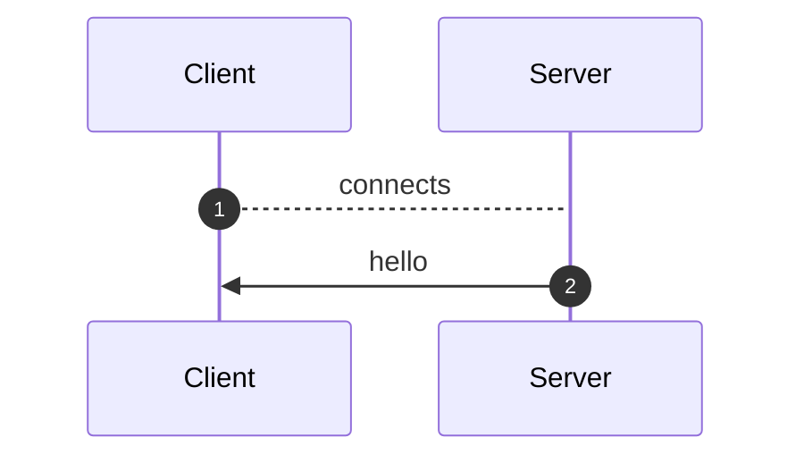
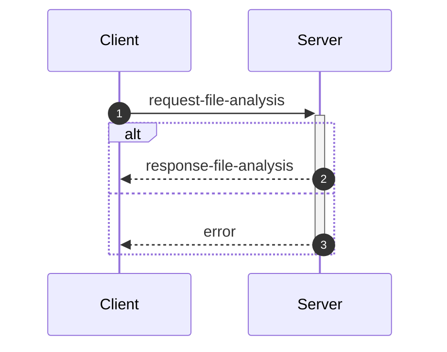
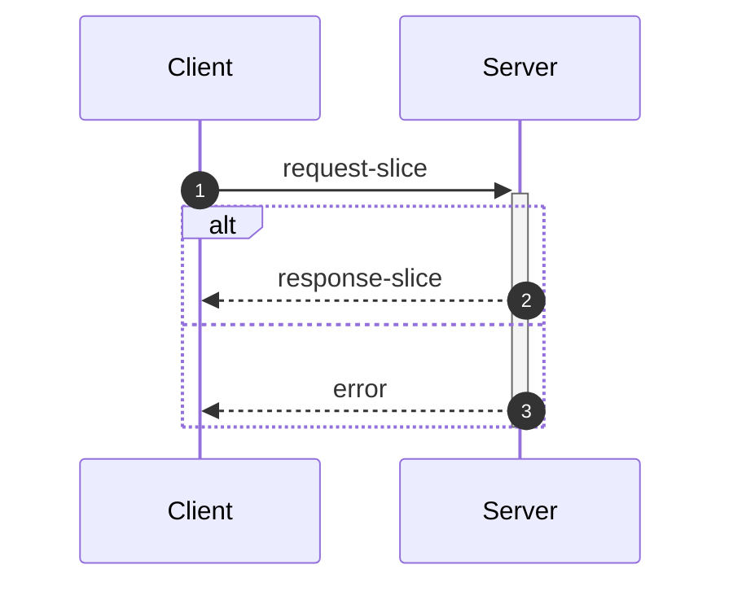
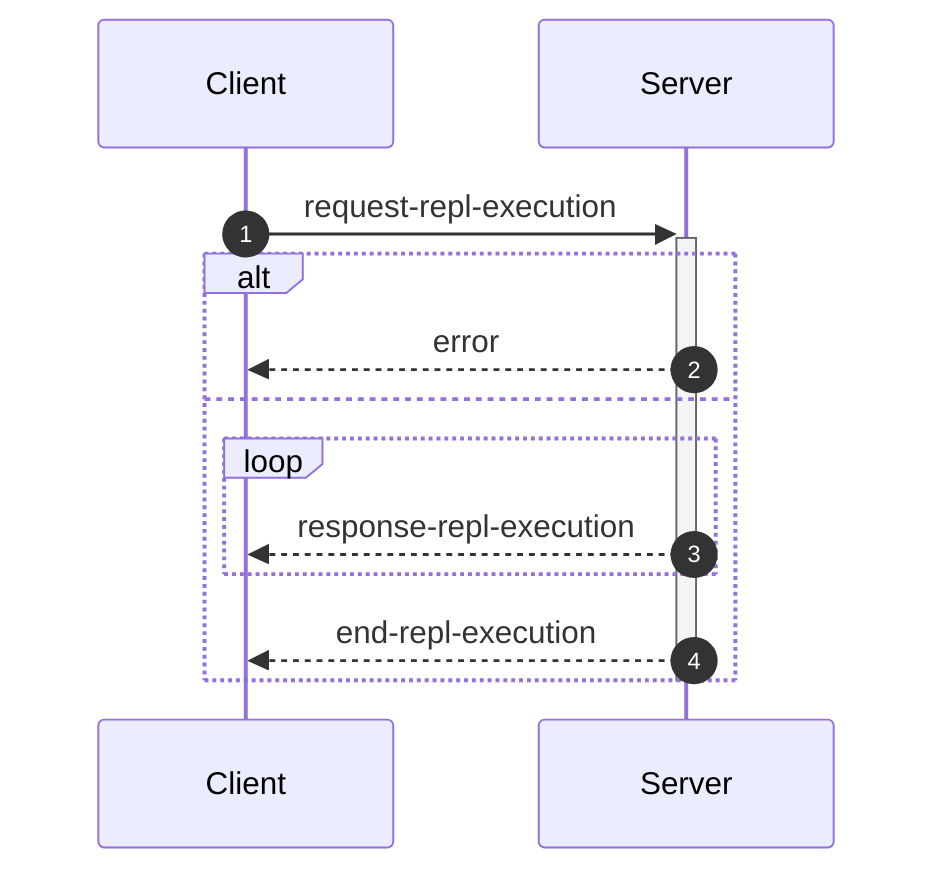

_<span title="an overview of flowR's interface">Generated</span> from '[wiki-interface.ts](https://github.com/flowr-analysis/flowr/tree/main/src/documentation/wiki-interface.ts "src/documentation/wiki-interface.ts")' on 2026-10-24, 20:38:50 UTC (v2.16.6, R v4.6.1), do not edit directly._

Although far from being as detailed as the in-depth explanation of [_flowR_](https://github.com/flowr-analysis/flowr/wiki/Core),
this wiki page explains how to interface with _flowR_ in more detail.
In general, command line arguments and other options provide short descriptions on hover over.

* [💻 Using the REPL](#using-the-repl)
* [⚙️ Configuring FlowR](#configuring-flowr)
* [⚒️ Writing Code](#writing-code)
* [💬 Communicating with the Server](#communicating-with-the-server)

<a id='using-the-repl'></a>
## 💻 Using the REPL

> [!NOTE]
> To execute arbitrary R commands with a repl request, _flowR_ has to be started explicitly with <span title="Description (Command Line Argument): Allow to access the underlying R session when using flowR (security warning: this allows the execution of arbitrary R code!)">`--r-session-access`</span>.
> Please be aware that this introduces a security risk and note that this relies on the [`r-shell` engine](https://github.com/flowr-analysis/flowr/wiki/Engines) .

Although primarily meant for users to explore,
there is nothing which forbids calling _flowR_ as a subprocess to use standard-in, -output, and -error
for communication (although you can access the REPL using the server as well,
with the [REPL Request](#message-request-repl-execution) message).

The read-eval-print loop&nbsp;(REPL) works relatively simple.
You can submit an expression (using <kbd>Enter</kbd>),
which is interpreted as an R&nbsp;expression by default but interpreted as a *command* if it starts with a colon (`:`).
The best command to get started with the REPL is <span title="Description (Repl Command): Show help information (aliases: :h, :?)">`:help`</span>.
Besides, you can leave the REPL either with the command <span title="Description (Repl Command): End the repl (aliases: :q, :exit)">`:quit`</span> or by pressing <kbd>Ctrl</kbd>+<kbd>C</kbd> twice.
When writing a *command*, you may press <kbd>Tab</kbd> to get a list of completions, if available.
Multiple commands can be entered in a single line by separating them with a semicolon (`;`), e.g. `:parse "x<-2"; :df*`.
If a command is given without R code, the REPL will re-use R code given in a previous command.
The prior example will hence return first the parsed AST of the program and then the dataflow graph for `"x <- 2"`.

> [!NOTE]
> If you develop flowR, you may want to launch the repl using the `npm run main-dev` command, this way, you get a non-minified version of flowR with debug information and hot-reloading of source files.

<details>
<summary>Available Commands</summary>

We currently offer the following commands (this with a `[*]` suffix are available with and without the star):

| Command | Description |
| ------- | ----------- |
| **<span title="Description (Repl Command): End the repl (aliases: :q, :exit)">:quit</span>** | End the repl (aliases: **:<span title="Alias of ':quit'. End the repl">q</span>**, **:<span title="Alias of ':quit'. End the repl">exit</span>**) |
| **<span title="Description (Repl Command): Execute the given code as R code. This requires the `--r-session-access` flag to be set and requires the r-shell engine. (aliases: :e, :r)">:execute</span>** | Execute the given code as R code. This requires the `--r-session-access` flag to be set and requires the r-shell engine. (aliases: **:<span title="Alias of ':execute'. Execute the given code as R code. This requires the `--r-session-access` flag to be set and requires the r-shell engine.">e</span>**, **:<span title="Alias of ':execute'. Execute the given code as R code. This requires the `--r-session-access` flag to be set and requires the r-shell engine.">r</span>**) |
| **<span title="Description (Repl Command): Get mermaid code for the control-flow graph of R code (aliases: :cfg, :cf)">:controlflow[*]</span>** | Get mermaid code for the control-flow graph of R code (star: Returns the URL to mermaid.live) (aliases: **:<span title="Alias of ':controlflow'. Get mermaid code for the control-flow graph of R code">cfg</span>**, **:<span title="Alias of ':controlflow'. Get mermaid code for the control-flow graph of R code">cf</span>**) |
| **<span title="Description (Repl Command): Get mermaid code for the control-flow graph with basic blocks (aliases: :cfgb, :cfb)">:controlflowbb[*]</span>** | Get mermaid code for the control-flow graph with basic blocks (star: Returns the URL to mermaid.live) (aliases: **:<span title="Alias of ':controlflowbb'. Get mermaid code for the control-flow graph with basic blocks">cfgb</span>**, **:<span title="Alias of ':controlflowbb'. Get mermaid code for the control-flow graph with basic blocks">cfb</span>**) |
| **<span title="Description (Repl Command): Get mermaid code for the dataflow graph (aliases: :d, :df)">:dataflow[*]</span>** | Get mermaid code for the dataflow graph (star: Returns the URL to mermaid.live) (aliases: **:<span title="Alias of ':dataflow'. Get mermaid code for the dataflow graph">d</span>**, **:<span title="Alias of ':dataflow'. Get mermaid code for the dataflow graph">df</span>**) |
| **<span title="Description (Repl Command): Get mermaid code for the normalized AST of R code (aliases: :n)">:normalize[*]</span>** | Get mermaid code for the normalized AST of R code (star: Returns the URL to mermaid.live) (alias: **:<span title="Alias of ':normalize'. Get mermaid code for the normalized AST of R code">n</span>**) |
| **<span title="Description (Repl Command): Get mermaid code for the simplified dataflow graph (aliases: :ds, :dfs)">:dataflowsimple[*]</span>** | Get mermaid code for the simplified dataflow graph (star: Returns the URL to mermaid.live) (aliases: **:<span title="Alias of ':dataflowsimple'. Get mermaid code for the simplified dataflow graph">ds</span>**, **:<span title="Alias of ':dataflowsimple'. Get mermaid code for the simplified dataflow graph">dfs</span>**) |
| **<span title="Description (Repl Command): Inspect and extend the signature database: `query` (identical to :query @signature), `info <name>` for where a function comes from (identical to :query @function-info), `add <path>` to mount another database/source, `download` to fetch the full-history database. (aliases: :sig)">:signature</span>** | Inspect and extend the signature database: `query` (identical to :query @signature), `info <name>` for where a function comes from (identical to :query @function-info), `add <path>` to mount another database/source, `download` to fetch the full-history database. (alias: **:<span title="Alias of ':signature'. Inspect and extend the signature database: `query` (identical to :query @signature), `info <name>` for where a function comes from (identical to :query @function-info), `add <path>` to mount another database/source, `download` to fetch the full-history database.">sig</span>**) |
| **<span title="Description (Repl Command): Just calculates the DFG, but only prints summary info (aliases: :d#, :df#)">:dataflowsilent</span>** | Just calculates the DFG, but only prints summary info (aliases: **:<span title="Alias of ':dataflowsilent'. Just calculates the DFG, but only prints summary info">d#</span>**, **:<span title="Alias of ':dataflowsilent'. Just calculates the DFG, but only prints summary info">df#</span>**) |
| **<span title="Description (Repl Command): Prints ASCII Art of the parsed, unmodified AST (aliases: :p)">:parse</span>** | Prints ASCII Art of the parsed, unmodified AST (alias: **:<span title="Alias of ':parse'. Prints ASCII Art of the parsed, unmodified AST">p</span>**) |
| **<span title="Description (Repl Command): Prints the version of flowR as well as the current version of R">:version</span>** | Prints the version of flowR as well as the current version of R
| **<span title="Description (Repl Command): Query the given R code (use 'help' for more information)">:query[*]</span>** | Query the given R code (use 'help' for more information) (star: Similar to query, but returns the output in json format.)
| **<span title="Description (Repl Command): Returns an ASCII representation of the dataflow graph (aliases: :df!)">:dataflowascii</span>** | Returns an ASCII representation of the dataflow graph (alias: **:<span title="Alias of ':dataflowascii'. Returns an ASCII representation of the dataflow graph">df!</span>**) |
| **<span title="Description (Repl Command): Returns summarization stats for the normalized AST (aliases: :n#)">:normalize#</span>** | Returns summarization stats for the normalized AST (alias: **:<span title="Alias of ':normalize#'. Returns summarization stats for the normalized AST">n#</span>**) |
| **<span title="Description (Repl Command): Show help information (aliases: :h, :?)">:help</span>** | Show help information (aliases: **:<span title="Alias of ':help'. Show help information">h</span>**, **:<span title="Alias of ':help'. Show help information">?</span>**) |

</details>

> [!TIP]
> 
> As indicated by the examples before, all REPL commands that operate on code keep track of the state.
> Hence, if you run a command like <span title="Description (Repl Command, starred version): Returns the URL to mermaid.live; Base Command: Get mermaid code for the dataflow graph (aliases: :d*, :df*)">`:dataflow*`</span> without providing R code,
> the REPL will re-use the R code provided in a previous command.
> Likewise, doing this will benefit from incrementality!
> If you request the dataflow graph with `:df* x <- 2 * y` and then want to see the parsed AST with `:parse`,
> the REPL will re-use previously obtained information and not re-parse the code again.
> 		

Generally, many commands offer shortcut versions in the REPL. Many queries, for example, offer a shortened format (see the example below).
Of special note, the [Config Query](https://github.com/flowr-analysis/flowr/wiki/%5BQuery%5D-Config)
can be used to also modify the currently active configuration of _flowR_ within the REPL (see the [wiki page](https://github.com/flowr-analysis/flowr/wiki/%5BQuery%5D-Config) for more information).

### Example: Retrieving the Dataflow Graph

To retrieve a URL to the [mermaid](https://mermaid.js.org/) diagram of the dataflow of a given expression,
use <span title="Description (Repl Command, starred version): Returns the URL to mermaid.live; Base Command: Get mermaid code for the dataflow graph (aliases: :d*, :df*)">`:dataflow*`</span> (or <span title="Description (Repl Command): Get mermaid code for the dataflow graph (aliases: :d, :df)">`:dataflow`</span> to get the mermaid code in the cli):

```shell
$ docker run -it --rm eagleoutice/flowr # or npm run flowr 
flowR repl v2.16.6, R grammar v14 (tree-sitter engine)
R> :dataflow* y <- 1 + x
```

<details>
<summary style='color:gray'>Output</summary>

```text
https://mermaid.live/view#base64:eyJjb2RlIjoiZmxvd2NoYXJ0IFREXG4gICAgMXt7XCJgKiM5MTtSTnVtYmVyIzkzOyogKioxKipcbiAgICAgICoxLjYqICgqKmlkOiAxKiopYFwifX1cbiAgICAyKFtcImAqIzkxO1JTeW1ib2wjOTM7KiAqKngqKlxuICAgICAgKjEuMTAqICgqKmlkOiAyKiopYFwiXSlcbiAgICAzW1tcImAqIzkxO1JCaW5hcnlPcCM5MzsqIGJhc2UjNTg7IzU4OyoqIzQzOyoqXG4gICAgICAqMS42LTEwKiAoKippZDogMyoqKVxuICAgIGFyZzogKDEsIDIpYFwiXV1cbiAgICBidWlsdC1pbjpfNDNfW1wiYEJ1aWx0LUluOlxuIzQzO2BcIl1cbiAgICBzdHlsZSBidWlsdC1pbjpfNDNfIHN0cm9rZTpncmF5LGZpbGw6Z3JheSxzdHJva2Utd2lkdGg6MnB4LG9wYWNpdHk6Ljg7XG4gICAgMFtcImAqIzkxO1JTeW1ib2wjOTM7KiAqKnkqKlxuICAgICAgKjEuMSogKCoqaWQ6IDAqKiwgdjogMylgXCJdXG4gICAgNFtbXCJgKiM5MTtSQmluYXJ5T3AjOTM7KiBiYXNlIzU4OyM1ODsqKiM2MDsjNDU7KipcbiAgICAgICoxLjEtMTAqICgqKmlkOiA0KiopXG4gICAgYXJnOiAoMCwgMylgXCJdXVxuICAgIGJ1aWx0LWluOl82MF8tW1wiYEJ1aWx0LUluOlxuIzYwOyM0NTtgXCJdXG4gICAgc3R5bGUgYnVpbHQtaW46XzYwXy0gc3Ryb2tlOmdyYXksZmlsbDpncmF5LHN0cm9rZS13aWR0aDoycHgsb3BhY2l0eTouODtcbiAgICAxIC0uLT58XCJmbG93XCJ8IDJcbiAgICBsaW5rU3R5bGUgMCBzdHJva2U6Z3JheSxjb2xvcjpncmF5O1xuICAgIDIgLS4tPnxcImZsb3dcInwgM1xuICAgIGxpbmtTdHlsZSAxIHN0cm9rZTpncmF5LGNvbG9yOmdyYXk7XG4gICAgMyAtLT58XCJyZWFkcywgYXJnXCJ8IDFcbiAgICAzIC0tPnxcInJlYWRzLCBhcmdcInwgMlxuICAgIDMgLS4tPnxcImZsb3dcInwgMFxuICAgIGxpbmtTdHlsZSA0IHN0cm9rZTpncmF5LGNvbG9yOmdyYXk7XG4gICAgMyAtLi0+fFwicmVhZHMsIGNhbGxzXCJ8IGJ1aWx0LWluOl80M19cbiAgICBsaW5rU3R5bGUgNSBzdHJva2U6Z3JheTtcbiAgICAwIC0tPnxcImRlZmluZWQtYnksIGZsb3dcInwgNFxuICAgIDAgLS0+fFwiZGVmaW5lZC1ieVwifCAzXG4gICAgNCAtLT58XCJyZWFkcywgYXJnXCJ8IDNcbiAgICA0IC0tPnxcInJldHVybnMsIGFyZ1wifCAwXG4gICAgNCAtLi0+fFwicmVhZHMsIGNhbGxzXCJ8IGJ1aWx0LWluOl82MF8tXG4gICAgbGlua1N0eWxlIDEwIHN0cm9rZTpncmF5OyIsIm1lcm1haWQiOnsiYXV0b1N5bmMiOnRydWV9fQ==
```

Retrieve the dataflow graph of the expression `y <- 1 + x`. It looks like this:


<details>

<summary style="color:gray">R Code of the Dataflow Graph</summary>

The analysis ran (parse and normalize with the [tree-sitter](https://github.com/flowr-analysis/flowr/wiki/Engines) engine) in the generation environment. No [signature database](https://github.com/flowr-analysis/flowr/wiki/Signature-Database) is mounted, so `library()` attaches no exports (base-R names are still qualified, e.g., `stats::acf`). 
We encountered no unknown side effects during the analysis.

```r
y <- 1 + x
```

</details>

</details>

For small graphs like this, <span title="Description (Repl Command): Returns an ASCII representation of the dataflow graph (aliases: :df!)">`:dataflowascii`</span> also provides an ASCII representation directly in the REPL:

```shell
$ docker run -it --rm eagleoutice/flowr # or npm run flowr 
flowR repl v2.16.6, R grammar v14 (tree-sitter engine)
R> :df! y <- 1 + x
```

<details open>
<summary style='color:gray'>Output</summary>

```text
                        v<0>v
 c<4>c──────────────────| y |
 |<- |     ┌────────────v---v
 c---c     │
    │   c<3>c   0<1>0
    └───| + |───| 1 |───u<2>u
        c---c   0---0   | x |
           └────────────u---u
Edges:
3 -> 1: reads, arg          3 -> 2: reads, arg
3 -> 0: flows-to            1 -> 2: flows-to
2 -> 3: flows-to            4 -> 3: reads, arg
4 -> 0: returns, arg        0 -> 4: defined-by, flows-to
0 -> 3: defined-by
```

Retrieve the dataflow graph of the expression `y <- 1 + x` as ASCII art.

</details>

For the slicing with <span title="Description (Repl Command): Static backwards executable slicer for R">`:slicer`</span>, you have access to the same [magic comments](#slice-magic-comments) as with the [slice request](#message-request-slice).
Pass `--inline` to splice resolvable `source()` calls into the reconstruction so the slice is a single self-contained R text (the same as the static slice query's `inlineSources` flag).
See `--help` for more flags!

### Example: Interfacing with the File System

Many commands that allow for an R-expression (like <span title="Description (Repl Command, starred version): Returns the URL to mermaid.live; Base Command: Get mermaid code for the dataflow graph (aliases: :d*, :df*)">`:dataflow*`</span>) allow for a file as well
if the argument starts with `file://`.
If you are working from the root directory of the _flowR_ repository, the following gives you the parsed AST of the example file using the <span title="Description (Repl Command): Prints ASCII Art of the parsed, unmodified AST (aliases: :p)">`:parse`</span> command:

> **Watch mode**: Replace `file://` with `watch://` to enter watch mode.
> flowR runs the command immediately and then re-runs it every time the file (or any file inside the folder) changes.
> Enter any other command to leave watch mode.
> For example: `:df watch://analysis.R`

```shell
$ docker run -it --rm eagleoutice/flowr # or npm run flowr 
flowR repl v2.16.6, R grammar v14 (tree-sitter engine)
R> :parse file://test/testfiles/example.R
```

<details>
<summary style='color:gray'>Output</summary>

```text
File: test/testfiles/example.R

program
├ binaryoperator
│ ├ identifier "sum" (1:1─4)
│ ├ <- "<-" (1:5─7)
│ ╰ float "0" (1:8─9)
├ binaryoperator
│ ├ identifier "product" (2:1─8)
│ ├ <- "<-" (2:9─11)
│ ╰ float "1" (2:12─13)
├ binaryoperator
│ ├ identifier "w" (3:1─2)
│ ├ <- "<-" (3:3─5)
│ ╰ float "7" (3:6─7)
├ binaryoperator
│ ├ identifier "N" (4:1─2)
│ ├ <- "<-" (4:3─5)
│ ╰ float "10" (4:6─8)
├ forstatement
│ ├ for "for" (6:1─4)
│ ├ ( "(" (6:5─6)
│ ├ identifier "i" (6:6─7)
│ ├ in "in" (6:8─10)
│ ├ binaryoperator
│ │ ├ float "1" (6:11─12)
│ │ ├ : ":" (6:12─13)
│ │ ╰ parenthesizedexpression
│ │   ├ ( "(" (6:13─14)
│ │   ├ binaryoperator
│ │   │ ├ identifier "N" (6:14─15)
│ │   │ ├ - "-" (6:15─16)
│ │   │ ╰ float "1" (6:16─17)
│ │   ╰ ) ")" (6:17─18)
│ ├ ) ")" (6:18─19)
│ ╰ bracedexpression
│   ├ { "{" (6:20─21)
│   ├ binaryoperator
│   │ ├ identifier "sum" (7:3─6)
│   │ ├ <- "<-" (7:7─9)
│   │ ╰ binaryoperator
│   │   ├ binaryoperator
│   │   │ ├ identifier "sum" (7:10─13)
│   │   │ ├ + "+" (7:14─15)
│   │   │ ╰ identifier "i" (7:16─17)
│   │   ├ + "+" (7:18─19)
│   │   ╰ identifier "w" (7:20─21)
│   ├ binaryoperator
│   │ ├ identifier "product" (8:3─10)
│   │ ├ <- "<-" (8:11─13)
│   │ ╰ binaryoperator
│   │   ├ identifier "product" (8:14─21)
│   │   ├  "" (8:22─23)
│   │   ╰ identifier "i" (8:24─25)
│   ╰ } "}" (9:1─2)
├ call
│ ├ identifier "cat" (11:1─4)
│ ╰ arguments
│   ├ ( "(" (11:4─5)
│   ├ argument
│   │ ╰ string
│   │   ├ " "\"" (11:5─6)
│   │   ├ stringcontent "Sum:" (11:6─10)
│   │   ╰ " "\"" (11:10─11)
│   ├ comma "," (11:11─12)
│   ├ argument
│   │ ╰ identifier "sum" (11:13─16)
│   ├ comma "," (11:16─17)
│   ├ argument
│   │ ╰ string
│   │   ├ " "\"" (11:18─19)
│   │   ├ stringcontent
│   │   │ ╰ escapesequence "\\n" (11:19─21)
│   │   ╰ " "\"" (11:21─22)
│   ╰ ) ")" (11:22─23)
╰ call
  ├ identifier "cat" (12:1─4)
  ╰ arguments
    ├ ( "(" (12:4─5)
    ├ argument
    │ ╰ string
    │   ├ " "\"" (12:5─6)
    │   ├ stringcontent "Product:" (12:6─14)
    │   ╰ " "\"" (12:14─15)
    ├ comma "," (12:15─16)
    ├ argument
    │ ╰ identifier "product" (12:17─24)
    ├ comma "," (12:24─25)
    ├ argument
    │ ╰ string
    │   ├ " "\"" (12:26─27)
    │   ├ stringcontent
    │   │ ╰ escapesequence "\\n" (12:27─29)
    │   ╰ " "\"" (12:29─30)
    ╰ ) ")" (12:30─31)
```

Retrieve the parsed AST of the example file.

<details>

<summary>File Content</summary>

```r
sum <- 0
product <- 1
w <- 7
N <- 10

for (i in 1:(N-1)) {
  sum <- sum + i + w
  product <- product * i
}

cat("Sum:", sum, "\n")
cat("Product:", product, "\n")
```

</details>

As _flowR_ directly transforms this AST the output focuses on being human-readable instead of being machine-readable.
		
</details>

### Example: Run a Query

You can run any query supported by _flowR_ using the <span title="Description (Repl Command): Query the given R code (use 'help' for more information)">`:query`</span> command.
For example, to obtain the shapes of all data frames in a given piece of code, you can run:

```shell
$ docker run -it --rm eagleoutice/flowr # or npm run flowr 
flowR repl v2.16.6, R grammar v14 (tree-sitter engine)
R> :query @absint df-shape "x <- data.frame(a = 1:10, b = 1:10)\ny <- x$a"
```

<details open>
<summary style='color:gray'>Output</summary>

```text
Query: absint (1 ms)
```

Retrieve the shapes of all data frames in the given code.

</details>

To run the linter on a file, you can use (in this example, we just issue the `dead-code` linter on a small piece of code):

```shell
$ docker run -it --rm eagleoutice/flowr # or npm run flowr 
flowR repl v2.16.6, R grammar v14 (tree-sitter engine)
R> :query @linter rules:dead-code "if(FALSE) x <- 2"
```

<details open>
<summary style='color:gray'>Output</summary>

```text
Query: linter (1 ms)
   ╰ Dead Code (dead-code):
       ╰ certain:
           ╰ Code at 1.11-16
```

Run the linter on the given code, with only the `dead-code` rule enabled.

</details>

For more information on the available queries, please check out the [Query API](https://github.com/flowr-analysis/flowr/wiki/Query-API).

<a id='configuring-flowr'></a>
## ⚙️ Configuring FlowR

When running _flowR_, you may want to specify some behaviors with a dedicated configuration file.
By default, flowR looks for a file named `flowr.json` in the current working directory (or any higher directory).
You can also specify a different file with <span title="Description (Command Line Argument): The name of the configuration file to use">`--config-file`</span> or pass the configuration inline using <span title="Description (Command Line Argument): The flowR configuration to use, as a JSON string">`--config-json`</span>.
A `flowr.json` found this way belongs to the analyzed project, so flowR ignores its options that decide what flowR executes or loads
(`engines.*.wasmPath`, `engines.*.treeSitterWasmPath`, `engines.*.rPath`, `solver.sigdb.additionalPaths`, `solver.sigdb.downloadRepo`, `solver.sigdb.installedLibrary.paths`),
unless you pass <span title="Description (Command Line Argument): Keep the security-sensitive options (e.g., the R executable) of the flowr.json found in the working directory or a parent. Only use this for projects you trust.">`--trust-config`</span>.
To analyze code you do not trust, use the secure mode (<span title="Description (Command Line Argument): Run in secure mode for analyzing untrusted code: flowR does not start R (or any other process), does not access the network, does not search for project configs, and ignores security-sensitive options in every config. Cannot be disabled once enabled. Can also be enabled with the environment variable {italic FLOWR_SECURE_MODE=1}.">`--secure`</span>, see the [security policy](https://github.com/flowr-analysis/flowr/blob/main/.github/SECURITY.md)).
To inspect the current configuration, you can run flowr with the <span title="Description (Command Line Argument): Run with verbose logging (will be passed to the corresponding script)">`--verbose`</span> flag, or use the `config` [Query](https://github.com/flowr-analysis/flowr/wiki/Query-API).
Within the REPL this works by running the following:

```shell
:query @config
```

To work with the <a href="https://github.com/flowr-analysis/flowr/tree/main/src/config.ts#L119"><code><span title="The configuration file format for flowR.">FlowrConfig</span></code></a> you can use the provided helper objects alongside its methods like
<a href="https://github.com/flowr-analysis/flowr/tree/main/src/config.ts#L914"><code><span title="Creates a new flowr config that has the updated values.">FlowrConfig::<b>amend</b></span></code></a>.
The schema below documents every option; the ones you most likely want are:

- <a href="https://github.com/flowr-analysis/flowr/wiki/Interface#configuring-flowr" title="Configuration Option (boolean): Whether source calls should be ignored, causing {@link processSourceCall}&#39;s behavior to be skipped.">ignoreSourceCalls</a>: ignore source calls when analyzing the code, i.e., ignore the inclusion of other files.
- <a href="https://github.com/flowr-analysis/flowr/wiki/Interface#configuring-flowr" title="Configuration Option (boolean): Whether load calls should be ignored, causing {@link processLoadCall}&#39;s behavior to be skipped.">ignoreLoadCalls</a>: ignore load calls when analyzing the code, i.e., ignore the loading of r-data files.
- <a href="https://github.com/flowr-analysis/flowr/wiki/Interface#configuring-flowr" title="Configuration Option (object): Do you want to overwrite (parts) of the builtin definition?">semantics.environment.overwriteBuiltIns</a>: overwrite _flowR_'s handling of built-in functions, or clear the preset definitions entirely.
  See [Configure BuiltIn Semantics](#configure-builtin-semantics) for more information.
- <a href="https://github.com/flowr-analysis/flowr/wiki/Interface#configuring-flowr" title="Configuration Option (string): How to resolve variables and their values. (one of &quot;disabled&quot;, &quot;alias&quot;, &quot;builtin&quot;)">solver.variables</a>: how to resolve variables and their values (`disabled`, `alias`, `builtin`).
- <a href="https://github.com/flowr-analysis/flowr/wiki/Interface#configuring-flowr" title="Configuration Option (array): The engine or set of engines to use for interacting with R code. An empty array means all available engines will be used.">engines</a> and <a href="https://github.com/flowr-analysis/flowr/wiki/Interface#configuring-flowr" title="Configuration Option (string): The default engine to use for interacting with R code. If this is undefined, an arbitrary engine from the specified list will be used. (one of &quot;tree-sitter&quot;, &quot;r-shell&quot;)">defaultEngine</a>: the engines used to interact with R code, see the [Engines wiki page](https://github.com/flowr-analysis/flowr/wiki/Engines).
- <a href="https://github.com/flowr-analysis/flowr/wiki/Interface#configuring-flowr" title="Configuration Option (array): Files a framework loads on its own, without any source() call (e.g. global.R in a shiny app), in the order they are loaded; flowR orders the matching project files accordingly and analyzes them as one program. Entries are case-insensitive globs matched against the file path, a plain name matches any file with that name, and entries matching no project file are warned about. Usually set per project kind via specializeConfig.">project.implicitSources</a>: the files a framework loads without any `source()` call, in the order in which they are
  loaded. Entries are globs (e.g. `R/*.R`) matched against the file path ignoring capitalization; one matching no file is reported.
- <a href="https://github.com/flowr-analysis/flowr/wiki/Interface#configuring-flowr" title="Configuration Option (object): Overwrite (parts of) the configuration depending on the project kind flowR detects, e.g. to give a shiny app its implicit sources.">specializeConfig</a>: overwrite (parts of) the configuration depending on the kind of project _flowR_ detects
  (e.g. `shiny-app`), which is how a shiny app gets its implicit sources by default. What you configure directly wins.
- <a href="https://github.com/flowr-analysis/flowr/wiki/Interface#configuring-flowr" title="Configuration Option (string): Overwrite the project kind flowR would otherwise infer from the analyzed files, e.g. when auto-detection guesses wrong. (one of &quot;package&quot;, &quot;script&quot;, &quot;shiny-app&quot;, &quot;notebook&quot;, &quot;project&quot;, &quot;unknown&quot;)">project.useProjectType</a>: skip that detection and force a project kind yourself, when auto-detection guesses wrong.
- <a href="https://github.com/flowr-analysis/flowr/wiki/Interface#configuring-flowr" title="Configuration Option (array): The default plugins to load when creating a new instance of FlowrAnalyzer">defaultPlugins</a> and <a href="https://github.com/flowr-analysis/flowr/wiki/Interface#configuring-flowr" title="Configuration Option (array): The plugins to load in REPL mode">repl.plugins</a>: the plugins to load for a new <a href="https://github.com/flowr-analysis/flowr/tree/main/src/project/flowr-analyzer.ts#L205"><code><span title="Central class for conducting analyses with FlowR. Use the FlowrAnalyzerBuilder to create a new instance. If you want the original pattern of creating a pipeline and running all steps, you can still do this with FlowrAnalyzer#runFull . To inspect the context of the analyzer, use FlowrAnalyzer#inspectContext (if you are a plugin and need to modify it, use FlowrAnalyzer#context instead).">FlowrAnalyzer</span></code></a> and in the REPL
  (use `flowr:default` to reference the former).

So you can configure _flowR_ by adding a file like the following:

<details>

<summary>Example Configuration File</summary>

```json
{
  "ignoreSourceCalls": true,
  "ignoreLoadCalls": true,
  "semantics": {
    "environment": {
      "overwriteBuiltIns": {
        "definitions": [
          {
            "type": "function",
            "names": [
              "foo"
            ],
            "processor": "builtin:assign",
            "config": {}
          }
        ]
      }
    }
  },
  "defaultPlugins": [
    "file:description",
    "versions:description"
  ],
  "repl": {
    "quickStats": false,
    "dfProcessorHeat": false,
    "hints": true,
    "plugins": [
      "flowr:default"
    ]
  },
  "project": {
    "resolveUnknownPathsOnDisk": true,
    "implicitSources": [
      "global.R",
      "app.R"
    ]
  },
  "linter": {
    "disabledRules": []
  },
  "specializeConfig": {
    "shiny-app": {
      "project": {
        "implicitSources": [
          "global.R",
          "ui.R",
          "server.R",
          "app.R"
        ]
      }
    }
  },
  "engines": [
    {
      "type": "r-shell"
    }
  ],
  "solver": {
    "variables": "alias",
    "evalStrings": true,
    "trackEnvironments": true,
    "sigdb": {
      "enabled": true,
      "loadProjectDependencies": true,
      "eagerlyLoad": false,
      "eagerlyLoadExports": false,
      "linkBaseR": false,
      "linkDescriptionDependencies": false
    },
    "resolveSource": {
      "dropPaths": "no",
      "ignoreCapitalization": true,
      "inferWorkingDirectory": "active-script",
      "searchPath": []
    },
    "instrument": {},
    "slicer": {
      "threshold": 50
    }
  },
  "abstractInterpretation": {
    "wideningThreshold": 4,
    "followCalls": true,
    "dataFrame": {
      "maxColNames": 20,
      "readLoadedData": {
        "readExternalFiles": true,
        "maxReadLines": 1000000
      }
    }
  },
  "incremental": {
    "alwaysIncremental": false,
    "parsing": {
      "activated": false,
      "heuristics": {
        "activated": true,
        "mtime": true,
        "linesFrom": 500,
        "bytesFrom": 50000,
        "alwaysWithEdits": false,
        "minFiles": 1
      }
    }
  },
  "gas": {
    "thresholds": {
      "memory": {
        "problematic": 0.7,
        "critical": 0.9
      },
      "timeMs": {
        "problematic": 100000,
        "critical": 120000
      }
    },
    "features": {}
  }
}
```

</details>

<details>
<a id='configure-builtin-semantics'></a>
<summary>Configure Built-In Semantics</summary>

`semantics/environment/overwriteBuiltins` accepts two keys:

- `loadDefaults` (boolean, initially `true`): If set to `true`, the default built-in definitions are loaded before applying the custom definitions. Setting this flag to `false` explicitly disables the loading of the default definitions.
- `definitions` (array, initially empty): Allows to overwrite or define new built-in elements. Each object within must have a `type` which is one of the below. Furthermore, they may define a string array of `names` which specifies the identifiers to bind the definitions to. You may use `assumePrimitive` to specify whether _flowR_ should assume that this is a primitive non-library definition (so you probably just do not want to specify the key).

  | Type            | Description                                                                                                                                                                                                                                                                                              | Example                                                                                                    |
  | --------------- | -------------------------------------------------------------------------------------------------------------------------------------------------------------------------------------------------------------------------------------------------------------------------------------------------------- | ---------------------------------------------------------------------------------------------------------- |
  | `constant`    | Additionally allows for a `value` this should resolve to.                                                                                                                                                                                                                                                | `{ type: 'constant', names: ['NULL', 'NA'],  value: null }`                                                |
  | `function`    | Is a rather flexible way to define and bind built-in functions. For the time, we do not have extensive documentation to cover all the cases, so please either consult the sources with the `default-builtin-config.ts` or open a [new issue](https://github.com/flowr-analysis/flowr/issues/new/choose). | `{ type: 'function', names: ['next'], processor: 'builtin:d', config: { cfg: ExitPointType.Next } }` |
  | `replacement` | A comfortable way to specify replacement functions like `$<-` or `names<-`. `suffixes` describes the... suffixes to attach automatically. | `{ type: 'replacement', suffixes: ['<-', '<<-'], names: ['[', '[['] }` |

</details>

<details>

<summary style='color:gray'>Full Configuration-File Schema</summary>

- _The configuration file format for flowR._ (object)
    - **logLevel** [optional] _flowR's global minimum log level, applied when the config is loaded._ (string)
        Only allows: 'silly', 'trace', 'debug', 'info', 'warn', 'error', 'fatal'
    - **ignoreSourceCalls** [optional] _Whether source calls should be ignored, causing {@link processSourceCall}'s behavior to be skipped._ (boolean)
    - **ignoreLoadCalls** [optional] _Whether load calls should be ignored, causing {@link processLoadCall}'s behavior to be skipped._ (boolean)
    - **semantics** _Configure language semantics and how flowR handles them._ (object)
        - **environment** [optional] _Semantics regarding how to handle the R environment._ (object)
            - **overwriteBuiltIns** [optional] _Do you want to overwrite (parts) of the builtin definition?_ (object)
                - **loadDefaults** [optional] _Should the default configuration still be loaded?_ (boolean)
                - **definitions** [optional] _The definitions to load/overwrite._ (array)
                Valid item types:
                    - (object)
    - **defaultPlugins** [optional] _The default plugins to load when creating a new instance of FlowrAnalyzer_ (array)
    Valid item types:
        - (alternatives)
            - (string)
            - (array)
    - **repl** _Configuration options for the REPL._ (object)
        - **quickStats** [optional] _Whether to show quick stats in the REPL after each evaluation._ (boolean)
        - **dfProcessorHeat** [optional] _This instruments the dataflow processors to count how often each processor is called._ (boolean)
        - **hints** [optional] _Whether to show dim inline hints on the empty prompt (automatically disabled on non-interactive terminals)._ (boolean)
        - **plugins** [optional] _The plugins to load in REPL mode_ (array)
        Valid item types:
            - (alternatives)
                - (string)
                - (array)
        - **autoUseFileProtocol** [optional] _Prepend the file protocol to a repl input that looks like a path, instead of only warning about it._ (boolean)
        - **queryStats** [optional] _Whether `:query` closes with the line stating how long the queries took (`:query*` never prints it)._ (boolean)
        - **showPlugins** [optional] _Whether `:version` grays out the plugins that did not activate during the last analysis._ (boolean)
    - **project** _Project specific configuration options._ (object)
        - **resolveUnknownPathsOnDisk** [optional] _Whether to resolve unknown paths loaded by the r project disk when trying to source/analyze files._ (boolean)
        - **failOnInaccessiblePath** [optional] _Whether a directory that cannot be traversed during file discovery (e.g. due to permissions) aborts the analysis; when false (the default) such paths are logged and skipped._ (boolean)
        - **basePackages** [optional] _The packages considered part of R itself (base and recommended); if unset, flowR uses its built-in list._ (array)
        Valid item types:
            - (string)
        - **implicitSources** [optional] _Files a framework loads on its own, without any source() call (e.g. global.R in a shiny app), in the order they are loaded; flowR orders the matching project files accordingly and analyzes them as one program. Entries are case-insensitive globs matched against the file path, a plain name matches any file with that name, and entries matching no project file are warned about. Usually set per project kind via specializeConfig._ (array)
        Valid item types:
            - (string)
        - **useProjectType** [optional] _Overwrite the project kind flowR would otherwise infer from the analyzed files, e.g. when auto-detection guesses wrong._ (string)
            Only allows: 'package', 'script', 'shiny-app', 'notebook', 'project', 'unknown'
        - **assumeImplicitEcho** [optional] _Whether the top level of the analyzed code is echoed, so that every visible result printed there is collected as an output by the dependencies query (default true, false for a package)._ (boolean)
        - **discovery** [optional] _Scoping options for the default project discovery._ (object)
            - **full** [optional] _Collect every file below the project root (greedy) instead of only the files the detected project kind needs (default false)._ (boolean)
            - **perKind** [optional] _Per-kind include/exclude glob overrides layered on the default scoping._ (object)
            - **ignore** [optional] _Case-insensitive globs that drop matching files from the intelligent discovery, regardless of kind (e.g. .Renviron to ignore environment files)._ (array)
            Valid item types:
                - (string)
        - **classification** [optional] _Overrides for the signals flowR uses to classify the project kind._ (object)
            - **shinyDescriptionTypes** [optional] _DESCRIPTION Type: values that mark a shiny app._ (array)
            Valid item types:
                - (string)
            - **shinyEntryFiles** [optional] _File names a shiny app is assembled from._ (array)
            Valid item types:
                - (string)
            - **shinyUsagePattern** [optional] _Regex source evidencing shiny usage in an entry file._ (string)
            - **notebookExtensions** [optional] _File extensions marking a notebook._ (array)
            Valid item types:
                - (string)
    - **linter** _Linter configuration options._ (object)
        - **disabledRules** _Linting rule names excluded from the default rule set (a rule requested explicitly via a linter query still runs). Usually set per project kind via specializeConfig._ (array)
        Valid item types:
            - (string)
        - **disabledTags** [optional] _Linting rule tags whose rules are excluded from the default rule set (a rule requested explicitly via a linter query still runs). By default the cmd-check rules are disabled for everything but a package; a configured list replaces that default._ (array)
        Valid item types:
            - (string)
    - **inputSources** [optional] _Further frameworks the input-sources analysis should know about; entries are added to flowR's defaults._ (object)
        - **pure** [optional] _Functions that only pass the constantness of their arguments on._ (array)
        Valid item types:
            - (string)
        - **param** [optional] _Functions whose result is a 'param' input._ (array)
        Valid item types:
            - (string)
        - **file** [optional] _Functions whose result is a 'file' input._ (array)
        Valid item types:
            - (string)
        - **tempfile** [optional] _Functions whose result is a 'tempfile' input._ (array)
        Valid item types:
            - (string)
        - **glob** [optional] _Functions whose result is a 'glob' input._ (array)
        Valid item types:
            - (string)
        - **net** [optional] _Functions whose result is a 'net' input._ (array)
        Valid item types:
            - (string)
        - **rand** [optional] _Functions whose result is a 'rand' input._ (array)
        Valid item types:
            - (string)
        - **system** [optional] _Functions whose result is a 'system' input._ (array)
        Valid item types:
            - (string)
        - **ffi** [optional] _Functions whose result is a 'ffi' input._ (array)
        Valid item types:
            - (string)
        - **lang** [optional] _Functions whose result is a 'lang' input._ (array)
        Valid item types:
            - (string)
        - **options** [optional] _Functions whose result is a 'options' input._ (array)
        Valid item types:
            - (string)
        - **cmdline** [optional] _Functions whose result is a 'cmdline' input._ (array)
        Valid item types:
            - (string)
        - **user** [optional] _Functions whose result is a 'user' input._ (array)
        Valid item types:
            - (string)
        - **const** [optional] _Functions whose result is a 'const' input._ (array)
        Valid item types:
            - (string)
        - **scope** [optional] _Functions whose result is a 'scope' input._ (array)
        Valid item types:
            - (string)
        - **dconst** [optional] _Functions whose result is a 'dconst' input._ (array)
        Valid item types:
            - (string)
        - **unknown** [optional] _Functions whose result is a 'unknown' input._ (array)
        Valid item types:
            - (string)
        - **linkedObjects** [optional] _Objects a framework provides without a definition in the code, e.g. shiny's input._ (array)
        Valid item types:
            - (object)
        - **linkedEntryPoints** [optional] _Calls that hand a function to a framework, which binds its objects to the parameters by position._ (array)
        Valid item types:
            - (object)
    - **specializeConfig** [optional] _Overwrite (parts of) the configuration depending on the project kind flowR detects, e.g. to give a shiny app its implicit sources._ (object)
    - **engines** _The engine or set of engines to use for interacting with R code. An empty array means all available engines will be used._ (array)
    Valid item types:
        - (alternatives)
            - _The configuration for the tree sitter engine._ (object)
                - **type** [required] _Use the tree sitter engine._ (string)
                    Only allows: 'tree-sitter'
                - **wasmPath** [optional] _The path to the tree-sitter-r WASM binary to use. If this is undefined, this uses the default path._ (string)
                - **treeSitterWasmPath** [optional] _The path to the tree-sitter WASM binary to use. If this is undefined, this uses the default path._ (string)
                - **lax** [optional] _Whether to use the lax parser for parsing R code (allowing for syntax errors). If this is undefined, the strict parser will be used._ (boolean)
            - _The configuration for the R shell engine._ (object)
                - **type** [required] _Use the R shell engine._ (string)
                    Only allows: 'r-shell'
                - **rPath** [optional] _The path to the R executable to use. If this is undefined, this uses the default path._ (string)
                - **pipeBind** [optional] _Whether to enable R's experimental pipe-bind operator "=>" by setting _R_USE_PIPEBIND_ for the R session (default false); R itself keeps this off by default, as it is experimental and has never shipped in a release version of R._ (boolean)
    - **defaultEngine** [optional] _The default engine to use for interacting with R code. If this is undefined, an arbitrary engine from the specified list will be used._ (string)
        Only allows: 'tree-sitter', 'r-shell'
    - **solver** _How to resolve constants, constraints, cells, ..._ (object)
        - **variables** _How to resolve variables and their values._ (string)
            Only allows: 'disabled', 'alias', 'builtin'
        - **evalStrings** _Should we include eval(parse(text="...")) calls in the dataflow graph?_ (boolean)
        - **trackEnvironments** [optional] _Track user-created environments (new.env, assign/get/local with envir=, dollar-assign, attach). When false, all envir-style calls fall through conservatively._ (boolean)
        - **sigdb** _Resolving library exports from a signature database._ (object)
            - **enabled** [optional] _Resolve library()/use() exports from a signature database (default true); when false no database is consulted._ (boolean)
            - **loadProjectDependencies** [optional] _Load the project's declared dependencies from its metadata files (DESCRIPTION Imports/Depends, rproject.toml, uvr.toml, renv.lock, rv.lock, uvr.lock) (default true); when false these files are not read for dependencies._ (boolean)
            - **eagerlyLoad** [optional] _Parse the database up front rather than on the first package load (default false, ignored if disabled)._ (boolean)
            - **eagerlyLoadExports** [optional] _Add a vertex for every export on load rather than on demand (default false); keeps the dataflow graph small._ (boolean)
            - **assumedRVersion** [optional] _R version assumed when resolving versioned (base-R) exports: a pin like "4.5" or "auto" to detect the installed R (default "auto")._ (string)
            - **linkBaseR** [optional] _Eagerly attach base-R namespaces so bare base calls resolve without library() (default false)._ (boolean)
            - **linkBaseRCalls** [optional] _Add a lightweight Reads edge from a bare base-R call to its signature-database function vertex (default false; base-R qualification is edge-free otherwise)._ (boolean)
            - **linkPackageCalls** [optional] _Add a lightweight Reads edge from a resolved package call to its signature-database function vertex (default false)._ (boolean)
            - **linkDescriptionDependencies** [optional] _Eagerly attach the namespaces of the project's declared DESCRIPTION dependencies (Imports/Depends) so their exports resolve without an explicit library() (default false)._ (boolean)
            - **warmInBackground** [optional] _Decompress the hot shards (base + most-downloaded) in a background task on startup so the first library() lookup is warm (default false; for long-running servers/REPLs)._ (boolean)
            - **additionalPaths** [optional] _Extra directories or bundle/manifest files searched for signature databases (alongside the shipped default and $FLOWR_SIGDB_DIR); a downloaded full-history bundle placed here is mounted automatically._ (array)
            Valid item types:
                - (string)
            - **downloadRepo** [optional] _GitHub owner/repo the full-history bundle is downloaded from via ":signature download" (default "flowr-analysis/flowr", release tag "sigdb-v<flowR-version>")._ (string)
            - **autoSync** [optional] _On startup, re-download shards whose committed sigdb.remote.json hash no longer matches the cache, in the background (default false; opt-in network sync after a git pull)._ (boolean)
            - **installedLibrary** [optional] _Recovering packages no signature database knows from the copy installed on this machine._ (object)
                - **enabled** [required] _Recover packages no signature database knows from their installed copy (default false)._ (boolean)
                - **paths** [optional] _Library directories to search; when empty they are discovered from the environment and the project._ (array)
                Valid item types:
                    - (string)
                - **useEnvironment** [optional] _Search the libraries R_LIBS_USER/R_LIBS/R_LIBS_SITE name (default true)._ (boolean)
                - **useProjectLibrary** [optional] _Search a project-local renv/packrat library (default true)._ (boolean)
                - **maxDepth** [optional] _How far to descend into the nested layout of a project-local library (default 3)._ (number)
                - **packages** [optional] _Only recover packages whose name matches one of these regular expressions; empty means any._ (array)
                Valid item types:
                    - (string)
            - **blobCacheBudgetMb** [optional] _How many MiB of decoded package blobs every open bundle may hold together (default 16)._ (number)
            - **versionSelection** [optional] _When a project constrains a dependency, resolve to the newest (default), oldest, or system-installed version satisfying it; system needs R and falls back to newest. Base-R packages always resolve against the assumed R version._ (string)
                Only allows: 'newest', 'oldest', 'system'
            - **versionOverrides** [optional] _Force an exact version for specific packages (name -> version), overriding both the project constraint and the versionSelection policy (default {})._ (object)
        - **versionManagement** _Policies for reasoning about dependency versions._ (object)
            - **linkedVersionGroups** [optional] _Groups of packages that must resolve to the same version; version guessing intersects each group so its members stay mutually compatible (default [])._ (array)
            Valid item types:
                - (array)
                Valid item types:
                    - (string)
        - **assumeAttachedPackages** [optional] _Packages to treat as attached without a `library()` call, so what the built-in configuration states about them applies to the analyzed code. The base packages R attaches on startup already resolve without it._ (array)
        Valid item types:
            - (string)
        - **transitiveSideEffectRounds** [optional] _How many rounds the transitive side-effect fixpoint may run before it is cut off (default 32); the propagation stops on its own as soon as a round adds nothing._ (number)
        - **maxOverlayDepth** [optional] _How many binding overlays may stack on one environment frame before a write flattens them (default 4); a pure performance knob, trading lookup cost against copy cost without changing any result._ (number)
        - **instrument** (object)
            - **dataflowExtractors** [optional] _These keys are only intended for use within code, allowing to instrument the dataflow analyzer!_ (any)
        - **resolveSource** [optional] _If lax source calls are active, flowR searches for sourced files much more freely, based on the configurations you give it. This option is only in effect if `ignoreSourceCalls` is set to false._ (object)
            - **dropPaths** _Allow to drop the first or all parts of the sourced path, if it is relative._ (string)
                Only allows: 'no', 'once', 'all'
            - **ignoreCapitalization** _Search for filenames matching in the lowercase._ (boolean)
            - **inferWorkingDirectory** _Try to infer the working directory from the main or any script to analyze._ (string)
                Only allows: 'no', 'main-script', 'active-script', 'any-script'
            - **searchPath** _Additionally search in these paths._ (array)
            Valid item types:
                - (string)
            - **repeatedSourceLimit** [optional] _How often the same file can be sourced within a single run? Please be aware: in case of cyclic sources this may not reach a fixpoint so give this a sensible limit._ (number)
            - **applyReplacements** _Provide name replacements for loaded files_ (array)
            Valid item types:
                - (object)
            - **assumeFilesExist** [optional] _Assume a sourced file is always there, making what it defines certain instead of conditional on the source call._ (boolean)
        - **slicer** [optional] _The configuration for the slicer._ (object)
            - **threshold** [optional] _The maximum number of iterations to perform on a single function call during slicing._ (number)
            - **autoExtend** [optional] _If set, the slicer will gain an additional post-pass._ (boolean)
    - **abstractInterpretation** _The configuration options for abstract interpretation._ (object)
        - **wideningThreshold** _The threshold for the number of visitations of a node at which widening should be performed to ensure the termination of the fixpoint iteration._ (number)
        - **followCalls** _Whether the abstract interpretation is interprocedural, i.e. whether it steps into the functions a call may dispatch to._ (boolean)
        - **dataFrame** _The configuration of the shape inference for data frames._ (object)
            - **maxColNames** _The maximum number of columns names to infer for data frames before over-approximating the column names to top._ (number)
            - **readLoadedData** _Configuration options for reading data frame shapes from loaded external data files, such as CSV files._ (object)
                - **readExternalFiles** _Whether data frame shapes should be extracted from loaded external files, such as CSV files._ (boolean)
                - **maxReadLines** _The maximum number of lines to read when extracting data frame shapes from loaded files, such as CSV files._ (number)
    - **incremental** (object)
        - **alwaysIncremental** _Always take the incremental path, regardless of heuristics._ (boolean)
        - **parsing** (object)
            - **activated** _If set, incremental parsing will be used._ (boolean)
            - **heuristics** (object)
                - **activated** [optional] _If set, the heuristics for incremental parsing will be used._ (boolean)
                - **mtime** [optional] _Skip reparsing entirely if the file's modification time is unchanged since the last parse._ (boolean)
                - **linesFrom** [optional] _Only consider incremental parsing for files with at least this many lines._ (number)
                - **bytesFrom** [optional] _Only consider incremental parsing for files with at least this many bytes._ (number)
                - **alwaysWithEdits** [optional] _Always take the incremental path whenever there is a computed edit region, regardless of the other thresholds._ (boolean)
                - **minFiles** [optional] _Only apply these heuristics once the project has at least this many files loaded._ (number)
    - **gas** [optional] _Resource-usage guard (gas) configuration. All feature factors default to 0 (disabled). See https://github.com/flowr-analysis/flowr/wiki/Core#gas-resource-guard._ (object)
        - **thresholds** [optional] _Thresholds for all gas checks (scaled by per-feature factor), boundable per feature._ (object)
            - **memory** [optional] _Heap-usage fraction thresholds (0-1), either shared or given per feature key (with `default` covering the rest)._ (object)
                - **problematic** [optional] _Heap fraction (0-1) above which Problematic is returned, for every feature without an entry of its own._ (number)
                - **critical** [optional] _Heap fraction (0-1) above which Critical is returned, for every feature without an entry of its own._ (number)
            - **timeMs** [optional] _Elapsed analysis time thresholds in milliseconds, either shared or given per feature key (with `default` covering the rest)._ (object)
                - **problematic** [optional] _Elapsed ms above which Problematic is returned, for every feature without an entry of its own._ (number)
                - **critical** [optional] _Elapsed ms above which Critical is returned, for every feature without an entry of its own._ (number)
            - **steps** [optional] _Processed-AST-node thresholds, counted rather than sampled; only a key that arms a budget (`dataflow`) reads them._ (object)
                - **problematic** [optional] _Processed AST nodes above which Problematic is returned, for every feature without an entry of its own._ (number)
                - **critical** [optional] _Processed AST nodes above which the extraction is cut short, for every feature without an entry of its own._ (number)
            - **vertices** [optional] _Created-dataflow-vertex thresholds, counted like `steps`._ (object)
                - **problematic** [optional] _Created dataflow vertices above which Problematic is returned, for every feature without an entry of its own._ (number)
                - **critical** [optional] _Created dataflow vertices above which the extraction is cut short, for every feature without an entry of its own._ (number)
        - **features** [optional] _Per-feature sensitivity factors. 0 or absent disables gas checking for that feature. A factor of 2 makes the feature twice as sensitive. Recognised keys: `source`, `side-effect-linking`, `linter`, `slicer`, `dataflow`._ (object)
        - **countedCheckEvery** [optional] _How many counted steps pass between two accountings of an armed check, be it a dataflow budget or the slicer's traversal (default 128); trades overshoot against the cost of the check._ (number)
        - **heapProvider** [optional] _Custom heap statistics source (programmatic configs only), overriding the built-in v8/performance.memory detection._ (function)

</details>

<a id='writing-code'></a>
## ⚒️ Writing Code

_flowR_ can be used as a [module](https://www.npmjs.com/package/@eagleoutice/flowr) and offers several main classes and interfaces that are interesting for extension writers 
(see the [Visual Studio Code extension](https://marketplace.visualstudio.com/items?itemName=code-inspect.vscode-flowr) or the [Core](https://github.com/flowr-analysis/flowr/wiki/Core) wiki page for more information).

### Creating Analyses with _flowR_

Nowadays, instances of the <a href="https://github.com/flowr-analysis/flowr/tree/main/src/project/flowr-analyzer.ts#L205"><code><span title="Central class for conducting analyses with FlowR. Use the FlowrAnalyzerBuilder to create a new instance. If you want the original pattern of creating a pipeline and running all steps, you can still do this with FlowrAnalyzer#runFull . To inspect the context of the analyzer, use FlowrAnalyzer#inspectContext (if you are a plugin and need to modify it, use FlowrAnalyzer#context instead).">FlowrAnalyzer</span></code></a> should be used as central frontend to get analysis results from _flowR_.
The entry points an analysis is written against are re-exported from the package root (`import { FlowrAnalyzerBuilder } from '@eagleoutice/flowr'`);
everything else stays reachable under its own path, as in `@eagleoutice/flowr/dataflow/graph/graph`.
For example, a program slice can be created like this:

```ts
const analyzer = await new FlowrAnalyzerBuilder()
    .setEngine('tree-sitter')
    .build();
analyzer.addRequest('x <- 1\ny <- x\nx');
const result = await analyzer.query([
    {
        type:     'static-slice',
        criteria: ['3@x']
    }
]);
```

For more information, please have a look at the [Analyzer](https://github.com/flowr-analysis/flowr/wiki/Analyzer) wiki page, which explains how to construct and use the <a href="https://github.com/flowr-analysis/flowr/tree/main/src/project/flowr-analyzer.ts#L205"><code><span title="Central class for conducting analyses with FlowR. Use the FlowrAnalyzerBuilder to create a new instance. If you want the original pattern of creating a pipeline and running all steps, you can still do this with FlowrAnalyzer#runFull . To inspect the context of the analyzer, use FlowrAnalyzer#inspectContext (if you are a plugin and need to modify it, use FlowrAnalyzer#context instead).">FlowrAnalyzer</span></code></a> in more detail.
To work with specific perspectives, you can also consult the respective pages like the [Dataflow Graph](https://github.com/flowr-analysis/flowr/wiki/Dataflow-Graph) or the [Abstract Interpretation](https://github.com/flowr-analysis/flowr/wiki/Abstract-Interpretation) wiki pages.
### The Pipeline Executor (Low-Level Interface)

Once, in the beginning, _flowR_ was meant to produce a dataflow graph merely to provide *program slices*. 
However, with continuous updates, the [Dataflow Graph](https://github.com/flowr-analysis/flowr/wiki/Dataflow-Graph) repeatedly proves to be the more interesting part.
With this, we restructured _flowR_'s originally *hardcoded* pipeline to be far more flexible. 
Now, it can be theoretically extended or replaced with arbitrary steps, optional steps, and what we call 'decorations' of these steps. 
In short, a slicing pipeline using the <a href="https://github.com/flowr-analysis/flowr/tree/main/src/core/pipeline-executor.ts#L97"><code><span title="**Please note:** The PipelineExecutor is now considered to be a rather low-level API for flowR. While it still works and is the basis for all other layers, we strongly recommend using the FlowrAnalyzer and its builder to create and use an analyzer instance that is pre-configured for your use-case. The pipeline executor allows to execute arbitrary pipelines in a step-by-step fashion. If you are not...">PipelineExecutor</span></code></a> looks like this:

```ts

const slicer = new PipelineExecutor(DEFAULT_SLICING_PIPELINE, {
  parser:    new RShell(),
  request:   requestFromInput('x <- 1\nx + 1'),
  criterion: ['2@x']
})
const slice = await slicer.allRemainingSteps()
// console.log(slice.reconstruct.code)
```

<details><summary>More Information</summary>

If you compare this, with what you would have done with the old (and removed) `SteppingSlicer`, 
this essentially just requires you to replace the `SteppingSlicer` with the <a href="https://github.com/flowr-analysis/flowr/tree/main/src/core/pipeline-executor.ts#L97"><code><span title="**Please note:** The PipelineExecutor is now considered to be a rather low-level API for flowR. While it still works and is the basis for all other layers, we strongly recommend using the FlowrAnalyzer and its builder to create and use an analyzer instance that is pre-configured for your use-case. The pipeline executor allows to execute arbitrary pipelines in a step-by-step fashion. If you are not...">PipelineExecutor</span></code></a>
and to pass the <a href="https://github.com/flowr-analysis/flowr/tree/main/src/core/steps/pipeline/default-pipelines.ts#L18"><code>DEFAULT_SLICING_PIPELINE</code></a> as the first argument.
The <a href="https://github.com/flowr-analysis/flowr/tree/main/src/core/pipeline-executor.ts#L97"><code><span title="**Please note:** The PipelineExecutor is now considered to be a rather low-level API for flowR. While it still works and is the basis for all other layers, we strongly recommend using the FlowrAnalyzer and its builder to create and use an analyzer instance that is pre-configured for your use-case. The pipeline executor allows to execute arbitrary pipelines in a step-by-step fashion. If you are not...">PipelineExecutor</span></code></a>...

1. Provides structures to investigate the results of all intermediate steps
2. Can be executed step-by-step
3. Can repeat steps (e.g., to calculate multiple slices on the same input)

See the in-code documentation for more information.

</details>

### Using the <a href="https://github.com/flowr-analysis/flowr/tree/main/src/r-bridge/shell.ts#L144"><code><span title="The RShell represents an interactive session with the R interpreter. You can configure it by RShellOptions . At the moment we are using a live R session (and not networking etc.) to communicate with R easily, which allows us to install packages etc. However, this might and probably will change in the future (leaving this as a legacy mode :D)">RShell</span></code></a> to Interact with R

The <a href="https://github.com/flowr-analysis/flowr/tree/main/src/r-bridge/shell.ts#L144"><code><span title="The RShell represents an interactive session with the R interpreter. You can configure it by RShellOptions . At the moment we are using a live R session (and not networking etc.) to communicate with R easily, which allows us to install packages etc. However, this might and probably will change in the future (leaving this as a legacy mode :D)">RShell</span></code></a> class allows interfacing with the `R`&nbsp;ecosystem installed on the host system.
Please have a look at [flowR's Engines](https://github.com/flowr-analysis/flowr/wiki/Engines) for more information on alternatives (for example, the <a href="https://github.com/flowr-analysis/flowr/tree/main/src/r-bridge/lang-4.x/tree-sitter/tree-sitter-executor.ts#L29"><code><span title="Synchronous and (way) faster alternative to the RShell using tree-sitter.">TreeSitterExecutor</span></code></a>).

> [!IMPORTANT]
> 
> Each <a href="https://github.com/flowr-analysis/flowr/tree/main/src/r-bridge/shell.ts#L144"><code><span title="The RShell represents an interactive session with the R interpreter. You can configure it by RShellOptions . At the moment we are using a live R session (and not networking etc.) to communicate with R easily, which allows us to install packages etc. However, this might and probably will change in the future (leaving this as a legacy mode :D)">RShell</span></code></a> controls a new instance of the R&nbsp;interpreter, 
> make sure to call <code><a href="https://github.com/flowr-analysis/flowr/tree/main/src/r-bridge/shell.ts#L350"><span title="Close the current R session, makes the object effectively invalid (can no longer be reopened etc.)">RShell::<i>close</i></span></a>()</code> when you are done.

You can start a new "session" by constructing a new object with <code>new <a href="https://github.com/flowr-analysis/flowr/tree/main/src/r-bridge/shell.ts#L144"><span title="The RShell represents an interactive session with the R interpreter. You can configure it by RShellOptions . At the moment we are using a live R session (and not networking etc.) to communicate with R easily, which allows us to install packages etc. However, this might and probably will change in the future (leaving this as a legacy mode :D)">RShell</span></a>()</code>.

However, there are several options that may be of interest 
(e.g., to automatically revive the shell in case of errors or to control the name location of the R process on the system).

With a shell object (let's call it `shell`), you can execute R code by using <a href="https://github.com/flowr-analysis/flowr/tree/main/src/r-bridge/shell.ts#L213"><code><span title="sends the given command directly to the current R session will not do anything to alter input markers!">RShell::<i>sendCommand</i></span></code></a>,
for example <code>shell.<a href="https://github.com/flowr-analysis/flowr/tree/main/src/r-bridge/shell.ts#L213"><span title="sends the given command directly to the current R session will not do anything to alter input markers!">sendCommand</span></a>("1 + 1")</code>.
However, this does not return anything, so if you want to collect the output of your command, use
<a href="https://github.com/flowr-analysis/flowr/tree/main/src/r-bridge/shell.ts#L296"><code><span title="Send a command and collect the output">RShell::<i>sendCommandWithOutput</i></span></code></a> instead.

<a id='communicating-with-the-server'></a>
## 💬 Communicating with the Server

As explained in the [Overview](https://github.com/flowr-analysis/flowr/wiki/Overview), you can run the [TCP](https://de.wikipedia.org/wiki/Transmission_Control_Protocol)&nbsp;server by adding the <span title="Description (Command Line Argument): Do not drop into a repl, but instead start a server on the given port (default: 1042) and listen for messages.">`--server`</span> flag (and, due to the interactive mode, exit with the conventional <kbd>CTRL</kbd>+<kbd>C</kbd>).
Currently, every connection is handled by the same underlying `RShell` - so the server is not designed to handle many clients at a time.
Additionally, the server is not well guarded against attacks (e.g., you can theoretically spawn an arbitrary number of&nbsp;RShell sessions on the target machine).

Every message has to be given in a single line (i.e., without a newline in-between) and end with a newline character. Nevertheless, we will pretty-print example given in the following segments for the ease of reading.

> [!NOTE]
> 
> The default <span title="Description (Command Line Argument): Do not drop into a repl, but instead start a server on the given port (default: 1042) and listen for messages.">`--server`</span> uses a simple [TCP](https://de.wikipedia.org/wiki/Transmission_Control_Protocol)
> connection. If you want _flowR_ to expose a [WebSocket](https://de.wikipedia.org/wiki/WebSocket) server instead, add the <span title="Description (Command Line Argument): If the server flag is set, use websocket for messaging">`--ws`</span> flag (i.e., <span title="Description (Command Line Argument): Do not drop into a repl, but instead start a server on the given port (default: 1042) and listen for messages.">`--server`</span> <span title="Description (Command Line Argument): If the server flag is set, use websocket for messaging">`--ws`</span>) when starting _flowR_ from the command line.

<ul><li>
<a id="message-hello"></a>
<b>Hello</b> Message (<code>hello</code>) 
<details>

<summary style="color:gray"> View Details. <i>The server informs the client about the successful connection and provides Meta-Information.</i> </summary>



After launching _flowR_, for example, with <code>docker run -it --rm eagleoutice/flowr <span title="Description (Command Line Argument): Do not drop into a repl, but instead start a server on the given port (default: 1042) and listen for messages.">-<span/>-server</span></code>&nbsp;(🐳️), connecting should present you with a `hello` message, that amongst others should reveal the versions of&nbsp;_flowR_ and&nbsp;R, using the [semver 2.0](https://semver.org/spec/v2.0.0.html) versioning scheme.
The message looks like this:

```json
{
  "type": "hello",
  "clientName": "client-0",
  "versions": {
    "flowr": "2.16.6",
    "r": "4.6.1",
    "engine": "r-shell"
  }
}
```

There are currently a few messages that you can send after the hello message.
If you want to _slice_ a piece of R code you first have to send an [analysis request](#message-request-file-analysis), so that you can send one or multiple slice requests afterward.
Requests for the [REPL](#message-request-repl-execution) are independent of that.
	
<hr>

<details>
<summary style="color:gray">Message schema (<code>hello</code>)</summary>

For the definition of the hello message, please see it's implementation at [`./src/cli/repl/server/messages/message-hello.ts`](https://github.com/flowr-analysis/flowr/tree/main/src/cli/repl/server/messages/message-hello.ts).

- [required] (object)
    - **type** [required] _The type of the hello message._ (string)
        Only allows: 'hello'
    - **id** [forbidden] _The id of the message is always undefined (as it is the initial message and not requested)._ (any)
    - **clientName** [required] _A unique name that is assigned to each client. It has no semantic meaning and is only used/useful for debugging._ (string)
    - **versions** [required] (object)
        - **flowr** [required] _The version of the flowr server running in semver format._ (string)
        - **r** [required] _The version of the underlying R shell running in semver format._ (string)
        - **engine** [required] _The parser backend that is used to parse the R code._ (string)

</details>

<hr>

</details>
	</li>

<li>
<a id="message-request-file-analysis"></a>
<b>Analysis</b> Message (<code>request-file-analysis</code>) 
<details>

<summary style="color:gray"> View Details. <i>The server builds the dataflow graph for a given input file (or a set of files).</i> </summary>



The request allows the server to analyze a file and prepare it for slicing.
The message can contain a `filetoken`, which is used to identify the file in later slice or query requests (if you do not add one, the request will not be stored and therefore, it is not available for subsequent requests).

> **Please note!**\
> If you want to send and process a lot of analysis requests, but do not want to slice them, please do not pass the `filetoken` field. This will save the server a lot of memory allocation.

Furthermore, the request must contain either a `content` field to directly pass the file's content or a `filepath` field which contains the path to the file (this path must be accessible for the server to be useful).
If you add the `id` field, the answer will use the same `id` so you can match requests and the corresponding answers.
See the implementation of the request-file-analysis message for more information.

You can drop one or more stored file tokens by adding the `invalidateToken` field (a single token or an array of tokens).
The server frees the corresponding analyses _after_ it has answered the request.

> **Tip!**\
> If you only want to drop tokens, you do not need a separate message: send a `request-file-analysis` that contains _just_ the `invalidateToken` field (and no `content` or `filepath`).
> Such a request behaves like an empty file analysis and the server replies with an empty `results` object.
> Because invalidation happens after the response, you may even pass the _current_ `filetoken` in `invalidateToken` to analyze a file once and have the server forget it right after you received the results.

<details>
<summary>Example of the <code>request-file-analysis</code> Message</summary>

_Note:_ even though we pretty-print these messages, they are sent as a single line, ending with a newline.

The following lists all messages that were sent and received in case you want to reproduce the scenario:

<ol>
<li> <code>hello</code> (response)
<details> 

<summary> Show Details </summary>

The first message is always a hello message.

```json
{"type":"hello","clientName":"client-0","versions":{"flowr":"2.16.6","r":"4.6.1","engine":"r-shell"}}
```

</details>
</li>

<li> <b><code>request-file-analysis</code> (request)</b>
<details open> 

<summary> Show Details </summary>

Let's suppose you simply want to analyze the following script:
 
```r
x <- 1
x + 1
```

 For this, you can send the following request:

```json
{"type":"request-file-analysis","id":"1","filetoken":"x","content":"x <- 1\nx + 1"}
```

</details>
</li>

<li> <code>response-file-analysis</code> (response)
<details> 

<summary> Show Details </summary>

The `results` field of the response effectively contains three keys of importance:

- `parse`: which contains 1:1 the parse result in CSV format that we received from the `RShell` (i.e., the AST produced by the parser of the R interpreter).
- `normalize`: which contains the normalized AST, including ids (see the `info` field and the [Normalized AST](https://github.com/flowr-analysis/flowr/wiki/Normalized-AST) wiki page).
- `dataflow`: especially important is the `graph` field which contains the dataflow graph as a set of root vertices (see the [Dataflow Graph](https://github.com/flowr-analysis/flowr/wiki/Dataflow-Graph) wiki page).
			
_As the code is pretty long, we inhibit pretty printing and syntax highlighting (JSON, hiding built-in):_

```text
{"type":"response-file-analysis","format":"json","id":"1","results":{"parse":{"files":[{"parsed":"[1,1,1,6,7,0,\"expr\",false,\"x <- 1\"],[1,1,1,1,1,3,\"SYMBOL\",true,\"x\"],[1,1,1,1,3,7,\"expr\",false,\"x\"],[1,3,1,4,2,7,\"LEFT_ASSIGN\",true,\"<-\"],[1,6,1,6,4,5,\"NUM_CONST\",true,\"1\"],[1,6,1,6,5,7,\"expr\",false,\"1\"],[2,1,2,5,16,0,\"expr\",false,\"x + 1\"],[2,1,2,1,10,12,\"SYMBOL\",true,\"x\"],[2,1,2,1,12,16,\"expr\",false,\"x\"],[2,3,2,3,11,16,\"'+'\",true,\"+\"],[2,5,2,5,13,14,\"NUM_CONST\",true,\"1\"],[2,5,2,5,14,16,\"expr\",false,\"1\"]","filePath":"/tmp/tmp-1330405-0DJHNs7i4dFc-.R"}],".meta":{}},"normalize":{"ast":{"type":"RProject","files":[{"root":{"type":"RExpressionList","children":[{"type":"RBinaryOp","location":[1,3,1,4],"lhs":{"type":"RSymbol","location":[1,1,1,1],"content":"x","lexeme":"x","info":{"fullRange":[1,1,1,1],"adToks":[],"id":0,"parent":2,"role":"bin-l","index":0,"nest":0,"file":"/tmp/tmp-1330405-0DJHNs7i4dFc-.R"}},"rhs":{"location":[1,6,1,6],"lexeme":"1","info":{"fullRange":[1,6,1,6],"adToks":[],"id":1,"parent":2,"role":"bin-r","index":1,"nest":0,"file":"/tmp/tmp-1330405-0DJHNs7i4dFc-.R"},"type":"RNumber","content":{"num":1,"complexNumber":false,"markedAsInt":false}},"operator":"<-","lexeme":"<-","info":{"fullRange":[1,1,1,6],"adToks":[],"id":2,"parent":6,"nest":0,"file":"/tmp/tmp-1330405-0DJHNs7i4dFc-.R","index":0,"role":"el-c"}},{"type":"RBinaryOp","location":[2,3,2,3],"lhs":{"type":"RSymbol","location":[2,1,2,1],"content":"x","lexeme":"x","info":{"fullRange":[2,1,2,1],"adToks":[],"id":3,"parent":5,"role":"bin-l","index":0,"nest":0,"file":"/tmp/tmp-1330405-0DJHNs7i4dFc-.R"}},"rhs":{"location":[2,5,2,5],"lexeme":"1","info":{"fullRange":[2,5,2,5],"adToks":[],"id":4,"parent":5,"role":"bin-r","index":1,"nest":0,"file":"/tmp/tmp-1330405-0DJHNs7i4dFc-.R"},"type":"RNumber","content":{"num":1,"complexNumber":false,"markedAsInt":false}},"operator":"+","lexeme":"+","info":{"fullRange":[2,1,2,5],"adToks":[],"id":5,"parent":6,"nest":0,"file":"/tmp/tmp-1330405-0DJHNs7i4dFc-.R","index":1,"role":"el-c"}}],"info":{"adToks":[],"id":6,"nest":0,"file":"/tmp/tmp-1330405-0DJHNs7i4dFc-.R","role":"root","index":0}},"filePath":"/tmp/tmp-1330405-0DJHNs7i4dFc-.R"}],"info":{"id":7}},".meta":{}},"dataflow":{"unknownReferences":[],"in":[{"nodeId":2,"name":"<-","type":2},{"nodeId":5,"name":"+","type":2}],"out":[{"nodeId":0,"name":"x","type":4,"definedAt":2,"value":[1]}],"environment":{"current":{"id":1532,"parent":"<BuiltInEnvironment>","memory":[["x",[{"nodeId":0,"name":"x","type":4,"definedAt":2,"value":[1]}]]],"globalEnv":true},"level":0},"graph":{"rootVertices":[1,0,2,3,4,5],"vertexInformation":[[1,{"tag":"value","id":1}],[0,{"tag":"vdef","id":0,"source":[1]}],[2,{"tag":"fcall","id":2,"name":"<-","onlyBuiltin":true,"args":[{"nodeId":0,"type":32},{"nodeId":1,"type":32}],"origin":["builtin:assign"]}],[3,{"tag":"use","id":3}],[4,{"tag":"value","id":4}],[5,{"tag":"fcall","id":5,"name":"+","onlyBuiltin":true,"args":[{"nodeId":3,"type":32},{"nodeId":4,"type":32}],"origin":["builtin:d"]}]],"edgeInformation":[[2,[[1,{"types":65}],[0,{"types":72}],["built-in:<-",{"types":5}],[3,{"types":4096}]]],[1,[[0,{"types":4096}]]],[0,[[2,{"types":4098}],[1,{"types":2}]]],[5,[[3,{"types":65}],[4,{"types":65}],["built-in:+",{"types":5}]]],[3,[[0,{"types":1}],[4,{"types":4096}]]],[4,[[5,{"types":4096}]]]],"_unknownSideEffects":[]},"entryPoint":2,"cfgEntry":1,"exitPoints":[{"type":0,"nodeId":5}],"hooks":[],".meta":{}}}}
```

</details>
</li>
</ol>

The complete round-trip covers validating the messages as well as starting and stopping the internal mock server.

</details>

You receive an error if, for whatever reason, the analysis fails (e.g., the message or code you sent contained syntax errors).
It contains a human-readable description *why* the analysis failed (see the error message implementation for more details).

<details>
<summary>Example Error Message</summary>

_Note:_ even though we pretty-print these messages, they are sent as a single line, ending with a newline.

The following lists all messages that were sent and received in case you want to reproduce the scenario:

<ol>
<li> <code>hello</code> (response)
<details> 

<summary> Show Details </summary>

The first message is always a hello message.

```json
{"type":"hello","clientName":"client-0","versions":{"flowr":"2.16.6","r":"4.6.1","engine":"r-shell"}}
```

</details>
</li>

<li> <code>request-file-analysis</code> (request)
<details> 

<summary> Show Details </summary>

```json
{"type":"request-file-analysis","id":"1","filename":"sample.R","content":"x <-"}
```

</details>
</li>

<li> <b><code>error</code> (response)</b>
<details open> 

<summary> Show Details </summary>

```json
{
  "id": "1",
  "type": "error",
  "fatal": false,
  "reason": "Error while analyzing file sample.R: GuardError: unable to parse R code (see the log for more information) for request {\"request\":\"text\",\"content\":\"x <-\"}}\n Report a Bug: https://github.com/flowr-analysis/flowr/issues/new?body=%3C!%2D%2D%20Please%20describe%20your%20issue%20in%20more%20detail%20below!%20%2D%2D%3E%0A%0A%0A%3C!%2D%2D%20Automatically%20generated%20issue%20metadata%2C%20please%20do%20not%20edit%20or%20delete%20content%20below%20this%20line%20%2D%2D%3E%0A%2D%2D%2D%0A%0AflowR%20version%3A%202.16.6%0Anode%20version%3A%20v26.8.1%0Anode%20arch%3A%20x64%0Anode%20platform%3A%20linux%0Amessage%3A%20%60unable%20to%20parse%20R%20code%20%28see%20the%20log%20for%20more%20information%29%20for%20request%20%7B%22request%22%3A%22text%22%2C%22content%22%3A%22x%20%3C%2D%22%7D%7D%60%0Astack%20trace%3A%0A%60%60%60%0A%20%20%20%20at%20guard%20%28%3C%3E%2Fsrc%2Futil%2Fassert.ts%3A128%3A9%29%0A%20%20%20%20at%20guardRetrievedOutput%20%28%3C%3E%2Fsrc%2Fr%2Dbridge%2Fretriever.ts%3A155%3A7%29%0A%20%20%20%20at%20%2Fhome%2Fostwind%2Fgit%2Fphd%2Fflowr%2Dfield%2Fflowr%2Fsrc%2Fr%2Dbridge%2Fretriever.ts%3A122%3A4%0A%20%20%20%20at%20processTicksAndRejections%20%28node%3Ainternal%2Fprocess%2Ftask_queues%3A104%3A5%29%0A%20%20%20%20at%20async%20Object.parseRequests%20%5Bas%20processor%5D%20%28%3C%3E%2Fsrc%2Fr%2Dbridge%2Fparser.ts%3A108%3A19%29%0A%20%20%20%20at%20async%20PipelineExecutor.nextStep%20%28%3C%3E%2Fsrc%2Fcore%2Fpipeline%2Dexecutor.ts%3A192%3A25%29%0A%20%20%20%20at%20async%20FlowrAnalyzerCache.stepTapeUntil%20%28%3C%3E%2Fsrc%2Fproject%2Fcache%2Fflowr%2Danalyzer%2Dcache.ts%3A117%3A4%29%0A%20%20%20%20at%20async%20FlowRServerConnection.sendFileAnalysisResponse%20%28%3C%3E%2Fsrc%2Fcli%2Frepl%2Fserver%2Fconnection.ts%3A206%3A53%29%0A%60%60%60%0A%0A%2D%2D%2D%0A%09"
}
```

</details>
</li>
</ol>

The complete round-trip covers validating the messages as well as starting and stopping the internal mock server.

</details>

&nbsp;

<a id="analysis-include-cfg"></a>
**Including the Control Flow Graph**

The control flow graph is a view on the dataflow graph: the dataflow analysis records the control flow while it walks
the program, and the graph projects those edges on demand. The server can expose that structure as well (please create
a [new issue](https://github.com/flowr-analysis/flowr/issues/new/choose) for any bug you may encounter).
For this, the analysis request may add `cfg: true` to its list of options.

<details>
<summary>Requesting a Control Flow Graph</summary>

_Note:_ even though we pretty-print these messages, they are sent as a single line, ending with a newline.

The following lists all messages that were sent and received in case you want to reproduce the scenario:

<ol>
<li> <code>hello</code> (response)
<details> 

<summary> Show Details </summary>

The first message is always a hello message.

```json
{"type":"hello","clientName":"client-0","versions":{"flowr":"2.16.6","r":"4.6.1","engine":"r-shell"}}
```

</details>
</li>

<li> <b><code>request-file-analysis</code> (request)</b>
<details open> 

<summary> Show Details </summary>

```json
{
  "type": "request-file-analysis",
  "id": "1",
  "filetoken": "x",
  "content": "if(unknown > 0) { x <- 2 } else { x <- 5 }\nfor(i in 1:x) { print(x); print(i) }",
  "cfg": true
}
```

</details>
</li>

<li> <code>response-file-analysis</code> (response)
<details> 

<summary> Show Details </summary>

The response looks basically the same as a response sent without the `cfg` flag. However, additionally it contains a `cfg` field. 
If you are interested in a visual representation of the control flow graph, see the 
[visualization with mermaid](https://mermaid.live/view#base64:eyJjb2RlIjoiZmxvd2NoYXJ0IFREXG4gICAgbjAoW1wiYFJTeW1ib2wgKDApXG4qKnVua25vd24qKmBcIl0pXG4gICAgbjEoW1wiYFJOdW1iZXIgKDEpXG4qKjAqKmBcIl0pXG4gICAgbjIoW1wiYFJCaW5hcnlPcCAoMilcbioqdW5rbm93biAjNjI7IDAqKmBcIl0pXG4gICAgbjYoW1wiYFJOdW1iZXIgKDYpXG4qKjIqKmBcIl0pXG4gICAgbjUoW1wiYFJTeW1ib2wgKDUpXG4qKngqKmBcIl0pXG4gICAgbjdbXCJgUkJpbmFyeU9wICg3KVxuKip4ICM2MDsjNDU7IDIqKmBcIl1cbiAgICBuOChbXCJgUkV4cHJlc3Npb25MaXN0ICg4KWBcIl0pXG4gICAgbjEyKFtcImBSTnVtYmVyICgxMilcbioqNSoqYFwiXSlcbiAgICBuMTEoW1wiYFJTeW1ib2wgKDExKVxuKip4KipgXCJdKVxuICAgIG4xM1tcImBSQmluYXJ5T3AgKDEzKVxuKip4ICM2MDsjNDU7IDUqKmBcIl1cbiAgICBuMTQoW1wiYFJFeHByZXNzaW9uTGlzdCAoMTQpYFwiXSlcbiAgICBuMTVbXCJgUklmVGhlbkVsc2UgKDE1KVxuKippZih1bmtub3duICM2MjsgMCkgIzEyMzsgeCAjNjA7IzQ1OyAyICMxMjU7IGVsc2UgIzEyMzsgeCAjNjA7IzQ1OyA1ICMxMjU7KipgXCJdXG4gICAgbjE2KFtcImBSU3ltYm9sICgxNilcbioqaSoqYFwiXSlcbiAgICBuMTcoW1wiYFJOdW1iZXIgKDE3KVxuKioxKipgXCJdKVxuICAgIG4xOChbXCJgUlN5bWJvbCAoMTgpXG4qKngqKmBcIl0pXG4gICAgbjE5KFtcImBSQmluYXJ5T3AgKDE5KVxuKioxIzU4O3gqKmBcIl0pXG4gICAgbjIzKFtcImBSU3ltYm9sICgyMylcbioqeCoqYFwiXSlcbiAgICBuMjVbXCJgUkZ1bmN0aW9uQ2FsbCAoMjUpXG4qKnByaW50KHgpKipgXCJdXG4gICAgbjI3KFtcImBSU3ltYm9sICgyNylcbioqaSoqYFwiXSlcbiAgICBuMjlbXCJgUkZ1bmN0aW9uQ2FsbCAoMjkpXG4qKnByaW50KGkpKipgXCJdXG4gICAgbjMwKFtcImBSRXhwcmVzc2lvbkxpc3QgKDMwKWBcIl0pXG4gICAgbjMxW1wiYFJGb3JMb29wICgzMSlcbioqZm9yKGkgaW4gMSM1ODt4KSAjMTIzOyBwcmludCh4KTsgcHJpbnQoaSkgIzEyNTsqKmBcIl1cbiAgICBuMiAtLi0+fFwiYnJhbmNoIG9uIHVua25vd24gIzYyOyAwICgyKSBpZiBUXCJ8IG42XG4gICAgbjIgLS4tPnxcImJyYW5jaCBvbiB1bmtub3duICM2MjsgMCAoMikgaWYgRlwifCBuMTJcbiAgICBuMCAtLT58XCJmbG93cyB0b1wifCBuMVxuICAgIG4xIC0tPnxcImZsb3dzIHRvXCJ8IG4yXG4gICAgbjcgLS0+fFwiZmxvd3MgdG9cInwgbjhcbiAgICBuNiAtLT58XCJmbG93cyB0b1wifCBuNVxuICAgIG41IC0tPnxcImZsb3dzIHRvXCJ8IG43XG4gICAgbjggLS0+fFwiZmxvd3MgdG9cInwgbjE1XG4gICAgbjE1IC0tPnxcImZsb3dzIHRvXCJ8IG4xN1xuICAgIG4xMyAtLT58XCJmbG93cyB0b1wifCBuMTRcbiAgICBuMTIgLS0+fFwiZmxvd3MgdG9cInwgbjExXG4gICAgbjExIC0tPnxcImZsb3dzIHRvXCJ8IG4xM1xuICAgIG4xNCAtLT58XCJmbG93cyB0b1wifCBuMTVcbiAgICBuMTkgLS0+fFwiZmxvd3MgdG9cInwgbjE2XG4gICAgbjE4IC0tPnxcImZsb3dzIHRvXCJ8IG4xOVxuICAgIG4xNyAtLT58XCJmbG93cyB0b1wifCBuMThcbiAgICBuMjUgLS0+fFwiZmxvd3MgdG9cInwgbjI3XG4gICAgbjIzIC0tPnxcImZsb3dzIHRvXCJ8IG4yNVxuICAgIG4yOSAtLT58XCJmbG93cyB0b1wifCBuMzBcbiAgICBuMjcgLS0+fFwiZmxvd3MgdG9cInwgbjI5XG4gICAgbjMwIC0tPnxcImZsb3dzIHRvXCJ8IG4xNlxuICAgIG4xNiAtLi0+fFwiYnJhbmNoIG9uIGkgKDE2KSBpZiBUXCJ8IG4yM1xuICAgIG4xNiAtLi0+fFwiYnJhbmNoIG9uIGkgKDE2KSBpZiBGXCJ8IG4zMVxuICAgIHN0eWxlIG4wIHN0cm9rZTpjeWFuLHN0cm9rZS13aWR0aDo2LjVweDsgICAgc3R5bGUgbjMxIHN0cm9rZTpncmVlbixzdHJva2Utd2lkdGg6Ni41cHg7IiwibWVybWFpZCI6eyJhdXRvU3luYyI6dHJ1ZX19).
			
_As the code is pretty long, we inhibit pretty printing and syntax highlighting (JSON, hiding built-in):_

```text
{"type":"response-file-analysis","format":"json","id":"1","cfg":{"graph":{"roots":[0,1,2,6,5,7,8,12,11,13,14,15,16,17,18,19,23,25,27,29,30,31],"vtxInfos":[[0,[2,0]],[1,[2,1]],[2,[2,2]],[6,[2,6]],[5,[2,5]],[7,[1,7]],[8,[2,8]],[12,[2,12]],[11,[2,11]],[13,[1,13]],[14,[2,14]],[15,[1,15]],[16,[2,16]],[17,[2,17]],[18,[2,18]],[19,[2,19]],[23,[2,23]],[25,[1,25]],[27,[2,27]],[29,[1,29]],[30,[2,30]],[31,[1,31]]],"bbChildren":[],"edgeInfos":[[2,[[6,{"id":15,"when":true}],[12,{"id":15,"when":false}]]],[0,[[1,0]]],[1,[[2,0]]],[7,[[8,0]]],[6,[[5,0]]],[5,[[7,0]]],[8,[[15,0]]],[15,[[17,0]]],[13,[[14,0]]],[12,[[11,0]]],[11,[[13,0]]],[14,[[15,0]]],[19,[[16,0]]],[18,[[19,0]]],[17,[[18,0]]],[25,[[27,0]]],[23,[[25,0]]],[29,[[30,0]]],[27,[[29,0]]],[30,[[16,0]]],[16,[[23,{"id":31,"when":true}],[31,{"id":31,"when":false}]]]],"mayHaveBasicBlocks":false},"entryPoints":[0],"exitPoints":[31],"returns":[],"breaks":[],"nexts":[]},"results":{"parse":{"files":[{"parsed":"[1,1,1,42,38,0,\"expr\",false,\"if(unknown > 0) { x <- 2 } else { x <- 5 }\"],[1,1,1,2,1,38,\"IF\",true,\"if\"],[1,3,1,3,2,38,\"'('\",true,\"(\"],[1,4,1,14,9,38,\"expr\",false,\"unknown > 0\"],[1,4,1,10,3,5,\"SYMBOL\",true,\"unknown\"],[1,4,1,10,5,9,\"expr\",false,\"unknown\"],[1,12,1,12,4,9,\"GT\",true,\">\"],[1,14,1,14,6,7,\"NUM_CONST\",true,\"0\"],[1,14,1,14,7,9,\"expr\",false,\"0\"],[1,15,1,15,8,38,\"')'\",true,\")\"],[1,17,1,26,22,38,\"expr\",false,\"{ x <- 2 }\"],[1,17,1,17,12,22,\"'{'\",true,\"{\"],[1,19,1,24,19,22,\"expr\",false,\"x <- 2\"],[1,19,1,19,13,15,\"SYMBOL\",true,\"x\"],[1,19,1,19,15,19,\"expr\",false,\"x\"],[1,21,1,22,14,19,\"LEFT_ASSIGN\",true,\"<-\"],[1,24,1,24,16,17,\"NUM_CONST\",true,\"2\"],[1,24,1,24,17,19,\"expr\",false,\"2\"],[1,26,1,26,18,22,\"'}'\",true,\"}\"],[1,28,1,31,23,38,\"ELSE\",true,\"else\"],[1,33,1,42,35,38,\"expr\",false,\"{ x <- 5 }\"],[1,33,1,33,25,35,\"'{'\",true,\"{\"],[1,35,1,40,32,35,\"expr\",false,\"x <- 5\"],[1,35,1,35,26,28,\"SYMBOL\",true,\"x\"],[1,35,1,35,28,32,\"expr\",false,\"x\"],[1,37,1,38,27,32,\"LEFT_ASSIGN\",true,\"<-\"],[1,40,1,40,29,30,\"NUM_CONST\",true,\"5\"],[1,40,1,40,30,32,\"expr\",false,\"5\"],[1,42,1,42,31,35,\"'}'\",true,\"}\"],[2,1,2,36,84,0,\"expr\",false,\"for(i in 1:x) { print(x); print(i) }\"],[2,1,2,3,41,84,\"FOR\",true,\"for\"],[2,4,2,13,53,84,\"forcond\",false,\"(i in 1:x)\"],[2,4,2,4,42,53,\"'('\",true,\"(\"],[2,5,2,5,43,53,\"SYMBOL\",true,\"i\"],[2,7,2,8,44,53,\"IN\",true,\"in\"],[2,10,2,12,51,53,\"expr\",false,\"1:x\"],[2,10,2,10,45,46,\"NUM_CONST\",true,\"1\"],[2,10,2,10,46,51,\"expr\",false,\"1\"],[2,11,2,11,47,51,\"':'\",true,\":\"],[2,12,2,12,48,50,\"SYMBOL\",true,\"x\"],[2,12,2,12,50,51,\"expr\",false,\"x\"],[2,13,2,13,49,53,\"')'\",true,\")\"],[2,15,2,36,81,84,\"expr\",false,\"{ print(x); print(i) }\"],[2,15,2,15,54,81,\"'{'\",true,\"{\"],[2,17,2,24,64,81,\"expr\",false,\"print(x)\"],[2,17,2,21,55,57,\"SYMBOL_FUNCTION_CALL\",true,\"print\"],[2,17,2,21,57,64,\"expr\",false,\"print\"],[2,22,2,22,56,64,\"'('\",true,\"(\"],[2,23,2,23,58,60,\"SYMBOL\",true,\"x\"],[2,23,2,23,60,64,\"expr\",false,\"x\"],[2,24,2,24,59,64,\"')'\",true,\")\"],[2,25,2,25,65,81,\"';'\",true,\";\"],[2,27,2,34,77,81,\"expr\",false,\"print(i)\"],[2,27,2,31,68,70,\"SYMBOL_FUNCTION_CALL\",true,\"print\"],[2,27,2,31,70,77,\"expr\",false,\"print\"],[2,32,2,32,69,77,\"'('\",true,\"(\"],[2,33,2,33,71,73,\"SYMBOL\",true,\"i\"],[2,33,2,33,73,77,\"expr\",false,\"i\"],[2,34,2,34,72,77,\"')'\",true,\")\"],[2,36,2,36,78,81,\"'}'\",true,\"}\"]","filePath":"/tmp/tmp-1330405-LU84lnPejb2l-.R"}],".meta":{}},"normalize":{"ast":{"type":"RProject","files":[{"root":{"type":"RExpressionList","children":[{"type":"RIfThenElse","condition":{"type":"RBinaryOp","location":[1,12,1,12],"lhs":{"type":"RSymbol","location":[1,4,1,10],"content":"unknown","lexeme":"unknown","info":{"fullRange":[1,4,1,10],"adToks":[],"id":0,"parent":2,"role":"bin-l","index":0,"nest":1,"file":"/tmp/tmp-1330405-LU84lnPejb2l-.R"}},"rhs":{"location":[1,14,1,14],"lexeme":"0","info":{"fullRange":[1,14,1,14],"adToks":[],"id":1,"parent":2,"role":"bin-r","index":1,"nest":1,"file":"/tmp/tmp-1330405-LU84lnPejb2l-.R"},"type":"RNumber","content":{"num":0,"complexNumber":false,"markedAsInt":false}},"operator":">","lexeme":">","info":{"fullRange":[1,4,1,14],"adToks":[],"id":2,"parent":15,"nest":1,"file":"/tmp/tmp-1330405-LU84lnPejb2l-.R","role":"if-c"}},"then":{"type":"RExpressionList","children":[{"type":"RBinaryOp","location":[1,21,1,22],"lhs":{"type":"RSymbol","location":[1,19,1,19],"content":"x","lexeme":"x","info":{"fullRange":[1,19,1,19],"adToks":[],"id":5,"parent":7,"role":"bin-l","index":0,"nest":1,"file":"/tmp/tmp-1330405-LU84lnPejb2l-.R"}},"rhs":{"location":[1,24,1,24],"lexeme":"2","info":{"fullRange":[1,24,1,24],"adToks":[],"id":6,"parent":7,"role":"bin-r","index":1,"nest":1,"file":"/tmp/tmp-1330405-LU84lnPejb2l-.R"},"type":"RNumber","content":{"num":2,"complexNumber":false,"markedAsInt":false}},"operator":"<-","lexeme":"<-","info":{"fullRange":[1,19,1,24],"adToks":[],"id":7,"parent":8,"nest":1,"file":"/tmp/tmp-1330405-LU84lnPejb2l-.R","index":0,"role":"el-c"}}],"grouping":[{"type":"RSymbol","location":[1,17,1,17],"content":"{","lexeme":"{","info":{"fullRange":[1,17,1,26],"adToks":[],"id":3,"role":"el-g","index":0,"nest":1,"file":"/tmp/tmp-1330405-LU84lnPejb2l-.R"}},{"type":"RSymbol","location":[1,26,1,26],"content":"}","lexeme":"}","info":{"fullRange":[1,17,1,26],"adToks":[],"id":4,"role":"el-g","index":0,"nest":1,"file":"/tmp/tmp-1330405-LU84lnPejb2l-.R"}}],"info":{"adToks":[],"id":8,"parent":15,"nest":1,"file":"/tmp/tmp-1330405-LU84lnPejb2l-.R","index":1,"role":"if-then"}},"location":[1,1,1,2],"lexeme":"if","info":{"fullRange":[1,1,1,42],"adToks":[],"id":15,"parent":32,"nest":1,"file":"/tmp/tmp-1330405-LU84lnPejb2l-.R","index":0,"role":"el-c"},"otherwise":{"type":"RExpressionList","children":[{"type":"RBinaryOp","location":[1,37,1,38],"lhs":{"type":"RSymbol","location":[1,35,1,35],"content":"x","lexeme":"x","info":{"fullRange":[1,35,1,35],"adToks":[],"id":11,"parent":13,"role":"bin-l","index":0,"nest":1,"file":"/tmp/tmp-1330405-LU84lnPejb2l-.R"}},"rhs":{"location":[1,40,1,40],"lexeme":"5","info":{"fullRange":[1,40,1,40],"adToks":[],"id":12,"parent":13,"role":"bin-r","index":1,"nest":1,"file":"/tmp/tmp-1330405-LU84lnPejb2l-.R"},"type":"RNumber","content":{"num":5,"complexNumber":false,"markedAsInt":false}},"operator":"<-","lexeme":"<-","info":{"fullRange":[1,35,1,40],"adToks":[],"id":13,"parent":14,"nest":1,"file":"/tmp/tmp-1330405-LU84lnPejb2l-.R","index":0,"role":"el-c"}}],"grouping":[{"type":"RSymbol","location":[1,33,1,33],"content":"{","lexeme":"{","info":{"fullRange":[1,33,1,42],"adToks":[],"id":9,"role":"el-g","index":0,"nest":1,"file":"/tmp/tmp-1330405-LU84lnPejb2l-.R"}},{"type":"RSymbol","location":[1,42,1,42],"content":"}","lexeme":"}","info":{"fullRange":[1,33,1,42],"adToks":[],"id":10,"role":"el-g","index":0,"nest":1,"file":"/tmp/tmp-1330405-LU84lnPejb2l-.R"}}],"info":{"adToks":[],"id":14,"parent":15,"nest":1,"file":"/tmp/tmp-1330405-LU84lnPejb2l-.R","index":2,"role":"if-other"}}},{"type":"RForLoop","variable":{"type":"RSymbol","location":[2,5,2,5],"content":"i","lexeme":"i","info":{"adToks":[],"id":16,"parent":31,"role":"for-var","index":0,"nest":1,"file":"/tmp/tmp-1330405-LU84lnPejb2l-.R"}},"vector":{"type":"RBinaryOp","location":[2,11,2,11],"lhs":{"location":[2,10,2,10],"lexeme":"1","info":{"fullRange":[2,10,2,10],"adToks":[],"id":17,"parent":19,"role":"bin-l","index":0,"nest":1,"file":"/tmp/tmp-1330405-LU84lnPejb2l-.R"},"type":"RNumber","content":{"num":1,"complexNumber":false,"markedAsInt":false}},"rhs":{"type":"RSymbol","location":[2,12,2,12],"content":"x","lexeme":"x","info":{"fullRange":[2,12,2,12],"adToks":[],"id":18,"parent":19,"role":"bin-r","index":1,"nest":1,"file":"/tmp/tmp-1330405-LU84lnPejb2l-.R"}},"operator":":","lexeme":":","info":{"fullRange":[2,10,2,12],"adToks":[],"id":19,"parent":31,"nest":1,"file":"/tmp/tmp-1330405-LU84lnPejb2l-.R","index":1,"role":"for-vec"}},"body":{"type":"RExpressionList","children":[{"type":"RFunctionCall","named":true,"location":[2,17,2,21],"lexeme":"print","functionName":{"type":"RSymbol","location":[2,17,2,21],"content":"print","lexeme":"print","info":{"fullRange":[2,17,2,24],"adToks":[],"id":22,"parent":25,"role":"call-name","index":0,"nest":1,"file":"/tmp/tmp-1330405-LU84lnPejb2l-.R"}},"arguments":[{"type":"RArgument","location":[2,23,2,23],"lexeme":"x","value":{"type":"RSymbol","location":[2,23,2,23],"content":"x","lexeme":"x","info":{"fullRange":[2,23,2,23],"adToks":[],"id":23,"parent":24,"role":"arg-v","index":0,"nest":1,"file":"/tmp/tmp-1330405-LU84lnPejb2l-.R"}},"info":{"fullRange":[2,23,2,23],"adToks":[],"id":24,"parent":25,"nest":1,"file":"/tmp/tmp-1330405-LU84lnPejb2l-.R","index":1,"role":"call-arg"}}],"info":{"fullRange":[2,17,2,24],"adToks":[],"id":25,"parent":30,"nest":1,"file":"/tmp/tmp-1330405-LU84lnPejb2l-.R","index":0,"role":"el-c"}},{"type":"RFunctionCall","named":true,"location":[2,27,2,31],"lexeme":"print","functionName":{"type":"RSymbol","location":[2,27,2,31],"content":"print","lexeme":"print","info":{"fullRange":[2,27,2,34],"adToks":[],"id":26,"parent":29,"role":"call-name","index":0,"nest":1,"file":"/tmp/tmp-1330405-LU84lnPejb2l-.R"}},"arguments":[{"type":"RArgument","location":[2,33,2,33],"lexeme":"i","value":{"type":"RSymbol","location":[2,33,2,33],"content":"i","lexeme":"i","info":{"fullRange":[2,33,2,33],"adToks":[],"id":27,"parent":28,"role":"arg-v","index":0,"nest":1,"file":"/tmp/tmp-1330405-LU84lnPejb2l-.R"}},"info":{"fullRange":[2,33,2,33],"adToks":[],"id":28,"parent":29,"nest":1,"file":"/tmp/tmp-1330405-LU84lnPejb2l-.R","index":1,"role":"call-arg"}}],"info":{"fullRange":[2,27,2,34],"adToks":[],"id":29,"parent":30,"nest":1,"file":"/tmp/tmp-1330405-LU84lnPejb2l-.R","index":1,"role":"el-c"}}],"grouping":[{"type":"RSymbol","location":[2,15,2,15],"content":"{","lexeme":"{","info":{"fullRange":[2,15,2,36],"adToks":[],"id":20,"role":"el-g","index":0,"nest":1,"file":"/tmp/tmp-1330405-LU84lnPejb2l-.R"}},{"type":"RSymbol","location":[2,36,2,36],"content":"}","lexeme":"}","info":{"fullRange":[2,15,2,36],"adToks":[],"id":21,"role":"el-g","index":0,"nest":1,"file":"/tmp/tmp-1330405-LU84lnPejb2l-.R"}}],"info":{"adToks":[],"id":30,"parent":31,"nest":1,"file":"/tmp/tmp-1330405-LU84lnPejb2l-.R","index":2,"role":"for-b"}},"lexeme":"for","info":{"fullRange":[2,1,2,36],"adToks":[],"id":31,"parent":32,"nest":1,"file":"/tmp/tmp-1330405-LU84lnPejb2l-.R","index":1,"role":"el-c"},"location":[2,1,2,3]}],"info":{"adToks":[],"id":32,"nest":0,"file":"/tmp/tmp-1330405-LU84lnPejb2l-.R","role":"root","index":0}},"filePath":"/tmp/tmp-1330405-LU84lnPejb2l-.R"}],"info":{"id":33}},".meta":{}},"dataflow":{"unknownReferences":[],"in":[{"nodeId":15,"name":"if","type":2},{"nodeId":0,"name":"unknown","type":1024},{"nodeId":2,"name":">","type":2},{"nodeId":7,"name":"<-","cds":[{"id":15,"when":true}],"type":2},{"nodeId":13,"name":"<-","cds":[{"id":15,"when":false}],"type":2},{"nodeId":8,"name":"{","cds":[{"id":15,"when":true}],"type":2},{"nodeId":14,"name":"{","cds":[{"id":15,"when":false}],"type":2},{"nodeId":31,"name":"for","type":2},{"nodeId":19,"name":":","type":2},{"nodeId":25,"name":"print","type":2},{"nodeId":29,"name":"print","type":2}],"out":[{"nodeId":5,"name":"x","type":4,"definedAt":7,"cds":[{"id":15,"when":true}],"value":[6]},{"nodeId":11,"name":"x","type":4,"definedAt":13,"cds":[{"id":15,"when":false}],"value":[12]},{"nodeId":16,"name":"i","type":1}],"environment":{"current":{"id":1554,"parent":"<BuiltInEnvironment>","memory":[["x",[{"nodeId":5,"name":"x","type":4,"definedAt":7,"cds":[{"id":15,"when":true}],"value":[6]},{"nodeId":11,"name":"x","type":4,"definedAt":13,"cds":[{"id":15,"when":false}],"value":[12]}]],["i",[{"nodeId":16,"name":"i","type":1,"definedAt":31,"value":[19],"iterated":true}]]],"globalEnv":true},"level":0},"graph":{"rootVertices":[0,1,2,6,5,7,8,12,11,13,14,15,16,17,18,19,23,25,27,29,30,31],"vertexInformation":[[0,{"tag":"use","id":0}],[1,{"tag":"value","id":1}],[2,{"tag":"fcall","id":2,"name":">","onlyBuiltin":true,"args":[{"nodeId":0,"type":32},{"nodeId":1,"type":32}],"origin":["builtin:d"]}],[6,{"tag":"value","id":6}],[5,{"tag":"vdef","id":5,"cds":[{"id":15,"when":true}],"source":[6]}],[7,{"tag":"fcall","id":7,"name":"<-","onlyBuiltin":true,"cds":[{"id":15,"when":true}],"args":[{"nodeId":5,"type":32},{"nodeId":6,"type":32}],"origin":["builtin:assign"]}],[8,{"tag":"fcall","id":8,"name":"{","onlyBuiltin":true,"cds":[{"id":15,"when":true}],"args":[{"nodeId":7,"type":32}],"origin":["builtin:el"]}],[12,{"tag":"value","id":12}],[11,{"tag":"vdef","id":11,"cds":[{"id":15,"when":false}],"source":[12]}],[13,{"tag":"fcall","id":13,"name":"<-","onlyBuiltin":true,"cds":[{"id":15,"when":false}],"args":[{"nodeId":11,"type":32},{"nodeId":12,"type":32}],"origin":["builtin:assign"]}],[14,{"tag":"fcall","id":14,"name":"{","onlyBuiltin":true,"cds":[{"id":15,"when":false}],"args":[{"nodeId":13,"type":32}],"origin":["builtin:el"]}],[15,{"tag":"fcall","id":15,"name":"if","onlyBuiltin":true,"args":[{"nodeId":2,"type":32},{"nodeId":8,"type":32},{"nodeId":14,"type":32}],"origin":["builtin:ite"]}],[16,{"tag":"vdef","id":16,"source":[19]}],[17,{"tag":"value","id":17}],[18,{"tag":"use","id":18}],[19,{"tag":"fcall","id":19,"name":":","onlyBuiltin":true,"args":[{"nodeId":17,"type":32},{"nodeId":18,"type":32}],"origin":["builtin:d"]}],[23,{"tag":"use","id":23,"cds":[{"id":31,"when":true}]}],[25,{"tag":"fcall","id":25,"name":"print","onlyBuiltin":true,"cds":[{"id":31,"when":true}],"args":[{"nodeId":23,"type":32}],"origin":["builtin:d"]}],[27,{"tag":"use","id":27,"cds":[{"id":31,"when":true}]}],[29,{"tag":"fcall","id":29,"name":"print","onlyBuiltin":true,"cds":[{"id":31,"when":true}],"args":[{"nodeId":27,"type":32}],"origin":["builtin:d"]}],[30,{"tag":"fcall","id":30,"name":"{","onlyBuiltin":true,"cds":[{"id":31,"when":true}],"args":[{"nodeId":25,"type":32},{"nodeId":29,"type":32}],"origin":["builtin:el"]}],[31,{"tag":"fcall","id":31,"name":"for","onlyBuiltin":true,"args":[{"nodeId":16,"type":32},{"nodeId":19,"type":32},{"nodeId":30,"type":32}],"origin":["builtin:fl"]}]],"edgeInformation":[[2,[[0,{"types":65}],[1,{"types":65}],[6,{"types":8192,"cd":{"id":15,"when":true}}],[12,{"types":8192,"cd":{"id":15,"when":false}}],["built-in:>",{"types":5}]]],[0,[[1,{"types":4096}]]],[1,[[2,{"types":4096}]]],[7,[[6,{"types":65}],[5,{"types":72}],["built-in:<-",{"types":5}],[8,{"types":4096}]]],[6,[[5,{"types":4096}]]],[5,[[7,{"types":4098}],[6,{"types":2}]]],[8,[[7,{"types":72}],["built-in:{",{"types":5}],[15,{"types":4096}]]],[15,[[8,{"types":72}],[14,{"types":72}],[2,{"types":65}],["built-in:if",{"types":5}],[17,{"types":4096}]]],[13,[[12,{"types":65}],[11,{"types":72}],["built-in:<-",{"types":5}],[14,{"types":4096}]]],[12,[[11,{"types":4096}]]],[11,[[13,{"types":4098}],[12,{"types":2}]]],[14,[[13,{"types":72}],["built-in:{",{"types":5}],[15,{"types":4096}]]],[19,[[17,{"types":65}],[18,{"types":65}],[16,{"types":4096}],["built-in::",{"types":5}]]],[18,[[5,{"types":1}],[11,{"types":1}],[19,{"types":4096}]]],[17,[[18,{"types":4096}]]],[25,[[23,{"types":73}],["built-in:print",{"types":5}],[27,{"types":4096}]]],[23,[[5,{"types":1}],[11,{"types":1}],[25,{"types":4096}]]],[29,[[27,{"types":73}],["built-in:print",{"types":5}],[30,{"types":4096}]]],[27,[[16,{"types":1}],[29,{"types":4096}]]],[30,[[25,{"types":64}],[29,{"types":72}],["built-in:{",{"types":5}],[16,{"types":4096}]]],[16,[[19,{"types":2}],[23,{"types":8192,"cd":{"id":31,"when":true}}],[31,{"types":8192,"cd":{"id":31,"when":false}}]]],[31,[[16,{"types":64}],[19,{"types":65}],[30,{"types":320}],["built-in:for",{"types":5}]]]],"_unknownSideEffects":[{"id":25,"linkTo":{"type":"link-to-last-call","callName":{}}},{"id":29,"linkTo":{"type":"link-to-last-call","callName":{}}}]},"entryPoint":15,"cfgEntry":0,"exitPoints":[{"type":0,"nodeId":31}],"hooks":[],".meta":{}}}}
```

</details>
</li>
</ol>

The complete round-trip covers validating the messages as well as starting and stopping the internal mock server.

</details>

&nbsp;

<a id="analysis-format-n-quads"></a>
**Retrieve the Output as RDF N-Quads**

The default response is formatted as JSON.
However, by specifying `format: "n-quads"`, you can retrieve the individual results (e.g., the [Normalized AST](https://github.com/flowr-analysis/flowr/wiki/Normalized-AST)),
as [RDF N-Quads](https://www.w3.org/TR/n-quads/).
This works with and without the control flow graph as described [above](#analysis-include-cfg).

<details>
<summary>Requesting RDF N-Quads</summary>

_Note:_ even though we pretty-print these messages, they are sent as a single line, ending with a newline.

The following lists all messages that were sent and received in case you want to reproduce the scenario:

<ol>
<li> <code>hello</code> (response)
<details> 

<summary> Show Details </summary>

The first message is always a hello message.

```json
{"type":"hello","clientName":"client-0","versions":{"flowr":"2.16.6","r":"4.6.1","engine":"r-shell"}}
```

</details>
</li>

<li> <b><code>request-file-analysis</code> (request)</b>
<details open> 

<summary> Show Details </summary>

```json
{"type":"request-file-analysis","id":"1","filetoken":"x","content":"x <- 1\nx + 1","format":"n-quads","cfg":true}
```

</details>
</li>

<li> <code>response-file-analysis</code> (response)
<details> 

<summary> Show Details </summary>

The base message format is still JSON, only the individual results get converted.
While the context is derived from the `filename`, we currently offer no way to customize other parts of the quads 
(please open a [new issue](https://github.com/flowr-analysis/flowr/issues/new/choose) if you require this).

_As the code is pretty long, we inhibit pretty printing and syntax highlighting (JSON, hiding built-in):_

```text
{"type":"response-file-analysis","format":"n-quads","id":"1","cfg":"<https://uni-ulm.de/r-ast/unknown/0> <https://uni-ulm.de/r-ast/rootIds> \"1\"^^<http://www.w3.org/2001/XMLSchema#integer> <unknown> .\n<https://uni-ulm.de/r-ast/unknown/0> <https://uni-ulm.de/r-ast/rootIds> \"0\"^^<http://www.w3.org/2001/XMLSchema#integer> <unknown> .\n<https://uni-ulm.de/r-ast/unknown/0> <https://uni-ulm.de/r-ast/rootIds> \"2\"^^<http://www.w3.org/2001/XMLSchema#integer> <unknown> .\n<https://uni-ulm.de/r-ast/unknown/0> <https://uni-ulm.de/r-ast/rootIds> \"3\"^^<http://www.w3.org/2001/XMLSchema#integer> <unknown> .\n<https://uni-ulm.de/r-ast/unknown/0> <https://uni-ulm.de/r-ast/rootIds> \"4\"^^<http://www.w3.org/2001/XMLSchema#integer> <unknown> .\n<https://uni-ulm.de/r-ast/unknown/0> <https://uni-ulm.de/r-ast/rootIds> \"5\"^^<http://www.w3.org/2001/XMLSchema#integer> <unknown> .\n<https://uni-ulm.de/r-ast/unknown/0> <https://uni-ulm.de/r-ast/vertices> <https://uni-ulm.de/r-ast/unknown/1> <unknown> .\n<https://uni-ulm.de/r-ast/unknown/1> <https://uni-ulm.de/r-ast/next> <https://uni-ulm.de/r-ast/unknown/2> <unknown> .\n<https://uni-ulm.de/r-ast/unknown/1> <https://uni-ulm.de/r-ast/id> \"1\"^^<http://www.w3.org/2001/XMLSchema#integer> <unknown> .\n<https://uni-ulm.de/r-ast/unknown/0> <https://uni-ulm.de/r-ast/vertices> <https://uni-ulm.de/r-ast/unknown/2> <unknown> .\n<https://uni-ulm.de/r-ast/unknown/2> <https://uni-ulm.de/r-ast/next> <https://uni-ulm.de/r-ast/unknown/3> <unknown> .\n<https://uni-ulm.de/r-ast/unknown/2> <https://uni-ulm.de/r-ast/id> \"0\"^^<http://www.w3.org/2001/XMLSchema#integer> <unknown> .\n<https://uni-ulm.de/r-ast/unknown/0> <https://uni-ulm.de/r-ast/vertices> <https://uni-ulm.de/r-ast/unknown/3> <unknown> .\n<https://uni-ulm.de/r-ast/unknown/3> <https://uni-ulm.de/r-ast/next> <https://uni-ulm.de/r-ast/unknown/4> <unknown> .\n<https://uni-ulm.de/r-ast/unknown/3> <https://uni-ulm.de/r-ast/id> \"2\"^^<http://www.w3.org/2001/XMLSchema#integer> <unknown> .\n<https://uni-ulm.de/r-ast/unknown/0> <https://uni-ulm.de/r-ast/vertices> <https://uni-ulm.de/r-ast/unknown/4> <unknown> .\n<https://uni-ulm.de/r-ast/unknown/4> <https://uni-ulm.de/r-ast/next> <https://uni-ulm.de/r-ast/unknown/5> <unknown> .\n<https://uni-ulm.de/r-ast/unknown/4> <https://uni-ulm.de/r-ast/id> \"3\"^^<http://www.w3.org/2001/XMLSchema#integer> <unknown> .\n<https://uni-ulm.de/r-ast/unknown/0> <https://uni-ulm.de/r-ast/vertices> <https://uni-ulm.de/r-ast/unknown/5> <unknown> .\n<https://uni-ulm.de/r-ast/unknown/5> <https://uni-ulm.de/r-ast/next> <https://uni-ulm.de/r-ast/unknown/6> <unknown> .\n<https://uni-ulm.de/r-ast/unknown/5> <https://uni-ulm.de/r-ast/id> \"4\"^^<http://www.w3.org/2001/XMLSchema#integer> <unknown> .\n<https://uni-ulm.de/r-ast/unknown/0> <https://uni-ulm.de/r-ast/vertices> <https://uni-ulm.de/r-ast/unknown/6> <unknown> .\n<https://uni-ulm.de/r-ast/unknown/6> <https://uni-ulm.de/r-ast/id> \"5\"^^<http://www.w3.org/2001/XMLSchema#integer> <unknown> .\n<https://uni-ulm.de/r-ast/unknown/0> <https://uni-ulm.de/r-ast/edges> <https://uni-ulm.de/r-ast/unknown/7> <unknown> .\n<https://uni-ulm.de/r-ast/unknown/7> <https://uni-ulm.de/r-ast/next> <https://uni-ulm.de/r-ast/unknown/8> <unknown> .\n<https://uni-ulm.de/r-ast/unknown/7> <https://uni-ulm.de/r-ast/from> \"2\"^^<http://www.w3.org/2001/XMLSchema#integer> <unknown> .\n<https://uni-ulm.de/r-ast/unknown/7> <https://uni-ulm.de/r-ast/to> \"3\"^^<http://www.w3.org/2001/XMLSchema#integer> <unknown> .\n<https://uni-ulm.de/r-ast/unknown/7> <https://uni-ulm.de/r-ast/type> \"0\"^^<http://www.w3.org/2001/XMLSchema#integer> <unknown> .\n<https://uni-ulm.de/r-ast/unknown/0> <https://uni-ulm.de/r-ast/edges> <https://uni-ulm.de/r-ast/unknown/8> <unknown> .\n<https://uni-ulm.de/r-ast/unknown/8> <https://uni-ulm.de/r-ast/next> <https://uni-ulm.de/r-ast/unknown/9> <unknown> .\n<https://uni-ulm.de/r-ast/unknown/8> <https://uni-ulm.de/r-ast/from> \"1\"^^<http://www.w3.org/2001/XMLSchema#integer> <unknown> .\n<https://uni-ulm.de/r-ast/unknown/8> <https://uni-ulm.de/r-ast/to> \"0\"^^<http://www.w3.org/2001/XMLSchema#integer> <unknown> .\n<https://uni-ulm.de/r-ast/unknown/8> <https://uni-ulm.de/r-ast/type> \"0\"^^<http://www.w3.org/2001/XMLSchema#integer> <unknown> .\n<https://uni-ulm.de/r-ast/unknown/0> <https://uni-ulm.de/r-ast/edges> <https://uni-ulm.de/r-ast/unknown/9> <unknown> .\n<https://uni-ulm.de/r-ast/unknown/9> <https://uni-ulm.de/r-ast/next> <https://uni-ulm.de/r-ast/unknown/10> <unknown> .\n<https://uni-ulm.de/r-ast/unknown/9> <https://uni-ulm.de/r-ast/from> \"0\"^^<http://www.w3.org/2001/XMLSchema#integer> <unknown> .\n<https://uni-ulm.de/r-ast/unknown/9> <https://uni-ulm.de/r-ast/to> \"2\"^^<http://www.w3.org/2001/XMLSchema#integer> <unknown> .\n<https://uni-ulm.de/r-ast/unknown/9> <https://uni-ulm.de/r-ast/type> \"0\"^^<http://www.w3.org/2001/XMLSchema#integer> <unknown> .\n<https://uni-ulm.de/r-ast/unknown/0> <https://uni-ulm.de/r-ast/edges> <https://uni-ulm.de/r-ast/unknown/10> <unknown> .\n<https://uni-ulm.de/r-ast/unknown/10> <https://uni-ulm.de/r-ast/next> <https://uni-ulm.de/r-ast/unknown/11> <unknown> .\n<https://uni-ulm.de/r-ast/unknown/10> <https://uni-ulm.de/r-ast/from> \"3\"^^<http://www.w3.org/2001/XMLSchema#integer> <unknown> .\n<https://uni-ulm.de/r-ast/unknown/10> <https://uni-ulm.de/r-ast/to> \"4\"^^<http://www.w3.org/2001/XMLSchema#integer> <unknown> .\n<https://uni-ulm.de/r-ast/unknown/10> <https://uni-ulm.de/r-ast/type> \"0\"^^<http://www.w3.org/2001/XMLSchema#integer> <unknown> .\n<https://uni-ulm.de/r-ast/unknown/0> <https://uni-ulm.de/r-ast/edges> <https://uni-ulm.de/r-ast/unknown/11> <unknown> .\n<https://uni-ulm.de/r-ast/unknown/11> <https://uni-ulm.de/r-ast/from> \"4\"^^<http://www.w3.org/2001/XMLSchema#integer> <unknown> .\n<https://uni-ulm.de/r-ast/unknown/11> <https://uni-ulm.de/r-ast/to> \"5\"^^<http://www.w3.org/2001/XMLSchema#integer> <unknown> .\n<https://uni-ulm.de/r-ast/unknown/11> <https://uni-ulm.de/r-ast/type> \"0\"^^<http://www.w3.org/2001/XMLSchema#integer> <unknown> .\n<https://uni-ulm.de/r-ast/unknown/0> <https://uni-ulm.de/r-ast/entryPoints> \"1\"^^<http://www.w3.org/2001/XMLSchema#integer> <unknown> .\n<https://uni-ulm.de/r-ast/unknown/0> <https://uni-ulm.de/r-ast/exitPoints> \"5\"^^<http://www.w3.org/2001/XMLSchema#integer> <unknown> .\n","results":{"parse":"<https://uni-ulm.de/r-ast/unknown/0> <https://uni-ulm.de/r-ast/token> \"exprlist\" <unknown> .\n<https://uni-ulm.de/r-ast/unknown/0> <https://uni-ulm.de/r-ast/text> \"\" <unknown> .\n<https://uni-ulm.de/r-ast/unknown/0> <https://uni-ulm.de/r-ast/id> \"0\"^^<http://www.w3.org/2001/XMLSchema#integer> <unknown> .\n<https://uni-ulm.de/r-ast/unknown/0> <https://uni-ulm.de/r-ast/parent> \"0\"^^<http://www.w3.org/2001/XMLSchema#integer> <unknown> .\n<https://uni-ulm.de/r-ast/unknown/0> <https://uni-ulm.de/r-ast/line1> \"1\"^^<http://www.w3.org/2001/XMLSchema#integer> <unknown> .\n<https://uni-ulm.de/r-ast/unknown/0> <https://uni-ulm.de/r-ast/col1> \"1\"^^<http://www.w3.org/2001/XMLSchema#integer> <unknown> .\n<https://uni-ulm.de/r-ast/unknown/0> <https://uni-ulm.de/r-ast/line2> \"2\"^^<http://www.w3.org/2001/XMLSchema#integer> <unknown> .\n<https://uni-ulm.de/r-ast/unknown/0> <https://uni-ulm.de/r-ast/col2> \"5\"^^<http://www.w3.org/2001/XMLSchema#integer> <unknown> .\n<https://uni-ulm.de/r-ast/unknown/0> <https://uni-ulm.de/r-ast/children> <https://uni-ulm.de/r-ast/unknown/1> <unknown> .\n<https://uni-ulm.de/r-ast/unknown/1> <https://uni-ulm.de/r-ast/next> <https://uni-ulm.de/r-ast/unknown/2> <unknown> .\n<https://uni-ulm.de/r-ast/unknown/1> <https://uni-ulm.de/r-ast/line1> \"1\"^^<http://www.w3.org/2001/XMLSchema#integer> <unknown> .\n<https://uni-ulm.de/r-ast/unknown/1> <https://uni-ulm.de/r-ast/col1> \"1\"^^<http://www.w3.org/2001/XMLSchema#integer> <unknown> .\n<https://uni-ulm.de/r-ast/unknown/1> <https://uni-ulm.de/r-ast/line2> \"1\"^^<http://www.w3.org/2001/XMLSchema#integer> <unknown> .\n<https://uni-ulm.de/r-ast/unknown/1> <https://uni-ulm.de/r-ast/col2> \"6\"^^<http://www.w3.org/2001/XMLSchema#integer> <unknown> .\n<https://uni-ulm.de/r-ast/unknown/1> <https://uni-ulm.de/r-ast/id> \"7\"^^<http://www.w3.org/2001/XMLSchema#integer> <unknown> .\n<https://uni-ulm.de/r-ast/unknown/1> <https://uni-ulm.de/r-ast/parent> \"0\"^^<http://www.w3.org/2001/XMLSchema#integer> <unknown> .\n<https://uni-ulm.de/r-ast/unknown/1> <https://uni-ulm.de/r-ast/token> \"expr\" <unknown> .\n<https://uni-ulm.de/r-ast/unknown/1> <https://uni-ulm.de/r-ast/terminal> \"false\"^^<http://www.w3.org/2001/XMLSchema#boolean> <unknown> .\n<https://uni-ulm.de/r-ast/unknown/1> <https://uni-ulm.de/r-ast/text> \"x <- 1\" <unknown> .\n<https://uni-ulm.de/r-ast/unknown/1> <https://uni-ulm.de/r-ast/children> <https://uni-ulm.de/r-ast/unknown/3> <unknown> .\n<https://uni-ulm.de/r-ast/unknown/3> <https://uni-ulm.de/r-ast/next> <https://uni-ulm.de/r-ast/unknown/4> <unknown> .\n<https://uni-ulm.de/r-ast/unknown/3> <https://uni-ulm.de/r-ast/line1> \"1\"^^<http://www.w3.org/2001/XMLSchema#integer> <unknown> .\n<https://uni-ulm.de/r-ast/unknown/3> <https://uni-ulm.de/r-ast/col1> \"1\"^^<http://www.w3.org/2001/XMLSchema#integer> <unknown> .\n<https://uni-ulm.de/r-ast/unknown/3> <https://uni-ulm.de/r-ast/line2> \"1\"^^<http://www.w3.org/2001/XMLSchema#integer> <unknown> .\n<https://uni-ulm.de/r-ast/unknown/3> <https://uni-ulm.de/r-ast/col2> \"1\"^^<http://www.w3.org/2001/XMLSchema#integer> <unknown> .\n<https://uni-ulm.de/r-ast/unknown/3> <https://uni-ulm.de/r-ast/id> \"3\"^^<http://www.w3.org/2001/XMLSchema#integer> <unknown> .\n<https://uni-ulm.de/r-ast/unknown/3> <https://uni-ulm.de/r-ast/parent> \"7\"^^<http://www.w3.org/2001/XMLSchema#integer> <unknown> .\n<https://uni-ulm.de/r-ast/unknown/3> <https://uni-ulm.de/r-ast/token> \"expr\" <unknown> .\n<https://uni-ulm.de/r-ast/unknown/3> <https://uni-ulm.de/r-ast/terminal> \"false\"^^<http://www.w3.org/2001/XMLSchema#boolean> <unknown> .\n<https://uni-ulm.de/r-ast/unknown/3> <https://uni-ulm.de/r-ast/text> \"x\" <unknown> .\n<https://uni-ulm.de/r-ast/unknown/3> <https://uni-ulm.de/r-ast/children> <https://uni-ulm.de/r-ast/unknown/5> <unknown> .\n<https://uni-ulm.de/r-ast/unknown/5> <https://uni-ulm.de/r-ast/line1> \"1\"^^<http://www.w3.org/2001/XMLSchema#integer> <unknown> .\n<https://uni-ulm.de/r-ast/unknown/5> <https://uni-ulm.de/r-ast/col1> \"1\"^^<http://www.w3.org/2001/XMLSchema#integer> <unknown> .\n<https://uni-ulm.de/r-ast/unknown/5> <https://uni-ulm.de/r-ast/line2> \"1\"^^<http://www.w3.org/2001/XMLSchema#integer> <unknown> .\n<https://uni-ulm.de/r-ast/unknown/5> <https://uni-ulm.de/r-ast/col2> \"1\"^^<http://www.w3.org/2001/XMLSchema#integer> <unknown> .\n<https://uni-ulm.de/r-ast/unknown/5> <https://uni-ulm.de/r-ast/id> \"1\"^^<http://www.w3.org/2001/XMLSchema#integer> <unknown> .\n<https://uni-ulm.de/r-ast/unknown/5> <https://uni-ulm.de/r-ast/parent> \"3\"^^<http://www.w3.org/2001/XMLSchema#integer> <unknown> .\n<https://uni-ulm.de/r-ast/unknown/5> <https://uni-ulm.de/r-ast/token> \"SYMBOL\" <unknown> .\n<https://uni-ulm.de/r-ast/unknown/5> <https://uni-ulm.de/r-ast/terminal> \"true\"^^<http://www.w3.org/2001/XMLSchema#boolean> <unknown> .\n<https://uni-ulm.de/r-ast/unknown/5> <https://uni-ulm.de/r-ast/text> \"x\" <unknown> .\n<https://uni-ulm.de/r-ast/unknown/1> <https://uni-ulm.de/r-ast/children> <https://uni-ulm.de/r-ast/unknown/4> <unknown> .\n<https://uni-ulm.de/r-ast/unknown/4> <https://uni-ulm.de/r-ast/next> <https://uni-ulm.de/r-ast/unknown/6> <unknown> .\n<https://uni-ulm.de/r-ast/unknown/4> <https://uni-ulm.de/r-ast/line1> \"1\"^^<http://www.w3.org/2001/XMLSchema#integer> <unknown> .\n<https://uni-ulm.de/r-ast/unknown/4> <https://uni-ulm.de/r-ast/col1> \"3\"^^<http://www.w3.org/2001/XMLSchema#integer> <unknown> .\n<https://uni-ulm.de/r-ast/unknown/4> <https://uni-ulm.de/r-ast/line2> \"1\"^^<http://www.w3.org/2001/XMLSchema#integer> <unknown> .\n<https://uni-ulm.de/r-ast/unknown/4> <https://uni-ulm.de/r-ast/col2> \"4\"^^<http://www.w3.org/2001/XMLSchema#integer> <unknown> .\n<https://uni-ulm.de/r-ast/unknown/4> <https://uni-ulm.de/r-ast/id> \"2\"^^<http://www.w3.org/2001/XMLSchema#integer> <unknown> .\n<https://uni-ulm.de/r-ast/unknown/4> <https://uni-ulm.de/r-ast/parent> \"7\"^^<http://www.w3.org/2001/XMLSchema#integer> <unknown> .\n<https://uni-ulm.de/r-ast/unknown/4> <https://uni-ulm.de/r-ast/token> \"LEFT_ASSIGN\" <unknown> .\n<https://uni-ulm.de/r-ast/unknown/4> <https://uni-ulm.de/r-ast/terminal> \"true\"^^<http://www.w3.org/2001/XMLSchema#boolean> <unknown> .\n<https://uni-ulm.de/r-ast/unknown/4> <https://uni-ulm.de/r-ast/text> \"<-\" <unknown> .\n<https://uni-ulm.de/r-ast/unknown/1> <https://uni-ulm.de/r-ast/children> <https://uni-ulm.de/r-ast/unknown/6> <unknown> .\n<https://uni-ulm.de/r-ast/unknown/6> <https://uni-ulm.de/r-ast/line1> \"1\"^^<http://www.w3.org/2001/XMLSchema#integer> <unknown> .\n<https://uni-ulm.de/r-ast/unknown/6> <https://uni-ulm.de/r-ast/col1> \"6\"^^<http://www.w3.org/2001/XMLSchema#integer> <unknown> .\n<https://uni-ulm.de/r-ast/unknown/6> <https://uni-ulm.de/r-ast/line2> \"1\"^^<http://www.w3.org/2001/XMLSchema#integer> <unknown> .\n<https://uni-ulm.de/r-ast/unknown/6> <https://uni-ulm.de/r-ast/col2> \"6\"^^<http://www.w3.org/2001/XMLSchema#integer> <unknown> .\n<https://uni-ulm.de/r-ast/unknown/6> <https://uni-ulm.de/r-ast/id> \"5\"^^<http://www.w3.org/2001/XMLSchema#integer> <unknown> .\n<https://uni-ulm.de/r-ast/unknown/6> <https://uni-ulm.de/r-ast/parent> \"7\"^^<http://www.w3.org/2001/XMLSchema#integer> <unknown> .\n<https://uni-ulm.de/r-ast/unknown/6> <https://uni-ulm.de/r-ast/token> \"expr\" <unknown> .\n<https://uni-ulm.de/r-ast/unknown/6> <https://uni-ulm.de/r-ast/terminal> \"false\"^^<http://www.w3.org/2001/XMLSchema#boolean> <unknown> .\n<https://uni-ulm.de/r-ast/unknown/6> <https://uni-ulm.de/r-ast/text> \"1\" <unknown> .\n<https://uni-ulm.de/r-ast/unknown/6> <https://uni-ulm.de/r-ast/children> <https://uni-ulm.de/r-ast/unknown/7> <unknown> .\n<https://uni-ulm.de/r-ast/unknown/7> <https://uni-ulm.de/r-ast/line1> \"1\"^^<http://www.w3.org/2001/XMLSchema#integer> <unknown> .\n<https://uni-ulm.de/r-ast/unknown/7> <https://uni-ulm.de/r-ast/col1> \"6\"^^<http://www.w3.org/2001/XMLSchema#integer> <unknown> .\n<https://uni-ulm.de/r-ast/unknown/7> <https://uni-ulm.de/r-ast/line2> \"1\"^^<http://www.w3.org/2001/XMLSchema#integer> <unknown> .\n<https://uni-ulm.de/r-ast/unknown/7> <https://uni-ulm.de/r-ast/col2> \"6\"^^<http://www.w3.org/2001/XMLSchema#integer> <unknown> .\n<https://uni-ulm.de/r-ast/unknown/7> <https://uni-ulm.de/r-ast/id> \"4\"^^<http://www.w3.org/2001/XMLSchema#integer> <unknown> .\n<https://uni-ulm.de/r-ast/unknown/7> <https://uni-ulm.de/r-ast/parent> \"5\"^^<http://www.w3.org/2001/XMLSchema#integer> <unknown> .\n<https://uni-ulm.de/r-ast/unknown/7> <https://uni-ulm.de/r-ast/token> \"NUM_CONST\" <unknown> .\n<https://uni-ulm.de/r-ast/unknown/7> <https://uni-ulm.de/r-ast/terminal> \"true\"^^<http://www.w3.org/2001/XMLSchema#boolean> <unknown> .\n<https://uni-ulm.de/r-ast/unknown/7> <https://uni-ulm.de/r-ast/text> \"1\" <unknown> .\n<https://uni-ulm.de/r-ast/unknown/0> <https://uni-ulm.de/r-ast/children> <https://uni-ulm.de/r-ast/unknown/2> <unknown> .\n<https://uni-ulm.de/r-ast/unknown/2> <https://uni-ulm.de/r-ast/line1> \"2\"^^<http://www.w3.org/2001/XMLSchema#integer> <unknown> .\n<https://uni-ulm.de/r-ast/unknown/2> <https://uni-ulm.de/r-ast/col1> \"1\"^^<http://www.w3.org/2001/XMLSchema#integer> <unknown> .\n<https://uni-ulm.de/r-ast/unknown/2> <https://uni-ulm.de/r-ast/line2> \"2\"^^<http://www.w3.org/2001/XMLSchema#integer> <unknown> .\n<https://uni-ulm.de/r-ast/unknown/2> <https://uni-ulm.de/r-ast/col2> \"5\"^^<http://www.w3.org/2001/XMLSchema#integer> <unknown> .\n<https://uni-ulm.de/r-ast/unknown/2> <https://uni-ulm.de/r-ast/id> \"16\"^^<http://www.w3.org/2001/XMLSchema#integer> <unknown> .\n<https://uni-ulm.de/r-ast/unknown/2> <https://uni-ulm.de/r-ast/parent> \"0\"^^<http://www.w3.org/2001/XMLSchema#integer> <unknown> .\n<https://uni-ulm.de/r-ast/unknown/2> <https://uni-ulm.de/r-ast/token> \"expr\" <unknown> .\n<https://uni-ulm.de/r-ast/unknown/2> <https://uni-ulm.de/r-ast/terminal> \"false\"^^<http://www.w3.org/2001/XMLSchema#boolean> <unknown> .\n<https://uni-ulm.de/r-ast/unknown/2> <https://uni-ulm.de/r-ast/text> \"x + 1\" <unknown> .\n<https://uni-ulm.de/r-ast/unknown/2> <https://uni-ulm.de/r-ast/children> <https://uni-ulm.de/r-ast/unknown/8> <unknown> .\n<https://uni-ulm.de/r-ast/unknown/8> <https://uni-ulm.de/r-ast/next> <https://uni-ulm.de/r-ast/unknown/9> <unknown> .\n<https://uni-ulm.de/r-ast/unknown/8> <https://uni-ulm.de/r-ast/line1> \"2\"^^<http://www.w3.org/2001/XMLSchema#integer> <unknown> .\n<https://uni-ulm.de/r-ast/unknown/8> <https://uni-ulm.de/r-ast/col1> \"1\"^^<http://www.w3.org/2001/XMLSchema#integer> <unknown> .\n<https://uni-ulm.de/r-ast/unknown/8> <https://uni-ulm.de/r-ast/line2> \"2\"^^<http://www.w3.org/2001/XMLSchema#integer> <unknown> .\n<https://uni-ulm.de/r-ast/unknown/8> <https://uni-ulm.de/r-ast/col2> \"1\"^^<http://www.w3.org/2001/XMLSchema#integer> <unknown> .\n<https://uni-ulm.de/r-ast/unknown/8> <https://uni-ulm.de/r-ast/id> \"12\"^^<http://www.w3.org/2001/XMLSchema#integer> <unknown> .\n<https://uni-ulm.de/r-ast/unknown/8> <https://uni-ulm.de/r-ast/parent> \"16\"^^<http://www.w3.org/2001/XMLSchema#integer> <unknown> .\n<https://uni-ulm.de/r-ast/unknown/8> <https://uni-ulm.de/r-ast/token> \"expr\" <unknown> .\n<https://uni-ulm.de/r-ast/unknown/8> <https://uni-ulm.de/r-ast/terminal> \"false\"^^<http://www.w3.org/2001/XMLSchema#boolean> <unknown> .\n<https://uni-ulm.de/r-ast/unknown/8> <https://uni-ulm.de/r-ast/text> \"x\" <unknown> .\n<https://uni-ulm.de/r-ast/unknown/8> <https://uni-ulm.de/r-ast/children> <https://uni-ulm.de/r-ast/unknown/10> <unknown> .\n<https://uni-ulm.de/r-ast/unknown/10> <https://uni-ulm.de/r-ast/line1> \"2\"^^<http://www.w3.org/2001/XMLSchema#integer> <unknown> .\n<https://uni-ulm.de/r-ast/unknown/10> <https://uni-ulm.de/r-ast/col1> \"1\"^^<http://www.w3.org/2001/XMLSchema#integer> <unknown> .\n<https://uni-ulm.de/r-ast/unknown/10> <https://uni-ulm.de/r-ast/line2> \"2\"^^<http://www.w3.org/2001/XMLSchema#integer> <unknown> .\n<https://uni-ulm.de/r-ast/unknown/10> <https://uni-ulm.de/r-ast/col2> \"1\"^^<http://www.w3.org/2001/XMLSchema#integer> <unknown> .\n<https://uni-ulm.de/r-ast/unknown/10> <https://uni-ulm.de/r-ast/id> \"10\"^^<http://www.w3.org/2001/XMLSchema#integer> <unknown> .\n<https://uni-ulm.de/r-ast/unknown/10> <https://uni-ulm.de/r-ast/parent> \"12\"^^<http://www.w3.org/2001/XMLSchema#integer> <unknown> .\n<https://uni-ulm.de/r-ast/unknown/10> <https://uni-ulm.de/r-ast/token> \"SYMBOL\" <unknown> .\n<https://uni-ulm.de/r-ast/unknown/10> <https://uni-ulm.de/r-ast/terminal> \"true\"^^<http://www.w3.org/2001/XMLSchema#boolean> <unknown> .\n<https://uni-ulm.de/r-ast/unknown/10> <https://uni-ulm.de/r-ast/text> \"x\" <unknown> .\n<https://uni-ulm.de/r-ast/unknown/2> <https://uni-ulm.de/r-ast/children> <https://uni-ulm.de/r-ast/unknown/9> <unknown> .\n<https://uni-ulm.de/r-ast/unknown/9> <https://uni-ulm.de/r-ast/next> <https://uni-ulm.de/r-ast/unknown/11> <unknown> .\n<https://uni-ulm.de/r-ast/unknown/9> <https://uni-ulm.de/r-ast/line1> \"2\"^^<http://www.w3.org/2001/XMLSchema#integer> <unknown> .\n<https://uni-ulm.de/r-ast/unknown/9> <https://uni-ulm.de/r-ast/col1> \"3\"^^<http://www.w3.org/2001/XMLSchema#integer> <unknown> .\n<https://uni-ulm.de/r-ast/unknown/9> <https://uni-ulm.de/r-ast/line2> \"2\"^^<http://www.w3.org/2001/XMLSchema#integer> <unknown> .\n<https://uni-ulm.de/r-ast/unknown/9> <https://uni-ulm.de/r-ast/col2> \"3\"^^<http://www.w3.org/2001/XMLSchema#integer> <unknown> .\n<https://uni-ulm.de/r-ast/unknown/9> <https://uni-ulm.de/r-ast/id> \"11\"^^<http://www.w3.org/2001/XMLSchema#integer> <unknown> .\n<https://uni-ulm.de/r-ast/unknown/9> <https://uni-ulm.de/r-ast/parent> \"16\"^^<http://www.w3.org/2001/XMLSchema#integer> <unk
... [23500 more characters cut, run the example to see the whole response]
```

</details>
</li>
</ol>

The complete round-trip covers validating the messages as well as starting and stopping the internal mock server.

</details>

<a id="analysis-format-compact"></a>
**Retrieve the Output in a Compacted Form**

The default JSON response can get very big quickly.
By specifying `format: "compact"`, you can retrieve the results heavily compacted (using [lz-string](https://www.npmjs.com/package/lz-string)).
This works with and without the control flow graph as described [above](#analysis-include-cfg).

<details>
<summary>Requesting Compacted Results</summary>

_Note:_ even though we pretty-print these messages, they are sent as a single line, ending with a newline.

The following lists all messages that were sent and received in case you want to reproduce the scenario:

<ol>
<li> <code>hello</code> (response)
<details> 

<summary> Show Details </summary>

The first message is always a hello message.

```json
{"type":"hello","clientName":"client-0","versions":{"flowr":"2.16.6","r":"4.6.1","engine":"r-shell"}}
```

</details>
</li>

<li> <b><code>request-file-analysis</code> (request)</b>
<details open> 

<summary> Show Details </summary>

```json
{"type":"request-file-analysis","id":"1","filetoken":"x","content":"x <- 1\nx + 1","format":"compact","cfg":true}
```

</details>
</li>

<li> <code>response-file-analysis</code> (response)
<details> 

<summary> Show Details </summary>

The base message format is still JSON, only the individual results are printed as binary objects.
			
_As the code is pretty long, we inhibit pretty printing and syntax highlighting (JSON, hiding built-in):_

```text
{"type":"response-file-analysis","format":"compact","id":"1","cfg":"ᯡ࡙䂼ࢀܠ墠⹰ₛ⨢灓䤦栱䀭&℡ᤨ೨‶™堥樲Wؠ㰤䠧〬檧ᅎŢ尵礻ᬅᜲ╌⋈夥峴獊嗳䧊彬⢳ʰfጡ䊐ŌŒlဢ䲙獑җ㘱瞠傱▊祵ᄨ咸䕍ᖳ䮦嗵㢔ᤉ㛎άᜀג䀢㰠ተ噧0䨫րٔᓺ僪ö⅞ᐭ䬱怫熆㢀⃒*呋བ༲⻱拐挗笧䉬ᙇؠᗢϧ玑ᥙℋ⹌ṧܴ眱䋴  ","results":"ᯡࠣ䄬Ԁ朥ᢠ⹰ڀ■㚑䤦檲ⲐŒ≎ĸó⻀ᬵǸ吠拀ຨ㠠禥Ꮚᐰᨀ㢦瀠‣怫₱⧠ᝪ劭᫺⨡䲂ƴŔƄ¤Ȅ„Ƞ峀˙憮牲凃㮓✾㸢䉧溔㤦⫋㗈L⨠ጳ౬怪ဣࠠ吡稠䄽ຠበเβ嫹籡㉮唦㴵᱀૦ᗨˈ඲â፼仂⃎晀吮㥳䰚呕睎⽟аⱊᔁ甥⏈兕ਦᬧ䲛敔Ⲱͳ敫玱畖Դ㎿Ⲏ㔊瀍吮❔ٕ垤柺㹃㻲䒦椾†犍倅㦩嬻䛈声←厯⩔ⵖ䏁᭸崹䰸㥍憅䱩玭፿ᯄ偬ₔଠH₶\"晠ȉᘠ᛬φᥒԳ⓰壁ପ冰琠ᶪ&堡ภې嚠䐠▎.熰”⥨%筈‥㺷ɸ၄ᐩ㇁瓔ྰιჁૅ⫀䂜䀾攧厤㐠؀䍀
ة㈊)猡嵀ᓔ䪢洠ᖼ&ᮛ嚲㬧䊠懻㯾砛ǒ੻ভ堸ഫ㘒晔௴╧ᓬᢥǠ糤矰ദ勃᣽Ț♐ࢱ䋺冪㽓⹁䅕ᑎ咁ᒼൟ⺆㩟㺰ĺ洸ދ娌஘஦䝵⌥斺嵯䐽伮˵䣼ᅘ楢浞䨦惠ひ䐴殖呎㫂قዖ惌㷣喈⤱΃䂈ϙ၈䈡䍌٠枃⍀ឋⲋ࠾ҠÞⶢ匠Ἲ椦ⓩヶ⻪㦎⯨Ա⹊┹⽉ᕵ▉䃱搊㮎悈垞慳梁悙ཤȠ⡳恈⾗▘潛愚坡䋧⵷漚㽜Й羊ࠥ⭞⪺䄐ᐹ⃞⍁₎Ⴄ佤ୄ傲瀙捬лᦌዩ央◨禞⑉䔩ⵉ敥ⳉ⤔惺爻୙怭ᶊ㜥ᰧ嵞⼅ၹ᧚᥌෡岯ᇆၷ侀䁧┢Բર恬䃅း妋⵻⠹‪⾉䡹࿛㡣携૘Ꮶ⾋殛漳⤙坚̙弯昛⒰ᶊ࡟რ浴ᒦನᇤ䲳ᮤⲢᶇࣛᙦ᳭ᢤ೐Ὑ͘Ơ摈楥⢝⅘㣦泹⁶滻ⵚ᳙筼ؒ๭ౘ椑憺㛉歛来潦筜“昭旙糝濕壀抛䬓楴Һ夛ἕ晅᫩Ὼ嫤ශ擟፱朞刢咸ᵗ㔄᏶暬ၕチ庇烋ᑦ泲ᄄ⣬嵥䝰”ᣃ優ᙶᱷ壮ᷥ绞ᕶӺ唕ڔ⣴Ⓐ圥羐䌭勤ܯᓨᴥ㲰༤曽ắ僃ᦦ᤼㞦Ⳣᎄ䤛ṥᴋ⌆㌨博㳲朕װ7楀帆浰叡疣㴶㚋⼶ጂಶ勴憵⤌娅狈刣㙂創䡟㰖磴૮Ʈパڎ㳵ⓞ㒡憮呍㫝ᚥ笃ᶬ烼㋍䛢㇍✒嗇丘フᚵ妈缪弋䒸焭揤ಾ旔烎䳐ౕ燵㹕৭㑪䖮Ჺ捩㟪ట橯排╫ᯅ㉗燕ㅗেᅿ᧰ఙၦ੮㖍⯉卣ⲉ䴱畧ࠪ℠偮歈紻ߪ՛⭉祉✠偯ᵹ⌤歾ߺ枈წ䠚䃞℠᧒坸坢ჍӺ浇稞᱕缦㈮䀶瓠ỉ㚦慳ἠ洸נ᠕画␞濄⑚梠ˡװԫ᷂䭺#㬨ᶥ⹥ʹ歭Ⲅᚠ憯䣕᣸䀴ヸᐧ䥴晾᥅⢔M৻䍅倐¬烸☤塴喨㹦Ⅸ಩ㅫ⨉ự紾̀ࠧ呓͐ঢ䆘ΰ嚰䎭ॊ眸䑨䲦ᩤñⴾ↴ᜈŦ种ਦ὚䗴⚪ሹ攔Ю吿溢羱෤⌢ⰹ䘒֩㣍୴₮凉ස歪甔␠಑ۄㆯ磠佑岥৶ᆠ呙È凥灄◘䞭瑴༡䡂䥡ᆂ兜ቴቇቑ厎⵲䂄䚩場䂑Ⴒ䙌卬ⵆ刽✙⍮㓬仩怫䧸ᾳ楏刺㏪ڂᤴ垫€ंጰवᅓ畎&㕲ᐤ⑬喆ࡡ䧱෎樗梂⑋剶⟇ሾ撀೨僌䮔ᆰ熃Ό㕚犆㷧恑➘拫礎丩嶷ěᗒ㭗剢䰡䊡擤密᳂ഉ▾⦷ᘪ჈䤎㢆䚛ৈ䓪⊾ޙ㦰焫ᰃ䭕ᐞ㐶ⷘᔂ灉哌Ⳅ校Q䵒ⵗ∨┆ኒ☜敮⑒旅穴楈厂窽઼㪷㦖猒痀糯࿥势،屋㥧䮺㫆ㅤ̄⍊ᴆⶥ㎳ᔷ‒⫏䰎⤡汦Ŝ䙏⣝⼵㱲⥞ẓ䓂挕⥴㕖⊖㮨悉නᔥ֍ᇋ❉ኍ⋄ᔳ固ோ㬝⭥፴無崋䈤ᩍ㐇暔圜仌⁨樭棳ᆴ囂ન恜㝃ぬɠ㐑䛣䶩潺斞庂姇ᬓ⃕怬㒠⩈㳡⿩䫿Ù嗉秎䮋㵖掄啺俪ጟ⻭国ⶽ刺໅嫛㷷ஔᚶ屌⛻⢽㫰洢帻䷈㭇ヅ捴坺盈⼕欽涳⦩Ո甶ჵⓗ瑫ᗮ䄏ᤃ浝僶甒᫚⽎端⟕㹡ា灭㺬椠䒮㵓妛᫗殗⋇罰晞慦㻕༣妵嶝塪ࣛ箟㹂刹䄈ᰎ仏⨣ὶ敩媧梍簋㾵淞ᆀ槈ᆬ᳽廽禨㻫ᒌ稽㹀Ė࿤嘊欙棉晑Љ⾍撉揘測椇皡禮ㆧ⵪ᐢ搕歚ᲆ箢㉬ᾁ啵㐹eᾝ磳嶼㺃ઁ檄ᵭレ䴁妍਀俳Ť厨ҋ⪜曄捯㞟㕁戥姿欠㐭ፐ宦忑ü狮㐢偰⡠偊䀠丨䏀⪩偵 ᱁㣠↚ഒ☆紝䱁瞽禧⮨䒨䣑Ո㨣构搯㔐▅乻旫᭱ಲfѨ䴨䠠Ѩ䢨灯㈱ဠұኄᅀIᅀ‰ᅂ墰P≪嗶䊀䒴䢩\"ᒩᥳⵞ⽺ⰻ呂†㕂†畂┴≧偤䀠婿ᴒ橔垒熍ӧ瑆粼⁳彋ݵ䂶੊㠣歺⣭夐ก淈㷇壋ས燅䑩␮䊩໬䀹卺㕃䅂✬≨ᐽ䑨曡抩̓媱ጪྒኇ帔≣え周柺梞䐠咕博ᇽᬏ崒ⲑᖷ㗇垒侀᠕ᑢ䩲ˀ䀹憼˜㏷唇䴊䣹掾缗⿾ᅇ䑘ԇ歠ヰѩ⤯䂩੼䧨Ε䘑瘋憷ᬮ݀π瀯㑠Ӡ捈滺㯉š庬犔熜端洂⹎獮ᴛᙻ䃜玧ⲗ㲲筬差犗仗ᖽ帑఺䯮஠册冞៖ȿጚëٽ硆ϫ䐤Ⰵ㥢喑䂪窰ᬆ恫ƌ瘖牥ᅇ毫ȭ΍㓙ҏ޿ⱅ哿ι㶘燻䔿㡴㾓➖睦䧕滦⇴?婬乔⺛兾帎磖Ŧ䂛模໵ჀӰ恒⥫䰢㭒ذ塂™䟝㠭≩斠≲䑁ⰰ䑣漠ユƒ䳑ᨺᙍ᷉䍓磠ధ婖楲ᒾ㇤໅㪵⚧盼ᴋ㻺瞘㪸ǐ᧯x戹埝縉笪䨟䀣媨㘱禯义倨ᑩ筯嚝Ạ弮ᅏ䙠扈ঔˠ˜簭䨳筐៰ိᾜ䭸ἐ〮㰧⃠١ߣ咂䫏啤Ὥନ䡊ᖢጬ悺੿䯑㦧㾇䯮䨜䒤䭕ࡠ〣咋➛㥆䑢倰畒ؒʣ皨䞀Ѥ࿝澅獳ᩀᙣ爰璈߀ᘢᐅἹ磠ຝ⠱琻悀⤤㈭䃌稿弢䅨₽₰★ᨹℚ⍰㚣㪮否ࠖ൤㽬悺䫐ⅱ氽奊ሀ㬝㠅›磺䁣⪌炥֨◝庋ऍӛ叩泮眭傠㕢⚌⭤ƊજࠬώԚǢ徫瑼凨◢渴㺂䨀㤜䅧‰䕿䞢ᄷ惂⥟䘝ȷ⽜䗄␜榎儎䑀ǵ䐲㑊悺ʰԴ債Ҕ䯽泌ᣱ䞬❣␌⤂ڴ⥃⸳ℊ䟊ᛂ⠀棎֤㞢೦椀䭟坉ᴺ㕙䒌䆃嚥琪℀Ń樱㣑䞎᠔喣:⢆ᵂ坩䤉䐯䧭⼾碢䗐䃐䔶䰵䚰㳂娾夗ؤᇃ尳㼣䑟䉥洺㣵ᰜ∠ἲ弽≸༃‍獔⒆Ǵ䇩ᣰޙ䘤㹢ҢĿ䞂岫቏ߏ䮠屩⠪ΒɄ瀡ࠩ䄥䖳ᰳㄝ䓔㄃ဌ㢮䛉䘥下䔕؛ཬ㸌傲⟈♡଻č䟴⚳圴夏ђ⎳䲵⡶⟒⦲岻Ӿ♤㞕䢺羞ᰄ乳⦋⎏᧪⇴%⊴哧壷爌叔慦啒䧖৲㼨堶䧊俄尢ᥓ䥺䧉᭄㕏⦛ຈ懇硐⥈䵔䯨嵗冶佰巄ᵦ䤖䦴书单椪䫄勇㵅⦋獱㿆䍈ᦥ䧴悇ɜᨐ䰄扄ɸ榇ઑ⚄ፄ☹丝!瓳ᖱẗ㋛㋓ᐈ䕬窒剷氉䋨چ叕ᱹ૩牤㍺၉䐡ᱩ劤ሠỪ㙵沼滹ݰIΒᶳ磐޸䮓犷沼搮⽒䎰ⴕ✊ⓒ尦ⳑ枒㑃县擄❦→瘀㲫❖㬌޹岺⎎㐂溭磧☎㡄᮳糣柚ΐ䬨᳚⒮⊓䆳㳐敮⫓ᆴ㣙攪㙒橂˿擎⺼争䋿棺◳䒹油䕆䂪恾瓚䔉ὓఴⳫ枮⺪瞴棄ᓮ⨓⡳೥斱㸓⮼甄显䵤+栂伆Û暢⽂䶦⣒ׇ亢䘇䭎Գ䲂屇䉙ד侼綇牬╼⧢等䓁樠тॿ犢䵉扊㩲㐬幅ࡊ穯可᭥㥍ᙢ䰕ᄙ᫨ᩓ珴匒୊楤䎍ↅݰ?ᡪᾍ猠圖㰫䞵ኻᓱ㒒ⲿኦᕙ㦫ྻⳗᛉ䑋塽犪䠥⇴刨૕Ԅ㭋ⅱ⌊❩㢓㉶᳸垶ㅪڲ拄嗑☓⛏䫔喟䋅奿狣ᔱ㞓䅸㋀ⓠ⤒ằଊᗊ⻪数狘噶㥫啺狺埙ⵤ繵櫱☔❃㍻絉Ǖ㏴㩢㊮埈▋ᙾଋᐭ⿳兵㲰暭ㄫ捸䫩嗉㕭孵狆垸宋᮳㓿柕⑫樱峧唍⿊琦㽘ラ⠈ↁल㰝㋋乵ऄ埁␠潵䌙噆❃჻紭机ਊ歰ˀ囝ㄺόጝ唘⊁罳⤽⃮Ȩ吤ܘ喽◪疺匤㘒਻ᛃۯ柃⇴ᱤ㌕呚㔺㤸朎呲≪㬽竌㜲౑ए㋿⃃䋊⓰䓰㕭㕭泽گ教䎩穳䬌䝽佪ᣴ⫨嗊⠈⋶᫑㔺ⰻ஼嚻垙奺ເž˕㭉᫆桊娅⋂〱Ё㴵淁哠桪奖痎庶椠ሪ〧फ⻛⧗滺塆䂾ፔ凗ᘔ琮炔㧍楼淬沰䩟ዟ攁ⷂ攺䇰ŀ枤䫇琴Ҁ┇潅渂泚硕〴梱溶眵፸嵡滄ϋ࠰梆楂淊毑๱滬柶ݞᵏᑮ墀叆₉樖濴☻ᷙ檂楔்֫䪎籥䕇ᆳ梕ㆂ㔢䡰͠࿳ổ䷷㞾揃ⰹ㵊涮监䅓巰܎檔౞䆹氾亗ᷔ㵚梶硔㟑㷻桖窥濋㵇䎾䰢᯽撾⍠૰䏃㕏⧨紖䶫絟榎潶Ⓩ㕤ಐ媩㯙ᷧ潮潕㏂緂滌夗壎庠ᴞ匔䂌巺⩭ح牛緟哎啃ỵ㶁檓ㄬ梪浶⨆搮䩆͝氎樗佑̱ᓯᰢᯯᨳބㄕᓛ⵱䧞挆⢚乔榶筋җ稸᧜㶕䳖橲ṿ㥇⏆䏱㎦ޗₐ緐Ḏ䨔㏅䐇渁啷仜䷗澞凉⟗浮㞱撯忌䋱䑏ឱ䢑ⴶố涯犺䏛ⷁ媭どᶬự䈭璒縜ᥢ憖᝞㵖᦬⮮᫛曁ᦑ䚱忁⡼垵⣈撈֨޾䉭楩ᎎᴚ䞯矝⏾ᮡ羕俆䁨᫶䨯⿘ᐈᾞ穬祬揔檑籬楱ጦ掩枀䴻緢٩呯忕名ᡱ灅ᒝ捊᯾吭㲈絺ᾡ痗嗟揨ᥲ欴⪔欓樉瞃៧Љ⽑⋮洭叫᫑䋁⼯䡑䒚〔姜䐌垾廬຅㡹ἡ乬䚁䌥ẁ挦墀ᎅᠱ糭ᱬ猷惙䶂῀Џ潙啐皃å䈠牕翍㸕ᨥ疦ᒕ巷ᨹ崬Ꮓ⍞ᢹ䄗ટ⍀潉礖⪁⢰堾⫮滘ካḥ仯࠱Ȥ梸桏ຑ揇ᾞ䥏翰䷀ᬪ癭憓掗Ἱ慮璕௯ᶹ䵵废ጓ淅奎檌⎘ᧅ楌₮ᐋᒉ❭῝網幏͎૞兗῁扏溇⎯ẹ楯㦂疸塹泏穾⮘嬉䋁斖᎜Ⲷᕭ䥬ᓲ帙籭ⶑѷἆ獎犔㎺᪁竍⚓䭓ᢺ冬䊒歶扇ᇌ斎次姹湰ৡ搆殱簗䎇㶾乵䉏犍䬯ᴕ儕㦇殎毵䋂掇琋榭䐡侮᎙䕔⅖⎁崵ើ熌䴾䯰嬡収咅毌徕徭㶋⬹就噍⮞䭡巕垎ٜ殜䜎䷏⻰㯩殭岖ᮕ⯩夕絅ẛ殦᳭厪䞀亱ὰ猎罿㎗≙窄䞓㢝ᨊ捎㇞ଧ橭玎⚖㮺嵚恮哗⭫寽像䯖檻塼ϊ爪⡆˻㜎䳅ᎏ夝礏څ⯇帑稏㇕孷妙偮澜㌏崝欌牗筻㖝䭡ⱬ寒ᵹ㈿羘箙ᬹ娌再ᰓ嶖䞎䵷း㷭厸䤜恛ᨰ㡯沂䭛忉甽沓݌媽渽ટލ塽儿序猹ᢩ侍玗㎜㭕䑫禈糛ᷪሁ㾓㗖徐䒽䙱步憃倿ᆝ䝅ἣ盎綋ஒ㥠Ⓘŀ⠕᧳庼皞栨⋌ၚ儅ᐓ浓搑ǡ⭑櫂嘾嶉ఌ壵堽珊総᪣䯫ⴊ†㥀Ў炚ᬪ䇓禾罩嶮ᕁ崿㾛昱㬁押位ⴷ従䤗⾎㏾㭱᱿孰ឋṘ懂⌃㰑㳓瞸ଁ᠝⤣䟰㤃⠍帅䈗㌌䠌偋䏉⌣¾䊫毺䏊䭩冋孿䞋疐寣窼㴍᝜士嬪嬆繙㿥戠笒㜮圎楿ଝÅ㾫綼⃅孵㸻䐼澍φ养絽愚眛㡬㍿朱㟱㦳痹瞔型㼪䛽ܕ៻㽫滽ᱺ矋㡓等弛៟癤ಀ㡼䬽㬥䧮⑗瞶ࠛ昼擁⤕㛈兔塍䇐罭圾欘⇀缧䍼䈖悟㫌܌ኘ㭮㟹捭笁ᭇ姣瀾܂ቚ斧䵩៹ḉᜁ姰橱ᑚ珇嚡亱ྤ㹧䷂爝཯巧䯛ପ官碗Þ瞨伣㾃䬠∨㤌絡嵴ⷤ⿆䊻瞹ദ绂碕ൈ柪㹢穭۞၂ཅ⮗㍅☍ఙ棥䯿牷⽺碖㛂⤬ɞ毉筊⸌棟琪㒿翚皟皎涎ྕⷜ栨乔专枰㽗䯪㸉《ଯ䏉灂朷㾗去␏坰⥊翜ሀ䟒纺䶥洃睩偯罟㺉㝙੔㟮漍工⽜䪟৓䜼笻冟䐐忦䊇Р埖 増᎞ᐌ徬࣏悜䜇⭁筱⏂Δ⎯壉ℜ幜᲎綏劋䩇凾籵扽縞ྵ绋剝䜆䀚㸿偼⩽㿎㗏攟Ȗ檀Ͽ䦞憇痩穿依ἔ㠝缠㈟㐐翕窯够砋圯羏奿笌者磟䳝与〙቟帞䏛搆ᾣ品㮋殊㠢―僲༿糳琟䍞⠧>敘ţ਒ɮƝ垇帱⹙簼畟᱾瀚Ɋ侵㼉竉䶠嶜堯⁜ទᶔ灳匡❑ഀ厩繇牏摠猜宔槱㮜䤸ળ夡⓰砿涤⑱䋉̿⁝ᓒ䛢劁Ѐ䄏䊖ᆹ噅⢽ɓ媆䜠䤢࠭⦪⃁灈ઓ͡刣朂ၤǻ簈ሟ㮔⻗䡃ㅥ͸࠯堞⽘瀅1䆜ۺ䞀璢刔稹焷籄དሠ⽢ŋ䂒䙿禗憟൩瀣洽䃧嵘༃䀡圤㠏̣幙祤ᬆᑢⰠᡓ惤䋥砐⵲漙ȳ圵䈐Ӹ‟㉹⤩珢剏ϗɨ⇴磠ᔩP㬔ߒ䅰啣ᄆぉ⬢Ȣ஀≄ᐣȳ䢊䆙҇杰䕀യ忢剾䉇䚋巨ㄛ尾ⷙ䔌ዘ⬏⍢ఐ嗯畘㵺໐㡞粥呥ᡸ愮٨ᩐ恰⌬㈬ᡱ̐┋䏡悱☰俑䆽窚殭㊢䬭摅ガ絮࿸⭡俛岫俙噳ݟ捰睽湦㿶ㄒ山㋘⍰ᔤ堍⾭缏Ԡၐ擣弯㟷ポ絞෕ḁܛ临䯈ภ䞗泐份⬫セ烤⍖ತ㺰䠛䶉琣♂匷䜨䕨䒮哳፿䉀㠘ㆁ产ĺₘᨴ䙔憳⇍ᰕ旱†≩ळ媾糸⎂澡缄䘒ፀ䮍⢪Ƀ䂺峦牄❖屧ɭᑡ㙬爢便Ã〕࿩⤑洨ᗄ㿢煥䈹ᑭ繺䂫䑰禨ک嘦嵔pϓಱ⠓䴺ݏ䈁⪊ᑳᣂ㜪瑎烵ᦋ僔⨁縤活絘≀妨ὧ㭉㺨橔⢨䠰䊬྄䆚娇⒑Ĭ䗈ḭႂ䚮Ҩᤙ崀ʽձ掦ဥⱑ岖䘕℈䝌亯剂⣵綌൬㏱䜦䬰甥碈̪բ㣢梗ᢪ墺抜ဉ䘶Ȩ䌳⥑傀勲䙫㏸֩䙈墰⍑ಌ㛑奦ာᲀ䅕ጰ΀㡉浖渠炬䒡畴⨜槥Ə∠⺅㨆ᜇCᶫኻ壌ƛຬ㑁㸹〇濆ᅳ䓮ᛘ嚝沮䷼磵揦ᗰ㳶㽦ุ屦ㄣ愆᥅✃ᜬṒ羐䍙痥嬑䒪罤⒆穫歗瀈䱼༷㽤ҧ疞ജ㥎㻥༰㇀焹笡ᾝᄜㄮ૶橴ቿ刢⚶ᨧഇⱪ♤䐨᰸糢ȑ咻嵮ช瀤㭈⪀㪅ಖ凮䛦ᷰ夢硩樾❾Ɂழⶩࠠ㢱ᱺ䑤䔂沰眳壒ዣ㤖揎ౌ㝱拦ㄸቸ䧃䗩ቸქ濴ὡẁፙॲ㎤㕇䒶≵Ẳ⠖ᵄ爳Ⱬ㎫ⓥ㣘䣲ⓩ峀呮埀ᔓ䖜⌘䓣䅄制擲ዕ࿲ㄩ瑸墾ۓ䧏䄃䂈ࢡ戶䷧撧扉炠๜䉆ቆઞ皼桡✤䩃徯≙睬⊕ܪ㏺罇渉䉥⑉ⓞ溋ᛁ㗴ᩊ椀䤒䭠ჱ塄⒵䅖㚨焐棤咳䞭繆弲j乏䜂汪ʼ埃⥂灚䍸縁繨Ϲ礑̼䱠ᯉՃ斣剻䦠䕑ၘ捃ஶൗ哬㣑ც⒞猲暿ᙒ䥢㣱滄元ಐ䓽碶Δ䡢⠑㵦撻掦榩䑹ᷔ佂橀嵝┋勪睊ⴱ室ㄳ梐亅䘬ጔ嫳↗⹐咫፞䯓垉⌃䚰穫兯✹ᰔ毳時ቌಧ⡈◃尩䯙᳣ڞ弙䑅ᤔ割ᨔ⍚焥勺佰儹怑沿粣䨕䕆᠔䮂痐͑梴㎡䭦㕬ᠡ洂檂楻箸䭬渲⛐᫶ഞ刣੭ࢱ卸䔴玳㚄硳፴䆲番ᵅԝⳆ₶ᳩ溅妲晲朔➝ᡄ曭㵕獙❲㵴癦⡹ཆ丅犂犪斌潤䊳嵒⭛㍕加㋡厉ጺよ↲ᄠ㩆曌殼徬歐璹ዥ䤞䂦永¹ɻ姠ᣓ။⦍榬൘䓑ⶻ࡝庞狚営疠夺柙ᴌ冲䲭૮䮈䎤扺⑩㾇碱瑟圄冡ᇬ䐲㤰剞歂㨞䮸≙᝘厏ʅ᧬⛚Ἴ䢌姯̈́┌⥿呄㸚㻸ⶰ含㥚Ⓑᛋ㷲㪩୅洃ᏻ䱖ⷙ布䖎㗀ۏ玝ᙜ䫓Ꮡ⧡洒猲仟匱䨅亹Ṽ♤ᇀ܀䔒罖ᨽ㲰犂䷺䓡宺夅๶燑杭ᖫᬒ渭์玍玾Ⴕ䒜㹠瞾劜窇䃿ᯜ䃭☕䡐ޛ㋫侪㺙古㐌纝禯杏Ήؓ槫ཙ⣘㌃盅厦挙ாດ秿效ሔᛒ䈑͘捸ଋ䵩䓦仄ތ瑗ỿ☒ྡྷ慝倮㫰粹犟䥡㔙㣦ᝄ↗ể䗰塯〙䊢䀩碥戦䩆ㄠᠠ塶粉ᥞ笏⿔甪㫫垻䋶ૐⴱ㯰↨I媔䕖昨堜嚽朵䣁┉௪ഌᗦ濄侫㐮榜ᖧ፨䕒੊灅牍ఘ甖❂ጶ⺶愼¸ʫ愴窥信壑⽙உ౑≁ឰᱴֳ䗃䒘囏␃㘧泽┄•⺑⃥咄ឱ侰┾撁ኼ䚥繋᜼歯Ǵ䱩⑅撆屹柒◃䙄徖⛬㪶絕匽◉੯啅シ羺卞╸឴嶲䧁䲷⥕区䩲⥞ⵅ㇙橴䡹楍ᔚᩞ␪㧯䍐ᣮ䫲ब⧅ᰚ埬⿙䧣᜞䨀㵁ಶ終㋦◉ঠ㑅⪇䉺匬數ᓌ啲䔠筣擓㌭䰚⾱Ⓟ䔵ᱧ⦎崆┼凲坫汌獖檂涖⦑㾅⌷у䒈攭窽滷㝫偎痶桌㨀ⴟ䂅㮵屶墇數ᚎΠತըݓ䊽℀ⷱ⼡᾵癸妉☀橢喢剋䩬≁ⴋ䭨⽨⺙㾶㨉瑃斆ᖀᶒ僥䃌浄䫬⮞⾥℅粱楨չ楔咢塨削癋杉䫙䮺ଜゅ奆奵ᙪᘆ嬶椮㟳糉峁㋪珰ⱼ䡵㏅ղ祠嘀哄氪䍣彏䳘勪Ⰾ⨤丂⁶㹽⻃爗䃪唢唝㛄䋁⬈⬜ࣅ㑵檆ᅳ喒ᖶ囂埨⻊潏櫈⤃₭⴮☵╶ᩳ䕴儲嘻ᔊ倳狍ዓ⬁⮵⭕⦅♥絷╿啣਺委咋擋䋘᪤⮕䦭Ⅹ⣷月䅆䇬唽暺䥒⻊奨劳獇ിᶙϦ㥱侸〷慾ᴲ捓䅃ᛓ⃿祚⽔㵩憴᭰榃妹㨶嫴烒䡫ὔ橆歡抙⓰ࠅⓥ⦍▻ᬓṔ䵙᷌祊峁൧⮉㒕ᤫ本仉ᇒ噄⣚況狔⫝䬌⩵〙⡺吁夹ⵧᆥ琎如憙厩攰ዤ࣠Ý㙕宴睷籵畗嚮ᚚ瘋䵓磐栴產⩾庰俵溴珃⧸䣨؈ጕଖ⃁ズ䦅݌ᩜم呩ͮ礽卟୴垊㑋垫㴿橤㑝㪎㑖㽰甤咎玝ឦ匣ᯊ拍⊚䊰檽Ⱶ㬒ࣹ扡ᕮ㍱庼涔倧懅㬕Ը気᢭庉䣹ᶖ姳嗷䛦匣景燈砧⤏䝲㑭寴䫆❗ඈឺ壙㢻⎭ূ♥Ѹ槨區⾛൸ᦩീũ媢澜哉㲭⛌ବ梕à〳咺㎖㖛敒旆人䉍燔樫᫐ⲓ⇴㶘㍴獋䶌哹幦伻ᒍ᪣朓ጕ炕ীˠ懦玛ᓡ㘒ਸ਼枻㳵姄嫵ᡂ檫㳩Ӕ㞅㙯窤ᛅ堺挥ᑖ秆⚰殈⣫ⴉ㎆ࢌ殫ᅕᦥ巷⥺咨燂垌寄毳㕵䩤ོ乵㕓㩵圚䑨狭䄫㌝㏂侞㔞床櫻卩爚㗈䧶䕫䛨瓮㴹㏪殱媍棔櫱ໄᱣ㟵᎟ན䯩䭆嶀珴䭮㍍㕪۷㎏䵮ᄍ嚔任玐⩆㜍緮澻♪緕拾ڬ分⛦杺䦌絨峗Ჯ㶧䮞㗑犇佋㭧啣᚝幂恛僩䓽ⓐ䲸炳㴒Ḑ੍⪈涫㔅彶漋愍ᣓ܏ᦱ泑㎚კ†吸✊⚃很๚會细╡淨亡䠚旖䖺卞᷸眃嚔䵛ԏ䓂ቂ⏱涎㖽䢗獰ᾺԔ砽孆嶘ⴍώ䬇ౖ䥬Ⱐ撣௎創も瑫凮殊․僤ᝄ࠱渻㕵⦗䗽ⰶ֊瑫儊【→ᨭ䌛ቘ⥩坽䮃垺⊇䚆ݢⲢ傉ᆠᮯ⒩厵楻㌱᎗痿᪍拸攄⌎姛䶓ئ繓䏞伬㐅糲ḻយ㥕ሣ⯮幺瘄ߏ溰篜⸗㡝㍔摃ྂ㸘朹⒎扤⨋ᱚ盡㉗撗⪽䑵㏷ྙ䦶ķ咾种尠棅✋奋梶ḥ狄⏷㮂狕疀勾哺侅壩糿Ⴈϗ㠁ܗ珷溍竽矠௾禳歁矒⌓ⳋ೙尉樕ⅳ䵽溢ឧ偞岓ள俋̕箟更ᷱ䭧⯴獀ɛ畃᧮煘Ⰾ盉戣篝ವ㮝潤巡⑔෿⚏⴦系ᷮ仼唜㔩値⻰䠕᛺Ꮖ皬䈎Ⴘᵺ⬍滛绌ୠ᪟伝㭵廳楮㻀໦匞嬽凪ၰ⭀ڽ棯倡北稻⎛ᐸཧ䉶琠瀸ߑ単޿污㉙疇࿾罡⊴瘯壙ɬ␿ᥞ䇨ږ㑺ӈ㓀⻾姛竌೐䯢䌚絵孄侒އ䱌嘨f䑊䃡㶞塊෡瀰⁎䢋>ܻ瓠擩炐Όê䏬㦰㩼爪槳Ꮝ䉻㷟吠所习桚彷⌊༈㽮䖦嬔䛞硼䬗涸刵ʷ⫳ኤ㵕၌ᓾ罚为惈籞⇹ᗣ㶙奢刮䵡ඡ༤㦆彻痕獵縠≅敐洝粱₩〰␉嚮ᒱ䩦Ⅹ咽ᆳǹ亠縅孳㉗⽦䷶㝤㟁屧ለ⛊䛠䚒᫡ッ忳剚ᐵ㶚嘪Ẃͦ㩋炟嚪岂ᢩ᳃伮䵦椄姸െ䁑絧Ĺ格場Ōţ䇣憭䙑ᣴ換㟲ⷱ䵩彗䒅ܞ䜆ὔↃ㏇剞᣶掁Ꮊ毑糧玅ҙᇝ䝆Άݝ珫ᙝlj縋൘䒑囧᜿ᥑ熫䝦Ṩ瓜Δ঱侚䌉ຜ㣑䂲眾ࣃㆯ䙳׈灃羬ᵢ᢮屽㓬㮊㑇情況ȃ狵ወ㑴喬≮ͺ䒽៺ǣ㞁ὁ䇜oᆀ䖧㢰昋场┛٦Țෘ㏸㱓璉戤♶㈸縳⦔犱भ拌ᓠǖ㬒值ᯒ猐ҕ̄枳䤋⫼䓥Β瘐ʒާ羌打䨌⑥᫠甽ङՐ唏ᐃᔯ෩竆᰾Һ墂Õᴴ磃亯䕜ჵաӸƈ䐔款ʉ扝☭ᩴ种๥浘哫拹Ԋ㦸寇Վ究⧲歝Მ㭁⸗Ԫ晷搉琪㓬尠䆿咦₿⚉䢬硓焵捕ഏ紓䃸棺䪆律ፇ⑕爏⬻圜ఢ卙ᖚ㍠┅ೆ獦䮫䩄妭⊃᪄㋓㩶⭞⡢䈴䃽᣹漧ᳳ缪џჶ匢ᛩᤢ梻氶Ჩ√ੱⶔ浐盄y↟Ү傞䪤䃰Ḩ獥嗗ᴸᙙ汗䐾硈愝ڻ۠ᓠጮ呍㨽劀㊀ᾀⰥ䉣礎獆䱒⅃挴孕䅫䉭享弹篆匈㺓朊朷ኜ橓㏇彖䩉滁寚ー婣⾾䟀岭⭣㗟✩睯₸⹱危౵洩㷛毗䆞箛㪇Д࢖䉭㌈ĕ吖㑻䚤堧㡺౴擭匨峥〫玫࣐劁ே㢀π⣣橫滦䗷Р姬琱秠ᣑ䎃右㯱㭥檋㊣㆒⼄甘奂禫䱧㯈ገ燂⾑㜐紀آ⩕狜䘽Ⲹ㩫奍ᣟ൨浠䢀ͅ礤᫈榙▾᝔宰徫奣瓕禔୭մ੥厩巶ᦓ⼄痌墕᫥嫃乿攛浮す㇎傷⩽⫍斱䩹ᣉᯫ忰ᅞ劀⯁皱全㩆稺抒Ⱑ殑ᾩ䣄䉬犢ⓣẊፎ䡩稡䕢β䨘lj᷄枽໤摩牌ㄔ䱹㾲ぷ⎬օ漩㤥〟ळ᝸ý⃐ෂ筀嚩枰ᢸ兆৮椴ῗ㉋ᱭ⬫ૡᏄ䱅㮵嗳撸斉ᗯ㓒姄瀣⋏ӑ侤̂᝵㔩峷溾侺嘘ފ巎倭ێ䃹捸⭍⸈㛩䝷㈸ɛ嘈垚忤昽㇎ۚ䫨正⾭㜠㙶卻㏸喷䡶姗ᳩ埌紿罐ත喝㶀൶⍓喈ۍ痖婿┾栢挦ᄁ㱁Ѵ㛅䢤罼䫗痫ଁ夣㕣㡯䁈䜍䗄ణ㇕絷䃻ᨹ̍懘¦淁䘱㏠Ѥ滤汒㾲㉗᣽ೃ෥㲞疠ڑჯᧆೲㇶІ䐫⮇ᄻᦀ⇢撑娦攻䨶⋙曹帖病ㅩ旷䒽嶊䧩圉᪚暋᪄㧜朘䗪涓㐈疠匌㛓ⷯ➨溚放丱絛狳ᥚ濖ྡ欫㤾㦆Ș⌺㞦欻努Ǖ嬞ᰚ瀈㸭惧䪹摡፟圹屏ᷬ睯û盠ᎆ䷈䅚嘷ގ厚恠睅Ⲯ盰睐医⨸悲璌䎨શ卯岟ቱ䑳崜祛䔍⅙伂㯫〇㝎޶槹媄嗂矽夂篬桬Ꮧ᝜㬧䇅嚭禩秺Ꮕ秥㠎槮痛罬Ꮦ㜣㌮䁲ݶ㯇㞼堰㷖睜巽㢛刏䲹ἑ㎡䂤㓽䖆珸䒛皽ၽ彤䦛Ἦ彻ⶖ啈ྜྷᕡ礌⻿澌甝盃牟Ű␏㺻⣙簌烶檅欗淼⹪緃睧ઞ望ٕ⁎瓢ࣼ泏ㅠ௖忺惟緿祉Ӽ箓䛷•崅稐ᓛ㜑࠯៭೜ϰဃ弟〣濆䙌䇩䬽ญᨃ⏖磹䉡線磰㲠瀣煌㙮䈏璻䉻㸑孖㎗㒊曩ᑽ壁淽囇湉眞⣇㧆ᙹ䚃ᮦ晎緿砐㵕ᮧ☼ᦱ撀䜮儳㻮Ჶ囿撂劑ྴ⪡羧✲撕䝝᤾瓷徭͋䴋娢䉭勔㥔帥笨嶂檐᛿槼⛝溮䉝⤉暛悭旴ഡᠣ…䁙筝⏚㹡ή乚䋷䎣๦㉑毰ጽ炞Ἆᖒ৘筩䄐⩙ㄒ䄛ື垑犝ắ䇝答⠊⟘䫢籮⅟ᯐ揌▬㪬ᓧԾ቗ਖ傶D禬篛慛减Ꮷ堲㵛嬽咽罐➕➅╙搃䇀奟礔希᠒⃁烇䱫ઝẵ滕ᴕۂ杫Ṥᔓ⋀Ⱗ⨹滇紽秕槡僞ὔ畭熫⍙K吇࿆㸱窎ᐂڜ姲䨆嬉暠डຣ爸㎥矂䉾徇篢㪙᧣✹Ử綳䁮掕洌珣伊㬩柇❐ẜ‡朵Ὰ案ⶡ理ࠨ珮༦䨙獜䅣纑ᨇ䝳Ṕ砃糮橆̏玬Ś㦙糦癱憚ע៉ᱚ䨘O盉㒘ቌ⿡㳡滢䡿⺔樍柍ᾧ㌒㹎⭚⌖჻⣉㻹箜ࠠ氦ⱊ㳸忩㮫湤䳙㌏栫乁㫙某ᮼ媑㴚㭏ቚ೫敁Ⳟ㴋ಲ任眵牷纾犽冑Œ嵨烅兲䫝猐䯌枩㠵璷ⅾ箶ㄉ呪ᆠ䢫瓏⽘㮣⮬⿭㜊ℨᕽ⢒猛ᑖ岐恫崮涯猆㏝⺁㤠৷卿㪜䗲㑞嵺煯᷏↸㬉ᨢ乽㨆筷睾㊖☐垅浘Ⰻ猯曟܋玨䤲ǐ႓㛐琨歛匹嶆玻婯幙ጚஷ㠓㮠࿰泾玚娅䠌厶祻憏僮䀤᯶㛣㷕ع䵾嶔◬㞢嶚燻哎绝匂办渵㢩ʓఢ㜭怫㝧حṛ攏ᷚ䜛ᴽ⹝㵍杇ឱ枛㐴眣彆耋淈ᯚ演㰊㲭擺㤗㿶㲅׼枋溾獻䳎峮ἀᇏ篇㱆╆啂ⶠ巯篫廦翋爺৙ޘ桗濗㭹篬埿椦䷭⑦ʎ甛俦㤰䈀箯໕㴞≛嵾垗㧭绐㵆琧窥梚܆剒憫Ȭ竇∯焞縆㎨㺧扻明毛ⱜ墎੐緍拍扜焜᫻挃὘秂熁乪洛緲Ὗ㸍旻琠夕揥䟗建䁇朾悘࿺損เ媳潧帾礙痫嬧᳸籇䪏㛆⨛⏻箜䄼Ƞ櫡ℝ⇡査䄉矇撎Ῑ眑⟊ἀᛳ暴፟⦖㘎矃礕ᣔ඾作ἀ㽈恰䞪Ὧ㛾䠁琁热庹珧禾⢟ጏ仃⼜笓瀯穟唑௠⾎㲠xᰡ㊠➻栋㙊⑫祏Ṿ̟憃伇山眻䇏ុ⢣឴廂礳絏ᑂ㌑᐀ࢬၮ㼠ഇ奥☚⎴䎊繌Φ⠌嚟⾐⾴㻁禨搡⶟嘃堋҉㳪●⠡欞毹筬㳵繗孿柺㘍⮿ᣢ䶻经ࣾ㬟ᐗ⼥㴞盳䅢Ξ㬎䠒廦碻纏槟笒寧ܛ屍燫姿䞜帛័爴礫繗ᷞ䋗寢傗㷹硛棿䅁帎㞯帹㧉ఠ夏慊珶㲷漣箞⡟岙昌䟐㙷㨋瑏⤖䵤ߠ帥䀽盇煢ᄛ␚㟲Ⅹ˛糓䐢爒⏬ᾯ㱃紗䕎橂ᐌ垬㿬⋇繏⇜姓ḇԬ纈㱻爾攜ᘄ⯲᫆紛林⇾㰳柠ῼ繕綀ệ礘晉縙ᆵ㿛漡劝㜑⍸⽮ቫ癏畞ຘఄ⿉㿊箘崲䘲洮᠀槺緙䘸ㅞྜ減箥㺱罟㸂嶟刖埲ㇶ缻絗尻砎ᴙ瀇⫛㾭䲥々ў㟯䶪耄䜏嘫Ș㪭澥痓侅悿儜縶ᓶ䎊壛㔿硃䛾ҡῦ狧㪣㖼塦帞倆偘䓧繢别爞栎罄缰ʯ稅㹴⍞坳䰖巅縹烀嘟綛瀍߀㳏晽凧怯〖崵翷籀Ɓ⣼̓䊮羲؏毥㴝ᰗစ佣粯秎⣫ᘞ倇梨朻Ɀ沉琛余栏睋獏绿挞划㣒緱翁⾌澇ↂೠ䯼答૆ᢁ櫀步㶼㧅痗Ӑ䣨攼䫏఻就ㆮ祙倚㕆㥔㹪↩媖⯤㮰ଐƒ扳堫℡朵₃ٳᵋ6曀䉑ᴲᐺⲐᡣⴥ䨯㿧㧏᩷縪㧿硡唟柁䠟ী䀜稹Ƶ瘎䃫抨扳㠬ᇏ捥癈⃭島㢀䃡縘熐ᐏ⁃㉘䩃纞Ⅿ窛Ͳ¤አ惤ᰜ硁瀑潈翿㣆᰷繦⃿祾₼池ᡚB簣Ч淳≀焨乙ࢥǠࠖ⒠ဤᏦడἉ瀥䀤′ܴ㓀䂼囨ᕐթ曠ᬦ圠線㤣耘掲笂恓⹙ë繴̮笤䂐ά冰≮伢図堩 泫䁥罾Ƿ糛ᫀਰἸ᨟㨄㌢԰Ⱟ຅ざ⁣䮙ħ┠٥Ġὂᵠ爄䴣倧䎃䀻䨿ⁿ䝆灈˰ں㊨ᅐـ咡ᤢᅀ氪ဳ湻㞥ὤヾˡ慠Àᢁ匯๤᧡Ḥ摄忇廲绝乿Ǩሜ޿爀ᖟ䐤⸞傢ရ䈭࠹࡜⁶éƑ͊фැᄎ䄾ኡᒢ羡刪污䡊s丽řȰࠄୄ潫ಀ稡૘┧稥䰽။羺䑊䄪ʊѻ瓈檊ð߂歠並砭㐽㬱灰畞⪄ᄸѧ烬⌠ᰀ嬡姡䠛稭怀ࡈもറ䄢ʮܨแ捅ᔀ奡㦣怘ᘮ吴塥ゐÕ䆊ɖҚⓨ᷐㭀䲠㴢ؤਮᠼ㡎࢔愓ȇɊՂฟ棐㢠扞箣栈Į㰴桙悑愞㹩䐡ݕ晻殈᥀ᠠ戡㰈ࠓ䫅摇䡿რℽ䴜ڢసየ㡀棡㐢イ∬はт䢅悰÷ʲׂ॰ᨠ⸠㩡汢嬧㐫戰⑟をĂ⇥˩ݤੴហ㤰䷡㘝㔧縗㣄ᑗ䢈᰷䅍ψ٬។ቈ⩞ࣁ睬຦䔮ȻⰠ⁸჉↰䉖䌲ழᥐⅰ棲ᢣᔓ戮刷僼傒僥Ŗ䆴֥擴᷈㊪แ㵣〧焭搸⑀炀ቃ䅆䌩剦ࢼ඀㋰䁂㣢⢥ő㸎3梃℆䅎ʉ礝瞔ẋ࠿ៀᠡ憩倣(柹篚Ɐ䫸䧻ږਔᇠ₀疀䂣䌧砮ؽтて¨慷䣃߬বᾎ峐嗁⬥檧ጯⰵ悭ᢎ傷ⱛ˓،ຉ摨㽐攪搢䖤㹆䘰⁑ひ烄䅎汻ؖ੾䁘⦰嶁噣徘糥瘶汎硬➗٥৽ᮐ̜ᯰ⠰儁ॢ⎧䄫瀲ࡖ⡴炳䅓䉉猶ଡ଼ᢰ␟סૣ䬦ጭⰺ偌vჭ慺ϗࠊ໬ᢈ⣠戁匣ၥ燆䄿ᱜ碌ヤ↖ɽ夞੸䄘▰寡❑ᑧḄ᲎幱框斃乩ම䘮༴ ㉰偡⃢坠䌯ĺ⑐墌烂ᅴ䉨䙎ୂᓐ⠺⬁咣ᢤ㜫ฮ䱓҆ィ∛䎓ࠃ䉈ᒘ₨媨㧣≦悩怿ə㡤䍺ٵహς≄Ԉ㻐州䐠汦䲪䟭纰䷚䥗ᤔ僀壚合᠈㡐䂁ṃ接碬临翬᡺劃懢⍯ܱෲᦀ㽨嫁⑃梤傪樶䉞⑶炱䱛䎴䕀෢Ễ㼨傱⡂䅤璨帱ቖ䢙ύ⇄㔌䑚旌፤◰俾˃⨚✵♈漩៖浪况㴃㄂ඒᦔࡐޱ㇣㢥ᒮ愱柦梅徎˕⏊䝱඘ቴ⺒⽱䋹曒䔠倥᥸玸棹䩥携䠞ඁפ⠨悁ⲣ浥眪掠䈪⧅煿㻙㘉ࠄ䊺ᚄ㦰䃱圣ࠡ皫ऎᩝⓗS儩㦆䖪਱Ô㮠勱㛃㨤㪫ⴳ圪塆棏⸷⎆⮹જጲ合瀈৬䏢悇⥀ل䭏畹䋷⎝Օୀ˴∰狱⟃⭦ǥ㴽ా碶棤㪼硡䔣ညᴈ⤈䙑᱕囘氧΅፻瓗⥶ੲ㗡䖌ಊ᱘㼈枱䟃㬥爩⤾婍瑪ᣏ⹄捌Ƴ༚᭤ㇷő劃罧ഠ⨠⑘౿ᢡㅷ≉䗭ේἄ㮨歱ೣ烧榩㴱婙䲜㽁ㇹ䐖䙞ആᒺ8网斂∙禪樣吹—椭㇚掯䄸঺ᩌ✈煤ঃ୤榮䬷♇ᢃᤄ㆓䕱䜠㝦Ꮜ㎘ᇁ຃ͦණ㬺婼欦壸礌భ䘓ဖᴯ庞ё仭g⦪䬸剆ⱽ壄㈏⌵䘼瘮ዌ㣈乑℃㎺嵕㸯ি灲㭬煹Ი㣚唑䒈⾄㻆ൂ楥ᄭ㸬⼴䦧↛㩕䕠㯻匬⟁䒰≶℥ᛠ硖ቅ爼ᒃ⣳绥捣ݮ୎ᖐ㛩░㇍嗤ĵ圶灠ࢣ㤑㚸ƻ䜁疎Ꮨᷘ䈱⥂ᅤ㔨攥痸屶㤃㡾栢䤽ཾូ⟱㞀欝⇚氒♀㹜╁㣃ǥ拑惀⛀代ͨ⩱㍢ࠃᒀଥ湋妯㢡ᆂ˲䝄ಪᩦḠᫀ栽⟦╵ἲ䱳ᲑH愜䊸҆᝾ᨢ㛱㑊球瓒⾭ᜰ繀|䣆䋯拥䗙ం᜜㟨徑␲瘧⒫縪幅涴Ӑ঺疌䡊ڡᆼ㥷ਠ奡恆縬ൎ幚䉬Ң煎墫䛹၌ᮢ㉨䈘᠃㠙ど࠳䅔偵爤懆懟䘰䳓惢⚤徲澉ͧ䑬簱स屽砹ࣚ累䛖癞ሉ嘐ʩذ䱁ਃ֥᧵䊋灳♼㒂ц༁၀㞤汁ዉنѩ翯䅗䙏䁟熂ᎌ䢈䩱ᩢ㵤紨朳䁅⡨後㧡䊓筼ʐጡ၀俞၂ⅉᢰ琳綢復皎繊ゟ㣮ॿ扷䚌ߑበ㔲ᤩ䦬濺唔夳煍ቭ㨷䋻㒒╻⠑ᛄ㸭┪⅄古扨☴織ኙ夐䥒䋢ހ䧋♄䀱qႳ䯧ጭࢴ䥜ഴ焦䆢㒒➴ᔺ⻧圛㌩ᆸ尧⡁劤Ḿ䬾䒲熥ʪ❀偢ܘ⏐䁌㎣࿦ڃ₵⥔羯䣞৐ⷐЖࡹ἟乄歩Ҳ廙മ侃療ሩ傇ℚ掮㦼䩔᠂◶ラᤡ⍇ࠧಱ㹍䊁⒳ǜ榆➌䱙䯒┤柞ᖳქ噫ķ⥆┧攗慿ዕሌ䤠ᛲ⺰媶⮲䘧廗Ჲ㥋ᆢᔟ㈢䎠筂䣬権ࢄ崖ᆳ瞢Ṭɡ᥋฾ग䥻፡♼朙ᬊ崜╩羳⁦橨沼Մ䪜擐⤧熤⟤䯑ᘋ䚐㩉媭᳅䒔犽籗䪝乯ಗሾ╜価ጒ⪄審䶲獆㬪㊳੕ɵᒠᅰ䌡◲䥊䈪ㆴ奉灲㙄羮䔱≟䪙䦎ü勇椰坲↜ಸ䷩ⱳ喠煫ಿ䕙犞䓷䥄䉵⑒亵Ị⦄卌㾲ૄ✪⪾ㅜ祊哇⧿᧩ⓒ俹ᛪ◻৉ด䛆穫紤Ỽ梪ᰡ⧗Ꮡ⟼䷥ቊ⁄壉捣ᑈ絩沱啂䩻哮ᄾ厉▚䲀䚺♴曉⡳㥧㪮ᣅെ秙㓪扰Ɓ᫂佰䇢៍Ⱔ䅲燇լɢ䈹ᇝ偘㣶䄢✲䪵Ẻ◴汌఑浅埶嚱彤㪒㍈悩⁧堶Ţؓ൓ԉ浠ᆈ杨ⲳ൜橼䊘楶匤ᎊִǺ⟘௩搵㜑㏧ኴ繚ηど榫厌㈼枏檚↔甉௲⮡㟲䀣ㆪ.䂋楽䏀碛攒Ԛ☔紉ᄂ云ը⚺测㩮瓎榛厙倾䶬Қ㦄䮞䟳ṣ㽬亰䳦ړ瓷樃禅ξ䶽ᤙ䃖ᨹ旲曆䩇纱嵚溬灻㪴沞⠀ᐽᴪ㕽☹寳梇䓔冷搩㪃根ќÇ◱䯝᳂⦿੬䊍䲇棬峧籊創ᢹ¼㎶䅱䠥䴄ᙔ䗉痲磆⡱寉潱ґ瓫Ẽ㋐晾䥏ⓦㅬ縉㞥ᶠॐ߁千જ繉㴒吆䔆伸ᰄ㑬䣬ᛙὋ〠䦱ȹʯ䢖д2恷ᝃᯚ䳬䅆漵媇䢖榷㖥䚚್ᨆ㍜枑便∏唜ຩའ慄楪ᦲ၄暉⊇ᤶ㉻♰凓ᕠᩌᶹ㇍ᔒ䥑放忪墔ⳟ᧌㊡⢙䨒ဆ㠔ਐ䴐粸氖㘌र嚚唤岚㉢昑䧉Ḷ┎⽔磓ই泬Ჵ䤢嚈熒奺咤உ䵨Θᕬ䆶㿭嶆竮ি泮ᬪ䉯ೱ㍍♩䬕洶⟌䘠㻓決ک䶴ᭋ晵ᠭຍ⵿Ķϲμ㢠⛹戼㢇牠኷୙橪捝ؿ䆎孅犃⮕䨘ᠨ嬴戺Ԡ瘶爹岌哿䨚㉡ڸ䲩ᐪⓊ㱹ᢣ⵻ଔ皺ⓢ皗晲⛷㎋兘叛ᄖ⵼ᒂࡲф๪Ⴛ㉷㙢沽爐猬⇍䭱౼⧐ᬹ滣䮒沰掶㹅䉭咲燶㎽❝䵃ᬖ⌤傀㌳犥商綱䵀᪄ᓸ㤮፿̃仮擮㳟Ჩ孄䴠䡵℁杄䊪瓲䒧㊩昚䣭ᅲ㫌畉Ḳᾇᕯṣ❙䩲ㄚ㥡匹朰ԇᵎּ拙☵曓摯喨嬻亚䓭㦘牦〫倁ᣒⒼ罼Ⳳ澇̬厷牞䤳┈㧖᎟䗏಑ᯎ╼哀嶒㗲檣㺽⇸䀻峝㨜爩某丩ጘౄ瞑঒秇粬䄳㝋⪂ⓧᦼ祝撟㔼⌾␐氺㐢इƪ➲䝛⊈ࠢ䨂厨㬧ൔ槦⽣㓙ⲥ僸橥䮃䫪๹ᴊ䦪厓╳俄䞾㻽ƙ愨溸ıី竦⺒ࢨ祾岮݇䭚⧾ⵜ䢞㐣䴄ද瞻俷䎷檀妹牳␱䩃ι㢼禙r嘆ⷮᘈ⍆♠ᆉ㨁玫⟅䯈ᒐ㦼椂⸒洄⃳‴坒䎱磲姅簯朓䱵♞㼼懡ᓃ㳳⓫寂彆㺈崗⧾⍝❷䱿ᕞ⻜搙㪒ㄇ旪ື⼨炁糀纇珅挟䂠΃᧼囙掽癛䁌㮷ᥲ纞崄凳ᎏ敏俟ቭ吘洙ヒ瀢箨嗧㽑ゕ峂椬猟攖匠圠Ȣ碪ሪ搶䁈ᚈᕤ䆚㳽ন੅⛠ᖈ⍲ӄ捩ㄒᠶ櫪恵ॅ傾䍶ֈਿ䗏䱀唾㝓ⴥ䥵㐵⡈烨㐸䅋浵⸼巀ᙨⲔୟ༛᣹Ⱂ禤濨䄾䃉纖㒷稓猭栚䶷ᐞ⻼琮ሪ⛒ᑊ❈ᩞ↉䌉؄ᷱᆣ昊梢ዠᠠ▔羺汏編坱憓䋞㤧㈸៺䱀⣼㍨䟀⸍⍻动嶁擥ⶹ㳍ֆ犔ᗵ䮟᧢⛄፩檘䄶滑▼Ṝᆝጢן玤ᚢᖐ征⤤ᎥȀ寥喯䉃䣃䌣䌜䔥㊬䍨㜀ఫቧॹ䗜ᔨ砡命睛憈哻⧨ᑳ牡䶕ᇡ㸌氀氪䰷編摴ヒ枣⌊䗍䉋▀ˈ哱㟄䓥㏠⤃穬䡱⨿ኊ䋽榍ୌऻ䥃኎㯂秙愓ㄴ㩍厰ブ準唁䖵ஆឬ⡸堔᪂䜬㳡⺠溴命㣇♳丣㤵㤖ᖐ䰯ᄲ㟂眥ಥ焓瑋㞾彋呮棒椳ఎᖼ⨾⎑㌂曀͠劓晈䉸㐡熘紎槯௞ᒆ䥑᷑␂柹㼫欴婫䮴ᣈ䅳䐪䌔䅁ី⩚ᾩゲ硼犫Ώ䥋䁱余ㅶ㳌㡙玥尘⳰助㩂圥瑫䠋灊扸ト熎ጎʴ䬤殴Ⰿᰢ傜瀪妤⨴၎徴⥒繝⑳⚱ⱙᝒ⨬໒⑜墚懍ᨷ㿬ᱹང婠ዤ祂䯬䤼ယᚠ㲤䤩睬䜦ൊケ矬⥯岩▬ஓ櫉೤彉Ⲡ⋅墫㊷塌牾哃幡努৽牝ᒰ䰴巘ᬛ⼖垜ڶ籮⡿⃊榏䌖┡௷娊㗚晜㑂憙ᗣᄷ䧨㩺罁㺐㭻║˃ំ啄欹㜋ऑ園≅ь橶勤榓筢䖾抣ᖄ世ႉ⾘燅櫫姤ጀ婲棍ⅲ˰㜉䮱ᗜⴀ埱⛲䝅㕫渇搓噹幝ᓙ㊽爻搕ᒮ⯮ᾁ囔乤፪Ꮆ䛭ټ泚楲͙┽䭋擤⵬崉㕲䇥㻫ᚘ杏簰⥬奮ᢡ昞෵新䬑ᕙ⤎⨅㒲䬷䕊⚺壃Ⅰ䋍䖸ኖᛆ⨌嗙。巡㕍毦䭊๴䝓ᱩ笳敀ጶ䇷⒜晢㞜〵⼫¶潌Ꮇ僝妊攗䗯煞ᕻ䦔对㸒忞勲椆䃊ż溠祣フ৪峠喻đᇜ㊒䐩稲摆李幹㓊տ峛╋䭱ᑁ⮄娾㎒濥䋪ᰅ犮皋乏㦄䔍燘⮗䖑⩂健⒪崩临偅ノ㢋ņ䥧ଈᘗ䨦ᙆ⣏ὥ⯒瑩߫⺷㝉牲礴╰ᚚℛ䪟ᜑⳢ姅㤒梂攈粢㬤朱㥜祣Ńᕆ⫈Ⓕब埬䠬䉰䌢憶䵗嚼ू呷値䔣碍熹凎ṂЛ⥆梕稅楦㥂〠㙁ፆ᥈䨂ѷಇ„⦘緅แຶ卉㥸奍斅䀯ᖑ⃜唣䔾ᰅニ᣶Ê瘅ˋ䀢૊癱ᬨ嘓˂吾ᙡዅ㔪盱㕍್⃧娪㋈恮૫ᆕ⫌圌摥ᛂ᱐㬒䲹彩㫌㶡嵰翈⳻繚ϴ䁓㊹湱Ҷ᧐さ㛱娱㵊怹亲䐫烑䃗揸༊哶傈彵Ⓒ痋椦帥㢰⫁偽喰ᴦ哵䠰ቕ⦭㏜燋㣆ⶡ呫媺Ρ櫶岷摦磤召ϕ∊窒笼因ὑ偹竃秏೨ㅽ䳮喭⪓䅕㬊燙㐐撅୍⫁竜䩓獱䪟悁商㐅⼭┴椵䈝䣴Ṍ匼᫜ᭈ檫嗠櫎啭⹐喌Ტ兕秘喪桭䡰⟿拓㕟嘁据垃⽚嶟伺恑ʊ扅䧏Ⓐ摓ᢻᬙ岖䇔቞㈆廆䗨僵㪊א燌㍹熤൫᫕ᖈ琙埓⺜ᓦ乂Ả翽►凉ⓤ火级ऑ㆜⌡圃⼶徭⧸娦周ₚ旉䓆囚疜渴㻕ய晍犠ƍ⍺䗑ⶋ瓵Ǎ歼曟ⶄ䌢໖檪㨓玶宍║⼠┌维簪୼౛⵸媷ⰲ歽唹௻䆲䨊䭺⫠绷會౯䑼㳗䓤疮䄍啣ंȽ㉌䚖㶊毦叉ᩣໃ䢴籟炉欔એҷ⿌ຢₕᏋ䇶᷉歶໗ᵱӪ甥氌碓⯐⹽㺎㞀煼ᠫ㱪睶ⰧÑ欟啸橥呓⻮廅㇚墩㼋ᒢᗤ᝽᮪4笋ጊ猐箐咷ⳝ㴼㖕∋䋷攥ཹ㫅浺磕痦殃吿⡮圠ᬊ搆嫀柴槈ᦰ盄㵳媦疛檨⑿⺎䭝⼲ᐕឩ叴潵℁绀㖀媺畗毗嗿⤹丽⶘砕ঀ⿷ᜅò碣,嫧曰ᬂႏⷆ孽㜚綕›Ᏽ○ħǗ䵭睾ᖸᬨ埋䨉䦍╤䨙櫲䫨ん㚄ໟ綈嫑疈狰㖄⤲恣ㄚ冕ػ玒廍㥦㻕ϋۅ㘉模嗷⴮媣√墩主櫶㷊ᑽ徨⍹嬕㦜䂭嘓⺱喝㍺傀ⴋ㯶⛈䝸㗲斴䛎ൂᯄ⟈潶彗ᢅ㥤仳⡙璏帩济⎝媥ොᯈ㖡ׁ夭㞕Ⱐ亵穖ᢋ佴㇒簫抗㥞㶻嬞䳦嗝⪦劭傊䑆䊕㝷ᛁṸ࢒㖕ਖ਼㥠͔崽௦刭:⡖䩆ô⅔๘ڼ䐱᩾Ꮞ占قᩦ␆璻ᥔ᭩稭৒䍮竆㗪᫷䔄櫊ः⼲ᥭ椹玓瞔䯋⧁Ε笓෨ᬘ㟤滑囥㴪堰窻塔㉭哰⋪ⅰ禅㗢⪨䮞嘂⌕㮦焕墺ⵔ珈ࣾ䇁揃倡䴵ᨾႬ桹妫䓱ℭ癓庂ԣ⳾᧛捱✇㕅᩽妌湲槃⤈凭ⵍ癸猥⯣ὸ玮ၼ悷吀⮿䓰ਤῂ糵⽽㝕⺉禁盺癛曜悊㏹撺ފ尜࠶⯀␒䑗ⷈ沨׉栨ᚽ䷻ૺ㎘አट䠶䯀暹㳰ੀ倦桰㴤⑤廵઒堖䪕䄭㷆䗴彬Õࡢ䋾嫉๩ᜆ惠寺棴䅔ࣽ峪筈㩺ブと弨䗌䮃᱊ၒ⢿◮ࠊ晕嘂᾵㇍籡Ứ汾ۇદ㹆ⶇⒹ㓐沷⁍が缨㸰欵㟡ぶቩ⮉ൺ⫊嫘Ɉ䬒Nj⧵᠔໴⭵繲惶糹嵃浜൸宝⟌櫧Ꮁ࿓ƀ㈺兔⢊ب·妥囦㗑▶!ƙ庫ⵅ∢᝺杨消ᦀ甪㡓㦍℔ᇴ䤦汼淘ᯔ㶼඘產⾦弧搧⁏灺栶䖌ㆮʝ̪䑌❀㖪廕䖍⦮ැň㛓匙婣㟆䐭呙䅰ؐ˻巃㺷۹ⷄ实㣮㑑嬃㔹Ɑ傤ᙀઍᣠ槕⃠曵䷑ॱļ渗呓狶殰佻⬥ㄍ⫻㉁䮎۹〠琪᫁䷾ㆫ㓮橼R㇖柀壺埠宊⛾淁籇㛈儻୓㐫ԕ匭夂ᄍ狻2枊ቻ䋑㭥盿椁尒ᘶ槍幻㼖咍尤䷔㞉弪淙᭮盶劺䊞│੝帋⽖名␱ז䜳廲ϔ宙噥涆Š䀳୨䤛㪖䰽占炔ṋ㻿ී箖直涛婀֌ࠣ宻㰺㐽塛嘵஋ỽ吩ݩ倴ᶭ秏⫇䏧⻝䚮嗔⦁尠䰡 ࠳猠ᙹ傮ᆸ监濹䕬ᄢ⠔ↀ‣戣否ᬳ洿ၸ旼㮇✞棅ᗴ٪Ⴝ㇐唠並䙁悯狚第糬⏡↹ᅏ滇⚮緸㩚㷴ᦈ坧叜╃໎ᶌ㬾䉙攃勧ⳮ䆀㹛ਸ㢣䧳䜬❤ݘ2㯸矆湱䍇Ⓤ໸Ӓᅀᴊన又Ⳓ亽櫊㫪⤹殉⒇⧗㔽絚⫵凳׿㎤杵亾Ḇ㮔䎀䕓咷⛮唘繛㮡納৾Ꮪ板゗ᶣᥜ瞾✓堁൤᾽՛簀橣䧰吵㘺ಛ栯´眾洄⶚崹ᱽ獄ᑁ⌉穆ெ䅷⺦ᵣ悘Dž河劷⭰ჽ幛ᦕ洌ৼᏑ松⼔崥㯛㠖⚙嘇⡂㕽槛纕⬏楄௜㶨⼘挍㩫篸猋呑࿎䋒㻛熔܊ㇸ䯒❯硴嶷㯦瑱治厷⌘⳽䥛֔㵂ⷲ⯆㕰夣ⷡ㭺疰ᕛ啌儎益換䝘甥᷻䁡ឋ伓᷷㭦盽渌இ㸈⏽❛宺∌ㄪ篒䕛滦Ӿ㩖界༛巗㠎䗊翚☚䈈槻紪⸫ࢣᷖ僩眹潛噗㳮爰ᯚ⤕礧䏰Ꮤำ漇ᶬ篐癍棠ᅐዎ卽圴㮖ᝂ叶㩪佸İ᷀婖㟈ₐ吝㎺ѝ糚浣磥叱䯞睢ổ巙㯹痫檳嗯⋎⥽ࢰ简納ⷿᏀឆ漆崢笋慫泎桔㳾䨸ऱ䯈⨊熣㟈冫啹㶓㭐≹沇峯㞐⭝⒛宠㨌毼㲣ྟ䢾㵦窸Ⴛ濧壙Ṁϝⰴሔɡ勾⯚⃛匨緉෡瓳涧壤Ế䱝瞚᎗庢篼篍杢漟㷼篶皂ㅻ嚮←叭ࢰ怋ᡑ秿柌ώ㱤紵哋寈⟏尚ᒰ⟪瘅ݓ㺵㟷䰻ڔᖇ㶲㯳瘵ⵯ哯⭞䭝᧛欔帋篶篐徏἗م章䆷滧奿㌣ၤᬛ㬂ᝂ矾濇䚙䤭終㉯ᑾᏺ市☳ⴂު嬔䧳梅们坰牰儆䑩掷氣函從尮ጜ治ဍ级㸪㣂඗✏箹㡜Ⰿ廧₞拝戛䬖䠎娦柙ས廔㶃䀣畻䨯忞ᖞ䚜瀛—ᓱဣ翜㽐ớ㷭洂睇櫲ࠠ棘ᯝ糚ἕ䠡柾῅瞞㻆⳥㬸ጀⴛ喔媡磼㛙8㖌Ⴀढ〦囻㰤灕㓇旧夆㓾廼㷚录繀䗼汝ᱷ儁Ж㢹熠ė劀ॽᒽ㑛ᯕ守盳緋姇䕡•㎍á֐Ⳕজ⦀☑ڰ䙢儠⧂乯㎟ⴣ䱋㬮㞍⡪⫠尤⧼䧧瑧ᡘ峥⑪獕昻䶼甛⏼数䳐∆⑀➹‸଩熾䦔櫈瀠А癟㔰㺄䥘䢞栠࿩砕㰉࢓෎Ƒβ߄࿆涰㈛⮖䊣犁㠛ᐽ⡞傋框䇌䶌႔ཛྷ䏰㉋㸢楤缦欷䅮џ罖ჷ䕽╕ظ䞏䗬౧∝፣┪⻈ሹ࿹〪ℊや䎋宻㛄ᾰ㸛⍁䂡ⲧ؀爼Ҭ妡⍁∖ქؼ牖⹫୙哳જ䪧ϗ⧵㑙㷒撛㒛༌惆桐䏬9⌡䅌䔳第垎䝡梘÷⇄䎄ߎぅ䆍䋐恇*掦ᥗ㮁᠌㐯ㄓ戔犴य़皈埔Ҡ繁尠ᶑब稾屗婥ଢ଼懈祝֞ಌᤆ嘐簥Ȱᇅ纡ᾷ䉐㐱ࣵ媓䍹㯚ຓ汿☨秎嶼Ⴙ䢯垴槿悔猡ᇤ⌲ㇴ䦕䍤〨扡杣䱧ᐕྃ廀碕♅ᇱ扽ぽ獾喘䷩廁旍石簋佴牑嬻䤘䪔⍜ഉ࿆榲䖽䬒⳼砡侁㜈䉓♿䤎ち⍬㖗䉃䷢堞α勃Ⅷ沭║徣ዦ織䊾⏴᱕༊ᩐ仐滶氤ᅦ㮡䔾盱ᒀ嶴冩屒䙷畴ᨍ⣈潱秃种᪯崸ᩛ⨵๪籗⍐ǩn亰叀ᕳ㔂絧嬬傒䁰ಈᤈ᝺僁䟡宦ᤔ㕨瀱浃⮦崠⬄䩕歞䄌凼⏓ⲃෲ䎬㜠ő欪ⓦ㺯࢓厅璐ᤁㆰ掁䛠f᱔㬆Ꮠᮭ唳惁䅒孢䢁᭺⇁䎆᫨ʬ᭰ㅭ佁哣ᯡ㨮䦡嬻屖ⲅԴ籾媞╵䡐㙠ߘ扱嗀䲯䇃㙟籠䦬⡃冋䝄ㆸ⪞⯘罄廨䬡䥣戣爤栫⃿࡮梶Ʋ¬ⅾ̒ᗎ㻐ᯠۣ㥄癑䏝ᄏㆮᄝ䟦മỰ㉘棁夃椃㛧↖曷䗄щ崗捲⩇సെ཈眚㼃䚢ࣥ焧䀤㩊Ⅾ懣䚻巗࿚㎼௠᧑娑䏧䞮伿Ṛ䀲礕燅璟䅦毓䑺༘֠唰៧嶭ㄈ板᝸株䇑䎣䝆ഞᣠ੘狦䉱柂厯戁乐玮㣣嚥捝䲷ཡ᧑垨檭㨳᱆䲤Ⴜ湛䋋Ԗ熷㰢䁯⢁᫊泄榕෕楇凕稿㻵沐ㄝ৅ͬ⟒໑᫰㸄᪁授⹆塤ᆯ㑷抄Ԃa᎟欬༔ⴲ㌈紝ؐⴵ毊㒿㙟ʒ㤂৘g⌟揉ᴒ㣄焃㐠啇ⱥ䊺楗煏Ӭ3掇䟄まẞ֘朑夳禔ᑮἾ兑ܧ┚໚Ꮫ娸亞ᥒ㾰犁朳㢃m暖Ŝ筁攆窥ᕎ❶ྣ≩憤柩慁㥇ᙤ᪹慞垬ⓗ椺ở厈倉ᯪ㢄猘ㆳദ汭䲽繓ᢟ礜⣋Ꮃ䚌倖毒㕴焦吅杆㱭䒼ዽࢻ擜䥅掞⚮䞕ὁ旘ᄤ㣝⭻㵘ᒧ浞኷哷皣Ꮉڬ䳑Ḻ㪄惁壳େ╮₺ŗ淓அ⧐ጬ✷ཌྷᶒ㻳侉䜨緃㉮㘢ᴳ爬竅䔼儙值䕳䗷ଛ㭉岣珇絮⺼൝㪗შ槛匼✟๹᥺ᵔ拉洃矇灵Ế㔂媟煺槧皰栞伙ᦊ㇭ⰹ姖䕽癛㿇՘㢗ᅇ敐剱䄺佣ᦠ໛❉彳䔦࣯ᢸ๓㪈唙䦡⠸暃䝝ᠣ厬糜幓嫆⮮ᝂ⢫⚅䳶䧭匴枿۫Ẇ㈴掳᜔〠廻㗓帵嚃壬ᦡ䎐柙䲬᫚㟬礹淳拇森Ẻ⹓᪕甘姙ᖲ曞䷵ἵ⇌睹即粢䫯ỉ㭛㛧梻䰴ᄔ暂瑧昖㌩審孓ງヮㄏ䍜㚑ഉ妩䐆朥䴄䘶㙴榁涳㟆ዯ䗪ⵐ䙐䳧犳浔撣乕ᱶ㠬統库盇䶧ᜒᩞ燇瞹㧳吚朔主Ḹ㰸⃉罓懦棯䚼❟䚙ᴌ槴琖柳佟䊶㌤爛ᖓ᥇擮஼夶㯯棺燊刜䐹䱯ᯊ៌綹罣嬆ᇭම㝒㚋磪ᦫ㏍曍䴑᧖㻘ᨌ䪤秦締䒼㭝ᚎ帬秞冎栗қᦋ⚜撈晆再䨃㼯彚䏆崋熾搙❷丵Ẏ㉴皸箓幇ᷬ繯潔ነ糦㧩捹曰唲浳෠ਙ奓曆⏬㧊䃓ᱹḨ愸ᦔⱘ‶〵ጴ湉愳扡䑬势撯㲒䓳熺ፏ枒住ᰂ᣼泹䃓篆䋭㞾奝䚎ヺ㦾䗝枯倗ắ⚢瀲Ɠ张䃯塿ע䰷ⴗ椲Ⲹ෡孷ι㯄瘙䗳⤇㳭垻䝝ↁᴍ׌㍏➗䰠岁㍴斥碳ങɎ嶼烔䊗ֆ䘏㎀⸝修瀈䅨ᖹ氩䰶Ѭኺᅔ䪄䔍爒ጯ䛈倘獚㓜给礫ဆ䷯墾罞Ლ洝؞撠᜼伩ᤡ㔤簉棎ጶ૬確浛䋓㴺姀䋦峉Ĉ߂ϵ⨢汫䩡煎盔㯺巔⌇᧚琀♈⻧᫁㋼戉倓漷੏碽磒冑㔓׬珡ឤፄ嵩㿵≸㚫罇檮橸ⓛ࿛毐偣଴橓ପĉ㔴稵Ꭻ㟧濯⎾䣟䦓拠৿獛杪⼾␑㵴担瀓〶㕴玿ͣ榑哪䜨䮶≶ⲷᨈ怽₭•浇᥏䎼೐᪊⌇禯ஶ暪⾏ᨑ㵒糅厳䪷⁏⩼⌧妑勱梹愑檻䫿䞶㻸紵߫匶⻈ٻ㽜㦈㔅׏琇ᛜ⹼奉㞄暅䋳宷獌ṻ㗥氿ᴘ○猼䘁⺜帩庘Τ㨀డ䐢㩻Ӱ⟣૤✙恘圚⸜奁㗬日傀岷微䚸ᓓↂ狽֨⮛暎Ⱔ寙㐲槹嶘ɶ壏ॾ祜禗ևᗂ⯱ᝨ歖ᡴ෠ᩎ冫ᲨᏮ䕹ࣖ຀洓䖼䮎ឡⶼ峾㽪慥壓ط巭᡽䋞料࿐嗉⭣枀ⶐ巢奊熚䑨ਆ⸲盈㤼ᖜ欋⺉⬫柤⹧᥾㱒甅䵋ㆷ፮ㆸᠹᦒଓᘀௌ圜㡌学ạ䫵䊤୷竏嶻䃜籌欐㖻⭱禥⸰䊅泠毰沋簁燌窻ዝ䦈㋩昗୎坡⾬幉㛊泅䛋唶問㕺Ⰴ䶈⁕瀡烜坧䶶奭㓸敐㤩氠絊፿四᥉嬞方⮫暮ⴓᨥ㞲搵狋ぶ೏獾峘ⶎ㋿㨕ொぇ他堽⌢汕懋櫶ⷎ᭾仓箺Y㧵়䱍ച࠙ㅂ燵暋䕷姏筽曞ֈ㫧剈⮭᩹ⶊ奞㏺䡳ᙘ⫶᳷坽浛䖊浧᝭惟ᙒⲖ忕㙢犵䋋延䫎੸໚喕㿍娕⬧晀䶮嵺㓒溣㙰ザí杸獲綋㌀ὸ瘪ⅷⲿ䥧沦眩恈⏧ㅬⱸ⸨䪛⠭䗴匤ᙒ乘孭㝊捕例橷⣮嵾຅᪃櫵旗巘暛䱾嶁㲯䤭夆寶ᇍ壻穙煪ᣣᦾᬻ図θ循㮦櫥縻㰶瞯劸㣜粔䛷㗩଴㟷俧ᶸ䀚溭捋㮆₎㺾ᛙ㶐犺㳰殷柣ⳤ堃㰚ᛜ弖♒ᢌ⤧慜᎒硎ײᐘᝄ洰嫪を癵治᷷犌摽勗ᆅ⫪七氈笸溊嬣㑬戭樺南㪏Ủ⋕䍴曷⦁⁐ᮩ䕥御冢猭䖻氷咑䓹姑᎞挝䶵⅒㘡⾖婦㐚羕怋䏷ώú⣐ኗ曱㘛䭅堒℔妡卻嶅䝕櫖૶र፨ㄦ⊯ී᭸㛐⹸姡㶂籭嶫䈷᥮㋼㧙涛᛼䷼宴㙗䰵宕㉌糉檻恖䁎䃻⣞Ύ㤪আ嬯晏亥忳㋶䜛୻ទ䚏ຐቼஞ᜙丌᮶㜐潅ᵫ㟶碭璻⇖ῌ⥻癝綜㜂䶩協㟽⺫ṋ㕒攕矋ח᪌壸宫⽝㛫恭嬼䐮洳㉁䲽庛Ἳ炗䯻ੂ৔䮚服䗔吉㘦涎墕㬂槵嚋⩖㧍⛺❗纈ۡ㘕᭧暞澮婎䔮暕庻塗侥〤㦉䣫⒚祙浽ᜦ䣂ᵘ㣺㘽坻擗枌ᇺᇕ᎘䋭淲஗㙟ౝ塳㭂業慻Vᢴ㻼兪㶞⎙瘟᯹架泤⏇㇢椵偛ⱕ଍µ౹婣⻡熤孇㜁洕壛㢮翍䤻店擏敿⏗嶓໡瘌㬳᠈湫嬛㇆拍嚻橴嬌ǻ嗜籉彑ぷᤓ䄝ºۙ嵜篽濛Ó凲䘖ᷙ殄✗ⶴ宼県潃嫫㷚洽漋㳗ᜎ⛹㷝ᮃ峾ḁ欤眢⸚墙㐯啜ₛ㊖ᮌ⧹䓋侇滿曤ᯉ烘殣烏㟰巍扻㚗焎ࣾ䟜㞝竿ᷓ㬩眾漫庛㷠嚭寻熖廌䝹䋛វ̑᧳現盘櫛嬫㏸㫝烢曢筘Ძ保垔Ữ෋ᰚ盃浃序㞊痝礻㇖䌏峹௝㞏ᬛ渞箹瞝ⰳ᧯マ抝䫛瓐琌匳寍杗廔⦽㮁癷湧岏㻞笍䮛厗尌掸矗律廫撎፥㜛浒堿㍎熍䁻禖᷺篰燒㛓庶紳⁜౰湍瞠¡析»絡ⴏ䏿㏐⎖望綾㮿石⸢姿㜆窭瞛埖㎏㳻ลវӣ巖⭮督犰獠灾瀽军ᛔ⠾ၚŏ䦨䖱空篚砋滏実㒎搝望〖䐼翽濚℀ǯ㶪ݧ癠Ჿ広㱮睹ᜧზⰼ瑼夺喧棔灙怡☝妈㾼ມ泂ᐛ昖枌灛◔ᄟǨ䏢ݙ㟤Ჰ㫧㊾朽柋㤯玎桞柙⮔Ἶ䎽޷睸Გᆠȁ濱佫㛗溸ə㗘徃圑䏱ᬼ眤ᵽ壐療殝墧ᆶ総ᏻႚ侗໩⸜㯮༩湛帛㕶硰⁧嫗ᐏ呆Ҕ䆝⹴ⅈŠ㖺྘䵈繱淁杔ᄖ愾仸䒚ㄒ眗ᶧᬤ໨濤㺕㒾溵犻弖㰵剘柑䤋ỹ緗ݔᰁ㝴㩷㌦浣宕⪯㮮䧉簰构╦屾߯癬ἕ屗㴱痃斧皯嘼ቝ绝椔⻷䷹ߪᝠᴚ塰瓖扩廼▮⨽巹᭴夏ᶪ硢瘯ຮ濴㯷㬞眣禧䶯ㄾ䑙沙椂㜞掣筧嚮ᷭ怑㪑條拫䠯ற灾岐⤇ᄾ׼᪻崲㡂㴨睾欣䎛瞮ᬾۻ㒜玞Ἃ䷱䮖ྲ᱘㷗㕡绽晧㨯夼幢慜愆燫⵪⟭㢡㎳栮㨍庳狧炮ሎ≟⊒椓৶搌❿埭湇尘爆柃䲧怯䜿摛ʐඝ⃓ᐈ❷砌⭒㡑㗦皮接կ䢽硝⊐ᄃ䧦ⶴ㮿堎渒㸟㥁獎㒧㔗紾㻹Ო箋ሂ䐓٪俅ᕲ㦤綖੅䋇きڌ攑仳厙燪Ꮇ簌们ᲂ㫴翮熩滇य碽⑟႔㔂⼑Ᏻ❎ྦ῰㲳按殌瓇漯厒㟄᧓⺲咗の憈砤Ⳇ㥈幅࠶ഀᏧ墔絛㟛䔑ሟ搛ݖ眹ⱜ娀ᬵ䵓癜Ⲃᙤ㧌嚚䴎憛筒ࡁ㢾҆㦌箈਀硑管౮獟䷱䲄ܔ⳱懐拙ᶜ㫐穖曣幇⮗▾㚿෮㍒㚂㓛⥁伓ේᓊ᧹燰䇱沃㩍坘穇仵㒋㏰䵯嘩穅࡜罴⮀亇㳮劖ݞ榼ᴐख़燔䆿໒⾌㢼篑罍䦇ɯ㿯㲦榰崚橳䫴䜣嫃῍嵜筹栈䭺Ꮿ殿䌄唾ჽ姤㜚兝乏‖㶪Ȧ映Ԇ䰭㞽⚊ڒ䤙ˀ㽽猵什廧䤖ᒔ㋓梤擮ⶼ傥ϙ绷呥ఎ柀‰征湢窥泐㨷㜇ࠏ佁憐̜䨆⹊឵块᷶㺜᥹粫灭䫮劸㢔㊝㬸◶ㅘ។⹒㙾㽭僥継ጷ恂᡼൞ڙⅽ䗪玮䦵≤彇ౚᷙ旓皷ݰ ⧴䬹㥬㍨持䷃೦⛊璷ɑ㔁䱉䯫ᇦ⻗歄㍯☫⹢圉梖嗣曺㫽嵁ᑎ砺Ҭႂ㍹ᅃᣠ᷶篩䘱ᖦ哅䶁猁ᦫ䮥縥ḀƝአ巈ᆓ㬂区౭ᶊᓵ㊠箏䛉嗜椲庅⢩ྖ㵕⠚䛬ࣛ૜ᖔࡽൢ倪垱⼆㍥㡪瀨懞䖥ᓎս怍搭䠶嗷纮坽⿲嶖㓪瘂䋋籠纈帬㙍䖥樿㎈᫾㑽⽪怗㝊缿Ᵽ㕷᧎᩽擱疟࿁⚺氍癝ೠ↪塸猛䞋淋㇮撎›Ԩ秚õ椵㢦≙炇掼ౠࢱ掝㚢ݽ篔㨣儇烼殣ܥ倉ಿ䍚熠㌋墖竏⪂潔碝Ử嗿凒ӿ١矪䚞㊎絕窍氼睁哙劫ల羘ᯪ焱ĸɐŠహܶ眬璏᣿᧶⎚㖘ℙ㻀䊽ᑉǃ擟夦刘ᴝU㣼囝⇅ܙૃᰛᙺ娫ʕ㚹⫭禤Ⲧ盷岽徿⛻⁽䐪䉘↷⺺旓愵庞ȅ宩☱ᵺ㉴玘僼㩅丗☪䄵崓㩚硒籱犜環ء形⼿傩ı䈴р˩ᤀ◡ড柰㋗珧ᧁ㗛Ắ吡⡖ゔ☽᡾⁊ۖ籲᥻玈ត㛿戧娫Ⴝ渊₍㟎瀍峕㘰໩৻䟗歠᛼漤欰䙔᷿宻㠁漣嵑堙擘晛翗䕈ᾩ㤦䖠禂ḓᎂ⍩凓弞䏖瑭䡛䶉ㅎ亂௘㮗䧝桇殭㠅硽幁௶碁ᣢᇗ⬨ϡ機㪞琿ᷪ㯘眺䀳崢渖窽籛嵸⼏⻽㷘宂᜸㸍対矡瀛得㻮甽犑䔗礎䗾Ꮨ⌌伊渌㰝⼉湸ʇ㤸珽禛得㏅旿௘មỻ璻寙獸伙建ᳶ燝绛簤䐩෾ෝ碢演深䎦䜺䅮濏㠾矝招䴗垎䏽㿝侚ἇ渂箿知湣帠耞瓞ẛ䆡倾䟼埙䄗燢㸗䇛й滓嵯ㅏ服粔〯犩橨ᔡ愚⩴ᴏᰚፕ滛燷㷶羝惢㈤稑䷾䧕㞖㜃帇箭₁滠㳏㰞箍性猯ฏỿ㷝愗Ȋ㷦(ོ῟巯㭾籃皛䂯䐿䵛႙֖䈗㸞߾࿅◬䡈笾窈島㰯⁺䉵盞禡刚㷥簂ྙ❨㲄ᝁ炞Ǜ甯ጨ⿿㖠ㄚ3帄ߩ砛漽巸簾绣籛䄯⏁扜Ϙ㤘ህ揧簈ྂ᾽徐穾煽橧楤¿⧼傚暇ሐ؎䠏ྦྷ渤㰹【䱆摇帯Ⓙ㎽࢛⮕㼃ᤄḳည䃬㰻㧁紝溧気☗濾沘礟㈗緼ཱྀ߮Ạ㹈羑獳珧䖗ℾ൜㢛礓抟䏷䠄佒ἐ੐ʩ秥矧撗姯䩞办ⵞ划␆槓砃ῢ⻋㪜绍笛涗導ᑜአ㾞㈖䏩寋ྏ濐ⶴ禉琳礛啯Ἶ⩜䂚㤚戓⏡枱俱澮㳤笉瞃扇皔㺾發⍢䴐䊔㢵柱ጩᐱ忚㕬₌奞䭼ᬠࡢᨍᷞᒜ竗宠〇䚂䍺ܰ㜊।嶽㢏㕸ᇞ⃅仩獦ᮼ瓡䣕㞿濹䇆⅒岹爌彟៤⹫䘕㊢ᯮ⅍䙯柱њ筓撍䮻戮厾੻䕱ʘ愌ᱳϼ׬ဃ䓐㵙䛡籨㬦␋᝗䀪峿㍓䈍曹ᵐᙉⰈ盡㦪䆅㙲┯⥉年崈䡙⇥ஂ帤ᑜ孅皔䲷瀘䙏䖅ཛ簱嘍䁬㻤眦䂌た㸺綕㇮㬬擁↣༷ୢ䌁◣↋ᝒ⦂ʪՄབ​佌姌㫞╱欒䱮憆᳾␌僋Κ缲䘢⾘Ⲱ⭦੢ⳝ䔦㘐ᤃ溑㔞幘⌷揕牵Ջ⶷环湳㭐ܛ勀ᯯ溌僺淓㵻⒭熋瞲ᗏ⢍■倣漠ᄰ㌰对ܯᛝ̆羏汻晢໰⿴ϴ嵰፪㵌䀶㭬孶匹愄䕥偽䦘癏䝓嘢ᗤ⹤ḉ䷩嗜㑛⃯ཏ澔摛檗吚尥ⷜ❯㜐⻳対ᔎ激Ŝ䆦Ȗ৛扆⥍ᯠ⩀㢣漓受少㭞打箦夢濃复໩椹㾵⏜扄伕⿙竃砅緺拉̩巾۶,瑵䄃濝៤缝縀戂矘㠼⁛㿓䜖癘᰷欏⩇擢㦉ᕥ们簂仐㔲溗⯾缦䪥犰ࠏ占忝㮛⩙㉃߶ླ⁘㻷㸚ᮘ㈘ᒢ樰愷溹䤜┧㸾⧘䨹ᐽ掺␮碙矫٤㤿㩟⪹ぱ刑␞䟶㟗ᡈč²繠甭峱Ⴟ燹杼爍㉦ᠹ癖Ẽ⁆pᛦۧ孛□獽᫾ʟ䔚⮍䨬⠗䧱䫂㼤綢㗣⟒æ欱损扳玞䜝㺦㠹倏Ⴥ怅瓑祭級ᄸ඿囆暜痶טⅰ眎ŀ潨ǁ䁙碠熑桐₷䄩侧̘㪪=榤⿋䚝࿅爜呺઻橏䝕倡䦸㡠䎐暖繊⿿紸弞㳙濫堫篖汃⾎㞡䞂檵ᘞ㥪择䥼ȁ㸻䪙崶ᒳિナ斠几උᳺ↧枲㞥䢄缃㣦甍ሒ䱋䑊⪴懶⡯Ⱉ㭵泆志ⶣ䗕翂⇷璀ἠ㩬磾笚啺拂Ǧ〙痍剤Ⰽ᩠㩒厏篵㏺㮞᭳渙䰜䰁旬俑‫⿢⹭ၫ桄嚠懞捹◜ཡ࠶ᕽ૙䬣㾍ᛵ縧ᚫ暠⏿糫Ⳅ煏甛焙峞濩⪧㻶缞䍱༉尿珧品㗳⿦┪ಈⷉ⾸⪙唅棇掴㎃⺴ࠬⓑ搠䌙䓆儡橝ረ㾰缿汲ڧ狰⸿渮䒟⼳卐䟸娣ࡵ䰝爷ֵᕌ୧瓖挿檏ʟᙧ楀㪠$仄垿桧功ㄜ性䐚ឪ❵“晎㬖㮂嫤㈜峉ᯘ毿紕⌤搗悿倅䣾㼮倠+咲氐᠈㰹 㼴翳㞫科䍯穿執庍⶷星孨堙⿣ᠽ㾶⋕籓⒆且儠㭔攛ᕝℙ䥦0⡘ᱥ紪㤀ྫ㡅儡涔䙟峡⧞帙搒止ῳ怇㿧ᵽ緛縏巾俛咽⾞㼞栿䰓㸄湿攰罪绣絙羯礿掱Ɵ㨉޽峘ᐍ⛗¬䨿ၠ烙¥䂟ᝁૂ熖沛䈠઒枂嫐῿攱╸翉咓⢍≿熈⚹掽暨࠘捲㺽桕㿒•ᴝßهౣ仰ᤠ稟㝞秆唍䟚䀌侪絈焀ທ糞∳Ș⾠湞簞㹢䊁绻璷峕嘠淊缉ብ熭瓵浊᧟瞟淳敺⓷⮝羙㛭㫯羣℟缕婢㧌㞓ⵊ倞樥㓇宇撢帑㛦怑⌔ᙤ縐ɂ䀓ඁ䀒ᛅ嶁樕╲曃喑啠耔䊔*惃耒ტₐ猄碖糄嗵獣㮠Ɂ㘳厕⌔梳梆䄕ᗡ世㖄嶷毶ࡦ箐劂瀑滇傢঵礧⇓ᓃ成獰ՃD⨑怨ᐅ恰ᢒ奠ဨ嗢ိ怗丕㉢䀮㏄䞒倮揱倮糤念穄〮㗱〮͒ゕ⦠ࠪ惀栯嶦ˠ䐠㻶ᴁ拥栩㻱ྵХФ園₀䀕瞦㗰ᠭDz࣡栭DZ᳃堬䇶澣‐㿀耓ခ,怑⋧(䠯ာ䀖珄ኄ
拑ᖕ翄爇䀪䎳糃‪瑢耒槲箰峲㑴紕౳຅恅䜒㇁䀥ⶡᆢ䈖妗䎐瓠і砨䇄爂ฑ砨䖗஀ᅁ丑䀩Ы櫳䀕㣄䐭᪤㑳౳ᵃ吭㕃ƃᘥ泤嶓⢆⢃泥㐀㮄砩ᕣ秳搪熓㘶䙱帗䀕䞱䭗⢄琪墀琩⮦栮娐䞣擀擵攤㜐◤〦䬕ᑢ奶偠ᚢᙒሣրᕰ氩噗㌢㖇氨ᑦ援灒堨擰柡暔Ⱟ嶔ഴ尩ޡ♁噄֒➀㰩嚔ᓀ⫲㧧Ⱙ䠤氮ᇰ稤㶥氬簪ᰭᘦ㥀亳氮ِᰩ涅Ȯᰮ䙂灑壱暕窆㰮䉓䭰䚇ࢦ揤䛁樣ᘧ徠⇁䡳拐晁氯∩ຣ籖䋄㗂䀤ẁ凷ᰐ๣㰬磠簪簩瑥戮㥁Ȫ氮⃇疵䠯⫵ف殣媅⨖掕紐℥偔療撥嬀ᘢ弓ᰩ室⛃∬删戩嚡碅簫戯㚠䨯尮∫䀧ਬ皢㰯䨬⨨ሩ㫄䗡嚡ረ἗⛲ሪ権䰗åР利㫢刨Ȯ礢Ȭ縧簨䈬僆刬䈪緲ਫ䈩⨯戨∭䂗䈭⨯❂女㨩໅㸤稪孠樬皣横䧵樮᥶権ɒ⩥ᠪ䴁ᨪ娬ᰪ娬䐢䈯娫ᓀ㕶အ稭เ稪㨨呲༤呅ᨯ㈀昩娫䛤㭢䴃ᘦ䘠娭昬㢐㳒Ⴆ⬅昫ᵇᘬ昪娪䷁層㹐嘪ᰫ瀨晆ᨧ嘪怤㘨䈬࠯篲ᨭᦷᨯ刮塵ᘭ澕㘩樠㘩嘪ᙖ⺁楴夶ส⾡ဣฬ㙑㡀䈭ⶢ厠矶ᴁ娪⸫壱熲ᝇ昪㧤ᘮȬ娨㈨啑柒ᰯ⸭糶៦㕴卖Ḯ⸫៕ր䈭ᮥ皱⸮佒ᰫ帬粴渫徆港ඳ瘯渨ฬḭ澑娮㸭ኳḬ丨席帬㪵濳ヤတ㍗ョॢ慓吤粣ሩⰨ䘬☯瘩刪䨫刪縫Ȩ嗤嘮揵爩昑צة䵵㣅䈭⦢䄫ᵂ䄪敧ᩦ絀¦稗帢ᠠ列ʤᶂଡᶗረ偔竦揱▀㷥㐕⯦仒㨐 獴ᔠ㪥ⵠ㍒畦儫爥儫弧儮垣礢ㄬ䅣㰩⋣ㄯ犢〡᯲焮២搒畠獲०⥃ು㤆⤫掷摤堧␪⽣⒲䧴㨤圁ၵᧂ嘠㾖懲䮓㎑渣毥Ȕ縒␕䤪ᓤ忱▄忱ီఫီᐬ堫斅Ш盃忱⧱椭ㅂ椬ᭃೆ㦗␪ˠ涅涖戨ᰆ樧ԭ縤ቖ㑰–䘥㗥㱦ᒣ㗤瓃姷樣❥䔨㤂᤯⛱ᤪ缑壧ᤫ䀤太䧶太玐⤣夬櫷ဪ儦䩒垧ߐЕ枣အ䀥Ч噣天炥⌢㨒㐤㩔㍲嘠㵷᧷箧䔫ቑ粰ℨ嗦甭痥䘩咥欵寢Φ揲厑嚖䈪ⷖ䩗⤤ⴤᴠ㖓䔬䔨⎠敵ࣷڇ椪㨤洮㦔搦㘩䔬䢠ᢖ栶┪ġ筣售┩稤㔬Ḧ㔭㔯ڧ㔮ࢤ甭䙣偑徢焥唪渣Ճ䡦㴭縦椡ෲئ䩗碁Ʒ甬ㄠ嫥㫶ṥപ堔㩔㉦揶̭偖唀櫴渤礤翰櫰ᶃ〈璄澣⠆厗䵵戄㩕ᮣ妠櫲ㆰ媵瘠⨐羴さ娦ׂ嬣㡄⴨䂖⴫甫ⴭ䚅ᴪ洪刣寡㖑㌮㦑䦃㌭㦐䯱摤f猩䴬┪熑痥┩㸦⤩炂ᘤ┦Ᵽ椨ᤩᕄ૤ة儫儭㗤䤪ଢ䈒ં箷㨧紭㯳灢ໆ屧渒欮ဦ椦䏰⣱㊤濵ᩀ㬣₥䕗娤庖ࡥ㔮牤㦆ã紪ᬩ欨㌣欯㴬毢䃠甫恓灦ೇ᎑∭ᠵ偓笪㚐爪熐彄᳣䴨ᐭܯ箣堧ബ䷣挨㞶ࠧ⹃匫䯐㌭⴮⺷૆樤ମ祷╱猩洪♂木敷䖗ऩ⬫䀦札猬ᵗ濆模ᜬ皧ᜮଫㆥମ᰷┨ໄ䬫…䬭ɥ䬭攨⬩横⬩圭⬫㬣熠欮模冄媆椦ᐧᩢၣ椩稦欨燵欬㍵⸔⇄ᬮᬪ㨐⒧ᬬ㍶䏆嬪䀥嬩⾧嬪儤㬪惦㬭㴪搗㬯漮罡༫▀ᔠ伮䩕ᔩ₡伬̮㔫᎑ܯ3䈲ܬ㼫⏤こᬨⲴ䜭挨櫰㚣䜮㶠櫷䀢✪Ρ✮࿑᱄㩑⴫̩⤩ࣆ圯㖆㼣圮寣木猫眫ᜪᜭ忄┥␠᳡壠掵η䲖䔬烄㨠悪悯嶇䄣䑐䥴眬᤮眮盰ᔫ᤭抅ᔩ眩带ఐᬯ⛷ᔩ炂唭ǵ曂㤯ṥ碔⎤忰䰯἖唨㸑㐐䂖㜮䂪ᬀ䀢ႨᬑႫ氕呒槰䢩ᔮႩ悭磅㈭㗦倖㬤Ԩ暕⢪┤ԫࡖ剒䌖䮒䤮盵䙱㺲Ḓ䧲༫洬傯甧攨➤ᔫᜫ傫ထカ䮕太毣⁦⤮䢂䛴炩ㄮ◧䤨᪤䐡䖥㉣岧㢯㪠ɅࢪҨ㸑㬔䵥ࢨ棕⴫⢮┦Ԭু䒮梭ԯ᫢䠣ᔤ優儮䋀橔礣䒨攬ᢨ晐ἳफ䂫ゆɗ吓㝢炫㧡碭噀焩ࢩ梪搕⒨伫焯焯᫡䠡զ絁㒨㈖☃!᢫⸗҄␦攩ᒭ䔠ᒮ⬨ㄨ಩ബ䨗ㄮ៵䘯珵咫灧㒭慷㒫榣祥㒮ᴁ㒭╤堖乆撨䬫播䔡↗≦璮㼥璯璮懲಩₩䌕ج…䌬✐⤨䀨索〮深䲨㌥Ⲭ᠖䷢㲩坡䏠࣑䏥੶屠沪䀡撩㜮沬⫰痃ृ㤭ᨨ櫱暖拢瘦䜮狷ᦶ䜨䀐櫳ឧฃ‵⨓Ⓜ座ೠ棔粯ḯ熖呠㪠#ᄂ䟉ሂ䞆㡠͚¦҆ᬂ祪ʮ䍙ቁ㮫㦉傋⃐Ƿ砣ₒ⁒䜨䗫孰⇮Ǐ槷䈲䖽ሲ䑚䀠ę祧咰ե।䥥ⲥ湠⥧㥓⥦๊楤宂氘İ䧢氚奥䁥㡰あ殚ᝃե亳զ煤।䕤ྚ㈤ᨛᄲ䫀堠湧ໂ㥃⩥奦啦㥦䵣煤祦罢է嵓浧洂嬂䕦ሚ獲ᨘ惂畀䵧惃䵧ᕧ奥啥毢ᵧ䲲է祧ᙤᦹ祥噧൰㬩怢䤢䮦渃ㅺ㲢⍀晢䑥䰠⺡℘刦ଢ卥磠滱⢂〉‡⢂挘睱峠ㅁ㈛䍧ṧ㳢䭦㝁瓁糁ᇀᦸ㝁⭥ヂ簱⍤捦㭡捥䴂⍁࠰㎳ٰ卦ℙ磣卧㭧╥䦠ణ⤪梤溣㑛ㄋ㍦猸⢳獧ᬉ୧團ᦡ歧⭥䭦廃此૩昉ߑ坧洀擁叀䩫⾛㇙ᰛ籧ᄙЙ旸倠〒䇣ྤ㝤愹昈ᵣ堠У㺰潤ᤘ䫃㝥䒲睦㬛睥ᕧ䅘佦ࡢ厛潦烋潥㪳ᴋ咰獉ⷂ捈㸋浓∘暠¢↙ᱦᢧ乤⠠绚㌸ௐᘙ繱çᙸå亰獊烱äࣰ僦瀰䃦㨹䃧伊ち䀻ṁᙠ僥⃦㑨沤惦䩧刊㤡䰤棂ყ⸛ქ僧檸僤幐ュ祲结垰䄈绐@儻㣧çᴊ䃦ᕓ䃦座桢၀䓥ண䣧↘ť瀳惥活睥㇚‧嵣彦ᇰ僧䕲㣥䈁 珙⹰㓧㣧㉳㚃嵐ᬚ稩䠘㞛卣沦簦望㞚珐侙㲡ໂ㼚Ⱖࢦ䜘ጤ೤匦䜙徚㖙䰘㌰ㄘὧ㵨戁夣দქ挧෩繳㳦哢䋤矫啓峥兲帒祓ߪ٪噀⅂⩃䰰㱃幩糤㤣┙ᰙˤ㙈䋧㕓儚拦㺈ớ⻠ㄙ矫₁጑䉧嵒⬓䫦㝤䫀㘂⇠㖊ѣ⎧Ŋ庈㰘睰傡⎊桱䫧氤䰒⫦䎋᳙澠倣羥᠒Ⱓ竦ۦ⣈窪ᮥ⺤ত溧崡溥䶡箢渘䪤屧㶦枤ᦢۥ㺤ᒠ约㶧➤嶧油ᴛƺ㛧垧䯣㉥䠚澤盧澦ྙ☚⬘岡標㔨瀐枦ዡ硃⚧妦ၤ暥㮊傩愛佂䛧㈋倢樘d宨㛦嬧⎥Ủ♨㖋暤ੀ疊浱疊挻ई㠻戂䁧䅛ᚦ᳐᫘䛤窤廧妤ʺ恤ۤ窥⅑⍣ூ䓛䕻⻣⮂卡燥䘁ས絥儤吸氥毡৤嵡㫧㓤⩠槥Ꭵᰥ㉐㱡琤ᦸ╢䄊㝱䧧䅘湀❨搡⧧穒姥⎈幑צ➈ቲᤣ紡姦䯛奢༢㬫⠙తᄑ㐘睲秦⧧嫥毢旦◧פ䰐㗧日䗧᧱㡓⃧Ԙ㦑ल塧㧛㹱㤣དྷ矘䷦෤籐෤⣤⪧ʊѣ䫦⿑ ᒡ⫥㧥༥㡡⫥䈺左尛᧦䋑㷤יㄥ㖚ڱᷥϦ䧦㷧枫䏥亱䏧ഀ姛淤硒≂㺚෥Ꮵ女㧤╛䇂䷤ᒢ叧䲱㏦Ⱒ≁␂㹳俑瘑◤১搁௦௣巤䟪䖊缤⯤䯥㗧槦㰱毥䉤᝱染燧㒛呁⇒㧧⯤儚Ù㯤᯦૥᳣篥痥ȳ䮋⏦ձ䟤ࢳ洃䏦ဠ呃紙旺̛⧒⟤ӳ看៧ӱ祱埦磻◦⑂㟤ౘ查查⃪矘ș碲㠧Ἣ࿥ϧ㣺ጥ㴦㳙瑲ത⛚Ⓢᅊҫ∫☁笛佺弛༨忥᜚㉈愥⿤ጦ粱杲粰燧৥斥忓຦㡲᧤〠䁄笳༙ᳺ伛๛交⛦⡲䬂搦䅧᧳ࠠ䁧槚䵠⁅⁄㙪ㅤ扳ぅ㮤⋪ᥲ䔧⍰䡇″˨擂⃱᭒⚥喉绤噐ᔂ䇦∺㳨㚒瞊庈唊傤傰㡅楰㡅篓᭓剻⏁㦋ᗩ淀ᐧ᠑漚˦ཥ繰侢厚⡁ᝧ䱱墑砊ヹᏒ̣⡇⫦泀௑䗚㍪ඉ熙硁◲ᑆ瓋ᑇʉ想槻灤劁ౄṉⰘଠ氘ᥤı㏐К㑄睲攣㑄ᦡ䱆摅૧䬠䞲ೊ拑㊈ѹ瘓垺ᐘ瀹ࠉࣧ㸊猘⠋⒧笃濤〘爦私⡄狋ᑃ冋⨀俁⻛䗀砹໲籆溺ӱ則⪋䶂悦偤禧咰牄ၧ೦᱂䀢侤嚠㢢䩇ᇢᔛ↩⩆溙㵀㶈䫀⩄桄጑⩅♥繰怢㐠桁ⵥᱠ੅஥亰穅牆征ᣨၧ㺲爡ن穅੄㈸⩇䩇⬠綱㊡⩄㢡⠹⢡伢㲣ඛ椣㪦㹳䈁䤥Ⓝ橇佂ᩇ慤婆懥࠳懦ᇳ婆㩄㐂䙅৒ੇ䲰⹆Ⱑ殧᳛㈠晇䶳緓㔠ṅᚓⶰ⃈䖤劥ᮤ䳥庥緢㨦ྛ☧䕣悡廤癤ฃ縚夥দ乩䭱皢群汢䛦䇥⎤Ꭶ 挦e徤ᚧ䂤䪤怢দ歹ᅆ䩄㨉ᅄ廋䥢劢粥坒ો炧᫤慱婆ᠠ搢⬓焪ṇ幆㎦Ⱒ幆晆玦廤㦧᥇䶳崙➻㟥ᾃ侻㴚ᴸ澧ᛤࠉ䠡囧ၱ㻥˥婆䈠搠䢧䇂枺奇処烉檫ဘ䟒凤$啄⚧洃⾤以Յ㪧㇦屰媧╄峫倧啇控敇Ⓢ㧉巪䕆乨ᝩ⛦䰙禦৤浅嬂দΘՇ㕄度嶥̢䕆╆൅杦ᥒᵄ濣ᵅ凧䵇Ἢⵆ浄˓ާᬹ䁄劁巨琢⍄嵅嬂Շ嵄囦㵅畇㵄敇െ捄匡㇣ǧ玦ဠ捅捆翣ᬸㄦ᭱୆圃祄ፅ嵄枧Մ㢡㵇ᗥ╇卄䑲䭄ༀ獄ⱉ᭄伂䞱刦ᡡ䈃Т䛦㞲囡㭄঩曪処㕆嵅㶥ፇ⭄䀢歇䟐ൄᭅ疃筆䬸筇݄孇Ⴚ㭄ᝅ݆笀匱ᑠ沂筆ဉ㝅怢䛤䝄⭅䝅⭆畄㝇畇歅ൄ࢒༡䯠ཇᝆ瓉睅ⵅ嫒@睄ᦻ禈䵄ౙ㕇ང盤❅❆᳨杆⽅⏋ὅᝇ㚧⑫〣絅紹巨㚤ኧᛐ犤⊧⃆ང濢ፄ佅度罄沋罆組䫒情ڦᗡ潆Ⲫ⃇皤ኧᒰⶳ捆჆⭅仦佅朂⟨擫㈋䕅ȱ㟁淰˧ᛉ唘⽄ツ幢㴢妥奅ຫ壅忁ᾰ㽆䝅㼣ᛧ令㶧ཋ၈㿫憦ᴸ畁湥罄壄s㍄䃄均招ኡۥᓅ䛥ኦ၄㜣磆欣Ⴧྤ䛛䀪䙃Ɓ⧢ྤ綤ᦢ௣枤怐䛙ᩆ䳅ᩅ㽥ᩄㆧ䇤熧兇佄組᫘哅䵆獆Aᓅ戦嬫ل溊ሥ䴹牅ⷂ䩅ೇፅ࠺᧊㽄ӅፅӇΧ䈃ᾤ怒徤ݳ綧泅津᳆杆浑糆੆烄㧊ᨧ糅֧嘂㴠糄ᦸ㘂੆瀱˅ᛧ䝅ᴛ嶧䋅㓇䣅座⋄Φఋ㈉櫅዇璳็S僄㐁ે䙆㋇Ἢ㫄ن耚த˅啇ેⅲ䫆恃㓅枦檦㓇⩩澥ᴙ᫅㙠᫄㥑兇᫅┘勄Å絆湅㫇擆烉巩湄Ⱁ〠挠ૄ祇䁂塐໇䙄䫇楅⌣˄❆⫅⛆令Ʀ曅ᛇ曄丫拆羠䎥ᅆ並囆壄ᯫ盄㛄˅峄嫘细盇姩睆໅䯥綛⽅થ仄䛄⻅⻄⫅䋆滆ӄỄዅᾦΥᩅ曇廅懧ᣇ᳇ቨ䇆㛅ၥᇪ燅竄㥓䃅ۤཇ盩哅㹄緀ˊ䐃涥㽙ᵇ⛦䀢曤ấ媥䫇䛆囧㇧ߠ劲纥䫅㈛盦ǥ⢢ᑠ⯡Ⴤ櫅㈙◳禈㛧ᝫ⻥⊨䘩㈘怡捇㖣欠滧㔪௠岣˄䶥䠡灀嗄✢䦠擂棄ナ甸眡ᦧ櫥䌡㗄㹃ᆧ㺦ǥᅅ湣デ⎦䐛掤ᅄ群≡Ὢ伦᫦ţ嬧⎦⬤㖈琢㐠孄े旅Ⓟ僇⥆ࡥえ粣óᦐ⇳挰䧅͇峄䧇᳛羦授ἥໆ皧揄ᾲ弧拧䛦⧇੣⧅涧੣⺤嬂溥ݑ᪤㢠媤姅䛇㽅ᴙ牡⢡柳˅ӆׅ⧣᜸䧳䅅⚥໧⋈᷆᳅⥄搣φ堥䏆亲⏇彄Ꮔ磫㫇ị䃄߅咘癢⹀㞳ຒ䙅ṀṊ倫兀ⓦ暣圃ễఋ畅χ摧㯆䈀⊂ᝃ⟅⹂䜰矆澳䶁ᜤ椃ᆋ咱࿅沀俅ⷁ柅䀠ោ¡ំ攉圊稊埆㯇埆䏆㟄▢ᝁ俇洠⿆䜲㿅េ䅋咚䌠瞡⑥炚‡痱倣偻〺܊Ɇ暣ࣤ䉆䠸㌻ป偡礣瑦⣦眠⁅斚࿥爉㩇᭢䂇尋偻ᒚ炇‡䝢嶣࿙ᗘ䢅墛笈Ɇ縈¢悆縉ป〣卑①淧䩆燤ゆ嵨唊氊䵠ᔣ䢄࿘庘碆⛳䶀䩫昧愑斉嵱㹉࠰哧P䩩௃撰ᰥ̣ؓᆫ㱇ຑ澡籄嵱棘君ૻ尛汇䟑ᦫ爹擲ᒄ珚ߧ奠咅㐺翡䟥坤⟥纀㝦瀳咇厈⾢璺དྷ䯡礣盢㲢洡沧⒧惤柧㜦⡇吓ᅦඈಆ曓䲄帋șⲄ帋ᬁ棑䝳ૺ⒇䈳姳䇁≱ಇ㬃招େṇ珥䭄㜐擁⠻惒ᇠ≤䟸筳㔣ኇ㪉潻犅㢁䲇忁划ᩉ෤ਓ࿧䪄燛璘㊘䢚惥ᗦÛ⪆ຐ⪇䑳䮈檇㷱᮰紧关ጧ劘⦘᪅䀩ⷤ怣ጥ▰䚅匦⬱棩栳ຐ⾣壳空揺ಙ吪矚暄埦ᯧɠ嚇埦䌲ᡣ抂༻Ϧ㳦ڲᣰ皆・⇚⿚چ抣䟩४㍪忧拈半ً㥋窚ງ䌳ຄ“㚅Ẅᙁ➈᪀矡䎋䮉䬡㺅檄چᚄ㌸⺇呈䗩榘ዉ溄㕊ᴘई纆⤡纅䄈憅㺆⚇ᐻ൫೉ᢸ恇۹亇䬚楈滉㩉擉柩坈ↇ瀉埲冄岊䢤䦅懣䅉⬡睆湈♉⦅䯣円滻ㄋƄ孊䆇Ἐᕊ溅㿥缚多⃋㎀⇇ᴤ嫰⨱榆卒⦇⬣⚄ᦺֆ䖆砳窄会ㆆṈ籈緂妅惊㭋䂨僋᜘៤稲⩋撢嚄ኆ䔒㖆▆㸺⩈役⊤䏦㡰⨱඄ᦅ㟺憘斛ㆆཧ⺇碩橪喇㿥ↆᝁ䶇㊣⸧ॊඅ嶄⩈♋ᆆ⍨綅冇纄斆Ƈ了Ⓤ⺆ᖅ䗪坊奈㙪ᶅ㦇ᶄ㥺⩊綇嫨ᎅ冇䅊㍈⮦継፠⨱厄ⶅ㿹ⶅ⣊斚涅熇֘喅彉喇ᕦ៤禇㎅⬦⩋㎄㺇䌠ⲇຓ䎋殇ʄ暙΄羉玅ᭈஅ涇䆆㦇溇㦅呡ᮄ㝧䲲ޅ䊅祰·益䦆宆恆斄梂䨺㮄涅瑊㿥䆄㦅ῦ䨪㿤掅箅掄筰·尐历䮸ຸ㎆ဃᗫ䦨£მ㔢㽛㶑氠皢དྷ掊ᱣࠠ䘚䴠䅇ⴡᬰ皢㛪㼣弢୛⦛୘Ꮈ壚Řㅈ㖉洢禆张ԧㆥআ侻྇੸⼦Ⱳ呤᱊橰Ꮲ愄䖪侇㳛來䒻摺๛XṸ愆㱊℆⧻愅ᗲ翡ẇ峒ղअϸ埑䎩佻௄儇ᚹ儆穛䒆庻⮘䤇ᡘʺᤅ楚糩弨ĸ綛⢒㋫备峐侅㻹ᶊ儆㳺椇楃✺う开㳨礇ఀ焄扳㤄夅祳᧑宲ᤇ緐ᔆ┅ⓛ礅⤆㎸椇ՙ穘㣛箄埠唅ᔄǸʸഅ⬠㗰尲⧠ᲩᎧ竉余ᄄ䅚㠒ɢ†ⴆ羅Zᡀ勒甅㞅ᘑⴆ⾲ࣙ൹㴇崤ᘤ嬣䡩紡⁢橰̄皡̄䌆·➇·皠擘楤⬁䬠㐚Ȓ䴧ᔘ㊈Ⅴ翁墦㲠禋ᛄ䙉ᣇ዆ㄅ䌄禑滚⌄匦଄⌅羢⒁摀䜤ᆐ津⍅⊁⬇ₚ欄玆懛㮊沇乧昺䫧孨᳈༫呋ឆ瑊箆ↄ̚ḹ嬥朦紻㣊獇✦⏙ᬅ䀲媆檇㺲㪄窻㑰䄛ड咡媅䒠繄发ឤ㵇យ毒䆡缢ᇅ度弡洁捸⭻啉䒢♒涣ᛧ嗅偀⼄■伇ᠸ匨㻧棧ௐ㖉༆淆漇ᅤ嫤璇湩ᜆဲ朅䗒䜰ᜄሱࠢⴄ䈄䋑ᘫ崅܄❸坻禄㤲ࠡမ祳Ⱐ∢嬃∻匙ሄ分㗠屑⮙࿧刄檢嗑‣ህ爆᧒琦⺈巇緑ሄ纋溈篥㓲䔅䄅⽸ਆ⨅㠋眈⨆䨄ᣪ҇ƃ嫉硫҄ઓ䂫䧆ܘ⬘潻ᵣⴤ毺ㅋ䎇Ύ笘ᶆ䮅ᶅ∄撅㴢㨄⬸䰐熃昅紺ᣳ㛳ਤ㹆浉Ⓤ؅ͣ؇ς㩈ݩ涄ⷪ঄⭛嘆Ӱ⋛㐥昆ᣱ欇呁ᘅ⸇殦໫ḩ؆ล瘇׫ᙪงὋฆ矚渆䧐⩰㨅渄㺄槧㺇忂І哇稄䃪浪Ḅ瘇ḅ⢃瘇熋帅克⎅☆掄昆ᝃ䎈䐇憇Ѕ؅嚰䚻共㱆⯙䎳俣䌧䭛څ理淦䰅嚲ᨆ㤄⮸ⲲⰅ猤堡扡焈䰆氅ײᰚ㤹娅в䲸ϳ䶺碑擧㈆Ø冺ᡒ䲅᮱⢱皇浅Ⲑ灱▄簆䈡Ẉ缦Ùऱᯠ䰓栄㯣ࠄ硥䝧㒥宰㱛䞂簄㄄䰆堅㞂ޱ砇奐ቄ䡀岒ቆ縳㠄甅䔇⥱倅▰促፛戆䠆⮧奣嚨戅㠇⠆┚樅烘 痢怄姙ヤ溋Ʌ氅ఆᰆÛ⬢壧㗥7瀄戄⚨ᦸ怅ࠣ⚩弦棦栄Ẇ耄ဴ耄 㺦犳呐琇相瀷㰄ᄐ咁栣傣ഃ治䩥椆烚矛㿲䰆☤娥墺䪄栶Ⲅ样倅硠䠷ṣ㲅簇缘纇剆埥⪁ࠄ㥓㠶ᡤ༙砵е䬁࠵堷墠㠴砇᪆зǚ砵琅紺Ꮐ倆ࡱᢁ䐶堵挢䠵ขྊ㠵甅ᐶ俤扱琶㑘䲃䟥⁋䮈ԡ⟤ẋ吵秃ṡ㐴倵甇࿧䰷㖄ⱉ䰷䏥ف҇ຑᴠ䒅⎓౐䀷ૹქⷧ⒅▱ҳ泑湣埋♲䈷ᦈᚢ兣䙀搢捊琰䣫惧㈤ᜠᆛ呄㤣ข㲥ᤙ樆浐∴ᨤ∴䈷纐᫦㺚ɦਵ伉㤥悅⦣猙㊛ƚ塲䆘ኹℙⓤ౥喥磢ࠣぢ䕣ୄ幠㮘次㙂緧ۛṡᢤ簴㬅⬙≄ყ௓稤洠倦⛀ছᙳਸ਼緦ঘਸ਼昴毃̄Ⅷ翤ѹᘵⳈ㔰㏙水㴇㠱嘶翥揪瘶G竆劅⑦䝧朢ⓡ晊⹫઄临㱛临㘷㟙㘴吇⧥⸷䂇ସ渶ᙉ䫓Ḵ沂临〢渴І䞋嵑吇縷⤱㵀ḷ喅ċЅķއ䮉巪童ℋ䮊么ķ愷帷㹰䄷ఆÛ䎈ᄴ㐆妰⹉愴ℶ᱈Ṙᄋ禫㔡峠濤慲儶䀷窚ķ焷᫙ຩ⤴䤵怊欉⼥Ⰶ呩┢ᤴ㜦䤆䤑栣䤴琷㘴幢头伥ᓨ䰓礵ᤶ澋䮊䥊ᄷ心䔷ĵ㤢䄷䮆侊┶慉䞉䔶ᔴ㺆ोᴢ጑Ї俒態唵囸儴攵儶⤷ᔵ㔠甶戇✃䎉唴㔵幦⟅怶矅甴癆々㈷㠲矆ӳ庅й㬡㔵⅊圥⿠㴴倊盃㤷␷窚䉀紵ぱ̶䥋寱㶣ࡥ㯲䕠㊀帵笃紴ᴴṻ䟰挷炆帻㯳ጷ厱巩┣᷆Ꮕ䇅።㌷㌵叄㸑␴ጶ矛猴䔶▋⮤ଵ䟄橣䎋∃ⴵᏇɢ欶洵弧䠴䔄厸ṹᬵ㓤疄⩢㬴㌴拘情拘᪋◻♆ɢ糛૘䴠˙庩沃˙䤷甴⤵甅巪攠椷㛄招ᕅ嬠ᙩ啇圵⨆翊晹̡巫ᶈ䓨㙋挴⠶∅䄶䀛㔡㜵ᨅ嚅獄⼶絪皹ᏉޢⲤ檐ἷᶡ倅洴ଦ宪煨悠嫺ܧ簆㼶ἴ瀄䰐䊠ຒ弴䡂䪅᪦瑛㰲斋ϸ嶀㴁໨強㬘瀙狓䋐Ȧ仑⹊Ⱒ概熈㬱債宰ザ㞛仩䊱シㅑ礣䥉䑑堻屋牉炦㳩獒ਥ⚧㞱ഢ崠㋓ゥḸ偐朚ैᄇ箚ゅ㠵₷媄碷䂶༡㒘䱇㳢曧䓋叄ᘹᓃ悴䂶Ⴔ湦吵䘵㴢サ瑓撷炷淳撶ᄲ》ഢ䢴簧⒵䞒ࢶ滑ఀ瞢ᢶ䠧ࢷ帺墷㈋墷᱊㢷墅࿦௄Ҷ碶珠ኛуᲱᒇ匙Ჷ琅ᴁ悷Ⳬ椡ᢷᆘ㥒岶᮪嬃䇣㜱ᐘࢵ䗒䥒㑁廉璶㏢Ⱐ㛣è朙勪Ḵ筱粶╱粵’⢹⩉৲ղ岷労䂁稆仂ၪ燙欘ᗓ᪅㊴ᯓ䑰䪷ડ᧲ȑ⍧柸ㅂ犵烪ⓩ䛂卪䂦຃弙䛑㠩⻪㞂灥㆙㢵甆杤䌷⪴㱪ɛ㗪Ṩ䉘㘇⾨絅澩ग़偨ṻன牛絒弡嫻䅉ᬘ慥綅煒渀嚵䚷柠澫怢⚶曻查收ǚඇ嚴峫๨♋ᚴሇ痦ԡ琣〢䯠ⶱ⺴溷⍪犷䚶澫罙々壇柣⺴䚇⍩灅㛸㺴ặ䢓ິ㢁✩ࡓ㑳欒稄Ⓢ䚃Ẵ皶庶ᴷ屲Ʒᘇ䜆᛫憴☨䫲䆴㢂嘅罓憴ㆶ㚴ⴤ庶缷窛亷冷嘄纴䒑ㆷ丆犳⬢燠⃒⦷殥↵Ἲ攷䅘⮆㳈ʢᆵຨ塢燡㟰细䒱䈓ዙ㦷⒅ẵ㚴⚴憷⮘仄ઓ⒄䦷✃怡禵ঃ㖩礣櫠䪲媀ᾅ灤䶆䱇ണ斶簐䴡ᖶ榶ֵ熴ᦴ㏦ᝀƫ営ᖶ炒䀹§Ἢපᖶ㚁㖶斵බ杲Ω斶ⶶ㈄↶䩁榶皷朶礶Ⱘᶴ㖶妶烈⶷㶶ᣪᤡ䳈᬴㑂旧⹫ᶶ䡂旤愨憵㼇窚珡䀡๩ਊ䎴㫊索旤ㆴ䳺ᤣㆶ犵掵⎶᱘掵甅掷ㆷᓨ㎷䦴≢瀡剧ຑ䮵⾧ⅳபؘ御ᢥ扢䑦䔸犣㶢⾤ᇣ摤ᗣ疣◅ᴚ∘㧊⮵䈛橧咱䮴㉤嵰段瘙⠩䤤᮵㙥䎛᮵ᤀ㢠޴ᶣ宴Ꮲ㮴匫㮶居᳡޷ⵃ䶃埣䮴ᦻ㞵⮴䞶沲段ᾄᴂ➷ٱ᮵㶢枷䞥家አ㮶⃡څ庤㨚箵箷爘㞶޶徵ⷂ䞴戙殷书侶牧➴⾷犡枴cφ澵㮴ᾴ箷Ἣ㞵ᩤⰉ獠瞷ζ⌃޶㧂㾷ᴨ➷ᾩ➵㨸架u⾴឴澵឵澶滦敇弃㫦恶㞴恷季枴吷䡶ၷ⏃ၷ䞷段偵侷ⴺぴ綣枵恂灵紣឴὚ࡴ༃䲰ၷ⁴୳椠ၴ⢧ຐバ怣⡶恂桷㾷⣥䜢羷繧羶犢⾷v឴㡷灵᭠[猁ࡷ⼶䑷硵孲Ѷ恵恶猶ᯀ㑵⡷瞵ၶྵ䞵⑵伛ག摴ᷥ嬠t塵ᑷ塶㡵ᚄ㩫౴ᘅ㑵屵䑴瑴縥㟂ぃ〠౴㯤奲籴䄉䑶䱴桷䱵㾷ྷ筀汷侴ᑵぶᱵ䮥灵䁴䔥េ籷琵㛺Ợ剴䉷㱵䋑㉶楐⡴㰶㉴㊋㉷䑴索⑵≷ⱴᡵ羴ぷ汴ઠቶ䁴垵ᤱੵ剶┧ɷ牴牶㉴ɵҴṂ㩵䉴⑴≴偷桵䒣偵汵扴塴➤䁵ቶᩴ剶婵†㩷Ⱐੴᦺ牶塷ሤٵ桴羵⩵摴橵䙵橴♷ᑷᱷ澴晷㡄ᙷ㱷┹㩴喷㳡乵穵䩵噶ⱴ繨扵ᡶ橵枵癵ᱶ呶╘㕆ᡒᴺ乵㹷乷皆㡱乶䩷崣䩷甤摶㙶汷ᡶ癷⾶ቴ呷ቷ⏳݆㹵嬀޴π沀䐢繵䠇䒂匰ࠚŵጢ湴⩴㵀ṷ摴宷ṵⅴ᩵㡵҂ㅵ搷⼵〠其䉵䇸楶ᙷη⥵ㅷㅵⓉྴ䅶壢᮶Ṵ癵t幷ⅴ๴ࡷ䥴楴⩰⥵㱶䡴⢱ೈ䡶೑ѷ䓃Ŷ偷ٶᡶॶᑶ祶䥴屵彐╴硷​啷籵䕵凩㕶䕵╷瑷⹵Ŷ煷奵廢㥶ᕷ扷橵♵䥴࢑畴泐澢൶皻₊╴檓ᵷ䡵൴煶弡奵敶㭧⩶䙵ॷふ塵祵幵抅伂㑷㬶ᓑ嵷㕵ᵵ硷Ѵᦹ㼃籴奶敵ٶ絵㙷絶ᑵ⵴慷♵Ñ⍷剴䒑䍴䱴㕐Ꮴ眡兵 ፡珥፴䵴絷䵷㙴Ͷ㍷祵呵ᓧⓧ塒旛୴ᒣ㱴⭶䭶྅糒෤噷⮵⭴却歷卶⵷ᕷ⵶啷嗤淤ᨦ筷㱶⢁㭷⢒杴㵶奴Ⱶ煶⣀ॶ歵ᕴ䥵䝶๵毢櫰匦ᛰ杷睵杷Ⰶ杶⭵㵷᝶䵵坷
... [1155 more characters cut, run the example to see the whole response]
```

</details>
</li>
</ol>

The complete round-trip covers validating the messages as well as starting and stopping the internal mock server.

</details>

<hr>

<details>
<summary style="color:gray">Message schema (<code>request-file-analysis</code>)</summary>

For the definition of the hello message, please see it's implementation at [`./src/cli/repl/server/messages/message-analysis.ts`](https://github.com/flowr-analysis/flowr/tree/main/src/cli/repl/server/messages/message-analysis.ts).

- (object)
    - **type** [required] _The type of the message._ (string)
        Only allows: 'request-file-analysis'
    - **id** [optional] _You may pass an id to link requests with responses (they get the same id)._ (string)
    - **filetoken** [optional] _A unique token to identify the file for subsequent requests. Only use this if you plan to send more queries!_ (string)
    - **filename** [optional] _A human-readable name of the file, only for debugging purposes._ (string)
    - **content** [optional] _The content of the file or an R expression (either give this or the filepath)._ (string)
    - **filepath** [optional] _The path to the file(s) on the local machine (either give this or the content)._ (alternatives)
        - (string)
        - (array)
        Valid item types:
            - (string)
    - **cfg** [optional] _If you want to extract the control flow information of the file._ (boolean)
    - **format** [optional] _The format of the results, if missing we assume json._ (string)
        Only allows: 'json', 'n-quads', 'compact'
    - **invalidateToken** [optional] _One or more file tokens to drop from the server store after this request has been answered._ (alternatives)
        - (string)
        - (array)
        Valid item types:
            - (string)

</details>

<details>
<summary style="color:gray">Message schema (<code>response-file-analysis</code>)</summary>

For the definition of the hello message, please see it's implementation at [`./src/cli/repl/server/messages/message-analysis.ts`](https://github.com/flowr-analysis/flowr/tree/main/src/cli/repl/server/messages/message-analysis.ts).

- [required] _The response to a file analysis request (based on the `format` field)._ (alternatives)
    - _The response in JSON format._ (object)
        - **type** [required] _The type of the message._ (string)
            Only allows: 'response-file-analysis'
        - **id** [optional] _The id of the message, if you passed one in the request._ (string)
        - **format** [required] _The format of the results in json format._ (string)
            Only allows: 'json'
        - **results** [required] _The results of the analysis (one field per step)._ (object)
        - **cfg** [optional] _The control flow information of the file, only present if requested._ (object)
    - _The response as n-quads._ (object)
        - **type** [required] _The type of the message._ (string)
            Only allows: 'response-file-analysis'
        - **id** [optional] _The id of the message, if you passed one in the request._ (string)
        - **format** [required] _The format of the results in n-quads format._ (string)
            Only allows: 'n-quads'
        - **results** [required] _The results of the analysis (one field per step). Quads are presented as string._ (object)
        - **cfg** [optional] _The control flow information of the file, only present if requested._ (string)
    - (object)
        - **type** [required] _The type of the message._ (string)
            Only allows: 'response-file-analysis'
        - **id** [optional] _The id of the message, if you passed one in the request._ (string)
        - **format** [required] _The format of the results in compact format._ (string)
            Only allows: 'compact'
        - **results** [required] _The results of the analysis (one field per step)._ (string)
        - **cfg** [optional] _The control flow information of the file, only present if requested._ (string)

</details>

<hr>

</details>
	</li>

<li>
<a id="message-request-slice"></a>
<b>Slice</b> Message (<code>request-slice</code>) 
<details>

<summary style="color:gray"> View Details. <i>(<a href="https://github.com/flowr-analysis/flowr/wiki/Query%20API">deprecated</a>) The server slices a file based on the given criteria.</i> </summary>



**We deprecated the slice request in favor of the `static-slice` [Query](https://github.com/flowr-analysis/flowr/wiki/Query-API).**

To slice, you have to send a file analysis request first. The `filetoken` you assign is of use here as you can re-use it to repeatedly slice the same file.
Besides that, you only need to add an array of slicing criteria, using one of the formats described on the [terminology wiki page](https://github.com/flowr-analysis/flowr/wiki/Terminology#slicing-criterion) 
(however, instead of using `;`, you can pass separate array elements).
See the implementation of the request-slice message for more information.

Additionally, you may pass `"noMagicComments": true` to disable the automatic selection of elements based on magic comments (see below).

<details>
<summary>Example of the <code>request-slice</code> Message</summary>

_Note:_ even though we pretty-print these messages, they are sent as a single line, ending with a newline.

The following lists all messages that were sent and received in case you want to reproduce the scenario:

<ol>
<li> <code>hello</code> (response)
<details> 

<summary> Show Details </summary>

The first message is always a hello message.

```json
{"type":"hello","clientName":"client-0","versions":{"flowr":"2.16.6","r":"4.6.1","engine":"r-shell"}}
```

</details>
</li>

<li> <code>request-file-analysis</code> (request)
<details> 

<summary> Show Details </summary>

Let's assume you want to slice the following script:

```r
x <- 1
x + 1
```

For this we first request the analysis, using a `filetoken` of `x` to slice the file in the next request.

```json
{"type":"request-file-analysis","id":"1","filetoken":"x","content":"x <- 1\nx + 1"}
```

</details>
</li>

<li> <code>response-file-analysis</code> (response)
<details> 

<summary> Show Details </summary>

See [above](#message-request-file-analysis) for the general structure of the response.
			
_As the code is pretty long, we inhibit pretty printing and syntax highlighting (JSON, hiding built-in):_

```text
{"type":"response-file-analysis","format":"json","id":"1","results":{"parse":{"files":[{"parsed":"[1,1,1,6,7,0,\"expr\",false,\"x <- 1\"],[1,1,1,1,1,3,\"SYMBOL\",true,\"x\"],[1,1,1,1,3,7,\"expr\",false,\"x\"],[1,3,1,4,2,7,\"LEFT_ASSIGN\",true,\"<-\"],[1,6,1,6,4,5,\"NUM_CONST\",true,\"1\"],[1,6,1,6,5,7,\"expr\",false,\"1\"],[2,1,2,5,16,0,\"expr\",false,\"x + 1\"],[2,1,2,1,10,12,\"SYMBOL\",true,\"x\"],[2,1,2,1,12,16,\"expr\",false,\"x\"],[2,3,2,3,11,16,\"'+'\",true,\"+\"],[2,5,2,5,13,14,\"NUM_CONST\",true,\"1\"],[2,5,2,5,14,16,\"expr\",false,\"1\"]","filePath":"/tmp/tmp-1330405-Kx4A4U4ky9A9-.R"}],".meta":{}},"normalize":{"ast":{"type":"RProject","files":[{"root":{"type":"RExpressionList","children":[{"type":"RBinaryOp","location":[1,3,1,4],"lhs":{"type":"RSymbol","location":[1,1,1,1],"content":"x","lexeme":"x","info":{"fullRange":[1,1,1,1],"adToks":[],"id":0,"parent":2,"role":"bin-l","index":0,"nest":0,"file":"/tmp/tmp-1330405-Kx4A4U4ky9A9-.R"}},"rhs":{"location":[1,6,1,6],"lexeme":"1","info":{"fullRange":[1,6,1,6],"adToks":[],"id":1,"parent":2,"role":"bin-r","index":1,"nest":0,"file":"/tmp/tmp-1330405-Kx4A4U4ky9A9-.R"},"type":"RNumber","content":{"num":1,"complexNumber":false,"markedAsInt":false}},"operator":"<-","lexeme":"<-","info":{"fullRange":[1,1,1,6],"adToks":[],"id":2,"parent":6,"nest":0,"file":"/tmp/tmp-1330405-Kx4A4U4ky9A9-.R","index":0,"role":"el-c"}},{"type":"RBinaryOp","location":[2,3,2,3],"lhs":{"type":"RSymbol","location":[2,1,2,1],"content":"x","lexeme":"x","info":{"fullRange":[2,1,2,1],"adToks":[],"id":3,"parent":5,"role":"bin-l","index":0,"nest":0,"file":"/tmp/tmp-1330405-Kx4A4U4ky9A9-.R"}},"rhs":{"location":[2,5,2,5],"lexeme":"1","info":{"fullRange":[2,5,2,5],"adToks":[],"id":4,"parent":5,"role":"bin-r","index":1,"nest":0,"file":"/tmp/tmp-1330405-Kx4A4U4ky9A9-.R"},"type":"RNumber","content":{"num":1,"complexNumber":false,"markedAsInt":false}},"operator":"+","lexeme":"+","info":{"fullRange":[2,1,2,5],"adToks":[],"id":5,"parent":6,"nest":0,"file":"/tmp/tmp-1330405-Kx4A4U4ky9A9-.R","index":1,"role":"el-c"}}],"info":{"adToks":[],"id":6,"nest":0,"file":"/tmp/tmp-1330405-Kx4A4U4ky9A9-.R","role":"root","index":0}},"filePath":"/tmp/tmp-1330405-Kx4A4U4ky9A9-.R"}],"info":{"id":7}},".meta":{}},"dataflow":{"unknownReferences":[],"in":[{"nodeId":2,"name":"<-","type":2},{"nodeId":5,"name":"+","type":2}],"out":[{"nodeId":0,"name":"x","type":4,"definedAt":2,"value":[1]}],"environment":{"current":{"id":1568,"parent":"<BuiltInEnvironment>","memory":[["x",[{"nodeId":0,"name":"x","type":4,"definedAt":2,"value":[1]}]]],"globalEnv":true},"level":0},"graph":{"rootVertices":[1,0,2,3,4,5],"vertexInformation":[[1,{"tag":"value","id":1}],[0,{"tag":"vdef","id":0,"source":[1]}],[2,{"tag":"fcall","id":2,"name":"<-","onlyBuiltin":true,"args":[{"nodeId":0,"type":32},{"nodeId":1,"type":32}],"origin":["builtin:assign"]}],[3,{"tag":"use","id":3}],[4,{"tag":"value","id":4}],[5,{"tag":"fcall","id":5,"name":"+","onlyBuiltin":true,"args":[{"nodeId":3,"type":32},{"nodeId":4,"type":32}],"origin":["builtin:d"]}]],"edgeInformation":[[2,[[1,{"types":65}],[0,{"types":72}],["built-in:<-",{"types":5}],[3,{"types":4096}]]],[1,[[0,{"types":4096}]]],[0,[[2,{"types":4098}],[1,{"types":2}]]],[5,[[3,{"types":65}],[4,{"types":65}],["built-in:+",{"types":5}]]],[3,[[0,{"types":1}],[4,{"types":4096}]]],[4,[[5,{"types":4096}]]]],"_unknownSideEffects":[]},"entryPoint":2,"cfgEntry":1,"exitPoints":[{"type":0,"nodeId":5}],"hooks":[],".meta":{}}}}
```

</details>
</li>

<li> <b><code>request-slice</code> (request)</b>
<details open> 

<summary> Show Details </summary>

The second slice criterion `2:1` is redundant for the input, as they refer to the same variable. It is only for demonstration purposes.

```json
{"type":"request-slice","id":"2","filetoken":"x","criterion":["2@x","2:1"]}
```

</details>
</li>

<li> <code>response-slice</code> (response)
<details> 

<summary> Show Details </summary>

The `results` field of the response contains two keys of importance:

- `slice`: which contains the result of the slicing (e.g., the ids included in the slice in `result`).
- `reconstruct`: contains the reconstructed code, as well as additional meta information. 
                   The automatically selected lines correspond to additional filters (e.g., magic comments) which force the unconditional inclusion of certain elements.

```json
{"type":"response-slice","id":"2","results":{}}
```

</details>
</li>
</ol>

The complete round-trip covers validating the messages as well as starting and stopping the internal mock server.

</details>

The semantics of the error message are similar. If, for example, the slicing criterion is invalid or the `filetoken` is unknown, _flowR_ will respond with an error.

&nbsp;

<a id="slice-magic-comments"></a>
**Magic Comments**

Within a document that is to be sliced, you can use magic comments to influence the slicing process:

- `# flowr@include_next_line` will cause the next line to be included, independent of if it is important for the slice.
- `# flowr@include_this_line` will cause the current line to be included, independent of if it is important for the slice.
- `# flowr@include_start` and `# flowr@include_end` will cause the lines between them to be included, independent of if they are important for the slice. These magic comments can be nested but should appear on a separate line.

<hr>

<details>
<summary style="color:gray">Message schema (<code>request-slice</code>)</summary>

For the definition of the hello message, please see it's implementation at [`./src/cli/repl/server/messages/message-slice.ts`](https://github.com/flowr-analysis/flowr/tree/main/src/cli/repl/server/messages/message-slice.ts).

- (object)
    - **type** [required] _The type of the message._ (string)
        Only allows: 'request-slice'
    - **id** [optional] _The id of the message, if you passed one in the request._ (string)
    - **filetoken** [required] _The filetoken of the file to slice must be the same as with the analysis request._ (string)
    - **criterion** [required] _The slicing criteria to use._ (array)
    Valid item types:
        - (string)
    - **direction** _The direction to slice in. Defaults to backward slicing if unset._ (string)
        Only allows: 'backward', 'forward'

</details>

<details>
<summary style="color:gray">Message schema (<code>response-slice</code>)</summary>

For the definition of the hello message, please see it's implementation at [`./src/cli/repl/server/messages/message-slice.ts`](https://github.com/flowr-analysis/flowr/tree/main/src/cli/repl/server/messages/message-slice.ts).

- _The response to a slice request._ (object)
    - **type** [required] _The type of the message._ (string)
        Only allows: 'response-slice'
    - **id** [optional] _The id of the message, if you passed one in the request._ (string)
    - **results** [required] _The results of the slice (one field per step slicing step)._ (object)

</details>

<hr>

</details>
	</li>

<li>
<a id="message-request-repl-execution"></a>
<b>REPL</b> Message (<code>request-repl-execution</code>) 
<details>

<summary style="color:gray"> View Details. <i>Access the read evaluate print loop of flowR.</i> </summary>



> [!WARNING]
> To execute arbitrary R commands with a request, the server has to be started explicitly with <span title="Description (Command Line Argument): Allow to access the underlying R session when using flowR (security warning: this allows the execution of arbitrary R code!)">`--r-session-access`</span>.
> Please be aware that this introduces a security risk.

The REPL execution message allows to send a REPL command to receive its output. 
For more on the REPL, see the [introduction](https://github.com/flowr-analysis/flowr/wiki/Overview#the-read-eval-print-loop-repl), or the [description below](#using-the-repl).
You only have to pass the command you want to execute in the `expression` field. 
Furthermore, you can set the `ansi` field to `true` if you are interested in output formatted using [ANSI escape codes](https://en.wikipedia.org/wiki/ANSI_escape_code).
We strongly recommend you to make use of the `id` field to link answers with requests as you can theoretically request the execution of multiple scripts at the same time, which then happens in parallel.

> [!WARNING]
> There is currently no automatic sandboxing or safeguarding against such requests. They execute the respective&nbsp;R code on your machine.
> Please be very careful (and do not use <span title="Description (Command Line Argument): Allow to access the underlying R session when using flowR (security warning: this allows the execution of arbitrary R code!)">`--r-session-access`</span> if you are unsure).

The answer on such a request is different from the other messages as the `response-repl-execution` message may be sent multiple times. 
This allows to better handle requests that require more time but already output intermediate results.
You can detect the end of the execution by receiving the `end-repl-execution` message.

The semantics of the error message are similar to that of the other messages.

<details>
<summary>Example of the <code>request-slice</code> Message</summary>

_Note:_ even though we pretty-print these messages, they are sent as a single line, ending with a newline.

The following lists all messages that were sent and received in case you want to reproduce the scenario:

<ol>
<li> <code>hello</code> (response)
<details> 

<summary> Show Details </summary>

The first message is always a hello message.

```json
{"type":"hello","clientName":"client-0","versions":{"flowr":"2.16.6","r":"4.6.1","engine":"r-shell"}}
```

</details>
</li>

<li> <b><code>request-repl-execution</code> (request)</b>
<details open> 

<summary> Show Details </summary>

```json
{"type":"request-repl-execution","id":"1","expression":":help"}
```

</details>
</li>

<li> <code>response-repl-execution</code> (response)
<details> 

<summary> Show Details </summary>

The `stream` field (either `stdout` or `stderr`) informs you of the output's origin: either the standard output or the standard error channel. After this message follows the end marker.

<details>
<summary>Pretty-Printed Result</summary>

```text

If enabled ('--r-session-access' and if using the 'r-shell' engine), you can just enter R expressions which get evaluated right away:
R> 1 + 1
[1] 2

Besides that, you can use the following commands. The scripts can accept further arguments. In general, those ending with [*] may be called with and without the star. 
There are the following basic commands:
  :controlflow[*]     Get mermaid code for the control-flow graph of R code (star: Returns the URL to mermaid.live) (aliases: :cfg, :cf)
     variants: :controlflowbb[*] (:cfgb, :cfb)
  :dataflow[*]        Get mermaid code for the dataflow graph (star: Returns the URL to mermaid.live) (aliases: :d, :df)
     variants: :dataflowascii (:df!), :dataflowsilent (:d#, :df#), :dataflowsimple[*] (:ds, :dfs)
  :execute            Execute the given code as R code. This requires the `--r-session-access` flag to be set and requires the r-shell engine. (aliases: :e, :r)
  :help               Show help information (aliases: :h, :?)
  :normalize[*]       Get mermaid code for the normalized AST of R code (star: Returns the URL to mermaid.live) (alias: :n)
     variants: :normalize# (:n#)
  :parse              Prints ASCII Art of the parsed, unmodified AST (alias: :p)
  :query[*]           Query the given R code (use 'help' for more information) (star: Similar to query, but returns the output in json format.)
  :quit               End the repl (aliases: :q, :exit)
  :signature          Inspect and extend the signature database: `query` (identical to :query @signature), `info <name>` for where a function comes from (identical to :query @function-info), `add <path>` to mount another database/source, `download` to fetch the full-history database. (alias: :sig)
  :version            Prints the version of flowR as well as the current version of R

Furthermore, you can directly call the following scripts which accept arguments. If you are unsure, try to add --help after the command.
  :benchmark          Benchmark the static backwards slicer
  :slicer             Static backwards executable slicer for R
  :summarizer         Summarize the results of the benchmark

You can combine commands by separating them with a semicolon ;.

Commands that accept a file path support two path prefixes:
  file://<path>   run the command once on the given file or folder
  watch://<path>  re-run the command whenever the file (or any file in the folder) changes
                     Press Ctrl+C or enter any other command to leave watch mode.

You are running flowR v2.16.6 (use :version for details). Check for newer releases and per-install upgrade steps (Docker, npm, source) at:
  https://github.com/flowr-analysis/flowr/releases
```

</details>
				
```json
{
  "type": "response-repl-execution",
  "id": "1",
  "result": "\nIf enabled ('--r-session-access' and if using the 'r-shell' engine), you can just enter R expressions which get evaluated right away:\nR> 1 + 1\n[1] 2\n\nBesides that, you can use the following commands. The scripts can accept further arguments. In general, those ending with [*] may be called with and without the star. \nThere are the following basic commands:\n  :controlflow[*]     Get mermaid code for the control-flow graph of R code (star: Returns the URL to mermaid.live) (aliases: :cfg, :cf)\n     variants: :controlflowbb[*] (:cfgb, :cfb)\n  :dataflow[*]        Get mermaid code for the dataflow graph (star: Returns the URL to mermaid.live) (aliases: :d, :df)\n     variants: :dataflowascii (:df!), :dataflowsilent (:d#, :df#), :dataflowsimple[*] (:ds, :dfs)\n  :execute            Execute the given code as R code. This requires the `--r-session-access` flag to be set and requires the r-shell engine. (aliases: :e, :r)\n  :help               Show help information (aliases: :h, :?)\n  :normalize[*]       Get mermaid code for the normalized AST of R code (star: Returns the URL to mermaid.live) (alias: :n)\n     variants: :normalize# (:n#)\n  :parse              Prints ASCII Art of the parsed, unmodified AST (alias: :p)\n  :query[*]           Query the given R code (use 'help' for more information) (star: Similar to query, but returns the output in json format.)\n  :quit               End the repl (aliases: :q, :exit)\n  :signature          Inspect and extend the signature database: `query` (identical to :query @signature), `info <name>` for where a function comes from (identical to :query @function-info), `add <path>` to mount another database/source, `download` to fetch the full-history database. (alias: :sig)\n  :version            Prints the version of flowR as well as the current version of R\n\nFurthermore, you can directly call the following scripts which accept arguments. If you are unsure, try to add --help after the command.\n  :benchmark          Benchmark the static backwards slicer\n  :slicer             Static backwards executable slicer for R\n  :summarizer         Summarize the results of the benchmark\n\nYou can combine commands by separating them with a semicolon ;.\n\nCommands that accept a file path support two path prefixes:\n  file://<path>   run the command once on the given file or folder\n  watch://<path>  re-run the command whenever the file (or any file in the folder) changes\n                     Press Ctrl+C or enter any other command to leave watch mode.\n\nYou are running flowR v2.16.6 (use :version for details). Check for newer releases and per-install upgrade steps (Docker, npm, source) at:\n  https://github.com/flowr-analysis/flowr/releases\n",
  "stream": "stdout"
}
```

</details>
</li>

<li> <code>end-repl-execution</code> (response)
<details> 

<summary> Show Details </summary>

```json
{"type":"end-repl-execution","id":"1"}
```

</details>
</li>
</ol>

The complete round-trip covers validating the messages as well as starting and stopping the internal mock server.

</details>

<hr>

<details>
<summary style="color:gray">Message schema (<code>request-repl-execution</code>)</summary>

For the definition of the hello message, please see it's implementation at [`./src/cli/repl/server/messages/message-repl.ts`](https://github.com/flowr-analysis/flowr/tree/main/src/cli/repl/server/messages/message-repl.ts).

- (object)
    - **type** [required] _The type of the message._ (string)
        Only allows: 'request-repl-execution'
    - **id** [optional] _The id of the message, will be the same for the request._ (string)
    - **ansi** [optional] _Should ansi formatting be enabled for the response? Is `false` by default._ (boolean)
    - **expression** [required] _The expression to execute._ (string)

</details>

<details>
<summary style="color:gray">Message schema (<code>response-repl-execution</code>)</summary>

For the definition of the hello message, please see it's implementation at [`./src/cli/repl/server/messages/message-repl.ts`](https://github.com/flowr-analysis/flowr/tree/main/src/cli/repl/server/messages/message-repl.ts).

- (object)
    - **type** [required] _The type of the message._ (string)
        Only allows: 'response-repl-execution'
    - **id** [optional] _The id of the message, will be the same for the request._ (string)
    - **stream** [required] _The stream the message is from._ (string)
        Only allows: 'stdout', 'stderr'
    - **result** [required] _The output of the execution._ (string)

</details>

<details>
<summary style="color:gray">Message schema (<code>end-repl-execution</code>)</summary>

For the definition of the hello message, please see it's implementation at [`./src/cli/repl/server/messages/message-repl.ts`](https://github.com/flowr-analysis/flowr/tree/main/src/cli/repl/server/messages/message-repl.ts).

- (object)
    - **type** [required] _The type of the message._ (string)
        Only allows: 'end-repl-execution'
    - **id** [optional] _The id of the message, will be the same for the request._ (string)

</details>

<hr>

</details>
	</li>

<li>
<a id="message-request-query"></a>
<b>Query</b> Message (<code>request-query</code>) 
<details>

<summary style="color:gray"> View Details. <i>Query an analysis result for specific information.</i> </summary>


To send queries, you have to send an [analysis request](#message-request-file-analysis) first. The `filetoken` you assign is of use here as you can re-use it to repeatedly query the same file.
This message provides direct access to _flowR_'s Query API. Please consult the [Query API documentation](https://github.com/flowr-analysis/flowr/wiki/Query-API) for more information.

<details>
<summary>Example of the <code>request-query</code> Message</summary>

_Note:_ even though we pretty-print these messages, they are sent as a single line, ending with a newline.

The following lists all messages that were sent and received in case you want to reproduce the scenario:

<ol>
<li> <code>hello</code> (response)
<details> 

<summary> Show Details </summary>

The first message is always a hello message.

```json
{"type":"hello","clientName":"client-0","versions":{"flowr":"2.16.6","r":"4.6.1","engine":"r-shell"}}
```

</details>
</li>

<li> <code>request-file-analysis</code> (request)
<details> 

<summary> Show Details </summary>

Let's assume you want to query the following script:

```r
library(ggplot)
library(dplyr)
library(readr)

# read data with read_csv
data <- read_csv('data.csv')
data2 <- read_csv('data2.csv')

m <- mean(data$x) 
print(m)

data %>%
	ggplot(aes(x = x, y = y)) +
	geom_point()
	
plot(data2$x, data2$y)
points(data2$x, data2$y)
	
print(mean(data2$k))
```
.

For this we first request the analysis, using a dummy `filetoken` of `x` to slice the file in the next request.

```json
{
  "type": "request-file-analysis",
  "id": "1",
  "filetoken": "x",
  "content": "library(ggplot)\nlibrary(dplyr)\nlibrary(readr)\n\n# read data with read_csv\ndata <- read_csv('data.csv')\ndata2 <- read_csv('data2.csv')\n\nm <- mean(data$x) \nprint(m)\n\ndata %>%\n\tggplot(aes(x = x, y = y)) +\n\tgeom_point()\n\t\nplot(data2$x, data2$y)\npoints(data2$x, data2$y)\n\t\nprint(mean(data2$k))"
}
```

</details>
</li>

<li> <code>response-file-analysis</code> (response)
<details> 

<summary> Show Details </summary>

See [above](#message-request-file-analysis) for the general structure of the response.
			
_As the code is pretty long, we inhibit pretty printing and syntax highlighting (JSON, hiding built-in):_

```text
{"type":"response-file-analysis","format":"json","id":"1","results":{"parse":{"files":[{"parsed":"[1,1,1,15,10,0,\"expr\",false,\"library(ggplot)\"],[1,1,1,7,1,3,\"SYMBOL_FUNCTION_CALL\",true,\"library\"],[1,1,1,7,3,10,\"expr\",false,\"library\"],[1,8,1,8,2,10,\"'('\",true,\"(\"],[1,9,1,14,4,6,\"SYMBOL\",true,\"ggplot\"],[1,9,1,14,6,10,\"expr\",false,\"ggplot\"],[1,15,1,15,5,10,\"')'\",true,\")\"],[2,1,2,14,23,0,\"expr\",false,\"library(dplyr)\"],[2,1,2,7,14,16,\"SYMBOL_FUNCTION_CALL\",true,\"library\"],[2,1,2,7,16,23,\"expr\",false,\"library\"],[2,8,2,8,15,23,\"'('\",true,\"(\"],[2,9,2,13,17,19,\"SYMBOL\",true,\"dplyr\"],[2,9,2,13,19,23,\"expr\",false,\"dplyr\"],[2,14,2,14,18,23,\"')'\",true,\")\"],[3,1,3,14,36,0,\"expr\",false,\"library(readr)\"],[3,1,3,7,27,29,\"SYMBOL_FUNCTION_CALL\",true,\"library\"],[3,1,3,7,29,36,\"expr\",false,\"library\"],[3,8,3,8,28,36,\"'('\",true,\"(\"],[3,9,3,13,30,32,\"SYMBOL\",true,\"readr\"],[3,9,3,13,32,36,\"expr\",false,\"readr\"],[3,14,3,14,31,36,\"')'\",true,\")\"],[5,1,5,25,42,-59,\"COMMENT\",true,\"# read data with read_csv\"],[6,1,6,28,59,0,\"expr\",false,\"data <- read_csv('data.csv')\"],[6,1,6,4,45,47,\"SYMBOL\",true,\"data\"],[6,1,6,4,47,59,\"expr\",false,\"data\"],[6,6,6,7,46,59,\"LEFT_ASSIGN\",true,\"<-\"],[6,9,6,28,57,59,\"expr\",false,\"read_csv('data.csv')\"],[6,9,6,16,48,50,\"SYMBOL_FUNCTION_CALL\",true,\"read_csv\"],[6,9,6,16,50,57,\"expr\",false,\"read_csv\"],[6,17,6,17,49,57,\"'('\",true,\"(\"],[6,18,6,27,51,53,\"STR_CONST\",true,\"'data.csv'\"],[6,18,6,27,53,57,\"expr\",false,\"'data.csv'\"],[6,28,6,28,52,57,\"')'\",true,\")\"],[7,1,7,30,76,0,\"expr\",false,\"data2 <- read_csv('data2.csv')\"],[7,1,7,5,62,64,\"SYMBOL\",true,\"data2\"],[7,1,7,5,64,76,\"expr\",false,\"data2\"],[7,7,7,8,63,76,\"LEFT_ASSIGN\",true,\"<-\"],[7,10,7,30,74,76,\"expr\",false,\"read_csv('data2.csv')\"],[7,10,7,17,65,67,\"SYMBOL_FUNCTION_CALL\",true,\"read_csv\"],[7,10,7,17,67,74,\"expr\",false,\"read_csv\"],[7,18,7,18,66,74,\"'('\",true,\"(\"],[7,19,7,29,68,70,\"STR_CONST\",true,\"'data2.csv'\"],[7,19,7,29,70,74,\"expr\",false,\"'data2.csv'\"],[7,30,7,30,69,74,\"')'\",true,\")\"],[9,1,9,17,98,0,\"expr\",false,\"m <- mean(data$x)\"],[9,1,9,1,81,83,\"SYMBOL\",true,\"m\"],[9,1,9,1,83,98,\"expr\",false,\"m\"],[9,3,9,4,82,98,\"LEFT_ASSIGN\",true,\"<-\"],[9,6,9,17,96,98,\"expr\",false,\"mean(data$x)\"],[9,6,9,9,84,86,\"SYMBOL_FUNCTION_CALL\",true,\"mean\"],[9,6,9,9,86,96,\"expr\",false,\"mean\"],[9,10,9,10,85,96,\"'('\",true,\"(\"],[9,11,9,16,91,96,\"expr\",false,\"data$x\"],[9,11,9,14,87,89,\"SYMBOL\",true,\"data\"],[9,11,9,14,89,91,\"expr\",false,\"data\"],[9,15,9,15,88,91,\"'$'\",true,\"$\"],[9,16,9,16,90,91,\"SYMBOL\",true,\"x\"],[9,17,9,17,92,96,\"')'\",true,\")\"],[10,1,10,8,110,0,\"expr\",false,\"print(m)\"],[10,1,10,5,101,103,\"SYMBOL_FUNCTION_CALL\",true,\"print\"],[10,1,10,5,103,110,\"expr\",false,\"print\"],[10,6,10,6,102,110,\"'('\",true,\"(\"],[10,7,10,7,104,106,\"SYMBOL\",true,\"m\"],[10,7,10,7,106,110,\"expr\",false,\"m\"],[10,8,10,8,105,110,\"')'\",true,\")\"],[12,1,14,20,158,0,\"expr\",false,\"data %>%\\n\\tggplot(aes(x = x, y = y)) +\\n\\tgeom_point()\"],[12,1,13,33,149,158,\"expr\",false,\"data %>%\\n\\tggplot(aes(x = x, y = y))\"],[12,1,12,4,116,118,\"SYMBOL\",true,\"data\"],[12,1,12,4,118,149,\"expr\",false,\"data\"],[12,6,12,8,117,149,\"SPECIAL\",true,\"%>%\"],[13,9,13,33,147,149,\"expr\",false,\"ggplot(aes(x = x, y = y))\"],[13,9,13,14,120,122,\"SYMBOL_FUNCTION_CALL\",true,\"ggplot\"],[13,9,13,14,122,147,\"expr\",false,\"ggplot\"],[13,15,13,15,121,147,\"'('\",true,\"(\"],[13,16,13,32,142,147,\"expr\",false,\"aes(x = x, y = y)\"],[13,16,13,18,123,125,\"SYMBOL_FUNCTION_CALL\",true,\"aes\"],[13,16,13,18,125,142,\"expr\",false,\"aes\"],[13,19,13,19,124,142,\"'('\",true,\"(\"],[13,20,13,20,126,142,\"SYMBOL_SUB\",true,\"x\"],[13,22,13,22,127,142,\"EQ_SUB\",true,\"=\"],[13,24,13,24,128,130,\"SYMBOL\",true,\"x\"],[13,24,13,24,130,142,\"expr\",false,\"x\"],[13,25,13,25,129,142,\"','\",true,\",\"],[13,27,13,27,134,142,\"SYMBOL_SUB\",true,\"y\"],[13,29,13,29,135,142,\"EQ_SUB\",true,\"=\"],[13,31,13,31,136,138,\"SYMBOL\",true,\"y\"],[13,31,13,31,138,142,\"expr\",false,\"y\"],[13,32,13,32,137,142,\"')'\",true,\")\"],[13,33,13,33,143,147,\"')'\",true,\")\"],[13,35,13,35,148,158,\"'+'\",true,\"+\"],[14,9,14,20,156,158,\"expr\",false,\"geom_point()\"],[14,9,14,18,151,153,\"SYMBOL_FUNCTION_CALL\",true,\"geom_point\"],[14,9,14,18,153,156,\"expr\",false,\"geom_point\"],[14,19,14,19,152,156,\"'('\",true,\"(\"],[14,20,14,20,154,156,\"')'\",true,\")\"],[16,1,16,22,184,0,\"expr\",false,\"plot(data2$x, data2$y)\"],[16,1,16,4,163,165,\"SYMBOL_FUNCTION_CALL\",true,\"plot\"],[16,1,16,4,165,184,\"expr\",false,\"plot\"],[16,5,16,5,164,184,\"'('\",true,\"(\"],[16,6,16,12,170,184,\"expr\",false,\"data2$x\"],[16,6,16,10,166,168,\"SYMBOL\",true,\"data2\"],[16,6,16,10,168,170,\"expr\",false,\"data2\"],[16,11,16,11,167,170,\"'$'\",true,\"$\"],[16,12,16,12,169,170,\"SYMBOL\",true,\"x\"],[16,13,16,13,171,184,\"','\",true,\",\"],[16,15,16,21,179,184,\"expr\",false,\"data2$y\"],[16,15,16,19,175,177,\"SYMBOL\",true,\"data2\"],[16,15,16,19,177,179,\"expr\",false,\"data2\"],[16,20,16,20,176,179,\"'$'\",true,\"$\"],[16,21,16,21,178,179,\"SYMBOL\",true,\"y\"],[16,22,16,22,180,184,\"')'\",true,\")\"],[17,1,17,24,209,0,\"expr\",false,\"points(data2$x, data2$y)\"],[17,1,17,6,188,190,\"SYMBOL_FUNCTION_CALL\",true,\"points\"],[17,1,17,6,190,209,\"expr\",false,\"points\"],[17,7,17,7,189,209,\"'('\",true,\"(\"],[17,8,17,14,195,209,\"expr\",false,\"data2$x\"],[17,8,17,12,191,193,\"SYMBOL\",true,\"data2\"],[17,8,17,12,193,195,\"expr\",false,\"data2\"],[17,13,17,13,192,195,\"'$'\",true,\"$\"],[17,14,17,14,194,195,\"SYMBOL\",true,\"x\"],[17,15,17,15,196,209,\"','\",true,\",\"],[17,17,17,23,204,209,\"expr\",false,\"data2$y\"],[17,17,17,21,200,202,\"SYMBOL\",true,\"data2\"],[17,17,17,21,202,204,\"expr\",false,\"data2\"],[17,22,17,22,201,204,\"'$'\",true,\"$\"],[17,23,17,23,203,204,\"SYMBOL\",true,\"y\"],[17,24,17,24,205,209,\"')'\",true,\")\"],[19,1,19,20,235,0,\"expr\",false,\"print(mean(data2$k))\"],[19,1,19,5,215,217,\"SYMBOL_FUNCTION_CALL\",true,\"print\"],[19,1,19,5,217,235,\"expr\",false,\"print\"],[19,6,19,6,216,235,\"'('\",true,\"(\"],[19,7,19,19,230,235,\"expr\",false,\"mean(data2$k)\"],[19,7,19,10,218,220,\"SYMBOL_FUNCTION_CALL\",true,\"mean\"],[19,7,19,10,220,230,\"expr\",false,\"mean\"],[19,11,19,11,219,230,\"'('\",true,\"(\"],[19,12,19,18,225,230,\"expr\",false,\"data2$k\"],[19,12,19,16,221,223,\"SYMBOL\",true,\"data2\"],[19,12,19,16,223,225,\"expr\",false,\"data2\"],[19,17,19,17,222,225,\"'$'\",true,\"$\"],[19,18,19,18,224,225,\"SYMBOL\",true,\"k\"],[19,19,19,19,226,230,\"')'\",true,\")\"],[19,20,19,20,231,235,\"')'\",true,\")\"]","filePath":"/tmp/tmp-1330405-TOa60Zcbsg28-.R"}],".meta":{}},"normalize":{"ast":{"type":"RProject","files":[{"root":{"type":"RExpressionList","children":[{"type":"RFunctionCall","named":true,"location":[1,1,1,7],"lexeme":"library","functionName":{"type":"RSymbol","location":[1,1,1,7],"content":"library","lexeme":"library","info":{"fullRange":[1,1,1,15],"adToks":[],"id":0,"parent":3,"role":"call-name","index":0,"nest":0,"file":"/tmp/tmp-1330405-TOa60Zcbsg28-.R"}},"arguments":[{"type":"RArgument","location":[1,9,1,14],"lexeme":"ggplot","value":{"type":"RSymbol","location":[1,9,1,14],"content":"ggplot","lexeme":"ggplot","info":{"fullRange":[1,9,1,14],"adToks":[],"id":1,"parent":2,"role":"arg-v","index":0,"nest":0,"file":"/tmp/tmp-1330405-TOa60Zcbsg28-.R"}},"info":{"fullRange":[1,9,1,14],"adToks":[],"id":2,"parent":3,"nest":0,"file":"/tmp/tmp-1330405-TOa60Zcbsg28-.R","index":1,"role":"call-arg"}}],"info":{"fullRange":[1,1,1,15],"adToks":[],"id":3,"parent":90,"nest":0,"file":"/tmp/tmp-1330405-TOa60Zcbsg28-.R","index":0,"role":"el-c"}},{"type":"RFunctionCall","named":true,"location":[2,1,2,7],"lexeme":"library","functionName":{"type":"RSymbol","location":[2,1,2,7],"content":"library","lexeme":"library","info":{"fullRange":[2,1,2,14],"adToks":[],"id":4,"parent":7,"role":"call-name","index":0,"nest":0,"file":"/tmp/tmp-1330405-TOa60Zcbsg28-.R"}},"arguments":[{"type":"RArgument","location":[2,9,2,13],"lexeme":"dplyr","value":{"type":"RSymbol","location":[2,9,2,13],"content":"dplyr","lexeme":"dplyr","info":{"fullRange":[2,9,2,13],"adToks":[],"id":5,"parent":6,"role":"arg-v","index":0,"nest":0,"file":"/tmp/tmp-1330405-TOa60Zcbsg28-.R"}},"info":{"fullRange":[2,9,2,13],"adToks":[],"id":6,"parent":7,"nest":0,"file":"/tmp/tmp-1330405-TOa60Zcbsg28-.R","index":1,"role":"call-arg"}}],"info":{"fullRange":[2,1,2,14],"adToks":[],"id":7,"parent":90,"nest":0,"file":"/tmp/tmp-1330405-TOa60Zcbsg28-.R","index":1,"role":"el-c"}},{"type":"RFunctionCall","named":true,"location":[3,1,3,7],"lexeme":"library","functionName":{"type":"RSymbol","location":[3,1,3,7],"content":"library","lexeme":"library","info":{"fullRange":[3,1,3,14],"adToks":[],"id":8,"parent":11,"role":"call-name","index":0,"nest":0,"file":"/tmp/tmp-1330405-TOa60Zcbsg28-.R"}},"arguments":[{"type":"RArgument","location":[3,9,3,13],"lexeme":"readr","value":{"type":"RSymbol","location":[3,9,3,13],"content":"readr","lexeme":"readr","info":{"fullRange":[3,9,3,13],"adToks":[],"id":9,"parent":10,"role":"arg-v","index":0,"nest":0,"file":"/tmp/tmp-1330405-TOa60Zcbsg28-.R"}},"info":{"fullRange":[3,9,3,13],"adToks":[],"id":10,"parent":11,"nest":0,"file":"/tmp/tmp-1330405-TOa60Zcbsg28-.R","index":1,"role":"call-arg"}}],"info":{"fullRange":[3,1,3,14],"adToks":[],"id":11,"parent":90,"nest":0,"file":"/tmp/tmp-1330405-TOa60Zcbsg28-.R","index":2,"role":"el-c"}},{"type":"RBinaryOp","location":[6,6,6,7],"lhs":{"type":"RSymbol","location":[6,1,6,4],"content":"data","lexeme":"data","info":{"fullRange":[6,1,6,4],"adToks":[],"id":12,"parent":17,"role":"bin-l","index":0,"nest":0,"file":"/tmp/tmp-1330405-TOa60Zcbsg28-.R"}},"rhs":{"type":"RFunctionCall","named":true,"location":[6,9,6,16],"lexeme":"read_csv","functionName":{"type":"RSymbol","location":[6,9,6,16],"content":"read_csv","lexeme":"read_csv","info":{"fullRange":[6,9,6,28],"adToks":[],"id":13,"parent":16,"role":"call-name","index":0,"nest":0,"file":"/tmp/tmp-1330405-TOa60Zcbsg28-.R"}},"arguments":[{"type":"RArgument","location":[6,18,6,27],"lexeme":"'data.csv'","value":{"type":"RString","location":[6,18,6,27],"content":{"str":"data.csv","quotes":"'"},"lexeme":"'data.csv'","info":{"fullRange":[6,18,6,27],"adToks":[],"id":14,"parent":15,"role":"arg-v","index":0,"nest":0,"file":"/tmp/tmp-1330405-TOa60Zcbsg28-.R"}},"info":{"fullRange":[6,18,6,27],"adToks":[],"id":15,"parent":16,"nest":0,"file":"/tmp/tmp-1330405-TOa60Zcbsg28-.R","index":1,"role":"call-arg"}}],"info":{"fullRange":[6,9,6,28],"adToks":[],"id":16,"parent":17,"nest":0,"file":"/tmp/tmp-1330405-TOa60Zcbsg28-.R","index":1,"role":"bin-r"}},"operator":"<-","lexeme":"<-","info":{"fullRange":[6,1,6,28],"adToks":[{"type":"RComment","location":[5,1,5,25],"lexeme":"# read data with read_csv","info":{"fullRange":[6,1,6,28],"adToks":[]}}],"id":17,"parent":90,"nest":0,"file":"/tmp/tmp-1330405-TOa60Zcbsg28-.R","index":3,"role":"el-c"}},{"type":"RBinaryOp","location":[7,7,7,8],"lhs":{"type":"RSymbol","location":[7,1,7,5],"content":"data2","lexeme":"data2","info":{"fullRange":[7,1,7,5],"adToks":[],"id":18,"parent":23,"role":"bin-l","index":0,"nest":0,"file":"/tmp/tmp-1330405-TOa60Zcbsg28-.R"}},"rhs":{"type":"RFunctionCall","named":true,"location":[7,10,7,17],"lexeme":"read_csv","functionName":{"type":"RSymbol","location":[7,10,7,17],"content":"read_csv","lexeme":"read_csv","info":{"fullRange":[7,10,7,30],"adToks":[],"id":19,"parent":22,"role":"call-name","index":0,"nest":0,"file":"/tmp/tmp-1330405-TOa60Zcbsg28-.R"}},"arguments":[{"type":"RArgument","location":[7,19,7,29],"lexeme":"'data2.csv'","value":{"type":"RString","location":[7,19,7,29],"content":{"str":"data2.csv","quotes":"'"},"lexeme":"'data2.csv'","info":{"fullRange":[7,19,7,29],"adToks":[],"id":20,"parent":21,"role":"arg-v","index":0,"nest":0,"file":"/tmp/tmp-1330405-TOa60Zcbsg28-.R"}},"info":{"fullRange":[7,19,7,29],"adToks":[],"id":21,"parent":22,"nest":0,"file":"/tmp/tmp-1330405-TOa60Zcbsg28-.R","index":1,"role":"call-arg"}}],"info":{"fullRange":[7,10,7,30],"adToks":[],"id":22,"parent":23,"nest":0,"file":"/tmp/tmp-1330405-TOa60Zcbsg28-.R","index":1,"role":"bin-r"}},"operator":"<-","lexeme":"<-","info":{"fullRange":[7,1,7,30],"adToks":[],"id":23,"parent":90,"nest":0,"file":"/tmp/tmp-1330405-TOa60Zcbsg28-.R","index":4,"role":"el-c"}},{"type":"RBinaryOp","location":[9,3,9,4],"lhs":{"type":"RSymbol","location":[9,1,9,1],"content":"m","lexeme":"m","info":{"fullRange":[9,1,9,1],"adToks":[],"id":24,"parent":32,"role":"bin-l","index":0,"nest":0,"file":"/tmp/tmp-1330405-TOa60Zcbsg28-.R"}},"rhs":{"type":"RFunctionCall","named":true,"location":[9,6,9,9],"lexeme":"mean","functionName":{"type":"RSymbol","location":[9,6,9,9],"content":"mean","lexeme":"mean","info":{"fullRange":[9,6,9,17],"adToks":[],"id":25,"parent":31,"role":"call-name","index":0,"nest":0,"file":"/tmp/tmp-1330405-TOa60Zcbsg28-.R"}},"arguments":[{"type":"RArgument","location":[9,11,9,16],"lexeme":"data$x","value":{"type":"RAccess","location":[9,15,9,15],"lexeme":"$","accessed":{"type":"RSymbol","location":[9,11,9,14],"content":"data","lexeme":"data","info":{"fullRange":[9,11,9,14],"adToks":[],"id":26,"parent":29,"role":"acc","index":0,"nest":0,"file":"/tmp/tmp-1330405-TOa60Zcbsg28-.R"}},"operator":"$","access":[{"type":"RArgument","location":[9,16,9,16],"lexeme":"x","value":{"type":"RSymbol","location":[9,16,9,16],"content":"x","lexeme":"x","info":{"fullRange":[9,16,9,16],"adToks":[],"id":27,"parent":28,"role":"arg-v","index":0,"nest":0,"file":"/tmp/tmp-1330405-TOa60Zcbsg28-.R"}},"info":{"fullRange":[9,16,9,16],"adToks":[],"id":28,"parent":29,"nest":0,"file":"/tmp/tmp-1330405-TOa60Zcbsg28-.R","index":1,"role":"idx-acc"}}],"info":{"fullRange":[9,11,9,16],"adToks":[],"id":29,"parent":30,"nest":0,"file":"/tmp/tmp-1330405-TOa60Zcbsg28-.R","index":0,"role":"arg-v"}},"info":{"fullRange":[9,11,9,16],"adToks":[],"id":30,"parent":31,"nest":0,"file":"/tmp/tmp-1330405-TOa60Zcbsg28-.R","index":1,"role":"call-arg"}}],"info":{"fullRange":[9,6,9,17],"adToks":[],"id":31,"parent":32,"nest":0,"file":"/tmp/tmp-1330405-TOa60Zcbsg28-.R","index":1,"role":"bin-r"}},"operator":"<-","lexeme":"<-","info":{"fullRange":[9,1,9,17],"adToks":[],"id":32,"parent":90,"nest":0,"file":"/tmp/tmp-1330405-TOa60Zcbsg28-.R","index":5,"role":"el-c"}},{"type":"RFunctionCall","named":true,"location":[10,1,10,5],"lexeme":"print","functionName":{"type":"RSymbol","location":[10,1,10,5],"content":"print","lexeme":"print","info":{"fullRange":[10,1,10,8],"adToks":[],"id":33,"parent":36,"role":"call-name","index":0,"nest":0,"file":"/tmp/tmp-1330405-TOa60Zcbsg28-.R"}},"arguments":[{"type":"RArgument","location":[10,7,10,7],"lexeme":"m","value":{"type":"RSymbol","location":[10,7,10,7],"content":"m","lexeme":"m","info":{"fullRange":[10,7,10,7],"adToks":[],"id":34,"parent":35,"role":"arg-v","index":0,"nest":0,"file":"/tmp/tmp-1330405-TOa60Zcbsg28-.R"}},"info":{"fullRange":[10,7,10,7],"adToks":[],"id":35,"parent":36,"nest":0,"file":"/tmp/tmp-1330405-TOa60Zcbsg28-.R","index":1,"role":"call-arg"}}],"info":{"fullRange":[10,1,10,8],"adToks":[],"id":36,"parent":90,"nest":0,"file":"/tmp/tmp-1330405-TOa60Zcbsg28-.R","index":6,"role":"el-c"}},{"type":"RBinaryOp","location":[13,35,13,35],"lhs":{"type":"RFunctionCall","named":true,"infixSpecial":true,"lexeme":"data %>%\n\tggplot(aes(x = x, y = y))","location":[12,6,12,8],"functionName":{"type":"RSymbol","location":[12,6,12,8],"lexeme":"%>%","content":"%>%","info":{"id":37,"parent":52,"role":"call-name","index":0,"nest":0,"file":"/tmp/tmp-1330405-TOa60Zcbsg28-.R"}},"arguments":[{"type":"RArgument","location":[12,1,12,4],"value":{"type":"RSymbol","location":[12,1,12,4],"content":"data","lexeme":"data","info":{"fullRange":[12,1,12,4],"adToks":[],"id":38,"parent":39,"role":"arg-v","index":0,"nest":0,"file":"/tmp/tmp-1330405-TOa60Zcbsg28-.R"}},"lexeme":"data","info":{"id":39,"parent":52,"nest":0,"file":"/tmp/tmp-1330405-TOa60Zcbsg28-.R","index":1,"role":"call-arg"}},{"type":"RArgument","location":[13,9,13,14],"value":{"type":"RFunctionCall","named":true,"location":[13,9,13,14],"lexeme":"ggplot","functionName":{"type":"RSymbol","location":[13,9,13,14],"content":"ggplot","lexeme":"ggplot","info":{"fullRange":[13,9,13,33],"adToks":[],"id":40,"parent":50,"role":"call-name","index":0,"nest":0,"file":"/tmp/tmp-1330405-TOa60Zcbsg28-.R"}},"arguments":[{"type":"RArgument","location":[13,16,13,32],"lexeme":"aes(x = x, y = y)","value":{"type":"RFunctionCall","named":true,"location":[13,16,13,18],"lexeme":"aes","functionName":{"type":"RSymbol","location":[13,16,13,18],"content":"aes","lexeme":"aes","info":{"fullRange":[13,16,13,32],"adToks":[],"id":41,"parent":48,"role":"call-name","index":0,"nest":0,"file":"/tmp/tmp-1330405-TOa60Zcbsg28-.R"}},"arguments":[{"type":"RArgument","location":[13,20,13,20],"lexeme":"x","name":{"type":"RSymbol","location":[13,20,13,20],"content":"x","lexeme":"x","info":{"fullRange":[13,20,13,20],"adToks":[],"id":42,"parent":44,"role":"arg-n","index":0,"nest":0,"file":"/tmp/tmp-1330405-TOa60Zcbsg28-.R"}},"value":{"type":"RSymbol","location":[13,24,13,24],"content":"x","lexeme":"x","info":{"fullRange":[13,24,13,24],"adToks":[],"id":43,"parent":44,"role":"arg-v","index":1,"nest":0,"file":"/tmp/tmp-1330405-TOa60Zcbsg28-.R"}},"info":{"fullRange":[13,20,13,20],"adToks":[],"id":44,"parent":48,"nest":0,"file":"/tmp/tmp-1330405-TOa60Zcbsg28-.R","index":1,"role":"call-arg"}},{"type":"RArgument","location":[13,27,13,27],"lexeme":"y","name":{"type":"RSymbol","location":[13,27,13,27],"content":"y","lexeme":"y","info":{"fullRange":[13,27,13,27],"adToks":[],"id":45,"parent":47,"role":"arg-n","index":0,"nest":0,"file":"/tmp/tmp-1330405-TOa60Zcbsg28-.R"}},"value":{"type":"RSymbol","location":[13,31,13,31],"content":"y","lexeme":"y","info":{"fullRange":[13,31,13,31],"adToks":[],"id":46,"parent":47,"role":"arg-v","index":1,"nest":0,"file":"/tmp/tmp-1330405-TOa60Zcbsg28-.R"}},"info":{"fullRange":[13,27,13,27],"adToks":[],"id":47,"parent":48,"nest":0,"file":"/tmp/tmp-1330405-TOa60Zcbsg28-.R","index":2,"role":"call-arg"}}],"info":{"fullRange":[13,16,13,32],"adToks":[],"id":48,"parent":49,"nest":0,"file":"/tmp/tmp-1330405-TOa60Zcbsg28-.R","index":0,"role":"arg-v"}},"info":{"fullRange":[13,16,13,32],"adToks":[],"id":49,"parent":50,"nest":0,"file":"/tmp/tmp-1330405-TOa60Zcbsg28-.R","index":1,"role":"call-arg"}}],"info":{"fullRange":[13,9,13,33],"adToks":[],"id":50,"parent":51,"nest":0,"file":"/tmp/tmp-1330405-TOa60Zcbsg28-.R","index":0,"role":"arg-v"}},"lexeme":"ggplot","info":{"id":51,"parent":52,"nest":0,"file":"/tmp/tmp-1330405-TOa60Zcbsg28-.R","index":2,"role":"call-arg"}}],"info":{"adToks":[],"id":52,"parent":55,"nest":0,"file":"/tmp/tmp-1330405-TOa60Zcbsg28-.R","role":"bin-l"}},"rhs":{"type":"RFunctionCall","named":true,"location":[14,9,14,18],"lexeme":"geom_point","functionName":{"type":"RSymbol","location":[14,9,14,18],"content":"geom_point","lexeme":"geom_point","info":{"fullRange":[14,9,14,20],"adToks":[],"id":53,"parent":54,"role":"call-name","index":0,"nest":0,"file":"/tmp/tmp-1330405-TOa60Zcbsg28-.R"}},"arguments":[],"info":{"fullRange":[14,9,14,20],"adToks":[],"id":54,"parent":55,"nest":0,"file":"/tmp/tmp-1330405-TOa60Zcbsg28-.R","index":1,"role":"bin-r"}},"operator":"+","lexeme":"+","info":{"fullRange":[12,1,14,20],"adToks":[],"id":55,"parent":90,"nest":0,"file":"/tmp/tmp-1330405-TOa60Zcbsg28-.R","index":7,"role":"el-c"}},{"type":"RFunctionCall","named":true,"location":[16,1,16,4],"lexeme":"plot","functionName":{"type":"RSymbol","location":[16,1,16,4],"content":"plot","lexeme":"plot","info":{"fullRange":[16,1,16,22],"adToks":[],"id":56,"parent":67,"role":"call-name","index":0,"nest":0,"file":"/tmp/tmp-1330405-TOa60Zcbsg28-.R"}},"arguments":[{"type":"RArgument","location":[16,6,16,12],"lexeme":"data2$x","value":{"type":"RAccess","location":[16,11,16,11],"lexeme":"$","accessed":{"t
... [764365 more characters cut, run the example to see the whole response]
```

</details>
</li>

<li> <b><code>request-query</code> (request)</b>
<details open> 

<summary> Show Details </summary>

```json
{
  "type": "request-query",
  "id": "2",
  "filetoken": "x",
  "query": [
    {
      "type": "compound",
      "query": "call-context",
      "commonArguments": {"kind":"visualize","subkind":"text","callTargets":"global"},
      "arguments": [{"callName":"^mean$"},{"callName":"^print$","callTargets":"local"}]
    }
  ]
}
```

</details>
</li>

<li> <code>response-query</code> (response)
<details> 

<summary> Show Details </summary>

```json
{
  "type": "response-query",
  "id": "2",
  "results": {
    "call-context": {".meta":{},"kinds":{"visualize":{"subkinds":{"text":[{"id":31,"name":"mean","calls":["built-in"]},{"id":87,"name":"mean","calls":["built-in"]}]}}}},
    ".meta": {}
  }
}
```

</details>
</li>
</ol>

The complete round-trip covers validating the messages as well as starting and stopping the internal mock server.

</details>

<hr>

<details>
<summary style="color:gray">Message schema (<code>request-query</code>)</summary>

For the definition of the hello message, please see it's implementation at [`./src/cli/repl/server/messages/message-query.ts`](https://github.com/flowr-analysis/flowr/tree/main/src/cli/repl/server/messages/message-query.ts).

- _Request a query to be run on the file analysis information._ (object)
    - **type** [required] _The type of the message._ (string)
        Only allows: 'request-query'
    - **id** [optional] _If you give the id, the response will be sent to the client with the same id._ (string)
    - **filetoken** [required] _The filetoken of the file/data retrieved from the analysis request._ (string)
    - **query** [required] _The query to run on the file analysis information._ (array)
    Valid item types:
        - _A virtual or an active query!_ (alternatives)
            - _Supported queries_ (alternatives)
                - _Call context query used to find calls in the dataflow graph_ (object)
                    - **type** [required] _The type of the query._ (string)
                        Only allows: 'call-context'
                    - **callName** [required] _Regex regarding the function name!_ (string)
                    - **callNameExact** [optional] _Should we automatically add the `^` and `$` anchors to the regex to make it an exact match?_ (boolean)
                    - **kind** [optional] _The kind of the call, this can be used to group calls together (e.g., linking `plot` to `visualize`). Defaults to `.`_ (string)
                    - **subkind** [optional] _The subkind of the call, this can be used to uniquely identify the respective call type when grouping the output (e.g., the normalized name, linking `ggplot` to `plot`). Defaults to `.`_ (string)
                    - **callTargets** [optional] _Call targets the function may have. This defaults to `any`. Request this specifically to gain all call targets we can resolve._ (string)
                        Only allows: 'global', 'must-include-global', 'local', 'must-include-local', 'any'
                    - **callTargetNamespace** [optional] _Only keep calls that resolve to (or are explicitly qualified with) this package (e.g. `bar` to find `bar::foo`)._ (string)
                    - **ignoreParameterValues** [optional] _Should we ignore default values for parameters in the results?_ (boolean)
                    - **includeAliases** [optional] _Consider a case like `f <- function_of_interest`, do you want uses of `f` to be included in the results?_ (boolean)
                    - **fileFilter** [optional] _Filter that, when set, a node's file attribute must match to be considered_ (object)
                        - **fileFilter** [required] _Regex that a node's file attribute must match to be considered_ (string)
                        - **includeUndefinedFiles** [optional] _If `fileFilter` is set, but a nodes `file` attribute is `undefined`, should we include it in the results? Defaults to `true`._ (boolean)
                    - **linkTo** [optional] _Links the current call to the last call of the given kind. This way, you can link a call like `points` to the latest graphics plot etc._ (alternatives)
                        - (alternatives)
                            - _Links the current call to the last call of the given kind. This way, you can link a call like `points` to the latest graphics plot etc._ (object)
                                - **type** [required] _The type of the linkTo sub-query._ (string)
                                    Only allows: 'link-to-last-call'
                                - **callName** [required] _Test regarding the function name of the last call. Similar to `callName`, strings are interpreted as a regular expression, and string arrays are checked for containment._ (alternatives)
                                    - (string)
                                    - (array)
                                    Valid item types:
                                        - (string)
                                - **ignoreIf** [optional] _Should we ignore this (source) call? Currently, there is no well working serialization for this._ (function)
                                - **cascadeIf** [optional] _Should we continue searching after the link was created? Currently, there is no well working serialization for this._ (function)
                                - **attachLinkInfo** [optional] _Additional information to attach to the link._ (object)
                            - _Allows to link nested calls to their parent calls. This way, you can link an `assert_equal` call to the parent `test_that` call etc._ (object)
                                - **type** [required] _The type of the linkTo sub-query._ (string)
                                    Only allows: 'link-to-nested-call'
                                - **callName** [required] _Test regarding the function name of the last call. Similar to `callName`, strings are interpreted as a regular expression, and string arrays are checked for containment._ (alternatives)
                                    - (string)
                                    - (array)
                                    Valid item types:
                                        - (string)
                                - **ignoreIf** [optional] _Should we ignore this (source) call? Currently, there is no well working serialization for this._ (function)
                                - **attachLinkInfo** [optional] _Additional information to attach to the link._ (object)
                        - (array)
                        Valid item types:
                            - (alternatives)
                                - _Links the current call to the last call of the given kind. This way, you can link a call like `points` to the latest graphics plot etc._ (object)
                                    - **type** [required] _The type of the linkTo sub-query._ (string)
                                        Only allows: 'link-to-last-call'
                                    - **callName** [required] _Test regarding the function name of the last call. Similar to `callName`, strings are interpreted as a regular expression, and string arrays are checked for containment._ (alternatives)
                                        - (string)
                                        - (array)
                                        Valid item types:
                                            - (string)
                                    - **ignoreIf** [optional] _Should we ignore this (source) call? Currently, there is no well working serialization for this._ (function)
                                    - **cascadeIf** [optional] _Should we continue searching after the link was created? Currently, there is no well working serialization for this._ (function)
                                    - **attachLinkInfo** [optional] _Additional information to attach to the link._ (object)
                                - _Allows to link nested calls to their parent calls. This way, you can link an `assert_equal` call to the parent `test_that` call etc._ (object)
                                    - **type** [required] _The type of the linkTo sub-query._ (string)
                                        Only allows: 'link-to-nested-call'
                                    - **callName** [required] _Test regarding the function name of the last call. Similar to `callName`, strings are interpreted as a regular expression, and string arrays are checked for containment._ (alternatives)
                                        - (string)
                                        - (array)
                                        Valid item types:
                                            - (string)
                                    - **ignoreIf** [optional] _Should we ignore this (source) call? Currently, there is no well working serialization for this._ (function)
                                    - **attachLinkInfo** [optional] _Additional information to attach to the link._ (object)
                - _The config query retrieves the current configuration of the flowR instance and optionally also updates it._ (object)
                    - **type** [required] _The type of the query._ (string)
                        Only allows: 'config'
                    - **update** [optional] _An optional partial configuration to update the current configuration with before returning it. Only the provided fields will be updated, all other fields will remain unchanged._ (object)
                    - **inspect** [optional] _An optional `.`-separated path (as a string array) to read a single configuration value instead of returning the whole configuration._ (array)
                    Valid item types:
                        - (string)
                    - **reset** [optional] _If true, discard every prior update and revert to the config the analyzer was created with, before returning it._ (boolean)
                - _The control flow query provides the control flow graph of the analysis, optionally simplified._ (object)
                    - **type** [required] _The type of the query._ (string)
                        Only allows: 'control-flow'
                    - **config** [optional] _Optional configuration for the control flow query._ (object)
                        - **simplificationPasses** _The simplification passes to apply to the control flow graph. If unset, the default simplification order will be used._ (array)
                        Valid item types:
                            - (string)
                                Only allows: 'unique-cf-sets', 'analyze-dead-code', 'remove-dead-code', 'to-basic-blocks'
                - _A query to compute the Call Graph of the analyzed project._ (object)
                    - **type** [required] _The type of the query._ (string)
                        Only allows: 'call-graph'
                    - **expandLibraryInternals** [optional] _Expand library/built-in leaf calls into their internal callees via the signature database (default false)._ (boolean)
                    - **reportUnreachable** [optional] _Also report the calls that top-level execution never reaches (default false)._ (boolean)
                - _The dataflow query simply returns the dataflow graph, there is no need to pass it multiple times!_ (object)
                    - **type** [required] _The type of the query._ (string)
                        Only allows: 'dataflow'
                    - **environments** [optional] _Whether to include the environments of the vertices and function definitions (default: true). They make up most of the answer, so leave them out if only the graph itself is of interest._ (boolean)
                - _Either returns all function definitions alongside whether they are recursive, or just those matching the filters._ (object)
                    - **type** [required] _The type of the query._ (string)
                        Only allows: 'does-call'
                    - **queryId** [optional] _An optional unique identifier for this query, to identify it in the output._ (string)
                    - **call** _The function from which calls are being made. This is a slicing criterion that resolves to a function definition node._ (string)
                    - **calls** [required] _The constraints on which functions are being called. This can be a combination of name-based or id-based constraints, combined with logical operators (and, or, one-of)._ (object)
                    - **expandLibraryInternals** [optional] _Expand a reached library/built-in leaf call into its internal callees via the signature database and match constraints against those too (default false)._ (boolean)
                - _The dataflow-lens query returns a simplified view on the dataflow graph_ (object)
                    - **type** [required] _The type of the query._ (string)
                        Only allows: 'dataflow-lens'
                - _The abstract interpretation query retrieves inferred abstract values_ (object)
                    - **type** [required] _The type of the query._ (string)
                        Only allows: 'absint'
                    - **inference** [required] _The type of abstract interpretation inference._ (string)
                        Only allows: 'df-shape'
                    - **criteria** [optional] _The slicing criteria of the nodes to get the inferred abstract values for._ (array)
                    Valid item types:
                        - (string)
                - _The file query finds files in the project based on their roles and path patterns._ (object)
                    - **type** [required] _The type of the query._ (string)
                        Only allows: 'files'
                    - **roles** [optional] _Optional roles of the files to query. If not provided, all roles are considered._ (array)
                    Valid item types:
                        - (string)
                            Only allows: 'description', 'namespace', 'news', 'vignette', 'test', 'install', 'data', 'documentation', 'license', 'virtual-env', 'manifest', 'startup', 'environment', 'source', 'other'
                    - **matchesPathRegex** [optional] _An optional regular expression to match the file paths against._ (string)
                - _The id map query retrieves the id map from the normalized AST._ (object)
                    - **type** [required] _The type of the query._ (string)
                        Only allows: 'id-map'
                - _The normalized AST query simply returns the normalized AST, there is no need to pass it multiple times!_ (object)
                    - **type** [required] _The type of the query._ (string)
                        Only allows: 'normalized-ast'
                - _The cluster query calculates and returns all clusters in the dataflow graph._ (object)
                    - **type** [required] _The type of the query._ (string)
                        Only allows: 'dataflow-cluster'
                - _Slice query used to slice the dataflow graph_ (object)
                    - **type** [required] _The type of the query._ (string)
                        Only allows: 'static-slice'
                    - **criteria** [required] _The slicing criteria to use._ (array)
                    Valid item types:
                        - (string)
                    - **direction** [optional] _The direction to slice in. Defaults to backward slicing if unset._ (string)
                        Only allows: 'backward', 'forward'
                    - **removal** [optional] _Compute the removal slice instead: the code that only exists for the criteria, which can go while the rest keeps working. The result holds the removed statements, the reconstruction the program without them._ (boolean)
                    - **name** [optional] _What to call this slice: the results are keyed by it instead of by the serialized query._ (string)
                    - **noReconstruction** [optional] _Do not reconstruct the slice into readable code._ (boolean)
                    - **noMagicComments** [optional] _Should the magic comments (force-including lines within the slice) be ignored?_ (boolean)
                    - **inlineSources** [optional] _Inline resolvable source() calls into the reconstruction so the result is a single self-contained R text; "banner" marks where each spliced file begins and ends with a banner comment naming it._ (alternatives)
                        - (boolean)
                        - (string)
                            Only allows: 'banner'
                    - **inlineFull** [optional] _Inline all files into the reconstruction, in flowR's loading order and independent of whether they are sourced explicitly; "banner" precedes every file with a banner comment naming it._ (alternatives)
                        - (boolean)
                        - (string)
                            Only allows: 'banner'
                    - **includeCallees** [optional] _If set (and slicing backward), continue the slice past a function-definition boundary, also including the definition's binding and call sites._ (boolean)
                    - **perFile** [optional] _Reconstruct the slice as the project's files, reported in `reconstruct.files` in loading order with their paths, instead of only the entry file._ (boolean)
                    - **reportPackages** [optional] _Also report the packages the slice calls into, i.e. what this selection needs installed rather than what the whole program loads._ (boolean)
                - _Provenance query definition_ (object)
                    - **type** [required] _The type of the query._ (string)
                        Only allows: 'provenance'
                    - **criterion** [required] _The slicing criterion to use._ (string)
                    - **restrictFdef** [required] _Whether to stop on fdef boundaries._ (boolean)
                - _Input Sources query definition_ (object)
                    - **type** [required] _The type of the query._ (string)
                        Only allows: 'input-sources'
                    - **criterion** [required] _The slicing criterion or array of criteria to use._ (alternatives)
                        - (string)
                        - (array)
                        Valid item types:
                            - (string)
                    - **config** [optional] (object)
                        - **pure** [optional] _Deterministic/pure functions: functions that preserve constantness of their inputs (e.g., arithmetic, parse)._ (array)
                        Valid item types:
                            - (string)
                        - **file** [optional] _Functions that read from the filesystem and produce data (e.g., read.csv, readRDS)._ (array)
                        Valid item types:
                            - (string)
                        - **tempfile** [optional] _Functions that produce a temporary file path, which on its own touches no file system (e.g., tempfile, tempdir)._ (array)
                        Valid item types:
                            - (string)
                        - **glob** [optional] _Functions that answer with the paths they match at run time (e.g., list.files, Sys.glob)._ (array)
                        Valid item types:
                            - (string)
                        - **net** [optional] _Functions that fetch data from the network (e.g., download.file, url connections)._ (array)
                        Valid item types:
                            - (string)
                        - **rand** [optional] _Functions that produce randomness (e.g., runif, rnorm)._ (array)
                        Valid item types:
                            - (string)
                        - **system** [optional] _Functions that execute system commands (e.g., system, system2, shell, pipe)._ (array)
                        Valid item types:
                            - (string)
                        - **ffi** [optional] _Functions that call native code via the R FFI (.C, .Call, .Fortran, .External, dyn.load)._ (array)
                        Valid item types:
                            - (string)
                        - **lang** [optional] _Functions that produce language objects (e.g., substitute, quote, bquote, expression)._ (array)
                        Valid item types:
                            - (string)
                        - **options** [optional] _Functions that access or set global options (e.g., options, getOption)._ (array)
                        Valid item types:
                            - (string)
                        - **cmdline** [optional] _Functions that hand back what the program was invoked with (e.g., commandArgs)._ (array)
                        Valid item types:
                            - (string)
                        - **user** [optional] _Functions that read interactive user input (e.g., file.choose, readline, menu, askYesNo)._ (array)
                        Valid item types:
                            - (string)
                        - **sanitizers** [optional] _Functions whose result counts as a derived constant whatever flows in (e.g., an escaping function)._ (array)
                        Valid item types:
                            - (string)
                        - **evaluating** [optional] _Functions that evaluate code or look up names at run time, whose result is unknown (e.g., eval, do.call, exists)._ (array)
                        Valid item types:
                            - (string)
                        - **editing** [optional] _Functions that cut or replace parts of a string, undoing what a sanitizer escaped (e.g., gsub, substr)._ (array)
                        Valid item types:
                            - (string)
                        - **linkedObjects** [optional] _Objects a framework provides without a definition in the code, e.g. shiny's input._ (array)
                        Valid item types:
                            - (object)
                                - **name** [required] _Name of the object, e.g. input._ (string)
                                - **type** [required] _How reads of the object (or of its fields) are classified._ (string)
                                    Only allows: 'param', 'file', 'tempfile', 'glob', 'net', 'rand', 'system', 'ffi', 'lang', 'options', 'cmdline', 'user', 'const', 'scope', 'dconst', 'unknown'
                                - **withParams** [optional] _Only link the object if the function binding it declares all of these parameters as well._ (array)
                                Valid item types:
                                    - (string)
                        - **linkedEntryPoints** [optional] _Calls that hand a function to a framework, which binds its objects to the parameters by position._ (array)
                        Valid item types:
                            - (object)
                                - **call** [required] _The call taking the function, e.g. shiny::shinyApp._ (string)
                                - **argName** [required] _Name of the argument holding the function._ (string)
                                - **argIdx** [required] _Index of that argument when it is passed positionally._ (number)
                                - **params** [required] _Which linkedObject the framework binds to each parameter, by position._ (array)
                                Valid item types:
                                    - (string)
                                        Only allows: 'null'
                - _The dependencies query retrieves and returns the set of all dependencies in the dataflow graph, which includes libraries, sourced files, read data, and written data._ (object)
                    - **type** [required] _The type of the query._ (string)
                        Only allows: 'dependencies'
                    - **ignoreDefaultFunctions** [optional] _Should the set of functions that are detected by default be ignored/skipped? Defaults to false._ (boolean)
                    - **libraryFunctions** [optional] _The set of library functions to search for._ (array)
                    Valid item types:
                        - (object)
                            - **name** [required] _The name of the library function._ (string)
                            - **package** [optional] _The package name of the library function_ (string)
                            - **argIdx** [optional] _The index of the argument that contains the library name._ (number)
                            - **argName** [optional] _The name of the argument that contains the library name._ (string)
                    - **remoteFunctions** [optional] _The set of remote functions to search for._ (array)
                    Valid item types:
                        - (object)
                            - **name** [required] _The name of the library function._ (string)
                            - **package** [optional] _The package name of the library function_ (string)
                            - **argIdx** [optional] _The index of the argument that contains the library name._ (number)
                            - **argName** [optional] _The name of the argument that contains the library name._ (string)
                    - **sourceFunctions** [optional] _The set of source functions to search for._ (array)
                    Valid item types:
                        - (object)
                            - **name** [required] _The name of the library function._ (string)
                            - **package** [optional] _The package name of the library function_ (string)
                            - **argIdx** [optional] _The index of the argument that contains the library name._ (number)
                            - **argName** [optional] _The name of the argument that contains the library name._ (string)
                    - **readFunctions** [optional] _The set of read functions to search for._ (array)
                    Valid item types:
                        - (object)
                            - **name** [required] _The name of the library function._ (string)
                            - **package** [optional] _The package name of the library function_ (string)
                            - **argIdx** [optional] _The index of the argument that contains the library name._ (number)
                            - **argName** [optional] _The name of the argument that contains the library name._ (string)
                    - **writeFunctions** [optional] _The set of write functions to search for._ (array)
                    Valid item types:
                        - (object)
                            - **name** [required] _The name of the library function._ (string)
                            - **package** [optional] _The package name of the library function_ (string)
                            - **argIdx** [optional] _The index of the argument that contains the library name._ (number)
                            - **argName** [optional] _The name of the argument that contains the library name._ (string)
                    - **visualizeFunctions** [optional] _The set of visualize functions to search for._ (array)
                    Valid item types:
                        - (object)
                            - **name** [required] _The name of the library function._ (string)
                            - **package** [optional] _The package name of the library function_ (string)
                            - **argIdx** [optional] _The index of the argument that contains the library name._ (number)
                            - **argName** [optional] _The name of the argument that contains the library name._ (string)
                    - **transformFunctions** [optional] _The set of transform functions to search for._ (array)
                    Valid item types:
                        - (object)
                            - **name** [required] _The name of the library function._ (string)
                            - **package** [optional] _The package name of the library function_ (string)
                            - **argIdx** [optional] _The index of the argument that contains the library name._ (number)
                            - **argName** [optional] _The name of the argument that contains the library name._ (string)
                    - **testFunctions** [optional] _The set of test functions to search for._ (array)
                    Valid item types:
                        - (object)
                            - **name** [required] _The name of the library function._ (string)
                            - **package** [optional] _The package name of the library function_ (string)
                            - **argIdx** [optional] _The index of the argument that contains the library name._ (number)
                            - **argName** [optional] _The name of the argument that contains the library name._ (string)
                    - **statisticsFunctions** [optional] _The set of statistics functions to search for._ (array)
                    Valid item types:
                        - (object)
                            - **name** [required] _The name of the library function._ (string)
                            - **package** [optional] _The package name of the library function_ (string)
                            - **argIdx** [optional] _The index of the argument that contains the library name._ (number)
                            - **argName** [optional] _The name of the argument that contains the library name._ (string)
                    - **enabledCategories** [optional] _A set of flags that determines what types of dependencies are searched for. If unset, all dependency types are searched for._ (array)
                    Valid item types:
                        - (string)
                    - **assumedPackages** [optional] _Also report the base packages R attaches on startup (e.g. `stats` for a bare `sd()`) that the code uses but never asks for explicitly, as `library` entries marked `implicit`. `base` is reported too, additionally marked `alwaysAttached`. Defaults to false._ (boolean)
                    - **additionalCategories** [optional] _A set of additional, user-supplied dependency categories, whose results will be included in the query return value. Using the name of a built-in category extends it instead of replacing it._ (object)
                        Only allows: '[object Object]'
                - _The location map query retrieves the location of every id in the ast._ (object)
                    - **type** [required] _The type of the query._ (string)
                        Only allows: 'location-map'
                    - **ids** [optional] _Optional list of ids to filter the results by._ (array)
                    Valid item types:
                        - (string)
                    - **span** [optional] _How much of the source the reported range covers: the token itself (default), the whole subtree of the node, or the top-level statement it belongs to._ (string)
                        Only allows: 'token', 'full', 'statement'
                - _The search query searches the normalized AST and dataflow graph for nodes that match the given search query._ (object)
                    - **type** [required] _The type of the query._ (string)
                        Only allows: 'search'
                    - **search** [required] _The search query to execute._ (object)
                - _Happens-Before tracks whether a always happens before b._ (object)
                    - **type** [required] _The type of the query._ (string)
                        Only allows: 'happens-before'
                    - **a** [required] _The first slicing criterion._ (string)
                    - **b** [required] _The second slicing criterion._ (string)
                - _Query to inspect which functions throw exceptions._ (object)
                    - **type** [required] _The type of the query._ (string)
                        Only allows: 'inspect-exception'
                    - **filter** [optional] _If given, only function definitions that match one of the given slicing criteria are considered. Each criterion can be either `line:column`, `line@variable-name`, or `$id`, where the latter directly specifies the node id of the function definition to be considered._ (array)
                    Valid item types:
                        - [required] (string)
                - _Either returns all function definitions alongside whether they are higher-order functions, or just those matching the filters._ (object)
                    - **type** [required] _The type of the query._ (string)
                        Only allows: 'inspect-higher-order'
                    - **filter** [optional] _If given, only function definitions that match one of the given slicing criteria are considered. Each criterion can be either `line:column`, `line@variable-name`, or `$id`, where the latter directly specifies the node id of the function definition to be considered._ (array)
                    Valid item types:
                        - [required] (string)
                - _Either returns all function definitions alongside whether they are recursive, or just those matching the filters._ (object)
                    - **type** [required] _The type of the query._ (string)
                        Only allows: 'inspect-recursion'
                    - **filter** [optional] _If given, only function definitions that match one of the given slicing criteria are considered. Each criterion can be either `line:column`, `line@variable-name`, or `$id`, where the latter directly specifies the node id of the function definition to be considered._ (array)
                    Valid item types:
                        - [required] (string)
                - _Either returns all function definitions alongside what they and their formals do, or just those matching the filters._ (object)
                    - **type** [required] _The type of the query._ (string)
                        Only allows: 'inspect-fn-props'
                    - **filter** [optional] _If given, only function definitions that match one of the given slicing criteria are considered. Each criterion can be either `line:column`, `line@variable-name`, or `$id`, where the latter directly specifies the node id of the function definition to be considered._ (array)
                    Valid item types:
                        - [required] (string)
                    - **maxDepth** [optional] _How far a value is followed back through names and calls when deciding what a formal stands for (default 6)._ (number)
                    - **only** [optional] _Infer only what the formals do, or only what the function itself does; both are inferred when this is left out._ (string)
                        Only allows: 'arguments', 'function'
                    - **formals** [optional] _Keep only the formals written as one of these names._ (array)
                    Valid item types:
                        - (string)
                    - **props** [optional] _Keep only these properties, named as the ArgProp/CallProp/SemanticCallTag members they are._ (array)
                    Valid item types:
                        - (string)
                            Only allows: 'Forced', 'NoDefault', 'Alias', 'Value', 'Shape', 'Flag', 'Resource', 'Written', 'Nse', 'Callee', 'Presence', 'Bounds', 'Atomic', 'Handle', 'Lazy', 'Injectable', 'Pure', 'MayPure', 'Throws', 'Invisible', 'Generic', 'Method', 'Scope', 'NonDet', 'Ambient', 'Configures', 'Ffi', 'Lang', 'Strict', 'Concurrent', 'Primitive', 'Random', 'File', 'TempFile', 'Network', 'Process', 'User', 'CommandLine', 'Glob', 'Graphics', 'Database', 'Opens', 'Closes', 'Reads', 'Writes', 'Prints', 'Narrows', 'Edits', 'Statistics', 'Transforms', 'Deprecated', 'Eval', 'Html', 'JavaScript', 'LoadsPackage', 'AttachesPackage', 'ChecksPackage', 'Declares'
                - _The resolve value query used to get definitions of an identifier_ (object)
                    - **type** [required] _The type of the query._ (string)
                        Only allows: 'resolve-value'
                    - **criteria** [required] _The slicing criteria to use._ (array)
                    Valid item types:
                        - (string)
                - _The project query provides information on the analyzed project._ (object)
                    - **type** [required] _The type of the query._ (string)
                        Only allows: 'project'
                    - **withDf** [optional] _Whether to include Dataflow information in the result._ (boolean)
                - _Inspects the loaded signature database(s): loaded databases, a package, a function, or wildcard matches (optionally filtered by parameter name or required-parameter count). Names no database records are answered from flowR's own built-in configuration instead and marked as such._ (object)
                    - **type** [required] _The type of the query._ (string)
                        Only allows: 'signature'
                    - **package** [optional] _The package to inspect (glob wildcards allowed); omit for a summary of the loaded databases._ (string)
                    - **function** [optional] _A function/symbol to inspect (glob wildcards allowed)._ (string)
                    - **version** [optional] _A version spec: an exact version, a glob (3.*), a semver range (>=3.0.0, 3.x), or a release-date bound (<=2026, >=2021.05 in YYYY.MM.DD)._ (string)
                    - **parameters** [optional] _Keep only functions that have a parameter matching every one of these names (glob wildcards allowed, position-independent)._ (array)
                    Valid item types:
                        - (string)
                    - **requiredParameters** [optional] _Keep only functions with exactly this many required (no-default) parameters, excluding `...`._ (number)
                    - **flowr** [optional] _A spec over flowR's own built-in view: name(arg, [role], name[role], *) [prop], e.g. p*([alias]) [invisible]._ (string)
                    - **callGraph** [optional] _For a single function, also render its transitive call graph as a mermaid.live link (`--cg`)._ (boolean)
                    - **callGraphMaxNodes** [optional] _How many nodes the rendered call graph may hold before the expansion stops (default 300, `--cg-max <n>`)._ (number)
                - _The resolve value query used to get definitions of an identifier_ (object)
                    - **type** [required] _The type of the query._ (string)
                        Only allows: 'origin'
                    - **criterion** [required] _The slicing criteria to use_ (string)
                - _The linter query lints for the given set of rules and returns the result._ (object)
                    - **type** [required] _The type of the query._ (string)
                        Only allows: 'linter'
                    - **format** [optional] _Print the findings in a machine-readable format instead of the human-readable summary._ (string)
                        Only allows: 'text', 'sarif', 'github'
                    - **rules** _The rules to lint for. If unset, all rules will be included._ (array)
                    Valid item types:
                        - (string)
                            Only allows: 'deprecated-functions', 'file-path-validity', 'seeded-randomness', 'absolute-file-paths', 'unused-definitions', 'naming-convention', 'network-functions', 'dataframe-access-validation', 'dead-code', 'useless-loop', 'problematic-inputs', 'stop-call', 'roxygen-arguments', 'software-has-license', 'software-has-tests', 'no-leaked-credentials', 'undefined-symbol', 'unused-import', 'syntactically-valid', 'unclosed-connection', 'unescaped-arguments', 'namespace-access', 'class-string-comparison', 'description-metadata', 'documentation-mismatch', 'non-ascii-code', 'true-false-abbreviation', 'bogus-return', 'package-hooks', 'global-environment-modification', 'namespace-tampering', 's3-method-consistency', 'foreign-function-calls', 'dependency-declaration', 'call-arguments', 'package-structure', 'compiled-code', 'package-metafiles', 'rd-files', 'package-data', 'package-runtime'
                        - (object)
                            - **name** [required] (string)
                                Only allows: 'deprecated-functions', 'file-path-validity', 'seeded-randomness', 'absolute-file-paths', 'unused-definitions', 'naming-convention', 'network-functions', 'dataframe-access-validation', 'dead-code', 'useless-loop', 'problematic-inputs', 'stop-call', 'roxygen-arguments', 'software-has-license', 'software-has-tests', 'no-leaked-credentials', 'undefined-symbol', 'unused-import', 'syntactically-valid', 'unclosed-connection', 'unescaped-arguments', 'namespace-access', 'class-string-comparison', 'description-metadata', 'documentation-mismatch', 'non-ascii-code', 'true-false-abbreviation', 'bogus-return', 'package-hooks', 'global-environment-modification', 'namespace-tampering', 's3-method-consistency', 'foreign-function-calls', 'dependency-declaration', 'call-arguments', 'package-structure', 'compiled-code', 'package-metafiles', 'rd-files', 'package-data', 'package-runtime'
                            - **config** (object)
                    - **tags** [optional] _Lint for every rule carrying one of these tags, e.g. cmd-check for the R CMD check rules._ (array)
                    Valid item types:
                        - (string)
                            Only allows: 'bug', 'deprecated', 'documentation', 'experimental', 'performance', 'robustness', 'rver3', 'rver4', 'readability', 'reproducibility', 'security', 'shiny', 'smell', 'style', 'usability', 'cmd-check', 'quickfix'
                - _Dice query: selects only paths from the given start nodes that reach the given end nodes._ (object)
                    - **type** [required] _The type of the query._ (string)
                        Only allows: 'dice'
                    - **from** [required] _Slicing criteria for the start of the dice (forward slice seeds)._ (array)
                    Valid item types:
                        - (string)
                    - **to** [required] _Slicing criteria for the end of the dice (backward slice seeds)._ (array)
                    Valid item types:
                        - (string)
                    - **name** [optional] _What to call this slice: the results are keyed by it instead of by the serialized query._ (string)
                    - **noReconstruction** [optional] _Do not reconstruct the slice into readable code._ (boolean)
                    - **noMagicComments** [optional] _Should the magic comments (force-including lines within the slice) be ignored?_ (boolean)
                    - **inlineSources** [optional] _Inline resolvable source() calls into the reconstruction so the result is a single self-contained R text; "banner" marks where each spliced file begins and ends with a banner comment naming it._ (alternatives)
                        - (boolean)
                        - (string)
                            Only allows: 'banner'
                    - **inlineFull** [optional] _Inline all files into the reconstruction, in flowR's loading order and independent of whether they are sourced explicitly; "banner" precedes every file with a banner comment naming it._ (alternatives)
                        - (boolean)
                        - (string)
                            Only allows: 'banner'
                    - **includeCallees** [optional] _If set (and slicing backward), continue the slice past a function-definition boundary, also including the definition's binding and call sites._ (boolean)
                    - **perFile** [optional] _Reconstruct the slice as the project's files, reported in `reconstruct.files` in loading order with their paths, instead of only the entry file._ (boolean)
                    - **reportPackages** [optional] _Also report the packages the slice calls into, i.e. what this selection needs installed rather than what the whole program loads._ (boolean)
                - _Guesses the possible version range of every dependency from declared constraints and signature-database usage._ (object)
                    - **type** [required] _The type of the query._ (string)
                        Only allows: 'guess-dep-versions'
                    - **packages** [optional] _Restrict the guess to these packages; omit to guess for every declared and used dependency._ (array)
                    Valid item types:
                        - (string)
                    - **date** [optional] _Only consider versions released on or before this day, written YYYY.MM.DD (also YYYY or YYYY.MM)._ (string)
                    - **maxCandidates** [optional] _Cap the number of candidate versions listed per dependency._ (number)
                    - **maxIterations** [optional] _Bound both fixpoint loops (mutual transitive refinement and arc consistency)._ (number)
                    - **clean** [optional] _Ignore the project declared constraints (DESCRIPTION/lockfile/transitive); guess purely from code usage and the date/R bounds._ (boolean)
                    - **disabled** [optional] _Exclude these evidence sources from consideration entirely (repl: --disabled followed by their one-letter codes, e.g. --disabled ds for declared+signature)._ (array)
                    Valid item types:
                        - (string)
                            Only allows: 'declared', 'transitive', 'signature', 'date', 'base-r', 'available', 'indirect'
                    - **explode** [optional] _Also explode the guessed space into concrete per-dependency version assignments._ (object)
                        - **order** [optional] _Iterate each dependency newest-first (default) or oldest-first._ (string)
                            Only allows: 'newest', 'oldest'
                        - **prefer** [optional] _A version to prefer per dependency when it survives the constraints._ (object)
                        - **limit** [optional] _Cap the number of version combinations considered. Combinations whose versions cannot be loaded together are skipped, so fewer assignments may come out._ (number)
                - _Reports which packages export a function name, its signature/details in each, and whether flowR itself carries a built-in definition for it._ (object)
                    - **type** [required] _The type of the query._ (string)
                        Only allows: 'function-info'
                    - **name** [required] _The bare function/symbol name to look up._ (string)
                    - **packages** [optional] _Restrict the package list to these names; every exporting package is considered when omitted._ (array)
                    Valid item types:
                        - (string)
            - _Virtual queries (used for structure)_ (alternatives)
                - _Compound query used to combine queries of the same type_ (object)
                    - **type** [required] _The type of the query._ (string)
                        Only allows: 'compound'
                    - **query** [required] _The query to run on the file analysis information._ (string)
                    - **commonArguments** [required] _Common arguments for all queries._ (object)
                    - **arguments** [required] _Arguments for each query._ (array)
                    Valid item types:
                        - (object)

</details>

<details>
<summary style="color:gray">Message schema (<code>response-query</code>)</summary>

For the definition of the hello message, please see it's implementation at [`./src/cli/repl/server/messages/message-query.ts`](https://github.com/flowr-analysis/flowr/tree/main/src/cli/repl/server/messages/message-query.ts).

- _The response to a query request._ (object)
    - **type** [required] (string)
        Only allows: 'response-query'
    - **id** [optional] _The id of the message, will be the same for the request._ (string)
    - **results** [required] _The results of the query._ (object)

</details>

<hr>

</details>
	</li>

</ul>

### 📡 Ways of Connecting

If you are interested in clients that communicate with _flowR_, please check out the [R adapter](https://github.com/flowr-analysis/flowr-r-adapter)
as well as the [Visual Studio Code extension](https://github.com/flowr-analysis/vscode-flowr).

<ol>

<li>
<a id="using-netcat-without-websocket"></a>Using Netcat

<details>

<summary>Without Websocket</summary>

Suppose, you want to launch the server using a docker container. Then, start the server by (forwarding the internal default port):

```shell
docker run -p1042:1042 -it --rm eagleoutice/flowr --server
```

Now, using a tool like [_netcat_](https://linux.die.net/man/1/nc) to connect:

```shell
nc 127.0.0.1 1042
```

Within the started session, type the following message (as a single line) and press enter to see the response:

```json
{"type":"request-file-analysis","content":"x <- 1","id":"1"}
```

</details>
</li>

<li> Using Python
<details>
<summary>Without Websocket</summary>

In Python, a similar process would look like this. After starting the server as with using [netcat](#using-netcat-without-websocket), you can use the following script to connect:

```python

import socket

with socket.socket(socket.AF_INET, socket.SOCK_STREAM) as s:
    s.connect(('127.0.0.1', 1042))
    print(s.recv(4096))  # for the hello message

    s.send(b'{"type":"request-file-analysis","content":"x <- 1","id":"1"}\n')

    print(s.recv(65536))  # for the response (please use a more sophisticated mechanism)
```

</details>
</li>

</ol>
