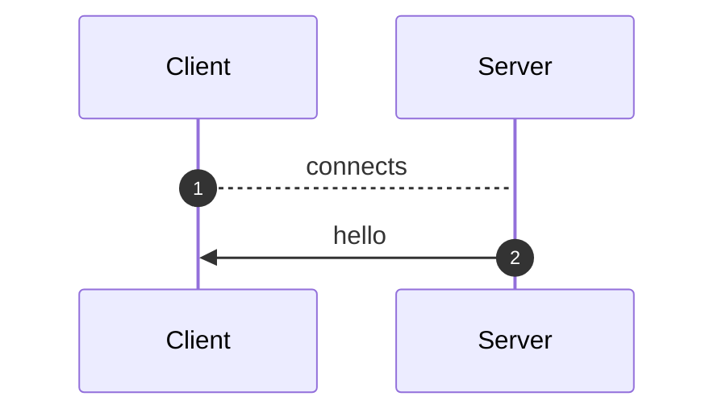
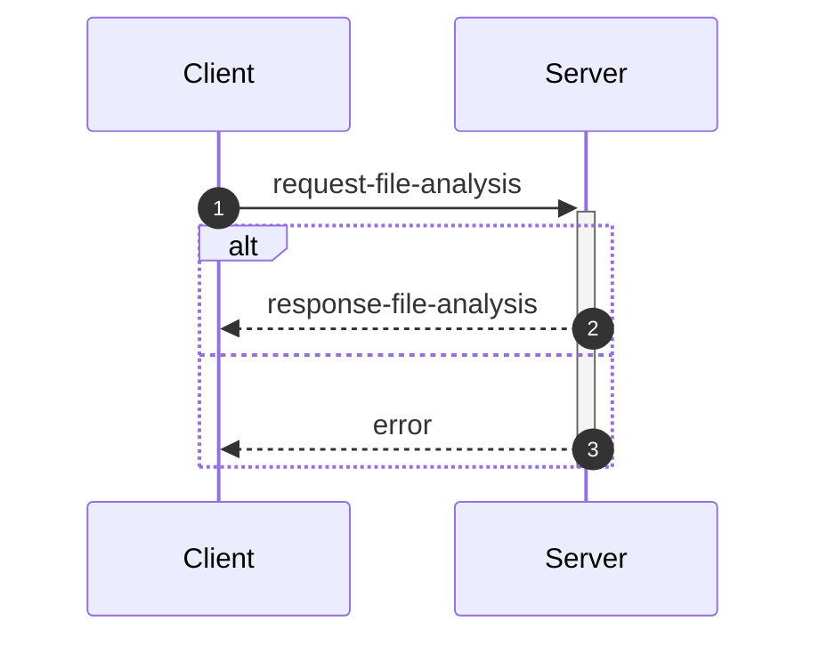
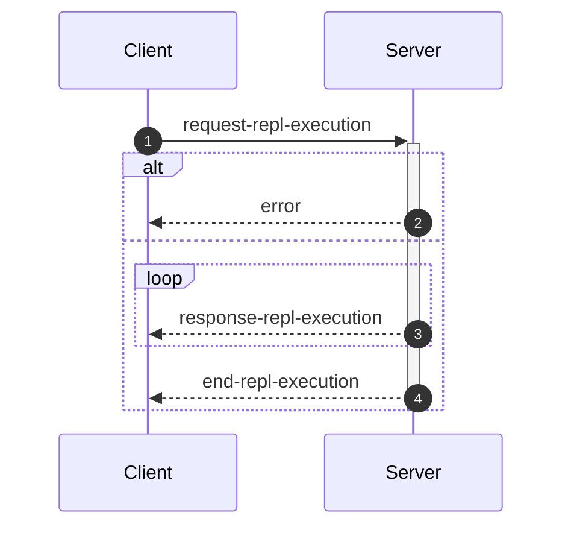
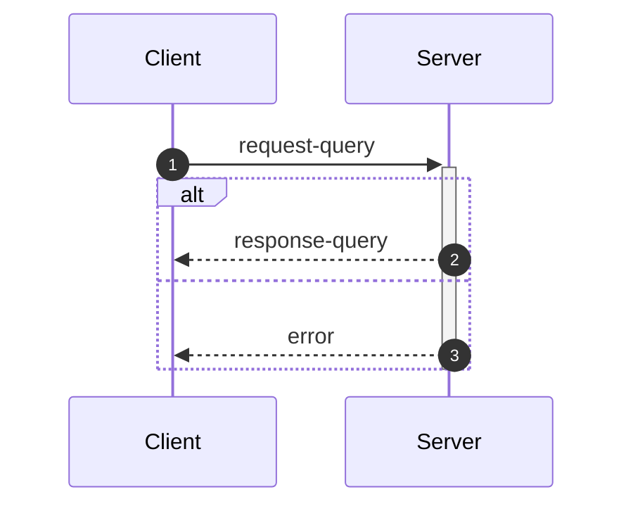

_<span title="an overview of flowR's interface">Generated</span> from '[wiki-interface.ts](https://github.com/flowr-analysis/flowr/tree/main/src/documentation/wiki-interface.ts "src/documentation/wiki-interface.ts")' on 2026-11-06, 06:26:46 UTC (v2.17.2, R v4.6.1), do not edit directly._

Although far from being as detailed as the in-depth explanation of [_flowR_](https://github.com/flowr-analysis/flowr/wiki/Core),
this wiki page explains how to interface with _flowR_ in more detail.
In general, command line arguments and other options provide short descriptions on hover over.

* [💻 Using the REPL](#using-the-repl)
* [⚙️ Configuring FlowR](#configuring-flowr)
* [⚒️ Writing Code](#writing-code)
* [💬 Communicating with the Server](#communicating-with-the-server)

<a id='using-the-repl'></a>
## 💻 Using the REPL

> [!NOTE]
> To execute arbitrary R commands with a repl request, _flowR_ has to be started explicitly with <span title="Description (Command Line Argument): Allow to access the underlying R session when using flowR (security warning: this allows the execution of arbitrary R code!)">`--r-session-access`</span>.
> Please be aware that this introduces a security risk and note that this relies on the [`r-shell` engine](https://github.com/flowr-analysis/flowr/wiki/Engines) .

Although primarily meant for users to explore,
there is nothing which forbids calling _flowR_ as a subprocess to use standard-in, -output, and -error
for communication (although you can access the REPL using the server as well,
with the [REPL Request](#message-request-repl-execution) message).

The read-eval-print loop&nbsp;(REPL) works relatively simple.
You can submit an expression (using <kbd>Enter</kbd>),
which is interpreted as an R&nbsp;expression by default but interpreted as a *command* if it starts with a colon (`:`).
The best command to get started with the REPL is <span title="Description (Repl Command): Show help information (aliases: :h, :?)">`:help`</span>.
Besides, you can leave the REPL either with the command <span title="Description (Repl Command): End the repl (aliases: :q, :exit)">`:quit`</span> or by pressing <kbd>Ctrl</kbd>+<kbd>C</kbd> twice.
When writing a *command*, you may press <kbd>Tab</kbd> to get a list of completions, if available.
Multiple commands can be entered in a single line by separating them with a semicolon (`;`), e.g. `:parse "x<-2"; :df*`.
If a command is given without R code, the REPL will re-use R code given in a previous command.
The prior example will hence return first the parsed AST of the program and then the dataflow graph for `"x <- 2"`.

> [!NOTE]
> If you develop flowR, you may want to launch the repl using the `npm run main-dev` command, this way, you get a non-minified version of flowR with debug information and hot-reloading of source files.

<details>
<summary>Available Commands</summary>

We currently offer the following commands (this with a `[*]` suffix are available with and without the star):

| Command | Description |
| ------- | ----------- |
| **<span title="Description (Repl Command): End the repl (aliases: :q, :exit)">:quit</span>** | End the repl (aliases: **:<span title="Alias of ':quit'. End the repl">q</span>**, **:<span title="Alias of ':quit'. End the repl">exit</span>**) |
| **<span title="Description (Repl Command): Execute the given code as R code. This requires the `--r-session-access` flag to be set and requires the r-shell engine. (aliases: :e, :r)">:execute</span>** | Execute the given code as R code. This requires the `--r-session-access` flag to be set and requires the r-shell engine. (aliases: **:<span title="Alias of ':execute'. Execute the given code as R code. This requires the `--r-session-access` flag to be set and requires the r-shell engine.">e</span>**, **:<span title="Alias of ':execute'. Execute the given code as R code. This requires the `--r-session-access` flag to be set and requires the r-shell engine.">r</span>**) |
| **<span title="Description (Repl Command): Get mermaid code for the control-flow graph of R code (aliases: :cfg, :cf)">:controlflow[*]</span>** | Get mermaid code for the control-flow graph of R code (star: Returns the URL to mermaid.live) (aliases: **:<span title="Alias of ':controlflow'. Get mermaid code for the control-flow graph of R code">cfg</span>**, **:<span title="Alias of ':controlflow'. Get mermaid code for the control-flow graph of R code">cf</span>**) |
| **<span title="Description (Repl Command): Get mermaid code for the control-flow graph with basic blocks (aliases: :cfgb, :cfb)">:controlflowbb[*]</span>** | Get mermaid code for the control-flow graph with basic blocks (star: Returns the URL to mermaid.live) (aliases: **:<span title="Alias of ':controlflowbb'. Get mermaid code for the control-flow graph with basic blocks">cfgb</span>**, **:<span title="Alias of ':controlflowbb'. Get mermaid code for the control-flow graph with basic blocks">cfb</span>**) |
| **<span title="Description (Repl Command): Get mermaid code for the dataflow graph (aliases: :d, :df)">:dataflow[*]</span>** | Get mermaid code for the dataflow graph (star: Returns the URL to mermaid.live) (aliases: **:<span title="Alias of ':dataflow'. Get mermaid code for the dataflow graph">d</span>**, **:<span title="Alias of ':dataflow'. Get mermaid code for the dataflow graph">df</span>**) |
| **<span title="Description (Repl Command): Get mermaid code for the normalized AST of R code (aliases: :n)">:normalize[*]</span>** | Get mermaid code for the normalized AST of R code (star: Returns the URL to mermaid.live) (alias: **:<span title="Alias of ':normalize'. Get mermaid code for the normalized AST of R code">n</span>**) |
| **<span title="Description (Repl Command): Get mermaid code for the simplified dataflow graph (aliases: :ds, :dfs)">:dataflowsimple[*]</span>** | Get mermaid code for the simplified dataflow graph (star: Returns the URL to mermaid.live) (aliases: **:<span title="Alias of ':dataflowsimple'. Get mermaid code for the simplified dataflow graph">ds</span>**, **:<span title="Alias of ':dataflowsimple'. Get mermaid code for the simplified dataflow graph">dfs</span>**) |
| **<span title="Description (Repl Command): Inspect and extend the signature database: `query` (identical to :query @signature), `info <name>` for where a function comes from (identical to :query @function-info), `add <path>` to mount another database/source, `download` to fetch the full-history database. (aliases: :sig)">:signature</span>** | Inspect and extend the signature database: `query` (identical to :query @signature), `info <name>` for where a function comes from (identical to :query @function-info), `add <path>` to mount another database/source, `download` to fetch the full-history database. (alias: **:<span title="Alias of ':signature'. Inspect and extend the signature database: `query` (identical to :query @signature), `info <name>` for where a function comes from (identical to :query @function-info), `add <path>` to mount another database/source, `download` to fetch the full-history database.">sig</span>**) |
| **<span title="Description (Repl Command): Just calculates the DFG, but only prints summary info (aliases: :d#, :df#)">:dataflowsilent</span>** | Just calculates the DFG, but only prints summary info (aliases: **:<span title="Alias of ':dataflowsilent'. Just calculates the DFG, but only prints summary info">d#</span>**, **:<span title="Alias of ':dataflowsilent'. Just calculates the DFG, but only prints summary info">df#</span>**) |
| **<span title="Description (Repl Command): Prints ASCII Art of the parsed, unmodified AST (aliases: :p)">:parse</span>** | Prints ASCII Art of the parsed, unmodified AST (alias: **:<span title="Alias of ':parse'. Prints ASCII Art of the parsed, unmodified AST">p</span>**) |
| **<span title="Description (Repl Command): Prints the version of flowR as well as the current version of R">:version</span>** | Prints the version of flowR as well as the current version of R
| **<span title="Description (Repl Command): Query the given R code (use 'help' for more information)">:query[*]</span>** | Query the given R code (use 'help' for more information) (star: Similar to query, but returns the output in json format.)
| **<span title="Description (Repl Command): Returns an ASCII representation of the dataflow graph (aliases: :df!)">:dataflowascii</span>** | Returns an ASCII representation of the dataflow graph (alias: **:<span title="Alias of ':dataflowascii'. Returns an ASCII representation of the dataflow graph">df!</span>**) |
| **<span title="Description (Repl Command): Returns summarization stats for the normalized AST (aliases: :n#)">:normalize#</span>** | Returns summarization stats for the normalized AST (alias: **:<span title="Alias of ':normalize#'. Returns summarization stats for the normalized AST">n#</span>**) |
| **<span title="Description (Repl Command): Show help information (aliases: :h, :?)">:help</span>** | Show help information (aliases: **:<span title="Alias of ':help'. Show help information">h</span>**, **:<span title="Alias of ':help'. Show help information">?</span>**) |

</details>

> [!TIP]
> 
> As indicated by the examples before, all REPL commands that operate on code keep track of the state.
> Hence, if you run a command like <span title="Description (Repl Command, starred version): Returns the URL to mermaid.live; Base Command: Get mermaid code for the dataflow graph (aliases: :d*, :df*)">`:dataflow*`</span> without providing R code,
> the REPL will re-use the R code provided in a previous command.
> Likewise, doing this will benefit from incrementality!
> If you request the dataflow graph with `:df* x <- 2 * y` and then want to see the parsed AST with `:parse`,
> the REPL will re-use previously obtained information and not re-parse the code again.
> 		

Generally, many commands offer shortcut versions in the REPL. Many queries, for example, offer a shortened format (see the example below).
Of special note, the [Config Query](https://github.com/flowr-analysis/flowr/wiki/%5BQuery%5D-Config)
can be used to also modify the currently active configuration of _flowR_ within the REPL (see the [wiki page](https://github.com/flowr-analysis/flowr/wiki/%5BQuery%5D-Config) for more information).

### Example: Retrieving the Dataflow Graph

To retrieve a URL to the [mermaid](https://mermaid.js.org/) diagram of the dataflow of a given expression,
use <span title="Description (Repl Command, starred version): Returns the URL to mermaid.live; Base Command: Get mermaid code for the dataflow graph (aliases: :d*, :df*)">`:dataflow*`</span> (or <span title="Description (Repl Command): Get mermaid code for the dataflow graph (aliases: :d, :df)">`:dataflow`</span> to get the mermaid code in the cli):

```shell
$ docker run -it --rm eagleoutice/flowr # or npm run flowr 
flowR repl v2.17.2, R grammar v14 (tree-sitter engine)
R> :dataflow* y <- 1 + x
```

<details>
<summary style='color:gray'>Output</summary>

```text
https://mermaid.live/view#base64:eyJjb2RlIjoiZmxvd2NoYXJ0IFREXG4gICAgMXt7XCJgKiM5MTtSTnVtYmVyIzkzOyogKioxKipcbiAgICAgICoxLjYqICgqKmlkOiAxKiopYFwifX1cbiAgICAyKFtcImAqIzkxO1JTeW1ib2wjOTM7KiAqKngqKlxuICAgICAgKjEuMTAqICgqKmlkOiAyKiopYFwiXSlcbiAgICAzW1tcImAqIzkxO1JCaW5hcnlPcCM5MzsqIGJhc2UjNTg7IzU4OyoqIzQzOyoqXG4gICAgICAqMS42LTEwKiAoKippZDogMyoqKVxuICAgIGFyZzogKDEsIDIpYFwiXV1cbiAgICBidWlsdC1pbjpfNDNfW1wiYEJ1aWx0LUluOlxuIzQzO2BcIl1cbiAgICBzdHlsZSBidWlsdC1pbjpfNDNfIHN0cm9rZTpncmF5LGZpbGw6Z3JheSxzdHJva2Utd2lkdGg6MnB4LG9wYWNpdHk6Ljg7XG4gICAgMFtcImAqIzkxO1JTeW1ib2wjOTM7KiAqKnkqKlxuICAgICAgKjEuMSogKCoqaWQ6IDAqKiwgdjogMylgXCJdXG4gICAgNFtbXCJgKiM5MTtSQmluYXJ5T3AjOTM7KiBiYXNlIzU4OyM1ODsqKiM2MDsjNDU7KipcbiAgICAgICoxLjEtMTAqICgqKmlkOiA0KiopXG4gICAgYXJnOiAoMCwgMylgXCJdXVxuICAgIGJ1aWx0LWluOl82MF8tW1wiYEJ1aWx0LUluOlxuIzYwOyM0NTtgXCJdXG4gICAgc3R5bGUgYnVpbHQtaW46XzYwXy0gc3Ryb2tlOmdyYXksZmlsbDpncmF5LHN0cm9rZS13aWR0aDoycHgsb3BhY2l0eTouODtcbiAgICAxIC0uLT58XCJmbG93XCJ8IDJcbiAgICBsaW5rU3R5bGUgMCBzdHJva2U6Z3JheSxjb2xvcjpncmF5O1xuICAgIDIgLS4tPnxcImZsb3dcInwgM1xuICAgIGxpbmtTdHlsZSAxIHN0cm9rZTpncmF5LGNvbG9yOmdyYXk7XG4gICAgMyAtLT58XCJyZWFkcywgYXJnXCJ8IDFcbiAgICAzIC0tPnxcInJlYWRzLCBhcmdcInwgMlxuICAgIDMgLS4tPnxcImZsb3dcInwgMFxuICAgIGxpbmtTdHlsZSA0IHN0cm9rZTpncmF5LGNvbG9yOmdyYXk7XG4gICAgMyAtLi0+fFwicmVhZHMsIGNhbGxzXCJ8IGJ1aWx0LWluOl80M19cbiAgICBsaW5rU3R5bGUgNSBzdHJva2U6Z3JheTtcbiAgICAwIC0tPnxcImRlZmluZWQtYnksIGZsb3dcInwgNFxuICAgIDAgLS0+fFwiZGVmaW5lZC1ieVwifCAzXG4gICAgNCAtLT58XCJyZWFkcywgYXJnXCJ8IDNcbiAgICA0IC0tPnxcInJldHVybnMsIGFyZ1wifCAwXG4gICAgNCAtLi0+fFwicmVhZHMsIGNhbGxzXCJ8IGJ1aWx0LWluOl82MF8tXG4gICAgbGlua1N0eWxlIDEwIHN0cm9rZTpncmF5OyIsIm1lcm1haWQiOnsiYXV0b1N5bmMiOnRydWV9fQ==
```

Retrieve the dataflow graph of the expression `y <- 1 + x`. It looks like this:


<details>

<summary style="color:gray">R Code of the Dataflow Graph</summary>

The analysis ran (parse and normalize with the [tree-sitter](https://github.com/flowr-analysis/flowr/wiki/Engines) engine) in the generation environment. No [signature database](https://github.com/flowr-analysis/flowr/wiki/Signature-Database) is mounted, so `library()` attaches no exports (base-R names are still qualified, e.g., `stats::acf`). 
We encountered no unknown side effects during the analysis.

```r
y <- 1 + x
```

</details>

</details>

For small graphs like this, <span title="Description (Repl Command): Returns an ASCII representation of the dataflow graph (aliases: :df!)">`:dataflowascii`</span> also provides an ASCII representation directly in the REPL:

```shell
$ docker run -it --rm eagleoutice/flowr # or npm run flowr 
flowR repl v2.17.2, R grammar v14 (tree-sitter engine)
R> :df! y <- 1 + x
```

<details open>
<summary style='color:gray'>Output</summary>

```text
                        v<0>v
 c<4>c──────────────────| y |
 |<- |     ┌────────────v---v
 c---c     │
    │   c<3>c   0<1>0
    └───| + |───| 1 |───u<2>u
        c---c   0---0   | x |
           └────────────u---u
Edges:
3 -> 1: reads, arg          3 -> 2: reads, arg
3 -> 0: flows-to            1 -> 2: flows-to
2 -> 3: flows-to            4 -> 3: reads, arg
4 -> 0: returns, arg        0 -> 4: defined-by, flows-to
0 -> 3: defined-by
```

Retrieve the dataflow graph of the expression `y <- 1 + x` as ASCII art.

</details>

For the slicing with <span title="Description (Repl Command): Static backwards executable slicer for R">`:slicer`</span>, you have access to the same [magic comments](#slice-magic-comments) as with the [slice request](#message-request-slice).
Pass `--inline` to splice resolvable `source()` calls into the reconstruction so the slice is a single self-contained R text (the same as the static slice query's `inlineSources` flag).
See `--help` for more flags!

### Example: Interfacing with the File System

Many commands that allow for an R-expression (like <span title="Description (Repl Command, starred version): Returns the URL to mermaid.live; Base Command: Get mermaid code for the dataflow graph (aliases: :d*, :df*)">`:dataflow*`</span>) allow for a file as well
if the argument starts with `file://`.
If you are working from the root directory of the _flowR_ repository, the following gives you the parsed AST of the example file using the <span title="Description (Repl Command): Prints ASCII Art of the parsed, unmodified AST (aliases: :p)">`:parse`</span> command:

> **Watch mode**: Replace `file://` with `watch://` to enter watch mode.
> flowR runs the command immediately and then re-runs it every time the file (or any file inside the folder) changes.
> Enter any other command to leave watch mode.
> For example: `:df watch://analysis.R`

```shell
$ docker run -it --rm eagleoutice/flowr # or npm run flowr 
flowR repl v2.17.2, R grammar v14 (tree-sitter engine)
R> :parse file://test/testfiles/example.R
```

<details>
<summary style='color:gray'>Output</summary>

```text
File: test/testfiles/example.R

program
├ binaryoperator
│ ├ identifier "sum" (1:1─4)
│ ├ <- "<-" (1:5─7)
│ ╰ float "0" (1:8─9)
├ binaryoperator
│ ├ identifier "product" (2:1─8)
│ ├ <- "<-" (2:9─11)
│ ╰ float "1" (2:12─13)
├ binaryoperator
│ ├ identifier "w" (3:1─2)
│ ├ <- "<-" (3:3─5)
│ ╰ float "7" (3:6─7)
├ binaryoperator
│ ├ identifier "N" (4:1─2)
│ ├ <- "<-" (4:3─5)
│ ╰ float "10" (4:6─8)
├ forstatement
│ ├ for "for" (6:1─4)
│ ├ ( "(" (6:5─6)
│ ├ identifier "i" (6:6─7)
│ ├ in "in" (6:8─10)
│ ├ binaryoperator
│ │ ├ float "1" (6:11─12)
│ │ ├ : ":" (6:12─13)
│ │ ╰ parenthesizedexpression
│ │   ├ ( "(" (6:13─14)
│ │   ├ binaryoperator
│ │   │ ├ identifier "N" (6:14─15)
│ │   │ ├ - "-" (6:15─16)
│ │   │ ╰ float "1" (6:16─17)
│ │   ╰ ) ")" (6:17─18)
│ ├ ) ")" (6:18─19)
│ ╰ bracedexpression
│   ├ { "{" (6:20─21)
│   ├ binaryoperator
│   │ ├ identifier "sum" (7:3─6)
│   │ ├ <- "<-" (7:7─9)
│   │ ╰ binaryoperator
│   │   ├ binaryoperator
│   │   │ ├ identifier "sum" (7:10─13)
│   │   │ ├ + "+" (7:14─15)
│   │   │ ╰ identifier "i" (7:16─17)
│   │   ├ + "+" (7:18─19)
│   │   ╰ identifier "w" (7:20─21)
│   ├ binaryoperator
│   │ ├ identifier "product" (8:3─10)
│   │ ├ <- "<-" (8:11─13)
│   │ ╰ binaryoperator
│   │   ├ identifier "product" (8:14─21)
│   │   ├  "" (8:22─23)
│   │   ╰ identifier "i" (8:24─25)
│   ╰ } "}" (9:1─2)
├ call
│ ├ identifier "cat" (11:1─4)
│ ╰ arguments
│   ├ ( "(" (11:4─5)
│   ├ argument
│   │ ╰ string
│   │   ├ stringopen "\"" (11:5─6)
│   │   ├ stringcontent "Sum:" (11:6─10)
│   │   ╰ stringclose "\"" (11:10─11)
│   ├ comma "," (11:11─12)
│   ├ argument
│   │ ╰ identifier "sum" (11:13─16)
│   ├ comma "," (11:16─17)
│   ├ argument
│   │ ╰ string
│   │   ├ stringopen "\"" (11:18─19)
│   │   ├ stringcontent
│   │   │ ╰ escapesequence "\\n" (11:19─21)
│   │   ╰ stringclose "\"" (11:21─22)
│   ╰ ) ")" (11:22─23)
╰ call
  ├ identifier "cat" (12:1─4)
  ╰ arguments
    ├ ( "(" (12:4─5)
    ├ argument
    │ ╰ string
    │   ├ stringopen "\"" (12:5─6)
    │   ├ stringcontent "Product:" (12:6─14)
    │   ╰ stringclose "\"" (12:14─15)
    ├ comma "," (12:15─16)
    ├ argument
    │ ╰ identifier "product" (12:17─24)
    ├ comma "," (12:24─25)
    ├ argument
    │ ╰ string
    │   ├ stringopen "\"" (12:26─27)
    │   ├ stringcontent
    │   │ ╰ escapesequence "\\n" (12:27─29)
    │   ╰ stringclose "\"" (12:29─30)
    ╰ ) ")" (12:30─31)
```

Retrieve the parsed AST of the example file.

<details>

<summary>File Content</summary>

```r
sum <- 0
product <- 1
w <- 7
N <- 10

for (i in 1:(N-1)) {
  sum <- sum + i + w
  product <- product * i
}

cat("Sum:", sum, "\n")
cat("Product:", product, "\n")
```

</details>

As _flowR_ directly transforms this AST the output focuses on being human-readable instead of being machine-readable.
		
</details>

### Example: Run a Query

You can run any query supported by _flowR_ using the <span title="Description (Repl Command): Query the given R code (use 'help' for more information)">`:query`</span> command.
For example, to obtain the shapes of all data frames in a given piece of code, you can run:

```shell
$ docker run -it --rm eagleoutice/flowr # or npm run flowr 
flowR repl v2.17.2, R grammar v14 (tree-sitter engine)
R> :query @absint df-shape "x <- data.frame(a = 1:10, b = 1:10)\ny <- x$a"
```

<details open>
<summary style='color:gray'>Output</summary>

```text
Query: absint (3 ms)
   ╰ $12: (colnames: [{"a", "b"}, {}], cols: [2, 2], rows: [10, 10])
   ╰ $0: (colnames: [{"a", "b"}, {}], cols: [2, 2], rows: [10, 10])
```

Retrieve the shapes of all data frames in the given code.

</details>

To run the linter on a file, you can use (in this example, we just issue the `dead-code` linter on a small piece of code):

```shell
$ docker run -it --rm eagleoutice/flowr # or npm run flowr 
flowR repl v2.17.2, R grammar v14 (tree-sitter engine)
R> :query @linter rules:dead-code "if(FALSE) x <- 2"
```

<details open>
<summary style='color:gray'>Output</summary>

```text
Query: linter (1 ms)
   ╰ Dead Code (dead-code):
       ╰ certain:
           ╰ Code at 1.11-16 (1 quick fix(es) available)
```

Run the linter on the given code, with only the `dead-code` rule enabled.

</details>

For more information on the available queries, please check out the [Query API](https://github.com/flowr-analysis/flowr/wiki/Query-API).

<a id='configuring-flowr'></a>
## ⚙️ Configuring FlowR

When running _flowR_, you may want to specify some behaviors with a dedicated configuration file.
By default, flowR looks for a file named `flowr.json` in the current working directory (or any higher directory).
You can also specify a different file with <span title="Description (Command Line Argument): The name of the configuration file to use">`--config-file`</span> or pass the configuration inline using <span title="Description (Command Line Argument): The flowR configuration to use, as a JSON string">`--config-json`</span>.
A `flowr.json` found this way belongs to the analyzed project, so flowR ignores its options that decide what flowR executes or loads
(`engines.*.wasmPath`, `engines.*.treeSitterWasmPath`, `engines.*.rPath`, `solver.sigdb.additionalPaths`, `solver.sigdb.downloadRepo`, `solver.sigdb.installedLibrary.paths`, `solver.sigdb.onDemand.enabled`, `solver.sigdb.onDemand.repositories`, `solver.sigdb.onDemand.cranMirror`, `solver.sigdb.onDemand.bioconductorMirror`, `solver.sigdb.onDemand.cacheDir`),
unless you pass <span title="Description (Command Line Argument): Keep the security-sensitive options (e.g., the R executable) of the flowr.json found in the working directory or a parent. Only use this for projects you trust.">`--trust-config`</span>.
To analyze code you do not trust, use the secure mode (<span title="Description (Command Line Argument): Run in secure mode for analyzing untrusted code: flowR does not start R (or any other process), does not access the network, does not search for project configs, and ignores security-sensitive options in every config. Cannot be disabled once enabled. Can also be enabled with the environment variable {italic FLOWR_SECURE_MODE=1}.">`--secure`</span>, see the [security policy](https://github.com/flowr-analysis/flowr/blob/main/.github/SECURITY.md)).
To inspect the current configuration, you can run flowr with the <span title="Description (Command Line Argument): Run with verbose logging (will be passed to the corresponding script)">`--verbose`</span> flag, or use the `config` [Query](https://github.com/flowr-analysis/flowr/wiki/Query-API).
Within the REPL this works by running the following:

```shell
:query @config
```

To work with the <a href="https://github.com/flowr-analysis/flowr/tree/main/src/config.ts#L119"><code><span title="The configuration file format for flowR.">FlowrConfig</span></code></a> you can use the provided helper objects alongside its methods like
<a href="https://github.com/flowr-analysis/flowr/tree/main/src/config.ts#L966"><code><span title="Creates a new flowr config that has the updated values.">FlowrConfig::<b>amend</b></span></code></a>.
The schema below documents every option; the ones you most likely want are:

- <a href="https://github.com/flowr-analysis/flowr/wiki/Interface#configuring-flowr" title="Configuration Option (boolean): Whether source calls should be ignored, causing {@link processSourceCall}&#39;s behavior to be skipped.">ignoreSourceCalls</a>: ignore source calls when analyzing the code, i.e., ignore the inclusion of other files.
- <a href="https://github.com/flowr-analysis/flowr/wiki/Interface#configuring-flowr" title="Configuration Option (boolean): Whether load calls should be ignored, causing {@link processLoadCall}&#39;s behavior to be skipped.">ignoreLoadCalls</a>: ignore load calls when analyzing the code, i.e., ignore the loading of r-data files.
- <a href="https://github.com/flowr-analysis/flowr/wiki/Interface#configuring-flowr" title="Configuration Option (object): Do you want to overwrite (parts) of the builtin definition?">semantics.environment.overwriteBuiltIns</a>: overwrite _flowR_'s handling of built-in functions, or clear the preset definitions entirely.
  See [Configure BuiltIn Semantics](#configure-builtin-semantics) for more information.
- <a href="https://github.com/flowr-analysis/flowr/wiki/Interface#configuring-flowr" title="Configuration Option (string): How to resolve variables and their values. (one of &quot;disabled&quot;, &quot;alias&quot;, &quot;builtin&quot;)">solver.variables</a>: how to resolve variables and their values (`disabled`, `alias`, `builtin`).
- <a href="https://github.com/flowr-analysis/flowr/wiki/Interface#configuring-flowr" title="Configuration Option (array): The engine or set of engines to use for interacting with R code. An empty array means all available engines will be used.">engines</a> and <a href="https://github.com/flowr-analysis/flowr/wiki/Interface#configuring-flowr" title="Configuration Option (string): The default engine to use for interacting with R code. If this is undefined, an arbitrary engine from the specified list will be used. (one of &quot;tree-sitter&quot;, &quot;r-shell&quot;)">defaultEngine</a>: the engines used to interact with R code, see the [Engines wiki page](https://github.com/flowr-analysis/flowr/wiki/Engines).
- <a href="https://github.com/flowr-analysis/flowr/wiki/Interface#configuring-flowr" title="Configuration Option (array): Files a framework loads on its own, without any source() call (e.g. global.R in a shiny app), in the order they are loaded; flowR orders the matching project files accordingly and analyzes them as one program. Entries are case-insensitive globs matched against the file path, a plain name matches any file with that name, and entries matching no project file are warned about. Usually set per project kind via specializeConfig.">project.implicitSources</a>: the files a framework loads without any `source()` call, in the order in which they are
  loaded. Entries are globs (e.g. `R/*.R`) matched against the file path ignoring capitalization; one matching no file is reported.
- <a href="https://github.com/flowr-analysis/flowr/wiki/Interface#configuring-flowr" title="Configuration Option (object): Overwrite (parts of) the configuration depending on the project kind flowR detects, e.g. to give a shiny app its implicit sources.">specializeConfig</a>: overwrite (parts of) the configuration depending on the kind of project _flowR_ detects
  (e.g. `shiny-app`), which is how a shiny app gets its implicit sources by default. What you configure directly wins.
- <a href="https://github.com/flowr-analysis/flowr/wiki/Interface#configuring-flowr" title="Configuration Option (string): Overwrite the project kind flowR would otherwise infer from the analyzed files, e.g. when auto-detection guesses wrong. (one of &quot;package&quot;, &quot;script&quot;, &quot;shiny-app&quot;, &quot;notebook&quot;, &quot;project&quot;, &quot;unknown&quot;)">project.useProjectType</a>: skip that detection and force a project kind yourself, when auto-detection guesses wrong.
- <a href="https://github.com/flowr-analysis/flowr/wiki/Interface#configuring-flowr" title="Configuration Option (array): The default plugins to load when creating a new instance of FlowrAnalyzer">defaultPlugins</a> and <a href="https://github.com/flowr-analysis/flowr/wiki/Interface#configuring-flowr" title="Configuration Option (array): The plugins to load in REPL mode">repl.plugins</a>: the plugins to load for a new <a href="https://github.com/flowr-analysis/flowr/tree/main/src/project/flowr-analyzer.ts#L210"><code><span title="Central class for conducting analyses with FlowR. Use the FlowrAnalyzerBuilder to create a new instance. If you want the original pattern of creating a pipeline and running all steps, you can still do this with FlowrAnalyzer#runFull . To inspect the context of the analyzer, use FlowrAnalyzer#inspectContext (if you are a plugin and need to modify it, use FlowrAnalyzer#context instead).">FlowrAnalyzer</span></code></a> and in the REPL
  (use `flowr:default` to reference the former).

So you can configure _flowR_ by adding a file like the following:

<details>

<summary>Example Configuration File</summary>

```json
{
  "ignoreSourceCalls": true,
  "ignoreLoadCalls": true,
  "semantics": {
    "environment": {
      "overwriteBuiltIns": {
        "definitions": [
          {
            "type": "function",
            "names": [
              "foo"
            ],
            "processor": "builtin:assign",
            "config": {}
          }
        ]
      }
    }
  },
  "defaultPlugins": [
    "file:description",
    "versions:description"
  ],
  "repl": {
    "quickStats": false,
    "dfProcessorHeat": false,
    "hints": true,
    "plugins": [
      "flowr:default"
    ]
  },
  "project": {
    "resolveUnknownPathsOnDisk": true,
    "implicitSources": [
      "global.R",
      "app.R"
    ]
  },
  "linter": {
    "disabledRules": []
  },
  "specializeConfig": {
    "shiny-app": {
      "project": {
        "implicitSources": [
          "global.R",
          "ui.R",
          "server.R",
          "app.R"
        ]
      }
    }
  },
  "engines": [
    {
      "type": "r-shell"
    }
  ],
  "solver": {
    "variables": "alias",
    "evalStrings": true,
    "trackEnvironments": true,
    "sigdb": {
      "enabled": true,
      "loadProjectDependencies": true,
      "eagerlyLoad": false,
      "eagerlyLoadExports": false,
      "linkBaseR": false,
      "linkDescriptionDependencies": false
    },
    "resolveSource": {
      "dropPaths": "no",
      "ignoreCapitalization": true,
      "inferWorkingDirectory": "active-script",
      "searchPath": []
    },
    "instrument": {},
    "slicer": {
      "threshold": 50
    }
  },
  "abstractInterpretation": {
    "wideningThreshold": 4,
    "followCalls": true,
    "dataFrame": {
      "maxColNames": 20,
      "readLoadedData": {
        "readExternalFiles": true,
        "maxReadLines": 1000000
      }
    }
  },
  "incremental": {
    "alwaysIncremental": false,
    "parsing": {
      "activated": false,
      "heuristics": {
        "activated": true,
        "mtime": true,
        "linesFrom": 500,
        "bytesFrom": 50000,
        "alwaysWithEdits": false,
        "minFiles": 1
      }
    }
  },
  "gas": {
    "thresholds": {
      "memory": {
        "problematic": 0.7,
        "critical": 0.9
      },
      "timeMs": {
        "problematic": 100000,
        "critical": 120000
      }
    },
    "features": {}
  }
}
```

</details>

<details>
<a id='configure-builtin-semantics'></a>
<summary>Configure Built-In Semantics</summary>

`semantics/environment/overwriteBuiltins` accepts two keys:

- `loadDefaults` (boolean, initially `true`): If set to `true`, the default built-in definitions are loaded before applying the custom definitions. Setting this flag to `false` explicitly disables the loading of the default definitions.
- `definitions` (array, initially empty): Allows to overwrite or define new built-in elements. Each object within must have a `type` which is one of the below. Furthermore, they may define a string array of `names` which specifies the identifiers to bind the definitions to. You may use `assumePrimitive` to specify whether _flowR_ should assume that this is a primitive non-library definition (so you probably just do not want to specify the key).

  | Type            | Description                                                                                                                                                                                                                                                                                              | Example                                                                                                    |
  | --------------- | -------------------------------------------------------------------------------------------------------------------------------------------------------------------------------------------------------------------------------------------------------------------------------------------------------- | ---------------------------------------------------------------------------------------------------------- |
  | `constant`    | Additionally allows for a `value` this should resolve to.                                                                                                                                                                                                                                                | `{ type: 'constant', names: ['NULL', 'NA'],  value: null }`                                                |
  | `function`    | Is a rather flexible way to define and bind built-in functions. For the time, we do not have extensive documentation to cover all the cases, so please either consult the sources with the `default-builtin-config.ts` or open a [new issue](https://github.com/flowr-analysis/flowr/issues/new/choose). | `{ type: 'function', names: ['next'], processor: 'builtin:d', config: { cfg: ExitPointType.Next } }` |
  | `replacement` | A comfortable way to specify replacement functions like `$<-` or `names<-`. `suffixes` describes the... suffixes to attach automatically. | `{ type: 'replacement', suffixes: ['<-', '<<-'], names: ['[', '[['] }` |

</details>

<details>

<summary style='color:gray'>Full Configuration-File Schema</summary>

- _The configuration file format for flowR._ (object)
    - **logLevel** [optional] _flowR's global minimum log level, applied when the config is loaded._ (string)
        Only allows: 'silly', 'trace', 'debug', 'info', 'warn', 'error', 'fatal'
    - **ignoreSourceCalls** [optional] _Whether source calls should be ignored, causing {@link processSourceCall}'s behavior to be skipped._ (boolean)
    - **ignoreLoadCalls** [optional] _Whether load calls should be ignored, causing {@link processLoadCall}'s behavior to be skipped._ (boolean)
    - **semantics** _Configure language semantics and how flowR handles them._ (object)
        - **environment** [optional] _Semantics regarding how to handle the R environment._ (object)
            - **overwriteBuiltIns** [optional] _Do you want to overwrite (parts) of the builtin definition?_ (object)
                - **loadDefaults** [optional] _Should the default configuration still be loaded?_ (boolean)
                - **definitions** [optional] _The definitions to load/overwrite._ (array)
                Valid item types:
                    - (object)
    - **defaultPlugins** [optional] _The default plugins to load when creating a new instance of FlowrAnalyzer_ (array)
    Valid item types:
        - (alternatives)
            - (string)
            - (array)
    - **repl** _Configuration options for the REPL._ (object)
        - **quickStats** [optional] _Whether to show quick stats in the REPL after each evaluation._ (boolean)
        - **dfProcessorHeat** [optional] _This instruments the dataflow processors to count how often each processor is called._ (boolean)
        - **hints** [optional] _Whether to show dim inline hints on the empty prompt (automatically disabled on non-interactive terminals)._ (boolean)
        - **plugins** [optional] _The plugins to load in REPL mode_ (array)
        Valid item types:
            - (alternatives)
                - (string)
                - (array)
        - **autoUseFileProtocol** [optional] _Prepend the file protocol to a repl input that looks like a path, instead of only warning about it._ (boolean)
        - **queryStats** [optional] _Whether `:query` closes with the line stating how long the queries took (`:query*` never prints it)._ (boolean)
        - **showPlugins** [optional] _Whether `:version` grays out the plugins that did not activate during the last analysis._ (boolean)
    - **project** _Project specific configuration options._ (object)
        - **resolveUnknownPathsOnDisk** [optional] _Whether to resolve unknown paths loaded by the r project disk when trying to source/analyze files._ (boolean)
        - **failOnInaccessiblePath** [optional] _Whether a directory that cannot be traversed during file discovery (e.g. due to permissions) aborts the analysis; when false (the default) such paths are logged and skipped._ (boolean)
        - **basePackages** [optional] _The packages considered part of R itself (base and recommended); if unset, flowR uses its built-in list._ (array)
        Valid item types:
            - (string)
        - **implicitSources** [optional] _Files a framework loads on its own, without any source() call (e.g. global.R in a shiny app), in the order they are loaded; flowR orders the matching project files accordingly and analyzes them as one program. Entries are case-insensitive globs matched against the file path, a plain name matches any file with that name, and entries matching no project file are warned about. Usually set per project kind via specializeConfig._ (array)
        Valid item types:
            - (string)
        - **useProjectType** [optional] _Overwrite the project kind flowR would otherwise infer from the analyzed files, e.g. when auto-detection guesses wrong._ (string)
            Only allows: 'package', 'script', 'shiny-app', 'notebook', 'project', 'unknown'
        - **assumeImplicitEcho** [optional] _Whether the top level of the analyzed code is echoed, so that every visible result printed there is collected as an output by the dependencies query (default true, false for a package)._ (boolean)
        - **discovery** [optional] _Scoping options for the default project discovery._ (object)
            - **full** [optional] _Collect every file below the project root (greedy) instead of only the files the detected project kind needs (default false)._ (boolean)
            - **perKind** [optional] _Per-kind include/exclude glob overrides layered on the default scoping._ (object)
            - **ignore** [optional] _Case-insensitive globs that drop matching files from the intelligent discovery, regardless of kind (e.g. .Renviron to ignore environment files)._ (array)
            Valid item types:
                - (string)
        - **classification** [optional] _Overrides for the signals flowR uses to classify the project kind._ (object)
            - **shinyDescriptionTypes** [optional] _DESCRIPTION Type: values that mark a shiny app._ (array)
            Valid item types:
                - (string)
            - **shinyEntryFiles** [optional] _File names a shiny app is assembled from._ (array)
            Valid item types:
                - (string)
            - **shinyUsagePattern** [optional] _Regex source evidencing shiny usage in an entry file._ (string)
            - **notebookExtensions** [optional] _File extensions marking a notebook._ (array)
            Valid item types:
                - (string)
    - **linter** _Linter configuration options._ (object)
        - **disabledRules** _Linting rule names excluded from the default rule set (a rule requested explicitly via a linter query still runs). Usually set per project kind via specializeConfig._ (array)
        Valid item types:
            - (string)
        - **disabledTags** [optional] _Linting rule tags whose rules are excluded from the default rule set (a rule requested explicitly via a linter query still runs). By default the cmd-check rules are disabled for everything but a package; a configured list replaces that default._ (array)
        Valid item types:
            - (string)
    - **inputSources** [optional] _Further frameworks the input-sources analysis should know about; entries are added to flowR's defaults._ (object)
        - **pure** [optional] _Functions that only pass the constantness of their arguments on._ (array)
        Valid item types:
            - (string)
        - **param** [optional] _Functions whose result is a 'param' input._ (array)
        Valid item types:
            - (string)
        - **file** [optional] _Functions whose result is a 'file' input._ (array)
        Valid item types:
            - (string)
        - **tempfile** [optional] _Functions whose result is a 'tempfile' input._ (array)
        Valid item types:
            - (string)
        - **glob** [optional] _Functions whose result is a 'glob' input._ (array)
        Valid item types:
            - (string)
        - **net** [optional] _Functions whose result is a 'net' input._ (array)
        Valid item types:
            - (string)
        - **rand** [optional] _Functions whose result is a 'rand' input._ (array)
        Valid item types:
            - (string)
        - **system** [optional] _Functions whose result is a 'system' input._ (array)
        Valid item types:
            - (string)
        - **ffi** [optional] _Functions whose result is a 'ffi' input._ (array)
        Valid item types:
            - (string)
        - **lang** [optional] _Functions whose result is a 'lang' input._ (array)
        Valid item types:
            - (string)
        - **options** [optional] _Functions whose result is a 'options' input._ (array)
        Valid item types:
            - (string)
        - **cmdline** [optional] _Functions whose result is a 'cmdline' input._ (array)
        Valid item types:
            - (string)
        - **user** [optional] _Functions whose result is a 'user' input._ (array)
        Valid item types:
            - (string)
        - **const** [optional] _Functions whose result is a 'const' input._ (array)
        Valid item types:
            - (string)
        - **scope** [optional] _Functions whose result is a 'scope' input._ (array)
        Valid item types:
            - (string)
        - **dconst** [optional] _Functions whose result is a 'dconst' input._ (array)
        Valid item types:
            - (string)
        - **unknown** [optional] _Functions whose result is a 'unknown' input._ (array)
        Valid item types:
            - (string)
        - **linkedObjects** [optional] _Objects a framework provides without a definition in the code, e.g. shiny's input._ (array)
        Valid item types:
            - (object)
        - **linkedEntryPoints** [optional] _Calls that hand a function to a framework, which binds its objects to the parameters by position._ (array)
        Valid item types:
            - (object)
    - **specializeConfig** [optional] _Overwrite (parts of) the configuration depending on the project kind flowR detects, e.g. to give a shiny app its implicit sources._ (object)
    - **engines** _The engine or set of engines to use for interacting with R code. An empty array means all available engines will be used._ (array)
    Valid item types:
        - (alternatives)
            - _The configuration for the tree sitter engine._ (object)
                - **type** [required] _Use the tree sitter engine._ (string)
                    Only allows: 'tree-sitter'
                - **wasmPath** [optional] _The path to the tree-sitter-r WASM binary to use. If this is undefined, this uses the default path._ (string)
                - **treeSitterWasmPath** [optional] _The path to the tree-sitter WASM binary to use. If this is undefined, this uses the default path._ (string)
                - **lax** [optional] _Whether to use the lax parser for parsing R code (allowing for syntax errors). If this is undefined, the strict parser will be used._ (boolean)
            - _The configuration for the R shell engine._ (object)
                - **type** [required] _Use the R shell engine._ (string)
                    Only allows: 'r-shell'
                - **rPath** [optional] _The path to the R executable to use. If this is undefined, this uses the default path._ (string)
                - **pipeBind** [optional] _Whether to enable R's experimental pipe-bind operator "=>" by setting _R_USE_PIPEBIND_ for the R session (default false); R itself keeps this off by default, as it is experimental and has never shipped in a release version of R._ (boolean)
    - **defaultEngine** [optional] _The default engine to use for interacting with R code. If this is undefined, an arbitrary engine from the specified list will be used._ (string)
        Only allows: 'tree-sitter', 'r-shell'
    - **solver** _How to resolve constants, constraints, cells, ..._ (object)
        - **variables** _How to resolve variables and their values._ (string)
            Only allows: 'disabled', 'alias', 'builtin'
        - **evalStrings** _Should we include eval(parse(text="...")) calls in the dataflow graph?_ (boolean)
        - **trackEnvironments** [optional] _Track user-created environments (new.env, assign/get/local with envir=, dollar-assign, attach). When false, all envir-style calls fall through conservatively._ (boolean)
        - **sigdb** _Resolving library exports from a signature database._ (object)
            - **enabled** [optional] _Resolve library()/use() exports from a signature database (default true); when false no database is consulted._ (boolean)
            - **loadProjectDependencies** [optional] _Load the project's declared dependencies from its metadata files (DESCRIPTION Imports/Depends, rproject.toml, uvr.toml, rig rproj.toml and script blocks, renv.lock, rv.lock, uvr.lock, rig lockfiles) (default true); when false these files are not read for dependencies._ (boolean)
            - **eagerlyLoad** [optional] _Parse the database up front rather than on the first package load (default false, ignored if disabled)._ (boolean)
            - **eagerlyLoadExports** [optional] _Add a vertex for every export on load rather than on demand (default false); keeps the dataflow graph small._ (boolean)
            - **assumedRVersion** [optional] _R version assumed when resolving versioned (base-R) exports: a pin like "4.5" or "auto" to detect the installed R (default "auto")._ (string)
            - **linkBaseR** [optional] _Eagerly attach base-R namespaces so bare base calls resolve without library() (default false)._ (boolean)
            - **linkBaseRCalls** [optional] _Add a lightweight Reads edge from a bare base-R call to its signature-database function vertex (default false; base-R qualification is edge-free otherwise)._ (boolean)
            - **linkPackageCalls** [optional] _Add a lightweight Reads edge from a resolved package call to its signature-database function vertex (default false)._ (boolean)
            - **linkDescriptionDependencies** [optional] _Eagerly attach the namespaces of the project's declared DESCRIPTION dependencies (Imports/Depends) so their exports resolve without an explicit library() (default false)._ (boolean)
            - **warmInBackground** [optional] _Decompress the hot shards (base + most-downloaded) in a background task on startup so the first library() lookup is warm (default false; for long-running servers/REPLs)._ (boolean)
            - **additionalPaths** [optional] _Extra directories or bundle/manifest files searched for signature databases (alongside the shipped default and $FLOWR_SIGDB_DIR); a downloaded full-history bundle placed here is mounted automatically._ (array)
            Valid item types:
                - (string)
            - **downloadRepo** [optional] _GitHub owner/repo the full-history bundle is downloaded from via ":signature download" (default "flowr-analysis/flowr"; the release tag comes from the committed sigdb.remote.json unless a version is given)._ (string)
            - **autoSync** [optional] _On startup, re-download shards whose committed sigdb.remote.json hash no longer matches the cache, in the background (default false; opt-in network sync after a git pull)._ (boolean)
            - **installedLibrary** [optional] _Recovering packages no signature database knows from the copy installed on this machine._ (object)
                - **enabled** [required] _Recover packages no signature database knows from their installed copy (default false)._ (boolean)
                - **paths** [optional] _Library directories to search; when empty they are discovered from the environment and the project._ (array)
                Valid item types:
                    - (string)
                - **useEnvironment** [optional] _Search the libraries R_LIBS_USER/R_LIBS/R_LIBS_SITE name (default true)._ (boolean)
                - **useProjectLibrary** [optional] _Search a project-local renv/packrat library (default true)._ (boolean)
                - **maxDepth** [optional] _How far to descend into the nested layout of a project-local library (default 3)._ (number)
                - **packages** [optional] _Only recover packages whose name matches one of these regular expressions; empty means any._ (array)
                Valid item types:
                    - (string)
            - **onDemand** [optional] _Recovering packages no signature database knows from their sources on CRAN, Bioconductor, or GitHub._ (object)
                - **enabled** [required] _Fetch and recover the sources of packages no signature database knows when the analyzed code uses them (default false, accesses the network)._ (boolean)
                - **sources** [optional] _Where to look, in order: github, cran, bioconductor, or a source a plugin adds (default ["github", "cran", "bioconductor"])._ (array)
                Valid item types:
                    - (string)
                - **repositories** [optional] _GitHub repositories (owner/repo[/subdir][@ref]) to fetch packages from, by package name. The analyzed project may name more (DESCRIPTION Remotes, install_github calls)._ (object)
                - **packages** [optional] _Only recover packages whose name matches one of these regular expressions, empty means any._ (array)
                Valid item types:
                    - (string)
                - **cranMirror** [optional] _The CRAN src/contrib/ to fetch from, over https (default https://cloud.r-project.org/src/contrib/). It may be on the local network._ (string)
                - **bioconductorMirror** [optional] _The Bioconductor host, over https (default https://bioconductor.org). It may be on the local network._ (string)
                - **bioconductorRelease** [optional] _The Bioconductor release to fetch from: release, devel, or a number like 3.20 (default release)._ (string)
                - **githubMirrors** [optional] _Use the GitHub mirrors of CRAN (cran/<pkg>) and Bioconductor (bioc/<pkg>) (default true)._ (boolean)
                - **maxPackages** [optional] _The most packages to fetch for one analysis (default 25)._ (number)
                - **maxArchiveMb** [optional] _The most MiB a package archive may have (default 32). It may unpack to three times that, at most 128 MiB._ (number)
                - **offline** [optional] _Only use what was fetched before, never the network (default false)._ (boolean)
                - **retryAfterHours** [optional] _How many hours to wait before asking again for a package no source had (default 24)._ (number)
                - **cacheDir** [optional] _Where to cache what was fetched (default the on-demand directory of the signature cache)._ (string)
            - **blobCacheBudgetMb** [optional] _How many MiB of decoded package blobs every open bundle may hold together (default 16)._ (number)
            - **versionSelection** [optional] _When a project constrains a dependency, resolve to the newest (default), oldest, or system-installed version satisfying it; system needs R and falls back to newest. Base-R packages always resolve against the assumed R version._ (string)
                Only allows: 'newest', 'oldest', 'system'
            - **versionOverrides** [optional] _Force an exact version for specific packages (name -> version), overriding both the project constraint and the versionSelection policy (default {})._ (object)
        - **versionManagement** _Policies for reasoning about dependency versions._ (object)
            - **linkedVersionGroups** [optional] _Groups of packages that must resolve to the same version; version guessing intersects each group so its members stay mutually compatible (default [])._ (array)
            Valid item types:
                - (array)
                Valid item types:
                    - (string)
        - **assumeAttachedPackages** [optional] _Packages to treat as attached without a `library()` call, so what the built-in configuration states about them applies to the analyzed code. The base packages R attaches on startup already resolve without it._ (array)
        Valid item types:
            - (string)
        - **transitiveSideEffectRounds** [optional] _How many rounds the transitive side-effect fixpoint may run before it is cut off (default 32); the propagation stops on its own as soon as a round adds nothing._ (number)
        - **maxOverlayDepth** [optional] _How many binding overlays may stack on one environment frame before a write flattens them (default 4); a pure performance knob, trading lookup cost against copy cost without changing any result._ (number)
        - **instrument** (object)
            - **dataflowExtractors** [optional] _These keys are only intended for use within code, allowing to instrument the dataflow analyzer!_ (any)
        - **resolveSource** [optional] _If lax source calls are active, flowR searches for sourced files much more freely, based on the configurations you give it. This option is only in effect if `ignoreSourceCalls` is set to false._ (object)
            - **dropPaths** _Allow to drop the first or all parts of the sourced path, if it is relative._ (string)
                Only allows: 'no', 'once', 'all'
            - **ignoreCapitalization** _Search for filenames matching in the lowercase._ (boolean)
            - **inferWorkingDirectory** _Try to infer the working directory from the main or any script to analyze._ (string)
                Only allows: 'no', 'main-script', 'active-script', 'any-script'
            - **searchPath** _Additionally search in these paths._ (array)
            Valid item types:
                - (string)
            - **repeatedSourceLimit** [optional] _How often the same file can be sourced within a single run? Please be aware: in case of cyclic sources this may not reach a fixpoint so give this a sensible limit._ (number)
            - **applyReplacements** _Provide name replacements for loaded files_ (array)
            Valid item types:
                - (object)
            - **assumeFilesExist** [optional] _Assume a sourced file is always there, making what it defines certain instead of conditional on the source call._ (boolean)
        - **slicer** [optional] _The configuration for the slicer._ (object)
            - **threshold** [optional] _The maximum number of iterations to perform on a single function call during slicing._ (number)
            - **autoExtend** [optional] _If set, the slicer will gain an additional post-pass._ (boolean)
    - **abstractInterpretation** _The configuration options for abstract interpretation._ (object)
        - **wideningThreshold** _The threshold for the number of visitations of a node at which widening should be performed to ensure the termination of the fixpoint iteration._ (number)
        - **followCalls** _Whether the abstract interpretation is interprocedural, i.e. whether it steps into the functions a call may dispatch to._ (boolean)
        - **dataFrame** _The configuration of the shape inference for data frames._ (object)
            - **maxColNames** _The maximum number of columns names to infer for data frames before over-approximating the column names to top._ (number)
            - **readLoadedData** _Configuration options for reading data frame shapes from loaded external data files, such as CSV files._ (object)
                - **readExternalFiles** _Whether data frame shapes should be extracted from loaded external files, such as CSV files._ (boolean)
                - **maxReadLines** _The maximum number of lines to read when extracting data frame shapes from loaded files, such as CSV files._ (number)
    - **incremental** (object)
        - **alwaysIncremental** _Always take the incremental path, regardless of heuristics._ (boolean)
        - **parsing** (object)
            - **activated** _If set, incremental parsing will be used._ (boolean)
            - **heuristics** (object)
                - **activated** [optional] _If set, the heuristics for incremental parsing will be used._ (boolean)
                - **mtime** [optional] _Skip reparsing entirely if the file's modification time is unchanged since the last parse._ (boolean)
                - **linesFrom** [optional] _Only consider incremental parsing for files with at least this many lines._ (number)
                - **bytesFrom** [optional] _Only consider incremental parsing for files with at least this many bytes._ (number)
                - **alwaysWithEdits** [optional] _Always take the incremental path whenever there is a computed edit region, regardless of the other thresholds._ (boolean)
                - **minFiles** [optional] _Only apply these heuristics once the project has at least this many files loaded._ (number)
    - **gas** [optional] _Resource-usage guard (gas) configuration. All feature factors default to 0 (disabled). See https://github.com/flowr-analysis/flowr/wiki/Core#gas-resource-guard._ (object)
        - **thresholds** [optional] _Thresholds for all gas checks (scaled by per-feature factor), boundable per feature._ (object)
            - **memory** [optional] _Heap-usage fraction thresholds (0-1), either shared or given per feature key (with `default` covering the rest)._ (object)
                - **problematic** [optional] _Heap fraction (0-1) above which Problematic is returned, for every feature without an entry of its own._ (number)
                - **critical** [optional] _Heap fraction (0-1) above which Critical is returned, for every feature without an entry of its own._ (number)
            - **timeMs** [optional] _Elapsed analysis time thresholds in milliseconds, either shared or given per feature key (with `default` covering the rest)._ (object)
                - **problematic** [optional] _Elapsed ms above which Problematic is returned, for every feature without an entry of its own._ (number)
                - **critical** [optional] _Elapsed ms above which Critical is returned, for every feature without an entry of its own._ (number)
            - **steps** [optional] _Processed-AST-node thresholds, counted rather than sampled; only a key that arms a budget (`dataflow`) reads them._ (object)
                - **problematic** [optional] _Processed AST nodes above which Problematic is returned, for every feature without an entry of its own._ (number)
                - **critical** [optional] _Processed AST nodes above which the extraction is cut short, for every feature without an entry of its own._ (number)
            - **vertices** [optional] _Created-dataflow-vertex thresholds, counted like `steps`._ (object)
                - **problematic** [optional] _Created dataflow vertices above which Problematic is returned, for every feature without an entry of its own._ (number)
                - **critical** [optional] _Created dataflow vertices above which the extraction is cut short, for every feature without an entry of its own._ (number)
        - **features** [optional] _Per-feature sensitivity factors. 0 or absent disables gas checking for that feature. A factor of 2 makes the feature twice as sensitive. Recognised keys: `source`, `side-effect-linking`, `linter`, `slicer`, `dataflow`._ (object)
        - **countedCheckEvery** [optional] _How many counted steps pass between two accountings of an armed check, be it a dataflow budget or the slicer's traversal (default 128); trades overshoot against the cost of the check._ (number)
        - **heapProvider** [optional] _Custom heap statistics source (programmatic configs only), overriding the built-in v8/performance.memory detection._ (function)

</details>

<a id='writing-code'></a>
## ⚒️ Writing Code

_flowR_ can be used as a [module](https://www.npmjs.com/package/@eagleoutice/flowr) and offers several main classes and interfaces that are interesting for extension writers 
(see the [Visual Studio Code extension](https://marketplace.visualstudio.com/items?itemName=code-inspect.vscode-flowr) or the [Core](https://github.com/flowr-analysis/flowr/wiki/Core) wiki page for more information).

### Creating Analyses with _flowR_

Nowadays, instances of the <a href="https://github.com/flowr-analysis/flowr/tree/main/src/project/flowr-analyzer.ts#L210"><code><span title="Central class for conducting analyses with FlowR. Use the FlowrAnalyzerBuilder to create a new instance. If you want the original pattern of creating a pipeline and running all steps, you can still do this with FlowrAnalyzer#runFull . To inspect the context of the analyzer, use FlowrAnalyzer#inspectContext (if you are a plugin and need to modify it, use FlowrAnalyzer#context instead).">FlowrAnalyzer</span></code></a> should be used as central frontend to get analysis results from _flowR_.
The entry points an analysis is written against are re-exported from the package root (`import { FlowrAnalyzerBuilder } from '@eagleoutice/flowr'`);
everything else stays reachable under its own path, as in `@eagleoutice/flowr/dataflow/graph/graph`.
For example, a program slice can be created like this:

```ts
const analyzer = await new FlowrAnalyzerBuilder()
    .setEngine('tree-sitter')
    .build();
analyzer.addRequest('x <- 1\ny <- x\nx');
const result = await analyzer.query([
    {
        type:     'static-slice',
        criteria: ['3@x']
    }
]);
```

For more information, please have a look at the [Analyzer](https://github.com/flowr-analysis/flowr/wiki/Analyzer) wiki page, which explains how to construct and use the <a href="https://github.com/flowr-analysis/flowr/tree/main/src/project/flowr-analyzer.ts#L210"><code><span title="Central class for conducting analyses with FlowR. Use the FlowrAnalyzerBuilder to create a new instance. If you want the original pattern of creating a pipeline and running all steps, you can still do this with FlowrAnalyzer#runFull . To inspect the context of the analyzer, use FlowrAnalyzer#inspectContext (if you are a plugin and need to modify it, use FlowrAnalyzer#context instead).">FlowrAnalyzer</span></code></a> in more detail.
To work with specific perspectives, you can also consult the respective pages like the [Dataflow Graph](https://github.com/flowr-analysis/flowr/wiki/Dataflow-Graph) or the [Abstract Interpretation](https://github.com/flowr-analysis/flowr/wiki/Abstract-Interpretation) wiki pages.
### The Pipeline Executor (Low-Level Interface)

Once, in the beginning, _flowR_ was meant to produce a dataflow graph merely to provide *program slices*. 
However, with continuous updates, the [Dataflow Graph](https://github.com/flowr-analysis/flowr/wiki/Dataflow-Graph) repeatedly proves to be the more interesting part.
With this, we restructured _flowR_'s originally *hardcoded* pipeline to be far more flexible. 
Now, it can be theoretically extended or replaced with arbitrary steps, optional steps, and what we call 'decorations' of these steps. 
In short, a slicing pipeline using the <a href="https://github.com/flowr-analysis/flowr/tree/main/src/core/pipeline-executor.ts#L97"><code><span title="**Please note:** The PipelineExecutor is now considered to be a rather low-level API for flowR. While it still works and is the basis for all other layers, we strongly recommend using the FlowrAnalyzer and its builder to create and use an analyzer instance that is pre-configured for your use-case. The pipeline executor allows to execute arbitrary pipelines in a step-by-step fashion. If you are not...">PipelineExecutor</span></code></a> looks like this:

```ts

const slicer = new PipelineExecutor(DEFAULT_SLICING_PIPELINE, {
  parser:    new RShell(),
  request:   requestFromInput('x <- 1\nx + 1'),
  criterion: ['2@x']
})
const slice = await slicer.allRemainingSteps()
// console.log(slice.reconstruct.code)
```

<details><summary>More Information</summary>

If you compare this, with what you would have done with the old (and removed) `SteppingSlicer`, 
this essentially just requires you to replace the `SteppingSlicer` with the <a href="https://github.com/flowr-analysis/flowr/tree/main/src/core/pipeline-executor.ts#L97"><code><span title="**Please note:** The PipelineExecutor is now considered to be a rather low-level API for flowR. While it still works and is the basis for all other layers, we strongly recommend using the FlowrAnalyzer and its builder to create and use an analyzer instance that is pre-configured for your use-case. The pipeline executor allows to execute arbitrary pipelines in a step-by-step fashion. If you are not...">PipelineExecutor</span></code></a>
and to pass the <a href="https://github.com/flowr-analysis/flowr/tree/main/src/core/steps/pipeline/default-pipelines.ts#L18"><code>DEFAULT_SLICING_PIPELINE</code></a> as the first argument.
The <a href="https://github.com/flowr-analysis/flowr/tree/main/src/core/pipeline-executor.ts#L97"><code><span title="**Please note:** The PipelineExecutor is now considered to be a rather low-level API for flowR. While it still works and is the basis for all other layers, we strongly recommend using the FlowrAnalyzer and its builder to create and use an analyzer instance that is pre-configured for your use-case. The pipeline executor allows to execute arbitrary pipelines in a step-by-step fashion. If you are not...">PipelineExecutor</span></code></a>...

1. Provides structures to investigate the results of all intermediate steps
2. Can be executed step-by-step
3. Can repeat steps (e.g., to calculate multiple slices on the same input)

See the in-code documentation for more information.

</details>

### Using the <a href="https://github.com/flowr-analysis/flowr/tree/main/src/r-bridge/shell.ts#L144"><code><span title="The RShell represents an interactive session with the R interpreter. You can configure it by RShellOptions . At the moment we are using a live R session (and not networking etc.) to communicate with R easily, which allows us to install packages etc. However, this might and probably will change in the future (leaving this as a legacy mode :D)">RShell</span></code></a> to Interact with R

The <a href="https://github.com/flowr-analysis/flowr/tree/main/src/r-bridge/shell.ts#L144"><code><span title="The RShell represents an interactive session with the R interpreter. You can configure it by RShellOptions . At the moment we are using a live R session (and not networking etc.) to communicate with R easily, which allows us to install packages etc. However, this might and probably will change in the future (leaving this as a legacy mode :D)">RShell</span></code></a> class allows interfacing with the `R`&nbsp;ecosystem installed on the host system.
Please have a look at [flowR's Engines](https://github.com/flowr-analysis/flowr/wiki/Engines) for more information on alternatives (for example, the <a href="https://github.com/flowr-analysis/flowr/tree/main/src/r-bridge/lang-4.x/tree-sitter/tree-sitter-executor.ts#L29"><code><span title="Synchronous and (way) faster alternative to the RShell using tree-sitter.">TreeSitterExecutor</span></code></a>).

> [!IMPORTANT]
> 
> Each <a href="https://github.com/flowr-analysis/flowr/tree/main/src/r-bridge/shell.ts#L144"><code><span title="The RShell represents an interactive session with the R interpreter. You can configure it by RShellOptions . At the moment we are using a live R session (and not networking etc.) to communicate with R easily, which allows us to install packages etc. However, this might and probably will change in the future (leaving this as a legacy mode :D)">RShell</span></code></a> controls a new instance of the R&nbsp;interpreter, 
> make sure to call <code><a href="https://github.com/flowr-analysis/flowr/tree/main/src/r-bridge/shell.ts#L350"><span title="Close the current R session, makes the object effectively invalid (can no longer be reopened etc.)">RShell::<i>close</i></span></a>()</code> when you are done.

You can start a new "session" by constructing a new object with <code>new <a href="https://github.com/flowr-analysis/flowr/tree/main/src/r-bridge/shell.ts#L144"><span title="The RShell represents an interactive session with the R interpreter. You can configure it by RShellOptions . At the moment we are using a live R session (and not networking etc.) to communicate with R easily, which allows us to install packages etc. However, this might and probably will change in the future (leaving this as a legacy mode :D)">RShell</span></a>()</code>.

However, there are several options that may be of interest 
(e.g., to automatically revive the shell in case of errors or to control the name location of the R process on the system).

With a shell object (let's call it `shell`), you can execute R code by using <a href="https://github.com/flowr-analysis/flowr/tree/main/src/r-bridge/shell.ts#L213"><code><span title="sends the given command directly to the current R session will not do anything to alter input markers!">RShell::<i>sendCommand</i></span></code></a>,
for example <code>shell.<a href="https://github.com/flowr-analysis/flowr/tree/main/src/r-bridge/shell.ts#L213"><span title="sends the given command directly to the current R session will not do anything to alter input markers!">sendCommand</span></a>("1 + 1")</code>.
However, this does not return anything, so if you want to collect the output of your command, use
<a href="https://github.com/flowr-analysis/flowr/tree/main/src/r-bridge/shell.ts#L296"><code><span title="Send a command and collect the output">RShell::<i>sendCommandWithOutput</i></span></code></a> instead.

<a id='communicating-with-the-server'></a>
## 💬 Communicating with the Server

As explained in the [Overview](https://github.com/flowr-analysis/flowr/wiki/Overview), you can run the [TCP](https://de.wikipedia.org/wiki/Transmission_Control_Protocol)&nbsp;server by adding the <span title="Description (Command Line Argument): Do not drop into a repl, but instead start a server on the given port (default: 1042) and listen for messages.">`--server`</span> flag (and, due to the interactive mode, exit with the conventional <kbd>CTRL</kbd>+<kbd>C</kbd>).
Currently, every connection is handled by the same underlying `RShell` - so the server is not designed to handle many clients at a time.
Additionally, the server is not well guarded against attacks (e.g., you can theoretically spawn an arbitrary number of&nbsp;RShell sessions on the target machine).

Every message has to be given in a single line (i.e., without a newline in-between) and end with a newline character. Nevertheless, we will pretty-print example given in the following segments for the ease of reading.

> [!NOTE]
> 
> The default <span title="Description (Command Line Argument): Do not drop into a repl, but instead start a server on the given port (default: 1042) and listen for messages.">`--server`</span> uses a simple [TCP](https://de.wikipedia.org/wiki/Transmission_Control_Protocol)
> connection. If you want _flowR_ to expose a [WebSocket](https://de.wikipedia.org/wiki/WebSocket) server instead, add the <span title="Description (Command Line Argument): If the server flag is set, use websocket for messaging">`--ws`</span> flag (i.e., <span title="Description (Command Line Argument): Do not drop into a repl, but instead start a server on the given port (default: 1042) and listen for messages.">`--server`</span> <span title="Description (Command Line Argument): If the server flag is set, use websocket for messaging">`--ws`</span>) when starting _flowR_ from the command line.

<ul><li>
<a id="message-hello"></a>
<b>Hello</b> Message (<code>hello</code>) 
<details>

<summary style="color:gray"> View Details. <i>The server informs the client about the successful connection and provides Meta-Information.</i> </summary>



After launching _flowR_, for example, with <code>docker run -it --rm eagleoutice/flowr <span title="Description (Command Line Argument): Do not drop into a repl, but instead start a server on the given port (default: 1042) and listen for messages.">-<span/>-server</span></code>&nbsp;(🐳️), connecting should present you with a `hello` message, that amongst others should reveal the versions of&nbsp;_flowR_ and&nbsp;R, using the [semver 2.0](https://semver.org/spec/v2.0.0.html) versioning scheme.
The message looks like this:

```json
{
  "type": "hello",
  "clientName": "client-0",
  "versions": {
    "flowr": "2.17.2",
    "r": "4.6.1",
    "engine": "r-shell"
  }
}
```

There are currently a few messages that you can send after the hello message.
If you want to _slice_ a piece of R code you first have to send an [analysis request](#message-request-file-analysis), so that you can send one or multiple slice requests afterward.
Requests for the [REPL](#message-request-repl-execution) are independent of that.
	
<hr>

<details>
<summary style="color:gray">Message schema (<code>hello</code>)</summary>

For the definition of the hello message, please see it's implementation at [`./src/cli/repl/server/messages/message-hello.ts`](https://github.com/flowr-analysis/flowr/tree/main/src/cli/repl/server/messages/message-hello.ts).

- [required] (object)
    - **type** [required] _The type of the hello message._ (string)
        Only allows: 'hello'
    - **id** [forbidden] _The id of the message is always undefined (as it is the initial message and not requested)._ (any)
    - **clientName** [required] _A unique name that is assigned to each client. It has no semantic meaning and is only used/useful for debugging._ (string)
    - **versions** [required] (object)
        - **flowr** [required] _The version of the flowr server running in semver format._ (string)
        - **r** [required] _The version of the underlying R shell running in semver format._ (string)
        - **engine** [required] _The parser backend that is used to parse the R code._ (string)

</details>

<hr>

</details>
	</li>

<li>
<a id="message-request-file-analysis"></a>
<b>Analysis</b> Message (<code>request-file-analysis</code>) 
<details>

<summary style="color:gray"> View Details. <i>The server builds the dataflow graph for a given input file (or a set of files).</i> </summary>



The request allows the server to analyze a file and prepare it for slicing.
The message can contain a `filetoken`, which is used to identify the file in later slice or query requests (if you do not add one, the request will not be stored and therefore, it is not available for subsequent requests).

> **Please note!**\
> If you want to send and process a lot of analysis requests, but do not want to slice them, please do not pass the `filetoken` field. This will save the server a lot of memory allocation.

Furthermore, the request must contain either a `content` field to directly pass the file's content or a `filepath` field which contains the path to the file (this path must be accessible for the server to be useful).
If you add the `id` field, the answer will use the same `id` so you can match requests and the corresponding answers.
See the implementation of the request-file-analysis message for more information.

You can drop one or more stored file tokens by adding the `invalidateToken` field (a single token or an array of tokens).
The server frees the corresponding analyses _after_ it has answered the request.

> **Tip!**\
> If you only want to drop tokens, you do not need a separate message: send a `request-file-analysis` that contains _just_ the `invalidateToken` field (and no `content` or `filepath`).
> Such a request behaves like an empty file analysis and the server replies with an empty `results` object.
> Because invalidation happens after the response, you may even pass the _current_ `filetoken` in `invalidateToken` to analyze a file once and have the server forget it right after you received the results.

<details>
<summary>Example of the <code>request-file-analysis</code> Message</summary>

_Note:_ even though we pretty-print these messages, they are sent as a single line, ending with a newline.

The following lists all messages that were sent and received in case you want to reproduce the scenario:

<ol>
<li> <code>hello</code> (response)
<details> 

<summary> Show Details </summary>

The first message is always a hello message.

```json
{"type":"hello","clientName":"client-0","versions":{"flowr":"2.17.2","r":"4.6.1","engine":"r-shell"}}
```

</details>
</li>

<li> <b><code>request-file-analysis</code> (request)</b>
<details open> 

<summary> Show Details </summary>

Let's suppose you simply want to analyze the following script:
 
```r
x <- 1
x + 1
```

 For this, you can send the following request:

```json
{"type":"request-file-analysis","id":"1","filetoken":"x","content":"x <- 1\nx + 1"}
```

</details>
</li>

<li> <code>response-file-analysis</code> (response)
<details> 

<summary> Show Details </summary>

The `results` field of the response effectively contains three keys of importance:

- `parse`: which contains 1:1 the parse result in CSV format that we received from the `RShell` (i.e., the AST produced by the parser of the R interpreter).
- `normalize`: which contains the normalized AST, including ids (see the `info` field and the [Normalized AST](https://github.com/flowr-analysis/flowr/wiki/Normalized-AST) wiki page).
- `dataflow`: especially important is the `graph` field which contains the dataflow graph as a set of root vertices (see the [Dataflow Graph](https://github.com/flowr-analysis/flowr/wiki/Dataflow-Graph) wiki page).
			
_As the code is pretty long, we inhibit pretty printing and syntax highlighting (JSON, hiding built-in):_

```text
{"type":"response-file-analysis","format":"json","id":"1","results":{"parse":{"files":[{"parsed":"[1,1,1,6,7,0,\"expr\",false,\"x <- 1\"],[1,1,1,1,1,3,\"SYMBOL\",true,\"x\"],[1,1,1,1,3,7,\"expr\",false,\"x\"],[1,3,1,4,2,7,\"LEFT_ASSIGN\",true,\"<-\"],[1,6,1,6,4,5,\"NUM_CONST\",true,\"1\"],[1,6,1,6,5,7,\"expr\",false,\"1\"],[2,1,2,5,16,0,\"expr\",false,\"x + 1\"],[2,1,2,1,10,12,\"SYMBOL\",true,\"x\"],[2,1,2,1,12,16,\"expr\",false,\"x\"],[2,3,2,3,11,16,\"'+'\",true,\"+\"],[2,5,2,5,13,14,\"NUM_CONST\",true,\"1\"],[2,5,2,5,14,16,\"expr\",false,\"1\"]","filePath":"/tmp/tmp-3171366-6VBEl5cwtWmY-.R"}],".meta":{}},"normalize":{"ast":{"type":"RProject","files":[{"root":{"type":"RExpressionList","children":[{"type":"RBinaryOp","location":[1,3,1,4],"lhs":{"type":"RSymbol","location":[1,1,1,1],"content":"x","lexeme":"x","info":{"fullRange":[1,1,1,1],"adToks":[],"id":0,"parent":2,"role":"bin-l","index":0,"nest":0,"file":"/tmp/tmp-3171366-6VBEl5cwtWmY-.R"}},"rhs":{"location":[1,6,1,6],"lexeme":"1","info":{"fullRange":[1,6,1,6],"adToks":[],"id":1,"parent":2,"role":"bin-r","index":1,"nest":0,"file":"/tmp/tmp-3171366-6VBEl5cwtWmY-.R"},"type":"RNumber","content":{"num":1,"complexNumber":false,"markedAsInt":false}},"operator":"<-","lexeme":"<-","info":{"fullRange":[1,1,1,6],"adToks":[],"id":2,"parent":6,"nest":0,"file":"/tmp/tmp-3171366-6VBEl5cwtWmY-.R","index":0,"role":"el-c"}},{"type":"RBinaryOp","location":[2,3,2,3],"lhs":{"type":"RSymbol","location":[2,1,2,1],"content":"x","lexeme":"x","info":{"fullRange":[2,1,2,1],"adToks":[],"id":3,"parent":5,"role":"bin-l","index":0,"nest":0,"file":"/tmp/tmp-3171366-6VBEl5cwtWmY-.R"}},"rhs":{"location":[2,5,2,5],"lexeme":"1","info":{"fullRange":[2,5,2,5],"adToks":[],"id":4,"parent":5,"role":"bin-r","index":1,"nest":0,"file":"/tmp/tmp-3171366-6VBEl5cwtWmY-.R"},"type":"RNumber","content":{"num":1,"complexNumber":false,"markedAsInt":false}},"operator":"+","lexeme":"+","info":{"fullRange":[2,1,2,5],"adToks":[],"id":5,"parent":6,"nest":0,"file":"/tmp/tmp-3171366-6VBEl5cwtWmY-.R","index":1,"role":"el-c"}}],"info":{"adToks":[],"id":6,"nest":0,"file":"/tmp/tmp-3171366-6VBEl5cwtWmY-.R","role":"root","index":0}},"filePath":"/tmp/tmp-3171366-6VBEl5cwtWmY-.R"}],"info":{"id":7}},".meta":{}},"dataflow":{"unknownReferences":[],"in":[{"nodeId":2,"name":"<-","type":2},{"nodeId":5,"name":"+","type":2}],"out":[{"nodeId":0,"name":"x","type":4,"definedAt":2,"value":[1]}],"environment":{"current":{"id":2302,"parent":"<BuiltInEnvironment>","memory":[["x",[{"nodeId":0,"name":"x","type":4,"definedAt":2,"value":[1]}]]],"globalEnv":true},"level":0},"graph":{"rootVertices":[1,0,2,3,4,5],"vertexInformation":[[1,{"tag":"value","id":1}],[0,{"tag":"vdef","id":0,"source":[1]}],[2,{"tag":"fcall","id":2,"name":"<-","onlyBuiltin":true,"args":[{"nodeId":0,"type":32},{"nodeId":1,"type":32}],"origin":["builtin:assign"]}],[3,{"tag":"use","id":3}],[4,{"tag":"value","id":4}],[5,{"tag":"fcall","id":5,"name":"+","onlyBuiltin":true,"args":[{"nodeId":3,"type":32},{"nodeId":4,"type":32}],"origin":["builtin:d"]}]],"edgeInformation":[[2,[[1,{"types":65}],[0,{"types":72}],["built-in:<-",{"types":5}],[3,{"types":4096}]]],[1,[[0,{"types":4096}]]],[0,[[2,{"types":4098}],[1,{"types":2}]]],[5,[[3,{"types":65}],[4,{"types":65}],["built-in:+",{"types":5}]]],[3,[[0,{"types":1}],[4,{"types":4096}]]],[4,[[5,{"types":4096}]]]],"_unknownSideEffects":[]},"entryPoint":2,"cfgEntry":1,"exitPoints":[{"type":0,"nodeId":5}],"hooks":[],".meta":{}}}}
```

</details>
</li>
</ol>

The complete round-trip covers validating the messages as well as starting and stopping the internal mock server.

</details>

You receive an error if, for whatever reason, the analysis fails (e.g., the message or code you sent contained syntax errors).
It contains a human-readable description *why* the analysis failed (see the error message implementation for more details).

<details>
<summary>Example Error Message</summary>

_Note:_ even though we pretty-print these messages, they are sent as a single line, ending with a newline.

The following lists all messages that were sent and received in case you want to reproduce the scenario:

<ol>
<li> <code>hello</code> (response)
<details> 

<summary> Show Details </summary>

The first message is always a hello message.

```json
{"type":"hello","clientName":"client-0","versions":{"flowr":"2.17.2","r":"4.6.1","engine":"r-shell"}}
```

</details>
</li>

<li> <code>request-file-analysis</code> (request)
<details> 

<summary> Show Details </summary>

```json
{"type":"request-file-analysis","id":"1","filename":"sample.R","content":"x <-"}
```

</details>
</li>

<li> <b><code>error</code> (response)</b>
<details open> 

<summary> Show Details </summary>

```json
{
  "id": "1",
  "type": "error",
  "fatal": false,
  "reason": "Error while analyzing file sample.R: GuardError: unable to parse R code (see the log for more information) for request {\"request\":\"text\",\"content\":\"x <-\"}}\n Report a Bug: https://github.com/flowr-analysis/flowr/issues/new?body=%3C!%2D%2D%20Please%20describe%20your%20issue%20in%20more%20detail%20below!%20%2D%2D%3E%0A%0A%0A%3C!%2D%2D%20Automatically%20generated%20issue%20metadata%2C%20please%20do%20not%20edit%20or%20delete%20content%20below%20this%20line%20%2D%2D%3E%0A%2D%2D%2D%0A%0AflowR%20version%3A%202.17.2%0Anode%20version%3A%20v26.10.0%0Anode%20arch%3A%20x64%0Anode%20platform%3A%20linux%0Amessage%3A%20%60unable%20to%20parse%20R%20code%20%28see%20the%20log%20for%20more%20information%29%20for%20request%20%7B%22request%22%3A%22text%22%2C%22content%22%3A%22x%20%3C%2D%22%7D%7D%60%0Astack%20trace%3A%0A%60%60%60%0A%20%20%20%20at%20guard%20%28%3C%3E%2Fsrc%2Futil%2Fassert.ts%3A128%3A9%29%0A%20%20%20%20at%20guardRetrievedOutput%20%28%3C%3E%2Fsrc%2Fr%2Dbridge%2Fretriever.ts%3A155%3A7%29%0A%20%20%20%20at%20%2Fhome%2Fostwind%2Fgit%2Fphd%2Fflowr%2Dfield%2Fflowr%2Fsrc%2Fr%2Dbridge%2Fretriever.ts%3A122%3A4%0A%20%20%20%20at%20processTicksAndRejections%20%28node%3Ainternal%2Fprocess%2Ftask_queues%3A104%3A5%29%0A%20%20%20%20at%20async%20Object.parseRequests%20%5Bas%20processor%5D%20%28%3C%3E%2Fsrc%2Fr%2Dbridge%2Fparser.ts%3A108%3A19%29%0A%20%20%20%20at%20async%20PipelineExecutor.nextStep%20%28%3C%3E%2Fsrc%2Fcore%2Fpipeline%2Dexecutor.ts%3A192%3A25%29%0A%20%20%20%20at%20async%20FlowrAnalyzerCache.stepTapeUntil%20%28%3C%3E%2Fsrc%2Fproject%2Fcache%2Fflowr%2Danalyzer%2Dcache.ts%3A125%3A4%29%0A%60%60%60%0A%0A%2D%2D%2D%0A%09"
}
```

</details>
</li>
</ol>

The complete round-trip covers validating the messages as well as starting and stopping the internal mock server.

</details>

&nbsp;

<a id="analysis-include-cfg"></a>
**Including the Control Flow Graph**

The control flow graph is a view on the dataflow graph: the dataflow analysis records the control flow while it walks
the program, and the graph projects those edges on demand. The server can expose that structure as well (please create
a [new issue](https://github.com/flowr-analysis/flowr/issues/new/choose) for any bug you may encounter).
For this, the analysis request may add `cfg: true` to its list of options.

<details>
<summary>Requesting a Control Flow Graph</summary>

_Note:_ even though we pretty-print these messages, they are sent as a single line, ending with a newline.

The following lists all messages that were sent and received in case you want to reproduce the scenario:

<ol>
<li> <code>hello</code> (response)
<details> 

<summary> Show Details </summary>

The first message is always a hello message.

```json
{"type":"hello","clientName":"client-0","versions":{"flowr":"2.17.2","r":"4.6.1","engine":"r-shell"}}
```

</details>
</li>

<li> <b><code>request-file-analysis</code> (request)</b>
<details open> 

<summary> Show Details </summary>

```json
{
  "type": "request-file-analysis",
  "id": "1",
  "filetoken": "x",
  "content": "if(unknown > 0) { x <- 2 } else { x <- 5 }\nfor(i in 1:x) { print(x); print(i) }",
  "cfg": true
}
```

</details>
</li>

<li> <code>response-file-analysis</code> (response)
<details> 

<summary> Show Details </summary>

The response looks basically the same as a response sent without the `cfg` flag. However, additionally it contains a `cfg` field. 
If you are interested in a visual representation of the control flow graph, see the 
[visualization with mermaid](https://mermaid.live/view#base64:eyJjb2RlIjoiZmxvd2NoYXJ0IFREXG4gICAgbjAoW1wiYFJTeW1ib2wgKDApXG4qKnVua25vd24qKmBcIl0pXG4gICAgbjEoW1wiYFJOdW1iZXIgKDEpXG4qKjAqKmBcIl0pXG4gICAgbjIoW1wiYFJCaW5hcnlPcCAoMilcbioqdW5rbm93biAjNjI7IDAqKmBcIl0pXG4gICAgbjYoW1wiYFJOdW1iZXIgKDYpXG4qKjIqKmBcIl0pXG4gICAgbjUoW1wiYFJTeW1ib2wgKDUpXG4qKngqKmBcIl0pXG4gICAgbjdbXCJgUkJpbmFyeU9wICg3KVxuKip4ICM2MDsjNDU7IDIqKmBcIl1cbiAgICBuOChbXCJgUkV4cHJlc3Npb25MaXN0ICg4KWBcIl0pXG4gICAgbjEyKFtcImBSTnVtYmVyICgxMilcbioqNSoqYFwiXSlcbiAgICBuMTEoW1wiYFJTeW1ib2wgKDExKVxuKip4KipgXCJdKVxuICAgIG4xM1tcImBSQmluYXJ5T3AgKDEzKVxuKip4ICM2MDsjNDU7IDUqKmBcIl1cbiAgICBuMTQoW1wiYFJFeHByZXNzaW9uTGlzdCAoMTQpYFwiXSlcbiAgICBuMTVbXCJgUklmVGhlbkVsc2UgKDE1KVxuKippZih1bmtub3duICM2MjsgMCkgIzEyMzsgeCAjNjA7IzQ1OyAyICMxMjU7IGVsc2UgIzEyMzsgeCAjNjA7IzQ1OyA1ICMxMjU7KipgXCJdXG4gICAgbjE2KFtcImBSU3ltYm9sICgxNilcbioqaSoqYFwiXSlcbiAgICBuMTcoW1wiYFJOdW1iZXIgKDE3KVxuKioxKipgXCJdKVxuICAgIG4xOChbXCJgUlN5bWJvbCAoMTgpXG4qKngqKmBcIl0pXG4gICAgbjE5KFtcImBSQmluYXJ5T3AgKDE5KVxuKioxIzU4O3gqKmBcIl0pXG4gICAgbjIzKFtcImBSU3ltYm9sICgyMylcbioqeCoqYFwiXSlcbiAgICBuMjVbXCJgUkZ1bmN0aW9uQ2FsbCAoMjUpXG4qKnByaW50KHgpKipgXCJdXG4gICAgbjI3KFtcImBSU3ltYm9sICgyNylcbioqaSoqYFwiXSlcbiAgICBuMjlbXCJgUkZ1bmN0aW9uQ2FsbCAoMjkpXG4qKnByaW50KGkpKipgXCJdXG4gICAgbjMwKFtcImBSRXhwcmVzc2lvbkxpc3QgKDMwKWBcIl0pXG4gICAgbjMxW1wiYFJGb3JMb29wICgzMSlcbioqZm9yKGkgaW4gMSM1ODt4KSAjMTIzOyBwcmludCh4KTsgcHJpbnQoaSkgIzEyNTsqKmBcIl1cbiAgICBuMiAtLi0+fFwiYnJhbmNoIG9uIHVua25vd24gIzYyOyAwICgyKSBpZiBUXCJ8IG42XG4gICAgbjIgLS4tPnxcImJyYW5jaCBvbiB1bmtub3duICM2MjsgMCAoMikgaWYgRlwifCBuMTJcbiAgICBuMCAtLT58XCJmbG93cyB0b1wifCBuMVxuICAgIG4xIC0tPnxcImZsb3dzIHRvXCJ8IG4yXG4gICAgbjcgLS0+fFwiZmxvd3MgdG9cInwgbjhcbiAgICBuNiAtLT58XCJmbG93cyB0b1wifCBuNVxuICAgIG41IC0tPnxcImZsb3dzIHRvXCJ8IG43XG4gICAgbjggLS0+fFwiZmxvd3MgdG9cInwgbjE1XG4gICAgbjE1IC0tPnxcImZsb3dzIHRvXCJ8IG4xN1xuICAgIG4xMyAtLT58XCJmbG93cyB0b1wifCBuMTRcbiAgICBuMTIgLS0+fFwiZmxvd3MgdG9cInwgbjExXG4gICAgbjExIC0tPnxcImZsb3dzIHRvXCJ8IG4xM1xuICAgIG4xNCAtLT58XCJmbG93cyB0b1wifCBuMTVcbiAgICBuMTkgLS0+fFwiZmxvd3MgdG9cInwgbjE2XG4gICAgbjE4IC0tPnxcImZsb3dzIHRvXCJ8IG4xOVxuICAgIG4xNyAtLT58XCJmbG93cyB0b1wifCBuMThcbiAgICBuMjUgLS0+fFwiZmxvd3MgdG9cInwgbjI3XG4gICAgbjIzIC0tPnxcImZsb3dzIHRvXCJ8IG4yNVxuICAgIG4yOSAtLT58XCJmbG93cyB0b1wifCBuMzBcbiAgICBuMjcgLS0+fFwiZmxvd3MgdG9cInwgbjI5XG4gICAgbjMwIC0tPnxcImZsb3dzIHRvXCJ8IG4xNlxuICAgIG4xNiAtLi0+fFwiYnJhbmNoIG9uIGkgKDE2KSBpZiBUXCJ8IG4yM1xuICAgIG4xNiAtLi0+fFwiYnJhbmNoIG9uIGkgKDE2KSBpZiBGXCJ8IG4zMVxuICAgIHN0eWxlIG4wIHN0cm9rZTpjeWFuLHN0cm9rZS13aWR0aDo2LjVweDsgICAgc3R5bGUgbjMxIHN0cm9rZTpncmVlbixzdHJva2Utd2lkdGg6Ni41cHg7IiwibWVybWFpZCI6eyJhdXRvU3luYyI6dHJ1ZX19).
			
_As the code is pretty long, we inhibit pretty printing and syntax highlighting (JSON, hiding built-in):_

```text
{"type":"response-file-analysis","format":"json","id":"1","cfg":{"graph":{"roots":[0,1,2,6,5,7,8,12,11,13,14,15,16,17,18,19,23,25,27,29,30,31],"vtxInfos":[[0,[2,0]],[1,[2,1]],[2,[2,2]],[6,[2,6]],[5,[2,5]],[7,[1,7]],[8,[2,8]],[12,[2,12]],[11,[2,11]],[13,[1,13]],[14,[2,14]],[15,[1,15]],[16,[2,16]],[17,[2,17]],[18,[2,18]],[19,[2,19]],[23,[2,23]],[25,[1,25]],[27,[2,27]],[29,[1,29]],[30,[2,30]],[31,[1,31]]],"bbChildren":[],"edgeInfos":[[2,[[6,{"id":15,"when":true}],[12,{"id":15,"when":false}]]],[0,[[1,0]]],[1,[[2,0]]],[7,[[8,0]]],[6,[[5,0]]],[5,[[7,0]]],[8,[[15,0]]],[15,[[17,0]]],[13,[[14,0]]],[12,[[11,0]]],[11,[[13,0]]],[14,[[15,0]]],[19,[[16,0]]],[18,[[19,0]]],[17,[[18,0]]],[25,[[27,0]]],[23,[[25,0]]],[29,[[30,0]]],[27,[[29,0]]],[30,[[16,0]]],[16,[[23,{"id":31,"when":true}],[31,{"id":31,"when":false}]]]],"mayHaveBasicBlocks":false},"entryPoints":[0],"exitPoints":[31],"returns":[],"breaks":[],"nexts":[]},"results":{"parse":{"files":[{"parsed":"[1,1,1,42,38,0,\"expr\",false,\"if(unknown > 0) { x <- 2 } else { x <- 5 }\"],[1,1,1,2,1,38,\"IF\",true,\"if\"],[1,3,1,3,2,38,\"'('\",true,\"(\"],[1,4,1,14,9,38,\"expr\",false,\"unknown > 0\"],[1,4,1,10,3,5,\"SYMBOL\",true,\"unknown\"],[1,4,1,10,5,9,\"expr\",false,\"unknown\"],[1,12,1,12,4,9,\"GT\",true,\">\"],[1,14,1,14,6,7,\"NUM_CONST\",true,\"0\"],[1,14,1,14,7,9,\"expr\",false,\"0\"],[1,15,1,15,8,38,\"')'\",true,\")\"],[1,17,1,26,22,38,\"expr\",false,\"{ x <- 2 }\"],[1,17,1,17,12,22,\"'{'\",true,\"{\"],[1,19,1,24,19,22,\"expr\",false,\"x <- 2\"],[1,19,1,19,13,15,\"SYMBOL\",true,\"x\"],[1,19,1,19,15,19,\"expr\",false,\"x\"],[1,21,1,22,14,19,\"LEFT_ASSIGN\",true,\"<-\"],[1,24,1,24,16,17,\"NUM_CONST\",true,\"2\"],[1,24,1,24,17,19,\"expr\",false,\"2\"],[1,26,1,26,18,22,\"'}'\",true,\"}\"],[1,28,1,31,23,38,\"ELSE\",true,\"else\"],[1,33,1,42,35,38,\"expr\",false,\"{ x <- 5 }\"],[1,33,1,33,25,35,\"'{'\",true,\"{\"],[1,35,1,40,32,35,\"expr\",false,\"x <- 5\"],[1,35,1,35,26,28,\"SYMBOL\",true,\"x\"],[1,35,1,35,28,32,\"expr\",false,\"x\"],[1,37,1,38,27,32,\"LEFT_ASSIGN\",true,\"<-\"],[1,40,1,40,29,30,\"NUM_CONST\",true,\"5\"],[1,40,1,40,30,32,\"expr\",false,\"5\"],[1,42,1,42,31,35,\"'}'\",true,\"}\"],[2,1,2,36,84,0,\"expr\",false,\"for(i in 1:x) { print(x); print(i) }\"],[2,1,2,3,41,84,\"FOR\",true,\"for\"],[2,4,2,13,53,84,\"forcond\",false,\"(i in 1:x)\"],[2,4,2,4,42,53,\"'('\",true,\"(\"],[2,5,2,5,43,53,\"SYMBOL\",true,\"i\"],[2,7,2,8,44,53,\"IN\",true,\"in\"],[2,10,2,12,51,53,\"expr\",false,\"1:x\"],[2,10,2,10,45,46,\"NUM_CONST\",true,\"1\"],[2,10,2,10,46,51,\"expr\",false,\"1\"],[2,11,2,11,47,51,\"':'\",true,\":\"],[2,12,2,12,48,50,\"SYMBOL\",true,\"x\"],[2,12,2,12,50,51,\"expr\",false,\"x\"],[2,13,2,13,49,53,\"')'\",true,\")\"],[2,15,2,36,81,84,\"expr\",false,\"{ print(x); print(i) }\"],[2,15,2,15,54,81,\"'{'\",true,\"{\"],[2,17,2,24,64,81,\"expr\",false,\"print(x)\"],[2,17,2,21,55,57,\"SYMBOL_FUNCTION_CALL\",true,\"print\"],[2,17,2,21,57,64,\"expr\",false,\"print\"],[2,22,2,22,56,64,\"'('\",true,\"(\"],[2,23,2,23,58,60,\"SYMBOL\",true,\"x\"],[2,23,2,23,60,64,\"expr\",false,\"x\"],[2,24,2,24,59,64,\"')'\",true,\")\"],[2,25,2,25,65,81,\"';'\",true,\";\"],[2,27,2,34,77,81,\"expr\",false,\"print(i)\"],[2,27,2,31,68,70,\"SYMBOL_FUNCTION_CALL\",true,\"print\"],[2,27,2,31,70,77,\"expr\",false,\"print\"],[2,32,2,32,69,77,\"'('\",true,\"(\"],[2,33,2,33,71,73,\"SYMBOL\",true,\"i\"],[2,33,2,33,73,77,\"expr\",false,\"i\"],[2,34,2,34,72,77,\"')'\",true,\")\"],[2,36,2,36,78,81,\"'}'\",true,\"}\"]","filePath":"/tmp/tmp-3171366-fcI2Il5al0yH-.R"}],".meta":{}},"normalize":{"ast":{"type":"RProject","files":[{"root":{"type":"RExpressionList","children":[{"type":"RIfThenElse","condition":{"type":"RBinaryOp","location":[1,12,1,12],"lhs":{"type":"RSymbol","location":[1,4,1,10],"content":"unknown","lexeme":"unknown","info":{"fullRange":[1,4,1,10],"adToks":[],"id":0,"parent":2,"role":"bin-l","index":0,"nest":1,"file":"/tmp/tmp-3171366-fcI2Il5al0yH-.R"}},"rhs":{"location":[1,14,1,14],"lexeme":"0","info":{"fullRange":[1,14,1,14],"adToks":[],"id":1,"parent":2,"role":"bin-r","index":1,"nest":1,"file":"/tmp/tmp-3171366-fcI2Il5al0yH-.R"},"type":"RNumber","content":{"num":0,"complexNumber":false,"markedAsInt":false}},"operator":">","lexeme":">","info":{"fullRange":[1,4,1,14],"adToks":[],"id":2,"parent":15,"nest":1,"file":"/tmp/tmp-3171366-fcI2Il5al0yH-.R","role":"if-c"}},"then":{"type":"RExpressionList","children":[{"type":"RBinaryOp","location":[1,21,1,22],"lhs":{"type":"RSymbol","location":[1,19,1,19],"content":"x","lexeme":"x","info":{"fullRange":[1,19,1,19],"adToks":[],"id":5,"parent":7,"role":"bin-l","index":0,"nest":1,"file":"/tmp/tmp-3171366-fcI2Il5al0yH-.R"}},"rhs":{"location":[1,24,1,24],"lexeme":"2","info":{"fullRange":[1,24,1,24],"adToks":[],"id":6,"parent":7,"role":"bin-r","index":1,"nest":1,"file":"/tmp/tmp-3171366-fcI2Il5al0yH-.R"},"type":"RNumber","content":{"num":2,"complexNumber":false,"markedAsInt":false}},"operator":"<-","lexeme":"<-","info":{"fullRange":[1,19,1,24],"adToks":[],"id":7,"parent":8,"nest":1,"file":"/tmp/tmp-3171366-fcI2Il5al0yH-.R","index":0,"role":"el-c"}}],"grouping":[{"type":"RSymbol","location":[1,17,1,17],"content":"{","lexeme":"{","info":{"fullRange":[1,17,1,26],"adToks":[],"id":3,"role":"el-g","index":0,"nest":1,"file":"/tmp/tmp-3171366-fcI2Il5al0yH-.R"}},{"type":"RSymbol","location":[1,26,1,26],"content":"}","lexeme":"}","info":{"fullRange":[1,17,1,26],"adToks":[],"id":4,"role":"el-g","index":0,"nest":1,"file":"/tmp/tmp-3171366-fcI2Il5al0yH-.R"}}],"info":{"adToks":[],"id":8,"parent":15,"nest":1,"file":"/tmp/tmp-3171366-fcI2Il5al0yH-.R","index":1,"role":"if-then"}},"location":[1,1,1,2],"lexeme":"if","info":{"fullRange":[1,1,1,42],"adToks":[],"id":15,"parent":32,"nest":1,"file":"/tmp/tmp-3171366-fcI2Il5al0yH-.R","index":0,"role":"el-c"},"otherwise":{"type":"RExpressionList","children":[{"type":"RBinaryOp","location":[1,37,1,38],"lhs":{"type":"RSymbol","location":[1,35,1,35],"content":"x","lexeme":"x","info":{"fullRange":[1,35,1,35],"adToks":[],"id":11,"parent":13,"role":"bin-l","index":0,"nest":1,"file":"/tmp/tmp-3171366-fcI2Il5al0yH-.R"}},"rhs":{"location":[1,40,1,40],"lexeme":"5","info":{"fullRange":[1,40,1,40],"adToks":[],"id":12,"parent":13,"role":"bin-r","index":1,"nest":1,"file":"/tmp/tmp-3171366-fcI2Il5al0yH-.R"},"type":"RNumber","content":{"num":5,"complexNumber":false,"markedAsInt":false}},"operator":"<-","lexeme":"<-","info":{"fullRange":[1,35,1,40],"adToks":[],"id":13,"parent":14,"nest":1,"file":"/tmp/tmp-3171366-fcI2Il5al0yH-.R","index":0,"role":"el-c"}}],"grouping":[{"type":"RSymbol","location":[1,33,1,33],"content":"{","lexeme":"{","info":{"fullRange":[1,33,1,42],"adToks":[],"id":9,"role":"el-g","index":0,"nest":1,"file":"/tmp/tmp-3171366-fcI2Il5al0yH-.R"}},{"type":"RSymbol","location":[1,42,1,42],"content":"}","lexeme":"}","info":{"fullRange":[1,33,1,42],"adToks":[],"id":10,"role":"el-g","index":0,"nest":1,"file":"/tmp/tmp-3171366-fcI2Il5al0yH-.R"}}],"info":{"adToks":[],"id":14,"parent":15,"nest":1,"file":"/tmp/tmp-3171366-fcI2Il5al0yH-.R","index":2,"role":"if-other"}}},{"type":"RForLoop","variable":{"type":"RSymbol","location":[2,5,2,5],"content":"i","lexeme":"i","info":{"adToks":[],"id":16,"parent":31,"role":"for-var","index":0,"nest":1,"file":"/tmp/tmp-3171366-fcI2Il5al0yH-.R"}},"vector":{"type":"RBinaryOp","location":[2,11,2,11],"lhs":{"location":[2,10,2,10],"lexeme":"1","info":{"fullRange":[2,10,2,10],"adToks":[],"id":17,"parent":19,"role":"bin-l","index":0,"nest":1,"file":"/tmp/tmp-3171366-fcI2Il5al0yH-.R"},"type":"RNumber","content":{"num":1,"complexNumber":false,"markedAsInt":false}},"rhs":{"type":"RSymbol","location":[2,12,2,12],"content":"x","lexeme":"x","info":{"fullRange":[2,12,2,12],"adToks":[],"id":18,"parent":19,"role":"bin-r","index":1,"nest":1,"file":"/tmp/tmp-3171366-fcI2Il5al0yH-.R"}},"operator":":","lexeme":":","info":{"fullRange":[2,10,2,12],"adToks":[],"id":19,"parent":31,"nest":1,"file":"/tmp/tmp-3171366-fcI2Il5al0yH-.R","index":1,"role":"for-vec"}},"body":{"type":"RExpressionList","children":[{"type":"RFunctionCall","named":true,"location":[2,17,2,21],"lexeme":"print","functionName":{"type":"RSymbol","location":[2,17,2,21],"content":"print","lexeme":"print","info":{"fullRange":[2,17,2,24],"adToks":[],"id":22,"parent":25,"role":"call-name","index":0,"nest":1,"file":"/tmp/tmp-3171366-fcI2Il5al0yH-.R"}},"arguments":[{"type":"RArgument","location":[2,23,2,23],"lexeme":"x","value":{"type":"RSymbol","location":[2,23,2,23],"content":"x","lexeme":"x","info":{"fullRange":[2,23,2,23],"adToks":[],"id":23,"parent":24,"role":"arg-v","index":0,"nest":1,"file":"/tmp/tmp-3171366-fcI2Il5al0yH-.R"}},"info":{"fullRange":[2,23,2,23],"adToks":[],"id":24,"parent":25,"nest":1,"file":"/tmp/tmp-3171366-fcI2Il5al0yH-.R","index":1,"role":"call-arg"}}],"info":{"fullRange":[2,17,2,24],"adToks":[],"id":25,"parent":30,"nest":1,"file":"/tmp/tmp-3171366-fcI2Il5al0yH-.R","index":0,"role":"el-c"}},{"type":"RFunctionCall","named":true,"location":[2,27,2,31],"lexeme":"print","functionName":{"type":"RSymbol","location":[2,27,2,31],"content":"print","lexeme":"print","info":{"fullRange":[2,27,2,34],"adToks":[],"id":26,"parent":29,"role":"call-name","index":0,"nest":1,"file":"/tmp/tmp-3171366-fcI2Il5al0yH-.R"}},"arguments":[{"type":"RArgument","location":[2,33,2,33],"lexeme":"i","value":{"type":"RSymbol","location":[2,33,2,33],"content":"i","lexeme":"i","info":{"fullRange":[2,33,2,33],"adToks":[],"id":27,"parent":28,"role":"arg-v","index":0,"nest":1,"file":"/tmp/tmp-3171366-fcI2Il5al0yH-.R"}},"info":{"fullRange":[2,33,2,33],"adToks":[],"id":28,"parent":29,"nest":1,"file":"/tmp/tmp-3171366-fcI2Il5al0yH-.R","index":1,"role":"call-arg"}}],"info":{"fullRange":[2,27,2,34],"adToks":[],"id":29,"parent":30,"nest":1,"file":"/tmp/tmp-3171366-fcI2Il5al0yH-.R","index":1,"role":"el-c"}}],"grouping":[{"type":"RSymbol","location":[2,15,2,15],"content":"{","lexeme":"{","info":{"fullRange":[2,15,2,36],"adToks":[],"id":20,"role":"el-g","index":0,"nest":1,"file":"/tmp/tmp-3171366-fcI2Il5al0yH-.R"}},{"type":"RSymbol","location":[2,36,2,36],"content":"}","lexeme":"}","info":{"fullRange":[2,15,2,36],"adToks":[],"id":21,"role":"el-g","index":0,"nest":1,"file":"/tmp/tmp-3171366-fcI2Il5al0yH-.R"}}],"info":{"adToks":[],"id":30,"parent":31,"nest":1,"file":"/tmp/tmp-3171366-fcI2Il5al0yH-.R","index":2,"role":"for-b"}},"lexeme":"for","info":{"fullRange":[2,1,2,36],"adToks":[],"id":31,"parent":32,"nest":1,"file":"/tmp/tmp-3171366-fcI2Il5al0yH-.R","index":1,"role":"el-c"},"location":[2,1,2,3]}],"info":{"adToks":[],"id":32,"nest":0,"file":"/tmp/tmp-3171366-fcI2Il5al0yH-.R","role":"root","index":0}},"filePath":"/tmp/tmp-3171366-fcI2Il5al0yH-.R"}],"info":{"id":33}},".meta":{}},"dataflow":{"unknownReferences":[],"in":[{"nodeId":15,"name":"if","type":2},{"nodeId":0,"name":"unknown","type":1024},{"nodeId":2,"name":">","type":2},{"nodeId":7,"name":"<-","cds":[{"id":15,"when":true}],"type":2},{"nodeId":13,"name":"<-","cds":[{"id":15,"when":false}],"type":2},{"nodeId":8,"name":"{","cds":[{"id":15,"when":true}],"type":2},{"nodeId":14,"name":"{","cds":[{"id":15,"when":false}],"type":2},{"nodeId":31,"name":"for","type":2},{"nodeId":19,"name":":","type":2},{"nodeId":25,"name":"print","type":2},{"nodeId":29,"name":"print","type":2}],"out":[{"nodeId":5,"name":"x","type":4,"definedAt":7,"cds":[{"id":15,"when":true}],"value":[6]},{"nodeId":11,"name":"x","type":4,"definedAt":13,"cds":[{"id":15,"when":false}],"value":[12]},{"nodeId":16,"name":"i","type":1}],"environment":{"current":{"id":2324,"parent":"<BuiltInEnvironment>","memory":[["x",[{"nodeId":5,"name":"x","type":4,"definedAt":7,"cds":[{"id":15,"when":true}],"value":[6]},{"nodeId":11,"name":"x","type":4,"definedAt":13,"cds":[{"id":15,"when":false}],"value":[12]}]],["i",[{"nodeId":16,"name":"i","type":1,"definedAt":31,"value":[19],"iterated":true}]]],"globalEnv":true},"level":0},"graph":{"rootVertices":[0,1,2,6,5,7,8,12,11,13,14,15,16,17,18,19,23,25,27,29,30,31],"vertexInformation":[[0,{"tag":"use","id":0}],[1,{"tag":"value","id":1}],[2,{"tag":"fcall","id":2,"name":">","onlyBuiltin":true,"args":[{"nodeId":0,"type":32},{"nodeId":1,"type":32}],"origin":["builtin:d"]}],[6,{"tag":"value","id":6}],[5,{"tag":"vdef","id":5,"cds":[{"id":15,"when":true}],"source":[6]}],[7,{"tag":"fcall","id":7,"name":"<-","onlyBuiltin":true,"cds":[{"id":15,"when":true}],"args":[{"nodeId":5,"type":32},{"nodeId":6,"type":32}],"origin":["builtin:assign"]}],[8,{"tag":"fcall","id":8,"name":"{","onlyBuiltin":true,"cds":[{"id":15,"when":true}],"args":[{"nodeId":7,"type":32}],"origin":["builtin:el"]}],[12,{"tag":"value","id":12}],[11,{"tag":"vdef","id":11,"cds":[{"id":15,"when":false}],"source":[12]}],[13,{"tag":"fcall","id":13,"name":"<-","onlyBuiltin":true,"cds":[{"id":15,"when":false}],"args":[{"nodeId":11,"type":32},{"nodeId":12,"type":32}],"origin":["builtin:assign"]}],[14,{"tag":"fcall","id":14,"name":"{","onlyBuiltin":true,"cds":[{"id":15,"when":false}],"args":[{"nodeId":13,"type":32}],"origin":["builtin:el"]}],[15,{"tag":"fcall","id":15,"name":"if","onlyBuiltin":true,"args":[{"nodeId":2,"type":32},{"nodeId":8,"type":32},{"nodeId":14,"type":32}],"origin":["builtin:ite"]}],[16,{"tag":"vdef","id":16,"source":[19]}],[17,{"tag":"value","id":17}],[18,{"tag":"use","id":18}],[19,{"tag":"fcall","id":19,"name":":","onlyBuiltin":true,"args":[{"nodeId":17,"type":32},{"nodeId":18,"type":32}],"origin":["builtin:d"]}],[23,{"tag":"use","id":23,"cds":[{"id":31,"when":true}]}],[25,{"tag":"fcall","id":25,"name":"print","onlyBuiltin":true,"cds":[{"id":31,"when":true}],"args":[{"nodeId":23,"type":32}],"origin":["builtin:d"]}],[27,{"tag":"use","id":27,"cds":[{"id":31,"when":true}]}],[29,{"tag":"fcall","id":29,"name":"print","onlyBuiltin":true,"cds":[{"id":31,"when":true}],"args":[{"nodeId":27,"type":32}],"origin":["builtin:d"]}],[30,{"tag":"fcall","id":30,"name":"{","onlyBuiltin":true,"cds":[{"id":31,"when":true}],"args":[{"nodeId":25,"type":32},{"nodeId":29,"type":32}],"origin":["builtin:el"]}],[31,{"tag":"fcall","id":31,"name":"for","onlyBuiltin":true,"args":[{"nodeId":16,"type":32},{"nodeId":19,"type":32},{"nodeId":30,"type":32}],"origin":["builtin:fl"]}]],"edgeInformation":[[2,[[0,{"types":65}],[1,{"types":65}],[6,{"types":8192,"cd":{"id":15,"when":true}}],[12,{"types":8192,"cd":{"id":15,"when":false}}],["built-in:>",{"types":5}]]],[0,[[1,{"types":4096}]]],[1,[[2,{"types":4096}]]],[7,[[6,{"types":65}],[5,{"types":72}],["built-in:<-",{"types":5}],[8,{"types":4096}]]],[6,[[5,{"types":4096}]]],[5,[[7,{"types":4098}],[6,{"types":2}]]],[8,[[7,{"types":72}],["built-in:{",{"types":5}],[15,{"types":4096}]]],[15,[[8,{"types":72}],[14,{"types":72}],[2,{"types":65}],["built-in:if",{"types":5}],[17,{"types":4096}]]],[13,[[12,{"types":65}],[11,{"types":72}],["built-in:<-",{"types":5}],[14,{"types":4096}]]],[12,[[11,{"types":4096}]]],[11,[[13,{"types":4098}],[12,{"types":2}]]],[14,[[13,{"types":72}],["built-in:{",{"types":5}],[15,{"types":4096}]]],[19,[[17,{"types":65}],[18,{"types":65}],[16,{"types":4096}],["built-in::",{"types":5}]]],[18,[[5,{"types":1}],[11,{"types":1}],[19,{"types":4096}]]],[17,[[18,{"types":4096}]]],[25,[[23,{"types":73}],["built-in:print",{"types":5}],[27,{"types":4096}]]],[23,[[5,{"types":1}],[11,{"types":1}],[25,{"types":4096}]]],[29,[[27,{"types":73}],["built-in:print",{"types":5}],[30,{"types":4096}]]],[27,[[16,{"types":1}],[29,{"types":4096}]]],[30,[[25,{"types":64}],[29,{"types":72}],["built-in:{",{"types":5}],[16,{"types":4096}]]],[16,[[19,{"types":2}],[23,{"types":8192,"cd":{"id":31,"when":true}}],[31,{"types":8192,"cd":{"id":31,"when":false}}]]],[31,[[16,{"types":64}],[19,{"types":65}],[30,{"types":320}],["built-in:for",{"types":5}]]]],"_unknownSideEffects":[{"id":25,"linkTo":{"type":"link-to-last-call","callName":{}}},{"id":29,"linkTo":{"type":"link-to-last-call","callName":{}}}]},"entryPoint":15,"cfgEntry":0,"exitPoints":[{"type":0,"nodeId":31}],"hooks":[],".meta":{}}}}
```

</details>
</li>
</ol>

The complete round-trip covers validating the messages as well as starting and stopping the internal mock server.

</details>

&nbsp;

<a id="analysis-format-n-quads"></a>
**Retrieve the Output as RDF N-Quads**

The default response is formatted as JSON.
However, by specifying `format: "n-quads"`, you can retrieve the individual results (e.g., the [Normalized AST](https://github.com/flowr-analysis/flowr/wiki/Normalized-AST)),
as [RDF N-Quads](https://www.w3.org/TR/n-quads/).
This works with and without the control flow graph as described [above](#analysis-include-cfg).

<details>
<summary>Requesting RDF N-Quads</summary>

_Note:_ even though we pretty-print these messages, they are sent as a single line, ending with a newline.

The following lists all messages that were sent and received in case you want to reproduce the scenario:

<ol>
<li> <code>hello</code> (response)
<details> 

<summary> Show Details </summary>

The first message is always a hello message.

```json
{"type":"hello","clientName":"client-0","versions":{"flowr":"2.17.2","r":"4.6.1","engine":"r-shell"}}
```

</details>
</li>

<li> <b><code>request-file-analysis</code> (request)</b>
<details open> 

<summary> Show Details </summary>

```json
{"type":"request-file-analysis","id":"1","filetoken":"x","content":"x <- 1\nx + 1","format":"n-quads","cfg":true}
```

</details>
</li>

<li> <code>response-file-analysis</code> (response)
<details> 

<summary> Show Details </summary>

The base message format is still JSON, only the individual results get converted.
While the context is derived from the `filename`, we currently offer no way to customize other parts of the quads 
(please open a [new issue](https://github.com/flowr-analysis/flowr/issues/new/choose) if you require this).

_As the code is pretty long, we inhibit pretty printing and syntax highlighting (JSON, hiding built-in):_

```text
{"type":"response-file-analysis","format":"n-quads","id":"1","cfg":"<https://uni-ulm.de/r-ast/unknown/0> <https://uni-ulm.de/r-ast/rootIds> \"1\"^^<http://www.w3.org/2001/XMLSchema#integer> <unknown> .\n<https://uni-ulm.de/r-ast/unknown/0> <https://uni-ulm.de/r-ast/rootIds> \"0\"^^<http://www.w3.org/2001/XMLSchema#integer> <unknown> .\n<https://uni-ulm.de/r-ast/unknown/0> <https://uni-ulm.de/r-ast/rootIds> \"2\"^^<http://www.w3.org/2001/XMLSchema#integer> <unknown> .\n<https://uni-ulm.de/r-ast/unknown/0> <https://uni-ulm.de/r-ast/rootIds> \"3\"^^<http://www.w3.org/2001/XMLSchema#integer> <unknown> .\n<https://uni-ulm.de/r-ast/unknown/0> <https://uni-ulm.de/r-ast/rootIds> \"4\"^^<http://www.w3.org/2001/XMLSchema#integer> <unknown> .\n<https://uni-ulm.de/r-ast/unknown/0> <https://uni-ulm.de/r-ast/rootIds> \"5\"^^<http://www.w3.org/2001/XMLSchema#integer> <unknown> .\n<https://uni-ulm.de/r-ast/unknown/0> <https://uni-ulm.de/r-ast/vertices> <https://uni-ulm.de/r-ast/unknown/1> <unknown> .\n<https://uni-ulm.de/r-ast/unknown/1> <https://uni-ulm.de/r-ast/next> <https://uni-ulm.de/r-ast/unknown/2> <unknown> .\n<https://uni-ulm.de/r-ast/unknown/1> <https://uni-ulm.de/r-ast/id> \"1\"^^<http://www.w3.org/2001/XMLSchema#integer> <unknown> .\n<https://uni-ulm.de/r-ast/unknown/0> <https://uni-ulm.de/r-ast/vertices> <https://uni-ulm.de/r-ast/unknown/2> <unknown> .\n<https://uni-ulm.de/r-ast/unknown/2> <https://uni-ulm.de/r-ast/next> <https://uni-ulm.de/r-ast/unknown/3> <unknown> .\n<https://uni-ulm.de/r-ast/unknown/2> <https://uni-ulm.de/r-ast/id> \"0\"^^<http://www.w3.org/2001/XMLSchema#integer> <unknown> .\n<https://uni-ulm.de/r-ast/unknown/0> <https://uni-ulm.de/r-ast/vertices> <https://uni-ulm.de/r-ast/unknown/3> <unknown> .\n<https://uni-ulm.de/r-ast/unknown/3> <https://uni-ulm.de/r-ast/next> <https://uni-ulm.de/r-ast/unknown/4> <unknown> .\n<https://uni-ulm.de/r-ast/unknown/3> <https://uni-ulm.de/r-ast/id> \"2\"^^<http://www.w3.org/2001/XMLSchema#integer> <unknown> .\n<https://uni-ulm.de/r-ast/unknown/0> <https://uni-ulm.de/r-ast/vertices> <https://uni-ulm.de/r-ast/unknown/4> <unknown> .\n<https://uni-ulm.de/r-ast/unknown/4> <https://uni-ulm.de/r-ast/next> <https://uni-ulm.de/r-ast/unknown/5> <unknown> .\n<https://uni-ulm.de/r-ast/unknown/4> <https://uni-ulm.de/r-ast/id> \"3\"^^<http://www.w3.org/2001/XMLSchema#integer> <unknown> .\n<https://uni-ulm.de/r-ast/unknown/0> <https://uni-ulm.de/r-ast/vertices> <https://uni-ulm.de/r-ast/unknown/5> <unknown> .\n<https://uni-ulm.de/r-ast/unknown/5> <https://uni-ulm.de/r-ast/next> <https://uni-ulm.de/r-ast/unknown/6> <unknown> .\n<https://uni-ulm.de/r-ast/unknown/5> <https://uni-ulm.de/r-ast/id> \"4\"^^<http://www.w3.org/2001/XMLSchema#integer> <unknown> .\n<https://uni-ulm.de/r-ast/unknown/0> <https://uni-ulm.de/r-ast/vertices> <https://uni-ulm.de/r-ast/unknown/6> <unknown> .\n<https://uni-ulm.de/r-ast/unknown/6> <https://uni-ulm.de/r-ast/id> \"5\"^^<http://www.w3.org/2001/XMLSchema#integer> <unknown> .\n<https://uni-ulm.de/r-ast/unknown/0> <https://uni-ulm.de/r-ast/edges> <https://uni-ulm.de/r-ast/unknown/7> <unknown> .\n<https://uni-ulm.de/r-ast/unknown/7> <https://uni-ulm.de/r-ast/next> <https://uni-ulm.de/r-ast/unknown/8> <unknown> .\n<https://uni-ulm.de/r-ast/unknown/7> <https://uni-ulm.de/r-ast/from> \"2\"^^<http://www.w3.org/2001/XMLSchema#integer> <unknown> .\n<https://uni-ulm.de/r-ast/unknown/7> <https://uni-ulm.de/r-ast/to> \"3\"^^<http://www.w3.org/2001/XMLSchema#integer> <unknown> .\n<https://uni-ulm.de/r-ast/unknown/7> <https://uni-ulm.de/r-ast/type> \"0\"^^<http://www.w3.org/2001/XMLSchema#integer> <unknown> .\n<https://uni-ulm.de/r-ast/unknown/0> <https://uni-ulm.de/r-ast/edges> <https://uni-ulm.de/r-ast/unknown/8> <unknown> .\n<https://uni-ulm.de/r-ast/unknown/8> <https://uni-ulm.de/r-ast/next> <https://uni-ulm.de/r-ast/unknown/9> <unknown> .\n<https://uni-ulm.de/r-ast/unknown/8> <https://uni-ulm.de/r-ast/from> \"1\"^^<http://www.w3.org/2001/XMLSchema#integer> <unknown> .\n<https://uni-ulm.de/r-ast/unknown/8> <https://uni-ulm.de/r-ast/to> \"0\"^^<http://www.w3.org/2001/XMLSchema#integer> <unknown> .\n<https://uni-ulm.de/r-ast/unknown/8> <https://uni-ulm.de/r-ast/type> \"0\"^^<http://www.w3.org/2001/XMLSchema#integer> <unknown> .\n<https://uni-ulm.de/r-ast/unknown/0> <https://uni-ulm.de/r-ast/edges> <https://uni-ulm.de/r-ast/unknown/9> <unknown> .\n<https://uni-ulm.de/r-ast/unknown/9> <https://uni-ulm.de/r-ast/next> <https://uni-ulm.de/r-ast/unknown/10> <unknown> .\n<https://uni-ulm.de/r-ast/unknown/9> <https://uni-ulm.de/r-ast/from> \"0\"^^<http://www.w3.org/2001/XMLSchema#integer> <unknown> .\n<https://uni-ulm.de/r-ast/unknown/9> <https://uni-ulm.de/r-ast/to> \"2\"^^<http://www.w3.org/2001/XMLSchema#integer> <unknown> .\n<https://uni-ulm.de/r-ast/unknown/9> <https://uni-ulm.de/r-ast/type> \"0\"^^<http://www.w3.org/2001/XMLSchema#integer> <unknown> .\n<https://uni-ulm.de/r-ast/unknown/0> <https://uni-ulm.de/r-ast/edges> <https://uni-ulm.de/r-ast/unknown/10> <unknown> .\n<https://uni-ulm.de/r-ast/unknown/10> <https://uni-ulm.de/r-ast/next> <https://uni-ulm.de/r-ast/unknown/11> <unknown> .\n<https://uni-ulm.de/r-ast/unknown/10> <https://uni-ulm.de/r-ast/from> \"3\"^^<http://www.w3.org/2001/XMLSchema#integer> <unknown> .\n<https://uni-ulm.de/r-ast/unknown/10> <https://uni-ulm.de/r-ast/to> \"4\"^^<http://www.w3.org/2001/XMLSchema#integer> <unknown> .\n<https://uni-ulm.de/r-ast/unknown/10> <https://uni-ulm.de/r-ast/type> \"0\"^^<http://www.w3.org/2001/XMLSchema#integer> <unknown> .\n<https://uni-ulm.de/r-ast/unknown/0> <https://uni-ulm.de/r-ast/edges> <https://uni-ulm.de/r-ast/unknown/11> <unknown> .\n<https://uni-ulm.de/r-ast/unknown/11> <https://uni-ulm.de/r-ast/from> \"4\"^^<http://www.w3.org/2001/XMLSchema#integer> <unknown> .\n<https://uni-ulm.de/r-ast/unknown/11> <https://uni-ulm.de/r-ast/to> \"5\"^^<http://www.w3.org/2001/XMLSchema#integer> <unknown> .\n<https://uni-ulm.de/r-ast/unknown/11> <https://uni-ulm.de/r-ast/type> \"0\"^^<http://www.w3.org/2001/XMLSchema#integer> <unknown> .\n<https://uni-ulm.de/r-ast/unknown/0> <https://uni-ulm.de/r-ast/entryPoints> \"1\"^^<http://www.w3.org/2001/XMLSchema#integer> <unknown> .\n<https://uni-ulm.de/r-ast/unknown/0> <https://uni-ulm.de/r-ast/exitPoints> \"5\"^^<http://www.w3.org/2001/XMLSchema#integer> <unknown> .\n","results":{"parse":"<https://uni-ulm.de/r-ast/unknown/0> <https://uni-ulm.de/r-ast/token> \"exprlist\" <unknown> .\n<https://uni-ulm.de/r-ast/unknown/0> <https://uni-ulm.de/r-ast/text> \"\" <unknown> .\n<https://uni-ulm.de/r-ast/unknown/0> <https://uni-ulm.de/r-ast/id> \"0\"^^<http://www.w3.org/2001/XMLSchema#integer> <unknown> .\n<https://uni-ulm.de/r-ast/unknown/0> <https://uni-ulm.de/r-ast/parent> \"0\"^^<http://www.w3.org/2001/XMLSchema#integer> <unknown> .\n<https://uni-ulm.de/r-ast/unknown/0> <https://uni-ulm.de/r-ast/line1> \"1\"^^<http://www.w3.org/2001/XMLSchema#integer> <unknown> .\n<https://uni-ulm.de/r-ast/unknown/0> <https://uni-ulm.de/r-ast/col1> \"1\"^^<http://www.w3.org/2001/XMLSchema#integer> <unknown> .\n<https://uni-ulm.de/r-ast/unknown/0> <https://uni-ulm.de/r-ast/line2> \"2\"^^<http://www.w3.org/2001/XMLSchema#integer> <unknown> .\n<https://uni-ulm.de/r-ast/unknown/0> <https://uni-ulm.de/r-ast/col2> \"5\"^^<http://www.w3.org/2001/XMLSchema#integer> <unknown> .\n<https://uni-ulm.de/r-ast/unknown/0> <https://uni-ulm.de/r-ast/children> <https://uni-ulm.de/r-ast/unknown/1> <unknown> .\n<https://uni-ulm.de/r-ast/unknown/1> <https://uni-ulm.de/r-ast/next> <https://uni-ulm.de/r-ast/unknown/2> <unknown> .\n<https://uni-ulm.de/r-ast/unknown/1> <https://uni-ulm.de/r-ast/line1> \"1\"^^<http://www.w3.org/2001/XMLSchema#integer> <unknown> .\n<https://uni-ulm.de/r-ast/unknown/1> <https://uni-ulm.de/r-ast/col1> \"1\"^^<http://www.w3.org/2001/XMLSchema#integer> <unknown> .\n<https://uni-ulm.de/r-ast/unknown/1> <https://uni-ulm.de/r-ast/line2> \"1\"^^<http://www.w3.org/2001/XMLSchema#integer> <unknown> .\n<https://uni-ulm.de/r-ast/unknown/1> <https://uni-ulm.de/r-ast/col2> \"6\"^^<http://www.w3.org/2001/XMLSchema#integer> <unknown> .\n<https://uni-ulm.de/r-ast/unknown/1> <https://uni-ulm.de/r-ast/id> \"7\"^^<http://www.w3.org/2001/XMLSchema#integer> <unknown> .\n<https://uni-ulm.de/r-ast/unknown/1> <https://uni-ulm.de/r-ast/parent> \"0\"^^<http://www.w3.org/2001/XMLSchema#integer> <unknown> .\n<https://uni-ulm.de/r-ast/unknown/1> <https://uni-ulm.de/r-ast/token> \"expr\" <unknown> .\n<https://uni-ulm.de/r-ast/unknown/1> <https://uni-ulm.de/r-ast/terminal> \"false\"^^<http://www.w3.org/2001/XMLSchema#boolean> <unknown> .\n<https://uni-ulm.de/r-ast/unknown/1> <https://uni-ulm.de/r-ast/text> \"x <- 1\" <unknown> .\n<https://uni-ulm.de/r-ast/unknown/1> <https://uni-ulm.de/r-ast/children> <https://uni-ulm.de/r-ast/unknown/3> <unknown> .\n<https://uni-ulm.de/r-ast/unknown/3> <https://uni-ulm.de/r-ast/next> <https://uni-ulm.de/r-ast/unknown/4> <unknown> .\n<https://uni-ulm.de/r-ast/unknown/3> <https://uni-ulm.de/r-ast/line1> \"1\"^^<http://www.w3.org/2001/XMLSchema#integer> <unknown> .\n<https://uni-ulm.de/r-ast/unknown/3> <https://uni-ulm.de/r-ast/col1> \"1\"^^<http://www.w3.org/2001/XMLSchema#integer> <unknown> .\n<https://uni-ulm.de/r-ast/unknown/3> <https://uni-ulm.de/r-ast/line2> \"1\"^^<http://www.w3.org/2001/XMLSchema#integer> <unknown> .\n<https://uni-ulm.de/r-ast/unknown/3> <https://uni-ulm.de/r-ast/col2> \"1\"^^<http://www.w3.org/2001/XMLSchema#integer> <unknown> .\n<https://uni-ulm.de/r-ast/unknown/3> <https://uni-ulm.de/r-ast/id> \"3\"^^<http://www.w3.org/2001/XMLSchema#integer> <unknown> .\n<https://uni-ulm.de/r-ast/unknown/3> <https://uni-ulm.de/r-ast/parent> \"7\"^^<http://www.w3.org/2001/XMLSchema#integer> <unknown> .\n<https://uni-ulm.de/r-ast/unknown/3> <https://uni-ulm.de/r-ast/token> \"expr\" <unknown> .\n<https://uni-ulm.de/r-ast/unknown/3> <https://uni-ulm.de/r-ast/terminal> \"false\"^^<http://www.w3.org/2001/XMLSchema#boolean> <unknown> .\n<https://uni-ulm.de/r-ast/unknown/3> <https://uni-ulm.de/r-ast/text> \"x\" <unknown> .\n<https://uni-ulm.de/r-ast/unknown/3> <https://uni-ulm.de/r-ast/children> <https://uni-ulm.de/r-ast/unknown/5> <unknown> .\n<https://uni-ulm.de/r-ast/unknown/5> <https://uni-ulm.de/r-ast/line1> \"1\"^^<http://www.w3.org/2001/XMLSchema#integer> <unknown> .\n<https://uni-ulm.de/r-ast/unknown/5> <https://uni-ulm.de/r-ast/col1> \"1\"^^<http://www.w3.org/2001/XMLSchema#integer> <unknown> .\n<https://uni-ulm.de/r-ast/unknown/5> <https://uni-ulm.de/r-ast/line2> \"1\"^^<http://www.w3.org/2001/XMLSchema#integer> <unknown> .\n<https://uni-ulm.de/r-ast/unknown/5> <https://uni-ulm.de/r-ast/col2> \"1\"^^<http://www.w3.org/2001/XMLSchema#integer> <unknown> .\n<https://uni-ulm.de/r-ast/unknown/5> <https://uni-ulm.de/r-ast/id> \"1\"^^<http://www.w3.org/2001/XMLSchema#integer> <unknown> .\n<https://uni-ulm.de/r-ast/unknown/5> <https://uni-ulm.de/r-ast/parent> \"3\"^^<http://www.w3.org/2001/XMLSchema#integer> <unknown> .\n<https://uni-ulm.de/r-ast/unknown/5> <https://uni-ulm.de/r-ast/token> \"SYMBOL\" <unknown> .\n<https://uni-ulm.de/r-ast/unknown/5> <https://uni-ulm.de/r-ast/terminal> \"true\"^^<http://www.w3.org/2001/XMLSchema#boolean> <unknown> .\n<https://uni-ulm.de/r-ast/unknown/5> <https://uni-ulm.de/r-ast/text> \"x\" <unknown> .\n<https://uni-ulm.de/r-ast/unknown/1> <https://uni-ulm.de/r-ast/children> <https://uni-ulm.de/r-ast/unknown/4> <unknown> .\n<https://uni-ulm.de/r-ast/unknown/4> <https://uni-ulm.de/r-ast/next> <https://uni-ulm.de/r-ast/unknown/6> <unknown> .\n<https://uni-ulm.de/r-ast/unknown/4> <https://uni-ulm.de/r-ast/line1> \"1\"^^<http://www.w3.org/2001/XMLSchema#integer> <unknown> .\n<https://uni-ulm.de/r-ast/unknown/4> <https://uni-ulm.de/r-ast/col1> \"3\"^^<http://www.w3.org/2001/XMLSchema#integer> <unknown> .\n<https://uni-ulm.de/r-ast/unknown/4> <https://uni-ulm.de/r-ast/line2> \"1\"^^<http://www.w3.org/2001/XMLSchema#integer> <unknown> .\n<https://uni-ulm.de/r-ast/unknown/4> <https://uni-ulm.de/r-ast/col2> \"4\"^^<http://www.w3.org/2001/XMLSchema#integer> <unknown> .\n<https://uni-ulm.de/r-ast/unknown/4> <https://uni-ulm.de/r-ast/id> \"2\"^^<http://www.w3.org/2001/XMLSchema#integer> <unknown> .\n<https://uni-ulm.de/r-ast/unknown/4> <https://uni-ulm.de/r-ast/parent> \"7\"^^<http://www.w3.org/2001/XMLSchema#integer> <unknown> .\n<https://uni-ulm.de/r-ast/unknown/4> <https://uni-ulm.de/r-ast/token> \"LEFT_ASSIGN\" <unknown> .\n<https://uni-ulm.de/r-ast/unknown/4> <https://uni-ulm.de/r-ast/terminal> \"true\"^^<http://www.w3.org/2001/XMLSchema#boolean> <unknown> .\n<https://uni-ulm.de/r-ast/unknown/4> <https://uni-ulm.de/r-ast/text> \"<-\" <unknown> .\n<https://uni-ulm.de/r-ast/unknown/1> <https://uni-ulm.de/r-ast/children> <https://uni-ulm.de/r-ast/unknown/6> <unknown> .\n<https://uni-ulm.de/r-ast/unknown/6> <https://uni-ulm.de/r-ast/line1> \"1\"^^<http://www.w3.org/2001/XMLSchema#integer> <unknown> .\n<https://uni-ulm.de/r-ast/unknown/6> <https://uni-ulm.de/r-ast/col1> \"6\"^^<http://www.w3.org/2001/XMLSchema#integer> <unknown> .\n<https://uni-ulm.de/r-ast/unknown/6> <https://uni-ulm.de/r-ast/line2> \"1\"^^<http://www.w3.org/2001/XMLSchema#integer> <unknown> .\n<https://uni-ulm.de/r-ast/unknown/6> <https://uni-ulm.de/r-ast/col2> \"6\"^^<http://www.w3.org/2001/XMLSchema#integer> <unknown> .\n<https://uni-ulm.de/r-ast/unknown/6> <https://uni-ulm.de/r-ast/id> \"5\"^^<http://www.w3.org/2001/XMLSchema#integer> <unknown> .\n<https://uni-ulm.de/r-ast/unknown/6> <https://uni-ulm.de/r-ast/parent> \"7\"^^<http://www.w3.org/2001/XMLSchema#integer> <unknown> .\n<https://uni-ulm.de/r-ast/unknown/6> <https://uni-ulm.de/r-ast/token> \"expr\" <unknown> .\n<https://uni-ulm.de/r-ast/unknown/6> <https://uni-ulm.de/r-ast/terminal> \"false\"^^<http://www.w3.org/2001/XMLSchema#boolean> <unknown> .\n<https://uni-ulm.de/r-ast/unknown/6> <https://uni-ulm.de/r-ast/text> \"1\" <unknown> .\n<https://uni-ulm.de/r-ast/unknown/6> <https://uni-ulm.de/r-ast/children> <https://uni-ulm.de/r-ast/unknown/7> <unknown> .\n<https://uni-ulm.de/r-ast/unknown/7> <https://uni-ulm.de/r-ast/line1> \"1\"^^<http://www.w3.org/2001/XMLSchema#integer> <unknown> .\n<https://uni-ulm.de/r-ast/unknown/7> <https://uni-ulm.de/r-ast/col1> \"6\"^^<http://www.w3.org/2001/XMLSchema#integer> <unknown> .\n<https://uni-ulm.de/r-ast/unknown/7> <https://uni-ulm.de/r-ast/line2> \"1\"^^<http://www.w3.org/2001/XMLSchema#integer> <unknown> .\n<https://uni-ulm.de/r-ast/unknown/7> <https://uni-ulm.de/r-ast/col2> \"6\"^^<http://www.w3.org/2001/XMLSchema#integer> <unknown> .\n<https://uni-ulm.de/r-ast/unknown/7> <https://uni-ulm.de/r-ast/id> \"4\"^^<http://www.w3.org/2001/XMLSchema#integer> <unknown> .\n<https://uni-ulm.de/r-ast/unknown/7> <https://uni-ulm.de/r-ast/parent> \"5\"^^<http://www.w3.org/2001/XMLSchema#integer> <unknown> .\n<https://uni-ulm.de/r-ast/unknown/7> <https://uni-ulm.de/r-ast/token> \"NUM_CONST\" <unknown> .\n<https://uni-ulm.de/r-ast/unknown/7> <https://uni-ulm.de/r-ast/terminal> \"true\"^^<http://www.w3.org/2001/XMLSchema#boolean> <unknown> .\n<https://uni-ulm.de/r-ast/unknown/7> <https://uni-ulm.de/r-ast/text> \"1\" <unknown> .\n<https://uni-ulm.de/r-ast/unknown/0> <https://uni-ulm.de/r-ast/children> <https://uni-ulm.de/r-ast/unknown/2> <unknown> .\n<https://uni-ulm.de/r-ast/unknown/2> <https://uni-ulm.de/r-ast/line1> \"2\"^^<http://www.w3.org/2001/XMLSchema#integer> <unknown> .\n<https://uni-ulm.de/r-ast/unknown/2> <https://uni-ulm.de/r-ast/col1> \"1\"^^<http://www.w3.org/2001/XMLSchema#integer> <unknown> .\n<https://uni-ulm.de/r-ast/unknown/2> <https://uni-ulm.de/r-ast/line2> \"2\"^^<http://www.w3.org/2001/XMLSchema#integer> <unknown> .\n<https://uni-ulm.de/r-ast/unknown/2> <https://uni-ulm.de/r-ast/col2> \"5\"^^<http://www.w3.org/2001/XMLSchema#integer> <unknown> .\n<https://uni-ulm.de/r-ast/unknown/2> <https://uni-ulm.de/r-ast/id> \"16\"^^<http://www.w3.org/2001/XMLSchema#integer> <unknown> .\n<https://uni-ulm.de/r-ast/unknown/2> <https://uni-ulm.de/r-ast/parent> \"0\"^^<http://www.w3.org/2001/XMLSchema#integer> <unknown> .\n<https://uni-ulm.de/r-ast/unknown/2> <https://uni-ulm.de/r-ast/token> \"expr\" <unknown> .\n<https://uni-ulm.de/r-ast/unknown/2> <https://uni-ulm.de/r-ast/terminal> \"false\"^^<http://www.w3.org/2001/XMLSchema#boolean> <unknown> .\n<https://uni-ulm.de/r-ast/unknown/2> <https://uni-ulm.de/r-ast/text> \"x + 1\" <unknown> .\n<https://uni-ulm.de/r-ast/unknown/2> <https://uni-ulm.de/r-ast/children> <https://uni-ulm.de/r-ast/unknown/8> <unknown> .\n<https://uni-ulm.de/r-ast/unknown/8> <https://uni-ulm.de/r-ast/next> <https://uni-ulm.de/r-ast/unknown/9> <unknown> .\n<https://uni-ulm.de/r-ast/unknown/8> <https://uni-ulm.de/r-ast/line1> \"2\"^^<http://www.w3.org/2001/XMLSchema#integer> <unknown> .\n<https://uni-ulm.de/r-ast/unknown/8> <https://uni-ulm.de/r-ast/col1> \"1\"^^<http://www.w3.org/2001/XMLSchema#integer> <unknown> .\n<https://uni-ulm.de/r-ast/unknown/8> <https://uni-ulm.de/r-ast/line2> \"2\"^^<http://www.w3.org/2001/XMLSchema#integer> <unknown> .\n<https://uni-ulm.de/r-ast/unknown/8> <https://uni-ulm.de/r-ast/col2> \"1\"^^<http://www.w3.org/2001/XMLSchema#integer> <unknown> .\n<https://uni-ulm.de/r-ast/unknown/8> <https://uni-ulm.de/r-ast/id> \"12\"^^<http://www.w3.org/2001/XMLSchema#integer> <unknown> .\n<https://uni-ulm.de/r-ast/unknown/8> <https://uni-ulm.de/r-ast/parent> \"16\"^^<http://www.w3.org/2001/XMLSchema#integer> <unknown> .\n<https://uni-ulm.de/r-ast/unknown/8> <https://uni-ulm.de/r-ast/token> \"expr\" <unknown> .\n<https://uni-ulm.de/r-ast/unknown/8> <https://uni-ulm.de/r-ast/terminal> \"false\"^^<http://www.w3.org/2001/XMLSchema#boolean> <unknown> .\n<https://uni-ulm.de/r-ast/unknown/8> <https://uni-ulm.de/r-ast/text> \"x\" <unknown> .\n<https://uni-ulm.de/r-ast/unknown/8> <https://uni-ulm.de/r-ast/children> <https://uni-ulm.de/r-ast/unknown/10> <unknown> .\n<https://uni-ulm.de/r-ast/unknown/10> <https://uni-ulm.de/r-ast/line1> \"2\"^^<http://www.w3.org/2001/XMLSchema#integer> <unknown> .\n<https://uni-ulm.de/r-ast/unknown/10> <https://uni-ulm.de/r-ast/col1> \"1\"^^<http://www.w3.org/2001/XMLSchema#integer> <unknown> .\n<https://uni-ulm.de/r-ast/unknown/10> <https://uni-ulm.de/r-ast/line2> \"2\"^^<http://www.w3.org/2001/XMLSchema#integer> <unknown> .\n<https://uni-ulm.de/r-ast/unknown/10> <https://uni-ulm.de/r-ast/col2> \"1\"^^<http://www.w3.org/2001/XMLSchema#integer> <unknown> .\n<https://uni-ulm.de/r-ast/unknown/10> <https://uni-ulm.de/r-ast/id> \"10\"^^<http://www.w3.org/2001/XMLSchema#integer> <unknown> .\n<https://uni-ulm.de/r-ast/unknown/10> <https://uni-ulm.de/r-ast/parent> \"12\"^^<http://www.w3.org/2001/XMLSchema#integer> <unknown> .\n<https://uni-ulm.de/r-ast/unknown/10> <https://uni-ulm.de/r-ast/token> \"SYMBOL\" <unknown> .\n<https://uni-ulm.de/r-ast/unknown/10> <https://uni-ulm.de/r-ast/terminal> \"true\"^^<http://www.w3.org/2001/XMLSchema#boolean> <unknown> .\n<https://uni-ulm.de/r-ast/unknown/10> <https://uni-ulm.de/r-ast/text> \"x\" <unknown> .\n<https://uni-ulm.de/r-ast/unknown/2> <https://uni-ulm.de/r-ast/children> <https://uni-ulm.de/r-ast/unknown/9> <unknown> .\n<https://uni-ulm.de/r-ast/unknown/9> <https://uni-ulm.de/r-ast/next> <https://uni-ulm.de/r-ast/unknown/11> <unknown> .\n<https://uni-ulm.de/r-ast/unknown/9> <https://uni-ulm.de/r-ast/line1> \"2\"^^<http://www.w3.org/2001/XMLSchema#integer> <unknown> .\n<https://uni-ulm.de/r-ast/unknown/9> <https://uni-ulm.de/r-ast/col1> \"3\"^^<http://www.w3.org/2001/XMLSchema#integer> <unknown> .\n<https://uni-ulm.de/r-ast/unknown/9> <https://uni-ulm.de/r-ast/line2> \"2\"^^<http://www.w3.org/2001/XMLSchema#integer> <unknown> .\n<https://uni-ulm.de/r-ast/unknown/9> <https://uni-ulm.de/r-ast/col2> \"3\"^^<http://www.w3.org/2001/XMLSchema#integer> <unknown> .\n<https://uni-ulm.de/r-ast/unknown/9> <https://uni-ulm.de/r-ast/id> \"11\"^^<http://www.w3.org/2001/XMLSchema#integer> <unknown> .\n<https://uni-ulm.de/r-ast/unknown/9> <https://uni-ulm.de/r-ast/parent> \"16\"^^<http://www.w3.org/2001/XMLSchema#integer> <unk
... [23500 more characters cut, run the example to see the whole response]
```

</details>
</li>
</ol>

The complete round-trip covers validating the messages as well as starting and stopping the internal mock server.

</details>

<a id="analysis-format-compact"></a>
**Retrieve the Output in a Compacted Form**

The default JSON response can get very big quickly.
By specifying `format: "compact"`, you can retrieve the results heavily compacted (using [lz-string](https://www.npmjs.com/package/lz-string)).
This works with and without the control flow graph as described [above](#analysis-include-cfg).

<details>
<summary>Requesting Compacted Results</summary>

_Note:_ even though we pretty-print these messages, they are sent as a single line, ending with a newline.

The following lists all messages that were sent and received in case you want to reproduce the scenario:

<ol>
<li> <code>hello</code> (response)
<details> 

<summary> Show Details </summary>

The first message is always a hello message.

```json
{"type":"hello","clientName":"client-0","versions":{"flowr":"2.17.2","r":"4.6.1","engine":"r-shell"}}
```

</details>
</li>

<li> <b><code>request-file-analysis</code> (request)</b>
<details open> 

<summary> Show Details </summary>

```json
{"type":"request-file-analysis","id":"1","filetoken":"x","content":"x <- 1\nx + 1","format":"compact","cfg":true}
```

</details>
</li>

<li> <code>response-file-analysis</code> (response)
<details> 

<summary> Show Details </summary>

The base message format is still JSON, only the individual results are printed as binary objects.
			
_As the code is pretty long, we inhibit pretty printing and syntax highlighting (JSON, hiding built-in):_

```text
{"type":"response-file-analysis","format":"compact","id":"1","cfg":"ᯡ࡙䂼ࢀܠ墠⹰ₛ⨢灓䤦栱䀭&℡ᤨ೨‶™堥樲Wؠ㰤䠧〬檧ᅎŢ尵礻ᬅᜲ╌⋈夥峴獊嗳䧊彬⢳ʰfጡ䊐ŌŒlဢ䲙獑җ㘱瞠傱▊祵ᄨ咸䕍ᖳ䮦嗵㢔ᤉ㛎άᜀג䀢㰠ተ噧0䨫րٔᓺ僪ö⅞ᐭ䬱怫熆㢀⃒*呋བ༲⻱拐挗笧䉬ᙇؠᗢϧ玑ᥙℋ⹌ṧܴ眱䋴  ","results":"ᯡࠣ䄬Ԁ朥ᢠ⹰ڀ■㚑䤦檲ⲐŒ≎ĸó⻀ᬵǸ吠拀ຨ㠠禥Ꮚᐰᨀ㢦瀠‣怫₱⧠ᝪ劭᫺⨡䲂ƴŔƄ¤Ȅ„Ƞ峀˙憮牲凃㮓✾㸢䉧溔㤦⫋㗈L⨠ጳ౬怪ဣࠠ吡稠䄽ຠበเβ嫹籡㉮唦㴵᱀૦ᗨˈ඲â፼仂⃎晀吮㥳䰚呕睎⽟аⱊᔁ甥⏈兕ਦᬧ䲛敔Ⲱͳ敫玱畖Դ㎿Ⲏ㔊瀍吮❔ٕ垤柺㹃㻲䒦椾†犍倅㦩嬻䛈声←厯⩔ⵖ䏁᭸崹䰸㥍憅䱩玭፿ᯄ偬ₔଠH₶\"晠ȉᘠ᛬φᥒ⚢䒀⢺ᴮ䆰Ė磅ဦ堡䚹⃀˱ᠠ楓֣ဠ琠ከ%筈ₙ㺷ɸ၄ᐩ㇁瓔'〣䲰傪勊偠掏ᔧ厤㐠؀䍀
ة㈊)猡嵀⋔䪢礠ᖼ౎窍ኖޥã店式笣㉂嬳ැᠺ௮᫬㐷呮୉䱑ԣ䆭ԏ债ܵ〈崣穬〱ᆥ玥੾㵼↢㕈⻈慉᱊㝸暔㾝ဢᬒᢖ珝瀆砷ڮ圫秫૒侩涾ล喱层⓲䌒㺴ۡ䂁ન೶盈⺕∬≅㳡㒛䏊桲ᄦ採偖牠儨̬堹ڼ⚬䞼㚩噀㰲ࠝ䛖ŭ羼㗄ಳᓣⳛᔅ岿ဴ⊸咴㊼創⫕唢⎯儌嶡噼綥⟀䏞瑝ࠨÀ⟑卜឵燜矉傜䲟⚝⿛甝忏盀…㙔⦨ଢ䇄๔㈴̃炑瑡劒์翌㓠䇓ዢⲻᄄ岯᠄䋈債勌偵䫅୭痎⇐㎼Ͳ㚦玲䂛噕⹲ڲᯃዡ尫䮒檂֙瘨Ҕ偀允⤬Ө牲ʪ嚭嘅ƴÅ皹ְ篗\\䇞ⶣ岙瞕៕痝瞪睰≭农澧珡ነ৕Я䢁㚪ౣ窘ྂ䙱䧢暞೒䑭䵃皚䡢窈஼䆼à㉐僂呞圽汣㊌倫㎌㛍੽㷎̙݆䈽呸睭ᮄ熼玢珂㶾Y獚瓼㺎矻Ɒ㙝╯࣊粕ⰲ侍捼൸亊緋ⱡ娬䨒㔼瀊⁒亣历䩢㶌潢Ά਻♾࣓ҕ䥂皙ཪ咈甠ޝਗ਼Ⴢ憃ջं屿浠à䢝㓰攲䵤䶣㿘▦⦂ާ੤ઢṨ΢㎖䣦桡䣣೎ᷣ晡૓䒍䭂๭劒ᦸ⺽湩㎚䌈Г璠ⴓ㳐⨀竡岫ᬭ喫熑ѫ䥪㍫ᒆ⾒㥤⤡嬡⩊搿帛斋᫋洐ᡸ峸ᨆ⵿ᩡ烧⨶嵮䵢綁䧧塾᥶捱᣶厉⣳曢᡺䭪櫕徹⨕඘䶯ጏ癯㋺㡷䙸ػ礊弻䔆婅⌛੬㇄幕׿獆燙ዅ䷲夺Ӻ墺ⓣ䣎⳽㩡హᳵ嫎啭ک坔␅เᒤŠᶠޑ穖ᣴખ䔞᪪両ℎ⫖଑刽ᕕ价䆹᠑Ǧ䈤㍅㛑⺤⍺৕牯瘜碋纬搽M榠㵲礭䃆㸥婐஠》櫖䠝彨䢕儠לீ㈶㮙ᇔ&瘰㬢岪ۈ㚪壨ⴡ䍑冊㇑⇐⠫቉䨠㾸Ք፠ׂ㮐猕䶉懐䰩ラ⬱䚬䊰ᤳ⊶史㷃穜נု⢆ڀጥ̐⺠࢝確ɱ湑ࢱᤢ㒨ǂ婜䍈ⷱ糕烺ᐨ㺕ை䴴⓳䨈࠽⡟崦缲ᮨ䘤塓๔ଲ煺ᛈ䄽⍲᭧嚵樈䷄უुࡏ熡ẃ㤪Ꮜ⌡⢒ɱ⎫恨䮑༻棈ḣ䥔拲⩇䉪䉤牡ᩍ搲⠬䣱ᬢ䠮በŇࢊ⌸䩪ҫ൨媽爭ᓳᥛᎠᝇゞ⟄䃯唗ᘹ⒄⥾ᚢᡝ䑬⁆穴旴尢೵⑰ࢵᦵ䱁䍇≖䷄㩱䖴嫨唄䁙ధᤴᖲ溬㈼⊅笭⓼峯㤘ى漼妞ṳ䅟㌀ᄄ百栔偳0剙ᢶ瓇ႃᵛ吞⿇ቘᙢ兇峱伹㙆关ኪ㰣父⇥ᚏ䛌橨ːⳖࡷ䕀嵲㣒䧀ȣ⍌杔溯棂ཙᖳ楷᩹瓑䬺ⴴ汾劂厭劾⫼㹳㒿ᨃӔ剙ㄴ䖖⬒卪唌⢠岬敇᫫ो剎㒴Ⲋ堒䏪⁛࣠枵䘊Ὴዀ䩪⟤疚栊狈檌䄌眱䃲ᭂ⨺୺㍷憍垸糂㫾↕㝰㔸媊也殽㡣΅喜择䫟䳙悱ඡ唺㉚䫴㹱ధ䜄㘩䁨ڞ棼㧑ḋ況ᮕ㍗㎎㠆尦䚰ݥ䞴ᘙᅻ瀧᫕པᥭ㗆䲊䬋⸙ቻ槭圡ⷛNj㡔ᶀ瘶柌⁸⮅Ⓕᖩ墠Ꮛ嬋⁴牸㕖嚏䁺沵澴◞咻ᯓ宄⇶ቂ凴Ⱨ⬂澩㡺⸝広⟜穣ⷳ撚盜䐈弎淽磷㷡Ἓ槄IJጔ慩㗮妍瓠᤹柸⣏囂႞㎃㩴涜眊怸㬘䕨㌣倿呻䂚箇㭷ᄏ⟁昸纵汕㮏䑸ᚋ䒋ܪ℮箑ᚒ灩冫正⁕疘㗊ࣁ㰂ਖ勝奱厭燯殭⑖І᯦໙ᑰᶯ❨ఱ碾ԉᰃ䐬㕐㈡䪄✰濕ᤂ͉䏉䡭᧣๞楗娦㿑Ĭ箨哺丩繪妹᫳ٟ嶶㿇㭚勠ഢ擬疑䮼禵ᳰ祡⃁Š唠Řᄮ䃊፡⨠‘䌃ƥ䱓擷倓❓禬㢫纁欂ᅂቌ≊຦稙ἃ嵻䰙㡶⪍≒␡ఱᅔᅀ1ᅅሁᤠ沤␠ńⒹѨ*⑨动䣌␠ఱᇊ䷁ᡂ╄≠ª≬呖䑶㚮܊ࢰ:䢰Z䢰&䢱琱Ꭺ㟩㳕ཋ˜尐㏺ᦅ柮狌ᵶɸᣉ怯⦉㥙捞塧晑瞾櫌㴻䒶ᅅၚ੄䝒Ć䎉咶ҩ᱑ी取ᅃᬧ੄珮橤䀡๝摨⾗梩ۡ共ᆿශ細ű᭬瑇㚊㾝撑枖䓮乂畝䂟橱㥉┒䄡厺㦪搎澎仓啀珎㰛㻗㱤估瀻亍ã‱ዄἢሹ㭇ဧ欷濶垮⺌ȼ䀮䇠ự3ڬ燛攎刡ඊ᥉槤؛ẓ哚巏欳ଢ଼㝢緮໙漒㘌妏Ᾱ罜準㤗㉝䦊ᩎ繹姥牾永㽫琥ᙙ㰀䰨地೏⬙׵挣ᘊ↋䶦ᙅ寷ⷮ੤䢏ᘰᨭ䛲爩尾㻐䮓㺞̕燇㌴缞⠣溿㔆ⱎ篘䲧⠠㽹ᥘ壝眪ㆇ㸂淘䴢矈ɛ⩢䁳↠䓃ᝐԌ搸₀䐢獎笀᪫Ꮆ©┿ɐℱ溜ãఢ䝒抈ⱼ媖匬栃Pྉ䏇⯬㢢哎叉䤟尚㾏嵻漮匠㘺㤐Ƭㆹ㒢ဣ畓㸺䫷匟琠盂ඬ㸳熪㐢Ժ㻓瞿⟁៽䑋熰ᢪɽÐ>ἢ㊬绬ؔТ柿ዶϜడ伡桐ưȐ甸匋畱߲拢ጒ䔀䓣塆䋷甌຀ῥ犅嚟ᅀ勭≐ਠ崻⻯㩿㘩ҥ恁橴๔ധ洩เဏℙ⁜扪॰䏃恝¨િങ柦+瓠䟃⼧Ũᆰ㸤珸绤ࠪ⤤產䇏ᇰ洧椾䆬෴㫀塏墊ሚ㬧⩳䈒䜀滪⢨䇗矟ᐢΌقཱིᮦ告℮炇̈቏↪ఏᠦ㑅昣挒Ƥ紨䇇璐盓䡓磞䛪㊧屓憧暀礚塇璁㄀圥⠱凜࿐摦ё䱄嚟Ⱊ䑁帣斏㎺摑þ䎗㮱Ƴ渻⃰䐦糸ㅺ䆿Ȣ䟿ᇉ䕈攤⩗ℾࢀ䵧唰冇珀㡤濠⇱ਰ睧ɥ绹␈始時ㆿ玏஻⹁.址槂⬴栴䑸窥㉆ㆿ㑳∣ṕ爏࿰嵤噅憊፨曥㱘勛ࠪ㻥硃凧ଈ䩨穂爊㠘囪ņ桾䃄ม㿥暈䮘圃罯ᨸ͠〥❺ㆇሗ≋॔䥠䱠玥䩜৵઀令俯ㄧက帚㩉⑨䭘潧哦䤣૕෻ِ⥤䧴ッ懲ㅷ⃄妹߷♸䲴嵄紡䦋ເ啥㙅䦜ੈ嚲慝內ন炥祅খ㖙⋅╄hᓠๅ湔⤲侧ψ⾼榹༠敇救੮俔狄䅑䨋ࣴ摆奁懚䤄籆ൔ熨ݘ尚䵍⊾䢅ׅⵄ⃩༟⽪捉⤮哌డ楽ᣲ䮔Ⳇ⁅昹䫬拥塿ᣫ࿴⫦屏槊ຄ瞤䍀楇ค䒇祚ᧀ⛠ᆇ㇧⢶ǔ僦繐夰ݬᏥ䡣爄䬘寅㑘ሰȼ矇䭔ਅུ疆㕖妐俌扄⑹ॱ䬰䟁❓ঽ伌䣆繒㦯ྒྷಇᑂ૔䧬䁲䝎⨃䱠Ꮕ佗ᇅ两䴆絞㦔౼恡歋䤨䨄嬇ൃ㤭珜䥅՞䜛䣓‶楁檾Ϝㄣ攥燜ნ栦嵚祎㊢儒惊Đ⥌䈤啂妀䫌射͓祱ବ掆⍒煮ᕢ䰵惘໗਌䖺⣝לႛ᪤䝉ؙ丸䘡ᇫօ俐仇⒵⦆䴌冀സ⡘䩂睅`稄⿩✴㭛३䦓Ⲵᵴ棒⡢庆晗煊⬂幥ὗ䖇煈洅ㅀ桾䍠⢴㽙㥿䥂瀅᭄榻䫲岵㭁◣࿒䏋റᦊ⫝̸笶繍敘燲戧⅋␦⭈冷Ӕ斂⣒焴᭚斄⽳ྴ᳏㥒༒抄ᵨᲿஂ䚴⳦ʞ⡈孄慔၌ڲ⾦㟫䂼ⓈԠ堪倱ᎠѠ☤ᘵ⬨䑴ⓖᅲ⽳పٔך㐖Ƹ嵛ᇣর㔅瓏ᔥⳤ灇૎Å⯊敷⩺嗕⽊敵婂ᅋ䨜䁫坚●᠊空ዂ朝⢕!⢚帑㺔⋞檶ᯅÎⱞ⬪婕㔷ඌ氊嵕᫋ᖝ⨶墑䭊䕪橺勹Ꮝ內⮮怚᩠ᵸ牼怭叏禎⮕ᦕᇈ澭橆坕⫌㶄樺忉㟍⹧檌怙㍱ͯ櫖密ˆ㪠ĕü䌁䘳㐺㥴ಫ圭⶝坲⫛啭✊ࣷڷ嚒㉋⣰㑯嚎㒻壽絽ᨳ⇴*⠆兕㳂暢栺秵瑪䵥⦦嵗懖ⷬ洬篷姝උ⭱ᣖ㛇䶨匶䃔椨ⴾ⽪俦䗗⸂漦敕⻚ු檚絕㠱䷯⼲砆Ⓟ⸊㠆燔㗑滚㆖僕盄疉⸊濦盛痹⾔㧵⇕䇗⫖峔⏁⵫Ⲗ䱵㻛瘍⧦燷盁樠؅➐婒密甉᭥ᭅ庍ㄍ䎝樹彍箊奺ᬃ姙ᴋ㭪⎕⎽ݰA͛竷皫ᥗ㝚籿仰瘘㋻ࣰ竲癕⇻䵴皶柗⛛䦾㆖瑚䀠粹汖溺柌䷡浖垗⧂渁氎䦕⏌嵪浺窺៛与汥ⴔᵪₓ橚䌉俉㴤ž摕埐巒瀎眖ߜ巪泎䎙⿐緕渉ᨔ柙州汚啄᝺㷭漂姶濊ⵔ棾展ῑ෱楦狵忙妻䤡剦煘㇈ᵞ耖壕巚㊰⠭φ継毞瓖篆ͻ殡伕姏㵍信娮浗熔ᠶ滵痀͠游罔境嶛ࣟ㱒䢁儱ፇ⭥⢑͔᳼札痋紳温ү罿䵆䖁丮椫垱燂⒐䎣Ⱚ縔節⏵ᇴ㔃䂥全決䈮揙̭獱撮Ꮣⷊᡱ耋墥巪᧜掭䂌඙渁瞗ૅ䉧✖紵ິᦞ演㧁廎᧑刔᝽䒭潞倮畡巼ᨺ䆖璀㷨涆梮䊌権Ἶ䮸ኁ樠ࠅ䓪䞕⡳氉棸歪儰⪣偄㫊㍳砿┙䞌僾劼婡儳ả徬ᓣ泋ઈਂ㤛ޞᖠ㍧瓻䟩姽㰈ॺ䖟䧢幡ὝπšἩ卯槹ʃ埌㔐篿啮庽೤⟟帖嶾刣喨࢈⊹庉柔夙眸䳵᫆㖢妿䳬䄶㷹縸䰺昺㓵⍩྆獎㽣㩍榿昽⑸䵠刦ઞ䛣抍籨᜽඀㐡Ꮖ䙅奓屈㳸ゾ㌓媨宊朸໓ᚊ紘㏖㔂᡻̜᠞㰕׶ዼឯఫᠦ㟋䧼䪅玹㦨᝭䃫ᗃᓲᜎ㊫ᦻ⋢枬ᦫ窯㳮᝞㑝澼ጞ⑹㽫౏㋴䞹㭫噾䬟疦㟳橀೴ᙌ泋⩥禕柦㏣壗䍝暙㝓㹺⳷䠜ᑋࢶ枼ƻ殺ধ烎᜵嵣䲺㣆坵㭋๊ᳮ‰㝫毢㌐捅㰋๹⾇䛨᭙⍿⌟ា㖫୹ଋ竤ヾý⿞柄㢠䓿纨ᚧᴸ峃⫨宔憻⣦ឤ失㰻絺֞◣㊋垹ⳬ㙤㓳ಊግᝓ㡻㉺❥᜻ほ峆笗ᐵ♊㽾䌍៛リ建ۧ䝫㨻㊨圓权㚋࿀納㛖ㆃ㍱̀瞙⋻嬽櫒眉⏻Ά竧ㅭઅ愣盥䱡㟛Ͻ⿑㝧る湾䁏ᛇ㪋犿᫭ƥ㽛ㅼ⻣㠅છ⻢✐卻㇛婼缁矝㦘捦䙃梓㖽䑱̐འ糘ᇼ睨㜭㎛捻廵㟃㔛ݹ䝢瞺㓛婾䈕᣷㤳㿿䨾༾䯛慊Ỿ㠟㹧㡛櫵監㒧ࣿ廻柰笻Ⴙ糢㛈瞁擻䫧矨縋戤⃁䞧᜖畏侄ྉぇ*᣸枷妛㋽㳄癑㔻䅹㇫瘩㜛ॸ䨀俄緧罺槴亯ᄲၼ沣⑈繇祡ᨉ㲄瑣硛༂༾㥻Ź┊侢㔋癙懥伦▇嵟眇了⛄⻸动⣬盻祥抢ᚕ㭇孛凤瘸礇敞㧼睼熳睟㼘⸨炓悶⻰⸰下泂Ꮔន㺇糜┎到綛ݙ⇳侪嶫౛᣶ဋ㧇祡ᗮ✔糷ࠣὗ垓ڈ⌼ᗤར緷ᕎᙥ矂罇榻䗵⸲獷᫾◽㝵奌婼෮亟㻛庱˲漬絲捣⋨⾕⷗㦽ᘟ੊箛╙伍⽸眇煸⧮潺縅ᷝ㥦炀䟷ㅘ⺨༎䍧⌇姩濇ㄛ姾㼌渺罗㟞绨ட㯲悟绎ℵʀᷗǫ澕┯ᢜ᷸潱㲧叝縙滴穥൝㳂ᾁ缋徫搄Ṻւ柘形ṩ粯燿ᛤ濱糧ⓛ┞៑綧慴名湌殰䪚ǰ矓㙯㢻⸎ນ瑻䣙娞䯉烇媙縝„磯兿⧫Ẻ瑀⳸䬯侯㡏斟⛤伯䱧泄ḼῩ灏祢确幆∗洺緺ễ絻᝝䯼㞽㓷掙礉帩盏⎞毳弯ซ筧䅅ㆡ柯押ᰗ弿䍥ᇛ௥弸窧ᕘ㐉䝖㬛֝㲨ᚣ簏೙✂㻀Џሧ绅朼⌖羘崁傓碗嘎䯽⾃罏䛝㳖㾍㻯䁸᠍坼嵿㴙㧁㻭皍㏙不廸疗燛㚪㾻罿揫ウŝி┼೥䶥౟㰒៨㙫熗ᓞ矰繧矿憬倒翳ᝓ᜚㠐拱㋿歚椒⟆玏ᤚ㐔⪑盂帞埫徔榟弘㫃滗癟畽榣经稿⌃俶ữ缿㔵䀏㺋碪”熣羹࢈恘☳伤兘ฎㄷ僖Ơ᥸ᕝ⑗䨱嘺䖬㈨姂愸ȇྥ㼂ઠᦀ㠢Ⱅ籶»Ȁ೻媆滺眎ޥǍ称๷㴽ᖓ叺潕且㜼ഡ㔰埧᧚⒖妽൲㱰笂灋⁓切玻噊樧〈䔨๻壓䑸⃽ᐯᢨ桛碗䆿䲖窘堡ࡀ烢أ滆ʣ㈨C帹ʴ࢕ິ㨐柧႐ⓦۀ⢠䵔ἇᕽ⃲絯烎崞ဠⰺっ壺䉲آɵ⮗ᢥ愓℟栒὾纘怰࢞纼娿憺أ瘫䯹似˷愨㕾ի粠由ʞ祟摷̈⤪៤䌺㖢Ⴘጡ会⼄炆↚܊䦰寘⚣ᡑC⇋ǀ㭁ஊ爼㇆䇸߭浰愢伀呍渨A㍨㿎嵲ᴡ௖ੱ㨌❰欤യ摄羈䏟疨㿁㚧秥梟琵࡬⷟⾅懥呒Κ䍂ઈ㳞秚ᘼⲢ↨匌‚ᠡ⴬рᾓমࣈ⚡娘爹塷纮ԟ渠ৣ戨摕億䊆൘✒控昵㡪䅗Ҥ⣰巢䡐㱋炲㨖ঘ㺁ݱᐉ⡴ᅟؐ栐幢儫寵វ䢁ຘ㝴⡥Ṍ㐹ᳫѹ䞘㋙瀓ᗷ炭䐞༸⎆ܥĻࡾᇓق䕨䧭漕毢É䕜嘈㟄䞘ᤵゑᄳť䕰⡡獴ɞ᭓⣹ທ䰱嵱Թ矀縦ᬕ揰籝㵄䩘㜱㰯熽䇁湦礸䑷㹮תᵨ橥ᴇľ羅ᅲळ妱ᥧ䱬ᑞ兹֒歙ፅ澲䷢ᄟ䉵ఄ⬡涧哪㑼ࡺ䜊䌈儐ଫᩃ炢旝ന∦⏚ⴿ䊤ዻॊᳱ㷂檬ᑁ烈ĝऴ㟄ᣦ崼䢇傤䤚᱑␠座䩐ヱ㲁ᛘ㎱㘥埧圢ᅻӤὗ㪂⦫≗剒拨ࠢ͑ᘢ⨵ⱽ㇐䖦ቨ䑩瀣洴䣜ⵆ࿘㙁ۥ崹Ⲓ㆐Ƕᄊᲁ犤䀿匼⎔愼ⲑ⢓紷Ꮟ溃Ѥ䊠ᮂ䖯牞潷䣇ࣄڑ㣧䱡層礗站သଵڨ᭺Ā䧸ℐ䑁ɥ封䞢ለӖᱸ哣玗Ṑ磞扭࡜⥁䈛似⡤熠ۙ౰洃㝗у瑦䔏ॼㇱዧᴷ籸ご⮎ᚘ吲恇纼礗䊟ࡽऩ澤¼ᢚ慊㢡ᮈ堲Ԩ⿩惔፡ॻ傮庱ࢸ䊋䡇ӁἈ攳ᜨ慉᎖縓ࡼ∑滥Ἳ≭ℵ䗞Ὠ⯣Д稬ᝍ沧㕏᪩庱碲巐眔④▤玼㡨樶焐ጿ൤䂖ņ垂⡨䥪⚪䏛⼳㓑㗸┓घ䦋䉩毧ᤃናো䝂ᬒ㺲ᶕ㹂㦍ዌ䬸䱼哦繅吣䦦⚰Ⲅ卥瞫ᥑ㾇ቘ䶢⫁⁳⬢㦺Hə䯄姥䅫Ϊ磗Ꮝ煒⹩籄䐲泉晁❹ᄹѲ䒷娬䦃掐㛄䍉䏙᱂䖵儡䩑ፄ簱䊠Ჷℛⵠ䠤㹩噄Ջ䪊䥐܅ẹᰡ滃Ցj慭抪㣉ཅ炱ᡲᆫ碕ኴ想ຶᨭ”㣈⒒Ⱚ凇䚹䱯ଇⰅᐸ氄↪橦礜扭ܥẴ⅘廫ઇ䥕⑲ὗؐ捨䵓䔀䤮䦺⭞ᬡ佇≆㺳☢榔䥅坩ߡ⤙叚仉ᶉੲ㚵䁖楝❵ἴ嚣९嵀筍悀䥂㍎࣪Ƹ窟璜⛢渫╣僩ዠベ卭嚪⴮᷆窶⑷㈛♉ᨫᕌ⥯䍗ೇ䓕燴Ӿ㶙媷扸凓➠慭੓塨䒭଻⸟熲㍈檂ྈၯ椽䙚恤䏣擯剘⣰㉳㈆㢹ྛ⬷扩቙熳᧧Є妨ῦ䴉ᏹ䲬⮹䩦▷䚒妤撓䧢ኘ热勦筭㍻疶⤞㒆纷檚凼枋ᇌ狘繫煇ⲵࢬਥñ䠥ഺ㲂´䇻឴毳㡪ᭃഞ劼খ☐㲓媅炉फ़ۛᣁРਅ嵑਽⇣䶒㷹奆皷窓∑ধ᫞ʅǫ͊ᴙ惦ᕙ䇩㛅㔭乧ॽ⛍ፄ瀑䶒⎲咯㉙䳣兙ᛩ玶䀫䥦⧇ኻⶒ挀㪼㓛懺㒄♲䞅ȼऻ㦒⏫ߌ沓♫浀⣇छ䤎㹊❊繎ẜ墊敋泻Ғ௃煞㴌洬䨾⹉掅⌴嚑๢磋Ꮬ䛝䎭潑㳽⡷丷婹ᄉிᙫॸ擖⪜䩲矫⭉Ἳ剅侴ਙ⟇侺㛚稑暏ᣌ糼籫㽏㲠਽⃁Ϩ㛄䁱撍᥵♷ί㖓᮷Ç㦙ᕚビᰥ䀓涴摩煝晀̠㰒䣨卫純㍛༖∁氶➴䅢勄Njᦇ⠫努㭏䓊௭బ㙎إ⸊䙵祾╘ᝢ垼⬗獏ॺ⸈⭶‮⟘桹䆈姜䐎昛̪⤔⧥䋨ੋ䡶ⅉ䷪䑾ᆋ᥇☜〛ᢪ柒䍞⭉ⴹ㙞⵩㩻晋冁䧋殧漷㸫ỬჄ洍爵㉑㋹洶౶⸶䥦箉槼溅巫᱆攇ਬ璱㱾燛ᡴ掬⦌ᒯᛘ笣窒৯㳩ᷢ⭶㵎㴵環ᶮ⺨敳ᠤ咫ጐӕ䋈ఄ〚ㅥ碵ⶬ⊈Ỿژ康᫒ᮒ歞⠲䬧丑㔾छ⬈緁姰ᖷ愤䮄籯ᓕ⌆䪗䗴ゞᙹ忦橷╞ᚸ套㝳埭ཉ坿灲三⠮።䥊熅爸ᒘ媻⸽ፏᙊ碳ம瓗䵅媅ٲॢ滤㩌埐伪涒Ⴊ㋭㵜瑙║ẵ硶Ὀ楫᝝း䩫繌䟮Ⳮ䯬䭱ᣮ䮵๰橶⸷ᚼ嵸坪㔯᳆欢犎⹁䋱☷㼎妃昌ᑜᰒ士狑㝐㾃↽ۀⷉѵ䐼好ǀ嗌儒䇓᥍䃁帴⫄ङ㕬䑵␷罚ᱰʅᄌ泪㞱䀬䫉㎐⹩㌙➶᠃▙ᕉⓒ婑⼳3䍋䫕䊠䠱䦵ิ祺楷ᗣ䒖௯オ獎ἷ䡵玶⤸∵悷Ṽ␸嗼᠄吼灨勌盳磘Őɰ㙅㏧㕲Ⓓ偞៙၊䏣信櫈櫢⯭ⱕ⿡०氢υ⇨䁚寪惫Ⴭ䑉檹ⴜ䤕䀔伢⨻畫喬嗚彗㿋⩍竁癑ା厊⾖䟋౷ᖖᗆ囤ᴺ䩲䧏۔梒啊௽嵕ô䵴ක䲹噖᫂纊䒷ྯ犩⯉⥍㥡㡦塰䶜漋猙ῒ儢ᗌ䅷䂚Ⅺ厊㏠囶⭺畢喫碖婵⢊ⷌ焵᪪Ė䊭ⱥᇵ㭸൯㕮چ忎ᾳ㏎ᛔ嫌厼㆓ᯎ䧴獽ᶑ֔☙ᛚ縝㲥࿹㬑籿矽㶕䂴歼瑩當咾娼匋ᓎ敛⣠⩟䮼⎕ԅᴲ沮儕囊庼届ᅄ稲炩㌈䭥⢱බ獴楺疤嘞場漲ᮠỎ窵殦ႅጕ挶猲Ά疴䓡垬䘺估绎಼᪻ઽ㘕䚶ᑷ䎋╘㘟䊈ᑘ浮痦㣀᫋ⵣキՄ孍⍻ᔴ㙁Ὶ攺旉㦦ں᪡ⴻ䂭 ᑰ潗൉✩厚䜻ߎ㿲᳛悘檝⾭៴ӵ䦟⋲㓅ሚ燬婭㇏⫕੔湣㠭祴᣻⩸෺㗸嫦句䊌槑۬敯⻍㐭䔵䳺榈䷜⛉宦犻碏䧋泋ଟ䪓∭❔㠁㸺ս敲偹∩Ắ曐ጊ䥮㟽凪ଶ㦸፹咁䈙呔灺ᑌ࿮嬀半൫㉉幖シ斍熊ၥ婩㟳柊㇄嫔嬩⣫⥶ㄴ㍹⮈⸉ᗈ䏚㑺嗫㻓㥝涳ⳋㅢ㧡暄ኇ෣ଷ䪜ᖽ㒎盟⚻獗ᘋ㏍ᕷ⑀⥨戽㒿ৄ䑩䘄嵋ᑧ⬰⌠ᆍ坕佳㎟⋫㛍嫂糺⮍䷟⌬ᘉ޹凵䏗໺澪Ṅ5區Ⱒ䨩婘Ҩ䡯䍌ᙜ㚇⩨筴昍卟b䱻ઋ᪮ୃ安悍⋬㿗໰畄吾燕ᘮ珜΍緺㣏嬺橃⇜䢕瘊兲᷵䚼攠㡛嶍籽ຠ私流嘽۔恴正㱘瘓ᘚ䪍┏ੂቛ煊েⶍஈ⧨❣▬㚎❮檪㔊䦨磘᪯ⱥፀ⮺擻⎬皬矴幨烫⽃珅ᒩ㨽⁐ĩ䵔旳䅲▢眝汎之䔋᪾⺴剕梕ዡ䵔痳卽൝棋呶朄笋祒悧⢺߬ᘼ䵖ⷼ㑕帚甫圮党ऋ᪶漛㬜䮗䀔ᬷ妌䕮䕒娃卭⯌伎㏀曭旝楪㱝簛ᒼᶻ⦂⠕営亃㪎ᕨỆ㭥櫹⹝燕➱῔㸛㗈䡂啻䩏ỡỢ∭湯⤆愕司喞㶤堇尫ᜫᔯ僞件ѳ椷㌹㆔广⾁ᘜᘯ椲哂኏⑔⢷ૌ溏㳝唕寵妏㶛ឳ匆┚ପ奓⚣ሣ棖䗝喔巴無䦞⒵湦佽卌ⅾ竽⡺⫝̸⚖ᘗ෰漫╛埔嵸厍拏矅䤓৏歞㺵▖䢇彂挅撠ʞ䛺曀㿅ᒿ筚೐ᘙ⠣攩䷅⇐娠㰡䗙枍緻㝼宍ޅ嗝∷☱⑘̀า嘡緀ြ㣗笖汕睓✣؄᷹㺕Ⓩ瞐᫞䭚ฃ煇纨ᰐᳵ⺹㶓ሬᧅ↵䆠á喁䐋䭚剷⵿䩡˝爖ᕼ愋ο呭囊筳琼め彷犭Å㴥縗䈁D䐇䣧ᥲ慳↭緰ᩨ悭抂⎙睕㞴ߜ䎶扈ー嚛㪁ᝀ憮⩂⍊㾕㳳₹⢅䎗琞ᓞ沫┅炑LJ拣ߐ曣⭷屝モপ৸㐁羺湌ׇ土ؼṏ㴜┖橸ᆫ䌾㟤⨱枦㮏䒗懡緘ǟ㮽䥔ᝪ䤃綪璟昶團ㄽ條♌䙲么滝某஀澗䡤ʈ㛜儧礻࿕戕ᥖ⛈砪愭䆼検f炭ᘧ᭳ݭ䇶列Ꮚ∱䲣儔Ê᪟⎞☔㔦殃媢╔ᓌ㩌戠亃࠴㡟⣢ϑ൑孑婲斊沙ᔟ箾淮⊰柖࡟榃Ǖ㖰⸲纂皥䋹皹᏾䲄ᐉ磠ᩑ夆牗ඎᠮ峣ᘥ䞭烃䟤潨悝䫥幙ᶉ捒ᛌ㆑冭欼ᒅ奏䋞ᾘ窝㓥ŕྔ`争巻੆✽Ⳛ勛嬔㌤䝱䖪⅛纓养寂㠄婇㼾᳑㑂偲䓳␶䩬塧╮␆窂㚂濽୥䂒ↇ䛁᳼嚳Ⱓ楓֜傔䴡࿑䷙⸬Ზਕ㏕扟㋅椷䅼⫂曐ຶ௨⦴伸䐥䁰䀩ᶫ⫼徬╒䩻捚侁垘⒊ଽ榰粃₃Ⲑ柚憯⩯敷絮ኺ㌺旒Έ啴໲⑯䕨э࢖嵞瓢嵗᭟卭ᰘ㉪䮣⦿媼⒢ዠ㝬䋲䝷厾䓚㸹䦡呍忘椀䣣ᥞṓ瘭敛ð㍃༭墮毆榼ዅ᧔枃ᥞឌ㒬摟Ώ扉亶㶱濇਍៝䃬昪᱄旒⫮垷犋㌡㨯抹亠斡′恲㶭ᱥᯓ廯筞䳣㍷ൖ㧉繩䎾Ք㦢杽ᨌ皓ケ㭐峨玫㊚㸹挆綼ⶰ䇲ణᢩہ惮煶㔬珻䳅᪙斠௠䒥ᨒ秄ᠫ㙣猰潜䰸琟㊒㳹朄侽㒘懁杽ᷜ耔ឩ痤ᆂ㍮搡ㄪぇ䲸ೆສ⃥⑜扄ᱮ▪㐽債䆥摲௺橂攦җ篰ъᠼ砕ⶄ〿偻䃝例⨚曅Ƅབ䙳㝂籲校㭅孉ኟྶ㏮䌈墷዆šᝦ㚧␳奭≑獅ヸ⹮㈹繩ⱻ冁䗖⪕΂掫㕕⫄ṛஂ⺉啸ㄠ牼熜ᇺ̌炢洃✯翢ઉᚏ䵮㬒⊷䩻䊒䖴ᖄ媲憁䋤៹㌌㔥⫺㾲㌦䍬ᙏ繘DZ搓嵍ᝍ峛敽䮆䢙㝲ᭋ㹹┯繙懗ዃ㡋䪆歕削碈㛶嘵孋ㅺ㱫ᑎ㪸壨睴绫岯杳綮ங㻠扶磭斘㣵щӈ㷢⋍䪇繄࡞Ⅾ䫹ఀ粣:䰼㨂䐔ೂ糕⋲)硟䊬濰椂ᡶ劝劑砪歉⩐Ბⶏ࠽烢䈚ୖඡ䦧䘽⡳䷻▤擠廠堡撿ଚ朑㝂椶乁ᖋ秒଱⛺拫〢㳖檓ξ》嶵殅ݻ禐䪳圜寽㝅嬬ቹ⶙歑ᛈ呲愜ロ榌⧸㊻樎刲⮬漌⺃溹业Η㰚嘔㍛ᨖ窰ᗦⴣ҅↾㙼ᤨ滢ẕ痒磨⎏㪬”\\∋䲏㇜䜔⬷圃㈁ࢺ玢掘䶭籯䍆瘭擌Şㄺᙴ浝ね䮅瓻掕⊶㟩崜⺐̠ʽ✝猵䱯旭佗೺්෧巙廀䒻ణ䗜傢憓᭫㯭偦྾ҭங㞥塳㤓瘕旔᜕歺汫㤥㤘永⦀淧歒奏㴋浶Ҥᄗ猫偻㛡犴๼槔ַ曧ঢ瘣硌䭿㑕噽䆜䚥砡湤憇䃕਋╀竄汌溷䌜$ⴱ㈽䞚䎵㋍䳭堒⊖炵➏簵᜵ഠ஡㭙◺嶶巎ୃ⬎榖編塏⩬愐绕無ྸ篗ࡼ箅ֿ㟿棢晛扣憎ༀ㮶䩧㡥另⑿ᶆŖ⭓干埛䞎ߑ䔖㯇ᬇ㎖䆖㏒ឃ໸۫复ླ⬎恑眒௾淟国掗㻻ޗז砐崎碫℧仛὆㭉漗㚽氣榈|縜ᰎ㇮红ਏ䴭䔛ጲ⳦̈́埁ᥤঃ⸁ᝏ廐࿛䀨翖㼞㬰炇㠝佷ኽ⦝ଜ䦏寮琧᪶紣怫箫䙐䎾ಲ吐ℑᷓ◟妡泍䰾ల䮕䂂䪉嬠䄮⏻ᑪЛ瞀㾢悧᥅㟔滦笱淠Խ垖ߺ㎓㥂ဏᜲ瘠瘼䀹慅䭴㝸č姶ⱛ῟䐋ᚗ⤱淐⑯䥰䴟掗疾ᗛဗ培⋬䏠࿬儶絝社㏻嬊ऺᾪ⹪勇榎堸幏ᢞ廥㫄竕བ坳䓐Ը燣䶯䵬बうۖ⇤ൻᴯ彐潋扎ώ㴃掯盹礁⹧㝜㲑缻㔾ᕰˣ䜡Ỉ帳䮯癟渧满昷∩爣䄾䊐ᩯ䟩ẏ庳嘧⇼ᖒ怦奔滺罇ᒿ嗙㈞⒥῿᮳䍸ॼأ榤佲寻㉓⯤凐槨ᨐ䰾⋳凢⠇䨳⣭ᬪᜉ漳䏛仗槯⟊ᜬ灓䧬瀴槞Ц♂壀ᴋ榼劰姿粴䉭㵕空⭚䶚犡㨢䈎掇㖽䫷威጖ᷜ㔑燶孁ᴛ⮍亹ᴾ欍爿傑㿙柟൜㛭揯ゾS三ຉ嶱焠෠歛單杢ᶺ䰓椪౐ஓ妫٭悚珉炯ộע֮⦈缈摎ໆ瀠挥㚆⩶焠呾㧩㨉宓Ḣ甂㙎䋊ᢑ௾䢩㬕垩㭠⡧ٵ᝱䨷ᾓࡴ♳᥾环↉㤥怶ᩥ妙䑬ðǀෳ佱暎⡷䰞⼌ៅ收䙼䓎૊✼ᔪ熥࣎ϡጔள➅㰅梫猭䲛⋯洒年ἂ㥊嫛⬍泪䩅㬪啧ኽ埽ᴆ基䀠る籏෩㦷⯫ȕ㨊ྕ‬涛ས͖嵈ル傴䳚䬌氒ڡ㤕恷㘒睍㛲៎彚硟㈐●㤻⮢乩ᑢ癗佽䖘㊯垲庺眃纶橆䜑ᮨ漌ᑵ掷װ玜䈾㠊徆熥ड຦ᨮᯖ劜㍠዗㯡掕瘘垉岺狫嶎ෞ圓殢濩ㅞ⋗戡⮝嗣咢䋸ࣞ゠㗛唗刱濓搴Თ擿䉐媐⫍归纕甎揘怩宾满睑඗姼㞐㘐矔姚祛伎䟞܅ᯅ濛ؕ捗䬵㥐漧炻度穫樎䏟㶂2͉ݯʗ恎へ琧睿忮疓筀⤖ᬅ㮢〒␝瓐_Ε帄涰㺞砈Ⰿ㰆䫆փ溟㮹⥤〱ᮑ㸐䯫帚离傷⽄戕޸ế㩵焴扝ᄝ⤻㨐⎞獃劇ࠡ刚歠ἑ㱽眯⯿厒旳ྯ幀幧䌉岘ἂ⣚Ở㢃竷珼ធϾབྷ徝娝殤㲘⌏䟽⣤繌Ԕᬢ᫙欮䃭㊉墰᪾瀣稣⟍Ά㵭掯㛿仓吚侺㿒篻砹㪟樒栀ீس澻晎畢Ɩ༲㴺畇䭎溞県䟢潼粓灯ߖ〡屗n㹋㿭溹浸怴᠗Ạ箃灪፝䄝ᗣ懱㻥簇漿纝璭៾⃢稫竄ࠡ憖♼៕ྚ璷縿㟟㤌橢彭斣摣᫟罬剅夁㲂礷倇圻䘏௩Ὺ纳總þ䍒㑓⼹㱉疷搇Ο刪䟕ࢬ׫族㸕嬐嵔澙㾩琧睿䙴爜痥怄篕碂䷟猛羹ご园甠昫▢ᘵ斶Ἱᲁ㶯㗞䴞Ћ擇㸽籗盿㼰㸜矨漰㳬䥗ž殔Ⱛ姅嵳晷䷿䦟笔㇓⧰ԛ耏孽䎛楘ᾟ㹭璡᭏᪊圄湚⿢ᵻ瑊悜छᏺ䓨署甯琏䅅搗⡮䏜䘼Ƞ⫡༞煭牵嶎ٯ䕞ឝ䴝ဋ湹㧇熈㩳樚␆⿶㿨Ỽ孟攚眝砂ޥ٢ᙈ䪟ɔ犐弧䈥糗坿ẙ瘅俩㽥窛稿礦ᘝ៪侣簆ܠਐ䨃ఓ்㺕籣憿羿⺙㷰ἵ㳩穳毨ܝ氙⾢㼰Ǘ棿䆟僖๴č⿠෵晰笟且僷㿽绕墇ᦞ⼔栚澗㳛磢㿟Ἔᶎ濥‛ࢯ棐ĝ㪗寠ऑ粛糇帆ᆙ㨎ῗ㸳缉珏愝昞㠏⿮砕羲␡⨞㈋㞵㾢❏束㔟戛〄㽙㵍繌䨎㘛簗 耓粇烟ಜ⸗氈Ὦ቗秿䡾㎙䠔㠖繋羴௟攝䀤哷ሢ绗级柣琟徱㾹乭竛煏⌜妗Ῥ䈙䅷羏弞ట䐔䡲⇝端糤㐟㰙忨㿗㳅笰瘟搞琘ቇ羽縂䌟ᓎ⬴俰㽝縣矿熞ᄔ㦹䵤ࠏ䷯枫罤À˫㢟盐ࣅ吟ⵖᬜ䨚撡ሊᗭ࿏㾆㹣Ჰנຟ淛儠埞堢桳ᐔ景沱䉏႘ǿᶨڙ䌬Ο䢁⟼᛽猚皑ွ⁇„浪DŽЁ秝偘替儠✡ᥔ磙哑䗣➾狀ê窫禘Ӆᜰᄊហ桌溥䰘峦䠾硤䎰䃐⬝籫稯矩À㴩ᾲ䴣哒ࠀ⠿絻䂞䂳㚷㰤׼兰ቀ⾣ᢡ⟕洁Ḷ栽こ⠧ℴ婎ⴤᯙ㝧̀ㅧ㴢猢ⳛ怣㠸惧㇏䃛㙮˼ܨ߬У宠価撠Ω⵲⠱ីₗ䄇űϕ愎偨ᇸࣵ㎶䲑ј峔ᬄ䁻⇅⽌渥䑒ۈ刐ᒐ勵᭲〡儦㒇ᖏⷨⰨȰ¾恴䏡ਖ䐤᯸㛌ᡱ㜡塠㈧้塊碹硦፡䘛䜸ϼᑸ惝䐣突䥂發㹅ဤูᒈ∦⇴䕰ᕳੜૠᶓ桁㱯沩皮Ეၖ䁯䏔঺捛ࢀ槜ᆣ⾈㫒䎡ᡂ淔惸ۣ搿窶ᚨ጑᳼፡綢ᐚ‫␸ᾼᡀぐ䆒ΦᏜૹUી侰媣甤ᡁ㕌哵⠺桶䇛ˆ⪔ଚ⩁ᗨ⽡忠⿂ب᤬ᡚ浛⭑䆇ɂ≬ൔঐ⭣➲禣⎢ᘯ縯㦥び暕䆀Ŗڣ䀾⛰㸍Ⱞ䎢笓ห⢦䑜ゆႫ䅓ɖ宽㈘᷎ἀ䡁少嘚ဤ爸毱䠮坁ↅⲇʹ๡յ䠰捡偢ⴥ灦刱桎ᡗ⃘⇡礄‬ു䝨ㆂ́㛍✦恒戳䑎劸⊜∑悶ٴ兄ᛐ㭈㥁፼䷠瘫氵䕻ᯒჃ䇈䊕ࠆᏴᛨ⹙ࠖ⮜疈䔯Υ!炒厇帶㇇Ī౰䷑䷉ǀ擅⊤⫑吹ᑆ叐ყ䆀䋊婢ࡴᗰ㘰硰㺣ࢧ唨㨿⑉梚ჽ⇌䋎ۼቔ᱌Ӱ煁糙暤㘪娼滺✲デ䆹䎦㉚സ᳨㫄⯁ˣ忩㈔稻琻ㆯ僟⇜䐍箦঳ࠞತ⟡穜仨怢ื硌⡠Ⴘ慵䄃Ӫ༤ᝈ⛐瑁枼㴤唯琵栩࢝ㄌ憭䉑ݖ࿬ᮨ░ᆁ䉣䬥䬩䠦⑂䢕儙⇕䊉傊଄⎸⧐媨ᛣ箥瓔ሎႼ㡭傎↯ȣъ✼ᾟᗿ⽀撠怣ࠧ䲅硅瞿炠ᅠ≇զࢴ᫰⩰佁䞩玤㚤帴屉⡺イ↊䏏ֆ೴ម➐䐁㷢ڥ昮橠⑄塪ᙓ⇇䉍޾ૌᱹې巁䩂⢧㜫昵ᡍ梕悰㻠ʼ↖ՀḤⰼࠁ罢粧墫ة扈炤ࣾ乢␗琜ຬጤ㙐瓁暢ࡥ⺢ℸ呕ᢜჵ∋䌋ց஻⫠崀挱堬䲤炯㨰Ѱ碑ࣹ擄⋯ٶ໸ᦘ⚨盡ⵢ㫠崫愿≉硥䞓⻉つ䞑ฌᬿ崁б撥築㭃ᕆ䀮嗝ㅯᅐǜ䜙ಬṈ⛐᳁塃熦攬ℸ属④䒅⇩磷ݥŲᮘ⵨的ൃ墥崮椺汀碁ःⅤ䉨䒾๒ᚅ̐由婢Ϫⲯ⤲摓⒞ㅬ冖⍁妌县昈H䘴⃃嶥悪縵䬿撀⤈ǼȒ኉刊᝱ᡈ唁ू㎥⒯䄸䱏をࢥᇋ䉓ҁੑ乴㕈敱瓂婧ᴯ愻Å⌱烳℥⏨䒹ૄቴ⼍ֱ殈噥劯樻㉕㑸㾑Ý⍺䚞ఄῴ㛵㘆剩ຢ䝶瀶ೱ璄ࢰ冝䇇є஢Ⴘ∰䓱ᣃ㚡抯☾䉂洡梴刘䴶䒽क़᮸㛈䄱痂٧᫒洱ⱈ咅࣢㣖䍪䗭ౚᅴ㞐啱᥄㕥亩尾匥璟㉂⃮⊾Ѡ੆ᅃ傞➸䙱㈤䜬惍♋㡂╤҂⏀䖥ಲḔ㉈沱棂⦦抭ℴ剑ᒌ棵ᅌж䞃੺ᵴ█嬪終祦ಬ⌹㑙ಉ䣝儧˪䚃शᮤ✸槱₴ӧ⅕ᥨ晄䲏僖农䈹䜅戏⋴姜㛞䪥ഥ䶪Ꭱባ㑫ᢵ⒨⏢䗮೺᫐Ⲩ剑唢䀥⇔嬼䈺沉ᤖ儫僝䞻࢕௖ʠᮊ渣䇧筰ቋ㙒㢋іㅃ≙䜾খᡴ✼㰰㸠冣幅ဢ旼᱾墾憄掐ـˮካ䑘敢渠䗥丂䜵ɞ沌䣧ㇲ⎽䚲໺Წ╘斀䢄Ⳙ䮯盋癆瑱㣉Ɛ↭㉴ដ摜ߘ妑።盦⺢ح⹞ҍ㤒憒掳䘋䊎Ẽ⋠捦ᛨ緤ԃ᷅㩇䒝彅煝捻䣸ׂ森䷉ᮒ牵ഈ涪༽๘≌㣏儱∳䗷஖ᐮژ媑悅珤幐㞯幒恁礖爖綿䑳䌎ᵻ䴐澑፡桰㘭ᗮ⹝璇棹慕捫ه࿎ᵜ㕘玑珌緧羯ሽ乀沚磟煟拟䟏Ǵැⷉᰩⵠᡅ⤬䜼㹂屨磒ƒ拡ѯඖᕜ✘琩㨂ⳛと漪㉍粋䤀䣔᎐⒔嘫浻幜㕆ⰲ翤㡨瀋⁘墟炁煀፦䚰伡ᖜ⊤瘈⨳矤桮炳櫠㰣ԇ䆐ኘ⑹㆜طಐ厮ᔳ≳↖䭏㦴摡摅ᜈ报䜁জ੾ḝ㌂糥捫皑ᕉú䏆 瘰巘䮎ࠂ⭎ظ䍰ᐃⅦႫ梹ᩗ䲂䢪ᣂWظ亐➌䓤宖㌲㉨Ⱪ♅ㅞǂݠ洏璢䏲㊑ሄᖈ䭎㴳⩆䷥❇摅ኆ䓂⑽䆏⢩甼Ꮂ₊ຩ⩢穄燠息₪欺䢝凪抯恫⃟Lᢘ浡伳罤圯䔵਩ⱦᣣ⅝氪▵偉᳴䕤焠慡䁥榫䳂䥀㊆ⶍै妔◻ᝒᵲ㚀乱䉥畅屨紺桉副ᢠ㆜掜␫द᭒㶰物㮄䜒٬㦏楐牿Ⓒᑈo䄬䯩ᦢ䕄秩熲㱱੮䧢⥀抒⣙䤾䂶♔䯖☂㶄侩㚳繄幭沾㫦牥攟㋶䡒⠌䷙᳂㢠Ḑᤱ␦牮㨅翮䶽妈⤬Ⴘ‭⏱᪰ᬐ⨤穸牢䜤∼の偅碋烦䂔ĞǍȴ䃖⹉Ƣዱ䋣⪊煐䊍⃀ҙ汑Ⴆ琤令 ㅝѤI梄䔦҅ᒅᣒ㽉㈠᳅卤猴వ㉬ᄏো䎞⠃哼〒㝨炬畠ཇୂ㲸⻶⪟₋㓬⏻ڱ⇸⒪㺤ⱉ⎲僅畭⊺㥘䜯❓乊ጛᠬ獉䓊⟘㓩枳櫅⾳劾穃牭⮆䦠掟ͪ䰶ᝊ㓩ứ୲⍙欓̓㥓⢩晟戶捣▴擌ྠ䌽ఠ痑⯂繭咱ଥ༢壔㆗㓥䧚ദᬒ⇄磱⡢滄㙬窼彺䜭䒮䧓˵ƹᐲ\\᠆㢉唵䐢䍮เṧ矔乭ഗᨊ߰⏅ќᩮᓩ០㤂ᖭ緯ȩ呯䤜ᰮ劫Ѥ㑹Ὢ㭔犁ॳ彅╨প↯婷⣐᱃̆޽㕒᠄崨㊴条ᡇ㠭ᨡ嵏ɢ円楕ᵻ❡ℍᱲ⻴䷁ᩢ瞉杮㔸ᵑ㪜撱楮劦䑎చᛒ◄彡糳ⰲ⽨ະ嵏䢫ឍ楋剞ᩂ䘝᭜䯓༉㼕䍄潆丢͜ᖮ੹摍劄ǖ乀ಚ㈄樉㍃じ㽫喅絆剩㙱槮叧◠̙ጚ⏴䴉᪈梇⽮纾㫢ٿ瓖亡䍀栞䜀ͦ⿈紹縙篅⬤Ế浘奇㔝ই參塾仠ཚ㘮ฉИ橻ヨ㺵੉窄璢᨜ㅈ拮七ᖚ⌬匉珂璆⣩ᦌᢱ♰೫Ⱘ啊ࡿўᓺ┶ⰹ硓ࢇᕮ↳浚⚟㔔᨜㐆勾䨳ᾚ㱨搉ᳳ俇嵬䦷煄晿಺䊫卫➽૳ኴ召嶉Ṁ՛ʵ⎤捗♡瓘ᥧ司撾䬍᪬㴔䴌ቒ犆Ⳬ咽㍕䲈䳛ᨂ㈼暌享ፆ㐔禹亳杧倥禺具ᚙ灧⑰ 妡䦓Ǣࣝөᡓ䆇瓮ᙬ䈼᧝倫⑊史暹䵃ᦦ㒖ᘘⶃ᮳䫪禼⭝ᓄ劍⃖疰䃡接ᦿ䄴岤仡煡犗昤᭐㪀Ⳋ奌㉢旑䴰䷈Ԙ͹孲ᆅ滰硃传⚍⓫硝汆搭亻ၻమᅡϒ厇ഡ䶺⎩恴X癚î柙㇛ἄ༌罹帳侰儶喺୙㚝Ⳙ儋㐔⚍䴒Ჴ㢔傹Ἅ湢滯嶳壱癴‡妳㌇梿лᲖ㘮ㇶ໙焇۬ᒴୁ㙭⳸༊ొᩔᎫ៖㴈繼ᒓ㎆㟶⎴㭕ຂ䊘๤犚ᮐಆẖ㌌罦䪢䭄䁭厼娬亞๧ᄈ玴ቍ䡣ᏺᒦ㙙䴭ⴱ燨疲扊෍᳊㤳ฟ⛄Ⓡᛮ⬌䑨昂湲礡⢿䴶㯀䢔⺓㵏禼⓿䇸ॼ岄爩佚㒁ቭ᰾၏つ↦塶旍乊ኺ⪛⃀਩禩筬堮䝻檆愤娎ዙ䖩乼᪶⸔侔〠㜇㺷ׂ䈱湣咲楬嘆珫价ጥ᥼廙懌ǩ礫޸坂Ẏ峵㨟刊ݢᇉ橷ᵡ኉巂圆缂礭悪匮ᙬ樏᎐栁䴗ᑦ⋺⺙⨡ㆃ珬䬾㫥ẁᔴ秮ⴀŪ⋃✠ড়窙ƀ㛅㣪帾⽖ܵ㳊䀥牖壛乹ᮆ⊔䟙㳲昆塀垷潀㺜唌妽㋯櫗䣔䲰ⷜ摂᪼憐旬⎽恞傚粫夨玬۬痀⢺㋅㊉⣒㨆篮垸⽌㪏椄妃犞⑯䨎䕞⌜䁉珃尅㲧厵㛾濋粭秳්≯柽⯞夏ᳪ䀒㻸⒰架祐䊑㴙ᄼ率ጠ⻠෮㰨᷺⨒ᐡዤ欲᝝ầ〰ׄ䱐᝶ᖠ叞㸜润氪砵矩俤㽐⊕糱祾塱狠ⶃᏮ㘧ሥᐫ䋥埕⁵啔忝潢֏玨ᕺ垀帞䀔㈐洑౻慨‹ਫቅ䵓㲀૨ᒯ䯣ᔡ⚖㴥昽琅䈑ࡼ㋯䡿˫ᬗ秐ᒂ䣠๎♻⩆甫垡㑍挈擼ŝ暊ؐଡ଼⍝㗰姁㰜䁚⩒【ⱏ桹Ր堮䢕৤ļ᠋䯽ᥒ㱌忹ᤪ妅㜅䂎簩嶮弹盞沿䆠䗵⬝偰ྱᝀ癅ǯ䖾Ç٪擯䧙匏敩䧆䅾⭰䦖㔱縶緔ѳ⡽纨⋳䲶嗢ᙤ⣷½巬粥瘔盪屎塼南奅⋣࠴崈ᣞҌɖ㗏ۙ儬䴶÷㡻Უ䙭ࣔ䔶㌤曤⫭Ⴑ㗴綹爒⤴篭㦶⍀乽妆䔦历ᚼ䪈j峴焠䖫久曫ᑣ棎䅶Ⲹ䖷炧據䦟ұ㪔磥䨓嬵䩋ⁿ惮泊拭ຬᏺᓌ⥅⡟ཤ拀䛑䮃ᙊ㱹㬧⚗⋯Փቚ┌⸳ᎆ⏤扥冫䤵ᳪ窴ᵌ煫̕Ǐᄾ᝜⡕ᜑ⭞㦉ஂࢷ⵨硴䍃㚛⓵ᇯ䂫本⡘吩⤂䡅液㼷䅋搲籝刲ጊ椨䫄،ૈ导⪲絥ሪ⁢㯩↽㼮刭ࣺ㤪䲜ឨⓒ捄垛㒖Ԍ笶⁍扺楞纑⩖☙䔚ᓬ㞌⦋ϛ⽅漌㑆楊㡸╦墕ዪ╳ᖆᚉ凌ᛉ㤭ሙ䙫䚄槇玶瑜⦆ዋ禲੫斬⿤嫡ὲ筅䦪琇之࠷塓⦖䄛▮Ⱦ樌૘卩⪅ᯅ⮥媴兊儽住五瀭ئ䯖᠒⽀啁ひ氉慫ᤴ͉掳ተ楱ያ㸮⌹ۚ⡅⫂䛐寅䀑ޱ慌ᄉ䳆ॷ劦╞䭂枑䦽䦉㽑⡑⍫焴䵌ᱴᓘ煯㨲敥剑៦⠿櫤㡫຅䯐㯊孊ቨ㲽ᚷ㋒䱙禲䅖䚈䈞岮౥潫ἷ⬫穿ѿᢺ㓸څ䩣ᙶ⼬塦⛒煴ץ᰺୮䒰泛息㋂䅽䩓ᔮ⃓䤈ঁ㡡䏩箵痭ᗤダ奷㴏䔸䬇ᕅ䣀啔㫒秅Ἀ斶ᭋ⠼嚾䉋ᴏၘ压⬾ⱔઙⳍစϪ㠷筂䚽㖱Ʌ䁐\\൱ᬡ⼠ⷡ尪搵疪教㏭ᾳ䡅壈㬽䤾䁚㬛㋒᪂㶧ὅ㢪⊅巩徲䉘ॶ擱䊱Ӱ圶䧪捳宛ᡑ✌њ敎㶍˙ָનᔣ懲⟻猌ݵ䘪䬵Ḭ病〠ઍ怸┺峠՗䡧ऐȲ嚮Ⲓ憹㑫玫䌷瑻孏熂⳹ሂ厏昂ⵂ叽ᥱᓥ犫ࡷ磏ॸ橞粡䠡ᔲ⬘坺敜મǔ榵䬁䢵Ⓧ綳≓╻⳻Ც⭽斪䰤劶Ⳳ窵旪牴浈䉼泝㣁䫓ᔦⰘ吥⢕क़᭩᷒䍵万㠭ռ殼ᕩ倫␿੖ᖜⶡ澅㠂丅敋⹶哈㹱狃治䲶⻱⬔⑥⥪⾵㙊昐師ٶ猥㨬⫼啫偈ᥞ䢔坩⬐孅⻱㽥↪犤哎ᅶ務壀Ჷ放拖⢮჊啞䛂䖸绊㕵䫏煿␠桉ᦎŃ䑆嘺׊圖⿪橅䛊⡶ǫ╲狄ㅻ䪲ᕽ⫡៖瑒孕㤽⬉㷋፵凴イ㋟╴杳喚⭺塅⿊宅㘧Ś᷒墅囋ီ櫞祤㋅敎縚㌅⾹榕な秵櫳㽷ೊ䜈㋁䩄≊嘜⭡唆Ҳ墵⦊䴱᜘媤䡓慰務畿㠬唽⫒哮枦嶍ᄺ䌵᳒⃷ԣ͸╤㣄ᬉ籆⮲ǁ畋᱑๐㥕思傄懈㕳≝総嬿偺䋩怩䶊倩⎊晵矋ྷૂ㍾罥䶕婖㕺⮍ᕘᛆ娋嶪䷥熋瀙ე㨢⒵桘砡׃㊤᛫⪔Í⵴梱⚓ⴧ䭩䠪孎ᐮ砦ҬၛㄍՁᅍቺᔖ㕳㣤䴡䀥ᾪ๛続⃹煌ƍ䃗᷽崈櫕禊瀢ᗈ䟈⫣海媳䳌⩍䐧⯬妾㲒䵁晪徶῕ᙽ⥜奡ી惼捖嚕⯈抬➊糮ℋ嗄ω⩶㥰恾惓敁殝ᖧ⹟˩⊧അ椊⣵撨⹸獛ᖝ洪ᔻ䮀┇ⱴ厽㍚痌ㆳ溵㜠Ჷ㥐慾㫢旽犼᫮⿢怑オ帅䥲ᣵᏎ㹷ᓊ㋛㪩ƛ͇啗〉榑䬤甕ᆼҫ佉她㳘嵴㫪ᔸ⯈啗㜩ᓡ㫄⡩␐ᳶߋٰ仄㶀掛↻氛ᎏ⸖毝⺪坅潋䒷㈔帷Ớ❄媥ফ毦㨈຾喲㵲砕㔲朐埏卽滆䒜୞畧欃埛佦叭⫚栭椊㵶䐪㡃ⱕቨᒮ䱗ર㖄䶾姂⣳࠱୑桕䜯᪌⽰΍櫕疱氋ᛍ『哅∦儵㟋ஶ秏ⶌ仛疙棜඄ႃ⧟⢠᳣㧳ϥ網曇㠩⒴廋兰ڻ㌞┮䭎嬕㢚琭瑫嵶絭∅㕍午ᔛ㺜᭟噔⦢俞ആᖶ纳ୣ咈ⅸ嫁䶝唖㕸䫺嗃⧁好⩦䪕榫ᩔ䥂煦懏ᲈ操ආ恭▀源媲₦敹䄻啻ᛍɰ㇘榇᪼◇歄㒨沁巅⨲绩✺㚠沌䷉䥟΄ᓃ㴖ᯐ㙳ⷈ妃ヰ⮭箲឴㲊幾⇜ͫ欃ലᮈ㕷⬾堪㾄媭穡ⱔ揬⣴⧎፶㹍㨑犖⪡䫙ᝒ乜䗉已坙࢈⧮㝇癥烇䥄᪇㎕䨯ា䔨㛡搪淸灨硌ܬኘ䑩伖櫰⁊ゅ̌婰᎖砼⢳丮ᢼ朥扥܇ᗹ᫙啠毩右㟌彭卐庢ڈ䐣ቤ㎌嶑丕岃Ŭ澢͓㓐ᰠ离䄶冒Ⳳ摅㍿崖⅜勨ϧ⼆叓㠎⽭ਠ猄ڈང᧗㹛䅓䴱ᇦ䡼檎梭㙒泭㮺䎀Ẋ偧䱅獶⣝ሓ᷊㕔涞噳✂捭㎲檇⩧ت⒦ỗĜⵯ㈃歫Ⴐ墤⒰檰㒢⤐⩀০㘲ᶁ籰癧撗怵牱Ɯِ༘ᙽ䓗䒳祍旗ổᨧ㗣磓唀桴䢈ଐ㍉䚒ံ娬勱䝯悭ᜈᒶ惁჏∎晋⡶䃉瀢秦猤૸ң᥵塃噧䬕㕽㓶啋⹰䳍橻ᕊ榌⫻磇嶿硪⣇ⷻᘺ氪抶囶嵭䄪ᐤ嶏䵾姈䊛ࡓⶒ婍㑊濅压⫸ᭊེପິ岶痁䟝啲嫦宠❪濫䕫⿶緬䭻ǔ৯۵㏶掚㜔擒檸ᤆ氺ጼ⊶䊍奺≄冁⛰繎箼ⵜ浌剦硠ࣧ⢱ᵒ፾Ⓧᇕᶰ♍㣭璅⮘洽㤳㒶涼䙻㥄掍೻ᅔޏ♬㿩䇈眜淇挫㖖湍崡Ⳃᾍ䁳揗⮋笻唪H眆勜¼㢎梽奼⡐⿍Ỻ珔Ώᛵ⯢其盅涀剗㟆⎘䷤寅⼭⯻ຣ守᛻቏㮌眛ᚧ宲◾檬䀺╖ഘ䀁矔ᮈ漤惿ⰳʍ淾寺ℶ潕岻⸖恉⁛῔㖊໰ϝᤷ〯滸䖘㕁浌ྨ䅱㥍⟻悕ᎍᛵπ乺໪⃪烟㐶⑃厌䈂毾☭ᒔ䄊喌緞⮟㣴淡ᩏ獱歝壃㊮昍㠡૔៴थ揖᭧㛳ⵘ㰗㛞梃咛㽀䋤幚⒔码燰燁煱໵嫧ⴄ皲樂䖧㞖悽៺傷焊ㇵ∮堤塩ᷝ䤴瞢畎憠བ燶捛र椌盲㸻定享粺㭥坦ፓ埁Ἷ෥拒㧗卅Ửዊ価㈯ᴯ孇㞁溽儧⼮䢽撲㺗ᴎ㰼⭃⊣⋲皢对冑湚挷㲏⾽᷺搡椏竼ௐ੢⻖涁㮋㚅汵嶻ₖ䌚捠֕礌㻺叀ណ໾涖㪜啣ョⱷ⽮䖸嫛গ千囁⢲ᕨ嚣䉍㬏ϥⳣ嗍祽⅚᪗匈Ꮉ比喖⻻ൃ㨽ၜ⣯櫱Ⲍ筲埒廖椋⧿⏎䮈亲☑浸瓙溠ᔠɖ狕澽宕ግǺ䯒ݰ滍ḛ㫦癤格ᄑ⚍ᨠㄱǓ໖巻㯂嚒仾嵳嫌瓮湻喋〴䏽㹁ϔ䑓㰍啱睢憆繬ඡ瑹氋圗ぎ敽Ꮫ皖戱栃௷៏滠槠窾ሽ垰旋ㄻ々㊵婖▋䛾ߚ杧滦ᵐ笟䫃櫧嗥Ỏ䧆ኛ椗ޑ祉珜⾥䱡⁔種癍瀋厇㐨ᕽ䠊ᶤᨎ殁寙灷ờ㚣碑Ćۇỷ⛻㚀䔤ഇ䉔復値Ъ櫨䃵ᤊ䑦☭♏㝐әᬫࣂ؏௳罁珉倽䫟恝嚜皍嶒⮄⻝㖊䪖瓁⧽䧟㬦ㅈ½̕瓵⠫䍛ᆂ῭儍潐≢氈ዒ獰䅁㥾⒕┋橁એ㬂硽掛缗瘏纏৤⾎味℞璚璺椑ᆜ᛾䂝䨫㾑揕丯⻭嶦㉩䶍浊䍤⼗叺庎ᒝᓄؗ卂㛻寊᭦⬳ǜ䓚䋫榅垾媮ඝ瀡់氊᪱ᠾ彥ദⱱ㕙㖹ና峭䮪✚ᥚ漕䳮桶橹䲯〣׬找盩ಅ቟㽐ኝ秅䬣缥䯷秄ẚ䲉緺୴⫏檫囂ᩊ値稱ᔫ㠎樫忌ࣦྂ⦭Ⲏ䭶桺೚ᇋՐ扡㹓១侭䕐ቁ㹒ヴ厉╕⶗峟◒㼝ⷡ䯁粲翻忄ᕳ⭱扨ᄯ痕ᚪ嫥ㄞ䥽㽛㳇㔡䠪㿆䕀唖ူۏ瑾ן喡἞絆ᤠ倔囒ᄰ忒㥲线㸊ム༠᨟奎㝴ᄣ瀛䟂ࠆ䕴璠罷㑰Πڈ౰᪇嫰┞庾㐚࠭㠤忷叺罯䙥⸌ℨ΀䜲❺䊰Ģ垱䞣毥矦ႃ祖Ƹ⑔別䉏桷卥᎒㔣攩㐮䷥翰悕⃳ƠΫ㧕=֕婿⧹᠝紧Ổ⸏ㄪ悏桛Ǯ摡䁬෣䜀㊠澡䲰䄦嚓йſ䤺瓉傅ग↤ͽ䗕侗市➣ᎋ檠簠怮焩⥛ࡓmò˘䍆ྪゴ朜ታ灢戧ኽల䪚炷縒ܐ่Ά䲀熐㋼㖚ூ爺续Ⱬ罹䀡჻振ᑧ渉ੰ糁怅䠦᭗䰹䁗攭䇜䏥䦰౵ՠ㖥ଲ⽶䛌搡䰥␫䠻ွ⁴䃹Ÿ抪䭀ƀ櫡歉丧✀㨽‥梋搯↡炝قฬḸ㩐粁竀㢦埠ሽኼ䢁籊∞㈓ቖ䑈᤟峀瀡値㊦暠⨼൷摆僭懳施Ѷ毇䔠斝㘁奬⦁尠䰡 ࠢ籊᳹傮႞ผᤣ䵬଴彆癁無樠䶩㒸桎窰⌠䜱܍䫏卭਱䓸⪠✠纱灦㉪絫↗䌶敨༔䒚ᄪᲮ䑨战⼬儊呝笿࣠橏䏠䠞ခ曱䐨码䍃ỡ悯庣≗䜮आ杘(䜹ൂ᥍䊨拺㻸䬒ᅂ㤺఩䒊哖ᆥ⫘䜓⣲᧏⍨懯Ճ䪤ᑃᔼ籔ḧ䁝ᇰ⎯₹ྀ䋴㱖㶱僐အ抮愿䉚撁䐠凱汢䝸Ⴊᰨ䛂ᱱ䙃䙻皯ℿ䨮嬣ك琧䁸䘵盪ᦌ䫈撱瀚䕧仕唺减ᒟ㼽ᆶ⏺䘸䎉ϴㄸ惱稣๧傭㤻ᩙ಄湵ᔐ㑒窉勺᬴㢸扱參嵃劮䊑穚懴ᤛ㌅⏵ᱞඳ፴㘸捱矣壧ಬ羡䙗撍䤜㇃⍆䙏䍆ᱤ㚸桒㺅䗅ᔰᝂᕋ箤⣾ㆦ䊽窅್吞╸狹ᦃ॥犭䌭ٙ冼ᣳㆦိ䛕Њᬤ㋸析ᮃ湧卹᜽♞䢝ᣪḵً╨ㄮᨚ⩘烑礃┅Ꭾा桨ಂሬ屇兴䞢⁞᷄㍸涑仃⑁ද䴾ᨨ㒇㠸Ზ捜䞗༼᫱䆸搸䓠䝦庭Ṳᙐ漥礁ᔷ掰䖠఻汐㦢䰪姝䐩ய㼻㔨ጽ礞み掄×ಖ 㗸杲⠳᭧ℳ⩤ᶪᒚ刣凩⌾搫ྼ⺢㚊ᔩ悝ࠣ䱯罧䐡ᄫ嚳燤<☢⇁ᨔƤ救昨晧㮭炿ㄯ粛㣶灀ጩ␆⚱᪜帤皩嬤潧ឬ孅煓旆礓౮Ꭶ㰍໚ᓳ⇤燇˂䅆®㼽⹗ⲙ変倧綄D丱᧴㦈撩䇡Ն禬Ƀ卅⩚⽡獫㄄䵥ൡᥲ㧙Ὡ歮⇋㪁粿纪␿㫉ኁ㴩ᩌ悥ᷬୖ↑尃㍆ౠ䲻峿ઇ磦燋፩䜠亁ᦲ㈤懩溃㡍摬々㥗䲚燇䨚Ᏽ㩇ᄙᢏԴ汉櫝Çࣁ⪿㎵懊璦ቓ乭⛖㪻㎲㱵͂棠¼皬֋Ṣ䀬主䨓䌾ᴠ夣Ꮨ㹳㗉疂㰀㗆㻴槍᪄䃇囃Ꭼ䜲䴁ᥪㆄ戱煀瓆㮮㊻奚ᰣ唖㝧Ꮺ⠕拓兀Ô敉㳳暢༶朽烿Ა擼⨉Ᏹ䝬亩ᵪ㹄殉咳᷇䑭疆婛Ⳛᦆ䍜掮ㄓා揟ԑ廞愨°⸖ㄨᷪ怬磱榽䉅䙔俕Ꮬ㟥䬋ᥡ夲ͱ砳+粄怯͌卛ک♄ᭅᢐ燪⠽࣊㈣௦䄬䱹㐪簲恋炂ᆬ䓂ڀ揦浶竌瘭᫗撢櫻媓僄ҁ㲴⟤䠊旹ႋ㉑ᇌ捸⛑牝沮㖸煲悫ⴰ䃨ᱠء㼆༩ျ息ᡈ珽啝♏᧱予曄ݠԺ⩰ム仓嵵簐ㆺ捓䚏ઇ倢⧛ڏ䀳ᡘㅪ㥎笰劇擮傒単ත䉍ᦷ䤔朂暮⭈䣌祊獤ݥ⥛朁摸㚛⁡姷䇠嬏戞ⷮ⎸ແ暬掆ᮯㆹ☦㚆%娜㐛ٲ༳᫊愌瞰Փ⽡仯侃㭖戣泶䙶丈ⶄ◹Ⱆ㶰筡㒓ᮨ繩孡猄خ庣Ѽ愓毘Һʎ㎗㇔䋂㤇歯㜠❜ʁᩬᢆᴞ枍៭掎㑸ϙ磳᮪揯ᮽコ䧪L槺漖䆆䴻ᶏ᦬繙槓俇㤹儆བ⪑⾚䱺ӫ杷╏ᨙ⼤Ῑ㿀ܕ⟬ധὖ⦻峣绞獹♏䤯᳎㋹ᒴ娓ɦԬ㞄彚⒴䤕⑾墺㔟䳏᯷ʌ煙朓洸溊喾䕯ᮠ˿䥾夞Ѷ梆➂樼盼䚖砶㦡㛢⃖ῇ桍稚✗暆䟏☩涍࠹簠៑╬⁸坫ⵡ㚢ؔସ璗䍴Ⰴ„ᔥ帘樷㫬⡃䃚乎繗ᬨ獩猨㩰姬ৢ给宥榅塎箸潜削̡֫ٳ禨⺤☺㚊ƥ笫匩嗯ẑ滋憃䋲䗭綑ԸⳠ݄ॉོ亠栍ᝫ硺䞱㻫⋮䖵㦐Ȕ⻱㑑㻂紹欓怷䁮䢂礈↊⋳捲଩䭀Ⱚ╱㷂煜䖫̶怡౾烔⡋拹䗝ஞᘢ⿜炩Īᨓ⽮໡玕熻汔䢝ᴕ给ⅹ暓两䌝侼笐ᵓ㊁≆➨刷㭡傲绹፮⭠皘䩮᫔Y竓墶䤱焧䀤㿺匐ᙠᔭ璺⽺䡙ঀᅈ㇙⚡哬⪠皩〹ၕਹᒼ然䆀Ӊᥤṅ嗓㔆䓯ቼ℺䦉泦►㍹៽䴄忪ᄢ㬘䅫暨䕌䂹ᓕ⫬匄Ҫ䭃暺ᣔ娔ᶜ㛅尠箝㾴ᮺ皋䯪ጔ漕㧓㮇̐ۉ㫲栴㭫ᠡᵏ㩽‫榟勦੿悙璦⽾V۱ᲅ煉䦷㛬䦻䕶⚛᳼昊㎾‫䱖䖇咄⾅竫羥ᭌˇࡱ῝㕫粒䯯算䵈ᱧⶒ樅燫焲兣渐㳓㦈䤥硉⩓㕷㕜壮淤࿍ോ梷簓ž孔䦎泰狫炰囲⸇᡹ㆠᭅ䉋妃祏㛍⋞䲛㌖ጒऴ䊑ⶰ实䅢纵壺牷澥白᳟㟿縼嘊Ⰴ坡歠uㄮ䭵態⛲浌㩾ᨥ榗欯☇炝ᘦ⻜䘿俌5棫䢑曯戸䳘䦊㌛ᗹ䮴栆⻢屹㡼禅䳑営ᑇᅿ㿼⦈㹮旯䧸嘨ೖ㗵㓪糅狋᮫㫘㕼࿠㯶狨䪷ᠩ嘦僒崥㒐簵杋䞆滌慽㭙疞ଅ磜䮍嶥ⱙ⯺㙊棦䵶僶稗員⛘善狩ᖻ䕉圗⧩ѡҤ暎傥⽁玉纗㨦䶉櫸ᗬ猰埓⼇ᾕ㞺澵勫ŷ㻍ջ㿶尨墚ᗸ縉⭋⸌媵㼂粥䘊ᛶ᱁疯囙堣䖆灶歧҉扞ᢪ㯆ୈẈ哷盎ⶹ˗涃᫠痌歰嚓ⳛᣩ㿪烕䓋拷双䕾癞⶗捫痓ᓫ嚻ᗤ⚤悚玕煋淶㜴佼匼䏧䯉䪍⯼ʴ≡帴Ê禵程唆埌㎽㐺疘㬎㗧氃垿⾴怕㍚灕䋽煶嗎⩹坏嵬᳜෢⭱嘻⽜ඣ㹦湕殂㡸怣㮄⛕珎楓⤆ᮇ垳䱚峝㡬翕娻䇶矌ヸ㻗֐⨤痑ॳ囮ఱ岆㯒笘瀋埫翎墔㇑掎嬐෿J嚴濨牄䨆ᤨ㐻湆秂ౠ⇙冷嬏ซ氜㞏⾒夽㖦毵墻⋷䳘䭽仙綁㫶ᗅ殁坸㮉尢椺極画ࠣ窌瓸㓕♕濍Ử⻕結ⴖ婣ゲ擭樻ᒶʌ⳼懒ᎇር丏氅晱⺶帢आ猵剻綷㣎䬴הΜ碗䷜煁㜺礙ළ㴔Ⓧ卋⍗憎ᵼ䗝ᦖ⒚ด䮑㠓⺩姣㒪续咻౷᭗᳽䧚玗ᦢස۱垾١߃㿝ⳉ⬓勖窎䛸秗ঊ囯ර㏆㟂澹庥㱆槍䉻ᛖ歍嫺泔ඈ䛫上歬㕆渕崭恖柭绻罗ᅎ扺嬿ⱼ眗壮ᭉ時淭媫㍒晍勻䲶描⳻⷗疃㛠⪐Ӳ㙣ⴍ奃㧙܅䗻ᕗ禌䃾㰸ޚ盪᜺Ⓣ焚䕣崕岆缍浻ᬦ侏潹㷔綌䊎෯尀槞沕嵦壚篍滻䷩尢懻旕㑀圄浂㮇䥳搎ᒛᮁ䎤㜄♒ۍ幺᫑禘䠷斫⮟៍Ⲭ嵱漮涵暋䅠峏ỽ狖䞗ጆⷜᰏ嚕ᎃ徽ㆶ碭䇫ᛩ汀槾Ϛ➔໤ę㭳䡮㍆ٳ㛴䁮ⱆ婌㞏㣽㋜疏仠嶴㭢矐濃嶋㜚畍戠䦗㤕㽹䯝䮝♖帅᭤噡淉嫥凎獭耚嵖䟌⤐刨㎏㪃ḗ䭆坞ⶺ弙㯢ድ翫⺖䃌書ᯗ掁㜟᷁欭㞶滝塍㺎綍旛⋢㜏礋寗箖⼋损㮴㛜潋寮ᬫᢍ碤䱜咠琣儨●⛥㷪⁵矀少ᬫ㗦挕沛秗ྎ᛹ᯑ疅ἓⷔ笿㙓濬䫯㩷㏍晻㥗㵵瞺㇇⾁廩ᚩぴ㞫滐િ㵾羶穘璑式檉幢徟演夾㮦皏ⱇ尳㒾甽姛ᆖᤌ߾᝕宂嫷ⶪঃ睤߭擿㡪翍奛ᄭ砏ὕυ巂້盪孍瞰泵妕㲮桭创㟖縌⓺摙侂绮㸜㰟㜱檾殿㜎炍䘍ⵅ砀⣾䓑ᙩǶ綾ᑛ眃沗忿㬶祝烛ᖷ抎彼䧞㾐䜅緱筝㟊禒♠睂⣝尧ࠢ␒㬣ៜ␵嫹瀬ä÷渻沵⋡源㬧㵶પた㟗⮟缁緳㭠๯汻幀瘖簣去爮Ԍᯣḡ愵䈏ϯ᭻圈ḇࡰ緗➣匧䂗尢⤹篑䡼眎䏝㯍石ⱝ娰秾怣梧唗房叼䢕䞚∔巼笮矁ᨸ㹷ଡ滅栻圮䜫仿㡮ᗒ眒も᳊जᶴ怰皁椽䖧ᄯ帏灙竘ℎ曹緉߄เ὿壀瑟䟣偧战┍પ㿖ٰ༏䎬䟩׮渰䞝測晅䁧⊮垣⛾翗㮗仾縃㮶ໂἿ塀箆祍䂋ሮ㾍燾⒗ᄄ␛烥ຈỈ㤐瘮柃傠ય帽䩞怡⵴几͞榳༰浴㻋ギ瀝䑧Ṷഽ䑚㒚ន໰㉁筰٧濻庵テ懜⁛᦯ࡺ㉙㶭䤅ᬱ掩䝇๠ୠȫ㐏娢Ҷ僗•䉜⏖‾囪揱毱ั䙮婀稡炝䎧嶮丿癛ᱫ⵱爉掷䄓癤᫑ヱ㇘Σ爳‫ᥡ硞濓ྔ戋搛㏢๞ᵹ廐绑甝嶧ⶮ¾燺忙ᖅማ䇤❊ུ測㥷㙩稠槀㞨᫨檤㮇┐炨⎴❈㛱Გ姠硎疃癇᢯䴾綹◖đᇬ䏝䝋嚅⻞䜧ө疁㏡婮㫨檦⥪㐬䬘渝ޱ稵ᰲ壋㿡疳瀛⎗਎ㅟ䗔⺆戟㷜✲瘩ᵓᤴ砚搳磇婯ઽ᥸䀵㔍⧭ᏹ硫盻ⷼ娰孩恈掛滷伾㕜ⲝ唀缎厵尚云ᱨ㰘盱朽槇⊼๜㌦甉樈䉜煑九᷑唁ܩ緕矮徽೎⩝巐夆凹䷮❽睞Ṕ㸄燑繃綧Ⅿ฾⁛柔Ⴝ᧢්⟩佮沙䖩㘾灃⪇ٜ㝍᭞ᢓ羇樍⎽➶㜕ᾚ弘笱旃縻僮匎Ř嚜焅ᙘf朣᝜὆ތ祩㿒1墶眽婍永崆狳搇˾亓ῧ寈礱惓嫧⋯㢼䍘⒞椈䧩圻箶˶凔ོ糙湓擺㗮ⰸ㝚⫢橱㐪㎷⟿᳐Į⃠ມ睪௧▮禿橘ẓ攀㧿Ꮡ㭶矖ῒ妳㧱樣捐⿮澾ॸ䀿̇稝㎷䪠⭧ॊ㽿㳫ᴫ瀇䐩羾絝悘Ą؛᧡⯟༓஫崼थ瓅濻燯䂼⟼云㦀ῂ௜熬⹐廟崉╱䢖ྀ㙎ⲍ樋曩挘㙯ம柵ྗ漆㯼耉柝櫻怮摽䣈ટ礌姸玸឵亷〩㻆х樿ᇻᙏ⩿㣚ゖᔸᐪκ㨉ⶐ崚ߢ緹濳澇ï綼䣙粗ई樅ள⟰⾩ᶔ㪑߅愍粴䵏ᎊ峝↕ᴎ㨋紲奸⻳੖㰒籅筓梷差㶾᫼䦘ഈ稐㐒ᜰ⸼峱㩲煙桢ᮇ惏㎽穾֙ʻ䒯䣟⫹〕憟嫬策枓瘧煎ᙽ⋚妙⾴䘍䮳柅仯Ứ㶢烔ཋ縇ᄬޡധǑ猩⦷狾亽⿎吧妙㢊磵紀卷媣存䟙析૸昍极⹪履㯠硹琫熇㭎榌ዘ璔猁嗹㼾坘燼ᶼ崣㧕楶ᵅ䵕ۊѿ岸ྙ伐㷶㯁矹沟咯ㅕ滵糧⋏卿䱜Ɵ崋ਏ㶣❀༂屙奺纙栕䥇䭶ݼ巺⯖儒㚱殭ூ䫣ߠ瑉᪕炋䘀㚖㽎ٿඛ㖋㨝毖箁໾ᲂ㭊瘑竫愇繯ⴽ兿◘匍㘒䮷ឰ漵涄㲤纼刻殒璐⚗㠩⿕⷟⬟⯆㭐澦徺徦癕碅混撏վ凟㊞礓ผ氌㞀⽖Ჱᡆ硩绋煗粱瓿䴋ự猙续ᰚ涼咮徒噶紒抰÷ᚖ䬐䛚嶕㖓䷲᯳គ⾆崱㮚琹監䵷籮੿䗛᪟ᎂ槳╣ದᇡᷫ㬦⏈䇻寘炎ゎ䕈㏔月Ự殰篺濹岓寶緮檋嘧⟏╾⋚掙⬆旰玪ᝨÈ弦嵺熙瀋乞侏孿渐䵵✐㼶k㛭也᱑目磅䨻矗㏏㻼⻟箞ྐᷭ嘀睈潱ᰡ㼮睕焓䋷揯὿擛喝㜜㻾ᖽ䱙漽徼㱲䴃䙓ӂ剨ج孚㭅㺓崖䔈㞺漁屷㻚碭竛佗嬎ѽ㥞ƒ㜆ᗹ家睃侍漪㢬纉纫罤∏䖱叙屶ἄⲿ櫘㊇滵廜娖笭猋䂗娎䇿⏹垖攎己寋ߋ溻廥㶲瞭盋墇䝎䧿᳟撥桨堯㮪㜢擯岙཯਀旂店➄琚ₘ䯱Ἐ巫ᯟ㞌溇弋㫎礝憛琗☏禾廚䦞笆◦䪭䰑⽍徦㷂礹盻䁛㧠纡ₙĜ܄↼޺࿫䁀㰦͵ᙰ㪧䅚⾏櫿᧚供㼍ϭ氝㝁漤ᾤ㺚煅牛幺⫎ㇼ䢛㞓弆淾箰ļṕ唿㬧㣃澑ᕑ竽疨㒜徑圜痶寴࿟᠏岀粺甝歳妷䉎濿炝ᮘ㔜渑史ྟ澞尠絫׃瀻祗稾㤼㒞㕉僬玭⍦㟼῏廓㴺祽橝熯ⰿ♞ෟᦑ༐ⷴ㮼㠀⼥᳨罁篝珛䕥᪭䩞殈和狴桝ጵ染㰀ʄ综৙瘠徯ጎ㟿䯘ᤞ䈘ᏽ毰佽俢㾸缄缝桻拷ᬿ白沜▔✙ᗼ䘓伙Ἀ㹲㳵姳氒䩝幹ࣺڞ椓戗␔篒伢 怋屾皃禛帯棎῿埚羜ᴔ稏篶借濶屹႓䷳枋珡㣘䒱✥丮犪䛁柙急὇嶬簁煓溛是榿塞暝愗洑ᜓ㰅俑濍澝㢶绳櫧⧯睈⹝九Ě嵧珦䖵篊漗䟃䕶痣欛煯¾㫾⚝崒ㄞ班⟙佯῾沝㶙絃涇抗ܿ᭝呡̐眃☏㰁䒘廉浽ỗ埮剙䷳㉾䝎粚䌜䈌帞䞤㜯湢㷼笩縵扇䎗扏兟יᚑ㜞Ᏺ⯚ᝩ὿㕲篈㪳盦䄂⠡擞⹻卅圩䆬垱倞Ṱ㸤籑煳箻䭏檾泞檙⾙㈍㸕䞭矋ὧᵻ㶱燽极᳏㾾Ⴝ岞绳ᘞ淜੖剓佁㴈絎矃楷祯⺎ۼ㖞⌙㌙琇篂ྒ⽗徇廾炳湧惏垰盞䖜䷀ᦔຢửᨯᚫ崴篅甋瘷䷯晾ࣞ妙䶞昘渖埥俚忱㷤糥琕毶㊗⒀凝䶚㮒䶦᯺䊼坚ୋ㿺紹礋粇捏⌿ᕝ喞ᖖ༕緽⟬漭Ṿ㴚缞篫潗柯ž侨䥇殦ค⇄縼坾眖嵃琗㥛曗䋏穿仝憞✙洅寨䠚眹帶㺖缕稅㟷经⸏斿禘償ላ⧘હ潃廡䪷寺耞吻寣䝼ü榘㬒⨁䯧᯦濊平㿊筭秋纇䕷ि凾燙ⴓ缀毹ޣ澩ἑ໾硴剻炷厲੡埜⚓Ⴂ䋫䕢ʼn仆捘嗘ᭉ䢎㣼瀳㝾῜㶟ᖕ瘉㐗㞹殥彍䓁础⣊杘猍噥䢝ᣋ⏊㙗䠤ネ㯔㹃ӻ࿘љ⣼弃棁೮恍¾ṋࠋ㠔漶ṗ㶒糫㨄ᬢ䴥͓䁕羟恘爟卼࿚ὼ␕䝽࿗榌⹯耆䠳⿫椚溶吅⠀礟愈㿸粺㬃籂⇈ো礰䯜䓝ޚ帍寶埡Ὗ庑岩耟ᙇ汌梕⋪ᨎச✾吞⠙࿞∎㹴绡笫䇚椯尿禗樇⪇洣㯃߶⧌丂漥⟢爬۪㡤䓣棟嘬娺઺ᩁ澵ၭወ弨㾎羟呧礯䁿嘂⹧Ḯሑ嶏栔狠応㥰ռ珉䘷涯瀳⣞䳬挟Ὼ䰞ᱢ㮷硭㹘࿥箢ặ瀏໨ⳟ啾㻛昗М堁⿼熳㕍䝮Ⱃ灕⋸槑槞戶䌝㈑఑ࡣ⿯ऽ㾲習䡫缓⥏獉仞榟ጥ瘖婀䏠澼潣㻑癵⭃璢⬶泿凊纞㣌玣啠桉枎Ǥ䀛ᏽ稢佻厓婋מ窟欜ᣵ綍㟬懎強拺絒佌⯗篏绿䳟剿༘ሕᐇఉ䱀忏㽀䏝纙潂∠䯿䠡䤝䊸䓟睎ߧጦᾘ罆㭑礢З牏墇ᠡ浺慖爐ᯖ栗៲ം̨罩硧硕䚣垿╟㎜ᑁᬷЙъ᜹忼罩弳緋瓗悀捓ટ⒲䬦吗䐛ᯯ㨦㾐罅幷敖Ꮿ疿旿拟ଞ㏟糷Е᲋⦇忆拕縠䦃穯福祟䪞ጞ㜞䐓≖〓秿䳚缦䡽米疗獿烲䈘 ⥊૛秞㞂継䠫緧俋⸁潐Ḝ⨛怇䇎羼宦㗮璺瑲ૹὬ嗡缜俳ⵤ⋓₦檻䘶懖◗榹喅»㏆ᡠ䰨怠緐璮ₔDž䟘渱嶿揨ẟ⮞అ䐟禍〇ℜ偷းग瑐Ეࣞᦡ峁㹳䦞挚ર瀕忭倹剛⃄妡⸜㚰渠ⳓ斠爬枂䋹「橕ƶ罫爱仯粏稿炋㐒炣媠堞䠞琴⿬ȗ嶢㉇緅楻垖帠ෲ᥅ਝ䚏㥐琼㮹耖☾尅Ϳ纜ᙋᛕ㬟搟繯桾䀚潙ᛕᵁ䎑汵睠碯簑ᅰᰟ䚼Ԍ䜾忷娡偄ᣖ䛰ട幀ᔡ妋ԁ常塮償䚖ತଛỨ䏥䗒ဠ㭀ࠟ䔌俩ጠ㬠㦧傞ጠ㼟䷉ࢠ㝩廁吮冴删␠ᨠ㘠ⲟ亠Ṍைᤎ䤠㠎἟壙ߺ伟坩嘛ᜟ喠㪟䧤ᒠ㉓ᜠ⢁嬟剗墠ལ䁋勓త̮夳䓧䟳垉䁈੾徉墰ർȟ䂶Ẏᚐᑠ㴓በ㞢䟺孇䡢䓋᠇䃋姗僽习⭨Š℀奠ⴠ㖕圙ݠ⋇ጟ奊႞ឮ᪐ᅺ坠㰇ᇠ㧠㽿䐨ᮟ偄?傲ᶴ僼䙠᪑ܼ῟俰႟䤤ᢟ徸动ᒦᬍ䶉Юୄᚯᩉ䦢噥屔ჼ巠サ෠㎑ͥ䘐ᘐ̢ႋ䱁䷎女䑩ᢠᭀ㆜ᝀ⹒ы䈋䰵䓠ㇱ䝉䌱䷛ဋᣙᓾዠⱳ䧅ࣀㅀ݀▜ཀ⼹ᗀ㷀㬐Ꮐ㑟双᩵ὀ㱠ㆃ᭰€⭂亃䫇垽䫀▯咦ϡḐሜὑᡛɱ䷛஫嘮ᗺ帿䠢ಀ㺟䐙娢ᒀむ䀔ઢƙ䚼䅴฽䡧墹哼䥧ἄᘧልᓋ៉儀ⓤ䉀ᆠᆠۆ᪊Ͼ件ሀ㨀㠕ِ៉垹䷩徚䓕ѡ儯埉刍መὉ䮠ಛḀ㞠⵲ᄙ䄹开⟵ش䦤ƛᷕİ㽐ƛʀ⣠㋀₀䓄䘠☄ᄰ塹๛䚶弘ଠᕁ䛢ᶱᾈ奠㙌࠶嫶䦿䣴唰㋛ᑕ԰㦤ࡳǠ☻卭Ṱᖰ㴰⸗䪀㠸咁ᵄàДၼ䤢่ᔢӢೢ࿀姛¢ᜤ̇哛嶰㯅䍔ྰ⌔ᵰṰ୐ثᄖᘄṰŰ㣄ᶰ⧔፰⥰㹀͉˂ݰ㕀ᾰ⭰╰㣛ᡠۊᵰ㝰⛰ᙰ㬐Ḥ䊰䫰㣰ㅰ⛰⳰⌽Თ᳅凰⓰㦺ᖋὊᙌთ困⊫ྰ䁐䀔ᥰ㔷ᳰ㿫厣䜒ᑐ㕰⨎倓䴀⒟䥱፰㜼䡰┢ᣢᴢᆜᱰ㛢˜Ⴧ嚷䖽塐㏰㧰⍰ᗰ⽾䣰⯰⛰⇌Ð⭰㽰⩧౼ዐ⥰㣐⋰㓐バ⁐㻰⓷໐◰ⱐⷰ⎗ϰ㹰⧰✗߰■࿰⦿婐㱐╉Ґ⯐⑐㽇෉᭰△䙠㮰ⱥ廁ॐば⣢ഢᓢ̢ፐ⤧᭐㩰⟰ὐ㟐Ⳑ⣐㏐ⓐ㷐⍰ː⾐㧐㫐⥢৐㓰ㄐ㇐㤐◐⟐⍰᫰ℐ♐㗐⳪໐ⲟ冠៰㿰⣇࿩᭰㲔̐ヰⶰ
◩რ⮰㣠➰⍪䦐⤜֐㑰㶐㟤୐⩰⤧佐▻䴐㬐♐⬐⥰㔐㈐⿐⽰⃰㛐㔨㻐✐⌠ደ₨㳐▜ᘐⳂͰ✨⏐☐∐⪨⯰␐Ⱀ㢐㠨␜䜂幰֨⑐⇐㢨㋁Ა⽾䕆乐⺐㰨←㞰⿐㥐☨㵐㳢Ĩ㭸ᮐ㷰ថ㬨㾐㞨⵰㒨┐⌨⛰⎨⼐⮨⒨㹨㧐る䊨㕨㨐㱐⽨㸐㜔吐ゐ㿰㍨Ⲑ⋨㲔ᝨ⩕媐⛨⥵厰㦗䡨⫚庨⁰㨨㤢Ѱ≨⎐㉰㩨⤨㴋乨㗨⴨㒐⼐⬨え㜨⛐⤈᭨⡈⯐⭨ⱈⲨ⻰⺨⨐ㅨ㯐⾅壨♹ন㸿弐⇨㠐㻨㙭䇠⮨⽨ⶰ⃈⩕凨㳯䍕伥䑨⓰ⱨ⏨ⵐⶐ⍐㸨㎐ㄨ⹗夨⹰⩈エ㴨⑈㽨㶨⼨㉈⹈⃨♈⯈㝈⊤䍨⢨⣨₨ㆨ⳨㢐㣈㭈ℹ奈⽨㈪଀Ⅻᆈ㫑办۠Ḩទ䖻䍐䆍͉Έ㯅堄䌹䷴ᘴ䈱䌀㭛଀⼍௧᩾䨀⚜姞彑ਘ̢䣑᝞呇׉ե᎒ᨈぐ㻿จㄩᓋᙝᓋᓈ㑋䋯崻妃䁻䠣䖏各䎞喹始Ᾱ厹娸容寋ࣶ䎹偹墋ḠᒋЮᑹ媋᱊r忦将噾䲦䞊叹䟑左䓈屚䒏ܸ㶒寊䦿亨ѭ࣋လӿ䥺䒛匥౿嘳က侩䷰⃰࢒Ѱ☠⾡婨૶ᅈᑐᏑᇺᆸ㤃ឌ廓Рᙀឌᒰᆌী⩓䫧ᚸⶵᙸ㧉੔借喭囂典₊ႄ垘ᩨᡥ乨ᜥ䂀䞸㭥䌹ᇺቔ䎤Ωᡸ㤠⁴ஸी㭆啸◮孰᣸㱲঺侧঺從ླྀ⾸㸲x㣜Ὃ䔠មၤӖᰢഁ僗丛ຕĹ偘℀⓺卭᫠੠➪ღʌ䲠௧ஓ䶬妼ඔᖳᡇၰⅪ䳩ɘ㺎͘サ͘ㅢވ௅䦸㱘⽘㏩從ᩘ㱁寉䉸ی兘㐠ᷨ౐߸ۘ㖙ў嘁屩䧐ᬐൟ奘⁇ჹȩ䴪佾䐁仆૽䒔嵘ⱘ㸕⃘ࣘ➍Ҙ㰃འ䆫ႋ䞘Ꮜᑌ喆䮤䪰᪘⳰ᚘ⅘㎓哘㸼ᄡ塇ϰᚐණᓦ幘➼䫘㉀㱥䏘⠉ȩ媰㑇୘㆘䪘▜ژ⺘⺥夤冘✘㦘⼘㵖٤Ḑภ༘ѫዃತḘ㐘㨛Šᒦᅄ凴䂂弼帿䷙堘┨᝽䯝ธ㹈ဘ㝽䐡ፈᡉ໰ឫ匷ၘ⤤㵳䠯ᅠ⒑䫊ಀ،ད䜰Ӡ᠉䙐ད彡䈹䨅ത┠ᤤ㐳儤㊤⦵䱧ڤ⪤㐽Ąࢀ㉐㻷ᦤ₊׸⃸㢚᪐ᶤ㏨௸⬩䵘㇧䤸ឤろ嶤㗪ᒻ夵卦ᵸ⤠ظၤ㎇寈ឿ䜂䥿怔ᐠ፭൤㞓ኒ䍡೩ඳᱳ䍤∠吠ࡋΤऀ⽭嗕妙噉喈㶈㰑厈₀䄙垱亐ᔘ྘⅔䂸㢦嵆䢰ᐈ⫄䣦᩾噌ḝᒤ㡂关ᚧᙤ䁳ᆈ　✊ᜤ㸀⨀㻆౦䝆䪔䴚吲寤㟤⽁䆆䁄㟻ޤ塄㖹ᑄ㳘㢫Ѐ㻆Ḧ侣Ἔᣤ㛌䴝೤㊙娀䃄㺙嫑ؠጁ䓄㵍᫄ツ㘑勤㞱嫤㯅儰庤ῒ儡䄰⢰Ń冲䯆䮠ഈ⳦䅄ⷛ܈─ၰ㐸⮆䓦䵌䑦傄♫Դ帆ᤆ䈚儗峄㦙喧ໄ⋄ⶵᖄ㌉䉄൤፭ᮄ㈷奈ᔆ᜜ᅈὥ䘧ኄⱁ᳥෥垛吺嬓垄∠䵤Ǵᣊބ㞄⚷径㿰䤄╧ኄ⍒ోΩ冈ന䟿䆵ᴚ彑寱䂺嬄✄⽘壊Ǵ Ҳ傪੒緥牐牆8牉₫ᓳ牃(㤻牍䇿島犩ᵣ港届Ӹੜ⧦ਖ਼灪ੁ樠 ⥰䙪ᬪᑜ଒Ⴊἒᢨ⊪ᚪύ䆪ᄜ扻Ɍἥ䎪὏➪ፋख़慪ᴐ♪ᄊࢠः۴䁊ᬘ懴ᘎⱵЎ℮Ѵ檏࢞ຜẑ◮≭ⷰ⑁ొ᎑ⱊῪ᳊ᑊ᳊ᵸ懴ᅴḎ⎎⅐Պ៏͊ᤔᝊდm┭⹉恊ᬃĠ⦊ẻϗ⽬ᝒ䌻⧃੣؄మྵضହ⍟⁅″䞸汀!䘃䧫Ⲋᯜ漒䪉ौخĠ⚶䰫Ĝఀþ䔺ሡ⥰⿫༈̊ᙠ਋䦀橘੮೘⹴ઢઍ⨜䰗΋䞸檺Ὴἄ桺ᔒ䰺ᷩ䬺ᩲḺṺ’䥓䮋摯日䦐ᢛऽ⦔ᔐᤲ榚䦲᎔ናⵓⰍ䛿⻰⿝䃏♩➅ѯ栄䅩⡟๺⣸䭺ᦀz佺᪔᣺ᣤ䳺ᶔ᧲Ᾰ䎭⛽䏺ၶ䓽亢ᦀÁ戶䕌ᰲZჾٚ᡿ⷈј䖽挀᾽樗拝൰ᴡ䣰᫺ᶲፒᎿ澸乤ዿলᵝ䍰䯴攱ྜ◀͊Ꮒፂș⸟⫵䳶侜᎑⾀ᜏ③᪚ᔌ俉⺚ួচᔰᶚᇵ殚ᵕࣚፄ䤚ᵿചሉ欚᫸䆴丽䘚჊伙⧺旳拟⨦ኴ䄦῕昈İȠ淠⚺♦᳚୊䨰ࠌឱ䭐澚῾Ï⥦ᄠ泶䱅զỀ悬拦ቊ⼕䒩⮼䙩ⵚᩣ俲᫔佚រᐢᱡ䗺἞䇚ᗚẟ朔䲈ࠗ䛚ᩱ⃊䟚ᖑ٩⭼扚Ꭲᅅ⃅䠕⯵浌䒌ᴺ⬺⹦༺⋪ᆖ䱆᳧੆ᬖ䠗䜞侢ᢦᣘ仨䨚Ყ䶓ⷺ὆ỿ⟺ᔒ䋆ᅥφᠦᴐ▕⇂柉䰧Λ橸౧ೀ᩷䃺὘ޖ么榔ᥨ–‴⡽愆ἆᑯ澾湉䀶ᬭ䲶ᛎĖΗⶴؼᔺ䦶ᔾ๠ც⓰曠漠滗恸䌾२0ᇍ⽐掟⤀恀探⌀怨ᜀ檶Ђ摨̌䐙旲ᒦ䢎∛৸ɸξ䐡侸ଐ慀挜̏䯂搬່௝Ⰲƾ䬜䜅Ό䢷棷槿泷栀᎗ⅶᗋ߷旃࣠̂ᦊ漾⽡ा⎑ഥ䌫ⷖᳶ᫊≖ᣑౘ泱ຘ溑⢎⽗ࢎ▶Ἔ歴惚ඖᘾ೴丫⢧暓䴖᪀欿渠ᬠ摶኷棰晶᳖ፘ䕶ᯠ暌࿠潪ݶᯇ⃶ᩀ汖Ẃ拶᜙滶Ꭾ৶᭤϶ᇄ䟶ᵖᦎฌ梖៿揨慖᯶ᕖᬐ溴ȯ搀᜷瀀ᠰ᫖ᒫ×澓฾ₖᲖᑨߖᮓ╮ᴮᨄ̌䥉཮᪙⒖ხ᪖‐亖ᯜ榖Ệॸܖᤅ修ᶦ䅉२ౚȖ䀡Ⳍᮨ䔖୓⩎ᵺ—⁶ᠲ೰旿氖὜湶᧣栮ᗰ歶႟⸮ᢥ䠨ᔂ۟⃴⥢⢅伂ࣲᷠᗤࣲᮮዂࡖᅛمୖ᫗潖᧷汮ᆰ᫖ᆾ䣕䓼ኀᆕ๮ካ८ᅶᵮჴՎᝮᐎᴮព䷁➸悎ᴬ瀎ⵥ⌖ӿ⊎ᜰኖᒇରᛔᨥ⪮ᤰ೦᎗⨆䱎ፎᇺެ倎቎ᕺ־ᔖṂॸাኂၰᢪ✖᱾ᨋ⎿ൺ଎ዂִ挎᪮ᳪᱣ਎᭙ฎᏖ᱗Ӯመ࠾᫮ᆍⰎᇮᙢᴲ፵䡮ᑊ⤎ዖឲᒨ䏮᳭䌅䡾ᑚ޾ጨᏐᙾᵞᅾᅶ䌘Ӟᢕ漾⫞῟վᇺ;ᰤ潾ᜎᨢ憕୦ኯ૾ᆮᔥ䯾ጬ挽⁝↶摞ᣖᵘဖᅫ䚄䅞ᳶ仞᭞ᅺូ⸾ⓞ᝺⚥۾ᕵ⸞ᳶὗ棠ካஓⳮᗾᩖᾆ桻摢¾Ⰾᾶ✤੘䳶᝾䖩*攡Ẃ昦ᦢ䶍⏈ҡᜡᲖᤦቤ泾ᙱడ᧾ᐞᬳ桻溡ዞɠ֡ኡኣⅧ溂੡ᦡ᛾ᇂ曾Ỗఠ᧞ⷤ棡᳡῞⊏䍷楲䁡ዮᘡᬇ擯曡ᬠʖℳ⃣搂擡ᑁၠᤲ搂溎˶⸴汐Ლ流ᆶ⡟∷校ጡ⇾ᯡᯮ⨡桻曾ፁጆ╡ᢌ⣁ᭁ᥁ᵲ֋৆✺჈䄒杰ؒࣾᏉ໖Პᗖᨡᱹ୮ጌ䇁ᾕ〞ី滔䬾ᆎᱺၞỷ澎ቶᛪ≞ᵤٞᛧԞဥড€檁᪝Ǖ۴䀢ൂមҀȜᠥ佝䐄༎ែ×泧޸擐ፏä检䊑湉怢Ġ⾴ڽ॰䁣È䎲⢱វĪʱᑌڱ᥿⣤䖱ẌᎱᯜ扟୑楙樣Ġ↽࡬䝺䗌䏱Ჩ⃑ঀ଺↥S䖴椈࿇䢙͎䥸Ɉᰤ歨ᓨᝄঀ䇲᭒ᦆ⽱᫔䯴擐ᐐ᛺ᎆᓑᓦᝆ჆ᔶ䑔推枱ᇤ䶲䟱᫲䒑ᑩ෈ࢆᐘผ漅䡑ᔈٝ䤼ᯅ౨┸౟ƹ౲૱ᢥ䄨湹Qᑑ᝼串䩑ᒾଡ଼ᑙ॑ᜠ൑ᖴ歑Ὡ䃑ღᄏⓟޞ;੽敲ᆸ䰮ᛞਰ๥ÑᏢౠڬ้擰Ղ橢⥸ы⏈晦එẜ歌极ᰗΩ᳟ʾᱡ䈫Ⱞ޸戨ᢧ旮ᝥ摢櫄ࣔ࢔ԟ枑ቩđ᢮ͩᵡᝁ঑ᾑ᎑ᨿ榰ડᝒ䐡౉ᴭ⻬挑ᠤ෹Ѣ漩ᐈࢩιॐ檩ᘺຩ᝼֩ሺᑢ摚䩞Լ䳁ૉᐘৄऔ搸Ѣ洉䑃⫩ᣨ惗යᐹ٩ᴊᕂ楳ू扟क޸掋使⇘༄୔潿❝伉ᶙ䷞Ė䖆ᄬ氞╂溎आാḟⰟ桢ᠹ〉ា䯨঎䖌ʸ䣩ᢛ泩ᾩᛩ၉෈้ᜀ䕨਀䜟楂ǂ搡෭䆹ḿ慎჉෈޹ᩓ⮽⪈╉ᜑᴘґὩ䡸༴ΥБᯫ䉑ᢨⅱᒱᵱᅽ䑌ఒⅅ䂩⼈࿉᱄摁X⦩Ͳᏹᦩᖤ楙懲൴栴䄌ڢܒ澈ķ湁઩ᛱ঍䛫߉቙ᠨ濹ᩢ③昩ኢ௹ᯈ棬଀恠䛔⻈⡺‐Ꮞᪧ樬未řᲙᣨ⠉Ḿᐽ䎂ũᵟங᩶ᖠమ༹ᯝ梹ᚉኖ⫣䱹፩ᷩᾹᯩᖢ䐙Ᾱᆑᦙ䲱ᴜɹ᭎䋾⨥᛹ᜠĥ᧟涸伓湹ᛟॹჴ൹ᷘ୹ᤒ١ù᱑‑᳹Ⴑ᫹ṽ䕩䜌F׹֭᷈䏅䧄౰Ǖ֥᷹ᆩỉᥙ恙ᛞљᝥᩙᑁ๙Ữ╙៺⵸᝙ኩ᫃䓙ᵋ˙ὥộᥤ࿥᪅๥၅令ܱᕂ旙ዥᯙᯪ℮Ⴀ䢙ᶘ▙ᛝజڙ–⪒䘧ݩ᎙὿⽺ęᔾፑ䐀欙჏∙ၩ῱丙ᴥᡥᜥ᠙ᩓ‥ᐡձᖅᰙ᧰伴રਧљೱⁱⱘ⽁ᰎ挅ᜅუ䜤ࢌ揆ⶥ᠑ῴࢨ♑ᐩᬥᨍ䘩ឥᶘªᑙ᫲ᣨᤩ᪀䣑ᗲᮝƱ፭ղᒮ௴抶ᗼ᎕׺Ӧᔤ溑᷀䄠అ᛬ ᕪᴰ⭼扵ᨩ᠅ህᮣ倓ⱟঀ洌ѵყ棵Ⴔѵᠢ映࢔ᢨ᪱ၐ⯝➖⽲ᖴ橥ទᎥᨵၐ⸵ᅑᔵႺႵኪ❨ὑᲵለґ၉䳚ٮḔ撟ࣱᢊݏ⯴朔᳕ἊҦᓕᢟ≒Ḉ懵ᶏ曵ᳵ᪑᠄俞Ҿ໵Ᏹ᪝ɴ଱ᜱ჈䃢漄ࢴݺ䲔ၐ⋹ᄅ፱ḏ洴૕ჱᄲනᲕ᪑ᥙ敀ࡱូ⨭Ꮥ࡟̀ࣝ۴䴭ဢᏏ䘠Uᅲḉ䛰ၑᯞᾥᘕỹᐕὒⶉ፭࠭ᶉ䱺ᢑᰭᑁܭ᎑✭ႆ൝̭ᷠⴭႝԊᦔ䌕ᚥ᭱ᛈ₭ᒭᴜʭᣓܡݾᆭᘥᑥᦪᖉᣀᾭᤛඦᡸ投ቭᥭᳵ昬䍭ᖿઠ䗎檠䅄䶉Ὥᔠକቺ伕᱄ၧ潿⹷搐„ᇍ᎗◶ừ௅ἄિ⣑ӿ⣚὿ⅾ܏佽✙ᐻ掚ޛਾ❍ቁᘬ䤩Ċ ٬皹⡪皰᪬ᾬ琫⼺椿㤨吢ᰥ嬢癯吂ĺ攻⪢怮甽ࣩ⠮ັ㤷ሏ₫ᰬ㪀漡皸╡皰甠#畮䳈❮䴖䢠ܖ䦸䰖䠮䨮䪑॓ൺ⎕ল⍇Εম伿㎮䪖೼䋮䱅⋮䦖侖仮䷮䵙૥಑㉎䛚ූ䚈䯂盎䡮䭕Ζ乮倝î䳳☾俿䌖䷏๓ล∢⚡䆀Ԏ䯚䜎䱹ৠ䇎䢏Ծ䰒⃮䭮䫆伂㕮䷆亚−ᔖ呂䤐⎀瞒є䎹Ę䡌Úؙ៳ཞ䴼̵௯╵䘊㊠յ䛱ࡵ┓۬䄭໾䢶䥭䄞䠶䂎䚾䑱䜂㠆䘞䣱䗾䰬Մ^䨀癞䨰䠘⑺䯍⍐Þ䠳˞䮡䧞䡡䤼P҂ᑨ䧚ə炑㐯⟞䯆⊞䡷喞䩉ಆС䰞䴞䦓Ł䬖䊭擢ぉ曁俿䏼憿݋琎඘༕஫ࠎวၵⅠؤጭဌ䷁䢠ᅃ䙐䭱ހ0Ί∱䠡န悁仃䊁䬩ঁ䳎䳏━䱁ۜ由䧘唱䫾៹揾ሄ〺䗾嘿犲柹঺ࠜZ౪上䰙ୟ͐ྎऒץ୒◞坳ˑ䵱◞唧⋑䢧⇑䳱䋱䣼㉒旱佴䠢㍹慹Ǒ䡑䶺䮸仦䤢㍴揃࿡ㆁ䷩ࡵ⇑䤜懑侌揑䥫✞敄䘠マ搞枩䮊㗲䆑䨎㇥ᇱ䧌㓡߁ՠ䞑䩎ؑ䩚ੑ业䵖䕑䲑㘩抱䶸ㆱ㓑䣱䴑㉩俠❌ⅱ㏉䡩伭₱⍿ඉ䴲ၭ໎୭Ѹ保ཎථฑ撗傱っ໸䬠䚃੩௭✹䱍≩଎᜼⑐ឲ揁乃ᕠ┄گ঱䣟೓ፒⓇ熼⓼䓹䢰ጲ憹䭌ɶం瑥ӹ䴈厑却䐌あ䕰施ቹ䳰Ź佑䶁䫊‭ళჹ侹仹䢂曽⁦ㅙ䫷圊Ş׺䳈✖ᐙ䭉䖸ഔʧߏ刱Ҭ仆䝛犙侱வඃ௥⛷搥䵱‥借劐ᔢ䥠߲䷘䯞ݥ䷤䠡噸჌䪘ᖴ䦘侴䪊摴䰎̅໡в䰌䲆å䳂ԍ㌮◴乪䶲䥼㉔䳼߅䩯呱ˏƲ䭴䩎‚䲅ഃᖡؙി眤ᇼ乫Ȱ䕙堅伵䤿獈啁䃥䫄俔ሙࡒ丟ᖅ他傥䲵䢥俄乖侯௸䤩ジ䟏囡ઙ⚄䳖构䫥䶵䦪Ȅ䫬䥕䷤乲䒭ع䛷眂ㅲ䅭ו买☷ᗾ㝔䆰Υ䭂懕䢠㘽କ䨃ໜ愑݃༂㒵 ㈣↕䨎俔䞕乽Ĝ怭䥀㞿๬憭䳀㋊䒄ࠔЭ䵏ษ\\ϊ擐㛃༡攡མ厕䤕䣂䙭䫭䴃஭䱠í䥭䰕䡋旅䂤䳎憞⇍上斵ↀΠྦྷ琂⟍䧺懘喍䱑䪕劰䬁Х䭈ᐢβѥ䴭仰䠽䰕ත䯛ท昍䥥䬳஺䳐x๤఑俄恸৳⌭䱝瘭珪䱽仼ٽ䰒⎍䲟Ēቝ捀ᕭ伒䣨⟽✉摝仭䨣极侧炊፝䱥䰒⇝乏Й䩬☍俤ฉ攽䥆┕噭剄ࣅᕄࢹֵଙ獏枝䶝䴹戣侄➋⇉揕䭭䪻₣䢴䤩噞ȝ俤ဝ䠯瞝⟈ᅍ䢽䶴╣䡙痣䟓ख़監䪧⁴⟤ౢ䬝侣䥄ౣ䰭๣䥹௣䡚嘮ఠ㟤ట׃䢄ℴ仅₃䮟䁃侄≃䵍圝䵃䭄གྷ䭽䷍Ↄ借䉈ဳ䧧珯➯ዋ␖◈⏠䶑൏猑僰☐䵔勺吩囱ઙ✯ዛଳ䧏⌳仕䲕丘䯤抃䦓•䦕dz䫺❈ฆ理䷑皘乢䨎刎䆏䔯໶丝≈ୁஓ燕䩓䲽႖䫂暓䲌乓䨷ඹ嗣☷ஏ癟呋ઊ䨛ോॷရࢦ࢐㙤䳷ਰひ䪑ǘీ䉣 Ǩ凿ᚭ托㋗ে䙧⎫义ܻࢨீॸ俇珅فঢ়ࢥ䤗ߏ剫䯨䂚ℏ圔㇯཯ਓ伓␓䤺℟ඟೳၷᅿઋ䩟厯灷༛੷फ䢷獷࿐㔈㇋ധ૷໧ƫ位䏼䐐㚹䇗೓៿皘丷஠剀䳦偒䪅⃾٘挋ᆋ乀ÿಸ杻䴟ॖᐓ䩣珻俫૊抸㙋স㞠Лఋ䮆〻䲫䨻享䵜䲧௓ފɣ⃞ճ䲇๧༐䶬ٞ㍧ཫ䨍۫侂һဋ঻཯珗৻瀨䭛䴫䶧⍺შ㏥䮻䶐丯ൗ䌥䲏坳ᆛ䳩ရ乯೩௑ತ๻䡛仗灛䳚䥻亲掾㙊憵✡扟ᕁ䞡⋉䎝૨ደǡ༕ࡷ噞ۜ痀䍁䫆嗀敎揷ƙ㊑搬ؚ୥╇乞ऒΰ坘叹儭຀枇䧖ഇ亠᎛☾熡瓡₷䴕嚑༐儫╎䧇佑䡷兞տҼ熷䪇丘䃷佷ㅢ換嚛獀ᓓ㏚ヲպ㓡ԑ侚㈲㋪㉌ѨƖ⇑๑䱯╰䨳ලป䓫䰰⌠䚗垀⠅䅰ಌ䒂㊑3䗷侚ྗ㠗倝ː䶢东䳳ℯ仒䭊攉伧ˌ΅䍀Բ䦵䓔垂Ӕ嗫䪍䦽䁯䥲䥌嘶䯭䳰€䐎䪑¯䬯䵱⑏丢䢕רޡ撯䮊❏䵥撯䤉䦐䔠ï侂ï䣪Ɂแᖏ䳂՜ޒԆ࿄Ǥ俽┰㏈䭯丛䚏䭖䶏䪜俵䭒↠ׯ侀瞻䛏䳐׏䰒▿仒䴯盨֯䱵䓨ᓐſ䥍扑⇚偷瓓伌䃥䘒Ȱ䀯+༲㝫ࢵ΢l૝ࣲౕ䢥䦘䙻₥䯲䧥䵋䧲䪰丗࿏埼䢄䪴唤䦠Ȭ䰈痟䵿䵒䈢㊜䫵哅٪ϸ䬺揙噯ລ乵偵↠ҀӠ㛷敜ဠ⽅䤉烿习⧒䳬䥵㛴ӿ䮯伱ࡋ䜀ᚨ࿿䓼䡭໼䵼䱪㍀Dž䯛▵䰏຦㝁നưՐ䶪䝖ᝬ䷒䰄Ⴇ㔽࠻ᇥ䢽ൕ亱າ䥀ⶲ佀⾂Ӏ⢿俀Ⲁ⦌䝍ᕕ䭵俗悰⫕䤀⯩搬俞ӈ↰⤿䈬䭶ఀⴤ䀰⻤䶰⤰⢀⤠吽ྰ⥰Ɒ⦀Ⳡ⧘噰⮤䱰⹲䍂䯜璖拐⹬Ӽ癀⣰⼅䭼仅仰ⶠⴰ⯰⿽ැⶊ抰ⵐ⬐⧬䶩㔷ཫ
ⶃ亶ₐⴜӰ⤭ะ⮐ⷰ⩁䫑昨ⰳ䨐⭉ྨ⤳䡻䝻ҁߠ☰ֵ余⍨⽅⛾ᓰ凥䩀⽰⼨⪐ⰰ⤠ʨ⴩憠ސⶨⳳ䇨⣨⿨Ⳅ䭕倜䰄ቌ׈⯨Ⳁ⯀扱ȼ䋨⸁停ÏȀ⽈䩈⧌Ǽ䵈⽈⯭䫈⧵ᔈ⮠Ұ⽕佉咸⾈ⶇ䨠䜈⼂ワ偐Ⲝ䱈⤿䌅丸⫰⽿䏀⦨⧵ᑸ⡈ⱨ⭩灘⧸⢩ݍዘ䬄䧐⤄乄䲘䱠䌨⨸⭀⻸ⵆ嗸⬰⿰⣘⧘乐Ⲋ嗔砄䴄䰴䫲⋶⍰⣸　⪐ⱔ䣀ⶰ⹌唿䯬㛀⢃㚵䄅凡த⦘⤐Ⳁ烠⬘⯮ᔔӷ䂏⟐ⰸ⹹ᇼ䴤Ⱋ䪱㔁傤⢬䮵䶤䦠Ҕ䡷哈⯸⪈懧ɘ⦂燬仴Ѫט䲄ⷥ䩢䶘䡅令ⵀ⨲䲆ȧൻ඘䘲䇇Ӆ䮲乭ోၘᗟ兄⹏Ų䡱䥄ⴔ䳵䳓തව⧰⶘⫏的Ⲉⶀ⫠⶙㈕⌓೏伀ᘓා䳱䁯䰴ⵈⲂ俘⧤⵼䯤⵲䷷ൻੜ䥄⤟䶴⤖⋖䫎伸⽳״⩏䷄ⲻ↔ⵏ侭㔔۴⼂㙐⏴⡴⁔ⲅ䥈⼴癔⤄ⶲ佔ⷔ⫔⹲䧔ⴻ䬿䭛ࣄ⪔⦌䐔ⶔ⦸ⲍ㜔⪒䮰⨔⪣位᠔⺶␬⽢㒘⤭ബ⨤Ⲑⷤ⼴璬⩲䬢ㆬ⯛䴟䲙䡬⫄⼰⨢䵌䴘⠢䧬⣬⦸晄ி䬯䦏ᔌⷬ⨂䟬⠲㑌⢂䣼䬬⤤⽌ⴻ䳌ⶀ䀦㖌▬⯵侬Ɽ⻈⨒昌⥬⪈⫠⹼ⴔ⤈⣏ˬ⹝䥽嘈⸤䩏俴⹠ⱔ⤬⤼⥌⹈⭌⤭࣌⿺ᅲ䲬⮬ⴇ࿌⩴⮫⏼⴯丢䦌⬥ᒸ⩿䵥䩸⪣䥘⭸⹾句䯿义ŀ捔䁼䤳瑐ⲿ䙅䩤䩴䭤䨬⫸Ⲩ⫕仴䮅䵴䲼珅䥵䳂ą䦚两⣜Ⲽ皀惯厲٬䠵䢨༤ᒼ燖叐ⷡόе䲧䬬ُʒд⺅䭀ɀ䇂⼼͆Ƶ䧥䯬㗢⻠ۼ٬䬥仂⹬ր↔乵仰嗲䠴仞㟏偵ཱུ䦟仉ߠৈ➟䨥Ɯ䢥䨟જ䧰Ӱ͵丠⻐⻯䶕侠ⲔުĜ噀◠擸數⧄⵬⭉ഀⵘ⿾啒⯟EᎰ䶁ಯ瑒⫒⡡畖慎㕓Т⽴آ⾼义х䢢⾔t䡜ڢ⥴䶢⨼⩟䬏ܩ圸捺㐼⡔伴烢⺇Ƃ⻐⚵ล圪ѵ仜侴⢔ⳏ⎠⦰۲⯣ቸ㏠╾⃒俲俒⤂⎔⪤烒⬃㖷ᇅݤ䘵劣住䡄䔕咜珩䶺Ҟ㚬⭞ࢿ䫲⻊䷲⻪⢶Ӽ䋊⺅ၿ佊⻌⊀乷䔺哳⠊ⱍ䐺⿿䗊⫩俊⧭ു䇂ヲ⨎䦊⧲⫪⮠⁀擼䘺⿔ԺⰒ╺⣢䓊圽Ԭ۾͊䨂෺⪰捠߇㖪㙗乪㕗䲲㊉ࣗ䯅໠̪抱̍䧼S䥱↥䦈䣊㍕޴њ⬪㟇㘜ച⿺⼽֖Լ஄ࠦ⢼ུ㍚⺲㠜͗䫚ⴌ㝼ៅཡٔ܊䶽侯䧕䵪例ᇤ㎚⼭ئ⥌୨೦Ⱓ䋮盃䇫ો砀ᅣ⁃疱䰀愻玃ଃ䌃ః䑀୮᏷伂㏞ї亶⑗炢৫痀⸃䷾疾ᆖㅚㄽ㗠ෆⳮⅫ◃仁䷣丫ਲ㍣眫瘮䣞Ý㑺杏ܴٔޒ؄x侗൑䱃䬀乃䴌⿀䍃亗仐ᒓ䡵┆⭷䭟␶ⴶ⨳䷣䓢㟟䗐晕Ⓖ商⩤⋀掷ㄳ™䰨⽿䢖⠸援唿乎≧ǽ੝瘲更ʖ⽇囄䜖⠿䖌␠た朲兡࿘熠∮⻍愮⥓䱾獨䯉ီࢮ⩒垍䭉࡮⪮ⱆ╿ࢶ⃿ഢ઒೤ௐэ甔ӻ䡦㟮⪋䤺ⓧ✂マק⃴琲৮⨵侧睎⭇❣佑ώ⫇✫╚唻㚊㚛疎⮉㖷中䌖㖑෴僖䂚僵ᚈ䈺㍎唙囹叾঵ጚ刾〘⁘䦅杧⌫䌎ⱹ攎⦙㛌⚛䮪嚋䱊嘮噟ቢ冓皃䋴኎ᄁ׬ۼ䝧䴛䢓ກ亢䓧䴾ⲡ傹ෞ䤚߾⪬ў⹚⻓౼╞⾍฀Þ⾫न䣍劑;ⴻ啱☞ⲻ傩ڪ啌Ͽʏ牲┡⫾⧴傼倾⪗࿹処召㋕䙨ȏ犴䄾⬕嗈ጾ⧞Ⲭ倢Ż஡ⲳࡡ⾠ɡ⮿瓧䬞⹝埩ءⳄ¡⵱❁ⴡ⥒偾⥾⼦化摾⻒呆ມ⹹狴ᓬ䎹䚁㗁㓞⤡ॉ㝡⻞ⷩ傾Ⲽ垁⤐⅞́⭔םླዳ儼⎎⢉䡦ㆱⱾⷁⳌҸ⢁⦪共ⶼಸຒ଎圉嘁⫞⻁吱⳹ᅁⶮ䞻䄼♱⣏Ъ囕䍑⭷㋀㐠㜬ȶ⪪嗑ⷁ䫮⭊མ࠸ኡⵟႋ烡⡑⭪Ӗ඙ڪ发⩖⣰㗅䀩⽇ᘦ堂喤猰৒⸘䆱⳪ט⯆嚳䩓ᖁ⪜匴Ⳓᕧȥ囉ݖ䧌ᒤඇ侷㉞⺞⩵䬠ѣ枡⢥摉⮗䅬╡⹦卡⤧瓯盦ໜᅩⱚ፩⾹ࣩ⮮择⭞⢙早⪞⻩⸟䖩⳴ϡ⥉Ᵽ撀䚞⸀䓦ଙ刱⤦ጴ⾗䠩䞙䂀哨冉⿎哩࡞⨰乞Ⱖ㈉⹉⡉⠹⣤䖾⢠䱒傩⣑⽿ᑉ⬺囕䓾⣒嘃䐞⧿䣞叱凱⽴៉⮻⍩⦹⯈Ꮉ⾙⁹⢞⩹⿩⼉ⵉ⭹⾙⣹⽉⩕෱⫉⼵㇉⬹⪼⧙⿱䒉⪆⒙⨙⯀愉⹹〉⸉⪓१䨉ⰹ⹁⽯猑ⶩ૯珉⬃咹⢴⧀ߙ⳩⾹⾂⦙⯩⬉⥌䄙Ⰹ⽹⭉⨹⩑⫹䅑ⱒ哾⦠倂告嗁⳪乙⺺坊劼υ⽙⹮厑૙⣥⩧թ⺹⮎揥⪙⡅⺥⮙⥅⩉⭅⬙⣅⨁ⳉ⬹఑唹ⲹ໙⬃堅⧀ʉⶹ⾒։⺙ⴵ⹅⢩⮥⬵ⷵ⩥ⴞ⥥⠱⭥ⷉ⼹⳥ⷙ⠵⮗傥⬵ⱹ⩅⮉⼵⯵⧵ⱥ⳹⬝ฑ⣙⭉➅⽾⩆厅⿄҅⬩ⳑ⫌՗䅙ⶲߣ亰ೱ⻎⻱⼅⥣៺ᄥ⬤䏙⬗吙⮵⡳䱮創Ⰵ⢉⮹ೠℹ⼾Ⱶ⸅⶗唥⫕⪱⾷焕ⴭ⻃䵍䵑⨭⺎⤕⫞厫ख़⧍⡒㍙䷱叚刅⡄圮䝩⣙Ⲛ䒚型ឳ䰥ⷭⶍⵊ䉚䧎唍⢔⛭ⳡ⤚哂ွ⿙⮬Қ䟠㞕ⳂᄇӢ埅⻕䟍ⴟ煐䡥Ⓧ瘈杽⿪瑁劭⸉ဎⶀ䚔Ȓჭკ⥁㍄
... [3716 more characters cut, run the example to see the whole response]
```

</details>
</li>
</ol>

The complete round-trip covers validating the messages as well as starting and stopping the internal mock server.

</details>

<hr>

<details>
<summary style="color:gray">Message schema (<code>request-file-analysis</code>)</summary>

For the definition of the hello message, please see it's implementation at [`./src/cli/repl/server/messages/message-analysis.ts`](https://github.com/flowr-analysis/flowr/tree/main/src/cli/repl/server/messages/message-analysis.ts).

- (object)
    - **type** [required] _The type of the message._ (string)
        Only allows: 'request-file-analysis'
    - **id** [optional] _You may pass an id to link requests with responses (they get the same id)._ (string)
    - **filetoken** [optional] _A unique token to identify the file for subsequent requests. Only use this if you plan to send more queries!_ (string)
    - **filename** [optional] _A human-readable name of the file, only for debugging purposes._ (string)
    - **content** [optional] _The content of the file or an R expression (either give this or the filepath)._ (string)
    - **filepath** [optional] _The path to the file(s) on the local machine (either give this or the content)._ (alternatives)
        - (string)
        - (array)
        Valid item types:
            - (string)
    - **cfg** [optional] _If you want to extract the control flow information of the file._ (boolean)
    - **format** [optional] _The format of the results, if missing we assume json._ (string)
        Only allows: 'json', 'n-quads', 'compact'
    - **invalidateToken** [optional] _One or more file tokens to drop from the server store after this request has been answered._ (alternatives)
        - (string)
        - (array)
        Valid item types:
            - (string)

</details>

<details>
<summary style="color:gray">Message schema (<code>response-file-analysis</code>)</summary>

For the definition of the hello message, please see it's implementation at [`./src/cli/repl/server/messages/message-analysis.ts`](https://github.com/flowr-analysis/flowr/tree/main/src/cli/repl/server/messages/message-analysis.ts).

- [required] _The response to a file analysis request (based on the `format` field)._ (alternatives)
    - _The response in JSON format._ (object)
        - **type** [required] _The type of the message._ (string)
            Only allows: 'response-file-analysis'
        - **id** [optional] _The id of the message, if you passed one in the request._ (string)
        - **format** [required] _The format of the results in json format._ (string)
            Only allows: 'json'
        - **results** [required] _The results of the analysis (one field per step)._ (object)
        - **cfg** [optional] _The control flow information of the file, only present if requested._ (object)
    - _The response as n-quads._ (object)
        - **type** [required] _The type of the message._ (string)
            Only allows: 'response-file-analysis'
        - **id** [optional] _The id of the message, if you passed one in the request._ (string)
        - **format** [required] _The format of the results in n-quads format._ (string)
            Only allows: 'n-quads'
        - **results** [required] _The results of the analysis (one field per step). Quads are presented as string._ (object)
        - **cfg** [optional] _The control flow information of the file, only present if requested._ (string)
    - (object)
        - **type** [required] _The type of the message._ (string)
            Only allows: 'response-file-analysis'
        - **id** [optional] _The id of the message, if you passed one in the request._ (string)
        - **format** [required] _The format of the results in compact format._ (string)
            Only allows: 'compact'
        - **results** [required] _The results of the analysis (one field per step)._ (string)
        - **cfg** [optional] _The control flow information of the file, only present if requested._ (string)

</details>

<hr>

</details>
	</li>

<li>
<a id="message-request-slice"></a>
<b>Slice</b> Message (<code>request-slice</code>) 
<details>

<summary style="color:gray"> View Details. <i>(<a href="https://github.com/flowr-analysis/flowr/wiki/Query%20API">deprecated</a>) The server slices a file based on the given criteria.</i> </summary>


**We deprecated the slice request in favor of the `static-slice` [Query](https://github.com/flowr-analysis/flowr/wiki/Query-API).**

To slice, you have to send a file analysis request first. The `filetoken` you assign is of use here as you can re-use it to repeatedly slice the same file.
Besides that, you only need to add an array of slicing criteria, using one of the formats described on the [terminology wiki page](https://github.com/flowr-analysis/flowr/wiki/Terminology#slicing-criterion) 
(however, instead of using `;`, you can pass separate array elements).
See the implementation of the request-slice message for more information.

Additionally, you may pass `"noMagicComments": true` to disable the automatic selection of elements based on magic comments (see below).

<details>
<summary>Example of the <code>request-slice</code> Message</summary>

_Note:_ even though we pretty-print these messages, they are sent as a single line, ending with a newline.

The following lists all messages that were sent and received in case you want to reproduce the scenario:

<ol>
<li> <code>hello</code> (response)
<details> 

<summary> Show Details </summary>

The first message is always a hello message.

```json
{"type":"hello","clientName":"client-0","versions":{"flowr":"2.17.2","r":"4.6.1","engine":"r-shell"}}
```

</details>
</li>

<li> <code>request-file-analysis</code> (request)
<details> 

<summary> Show Details </summary>

Let's assume you want to slice the following script:

```r
x <- 1
x + 1
```

For this we first request the analysis, using a `filetoken` of `x` to slice the file in the next request.

```json
{"type":"request-file-analysis","id":"1","filetoken":"x","content":"x <- 1\nx + 1"}
```

</details>
</li>

<li> <code>response-file-analysis</code> (response)
<details> 

<summary> Show Details </summary>

See [above](#message-request-file-analysis) for the general structure of the response.
			
_As the code is pretty long, we inhibit pretty printing and syntax highlighting (JSON, hiding built-in):_

```text
{"type":"response-file-analysis","format":"json","id":"1","results":{"parse":{"files":[{"parsed":"[1,1,1,6,7,0,\"expr\",false,\"x <- 1\"],[1,1,1,1,1,3,\"SYMBOL\",true,\"x\"],[1,1,1,1,3,7,\"expr\",false,\"x\"],[1,3,1,4,2,7,\"LEFT_ASSIGN\",true,\"<-\"],[1,6,1,6,4,5,\"NUM_CONST\",true,\"1\"],[1,6,1,6,5,7,\"expr\",false,\"1\"],[2,1,2,5,16,0,\"expr\",false,\"x + 1\"],[2,1,2,1,10,12,\"SYMBOL\",true,\"x\"],[2,1,2,1,12,16,\"expr\",false,\"x\"],[2,3,2,3,11,16,\"'+'\",true,\"+\"],[2,5,2,5,13,14,\"NUM_CONST\",true,\"1\"],[2,5,2,5,14,16,\"expr\",false,\"1\"]","filePath":"/tmp/tmp-3171366-ajkWunGD2k52-.R"}],".meta":{}},"normalize":{"ast":{"type":"RProject","files":[{"root":{"type":"RExpressionList","children":[{"type":"RBinaryOp","location":[1,3,1,4],"lhs":{"type":"RSymbol","location":[1,1,1,1],"content":"x","lexeme":"x","info":{"fullRange":[1,1,1,1],"adToks":[],"id":0,"parent":2,"role":"bin-l","index":0,"nest":0,"file":"/tmp/tmp-3171366-ajkWunGD2k52-.R"}},"rhs":{"location":[1,6,1,6],"lexeme":"1","info":{"fullRange":[1,6,1,6],"adToks":[],"id":1,"parent":2,"role":"bin-r","index":1,"nest":0,"file":"/tmp/tmp-3171366-ajkWunGD2k52-.R"},"type":"RNumber","content":{"num":1,"complexNumber":false,"markedAsInt":false}},"operator":"<-","lexeme":"<-","info":{"fullRange":[1,1,1,6],"adToks":[],"id":2,"parent":6,"nest":0,"file":"/tmp/tmp-3171366-ajkWunGD2k52-.R","index":0,"role":"el-c"}},{"type":"RBinaryOp","location":[2,3,2,3],"lhs":{"type":"RSymbol","location":[2,1,2,1],"content":"x","lexeme":"x","info":{"fullRange":[2,1,2,1],"adToks":[],"id":3,"parent":5,"role":"bin-l","index":0,"nest":0,"file":"/tmp/tmp-3171366-ajkWunGD2k52-.R"}},"rhs":{"location":[2,5,2,5],"lexeme":"1","info":{"fullRange":[2,5,2,5],"adToks":[],"id":4,"parent":5,"role":"bin-r","index":1,"nest":0,"file":"/tmp/tmp-3171366-ajkWunGD2k52-.R"},"type":"RNumber","content":{"num":1,"complexNumber":false,"markedAsInt":false}},"operator":"+","lexeme":"+","info":{"fullRange":[2,1,2,5],"adToks":[],"id":5,"parent":6,"nest":0,"file":"/tmp/tmp-3171366-ajkWunGD2k52-.R","index":1,"role":"el-c"}}],"info":{"adToks":[],"id":6,"nest":0,"file":"/tmp/tmp-3171366-ajkWunGD2k52-.R","role":"root","index":0}},"filePath":"/tmp/tmp-3171366-ajkWunGD2k52-.R"}],"info":{"id":7}},".meta":{}},"dataflow":{"unknownReferences":[],"in":[{"nodeId":2,"name":"<-","type":2},{"nodeId":5,"name":"+","type":2}],"out":[{"nodeId":0,"name":"x","type":4,"definedAt":2,"value":[1]}],"environment":{"current":{"id":2338,"parent":"<BuiltInEnvironment>","memory":[["x",[{"nodeId":0,"name":"x","type":4,"definedAt":2,"value":[1]}]]],"globalEnv":true},"level":0},"graph":{"rootVertices":[1,0,2,3,4,5],"vertexInformation":[[1,{"tag":"value","id":1}],[0,{"tag":"vdef","id":0,"source":[1]}],[2,{"tag":"fcall","id":2,"name":"<-","onlyBuiltin":true,"args":[{"nodeId":0,"type":32},{"nodeId":1,"type":32}],"origin":["builtin:assign"]}],[3,{"tag":"use","id":3}],[4,{"tag":"value","id":4}],[5,{"tag":"fcall","id":5,"name":"+","onlyBuiltin":true,"args":[{"nodeId":3,"type":32},{"nodeId":4,"type":32}],"origin":["builtin:d"]}]],"edgeInformation":[[2,[[1,{"types":65}],[0,{"types":72}],["built-in:<-",{"types":5}],[3,{"types":4096}]]],[1,[[0,{"types":4096}]]],[0,[[2,{"types":4098}],[1,{"types":2}]]],[5,[[3,{"types":65}],[4,{"types":65}],["built-in:+",{"types":5}]]],[3,[[0,{"types":1}],[4,{"types":4096}]]],[4,[[5,{"types":4096}]]]],"_unknownSideEffects":[]},"entryPoint":2,"cfgEntry":1,"exitPoints":[{"type":0,"nodeId":5}],"hooks":[],".meta":{}}}}
```

</details>
</li>

<li> <b><code>request-slice</code> (request)</b>
<details open> 

<summary> Show Details </summary>

The second slice criterion `2:1` is redundant for the input, as they refer to the same variable. It is only for demonstration purposes.

```json
{"type":"request-slice","id":"2","filetoken":"x","criterion":["2@x","2:1"]}
```

</details>
</li>

<li> <code>response-slice</code> (response)
<details> 

<summary> Show Details </summary>

The `results` field of the response contains two keys of importance:

- `slice`: which contains the result of the slicing (e.g., the ids included in the slice in `result`).
- `reconstruct`: contains the reconstructed code, as well as additional meta information. 
                   The automatically selected lines correspond to additional filters (e.g., magic comments) which force the unconditional inclusion of certain elements.

```json
{"type":"response-slice","id":"2","results":{}}
```

</details>
</li>
</ol>

The complete round-trip covers validating the messages as well as starting and stopping the internal mock server.

</details>

The semantics of the error message are similar. If, for example, the slicing criterion is invalid or the `filetoken` is unknown, _flowR_ will respond with an error.

&nbsp;

<a id="slice-magic-comments"></a>
**Magic Comments**

Within a document that is to be sliced, you can use magic comments to influence the slicing process:

- `# flowr@include_next_line` will cause the next line to be included, independent of if it is important for the slice.
- `# flowr@include_this_line` will cause the current line to be included, independent of if it is important for the slice.
- `# flowr@include_start` and `# flowr@include_end` will cause the lines between them to be included, independent of if they are important for the slice. These magic comments can be nested but should appear on a separate line.

<hr>

<details>
<summary style="color:gray">Message schema (<code>request-slice</code>)</summary>

For the definition of the hello message, please see it's implementation at [`./src/cli/repl/server/messages/message-slice.ts`](https://github.com/flowr-analysis/flowr/tree/main/src/cli/repl/server/messages/message-slice.ts).

- (object)
    - **type** [required] _The type of the message._ (string)
        Only allows: 'request-slice'
    - **id** [optional] _The id of the message, if you passed one in the request._ (string)
    - **filetoken** [required] _The filetoken of the file to slice must be the same as with the analysis request._ (string)
    - **criterion** [required] _The slicing criteria to use._ (array)
    Valid item types:
        - (string)
    - **direction** _The direction to slice in. Defaults to backward slicing if unset._ (string)
        Only allows: 'backward', 'forward'

</details>

<details>
<summary style="color:gray">Message schema (<code>response-slice</code>)</summary>

For the definition of the hello message, please see it's implementation at [`./src/cli/repl/server/messages/message-slice.ts`](https://github.com/flowr-analysis/flowr/tree/main/src/cli/repl/server/messages/message-slice.ts).

- _The response to a slice request._ (object)
    - **type** [required] _The type of the message._ (string)
        Only allows: 'response-slice'
    - **id** [optional] _The id of the message, if you passed one in the request._ (string)
    - **results** [required] _The results of the slice (one field per step slicing step)._ (object)

</details>

<hr>

</details>
	</li>

<li>
<a id="message-request-repl-execution"></a>
<b>REPL</b> Message (<code>request-repl-execution</code>) 
<details>

<summary style="color:gray"> View Details. <i>Access the read evaluate print loop of flowR.</i> </summary>



> [!WARNING]
> To execute arbitrary R commands with a request, the server has to be started explicitly with <span title="Description (Command Line Argument): Allow to access the underlying R session when using flowR (security warning: this allows the execution of arbitrary R code!)">`--r-session-access`</span>.
> Please be aware that this introduces a security risk.

The REPL execution message allows to send a REPL command to receive its output. 
For more on the REPL, see the [introduction](https://github.com/flowr-analysis/flowr/wiki/Overview#the-read-eval-print-loop-repl), or the [description below](#using-the-repl).
You only have to pass the command you want to execute in the `expression` field. 
Furthermore, you can set the `ansi` field to `true` if you are interested in output formatted using [ANSI escape codes](https://en.wikipedia.org/wiki/ANSI_escape_code).
We strongly recommend you to make use of the `id` field to link answers with requests as you can theoretically request the execution of multiple scripts at the same time, which then happens in parallel.

> [!WARNING]
> There is currently no automatic sandboxing or safeguarding against such requests. They execute the respective&nbsp;R code on your machine.
> Please be very careful (and do not use <span title="Description (Command Line Argument): Allow to access the underlying R session when using flowR (security warning: this allows the execution of arbitrary R code!)">`--r-session-access`</span> if you are unsure).

The answer on such a request is different from the other messages as the `response-repl-execution` message may be sent multiple times. 
This allows to better handle requests that require more time but already output intermediate results.
You can detect the end of the execution by receiving the `end-repl-execution` message.

The semantics of the error message are similar to that of the other messages.

<details>
<summary>Example of the <code>request-slice</code> Message</summary>

_Note:_ even though we pretty-print these messages, they are sent as a single line, ending with a newline.

The following lists all messages that were sent and received in case you want to reproduce the scenario:

<ol>
<li> <code>hello</code> (response)
<details> 

<summary> Show Details </summary>

The first message is always a hello message.

```json
{"type":"hello","clientName":"client-0","versions":{"flowr":"2.17.2","r":"4.6.1","engine":"r-shell"}}
```

</details>
</li>

<li> <b><code>request-repl-execution</code> (request)</b>
<details open> 

<summary> Show Details </summary>

```json
{"type":"request-repl-execution","id":"1","expression":":help"}
```

</details>
</li>

<li> <code>response-repl-execution</code> (response)
<details> 

<summary> Show Details </summary>

The `stream` field (either `stdout` or `stderr`) informs you of the output's origin: either the standard output or the standard error channel. After this message follows the end marker.

<details>
<summary>Pretty-Printed Result</summary>

```text

If enabled ('--r-session-access' and if using the 'r-shell' engine), you can just enter R expressions which get evaluated right away:
R> 1 + 1
[1] 2

Besides that, you can use the following commands. The scripts can accept further arguments. In general, those ending with [*] may be called with and without the star. 
There are the following basic commands:
  :controlflow[*]     Get mermaid code for the control-flow graph of R code (star: Returns the URL to mermaid.live) (aliases: :cfg, :cf)
     variants: :controlflowbb[*] (:cfgb, :cfb)
  :dataflow[*]        Get mermaid code for the dataflow graph (star: Returns the URL to mermaid.live) (aliases: :d, :df)
     variants: :dataflowascii (:df!), :dataflowsilent (:d#, :df#), :dataflowsimple[*] (:ds, :dfs)
  :execute            Execute the given code as R code. This requires the `--r-session-access` flag to be set and requires the r-shell engine. (aliases: :e, :r)
  :help               Show help information (aliases: :h, :?)
  :normalize[*]       Get mermaid code for the normalized AST of R code (star: Returns the URL to mermaid.live) (alias: :n)
     variants: :normalize# (:n#)
  :parse              Prints ASCII Art of the parsed, unmodified AST (alias: :p)
  :query[*]           Query the given R code (use 'help' for more information) (star: Similar to query, but returns the output in json format.)
  :quit               End the repl (aliases: :q, :exit)
  :signature          Inspect and extend the signature database: `query` (identical to :query @signature), `info <name>` for where a function comes from (identical to :query @function-info), `add <path>` to mount another database/source, `download` to fetch the full-history database. (alias: :sig)
  :version            Prints the version of flowR as well as the current version of R

Furthermore, you can directly call the following scripts which accept arguments. If you are unsure, try to add --help after the command.
  :benchmark          Benchmark the static backwards slicer
  :slicer             Static backwards executable slicer for R
  :summarizer         Summarize the results of the benchmark

You can combine commands by separating them with a semicolon ;.

Commands that accept a file path support two path prefixes:
  file://<path>   run the command once on the given file or folder
  watch://<path>  re-run the command whenever the file (or any file in the folder) changes
                     Press Ctrl+C or enter any other command to leave watch mode.

You are running flowR v2.17.2 (use :version for details). Check for newer releases and per-install upgrade steps (Docker, npm, source) at:
  https://github.com/flowr-analysis/flowr/releases
```

</details>
				
```json
{
  "type": "response-repl-execution",
  "id": "1",
  "result": "\nIf enabled ('--r-session-access' and if using the 'r-shell' engine), you can just enter R expressions which get evaluated right away:\nR> 1 + 1\n[1] 2\n\nBesides that, you can use the following commands. The scripts can accept further arguments. In general, those ending with [*] may be called with and without the star. \nThere are the following basic commands:\n  :controlflow[*]     Get mermaid code for the control-flow graph of R code (star: Returns the URL to mermaid.live) (aliases: :cfg, :cf)\n     variants: :controlflowbb[*] (:cfgb, :cfb)\n  :dataflow[*]        Get mermaid code for the dataflow graph (star: Returns the URL to mermaid.live) (aliases: :d, :df)\n     variants: :dataflowascii (:df!), :dataflowsilent (:d#, :df#), :dataflowsimple[*] (:ds, :dfs)\n  :execute            Execute the given code as R code. This requires the `--r-session-access` flag to be set and requires the r-shell engine. (aliases: :e, :r)\n  :help               Show help information (aliases: :h, :?)\n  :normalize[*]       Get mermaid code for the normalized AST of R code (star: Returns the URL to mermaid.live) (alias: :n)\n     variants: :normalize# (:n#)\n  :parse              Prints ASCII Art of the parsed, unmodified AST (alias: :p)\n  :query[*]           Query the given R code (use 'help' for more information) (star: Similar to query, but returns the output in json format.)\n  :quit               End the repl (aliases: :q, :exit)\n  :signature          Inspect and extend the signature database: `query` (identical to :query @signature), `info <name>` for where a function comes from (identical to :query @function-info), `add <path>` to mount another database/source, `download` to fetch the full-history database. (alias: :sig)\n  :version            Prints the version of flowR as well as the current version of R\n\nFurthermore, you can directly call the following scripts which accept arguments. If you are unsure, try to add --help after the command.\n  :benchmark          Benchmark the static backwards slicer\n  :slicer             Static backwards executable slicer for R\n  :summarizer         Summarize the results of the benchmark\n\nYou can combine commands by separating them with a semicolon ;.\n\nCommands that accept a file path support two path prefixes:\n  file://<path>   run the command once on the given file or folder\n  watch://<path>  re-run the command whenever the file (or any file in the folder) changes\n                     Press Ctrl+C or enter any other command to leave watch mode.\n\nYou are running flowR v2.17.2 (use :version for details). Check for newer releases and per-install upgrade steps (Docker, npm, source) at:\n  https://github.com/flowr-analysis/flowr/releases\n",
  "stream": "stdout"
}
```

</details>
</li>

<li> <code>end-repl-execution</code> (response)
<details> 

<summary> Show Details </summary>

```json
{"type":"end-repl-execution","id":"1"}
```

</details>
</li>
</ol>

The complete round-trip covers validating the messages as well as starting and stopping the internal mock server.

</details>

<hr>

<details>
<summary style="color:gray">Message schema (<code>request-repl-execution</code>)</summary>

For the definition of the hello message, please see it's implementation at [`./src/cli/repl/server/messages/message-repl.ts`](https://github.com/flowr-analysis/flowr/tree/main/src/cli/repl/server/messages/message-repl.ts).

- (object)
    - **type** [required] _The type of the message._ (string)
        Only allows: 'request-repl-execution'
    - **id** [optional] _The id of the message, will be the same for the request._ (string)
    - **ansi** [optional] _Should ansi formatting be enabled for the response? Is `false` by default._ (boolean)
    - **expression** [required] _The expression to execute._ (string)

</details>

<details>
<summary style="color:gray">Message schema (<code>response-repl-execution</code>)</summary>

For the definition of the hello message, please see it's implementation at [`./src/cli/repl/server/messages/message-repl.ts`](https://github.com/flowr-analysis/flowr/tree/main/src/cli/repl/server/messages/message-repl.ts).

- (object)
    - **type** [required] _The type of the message._ (string)
        Only allows: 'response-repl-execution'
    - **id** [optional] _The id of the message, will be the same for the request._ (string)
    - **stream** [required] _The stream the message is from._ (string)
        Only allows: 'stdout', 'stderr'
    - **result** [required] _The output of the execution._ (string)

</details>

<details>
<summary style="color:gray">Message schema (<code>end-repl-execution</code>)</summary>

For the definition of the hello message, please see it's implementation at [`./src/cli/repl/server/messages/message-repl.ts`](https://github.com/flowr-analysis/flowr/tree/main/src/cli/repl/server/messages/message-repl.ts).

- (object)
    - **type** [required] _The type of the message._ (string)
        Only allows: 'end-repl-execution'
    - **id** [optional] _The id of the message, will be the same for the request._ (string)

</details>

<hr>

</details>
	</li>

<li>
<a id="message-request-query"></a>
<b>Query</b> Message (<code>request-query</code>) 
<details>

<summary style="color:gray"> View Details. <i>Query an analysis result for specific information.</i> </summary>



To send queries, you have to send an [analysis request](#message-request-file-analysis) first. The `filetoken` you assign is of use here as you can re-use it to repeatedly query the same file.
This message provides direct access to _flowR_'s Query API. Please consult the [Query API documentation](https://github.com/flowr-analysis/flowr/wiki/Query-API) for more information.

<details>
<summary>Example of the <code>request-query</code> Message</summary>

_Note:_ even though we pretty-print these messages, they are sent as a single line, ending with a newline.

The following lists all messages that were sent and received in case you want to reproduce the scenario:

<ol>
<li> <code>hello</code> (response)
<details> 

<summary> Show Details </summary>

The first message is always a hello message.

```json
{"type":"hello","clientName":"client-0","versions":{"flowr":"2.17.2","r":"4.6.1","engine":"r-shell"}}
```

</details>
</li>

<li> <code>request-file-analysis</code> (request)
<details> 

<summary> Show Details </summary>

Let's assume you want to query the following script:

```r
library(ggplot)
library(dplyr)
library(readr)

# read data with read_csv
data <- read_csv('data.csv')
data2 <- read_csv('data2.csv')

m <- mean(data$x) 
print(m)

data %>%
	ggplot(aes(x = x, y = y)) +
	geom_point()
	
plot(data2$x, data2$y)
points(data2$x, data2$y)
	
print(mean(data2$k))
```
.

For this we first request the analysis, using a dummy `filetoken` of `x` to slice the file in the next request.

```json
{
  "type": "request-file-analysis",
  "id": "1",
  "filetoken": "x",
  "content": "library(ggplot)\nlibrary(dplyr)\nlibrary(readr)\n\n# read data with read_csv\ndata <- read_csv('data.csv')\ndata2 <- read_csv('data2.csv')\n\nm <- mean(data$x) \nprint(m)\n\ndata %>%\n\tggplot(aes(x = x, y = y)) +\n\tgeom_point()\n\t\nplot(data2$x, data2$y)\npoints(data2$x, data2$y)\n\t\nprint(mean(data2$k))"
}
```

</details>
</li>

<li> <code>response-file-analysis</code> (response)
<details> 

<summary> Show Details </summary>

See [above](#message-request-file-analysis) for the general structure of the response.
			
_As the code is pretty long, we inhibit pretty printing and syntax highlighting (JSON, hiding built-in):_

```text
{"type":"response-file-analysis","format":"json","id":"1","results":{"parse":{"files":[{"parsed":"[1,1,1,15,10,0,\"expr\",false,\"library(ggplot)\"],[1,1,1,7,1,3,\"SYMBOL_FUNCTION_CALL\",true,\"library\"],[1,1,1,7,3,10,\"expr\",false,\"library\"],[1,8,1,8,2,10,\"'('\",true,\"(\"],[1,9,1,14,4,6,\"SYMBOL\",true,\"ggplot\"],[1,9,1,14,6,10,\"expr\",false,\"ggplot\"],[1,15,1,15,5,10,\"')'\",true,\")\"],[2,1,2,14,23,0,\"expr\",false,\"library(dplyr)\"],[2,1,2,7,14,16,\"SYMBOL_FUNCTION_CALL\",true,\"library\"],[2,1,2,7,16,23,\"expr\",false,\"library\"],[2,8,2,8,15,23,\"'('\",true,\"(\"],[2,9,2,13,17,19,\"SYMBOL\",true,\"dplyr\"],[2,9,2,13,19,23,\"expr\",false,\"dplyr\"],[2,14,2,14,18,23,\"')'\",true,\")\"],[3,1,3,14,36,0,\"expr\",false,\"library(readr)\"],[3,1,3,7,27,29,\"SYMBOL_FUNCTION_CALL\",true,\"library\"],[3,1,3,7,29,36,\"expr\",false,\"library\"],[3,8,3,8,28,36,\"'('\",true,\"(\"],[3,9,3,13,30,32,\"SYMBOL\",true,\"readr\"],[3,9,3,13,32,36,\"expr\",false,\"readr\"],[3,14,3,14,31,36,\"')'\",true,\")\"],[5,1,5,25,42,-59,\"COMMENT\",true,\"# read data with read_csv\"],[6,1,6,28,59,0,\"expr\",false,\"data <- read_csv('data.csv')\"],[6,1,6,4,45,47,\"SYMBOL\",true,\"data\"],[6,1,6,4,47,59,\"expr\",false,\"data\"],[6,6,6,7,46,59,\"LEFT_ASSIGN\",true,\"<-\"],[6,9,6,28,57,59,\"expr\",false,\"read_csv('data.csv')\"],[6,9,6,16,48,50,\"SYMBOL_FUNCTION_CALL\",true,\"read_csv\"],[6,9,6,16,50,57,\"expr\",false,\"read_csv\"],[6,17,6,17,49,57,\"'('\",true,\"(\"],[6,18,6,27,51,53,\"STR_CONST\",true,\"'data.csv'\"],[6,18,6,27,53,57,\"expr\",false,\"'data.csv'\"],[6,28,6,28,52,57,\"')'\",true,\")\"],[7,1,7,30,76,0,\"expr\",false,\"data2 <- read_csv('data2.csv')\"],[7,1,7,5,62,64,\"SYMBOL\",true,\"data2\"],[7,1,7,5,64,76,\"expr\",false,\"data2\"],[7,7,7,8,63,76,\"LEFT_ASSIGN\",true,\"<-\"],[7,10,7,30,74,76,\"expr\",false,\"read_csv('data2.csv')\"],[7,10,7,17,65,67,\"SYMBOL_FUNCTION_CALL\",true,\"read_csv\"],[7,10,7,17,67,74,\"expr\",false,\"read_csv\"],[7,18,7,18,66,74,\"'('\",true,\"(\"],[7,19,7,29,68,70,\"STR_CONST\",true,\"'data2.csv'\"],[7,19,7,29,70,74,\"expr\",false,\"'data2.csv'\"],[7,30,7,30,69,74,\"')'\",true,\")\"],[9,1,9,17,98,0,\"expr\",false,\"m <- mean(data$x)\"],[9,1,9,1,81,83,\"SYMBOL\",true,\"m\"],[9,1,9,1,83,98,\"expr\",false,\"m\"],[9,3,9,4,82,98,\"LEFT_ASSIGN\",true,\"<-\"],[9,6,9,17,96,98,\"expr\",false,\"mean(data$x)\"],[9,6,9,9,84,86,\"SYMBOL_FUNCTION_CALL\",true,\"mean\"],[9,6,9,9,86,96,\"expr\",false,\"mean\"],[9,10,9,10,85,96,\"'('\",true,\"(\"],[9,11,9,16,91,96,\"expr\",false,\"data$x\"],[9,11,9,14,87,89,\"SYMBOL\",true,\"data\"],[9,11,9,14,89,91,\"expr\",false,\"data\"],[9,15,9,15,88,91,\"'$'\",true,\"$\"],[9,16,9,16,90,91,\"SYMBOL\",true,\"x\"],[9,17,9,17,92,96,\"')'\",true,\")\"],[10,1,10,8,110,0,\"expr\",false,\"print(m)\"],[10,1,10,5,101,103,\"SYMBOL_FUNCTION_CALL\",true,\"print\"],[10,1,10,5,103,110,\"expr\",false,\"print\"],[10,6,10,6,102,110,\"'('\",true,\"(\"],[10,7,10,7,104,106,\"SYMBOL\",true,\"m\"],[10,7,10,7,106,110,\"expr\",false,\"m\"],[10,8,10,8,105,110,\"')'\",true,\")\"],[12,1,14,20,158,0,\"expr\",false,\"data %>%\\n\\tggplot(aes(x = x, y = y)) +\\n\\tgeom_point()\"],[12,1,13,33,149,158,\"expr\",false,\"data %>%\\n\\tggplot(aes(x = x, y = y))\"],[12,1,12,4,116,118,\"SYMBOL\",true,\"data\"],[12,1,12,4,118,149,\"expr\",false,\"data\"],[12,6,12,8,117,149,\"SPECIAL\",true,\"%>%\"],[13,9,13,33,147,149,\"expr\",false,\"ggplot(aes(x = x, y = y))\"],[13,9,13,14,120,122,\"SYMBOL_FUNCTION_CALL\",true,\"ggplot\"],[13,9,13,14,122,147,\"expr\",false,\"ggplot\"],[13,15,13,15,121,147,\"'('\",true,\"(\"],[13,16,13,32,142,147,\"expr\",false,\"aes(x = x, y = y)\"],[13,16,13,18,123,125,\"SYMBOL_FUNCTION_CALL\",true,\"aes\"],[13,16,13,18,125,142,\"expr\",false,\"aes\"],[13,19,13,19,124,142,\"'('\",true,\"(\"],[13,20,13,20,126,142,\"SYMBOL_SUB\",true,\"x\"],[13,22,13,22,127,142,\"EQ_SUB\",true,\"=\"],[13,24,13,24,128,130,\"SYMBOL\",true,\"x\"],[13,24,13,24,130,142,\"expr\",false,\"x\"],[13,25,13,25,129,142,\"','\",true,\",\"],[13,27,13,27,134,142,\"SYMBOL_SUB\",true,\"y\"],[13,29,13,29,135,142,\"EQ_SUB\",true,\"=\"],[13,31,13,31,136,138,\"SYMBOL\",true,\"y\"],[13,31,13,31,138,142,\"expr\",false,\"y\"],[13,32,13,32,137,142,\"')'\",true,\")\"],[13,33,13,33,143,147,\"')'\",true,\")\"],[13,35,13,35,148,158,\"'+'\",true,\"+\"],[14,9,14,20,156,158,\"expr\",false,\"geom_point()\"],[14,9,14,18,151,153,\"SYMBOL_FUNCTION_CALL\",true,\"geom_point\"],[14,9,14,18,153,156,\"expr\",false,\"geom_point\"],[14,19,14,19,152,156,\"'('\",true,\"(\"],[14,20,14,20,154,156,\"')'\",true,\")\"],[16,1,16,22,184,0,\"expr\",false,\"plot(data2$x, data2$y)\"],[16,1,16,4,163,165,\"SYMBOL_FUNCTION_CALL\",true,\"plot\"],[16,1,16,4,165,184,\"expr\",false,\"plot\"],[16,5,16,5,164,184,\"'('\",true,\"(\"],[16,6,16,12,170,184,\"expr\",false,\"data2$x\"],[16,6,16,10,166,168,\"SYMBOL\",true,\"data2\"],[16,6,16,10,168,170,\"expr\",false,\"data2\"],[16,11,16,11,167,170,\"'$'\",true,\"$\"],[16,12,16,12,169,170,\"SYMBOL\",true,\"x\"],[16,13,16,13,171,184,\"','\",true,\",\"],[16,15,16,21,179,184,\"expr\",false,\"data2$y\"],[16,15,16,19,175,177,\"SYMBOL\",true,\"data2\"],[16,15,16,19,177,179,\"expr\",false,\"data2\"],[16,20,16,20,176,179,\"'$'\",true,\"$\"],[16,21,16,21,178,179,\"SYMBOL\",true,\"y\"],[16,22,16,22,180,184,\"')'\",true,\")\"],[17,1,17,24,209,0,\"expr\",false,\"points(data2$x, data2$y)\"],[17,1,17,6,188,190,\"SYMBOL_FUNCTION_CALL\",true,\"points\"],[17,1,17,6,190,209,\"expr\",false,\"points\"],[17,7,17,7,189,209,\"'('\",true,\"(\"],[17,8,17,14,195,209,\"expr\",false,\"data2$x\"],[17,8,17,12,191,193,\"SYMBOL\",true,\"data2\"],[17,8,17,12,193,195,\"expr\",false,\"data2\"],[17,13,17,13,192,195,\"'$'\",true,\"$\"],[17,14,17,14,194,195,\"SYMBOL\",true,\"x\"],[17,15,17,15,196,209,\"','\",true,\",\"],[17,17,17,23,204,209,\"expr\",false,\"data2$y\"],[17,17,17,21,200,202,\"SYMBOL\",true,\"data2\"],[17,17,17,21,202,204,\"expr\",false,\"data2\"],[17,22,17,22,201,204,\"'$'\",true,\"$\"],[17,23,17,23,203,204,\"SYMBOL\",true,\"y\"],[17,24,17,24,205,209,\"')'\",true,\")\"],[19,1,19,20,235,0,\"expr\",false,\"print(mean(data2$k))\"],[19,1,19,5,215,217,\"SYMBOL_FUNCTION_CALL\",true,\"print\"],[19,1,19,5,217,235,\"expr\",false,\"print\"],[19,6,19,6,216,235,\"'('\",true,\"(\"],[19,7,19,19,230,235,\"expr\",false,\"mean(data2$k)\"],[19,7,19,10,218,220,\"SYMBOL_FUNCTION_CALL\",true,\"mean\"],[19,7,19,10,220,230,\"expr\",false,\"mean\"],[19,11,19,11,219,230,\"'('\",true,\"(\"],[19,12,19,18,225,230,\"expr\",false,\"data2$k\"],[19,12,19,16,221,223,\"SYMBOL\",true,\"data2\"],[19,12,19,16,223,225,\"expr\",false,\"data2\"],[19,17,19,17,222,225,\"'$'\",true,\"$\"],[19,18,19,18,224,225,\"SYMBOL\",true,\"k\"],[19,19,19,19,226,230,\"')'\",true,\")\"],[19,20,19,20,231,235,\"')'\",true,\")\"]","filePath":"/tmp/tmp-3171366-c9TV513ZR19H-.R"}],".meta":{}},"normalize":{"ast":{"type":"RProject","files":[{"root":{"type":"RExpressionList","children":[{"type":"RFunctionCall","named":true,"location":[1,1,1,7],"lexeme":"library","functionName":{"type":"RSymbol","location":[1,1,1,7],"content":"library","lexeme":"library","info":{"fullRange":[1,1,1,15],"adToks":[],"id":0,"parent":3,"role":"call-name","index":0,"nest":0,"file":"/tmp/tmp-3171366-c9TV513ZR19H-.R"}},"arguments":[{"type":"RArgument","location":[1,9,1,14],"lexeme":"ggplot","value":{"type":"RSymbol","location":[1,9,1,14],"content":"ggplot","lexeme":"ggplot","info":{"fullRange":[1,9,1,14],"adToks":[],"id":1,"parent":2,"role":"arg-v","index":0,"nest":0,"file":"/tmp/tmp-3171366-c9TV513ZR19H-.R"}},"info":{"fullRange":[1,9,1,14],"adToks":[],"id":2,"parent":3,"nest":0,"file":"/tmp/tmp-3171366-c9TV513ZR19H-.R","index":1,"role":"call-arg"}}],"info":{"fullRange":[1,1,1,15],"adToks":[],"id":3,"parent":90,"nest":0,"file":"/tmp/tmp-3171366-c9TV513ZR19H-.R","index":0,"role":"el-c"}},{"type":"RFunctionCall","named":true,"location":[2,1,2,7],"lexeme":"library","functionName":{"type":"RSymbol","location":[2,1,2,7],"content":"library","lexeme":"library","info":{"fullRange":[2,1,2,14],"adToks":[],"id":4,"parent":7,"role":"call-name","index":0,"nest":0,"file":"/tmp/tmp-3171366-c9TV513ZR19H-.R"}},"arguments":[{"type":"RArgument","location":[2,9,2,13],"lexeme":"dplyr","value":{"type":"RSymbol","location":[2,9,2,13],"content":"dplyr","lexeme":"dplyr","info":{"fullRange":[2,9,2,13],"adToks":[],"id":5,"parent":6,"role":"arg-v","index":0,"nest":0,"file":"/tmp/tmp-3171366-c9TV513ZR19H-.R"}},"info":{"fullRange":[2,9,2,13],"adToks":[],"id":6,"parent":7,"nest":0,"file":"/tmp/tmp-3171366-c9TV513ZR19H-.R","index":1,"role":"call-arg"}}],"info":{"fullRange":[2,1,2,14],"adToks":[],"id":7,"parent":90,"nest":0,"file":"/tmp/tmp-3171366-c9TV513ZR19H-.R","index":1,"role":"el-c"}},{"type":"RFunctionCall","named":true,"location":[3,1,3,7],"lexeme":"library","functionName":{"type":"RSymbol","location":[3,1,3,7],"content":"library","lexeme":"library","info":{"fullRange":[3,1,3,14],"adToks":[],"id":8,"parent":11,"role":"call-name","index":0,"nest":0,"file":"/tmp/tmp-3171366-c9TV513ZR19H-.R"}},"arguments":[{"type":"RArgument","location":[3,9,3,13],"lexeme":"readr","value":{"type":"RSymbol","location":[3,9,3,13],"content":"readr","lexeme":"readr","info":{"fullRange":[3,9,3,13],"adToks":[],"id":9,"parent":10,"role":"arg-v","index":0,"nest":0,"file":"/tmp/tmp-3171366-c9TV513ZR19H-.R"}},"info":{"fullRange":[3,9,3,13],"adToks":[],"id":10,"parent":11,"nest":0,"file":"/tmp/tmp-3171366-c9TV513ZR19H-.R","index":1,"role":"call-arg"}}],"info":{"fullRange":[3,1,3,14],"adToks":[],"id":11,"parent":90,"nest":0,"file":"/tmp/tmp-3171366-c9TV513ZR19H-.R","index":2,"role":"el-c"}},{"type":"RBinaryOp","location":[6,6,6,7],"lhs":{"type":"RSymbol","location":[6,1,6,4],"content":"data","lexeme":"data","info":{"fullRange":[6,1,6,4],"adToks":[],"id":12,"parent":17,"role":"bin-l","index":0,"nest":0,"file":"/tmp/tmp-3171366-c9TV513ZR19H-.R"}},"rhs":{"type":"RFunctionCall","named":true,"location":[6,9,6,16],"lexeme":"read_csv","functionName":{"type":"RSymbol","location":[6,9,6,16],"content":"read_csv","lexeme":"read_csv","info":{"fullRange":[6,9,6,28],"adToks":[],"id":13,"parent":16,"role":"call-name","index":0,"nest":0,"file":"/tmp/tmp-3171366-c9TV513ZR19H-.R"}},"arguments":[{"type":"RArgument","location":[6,18,6,27],"lexeme":"'data.csv'","value":{"type":"RString","location":[6,18,6,27],"content":{"str":"data.csv","quotes":"'"},"lexeme":"'data.csv'","info":{"fullRange":[6,18,6,27],"adToks":[],"id":14,"parent":15,"role":"arg-v","index":0,"nest":0,"file":"/tmp/tmp-3171366-c9TV513ZR19H-.R"}},"info":{"fullRange":[6,18,6,27],"adToks":[],"id":15,"parent":16,"nest":0,"file":"/tmp/tmp-3171366-c9TV513ZR19H-.R","index":1,"role":"call-arg"}}],"info":{"fullRange":[6,9,6,28],"adToks":[],"id":16,"parent":17,"nest":0,"file":"/tmp/tmp-3171366-c9TV513ZR19H-.R","index":1,"role":"bin-r"}},"operator":"<-","lexeme":"<-","info":{"fullRange":[6,1,6,28],"adToks":[{"type":"RComment","location":[5,1,5,25],"lexeme":"# read data with read_csv","info":{"fullRange":[6,1,6,28],"adToks":[]}}],"id":17,"parent":90,"nest":0,"file":"/tmp/tmp-3171366-c9TV513ZR19H-.R","index":3,"role":"el-c"}},{"type":"RBinaryOp","location":[7,7,7,8],"lhs":{"type":"RSymbol","location":[7,1,7,5],"content":"data2","lexeme":"data2","info":{"fullRange":[7,1,7,5],"adToks":[],"id":18,"parent":23,"role":"bin-l","index":0,"nest":0,"file":"/tmp/tmp-3171366-c9TV513ZR19H-.R"}},"rhs":{"type":"RFunctionCall","named":true,"location":[7,10,7,17],"lexeme":"read_csv","functionName":{"type":"RSymbol","location":[7,10,7,17],"content":"read_csv","lexeme":"read_csv","info":{"fullRange":[7,10,7,30],"adToks":[],"id":19,"parent":22,"role":"call-name","index":0,"nest":0,"file":"/tmp/tmp-3171366-c9TV513ZR19H-.R"}},"arguments":[{"type":"RArgument","location":[7,19,7,29],"lexeme":"'data2.csv'","value":{"type":"RString","location":[7,19,7,29],"content":{"str":"data2.csv","quotes":"'"},"lexeme":"'data2.csv'","info":{"fullRange":[7,19,7,29],"adToks":[],"id":20,"parent":21,"role":"arg-v","index":0,"nest":0,"file":"/tmp/tmp-3171366-c9TV513ZR19H-.R"}},"info":{"fullRange":[7,19,7,29],"adToks":[],"id":21,"parent":22,"nest":0,"file":"/tmp/tmp-3171366-c9TV513ZR19H-.R","index":1,"role":"call-arg"}}],"info":{"fullRange":[7,10,7,30],"adToks":[],"id":22,"parent":23,"nest":0,"file":"/tmp/tmp-3171366-c9TV513ZR19H-.R","index":1,"role":"bin-r"}},"operator":"<-","lexeme":"<-","info":{"fullRange":[7,1,7,30],"adToks":[],"id":23,"parent":90,"nest":0,"file":"/tmp/tmp-3171366-c9TV513ZR19H-.R","index":4,"role":"el-c"}},{"type":"RBinaryOp","location":[9,3,9,4],"lhs":{"type":"RSymbol","location":[9,1,9,1],"content":"m","lexeme":"m","info":{"fullRange":[9,1,9,1],"adToks":[],"id":24,"parent":32,"role":"bin-l","index":0,"nest":0,"file":"/tmp/tmp-3171366-c9TV513ZR19H-.R"}},"rhs":{"type":"RFunctionCall","named":true,"location":[9,6,9,9],"lexeme":"mean","functionName":{"type":"RSymbol","location":[9,6,9,9],"content":"mean","lexeme":"mean","info":{"fullRange":[9,6,9,17],"adToks":[],"id":25,"parent":31,"role":"call-name","index":0,"nest":0,"file":"/tmp/tmp-3171366-c9TV513ZR19H-.R"}},"arguments":[{"type":"RArgument","location":[9,11,9,16],"lexeme":"data$x","value":{"type":"RAccess","location":[9,15,9,15],"lexeme":"$","accessed":{"type":"RSymbol","location":[9,11,9,14],"content":"data","lexeme":"data","info":{"fullRange":[9,11,9,14],"adToks":[],"id":26,"parent":29,"role":"acc","index":0,"nest":0,"file":"/tmp/tmp-3171366-c9TV513ZR19H-.R"}},"operator":"$","access":[{"type":"RArgument","location":[9,16,9,16],"lexeme":"x","value":{"type":"RSymbol","location":[9,16,9,16],"content":"x","lexeme":"x","info":{"fullRange":[9,16,9,16],"adToks":[],"id":27,"parent":28,"role":"arg-v","index":0,"nest":0,"file":"/tmp/tmp-3171366-c9TV513ZR19H-.R"}},"info":{"fullRange":[9,16,9,16],"adToks":[],"id":28,"parent":29,"nest":0,"file":"/tmp/tmp-3171366-c9TV513ZR19H-.R","index":1,"role":"idx-acc"}}],"info":{"fullRange":[9,11,9,16],"adToks":[],"id":29,"parent":30,"nest":0,"file":"/tmp/tmp-3171366-c9TV513ZR19H-.R","index":0,"role":"arg-v"}},"info":{"fullRange":[9,11,9,16],"adToks":[],"id":30,"parent":31,"nest":0,"file":"/tmp/tmp-3171366-c9TV513ZR19H-.R","index":1,"role":"call-arg"}}],"info":{"fullRange":[9,6,9,17],"adToks":[],"id":31,"parent":32,"nest":0,"file":"/tmp/tmp-3171366-c9TV513ZR19H-.R","index":1,"role":"bin-r"}},"operator":"<-","lexeme":"<-","info":{"fullRange":[9,1,9,17],"adToks":[],"id":32,"parent":90,"nest":0,"file":"/tmp/tmp-3171366-c9TV513ZR19H-.R","index":5,"role":"el-c"}},{"type":"RFunctionCall","named":true,"location":[10,1,10,5],"lexeme":"print","functionName":{"type":"RSymbol","location":[10,1,10,5],"content":"print","lexeme":"print","info":{"fullRange":[10,1,10,8],"adToks":[],"id":33,"parent":36,"role":"call-name","index":0,"nest":0,"file":"/tmp/tmp-3171366-c9TV513ZR19H-.R"}},"arguments":[{"type":"RArgument","location":[10,7,10,7],"lexeme":"m","value":{"type":"RSymbol","location":[10,7,10,7],"content":"m","lexeme":"m","info":{"fullRange":[10,7,10,7],"adToks":[],"id":34,"parent":35,"role":"arg-v","index":0,"nest":0,"file":"/tmp/tmp-3171366-c9TV513ZR19H-.R"}},"info":{"fullRange":[10,7,10,7],"adToks":[],"id":35,"parent":36,"nest":0,"file":"/tmp/tmp-3171366-c9TV513ZR19H-.R","index":1,"role":"call-arg"}}],"info":{"fullRange":[10,1,10,8],"adToks":[],"id":36,"parent":90,"nest":0,"file":"/tmp/tmp-3171366-c9TV513ZR19H-.R","index":6,"role":"el-c"}},{"type":"RBinaryOp","location":[13,35,13,35],"lhs":{"type":"RFunctionCall","named":true,"infixSpecial":true,"lexeme":"data %>%\n\tggplot(aes(x = x, y = y))","location":[12,6,12,8],"functionName":{"type":"RSymbol","location":[12,6,12,8],"lexeme":"%>%","content":"%>%","info":{"id":37,"parent":52,"role":"call-name","index":0,"nest":0,"file":"/tmp/tmp-3171366-c9TV513ZR19H-.R"}},"arguments":[{"type":"RArgument","location":[12,1,12,4],"value":{"type":"RSymbol","location":[12,1,12,4],"content":"data","lexeme":"data","info":{"fullRange":[12,1,12,4],"adToks":[],"id":38,"parent":39,"role":"arg-v","index":0,"nest":0,"file":"/tmp/tmp-3171366-c9TV513ZR19H-.R"}},"lexeme":"data","info":{"id":39,"parent":52,"nest":0,"file":"/tmp/tmp-3171366-c9TV513ZR19H-.R","index":1,"role":"call-arg"}},{"type":"RArgument","location":[13,9,13,14],"value":{"type":"RFunctionCall","named":true,"location":[13,9,13,14],"lexeme":"ggplot","functionName":{"type":"RSymbol","location":[13,9,13,14],"content":"ggplot","lexeme":"ggplot","info":{"fullRange":[13,9,13,33],"adToks":[],"id":40,"parent":50,"role":"call-name","index":0,"nest":0,"file":"/tmp/tmp-3171366-c9TV513ZR19H-.R"}},"arguments":[{"type":"RArgument","location":[13,16,13,32],"lexeme":"aes(x = x, y = y)","value":{"type":"RFunctionCall","named":true,"location":[13,16,13,18],"lexeme":"aes","functionName":{"type":"RSymbol","location":[13,16,13,18],"content":"aes","lexeme":"aes","info":{"fullRange":[13,16,13,32],"adToks":[],"id":41,"parent":48,"role":"call-name","index":0,"nest":0,"file":"/tmp/tmp-3171366-c9TV513ZR19H-.R"}},"arguments":[{"type":"RArgument","location":[13,20,13,20],"lexeme":"x","name":{"type":"RSymbol","location":[13,20,13,20],"content":"x","lexeme":"x","info":{"fullRange":[13,20,13,20],"adToks":[],"id":42,"parent":44,"role":"arg-n","index":0,"nest":0,"file":"/tmp/tmp-3171366-c9TV513ZR19H-.R"}},"value":{"type":"RSymbol","location":[13,24,13,24],"content":"x","lexeme":"x","info":{"fullRange":[13,24,13,24],"adToks":[],"id":43,"parent":44,"role":"arg-v","index":1,"nest":0,"file":"/tmp/tmp-3171366-c9TV513ZR19H-.R"}},"info":{"fullRange":[13,20,13,20],"adToks":[],"id":44,"parent":48,"nest":0,"file":"/tmp/tmp-3171366-c9TV513ZR19H-.R","index":1,"role":"call-arg"}},{"type":"RArgument","location":[13,27,13,27],"lexeme":"y","name":{"type":"RSymbol","location":[13,27,13,27],"content":"y","lexeme":"y","info":{"fullRange":[13,27,13,27],"adToks":[],"id":45,"parent":47,"role":"arg-n","index":0,"nest":0,"file":"/tmp/tmp-3171366-c9TV513ZR19H-.R"}},"value":{"type":"RSymbol","location":[13,31,13,31],"content":"y","lexeme":"y","info":{"fullRange":[13,31,13,31],"adToks":[],"id":46,"parent":47,"role":"arg-v","index":1,"nest":0,"file":"/tmp/tmp-3171366-c9TV513ZR19H-.R"}},"info":{"fullRange":[13,27,13,27],"adToks":[],"id":47,"parent":48,"nest":0,"file":"/tmp/tmp-3171366-c9TV513ZR19H-.R","index":2,"role":"call-arg"}}],"info":{"fullRange":[13,16,13,32],"adToks":[],"id":48,"parent":49,"nest":0,"file":"/tmp/tmp-3171366-c9TV513ZR19H-.R","index":0,"role":"arg-v"}},"info":{"fullRange":[13,16,13,32],"adToks":[],"id":49,"parent":50,"nest":0,"file":"/tmp/tmp-3171366-c9TV513ZR19H-.R","index":1,"role":"call-arg"}}],"info":{"fullRange":[13,9,13,33],"adToks":[],"id":50,"parent":51,"nest":0,"file":"/tmp/tmp-3171366-c9TV513ZR19H-.R","index":0,"role":"arg-v"}},"lexeme":"ggplot","info":{"id":51,"parent":52,"nest":0,"file":"/tmp/tmp-3171366-c9TV513ZR19H-.R","index":2,"role":"call-arg"}}],"info":{"adToks":[],"id":52,"parent":55,"nest":0,"file":"/tmp/tmp-3171366-c9TV513ZR19H-.R","role":"bin-l"}},"rhs":{"type":"RFunctionCall","named":true,"location":[14,9,14,18],"lexeme":"geom_point","functionName":{"type":"RSymbol","location":[14,9,14,18],"content":"geom_point","lexeme":"geom_point","info":{"fullRange":[14,9,14,20],"adToks":[],"id":53,"parent":54,"role":"call-name","index":0,"nest":0,"file":"/tmp/tmp-3171366-c9TV513ZR19H-.R"}},"arguments":[],"info":{"fullRange":[14,9,14,20],"adToks":[],"id":54,"parent":55,"nest":0,"file":"/tmp/tmp-3171366-c9TV513ZR19H-.R","index":1,"role":"bin-r"}},"operator":"+","lexeme":"+","info":{"fullRange":[12,1,14,20],"adToks":[],"id":55,"parent":90,"nest":0,"file":"/tmp/tmp-3171366-c9TV513ZR19H-.R","index":7,"role":"el-c"}},{"type":"RFunctionCall","named":true,"location":[16,1,16,4],"lexeme":"plot","functionName":{"type":"RSymbol","location":[16,1,16,4],"content":"plot","lexeme":"plot","info":{"fullRange":[16,1,16,22],"adToks":[],"id":56,"parent":67,"role":"call-name","index":0,"nest":0,"file":"/tmp/tmp-3171366-c9TV513ZR19H-.R"}},"arguments":[{"type":"RArgument","location":[16,6,16,12],"lexeme":"data2$x","value":{"type":"RAccess","location":[16,11,16,11],"lexeme":"$","accessed":{"t
... [769757 more characters cut, run the example to see the whole response]
```

</details>
</li>

<li> <b><code>request-query</code> (request)</b>
<details open> 

<summary> Show Details </summary>

```json
{
  "type": "request-query",
  "id": "2",
  "filetoken": "x",
  "query": [
    {
      "type": "compound",
      "query": "call-context",
      "commonArguments": {"kind":"visualize","subkind":"text","callTargets":"global"},
      "arguments": [{"callName":"^mean$"},{"callName":"^print$","callTargets":"local"}]
    }
  ]
}
```

</details>
</li>

<li> <code>response-query</code> (response)
<details> 

<summary> Show Details </summary>

```json
{
  "type": "response-query",
  "id": "2",
  "results": {
    "call-context": {".meta":{},"kinds":{"visualize":{"subkinds":{"text":[{"id":31,"name":"mean","calls":["built-in"]},{"id":87,"name":"mean","calls":["built-in"]}]}}}},
    ".meta": {}
  }
}
```

</details>
</li>
</ol>

The complete round-trip covers validating the messages as well as starting and stopping the internal mock server.

</details>

<hr>

<details>
<summary style="color:gray">Message schema (<code>request-query</code>)</summary>

For the definition of the hello message, please see it's implementation at [`./src/cli/repl/server/messages/message-query.ts`](https://github.com/flowr-analysis/flowr/tree/main/src/cli/repl/server/messages/message-query.ts).

- _Request a query to be run on the file analysis information._ (object)
    - **type** [required] _The type of the message._ (string)
        Only allows: 'request-query'
    - **id** [optional] _If you give the id, the response will be sent to the client with the same id._ (string)
    - **filetoken** [required] _The filetoken of the file/data retrieved from the analysis request._ (string)
    - **query** [required] _The query to run on the file analysis information._ (array)
    Valid item types:
        - _A virtual or an active query!_ (alternatives)
            - _Supported queries_ (alternatives)
                - _Call context query used to find calls in the dataflow graph_ (object)
                    - **type** [required] _The type of the query._ (string)
                        Only allows: 'call-context'
                    - **callName** [required] _Regex regarding the function name!_ (string)
                    - **callNameExact** [optional] _Should we automatically add the `^` and `$` anchors to the regex to make it an exact match?_ (boolean)
                    - **kind** [optional] _The kind of the call, this can be used to group calls together (e.g., linking `plot` to `visualize`). Defaults to `.`_ (string)
                    - **subkind** [optional] _The subkind of the call, this can be used to uniquely identify the respective call type when grouping the output (e.g., the normalized name, linking `ggplot` to `plot`). Defaults to `.`_ (string)
                    - **callTargets** [optional] _Call targets the function may have. This defaults to `any`. Request this specifically to gain all call targets we can resolve._ (string)
                        Only allows: 'global', 'must-include-global', 'local', 'must-include-local', 'any'
                    - **callTargetNamespace** [optional] _Only keep calls that resolve to (or are explicitly qualified with) this package (e.g. `bar` to find `bar::foo`)._ (string)
                    - **ignoreParameterValues** [optional] _Should we ignore default values for parameters in the results?_ (boolean)
                    - **includeAliases** [optional] _Consider a case like `f <- function_of_interest`, do you want uses of `f` to be included in the results?_ (boolean)
                    - **fileFilter** [optional] _Filter that, when set, a node's file attribute must match to be considered_ (object)
                        - **fileFilter** [required] _Regex that a node's file attribute must match to be considered_ (string)
                        - **includeUndefinedFiles** [optional] _If `fileFilter` is set, but a nodes `file` attribute is `undefined`, should we include it in the results? Defaults to `true`._ (boolean)
                    - **linkTo** [optional] _Links the current call to the last call of the given kind. This way, you can link a call like `points` to the latest graphics plot etc._ (alternatives)
                        - (alternatives)
                            - _Links the current call to the last call of the given kind. This way, you can link a call like `points` to the latest graphics plot etc._ (object)
                                - **type** [required] _The type of the linkTo sub-query._ (string)
                                    Only allows: 'link-to-last-call'
                                - **callName** [required] _Test regarding the function name of the last call. Similar to `callName`, strings are interpreted as a regular expression, and string arrays are checked for containment._ (alternatives)
                                    - (string)
                                    - (array)
                                    Valid item types:
                                        - (string)
                                - **ignoreIf** [optional] _Should we ignore this (source) call? Currently, there is no well working serialization for this._ (function)
                                - **cascadeIf** [optional] _Should we continue searching after the link was created? Currently, there is no well working serialization for this._ (function)
                                - **attachLinkInfo** [optional] _Additional information to attach to the link._ (object)
                            - _Allows to link nested calls to their parent calls. This way, you can link an `assert_equal` call to the parent `test_that` call etc._ (object)
                                - **type** [required] _The type of the linkTo sub-query._ (string)
                                    Only allows: 'link-to-nested-call'
                                - **callName** [required] _Test regarding the function name of the last call. Similar to `callName`, strings are interpreted as a regular expression, and string arrays are checked for containment._ (alternatives)
                                    - (string)
                                    - (array)
                                    Valid item types:
                                        - (string)
                                - **ignoreIf** [optional] _Should we ignore this (source) call? Currently, there is no well working serialization for this._ (function)
                                - **attachLinkInfo** [optional] _Additional information to attach to the link._ (object)
                        - (array)
                        Valid item types:
                            - (alternatives)
                                - _Links the current call to the last call of the given kind. This way, you can link a call like `points` to the latest graphics plot etc._ (object)
                                    - **type** [required] _The type of the linkTo sub-query._ (string)
                                        Only allows: 'link-to-last-call'
                                    - **callName** [required] _Test regarding the function name of the last call. Similar to `callName`, strings are interpreted as a regular expression, and string arrays are checked for containment._ (alternatives)
                                        - (string)
                                        - (array)
                                        Valid item types:
                                            - (string)
                                    - **ignoreIf** [optional] _Should we ignore this (source) call? Currently, there is no well working serialization for this._ (function)
                                    - **cascadeIf** [optional] _Should we continue searching after the link was created? Currently, there is no well working serialization for this._ (function)
                                    - **attachLinkInfo** [optional] _Additional information to attach to the link._ (object)
                                - _Allows to link nested calls to their parent calls. This way, you can link an `assert_equal` call to the parent `test_that` call etc._ (object)
                                    - **type** [required] _The type of the linkTo sub-query._ (string)
                                        Only allows: 'link-to-nested-call'
                                    - **callName** [required] _Test regarding the function name of the last call. Similar to `callName`, strings are interpreted as a regular expression, and string arrays are checked for containment._ (alternatives)
                                        - (string)
                                        - (array)
                                        Valid item types:
                                            - (string)
                                    - **ignoreIf** [optional] _Should we ignore this (source) call? Currently, there is no well working serialization for this._ (function)
                                    - **attachLinkInfo** [optional] _Additional information to attach to the link._ (object)
                - _The config query retrieves the current configuration of the flowR instance and optionally also updates it._ (object)
                    - **type** [required] _The type of the query._ (string)
                        Only allows: 'config'
                    - **update** [optional] _An optional partial configuration to update the current configuration with before returning it. Only the provided fields will be updated, all other fields will remain unchanged._ (object)
                    - **inspect** [optional] _An optional `.`-separated path (as a string array) to read a single configuration value instead of returning the whole configuration._ (array)
                    Valid item types:
                        - (string)
                    - **reset** [optional] _If true, discard every prior update and revert to the config the analyzer was created with, before returning it._ (boolean)
                - _The control flow query provides the control flow graph of the analysis, optionally simplified._ (object)
                    - **type** [required] _The type of the query._ (string)
                        Only allows: 'control-flow'
                    - **config** [optional] _Optional configuration for the control flow query._ (object)
                        - **simplificationPasses** _The simplification passes to apply to the control flow graph. If unset, the default simplification order will be used._ (array)
                        Valid item types:
                            - (string)
                                Only allows: 'unique-cf-sets', 'analyze-dead-code', 'remove-dead-code', 'to-basic-blocks'
                - _A query to compute the Call Graph of the analyzed project._ (object)
                    - **type** [required] _The type of the query._ (string)
                        Only allows: 'call-graph'
                    - **expandLibraryInternals** [optional] _Expand library/built-in leaf calls into their internal callees via the signature database (default false)._ (boolean)
                    - **reportUnreachable** [optional] _Also report the calls that top-level execution never reaches (default false)._ (boolean)
                - _The dataflow query simply returns the dataflow graph, there is no need to pass it multiple times!_ (object)
                    - **type** [required] _The type of the query._ (string)
                        Only allows: 'dataflow'
                    - **environments** [optional] _Whether to include the environments of the vertices and function definitions (default: true). They make up most of the answer, so leave them out if only the graph itself is of interest._ (boolean)
                - _Either returns all function definitions alongside whether they are recursive, or just those matching the filters._ (object)
                    - **type** [required] _The type of the query._ (string)
                        Only allows: 'does-call'
                    - **queryId** [optional] _An optional unique identifier for this query, to identify it in the output._ (string)
                    - **call** _The function from which calls are being made. This is a slicing criterion that resolves to a function definition node._ (string)
                    - **calls** [required] _The constraints on which functions are being called. This can be a combination of name-based or id-based constraints, combined with logical operators (and, or, one-of)._ (object)
                    - **expandLibraryInternals** [optional] _Expand a reached library/built-in leaf call into its internal callees via the signature database and match constraints against those too (default false)._ (boolean)
                - _The dataflow-lens query returns a simplified view on the dataflow graph_ (object)
                    - **type** [required] _The type of the query._ (string)
                        Only allows: 'dataflow-lens'
                - _The abstract interpretation query retrieves inferred abstract values_ (object)
                    - **type** [required] _The type of the query._ (string)
                        Only allows: 'absint'
                    - **inference** [required] _The type of abstract interpretation inference._ (string)
                        Only allows: 'df-shape'
                    - **criteria** [optional] _The slicing criteria of the nodes to get the inferred abstract values for._ (array)
                    Valid item types:
                        - (string)
                - _The taint query conducts taint analyses and returns their results._ (object)
                    - **type** [required] _The type of the query._ (string)
                        Only allows: 'taint'
                    - **defs** _The taint analyses to run._ (array)
                - _The file query finds files in the project based on their roles and path patterns._ (object)
                    - **type** [required] _The type of the query._ (string)
                        Only allows: 'files'
                    - **roles** [optional] _Optional roles of the files to query. If not provided, all roles are considered._ (array)
                    Valid item types:
                        - (string)
                            Only allows: 'description', 'namespace', 'news', 'vignette', 'test', 'install', 'data', 'documentation', 'license', 'virtual-env', 'manifest', 'startup', 'environment', 'source', 'other'
                    - **matchesPathRegex** [optional] _An optional regular expression to match the file paths against._ (string)
                - _The id map query retrieves the id map from the normalized AST._ (object)
                    - **type** [required] _The type of the query._ (string)
                        Only allows: 'id-map'
                - _The normalized AST query simply returns the normalized AST, there is no need to pass it multiple times!_ (object)
                    - **type** [required] _The type of the query._ (string)
                        Only allows: 'normalized-ast'
                - _The cluster query calculates and returns all clusters in the dataflow graph._ (object)
                    - **type** [required] _The type of the query._ (string)
                        Only allows: 'dataflow-cluster'
                - _Slice query used to slice the dataflow graph_ (object)
                    - **type** [required] _The type of the query._ (string)
                        Only allows: 'static-slice'
                    - **criteria** [required] _The slicing criteria to use._ (array)
                    Valid item types:
                        - (string)
                    - **direction** [optional] _The direction to slice in. Defaults to backward slicing if unset._ (string)
                        Only allows: 'backward', 'forward'
                    - **removal** [optional] _Compute the removal slice instead: the code that only exists for the criteria, which can go while the rest keeps working. The result holds the removed statements, the reconstruction the program without them._ (boolean)
                    - **name** [optional] _What to call this slice: the results are keyed by it instead of by the serialized query._ (string)
                    - **noReconstruction** [optional] _Do not reconstruct the slice into readable code._ (boolean)
                    - **noMagicComments** [optional] _Should the magic comments (force-including lines within the slice) be ignored?_ (boolean)
                    - **inlineSources** [optional] _Inline resolvable source() calls into the reconstruction so the result is a single self-contained R text; "banner" marks where each spliced file begins and ends with a banner comment naming it._ (alternatives)
                        - (boolean)
                        - (string)
                            Only allows: 'banner'
                    - **inlineFull** [optional] _Inline all files into the reconstruction, in flowR's loading order and independent of whether they are sourced explicitly; "banner" precedes every file with a banner comment naming it._ (alternatives)
                        - (boolean)
                        - (string)
                            Only allows: 'banner'
                    - **includeCallees** [optional] _If set (and slicing backward), continue the slice past a function-definition boundary, also including the definition's binding and call sites._ (boolean)
                    - **perFile** [optional] _Reconstruct the slice as the project's files, reported in `reconstruct.files` in loading order with their paths, instead of only the entry file._ (boolean)
                    - **reportPackages** [optional] _Also report the packages the slice calls into, i.e. what this selection needs installed rather than what the whole program loads._ (boolean)
                - _Provenance query definition_ (object)
                    - **type** [required] _The type of the query._ (string)
                        Only allows: 'provenance'
                    - **criterion** [required] _The slicing criterion to use._ (string)
                    - **restrictFdef** [required] _Whether to stop on fdef boundaries._ (boolean)
                - _Input Sources query definition_ (object)
                    - **type** [required] _The type of the query._ (string)
                        Only allows: 'input-sources'
                    - **criterion** [required] _The slicing criterion or array of criteria to use._ (alternatives)
                        - (string)
                        - (array)
                        Valid item types:
                            - (string)
                    - **config** [optional] (object)
                        - **pure** [optional] _Deterministic/pure functions: functions that preserve constantness of their inputs (e.g., arithmetic, parse)._ (array)
                        Valid item types:
                            - (string)
                        - **file** [optional] _Functions that read from the filesystem and produce data (e.g., read.csv, readRDS)._ (array)
                        Valid item types:
                            - (string)
                        - **tempfile** [optional] _Functions that produce a temporary file path, which on its own touches no file system (e.g., tempfile, tempdir)._ (array)
                        Valid item types:
                            - (string)
                        - **glob** [optional] _Functions that answer with the paths they match at run time (e.g., list.files, Sys.glob)._ (array)
                        Valid item types:
                            - (string)
                        - **net** [optional] _Functions that fetch data from the network (e.g., download.file, url connections)._ (array)
                        Valid item types:
                            - (string)
                        - **rand** [optional] _Functions that produce randomness (e.g., runif, rnorm)._ (array)
                        Valid item types:
                            - (string)
                        - **system** [optional] _Functions that execute system commands (e.g., system, system2, shell, pipe)._ (array)
                        Valid item types:
                            - (string)
                        - **ffi** [optional] _Functions that call native code via the R FFI (.C, .Call, .Fortran, .External, dyn.load)._ (array)
                        Valid item types:
                            - (string)
                        - **lang** [optional] _Functions that produce language objects (e.g., substitute, quote, bquote, expression)._ (array)
                        Valid item types:
                            - (string)
                        - **options** [optional] _Functions that access or set global options (e.g., options, getOption)._ (array)
                        Valid item types:
                            - (string)
                        - **cmdline** [optional] _Functions that hand back what the program was invoked with (e.g., commandArgs)._ (array)
                        Valid item types:
                            - (string)
                        - **user** [optional] _Functions that read interactive user input (e.g., file.choose, readline, menu, askYesNo)._ (array)
                        Valid item types:
                            - (string)
                        - **sanitizers** [optional] _Functions whose result counts as a derived constant whatever flows in (e.g., an escaping function)._ (array)
                        Valid item types:
                            - (string)
                        - **evaluating** [optional] _Functions that evaluate code or look up names at run time, whose result is unknown (e.g., eval, do.call, exists)._ (array)
                        Valid item types:
                            - (string)
                        - **editing** [optional] _Functions that cut or replace parts of a string, undoing what a sanitizer escaped (e.g., gsub, substr)._ (array)
                        Valid item types:
                            - (string)
                        - **linkedObjects** [optional] _Objects a framework provides without a definition in the code, e.g. shiny's input._ (array)
                        Valid item types:
                            - (object)
                                - **name** [required] _Name of the object, e.g. input._ (string)
                                - **type** [required] _How reads of the object (or of its fields) are classified._ (string)
                                    Only allows: 'param', 'file', 'tempfile', 'glob', 'net', 'rand', 'system', 'ffi', 'lang', 'options', 'cmdline', 'user', 'const', 'scope', 'dconst', 'unknown'
                                - **withParams** [optional] _Only link the object if the function binding it declares all of these parameters as well._ (array)
                                Valid item types:
                                    - (string)
                        - **linkedEntryPoints** [optional] _Calls that hand a function to a framework, which binds its objects to the parameters by position._ (array)
                        Valid item types:
                            - (object)
                                - **call** [required] _The call taking the function, e.g. shiny::shinyApp._ (string)
                                - **argName** [required] _Name of the argument holding the function._ (string)
                                - **argIdx** [required] _Index of that argument when it is passed positionally._ (number)
                                - **params** [required] _Which linkedObject the framework binds to each parameter, by position._ (array)
                                Valid item types:
                                    - (string)
                                        Only allows: 'null'
                - _The dependencies query retrieves and returns the set of all dependencies in the dataflow graph, which includes libraries, sourced files, read data, and written data._ (object)
                    - **type** [required] _The type of the query._ (string)
                        Only allows: 'dependencies'
                    - **ignoreDefaultFunctions** [optional] _Should the set of functions that are detected by default be ignored/skipped? Defaults to false._ (boolean)
                    - **libraryFunctions** [optional] _The set of library functions to search for._ (array)
                    Valid item types:
                        - (object)
                            - **name** [required] _The name of the library function._ (string)
                            - **package** [optional] _The package name of the library function_ (string)
                            - **argIdx** [optional] _The index of the argument that contains the library name._ (number)
                            - **argName** [optional] _The name of the argument that contains the library name._ (string)
                    - **remoteFunctions** [optional] _The set of remote functions to search for._ (array)
                    Valid item types:
                        - (object)
                            - **name** [required] _The name of the library function._ (string)
                            - **package** [optional] _The package name of the library function_ (string)
                            - **argIdx** [optional] _The index of the argument that contains the library name._ (number)
                            - **argName** [optional] _The name of the argument that contains the library name._ (string)
                    - **sourceFunctions** [optional] _The set of source functions to search for._ (array)
                    Valid item types:
                        - (object)
                            - **name** [required] _The name of the library function._ (string)
                            - **package** [optional] _The package name of the library function_ (string)
                            - **argIdx** [optional] _The index of the argument that contains the library name._ (number)
                            - **argName** [optional] _The name of the argument that contains the library name._ (string)
                    - **readFunctions** [optional] _The set of read functions to search for._ (array)
                    Valid item types:
                        - (object)
                            - **name** [required] _The name of the library function._ (string)
                            - **package** [optional] _The package name of the library function_ (string)
                            - **argIdx** [optional] _The index of the argument that contains the library name._ (number)
                            - **argName** [optional] _The name of the argument that contains the library name._ (string)
                    - **writeFunctions** [optional] _The set of write functions to search for._ (array)
                    Valid item types:
                        - (object)
                            - **name** [required] _The name of the library function._ (string)
                            - **package** [optional] _The package name of the library function_ (string)
                            - **argIdx** [optional] _The index of the argument that contains the library name._ (number)
                            - **argName** [optional] _The name of the argument that contains the library name._ (string)
                    - **visualizeFunctions** [optional] _The set of visualize functions to search for._ (array)
                    Valid item types:
                        - (object)
                            - **name** [required] _The name of the library function._ (string)
                            - **package** [optional] _The package name of the library function_ (string)
                            - **argIdx** [optional] _The index of the argument that contains the library name._ (number)
                            - **argName** [optional] _The name of the argument that contains the library name._ (string)
                    - **transformFunctions** [optional] _The set of transform functions to search for._ (array)
                    Valid item types:
                        - (object)
                            - **name** [required] _The name of the library function._ (string)
                            - **package** [optional] _The package name of the library function_ (string)
                            - **argIdx** [optional] _The index of the argument that contains the library name._ (number)
                            - **argName** [optional] _The name of the argument that contains the library name._ (string)
                    - **testFunctions** [optional] _The set of test functions to search for._ (array)
                    Valid item types:
                        - (object)
                            - **name** [required] _The name of the library function._ (string)
                            - **package** [optional] _The package name of the library function_ (string)
                            - **argIdx** [optional] _The index of the argument that contains the library name._ (number)
                            - **argName** [optional] _The name of the argument that contains the library name._ (string)
                    - **statisticsFunctions** [optional] _The set of statistics functions to search for._ (array)
                    Valid item types:
                        - (object)
                            - **name** [required] _The name of the library function._ (string)
                            - **package** [optional] _The package name of the library function_ (string)
                            - **argIdx** [optional] _The index of the argument that contains the library name._ (number)
                            - **argName** [optional] _The name of the argument that contains the library name._ (string)
                    - **enabledCategories** [optional] _A set of flags that determines what types of dependencies are searched for. If unset, all dependency types are searched for._ (array)
                    Valid item types:
                        - (string)
                    - **focus** [optional] _Focus on the dependencies at these slicing criteria: the result names every node taking part in them in `.meta.focus`._ (array)
                    Valid item types:
                        - (string)
                    - **assumedPackages** [optional] _Also report the base packages R attaches on startup (e.g. `stats` for a bare `sd()`) that the code uses but never asks for explicitly, as `library` entries marked `implicit`. `base` is reported too, additionally marked `alwaysAttached`. Defaults to false._ (boolean)
                    - **additionalCategories** [optional] _A set of additional, user-supplied dependency categories, whose results will be included in the query return value. Using the name of a built-in category extends it instead of replacing it._ (object)
                        Only allows: '[object Object]'
                - _The location map query retrieves the location of every id in the ast._ (object)
                    - **type** [required] _The type of the query._ (string)
                        Only allows: 'location-map'
                    - **ids** [optional] _Optional list of ids to filter the results by._ (array)
                    Valid item types:
                        - (string)
                    - **span** [optional] _How much of the source the reported range covers: the token itself (default), the whole subtree of the node, or the top-level statement it belongs to._ (string)
                        Only allows: 'token', 'full', 'statement'
                - _The search query searches the normalized AST and dataflow graph for nodes that match the given search query._ (object)
                    - **type** [required] _The type of the query._ (string)
                        Only allows: 'search'
                    - **search** [required] _The search query to execute._ (object)
                - _Happens-Before tracks whether a always happens before b._ (object)
                    - **type** [required] _The type of the query._ (string)
                        Only allows: 'happens-before'
                    - **a** [required] _The first slicing criterion._ (string)
                    - **b** [required] _The second slicing criterion._ (string)
                - _Query to inspect which functions throw exceptions._ (object)
                    - **type** [required] _The type of the query._ (string)
                        Only allows: 'inspect-exception'
                    - **filter** [optional] _If given, only function definitions that match one of the given slicing criteria are considered. Each criterion can be either `line:column`, `line@variable-name`, or `$id`, where the latter directly specifies the node id of the function definition to be considered._ (array)
                    Valid item types:
                        - [required] (string)
                - _Either returns all function definitions alongside whether they are higher-order functions, or just those matching the filters._ (object)
                    - **type** [required] _The type of the query._ (string)
                        Only allows: 'inspect-higher-order'
                    - **filter** [optional] _If given, only function definitions that match one of the given slicing criteria are considered. Each criterion can be either `line:column`, `line@variable-name`, or `$id`, where the latter directly specifies the node id of the function definition to be considered._ (array)
                    Valid item types:
                        - [required] (string)
                - _Either returns all function definitions alongside whether they are recursive, or just those matching the filters._ (object)
                    - **type** [required] _The type of the query._ (string)
                        Only allows: 'inspect-recursion'
                    - **filter** [optional] _If given, only function definitions that match one of the given slicing criteria are considered. Each criterion can be either `line:column`, `line@variable-name`, or `$id`, where the latter directly specifies the node id of the function definition to be considered._ (array)
                    Valid item types:
                        - [required] (string)
                - _Either returns all function definitions alongside what they and their formals do, or just those matching the filters._ (object)
                    - **type** [required] _The type of the query._ (string)
                        Only allows: 'inspect-fn-props'
                    - **filter** [optional] _If given, only function definitions that match one of the given slicing criteria are considered. Each criterion can be either `line:column`, `line@variable-name`, or `$id`, where the latter directly specifies the node id of the function definition to be considered._ (array)
                    Valid item types:
                        - [required] (string)
                    - **maxDepth** [optional] _How far a value is followed back through names and calls when deciding what a formal stands for (default 6)._ (number)
                    - **only** [optional] _Infer only what the formals do, or only what the function itself does; both are inferred when this is left out._ (string)
                        Only allows: 'arguments', 'function'
                    - **formals** [optional] _Keep only the formals written as one of these names._ (array)
                    Valid item types:
                        - (string)
                    - **props** [optional] _Keep only these properties, named as the ArgProp/CallProp/SemanticCallTag members they are._ (array)
                    Valid item types:
                        - (string)
                            Only allows: 'Forced', 'NoDefault', 'Alias', 'Value', 'Shape', 'Flag', 'Resource', 'Written', 'Nse', 'Callee', 'Presence', 'Bounds', 'Atomic', 'Handle', 'Lazy', 'Injectable', 'Deparsed', 'Pure', 'MayPure', 'Throws', 'Invisible', 'Generic', 'Method', 'Scope', 'NonDet', 'Ambient', 'Configures', 'Ffi', 'Lang', 'Strict', 'Concurrent', 'Primitive', 'Random', 'File', 'TempFile', 'Network', 'Process', 'User', 'CommandLine', 'Glob', 'Graphics', 'Database', 'Opens', 'Closes', 'Reads', 'Writes', 'Prints', 'Narrows', 'Edits', 'Statistics', 'Transforms', 'Deprecated', 'Eval', 'Html', 'JavaScript', 'LoadsPackage', 'AttachesPackage', 'ChecksPackage', 'DetachesPackage', 'Declares', 'Frames'
                - _The resolve value query used to get definitions of an identifier_ (object)
                    - **type** [required] _The type of the query._ (string)
                        Only allows: 'resolve-value'
                    - **criteria** [required] _The slicing criteria to use._ (array)
                    Valid item types:
                        - (string)
                - _The project query provides information on the analyzed project._ (object)
                    - **type** [required] _The type of the query._ (string)
                        Only allows: 'project'
                    - **withDf** [optional] _Whether to include Dataflow information in the result._ (boolean)
                    - **showFiles** [optional] _Whether to include the list of files in the result._ (boolean)
                - _Inspects the loaded signature database(s): loaded databases, a package, a function, or wildcard matches (optionally filtered by parameter name or required-parameter count). Names no database records are answered from flowR's own built-in configuration instead and marked as such._ (object)
                    - **type** [required] _The type of the query._ (string)
                        Only allows: 'signature'
                    - **package** [optional] _The package to inspect (glob wildcards allowed); omit for a summary of the loaded databases._ (string)
                    - **function** [optional] _A function/symbol to inspect (glob wildcards allowed)._ (string)
                    - **version** [optional] _A version spec: an exact version, a glob (3.*), a semver range (>=3.0.0, 3.x), or a release-date bound (<=2026, >=2021.05 in YYYY.MM.DD)._ (string)
                    - **parameters** [optional] _Keep only functions that have a parameter matching every one of these names (glob wildcards allowed, position-independent)._ (array)
                    Valid item types:
                        - (string)
                    - **requiredParameters** [optional] _Keep only functions with exactly this many required (no-default) parameters, excluding `...`._ (number)
                    - **flowr** [optional] _A spec over flowR's own built-in view: name(arg, [role], name[role], *) [prop], e.g. p*([alias]) [invisible]._ (string)
                    - **callGraph** [optional] _For a single function, also render its transitive call graph as a mermaid.live link (`--cg`)._ (boolean)
                    - **callGraphMaxNodes** [optional] _How many nodes the rendered call graph may hold before the expansion stops (default 300, `--cg-max <n>`)._ (number)
                - _The resolve value query used to get definitions of an identifier_ (object)
                    - **type** [required] _The type of the query._ (string)
                        Only allows: 'origin'
                    - **criterion** [required] _The slicing criteria to use_ (string)
                - _The linter query lints for the given set of rules and returns the result._ (object)
                    - **type** [required] _The type of the query._ (string)
                        Only allows: 'linter'
                    - **format** [optional] _Print the findings in a machine-readable format instead of the human-readable summary._ (string)
                        Only allows: 'text', 'sarif', 'github'
                    - **rules** _The rules to lint for. If unset, all rules will be included._ (array)
                    Valid item types:
                        - (string)
                            Only allows: 'deprecated-functions', 'file-path-validity', 'seeded-randomness', 'absolute-file-paths', 'unused-definitions', 'naming-convention', 'network-functions', 'dataframe-access-validation', 'dead-code', 'useless-loop', 'problematic-inputs', 'stop-call', 'roxygen-arguments', 'software-has-license', 'software-has-tests', 'no-leaked-credentials', 'undefined-symbol', 'unused-import', 'syntactically-valid', 'unclosed-connection', 'overwritten-file', 'unescaped-arguments', 'namespace-access', 'class-string-comparison', 'description-metadata', 'documentation-mismatch', 'non-ascii-code', 'true-false-abbreviation', 'bogus-return', 'package-hooks', 'global-environment-modification', 'namespace-tampering', 's3-method-consistency', 'foreign-function-calls', 'dependency-declaration', 'call-arguments', 'package-structure', 'compiled-code', 'package-metafiles', 'rd-files', 'package-data', 'package-runtime', 'secret-exfiltration', 'process-state-in-session'
                        - (object)
                            - **name** [required] (string)
                                Only allows: 'deprecated-functions', 'file-path-validity', 'seeded-randomness', 'absolute-file-paths', 'unused-definitions', 'naming-convention', 'network-functions', 'dataframe-access-validation', 'dead-code', 'useless-loop', 'problematic-inputs', 'stop-call', 'roxygen-arguments', 'software-has-license', 'software-has-tests', 'no-leaked-credentials', 'undefined-symbol', 'unused-import', 'syntactically-valid', 'unclosed-connection', 'overwritten-file', 'unescaped-arguments', 'namespace-access', 'class-string-comparison', 'description-metadata', 'documentation-mismatch', 'non-ascii-code', 'true-false-abbreviation', 'bogus-return', 'package-hooks', 'global-environment-modification', 'namespace-tampering', 's3-method-consistency', 'foreign-function-calls', 'dependency-declaration', 'call-arguments', 'package-structure', 'compiled-code', 'package-metafiles', 'rd-files', 'package-data', 'package-runtime', 'secret-exfiltration', 'process-state-in-session'
                            - **config** (object)
                    - **tags** [optional] _Lint for every rule carrying one of these tags, e.g. cmd-check for the R CMD check rules._ (array)
                    Valid item types:
                        - (string)
                            Only allows: 'bug', 'deprecated', 'documentation', 'experimental', 'performance', 'robustness', 'rver3', 'rver4', 'readability', 'reproducibility', 'security', 'shiny', 'smell', 'style', 'usability', 'cmd-check', 'quickfix'
                - _Dice query: selects only paths from the given start nodes that reach the given end nodes._ (object)
                    - **type** [required] _The type of the query._ (string)
                        Only allows: 'dice'
                    - **from** [required] _Slicing criteria for the start of the dice (forward slice seeds)._ (array)
                    Valid item types:
                        - (string)
                    - **to** [required] _Slicing criteria for the end of the dice (backward slice seeds)._ (array)
                    Valid item types:
                        - (string)
                    - **name** [optional] _What to call this slice: the results are keyed by it instead of by the serialized query._ (string)
                    - **noReconstruction** [optional] _Do not reconstruct the slice into readable code._ (boolean)
                    - **noMagicComments** [optional] _Should the magic comments (force-including lines within the slice) be ignored?_ (boolean)
                    - **inlineSources** [optional] _Inline resolvable source() calls into the reconstruction so the result is a single self-contained R text; "banner" marks where each spliced file begins and ends with a banner comment naming it._ (alternatives)
                        - (boolean)
                        - (string)
                            Only allows: 'banner'
                    - **inlineFull** [optional] _Inline all files into the reconstruction, in flowR's loading order and independent of whether they are sourced explicitly; "banner" precedes every file with a banner comment naming it._ (alternatives)
                        - (boolean)
                        - (string)
                            Only allows: 'banner'
                    - **includeCallees** [optional] _If set (and slicing backward), continue the slice past a function-definition boundary, also including the definition's binding and call sites._ (boolean)
                    - **perFile** [optional] _Reconstruct the slice as the project's files, reported in `reconstruct.files` in loading order with their paths, instead of only the entry file._ (boolean)
                    - **reportPackages** [optional] _Also report the packages the slice calls into, i.e. what this selection needs installed rather than what the whole program loads._ (boolean)
                - _Guesses the possible version range of every dependency from declared constraints and signature-database usage._ (object)
                    - **type** [required] _The type of the query._ (string)
                        Only allows: 'guess-dep-versions'
                    - **packages** [optional] _Restrict the guess to these packages; omit to guess for every declared and used dependency._ (array)
                    Valid item types:
                        - (string)
                    - **date** [optional] _Only consider versions released on or before this day, written YYYY.MM.DD (also YYYY or YYYY.MM)._ (string)
                    - **maxCandidates** [optional] _Cap the number of candidate versions listed per dependency._ (number)
                    - **maxIterations** [optional] _Bound both fixpoint loops (mutual transitive refinement and arc consistency)._ (number)
                    - **clean** [optional] _Ignore the project declared constraints (DESCRIPTION/lockfile/transitive); guess purely from code usage and the date/R bounds._ (boolean)
                    - **disabled** [optional] _Exclude these evidence sources from consideration entirely (repl: --disabled followed by their one-letter codes, e.g. --disabled ds for declared+signature)._ (array)
                    Valid item types:
                        - (string)
                            Only allows: 'declared', 'transitive', 'signature', 'date', 'base-r', 'available', 'indirect'
                    - **explode** [optional] _Also explode the guessed space into concrete per-dependency version assignments._ (object)
                        - **order** [optional] _Iterate each dependency newest-first (default) or oldest-first._ (string)
                            Only allows: 'newest', 'oldest'
                        - **prefer** [optional] _A version to prefer per dependency when it survives the constraints._ (object)
                        - **limit** [optional] _Cap the number of version combinations considered. Combinations whose versions cannot be loaded together are skipped, so fewer assignments may come out._ (number)
                - _Reports which packages export a function name, its signature/details in each, and whether flowR itself carries a built-in definition for it._ (object)
                    - **type** [required] _The type of the query._ (string)
                        Only allows: 'function-info'
                    - **name** [required] _The bare function/symbol name to look up._ (string)
                    - **packages** [optional] _Restrict the package list to these names; every exporting package is considered when omitted._ (array)
                    Valid item types:
                        - (string)
            - _Virtual queries (used for structure)_ (alternatives)
                - _Compound query used to combine queries of the same type_ (object)
                    - **type** [required] _The type of the query._ (string)
                        Only allows: 'compound'
                    - **query** [required] _The query to run on the file analysis information._ (string)
                    - **commonArguments** [required] _Common arguments for all queries._ (object)
                    - **arguments** [required] _Arguments for each query._ (array)
                    Valid item types:
                        - (object)

</details>

<details>
<summary style="color:gray">Message schema (<code>response-query</code>)</summary>

For the definition of the hello message, please see it's implementation at [`./src/cli/repl/server/messages/message-query.ts`](https://github.com/flowr-analysis/flowr/tree/main/src/cli/repl/server/messages/message-query.ts).

- _The response to a query request._ (object)
    - **type** [required] (string)
        Only allows: 'response-query'
    - **id** [optional] _The id of the message, will be the same for the request._ (string)
    - **results** [required] _The results of the query._ (object)

</details>

<hr>

</details>
	</li>

</ul>

### 📡 Ways of Connecting

If you are interested in clients that communicate with _flowR_, please check out the [R adapter](https://github.com/flowr-analysis/flowr-r-adapter)
as well as the [Visual Studio Code extension](https://github.com/flowr-analysis/vscode-flowr).

<ol>

<li>
<a id="using-netcat-without-websocket"></a>Using Netcat

<details>

<summary>Without Websocket</summary>

Suppose, you want to launch the server using a docker container. Then, start the server by (forwarding the internal default port):

```shell
docker run -p1042:1042 -it --rm eagleoutice/flowr --server
```

Now, using a tool like [_netcat_](https://linux.die.net/man/1/nc) to connect:

```shell
nc 127.0.0.1 1042
```

Within the started session, type the following message (as a single line) and press enter to see the response:

```json
{"type":"request-file-analysis","content":"x <- 1","id":"1"}
```

</details>
</li>

<li> Using Python
<details>
<summary>Without Websocket</summary>

In Python, a similar process would look like this. After starting the server as with using [netcat](#using-netcat-without-websocket), you can use the following script to connect:

```python

import socket

with socket.socket(socket.AF_INET, socket.SOCK_STREAM) as s:
    s.connect(('127.0.0.1', 1042))
    print(s.recv(4096))  # for the hello message

    s.send(b'{"type":"request-file-analysis","content":"x <- 1","id":"1"}\n')

    print(s.recv(65536))  # for the response (please use a more sophisticated mechanism)
```

</details>
</li>

</ol>
