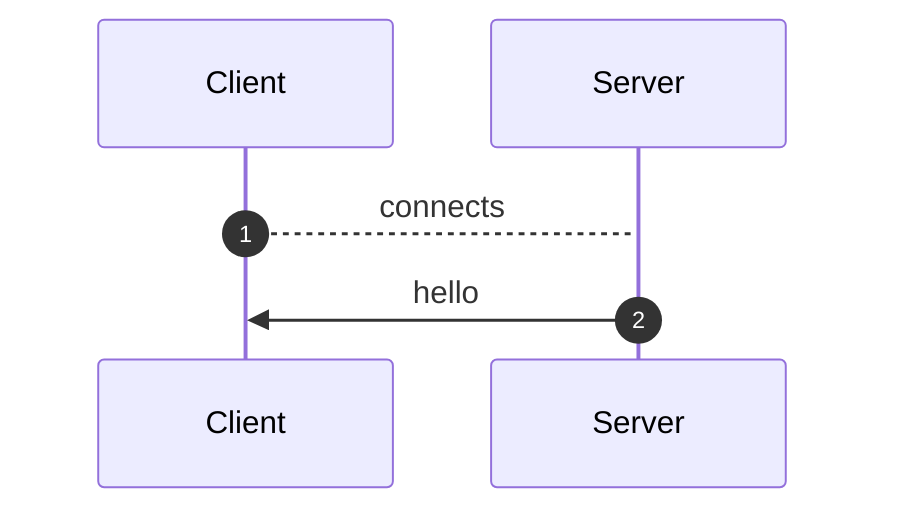
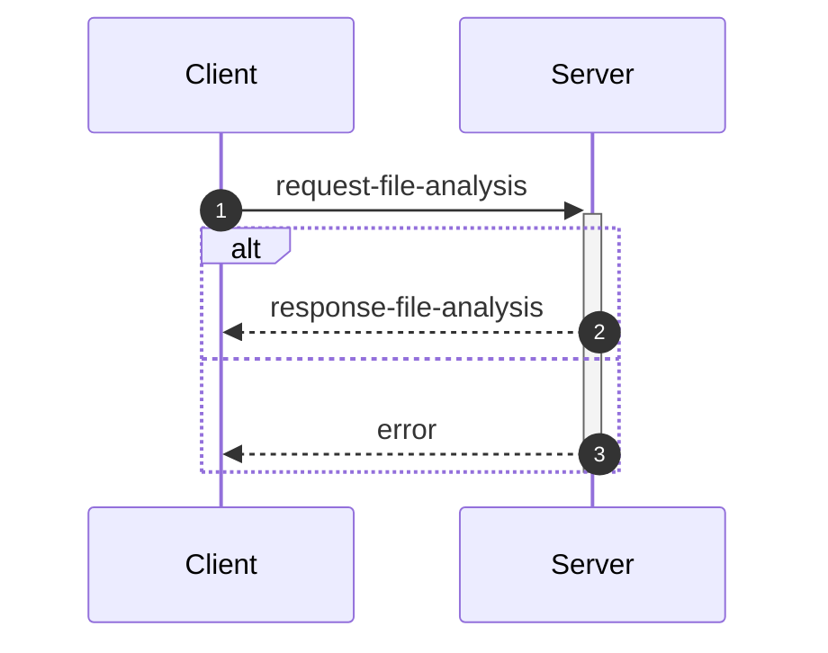
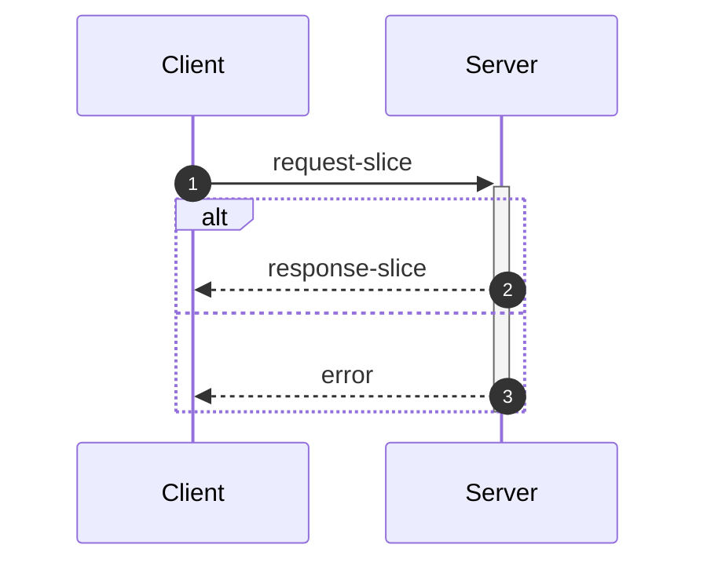
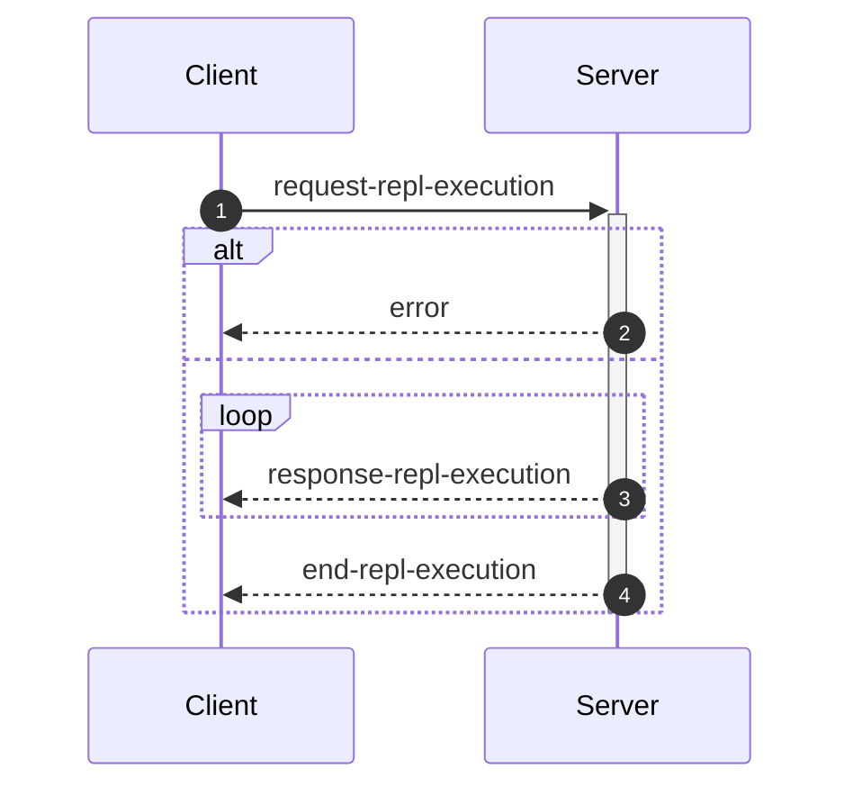

_<span title="an overview of flowR's interface">Generated</span> from '[wiki-interface.ts](https://github.com/flowr-analysis/flowr/tree/main/src/documentation/wiki-interface.ts "src/documentation/wiki-interface.ts")' on 2026-10-22, 15:35:50 UTC (v2.16.4, R v4.5.0), do not edit directly._

Although far from being as detailed as the in-depth explanation of [_flowR_](https://github.com/flowr-analysis/flowr/wiki/Core),
this wiki page explains how to interface with _flowR_ in more detail.
In general, command line arguments and other options provide short descriptions on hover over.

* [💻 Using the REPL](#using-the-repl)
* [⚙️ Configuring FlowR](#configuring-flowr)
* [⚒️ Writing Code](#writing-code)
* [💬 Communicating with the Server](#communicating-with-the-server)

<a id='using-the-repl'></a>
## 💻 Using the REPL

> [!NOTE]
> To execute arbitrary R commands with a repl request, _flowR_ has to be started explicitly with <span title="Description (Command Line Argument): Allow to access the underlying R session when using flowR (security warning: this allows the execution of arbitrary R code!)">`--r-session-access`</span>.
> Please be aware that this introduces a security risk and note that this relies on the [`r-shell` engine](https://github.com/flowr-analysis/flowr/wiki/Engines) .

Although primarily meant for users to explore,
there is nothing which forbids calling _flowR_ as a subprocess to use standard-in, -output, and -error
for communication (although you can access the REPL using the server as well,
with the [REPL Request](#message-request-repl-execution) message).

The read-eval-print loop&nbsp;(REPL) works relatively simple.
You can submit an expression (using <kbd>Enter</kbd>),
which is interpreted as an R&nbsp;expression by default but interpreted as a *command* if it starts with a colon (`:`).
The best command to get started with the REPL is <span title="Description (Repl Command): Show help information (aliases: :h, :?)">`:help`</span>.
Besides, you can leave the REPL either with the command <span title="Description (Repl Command): End the repl (aliases: :q, :exit)">`:quit`</span> or by pressing <kbd>Ctrl</kbd>+<kbd>C</kbd> twice.
When writing a *command*, you may press <kbd>Tab</kbd> to get a list of completions, if available.
Multiple commands can be entered in a single line by separating them with a semicolon (`;`), e.g. `:parse "x<-2"; :df*`.
If a command is given without R code, the REPL will re-use R code given in a previous command.
The prior example will hence return first the parsed AST of the program and then the dataflow graph for `"x <- 2"`.

> [!NOTE]
> If you develop flowR, you may want to launch the repl using the `npm run main-dev` command, this way, you get a non-minified version of flowR with debug information and hot-reloading of source files.

<details>
<summary>Available Commands</summary>

We currently offer the following commands (this with a `[*]` suffix are available with and without the star):

| Command | Description |
| ------- | ----------- |
| **<span title="Description (Repl Command): End the repl (aliases: :q, :exit)">:quit</span>** | End the repl (aliases: **:<span title="Alias of ':quit'. End the repl">q</span>**, **:<span title="Alias of ':quit'. End the repl">exit</span>**) |
| **<span title="Description (Repl Command): Execute the given code as R code. This requires the `--r-session-access` flag to be set and requires the r-shell engine. (aliases: :e, :r)">:execute</span>** | Execute the given code as R code. This requires the `--r-session-access` flag to be set and requires the r-shell engine. (aliases: **:<span title="Alias of ':execute'. Execute the given code as R code. This requires the `--r-session-access` flag to be set and requires the r-shell engine.">e</span>**, **:<span title="Alias of ':execute'. Execute the given code as R code. This requires the `--r-session-access` flag to be set and requires the r-shell engine.">r</span>**) |
| **<span title="Description (Repl Command): Get mermaid code for the control-flow graph of R code (aliases: :cfg, :cf)">:controlflow[*]</span>** | Get mermaid code for the control-flow graph of R code (star: Returns the URL to mermaid.live) (aliases: **:<span title="Alias of ':controlflow'. Get mermaid code for the control-flow graph of R code">cfg</span>**, **:<span title="Alias of ':controlflow'. Get mermaid code for the control-flow graph of R code">cf</span>**) |
| **<span title="Description (Repl Command): Get mermaid code for the control-flow graph with basic blocks (aliases: :cfgb, :cfb)">:controlflowbb[*]</span>** | Get mermaid code for the control-flow graph with basic blocks (star: Returns the URL to mermaid.live) (aliases: **:<span title="Alias of ':controlflowbb'. Get mermaid code for the control-flow graph with basic blocks">cfgb</span>**, **:<span title="Alias of ':controlflowbb'. Get mermaid code for the control-flow graph with basic blocks">cfb</span>**) |
| **<span title="Description (Repl Command): Get mermaid code for the dataflow graph (aliases: :d, :df)">:dataflow[*]</span>** | Get mermaid code for the dataflow graph (star: Returns the URL to mermaid.live) (aliases: **:<span title="Alias of ':dataflow'. Get mermaid code for the dataflow graph">d</span>**, **:<span title="Alias of ':dataflow'. Get mermaid code for the dataflow graph">df</span>**) |
| **<span title="Description (Repl Command): Get mermaid code for the normalized AST of R code (aliases: :n)">:normalize[*]</span>** | Get mermaid code for the normalized AST of R code (star: Returns the URL to mermaid.live) (alias: **:<span title="Alias of ':normalize'. Get mermaid code for the normalized AST of R code">n</span>**) |
| **<span title="Description (Repl Command): Get mermaid code for the simplified dataflow graph (aliases: :ds, :dfs)">:dataflowsimple[*]</span>** | Get mermaid code for the simplified dataflow graph (star: Returns the URL to mermaid.live) (aliases: **:<span title="Alias of ':dataflowsimple'. Get mermaid code for the simplified dataflow graph">ds</span>**, **:<span title="Alias of ':dataflowsimple'. Get mermaid code for the simplified dataflow graph">dfs</span>**) |
| **<span title="Description (Repl Command): Inspect and extend the signature database: `query` (identical to :query @signature), `info <name>` for where a function comes from (identical to :query @function-info), `add <path>` to mount another database/source, `download` to fetch the full-history database. (aliases: :sig)">:signature</span>** | Inspect and extend the signature database: `query` (identical to :query @signature), `info <name>` for where a function comes from (identical to :query @function-info), `add <path>` to mount another database/source, `download` to fetch the full-history database. (alias: **:<span title="Alias of ':signature'. Inspect and extend the signature database: `query` (identical to :query @signature), `info <name>` for where a function comes from (identical to :query @function-info), `add <path>` to mount another database/source, `download` to fetch the full-history database.">sig</span>**) |
| **<span title="Description (Repl Command): Just calculates the DFG, but only prints summary info (aliases: :d#, :df#)">:dataflowsilent</span>** | Just calculates the DFG, but only prints summary info (aliases: **:<span title="Alias of ':dataflowsilent'. Just calculates the DFG, but only prints summary info">d#</span>**, **:<span title="Alias of ':dataflowsilent'. Just calculates the DFG, but only prints summary info">df#</span>**) |
| **<span title="Description (Repl Command): Prints ASCII Art of the parsed, unmodified AST (aliases: :p)">:parse</span>** | Prints ASCII Art of the parsed, unmodified AST (alias: **:<span title="Alias of ':parse'. Prints ASCII Art of the parsed, unmodified AST">p</span>**) |
| **<span title="Description (Repl Command): Prints the version of flowR as well as the current version of R">:version</span>** | Prints the version of flowR as well as the current version of R
| **<span title="Description (Repl Command): Query the given R code (use 'help' for more information)">:query[*]</span>** | Query the given R code (use 'help' for more information) (star: Similar to query, but returns the output in json format.)
| **<span title="Description (Repl Command): Returns an ASCII representation of the dataflow graph (aliases: :df!)">:dataflowascii</span>** | Returns an ASCII representation of the dataflow graph (alias: **:<span title="Alias of ':dataflowascii'. Returns an ASCII representation of the dataflow graph">df!</span>**) |
| **<span title="Description (Repl Command): Returns summarization stats for the normalized AST (aliases: :n#)">:normalize#</span>** | Returns summarization stats for the normalized AST (alias: **:<span title="Alias of ':normalize#'. Returns summarization stats for the normalized AST">n#</span>**) |
| **<span title="Description (Repl Command): Show help information (aliases: :h, :?)">:help</span>** | Show help information (aliases: **:<span title="Alias of ':help'. Show help information">h</span>**, **:<span title="Alias of ':help'. Show help information">?</span>**) |

</details>

> [!TIP]
> 
> As indicated by the examples before, all REPL commands that operate on code keep track of the state.
> Hence, if you run a command like <span title="Description (Repl Command, starred version): Returns the URL to mermaid.live; Base Command: Get mermaid code for the dataflow graph (aliases: :d*, :df*)">`:dataflow*`</span> without providing R code,
> the REPL will re-use the R code provided in a previous command.
> Likewise, doing this will benefit from incrementality!
> If you request the dataflow graph with `:df* x <- 2 * y` and then want to see the parsed AST with `:parse`,
> the REPL will re-use previously obtained information and not re-parse the code again.
> 		

Generally, many commands offer shortcut versions in the REPL. Many queries, for example, offer a shortened format (see the example below).
Of special note, the [Config Query](https://github.com/flowr-analysis/flowr/wiki/%5BQuery%5D-Config)
can be used to also modify the currently active configuration of _flowR_ within the REPL (see the [wiki page](https://github.com/flowr-analysis/flowr/wiki/%5BQuery%5D-Config) for more information).

### Example: Retrieving the Dataflow Graph

To retrieve a URL to the [mermaid](https://mermaid.js.org/) diagram of the dataflow of a given expression,
use <span title="Description (Repl Command, starred version): Returns the URL to mermaid.live; Base Command: Get mermaid code for the dataflow graph (aliases: :d*, :df*)">`:dataflow*`</span> (or <span title="Description (Repl Command): Get mermaid code for the dataflow graph (aliases: :d, :df)">`:dataflow`</span> to get the mermaid code in the cli):

```shell
$ docker run -it --rm eagleoutice/flowr # or npm run flowr 
flowR repl v2.16.4, R grammar v14 (tree-sitter engine)
R> :dataflow* y <- 1 + x
```

<details>
<summary style='color:gray'>Output</summary>

```text
https://mermaid.live/view#base64:eyJjb2RlIjoiZmxvd2NoYXJ0IFREXG4gICAgMXt7XCJgKiM5MTtSTnVtYmVyIzkzOyogKioxKipcbiAgICAgICoxLjYqICgqKmlkOiAxKiopYFwifX1cbiAgICAyKFtcImAqIzkxO1JTeW1ib2wjOTM7KiAqKngqKlxuICAgICAgKjEuMTAqICgqKmlkOiAyKiopYFwiXSlcbiAgICAzW1tcImAqIzkxO1JCaW5hcnlPcCM5MzsqIGJhc2UjNTg7IzU4OyoqIzQzOyoqXG4gICAgICAqMS42LTEwKiAoKippZDogMyoqKVxuICAgIGFyZzogKDEsIDIpYFwiXV1cbiAgICBidWlsdC1pbjpfNDNfW1wiYEJ1aWx0LUluOlxuIzQzO2BcIl1cbiAgICBzdHlsZSBidWlsdC1pbjpfNDNfIHN0cm9rZTpncmF5LGZpbGw6Z3JheSxzdHJva2Utd2lkdGg6MnB4LG9wYWNpdHk6Ljg7XG4gICAgMFtcImAqIzkxO1JTeW1ib2wjOTM7KiAqKnkqKlxuICAgICAgKjEuMSogKCoqaWQ6IDAqKiwgdjogMylgXCJdXG4gICAgNFtbXCJgKiM5MTtSQmluYXJ5T3AjOTM7KiBiYXNlIzU4OyM1ODsqKiM2MDsjNDU7KipcbiAgICAgICoxLjEtMTAqICgqKmlkOiA0KiopXG4gICAgYXJnOiAoMCwgMylgXCJdXVxuICAgIGJ1aWx0LWluOl82MF8tW1wiYEJ1aWx0LUluOlxuIzYwOyM0NTtgXCJdXG4gICAgc3R5bGUgYnVpbHQtaW46XzYwXy0gc3Ryb2tlOmdyYXksZmlsbDpncmF5LHN0cm9rZS13aWR0aDoycHgsb3BhY2l0eTouODtcbiAgICAxIC0uLT58XCJmbG93XCJ8IDJcbiAgICBsaW5rU3R5bGUgMCBzdHJva2U6Z3JheSxjb2xvcjpncmF5O1xuICAgIDIgLS4tPnxcImZsb3dcInwgM1xuICAgIGxpbmtTdHlsZSAxIHN0cm9rZTpncmF5LGNvbG9yOmdyYXk7XG4gICAgMyAtLT58XCJyZWFkcywgYXJnXCJ8IDFcbiAgICAzIC0tPnxcInJlYWRzLCBhcmdcInwgMlxuICAgIDMgLS4tPnxcImZsb3dcInwgMFxuICAgIGxpbmtTdHlsZSA0IHN0cm9rZTpncmF5LGNvbG9yOmdyYXk7XG4gICAgMyAtLi0+fFwicmVhZHMsIGNhbGxzXCJ8IGJ1aWx0LWluOl80M19cbiAgICBsaW5rU3R5bGUgNSBzdHJva2U6Z3JheTtcbiAgICAwIC0tPnxcImRlZmluZWQtYnksIGZsb3dcInwgNFxuICAgIDAgLS0+fFwiZGVmaW5lZC1ieVwifCAzXG4gICAgNCAtLT58XCJyZWFkcywgYXJnXCJ8IDNcbiAgICA0IC0tPnxcInJldHVybnMsIGFyZ1wifCAwXG4gICAgNCAtLi0+fFwicmVhZHMsIGNhbGxzXCJ8IGJ1aWx0LWluOl82MF8tXG4gICAgbGlua1N0eWxlIDEwIHN0cm9rZTpncmF5OyIsIm1lcm1haWQiOnsiYXV0b1N5bmMiOnRydWV9fQ==
```

Retrieve the dataflow graph of the expression `y <- 1 + x`. It looks like this:


<details>

<summary style="color:gray">R Code of the Dataflow Graph</summary>

The analysis ran (including parse and normalize, using the [tree-sitter](https://github.com/flowr-analysis/flowr/wiki/Engines) engine) within the generation environment. No [signature database](https://github.com/flowr-analysis/flowr/wiki/Signature-Database) is mounted for these generated graphs, so `library()` calls attach no package exports; base-R names are still qualified via the generated base-package store (e.g. `acf` as `stats::acf`). 
We encountered no unknown side effects during the analysis.

```r
y <- 1 + x
```

</details>

</details>

For small graphs like this, <span title="Description (Repl Command): Returns an ASCII representation of the dataflow graph (aliases: :df!)">`:dataflowascii`</span> also provides an ASCII representation directly in the REPL:

```shell
$ docker run -it --rm eagleoutice/flowr # or npm run flowr 
flowR repl v2.16.4, R grammar v14 (tree-sitter engine)
R> :df! y <- 1 + x
```

<details open>
<summary style='color:gray'>Output</summary>

```text
                        v<0>v
 c<4>c──────────────────| y |
 |<- |     ┌────────────v---v
 c---c     │
    │   c<3>c   0<1>0
    └───| + |───| 1 |───u<2>u
        c---c   0---0   | x |
           └────────────u---u
Edges:
3 -> 1: reads, arg          3 -> 2: reads, arg
3 -> 0: flows-to            1 -> 2: flows-to
2 -> 3: flows-to            4 -> 3: reads, arg
4 -> 0: returns, arg        0 -> 4: defined-by, flows-to
0 -> 3: defined-by
```

Retrieve the dataflow graph of the expression `y <- 1 + x` as ASCII art.

</details>

For the slicing with <span title="Description (Repl Command): Static backwards executable slicer for R">`:slicer`</span>, you have access to the same [magic comments](#slice-magic-comments) as with the [slice request](#message-request-slice).
Pass `--inline` to splice resolvable `source()` calls into the reconstruction so the slice is a single self-contained R text (the same as the static slice query's `inlineSources` flag).
See `--help` for more flags!

### Example: Interfacing with the File System

Many commands that allow for an R-expression (like <span title="Description (Repl Command, starred version): Returns the URL to mermaid.live; Base Command: Get mermaid code for the dataflow graph (aliases: :d*, :df*)">`:dataflow*`</span>) allow for a file as well
if the argument starts with `file://`.
If you are working from the root directory of the _flowR_ repository, the following gives you the parsed AST of the example file using the <span title="Description (Repl Command): Prints ASCII Art of the parsed, unmodified AST (aliases: :p)">`:parse`</span> command:

> **Watch mode**: Replace `file://` with `watch://` to enter watch mode.
> flowR runs the command immediately and then re-runs it every time the file (or any file inside the folder) changes.
> Enter any other command to leave watch mode.
> For example: `:df watch://analysis.R`

```shell
$ docker run -it --rm eagleoutice/flowr # or npm run flowr 
flowR repl v2.16.4, R grammar v14 (tree-sitter engine)
R> :parse file://test/testfiles/example.R
```

<details>
<summary style='color:gray'>Output</summary>

```text
File: test/testfiles/example.R

program
├ binaryoperator
│ ├ identifier "sum" (1:1─4)
│ ├ <- "<-" (1:5─7)
│ ╰ float "0" (1:8─9)
├ binaryoperator
│ ├ identifier "product" (2:1─8)
│ ├ <- "<-" (2:9─11)
│ ╰ float "1" (2:12─13)
├ binaryoperator
│ ├ identifier "w" (3:1─2)
│ ├ <- "<-" (3:3─5)
│ ╰ float "7" (3:6─7)
├ binaryoperator
│ ├ identifier "N" (4:1─2)
│ ├ <- "<-" (4:3─5)
│ ╰ float "10" (4:6─8)
├ forstatement
│ ├ for "for" (6:1─4)
│ ├ ( "(" (6:5─6)
│ ├ identifier "i" (6:6─7)
│ ├ in "in" (6:8─10)
│ ├ binaryoperator
│ │ ├ float "1" (6:11─12)
│ │ ├ : ":" (6:12─13)
│ │ ╰ parenthesizedexpression
│ │   ├ ( "(" (6:13─14)
│ │   ├ binaryoperator
│ │   │ ├ identifier "N" (6:14─15)
│ │   │ ├ - "-" (6:15─16)
│ │   │ ╰ float "1" (6:16─17)
│ │   ╰ ) ")" (6:17─18)
│ ├ ) ")" (6:18─19)
│ ╰ bracedexpression
│   ├ { "{" (6:20─21)
│   ├ binaryoperator
│   │ ├ identifier "sum" (7:3─6)
│   │ ├ <- "<-" (7:7─9)
│   │ ╰ binaryoperator
│   │   ├ binaryoperator
│   │   │ ├ identifier "sum" (7:10─13)
│   │   │ ├ + "+" (7:14─15)
│   │   │ ╰ identifier "i" (7:16─17)
│   │   ├ + "+" (7:18─19)
│   │   ╰ identifier "w" (7:20─21)
│   ├ binaryoperator
│   │ ├ identifier "product" (8:3─10)
│   │ ├ <- "<-" (8:11─13)
│   │ ╰ binaryoperator
│   │   ├ identifier "product" (8:14─21)
│   │   ├  "" (8:22─23)
│   │   ╰ identifier "i" (8:24─25)
│   ╰ } "}" (9:1─2)
├ call
│ ├ identifier "cat" (11:1─4)
│ ╰ arguments
│   ├ ( "(" (11:4─5)
│   ├ argument
│   │ ╰ string
│   │   ├ " "\"" (11:5─6)
│   │   ├ stringcontent "Sum:" (11:6─10)
│   │   ╰ " "\"" (11:10─11)
│   ├ comma "," (11:11─12)
│   ├ argument
│   │ ╰ identifier "sum" (11:13─16)
│   ├ comma "," (11:16─17)
│   ├ argument
│   │ ╰ string
│   │   ├ " "\"" (11:18─19)
│   │   ├ stringcontent
│   │   │ ╰ escapesequence "\\n" (11:19─21)
│   │   ╰ " "\"" (11:21─22)
│   ╰ ) ")" (11:22─23)
╰ call
  ├ identifier "cat" (12:1─4)
  ╰ arguments
    ├ ( "(" (12:4─5)
    ├ argument
    │ ╰ string
    │   ├ " "\"" (12:5─6)
    │   ├ stringcontent "Product:" (12:6─14)
    │   ╰ " "\"" (12:14─15)
    ├ comma "," (12:15─16)
    ├ argument
    │ ╰ identifier "product" (12:17─24)
    ├ comma "," (12:24─25)
    ├ argument
    │ ╰ string
    │   ├ " "\"" (12:26─27)
    │   ├ stringcontent
    │   │ ╰ escapesequence "\\n" (12:27─29)
    │   ╰ " "\"" (12:29─30)
    ╰ ) ")" (12:30─31)
```

Retrieve the parsed AST of the example file.

<details>

<summary>File Content</summary>

```r
sum <- 0
product <- 1
w <- 7
N <- 10

for (i in 1:(N-1)) {
  sum <- sum + i + w
  product <- product * i
}

cat("Sum:", sum, "\n")
cat("Product:", product, "\n")
```

</details>

As _flowR_ directly transforms this AST the output focuses on being human-readable instead of being machine-readable.
		
</details>

### Example: Run a Query

You can run any query supported by _flowR_ using the <span title="Description (Repl Command): Query the given R code (use 'help' for more information)">`:query`</span> command.
For example, to obtain the shapes of all data frames in a given piece of code, you can run:

```shell
$ docker run -it --rm eagleoutice/flowr # or npm run flowr 
flowR repl v2.16.4, R grammar v14 (tree-sitter engine)
R> :query @absint df-shape "x <- data.frame(a = 1:10, b = 1:10)\ny <- x$a"
```

<details open>
<summary style='color:gray'>Output</summary>

```text
Query: absint (1 ms)
```

Retrieve the shapes of all data frames in the given code.

</details>

To run the linter on a file, you can use (in this example, we just issue the `dead-code` linter on a small piece of code):

```shell
$ docker run -it --rm eagleoutice/flowr # or npm run flowr 
flowR repl v2.16.4, R grammar v14 (tree-sitter engine)
R> :query @linter rules:dead-code "if(FALSE) x <- 2"
```

<details open>
<summary style='color:gray'>Output</summary>

```text
Query: linter (2 ms)
   ╰ Dead Code (dead-code):
       ╰ certain:
           ╰ Code at 1.11-16
```

Run the linter on the given code, with only the `dead-code` rule enabled.

</details>

For more information on the available queries, please check out the [Query API](https://github.com/flowr-analysis/flowr/wiki/Query-API).

<a id='configuring-flowr'></a>
## ⚙️ Configuring FlowR

When running _flowR_, you may want to specify some behaviors with a dedicated configuration file.
By default, flowR looks for a file named `flowr.json` in the current working directory (or any higher directory).
You can also specify a different file with <span title="Description (Command Line Argument): The name of the configuration file to use">`--config-file`</span> or pass the configuration inline using <span title="Description (Command Line Argument): The flowR configuration to use, as a JSON string">`--config-json`</span>.
A `flowr.json` found this way belongs to the analyzed project, so flowR ignores its options that decide what flowR executes or loads
(`engines.*.wasmPath`, `engines.*.treeSitterWasmPath`, `engines.*.rPath`, `solver.sigdb.additionalPaths`, `solver.sigdb.downloadRepo`, `solver.sigdb.installedLibrary.paths`),
unless you pass <span title="Description (Command Line Argument): Keep the security-sensitive options (e.g., the R executable) of the flowr.json found in the working directory or a parent. Only use this for projects you trust.">`--trust-config`</span>.
To analyze code you do not trust, use the secure mode (<span title="Description (Command Line Argument): Run in secure mode for analyzing untrusted code: flowR does not start R (or any other process), does not access the network, does not search for project configs, and ignores security-sensitive options in every config. Cannot be disabled once enabled. Can also be enabled with the environment variable {italic FLOWR_SECURE_MODE=1}.">`--secure`</span>, see the [security policy](https://github.com/flowr-analysis/flowr/blob/main/.github/SECURITY.md)).
To inspect the current configuration, you can run flowr with the <span title="Description (Command Line Argument): Run with verbose logging (will be passed to the corresponding script)">`--verbose`</span> flag, or use the `config` [Query](https://github.com/flowr-analysis/flowr/wiki/Query-API).
Within the REPL this works by running the following:

```shell
:query @config
```

To work with the <a href="https://github.com/flowr-analysis/flowr/tree/main/src/config.ts#L119"><code><span title="The configuration file format for flowR.">FlowrConfig</span></code></a> you can use the provided helper objects alongside its methods like
<a href="https://github.com/flowr-analysis/flowr/tree/main/src/config.ts#L914"><code><span title="Creates a new flowr config that has the updated values.">FlowrConfig::<b>amend</b></span></code></a>.
The schema below documents every option; the ones you most likely want are:

- <a href="https://github.com/flowr-analysis/flowr/wiki/Interface#configuring-flowr" title="Configuration Option (boolean): Whether source calls should be ignored, causing {@link processSourceCall}&#39;s behavior to be skipped.">ignoreSourceCalls</a>: ignore source calls when analyzing the code, i.e., ignore the inclusion of other files.
- <a href="https://github.com/flowr-analysis/flowr/wiki/Interface#configuring-flowr" title="Configuration Option (boolean): Whether load calls should be ignored, causing {@link processLoadCall}&#39;s behavior to be skipped.">ignoreLoadCalls</a>: ignore load calls when analyzing the code, i.e., ignore the loading of r-data files.
- <a href="https://github.com/flowr-analysis/flowr/wiki/Interface#configuring-flowr" title="Configuration Option (object): Do you want to overwrite (parts) of the builtin definition?">semantics.environment.overwriteBuiltIns</a>: overwrite _flowR_'s handling of built-in functions, or clear the preset definitions entirely.
  See [Configure BuiltIn Semantics](#configure-builtin-semantics) for more information.
- <a href="https://github.com/flowr-analysis/flowr/wiki/Interface#configuring-flowr" title="Configuration Option (string): How to resolve variables and their values. (one of &quot;disabled&quot;, &quot;alias&quot;, &quot;builtin&quot;)">solver.variables</a>: how to resolve variables and their values (`disabled`, `alias`, `builtin`).
- <a href="https://github.com/flowr-analysis/flowr/wiki/Interface#configuring-flowr" title="Configuration Option (array): The engine or set of engines to use for interacting with R code. An empty array means all available engines will be used.">engines</a> and <a href="https://github.com/flowr-analysis/flowr/wiki/Interface#configuring-flowr" title="Configuration Option (string): The default engine to use for interacting with R code. If this is undefined, an arbitrary engine from the specified list will be used. (one of &quot;tree-sitter&quot;, &quot;r-shell&quot;)">defaultEngine</a>: the engines used to interact with R code, see the [Engines wiki page](https://github.com/flowr-analysis/flowr/wiki/Engines).
- <a href="https://github.com/flowr-analysis/flowr/wiki/Interface#configuring-flowr" title="Configuration Option (array): Files a framework loads on its own, without any source() call (e.g. global.R in a shiny app), in the order they are loaded; flowR orders the matching project files accordingly and analyzes them as one program. Entries are case-insensitive globs matched against the file path, a plain name matches any file with that name, and entries matching no project file are warned about. Usually set per project kind via specializeConfig.">project.implicitSources</a>: the files a framework loads without any `source()` call, in the order in which they are
  loaded. Entries are globs (e.g. `R/*.R`) matched against the file path ignoring capitalization; one matching no file is reported.
- <a href="https://github.com/flowr-analysis/flowr/wiki/Interface#configuring-flowr" title="Configuration Option (object): Overwrite (parts of) the configuration depending on the project kind flowR detects, e.g. to give a shiny app its implicit sources.">specializeConfig</a>: overwrite (parts of) the configuration depending on the kind of project _flowR_ detects
  (e.g. `shiny-app`), which is how a shiny app gets its implicit sources by default. What you configure directly wins.
- <a href="https://github.com/flowr-analysis/flowr/wiki/Interface#configuring-flowr" title="Configuration Option (string): Overwrite the project kind flowR would otherwise infer from the analyzed files, e.g. when auto-detection guesses wrong. (one of &quot;package&quot;, &quot;script&quot;, &quot;shiny-app&quot;, &quot;notebook&quot;, &quot;project&quot;, &quot;unknown&quot;)">project.useProjectType</a>: skip that detection and force a project kind yourself, when auto-detection guesses wrong.
- <a href="https://github.com/flowr-analysis/flowr/wiki/Interface#configuring-flowr" title="Configuration Option (array): The default plugins to load when creating a new instance of FlowrAnalyzer">defaultPlugins</a> and <a href="https://github.com/flowr-analysis/flowr/wiki/Interface#configuring-flowr" title="Configuration Option (array): The plugins to load in REPL mode">repl.plugins</a>: the plugins to load for a new <a href="https://github.com/flowr-analysis/flowr/tree/main/src/project/flowr-analyzer.ts#L205"><code><span title="Central class for conducting analyses with FlowR. Use the FlowrAnalyzerBuilder to create a new instance. If you want the original pattern of creating a pipeline and running all steps, you can still do this with FlowrAnalyzer#runFull . To inspect the context of the analyzer, use FlowrAnalyzer#inspectContext (if you are a plugin and need to modify it, use FlowrAnalyzer#context instead).">FlowrAnalyzer</span></code></a> and in the REPL
  (use `flowr:default` to reference the former).

So you can configure _flowR_ by adding a file like the following:

<details>

<summary>Example Configuration File</summary>

```json
{
  "ignoreSourceCalls": true,
  "ignoreLoadCalls": true,
  "semantics": {
    "environment": {
      "overwriteBuiltIns": {
        "definitions": [
          {
            "type": "function",
            "names": [
              "foo"
            ],
            "processor": "builtin:assign",
            "config": {}
          }
        ]
      }
    }
  },
  "defaultPlugins": [
    "file:description",
    "versions:description"
  ],
  "repl": {
    "quickStats": false,
    "dfProcessorHeat": false,
    "hints": true,
    "plugins": [
      "flowr:default"
    ]
  },
  "project": {
    "resolveUnknownPathsOnDisk": true,
    "implicitSources": [
      "global.R",
      "app.R"
    ]
  },
  "linter": {
    "disabledRules": []
  },
  "specializeConfig": {
    "shiny-app": {
      "project": {
        "implicitSources": [
          "global.R",
          "ui.R",
          "server.R",
          "app.R"
        ]
      }
    }
  },
  "engines": [
    {
      "type": "r-shell"
    }
  ],
  "solver": {
    "variables": "alias",
    "evalStrings": true,
    "trackEnvironments": true,
    "sigdb": {
      "enabled": true,
      "loadProjectDependencies": true,
      "eagerlyLoad": false,
      "eagerlyLoadExports": false,
      "linkBaseR": false,
      "linkDescriptionDependencies": false
    },
    "resolveSource": {
      "dropPaths": "no",
      "ignoreCapitalization": true,
      "inferWorkingDirectory": "active-script",
      "searchPath": []
    },
    "instrument": {},
    "slicer": {
      "threshold": 50
    }
  },
  "abstractInterpretation": {
    "wideningThreshold": 4,
    "followCalls": true,
    "dataFrame": {
      "maxColNames": 20,
      "readLoadedData": {
        "readExternalFiles": true,
        "maxReadLines": 1000000
      }
    }
  },
  "incremental": {
    "alwaysIncremental": false,
    "parsing": {
      "activated": false,
      "heuristics": {
        "activated": true,
        "mtime": true,
        "linesFrom": 500,
        "bytesFrom": 50000,
        "alwaysWithEdits": false,
        "minFiles": 1
      }
    }
  },
  "gas": {
    "thresholds": {
      "memory": {
        "problematic": 0.7,
        "critical": 0.9
      },
      "timeMs": {
        "problematic": 100000,
        "critical": 120000
      }
    },
    "features": {}
  }
}
```

</details>

<details>
<a id='configure-builtin-semantics'></a>
<summary>Configure Built-In Semantics</summary>

`semantics/environment/overwriteBuiltins` accepts two keys:

- `loadDefaults` (boolean, initially `true`): If set to `true`, the default built-in definitions are loaded before applying the custom definitions. Setting this flag to `false` explicitly disables the loading of the default definitions.
- `definitions` (array, initially empty): Allows to overwrite or define new built-in elements. Each object within must have a `type` which is one of the below. Furthermore, they may define a string array of `names` which specifies the identifiers to bind the definitions to. You may use `assumePrimitive` to specify whether _flowR_ should assume that this is a primitive non-library definition (so you probably just do not want to specify the key).

  | Type            | Description                                                                                                                                                                                                                                                                                              | Example                                                                                                    |
  | --------------- | -------------------------------------------------------------------------------------------------------------------------------------------------------------------------------------------------------------------------------------------------------------------------------------------------------- | ---------------------------------------------------------------------------------------------------------- |
  | `constant`    | Additionally allows for a `value` this should resolve to.                                                                                                                                                                                                                                                | `{ type: 'constant', names: ['NULL', 'NA'],  value: null }`                                                |
  | `function`    | Is a rather flexible way to define and bind built-in functions. For the time, we do not have extensive documentation to cover all the cases, so please either consult the sources with the `default-builtin-config.ts` or open a [new issue](https://github.com/flowr-analysis/flowr/issues/new/choose). | `{ type: 'function', names: ['next'], processor: 'builtin:d', config: { cfg: ExitPointType.Next } }` |
  | `replacement` | A comfortable way to specify replacement functions like `$<-` or `names<-`. `suffixes` describes the... suffixes to attach automatically. | `{ type: 'replacement', suffixes: ['<-', '<<-'], names: ['[', '[['] }` |

</details>

<details>

<summary style='color:gray'>Full Configuration-File Schema</summary>

- _The configuration file format for flowR._ (object)
    - **logLevel** [optional] _flowR's global minimum log level, applied when the config is loaded._ (string)
        Only allows: 'silly', 'trace', 'debug', 'info', 'warn', 'error', 'fatal'
    - **ignoreSourceCalls** [optional] _Whether source calls should be ignored, causing {@link processSourceCall}'s behavior to be skipped._ (boolean)
    - **ignoreLoadCalls** [optional] _Whether load calls should be ignored, causing {@link processLoadCall}'s behavior to be skipped._ (boolean)
    - **semantics** _Configure language semantics and how flowR handles them._ (object)
        - **environment** [optional] _Semantics regarding how to handle the R environment._ (object)
            - **overwriteBuiltIns** [optional] _Do you want to overwrite (parts) of the builtin definition?_ (object)
                - **loadDefaults** [optional] _Should the default configuration still be loaded?_ (boolean)
                - **definitions** [optional] _The definitions to load/overwrite._ (array)
                Valid item types:
                    - (object)
    - **defaultPlugins** [optional] _The default plugins to load when creating a new instance of FlowrAnalyzer_ (array)
    Valid item types:
        - (alternatives)
            - (string)
            - (array)
    - **repl** _Configuration options for the REPL._ (object)
        - **quickStats** [optional] _Whether to show quick stats in the REPL after each evaluation._ (boolean)
        - **dfProcessorHeat** [optional] _This instruments the dataflow processors to count how often each processor is called._ (boolean)
        - **hints** [optional] _Whether to show dim inline hints on the empty prompt (automatically disabled on non-interactive terminals)._ (boolean)
        - **plugins** [optional] _The plugins to load in REPL mode_ (array)
        Valid item types:
            - (alternatives)
                - (string)
                - (array)
        - **autoUseFileProtocol** [optional] _Prepend the file protocol to a repl input that looks like a path, instead of only warning about it._ (boolean)
        - **queryStats** [optional] _Whether `:query` closes with the line stating how long the queries took (`:query*` never prints it)._ (boolean)
        - **showPlugins** [optional] _Whether `:version` grays out the plugins that did not activate during the last analysis._ (boolean)
    - **project** _Project specific configuration options._ (object)
        - **resolveUnknownPathsOnDisk** [optional] _Whether to resolve unknown paths loaded by the r project disk when trying to source/analyze files._ (boolean)
        - **failOnInaccessiblePath** [optional] _Whether a directory that cannot be traversed during file discovery (e.g. due to permissions) aborts the analysis; when false (the default) such paths are logged and skipped._ (boolean)
        - **basePackages** [optional] _The packages considered part of R itself (base and recommended); if unset, flowR uses its built-in list._ (array)
        Valid item types:
            - (string)
        - **implicitSources** [optional] _Files a framework loads on its own, without any source() call (e.g. global.R in a shiny app), in the order they are loaded; flowR orders the matching project files accordingly and analyzes them as one program. Entries are case-insensitive globs matched against the file path, a plain name matches any file with that name, and entries matching no project file are warned about. Usually set per project kind via specializeConfig._ (array)
        Valid item types:
            - (string)
        - **useProjectType** [optional] _Overwrite the project kind flowR would otherwise infer from the analyzed files, e.g. when auto-detection guesses wrong._ (string)
            Only allows: 'package', 'script', 'shiny-app', 'notebook', 'project', 'unknown'
        - **assumeImplicitEcho** [optional] _Whether the top level of the analyzed code is echoed, so that every visible result printed there is collected as an output by the dependencies query (default true, false for a package)._ (boolean)
        - **discovery** [optional] _Scoping options for the default project discovery._ (object)
            - **full** [optional] _Collect every file below the project root (greedy) instead of only the files the detected project kind needs (default false)._ (boolean)
            - **perKind** [optional] _Per-kind include/exclude glob overrides layered on the default scoping._ (object)
            - **ignore** [optional] _Case-insensitive globs that drop matching files from the intelligent discovery, regardless of kind (e.g. .Renviron to ignore environment files)._ (array)
            Valid item types:
                - (string)
        - **classification** [optional] _Overrides for the signals flowR uses to classify the project kind._ (object)
            - **shinyDescriptionTypes** [optional] _DESCRIPTION Type: values that mark a shiny app._ (array)
            Valid item types:
                - (string)
            - **shinyEntryFiles** [optional] _File names a shiny app is assembled from._ (array)
            Valid item types:
                - (string)
            - **shinyUsagePattern** [optional] _Regex source evidencing shiny usage in an entry file._ (string)
            - **notebookExtensions** [optional] _File extensions marking a notebook._ (array)
            Valid item types:
                - (string)
    - **linter** _Linter configuration options._ (object)
        - **disabledRules** _Linting rule names excluded from the default rule set (a rule requested explicitly via a linter query still runs). Usually set per project kind via specializeConfig._ (array)
        Valid item types:
            - (string)
        - **disabledTags** [optional] _Linting rule tags whose rules are excluded from the default rule set (a rule requested explicitly via a linter query still runs). By default the cmd-check rules are disabled for everything but a package; a configured list replaces that default._ (array)
        Valid item types:
            - (string)
    - **inputSources** [optional] _Further frameworks the input-sources analysis should know about; entries are added to flowR's defaults._ (object)
        - **pure** [optional] _Functions that only pass the constantness of their arguments on._ (array)
        Valid item types:
            - (string)
        - **param** [optional] _Functions whose result is a 'param' input._ (array)
        Valid item types:
            - (string)
        - **file** [optional] _Functions whose result is a 'file' input._ (array)
        Valid item types:
            - (string)
        - **tempfile** [optional] _Functions whose result is a 'tempfile' input._ (array)
        Valid item types:
            - (string)
        - **glob** [optional] _Functions whose result is a 'glob' input._ (array)
        Valid item types:
            - (string)
        - **net** [optional] _Functions whose result is a 'net' input._ (array)
        Valid item types:
            - (string)
        - **rand** [optional] _Functions whose result is a 'rand' input._ (array)
        Valid item types:
            - (string)
        - **system** [optional] _Functions whose result is a 'system' input._ (array)
        Valid item types:
            - (string)
        - **ffi** [optional] _Functions whose result is a 'ffi' input._ (array)
        Valid item types:
            - (string)
        - **lang** [optional] _Functions whose result is a 'lang' input._ (array)
        Valid item types:
            - (string)
        - **options** [optional] _Functions whose result is a 'options' input._ (array)
        Valid item types:
            - (string)
        - **cmdline** [optional] _Functions whose result is a 'cmdline' input._ (array)
        Valid item types:
            - (string)
        - **user** [optional] _Functions whose result is a 'user' input._ (array)
        Valid item types:
            - (string)
        - **const** [optional] _Functions whose result is a 'const' input._ (array)
        Valid item types:
            - (string)
        - **scope** [optional] _Functions whose result is a 'scope' input._ (array)
        Valid item types:
            - (string)
        - **dconst** [optional] _Functions whose result is a 'dconst' input._ (array)
        Valid item types:
            - (string)
        - **unknown** [optional] _Functions whose result is a 'unknown' input._ (array)
        Valid item types:
            - (string)
        - **linkedObjects** [optional] _Objects a framework provides without a definition in the code, e.g. shiny's input._ (array)
        Valid item types:
            - (object)
        - **linkedEntryPoints** [optional] _Calls that hand a function to a framework, which binds its objects to the parameters by position._ (array)
        Valid item types:
            - (object)
    - **specializeConfig** [optional] _Overwrite (parts of) the configuration depending on the project kind flowR detects, e.g. to give a shiny app its implicit sources._ (object)
    - **engines** _The engine or set of engines to use for interacting with R code. An empty array means all available engines will be used._ (array)
    Valid item types:
        - (alternatives)
            - _The configuration for the tree sitter engine._ (object)
                - **type** [required] _Use the tree sitter engine._ (string)
                    Only allows: 'tree-sitter'
                - **wasmPath** [optional] _The path to the tree-sitter-r WASM binary to use. If this is undefined, this uses the default path._ (string)
                - **treeSitterWasmPath** [optional] _The path to the tree-sitter WASM binary to use. If this is undefined, this uses the default path._ (string)
                - **lax** [optional] _Whether to use the lax parser for parsing R code (allowing for syntax errors). If this is undefined, the strict parser will be used._ (boolean)
            - _The configuration for the R shell engine._ (object)
                - **type** [required] _Use the R shell engine._ (string)
                    Only allows: 'r-shell'
                - **rPath** [optional] _The path to the R executable to use. If this is undefined, this uses the default path._ (string)
                - **pipeBind** [optional] _Whether to enable R's experimental pipe-bind operator "=>" by setting _R_USE_PIPEBIND_ for the R session (default false); R itself keeps this off by default, as it is experimental and has never shipped in a release version of R._ (boolean)
    - **defaultEngine** [optional] _The default engine to use for interacting with R code. If this is undefined, an arbitrary engine from the specified list will be used._ (string)
        Only allows: 'tree-sitter', 'r-shell'
    - **solver** _How to resolve constants, constraints, cells, ..._ (object)
        - **variables** _How to resolve variables and their values._ (string)
            Only allows: 'disabled', 'alias', 'builtin'
        - **evalStrings** _Should we include eval(parse(text="...")) calls in the dataflow graph?_ (boolean)
        - **trackEnvironments** [optional] _Track user-created environments (new.env, assign/get/local with envir=, dollar-assign, attach). When false, all envir-style calls fall through conservatively._ (boolean)
        - **sigdb** _Resolving library exports from a signature database._ (object)
            - **enabled** [optional] _Resolve library()/use() exports from a signature database (default true); when false no database is consulted._ (boolean)
            - **loadProjectDependencies** [optional] _Load the project's declared dependencies from its metadata files (DESCRIPTION Imports/Depends, rproject.toml, uvr.toml, renv.lock, rv.lock, uvr.lock) (default true); when false these files are not read for dependencies._ (boolean)
            - **eagerlyLoad** [optional] _Parse the database up front rather than on the first package load (default false, ignored if disabled)._ (boolean)
            - **eagerlyLoadExports** [optional] _Add a vertex for every export on load rather than on demand (default false); keeps the dataflow graph small._ (boolean)
            - **assumedRVersion** [optional] _R version assumed when resolving versioned (base-R) exports: a pin like "4.5" or "auto" to detect the installed R (default "auto")._ (string)
            - **linkBaseR** [optional] _Eagerly attach base-R namespaces so bare base calls resolve without library() (default false)._ (boolean)
            - **linkBaseRCalls** [optional] _Add a lightweight Reads edge from a bare base-R call to its signature-database function vertex (default false; base-R qualification is edge-free otherwise)._ (boolean)
            - **linkPackageCalls** [optional] _Add a lightweight Reads edge from a resolved package call to its signature-database function vertex (default false)._ (boolean)
            - **linkDescriptionDependencies** [optional] _Eagerly attach the namespaces of the project's declared DESCRIPTION dependencies (Imports/Depends) so their exports resolve without an explicit library() (default false)._ (boolean)
            - **warmInBackground** [optional] _Decompress the hot shards (base + most-downloaded) in a background task on startup so the first library() lookup is warm (default false; for long-running servers/REPLs)._ (boolean)
            - **additionalPaths** [optional] _Extra directories or bundle/manifest files searched for signature databases (alongside the shipped default and $FLOWR_SIGDB_DIR); a downloaded full-history bundle placed here is mounted automatically._ (array)
            Valid item types:
                - (string)
            - **downloadRepo** [optional] _GitHub owner/repo the full-history bundle is downloaded from via ":signature download" (default "flowr-analysis/flowr", release tag "sigdb-v<flowR-version>")._ (string)
            - **autoSync** [optional] _On startup, re-download shards whose committed sigdb.remote.json hash no longer matches the cache, in the background (default false; opt-in network sync after a git pull)._ (boolean)
            - **installedLibrary** [optional] _Recovering packages no signature database knows from the copy installed on this machine._ (object)
                - **enabled** [required] _Recover packages no signature database knows from their installed copy (default false)._ (boolean)
                - **paths** [optional] _Library directories to search; when empty they are discovered from the environment and the project._ (array)
                Valid item types:
                    - (string)
                - **useEnvironment** [optional] _Search the libraries R_LIBS_USER/R_LIBS/R_LIBS_SITE name (default true)._ (boolean)
                - **useProjectLibrary** [optional] _Search a project-local renv/packrat library (default true)._ (boolean)
                - **maxDepth** [optional] _How far to descend into the nested layout of a project-local library (default 3)._ (number)
                - **packages** [optional] _Only recover packages whose name matches one of these regular expressions; empty means any._ (array)
                Valid item types:
                    - (string)
            - **blobCacheBudgetMb** [optional] _How many MiB of decoded package blobs every open bundle may hold together (default 16)._ (number)
            - **versionSelection** [optional] _When a project constrains a dependency, resolve to the newest (default), oldest, or system-installed version satisfying it; system needs R and falls back to newest. Base-R packages always resolve against the assumed R version._ (string)
                Only allows: 'newest', 'oldest', 'system'
            - **versionOverrides** [optional] _Force an exact version for specific packages (name -> version), overriding both the project constraint and the versionSelection policy (default {})._ (object)
        - **versionManagement** _Policies for reasoning about dependency versions._ (object)
            - **linkedVersionGroups** [optional] _Groups of packages that must resolve to the same version; version guessing intersects each group so its members stay mutually compatible (default [])._ (array)
            Valid item types:
                - (array)
                Valid item types:
                    - (string)
        - **assumeAttachedPackages** [optional] _Packages to treat as attached without a `library()` call, so what the built-in configuration states about them applies to the analyzed code. The base packages R attaches on startup already resolve without it._ (array)
        Valid item types:
            - (string)
        - **transitiveSideEffectRounds** [optional] _How many rounds the transitive side-effect fixpoint may run before it is cut off (default 32); the propagation stops on its own as soon as a round adds nothing._ (number)
        - **maxOverlayDepth** [optional] _How many binding overlays may stack on one environment frame before a write flattens them (default 4); a pure performance knob, trading lookup cost against copy cost without changing any result._ (number)
        - **instrument** (object)
            - **dataflowExtractors** [optional] _These keys are only intended for use within code, allowing to instrument the dataflow analyzer!_ (any)
        - **resolveSource** [optional] _If lax source calls are active, flowR searches for sourced files much more freely, based on the configurations you give it. This option is only in effect if `ignoreSourceCalls` is set to false._ (object)
            - **dropPaths** _Allow to drop the first or all parts of the sourced path, if it is relative._ (string)
                Only allows: 'no', 'once', 'all'
            - **ignoreCapitalization** _Search for filenames matching in the lowercase._ (boolean)
            - **inferWorkingDirectory** _Try to infer the working directory from the main or any script to analyze._ (string)
                Only allows: 'no', 'main-script', 'active-script', 'any-script'
            - **searchPath** _Additionally search in these paths._ (array)
            Valid item types:
                - (string)
            - **repeatedSourceLimit** [optional] _How often the same file can be sourced within a single run? Please be aware: in case of cyclic sources this may not reach a fixpoint so give this a sensible limit._ (number)
            - **applyReplacements** _Provide name replacements for loaded files_ (array)
            Valid item types:
                - (object)
            - **assumeFilesExist** [optional] _Assume a sourced file is always there, making what it defines certain instead of conditional on the source call._ (boolean)
        - **slicer** [optional] _The configuration for the slicer._ (object)
            - **threshold** [optional] _The maximum number of iterations to perform on a single function call during slicing._ (number)
            - **autoExtend** [optional] _If set, the slicer will gain an additional post-pass._ (boolean)
    - **abstractInterpretation** _The configuration options for abstract interpretation._ (object)
        - **wideningThreshold** _The threshold for the number of visitations of a node at which widening should be performed to ensure the termination of the fixpoint iteration._ (number)
        - **followCalls** _Whether the abstract interpretation is interprocedural, i.e. whether it steps into the functions a call may dispatch to._ (boolean)
        - **dataFrame** _The configuration of the shape inference for data frames._ (object)
            - **maxColNames** _The maximum number of columns names to infer for data frames before over-approximating the column names to top._ (number)
            - **readLoadedData** _Configuration options for reading data frame shapes from loaded external data files, such as CSV files._ (object)
                - **readExternalFiles** _Whether data frame shapes should be extracted from loaded external files, such as CSV files._ (boolean)
                - **maxReadLines** _The maximum number of lines to read when extracting data frame shapes from loaded files, such as CSV files._ (number)
    - **incremental** (object)
        - **alwaysIncremental** _Always take the incremental path, regardless of heuristics._ (boolean)
        - **parsing** (object)
            - **activated** _If set, incremental parsing will be used._ (boolean)
            - **heuristics** (object)
                - **activated** [optional] _If set, the heuristics for incremental parsing will be used._ (boolean)
                - **mtime** [optional] _Skip reparsing entirely if the file's modification time is unchanged since the last parse._ (boolean)
                - **linesFrom** [optional] _Only consider incremental parsing for files with at least this many lines._ (number)
                - **bytesFrom** [optional] _Only consider incremental parsing for files with at least this many bytes._ (number)
                - **alwaysWithEdits** [optional] _Always take the incremental path whenever there is a computed edit region, regardless of the other thresholds._ (boolean)
                - **minFiles** [optional] _Only apply these heuristics once the project has at least this many files loaded._ (number)
    - **gas** [optional] _Resource-usage guard (gas) configuration. All feature factors default to 0 (disabled). See https://github.com/flowr-analysis/flowr/wiki/Core#gas-resource-guard._ (object)
        - **thresholds** [optional] _Thresholds for all gas checks (scaled by per-feature factor), boundable per feature._ (object)
            - **memory** [optional] _Heap-usage fraction thresholds (0-1), either shared or given per feature key (with `default` covering the rest)._ (object)
                - **problematic** [optional] _Heap fraction (0-1) above which Problematic is returned, for every feature without an entry of its own._ (number)
                - **critical** [optional] _Heap fraction (0-1) above which Critical is returned, for every feature without an entry of its own._ (number)
            - **timeMs** [optional] _Elapsed analysis time thresholds in milliseconds, either shared or given per feature key (with `default` covering the rest)._ (object)
                - **problematic** [optional] _Elapsed ms above which Problematic is returned, for every feature without an entry of its own._ (number)
                - **critical** [optional] _Elapsed ms above which Critical is returned, for every feature without an entry of its own._ (number)
            - **steps** [optional] _Processed-AST-node thresholds, counted rather than sampled; only a key that arms a budget (`dataflow`) reads them._ (object)
                - **problematic** [optional] _Processed AST nodes above which Problematic is returned, for every feature without an entry of its own._ (number)
                - **critical** [optional] _Processed AST nodes above which the extraction is cut short, for every feature without an entry of its own._ (number)
            - **vertices** [optional] _Created-dataflow-vertex thresholds, counted like `steps`._ (object)
                - **problematic** [optional] _Created dataflow vertices above which Problematic is returned, for every feature without an entry of its own._ (number)
                - **critical** [optional] _Created dataflow vertices above which the extraction is cut short, for every feature without an entry of its own._ (number)
        - **features** [optional] _Per-feature sensitivity factors. 0 or absent disables gas checking for that feature. A factor of 2 makes the feature twice as sensitive. Recognised keys: `source`, `side-effect-linking`, `linter`, `slicer`, `dataflow`._ (object)
        - **countedCheckEvery** [optional] _How many counted steps pass between two accountings of an armed check, be it a dataflow budget or the slicer's traversal (default 128); trades overshoot against the cost of the check._ (number)
        - **heapProvider** [optional] _Custom heap statistics source (programmatic configs only), overriding the built-in v8/performance.memory detection._ (function)

</details>

<a id='writing-code'></a>
## ⚒️ Writing Code

_flowR_ can be used as a [module](https://www.npmjs.com/package/@eagleoutice/flowr) and offers several main classes and interfaces that are interesting for extension writers 
(see the [Visual Studio Code extension](https://marketplace.visualstudio.com/items?itemName=code-inspect.vscode-flowr) or the [Core](https://github.com/flowr-analysis/flowr/wiki/Core) wiki page for more information).

### Creating Analyses with _flowR_

Nowadays, instances of the <a href="https://github.com/flowr-analysis/flowr/tree/main/src/project/flowr-analyzer.ts#L205"><code><span title="Central class for conducting analyses with FlowR. Use the FlowrAnalyzerBuilder to create a new instance. If you want the original pattern of creating a pipeline and running all steps, you can still do this with FlowrAnalyzer#runFull . To inspect the context of the analyzer, use FlowrAnalyzer#inspectContext (if you are a plugin and need to modify it, use FlowrAnalyzer#context instead).">FlowrAnalyzer</span></code></a> should be used as central frontend to get analysis results from _flowR_.
The entry points an analysis is written against are re-exported from the package root (`import { FlowrAnalyzerBuilder } from '@eagleoutice/flowr'`);
everything else stays reachable under its own path, as in `@eagleoutice/flowr/dataflow/graph/graph`.
For example, a program slice can be created like this:

```ts
const analyzer = await new FlowrAnalyzerBuilder()
    .setEngine('tree-sitter')
    .build();
analyzer.addRequest('x <- 1\ny <- x\nx');
const result = await analyzer.query([
    {
        type:     'static-slice',
        criteria: ['3@x']
    }
]);
```

For more information, please have a look at the [Analyzer](https://github.com/flowr-analysis/flowr/wiki/Analyzer) wiki page, which explains how to construct and use the <a href="https://github.com/flowr-analysis/flowr/tree/main/src/project/flowr-analyzer.ts#L205"><code><span title="Central class for conducting analyses with FlowR. Use the FlowrAnalyzerBuilder to create a new instance. If you want the original pattern of creating a pipeline and running all steps, you can still do this with FlowrAnalyzer#runFull . To inspect the context of the analyzer, use FlowrAnalyzer#inspectContext (if you are a plugin and need to modify it, use FlowrAnalyzer#context instead).">FlowrAnalyzer</span></code></a> in more detail.
To work with specific perspectives, you can also consult the respective pages like the [Dataflow Graph](https://github.com/flowr-analysis/flowr/wiki/Dataflow-Graph) or the [Abstract Interpretation](https://github.com/flowr-analysis/flowr/wiki/Abstract-Interpretation) wiki pages.
### The Pipeline Executor (Low-Level Interface)

Once, in the beginning, _flowR_ was meant to produce a dataflow graph merely to provide *program slices*. 
However, with continuous updates, the [Dataflow Graph](https://github.com/flowr-analysis/flowr/wiki/Dataflow-Graph) repeatedly proves to be the more interesting part.
With this, we restructured _flowR_'s originally *hardcoded* pipeline to be far more flexible. 
Now, it can be theoretically extended or replaced with arbitrary steps, optional steps, and what we call 'decorations' of these steps. 
In short, a slicing pipeline using the <a href="https://github.com/flowr-analysis/flowr/tree/main/src/core/pipeline-executor.ts#L97"><code><span title="**Please note:** The PipelineExecutor is now considered to be a rather low-level API for flowR. While it still works and is the basis for all other layers, we strongly recommend using the FlowrAnalyzer and its builder to create and use an analyzer instance that is pre-configured for your use-case. The pipeline executor allows to execute arbitrary pipelines in a step-by-step fashion. If you are not...">PipelineExecutor</span></code></a> looks like this:

```ts

const slicer = new PipelineExecutor(DEFAULT_SLICING_PIPELINE, {
  parser:    new RShell(),
  request:   requestFromInput('x <- 1\nx + 1'),
  criterion: ['2@x']
})
const slice = await slicer.allRemainingSteps()
// console.log(slice.reconstruct.code)
```

<details><summary>More Information</summary>

If you compare this, with what you would have done with the old (and removed) `SteppingSlicer`, 
this essentially just requires you to replace the `SteppingSlicer` with the <a href="https://github.com/flowr-analysis/flowr/tree/main/src/core/pipeline-executor.ts#L97"><code><span title="**Please note:** The PipelineExecutor is now considered to be a rather low-level API for flowR. While it still works and is the basis for all other layers, we strongly recommend using the FlowrAnalyzer and its builder to create and use an analyzer instance that is pre-configured for your use-case. The pipeline executor allows to execute arbitrary pipelines in a step-by-step fashion. If you are not...">PipelineExecutor</span></code></a>
and to pass the <a href="https://github.com/flowr-analysis/flowr/tree/main/src/core/steps/pipeline/default-pipelines.ts#L18"><code>DEFAULT_SLICING_PIPELINE</code></a> as the first argument.
The <a href="https://github.com/flowr-analysis/flowr/tree/main/src/core/pipeline-executor.ts#L97"><code><span title="**Please note:** The PipelineExecutor is now considered to be a rather low-level API for flowR. While it still works and is the basis for all other layers, we strongly recommend using the FlowrAnalyzer and its builder to create and use an analyzer instance that is pre-configured for your use-case. The pipeline executor allows to execute arbitrary pipelines in a step-by-step fashion. If you are not...">PipelineExecutor</span></code></a>...

1. Provides structures to investigate the results of all intermediate steps
2. Can be executed step-by-step
3. Can repeat steps (e.g., to calculate multiple slices on the same input)

See the in-code documentation for more information.

</details>

### Using the <a href="https://github.com/flowr-analysis/flowr/tree/main/src/r-bridge/shell.ts#L144"><code><span title="The RShell represents an interactive session with the R interpreter. You can configure it by RShellOptions . At the moment we are using a live R session (and not networking etc.) to communicate with R easily, which allows us to install packages etc. However, this might and probably will change in the future (leaving this as a legacy mode :D)">RShell</span></code></a> to Interact with R

The <a href="https://github.com/flowr-analysis/flowr/tree/main/src/r-bridge/shell.ts#L144"><code><span title="The RShell represents an interactive session with the R interpreter. You can configure it by RShellOptions . At the moment we are using a live R session (and not networking etc.) to communicate with R easily, which allows us to install packages etc. However, this might and probably will change in the future (leaving this as a legacy mode :D)">RShell</span></code></a> class allows interfacing with the `R`&nbsp;ecosystem installed on the host system.
Please have a look at [flowR's Engines](https://github.com/flowr-analysis/flowr/wiki/Engines) for more information on alternatives (for example, the <a href="https://github.com/flowr-analysis/flowr/tree/main/src/r-bridge/lang-4.x/tree-sitter/tree-sitter-executor.ts#L29"><code><span title="Synchronous and (way) faster alternative to the RShell using tree-sitter.">TreeSitterExecutor</span></code></a>).

> [!IMPORTANT]
> 
> Each <a href="https://github.com/flowr-analysis/flowr/tree/main/src/r-bridge/shell.ts#L144"><code><span title="The RShell represents an interactive session with the R interpreter. You can configure it by RShellOptions . At the moment we are using a live R session (and not networking etc.) to communicate with R easily, which allows us to install packages etc. However, this might and probably will change in the future (leaving this as a legacy mode :D)">RShell</span></code></a> controls a new instance of the R&nbsp;interpreter, 
> make sure to call <code><a href="https://github.com/flowr-analysis/flowr/tree/main/src/r-bridge/shell.ts#L350"><span title="Close the current R session, makes the object effectively invalid (can no longer be reopened etc.)">RShell::<i>close</i></span></a>()</code> when you are done.

You can start a new "session" by constructing a new object with <code>new <a href="https://github.com/flowr-analysis/flowr/tree/main/src/r-bridge/shell.ts#L144"><span title="The RShell represents an interactive session with the R interpreter. You can configure it by RShellOptions . At the moment we are using a live R session (and not networking etc.) to communicate with R easily, which allows us to install packages etc. However, this might and probably will change in the future (leaving this as a legacy mode :D)">RShell</span></a>()</code>.

However, there are several options that may be of interest 
(e.g., to automatically revive the shell in case of errors or to control the name location of the R process on the system).

With a shell object (let's call it `shell`), you can execute R code by using <a href="https://github.com/flowr-analysis/flowr/tree/main/src/r-bridge/shell.ts#L213"><code><span title="sends the given command directly to the current R session will not do anything to alter input markers!">RShell::<i>sendCommand</i></span></code></a>,
for example <code>shell.<a href="https://github.com/flowr-analysis/flowr/tree/main/src/r-bridge/shell.ts#L213"><span title="sends the given command directly to the current R session will not do anything to alter input markers!">sendCommand</span></a>("1 + 1")</code>.
However, this does not return anything, so if you want to collect the output of your command, use
<a href="https://github.com/flowr-analysis/flowr/tree/main/src/r-bridge/shell.ts#L296"><code><span title="Send a command and collect the output">RShell::<i>sendCommandWithOutput</i></span></code></a> instead.

<a id='communicating-with-the-server'></a>
## 💬 Communicating with the Server

As explained in the [Overview](https://github.com/flowr-analysis/flowr/wiki/Overview), you can run the [TCP](https://de.wikipedia.org/wiki/Transmission_Control_Protocol)&nbsp;server by adding the <span title="Description (Command Line Argument): Do not drop into a repl, but instead start a server on the given port (default: 1042) and listen for messages.">`--server`</span> flag (and, due to the interactive mode, exit with the conventional <kbd>CTRL</kbd>+<kbd>C</kbd>).
Currently, every connection is handled by the same underlying `RShell` - so the server is not designed to handle many clients at a time.
Additionally, the server is not well guarded against attacks (e.g., you can theoretically spawn an arbitrary number of&nbsp;RShell sessions on the target machine).

Every message has to be given in a single line (i.e., without a newline in-between) and end with a newline character. Nevertheless, we will pretty-print example given in the following segments for the ease of reading.

> [!NOTE]
> 
> The default <span title="Description (Command Line Argument): Do not drop into a repl, but instead start a server on the given port (default: 1042) and listen for messages.">`--server`</span> uses a simple [TCP](https://de.wikipedia.org/wiki/Transmission_Control_Protocol)
> connection. If you want _flowR_ to expose a [WebSocket](https://de.wikipedia.org/wiki/WebSocket) server instead, add the <span title="Description (Command Line Argument): If the server flag is set, use websocket for messaging">`--ws`</span> flag (i.e., <span title="Description (Command Line Argument): Do not drop into a repl, but instead start a server on the given port (default: 1042) and listen for messages.">`--server`</span> <span title="Description (Command Line Argument): If the server flag is set, use websocket for messaging">`--ws`</span>) when starting _flowR_ from the command line.

<ul><li>
<a id="message-hello"></a>
<b>Hello</b> Message (<code>hello</code>) 
<details>

<summary style="color:gray"> View Details. <i>The server informs the client about the successful connection and provides Meta-Information.</i> </summary>



After launching _flowR_, for example, with <code>docker run -it --rm eagleoutice/flowr <span title="Description (Command Line Argument): Do not drop into a repl, but instead start a server on the given port (default: 1042) and listen for messages.">-<span/>-server</span></code>&nbsp;(🐳️), connecting should present you with a `hello` message, that amongst others should reveal the versions of&nbsp;_flowR_ and&nbsp;R, using the [semver 2.0](https://semver.org/spec/v2.0.0.html) versioning scheme.
The message looks like this:

```json
{
  "type": "hello",
  "clientName": "client-0",
  "versions": {
    "flowr": "2.16.4",
    "r": "4.5.0",
    "engine": "r-shell"
  }
}
```

There are currently a few messages that you can send after the hello message.
If you want to _slice_ a piece of R code you first have to send an [analysis request](#message-request-file-analysis), so that you can send one or multiple slice requests afterward.
Requests for the [REPL](#message-request-repl-execution) are independent of that.
	
<hr>

<details>
<summary style="color:gray">Message schema (<code>hello</code>)</summary>

For the definition of the hello message, please see it's implementation at [`./src/cli/repl/server/messages/message-hello.ts`](https://github.com/flowr-analysis/flowr/tree/main/src/cli/repl/server/messages/message-hello.ts).

- [required] (object)
    - **type** [required] _The type of the hello message._ (string)
        Only allows: 'hello'
    - **id** [forbidden] _The id of the message is always undefined (as it is the initial message and not requested)._ (any)
    - **clientName** [required] _A unique name that is assigned to each client. It has no semantic meaning and is only used/useful for debugging._ (string)
    - **versions** [required] (object)
        - **flowr** [required] _The version of the flowr server running in semver format._ (string)
        - **r** [required] _The version of the underlying R shell running in semver format._ (string)
        - **engine** [required] _The parser backend that is used to parse the R code._ (string)

</details>

<hr>

</details>
	</li>

<li>
<a id="message-request-file-analysis"></a>
<b>Analysis</b> Message (<code>request-file-analysis</code>) 
<details>

<summary style="color:gray"> View Details. <i>The server builds the dataflow graph for a given input file (or a set of files).</i> </summary>



The request allows the server to analyze a file and prepare it for slicing.
The message can contain a `filetoken`, which is used to identify the file in later slice or query requests (if you do not add one, the request will not be stored and therefore, it is not available for subsequent requests).

> **Please note!**\
> If you want to send and process a lot of analysis requests, but do not want to slice them, please do not pass the `filetoken` field. This will save the server a lot of memory allocation.

Furthermore, the request must contain either a `content` field to directly pass the file's content or a `filepath` field which contains the path to the file (this path must be accessible for the server to be useful).
If you add the `id` field, the answer will use the same `id` so you can match requests and the corresponding answers.
See the implementation of the request-file-analysis message for more information.

You can drop one or more stored file tokens by adding the `invalidateToken` field (a single token or an array of tokens).
The server frees the corresponding analyses _after_ it has answered the request.

> **Tip!**\
> If you only want to drop tokens, you do not need a separate message: send a `request-file-analysis` that contains _just_ the `invalidateToken` field (and no `content` or `filepath`).
> Such a request behaves like an empty file analysis and the server replies with an empty `results` object.
> Because invalidation happens after the response, you may even pass the _current_ `filetoken` in `invalidateToken` to analyze a file once and have the server forget it right after you received the results.

<details>
<summary>Example of the <code>request-file-analysis</code> Message</summary>

_Note:_ even though we pretty-print these messages, they are sent as a single line, ending with a newline.

The following lists all messages that were sent and received in case you want to reproduce the scenario:

<ol>
<li> <code>hello</code> (response)
<details> 

<summary> Show Details </summary>

The first message is always a hello message.

```json
{"type":"hello","clientName":"client-0","versions":{"flowr":"2.16.4","r":"4.5.0","engine":"r-shell"}}
```

</details>
</li>

<li> <b><code>request-file-analysis</code> (request)</b>
<details open> 

<summary> Show Details </summary>

Let's suppose you simply want to analyze the following script:
 
```r
x <- 1
x + 1
```

 For this, you can send the following request:

```json
{"type":"request-file-analysis","id":"1","filetoken":"x","content":"x <- 1\nx + 1"}
```

</details>
</li>

<li> <code>response-file-analysis</code> (response)
<details> 

<summary> Show Details </summary>

The `results` field of the response effectively contains three keys of importance:

- `parse`: which contains 1:1 the parse result in CSV format that we received from the `RShell` (i.e., the AST produced by the parser of the R interpreter).
- `normalize`: which contains the normalized AST, including ids (see the `info` field and the [Normalized AST](https://github.com/flowr-analysis/flowr/wiki/Normalized-AST) wiki page).
- `dataflow`: especially important is the `graph` field which contains the dataflow graph as a set of root vertices (see the [Dataflow Graph](https://github.com/flowr-analysis/flowr/wiki/Dataflow-Graph) wiki page).
			
_As the code is pretty long, we inhibit pretty printing and syntax highlighting (JSON, hiding built-in):_

```text
{"type":"response-file-analysis","format":"json","id":"1","results":{"parse":{"files":[{"parsed":"[1,1,1,6,7,0,\"expr\",false,\"x <- 1\"],[1,1,1,1,1,3,\"SYMBOL\",true,\"x\"],[1,1,1,1,3,7,\"expr\",false,\"x\"],[1,3,1,4,2,7,\"LEFT_ASSIGN\",true,\"<-\"],[1,6,1,6,4,5,\"NUM_CONST\",true,\"1\"],[1,6,1,6,5,7,\"expr\",false,\"1\"],[2,1,2,5,16,0,\"expr\",false,\"x + 1\"],[2,1,2,1,10,12,\"SYMBOL\",true,\"x\"],[2,1,2,1,12,16,\"expr\",false,\"x\"],[2,3,2,3,11,16,\"'+'\",true,\"+\"],[2,5,2,5,13,14,\"NUM_CONST\",true,\"1\"],[2,5,2,5,14,16,\"expr\",false,\"1\"]","filePath":"/tmp/tmp-24555-v7MqUOrB4Di4-.R"}],".meta":{}},"normalize":{"ast":{"type":"RProject","files":[{"root":{"type":"RExpressionList","children":[{"type":"RBinaryOp","location":[1,3,1,4],"lhs":{"type":"RSymbol","location":[1,1,1,1],"content":"x","lexeme":"x","info":{"fullRange":[1,1,1,1],"adToks":[],"id":0,"parent":2,"role":"bin-l","index":0,"nest":0,"file":"/tmp/tmp-24555-v7MqUOrB4Di4-.R"}},"rhs":{"location":[1,6,1,6],"lexeme":"1","info":{"fullRange":[1,6,1,6],"adToks":[],"id":1,"parent":2,"role":"bin-r","index":1,"nest":0,"file":"/tmp/tmp-24555-v7MqUOrB4Di4-.R"},"type":"RNumber","content":{"num":1,"complexNumber":false,"markedAsInt":false}},"operator":"<-","lexeme":"<-","info":{"fullRange":[1,1,1,6],"adToks":[],"id":2,"parent":6,"nest":0,"file":"/tmp/tmp-24555-v7MqUOrB4Di4-.R","index":0,"role":"el-c"}},{"type":"RBinaryOp","location":[2,3,2,3],"lhs":{"type":"RSymbol","location":[2,1,2,1],"content":"x","lexeme":"x","info":{"fullRange":[2,1,2,1],"adToks":[],"id":3,"parent":5,"role":"bin-l","index":0,"nest":0,"file":"/tmp/tmp-24555-v7MqUOrB4Di4-.R"}},"rhs":{"location":[2,5,2,5],"lexeme":"1","info":{"fullRange":[2,5,2,5],"adToks":[],"id":4,"parent":5,"role":"bin-r","index":1,"nest":0,"file":"/tmp/tmp-24555-v7MqUOrB4Di4-.R"},"type":"RNumber","content":{"num":1,"complexNumber":false,"markedAsInt":false}},"operator":"+","lexeme":"+","info":{"fullRange":[2,1,2,5],"adToks":[],"id":5,"parent":6,"nest":0,"file":"/tmp/tmp-24555-v7MqUOrB4Di4-.R","index":1,"role":"el-c"}}],"info":{"adToks":[],"id":6,"nest":0,"file":"/tmp/tmp-24555-v7MqUOrB4Di4-.R","role":"root","index":0}},"filePath":"/tmp/tmp-24555-v7MqUOrB4Di4-.R"}],"info":{"id":7}},".meta":{}},"dataflow":{"unknownReferences":[],"in":[{"nodeId":2,"name":"<-","type":2},{"nodeId":5,"name":"+","type":2}],"out":[{"nodeId":0,"name":"x","type":4,"definedAt":2,"value":[1]}],"environment":{"current":{"id":973,"parent":"<BuiltInEnvironment>","memory":[["x",[{"nodeId":0,"name":"x","type":4,"definedAt":2,"value":[1]}]]],"globalEnv":true},"level":0},"graph":{"rootVertices":[1,0,2,3,4,5],"vertexInformation":[[1,{"tag":"value","id":1}],[0,{"tag":"vdef","id":0,"source":[1]}],[2,{"tag":"fcall","id":2,"name":"<-","onlyBuiltin":true,"args":[{"nodeId":0,"type":32},{"nodeId":1,"type":32}],"origin":["builtin:assign"]}],[3,{"tag":"use","id":3}],[4,{"tag":"value","id":4}],[5,{"tag":"fcall","id":5,"name":"+","onlyBuiltin":true,"args":[{"nodeId":3,"type":32},{"nodeId":4,"type":32}],"origin":["builtin:d"]}]],"edgeInformation":[[2,[[1,{"types":65}],[0,{"types":72}],["built-in:<-",{"types":5}],[3,{"types":4096}]]],[1,[[0,{"types":4096}]]],[0,[[2,{"types":4098}],[1,{"types":2}]]],[5,[[3,{"types":65}],[4,{"types":65}],["built-in:+",{"types":5}]]],[3,[[0,{"types":1}],[4,{"types":4096}]]],[4,[[5,{"types":4096}]]]],"_unknownSideEffects":[]},"entryPoint":2,"cfgEntry":1,"exitPoints":[{"type":0,"nodeId":5}],"hooks":[],".meta":{}}}}
```

</details>
</li>
</ol>

The complete round-trip covers validating the messages as well as starting and stopping the internal mock server.

</details>

You receive an error if, for whatever reason, the analysis fails (e.g., the message or code you sent contained syntax errors).
It contains a human-readable description *why* the analysis failed (see the error message implementation for more details).

<details>
<summary>Example Error Message</summary>

_Note:_ even though we pretty-print these messages, they are sent as a single line, ending with a newline.

The following lists all messages that were sent and received in case you want to reproduce the scenario:

<ol>
<li> <code>hello</code> (response)
<details> 

<summary> Show Details </summary>

The first message is always a hello message.

```json
{"type":"hello","clientName":"client-0","versions":{"flowr":"2.16.4","r":"4.5.0","engine":"r-shell"}}
```

</details>
</li>

<li> <code>request-file-analysis</code> (request)
<details> 

<summary> Show Details </summary>

```json
{"type":"request-file-analysis","id":"1","filename":"sample.R","content":"x <-"}
```

</details>
</li>

<li> <b><code>error</code> (response)</b>
<details open> 

<summary> Show Details </summary>

```json
{
  "id": "1",
  "type": "error",
  "fatal": false,
  "reason": "Error while analyzing file sample.R: GuardError: unable to parse R code (see the log for more information) for request {\"request\":\"text\",\"content\":\"x <-\"}}\n Report a Bug: https://github.com/flowr-analysis/flowr/issues/new?body=%3C!%2D%2D%20Please%20describe%20your%20issue%20in%20more%20detail%20below!%20%2D%2D%3E%0A%0A%0A%3C!%2D%2D%20Automatically%20generated%20issue%20metadata%2C%20please%20do%20not%20edit%20or%20delete%20content%20below%20this%20line%20%2D%2D%3E%0A%2D%2D%2D%0A%0AflowR%20version%3A%202.16.4%0Anode%20version%3A%20v25.6.1%0Anode%20arch%3A%20x64%0Anode%20platform%3A%20linux%0Amessage%3A%20%60unable%20to%20parse%20R%20code%20%28see%20the%20log%20for%20more%20information%29%20for%20request%20%7B%22request%22%3A%22text%22%2C%22content%22%3A%22x%20%3C%2D%22%7D%7D%60%0Astack%20trace%3A%0A%60%60%60%0A%20%20%20%20at%20guard%20%28%3C%3E%2Fsrc%2Futil%2Fassert.ts%3A128%3A9%29%0A%20%20%20%20at%20guardRetrievedOutput%20%28%3C%3E%2Fsrc%2Fr%2Dbridge%2Fretriever.ts%3A155%3A7%29%0A%20%20%20%20at%20%2Fhome%2Frunner%2Fwork%2Fflowr%2Fflowr%2Fsrc%2Fr%2Dbridge%2Fretriever.ts%3A122%3A4%0A%20%20%20%20at%20processTicksAndRejections%20%28node%3Ainternal%2Fprocess%2Ftask_queues%3A104%3A5%29%0A%20%20%20%20at%20async%20Object.parseRequests%20%5Bas%20processor%5D%20%28%3C%3E%2Fsrc%2Fr%2Dbridge%2Fparser.ts%3A108%3A19%29%0A%20%20%20%20at%20async%20PipelineExecutor.nextStep%20%28%3C%3E%2Fsrc%2Fcore%2Fpipeline%2Dexecutor.ts%3A192%3A25%29%0A%20%20%20%20at%20async%20FlowrAnalyzerCache.stepTapeUntil%20%28%3C%3E%2Fsrc%2Fproject%2Fcache%2Fflowr%2Danalyzer%2Dcache.ts%3A117%3A4%29%0A%20%20%20%20at%20async%20FlowRServerConnection.sendFileAnalysisResponse%20%28%3C%3E%2Fsrc%2Fcli%2Frepl%2Fserver%2Fconnection.ts%3A206%3A53%29%0A%60%60%60%0A%0A%2D%2D%2D%0A%09"
}
```

</details>
</li>
</ol>

The complete round-trip covers validating the messages as well as starting and stopping the internal mock server.

</details>

&nbsp;

<a id="analysis-include-cfg"></a>
**Including the Control Flow Graph**

The control flow graph is a view on the dataflow graph: the dataflow analysis records the control flow while it walks
the program, and the graph projects those edges on demand. The server can expose that structure as well (please create
a [new issue](https://github.com/flowr-analysis/flowr/issues/new/choose) for any bug you may encounter).
For this, the analysis request may add `cfg: true` to its list of options.

<details>
<summary>Requesting a Control Flow Graph</summary>

_Note:_ even though we pretty-print these messages, they are sent as a single line, ending with a newline.

The following lists all messages that were sent and received in case you want to reproduce the scenario:

<ol>
<li> <code>hello</code> (response)
<details> 

<summary> Show Details </summary>

The first message is always a hello message.

```json
{"type":"hello","clientName":"client-0","versions":{"flowr":"2.16.4","r":"4.5.0","engine":"r-shell"}}
```

</details>
</li>

<li> <b><code>request-file-analysis</code> (request)</b>
<details open> 

<summary> Show Details </summary>

```json
{
  "type": "request-file-analysis",
  "id": "1",
  "filetoken": "x",
  "content": "if(unknown > 0) { x <- 2 } else { x <- 5 }\nfor(i in 1:x) { print(x); print(i) }",
  "cfg": true
}
```

</details>
</li>

<li> <code>response-file-analysis</code> (response)
<details> 

<summary> Show Details </summary>

The response looks basically the same as a response sent without the `cfg` flag. However, additionally it contains a `cfg` field. 
If you are interested in a visual representation of the control flow graph, see the 
[visualization with mermaid](https://mermaid.live/view#base64:eyJjb2RlIjoiZmxvd2NoYXJ0IFREXG4gICAgbjAoW1wiYFJTeW1ib2wgKDApXG4qKnVua25vd24qKmBcIl0pXG4gICAgbjEoW1wiYFJOdW1iZXIgKDEpXG4qKjAqKmBcIl0pXG4gICAgbjIoW1wiYFJCaW5hcnlPcCAoMilcbioqdW5rbm93biAjNjI7IDAqKmBcIl0pXG4gICAgbjYoW1wiYFJOdW1iZXIgKDYpXG4qKjIqKmBcIl0pXG4gICAgbjUoW1wiYFJTeW1ib2wgKDUpXG4qKngqKmBcIl0pXG4gICAgbjdbXCJgUkJpbmFyeU9wICg3KVxuKip4ICM2MDsjNDU7IDIqKmBcIl1cbiAgICBuOChbXCJgUkV4cHJlc3Npb25MaXN0ICg4KWBcIl0pXG4gICAgbjEyKFtcImBSTnVtYmVyICgxMilcbioqNSoqYFwiXSlcbiAgICBuMTEoW1wiYFJTeW1ib2wgKDExKVxuKip4KipgXCJdKVxuICAgIG4xM1tcImBSQmluYXJ5T3AgKDEzKVxuKip4ICM2MDsjNDU7IDUqKmBcIl1cbiAgICBuMTQoW1wiYFJFeHByZXNzaW9uTGlzdCAoMTQpYFwiXSlcbiAgICBuMTVbXCJgUklmVGhlbkVsc2UgKDE1KVxuKippZih1bmtub3duICM2MjsgMCkgIzEyMzsgeCAjNjA7IzQ1OyAyICMxMjU7IGVsc2UgIzEyMzsgeCAjNjA7IzQ1OyA1ICMxMjU7KipgXCJdXG4gICAgbjE2KFtcImBSU3ltYm9sICgxNilcbioqaSoqYFwiXSlcbiAgICBuMTcoW1wiYFJOdW1iZXIgKDE3KVxuKioxKipgXCJdKVxuICAgIG4xOChbXCJgUlN5bWJvbCAoMTgpXG4qKngqKmBcIl0pXG4gICAgbjE5KFtcImBSQmluYXJ5T3AgKDE5KVxuKioxIzU4O3gqKmBcIl0pXG4gICAgbjIzKFtcImBSU3ltYm9sICgyMylcbioqeCoqYFwiXSlcbiAgICBuMjVbXCJgUkZ1bmN0aW9uQ2FsbCAoMjUpXG4qKnByaW50KHgpKipgXCJdXG4gICAgbjI3KFtcImBSU3ltYm9sICgyNylcbioqaSoqYFwiXSlcbiAgICBuMjlbXCJgUkZ1bmN0aW9uQ2FsbCAoMjkpXG4qKnByaW50KGkpKipgXCJdXG4gICAgbjMwKFtcImBSRXhwcmVzc2lvbkxpc3QgKDMwKWBcIl0pXG4gICAgbjMxW1wiYFJGb3JMb29wICgzMSlcbioqZm9yKGkgaW4gMSM1ODt4KSAjMTIzOyBwcmludCh4KTsgcHJpbnQoaSkgIzEyNTsqKmBcIl1cbiAgICBuMiAtLi0+fFwiYnJhbmNoIG9uIHVua25vd24gIzYyOyAwICgyKSBpZiBUXCJ8IG42XG4gICAgbjIgLS4tPnxcImJyYW5jaCBvbiB1bmtub3duICM2MjsgMCAoMikgaWYgRlwifCBuMTJcbiAgICBuMCAtLT58XCJmbG93cyB0b1wifCBuMVxuICAgIG4xIC0tPnxcImZsb3dzIHRvXCJ8IG4yXG4gICAgbjcgLS0+fFwiZmxvd3MgdG9cInwgbjhcbiAgICBuNiAtLT58XCJmbG93cyB0b1wifCBuNVxuICAgIG41IC0tPnxcImZsb3dzIHRvXCJ8IG43XG4gICAgbjggLS0+fFwiZmxvd3MgdG9cInwgbjE1XG4gICAgbjE1IC0tPnxcImZsb3dzIHRvXCJ8IG4xN1xuICAgIG4xMyAtLT58XCJmbG93cyB0b1wifCBuMTRcbiAgICBuMTIgLS0+fFwiZmxvd3MgdG9cInwgbjExXG4gICAgbjExIC0tPnxcImZsb3dzIHRvXCJ8IG4xM1xuICAgIG4xNCAtLT58XCJmbG93cyB0b1wifCBuMTVcbiAgICBuMTkgLS0+fFwiZmxvd3MgdG9cInwgbjE2XG4gICAgbjE4IC0tPnxcImZsb3dzIHRvXCJ8IG4xOVxuICAgIG4xNyAtLT58XCJmbG93cyB0b1wifCBuMThcbiAgICBuMjUgLS0+fFwiZmxvd3MgdG9cInwgbjI3XG4gICAgbjIzIC0tPnxcImZsb3dzIHRvXCJ8IG4yNVxuICAgIG4yOSAtLT58XCJmbG93cyB0b1wifCBuMzBcbiAgICBuMjcgLS0+fFwiZmxvd3MgdG9cInwgbjI5XG4gICAgbjMwIC0tPnxcImZsb3dzIHRvXCJ8IG4xNlxuICAgIG4xNiAtLi0+fFwiYnJhbmNoIG9uIGkgKDE2KSBpZiBUXCJ8IG4yM1xuICAgIG4xNiAtLi0+fFwiYnJhbmNoIG9uIGkgKDE2KSBpZiBGXCJ8IG4zMVxuICAgIHN0eWxlIG4wIHN0cm9rZTpjeWFuLHN0cm9rZS13aWR0aDo2LjVweDsgICAgc3R5bGUgbjMxIHN0cm9rZTpncmVlbixzdHJva2Utd2lkdGg6Ni41cHg7IiwibWVybWFpZCI6eyJhdXRvU3luYyI6dHJ1ZX19).
			
_As the code is pretty long, we inhibit pretty printing and syntax highlighting (JSON, hiding built-in):_

```text
{"type":"response-file-analysis","format":"json","id":"1","cfg":{"graph":{"roots":[0,1,2,6,5,7,8,12,11,13,14,15,16,17,18,19,23,25,27,29,30,31],"vtxInfos":[[0,[2,0]],[1,[2,1]],[2,[2,2]],[6,[2,6]],[5,[2,5]],[7,[1,7]],[8,[2,8]],[12,[2,12]],[11,[2,11]],[13,[1,13]],[14,[2,14]],[15,[1,15]],[16,[2,16]],[17,[2,17]],[18,[2,18]],[19,[2,19]],[23,[2,23]],[25,[1,25]],[27,[2,27]],[29,[1,29]],[30,[2,30]],[31,[1,31]]],"bbChildren":[],"edgeInfos":[[2,[[6,{"id":15,"when":true}],[12,{"id":15,"when":false}]]],[0,[[1,0]]],[1,[[2,0]]],[7,[[8,0]]],[6,[[5,0]]],[5,[[7,0]]],[8,[[15,0]]],[15,[[17,0]]],[13,[[14,0]]],[12,[[11,0]]],[11,[[13,0]]],[14,[[15,0]]],[19,[[16,0]]],[18,[[19,0]]],[17,[[18,0]]],[25,[[27,0]]],[23,[[25,0]]],[29,[[30,0]]],[27,[[29,0]]],[30,[[16,0]]],[16,[[23,{"id":31,"when":true}],[31,{"id":31,"when":false}]]]],"mayHaveBasicBlocks":false},"entryPoints":[0],"exitPoints":[31],"returns":[],"breaks":[],"nexts":[]},"results":{"parse":{"files":[{"parsed":"[1,1,1,42,38,0,\"expr\",false,\"if(unknown > 0) { x <- 2 } else { x <- 5 }\"],[1,1,1,2,1,38,\"IF\",true,\"if\"],[1,3,1,3,2,38,\"'('\",true,\"(\"],[1,4,1,14,9,38,\"expr\",false,\"unknown > 0\"],[1,4,1,10,3,5,\"SYMBOL\",true,\"unknown\"],[1,4,1,10,5,9,\"expr\",false,\"unknown\"],[1,12,1,12,4,9,\"GT\",true,\">\"],[1,14,1,14,6,7,\"NUM_CONST\",true,\"0\"],[1,14,1,14,7,9,\"expr\",false,\"0\"],[1,15,1,15,8,38,\"')'\",true,\")\"],[1,17,1,26,22,38,\"expr\",false,\"{ x <- 2 }\"],[1,17,1,17,12,22,\"'{'\",true,\"{\"],[1,19,1,24,19,22,\"expr\",false,\"x <- 2\"],[1,19,1,19,13,15,\"SYMBOL\",true,\"x\"],[1,19,1,19,15,19,\"expr\",false,\"x\"],[1,21,1,22,14,19,\"LEFT_ASSIGN\",true,\"<-\"],[1,24,1,24,16,17,\"NUM_CONST\",true,\"2\"],[1,24,1,24,17,19,\"expr\",false,\"2\"],[1,26,1,26,18,22,\"'}'\",true,\"}\"],[1,28,1,31,23,38,\"ELSE\",true,\"else\"],[1,33,1,42,35,38,\"expr\",false,\"{ x <- 5 }\"],[1,33,1,33,25,35,\"'{'\",true,\"{\"],[1,35,1,40,32,35,\"expr\",false,\"x <- 5\"],[1,35,1,35,26,28,\"SYMBOL\",true,\"x\"],[1,35,1,35,28,32,\"expr\",false,\"x\"],[1,37,1,38,27,32,\"LEFT_ASSIGN\",true,\"<-\"],[1,40,1,40,29,30,\"NUM_CONST\",true,\"5\"],[1,40,1,40,30,32,\"expr\",false,\"5\"],[1,42,1,42,31,35,\"'}'\",true,\"}\"],[2,1,2,36,84,0,\"expr\",false,\"for(i in 1:x) { print(x); print(i) }\"],[2,1,2,3,41,84,\"FOR\",true,\"for\"],[2,4,2,13,53,84,\"forcond\",false,\"(i in 1:x)\"],[2,4,2,4,42,53,\"'('\",true,\"(\"],[2,5,2,5,43,53,\"SYMBOL\",true,\"i\"],[2,7,2,8,44,53,\"IN\",true,\"in\"],[2,10,2,12,51,53,\"expr\",false,\"1:x\"],[2,10,2,10,45,46,\"NUM_CONST\",true,\"1\"],[2,10,2,10,46,51,\"expr\",false,\"1\"],[2,11,2,11,47,51,\"':'\",true,\":\"],[2,12,2,12,48,50,\"SYMBOL\",true,\"x\"],[2,12,2,12,50,51,\"expr\",false,\"x\"],[2,13,2,13,49,53,\"')'\",true,\")\"],[2,15,2,36,81,84,\"expr\",false,\"{ print(x); print(i) }\"],[2,15,2,15,54,81,\"'{'\",true,\"{\"],[2,17,2,24,64,81,\"expr\",false,\"print(x)\"],[2,17,2,21,55,57,\"SYMBOL_FUNCTION_CALL\",true,\"print\"],[2,17,2,21,57,64,\"expr\",false,\"print\"],[2,22,2,22,56,64,\"'('\",true,\"(\"],[2,23,2,23,58,60,\"SYMBOL\",true,\"x\"],[2,23,2,23,60,64,\"expr\",false,\"x\"],[2,24,2,24,59,64,\"')'\",true,\")\"],[2,25,2,25,65,81,\"';'\",true,\";\"],[2,27,2,34,77,81,\"expr\",false,\"print(i)\"],[2,27,2,31,68,70,\"SYMBOL_FUNCTION_CALL\",true,\"print\"],[2,27,2,31,70,77,\"expr\",false,\"print\"],[2,32,2,32,69,77,\"'('\",true,\"(\"],[2,33,2,33,71,73,\"SYMBOL\",true,\"i\"],[2,33,2,33,73,77,\"expr\",false,\"i\"],[2,34,2,34,72,77,\"')'\",true,\")\"],[2,36,2,36,78,81,\"'}'\",true,\"}\"]","filePath":"/tmp/tmp-24555-Ao04Eyls40Rq-.R"}],".meta":{}},"normalize":{"ast":{"type":"RProject","files":[{"root":{"type":"RExpressionList","children":[{"type":"RIfThenElse","condition":{"type":"RBinaryOp","location":[1,12,1,12],"lhs":{"type":"RSymbol","location":[1,4,1,10],"content":"unknown","lexeme":"unknown","info":{"fullRange":[1,4,1,10],"adToks":[],"id":0,"parent":2,"role":"bin-l","index":0,"nest":1,"file":"/tmp/tmp-24555-Ao04Eyls40Rq-.R"}},"rhs":{"location":[1,14,1,14],"lexeme":"0","info":{"fullRange":[1,14,1,14],"adToks":[],"id":1,"parent":2,"role":"bin-r","index":1,"nest":1,"file":"/tmp/tmp-24555-Ao04Eyls40Rq-.R"},"type":"RNumber","content":{"num":0,"complexNumber":false,"markedAsInt":false}},"operator":">","lexeme":">","info":{"fullRange":[1,4,1,14],"adToks":[],"id":2,"parent":15,"nest":1,"file":"/tmp/tmp-24555-Ao04Eyls40Rq-.R","role":"if-c"}},"then":{"type":"RExpressionList","children":[{"type":"RBinaryOp","location":[1,21,1,22],"lhs":{"type":"RSymbol","location":[1,19,1,19],"content":"x","lexeme":"x","info":{"fullRange":[1,19,1,19],"adToks":[],"id":5,"parent":7,"role":"bin-l","index":0,"nest":1,"file":"/tmp/tmp-24555-Ao04Eyls40Rq-.R"}},"rhs":{"location":[1,24,1,24],"lexeme":"2","info":{"fullRange":[1,24,1,24],"adToks":[],"id":6,"parent":7,"role":"bin-r","index":1,"nest":1,"file":"/tmp/tmp-24555-Ao04Eyls40Rq-.R"},"type":"RNumber","content":{"num":2,"complexNumber":false,"markedAsInt":false}},"operator":"<-","lexeme":"<-","info":{"fullRange":[1,19,1,24],"adToks":[],"id":7,"parent":8,"nest":1,"file":"/tmp/tmp-24555-Ao04Eyls40Rq-.R","index":0,"role":"el-c"}}],"grouping":[{"type":"RSymbol","location":[1,17,1,17],"content":"{","lexeme":"{","info":{"fullRange":[1,17,1,26],"adToks":[],"id":3,"role":"el-g","index":0,"nest":1,"file":"/tmp/tmp-24555-Ao04Eyls40Rq-.R"}},{"type":"RSymbol","location":[1,26,1,26],"content":"}","lexeme":"}","info":{"fullRange":[1,17,1,26],"adToks":[],"id":4,"role":"el-g","index":0,"nest":1,"file":"/tmp/tmp-24555-Ao04Eyls40Rq-.R"}}],"info":{"adToks":[],"id":8,"parent":15,"nest":1,"file":"/tmp/tmp-24555-Ao04Eyls40Rq-.R","index":1,"role":"if-then"}},"location":[1,1,1,2],"lexeme":"if","info":{"fullRange":[1,1,1,42],"adToks":[],"id":15,"parent":32,"nest":1,"file":"/tmp/tmp-24555-Ao04Eyls40Rq-.R","index":0,"role":"el-c"},"otherwise":{"type":"RExpressionList","children":[{"type":"RBinaryOp","location":[1,37,1,38],"lhs":{"type":"RSymbol","location":[1,35,1,35],"content":"x","lexeme":"x","info":{"fullRange":[1,35,1,35],"adToks":[],"id":11,"parent":13,"role":"bin-l","index":0,"nest":1,"file":"/tmp/tmp-24555-Ao04Eyls40Rq-.R"}},"rhs":{"location":[1,40,1,40],"lexeme":"5","info":{"fullRange":[1,40,1,40],"adToks":[],"id":12,"parent":13,"role":"bin-r","index":1,"nest":1,"file":"/tmp/tmp-24555-Ao04Eyls40Rq-.R"},"type":"RNumber","content":{"num":5,"complexNumber":false,"markedAsInt":false}},"operator":"<-","lexeme":"<-","info":{"fullRange":[1,35,1,40],"adToks":[],"id":13,"parent":14,"nest":1,"file":"/tmp/tmp-24555-Ao04Eyls40Rq-.R","index":0,"role":"el-c"}}],"grouping":[{"type":"RSymbol","location":[1,33,1,33],"content":"{","lexeme":"{","info":{"fullRange":[1,33,1,42],"adToks":[],"id":9,"role":"el-g","index":0,"nest":1,"file":"/tmp/tmp-24555-Ao04Eyls40Rq-.R"}},{"type":"RSymbol","location":[1,42,1,42],"content":"}","lexeme":"}","info":{"fullRange":[1,33,1,42],"adToks":[],"id":10,"role":"el-g","index":0,"nest":1,"file":"/tmp/tmp-24555-Ao04Eyls40Rq-.R"}}],"info":{"adToks":[],"id":14,"parent":15,"nest":1,"file":"/tmp/tmp-24555-Ao04Eyls40Rq-.R","index":2,"role":"if-other"}}},{"type":"RForLoop","variable":{"type":"RSymbol","location":[2,5,2,5],"content":"i","lexeme":"i","info":{"adToks":[],"id":16,"parent":31,"role":"for-var","index":0,"nest":1,"file":"/tmp/tmp-24555-Ao04Eyls40Rq-.R"}},"vector":{"type":"RBinaryOp","location":[2,11,2,11],"lhs":{"location":[2,10,2,10],"lexeme":"1","info":{"fullRange":[2,10,2,10],"adToks":[],"id":17,"parent":19,"role":"bin-l","index":0,"nest":1,"file":"/tmp/tmp-24555-Ao04Eyls40Rq-.R"},"type":"RNumber","content":{"num":1,"complexNumber":false,"markedAsInt":false}},"rhs":{"type":"RSymbol","location":[2,12,2,12],"content":"x","lexeme":"x","info":{"fullRange":[2,12,2,12],"adToks":[],"id":18,"parent":19,"role":"bin-r","index":1,"nest":1,"file":"/tmp/tmp-24555-Ao04Eyls40Rq-.R"}},"operator":":","lexeme":":","info":{"fullRange":[2,10,2,12],"adToks":[],"id":19,"parent":31,"nest":1,"file":"/tmp/tmp-24555-Ao04Eyls40Rq-.R","index":1,"role":"for-vec"}},"body":{"type":"RExpressionList","children":[{"type":"RFunctionCall","named":true,"location":[2,17,2,21],"lexeme":"print","functionName":{"type":"RSymbol","location":[2,17,2,21],"content":"print","lexeme":"print","info":{"fullRange":[2,17,2,24],"adToks":[],"id":22,"parent":25,"role":"call-name","index":0,"nest":1,"file":"/tmp/tmp-24555-Ao04Eyls40Rq-.R"}},"arguments":[{"type":"RArgument","location":[2,23,2,23],"lexeme":"x","value":{"type":"RSymbol","location":[2,23,2,23],"content":"x","lexeme":"x","info":{"fullRange":[2,23,2,23],"adToks":[],"id":23,"parent":24,"role":"arg-v","index":0,"nest":1,"file":"/tmp/tmp-24555-Ao04Eyls40Rq-.R"}},"info":{"fullRange":[2,23,2,23],"adToks":[],"id":24,"parent":25,"nest":1,"file":"/tmp/tmp-24555-Ao04Eyls40Rq-.R","index":1,"role":"call-arg"}}],"info":{"fullRange":[2,17,2,24],"adToks":[],"id":25,"parent":30,"nest":1,"file":"/tmp/tmp-24555-Ao04Eyls40Rq-.R","index":0,"role":"el-c"}},{"type":"RFunctionCall","named":true,"location":[2,27,2,31],"lexeme":"print","functionName":{"type":"RSymbol","location":[2,27,2,31],"content":"print","lexeme":"print","info":{"fullRange":[2,27,2,34],"adToks":[],"id":26,"parent":29,"role":"call-name","index":0,"nest":1,"file":"/tmp/tmp-24555-Ao04Eyls40Rq-.R"}},"arguments":[{"type":"RArgument","location":[2,33,2,33],"lexeme":"i","value":{"type":"RSymbol","location":[2,33,2,33],"content":"i","lexeme":"i","info":{"fullRange":[2,33,2,33],"adToks":[],"id":27,"parent":28,"role":"arg-v","index":0,"nest":1,"file":"/tmp/tmp-24555-Ao04Eyls40Rq-.R"}},"info":{"fullRange":[2,33,2,33],"adToks":[],"id":28,"parent":29,"nest":1,"file":"/tmp/tmp-24555-Ao04Eyls40Rq-.R","index":1,"role":"call-arg"}}],"info":{"fullRange":[2,27,2,34],"adToks":[],"id":29,"parent":30,"nest":1,"file":"/tmp/tmp-24555-Ao04Eyls40Rq-.R","index":1,"role":"el-c"}}],"grouping":[{"type":"RSymbol","location":[2,15,2,15],"content":"{","lexeme":"{","info":{"fullRange":[2,15,2,36],"adToks":[],"id":20,"role":"el-g","index":0,"nest":1,"file":"/tmp/tmp-24555-Ao04Eyls40Rq-.R"}},{"type":"RSymbol","location":[2,36,2,36],"content":"}","lexeme":"}","info":{"fullRange":[2,15,2,36],"adToks":[],"id":21,"role":"el-g","index":0,"nest":1,"file":"/tmp/tmp-24555-Ao04Eyls40Rq-.R"}}],"info":{"adToks":[],"id":30,"parent":31,"nest":1,"file":"/tmp/tmp-24555-Ao04Eyls40Rq-.R","index":2,"role":"for-b"}},"lexeme":"for","info":{"fullRange":[2,1,2,36],"adToks":[],"id":31,"parent":32,"nest":1,"file":"/tmp/tmp-24555-Ao04Eyls40Rq-.R","index":1,"role":"el-c"},"location":[2,1,2,3]}],"info":{"adToks":[],"id":32,"nest":0,"file":"/tmp/tmp-24555-Ao04Eyls40Rq-.R","role":"root","index":0}},"filePath":"/tmp/tmp-24555-Ao04Eyls40Rq-.R"}],"info":{"id":33}},".meta":{}},"dataflow":{"unknownReferences":[],"in":[{"nodeId":15,"name":"if","type":2},{"nodeId":0,"name":"unknown","type":1024},{"nodeId":2,"name":">","type":2},{"nodeId":7,"name":"<-","cds":[{"id":15,"when":true}],"type":2},{"nodeId":13,"name":"<-","cds":[{"id":15,"when":false}],"type":2},{"nodeId":8,"name":"{","cds":[{"id":15,"when":true}],"type":2},{"nodeId":14,"name":"{","cds":[{"id":15,"when":false}],"type":2},{"nodeId":31,"name":"for","type":2},{"nodeId":19,"name":":","type":2},{"nodeId":25,"name":"print","type":2},{"nodeId":29,"name":"print","type":2}],"out":[{"nodeId":5,"name":"x","type":4,"definedAt":7,"cds":[{"id":15,"when":true}],"value":[6]},{"nodeId":11,"name":"x","type":4,"definedAt":13,"cds":[{"id":15,"when":false}],"value":[12]},{"nodeId":16,"name":"i","type":1}],"environment":{"current":{"id":995,"parent":"<BuiltInEnvironment>","memory":[["x",[{"nodeId":5,"name":"x","type":4,"definedAt":7,"cds":[{"id":15,"when":true}],"value":[6]},{"nodeId":11,"name":"x","type":4,"definedAt":13,"cds":[{"id":15,"when":false}],"value":[12]}]],["i",[{"nodeId":16,"name":"i","type":1,"definedAt":31,"value":[19],"iterated":true}]]],"globalEnv":true},"level":0},"graph":{"rootVertices":[0,1,2,6,5,7,8,12,11,13,14,15,16,17,18,19,23,25,27,29,30,31],"vertexInformation":[[0,{"tag":"use","id":0}],[1,{"tag":"value","id":1}],[2,{"tag":"fcall","id":2,"name":">","onlyBuiltin":true,"args":[{"nodeId":0,"type":32},{"nodeId":1,"type":32}],"origin":["builtin:d"]}],[6,{"tag":"value","id":6}],[5,{"tag":"vdef","id":5,"cds":[{"id":15,"when":true}],"source":[6]}],[7,{"tag":"fcall","id":7,"name":"<-","onlyBuiltin":true,"cds":[{"id":15,"when":true}],"args":[{"nodeId":5,"type":32},{"nodeId":6,"type":32}],"origin":["builtin:assign"]}],[8,{"tag":"fcall","id":8,"name":"{","onlyBuiltin":true,"cds":[{"id":15,"when":true}],"args":[{"nodeId":7,"type":32}],"origin":["builtin:el"]}],[12,{"tag":"value","id":12}],[11,{"tag":"vdef","id":11,"cds":[{"id":15,"when":false}],"source":[12]}],[13,{"tag":"fcall","id":13,"name":"<-","onlyBuiltin":true,"cds":[{"id":15,"when":false}],"args":[{"nodeId":11,"type":32},{"nodeId":12,"type":32}],"origin":["builtin:assign"]}],[14,{"tag":"fcall","id":14,"name":"{","onlyBuiltin":true,"cds":[{"id":15,"when":false}],"args":[{"nodeId":13,"type":32}],"origin":["builtin:el"]}],[15,{"tag":"fcall","id":15,"name":"if","onlyBuiltin":true,"args":[{"nodeId":2,"type":32},{"nodeId":8,"type":32},{"nodeId":14,"type":32}],"origin":["builtin:ite"]}],[16,{"tag":"vdef","id":16,"source":[19]}],[17,{"tag":"value","id":17}],[18,{"tag":"use","id":18}],[19,{"tag":"fcall","id":19,"name":":","onlyBuiltin":true,"args":[{"nodeId":17,"type":32},{"nodeId":18,"type":32}],"origin":["builtin:d"]}],[23,{"tag":"use","id":23,"cds":[{"id":31,"when":true}]}],[25,{"tag":"fcall","id":25,"name":"print","onlyBuiltin":true,"cds":[{"id":31,"when":true}],"args":[{"nodeId":23,"type":32}],"origin":["builtin:d"]}],[27,{"tag":"use","id":27,"cds":[{"id":31,"when":true}]}],[29,{"tag":"fcall","id":29,"name":"print","onlyBuiltin":true,"cds":[{"id":31,"when":true}],"args":[{"nodeId":27,"type":32}],"origin":["builtin:d"]}],[30,{"tag":"fcall","id":30,"name":"{","onlyBuiltin":true,"cds":[{"id":31,"when":true}],"args":[{"nodeId":25,"type":32},{"nodeId":29,"type":32}],"origin":["builtin:el"]}],[31,{"tag":"fcall","id":31,"name":"for","onlyBuiltin":true,"args":[{"nodeId":16,"type":32},{"nodeId":19,"type":32},{"nodeId":30,"type":32}],"origin":["builtin:fl"]}]],"edgeInformation":[[2,[[0,{"types":65}],[1,{"types":65}],[6,{"types":8192,"cd":{"id":15,"when":true}}],[12,{"types":8192,"cd":{"id":15,"when":false}}],["built-in:>",{"types":5}]]],[0,[[1,{"types":4096}]]],[1,[[2,{"types":4096}]]],[7,[[6,{"types":65}],[5,{"types":72}],["built-in:<-",{"types":5}],[8,{"types":4096}]]],[6,[[5,{"types":4096}]]],[5,[[7,{"types":4098}],[6,{"types":2}]]],[8,[[7,{"types":72}],["built-in:{",{"types":5}],[15,{"types":4096}]]],[15,[[8,{"types":72}],[14,{"types":72}],[2,{"types":65}],["built-in:if",{"types":5}],[17,{"types":4096}]]],[13,[[12,{"types":65}],[11,{"types":72}],["built-in:<-",{"types":5}],[14,{"types":4096}]]],[12,[[11,{"types":4096}]]],[11,[[13,{"types":4098}],[12,{"types":2}]]],[14,[[13,{"types":72}],["built-in:{",{"types":5}],[15,{"types":4096}]]],[19,[[17,{"types":65}],[18,{"types":65}],[16,{"types":4096}],["built-in::",{"types":5}]]],[18,[[5,{"types":1}],[11,{"types":1}],[19,{"types":4096}]]],[17,[[18,{"types":4096}]]],[25,[[23,{"types":73}],["built-in:print",{"types":5}],[27,{"types":4096}]]],[23,[[5,{"types":1}],[11,{"types":1}],[25,{"types":4096}]]],[29,[[27,{"types":73}],["built-in:print",{"types":5}],[30,{"types":4096}]]],[27,[[16,{"types":1}],[29,{"types":4096}]]],[30,[[25,{"types":64}],[29,{"types":72}],["built-in:{",{"types":5}],[16,{"types":4096}]]],[16,[[19,{"types":2}],[23,{"types":8192,"cd":{"id":31,"when":true}}],[31,{"types":8192,"cd":{"id":31,"when":false}}]]],[31,[[16,{"types":64}],[19,{"types":65}],[30,{"types":320}],["built-in:for",{"types":5}]]]],"_unknownSideEffects":[{"id":25,"linkTo":{"type":"link-to-last-call","callName":{}}},{"id":29,"linkTo":{"type":"link-to-last-call","callName":{}}}]},"entryPoint":15,"cfgEntry":0,"exitPoints":[{"type":0,"nodeId":31}],"hooks":[],".meta":{}}}}
```

</details>
</li>
</ol>

The complete round-trip covers validating the messages as well as starting and stopping the internal mock server.

</details>

&nbsp;

<a id="analysis-format-n-quads"></a>
**Retrieve the Output as RDF N-Quads**

The default response is formatted as JSON.
However, by specifying `format: "n-quads"`, you can retrieve the individual results (e.g., the [Normalized AST](https://github.com/flowr-analysis/flowr/wiki/Normalized-AST)),
as [RDF N-Quads](https://www.w3.org/TR/n-quads/).
This works with and without the control flow graph as described [above](#analysis-include-cfg).

<details>
<summary>Requesting RDF N-Quads</summary>

_Note:_ even though we pretty-print these messages, they are sent as a single line, ending with a newline.

The following lists all messages that were sent and received in case you want to reproduce the scenario:

<ol>
<li> <code>hello</code> (response)
<details> 

<summary> Show Details </summary>

The first message is always a hello message.

```json
{"type":"hello","clientName":"client-0","versions":{"flowr":"2.16.4","r":"4.5.0","engine":"r-shell"}}
```

</details>
</li>

<li> <b><code>request-file-analysis</code> (request)</b>
<details open> 

<summary> Show Details </summary>

```json
{"type":"request-file-analysis","id":"1","filetoken":"x","content":"x <- 1\nx + 1","format":"n-quads","cfg":true}
```

</details>
</li>

<li> <code>response-file-analysis</code> (response)
<details> 

<summary> Show Details </summary>

The base message format is still JSON, only the individual results get converted.
While the context is derived from the `filename`, we currently offer no way to customize other parts of the quads 
(please open a [new issue](https://github.com/flowr-analysis/flowr/issues/new/choose) if you require this).

_As the code is pretty long, we inhibit pretty printing and syntax highlighting (JSON, hiding built-in):_

```text
{"type":"response-file-analysis","format":"n-quads","id":"1","cfg":"<https://uni-ulm.de/r-ast/unknown/0> <https://uni-ulm.de/r-ast/rootIds> \"1\"^^<http://www.w3.org/2001/XMLSchema#integer> <unknown> .\n<https://uni-ulm.de/r-ast/unknown/0> <https://uni-ulm.de/r-ast/rootIds> \"0\"^^<http://www.w3.org/2001/XMLSchema#integer> <unknown> .\n<https://uni-ulm.de/r-ast/unknown/0> <https://uni-ulm.de/r-ast/rootIds> \"2\"^^<http://www.w3.org/2001/XMLSchema#integer> <unknown> .\n<https://uni-ulm.de/r-ast/unknown/0> <https://uni-ulm.de/r-ast/rootIds> \"3\"^^<http://www.w3.org/2001/XMLSchema#integer> <unknown> .\n<https://uni-ulm.de/r-ast/unknown/0> <https://uni-ulm.de/r-ast/rootIds> \"4\"^^<http://www.w3.org/2001/XMLSchema#integer> <unknown> .\n<https://uni-ulm.de/r-ast/unknown/0> <https://uni-ulm.de/r-ast/rootIds> \"5\"^^<http://www.w3.org/2001/XMLSchema#integer> <unknown> .\n<https://uni-ulm.de/r-ast/unknown/0> <https://uni-ulm.de/r-ast/vertices> <https://uni-ulm.de/r-ast/unknown/1> <unknown> .\n<https://uni-ulm.de/r-ast/unknown/1> <https://uni-ulm.de/r-ast/next> <https://uni-ulm.de/r-ast/unknown/2> <unknown> .\n<https://uni-ulm.de/r-ast/unknown/1> <https://uni-ulm.de/r-ast/id> \"1\"^^<http://www.w3.org/2001/XMLSchema#integer> <unknown> .\n<https://uni-ulm.de/r-ast/unknown/0> <https://uni-ulm.de/r-ast/vertices> <https://uni-ulm.de/r-ast/unknown/2> <unknown> .\n<https://uni-ulm.de/r-ast/unknown/2> <https://uni-ulm.de/r-ast/next> <https://uni-ulm.de/r-ast/unknown/3> <unknown> .\n<https://uni-ulm.de/r-ast/unknown/2> <https://uni-ulm.de/r-ast/id> \"0\"^^<http://www.w3.org/2001/XMLSchema#integer> <unknown> .\n<https://uni-ulm.de/r-ast/unknown/0> <https://uni-ulm.de/r-ast/vertices> <https://uni-ulm.de/r-ast/unknown/3> <unknown> .\n<https://uni-ulm.de/r-ast/unknown/3> <https://uni-ulm.de/r-ast/next> <https://uni-ulm.de/r-ast/unknown/4> <unknown> .\n<https://uni-ulm.de/r-ast/unknown/3> <https://uni-ulm.de/r-ast/id> \"2\"^^<http://www.w3.org/2001/XMLSchema#integer> <unknown> .\n<https://uni-ulm.de/r-ast/unknown/0> <https://uni-ulm.de/r-ast/vertices> <https://uni-ulm.de/r-ast/unknown/4> <unknown> .\n<https://uni-ulm.de/r-ast/unknown/4> <https://uni-ulm.de/r-ast/next> <https://uni-ulm.de/r-ast/unknown/5> <unknown> .\n<https://uni-ulm.de/r-ast/unknown/4> <https://uni-ulm.de/r-ast/id> \"3\"^^<http://www.w3.org/2001/XMLSchema#integer> <unknown> .\n<https://uni-ulm.de/r-ast/unknown/0> <https://uni-ulm.de/r-ast/vertices> <https://uni-ulm.de/r-ast/unknown/5> <unknown> .\n<https://uni-ulm.de/r-ast/unknown/5> <https://uni-ulm.de/r-ast/next> <https://uni-ulm.de/r-ast/unknown/6> <unknown> .\n<https://uni-ulm.de/r-ast/unknown/5> <https://uni-ulm.de/r-ast/id> \"4\"^^<http://www.w3.org/2001/XMLSchema#integer> <unknown> .\n<https://uni-ulm.de/r-ast/unknown/0> <https://uni-ulm.de/r-ast/vertices> <https://uni-ulm.de/r-ast/unknown/6> <unknown> .\n<https://uni-ulm.de/r-ast/unknown/6> <https://uni-ulm.de/r-ast/id> \"5\"^^<http://www.w3.org/2001/XMLSchema#integer> <unknown> .\n<https://uni-ulm.de/r-ast/unknown/0> <https://uni-ulm.de/r-ast/edges> <https://uni-ulm.de/r-ast/unknown/7> <unknown> .\n<https://uni-ulm.de/r-ast/unknown/7> <https://uni-ulm.de/r-ast/next> <https://uni-ulm.de/r-ast/unknown/8> <unknown> .\n<https://uni-ulm.de/r-ast/unknown/7> <https://uni-ulm.de/r-ast/from> \"2\"^^<http://www.w3.org/2001/XMLSchema#integer> <unknown> .\n<https://uni-ulm.de/r-ast/unknown/7> <https://uni-ulm.de/r-ast/to> \"3\"^^<http://www.w3.org/2001/XMLSchema#integer> <unknown> .\n<https://uni-ulm.de/r-ast/unknown/7> <https://uni-ulm.de/r-ast/type> \"0\"^^<http://www.w3.org/2001/XMLSchema#integer> <unknown> .\n<https://uni-ulm.de/r-ast/unknown/0> <https://uni-ulm.de/r-ast/edges> <https://uni-ulm.de/r-ast/unknown/8> <unknown> .\n<https://uni-ulm.de/r-ast/unknown/8> <https://uni-ulm.de/r-ast/next> <https://uni-ulm.de/r-ast/unknown/9> <unknown> .\n<https://uni-ulm.de/r-ast/unknown/8> <https://uni-ulm.de/r-ast/from> \"1\"^^<http://www.w3.org/2001/XMLSchema#integer> <unknown> .\n<https://uni-ulm.de/r-ast/unknown/8> <https://uni-ulm.de/r-ast/to> \"0\"^^<http://www.w3.org/2001/XMLSchema#integer> <unknown> .\n<https://uni-ulm.de/r-ast/unknown/8> <https://uni-ulm.de/r-ast/type> \"0\"^^<http://www.w3.org/2001/XMLSchema#integer> <unknown> .\n<https://uni-ulm.de/r-ast/unknown/0> <https://uni-ulm.de/r-ast/edges> <https://uni-ulm.de/r-ast/unknown/9> <unknown> .\n<https://uni-ulm.de/r-ast/unknown/9> <https://uni-ulm.de/r-ast/next> <https://uni-ulm.de/r-ast/unknown/10> <unknown> .\n<https://uni-ulm.de/r-ast/unknown/9> <https://uni-ulm.de/r-ast/from> \"0\"^^<http://www.w3.org/2001/XMLSchema#integer> <unknown> .\n<https://uni-ulm.de/r-ast/unknown/9> <https://uni-ulm.de/r-ast/to> \"2\"^^<http://www.w3.org/2001/XMLSchema#integer> <unknown> .\n<https://uni-ulm.de/r-ast/unknown/9> <https://uni-ulm.de/r-ast/type> \"0\"^^<http://www.w3.org/2001/XMLSchema#integer> <unknown> .\n<https://uni-ulm.de/r-ast/unknown/0> <https://uni-ulm.de/r-ast/edges> <https://uni-ulm.de/r-ast/unknown/10> <unknown> .\n<https://uni-ulm.de/r-ast/unknown/10> <https://uni-ulm.de/r-ast/next> <https://uni-ulm.de/r-ast/unknown/11> <unknown> .\n<https://uni-ulm.de/r-ast/unknown/10> <https://uni-ulm.de/r-ast/from> \"3\"^^<http://www.w3.org/2001/XMLSchema#integer> <unknown> .\n<https://uni-ulm.de/r-ast/unknown/10> <https://uni-ulm.de/r-ast/to> \"4\"^^<http://www.w3.org/2001/XMLSchema#integer> <unknown> .\n<https://uni-ulm.de/r-ast/unknown/10> <https://uni-ulm.de/r-ast/type> \"0\"^^<http://www.w3.org/2001/XMLSchema#integer> <unknown> .\n<https://uni-ulm.de/r-ast/unknown/0> <https://uni-ulm.de/r-ast/edges> <https://uni-ulm.de/r-ast/unknown/11> <unknown> .\n<https://uni-ulm.de/r-ast/unknown/11> <https://uni-ulm.de/r-ast/from> \"4\"^^<http://www.w3.org/2001/XMLSchema#integer> <unknown> .\n<https://uni-ulm.de/r-ast/unknown/11> <https://uni-ulm.de/r-ast/to> \"5\"^^<http://www.w3.org/2001/XMLSchema#integer> <unknown> .\n<https://uni-ulm.de/r-ast/unknown/11> <https://uni-ulm.de/r-ast/type> \"0\"^^<http://www.w3.org/2001/XMLSchema#integer> <unknown> .\n<https://uni-ulm.de/r-ast/unknown/0> <https://uni-ulm.de/r-ast/entryPoints> \"1\"^^<http://www.w3.org/2001/XMLSchema#integer> <unknown> .\n<https://uni-ulm.de/r-ast/unknown/0> <https://uni-ulm.de/r-ast/exitPoints> \"5\"^^<http://www.w3.org/2001/XMLSchema#integer> <unknown> .\n","results":{"parse":"<https://uni-ulm.de/r-ast/unknown/0> <https://uni-ulm.de/r-ast/token> \"exprlist\" <unknown> .\n<https://uni-ulm.de/r-ast/unknown/0> <https://uni-ulm.de/r-ast/text> \"\" <unknown> .\n<https://uni-ulm.de/r-ast/unknown/0> <https://uni-ulm.de/r-ast/id> \"0\"^^<http://www.w3.org/2001/XMLSchema#integer> <unknown> .\n<https://uni-ulm.de/r-ast/unknown/0> <https://uni-ulm.de/r-ast/parent> \"0\"^^<http://www.w3.org/2001/XMLSchema#integer> <unknown> .\n<https://uni-ulm.de/r-ast/unknown/0> <https://uni-ulm.de/r-ast/line1> \"1\"^^<http://www.w3.org/2001/XMLSchema#integer> <unknown> .\n<https://uni-ulm.de/r-ast/unknown/0> <https://uni-ulm.de/r-ast/col1> \"1\"^^<http://www.w3.org/2001/XMLSchema#integer> <unknown> .\n<https://uni-ulm.de/r-ast/unknown/0> <https://uni-ulm.de/r-ast/line2> \"2\"^^<http://www.w3.org/2001/XMLSchema#integer> <unknown> .\n<https://uni-ulm.de/r-ast/unknown/0> <https://uni-ulm.de/r-ast/col2> \"5\"^^<http://www.w3.org/2001/XMLSchema#integer> <unknown> .\n<https://uni-ulm.de/r-ast/unknown/0> <https://uni-ulm.de/r-ast/children> <https://uni-ulm.de/r-ast/unknown/1> <unknown> .\n<https://uni-ulm.de/r-ast/unknown/1> <https://uni-ulm.de/r-ast/next> <https://uni-ulm.de/r-ast/unknown/2> <unknown> .\n<https://uni-ulm.de/r-ast/unknown/1> <https://uni-ulm.de/r-ast/line1> \"1\"^^<http://www.w3.org/2001/XMLSchema#integer> <unknown> .\n<https://uni-ulm.de/r-ast/unknown/1> <https://uni-ulm.de/r-ast/col1> \"1\"^^<http://www.w3.org/2001/XMLSchema#integer> <unknown> .\n<https://uni-ulm.de/r-ast/unknown/1> <https://uni-ulm.de/r-ast/line2> \"1\"^^<http://www.w3.org/2001/XMLSchema#integer> <unknown> .\n<https://uni-ulm.de/r-ast/unknown/1> <https://uni-ulm.de/r-ast/col2> \"6\"^^<http://www.w3.org/2001/XMLSchema#integer> <unknown> .\n<https://uni-ulm.de/r-ast/unknown/1> <https://uni-ulm.de/r-ast/id> \"7\"^^<http://www.w3.org/2001/XMLSchema#integer> <unknown> .\n<https://uni-ulm.de/r-ast/unknown/1> <https://uni-ulm.de/r-ast/parent> \"0\"^^<http://www.w3.org/2001/XMLSchema#integer> <unknown> .\n<https://uni-ulm.de/r-ast/unknown/1> <https://uni-ulm.de/r-ast/token> \"expr\" <unknown> .\n<https://uni-ulm.de/r-ast/unknown/1> <https://uni-ulm.de/r-ast/terminal> \"false\"^^<http://www.w3.org/2001/XMLSchema#boolean> <unknown> .\n<https://uni-ulm.de/r-ast/unknown/1> <https://uni-ulm.de/r-ast/text> \"x <- 1\" <unknown> .\n<https://uni-ulm.de/r-ast/unknown/1> <https://uni-ulm.de/r-ast/children> <https://uni-ulm.de/r-ast/unknown/3> <unknown> .\n<https://uni-ulm.de/r-ast/unknown/3> <https://uni-ulm.de/r-ast/next> <https://uni-ulm.de/r-ast/unknown/4> <unknown> .\n<https://uni-ulm.de/r-ast/unknown/3> <https://uni-ulm.de/r-ast/line1> \"1\"^^<http://www.w3.org/2001/XMLSchema#integer> <unknown> .\n<https://uni-ulm.de/r-ast/unknown/3> <https://uni-ulm.de/r-ast/col1> \"1\"^^<http://www.w3.org/2001/XMLSchema#integer> <unknown> .\n<https://uni-ulm.de/r-ast/unknown/3> <https://uni-ulm.de/r-ast/line2> \"1\"^^<http://www.w3.org/2001/XMLSchema#integer> <unknown> .\n<https://uni-ulm.de/r-ast/unknown/3> <https://uni-ulm.de/r-ast/col2> \"1\"^^<http://www.w3.org/2001/XMLSchema#integer> <unknown> .\n<https://uni-ulm.de/r-ast/unknown/3> <https://uni-ulm.de/r-ast/id> \"3\"^^<http://www.w3.org/2001/XMLSchema#integer> <unknown> .\n<https://uni-ulm.de/r-ast/unknown/3> <https://uni-ulm.de/r-ast/parent> \"7\"^^<http://www.w3.org/2001/XMLSchema#integer> <unknown> .\n<https://uni-ulm.de/r-ast/unknown/3> <https://uni-ulm.de/r-ast/token> \"expr\" <unknown> .\n<https://uni-ulm.de/r-ast/unknown/3> <https://uni-ulm.de/r-ast/terminal> \"false\"^^<http://www.w3.org/2001/XMLSchema#boolean> <unknown> .\n<https://uni-ulm.de/r-ast/unknown/3> <https://uni-ulm.de/r-ast/text> \"x\" <unknown> .\n<https://uni-ulm.de/r-ast/unknown/3> <https://uni-ulm.de/r-ast/children> <https://uni-ulm.de/r-ast/unknown/5> <unknown> .\n<https://uni-ulm.de/r-ast/unknown/5> <https://uni-ulm.de/r-ast/line1> \"1\"^^<http://www.w3.org/2001/XMLSchema#integer> <unknown> .\n<https://uni-ulm.de/r-ast/unknown/5> <https://uni-ulm.de/r-ast/col1> \"1\"^^<http://www.w3.org/2001/XMLSchema#integer> <unknown> .\n<https://uni-ulm.de/r-ast/unknown/5> <https://uni-ulm.de/r-ast/line2> \"1\"^^<http://www.w3.org/2001/XMLSchema#integer> <unknown> .\n<https://uni-ulm.de/r-ast/unknown/5> <https://uni-ulm.de/r-ast/col2> \"1\"^^<http://www.w3.org/2001/XMLSchema#integer> <unknown> .\n<https://uni-ulm.de/r-ast/unknown/5> <https://uni-ulm.de/r-ast/id> \"1\"^^<http://www.w3.org/2001/XMLSchema#integer> <unknown> .\n<https://uni-ulm.de/r-ast/unknown/5> <https://uni-ulm.de/r-ast/parent> \"3\"^^<http://www.w3.org/2001/XMLSchema#integer> <unknown> .\n<https://uni-ulm.de/r-ast/unknown/5> <https://uni-ulm.de/r-ast/token> \"SYMBOL\" <unknown> .\n<https://uni-ulm.de/r-ast/unknown/5> <https://uni-ulm.de/r-ast/terminal> \"true\"^^<http://www.w3.org/2001/XMLSchema#boolean> <unknown> .\n<https://uni-ulm.de/r-ast/unknown/5> <https://uni-ulm.de/r-ast/text> \"x\" <unknown> .\n<https://uni-ulm.de/r-ast/unknown/1> <https://uni-ulm.de/r-ast/children> <https://uni-ulm.de/r-ast/unknown/4> <unknown> .\n<https://uni-ulm.de/r-ast/unknown/4> <https://uni-ulm.de/r-ast/next> <https://uni-ulm.de/r-ast/unknown/6> <unknown> .\n<https://uni-ulm.de/r-ast/unknown/4> <https://uni-ulm.de/r-ast/line1> \"1\"^^<http://www.w3.org/2001/XMLSchema#integer> <unknown> .\n<https://uni-ulm.de/r-ast/unknown/4> <https://uni-ulm.de/r-ast/col1> \"3\"^^<http://www.w3.org/2001/XMLSchema#integer> <unknown> .\n<https://uni-ulm.de/r-ast/unknown/4> <https://uni-ulm.de/r-ast/line2> \"1\"^^<http://www.w3.org/2001/XMLSchema#integer> <unknown> .\n<https://uni-ulm.de/r-ast/unknown/4> <https://uni-ulm.de/r-ast/col2> \"4\"^^<http://www.w3.org/2001/XMLSchema#integer> <unknown> .\n<https://uni-ulm.de/r-ast/unknown/4> <https://uni-ulm.de/r-ast/id> \"2\"^^<http://www.w3.org/2001/XMLSchema#integer> <unknown> .\n<https://uni-ulm.de/r-ast/unknown/4> <https://uni-ulm.de/r-ast/parent> \"7\"^^<http://www.w3.org/2001/XMLSchema#integer> <unknown> .\n<https://uni-ulm.de/r-ast/unknown/4> <https://uni-ulm.de/r-ast/token> \"LEFT_ASSIGN\" <unknown> .\n<https://uni-ulm.de/r-ast/unknown/4> <https://uni-ulm.de/r-ast/terminal> \"true\"^^<http://www.w3.org/2001/XMLSchema#boolean> <unknown> .\n<https://uni-ulm.de/r-ast/unknown/4> <https://uni-ulm.de/r-ast/text> \"<-\" <unknown> .\n<https://uni-ulm.de/r-ast/unknown/1> <https://uni-ulm.de/r-ast/children> <https://uni-ulm.de/r-ast/unknown/6> <unknown> .\n<https://uni-ulm.de/r-ast/unknown/6> <https://uni-ulm.de/r-ast/line1> \"1\"^^<http://www.w3.org/2001/XMLSchema#integer> <unknown> .\n<https://uni-ulm.de/r-ast/unknown/6> <https://uni-ulm.de/r-ast/col1> \"6\"^^<http://www.w3.org/2001/XMLSchema#integer> <unknown> .\n<https://uni-ulm.de/r-ast/unknown/6> <https://uni-ulm.de/r-ast/line2> \"1\"^^<http://www.w3.org/2001/XMLSchema#integer> <unknown> .\n<https://uni-ulm.de/r-ast/unknown/6> <https://uni-ulm.de/r-ast/col2> \"6\"^^<http://www.w3.org/2001/XMLSchema#integer> <unknown> .\n<https://uni-ulm.de/r-ast/unknown/6> <https://uni-ulm.de/r-ast/id> \"5\"^^<http://www.w3.org/2001/XMLSchema#integer> <unknown> .\n<https://uni-ulm.de/r-ast/unknown/6> <https://uni-ulm.de/r-ast/parent> \"7\"^^<http://www.w3.org/2001/XMLSchema#integer> <unknown> .\n<https://uni-ulm.de/r-ast/unknown/6> <https://uni-ulm.de/r-ast/token> \"expr\" <unknown> .\n<https://uni-ulm.de/r-ast/unknown/6> <https://uni-ulm.de/r-ast/terminal> \"false\"^^<http://www.w3.org/2001/XMLSchema#boolean> <unknown> .\n<https://uni-ulm.de/r-ast/unknown/6> <https://uni-ulm.de/r-ast/text> \"1\" <unknown> .\n<https://uni-ulm.de/r-ast/unknown/6> <https://uni-ulm.de/r-ast/children> <https://uni-ulm.de/r-ast/unknown/7> <unknown> .\n<https://uni-ulm.de/r-ast/unknown/7> <https://uni-ulm.de/r-ast/line1> \"1\"^^<http://www.w3.org/2001/XMLSchema#integer> <unknown> .\n<https://uni-ulm.de/r-ast/unknown/7> <https://uni-ulm.de/r-ast/col1> \"6\"^^<http://www.w3.org/2001/XMLSchema#integer> <unknown> .\n<https://uni-ulm.de/r-ast/unknown/7> <https://uni-ulm.de/r-ast/line2> \"1\"^^<http://www.w3.org/2001/XMLSchema#integer> <unknown> .\n<https://uni-ulm.de/r-ast/unknown/7> <https://uni-ulm.de/r-ast/col2> \"6\"^^<http://www.w3.org/2001/XMLSchema#integer> <unknown> .\n<https://uni-ulm.de/r-ast/unknown/7> <https://uni-ulm.de/r-ast/id> \"4\"^^<http://www.w3.org/2001/XMLSchema#integer> <unknown> .\n<https://uni-ulm.de/r-ast/unknown/7> <https://uni-ulm.de/r-ast/parent> \"5\"^^<http://www.w3.org/2001/XMLSchema#integer> <unknown> .\n<https://uni-ulm.de/r-ast/unknown/7> <https://uni-ulm.de/r-ast/token> \"NUM_CONST\" <unknown> .\n<https://uni-ulm.de/r-ast/unknown/7> <https://uni-ulm.de/r-ast/terminal> \"true\"^^<http://www.w3.org/2001/XMLSchema#boolean> <unknown> .\n<https://uni-ulm.de/r-ast/unknown/7> <https://uni-ulm.de/r-ast/text> \"1\" <unknown> .\n<https://uni-ulm.de/r-ast/unknown/0> <https://uni-ulm.de/r-ast/children> <https://uni-ulm.de/r-ast/unknown/2> <unknown> .\n<https://uni-ulm.de/r-ast/unknown/2> <https://uni-ulm.de/r-ast/line1> \"2\"^^<http://www.w3.org/2001/XMLSchema#integer> <unknown> .\n<https://uni-ulm.de/r-ast/unknown/2> <https://uni-ulm.de/r-ast/col1> \"1\"^^<http://www.w3.org/2001/XMLSchema#integer> <unknown> .\n<https://uni-ulm.de/r-ast/unknown/2> <https://uni-ulm.de/r-ast/line2> \"2\"^^<http://www.w3.org/2001/XMLSchema#integer> <unknown> .\n<https://uni-ulm.de/r-ast/unknown/2> <https://uni-ulm.de/r-ast/col2> \"5\"^^<http://www.w3.org/2001/XMLSchema#integer> <unknown> .\n<https://uni-ulm.de/r-ast/unknown/2> <https://uni-ulm.de/r-ast/id> \"16\"^^<http://www.w3.org/2001/XMLSchema#integer> <unknown> .\n<https://uni-ulm.de/r-ast/unknown/2> <https://uni-ulm.de/r-ast/parent> \"0\"^^<http://www.w3.org/2001/XMLSchema#integer> <unknown> .\n<https://uni-ulm.de/r-ast/unknown/2> <https://uni-ulm.de/r-ast/token> \"expr\" <unknown> .\n<https://uni-ulm.de/r-ast/unknown/2> <https://uni-ulm.de/r-ast/terminal> \"false\"^^<http://www.w3.org/2001/XMLSchema#boolean> <unknown> .\n<https://uni-ulm.de/r-ast/unknown/2> <https://uni-ulm.de/r-ast/text> \"x + 1\" <unknown> .\n<https://uni-ulm.de/r-ast/unknown/2> <https://uni-ulm.de/r-ast/children> <https://uni-ulm.de/r-ast/unknown/8> <unknown> .\n<https://uni-ulm.de/r-ast/unknown/8> <https://uni-ulm.de/r-ast/next> <https://uni-ulm.de/r-ast/unknown/9> <unknown> .\n<https://uni-ulm.de/r-ast/unknown/8> <https://uni-ulm.de/r-ast/line1> \"2\"^^<http://www.w3.org/2001/XMLSchema#integer> <unknown> .\n<https://uni-ulm.de/r-ast/unknown/8> <https://uni-ulm.de/r-ast/col1> \"1\"^^<http://www.w3.org/2001/XMLSchema#integer> <unknown> .\n<https://uni-ulm.de/r-ast/unknown/8> <https://uni-ulm.de/r-ast/line2> \"2\"^^<http://www.w3.org/2001/XMLSchema#integer> <unknown> .\n<https://uni-ulm.de/r-ast/unknown/8> <https://uni-ulm.de/r-ast/col2> \"1\"^^<http://www.w3.org/2001/XMLSchema#integer> <unknown> .\n<https://uni-ulm.de/r-ast/unknown/8> <https://uni-ulm.de/r-ast/id> \"12\"^^<http://www.w3.org/2001/XMLSchema#integer> <unknown> .\n<https://uni-ulm.de/r-ast/unknown/8> <https://uni-ulm.de/r-ast/parent> \"16\"^^<http://www.w3.org/2001/XMLSchema#integer> <unknown> .\n<https://uni-ulm.de/r-ast/unknown/8> <https://uni-ulm.de/r-ast/token> \"expr\" <unknown> .\n<https://uni-ulm.de/r-ast/unknown/8> <https://uni-ulm.de/r-ast/terminal> \"false\"^^<http://www.w3.org/2001/XMLSchema#boolean> <unknown> .\n<https://uni-ulm.de/r-ast/unknown/8> <https://uni-ulm.de/r-ast/text> \"x\" <unknown> .\n<https://uni-ulm.de/r-ast/unknown/8> <https://uni-ulm.de/r-ast/children> <https://uni-ulm.de/r-ast/unknown/10> <unknown> .\n<https://uni-ulm.de/r-ast/unknown/10> <https://uni-ulm.de/r-ast/line1> \"2\"^^<http://www.w3.org/2001/XMLSchema#integer> <unknown> .\n<https://uni-ulm.de/r-ast/unknown/10> <https://uni-ulm.de/r-ast/col1> \"1\"^^<http://www.w3.org/2001/XMLSchema#integer> <unknown> .\n<https://uni-ulm.de/r-ast/unknown/10> <https://uni-ulm.de/r-ast/line2> \"2\"^^<http://www.w3.org/2001/XMLSchema#integer> <unknown> .\n<https://uni-ulm.de/r-ast/unknown/10> <https://uni-ulm.de/r-ast/col2> \"1\"^^<http://www.w3.org/2001/XMLSchema#integer> <unknown> .\n<https://uni-ulm.de/r-ast/unknown/10> <https://uni-ulm.de/r-ast/id> \"10\"^^<http://www.w3.org/2001/XMLSchema#integer> <unknown> .\n<https://uni-ulm.de/r-ast/unknown/10> <https://uni-ulm.de/r-ast/parent> \"12\"^^<http://www.w3.org/2001/XMLSchema#integer> <unknown> .\n<https://uni-ulm.de/r-ast/unknown/10> <https://uni-ulm.de/r-ast/token> \"SYMBOL\" <unknown> .\n<https://uni-ulm.de/r-ast/unknown/10> <https://uni-ulm.de/r-ast/terminal> \"true\"^^<http://www.w3.org/2001/XMLSchema#boolean> <unknown> .\n<https://uni-ulm.de/r-ast/unknown/10> <https://uni-ulm.de/r-ast/text> \"x\" <unknown> .\n<https://uni-ulm.de/r-ast/unknown/2> <https://uni-ulm.de/r-ast/children> <https://uni-ulm.de/r-ast/unknown/9> <unknown> .\n<https://uni-ulm.de/r-ast/unknown/9> <https://uni-ulm.de/r-ast/next> <https://uni-ulm.de/r-ast/unknown/11> <unknown> .\n<https://uni-ulm.de/r-ast/unknown/9> <https://uni-ulm.de/r-ast/line1> \"2\"^^<http://www.w3.org/2001/XMLSchema#integer> <unknown> .\n<https://uni-ulm.de/r-ast/unknown/9> <https://uni-ulm.de/r-ast/col1> \"3\"^^<http://www.w3.org/2001/XMLSchema#integer> <unknown> .\n<https://uni-ulm.de/r-ast/unknown/9> <https://uni-ulm.de/r-ast/line2> \"2\"^^<http://www.w3.org/2001/XMLSchema#integer> <unknown> .\n<https://uni-ulm.de/r-ast/unknown/9> <https://uni-ulm.de/r-ast/col2> \"3\"^^<http://www.w3.org/2001/XMLSchema#integer> <unknown> .\n<https://uni-ulm.de/r-ast/unknown/9> <https://uni-ulm.de/r-ast/id> \"11\"^^<http://www.w3.org/2001/XMLSchema#integer> <unknown> .\n<https://uni-ulm.de/r-ast/unknown/9> <https://uni-ulm.de/r-ast/parent> \"16\"^^<http://www.w3.org/2001/XMLSchema#integer> <unk
... [23500 more characters cut, run the example to see the whole response]
```

</details>
</li>
</ol>

The complete round-trip covers validating the messages as well as starting and stopping the internal mock server.

</details>

<a id="analysis-format-compact"></a>
**Retrieve the Output in a Compacted Form**

The default JSON response can get very big quickly.
By specifying `format: "compact"`, you can retrieve the results heavily compacted (using [lz-string](https://www.npmjs.com/package/lz-string)).
This works with and without the control flow graph as described [above](#analysis-include-cfg).

<details>
<summary>Requesting Compacted Results</summary>

_Note:_ even though we pretty-print these messages, they are sent as a single line, ending with a newline.

The following lists all messages that were sent and received in case you want to reproduce the scenario:

<ol>
<li> <code>hello</code> (response)
<details> 

<summary> Show Details </summary>

The first message is always a hello message.

```json
{"type":"hello","clientName":"client-0","versions":{"flowr":"2.16.4","r":"4.5.0","engine":"r-shell"}}
```

</details>
</li>

<li> <b><code>request-file-analysis</code> (request)</b>
<details open> 

<summary> Show Details </summary>

```json
{"type":"request-file-analysis","id":"1","filetoken":"x","content":"x <- 1\nx + 1","format":"compact","cfg":true}
```

</details>
</li>

<li> <code>response-file-analysis</code> (response)
<details> 

<summary> Show Details </summary>

The base message format is still JSON, only the individual results are printed as binary objects.
			
_As the code is pretty long, we inhibit pretty printing and syntax highlighting (JSON, hiding built-in):_

```text
{"type":"response-file-analysis","format":"compact","id":"1","cfg":"ᯡ࡙䂼ࢀܠ墠⹰ₛ⨢灓䤦栱䀭&℡ᤨ೨‶™堥樲Wؠ㰤䠧〬檧ᅎŢ尵礻ᬅᜲ╌⋈夥峴獊嗳䧊彬⢳ʰfጡ䊐ŌŒlဢ䲙獑җ㘱瞠傱▊祵ᄨ咸䕍ᖳ䮦嗵㢔ᤉ㛎άᜀג䀢㰠ተ噧0䨫րٔᓺ僪ö⅞ᐭ䬱怫熆㢀⃒*呋བ༲⻱拐挗笧䉬ᙇؠᗢϧ玑ᥙℋ⹌ṧܴ眱䋴  ","results":"ᯡࠣ䄬Ԁ朥ᢠ⹰ڀ■㚑䤦檲ⲐŒ≎ĸó⻀ᬵǸ吠拀ຨ㠠禥Ꮚᐰᨀ㢦瀠‣怫₱⧠ᝪ劭᫺⨡䲂ƴŔƄ¤Ȅ„Ƞ峀˙憮牲凃㮓✾㸢䉧溔㤦⫋㗈L⨠ጳ౬怪ဣࠠ吡稠䄽ຠበเβ嫹籡㉮唦㴵᱀૦ᗨˈ඲â፼仂⃎晀吮㥳䰚呕睎⽟аⱊᔁ甥⏈兕ਦᬧ䲛敔Ⲱͳ敫玱畖Դ㎿Ⲏ㔊瀍吮❔ٕ垤柺㹃㻲䒦椾†犍倅㦩嬻䛈声←厯⩔ⵖ䏁᭸崹䰸㥍憅䱩玭፿ᯄ偬ₔଠH₶\"晠ȉᘠ᛬φᥒѴወ㥒⌠ԑゔ岤†棁℠Ѭ̠搠ᴠӂ!㻪ࠪ⿅悶ЩԢⲈ㵍!氠獄ɏ៪吰཰Ϲ℔炭!㰰搨ġ䅌䵨আ狠❨͍ዀ䭠և!䜎秄仡烀ₒ澗ᵾ俌䆶抃㘦͢⶚妭Εু敓فₐỆᴗ㷞䳈柷⃼䦬Ʉザ梂䫯䮨ね┩ᔸ╇ѭ⭉亻俄f䭦೽㟻泾́債儖㦃ᘳ煓㏣䅵㉗ѯ橰䭧务塐బ儤᪽唫䓈䆨䓅倦娯㡅⴪≀沐ᨮ弻曀㋠摘矴㉔睕竑Ȁ䠯珵堢㈜凍ႄ䳊අ泇ሄ粠嘴护嚴狉吢Χ册淖垼嶥⟀緖痽ࠨÀ޾剜➹烜垡凜㒟⟝ྫ玜ᾷ盁㿉㏴঴℠䂏唢窬䊠Ⲕ࿽ࡈ侣秗璭ᡏ嚄桫ᎄᲵ⌅㳟ሴ⋘咵㊢坔䧕㗨㘤玡ઙ兼ኟ皔窣䩡≪璄塗ߓຂ䱡⽝䄡㚴ڜ⑊↡ᤤ䩡↑डᚯ加ᓕ十㈶眀㯏勫ႋ๝仉睝៕災樿པླ疜硐䠢抛䢀ᚢජ媐ಃ㪎䣣ڑ䧢暞೒犡⹳涔䪽㺼à㉈ぴ暶嘽౭㏌倣㊍曙஽᷎̙݆䐍⑰癭䮈炼厬烂ᶾY獒畽溆瓻璏埼ջ๊ᱹ⼂㞍扽啠䯊嶣ⱡ娳⾫࠭₻ᵨγ恲䦣᪋⣲䢖䥣ಯ⡒塩䷣晡૒䥴ɛ‶泂㭤ᑸ瑮⢂䱫छ⠷欂㞥ᨹ粍⨳ၷ眩惢㊦㉨ଣ乨ʣࣺ䮊䤒ଋ⢆᳢䚖൒硥䱃嚅ㅚ绀⼼乡゚ᄈԓ瓗䦓ᚿ䨀᫶夫᭙傪冑ƪ煢㑪曒⵫榐⤡孖ⷪ搧徚䕣ᵊ䴏桹Ⳡᾇ疇᩠儁ڋ曚䱢ᵮ亷桶᮶㤀橶嚈洷„歁厌澺῁⤔㖀伯䋷熊爘沶⁗⹯㌟⡶礐橅紃஬ᇐ寴掗牪凙ዅ棾䲴⧳㷦䎒屵㻧唜䡃ɪ⪺僵ম埴䚿㪗䐥Ⴀ⠫〡渾䛣櫯䫷澚䙳䁈৫ᛁ婖̥⋒嫰㍂繲⽰䁔罍⭮䓲傚狰德煣ࠑ匿㈞捭ứ⎀িMဥ恋箭⠭㵂◒␭曰⺡灶浄峰;塡氢版ᐫ᚜ୠ䃧哊䯌‴ᢌਣ䒢㊠ᴕ⤶ƀ⤇糔᫢㾼㢌ጢⰼ⫤ệ惄٤ナ唔䶉岯ƐУ樹䆸ӣ䄔ౠ㨩䅷濉兣㤘⁤摞剀ʪ⢢ੁ❩猇䬽ῦ稄⻂ᑱᎮ⯀⁅⚞䐵糐濢ᠲ戔⽲಍䕈拂ҙ൨攸婇⻃暫˔㜤䂧䖘䆭撀䥑బ⇨Ԍ⡏¢㻦᲏⏠倩䓝ྩ悰ॊг䤿⣷ᮩ⁒₤䐫⢭໡洿䦾ḃٕცⷪ⪕╄䩮T䫑ರ䨍ᅲ乫厁孇ᱢՀ挵椆䱉↷½჉ਰጦ㓓зⓈ勷Ұҩ᰺䡚ᬲⵕ㌀ᶅु݄叅瓫ࢂ㤼㧇Ẉ๞’◥⚛䐴侫岬ۉ抻㦍ᰄ怿摖㑅ᵖ朌据䳣䮹羸և᪃᪯劎㓇Ⅿʬ揪㣸璹㜳ᦑሒ罘氡┵ᙪ昜敆䀨ܬᆳ⧊ᨫᩏ㈮㸆媒∶᥈勊䶥ி׷ᶃ͙䫲営冘撂幨䊦⨅剷斋䛪㽞≀ᝁ⥶柴呯泆䧥䌻ᘌ劳晃Ù₇啣昪湭㢵⩙畽ᕲ䶰ⶡ扐ᡦ䑪䌢刡劦亩ᅻᥞẋᛘ₍⍶⹢᝸篌婋⬕絴礳᱊潕欰ῶͨ䔲䥪䩃ґ岥ㅐठ矨᭖ⱆᕽ᜺䆯䛤湭哷a刡杇厝⍅玜ņ櫁✒⩍᣼จ墋⽛੺㋕恕㞀↊竓⡭砮世坲ᅖ䯡㱖喛㜶榉窽⬌敧渕宊捄᪥⣴嶘矮侎Ⲳ䱨ᥧ⣑ཋ᧘㪽㥵坫┎弎竑ై᧷ሇ忛ෙ獑❔籽盦済Ằ⫭出洦ᢱ៑Ǥ✔䀿瑞梍⻑歝㟲đર昧∏⍖㽱畊絈䚸ᮣ篲ⶐ再碢樚㚗儜඄猎㛌ⲥἸ␛嵋焣稽Ⱇᵤస䴾瓇┪⁜捫哺⽌䘹⚯╼⣀ⴺຽ䤽ٓ絞၇翋⪠牮䃪瓖礼⁩ẵᤫᎨ㝧䢛⃦᭯唋३䜲ǽᰳ㥚⏯墠䚊۠ഡԃ品妺娟泰⥡⃁Š唠Řᄮ䃊፡⨠“崃ϙ塗⓹梓፝搖㶇勎ᄲᅂ戬儈඿决沃Ἳ఑㢷翎⌲␡ఱᅔᅅੂⓣ๝䡤䀠ቤ䦰䒠Ä䒠DŽ䒸扠á़垺ঢቲ≄(剄ᇂi㺈₄Ċࢰ:䢰Z䢲ԱለᅀM㏯懙࣫Ӝᮼ㤚懜✰΍㌔喀▤䪼ϕ媻㍺㚷࠸睮筌嵝䐶ᅅ႓⁠䣤⑦争咲ҩࡑ॓獖ᅀ᭸牄揮㐻∠1曼䒬睝ࢰ氹攲∗ᩗ儠᤾㔖䫗ࣖ皼丽兮澡廽揸ʣ⤱ኴ䕈ြ㧧᥎㔗癉祚削㧇篛⭷䑩焮Ɖ糰౔IJ⩣灂␇ಒÕ㲜疌砥曢㻰淠љᢐ枋䭨巂䘹多抹犿⧯ᾍ堸⦦⫷᚛⟲咏楜矉╎儊喻罩ㆬ侇住Ⲽ緯㘹澙稢ଠ帐☦நԷ熟ʲ熡⌕ႅ曣獙儈㳛⹀剄䖙〡嗍暷ၵ枒㖰始帓䠇୻烊岴纎笞⚘扖渎獪䀣礩䧣稚㬳䕝⽦櫤栣㵠᫺刴:డ䕞㦠ᮆ⃢Ĥ″ᡗ圡摦᳐䤈Ⴂࢥ帀࠸怰㦶፡紈⅛ἥ㘬曔仲唦ᱠ੣⢠槟ఉ侉侮堉⦠ᬮᴐĹ檕⑂ໜ䔑睻䭩忛筴涂澍縵倹碽眏⾚崠㺬∿ಡ硫挈֠ទ㟹㻾⚀⟀※帹ᛐᘀ怨硖䆠ಣ㞽⡙ᔿⲩắ暡ኴᤤ☤䇄ᜧ₁澦P׿㸹䝠繤䔫Ც㿾绤㌃ᐈ⿱Č༟㓋偏⢸໔ずῶ引畫Ỻј⅖䈟㨡翣幽爏డ篬Ŏ䝜␤恦⁐ಯ⌘劥㹨ུ⨦杺ⅸ࿄ล灃⡪䑀垁摭瑄஭㤥⠲䆻燀伙 㺋嚀债䱄↼ేǘ⍷懒ൗᎰ红湫✰氙泧䇊䌏᯹桻ᤒऔᆥ弳梉∰妤ⱇ㱙ហ䬙栵懻珀䌤榻ਧ牟ଥ珮ሁୟ⑺扌ᄨڵਤഴ堦䃄᯹䑙縲ྟƫᩕ刍ர殘剅Ɖศ禦灇ᅪ䏨瞰ਗ਼䅥࿀䞦ᡌ兞ᑟᩲ⩑ઝࡹç䴭栴䇠㻚䯵⪻ஈ嬁⃴塐Յ㊀≄瑱ଥΘ᥼熷ࡨ殳ቑᡃୠ䙤摜ㆶనⅦ桁ㆾ઀䫤⩈گࢠᗤ䟽⢶߸䦙䳬৩䚵࿒㩅纗ರ抻䁥煣ດ㓦咽≌Բට䟫䃬ⓈԠ㡰ነ¨Ӣ峼䥴௰翤䩖ⓑᝈ嫥üȤ灘妸㶥♕猈瑥⻯㙒и怘煙チߤ以ㅈ䦐ń䵅⨢䥴䵄浅繝憠乸戢噘纘㑥Ⴤ⋻䇷㈴瓈*䯩ᑭ঺ሹ⊉朕㱡·澱煨ቴ匄⍉橫ኜ剪⥩坮⩼戹ᣑ劮㊐፹᷉欲媍␕៖፮䪭ᅭᷱ㍖䚕勑ᮉ紩䱣卅ᙞ杭䩻刵ᘉ祫剶綝ᛉè橨Ꭳᆲ磫ڎ洴洹楰>䙓粰朦⧶⅒⊷㒴摪⒜亼Ⓖ枆⥳㦲唂䘚⦲ɂ操⛐␡䶱Ⳃ㩉仓勀rᴇ歕ढ़਑̇Ճ棂䯤揇卛妝丌峇ᙠ㤠䩸円㕝ㇶ፼廆⭁䪋侼䵂᝚煮䗘秄坑“俜笇ㅍ姘䵬构睅榛䤔拄ཏᦎ఼憄䝐ᦃ䯯㰄Ὂ㦡൵ⰵ⃨楶乤沄硅ֿ䩬䈦咭ᥤࠢ䈅Ç姀⾸捇矪؇䣩☵⽚㦶䲬圉摠Ü䙊⹫独泥ⱋ桮૥ᇹ䉨景㊨埙ቈᙩ獀屹⃯๧ઈ傥ᚰ熔吠ࡢ拧枙ླ䮶㍥ᚑ㎓㾷拽昱㧳䁵䴁ᛊ㑫Ṋᳪᛮ䍫剸㢶䢉㩴'斂尙䳡敍䣼砄磛㨘ⳬ祆ӄէ䭂垤⣈َ⾢疴ౡ旲劰⎴扚癱ⶒ堇ፇ秜⬌䄵㍗斦〒儇䣜◰ⱥᱶ䋌晱⿒劵僁娗ࢭᶵᓑᇟ玒扴㳏זෲ婷瓘䖹⢢榵˔姓哊羦㥇䅝Ⲫ䥶ݹ祮⨀咡⫓্䯊圄᫚⧾⾔䭵Ӎ商⻴❷䝜㗝ⶤ壴壞㥦䢜極哇䆓䯺暷峎䂋犦ີ庽暡ყ෵೜Ջ⭒倻໎Լ䫺痺廊ړ俴㻷ە▌⩚濶从嗓⯐䓠滄匊䜼〱⠾痫〔墵佅痠櫒妸经⢫亵⌳ᓉ纆䴺痸燚啖䬂繤⻌෤䐬す瓓梀琒俇೑ഽ⧪禵摨丏⽟⅕⃾◱⠴抸秞ᗸ⿔牴睍甔濄捗ݙ䷨權岨׀啜ਆ瓈?䯭䛨䛊嬥堙⽈䰤⃊ݠ廫歡娾岙⚍⵫᪠槍အ䃆᧭㷕⭱泫ˆ∅捨檂屮枍㮑ᬳᩭ盭ॊ≒∜䘴婞碐ᴠ吮塷㋾䅠䘤ṣᬾ嚍柍䭨Ð࢈澈獽⏎暽ណ剔喨ψ㖏ᖊ含尮ᾊ䶗આ岡挫䣐㬣ؽᤠ䝽嫎児夏䝤嬳啍玉䮘獫姕箌⦿㯅➸ᕠ刴ðܔόΕ汧守欠佨ᭋ尙䄍亽㭣帽┨႔㭻圽ᎈհቍ劽娋ར竱叡搏侞熧匠⥧欳䣰ݔ㞈͡ᬖ扝㰏ྃ篫孵☈癪箋崠笈澄㩉匽师⍷㮳幙㠈㥝筟妽烬⧔܂ᄝ⡑杵ხ敝᠌⦺ݨ䗍䷯᎕㫲ᛝ܊㝶筥叝䂰䞼Ə岺ত校椗喵䃌ᾘ犐㾮Ͳ枇寳婤氍彧ࢫ冉ࣶ䄙焷噭㽒䌿笐戽ሼ潴㯨㍠〸➉婀㛕㴖ऐ縀㶙ℹ彶哀扝簳ق㶼䦣ྌ⃭稬㸸ೃ惹樨㥃戺ē㯗僃眏暄寒叽㔿ᤁ䛌ネᨊ礅䜴䯣幷ዄ吤㬙ሎԋᕤ㍑嬿㲊稠㻝䜍䣨و㣣盎睩㋀㎝䢽ӹ笜㕈Ჺ歏ٻˆࠎ࠸⛬扝ኻᔐ絆帝ㄸ䣼⠟嵃ܻჱ͠㌃ぎ⤛䝒㨃⥦哻ご㇣и㊵❍ੳ䆻棭筯߈烦崳簑媃冾䴑礆㽘款䶌⚋啃䀺┐ߕ壵ົ⓳歴㢪ሉ䳺柫޳堉ⴌ曩䕓纻昣縞壓㺎ⴃ枔ᝳӌ坶暨コ᤿泫㮼㲓┍ᴕ䓊㔓缌烹䙞㼈帾၅冏欭ጻ㴖䛅«⑾㱲⎝徣焹夳⚖㢳刻䤛❲㸣Ẹ䥿♑㌭Ҭ植૱㵫恅焙␶Ⲿᑿ⮊呧勫䪶䔎᎞㐽羽㓩ᜮ㙫┿澚剜㚓ᰎ猒㶜㎓⥡䬀☸屌沿拟䡊㺝啹ᬺ᳞㑍ᢻ持إ㋳㶼㤜䛻别ᔹヿ➱⚮㩹䥡䑂㛋ᡅ烺⡱滫按㒨筽㯫嘐᫽䜥㊋㚹ଐ៩㳣䥿˭篝㶓᡾笏ݓ࢈摹㴚ఒ㼻ͥ䍷篞ン籾洝䜣㱋≪ᴈ㘯帻ಱྊ㟳㞋ド碹㟷䓫敻橝㩕㶖۽ݯ埓㠓捾ዪ♣㙋☾ᜏ✱⋻ᒓ䬂䲧㔦妸崢枳㟖৽唖ᙋ勞盺ᬎ曛ん˽૧㯚㘻Ǿ壌盁㉓ࣳ演喒͈ጥ䶴盪塃啱ỹ盻㢋碼眒⛷㸭Ỽ漘坯ᏛƵἙ癧㩊濺䇎⁺ಂ睺廱撠瞛罼㼀ᚼ㺋⋸䬇瞇⠧猧滶䟏㸧帺ࠠ⚻㽋䱚ᣤษ㮻嗺̌ྛ㺳䠻甎ຜ㥻䪾䳨♒伫Ḃ䨪ò䯘௼ᶞ❌ᓧᙚ拭⭓㢌篾㓪皿㱧䔻㻿㠀祫⥿⌃ྸ瞎忸㋬俘焓武䅉ま戧点彪亏䌖೻欎ਤ硫}ᬉ᝿㬃伈匎⩃㕈浛⧪ဉ㧫ⵚ䁊乨Ԧ匉₦ڳ㦛埯㨍ٖ㐝低۩໤癧へ擏事⾇筹Ɱ停繛㽘槹䴂耇憌ؚ盬痳矺⍢ဟ夷棸㊼⿅⨸థ㩇侊⼍命⫑⽪琋珈᫨佚㩥煘缄俌⵷㨪䗵㜰໷ᰦ䫝㮲碷ḯ痿伔砍͘㗥坌竭েἨ濈瑗儌ᘒ噷Ơǚ稛༖拗擝จ叛㰷獚漟㝺熲ⷛ丐杰狲叜䘕綱ุذ璚濇埖㝥堽潫ޛᵊ䩈傒ᜭ刪㢜᭨犓⭼⊫溌ܗ婿ᷣ也殗䬧帘瞙⶧凸⏪〕㣳᳸۱຀眽⢎๏湪⑞儈Ⓗخ䉲⣇䮱Ổã㡙㗵亣岯祝⫌查♮㳥✂Ἥ櫯瘅嗡ި狠㙤㗨䭡㰯䶔琁党皆嵣偷῅⩪ἒ矛ṃ⭏
緷㏭晩纜世瞮筚▟䯵壵२䀳宔ᘹ⯏⍦德䣸甗䕑徹㮕㙗竎㼒刞灏㜺氍ᾇ⮏熙灷必◞畜㷶ع』嫞楷㋨ᕈࢍ㯥俽絗ᄟ旤㑣窎絠⯭屳犯Ⓥ◼䑃甿䶚ᷧ弄⯈⮸㏫⒫癮ࠤ侀㺶㙾ଝߨ媨Ꮏ忛柤丫耞孼䐔⼰ஈⰎ⫦⏢ᡗ毓矯๩嗅笜㖃㸡爷ₙᜌ璧縏䈜ܿ廫疏ℜ⠒纖玃竟߫徻獯㤟〜濎映㌚」㹷絿啶Ό繗秓⸙湤翃碗ᜟ瀕缯矖Ⱉ砀▌窿ᚶ翦㾝㦕㜝ሒ㟺侌巕玱သጘ౭羳⊚䂃䁟Ỹ垥ா潼ⴠ࿟䞞倧◃䮫傐߯梠渣秴⧮渤̧剀㖮ᰛ㣁⚣绛禠᫿✽㊗၍署ϵ̃忄⋙撠࿙⻯桿榗ܢ瘐ݠ䭑䗒០彖洘〸ް幓秨䨸ἢ਒嗯䃞嶄ी∂夤⠺䮲癆જ▱Ӥ∪停⃉組໠⨠唥ᠲ側ࢶ㋚ઑ㨝ᖑ㒲W↧燥厞㐤ᰂ瞩┐य़Ǽ妒恜ÿ戌௠ㅬ㬦乇矅䆐ÐПƨ䄫ћ佛籼ภ㈺㘫旫俆Ĺᬘᔰ硢爭塔ᄐ䏅⊬ੰ䠢巌偤㒙дḖ᪣⤓桞რ䡰ސ㥁दⶅ႑ჺ␄ᅨᥣ☮ᑙ僲䋀柁᳢䮙ਵ⮣䡾簟敽၌म㯪傺ʜඏ䟁↥″焬慾ℵ愄㲝紬巹ム憔煠ⴊㄛ撆ᢕʼnޱ梪ལ爓䱛垕䌠✈⇨漘∿ᡵ懷禌ᵕ໣⚓江⃏κ痀㪎ầ⸹䡡䑿۷擐絁䰕ⱗ烋䏳睈㍞滸帱ᡡ憁㫮䘐塃洨౐ࢴ粺ᛩ屴Ⴙ妅⾭䇝ূዪ⹭悬㯴ミ巁࿈⪎⁒崠⧚ᅱᤜᐂՃՒ⫰ሪ⋃㘤㚱䣸‬ᶣ愡㩢ᱨ嵢ب㑛Æ⏹ࠨ↴䅦ྪࢧᳶҒ橿৩䘔牀憎⌼ᅄ⾱㉤及吤凇׊Ṹ㺔校‸昶≕ᇴ㣬ɥ၄⒂凜䗜ᨷポ憔ᩘ⢨栫嗴⨬֫ẅ悋晲䐸䔈俌⚪㣬ㄈᅣ͹඾䪘礲‰ᇑ礡䈈䵃㰶娮୾紀וά勢ᝧᒂȪ䖨ᓈ䗃吒ᡖ᣻⍵⨬搁倩ݑҲ䒚悂㺃֨㡁㮄抽盚偄絣繦┭ᚇㅢẈ晽漪䱚㝒披൘㏑䚫ᖌ‭䀠冴曘✣⩀嗭梵䐧࣠࢑坛者璎懕䑮棨΂堢㙈ᣯͻ೔㇁绦ܱ∬燇ގᕘ漃␠ࡦ炠ᥝ६㲁ᛥᬉ岖Ž扂ዲ㒃಩彮㶑畋熔㪖䕐⤲粉竦䑾ῐ䢃稖䷫碳痻煃Ӿࣳ¹㺴ఴ䟰ᓇㆃₑ扚✶ȸ࣌㻆⫦䴷ᅝ㩔ᨅ晐䩰擧ᓰᣓ⎣๴㑑ᔈ悶⁤Ẁ␾撑ตにす⬪⋇ಯά䙆↋᱿燏Ҏᆸ澣Ɑ桾磤ኸ䲜㼾ᰈ睉焴䚩Რ紌桭⤮㤇䋷ಟ寡咦封ኃ҂⑦᫄婰㉁䯤爱捂ᜀ㬱ἲ⤫劙燵䕧摤笃垮煕徃ሿg᭰ᄠɅ母䧧䝊滈⿙灭㹽擙涘石噚ๅ匵抁䇞ޙᾄ淔乫ᦴᓰ䐫傴㽱啠抻ᒔ䦜㫩ᆘ䠐劥䡰䓴拏ష徱弧抶䁚凛ୢℴ絤४䆰壋怼䢛帑潙䳡⩤䢈揑ᚄ幜奮ᅝᤀ卻矊⫉墑⅌㟕्ᆕᚬ⩂䲓凸捌⏧ౠʱ䩙֤䲘滾䑉ᥐ犲䁭凫ܭቶ䯣坁准伽ᩪ弓䑹ᣄ宂䭪Ƨ㒨抖为㛮᧤墴玫亻Յ᠄䁳奫㯰Ԓ⏎䧳孑ᚰ⤱㪋䦡ሰ䙔䵲ᮔ⦷瓽各俺ㆉ䎧Ɽٮ拝⒵ᶖၓ堃楆焣ቆ䦠ᜉ彄Ḁ穻⥡✅᫿੒㵫汦ഇ州串ⅶາㄿ窕幂䝪橬䳲睨㯪嵨Ფ皣侉囆ⲳ䩪刃䡲ᣋ㯳ࡪ獘㒡䰨䫚㿆熸檏恦䆢㤲汇㳳⃩䉊棹椸丶㊆㗅ֱ᧙⛣⟟⊣➲暀剝⳯疆䲗䆹অᦲ٫ᤧ⓾Ꮴ京ぐ罻䳶⌘㙡予懆ᦍ⪈煨撶ᎌ揓⋬᧰䝩㎹䳜㌹⭄㪼媚ᚨ売涌擳㑮ݎ孇截㊕丑枆崺癸㧱枊戌䇓䚒۽ឆ挝䮆㒩຅㖀╈ॼࡽ梤䷍偩彼孇㐔侮℩ᮇ䮺㊊㥢境᫬右們㵊⡺犵䷎㞦ဂ伶纶劚柳ၧٝ廯䥌೸⌄☎㑙਄ㄏ吺vࠊẓഒ嘨ቀ㴔㳀煓塖✄搌穱竳ᩏᥤ憒儐㫷㳝ↇ丌㛑⪇な㹯㤷昏ኼ愒毯❅筭犿珿䠬⹸寢㹲稜❶掜栒柩ᒷ峋万䧱嵱缇៏㺃ᨋ撇᪌疳厔Ò㲰૕࿍廰撛男吪׬第ΎЍ၌㽉璇犴伦⡚ష秡ಚԨ筿䤮ᐡ享䝃碦⢀ˁ⯘〵䠍ƈ秒旐⣢梒౎僚ӛ秤䰁㢁➤㞳Š㨄䐨媐留㶖⫯㱫⃌㟴♥Ἳᡵ俞Ղឃᵗʪ䋦罄ᐶ戈登丠䰡㨉噯ʗ怸噏₪ⱊ㽕⌖㌓慑⪑㌶主㆔庎⛸୓⨃䢥㣜挅ઋ஁㇁眵悁澷⺞ᕡ䨀⨂⅌磛䢿ௐ଩㔁Ⴕ໮ᧂ匚䒴棉㌒䉍テ⳦䊲⴮㍅㢴ദⓉ煅ᨄ帲獲ьᵈ䋹株⣨㔁શᴺ漰؃⑇ᩞ≲棭⁂ጔ䯐ಉ⮥媷ɻ恝၄䰊ᨀ⽪ㄮ㡘⋨䮜࠹⒲ᢴ穼戮┴ࢲ磭㍊ೕ加ቻ䥮䃅࢑㑾奭▕ឳ᫟⫉燒Ⳙ勋ઓ䯯ąࣤ๴⯅傅㫰孴熪坌᳈䣱䯆࿙≑ᗡ⑸ग़偛ᓼ倬䍉Ὀ㳞㓇䯆琙≑㾶儾侵榀䠗ᏯJ浏ᭁࢠ䫕䣙↩㞷䒲䕶בҬ嬪䪲棈䣅૆䖡⦂㠵昇ⅿᲀᘄ䔲嗂伐䡌Ҿᮏ娕ළ䀅創ㅽᮣᘇ᠊޽㋼坋勞匊珚猅ㆵሇᥴ̻斍т垒䗤傄糛䫽䪘ࡑੵŶㅲ妋祉毪刪嘀᳊㹝䬑፹⹅⌵㒵ᕱ硫楺嗍ᗊ卤⋍⋟䬔⮦⿵⒩渄㦾㕦䨆堂廊碳⫍櫚櫫૩⭂ⷵ䩷敷毂ᙝ抾ᠸ㈑⣩࿻カੴ⥉Ú劻વ亓㧪垮ⰺ悊ᆪ⛈䳖֊⧴㔑䚶㍴⥦ज़዗䭜欂廏๻᫃⋔ⵍ㔦熻牵ⶎ㕲旨䁮ᲊ寭ⳕ䌺櫊⫍⁢⧢䏆⚗攴攤⧺缑㋒䋏⫯⪥⥵㿕她㑸伡硥᧙᢫Ӂ巌坎䋞樧൪ŵ᭷媶兯䊓囎刪眊㏈糜㶚⃣厑ㄕ揷耆ᙷ%止⍀௼崕ࡒ᫙ਗ䉌௼䳄䀤綉秕凿औ厊ো枾㵃毸㋂⣙ἳ罼㶔咈去俈䐺犒ໃ櫿慽光⳹圛⃸恸嗷チ怜岨ײ䀲ھ⪜瓁ࣜ塔⧅梃㕏昺劽㘺䘂棒䜚ጢⓞᔑ穕⵱⚶᳄㘰噜忁篨ፑ⚚ᰘ攰伭㍒㈧㟍᥍ᕛ拦戻ぉ䦬嵍ତ檣à஥౽㬼䷁噘ᮟ᰺抎᳎櫜碴洮㭭楳ᘀ卾洚㟚峦砊撏㙈ك᫔⹷婴⚣㌧笡䶪㋹埈㶻䚍৔曖᯸⤠৭᝕㑽玘皶撋ᚢ䁻㫮৉悪㒐㞓㓅癔疺๬ⵥ㥲᮳㻃璫⻎∨學檫㏭擖幰䮞畅ᐓᄤ㳪⫩祌᫵ᯢ欖尌煖䑶奢夤◖呶庭哩睑囆᪽獫㋍䷵࿌殉懜昖ᄼ䖓࣪均杞婲浮峍䣕ჽᯛ失䟛៷Ⴢຈ㱮㛷᪔压⍭曵珥෉懑孊滼絋㗕⅙ᔅ੶湍㔅㷖㩰䷆൅厘栔侊等㒢捜ᱺ槲䚜㟓梈ऱ淃垮⾖唼梋涫皦≪⎾䛮⠡┡㇉熠睺Ȯ站柊㯡宓ᎋ咞巍欶ᅮސ᷀瑦ኮ摛盨ㅟ挧嬥䰛⒍᫤ǰ䅑ị㜞凑๛徊ǐ粻㐑氋幼撡叄ඝᶬ癝坺棻屑姦ʑ婄楮哐〠᧶ⱈ㦜琫嵪䥨楮ᬶ㳳揥淴থ僕櫈ダ䅺Ҩⱀ喤ᓰڤᡅ㡺世ㄽᎶށ-乒瘃ᱴ彵䷗毂⻁Ꮔబຢᖧ磼ㅵ嵉傌ၮ屛椆珊圑攝૙⇽祔᱿㝲㺎⒛嶎換玊Ѡỏ㮴泌⾶懴ὲ瞚ⴳ㔘⨾䧣Ꮘ⟑漉⧘α㛽毑右⚓☎⡾ផ⥛撏๫Ự玫渾䷨∢㗿ẙ㸐ʋ偨庛⼈痊Ί第㒾㧝▓╯䲚朚䚗哲䥻ᐪ᳄劜箮汥ߝ儆䟽㼺儖䘊ᆾ珽ᐉ婚ໜ檧椛㔅㨔ᴾ㦊綢㊻䅨ఊ煮濌僂᭝䨾⣹愵⇍❌᪃պݝఊ挫噟અ揃֯➽燩⿺ᕵᶽ磟妆ࠛ䈌快绷ᰋ䯭䌑梋俰⾙䵉楿榀ఋ✯‹溘寀̟⥍煲翰㾟綸礛ᐡ寸㬌槈烤ܗ洮㞴ဖ碍ᩎ⤑⎟娋ด䐹傶⺼筡呟∙篷⚬睧ʯ痛埳ԧ羠䙄㵖ࠂ䋿∣涑瘋徏ʹ爋松洧㡏廂ᶇ㬫ӔȚࠔ∢恈₸෍岮弚䈽䮫⊷筴Ả㐅Ҵ柹粖䍃㠇割㞫䰈汿↭ᐔἣ㚙縂刬䵴൶೸㸾䲲(卸繑䊙摰沽欲䂩さ䏩嚼ḁ澦槍䌪憳ǎ汽㜅瑔䉝使㵹奛欁恩渹ˆ璴琢ᴨ瑙咯绿⵵䎢䏇半憳ࠠ҇ለ䙴標䩝碬䩨䤐絾྄㥮䈓Ḕᒗ⊤䛌᧰࣐ᐢⰬώ䌬値㋱仃洹ො出琻橧㫃Ἤ穖棫ⱺប㫱彧ᘽಚㆱ儌᮸矃䇐࿳加挶䄬㯎䣧篣ಒ恡奆Ẉ纃⡐ɚ伭؁ജ儺১熧璓㇌ߖᵘ絃⬬ṝᔫ⌒瀵姱䒉⼸ʰ犴ާ䲊䃁䥱⺆ᢁḃ携ֈ⦀Ֆ撵竴偀䖛Ⓞ琠犢笼᎒ᅰ撀㝀殣ᶵ益䙒⌘梆㠕㬋䔃刊䍰匠㓹㏮䫆盹⪜◸䒳㉯㷌䃤֦敠如䥨簤梸憣⭠᥍㢳桩楚罽⍽㣲㯩祇䅉眴䦱❨ᡑ೐戣䕟⓼巅ස懻ᢦឩ德⣳瑜ᱏ⽜楮敟擷ബ厊㟩姤䤬䪇扞㰘ॐ竤㍬却䡤綰炳ᚑ䃺䯏泎[⟪❔玳撬䭲甝卼រ㜉瘘厠ᣫ᫠栖氒↘཭䩶您㍼ᝦ㓱⩰粋撂㔐Ⓖ䈳㪣湋䍛㕲䏶ፆㆴ䒫熺䆬愪⇖䤰䣓ⶊ㾪ɛ䢣卩௄䲠硨瘮่凙ͨ婕䋷ᇩ籗嫽簄ṝध秉䛌峐愁拁幀⯢䌭摏ⱖϦസዀ׵嚷䆳śƀჂ瓮᮴䤄㏤䂶㞘俻઄ᚂ漊曠Ȕ擳䐡称㴛唶䲄䲙寇嚿溟槮⮳䱜擙⭵佗Ѭ㦘ೞ㏡氂愉ń㚿䓕欽堓ᗛ᷾᱗Ⴍ嫞儷К᪺犊兏柱欜槂㕇怱磱挐⴬唙岩ቭݝ׫䩐ǰႁ古圃䌙䉈ⱦ㻦縷㡽㳊㠢៾⥉Ớ䩍ͺໍய伱㨆䴶摼淞䗼ᛐ塐ٱ殷乛浵⹳䆑ㆡᄷᦼ碄眡៘嶜挠䅍ц㣈㫲ⴑ㤉䑦箇坾☁ᙗ⸸紓㥌ⓒ䵶䭢⽪係眰彍熖盉❻搷ㆫᅎ㕘䔡䰆ⳤ嚅棚牂粔磇᝹槼䀳❁ŘनᏢ憢㶈㔬涢㲺েᆁ᥇乤⧰䧿Ӥ穓䝂㶍㰠梸抂ᘑ牤⊒ɐⱮ僒+䯇ՙ㆏ཙ瓍徧熢ⱨэ✕稉䘏㶛䭘㝛埮䥽娇゘ਇ㮊Ⱂ爳䃌拓Ԃ⭭ق㻵橇梸㿍ᗆ᜺ട஥糌幘ᬁ珽琅㋶撬䕾廖竒垨棄ဳ⫍幗ⵅϮ瞙㣵䑆Ź㷔ᘐƢ徊愳棌盝櫢⮡䞂㭚㣷㬂棂痧⎏憛䭕寏Ⱐ⬖曳ⴀ⭕凁矎禈⧦ܳ愐㖓癗塈笙支⺄㉞しً斎繲垅悄程⯶廕۾֋䎐ĸᣢ㨱⎍盫Ύ᫬捄㭖僶琔ᖣ㙏෽〤แ槇摽丅☎ᓱ✵⃬⌵ع挕䥶磻惓痒㞽桚椳᷍嫚綑毝⵳濵筫嘡厒⼓䮥徆撻⭯楽〵叇丫㰀䯽㋿ᛆⶻ➶眵ျЯ
ۿ綥ⷣ㳭帋楽犻ⷍભ夦明䔓⳨㴙寲൛嗎䎊ၼ窔猋M嬁㧻ᮍ槽戸恬皛㑎ַ橺沜秶ⳝ廔査ႎ幚༓䯍ंۅ噒᩿ᶊḀ盒塮桼ྏ㜨络ㅡ浣坍斷ၼ⊡᷌盔⿮欽檤㝘⭁獛䶷㶽翖眸撢巰猋宬柰嬮ბ窜疞ซẵ硄䷽槲䫖皢ὠ淥㐖䍐矚⬣淊刼応䰂䨬㸝␀ᚾ梛ύ勗Ỹ筰൯そ纕怄ẚњ㙪᥿ᵋ渎䎰㼕粴䎮㥙嚊⟸争㲮砅姦⌛㐏乷㼐⅑䐺̞䐚᧹㾏㺧穤᪺潻㟎繃㼔滍૟㠦䃆炰ⲸЎ䎒᳄罃ᗣੑཥ¦洘摴彳䂋狄ඵ愃঎码ᖒ័Ȑ啘ᵣᾬ䧛ᮑ愕Ἀ㐴壆炍㍓ᇙᆎݙ湛㢪യ扎ℏ⦨梸㫂洫⭢࡮ቷޝ柪㽈憼䕪㳡綝䕛币棽ᐿ⧹᪘䟐Ӡഠᨡ叻㔰禬؄㱱理總⬹ᆰ䞎䂨耝紮殹⤜㵕໛䆁碧俥ъ処Ꮫ䱘䵢淹䙝Ṇ揫Č㫑滙ɻ㒝呈ヂḀ犱囗乚⤒ू๞叻ᇧ㼿猩㦐ᵎ῾ㄮ摯㾬ऊঁཛྷ㯱竛沏ὑਟ䟆ᴤ磆Ⱟ癝摊㣐⚼䟑糛㲿悦䨚䞉䰨痃籮㩜┌痙ग䗉⃇ᢼ㊐ảᔕ 穳漇䲓․䁻ℕщ繥爈窕㱁⟑Ṵ绸㕮幟椝䛎亦㰉槇梅䲚樀柤̔玳狍侥堿庁Ț㫡柤඼⏬籖村ḋ჎盭湝椖厰Ȗ㫹挠ᆿ᪞ʊ哷Ḽ箓䮯勅㸧㏤昳侙礇഼劷ਘ朾Ṭ粳梷㏆紝Ꭵ佒㢅షタᖋ㐸Ẵ䂧䈓琮፫䌐塤⺞㽉獧㜽⪘ײ⟑氧㭚⩎ࣞ爮玨⹺㧏帷瑽媪㝌䗤ł粅商帕匄㎳乏⽙曇瓍⑨ʼnឡᾲ玎㍏⽞⫢唈ሉ㱲挃啳֝↦᠔渜癓盀፛挟泦笓撵枷掖↑ൊ垢岜婋攮亸㹅䯿倜候繷屾⺙〺垲ẗ憋盏寁報妪墔ًᄓ䒣涗WႮ彚穓癎Ø崝ᗷ⸽㪕执嘾啠ป垾嵡䰔滎⩲儇䅈濅㷾欷㎼熗瘗䞿㝠ঋ䢎瞈朖毧歐żᮠ棽燏嗡䔛搆禈↎য়䄔珔䗹㨥缷ᬎ杦ⷦ%庆磓䒉䷝㜗᮷
㦂₧瀌続㘊㝳ẙ儠㾏睟畗兲ྵ㎲᣸⋽䜰二研䈺禫䆼狘┞寅⼃嫨猝㛼㖚唲瞋Ḥ䒀֏珜厕礳潋䀑潹㙼厑旺㞙牾矛彎ⵂ㼛寢愓ϔ片Ю㾒巬圢݆簋縎⏜㑃箦ி㢙猎⋣䄝渚7੔瓃粪禦᥃吜ᴠ稽砯恽ⳝㄼ཈㱡祛侩㢘∆ఉ磏ŷᤜ帗䒝ޚ眪幼篳礿䇟㜆湒Ῐ㫿ⷨ绠…ⰹ矑彽䯳嬀Ლ爊寇ޏ㨣玗洆ᮘ⿅⧳⊲䡇硏㳜䈀扞ῄ紃溇橾憚౜࠱⎑牻侩璠樇㠼濏㩕摯ౝ䔟ඖ༹ሉ秇憿㨰伕ϋḬ絣穴泡怯幟峺㵉㣆ா溙ገ➣婬磽煷煜劑œ࡞䀁窣瞿溞眒j࣫㾠௓ᓀ㴞ᗶ↑㸆ൣ㌖䚝⼀ߺ漏㭓栕ଢ଼䋡:⼩㺅箇奎ઙ碶ៈȂ磫涛㕞ɭⰍ⿳潅知橾㖟★域‎䥕灏䮽ᬙ毭垒㿊猛摣䖘瘁េ幨綄粏曞㮚㸗矛ṀW䉿玚弌吟渢緃榛姞㬖寤⽲᳍絣㻾㆞䢘兵Ᾰ䩻氠㏟桁㯮簐ᶍ皋化㞞映矮緎綇嘏滾䤪⑋⽆ⴘ䐗怏৛⼐㯞忲尧纇祜घ䀤Ἥ㻒㽷旿Ὕ狌堛徤縋箏߾ᅢ䠃ရ廸Ⴏ漇䯿म䯥庱綜傿業Ȑ簚Ὧ㺃綂㥞㷣㸋垚㾩箧涢䮪⡩㐿澬屼⸩ݟᔛ␆䞺㹠羉㶿䃢ᨖ㌯ὶㆫ緻簊㰊⸖〝窭㯋关旹ᥔఙ俙潸䃏梓嬞䪡⿱疃䢅罃綟㸳圊禂࿅㊏氜Ӹ眙竪㧎௷滿ᕣ䅿៳怋磣㓉嫟᝙ᰞଜ⛬戗懫ሐ嵒᝶㗡糓嚏柞槬崞h㡣罿㙟䚖浜䡐䃹䊝佪炞⨟壃濵㻃罪晟攜嬯㆙㔹縷纏㛺⺽ࠚๆ卞甂⮗ɾስ〉慑繹䚂洖娝卜娎乁䒟᧸㋢灋౬䏶ⅶ㿜㤔殦桻⑘㢔劬᳼潒ɦ⸑(㘤䲄殙ᒧ⎔೸瀼䃯ᗮRਥĮትǨ㆚䦁沩恥冐▿⮧ᤨ獠䠑絾׳緻䭟䥩琜〄劅縭տ秽翧ؖ䢝䕍ো䅢ⴤ⳽ᄫ৖⫤ధ栺㽅庀ȶ⊑┏漄ߟੰ㼝偠,㑯縶刻畱纐ǧ磎ᖧ׹἟⬼䠜秘᠐嗄忠斧罍㫴ї礥ۿ湂ྟ㠄М㾢⒆ 溬羸+繤䃏節ෟ澚传寸Ȣ濋孖်翴䁺缳㊷᳀۫䐟恟倠匾ᚱ戧๔㈠燡⁹㌩恽綀ⅶだὄठ愞׀栤瀓စల㿎čၓ簶吐ੀᴎ丟ᤡ䴅睲⠪瀅簦䁴扚Ƨ紬煐ൟ暴ᖠ溮ԁ䤀〮㊄桭ᴣ罳ǯ紤ר䓐ቀ㭽ῶ何採ᐨ斅?羬䍋⹽㣂Ֆ0佞影㛀㘕⎒怮砎偉巟㾄ţ綔Ҁૠᘝ䪟ㆡ¢琘Ш堼ၓ羮繻Ə⒗秸׀ᢵẠ刞坸渧倔砷灁ᄾ䃉昴梘ѬЀᐰ⫀䬞ア怙ㄔ氆䂾㺬⃘䇲Α秪凔⶞ἤС劜ጙᘩ䀲偎n⃤Ųɰܯ版ႀ✠伄纣索Ȭ吵坴ၭ₩䊕̌灔஠Ӱ✪ୡᜢ洤搡〶恋悕缿Ɨ糪ࠀ൘Ẁ㴀畡爣㘛̑̆悭゙偩ǨȲی୏栲ැݞ撠怣ࠦ係塘拘潫
䊱ߌ࣌涰ⴠ䚡㲣娦倭⢩恟⁤罣䅤মج୘ᙐ䌀恁⮢ᚢ㠗吰灎ㄣ愇Ƭξۜഈᇠ⟀澡੣㼤怑ањ恤⃰Ẉ䉑ԺႤἰ⠠糢兣ࢦ㟶⫫ᑔ碢儅Ǹ䋴܂෨ᗀⰕມ≢㴧ਬᠴ㡑咿Ĕटɦݛ券᭨㝞㗡樣㰚ᰮ㐺摀䭋䂷䈎˾֔༐ᗠ⿀䇁匢䚧⤬਱⡏灰儞庸䏡ۤ৸ᔨ➢ˁ㾘坋⅃穆䀬Yᬸ湚㶶穦ঠസ㙐噁唢ᖡफ戱呗め⃳狚䋩ٕ⋟梈㜾㟁።嬉䴯稹㑞悕儆↣䄾גय़椈⏀扮瞣䒦稪㯤ⱓ桩ゲƅ䋦ࡶࡺⴗ䷰㊁爉⦥̩䰾汒埂チ慉䎗ᮐ٨䢙亐僤散榥㬢氹假ちℍ∛ͩߚඦ䱸⬂⦁砜愧笯』⑊䂕ユ䅖䉹ѐ࿔Ứ⧰杁䛄涤礨稱祻塰䃾懞䐙ޤ೙棘≠炁䡢劦ဥ縼㣶㳍偙䩫㷜ᦡ୬᧐⵰盡粢媥ᚣ㘿䱗㢏Î愧䊛Ծൔᕨ↉ᖁ⯱ឦ欬䜧㑛㌣傮⅍䉽Ҝஔᇸ☐乜瑃澦クᘽ䉚ⳍἬ䢰⏡ႝ䠜᥈♠䆨噃䤧攨㽤䛱⢟ࢸძ䊀䚆ུᇘℨ嫐ᵢܤ储శ䉃Ʀ࣋ƿ䎢ޞ෢ᮐ㼀嶁≃䶹漮㘹㿱碗჏䆛䐄䜬࿂៸ㆨ梡☌䉥几䨻ᡔ㞵⽋ᆎ㦃૿▓檘䤠玱๥㽚Ḫ搼愶Қ焘ᇍ̻ڱ࿫暆䆧㖨㝂憛墯ฺౚ癘⢷ᇲ儥pЉⓗ䅈䓪姄幤㘭傦቎ѡჇ䆡␏ֱຢ۩䤑㫞˜ጦ条┹੄ᢀࢪ凉甲䚾ᜀݴ⍞㩱ᕢ⤲Ⴊ昱ቀᒓĜ冐焪䚶يᐘ㇈瓡⫂層籠㔽᥹⬹㜾焋楯੭ࡥ䚚就㍱ᗢ殧焬樹橝偧䂢划焚䟔╀ฏ䨨㓱㇣䍥昩碫ᩚ㒔吪勴ᑸ氊ლᦀ֭˱朣幦媫⬮機撎⣎凚⎾憍ବϔⓈ䡱㗬㝥溩失ᱚྠᣈᢳ⋅˜঺Ὲȸ叁幹୦⭕礲婅{椕凮䎚䞝฼Ⱄ⏭⍢炃ღຨIJᩑN᣸㆚緁䛊ݴ֟影㡑犃㯢Ἣ┰穃ᑯ䣌冞⊒䑖ྚᇔ⟈埱练᜙䦮⼡恈ಔ⣝壴挙䔭Ⴚᴬ⟼द⪃拧㭕␌䩾ಆ⣖刂⍾䗓൦᧰㴸睑時䷛▬庄ᩀ䲑棂ㇺ揘ᣦႜsؠ☮ᑣВ璵ᬸ䱶䳄䘮Ƌႅᨹൢበ∐㊘ᣍ㔩㗴ᙏ㻧梴ᵴ㚸b嫢๖ॡ励⤪䫢⺢ᦨ昸䉁沒࣊ᅦ≽䛉枊戌ⲁ៑⬤㻤ᇶ呏癝嗏䢀燨磣䠋ϐႴᎀ⋀瓌໧ⶫՈ牰䲉㣯ໂᇏ懖ɒ晋䷏㯂㬃ᱱ涬㸰癎่ȼѴᤴ䎐জᖘⱦ㝐䟃⮥倮䜳ቖᲓ备ࠬ䊎مگ泼㴅㎑㪔⛧ࠥج䑙஢㥲燫抭௻斎ẻᷘ发㥂㡥榳⾨ṂᲐ磂⇃抗ޯ࡞᪘㽘絡ᨂ◥ⶬ漴᝱籪磃♆扰Џվᒏ䊉⦑ဂ實涨ዯ㙗ⓓ烘燇䊧䔗烞ᶠ㙨䧡䐃㟧➪᜹㧷粇礒熢挴慀䮴ᠲǸ昐ᄰᴛ殫欉珡煎䦌ऴ჈⎓攓ƚ䠤䐀弢⒉砨倾ๅ呹磈煕䳧䔉⇁᪀⺤尩渝矦㖬慄⅜䉎ԇ焯䆨␨䱾ᝫ䷃̖䏭㿤埖漸ō岐ԝ煐ዠ⚿ࢡ᳢㌘楡倳∥咮炽翵弴䒩डᱦ穮௱ᅝ俑㋢坂晅㗁漽桓炝畡ሼ淈䚈䩞Ở᫈㊩㶢禤塪癧ㅋ⻇ヸॳ拘⑀俾憂㾑ᦩ岥൩ᄗ⛣ᅛ㌦䂼ӄ傛䏆擁ᤌ⊨䉶篵偣ܩ䘿㦦ʟ㤝ⱇ戸┗皲ᛂ⯒⩩᧣獒栔伾㱐岏䂂煜Ꮸ䚼ᙢ̑廰║◜ڠᩫ匰Ŋታ㬸䥷䆨Ϥ䮱ᕢ㗰物ઈ䕄䜨撺⥀䒄㴼䥋䌒➎ડᔏࢄ穩ኳ㦱㑨ҽ⥙剧Ë噍ፃ䡴ヹῶ弤䩾湃孄宨ይॆ⁌┎䤩࠲◣䁒ኲ㬠ㅩ疹⍅ᱨ䲺ቑҞⒹ䥚⤆⛦ࡹპᎤ堀洳挦䊩㄰㥂ᣘ瀣䧉甡⠊ᜀࠪ㒎⒬掳❄穭漿ᅉኛプ䥗Ꭶ⚜䫩Ṓ◤湩㜲⒦幬ᒲ䕞㉽擥䦇䈫䔁䞠ղ❤瓼ࡲ歄渕⪥╔ⲅڔે䖯䇽಩ᚱش坩㡲ऱ瞬⊻灝牨擂⧘夾│ૼἂ⃄伄㹲棅ᙬ咹㧹䩸給⧁ዸ䎷ㇴ☮਴凩າ❄㥯᲻楑ታ烜ਲ匩⑏䐵ᦪ㊄癉䰢ṇ䕯抱祀橹⒲⧟ሻ㢥犈⣊㛄狉㳤倣幐嬷嬡䉑⵿㓰叵⛢䡨伤ߣ㗀‘c摮岶䥊橵暛䦢史妚䬿✊ㇱ⮀⣁ᘡ᳷䄩㦸ᧈや槉匬㏬敵ỲⳐ❩㢲Dž唧漬്尸㒪㒦祃捦䳿䇞᫄紤䳲檣㍯⚾㥩ᩳ㔌悉后は加ƒਠຠ㛲熧ஐႱാ/㓇ᄝ医⛫૴ۊ⃔䛉⋲ⰰ䭫ᚺ൏劝畊椱䂋⛿揍ᅪⱑᎰ廲Ꮗ፭窆ᵏ婠瓓䔌䖻⒄侬⚚⏔争疸秅奫窹問˚崶穭磦✚拽᠒ⶓ⯌珳㧆௒康吳媕校ќs❾䦍ᚰ␬倉寳眑ޮⴴ䛫手䡠ᨓ䂽䌚䶽 ⨔礀ඕ棻兯㺺Ỳٸಬ䧇؀敡䰯汷ଅ໩磣䏅⬁㘨ૼࢻႃ⤨扥│京ʦ₶᤹砡ׅ乫惊爢䄥€堣䏊⟑䴃⡬⡬睢ᩓ繸࣯䳤䭼⚔㤠ᥗ厛欣畿๢㺤勱峣䲆笀廄ፓ䚐࢛橜㎼ሑ䧺撈♋ᣡ筲₥桡䦸䍞♾̫ᦲ㎰杨噩Ŋ䣇Ҙ䖝⯛棩⦸捙犔撶ᤴ椔昙䁓᱈㬡ἐ杓痸᳨櫂⤨⚊ₓ恄㉈㩱䯹ὐ屬摹డ円禁㾩ᆫ♼瓎ᦷ᱂敥䷓ፅ嘅ɹ᳒犆⺀焍ⳡ硎ゕၬ瓪斈䎧૪㛛㛉弢窅砬禂⤥硛⭗ẵ⵿⫿Сࢂ䲁㾘ᣣ癠Ω憷⮨⪊儓燊᎑┎⒋᪀㧌䐢ჲㅻ嫪峣૫噡㩓૝㎿Е䪷ક䩴奉䐳㩫䫪羈⻯㚕ⳗ燤ƋȀ䶫᣼㓳⺲㏓݇㚀岽捚橻甁夬㎥═䢜̼❪ᓹ⾲繄繮ⲽ嵗仕泿㻀Ღ爣䰯愌⧀☪ഌྠ⇭Ⴧ㵎嚜ᒵ楞㌾摜䦛ᩖ⸌战獲䐱㻩媷㹏皇甖ᬀ獐⪍嗲⌮␻ᘩ兡䎁⇮ဣᐢ亍泔䔗㎛䗧਻Ნ㔼撑㖁၄䨪ᠴ杛㙽惽奢ᎉ杺㠇ᒶ὚㜰䇲௚祶ဪᝎ亜᳎⤵勏䚄䶇ᣢ㶼磹亓窧㧮ኻ䝚⪞等㧳㓅昋烠ῖ♌儉㣒䓤෮ᶵ䅹♵䔞䥿汅䒭燲伦㉣lj㜥䚹䘳玉䓡䍂峉䧂剆攰ₗᗎ䰌珙忌╁巩Ꮓ䝞ɶ崊䥝̭攋獗ᅶ㽼樒ᯓ޸稬➼╲溌䔔汷ድ檁䦝ᙐ嬼柙卲ᾅ㭆㺹坷Ẓᴏ䤵ኖ晻烠ኾ⭥㊙ᑤ፤〭Ꮃᩑ幱᳈⪉猎栉৑ᖾ⬬揙⣲䓇䁨ឹ䝑啑㳐䆙牕枧䳏᤾◜汙嬓吅䷐䀠ㆦ亅᳅庒ᴷ搫䵯ᕄૼ佉౒㸇㱫眿位♹哑⥤ࡧ柸佷Ṿ㒴潙㴜అ怢⾵慦繽紋硗狓⭟䣗᧞㵜疩䩂㘙⨳旆扯沚岡禧猫柀ሟ᪶倜䚑琒㾄⯪徿ⵕ繳㾇祯爬お旔࿿֜丙搪⠳ߑ扪䭃纕岰ळ戯救䩟ᐎバ缙爓繄⏯網⵽Ů偬ؗ犰ᛰ⨚ѷᰲⱜ࡭࣒Ⱓ%松禫̛岼瑘ᖐ⮧᭚ர垙➘ဒ⋐梲琯巛⭃ᥛⱥ嫅ㄗἆ㘌咱⽒窥戳ᾼ癟༴䋷橒ઉ⯓㋻ṡ㠌攥粓ᦈ硋びij䅷㠻㐵搕䗖֬ᯡ㶢䖥˭䴨砢㳤㝜⺋牜䉎ધݫ䨰彶⼥⎜ෳ┸䛫㎻琣亊䌑籮਎⑿䯕᝿䉯ᝡ⥠帶捶㪵䀡ᆗwծੲᘾ̧า㪦ᙥἪ留籏廀ࣀ⪍㓢؈玠ᗈ⡷ႁ㨢祉挫ഩ爳摺㩹傾⋰䥉୓ɚۺ⳰巂焖⸓▆ᶪᑹࣟ庋䒱煊珢ᔲ♈帖㳄昙媫⚆ଐᑶ棁桐䴝㆙ךᒄ⻁佨᭰⬼Ც⪢㙉瑻䃙㪟⋪䈧搏̬⬻἖⢜磥䆫ጶ浫掻ᣌ咜挕䗛ఋ孔ჸ又̍ㄠ䜪寺㹈澱⅓庍羊ԅᆜޙ㈑ኑ⬴倥பⲸṎᱳ杆ㆌ⊧⤿ਤ᝱咐弾⺙㳞ఢ⦆繈枹础।䡀☊ுᙈ⭧᳁㯼櫙掅摥≊䁽ᣛ濚ከ扝ˡ䒀ཥ䬜⥜䍅⠂ᨐ灈瞵䓋繻ᴰ▅ன៉䡌ᴢ屢䄥檪咵⯭Ὀ擌媭ᒶ䡝Ʌ៲⼴卝䴲糅紳㍫奏厷磀㉠絈▪ደ妈⦪押㮋ൊធంJၱ⣄纶勞Ž淅ᯕ㟴墼⣲墙ਫᐅ⡋枣ᓅ㶵䋴ब兽ᑏㅤ怅䳸玙煫嗤ㅌ᧬჋䥯夾▤䩢ᖰƙᩩ㳲祅≳儶湋䉶㍆⦀㌓ℎ䬠䓆Ⱄ吉㫸亦ཱིં㍏悬䥥⦆ዯ示䬓⮦⥔娆⒲壥䡪熷⹌殴瓎冖Ģ早ᗳᘳঌ劖㺛࢒䤲囧⑫㒶品ກ挙㨗ፋᝋ佘岞㒢搥⦪ㄷī䱷棋妚㙖昚捫䟏㙖ᝫ嚜↔Ừ䯧⚤湸჋⥿⌜Ԥ䭧ᚤⴸ偉⋲粅䩪㎴㘗粻ᾱ籮狒瑫䬌䔾㏜啘䃸⢩ᳫᖅ榖圴ⳟ奬崒榨玧ᔬ⬤嚑⌼䔅≩憴ፊᡷ㣆福ҳㇿ䩰☡૎ᚌ⪲㰅෫璢獋⼻散㲝犿斈斚ᘏಇ᱉㤒夠オ枵歈㩸パ妔૏楏䪕˖⢒∉≔㘵埪⡶竷ἢ氽籸Ⓟ库⌕‘⬱᫲㖗⫅℉ெ⊧〾哉੷㉘槺䩤懚ȑီ䃾㲺攃籂㟑䖌筲⇙ᒃቆº投书櫩ᯰ毑劑暦彨䙴块桔㊺时栳❩⵩ᦀ๪憜Պ⾁ᓎ甏ლ㹑ᶟ㤺⬀Ɖ⾊戦⽪粑㲑ᜤ⴩ੵ㳔呬ઽ䢫㤘啑撜ᤙ㊐伵࣊畆䀭佈䭲‚⫡樽絯䕶㊀Ⴤᢻ؊ನ࣐ච綋嚺傶楶¬䓄⌿¬՞ౠ䩵䴴労ౢح⫆勝ၓ惻খ楕⥋䖝䵊䌩ೋ⻑㋏ᯣ䫋劑塼䒇⤓礊ڊ哜仯ᒮ䳠浴ق㾲㘠秝ᕯ瀤偯ᣡ佪嚠㍊为㻋ڒ狌ർ杝㹕糙啚揫⩍⳨和⚵ㇵ੓䜆⻭灮㫚Ѣ壕ㄋ⯒喍⠺徵㾊䅈簒⛡乇晅繁岟潃晿⮎啓ౢᄕ㎊撬淊⽷⩩㣃䵠抃઼挟⬚玢ぬ榥㘒ฺ㼨≥滍稬ۅⱈᬇ啸扒橔ᅦ容䊊果ʊ澶簂⼄ർ䵺᫠㘗⪚咍⫦偫఺湕㤕㴊⧎䍸䋜䵿ⸯ庎௯㧢⌆倭⨈䙕媋ཷ㇊䴾ۙ楾㭞㖤ᴬ❣犠߭⺽⼠⚔૵⧈୶″උ഍䲬殖敋⮆奼㙅⾜㚩¨⤒⸅漳籍傞㗧℥埒ᘊ彭⍺乕䐲۵䷊䭳ۅ利嫣㖇ॕ䐀⒱ል⾧ᩒ塒歵׉Ͱ曎浩㤏㕘粿᜸ᙾڑැ㱎ь禴Ṇ䝸ⰪⓏ嫵啤䋵堕ⴶ哭⨝㫺ԋᒢ䗢፵殪.㬍ዝ磠祷瞬⩽㳺睵⮊瓷嗋⑩囄履㫇㖨⩋嘕朂ࡕ㉤宕哬⓱緍❰ໆ浽㬀田歛喧⩑ᱝ⿎⺕᷵熨⟍╼介喟嬊痢檣咇ⱡᵝ⡸㺕㡩⯵久ⷪ䛞ᣖ竼晋⬇圗⡾堽㛺猕ጂ篵䯇⽴ᮢ絶笁㋼檘等㛉䍶㏊檹␋篣ⷍ坾㳰㶘嫫♯橧哫Ⱎ執්櫴看熫樮滓ၪ㫀㖝歟囯朞哹㟡ව㏠⁖⿈嘃ᛜ΅絓䒚䅉埦ᇡ儣⯚濔Ἂし࿏睵绌絤ᬜ൸᪻噷ુ塕⿎⍪ನ⇇挴ヵ㰤ᩴۣ畄᯿哷⽮垵㍚䬦㴍ⱔ侧罺䇶M╆ඇࣥ攓⨻䕚⓪喕渻௶俋烸䅄揚۱ෛ䳀Νⷹᖕ㍦斕稊੔俈ཱ⇇継獃≷欧炀仂恚䴠Ἠᄹቇⲍ壽畏繑ں㗄ᬀ㚁ၡ嵥₼䎭縸㑗ᝉ磲ᆯ场潀櫡᮵呻⵶嬣㞦仵ጃ⅔痏磾ⷳ罞ṣ欚瓆垩ᙩ囼垒䈕堊屔㿊䓶ᛑͪ䦔䷉ᬜ㕞⾱殈͆楕䂱侢㔷彰䱚厖䬮෹᭼㐸歁弣㣦䅭槙畕ӑᓹ᱋卬䮝ᜉ䃅熗剻推͐⺉㶅氂㐢䤭罂ぅ⬔囃᪦㜷拱⃓㍐ᶹ䰲ୂ⋈缥ᱱ核⌿喬嵺ኌ比ϓ⽦壹効瘩‧စ姑ㆀ☪㒏えʹᖎ䘟Ḩᩥᝋ㭴㽪磱咰Φ朌ࡧᩇ⫵⫛ႈᄆ盭峕๻叒㒲୶㵳⛰䗧慎㜜浇Ԍݪ⾉䧠⵸盗ᱢ勇㖩⡡奯㎯䟄嚻䂈ῥ῞ḩ磕乄⍽繝㲁ܘ༊ሕ儼⥊尞㉜ᔘ噬⽈ᦎ㩣䅙摓ᜎ灈㵻ᢵ⮁⮹兕ᒺ羺䞺⪉㖹ൖ卵೿籂婮㙁࿟୹䉶匆̩䬠缡䳴尧拔湚曹䁠㨡୵忳㥶⤀绬殠᭧橋嗍岺傒ࢼ⦅燴Şڜ཰ຠ俠䗂甴ᣨᰰؽᦗᤒಉ㟼極否ࣶ縘卺ᆩ㶉᫳ഺ⨱圃烾娭㕍爭呁ῶ䷑㒅曖ⶌⷣ㗚ьₛ⸁䄽㝾䚕嬋㑢厤睻㣖㶊㚅ᐸᮄ㛰猁婣㓷৵宻㼜ᛰ䓸燴⍣竴燶㠤⓺㉑孯䇦淕墻㬘㊍㱂慢㝁㫽昩⭶㜞図㢋㑶橸唙ゖ嶍௔䛔ⱉ竸㗗ᮄ皦棃㤻㕺澭型ⷖ煲客捆ḭ盼ᑀ㭬皸࡞孮࡮淽倻㓖廍㌠屠氣偸㳦安監ℇ媊ᏻ恽峻⅖劍嗺仗砖㠹巃歪㩋涇婏㠎歍囈ᬖ䇀寺ញ䂨ʫ້൤幎癁煘傫܀ʀԠ㱠喹睑ᆡ₯ϑݽ昮恠ࢀっڣݰό㗔㵡窷儏⚶巉扫⠽ᔑĐ瑬ˈʐࡑத♌巻✅ǽφ֤傈ᵧダ瞡歅寪䓎ᬽ┊⓲愋⇴䏚琡乴ᴨ㮤瞆ˣ嫕冨┽籛䟡ई䧹氵箆纒ᵽ䨆捘␩େ㪮洽≅璔䞔ㇴ̷䝸໌䪼㭃㪹汜桢ྮ䰽ἀ㰡Ԉ懵∭␵䑛ᶷᣄ癝˳嚹ギ昖㠡䒗ᄎ⧻㾵❮犕ᴮऄ⏙槃彞ӄⲽ⥠ᎂ惠庠砮䝤₣ᵉ楌眹梬ⲷ㶮盺獚୵ⴊ歨Ꮬ➝仮悮㭵͙歆ଇ✮箽ɚગ猈盶ᥚ㍺亪Һ㫈甬dz嫴佮熥䓛吷㌏䁵㏑嶫ຶኽ㰍猅樓則㸘Ꮍ㳚⺕㯦懱尼垜仏ᵣ㫈䈙槢䭷ぎ慵≄獔ᤈ䨤ɳ垏㮃ᴢ॒畍睴࿷㚹⃽䕛ൡ䔋䷷吴坴滦崵㮆璽浃厩঎儤畛憖媳ⷿ參㝯䊓ᵤ㍬睪䐇ฤ⫖櫈㿛嚗ᒦᗲᏎш漓嶷㫨ĺᆻ奙崎畽㇙ྖମ槲篗泋⺯不㫔槑ࢬ␯㧯⼍嶻婖经びỀ❭付ᶃ㮰璭橋兯㌮䓽楛㢕攌秷ߎ睢满恨窩ᄥ氩ࣖͮ䑽䛚憗挋ド䟑ੑẺ喤寎悫檣༰d̊㶻礹☌碢⟗浑滊嵈㩁癉檧壤ؾ卝㗡焗漎繮柎厪ỏ᜕㬥璝楮住㼱ᚪச⃗⃧ᡈ㳪⾛㭃嶄筡畱ܧ嵯㈾嵝䟀嬖⬉ᇺ柑吴罃㵦ช睱㍌ᕓい☚尬᪖丈䎮Ს潯㬡ⶑ竀抲˙⭜䩬勾攛ᦢࣨ෼矆例廎⡎穎皛槣帏㜎䫝㾛ࠠฎረ࿅筐⼉Ⴡ筱瑧渀抏♹ო欰ᨖ名庵兽彷㒸扛䑺圻⮘浘垶▝᧓⌢緕埵᫐㢪,㢁筟㙆吿寘娘徝⠌璈䠣ϡ㫝慹䱫焝䓟⤅槯寏ⷾ枵崛ؕď史⿙佹㻴洯㬚Ի溯嵗ᮞ笝億ဖ㔭矧寀ཫ嫏巹穡眿瀃䚗㵾冝෡栔瘉㏵㿅➗㲷槈箬拃樋䄞嶶嘨伱㍕᠕㛫◕睢⻓㶩哞瘞伋彈♸拁尦嫱䨃)㯄怷ᵲᴯ寯䅎涍儋╺挰㬵侠搤➮Ȳ惌桁砥䂧折☉Ԍצ䨅矒嫔᭗㬌泠媲⋓↍磛ᤋঌ洩᣶失⇬⎹䝒秷㚦㦡Ⅲ愓䶀䇪湔෬ቦⷙ㱪⇠ⲯ直̶溈㤣Κ緀¿ᖏ潏䓡憪凙Я࠽ၔ痜䄕嚶淯嬧Ŷ㏀ム狰ጣ㝠Ⱝ沋傮悟هȌ⸍狲ᆈ‐唁ῒảᔈஆⰽ垱や”簬怷嬂䯤ᯝ孬嫡䀣ሦড氽㨡㗉孥ǧ͋宼වඐ㣠擎➣䆹㕒簸ㄯ炌㜰䫐塒掜ٗ挨㈧䦮剣懻Ꭴ正䤄惙⭞倪ࢹ䇛ᕷ刈㎃㻖婒咧⠗圧⑐䟟͐Ⲏ沭܊ᗠ凡ᯰ拖Í溦禢ظ巅䂷㾜䖋⃛竌෠޷΀捁栣ᨬ䃐昸系厼㥚懶䏰籎จ暢ô䯰ྒ宧媣游ၛ墈䃺⇻Χࠛ欼᫽圜刁洒冐婊涋屜⻑垫ぉയ欢ঢ᭕喰癖湣⟻礬栽❯吾䄑∆΅۸྾Ā㒴ո厁ຂℯ7㫳⯘ᆘ⚮灕䲢䟭ܨ㹙4㗦߰碣怤ጽ⒗㧃ʭ緲᪇僀⨈囒ዠ౰碠窡ᨥぜ⨮婅䂄䁍ॸ⋅囇ൔଠྑ➁瘮⠺㡘䒈儛䆲䌨㍸೙È㐊ᷦ仨ᵂ碬وቘ㕟⾑ᇊ曱揩൅ָ㜜嶱笱࿂璭怤ጼ撘熥㝦⌮ḍൢ᳑᧨箱潃繧⠢Ծਫ਼ẫ砸凭ㄇ䃕䇲↴㞰窡䥃⑦⟡尸硜咛惹⇌⌺䙨䞕࿤㤓㴴容渦⑵䤼♒㒔焔湩惜ƽ೤೔㨴Ⴘ溃ݦᜒ墦介ᛙ棾⮒捽啋ೲ᾽匨杁䎣硧↬尾≙ಉ⣷䈒䎸䜜ྂᷜ឴␈仃擦䒮ᗬᩑ䲃瑶㇄敨桹⬿Ʊ⁚仑垐牦嚮঩徣Ⲟ㤉ㆹ滰=฾㇑淘樴毃ᠠ㲭礹࣠ᒎ簰冱⏞䝳厪ᠬ㕈氌⎃䗺↯宋ِ咊᣷ㆬ⌸ă෍෤㛠⢑狍ᇦ牔䙏㶼㒛᭯䜥挶䜑ཎῶᯘ樱䳜㙅窫ℕ䣼ಅ壳燖挱䝱ິᥴ㐀柑散㻧䑥㔹繖痏⤂⩴揰᫧ᘿ䘢㥨潜ȳ灆漥ି欽⊒犤䡤Ⱔ穎朝ⶒࢾƤ㑃ᠡ夬Ἶ⅚巕Ӫᇥ⎈䝐仦Ḍ㼸缩䗮䉆⦬഼Ş⊓ᣨਗ㫋䆸䳱ᴐᝤ樒笳敆缑燧緱όᢖ䧎፜✿㝎涌㡰緑稳棧嶬㼻ॕ粜䤏燢⎨窄䲡⼜㯃劑洅榈爓璺ظⲓ〣ምፔ崄㡟⛼㜴䬅ㅾ僠箯澏幔㊊䃪৳ᎈ⚤䲁᦬㛈縴㢳ǧ媭Ⓙ繖䲔䣰ਙᎴ➱梥ᰪ㾸榑媳㚧祭䊹䅝孾㴸C㙹啊併᫶䒤磩䱳≢⾮㬿≚咛Ԛ冻Ꭹ䜌䴱ᱻ处糂䔳⚦憪檿⮂劅墑⨈㻗哊亭ởֆḨၳᘒ獭幗噑છ䔌ሆ掭⠘以ᰲ㬘淉嘳⭆㡬势㌰⊃ᮎ刉Ꮓ䞄余ᱩ欄笒瞤ᔈ⧁㑣湔⪇攞墧吓⟪乕眻橋⓼畾栋凖⊻䉙媀儓⧓ᐑ♌俞ᴜ㊬⬉絣䳻㵭娏畖⊚೥ᇁ厀ೞ䶭᭛Ŕ甧⿳䭐悯岬⨻䚂ᒝ⦠㌻⟂䶍ᤦ㜴瞉䢳Ⓡ⥁ຽ⬳⧽ᔕ↫卮✦人ᬠ恬旨垳ࡇᣮ༗㍖ᑹ⭗1㙡瀷ثḾ惴璹灓䑂ⵯҼ║檙ᓷ⧡挬某ᕓᠺ㎴改冚ᆇ棬帡㵔糀ⴀ煀硫ӧ☁めй䗱䧨⹧ޯ崹ṙ璌礗凱⍷䠝๪ᯱ晌湱球傇ᓬ斸ᵙ檊഍䧥㏿䡿抅ᰈ咬有䡵㯇漋ම⑬窗怨䴐玎㨃ǵῴ₫ឣᛖ͇歮攸≚皂䴋⧊㏒暉俫᭪㪔碑捓G䳮喽㍛溮ᴈ槮㏔⟕䳥⣎㲼枣˳砛ઘ⤧՛㙀磱熯⏤䃝౾ᣩɷǹ悃楧䓭厹ᥞ⚇㓶㦯㎰暑ഛᡎ㠘棙䂓⍧◯㌺Ƨẩ甂㇨፯䩷䲝ᮐ◫䪰ຠੀ䥵ᮾ劃庒䠾禥嚪笟捛Ὦい揑瓓䭇Ꮿ笾ᵙኆ㴝䧅㏥晵䱮ᡲ㪒夙樓Ꮡ㋒⎿剚窛紞离㶰煁扗ᷲ㶖ᐥ殓翆歭ᬾཔ檒⳻娑玗柌供Ἂ㰌煊㿓剆㰭撸罛䪚戴؜捌᷷乮ు㶑尭ዕ⡕嫶嚼ᥘڜⴜ凄ௗ晁什媾㺢稙屓␠塎㢌⍒暉㳪⎍㘟柍ൡᡶ媨䇔砫湛⾲䬅㘭Ƅ䵅禱玨ᝓ䵐徊㨌湹娫և汏兪烕םᤖ⧜ஊ朓慨孊㽸灥慑䌶ᮬ䯐イ㰣'拊捫㲯ɸ媼΂斉䎍∇ྭ䦸⣖ẉ⌞樛玘❲䲽ᤝ噒⭥䞹ḷ௭✿㥜㩹䓵䗇஫䛷侓ᴏ侂獦掫猷Ⲻ熾瀥揖⽤楦⍲䃲ⳇᮡ㜂批嫐⦆६偼ᵗ亟拰Ţ珏标侮ᯤ㰼瀈䫤㤙⥎䗡ᣟ噋ዮ◟㳘曬ፕ⿦㼸মࢤ溶䓮恽煔ځ䌂䘂䯬ᝪⷈ忮〲溙瘫ᴷ㡎橼罕䟳匟▲岺晨⽣狩㗲涅䝫庶塀‡⃳概毞旣䮣ឈⲳᦖ㶜糩尃收㹏㒫磔纆㋵◙䭹☶ⷐ௉㶬㇅廫Ⰰ݌်坚劆崆旼㍇ᘰ༌幙㶠௅∆ⲷ⥆ⅸ㙔ᦊᔅ昍南柦⻼妁ㄜ溹䱓㏇ŏᖹӗ册峾㲈⬰囡ᯌ宩㓯堵克䄜㒻㺺嵵▗ጐ昚ହ杜Ⳃ弑㚪知搓窆ᩏㅻ㽛䖑㌞ּ㛤䴁惔媜孪猅㢫ಶ২圡䣛皮⋢ע䮬ឹ⺩Ჹ㫢絥叫㾆㣌灺ݔ妍圪⡢发ᜡ⻀璵㗜湤߾屫ધ⑕᫚㚂䠻刃揳䅯්ז㦘濙䓃Ȇ瞯慻僘䖔㴒ᘐ㏈嚵⿂婦㏴紉睋൷㱍䉾睧ྼ櫲⋁⮳䉭⼵ቛຎㅅ㧙緦曯⵼睙䎾櫯㨒䫷䜽䴦ᶑ㟤情激⊷廌好竖斃૲ㇹ猯㨱伦崩㜄汕憽䓶减∓壂捍撨೗ઍ坍⾻ᤎ㖌毙䷓೶纯ᵽ幒&⬛䗙⮃ᚫ⹊嬖㳊窅䕫૷窯啿䳙喏䫩䈮欥䛙倊媱愎㴈摘ҋ➪䁽滙涅᫯㗔氇䚝༗᫭㌊碕溋ᆷ್㵹峜ⶊ㫿嘉珊垨䵶屽㈺盕梓ᕼ㯎凋㍱妕Ϟ痟ѭࢁ冈䠁⳺旘箓䮇㛏⶿⛖㶓ᬟ㧁歃堓ⶰэ㾚犕檫槷敌䁌哖喈ᬛ疺毗☺ⶨ圣䀒粉䜋优栊䃽ᮧ睎ᒿ峄歶噍䳺奜෼渭䄋᯦仯⽸㋕㦌೺ช㍵ݐ湜嶽㌜眭畫崷㳏瑾⏇⎑嬝位毪壐ȹて⡯ㆷ㲻歫ߎ᣽⛒掎泳嘖᭙国ⱼ嫞㒪笅廳瑗㧭♺懙⣘✆֥每ᚷⱩ廑ˆ濣㒻⤼ຏ篕佉ⷂ˴䉗ᬼ䞳⿉幝㧆燵䘋䑗᲌㵸磗㶘替෼ᐗ៹⺂姣㖆漭䶻࿷Ҏ㺉硥玄䬙෠䫉㚺ᇄ⻅㰕⋞Ẁࡖ㺏㭾䇛涖۶䷠嬼㜔濠崽ぺ繵䔋ࣗ㓯絸惓䊨ጚᬜᮘ團ⲓ᛫㚶橙绑㳖▇⼑ޠ㐸㎁秤憣㟀旗᱋㔦禭律噗目ݸ嗞㦊園෺ϕ㞘洇 㔚涥䰋曗嚎μ◒ຈ䛸͉惼䂦漷抓㼗复槻䭑䞌䣵侃㮕傡ⶦ᭥㟆溵堫ウ憍檓粷⍍᥻嗞宒᜘⸩ጼ埖渮Ƌ㵭㫕筻僶忍㈗川皼盳Ἰ㮁㎭⾔琲Ḇ樍哻㭷⟍䫿㷛厑㛷添武㟓䳈嵓う栽傻ืࠢ䇼≐庂༇痣孴䞱溱壦㺶橌׺㻃悬ጫ㏘箋嬚ᶸ᮸盾濭姧㨖潕矻プԍ湸ϐ禔伖ෙ殑㝤淜妒㗊灛⶚㢖恛寷᠂绽㠮⸎㼀ᵕ涓婝㱶攕䏋珷夎޼嗗䞛䜛妲䮯坫⹕崅㭒箥硛煗磌䈁毑㖍㬕㦾寢坽滦墂⋳െ怬㶗㺌෿秜㞀⼉巼㯢砑洑弫㠖懍琋㊗ᩎ盾叔瞃囡䗟㮬盕些岼ᡋᇱᤀ䧡๩ⷓ柕ᰯ瓩᪋³㚸沃婗㼦汝毋ख㟌ⷾ⃑ᦚ滴ⷒ次囙ⷫ巓㴎竤ఠ⌖؏巸˕侒㔏㶲姀ᙨ潽ಧɦ纭睛ଗ㴍⯻㇝䶜Ự帚箦㟃涫嶅㋾盽灛丶䨌橿㳘垖㩈緰᭭氟⵨瑟㿌瘞秭䅔य෍х*缒⇜ᖰ㚇沵將㨾杭挛㲷ሌ᯺磒㎃㛭帘篲睌洍徫㟖悭䇻擗㴊濿忑ຏ⬀緱൰࿭ต憷к夣媻柗ᘏ筻䷞羖廲緎ᭋ睍浗壣㧖敵䊛眖⽎䁙叔䮌焚浴ࠝ盨淠㪱殀ذ䥨ἆ捹佻ₓ枅综緌ܫ皐ẟ广㨊悽䔓瘖ጏ⋿ᛔĄ໮緑ᮛ瞷⹙㞀睡榽䌧优㷯䃰圈璇⬤淔㯯眭満㻳㯡欕姛〗砾᯹竜澔∋㷆宲๠὇妰瞆斨媧ഖ⠏橓⢔⮪㢮䦩ஆㆪ烦య㺡皝溧狗̏硛悘ᄕ㼐䎲欻瘠ᱹ彇㥮汑䶧֗㈿䳮碘焔䬇䏗ࠅ硘ᑦ嫷㾱䖙晧Ἧ᰼瑝䷗儒竲න㭢ໍ洰䀟㗖璣緛洶঍䁟哑ę纫㧼䟩ྐྵ滤⚈砩㵃王Ⲯ⣘⤦璗䤛⇨㸊篸ฬ᷷帨稶泃愧抗䐼杼ऊ∜帋君睄祘炍㬡急䜓㺯䞄㟗悩Ӯ憛湍癮⎌ᛐ⸾敘岐གྷҚ┽⏸ႚ㄂凤⏊䞓༇瘇䎒Ბ渾㹑乃竤幝᡾磉撅偕稩枞ᲄ୪ᾐऱ秧╛⧔κ঴䙅ⰵ搏笪堊涴崈Ặ㴬殁䴒ᩏᙙফ夏爘傮ᇖ⊂嘢㳑坁睨䶼羮䵇㪩ኟ繕㯃惓䜷ཨ癢㼳ᴩ竈ਃᨢ簿楹זᶇ盺淂㮟砎ṺὓṦ㭬囉乪斴ᏸ抔ੂ䨅⣝ㅯ䯥ᾂ㲒ᯑ榣G祯᯸ᚩʓ├৷‰ݐë㬐㚤眾戃儤涝䫔ㅛ㤴惷Ⱨ揇敆倘ሖኒᴓ㶽壍А㚾坾ʕር⧢Ạ獺侇䨶״碩橽䇇㮝䦯൜㪜䛲⨙吜⟛ྍᷪ㬌斸儃滧㙬凔斓׹娦掍Ꮗ⸎俕ᶚ㻬᫳⬭⁛弣ڽ箋墛ᴭ摼㎰枘俁礶㷬ⵊ Չ熊杏ܖ࿜ᡘ㇉摭㟣➮㓢歚㹽ⴂ㺯䍥ᯌ⟕澖㲵囌᩶榉䣁毢灄傥㭻Ⓕ瓦*嬦♰䋦檙ֵউ礚挖柷皕洘殅椵禊䁗Ṙ㚔༉浰⹭㓺ᨭ៎⣱⚾,煑䌋㎳⡿兌殓䬓掵㏊獷潟亝ᲇ㩥垓柫価杽䟟ϙ樬ೀ岡夣὜ẏ紐׽廦䷡ឝͪ毆庈ἓ籠⪉⨭Ứ֢樤ⶉ珇㱠⺏ᳺ۹溥爓勵汏⶿ⱡƔ̔烁ఓˊྨτ婳㾱劐㤷㩶࣏县៱′㎅㺹䱏俢Ⳅ㐡(恶男ၧ為潙璐买妿㶺௘๽䱑㪂矰≼㌦ڥ橉磟型ጀℿᐶ⌰䞞⩉㷂缊纫檍⧍杁灲㻊⳶徚ɛ烮⃆㙐Ҁϲ௭㨸ᄠ䳛ᦖ䋢ᡍ㺣ͺű癔僄ܑ盞吊ᰁ䈗ᵂ廉㌇烪啵ᝀ啴怉㖅嶸ᖋ∆縲呂䋛䋖ᤔ☊㚴ዻ癛٩㰓ῦ⸆䙇烎ⅿ塑䓌ଚ䉟灓⡬㜯ᥪϪ电摫䚷൯ᾐበᠯ㴦悟籨偠঴ወ⛿擰嘢ᨨ⠗ᷬ૟牝侼嘞瑅⁲䃳Ȣ㝉䭚ੰ❷Ჰռ⭢ඝ欞ဴㄬ䓃⽲u㸺篵揫゠⩨ͽ䛟ᨦ欜砬᢯凫⺆嶕㵺罕札㛮牦孾曙ᅮ䳼⤿䰬➋⼑ᦞ㯻ক樬ཷ撌୿嵨秘匾痿⯇ാ䃎ᵚ歊緕灊护怨⨲䁀㖖䛹嘙㷶圵癚崝㼊矕殆瓷描⭾ૢᶓ嬙⠤氊ੳ⼱巭㢚翕挠ዷࢎ烿ᔡ嫑嬏चᯈ㞸滖㘳㮀ᱭ浡沲㏎᝿⇝嗅兵瘃毛垅渕ࢭ㭙㱵瑑執焘䍿ೋ綗⬐෻䒀㝖⁺崖巚籭瞋楗经㣽ᇙඞ᜙ค殮㢒漹嶃㧦糈֋繗∑擾璒⮗✖珁氉㞪嵮峐ݚ炱涻槢ᇎ曀凜ࡪ㱪⠵寉堌溢᳥㵊緭栋潗)㕼䁇瞤ܒ䉎䉒筺໡忕㭶礭扻寷墎㋼ᇘᮞᬁⷮ桀瞘澵嶌浶硕硛䛗痏竾揙䮛國⸂❪㝳争庻㯖终䆻䆗䄝燾ᛙ宛圗֌䘀孅⻢䎝㶺眍曋劤侎樱ן⑪ܔ⸘ᰔ眸潣嵋㢮痽橛橗䖏ᇼ䏜㶘伝⸅毌瞉ࢳ巧㳮皽窛坷⪏ㇱ珘᚝侢师㥲矸澹庋㩼㫭悻匃⋏໼毚偃朊嗿ᰆ矾溺弫㾎籶汻焗敡㫽䏞඗漞㸐氂瞯湩川㬾粽抛崗爏㏾ጹ析瞱䁒篎笵儗巏ὖ縣抑狌ฏ᏿䯜䮗圂А䯣瞼潳㗷㳊烞ഛ䁗⾏˼線眧眚㻠㮳掗湗忟㾦癣繻愗ᤎ⿼㿝ྑ∇締޲ဟ潖幧㱾簣磻浗о灜⌵䄜㒙⭌ㄡ㉃ᯔ帏湋䎀ᨨ㧽ଖ彼坲䙁ሟ䣻ో仏ڍ⌀亳唋⭫祬稭䇻೙ᦑ⒵䮓嵻灔㌢哦䪂恃碜㤄ጿ⇫䲞ぷ㔄湥ࡕ᠚㠄Ⲓ㴷㘱毹焵᭖簯绠࡝㑯妻㍟䇂ؼ弖㑍╀炓㰠懭㍑搼亅燰㹸ળ㉢䨩ᙡ⧻ူ縜䝅勪㜅樿ᛟ罂㱦ᏻ࿏ᒫ᭿䝬煩䏣俜精〤ᘏ涝吠捍⯘ឣ⨬煰憪8ৎ㙴཮丗ㆊ䟋࠰⡉ေ倮況澗幉纒壇嵚嘫枆⻍絺ⰰ㐇ਵ焻慤䂬᲻幐璮浯ᠡ畞絆敪ᨁ䉑㺆杽䧢嫓ߢ纸沇猅㕡⭝॑┣⪈珶媙侫ῼቔ稚恸Ԡܐ溁㣐忠绱䔍栩柆繷Ḵ山㸌羱嫠㼽很ヱ፫木仿檉ᱴ䣗ᮣ奵㩑牛將偊㗁⇩↟㴗撙叺⃕倨彀᯻搙禺‷濖⯶䗇Ɲ$爰ᠻ墜⽞ᢞ㞾Ʊ৏⻐⥏ᖀ㩳⏒᥿柒ᖶ暶ᵦ槩漁䪂攫柢㉏䤚䒄㦚㟺♊䠭嘕瀵ㅕ☹⪶៫梜Ïⅾ☎纟ᄠܱ䐭ិ₳䁩᭠⯜㎫秡䉍ᓈ惝̷珲䬕䯬ៀ᣺佉В籔ࡋ敷仞牭ۜദᬖ㥞୷↱ࡏ䆏摁ٮ㢙寁巏䰀役㗁楬爬ᱤ៰࿓冽㵥֕珩嗝㸨᝾ໜ硱巢䨧⢵傋པ嚞婦纑㶷勞掜発㢡以⏳䐤恖㳭㫈穋㙀ᮁⴓ櫬ਠ⣾Ⳋ掜ᜟⲙⶤ㟲濶ᳶ⍐梢ᵻ玪᧯囥女䜣園爦球⢏⿉睪ზ窜峻攄X楰ᆾཔ༚ᮢ㏲P〽彁淳岀䱛犐䒇楱•ཐ⼔孶㫻漃Ԭಇ₠ɽ祘㐠†ذᬬ埮ㅝ墛ᾈ䠑ྪ㭄㻥㫸㸇⪐Ȑ╾䟦Ȼ繰㣎๙䟢ᖶ⼜惥㇭秶⩣㭶宒षқ߾㌏䁆ፋំ⾭ᚼ⽈儩㲨哭㟾㭸㾚ⶵ縚ব壿漤☟㽚⌸Ч竫綅਒〴䞗偧帀᪉散澷ݰ㬁籎冖䟝妒䉞姉䮌刐眍䧱篂琘⨱▐۲猛燫琿ᴾ⑆寀䐥⬕搀㦨ί糀絍䷱獠ᮯ昿䝫墜綛ね␏߷։ῄ㻀懨䑜棇檝屰̉㐰抡栠䛲繳泴䫕䬻珃沽祔呐⠔僑搠塆䐇ᄺ⨱ቅῪ㿗䚒ᵳ缰⍯嚿礿朰䍒䯽ᨢ碇㜐橾ᐢ啧榏岇糪㤠敟Ꭵॆ䪠$䪘䉏枋ݟ檜怤樒更䞋侬&᧼罸墸㸇畉ᷘ♿̘̔漕ఉ祤〉⠠%➨䬞䘓渱柼⿍Ὦ媲糅缉暷潾楺䵫▲∧歠䯗៷⨰…㺿ᒵ绦䎭ά∠⊉娔篟䤚慙硇氦絹㾹㼭䦶⑁ᇚㆿೡƞܟᨚ䇹㟿〞彫㴦紭窗叽殻家燞⮖猃㶯Ἳ⯨睙怄刞ᅍ繻翌⮏庬ⴻ὜⚲䍿㞳皖〷夂䧼抷䨰䪱㟻⩝愠ᛘ榜啲樝玁俋爻廁噮೭ⱝᬘ⾠ἅ儞棩䆹庹桋䡗ࡑᷙϿݧ؝䫰ᤠⲟ௼⧄䔊䟍ည㠐綀灮糫ᔧ璝฿儿⤼㪫⚢㲢磳㷞儽㤱籒⍞缍䗃笾㇋឴⢝㠦ਖᡭ▋疖⬗榃⨕ㄽ擯粒፟⯌嚾ɥற䡱俺偪䫹綇⋓纊⻯掯崇ⶕ紜拔చ´溍ㅪ瀖៏ᱤଷ瞾ٿ梒厞䞃磙燹ᘒ䮂㎸㪖烦୽爣盏珷捂痏䦓㨘喅㦢㽴ㆈ囄羬㲨䖺όू欬ൻӦᲶ㨉世᫞儱秶纼ᮙ䄤珅᳼ϟ⺞槞稝㰛㧽瀊ữ㾾⹧愛穤栏撗㤨䄞湡巿๣န᳙㿘殎䁂Ů橻桄䛟崍〵℠ẛ㏎ଋ䟡俺㭗ゾし籽ૣᯟ弍䶵縝ྎ侣坎ᒳῥ㿮䡸緓縣燯枿朿ඞ湵㘟氐ൡ秠՝₼宥簫㔷糉稝ӟŻ璡痯焝䮊Ῠ會翑羽Ì秣⌠ʌ㘸社⊉咞丠⫑早䯹耎⸮ᾓ箏縂⸩㝟䶞㭻㘚狲᠌ヌ㠍㋦䀁㈊3惨Ⱔ掩ጀჩ2挍⏨⫥ 瞮珊堅ൣ㥊压ῃᙬ9圢僧1呣䀱ᜧඌ渎眠䶄※嘎Ѩ怤䨆䢧拃䂪䴨㧣⢠嫡狃‾┧‴洪慌怱㷊䟄丁ࡆ㤍ᮦ㤆䨦‸ ″挋慈Ɱᴄ杪ူ㤂䥭◈㎭″ါ※緀怸Ⱝ䀧ှ怷㷌㉩䵄怹䵇⃎⫪值㰄౪币秃怺Ң瓯愩း㭁ေ㭨倹␩洩絤匀䱅〳〸⴮ᨃ䭥/᳭ψ氄庭္ᆫဿဿ′㬨怲倵倳稯㵧䭅倄旈न⩍哨䂎㌂㸇倶怋࠳㎫拁䜠「ツ〽畮吨Ⱘ瀷ⴡ䋯瀹䠰ⴭ䠷❡〵䠿市ᮊⰤ⠿䠴㸋♡玨⴦瀶☄痏⑫⠾䰈硥瀰▣瀻倰Ⱞ债簨࠲怷䅫瀷࠺䂆慦䠿῎⠳ⴤ瀽㓢ᠵ洠⠷ᎉ㐠簬⠷〿㔃焧拇ᠹ抭⠷⴨栺⏀栴䠴栴庬瀁㵦栴࠺怵沧核㰋癠〸㐄ᠷ伤報⠵⠉澥㠺ᠵᠱ乀柬㠴啄砾栱侤㚩卉根倳栰ඁ䔍䄧◬砼畊砰㠰歫墠ಀл倹㠎তႮ吮в桠㠾䀏厡砸㎤倱倽栽倵ኁ䔏否е䀡а䐰䋃㒃дἢ в怿残倱ᬧ䜦係ᮇ根␶ᇎᮊ獂栽妪䐵格㠻砰䤋␵␻㵍ૉ妁␵搸࿧栶圡ു㵅㯫倴ᐻ㥀十ཬ䐶䭅砾䐼࠹䐱搶ᐹ㕈⍃搵䚄吼ᐴ͌喥↤敏ࠋ♫䲇⠤礡瀸ᰡ‷堳ᠳᓧᐰ䢥〼倶搿᫢йࠠ屠䠽䰨昍怳㇁汫⍅六吹ફ咯呭縯㞧⹄〯㘀Ԣ嫮爠挅◀ொ㎪䟉娊Ꭶ毅ឬ▁帍縩᱅䨭ᔤ᪢ᮁ᪫♯琸ళ⫬⃨洅琌栾఼ඩషԤ怠䯋఼⾪㐅⪩᱃媭䝡楬凪ⰸ㥏ࢩ〣䀎Ạ廪⏋㐡痣㽇፪Ⱛ⬀䟆䬍䬁ሬ垫ᘌᐇ♮搯䰾䮫⿉娏㌂倌砎瀀屡怄砈ះⰲ穣ⰱᅧⰵ洃䀅ᱥ㵡稌ᨇ洎尹簯碃JⰽᏍᵀ水氰⩢๪氿眨ᘀㆩ氷-氺⏋氹⃠᰷ ᴄ瘣殥伬⮎␋༦‣*࠮㲠ᰲ愬•刨㿆․栢⢁卍ⳮ櫂Ꮕ䌡尿尵✂㐴瞪ȳ⮯㐿ዅ␯፪䟆耆符㠹瀃殠刭ᨭ娨崈氷㐩尴ܠ狌盎瑦含尼∵洉䠥б៦吣∾ᨆȾ簱琩簳尭簻簵支簱⸤ȱ布殭ᥬ漮牤Ⴅ戹簢刨⯋琣殢䋊൉ȵ∢喢嘣䒯ȹ筆Ȳ⒭†ȸ咪䟉৮旂尤爫忎旍⫭䠲䂋ةἧῢ䏩䈻ф戵㸭࠺䐏嗊姇吡下彇‰㐫㍢㘥づ䈴䮃䈺Ⱝሶⰲ彨ᄧܮ♈㞤᳉ᱏ㼠戵洅拪䈳洍尿䣯㼪ਿ爰㰸楩⃫䰥ਬᢢ㰿ᇢ氿⠵㰠హ㸤఻⫡دሌⓥᝌ琢ሼ䄨悩彣墩␀⨸Ⱥ㯈悫夡濅呥㘠䄨㲍㐫┆悫簷⒨㋫Ƭሱ⨺埃☢⨾㍊⮧㰷Ĩ⨺Ꮘ悬猂㤄夣㿌䈾䵦Ӣ猀㤇‹┣⨲㠱䈹㈽ȷ〨䈱殠㈿,ဣᱪ爾Ď爷䈸⍅瓩〭਽睧爴㞨Ʌਰ狈瑦吩䨵䰴㨾ਹ心瞥㨼嫧㸫㨻਻⥯ਸ਼䀨䨶碬䨼氾㰶䨷吡䨴稽䰻㸇䨶吣䋦哢刬⠫咬䂠氻ḩ樼ȹ埅☆⨰Ȳ別⟁䛇ᨵ浇⨺䥂䜄樲ἢ樴瘦樱纡樳戹氃樰☰约ذ䓩䨥س殯樼䘻翌ᨻ⥭ᨻ汮ᨴ猈昺ᨰ㈽⨱䥎䈲㈴娵ᴪ娶㬮旁娻䐻七ᙫ娹爰∽㨷ⴢ稿垦ਸ਼∽ⓨ稵䨷\"稵彥ਪ䠧ᦠㆦ㭂孌塌笈㜡*嘾嘷)嘹ゃᅍ稶㰹樤痆氵㰴嘷狧㰶䨾㰧ఆ⨴痀簾尤簷巅劭ဳ劣澌ܫ⿇7☂旋㔫⼢ⰼ尴椏嘾⨈㘵ȥ࢏怇嘻㰰㘴㘻ࢊ䀲⮦䠋㘨尰Ԉ丽ਨ尳墏ᜤ刁ଂ఺䷏哏浃ᐊ⏂ظ∳稾㘺䷉㘱氳㘸䠄瘵䬈簿ឮªⰰ䣇᷎瘺ᰲ綨ⰱ攪氋⿂㈄渻㔦ᡪ⮫⥣渵搅樊摬฼礇䈴丳ਬ尽⍮Ḿ丱楩ય䨣琻琻♣㼪䨩Ḷ稻丱唁䰹ᘽ䨳䰳吁瘴熮渴Ɑఱ䟁为㐅ဠ䰽߮㸸㒬喣ဢ犯呫㸹报唎Ҡ⸺␀烨䠡ອ缡堾䨹䰼ఱخ⿀刱娄ⰻ 稢䠲㸺ḳ☠縿噀縲匧㊧㸴寫㸲બ簀ᱤ爦帶Ӣ分䈆珦\"縷㸦縱縻帳炏稳縳帽堼㐹⿅఼㟏㐰尾Ļ琠䄲尅ᇫℸ⁩盀亃箮Ѡ稌䄵*䄷氿䄴嗎旅煏㌆砻愳㇄ᙨ纮旄䗎⍄娹耎旆伣⯣Ⓧ娰椆ԧ妩᭢愺吵ᇣ碭ᔠ&❱൜⓱ം䅋䟔ψ൭兑熴<ڻْ❴痬ࡴ服䞛猸⃧ޛ焏牫㇠䒼Ư可DZࢬ⇱ີ Ȑ碭Ṃ碭梨䀧梩瘯Ღ᢭ኃ᢭弗ⴗ䣦墭嵦剡〧㦧墯”㢩㴗๥碨䙅碨梮梫碨Ү樖ศ䛅╡〥倔穢⩦Ἤᨐ⒮㢬⊢梫㢪䆦碬Ẃ咭෣梫ጓ怐昒㯥撯撨ᥣ撨䐱ᒮ䷡咪棆碬碫䂩ැ碬₮ু䘳䀥ሢ昬᯦壒㤤ɥಧ眫ʃᠢᴡ㨗洑懃䲬ลด碵惥埲ጣᶥ瘣ヂ妠䉥ᨐಫ催矠Ჯ乧䥣奣絡ී乥Ძ䅡⁆ಭಫ嚧ಭ⧤ɦA㨥ᘮⲭ弔怑昧䲬嬦䤠ภᠡరثᴧ某⏶⷇Ⲭ悵惦沩䭅沯我匤岫ᲬᲪ痥䊪捦䣁᷷ខ⊭෣Ⲃ瞢碲㌐Ȗ㤣此偢Б䭁‧砂ᩅᨐ峧洪屑᷶䪧〠ࠧ橆劬㼪癠䝢披㘑抭歧禠䐲ኪ悤ؓ劯欳劯ᴲ秳滗犪歧橴己檅⨔⌡縤ၖ术▓缬籑⾧঒㒮ކ昑䭅婲ơ⪭᱅婷ǁ⪪䇃⪯實નUફ᏷ഥ䏵ᱦ䲣⪬䪭在漨墫㏷䢁㠗繤⪫㘓ッ⪯๧ร⪬䲀檮淀㶅佅滷嶄䎂窨畳⍃檭ౕ扳犃મጯႢeگ燧᪩Ⴖ䪯悭੧䪮北媩妓倖㟲ㆂ㪭᳄窭䏢罀૰΃窨巀缗䳄⭄搴␓挑䚤ฯ倓࿴ጒ箃⬓媭箅ᠴ耔ܬఫ囵瀮㚨䙁朕猐ᔗ૕狇欗劯઱締値栦✔⪯栮丑䭁皫欐䪅᱁皨皩㰁෗欔䋅繴桀恦桁籡Ⓑ皬ຨ剦ອⷵສㆇຨ䑗ኂΰ晰Ậࠃ؄༪༕㨃ắ⊪癥䯦綧㋶䜡ႄବⱵ朐ኪㆇ䄣价๥Ẩတ૴纮ဖ㮳沂弧猭ࠇ纩․ƪ正㸫ؠ縪㚂縨眡ᨒ墢ጪᔩ匤ƭ㸭⸦ᘂय圫匨埵焩↮戩⬤䢠枥匮焯匮甯嘑檵夤稑栴ഩ֤ちᴩ檱冩⛴帱嚪ၥƬ䁑ᆨବܰ䤥↫ㆩℯ礪熬㻁猨᤯耔堧ሣ娯㋲瀫チ愬ᦀ䬨ƫĩᄭ䬫ᴬ㴩Ʃ䦩㲀窣❧ᬱ欬粁⦫滲ໆД砕汤暱䠣滷ఔ榫仲嶆ᦩᛰ⒄㢥堑ී⊢榪Ⰱ拲ㆃ榯偔ᦫ枡妩ᦪ熔妭纮㩤㈢稢妯⦭⪡渥䘳␔㠓妫浰㦨搪㦯㺪檆禪֬⺦⳶䖭᫶െ㬬䬲⸀剂▭䣵࿤⺀⒕▨媩的勇ႁ斨ᐂ炧縕۱刪ᖬ庮榨抗庮ᖭ䖨૲喬༩тゥあ汵ਬ㖫䖗⋁榪傓䟣ᖫ㖪䂆疪⧢֑䚪炫澣֐ᖮත櫀疯–傖妅ණ䧦⳱䶨垧䨲峆侄琅禬ᔒῢⶬ➧ᖩ֨䶯䢯ۑ彤涪纩⺔р涩ⶬ禭卢㞃⦫ⶪ䡠样䚔⦱丐⒑綄ᶮ嶔⦤㶫ᶯሒ㖯䰩᮷㶩疯寣䖐发㺩⾑ྥ曱疯ᛆί疮淃Ψ◡⾴䎫日෣綩㾠伔砒䶮矑䎨ᶱ暭⎩ᖳ煶囃奄ࣂ㈨๵䮰ŷ⢵瀶沭牰櫗爐ᨱᎪմ♴砒掬᧳ᨪ擇厯拀搬皬冒⚅搩㦷缇ᵦ⦱楥榐䘣Э熩㘗㋰ⶵ䦷唇㛶狱㟷㎪ń䮯ᢆ㎨ᚂ䄂嶮溄⣆⼬­披㊮㮲堁涁匑Ḑήᡳ漤ؒ恧䊫ᦠ᮫叁稥 枅ᮭ䣴⚭简⡴⎪◒奴瘓珃᭔ᮩΰ宫̲ᘧ㧐⮬穷㮮ཱྀ㸖⛄䒩㊬傩殨糷漥ᤔで㻇⛤丷ޯ㱴球㕐❑䞩॒㯶翰῰秱篵秵䪯櫦← ⤐卥玮Ꮶ㾧峲⓵⁢䦖敥㟷ק䞮硖凇ឮ並䪠ᨪ⬨崬ẅ垮䬮ᚮᡥ#ጫ䴤ㄣ㞭Τ䠓ဥᾴ⾓扤⫲癤瞨䴮┦瞬傩䭁䀤栥恥ᒮ墤㞯垭᱅侫Ԩǡƶ䬯橅搦⾫侨␑㞨斃ᘥ䃣ဢྩྩ瞴ㄥ瞯㴢㤢唗別Ī峃䏢ᨯ㙠ྩ湢ྪ䢭ྭপ㡣䢨秀侪侮䷣⾮⎂㞪棄羬ᴨ崪皖搡澪孂它⨤iᔀ歆㞨ᑕᨒឡ㆔毰ဨ㲢䄧冭垕⯢丕‮ᦧ㋱㑣仅猭ᢥƪய熫庨ࢩ勃㌫㲗㋷䴓⮢ࠥ᳐恪h㽧䏷⴩樠ኣ䔠瀑ຄ祲氮狲㶷ྫྷ〡䠣؁㰶偭䆩㯔堣m澩䬩熯䦨࡭灯໠獓⃀獑༓Ĩᆬയ䌪秂⦯廆ㆩຫ朕С䠦横Ƥፗԥᄬİ䔷向⚱䦫ං㚲ᡩ䡫甬␐ഫ䌨漒↫⡨桭冷఑ᡪ℩桫䦬ጵற塮䰔㡫偧ၮ㦄硩䀦硫ƭ䡨塨憨⡩塯ྯ⡬桩❣㡯ᤪᩃ冬IJ䑭ᗦ硨ᡩ栣ɕ優ድ̩⑬ㄯᡩ坦Ѯ塪⡫ѫ塮䊮墥ஶ⑯䘥礭桭㡯⑭ᑬ㩃ɑ堪曁呩෣稬Ѯ摬ᆪ甭稥Ѩ㦯ѯ塭᳇呭䎭䑩⹑瑩㛗ὀ䶤傥䏦ࠥƮÆ౮僇Ỳ▵ᡬ㑪摫㸡摬瘗㑩戔瑬ᑭᛦ怑౮䱭Ʈ㡩ࡩ婐汪䱫౪⡯Ⳳ䢠ᣧ౨࿱ᱫ䀦汫䱫偣䡪塪Ⱬ摨瑨ᑪ糰屮汫瑫洑㱪ᱮ円急硪㏇徢屯☪㑨Ⱪ㑩Ѩ㱩ⱪ㱮ᠫ籭ᡫ㱯ݶ籬ᡩ嗠ᡬ儯渮ᡬᄩ䄮㱓ᡩ屪Ѯɭ摯䉭塨䑨㡩≫渫≮䉬丵ழ≯展≆櫄摨扮㑬ഫऩĪ⡯R朔ҡ⡫㡇佤毂ຨ啷㒭Ɱⵅ䦭汭痑ᖷ旒㬔∭甮剪ɭ剭焭⤫പ㯥ᾶྨ䤬ᕵ扪瑪䫥牭ᴫ汬崯᭒Ʃ䔢剫䯡剫屭ኯ䆒䂥㑢㳣控䆪ഩ匤➢匕怷䆖ྯᩮྫྷ犮ྫ椩椮ᤨ禗஬㱫扮礬橮ࡩ⩭㵓⨤橨೵㡱⾭‗穨澭千㞩ᩨ⡩甩匬扯੬瘑ഫ䏢䂠߶ྭ䙩䴭⡯摫㩩*٬⾬穨Ԯ䐄⑱⡧羮⫥䯠٩ු᙮٫⍅ٯ↪扩ጩ⬤䙩橭न漒♮㌨瘱ᰨ㙪⴫ভ♬⩮墡ᙬ晩汪穪㹲癩䔨ᡪᙫ禩㒥ல㞯寧ᙫ羧䡨漐䙬ɨ嘦䙭ᨑ㙯䙭怶㙮ၮ♮溨⩫Ɐᶃ⨢㞮ቮ䐅๯晬ᩲ性آ๬箩າႆṭᙩ፠乭䌮ጭኮ噭乮༷乨㌪䴭പ⹪ᰱ⹩㹩ၩ♭㩨癩掇ṫ羮癭湮ሗ繮⬩䙀屩Ṫ皮⍱渣➣๩٭火ٮ乯幯䱫乬甫剬ㄤ⹮瀰繨缧㌪㾮A㾨旁縯ɨηū侪Ŭゖ䅮帨ṫ纫ᱩු䉪㡯寣⥴篡㔩㤧᤮ᗡㄪ䆫ㄯⅨ焮٠Ⅿ屯䉨ब熪焭ᨗㅔ熭憯➡₪䙭Ⅸ漓珃⋰熬ᆳᆨ盱栰⹨摩夢嘧ᆩ娴➥夡ᩭ⌫ဢ澤楮ย┡楡㉭炳㊇䀣䥯䳣庬ا楪層椮憫斵ࢪᄪ≯㋰帔⸐᤬⴨᤭皱太⴪ପ洬絑বҡ栤栥䑯⴩⥭®ᒬ灭娢䔦᠕ϥⵇ嵑籪晫䬭灡籪皗猨嫶刮๯ᄫ䉫偣╨㈩፤ㅮ㔩撧ƫㅮ㨥ㄨᬢ煫縨噪乬瘗⒢㬡矁ᩫⅩ桪ԥ痤ㆬ㕧ᮥ⏳憯祳㥯息㒨䕮䜮䕩䏡磠ᴭ╩ὅ庳ᅬ矣兮敩൬ࠃ⾩ᱤ綪嵱䵮汥෡ဇɤ䚪⌥淢㙪㗳խ榭番䕭㤡䕨㷁❠⵮暪ᶭઢ污⿱ᒤ刨Ӣ㺬Ẅ嵪ᣦ嵪ⵯ㠵⵩縧⵨凳珵凳朑浬怳浨൪ଧ๥嵮娧嵪棇絯འ瑳᪠أ⼣ܩ宗ͩ䯃‡᭕෦⯱ᇱ縦᪮秱P檕嘔₣樢䪪炫澩⦪ሥ宯•ឨඖ䍭⟳䍨㎖፬䍫ᪧ嬢㎗斒卪掖ϵ姱翲⌦⍭毱嘖怡ڂࢠᖩ捨ڥ嗇捨㒔፮查卩䎑焔୭⭃䧓䅓堓ㅆ⼖䯓䒨㒒碳Ⳅ䭬ဖ七䢤弥䞪⸁⭨➫⍅㪕ᇱ炮丗妩༆洶硗๧⭨垨૶᭮垨䎭峧ƶ䎬孪柵卂歪㫶ἢ㙗亅➣樢ⶢ㤤娠หকТ䳴䘢⧠執漩湤᪗慬婀᭭ީϦΫ⊭Ω孬樭䈳憀筂⫱䭨秇揆ૃ悃⩭呩l堧❩ࢁ楡䩨忆Φ༬㒖礪杯ᣵ⺕呮徥曵㸁㡶䜕絷㶬坨妕刓冕ℒ㚕嚲㴐坫甂坭䨒槧㝨妕≆Ⱝ嘫睨ᾓ划㝫尲斩䀠ཫ斮Ⱘ矀ƶ၂⸆ἤᇁ㣔ᢑ廑㊔Ϋ佭䶨૵⽨ⶨ䐬傠ᓤ牓䵭絶懁潫᭕ୖ垖ཀྵᙳ恲൴溵Ꭺ䙱⡱つ并厬疪ƠὫ穂Ὤᾆ潮㽩䵶Ỵ剁侥Ṃ᫴ᘦ罨㝯⦕Ὦٷॳ孢᪱ᥲ箷牱䉶洕亥罬刧罫绳≆罪佫偒㊵煶≓夒ⷐ⏵瑳⊓í爗᥵彮乷彬䶨癃ࣰ⃮䙆ἡ⃭㑶僥ᘠ屬瑱⑱僫➠惫揕⤗汵檳㳲彬ㄧ惪䃫簮㑀ロ፨૳摃烫ⱕ烫ᘡ佩ු࣭࣯၆ℒཪ㹑ヮ┗Ὧワê䔑䲷䔐䨔眑戁࣪净࣬棭凂੶䝃\"港崮嶣摄䫑紐彑Ὥ䣬榕ラ惭ᑲ⣯ɴ張⣭䉲⎯⣆㑅ᣮ㱱⑳㣪僬㳣ხ汱⃨ï夔壨檖惩ࡵ惫ȓ牶ၴ搓彪䅴ᨖ⎩䮶磯ヲ棃摄僮䣆㑂婶㞇࣭⓪桴ཬ㝬ӫԦӬ儵ӮŲ噴䃪厮䓮㣮ᵄ擮瞇㣮僣⓪҂᫲ء⊮仱彠㓪嗷磬惪ᜮ壩ࡳ惩彮烨⒗哬䝨૷瓪嗶徧⃪宅೮擬í擬┓Ὦ澵㈗⢥Ȓᓯӫ᩷Ű厫ਔ关⣩䓩㋇೯ᛇ⃨㖬⨵䎷匱縧溒碧澗ᙃⴧ亀嫱₦ဧ䘗⼢ᨣᳮ爧ᖵ㸢㸥ᒕҗᒑ卓檑႖䯗㋲娧╅楂㨪᤮䃮᫕䎶佖䛗玠燶爧ぷ擇箢䋪㔰㌰㯖縨ẖᩑ窑䗒᪐⒔✭䋨⢔İ拪珅圵ᘧᦇ勆㽭妄᳭淖䫶⋫᧔৔㲒㴒ያᷓピԩ勫ষᆳ㝀㋯庁䦶ี汔䨩䥇䬳ϔ⋩ᳬ晑⋯࢕禗㯃㋩㋪择঱૯括勓ᎆ㋬䫪曆䫯㋮ዬ礱ʖᳪݐ૯㈬Ϋ䡱䫨独歑⹗䫨㋩х控泬᫫䋪ᳯ႖䫴䀤᫬糭䲒ၤ洗暔䨕縦᫫᪕ᚓ⨬嫫୪࠯⋦爥§擁壷瀩ጇᆒ竫㓮ロ⛷孫ℒ癤ᘣ㕫祩琮ྫᲖࢩᰫࢬև㋴硶ڐᤫ㙯⋩端嘠竨۪哇⛫ⴤ曬缥ȭ䈭崃琭⑩佢ሯⶖᛪレ䟒㫱ۮ㝫䗓壡ॷヱٰ橶瓮噰ჩ屳ᓨ㽬痁戭ሬ恴຀ㅴĶ戬ᛩ目無ᖳ坭ஆ䠖睭இ仵䣁䬖ሧ䤠睮唡ᚬ嚩幨↪䴦嚨̢縠憨㕨㸥槡ː㬢᜶唣㒇ᬠ憩楯bỪଣ滬⥩㕮䩦ކ㥮အ㶦㥯Ữ㺨㲱䭀峴ᯥ㖲ƣ໬溁ᵨ䚢绨塂ဧ注ǭ㦂䒒˫ध㨭單䀣吐啒䀠䐡ᗣᡕ兮堥䇪無හ㟣嫯⣯狑䇫䇯掁绯泄⇪懪ኁ䇩⳷╭ṭ懬ᇬೲ祮Ǩ䑳ᵒ㴔⇪ᇬ矱暭凯ᇩ䝫勰嬁䤰⛓㨤䕱䲵喵硴๴૔媥琨㷒呴ᓩ᪴嵓༴㣭Ǭॄ燫⎩懩㒤䧨ᰶ橁ㅐ䔨䵆懇摱咶犰文燩栭㭤Ѱ༰烫爐㣪䓪兴泬㽯Ⱇ湁㸫୨燮懁ᛮᎢ㳧⋡箕⧯嶷ȴ槯䶆槩ᑴ彫壪㥓৬᧨泯ᓯ䭬姯姫㚭姪姪䆢᫳⛠ڡ罭曳׭殦燯湷⧪䗨৯⃠ቶ৪㲴⍒秬შ目ჩ曱彧䗭竴䗯燮൅⭩ී剀歯缇⾥氯⊕ཬ䊁᭩䧮ᝅご▪㇮ැ敩孃凬狮╃䢆沤㴔嗩㗨憇ႀ㗭ᆱ⩒◁ᗬ⦰⚭ઐ⒓浑ᮃ嗮揆慃潬㌆歁䇂ᬁ෪勬嗪棩嗩孁啪䷪笪ʭ嘫㝅矑竤ⷩǨ抐剄淬仡⸩淯ᴧ᭬㉄潦⤂巨ቇ淪凨ڒ斩巬勄潠澄ဤրʓ㷪恷㥣巬屶凨⒔ᔴ䇩尪痠ϨǪ֒檩೶毲緮ᅑ媨⨬Ϋᘥ㪨૷䏯犭㷬Ϫ┱ෑϯ䀥┵紃䢇ᗬ痬Ψ揨ŧ湇䮥⏯⒔䀬ᗪ㗪矡⢆᧐ⷯ止℣筮∫揯嫨梇෪䜬ࢇ≗ᝮ擠෮孪嗯㶐ࣣ᷇倣可憠㏭෨櫭曱㏭ⷭ灣௬䷩勂䯯嬪刔珫䯯翧珬௨ㄦ௪ⷭ௨⯫矒䝩珩ᖶݢឫ⃅ტ⯭叭筯憧⯡盱௯嫫毭ࠗ欲寭柑棣㖯勅曵ㄣ䅅差ᯬ卥ᯫ珧ᯯ⯯嫯㶮㯫⽨䯭篫䖒㑢碱ㅃ䭭䵁揭媬呲⪪斫䭬勃墷榇Უᝲखࠤ㠂擰䆓朥ᚧ㑡䠧橶ṃ㺷䪨䀓惁北僤篮丮ឫۦ䷡ᤔ㠆⳴⟮ӇᲡ㑂ゥӃ埪單姵䐭䤖㊓№䤖僃㟭嫗䤖䚮⤗㤣怓ኧጴ䲭僢Ⱄ➇ᘢ䱢ᖫ䆗憧៰䟨廆Ⱂ宪ᦑ倗ߵ㆗᭧ᤒƦ眮㟨䙄濪ᖫ㧤竪ୁ推❗濭厮ᩃᶕ䏯嫯竨Ῥ纔Ĵ忪推ᡪ⚣ܬʪ丠দ摲㒳⨠㿭䍫䀢㿨怡㿬穃Ῠ嗬έர翨ᣦ翭翨䙂O㘡M矕翬۴䗨ᛴ廳䁏櫵嶬勳执`⇩䃬⁊㶬ĵרᛵ䁈彅㿩ි᫴㑶⽅⁈O嫪၎ᜥ旯恉׬⁊妣崭㉓涡恈灳伦౅၌㏯⁋䢢か偌ᛵ偋伦䪡䨢䗷爨㇄ࡏ刭㗫祃倣え寨灋稡ࡈ凮ᆕ䡎㇬灍曲㱰⁏涫㱵嗤䡎篮䡊᫱⡈⃮侇⡋恏桍⨧娡㨀䗫⡎ᡍᡍく੣⁎᧪绶⡋㱱ᡊ୓桍汴㡏㱷矷⏬ⵯ睄案ᷯ緬⵮净罬㘁偢ᡉ䷯撇晦ш桎塋၎䡋э桊棁䑈ᡉ嬔䪡Ӥ翪㗂⑈ᬨ䑍復硌Ω㋠䪡⑈炇ំ⑊ڀᡩ䨤祮ᇬ䅫ᦥறᑊࡏ㰨ݪ摏嫬呍ᑏ凨䯨㑊ࡌᡎ緥≴၍曷㑊䏬ⷵ呏巫⋬Ϊ᫶瑉灉彦ైᡯ漧偎⦔粂⺐ຕ稥ற䠦ຒ庐ᨣຓ㏖䢣䤫ᵦ硏瑋⇭塏扨䱋ᰑ䱈ᡬ㘡਩෕லᱏೱ㽷⟨瞨Ẓ櫷ⱎ䵤汍編㷬K⨣᱊㑎㶨㊥᱌䚴䄄᭱眦瘪䔆籍嬡巪硌䑋▲ܲ璷ĥǗ⫯嫮朲璵籈㣅ɉ籉㷨孪縬ៗ塀勶౦泠ᷠ㶷籌妑䀐⹄ⶀక禀䊃㨠拡㥰Ä቎僦቏挓㖶ᘅቊ▄籵疴ᯧ漣灰塴␭䦷健䍡耑佅樤㨧栐⹀ౖ癶琕汵䋯̑㝨⒕ᕬ睪縨班䞠慱ᇨ羠煯ⅵ⧬才榷䉏栕扌ឯ∖椕㉩቎綅⧡㰒橏⟥執樧剈爑扌橌㻁剏㖂៣⼡牉禓〗版牏⤫㱶੍歭֨毮䩈䩉渥ㅱ勆᥃壷勁積珮亰扊瓦熷別⩋ᩉྦྷ穈玁ᗤ綡忇ោⶱ涃㨅஁䖆䡧㕰ᩰπ䞤堦䶢⺶琑ᦱ汍᳄䙈㾀䩔㩇積⑲䏃穈䩕ᙈ䋵័ዢ⩎䂴਒瀑篩ᙋ➂烂㙉攦ច㊆ಬर䉡䗭砃丑⊔滣檶⨯䳧噊翢㞆祰仢欬ᤕੌΪ䊬ᡔ癍ࢳ࿐࿰㸤俑癌眰ᑩ眴墖撰抐㬴俔ᶶ⹊凑ⓨ磯㻯㷫壕㣮ṋ汶泣⹎眴૭ḗ嫩ᣯṎ哬剅䣂䇪㹆㸣栦急➦櫃㹈繉⪵⹏瞢眵ັ幌ᷯ瞧㹋ཀྵ⪱⢨凑ʼn繎瑇Ṋ䧮姪攅䅋༳繊琮幌䉎䡊䢂㋫༰䅊痠慈☇䧫⮆㹎僡⧯庅䅎ᅋ湱㲩⅌ŋ⅋晎悄ᅋ姪ଦ慌碕ᅏ᧫䑔礣σᘤ⎤墰ዢ幊光塍秮㿀煈ሯ欱傤⎠係Ṩ嬁ߪ溗्䋥⧩煌ٓ煌盪窆䥋䭬ㅈ㴮⥌䋥ጳ樥ਠᕁᓡ峯䇨召䴶楉⠀ᨣ楎䎄⺫ↇ繏⹊ň⒔᥉楏೥᥊ॊ㹵奎᥈㥌楊᥉ᓢ䌲楋奋᥋慶煌奍ⅈ⥌旯溪祎᥌㥌䞯樧㥏㛅㛔㈤㒱෕䞣 瀱癏䕎ᐱ幊ީ兎墧䕎劰䯬敏劲䍠֮ᅈ䆴㈣ᅊ╈֩╋㟑㻨㶯敍᧬仂啉΅怠⼪⸇啎匭區㬱䘗弧៶没䲪炬㘢㤥㬢匪Φ䜩த欤⥨漖ؐ娒☮⫧啈㕉ි䵎㕋⍅㕈嘔6微ঢ界傁畋┣懤ㄢ弨ൊ䔢ൊ㨦⽭ᨓ്℅䵈⨒㕍ṇྡྷ⼯䵍楃㕋峫෤界ḫ౑㬤浌䌩浊⬯箦൏⤵ൊᵊ䤀嵎弬Ҡ嵎䵈叨͋䵉፠ⵋ⨗㕏➩ⵈ㵈䤧ⵋ畊济缤䕫㵎爠絈ᵌて娒㹶͏䗡嚤͍䩈ᢠ秤嵍͎嵌ⵈ䍍囩慧嵋䔬㵍畎㵈⍌൏㵏浍瀂桫ᷠ䯯捋絋ெ⚦浊༗㍈ፍ筣͌䨶ⵏፏ⼩䍊㵈攧䍊䌬⍋浉൉❦淢棇捈䵊潯刡㍍㤵䗧㍉͉獊ፏ͍嵉扠ୋ€午浉୉㵊嬥华⍏卌㐱᧨⭊㍋㱋婆⭎捍㍊懆孎怠獈❗孉䀠獍෥獊ⵈ界༶䍌堥䍎卉卍测卌䭍睦㭍㽯᭎捋䭏握ᶧར䁠㭎稩▪䝉壵滱㭍⭋羧㭉ፊ媨榡㲨半୊协歏筊⍉⍈㍏␮䝊❉搯佡䝎❊梇ᝊ❌㭏䝎坈抅㭏寣❌歎繦歎畎ୋ㬥㭏ୌ݌絎ᝌ❉ᶀ䣀❈坎浊㎪䀡捏ᑉ灠ⶃཉ❈稦㝉Ⴌ杍ⵍ歋䍈᭏羠ݎᭊ݈ᣒ䝋ᝎ佊坋ཏཌྷ㎨❂佌㝉㕏⭋獌筎唦筍筋杏杈䭍睈獂潉䮫潍孉੬坍㋭ᗦ獍❍Ὀ筌䍋㝋ⵈ睏界ᭋ⽌ᝍᭉ❡痦妷㽎㽉痥坉ි䃈罍佊罏❋ವ罊⽋筋୊᭎É཭Íᡩᮃĩཋ䧕䙅吗潈㸐❂怠ᣡࠣ䃈怐⃉㝌╦⃉杋歌睋⃊Éᭌ惍ム჊毨૵჌჎㽌烏჊჊⧩჋ド㭈働䘢像佊䍎杉筏罍୍㵍彍⍉掤࣊擄࣋惌悴ⷡ⭋内䷡孌煣住獊筈䣊彈ド䣉睋䣌媅⣍䎬ចᣍ䝍䦀棈㭋烊ᣮ⦀壊ࣉ佌僈㸡嵋࣍僌䣍杌睉彊ᣊᝌ⛀㣊ீ㣎⣏ֲ两⭊䔅ⷣ⣊武棏Ὂ杌ୈ磏僈Í⽈ᝎハᚦ㺇Ӌᣈ૲巤壊憅䭋䝉䃉ӊ獊㣉ࣉ㣎ፎ僋ፍ棍䓏棌攦磏⽋彉壇擏Ⓢ䯬擌㣍઄ඬ傅壈が⦣▮࣋瑵㣉棈彋棊䣉⽎睉哎ᣉ㐔獮濨ᖨ䝏笯矨䤦䃈只瓎瓊䓉罏ᓉ歋僎⽊睏⃎Ⓢ濯ೌ斕㓏⸢Ӎ◇ᗇ㓊䱍⪡惤ⳍ࣋瓉䓍ⳋ䓏ⳌナⓈ潏䣎烤⣎烢䳏㏅杣䳍捌Ⱚ᳏᳎ᓈ歋㣉ⳏ㝌磊哋峍䣍磌尫ස㚮糎㽍ᝦ᳈☱䋌ᓉ瓉ᓏ糏瓈哌೎哈惉Ⓥ孏狰䯯䋋㧡樠糈佉䔷拉糎ဥ瓎䓌⽋ⳍ⃌ᣉೋˌ⊣睦䷆ዎ㽎熕䋈Ⱘᒀ熑ዋዌ䍈䐤┶㆔░終ᘪ椖᭡⋎峌哊浉ˉ磉Î㪨熗⒇㋊㋏㋉㋉᮶㋈狊⋎ⵎ狈⠕怳狉ᒤ洔૎ᩴ彋⋏⋊泏㆑冒ʷ䫎㽌ক㽌汔憗჈⋊ⳍፋ㏱狈䦒簗狈眩櫏帣櫊ˋ૎勈拈䓒嫎寪㹷ᫍ㳈ۈ⫊嵲ۉ嫈峍俨㫈▒㫊櫈૎Ȓ૊峌ˏ䓎䣌Ï峍哌⊧᫋䦕竈᳉#ؖۍ絵曋ۍ糋獈㒩僈ˋ罈竊ೌ泈㳍稧昔丰ᛊ䆥曋曌㌄㛌ᛍዉ⫉ᛋᓎૌ⛏Ⳉᫎ囋ဥ囎䐁㛊䆢ᘒ㛏撁ໍ㛍瓈盌ว㣍ૌ囊ニ盌ㄦ瘔丷໎່ወὍ狁໎⫋糊撪歋ᛉ⃎彏ૉ勌䫌ぢ⻎䐄滎
... [938 more characters cut, run the example to see the whole response]
```

</details>
</li>
</ol>

The complete round-trip covers validating the messages as well as starting and stopping the internal mock server.

</details>

<hr>

<details>
<summary style="color:gray">Message schema (<code>request-file-analysis</code>)</summary>

For the definition of the hello message, please see it's implementation at [`./src/cli/repl/server/messages/message-analysis.ts`](https://github.com/flowr-analysis/flowr/tree/main/src/cli/repl/server/messages/message-analysis.ts).

- (object)
    - **type** [required] _The type of the message._ (string)
        Only allows: 'request-file-analysis'
    - **id** [optional] _You may pass an id to link requests with responses (they get the same id)._ (string)
    - **filetoken** [optional] _A unique token to identify the file for subsequent requests. Only use this if you plan to send more queries!_ (string)
    - **filename** [optional] _A human-readable name of the file, only for debugging purposes._ (string)
    - **content** [optional] _The content of the file or an R expression (either give this or the filepath)._ (string)
    - **filepath** [optional] _The path to the file(s) on the local machine (either give this or the content)._ (alternatives)
        - (string)
        - (array)
        Valid item types:
            - (string)
    - **cfg** [optional] _If you want to extract the control flow information of the file._ (boolean)
    - **format** [optional] _The format of the results, if missing we assume json._ (string)
        Only allows: 'json', 'n-quads', 'compact'
    - **invalidateToken** [optional] _One or more file tokens to drop from the server store after this request has been answered._ (alternatives)
        - (string)
        - (array)
        Valid item types:
            - (string)

</details>

<details>
<summary style="color:gray">Message schema (<code>response-file-analysis</code>)</summary>

For the definition of the hello message, please see it's implementation at [`./src/cli/repl/server/messages/message-analysis.ts`](https://github.com/flowr-analysis/flowr/tree/main/src/cli/repl/server/messages/message-analysis.ts).

- [required] _The response to a file analysis request (based on the `format` field)._ (alternatives)
    - _The response in JSON format._ (object)
        - **type** [required] _The type of the message._ (string)
            Only allows: 'response-file-analysis'
        - **id** [optional] _The id of the message, if you passed one in the request._ (string)
        - **format** [required] _The format of the results in json format._ (string)
            Only allows: 'json'
        - **results** [required] _The results of the analysis (one field per step)._ (object)
        - **cfg** [optional] _The control flow information of the file, only present if requested._ (object)
    - _The response as n-quads._ (object)
        - **type** [required] _The type of the message._ (string)
            Only allows: 'response-file-analysis'
        - **id** [optional] _The id of the message, if you passed one in the request._ (string)
        - **format** [required] _The format of the results in n-quads format._ (string)
            Only allows: 'n-quads'
        - **results** [required] _The results of the analysis (one field per step). Quads are presented as string._ (object)
        - **cfg** [optional] _The control flow information of the file, only present if requested._ (string)
    - (object)
        - **type** [required] _The type of the message._ (string)
            Only allows: 'response-file-analysis'
        - **id** [optional] _The id of the message, if you passed one in the request._ (string)
        - **format** [required] _The format of the results in compact format._ (string)
            Only allows: 'compact'
        - **results** [required] _The results of the analysis (one field per step)._ (string)
        - **cfg** [optional] _The control flow information of the file, only present if requested._ (string)

</details>

<hr>

</details>
	</li>

<li>
<a id="message-request-slice"></a>
<b>Slice</b> Message (<code>request-slice</code>) 
<details>

<summary style="color:gray"> View Details. <i>(<a href="https://github.com/flowr-analysis/flowr/wiki/Query%20API">deprecated</a>) The server slices a file based on the given criteria.</i> </summary>



**We deprecated the slice request in favor of the `static-slice` [Query](https://github.com/flowr-analysis/flowr/wiki/Query-API).**

To slice, you have to send a file analysis request first. The `filetoken` you assign is of use here as you can re-use it to repeatedly slice the same file.
Besides that, you only need to add an array of slicing criteria, using one of the formats described on the [terminology wiki page](https://github.com/flowr-analysis/flowr/wiki/Terminology#slicing-criterion) 
(however, instead of using `;`, you can pass separate array elements).
See the implementation of the request-slice message for more information.

Additionally, you may pass `"noMagicComments": true` to disable the automatic selection of elements based on magic comments (see below).

<details>
<summary>Example of the <code>request-slice</code> Message</summary>

_Note:_ even though we pretty-print these messages, they are sent as a single line, ending with a newline.

The following lists all messages that were sent and received in case you want to reproduce the scenario:

<ol>
<li> <code>hello</code> (response)
<details> 

<summary> Show Details </summary>

The first message is always a hello message.

```json
{"type":"hello","clientName":"client-0","versions":{"flowr":"2.16.4","r":"4.5.0","engine":"r-shell"}}
```

</details>
</li>

<li> <code>request-file-analysis</code> (request)
<details> 

<summary> Show Details </summary>

Let's assume you want to slice the following script:

```r
x <- 1
x + 1
```

For this we first request the analysis, using a `filetoken` of `x` to slice the file in the next request.

```json
{"type":"request-file-analysis","id":"1","filetoken":"x","content":"x <- 1\nx + 1"}
```

</details>
</li>

<li> <code>response-file-analysis</code> (response)
<details> 

<summary> Show Details </summary>

See [above](#message-request-file-analysis) for the general structure of the response.
			
_As the code is pretty long, we inhibit pretty printing and syntax highlighting (JSON, hiding built-in):_

```text
{"type":"response-file-analysis","format":"json","id":"1","results":{"parse":{"files":[{"parsed":"[1,1,1,6,7,0,\"expr\",false,\"x <- 1\"],[1,1,1,1,1,3,\"SYMBOL\",true,\"x\"],[1,1,1,1,3,7,\"expr\",false,\"x\"],[1,3,1,4,2,7,\"LEFT_ASSIGN\",true,\"<-\"],[1,6,1,6,4,5,\"NUM_CONST\",true,\"1\"],[1,6,1,6,5,7,\"expr\",false,\"1\"],[2,1,2,5,16,0,\"expr\",false,\"x + 1\"],[2,1,2,1,10,12,\"SYMBOL\",true,\"x\"],[2,1,2,1,12,16,\"expr\",false,\"x\"],[2,3,2,3,11,16,\"'+'\",true,\"+\"],[2,5,2,5,13,14,\"NUM_CONST\",true,\"1\"],[2,5,2,5,14,16,\"expr\",false,\"1\"]","filePath":"/tmp/tmp-24555-d9u0GHVlpnyE-.R"}],".meta":{}},"normalize":{"ast":{"type":"RProject","files":[{"root":{"type":"RExpressionList","children":[{"type":"RBinaryOp","location":[1,3,1,4],"lhs":{"type":"RSymbol","location":[1,1,1,1],"content":"x","lexeme":"x","info":{"fullRange":[1,1,1,1],"adToks":[],"id":0,"parent":2,"role":"bin-l","index":0,"nest":0,"file":"/tmp/tmp-24555-d9u0GHVlpnyE-.R"}},"rhs":{"location":[1,6,1,6],"lexeme":"1","info":{"fullRange":[1,6,1,6],"adToks":[],"id":1,"parent":2,"role":"bin-r","index":1,"nest":0,"file":"/tmp/tmp-24555-d9u0GHVlpnyE-.R"},"type":"RNumber","content":{"num":1,"complexNumber":false,"markedAsInt":false}},"operator":"<-","lexeme":"<-","info":{"fullRange":[1,1,1,6],"adToks":[],"id":2,"parent":6,"nest":0,"file":"/tmp/tmp-24555-d9u0GHVlpnyE-.R","index":0,"role":"el-c"}},{"type":"RBinaryOp","location":[2,3,2,3],"lhs":{"type":"RSymbol","location":[2,1,2,1],"content":"x","lexeme":"x","info":{"fullRange":[2,1,2,1],"adToks":[],"id":3,"parent":5,"role":"bin-l","index":0,"nest":0,"file":"/tmp/tmp-24555-d9u0GHVlpnyE-.R"}},"rhs":{"location":[2,5,2,5],"lexeme":"1","info":{"fullRange":[2,5,2,5],"adToks":[],"id":4,"parent":5,"role":"bin-r","index":1,"nest":0,"file":"/tmp/tmp-24555-d9u0GHVlpnyE-.R"},"type":"RNumber","content":{"num":1,"complexNumber":false,"markedAsInt":false}},"operator":"+","lexeme":"+","info":{"fullRange":[2,1,2,5],"adToks":[],"id":5,"parent":6,"nest":0,"file":"/tmp/tmp-24555-d9u0GHVlpnyE-.R","index":1,"role":"el-c"}}],"info":{"adToks":[],"id":6,"nest":0,"file":"/tmp/tmp-24555-d9u0GHVlpnyE-.R","role":"root","index":0}},"filePath":"/tmp/tmp-24555-d9u0GHVlpnyE-.R"}],"info":{"id":7}},".meta":{}},"dataflow":{"unknownReferences":[],"in":[{"nodeId":2,"name":"<-","type":2},{"nodeId":5,"name":"+","type":2}],"out":[{"nodeId":0,"name":"x","type":4,"definedAt":2,"value":[1]}],"environment":{"current":{"id":1009,"parent":"<BuiltInEnvironment>","memory":[["x",[{"nodeId":0,"name":"x","type":4,"definedAt":2,"value":[1]}]]],"globalEnv":true},"level":0},"graph":{"rootVertices":[1,0,2,3,4,5],"vertexInformation":[[1,{"tag":"value","id":1}],[0,{"tag":"vdef","id":0,"source":[1]}],[2,{"tag":"fcall","id":2,"name":"<-","onlyBuiltin":true,"args":[{"nodeId":0,"type":32},{"nodeId":1,"type":32}],"origin":["builtin:assign"]}],[3,{"tag":"use","id":3}],[4,{"tag":"value","id":4}],[5,{"tag":"fcall","id":5,"name":"+","onlyBuiltin":true,"args":[{"nodeId":3,"type":32},{"nodeId":4,"type":32}],"origin":["builtin:d"]}]],"edgeInformation":[[2,[[1,{"types":65}],[0,{"types":72}],["built-in:<-",{"types":5}],[3,{"types":4096}]]],[1,[[0,{"types":4096}]]],[0,[[2,{"types":4098}],[1,{"types":2}]]],[5,[[3,{"types":65}],[4,{"types":65}],["built-in:+",{"types":5}]]],[3,[[0,{"types":1}],[4,{"types":4096}]]],[4,[[5,{"types":4096}]]]],"_unknownSideEffects":[]},"entryPoint":2,"cfgEntry":1,"exitPoints":[{"type":0,"nodeId":5}],"hooks":[],".meta":{}}}}
```

</details>
</li>

<li> <b><code>request-slice</code> (request)</b>
<details open> 

<summary> Show Details </summary>

The second slice criterion `2:1` is redundant for the input, as they refer to the same variable. It is only for demonstration purposes.

```json
{"type":"request-slice","id":"2","filetoken":"x","criterion":["2@x","2:1"]}
```

</details>
</li>

<li> <code>response-slice</code> (response)
<details> 

<summary> Show Details </summary>

The `results` field of the response contains two keys of importance:

- `slice`: which contains the result of the slicing (e.g., the ids included in the slice in `result`).
- `reconstruct`: contains the reconstructed code, as well as additional meta information. 
                   The automatically selected lines correspond to additional filters (e.g., magic comments) which force the unconditional inclusion of certain elements.

```json
{"type":"response-slice","id":"2","results":{}}
```

</details>
</li>
</ol>

The complete round-trip covers validating the messages as well as starting and stopping the internal mock server.

</details>

The semantics of the error message are similar. If, for example, the slicing criterion is invalid or the `filetoken` is unknown, _flowR_ will respond with an error.

&nbsp;

<a id="slice-magic-comments"></a>
**Magic Comments**

Within a document that is to be sliced, you can use magic comments to influence the slicing process:

- `# flowr@include_next_line` will cause the next line to be included, independent of if it is important for the slice.
- `# flowr@include_this_line` will cause the current line to be included, independent of if it is important for the slice.
- `# flowr@include_start` and `# flowr@include_end` will cause the lines between them to be included, independent of if they are important for the slice. These magic comments can be nested but should appear on a separate line.

<hr>

<details>
<summary style="color:gray">Message schema (<code>request-slice</code>)</summary>

For the definition of the hello message, please see it's implementation at [`./src/cli/repl/server/messages/message-slice.ts`](https://github.com/flowr-analysis/flowr/tree/main/src/cli/repl/server/messages/message-slice.ts).

- (object)
    - **type** [required] _The type of the message._ (string)
        Only allows: 'request-slice'
    - **id** [optional] _The id of the message, if you passed one in the request._ (string)
    - **filetoken** [required] _The filetoken of the file to slice must be the same as with the analysis request._ (string)
    - **criterion** [required] _The slicing criteria to use._ (array)
    Valid item types:
        - (string)
    - **direction** _The direction to slice in. Defaults to backward slicing if unset._ (string)
        Only allows: 'backward', 'forward'

</details>

<details>
<summary style="color:gray">Message schema (<code>response-slice</code>)</summary>

For the definition of the hello message, please see it's implementation at [`./src/cli/repl/server/messages/message-slice.ts`](https://github.com/flowr-analysis/flowr/tree/main/src/cli/repl/server/messages/message-slice.ts).

- _The response to a slice request._ (object)
    - **type** [required] _The type of the message._ (string)
        Only allows: 'response-slice'
    - **id** [optional] _The id of the message, if you passed one in the request._ (string)
    - **results** [required] _The results of the slice (one field per step slicing step)._ (object)

</details>

<hr>

</details>
	</li>

<li>
<a id="message-request-repl-execution"></a>
<b>REPL</b> Message (<code>request-repl-execution</code>) 
<details>

<summary style="color:gray"> View Details. <i>Access the read evaluate print loop of flowR.</i> </summary>



> [!WARNING]
> To execute arbitrary R commands with a request, the server has to be started explicitly with <span title="Description (Command Line Argument): Allow to access the underlying R session when using flowR (security warning: this allows the execution of arbitrary R code!)">`--r-session-access`</span>.
> Please be aware that this introduces a security risk.

The REPL execution message allows to send a REPL command to receive its output. 
For more on the REPL, see the [introduction](https://github.com/flowr-analysis/flowr/wiki/Overview#the-read-eval-print-loop-repl), or the [description below](#using-the-repl).
You only have to pass the command you want to execute in the `expression` field. 
Furthermore, you can set the `ansi` field to `true` if you are interested in output formatted using [ANSI escape codes](https://en.wikipedia.org/wiki/ANSI_escape_code).
We strongly recommend you to make use of the `id` field to link answers with requests as you can theoretically request the execution of multiple scripts at the same time, which then happens in parallel.

> [!WARNING]
> There is currently no automatic sandboxing or safeguarding against such requests. They execute the respective&nbsp;R code on your machine.
> Please be very careful (and do not use <span title="Description (Command Line Argument): Allow to access the underlying R session when using flowR (security warning: this allows the execution of arbitrary R code!)">`--r-session-access`</span> if you are unsure).

The answer on such a request is different from the other messages as the `response-repl-execution` message may be sent multiple times. 
This allows to better handle requests that require more time but already output intermediate results.
You can detect the end of the execution by receiving the `end-repl-execution` message.

The semantics of the error message are similar to that of the other messages.

<details>
<summary>Example of the <code>request-slice</code> Message</summary>

_Note:_ even though we pretty-print these messages, they are sent as a single line, ending with a newline.

The following lists all messages that were sent and received in case you want to reproduce the scenario:

<ol>
<li> <code>hello</code> (response)
<details> 

<summary> Show Details </summary>

The first message is always a hello message.

```json
{"type":"hello","clientName":"client-0","versions":{"flowr":"2.16.4","r":"4.5.0","engine":"r-shell"}}
```

</details>
</li>

<li> <b><code>request-repl-execution</code> (request)</b>
<details open> 

<summary> Show Details </summary>

```json
{"type":"request-repl-execution","id":"1","expression":":help"}
```

</details>
</li>

<li> <code>response-repl-execution</code> (response)
<details> 

<summary> Show Details </summary>

The `stream` field (either `stdout` or `stderr`) informs you of the output's origin: either the standard output or the standard error channel. After this message follows the end marker.

<details>
<summary>Pretty-Printed Result</summary>

```text

If enabled ('--r-session-access' and if using the 'r-shell' engine), you can just enter R expressions which get evaluated right away:
R> 1 + 1
[1] 2

Besides that, you can use the following commands. The scripts can accept further arguments. In general, those ending with [*] may be called with and without the star. 
There are the following basic commands:
  :controlflow[*]     Get mermaid code for the control-flow graph of R code (star: Returns the URL to mermaid.live) (aliases: :cfg, :cf)
     variants: :controlflowbb[*] (:cfgb, :cfb)
  :dataflow[*]        Get mermaid code for the dataflow graph (star: Returns the URL to mermaid.live) (aliases: :d, :df)
     variants: :dataflowascii (:df!), :dataflowsilent (:d#, :df#), :dataflowsimple[*] (:ds, :dfs)
  :execute            Execute the given code as R code. This requires the `--r-session-access` flag to be set and requires the r-shell engine. (aliases: :e, :r)
  :help               Show help information (aliases: :h, :?)
  :normalize[*]       Get mermaid code for the normalized AST of R code (star: Returns the URL to mermaid.live) (alias: :n)
     variants: :normalize# (:n#)
  :parse              Prints ASCII Art of the parsed, unmodified AST (alias: :p)
  :query[*]           Query the given R code (use 'help' for more information) (star: Similar to query, but returns the output in json format.)
  :quit               End the repl (aliases: :q, :exit)
  :signature          Inspect and extend the signature database: `query` (identical to :query @signature), `info <name>` for where a function comes from (identical to :query @function-info), `add <path>` to mount another database/source, `download` to fetch the full-history database. (alias: :sig)
  :version            Prints the version of flowR as well as the current version of R

Furthermore, you can directly call the following scripts which accept arguments. If you are unsure, try to add --help after the command.
  :benchmark          Benchmark the static backwards slicer
  :slicer             Static backwards executable slicer for R
  :summarizer         Summarize the results of the benchmark

You can combine commands by separating them with a semicolon ;.

Commands that accept a file path support two path prefixes:
  file://<path>   run the command once on the given file or folder
  watch://<path>  re-run the command whenever the file (or any file in the folder) changes
                     Press Ctrl+C or enter any other command to leave watch mode.

You are running flowR v2.16.4 (use :version for details). Check for newer releases and per-install upgrade steps (Docker, npm, source) at:
  https://github.com/flowr-analysis/flowr/releases
```

</details>
				
```json
{
  "type": "response-repl-execution",
  "id": "1",
  "result": "\nIf enabled ('--r-session-access' and if using the 'r-shell' engine), you can just enter R expressions which get evaluated right away:\nR> 1 + 1\n[1] 2\n\nBesides that, you can use the following commands. The scripts can accept further arguments. In general, those ending with [*] may be called with and without the star. \nThere are the following basic commands:\n  :controlflow[*]     Get mermaid code for the control-flow graph of R code (star: Returns the URL to mermaid.live) (aliases: :cfg, :cf)\n     variants: :controlflowbb[*] (:cfgb, :cfb)\n  :dataflow[*]        Get mermaid code for the dataflow graph (star: Returns the URL to mermaid.live) (aliases: :d, :df)\n     variants: :dataflowascii (:df!), :dataflowsilent (:d#, :df#), :dataflowsimple[*] (:ds, :dfs)\n  :execute            Execute the given code as R code. This requires the `--r-session-access` flag to be set and requires the r-shell engine. (aliases: :e, :r)\n  :help               Show help information (aliases: :h, :?)\n  :normalize[*]       Get mermaid code for the normalized AST of R code (star: Returns the URL to mermaid.live) (alias: :n)\n     variants: :normalize# (:n#)\n  :parse              Prints ASCII Art of the parsed, unmodified AST (alias: :p)\n  :query[*]           Query the given R code (use 'help' for more information) (star: Similar to query, but returns the output in json format.)\n  :quit               End the repl (aliases: :q, :exit)\n  :signature          Inspect and extend the signature database: `query` (identical to :query @signature), `info <name>` for where a function comes from (identical to :query @function-info), `add <path>` to mount another database/source, `download` to fetch the full-history database. (alias: :sig)\n  :version            Prints the version of flowR as well as the current version of R\n\nFurthermore, you can directly call the following scripts which accept arguments. If you are unsure, try to add --help after the command.\n  :benchmark          Benchmark the static backwards slicer\n  :slicer             Static backwards executable slicer for R\n  :summarizer         Summarize the results of the benchmark\n\nYou can combine commands by separating them with a semicolon ;.\n\nCommands that accept a file path support two path prefixes:\n  file://<path>   run the command once on the given file or folder\n  watch://<path>  re-run the command whenever the file (or any file in the folder) changes\n                     Press Ctrl+C or enter any other command to leave watch mode.\n\nYou are running flowR v2.16.4 (use :version for details). Check for newer releases and per-install upgrade steps (Docker, npm, source) at:\n  https://github.com/flowr-analysis/flowr/releases\n",
  "stream": "stdout"
}
```

</details>
</li>

<li> <code>end-repl-execution</code> (response)
<details> 

<summary> Show Details </summary>

```json
{"type":"end-repl-execution","id":"1"}
```

</details>
</li>
</ol>

The complete round-trip covers validating the messages as well as starting and stopping the internal mock server.

</details>

<hr>

<details>
<summary style="color:gray">Message schema (<code>request-repl-execution</code>)</summary>

For the definition of the hello message, please see it's implementation at [`./src/cli/repl/server/messages/message-repl.ts`](https://github.com/flowr-analysis/flowr/tree/main/src/cli/repl/server/messages/message-repl.ts).

- (object)
    - **type** [required] _The type of the message._ (string)
        Only allows: 'request-repl-execution'
    - **id** [optional] _The id of the message, will be the same for the request._ (string)
    - **ansi** [optional] _Should ansi formatting be enabled for the response? Is `false` by default._ (boolean)
    - **expression** [required] _The expression to execute._ (string)

</details>

<details>
<summary style="color:gray">Message schema (<code>response-repl-execution</code>)</summary>

For the definition of the hello message, please see it's implementation at [`./src/cli/repl/server/messages/message-repl.ts`](https://github.com/flowr-analysis/flowr/tree/main/src/cli/repl/server/messages/message-repl.ts).

- (object)
    - **type** [required] _The type of the message._ (string)
        Only allows: 'response-repl-execution'
    - **id** [optional] _The id of the message, will be the same for the request._ (string)
    - **stream** [required] _The stream the message is from._ (string)
        Only allows: 'stdout', 'stderr'
    - **result** [required] _The output of the execution._ (string)

</details>

<details>
<summary style="color:gray">Message schema (<code>end-repl-execution</code>)</summary>

For the definition of the hello message, please see it's implementation at [`./src/cli/repl/server/messages/message-repl.ts`](https://github.com/flowr-analysis/flowr/tree/main/src/cli/repl/server/messages/message-repl.ts).

- (object)
    - **type** [required] _The type of the message._ (string)
        Only allows: 'end-repl-execution'
    - **id** [optional] _The id of the message, will be the same for the request._ (string)

</details>

<hr>

</details>
	</li>

<li>
<a id="message-request-query"></a>
<b>Query</b> Message (<code>request-query</code>) 
<details>

<summary style="color:gray"> View Details. <i>Query an analysis result for specific information.</i> </summary>


To send queries, you have to send an [analysis request](#message-request-file-analysis) first. The `filetoken` you assign is of use here as you can re-use it to repeatedly query the same file.
This message provides direct access to _flowR_'s Query API. Please consult the [Query API documentation](https://github.com/flowr-analysis/flowr/wiki/Query-API) for more information.

<details>
<summary>Example of the <code>request-query</code> Message</summary>

_Note:_ even though we pretty-print these messages, they are sent as a single line, ending with a newline.

The following lists all messages that were sent and received in case you want to reproduce the scenario:

<ol>
<li> <code>hello</code> (response)
<details> 

<summary> Show Details </summary>

The first message is always a hello message.

```json
{"type":"hello","clientName":"client-0","versions":{"flowr":"2.16.4","r":"4.5.0","engine":"r-shell"}}
```

</details>
</li>

<li> <code>request-file-analysis</code> (request)
<details> 

<summary> Show Details </summary>

Let's assume you want to query the following script:

```r
library(ggplot)
library(dplyr)
library(readr)

# read data with read_csv
data <- read_csv('data.csv')
data2 <- read_csv('data2.csv')

m <- mean(data$x) 
print(m)

data %>%
	ggplot(aes(x = x, y = y)) +
	geom_point()
	
plot(data2$x, data2$y)
points(data2$x, data2$y)
	
print(mean(data2$k))
```
.

For this we first request the analysis, using a dummy `filetoken` of `x` to slice the file in the next request.

```json
{
  "type": "request-file-analysis",
  "id": "1",
  "filetoken": "x",
  "content": "library(ggplot)\nlibrary(dplyr)\nlibrary(readr)\n\n# read data with read_csv\ndata <- read_csv('data.csv')\ndata2 <- read_csv('data2.csv')\n\nm <- mean(data$x) \nprint(m)\n\ndata %>%\n\tggplot(aes(x = x, y = y)) +\n\tgeom_point()\n\t\nplot(data2$x, data2$y)\npoints(data2$x, data2$y)\n\t\nprint(mean(data2$k))"
}
```

</details>
</li>

<li> <code>response-file-analysis</code> (response)
<details> 

<summary> Show Details </summary>

See [above](#message-request-file-analysis) for the general structure of the response.
			
_As the code is pretty long, we inhibit pretty printing and syntax highlighting (JSON, hiding built-in):_

```text
{"type":"response-file-analysis","format":"json","id":"1","results":{"parse":{"files":[{"parsed":"[1,1,1,15,10,0,\"expr\",false,\"library(ggplot)\"],[1,1,1,7,1,3,\"SYMBOL_FUNCTION_CALL\",true,\"library\"],[1,1,1,7,3,10,\"expr\",false,\"library\"],[1,8,1,8,2,10,\"'('\",true,\"(\"],[1,9,1,14,4,6,\"SYMBOL\",true,\"ggplot\"],[1,9,1,14,6,10,\"expr\",false,\"ggplot\"],[1,15,1,15,5,10,\"')'\",true,\")\"],[2,1,2,14,23,0,\"expr\",false,\"library(dplyr)\"],[2,1,2,7,14,16,\"SYMBOL_FUNCTION_CALL\",true,\"library\"],[2,1,2,7,16,23,\"expr\",false,\"library\"],[2,8,2,8,15,23,\"'('\",true,\"(\"],[2,9,2,13,17,19,\"SYMBOL\",true,\"dplyr\"],[2,9,2,13,19,23,\"expr\",false,\"dplyr\"],[2,14,2,14,18,23,\"')'\",true,\")\"],[3,1,3,14,36,0,\"expr\",false,\"library(readr)\"],[3,1,3,7,27,29,\"SYMBOL_FUNCTION_CALL\",true,\"library\"],[3,1,3,7,29,36,\"expr\",false,\"library\"],[3,8,3,8,28,36,\"'('\",true,\"(\"],[3,9,3,13,30,32,\"SYMBOL\",true,\"readr\"],[3,9,3,13,32,36,\"expr\",false,\"readr\"],[3,14,3,14,31,36,\"')'\",true,\")\"],[5,1,5,25,42,-59,\"COMMENT\",true,\"# read data with read_csv\"],[6,1,6,28,59,0,\"expr\",false,\"data <- read_csv('data.csv')\"],[6,1,6,4,45,47,\"SYMBOL\",true,\"data\"],[6,1,6,4,47,59,\"expr\",false,\"data\"],[6,6,6,7,46,59,\"LEFT_ASSIGN\",true,\"<-\"],[6,9,6,28,57,59,\"expr\",false,\"read_csv('data.csv')\"],[6,9,6,16,48,50,\"SYMBOL_FUNCTION_CALL\",true,\"read_csv\"],[6,9,6,16,50,57,\"expr\",false,\"read_csv\"],[6,17,6,17,49,57,\"'('\",true,\"(\"],[6,18,6,27,51,53,\"STR_CONST\",true,\"'data.csv'\"],[6,18,6,27,53,57,\"expr\",false,\"'data.csv'\"],[6,28,6,28,52,57,\"')'\",true,\")\"],[7,1,7,30,76,0,\"expr\",false,\"data2 <- read_csv('data2.csv')\"],[7,1,7,5,62,64,\"SYMBOL\",true,\"data2\"],[7,1,7,5,64,76,\"expr\",false,\"data2\"],[7,7,7,8,63,76,\"LEFT_ASSIGN\",true,\"<-\"],[7,10,7,30,74,76,\"expr\",false,\"read_csv('data2.csv')\"],[7,10,7,17,65,67,\"SYMBOL_FUNCTION_CALL\",true,\"read_csv\"],[7,10,7,17,67,74,\"expr\",false,\"read_csv\"],[7,18,7,18,66,74,\"'('\",true,\"(\"],[7,19,7,29,68,70,\"STR_CONST\",true,\"'data2.csv'\"],[7,19,7,29,70,74,\"expr\",false,\"'data2.csv'\"],[7,30,7,30,69,74,\"')'\",true,\")\"],[9,1,9,17,98,0,\"expr\",false,\"m <- mean(data$x)\"],[9,1,9,1,81,83,\"SYMBOL\",true,\"m\"],[9,1,9,1,83,98,\"expr\",false,\"m\"],[9,3,9,4,82,98,\"LEFT_ASSIGN\",true,\"<-\"],[9,6,9,17,96,98,\"expr\",false,\"mean(data$x)\"],[9,6,9,9,84,86,\"SYMBOL_FUNCTION_CALL\",true,\"mean\"],[9,6,9,9,86,96,\"expr\",false,\"mean\"],[9,10,9,10,85,96,\"'('\",true,\"(\"],[9,11,9,16,91,96,\"expr\",false,\"data$x\"],[9,11,9,14,87,89,\"SYMBOL\",true,\"data\"],[9,11,9,14,89,91,\"expr\",false,\"data\"],[9,15,9,15,88,91,\"'$'\",true,\"$\"],[9,16,9,16,90,91,\"SYMBOL\",true,\"x\"],[9,17,9,17,92,96,\"')'\",true,\")\"],[10,1,10,8,110,0,\"expr\",false,\"print(m)\"],[10,1,10,5,101,103,\"SYMBOL_FUNCTION_CALL\",true,\"print\"],[10,1,10,5,103,110,\"expr\",false,\"print\"],[10,6,10,6,102,110,\"'('\",true,\"(\"],[10,7,10,7,104,106,\"SYMBOL\",true,\"m\"],[10,7,10,7,106,110,\"expr\",false,\"m\"],[10,8,10,8,105,110,\"')'\",true,\")\"],[12,1,14,20,158,0,\"expr\",false,\"data %>%\\n\\tggplot(aes(x = x, y = y)) +\\n\\tgeom_point()\"],[12,1,13,33,149,158,\"expr\",false,\"data %>%\\n\\tggplot(aes(x = x, y = y))\"],[12,1,12,4,116,118,\"SYMBOL\",true,\"data\"],[12,1,12,4,118,149,\"expr\",false,\"data\"],[12,6,12,8,117,149,\"SPECIAL\",true,\"%>%\"],[13,9,13,33,147,149,\"expr\",false,\"ggplot(aes(x = x, y = y))\"],[13,9,13,14,120,122,\"SYMBOL_FUNCTION_CALL\",true,\"ggplot\"],[13,9,13,14,122,147,\"expr\",false,\"ggplot\"],[13,15,13,15,121,147,\"'('\",true,\"(\"],[13,16,13,32,142,147,\"expr\",false,\"aes(x = x, y = y)\"],[13,16,13,18,123,125,\"SYMBOL_FUNCTION_CALL\",true,\"aes\"],[13,16,13,18,125,142,\"expr\",false,\"aes\"],[13,19,13,19,124,142,\"'('\",true,\"(\"],[13,20,13,20,126,142,\"SYMBOL_SUB\",true,\"x\"],[13,22,13,22,127,142,\"EQ_SUB\",true,\"=\"],[13,24,13,24,128,130,\"SYMBOL\",true,\"x\"],[13,24,13,24,130,142,\"expr\",false,\"x\"],[13,25,13,25,129,142,\"','\",true,\",\"],[13,27,13,27,134,142,\"SYMBOL_SUB\",true,\"y\"],[13,29,13,29,135,142,\"EQ_SUB\",true,\"=\"],[13,31,13,31,136,138,\"SYMBOL\",true,\"y\"],[13,31,13,31,138,142,\"expr\",false,\"y\"],[13,32,13,32,137,142,\"')'\",true,\")\"],[13,33,13,33,143,147,\"')'\",true,\")\"],[13,35,13,35,148,158,\"'+'\",true,\"+\"],[14,9,14,20,156,158,\"expr\",false,\"geom_point()\"],[14,9,14,18,151,153,\"SYMBOL_FUNCTION_CALL\",true,\"geom_point\"],[14,9,14,18,153,156,\"expr\",false,\"geom_point\"],[14,19,14,19,152,156,\"'('\",true,\"(\"],[14,20,14,20,154,156,\"')'\",true,\")\"],[16,1,16,22,184,0,\"expr\",false,\"plot(data2$x, data2$y)\"],[16,1,16,4,163,165,\"SYMBOL_FUNCTION_CALL\",true,\"plot\"],[16,1,16,4,165,184,\"expr\",false,\"plot\"],[16,5,16,5,164,184,\"'('\",true,\"(\"],[16,6,16,12,170,184,\"expr\",false,\"data2$x\"],[16,6,16,10,166,168,\"SYMBOL\",true,\"data2\"],[16,6,16,10,168,170,\"expr\",false,\"data2\"],[16,11,16,11,167,170,\"'$'\",true,\"$\"],[16,12,16,12,169,170,\"SYMBOL\",true,\"x\"],[16,13,16,13,171,184,\"','\",true,\",\"],[16,15,16,21,179,184,\"expr\",false,\"data2$y\"],[16,15,16,19,175,177,\"SYMBOL\",true,\"data2\"],[16,15,16,19,177,179,\"expr\",false,\"data2\"],[16,20,16,20,176,179,\"'$'\",true,\"$\"],[16,21,16,21,178,179,\"SYMBOL\",true,\"y\"],[16,22,16,22,180,184,\"')'\",true,\")\"],[17,1,17,24,209,0,\"expr\",false,\"points(data2$x, data2$y)\"],[17,1,17,6,188,190,\"SYMBOL_FUNCTION_CALL\",true,\"points\"],[17,1,17,6,190,209,\"expr\",false,\"points\"],[17,7,17,7,189,209,\"'('\",true,\"(\"],[17,8,17,14,195,209,\"expr\",false,\"data2$x\"],[17,8,17,12,191,193,\"SYMBOL\",true,\"data2\"],[17,8,17,12,193,195,\"expr\",false,\"data2\"],[17,13,17,13,192,195,\"'$'\",true,\"$\"],[17,14,17,14,194,195,\"SYMBOL\",true,\"x\"],[17,15,17,15,196,209,\"','\",true,\",\"],[17,17,17,23,204,209,\"expr\",false,\"data2$y\"],[17,17,17,21,200,202,\"SYMBOL\",true,\"data2\"],[17,17,17,21,202,204,\"expr\",false,\"data2\"],[17,22,17,22,201,204,\"'$'\",true,\"$\"],[17,23,17,23,203,204,\"SYMBOL\",true,\"y\"],[17,24,17,24,205,209,\"')'\",true,\")\"],[19,1,19,20,235,0,\"expr\",false,\"print(mean(data2$k))\"],[19,1,19,5,215,217,\"SYMBOL_FUNCTION_CALL\",true,\"print\"],[19,1,19,5,217,235,\"expr\",false,\"print\"],[19,6,19,6,216,235,\"'('\",true,\"(\"],[19,7,19,19,230,235,\"expr\",false,\"mean(data2$k)\"],[19,7,19,10,218,220,\"SYMBOL_FUNCTION_CALL\",true,\"mean\"],[19,7,19,10,220,230,\"expr\",false,\"mean\"],[19,11,19,11,219,230,\"'('\",true,\"(\"],[19,12,19,18,225,230,\"expr\",false,\"data2$k\"],[19,12,19,16,221,223,\"SYMBOL\",true,\"data2\"],[19,12,19,16,223,225,\"expr\",false,\"data2\"],[19,17,19,17,222,225,\"'$'\",true,\"$\"],[19,18,19,18,224,225,\"SYMBOL\",true,\"k\"],[19,19,19,19,226,230,\"')'\",true,\")\"],[19,20,19,20,231,235,\"')'\",true,\")\"]","filePath":"/tmp/tmp-24555-eqoTj6K2NncU-.R"}],".meta":{}},"normalize":{"ast":{"type":"RProject","files":[{"root":{"type":"RExpressionList","children":[{"type":"RFunctionCall","named":true,"location":[1,1,1,7],"lexeme":"library","functionName":{"type":"RSymbol","location":[1,1,1,7],"content":"library","lexeme":"library","info":{"fullRange":[1,1,1,15],"adToks":[],"id":0,"parent":3,"role":"call-name","index":0,"nest":0,"file":"/tmp/tmp-24555-eqoTj6K2NncU-.R"}},"arguments":[{"type":"RArgument","location":[1,9,1,14],"lexeme":"ggplot","value":{"type":"RSymbol","location":[1,9,1,14],"content":"ggplot","lexeme":"ggplot","info":{"fullRange":[1,9,1,14],"adToks":[],"id":1,"parent":2,"role":"arg-v","index":0,"nest":0,"file":"/tmp/tmp-24555-eqoTj6K2NncU-.R"}},"info":{"fullRange":[1,9,1,14],"adToks":[],"id":2,"parent":3,"nest":0,"file":"/tmp/tmp-24555-eqoTj6K2NncU-.R","index":1,"role":"call-arg"}}],"info":{"fullRange":[1,1,1,15],"adToks":[],"id":3,"parent":90,"nest":0,"file":"/tmp/tmp-24555-eqoTj6K2NncU-.R","index":0,"role":"el-c"}},{"type":"RFunctionCall","named":true,"location":[2,1,2,7],"lexeme":"library","functionName":{"type":"RSymbol","location":[2,1,2,7],"content":"library","lexeme":"library","info":{"fullRange":[2,1,2,14],"adToks":[],"id":4,"parent":7,"role":"call-name","index":0,"nest":0,"file":"/tmp/tmp-24555-eqoTj6K2NncU-.R"}},"arguments":[{"type":"RArgument","location":[2,9,2,13],"lexeme":"dplyr","value":{"type":"RSymbol","location":[2,9,2,13],"content":"dplyr","lexeme":"dplyr","info":{"fullRange":[2,9,2,13],"adToks":[],"id":5,"parent":6,"role":"arg-v","index":0,"nest":0,"file":"/tmp/tmp-24555-eqoTj6K2NncU-.R"}},"info":{"fullRange":[2,9,2,13],"adToks":[],"id":6,"parent":7,"nest":0,"file":"/tmp/tmp-24555-eqoTj6K2NncU-.R","index":1,"role":"call-arg"}}],"info":{"fullRange":[2,1,2,14],"adToks":[],"id":7,"parent":90,"nest":0,"file":"/tmp/tmp-24555-eqoTj6K2NncU-.R","index":1,"role":"el-c"}},{"type":"RFunctionCall","named":true,"location":[3,1,3,7],"lexeme":"library","functionName":{"type":"RSymbol","location":[3,1,3,7],"content":"library","lexeme":"library","info":{"fullRange":[3,1,3,14],"adToks":[],"id":8,"parent":11,"role":"call-name","index":0,"nest":0,"file":"/tmp/tmp-24555-eqoTj6K2NncU-.R"}},"arguments":[{"type":"RArgument","location":[3,9,3,13],"lexeme":"readr","value":{"type":"RSymbol","location":[3,9,3,13],"content":"readr","lexeme":"readr","info":{"fullRange":[3,9,3,13],"adToks":[],"id":9,"parent":10,"role":"arg-v","index":0,"nest":0,"file":"/tmp/tmp-24555-eqoTj6K2NncU-.R"}},"info":{"fullRange":[3,9,3,13],"adToks":[],"id":10,"parent":11,"nest":0,"file":"/tmp/tmp-24555-eqoTj6K2NncU-.R","index":1,"role":"call-arg"}}],"info":{"fullRange":[3,1,3,14],"adToks":[],"id":11,"parent":90,"nest":0,"file":"/tmp/tmp-24555-eqoTj6K2NncU-.R","index":2,"role":"el-c"}},{"type":"RBinaryOp","location":[6,6,6,7],"lhs":{"type":"RSymbol","location":[6,1,6,4],"content":"data","lexeme":"data","info":{"fullRange":[6,1,6,4],"adToks":[],"id":12,"parent":17,"role":"bin-l","index":0,"nest":0,"file":"/tmp/tmp-24555-eqoTj6K2NncU-.R"}},"rhs":{"type":"RFunctionCall","named":true,"location":[6,9,6,16],"lexeme":"read_csv","functionName":{"type":"RSymbol","location":[6,9,6,16],"content":"read_csv","lexeme":"read_csv","info":{"fullRange":[6,9,6,28],"adToks":[],"id":13,"parent":16,"role":"call-name","index":0,"nest":0,"file":"/tmp/tmp-24555-eqoTj6K2NncU-.R"}},"arguments":[{"type":"RArgument","location":[6,18,6,27],"lexeme":"'data.csv'","value":{"type":"RString","location":[6,18,6,27],"content":{"str":"data.csv","quotes":"'"},"lexeme":"'data.csv'","info":{"fullRange":[6,18,6,27],"adToks":[],"id":14,"parent":15,"role":"arg-v","index":0,"nest":0,"file":"/tmp/tmp-24555-eqoTj6K2NncU-.R"}},"info":{"fullRange":[6,18,6,27],"adToks":[],"id":15,"parent":16,"nest":0,"file":"/tmp/tmp-24555-eqoTj6K2NncU-.R","index":1,"role":"call-arg"}}],"info":{"fullRange":[6,9,6,28],"adToks":[],"id":16,"parent":17,"nest":0,"file":"/tmp/tmp-24555-eqoTj6K2NncU-.R","index":1,"role":"bin-r"}},"operator":"<-","lexeme":"<-","info":{"fullRange":[6,1,6,28],"adToks":[{"type":"RComment","location":[5,1,5,25],"lexeme":"# read data with read_csv","info":{"fullRange":[6,1,6,28],"adToks":[]}}],"id":17,"parent":90,"nest":0,"file":"/tmp/tmp-24555-eqoTj6K2NncU-.R","index":3,"role":"el-c"}},{"type":"RBinaryOp","location":[7,7,7,8],"lhs":{"type":"RSymbol","location":[7,1,7,5],"content":"data2","lexeme":"data2","info":{"fullRange":[7,1,7,5],"adToks":[],"id":18,"parent":23,"role":"bin-l","index":0,"nest":0,"file":"/tmp/tmp-24555-eqoTj6K2NncU-.R"}},"rhs":{"type":"RFunctionCall","named":true,"location":[7,10,7,17],"lexeme":"read_csv","functionName":{"type":"RSymbol","location":[7,10,7,17],"content":"read_csv","lexeme":"read_csv","info":{"fullRange":[7,10,7,30],"adToks":[],"id":19,"parent":22,"role":"call-name","index":0,"nest":0,"file":"/tmp/tmp-24555-eqoTj6K2NncU-.R"}},"arguments":[{"type":"RArgument","location":[7,19,7,29],"lexeme":"'data2.csv'","value":{"type":"RString","location":[7,19,7,29],"content":{"str":"data2.csv","quotes":"'"},"lexeme":"'data2.csv'","info":{"fullRange":[7,19,7,29],"adToks":[],"id":20,"parent":21,"role":"arg-v","index":0,"nest":0,"file":"/tmp/tmp-24555-eqoTj6K2NncU-.R"}},"info":{"fullRange":[7,19,7,29],"adToks":[],"id":21,"parent":22,"nest":0,"file":"/tmp/tmp-24555-eqoTj6K2NncU-.R","index":1,"role":"call-arg"}}],"info":{"fullRange":[7,10,7,30],"adToks":[],"id":22,"parent":23,"nest":0,"file":"/tmp/tmp-24555-eqoTj6K2NncU-.R","index":1,"role":"bin-r"}},"operator":"<-","lexeme":"<-","info":{"fullRange":[7,1,7,30],"adToks":[],"id":23,"parent":90,"nest":0,"file":"/tmp/tmp-24555-eqoTj6K2NncU-.R","index":4,"role":"el-c"}},{"type":"RBinaryOp","location":[9,3,9,4],"lhs":{"type":"RSymbol","location":[9,1,9,1],"content":"m","lexeme":"m","info":{"fullRange":[9,1,9,1],"adToks":[],"id":24,"parent":32,"role":"bin-l","index":0,"nest":0,"file":"/tmp/tmp-24555-eqoTj6K2NncU-.R"}},"rhs":{"type":"RFunctionCall","named":true,"location":[9,6,9,9],"lexeme":"mean","functionName":{"type":"RSymbol","location":[9,6,9,9],"content":"mean","lexeme":"mean","info":{"fullRange":[9,6,9,17],"adToks":[],"id":25,"parent":31,"role":"call-name","index":0,"nest":0,"file":"/tmp/tmp-24555-eqoTj6K2NncU-.R"}},"arguments":[{"type":"RArgument","location":[9,11,9,16],"lexeme":"data$x","value":{"type":"RAccess","location":[9,15,9,15],"lexeme":"$","accessed":{"type":"RSymbol","location":[9,11,9,14],"content":"data","lexeme":"data","info":{"fullRange":[9,11,9,14],"adToks":[],"id":26,"parent":29,"role":"acc","index":0,"nest":0,"file":"/tmp/tmp-24555-eqoTj6K2NncU-.R"}},"operator":"$","access":[{"type":"RArgument","location":[9,16,9,16],"lexeme":"x","value":{"type":"RSymbol","location":[9,16,9,16],"content":"x","lexeme":"x","info":{"fullRange":[9,16,9,16],"adToks":[],"id":27,"parent":28,"role":"arg-v","index":0,"nest":0,"file":"/tmp/tmp-24555-eqoTj6K2NncU-.R"}},"info":{"fullRange":[9,16,9,16],"adToks":[],"id":28,"parent":29,"nest":0,"file":"/tmp/tmp-24555-eqoTj6K2NncU-.R","index":1,"role":"idx-acc"}}],"info":{"fullRange":[9,11,9,16],"adToks":[],"id":29,"parent":30,"nest":0,"file":"/tmp/tmp-24555-eqoTj6K2NncU-.R","index":0,"role":"arg-v"}},"info":{"fullRange":[9,11,9,16],"adToks":[],"id":30,"parent":31,"nest":0,"file":"/tmp/tmp-24555-eqoTj6K2NncU-.R","index":1,"role":"call-arg"}}],"info":{"fullRange":[9,6,9,17],"adToks":[],"id":31,"parent":32,"nest":0,"file":"/tmp/tmp-24555-eqoTj6K2NncU-.R","index":1,"role":"bin-r"}},"operator":"<-","lexeme":"<-","info":{"fullRange":[9,1,9,17],"adToks":[],"id":32,"parent":90,"nest":0,"file":"/tmp/tmp-24555-eqoTj6K2NncU-.R","index":5,"role":"el-c"}},{"type":"RFunctionCall","named":true,"location":[10,1,10,5],"lexeme":"print","functionName":{"type":"RSymbol","location":[10,1,10,5],"content":"print","lexeme":"print","info":{"fullRange":[10,1,10,8],"adToks":[],"id":33,"parent":36,"role":"call-name","index":0,"nest":0,"file":"/tmp/tmp-24555-eqoTj6K2NncU-.R"}},"arguments":[{"type":"RArgument","location":[10,7,10,7],"lexeme":"m","value":{"type":"RSymbol","location":[10,7,10,7],"content":"m","lexeme":"m","info":{"fullRange":[10,7,10,7],"adToks":[],"id":34,"parent":35,"role":"arg-v","index":0,"nest":0,"file":"/tmp/tmp-24555-eqoTj6K2NncU-.R"}},"info":{"fullRange":[10,7,10,7],"adToks":[],"id":35,"parent":36,"nest":0,"file":"/tmp/tmp-24555-eqoTj6K2NncU-.R","index":1,"role":"call-arg"}}],"info":{"fullRange":[10,1,10,8],"adToks":[],"id":36,"parent":90,"nest":0,"file":"/tmp/tmp-24555-eqoTj6K2NncU-.R","index":6,"role":"el-c"}},{"type":"RBinaryOp","location":[13,35,13,35],"lhs":{"type":"RFunctionCall","named":true,"infixSpecial":true,"lexeme":"data %>%\n\tggplot(aes(x = x, y = y))","location":[12,6,12,8],"functionName":{"type":"RSymbol","location":[12,6,12,8],"lexeme":"%>%","content":"%>%","info":{"id":37,"parent":52,"role":"call-name","index":0,"nest":0,"file":"/tmp/tmp-24555-eqoTj6K2NncU-.R"}},"arguments":[{"type":"RArgument","location":[12,1,12,4],"value":{"type":"RSymbol","location":[12,1,12,4],"content":"data","lexeme":"data","info":{"fullRange":[12,1,12,4],"adToks":[],"id":38,"parent":39,"role":"arg-v","index":0,"nest":0,"file":"/tmp/tmp-24555-eqoTj6K2NncU-.R"}},"lexeme":"data","info":{"id":39,"parent":52,"nest":0,"file":"/tmp/tmp-24555-eqoTj6K2NncU-.R","index":1,"role":"call-arg"}},{"type":"RArgument","location":[13,9,13,14],"value":{"type":"RFunctionCall","named":true,"location":[13,9,13,14],"lexeme":"ggplot","functionName":{"type":"RSymbol","location":[13,9,13,14],"content":"ggplot","lexeme":"ggplot","info":{"fullRange":[13,9,13,33],"adToks":[],"id":40,"parent":50,"role":"call-name","index":0,"nest":0,"file":"/tmp/tmp-24555-eqoTj6K2NncU-.R"}},"arguments":[{"type":"RArgument","location":[13,16,13,32],"lexeme":"aes(x = x, y = y)","value":{"type":"RFunctionCall","named":true,"location":[13,16,13,18],"lexeme":"aes","functionName":{"type":"RSymbol","location":[13,16,13,18],"content":"aes","lexeme":"aes","info":{"fullRange":[13,16,13,32],"adToks":[],"id":41,"parent":48,"role":"call-name","index":0,"nest":0,"file":"/tmp/tmp-24555-eqoTj6K2NncU-.R"}},"arguments":[{"type":"RArgument","location":[13,20,13,20],"lexeme":"x","name":{"type":"RSymbol","location":[13,20,13,20],"content":"x","lexeme":"x","info":{"fullRange":[13,20,13,20],"adToks":[],"id":42,"parent":44,"role":"arg-n","index":0,"nest":0,"file":"/tmp/tmp-24555-eqoTj6K2NncU-.R"}},"value":{"type":"RSymbol","location":[13,24,13,24],"content":"x","lexeme":"x","info":{"fullRange":[13,24,13,24],"adToks":[],"id":43,"parent":44,"role":"arg-v","index":1,"nest":0,"file":"/tmp/tmp-24555-eqoTj6K2NncU-.R"}},"info":{"fullRange":[13,20,13,20],"adToks":[],"id":44,"parent":48,"nest":0,"file":"/tmp/tmp-24555-eqoTj6K2NncU-.R","index":1,"role":"call-arg"}},{"type":"RArgument","location":[13,27,13,27],"lexeme":"y","name":{"type":"RSymbol","location":[13,27,13,27],"content":"y","lexeme":"y","info":{"fullRange":[13,27,13,27],"adToks":[],"id":45,"parent":47,"role":"arg-n","index":0,"nest":0,"file":"/tmp/tmp-24555-eqoTj6K2NncU-.R"}},"value":{"type":"RSymbol","location":[13,31,13,31],"content":"y","lexeme":"y","info":{"fullRange":[13,31,13,31],"adToks":[],"id":46,"parent":47,"role":"arg-v","index":1,"nest":0,"file":"/tmp/tmp-24555-eqoTj6K2NncU-.R"}},"info":{"fullRange":[13,27,13,27],"adToks":[],"id":47,"parent":48,"nest":0,"file":"/tmp/tmp-24555-eqoTj6K2NncU-.R","index":2,"role":"call-arg"}}],"info":{"fullRange":[13,16,13,32],"adToks":[],"id":48,"parent":49,"nest":0,"file":"/tmp/tmp-24555-eqoTj6K2NncU-.R","index":0,"role":"arg-v"}},"info":{"fullRange":[13,16,13,32],"adToks":[],"id":49,"parent":50,"nest":0,"file":"/tmp/tmp-24555-eqoTj6K2NncU-.R","index":1,"role":"call-arg"}}],"info":{"fullRange":[13,9,13,33],"adToks":[],"id":50,"parent":51,"nest":0,"file":"/tmp/tmp-24555-eqoTj6K2NncU-.R","index":0,"role":"arg-v"}},"lexeme":"ggplot","info":{"id":51,"parent":52,"nest":0,"file":"/tmp/tmp-24555-eqoTj6K2NncU-.R","index":2,"role":"call-arg"}}],"info":{"adToks":[],"id":52,"parent":55,"nest":0,"file":"/tmp/tmp-24555-eqoTj6K2NncU-.R","role":"bin-l"}},"rhs":{"type":"RFunctionCall","named":true,"location":[14,9,14,18],"lexeme":"geom_point","functionName":{"type":"RSymbol","location":[14,9,14,18],"content":"geom_point","lexeme":"geom_point","info":{"fullRange":[14,9,14,20],"adToks":[],"id":53,"parent":54,"role":"call-name","index":0,"nest":0,"file":"/tmp/tmp-24555-eqoTj6K2NncU-.R"}},"arguments":[],"info":{"fullRange":[14,9,14,20],"adToks":[],"id":54,"parent":55,"nest":0,"file":"/tmp/tmp-24555-eqoTj6K2NncU-.R","index":1,"role":"bin-r"}},"operator":"+","lexeme":"+","info":{"fullRange":[12,1,14,20],"adToks":[],"id":55,"parent":90,"nest":0,"file":"/tmp/tmp-24555-eqoTj6K2NncU-.R","index":7,"role":"el-c"}},{"type":"RFunctionCall","named":true,"location":[16,1,16,4],"lexeme":"plot","functionName":{"type":"RSymbol","location":[16,1,16,4],"content":"plot","lexeme":"plot","info":{"fullRange":[16,1,16,22],"adToks":[],"id":56,"parent":67,"role":"call-name","index":0,"nest":0,"file":"/tmp/tmp-24555-eqoTj6K2NncU-.R"}},"arguments":[{"type":"RArgument","location":[16,6,16,12],"lexeme":"data2$x","value":{"type":"RAccess","location":[16,11,16,11],"lexeme":"$","accessed":{"type":"RSymbol","location":[16,6,16,10],"content":"data2","lexeme":"data2","info":{"fullRange":[16,6,16,10],"adToks":
... [763225 more characters cut, run the example to see the whole response]
```

</details>
</li>

<li> <b><code>request-query</code> (request)</b>
<details open> 

<summary> Show Details </summary>

```json
{
  "type": "request-query",
  "id": "2",
  "filetoken": "x",
  "query": [
    {
      "type": "compound",
      "query": "call-context",
      "commonArguments": {"kind":"visualize","subkind":"text","callTargets":"global"},
      "arguments": [{"callName":"^mean$"},{"callName":"^print$","callTargets":"local"}]
    }
  ]
}
```

</details>
</li>

<li> <code>response-query</code> (response)
<details> 

<summary> Show Details </summary>

```json
{
  "type": "response-query",
  "id": "2",
  "results": {
    "call-context": {".meta":{},"kinds":{"visualize":{"subkinds":{"text":[{"id":31,"name":"mean","calls":["built-in"]},{"id":87,"name":"mean","calls":["built-in"]}]}}}},
    ".meta": {}
  }
}
```

</details>
</li>
</ol>

The complete round-trip covers validating the messages as well as starting and stopping the internal mock server.

</details>

<hr>

<details>
<summary style="color:gray">Message schema (<code>request-query</code>)</summary>

For the definition of the hello message, please see it's implementation at [`./src/cli/repl/server/messages/message-query.ts`](https://github.com/flowr-analysis/flowr/tree/main/src/cli/repl/server/messages/message-query.ts).

- _Request a query to be run on the file analysis information._ (object)
    - **type** [required] _The type of the message._ (string)
        Only allows: 'request-query'
    - **id** [optional] _If you give the id, the response will be sent to the client with the same id._ (string)
    - **filetoken** [required] _The filetoken of the file/data retrieved from the analysis request._ (string)
    - **query** [required] _The query to run on the file analysis information._ (array)
    Valid item types:
        - _A virtual or an active query!_ (alternatives)
            - _Supported queries_ (alternatives)
                - _Call context query used to find calls in the dataflow graph_ (object)
                    - **type** [required] _The type of the query._ (string)
                        Only allows: 'call-context'
                    - **callName** [required] _Regex regarding the function name!_ (string)
                    - **callNameExact** [optional] _Should we automatically add the `^` and `$` anchors to the regex to make it an exact match?_ (boolean)
                    - **kind** [optional] _The kind of the call, this can be used to group calls together (e.g., linking `plot` to `visualize`). Defaults to `.`_ (string)
                    - **subkind** [optional] _The subkind of the call, this can be used to uniquely identify the respective call type when grouping the output (e.g., the normalized name, linking `ggplot` to `plot`). Defaults to `.`_ (string)
                    - **callTargets** [optional] _Call targets the function may have. This defaults to `any`. Request this specifically to gain all call targets we can resolve._ (string)
                        Only allows: 'global', 'must-include-global', 'local', 'must-include-local', 'any'
                    - **callTargetNamespace** [optional] _Only keep calls that resolve to (or are explicitly qualified with) this package (e.g. `bar` to find `bar::foo`)._ (string)
                    - **ignoreParameterValues** [optional] _Should we ignore default values for parameters in the results?_ (boolean)
                    - **includeAliases** [optional] _Consider a case like `f <- function_of_interest`, do you want uses of `f` to be included in the results?_ (boolean)
                    - **fileFilter** [optional] _Filter that, when set, a node's file attribute must match to be considered_ (object)
                        - **fileFilter** [required] _Regex that a node's file attribute must match to be considered_ (string)
                        - **includeUndefinedFiles** [optional] _If `fileFilter` is set, but a nodes `file` attribute is `undefined`, should we include it in the results? Defaults to `true`._ (boolean)
                    - **linkTo** [optional] _Links the current call to the last call of the given kind. This way, you can link a call like `points` to the latest graphics plot etc._ (alternatives)
                        - (alternatives)
                            - _Links the current call to the last call of the given kind. This way, you can link a call like `points` to the latest graphics plot etc._ (object)
                                - **type** [required] _The type of the linkTo sub-query._ (string)
                                    Only allows: 'link-to-last-call'
                                - **callName** [required] _Test regarding the function name of the last call. Similar to `callName`, strings are interpreted as a regular expression, and string arrays are checked for containment._ (alternatives)
                                    - (string)
                                    - (array)
                                    Valid item types:
                                        - (string)
                                - **ignoreIf** [optional] _Should we ignore this (source) call? Currently, there is no well working serialization for this._ (function)
                                - **cascadeIf** [optional] _Should we continue searching after the link was created? Currently, there is no well working serialization for this._ (function)
                                - **attachLinkInfo** [optional] _Additional information to attach to the link._ (object)
                            - _Allows to link nested calls to their parent calls. This way, you can link an `assert_equal` call to the parent `test_that` call etc._ (object)
                                - **type** [required] _The type of the linkTo sub-query._ (string)
                                    Only allows: 'link-to-nested-call'
                                - **callName** [required] _Test regarding the function name of the last call. Similar to `callName`, strings are interpreted as a regular expression, and string arrays are checked for containment._ (alternatives)
                                    - (string)
                                    - (array)
                                    Valid item types:
                                        - (string)
                                - **ignoreIf** [optional] _Should we ignore this (source) call? Currently, there is no well working serialization for this._ (function)
                                - **attachLinkInfo** [optional] _Additional information to attach to the link._ (object)
                        - (array)
                        Valid item types:
                            - (alternatives)
                                - _Links the current call to the last call of the given kind. This way, you can link a call like `points` to the latest graphics plot etc._ (object)
                                    - **type** [required] _The type of the linkTo sub-query._ (string)
                                        Only allows: 'link-to-last-call'
                                    - **callName** [required] _Test regarding the function name of the last call. Similar to `callName`, strings are interpreted as a regular expression, and string arrays are checked for containment._ (alternatives)
                                        - (string)
                                        - (array)
                                        Valid item types:
                                            - (string)
                                    - **ignoreIf** [optional] _Should we ignore this (source) call? Currently, there is no well working serialization for this._ (function)
                                    - **cascadeIf** [optional] _Should we continue searching after the link was created? Currently, there is no well working serialization for this._ (function)
                                    - **attachLinkInfo** [optional] _Additional information to attach to the link._ (object)
                                - _Allows to link nested calls to their parent calls. This way, you can link an `assert_equal` call to the parent `test_that` call etc._ (object)
                                    - **type** [required] _The type of the linkTo sub-query._ (string)
                                        Only allows: 'link-to-nested-call'
                                    - **callName** [required] _Test regarding the function name of the last call. Similar to `callName`, strings are interpreted as a regular expression, and string arrays are checked for containment._ (alternatives)
                                        - (string)
                                        - (array)
                                        Valid item types:
                                            - (string)
                                    - **ignoreIf** [optional] _Should we ignore this (source) call? Currently, there is no well working serialization for this._ (function)
                                    - **attachLinkInfo** [optional] _Additional information to attach to the link._ (object)
                - _The config query retrieves the current configuration of the flowR instance and optionally also updates it._ (object)
                    - **type** [required] _The type of the query._ (string)
                        Only allows: 'config'
                    - **update** [optional] _An optional partial configuration to update the current configuration with before returning it. Only the provided fields will be updated, all other fields will remain unchanged._ (object)
                    - **inspect** [optional] _An optional `.`-separated path (as a string array) to read a single configuration value instead of returning the whole configuration._ (array)
                    Valid item types:
                        - (string)
                    - **reset** [optional] _If true, discard every prior update and revert to the config the analyzer was created with, before returning it._ (boolean)
                - _The control flow query provides the control flow graph of the analysis, optionally simplified._ (object)
                    - **type** [required] _The type of the query._ (string)
                        Only allows: 'control-flow'
                    - **config** [optional] _Optional configuration for the control flow query._ (object)
                        - **simplificationPasses** _The simplification passes to apply to the control flow graph. If unset, the default simplification order will be used._ (array)
                        Valid item types:
                            - (string)
                                Only allows: 'unique-cf-sets', 'analyze-dead-code', 'remove-dead-code', 'to-basic-blocks'
                - _A query to compute the Call Graph of the analyzed project._ (object)
                    - **type** [required] _The type of the query._ (string)
                        Only allows: 'call-graph'
                    - **expandLibraryInternals** [optional] _Expand library/built-in leaf calls into their internal callees via the signature database (default false)._ (boolean)
                    - **reportUnreachable** [optional] _Also report the calls that top-level execution never reaches (default false)._ (boolean)
                - _The dataflow query simply returns the dataflow graph, there is no need to pass it multiple times!_ (object)
                    - **type** [required] _The type of the query._ (string)
                        Only allows: 'dataflow'
                    - **environments** [optional] _Whether to include the environments of the vertices and function definitions (default: true). They make up most of the answer, so leave them out if only the graph itself is of interest._ (boolean)
                - _Either returns all function definitions alongside whether they are recursive, or just those matching the filters._ (object)
                    - **type** [required] _The type of the query._ (string)
                        Only allows: 'does-call'
                    - **queryId** [optional] _An optional unique identifier for this query, to identify it in the output._ (string)
                    - **call** _The function from which calls are being made. This is a slicing criterion that resolves to a function definition node._ (string)
                    - **calls** [required] _The constraints on which functions are being called. This can be a combination of name-based or id-based constraints, combined with logical operators (and, or, one-of)._ (object)
                    - **expandLibraryInternals** [optional] _Expand a reached library/built-in leaf call into its internal callees via the signature database and match constraints against those too (default false)._ (boolean)
                - _The dataflow-lens query returns a simplified view on the dataflow graph_ (object)
                    - **type** [required] _The type of the query._ (string)
                        Only allows: 'dataflow-lens'
                - _The abstract interpretation query retrieves inferred abstract values_ (object)
                    - **type** [required] _The type of the query._ (string)
                        Only allows: 'absint'
                    - **inference** [required] _The type of abstract interpretation inference._ (string)
                        Only allows: 'df-shape'
                    - **criteria** [optional] _The slicing criteria of the nodes to get the inferred abstract values for._ (array)
                    Valid item types:
                        - (string)
                - _The file query finds files in the project based on their roles and path patterns._ (object)
                    - **type** [required] _The type of the query._ (string)
                        Only allows: 'files'
                    - **roles** [optional] _Optional roles of the files to query. If not provided, all roles are considered._ (array)
                    Valid item types:
                        - (string)
                            Only allows: 'description', 'namespace', 'news', 'vignette', 'test', 'install', 'data', 'documentation', 'license', 'virtual-env', 'manifest', 'startup', 'environment', 'source', 'other'
                    - **matchesPathRegex** [optional] _An optional regular expression to match the file paths against._ (string)
                - _The id map query retrieves the id map from the normalized AST._ (object)
                    - **type** [required] _The type of the query._ (string)
                        Only allows: 'id-map'
                - _The normalized AST query simply returns the normalized AST, there is no need to pass it multiple times!_ (object)
                    - **type** [required] _The type of the query._ (string)
                        Only allows: 'normalized-ast'
                - _The cluster query calculates and returns all clusters in the dataflow graph._ (object)
                    - **type** [required] _The type of the query._ (string)
                        Only allows: 'dataflow-cluster'
                - _Slice query used to slice the dataflow graph_ (object)
                    - **type** [required] _The type of the query._ (string)
                        Only allows: 'static-slice'
                    - **criteria** [required] _The slicing criteria to use._ (array)
                    Valid item types:
                        - (string)
                    - **direction** [optional] _The direction to slice in. Defaults to backward slicing if unset._ (string)
                        Only allows: 'backward', 'forward'
                    - **removal** [optional] _Compute the removal slice instead: the code that only exists for the criteria, which can go while the rest keeps working. The result holds the removed statements, the reconstruction the program without them._ (boolean)
                    - **name** [optional] _What to call this slice: the results are keyed by it instead of by the serialized query._ (string)
                    - **noReconstruction** [optional] _Do not reconstruct the slice into readable code._ (boolean)
                    - **noMagicComments** [optional] _Should the magic comments (force-including lines within the slice) be ignored?_ (boolean)
                    - **inlineSources** [optional] _Inline resolvable source() calls into the reconstruction so the result is a single self-contained R text; "banner" marks where each spliced file begins and ends with a banner comment naming it._ (alternatives)
                        - (boolean)
                        - (string)
                            Only allows: 'banner'
                    - **inlineFull** [optional] _Inline all files into the reconstruction, in flowR's loading order and independent of whether they are sourced explicitly; "banner" precedes every file with a banner comment naming it._ (alternatives)
                        - (boolean)
                        - (string)
                            Only allows: 'banner'
                    - **includeCallees** [optional] _If set (and slicing backward), continue the slice past a function-definition boundary, also including the definition's binding and call sites._ (boolean)
                    - **perFile** [optional] _Reconstruct the slice as the project's files, reported in `reconstruct.files` in loading order with their paths, instead of only the entry file._ (boolean)
                    - **reportPackages** [optional] _Also report the packages the slice calls into, i.e. what this selection needs installed rather than what the whole program loads._ (boolean)
                - _Provenance query definition_ (object)
                    - **type** [required] _The type of the query._ (string)
                        Only allows: 'provenance'
                    - **criterion** [required] _The slicing criterion to use._ (string)
                    - **restrictFdef** [required] _Whether to stop on fdef boundaries._ (boolean)
                - _Input Sources query definition_ (object)
                    - **type** [required] _The type of the query._ (string)
                        Only allows: 'input-sources'
                    - **criterion** [required] _The slicing criterion or array of criteria to use._ (alternatives)
                        - (string)
                        - (array)
                        Valid item types:
                            - (string)
                    - **config** [optional] (object)
                        - **pure** [optional] _Deterministic/pure functions: functions that preserve constantness of their inputs (e.g., arithmetic, parse)._ (array)
                        Valid item types:
                            - (string)
                        - **file** [optional] _Functions that read from the filesystem and produce data (e.g., read.csv, readRDS)._ (array)
                        Valid item types:
                            - (string)
                        - **tempfile** [optional] _Functions that produce a temporary file path, which on its own touches no file system (e.g., tempfile, tempdir)._ (array)
                        Valid item types:
                            - (string)
                        - **glob** [optional] _Functions that answer with the paths they match at run time (e.g., list.files, Sys.glob)._ (array)
                        Valid item types:
                            - (string)
                        - **net** [optional] _Functions that fetch data from the network (e.g., download.file, url connections)._ (array)
                        Valid item types:
                            - (string)
                        - **rand** [optional] _Functions that produce randomness (e.g., runif, rnorm)._ (array)
                        Valid item types:
                            - (string)
                        - **system** [optional] _Functions that execute system commands (e.g., system, system2, shell, pipe)._ (array)
                        Valid item types:
                            - (string)
                        - **ffi** [optional] _Functions that call native code via the R FFI (.C, .Call, .Fortran, .External, dyn.load)._ (array)
                        Valid item types:
                            - (string)
                        - **lang** [optional] _Functions that produce language objects (e.g., substitute, quote, bquote, expression)._ (array)
                        Valid item types:
                            - (string)
                        - **options** [optional] _Functions that access or set global options (e.g., options, getOption)._ (array)
                        Valid item types:
                            - (string)
                        - **cmdline** [optional] _Functions that hand back what the program was invoked with (e.g., commandArgs)._ (array)
                        Valid item types:
                            - (string)
                        - **user** [optional] _Functions that read interactive user input (e.g., file.choose, readline, menu, askYesNo)._ (array)
                        Valid item types:
                            - (string)
                        - **sanitizers** [optional] _Functions whose result counts as a derived constant whatever flows in (e.g., an escaping function)._ (array)
                        Valid item types:
                            - (string)
                        - **evaluating** [optional] _Functions that evaluate code or look up names at run time, whose result is unknown (e.g., eval, do.call, exists)._ (array)
                        Valid item types:
                            - (string)
                        - **editing** [optional] _Functions that cut or replace parts of a string, undoing what a sanitizer escaped (e.g., gsub, substr)._ (array)
                        Valid item types:
                            - (string)
                        - **linkedObjects** [optional] _Objects a framework provides without a definition in the code, e.g. shiny's input._ (array)
                        Valid item types:
                            - (object)
                                - **name** [required] _Name of the object, e.g. input._ (string)
                                - **type** [required] _How reads of the object (or of its fields) are classified._ (string)
                                    Only allows: 'param', 'file', 'tempfile', 'glob', 'net', 'rand', 'system', 'ffi', 'lang', 'options', 'cmdline', 'user', 'const', 'scope', 'dconst', 'unknown'
                                - **withParams** [optional] _Only link the object if the function binding it declares all of these parameters as well._ (array)
                                Valid item types:
                                    - (string)
                        - **linkedEntryPoints** [optional] _Calls that hand a function to a framework, which binds its objects to the parameters by position._ (array)
                        Valid item types:
                            - (object)
                                - **call** [required] _The call taking the function, e.g. shiny::shinyApp._ (string)
                                - **argName** [required] _Name of the argument holding the function._ (string)
                                - **argIdx** [required] _Index of that argument when it is passed positionally._ (number)
                                - **params** [required] _Which linkedObject the framework binds to each parameter, by position._ (array)
                                Valid item types:
                                    - (string)
                                        Only allows: 'null'
                - _The dependencies query retrieves and returns the set of all dependencies in the dataflow graph, which includes libraries, sourced files, read data, and written data._ (object)
                    - **type** [required] _The type of the query._ (string)
                        Only allows: 'dependencies'
                    - **ignoreDefaultFunctions** [optional] _Should the set of functions that are detected by default be ignored/skipped? Defaults to false._ (boolean)
                    - **libraryFunctions** [optional] _The set of library functions to search for._ (array)
                    Valid item types:
                        - (object)
                            - **name** [required] _The name of the library function._ (string)
                            - **package** [optional] _The package name of the library function_ (string)
                            - **argIdx** [optional] _The index of the argument that contains the library name._ (number)
                            - **argName** [optional] _The name of the argument that contains the library name._ (string)
                    - **remoteFunctions** [optional] _The set of remote functions to search for._ (array)
                    Valid item types:
                        - (object)
                            - **name** [required] _The name of the library function._ (string)
                            - **package** [optional] _The package name of the library function_ (string)
                            - **argIdx** [optional] _The index of the argument that contains the library name._ (number)
                            - **argName** [optional] _The name of the argument that contains the library name._ (string)
                    - **sourceFunctions** [optional] _The set of source functions to search for._ (array)
                    Valid item types:
                        - (object)
                            - **name** [required] _The name of the library function._ (string)
                            - **package** [optional] _The package name of the library function_ (string)
                            - **argIdx** [optional] _The index of the argument that contains the library name._ (number)
                            - **argName** [optional] _The name of the argument that contains the library name._ (string)
                    - **readFunctions** [optional] _The set of read functions to search for._ (array)
                    Valid item types:
                        - (object)
                            - **name** [required] _The name of the library function._ (string)
                            - **package** [optional] _The package name of the library function_ (string)
                            - **argIdx** [optional] _The index of the argument that contains the library name._ (number)
                            - **argName** [optional] _The name of the argument that contains the library name._ (string)
                    - **writeFunctions** [optional] _The set of write functions to search for._ (array)
                    Valid item types:
                        - (object)
                            - **name** [required] _The name of the library function._ (string)
                            - **package** [optional] _The package name of the library function_ (string)
                            - **argIdx** [optional] _The index of the argument that contains the library name._ (number)
                            - **argName** [optional] _The name of the argument that contains the library name._ (string)
                    - **visualizeFunctions** [optional] _The set of visualize functions to search for._ (array)
                    Valid item types:
                        - (object)
                            - **name** [required] _The name of the library function._ (string)
                            - **package** [optional] _The package name of the library function_ (string)
                            - **argIdx** [optional] _The index of the argument that contains the library name._ (number)
                            - **argName** [optional] _The name of the argument that contains the library name._ (string)
                    - **transformFunctions** [optional] _The set of transform functions to search for._ (array)
                    Valid item types:
                        - (object)
                            - **name** [required] _The name of the library function._ (string)
                            - **package** [optional] _The package name of the library function_ (string)
                            - **argIdx** [optional] _The index of the argument that contains the library name._ (number)
                            - **argName** [optional] _The name of the argument that contains the library name._ (string)
                    - **testFunctions** [optional] _The set of test functions to search for._ (array)
                    Valid item types:
                        - (object)
                            - **name** [required] _The name of the library function._ (string)
                            - **package** [optional] _The package name of the library function_ (string)
                            - **argIdx** [optional] _The index of the argument that contains the library name._ (number)
                            - **argName** [optional] _The name of the argument that contains the library name._ (string)
                    - **statisticsFunctions** [optional] _The set of statistics functions to search for._ (array)
                    Valid item types:
                        - (object)
                            - **name** [required] _The name of the library function._ (string)
                            - **package** [optional] _The package name of the library function_ (string)
                            - **argIdx** [optional] _The index of the argument that contains the library name._ (number)
                            - **argName** [optional] _The name of the argument that contains the library name._ (string)
                    - **enabledCategories** [optional] _A set of flags that determines what types of dependencies are searched for. If unset, all dependency types are searched for._ (array)
                    Valid item types:
                        - (string)
                    - **assumedPackages** [optional] _Also report the base packages R attaches on startup (e.g. `stats` for a bare `sd()`) that the code uses but never asks for explicitly, as `library` entries marked `implicit`. `base` is reported too, additionally marked `alwaysAttached`. Defaults to false._ (boolean)
                    - **additionalCategories** [optional] _A set of additional, user-supplied dependency categories, whose results will be included in the query return value. Using the name of a built-in category extends it instead of replacing it._ (object)
                        Only allows: '[object Object]'
                - _The location map query retrieves the location of every id in the ast._ (object)
                    - **type** [required] _The type of the query._ (string)
                        Only allows: 'location-map'
                    - **ids** [optional] _Optional list of ids to filter the results by._ (array)
                    Valid item types:
                        - (string)
                    - **span** [optional] _How much of the source the reported range covers: the token itself (default), the whole subtree of the node, or the top-level statement it belongs to._ (string)
                        Only allows: 'token', 'full', 'statement'
                - _The search query searches the normalized AST and dataflow graph for nodes that match the given search query._ (object)
                    - **type** [required] _The type of the query._ (string)
                        Only allows: 'search'
                    - **search** [required] _The search query to execute._ (object)
                - _Happens-Before tracks whether a always happens before b._ (object)
                    - **type** [required] _The type of the query._ (string)
                        Only allows: 'happens-before'
                    - **a** [required] _The first slicing criterion._ (string)
                    - **b** [required] _The second slicing criterion._ (string)
                - _Query to inspect which functions throw exceptions._ (object)
                    - **type** [required] _The type of the query._ (string)
                        Only allows: 'inspect-exception'
                    - **filter** [optional] _If given, only function definitions that match one of the given slicing criteria are considered. Each criterion can be either `line:column`, `line@variable-name`, or `$id`, where the latter directly specifies the node id of the function definition to be considered._ (array)
                    Valid item types:
                        - [required] (string)
                - _Either returns all function definitions alongside whether they are higher-order functions, or just those matching the filters._ (object)
                    - **type** [required] _The type of the query._ (string)
                        Only allows: 'inspect-higher-order'
                    - **filter** [optional] _If given, only function definitions that match one of the given slicing criteria are considered. Each criterion can be either `line:column`, `line@variable-name`, or `$id`, where the latter directly specifies the node id of the function definition to be considered._ (array)
                    Valid item types:
                        - [required] (string)
                - _Either returns all function definitions alongside whether they are recursive, or just those matching the filters._ (object)
                    - **type** [required] _The type of the query._ (string)
                        Only allows: 'inspect-recursion'
                    - **filter** [optional] _If given, only function definitions that match one of the given slicing criteria are considered. Each criterion can be either `line:column`, `line@variable-name`, or `$id`, where the latter directly specifies the node id of the function definition to be considered._ (array)
                    Valid item types:
                        - [required] (string)
                - _Either returns all function definitions alongside what they and their formals do, or just those matching the filters._ (object)
                    - **type** [required] _The type of the query._ (string)
                        Only allows: 'inspect-fn-props'
                    - **filter** [optional] _If given, only function definitions that match one of the given slicing criteria are considered. Each criterion can be either `line:column`, `line@variable-name`, or `$id`, where the latter directly specifies the node id of the function definition to be considered._ (array)
                    Valid item types:
                        - [required] (string)
                    - **maxDepth** [optional] _How far a value is followed back through names and calls when deciding what a formal stands for (default 6)._ (number)
                    - **only** [optional] _Infer only what the formals do, or only what the function itself does; both are inferred when this is left out._ (string)
                        Only allows: 'arguments', 'function'
                    - **formals** [optional] _Keep only the formals written as one of these names._ (array)
                    Valid item types:
                        - (string)
                    - **props** [optional] _Keep only these properties, named as the ArgProp/CallProp/SemanticCallTag members they are._ (array)
                    Valid item types:
                        - (string)
                            Only allows: 'Forced', 'NoDefault', 'Alias', 'Value', 'Shape', 'Flag', 'Resource', 'Written', 'Nse', 'Callee', 'Presence', 'Bounds', 'Atomic', 'Handle', 'Lazy', 'Injectable', 'Pure', 'MayPure', 'Throws', 'Invisible', 'Generic', 'Method', 'Scope', 'NonDet', 'Ambient', 'Configures', 'Ffi', 'Lang', 'Strict', 'Concurrent', 'Primitive', 'Random', 'File', 'TempFile', 'Network', 'Process', 'User', 'CommandLine', 'Glob', 'Graphics', 'Database', 'Opens', 'Closes', 'Reads', 'Writes', 'Prints', 'Narrows', 'Edits', 'Statistics', 'Transforms', 'Deprecated', 'Eval', 'Html', 'JavaScript', 'LoadsPackage', 'AttachesPackage', 'ChecksPackage'
                - _The resolve value query used to get definitions of an identifier_ (object)
                    - **type** [required] _The type of the query._ (string)
                        Only allows: 'resolve-value'
                    - **criteria** [required] _The slicing criteria to use._ (array)
                    Valid item types:
                        - (string)
                - _The project query provides information on the analyzed project._ (object)
                    - **type** [required] _The type of the query._ (string)
                        Only allows: 'project'
                    - **withDf** [optional] _Whether to include Dataflow information in the result._ (boolean)
                - _Inspects the loaded signature database(s): loaded databases, a package, a function, or wildcard matches (optionally filtered by parameter name or required-parameter count). Names no database records are answered from flowR's own built-in configuration instead and marked as such._ (object)
                    - **type** [required] _The type of the query._ (string)
                        Only allows: 'signature'
                    - **package** [optional] _The package to inspect (glob wildcards allowed); omit for a summary of the loaded databases._ (string)
                    - **function** [optional] _A function/symbol to inspect (glob wildcards allowed)._ (string)
                    - **version** [optional] _A version spec: an exact version, a glob (3.*), a semver range (>=3.0.0, 3.x), or a release-date bound (<=2026, >=2021.05 in YYYY.MM.DD)._ (string)
                    - **parameters** [optional] _Keep only functions that have a parameter matching every one of these names (glob wildcards allowed, position-independent)._ (array)
                    Valid item types:
                        - (string)
                    - **requiredParameters** [optional] _Keep only functions with exactly this many required (no-default) parameters, excluding `...`._ (number)
                    - **callGraph** [optional] _For a single function, also render its transitive call graph as a mermaid.live link (`--cg`)._ (boolean)
                    - **callGraphMaxNodes** [optional] _How many nodes the rendered call graph may hold before the expansion stops (default 300, `--cg-max <n>`)._ (number)
                - _The resolve value query used to get definitions of an identifier_ (object)
                    - **type** [required] _The type of the query._ (string)
                        Only allows: 'origin'
                    - **criterion** [required] _The slicing criteria to use_ (string)
                - _The linter query lints for the given set of rules and returns the result._ (object)
                    - **type** [required] _The type of the query._ (string)
                        Only allows: 'linter'
                    - **format** [optional] _Print the findings in a machine-readable format instead of the human-readable summary._ (string)
                        Only allows: 'text', 'sarif', 'github'
                    - **rules** _The rules to lint for. If unset, all rules will be included._ (array)
                    Valid item types:
                        - (string)
                            Only allows: 'deprecated-functions', 'file-path-validity', 'seeded-randomness', 'absolute-file-paths', 'unused-definitions', 'naming-convention', 'network-functions', 'dataframe-access-validation', 'dead-code', 'useless-loop', 'problematic-inputs', 'stop-call', 'roxygen-arguments', 'software-has-license', 'software-has-tests', 'no-leaked-credentials', 'undefined-symbol', 'unused-import', 'syntactically-valid', 'unclosed-connection', 'unescaped-arguments', 'namespace-access', 'class-string-comparison', 'description-metadata', 'documentation-mismatch', 'non-ascii-code', 'true-false-abbreviation', 'bogus-return', 'package-hooks', 'global-environment-modification', 'namespace-tampering', 's3-method-consistency', 'foreign-function-calls', 'dependency-declaration', 'call-arguments', 'package-structure', 'compiled-code', 'package-metafiles', 'rd-files', 'package-data', 'package-runtime'
                        - (object)
                            - **name** [required] (string)
                                Only allows: 'deprecated-functions', 'file-path-validity', 'seeded-randomness', 'absolute-file-paths', 'unused-definitions', 'naming-convention', 'network-functions', 'dataframe-access-validation', 'dead-code', 'useless-loop', 'problematic-inputs', 'stop-call', 'roxygen-arguments', 'software-has-license', 'software-has-tests', 'no-leaked-credentials', 'undefined-symbol', 'unused-import', 'syntactically-valid', 'unclosed-connection', 'unescaped-arguments', 'namespace-access', 'class-string-comparison', 'description-metadata', 'documentation-mismatch', 'non-ascii-code', 'true-false-abbreviation', 'bogus-return', 'package-hooks', 'global-environment-modification', 'namespace-tampering', 's3-method-consistency', 'foreign-function-calls', 'dependency-declaration', 'call-arguments', 'package-structure', 'compiled-code', 'package-metafiles', 'rd-files', 'package-data', 'package-runtime'
                            - **config** (object)
                    - **tags** [optional] _Lint for every rule carrying one of these tags, e.g. cmd-check for the R CMD check rules._ (array)
                    Valid item types:
                        - (string)
                            Only allows: 'bug', 'deprecated', 'documentation', 'experimental', 'performance', 'robustness', 'rver3', 'rver4', 'readability', 'reproducibility', 'security', 'shiny', 'smell', 'style', 'usability', 'cmd-check', 'quickfix'
                - _Dice query: selects only paths from the given start nodes that reach the given end nodes._ (object)
                    - **type** [required] _The type of the query._ (string)
                        Only allows: 'dice'
                    - **from** [required] _Slicing criteria for the start of the dice (forward slice seeds)._ (array)
                    Valid item types:
                        - (string)
                    - **to** [required] _Slicing criteria for the end of the dice (backward slice seeds)._ (array)
                    Valid item types:
                        - (string)
                    - **name** [optional] _What to call this slice: the results are keyed by it instead of by the serialized query._ (string)
                    - **noReconstruction** [optional] _Do not reconstruct the slice into readable code._ (boolean)
                    - **noMagicComments** [optional] _Should the magic comments (force-including lines within the slice) be ignored?_ (boolean)
                    - **inlineSources** [optional] _Inline resolvable source() calls into the reconstruction so the result is a single self-contained R text; "banner" marks where each spliced file begins and ends with a banner comment naming it._ (alternatives)
                        - (boolean)
                        - (string)
                            Only allows: 'banner'
                    - **inlineFull** [optional] _Inline all files into the reconstruction, in flowR's loading order and independent of whether they are sourced explicitly; "banner" precedes every file with a banner comment naming it._ (alternatives)
                        - (boolean)
                        - (string)
                            Only allows: 'banner'
                    - **includeCallees** [optional] _If set (and slicing backward), continue the slice past a function-definition boundary, also including the definition's binding and call sites._ (boolean)
                    - **perFile** [optional] _Reconstruct the slice as the project's files, reported in `reconstruct.files` in loading order with their paths, instead of only the entry file._ (boolean)
                    - **reportPackages** [optional] _Also report the packages the slice calls into, i.e. what this selection needs installed rather than what the whole program loads._ (boolean)
                - _Guesses the possible version range of every dependency from declared constraints and signature-database usage._ (object)
                    - **type** [required] _The type of the query._ (string)
                        Only allows: 'guess-dep-versions'
                    - **packages** [optional] _Restrict the guess to these packages; omit to guess for every declared and used dependency._ (array)
                    Valid item types:
                        - (string)
                    - **date** [optional] _Only consider versions released on or before this day, written YYYY.MM.DD (also YYYY or YYYY.MM)._ (string)
                    - **maxCandidates** [optional] _Cap the number of candidate versions listed per dependency._ (number)
                    - **maxIterations** [optional] _Bound both fixpoint loops (mutual transitive refinement and arc consistency)._ (number)
                    - **clean** [optional] _Ignore the project declared constraints (DESCRIPTION/lockfile/transitive); guess purely from code usage and the date/R bounds._ (boolean)
                    - **disabled** [optional] _Exclude these evidence sources from consideration entirely (repl: --disabled followed by their one-letter codes, e.g. --disabled ds for declared+signature)._ (array)
                    Valid item types:
                        - (string)
                            Only allows: 'declared', 'transitive', 'signature', 'date', 'base-r', 'available', 'indirect'
                    - **explode** [optional] _Also explode the guessed space into concrete per-dependency version assignments._ (object)
                        - **order** [optional] _Iterate each dependency newest-first (default) or oldest-first._ (string)
                            Only allows: 'newest', 'oldest'
                        - **prefer** [optional] _A version to prefer per dependency when it survives the constraints._ (object)
                        - **limit** [optional] _Cap the number of version combinations considered. Combinations whose versions cannot be loaded together are skipped, so fewer assignments may come out._ (number)
                - _Reports which packages export a function name, its signature/details in each, and whether flowR itself carries a built-in definition for it._ (object)
                    - **type** [required] _The type of the query._ (string)
                        Only allows: 'function-info'
                    - **name** [required] _The bare function/symbol name to look up._ (string)
                    - **packages** [optional] _Restrict the package list to these names; every exporting package is considered when omitted._ (array)
                    Valid item types:
                        - (string)
            - _Virtual queries (used for structure)_ (alternatives)
                - _Compound query used to combine queries of the same type_ (object)
                    - **type** [required] _The type of the query._ (string)
                        Only allows: 'compound'
                    - **query** [required] _The query to run on the file analysis information._ (string)
                    - **commonArguments** [required] _Common arguments for all queries._ (object)
                    - **arguments** [required] _Arguments for each query._ (array)
                    Valid item types:
                        - (object)

</details>

<details>
<summary style="color:gray">Message schema (<code>response-query</code>)</summary>

For the definition of the hello message, please see it's implementation at [`./src/cli/repl/server/messages/message-query.ts`](https://github.com/flowr-analysis/flowr/tree/main/src/cli/repl/server/messages/message-query.ts).

- _The response to a query request._ (object)
    - **type** [required] (string)
        Only allows: 'response-query'
    - **id** [optional] _The id of the message, will be the same for the request._ (string)
    - **results** [required] _The results of the query._ (object)

</details>

<hr>

</details>
	</li>

</ul>

### 📡 Ways of Connecting

If you are interested in clients that communicate with _flowR_, please check out the [R adapter](https://github.com/flowr-analysis/flowr-r-adapter)
as well as the [Visual Studio Code extension](https://github.com/flowr-analysis/vscode-flowr).

<ol>

<li>
<a id="using-netcat-without-websocket"></a>Using Netcat

<details>

<summary>Without Websocket</summary>

Suppose, you want to launch the server using a docker container. Then, start the server by (forwarding the internal default port):

```shell
docker run -p1042:1042 -it --rm eagleoutice/flowr --server
```

Now, using a tool like [_netcat_](https://linux.die.net/man/1/nc) to connect:

```shell
nc 127.0.0.1 1042
```

Within the started session, type the following message (as a single line) and press enter to see the response:

```json
{"type":"request-file-analysis","content":"x <- 1","id":"1"}
```

</details>
</li>

<li> Using Python
<details>
<summary>Without Websocket</summary>

In Python, a similar process would look like this. After starting the server as with using [netcat](#using-netcat-without-websocket), you can use the following script to connect:

```python

import socket

with socket.socket(socket.AF_INET, socket.SOCK_STREAM) as s:
    s.connect(('127.0.0.1', 1042))
    print(s.recv(4096))  # for the hello message

    s.send(b'{"type":"request-file-analysis","content":"x <- 1","id":"1"}\n')

    print(s.recv(65536))  # for the response (please use a more sophisticated mechanism)
```

</details>
</li>

</ol>
