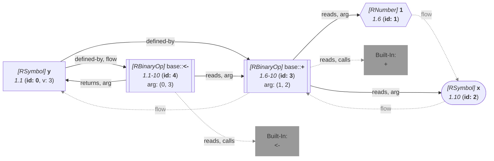
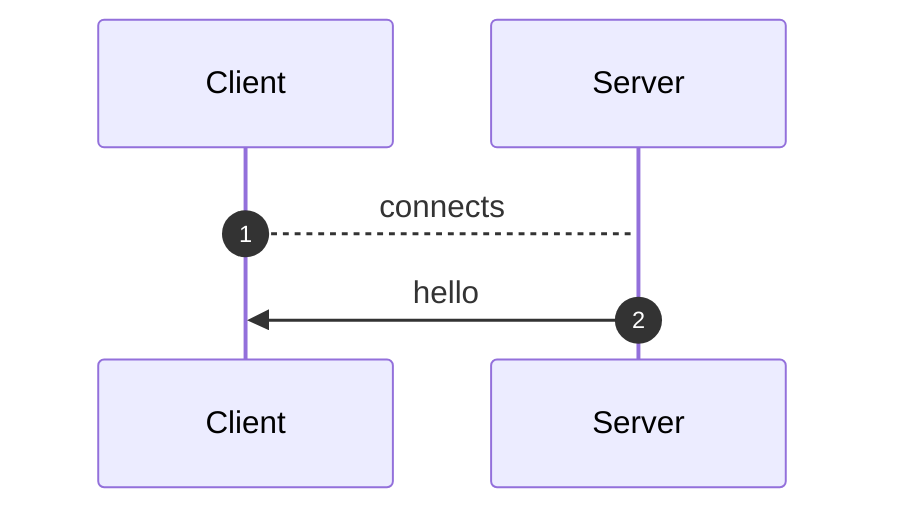
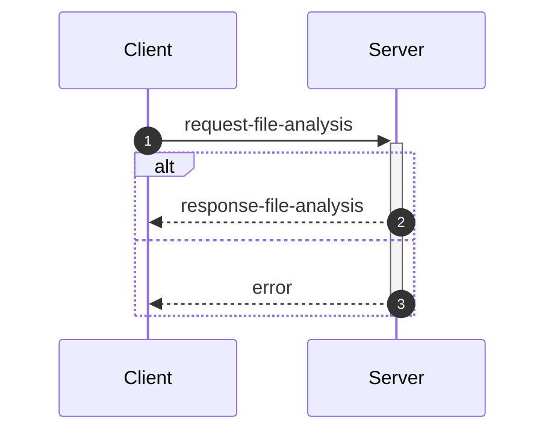
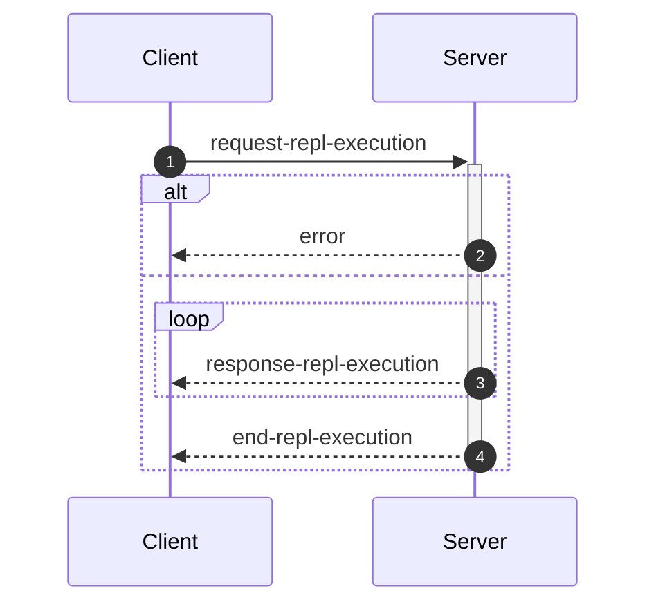
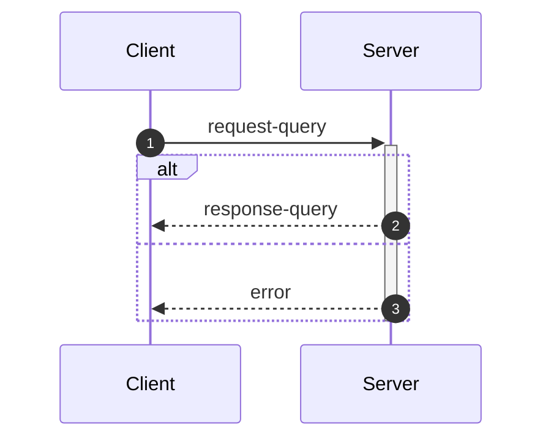

_<span title="an overview of flowR's interface">Generated</span> from '[wiki-interface.ts](https://github.com/flowr-analysis/flowr/tree/main/src/documentation/wiki-interface.ts "src/documentation/wiki-interface.ts")' on 2026-11-07, 14:38:02 UTC (v2.17.3, R v4.6.1), do not edit directly._

Although far from being as detailed as the in-depth explanation of [_flowR_](https://github.com/flowr-analysis/flowr/wiki/Core),
this wiki page explains how to interface with _flowR_ in more detail.
In general, command line arguments and other options provide short descriptions on hover over.

* [💻 Using the REPL](#using-the-repl)
* [⚙️ Configuring FlowR](#configuring-flowr)
* [⚒️ Writing Code](#writing-code)
* [💬 Communicating with the Server](#communicating-with-the-server)

<a id='using-the-repl'></a>
## 💻 Using the REPL

> [!NOTE]
> To execute arbitrary R commands with a repl request, _flowR_ has to be started explicitly with <span title="Description (Command Line Argument): Allow to access the underlying R session when using flowR (security warning: this allows the execution of arbitrary R code!)">`--r-session-access`</span>.
> Please be aware that this introduces a security risk and note that this relies on the [`r-shell` engine](https://github.com/flowr-analysis/flowr/wiki/Engines) .

Although primarily meant for users to explore,
there is nothing which forbids calling _flowR_ as a subprocess to use standard-in, -output, and -error
for communication (although you can access the REPL using the server as well,
with the [REPL Request](#message-request-repl-execution) message).

The read-eval-print loop&nbsp;(REPL) works relatively simple.
You can submit an expression (using <kbd>Enter</kbd>),
which is interpreted as an R&nbsp;expression by default but interpreted as a *command* if it starts with a colon (`:`).
The best command to get started with the REPL is <span title="Description (Repl Command): Show help information (aliases: :h, :?)">`:help`</span>.
Besides, you can leave the REPL either with the command <span title="Description (Repl Command): End the repl (aliases: :q, :exit)">`:quit`</span> or by pressing <kbd>Ctrl</kbd>+<kbd>C</kbd> twice.
When writing a *command*, you may press <kbd>Tab</kbd> to get a list of completions, if available.
Multiple commands can be entered in a single line by separating them with a semicolon (`;`), e.g. `:parse "x<-2"; :df*`.
If a command is given without R code, the REPL will re-use R code given in a previous command.
The prior example will hence return first the parsed AST of the program and then the dataflow graph for `"x <- 2"`.

> [!NOTE]
> If you develop flowR, you may want to launch the repl using the `npm run main-dev` command, this way, you get a non-minified version of flowR with debug information and hot-reloading of source files.

<details>
<summary>Available Commands</summary>

We currently offer the following commands (this with a `[*]` suffix are available with and without the star):

| Command | Description |
| ------- | ----------- |
| **<span title="Description (Repl Command): End the repl (aliases: :q, :exit)">:quit</span>** | End the repl (aliases: **:<span title="Alias of ':quit'. End the repl">q</span>**, **:<span title="Alias of ':quit'. End the repl">exit</span>**) |
| **<span title="Description (Repl Command): Execute the given code as R code. This requires the `--r-session-access` flag to be set and requires the r-shell engine. (aliases: :e, :r)">:execute</span>** | Execute the given code as R code. This requires the `--r-session-access` flag to be set and requires the r-shell engine. (aliases: **:<span title="Alias of ':execute'. Execute the given code as R code. This requires the `--r-session-access` flag to be set and requires the r-shell engine.">e</span>**, **:<span title="Alias of ':execute'. Execute the given code as R code. This requires the `--r-session-access` flag to be set and requires the r-shell engine.">r</span>**) |
| **<span title="Description (Repl Command): Get mermaid code for the control-flow graph of R code (aliases: :cfg, :cf)">:controlflow[*]</span>** | Get mermaid code for the control-flow graph of R code (star: Returns the URL to mermaid.live) (aliases: **:<span title="Alias of ':controlflow'. Get mermaid code for the control-flow graph of R code">cfg</span>**, **:<span title="Alias of ':controlflow'. Get mermaid code for the control-flow graph of R code">cf</span>**) |
| **<span title="Description (Repl Command): Get mermaid code for the control-flow graph with basic blocks (aliases: :cfgb, :cfb)">:controlflowbb[*]</span>** | Get mermaid code for the control-flow graph with basic blocks (star: Returns the URL to mermaid.live) (aliases: **:<span title="Alias of ':controlflowbb'. Get mermaid code for the control-flow graph with basic blocks">cfgb</span>**, **:<span title="Alias of ':controlflowbb'. Get mermaid code for the control-flow graph with basic blocks">cfb</span>**) |
| **<span title="Description (Repl Command): Get mermaid code for the dataflow graph (aliases: :d, :df)">:dataflow[*]</span>** | Get mermaid code for the dataflow graph (star: Returns the URL to mermaid.live) (aliases: **:<span title="Alias of ':dataflow'. Get mermaid code for the dataflow graph">d</span>**, **:<span title="Alias of ':dataflow'. Get mermaid code for the dataflow graph">df</span>**) |
| **<span title="Description (Repl Command): Get mermaid code for the normalized AST of R code (aliases: :n)">:normalize[*]</span>** | Get mermaid code for the normalized AST of R code (star: Returns the URL to mermaid.live) (alias: **:<span title="Alias of ':normalize'. Get mermaid code for the normalized AST of R code">n</span>**) |
| **<span title="Description (Repl Command): Get mermaid code for the simplified dataflow graph (aliases: :ds, :dfs)">:dataflowsimple[*]</span>** | Get mermaid code for the simplified dataflow graph (star: Returns the URL to mermaid.live) (aliases: **:<span title="Alias of ':dataflowsimple'. Get mermaid code for the simplified dataflow graph">ds</span>**, **:<span title="Alias of ':dataflowsimple'. Get mermaid code for the simplified dataflow graph">dfs</span>**) |
| **<span title="Description (Repl Command): Inspect and extend the signature database: `query` (identical to :query @signature), `info <name>` for where a function comes from (identical to :query @function-info), `add <path>` to mount another database/source, `download` to fetch the full-history database. (aliases: :sig)">:signature</span>** | Inspect and extend the signature database: `query` (identical to :query @signature), `info <name>` for where a function comes from (identical to :query @function-info), `add <path>` to mount another database/source, `download` to fetch the full-history database. (alias: **:<span title="Alias of ':signature'. Inspect and extend the signature database: `query` (identical to :query @signature), `info <name>` for where a function comes from (identical to :query @function-info), `add <path>` to mount another database/source, `download` to fetch the full-history database.">sig</span>**) |
| **<span title="Description (Repl Command): Just calculates the DFG, but only prints summary info (aliases: :d#, :df#)">:dataflowsilent</span>** | Just calculates the DFG, but only prints summary info (aliases: **:<span title="Alias of ':dataflowsilent'. Just calculates the DFG, but only prints summary info">d#</span>**, **:<span title="Alias of ':dataflowsilent'. Just calculates the DFG, but only prints summary info">df#</span>**) |
| **<span title="Description (Repl Command): Prints ASCII Art of the parsed, unmodified AST (aliases: :p)">:parse</span>** | Prints ASCII Art of the parsed, unmodified AST (alias: **:<span title="Alias of ':parse'. Prints ASCII Art of the parsed, unmodified AST">p</span>**) |
| **<span title="Description (Repl Command): Prints the version of flowR as well as the current version of R">:version</span>** | Prints the version of flowR as well as the current version of R
| **<span title="Description (Repl Command): Query the given R code (use 'help' for more information)">:query[*]</span>** | Query the given R code (use 'help' for more information) (star: Similar to query, but returns the output in json format.)
| **<span title="Description (Repl Command): Returns an ASCII representation of the dataflow graph (aliases: :df!)">:dataflowascii</span>** | Returns an ASCII representation of the dataflow graph (alias: **:<span title="Alias of ':dataflowascii'. Returns an ASCII representation of the dataflow graph">df!</span>**) |
| **<span title="Description (Repl Command): Returns summarization stats for the normalized AST (aliases: :n#)">:normalize#</span>** | Returns summarization stats for the normalized AST (alias: **:<span title="Alias of ':normalize#'. Returns summarization stats for the normalized AST">n#</span>**) |
| **<span title="Description (Repl Command): Show help information (aliases: :h, :?)">:help</span>** | Show help information (aliases: **:<span title="Alias of ':help'. Show help information">h</span>**, **:<span title="Alias of ':help'. Show help information">?</span>**) |

</details>

> [!TIP]
> 
> As indicated by the examples before, all REPL commands that operate on code keep track of the state.
> Hence, if you run a command like <span title="Description (Repl Command, starred version): Returns the URL to mermaid.live; Base Command: Get mermaid code for the dataflow graph (aliases: :d*, :df*)">`:dataflow*`</span> without providing R code,
> the REPL will re-use the R code provided in a previous command.
> Likewise, doing this will benefit from incrementality!
> If you request the dataflow graph with `:df* x <- 2 * y` and then want to see the parsed AST with `:parse`,
> the REPL will re-use previously obtained information and not re-parse the code again.
> 		

Generally, many commands offer shortcut versions in the REPL. Many queries, for example, offer a shortened format (see the example below).
Of special note, the [Config Query](https://github.com/flowr-analysis/flowr/wiki/%5BQuery%5D-Config)
can be used to also modify the currently active configuration of _flowR_ within the REPL (see the [wiki page](https://github.com/flowr-analysis/flowr/wiki/%5BQuery%5D-Config) for more information).

### Example: Retrieving the Dataflow Graph

To retrieve a URL to the [mermaid](https://mermaid.js.org/) diagram of the dataflow of a given expression,
use <span title="Description (Repl Command, starred version): Returns the URL to mermaid.live; Base Command: Get mermaid code for the dataflow graph (aliases: :d*, :df*)">`:dataflow*`</span> (or <span title="Description (Repl Command): Get mermaid code for the dataflow graph (aliases: :d, :df)">`:dataflow`</span> to get the mermaid code in the cli):

```shell
$ docker run -it --rm eagleoutice/flowr # or npm run flowr 
flowR repl v2.17.3, R grammar v14 (tree-sitter engine)
R> :dataflow* y <- 1 + x
```

<details>
<summary style='color:gray'>Output</summary>

```text
https://mermaid.live/view#base64:eyJjb2RlIjoiZmxvd2NoYXJ0IFREXG4gICAgMXt7XCJgKiM5MTtSTnVtYmVyIzkzOyogKioxKipcbiAgICAgICoxLjYqICgqKmlkOiAxKiopYFwifX1cbiAgICAyKFtcImAqIzkxO1JTeW1ib2wjOTM7KiAqKngqKlxuICAgICAgKjEuMTAqICgqKmlkOiAyKiopYFwiXSlcbiAgICAzW1tcImAqIzkxO1JCaW5hcnlPcCM5MzsqIGJhc2UjNTg7IzU4OyoqIzQzOyoqXG4gICAgICAqMS42LTEwKiAoKippZDogMyoqKVxuICAgIGFyZzogKDEsIDIpYFwiXV1cbiAgICBidWlsdC1pbjpfNDNfW1wiYEJ1aWx0LUluOlxuIzQzO2BcIl1cbiAgICBzdHlsZSBidWlsdC1pbjpfNDNfIHN0cm9rZTpncmF5LGZpbGw6Z3JheSxzdHJva2Utd2lkdGg6MnB4LG9wYWNpdHk6Ljg7XG4gICAgMFtcImAqIzkxO1JTeW1ib2wjOTM7KiAqKnkqKlxuICAgICAgKjEuMSogKCoqaWQ6IDAqKiwgdjogMylgXCJdXG4gICAgNFtbXCJgKiM5MTtSQmluYXJ5T3AjOTM7KiBiYXNlIzU4OyM1ODsqKiM2MDsjNDU7KipcbiAgICAgICoxLjEtMTAqICgqKmlkOiA0KiopXG4gICAgYXJnOiAoMCwgMylgXCJdXVxuICAgIGJ1aWx0LWluOl82MF8tW1wiYEJ1aWx0LUluOlxuIzYwOyM0NTtgXCJdXG4gICAgc3R5bGUgYnVpbHQtaW46XzYwXy0gc3Ryb2tlOmdyYXksZmlsbDpncmF5LHN0cm9rZS13aWR0aDoycHgsb3BhY2l0eTouODtcbiAgICAxIC0uLT58XCJmbG93XCJ8IDJcbiAgICBsaW5rU3R5bGUgMCBzdHJva2U6Z3JheSxjb2xvcjpncmF5O1xuICAgIDIgLS4tPnxcImZsb3dcInwgM1xuICAgIGxpbmtTdHlsZSAxIHN0cm9rZTpncmF5LGNvbG9yOmdyYXk7XG4gICAgMyAtLT58XCJyZWFkcywgYXJnXCJ8IDFcbiAgICAzIC0tPnxcInJlYWRzLCBhcmdcInwgMlxuICAgIDMgLS4tPnxcImZsb3dcInwgMFxuICAgIGxpbmtTdHlsZSA0IHN0cm9rZTpncmF5LGNvbG9yOmdyYXk7XG4gICAgMyAtLi0+fFwicmVhZHMsIGNhbGxzXCJ8IGJ1aWx0LWluOl80M19cbiAgICBsaW5rU3R5bGUgNSBzdHJva2U6Z3JheTtcbiAgICAwIC0tPnxcImRlZmluZWQtYnksIGZsb3dcInwgNFxuICAgIDAgLS0+fFwiZGVmaW5lZC1ieVwifCAzXG4gICAgNCAtLT58XCJyZWFkcywgYXJnXCJ8IDNcbiAgICA0IC0tPnxcInJldHVybnMsIGFyZ1wifCAwXG4gICAgNCAtLi0+fFwicmVhZHMsIGNhbGxzXCJ8IGJ1aWx0LWluOl82MF8tXG4gICAgbGlua1N0eWxlIDEwIHN0cm9rZTpncmF5OyIsIm1lcm1haWQiOnsiYXV0b1N5bmMiOnRydWV9fQ==
```

Retrieve the dataflow graph of the expression `y <- 1 + x`. It looks like this:



<details>

<summary style="color:gray">R Code of the Dataflow Graph</summary>

The analysis ran (parse and normalize with the [tree-sitter](https://github.com/flowr-analysis/flowr/wiki/Engines) engine) in the generation environment. No [signature database](https://github.com/flowr-analysis/flowr/wiki/Signature-Database) is mounted, so `library()` attaches no exports (base-R names are still qualified, e.g., `stats::acf`). 
We encountered no unknown side effects during the analysis.

```r
y <- 1 + x
```

</details>

</details>

For small graphs like this, <span title="Description (Repl Command): Returns an ASCII representation of the dataflow graph (aliases: :df!)">`:dataflowascii`</span> also provides an ASCII representation directly in the REPL:

```shell
$ docker run -it --rm eagleoutice/flowr # or npm run flowr 
flowR repl v2.17.3, R grammar v14 (tree-sitter engine)
R> :df! y <- 1 + x
```

<details open>
<summary style='color:gray'>Output</summary>

```text
                        v<0>v
 c<4>c──────────────────| y |
 |<- |     ┌────────────v---v
 c---c     │
    │   c<3>c   0<1>0
    └───| + |───| 1 |───u<2>u
        c---c   0---0   | x |
           └────────────u---u
Edges:
3 -> 1: reads, arg          3 -> 2: reads, arg
3 -> 0: flows-to            1 -> 2: flows-to
2 -> 3: flows-to            4 -> 3: reads, arg
4 -> 0: returns, arg        0 -> 4: defined-by, flows-to
0 -> 3: defined-by
```

Retrieve the dataflow graph of the expression `y <- 1 + x` as ASCII art.

</details>

For the slicing with <span title="Description (Repl Command): Static backwards executable slicer for R">`:slicer`</span>, you have access to the same [magic comments](#slice-magic-comments) as with the [slice request](#message-request-slice).
Pass `--inline` to splice resolvable `source()` calls into the reconstruction so the slice is a single self-contained R text (the same as the static slice query's `inlineSources` flag).
See `--help` for more flags!

### Example: Interfacing with the File System

Many commands that allow for an R-expression (like <span title="Description (Repl Command, starred version): Returns the URL to mermaid.live; Base Command: Get mermaid code for the dataflow graph (aliases: :d*, :df*)">`:dataflow*`</span>) allow for a file as well
if the argument starts with `file://`.
If you are working from the root directory of the _flowR_ repository, the following gives you the parsed AST of the example file using the <span title="Description (Repl Command): Prints ASCII Art of the parsed, unmodified AST (aliases: :p)">`:parse`</span> command:

> **Watch mode**: Replace `file://` with `watch://` to enter watch mode.
> flowR runs the command immediately and then re-runs it every time the file (or any file inside the folder) changes.
> Enter any other command to leave watch mode.
> For example: `:df watch://analysis.R`

```shell
$ docker run -it --rm eagleoutice/flowr # or npm run flowr 
flowR repl v2.17.3, R grammar v14 (tree-sitter engine)
R> :parse file://test/testfiles/example.R
```

<details>
<summary style='color:gray'>Output</summary>

```text
File: test/testfiles/example.R

program
├ binaryoperator
│ ├ identifier "sum" (1:1─4)
│ ├ <- "<-" (1:5─7)
│ ╰ float "0" (1:8─9)
├ binaryoperator
│ ├ identifier "product" (2:1─8)
│ ├ <- "<-" (2:9─11)
│ ╰ float "1" (2:12─13)
├ binaryoperator
│ ├ identifier "w" (3:1─2)
│ ├ <- "<-" (3:3─5)
│ ╰ float "7" (3:6─7)
├ binaryoperator
│ ├ identifier "N" (4:1─2)
│ ├ <- "<-" (4:3─5)
│ ╰ float "10" (4:6─8)
├ forstatement
│ ├ for "for" (6:1─4)
│ ├ ( "(" (6:5─6)
│ ├ identifier "i" (6:6─7)
│ ├ in "in" (6:8─10)
│ ├ binaryoperator
│ │ ├ float "1" (6:11─12)
│ │ ├ : ":" (6:12─13)
│ │ ╰ parenthesizedexpression
│ │   ├ ( "(" (6:13─14)
│ │   ├ binaryoperator
│ │   │ ├ identifier "N" (6:14─15)
│ │   │ ├ - "-" (6:15─16)
│ │   │ ╰ float "1" (6:16─17)
│ │   ╰ ) ")" (6:17─18)
│ ├ ) ")" (6:18─19)
│ ╰ bracedexpression
│   ├ { "{" (6:20─21)
│   ├ binaryoperator
│   │ ├ identifier "sum" (7:3─6)
│   │ ├ <- "<-" (7:7─9)
│   │ ╰ binaryoperator
│   │   ├ binaryoperator
│   │   │ ├ identifier "sum" (7:10─13)
│   │   │ ├ + "+" (7:14─15)
│   │   │ ╰ identifier "i" (7:16─17)
│   │   ├ + "+" (7:18─19)
│   │   ╰ identifier "w" (7:20─21)
│   ├ binaryoperator
│   │ ├ identifier "product" (8:3─10)
│   │ ├ <- "<-" (8:11─13)
│   │ ╰ binaryoperator
│   │   ├ identifier "product" (8:14─21)
│   │   ├  "" (8:22─23)
│   │   ╰ identifier "i" (8:24─25)
│   ╰ } "}" (9:1─2)
├ call
│ ├ identifier "cat" (11:1─4)
│ ╰ arguments
│   ├ ( "(" (11:4─5)
│   ├ argument
│   │ ╰ string
│   │   ├ stringopen "\"" (11:5─6)
│   │   ├ stringcontent "Sum:" (11:6─10)
│   │   ╰ stringclose "\"" (11:10─11)
│   ├ comma "," (11:11─12)
│   ├ argument
│   │ ╰ identifier "sum" (11:13─16)
│   ├ comma "," (11:16─17)
│   ├ argument
│   │ ╰ string
│   │   ├ stringopen "\"" (11:18─19)
│   │   ├ stringcontent
│   │   │ ╰ escapesequence "\\n" (11:19─21)
│   │   ╰ stringclose "\"" (11:21─22)
│   ╰ ) ")" (11:22─23)
╰ call
  ├ identifier "cat" (12:1─4)
  ╰ arguments
    ├ ( "(" (12:4─5)
    ├ argument
    │ ╰ string
    │   ├ stringopen "\"" (12:5─6)
    │   ├ stringcontent "Product:" (12:6─14)
    │   ╰ stringclose "\"" (12:14─15)
    ├ comma "," (12:15─16)
    ├ argument
    │ ╰ identifier "product" (12:17─24)
    ├ comma "," (12:24─25)
    ├ argument
    │ ╰ string
    │   ├ stringopen "\"" (12:26─27)
    │   ├ stringcontent
    │   │ ╰ escapesequence "\\n" (12:27─29)
    │   ╰ stringclose "\"" (12:29─30)
    ╰ ) ")" (12:30─31)
```

Retrieve the parsed AST of the example file.

<details>

<summary>File Content</summary>

```r
sum <- 0
product <- 1
w <- 7
N <- 10

for (i in 1:(N-1)) {
  sum <- sum + i + w
  product <- product * i
}

cat("Sum:", sum, "\n")
cat("Product:", product, "\n")
```

</details>

As _flowR_ directly transforms this AST the output focuses on being human-readable instead of being machine-readable.
		
</details>

### Example: Run a Query

You can run any query supported by _flowR_ using the <span title="Description (Repl Command): Query the given R code (use 'help' for more information)">`:query`</span> command.
For example, to obtain the shapes of all data frames in a given piece of code, you can run:

```shell
$ docker run -it --rm eagleoutice/flowr # or npm run flowr 
flowR repl v2.17.3, R grammar v14 (tree-sitter engine)
R> :query @absint df-shape "x <- data.frame(a = 1:10, b = 1:10)\ny <- x$a"
```

<details open>
<summary style='color:gray'>Output</summary>

```text
Query: absint (4 ms)
   ╰ $12: (colnames: [{"a", "b"}, {}], cols: [2, 2], rows: [10, 10])
   ╰ $0: (colnames: [{"a", "b"}, {}], cols: [2, 2], rows: [10, 10])
```

Retrieve the shapes of all data frames in the given code.

</details>

To run the linter on a file, you can use (in this example, we just issue the `dead-code` linter on a small piece of code):

```shell
$ docker run -it --rm eagleoutice/flowr # or npm run flowr 
flowR repl v2.17.3, R grammar v14 (tree-sitter engine)
R> :query @linter rules:dead-code "if(FALSE) x <- 2"
```

<details open>
<summary style='color:gray'>Output</summary>

```text
Query: linter (2 ms)
   ╰ Dead Code (dead-code):
       ╰ certain:
           ╰ Code at 1.11-16 (1 quick fix(es) available)
```

Run the linter on the given code, with only the `dead-code` rule enabled.

</details>

For more information on the available queries, please check out the [Query API](https://github.com/flowr-analysis/flowr/wiki/Query-API).

<a id='configuring-flowr'></a>
## ⚙️ Configuring FlowR

When running _flowR_, you may want to specify some behaviors with a dedicated configuration file.
By default, flowR looks for a file named `flowr.json` in the current working directory (or any higher directory).
You can also specify a different file with <span title="Description (Command Line Argument): The name of the configuration file to use">`--config-file`</span> or pass the configuration inline using <span title="Description (Command Line Argument): The flowR configuration to use, as a JSON string">`--config-json`</span>.
A `flowr.json` found this way belongs to the analyzed project, so flowR ignores its options that decide what flowR executes or loads
(`engines.*.wasmPath`, `engines.*.treeSitterWasmPath`, `engines.*.rPath`, `solver.sigdb.additionalPaths`, `solver.sigdb.downloadRepo`, `solver.sigdb.installedLibrary.paths`, `solver.sigdb.onDemand.enabled`, `solver.sigdb.onDemand.repositories`, `solver.sigdb.onDemand.cranMirror`, `solver.sigdb.onDemand.bioconductorMirror`, `solver.sigdb.onDemand.cacheDir`),
unless you pass <span title="Description (Command Line Argument): Keep the security-sensitive options (e.g., the R executable) of the flowr.json found in the working directory or a parent. Only use this for projects you trust.">`--trust-config`</span>.
To analyze code you do not trust, use the secure mode (<span title="Description (Command Line Argument): Run in secure mode for analyzing untrusted code: flowR does not start R (or any other process), does not access the network, does not search for project configs, and ignores security-sensitive options in every config. Cannot be disabled once enabled. Can also be enabled with the environment variable {italic FLOWR_SECURE_MODE=1}.">`--secure`</span>, see the [security policy](https://github.com/flowr-analysis/flowr/blob/main/.github/SECURITY.md)).
To inspect the current configuration, you can run flowr with the <span title="Description (Command Line Argument): Run with verbose logging (will be passed to the corresponding script)">`--verbose`</span> flag, or use the `config` [Query](https://github.com/flowr-analysis/flowr/wiki/Query-API).
Within the REPL this works by running the following:

```shell
:query @config
```

To work with the <a href="https://github.com/flowr-analysis/flowr/tree/main/src/config.ts#L119"><code><span title="The configuration file format for flowR.">FlowrConfig</span></code></a> you can use the provided helper objects alongside its methods like
<a href="https://github.com/flowr-analysis/flowr/tree/main/src/config.ts#L976"><code><span title="Creates a new flowr config that has the updated values.">FlowrConfig::<b>amend</b></span></code></a>.
The schema below documents every option; the ones you most likely want are:

- <a href="https://github.com/flowr-analysis/flowr/wiki/Interface#configuring-flowr" title="Configuration Option (boolean): Whether source calls should be ignored, causing {@link processSourceCall}&#39;s behavior to be skipped.">ignoreSourceCalls</a>: ignore source calls when analyzing the code, i.e., ignore the inclusion of other files.
- <a href="https://github.com/flowr-analysis/flowr/wiki/Interface#configuring-flowr" title="Configuration Option (boolean): Whether load calls should be ignored, causing {@link processLoadCall}&#39;s behavior to be skipped.">ignoreLoadCalls</a>: ignore load calls when analyzing the code, i.e., ignore the loading of r-data files.
- <a href="https://github.com/flowr-analysis/flowr/wiki/Interface#configuring-flowr" title="Configuration Option (object): Do you want to overwrite (parts) of the builtin definition?">semantics.environment.overwriteBuiltIns</a>: overwrite _flowR_'s handling of built-in functions, or clear the preset definitions entirely.
  See [Configure BuiltIn Semantics](#configure-builtin-semantics) for more information.
- <a href="https://github.com/flowr-analysis/flowr/wiki/Interface#configuring-flowr" title="Configuration Option (boolean): Whether calls drawing on a graphics device (e.g., `plot`) count as writing to it, which the ambient state queries then report.">semantics.ambient.drawingWritesDevice</a>: whether calls drawing on a graphics device (e.g., `plot`) count as writing the device in the ambient state queries.
- <a href="https://github.com/flowr-analysis/flowr/wiki/Interface#configuring-flowr" title="Configuration Option (string): How to resolve variables and their values. (one of &quot;disabled&quot;, &quot;alias&quot;, &quot;builtin&quot;)">solver.variables</a>: how to resolve variables and their values (`disabled`, `alias`, `builtin`).
- <a href="https://github.com/flowr-analysis/flowr/wiki/Interface#configuring-flowr" title="Configuration Option (array): The engine or set of engines to use for interacting with R code. An empty array means all available engines will be used.">engines</a> and <a href="https://github.com/flowr-analysis/flowr/wiki/Interface#configuring-flowr" title="Configuration Option (string): The default engine to use for interacting with R code. If this is undefined, an arbitrary engine from the specified list will be used. (one of &quot;tree-sitter&quot;, &quot;r-shell&quot;)">defaultEngine</a>: the engines used to interact with R code, see the [Engines wiki page](https://github.com/flowr-analysis/flowr/wiki/Engines).
- <a href="https://github.com/flowr-analysis/flowr/wiki/Interface#configuring-flowr" title="Configuration Option (array): Files a framework loads on its own, without any source() call (e.g. global.R in a shiny app), in the order they are loaded; flowR orders the matching project files accordingly and analyzes them as one program. Entries are case-insensitive globs matched against the file path, a plain name matches any file with that name, and entries matching no project file are warned about. Usually set per project kind via specializeConfig.">project.implicitSources</a>: the files a framework loads without any `source()` call, in the order in which they are
  loaded. Entries are globs (e.g. `R/*.R`) matched against the file path ignoring capitalization; one matching no file is reported.
- <a href="https://github.com/flowr-analysis/flowr/wiki/Interface#configuring-flowr" title="Configuration Option (object): Overwrite (parts of) the configuration depending on the project kind flowR detects, e.g. to give a shiny app its implicit sources.">specializeConfig</a>: overwrite (parts of) the configuration depending on the kind of project _flowR_ detects
  (e.g. `shiny-app`), which is how a shiny app gets its implicit sources by default. What you configure directly wins.
- <a href="https://github.com/flowr-analysis/flowr/wiki/Interface#configuring-flowr" title="Configuration Option (string): Overwrite the project kind flowR would otherwise infer from the analyzed files, e.g. when auto-detection guesses wrong. (one of &quot;package&quot;, &quot;script&quot;, &quot;shiny-app&quot;, &quot;notebook&quot;, &quot;project&quot;, &quot;unknown&quot;)">project.useProjectType</a>: skip that detection and force a project kind yourself, when auto-detection guesses wrong.
- <a href="https://github.com/flowr-analysis/flowr/wiki/Interface#configuring-flowr" title="Configuration Option (array): The default plugins to load when creating a new instance of FlowrAnalyzer">defaultPlugins</a> and <a href="https://github.com/flowr-analysis/flowr/wiki/Interface#configuring-flowr" title="Configuration Option (array): The plugins to load in REPL mode">repl.plugins</a>: the plugins to load for a new <a href="https://github.com/flowr-analysis/flowr/tree/main/src/project/flowr-analyzer.ts#L224"><code><span title="Central class for conducting analyses with FlowR. Use the FlowrAnalyzerBuilder to create a new instance. If you want the original pattern of creating a pipeline and running all steps, you can still do this with FlowrAnalyzer#runFull . To inspect the context of the analyzer, use FlowrAnalyzer#inspectContext (if you are a plugin and need to modify it, use FlowrAnalyzer#context instead).">FlowrAnalyzer</span></code></a> and in the REPL
  (use `flowr:default` to reference the former).

So you can configure _flowR_ by adding a file like the following:

<details>

<summary>Example Configuration File</summary>

```json
{
  "ignoreSourceCalls": true,
  "ignoreLoadCalls": true,
  "semantics": {
    "environment": {
      "overwriteBuiltIns": {
        "definitions": [
          {
            "type": "function",
            "names": [
              "foo"
            ],
            "processor": "builtin:assign",
            "config": {}
          }
        ]
      }
    }
  },
  "defaultPlugins": [
    "file:description",
    "versions:description"
  ],
  "repl": {
    "quickStats": false,
    "dfProcessorHeat": false,
    "hints": true,
    "plugins": [
      "flowr:default"
    ]
  },
  "project": {
    "resolveUnknownPathsOnDisk": true,
    "implicitSources": [
      "global.R",
      "app.R"
    ]
  },
  "linter": {
    "disabledRules": []
  },
  "specializeConfig": {
    "shiny-app": {
      "project": {
        "implicitSources": [
          "global.R",
          "ui.R",
          "server.R",
          "app.R"
        ]
      }
    }
  },
  "engines": [
    {
      "type": "r-shell"
    }
  ],
  "solver": {
    "variables": "alias",
    "evalStrings": true,
    "trackEnvironments": true,
    "sigdb": {
      "enabled": true,
      "loadProjectDependencies": true,
      "eagerlyLoad": false,
      "eagerlyLoadExports": false,
      "linkBaseR": false,
      "linkDescriptionDependencies": false
    },
    "resolveSource": {
      "dropPaths": "no",
      "ignoreCapitalization": true,
      "inferWorkingDirectory": "active-script",
      "searchPath": []
    },
    "instrument": {},
    "slicer": {
      "threshold": 50
    }
  },
  "abstractInterpretation": {
    "wideningThreshold": 4,
    "followCalls": true,
    "dataFrame": {
      "maxColNames": 20,
      "readLoadedData": {
        "readExternalFiles": true,
        "maxReadLines": 1000000
      }
    }
  },
  "incremental": {
    "alwaysIncremental": false,
    "parsing": {
      "activated": false,
      "heuristics": {
        "activated": true,
        "mtime": true,
        "linesFrom": 500,
        "bytesFrom": 50000,
        "alwaysWithEdits": false,
        "minFiles": 1
      }
    }
  },
  "gas": {
    "thresholds": {
      "memory": {
        "problematic": 0.7,
        "critical": 0.9
      },
      "timeMs": {
        "problematic": 100000,
        "critical": 120000
      }
    },
    "features": {}
  }
}
```

</details>

<details>
<a id='configure-builtin-semantics'></a>
<summary>Configure Built-In Semantics</summary>

`semantics/environment/overwriteBuiltins` accepts two keys:

- `loadDefaults` (boolean, initially `true`): If set to `true`, the default built-in definitions are loaded before applying the custom definitions. Setting this flag to `false` explicitly disables the loading of the default definitions.
- `definitions` (array, initially empty): Allows to overwrite or define new built-in elements. Each object within must have a `type` which is one of the below. Furthermore, they may define a string array of `names` which specifies the identifiers to bind the definitions to. You may use `assumePrimitive` to specify whether _flowR_ should assume that this is a primitive non-library definition (so you probably just do not want to specify the key).

  | Type            | Description                                                                                                                                                                                                                                                                                              | Example                                                                                                    |
  | --------------- | -------------------------------------------------------------------------------------------------------------------------------------------------------------------------------------------------------------------------------------------------------------------------------------------------------- | ---------------------------------------------------------------------------------------------------------- |
  | `constant`    | Additionally allows for a `value` this should resolve to.                                                                                                                                                                                                                                                | `{ type: 'constant', names: ['NULL', 'NA'],  value: null }`                                                |
  | `function`    | Is a rather flexible way to define and bind built-in functions. For the time, we do not have extensive documentation to cover all the cases, so please either consult the sources with the `default-builtin-config/` folder or open a [new issue](https://github.com/flowr-analysis/flowr/issues/new/choose). | `{ type: 'function', names: ['next'], processor: 'builtin:d', config: { cfg: ExitPointType.Next } }` |
  | `replacement` | A comfortable way to specify replacement functions like `$<-` or `names<-`. `suffixes` describes the... suffixes to attach automatically. | `{ type: 'replacement', suffixes: ['<-', '<<-'], names: ['[', '[['] }` |

</details>

<details>

<summary style='color:gray'>Full Configuration-File Schema</summary>

- _The configuration file format for flowR._ (object)
    - **logLevel** [optional] _flowR's global minimum log level, applied when the config is loaded._ (string)
        Only allows: 'silly', 'trace', 'debug', 'info', 'warn', 'error', 'fatal'
    - **ignoreSourceCalls** [optional] _Whether source calls should be ignored, causing {@link processSourceCall}'s behavior to be skipped._ (boolean)
    - **ignoreLoadCalls** [optional] _Whether load calls should be ignored, causing {@link processLoadCall}'s behavior to be skipped._ (boolean)
    - **semantics** _Configure language semantics and how flowR handles them._ (object)
        - **environment** [optional] _Semantics regarding how to handle the R environment._ (object)
            - **overwriteBuiltIns** [optional] _Do you want to overwrite (parts) of the builtin definition?_ (object)
                - **loadDefaults** [optional] _Should the default configuration still be loaded?_ (boolean)
                - **definitions** [optional] _The definitions to load/overwrite._ (array)
                Valid item types:
                    - (object)
        - **ambient** [optional] _Semantics regarding the global state (options, devices, files, ...) calls access._ (object)
            - **drawingWritesDevice** [optional] _Whether calls drawing on a graphics device (e.g., `plot`) count as writing to it, which the ambient state queries then report._ (boolean)
    - **defaultPlugins** [optional] _The default plugins to load when creating a new instance of FlowrAnalyzer_ (array)
    Valid item types:
        - (alternatives)
            - (string)
            - (array)
    - **repl** _Configuration options for the REPL._ (object)
        - **quickStats** [optional] _Whether to show quick stats in the REPL after each evaluation._ (boolean)
        - **dfProcessorHeat** [optional] _This instruments the dataflow processors to count how often each processor is called._ (boolean)
        - **hints** [optional] _Whether to show dim inline hints on the empty prompt (automatically disabled on non-interactive terminals)._ (boolean)
        - **plugins** [optional] _The plugins to load in REPL mode_ (array)
        Valid item types:
            - (alternatives)
                - (string)
                - (array)
        - **autoUseFileProtocol** [optional] _Prepend the file protocol to a repl input that looks like a path, instead of only warning about it._ (boolean)
        - **queryStats** [optional] _Whether `:query` closes with the line stating how long the queries took (`:query*` never prints it)._ (boolean)
        - **showPlugins** [optional] _Whether `:version` grays out the plugins that did not activate during the last analysis._ (boolean)
    - **project** _Project specific configuration options._ (object)
        - **resolveUnknownPathsOnDisk** [optional] _Whether to resolve unknown paths loaded by the r project disk when trying to source/analyze files._ (boolean)
        - **failOnInaccessiblePath** [optional] _Whether a directory that cannot be traversed during file discovery (e.g. due to permissions) aborts the analysis; when false (the default) such paths are logged and skipped._ (boolean)
        - **basePackages** [optional] _The packages considered part of R itself (base and recommended); if unset, flowR uses its built-in list._ (array)
        Valid item types:
            - (string)
        - **implicitSources** [optional] _Files a framework loads on its own, without any source() call (e.g. global.R in a shiny app), in the order they are loaded; flowR orders the matching project files accordingly and analyzes them as one program. Entries are case-insensitive globs matched against the file path, a plain name matches any file with that name, and entries matching no project file are warned about. Usually set per project kind via specializeConfig._ (array)
        Valid item types:
            - (string)
        - **useProjectType** [optional] _Overwrite the project kind flowR would otherwise infer from the analyzed files, e.g. when auto-detection guesses wrong._ (string)
            Only allows: 'package', 'script', 'shiny-app', 'notebook', 'project', 'unknown'
        - **assumeImplicitEcho** [optional] _Whether the top level of the analyzed code is echoed, so that every visible result printed there is collected as an output by the dependencies query (default true, false for a package)._ (boolean)
        - **discovery** [optional] _Scoping options for the default project discovery._ (object)
            - **full** [optional] _Collect every file below the project root (greedy) instead of only the files the detected project kind needs (default false)._ (boolean)
            - **perKind** [optional] _Per-kind include/exclude glob overrides layered on the default scoping._ (object)
            - **ignore** [optional] _Case-insensitive globs that drop matching files from the intelligent discovery, regardless of kind (e.g. .Renviron to ignore environment files)._ (array)
            Valid item types:
                - (string)
        - **classification** [optional] _Overrides for the signals flowR uses to classify the project kind._ (object)
            - **shinyDescriptionTypes** [optional] _DESCRIPTION Type: values that mark a shiny app._ (array)
            Valid item types:
                - (string)
            - **shinyEntryFiles** [optional] _File names a shiny app is assembled from._ (array)
            Valid item types:
                - (string)
            - **shinyUsagePattern** [optional] _Regex source evidencing shiny usage in an entry file._ (string)
            - **notebookExtensions** [optional] _File extensions marking a notebook._ (array)
            Valid item types:
                - (string)
    - **linter** _Linter configuration options._ (object)
        - **disabledRules** _Linting rule names excluded from the default rule set (a rule requested explicitly via a linter query still runs). Usually set per project kind via specializeConfig._ (array)
        Valid item types:
            - (string)
        - **disabledTags** [optional] _Linting rule tags whose rules are excluded from the default rule set (a rule requested explicitly via a linter query still runs). By default the cmd-check rules are disabled for everything but a package; a configured list replaces that default._ (array)
        Valid item types:
            - (string)
    - **inputSources** [optional] _Further frameworks the input-sources analysis should know about; entries are added to flowR's defaults._ (object)
        - **pure** [optional] _Functions that only pass the constantness of their arguments on._ (array)
        Valid item types:
            - (string)
        - **param** [optional] _Functions whose result is a 'param' input._ (array)
        Valid item types:
            - (string)
        - **file** [optional] _Functions whose result is a 'file' input._ (array)
        Valid item types:
            - (string)
        - **tempfile** [optional] _Functions whose result is a 'tempfile' input._ (array)
        Valid item types:
            - (string)
        - **glob** [optional] _Functions whose result is a 'glob' input._ (array)
        Valid item types:
            - (string)
        - **net** [optional] _Functions whose result is a 'net' input._ (array)
        Valid item types:
            - (string)
        - **rand** [optional] _Functions whose result is a 'rand' input._ (array)
        Valid item types:
            - (string)
        - **system** [optional] _Functions whose result is a 'system' input._ (array)
        Valid item types:
            - (string)
        - **ffi** [optional] _Functions whose result is a 'ffi' input._ (array)
        Valid item types:
            - (string)
        - **lang** [optional] _Functions whose result is a 'lang' input._ (array)
        Valid item types:
            - (string)
        - **options** [optional] _Functions whose result is a 'options' input._ (array)
        Valid item types:
            - (string)
        - **cmdline** [optional] _Functions whose result is a 'cmdline' input._ (array)
        Valid item types:
            - (string)
        - **user** [optional] _Functions whose result is a 'user' input._ (array)
        Valid item types:
            - (string)
        - **const** [optional] _Functions whose result is a 'const' input._ (array)
        Valid item types:
            - (string)
        - **scope** [optional] _Functions whose result is a 'scope' input._ (array)
        Valid item types:
            - (string)
        - **dconst** [optional] _Functions whose result is a 'dconst' input._ (array)
        Valid item types:
            - (string)
        - **unknown** [optional] _Functions whose result is a 'unknown' input._ (array)
        Valid item types:
            - (string)
        - **linkedObjects** [optional] _Objects a framework provides without a definition in the code, e.g. shiny's input._ (array)
        Valid item types:
            - (object)
        - **linkedEntryPoints** [optional] _Calls that hand a function to a framework, which binds its objects to the parameters by position._ (array)
        Valid item types:
            - (object)
    - **specializeConfig** [optional] _Overwrite (parts of) the configuration depending on the project kind flowR detects, e.g. to give a shiny app its implicit sources._ (object)
    - **engines** _The engine or set of engines to use for interacting with R code. An empty array means all available engines will be used._ (array)
    Valid item types:
        - (alternatives)
            - _The configuration for the tree sitter engine._ (object)
                - **type** [required] _Use the tree sitter engine._ (string)
                    Only allows: 'tree-sitter'
                - **wasmPath** [optional] _The path to the tree-sitter-r WASM binary to use. If this is undefined, this uses the default path._ (string)
                - **treeSitterWasmPath** [optional] _The path to the tree-sitter WASM binary to use. If this is undefined, this uses the default path._ (string)
                - **lax** [optional] _Whether to use the lax parser for parsing R code (allowing for syntax errors). If this is undefined, the strict parser will be used._ (boolean)
            - _The configuration for the R shell engine._ (object)
                - **type** [required] _Use the R shell engine._ (string)
                    Only allows: 'r-shell'
                - **rPath** [optional] _The path to the R executable to use. If this is undefined, this uses the default path._ (string)
                - **pipeBind** [optional] _Whether to enable R's experimental pipe-bind operator "=>" by setting _R_USE_PIPEBIND_ for the R session (default false); R itself keeps this off by default, as it is experimental and has never shipped in a release version of R._ (boolean)
    - **defaultEngine** [optional] _The default engine to use for interacting with R code. If this is undefined, an arbitrary engine from the specified list will be used._ (string)
        Only allows: 'tree-sitter', 'r-shell'
    - **solver** _How to resolve constants, constraints, cells, ..._ (object)
        - **variables** _How to resolve variables and their values._ (string)
            Only allows: 'disabled', 'alias', 'builtin'
        - **evalStrings** _Should we include eval(parse(text="...")) calls in the dataflow graph?_ (boolean)
        - **trackEnvironments** [optional] _Track user-created environments (new.env, assign/get/local with envir=, dollar-assign, attach). When false, all envir-style calls fall through conservatively._ (boolean)
        - **sigdb** _Resolving library exports from a signature database._ (object)
            - **enabled** [optional] _Resolve library()/use() exports from a signature database (default true); when false no database is consulted._ (boolean)
            - **loadProjectDependencies** [optional] _Load the project's declared dependencies from its metadata files (DESCRIPTION Imports/Depends, rproject.toml, uvr.toml, rig rproj.toml and script blocks, renv.lock, rv.lock, uvr.lock, rig lockfiles) (default true); when false these files are not read for dependencies._ (boolean)
            - **eagerlyLoad** [optional] _Parse the database up front rather than on the first package load (default false, ignored if disabled)._ (boolean)
            - **eagerlyLoadExports** [optional] _Add a vertex for every export on load rather than on demand (default false); keeps the dataflow graph small._ (boolean)
            - **assumedRVersion** [optional] _R version assumed when resolving versioned (base-R) exports: a pin like "4.5" or "auto" to detect the installed R (default "auto")._ (string)
            - **linkBaseR** [optional] _Eagerly attach base-R namespaces so bare base calls resolve without library() (default false)._ (boolean)
            - **linkBaseRCalls** [optional] _Add a lightweight Reads edge from a bare base-R call to its signature-database function vertex (default false; base-R qualification is edge-free otherwise)._ (boolean)
            - **linkPackageCalls** [optional] _Add a lightweight Reads edge from a resolved package call to its signature-database function vertex (default false)._ (boolean)
            - **linkDescriptionDependencies** [optional] _Eagerly attach the namespaces of the project's declared DESCRIPTION dependencies (Imports/Depends) so their exports resolve without an explicit library() (default false)._ (boolean)
            - **warmInBackground** [optional] _Decompress the hot shards (base + most-downloaded) in a background task on startup so the first library() lookup is warm (default false; for long-running servers/REPLs)._ (boolean)
            - **additionalPaths** [optional] _Extra directories or bundle/manifest files searched for signature databases (alongside the shipped default and $FLOWR_SIGDB_DIR); a downloaded full-history bundle placed here is mounted automatically._ (array)
            Valid item types:
                - (string)
            - **downloadRepo** [optional] _GitHub owner/repo the full-history bundle is downloaded from via ":signature download" (default "flowr-analysis/flowr"; the release tag comes from the committed sigdb.remote.json unless a version is given)._ (string)
            - **autoSync** [optional] _On startup, re-download shards whose committed sigdb.remote.json hash no longer matches the cache, in the background (default false; opt-in network sync after a git pull)._ (boolean)
            - **installedLibrary** [optional] _Recovering packages no signature database knows from the copy installed on this machine._ (object)
                - **enabled** [required] _Recover packages no signature database knows from their installed copy (default false)._ (boolean)
                - **paths** [optional] _Library directories to search; when empty they are discovered from the environment and the project._ (array)
                Valid item types:
                    - (string)
                - **useEnvironment** [optional] _Search the libraries R_LIBS_USER/R_LIBS/R_LIBS_SITE name (default true)._ (boolean)
                - **useProjectLibrary** [optional] _Search a project-local renv/packrat library (default true)._ (boolean)
                - **maxDepth** [optional] _How far to descend into the nested layout of a project-local library (default 3)._ (number)
                - **packages** [optional] _Only recover packages whose name matches one of these regular expressions; empty means any._ (array)
                Valid item types:
                    - (string)
            - **onDemand** [optional] _Recovering packages no signature database knows from their sources on CRAN, Bioconductor, or GitHub._ (object)
                - **enabled** [required] _Fetch and recover the sources of packages no signature database knows when the analyzed code uses them (default false, accesses the network)._ (boolean)
                - **sources** [optional] _Where to look, in order: github, cran, bioconductor, or a source a plugin adds (default ["github", "cran", "bioconductor"])._ (array)
                Valid item types:
                    - (string)
                - **repositories** [optional] _GitHub repositories (owner/repo[/subdir][@ref]) to fetch packages from, by package name. The analyzed project may name more (DESCRIPTION Remotes, install_github calls)._ (object)
                - **packages** [optional] _Only recover packages whose name matches one of these regular expressions, empty means any._ (array)
                Valid item types:
                    - (string)
                - **cranMirror** [optional] _The CRAN src/contrib/ to fetch from, over https (default https://cloud.r-project.org/src/contrib/). It may be on the local network._ (string)
                - **bioconductorMirror** [optional] _The Bioconductor host, over https (default https://bioconductor.org). It may be on the local network._ (string)
                - **bioconductorRelease** [optional] _The Bioconductor release to fetch from: release, devel, or a number like 3.20 (default release)._ (string)
                - **githubMirrors** [optional] _Use the GitHub mirrors of CRAN (cran/<pkg>) and Bioconductor (bioc/<pkg>) (default true)._ (boolean)
                - **maxPackages** [optional] _The most packages to fetch for one analysis (default 25)._ (number)
                - **maxArchiveMb** [optional] _The most MiB a package archive may have (default 32). It may unpack to three times that, at most 128 MiB._ (number)
                - **offline** [optional] _Only use what was fetched before, never the network (default false)._ (boolean)
                - **retryAfterHours** [optional] _How many hours to wait before asking again for a package no source had (default 24)._ (number)
                - **cacheDir** [optional] _Where to cache what was fetched (default the on-demand directory of the signature cache)._ (string)
            - **blobCacheBudgetMb** [optional] _How many MiB of decoded package blobs every open bundle may hold together (default 16)._ (number)
            - **versionSelection** [optional] _When a project constrains a dependency, resolve to the newest (default), oldest, or system-installed version satisfying it; system needs R and falls back to newest. Base-R packages always resolve against the assumed R version._ (string)
                Only allows: 'newest', 'oldest', 'system'
            - **versionOverrides** [optional] _Force an exact version for specific packages (name -> version), overriding both the project constraint and the versionSelection policy (default {})._ (object)
        - **versionManagement** _Policies for reasoning about dependency versions._ (object)
            - **linkedVersionGroups** [optional] _Groups of packages that must resolve to the same version; version guessing intersects each group so its members stay mutually compatible (default [])._ (array)
            Valid item types:
                - (array)
                Valid item types:
                    - (string)
        - **assumeAttachedPackages** [optional] _Packages to treat as attached without a `library()` call, so what the built-in configuration states about them applies to the analyzed code. The base packages R attaches on startup already resolve without it._ (array)
        Valid item types:
            - (string)
        - **transitiveSideEffectRounds** [optional] _How many rounds the transitive side-effect fixpoint may run before it is cut off (default 32); the propagation stops on its own as soon as a round adds nothing._ (number)
        - **maxOverlayDepth** [optional] _How many binding overlays may stack on one environment frame before a write flattens them (default 4); a pure performance knob, trading lookup cost against copy cost without changing any result._ (number)
        - **instrument** (object)
            - **dataflowExtractors** [optional] _These keys are only intended for use within code, allowing to instrument the dataflow analyzer!_ (any)
        - **resolveSource** [optional] _If lax source calls are active, flowR searches for sourced files much more freely, based on the configurations you give it. This option is only in effect if `ignoreSourceCalls` is set to false._ (object)
            - **dropPaths** _Allow to drop the first or all parts of the sourced path, if it is relative._ (string)
                Only allows: 'no', 'once', 'all'
            - **ignoreCapitalization** _Search for filenames matching in the lowercase._ (boolean)
            - **inferWorkingDirectory** _Try to infer the working directory from the main or any script to analyze._ (string)
                Only allows: 'no', 'main-script', 'active-script', 'any-script'
            - **searchPath** _Additionally search in these paths._ (array)
            Valid item types:
                - (string)
            - **repeatedSourceLimit** [optional] _How often the same file can be sourced within a single run? Please be aware: in case of cyclic sources this may not reach a fixpoint so give this a sensible limit._ (number)
            - **applyReplacements** _Provide name replacements for loaded files_ (array)
            Valid item types:
                - (object)
            - **assumeFilesExist** [optional] _Assume a sourced file is always there, making what it defines certain instead of conditional on the source call._ (boolean)
        - **slicer** [optional] _The configuration for the slicer._ (object)
            - **threshold** [optional] _The maximum number of iterations to perform on a single function call during slicing._ (number)
            - **autoExtend** [optional] _If set, the slicer will gain an additional post-pass._ (boolean)
    - **abstractInterpretation** _The configuration options for abstract interpretation._ (object)
        - **wideningThreshold** _The threshold for the number of visitations of a node at which widening should be performed to ensure the termination of the fixpoint iteration._ (number)
        - **followCalls** _Whether the abstract interpretation is interprocedural, i.e. whether it steps into the functions a call may dispatch to._ (boolean)
        - **dataFrame** _The configuration of the shape inference for data frames._ (object)
            - **maxColNames** _The maximum number of columns names to infer for data frames before over-approximating the column names to top._ (number)
            - **readLoadedData** _Configuration options for reading data frame shapes from loaded external data files, such as CSV files._ (object)
                - **readExternalFiles** _Whether data frame shapes should be extracted from loaded external files, such as CSV files._ (boolean)
                - **maxReadLines** _The maximum number of lines to read when extracting data frame shapes from loaded files, such as CSV files._ (number)
    - **incremental** (object)
        - **alwaysIncremental** _Always take the incremental path, regardless of heuristics._ (boolean)
        - **parsing** (object)
            - **activated** _If set, incremental parsing will be used._ (boolean)
            - **heuristics** (object)
                - **activated** [optional] _If set, the heuristics for incremental parsing will be used._ (boolean)
                - **mtime** [optional] _Skip reparsing entirely if the file's modification time is unchanged since the last parse._ (boolean)
                - **linesFrom** [optional] _Only consider incremental parsing for files with at least this many lines._ (number)
                - **bytesFrom** [optional] _Only consider incremental parsing for files with at least this many bytes._ (number)
                - **alwaysWithEdits** [optional] _Always take the incremental path whenever there is a computed edit region, regardless of the other thresholds._ (boolean)
                - **minFiles** [optional] _Only apply these heuristics once the project has at least this many files loaded._ (number)
    - **gas** [optional] _Resource-usage guard (gas) configuration. All feature factors default to 0 (disabled). See https://github.com/flowr-analysis/flowr/wiki/Core#gas-resource-guard._ (object)
        - **thresholds** [optional] _Thresholds for all gas checks (scaled by per-feature factor), boundable per feature._ (object)
            - **memory** [optional] _Heap-usage fraction thresholds (0-1), either shared or given per feature key (with `default` covering the rest)._ (object)
                - **problematic** [optional] _Heap fraction (0-1) above which Problematic is returned, for every feature without an entry of its own._ (number)
                - **critical** [optional] _Heap fraction (0-1) above which Critical is returned, for every feature without an entry of its own._ (number)
            - **timeMs** [optional] _Elapsed analysis time thresholds in milliseconds, either shared or given per feature key (with `default` covering the rest)._ (object)
                - **problematic** [optional] _Elapsed ms above which Problematic is returned, for every feature without an entry of its own._ (number)
                - **critical** [optional] _Elapsed ms above which Critical is returned, for every feature without an entry of its own._ (number)
            - **steps** [optional] _Processed-AST-node thresholds, counted rather than sampled; only a key that arms a budget (`dataflow`) reads them._ (object)
                - **problematic** [optional] _Processed AST nodes above which Problematic is returned, for every feature without an entry of its own._ (number)
                - **critical** [optional] _Processed AST nodes above which the extraction is cut short, for every feature without an entry of its own._ (number)
            - **vertices** [optional] _Created-dataflow-vertex thresholds, counted like `steps`._ (object)
                - **problematic** [optional] _Created dataflow vertices above which Problematic is returned, for every feature without an entry of its own._ (number)
                - **critical** [optional] _Created dataflow vertices above which the extraction is cut short, for every feature without an entry of its own._ (number)
        - **features** [optional] _Per-feature sensitivity factors. 0 or absent disables gas checking for that feature. A factor of 2 makes the feature twice as sensitive. Recognised keys: `source`, `side-effect-linking`, `linter`, `slicer`, `dataflow`._ (object)
        - **countedCheckEvery** [optional] _How many counted steps pass between two accountings of an armed check, be it a dataflow budget or the slicer's traversal (default 128); trades overshoot against the cost of the check._ (number)
        - **heapProvider** [optional] _Custom heap statistics source (programmatic configs only), overriding the built-in v8/performance.memory detection._ (function)

</details>

<a id='writing-code'></a>
## ⚒️ Writing Code

_flowR_ can be used as a [module](https://www.npmjs.com/package/@eagleoutice/flowr) and offers several main classes and interfaces that are interesting for extension writers 
(see the [Visual Studio Code extension](https://marketplace.visualstudio.com/items?itemName=code-inspect.vscode-flowr) or the [Core](https://github.com/flowr-analysis/flowr/wiki/Core) wiki page for more information).

### Creating Analyses with _flowR_

Nowadays, instances of the <a href="https://github.com/flowr-analysis/flowr/tree/main/src/project/flowr-analyzer.ts#L224"><code><span title="Central class for conducting analyses with FlowR. Use the FlowrAnalyzerBuilder to create a new instance. If you want the original pattern of creating a pipeline and running all steps, you can still do this with FlowrAnalyzer#runFull . To inspect the context of the analyzer, use FlowrAnalyzer#inspectContext (if you are a plugin and need to modify it, use FlowrAnalyzer#context instead).">FlowrAnalyzer</span></code></a> should be used as central frontend to get analysis results from _flowR_.
The entry points an analysis is written against are re-exported from the package root (`import { FlowrAnalyzerBuilder } from '@eagleoutice/flowr'`);
everything else stays reachable under its own path, as in `@eagleoutice/flowr/dataflow/graph/graph`.
For example, a program slice can be created like this:

```ts
const analyzer = await new FlowrAnalyzerBuilder()
    .setEngine('tree-sitter')
    .build();
analyzer.addRequest('x <- 1\ny <- x\nx');
const { slice, reconstruct } = await analyzer.query({
    type:     'static-slice',
    criteria: ['3@x']
});
```

For more information, please have a look at the [Analyzer](https://github.com/flowr-analysis/flowr/wiki/Analyzer) wiki page, which explains how to construct and use the <a href="https://github.com/flowr-analysis/flowr/tree/main/src/project/flowr-analyzer.ts#L224"><code><span title="Central class for conducting analyses with FlowR. Use the FlowrAnalyzerBuilder to create a new instance. If you want the original pattern of creating a pipeline and running all steps, you can still do this with FlowrAnalyzer#runFull . To inspect the context of the analyzer, use FlowrAnalyzer#inspectContext (if you are a plugin and need to modify it, use FlowrAnalyzer#context instead).">FlowrAnalyzer</span></code></a> in more detail.
To work with specific perspectives, you can also consult the respective pages like the [Dataflow Graph](https://github.com/flowr-analysis/flowr/wiki/Dataflow-Graph) or the [Abstract Interpretation](https://github.com/flowr-analysis/flowr/wiki/Abstract-Interpretation) wiki pages.
### The Pipeline Executor (Low-Level Interface)

Once, in the beginning, _flowR_ was meant to produce a dataflow graph merely to provide *program slices*. 
However, with continuous updates, the [Dataflow Graph](https://github.com/flowr-analysis/flowr/wiki/Dataflow-Graph) repeatedly proves to be the more interesting part.
With this, we restructured _flowR_'s originally *hardcoded* pipeline to be far more flexible. 
Now, it can be theoretically extended or replaced with arbitrary steps, optional steps, and what we call 'decorations' of these steps. 
In short, a slicing pipeline using the <a href="https://github.com/flowr-analysis/flowr/tree/main/src/core/pipeline-executor.ts#L97"><code><span title="**Please note:** The PipelineExecutor is now considered to be a rather low-level API for flowR. While it still works and is the basis for all other layers, we strongly recommend using the FlowrAnalyzer and its builder to create and use an analyzer instance that is pre-configured for your use-case. The pipeline executor allows to execute arbitrary pipelines in a step-by-step fashion. If you are not...">PipelineExecutor</span></code></a> looks like this:

```ts

const slicer = new PipelineExecutor(DEFAULT_SLICING_PIPELINE, {
  parser:    new RShell(),
  request:   requestFromInput('x <- 1\nx + 1'),
  criterion: ['2@x']
})
const slice = await slicer.allRemainingSteps()
// console.log(slice.reconstruct.code)
```

<details><summary>More Information</summary>

If you compare this, with what you would have done with the old (and removed) `SteppingSlicer`, 
this essentially just requires you to replace the `SteppingSlicer` with the <a href="https://github.com/flowr-analysis/flowr/tree/main/src/core/pipeline-executor.ts#L97"><code><span title="**Please note:** The PipelineExecutor is now considered to be a rather low-level API for flowR. While it still works and is the basis for all other layers, we strongly recommend using the FlowrAnalyzer and its builder to create and use an analyzer instance that is pre-configured for your use-case. The pipeline executor allows to execute arbitrary pipelines in a step-by-step fashion. If you are not...">PipelineExecutor</span></code></a>
and to pass the <a href="https://github.com/flowr-analysis/flowr/tree/main/src/core/steps/pipeline/default-pipelines.ts#L18"><code>DEFAULT_SLICING_PIPELINE</code></a> as the first argument.
The <a href="https://github.com/flowr-analysis/flowr/tree/main/src/core/pipeline-executor.ts#L97"><code><span title="**Please note:** The PipelineExecutor is now considered to be a rather low-level API for flowR. While it still works and is the basis for all other layers, we strongly recommend using the FlowrAnalyzer and its builder to create and use an analyzer instance that is pre-configured for your use-case. The pipeline executor allows to execute arbitrary pipelines in a step-by-step fashion. If you are not...">PipelineExecutor</span></code></a>...

1. Provides structures to investigate the results of all intermediate steps
2. Can be executed step-by-step
3. Can repeat steps (e.g., to calculate multiple slices on the same input)

See the in-code documentation for more information.

</details>

### Using the <a href="https://github.com/flowr-analysis/flowr/tree/main/src/r-bridge/shell.ts#L144"><code><span title="The RShell represents an interactive session with the R interpreter. You can configure it by RShellOptions . At the moment we are using a live R session (and not networking etc.) to communicate with R easily, which allows us to install packages etc. However, this might and probably will change in the future (leaving this as a legacy mode :D)">RShell</span></code></a> to Interact with R

The <a href="https://github.com/flowr-analysis/flowr/tree/main/src/r-bridge/shell.ts#L144"><code><span title="The RShell represents an interactive session with the R interpreter. You can configure it by RShellOptions . At the moment we are using a live R session (and not networking etc.) to communicate with R easily, which allows us to install packages etc. However, this might and probably will change in the future (leaving this as a legacy mode :D)">RShell</span></code></a> class allows interfacing with the `R`&nbsp;ecosystem installed on the host system.
Please have a look at [flowR's Engines](https://github.com/flowr-analysis/flowr/wiki/Engines) for more information on alternatives (for example, the <a href="https://github.com/flowr-analysis/flowr/tree/main/src/r-bridge/lang-4.x/tree-sitter/tree-sitter-executor.ts#L29"><code><span title="Synchronous and (way) faster alternative to the RShell using tree-sitter.">TreeSitterExecutor</span></code></a>).

> [!IMPORTANT]
> 
> Each <a href="https://github.com/flowr-analysis/flowr/tree/main/src/r-bridge/shell.ts#L144"><code><span title="The RShell represents an interactive session with the R interpreter. You can configure it by RShellOptions . At the moment we are using a live R session (and not networking etc.) to communicate with R easily, which allows us to install packages etc. However, this might and probably will change in the future (leaving this as a legacy mode :D)">RShell</span></code></a> controls a new instance of the R&nbsp;interpreter, 
> make sure to call <code><a href="https://github.com/flowr-analysis/flowr/tree/main/src/r-bridge/shell.ts#L350"><span title="Close the current R session, makes the object effectively invalid (can no longer be reopened etc.)">RShell::<i>close</i></span></a>()</code> when you are done.

You can start a new "session" by constructing a new object with <code>new <a href="https://github.com/flowr-analysis/flowr/tree/main/src/r-bridge/shell.ts#L144"><span title="The RShell represents an interactive session with the R interpreter. You can configure it by RShellOptions . At the moment we are using a live R session (and not networking etc.) to communicate with R easily, which allows us to install packages etc. However, this might and probably will change in the future (leaving this as a legacy mode :D)">RShell</span></a>()</code>.

However, there are several options that may be of interest 
(e.g., to automatically revive the shell in case of errors or to control the name location of the R process on the system).

With a shell object (let's call it `shell`), you can execute R code by using <a href="https://github.com/flowr-analysis/flowr/tree/main/src/r-bridge/shell.ts#L213"><code><span title="sends the given command directly to the current R session will not do anything to alter input markers!">RShell::<i>sendCommand</i></span></code></a>,
for example <code>shell.<a href="https://github.com/flowr-analysis/flowr/tree/main/src/r-bridge/shell.ts#L213"><span title="sends the given command directly to the current R session will not do anything to alter input markers!">sendCommand</span></a>("1 + 1")</code>.
However, this does not return anything, so if you want to collect the output of your command, use
<a href="https://github.com/flowr-analysis/flowr/tree/main/src/r-bridge/shell.ts#L296"><code><span title="Send a command and collect the output">RShell::<i>sendCommandWithOutput</i></span></code></a> instead.

<a id='communicating-with-the-server'></a>
## 💬 Communicating with the Server

As explained in the [Overview](https://github.com/flowr-analysis/flowr/wiki/Overview), you can run the [TCP](https://de.wikipedia.org/wiki/Transmission_Control_Protocol)&nbsp;server by adding the <span title="Description (Command Line Argument): Do not drop into a repl, but instead start a server on the given port (default: 1042) and listen for messages.">`--server`</span> flag (and, due to the interactive mode, exit with the conventional <kbd>CTRL</kbd>+<kbd>C</kbd>).
Currently, every connection is handled by the same underlying `RShell` - so the server is not designed to handle many clients at a time.
Additionally, the server is not well guarded against attacks (e.g., you can theoretically spawn an arbitrary number of&nbsp;RShell sessions on the target machine).

Every message has to be given in a single line (i.e., without a newline in-between) and end with a newline character. Nevertheless, we will pretty-print example given in the following segments for the ease of reading.

> [!NOTE]
> 
> The default <span title="Description (Command Line Argument): Do not drop into a repl, but instead start a server on the given port (default: 1042) and listen for messages.">`--server`</span> uses a simple [TCP](https://de.wikipedia.org/wiki/Transmission_Control_Protocol)
> connection. If you want _flowR_ to expose a [WebSocket](https://de.wikipedia.org/wiki/WebSocket) server instead, add the <span title="Description (Command Line Argument): If the server flag is set, use websocket for messaging">`--ws`</span> flag (i.e., <span title="Description (Command Line Argument): Do not drop into a repl, but instead start a server on the given port (default: 1042) and listen for messages.">`--server`</span> <span title="Description (Command Line Argument): If the server flag is set, use websocket for messaging">`--ws`</span>) when starting _flowR_ from the command line.

<ul><li>
<a id="message-hello"></a>
<b>Hello</b> Message (<code>hello</code>) 
<details>

<summary style="color:gray"> View Details. <i>The server informs the client about the successful connection and provides Meta-Information.</i> </summary>



After launching _flowR_, for example, with <code>docker run -it --rm eagleoutice/flowr <span title="Description (Command Line Argument): Do not drop into a repl, but instead start a server on the given port (default: 1042) and listen for messages.">-<span/>-server</span></code>&nbsp;(🐳️), connecting should present you with a `hello` message, that amongst others should reveal the versions of&nbsp;_flowR_ and&nbsp;R, using the [semver 2.0](https://semver.org/spec/v2.0.0.html) versioning scheme.
The message looks like this:

```json
{
  "type": "hello",
  "clientName": "client-0",
  "versions": {
    "flowr": "2.17.3",
    "r": "4.6.1",
    "engine": "r-shell"
  }
}
```

There are currently a few messages that you can send after the hello message.
If you want to _slice_ a piece of R code you first have to send an [analysis request](#message-request-file-analysis), so that you can send one or multiple slice requests afterward.
Requests for the [REPL](#message-request-repl-execution) are independent of that.
	
<hr>

<details>
<summary style="color:gray">Message schema (<code>hello</code>)</summary>

For the definition of the hello message, please see it's implementation at [`./src/cli/repl/server/messages/message-hello.ts`](https://github.com/flowr-analysis/flowr/tree/main/src/cli/repl/server/messages/message-hello.ts).

- [required] (object)
    - **type** [required] _The type of the hello message._ (string)
        Only allows: 'hello'
    - **id** [forbidden] _The id of the message is always undefined (as it is the initial message and not requested)._ (any)
    - **clientName** [required] _A unique name that is assigned to each client. It has no semantic meaning and is only used/useful for debugging._ (string)
    - **versions** [required] (object)
        - **flowr** [required] _The version of the flowr server running in semver format._ (string)
        - **r** [required] _The version of the underlying R shell running in semver format._ (string)
        - **engine** [required] _The parser backend that is used to parse the R code._ (string)

</details>

<hr>

</details>
	</li>

<li>
<a id="message-request-file-analysis"></a>
<b>Analysis</b> Message (<code>request-file-analysis</code>) 
<details>

<summary style="color:gray"> View Details. <i>The server builds the dataflow graph for a given input file (or a set of files).</i> </summary>



The request allows the server to analyze a file and prepare it for slicing.
The message can contain a `filetoken`, which is used to identify the file in later slice or query requests (if you do not add one, the request will not be stored and therefore, it is not available for subsequent requests).

> **Please note!**\
> If you want to send and process a lot of analysis requests, but do not want to slice them, please do not pass the `filetoken` field. This will save the server a lot of memory allocation.

Furthermore, the request must contain either a `content` field to directly pass the file's content or a `filepath` field which contains the path to the file (this path must be accessible for the server to be useful).
If you add the `id` field, the answer will use the same `id` so you can match requests and the corresponding answers.
See the implementation of the request-file-analysis message for more information.

You can drop one or more stored file tokens by adding the `invalidateToken` field (a single token or an array of tokens).
The server frees the corresponding analyses _after_ it has answered the request.

> **Tip!**\
> If you only want to drop tokens, you do not need a separate message: send a `request-file-analysis` that contains _just_ the `invalidateToken` field (and no `content` or `filepath`).
> Such a request behaves like an empty file analysis and the server replies with an empty `results` object.
> Because invalidation happens after the response, you may even pass the _current_ `filetoken` in `invalidateToken` to analyze a file once and have the server forget it right after you received the results.

<details>
<summary>Example of the <code>request-file-analysis</code> Message</summary>

_Note:_ even though we pretty-print these messages, they are sent as a single line, ending with a newline.

The following lists all messages that were sent and received in case you want to reproduce the scenario:

<ol>
<li> <code>hello</code> (response)
<details> 

<summary> Show Details </summary>

The first message is always a hello message.

```json
{"type":"hello","clientName":"client-0","versions":{"flowr":"2.17.3","r":"4.6.1","engine":"r-shell"}}
```

</details>
</li>

<li> <b><code>request-file-analysis</code> (request)</b>
<details open> 

<summary> Show Details </summary>

Let's suppose you simply want to analyze the following script:
 
```r
x <- 1
x + 1
```

 For this, you can send the following request:

```json
{"type":"request-file-analysis","id":"1","filetoken":"x","content":"x <- 1\nx + 1"}
```

</details>
</li>

<li> <code>response-file-analysis</code> (response)
<details> 

<summary> Show Details </summary>

The `results` field of the response effectively contains three keys of importance:

- `parse`: which contains 1:1 the parse result in CSV format that we received from the `RShell` (i.e., the AST produced by the parser of the R interpreter).
- `normalize`: which contains the normalized AST, including ids (see the `info` field and the [Normalized AST](https://github.com/flowr-analysis/flowr/wiki/Normalized-AST) wiki page).
- `dataflow`: especially important is the `graph` field which contains the dataflow graph as a set of root vertices (see the [Dataflow Graph](https://github.com/flowr-analysis/flowr/wiki/Dataflow-Graph) wiki page).
			
_As the code is pretty long, we inhibit pretty printing and syntax highlighting (JSON, hiding built-in):_

```text
{"type":"response-file-analysis","format":"json","id":"1","results":{"parse":{"files":[{"parsed":"[1,1,1,6,7,0,\"expr\",false,\"x <- 1\"],[1,1,1,1,1,3,\"SYMBOL\",true,\"x\"],[1,1,1,1,3,7,\"expr\",false,\"x\"],[1,3,1,4,2,7,\"LEFT_ASSIGN\",true,\"<-\"],[1,6,1,6,4,5,\"NUM_CONST\",true,\"1\"],[1,6,1,6,5,7,\"expr\",false,\"1\"],[2,1,2,5,16,0,\"expr\",false,\"x + 1\"],[2,1,2,1,10,12,\"SYMBOL\",true,\"x\"],[2,1,2,1,12,16,\"expr\",false,\"x\"],[2,3,2,3,11,16,\"'+'\",true,\"+\"],[2,5,2,5,13,14,\"NUM_CONST\",true,\"1\"],[2,5,2,5,14,16,\"expr\",false,\"1\"]","filePath":"/tmp/tmp-2122795-2740N43eHKPh-.R"}],".meta":{}},"normalize":{"ast":{"type":"RProject","files":[{"root":{"type":"RExpressionList","children":[{"type":"RBinaryOp","location":[1,3,1,4],"lhs":{"type":"RSymbol","location":[1,1,1,1],"content":"x","lexeme":"x","info":{"fullRange":[1,1,1,1],"adToks":[],"id":0,"parent":2,"role":"bin-l","index":0,"nest":0,"file":"/tmp/tmp-2122795-2740N43eHKPh-.R"}},"rhs":{"location":[1,6,1,6],"lexeme":"1","info":{"fullRange":[1,6,1,6],"adToks":[],"id":1,"parent":2,"role":"bin-r","index":1,"nest":0,"file":"/tmp/tmp-2122795-2740N43eHKPh-.R"},"type":"RNumber","content":{"num":1,"complexNumber":false,"markedAsInt":false}},"operator":"<-","lexeme":"<-","info":{"fullRange":[1,1,1,6],"adToks":[],"id":2,"parent":6,"nest":0,"file":"/tmp/tmp-2122795-2740N43eHKPh-.R","index":0,"role":"el-c"}},{"type":"RBinaryOp","location":[2,3,2,3],"lhs":{"type":"RSymbol","location":[2,1,2,1],"content":"x","lexeme":"x","info":{"fullRange":[2,1,2,1],"adToks":[],"id":3,"parent":5,"role":"bin-l","index":0,"nest":0,"file":"/tmp/tmp-2122795-2740N43eHKPh-.R"}},"rhs":{"location":[2,5,2,5],"lexeme":"1","info":{"fullRange":[2,5,2,5],"adToks":[],"id":4,"parent":5,"role":"bin-r","index":1,"nest":0,"file":"/tmp/tmp-2122795-2740N43eHKPh-.R"},"type":"RNumber","content":{"num":1,"complexNumber":false,"markedAsInt":false}},"operator":"+","lexeme":"+","info":{"fullRange":[2,1,2,5],"adToks":[],"id":5,"parent":6,"nest":0,"file":"/tmp/tmp-2122795-2740N43eHKPh-.R","index":1,"role":"el-c"}}],"info":{"adToks":[],"id":6,"nest":0,"file":"/tmp/tmp-2122795-2740N43eHKPh-.R","role":"root","index":0}},"filePath":"/tmp/tmp-2122795-2740N43eHKPh-.R"}],"info":{"id":7}},".meta":{}},"dataflow":{"unknownReferences":[],"in":[{"nodeId":2,"name":"<-","type":2},{"nodeId":5,"name":"+","type":2}],"out":[{"nodeId":0,"name":"x","type":4,"definedAt":2,"value":[1]}],"environment":{"current":{"id":1927,"parent":"<BuiltInEnvironment>","memory":[["x",[{"nodeId":0,"name":"x","type":4,"definedAt":2,"value":[1]}]]],"globalEnv":true},"level":0},"graph":{"rootVertices":[1,0,2,3,4,5],"vertexInformation":[[1,{"tag":"value","id":1}],[0,{"tag":"vdef","id":0,"source":[1]}],[2,{"tag":"fcall","id":2,"name":"<-","onlyBuiltin":true,"args":[{"nodeId":0,"type":32},{"nodeId":1,"type":32}],"origin":["builtin:assign"]}],[3,{"tag":"use","id":3}],[4,{"tag":"value","id":4}],[5,{"tag":"fcall","id":5,"name":"+","onlyBuiltin":true,"args":[{"nodeId":3,"type":32},{"nodeId":4,"type":32}],"origin":["builtin:d"]}]],"edgeInformation":[[2,[[1,{"types":65}],[0,{"types":72}],["built-in:<-",{"types":5}],[3,{"types":4096}]]],[1,[[0,{"types":4096}]]],[0,[[2,{"types":4098}],[1,{"types":2}]]],[5,[[3,{"types":65}],[4,{"types":65}],["built-in:+",{"types":5}]]],[3,[[0,{"types":1}],[4,{"types":4096}]]],[4,[[5,{"types":4096}]]]],"_unknownSideEffects":[],"_ambientAccess":[[5,{"reads":["#options"],"writes":[],"assumed":[],"local":[]}]]},"entryPoint":2,"cfgEntry":1,"exitPoints":[{"type":0,"nodeId":5}],"hooks":[],".meta":{}}}}
```

</details>
</li>
</ol>

The complete round-trip covers validating the messages as well as starting and stopping the internal mock server.

</details>

You receive an error if, for whatever reason, the analysis fails (e.g., the message or code you sent contained syntax errors).
It contains a human-readable description *why* the analysis failed (see the error message implementation for more details).

<details>
<summary>Example Error Message</summary>

_Note:_ even though we pretty-print these messages, they are sent as a single line, ending with a newline.

The following lists all messages that were sent and received in case you want to reproduce the scenario:

<ol>
<li> <code>hello</code> (response)
<details> 

<summary> Show Details </summary>

The first message is always a hello message.

```json
{"type":"hello","clientName":"client-0","versions":{"flowr":"2.17.3","r":"4.6.1","engine":"r-shell"}}
```

</details>
</li>

<li> <code>request-file-analysis</code> (request)
<details> 

<summary> Show Details </summary>

```json
{"type":"request-file-analysis","id":"1","filename":"sample.R","content":"x <-"}
```

</details>
</li>

<li> <b><code>error</code> (response)</b>
<details open> 

<summary> Show Details </summary>

```json
{
  "id": "1",
  "type": "error",
  "fatal": false,
  "reason": "Error while analyzing file sample.R: GuardError: unable to parse R code (see the log for more information) for request {\"request\":\"text\",\"content\":\"x <-\"}}\n Report a Bug: https://github.com/flowr-analysis/flowr/issues/new?body=%3C!%2D%2D%20Please%20describe%20your%20issue%20in%20more%20detail%20below!%20%2D%2D%3E%0A%0A%0A%3C!%2D%2D%20Automatically%20generated%20issue%20metadata%2C%20please%20do%20not%20edit%20or%20delete%20content%20below%20this%20line%20%2D%2D%3E%0A%2D%2D%2D%0A%0AflowR%20version%3A%202.17.3%0Anode%20version%3A%20v26.10.0%0Anode%20arch%3A%20x64%0Anode%20platform%3A%20linux%0Amessage%3A%20%60unable%20to%20parse%20R%20code%20%28see%20the%20log%20for%20more%20information%29%20for%20request%20%7B%22request%22%3A%22text%22%2C%22content%22%3A%22x%20%3C%2D%22%7D%7D%60%0Astack%20trace%3A%0A%60%60%60%0A%20%20%20%20at%20guard%20%28%3C%3E%2Fsrc%2Futil%2Fassert.ts%3A128%3A9%29%0A%20%20%20%20at%20guardRetrievedOutput%20%28%3C%3E%2Fsrc%2Fr%2Dbridge%2Fretriever.ts%3A155%3A7%29%0A%20%20%20%20at%20%2Fhome%2Fostwind%2Fgit%2Fphd%2Fflowr%2Dfield%2Fflowr%2Fsrc%2Fr%2Dbridge%2Fretriever.ts%3A122%3A4%0A%20%20%20%20at%20processTicksAndRejections%20%28node%3Ainternal%2Fprocess%2Ftask_queues%3A104%3A5%29%0A%20%20%20%20at%20async%20Object.parseRequests%20%5Bas%20processor%5D%20%28%3C%3E%2Fsrc%2Fr%2Dbridge%2Fparser.ts%3A108%3A19%29%0A%20%20%20%20at%20async%20PipelineExecutor.nextStep%20%28%3C%3E%2Fsrc%2Fcore%2Fpipeline%2Dexecutor.ts%3A192%3A25%29%0A%20%20%20%20at%20async%20FlowrAnalyzerCache.stepTapeUntil%20%28%3C%3E%2Fsrc%2Fproject%2Fcache%2Fflowr%2Danalyzer%2Dcache.ts%3A127%3A4%29%0A%60%60%60%0A%0A%2D%2D%2D%0A%09"
}
```

</details>
</li>
</ol>

The complete round-trip covers validating the messages as well as starting and stopping the internal mock server.

</details>

&nbsp;

<a id="analysis-include-cfg"></a>
**Including the Control Flow Graph**

The control flow graph is a view on the dataflow graph: the dataflow analysis records the control flow while it walks
the program, and the graph projects those edges on demand. The server can expose that structure as well (please create
a [new issue](https://github.com/flowr-analysis/flowr/issues/new/choose) for any bug you may encounter).
For this, the analysis request may add `cfg: true` to its list of options.

<details>
<summary>Requesting a Control Flow Graph</summary>

_Note:_ even though we pretty-print these messages, they are sent as a single line, ending with a newline.

The following lists all messages that were sent and received in case you want to reproduce the scenario:

<ol>
<li> <code>hello</code> (response)
<details> 

<summary> Show Details </summary>

The first message is always a hello message.

```json
{"type":"hello","clientName":"client-0","versions":{"flowr":"2.17.3","r":"4.6.1","engine":"r-shell"}}
```

</details>
</li>

<li> <b><code>request-file-analysis</code> (request)</b>
<details open> 

<summary> Show Details </summary>

```json
{
  "type": "request-file-analysis",
  "id": "1",
  "filetoken": "x",
  "content": "if(unknown > 0) { x <- 2 } else { x <- 5 }\nfor(i in 1:x) { print(x); print(i) }",
  "cfg": true
}
```

</details>
</li>

<li> <code>response-file-analysis</code> (response)
<details> 

<summary> Show Details </summary>

The response looks basically the same as a response sent without the `cfg` flag. However, additionally it contains a `cfg` field. 
If you are interested in a visual representation of the control flow graph, see the 
[visualization with mermaid](https://mermaid.live/view#base64:eyJjb2RlIjoiZmxvd2NoYXJ0IFREXG4gICAgbjAoW1wiYFJTeW1ib2wgKDApXG4qKnVua25vd24qKmBcIl0pXG4gICAgbjEoW1wiYFJOdW1iZXIgKDEpXG4qKjAqKmBcIl0pXG4gICAgbjIoW1wiYFJCaW5hcnlPcCAoMilcbioqdW5rbm93biAjNjI7IDAqKmBcIl0pXG4gICAgbjYoW1wiYFJOdW1iZXIgKDYpXG4qKjIqKmBcIl0pXG4gICAgbjUoW1wiYFJTeW1ib2wgKDUpXG4qKngqKmBcIl0pXG4gICAgbjdbXCJgUkJpbmFyeU9wICg3KVxuKip4ICM2MDsjNDU7IDIqKmBcIl1cbiAgICBuOChbXCJgUkV4cHJlc3Npb25MaXN0ICg4KWBcIl0pXG4gICAgbjEyKFtcImBSTnVtYmVyICgxMilcbioqNSoqYFwiXSlcbiAgICBuMTEoW1wiYFJTeW1ib2wgKDExKVxuKip4KipgXCJdKVxuICAgIG4xM1tcImBSQmluYXJ5T3AgKDEzKVxuKip4ICM2MDsjNDU7IDUqKmBcIl1cbiAgICBuMTQoW1wiYFJFeHByZXNzaW9uTGlzdCAoMTQpYFwiXSlcbiAgICBuMTVbXCJgUklmVGhlbkVsc2UgKDE1KVxuKippZih1bmtub3duICM2MjsgMCkgIzEyMzsgeCAjNjA7IzQ1OyAyICMxMjU7IGVsc2UgIzEyMzsgeCAjNjA7IzQ1OyA1ICMxMjU7KipgXCJdXG4gICAgbjE2KFtcImBSU3ltYm9sICgxNilcbioqaSoqYFwiXSlcbiAgICBuMTcoW1wiYFJOdW1iZXIgKDE3KVxuKioxKipgXCJdKVxuICAgIG4xOChbXCJgUlN5bWJvbCAoMTgpXG4qKngqKmBcIl0pXG4gICAgbjE5KFtcImBSQmluYXJ5T3AgKDE5KVxuKioxIzU4O3gqKmBcIl0pXG4gICAgbjIzKFtcImBSU3ltYm9sICgyMylcbioqeCoqYFwiXSlcbiAgICBuMjVbXCJgUkZ1bmN0aW9uQ2FsbCAoMjUpXG4qKnByaW50KHgpKipgXCJdXG4gICAgbjI3KFtcImBSU3ltYm9sICgyNylcbioqaSoqYFwiXSlcbiAgICBuMjlbXCJgUkZ1bmN0aW9uQ2FsbCAoMjkpXG4qKnByaW50KGkpKipgXCJdXG4gICAgbjMwKFtcImBSRXhwcmVzc2lvbkxpc3QgKDMwKWBcIl0pXG4gICAgbjMxW1wiYFJGb3JMb29wICgzMSlcbioqZm9yKGkgaW4gMSM1ODt4KSAjMTIzOyBwcmludCh4KTsgcHJpbnQoaSkgIzEyNTsqKmBcIl1cbiAgICBuMiAtLi0+fFwiYnJhbmNoIG9uIHVua25vd24gIzYyOyAwICgyKSBpZiBUXCJ8IG42XG4gICAgbjIgLS4tPnxcImJyYW5jaCBvbiB1bmtub3duICM2MjsgMCAoMikgaWYgRlwifCBuMTJcbiAgICBuMCAtLT58XCJmbG93cyB0b1wifCBuMVxuICAgIG4xIC0tPnxcImZsb3dzIHRvXCJ8IG4yXG4gICAgbjcgLS0+fFwiZmxvd3MgdG9cInwgbjhcbiAgICBuNiAtLT58XCJmbG93cyB0b1wifCBuNVxuICAgIG41IC0tPnxcImZsb3dzIHRvXCJ8IG43XG4gICAgbjggLS0+fFwiZmxvd3MgdG9cInwgbjE1XG4gICAgbjE1IC0tPnxcImZsb3dzIHRvXCJ8IG4xN1xuICAgIG4xMyAtLT58XCJmbG93cyB0b1wifCBuMTRcbiAgICBuMTIgLS0+fFwiZmxvd3MgdG9cInwgbjExXG4gICAgbjExIC0tPnxcImZsb3dzIHRvXCJ8IG4xM1xuICAgIG4xNCAtLT58XCJmbG93cyB0b1wifCBuMTVcbiAgICBuMTkgLS0+fFwiZmxvd3MgdG9cInwgbjE2XG4gICAgbjE4IC0tPnxcImZsb3dzIHRvXCJ8IG4xOVxuICAgIG4xNyAtLT58XCJmbG93cyB0b1wifCBuMThcbiAgICBuMjUgLS0+fFwiZmxvd3MgdG9cInwgbjI3XG4gICAgbjIzIC0tPnxcImZsb3dzIHRvXCJ8IG4yNVxuICAgIG4yOSAtLT58XCJmbG93cyB0b1wifCBuMzBcbiAgICBuMjcgLS0+fFwiZmxvd3MgdG9cInwgbjI5XG4gICAgbjMwIC0tPnxcImZsb3dzIHRvXCJ8IG4xNlxuICAgIG4xNiAtLi0+fFwiYnJhbmNoIG9uIGkgKDE2KSBpZiBUXCJ8IG4yM1xuICAgIG4xNiAtLi0+fFwiYnJhbmNoIG9uIGkgKDE2KSBpZiBGXCJ8IG4zMVxuICAgIHN0eWxlIG4wIHN0cm9rZTpjeWFuLHN0cm9rZS13aWR0aDo2LjVweDsgICAgc3R5bGUgbjMxIHN0cm9rZTpncmVlbixzdHJva2Utd2lkdGg6Ni41cHg7IiwibWVybWFpZCI6eyJhdXRvU3luYyI6dHJ1ZX19).
			
_As the code is pretty long, we inhibit pretty printing and syntax highlighting (JSON, hiding built-in):_

```text
{"type":"response-file-analysis","format":"json","id":"1","cfg":{"graph":{"roots":[0,1,2,6,5,7,8,12,11,13,14,15,16,17,18,19,23,25,27,29,30,31],"vtxInfos":[[0,[2,0]],[1,[2,1]],[2,[2,2]],[6,[2,6]],[5,[2,5]],[7,[1,7]],[8,[2,8]],[12,[2,12]],[11,[2,11]],[13,[1,13]],[14,[2,14]],[15,[1,15]],[16,[2,16]],[17,[2,17]],[18,[2,18]],[19,[2,19]],[23,[2,23]],[25,[1,25]],[27,[2,27]],[29,[1,29]],[30,[2,30]],[31,[1,31]]],"bbChildren":[],"edgeInfos":[[2,[[6,{"id":15,"when":true}],[12,{"id":15,"when":false}]]],[0,[[1,0]]],[1,[[2,0]]],[7,[[8,0]]],[6,[[5,0]]],[5,[[7,0]]],[8,[[15,0]]],[15,[[17,0]]],[13,[[14,0]]],[12,[[11,0]]],[11,[[13,0]]],[14,[[15,0]]],[19,[[16,0]]],[18,[[19,0]]],[17,[[18,0]]],[25,[[27,0]]],[23,[[25,0]]],[29,[[30,0]]],[27,[[29,0]]],[30,[[16,0]]],[16,[[23,{"id":31,"when":true}],[31,{"id":31,"when":false}]]]],"mayHaveBasicBlocks":false},"entryPoints":[0],"exitPoints":[31],"returns":[],"breaks":[],"nexts":[]},"results":{"parse":{"files":[{"parsed":"[1,1,1,42,38,0,\"expr\",false,\"if(unknown > 0) { x <- 2 } else { x <- 5 }\"],[1,1,1,2,1,38,\"IF\",true,\"if\"],[1,3,1,3,2,38,\"'('\",true,\"(\"],[1,4,1,14,9,38,\"expr\",false,\"unknown > 0\"],[1,4,1,10,3,5,\"SYMBOL\",true,\"unknown\"],[1,4,1,10,5,9,\"expr\",false,\"unknown\"],[1,12,1,12,4,9,\"GT\",true,\">\"],[1,14,1,14,6,7,\"NUM_CONST\",true,\"0\"],[1,14,1,14,7,9,\"expr\",false,\"0\"],[1,15,1,15,8,38,\"')'\",true,\")\"],[1,17,1,26,22,38,\"expr\",false,\"{ x <- 2 }\"],[1,17,1,17,12,22,\"'{'\",true,\"{\"],[1,19,1,24,19,22,\"expr\",false,\"x <- 2\"],[1,19,1,19,13,15,\"SYMBOL\",true,\"x\"],[1,19,1,19,15,19,\"expr\",false,\"x\"],[1,21,1,22,14,19,\"LEFT_ASSIGN\",true,\"<-\"],[1,24,1,24,16,17,\"NUM_CONST\",true,\"2\"],[1,24,1,24,17,19,\"expr\",false,\"2\"],[1,26,1,26,18,22,\"'}'\",true,\"}\"],[1,28,1,31,23,38,\"ELSE\",true,\"else\"],[1,33,1,42,35,38,\"expr\",false,\"{ x <- 5 }\"],[1,33,1,33,25,35,\"'{'\",true,\"{\"],[1,35,1,40,32,35,\"expr\",false,\"x <- 5\"],[1,35,1,35,26,28,\"SYMBOL\",true,\"x\"],[1,35,1,35,28,32,\"expr\",false,\"x\"],[1,37,1,38,27,32,\"LEFT_ASSIGN\",true,\"<-\"],[1,40,1,40,29,30,\"NUM_CONST\",true,\"5\"],[1,40,1,40,30,32,\"expr\",false,\"5\"],[1,42,1,42,31,35,\"'}'\",true,\"}\"],[2,1,2,36,84,0,\"expr\",false,\"for(i in 1:x) { print(x); print(i) }\"],[2,1,2,3,41,84,\"FOR\",true,\"for\"],[2,4,2,13,53,84,\"forcond\",false,\"(i in 1:x)\"],[2,4,2,4,42,53,\"'('\",true,\"(\"],[2,5,2,5,43,53,\"SYMBOL\",true,\"i\"],[2,7,2,8,44,53,\"IN\",true,\"in\"],[2,10,2,12,51,53,\"expr\",false,\"1:x\"],[2,10,2,10,45,46,\"NUM_CONST\",true,\"1\"],[2,10,2,10,46,51,\"expr\",false,\"1\"],[2,11,2,11,47,51,\"':'\",true,\":\"],[2,12,2,12,48,50,\"SYMBOL\",true,\"x\"],[2,12,2,12,50,51,\"expr\",false,\"x\"],[2,13,2,13,49,53,\"')'\",true,\")\"],[2,15,2,36,81,84,\"expr\",false,\"{ print(x); print(i) }\"],[2,15,2,15,54,81,\"'{'\",true,\"{\"],[2,17,2,24,64,81,\"expr\",false,\"print(x)\"],[2,17,2,21,55,57,\"SYMBOL_FUNCTION_CALL\",true,\"print\"],[2,17,2,21,57,64,\"expr\",false,\"print\"],[2,22,2,22,56,64,\"'('\",true,\"(\"],[2,23,2,23,58,60,\"SYMBOL\",true,\"x\"],[2,23,2,23,60,64,\"expr\",false,\"x\"],[2,24,2,24,59,64,\"')'\",true,\")\"],[2,25,2,25,65,81,\"';'\",true,\";\"],[2,27,2,34,77,81,\"expr\",false,\"print(i)\"],[2,27,2,31,68,70,\"SYMBOL_FUNCTION_CALL\",true,\"print\"],[2,27,2,31,70,77,\"expr\",false,\"print\"],[2,32,2,32,69,77,\"'('\",true,\"(\"],[2,33,2,33,71,73,\"SYMBOL\",true,\"i\"],[2,33,2,33,73,77,\"expr\",false,\"i\"],[2,34,2,34,72,77,\"')'\",true,\")\"],[2,36,2,36,78,81,\"'}'\",true,\"}\"]","filePath":"/tmp/tmp-2122795-Y0yqP3kq1wOd-.R"}],".meta":{}},"normalize":{"ast":{"type":"RProject","files":[{"root":{"type":"RExpressionList","children":[{"type":"RIfThenElse","condition":{"type":"RBinaryOp","location":[1,12,1,12],"lhs":{"type":"RSymbol","location":[1,4,1,10],"content":"unknown","lexeme":"unknown","info":{"fullRange":[1,4,1,10],"adToks":[],"id":0,"parent":2,"role":"bin-l","index":0,"nest":1,"file":"/tmp/tmp-2122795-Y0yqP3kq1wOd-.R"}},"rhs":{"location":[1,14,1,14],"lexeme":"0","info":{"fullRange":[1,14,1,14],"adToks":[],"id":1,"parent":2,"role":"bin-r","index":1,"nest":1,"file":"/tmp/tmp-2122795-Y0yqP3kq1wOd-.R"},"type":"RNumber","content":{"num":0,"complexNumber":false,"markedAsInt":false}},"operator":">","lexeme":">","info":{"fullRange":[1,4,1,14],"adToks":[],"id":2,"parent":15,"nest":1,"file":"/tmp/tmp-2122795-Y0yqP3kq1wOd-.R","role":"if-c"}},"then":{"type":"RExpressionList","children":[{"type":"RBinaryOp","location":[1,21,1,22],"lhs":{"type":"RSymbol","location":[1,19,1,19],"content":"x","lexeme":"x","info":{"fullRange":[1,19,1,19],"adToks":[],"id":5,"parent":7,"role":"bin-l","index":0,"nest":1,"file":"/tmp/tmp-2122795-Y0yqP3kq1wOd-.R"}},"rhs":{"location":[1,24,1,24],"lexeme":"2","info":{"fullRange":[1,24,1,24],"adToks":[],"id":6,"parent":7,"role":"bin-r","index":1,"nest":1,"file":"/tmp/tmp-2122795-Y0yqP3kq1wOd-.R"},"type":"RNumber","content":{"num":2,"complexNumber":false,"markedAsInt":false}},"operator":"<-","lexeme":"<-","info":{"fullRange":[1,19,1,24],"adToks":[],"id":7,"parent":8,"nest":1,"file":"/tmp/tmp-2122795-Y0yqP3kq1wOd-.R","index":0,"role":"el-c"}}],"grouping":[{"type":"RSymbol","location":[1,17,1,17],"content":"{","lexeme":"{","info":{"fullRange":[1,17,1,26],"adToks":[],"id":3,"role":"el-g","index":0,"nest":1,"file":"/tmp/tmp-2122795-Y0yqP3kq1wOd-.R"}},{"type":"RSymbol","location":[1,26,1,26],"content":"}","lexeme":"}","info":{"fullRange":[1,17,1,26],"adToks":[],"id":4,"role":"el-g","index":0,"nest":1,"file":"/tmp/tmp-2122795-Y0yqP3kq1wOd-.R"}}],"info":{"adToks":[],"id":8,"parent":15,"nest":1,"file":"/tmp/tmp-2122795-Y0yqP3kq1wOd-.R","index":1,"role":"if-then"}},"location":[1,1,1,2],"lexeme":"if","info":{"fullRange":[1,1,1,42],"adToks":[],"id":15,"parent":32,"nest":1,"file":"/tmp/tmp-2122795-Y0yqP3kq1wOd-.R","index":0,"role":"el-c"},"otherwise":{"type":"RExpressionList","children":[{"type":"RBinaryOp","location":[1,37,1,38],"lhs":{"type":"RSymbol","location":[1,35,1,35],"content":"x","lexeme":"x","info":{"fullRange":[1,35,1,35],"adToks":[],"id":11,"parent":13,"role":"bin-l","index":0,"nest":1,"file":"/tmp/tmp-2122795-Y0yqP3kq1wOd-.R"}},"rhs":{"location":[1,40,1,40],"lexeme":"5","info":{"fullRange":[1,40,1,40],"adToks":[],"id":12,"parent":13,"role":"bin-r","index":1,"nest":1,"file":"/tmp/tmp-2122795-Y0yqP3kq1wOd-.R"},"type":"RNumber","content":{"num":5,"complexNumber":false,"markedAsInt":false}},"operator":"<-","lexeme":"<-","info":{"fullRange":[1,35,1,40],"adToks":[],"id":13,"parent":14,"nest":1,"file":"/tmp/tmp-2122795-Y0yqP3kq1wOd-.R","index":0,"role":"el-c"}}],"grouping":[{"type":"RSymbol","location":[1,33,1,33],"content":"{","lexeme":"{","info":{"fullRange":[1,33,1,42],"adToks":[],"id":9,"role":"el-g","index":0,"nest":1,"file":"/tmp/tmp-2122795-Y0yqP3kq1wOd-.R"}},{"type":"RSymbol","location":[1,42,1,42],"content":"}","lexeme":"}","info":{"fullRange":[1,33,1,42],"adToks":[],"id":10,"role":"el-g","index":0,"nest":1,"file":"/tmp/tmp-2122795-Y0yqP3kq1wOd-.R"}}],"info":{"adToks":[],"id":14,"parent":15,"nest":1,"file":"/tmp/tmp-2122795-Y0yqP3kq1wOd-.R","index":2,"role":"if-other"}}},{"type":"RForLoop","variable":{"type":"RSymbol","location":[2,5,2,5],"content":"i","lexeme":"i","info":{"adToks":[],"id":16,"parent":31,"role":"for-var","index":0,"nest":1,"file":"/tmp/tmp-2122795-Y0yqP3kq1wOd-.R"}},"vector":{"type":"RBinaryOp","location":[2,11,2,11],"lhs":{"location":[2,10,2,10],"lexeme":"1","info":{"fullRange":[2,10,2,10],"adToks":[],"id":17,"parent":19,"role":"bin-l","index":0,"nest":1,"file":"/tmp/tmp-2122795-Y0yqP3kq1wOd-.R"},"type":"RNumber","content":{"num":1,"complexNumber":false,"markedAsInt":false}},"rhs":{"type":"RSymbol","location":[2,12,2,12],"content":"x","lexeme":"x","info":{"fullRange":[2,12,2,12],"adToks":[],"id":18,"parent":19,"role":"bin-r","index":1,"nest":1,"file":"/tmp/tmp-2122795-Y0yqP3kq1wOd-.R"}},"operator":":","lexeme":":","info":{"fullRange":[2,10,2,12],"adToks":[],"id":19,"parent":31,"nest":1,"file":"/tmp/tmp-2122795-Y0yqP3kq1wOd-.R","index":1,"role":"for-vec"}},"body":{"type":"RExpressionList","children":[{"type":"RFunctionCall","named":true,"location":[2,17,2,21],"lexeme":"print","functionName":{"type":"RSymbol","location":[2,17,2,21],"content":"print","lexeme":"print","info":{"fullRange":[2,17,2,24],"adToks":[],"id":22,"parent":25,"role":"call-name","index":0,"nest":1,"file":"/tmp/tmp-2122795-Y0yqP3kq1wOd-.R"}},"arguments":[{"type":"RArgument","location":[2,23,2,23],"lexeme":"x","value":{"type":"RSymbol","location":[2,23,2,23],"content":"x","lexeme":"x","info":{"fullRange":[2,23,2,23],"adToks":[],"id":23,"parent":24,"role":"arg-v","index":0,"nest":1,"file":"/tmp/tmp-2122795-Y0yqP3kq1wOd-.R"}},"info":{"fullRange":[2,23,2,23],"adToks":[],"id":24,"parent":25,"nest":1,"file":"/tmp/tmp-2122795-Y0yqP3kq1wOd-.R","index":1,"role":"call-arg"}}],"info":{"fullRange":[2,17,2,24],"adToks":[],"id":25,"parent":30,"nest":1,"file":"/tmp/tmp-2122795-Y0yqP3kq1wOd-.R","index":0,"role":"el-c"}},{"type":"RFunctionCall","named":true,"location":[2,27,2,31],"lexeme":"print","functionName":{"type":"RSymbol","location":[2,27,2,31],"content":"print","lexeme":"print","info":{"fullRange":[2,27,2,34],"adToks":[],"id":26,"parent":29,"role":"call-name","index":0,"nest":1,"file":"/tmp/tmp-2122795-Y0yqP3kq1wOd-.R"}},"arguments":[{"type":"RArgument","location":[2,33,2,33],"lexeme":"i","value":{"type":"RSymbol","location":[2,33,2,33],"content":"i","lexeme":"i","info":{"fullRange":[2,33,2,33],"adToks":[],"id":27,"parent":28,"role":"arg-v","index":0,"nest":1,"file":"/tmp/tmp-2122795-Y0yqP3kq1wOd-.R"}},"info":{"fullRange":[2,33,2,33],"adToks":[],"id":28,"parent":29,"nest":1,"file":"/tmp/tmp-2122795-Y0yqP3kq1wOd-.R","index":1,"role":"call-arg"}}],"info":{"fullRange":[2,27,2,34],"adToks":[],"id":29,"parent":30,"nest":1,"file":"/tmp/tmp-2122795-Y0yqP3kq1wOd-.R","index":1,"role":"el-c"}}],"grouping":[{"type":"RSymbol","location":[2,15,2,15],"content":"{","lexeme":"{","info":{"fullRange":[2,15,2,36],"adToks":[],"id":20,"role":"el-g","index":0,"nest":1,"file":"/tmp/tmp-2122795-Y0yqP3kq1wOd-.R"}},{"type":"RSymbol","location":[2,36,2,36],"content":"}","lexeme":"}","info":{"fullRange":[2,15,2,36],"adToks":[],"id":21,"role":"el-g","index":0,"nest":1,"file":"/tmp/tmp-2122795-Y0yqP3kq1wOd-.R"}}],"info":{"adToks":[],"id":30,"parent":31,"nest":1,"file":"/tmp/tmp-2122795-Y0yqP3kq1wOd-.R","index":2,"role":"for-b"}},"lexeme":"for","info":{"fullRange":[2,1,2,36],"adToks":[],"id":31,"parent":32,"nest":1,"file":"/tmp/tmp-2122795-Y0yqP3kq1wOd-.R","index":1,"role":"el-c"},"location":[2,1,2,3]}],"info":{"adToks":[],"id":32,"nest":0,"file":"/tmp/tmp-2122795-Y0yqP3kq1wOd-.R","role":"root","index":0}},"filePath":"/tmp/tmp-2122795-Y0yqP3kq1wOd-.R"}],"info":{"id":33}},".meta":{}},"dataflow":{"unknownReferences":[],"in":[{"nodeId":15,"name":"if","type":2},{"nodeId":0,"name":"unknown","type":1024},{"nodeId":2,"name":">","type":2},{"nodeId":7,"name":"<-","cds":[{"id":15,"when":true}],"type":2},{"nodeId":13,"name":"<-","cds":[{"id":15,"when":false}],"type":2},{"nodeId":8,"name":"{","cds":[{"id":15,"when":true}],"type":2},{"nodeId":14,"name":"{","cds":[{"id":15,"when":false}],"type":2},{"nodeId":31,"name":"for","type":2},{"nodeId":19,"name":":","type":2},{"nodeId":25,"name":"print","type":2},{"nodeId":29,"name":"print","type":2}],"out":[{"nodeId":5,"name":"x","type":4,"definedAt":7,"cds":[{"id":15,"when":true}],"value":[6]},{"nodeId":11,"name":"x","type":4,"definedAt":13,"cds":[{"id":15,"when":false}],"value":[12]},{"nodeId":16,"name":"i","type":1}],"environment":{"current":{"id":1949,"parent":"<BuiltInEnvironment>","memory":[["x",[{"nodeId":5,"name":"x","type":4,"definedAt":7,"cds":[{"id":15,"when":true}],"value":[6]},{"nodeId":11,"name":"x","type":4,"definedAt":13,"cds":[{"id":15,"when":false}],"value":[12]}]],["i",[{"nodeId":16,"name":"i","type":1,"definedAt":31,"value":[19],"iterated":true}]]],"globalEnv":true},"level":0},"graph":{"rootVertices":[0,1,2,6,5,7,8,12,11,13,14,15,16,17,18,19,23,25,27,29,30,31],"vertexInformation":[[0,{"tag":"use","id":0}],[1,{"tag":"value","id":1}],[2,{"tag":"fcall","id":2,"name":">","onlyBuiltin":true,"args":[{"nodeId":0,"type":32},{"nodeId":1,"type":32}],"origin":["builtin:d"]}],[6,{"tag":"value","id":6}],[5,{"tag":"vdef","id":5,"cds":[{"id":15,"when":true}],"source":[6]}],[7,{"tag":"fcall","id":7,"name":"<-","onlyBuiltin":true,"cds":[{"id":15,"when":true}],"args":[{"nodeId":5,"type":32},{"nodeId":6,"type":32}],"origin":["builtin:assign"]}],[8,{"tag":"fcall","id":8,"name":"{","onlyBuiltin":true,"cds":[{"id":15,"when":true}],"args":[{"nodeId":7,"type":32}],"origin":["builtin:el"]}],[12,{"tag":"value","id":12}],[11,{"tag":"vdef","id":11,"cds":[{"id":15,"when":false}],"source":[12]}],[13,{"tag":"fcall","id":13,"name":"<-","onlyBuiltin":true,"cds":[{"id":15,"when":false}],"args":[{"nodeId":11,"type":32},{"nodeId":12,"type":32}],"origin":["builtin:assign"]}],[14,{"tag":"fcall","id":14,"name":"{","onlyBuiltin":true,"cds":[{"id":15,"when":false}],"args":[{"nodeId":13,"type":32}],"origin":["builtin:el"]}],[15,{"tag":"fcall","id":15,"name":"if","onlyBuiltin":true,"args":[{"nodeId":2,"type":32},{"nodeId":8,"type":32},{"nodeId":14,"type":32}],"origin":["builtin:ite"]}],[16,{"tag":"vdef","id":16,"source":[19]}],[17,{"tag":"value","id":17}],[18,{"tag":"use","id":18}],[19,{"tag":"fcall","id":19,"name":":","onlyBuiltin":true,"args":[{"nodeId":17,"type":32},{"nodeId":18,"type":32}],"origin":["builtin:d"]}],[23,{"tag":"use","id":23,"cds":[{"id":31,"when":true}]}],[25,{"tag":"fcall","id":25,"name":"print","onlyBuiltin":true,"cds":[{"id":31,"when":true}],"args":[{"nodeId":23,"type":32}],"origin":["builtin:d"]}],[27,{"tag":"use","id":27,"cds":[{"id":31,"when":true}]}],[29,{"tag":"fcall","id":29,"name":"print","onlyBuiltin":true,"cds":[{"id":31,"when":true}],"args":[{"nodeId":27,"type":32}],"origin":["builtin:d"]}],[30,{"tag":"fcall","id":30,"name":"{","onlyBuiltin":true,"cds":[{"id":31,"when":true}],"args":[{"nodeId":25,"type":32},{"nodeId":29,"type":32}],"origin":["builtin:el"]}],[31,{"tag":"fcall","id":31,"name":"for","onlyBuiltin":true,"args":[{"nodeId":16,"type":32},{"nodeId":19,"type":32},{"nodeId":30,"type":32}],"origin":["builtin:fl"]}]],"edgeInformation":[[2,[[0,{"types":65}],[1,{"types":65}],[6,{"types":8192,"cd":{"id":15,"when":true}}],[12,{"types":8192,"cd":{"id":15,"when":false}}],["built-in:>",{"types":5}]]],[0,[[1,{"types":4096}]]],[1,[[2,{"types":4096}]]],[7,[[6,{"types":65}],[5,{"types":72}],["built-in:<-",{"types":5}],[8,{"types":4096}]]],[6,[[5,{"types":4096}]]],[5,[[7,{"types":4098}],[6,{"types":2}]]],[8,[[7,{"types":72}],["built-in:{",{"types":5}],[15,{"types":4096}]]],[15,[[8,{"types":72}],[14,{"types":72}],[2,{"types":65}],["built-in:if",{"types":5}],[17,{"types":4096}]]],[13,[[12,{"types":65}],[11,{"types":72}],["built-in:<-",{"types":5}],[14,{"types":4096}]]],[12,[[11,{"types":4096}]]],[11,[[13,{"types":4098}],[12,{"types":2}]]],[14,[[13,{"types":72}],["built-in:{",{"types":5}],[15,{"types":4096}]]],[19,[[17,{"types":65}],[18,{"types":65}],[16,{"types":4096}],["built-in::",{"types":5}]]],[18,[[5,{"types":1}],[11,{"types":1}],[19,{"types":4096}]]],[17,[[18,{"types":4096}]]],[25,[[23,{"types":73}],["built-in:print",{"types":5}],[27,{"types":4096}]]],[23,[[5,{"types":1}],[11,{"types":1}],[25,{"types":4096}]]],[29,[[27,{"types":73}],["built-in:print",{"types":5}],[30,{"types":4096}]]],[27,[[16,{"types":1}],[29,{"types":4096}]]],[30,[[25,{"types":64}],[29,{"types":72}],["built-in:{",{"types":5}],[16,{"types":4096}]]],[16,[[19,{"types":2}],[23,{"types":8192,"cd":{"id":31,"when":true}}],[31,{"types":8192,"cd":{"id":31,"when":false}}]]],[31,[[16,{"types":64}],[19,{"types":65}],[30,{"types":320}],["built-in:for",{"types":5}]]]],"_unknownSideEffects":[{"id":25,"linkTo":{"type":"link-to-last-call","callName":{}}},{"id":29,"linkTo":{"type":"link-to-last-call","callName":{}}}],"_ambientAccess":[[15,{"reads":["#options"],"writes":[],"assumed":[],"local":[]}],[25,{"reads":["#option:digits","#option:width","#option:max.print","#option:digits.secs","#option:useFancyQuotes","#option:*"],"writes":[],"assumed":[],"local":[]}],[29,{"reads":["#options"],"writes":[],"assumed":[],"local":[]}]]},"entryPoint":15,"cfgEntry":0,"exitPoints":[{"type":0,"nodeId":31}],"hooks":[],".meta":{}}}}
```

</details>
</li>
</ol>

The complete round-trip covers validating the messages as well as starting and stopping the internal mock server.

</details>

&nbsp;

<a id="analysis-format-n-quads"></a>
**Retrieve the Output as RDF N-Quads**

The default response is formatted as JSON.
However, by specifying `format: "n-quads"`, you can retrieve the individual results (e.g., the [Normalized AST](https://github.com/flowr-analysis/flowr/wiki/Normalized-AST)),
as [RDF N-Quads](https://www.w3.org/TR/n-quads/).
This works with and without the control flow graph as described [above](#analysis-include-cfg).

<details>
<summary>Requesting RDF N-Quads</summary>

_Note:_ even though we pretty-print these messages, they are sent as a single line, ending with a newline.

The following lists all messages that were sent and received in case you want to reproduce the scenario:

<ol>
<li> <code>hello</code> (response)
<details> 

<summary> Show Details </summary>

The first message is always a hello message.

```json
{"type":"hello","clientName":"client-0","versions":{"flowr":"2.17.3","r":"4.6.1","engine":"r-shell"}}
```

</details>
</li>

<li> <b><code>request-file-analysis</code> (request)</b>
<details open> 

<summary> Show Details </summary>

```json
{"type":"request-file-analysis","id":"1","filetoken":"x","content":"x <- 1\nx + 1","format":"n-quads","cfg":true}
```

</details>
</li>

<li> <code>response-file-analysis</code> (response)
<details> 

<summary> Show Details </summary>

The base message format is still JSON, only the individual results get converted.
While the context is derived from the `filename`, we currently offer no way to customize other parts of the quads 
(please open a [new issue](https://github.com/flowr-analysis/flowr/issues/new/choose) if you require this).

_As the code is pretty long, we inhibit pretty printing and syntax highlighting (JSON, hiding built-in):_

```text
{"type":"response-file-analysis","format":"n-quads","id":"1","cfg":"<https://uni-ulm.de/r-ast/unknown/0> <https://uni-ulm.de/r-ast/rootIds> \"1\"^^<http://www.w3.org/2001/XMLSchema#integer> <unknown> .\n<https://uni-ulm.de/r-ast/unknown/0> <https://uni-ulm.de/r-ast/rootIds> \"0\"^^<http://www.w3.org/2001/XMLSchema#integer> <unknown> .\n<https://uni-ulm.de/r-ast/unknown/0> <https://uni-ulm.de/r-ast/rootIds> \"2\"^^<http://www.w3.org/2001/XMLSchema#integer> <unknown> .\n<https://uni-ulm.de/r-ast/unknown/0> <https://uni-ulm.de/r-ast/rootIds> \"3\"^^<http://www.w3.org/2001/XMLSchema#integer> <unknown> .\n<https://uni-ulm.de/r-ast/unknown/0> <https://uni-ulm.de/r-ast/rootIds> \"4\"^^<http://www.w3.org/2001/XMLSchema#integer> <unknown> .\n<https://uni-ulm.de/r-ast/unknown/0> <https://uni-ulm.de/r-ast/rootIds> \"5\"^^<http://www.w3.org/2001/XMLSchema#integer> <unknown> .\n<https://uni-ulm.de/r-ast/unknown/0> <https://uni-ulm.de/r-ast/vertices> <https://uni-ulm.de/r-ast/unknown/1> <unknown> .\n<https://uni-ulm.de/r-ast/unknown/1> <https://uni-ulm.de/r-ast/next> <https://uni-ulm.de/r-ast/unknown/2> <unknown> .\n<https://uni-ulm.de/r-ast/unknown/1> <https://uni-ulm.de/r-ast/id> \"1\"^^<http://www.w3.org/2001/XMLSchema#integer> <unknown> .\n<https://uni-ulm.de/r-ast/unknown/0> <https://uni-ulm.de/r-ast/vertices> <https://uni-ulm.de/r-ast/unknown/2> <unknown> .\n<https://uni-ulm.de/r-ast/unknown/2> <https://uni-ulm.de/r-ast/next> <https://uni-ulm.de/r-ast/unknown/3> <unknown> .\n<https://uni-ulm.de/r-ast/unknown/2> <https://uni-ulm.de/r-ast/id> \"0\"^^<http://www.w3.org/2001/XMLSchema#integer> <unknown> .\n<https://uni-ulm.de/r-ast/unknown/0> <https://uni-ulm.de/r-ast/vertices> <https://uni-ulm.de/r-ast/unknown/3> <unknown> .\n<https://uni-ulm.de/r-ast/unknown/3> <https://uni-ulm.de/r-ast/next> <https://uni-ulm.de/r-ast/unknown/4> <unknown> .\n<https://uni-ulm.de/r-ast/unknown/3> <https://uni-ulm.de/r-ast/id> \"2\"^^<http://www.w3.org/2001/XMLSchema#integer> <unknown> .\n<https://uni-ulm.de/r-ast/unknown/0> <https://uni-ulm.de/r-ast/vertices> <https://uni-ulm.de/r-ast/unknown/4> <unknown> .\n<https://uni-ulm.de/r-ast/unknown/4> <https://uni-ulm.de/r-ast/next> <https://uni-ulm.de/r-ast/unknown/5> <unknown> .\n<https://uni-ulm.de/r-ast/unknown/4> <https://uni-ulm.de/r-ast/id> \"3\"^^<http://www.w3.org/2001/XMLSchema#integer> <unknown> .\n<https://uni-ulm.de/r-ast/unknown/0> <https://uni-ulm.de/r-ast/vertices> <https://uni-ulm.de/r-ast/unknown/5> <unknown> .\n<https://uni-ulm.de/r-ast/unknown/5> <https://uni-ulm.de/r-ast/next> <https://uni-ulm.de/r-ast/unknown/6> <unknown> .\n<https://uni-ulm.de/r-ast/unknown/5> <https://uni-ulm.de/r-ast/id> \"4\"^^<http://www.w3.org/2001/XMLSchema#integer> <unknown> .\n<https://uni-ulm.de/r-ast/unknown/0> <https://uni-ulm.de/r-ast/vertices> <https://uni-ulm.de/r-ast/unknown/6> <unknown> .\n<https://uni-ulm.de/r-ast/unknown/6> <https://uni-ulm.de/r-ast/id> \"5\"^^<http://www.w3.org/2001/XMLSchema#integer> <unknown> .\n<https://uni-ulm.de/r-ast/unknown/0> <https://uni-ulm.de/r-ast/edges> <https://uni-ulm.de/r-ast/unknown/7> <unknown> .\n<https://uni-ulm.de/r-ast/unknown/7> <https://uni-ulm.de/r-ast/next> <https://uni-ulm.de/r-ast/unknown/8> <unknown> .\n<https://uni-ulm.de/r-ast/unknown/7> <https://uni-ulm.de/r-ast/from> \"2\"^^<http://www.w3.org/2001/XMLSchema#integer> <unknown> .\n<https://uni-ulm.de/r-ast/unknown/7> <https://uni-ulm.de/r-ast/to> \"3\"^^<http://www.w3.org/2001/XMLSchema#integer> <unknown> .\n<https://uni-ulm.de/r-ast/unknown/7> <https://uni-ulm.de/r-ast/type> \"0\"^^<http://www.w3.org/2001/XMLSchema#integer> <unknown> .\n<https://uni-ulm.de/r-ast/unknown/0> <https://uni-ulm.de/r-ast/edges> <https://uni-ulm.de/r-ast/unknown/8> <unknown> .\n<https://uni-ulm.de/r-ast/unknown/8> <https://uni-ulm.de/r-ast/next> <https://uni-ulm.de/r-ast/unknown/9> <unknown> .\n<https://uni-ulm.de/r-ast/unknown/8> <https://uni-ulm.de/r-ast/from> \"1\"^^<http://www.w3.org/2001/XMLSchema#integer> <unknown> .\n<https://uni-ulm.de/r-ast/unknown/8> <https://uni-ulm.de/r-ast/to> \"0\"^^<http://www.w3.org/2001/XMLSchema#integer> <unknown> .\n<https://uni-ulm.de/r-ast/unknown/8> <https://uni-ulm.de/r-ast/type> \"0\"^^<http://www.w3.org/2001/XMLSchema#integer> <unknown> .\n<https://uni-ulm.de/r-ast/unknown/0> <https://uni-ulm.de/r-ast/edges> <https://uni-ulm.de/r-ast/unknown/9> <unknown> .\n<https://uni-ulm.de/r-ast/unknown/9> <https://uni-ulm.de/r-ast/next> <https://uni-ulm.de/r-ast/unknown/10> <unknown> .\n<https://uni-ulm.de/r-ast/unknown/9> <https://uni-ulm.de/r-ast/from> \"0\"^^<http://www.w3.org/2001/XMLSchema#integer> <unknown> .\n<https://uni-ulm.de/r-ast/unknown/9> <https://uni-ulm.de/r-ast/to> \"2\"^^<http://www.w3.org/2001/XMLSchema#integer> <unknown> .\n<https://uni-ulm.de/r-ast/unknown/9> <https://uni-ulm.de/r-ast/type> \"0\"^^<http://www.w3.org/2001/XMLSchema#integer> <unknown> .\n<https://uni-ulm.de/r-ast/unknown/0> <https://uni-ulm.de/r-ast/edges> <https://uni-ulm.de/r-ast/unknown/10> <unknown> .\n<https://uni-ulm.de/r-ast/unknown/10> <https://uni-ulm.de/r-ast/next> <https://uni-ulm.de/r-ast/unknown/11> <unknown> .\n<https://uni-ulm.de/r-ast/unknown/10> <https://uni-ulm.de/r-ast/from> \"3\"^^<http://www.w3.org/2001/XMLSchema#integer> <unknown> .\n<https://uni-ulm.de/r-ast/unknown/10> <https://uni-ulm.de/r-ast/to> \"4\"^^<http://www.w3.org/2001/XMLSchema#integer> <unknown> .\n<https://uni-ulm.de/r-ast/unknown/10> <https://uni-ulm.de/r-ast/type> \"0\"^^<http://www.w3.org/2001/XMLSchema#integer> <unknown> .\n<https://uni-ulm.de/r-ast/unknown/0> <https://uni-ulm.de/r-ast/edges> <https://uni-ulm.de/r-ast/unknown/11> <unknown> .\n<https://uni-ulm.de/r-ast/unknown/11> <https://uni-ulm.de/r-ast/from> \"4\"^^<http://www.w3.org/2001/XMLSchema#integer> <unknown> .\n<https://uni-ulm.de/r-ast/unknown/11> <https://uni-ulm.de/r-ast/to> \"5\"^^<http://www.w3.org/2001/XMLSchema#integer> <unknown> .\n<https://uni-ulm.de/r-ast/unknown/11> <https://uni-ulm.de/r-ast/type> \"0\"^^<http://www.w3.org/2001/XMLSchema#integer> <unknown> .\n<https://uni-ulm.de/r-ast/unknown/0> <https://uni-ulm.de/r-ast/entryPoints> \"1\"^^<http://www.w3.org/2001/XMLSchema#integer> <unknown> .\n<https://uni-ulm.de/r-ast/unknown/0> <https://uni-ulm.de/r-ast/exitPoints> \"5\"^^<http://www.w3.org/2001/XMLSchema#integer> <unknown> .\n","results":{"parse":"<https://uni-ulm.de/r-ast/unknown/0> <https://uni-ulm.de/r-ast/token> \"exprlist\" <unknown> .\n<https://uni-ulm.de/r-ast/unknown/0> <https://uni-ulm.de/r-ast/text> \"\" <unknown> .\n<https://uni-ulm.de/r-ast/unknown/0> <https://uni-ulm.de/r-ast/id> \"0\"^^<http://www.w3.org/2001/XMLSchema#integer> <unknown> .\n<https://uni-ulm.de/r-ast/unknown/0> <https://uni-ulm.de/r-ast/parent> \"0\"^^<http://www.w3.org/2001/XMLSchema#integer> <unknown> .\n<https://uni-ulm.de/r-ast/unknown/0> <https://uni-ulm.de/r-ast/line1> \"1\"^^<http://www.w3.org/2001/XMLSchema#integer> <unknown> .\n<https://uni-ulm.de/r-ast/unknown/0> <https://uni-ulm.de/r-ast/col1> \"1\"^^<http://www.w3.org/2001/XMLSchema#integer> <unknown> .\n<https://uni-ulm.de/r-ast/unknown/0> <https://uni-ulm.de/r-ast/line2> \"2\"^^<http://www.w3.org/2001/XMLSchema#integer> <unknown> .\n<https://uni-ulm.de/r-ast/unknown/0> <https://uni-ulm.de/r-ast/col2> \"5\"^^<http://www.w3.org/2001/XMLSchema#integer> <unknown> .\n<https://uni-ulm.de/r-ast/unknown/0> <https://uni-ulm.de/r-ast/children> <https://uni-ulm.de/r-ast/unknown/1> <unknown> .\n<https://uni-ulm.de/r-ast/unknown/1> <https://uni-ulm.de/r-ast/next> <https://uni-ulm.de/r-ast/unknown/2> <unknown> .\n<https://uni-ulm.de/r-ast/unknown/1> <https://uni-ulm.de/r-ast/line1> \"1\"^^<http://www.w3.org/2001/XMLSchema#integer> <unknown> .\n<https://uni-ulm.de/r-ast/unknown/1> <https://uni-ulm.de/r-ast/col1> \"1\"^^<http://www.w3.org/2001/XMLSchema#integer> <unknown> .\n<https://uni-ulm.de/r-ast/unknown/1> <https://uni-ulm.de/r-ast/line2> \"1\"^^<http://www.w3.org/2001/XMLSchema#integer> <unknown> .\n<https://uni-ulm.de/r-ast/unknown/1> <https://uni-ulm.de/r-ast/col2> \"6\"^^<http://www.w3.org/2001/XMLSchema#integer> <unknown> .\n<https://uni-ulm.de/r-ast/unknown/1> <https://uni-ulm.de/r-ast/id> \"7\"^^<http://www.w3.org/2001/XMLSchema#integer> <unknown> .\n<https://uni-ulm.de/r-ast/unknown/1> <https://uni-ulm.de/r-ast/parent> \"0\"^^<http://www.w3.org/2001/XMLSchema#integer> <unknown> .\n<https://uni-ulm.de/r-ast/unknown/1> <https://uni-ulm.de/r-ast/token> \"expr\" <unknown> .\n<https://uni-ulm.de/r-ast/unknown/1> <https://uni-ulm.de/r-ast/terminal> \"false\"^^<http://www.w3.org/2001/XMLSchema#boolean> <unknown> .\n<https://uni-ulm.de/r-ast/unknown/1> <https://uni-ulm.de/r-ast/text> \"x <- 1\" <unknown> .\n<https://uni-ulm.de/r-ast/unknown/1> <https://uni-ulm.de/r-ast/children> <https://uni-ulm.de/r-ast/unknown/3> <unknown> .\n<https://uni-ulm.de/r-ast/unknown/3> <https://uni-ulm.de/r-ast/next> <https://uni-ulm.de/r-ast/unknown/4> <unknown> .\n<https://uni-ulm.de/r-ast/unknown/3> <https://uni-ulm.de/r-ast/line1> \"1\"^^<http://www.w3.org/2001/XMLSchema#integer> <unknown> .\n<https://uni-ulm.de/r-ast/unknown/3> <https://uni-ulm.de/r-ast/col1> \"1\"^^<http://www.w3.org/2001/XMLSchema#integer> <unknown> .\n<https://uni-ulm.de/r-ast/unknown/3> <https://uni-ulm.de/r-ast/line2> \"1\"^^<http://www.w3.org/2001/XMLSchema#integer> <unknown> .\n<https://uni-ulm.de/r-ast/unknown/3> <https://uni-ulm.de/r-ast/col2> \"1\"^^<http://www.w3.org/2001/XMLSchema#integer> <unknown> .\n<https://uni-ulm.de/r-ast/unknown/3> <https://uni-ulm.de/r-ast/id> \"3\"^^<http://www.w3.org/2001/XMLSchema#integer> <unknown> .\n<https://uni-ulm.de/r-ast/unknown/3> <https://uni-ulm.de/r-ast/parent> \"7\"^^<http://www.w3.org/2001/XMLSchema#integer> <unknown> .\n<https://uni-ulm.de/r-ast/unknown/3> <https://uni-ulm.de/r-ast/token> \"expr\" <unknown> .\n<https://uni-ulm.de/r-ast/unknown/3> <https://uni-ulm.de/r-ast/terminal> \"false\"^^<http://www.w3.org/2001/XMLSchema#boolean> <unknown> .\n<https://uni-ulm.de/r-ast/unknown/3> <https://uni-ulm.de/r-ast/text> \"x\" <unknown> .\n<https://uni-ulm.de/r-ast/unknown/3> <https://uni-ulm.de/r-ast/children> <https://uni-ulm.de/r-ast/unknown/5> <unknown> .\n<https://uni-ulm.de/r-ast/unknown/5> <https://uni-ulm.de/r-ast/line1> \"1\"^^<http://www.w3.org/2001/XMLSchema#integer> <unknown> .\n<https://uni-ulm.de/r-ast/unknown/5> <https://uni-ulm.de/r-ast/col1> \"1\"^^<http://www.w3.org/2001/XMLSchema#integer> <unknown> .\n<https://uni-ulm.de/r-ast/unknown/5> <https://uni-ulm.de/r-ast/line2> \"1\"^^<http://www.w3.org/2001/XMLSchema#integer> <unknown> .\n<https://uni-ulm.de/r-ast/unknown/5> <https://uni-ulm.de/r-ast/col2> \"1\"^^<http://www.w3.org/2001/XMLSchema#integer> <unknown> .\n<https://uni-ulm.de/r-ast/unknown/5> <https://uni-ulm.de/r-ast/id> \"1\"^^<http://www.w3.org/2001/XMLSchema#integer> <unknown> .\n<https://uni-ulm.de/r-ast/unknown/5> <https://uni-ulm.de/r-ast/parent> \"3\"^^<http://www.w3.org/2001/XMLSchema#integer> <unknown> .\n<https://uni-ulm.de/r-ast/unknown/5> <https://uni-ulm.de/r-ast/token> \"SYMBOL\" <unknown> .\n<https://uni-ulm.de/r-ast/unknown/5> <https://uni-ulm.de/r-ast/terminal> \"true\"^^<http://www.w3.org/2001/XMLSchema#boolean> <unknown> .\n<https://uni-ulm.de/r-ast/unknown/5> <https://uni-ulm.de/r-ast/text> \"x\" <unknown> .\n<https://uni-ulm.de/r-ast/unknown/1> <https://uni-ulm.de/r-ast/children> <https://uni-ulm.de/r-ast/unknown/4> <unknown> .\n<https://uni-ulm.de/r-ast/unknown/4> <https://uni-ulm.de/r-ast/next> <https://uni-ulm.de/r-ast/unknown/6> <unknown> .\n<https://uni-ulm.de/r-ast/unknown/4> <https://uni-ulm.de/r-ast/line1> \"1\"^^<http://www.w3.org/2001/XMLSchema#integer> <unknown> .\n<https://uni-ulm.de/r-ast/unknown/4> <https://uni-ulm.de/r-ast/col1> \"3\"^^<http://www.w3.org/2001/XMLSchema#integer> <unknown> .\n<https://uni-ulm.de/r-ast/unknown/4> <https://uni-ulm.de/r-ast/line2> \"1\"^^<http://www.w3.org/2001/XMLSchema#integer> <unknown> .\n<https://uni-ulm.de/r-ast/unknown/4> <https://uni-ulm.de/r-ast/col2> \"4\"^^<http://www.w3.org/2001/XMLSchema#integer> <unknown> .\n<https://uni-ulm.de/r-ast/unknown/4> <https://uni-ulm.de/r-ast/id> \"2\"^^<http://www.w3.org/2001/XMLSchema#integer> <unknown> .\n<https://uni-ulm.de/r-ast/unknown/4> <https://uni-ulm.de/r-ast/parent> \"7\"^^<http://www.w3.org/2001/XMLSchema#integer> <unknown> .\n<https://uni-ulm.de/r-ast/unknown/4> <https://uni-ulm.de/r-ast/token> \"LEFT_ASSIGN\" <unknown> .\n<https://uni-ulm.de/r-ast/unknown/4> <https://uni-ulm.de/r-ast/terminal> \"true\"^^<http://www.w3.org/2001/XMLSchema#boolean> <unknown> .\n<https://uni-ulm.de/r-ast/unknown/4> <https://uni-ulm.de/r-ast/text> \"<-\" <unknown> .\n<https://uni-ulm.de/r-ast/unknown/1> <https://uni-ulm.de/r-ast/children> <https://uni-ulm.de/r-ast/unknown/6> <unknown> .\n<https://uni-ulm.de/r-ast/unknown/6> <https://uni-ulm.de/r-ast/line1> \"1\"^^<http://www.w3.org/2001/XMLSchema#integer> <unknown> .\n<https://uni-ulm.de/r-ast/unknown/6> <https://uni-ulm.de/r-ast/col1> \"6\"^^<http://www.w3.org/2001/XMLSchema#integer> <unknown> .\n<https://uni-ulm.de/r-ast/unknown/6> <https://uni-ulm.de/r-ast/line2> \"1\"^^<http://www.w3.org/2001/XMLSchema#integer> <unknown> .\n<https://uni-ulm.de/r-ast/unknown/6> <https://uni-ulm.de/r-ast/col2> \"6\"^^<http://www.w3.org/2001/XMLSchema#integer> <unknown> .\n<https://uni-ulm.de/r-ast/unknown/6> <https://uni-ulm.de/r-ast/id> \"5\"^^<http://www.w3.org/2001/XMLSchema#integer> <unknown> .\n<https://uni-ulm.de/r-ast/unknown/6> <https://uni-ulm.de/r-ast/parent> \"7\"^^<http://www.w3.org/2001/XMLSchema#integer> <unknown> .\n<https://uni-ulm.de/r-ast/unknown/6> <https://uni-ulm.de/r-ast/token> \"expr\" <unknown> .\n<https://uni-ulm.de/r-ast/unknown/6> <https://uni-ulm.de/r-ast/terminal> \"false\"^^<http://www.w3.org/2001/XMLSchema#boolean> <unknown> .\n<https://uni-ulm.de/r-ast/unknown/6> <https://uni-ulm.de/r-ast/text> \"1\" <unknown> .\n<https://uni-ulm.de/r-ast/unknown/6> <https://uni-ulm.de/r-ast/children> <https://uni-ulm.de/r-ast/unknown/7> <unknown> .\n<https://uni-ulm.de/r-ast/unknown/7> <https://uni-ulm.de/r-ast/line1> \"1\"^^<http://www.w3.org/2001/XMLSchema#integer> <unknown> .\n<https://uni-ulm.de/r-ast/unknown/7> <https://uni-ulm.de/r-ast/col1> \"6\"^^<http://www.w3.org/2001/XMLSchema#integer> <unknown> .\n<https://uni-ulm.de/r-ast/unknown/7> <https://uni-ulm.de/r-ast/line2> \"1\"^^<http://www.w3.org/2001/XMLSchema#integer> <unknown> .\n<https://uni-ulm.de/r-ast/unknown/7> <https://uni-ulm.de/r-ast/col2> \"6\"^^<http://www.w3.org/2001/XMLSchema#integer> <unknown> .\n<https://uni-ulm.de/r-ast/unknown/7> <https://uni-ulm.de/r-ast/id> \"4\"^^<http://www.w3.org/2001/XMLSchema#integer> <unknown> .\n<https://uni-ulm.de/r-ast/unknown/7> <https://uni-ulm.de/r-ast/parent> \"5\"^^<http://www.w3.org/2001/XMLSchema#integer> <unknown> .\n<https://uni-ulm.de/r-ast/unknown/7> <https://uni-ulm.de/r-ast/token> \"NUM_CONST\" <unknown> .\n<https://uni-ulm.de/r-ast/unknown/7> <https://uni-ulm.de/r-ast/terminal> \"true\"^^<http://www.w3.org/2001/XMLSchema#boolean> <unknown> .\n<https://uni-ulm.de/r-ast/unknown/7> <https://uni-ulm.de/r-ast/text> \"1\" <unknown> .\n<https://uni-ulm.de/r-ast/unknown/0> <https://uni-ulm.de/r-ast/children> <https://uni-ulm.de/r-ast/unknown/2> <unknown> .\n<https://uni-ulm.de/r-ast/unknown/2> <https://uni-ulm.de/r-ast/line1> \"2\"^^<http://www.w3.org/2001/XMLSchema#integer> <unknown> .\n<https://uni-ulm.de/r-ast/unknown/2> <https://uni-ulm.de/r-ast/col1> \"1\"^^<http://www.w3.org/2001/XMLSchema#integer> <unknown> .\n<https://uni-ulm.de/r-ast/unknown/2> <https://uni-ulm.de/r-ast/line2> \"2\"^^<http://www.w3.org/2001/XMLSchema#integer> <unknown> .\n<https://uni-ulm.de/r-ast/unknown/2> <https://uni-ulm.de/r-ast/col2> \"5\"^^<http://www.w3.org/2001/XMLSchema#integer> <unknown> .\n<https://uni-ulm.de/r-ast/unknown/2> <https://uni-ulm.de/r-ast/id> \"16\"^^<http://www.w3.org/2001/XMLSchema#integer> <unknown> .\n<https://uni-ulm.de/r-ast/unknown/2> <https://uni-ulm.de/r-ast/parent> \"0\"^^<http://www.w3.org/2001/XMLSchema#integer> <unknown> .\n<https://uni-ulm.de/r-ast/unknown/2> <https://uni-ulm.de/r-ast/token> \"expr\" <unknown> .\n<https://uni-ulm.de/r-ast/unknown/2> <https://uni-ulm.de/r-ast/terminal> \"false\"^^<http://www.w3.org/2001/XMLSchema#boolean> <unknown> .\n<https://uni-ulm.de/r-ast/unknown/2> <https://uni-ulm.de/r-ast/text> \"x + 1\" <unknown> .\n<https://uni-ulm.de/r-ast/unknown/2> <https://uni-ulm.de/r-ast/children> <https://uni-ulm.de/r-ast/unknown/8> <unknown> .\n<https://uni-ulm.de/r-ast/unknown/8> <https://uni-ulm.de/r-ast/next> <https://uni-ulm.de/r-ast/unknown/9> <unknown> .\n<https://uni-ulm.de/r-ast/unknown/8> <https://uni-ulm.de/r-ast/line1> \"2\"^^<http://www.w3.org/2001/XMLSchema#integer> <unknown> .\n<https://uni-ulm.de/r-ast/unknown/8> <https://uni-ulm.de/r-ast/col1> \"1\"^^<http://www.w3.org/2001/XMLSchema#integer> <unknown> .\n<https://uni-ulm.de/r-ast/unknown/8> <https://uni-ulm.de/r-ast/line2> \"2\"^^<http://www.w3.org/2001/XMLSchema#integer> <unknown> .\n<https://uni-ulm.de/r-ast/unknown/8> <https://uni-ulm.de/r-ast/col2> \"1\"^^<http://www.w3.org/2001/XMLSchema#integer> <unknown> .\n<https://uni-ulm.de/r-ast/unknown/8> <https://uni-ulm.de/r-ast/id> \"12\"^^<http://www.w3.org/2001/XMLSchema#integer> <unknown> .\n<https://uni-ulm.de/r-ast/unknown/8> <https://uni-ulm.de/r-ast/parent> \"16\"^^<http://www.w3.org/2001/XMLSchema#integer> <unknown> .\n<https://uni-ulm.de/r-ast/unknown/8> <https://uni-ulm.de/r-ast/token> \"expr\" <unknown> .\n<https://uni-ulm.de/r-ast/unknown/8> <https://uni-ulm.de/r-ast/terminal> \"false\"^^<http://www.w3.org/2001/XMLSchema#boolean> <unknown> .\n<https://uni-ulm.de/r-ast/unknown/8> <https://uni-ulm.de/r-ast/text> \"x\" <unknown> .\n<https://uni-ulm.de/r-ast/unknown/8> <https://uni-ulm.de/r-ast/children> <https://uni-ulm.de/r-ast/unknown/10> <unknown> .\n<https://uni-ulm.de/r-ast/unknown/10> <https://uni-ulm.de/r-ast/line1> \"2\"^^<http://www.w3.org/2001/XMLSchema#integer> <unknown> .\n<https://uni-ulm.de/r-ast/unknown/10> <https://uni-ulm.de/r-ast/col1> \"1\"^^<http://www.w3.org/2001/XMLSchema#integer> <unknown> .\n<https://uni-ulm.de/r-ast/unknown/10> <https://uni-ulm.de/r-ast/line2> \"2\"^^<http://www.w3.org/2001/XMLSchema#integer> <unknown> .\n<https://uni-ulm.de/r-ast/unknown/10> <https://uni-ulm.de/r-ast/col2> \"1\"^^<http://www.w3.org/2001/XMLSchema#integer> <unknown> .\n<https://uni-ulm.de/r-ast/unknown/10> <https://uni-ulm.de/r-ast/id> \"10\"^^<http://www.w3.org/2001/XMLSchema#integer> <unknown> .\n<https://uni-ulm.de/r-ast/unknown/10> <https://uni-ulm.de/r-ast/parent> \"12\"^^<http://www.w3.org/2001/XMLSchema#integer> <unknown> .\n<https://uni-ulm.de/r-ast/unknown/10> <https://uni-ulm.de/r-ast/token> \"SYMBOL\" <unknown> .\n<https://uni-ulm.de/r-ast/unknown/10> <https://uni-ulm.de/r-ast/terminal> \"true\"^^<http://www.w3.org/2001/XMLSchema#boolean> <unknown> .\n<https://uni-ulm.de/r-ast/unknown/10> <https://uni-ulm.de/r-ast/text> \"x\" <unknown> .\n<https://uni-ulm.de/r-ast/unknown/2> <https://uni-ulm.de/r-ast/children> <https://uni-ulm.de/r-ast/unknown/9> <unknown> .\n<https://uni-ulm.de/r-ast/unknown/9> <https://uni-ulm.de/r-ast/next> <https://uni-ulm.de/r-ast/unknown/11> <unknown> .\n<https://uni-ulm.de/r-ast/unknown/9> <https://uni-ulm.de/r-ast/line1> \"2\"^^<http://www.w3.org/2001/XMLSchema#integer> <unknown> .\n<https://uni-ulm.de/r-ast/unknown/9> <https://uni-ulm.de/r-ast/col1> \"3\"^^<http://www.w3.org/2001/XMLSchema#integer> <unknown> .\n<https://uni-ulm.de/r-ast/unknown/9> <https://uni-ulm.de/r-ast/line2> \"2\"^^<http://www.w3.org/2001/XMLSchema#integer> <unknown> .\n<https://uni-ulm.de/r-ast/unknown/9> <https://uni-ulm.de/r-ast/col2> \"3\"^^<http://www.w3.org/2001/XMLSchema#integer> <unknown> .\n<https://uni-ulm.de/r-ast/unknown/9> <https://uni-ulm.de/r-ast/id> \"11\"^^<http://www.w3.org/2001/XMLSchema#integer> <unknown> .\n<https://uni-ulm.de/r-ast/unknown/9> <https://uni-ulm.de/r-ast/parent> \"16\"^^<http://www.w3.org/2001/XMLSchema#integer> <unk
... [23500 more characters cut, run the example to see the whole response]
```

</details>
</li>
</ol>

The complete round-trip covers validating the messages as well as starting and stopping the internal mock server.

</details>

<a id="analysis-format-compact"></a>
**Retrieve the Output in a Compacted Form**

The default JSON response can get very big quickly.
By specifying `format: "compact"`, you can retrieve the results heavily compacted (using [lz-string](https://www.npmjs.com/package/lz-string)).
This works with and without the control flow graph as described [above](#analysis-include-cfg).

<details>
<summary>Requesting Compacted Results</summary>

_Note:_ even though we pretty-print these messages, they are sent as a single line, ending with a newline.

The following lists all messages that were sent and received in case you want to reproduce the scenario:

<ol>
<li> <code>hello</code> (response)
<details> 

<summary> Show Details </summary>

The first message is always a hello message.

```json
{"type":"hello","clientName":"client-0","versions":{"flowr":"2.17.3","r":"4.6.1","engine":"r-shell"}}
```

</details>
</li>

<li> <b><code>request-file-analysis</code> (request)</b>
<details open> 

<summary> Show Details </summary>

```json
{"type":"request-file-analysis","id":"1","filetoken":"x","content":"x <- 1\nx + 1","format":"compact","cfg":true}
```

</details>
</li>

<li> <code>response-file-analysis</code> (response)
<details> 

<summary> Show Details </summary>

The base message format is still JSON, only the individual results are printed as binary objects.
			
_As the code is pretty long, we inhibit pretty printing and syntax highlighting (JSON, hiding built-in):_

```text
{"type":"response-file-analysis","format":"compact","id":"1","cfg":"ᯡ࡙䂼ࢀܠ墠⹰ₛ⨢灓䤦栱䀭&℡ᤨ೨‶™堥樲Wؠ㰤䠧〬檧ᅎŢ尵礻ᬅᜲ╌⋈夥峴獊嗳䧊彬⢳ʰfጡ䊐ŌŒlဢ䲙獑җ㘱瞠傱▊祵ᄨ咸䕍ᖳ䮦嗵㢔ᤉ㛎άᜀג䀢㰠ተ噧0䨫րٔᓺ僪ö⅞ᐭ䬱怫熆㢀⃒*呋བ༲⻱拐挗笧䉬ᙇؠᗢϧ玑ᥙℋ⹌ṧܴ眱䋴  ","results":"ᯡࠣ䄬Ԁ朥ᢠ⹰ڀ■㚑䤦檲ⲐŒ≎ĸó⻀ᬵǸ吠拀ຨ㠠禥Ꮚᐰᨀ㢦瀠‣怫₱⧠ᝪ劭᫺⨡䲂ƴŔƄ¤Ȅ„Ƞ峀˙憮牲凃㮓✾㸢䉧溔㤦⫋㗈L⨠ጳ౬怪ဣࠠ吡稠䄽ຠበเβ嫹籡㉮唦㴵᱀૦ᗨˈ඲â፼仂⃎晀吮㥳䰚呕睎⽟аⱊᔁ甥⏈兕ਦᬧ䲛敔Ⲱͳ敫玱畖Դ㎿Ⲏ㔊瀍吮❔ٕ垤柺㹃㻲䒦椾†犍倅㦩嬻䛈声←厯⩔ⵖ䏁᭸崹䰸㥍憅䱩玭፿ᯄ偬ₔଠH₶\"晠ȉᘠ᛬φᥒѤ炪ᠠ✵⍂㔈਴ڃB剠ۅ⤉ᨹ'‡ᑠO奢ͫ瓘ዡŁയ◀[<撠䐵յȧ樠筈ẼᇀOȹĠ⁐▫⤢Ⱐ➸ഉƅ剴ֈÌ瀠ᣣ棔䧸Ḵحⴾ䯇氕䣒汬㛠悈ᗟ⭑儎兜᳆ヤᐮߵ捾濟涵ద琻楑䁤䘪漬⥙斑ة品㋃ӄ烩䶍᧳㸔䀨斈慻眇㮻恼ᩒ帽杌૲㹅㚘㠺噦炩ͪ֌穰ᬦƥ䩀⎓嫁㦵ࡑࢲ娠殁眬嗁⑤ථ͡ᮩ僕䆶́Ꭱ冱㎥偕䐯ɠ翞因䦿熭㒣ኅ梋ង岯ᐄʰ儵拄况犹嘢䏇厌ᶮ呼㶥⟀ώ矽ࠨÀ䟞兜枥狜㟁叝璟⒝侻焜徯盁翙㟴䦴℠₟圣窬䊡沌ౝࠤ䱣׏皭ᡟ嚄ᡫᎄᄧᜅ㳟ᐵ䊸傴劼呴ᚪ㗍㤭䊼瀪䣔比䰢⻞冒䠤䭽ಶ܁事䥳ࡋ某‽务⾩ըう⚲䡄⭂‵吔倥ᇔ摌䇽尾研禔ः➫坝៕痜䯚䐲ᚳ熝澾̲䂄伒౅剣炎䴢ⱡ䡒塩䧣暞૒䒍侴╺伊牬研瀦Ʊ懂坕嫈熂疣㊠䶫ピ呢眍㠷摙ᨠ烂⏊・掴熼珕ଌ砡枹⯚眓宾檃绁煋Კ⼂啿ಛ㜪矋䉳⨌ⶂ۰涒Ⱡ㕌渊⁂䲣⩼৳ᶖ䥢空಄Α䵓㡥䡃嚑௒楴ݛ⁞槃ݤᑹౡ⺃ⲛป⡟渂瞽ᨸ䊃ⴳ偯眨ヲ㞧牸ࢣ湨Ƣ椆䬋椊ఋ桾Ợ晾೓ѭ䥃皕㓚LjⲼ湱㖛ㄈؓ瓟䤒嚰⨀竡墫ᬥ冪熑j䥲㕫曚Ⳬ妘⤡孞ⱊ搿娚敻᳊ᳰ᡹崈ḇ䶟ᩡ焁ފᚶ乢㶞䱷ᢞḻ⬑Ἳ᫴溷䁼歀୲楺忉ⴔ൨䶯ዯ焊⧬澶 ⳯䬁ᴻ欉Ჺट偬凄念厏獪㇙ዄ㤁䬡᤺͡櫩ᢻથ㶆痲Ҁ榊坵᫒㗴ۑ儾ἑÄဪΌ[叱多嘖媇罵䪐ԣ㤵展䘰擊囶嘬摟噯樰঻૖孚⧂倳㋔瀃紐瀜䳨ᶠ⓱ᔥ兺ජ⚜Ӕ࠷_捔か璩ᇩ၀嫡㨤ↇㆲୠŽ愧に䣁ࡋ䈕Ქ偐㐊᫆ᬰܬᬥrⒹ※稜宲㤥則ᬫ焔㒼ᬩ䂶ҵㄡ䊰ᤱ⊺史ෆ穜נဠžদ䈘ᇄᄠXᚨ䈭ṉ㝘䙨䲠ᩤӱ஁抈࿝‱浲ਢബEƣ㩇㍀愥ɀඹ篷ô╦堰⍥ت䄨䑰敧怹ⱙ䬳℔㑀㷔⛟డ䀻◨0刲ᆠ㪿⤰ᢣᓆ升♫怭੄䧦琨ೈ忳ʟऻ㊅䁸幬棅℩ℍ刋⊐ل¬⒦剉䑔卬⁘ഒ琯㈀స怶ገᑀ堤䨘檪灖ᓈਢ恵Ȳ瀢၆ᑂ嚚曰傮ش䭩⠡䥬暂㥒截⭉मڴ尨唘؈琹ƀ⡓ᙏ浺╠䀬䆈嫴嵎䱑䠌㇄ᬓ晒択⛥䚇卤哯礹䮹ୠ奝䛂瀹㊖ⶄ㙶擌䙏沩侌ⳮ䥅ዥ杗ᐒツ湱ᗈ䑊⍪䪙᪵䇤園祇獞ⵤ5᠇悎䞔潩ᣰ⧩↱新垃僒㏆㚇晨坂勮泽䳥女䕩ᢒӄ犩㻆⒅枲煮㆖⽉婽⤸ძ櫀⭌⎶奫㪒亨ʾ䨥㺰ᦀ垲㒰涌㲄憘呂澪䪠䦵汾奿᧒૏㊵㼶劁ᖼ䍬欋仵㯡㔶䄒啙ᴭ⻄䥰敚秈]◌甝థ户斬儋࠳ᮥ㗵䕼ᑪ扊窴⭥㥿畸庪䇀牣㤆乶⒊幪峂䳔䩲å卫ཀ橾⃔䵾⚆秈r㤊期䧭᭷䵀屛൒捇㧵Ⅻ凚禈竄⼕呸ฒ尋ᅘ᪮ⱕ孥撖囎皽⤠ᗷบ墺䏘檷⽄坤瓲ᔉ⡟五死攫多䍜㫿㖕╡ƶ䚷䋩】櫷嶕埛㣙ት㗗禉ᚖ䕊庠ᾝ绰䷯᭲䢟笠糵奰咔䴉狻⿭㿺㕢廣㦭㩠晇䷇噡俈㜝榃㡜嗁嫋懝嫩⩖⽬㘱廈༛槣䗸ᖆ夲彀Ƙ劚㫟㚔羟✁斩䧀ᵍ穖̵壧ୗ㨯☬ྛབ䨊⇨欍害汀ે㟘⟐棴卪仩秈bⲸ绎⼝㉛縖㞲⺍❥⍯ᘶ侎吻榴⿍㥸㏧嗧⟙ُ㳭咏佹嘿匄檅䐫理倠粒䀄ઓ暴汮ⲖⲶ羽䋭᫽⫼揕嘷よ稰浴䦉仁䲎ᗬᯅ⓼厙ᶶ妕枨繮䤜琵䔺痷ể᝺Ⰾ儦㪆婑㽭壽⺑戼⻆庭効䯃㼻涁篜焣囲碤咡明ⷭ恴᭛㢖▝㭠灌⫳༉䬻䶨塻ᛰ欱庚粞ឪ࡯ዧ⸵幬ḓ⪰廙緙し➞橧ㄡǿ䵽䁿Ǫ毛᧗畕ょ侘架縍䳯㝣剺深ḻ⢘玲㛃揍䯿⿎䇩淺杼⁲㣣冼Θ噶煏␁塏廇Ⴄ偬珨忋湖㷜㖮梌俞漽泺ⷳ绺紑桔犒ߧ㝛愆亅罳槭๓䜈椤㱹濉板ᇉᎴӈ޽刔ⲹ晞㗲䥷ౙ宣微㮚滅浤墻䵺幼ඨ㪝䐢瞃㭦䴚㐂ⶾ⫪̦᧕׏╜咔浱㓗࿅㠘瓄縍岩磜ᚶᚓ⏑猾獮了༈禿或佪矷丈簇ᣟ྿㮿㤎潳爾琙吠㽆㿛勛緤ڏ䯚Č篆ᄪ儈ᾕ篠缓拽㶾ᥣ嗑㎽爠⡓ᛞ匁㝗恘䊪㡷䕙督ᐢജ㉛ά఼_ᠠ怨֞嘴䴒ᓺؔማ筿௤恤埬催ہ☨㶅穟純䫽࿦⭄缴㕈勦亙❕せ峵廴瞏⣸石梛灟መ俬绾ⓟ㿛䭶繥眕㟲῭⋯疟⌣忯ੑ猿Ø翮抟灯ଲ䛨Űગㅣભ㹹玏ř␻㼊眹ఠ氳ᐩ☟㨙摰倾⇜㰥怸织瑊ⱐ偓⺡㝠筙いዘࡠᰘ䟥癿瓑⤦഼䈆㏀怦绹䅀็㟫ૡ䄰གྷ໸搵噐ঔడ侢€ǰ㈩‵糉Ⱦ≣ 䐷砀笪ѐ绢ౠ墧屋僈ౠ⌢撽伒ࢸ㸥㹶ⅪཧᲙ牭℺୵ᦤ湧⇆་㺥䱐戒璀搤ৣᆙ瘑✥岻䆄฀戠偊慖ௐ未᱙懎ུἤɎǾर刧䑃憺瘨帛㵬ᆏ璨䐘࡞ڿ烏ᱦ剬䆶熂Ṥ叱㺰珨秈,䝑ᜓή⊖惑粩ᾣ側♱༫䁓綅ј'⩲ːവ੩װၜ崶儲磐Ꮀ笈঍䫼⽤̱掅ܬㄠ〣ႉ挍ʢ橆墺祬⚼款㔠Ę䅉ㅴ煐婹䅝㄰Ӹ槤ⴷ㇢߸䰡ไ熖柤⁤姨Ṭ㇘工㧱熼䚘瑥䷣฿ଘ䙳䙍≐䠤涻♋湐侸䑆ᗥㆉ㑸垘䀣ㅻಪᘚ⛪煵ㆀѤ函ଘॄ沚᫯኿༘啄䀽䦍み၆桜ৎ盭㋥⅐嫪丗⍙㥅ᔖ拤憘篦㙢䬀㡺Յ煦㕄汧䥚⦳盄棘ᕝ开䢽ᗁ旼Ɗ䬓Ә嵟ᆲင䀠㑆ྑဣ栠㏭ᑡᔨ寍叏☉婮偡ᷧ☉৶灋勽漉㏐䮲㏝ᶖ㽩ٷ斣᲎僯៙崥捉燰晬㉲ẹ⧷ᪧ͇༠⣢ᢊ㍗概᫫嚞⌼ⴂ圱䁛䒀ਂᙆ碷扰⍀琥䀠祄᳠⽠䀫䕪ⶀᯡ䀩熍਑␀樳撄ᅐ枪糔兗ᛙ˪౱㍨हᛯ咙㏖暶䏨穙咇Ὲ㧩娸㰻ᤩཬᛅ珏ᮈ㛮䁋炼⌂㜰碩Ü⦘Ǭ㓐猫௩罇๦僇ᆆ⟯亝ᄷᲜᗬ嗗槷ᛂ䷮䩖狥ᱡ摑䪄એᾉ䁯㞶੿Ẋ㕦㢢䌏ዩ畬䎱ଡ䇩え縷僒䖙⡉䆒狂ⶖ㨥ᯘ勾汹䣬兢䐅ᮥʑ熍͇ᢈ狤ᨥၨ喱挨㺄ᶤ婅煏摭ேὥ柮䅬䂷ᧈᙋ䏛௰奾ỵ䥼ä凘≧㨥ሇ濥ᷗ榁䨰൹搓⁝㍄壹᪑䁍䨧䆁浤亍ఐ嫅畊㳙揔帹⹍粏䑼厥㩪㥨⯋ᇈ烥㹓቗攅⣉䖕ੜ哅姬ㅺ䮀姅̗禛扇搵ፎ䕱ᆇ所㆗剰昒匵獲彙⮂徶⛫撵⨲僅擈䆒䫲吅䳎䳖⬗᜶Ự㖉紲卞ᵦᕣ利柵ˏ᫙む२ᬨ䥻吏ᚹ䋴䶔歳ҵ灋⢷䪸凅⻋኎⭞擕᧎ᥦ兌څハ㟞歳ຊࠧ჌橳ὕ㫌‵殘圅৫⵽୲厙䷌і櫍ᯕ㵎嶁歬創᪔㶍ˊ刵ᕩᆽ檉昭ణ女⭾凕瓎㆗橅ᠵ俑䍼ᮯᾎ㓐掙琔ᨀ᯦ၔ偤埢࢏疴᯻恭∆፴ũ嗉熴⥫⯾僙⒊浧糾᷵࿑皵᪩剭緫熉権揭᪋烙呐ங݈卡ᷥ妹Ð㥓⫴⊅ᵧ㨺ǣཞᒌ熏櫏⍍䑲ᵩ殃Ꮦᦏ᫁傕婥㣏㞩嫣潭৐㇃ᬵ咕ˡ樺嫞廭᢭⍶媃⦍Žᵰᩍ咍累橑⫩奮㉎䥷崣厠๩穫殈响䞍⮚孽妉瞉畵瑃帍綈嚁㗳床搔☭⯓滾㴍㥻͝ൕᠣ呕福俈ᴦ縼Ƃʠ⠄䙐爅槩ͥ㸬䅌ֈ䡃㩃⑛ঘ⋦碲涠ڴ㮉璶⣯䨑ᅉ塩ㆽ峈皖Ⅴ恈ॆ䂨䑀堠⸤潅㞙タ̀樋L窐ڴ䆨獮檅ᱽ冓扜f取ఏᫎ兇᎕啪䭮氿啥殎☮筌´碧樳⇜⚘儬塒ℙ婲ᐗ歅瀭䮪猌坭磍ޜ嬍䄣㪻名ே穌ᯏ䧽漉Ί傶䀣Ĭ幐筧働爈䁄笗喴Ј❼સ棝ᗠ畩凷啘㐢潷ᔄ䜠帏澁究䒽๏ྫྷ勿寥⸾僵笀Ν㓔ऍχ௠㛧奼正僕䢖䣥篈嘝​罠ߪ䐣ွ卯烴⸣ׂ怪䧀㜈堾垂ࠋ壽ࣥℋ㩐ㇽ⼉瞎ࠛ吂机ყ壧噸㈺侅ߘ㽝䫓儒稸㢠㘏啓ݸ㏂瘼烯䟈㲝垫㮆媅᳃夺ቐ䞽婃焼ᚲ⠓嵹Ⰵ὜ۼ䋃㎍啳䮒㺜ʾⓧኀ㕽砹坽㮰㶃ᜋヽ䛐㤃㼏愇䌨㑪ሏ㣩ݜ㹣咹ᵢ竗ὣ恎ӳݗ团ࢹ潡␦㏣䈬ᙹ稯ᩳ粺䀪䙠୓璿ᦉ玶㚜犾攞䉊⫓઺ᔁ㨩梓㖾㶕䁘㸝ᠥ羟稧嗃堆Ĉٌ悃䠾ᣧ壊㜣л哵䞻娈ࢾ㓣䚐㛳Ȉღü㽍埋甗䚇嵣㼽儐朢㩓Ⴝ㨸❆㻔䢹䴔➽嬳୫烠帙娖玸唚暑㤽䣀擲䟀ޝ紩ᘰ੮㓡ᷗ勩㯦挈⾿ᤏ晰㣳䁿㝫♡㞣へ瓤ᛚ㱣桸侌ᛈ㝝繨Ӫ筕檫ฉユᚕ䵓਻䌎ᙕ忣䣩㋪⟩㌐䶢勷岕㺊佂瞇Ы哫㓕ᬝ䐒ᇫ᪸夝⠞㚣㈢̖ޛ塋᜺ྈ嚚㹋⼻⫴圦䀃⑻䬈వ㺫ḳㄊ垆㞫ラ敬反㺋ୠ洅ᛖ㡺ӹ⥎㫼䴅୽㊁㕒䶻䪽ᤕ⚞㒣㾹壳✙㰫睾㤀筚㳤溺䌍ઁ䀋弹䬐㚢㘻স䛴晘㶫畺ᾆ圩㺝⳹粒㘭㪻䢗曫ㄨ喈ᠠ䁊嬪㥍Կ嵲䔇ホ剾㵽噫㦃湸̆᝽㫳ཽ囨堋㙋⛸䫫㠁㛻ᑉഊ篦㓋滼拴㜕㌻ֹ絬卷㽛烣⳸瞜ࢋ↴缚砖㈲睥卸ƫഠ㤽嶒砂嘧࡚䁋᜝旛媽ᜎ瞽㋤ϸ૭㟡㤫ᤍᓓ㞆カ䖵䫧㠏㸳⟽眅癕㯣ᵈ皬占皠灞䵢ྕ㿻絻绤盝惧♜䈍μ岂䗿䤙娩濧䑀崉㯹㑻澹⇮瘺㟛ᶄ戕㟺㬃潼㜞๏㡧毺⽨㙔槻߿䧿㥈紻䇸慡狠G剽缕筘癵獛਒➓彛堡朙૝椠☴䝧筠ಧݻᛯ᠗㥻㝺㤒仝㪛὿ỿ坔熡⑏㛪ᛨ糋䍚䓻ཿ㯙䖺֛侼璻㵼洀宏唇␈ᴃྮ㓛慙淘৤盫潚䨇ᝰ睇瑛㞆ۋ㰷ⅹ⧸⻴熆ɛ櫱࿅≧㣝ӷ㘬癠柾◩低⢳⋟枎嬡厷΋◙⸼翁ᠧٙ゜ᥗ䙽朄Ჶ狗૚∕」㗫㫝夀⼯㶧慽懧䙔痷ⵝ弜堂礛ᕺ᧫睦睧ϮⷼŶ灜█匘瞒窙㟘縍Ϋ嵈䑀彐㯷汳⌍䤐ἀਯ⽙/丮甋⏜㗰⽡㨋㫾㨣㜐燷䯛㈗⿝⯷䂮瓂埨焗ⓘۼ景弳⵿◴ṡ竧ઙ䷶㭇㝯ᢝ傗Ƽ冣⠌䍬࿻懯孌⅍圖緛䝿ᜏᙱ犗ი揶僯㻇䣚帔⹵ଷ⊟瘞倊籗ઙ☉篿㤹纚珣Ῐ㓯Ꮼᚾ徬⭡า䁟櫡綱坚ಥ廍眯⮸剚䠎㭘䞿⨮䝤⿃ࠠ䃱䙽弯憙䨈怜烇揚懴幯㦯妙搜弑綗摹⯺ᘦ经䟙෭ย呫ỷ寰䟒犻忛✇؞床戤♜ເ紝庘Ꭹ㽌ٿ↘垑㚣砇䇘懸㺴狷僚䠘⼅翳֚೭瘳秎抟ܓ㻑㕧ǿ⟼㝃ᵿ嬚旻ອ維䋶倓༑刲㭤塀俀穷㓓⿮漹攏ᮻ崆䝰සើ簏廀㨓䄝秺ྱ羃咚Ữུ綯㔴痼㼵硯䈝Ⰹἲ矻䶞㸞⑟ツࠖ崘缋ᯁ㑛硍戧ኩত刧₊ၗޒᶎ宛᭍u႐Ѳ 嶜晗淶坄㱋シ属眛☌䁔㹏笃慯㹜㆗矧❒墧癯定唙老ι猔㫀ᬠ簢ۥ俱作糠೻䶡琦Ⱙ䂙吠ɛб徥㹻稶䩀漝捀⏷Ñ㰢灀ⷞ璚␃ិ㹑礗期ᾝ媒Ӯ䃕㰸ཇ宦⶛⨄᷄㋲ڲ昗㬽嚗柲ຓΠ猙ነ帠崆ະ撮Ԝ⧛ᘝऐ⡔ὅκ煰㴎庻䠺淛绪窟撿㺣ᇔえ感絓狝෡Θ䒃悓Ṿ珤ᦕ⢉忖ᗨ✨㰩戟᷐ᤥ䯉炜䅁節櫿ᾣ䟐ї歭Ɉྯ䚡懡琽羰湱Ӥ挰䳅㤨摒㝒ⴇ牨㣾᥋刻▨⑇䊐䊘ء䐧ࡇ佩́搸⨠憦䘱嶤乵㯷浇㘝ޗ恎罩㲨൰⒡甥䠻࿕⅁ݰᯀ堜ঔ㑐愆䎸୫同⦤昼w⇀݄ᑒᗢ㎥䱞惕ࢡ眀ࡄ␤尹ㄻ慡ᇣ杀沼砯௭モМટ䌎嶧Ƚ偭滀㏴Ა䬰ᬖ䑜炽㶉瑬ᩰ瞤ሶ䧗Å磓檨穃㧲䏪ԫ悪┘ㅦ㝘ळ㲱ᅸї泐恃ਮəℒ䋡న∱⯻瘳傈曐䟽搟ᤝᔓ䓹ᴤ䵃ሧ傱ᐐㄽ箧๖ֲ᪨烃ᪧ払ࣂࡀÜ᳞熧㈻㺴ἒ䙊ᕨ勢帮ᑅ歲䋱璄ⷎ栚䢅⢄ᅡ堼ᇨ凢岩᱗罤␆㕫失俑Ȏ呮Ⓜ䕸ᙃල弫⩑簥≽ප㋠楢悫罓䇄䔬䔈瘠挴ᛱズ尡༐Ⓛ弧甸翁刀䒺᫨呂Б䉒梱簱୘⻱涛巎㺷兡䖐ᢏᙂ瘄䩟棠拦ᒪ娠䤈䤿㪩䪹㨜ᡰ䲂㪩㟾ᢧ糮犄㋁䥺䴸䗙冩碳木椝䚒≟ᢣ摕Ҍ⫮睤┶⪤焥㢤䛘ᣣ擴埧㙥挆ೋ䁞⣤瀲汨纪㦴ᢸ枝涑汅ᤉ⳹຤⍬乥㌴梕໙䒸᪇ၴ殨瑊㤟浌⒜▞⾲ദ኷ԁ捻故ࢃᙄ繚šᗿ儐⮑ᆙᰏ⮾焩䚖ᒸ獂➬ۯ外∧฿䕞厤漵⟟ᅔ窈⠤砃啠穏ሼᎠ仒形俥㊄咒焳֛䩤嗀㉐瑔ԌϠ䧟喁繸ᤰ㱺䅧䜺ᏸ檂暪⅌ს拍ྤ㬑爚漹䊉䄴ௌ梈ᤳ䤱瑊䓩ኈ倈␑ᜰ㠸䁩⹊䗅䨘勼ᠬ灉壐ጻ犂⠱ᙇ眳ʁ煦䛟某媃㔪′磴ኍ৬〈ɻ漽䉲䥺⑫௠河ᩬࡀ氳ⲍə䶎商亊屯䨙٩毄䵃ㆭ橝壳嵺煒㥑⹆伱㊁戁єᡄ娳䉯奖䜠П捼த㖹岷㞰⦰֜䱽⟝箳噆亂占㒬↩㵄嘰㉳⻰❥Ụ榲䄮煑ԓ授೬⛩ṧ఺ኃ䦊偵ᯃ㒳墯ᙄ哺ӯ䓁奀挊欿犅嚥厭ᎁ⓳㉔秾䔊⏕෼⽱໦᪵塧আ✖ᱧ⡢ᦪ╈㤌揰䰄⇩㇛翯᩸«♆ਇṳᙂ嵆璿㓥嗸䆈◤䏉≰摸ͽ↠ひମ啌ᓶ戺矄⣩ⷅ㈋੯ᆴՋ濸弲⡨ᡖ擳向リ㙁琺庻窉᜗☄且寳ի⢰⎉⇾伧䁉ह洧戡ᨋ䜍樴嫳ၨ浊ᒮ粺䢦⩎ӄⴴ㩠䧣䕝橘䃃扯捗ᔛ䍌∆㜹䈀်㼭ᤄ昙ᖰ煓׀ᨸ⳨惛̶ㄮ䚓縼࿚榱⑧慰䑽灩僿㒸㌮倂⬑哆礴䙦㸢ᦙִⳓ㦧䭃ᵗ≿௩᩹㝀䖷ᙢ䨋⧙д㣓ᰓ⥑礷㌞䳼‹檆瀈㉣⨔枍᳴䭃煩煝哚䍚侦㯉ᚦ⍀䂋妿㨋ⶌ縲攲筐ⴂ労▢ਨ㋆∈䱒₹摍ৈ璃䫩单ⲭ䏵伏义ч㖻抎妐晤ႌ佳杩㷼⒬狢∺ⳑ僦撏些㨆刎߈⻰㧪୾䠡犫仼ⓙ羇檹婰㨀旡ᕼ囒㶐ᵂ磈爻䡦ⵉ㏇ᆾᢷC晑懼極ᙇ睗㳼瓍ڶ㪉আ暹ᶩ秲⍍ὐ崵坑㯨羂琺㘆ᾚಁ㾥偪摡ᥜ縜瓮ၖ㴎捁䧈㒮ᘄ箈溌㨉㥿ᐍㆃफ屆⓰拀⾼Ⰴ⺙侾的妰烀僅᪭㝐棡玃精㔺㘙琘㺉纓ㄳ村ᕜ怓ᬨÃⴙ狁䤟呖㯛疶庁姑壐᤹☪が扎́勞乑थ枇㠮≧椾晣䇘Ⴊ塏彇˷㴠ぁ㔞乩徾租广栉ᝨ䂓可罔䃮አ⭜㵑嵙ᡵ橨煂❗ᦴ偵扈༹碴珬ⷀ呡歠彋粃䬍狸嶥⪬剌`ˇ猄⦞ⴞ砄䡳皊楥Ӌሬ悓ᩎ汛⋆㏣䯱Ⳍ㵛ኾ智㻦ᚏ 炢癊孲愙絛䳑᧥ɋ瑃矞帮ᓟ⚶⹪朕㣙澉ି䨰௥⾘ᑼ→䖄សᅢ瀒櫪癖䊽ஹ乢㺡嘄掹晶চ⨻䱲杣尩烃ዘ䔚ⰷ傪欷牲岖縳ᙛ涢箪漗惃澙૾㐗䓦⪆ɺ⺐┺ᝰ嗂滳⵩坂᳋፠⣃尥溵䒹筝ၓᙸ単斩ᝉ瀽礝బ僌ᓉᧄ㜅眶œℯू楫獍䣉㌏ொ⸑㛅疴眹妚䕴ᑷᇀ崫䁉㍏ⳣਖ਼䡩㣹ีṵ祷ւ䝸᦬戠὎㳖䄽⅌ɗ࢙᷑煴㝌斎ᜀ僒枫罊哅㊯琜⫴⎅ 嘺Ҍঠᑤ围呫ᇭ㍙䋎䬱ⲿ䳥㭈䥽㦆ᗤ圱ሲС尠ᘸᤛ嗥ⲵⓅЛ䥷禓映哲堂䪫㕫⣒䋆䩹⦉ⶵδ㥴㥷ᘐ埤庴削䅱䫓杁⬙䮨䉵ķ䀣᱗傦䉎॒柳弯嫑欒Վ㎹ⅵ瞙ᕽ▂䗋ᙿ截礪畬㓜崆䭋䶉㉅䭆ိ㊔㥦ᒺ埪揂滊㫀㊲抦⿾⽄〣፹ⱑ礸̚Ũ㕁仍࣍枛⭀¾๵ࠄ㱱⥵ᖚᨢ哂嫫㻨㋁勆⨭প⺙䣷好ඌ㖽៦凜槊䧋曌嫢歳ⶡ㱱䱵㍸ᵡ㖠磐敊祲㏈囌勊殿䰕⛅۴ɺփᕀ䛖僬箋㫌⽇ⴅ猭⮭ℵӷ塾䯜畃垐噚嗋ࠧ᧴⫏䧫Ҭᚕ㏋ⲍ禜啒ᔚ塢侫痌ۑ媭殻⫽ⶩ愆ᦻ澴㖩◢岚燊緌⛇婧橌⤠㬕砶ⱧͿฦ⮿䪢䒣䗋ᕭۭ悏䣼㾞䫴⥽ⶏ嗕哊尪怋䇈櫔ᬆ⫻ⶅ㐭价䃿⹸Ռᕗᢲ年㢎录椔䩓⤘䎭柄牵慜ظ㝊Ả埘䁪্竢ᬵ⬝⻕ö䡴ඝ╁哖否䴪ᇋ滀佅牚䩝⟕᏷⃶㶇洂㙯◦概㲌᧖檸Gڼ࡚䉶佉㍬炘㘛䁦挊䒎⻔䜟⮉⭵㚱ἥ㙱֘㕰咖埊型䝋Ꮵ䚨୞惓✈ℊ⽾䖔熸呥喆淋∫擆曉Τ௩㒵ᾷ㵸奩඀ᯙ嫊嵫⩎秜્⮈槵㺭䃖ᣱ榓൜嚾冐侈䦏瓍ኳ᪉悋ⲅ紩㊮琻䢹ʳᷯԲ墎⇗嵎媚河㧭楗ᙷ䮙ซ噱呶曊懎櫍✒尗ⷎㄕࡔ瓵ͱ奐㕾䇶䈣嶌㽸朔檉曻⢍㷔⛃け健嚩呒ⶡ枈旝笒䭼淫㖕念⛸卵෪㜹Ꮪ崺娫ǖ૆ᩮ⴫ⴅ㻅㛶㮞涨㜐岦䡛䛴ൂ皫狈产㜍⥖㽾᭳渒㑱嬖䳻咎滘۽欶棳ℕⵖ国⮏㔻㠉叺╳冎❆犢ጦ何ᩦ柵亃≨淟ᕃ峊䓺每募竅ᬠ椛㬽⿗䲳箛┱Գ密䥚疋䑑仔⭉泥⺽፺懈ẋ旨؄丸᳚䴊旒䪼媨⨥㶽指凷౯䵅㚝噶矺಍緊土媊毳ⱽᣳᗻ庄巼㓳䎎甍稱濱̚㪖憗㔙喔㽽䭬䶄㞋幜滚ᅯ毎㛲娶湗⋍厕׾㞑ᶌᕻ婲ߛ᲋寙圖砳瀃㖞੢㡲䭥ਹ砐嘎緻ᕋ㧅໚⪕汋⽽拔䏸㝸㸜璻塎汪❯⽔⺧⊛⍿厥ગ淲佮㵺⋰†Ի嶉㌗凩ᱱ䈰繥摭恬šIJ絪⹈埗梭匒婮卐Њ发~穆坴Ꭴ䀑㏵睙ザ徱㢀⠧漢⑁章Ŀ㴜爗籅ਭ䄐Eиׄ䖱濏㻱䷑᠄䟂㨖櫴潳᢯畠ǁซ怉曀猽甲勿㗡 牍㽼×瘒ᑹ─怸礰绶凮ឩᅄ䂔⺾ኌ̼ᠭⵎ堧曄™⊸㫾⨹༣ֆ矠䃴ᣯ瑼₲᡺櫆ႏ㲺㦈ὕᐠȮᗲ琴㫌⭯唨羀桰հ崟碸ṿ㐠獱呬惷憙ጨ㮖剱䐥⭻$傔ې྘嵪ㅎ㢰ⴐ⤆╠樵耕Ᾱ㒟秤᳥ⵤℯђą䓾凪奁璧ᶳ䢖䵃ℴᴰᶦ㒰〭㫜⁌᢬ᥞ犧㞁殭∈㉔ᵠ湂烣㑞ቩ䏫瞚亊 ⒝瘶䘱榦䏧ᢖ∙ߌỸ䁂䧈木焓䍟䁨⫥ધ㢴碖牨䈛懼佑义㑕庄⏫疤㺊 ́๣䥱呦刹Ⓐᇋࠗ䅠䥃ܭ怤烢梉࿔⻡歙粵殤ሼ䚧柨漑唩籕幭⏫癴㺊㟘唺箺ㆮ┍䨟㡠ᬭ⊮朸Ï䎽嶡ʙᄦ䛅临ࠇ歄䬒ᤡ㑕䰶禓ཏ嵑哦猺ᢏ኏㢝暚䆃老帎⣅ⲋಌ㿱䥩嬺ӷ㈟紮Ṙ畄厭乙䖍揔ীʠ೦䍅ʟᆖ㥜䟼嚄籩㹩爬ò䄂࿱៩䈧穅਀䣞᳀澃ဖ凇㋏઺੢㊼摇₴摼糢݌ℤ峢將䴇瑉პੲԐ宱㈆␨䢘䓬ݚ޲瘺石羇Ꮳ䎒㻮℁ᇴⅮ␪ᅊȸ矉澦ᤈ⓺哴䷰㤉ᩤⅇຩ晬妳ᓣ㌍旲啖圦熔䷠é梤䲹౅䧕⢏㖔ᒂ甫祜夐ऋ瘒㗩廄ᓢ癮扪⅌_ᬈ⭖⟴ᔘ参乚㷒Ⓠ♋檋㲵⛵ᡴ湒浮桎㱞儆暏僎梦ᅢ强ᧈ❊斐嘺⁊ٟ甸怯煴౩ԧ䠿翥Uᔿ䋾㉓䓬厲Ⳮᣔௐ@㗧ࠢ嚉ᧆᡳᲖ䭓Ȑ㍗怶㏤䰆㡹塇考嚅᳚柭➼尳䬲ݖ惼Ჺʒȱ╹ᑇ㤯幱⠀ذ⊀参孓ᴟ匹⚿౹买方攭㻟⁉ȼ潄狢睒⃭媀㎮㥙巹ᦺ栵㦠哀ȑ።䏯⺊೮氯与㺊ᨐ■ዖ᨟挒➜笸凬௦㴟ቐ串⠹♆ᅆ炝煓焏᭵᠓ቶㅻ̝疊Ⴄ㽡᠇睶↚䪇嗆㍐敄歮Ƀᥝ⠶䳐䙞埐己笨ɛℂ䞑ᯰ綂乁癆䉅ຂ庥津䡹ↂ䦶ٸ壢眙ⱏ≓䋦ዖ຋侥秆㰶ᆞ泲ធ䝂戠䩌‭⌓儒ᇱ㛊̶㟈熖䆒䝸孡㘽↲哙拦燼ⷴ㜜㝆ɿ⽰䘓穨姪्֨ⓓግట玬㦪嚶⩹ふ㹴ᚉ敲疢ᵎ箍䌞䮚䨹づ炷剦㘴◓ᛔቄʫ㠡⣓⋢⎐ϩ㓬ⶶ㟍㦅䪝РWຼ刑椲忼焠擎勞䬊橭嬨⤚碵␠䆓䵁㨝˪测⟭勮⬚Ⰶ叴ڀᦠ䞄অ櫜䤊墊护⨳ᴫ牅炱䫕㨵♋㵽喕ၦ在⠋○⇏嫒缴㹝⾭き㽶䍼඙ၛ㌘䊠ඳ゙᫚ᬂÙ˄ࣕ垱䭽ⶄP䑨຺枋෡盗櫭畻ⲽ㔒䫷㐴嶇㴬Ŷ孿ᶋ䵭䛜䡝氛⸽㉝ㇷ潿ᶉ۷嚞塺灈搐砨笜峯ⲉ㦂◶䃾ԣ疮嚅癚稻ႎ绞ދ殨澐۩恗䲑୍摰㛙✦犳咍㇙మ᭤䊝㴵䲈僺ᎁĝ垳晿㊻栣㇓㬍⬰ౕ̄䅫׀撵䶩埈①ோఠ竒朒ᯣᚍ㡍秉劦搭堪䡐ƱᲤ㚍♸ⵘ宲漨͍楖烺ᶈᕥ㛍ʶ敻ⲋי圖寒ᆫ㒀╩ⷆ㥴ℽ㚾夺昋䐣┬㜜Æ湠ଜ໖ݻ⮋疭㜍宠ǻ玎摫囯ූ治㦲᧖仼ᮟ↟㠀Ö氻⮌⇗䤸㰕椛㌍擷烿㮒劇㞉峥㙛ᖏ䵨䡌傕ˤݍ獷ࠦ林᷵㜳岪牒⌍珛盭ᰵ滰⢰㺖᭻垛䷹ᙜᔛᇛ姌潷⼙唑˄ڀມᗼ宝䷨㧛帎狛Ԍ秝攇泣渗㑍伺叻枋帚矍徨ӛ爍畉Ử答獏㺊ቱ嶸ྞⷨ㢗奾珋湂⍈㻵㰍爿㺊ಠ査澀帋癘䉞椠㺎⍏㼗㐍渝㢠Ⱇ双⾚᷻櫰Ҟ樸楠⠣夵″䷰հ⚡妼爫䢈ㄽသ紛ʓ䴋₼₩ɄରⳀ㨡羀䷤p㭡挧=呣᫱䁤䅔Ѩ ≤䊯㳝䗁夢ሠ)ᅁᤢሠIᅀ&䤲۵䠠آራ䶰lɄᒰ≠(剄ߘ䰼⴦滽⁤䊪ѨǤ䒧穢桜摠 ୮䨾榐㽡执砌凓䈌⃈ᶈ筡ᘡṬ时維垬㡠㏮䏍呥浄灥䄲࿭⼴濹巘㬘๠ĬࢰLj籥㛙ʱ玠Ѩ̇䁦᥯ɢ啩婄ᘾ激䀫硣儊ᾋ⻈▮᯿㞢揌消ቱᩨ䩣┣瞽䞋ⵧ㶣婮咤攒㢌仧妭ᦧᯡय࠼åῘ䅌⩠涸娪䖶໏䊉柤咠䇱㐮䃢लʀᐊᚥ搪桹㙍́扐墼捯䧦❹Ṅ灅㬀ፚᔕᎹ価焘泧殏䚘娞灭溴䙳澱ච唊叻–㢉稠拡ध⨍ᩞቔ熈㌮埥煪珜橮㭛㬝Ȃ㪖&炁⎔礸ᛗ婯甚畗亦㢬ྐ綃಍抢杙ഈ籍櫯㝀幣ᘃ极暇ᐪሺᇎ櫏⎾෰抎ྦ棱皠㱔皏⢙㎲ૢമ⵭㍸ĺ๺屜游䤬㶟焤潁嗢欇濣⁈剑ۇ⌺ㅎӞ໛ய睹㢾ᣞ嵠㋕ჵ嫯⮲燤問䆡匃夥獐ቾ冷瑼㷏䏏ᜨᴍ俫䡆䢻⿶䶏傋ᡌᕰ੡喛ᛕ簾割皆凧拚䍛琪Dž㿸栊晾䩩嘊垈ɤ燫溮㛞欎氅⾡甿㚺洬㖔䔉墎⋋⯋彄䚩ଈ⛃⻇ᅕ橷毬狅㗥䲺崚爋哯⿶笝毟⹾䥅米≿熕␣䴺玔㼬Ǐ哜籶䮩⿎ᜭ氄࠭嚛శ䃇⌵㏕ᒏཌྷ✓朧⾥嬅抨簊᎖ַ垎峕歩亏䋜ᬐ寐渹㢭擋Ĺ宓煃㝜㓦緤⯏坰紅ⓖᜃᳵ暗ㅏ罐༯⎡帖粋牏Ϟ園毎㓏⑽竦䷭䆑ᷲ፫徎㿁⛏炔㎃ᗫ滉廲ぷỿ垟䷨㞔幪緛华篙䚶箦㞩墶Თ᪓㾖㙰䄷嵂㛸⇁⫲Ⲅ∏朰ӵ氯࡜岍淸王帆穋䆏ᯙ俜ᮽ湳唝竷偝⴮П㬑屨枧䄾䬽㜚⢒显䊣缊䵾⤒䵣睨㼆牣ႎ拝܋㯓⺧㧍术棽ᅗ␙̟志䭧䊆ᖿሕᨁ઩丞瘯⛬垗Ք絈㼦翻笿曛抓⵺潅䔣穯揼đ吁㄄㲷掀⇙㶉ࣚ淭〔籓翷奟ᄜ揦瞌㲁缛䳎檝ᨙʓḵ㹃恑杞䂮⏲殼Җ縇䓐ಘƊ柷呸筣盯嗫洑㘖࿅⼁絈ι䒚䭉৘忨筦朗⑬匓ᐉ獡㻱∷䰎䗟㴣䟌ὴ缃漹㓞ⶬܝ垗协妛奿䅥㬂㵴必ߋ捏᠕ᾚ䐎⼣尵爛瑾㲜㘌䎘彁擵经牟㌤㑇琓彡秋䣾⛲㵱ߠ庸縫曯埿஑௪倃牙璩哾Ⓢ਀乩弗䔓恚兼㋟呁濭㼖紛抾皜瘁栂彍ś歯眓༟Ǎɱ份൧紦殠∗⧌敺硳累烝⼙௱⿽㷈䌗夏ᖜ拔࿻垅Őṧ㟟寫䡔ῐ網縗粿Ⲛ⸟᠅Ὅ淽砿ဠሓࠟ⽾爃罃浶ⴣ㖆姼䅩磓歼῝列䰉垸繗唷䳄ᔟᠠ俁䡹碊粯ષទ渗ὧ尥笲᧾涘帟瞦㾃滧撗ੜ䖴㸖漩嵫筛每橰刋ᒕ乛㩷摜ྯሗᚭ῁㿃罯朾ጜ䙴栃熵糷癿㝟嘒堂ఊ㽪Έⰱ斡㳜㞺ằᯗ稘纈؛㛕倇㸝竁䫾多㐈澷㻀ߗ栒坜ጛ㠐㾎绰⿫丩䊋痚涸缣嫇朌⧓榐ࠊ澤姉碿嫀ෟІ笌羃נ楟㢜৫ဒ㼦䬛线翞䄙䩬忐罁捏白‐㋜垓㿭㹰㎩ަ缜㐆忨敻耘统⾓簛㖈垕糶㩟熞嬞㎩➣㸣稪䊟ᴝ娜䍭♩羙ᆠ᤟乿㞣矚织簷猏㆝徇 泻繯纏媌㎤㠑㞄⅃ԁ࣯य़゚έ䁗羶ಿ䳌摝䅿᤭斦㍥瀿㗜漘耓罾ᒇ絖獿瘄涏䩓㌼⏝炓䰓䨅矸⾯彌䚣帕抮ԟ掃匐㰬ⷍஹᝓ⢢㽳…㝹绝粢偠ຠӟ佄ㄡ೹伈ଢ丁䫯⡈抋܍籘᩷熀۝ 怞Ო㐧⠬ကΪ䁢䌼䰲梽碴怵歗䁗ᑂ“ᨚ拧耇爫䂓㉟კ榣ɛ睲涣婄㯞愣ᯂ吓揂ರ垻ē甒ͨ۾嗰ᡥðഡ⌣渚㉐᳆ၚ忖䄎ᑆЎ砩≐ᡥᱵഡ䜣☧屒⷏䲫₆㼻庖䁊磹䓥⸀㚢ᄲ್Ĥ尯⠾僽恷⼹ⓡΌݞ㜮஽཰ಆĢ䗳戩䀶巴₋ïŘ糠̈́ະᦺ奀屡朢㖹㈮㠻忲柇㽗Ķʛ祸ཫ倀❀渊缣曂帓伈偅䇃₴䆅ɔޤ໛掯嗀浡嚣ᝳ甠籉忧Ⴀ惖䇷㡊ޫ牟柅Ҁ浡ᯠ⩃ఁᰁ埵⾰惥⸫ˍ竟獜⸣䫀ธ璢ሤ爔将㟯ᾧ箝䈛䁏ጄ叟掏๓ǘቴἛ⨒䉉塛で䃽䆸⣮؈૘ᶏ屐⊰Ԣ᪺翐簳ȼ徶䱑璨屒卽柘἞勠䙡磹ἥ琭簵祢㔴Ⴒ绯丁Ҵཋū䄷⭴࿉⳱猓僪чゎ䩍婨䎠ޏ劤ᤇᏍٶ䠡⒤ᠭ␾๰ᥜ}儃̯稰ಔ⡖你祁⍈⒤㜡〦⑐㛇ც∍ˢӲଉ槰㠟с䅥岤夫ਰᳯ␡᥉樨䋲惦ڴᩫ䜀䭾㒢彀倥刹偂ႄ㊙Ⅳ唔ފઽ⊋רܤ縣䴥捐炭ʪₒႴ繻崣ዂ痤ᄹȑ⇁ୣҥ渄㨶㘠梃ၽǒ䈫炚ࢡတ㗠導᭣怙洨挅㴬梒䄈ⅎ⇣ߚৈ፹䳰䵡䭢ᘚာس㶾䢝兩䇁䉼䏦ດᬘ卐採棢☦挬昳ぉ⢂ノ绩䉕֔ྭ䑸㾯⇡崼熧氩擆䯮箳ℏ䇸᳽ͪ˝氛俰桡ຐ⅂洬㰷䑆ᩛヮ憸҆Ֆਝ氧䱵ቆ⛜㖻嬪㘀䱌悝ធ慢䏤خ൉ݘ⿏ᤁ廜២ࣀ烠䡄梔ཕ℅ᶺ箮✫泘㕐䅦⪢ᝉ眫栴㱀ƨ⑉ڭ椙㪢㎞擈㔐濞珣䆦斐痢籏₃烐⛵䢍Ω烘ᴧ处౎紑ㅃ憐⍮䑅䴲᝛ạ䦀䇝掔Á张堞ᓢ徥唓ķ偋Ѻ絡伃綖ፇ瞜ᒸ⿐傁ǣ皥盀ᄻ⡜塌孪唚䃰̨ᖟ͹䬘㴱堑ᚥ€祣ɛ敐ᄘᅁိģゆ梇剚⠁㉂↤捦㄰扈㄁㜂⏈⌷攀䬭᪨⢞᫭䐣撨䈁尥⁷漠塤⋫ܑছ棨h嘠⅂⑧傩ऽ籅罊䣥ሜ槓Җ䃒ᡵ䡪૎杽櫛ᘬᓀ牞⇄❗懶䎬䑶ิᔐ㉒㮁孼㸤绠羏牑撝䢠拋ʶ㭙్໸㤀䳾䵂烚㲨㻏Ƽ宱䣏䠹₉䉡瓰ච⯣ଁ灣㹥䵲⊋੏⢨兇̻ݪ̳憵巐敱Ꮳ१礨愳㯺咆例ᄯ⢔笂瞌ᐤ婫ᕱ⑭ᵦ縰礳才җ䣵戄⌔儕༜Ⱀ䗈䝱燃㐳โ㸡䫶㑦䣟㢃䤊䔅ࣜ᱑䒈嘈׃ձۄ条绫㒉惬ð帇㊝牺ᶖ᭨匁⽃㥦⨩ਸ਼ㅸ璖棙磞栩悊њᯘ⩣㈁᫬檡庨竊偃⑙梠戏ഺ禧䋪ᦔⶈ哆ෂ捘䠣‬㱗戲㤻㊨Ş䕣࿜ᘒƨ一⇉朥缷嵢䙚␿獖ᅋ␛ڊਪ䖬ⴸ嗒㢂䓧ㆣ⑏៧侴⣾䊴搙礝਌៱傈嗱ণದ䚭匷緪⒉䵾Ỳ籈Ьሆᆵ便㾾窂磦䢨ጹ㡿䲍⃡ㆁ⌺Չໆᙆ䡟࢞䗃姛㘓Ḳف呮ᾖ慒拌䚓ฦ䃌⩟㧈槬᥺තḀᩞ咉䣕Ủ抁䘣⎦ᢌ㫒១ᅕ㿸怢⬾区㿉壵刊搈琓ⓐ✬⧸塱㣜庤榯笰屟⮼ÿ庁㱟׋བᣴㅏ⻶浅፤掭ᶅ牼呼རḡ搅䑵࿣漧寐僞㄂笘冕ହⱏ摩ཌ煻䉳䖱睊ᬻ俷᪑↱润⮯碂ⱀ࢈㣺㸣嶤䖫ஆ᝼㣈抎≉䧛䪫ᨆᯠ碔啢儾㴂䚽஧ࣼ↏㟞焃䑥᦭̲ㅬ撙厗Ḧ㳖礋ྏ̴㢘塱瓝㎦䬒嬮牞䲁㱴㻚紉簇॒᛼⬔㄁᫜灡㜩☁♓㟚ᣧਖ਼і稍焾᳌ⅈ仞盜⋤侬ᜰ⩚⡍磮煟抿䛚砞÷䠤䡡ᴃ䷦㲪䜳䟦ᯍ䜵煛㷝㣪ᄣ慧䃰ņ۝䑀偭¶繄⾤㣨ল糰┹◈᭧夤孁䐳䞡࡫弸ừ湆坲ঔ␐✧൤ᅜ㸠唑ᵂ㡆Е䘋ㄦ䊄䣿ŗ哈⟐䥡ṧ怘㼁团ⰻ紿ੀᮡ礗煜≸┥ℱៀ㙤渦ݡ倧⮬墯吱⊄þↀጯ䓗ख᤹ᕤ助梢榁瑬䀽Ⲹ₫຅ল䥬➡࿴䣘䀈璩烕ᙇエ㢹㪶夵⢷स፵䗸三⮿䮤灱ᜲι嬤溃⳯ጽᣑঊɀ⚿ভల⎸侩崼兇七䀩䀥Ҍイ䤸ᢎ桗န᳗嚘牒㕝⿢ቯ倰ㅍᬪ⓾Ț঱Ŧ㚥殀ೄ箩氲ᅅᓀ⚊硂劒桞牮׬♀Ԑ඼⩤䵩୐浆樫㒶ᚿ޶ᑂ⼝ᏺ⒘䴉ῃࢄ浡ぜ孁穬ᨪ夣ᖸཹ䥵Ꭸ䚘件侧䆄䅩వ⭆㤮噡౦妱ㄤ憬ʶ⚬䲃͸♄烖⃤䵅㈮ⲣⳳ恝ႅ䤛ዉؼ䬞ᨖ܄巩ᛂ⽅ಕⲿ᝱႔婯䧃ɚ╜䨍དྷ⠂ୱ⁲粐ଫ䬶⪸塾碣䧬ኮ⒭盢ჸ↑ⴌ᜝䣄㑯粳牍㡥䱕惾ኢ䗶๥᪐つ䏑氼᪢䑭༷᯼በᓋ桄卾޴獨⸪㰄䖴硲棄䙬労᱉䪚攙ㆨ勱ᮂ䫊Ꮺ㦴畩噳殥票犳⹇䪅檊⥍Ꭿ䊲䦞᫛侰澁斲䎤╩઺傺䪖攝₥喖␺ؽ≸☴䗱ճ╀䜗㌋Ň㙁唓㳓塕③䶜⺊〄䭉౳惦䩦抴㕔牯൧⧘咏z䢅ᚶҴ盉桲ཆ慬઱ʽ橭ᔕ⨖⋕➕ଭῪ㈄巉元殦䵫ึ൒畋哩⥩后◪䰈濊⋬⨘歲㌦嵯઴൒⪗咻⤢參⟯વᔊ㜴烖㋲ħၥ⋎ῦ媓墳晶䋽䕨㜣洢䭄䚜㕝䆡⾦欼畐盝㓐⨊঩᪊䰽ᬘ⾘䶩䲲ྥ汣奤㉃᪂婒Ӥ䶵♪➽ဤ㽢ᠾ㦳碛٨䜰灶䩓ᢦⅷ䌡⒎䢹ᇚ⌒ഀᖹ僚佭泤ᙔኆ⽔楣⌒䚂佺䆚⹘燉⽲俆禯殬䄬F⢓榼য়♦倕ቺⵯ᧌⿳俆筫慩絛穥牺㔔䂬棔侰挦⭗௑㸜揲↮ᵣအ䝕䎍ॿᆟᬼ畢ᛂ᠓܀ℌਲ਼孬䜃㯾ڌ೥槻কĹ嗇⥲݃ආ磱⃘畫窽ᔧ⢎瓔懌挂ৱ䡘ᘦⴆ㜹㋃Ꮖᙒⰹ畑㼳ц᧞包◑䥃ᱛ䪞ᢹṒᗄ磲䢄ፚ澣砬囊㐟❪䆩滦㌐䷱俑檆⣭⦽廸桰䓘曽㒫║䋳ᵆ⮯๞㍓㔥䳯᪠〷桫ⓧ᤭厁㫪倄䦆❤側ᝒ稤糯᪡粣ᖠⲭ᧾兜曮䤠ж㊬䁹獰䴢猠礂楆᚞偘姉剜旾仚ᾴ㐌ɹⓒⵦ㋮㸄䷳毅哒ƙ㏬晌䚍檶▸缉㔈䖆樨眲㖹填㽚姡㌋㧒獋៚㝬嚜ۓᒄ䜪✲ब岖㤢奸啓䛇๫ᣏᓌ皹痂㇆庄ඹϲ䚏Ⲱ⛑扻Բ丱ὖ㣌瓈凒嚆ฑ䢼孀䊒洂紋扺☗ພᒦ㓀罄㗒庆㻠ᶷ籝㱤橭戃絗ܭ䨴憻僕㫹瓢㇃朩㔴ᯱ㜠Ҷ䧟扭䑝䵭拶⎬䕹ᣰ㾆⣭缰㙐箢洘统泯㥾䭅ἆㅾƒⰢ㶆Ứγ卝ᙯ㐸㦚͑摘န⎈ᩰഎ✣㤅‧掲᧷皅ⲃ廹ු᭝䴃ᙓ䊰Ҟና縸媫⿯❀乥ᣬ㦲卯㡣䥻—Ⰴ≙簢憇嬯㎹⍐⹷Ჽ曩Ʃ㤤ะ乎│⍹廣䡊ử封Ὤ㙸ᢩ妊ᄯ᭫䥙჆ㄍᓙ঒⛓̥⒮౅劒湹泮⥝߽䫽ᄑ᥼崑Ჳ笆䷪㦹歖湴ゲ䧦爭暚ৌ捿ᇼ姙晓㟆倪䔊䝜㚜碯㥆猭晱䨯ᬎ㟰秈渡Ň竪䞻݆⩣౵ㅿᇙ憽䨍ା⽠媙簉⛫急甁嗫ẋ畒㧳捍杳䨧ᶋ作潮䩒଻㏭挌扉檳ࣚሔ㶥䗛๯ᘶ⛜曙䟂㮂寭⇉〿硦⭚摝爫攉੯‎╼紑㼓㾦樫ྴ籇ຎಯ儴䆐札䢱ᖢボ䔄᝝Ƴⴣ⿫䍐᤿࣒带≋㬷䮋ᖚΜ禉眓少柮刯䡆弧咡爅⒯昜䱿Ⴀ゜竴អ圇㉩帄⡒繫჻秕㏀˿䩗᳧᠜䌙✂婄嚫㰼὚湭澘ᰠ੺䙠⭟ᬋ䆈ᾤ۝瀶硁ᬿ㽉䊔呾آ䋃Џ佧Ί䤳ሥ䁀х灊怫悺㹤枇ࢤ玫ʄ着务⠢撩皑⸲㱖ᘢ㹧ׄ‶Áǐᑞ亪ڞ⪢䷺⚓尴ᡋ暿吠㊟ⳉ⥸凭救䙯៱؜䞉䛂Ⓟ䑌䴷჊⌽䩓灮਍䕣仡渤ዠથ呵戶ᙢᒨ಻Ꭷ̛⤶ㅔឈ⨍ᗎ㷜⦥唪䨵㑉ᠩݘ柏筳֖௙擸甐梁╜屢攫丶横㡾絍≉䋿⓱牤效晰報⹜凹᯳粳瑉Ү烌ᙠ⊹㹏卒㊤⽝挱㥢亠ዠ⠢Ⱓᐏ歔憚⋰♹੼ᛚۨ昡㘜乞岪ᤴ੉硶䣂冇ὢ屺଒ᚄⲺæ㫂繥ἁ弅≎ᑽე䙹⊶䖭ଔ޴ⶈ厁ⴘ㽮恂ᣤ槥ᡲᣐ冔⋘䗪୆ᕴ⫰契⨽ྤೌ≳ᙋ⊺䃝ྐྵ㔤ʟ焣ቓ௦⻁۰ᰠ໢㯇ƪᕆ爪щ拕ई*䐎ⓘ卞Ḡᆠ潡҅ᇫֺ壘績䃗䗓䇋ࡁ敤䞅ଜ䦹偂Ꭻເᱧ磎纍˅禯牆™䝭ᜪ⠲濥剼ⵤᬶɺӏ岰碘☟ଶ旦㚙⺩ⰲ䌩崂䟦編灨溥殷⊹ᥡ⧑ᒢ⡤墱㈼Յᑫ涊ԯ愾灬㩼摃䦧䴔ג⻌䜠ᡡᬩ冫矤䵪牳擛塼ᒡ◲旐䒪⹪ࠤ㗃⾙播ކ᭯⼠൑⴬匌ᅪ䭎劅ٓᦩ㨯೴笴汥๪橵㚲㑺动晗䤗ᣔ䪢䊉⸾⅚玕楥㬤秧਻栳㙉槰ᑠƿܜ੫寠䅒⬬Ϡ孮亳繂ᡇ丨ܑΦܔృ䛠⊀壡䪡⑓ᮉ㽄恗〶á兿䙇䭖ᒒⳲ噎橪异午мႰ⥫ⓣ晙䭳⛒⻬婉⪨内५稲㞯疾䯠奢匊ᡛ揁ѿ౜ή❷୩ÃԴ糅箸篴༺粯庎௝½珘偿䚔凩囫㔦孌嵭ᩒ⩤猊斠㌺䕮Ⲻᵔ⶟ຠ䍢⣄〢⹽ʭ偱撯庋䪑Ⓙ佟櫙㦒䓴砹宵ȪṼ峗䢋ዳ昋䫈䙾ⷕ∗䃠ἁ㤜ืん幰糃㥭㊷旓䨋ᒀߜ娙ㄒ娐Ὺ垰住繺糜祭㋱⸠⪗ᗣ༢嬙⿙ᶨᦓ坅惎䪱ࣛऱ撤䦿ᔔׁ⥘䓑Ⰴ瘙ஈ沶旪汶爧ㅨ⑝䖲怮ា٘夒༬砠玪䤅ΰ䎍⋚熈㽛䔰ാ᝜⻂傈ᬊᦩ悃⼷烌冶磏䜡佾祢⯶ᒰ散ᨑ̬燀⢅Ѵ翴碈㳷慒˽䖾೨ሼⳂ僁༂晰஫奥ᣍ屽䩕䕳抪湜⬁⒩ⴧᑅ㣺඄ᖪᙶ䓍㵮ዝټ⍉ᘜ䢄圱⢝␁ᑢ⊵ቋ䩷䣊ᱱ氪䕦䫺ᖬ⬍㭑⯲儑⃪撔⍊㖴屡ᥲ橒ᕽ䜼䳕䧌̩⾪帱㇔䞞ๅ㙶Ⓢታ⑈ই䎗₴䥩᝹促䂇吮㘱⋊ॵ拈敽答喃⍼◔⧲培⯫慒偒‴Ⱚ㶆篁ᑳჇྫ㊚唳狊圴䤣䶀Ꮎ♔嶲ͷ䇄s㋊↺ಬ啸㌵厣⊊堵㝪䡨䵊瑵呧楾拜ᕬ狮啃⮁准⸃ኊ⮊屔䣈局᥏疺ί䖗峸╧⮡⟆ⶼ⦕㳾㌜笫砘塓៬䫍暑泃⊕⯊喥亚崨㼊弼欠巳悖൰䎤糁⋲ᖻ㈒咍伫〕␺䔙梋翹埳焩㳿҂ᬚ仳䮦䛋侁䊭㩄䖥ʑ≰兒Ⱶ䛅ㅾ᫫暈氏✸⭱૑ズ浡䪋磷楌⍺❙ඎ炚焲㌫៳ⲇᶕ㤭Ꮺˁേ瑅♺⇴榑勫Ĝ歩嗅䴀埭㝰惕刽⪵紥嚲Ⴤٮ䋅⇚䰅垸ⷼ卅᥺恜䦱劢䁉㒳ԫⶓ糫Ⅷ᎕型ⳃᒍ☀熜⏩䩥ཀ᭳ⳖЮ檼㖪帊፶Ⓞਹ㱒澙枊憶桬⭳Ⳋ㔫嫺ন䯽四⡦咞⋗㉕愋ࢆ᭫╱᫂▝⫐姂⣣埒⭣⚞ミ㦅₫㡴০敌俳㥱瞏ㅉ摓垙Ꮲ᥹₇⚕矪䗵✁筧ٍ㠭झѢᒝ牞Ⲛ圹䛚宩殊᭴敄㝹玧ᶒ絖疃▇傂⽰勡䜬俉毲⶘㙏篮䛞㱠竝ij櫿ᤗ⫵攄㡂埘ȋ㏴櫍ᒣ䯿宱擥畹䉙唞ㆾ彰㽢ܕ穲槴盧潴䋅ᖌÜ◭揷唏⧐ዴ㤚樺愤ᬆ篪牰绚斖⽥廃櫩咃⾼洝㐼吕嶓஑῎ࠫ䰼盎撠ඍ䈒⟔ⳡ᲋塲縕䀻祆ᅍôǎ綃章付拯सⴞ嗩Ⱳ䌆櫨簂篭惻䫴削࠻♯䅜炘䔘䄡䠷⋜∺ᐢ㐠倣⇔⥎㌤䢽⓷抯憬ޔ䗨⁎Ῠ籸噖ާ糦䍽ۭ¬峢暉ᎏᐌ㜦嬚⟠ƨ࿴䮹ᇘ䁔䚢ശエ㖂杧摣㰧⒑䘺و墍⫦懆爧ۈ综ᰙወ湧༌㚤ⲕ廸剕志㶾㇎⍪環䣳ᠿ䁐䊁୾㿌維ૡృᡧ摭ᦵ၅灓竘㕇檙啡亱丼❀㘫䱖寃噧㋞┹㬟†ƨ湖ဣ᪦ĭ䌤⛅㓜⥲㖰Ω墍䥆畺ᴻ䧡璈㰋䋵ㆬ僕൓振⍊̾䓃㪆⛥抻䙗熩䬉ࡗ嬣䜗൉哌㕞ʉ唃⤸禱䙠糚⌬磻㓪祈偕㘦ⷸᡮ㄂Ⓝ㲉ņ璜㕥曊ᮢ⧌汸⛖ళᩗĮ⏲໣ⱈᜭ䅭ᖃ⚈ే糮㍩䛅℟磼ცⅲᷳ㛀䧭➔㭗箨ɿ㪩⎅昲హ⁋ʜ⚺䑜ҵ╭廹ẑᚈ䙿撰ᣒ湦ᰵ业Ȍ䃱僓≆⟭ᖻ٦璏ⳳ簳㍳ి䶀㨞㗈浑効✸䭱呁䛰ᴢჳ⳰桚ᚼ㆗᭾停汘洓㢠⯭ᲂ啗䊕卬磊ೌᛟ䵴㰱㔢汕⋣㐶湭䭡祔㚋橮未䭫机ⵡ兾គ湾ᯕ㵩⽍殝Ꭲֈ斌ᗖ玍祑甘媾㘳♅剪咶䗀侻椘㦏䋸׊㺳ܚⷍ椹㛌梥姣⨶孍䫑䫕㦋ᓴ㥌⮒ᛍ疨ŭ㠍煂剋◄眠᭻༓溉䭽ᗅ獳䜲⸏᫩㙬毫梋⧵ⵍ㕻ᩖ㖏ዷ,୥㞆ⶰ嬪㐺滠ఓ㎶俍湺䝅涊⣲橞ᮙᤝѷ惔旷䫳ᄋ⼶反ᤡӖ斍煯ᗙ榀㛅ⶱ嬁㔺滤没堶晌⵻惕犋۰㇑⽗囟砨娮㓶⵭埀ⷖ擁乁⚶䅓礋䗖䔴嚼浒孽㗪澕僋⣖埍ዻ哔掉沃䓲孮墊流孭䌊漭匫㊖璍⛻㇔歏‥淒䚖盳悵⦏ᢅ㔁ʔ⾞⏍䞻ϔ嶉岮听簭倡哄孉㗎極卛⽓⮍䏻㔧ྋ燮氮ᐰ嫼您Ⅻᬌ䬝廈Ō怍羻᧗箎曻䷐䧕盻浤䈏㠒⊄搥៶刦⨭延ĉ绿吤ݵ཰㦈㮠睸悚৩㋾᮰㬩兰ⷉᵶ爫䖑༏渐槠瞾沣喛⭢䰽戻䐣刐⇵఩ޗ⍼☿歧枱橃嚧Ⱳ愽⠡ᒖ᷏㗆↷ޟ皷ෂ㮟㘁梏ᾦ䴖䅍⇺禙㗓ث槧並䛶▲㩐睩洱劼䊚ᢽᅜ堛甕牱⅖㣁伊ᴮ厓ϸ㋣ಧ㎮棕ᜄ僶䴍䍺㏒ᕝ弧啀␋஗䮒̕㷪⯴䑭䗣䮉⇲ⵞ䜧从ࣸ⎢瘘⦦ᕁ傴徕㣭溢⌋᧵䕂板仕ḕᯧ৥沓嗪づ㨽䱛乗柊ಮㅯ❶༇咶䪕䐂洎侒䦈ᒽ䓬慈ދ凵٩➞㳵ᶞ媮⠅泋娧◈䭽䵚喗瑇拱䫧坦⽴ⰵ᪑䙊毫樄ඒᾘ捩綥枏稠巍㎒眚淰䲽⨈䜻夼◖䮕䣨綖⣩痹擎P͒ᵛ㫉砭楁乓㲖呒凚吡ᜊ吡ᯔ䑴滒S㪕㠈溥壒എ䗽⯚⟧ҏ㷠᪾Ξ溦䅒橛ە櫃捹弶忽仛ₔ畭೴㑸瞇図嶫㮶皴沜ʤ䆶悍惻㎔Ἇ櫴挹瞌ἄ斁㊡皙۫巇㦝๝翛஢旵仮⅟㶰罖恴⮱Ӥ刼➗ⱅ㋚力仕ঊ憠寏績䐪¼䇒䗴死儘劾朩箊囑稏ᯧ柘ཾẶ繂箑疉榠ḯ㣎瓽⒚㩗樋珴柔єỖ㴼篒䠀䛂巯Ⲛ乩চ䔗爌拀柞H廉㸞Ꮟ欗⪜勡唘㧝ϚوΈኌ䟋ⱋổ攊穜ᙤ䦟Օᝰ䟝琓斵税磱䀠坥休㷄簝瘧氢冷寄ᤔ⎛堠⾎㏾绖杦ᬈ緁簕癡ⷮ堏㌐ᢝም㷓猢矋䳛ᾎ㴥൷૽㒰椻唊徦紭纭ḹ弦⵼瓚?籛䕏恀⃁ৄᬘᆮ㎰ⵋ俗喋䋅凒䜳ᛅ淈筑፛沤C㣲㎵㔱嘗⣎填ዚ䖃㻨帇㑻痗棜̑㖎仝ᯝ卐琉ۺ様䀦绌絯䈋ť泗圹媆㼝磚䘔䞉៺埂せໄ἞孚⨗榅埋ゞ數㏛䷕䲋濽㻜殑纬嵸墺ψ俢ᔘ᠞䤡䌛䒣ఎㇺ⿃㮇㻻絙ᯕ㛶殻夗㩴ఝ䷺㴔⢨^兒䚔晠Ё㰌㖰炱瀟㢠Ⳁᰧ⠔䀿ῶŠಱ䛨͗㩲䠴䟟坻㸡矈爧ࣕ䃌㓸₄奻⛢ϥ碮㠍䴀㘧ウ栣ᔻ㭖喎矽๦䃼ǔ㶫း೏欃喿审䭱戠䝕彔۳心ᗇ曅̬ϡ瘭楅ⱗ℄⟚⢅൵ᅫ羮⿐⍨๡↡䥶嘹⫍楠烖䏝ᄦЖ汗㎧傁হ㻺വ竞⏊ท 汊喎䤦ਗ䟌⡐⿒䙪䇼稪ةᢿ榉ᨓ㑁绩甦䞕܉᷿撾坪伝ͷ笤ృ濗峓⛡䅭秛ᖃ戹㕸炂ăȄ͝凢ಟ瀅坔偖䨝悦ᮢ〾⡘්僺䇹်ޘ匭毋奘᥮乣㔱ࠬ埂ࡘ姞⽬ǰ淂ڿ畑䛨㣡㪖繣嘚㤚㺍呐ࢆ儑䓥岯⠨ༀᥚ坐斡摣窧儮㐽䑘垨ㄏ崊෮ڬ࿣湯䢯㫡潣缚᤭栿࿲梁垅暥Ҧڤ㗢䩸㷃儲緣㹘⃳㻩㱗޶ᾲ⡲䢔᣻制ݍ唰瘊⑝੺挤竮䨃ᧁ⅏囎䍀媚೶氈㮀枦孲䃩孖唨࡜㗛浻懧䍥禆ཽ▫汖嘁癃䤸ሕ䚉䑕ߐ捪ም䎊礮හṘㄟ▖碣㉧帯䫨஦燂坷䡤窙⤾儂᯻⅞⎱撬ṽ䔄砤㭧⻍杭᱅᧨䲍⥚Ⰽ寠撡畭狵堖̒䁞㝽ᄋᚡ䎫ჸ曟橙ᩈ恱節唛䰊㔿ਜ਼㕾⡿捁⎃௻戺ᰐ抑堡寭ఛ粱氓泷杇䕽ᛨ⎪䟉໰ᬰ㵊ᛱ熭筦席䋫ᩔ㤷⡴僃⏯㶭ᛣ⊔๜˾綕桜⥋津ٓᑂ楿洽ゎࢄþ涪ߜ൪ጨ࢒猤⡗䊨狆⢀㈷╷䢐㈶变彨ሇǤ䙛歵䘽堌಑桞卸捍⋃ದ᷌㷫形⣢▓䩥䀢⮲墈䤚懯ⷺݘ歭⹀㶐瞁䌭ൻ崭ู䉒㢙⣽䆫㦣䚷匮ᵤば欔⮃㮋⫵㷦⹖ᩰᮕ∔২䍃痌ᲈ㹛⿑禕ᗂమⰻ巻Žऑ爚⎁㍞㙯⳼ㅰ椂䶭ⷦᮠⲊ吋岀ऑᇀ⎎抖ಯ洈㊰沑啃০㒮㈾⾽粂很應͗㵞㓞᷈ᔤ爑秈რ癲䜩嚀䊄揞≹㶄Ě㍉ې昲庪জ㎀Ϛ㙒䬼भল䑋灱䁸Ǜ浉ʤ璐改橇嶆尽樤⑿ʆ咲捇煝囿ᝢ㋤ጩ倚捠㡮ৄ嬫犵䔼ᓦᎌ⛲㛣८ⶸᖩ粴櫨CǑ晻奖⓶œ敥㰃ယ܂㶤掩⸳Ň纔洌㉓䃘ຂ䧃䗥䭡昹ᰴ卄櫸⾙䍆桮咸慑ẫԏ৭ᐜ⠐䷼ᣒ㷨择槺㩃㯸岎ㄺᵃ㣇ਃ⌖⛕䆯⋲㴄氪侳ኂ㪗䊸䵢䥨ၬ⦮┞⟴䱙ᩔ∴繞庳个䀈屲嬴㲙㺦⨌䪖᬴䀩ᷬ側桠徳ᭆ屭油煔઄䌪⧸痥♂䴅ᯊㅕ୕Ⳋ爝䵯䏉㨠䪂哦䨄卮❲仕俲㩲ᖆ਒看扬犻㕕䳙办आ䦑䛭椋Ѫ㕴瘊൳䋫卬㯌拎Ⱙ悤橑ᑃ斩ࣘ櫺㞈᫩泳㕆嵭ኾ՛檖ᵾ槎棋✟桽ᠨῌᦒᅳ⸀ݭ⏳䵜㪁㔍੅厀⬎乽ᴺ㛔氉䁡໠倚⤤఻䯙ڠᨂ悝≘䶵ᠪ㥴澩儐浇ⲵ䆺͟⪍㔂᧙䈍㖫6Щ湟䌹䰠ᐺ⩮ຽ奖↰ᔌ᧜᎝✡搿䶛Ꭼ攦嗳ဌำ榆惾歯䑁⨑繬晪丛䔊㑬昹掳㢇Ⅾ᜽㶺暙ക様\"♆儣ᰝṟ䱹縎䢆ӯ䪼獝檔瓯᧒㎈珲乫ᢶͬ睧Ր᫠堯堑㣎ῧⴖ匜㏯⚮䷫ᥚ㵴洉歅綇⥈纻翉㚀ၼྃ⎜䫲拾㓮Ỵ琠ݓ㐁䓯㦽፛ໞ洀姺㏞晆勑ᷩ೬旦傓͡լ暺᭘⚃泷ᦾ厪枃喧὿᠌捹抓ᆇ涋産啛䳃ᴘ㧖㎬燽些ᮮ㸌疲皓┆时皨歒⺍᳽䛿礔⦖璣ᡜ捼朐ô䎇ㅋ暹፟ڌփ㨋烩枥嫠̀䭼恀冽犚垉Ɐ杛ກ⳱㧐ᖩ旍䔉淥浐䡀澳皆僭宺筑溏䴀槗眊枛仸條⯓ഠ㢨盼⹕瞸ὒ㷜㈸稙㎆栃仒⹞㕛䳙欃⯔㟬߀䵢瓃:灙疧檽䳟ᮞ㔔痙毳眇㳮⬼䙥+糤嵌吅枛䲠岌偆䈚䀑畫冖㕎䆱6˯私手末䷏ᰡ㚊儥爫㰆烧‡䃙ኖ䅋灛愮枬癸䙁㈥㉙瀓ᎆ潮ڿ᭓Ⳃ䌇狼୉攸⸡⣙ᥕ᭐๽ဇ׀焢昨⯞䱢⑭ć䰮⨬㕒ፉឥ棤ᚻ曔⑼烙槓൲ӧ䙕䝼璺ᷦ傅ť璃⦇╬於捸皭搪曥୮䁓㐒⛘ぐ孮ᩱ㰭ᣰᴺ㗲䯞㾺䘂࠺៑埿ᴆ墈ᵥ掃烛ڣ狯坘䀣拪ז㈵ᐔⱘ婞䬞䷨㔀彋奦⛂ṧ㣂吧㺽Ᏼ೏℘廆叭⻦尫䐛傘රຽႼᲥ਄૲㷒⻜ᕥឲ纤㮭ডՍ㕭笍Ţ䓨䤍▛⨕᚟殔᷷㶖椫戇ᙃⵊ߿ઊ೤⛶䮌ឿ橐ٸ࠘ʼnᱫᣰ嵌甼拌ᦖ䅘瀭弊䃼㒅ス㰉⎐㲖ᜆ䎨⊋婺࿫ᔜ梘皖䬺ェ䀲㟹᧤⤚楀㈢ᰐ♽ᤤᎀ堡䭖᝞括富䵒盀嗫⦶⇸䉥䳑沞㋡㫏୯ᙰ⃼嫁㓒絰ಠᖶ廥໇Ⳙ᧤F旓惁烜∌彟࢒疟㇫礀ᄣ穻Ljᦔ剛斷䮚α⽬录୒櫊㷫垷屎⇤拕㲻ଏ䖱糫ᜀΚչ㺳▨⟫ၷ敡䅹ㄨ″ር৿破䆏窴䑜൲य़ָ㙶磐௥᳜ű૥䲜⯷᠃壕వ㡪挵緅㦷筡⺈橿㪮猞ᖙ惷υ䵧ᦂɪ沵翫祈ᢐᕽ煭▕Mᗩာ埔䥒嬠ᄊ㱪⏊淀督Ц□斝儉嘅࡯ႜ€Éu֨ᦠ⚠椣櫓䳠৘㠰⚾⯁ᮔ⦞঴䝊橵罝✶祁ͺ櫞ᦂ⫽㉓Ü₌ƒ᧌杊晕净㣶⁩ᕾ礢懕⬙ᖠ⭎塃ⱺǵ㱨ཱུ扆ቲϡ测ဦ〵၎₌䂕Ų΄޾櫔᥆俫㾷廲ż礊▋㌁㖫ᷥ坻ⶌ℠๺狕疋嫷既凱㷆䎧欐灊䂐圙ⱼ娍ࢺ癕坃䩓㏏፹᷌睦慑粀㏘囝懺̝ន広ᄐḠ☠倧䐬Ꮱ瑚ᠼࠧ嚯ⵦ㇆ః㘸ࠠ碠甡碒张扜ᥥ痤暅泵㒕އޚ殻ᕠᎡᝤ㭗⌊嶐Ö疩分嫗ⷎ婑櫚枕兎䡖წ㜲䬭怼笑痺Ⴚ⅒≁峝㗸ᬕ圀⿷ճ產㻑尥童㍗毨㩟⹵䑱橉嬭僠忶䳧罾䚸΃䊬ෝŇ熠滰Ⓛ೦旄欻灗㯍咣⇚綅ۺ倾᭷噁ⷝÃ㍞ᜭ䟕㚬䢏㬣໙㏤䛳౒ᭁ၈洞峸昚穰⣀Ἅ䗸ḣ络౎䛰⨮᭛坈昉学㈧ƭ毣㙖焓惸৒㶏䛼kᯙ䅐涰ij㤚籭䄻᏷劏ʆ普㯁✝疩䁪㛔沩৳㸶䓭䦳晗勵⃻䭹掜曾疤ᮧ坄滕͝㌶紭嶻⅖㟎᳻ড়綖ᛱ෰氼⒡ݑℓ㧑亦╫䴬忆娳᧐㓜܉惖ᰎ犢濼㊫㮆篐‐呖এ⍗姒戵᛾ඩᮩ㛄涔㗳䶶玨柴⢅ਜ਼狾೨⮀ܑⷘ牡㟺瑑墓ᎁ͋㮨♪炎櫺㗘⎁у⶷᭩㜭Ќ嫼ܝ䧭穻仗⸹㋺僳玊䛸₺ᰈ樢洖䎻㰆⚍䍡ྷ䩎ᶼᚬ䄦䓭⸎᭫㙯ⱕ怃㬖綍曻ݗ庌ⴡ淟䎃᛻丁௲刄漆⛼䘒ᅭ燻᳃➌㿏ᷕ㴱眈ಡ㴯㞎滰⊐掲߯㽹㒖侎澰姙箎ᦔ㑚孍㞩ā律㛖母䁤祹ٕ໼沀䊻⛸淀呸眱溦屠࣮籎厦妊幏姽㦻愱㛹Ḍ࣋㝄洳廻㚶怽廻䳖㶎໼凓➜໺崇♱䂤〔㓖ଡ㏭羻窗ᏹ縭吵枖䅉ၹ沖⠡砕䧷㶸ᐾ乛庖ᦌ囸緖➈⻩ḇᮠ矚潤勇㕎揪枻ߴ猎᝔沎彙⻬ᶤ綐皃∻寷㕂擁摘㾗窕沉硦剌佡㮙ᘁ瘮瓺ᴐ榩亓⻀孈⠡ɠ⯖ᆈ˸㷥ᄩ殌劇录Ĝը氐㕒␡―䩲琷໿ᷳ欢睚浻尛㉎揍氋ₖ༎糽⯓碯♱㶢篕̓漷堨ኆ県妻柗篍燸ㆯஒ漒ⷍ寶瞖濷寗㫛噭拨⶧Ѯ兗㑓䆾D㩢䭤ၽ଱᭱ө吾Ⅻ˖甌寽䇁ᮓ罴渝Ҝƫᘴഔ徱ԝ☻క織૷⫁䝽皸ᥔ儞❵ㆬ寭㛺湷⮉ྻ⺷ݷ㩺㾙ᑁ䑧△ᛲ㏼⮈搹⑒碻Ꮘ况䭶ᘫೞЬᗑ䰼☟澅Ἣ歳⃘恽䅤᠎樮ₖᩮ彲┞女笈䞠淞▞璝丛㟶廍ɷៃ⍩咲Ο䏔⦰ῃ珁䘨⟡䳄䈮⡤Ȼ悝䊙溶゘氝㊓秮敭㇘咣䛻琔ᐈ⡛忕獬廌洺ߡ擢য⒀疨㢆ଧ㓆皗᯵炞纩书䐋㺼⨫Џẵ㼢暯⎭泠⺙戁࢙宜䇻䷘䢼竗㣈䀊㚡同⺧ጮ糕ᇸฌㄟ∕徙攍皢⓺ޏ㚁縎⨚㈯戽ⱝ墐උ⢏䎰殐拜ᴈ㶢ඬ⟰ฎ墮磊惻箮ㄌ∅綇竁໳注䱨瞅Э悛䨲㤿扞澁䫩䏀素䟷瞢ᵯ塯ᱺⲚ䳄劯ᒅᢑ擥絃䋡扎ݳ䥊坔㫬૱栝ἐ垇䃏䩚Ҟ䤑⽆ᎃ෣籋㦛嵰窂屍〉ᚮ洼䙹廁悳刊⒎䝤໇ᅔ㰀ָἒ橨䠈䵌௔ⲑ夕ሶ握݁宾勄㬿⥱恂྘䯭⌽៿ಖएᔬ揭䟺ဆᲟ㟸燢椃仧䅊䬼性ር઱紼䍨᲼࡞ḑ׸燕七嚀徯⾣繚ɴԙ爅綡䟂࿮ᴬ㫘罳䜃倘㮮夿♞粙Ԛ਀Ꮠà佗瞺漤窲ܳ弰n࢒慞沒ԋ幹硕׉᠋୾漇㩘扆ѭ擧⸕ണ♗ͮ欝㘈Π❽ೊẵӆ㱂㟃Ặ絏㬿曾痒䭳ҁ⠗࿢橒㬴嗁㒠㣋⑬⹠㱡䳑ᖕ⧯㉂Ⱅ㡲㞆庩决㍳䃴ृ孢⥊㊂䄳ܗ嗢䀨ྶ̒塧ᆢ᷊曺ᣱᣍ洢檛㦃⧫厪唟氝௠ֶᘂ滒⿅喷୍妰䓻ຜ煍厩珺⠙ᄚ㿼䠹ᶳ䲇䖗㚣Ц䨧ഇᖉ䦴朰櫧௑圔缗պ俑畠ƽᕟ桫ᐲ嫷ૹஊ㉫ᶆ栁㗂祵澨ᾷᕭ獹䄯࠶䬜㋱䰳土f㿢㬞壊䚇⺄窄⭛睐ྕ懷岂柹ū 橌祺絓䶆ᇯ榽㹾ڗⴟቼ㏆杛ᙻ ⏱২ψއ㳝榽埮ٜ䴃⻭ე朧侅ᴖ䆼燎惬攇㾣㔈⁧⻝㧜ㅭ珑犬┊煸㰱㰮纡獮Ữ㵋䗶ဧ䤈㨋䄧朣䶣ຢ㻖暉⩍૲ດ◨彝Фᆐ捧琔ൈ攨㔡㢶墹磊ᣖ墉Ꭱ䌾ƛ绢咞秬᝴粴漥堔௉橆嫫಻桼搢້玸樗偳➯㙍ό㑷佯៼弱᠑っ羯悱ⲋ䝬刼᜸⸫⣜㷱揥漫旴戡侠㱥㯤疎峦疺煂⹼ᄖ✲翵ሓ䵲❸溌ࣜ䯓綛ᒛ㋕礿฀廔ᆲ癅篤ҷ拂穽擘ᦐ匓䦅䁚๶䁇璠棒疅秙渒䨯挍䫥⦞朩䦻灤ᣞ狿棰欵⩹厫欧ϩ檢Ⳙ俳绖昕㻈ᧂ৪⑥㫊≚稓䞤ᑓ倁猗㺂㓔⦬牷焎₤⹐Ҁ˹䔴ӊ禖Ს㋛ૅఴ⦮ύ»ಭⳒ店㾦㤂ఞ䫎尠⛋㯒㴊䩹奨䝶ᖺ廰⎑凳㤢痩䜻䱃၉楆䝴㫧䉊䵭亩⃀⑸ᴈฑ篳䠀堣ᯂ๦塌䃧琖㶼筀ဒ奥ϵ睐ί㞳歽࣓ᙷ汆⊫┉ℛ〚峥㹲爁ƚᛶ̡ᗺᬏ㙩粫套牚䣭⬐↚圗⋈Еሴ௎移ᔦ䨡䰻ㅲ挫ᣲ䁞嵜䑚瘐瀻執碠䁧棁Κ䠲痰ᮿ坤⮤ƌ䠚稭拰⇷漰㓱夂⎝ܓ痪ᯘ㞫౐σ㣇䦭昻憸㡽㍁瑥⶚笝匫⣴㝯杣嬃㲘憵尋傪碏⟬ਰ⧈ᬒ爟䙠㠎Ƚ䇞ℜ䧹ᯒ⾄ဦ⎱ớዂ笆䷻店坸澁当㯦甭碻䩗刼䓿㇙⨮܁݄ᰅ㝒澞岀Ѧ畍慻敗䯠ӿ㢄殕笞䷲㏹䱆濍Ṑ͆煭榻盗㴢盼姝偬܀瘐嬐ᝅ疂库㷁䷭笋彗໨徰筂烼ᜈԽ祬嬂滾峊٦狈೻擗䤏勽㻚⮗圅⸔偕㞷䨅彇㦮篍湛绗঎䛿⢁ᮓ䜖⸃捜矮楍崔姖絚欔ௗ䩓䃽䗕➙܀瘝㰈㈎渣梓㾤㱧߻䬔ᯎ˿滛ဨ笁摓毧爲濳嶋㪖災瘋䤗ゎჿ䪗྘眏෶㮠㠑漵巃㣖璽璛幗ጏ㑲៞᎕㜂左έ㙭渭瓾兮絝湥崗䞭䈵㱿ᾐ䜑☀᥯♼濅崓㬀嬴Ά䂗↏緾䏛巁煸㸌箸瞳漵怟㵶窝瀧瘗ᶎ⁞帄澒ȆḄߒ睸䧍峐݆祽晔⠯礫曔傞㮑ȃ㌭㍼眻᦮屡㢢ⴑ寻搗徎⿿緛嶘༁痧両灮㖹檠Ȟ盝瓻冗㿎౜侘㼊ϳߐ࿓潐㸊昞秣昧䌯帎࡞淙焗ᾦ师䟭㲔瀘㶀耋ᨣ爧瑷簾淼斄瞜吻巻節眿溈㷋埁綽捛术瀾 墛焝圁㷴㮼࿜Ṹ㽧㺱熃睧粝劏䉝ႚ籝ȗЕᰇཏ娑偅㦉ᒩᖻ榛⣭ⱽ毹匡絼兏瓀ᆄ癟⮒ㅟ⍍友爤㣎扴ዚ䍉䓣ᘆ⮭䡝⼃渘絥᣷㫮耜漿扎㲜决䨄欩勸戆䩻嵞㪰琾媣噚Ⲙ京䋱䠦羟初勯篳叢㤟太湊䏲熳潫䝲絉೜ȏ媨敜介㝢ᱽ吤洁篑摦䜀渻ᓻ䳾䇴初揝䙆℈Ḥ㥓梑倃䱮娓䵎䁺糱㜫劯秿㌖㿯䩋庮熃ເ毉糿᝛ᬭ⟢ƴΛ窄䣌ᇹ➿Ყ⹴池彩⒢⚡榐㲰琑粿ㇿ἞嘅⸺垵⸾෯ᾯ倻溚睮灬䇀墄᷽ᇮ』㪦含焲䑏屵曍惭⌗ް渷皲灄歀睙杶抩編♯๛耓Ⱕ籉笴䰝Ⓝᰚ燖䐟⟹缎⚷狛౾呠拄勓䘈㭾៰¾㪢妒碶ྂ猐ྋ㹾睘㶠ጜ㹚仮曧䙛坤⽅溭ᅫ湙͏綿∇斞ᴆ糯熋幝炔᷹㶁㻡染犰᫏⍠᫜嶌㙌窳ఓ嗱䃈檝無࠴柉᜷䮔慿ᖂㅖ⸴澚Ⱊ᫹⽡⢕㸊籔‹禾掂ᰋ⫟㱧⬙嘎㚙ї惾ࢱᓾ炁Ȼ战ᢏ๩洂ট⣽㆞௯㑮ᖱ庰䌑曻᰻湈ᒏ泋ᅰ㊥ʍ㐨㳾推⾙弈䯳ஜ瘰ヅ乀䤉ᬸ無ᠡ㢗叆捉⭅ឣ܅⽓䊠ὗ偽峾淜㨲⌙渝尀ऊ䐱盡Ὸ␐獶祽ච塀慞㒃එजบ«焕嬈Ọᾜ㵈械๯㈦羹ѻ梧㣑寬细Օ箰ὂ㔑烎禓ᡵ糏䐂ⰾ棲璟儔燆ᡤ᭗㾎硵㍿≐ፆ緿Ặྜ攽⸌ぉ矬埣瀹࿸㲴䱛癳ᘈ㒰ϟᕍȝⲪᬀ࿾禰㽠缎嬽煛牭偯ᶨూ㸼勚䨅䲣⇸᷃嫘Ϥ組㒎἗癱໏湠两㗳⨛䢲凧絗弉ခ翱ÿ㴯䤿ק棴䄘㡤И๬ྶῸ⏸簷忞䔜០ฎ幞唕ଏଂ琸֫ࡢᤣ惩⼮ʩ棛Ⳉ㨨ⶁ凳氺甭壩ṥ㞗㮱燠尟曼㤁息䭷⫝̸㪞桄灙䗊浤ܘ坫ధ㥄織䖺唗䩯抷㼅㴽椽⬙吟᳣䵶歞惨ὕ彀撩㫀Ṣ䚞Ⱑ父᫖喎࿛Ḷ㺌罪㯓羉措竉犷Ḯ碪眙〰ナᖔ෼ۼ羙礘媷決ᛏᘬ恽瞩㦞❛☂櫴⧧延廹簬䚭滟ᅿ翠♙娉Ǥə䕦倔⻬䝭㈘椁⿥槗ⷊ沧ᦝ捐瘞⿷៳఼䚡䣌籕䀕ວ瓏懗狟ᬹ᳉䯛然堍挚忱区紻ʔ娖ᯏ潡㫾樈牿㨡ࠦ狱ᝧ㑻㸶ⶮ䴨ଫ暑儿☉穃̫ਇ專ଇ氫徿ᙡ✍罥㴎僯缧渦⚝抛ᨕ巤᠐澲忋硂緼⹍缷翔猷⣟擔挙़䰙廛倜䜠㥜粌䟴ㆵ䭱䓃⹍絔怤೺⻸㎃པ啡㿢窝竊紜࢏煿マ䵵嘭ᖓ簖Э㻒䭀羷矂眧疚Ŀ歿Ṕ甞劖灹ೢ䅦✶㽔ઌ喃糋Ŧ捋筝ߣᇔ煱ᐖࠕ栓㶆㼿佈政䣃泳䱺㼓ⳁ⣜眝䂀㧮㧵〶➭坩ⶆ壵㭹椇╀੏ㆯ獾法㨟⫺偦⮄হⳟ烓ऍ䨳簔掩㽩तท娿㳦㤚燭䎍稧ⅱ໪熟ן终箋ᔧ㗗⤫嚑᳼恢度㻴罩忉斨౭牏ᑽឥ೩梨梻〲ේ缞῟⃠⪞ᤂ⟤䮞㼜猾⠐储㛭瘱寱台峪❢睏砓獛ጞ㭙埰ㄾ䲒⺕㾺埪纛Τ歷益秕夠砡嬞瘝ጏ堏⬝ᘃ㾦坭缺嬗玿械ෟᾩ眝寄两砈堫忀耎翃⁐㼗砬៿碻羞㐝帙热๬ ந罱缘峧绑ạಚʟ晚䨝⸝煪倘堬㻬罀▮፥⃯磟斾䯦ࠞఌ犨᠞䛈怚㷚翚㻶䶒⢱̟屴呴╀៖㞧ࢥ₢᪟〠䦛ᯓ ⫟⍨ᎋ㢟ᛟᵓ➟ㄊ㞟໫ᇟᓫ᫓ğୋָ㢝᷊➼ⰰೕᠣ≄㜠㰿⼴ଷ㤏ᇥⴟ⣮㙾㫔࢟㝂ᜟՋࠠ⒟㼓ሠ䅼ް㎁ⲅᷮᎷ㣈∟ब㈟㸟ㄟ㵰ᠠ星㼠娟Ṿ㢝ӿū㽟Ġ䬛ⱟठ䰟ᤠ嬷┠柦䀜ࠟ᧊Ⴀ倠悖⏖㠟ช؟ڠ亞ᚠ嚅᠟Р涟‟⟖⚠呷㯣㦠氐ܠ囤ਤŸච绻ᤑ༠毴ἠ樟㴋☟ḟᮠ匟㚟⢠犿㦏〃ǣ✟ệ㜟⌠漟⚎ጐઠ缓ͭᆠ喠皠浓〟㪃ㆠ彩᐀ㆠ䭩㈟⩠斠纠梤Π尋㶠笟ᜠ禈⇿ܲ⮠瘟␟ጸ⥠䰟⼛㥃㪋ၠ䤷̠匠攀ଠ䑠穎⪠痿ᗀ੠池挻㭠焠በ潕ర㓁 偩㽠䕠罽㎠洴ޠ簀ហ奠䕺՗ㄨᅔ࣠漍ム琟⚙঴␬㳠䐟❿Ӿᘄۀ᫠䃠娟ὧ㳌ᣠ䏉⸟ⓠ䕠紪㮌՗ǀ⫠嘠㫠亟㿅໱㍛ᗠ仠䷠廠柧⎼ຟ⣀▇ᜫḇᆔП⟠䄇ਕ⯵ぬᇠ噉ৠ䢠嚟㿋ۯᘈ⥠翠妇ΏϠ屑ీ埠岫⥠烮᛼ᔍȝ҃㷴⩀損ᖇ᱙ীࡀ筣ᡀ哠劧Ǣ՗เ穀笍㷱ヴ઒Հ咍࢛ᩆℶ㝱ứᷭㄴ■⃭ⵔ௡ᰋ᷀㟀ۏ㗴⎹㦀㽗┚ᄿ۷✀yᨿ⶿ȟഛ㵎⣆ཤㅷⅿ㖏㴿᧿៨՟Ꮏ⪛⚦ፀ冑ứ㲑㧩ଋᱰ⩠Ⳓ㗴㼝ᴝᎡ㻀懀尠㇀䜧⭀室݀呑㦾㝀璶ὀ塶⇥Ⴠ湠瞨ఠᕤܿᰋࣀ价㠔㤥Ӏ巟٦♫ጸѺᓿ㭟⾻៿⧿ӧ䀏⭱ứתⒶ␦㧀旀尭⠻ʀ䇀姯׀䰰ή៨ᚒ㒶㱰⛀旕ਘ᫋ㅤ㪤㱇イᑯ⽷౯d㭻⟀䆛ᰋԂව縫ᝀ䨤ཀ叀䃀搦タਤ࿀稘㣀傶ᤤ㉆㲖㊦む垞⛦ཤⴆۨ㐘Ā惮⥿ℶᔀ槿㨭㱤㇭˰Ẁ珐⛀改⺀熀區䢢㢻ٶ㭻㹤㭻ׇ⧇⒦ᩐ ⑯㛷⥤ᐷషョ☆⢫䀜ἀ妢ༀ浡ἀ浚㸀䌹㸀屜Ȁ椛㩅㈀窰 㿻ʰ㰀娀獭⿀掠瑪ᬥᇿ؆㵮⸀穎㰀煌㰀䭱─㐀拼⥵ᶴ߫≵૔⼚㬳܂⠀扇㘒ሀ呻೰ᮭࠄက䌸ူ瑯᭤՛㗸Ⰷㆫ฀幦⒀䫛Ḁ搀䏧㱵⨰忕ᅇਰ昰痞༏⃩ჹႿ㠴❏ⲨӀ塿᧏࿐㹕ര橇⡿ㄿ᧿ࢱ༏ၴⲰ䡉␏૏ⅎħ⡅ಏǍࠞഭ֏ⴰ棆ᕠ䔦䀜໏ᬧ⪰䁣ᵅࡨ໏ȕ࿠䅘ᦰ恀瞽ܱ㍔ᜱ⹻΍ڰ暠ᚰ吰皆◱╫Ằ穎ư撄ᖰ攕ῥ㠝࡜ᴀ䭩⁰柫㏴⮷ᯀ↊Ⅻエ㤳࠼ඃᎏⱫ㩎∰㲖⟸ࡰ烋㧍⩰喕ࡨ৔ᛖ○࿖♍ዖㅎ။㌹⺳ಀ祴ಠ⟫ᮿŰ淿޿ᕰ䏫㜉࿇Ṱ乥╨⡰濉॰祓⥈ᥰ䕰侈㲈㕰呟▨཰嵰䩈⍀࿀㛿㽹ἀ௮᥋㻿ᄕๆ䀜❰牰睔ヰ擰偋ᯩ⋰䏿ᔁᔀ礰䆏۶㮁㞀䄥ゑ⬇ⵧᆑ۰斀䀧ベḥ㨀怰⎼㜨ၰ慡0㒰ၰ緩᭰狓ᪧ㑀巰䙆ᩰ彰暊ᯰ崀橅〰稘޷㝷῰最޷⏰䕗⻰環ࡐ囷ၐ䑐䥨㈒ቆប෰罹ᖿᛕᗀϰ煰祀洌੐䏰䭱㉐䉐嫰兲㟰磷ᝁ㗰児瀣㦀⨐ͬ᳷२ɰ抏⯰䥐煟৕⅐嫡ਉೕְ๋兊㹍ᅰ䓍㕳㓷═児䵐懰妪❐毡バ䐿⼾ㅟ⻩Ӌ⥐屜ᅐ䲊⚳⽐泷㽐珏᜷Ȅᓐ䍐扅᫐汐拼⛐挞㟹໐䧧⸒Ⳑ擷⃳ː娹ዐ䊏⃐硺㻐絟Ꮄ㗐䟩ᳱ᩠睠翡⅀洃ጽ㼣Ⳮᜦ؏⾝ᘏ؃ᔭ⻭ᜦ‏㭰斨㈟㆟Ꮠ刉ᳱ 媟ᕱ㪠盇᎟Ⱐ竟㫋ᆴોܬ∠嬹ͯ㮋⨠澟㨠熴☠租ᕷ㧅㤟⡎℧そ⨐⫔㙳ᦞ㘠曞ቷ߀㌟㢅❦ᶠ㝋㜠瓀矈㖐䰟㷟Ⅻ๦Ⅻ㆐棨ʱի㚻ಐ徱Đ烙ಐ洱㩠杠䭩ᘐᤐ噠䤏᪋㟫㲐䮟㰠箟⪐廟ࠛോ⚐䍖ᾟؠ窤᧟ಈ‵ߟᰐ࡞ഠ䔦㢇⽬ᜐ゠䥀呒㢝ᰟ᜽ᨐ焊㩔ₔ㝠䙠䭱┐搐杠秕†彎⸐盇ڋ㎟۟ነ䈠熀ሠ瞋ڐ懟ᚐ䧟㜐感࡞⛞㤟ఐ䏐笨ᬟ㺻㑧ᔠ䬕㕐䗀῟ᤠŸ⯟ゟ㙭㧚㴠皋ҟጐ怨仁ᴨᢇΉެ⸐嘟㐟☐䟦ᑰ撠榎А䏐䕿☨加䕿ረ僟ౢ᠐唜✨笀堐滹㇥∓ឫজ㼨侯ཛ௻㦛 涛㦛ਤƀ≠㇤ሿ┰刾✇᯿ⴀᑒ⮐斎㺨㌔ᩆ㣎⠇त᫛ྈႨ槼ⲣ⩐䶌㧈ᵠ㰠㸅ᕀᎹආᦨ塶㫀ፆፇ↎ீ⟪⿎㋰ର㎨岎ረ᫿ᤠუ㗇㱈㱋ጸ㮨喑⛦ᴛ㎏ᓀ⣢ೄඨ䖨綨庡⑨嶨䒙㺤⹠㷪ᑨ喨罹≨傪㉨䎨炿⠠⁨殨竬րந兀უରྨ俰᮰◯፠╝ᘠ喧ᾨ罄๨厏ᩱឨ䜛Ⱏ⡨媴㼛ᘈᩨ斠٨庡ݨ坨浶ƴᑭ㥞㽨嘰忘ᗲर穐ʿ゘ᣏࢱఠ⌠ಠ⡶ୃ!㌎ၴ≨喴㝨僨痞⟠洎ᱰ䭩⛨椶㛨屜⣨䄰磨矾⠋⿻᎛⳰注糨冋ⶠ˞⒄⻨䷀㻨䭱㷨浔Ꮐ㏗ႀ⼐ڀ捗㯨廀⟨圻ě㢨䶛⥛ⷛ≦㘠೅㒨װ下㙰哖₀丝ᅻ᭨爯㟨廛Ϝ㕗≈柨壖⯐ᏗǷو峗Ῠ瑻H梻၈壛㍦⡈武㡈瑐圀ᑈ瓹ᙯ⣻㱈埣㙈䍗ⵡ㓀㵈禑ࡃ͌㽹൱⺥ᮡ㒀傐噒⚾㗿㍱㧍╱⺛Ҁ㸬㔇ࣈ垎܂㨷〔㸗᭲ް䗐䠕Ŷ჌⮛↨种Аন盐漾ⱻỐ曈廻݄ᓈ祛ᘚΜⲅ㽮㻀મ᮰ᗀ㣀昀沰Ⳑ儘㳐䕐拐糷㽄ԕᙆ䀜⋈琶〿ᓐ囈桙⟈廻ৌஞ✉᭲㝈珰戠კ㈞㑁ἼӋגÃᛰ痖ֺ௞㻀ᣃ♔ḯߗ⧷ʨ糃՗ᲈ毟⊈䬃࿑⒈䊈璈綱⩠圑٠楯኷ᗇ⎯⚉ఠᐐ种ᯀ⽠䡨ᘐ㴹㽹⎈曞⦈帗⑶՗ஈ竮┹ឈ痞⣃ሱ㌳㽹㾈堔␠唚ᳯ⊭ࠃ៭⋜᫃ᨧฌ⪛⨃࣯੝⧣ᯃ㟈ഈ旱㫀塹ㄈ痬ᱠ溮ᜈ璳ઍₔ㮔ል∈瞓ᵣ㣇ߍ⠃㡾ử␊✨㚀ᗜ⬨䑧㹟᧏⅔ͷ㕠汐╃ႍԿⵃ㵎㘈䒀⸈娠㸈愳␈䥟⮆ఈ笨䮙ਈ柽㧍┐刈狇ށ╀⚒㫇ᎁ∸娈䑝┈䳃㣆᷃⿿⛦Ц㉠⇇Ⰸ䌈礃⣯㽇ᔿ⬹἟M⥟㪵ุ簠Ḹ䟇Ⰸ悐炈紑Ⳬㆀਸ䌋Ӌସ籨嗣ށई䃑ᓁĈ椈昿ᤍृۡㆭᓴ㰬૧⽧ĸ忍ℸ䀳ㄸ瘏㮗ᮡửᢸ娐Ҹ净㖿㠳ྣ᪾㳁㼸翃ኳຸ擁ኳ㦀ከᗜრ憸开î⤈掷ਤ₸喣⠃㖽ಸ栈俐猈澠̸䂙ೄ㳁ᆸ䖸溸凥➸晃⏫Ӌࢀᛈ䊋x埈守畒㖸弃؈唈夿ⷽ⌈緽㎸簠⮸䤙₋ࡸ滈嬸剆⁸濈彠庸䙰⸇ೋ൘㚸湸儣ᗃ℠涸唈筘ǟባࡨបጔ㋷ᩱ᜵ฃ࠸嫙 従‸剉ᠠ㟀⫀㘸筸杸匄ᔸ䔣㍇㏃὇㲸憭ᡋԸ䠉㴀䡨ָ瀫✃፸第לḈ罸掣ݸ坸奟᳸挂⽸呭㫀丨納ᱸ稃ɸ䊸紣᣸暨搉⵸癱㓸捸䕿จ歸勸筣⹸櫸淸甸૸彸紸呀摩Ἰ典擑߸䝸䒆ᓁᶬ⼸劳㿸旃ἣᑸ䪭᣸廭൸䴠ᵸ礝͸泸嗸䭸拸合䛸䏸剘緸䯸僟⏃㐠僸岸濐䕸硘熭⑘䌿㵸宰◸曦㗸托竸緸緃⛦㉘穘相橣⎸烸湘炘ㇸ畸撘⯝ㅘ䳸稩㱘䋸䀸揸牘畘佸硱ܷڿ᯸糯ื⨈拠恘永癸凥Ѻၘ榸峘䔀ၘ伣Ԉ䬏Ⴘ昈䭘慳ј筘瑘穰ⱘ睘奘䉘彘橘䫸惘狸書䣘䃸䱸唣⏝㻸唃⇸嗥㹘存擸杘楘梛⽘學䗘䩘敘珸囸絿͘巘汃Ǹ棸慳৸䒘᧸哸䇘嗘䮵⟘罘啘睸矘嵘棘泠品㳘刈埸劳㪘瞓Ƹ侸䖀⑱ឫ޸纘瞈塸䛪Ѹ猏Ӈঝۘ祸囘墘໘撘亳័演᠈瀳㢣㏘䓸䴠Ѡᩎₘ䮘磯╸䡐⧸员矃⪘妸桎੍ᓁᒰᛐ圸欋⃟⋘普㫕じ竘奸篐溸ݘ娝ˆԸ掘惸浯⾘䬈笘狨ᅘ笘噈㎍໸峝ᄸ匈䏘帿⬘廘䲀ᙈቸ崑㮸䂃̘哘凥ഘ汁⟹⨈曉ⓘ傇૟♌ㄷ⴩㵠䣾մ⨘汸稘籸昘忐䟐䳯ᤈ匏ⴴ⁃඘渏㿐捷すژ桙೘哸纈湷⽽ᘤ劈塝Ⲱ᮷୏ㅀኰƈ絰ᙨ䢰柀㠀　耘ᢰ毀ࢷ┤焠㪰㖻ឨ㴤溈࿂ᯐ⛠ߐਐ☢⦛⌤屻᫈㜤皲㏂☚ᩰ࣏⹦㙷ᴤ缄Ⅻ₤箰㘐䊝ᐠຍᶷೄᒈ瘤潡⸤湎℠ᔵⷰ儠Ⅵ़㥀䶂༈烖⚤痞⠼Ѡਘ㴡ၕᦤ漰⺤䗠斈緔ᐠᖤ䪀柰䟤㖠⎤漳ᘞΤ䲫㻛ῇ⮤垤䲽㹀摥⑀䚈澤暀⒫ሗ⯧ࡤ䇧ᦇ೟㯀ሩඍ໿Ɽ卍Ⓝ᫘斘楸呈幾ᬈ團䷘欭Ꮈ䏘䐘嬺㽈扤潣᷿ᅤ硍ὃ㐁ួᨸ匘穤璵൭㗘噘优湤政ᑶᣘ倁⎫᱑Ⴧ౤䖂޼ᳩ⏔‚ཤ挘橤䗊ⓖ٤嵤噤䍤礿፤狦㹤羊⁉ὤ効ැ剮㳤佤尸穤䭩Ⳬ᫤櫘笘嘿ᖘ竬ࣤ浤硠朘晘恠帝ᓤ眭೤揇ቋӋ⛤䣋㗤䣤䕑㘼ᜑエ犞ɨᅠ偤嶤䌑ૈ玤焁,Ցᾤ晀烃⬑ḥ⡤局畝ଠ₶ᱏ◐孑㿤怑ౄ慯¨咷Ⰲ㊼«㐷ᦏ๱㸘䟤埤怇ቄ浗㫰厈垫ⶑ⮈䩄嘀摄䫐砑ᤘ消簩¹⍀們ᶺόń䛾ᵄ䯤橄唋ⵐ孉ⵄ摺‑㱺ⷰ㤅㭧ⴁ㚨旁㔰篤孄笁Ä紅᫧ஃイƤ栐熤獄䥄䉋ߤ縠瓄姭ᓄ交橅Ⰰ声涛ǽ㠰歄呄浟ᛄ佩ᛄ秕ㆤ嗩ᄈ櫄簠ᷩ෡᱋ᯤ楄羷ၴዄ儠⯩㧍τ䗄卟☙㏤䮅㜥ᑲ«㾘ਰ᫡぀玐塡ل䣄䖸ⓟᙄ獛ᢄ濤䛈䟄擐婾㉄儕⭘ᴠῄ先ⷈ烄廄嬿ᲄ僌ې暄埥㒄玬⛠綂㬸節䯤濄璀㿄檄淄擧ȷָ⚈纄朿ຄ淊ᕎὄ罹ᎄ䇠唰榄䆋ᅈ⫨⩌▄䲀疄吨壄穰憎ᣐ灜⥐沄椄䍐勁⊄犄猰㞄姫˄䢄拔Ӌܰ㫐兇㌄児旴൱ⴁ݈嗄仄娂㐰挄毀݈擱჈䞯゠ᙓᣰ琘ṓⴐ孒㞯᲋㋭㨨症Ⴤ榿ન碰穷㎰䬡៿⅟ਤ楨㞯ਭᯩᘄ筷─瑰籟〴寰繤ʠ䁯ក㲨䫦࡯ȼ┏Ϭѯgր检汐ƶܐ稠槖〄䥕▀ᑨᯰ䣷㌰ၛἄ䰄幾≯㹷⤝χᆄ๯⒄㞯㓁㜨صᠴ紴熜㟀ʈ䢐绹଴䚑ᰨ封໨₄穄倄䝼ܴ嬴笀悴叐燔㫀٨ڀ篆ഀ༖⒘⾿Ҵ彘咴䘠಴愱ᥗ⻄奄䩿■㲴痴⊴犴畕㢴枀㚴嵄犴櫤態㫤痤榴䊁㚃㚺㕺ᰠ䡠啋⬐滋㬐嗞㠨耐␨篰⢻⮄㴟㭆ᴏⱠ⋰爨杋៴᷏̺՗ۤ䖴淤剆ᮤ㹐媨Ⳬ㈀Ⲵ罹౴斐㮞ᖴ澄佈哧ഋӋⱴ橋ٴ斐঴笜⥔へ䑴竀㦼ፇ㧤㉴䌄窄嗤慴年溇઒⡴畴洤Ⳁ⪻㉀媹፴䁀禞ᥴ灴䟤捴汀嘽ୱ㝴獴尸什ス≄墋Ӌჴ椈楴注᪴巄旫ᣴ滀↤伺Ⳬ㣴撋㱐糴䏀⺀ℏ㗖ዴ嫴䛴筴哴媄窴穴櫴嫀㫴惜ᯇㇴ尠⧴很䃨儈䤷ঁݴ䳠拄䤷ⲣ㼈拵⇨ᛕ㳴奁㯴狴剴维䩴挸亡㮀ߴ瞈乐矴柴暙೒⿨溙⑔䧘濴羨援戄䋦ϒ㉈种ቔ秀䆿㫀Ⳁᤇ㟠繸䗔♔癔疰欔㄀审や䕴䖸ᮤᙔ獴庴斠╔孴尸簞℈寫Ӌ͔䓴梌ㅔ䝡⥔懴嘈Ⳬ୔噴剆⽔墴拇૥㳇㭫㚫⊃ᭇ⪃ኹڃ㲿⬴ϴ䥔缴䕕ࣔ缵㳇❅㛟␕᫔棔䶇⫌Ḩ曟౭ℨ仟ㄨ嚃ῴ祴坔灙ઐ紙㰭᫔櫔嵓㒟㟹㧔敀ⷔ䎟ⵠ怤縨挠绔倨䈧ք䧔䳴侈㻔揔旔䷔弟Ⓛݛࣴ䑰㨇〘坲໔耐廔緔䟔䩌㭔傄䋔䠣ລᅴ㠫༺᳠傴ై⩉ⴁᚔ彧ఛ┼ᒔ汭㯔懔兔漴庤䟤䶤ⓨ⩉⃴ϱḫ⺔䙔斠㎀㿭⾿᎔幀库ᑓ⊃ᝫ೔屘᳔䝔劔室⮔愇㍛Ĕ啀瞲㛳ᄐჀ凙◐᷀Ԕ䃄練维咝㔔慔␰᧜㧠奀晄匔洔筧❹✔珐㣎ᣐ毮㐿❺⺓͔बਔ⦝㤔泿♷㇄Ϧ㥟឵ထ㞙⏻Ḕ嶪᳘塽ඝ㖤▫㙱ǀ㏫๵᜛⋙㬜ਨᚈ澽ി⬜㈩ỀᏀ⳿⺱⌨㎧⏸磴吔吗㶸眘崠灠絠䏿ڈ緅∔䔙ج开҈爔昗⢔岈毮ᢥ㉤毢⯤ؔ䴔嘔牯ᚨ筧๟ѽ㰬噵஽๵㞙ড⣆㠔務⠶࿖⴬䠔糛㙱㱡⼐Ь合厧ާᐈ尬第絤䧤畺↔䙭ᨬ䟤愬开⨯㎤岬絀ᓩ⋼ෟ㵄䄬媬儣㨔槽㵀┬燄ᓴ↬➦⨐┄㊵⧒㶝㙱㜬䶝ᐄ⢳ඝঃ㯀ᦃⱰᐈ擽ሬ痂⑭௔滔䲬戄䆬嚄兇⚬叕↬ᣃ͕৵᪬恬獕㘉㇐䗟᤬笏ിᜏ֣஬淘咬䒟➬奔拔࡬单㘱ᩬ睕㔊૴Ⅱೆᄣൽʽ㭔ԍ╀翭Ŀᓸ䳕ᐏ௾ী䈬䜽᎘䅨≬挠牬槔楨₆㘧Ṭ䒭ᅍㅪḣ㩺ब秆ⓠ䔭⥀狺㪈䟤瓬㩺᜝㻜⺘簸喷ᚤ罹㚸宷₿㝐毴᤭ಠì嬔僬欎Ᏸ宸囁Ἰ糬䋴䅸们瓬痞ިẠ㘠㽮㝱Ⰰ৬疈澍⋬洴㋬櫬瓴善止྄◬姬籀涔䪒㇬槬缍㦅⻬層䢕▅⿬剤䷬沉㽬簠┭㿴囬䐂⁌潣⪔獛ጥ⥝Ῥ清⿬僇’⇬罤敤夔ᷬ塌惬紬՗㱌燝ੌ䶔䵀猚㹌䐃㓇⼁⾰ഡրචᄣᙌ听Ϭ径䠌㕌畀媔䵘⬨ൌ杅೷㿂ᜄ夽ᝌ丷ࢗ⽬嵌硌矔揬䁷Ὄ䝈汌庇㣌历૏㻀᤮ᑑᠾ▦㸧ឫ㺃㳌怭⇀ዌ焧ⲽዬ侄㤭㙌嫬湌䟤櫌䋌績⛌䷺Ⓦ䪒㇌竌姌売ǀᫌ嬉ᡣ᷌䧌婩が喈桌経䇴俔嘈ᗌ䏌兌歌箘࿌爉३㣰䙍㽹⯮ᠠ㣍㛌枴㣰炍์绊♾⛬牸岒ࢌ姍㎤碌橍れ捀ੌ篙㣰慌潬碌沌䇌粌矦ߤ碌慌筽⺌祌纤⸠᪶㭐婸ඌ皶Ῐ⺶㦦⠰焀₶㱤শ⁶ᤶ㕈⡶㡶㎖ΐ亦╶ↈΌ洤ඌ涌湔䅘ᤌ掌捘㎌漶ᮻ㮌熶ࢶᙰᢶ㦶ֶᡶ㒶ѶᲶℌ䪒ᔌ椌䤌䭩h᮶ᎌ䞶༶ᰐ㴌冶ᾶ⎔榶㞌孯▶✌䖈䁦⺦ช∌䉶ࡨ∌礌憧൘㰌甌磨ⴌ娌啧∠̌昌䁶㌌偶⎶⸌笌営ވ亦ᐌ䠖㠌現ₖࠌ絇㴦∼倌柀‌旇᪈完䘌䥤ጌ矐⹰ྌ䊀後䌷ੰ樞ᄄ亞Ấ㯦Լ刼噀䨼甼娼䯀ؼ殌删ြ渼羶㘌碶ℼ希羌呶⺩᤼玤沞㠼低㵀₼厶₨滀⢼彭᐀➶☼姤⠸⬼窤➌格丌潗㜼䤼纨䒼缼癄䞈⚼䔼氌亀溼瘠㠼绹↼䰠ㆼ屜ጼ䅠怼丼押帼䬌灶⪼搼縌䄌緄榼态⦼傼乪₢ⵔ㢨ℹ഼恄乢㞼缓߫ᦼ䌼粀਌庶Ⲽ棬ʼ激䠼縼禶᜼厼似祖㬁ၼ澼慇㟤婼䡼攼婆ᙼ徼羼䪫ִṼ冼刌䴌䑼䮌喼䱼劼籼䎼圥᪼琼媠粦㩼拤恼卼發乼䶮㞼䅼緻಴᝼塼噌಼猼疼澶ᬼ嘌垌䄼䐼焼䍼䆺㞼煱ὼ傴᝼睼夫ᱤ⋼罼於稌䣼涼笼磼欌扼哼圌捼筤䟬櫼烝ဘዼ獫ዚጛ⥼瀌祼崌䀼啼嶼堼廼䜌牼從ጛ㑁ᗼ纼挛᧼秼䆖ㄞ㦼昶ⷼ而嘼䬼䶼汼䜼滼擼䯼窼梁㯼浡㿼䝼幎࿲⡼峩ᩒੜ䝄㫼緼塜畼綼嬌综䐌痿ᩜ挻ᩜ扜癒ࢠㆼ窎㉜䁜剟㒼樌呼帶㙜揼夶Ṝ瑜瓼恉ᅜ䓩ड़扜䌞ᆼ墼梔作穜䖼停絜侶ᾀ囼壼犼䓼掼繜䮼廴ଞ⻐稣㳜潜疉Ḑ∼濼䛶Ü畜箶ⵜ摼僼䏼盼擜摜瓜歜䇼峜櫜䋜篹ዜ妼扜䨞Ẽ䬅Ⓖ䙜烜廜捜䇜䵼䭜吼槜嚜؞ᚼ屌矜巜嬞₼竜痖ⷜ䥼嫼叜敼䯜䓜寜篜玼漼䐂῜䙼皼戠࢜痜埼八⛰傜瀖㡐斠㗼稼碜䛼壜硜仼䀤ᑜ䟜䅜睔ш予䪒㚜扜䶜暜瘮ᶜ墜仜䕼䆜䞌卜朼榜沜䩼坩▜䘵▜枼牙⪎㶜噿⏹⺜挼纜噜曼农懜䦜燜妜泜筜翹❜儜媜玎՜筈検夜硼玜巼䡜烼憜乜堼䲜毼岰䩙㌜孎Ĝ䆼絀ㄜ岆㽎᜜䃼嵜珜唜戜䪼嵼剼䱜䲈ዎ᧭⻀≜帜东琾“厜焠⃼䒜琜箜凜尜䳜岜秹㳎㬀倜扜甀ဇ䀜練∢矀㸜晜弜孀㷠ᔭ⋷Ფ̵ቯ㨏Ȝ砢洜搢䧜禜砇ᦟ᱑⨢䈢万㬜垫㔢稢䔜昢崭ᩄ筟Ⳁ縢娏❣⌌毜湜爜䠜楨⨢罥ⴢ扜样㩜侧਷⃜恜伜灜岼溼ଢ氷㕿㴵⊖⥷ဏᜢ瀼䑜䤢澌夢䌜嘈⢢爷᷀㥜媜梢崢梔熢挢璢䣜梌㲢丢抢两ܢ檢搀㜢咜漢珼紜琢侈Ả擑့☜䳵⟅ឳῇ㈧⌓㲙⁤䕸旪⣏ຨ䃳඄恢瘱㑢繂ᤏᭈ垫㈘㱢喩㤨䛧▱ዓ™᪾ቢ䟝ᖜ猚㙢揮㈮ራ☵D慼婸ಋ㉆∵ᄣ㸠䅶㪱٢䤙᪾㥢煢庡⍢敢䘄㫀ᙰෳ᰹㭢攄(㻳〣㕢䣈浢塹܀ഄ❢梙㝢䷳⚌㒰ར盳᥁✀ೢ形囤䷈ᩢ嶱᡹ೕᠴ⽢䰩㎤竢䋢䈩⋵П‚⹀乔栌濠亟⇢䥬宔樔瑌㹶⃢倄᫢䇢掍㣁᧢揢燔⛢䱹ဇ૥ᯢ䐇㽢䷢穢毥២䟢畕B問᪨ഔ瓾⥇ᦠ烴嶌砢⼰᥀Пࡐ潬䃢忢焅ⱂ涃ຟ⑐檀棾ᩂ娟∸ᣖ㘣ˣᘗ㹂啢濢櫢凩⍾㌣ϣᨯᅂ壖ᴌ㗴㳣⍗ⵂ战㋣≂䥂僢奂捂終捈䝂笣༧㵀ื࿨䆄孌开㽂县ዢ剂楂䶅⊨ࣂ叅ᚧὂ汔Â䩏㟀ⶔㅎಈ瀖⥏㋂廰䭂䫢孂䶅㫂庰⧰筽㛰ۂ滷㕏㙠䥢佼埘⩷ර⅔橢䵢巢獽㍷ᰧⵡᗂ尧㡷㖠吁ᩏ㙠䟂壂歂緂滂揂矂懂埂伓⤬瓒´␐ᬜ៴墂嬀҂䥯⯌䰜⿂其⇕ᰏಂ䨠⒂瘧ં嗀Ⲃ筱㗀㐘ὤ槔ࢥ⺂緀Ɽ仔࿂盂忂笓⚉ᆂ墾ձ⵫㟤疂纂絫ཹὂ稠㿂ὖᳩஂ嶴➎ࢨ榲⊂嵢砥๞㣔ሩᮂ渓೹➂䤂湄爪ὂ娐⮂瞂䞂瓀ം垂箂俢禂劂䶅ᄂ挂䔂塞㎤䜂洂箂燔ᄂ异渓㹰礂崂䬂巂嬂斂䕕∂匂椂瑵ข圂湊Ⰰ㢀⺬瑎㐂氂稂淢昂昫㥏㰂䵴猚■ 吂糁㏱㪬瑂墪Ⰰ࠲己⠂牂滂搲品⠲毡㰲劳∲䘄㈲奌巻㋼奤㨲穌煂欂羂楥☴า禌种′糁❤䥩Ⰰώ㯙ᔲ䕬䰲䓂嘂埀ⴲ䳙⢙㌲岫′璝ᰂ朲紲仂挲䜲僝㏂琂僝ᨲ珫⃂帴Ⰰ⢲帲䘂䄲䝵ᄲ撲悲撲娲瓬ᰂ犲伲䖂倂晎Ⰰ⪲欲犲溛ㄠ⓲㋄甇㺲泄媲砂䐳๞Ⳁㆲ狄䆹ᖲ嫄纤፠Ⳁ֋⯠畇㱹⎲湠㎲䇐和縼ᾂ塹β厲楠䭼仸ᾲ箲䁲洤π⌼Ῥ壃⩷⫂瘮㡲堠⑲緪ှᒲ堂䲲睥ೄᱲ䉲傪ቲ浡ٲ糁≲䣒ᚅ␾䀝ྂ淂䩲尝㜂劜緶ᡱᕲ䝙㥂瓹ᛂ璲䃙㔁ܬղ獛ᴁ୲嵾ݲ䭩⃾ᝲ如捲凩ི瓹ୱ⃲溄征᳠䞲捗㣲䋠䍲奲奂哲琟⍈糲焟ᣖᄊӲ䇷⫲瓲粂狢署䶅ˁٮˠ畗۲狠䨛֤剐囌匓Ҭ晌⥽ⰰ⌨㜿⠤䬰ᨃ゘圭ℯ㔿㆘硃ㆭ௅ㄠ㦊₄㇤⯛⿙㹑ၬᮇ໲୲ࠧȤ䬘书ử⟲矲䡨⿲懀ெ㡢簷ᙢ繩ࢴヮⷲ唈礊㜧ࡨࢀ῀〭㽹㙒䆴㠐殔㗲滤㒦㶰྘姤䯲瓈ಀђ䟲歯⿙ⱒ籒翲棑⁒攋࢒⛒᪐⡘幾㕒䟦⑒嵒俲娵⍒殑අ㹒䷺੒䥒丶᱑࣒咬⧭̹⧭Οଭㅒ婒奒考⍘乘䙣╒紣㻂佒浒埲叹౒䃒季㻭୒箇๚᢯ᡒ坒囒竮⽒滒枦͒懒盝㦲扬᳒壒婒翌姬㝭؄㤙㯙㤙㳒兒䳕ↆዒ洠堤沸䘘綐揘愃൒榰归绒忲殑㇒灒梒➼㧒瑬寲啸瘹㒒埨᷒䉒攳д࿒䯒䮌屑ເᔙ⋼㤨⹒忇⦒慒嬬⋒楒傒䏲廸史墒嘘撒窒䷒絒䇒皒榭⮇⭒䠺᧒稸䗒煎㛒咒殒罒沒䫽㟕֒噼⩒䆒䒳֒慯Ꭽ⓲ㄠ㾢梔䞀㴒堠⌒斒䑬㖒已祒単竒姷⼭Ē嗒仒瑒暒箒卒寽ធ䧒彚⇜⯐猘羒檒磸縹ڒ望ᨒ僒挲䬒炀̒玮ᐠᔒ䓒溕Ꮌᗀ᠒恜㬒仕ࠪ濒喒習䷲䶒緲奸傘攃⎒吤篲畸䨡ऒ屒懒呒廒屝न核ၒ孒紒ݒ疘䬘媒竴ਪ䲒娪枦ت䞒懕ᠪ纒怒幢笒屐燴㵀奁ⴌጪ屍ܒ嗲搪磒疴ప揲簪䳈毲焪簨ᮒ椒䮒䨒噝☒䊒筒渒卣ᘘ傪曝⨪惒儒碪续අᖿᬪ忭⻌〒穒上㪪䥬筜ᑈⷍ↪砪朒圪悒漪綒缪尋ո䩃㈡૴⊪稪琒凒撪帪佂Ī帒䪒粪椪樒梪吒焒夒挲眠ㆪ洪亪䠖ၪ䣈ⵚᶴᜋ⣍ᑪ䳻⛔䵠䐪䖀’琪伒嫒珲缒判泭Ř瞪䰒澪珅Ꭺ䁒䮪侒捜ಪ䛣ඪ噪爪綪太努墪昪犅අ⚥㑪攒眪寒奼ⱪ䗭ᅲᦐ昑⹬煖⼑㖇ɪ榪剪吪眒䫒尪倳ے盤搒炪䎪䔪䅪獒兪槒䥪犒岪哪䊪番措羪嘪媪坪摮ࡪ歪婸㦼⽪璞⻤㑜⡜◕㤨⧪縷⭒羳ᜒ伪殪愼ۃ৪匷᥌㚪绪挜Ꮺ孜㧈⿄ᴭٶ㟪旄俱⸪䷪妪琪緪發㛲泲䶅Ὺ嚪䭪獛ᑊ撙࿪淍Ɋ牁⁊呓ⷪ洫㾺ⸯ㣂漲䚲嘈㜠ቊ廪獛Ṋ嬰Ⳍ䦜ⰹආ㺃⥊宄䚸੊皫ᩊ塪Ừࠧᙊ窲插侰䰰Һ㍪毒獛Պ䒺㜀搼᪍㽹ੑȼڍ෡ൊ䶇ᵊ咪縪硊氲挲惊斠ڍŊ楑᲋჊淌䊈圬㊣ǀᇗᗪ怀၊僪眪穊爂Ⓤ半妲暸搳ۊ嫊䝊甒猚㺃⛊泌朐ۀ⢌䫌䛊營ਐํJ痪橊灊已桊墯ᇊ橲奅⟸㗊珊劭ˊ旌及圐ڌ咒䊈䥷㥊䛊䥷㉊篊浊柊巪煪丒濊瘃Ⲋ嘧௪䱊屑㗊丧㧕ת嗀߂秪淞㟂䣊瘢终攚㾳㒝㉪埊掷✊⬲ཚ⪺ي塊璝㋝ㄍ˯⛘杴戄䷲䦊砒毪獛ྊ憊䢂瑺⾊兕㾌⤊䙾⸪䖊尋ᖊ彝ඊ稟ϬǼ嶊䀺Ί君㵊䡒狲ዝⲝẍ❒册羔祌Ԋ嚊杊屑ì⤊纊䞁⊌ㆊ
... [3805 more characters cut, run the example to see the whole response]
```

</details>
</li>
</ol>

The complete round-trip covers validating the messages as well as starting and stopping the internal mock server.

</details>

<hr>

<details>
<summary style="color:gray">Message schema (<code>request-file-analysis</code>)</summary>

For the definition of the hello message, please see it's implementation at [`./src/cli/repl/server/messages/message-analysis.ts`](https://github.com/flowr-analysis/flowr/tree/main/src/cli/repl/server/messages/message-analysis.ts).

- (object)
    - **type** [required] _The type of the message._ (string)
        Only allows: 'request-file-analysis'
    - **id** [optional] _You may pass an id to link requests with responses (they get the same id)._ (string)
    - **filetoken** [optional] _A unique token to identify the file for subsequent requests. Only use this if you plan to send more queries!_ (string)
    - **filename** [optional] _A human-readable name of the file, only for debugging purposes._ (string)
    - **content** [optional] _The content of the file or an R expression (either give this or the filepath)._ (string)
    - **filepath** [optional] _The path to the file(s) on the local machine (either give this or the content)._ (alternatives)
        - (string)
        - (array)
        Valid item types:
            - (string)
    - **cfg** [optional] _If you want to extract the control flow information of the file._ (boolean)
    - **format** [optional] _The format of the results, if missing we assume json._ (string)
        Only allows: 'json', 'n-quads', 'compact'
    - **invalidateToken** [optional] _One or more file tokens to drop from the server store after this request has been answered._ (alternatives)
        - (string)
        - (array)
        Valid item types:
            - (string)

</details>

<details>
<summary style="color:gray">Message schema (<code>response-file-analysis</code>)</summary>

For the definition of the hello message, please see it's implementation at [`./src/cli/repl/server/messages/message-analysis.ts`](https://github.com/flowr-analysis/flowr/tree/main/src/cli/repl/server/messages/message-analysis.ts).

- [required] _The response to a file analysis request (based on the `format` field)._ (alternatives)
    - _The response in JSON format._ (object)
        - **type** [required] _The type of the message._ (string)
            Only allows: 'response-file-analysis'
        - **id** [optional] _The id of the message, if you passed one in the request._ (string)
        - **format** [required] _The format of the results in json format._ (string)
            Only allows: 'json'
        - **results** [required] _The results of the analysis (one field per step)._ (object)
        - **cfg** [optional] _The control flow information of the file, only present if requested._ (object)
    - _The response as n-quads._ (object)
        - **type** [required] _The type of the message._ (string)
            Only allows: 'response-file-analysis'
        - **id** [optional] _The id of the message, if you passed one in the request._ (string)
        - **format** [required] _The format of the results in n-quads format._ (string)
            Only allows: 'n-quads'
        - **results** [required] _The results of the analysis (one field per step). Quads are presented as string._ (object)
        - **cfg** [optional] _The control flow information of the file, only present if requested._ (string)
    - (object)
        - **type** [required] _The type of the message._ (string)
            Only allows: 'response-file-analysis'
        - **id** [optional] _The id of the message, if you passed one in the request._ (string)
        - **format** [required] _The format of the results in compact format._ (string)
            Only allows: 'compact'
        - **results** [required] _The results of the analysis (one field per step)._ (string)
        - **cfg** [optional] _The control flow information of the file, only present if requested._ (string)

</details>

<hr>

</details>
	</li>

<li>
<a id="message-request-slice"></a>
<b>Slice</b> Message (<code>request-slice</code>) 
<details>

<summary style="color:gray"> View Details. <i>(<a href="https://github.com/flowr-analysis/flowr/wiki/Query%20API">deprecated</a>) The server slices a file based on the given criteria.</i> </summary>


**We deprecated the slice request in favor of the `static-slice` [Query](https://github.com/flowr-analysis/flowr/wiki/Query-API).**

To slice, you have to send a file analysis request first. The `filetoken` you assign is of use here as you can re-use it to repeatedly slice the same file.
Besides that, you only need to add an array of slicing criteria, using one of the formats described on the [terminology wiki page](https://github.com/flowr-analysis/flowr/wiki/Terminology#slicing-criterion) 
(however, instead of using `;`, you can pass separate array elements).
See the implementation of the request-slice message for more information.

Additionally, you may pass `"noMagicComments": true` to disable the automatic selection of elements based on magic comments (see below).

<details>
<summary>Example of the <code>request-slice</code> Message</summary>

_Note:_ even though we pretty-print these messages, they are sent as a single line, ending with a newline.

The following lists all messages that were sent and received in case you want to reproduce the scenario:

<ol>
<li> <code>hello</code> (response)
<details> 

<summary> Show Details </summary>

The first message is always a hello message.

```json
{"type":"hello","clientName":"client-0","versions":{"flowr":"2.17.3","r":"4.6.1","engine":"r-shell"}}
```

</details>
</li>

<li> <code>request-file-analysis</code> (request)
<details> 

<summary> Show Details </summary>

Let's assume you want to slice the following script:

```r
x <- 1
x + 1
```

For this we first request the analysis, using a `filetoken` of `x` to slice the file in the next request.

```json
{"type":"request-file-analysis","id":"1","filetoken":"x","content":"x <- 1\nx + 1"}
```

</details>
</li>

<li> <code>response-file-analysis</code> (response)
<details> 

<summary> Show Details </summary>

See [above](#message-request-file-analysis) for the general structure of the response.
			
_As the code is pretty long, we inhibit pretty printing and syntax highlighting (JSON, hiding built-in):_

```text
{"type":"response-file-analysis","format":"json","id":"1","results":{"parse":{"files":[{"parsed":"[1,1,1,6,7,0,\"expr\",false,\"x <- 1\"],[1,1,1,1,1,3,\"SYMBOL\",true,\"x\"],[1,1,1,1,3,7,\"expr\",false,\"x\"],[1,3,1,4,2,7,\"LEFT_ASSIGN\",true,\"<-\"],[1,6,1,6,4,5,\"NUM_CONST\",true,\"1\"],[1,6,1,6,5,7,\"expr\",false,\"1\"],[2,1,2,5,16,0,\"expr\",false,\"x + 1\"],[2,1,2,1,10,12,\"SYMBOL\",true,\"x\"],[2,1,2,1,12,16,\"expr\",false,\"x\"],[2,3,2,3,11,16,\"'+'\",true,\"+\"],[2,5,2,5,13,14,\"NUM_CONST\",true,\"1\"],[2,5,2,5,14,16,\"expr\",false,\"1\"]","filePath":"/tmp/tmp-2122795-734jvmasG3Pa-.R"}],".meta":{}},"normalize":{"ast":{"type":"RProject","files":[{"root":{"type":"RExpressionList","children":[{"type":"RBinaryOp","location":[1,3,1,4],"lhs":{"type":"RSymbol","location":[1,1,1,1],"content":"x","lexeme":"x","info":{"fullRange":[1,1,1,1],"adToks":[],"id":0,"parent":2,"role":"bin-l","index":0,"nest":0,"file":"/tmp/tmp-2122795-734jvmasG3Pa-.R"}},"rhs":{"location":[1,6,1,6],"lexeme":"1","info":{"fullRange":[1,6,1,6],"adToks":[],"id":1,"parent":2,"role":"bin-r","index":1,"nest":0,"file":"/tmp/tmp-2122795-734jvmasG3Pa-.R"},"type":"RNumber","content":{"num":1,"complexNumber":false,"markedAsInt":false}},"operator":"<-","lexeme":"<-","info":{"fullRange":[1,1,1,6],"adToks":[],"id":2,"parent":6,"nest":0,"file":"/tmp/tmp-2122795-734jvmasG3Pa-.R","index":0,"role":"el-c"}},{"type":"RBinaryOp","location":[2,3,2,3],"lhs":{"type":"RSymbol","location":[2,1,2,1],"content":"x","lexeme":"x","info":{"fullRange":[2,1,2,1],"adToks":[],"id":3,"parent":5,"role":"bin-l","index":0,"nest":0,"file":"/tmp/tmp-2122795-734jvmasG3Pa-.R"}},"rhs":{"location":[2,5,2,5],"lexeme":"1","info":{"fullRange":[2,5,2,5],"adToks":[],"id":4,"parent":5,"role":"bin-r","index":1,"nest":0,"file":"/tmp/tmp-2122795-734jvmasG3Pa-.R"},"type":"RNumber","content":{"num":1,"complexNumber":false,"markedAsInt":false}},"operator":"+","lexeme":"+","info":{"fullRange":[2,1,2,5],"adToks":[],"id":5,"parent":6,"nest":0,"file":"/tmp/tmp-2122795-734jvmasG3Pa-.R","index":1,"role":"el-c"}}],"info":{"adToks":[],"id":6,"nest":0,"file":"/tmp/tmp-2122795-734jvmasG3Pa-.R","role":"root","index":0}},"filePath":"/tmp/tmp-2122795-734jvmasG3Pa-.R"}],"info":{"id":7}},".meta":{}},"dataflow":{"unknownReferences":[],"in":[{"nodeId":2,"name":"<-","type":2},{"nodeId":5,"name":"+","type":2}],"out":[{"nodeId":0,"name":"x","type":4,"definedAt":2,"value":[1]}],"environment":{"current":{"id":1963,"parent":"<BuiltInEnvironment>","memory":[["x",[{"nodeId":0,"name":"x","type":4,"definedAt":2,"value":[1]}]]],"globalEnv":true},"level":0},"graph":{"rootVertices":[1,0,2,3,4,5],"vertexInformation":[[1,{"tag":"value","id":1}],[0,{"tag":"vdef","id":0,"source":[1]}],[2,{"tag":"fcall","id":2,"name":"<-","onlyBuiltin":true,"args":[{"nodeId":0,"type":32},{"nodeId":1,"type":32}],"origin":["builtin:assign"]}],[3,{"tag":"use","id":3}],[4,{"tag":"value","id":4}],[5,{"tag":"fcall","id":5,"name":"+","onlyBuiltin":true,"args":[{"nodeId":3,"type":32},{"nodeId":4,"type":32}],"origin":["builtin:d"]}]],"edgeInformation":[[2,[[1,{"types":65}],[0,{"types":72}],["built-in:<-",{"types":5}],[3,{"types":4096}]]],[1,[[0,{"types":4096}]]],[0,[[2,{"types":4098}],[1,{"types":2}]]],[5,[[3,{"types":65}],[4,{"types":65}],["built-in:+",{"types":5}]]],[3,[[0,{"types":1}],[4,{"types":4096}]]],[4,[[5,{"types":4096}]]]],"_unknownSideEffects":[],"_ambientAccess":[[5,{"reads":["#options"],"writes":[],"assumed":[],"local":[]}]]},"entryPoint":2,"cfgEntry":1,"exitPoints":[{"type":0,"nodeId":5}],"hooks":[],".meta":{}}}}
```

</details>
</li>

<li> <b><code>request-slice</code> (request)</b>
<details open> 

<summary> Show Details </summary>

The second slice criterion `2:1` is redundant for the input, as they refer to the same variable. It is only for demonstration purposes.

```json
{"type":"request-slice","id":"2","filetoken":"x","criterion":["2@x","2:1"]}
```

</details>
</li>

<li> <code>response-slice</code> (response)
<details> 

<summary> Show Details </summary>

The `results` field of the response contains two keys of importance:

- `slice`: which contains the result of the slicing (e.g., the ids included in the slice in `result`).
- `reconstruct`: contains the reconstructed code, as well as additional meta information. 
                   The automatically selected lines correspond to additional filters (e.g., magic comments) which force the unconditional inclusion of certain elements.

```json
{
  "type": "response-slice",
  "id": "2",
  "results": {
    "slice": {"timesHitThreshold":0,"result":[3,0,2,1],"slicedFor":[3,3],"freeNames":[],".meta":{}},
    "reconstruct": {"code":"x <- 1\nx","files":[{"path":"/tmp/tmp-2122795-734jvmasG3Pa-.R","code":"x <- 1\nx"}],"linesWithAutoSelected":0,".meta":{}}
  }
}
```

</details>
</li>
</ol>

The complete round-trip covers validating the messages as well as starting and stopping the internal mock server.

</details>

The semantics of the error message are similar. If, for example, the slicing criterion is invalid or the `filetoken` is unknown, _flowR_ will respond with an error.

&nbsp;

<a id="slice-magic-comments"></a>
**Magic Comments**

Within a document that is to be sliced, you can use magic comments to influence the slicing process:

- `# flowr@include_next_line` will cause the next line to be included, independent of if it is important for the slice.
- `# flowr@include_this_line` will cause the current line to be included, independent of if it is important for the slice.
- `# flowr@include_start` and `# flowr@include_end` will cause the lines between them to be included, independent of if they are important for the slice. These magic comments can be nested but should appear on a separate line.

<hr>

<details>
<summary style="color:gray">Message schema (<code>request-slice</code>)</summary>

For the definition of the hello message, please see it's implementation at [`./src/cli/repl/server/messages/message-slice.ts`](https://github.com/flowr-analysis/flowr/tree/main/src/cli/repl/server/messages/message-slice.ts).

- (object)
    - **type** [required] _The type of the message._ (string)
        Only allows: 'request-slice'
    - **id** [optional] _The id of the message, if you passed one in the request._ (string)
    - **filetoken** [required] _The filetoken of the file to slice must be the same as with the analysis request._ (string)
    - **criterion** [required] _The slicing criteria to use._ (array)
    Valid item types:
        - (string)
    - **direction** _The direction to slice in. Defaults to backward slicing if unset._ (string)
        Only allows: 'backward', 'forward'

</details>

<details>
<summary style="color:gray">Message schema (<code>response-slice</code>)</summary>

For the definition of the hello message, please see it's implementation at [`./src/cli/repl/server/messages/message-slice.ts`](https://github.com/flowr-analysis/flowr/tree/main/src/cli/repl/server/messages/message-slice.ts).

- _The response to a slice request._ (object)
    - **type** [required] _The type of the message._ (string)
        Only allows: 'response-slice'
    - **id** [optional] _The id of the message, if you passed one in the request._ (string)
    - **results** [required] _The results of the slice (one field per step slicing step)._ (object)

</details>

<hr>

</details>
	</li>

<li>
<a id="message-request-repl-execution"></a>
<b>REPL</b> Message (<code>request-repl-execution</code>) 
<details>

<summary style="color:gray"> View Details. <i>Access the read evaluate print loop of flowR.</i> </summary>



> [!WARNING]
> To execute arbitrary R commands with a request, the server has to be started explicitly with <span title="Description (Command Line Argument): Allow to access the underlying R session when using flowR (security warning: this allows the execution of arbitrary R code!)">`--r-session-access`</span>.
> Please be aware that this introduces a security risk.

The REPL execution message allows to send a REPL command to receive its output. 
For more on the REPL, see the [introduction](https://github.com/flowr-analysis/flowr/wiki/Overview#the-read-eval-print-loop-repl), or the [description below](#using-the-repl).
You only have to pass the command you want to execute in the `expression` field. 
Furthermore, you can set the `ansi` field to `true` if you are interested in output formatted using [ANSI escape codes](https://en.wikipedia.org/wiki/ANSI_escape_code).
We strongly recommend you to make use of the `id` field to link answers with requests as you can theoretically request the execution of multiple scripts at the same time, which then happens in parallel.

> [!WARNING]
> There is currently no automatic sandboxing or safeguarding against such requests. They execute the respective&nbsp;R code on your machine.
> Please be very careful (and do not use <span title="Description (Command Line Argument): Allow to access the underlying R session when using flowR (security warning: this allows the execution of arbitrary R code!)">`--r-session-access`</span> if you are unsure).

The answer on such a request is different from the other messages as the `response-repl-execution` message may be sent multiple times. 
This allows to better handle requests that require more time but already output intermediate results.
You can detect the end of the execution by receiving the `end-repl-execution` message.

The semantics of the error message are similar to that of the other messages.

<details>
<summary>Example of the <code>request-slice</code> Message</summary>

_Note:_ even though we pretty-print these messages, they are sent as a single line, ending with a newline.

The following lists all messages that were sent and received in case you want to reproduce the scenario:

<ol>
<li> <code>hello</code> (response)
<details> 

<summary> Show Details </summary>

The first message is always a hello message.

```json
{"type":"hello","clientName":"client-0","versions":{"flowr":"2.17.3","r":"4.6.1","engine":"r-shell"}}
```

</details>
</li>

<li> <b><code>request-repl-execution</code> (request)</b>
<details open> 

<summary> Show Details </summary>

```json
{"type":"request-repl-execution","id":"1","expression":":help"}
```

</details>
</li>

<li> <code>response-repl-execution</code> (response)
<details> 

<summary> Show Details </summary>

The `stream` field (either `stdout` or `stderr`) informs you of the output's origin: either the standard output or the standard error channel. After this message follows the end marker.

<details>
<summary>Pretty-Printed Result</summary>

```text

If enabled ('--r-session-access' and if using the 'r-shell' engine), you can just enter R expressions which get evaluated right away:
R> 1 + 1
[1] 2

Besides that, you can use the following commands. The scripts can accept further arguments. In general, those ending with [*] may be called with and without the star. 
There are the following basic commands:
  :controlflow[*]     Get mermaid code for the control-flow graph of R code (star: Returns the URL to mermaid.live) (aliases: :cfg, :cf)
     variants: :controlflowbb[*] (:cfgb, :cfb)
  :dataflow[*]        Get mermaid code for the dataflow graph (star: Returns the URL to mermaid.live) (aliases: :d, :df)
     variants: :dataflowascii (:df!), :dataflowsilent (:d#, :df#), :dataflowsimple[*] (:ds, :dfs)
  :execute            Execute the given code as R code. This requires the `--r-session-access` flag to be set and requires the r-shell engine. (aliases: :e, :r)
  :help               Show help information (aliases: :h, :?)
  :normalize[*]       Get mermaid code for the normalized AST of R code (star: Returns the URL to mermaid.live) (alias: :n)
     variants: :normalize# (:n#)
  :parse              Prints ASCII Art of the parsed, unmodified AST (alias: :p)
  :query[*]           Query the given R code (use 'help' for more information) (star: Similar to query, but returns the output in json format.)
  :quit               End the repl (aliases: :q, :exit)
  :signature          Inspect and extend the signature database: `query` (identical to :query @signature), `info <name>` for where a function comes from (identical to :query @function-info), `add <path>` to mount another database/source, `download` to fetch the full-history database. (alias: :sig)
  :version            Prints the version of flowR as well as the current version of R

Furthermore, you can directly call the following scripts which accept arguments. If you are unsure, try to add --help after the command.
  :benchmark          Benchmark the static backwards slicer
  :slicer             Static backwards executable slicer for R
  :summarizer         Summarize the results of the benchmark

You can combine commands by separating them with a semicolon ;.

Commands that accept a file path support two path prefixes:
  file://<path>   run the command once on the given file or folder
  watch://<path>  re-run the command whenever the file (or any file in the folder) changes
                     Press Ctrl+C or enter any other command to leave watch mode.

You are running flowR v2.17.3 (use :version for details). Check for newer releases and per-install upgrade steps (Docker, npm, source) at:
  https://github.com/flowr-analysis/flowr/releases
```

</details>
				
```json
{
  "type": "response-repl-execution",
  "id": "1",
  "result": "\nIf enabled ('--r-session-access' and if using the 'r-shell' engine), you can just enter R expressions which get evaluated right away:\nR> 1 + 1\n[1] 2\n\nBesides that, you can use the following commands. The scripts can accept further arguments. In general, those ending with [*] may be called with and without the star. \nThere are the following basic commands:\n  :controlflow[*]     Get mermaid code for the control-flow graph of R code (star: Returns the URL to mermaid.live) (aliases: :cfg, :cf)\n     variants: :controlflowbb[*] (:cfgb, :cfb)\n  :dataflow[*]        Get mermaid code for the dataflow graph (star: Returns the URL to mermaid.live) (aliases: :d, :df)\n     variants: :dataflowascii (:df!), :dataflowsilent (:d#, :df#), :dataflowsimple[*] (:ds, :dfs)\n  :execute            Execute the given code as R code. This requires the `--r-session-access` flag to be set and requires the r-shell engine. (aliases: :e, :r)\n  :help               Show help information (aliases: :h, :?)\n  :normalize[*]       Get mermaid code for the normalized AST of R code (star: Returns the URL to mermaid.live) (alias: :n)\n     variants: :normalize# (:n#)\n  :parse              Prints ASCII Art of the parsed, unmodified AST (alias: :p)\n  :query[*]           Query the given R code (use 'help' for more information) (star: Similar to query, but returns the output in json format.)\n  :quit               End the repl (aliases: :q, :exit)\n  :signature          Inspect and extend the signature database: `query` (identical to :query @signature), `info <name>` for where a function comes from (identical to :query @function-info), `add <path>` to mount another database/source, `download` to fetch the full-history database. (alias: :sig)\n  :version            Prints the version of flowR as well as the current version of R\n\nFurthermore, you can directly call the following scripts which accept arguments. If you are unsure, try to add --help after the command.\n  :benchmark          Benchmark the static backwards slicer\n  :slicer             Static backwards executable slicer for R\n  :summarizer         Summarize the results of the benchmark\n\nYou can combine commands by separating them with a semicolon ;.\n\nCommands that accept a file path support two path prefixes:\n  file://<path>   run the command once on the given file or folder\n  watch://<path>  re-run the command whenever the file (or any file in the folder) changes\n                     Press Ctrl+C or enter any other command to leave watch mode.\n\nYou are running flowR v2.17.3 (use :version for details). Check for newer releases and per-install upgrade steps (Docker, npm, source) at:\n  https://github.com/flowr-analysis/flowr/releases\n",
  "stream": "stdout"
}
```

</details>
</li>

<li> <code>end-repl-execution</code> (response)
<details> 

<summary> Show Details </summary>

```json
{"type":"end-repl-execution","id":"1"}
```

</details>
</li>
</ol>

The complete round-trip covers validating the messages as well as starting and stopping the internal mock server.

</details>

<hr>

<details>
<summary style="color:gray">Message schema (<code>request-repl-execution</code>)</summary>

For the definition of the hello message, please see it's implementation at [`./src/cli/repl/server/messages/message-repl.ts`](https://github.com/flowr-analysis/flowr/tree/main/src/cli/repl/server/messages/message-repl.ts).

- (object)
    - **type** [required] _The type of the message._ (string)
        Only allows: 'request-repl-execution'
    - **id** [optional] _The id of the message, will be the same for the request._ (string)
    - **ansi** [optional] _Should ansi formatting be enabled for the response? Is `false` by default._ (boolean)
    - **expression** [required] _The expression to execute._ (string)

</details>

<details>
<summary style="color:gray">Message schema (<code>response-repl-execution</code>)</summary>

For the definition of the hello message, please see it's implementation at [`./src/cli/repl/server/messages/message-repl.ts`](https://github.com/flowr-analysis/flowr/tree/main/src/cli/repl/server/messages/message-repl.ts).

- (object)
    - **type** [required] _The type of the message._ (string)
        Only allows: 'response-repl-execution'
    - **id** [optional] _The id of the message, will be the same for the request._ (string)
    - **stream** [required] _The stream the message is from._ (string)
        Only allows: 'stdout', 'stderr'
    - **result** [required] _The output of the execution._ (string)

</details>

<details>
<summary style="color:gray">Message schema (<code>end-repl-execution</code>)</summary>

For the definition of the hello message, please see it's implementation at [`./src/cli/repl/server/messages/message-repl.ts`](https://github.com/flowr-analysis/flowr/tree/main/src/cli/repl/server/messages/message-repl.ts).

- (object)
    - **type** [required] _The type of the message._ (string)
        Only allows: 'end-repl-execution'
    - **id** [optional] _The id of the message, will be the same for the request._ (string)

</details>

<hr>

</details>
	</li>

<li>
<a id="message-request-query"></a>
<b>Query</b> Message (<code>request-query</code>) 
<details>

<summary style="color:gray"> View Details. <i>Query an analysis result for specific information.</i> </summary>



To send queries, you have to send an [analysis request](#message-request-file-analysis) first. The `filetoken` you assign is of use here as you can re-use it to repeatedly query the same file.
This message provides direct access to _flowR_'s Query API. Please consult the [Query API documentation](https://github.com/flowr-analysis/flowr/wiki/Query-API) for more information.

<details>
<summary>Example of the <code>request-query</code> Message</summary>

_Note:_ even though we pretty-print these messages, they are sent as a single line, ending with a newline.

The following lists all messages that were sent and received in case you want to reproduce the scenario:

<ol>
<li> <code>hello</code> (response)
<details> 

<summary> Show Details </summary>

The first message is always a hello message.

```json
{"type":"hello","clientName":"client-0","versions":{"flowr":"2.17.3","r":"4.6.1","engine":"r-shell"}}
```

</details>
</li>

<li> <code>request-file-analysis</code> (request)
<details> 

<summary> Show Details </summary>

Let's assume you want to query the following script:

```r
library(ggplot)
library(dplyr)
library(readr)

# read data with read_csv
data <- read_csv('data.csv')
data2 <- read_csv('data2.csv')

m <- mean(data$x) 
print(m)

data %>%
	ggplot(aes(x = x, y = y)) +
	geom_point()
	
plot(data2$x, data2$y)
points(data2$x, data2$y)
	
print(mean(data2$k))
```
.

For this we first request the analysis, using a dummy `filetoken` of `x` to slice the file in the next request.

```json
{
  "type": "request-file-analysis",
  "id": "1",
  "filetoken": "x",
  "content": "library(ggplot)\nlibrary(dplyr)\nlibrary(readr)\n\n# read data with read_csv\ndata <- read_csv('data.csv')\ndata2 <- read_csv('data2.csv')\n\nm <- mean(data$x) \nprint(m)\n\ndata %>%\n\tggplot(aes(x = x, y = y)) +\n\tgeom_point()\n\t\nplot(data2$x, data2$y)\npoints(data2$x, data2$y)\n\t\nprint(mean(data2$k))"
}
```

</details>
</li>

<li> <code>response-file-analysis</code> (response)
<details> 

<summary> Show Details </summary>

See [above](#message-request-file-analysis) for the general structure of the response.
			
_As the code is pretty long, we inhibit pretty printing and syntax highlighting (JSON, hiding built-in):_

```text
{"type":"response-file-analysis","format":"json","id":"1","results":{"parse":{"files":[{"parsed":"[1,1,1,15,10,0,\"expr\",false,\"library(ggplot)\"],[1,1,1,7,1,3,\"SYMBOL_FUNCTION_CALL\",true,\"library\"],[1,1,1,7,3,10,\"expr\",false,\"library\"],[1,8,1,8,2,10,\"'('\",true,\"(\"],[1,9,1,14,4,6,\"SYMBOL\",true,\"ggplot\"],[1,9,1,14,6,10,\"expr\",false,\"ggplot\"],[1,15,1,15,5,10,\"')'\",true,\")\"],[2,1,2,14,23,0,\"expr\",false,\"library(dplyr)\"],[2,1,2,7,14,16,\"SYMBOL_FUNCTION_CALL\",true,\"library\"],[2,1,2,7,16,23,\"expr\",false,\"library\"],[2,8,2,8,15,23,\"'('\",true,\"(\"],[2,9,2,13,17,19,\"SYMBOL\",true,\"dplyr\"],[2,9,2,13,19,23,\"expr\",false,\"dplyr\"],[2,14,2,14,18,23,\"')'\",true,\")\"],[3,1,3,14,36,0,\"expr\",false,\"library(readr)\"],[3,1,3,7,27,29,\"SYMBOL_FUNCTION_CALL\",true,\"library\"],[3,1,3,7,29,36,\"expr\",false,\"library\"],[3,8,3,8,28,36,\"'('\",true,\"(\"],[3,9,3,13,30,32,\"SYMBOL\",true,\"readr\"],[3,9,3,13,32,36,\"expr\",false,\"readr\"],[3,14,3,14,31,36,\"')'\",true,\")\"],[5,1,5,25,42,-59,\"COMMENT\",true,\"# read data with read_csv\"],[6,1,6,28,59,0,\"expr\",false,\"data <- read_csv('data.csv')\"],[6,1,6,4,45,47,\"SYMBOL\",true,\"data\"],[6,1,6,4,47,59,\"expr\",false,\"data\"],[6,6,6,7,46,59,\"LEFT_ASSIGN\",true,\"<-\"],[6,9,6,28,57,59,\"expr\",false,\"read_csv('data.csv')\"],[6,9,6,16,48,50,\"SYMBOL_FUNCTION_CALL\",true,\"read_csv\"],[6,9,6,16,50,57,\"expr\",false,\"read_csv\"],[6,17,6,17,49,57,\"'('\",true,\"(\"],[6,18,6,27,51,53,\"STR_CONST\",true,\"'data.csv'\"],[6,18,6,27,53,57,\"expr\",false,\"'data.csv'\"],[6,28,6,28,52,57,\"')'\",true,\")\"],[7,1,7,30,76,0,\"expr\",false,\"data2 <- read_csv('data2.csv')\"],[7,1,7,5,62,64,\"SYMBOL\",true,\"data2\"],[7,1,7,5,64,76,\"expr\",false,\"data2\"],[7,7,7,8,63,76,\"LEFT_ASSIGN\",true,\"<-\"],[7,10,7,30,74,76,\"expr\",false,\"read_csv('data2.csv')\"],[7,10,7,17,65,67,\"SYMBOL_FUNCTION_CALL\",true,\"read_csv\"],[7,10,7,17,67,74,\"expr\",false,\"read_csv\"],[7,18,7,18,66,74,\"'('\",true,\"(\"],[7,19,7,29,68,70,\"STR_CONST\",true,\"'data2.csv'\"],[7,19,7,29,70,74,\"expr\",false,\"'data2.csv'\"],[7,30,7,30,69,74,\"')'\",true,\")\"],[9,1,9,17,98,0,\"expr\",false,\"m <- mean(data$x)\"],[9,1,9,1,81,83,\"SYMBOL\",true,\"m\"],[9,1,9,1,83,98,\"expr\",false,\"m\"],[9,3,9,4,82,98,\"LEFT_ASSIGN\",true,\"<-\"],[9,6,9,17,96,98,\"expr\",false,\"mean(data$x)\"],[9,6,9,9,84,86,\"SYMBOL_FUNCTION_CALL\",true,\"mean\"],[9,6,9,9,86,96,\"expr\",false,\"mean\"],[9,10,9,10,85,96,\"'('\",true,\"(\"],[9,11,9,16,91,96,\"expr\",false,\"data$x\"],[9,11,9,14,87,89,\"SYMBOL\",true,\"data\"],[9,11,9,14,89,91,\"expr\",false,\"data\"],[9,15,9,15,88,91,\"'$'\",true,\"$\"],[9,16,9,16,90,91,\"SYMBOL\",true,\"x\"],[9,17,9,17,92,96,\"')'\",true,\")\"],[10,1,10,8,110,0,\"expr\",false,\"print(m)\"],[10,1,10,5,101,103,\"SYMBOL_FUNCTION_CALL\",true,\"print\"],[10,1,10,5,103,110,\"expr\",false,\"print\"],[10,6,10,6,102,110,\"'('\",true,\"(\"],[10,7,10,7,104,106,\"SYMBOL\",true,\"m\"],[10,7,10,7,106,110,\"expr\",false,\"m\"],[10,8,10,8,105,110,\"')'\",true,\")\"],[12,1,14,20,158,0,\"expr\",false,\"data %>%\\n\\tggplot(aes(x = x, y = y)) +\\n\\tgeom_point()\"],[12,1,13,33,149,158,\"expr\",false,\"data %>%\\n\\tggplot(aes(x = x, y = y))\"],[12,1,12,4,116,118,\"SYMBOL\",true,\"data\"],[12,1,12,4,118,149,\"expr\",false,\"data\"],[12,6,12,8,117,149,\"SPECIAL\",true,\"%>%\"],[13,9,13,33,147,149,\"expr\",false,\"ggplot(aes(x = x, y = y))\"],[13,9,13,14,120,122,\"SYMBOL_FUNCTION_CALL\",true,\"ggplot\"],[13,9,13,14,122,147,\"expr\",false,\"ggplot\"],[13,15,13,15,121,147,\"'('\",true,\"(\"],[13,16,13,32,142,147,\"expr\",false,\"aes(x = x, y = y)\"],[13,16,13,18,123,125,\"SYMBOL_FUNCTION_CALL\",true,\"aes\"],[13,16,13,18,125,142,\"expr\",false,\"aes\"],[13,19,13,19,124,142,\"'('\",true,\"(\"],[13,20,13,20,126,142,\"SYMBOL_SUB\",true,\"x\"],[13,22,13,22,127,142,\"EQ_SUB\",true,\"=\"],[13,24,13,24,128,130,\"SYMBOL\",true,\"x\"],[13,24,13,24,130,142,\"expr\",false,\"x\"],[13,25,13,25,129,142,\"','\",true,\",\"],[13,27,13,27,134,142,\"SYMBOL_SUB\",true,\"y\"],[13,29,13,29,135,142,\"EQ_SUB\",true,\"=\"],[13,31,13,31,136,138,\"SYMBOL\",true,\"y\"],[13,31,13,31,138,142,\"expr\",false,\"y\"],[13,32,13,32,137,142,\"')'\",true,\")\"],[13,33,13,33,143,147,\"')'\",true,\")\"],[13,35,13,35,148,158,\"'+'\",true,\"+\"],[14,9,14,20,156,158,\"expr\",false,\"geom_point()\"],[14,9,14,18,151,153,\"SYMBOL_FUNCTION_CALL\",true,\"geom_point\"],[14,9,14,18,153,156,\"expr\",false,\"geom_point\"],[14,19,14,19,152,156,\"'('\",true,\"(\"],[14,20,14,20,154,156,\"')'\",true,\")\"],[16,1,16,22,184,0,\"expr\",false,\"plot(data2$x, data2$y)\"],[16,1,16,4,163,165,\"SYMBOL_FUNCTION_CALL\",true,\"plot\"],[16,1,16,4,165,184,\"expr\",false,\"plot\"],[16,5,16,5,164,184,\"'('\",true,\"(\"],[16,6,16,12,170,184,\"expr\",false,\"data2$x\"],[16,6,16,10,166,168,\"SYMBOL\",true,\"data2\"],[16,6,16,10,168,170,\"expr\",false,\"data2\"],[16,11,16,11,167,170,\"'$'\",true,\"$\"],[16,12,16,12,169,170,\"SYMBOL\",true,\"x\"],[16,13,16,13,171,184,\"','\",true,\",\"],[16,15,16,21,179,184,\"expr\",false,\"data2$y\"],[16,15,16,19,175,177,\"SYMBOL\",true,\"data2\"],[16,15,16,19,177,179,\"expr\",false,\"data2\"],[16,20,16,20,176,179,\"'$'\",true,\"$\"],[16,21,16,21,178,179,\"SYMBOL\",true,\"y\"],[16,22,16,22,180,184,\"')'\",true,\")\"],[17,1,17,24,209,0,\"expr\",false,\"points(data2$x, data2$y)\"],[17,1,17,6,188,190,\"SYMBOL_FUNCTION_CALL\",true,\"points\"],[17,1,17,6,190,209,\"expr\",false,\"points\"],[17,7,17,7,189,209,\"'('\",true,\"(\"],[17,8,17,14,195,209,\"expr\",false,\"data2$x\"],[17,8,17,12,191,193,\"SYMBOL\",true,\"data2\"],[17,8,17,12,193,195,\"expr\",false,\"data2\"],[17,13,17,13,192,195,\"'$'\",true,\"$\"],[17,14,17,14,194,195,\"SYMBOL\",true,\"x\"],[17,15,17,15,196,209,\"','\",true,\",\"],[17,17,17,23,204,209,\"expr\",false,\"data2$y\"],[17,17,17,21,200,202,\"SYMBOL\",true,\"data2\"],[17,17,17,21,202,204,\"expr\",false,\"data2\"],[17,22,17,22,201,204,\"'$'\",true,\"$\"],[17,23,17,23,203,204,\"SYMBOL\",true,\"y\"],[17,24,17,24,205,209,\"')'\",true,\")\"],[19,1,19,20,235,0,\"expr\",false,\"print(mean(data2$k))\"],[19,1,19,5,215,217,\"SYMBOL_FUNCTION_CALL\",true,\"print\"],[19,1,19,5,217,235,\"expr\",false,\"print\"],[19,6,19,6,216,235,\"'('\",true,\"(\"],[19,7,19,19,230,235,\"expr\",false,\"mean(data2$k)\"],[19,7,19,10,218,220,\"SYMBOL_FUNCTION_CALL\",true,\"mean\"],[19,7,19,10,220,230,\"expr\",false,\"mean\"],[19,11,19,11,219,230,\"'('\",true,\"(\"],[19,12,19,18,225,230,\"expr\",false,\"data2$k\"],[19,12,19,16,221,223,\"SYMBOL\",true,\"data2\"],[19,12,19,16,223,225,\"expr\",false,\"data2\"],[19,17,19,17,222,225,\"'$'\",true,\"$\"],[19,18,19,18,224,225,\"SYMBOL\",true,\"k\"],[19,19,19,19,226,230,\"')'\",true,\")\"],[19,20,19,20,231,235,\"')'\",true,\")\"]","filePath":"/tmp/tmp-2122795-twwspUUnT7Wy-.R"}],".meta":{}},"normalize":{"ast":{"type":"RProject","files":[{"root":{"type":"RExpressionList","children":[{"type":"RFunctionCall","named":true,"location":[1,1,1,7],"lexeme":"library","functionName":{"type":"RSymbol","location":[1,1,1,7],"content":"library","lexeme":"library","info":{"fullRange":[1,1,1,15],"adToks":[],"id":0,"parent":3,"role":"call-name","index":0,"nest":0,"file":"/tmp/tmp-2122795-twwspUUnT7Wy-.R"}},"arguments":[{"type":"RArgument","location":[1,9,1,14],"lexeme":"ggplot","value":{"type":"RSymbol","location":[1,9,1,14],"content":"ggplot","lexeme":"ggplot","info":{"fullRange":[1,9,1,14],"adToks":[],"id":1,"parent":2,"role":"arg-v","index":0,"nest":0,"file":"/tmp/tmp-2122795-twwspUUnT7Wy-.R"}},"info":{"fullRange":[1,9,1,14],"adToks":[],"id":2,"parent":3,"nest":0,"file":"/tmp/tmp-2122795-twwspUUnT7Wy-.R","index":1,"role":"call-arg"}}],"info":{"fullRange":[1,1,1,15],"adToks":[],"id":3,"parent":90,"nest":0,"file":"/tmp/tmp-2122795-twwspUUnT7Wy-.R","index":0,"role":"el-c"}},{"type":"RFunctionCall","named":true,"location":[2,1,2,7],"lexeme":"library","functionName":{"type":"RSymbol","location":[2,1,2,7],"content":"library","lexeme":"library","info":{"fullRange":[2,1,2,14],"adToks":[],"id":4,"parent":7,"role":"call-name","index":0,"nest":0,"file":"/tmp/tmp-2122795-twwspUUnT7Wy-.R"}},"arguments":[{"type":"RArgument","location":[2,9,2,13],"lexeme":"dplyr","value":{"type":"RSymbol","location":[2,9,2,13],"content":"dplyr","lexeme":"dplyr","info":{"fullRange":[2,9,2,13],"adToks":[],"id":5,"parent":6,"role":"arg-v","index":0,"nest":0,"file":"/tmp/tmp-2122795-twwspUUnT7Wy-.R"}},"info":{"fullRange":[2,9,2,13],"adToks":[],"id":6,"parent":7,"nest":0,"file":"/tmp/tmp-2122795-twwspUUnT7Wy-.R","index":1,"role":"call-arg"}}],"info":{"fullRange":[2,1,2,14],"adToks":[],"id":7,"parent":90,"nest":0,"file":"/tmp/tmp-2122795-twwspUUnT7Wy-.R","index":1,"role":"el-c"}},{"type":"RFunctionCall","named":true,"location":[3,1,3,7],"lexeme":"library","functionName":{"type":"RSymbol","location":[3,1,3,7],"content":"library","lexeme":"library","info":{"fullRange":[3,1,3,14],"adToks":[],"id":8,"parent":11,"role":"call-name","index":0,"nest":0,"file":"/tmp/tmp-2122795-twwspUUnT7Wy-.R"}},"arguments":[{"type":"RArgument","location":[3,9,3,13],"lexeme":"readr","value":{"type":"RSymbol","location":[3,9,3,13],"content":"readr","lexeme":"readr","info":{"fullRange":[3,9,3,13],"adToks":[],"id":9,"parent":10,"role":"arg-v","index":0,"nest":0,"file":"/tmp/tmp-2122795-twwspUUnT7Wy-.R"}},"info":{"fullRange":[3,9,3,13],"adToks":[],"id":10,"parent":11,"nest":0,"file":"/tmp/tmp-2122795-twwspUUnT7Wy-.R","index":1,"role":"call-arg"}}],"info":{"fullRange":[3,1,3,14],"adToks":[],"id":11,"parent":90,"nest":0,"file":"/tmp/tmp-2122795-twwspUUnT7Wy-.R","index":2,"role":"el-c"}},{"type":"RBinaryOp","location":[6,6,6,7],"lhs":{"type":"RSymbol","location":[6,1,6,4],"content":"data","lexeme":"data","info":{"fullRange":[6,1,6,4],"adToks":[],"id":12,"parent":17,"role":"bin-l","index":0,"nest":0,"file":"/tmp/tmp-2122795-twwspUUnT7Wy-.R"}},"rhs":{"type":"RFunctionCall","named":true,"location":[6,9,6,16],"lexeme":"read_csv","functionName":{"type":"RSymbol","location":[6,9,6,16],"content":"read_csv","lexeme":"read_csv","info":{"fullRange":[6,9,6,28],"adToks":[],"id":13,"parent":16,"role":"call-name","index":0,"nest":0,"file":"/tmp/tmp-2122795-twwspUUnT7Wy-.R"}},"arguments":[{"type":"RArgument","location":[6,18,6,27],"lexeme":"'data.csv'","value":{"type":"RString","location":[6,18,6,27],"content":{"str":"data.csv","quotes":"'"},"lexeme":"'data.csv'","info":{"fullRange":[6,18,6,27],"adToks":[],"id":14,"parent":15,"role":"arg-v","index":0,"nest":0,"file":"/tmp/tmp-2122795-twwspUUnT7Wy-.R"}},"info":{"fullRange":[6,18,6,27],"adToks":[],"id":15,"parent":16,"nest":0,"file":"/tmp/tmp-2122795-twwspUUnT7Wy-.R","index":1,"role":"call-arg"}}],"info":{"fullRange":[6,9,6,28],"adToks":[],"id":16,"parent":17,"nest":0,"file":"/tmp/tmp-2122795-twwspUUnT7Wy-.R","index":1,"role":"bin-r"}},"operator":"<-","lexeme":"<-","info":{"fullRange":[6,1,6,28],"adToks":[{"type":"RComment","location":[5,1,5,25],"lexeme":"# read data with read_csv","info":{"fullRange":[6,1,6,28],"adToks":[]}}],"id":17,"parent":90,"nest":0,"file":"/tmp/tmp-2122795-twwspUUnT7Wy-.R","index":3,"role":"el-c"}},{"type":"RBinaryOp","location":[7,7,7,8],"lhs":{"type":"RSymbol","location":[7,1,7,5],"content":"data2","lexeme":"data2","info":{"fullRange":[7,1,7,5],"adToks":[],"id":18,"parent":23,"role":"bin-l","index":0,"nest":0,"file":"/tmp/tmp-2122795-twwspUUnT7Wy-.R"}},"rhs":{"type":"RFunctionCall","named":true,"location":[7,10,7,17],"lexeme":"read_csv","functionName":{"type":"RSymbol","location":[7,10,7,17],"content":"read_csv","lexeme":"read_csv","info":{"fullRange":[7,10,7,30],"adToks":[],"id":19,"parent":22,"role":"call-name","index":0,"nest":0,"file":"/tmp/tmp-2122795-twwspUUnT7Wy-.R"}},"arguments":[{"type":"RArgument","location":[7,19,7,29],"lexeme":"'data2.csv'","value":{"type":"RString","location":[7,19,7,29],"content":{"str":"data2.csv","quotes":"'"},"lexeme":"'data2.csv'","info":{"fullRange":[7,19,7,29],"adToks":[],"id":20,"parent":21,"role":"arg-v","index":0,"nest":0,"file":"/tmp/tmp-2122795-twwspUUnT7Wy-.R"}},"info":{"fullRange":[7,19,7,29],"adToks":[],"id":21,"parent":22,"nest":0,"file":"/tmp/tmp-2122795-twwspUUnT7Wy-.R","index":1,"role":"call-arg"}}],"info":{"fullRange":[7,10,7,30],"adToks":[],"id":22,"parent":23,"nest":0,"file":"/tmp/tmp-2122795-twwspUUnT7Wy-.R","index":1,"role":"bin-r"}},"operator":"<-","lexeme":"<-","info":{"fullRange":[7,1,7,30],"adToks":[],"id":23,"parent":90,"nest":0,"file":"/tmp/tmp-2122795-twwspUUnT7Wy-.R","index":4,"role":"el-c"}},{"type":"RBinaryOp","location":[9,3,9,4],"lhs":{"type":"RSymbol","location":[9,1,9,1],"content":"m","lexeme":"m","info":{"fullRange":[9,1,9,1],"adToks":[],"id":24,"parent":32,"role":"bin-l","index":0,"nest":0,"file":"/tmp/tmp-2122795-twwspUUnT7Wy-.R"}},"rhs":{"type":"RFunctionCall","named":true,"location":[9,6,9,9],"lexeme":"mean","functionName":{"type":"RSymbol","location":[9,6,9,9],"content":"mean","lexeme":"mean","info":{"fullRange":[9,6,9,17],"adToks":[],"id":25,"parent":31,"role":"call-name","index":0,"nest":0,"file":"/tmp/tmp-2122795-twwspUUnT7Wy-.R"}},"arguments":[{"type":"RArgument","location":[9,11,9,16],"lexeme":"data$x","value":{"type":"RAccess","location":[9,15,9,15],"lexeme":"$","accessed":{"type":"RSymbol","location":[9,11,9,14],"content":"data","lexeme":"data","info":{"fullRange":[9,11,9,14],"adToks":[],"id":26,"parent":29,"role":"acc","index":0,"nest":0,"file":"/tmp/tmp-2122795-twwspUUnT7Wy-.R"}},"operator":"$","access":[{"type":"RArgument","location":[9,16,9,16],"lexeme":"x","value":{"type":"RSymbol","location":[9,16,9,16],"content":"x","lexeme":"x","info":{"fullRange":[9,16,9,16],"adToks":[],"id":27,"parent":28,"role":"arg-v","index":0,"nest":0,"file":"/tmp/tmp-2122795-twwspUUnT7Wy-.R"}},"info":{"fullRange":[9,16,9,16],"adToks":[],"id":28,"parent":29,"nest":0,"file":"/tmp/tmp-2122795-twwspUUnT7Wy-.R","index":1,"role":"idx-acc"}}],"info":{"fullRange":[9,11,9,16],"adToks":[],"id":29,"parent":30,"nest":0,"file":"/tmp/tmp-2122795-twwspUUnT7Wy-.R","index":0,"role":"arg-v"}},"info":{"fullRange":[9,11,9,16],"adToks":[],"id":30,"parent":31,"nest":0,"file":"/tmp/tmp-2122795-twwspUUnT7Wy-.R","index":1,"role":"call-arg"}}],"info":{"fullRange":[9,6,9,17],"adToks":[],"id":31,"parent":32,"nest":0,"file":"/tmp/tmp-2122795-twwspUUnT7Wy-.R","index":1,"role":"bin-r"}},"operator":"<-","lexeme":"<-","info":{"fullRange":[9,1,9,17],"adToks":[],"id":32,"parent":90,"nest":0,"file":"/tmp/tmp-2122795-twwspUUnT7Wy-.R","index":5,"role":"el-c"}},{"type":"RFunctionCall","named":true,"location":[10,1,10,5],"lexeme":"print","functionName":{"type":"RSymbol","location":[10,1,10,5],"content":"print","lexeme":"print","info":{"fullRange":[10,1,10,8],"adToks":[],"id":33,"parent":36,"role":"call-name","index":0,"nest":0,"file":"/tmp/tmp-2122795-twwspUUnT7Wy-.R"}},"arguments":[{"type":"RArgument","location":[10,7,10,7],"lexeme":"m","value":{"type":"RSymbol","location":[10,7,10,7],"content":"m","lexeme":"m","info":{"fullRange":[10,7,10,7],"adToks":[],"id":34,"parent":35,"role":"arg-v","index":0,"nest":0,"file":"/tmp/tmp-2122795-twwspUUnT7Wy-.R"}},"info":{"fullRange":[10,7,10,7],"adToks":[],"id":35,"parent":36,"nest":0,"file":"/tmp/tmp-2122795-twwspUUnT7Wy-.R","index":1,"role":"call-arg"}}],"info":{"fullRange":[10,1,10,8],"adToks":[],"id":36,"parent":90,"nest":0,"file":"/tmp/tmp-2122795-twwspUUnT7Wy-.R","index":6,"role":"el-c"}},{"type":"RBinaryOp","location":[13,35,13,35],"lhs":{"type":"RFunctionCall","named":true,"infixSpecial":true,"lexeme":"data %>%\n\tggplot(aes(x = x, y = y))","location":[12,6,12,8],"functionName":{"type":"RSymbol","location":[12,6,12,8],"lexeme":"%>%","content":"%>%","info":{"id":37,"parent":52,"role":"call-name","index":0,"nest":0,"file":"/tmp/tmp-2122795-twwspUUnT7Wy-.R"}},"arguments":[{"type":"RArgument","location":[12,1,12,4],"value":{"type":"RSymbol","location":[12,1,12,4],"content":"data","lexeme":"data","info":{"fullRange":[12,1,12,4],"adToks":[],"id":38,"parent":39,"role":"arg-v","index":0,"nest":0,"file":"/tmp/tmp-2122795-twwspUUnT7Wy-.R"}},"lexeme":"data","info":{"id":39,"parent":52,"nest":0,"file":"/tmp/tmp-2122795-twwspUUnT7Wy-.R","index":1,"role":"call-arg"}},{"type":"RArgument","location":[13,9,13,14],"value":{"type":"RFunctionCall","named":true,"location":[13,9,13,14],"lexeme":"ggplot","functionName":{"type":"RSymbol","location":[13,9,13,14],"content":"ggplot","lexeme":"ggplot","info":{"fullRange":[13,9,13,33],"adToks":[],"id":40,"parent":50,"role":"call-name","index":0,"nest":0,"file":"/tmp/tmp-2122795-twwspUUnT7Wy-.R"}},"arguments":[{"type":"RArgument","location":[13,16,13,32],"lexeme":"aes(x = x, y = y)","value":{"type":"RFunctionCall","named":true,"location":[13,16,13,18],"lexeme":"aes","functionName":{"type":"RSymbol","location":[13,16,13,18],"content":"aes","lexeme":"aes","info":{"fullRange":[13,16,13,32],"adToks":[],"id":41,"parent":48,"role":"call-name","index":0,"nest":0,"file":"/tmp/tmp-2122795-twwspUUnT7Wy-.R"}},"arguments":[{"type":"RArgument","location":[13,20,13,20],"lexeme":"x","name":{"type":"RSymbol","location":[13,20,13,20],"content":"x","lexeme":"x","info":{"fullRange":[13,20,13,20],"adToks":[],"id":42,"parent":44,"role":"arg-n","index":0,"nest":0,"file":"/tmp/tmp-2122795-twwspUUnT7Wy-.R"}},"value":{"type":"RSymbol","location":[13,24,13,24],"content":"x","lexeme":"x","info":{"fullRange":[13,24,13,24],"adToks":[],"id":43,"parent":44,"role":"arg-v","index":1,"nest":0,"file":"/tmp/tmp-2122795-twwspUUnT7Wy-.R"}},"info":{"fullRange":[13,20,13,20],"adToks":[],"id":44,"parent":48,"nest":0,"file":"/tmp/tmp-2122795-twwspUUnT7Wy-.R","index":1,"role":"call-arg"}},{"type":"RArgument","location":[13,27,13,27],"lexeme":"y","name":{"type":"RSymbol","location":[13,27,13,27],"content":"y","lexeme":"y","info":{"fullRange":[13,27,13,27],"adToks":[],"id":45,"parent":47,"role":"arg-n","index":0,"nest":0,"file":"/tmp/tmp-2122795-twwspUUnT7Wy-.R"}},"value":{"type":"RSymbol","location":[13,31,13,31],"content":"y","lexeme":"y","info":{"fullRange":[13,31,13,31],"adToks":[],"id":46,"parent":47,"role":"arg-v","index":1,"nest":0,"file":"/tmp/tmp-2122795-twwspUUnT7Wy-.R"}},"info":{"fullRange":[13,27,13,27],"adToks":[],"id":47,"parent":48,"nest":0,"file":"/tmp/tmp-2122795-twwspUUnT7Wy-.R","index":2,"role":"call-arg"}}],"info":{"fullRange":[13,16,13,32],"adToks":[],"id":48,"parent":49,"nest":0,"file":"/tmp/tmp-2122795-twwspUUnT7Wy-.R","index":0,"role":"arg-v"}},"info":{"fullRange":[13,16,13,32],"adToks":[],"id":49,"parent":50,"nest":0,"file":"/tmp/tmp-2122795-twwspUUnT7Wy-.R","index":1,"role":"call-arg"}}],"info":{"fullRange":[13,9,13,33],"adToks":[],"id":50,"parent":51,"nest":0,"file":"/tmp/tmp-2122795-twwspUUnT7Wy-.R","index":0,"role":"arg-v"}},"lexeme":"ggplot","info":{"id":51,"parent":52,"nest":0,"file":"/tmp/tmp-2122795-twwspUUnT7Wy-.R","index":2,"role":"call-arg"}}],"info":{"adToks":[],"id":52,"parent":55,"nest":0,"file":"/tmp/tmp-2122795-twwspUUnT7Wy-.R","role":"bin-l"}},"rhs":{"type":"RFunctionCall","named":true,"location":[14,9,14,18],"lexeme":"geom_point","functionName":{"type":"RSymbol","location":[14,9,14,18],"content":"geom_point","lexeme":"geom_point","info":{"fullRange":[14,9,14,20],"adToks":[],"id":53,"parent":54,"role":"call-name","index":0,"nest":0,"file":"/tmp/tmp-2122795-twwspUUnT7Wy-.R"}},"arguments":[],"info":{"fullRange":[14,9,14,20],"adToks":[],"id":54,"parent":55,"nest":0,"file":"/tmp/tmp-2122795-twwspUUnT7Wy-.R","index":1,"role":"bin-r"}},"operator":"+","lexeme":"+","info":{"fullRange":[12,1,14,20],"adToks":[],"id":55,"parent":90,"nest":0,"file":"/tmp/tmp-2122795-twwspUUnT7Wy-.R","index":7,"role":"el-c"}},{"type":"RFunctionCall","named":true,"location":[16,1,16,4],"lexeme":"plot","functionName":{"type":"RSymbol","location":[16,1,16,4],"content":"plot","lexeme":"plot","info":{"fullRange":[16,1,16,22],"adToks":[],"id":56,"parent":67,"role":"call-name","index":0,"nest":0,"file":"/tmp/tmp-2122795-twwspUUnT7Wy-.R"}},"arguments":[{"type":"RArgument","location":[16,6,16,12],"lexeme":"data2$x","value":{"type":"RAccess","location":[16,11,16,11],"lexeme":"$","accessed":{"t
... [842617 more characters cut, run the example to see the whole response]
```

</details>
</li>

<li> <b><code>request-query</code> (request)</b>
<details open> 

<summary> Show Details </summary>

```json
{
  "type": "request-query",
  "id": "2",
  "filetoken": "x",
  "query": [
    {
      "type": "compound",
      "query": "call-context",
      "commonArguments": {"kind":"visualize","subkind":"text","callTargets":"global"},
      "arguments": [{"callName":"^mean$"},{"callName":"^print$","callTargets":"local"}]
    }
  ]
}
```

</details>
</li>

<li> <code>response-query</code> (response)
<details> 

<summary> Show Details </summary>

```json
{
  "type": "response-query",
  "id": "2",
  "results": {
    "call-context": {".meta":{},"kinds":{"visualize":{"subkinds":{"text":[{"id":31,"name":"mean","calls":["built-in"]},{"id":87,"name":"mean","calls":["built-in"]}]}}}},
    ".meta": {}
  }
}
```

</details>
</li>
</ol>

The complete round-trip covers validating the messages as well as starting and stopping the internal mock server.

</details>

<hr>

<details>
<summary style="color:gray">Message schema (<code>request-query</code>)</summary>

For the definition of the hello message, please see it's implementation at [`./src/cli/repl/server/messages/message-query.ts`](https://github.com/flowr-analysis/flowr/tree/main/src/cli/repl/server/messages/message-query.ts).

- _Request a query to be run on the file analysis information._ (object)
    - **type** [required] _The type of the message._ (string)
        Only allows: 'request-query'
    - **id** [optional] _If you give the id, the response will be sent to the client with the same id._ (string)
    - **filetoken** [required] _The filetoken of the file/data retrieved from the analysis request._ (string)
    - **query** [required] _The query to run on the file analysis information._ (array)
    Valid item types:
        - _A virtual or an active query!_ (alternatives)
            - _Supported queries_ (alternatives)
                - _Call context query used to find calls in the dataflow graph_ (object)
                    - **type** [required] _The type of the query._ (string)
                        Only allows: 'call-context'
                    - **callName** [required] _Regex regarding the function name!_ (string)
                    - **callNameExact** [optional] _Should we automatically add the `^` and `$` anchors to the regex to make it an exact match?_ (boolean)
                    - **kind** [optional] _The kind of the call, this can be used to group calls together (e.g., linking `plot` to `visualize`). Defaults to `.`_ (string)
                    - **subkind** [optional] _The subkind of the call, this can be used to uniquely identify the respective call type when grouping the output (e.g., the normalized name, linking `ggplot` to `plot`). Defaults to `.`_ (string)
                    - **callTargets** [optional] _Call targets the function may have. This defaults to `any`. Request this specifically to gain all call targets we can resolve._ (string)
                        Only allows: 'global', 'must-include-global', 'local', 'must-include-local', 'any'
                    - **callTargetNamespace** [optional] _Only keep calls that resolve to (or are explicitly qualified with) this package (e.g. `bar` to find `bar::foo`)._ (string)
                    - **ignoreParameterValues** [optional] _Should we ignore default values for parameters in the results?_ (boolean)
                    - **includeAliases** [optional] _Consider a case like `f <- function_of_interest`, do you want uses of `f` to be included in the results?_ (boolean)
                    - **fileFilter** [optional] _Filter that, when set, a node's file attribute must match to be considered_ (object)
                        - **fileFilter** [required] _Regex that a node's file attribute must match to be considered_ (string)
                        - **includeUndefinedFiles** [optional] _If `fileFilter` is set, but a nodes `file` attribute is `undefined`, should we include it in the results? Defaults to `true`._ (boolean)
                    - **linkTo** [optional] _Links the current call to the last call of the given kind. This way, you can link a call like `points` to the latest graphics plot etc._ (alternatives)
                        - (alternatives)
                            - _Links the current call to the last call of the given kind. This way, you can link a call like `points` to the latest graphics plot etc._ (object)
                                - **type** [required] _The type of the linkTo sub-query._ (string)
                                    Only allows: 'link-to-last-call'
                                - **callName** [required] _Test regarding the function name of the last call. Similar to `callName`, strings are interpreted as a regular expression, and string arrays are checked for containment._ (alternatives)
                                    - (string)
                                    - (array)
                                    Valid item types:
                                        - (string)
                                - **ignoreIf** [optional] _Should we ignore this (source) call? Currently, there is no well working serialization for this._ (function)
                                - **cascadeIf** [optional] _Should we continue searching after the link was created? Currently, there is no well working serialization for this._ (function)
                                - **attachLinkInfo** [optional] _Additional information to attach to the link._ (object)
                            - _Allows to link nested calls to their parent calls. This way, you can link an `assert_equal` call to the parent `test_that` call etc._ (object)
                                - **type** [required] _The type of the linkTo sub-query._ (string)
                                    Only allows: 'link-to-nested-call'
                                - **callName** [required] _Test regarding the function name of the last call. Similar to `callName`, strings are interpreted as a regular expression, and string arrays are checked for containment._ (alternatives)
                                    - (string)
                                    - (array)
                                    Valid item types:
                                        - (string)
                                - **ignoreIf** [optional] _Should we ignore this (source) call? Currently, there is no well working serialization for this._ (function)
                                - **attachLinkInfo** [optional] _Additional information to attach to the link._ (object)
                        - (array)
                        Valid item types:
                            - (alternatives)
                                - _Links the current call to the last call of the given kind. This way, you can link a call like `points` to the latest graphics plot etc._ (object)
                                    - **type** [required] _The type of the linkTo sub-query._ (string)
                                        Only allows: 'link-to-last-call'
                                    - **callName** [required] _Test regarding the function name of the last call. Similar to `callName`, strings are interpreted as a regular expression, and string arrays are checked for containment._ (alternatives)
                                        - (string)
                                        - (array)
                                        Valid item types:
                                            - (string)
                                    - **ignoreIf** [optional] _Should we ignore this (source) call? Currently, there is no well working serialization for this._ (function)
                                    - **cascadeIf** [optional] _Should we continue searching after the link was created? Currently, there is no well working serialization for this._ (function)
                                    - **attachLinkInfo** [optional] _Additional information to attach to the link._ (object)
                                - _Allows to link nested calls to their parent calls. This way, you can link an `assert_equal` call to the parent `test_that` call etc._ (object)
                                    - **type** [required] _The type of the linkTo sub-query._ (string)
                                        Only allows: 'link-to-nested-call'
                                    - **callName** [required] _Test regarding the function name of the last call. Similar to `callName`, strings are interpreted as a regular expression, and string arrays are checked for containment._ (alternatives)
                                        - (string)
                                        - (array)
                                        Valid item types:
                                            - (string)
                                    - **ignoreIf** [optional] _Should we ignore this (source) call? Currently, there is no well working serialization for this._ (function)
                                    - **attachLinkInfo** [optional] _Additional information to attach to the link._ (object)
                - _The config query retrieves the current configuration of the flowR instance and optionally also updates it._ (object)
                    - **type** [required] _The type of the query._ (string)
                        Only allows: 'config'
                    - **update** [optional] _An optional partial configuration to update the current configuration with before returning it. Only the provided fields will be updated, all other fields will remain unchanged._ (object)
                    - **inspect** [optional] _An optional `.`-separated path (as a string array) to read a single configuration value instead of returning the whole configuration._ (array)
                    Valid item types:
                        - (string)
                    - **reset** [optional] _If true, discard every prior update and revert to the config the analyzer was created with, before returning it._ (boolean)
                - _The control flow query provides the control flow graph of the analysis, optionally simplified._ (object)
                    - **type** [required] _The type of the query._ (string)
                        Only allows: 'control-flow'
                    - **config** [optional] _Optional configuration for the control flow query._ (object)
                        - **simplificationPasses** _The simplification passes to apply to the control flow graph. If unset, the default simplification order will be used._ (array)
                        Valid item types:
                            - (string)
                                Only allows: 'unique-cf-sets', 'analyze-dead-code', 'remove-dead-code', 'to-basic-blocks'
                - _A query to compute the Call Graph of the analyzed project._ (object)
                    - **type** [required] _The type of the query._ (string)
                        Only allows: 'call-graph'
                    - **expandLibraryInternals** [optional] _Expand library/built-in leaf calls into their internal callees via the signature database (default false)._ (boolean)
                    - **reportUnreachable** [optional] _Also report the calls that top-level execution never reaches (default false)._ (boolean)
                - _The dataflow query simply returns the dataflow graph, there is no need to pass it multiple times!_ (object)
                    - **type** [required] _The type of the query._ (string)
                        Only allows: 'dataflow'
                    - **environments** [optional] _Whether to include the environments of the vertices and function definitions (default: true). They make up most of the answer, so leave them out if only the graph itself is of interest._ (boolean)
                - _Either returns all function definitions alongside whether they are recursive, or just those matching the filters._ (object)
                    - **type** [required] _The type of the query._ (string)
                        Only allows: 'does-call'
                    - **queryId** [optional] _An optional unique identifier for this query, to identify it in the output._ (string)
                    - **call** _The function from which calls are being made. This is a slicing criterion that resolves to a function definition node._ (string)
                    - **calls** [required] _The constraints on which functions are being called. This can be a combination of name-based or id-based constraints, combined with logical operators (and, or, one-of)._ (object)
                    - **expandLibraryInternals** [optional] _Expand a reached library/built-in leaf call into its internal callees via the signature database and match constraints against those too (default false)._ (boolean)
                - _The dataflow-lens query returns a simplified view on the dataflow graph_ (object)
                    - **type** [required] _The type of the query._ (string)
                        Only allows: 'dataflow-lens'
                - _The abstract interpretation query retrieves inferred abstract values_ (object)
                    - **type** [required] _The type of the query._ (string)
                        Only allows: 'absint'
                    - **inference** [required] _The type of abstract interpretation inference._ (string)
                        Only allows: 'df-shape'
                    - **criteria** [optional] _The slicing criteria of the nodes to get the inferred abstract values for._ (array)
                    Valid item types:
                        - (string)
                - _The taint query conducts taint analyses and returns their results._ (object)
                    - **type** [required] _The type of the query._ (string)
                        Only allows: 'taint'
                    - **defs** _The taint analyses to run._ (array)
                - _The file query finds files in the project based on their roles and path patterns._ (object)
                    - **type** [required] _The type of the query._ (string)
                        Only allows: 'files'
                    - **roles** [optional] _Optional roles of the files to query. If not provided, all roles are considered._ (array)
                    Valid item types:
                        - (string)
                            Only allows: 'description', 'namespace', 'news', 'vignette', 'test', 'install', 'data', 'documentation', 'license', 'virtual-env', 'manifest', 'startup', 'environment', 'source', 'other'
                    - **matchesPathRegex** [optional] _An optional regular expression to match the file paths against._ (string)
                - _The id map query retrieves the id map from the normalized AST._ (object)
                    - **type** [required] _The type of the query._ (string)
                        Only allows: 'id-map'
                - _The normalized AST query simply returns the normalized AST, there is no need to pass it multiple times!_ (object)
                    - **type** [required] _The type of the query._ (string)
                        Only allows: 'normalized-ast'
                - _The cluster query calculates and returns all clusters in the dataflow graph._ (object)
                    - **type** [required] _The type of the query._ (string)
                        Only allows: 'dataflow-cluster'
                - _Slice query used to slice the dataflow graph_ (object)
                    - **type** [required] _The type of the query._ (string)
                        Only allows: 'static-slice'
                    - **criteria** [required] _The slicing criteria to use._ (array)
                    Valid item types:
                        - (string)
                    - **direction** [optional] _The direction to slice in. Defaults to backward slicing if unset._ (string)
                        Only allows: 'backward', 'forward'
                    - **removal** [optional] _Compute the removal slice instead: the code that only exists for the criteria, which can go while the rest keeps working. The result holds the removed statements, the reconstruction the program without them._ (boolean)
                    - **name** [optional] _What to call this slice: the results are keyed by it instead of by the serialized query._ (string)
                    - **noReconstruction** [optional] _Do not reconstruct the slice into readable code._ (boolean)
                    - **noMagicComments** [optional] _Should the magic comments (force-including lines within the slice) be ignored?_ (boolean)
                    - **inlineSources** [optional] _Inline resolvable source() calls into the reconstruction so the result is a single self-contained R text; "banner" marks where each spliced file begins and ends with a banner comment naming it._ (alternatives)
                        - (boolean)
                        - (string)
                            Only allows: 'banner'
                    - **inlineFull** [optional] _Inline all files into the reconstruction, in flowR's loading order and independent of whether they are sourced explicitly; "banner" precedes every file with a banner comment naming it._ (alternatives)
                        - (boolean)
                        - (string)
                            Only allows: 'banner'
                    - **includeCallees** [optional] _If set (and slicing backward), continue the slice past a function-definition boundary, also including the definition's binding and call sites._ (boolean)
                    - **perFile** [optional] _Reconstruct the slice as the project's files, reported in `reconstruct.files` in loading order with their paths, instead of only the entry file._ (boolean)
                    - **reportPackages** [optional] _Also report the packages the slice calls into, i.e. what this selection needs installed rather than what the whole program loads._ (boolean)
                - _Provenance query definition_ (object)
                    - **type** [required] _The type of the query._ (string)
                        Only allows: 'provenance'
                    - **criterion** [required] _The slicing criterion to use._ (string)
                    - **restrictFdef** [required] _Whether to stop on fdef boundaries._ (boolean)
                - _Input Sources query definition_ (object)
                    - **type** [required] _The type of the query._ (string)
                        Only allows: 'input-sources'
                    - **criterion** [required] _The slicing criterion or array of criteria to use._ (alternatives)
                        - (string)
                        - (array)
                        Valid item types:
                            - (string)
                    - **config** [optional] (object)
                        - **pure** [optional] _Deterministic/pure functions: functions that preserve constantness of their inputs (e.g., arithmetic, parse)._ (array)
                        Valid item types:
                            - (string)
                        - **file** [optional] _Functions that read from the filesystem and produce data (e.g., read.csv, readRDS)._ (array)
                        Valid item types:
                            - (string)
                        - **tempfile** [optional] _Functions that produce a temporary file path, which on its own touches no file system (e.g., tempfile, tempdir)._ (array)
                        Valid item types:
                            - (string)
                        - **glob** [optional] _Functions that answer with the paths they match at run time (e.g., list.files, Sys.glob)._ (array)
                        Valid item types:
                            - (string)
                        - **net** [optional] _Functions that fetch data from the network (e.g., download.file, url connections)._ (array)
                        Valid item types:
                            - (string)
                        - **rand** [optional] _Functions that produce randomness (e.g., runif, rnorm)._ (array)
                        Valid item types:
                            - (string)
                        - **system** [optional] _Functions that execute system commands (e.g., system, system2, shell, pipe)._ (array)
                        Valid item types:
                            - (string)
                        - **ffi** [optional] _Functions that call native code via the R FFI (.C, .Call, .Fortran, .External, dyn.load)._ (array)
                        Valid item types:
                            - (string)
                        - **lang** [optional] _Functions that produce language objects (e.g., substitute, quote, bquote, expression)._ (array)
                        Valid item types:
                            - (string)
                        - **options** [optional] _Functions that access or set global options (e.g., options, getOption)._ (array)
                        Valid item types:
                            - (string)
                        - **cmdline** [optional] _Functions that hand back what the program was invoked with (e.g., commandArgs)._ (array)
                        Valid item types:
                            - (string)
                        - **user** [optional] _Functions that read interactive user input (e.g., file.choose, readline, menu, askYesNo)._ (array)
                        Valid item types:
                            - (string)
                        - **sanitizers** [optional] _Functions whose result counts as a derived constant whatever flows in (e.g., an escaping function)._ (array)
                        Valid item types:
                            - (string)
                        - **evaluating** [optional] _Functions that evaluate code or look up names at run time, whose result is unknown (e.g., eval, do.call, exists)._ (array)
                        Valid item types:
                            - (string)
                        - **editing** [optional] _Functions that cut or replace parts of a string, undoing what a sanitizer escaped (e.g., gsub, substr)._ (array)
                        Valid item types:
                            - (string)
                        - **linkedObjects** [optional] _Objects a framework provides without a definition in the code, e.g. shiny's input._ (array)
                        Valid item types:
                            - (object)
                                - **name** [required] _Name of the object, e.g. input._ (string)
                                - **type** [required] _How reads of the object (or of its fields) are classified._ (string)
                                    Only allows: 'param', 'file', 'tempfile', 'glob', 'net', 'rand', 'system', 'ffi', 'lang', 'options', 'cmdline', 'user', 'const', 'scope', 'dconst', 'unknown'
                                - **withParams** [optional] _Only link the object if the function binding it declares all of these parameters as well._ (array)
                                Valid item types:
                                    - (string)
                        - **linkedEntryPoints** [optional] _Calls that hand a function to a framework, which binds its objects to the parameters by position._ (array)
                        Valid item types:
                            - (object)
                                - **call** [required] _The call taking the function, e.g. shiny::shinyApp._ (string)
                                - **argName** [required] _Name of the argument holding the function._ (string)
                                - **argIdx** [required] _Index of that argument when it is passed positionally._ (number)
                                - **params** [required] _Which linkedObject the framework binds to each parameter, by position._ (array)
                                Valid item types:
                                    - (string)
                                        Only allows: 'null'
                - _The dependencies query retrieves and returns the set of all dependencies in the dataflow graph, which includes libraries, sourced files, read data, and written data._ (object)
                    - **type** [required] _The type of the query._ (string)
                        Only allows: 'dependencies'
                    - **ignoreDefaultFunctions** [optional] _Should the set of functions that are detected by default be ignored/skipped? Defaults to false._ (boolean)
                    - **libraryFunctions** [optional] _The set of library functions to search for._ (array)
                    Valid item types:
                        - (object)
                            - **name** [required] _The name of the library function._ (string)
                            - **package** [optional] _The package name of the library function_ (string)
                            - **argIdx** [optional] _The index of the argument that contains the library name._ (number)
                            - **argName** [optional] _The name of the argument that contains the library name._ (string)
                    - **remoteFunctions** [optional] _The set of remote functions to search for._ (array)
                    Valid item types:
                        - (object)
                            - **name** [required] _The name of the library function._ (string)
                            - **package** [optional] _The package name of the library function_ (string)
                            - **argIdx** [optional] _The index of the argument that contains the library name._ (number)
                            - **argName** [optional] _The name of the argument that contains the library name._ (string)
                    - **sourceFunctions** [optional] _The set of source functions to search for._ (array)
                    Valid item types:
                        - (object)
                            - **name** [required] _The name of the library function._ (string)
                            - **package** [optional] _The package name of the library function_ (string)
                            - **argIdx** [optional] _The index of the argument that contains the library name._ (number)
                            - **argName** [optional] _The name of the argument that contains the library name._ (string)
                    - **readFunctions** [optional] _The set of read functions to search for._ (array)
                    Valid item types:
                        - (object)
                            - **name** [required] _The name of the library function._ (string)
                            - **package** [optional] _The package name of the library function_ (string)
                            - **argIdx** [optional] _The index of the argument that contains the library name._ (number)
                            - **argName** [optional] _The name of the argument that contains the library name._ (string)
                    - **writeFunctions** [optional] _The set of write functions to search for._ (array)
                    Valid item types:
                        - (object)
                            - **name** [required] _The name of the library function._ (string)
                            - **package** [optional] _The package name of the library function_ (string)
                            - **argIdx** [optional] _The index of the argument that contains the library name._ (number)
                            - **argName** [optional] _The name of the argument that contains the library name._ (string)
                    - **visualizeFunctions** [optional] _The set of visualize functions to search for._ (array)
                    Valid item types:
                        - (object)
                            - **name** [required] _The name of the library function._ (string)
                            - **package** [optional] _The package name of the library function_ (string)
                            - **argIdx** [optional] _The index of the argument that contains the library name._ (number)
                            - **argName** [optional] _The name of the argument that contains the library name._ (string)
                    - **transformFunctions** [optional] _The set of transform functions to search for._ (array)
                    Valid item types:
                        - (object)
                            - **name** [required] _The name of the library function._ (string)
                            - **package** [optional] _The package name of the library function_ (string)
                            - **argIdx** [optional] _The index of the argument that contains the library name._ (number)
                            - **argName** [optional] _The name of the argument that contains the library name._ (string)
                    - **testFunctions** [optional] _The set of test functions to search for._ (array)
                    Valid item types:
                        - (object)
                            - **name** [required] _The name of the library function._ (string)
                            - **package** [optional] _The package name of the library function_ (string)
                            - **argIdx** [optional] _The index of the argument that contains the library name._ (number)
                            - **argName** [optional] _The name of the argument that contains the library name._ (string)
                    - **statisticsFunctions** [optional] _The set of statistics functions to search for._ (array)
                    Valid item types:
                        - (object)
                            - **name** [required] _The name of the library function._ (string)
                            - **package** [optional] _The package name of the library function_ (string)
                            - **argIdx** [optional] _The index of the argument that contains the library name._ (number)
                            - **argName** [optional] _The name of the argument that contains the library name._ (string)
                    - **enabledCategories** [optional] _A set of flags that determines what types of dependencies are searched for. If unset, all dependency types are searched for._ (array)
                    Valid item types:
                        - (string)
                    - **focus** [optional] _Focus on the dependencies at these slicing criteria: the result names every node taking part in them in `.meta.focus`._ (array)
                    Valid item types:
                        - (string)
                    - **assumedPackages** [optional] _Also report the base packages R attaches on startup (e.g. `stats` for a bare `sd()`) that the code uses but never asks for explicitly, as `library` entries marked `implicit`. `base` is reported too, additionally marked `alwaysAttached`. Defaults to false._ (boolean)
                    - **additionalCategories** [optional] _A set of additional, user-supplied dependency categories, whose results will be included in the query return value. Using the name of a built-in category extends it instead of replacing it._ (object)
                        Only allows: '[object Object]'
                - _The location map query retrieves the location of every id in the ast._ (object)
                    - **type** [required] _The type of the query._ (string)
                        Only allows: 'location-map'
                    - **ids** [optional] _Optional list of ids to filter the results by._ (array)
                    Valid item types:
                        - (string)
                    - **span** [optional] _How much of the source the reported range covers: the token itself (default), the whole subtree of the node, or the top-level statement it belongs to._ (string)
                        Only allows: 'token', 'full', 'statement'
                - _The search query searches the normalized AST and dataflow graph for nodes that match the given search query._ (object)
                    - **type** [required] _The type of the query._ (string)
                        Only allows: 'search'
                    - **search** [required] _The search query to execute._ (object)
                - _Happens-Before tracks whether a always happens before b._ (object)
                    - **type** [required] _The type of the query._ (string)
                        Only allows: 'happens-before'
                    - **a** [required] _The first slicing criterion._ (string)
                    - **b** [required] _The second slicing criterion._ (string)
                - _Query to inspect which functions throw exceptions._ (object)
                    - **type** [required] _The type of the query._ (string)
                        Only allows: 'inspect-exception'
                    - **filter** [optional] _If given, only function definitions that match one of the given slicing criteria are considered. Each criterion can be either `line:column`, `line@variable-name`, or `$id`, where the latter directly specifies the node id of the function definition to be considered._ (array)
                    Valid item types:
                        - [required] (string)
                - _Either returns all function definitions alongside whether they are higher-order functions, or just those matching the filters._ (object)
                    - **type** [required] _The type of the query._ (string)
                        Only allows: 'inspect-higher-order'
                    - **filter** [optional] _If given, only function definitions that match one of the given slicing criteria are considered. Each criterion can be either `line:column`, `line@variable-name`, or `$id`, where the latter directly specifies the node id of the function definition to be considered._ (array)
                    Valid item types:
                        - [required] (string)
                - _Either returns all function definitions alongside whether they are recursive, or just those matching the filters._ (object)
                    - **type** [required] _The type of the query._ (string)
                        Only allows: 'inspect-recursion'
                    - **filter** [optional] _If given, only function definitions that match one of the given slicing criteria are considered. Each criterion can be either `line:column`, `line@variable-name`, or `$id`, where the latter directly specifies the node id of the function definition to be considered._ (array)
                    Valid item types:
                        - [required] (string)
                - _Either returns all function definitions alongside what they and their formals do, or just those matching the filters._ (object)
                    - **type** [required] _The type of the query._ (string)
                        Only allows: 'inspect-fn-props'
                    - **filter** [optional] _If given, only function definitions that match one of the given slicing criteria are considered. Each criterion can be either `line:column`, `line@variable-name`, or `$id`, where the latter directly specifies the node id of the function definition to be considered._ (array)
                    Valid item types:
                        - [required] (string)
                    - **maxDepth** [optional] _How far a value is followed back through names and calls when deciding what a formal stands for (default 6)._ (number)
                    - **only** [optional] _Infer only what the formals do, or only what the function itself does; both are inferred when this is left out._ (string)
                        Only allows: 'arguments', 'function'
                    - **formals** [optional] _Keep only the formals written as one of these names._ (array)
                    Valid item types:
                        - (string)
                    - **props** [optional] _Keep only these properties, named as the ArgProp/CallProp/SemanticCallTag members they are._ (array)
                    Valid item types:
                        - (string)
                            Only allows: 'Forced', 'NoDefault', 'Alias', 'Value', 'Shape', 'Flag', 'Resource', 'Written', 'Nse', 'Callee', 'Presence', 'Bounds', 'Atomic', 'Handle', 'Lazy', 'Injectable', 'Deparsed', 'Optional', 'Pure', 'MayPure', 'Throws', 'Invisible', 'Generic', 'Method', 'Scope', 'NonDet', 'Ambient', 'Configures', 'Ffi', 'Lang', 'Strict', 'Concurrent', 'Primitive', 'Random', 'File', 'TempFile', 'Network', 'Process', 'User', 'CommandLine', 'Glob', 'Graphics', 'Console', 'Database', 'Opens', 'Closes', 'Reads', 'Writes', 'Prints', 'Narrows', 'Edits', 'Statistics', 'Transforms', 'Deprecated', 'Eval', 'Html', 'JavaScript', 'LoadsPackage', 'AttachesPackage', 'ChecksPackage', 'DetachesPackage', 'Declares', 'Frames'
                - _The resolve value query used to get definitions of an identifier_ (object)
                    - **type** [required] _The type of the query._ (string)
                        Only allows: 'resolve-value'
                    - **criteria** [required] _The slicing criteria to use._ (array)
                    Valid item types:
                        - (string)
                - _The project query provides information on the analyzed project._ (object)
                    - **type** [required] _The type of the query._ (string)
                        Only allows: 'project'
                    - **withDf** [optional] _Whether to include Dataflow information in the result._ (boolean)
                    - **showFiles** [optional] _Whether to include the list of files in the result._ (boolean)
                - _Inspects the loaded signature database(s): loaded databases, a package, a function, or wildcard matches (optionally filtered by parameter name or required-parameter count). Names no database records are answered from flowR's own built-in configuration instead and marked as such._ (object)
                    - **type** [required] _The type of the query._ (string)
                        Only allows: 'signature'
                    - **package** [optional] _The package to inspect (glob wildcards allowed); omit for a summary of the loaded databases._ (string)
                    - **function** [optional] _A function/symbol to inspect (glob wildcards allowed)._ (string)
                    - **version** [optional] _A version spec: an exact version, a glob (3.*), a semver range (>=3.0.0, 3.x), or a release-date bound (<=2026, >=2021.05 in YYYY.MM.DD)._ (string)
                    - **parameters** [optional] _Keep only functions that have a parameter matching every one of these names (glob wildcards allowed, position-independent)._ (array)
                    Valid item types:
                        - (string)
                    - **requiredParameters** [optional] _Keep only functions with exactly this many required (no-default) parameters, excluding `...`._ (number)
                    - **flowr** [optional] _A spec over flowR's own built-in view: name(arg, [role], name[role], *) [prop], e.g. p*([alias]) [invisible]._ (string)
                    - **callGraph** [optional] _For a single function, also render its transitive call graph as a mermaid.live link (`--cg`)._ (boolean)
                    - **callGraphMaxNodes** [optional] _How many nodes the rendered call graph may hold before the expansion stops (default 300, `--cg-max <n>`)._ (number)
                - _The resolve value query used to get definitions of an identifier_ (object)
                    - **type** [required] _The type of the query._ (string)
                        Only allows: 'origin'
                    - **criterion** [required] _The slicing criteria to use_ (string)
                - _The linter query lints for the given set of rules and returns the result._ (object)
                    - **type** [required] _The type of the query._ (string)
                        Only allows: 'linter'
                    - **format** [optional] _Print the findings in a machine-readable format instead of the human-readable summary._ (string)
                        Only allows: 'text', 'sarif', 'github'
                    - **rules** _The rules to lint for. If unset, all rules will be included._ (array)
                    Valid item types:
                        - (string)
                            Only allows: 'deprecated-functions', 'file-path-validity', 'seeded-randomness', 'absolute-file-paths', 'unused-definitions', 'naming-convention', 'network-functions', 'dataframe-access-validation', 'dead-code', 'useless-loop', 'problematic-inputs', 'stop-call', 'roxygen-arguments', 'software-has-license', 'software-has-tests', 'no-leaked-credentials', 'undefined-symbol', 'unused-import', 'syntactically-valid', 'unclosed-connection', 'overwritten-file', 'unescaped-arguments', 'namespace-access', 'class-string-comparison', 'description-metadata', 'documentation-mismatch', 'non-ascii-code', 'true-false-abbreviation', 'bogus-return', 'package-hooks', 'global-environment-modification', 'namespace-tampering', 's3-method-consistency', 'foreign-function-calls', 'dependency-declaration', 'call-arguments', 'package-structure', 'compiled-code', 'package-metafiles', 'rd-files', 'package-data', 'package-runtime', 'secret-exfiltration', 'process-state-in-session', 'code-clones'
                        - (object)
                            - **name** [required] (string)
                                Only allows: 'deprecated-functions', 'file-path-validity', 'seeded-randomness', 'absolute-file-paths', 'unused-definitions', 'naming-convention', 'network-functions', 'dataframe-access-validation', 'dead-code', 'useless-loop', 'problematic-inputs', 'stop-call', 'roxygen-arguments', 'software-has-license', 'software-has-tests', 'no-leaked-credentials', 'undefined-symbol', 'unused-import', 'syntactically-valid', 'unclosed-connection', 'overwritten-file', 'unescaped-arguments', 'namespace-access', 'class-string-comparison', 'description-metadata', 'documentation-mismatch', 'non-ascii-code', 'true-false-abbreviation', 'bogus-return', 'package-hooks', 'global-environment-modification', 'namespace-tampering', 's3-method-consistency', 'foreign-function-calls', 'dependency-declaration', 'call-arguments', 'package-structure', 'compiled-code', 'package-metafiles', 'rd-files', 'package-data', 'package-runtime', 'secret-exfiltration', 'process-state-in-session', 'code-clones'
                            - **config** (object)
                    - **tags** [optional] _Lint for every rule carrying one of these tags, e.g. cmd-check for the R CMD check rules._ (array)
                    Valid item types:
                        - (string)
                            Only allows: 'bug', 'deprecated', 'documentation', 'experimental', 'performance', 'robustness', 'rver3', 'rver4', 'readability', 'reproducibility', 'security', 'shiny', 'smell', 'style', 'usability', 'cmd-check', 'quickfix'
                - _Dice query: selects only paths from the given start nodes that reach the given end nodes._ (object)
                    - **type** [required] _The type of the query._ (string)
                        Only allows: 'dice'
                    - **from** [required] _Slicing criteria for the start of the dice (forward slice seeds)._ (array)
                    Valid item types:
                        - (string)
                    - **to** [required] _Slicing criteria for the end of the dice (backward slice seeds)._ (array)
                    Valid item types:
                        - (string)
                    - **name** [optional] _What to call this slice: the results are keyed by it instead of by the serialized query._ (string)
                    - **noReconstruction** [optional] _Do not reconstruct the slice into readable code._ (boolean)
                    - **noMagicComments** [optional] _Should the magic comments (force-including lines within the slice) be ignored?_ (boolean)
                    - **inlineSources** [optional] _Inline resolvable source() calls into the reconstruction so the result is a single self-contained R text; "banner" marks where each spliced file begins and ends with a banner comment naming it._ (alternatives)
                        - (boolean)
                        - (string)
                            Only allows: 'banner'
                    - **inlineFull** [optional] _Inline all files into the reconstruction, in flowR's loading order and independent of whether they are sourced explicitly; "banner" precedes every file with a banner comment naming it._ (alternatives)
                        - (boolean)
                        - (string)
                            Only allows: 'banner'
                    - **includeCallees** [optional] _If set (and slicing backward), continue the slice past a function-definition boundary, also including the definition's binding and call sites._ (boolean)
                    - **perFile** [optional] _Reconstruct the slice as the project's files, reported in `reconstruct.files` in loading order with their paths, instead of only the entry file._ (boolean)
                    - **reportPackages** [optional] _Also report the packages the slice calls into, i.e. what this selection needs installed rather than what the whole program loads._ (boolean)
                - _Guesses the possible version range of every dependency from declared constraints and signature-database usage._ (object)
                    - **type** [required] _The type of the query._ (string)
                        Only allows: 'guess-dep-versions'
                    - **packages** [optional] _Restrict the guess to these packages; omit to guess for every declared and used dependency._ (array)
                    Valid item types:
                        - (string)
                    - **date** [optional] _Only consider versions released on or before this day, written YYYY.MM.DD (also YYYY or YYYY.MM)._ (string)
                    - **maxCandidates** [optional] _Cap the number of candidate versions listed per dependency._ (number)
                    - **maxIterations** [optional] _Bound both fixpoint loops (mutual transitive refinement and arc consistency)._ (number)
                    - **clean** [optional] _Ignore the project declared constraints (DESCRIPTION/lockfile/transitive); guess purely from code usage and the date/R bounds._ (boolean)
                    - **disabled** [optional] _Exclude these evidence sources from consideration entirely (repl: --disabled followed by their one-letter codes, e.g. --disabled ds for declared+signature)._ (array)
                    Valid item types:
                        - (string)
                            Only allows: 'declared', 'transitive', 'signature', 'date', 'base-r', 'available', 'indirect'
                    - **explode** [optional] _Also explode the guessed space into concrete per-dependency version assignments._ (object)
                        - **order** [optional] _Iterate each dependency newest-first (default) or oldest-first._ (string)
                            Only allows: 'newest', 'oldest'
                        - **prefer** [optional] _A version to prefer per dependency when it survives the constraints._ (object)
                        - **limit** [optional] _Cap the number of version combinations considered. Combinations whose versions cannot be loaded together are skipped, so fewer assignments may come out._ (number)
                - _Reports which packages export a function name, its signature/details in each, and whether flowR itself carries a built-in definition for it._ (object)
                    - **type** [required] _The type of the query._ (string)
                        Only allows: 'function-info'
                    - **name** [required] _The bare function/symbol name to look up._ (string)
                    - **packages** [optional] _Restrict the package list to these names; every exporting package is considered when omitted._ (array)
                    Valid item types:
                        - (string)
                - _Finds code clones with a configurable selection of algorithms (AST, token, fingerprint, and dependence-graph based)._ (object)
                    - **type** [required] _The type of the query._ (string)
                        Only allows: 'code-clones'
                    - **algorithms** [optional] _The clone detection algorithms to run (default: gst)._ (array)
                    Valid item types:
                        - (string)
                            Only allows: 'baxter', 'gst', 'winnowing', 'similar'
                    - **perspective** [optional] _How the code is presented to the algorithms: as written (syntax), with sugar and newer R features rewritten (canonical, default), or additionally with single-use temporaries inlined along the dataflow (dataflow)._ (string)
                        Only allows: 'syntax', 'canonical', 'dataflow'
                    - **config** [optional] _Thresholds and options of the algorithms, merged into the defaults._ (object)
                        - **scope** [optional] (string)
                            Only allows: 'all', 'cross-file'
                        - **maxPairs** [optional] (number)
                        - **gst** [optional] (object)
                            - **tokens** (string)
                                Only allows: 'jplag', 'normalized', 'exact'
                            - **minimumMatchLength** (number)
                            - **threshold** (number)
                            - **unit** (string)
                                Only allows: 'function', 'file'
                        - **winnowing** [optional] (object)
                            - **tokens** (string)
                                Only allows: 'jplag', 'normalized', 'exact'
                            - **k** (number)
                            - **t** (number)
                            - **threshold** (number)
                            - **maxDocumentFrequency** (number)
                            - **unit** (string)
                                Only allows: 'function', 'file'
                        - **baxter** [optional] (object)
                            - **massThreshold** (number)
                            - **similarityThreshold** (number)
                        - **similar** [optional] (object)
                            - **iterations** (number)
                            - **threshold** (number)
                            - **minimumVertices** (number)
                    - **exportIndex** [optional] _Also return the clone index of the analyzed files, including the program dependence graphs of all functions so it can serve every algorithm later. Building it runs the dataflow analysis._ (boolean)
                    - **against** [optional] _Previously exported clone indices to search the analyzed files against. They must use the same perspective as the query._ (array)
                    Valid item types:
                        - (object)
                            - **format** [required] (string)
                                Only allows: 'flowr-clone-index'
                            - **version** [required] (number)
                                Only allows: '1'
                            - **perspective** [required] (string)
                                Only allows: 'syntax', 'canonical', 'dataflow'
                            - **files** [required] (array)
                            Valid item types:
                                - (object)
                            - **pdgs** [optional] (array)
            - _Virtual queries (used for structure)_ (alternatives)
                - _Compound query used to combine queries of the same type_ (object)
                    - **type** [required] _The type of the query._ (string)
                        Only allows: 'compound'
                    - **query** [required] _The query to run on the file analysis information._ (string)
                    - **commonArguments** [required] _Common arguments for all queries._ (object)
                    - **arguments** [required] _Arguments for each query._ (array)
                    Valid item types:
                        - (object)

</details>

<details>
<summary style="color:gray">Message schema (<code>response-query</code>)</summary>

For the definition of the hello message, please see it's implementation at [`./src/cli/repl/server/messages/message-query.ts`](https://github.com/flowr-analysis/flowr/tree/main/src/cli/repl/server/messages/message-query.ts).

- _The response to a query request._ (object)
    - **type** [required] (string)
        Only allows: 'response-query'
    - **id** [optional] _The id of the message, will be the same for the request._ (string)
    - **results** [required] _The results of the query._ (object)

</details>

<hr>

</details>
	</li>

</ul>

### 📡 Ways of Connecting

If you are interested in clients that communicate with _flowR_, please check out the [R adapter](https://github.com/flowr-analysis/flowr-r-adapter)
as well as the [Visual Studio Code extension](https://github.com/flowr-analysis/vscode-flowr).

<ol>

<li>
<a id="using-netcat-without-websocket"></a>Using Netcat

<details>

<summary>Without Websocket</summary>

Suppose, you want to launch the server using a docker container. Then, start the server by (forwarding the internal default port):

```shell
docker run -p1042:1042 -it --rm eagleoutice/flowr --server
```

Now, using a tool like [_netcat_](https://linux.die.net/man/1/nc) to connect:

```shell
nc 127.0.0.1 1042
```

Within the started session, type the following message (as a single line) and press enter to see the response:

```json
{"type":"request-file-analysis","content":"x <- 1","id":"1"}
```

</details>
</li>

<li> Using Python
<details>
<summary>Without Websocket</summary>

In Python, a similar process would look like this. After starting the server as with using [netcat](#using-netcat-without-websocket), you can use the following script to connect:

```python

import socket

with socket.socket(socket.AF_INET, socket.SOCK_STREAM) as s:
    s.connect(('127.0.0.1', 1042))
    print(s.recv(4096))  # for the hello message

    s.send(b'{"type":"request-file-analysis","content":"x <- 1","id":"1"}\n')

    print(s.recv(65536))  # for the response (please use a more sophisticated mechanism)
```

</details>
</li>

</ol>
