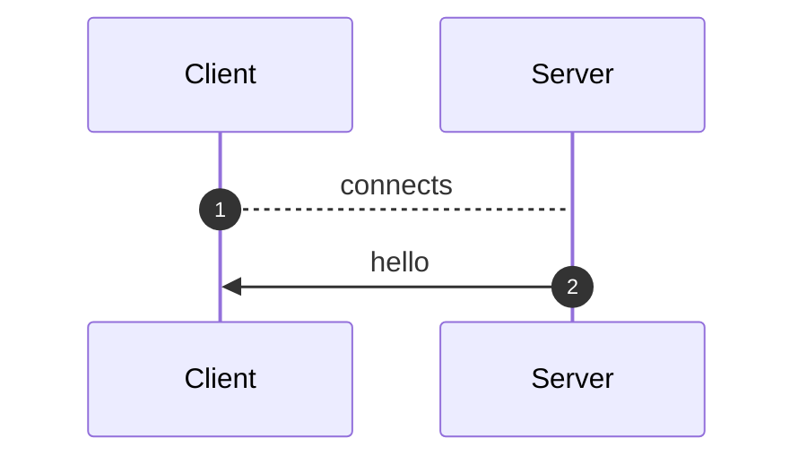
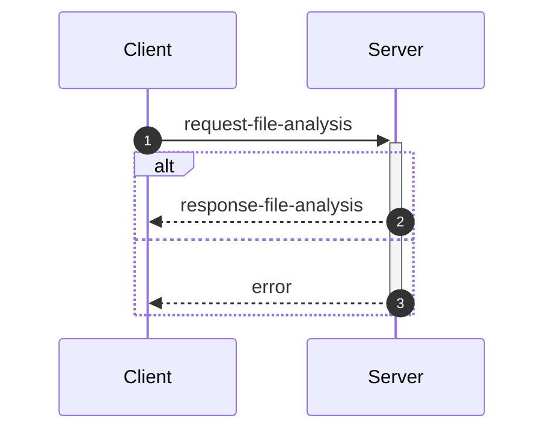
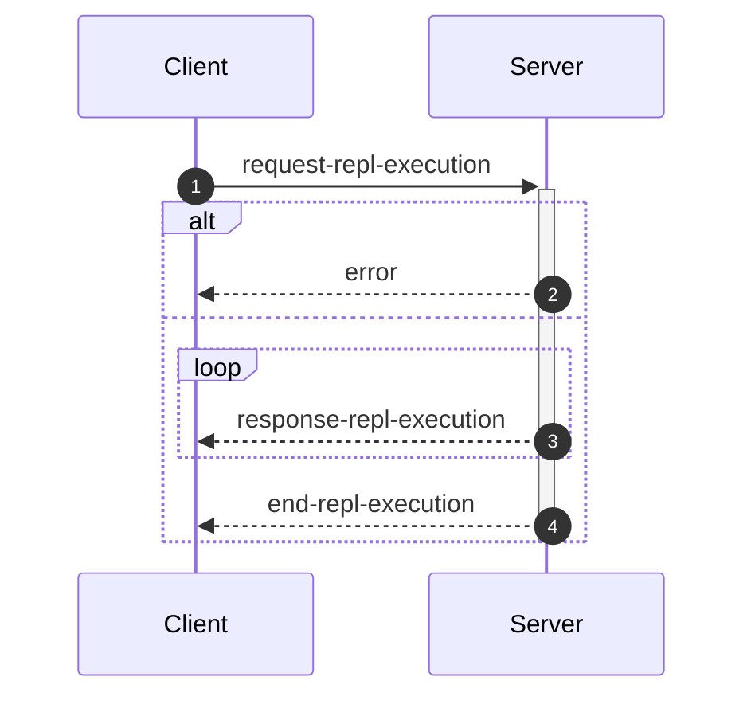
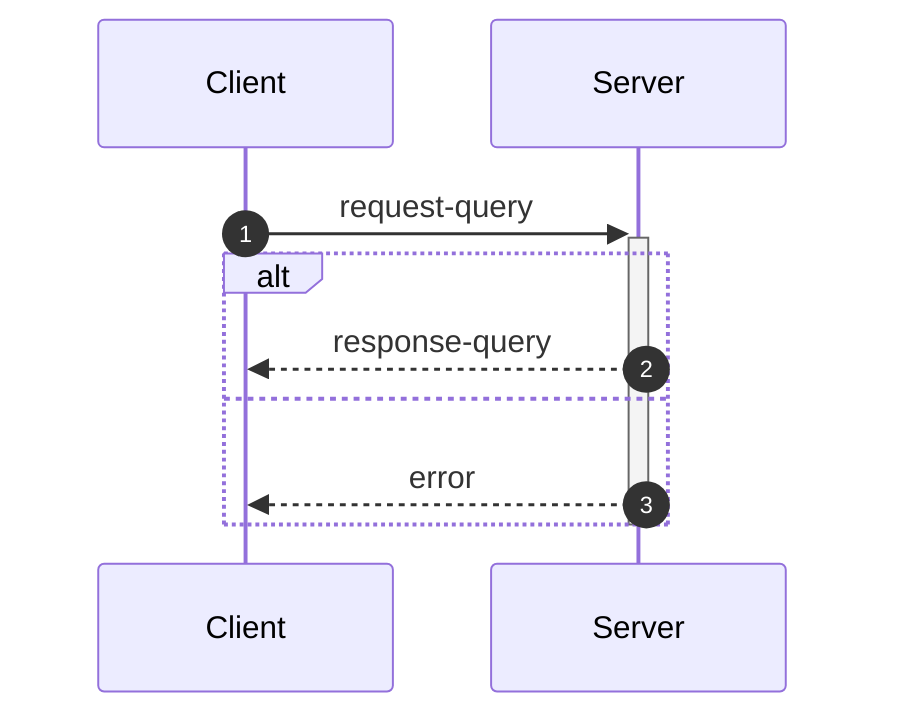

_<span title="an overview of flowR's interface">Generated</span> from '[wiki-interface.ts](https://github.com/flowr-analysis/flowr/tree/main/src/documentation/wiki-interface.ts "src/documentation/wiki-interface.ts")' on 2026-11-05, 14:05:08 UTC (v2.17.2, R v4.5.0), do not edit directly._

Although far from being as detailed as the in-depth explanation of [_flowR_](https://github.com/flowr-analysis/flowr/wiki/Core),
this wiki page explains how to interface with _flowR_ in more detail.
In general, command line arguments and other options provide short descriptions on hover over.

* [💻 Using the REPL](#using-the-repl)
* [⚙️ Configuring FlowR](#configuring-flowr)
* [⚒️ Writing Code](#writing-code)
* [💬 Communicating with the Server](#communicating-with-the-server)

<a id='using-the-repl'></a>
## 💻 Using the REPL

> [!NOTE]
> To execute arbitrary R commands with a repl request, _flowR_ has to be started explicitly with <span title="Description (Command Line Argument): Allow to access the underlying R session when using flowR (security warning: this allows the execution of arbitrary R code!)">`--r-session-access`</span>.
> Please be aware that this introduces a security risk and note that this relies on the [`r-shell` engine](https://github.com/flowr-analysis/flowr/wiki/Engines) .

Although primarily meant for users to explore,
there is nothing which forbids calling _flowR_ as a subprocess to use standard-in, -output, and -error
for communication (although you can access the REPL using the server as well,
with the [REPL Request](#message-request-repl-execution) message).

The read-eval-print loop&nbsp;(REPL) works relatively simple.
You can submit an expression (using <kbd>Enter</kbd>),
which is interpreted as an R&nbsp;expression by default but interpreted as a *command* if it starts with a colon (`:`).
The best command to get started with the REPL is <span title="Description (Repl Command): Show help information (aliases: :h, :?)">`:help`</span>.
Besides, you can leave the REPL either with the command <span title="Description (Repl Command): End the repl (aliases: :q, :exit)">`:quit`</span> or by pressing <kbd>Ctrl</kbd>+<kbd>C</kbd> twice.
When writing a *command*, you may press <kbd>Tab</kbd> to get a list of completions, if available.
Multiple commands can be entered in a single line by separating them with a semicolon (`;`), e.g. `:parse "x<-2"; :df*`.
If a command is given without R code, the REPL will re-use R code given in a previous command.
The prior example will hence return first the parsed AST of the program and then the dataflow graph for `"x <- 2"`.

> [!NOTE]
> If you develop flowR, you may want to launch the repl using the `npm run main-dev` command, this way, you get a non-minified version of flowR with debug information and hot-reloading of source files.

<details>
<summary>Available Commands</summary>

We currently offer the following commands (this with a `[*]` suffix are available with and without the star):

| Command | Description |
| ------- | ----------- |
| **<span title="Description (Repl Command): End the repl (aliases: :q, :exit)">:quit</span>** | End the repl (aliases: **:<span title="Alias of ':quit'. End the repl">q</span>**, **:<span title="Alias of ':quit'. End the repl">exit</span>**) |
| **<span title="Description (Repl Command): Execute the given code as R code. This requires the `--r-session-access` flag to be set and requires the r-shell engine. (aliases: :e, :r)">:execute</span>** | Execute the given code as R code. This requires the `--r-session-access` flag to be set and requires the r-shell engine. (aliases: **:<span title="Alias of ':execute'. Execute the given code as R code. This requires the `--r-session-access` flag to be set and requires the r-shell engine.">e</span>**, **:<span title="Alias of ':execute'. Execute the given code as R code. This requires the `--r-session-access` flag to be set and requires the r-shell engine.">r</span>**) |
| **<span title="Description (Repl Command): Get mermaid code for the control-flow graph of R code (aliases: :cfg, :cf)">:controlflow[*]</span>** | Get mermaid code for the control-flow graph of R code (star: Returns the URL to mermaid.live) (aliases: **:<span title="Alias of ':controlflow'. Get mermaid code for the control-flow graph of R code">cfg</span>**, **:<span title="Alias of ':controlflow'. Get mermaid code for the control-flow graph of R code">cf</span>**) |
| **<span title="Description (Repl Command): Get mermaid code for the control-flow graph with basic blocks (aliases: :cfgb, :cfb)">:controlflowbb[*]</span>** | Get mermaid code for the control-flow graph with basic blocks (star: Returns the URL to mermaid.live) (aliases: **:<span title="Alias of ':controlflowbb'. Get mermaid code for the control-flow graph with basic blocks">cfgb</span>**, **:<span title="Alias of ':controlflowbb'. Get mermaid code for the control-flow graph with basic blocks">cfb</span>**) |
| **<span title="Description (Repl Command): Get mermaid code for the dataflow graph (aliases: :d, :df)">:dataflow[*]</span>** | Get mermaid code for the dataflow graph (star: Returns the URL to mermaid.live) (aliases: **:<span title="Alias of ':dataflow'. Get mermaid code for the dataflow graph">d</span>**, **:<span title="Alias of ':dataflow'. Get mermaid code for the dataflow graph">df</span>**) |
| **<span title="Description (Repl Command): Get mermaid code for the normalized AST of R code (aliases: :n)">:normalize[*]</span>** | Get mermaid code for the normalized AST of R code (star: Returns the URL to mermaid.live) (alias: **:<span title="Alias of ':normalize'. Get mermaid code for the normalized AST of R code">n</span>**) |
| **<span title="Description (Repl Command): Get mermaid code for the simplified dataflow graph (aliases: :ds, :dfs)">:dataflowsimple[*]</span>** | Get mermaid code for the simplified dataflow graph (star: Returns the URL to mermaid.live) (aliases: **:<span title="Alias of ':dataflowsimple'. Get mermaid code for the simplified dataflow graph">ds</span>**, **:<span title="Alias of ':dataflowsimple'. Get mermaid code for the simplified dataflow graph">dfs</span>**) |
| **<span title="Description (Repl Command): Inspect and extend the signature database: `query` (identical to :query @signature), `info <name>` for where a function comes from (identical to :query @function-info), `add <path>` to mount another database/source, `download` to fetch the full-history database. (aliases: :sig)">:signature</span>** | Inspect and extend the signature database: `query` (identical to :query @signature), `info <name>` for where a function comes from (identical to :query @function-info), `add <path>` to mount another database/source, `download` to fetch the full-history database. (alias: **:<span title="Alias of ':signature'. Inspect and extend the signature database: `query` (identical to :query @signature), `info <name>` for where a function comes from (identical to :query @function-info), `add <path>` to mount another database/source, `download` to fetch the full-history database.">sig</span>**) |
| **<span title="Description (Repl Command): Just calculates the DFG, but only prints summary info (aliases: :d#, :df#)">:dataflowsilent</span>** | Just calculates the DFG, but only prints summary info (aliases: **:<span title="Alias of ':dataflowsilent'. Just calculates the DFG, but only prints summary info">d#</span>**, **:<span title="Alias of ':dataflowsilent'. Just calculates the DFG, but only prints summary info">df#</span>**) |
| **<span title="Description (Repl Command): Prints ASCII Art of the parsed, unmodified AST (aliases: :p)">:parse</span>** | Prints ASCII Art of the parsed, unmodified AST (alias: **:<span title="Alias of ':parse'. Prints ASCII Art of the parsed, unmodified AST">p</span>**) |
| **<span title="Description (Repl Command): Prints the version of flowR as well as the current version of R">:version</span>** | Prints the version of flowR as well as the current version of R
| **<span title="Description (Repl Command): Query the given R code (use 'help' for more information)">:query[*]</span>** | Query the given R code (use 'help' for more information) (star: Similar to query, but returns the output in json format.)
| **<span title="Description (Repl Command): Returns an ASCII representation of the dataflow graph (aliases: :df!)">:dataflowascii</span>** | Returns an ASCII representation of the dataflow graph (alias: **:<span title="Alias of ':dataflowascii'. Returns an ASCII representation of the dataflow graph">df!</span>**) |
| **<span title="Description (Repl Command): Returns summarization stats for the normalized AST (aliases: :n#)">:normalize#</span>** | Returns summarization stats for the normalized AST (alias: **:<span title="Alias of ':normalize#'. Returns summarization stats for the normalized AST">n#</span>**) |
| **<span title="Description (Repl Command): Show help information (aliases: :h, :?)">:help</span>** | Show help information (aliases: **:<span title="Alias of ':help'. Show help information">h</span>**, **:<span title="Alias of ':help'. Show help information">?</span>**) |

</details>

> [!TIP]
> 
> As indicated by the examples before, all REPL commands that operate on code keep track of the state.
> Hence, if you run a command like <span title="Description (Repl Command, starred version): Returns the URL to mermaid.live; Base Command: Get mermaid code for the dataflow graph (aliases: :d*, :df*)">`:dataflow*`</span> without providing R code,
> the REPL will re-use the R code provided in a previous command.
> Likewise, doing this will benefit from incrementality!
> If you request the dataflow graph with `:df* x <- 2 * y` and then want to see the parsed AST with `:parse`,
> the REPL will re-use previously obtained information and not re-parse the code again.
> 		

Generally, many commands offer shortcut versions in the REPL. Many queries, for example, offer a shortened format (see the example below).
Of special note, the [Config Query](https://github.com/flowr-analysis/flowr/wiki/%5BQuery%5D-Config)
can be used to also modify the currently active configuration of _flowR_ within the REPL (see the [wiki page](https://github.com/flowr-analysis/flowr/wiki/%5BQuery%5D-Config) for more information).

### Example: Retrieving the Dataflow Graph

To retrieve a URL to the [mermaid](https://mermaid.js.org/) diagram of the dataflow of a given expression,
use <span title="Description (Repl Command, starred version): Returns the URL to mermaid.live; Base Command: Get mermaid code for the dataflow graph (aliases: :d*, :df*)">`:dataflow*`</span> (or <span title="Description (Repl Command): Get mermaid code for the dataflow graph (aliases: :d, :df)">`:dataflow`</span> to get the mermaid code in the cli):

```shell
$ docker run -it --rm eagleoutice/flowr # or npm run flowr 
flowR repl v2.17.2, R grammar v14 (tree-sitter engine)
R> :dataflow* y <- 1 + x
```

<details>
<summary style='color:gray'>Output</summary>

```text
https://mermaid.live/view#base64:eyJjb2RlIjoiZmxvd2NoYXJ0IFREXG4gICAgMXt7XCJgKiM5MTtSTnVtYmVyIzkzOyogKioxKipcbiAgICAgICoxLjYqICgqKmlkOiAxKiopYFwifX1cbiAgICAyKFtcImAqIzkxO1JTeW1ib2wjOTM7KiAqKngqKlxuICAgICAgKjEuMTAqICgqKmlkOiAyKiopYFwiXSlcbiAgICAzW1tcImAqIzkxO1JCaW5hcnlPcCM5MzsqIGJhc2UjNTg7IzU4OyoqIzQzOyoqXG4gICAgICAqMS42LTEwKiAoKippZDogMyoqKVxuICAgIGFyZzogKDEsIDIpYFwiXV1cbiAgICBidWlsdC1pbjpfNDNfW1wiYEJ1aWx0LUluOlxuIzQzO2BcIl1cbiAgICBzdHlsZSBidWlsdC1pbjpfNDNfIHN0cm9rZTpncmF5LGZpbGw6Z3JheSxzdHJva2Utd2lkdGg6MnB4LG9wYWNpdHk6Ljg7XG4gICAgMFtcImAqIzkxO1JTeW1ib2wjOTM7KiAqKnkqKlxuICAgICAgKjEuMSogKCoqaWQ6IDAqKiwgdjogMylgXCJdXG4gICAgNFtbXCJgKiM5MTtSQmluYXJ5T3AjOTM7KiBiYXNlIzU4OyM1ODsqKiM2MDsjNDU7KipcbiAgICAgICoxLjEtMTAqICgqKmlkOiA0KiopXG4gICAgYXJnOiAoMCwgMylgXCJdXVxuICAgIGJ1aWx0LWluOl82MF8tW1wiYEJ1aWx0LUluOlxuIzYwOyM0NTtgXCJdXG4gICAgc3R5bGUgYnVpbHQtaW46XzYwXy0gc3Ryb2tlOmdyYXksZmlsbDpncmF5LHN0cm9rZS13aWR0aDoycHgsb3BhY2l0eTouODtcbiAgICAxIC0uLT58XCJmbG93XCJ8IDJcbiAgICBsaW5rU3R5bGUgMCBzdHJva2U6Z3JheSxjb2xvcjpncmF5O1xuICAgIDIgLS4tPnxcImZsb3dcInwgM1xuICAgIGxpbmtTdHlsZSAxIHN0cm9rZTpncmF5LGNvbG9yOmdyYXk7XG4gICAgMyAtLT58XCJyZWFkcywgYXJnXCJ8IDFcbiAgICAzIC0tPnxcInJlYWRzLCBhcmdcInwgMlxuICAgIDMgLS4tPnxcImZsb3dcInwgMFxuICAgIGxpbmtTdHlsZSA0IHN0cm9rZTpncmF5LGNvbG9yOmdyYXk7XG4gICAgMyAtLi0+fFwicmVhZHMsIGNhbGxzXCJ8IGJ1aWx0LWluOl80M19cbiAgICBsaW5rU3R5bGUgNSBzdHJva2U6Z3JheTtcbiAgICAwIC0tPnxcImRlZmluZWQtYnksIGZsb3dcInwgNFxuICAgIDAgLS0+fFwiZGVmaW5lZC1ieVwifCAzXG4gICAgNCAtLT58XCJyZWFkcywgYXJnXCJ8IDNcbiAgICA0IC0tPnxcInJldHVybnMsIGFyZ1wifCAwXG4gICAgNCAtLi0+fFwicmVhZHMsIGNhbGxzXCJ8IGJ1aWx0LWluOl82MF8tXG4gICAgbGlua1N0eWxlIDEwIHN0cm9rZTpncmF5OyIsIm1lcm1haWQiOnsiYXV0b1N5bmMiOnRydWV9fQ==
```

Retrieve the dataflow graph of the expression `y <- 1 + x`. It looks like this:


<details>

<summary style="color:gray">R Code of the Dataflow Graph</summary>

The analysis ran (parse and normalize with the [tree-sitter](https://github.com/flowr-analysis/flowr/wiki/Engines) engine) in the generation environment. No [signature database](https://github.com/flowr-analysis/flowr/wiki/Signature-Database) is mounted, so `library()` attaches no exports (base-R names are still qualified, e.g., `stats::acf`). 
We encountered no unknown side effects during the analysis.

```r
y <- 1 + x
```

</details>

</details>

For small graphs like this, <span title="Description (Repl Command): Returns an ASCII representation of the dataflow graph (aliases: :df!)">`:dataflowascii`</span> also provides an ASCII representation directly in the REPL:

```shell
$ docker run -it --rm eagleoutice/flowr # or npm run flowr 
flowR repl v2.17.2, R grammar v14 (tree-sitter engine)
R> :df! y <- 1 + x
```

<details open>
<summary style='color:gray'>Output</summary>

```text
                        v<0>v
 c<4>c──────────────────| y |
 |<- |     ┌────────────v---v
 c---c     │
    │   c<3>c   0<1>0
    └───| + |───| 1 |───u<2>u
        c---c   0---0   | x |
           └────────────u---u
Edges:
3 -> 1: reads, arg          3 -> 2: reads, arg
3 -> 0: flows-to            1 -> 2: flows-to
2 -> 3: flows-to            4 -> 3: reads, arg
4 -> 0: returns, arg        0 -> 4: defined-by, flows-to
0 -> 3: defined-by
```

Retrieve the dataflow graph of the expression `y <- 1 + x` as ASCII art.

</details>

For the slicing with <span title="Description (Repl Command): Static backwards executable slicer for R">`:slicer`</span>, you have access to the same [magic comments](#slice-magic-comments) as with the [slice request](#message-request-slice).
Pass `--inline` to splice resolvable `source()` calls into the reconstruction so the slice is a single self-contained R text (the same as the static slice query's `inlineSources` flag).
See `--help` for more flags!

### Example: Interfacing with the File System

Many commands that allow for an R-expression (like <span title="Description (Repl Command, starred version): Returns the URL to mermaid.live; Base Command: Get mermaid code for the dataflow graph (aliases: :d*, :df*)">`:dataflow*`</span>) allow for a file as well
if the argument starts with `file://`.
If you are working from the root directory of the _flowR_ repository, the following gives you the parsed AST of the example file using the <span title="Description (Repl Command): Prints ASCII Art of the parsed, unmodified AST (aliases: :p)">`:parse`</span> command:

> **Watch mode**: Replace `file://` with `watch://` to enter watch mode.
> flowR runs the command immediately and then re-runs it every time the file (or any file inside the folder) changes.
> Enter any other command to leave watch mode.
> For example: `:df watch://analysis.R`

```shell
$ docker run -it --rm eagleoutice/flowr # or npm run flowr 
flowR repl v2.17.2, R grammar v14 (tree-sitter engine)
R> :parse file://test/testfiles/example.R
```

<details>
<summary style='color:gray'>Output</summary>

```text
File: test/testfiles/example.R

program
├ binaryoperator
│ ├ identifier "sum" (1:1─4)
│ ├ <- "<-" (1:5─7)
│ ╰ float "0" (1:8─9)
├ binaryoperator
│ ├ identifier "product" (2:1─8)
│ ├ <- "<-" (2:9─11)
│ ╰ float "1" (2:12─13)
├ binaryoperator
│ ├ identifier "w" (3:1─2)
│ ├ <- "<-" (3:3─5)
│ ╰ float "7" (3:6─7)
├ binaryoperator
│ ├ identifier "N" (4:1─2)
│ ├ <- "<-" (4:3─5)
│ ╰ float "10" (4:6─8)
├ forstatement
│ ├ for "for" (6:1─4)
│ ├ ( "(" (6:5─6)
│ ├ identifier "i" (6:6─7)
│ ├ in "in" (6:8─10)
│ ├ binaryoperator
│ │ ├ float "1" (6:11─12)
│ │ ├ : ":" (6:12─13)
│ │ ╰ parenthesizedexpression
│ │   ├ ( "(" (6:13─14)
│ │   ├ binaryoperator
│ │   │ ├ identifier "N" (6:14─15)
│ │   │ ├ - "-" (6:15─16)
│ │   │ ╰ float "1" (6:16─17)
│ │   ╰ ) ")" (6:17─18)
│ ├ ) ")" (6:18─19)
│ ╰ bracedexpression
│   ├ { "{" (6:20─21)
│   ├ binaryoperator
│   │ ├ identifier "sum" (7:3─6)
│   │ ├ <- "<-" (7:7─9)
│   │ ╰ binaryoperator
│   │   ├ binaryoperator
│   │   │ ├ identifier "sum" (7:10─13)
│   │   │ ├ + "+" (7:14─15)
│   │   │ ╰ identifier "i" (7:16─17)
│   │   ├ + "+" (7:18─19)
│   │   ╰ identifier "w" (7:20─21)
│   ├ binaryoperator
│   │ ├ identifier "product" (8:3─10)
│   │ ├ <- "<-" (8:11─13)
│   │ ╰ binaryoperator
│   │   ├ identifier "product" (8:14─21)
│   │   ├  "" (8:22─23)
│   │   ╰ identifier "i" (8:24─25)
│   ╰ } "}" (9:1─2)
├ call
│ ├ identifier "cat" (11:1─4)
│ ╰ arguments
│   ├ ( "(" (11:4─5)
│   ├ argument
│   │ ╰ string
│   │   ├ stringopen "\"" (11:5─6)
│   │   ├ stringcontent "Sum:" (11:6─10)
│   │   ╰ stringclose "\"" (11:10─11)
│   ├ comma "," (11:11─12)
│   ├ argument
│   │ ╰ identifier "sum" (11:13─16)
│   ├ comma "," (11:16─17)
│   ├ argument
│   │ ╰ string
│   │   ├ stringopen "\"" (11:18─19)
│   │   ├ stringcontent
│   │   │ ╰ escapesequence "\\n" (11:19─21)
│   │   ╰ stringclose "\"" (11:21─22)
│   ╰ ) ")" (11:22─23)
╰ call
  ├ identifier "cat" (12:1─4)
  ╰ arguments
    ├ ( "(" (12:4─5)
    ├ argument
    │ ╰ string
    │   ├ stringopen "\"" (12:5─6)
    │   ├ stringcontent "Product:" (12:6─14)
    │   ╰ stringclose "\"" (12:14─15)
    ├ comma "," (12:15─16)
    ├ argument
    │ ╰ identifier "product" (12:17─24)
    ├ comma "," (12:24─25)
    ├ argument
    │ ╰ string
    │   ├ stringopen "\"" (12:26─27)
    │   ├ stringcontent
    │   │ ╰ escapesequence "\\n" (12:27─29)
    │   ╰ stringclose "\"" (12:29─30)
    ╰ ) ")" (12:30─31)
```

Retrieve the parsed AST of the example file.

<details>

<summary>File Content</summary>

```r
sum <- 0
product <- 1
w <- 7
N <- 10

for (i in 1:(N-1)) {
  sum <- sum + i + w
  product <- product * i
}

cat("Sum:", sum, "\n")
cat("Product:", product, "\n")
```

</details>

As _flowR_ directly transforms this AST the output focuses on being human-readable instead of being machine-readable.
		
</details>

### Example: Run a Query

You can run any query supported by _flowR_ using the <span title="Description (Repl Command): Query the given R code (use 'help' for more information)">`:query`</span> command.
For example, to obtain the shapes of all data frames in a given piece of code, you can run:

```shell
$ docker run -it --rm eagleoutice/flowr # or npm run flowr 
flowR repl v2.17.2, R grammar v14 (tree-sitter engine)
R> :query @absint df-shape "x <- data.frame(a = 1:10, b = 1:10)\ny <- x$a"
```

<details open>
<summary style='color:gray'>Output</summary>

```text
Query: absint (3 ms)
   ╰ $12: (colnames: [{"a", "b"}, {}], cols: [2, 2], rows: [10, 10])
   ╰ $0: (colnames: [{"a", "b"}, {}], cols: [2, 2], rows: [10, 10])
```

Retrieve the shapes of all data frames in the given code.

</details>

To run the linter on a file, you can use (in this example, we just issue the `dead-code` linter on a small piece of code):

```shell
$ docker run -it --rm eagleoutice/flowr # or npm run flowr 
flowR repl v2.17.2, R grammar v14 (tree-sitter engine)
R> :query @linter rules:dead-code "if(FALSE) x <- 2"
```

<details open>
<summary style='color:gray'>Output</summary>

```text
Query: linter (2 ms)
   ╰ Dead Code (dead-code):
       ╰ certain:
           ╰ Code at 1.11-16 (1 quick fix(es) available)
```

Run the linter on the given code, with only the `dead-code` rule enabled.

</details>

For more information on the available queries, please check out the [Query API](https://github.com/flowr-analysis/flowr/wiki/Query-API).

<a id='configuring-flowr'></a>
## ⚙️ Configuring FlowR

When running _flowR_, you may want to specify some behaviors with a dedicated configuration file.
By default, flowR looks for a file named `flowr.json` in the current working directory (or any higher directory).
You can also specify a different file with <span title="Description (Command Line Argument): The name of the configuration file to use">`--config-file`</span> or pass the configuration inline using <span title="Description (Command Line Argument): The flowR configuration to use, as a JSON string">`--config-json`</span>.
A `flowr.json` found this way belongs to the analyzed project, so flowR ignores its options that decide what flowR executes or loads
(`engines.*.wasmPath`, `engines.*.treeSitterWasmPath`, `engines.*.rPath`, `solver.sigdb.additionalPaths`, `solver.sigdb.downloadRepo`, `solver.sigdb.installedLibrary.paths`, `solver.sigdb.onDemand.enabled`, `solver.sigdb.onDemand.repositories`, `solver.sigdb.onDemand.cranMirror`, `solver.sigdb.onDemand.bioconductorMirror`, `solver.sigdb.onDemand.cacheDir`),
unless you pass <span title="Description (Command Line Argument): Keep the security-sensitive options (e.g., the R executable) of the flowr.json found in the working directory or a parent. Only use this for projects you trust.">`--trust-config`</span>.
To analyze code you do not trust, use the secure mode (<span title="Description (Command Line Argument): Run in secure mode for analyzing untrusted code: flowR does not start R (or any other process), does not access the network, does not search for project configs, and ignores security-sensitive options in every config. Cannot be disabled once enabled. Can also be enabled with the environment variable {italic FLOWR_SECURE_MODE=1}.">`--secure`</span>, see the [security policy](https://github.com/flowr-analysis/flowr/blob/main/.github/SECURITY.md)).
To inspect the current configuration, you can run flowr with the <span title="Description (Command Line Argument): Run with verbose logging (will be passed to the corresponding script)">`--verbose`</span> flag, or use the `config` [Query](https://github.com/flowr-analysis/flowr/wiki/Query-API).
Within the REPL this works by running the following:

```shell
:query @config
```

To work with the <a href="https://github.com/flowr-analysis/flowr/tree/main/src/config.ts#L119"><code><span title="The configuration file format for flowR.">FlowrConfig</span></code></a> you can use the provided helper objects alongside its methods like
<a href="https://github.com/flowr-analysis/flowr/tree/main/src/config.ts#L966"><code><span title="Creates a new flowr config that has the updated values.">FlowrConfig::<b>amend</b></span></code></a>.
The schema below documents every option; the ones you most likely want are:

- <a href="https://github.com/flowr-analysis/flowr/wiki/Interface#configuring-flowr" title="Configuration Option (boolean): Whether source calls should be ignored, causing {@link processSourceCall}&#39;s behavior to be skipped.">ignoreSourceCalls</a>: ignore source calls when analyzing the code, i.e., ignore the inclusion of other files.
- <a href="https://github.com/flowr-analysis/flowr/wiki/Interface#configuring-flowr" title="Configuration Option (boolean): Whether load calls should be ignored, causing {@link processLoadCall}&#39;s behavior to be skipped.">ignoreLoadCalls</a>: ignore load calls when analyzing the code, i.e., ignore the loading of r-data files.
- <a href="https://github.com/flowr-analysis/flowr/wiki/Interface#configuring-flowr" title="Configuration Option (object): Do you want to overwrite (parts) of the builtin definition?">semantics.environment.overwriteBuiltIns</a>: overwrite _flowR_'s handling of built-in functions, or clear the preset definitions entirely.
  See [Configure BuiltIn Semantics](#configure-builtin-semantics) for more information.
- <a href="https://github.com/flowr-analysis/flowr/wiki/Interface#configuring-flowr" title="Configuration Option (string): How to resolve variables and their values. (one of &quot;disabled&quot;, &quot;alias&quot;, &quot;builtin&quot;)">solver.variables</a>: how to resolve variables and their values (`disabled`, `alias`, `builtin`).
- <a href="https://github.com/flowr-analysis/flowr/wiki/Interface#configuring-flowr" title="Configuration Option (array): The engine or set of engines to use for interacting with R code. An empty array means all available engines will be used.">engines</a> and <a href="https://github.com/flowr-analysis/flowr/wiki/Interface#configuring-flowr" title="Configuration Option (string): The default engine to use for interacting with R code. If this is undefined, an arbitrary engine from the specified list will be used. (one of &quot;tree-sitter&quot;, &quot;r-shell&quot;)">defaultEngine</a>: the engines used to interact with R code, see the [Engines wiki page](https://github.com/flowr-analysis/flowr/wiki/Engines).
- <a href="https://github.com/flowr-analysis/flowr/wiki/Interface#configuring-flowr" title="Configuration Option (array): Files a framework loads on its own, without any source() call (e.g. global.R in a shiny app), in the order they are loaded; flowR orders the matching project files accordingly and analyzes them as one program. Entries are case-insensitive globs matched against the file path, a plain name matches any file with that name, and entries matching no project file are warned about. Usually set per project kind via specializeConfig.">project.implicitSources</a>: the files a framework loads without any `source()` call, in the order in which they are
  loaded. Entries are globs (e.g. `R/*.R`) matched against the file path ignoring capitalization; one matching no file is reported.
- <a href="https://github.com/flowr-analysis/flowr/wiki/Interface#configuring-flowr" title="Configuration Option (object): Overwrite (parts of) the configuration depending on the project kind flowR detects, e.g. to give a shiny app its implicit sources.">specializeConfig</a>: overwrite (parts of) the configuration depending on the kind of project _flowR_ detects
  (e.g. `shiny-app`), which is how a shiny app gets its implicit sources by default. What you configure directly wins.
- <a href="https://github.com/flowr-analysis/flowr/wiki/Interface#configuring-flowr" title="Configuration Option (string): Overwrite the project kind flowR would otherwise infer from the analyzed files, e.g. when auto-detection guesses wrong. (one of &quot;package&quot;, &quot;script&quot;, &quot;shiny-app&quot;, &quot;notebook&quot;, &quot;project&quot;, &quot;unknown&quot;)">project.useProjectType</a>: skip that detection and force a project kind yourself, when auto-detection guesses wrong.
- <a href="https://github.com/flowr-analysis/flowr/wiki/Interface#configuring-flowr" title="Configuration Option (array): The default plugins to load when creating a new instance of FlowrAnalyzer">defaultPlugins</a> and <a href="https://github.com/flowr-analysis/flowr/wiki/Interface#configuring-flowr" title="Configuration Option (array): The plugins to load in REPL mode">repl.plugins</a>: the plugins to load for a new <a href="https://github.com/flowr-analysis/flowr/tree/main/src/project/flowr-analyzer.ts#L210"><code><span title="Central class for conducting analyses with FlowR. Use the FlowrAnalyzerBuilder to create a new instance. If you want the original pattern of creating a pipeline and running all steps, you can still do this with FlowrAnalyzer#runFull . To inspect the context of the analyzer, use FlowrAnalyzer#inspectContext (if you are a plugin and need to modify it, use FlowrAnalyzer#context instead).">FlowrAnalyzer</span></code></a> and in the REPL
  (use `flowr:default` to reference the former).

So you can configure _flowR_ by adding a file like the following:

<details>

<summary>Example Configuration File</summary>

```json
{
  "ignoreSourceCalls": true,
  "ignoreLoadCalls": true,
  "semantics": {
    "environment": {
      "overwriteBuiltIns": {
        "definitions": [
          {
            "type": "function",
            "names": [
              "foo"
            ],
            "processor": "builtin:assign",
            "config": {}
          }
        ]
      }
    }
  },
  "defaultPlugins": [
    "file:description",
    "versions:description"
  ],
  "repl": {
    "quickStats": false,
    "dfProcessorHeat": false,
    "hints": true,
    "plugins": [
      "flowr:default"
    ]
  },
  "project": {
    "resolveUnknownPathsOnDisk": true,
    "implicitSources": [
      "global.R",
      "app.R"
    ]
  },
  "linter": {
    "disabledRules": []
  },
  "specializeConfig": {
    "shiny-app": {
      "project": {
        "implicitSources": [
          "global.R",
          "ui.R",
          "server.R",
          "app.R"
        ]
      }
    }
  },
  "engines": [
    {
      "type": "r-shell"
    }
  ],
  "solver": {
    "variables": "alias",
    "evalStrings": true,
    "trackEnvironments": true,
    "sigdb": {
      "enabled": true,
      "loadProjectDependencies": true,
      "eagerlyLoad": false,
      "eagerlyLoadExports": false,
      "linkBaseR": false,
      "linkDescriptionDependencies": false
    },
    "resolveSource": {
      "dropPaths": "no",
      "ignoreCapitalization": true,
      "inferWorkingDirectory": "active-script",
      "searchPath": []
    },
    "instrument": {},
    "slicer": {
      "threshold": 50
    }
  },
  "abstractInterpretation": {
    "wideningThreshold": 4,
    "followCalls": true,
    "dataFrame": {
      "maxColNames": 20,
      "readLoadedData": {
        "readExternalFiles": true,
        "maxReadLines": 1000000
      }
    }
  },
  "incremental": {
    "alwaysIncremental": false,
    "parsing": {
      "activated": false,
      "heuristics": {
        "activated": true,
        "mtime": true,
        "linesFrom": 500,
        "bytesFrom": 50000,
        "alwaysWithEdits": false,
        "minFiles": 1
      }
    }
  },
  "gas": {
    "thresholds": {
      "memory": {
        "problematic": 0.7,
        "critical": 0.9
      },
      "timeMs": {
        "problematic": 100000,
        "critical": 120000
      }
    },
    "features": {}
  }
}
```

</details>

<details>
<a id='configure-builtin-semantics'></a>
<summary>Configure Built-In Semantics</summary>

`semantics/environment/overwriteBuiltins` accepts two keys:

- `loadDefaults` (boolean, initially `true`): If set to `true`, the default built-in definitions are loaded before applying the custom definitions. Setting this flag to `false` explicitly disables the loading of the default definitions.
- `definitions` (array, initially empty): Allows to overwrite or define new built-in elements. Each object within must have a `type` which is one of the below. Furthermore, they may define a string array of `names` which specifies the identifiers to bind the definitions to. You may use `assumePrimitive` to specify whether _flowR_ should assume that this is a primitive non-library definition (so you probably just do not want to specify the key).

  | Type            | Description                                                                                                                                                                                                                                                                                              | Example                                                                                                    |
  | --------------- | -------------------------------------------------------------------------------------------------------------------------------------------------------------------------------------------------------------------------------------------------------------------------------------------------------- | ---------------------------------------------------------------------------------------------------------- |
  | `constant`    | Additionally allows for a `value` this should resolve to.                                                                                                                                                                                                                                                | `{ type: 'constant', names: ['NULL', 'NA'],  value: null }`                                                |
  | `function`    | Is a rather flexible way to define and bind built-in functions. For the time, we do not have extensive documentation to cover all the cases, so please either consult the sources with the `default-builtin-config.ts` or open a [new issue](https://github.com/flowr-analysis/flowr/issues/new/choose). | `{ type: 'function', names: ['next'], processor: 'builtin:d', config: { cfg: ExitPointType.Next } }` |
  | `replacement` | A comfortable way to specify replacement functions like `$<-` or `names<-`. `suffixes` describes the... suffixes to attach automatically. | `{ type: 'replacement', suffixes: ['<-', '<<-'], names: ['[', '[['] }` |

</details>

<details>

<summary style='color:gray'>Full Configuration-File Schema</summary>

- _The configuration file format for flowR._ (object)
    - **logLevel** [optional] _flowR's global minimum log level, applied when the config is loaded._ (string)
        Only allows: 'silly', 'trace', 'debug', 'info', 'warn', 'error', 'fatal'
    - **ignoreSourceCalls** [optional] _Whether source calls should be ignored, causing {@link processSourceCall}'s behavior to be skipped._ (boolean)
    - **ignoreLoadCalls** [optional] _Whether load calls should be ignored, causing {@link processLoadCall}'s behavior to be skipped._ (boolean)
    - **semantics** _Configure language semantics and how flowR handles them._ (object)
        - **environment** [optional] _Semantics regarding how to handle the R environment._ (object)
            - **overwriteBuiltIns** [optional] _Do you want to overwrite (parts) of the builtin definition?_ (object)
                - **loadDefaults** [optional] _Should the default configuration still be loaded?_ (boolean)
                - **definitions** [optional] _The definitions to load/overwrite._ (array)
                Valid item types:
                    - (object)
    - **defaultPlugins** [optional] _The default plugins to load when creating a new instance of FlowrAnalyzer_ (array)
    Valid item types:
        - (alternatives)
            - (string)
            - (array)
    - **repl** _Configuration options for the REPL._ (object)
        - **quickStats** [optional] _Whether to show quick stats in the REPL after each evaluation._ (boolean)
        - **dfProcessorHeat** [optional] _This instruments the dataflow processors to count how often each processor is called._ (boolean)
        - **hints** [optional] _Whether to show dim inline hints on the empty prompt (automatically disabled on non-interactive terminals)._ (boolean)
        - **plugins** [optional] _The plugins to load in REPL mode_ (array)
        Valid item types:
            - (alternatives)
                - (string)
                - (array)
        - **autoUseFileProtocol** [optional] _Prepend the file protocol to a repl input that looks like a path, instead of only warning about it._ (boolean)
        - **queryStats** [optional] _Whether `:query` closes with the line stating how long the queries took (`:query*` never prints it)._ (boolean)
        - **showPlugins** [optional] _Whether `:version` grays out the plugins that did not activate during the last analysis._ (boolean)
    - **project** _Project specific configuration options._ (object)
        - **resolveUnknownPathsOnDisk** [optional] _Whether to resolve unknown paths loaded by the r project disk when trying to source/analyze files._ (boolean)
        - **failOnInaccessiblePath** [optional] _Whether a directory that cannot be traversed during file discovery (e.g. due to permissions) aborts the analysis; when false (the default) such paths are logged and skipped._ (boolean)
        - **basePackages** [optional] _The packages considered part of R itself (base and recommended); if unset, flowR uses its built-in list._ (array)
        Valid item types:
            - (string)
        - **implicitSources** [optional] _Files a framework loads on its own, without any source() call (e.g. global.R in a shiny app), in the order they are loaded; flowR orders the matching project files accordingly and analyzes them as one program. Entries are case-insensitive globs matched against the file path, a plain name matches any file with that name, and entries matching no project file are warned about. Usually set per project kind via specializeConfig._ (array)
        Valid item types:
            - (string)
        - **useProjectType** [optional] _Overwrite the project kind flowR would otherwise infer from the analyzed files, e.g. when auto-detection guesses wrong._ (string)
            Only allows: 'package', 'script', 'shiny-app', 'notebook', 'project', 'unknown'
        - **assumeImplicitEcho** [optional] _Whether the top level of the analyzed code is echoed, so that every visible result printed there is collected as an output by the dependencies query (default true, false for a package)._ (boolean)
        - **discovery** [optional] _Scoping options for the default project discovery._ (object)
            - **full** [optional] _Collect every file below the project root (greedy) instead of only the files the detected project kind needs (default false)._ (boolean)
            - **perKind** [optional] _Per-kind include/exclude glob overrides layered on the default scoping._ (object)
            - **ignore** [optional] _Case-insensitive globs that drop matching files from the intelligent discovery, regardless of kind (e.g. .Renviron to ignore environment files)._ (array)
            Valid item types:
                - (string)
        - **classification** [optional] _Overrides for the signals flowR uses to classify the project kind._ (object)
            - **shinyDescriptionTypes** [optional] _DESCRIPTION Type: values that mark a shiny app._ (array)
            Valid item types:
                - (string)
            - **shinyEntryFiles** [optional] _File names a shiny app is assembled from._ (array)
            Valid item types:
                - (string)
            - **shinyUsagePattern** [optional] _Regex source evidencing shiny usage in an entry file._ (string)
            - **notebookExtensions** [optional] _File extensions marking a notebook._ (array)
            Valid item types:
                - (string)
    - **linter** _Linter configuration options._ (object)
        - **disabledRules** _Linting rule names excluded from the default rule set (a rule requested explicitly via a linter query still runs). Usually set per project kind via specializeConfig._ (array)
        Valid item types:
            - (string)
        - **disabledTags** [optional] _Linting rule tags whose rules are excluded from the default rule set (a rule requested explicitly via a linter query still runs). By default the cmd-check rules are disabled for everything but a package; a configured list replaces that default._ (array)
        Valid item types:
            - (string)
    - **inputSources** [optional] _Further frameworks the input-sources analysis should know about; entries are added to flowR's defaults._ (object)
        - **pure** [optional] _Functions that only pass the constantness of their arguments on._ (array)
        Valid item types:
            - (string)
        - **param** [optional] _Functions whose result is a 'param' input._ (array)
        Valid item types:
            - (string)
        - **file** [optional] _Functions whose result is a 'file' input._ (array)
        Valid item types:
            - (string)
        - **tempfile** [optional] _Functions whose result is a 'tempfile' input._ (array)
        Valid item types:
            - (string)
        - **glob** [optional] _Functions whose result is a 'glob' input._ (array)
        Valid item types:
            - (string)
        - **net** [optional] _Functions whose result is a 'net' input._ (array)
        Valid item types:
            - (string)
        - **rand** [optional] _Functions whose result is a 'rand' input._ (array)
        Valid item types:
            - (string)
        - **system** [optional] _Functions whose result is a 'system' input._ (array)
        Valid item types:
            - (string)
        - **ffi** [optional] _Functions whose result is a 'ffi' input._ (array)
        Valid item types:
            - (string)
        - **lang** [optional] _Functions whose result is a 'lang' input._ (array)
        Valid item types:
            - (string)
        - **options** [optional] _Functions whose result is a 'options' input._ (array)
        Valid item types:
            - (string)
        - **cmdline** [optional] _Functions whose result is a 'cmdline' input._ (array)
        Valid item types:
            - (string)
        - **user** [optional] _Functions whose result is a 'user' input._ (array)
        Valid item types:
            - (string)
        - **const** [optional] _Functions whose result is a 'const' input._ (array)
        Valid item types:
            - (string)
        - **scope** [optional] _Functions whose result is a 'scope' input._ (array)
        Valid item types:
            - (string)
        - **dconst** [optional] _Functions whose result is a 'dconst' input._ (array)
        Valid item types:
            - (string)
        - **unknown** [optional] _Functions whose result is a 'unknown' input._ (array)
        Valid item types:
            - (string)
        - **linkedObjects** [optional] _Objects a framework provides without a definition in the code, e.g. shiny's input._ (array)
        Valid item types:
            - (object)
        - **linkedEntryPoints** [optional] _Calls that hand a function to a framework, which binds its objects to the parameters by position._ (array)
        Valid item types:
            - (object)
    - **specializeConfig** [optional] _Overwrite (parts of) the configuration depending on the project kind flowR detects, e.g. to give a shiny app its implicit sources._ (object)
    - **engines** _The engine or set of engines to use for interacting with R code. An empty array means all available engines will be used._ (array)
    Valid item types:
        - (alternatives)
            - _The configuration for the tree sitter engine._ (object)
                - **type** [required] _Use the tree sitter engine._ (string)
                    Only allows: 'tree-sitter'
                - **wasmPath** [optional] _The path to the tree-sitter-r WASM binary to use. If this is undefined, this uses the default path._ (string)
                - **treeSitterWasmPath** [optional] _The path to the tree-sitter WASM binary to use. If this is undefined, this uses the default path._ (string)
                - **lax** [optional] _Whether to use the lax parser for parsing R code (allowing for syntax errors). If this is undefined, the strict parser will be used._ (boolean)
            - _The configuration for the R shell engine._ (object)
                - **type** [required] _Use the R shell engine._ (string)
                    Only allows: 'r-shell'
                - **rPath** [optional] _The path to the R executable to use. If this is undefined, this uses the default path._ (string)
                - **pipeBind** [optional] _Whether to enable R's experimental pipe-bind operator "=>" by setting _R_USE_PIPEBIND_ for the R session (default false); R itself keeps this off by default, as it is experimental and has never shipped in a release version of R._ (boolean)
    - **defaultEngine** [optional] _The default engine to use for interacting with R code. If this is undefined, an arbitrary engine from the specified list will be used._ (string)
        Only allows: 'tree-sitter', 'r-shell'
    - **solver** _How to resolve constants, constraints, cells, ..._ (object)
        - **variables** _How to resolve variables and their values._ (string)
            Only allows: 'disabled', 'alias', 'builtin'
        - **evalStrings** _Should we include eval(parse(text="...")) calls in the dataflow graph?_ (boolean)
        - **trackEnvironments** [optional] _Track user-created environments (new.env, assign/get/local with envir=, dollar-assign, attach). When false, all envir-style calls fall through conservatively._ (boolean)
        - **sigdb** _Resolving library exports from a signature database._ (object)
            - **enabled** [optional] _Resolve library()/use() exports from a signature database (default true); when false no database is consulted._ (boolean)
            - **loadProjectDependencies** [optional] _Load the project's declared dependencies from its metadata files (DESCRIPTION Imports/Depends, rproject.toml, uvr.toml, rig rproj.toml and script blocks, renv.lock, rv.lock, uvr.lock, rig lockfiles) (default true); when false these files are not read for dependencies._ (boolean)
            - **eagerlyLoad** [optional] _Parse the database up front rather than on the first package load (default false, ignored if disabled)._ (boolean)
            - **eagerlyLoadExports** [optional] _Add a vertex for every export on load rather than on demand (default false); keeps the dataflow graph small._ (boolean)
            - **assumedRVersion** [optional] _R version assumed when resolving versioned (base-R) exports: a pin like "4.5" or "auto" to detect the installed R (default "auto")._ (string)
            - **linkBaseR** [optional] _Eagerly attach base-R namespaces so bare base calls resolve without library() (default false)._ (boolean)
            - **linkBaseRCalls** [optional] _Add a lightweight Reads edge from a bare base-R call to its signature-database function vertex (default false; base-R qualification is edge-free otherwise)._ (boolean)
            - **linkPackageCalls** [optional] _Add a lightweight Reads edge from a resolved package call to its signature-database function vertex (default false)._ (boolean)
            - **linkDescriptionDependencies** [optional] _Eagerly attach the namespaces of the project's declared DESCRIPTION dependencies (Imports/Depends) so their exports resolve without an explicit library() (default false)._ (boolean)
            - **warmInBackground** [optional] _Decompress the hot shards (base + most-downloaded) in a background task on startup so the first library() lookup is warm (default false; for long-running servers/REPLs)._ (boolean)
            - **additionalPaths** [optional] _Extra directories or bundle/manifest files searched for signature databases (alongside the shipped default and $FLOWR_SIGDB_DIR); a downloaded full-history bundle placed here is mounted automatically._ (array)
            Valid item types:
                - (string)
            - **downloadRepo** [optional] _GitHub owner/repo the full-history bundle is downloaded from via ":signature download" (default "flowr-analysis/flowr"; the release tag comes from the committed sigdb.remote.json unless a version is given)._ (string)
            - **autoSync** [optional] _On startup, re-download shards whose committed sigdb.remote.json hash no longer matches the cache, in the background (default false; opt-in network sync after a git pull)._ (boolean)
            - **installedLibrary** [optional] _Recovering packages no signature database knows from the copy installed on this machine._ (object)
                - **enabled** [required] _Recover packages no signature database knows from their installed copy (default false)._ (boolean)
                - **paths** [optional] _Library directories to search; when empty they are discovered from the environment and the project._ (array)
                Valid item types:
                    - (string)
                - **useEnvironment** [optional] _Search the libraries R_LIBS_USER/R_LIBS/R_LIBS_SITE name (default true)._ (boolean)
                - **useProjectLibrary** [optional] _Search a project-local renv/packrat library (default true)._ (boolean)
                - **maxDepth** [optional] _How far to descend into the nested layout of a project-local library (default 3)._ (number)
                - **packages** [optional] _Only recover packages whose name matches one of these regular expressions; empty means any._ (array)
                Valid item types:
                    - (string)
            - **onDemand** [optional] _Recovering packages no signature database knows from their sources on CRAN, Bioconductor, or GitHub._ (object)
                - **enabled** [required] _Fetch and recover the sources of packages no signature database knows when the analyzed code uses them (default false, accesses the network)._ (boolean)
                - **sources** [optional] _Where to look, in order: github, cran, bioconductor, or a source a plugin adds (default ["github", "cran", "bioconductor"])._ (array)
                Valid item types:
                    - (string)
                - **repositories** [optional] _GitHub repositories (owner/repo[/subdir][@ref]) to fetch packages from, by package name. The analyzed project may name more (DESCRIPTION Remotes, install_github calls)._ (object)
                - **packages** [optional] _Only recover packages whose name matches one of these regular expressions, empty means any._ (array)
                Valid item types:
                    - (string)
                - **cranMirror** [optional] _The CRAN src/contrib/ to fetch from, over https (default https://cloud.r-project.org/src/contrib/). It may be on the local network._ (string)
                - **bioconductorMirror** [optional] _The Bioconductor host, over https (default https://bioconductor.org). It may be on the local network._ (string)
                - **bioconductorRelease** [optional] _The Bioconductor release to fetch from: release, devel, or a number like 3.20 (default release)._ (string)
                - **githubMirrors** [optional] _Use the GitHub mirrors of CRAN (cran/<pkg>) and Bioconductor (bioc/<pkg>) (default true)._ (boolean)
                - **maxPackages** [optional] _The most packages to fetch for one analysis (default 25)._ (number)
                - **maxArchiveMb** [optional] _The most MiB a package archive may have (default 32). It may unpack to three times that, at most 128 MiB._ (number)
                - **offline** [optional] _Only use what was fetched before, never the network (default false)._ (boolean)
                - **retryAfterHours** [optional] _How many hours to wait before asking again for a package no source had (default 24)._ (number)
                - **cacheDir** [optional] _Where to cache what was fetched (default the on-demand directory of the signature cache)._ (string)
            - **blobCacheBudgetMb** [optional] _How many MiB of decoded package blobs every open bundle may hold together (default 16)._ (number)
            - **versionSelection** [optional] _When a project constrains a dependency, resolve to the newest (default), oldest, or system-installed version satisfying it; system needs R and falls back to newest. Base-R packages always resolve against the assumed R version._ (string)
                Only allows: 'newest', 'oldest', 'system'
            - **versionOverrides** [optional] _Force an exact version for specific packages (name -> version), overriding both the project constraint and the versionSelection policy (default {})._ (object)
        - **versionManagement** _Policies for reasoning about dependency versions._ (object)
            - **linkedVersionGroups** [optional] _Groups of packages that must resolve to the same version; version guessing intersects each group so its members stay mutually compatible (default [])._ (array)
            Valid item types:
                - (array)
                Valid item types:
                    - (string)
        - **assumeAttachedPackages** [optional] _Packages to treat as attached without a `library()` call, so what the built-in configuration states about them applies to the analyzed code. The base packages R attaches on startup already resolve without it._ (array)
        Valid item types:
            - (string)
        - **transitiveSideEffectRounds** [optional] _How many rounds the transitive side-effect fixpoint may run before it is cut off (default 32); the propagation stops on its own as soon as a round adds nothing._ (number)
        - **maxOverlayDepth** [optional] _How many binding overlays may stack on one environment frame before a write flattens them (default 4); a pure performance knob, trading lookup cost against copy cost without changing any result._ (number)
        - **instrument** (object)
            - **dataflowExtractors** [optional] _These keys are only intended for use within code, allowing to instrument the dataflow analyzer!_ (any)
        - **resolveSource** [optional] _If lax source calls are active, flowR searches for sourced files much more freely, based on the configurations you give it. This option is only in effect if `ignoreSourceCalls` is set to false._ (object)
            - **dropPaths** _Allow to drop the first or all parts of the sourced path, if it is relative._ (string)
                Only allows: 'no', 'once', 'all'
            - **ignoreCapitalization** _Search for filenames matching in the lowercase._ (boolean)
            - **inferWorkingDirectory** _Try to infer the working directory from the main or any script to analyze._ (string)
                Only allows: 'no', 'main-script', 'active-script', 'any-script'
            - **searchPath** _Additionally search in these paths._ (array)
            Valid item types:
                - (string)
            - **repeatedSourceLimit** [optional] _How often the same file can be sourced within a single run? Please be aware: in case of cyclic sources this may not reach a fixpoint so give this a sensible limit._ (number)
            - **applyReplacements** _Provide name replacements for loaded files_ (array)
            Valid item types:
                - (object)
            - **assumeFilesExist** [optional] _Assume a sourced file is always there, making what it defines certain instead of conditional on the source call._ (boolean)
        - **slicer** [optional] _The configuration for the slicer._ (object)
            - **threshold** [optional] _The maximum number of iterations to perform on a single function call during slicing._ (number)
            - **autoExtend** [optional] _If set, the slicer will gain an additional post-pass._ (boolean)
    - **abstractInterpretation** _The configuration options for abstract interpretation._ (object)
        - **wideningThreshold** _The threshold for the number of visitations of a node at which widening should be performed to ensure the termination of the fixpoint iteration._ (number)
        - **followCalls** _Whether the abstract interpretation is interprocedural, i.e. whether it steps into the functions a call may dispatch to._ (boolean)
        - **dataFrame** _The configuration of the shape inference for data frames._ (object)
            - **maxColNames** _The maximum number of columns names to infer for data frames before over-approximating the column names to top._ (number)
            - **readLoadedData** _Configuration options for reading data frame shapes from loaded external data files, such as CSV files._ (object)
                - **readExternalFiles** _Whether data frame shapes should be extracted from loaded external files, such as CSV files._ (boolean)
                - **maxReadLines** _The maximum number of lines to read when extracting data frame shapes from loaded files, such as CSV files._ (number)
    - **incremental** (object)
        - **alwaysIncremental** _Always take the incremental path, regardless of heuristics._ (boolean)
        - **parsing** (object)
            - **activated** _If set, incremental parsing will be used._ (boolean)
            - **heuristics** (object)
                - **activated** [optional] _If set, the heuristics for incremental parsing will be used._ (boolean)
                - **mtime** [optional] _Skip reparsing entirely if the file's modification time is unchanged since the last parse._ (boolean)
                - **linesFrom** [optional] _Only consider incremental parsing for files with at least this many lines._ (number)
                - **bytesFrom** [optional] _Only consider incremental parsing for files with at least this many bytes._ (number)
                - **alwaysWithEdits** [optional] _Always take the incremental path whenever there is a computed edit region, regardless of the other thresholds._ (boolean)
                - **minFiles** [optional] _Only apply these heuristics once the project has at least this many files loaded._ (number)
    - **gas** [optional] _Resource-usage guard (gas) configuration. All feature factors default to 0 (disabled). See https://github.com/flowr-analysis/flowr/wiki/Core#gas-resource-guard._ (object)
        - **thresholds** [optional] _Thresholds for all gas checks (scaled by per-feature factor), boundable per feature._ (object)
            - **memory** [optional] _Heap-usage fraction thresholds (0-1), either shared or given per feature key (with `default` covering the rest)._ (object)
                - **problematic** [optional] _Heap fraction (0-1) above which Problematic is returned, for every feature without an entry of its own._ (number)
                - **critical** [optional] _Heap fraction (0-1) above which Critical is returned, for every feature without an entry of its own._ (number)
            - **timeMs** [optional] _Elapsed analysis time thresholds in milliseconds, either shared or given per feature key (with `default` covering the rest)._ (object)
                - **problematic** [optional] _Elapsed ms above which Problematic is returned, for every feature without an entry of its own._ (number)
                - **critical** [optional] _Elapsed ms above which Critical is returned, for every feature without an entry of its own._ (number)
            - **steps** [optional] _Processed-AST-node thresholds, counted rather than sampled; only a key that arms a budget (`dataflow`) reads them._ (object)
                - **problematic** [optional] _Processed AST nodes above which Problematic is returned, for every feature without an entry of its own._ (number)
                - **critical** [optional] _Processed AST nodes above which the extraction is cut short, for every feature without an entry of its own._ (number)
            - **vertices** [optional] _Created-dataflow-vertex thresholds, counted like `steps`._ (object)
                - **problematic** [optional] _Created dataflow vertices above which Problematic is returned, for every feature without an entry of its own._ (number)
                - **critical** [optional] _Created dataflow vertices above which the extraction is cut short, for every feature without an entry of its own._ (number)
        - **features** [optional] _Per-feature sensitivity factors. 0 or absent disables gas checking for that feature. A factor of 2 makes the feature twice as sensitive. Recognised keys: `source`, `side-effect-linking`, `linter`, `slicer`, `dataflow`._ (object)
        - **countedCheckEvery** [optional] _How many counted steps pass between two accountings of an armed check, be it a dataflow budget or the slicer's traversal (default 128); trades overshoot against the cost of the check._ (number)
        - **heapProvider** [optional] _Custom heap statistics source (programmatic configs only), overriding the built-in v8/performance.memory detection._ (function)

</details>

<a id='writing-code'></a>
## ⚒️ Writing Code

_flowR_ can be used as a [module](https://www.npmjs.com/package/@eagleoutice/flowr) and offers several main classes and interfaces that are interesting for extension writers 
(see the [Visual Studio Code extension](https://marketplace.visualstudio.com/items?itemName=code-inspect.vscode-flowr) or the [Core](https://github.com/flowr-analysis/flowr/wiki/Core) wiki page for more information).

### Creating Analyses with _flowR_

Nowadays, instances of the <a href="https://github.com/flowr-analysis/flowr/tree/main/src/project/flowr-analyzer.ts#L210"><code><span title="Central class for conducting analyses with FlowR. Use the FlowrAnalyzerBuilder to create a new instance. If you want the original pattern of creating a pipeline and running all steps, you can still do this with FlowrAnalyzer#runFull . To inspect the context of the analyzer, use FlowrAnalyzer#inspectContext (if you are a plugin and need to modify it, use FlowrAnalyzer#context instead).">FlowrAnalyzer</span></code></a> should be used as central frontend to get analysis results from _flowR_.
The entry points an analysis is written against are re-exported from the package root (`import { FlowrAnalyzerBuilder } from '@eagleoutice/flowr'`);
everything else stays reachable under its own path, as in `@eagleoutice/flowr/dataflow/graph/graph`.
For example, a program slice can be created like this:

```ts
const analyzer = await new FlowrAnalyzerBuilder()
    .setEngine('tree-sitter')
    .build();
analyzer.addRequest('x <- 1\ny <- x\nx');
const result = await analyzer.query([
    {
        type:     'static-slice',
        criteria: ['3@x']
    }
]);
```

For more information, please have a look at the [Analyzer](https://github.com/flowr-analysis/flowr/wiki/Analyzer) wiki page, which explains how to construct and use the <a href="https://github.com/flowr-analysis/flowr/tree/main/src/project/flowr-analyzer.ts#L210"><code><span title="Central class for conducting analyses with FlowR. Use the FlowrAnalyzerBuilder to create a new instance. If you want the original pattern of creating a pipeline and running all steps, you can still do this with FlowrAnalyzer#runFull . To inspect the context of the analyzer, use FlowrAnalyzer#inspectContext (if you are a plugin and need to modify it, use FlowrAnalyzer#context instead).">FlowrAnalyzer</span></code></a> in more detail.
To work with specific perspectives, you can also consult the respective pages like the [Dataflow Graph](https://github.com/flowr-analysis/flowr/wiki/Dataflow-Graph) or the [Abstract Interpretation](https://github.com/flowr-analysis/flowr/wiki/Abstract-Interpretation) wiki pages.
### The Pipeline Executor (Low-Level Interface)

Once, in the beginning, _flowR_ was meant to produce a dataflow graph merely to provide *program slices*. 
However, with continuous updates, the [Dataflow Graph](https://github.com/flowr-analysis/flowr/wiki/Dataflow-Graph) repeatedly proves to be the more interesting part.
With this, we restructured _flowR_'s originally *hardcoded* pipeline to be far more flexible. 
Now, it can be theoretically extended or replaced with arbitrary steps, optional steps, and what we call 'decorations' of these steps. 
In short, a slicing pipeline using the <a href="https://github.com/flowr-analysis/flowr/tree/main/src/core/pipeline-executor.ts#L97"><code><span title="**Please note:** The PipelineExecutor is now considered to be a rather low-level API for flowR. While it still works and is the basis for all other layers, we strongly recommend using the FlowrAnalyzer and its builder to create and use an analyzer instance that is pre-configured for your use-case. The pipeline executor allows to execute arbitrary pipelines in a step-by-step fashion. If you are not...">PipelineExecutor</span></code></a> looks like this:

```ts

const slicer = new PipelineExecutor(DEFAULT_SLICING_PIPELINE, {
  parser:    new RShell(),
  request:   requestFromInput('x <- 1\nx + 1'),
  criterion: ['2@x']
})
const slice = await slicer.allRemainingSteps()
// console.log(slice.reconstruct.code)
```

<details><summary>More Information</summary>

If you compare this, with what you would have done with the old (and removed) `SteppingSlicer`, 
this essentially just requires you to replace the `SteppingSlicer` with the <a href="https://github.com/flowr-analysis/flowr/tree/main/src/core/pipeline-executor.ts#L97"><code><span title="**Please note:** The PipelineExecutor is now considered to be a rather low-level API for flowR. While it still works and is the basis for all other layers, we strongly recommend using the FlowrAnalyzer and its builder to create and use an analyzer instance that is pre-configured for your use-case. The pipeline executor allows to execute arbitrary pipelines in a step-by-step fashion. If you are not...">PipelineExecutor</span></code></a>
and to pass the <a href="https://github.com/flowr-analysis/flowr/tree/main/src/core/steps/pipeline/default-pipelines.ts#L18"><code>DEFAULT_SLICING_PIPELINE</code></a> as the first argument.
The <a href="https://github.com/flowr-analysis/flowr/tree/main/src/core/pipeline-executor.ts#L97"><code><span title="**Please note:** The PipelineExecutor is now considered to be a rather low-level API for flowR. While it still works and is the basis for all other layers, we strongly recommend using the FlowrAnalyzer and its builder to create and use an analyzer instance that is pre-configured for your use-case. The pipeline executor allows to execute arbitrary pipelines in a step-by-step fashion. If you are not...">PipelineExecutor</span></code></a>...

1. Provides structures to investigate the results of all intermediate steps
2. Can be executed step-by-step
3. Can repeat steps (e.g., to calculate multiple slices on the same input)

See the in-code documentation for more information.

</details>

### Using the <a href="https://github.com/flowr-analysis/flowr/tree/main/src/r-bridge/shell.ts#L144"><code><span title="The RShell represents an interactive session with the R interpreter. You can configure it by RShellOptions . At the moment we are using a live R session (and not networking etc.) to communicate with R easily, which allows us to install packages etc. However, this might and probably will change in the future (leaving this as a legacy mode :D)">RShell</span></code></a> to Interact with R

The <a href="https://github.com/flowr-analysis/flowr/tree/main/src/r-bridge/shell.ts#L144"><code><span title="The RShell represents an interactive session with the R interpreter. You can configure it by RShellOptions . At the moment we are using a live R session (and not networking etc.) to communicate with R easily, which allows us to install packages etc. However, this might and probably will change in the future (leaving this as a legacy mode :D)">RShell</span></code></a> class allows interfacing with the `R`&nbsp;ecosystem installed on the host system.
Please have a look at [flowR's Engines](https://github.com/flowr-analysis/flowr/wiki/Engines) for more information on alternatives (for example, the <a href="https://github.com/flowr-analysis/flowr/tree/main/src/r-bridge/lang-4.x/tree-sitter/tree-sitter-executor.ts#L29"><code><span title="Synchronous and (way) faster alternative to the RShell using tree-sitter.">TreeSitterExecutor</span></code></a>).

> [!IMPORTANT]
> 
> Each <a href="https://github.com/flowr-analysis/flowr/tree/main/src/r-bridge/shell.ts#L144"><code><span title="The RShell represents an interactive session with the R interpreter. You can configure it by RShellOptions . At the moment we are using a live R session (and not networking etc.) to communicate with R easily, which allows us to install packages etc. However, this might and probably will change in the future (leaving this as a legacy mode :D)">RShell</span></code></a> controls a new instance of the R&nbsp;interpreter, 
> make sure to call <code><a href="https://github.com/flowr-analysis/flowr/tree/main/src/r-bridge/shell.ts#L350"><span title="Close the current R session, makes the object effectively invalid (can no longer be reopened etc.)">RShell::<i>close</i></span></a>()</code> when you are done.

You can start a new "session" by constructing a new object with <code>new <a href="https://github.com/flowr-analysis/flowr/tree/main/src/r-bridge/shell.ts#L144"><span title="The RShell represents an interactive session with the R interpreter. You can configure it by RShellOptions . At the moment we are using a live R session (and not networking etc.) to communicate with R easily, which allows us to install packages etc. However, this might and probably will change in the future (leaving this as a legacy mode :D)">RShell</span></a>()</code>.

However, there are several options that may be of interest 
(e.g., to automatically revive the shell in case of errors or to control the name location of the R process on the system).

With a shell object (let's call it `shell`), you can execute R code by using <a href="https://github.com/flowr-analysis/flowr/tree/main/src/r-bridge/shell.ts#L213"><code><span title="sends the given command directly to the current R session will not do anything to alter input markers!">RShell::<i>sendCommand</i></span></code></a>,
for example <code>shell.<a href="https://github.com/flowr-analysis/flowr/tree/main/src/r-bridge/shell.ts#L213"><span title="sends the given command directly to the current R session will not do anything to alter input markers!">sendCommand</span></a>("1 + 1")</code>.
However, this does not return anything, so if you want to collect the output of your command, use
<a href="https://github.com/flowr-analysis/flowr/tree/main/src/r-bridge/shell.ts#L296"><code><span title="Send a command and collect the output">RShell::<i>sendCommandWithOutput</i></span></code></a> instead.

<a id='communicating-with-the-server'></a>
## 💬 Communicating with the Server

As explained in the [Overview](https://github.com/flowr-analysis/flowr/wiki/Overview), you can run the [TCP](https://de.wikipedia.org/wiki/Transmission_Control_Protocol)&nbsp;server by adding the <span title="Description (Command Line Argument): Do not drop into a repl, but instead start a server on the given port (default: 1042) and listen for messages.">`--server`</span> flag (and, due to the interactive mode, exit with the conventional <kbd>CTRL</kbd>+<kbd>C</kbd>).
Currently, every connection is handled by the same underlying `RShell` - so the server is not designed to handle many clients at a time.
Additionally, the server is not well guarded against attacks (e.g., you can theoretically spawn an arbitrary number of&nbsp;RShell sessions on the target machine).

Every message has to be given in a single line (i.e., without a newline in-between) and end with a newline character. Nevertheless, we will pretty-print example given in the following segments for the ease of reading.

> [!NOTE]
> 
> The default <span title="Description (Command Line Argument): Do not drop into a repl, but instead start a server on the given port (default: 1042) and listen for messages.">`--server`</span> uses a simple [TCP](https://de.wikipedia.org/wiki/Transmission_Control_Protocol)
> connection. If you want _flowR_ to expose a [WebSocket](https://de.wikipedia.org/wiki/WebSocket) server instead, add the <span title="Description (Command Line Argument): If the server flag is set, use websocket for messaging">`--ws`</span> flag (i.e., <span title="Description (Command Line Argument): Do not drop into a repl, but instead start a server on the given port (default: 1042) and listen for messages.">`--server`</span> <span title="Description (Command Line Argument): If the server flag is set, use websocket for messaging">`--ws`</span>) when starting _flowR_ from the command line.

<ul><li>
<a id="message-hello"></a>
<b>Hello</b> Message (<code>hello</code>) 
<details>

<summary style="color:gray"> View Details. <i>The server informs the client about the successful connection and provides Meta-Information.</i> </summary>



After launching _flowR_, for example, with <code>docker run -it --rm eagleoutice/flowr <span title="Description (Command Line Argument): Do not drop into a repl, but instead start a server on the given port (default: 1042) and listen for messages.">-<span/>-server</span></code>&nbsp;(🐳️), connecting should present you with a `hello` message, that amongst others should reveal the versions of&nbsp;_flowR_ and&nbsp;R, using the [semver 2.0](https://semver.org/spec/v2.0.0.html) versioning scheme.
The message looks like this:

```json
{
  "type": "hello",
  "clientName": "client-0",
  "versions": {
    "flowr": "2.17.2",
    "r": "4.5.0",
    "engine": "r-shell"
  }
}
```

There are currently a few messages that you can send after the hello message.
If you want to _slice_ a piece of R code you first have to send an [analysis request](#message-request-file-analysis), so that you can send one or multiple slice requests afterward.
Requests for the [REPL](#message-request-repl-execution) are independent of that.
	
<hr>

<details>
<summary style="color:gray">Message schema (<code>hello</code>)</summary>

For the definition of the hello message, please see it's implementation at [`./src/cli/repl/server/messages/message-hello.ts`](https://github.com/flowr-analysis/flowr/tree/main/src/cli/repl/server/messages/message-hello.ts).

- [required] (object)
    - **type** [required] _The type of the hello message._ (string)
        Only allows: 'hello'
    - **id** [forbidden] _The id of the message is always undefined (as it is the initial message and not requested)._ (any)
    - **clientName** [required] _A unique name that is assigned to each client. It has no semantic meaning and is only used/useful for debugging._ (string)
    - **versions** [required] (object)
        - **flowr** [required] _The version of the flowr server running in semver format._ (string)
        - **r** [required] _The version of the underlying R shell running in semver format._ (string)
        - **engine** [required] _The parser backend that is used to parse the R code._ (string)

</details>

<hr>

</details>
	</li>

<li>
<a id="message-request-file-analysis"></a>
<b>Analysis</b> Message (<code>request-file-analysis</code>) 
<details>

<summary style="color:gray"> View Details. <i>The server builds the dataflow graph for a given input file (or a set of files).</i> </summary>



The request allows the server to analyze a file and prepare it for slicing.
The message can contain a `filetoken`, which is used to identify the file in later slice or query requests (if you do not add one, the request will not be stored and therefore, it is not available for subsequent requests).

> **Please note!**\
> If you want to send and process a lot of analysis requests, but do not want to slice them, please do not pass the `filetoken` field. This will save the server a lot of memory allocation.

Furthermore, the request must contain either a `content` field to directly pass the file's content or a `filepath` field which contains the path to the file (this path must be accessible for the server to be useful).
If you add the `id` field, the answer will use the same `id` so you can match requests and the corresponding answers.
See the implementation of the request-file-analysis message for more information.

You can drop one or more stored file tokens by adding the `invalidateToken` field (a single token or an array of tokens).
The server frees the corresponding analyses _after_ it has answered the request.

> **Tip!**\
> If you only want to drop tokens, you do not need a separate message: send a `request-file-analysis` that contains _just_ the `invalidateToken` field (and no `content` or `filepath`).
> Such a request behaves like an empty file analysis and the server replies with an empty `results` object.
> Because invalidation happens after the response, you may even pass the _current_ `filetoken` in `invalidateToken` to analyze a file once and have the server forget it right after you received the results.

<details>
<summary>Example of the <code>request-file-analysis</code> Message</summary>

_Note:_ even though we pretty-print these messages, they are sent as a single line, ending with a newline.

The following lists all messages that were sent and received in case you want to reproduce the scenario:

<ol>
<li> <code>hello</code> (response)
<details> 

<summary> Show Details </summary>

The first message is always a hello message.

```json
{"type":"hello","clientName":"client-0","versions":{"flowr":"2.17.2","r":"4.5.0","engine":"r-shell"}}
```

</details>
</li>

<li> <b><code>request-file-analysis</code> (request)</b>
<details open> 

<summary> Show Details </summary>

Let's suppose you simply want to analyze the following script:
 
```r
x <- 1
x + 1
```

 For this, you can send the following request:

```json
{"type":"request-file-analysis","id":"1","filetoken":"x","content":"x <- 1\nx + 1"}
```

</details>
</li>

<li> <code>response-file-analysis</code> (response)
<details> 

<summary> Show Details </summary>

The `results` field of the response effectively contains three keys of importance:

- `parse`: which contains 1:1 the parse result in CSV format that we received from the `RShell` (i.e., the AST produced by the parser of the R interpreter).
- `normalize`: which contains the normalized AST, including ids (see the `info` field and the [Normalized AST](https://github.com/flowr-analysis/flowr/wiki/Normalized-AST) wiki page).
- `dataflow`: especially important is the `graph` field which contains the dataflow graph as a set of root vertices (see the [Dataflow Graph](https://github.com/flowr-analysis/flowr/wiki/Dataflow-Graph) wiki page).
			
_As the code is pretty long, we inhibit pretty printing and syntax highlighting (JSON, hiding built-in):_

```text
{"type":"response-file-analysis","format":"json","id":"1","results":{"parse":{"files":[{"parsed":"[1,1,1,6,7,0,\"expr\",false,\"x <- 1\"],[1,1,1,1,1,3,\"SYMBOL\",true,\"x\"],[1,1,1,1,3,7,\"expr\",false,\"x\"],[1,3,1,4,2,7,\"LEFT_ASSIGN\",true,\"<-\"],[1,6,1,6,4,5,\"NUM_CONST\",true,\"1\"],[1,6,1,6,5,7,\"expr\",false,\"1\"],[2,1,2,5,16,0,\"expr\",false,\"x + 1\"],[2,1,2,1,10,12,\"SYMBOL\",true,\"x\"],[2,1,2,1,12,16,\"expr\",false,\"x\"],[2,3,2,3,11,16,\"'+'\",true,\"+\"],[2,5,2,5,13,14,\"NUM_CONST\",true,\"1\"],[2,5,2,5,14,16,\"expr\",false,\"1\"]","filePath":"/tmp/tmp-8667-BtkUG9CcbqcZ-.R"}],".meta":{}},"normalize":{"ast":{"type":"RProject","files":[{"root":{"type":"RExpressionList","children":[{"type":"RBinaryOp","location":[1,3,1,4],"lhs":{"type":"RSymbol","location":[1,1,1,1],"content":"x","lexeme":"x","info":{"fullRange":[1,1,1,1],"adToks":[],"id":0,"parent":2,"role":"bin-l","index":0,"nest":0,"file":"/tmp/tmp-8667-BtkUG9CcbqcZ-.R"}},"rhs":{"location":[1,6,1,6],"lexeme":"1","info":{"fullRange":[1,6,1,6],"adToks":[],"id":1,"parent":2,"role":"bin-r","index":1,"nest":0,"file":"/tmp/tmp-8667-BtkUG9CcbqcZ-.R"},"type":"RNumber","content":{"num":1,"complexNumber":false,"markedAsInt":false}},"operator":"<-","lexeme":"<-","info":{"fullRange":[1,1,1,6],"adToks":[],"id":2,"parent":6,"nest":0,"file":"/tmp/tmp-8667-BtkUG9CcbqcZ-.R","index":0,"role":"el-c"}},{"type":"RBinaryOp","location":[2,3,2,3],"lhs":{"type":"RSymbol","location":[2,1,2,1],"content":"x","lexeme":"x","info":{"fullRange":[2,1,2,1],"adToks":[],"id":3,"parent":5,"role":"bin-l","index":0,"nest":0,"file":"/tmp/tmp-8667-BtkUG9CcbqcZ-.R"}},"rhs":{"location":[2,5,2,5],"lexeme":"1","info":{"fullRange":[2,5,2,5],"adToks":[],"id":4,"parent":5,"role":"bin-r","index":1,"nest":0,"file":"/tmp/tmp-8667-BtkUG9CcbqcZ-.R"},"type":"RNumber","content":{"num":1,"complexNumber":false,"markedAsInt":false}},"operator":"+","lexeme":"+","info":{"fullRange":[2,1,2,5],"adToks":[],"id":5,"parent":6,"nest":0,"file":"/tmp/tmp-8667-BtkUG9CcbqcZ-.R","index":1,"role":"el-c"}}],"info":{"adToks":[],"id":6,"nest":0,"file":"/tmp/tmp-8667-BtkUG9CcbqcZ-.R","role":"root","index":0}},"filePath":"/tmp/tmp-8667-BtkUG9CcbqcZ-.R"}],"info":{"id":7}},".meta":{}},"dataflow":{"unknownReferences":[],"in":[{"nodeId":2,"name":"<-","type":2},{"nodeId":5,"name":"+","type":2}],"out":[{"nodeId":0,"name":"x","type":4,"definedAt":2,"value":[1]}],"environment":{"current":{"id":1068,"parent":"<BuiltInEnvironment>","memory":[["x",[{"nodeId":0,"name":"x","type":4,"definedAt":2,"value":[1]}]]],"globalEnv":true},"level":0},"graph":{"rootVertices":[1,0,2,3,4,5],"vertexInformation":[[1,{"tag":"value","id":1}],[0,{"tag":"vdef","id":0,"source":[1]}],[2,{"tag":"fcall","id":2,"name":"<-","onlyBuiltin":true,"args":[{"nodeId":0,"type":32},{"nodeId":1,"type":32}],"origin":["builtin:assign"]}],[3,{"tag":"use","id":3}],[4,{"tag":"value","id":4}],[5,{"tag":"fcall","id":5,"name":"+","onlyBuiltin":true,"args":[{"nodeId":3,"type":32},{"nodeId":4,"type":32}],"origin":["builtin:d"]}]],"edgeInformation":[[2,[[1,{"types":65}],[0,{"types":72}],["built-in:<-",{"types":5}],[3,{"types":4096}]]],[1,[[0,{"types":4096}]]],[0,[[2,{"types":4098}],[1,{"types":2}]]],[5,[[3,{"types":65}],[4,{"types":65}],["built-in:+",{"types":5}]]],[3,[[0,{"types":1}],[4,{"types":4096}]]],[4,[[5,{"types":4096}]]]],"_unknownSideEffects":[]},"entryPoint":2,"cfgEntry":1,"exitPoints":[{"type":0,"nodeId":5}],"hooks":[],".meta":{}}}}
```

</details>
</li>
</ol>

The complete round-trip covers validating the messages as well as starting and stopping the internal mock server.

</details>

You receive an error if, for whatever reason, the analysis fails (e.g., the message or code you sent contained syntax errors).
It contains a human-readable description *why* the analysis failed (see the error message implementation for more details).

<details>
<summary>Example Error Message</summary>

_Note:_ even though we pretty-print these messages, they are sent as a single line, ending with a newline.

The following lists all messages that were sent and received in case you want to reproduce the scenario:

<ol>
<li> <code>hello</code> (response)
<details> 

<summary> Show Details </summary>

The first message is always a hello message.

```json
{"type":"hello","clientName":"client-0","versions":{"flowr":"2.17.2","r":"4.5.0","engine":"r-shell"}}
```

</details>
</li>

<li> <code>request-file-analysis</code> (request)
<details> 

<summary> Show Details </summary>

```json
{"type":"request-file-analysis","id":"1","filename":"sample.R","content":"x <-"}
```

</details>
</li>

<li> <b><code>error</code> (response)</b>
<details open> 

<summary> Show Details </summary>

```json
{
  "id": "1",
  "type": "error",
  "fatal": false,
  "reason": "Error while analyzing file sample.R: GuardError: unable to parse R code (see the log for more information) for request {\"request\":\"text\",\"content\":\"x <-\"}}\n Report a Bug: https://github.com/flowr-analysis/flowr/issues/new?body=%3C!%2D%2D%20Please%20describe%20your%20issue%20in%20more%20detail%20below!%20%2D%2D%3E%0A%0A%0A%3C!%2D%2D%20Automatically%20generated%20issue%20metadata%2C%20please%20do%20not%20edit%20or%20delete%20content%20below%20this%20line%20%2D%2D%3E%0A%2D%2D%2D%0A%0AflowR%20version%3A%202.17.2%0Anode%20version%3A%20v25.6.1%0Anode%20arch%3A%20x64%0Anode%20platform%3A%20linux%0Amessage%3A%20%60unable%20to%20parse%20R%20code%20%28see%20the%20log%20for%20more%20information%29%20for%20request%20%7B%22request%22%3A%22text%22%2C%22content%22%3A%22x%20%3C%2D%22%7D%7D%60%0Astack%20trace%3A%0A%60%60%60%0A%20%20%20%20at%20guard%20%28%3C%3E%2Fsrc%2Futil%2Fassert.ts%3A128%3A9%29%0A%20%20%20%20at%20guardRetrievedOutput%20%28%3C%3E%2Fsrc%2Fr%2Dbridge%2Fretriever.ts%3A155%3A7%29%0A%20%20%20%20at%20%2Fhome%2Frunner%2Fwork%2Fflowr%2Fflowr%2Fsrc%2Fr%2Dbridge%2Fretriever.ts%3A122%3A4%0A%20%20%20%20at%20processTicksAndRejections%20%28node%3Ainternal%2Fprocess%2Ftask_queues%3A104%3A5%29%0A%20%20%20%20at%20async%20Object.parseRequests%20%5Bas%20processor%5D%20%28%3C%3E%2Fsrc%2Fr%2Dbridge%2Fparser.ts%3A108%3A19%29%0A%20%20%20%20at%20async%20PipelineExecutor.nextStep%20%28%3C%3E%2Fsrc%2Fcore%2Fpipeline%2Dexecutor.ts%3A192%3A25%29%0A%20%20%20%20at%20async%20FlowrAnalyzerCache.stepTapeUntil%20%28%3C%3E%2Fsrc%2Fproject%2Fcache%2Fflowr%2Danalyzer%2Dcache.ts%3A125%3A4%29%0A%60%60%60%0A%0A%2D%2D%2D%0A%09"
}
```

</details>
</li>
</ol>

The complete round-trip covers validating the messages as well as starting and stopping the internal mock server.

</details>

&nbsp;

<a id="analysis-include-cfg"></a>
**Including the Control Flow Graph**

The control flow graph is a view on the dataflow graph: the dataflow analysis records the control flow while it walks
the program, and the graph projects those edges on demand. The server can expose that structure as well (please create
a [new issue](https://github.com/flowr-analysis/flowr/issues/new/choose) for any bug you may encounter).
For this, the analysis request may add `cfg: true` to its list of options.

<details>
<summary>Requesting a Control Flow Graph</summary>

_Note:_ even though we pretty-print these messages, they are sent as a single line, ending with a newline.

The following lists all messages that were sent and received in case you want to reproduce the scenario:

<ol>
<li> <code>hello</code> (response)
<details> 

<summary> Show Details </summary>

The first message is always a hello message.

```json
{"type":"hello","clientName":"client-0","versions":{"flowr":"2.17.2","r":"4.5.0","engine":"r-shell"}}
```

</details>
</li>

<li> <b><code>request-file-analysis</code> (request)</b>
<details open> 

<summary> Show Details </summary>

```json
{
  "type": "request-file-analysis",
  "id": "1",
  "filetoken": "x",
  "content": "if(unknown > 0) { x <- 2 } else { x <- 5 }\nfor(i in 1:x) { print(x); print(i) }",
  "cfg": true
}
```

</details>
</li>

<li> <code>response-file-analysis</code> (response)
<details> 

<summary> Show Details </summary>

The response looks basically the same as a response sent without the `cfg` flag. However, additionally it contains a `cfg` field. 
If you are interested in a visual representation of the control flow graph, see the 
[visualization with mermaid](https://mermaid.live/view#base64:eyJjb2RlIjoiZmxvd2NoYXJ0IFREXG4gICAgbjAoW1wiYFJTeW1ib2wgKDApXG4qKnVua25vd24qKmBcIl0pXG4gICAgbjEoW1wiYFJOdW1iZXIgKDEpXG4qKjAqKmBcIl0pXG4gICAgbjIoW1wiYFJCaW5hcnlPcCAoMilcbioqdW5rbm93biAjNjI7IDAqKmBcIl0pXG4gICAgbjYoW1wiYFJOdW1iZXIgKDYpXG4qKjIqKmBcIl0pXG4gICAgbjUoW1wiYFJTeW1ib2wgKDUpXG4qKngqKmBcIl0pXG4gICAgbjdbXCJgUkJpbmFyeU9wICg3KVxuKip4ICM2MDsjNDU7IDIqKmBcIl1cbiAgICBuOChbXCJgUkV4cHJlc3Npb25MaXN0ICg4KWBcIl0pXG4gICAgbjEyKFtcImBSTnVtYmVyICgxMilcbioqNSoqYFwiXSlcbiAgICBuMTEoW1wiYFJTeW1ib2wgKDExKVxuKip4KipgXCJdKVxuICAgIG4xM1tcImBSQmluYXJ5T3AgKDEzKVxuKip4ICM2MDsjNDU7IDUqKmBcIl1cbiAgICBuMTQoW1wiYFJFeHByZXNzaW9uTGlzdCAoMTQpYFwiXSlcbiAgICBuMTVbXCJgUklmVGhlbkVsc2UgKDE1KVxuKippZih1bmtub3duICM2MjsgMCkgIzEyMzsgeCAjNjA7IzQ1OyAyICMxMjU7IGVsc2UgIzEyMzsgeCAjNjA7IzQ1OyA1ICMxMjU7KipgXCJdXG4gICAgbjE2KFtcImBSU3ltYm9sICgxNilcbioqaSoqYFwiXSlcbiAgICBuMTcoW1wiYFJOdW1iZXIgKDE3KVxuKioxKipgXCJdKVxuICAgIG4xOChbXCJgUlN5bWJvbCAoMTgpXG4qKngqKmBcIl0pXG4gICAgbjE5KFtcImBSQmluYXJ5T3AgKDE5KVxuKioxIzU4O3gqKmBcIl0pXG4gICAgbjIzKFtcImBSU3ltYm9sICgyMylcbioqeCoqYFwiXSlcbiAgICBuMjVbXCJgUkZ1bmN0aW9uQ2FsbCAoMjUpXG4qKnByaW50KHgpKipgXCJdXG4gICAgbjI3KFtcImBSU3ltYm9sICgyNylcbioqaSoqYFwiXSlcbiAgICBuMjlbXCJgUkZ1bmN0aW9uQ2FsbCAoMjkpXG4qKnByaW50KGkpKipgXCJdXG4gICAgbjMwKFtcImBSRXhwcmVzc2lvbkxpc3QgKDMwKWBcIl0pXG4gICAgbjMxW1wiYFJGb3JMb29wICgzMSlcbioqZm9yKGkgaW4gMSM1ODt4KSAjMTIzOyBwcmludCh4KTsgcHJpbnQoaSkgIzEyNTsqKmBcIl1cbiAgICBuMiAtLi0+fFwiYnJhbmNoIG9uIHVua25vd24gIzYyOyAwICgyKSBpZiBUXCJ8IG42XG4gICAgbjIgLS4tPnxcImJyYW5jaCBvbiB1bmtub3duICM2MjsgMCAoMikgaWYgRlwifCBuMTJcbiAgICBuMCAtLT58XCJmbG93cyB0b1wifCBuMVxuICAgIG4xIC0tPnxcImZsb3dzIHRvXCJ8IG4yXG4gICAgbjcgLS0+fFwiZmxvd3MgdG9cInwgbjhcbiAgICBuNiAtLT58XCJmbG93cyB0b1wifCBuNVxuICAgIG41IC0tPnxcImZsb3dzIHRvXCJ8IG43XG4gICAgbjggLS0+fFwiZmxvd3MgdG9cInwgbjE1XG4gICAgbjE1IC0tPnxcImZsb3dzIHRvXCJ8IG4xN1xuICAgIG4xMyAtLT58XCJmbG93cyB0b1wifCBuMTRcbiAgICBuMTIgLS0+fFwiZmxvd3MgdG9cInwgbjExXG4gICAgbjExIC0tPnxcImZsb3dzIHRvXCJ8IG4xM1xuICAgIG4xNCAtLT58XCJmbG93cyB0b1wifCBuMTVcbiAgICBuMTkgLS0+fFwiZmxvd3MgdG9cInwgbjE2XG4gICAgbjE4IC0tPnxcImZsb3dzIHRvXCJ8IG4xOVxuICAgIG4xNyAtLT58XCJmbG93cyB0b1wifCBuMThcbiAgICBuMjUgLS0+fFwiZmxvd3MgdG9cInwgbjI3XG4gICAgbjIzIC0tPnxcImZsb3dzIHRvXCJ8IG4yNVxuICAgIG4yOSAtLT58XCJmbG93cyB0b1wifCBuMzBcbiAgICBuMjcgLS0+fFwiZmxvd3MgdG9cInwgbjI5XG4gICAgbjMwIC0tPnxcImZsb3dzIHRvXCJ8IG4xNlxuICAgIG4xNiAtLi0+fFwiYnJhbmNoIG9uIGkgKDE2KSBpZiBUXCJ8IG4yM1xuICAgIG4xNiAtLi0+fFwiYnJhbmNoIG9uIGkgKDE2KSBpZiBGXCJ8IG4zMVxuICAgIHN0eWxlIG4wIHN0cm9rZTpjeWFuLHN0cm9rZS13aWR0aDo2LjVweDsgICAgc3R5bGUgbjMxIHN0cm9rZTpncmVlbixzdHJva2Utd2lkdGg6Ni41cHg7IiwibWVybWFpZCI6eyJhdXRvU3luYyI6dHJ1ZX19).
			
_As the code is pretty long, we inhibit pretty printing and syntax highlighting (JSON, hiding built-in):_

```text
{"type":"response-file-analysis","format":"json","id":"1","cfg":{"graph":{"roots":[0,1,2,6,5,7,8,12,11,13,14,15,16,17,18,19,23,25,27,29,30,31],"vtxInfos":[[0,[2,0]],[1,[2,1]],[2,[2,2]],[6,[2,6]],[5,[2,5]],[7,[1,7]],[8,[2,8]],[12,[2,12]],[11,[2,11]],[13,[1,13]],[14,[2,14]],[15,[1,15]],[16,[2,16]],[17,[2,17]],[18,[2,18]],[19,[2,19]],[23,[2,23]],[25,[1,25]],[27,[2,27]],[29,[1,29]],[30,[2,30]],[31,[1,31]]],"bbChildren":[],"edgeInfos":[[2,[[6,{"id":15,"when":true}],[12,{"id":15,"when":false}]]],[0,[[1,0]]],[1,[[2,0]]],[7,[[8,0]]],[6,[[5,0]]],[5,[[7,0]]],[8,[[15,0]]],[15,[[17,0]]],[13,[[14,0]]],[12,[[11,0]]],[11,[[13,0]]],[14,[[15,0]]],[19,[[16,0]]],[18,[[19,0]]],[17,[[18,0]]],[25,[[27,0]]],[23,[[25,0]]],[29,[[30,0]]],[27,[[29,0]]],[30,[[16,0]]],[16,[[23,{"id":31,"when":true}],[31,{"id":31,"when":false}]]]],"mayHaveBasicBlocks":false},"entryPoints":[0],"exitPoints":[31],"returns":[],"breaks":[],"nexts":[]},"results":{"parse":{"files":[{"parsed":"[1,1,1,42,38,0,\"expr\",false,\"if(unknown > 0) { x <- 2 } else { x <- 5 }\"],[1,1,1,2,1,38,\"IF\",true,\"if\"],[1,3,1,3,2,38,\"'('\",true,\"(\"],[1,4,1,14,9,38,\"expr\",false,\"unknown > 0\"],[1,4,1,10,3,5,\"SYMBOL\",true,\"unknown\"],[1,4,1,10,5,9,\"expr\",false,\"unknown\"],[1,12,1,12,4,9,\"GT\",true,\">\"],[1,14,1,14,6,7,\"NUM_CONST\",true,\"0\"],[1,14,1,14,7,9,\"expr\",false,\"0\"],[1,15,1,15,8,38,\"')'\",true,\")\"],[1,17,1,26,22,38,\"expr\",false,\"{ x <- 2 }\"],[1,17,1,17,12,22,\"'{'\",true,\"{\"],[1,19,1,24,19,22,\"expr\",false,\"x <- 2\"],[1,19,1,19,13,15,\"SYMBOL\",true,\"x\"],[1,19,1,19,15,19,\"expr\",false,\"x\"],[1,21,1,22,14,19,\"LEFT_ASSIGN\",true,\"<-\"],[1,24,1,24,16,17,\"NUM_CONST\",true,\"2\"],[1,24,1,24,17,19,\"expr\",false,\"2\"],[1,26,1,26,18,22,\"'}'\",true,\"}\"],[1,28,1,31,23,38,\"ELSE\",true,\"else\"],[1,33,1,42,35,38,\"expr\",false,\"{ x <- 5 }\"],[1,33,1,33,25,35,\"'{'\",true,\"{\"],[1,35,1,40,32,35,\"expr\",false,\"x <- 5\"],[1,35,1,35,26,28,\"SYMBOL\",true,\"x\"],[1,35,1,35,28,32,\"expr\",false,\"x\"],[1,37,1,38,27,32,\"LEFT_ASSIGN\",true,\"<-\"],[1,40,1,40,29,30,\"NUM_CONST\",true,\"5\"],[1,40,1,40,30,32,\"expr\",false,\"5\"],[1,42,1,42,31,35,\"'}'\",true,\"}\"],[2,1,2,36,84,0,\"expr\",false,\"for(i in 1:x) { print(x); print(i) }\"],[2,1,2,3,41,84,\"FOR\",true,\"for\"],[2,4,2,13,53,84,\"forcond\",false,\"(i in 1:x)\"],[2,4,2,4,42,53,\"'('\",true,\"(\"],[2,5,2,5,43,53,\"SYMBOL\",true,\"i\"],[2,7,2,8,44,53,\"IN\",true,\"in\"],[2,10,2,12,51,53,\"expr\",false,\"1:x\"],[2,10,2,10,45,46,\"NUM_CONST\",true,\"1\"],[2,10,2,10,46,51,\"expr\",false,\"1\"],[2,11,2,11,47,51,\"':'\",true,\":\"],[2,12,2,12,48,50,\"SYMBOL\",true,\"x\"],[2,12,2,12,50,51,\"expr\",false,\"x\"],[2,13,2,13,49,53,\"')'\",true,\")\"],[2,15,2,36,81,84,\"expr\",false,\"{ print(x); print(i) }\"],[2,15,2,15,54,81,\"'{'\",true,\"{\"],[2,17,2,24,64,81,\"expr\",false,\"print(x)\"],[2,17,2,21,55,57,\"SYMBOL_FUNCTION_CALL\",true,\"print\"],[2,17,2,21,57,64,\"expr\",false,\"print\"],[2,22,2,22,56,64,\"'('\",true,\"(\"],[2,23,2,23,58,60,\"SYMBOL\",true,\"x\"],[2,23,2,23,60,64,\"expr\",false,\"x\"],[2,24,2,24,59,64,\"')'\",true,\")\"],[2,25,2,25,65,81,\"';'\",true,\";\"],[2,27,2,34,77,81,\"expr\",false,\"print(i)\"],[2,27,2,31,68,70,\"SYMBOL_FUNCTION_CALL\",true,\"print\"],[2,27,2,31,70,77,\"expr\",false,\"print\"],[2,32,2,32,69,77,\"'('\",true,\"(\"],[2,33,2,33,71,73,\"SYMBOL\",true,\"i\"],[2,33,2,33,73,77,\"expr\",false,\"i\"],[2,34,2,34,72,77,\"')'\",true,\")\"],[2,36,2,36,78,81,\"'}'\",true,\"}\"]","filePath":"/tmp/tmp-8667-Ld7yrHZB0WWf-.R"}],".meta":{}},"normalize":{"ast":{"type":"RProject","files":[{"root":{"type":"RExpressionList","children":[{"type":"RIfThenElse","condition":{"type":"RBinaryOp","location":[1,12,1,12],"lhs":{"type":"RSymbol","location":[1,4,1,10],"content":"unknown","lexeme":"unknown","info":{"fullRange":[1,4,1,10],"adToks":[],"id":0,"parent":2,"role":"bin-l","index":0,"nest":1,"file":"/tmp/tmp-8667-Ld7yrHZB0WWf-.R"}},"rhs":{"location":[1,14,1,14],"lexeme":"0","info":{"fullRange":[1,14,1,14],"adToks":[],"id":1,"parent":2,"role":"bin-r","index":1,"nest":1,"file":"/tmp/tmp-8667-Ld7yrHZB0WWf-.R"},"type":"RNumber","content":{"num":0,"complexNumber":false,"markedAsInt":false}},"operator":">","lexeme":">","info":{"fullRange":[1,4,1,14],"adToks":[],"id":2,"parent":15,"nest":1,"file":"/tmp/tmp-8667-Ld7yrHZB0WWf-.R","role":"if-c"}},"then":{"type":"RExpressionList","children":[{"type":"RBinaryOp","location":[1,21,1,22],"lhs":{"type":"RSymbol","location":[1,19,1,19],"content":"x","lexeme":"x","info":{"fullRange":[1,19,1,19],"adToks":[],"id":5,"parent":7,"role":"bin-l","index":0,"nest":1,"file":"/tmp/tmp-8667-Ld7yrHZB0WWf-.R"}},"rhs":{"location":[1,24,1,24],"lexeme":"2","info":{"fullRange":[1,24,1,24],"adToks":[],"id":6,"parent":7,"role":"bin-r","index":1,"nest":1,"file":"/tmp/tmp-8667-Ld7yrHZB0WWf-.R"},"type":"RNumber","content":{"num":2,"complexNumber":false,"markedAsInt":false}},"operator":"<-","lexeme":"<-","info":{"fullRange":[1,19,1,24],"adToks":[],"id":7,"parent":8,"nest":1,"file":"/tmp/tmp-8667-Ld7yrHZB0WWf-.R","index":0,"role":"el-c"}}],"grouping":[{"type":"RSymbol","location":[1,17,1,17],"content":"{","lexeme":"{","info":{"fullRange":[1,17,1,26],"adToks":[],"id":3,"role":"el-g","index":0,"nest":1,"file":"/tmp/tmp-8667-Ld7yrHZB0WWf-.R"}},{"type":"RSymbol","location":[1,26,1,26],"content":"}","lexeme":"}","info":{"fullRange":[1,17,1,26],"adToks":[],"id":4,"role":"el-g","index":0,"nest":1,"file":"/tmp/tmp-8667-Ld7yrHZB0WWf-.R"}}],"info":{"adToks":[],"id":8,"parent":15,"nest":1,"file":"/tmp/tmp-8667-Ld7yrHZB0WWf-.R","index":1,"role":"if-then"}},"location":[1,1,1,2],"lexeme":"if","info":{"fullRange":[1,1,1,42],"adToks":[],"id":15,"parent":32,"nest":1,"file":"/tmp/tmp-8667-Ld7yrHZB0WWf-.R","index":0,"role":"el-c"},"otherwise":{"type":"RExpressionList","children":[{"type":"RBinaryOp","location":[1,37,1,38],"lhs":{"type":"RSymbol","location":[1,35,1,35],"content":"x","lexeme":"x","info":{"fullRange":[1,35,1,35],"adToks":[],"id":11,"parent":13,"role":"bin-l","index":0,"nest":1,"file":"/tmp/tmp-8667-Ld7yrHZB0WWf-.R"}},"rhs":{"location":[1,40,1,40],"lexeme":"5","info":{"fullRange":[1,40,1,40],"adToks":[],"id":12,"parent":13,"role":"bin-r","index":1,"nest":1,"file":"/tmp/tmp-8667-Ld7yrHZB0WWf-.R"},"type":"RNumber","content":{"num":5,"complexNumber":false,"markedAsInt":false}},"operator":"<-","lexeme":"<-","info":{"fullRange":[1,35,1,40],"adToks":[],"id":13,"parent":14,"nest":1,"file":"/tmp/tmp-8667-Ld7yrHZB0WWf-.R","index":0,"role":"el-c"}}],"grouping":[{"type":"RSymbol","location":[1,33,1,33],"content":"{","lexeme":"{","info":{"fullRange":[1,33,1,42],"adToks":[],"id":9,"role":"el-g","index":0,"nest":1,"file":"/tmp/tmp-8667-Ld7yrHZB0WWf-.R"}},{"type":"RSymbol","location":[1,42,1,42],"content":"}","lexeme":"}","info":{"fullRange":[1,33,1,42],"adToks":[],"id":10,"role":"el-g","index":0,"nest":1,"file":"/tmp/tmp-8667-Ld7yrHZB0WWf-.R"}}],"info":{"adToks":[],"id":14,"parent":15,"nest":1,"file":"/tmp/tmp-8667-Ld7yrHZB0WWf-.R","index":2,"role":"if-other"}}},{"type":"RForLoop","variable":{"type":"RSymbol","location":[2,5,2,5],"content":"i","lexeme":"i","info":{"adToks":[],"id":16,"parent":31,"role":"for-var","index":0,"nest":1,"file":"/tmp/tmp-8667-Ld7yrHZB0WWf-.R"}},"vector":{"type":"RBinaryOp","location":[2,11,2,11],"lhs":{"location":[2,10,2,10],"lexeme":"1","info":{"fullRange":[2,10,2,10],"adToks":[],"id":17,"parent":19,"role":"bin-l","index":0,"nest":1,"file":"/tmp/tmp-8667-Ld7yrHZB0WWf-.R"},"type":"RNumber","content":{"num":1,"complexNumber":false,"markedAsInt":false}},"rhs":{"type":"RSymbol","location":[2,12,2,12],"content":"x","lexeme":"x","info":{"fullRange":[2,12,2,12],"adToks":[],"id":18,"parent":19,"role":"bin-r","index":1,"nest":1,"file":"/tmp/tmp-8667-Ld7yrHZB0WWf-.R"}},"operator":":","lexeme":":","info":{"fullRange":[2,10,2,12],"adToks":[],"id":19,"parent":31,"nest":1,"file":"/tmp/tmp-8667-Ld7yrHZB0WWf-.R","index":1,"role":"for-vec"}},"body":{"type":"RExpressionList","children":[{"type":"RFunctionCall","named":true,"location":[2,17,2,21],"lexeme":"print","functionName":{"type":"RSymbol","location":[2,17,2,21],"content":"print","lexeme":"print","info":{"fullRange":[2,17,2,24],"adToks":[],"id":22,"parent":25,"role":"call-name","index":0,"nest":1,"file":"/tmp/tmp-8667-Ld7yrHZB0WWf-.R"}},"arguments":[{"type":"RArgument","location":[2,23,2,23],"lexeme":"x","value":{"type":"RSymbol","location":[2,23,2,23],"content":"x","lexeme":"x","info":{"fullRange":[2,23,2,23],"adToks":[],"id":23,"parent":24,"role":"arg-v","index":0,"nest":1,"file":"/tmp/tmp-8667-Ld7yrHZB0WWf-.R"}},"info":{"fullRange":[2,23,2,23],"adToks":[],"id":24,"parent":25,"nest":1,"file":"/tmp/tmp-8667-Ld7yrHZB0WWf-.R","index":1,"role":"call-arg"}}],"info":{"fullRange":[2,17,2,24],"adToks":[],"id":25,"parent":30,"nest":1,"file":"/tmp/tmp-8667-Ld7yrHZB0WWf-.R","index":0,"role":"el-c"}},{"type":"RFunctionCall","named":true,"location":[2,27,2,31],"lexeme":"print","functionName":{"type":"RSymbol","location":[2,27,2,31],"content":"print","lexeme":"print","info":{"fullRange":[2,27,2,34],"adToks":[],"id":26,"parent":29,"role":"call-name","index":0,"nest":1,"file":"/tmp/tmp-8667-Ld7yrHZB0WWf-.R"}},"arguments":[{"type":"RArgument","location":[2,33,2,33],"lexeme":"i","value":{"type":"RSymbol","location":[2,33,2,33],"content":"i","lexeme":"i","info":{"fullRange":[2,33,2,33],"adToks":[],"id":27,"parent":28,"role":"arg-v","index":0,"nest":1,"file":"/tmp/tmp-8667-Ld7yrHZB0WWf-.R"}},"info":{"fullRange":[2,33,2,33],"adToks":[],"id":28,"parent":29,"nest":1,"file":"/tmp/tmp-8667-Ld7yrHZB0WWf-.R","index":1,"role":"call-arg"}}],"info":{"fullRange":[2,27,2,34],"adToks":[],"id":29,"parent":30,"nest":1,"file":"/tmp/tmp-8667-Ld7yrHZB0WWf-.R","index":1,"role":"el-c"}}],"grouping":[{"type":"RSymbol","location":[2,15,2,15],"content":"{","lexeme":"{","info":{"fullRange":[2,15,2,36],"adToks":[],"id":20,"role":"el-g","index":0,"nest":1,"file":"/tmp/tmp-8667-Ld7yrHZB0WWf-.R"}},{"type":"RSymbol","location":[2,36,2,36],"content":"}","lexeme":"}","info":{"fullRange":[2,15,2,36],"adToks":[],"id":21,"role":"el-g","index":0,"nest":1,"file":"/tmp/tmp-8667-Ld7yrHZB0WWf-.R"}}],"info":{"adToks":[],"id":30,"parent":31,"nest":1,"file":"/tmp/tmp-8667-Ld7yrHZB0WWf-.R","index":2,"role":"for-b"}},"lexeme":"for","info":{"fullRange":[2,1,2,36],"adToks":[],"id":31,"parent":32,"nest":1,"file":"/tmp/tmp-8667-Ld7yrHZB0WWf-.R","index":1,"role":"el-c"},"location":[2,1,2,3]}],"info":{"adToks":[],"id":32,"nest":0,"file":"/tmp/tmp-8667-Ld7yrHZB0WWf-.R","role":"root","index":0}},"filePath":"/tmp/tmp-8667-Ld7yrHZB0WWf-.R"}],"info":{"id":33}},".meta":{}},"dataflow":{"unknownReferences":[],"in":[{"nodeId":15,"name":"if","type":2},{"nodeId":0,"name":"unknown","type":1024},{"nodeId":2,"name":">","type":2},{"nodeId":7,"name":"<-","cds":[{"id":15,"when":true}],"type":2},{"nodeId":13,"name":"<-","cds":[{"id":15,"when":false}],"type":2},{"nodeId":8,"name":"{","cds":[{"id":15,"when":true}],"type":2},{"nodeId":14,"name":"{","cds":[{"id":15,"when":false}],"type":2},{"nodeId":31,"name":"for","type":2},{"nodeId":19,"name":":","type":2},{"nodeId":25,"name":"print","type":2},{"nodeId":29,"name":"print","type":2}],"out":[{"nodeId":5,"name":"x","type":4,"definedAt":7,"cds":[{"id":15,"when":true}],"value":[6]},{"nodeId":11,"name":"x","type":4,"definedAt":13,"cds":[{"id":15,"when":false}],"value":[12]},{"nodeId":16,"name":"i","type":1}],"environment":{"current":{"id":1090,"parent":"<BuiltInEnvironment>","memory":[["x",[{"nodeId":5,"name":"x","type":4,"definedAt":7,"cds":[{"id":15,"when":true}],"value":[6]},{"nodeId":11,"name":"x","type":4,"definedAt":13,"cds":[{"id":15,"when":false}],"value":[12]}]],["i",[{"nodeId":16,"name":"i","type":1,"definedAt":31,"value":[19],"iterated":true}]]],"globalEnv":true},"level":0},"graph":{"rootVertices":[0,1,2,6,5,7,8,12,11,13,14,15,16,17,18,19,23,25,27,29,30,31],"vertexInformation":[[0,{"tag":"use","id":0}],[1,{"tag":"value","id":1}],[2,{"tag":"fcall","id":2,"name":">","onlyBuiltin":true,"args":[{"nodeId":0,"type":32},{"nodeId":1,"type":32}],"origin":["builtin:d"]}],[6,{"tag":"value","id":6}],[5,{"tag":"vdef","id":5,"cds":[{"id":15,"when":true}],"source":[6]}],[7,{"tag":"fcall","id":7,"name":"<-","onlyBuiltin":true,"cds":[{"id":15,"when":true}],"args":[{"nodeId":5,"type":32},{"nodeId":6,"type":32}],"origin":["builtin:assign"]}],[8,{"tag":"fcall","id":8,"name":"{","onlyBuiltin":true,"cds":[{"id":15,"when":true}],"args":[{"nodeId":7,"type":32}],"origin":["builtin:el"]}],[12,{"tag":"value","id":12}],[11,{"tag":"vdef","id":11,"cds":[{"id":15,"when":false}],"source":[12]}],[13,{"tag":"fcall","id":13,"name":"<-","onlyBuiltin":true,"cds":[{"id":15,"when":false}],"args":[{"nodeId":11,"type":32},{"nodeId":12,"type":32}],"origin":["builtin:assign"]}],[14,{"tag":"fcall","id":14,"name":"{","onlyBuiltin":true,"cds":[{"id":15,"when":false}],"args":[{"nodeId":13,"type":32}],"origin":["builtin:el"]}],[15,{"tag":"fcall","id":15,"name":"if","onlyBuiltin":true,"args":[{"nodeId":2,"type":32},{"nodeId":8,"type":32},{"nodeId":14,"type":32}],"origin":["builtin:ite"]}],[16,{"tag":"vdef","id":16,"source":[19]}],[17,{"tag":"value","id":17}],[18,{"tag":"use","id":18}],[19,{"tag":"fcall","id":19,"name":":","onlyBuiltin":true,"args":[{"nodeId":17,"type":32},{"nodeId":18,"type":32}],"origin":["builtin:d"]}],[23,{"tag":"use","id":23,"cds":[{"id":31,"when":true}]}],[25,{"tag":"fcall","id":25,"name":"print","onlyBuiltin":true,"cds":[{"id":31,"when":true}],"args":[{"nodeId":23,"type":32}],"origin":["builtin:d"]}],[27,{"tag":"use","id":27,"cds":[{"id":31,"when":true}]}],[29,{"tag":"fcall","id":29,"name":"print","onlyBuiltin":true,"cds":[{"id":31,"when":true}],"args":[{"nodeId":27,"type":32}],"origin":["builtin:d"]}],[30,{"tag":"fcall","id":30,"name":"{","onlyBuiltin":true,"cds":[{"id":31,"when":true}],"args":[{"nodeId":25,"type":32},{"nodeId":29,"type":32}],"origin":["builtin:el"]}],[31,{"tag":"fcall","id":31,"name":"for","onlyBuiltin":true,"args":[{"nodeId":16,"type":32},{"nodeId":19,"type":32},{"nodeId":30,"type":32}],"origin":["builtin:fl"]}]],"edgeInformation":[[2,[[0,{"types":65}],[1,{"types":65}],[6,{"types":8192,"cd":{"id":15,"when":true}}],[12,{"types":8192,"cd":{"id":15,"when":false}}],["built-in:>",{"types":5}]]],[0,[[1,{"types":4096}]]],[1,[[2,{"types":4096}]]],[7,[[6,{"types":65}],[5,{"types":72}],["built-in:<-",{"types":5}],[8,{"types":4096}]]],[6,[[5,{"types":4096}]]],[5,[[7,{"types":4098}],[6,{"types":2}]]],[8,[[7,{"types":72}],["built-in:{",{"types":5}],[15,{"types":4096}]]],[15,[[8,{"types":72}],[14,{"types":72}],[2,{"types":65}],["built-in:if",{"types":5}],[17,{"types":4096}]]],[13,[[12,{"types":65}],[11,{"types":72}],["built-in:<-",{"types":5}],[14,{"types":4096}]]],[12,[[11,{"types":4096}]]],[11,[[13,{"types":4098}],[12,{"types":2}]]],[14,[[13,{"types":72}],["built-in:{",{"types":5}],[15,{"types":4096}]]],[19,[[17,{"types":65}],[18,{"types":65}],[16,{"types":4096}],["built-in::",{"types":5}]]],[18,[[5,{"types":1}],[11,{"types":1}],[19,{"types":4096}]]],[17,[[18,{"types":4096}]]],[25,[[23,{"types":73}],["built-in:print",{"types":5}],[27,{"types":4096}]]],[23,[[5,{"types":1}],[11,{"types":1}],[25,{"types":4096}]]],[29,[[27,{"types":73}],["built-in:print",{"types":5}],[30,{"types":4096}]]],[27,[[16,{"types":1}],[29,{"types":4096}]]],[30,[[25,{"types":64}],[29,{"types":72}],["built-in:{",{"types":5}],[16,{"types":4096}]]],[16,[[19,{"types":2}],[23,{"types":8192,"cd":{"id":31,"when":true}}],[31,{"types":8192,"cd":{"id":31,"when":false}}]]],[31,[[16,{"types":64}],[19,{"types":65}],[30,{"types":320}],["built-in:for",{"types":5}]]]],"_unknownSideEffects":[{"id":25,"linkTo":{"type":"link-to-last-call","callName":{}}},{"id":29,"linkTo":{"type":"link-to-last-call","callName":{}}}]},"entryPoint":15,"cfgEntry":0,"exitPoints":[{"type":0,"nodeId":31}],"hooks":[],".meta":{}}}}
```

</details>
</li>
</ol>

The complete round-trip covers validating the messages as well as starting and stopping the internal mock server.

</details>

&nbsp;

<a id="analysis-format-n-quads"></a>
**Retrieve the Output as RDF N-Quads**

The default response is formatted as JSON.
However, by specifying `format: "n-quads"`, you can retrieve the individual results (e.g., the [Normalized AST](https://github.com/flowr-analysis/flowr/wiki/Normalized-AST)),
as [RDF N-Quads](https://www.w3.org/TR/n-quads/).
This works with and without the control flow graph as described [above](#analysis-include-cfg).

<details>
<summary>Requesting RDF N-Quads</summary>

_Note:_ even though we pretty-print these messages, they are sent as a single line, ending with a newline.

The following lists all messages that were sent and received in case you want to reproduce the scenario:

<ol>
<li> <code>hello</code> (response)
<details> 

<summary> Show Details </summary>

The first message is always a hello message.

```json
{"type":"hello","clientName":"client-0","versions":{"flowr":"2.17.2","r":"4.5.0","engine":"r-shell"}}
```

</details>
</li>

<li> <b><code>request-file-analysis</code> (request)</b>
<details open> 

<summary> Show Details </summary>

```json
{"type":"request-file-analysis","id":"1","filetoken":"x","content":"x <- 1\nx + 1","format":"n-quads","cfg":true}
```

</details>
</li>

<li> <code>response-file-analysis</code> (response)
<details> 

<summary> Show Details </summary>

The base message format is still JSON, only the individual results get converted.
While the context is derived from the `filename`, we currently offer no way to customize other parts of the quads 
(please open a [new issue](https://github.com/flowr-analysis/flowr/issues/new/choose) if you require this).

_As the code is pretty long, we inhibit pretty printing and syntax highlighting (JSON, hiding built-in):_

```text
{"type":"response-file-analysis","format":"n-quads","id":"1","cfg":"<https://uni-ulm.de/r-ast/unknown/0> <https://uni-ulm.de/r-ast/rootIds> \"1\"^^<http://www.w3.org/2001/XMLSchema#integer> <unknown> .\n<https://uni-ulm.de/r-ast/unknown/0> <https://uni-ulm.de/r-ast/rootIds> \"0\"^^<http://www.w3.org/2001/XMLSchema#integer> <unknown> .\n<https://uni-ulm.de/r-ast/unknown/0> <https://uni-ulm.de/r-ast/rootIds> \"2\"^^<http://www.w3.org/2001/XMLSchema#integer> <unknown> .\n<https://uni-ulm.de/r-ast/unknown/0> <https://uni-ulm.de/r-ast/rootIds> \"3\"^^<http://www.w3.org/2001/XMLSchema#integer> <unknown> .\n<https://uni-ulm.de/r-ast/unknown/0> <https://uni-ulm.de/r-ast/rootIds> \"4\"^^<http://www.w3.org/2001/XMLSchema#integer> <unknown> .\n<https://uni-ulm.de/r-ast/unknown/0> <https://uni-ulm.de/r-ast/rootIds> \"5\"^^<http://www.w3.org/2001/XMLSchema#integer> <unknown> .\n<https://uni-ulm.de/r-ast/unknown/0> <https://uni-ulm.de/r-ast/vertices> <https://uni-ulm.de/r-ast/unknown/1> <unknown> .\n<https://uni-ulm.de/r-ast/unknown/1> <https://uni-ulm.de/r-ast/next> <https://uni-ulm.de/r-ast/unknown/2> <unknown> .\n<https://uni-ulm.de/r-ast/unknown/1> <https://uni-ulm.de/r-ast/id> \"1\"^^<http://www.w3.org/2001/XMLSchema#integer> <unknown> .\n<https://uni-ulm.de/r-ast/unknown/0> <https://uni-ulm.de/r-ast/vertices> <https://uni-ulm.de/r-ast/unknown/2> <unknown> .\n<https://uni-ulm.de/r-ast/unknown/2> <https://uni-ulm.de/r-ast/next> <https://uni-ulm.de/r-ast/unknown/3> <unknown> .\n<https://uni-ulm.de/r-ast/unknown/2> <https://uni-ulm.de/r-ast/id> \"0\"^^<http://www.w3.org/2001/XMLSchema#integer> <unknown> .\n<https://uni-ulm.de/r-ast/unknown/0> <https://uni-ulm.de/r-ast/vertices> <https://uni-ulm.de/r-ast/unknown/3> <unknown> .\n<https://uni-ulm.de/r-ast/unknown/3> <https://uni-ulm.de/r-ast/next> <https://uni-ulm.de/r-ast/unknown/4> <unknown> .\n<https://uni-ulm.de/r-ast/unknown/3> <https://uni-ulm.de/r-ast/id> \"2\"^^<http://www.w3.org/2001/XMLSchema#integer> <unknown> .\n<https://uni-ulm.de/r-ast/unknown/0> <https://uni-ulm.de/r-ast/vertices> <https://uni-ulm.de/r-ast/unknown/4> <unknown> .\n<https://uni-ulm.de/r-ast/unknown/4> <https://uni-ulm.de/r-ast/next> <https://uni-ulm.de/r-ast/unknown/5> <unknown> .\n<https://uni-ulm.de/r-ast/unknown/4> <https://uni-ulm.de/r-ast/id> \"3\"^^<http://www.w3.org/2001/XMLSchema#integer> <unknown> .\n<https://uni-ulm.de/r-ast/unknown/0> <https://uni-ulm.de/r-ast/vertices> <https://uni-ulm.de/r-ast/unknown/5> <unknown> .\n<https://uni-ulm.de/r-ast/unknown/5> <https://uni-ulm.de/r-ast/next> <https://uni-ulm.de/r-ast/unknown/6> <unknown> .\n<https://uni-ulm.de/r-ast/unknown/5> <https://uni-ulm.de/r-ast/id> \"4\"^^<http://www.w3.org/2001/XMLSchema#integer> <unknown> .\n<https://uni-ulm.de/r-ast/unknown/0> <https://uni-ulm.de/r-ast/vertices> <https://uni-ulm.de/r-ast/unknown/6> <unknown> .\n<https://uni-ulm.de/r-ast/unknown/6> <https://uni-ulm.de/r-ast/id> \"5\"^^<http://www.w3.org/2001/XMLSchema#integer> <unknown> .\n<https://uni-ulm.de/r-ast/unknown/0> <https://uni-ulm.de/r-ast/edges> <https://uni-ulm.de/r-ast/unknown/7> <unknown> .\n<https://uni-ulm.de/r-ast/unknown/7> <https://uni-ulm.de/r-ast/next> <https://uni-ulm.de/r-ast/unknown/8> <unknown> .\n<https://uni-ulm.de/r-ast/unknown/7> <https://uni-ulm.de/r-ast/from> \"2\"^^<http://www.w3.org/2001/XMLSchema#integer> <unknown> .\n<https://uni-ulm.de/r-ast/unknown/7> <https://uni-ulm.de/r-ast/to> \"3\"^^<http://www.w3.org/2001/XMLSchema#integer> <unknown> .\n<https://uni-ulm.de/r-ast/unknown/7> <https://uni-ulm.de/r-ast/type> \"0\"^^<http://www.w3.org/2001/XMLSchema#integer> <unknown> .\n<https://uni-ulm.de/r-ast/unknown/0> <https://uni-ulm.de/r-ast/edges> <https://uni-ulm.de/r-ast/unknown/8> <unknown> .\n<https://uni-ulm.de/r-ast/unknown/8> <https://uni-ulm.de/r-ast/next> <https://uni-ulm.de/r-ast/unknown/9> <unknown> .\n<https://uni-ulm.de/r-ast/unknown/8> <https://uni-ulm.de/r-ast/from> \"1\"^^<http://www.w3.org/2001/XMLSchema#integer> <unknown> .\n<https://uni-ulm.de/r-ast/unknown/8> <https://uni-ulm.de/r-ast/to> \"0\"^^<http://www.w3.org/2001/XMLSchema#integer> <unknown> .\n<https://uni-ulm.de/r-ast/unknown/8> <https://uni-ulm.de/r-ast/type> \"0\"^^<http://www.w3.org/2001/XMLSchema#integer> <unknown> .\n<https://uni-ulm.de/r-ast/unknown/0> <https://uni-ulm.de/r-ast/edges> <https://uni-ulm.de/r-ast/unknown/9> <unknown> .\n<https://uni-ulm.de/r-ast/unknown/9> <https://uni-ulm.de/r-ast/next> <https://uni-ulm.de/r-ast/unknown/10> <unknown> .\n<https://uni-ulm.de/r-ast/unknown/9> <https://uni-ulm.de/r-ast/from> \"0\"^^<http://www.w3.org/2001/XMLSchema#integer> <unknown> .\n<https://uni-ulm.de/r-ast/unknown/9> <https://uni-ulm.de/r-ast/to> \"2\"^^<http://www.w3.org/2001/XMLSchema#integer> <unknown> .\n<https://uni-ulm.de/r-ast/unknown/9> <https://uni-ulm.de/r-ast/type> \"0\"^^<http://www.w3.org/2001/XMLSchema#integer> <unknown> .\n<https://uni-ulm.de/r-ast/unknown/0> <https://uni-ulm.de/r-ast/edges> <https://uni-ulm.de/r-ast/unknown/10> <unknown> .\n<https://uni-ulm.de/r-ast/unknown/10> <https://uni-ulm.de/r-ast/next> <https://uni-ulm.de/r-ast/unknown/11> <unknown> .\n<https://uni-ulm.de/r-ast/unknown/10> <https://uni-ulm.de/r-ast/from> \"3\"^^<http://www.w3.org/2001/XMLSchema#integer> <unknown> .\n<https://uni-ulm.de/r-ast/unknown/10> <https://uni-ulm.de/r-ast/to> \"4\"^^<http://www.w3.org/2001/XMLSchema#integer> <unknown> .\n<https://uni-ulm.de/r-ast/unknown/10> <https://uni-ulm.de/r-ast/type> \"0\"^^<http://www.w3.org/2001/XMLSchema#integer> <unknown> .\n<https://uni-ulm.de/r-ast/unknown/0> <https://uni-ulm.de/r-ast/edges> <https://uni-ulm.de/r-ast/unknown/11> <unknown> .\n<https://uni-ulm.de/r-ast/unknown/11> <https://uni-ulm.de/r-ast/from> \"4\"^^<http://www.w3.org/2001/XMLSchema#integer> <unknown> .\n<https://uni-ulm.de/r-ast/unknown/11> <https://uni-ulm.de/r-ast/to> \"5\"^^<http://www.w3.org/2001/XMLSchema#integer> <unknown> .\n<https://uni-ulm.de/r-ast/unknown/11> <https://uni-ulm.de/r-ast/type> \"0\"^^<http://www.w3.org/2001/XMLSchema#integer> <unknown> .\n<https://uni-ulm.de/r-ast/unknown/0> <https://uni-ulm.de/r-ast/entryPoints> \"1\"^^<http://www.w3.org/2001/XMLSchema#integer> <unknown> .\n<https://uni-ulm.de/r-ast/unknown/0> <https://uni-ulm.de/r-ast/exitPoints> \"5\"^^<http://www.w3.org/2001/XMLSchema#integer> <unknown> .\n","results":{"parse":"<https://uni-ulm.de/r-ast/unknown/0> <https://uni-ulm.de/r-ast/token> \"exprlist\" <unknown> .\n<https://uni-ulm.de/r-ast/unknown/0> <https://uni-ulm.de/r-ast/text> \"\" <unknown> .\n<https://uni-ulm.de/r-ast/unknown/0> <https://uni-ulm.de/r-ast/id> \"0\"^^<http://www.w3.org/2001/XMLSchema#integer> <unknown> .\n<https://uni-ulm.de/r-ast/unknown/0> <https://uni-ulm.de/r-ast/parent> \"0\"^^<http://www.w3.org/2001/XMLSchema#integer> <unknown> .\n<https://uni-ulm.de/r-ast/unknown/0> <https://uni-ulm.de/r-ast/line1> \"1\"^^<http://www.w3.org/2001/XMLSchema#integer> <unknown> .\n<https://uni-ulm.de/r-ast/unknown/0> <https://uni-ulm.de/r-ast/col1> \"1\"^^<http://www.w3.org/2001/XMLSchema#integer> <unknown> .\n<https://uni-ulm.de/r-ast/unknown/0> <https://uni-ulm.de/r-ast/line2> \"2\"^^<http://www.w3.org/2001/XMLSchema#integer> <unknown> .\n<https://uni-ulm.de/r-ast/unknown/0> <https://uni-ulm.de/r-ast/col2> \"5\"^^<http://www.w3.org/2001/XMLSchema#integer> <unknown> .\n<https://uni-ulm.de/r-ast/unknown/0> <https://uni-ulm.de/r-ast/children> <https://uni-ulm.de/r-ast/unknown/1> <unknown> .\n<https://uni-ulm.de/r-ast/unknown/1> <https://uni-ulm.de/r-ast/next> <https://uni-ulm.de/r-ast/unknown/2> <unknown> .\n<https://uni-ulm.de/r-ast/unknown/1> <https://uni-ulm.de/r-ast/line1> \"1\"^^<http://www.w3.org/2001/XMLSchema#integer> <unknown> .\n<https://uni-ulm.de/r-ast/unknown/1> <https://uni-ulm.de/r-ast/col1> \"1\"^^<http://www.w3.org/2001/XMLSchema#integer> <unknown> .\n<https://uni-ulm.de/r-ast/unknown/1> <https://uni-ulm.de/r-ast/line2> \"1\"^^<http://www.w3.org/2001/XMLSchema#integer> <unknown> .\n<https://uni-ulm.de/r-ast/unknown/1> <https://uni-ulm.de/r-ast/col2> \"6\"^^<http://www.w3.org/2001/XMLSchema#integer> <unknown> .\n<https://uni-ulm.de/r-ast/unknown/1> <https://uni-ulm.de/r-ast/id> \"7\"^^<http://www.w3.org/2001/XMLSchema#integer> <unknown> .\n<https://uni-ulm.de/r-ast/unknown/1> <https://uni-ulm.de/r-ast/parent> \"0\"^^<http://www.w3.org/2001/XMLSchema#integer> <unknown> .\n<https://uni-ulm.de/r-ast/unknown/1> <https://uni-ulm.de/r-ast/token> \"expr\" <unknown> .\n<https://uni-ulm.de/r-ast/unknown/1> <https://uni-ulm.de/r-ast/terminal> \"false\"^^<http://www.w3.org/2001/XMLSchema#boolean> <unknown> .\n<https://uni-ulm.de/r-ast/unknown/1> <https://uni-ulm.de/r-ast/text> \"x <- 1\" <unknown> .\n<https://uni-ulm.de/r-ast/unknown/1> <https://uni-ulm.de/r-ast/children> <https://uni-ulm.de/r-ast/unknown/3> <unknown> .\n<https://uni-ulm.de/r-ast/unknown/3> <https://uni-ulm.de/r-ast/next> <https://uni-ulm.de/r-ast/unknown/4> <unknown> .\n<https://uni-ulm.de/r-ast/unknown/3> <https://uni-ulm.de/r-ast/line1> \"1\"^^<http://www.w3.org/2001/XMLSchema#integer> <unknown> .\n<https://uni-ulm.de/r-ast/unknown/3> <https://uni-ulm.de/r-ast/col1> \"1\"^^<http://www.w3.org/2001/XMLSchema#integer> <unknown> .\n<https://uni-ulm.de/r-ast/unknown/3> <https://uni-ulm.de/r-ast/line2> \"1\"^^<http://www.w3.org/2001/XMLSchema#integer> <unknown> .\n<https://uni-ulm.de/r-ast/unknown/3> <https://uni-ulm.de/r-ast/col2> \"1\"^^<http://www.w3.org/2001/XMLSchema#integer> <unknown> .\n<https://uni-ulm.de/r-ast/unknown/3> <https://uni-ulm.de/r-ast/id> \"3\"^^<http://www.w3.org/2001/XMLSchema#integer> <unknown> .\n<https://uni-ulm.de/r-ast/unknown/3> <https://uni-ulm.de/r-ast/parent> \"7\"^^<http://www.w3.org/2001/XMLSchema#integer> <unknown> .\n<https://uni-ulm.de/r-ast/unknown/3> <https://uni-ulm.de/r-ast/token> \"expr\" <unknown> .\n<https://uni-ulm.de/r-ast/unknown/3> <https://uni-ulm.de/r-ast/terminal> \"false\"^^<http://www.w3.org/2001/XMLSchema#boolean> <unknown> .\n<https://uni-ulm.de/r-ast/unknown/3> <https://uni-ulm.de/r-ast/text> \"x\" <unknown> .\n<https://uni-ulm.de/r-ast/unknown/3> <https://uni-ulm.de/r-ast/children> <https://uni-ulm.de/r-ast/unknown/5> <unknown> .\n<https://uni-ulm.de/r-ast/unknown/5> <https://uni-ulm.de/r-ast/line1> \"1\"^^<http://www.w3.org/2001/XMLSchema#integer> <unknown> .\n<https://uni-ulm.de/r-ast/unknown/5> <https://uni-ulm.de/r-ast/col1> \"1\"^^<http://www.w3.org/2001/XMLSchema#integer> <unknown> .\n<https://uni-ulm.de/r-ast/unknown/5> <https://uni-ulm.de/r-ast/line2> \"1\"^^<http://www.w3.org/2001/XMLSchema#integer> <unknown> .\n<https://uni-ulm.de/r-ast/unknown/5> <https://uni-ulm.de/r-ast/col2> \"1\"^^<http://www.w3.org/2001/XMLSchema#integer> <unknown> .\n<https://uni-ulm.de/r-ast/unknown/5> <https://uni-ulm.de/r-ast/id> \"1\"^^<http://www.w3.org/2001/XMLSchema#integer> <unknown> .\n<https://uni-ulm.de/r-ast/unknown/5> <https://uni-ulm.de/r-ast/parent> \"3\"^^<http://www.w3.org/2001/XMLSchema#integer> <unknown> .\n<https://uni-ulm.de/r-ast/unknown/5> <https://uni-ulm.de/r-ast/token> \"SYMBOL\" <unknown> .\n<https://uni-ulm.de/r-ast/unknown/5> <https://uni-ulm.de/r-ast/terminal> \"true\"^^<http://www.w3.org/2001/XMLSchema#boolean> <unknown> .\n<https://uni-ulm.de/r-ast/unknown/5> <https://uni-ulm.de/r-ast/text> \"x\" <unknown> .\n<https://uni-ulm.de/r-ast/unknown/1> <https://uni-ulm.de/r-ast/children> <https://uni-ulm.de/r-ast/unknown/4> <unknown> .\n<https://uni-ulm.de/r-ast/unknown/4> <https://uni-ulm.de/r-ast/next> <https://uni-ulm.de/r-ast/unknown/6> <unknown> .\n<https://uni-ulm.de/r-ast/unknown/4> <https://uni-ulm.de/r-ast/line1> \"1\"^^<http://www.w3.org/2001/XMLSchema#integer> <unknown> .\n<https://uni-ulm.de/r-ast/unknown/4> <https://uni-ulm.de/r-ast/col1> \"3\"^^<http://www.w3.org/2001/XMLSchema#integer> <unknown> .\n<https://uni-ulm.de/r-ast/unknown/4> <https://uni-ulm.de/r-ast/line2> \"1\"^^<http://www.w3.org/2001/XMLSchema#integer> <unknown> .\n<https://uni-ulm.de/r-ast/unknown/4> <https://uni-ulm.de/r-ast/col2> \"4\"^^<http://www.w3.org/2001/XMLSchema#integer> <unknown> .\n<https://uni-ulm.de/r-ast/unknown/4> <https://uni-ulm.de/r-ast/id> \"2\"^^<http://www.w3.org/2001/XMLSchema#integer> <unknown> .\n<https://uni-ulm.de/r-ast/unknown/4> <https://uni-ulm.de/r-ast/parent> \"7\"^^<http://www.w3.org/2001/XMLSchema#integer> <unknown> .\n<https://uni-ulm.de/r-ast/unknown/4> <https://uni-ulm.de/r-ast/token> \"LEFT_ASSIGN\" <unknown> .\n<https://uni-ulm.de/r-ast/unknown/4> <https://uni-ulm.de/r-ast/terminal> \"true\"^^<http://www.w3.org/2001/XMLSchema#boolean> <unknown> .\n<https://uni-ulm.de/r-ast/unknown/4> <https://uni-ulm.de/r-ast/text> \"<-\" <unknown> .\n<https://uni-ulm.de/r-ast/unknown/1> <https://uni-ulm.de/r-ast/children> <https://uni-ulm.de/r-ast/unknown/6> <unknown> .\n<https://uni-ulm.de/r-ast/unknown/6> <https://uni-ulm.de/r-ast/line1> \"1\"^^<http://www.w3.org/2001/XMLSchema#integer> <unknown> .\n<https://uni-ulm.de/r-ast/unknown/6> <https://uni-ulm.de/r-ast/col1> \"6\"^^<http://www.w3.org/2001/XMLSchema#integer> <unknown> .\n<https://uni-ulm.de/r-ast/unknown/6> <https://uni-ulm.de/r-ast/line2> \"1\"^^<http://www.w3.org/2001/XMLSchema#integer> <unknown> .\n<https://uni-ulm.de/r-ast/unknown/6> <https://uni-ulm.de/r-ast/col2> \"6\"^^<http://www.w3.org/2001/XMLSchema#integer> <unknown> .\n<https://uni-ulm.de/r-ast/unknown/6> <https://uni-ulm.de/r-ast/id> \"5\"^^<http://www.w3.org/2001/XMLSchema#integer> <unknown> .\n<https://uni-ulm.de/r-ast/unknown/6> <https://uni-ulm.de/r-ast/parent> \"7\"^^<http://www.w3.org/2001/XMLSchema#integer> <unknown> .\n<https://uni-ulm.de/r-ast/unknown/6> <https://uni-ulm.de/r-ast/token> \"expr\" <unknown> .\n<https://uni-ulm.de/r-ast/unknown/6> <https://uni-ulm.de/r-ast/terminal> \"false\"^^<http://www.w3.org/2001/XMLSchema#boolean> <unknown> .\n<https://uni-ulm.de/r-ast/unknown/6> <https://uni-ulm.de/r-ast/text> \"1\" <unknown> .\n<https://uni-ulm.de/r-ast/unknown/6> <https://uni-ulm.de/r-ast/children> <https://uni-ulm.de/r-ast/unknown/7> <unknown> .\n<https://uni-ulm.de/r-ast/unknown/7> <https://uni-ulm.de/r-ast/line1> \"1\"^^<http://www.w3.org/2001/XMLSchema#integer> <unknown> .\n<https://uni-ulm.de/r-ast/unknown/7> <https://uni-ulm.de/r-ast/col1> \"6\"^^<http://www.w3.org/2001/XMLSchema#integer> <unknown> .\n<https://uni-ulm.de/r-ast/unknown/7> <https://uni-ulm.de/r-ast/line2> \"1\"^^<http://www.w3.org/2001/XMLSchema#integer> <unknown> .\n<https://uni-ulm.de/r-ast/unknown/7> <https://uni-ulm.de/r-ast/col2> \"6\"^^<http://www.w3.org/2001/XMLSchema#integer> <unknown> .\n<https://uni-ulm.de/r-ast/unknown/7> <https://uni-ulm.de/r-ast/id> \"4\"^^<http://www.w3.org/2001/XMLSchema#integer> <unknown> .\n<https://uni-ulm.de/r-ast/unknown/7> <https://uni-ulm.de/r-ast/parent> \"5\"^^<http://www.w3.org/2001/XMLSchema#integer> <unknown> .\n<https://uni-ulm.de/r-ast/unknown/7> <https://uni-ulm.de/r-ast/token> \"NUM_CONST\" <unknown> .\n<https://uni-ulm.de/r-ast/unknown/7> <https://uni-ulm.de/r-ast/terminal> \"true\"^^<http://www.w3.org/2001/XMLSchema#boolean> <unknown> .\n<https://uni-ulm.de/r-ast/unknown/7> <https://uni-ulm.de/r-ast/text> \"1\" <unknown> .\n<https://uni-ulm.de/r-ast/unknown/0> <https://uni-ulm.de/r-ast/children> <https://uni-ulm.de/r-ast/unknown/2> <unknown> .\n<https://uni-ulm.de/r-ast/unknown/2> <https://uni-ulm.de/r-ast/line1> \"2\"^^<http://www.w3.org/2001/XMLSchema#integer> <unknown> .\n<https://uni-ulm.de/r-ast/unknown/2> <https://uni-ulm.de/r-ast/col1> \"1\"^^<http://www.w3.org/2001/XMLSchema#integer> <unknown> .\n<https://uni-ulm.de/r-ast/unknown/2> <https://uni-ulm.de/r-ast/line2> \"2\"^^<http://www.w3.org/2001/XMLSchema#integer> <unknown> .\n<https://uni-ulm.de/r-ast/unknown/2> <https://uni-ulm.de/r-ast/col2> \"5\"^^<http://www.w3.org/2001/XMLSchema#integer> <unknown> .\n<https://uni-ulm.de/r-ast/unknown/2> <https://uni-ulm.de/r-ast/id> \"16\"^^<http://www.w3.org/2001/XMLSchema#integer> <unknown> .\n<https://uni-ulm.de/r-ast/unknown/2> <https://uni-ulm.de/r-ast/parent> \"0\"^^<http://www.w3.org/2001/XMLSchema#integer> <unknown> .\n<https://uni-ulm.de/r-ast/unknown/2> <https://uni-ulm.de/r-ast/token> \"expr\" <unknown> .\n<https://uni-ulm.de/r-ast/unknown/2> <https://uni-ulm.de/r-ast/terminal> \"false\"^^<http://www.w3.org/2001/XMLSchema#boolean> <unknown> .\n<https://uni-ulm.de/r-ast/unknown/2> <https://uni-ulm.de/r-ast/text> \"x + 1\" <unknown> .\n<https://uni-ulm.de/r-ast/unknown/2> <https://uni-ulm.de/r-ast/children> <https://uni-ulm.de/r-ast/unknown/8> <unknown> .\n<https://uni-ulm.de/r-ast/unknown/8> <https://uni-ulm.de/r-ast/next> <https://uni-ulm.de/r-ast/unknown/9> <unknown> .\n<https://uni-ulm.de/r-ast/unknown/8> <https://uni-ulm.de/r-ast/line1> \"2\"^^<http://www.w3.org/2001/XMLSchema#integer> <unknown> .\n<https://uni-ulm.de/r-ast/unknown/8> <https://uni-ulm.de/r-ast/col1> \"1\"^^<http://www.w3.org/2001/XMLSchema#integer> <unknown> .\n<https://uni-ulm.de/r-ast/unknown/8> <https://uni-ulm.de/r-ast/line2> \"2\"^^<http://www.w3.org/2001/XMLSchema#integer> <unknown> .\n<https://uni-ulm.de/r-ast/unknown/8> <https://uni-ulm.de/r-ast/col2> \"1\"^^<http://www.w3.org/2001/XMLSchema#integer> <unknown> .\n<https://uni-ulm.de/r-ast/unknown/8> <https://uni-ulm.de/r-ast/id> \"12\"^^<http://www.w3.org/2001/XMLSchema#integer> <unknown> .\n<https://uni-ulm.de/r-ast/unknown/8> <https://uni-ulm.de/r-ast/parent> \"16\"^^<http://www.w3.org/2001/XMLSchema#integer> <unknown> .\n<https://uni-ulm.de/r-ast/unknown/8> <https://uni-ulm.de/r-ast/token> \"expr\" <unknown> .\n<https://uni-ulm.de/r-ast/unknown/8> <https://uni-ulm.de/r-ast/terminal> \"false\"^^<http://www.w3.org/2001/XMLSchema#boolean> <unknown> .\n<https://uni-ulm.de/r-ast/unknown/8> <https://uni-ulm.de/r-ast/text> \"x\" <unknown> .\n<https://uni-ulm.de/r-ast/unknown/8> <https://uni-ulm.de/r-ast/children> <https://uni-ulm.de/r-ast/unknown/10> <unknown> .\n<https://uni-ulm.de/r-ast/unknown/10> <https://uni-ulm.de/r-ast/line1> \"2\"^^<http://www.w3.org/2001/XMLSchema#integer> <unknown> .\n<https://uni-ulm.de/r-ast/unknown/10> <https://uni-ulm.de/r-ast/col1> \"1\"^^<http://www.w3.org/2001/XMLSchema#integer> <unknown> .\n<https://uni-ulm.de/r-ast/unknown/10> <https://uni-ulm.de/r-ast/line2> \"2\"^^<http://www.w3.org/2001/XMLSchema#integer> <unknown> .\n<https://uni-ulm.de/r-ast/unknown/10> <https://uni-ulm.de/r-ast/col2> \"1\"^^<http://www.w3.org/2001/XMLSchema#integer> <unknown> .\n<https://uni-ulm.de/r-ast/unknown/10> <https://uni-ulm.de/r-ast/id> \"10\"^^<http://www.w3.org/2001/XMLSchema#integer> <unknown> .\n<https://uni-ulm.de/r-ast/unknown/10> <https://uni-ulm.de/r-ast/parent> \"12\"^^<http://www.w3.org/2001/XMLSchema#integer> <unknown> .\n<https://uni-ulm.de/r-ast/unknown/10> <https://uni-ulm.de/r-ast/token> \"SYMBOL\" <unknown> .\n<https://uni-ulm.de/r-ast/unknown/10> <https://uni-ulm.de/r-ast/terminal> \"true\"^^<http://www.w3.org/2001/XMLSchema#boolean> <unknown> .\n<https://uni-ulm.de/r-ast/unknown/10> <https://uni-ulm.de/r-ast/text> \"x\" <unknown> .\n<https://uni-ulm.de/r-ast/unknown/2> <https://uni-ulm.de/r-ast/children> <https://uni-ulm.de/r-ast/unknown/9> <unknown> .\n<https://uni-ulm.de/r-ast/unknown/9> <https://uni-ulm.de/r-ast/next> <https://uni-ulm.de/r-ast/unknown/11> <unknown> .\n<https://uni-ulm.de/r-ast/unknown/9> <https://uni-ulm.de/r-ast/line1> \"2\"^^<http://www.w3.org/2001/XMLSchema#integer> <unknown> .\n<https://uni-ulm.de/r-ast/unknown/9> <https://uni-ulm.de/r-ast/col1> \"3\"^^<http://www.w3.org/2001/XMLSchema#integer> <unknown> .\n<https://uni-ulm.de/r-ast/unknown/9> <https://uni-ulm.de/r-ast/line2> \"2\"^^<http://www.w3.org/2001/XMLSchema#integer> <unknown> .\n<https://uni-ulm.de/r-ast/unknown/9> <https://uni-ulm.de/r-ast/col2> \"3\"^^<http://www.w3.org/2001/XMLSchema#integer> <unknown> .\n<https://uni-ulm.de/r-ast/unknown/9> <https://uni-ulm.de/r-ast/id> \"11\"^^<http://www.w3.org/2001/XMLSchema#integer> <unknown> .\n<https://uni-ulm.de/r-ast/unknown/9> <https://uni-ulm.de/r-ast/parent> \"16\"^^<http://www.w3.org/2001/XMLSchema#integer> <unk
... [23500 more characters cut, run the example to see the whole response]
```

</details>
</li>
</ol>

The complete round-trip covers validating the messages as well as starting and stopping the internal mock server.

</details>

<a id="analysis-format-compact"></a>
**Retrieve the Output in a Compacted Form**

The default JSON response can get very big quickly.
By specifying `format: "compact"`, you can retrieve the results heavily compacted (using [lz-string](https://www.npmjs.com/package/lz-string)).
This works with and without the control flow graph as described [above](#analysis-include-cfg).

<details>
<summary>Requesting Compacted Results</summary>

_Note:_ even though we pretty-print these messages, they are sent as a single line, ending with a newline.

The following lists all messages that were sent and received in case you want to reproduce the scenario:

<ol>
<li> <code>hello</code> (response)
<details> 

<summary> Show Details </summary>

The first message is always a hello message.

```json
{"type":"hello","clientName":"client-0","versions":{"flowr":"2.17.2","r":"4.5.0","engine":"r-shell"}}
```

</details>
</li>

<li> <b><code>request-file-analysis</code> (request)</b>
<details open> 

<summary> Show Details </summary>

```json
{"type":"request-file-analysis","id":"1","filetoken":"x","content":"x <- 1\nx + 1","format":"compact","cfg":true}
```

</details>
</li>

<li> <code>response-file-analysis</code> (response)
<details> 

<summary> Show Details </summary>

The base message format is still JSON, only the individual results are printed as binary objects.
			
_As the code is pretty long, we inhibit pretty printing and syntax highlighting (JSON, hiding built-in):_

```text
{"type":"response-file-analysis","format":"compact","id":"1","cfg":"ᯡ࡙䂼ࢀܠ墠⹰ₛ⨢灓䤦栱䀭&℡ᤨ೨‶™堥樲Wؠ㰤䠧〬檧ᅎŢ尵礻ᬅᜲ╌⋈夥峴獊嗳䧊彬⢳ʰfጡ䊐ŌŒlဢ䲙獑җ㘱瞠傱▊祵ᄨ咸䕍ᖳ䮦嗵㢔ᤉ㛎άᜀג䀢㰠ተ噧0䨫րٔᓺ僪ö⅞ᐭ䬱怫熆㢀⃒*呋བ༲⻱拐挗笧䉬ᙇؠᗢϧ玑ᥙℋ⹌ṧܴ眱䋴  ","results":"ᯡࠣ䄬Ԁ朥ᢠ⹰ڀ■㚑䤦檲ⲐŒ≎ĸó⻀ᬵǸ吠拀ຨ㠠禥Ꮚᐰᨀ㢦瀠‣怫₱⧠ᝪ劭᫺⨡䲂ƴŔƄ¤Ȅ„Ƞ峀˙憮牲凃㮓✾㸢䉧溔㤦⫋㗈L⨠ጳ౬怪ဣࠠ吡稠䄽ຠበเβ嫹籡㉮唦㴵᱀૦ᗨˈ඲â፼仂⃎晀吮㥳䰚呕睎⽟аⱊᔁ甥⏈兕ਦᬧ䲛敔Ⲱͳ敫玱畖Դ㎿Ⲏ㔊瀍吮❔ٕ垤柺㹃㻲䒦椾†犍倅㦩嬻䛈声←厯⩔ⵖ䏁᭸崹䰸㥍憅䱩玭፿ᯄ偬ₔଠH₶\"晠ȉᘠ᛬φᥒ#䝣儸᥅ᬰdO<慤╔ᘫ'塪㈠ຠɱ 待У៲火Ȥ䊡ᙔẶ䀠皢刢ᑶᕴࠠ梵℔炭ࠄშࠢƢ⳺䠲怢㳠䝨ݍዀॠև!䚎䗄仡烀₂⮕ᵾ俌䎶抃㘦͠┦妭֕ু敓فₐdžᤗ㷞峈摗₾䦬Ʉ〲梂䫯䮨ね┨唸╇ѭ⭉亳濄f०೽㟻泾́偵儖㦃ᘳ煓㏣䇵㉗Ѭᩰছ务塐఼儢ᬽ唫䋈䆨䒤倦娯㠵⴪≀沐ᨮ岺ᛀ㋠摘瑔㉔烕ۑȀ䠯灕堢㈜凍ႄ䳊஄Ჷሄː唵抴喴હ吢ϛ册淎垼嶥⟀緖痽ࠨÀޡ剜➹烜埀凜㒟⟝ྫ玜ᾷ盁㿉ご঴℠䂏唢ڬ䊠Ⲕ࿽ࡈ侣秗璭ᡏ嚄桫ច᳗ᐄ䊨匵ዔ垴䪥剭嗎⇐ᎼѲᚪ炳羳偕癲Բ⯃ዡ尽䢓ં֙瘨ה偓煁⤬Өቲī䑨´㺴Å嚹ְ寗ǽ㻆ⲣⲑ犕⟙瓝垢睰籥傜俋珡䉠ଲ湣Ӕࢌ૳䂃ෳ㩦౓塩䯣暁ੲゆ亲叏厠ᠬ䔬䫙凵䏃ৌ疴Œ䶥坂珇㗠彁擰緉਽䧂洼Ꮄ熼ᑧ㏠ݜ晽⮻䳽殝ต篞⮂䕧ോ屵淘䮵⠳㕷㟋ࡖ䒊熂Lj捧⤠犘ฺ⩼උ⎒ഋ⢗⡒墑䷢晡೓ॴ[…泂孤ᑸ璖⢂䱫஛⠧欂㟉ᨹ籭⨳ၷ眩⃢ウ㉨ଢ乨ʢ⍺䱦䢖䥣಺᳢䙮൓硥䩃噢气Ƙ璒ֽ欧‧俄库䢵㹯Ŷ欐⳸ᛘⲫ䑔ⶪঢ⽔䥪⭪䅨۸奮⭀⼋汋㓩⿇形抆罫ᯊ泲§г⣕檂ྊ㪊ὣ椔怋夜宧㬄ᢺ卬歔ᾡ⾕喀丮˷皊击⹄拪ᢷ燴尊壼娻˜歀熤〶ے䶣ॴ㝄哘寲怯⣦㋠槦䑮㧆䗲ҁॺ僴嫂㏵ۑ圝঑Äဪƌ[己堦娒婻想䪐Ԥ㦅呖䚠罈噶娬摿䩨ᨰኻ斵䤍ᩴ୸䬗氐䏯犸㷛穚⧁⨩⇐ӯ䂶䐜瀡糫䀧ằჹሠ玈ᝠ硉㚲ↈ-汀瘡㤴ᥰⴹ㎀娤أ❴䶂Á䎀值␳ᐢ㼷䡰㣀媐狁☺ᬃ䎁ᠲ憂噀ൖՀ㉅֕⟄歩璘஠‾僬ೠ☴݀戣側൞䍥਻䷣㱆ℭᄢ撜䔀帬㨯᝜䤂繗䍂甮⊩Ა崢Êḕ䃏暦ḱ䂶ςگ⋌㹧ᔰ⃨橠⤙剚ᔱ㒈ểᡄռ㷦璎․憨悜๠㮀䆘ဂ㙎掚ᨦ翄➈䱨ӿ॰缼䢦䛙屪Ʋ၇r¤䠣Ҭ൨䴵ाៃ⤸卼䳄⪜♄瀦┓൩墶槅ᤅᵚ౒⇤恼ّᚫ㤆䠹኷=ᓉਯ戦㓓ч♈䋱哚䣱ᲳᦙᲰ歃f㜤ኃ儔妨ㆉ൹㠮娉ἡᥑ捆◦犇䓼巨ᔋ䶉὆ž⇒䅑槖ⵧ檃⛜䭮␿䰙≪㧽᯲坈十➠䚍䑜磮擉䪉θ䗼ųὁ୉ᨠ⁘㌬敪⣀⽡嶱䖀偓ְ䮩㳇ⅱ䞊᱈墺⡅哏◨噓ᇢ㎼㪇≻果筊ዕ悅㱻䠰றⓋ㍴⊴≵᠌寬䫦⭙␢ㄸওⳙ⩍Է汯ែ䯬⫝๵㱳ᓹ˹㙃$⡤吠᝴泏Ҧ䯹Ÿ䂆冋䈺橵㘶㖊◚䓄嫯⧵湵䥮ᴋ䵏樣づᙿ䓪ᆣ墩⽴ᠩ·栻᭘ሽ␵䎎䛦粏ᣄ橅㠨ീ̫杅䮝⹗怢㞀㊌ᛈ樭呿嗁僊⻇ᭋ⽔殇嚺䖍嚻⭭䁱䶴墊ⷛ媫ⓗ᥯喖⫁໚洹۲෯Ύ懚㪤⼶ሼ凴ⱦ䬔洩恸ᶫ寂毃㫝ㇰ䑤睨戌漚毵秷斸娂៚ᬪㅁ㞟㔎峊㬆溉柵楇塰柄ǟ㚗⽳曾塎㻜⾨咦ずচ緞櫿ㇶ䅱噡琼异檅ᎏ䒶䟳Ꮕڀ缇ďᖆ枫懭梣៿ϕᯛ狈㮺㹃ྜ⪻㘿䌚᫝䞴⎿寃璏ஂ䔠⤒䐮䴿滯ฃ٘䄊怛⊍䛱⧖椎䚩幉䡉ᮣŐ䎹姧ṉ❸䱬┓౸嚻爉᲍׷㶨‡࿚⋠ണ礙ᙁ焼⁋ᬳ䴣ᐴਰᐪ倠Ꭲᄈૂ㐵⋒޼〯ᤦᒹᶮ㒆㟞朼漵扂≄Ᵽ䨽Ǔ䅑綒㨃㆞ᜲ汯⑼⒠ᆢቆ䉄幤⒈㫦※Ⴉ ⒩ፁठũठͩड䒠Ƣ቉⣔ጤⓄ䑨1⑨ઢ梲拲ýℲ#⤲'⤲ 椲Ảሠ˴㲼ằ೐䭃㐧沀殤焢㛶⸂嘤塱⧠孵⧊㕧濉ٽ┍伖⽚ඨᙂ╀戴⒦㈡䚢槉ሩरㄲ㐆㙂⇶䤄ⓧ䛢䒠ļ䒿䷮揱भ䍢允漫↚ဩᄶ俨殞ఎ燫戎圍沿淜㶠ୖો䥨㊢ǧᲓዺ与榿ࢩ዇᪗❟媲疊碩ṁ恛ᷕ琢ቴ䐀≠〰ম‮圗廍估峸㟹=Π㗂Fุᶂ⢍␢礸㄃䖮㏊⛇媐⍤犆惀潹磽煥峪੨巒⥫寜楖瞏梕⭇⮼㳝ㄓ彝墏㣔㆕¥䑎簳ť籼昜࣫䘠䯴䞷ᬯ䳣㳎殰ᒩൾⱟ嗋ׅ摭㧼喏晚禝⨁揶押娍帔䑹țᦗ㺷䔠ࠏ捇૨ഈ❬燝痋ী㌕“㕨⠨ᑐഴ挆M䲣Фࢠ⚆⽼ڱ䲒悞ṃ偢тᦅ墀ㆠ℆Ɑք傧㚜૸ᦺ棋㧶璑Iᛇ纮移ᥖ㝦壾磆ŒᲓ怤ド玝㟴忻⠒缺仌帇庁⚠㐃篰㻣熔ᤚᢢ㹒܁㮫倶Í恟✙㲹䀾䂠ℚ剺恷䆠ሀ洦R;⛂㉺㹲ႚ⭀捦⡒䂸㤦ࡽ㺧熠ణ࿧٣卟ᅂ䋺≟疟৚濴٦唀怙煫Ħ䇠痂䇽縱Ə㗹泣⚨Ȱ䢤洿缈Р徘ߨ㹐Ŀ␧ᴼ硐ࢡಣ恑ἀÿ᜚偓⠸ಽᲦ灞䤘ీ囀唤䅽䚱௳䡐労ી唠桟㺡䓞̥ᡒ䴜喀耈ⱔ⇼๓⼤嵨ᄪర厘⑓繮痱⮐岩∎䉠熧ⲽƏ䄔⩳ђ懶ཾㄧ㯴䅏ℓԥ屘凔౐紦ᡊG皍ᨘ⿭䇅疎⅘硞暎䛗⎱㺾渫℟ᒧ哭ᚨݴĘဳ幩౬㩦かሒૐ䄥牅⡉଒ᴢ㱒凞඲ᑩ橕ᐭྥ⃦㩆绁৏ݤုଈఴ⦂Ԣ䣣༰撤癭庀噘槧乑℥ସ妧③ᇳ৐晫晕⒫ீ瞥⩆兌഑㨘㙟窗ࡹϤⴵ栴䇠୤摌ই୼㥙፣ˆΟ᷊咦ᇝಇᡋᅕযఠ榤㉍燙ੀ峥ుㅫఘ䫦俨ਕဝ⹅ᩘ᫵熰䍅ᅓ⣁䈧ᝥວ凷ଟ⦹⅃䨘侔⅄♛řস楅桙ǿೄ创⩙䈞හ䡅瓵ሢ䴄䠠⁳P䯸䭇奈ຘ叾᫇≊燴㐄塊൏⥢亘兆♜⤿ୄ牱㟧焵ૄ糅籍ㅪ䳟૆❢楤坴曄䐴溁ຉ⿆Տૅ䆠ŋጫ䦮䈄槅打戱䪬烧⡻ᣃ৴㣧䱖槂ॄ润敇憎䵸漫噋樌າ㘣ፈ䡰䳐㛆⋦Ⅹ䢠㊁๛ȷཤ岄滾昰ƌ嗄㍅熹଴亄╏᧟ழ䁆ᕑà䵌榙㭅᧵䷌獇穆㨄瑔濩煆᥾ⓤ潄ፑK䥤䉥卉燝䧔䄅灈㦡߬翤ᕃ椳䯄矇⑷㦋䷸嶇穁禍୿㒪㰪磤ƴ৥᡽㤸䥔䞄摓稍戜吡罕ᤠิ暆幛ᧇ俔䘇⥖冾䳸䖨䃛租䮛ᐄ᝟㜈⬢匫໬↍䳼粇泣À璢窄⩚⧂ℴ攋⭏ᣚ䔬ెა奔䧜狅䭜䕵䳴අ͌䕚揥⃃㣟稍亰罧ӂ䖩౜电㟭ᆝ䢂毁倹䘇䤼䆅䝚禳䵢橪Ⓡ䗰倂䲦瓏ਦ䐬梴䣈؝॒籛ⓐſෂ䰵⟷䖬⹲䬵哒税乌䨷罪斚Ⰲ汆Ⳑᦘ儖◦扞晠ᇒ牧䥛燁ƀ⢳汖㹼ڂ╠塪傞ᎠѠ☭晌ժ祤࿵椺ⴒ䜵❞੠ᚈ仇穅沪㙔桴摆⁝䶲䋤拎ᕯࡪ尡ዋᗉⱉ㩶㋅ᗫᖂ䅵層姺ⲽᵵ⯣䜝ொ幈*䵵Ⱪ山咆剑᥋奪䖂天ᛈ纛⮚嗵೎▖⬚圅⑌ɱ⮦嵂䗎憘氖捕㱱剌櫗ᾆ寊ⶍ䫂峐⛏⵬絖叵緉海檒念⯬ᕶ䰟⤕ோ淉䶎垪#槽㒪㈽ۇ噥ㇳ൶嫉碍ㅋ㽶䫽咕ℊ⺺Რ㘭⯪瞲˜㚣㢽⚍ۜ⠠ᒲ䵐棒绻⧞啋⮚橔㻝ඛⴊ䠅㇗嗙⬐幔㳀䵇〝͕䛌඀傆啔椦䶆Ⱒ碷槒ⶬ榚櫷᫕䶍⣦俷姇඙Ⰶ冄׈൤泆糔䗌䶂澶瓶ᛄᖓ⭔䋷仂ᕮ䏒篶䡕ⴺ潶癔秙ㆌ⹢惕৊㘇⭊琅⻚瘏䤠\"禣孭妍ᧈ㨵咭棉⎜⭞崍予捻尒徭嵤፹㋃咍㰑㪴㬑†䉐睫⛋紸⼈瓱⥺໰烖㞃◻峿笞㟇⯺斶⼌眦㝤旷䔠ȓ䏏创㈎䉕淑ⷬ澮䶗㛉ᴺ楮盗壏ⶅ䠾楔珙剝毥ᒢ篛०啾愔࠸㶑武取毂㷎梎仕ᯖ㷅瓾䌗寓拋漎冔ⷞ畒଎冖⣙㕛湶揕㛛疧濎懴㷘疇澥ᐔ䉟淆㈡䬕濘䕒氎榹␹緖滾䲖廗㵊洞䝕㠫丛⪾窵又㘟喡瀬烆΁櫆哵◞緐瀈敖䢜嵮䧿ђ䟈冞ᓧᥧ࿆㷗䭌唭◒縖㔁祚⧐梄Ს䦗槀⍔̬᭮☸冥ᓴ㤃ª䁌Ḟ䃶保䏅码䇁㢏涤ᬶ梭煱䓥泖眅璅緯ⱡ崡梊崩⥠₂䇠紾䂧ሖᒇ̹浏ᆮ㒒痆㒂ƕ埞㕎埮墮揝緵榚ή燛έ淡兕粍帖㐑幈?七⮉㪢⛗勭ဈ䰤⃊ݠ䲈擶❕寭スὤ⛫ኳ൭橀㐜忖Ҿᶹㄥ௼紸㾟⋐҈窾ᤂᩋ峭㩎䣓礈ⅈ⸇悔Pខ㒉㴥ĸླ瞊⤑❫泳㪽緗ڄ᭓弃拑ĕࢳ淭⳴䨯ኃູ⍷⟐毳纹䡀枋ᅃᨧ೶߼味朿䋆昨㼃び峾ᔓۈ੧ū槨㝭卑㴍凌ڠ璗䃣⨢㽅಩甀ギ㊓粭㎈晎㫣侈å䒞㜓羿崈媭⒫㾿湓暀எ筄㥒䯶㾆ើ歞ᚆ䪳⚋泣䫡㟳ƽ⡴ᜪᅐㆸ䴊㯢㎓䑹择០噫ֿ璑ᜑ㗫犒ⴉ࠺ㅣን哵ᇌ巓皽儋၁俓橸䋽ឦ㴫䙿ഁ␳朠ଔ⚤慔ߔ䮺ᶘ爱㪲ⅸᎳሾ㒊፿Ꮏ៯࡫᤮嬄紡㋕猻ⁿ㈵㭫↸夃䍵㳫樏䋪䠁⾋呾ᮚᙙ㇤⭹拫㏣ິᅺ糸ᑾ㤻ഗ獃圵崋祾䁘៽㪓ᆾ笞土墋罿㋬倳㴻ṿ淜㛣ࢻ烹䩍ᑙ⩊孽狮ᚋ㉊ⴓ㓰筬㪻⩿⛭ឮ㓋佸㴳ន㕓㙽⒫暻㽪⃼⾎䕧㱊燾括偻ࡈ敎࡝㛫㎫׺⻣囅㛻ଈ看四㣋ཻ⓰⚓㜫耈ᛨ盷ㅈ䗻㙄糼㚫᝱㴚皏㕻叠ᩘㅎ䌻ऋ䛮᝿㼛秧ዪ㞅㈫咳㫯㜯㚓ǽ἞㝘婾ួ缑ᡇ㖝䐣䇾礟㹸㧹⊂㵞㘛ჿ伃జ㷞⁙㬈᠗㦻穾Ἑ暝㡳㘹䇠㛷㾧梻嬝ဓݛ戧Ì䝻ᦖㅎ䄗皅ۧ栓䤋㘰㏛≛✁曨糋ټ刀皼㳽塙挟๘碧≸⨛ྠ䝛禳ᒪ矞㎫䵙㜒㟻㩇仿৸໓㋋楚䈆䯯㥚ុ樟ᤏ㰻߽樛⓵䝛汶樏࿼瀧䍛䬑乓㪇牘╬ᛈ疓ᩞᖁ㛜穻ᵞ圞妞⌤㧽╊᷐珧屜◡໬㒇㷹ᨄᝄ照䡜㤋ᜄ睧ᥣ☃฻㉷ࠡ漼睓҈㤾☚窼獈᫞४㈬片彚星互矻惙䨁⺭㎇᱾㘀丼祛伱㴐漮ᐽͧ˧亭⍗㺸ሐཇ⨧滚Ự⹯ぷ殺ᗥ䐶窮⣛ʾ濩望㏄绪⹽⊗䷺䆖眄屧ၝᇠ⾒燗୚淸⽮妈ᗥ廹堏㳲䯟Ꮞ℅ʀ姓ᷣ⾆⠯悚ৰ᠌姷滻ཱྀⷤ㬗㽽刋ᗡ糇ᤨϰ„狰̷嗯䞆⶯◛巪渾眯泹㸈❢璯烟璡Ừ翖岠ᏼ皤Ի❅揲➺✧ᅱ᛻⾎癇⻝眚滝㹯ⶎ凵῾积᚛␙⾹祻噟⼬僌㥾㚞湫暌჏哅湗予峗溹Ꮰ态爷ͺ娒ṏ㟧禜Ⰶ帮箧㖘寴漜⌓武䅉ヾ泏ᕙ䩃忯䖥ẛ✿ᾁ翏㊟日ậ砭歞䢣廀ԏሢ䰊矽焿侟Ꮖ昰⺖垙䢂㼓⺷ለߢả瞻掞各瓳緋㪝ᧁ㿃ಅ甙ϾᾔⒿഞ⃴伣牏䪛ứ復瑿⮘帚㼑⨸డ㩒㺤ゃ策砏㿲紋Λ瘖渦終∘ゔ㽬浟ᰧٿ⚋祿皝棘ិ礯箌ట㟓磿愝殈㻦䒜ଟ㠓◷秿ℌ縒繳翱Ⱉ‗彴䏷䷙柰皖窲㰛㠈溰爟㌚ދ册ุ⴩Გ⢻䝰㶔⠟䛠䀦䬨⟈穒䌒ޱ㲬┴䣰潼籣熏䎢摡′䲷编だᖠ燼㗓䷢睢˕熵䏎ቛ㌏矙乬孨汘∣Հ侯卸䢕㏺Ⴤ䣃ᗬ恶䂚婹暠纝嵑ၔ羊紨໗ཐ曙࠼睈䅫悯摧мⰠ䐷墑糾砝ὰة␼⿙岲Ժ๮ň䐀ྼ⃽࢔ഠ䘡㒉淢慜䅈۟楟ࠡث桌氭ⅉȞẒ獸嵣ゑ傯犙˟㜄倂泺瞁Ჽᓯ喺圫း偸弔䢘ᡀ枩帯Ꭰ縷㸛璉後ᢦ氈ঢ⩡ـሰ玜簨呫Լʄᑨ②狢㰳⽁偩ؖ檰䊬〕䧪愝‪ࢨ₂抧ⷡ'暑ڪ擮⍢┮濬傫͊౟困璐爿棏∄熄⧱ฝ箆ౕ坍洜๦奁椲㨾䢔ູެ᭟ᡈ䬫抬Š䐔഑ᶁ抦䠰壈纈槬Ꮰ䈝栯#ㄕʭ⛸㴮ℋ嘶梁⇙جᯐ知第ђ䆀䊮๱䔁ᮥ稽篃仭ᆜṮߝⴖ㑖ᭃ⤡ະ㺦Φ帶䢛懳ᯢ䘨秢⻃Ɉ焣⅑攸㓬⯠◠翁ะ䓜ᩱᝣ綔ΰअ䊭≄▆玘㘌—⌆⤁挊ොᒮᡗࢩ䂜拈ᑀ㿊ሁ䢛溔䙷䭰坃㮤ࡦ乚嶡ৄ㧄᤺ԅ䒉ⅰ䝒᫨繂ᐔῴ⤌ʞ଻噢ť済⥈を⋤ᗧ㕃枖㒽⣈ᇺ࿹墲㏩Ἃᢄ兵Òᛨ䕢ҩᱏ⤖熩কᛱ刣䍁咆憨Š̈揢䡖䏸禌䔧។䉱㜩┹㑾终ܼᣐ䟃㔯㩟⣕䉽Ѥ企纪‪琤懞գ憷ใ␴瑐劘ö䝈⑑䬦ဈ䱼㇕ض᫈方ㆫ䀥䁷≫ೌ㏱㓤̼䁶㇪燜Ứ䋣澖噞棟䏫ೌ⼴⣠攩]⚈䖢䯸羃獒扎墮䋁઱婤ᐣ㌼汵凒䒼᱘䕁獗瑟㙅掶㓟廨⢧挿嬭Ѷதᙘ䁢劒乕⡩抅ੰ⢺㷧㜻⡵熾↗澄≢㮫信磠惝璸㕑⏤⤂㲁慍䘇漗ἃྩ幅碿燩揼∁䇥൦ʍ憻租┟㴣⚫扞ミ搟⊢㰁㧱㒉ʝ䢣߾Ὠ᧢ၨ㩋ҽ䊀䵑向柛㼶㱲ড়ࠞᡤ䵣⮮㹗Ԛ䊣冔᫖᧹殄粍抭嫑ῇ㰂ᓑ䱁璒ጰ䦤㢖䧳ᢶᶻ৕کᗤ抰䜱拴垜Ꮊ⚂㓎扆皇抃َࡱᑄ尜≭䥒圮掔⑲㝩皫㧮扱唊䌹᳄橥尓⥁ә挓༈━㍆梸呲ຮ⑇暠ਡڇ䥌纗፞拤㔢㎸һ㉡♭竖‚⫬ṫ楈ि኱ᛔലⵥ₆„⇑␱抁δ䚯穊撦揄⚢ᑐ㖱䐵恲ǰ䜞ᕤ絅䥨≙削䓿ᐑᓐ廱Գ呺纐Ƌ䠄尳Ūᕞ㢫拫ᇊ㉉㝦᪼岡傈ţ侢ল⻃漠㓁剌䥠䝾绪紿ˌ才⟻抗⍁Ӏ燼癶厓ส㾞ྦ㈺᪀椪䟁ᴀ䢅絭流ἻŷჂਫ਼懇ᩬ⁉楈䮽᜘䪂癷祌伳挭șᦉⰢ嚸⪚榳᯹ᦰ痲杯ᱻᄇᐌ栚㜉䂇䧬抏朏᫚᤬牌Ñ煅畇召獺㴑傥োچ᛽⒃ᴬ䲲朔樽⽅㴊䱪ㄠ晆礼䱵ય⟭ᡲ㡌嫖䘾ԛㆩ䙽䃉畆Ҽ⩸㈏㪳Ṩ睂瑨煏ನ)䰄⦩晙抲–凤村ᦧ㼄ཬ⍊䲻ዺ䯒㫱䲤▰掤䧢摣Ꭻ㪌ሄ嵟⒭㌈⋶⊉啁ᆼ㱷槈撒ᨩ⻓⥠䮧䲲≍䢯༴䩢湩咈天╷樂ϒྡ╖ⳳ捹侊ⴹ㋫嶵䊠㉮ԝ悀揓攄樬ẍ㍜₮⬎઄方䪝ᥟ䜛ᚌ兔㇬⎼厀玞ྨ䈠ㄓ婊姑䥾⚘仈㺒㔮㕁Ჳ掿䅋吼嵸䶹⊛᧪Ұڠ㦲现ᥠユ珙揥ႉ⯣䪉⒗ኂ曛ᢠធባଳ棃㋟෎㍩⬥޳溏䪹敊ᵜ壑㣩䯺᭢物䨝䮾⓸ᆸ䆷奩摋ი勓毬䯼咽㈵烾㲼昅Ŀઐ䛆みშ燒⳪Շ瓥㏾痞㤙伲澻䚀ᄷ⛏᳤堓睫䝛㴒片䮆⮉ຄ熇繶ᨀᗧ洏㥙㡄彙洋狡⎡⼙爄᾿ᙦ槁䚠怚㈫Ⴕ煮㳄ᶰⲟ৹⩤嶺忄∟曟⠢䁳䁎❔ᓂ㒀ˢ䗙䪻祄瑰奒䇹挬玼䍄潚Ⲳፉㆧ䄖㍛澷ᚗ楌小ᘢ笪⺗姸೘ⓘ⡹ᗮ㘵ᾄ景禷孾擬䇒庪䵕㝊Τ⼖㈙ㄴ㪽᳊䔻婠彛ᘌ♍捓䬢ⳃ䭾㜶䆫ⱱ内㩤笋楠砽佩像㳣ఁ⚂⫥湻ⶲ甯䘜堲殬抽ʪ彀㽹ଘ獳岹䨴咵兾庎ᝃሂ䘫禩᱔䴈䭬⴩㓑杢ᮋி䢼ᓥ悌㱓㱋䓙抣丙瑩㝥帄剻穤䖱㰘僄湪䕏⭉坅烢⡡≅䗩܆楬╛᩹ᰏ₫ƒ௥೚狐⽦㯅嫙皸⌨㦾ፑᥗᖍ俥㩘䭏┯ခ⊡વѾẈ旐䘶棒尓䢐狫⡆㴭դ埙士箶Ⅱ攪碼呸櫫庯巵拭䫨䵖⺥㋩愃㥴旍擧溢⧪嗔ḣ狅䮼爙㜅⸆䩰ᥤ伓➌屄墜䃈˟㋻᳛栊ㄲ㧻ᾠ⢊秫ᚷᨪ羢歈㳃㋁䰘䦙㤩⊈ㅽ橩ᗦⰒɠ欒ڠ勝䪐␂ⲙ㼵䘹ⅵ劗♔嘫俒畋䈫翪่e䥁ㄥ㸨祵ᙠׅᝰ峪喢〢૛哩⮙⢦☜ᢇ敻ⲉৣᘲ剴穓ૈ䥞⪾扻ž⢹Ȇ㞥ᐯՂ垂嫄纫㻑❌夣⩫ら㝤⭷Ⓓ㾼¸Lj᫜昐今桉⫚糖Ⲿㄞ坴兎畭熮嘚圀傕䢣㻵棰毙㏙㈵潴丱඗⦑嘂䨀⯂䧈竔欔િ伱䀔ᓶ樴䶑汷嬍⫝̸䌍㭴㣙⪢⯥ⱟ䣕滆⭷䶐偕䘶喛଩洫૆᫬䈷㒍㾅㛷㬷翗㲈嘊妒甙ᣉᓌ䄈橠⧹㕲ỷ╱ᶂ㗜ϲҵ⬓ḥ从䫀௫⥘↕Ⓢ獳ᶓࡕ呰۔㶋䊡⮬㤇䎭䥽㗕۴嗣㖇䒍啖ञ໣⯩嗩㬆歧⺥㔺❇皳ᦂė喗慈ᾝ慏䑎㾏樿⾑┕翤ÿ奪瀫碦偼律宴樰㬃⬖র⠭ᛷ弋Μ㔽攫ᮚ琻ᶷ廖壃櫝⪝▵Ჵࢱ㵺禬☘䑪⠺㿯ǐۄ䮠洤媭綴⣱Ι෈㓸廜᰻ㅎ໙㬄᭡ᖃ≩呔潰㑏沗嘺੘噊࢏♟ۺ઩⭌䛎ᗤ摿梼䷀➞屆嘺㈷nj⛁橄椽㩭㕵䭁厗⤦㠒ᑆ碊垤槞ۇ䌰淃➭唅䳶䍩䵒⚩姢去㢊姘窻᫫ᆔ׭喅᳴㢡䶌㠙夂帻佋凝ೠ婨檃㪰⎪惺厏畍ۼ⌶䴻溈ᇊ愖ᰄ殝⭙妶ዸ徾磤ᘗᩢ眅ƥ旉嬗ପ╹冖㹋印ㅿ姅焵垈绪疍ハ戡毼䶔◍彇䓼ְօ㞗䪩⟳↍䧇嫶尖⾋ぶ⯺崰嶩⵩ᘴ䡮ᕻ曍㳆㎑婛⼻ぢ⧡窅佊礹玏෤嚻ᚌ䧄ᚯᬺ፻⮘ᛸ䣵定渖嘘䆾⧲⥧ۜɐƎ涓㾍ᕴ۴㭭淇㑉忖㗺ྈ⣊眐ᘉࠉ展翖ǹ瑴榭擶⍀䀜利ᩀ䫢䣗䉌ᡜ暇⑯މ昙剿ڊ棜ᛌ㑸໳ⱒ橴〆—ᣳ᭽䒖狏ᯊ⯙ߋ㧚崱扑椪♭匓䧽暇淆㉓塌復⭒䀴仕ᰚᄇ⊽仗ㄷ涭ᶓ㚃僖淬摅㮤䛾㬋戮䔘坦旴筿㛸猫坮庻☇䯖價㪘扂乍ၤ嵩䠯䄶㐫巟ዛ≏䷞优⨕漊㋽㱰ఢɭ䗖瑰埲皻䜍叓㓑歇ₗ㯉侕煤ね䗞甥啮䉴✍⫞峂㘝楃⣡㱱ᨭ䰠᱖ᝧ傈ⲚȎ㷄€签澥ṝ䔔䣱侑湡ᖲ敪溚䦎坨⭷㭐⾗㯆̔㥰⽷㹲⛚ᙄ任܏๔㶂箵殗㨕㬗⑷䞗繕瓶劂䶪䩍䝓䜇㪻漵堌厔䗾㝥䔝當庂琍佒䣉㌙稵滿姝㈔嗺ཻ斫直ᇢ䫬᥉壋ዢ稲兿⑝ㆵ䭏從昛瞦⯄䶪䩬叙ể竳棑३ቕ匈፫⺍㔔劢戚␉៕ዬ䐆⤻␝㱳ஏƟᖽ᠍䰡䈛剂⾸ㄺ猪⟟ㄍ硰 奤̭ٸିᆍ㬁壗玔݃㔟㯆❀⮶◊緍瘱嶡痀ᠻ磙伓㡉Ǡ睼岅ၒ入ε奏嵢慩倹じ绒窒⪀竵⨬涳愅淴杋䲰㍭⺭ᘬ1۫Ҡ瘽椱֎瞤џ直怚㢧ሽ㻚㋬媚䢰瑣猛帏吿ᘙ㐪凿⺧ླᝐ棘ᗾᎺ㮞罰䌮坂㤺Ⓟ墟▓竤㹩䌒嘖抐潣偆̠惃煎垘㒺Ⰳ刾奃๥޿䥢㿣䁄䣻䪗甡ಡᡁ㑦㸼҆拫2ᶨ燽楹ߺ⭼糁ຆ媼橧ᄻ炜ᆜ䜢ᯥᮠ嵴痼ᒎ䒅ഺ塞搝嶎撅廲箿⻈築ᚭ柶㬥㘫璔㮁䚪廮ン䈇氆≀߃ቕٟZ尦䰕‛⬓⍯绷刚䙢ᲈ砝矚晖僷旆㋌㒩ہ慬祛伏秖Ẫ㐽֯穐羊刧౥ቖ秦粅ₑ໵玞㑧⥝穵煳ސ␒䖅ᴢ㷧␈ⵍ瓴偶䧨毥綐⤠磩඿ཤᨩ䶪㜩⒜曺䚭漥㈎⾅幔売䍤橢㰩慦缭ʚ弈ǡᦕ㶴灮Ṗ⦖䖵ᛀ嬑ૃ缹嗞਺渑᪨漳⋴ຫ暳℅ܴණ಺怲䊁⪁᪘濾扮嫁ȩ煼ू㘱煊㣒㊃䧲⭥ᾄ耐ᮮ姫ぽ掔佳䮀糦炽Ᏽ䵡䷾᱌ɰ敉榱ࠫÁ̰㓱椦િ⪟㋯䜵ḭ▭⯠୷多ᇐ㜶实徍紼ᒩ䪤ٌ➃㣕ࣕ浞❈ࢶƏર㵺攍≯樚娩ᴾ匜Ꮷ姠㔒搟儚㰹偓ḏ妶᨟⚺榻⡓ጠ䁐ヸ͌痆㍱叚箋盼᧟ृᠸ炭壯卝橹㎢ཨ䬹峹攸瓏竐⢋ἇ徽䜕凈ⳬ渄䶃弪ᎆḏ⢉⢾柝ᨬ杠⋠倩〮Ṗ乖㑙䤆掾䢝娎䵛ᴷ⋤壯ݞ牬琛ᝎ㵙侨䇰溕㧁夣Ḕ斓凭۪೻㐏ఴᔹ牆斱溈禪曇᷼炓彬珯儙攥㙆㐹吇㎸⺂㻴䦃ᤜ經矯挮✩拪灡૜瀷㽂⻅⦽௉棄ᑴ班籬࣯㗶䊊書Ϩ䤏1搨ᆀẼ䀆ேパ哜fʚۘ㧸㗭Გ㪐ᛞ灬烪焯✨罆僜哠ൖ⩅㆏嚞ᛞи姌妫嚸ᵘⓢ╯ᓊ塲ἠ橁㪁憳䋁ᒂ箫瓕答䎤䭼ⳑ㹮ᦁ䐢ㆁ▻઴奲枫ᛮ瞎奯ጢ⳨㕞චṩ⋨⧼䛫ᝲ橫滇䳐匘㉭䝿宅䦋ㅵ㪕ኑߚ䦒爜㠡⇩ᆓ猻䫞㋩޶幺⑉昚ᘜ奉᩵Ⴭ抨缴烽䣸壡ء典棚㱑ᜟ檪琅昴煂䫤᥉⎋囥滚੪斅ᓀ埄⒌凨ੈ⋿䫯㇂ࡲଈ斤啽ⓥ籰ჼ䝤峒ߠ搬䩑ᤐ牥ਈ٥斋病๯慺㘈⿑灈奛⥏ⵕ䥕昸㱘᫗䐪硰慝Ћ۠磣⌢告朙兢㊀➀Ⱒⱦ䕑玾⭡⌓慮⵹⬃ዴ〔⍵啲䈻 ᗛᛎ崪樍䋏䭋㫨毯睋䀵堋䵉壒᝻稾忉㴳崳崊䄔᥸෣ᵁ䟥瓪᷼෯巾ἼᏰ姛僚⿟⴯ⵣᲅ浣䣺择䓝㍱ࢼ撱䲏䄰笆奶昝㭒湖忈性⁍掋檼᲻⬩燔䫨඄汳㘦啖ᓼ⿫㲊㚟⧪狃䓩窎服ᯚ㟏孶佗೼䙈ⶺ㝩塐ᜄ愪⧑䀤寸ਓ㨂䕆ᙄ緶ⷉ㚹妶牻⊗⑮֪嬼溠ヹ凉嫸殞ⶺ䬮尶殘ᶎ峗榥宩垗䕁媷㛸燏ᨌ∾岕㮨㖭勔㕋孲ഩ⌅䶫恾䢟壘៾ᱢ灰⭢䬭ⶦ┈ⳅ֥欣剃ຽؔǒ䎛Ἣ൹࣒⋧Υሺ˹Ⳋկᆚ⊟㠖〖緡皑潼罄ମ⮣御ᑚ娩䏐ᷧሀ峚柞⌓缯♨㮁況㤽縷凸枇ׄ皛塂渠㔍榶⋣歟獪噽傴揻箊㶢⠖㓎爽㾸毘ឌక濜㭥䆉抽㞝燄៣嵢昣夌フ,㮞ቇ㞥䈗⧾ᆘ㸎̉思ႜ㌎௖ἑ㰟秕崞㐖䰋侕㌨㯋幔؃瞭擗绦㱙䒶ㅊ気嘧྅繐຿屾簌匌ₜ᫢峜ⲟ㟶䌗灟拍㢎CŜ㽢䰽籣濂㰧⺹㩾✥偟ě緖▀ռ寫J౑⪕䃌䯟ㅽ栖嗹ᄗ縚㐈㫡眫攌࿝漚ଷ濇㮽椖瑜儚⫁༗ᝁ矻㯷Ⱛ盲㶢ᷰ侅䤻耓㦒羖⣠㴚敧峬㉟䳹☓涰瞽甩橜ᧀ搚យ⫴淍欠㏭㌫͹഍䊅䁇⪷ᤔ掱娼㻓۫湁䘦ᄜ䘎´㎝兕✱戵旯๥或灇೬当∎䓠ⷘ牎㞯糹῔幨倜㱎濧眾岝尾㷸泚䲳昦㉙礓哯࿒㦚淧㨭ώ㬁ⱖᚴ粍䚊癜亢吝䩊㩘䠍ì㊗䫯偁䶂ᾭ捯熹䦓奮係ٰࣿ䑮垴䂠构亚ᄕ烯ࢾᙟ受䙶㐟ྜྷ㦼㑰笔ࡇ⾔窿¤耔刡㗅固泹熋ၶ盱⁈篛ᾌ牖燯䣊ݴ煯䜉䵾㌇㩭榼唃ߨἈ焕淮傿崐友何嵬呇὏䊙焪瀺᳽昄࿶◕㢄͐⠡㹳㛉ય檿稆尤㢢痎ᡎᡨ㩞௲䚄㗶獓綌嵡䇭Ჲ堼焕湎ᫎ⌀瓊䙑㢦⫰尰憹◪昜盅ჅᎴ䩱⥯⏋慕挔䒷矶妕☒ᅐ͠ڠïⵣ㇘⅞⸥㡐哣݊ᓄ拋䫑ᶐ㶡࣎⑽㜣䮭܅㼢呷௏⭝E䄗㇊笈涩㳎欁⯯㋪ⲵ旪啈斜絾坺岊ڡ懏㡏楣涷⥍㡕痈⿵‣嘇氄໺炵哲⛞㌄ௗ⻝㩵楱|疝啯㖮⏚竜朑懘ܐⰏ⾭㲅橷㍼ᗕ泥䓱座ㄻ悎硏Ⲉ㢴⑓㶭斮኿䃂⁍倦䉦糳淋䗞ဴ尗〃㿹執楼厘崊⑶ᧀɻ嘁㗚܉ݶ濻㭍烷㱳Ἣえ糢ζ猫煓Ϙ➹砱滝㼵憷盡ᦘ淩室ῢ䅛焎ᠤ眛ᮧ⾺╽檗痿箔໋烃库㬫戡ߙ伎䮿⼳㵕潧㏽掕渝䳗帶磞Сာ刦ṃ漕徂旴孢從縙眧ῲ熱Ώ䧚⼚又ٿ㱌ဗ㯾㞖焋⇟庚਻傕扁缣篌⻟㺗ੰ濫羘㞀ဖ΅璻庯䢚戚ࠛ⾀罗ጯ䑝籥溔ࣈ㶤疹塉咜櫻޸➐翂䬗㽾犚⽃༻庱縫凉岟漊盺ᾞ㿃棴᭽掛ᷰဌ㹎畳拗ᠱ爏敒Ụ糃樔ᬢ㫙⬮䃥ヸ墰᪾瀤稣⟍Ἃ㢵穯ၞ攚上⑚㿉秇洒㧚᪲柝Ḭ綡㨠慟⢚Ꮻ咐ᛶ祇帿㪠⼔栊寬粽ϯ⳾礒䘓②㳚琽ᜑᠡ⸻䀷ὠ࠾⩏ఠ挙珥眩态綛䏷ঞ☘៥Ἐ禕୏ॢ挘ᏣȐ巑婷䏮珙稀䠜㟪翝渲㑿㝘㑞墑㱼巙Ჱ䶞㈉淫濲礃糷勭ᬟ␢倘ᗞ㖈⃿䖞䢨恢幺縒翂䧝଑ᐟ᷽㵵熷朿烃丈㟻ṽ❻粏紽猩猍埘不犷䇮䮞㥷埆濟Ჽა⏜猜ᰚ䵥䉪勇丷ᆴ朐⯈漓–⃗乭㬖䰒瀇㺡睇䵮ᾝ㸀慚廮帧氏犒䮖昋凰絲璑綎⚜ላ䰖⺀篫秼ᒝ∝溄栤冶ൗ忮̶搟堨đ紋獧箵夓毬倞㽖祚⦎殦ᐔ侲ᾒ紫睤窜爒⟿㜱㹏䨸㰱慧損标㦙秼᧯㊝Ɨ⤂ὴ縙皎櫚嬶ట俻彖稷澿冟㨘⥖ゐƏ๎ß壞㒣⿍㸰笷檁টക៾䠚羋磏圏㩀尐濕㻫ୁ੏砡ۜ䨮怈㼈䤠⏞禤櫢㎥幮縛洏檜昐᜜ᒾ絠ԏ俟卞㐎瞤抓伯篿ឝ⻓寸㼱簬眏湶Ἓ䠕‑ụ㱻恟彝璒俢㽙繊皯歞嬪栘忇徟̗秿˟朕䎥㜵绷秋㶟䞜ᯔ瞢翦㳏滟棝✕㟲低儷篿剿縟尜M⚜ጇ營ㇼ޶D羬୯縗祟Ḟ嘕㞫ਇ細㭐ෟ⸕塢翻納穨⥁樚玑C翻笄罟㘝笕゙缣翃篂ḟ搝簆䀃澩䦟禟熜⨑䁹怃ᵧ稯妞剼嬫耗⬍⊠㏘䢂ỏ絟㢇瘠ᬏ嫠኶జ㾚☓縄࿼㻌弭绳᱀ԏ琿栐匠䈡ᷝᆲᭃႡᐤ義睢Ŷㄣɀॿ斟䖏พ䐙搧࠮怰翲Ⴔ㉦ś㱱櫼㊏梠Π瑆➍掩⃒೩䯡໔䭅㻚႘޳䈀ᬓুⴞ䮵ሤḵ侇玷◔彔Ł籌⇨ຢ≦嵠穖㼰爦ヱ䠽岷₃宒㼜̴ج叱梀㯉֡睌儂呓㗁狶恣ܡਲ㥧寸ര榑䛠皦䀙瘧Ц昣ǫ䂜;ŞН⩀畐ᴀ㶟᧦䂢ⶣ絰⤍灊ၥ卦扐炂墙㉕欠廣ᴡ煍䤧尮䑎畨㏐℗挕⳻㦣ųྌ೐Ĥ䛅媹Ⲣ㖅帼Ժ灝Ӻ∁掋߯Կᙢ 渘冡淡禣偟喷换䠮旛扲ǡ濕俊τ楨唢畒䵂ⰲ坞ȳ䒭䠱毣䙢ƈᫀ橚籵洦⯤琷ݻ傛捞䆢䀦ߜ㛉⚇嚿▸罴✰痥Ⴍ炴⁶慍ʘ傣ĚА῀㻬෡ֱ異ਫ㤬⡙ᑉ℈ႇ̮ᆟӛȠঀ浡⣠ധ沢㐵簴稻ℍွ˰ㅥ癀ཱིԑ㛡嶢瘺ұసᰬは炝䲳ʮレଠݐ␌ऒ㾢㔧ᛓ盪塓⽚愄㪻Љ䯢సቂ堧∜䞢଀丯ᐾ㡗㿂Z⇾䴹̊瞄᝵䊐Ⅱ䠰䵻帯䤩硂偼桿䈟̀Ǵच⛡ᠰ粜ᚢ崣䄮㓦塊࢙ი⇎氱Ҭ剁Ыᔰ䓡䓙匦劦戺㗦ᰪᰢ↚ⶩܬ╄᠐⥰徨䩢笥刨帎䁇秇჏塰Ůފㆯ濖Ა㭁䄩ܺ㛴Ᲊޥ灱⃞⇍ᳪ֜ೈቈ₰磁箽ധ┫ȺẤ桳ᅥ⅐䊚ݨ䋔ᢨ⸁㉁儁挥䩰戳呖ゞ儒炢㥥ܺࢤ჈⯀䊁ⶢ⪥⤫棋ㇰ࿋房ℬ䋞ۚ൓ைɉ␘氰眥怐གྷ5墓愎⇏ȣҜ಄Ḑ⫀墁䁣ኦʦ㐽్ൌㄞ䄑䎁ٺཌᶈ⤰哄ᑢᦧ儮樳ါ࡮Ⴃ↫ʭӌੌቨ⚐抁欥玤匪嘰௣䄷カₕ䉽Ѽझ◸⯞Პॡ䤡䀦ါ壾炚䴧慯䉿ޖࢊ瀈㠀罁⃢䊤縪⢯䑔狘ダↃ䍡۔ব៘㓰䈁㋣紤⬬᱆䱜ప炧ᑹ䏷܊೼ី╒Ɓ巣犧眩ᘻ᱗傑烕∁ˎ碞ຜᨖଐ十ᰣ罸⢪縶填硤ፆᇞ䊛ܞย‘ば穚慣䁦䔫ĺ᱄࢐䑈ᆳ䉧䦺๡Ũ⒨愱䏢䡥ᜯ☶䑍Ѻ炭懙䈶ҡ཮挮䆀墱㨥䪤Ⴏ㲍ш䒕ტ繌⏈䘲຀ᄆƨ痢濴㖲犳…*䏜⽫䬓絽àےᮄ㰐佁ૠᱦ̪焸᱔ᢈࢱ憱情Ӡ冴ᨴᨨ岬䵃决㒩氱ⱏ⒔䢭የ⍕چ౲ᦤ㥨幁屃橦䒫⃮ቒᒊ僉ᄫ䋟᧺ଫ঄㧨破坃ឥᴨะ汌੃䣋ᅅ⍠ސɨ䎂廈䅤⹢㾦礫縵牀㡨ヾᇣ䐊Щબ᱄㖺ڱ䳂婥朩椿♦ᑾ⤈⌑⍰䘖❢ᓄ╪ᜁ啂♦䊭䄵㭤㒑࣑兇䑆䒾ࡁ昧屠ͱ䝣交梭ᤴ橞႕㍴ⓖ䆗⦐ਔ榔ⷨ澁盃綧̩焴嘯䒟䣫₡⏧Эീ䑔ⶈ䑱凂兦璨娴ᡐ䉔椙ᇓ⊲䔆ࡺᶤヰ狡瓂慧ګ紱婀ಘ检ㄦ∾壽ಌ䑨ᣨ敱⍰ᣧ⽶屌劽εㅢㅐ⁺䟙ଌ߸⁰東柂䝡ᚯ焰ੂѰ䣹⅋⌃ܝุ䶴㩈橑䫢ⱒ䆪樵ᡃ҄ᤙ䇉⊗ףൺ᭠儸劁䥂ᬦ䬩洳⑓炩ᤔ㣸抏չ䙅වⳍ⍲宑ᬚ崴簹噟㜣縤冞䈸⁝૆ᔔ⾸晁擃羘ฬ帍䩣Ⲝ࢝屪掹ԋ௖ṮຌԠ㧴尦嶯⻏噃ᢁ夁⑪慘䝳ୖᶸ⽰呑桁䉹溶⠶彮Ꮬᑯㅸ揪䟶ড়ᬼ㓃ᯑ坥尠厬㱀㙍䑱壯ᆯ⌠䙅ဆὔ㸼ᢑ勠ᇥ璓✾嵡沍࣯अ扄աDž䬈䩏㮐笂᧤綪朷癖䱠㣳㈙揭䘫ඛ೎Ә硒猢痤䇴ᴱ⩆碃㣖Რ畛䣸ӵ擎喙ធ年䬈ප机橝岏偮熙捷зࣖᑼ㿘墀䈂ླྀឬ堤幒岉䣃燸焑≗ଢ䭐⇘懀氃墧粁⼾♒䱠ऎᅡ戥䒧෾Ḽ℘失㉢旘㜫䜴㩄撙㾎Ɨ戠♿௞Ỉ፰ˡ嘄埥⁨漧䑛汯灿ㆧ⇷䒕଎ᗜ⟘树㼃忥圥ဤṌ寜ҵᇇ扠◠䮾ತȤ妎儐Ⲻ恫弽⅓翑彇熭ⶭ䛟༘᷼㡘嘱挃篥灬䜲⃪悵礚ঠዧ䝒࠱᱕吠嫨濩䱳↗㘹㥢⊕㙮戕⨖ドࢱᡸ㸸崁ߠ娃烕乏♰㒩朳扙◾ᢲٞ曈彸݆ᙅ泈䙲唦湂䲏悩ਔ揾䙓ೣੀ๰壑䦂ᩅᲢ梻㋤磎䓘挚ፐᢐ燕亥䟨ᦩሤ檥璓䢵ᅝᲶ刻愱ሴ♟䎌௺丐抺ҳ੄᳆⢸百ฤʜк头䊫ආᲤギݐᐳ䔥汫㴹ైᑨ⡂ℹ⎦گㅩቖ䕄䶶ߠ粒䌥㸳ᅐ囃妆䤽㑳ै䯤ዂ⼨殩溂氂匱澤⥚扩ⓧ㌖Ꮺ❔೉ጂ㖸灑敠⽘㩮ဢ楀Ꮃ┅䧷౎㢔䥠לᗄ琡吜片㙪璵⊧劀乞䦙Ꮗ۷ዑ᫜⛤瀱劳㵤᦬ऴ煄ᑨ䣕ਓᏢ▌䧹ᔲ⋆ᖑỄ䵆๪ై癤籀䒂Ʃዺ⟹䂱ᐪ㒤㤨竈ቆ刧Ḫ¯ତ䡡悀䊔৴߾࢜ðຠ信׀㲰囬䕕偪樯ᢚ䳎➳่ᬞƛф䝈༲ᢠ,⅁ࢠᬊေ▁擇⭅乫抷栽ᓈ桔掝Ǽ䢴ᄒ㩰䳩刈䌉䴩䤶⥽ባ灝ᛢ勰㐌ে槅Ḏщሰ⃆噮ဩՉ⪃┏擃䵦㣼狹ᥓ倶৩ᓨ杅⩭㲰㉄䪝棻䤳ዪ⒝ଜࡊ☄䃩⑃୅繬䴆߬ギ哒♋ᠿ஋क᪳ᓐ■娱䈰⛠憣᥉欷䱉削⋲䘖撶⢂㫄灑即汤庩男敁抃撻⧌楃⟳ሚᜒ㍩㜰圁⠉㵩牁畇墨禗庂䗿ఌ栄ᾡ´㮐䅙拇ᓑ䌶剏孔ࢂ兖∰灼䡉ᆷᒄ痩抣⽧湪⚰ᕉ䙈穦楎≻⚔दᄕ䕨䤺ਲ䇲ԧ爣ŋ䂔璵ᆚ刼厶伄ؙ᫔潩ಲ症ᚫ⍨ᵖ呧瘱槒⍌梖䵅ᑘ⿨侉⦳囇筮溽䀨㩾瓟咚ḇ☂ृℚ㵮㜆᧲䗇⺫㺲ⵛ割瓶丵卷Ⓠ⇍Ἦ᱔眜ᷳ䷆潪಴疷㹌㓖函⍯♆佝ᣦବĉ毳㯇羁ະ套粔ᡯ槉Ⲟ➮ۣṮᮠ㸹䛂䒆∃ᚻ絅㩵㒠ᨋ剅⚎䯲樦㛨砹㛲⍇⃨礿ൎ٤ニ⦨㎼❁䪍ღ⴬帉䉼⒄䣴ᆹᵏ戾硙煼Ϥ曄䰌䳚㋔焠㗳❄㝮渻ف婪೐᨜㉀昡扝ᚊⶬ䁁㏳ᲅṭ⦻捘㩠䳬ᥲ㐖⥩䱍ᛤ᳇㮲࢑⒄罫ᘧ絒䚎ქᥔ㎴柶䤣ᛆ⾬䅢緳䍅⃮㨦᥄穾䴘ᤦ㉳⚰⟃ኆ⛄昹琡嚆樱䖼㰠椱筷⋔ဧ栲ₓ᱁ʬ粹ᓩ灢絖娮咰檇䴃᦬㈯☴䢚抶㯉㥹䣌Ჰ㔧䟏ȭܻ⵶悱⅌˵䣍䈛Ử䲹牒犆ԁ斵帯ᚌᰭ楐琼ੇ䘓ᤦ⾜☹䘩喇᫮昧⭅媍℩奭㉺柵侒攠᭛ຠ䛒獙潴㤪孝㙣Ӓ䫒㐟◐⃴௶≈㽹ᩓΆⲯ撲⭝婫䂵妮⃶晭䬪殖⨠㷹⛒䌪⬄ⶲ浆珛洉姍㌆ᩎ䤋ᤆ㍌瀰ᢕ嘺㩓⑅㭄㉫枏夦䂆旕亟⴮㘼紀䄨㰡⛩䎻答੾撳漈ᵱ晃䩐ᔈԤ䰑沓占绪ⶵ᩿㚓䲰㨃䂌ᤀ犃ᯞȋ㙙࿒焅৕䡢䝑乲᳀璳扬偪ʉᲺગ㜰䱼璚瘓ᾤ徥堯᳟┈਎㨢慤乘Ṁ➀っ狑໫疸婘ٰ唇怸ਉ䩖䳐Ǯ亄䧉Ó᷅˫ਹ㕑扸ⴊ㪊獞䯋ඔ෎⌄暉ᓕᲨ䗮玽粷乤峉嘹撏ړ䴷ᤎ㱼罙eⵚ崷爿熾⃈㔁ㅊ㏗烙ۀ䦳൶⻙抲܆♭ֹ㵕䴸㴗б片䮻瘗ῒ忼箶㠡Ჲ㛪枰གྷ䱞哺ᨘ唳曒ٯጺ⽼爉彃䆄㣮ᮿཔ䅑㳲禈挔㯠ׯᦑ坜幈繢㆑凯喳ㅣ幫䡼㥃硣▪丯ሆ㒚㶙⪡ሆٯ帨୒庁崝ᥕ犰旃⌿ᅞ㻴昹弒┆曩ᇆ彋幢๎籍䃰壚叿᯲卧ₙ猓䱆惪垰循㓗㺏櫸¡松䔿‛ᖰԠ惑䥉ⶨᔵᾰ纁䵯秛犏暗倏ᨕ儜怙璒Ѕ⒠ᎳὟ䑽墝䳷琀ř䫫ᑾ㈜琙Ѝ执烑䪼࿺ᱲ孠֝玠ᖡ哠廞㌈㛊ԑⱺ㇮ፉ帰䅾㲶ᧈየΖ䢴ឌȜ䅢⠒々璕ၹ಻哓̚⚞ᇀᗠΥᆠ඼櫖В㠇㡍灿䗢曄䉈֧玀ᜣ䨚梞ぢ帥泡㤊嚕忭ნ砰䊠⤯䆓ωđ曁㵤ゥ᥈؆ භ涱ṹ傦盲ၿЗ㋷槮忛ؐ 樨Ֆ㸣㉎摑筺㧺㌃⛳ฅᵾ㥔涙欈䘵傁ᡴ䨳䥞ଫԥؐ學⵹伊仢䎥妐ɛ幪桱僁囃妕ן秊䩛ᗌƮ⴯డ徳䐢剎䦱䢰ڜʿᥙ⡁栙亯ᮂ⋴崙伪ఄᏨ榺ᵓ٤䔌䘑ਿ΄⽵ᓰᚵᶶߠⴷ奷㖻䣚䚍㒸㩞୔昹憐匦⥸㮥灂ᔷ㣬⾽⣃ښ⃥䊮摚᜖ㆩᝑ㚵㫉㥡㲠䛦檰簵㆖沟姽୼朔⩕᫔㧢䔥熲⵹෯౼祐㒕Ⓔ䕓అ☢䭸峊⮂䊜泳嫧ṍⓧ僙嗞拹䧍厮ᕕ㔸埴⋄垥䬸圷♍娺偕ቑw䕜䖾ᙿࡄᢱ⁼䢾↓Ṃ䔫䉲Èẞソ戋灪∉㛧ᇉ䍬掂‽櫒ࣔ徊⋯⬯挐ևଛ♴ⵀ䎩㺹㽥籫漹碒待୆熟璄◺ୌۢ⾄匩㔅㵥堲ҧ橊׈Ὕ煪峔㓀玌ᢾ᠈啞㽼祅犫ᒴ♍㍦ᓂ墄劰┠糯Ս࠴姀㾲夺㢔ҧ晈㜻哕冀勉ტ䩥䘖摴宩⃂僩ካ栆柩ֿ὞⦉ʓ◔䫆ីࡔ姱㍲槪㵫က杄㱳૧榝拼ᩢ䫲✯䫽჉⪼塙³ܵ䥉婻ཞ楥拧☁䯥ᒿ㘤哾㿲相Լ榵ᅂ⹧瓞ᗀᙄ糑↝Ⅲᄠऺ⦬傅㻨懆䵈乇䑮ƣ๨斷㍯曘⸔ൡ⏢峅磫嗲㌵䢋ⳙ᥺䔋䗀䯰ᛊ⛬坖⦒㟅ᛩ汊洡౏灆㤸犩㨞ᥤᜦ⽤刾▸知۫䌶榮㙶ᣕ奡挜䥊䫿搫⅁౮㗨቉矙㳚䝋樣᳄㚴狓敿∏۹ਠ⽁勠ᠠԭὺᭅ窾໼ȣ狇敽੻㢦⯲懹㨸痙⋍㵛僖⁰㻾䎹ஈ旚㎍ᓖ⠤啩㷒娂䊰ᧆÍ㔅懭䲟㭐ᗼԔ㧖ל圙∤␅圀䇨漪慺糓⭛狜ᘇ旔䃪ȀࣥḲ殾䑫䅠⣊兴片ᆗ狝䗟䫭ࠬ⤳䑑㖬宥㊪皷乏噊浇㦌唗秸⍈垐ۂ嫡↪碵♋ׅ〤䣍㍘媆噣悖㊖ᓑ⡕ႁ⫒綅凒ၴ磍ᱻᓆգ勘ᖡ䕬擒⩆䯸奪撵㥊ᙵ煥หቱ沿喌祼Ό咵柒墈ᵲ⪵₝ⱷ煵⑂ᭋ♮䪾⧜⯀坬䰤坌崬庮杊ቄ᳎畁૕斞碒ᖒ⭓Zۊ慥ㅊ则歨橶们籺䡘敵匉稆匔嘑⳼姅な匥ᓋ皠热᤻汵ᖜ⫭ⴔ䆕ʋ摲囈Ị婵⏨᥷瑋ᶰ዗暕励䖡⩗ᐹ⮌劰嶪澅啫ܦ䓋啷吢啨Ӿ挃⫹椕厕棥㋍⬒ດ扴Ⓥ㱿᳝╧⬍籲剘哪挂厒⟊䅵⃊ំ惈╭嫘㖎猞攥磨⃍⪂庞嬊䋵⾽㶩ॣ籬䫎▓檬惬⭜咍⫪劀䋞ᧁ瘭㧹ੋ浲㣜縥ጞ喝妷琝⦡ǡ崊炵な彷⧥آ竎厥ଗ啓禄嗠٨—䮠咀Ⲋ缛๯⵹䫏◒⢞癏⃭ڃ䌊垵ℊ桕絋䅴仍ᡶ娿ֹ᫔ఴ橬嘖⬀殭⯷ĵ晣᳷䠓ދ㐥ण倾灤௲ᚿ砆垈ࡺ猂㯂呃®暳း皝䋃․ࣨ⁶悱քᕑ⫴昍穧䴮ࡧ䇷癞ச
煌ͭ䉷ቝ匬磕䆊瀣׎畁㛜喕媵䲄⬗橛⩔嚩✨䙅䌨墶ᥲ䚳泟敵ʤ楧⫘搭ⰲ接䟒債㐪尻ࠦ㭹ᝬ䖗ዘ抜䮞⩜Ꮌ幹⠒兀稲穻ɑ紵ᓂ幬㋐㖔欬嘍ㄮ墑ⱚ䪡䯋䤈न牻祶ᶆ嚕䨚䭮⪔䶼嬍ボ欮㫫䮷㫋⹿盏啾㫀瘚ⵓ圷⪮ᗡ呰綕綵ϴ毊坲᧩✭䕡痚博楇ⷸ圍㆒疮䑋亡Ï憃煟㷓ⵏ৙⯅ᔇⷆ岕㽚炕翪暦ᭆⅿ滭㵺૭痐毣坞劾婓䳆㑩ᄲҧ䟉㺳偑綄ⓩ痏樴♇Ⲏ弆㑒溪䴋㻶ᢧ⹿磋嵷奾痎䬋嗟⯞帒㓨愕䢲揵⑮媄䥟㙌ۮ或䲇垟⩺ẽ㯺咅ᗫ屵ᭈ睼Ǐ㶗㪬畉䭒碟⻡౺宺俩ᐺᑖ告戅啋䁼䔉痿厳喙⽙ᥭ㮚畕士籵㹋հ畞䍤竈൘捒㢔䦹槒ⶄ擰㖸洷㽆⾥ᇋ祷櫂㘝ᐋᗗ⠪墕㏚儭ⷪ╷碋燩ᇂ䔵۳ᆒᎄ㘩✱奂㔦暥医㑕囍ヽ竕≮ڵ෭憚嘰氮姃⾦浥າࡕ㹮ࣶ㾽捹䜕⥚ᩱᏲѡ嘪㻒ዩ崺桔墋佸凝䎁⋼ป⮔哳ⱊ席㞦孕ᇋ囤㹏磷吲䎋崆↦᫢㑇柗᠒㸔刭ጘՔ㕬₾䇐䧂岳妫⌚┟⯲湶‪唸坠ଦ၌⾯の滗䒾࢓ᰭ坣ⷄ呪ǹঠ曑桸凩ɬ呝抙峈祴氂㞐橊婝dž姁䶒ⵔ∡ṅŁ悻汮䶍屃Ĕ溢lj忆尠䆺嘴ゕ೾光漤曩秼匝埑佱崃㮞ͭਡ洈Ⴁ㓲罍䇛✕䵴㳚㖌桞怭≲廭λ䍕຋亄㱜㎄梾ㅫᵪ㝼吳促␤篙ޒთ㉲ت䒭䓊礤⷇㈋棩⌠尤⌰䊰⮢卩㉃㇣嘵䏊簤ᖇ數α圱ߜɐ̘㴼⣗䒱ᇃ◗皶ㅝ₇䁁Ⴉ呖叿ᾇᔴ౺䫡ㆌ珆灷୷犝タव劯㊅廫ⶴ䡾•Ὴ䖈㱭瓀汕歛橏愂獽㖂ᶒ⧋ཌྷᱺ敉熌ૼ烔㷂囋ᗯⶹ朒玵娵噶屼㛔竔嫍䓶嗑᝖ᛞⶺ娥㐲淵傌᩵׍↥⍪癭୲㷶恟⥃䨈富❺泋䮋㵺绬⵻໖橏㫳㏧፤㜐攜櫤᫦歆᚞㮶䷍幻䇔᳅ۻ慐榵䅮㫡ऍ㣓璵嶻㉂׮盝奻ࡈཅ౴㟔嬌煩嬣㓆沠嚻⇶䚍棭㹛஌䛳祜宀圐撻粈培ో◻㋖嬑㈡櫕涉۰淜ቿ㛼浾᫷爖槒毠ϧⴍӺ㋷⮊漤෎孿㊔渏ᐇ㕲䯭弚哐ⴍ烨朲炴徣㧠箍傞涴ସ䄮浭四㒖䯮ᏻ⤘▉滷㷈ナ塂ӷ瑿㛲煬◫㚸昍嗺ᤳ垉㴎緕孡䛠ḁ䣻˞狦汳▁ᠽ䋡᢫爯竻硇箟ᛆ熁孬嚕ᚣ奨ɼ㏉卐䈀ℐ懴᡺矄啑ؤ㬲ӊ溞Ⴇ㥖䛍ᇻ䢖ᮌ庋⭸䝰ະॡ瀾磣䟽圠ၶ瘚湁沖䤌⛽緂䞐眚淴㯢⚑棂䖧▁ソ↤ᢖự崉Ꮝ஀ɏ淞䄰矺氳匓䙮屘䀢㯖唊ు䀾᭭枍ᵙ寘癎渃卻㊮䂽籺㒖䷗䊤㻾᭶盩涩䤔瘶滊⻛ᯖ歾灲井侈ۼ巖孲໓ḁዼ瑮榩ᜇ㱒᭍甉沔準װ᯽枙༃Ḝ㯏㝉淈帷⋖羽Ჺঔ㮈崀㐥宕綔崱㨷㕶橓娇⓮汽὚⽙㌌◳㏆ቩ⻴巵␧⦄⒒大⃻㕽⯡湵愍⫵௟ᝬ⻟浗宊ᑕ殪咷ⷖ睽絨᝙沩㧿ⲷ㚜仡涜㫏㒕殫媧㛍⦞ߺᨺ敷١痐⺛彤擞嬄矡泥兗㠖玶仚㎖ⴌ綪Ꮐ润攊則㓰ΐ䐩᎓䴎䗽哒秢㜊⻲巛枖嚷价㫣㌕桑嬗⛶㢄笜戸缉旰᷂箖滇嵈㯹坞垯機崼ᇽ䲼㾕็総晳ᠩ㛯⸂攁盔偗⠋◎国棛᎖眎䷺ߐ䚿᝻⃈稸癪桇弯ⶆĎ䝅五朗涬簲侄⻬㶍㯑癮䠝妦㚾凖矚⁅娋䮍ᵸ◊䆉䙼ʑ†΋ᖨ垜⚠⥁奶犆擮ᕽ着廞㸎沞⛫泬໮㥂惀段俢ⷉ紋⋕㝯⥵㸈၅囩毛冯⟊挌ⓤ倡樯⯾⫚Ⓙ㚁䔗ᨰ噒搑Ǐ屪柭᷊ࢉ䛩怋㣗⽽〭㴡ᵝ瑻梔չ䰌㩮㫚⻂Ԥ䛌毌䞍擝焆簕疳䗀嚭᭛─㑍硸⍆瓰㻸吳䋀㖳旾犧漊⎿⡎墦㒚簦夶㔡។䭭㋤砫炤媡哏则ᠴ厰ᬚ淢㼕疊◙䪢䊅ۅⶹ摙潷渆⪾䅞㛌ᶠ瑈淴㟖䲙ᔞ綒௵噝ᙸИᓞ緭榛翁䠍⮋⡡㽷枇ᗏ灨⋚ᕿ凈ᶞ翽珺吀㔡䠩櫢璶皩偓党娮ՠඃᲜĘ䑳湀氄┨╘䪑⫹絹簟⊏歼͚ҭᰝ瘚㙵㫓癁Ļ㾊禇ᖘ⯗琹淫專Ჴ戝䘵泅䠡V㿄硅终ӷ穙ᣨϟ巕妐甝䡤渳‍宺翗羐Ư緬犠ဟ欅ᐽ᧪懄⸚痂=翾₝罳⦐絜㯠ဏ沠㰅Ԟ囘㠦䕠ျमㄼ⒠甪⁠ղ␎ŏ෋ኔ₣簛૱२猣Ῐϛ湒Ϣࡈඋ䔟嵠湡洣犐瀔㚧㓊ⷒ犺䇹恿卙㟽椿哠潯ም噲搣吹♮悂羀囦Ⴄǘೖ昀㱥㸞㧤䅠櫷嚡桜̽Ὑࣲ䢊橵Ęàஂၲ⌰㌠䴡刦墨䨵ચᓅ籸叀䋤ץḸἴ況ࠛሮ〿寷Ὲ䵖䆻河⭅㟄Ḱ඲丞妠⹀㏤❎߼椯ს∓旀ܐ㖰 㒀模畉拪渮ǣ樎㿘䡇Ʒၰ䡦媕㍀ڀᕀ⹠沠產刦搦⌢玃ࢊ䎾䆬འᲂଠ槁簣⬧ၳ娽㜩梐ჯ⇞䌣ڦೊܨ゜ቁ癉ᢦ柡戺㌺ਫ焢⣉ω۫ኴᩔࡰ獁簊㎧ʠ⸺搀筦Ṍᾃ甯ݲ㈫܀ʀԠ㱠员࢒䚠₮碓烻皂〨句ᩑިݰᏌۄ͠毷縿喼ੈ兩㻔㓀䝚慴Řࡴ䏢ĺ搋澒⺭粨⛴痞汌⌯ޮ慜ᢣ尳⧆ᅃ竉⼭縺籙㨮减憯䍴䟓ĢῚࢨ焼⑃㶼瀣ℾ籖ђڜᇶ㐫ㇼመ䚄㑐Ա娪㑦綘ㄿ纣澾烮ᆥՄ烩ഠ㍄㎂圤ᓃ牧淠砤剐Қ䣺䢓ऊ䛰牒ᬦȠၱ䑃⡧璭旨ኸΧ䤉ɞ⏮ৄ∪Ṥ㑫⛱塃ᥠᎁ⃢Ạ砵ࣩ㎑⍤梵ྂἊ⸈悱怜զ૗ᔹ㱚咍烽ᆭ⍴⃕࿊Ǵ㠨椡千てⲯസ䙚㒁ჴ⪑㶈棍పᡬ㑈绱斁兦礖㴽䧀咈㦒冦乞䛸欦Ყ䅨籑䱃⠁媬欽䙓㢘࣡刌捦䛹ಒỄ㗨浑哲瓅ᘺ䟃牛䲕Ⴕ᛭እ䟇ቶᭊ搈羱ゃ䷕䖮Ɔ噑沊䐽㈈挭䙛Ȋ᣼࢈澘ኃᡦ嶬揆᩶䩼懎㊜⨣䜪䬮ὤㄖ䔭ㆃ㏔犭σ஥㩘儎䑻捊䞴䃦Ễ㜤ố䌃͠殭䠤綩岝壩初䌧右อࢸވ緱獊凧烂Ἷ泈粝废续㵝尌揞⡗唈ẑ考䐠䮯皉⹐撎ᤞ冭揌䚶增ᠢ㐫ࠩ旃樨繁ᛧ牘⤶椐凙㌙䝲㘵₢ㆂऩ䋥晣䱯䧧䐫愣㚷®ᎎᆰ乐䔬㌘檨ᰃ旦ᾭ㼼ㄣ粟Ӻ灢Ꮠ䞨䴲ढ㍤沢߃珧翀碽勼杕ⓣᚻ␚䒌⢑ᮉ漘唩犃砱澬䴻ड़␱᣿燣ፒ⛞ႱỎ䢆ᐩ珆㉇哩䚫௷焴㞽ፒ᐀➴䴳◲㗳䜐侳犑⒣㽵≡綵㳀⧬惓㌇఩᫢㧕却₳俦㡬㜠䥕岓䣹函排⚓ు㒒㗍姩溃㝆傸㲹๕犌夸⨀厓౨梵᧿᧒‹Ვ䘺⁹ក狻⣦擢⩟֩᷍ໃ☒༄匼ளᎧ㖉檿ᵀ৺唖┳烷◱棸嘺㤠勶䆳ᡧ䉮ソॐ䪛礙䦢ᎈ⚗ཪ⊊㵘幩欘但⬁䭇൚᪃⺩)厏㏇๐涼㿄橉璳⣧㍬䲿䵞ኑ㓴䨅叉♤灺Ỏ䔉㝑憸峧琑榰㟶䄭戤怦紮ձ恗樼㓄箉浺䯧ḗ⼻碨ᅂস䔚唌ӠǎᥐÁ䙩䛣౲儬煭汗抷㽣䪹9燠䋦ᚺŞÐԘ᪨㵁涣෸戮抒绦䍽ⷡᖭ㈣Ṩ⠢Ȿ梇⍸⫲෩᫱๜9嚏娆姒᷌䫕忑ↀ෍ᷢ¿枰犭ᵷ媠炈抐ೂ㖦㿒偤昑校絨爪瀴࣍⃄ẘ㎨枱䳂䦔ڪ㎁刐璆㬭煨ϼⳍ斎ᨉₘ᷼⃾悕䉬本ᥓ࢒斴㉀䭓ݵა㆚Ꮪ槾燋Ẩᳮ⯹姱ダᦣ佋岀ງㅀ᙭㌩⚱䱆Ƕ㌠ཹ婓涧ㄭㆺ㖃䚏അ姢㎡Ꮘ⋻ᢂྌ栶ⴕ咱们Ӌ㭑㫀ᄱᩤ棜岖Ⴂ㘮㶲䭛Ẁ珚ᨭለཅ⺓ᡀ䛰玐Ƶ憋Ხ㤔皦へ㡄׭懍Ὦីઃ㦱峬爻䳷ứ⮡ᒉ咎歠筯ᮽ㝞ປ⳧㨑಄碛䵿⢼䌜䪙旣ഭ揮⮾䄬ṫ栲攽珚䄗仄挮㓸綐ғ≆少了⽒⻈峻攣珈䧅೾໥ᯜ牤༸坥㖃ྐྵ㝐䚎㴛㧴捴ᒰ棫ᭌ䈜盁⵸眤ྈ⍂ㆄ嚉㱏㻡㼀Ҏ桠庻Ԣ棰ℝ睠⟬瀏ὓኔ㵂❔ಿ⟮懱ᱎ㐩ᤒ簫ೡࡎ㧶䃞Ỽ˩ׄସ࣠⼓潰䅼春崵⠑ᑌᡀ䮀悹湼᧏玍暨䶀嬑探漧థˇM࢖ლ憁䋥ך஌ᝫ䵄⫬⩂映㥀๨ጄ琤熊㩪⋧ָ嚒ᘴ⸓䮠ೂ獷⪫焷΅枽ὑሣˤ炵㒜ᙘᐨ密⾢矙渓ᄶⱏ摺箳内⋸U௾牦檈媑㯂瞵㺫瘷弅嘱㘤ᯚ侉䱿䢠⵲㋃᫸㴰繙獣恂䧬ⶸ፝㚘䴙灲㎩⅐⒐仝恅㚞棓ਫ㼴♬᜻ᨸ⌈㽠䭆焑Ϡڄᨲ琠嘅㎴ࢷ㘊哘免㉅䂈僒犺ijᩊzዠ㉠䱉䛐槤䴥䀷ች堨䬦會亃ᦩ㓌ๅ繓坡⧬涾ⓗ㚕ዢ䤍燝扽䵢ዩ㱤澊湫ᛍ祍䐸ლ废稽◒凝捪ⷠڄᝲ漴─帡䕌汳᳑⦞匍摦䭐ƺ⻔嵠໲珅破⿡㈸穿Ḧ嘼兀旬⧣ឭ侃᭖㲼慅兓杀᧮䭡淰⾢ಖӅ䭸ٽ矁᭹㩱⎅休ʷ演捔ᘍ㦟㌖ӣ䯬䋎⼴徐⫤ᮍᐠ౷◸ॸ巁䖒༯旣㏱᙭侬奮㢲琵䳫䴆獏䆨ⳝ֓ዼᖳ礴晞ᒟ৤ᗒ盥愫ゥⓌ仲ዑ㦑桡新僬䊿愪岒ඒ甅琠扷坧敽૗啁勳▣⁍ᚍ㇔峞Dz毅攈Ἑ⫢㹿瓓笷ⳤ⇁䭱ᙦⳲ尥㼲犅絋甇೏䅿㼿䦆૪∌䭶嬱⾿䓹㌟⢺Ỏ牷祏ㅽ憴喐ם夦᳋搾笍䳅㠒澁䁋縁曬♺孒֎櫦4䬰埒䥢姤ᴊ榐㈱乷種咈竜䖏䫪秌ᔞ摵䨚墵㐒ⱕ犺ु恃悾෻㾵㡕㘚吱埭〜屮㖊湕哫Ⓐ䧎晹⛛⤭᫦◇紼嘱々⯭㯼⃕专ŷឫ歽傧๜⬆悆ⅎ⇎栧楪Һ૑㹘ϵ澩᭸捒涗炍ᘀ⮉柍但岕㲪捕䫫歆䏍㢌竘⦃㾺疹歸囫⺹๽㾬㆜㠊ᴅ↠ᕿ幔⹥笒䪒⮠套ⴻ᪭㫺晕偋᭶ৌཾ盔㶑㌛ᗌ氇埆㙾嵥㱼氕尋具◍杹精ᄷ䯗痜⮟礞ㆠǍ䐲悿ᑚ屖⩚᭹᫟嚗猓㖠᭛囻ⷲ崣㘪禴ྋ㧃䟍⃽㫕斎扼ො㵥嚨㤁寣㮚玐縋ဳҌ磼㾥㌾ћ疲⏿灤没㌩ㅪ璭沓੖৭⣺ǝ㖞ᬞ痚᭩း渖庅泦疅乫睶㳎䶓ໟ滂㬌䵩ᯞ垱〚嵒ᒺᵤⳋ殤爚᡾毶࿥˳偟毴埃⽞֭㍦畭緋穖ႍ奸ໝΗ✐瘝ᭊ⤬渐䮌➆瞭绁繗ዖ᳼ຆ᎓⃻⼻ᇪ噗⻩岩㗚犭汫橖篏♺盔斃✋ᘔ毺㛯⸥壝㾺毵嘆ⓗ劌宰姒ŔЭ丆嫙ⓟ䱼寝⣶橭碋哖曏勸⧙䮉✛㗻⮀㜒漙屋䀆断事ܺ䣎䝿ᗔ⇵圙ᘊ寱㟿⬵ઋ㐺笁嶂喪图㬾ঃ圙෎寃ញ䜎夣㘆睍䏋瘳䆍壍䋜䉒⅋ො䮅㛏⼇᣻㗌㌵弻呖࿌Ỻ嗤ົ䁎ቈ碭⋞湺榓ㆊ淭䞻泗ཽ᷎ᷔ疈围⩋它㝉䳽岻㞖摡濻䣖୧書梉箕㤴㲛拗㎋櫰䗬婺㕵緫畷ཏद㳛喝狡嗞䮆帞澎娋㼆砭䪻᳗ℍ剻ᷝ狙㋼ᗈ㯣箓⽓崫㦻㪩ᙛ⟖册廹³Å໮絈⚺巕䟦ȃ㗖穙構ᷗ翏㫻ೕ䮐監Ḑᮀ皸沭廮㉶瘭添硗⠊◾ᇟ枙ༀ巩ⶌ㣥湍橣慨ṍ嶓䮵㽐罻換㦍⫦嘉恺噕Ü崁ٮ矅埫Ʒ宍⥸ϘΖ伒䶮欬垮洙孷㤦捽埤皖ሖ䫻䏛垔幍帄ᰆ㙱浊ၯ㳖种㈾⩠㨠⢢⋿灃ἅ၌筋洡㪠ˇㆶ煽潻佖⬎ۻߗ玘烡瓈第ߦ沮廡ᷮ狡㈅㴖؎冏猢䎗恄嘖篹睔䲠ʧԮ૽䫽ಪ䐍淹♂⾁⼞淅㰔癡滋媇㸮扝摛⶗ᴏ壿㭗溟穘緱⮓㞭濞囿㚾暍㴍㊕ᯖ罹篙ක㼏倣宓瞣湓徹㖢㢍涛䶖滍˿⿝妓䜗㍭淽盪⼁䯽呌䊌䤛᪶ᤶ簅㘡ᾊ䔴緝孷瞇洧屭㞞斵䐛绶倎⏽⿘澋仴渏ਫ਼ࢰ潩弟㒒栄䠧Ⱟ‥༥傤㰣D㬆存毋Ⲱ㭀絆洝䳛㉗㼏⧻័ྏ圍ฏᰊ㚦湀㹨㦺滝䨧ᢖᎏ᯿ₖ䷲䇴炊ߍ悐ᴓ⸰穡绍傶嗗尣स◕ଶ∌໩簇砄湠㵐㴡翍媻ⴇఏ嗺ₒ待绬㶡ࠐ睌慈㩧㺖ᥝ刼શ㊡摞䑊宒慓᜕少䀵犨⒐絎晙婻禗樾ᢦ忓Ā㛩淽ࠁ研᳧⟏㢇⶝仛๖涫汝㢓澼懫恝笺෌᱘㶨瀲秣娨៽㽬⅕ⷞ䤌硛ⷚޒ㞖湺彏㰮眝䌛簗楍㓾⿒ग䈗ᗗ簜嚖Ⳃ㛨窜̓墧┖ऽᔶ墓䤗甊⏔ڭ則⦄㭨綠ῃ䲻粯Ḿ峿篔ޙ⼜緊管຋涐㵝め笍缧幷ȿ滼ಐᵮᇭⶸ孭๖῱㚠྆捂䒶❗䘎呜ᒘގ仿䐍߬埚媉彛㌊稝勧✖⬼䱚劶✰滥䐖䟒ⰸ妜煼ࠡ歾䙥徯䦌呝ಙ残懱␆ܵ矆ᰤ㽈糮攕孛᪮沌≘濗㆒䧒⡤篓嚛洜䰤碞罛᧤㶄敡緓抔塽戌嶦߅皇漴㪸穱暃䱇☗䄿╅Җ•ǽ⏢毣⣞愲㸖Вば݇㋀䉲ԥ拖ঌןᐔ⭠俠Ẽ㬤纑灝嚧㘮㨾楛梟ᤞਁ䐍㯑睂ᱮ䞄灉杔操湮᪽Ôྯ澆嬐◐⣼侼䘷奃㈩湽磧䕖Ⴜ䩝䂖⤞ǥ⏛䟼฾ὣ巈璩縝孇捯窽塂檗唔樋圱⮢付Т瀬瞱揣桇䭮㔎♙忛㔆䨝司✰矊ᵊ㼨狉礳熻昩䆿䥺௝㐤᧽䐘悎眒檯嵟慲罓姇ヮᚽ緺媕ഒ燬吋䠀䮎᳓壛㏡楓獇㝯甼㿽稬ⴋ勯擮柏ᙄ܊જᠲ愃樞檣ධݟ䘬㤚惘厨杬໋Ὢ㤯㻡竝搛կឌᅝ䏜ㄎἅᠱ朲ొⱔವ嗙沓弴᪸ⶰ〣粐䊑㍃⥩傀ຄ偠㼤筙疣紇奮熽楞⺔洑燺И㯥䩏Ჾ㴵㈢⬠㈇椮戓䝉簎℃笒เឝ䕥὾㪼煹牓䗧㧮瀼湘ᗙ愑䢳各߭优ᵜ㡓㫑熨ᕫࡏ劌䁭憐̍屈吱⠽䄐态嶡㹗ᗨⶌ㉎垾A庙ᔅ䇱涤ផ亰年㿄硘ᆳ䧓䑮⦿嵝泝⌔䘖罹对峖῞券桅檤嘻⯔╺佝囕筦☄చ៰⼸ᱲ㻔畩晓瑇⟯犼僘Ⲙ䴍秫ᐑ欭໫ኪ䘒ն摫斧嚨੼煟(ঙၔͰᙼΫΌ㵌穩挝瞧厇ᒿ⍟碚ྖㇲ玽ឪ倔廖㶄盉槫䰨䨐⁆䋞⾨勡䒽爑ᯆ゗Њݽ㰩泓奇䰖ᨾ㳞嚐紖娄ᗖឮ侔屒㵼糑欫䠇ӎ㙧㵟㻊⬉竵㻯㔰䳕᤾⮘微戅曋➷嫌䭛櫑禂众昅᠄什ᲅ㾢瞉焫䈧癎⾼瓿↚甗䗻㏖投⽊榪寝㨑橌㓷⾼绋⺒瀼嬂㨜ª₮皩潓斗㩮磒䝷⾗䛏䵝▞猗戟⯸枣⸽᱖㿘籶沋伷痯⪽ৃ⶙夂昂晎╁呱枦唚烵懽䅛➖➠䧽皞欜企毩柧⻼廾㮢羙斫乷⇎祾ݼᖙ䌄᜖௷䓿⾆彝峤窄✲枒⢐㪕㠪࿝㏅⬏毆埮発弍㨦爎烵敛滎楼籜條܀㘋௘㟷⽰巆ᦣ㲹戋檇⍎岚營槻従෨Ң㟡ࢮየ東Ê妋䷫䷎罿㛜Ξ瞟㗨ᯃ⮀湲屣㲂礩窳暷䯏熽⩘ᖗ㬍㨓掭枎䵥徝彦灎恻䥝⎏奉櫎綗㣦䦉೦垤瞺弳嶊矕罵柛䖎౼♚䎜挑丌ᯋ垐乷Ἃ㩊粭昃嗗఼⽿曙䡪༔vW㘥亠ế熮瓅剻巫኎ÿᷘ原ᜍ渕ᰐ㞊ཁ嵪㢆熕榻志Ӯ㫾˘䶜ଉ瘜䔰朂ພ♇㯔⨈⫷㢊呩㨮瑏実笅滮喬矎滉嶕㧮皑珻纗澏׾線殑按7௽縗〕幝㹒糽敒඗Ⲏ珼↶䥳٥㷯毉㟉湛巕㳆秵篽得८Ͻᣜ埑圈师箱垈⻫库㰂纬䶛䧗⎖曾㦑⾖塪㡇傇ΉଫᲾ瞿挾ป犗⷏໼盜瞗᜛帎篃埪澓廋㧔縅憓澷摎ᦪ姸ޙ㼚㷷ᰖ柙晿崟㾘缱戛执㐿䬕Ⰹ䞤ᝨ㎫篁㪖澩屛㵆甍粻倯Ϗ滼槝ᶟ✈㷩箱矯倜局禔畝磋䇗吿硝◈愚ጛЗޭ扰曻㬳ೕ凕敛夯㔏ᑝ幼枓漏㷸ࠞ瞵仝弿㨒睉桃稗䖮汝痘焓ἔ帵䲙瞍໐㲔㸱玅団㛉Ậ䓼㟘䤕弅渕ࠌ砒ḯ幈簾糃稧檯㦮ⱞ彜椔༁㼪ᰒ摝ష幑洈漅偰݆⇮搤ᙡԛ缚⸟篹㟲ᾠ㺣㤖礃椛呇ᔾ婽咟㤜甃仫㐒瞦⹰㼥㘩绘Ḽ㾯䥻瀣犚ṻ߃ᬬᦑᲱὗ嶳㰡笳盧澗笿厾哛庐戅ᐆ将ྐἻᲄ纯㳉欛擷偨啞碝㶘岪吃籑悳䅬凾傹畘ᶋ宗ᦏ槽⢘⮗㈕昘ߣ瞊湔忔絞秳棪䷷ിᥜミ㺙戞䔬柳ᒗ湞Ḹ網檓氇ᄛ঎㙊溛ஞ弜␛㯺俻溄㲠究竓慧氷✿䥜岝┖爋叾柝ើằ徘禘焓磻罗‖查⇠䮙㽴澞嵠獇✱㴡㻉疃瘇䶯斿൝㺘㤓稉ᐚ寍佬῔崢綆爫愇磷纾ᗾ㪷ᙅ)௮扂佛安㿲绩⮀ැ䊧竩猃写㴑∎吗☌⾒ᾑ㽔縊盅毫嗧糗䳿緘礑☝䐐㰃佺泙㼬碮翱භ倶廮绻喙ᄙ㈇䯠ߗ侑Ẉ䀏㸵纵瑷晷ᢏ⧎狙㎟䬓䘂ᯃ佚 ↖㽙禣昷䠩⺷❎କ欎瘉珿簒࿚廑㶇㧥罡敻端䠿拜㡞ඞ䨂縈៻⿨῾熼弮禓煓㯏帒敼I✕嘙珢柉လ思㸪簭盓煇䛯⠿ྼ㪙ጛ娌䰉㯈漦⺬澓㳄抩ռ⍏ഭ帑䫝₉忾嘜匧斫⿙㺆簅簭杗栯ⅾぼ杚⤗稘尖柲澣⯚㹦禵痃湷巏䁬ᷜ櫜㬗戅ἅ差濈඾弣㋵滩⯷呯὾ㅟ㎝䤟渏ᰗ柁濟Ἡ䀜祍皳璷嗏爎㛝⮛ל偢䠦矅潃ἑ൞羚焓㬤Җ汋問繝 噈䖟Ǵ䳲玅攱ᡩ羫烗梏䗯そ䮞恟ᘊ䘷矠῰Ӫ䔠䷓兙͸刿沴㫤┠岄嫃Ɱပ嶺ᴍ࿍ݛ娧晩坋丫ⱇ嗏Ț㸀䰆枫澃帮⽰䜰垞◬紕ሓ䮼粞我㣴㱢㣧㈘㾻ծ䧾Ἇᜯ崉慞Ҟᾨ昲Ѕᤈ⠪ᾧ狈絵ӵ㉂᝗䅧㱿㒞ℙ嚑ᘊ瘓䠶ώ㋈摎⤃狣柧憑ᅞ呧掮帼摄柤俹亨㿇⿬痓瑾碩噬቞㌄攘ý斄愎㚮⧾⋚䖐洓粟Ⲡ൉潃ࠣ挤縄夬ᰜᮾ受ᡐ緹縃熇栄䀿槶㚝焂䀽㞃㌦壔椦敒㍕ڳ瑤绦懯罞☮楩稜ᢃ栔Ǐᾡ㾢纥硱ℷ狷璣ツᦜ䭿᨜㩚ஃ⿇漊拟㽵⿓竲䥊揢泞⺝䤛ȿ䰌堅ᓂ彀¢縧ཹ㺞჏䓣燞喝⤡嘝Мᰕ砚彤梕䖕箫狷擽䛑櫋䦝ド厤畷⠪毰ᜠ㼻ွ篼䛻䊓疳束⛮崛昕᧓们濚䌳㽭䕭磅ᑸ䲏䯿浬↜ᜟ嫋Ⱏ混ྫྷᾇ㽠䁽翙扢㮏房悟ޞ⼘⟣尃㙷ĕ弫ḕ䟼כ硗痀坋ᠠ写⅒刕同縋᪑ƹ圡纕硹港縕≟倢仧ⷘ␛㙍ฒΈკ㿨糚㳧窩ა๟翞緐ਛ䈗Ḝ७ῐ睈㾤⑅縇煯捸炶椲᳜秱క橣ᱪᾦ㽣㺹綃綇牷綿眜亟⮞俴䰛橿俿࿡㽿彥羳䀠Ū瑰瀁䘏珦ᝌʸ塾㗃䬙嫟昩䜞䲬ᰞ狷榼㯟澁ẽ綾歅῟ⅺ匐斊◦ᎅ㽔敚㎎㪭ീ㋨ҀƥⓌ挠⨚ᡔ૨຺ဉ䁕箘῏烗䌙Ჵ㒖╓㒨㈧㚢䟠濽ₛῳ⻯浬耗畝籤䭪㻨Ф梐瘠嚢䦎糍㤜⇘ˆضၨᰍ专⛿籈ⴞᘟ癰砓們濤殏猞ɕȗ罨澮⣟箨⽛⦫ᰚ⧳珏孓㳗䶌ה䱷ᓊ滛兺崟ศᛔ攡〟䩃洝ቡ翓绢姀㏿瞪๰⽣洌䬗忟䞒㷸耖⁳翢簈ඤ㫈㿟╖䗀ᘟ焠်涀㵁ᑵ༉翻秐⇟㗺ἫḎଟ䜟䳉妼䠠㼼ἢ䙽េ原䲉䨠㭩䋁垞岴䨟䐠؟丟凟専Lᧈట孶俖ᨠ㆟䛰җᜠ㧍ᶟ傠⩏䋤ଟ娠⍽ᘠ㻛宓࠘ṣ䵏兗墠ᥣ䱳僷䀽䖉䮜ᑾ䶉墰᩼ᔐ僶ᙗ嚠⋓ᾠ⋋ἠ⪇䊣塠⊓䆫䶠⯨Π⢰宠䀟怚඙䱠㖢䦟䰇༮Ა᡺呇墹ᕠ㵠㈘䔿䌿壟峏䁏嚴婼䙠ґḼញ᫟䖫ᛟ䅉廟乞喺ᎍ䘉ถńگ᱉嶚咠㟴᩼孠㾅ୠ㦑ఇȐሐȢ৽忡囎之圂ᢠῠ㒜၀⿲׫夗䉳剠㰸Կ䙐幩䄛఻˙ዜ๠㞠㐲ీㅀ@⊜ࡀ⬹ୀ❀㴐ཀㇿ勌ੰᡀ㱿徃ዠᓀⳢ䒳䙀㗭乀㢯实ǡؐԜẹṛᤱ䄛ɫ䘺䟧嘜ᫀ㵲ـ䫀Ⳁ㱙δ᠗䴓忂ଢ᪙䕍䖠䀅幼䋛ᔄἵḽᛋ෉䊀㍤䉀ᆠᆠᭆொ৾䝶඀⎀▭୉䏺䖳ש冶呛ྡ夯䷉帽ᴘĀ㰽ހ⷟䋤ր㹕Ҁㅫໞ子᎛ẕ؀⊤כ҃䧇喠㗀䕤嘟䜬ర图᜗卶唘ଠแ佢ằᵨ宠↢咲俬䷾宿劔ᅴ岤᎛ݕЀ㱳ᓴ​䛥ٰର㰀ₗ䚀Ⰸ巒噄àጔೂ೸ᠢᐢൢ͢ᧀ峘Ģतẇ击䜰㗅嚁ᢰ㎔հٰ൐หᦖኔٰᖰ㍄ܰ㟴ྰ㶰㹀ᙉୂၰ㕀Ұ㾰㎰㻛ᡠ͊ް⡰⋰র㴐Ἐ䜰幰≰ⶰㅰ㩰㎽җὅ䵰㉰ⷺދيᖰߧ䥰⪫ٱ哬ᓰ㲼ΰ⌧ٰ⇫含嫰⮰㜎姭嚧䞥䄁ྰ㰼䠢Ɉኰ㰢ᒜڰ㬧Ằ㒧䞷勰⽰⍰㕰୰㵾屰㽰ㅰヌѐ㾰⑰㞵౰㙐㶰㱐㙰㉐㑐㓰╰㓷ॐ㍰⛰㭰㶗ᝰ▰㵰㓯ჰ■ᣰ☃䇰㛰㯉ː⽐⫰ⳇᖙp㛀㕯廀グ╁ᷰⲰ㏰␢ᕢ߰㍢῰㫨ư㲧塐バ⩐ⱐ㝐≐㭐㕰ِ⢐㵐㹐⡢൐⩰㒐㕐㲐⍐⃐㕰Ű⒐ㇰ㍐╪ॐⴠⲆࣰ⓰ⳇᛁp㓴ڐⱰ㬰┐㳩ᚣ䠀₰㦸䷰⣐⏰╢ఢᵢȢ࿰Ⲥâ౧寷巰႐㖐⣐㥐←㧽䪐㾰㊐㰐㢐♰ᴐ⮈ᠨ㵐═⌠๰
㶰⧽厐⍂ឰ⠐❐⎐▐⤨㽰➐ㆠྐ㳐Ⱘ⫐㜨㓴ਨ⡆䋀⋰エ㩀⧐㠀✐ぁැ⢄䈐⪰㨐㧤័㍂ၐ⢽䰐㴨㈨【⺐⸨㎨ㅰ㜨⦐㒨⦐㸨⴨ⶐ㫐㵾䄨㎨㌨㬨㸯䑨㕐⯠㒨㌰⊜౨㬰と㳭估⻀⊨㯚䶨㡁Ჰ⯰⯐⨐㟰↨㘐㗘Ḑ㞗吐㷛嘨┨㋐⁨㮨㕰ឨ㳨㶐㛰☨∨〨Ⅸ⡨㤨㻨⽐ⱨ㮐㉟剨㄰㚁ᥨ⦯䒭ᦐ㽕䡚ᩨ㽐㳭廐⨨ㅨ㕨㲨㬐⍨㪨╰ᚨ㯐☐⺰⿐㦨ㆰ⳨⧨㠐ㇰ㫨⁰⦐㛨㍈⋨⽐㇨㍨⸨◨㤵侨【㏨㘨≨㓐⓰㉈⿵儐㻈㡈ⵊẀ⵫ᗈ⫑几⛠ᨨБ巛婐䜍ᙉ߈㗅䚄帹嫴д報嚀⿒ᇉᦖؽᅇ౾嶀⊜夰㸃̘ྜ䭨㸰㍩ઈ㱋哜Έ㋫Ẁ㼐䊫亪䊨ನⲃ傗䗇増崗䭙墏䪹䟞䚹寋ẹ俋ٸ䦹䢋་ᖹ俍ʋਸ媋ᚋឹ䦋ᗪٜ䡟䜆哞䗚䱊䇹侑嫦僜匲䤒䍕倸㬙嫗均䪞ᛋܑોሜſ䑺䐛墹ᦿ彉介ឩ孰㝰גኰ㘟䫡周ͶᩈP᷺ᶪᴸ∃ሬ奝ᙀຌᒰࢌᵀ⹴庲ᤸ㩵স⛫ᘒ崟䗿墹ߴ俴廊ׄ妘ᑨഥ䎳˿噰䢸㹥䌥ᶪஸ㋢䣂奝᷀⼀⇦䶸㳋䆎䍰᮸㺫Һ䙋ဧỊѸⒸ㗲ಸ㵸㧨Ԡᦘθሬ剢ᤁ䟀㝸⺌嵸ぢֈ࠽ঠ♪ᙦᇌ䘡䯧ና劬䲼ॄ᫾䯧᷐㒌卩᫠ɼᣫ䫸㾅᯸㢀㏰ׅ䌸㎍ֈᡘ∃ံ໸⁁咀ᩇ৸⭌䗸㐠ᇨၐ৸क़ⓖཾ崐ቤᱩ䯾䂱䷸㩇ᗉứ䜫ᵾ威孏丵哌䂭Xあౘ㷩忸⫘㽉䈤䪰৽䦘ዌ—七嚤䇘⊜৘◘⊓䩘⠼ኁ凸⚼ᙉ႐ڄ佯䅘㛠ㇺ᷸ドᐩ䝶峘⿸⢺ି劰ᇘ⣰᧘㧸㹢岘䖫ᆘばᦘ㹘Ⰷ୛ؐภԘ‛ᖳၤ྘℘㎫Ịᒚ£ጄ䶈☃垘㉈ᔘ㱽帵ᤘ⼘ℨᱽ䕸⫬Ԡ૰ᾈ㭾嗰᥈ᷩᐘ₮Ꭰ㠹䮀⾠ᴌᝑ䜰Ӡᅒ䉐ᝑ嵡倉䓓࠘㸘䀘㺲ဧဘ㩭䅧ᤤ␘㫫岐඄᳀㺠♢ତ㜄ß䪪፸ⱸ㏺ἤ∠ᷪ彸⇈ᏸ␓䲤㵲ᛍ嬤㤎િ含帨྿刾ី⤠и᪤㤇䗈ᖤ␤䖤㐠吠ۥၤ┓ԫ䅡ᶈ㎈㊸ᡤ␤吠ቋᚤʙ忠嫕劀║ᘉৠ㶱䓱埈㗀䮙䑰㴐ᆎწ墄凹䷊䐂帼ᮈ㴄䱾喰Ἣؤ㢆即ΊẤ努嗈㤀␒ಀᒫក⩾巯倂徴䥆䦒䳤⋤❡䫢嫤⩛౤令⦹Ǥ♘⸃予⾀㌚僫冢๤㭌䢧ᅤ⎙䥱ᩄ⡜ᭅؠ᠞䥄㹤㐫啄⢎Ṅ╱寞ைⵤ㥑䍤㙰䒤Ò劁仞啚䃣市囆䮠Ẁ㓤≢т峄⚠ᦆ䮚孚䮦倈⽤⯤㻄ℛᆈ⧄㐶䂭ᵄ㙄㸴ୄ⧎݄⒍ൄ❄⼴ᩤۥ઄㵗噈ᖆᯢᩈᥥ唧ཤ㞩ޙ਱ۥ䖙娊䶳䚄␤婤ኄ⪄㖙Ŋਇ亄◰冄⒧ཤ≒ՋΩ劈ረ候呵᫧ᕁ΄ル䮄⵳䤄㓨䅊༴ ҵ梻牘牝尴牆)㉊₦⓲牎ᖽ䣭宴䇢糶ҡㆮ渤屜ө൭䧷牔摻牏ਠ ⬈亪᠒ὒᶠڒ᳒ᘨ⨪ዹඒᤪᖄ栧ಾ䰱䬪ឳ༪ᷫਸ਼Ƞপ᪄⺪ᯃ߃૜䢠҃ऴ涴ᇲᚭؠێ↳଄楾৔榿⁦䆶⚭⃰ⳡ˪჌ᓈ䙊ᣪᓪᗠ⋪᫪ᚔ滪ᚂ橡תḖழ柪᩼ᶖ⡊ၓҭ∕⛉歊Ṋᒧߊᴓ೗↟汬䱖䤯ݡ✖̵Ȇʼn❁♅ⴳ䮸汀ڡ䢳䕫⁊៷䂽⸉Lਖe抗⦽䚜ఀӒ䠊ᚥ䰈❫Ԉ̄ം؋䙐桘Ʈĸ⡴ഢş⌕߻஋䮸椺ᏪᡲֈϪᳪ伊ᜒ䠺Ⴒᒧ༄䥔Ēх༯樥椩∰⥔᭲ᜤ串ᅞ⤄⮐ᗵࣲዓ⯳⾥䩆侫ॶ䚍⟷䤩♹ऩ┚⻓䠂ය❺䝚⇈͸䃀⹺ᵔ᥺ᯐეὺᴚ揓⺥䳺፰≩⾏Ƣᦀѡ潶佬ᡵǺἳ䡚ᮿ⧚Ზǀၜ䚓晘䣰ᩝގʘ䍺ᗀآᥚრ䳈᳟Ȳ᝽䥌ᛴ楴䞥䧔滔ᡂ™⼟⍕日૜᳨⠵нࣉ⯚ᦒ䰚ặ࢚ᰕ⧏ʚᨦ䈲Ᏺኘ䃄ᶚ᮸殚ὡ⳶䬴䤚ቹ俙⃚恳漗&Ế⤢ᓕ棥İ 櫕润ሠ梘䨰ಌᶃ䏲᳾ɹ䥌䎦ፚץྦၠ殨檆Ŧḟ⒧䬑➑䩺ᗅ䦷Ʊʂᙚὔᚵƚᔡ䣺ႝ䊢ᓚḢ˚ე䓿⫺ᢿ枯⻚ᗑ׺ᳮ⽨ഩ␽ĕⲺ䵅⍕栫Ō ⠺ⓦ६ᘮ䅺Ⴜ䕺Ꮐ⨗䌡亚ᔪ⢂⽨䚚ᕚờ⦽䑆䋺὚ᳪ䕆ᚥೆᨚ჏℆ᖯ䔩䃏෠ỻ桸܆ឮⲏ丟䍲ᩚᷟࡈ杔ᔞℓⴄⒽ暆ᮆდ䙹ډ䬛෴䴶ᵎಖທ⪴ࠌ᡺䢶‎༠ሏ漂ೠ慷扐殒ӧ⊀Ꮳ沠ᵐ懠歐掀攢➀揺䚐ᇟ䔂摨Č䊙檽⨦䮗暂䤺䕄伏ʅूр斜ٸ䣂昔ˈ۝ⴂ໾䫶ၨ橷枂≿懪Ⲁ᪀ḷ搫࣠ȬᆱȎ⾡Ԏ⏑ଥ䟓⽖ᵶ᭽䵶ᤰʘ湦ẗ⼗ൎⒶᤜ昚᪶ᖌᎅ䡔䋍∃䊖Ყ溶ᓵ䩐湐杰漠ഠ૯汣憀拰扶ᡪٶᜮŶᄀ昶໖ᒘ❶ᛢöᵎ⓶ၸ˶ᶸĐ懶ᔌ櫖ᆈ߶ᙠVሮᬜ汖ᅒ⩖ᠷ湖᐀ᥖᓭΗ濓ݖᾶ᷶ኹӖᡸஞ⃖᫷Č䇩˖ᶮᾪ䁮᪺ᝌ䪘柷䵎⮑⺖ᮺḪ∅䏢ഠ䴶仩२պڮ䩐ᝅ殉䫮Ữ፺༏斖ᢀ晐歰橿柟⾖ᥨྶ᫳Ԗᖃ̖ᅨ䏠或ῠ拗༮ચᕦಥⲂᷠ޲ᵚ᛼ǎብ⛶៎ਫ˥༮ድ䢮ᒀẗⅎᩤ່⻾䇕䄐扪ቤ亮ᄅমṮᕴખೖᖮ᷂澪䫍䌦ᵿℓ⫎ᬢᗐ᷎ᅮᗎ᫂ᡖ᦮Ԛၦ䍮᯦䏮Ỻz֬䴎ᡸ௮ᴾᲖᓮᜠ༾ᆲሰႍ䣮ው⊾ᦋⒿͺ֎ᦼᘨ⦎ᯎᎎᇳގ៹ĎḖឮᱮᬎፙ⛖ᩮᇖᚢ䌊ᬳ∭⼗湋≎፪ⲮᅋӒৄ举ᰃ䆾᩸־ဳ䝮ၞឺ䄘^៾䄎♞᤯ξၺ޾ᑤ桾ᶎᜰᬕѦᕔ乾ᩮ᭾ᜎ὾᥮ዲᏆⵓⲎṗ懾Ẏᳪ䏾ᗥŞᔾ។扦䈎ⱞታ䔤߸他἗䨥ऎᖷ橾ᆱॾᬘൾ᏶ᔦ搃溢਎❾᜶⎞Ṯ᝞䔩਒搞᷂栚ዏుৈడᮞᶮᖗ暸洞἟Ѯ᜞Ṯု掜ᄡᅞɠഡᨡᨃ├暡ᔡၮᘓ䁮ᅖภ`⨥桡ᱡḆᔇ榠ᄅଞቮᜎኡἧ晡ᬠ۶┫⌶攂摡ᓡᮣ时᷂揎Ѷ≡ᚾᑟ䔂握᎚⠖⧶俷晲䍡἞ᾞ⧧挑恮ᑁ᪦⍰䋡Ἒ䭁ᘆ⥴晆⿞⥆␺᤼ᡷ䝰Ē౾ᡘൖዞᄎ⭡Ṱ殮ᄌ䲁ሞᗕ⻖᮸拂ᾲ᰾ᆺᜂႮႀᨗ悞ᄦ䷾ᷖ‚NjŶ⡺ᐽ޴૜䜜ࠫ²⒀࿜ሥ䇝䜄ࣞዂΗ暓ஸ漽䯟׭毿౑捪᜜Ȣ⦴ުģਥ朣༘䠱ᰱᰒ਱ᘬั᱿✤䴱ᓪӠȈ櫀䨽䛩洝ȢⱣသ濱拂䇑曕⑑ঀ:⸥٩䍄殈࿇䍙எ䩸२ᑤ沨ᬐỘҀ䙲ᲆᖖⁱႼ䛴漽䛴檚ḦᣲᙦᦆᙆᴂᩱάṒ䓑ᄶ䙱ᖐ䇝⓱ឈਝ䝠᪬ᇸ⇈:⊩ෑᨕ⎌⑟Ĺল༱ᨽ䰨憹ࣱᳱᓼ䓇۱Ṏ೼ዹױᗡ∺ᘨ⟱ᨐᅄࡑᗠ๲ឌཟࡾ๣斲ኾհ樰થࡑᣢౠ༬ۉ擰B滍⩸໫⵨朎ਘĜ漺ጽ̩ᷟᱟ৞‌敨ގ䮸榐Ყ敮ឯ⽟Ä॔৔ಙ⿑ᗑኩក䮩ᨑ⁆楩ᢑኩᤏ榰ءᮠ䇈˩Ბᕦઑኄ】ᘸࠩᗵ䰩ቐ権᧊ษᑼԩሊὟך䧾ļ䱁੉ᨘ˄ঔ洮၂憵ތ༩ṩᎥ榞╖᧠᥉ှὟ௕ஸ残䃿⋘ऄ੔惿⻝䪉ᑹ佞࿆ᖐᙿ∞⯿ώࢆÿ⊮⤆⇸ĢᵮⰎᶴ䅈ാ䂌ܸ䑩ᗭ扩ᛉ᭖⭆仩Ἦ૓⤀䎘⬞ǩᤏ慍䭩ក⦀̹ᛓ⃽⦸⟩᠘୹Ƒᨑᙙ䚠ऴഥΑ៫䫱ၾᖘбኜα᳽䘬⃥͒䴑⊤椩ᒄ楬එ䤩βᕹዄƤ桛Ⱚੴ溧ڌ̢ྒ消٧懡਩ṱ܍䩫݉ᵹᐐ泡ݹ᳧毿ϱᎂ⽉ᚼͪᾀ濠滈⢰ᶩ᝙ᡩᄓⰪ䈛ྩႆሉᜎހ঩፟உᩎᖠܖࠉ᷒怹ᙩᐹᑣ䇈¹ណ䎩ᛓ⚧欞֙ᆿ柟⦀౹ᓽ䜠ę᜹ጙၺ༙ᘝⲹᷩᚹᛑᇩ䮸ඹᙑஹዱᾑၹႈѹሱ᩹ᎌӦŹᇈ๭䒅䋄౰੕ڡࣱἈ൙቙᭹ọ⁒ᆥ᱙᳹ᆛ⫹Ꮮ⇹᣺⼸ᏹᕞ߹ឌYᗫљṉ፪ᙙᵥ᳅ࢥᢽ䆴થὟख़ᔢথᣉቐ潎ᳮỄ‾᳙᱑ด摥ộᶉዙᡲɺ௙ẖÿ➖ᢙᬢᳪ䪙Ⴉᝑ䰹ᴙᴥ᜙ᬓ∮ଓ➙ᇈਙᦜ༙ჰ䤴ર༛˹઱☱⻫殢ၐ乢ᗡⲅᡝ䔤໌棚⨥ទᇴب⻱ᔑ᜙Ქ䥙ၹẘࠪჹἑẨၑៀ䑑ᅲᮎᴔ悵લᨮ۴挶ᆴ杺ᎊ٦Ḥ曑ᦨ斅ᒅᎬᮅ‒Ḍ杦ᵡ䢅ᎅ᪅ᕀ䭓䏿юᴴཱឧ澵ᔴµ኏橔ከᘱ᫰⛝⛖⌲ᑤ漥᧑ᘥᴅ᫰⬅᧱ህᜑ᫰∑ᇩ丑ẹᥥ⍚ڮᨵᑏѱ᫊रဆ˴ቛ䷟⤦ᛑ៵ᬵᳲἵᓑỏ扵ᦌٵᏨ䙩ၵႵዝఁᗠ╀ခἘ䳢椄ࡵᏺ乔᫰▱ᯅᳩ䰜悐汝ऱᙯౕᑔ䬱᷒溹ᛩ揕᪥Ჱ኱ᐽ̀]૜䈕ẜᗏ䘠୵ᲲᲹ䶰ấፄ檕ᛅᲕធ῁᧠ጱᦴ懖ὕႱ᳡ตᐒ⸕ᣆ׽ਕᗠ∕Ὕࠫ࿕ᔠ࢕ᦑᕵᳬⰕ―ᦜ࠭ᡓࠞȭ᡹ᶱᬙḭᦕᚩᔭᱱᅞ⌔ਾᙈ拕፪ᆭῊᾆۭᙨ䬛ⓕ₠䂌亩ᶭᮭᆹᬈእ惿⚺⥑Ỗᩍẗ⠮ῙႿ⎞◙Ᏺჿ⮾฿乽⋿⥜䯚ا২䯭ᣁᇁ䈑ު ٧嚺瑠㚿⪣澯搯伹檺㤧ᐠᰭᬠ癦琇獆┹䪢怭㔴憨皱猤礽⸏䂩ᰪڏԬ㚿奬㚷䔠#瀮䶔∮䥖䢠͖丈䳖他䷖䧙勳࡮⋕ड़ⓧ˕ྖ䥀攖䵶੆䔮俹┮俶䩖䬮䢮䥹ລૡ㔞䁺࣡䟚俈獮伖䣑і䰖佇خ䧑⏎䲧䕖䳮ਭᑎ䯾䙎䧩䏺䍎䥾ノ供䂎䥃☮䰮䭦䴢瀮䳦䨂⇒ዖ喜䢐╀璒$䄹ݬ䭐Zƹ፳ࡾ䨾प噌嘵䎊㟦ݛ̱ࡃ⋓ڬ䄕ा來䦰䑞䫆䟮䌎䐱䔢瓆䍞䬁䒕䜾䵄Ҿ䤰熾亀䎐䇩‽ⅾ䧙噾䱾䪃˾䡐bረ䥚ҹ瘶䵀䠌ϡ㛊☵䇾䰋揾䰹ด˞佞䩞䳁䛞佞⠜㝉晡何஌怿ͭᅎม઒ө䇀䖕௧兠͈ጕ഼䵡䪺堜㏥ހ0վⓁ佞ཡ串䂃䋡䲑࿕଺亅⑁䭡΄燁䨙ᇁ亾ᅙ枾ᎄ㟊䍾叏犲掹ऺȜĺဒ䯨䳗烀ڰ໿䑩接ೲ⍞勿㠁俹⍞啙㑱䭇⑱䲧䐱仐ั䴬㍎؜㛹抹ӱ伱䪥᠈䲱䢦䥔ϴ晃ད㚁䪷偱乱伕㓱䥃✼ձ䰟䔡敤䠟冞悡愑䢊㐠䛱䭗烲擄ı伴䥁Ԡ䘩䭮ő䬺࿦䧆䧂䆱丁㗑䨃৕Ů䱔擱䶳➑丕ቌⁱ杩䴑䯭⚝䜿௩中୐䑮ભȸ侯甩࢖਩旮઒͡䕃ࢰ䝃ฑࢴら䷈↡࿎०ॕ࡫敲捡䶆䌦惀̴ͪ䌑旡䳻஍ᓲ➾ഖ㔉䳰ᛒ撫憂揰᠀争޾ੂℒ喢䅜䃐撴䄣ၠ☉䪔䠹䬺䢏ཱུह䴉䭌䞹侷冡嚹佸䭭೷憺䶔⏖კ䵩䔾䇰☛垁Ӆ嚋❊垲信䬆瞢˃൏˙䤠ㅃ✙䥀ヸ䥞Šʲ䤜䵞إ䨜佤ᅬ䭘乼1〤侔Ȥ䧼ڎۅདׂ䧌且إ䰘䵼Ǯ▴䰪䢤䪌䭴災㋥䳴䬱߯Ă䷥䦼䴼䢥෍ᑶȔי࢏爘ᓢ䤫ڀ䌬䫅䧜伬个ᚸ唾䌥䮚㓅亲䤀哥䱔؅䦙嗄䰵乧⓼俼䶽൤䋱㝜刦㊤♜俈煄䮖惄䵲䨥䶤䧄䷜䢬䧲䴥䶤䨲䞕ډ䌷烒俻ز䠕ǨㆽӇ⁤ଆ獴䆰Ġ㔍෵䨙亇ቕ䳕҃ੌ揑ףഢ痵Cஃཕ仹㓕仕䢇↕䷃པಌ栕䥽s಄̔֕䶹䷱Ǽגጸ㕕䴕䳲∕䴙侥ڭ伭䠭䧜ᅭ䶭䤭佃┴悱䬞ภ燭䵑䨶䤕➟瞣皂⌊䬘൸䦺䪩䢪旓㟁ۙ䨹搜²ۙ䠯⌕䠹煤撍䪕୭佉ㄍ䣙䱭◭䶈྘్䤄斈঍䨑睍䢲Ľ䥃✽䳐şڞ燥䃯ߍ䲒眝‹慀ᄕ䡙惵ࢀ乽䡽䯕䣪䣘⋽䵽候䨲戍两ࢤ晝䵓ྱ勶挤௥ᒤఉھࢀ䭝䪇◽䠰䯍两ൻ▉柵䷸䳙␡捽䡆卽勝䢤ฤ௝丒௑䞝侭⠄ይ䫬☟兝亹爝䝝䰥䘤ౠǮ㚇堝䢧␣䮙仞疳⊣佝䡱拣亷⚋◣䩏䆣䠶Ⓑវ⁣䩣䳝䳾۝䭣仞੯灃侙摕參䩺炗Ⴛ⚃䩵➠䡱垊刚哘匪ၰₐ䭱劑儅༃䵔ጱ੟ඃ䪚猳䣟຃䧵乕䣠ט䥴▄䱒䗵䮳䰘撌๚ඪઌ炥䰜侗࣏䆣ࢶ佃⌨ྲ乓牳䯬䥳䨱凜႕丰ٳ䧀劂▯உ䤆࠾═俇嚅ᐷ৛ष௛௫ಛੋ೐ㇶې㖛૿垛൘ഛവ侦๷඗Ȩ唏ᚭ揸㌧࿛䓗䑸ஔ؋஄㗅䫹ㅏ఺䰘၅ʡદ㌗୭೏圫䱨䗚Ⓥ⎵䳹ී䤆⅋䲃⅋䲸擟ୟഇ౔牕Ͼˋ䱭Ї৿倷೫ৈㆀゟ猷ୗ৚স㈓䬀㎛ૌ䘂䷻䞼䄐㜉䁗૛ᒿ炥䶇࿧ࢧ໿䕶手䧩玾˜捌䟋䵟ಋ亯࣓ጇᔿ໋䶧疇໶ᑻ一ᑗ喉ࡐ㖋䨷ྋ䧫ഋ䴓䷆㙋ซ䵋ဓ䠻䰫䡷෷䓗䙷ॻ䤖⚒ا෷ಬݾ㏷ফ仝ʧಂƧ෷โΛ珿৅ន䢛શ坴ᑨジ៻亻䭿ࢦ凫䳫䤵䢤ㄗᗍિ䄛亘ㄩ૾㗘༵⟻䴄⏧佟⏧䨰໊暌杽䳰пᔾ䇡␹䡨ᇵ䠉俕ौ擾΄痠䞡䭼❪ǒ戔׊曵ᄇ䷻ᘭᔀයौ扫፴眰旙ㆇ代噷ķ䳞ቌ׎㔝䡐኷䳕嘇䱐囬ӕખ䥜⎱䥌拾±ઌ厷䴷䬥ŧ⚞卋⅀ៅ㉺呗䴣㍚㚜㚪㟱䲲ぉ໼㖈ᏬѨ–≉঩䦵䋀䤽ຼƧ⎫䦀₰䗗削揅䈀ໜ䒂㜤兗䭮㒷∯䯂戮䇰佲䶬䧑₯伜䱉予㒂䦺҂o伧ҡୀݔ凼ൺ䃠㖆䙯令䶚㎡೰@䓎䵩Ư䣲俹⅏䶬伵ŧ᜜䵾◨ˏ䵏䮯侔ٯ䩯䭌Յ䅯侔䲂ݯ䶚Ғߦ࿄Ƥ伝⁷࿨䶁ۿ䇯䱶䵯俼並㚅↠O䲮垛䗏䣡斯䥃⎿侬䣲䲗盨Ə䠵䉨ᓐͿ侢ÿ䣝䬄䨏䊥䫊ĭ૶ڀ䖗ƫ༲㞫৵ʢߏ灧䳷䗬㞁俼䥘䟛⋼䲲䵵䷫䬵䢙䯳䥘ພ㟼䤶࢔䦈狼䡯䱂㟼䡧厫䖪̳ය柹唛䲏ॺ䁭䬄ϖ᝼᝿䢑ⅲ仿䶏䭵伬䭯狿习⫮ڻ䒛㋅⒛㎁࠱㕅䬴䵥䭀ݥ䦧⌅䨹䡭䴨ưԐ伒䑀⺅䭣皖ቍ຋ᕵ䬢懋ᕵ䩀⢼䤭ം丼䦺㝀⻵䲿䷀⿀⩆䛭ጥ䶅䯄䫴甀⸿䖀⪲䢔䶔✰⦥䵞Ȇเ⸀⭅䫢䭥䨰⧀⯀⨭഍র⢀䁰⣠⪰⾝≰⿔䥰ⶀ⧰м瑰⡢仐⵩䞂佰ⵀ⳰ⰰⶰ⸰ⷰ⺡䧲䗐⼼瓲丵体䬐ⱜ琟䐩㞇஋∨⿟䓨䭰⦘䃰⠰ⲂÀ⧰ⴰⶳ┨⮏䊀⢬䱨⦱ㆥ₻́ؕᘰ̥佥↠è⨑㛨⬀⠨䢨⮜ʨ⺤仰〉र⯰⾳䟨⫨⨀匀⹨⹙㏨⳨⦾ៈⶐ⹨圱ƌ䇨ⷊ㔈⮠°⹈⨀Ⲩ⪐⺨⤠֨Ⳉ⾐ⷘ嘈⢰Ⲉ⮍凼ׯÀ⹨喟܈ⴢ煯厀⫤伀⢀䅀Ⳣ䤸⬸Ⰻ憠ˈ⤐⹣䩸⢈⫲䱸噘⾈ⱉۭၘ乤䩞㄀⳸䲄䩞ヸⷰ∸⻸⽈ⶐ⮨⻈⿕炄䧘⢷Ƹⵒዘ⫄䯾ㆲ━╰ⰸⵈ⪐⼂䴸⨰⭔匿䷬㋀⫬␙䗐擹䪙䮐⾨⩑∐⽵亄ᆔܭ䐥┤⳸Ⲑ⬂俥乴䲻ാ䏯䭴♄ⶦ䤘ⱘ⦥⃤Ⳡ⨙Ꮼ˸揙㎬亪ɬ䳳䡟䨄䥈⣌֘⤕ື๑埰兗卛ť䧄㚀䃯Ǣ䲼ᓟ囤䴴⻤䢟䷬㝔䨲䬲侴ⵤⴘ⣑֟Ƅ⹐⻲䪄⺽⛂囏䠷傓ද䰥䁯䨴⤸⬼䢐⦘⸼䲤ⰲ䥄Ⲽဲ䰻䫼䢿䫄⦷叴⿏䰘⤡ႚ埲䨮䇰⇴ⴢ甔⿏䡔⧠⩔⭴煔ⴄ⪼佔⭴瓔⡼仔⩼䷔⼿䶵䮡ࡘ⾛䈔⪯䲰⭣瑬ⱬ䶀⬔ⲭ䴑ۭ៴⾜⑔⧥丸Ⱜ⽶啔⼤ⱄ⤕༬。䪬⢛伲䫿ੴ⻄⬛Ӝ五ⵘⳓ炌⣏䬐ᜤ๿䪯䳻ឌ⧬⥬⏬Ⱐ䜄⿂䩌⸬Ⰰ⡴䬬ⷔ⢬⸢㓌⨟䨣熵䮐䞻䤖侬⧿県Ⲍ⸐⭯發ⶌ⤈ⷯì⹂ॸ⎸⺘且ⷬ〔⿬⠼ⴼ䨼⬤⬄⴬⭌⼼⣌ⷬ㓔⦬⮼⮬⢸⹰揼ⲯ䱬佴ⱸ嘈⾔⣸乸ⳬ⤝⁐ⶠ䱬玄⵬䳩ހ柂䐌䧳睐⼏䎥䠴䡥䨴䬤乜　⮘⽦嚴䱅䴴䧅ࡅ䠵佶噅䡚䡄Ⳝ⧅༰慯傲݄仅䴚Ꮠشᖼ䯐⸡ɫ䢔䃯ǒȴ⡂䣈䗂⸼Ѫԅ䵵䶴⯾ហɂ⦍႙䰬ʂ⺬䉔倅䮻䰑ՙȘ⫼丵ૼ䡄侴⢲佀䫼䶲䣚┟䯏࢏凰Ӱ٨ⴠ⯐⪆䯧冠̄הҪ\\叠⚀柁⠜ⷄ⥐⣰杘⽦匐፸⢀䍥ᄪ〿瓒⦷㗟痻❃俿丢⡪຦匢⳩؄䪢⪔ޥ下俸⾢「Ɫ⤕३ϖո戴Ⲥ⻢⶯匾໎䖥உ吪٧䲲ⱓ倉໲⫒䯲Ⳡ⁒⥲䪲仒⮸憔⹉砜⫪ⵙ仙ܤ䇊㔢痏䡤䓕勼眩䴺Ӟ㒬⪾ྠ⦰Dz⬴ᎈ㍪⥍䍌䕊ⳅᑿ䩊⻩≀䦇䆙䧑✊Ɑ䘊ⲧ䃊⯱䫊⡭ࠫ໬㗊⩪⿊⥪⪊⠠❪ⵏࠊ⻔к⥃⑺⼢䉪啕,ѾŪ䶔↴Ӻ⯰捠ק㙱ཚ㍢㈜Q俚㓒㟥໠Ū栁׭䭀Ó䲿́ࡌ㉊㕏׺〛☪㞪搪௺⾚⻩↴ۖӌ໤చ⧌ब㝗亲㕚⫗亲㓚ⶪ憌䇚⨽俚ߚ⸪䴂告㉏䨄ద⢬ଐ൦⹽䁫൫熷䭂䅶☂敏噩䶟䓫盃ࡐ䃟࿣䉟矾ᓛ匀ᅞࠋ㞜▷熌ৌ⽣俈瀾፮ㇺ㓆⭔ড়ᇆ⩆㜹爝䙡䩃侣䂒⫂䟆⸶භヺ懯TٻҒ´и䱿঱䡣䬰䤭兣俠䛃䴾䁇瞼⥀憆⳷䵴䊣䵡䧣丆ⱒ㌏䗏⊻╅瑆ⶳ䉠擜⑓⒄⸨⳿他⾸敄⬿䣎┧ս໿瑒⦽䥟䊧僊⃴ب⨆ⶋॺ叭䵟昹໿拂唬矤ભ㜨䲧ᆘ琮⭍昮⺵☟刮⻸ল⌿ॱⒿ೜മ⫦㙳熘熔ҿ൸䫟ଳᆧᑆ┢現Ї♪獮⧐ঘ牎ⲝ䰭䯋修ⶺ囪⛚咋ㆅ偧矎⢉㞷䥭䁑ः䳡升ਁ焵ኤ✊㞓爡儑ड哐俉䈎⮐䜊㐎吁ᑟ䙺傎⳩亇ᚾ⦎Ⰺ⊪凑⟋䮒啤刿ၓ瘞僃䍔ᅎᗁӬڪ拧伛䭓มଜ䇧倎⡁吾ⸯ獙䛾⬬׾⡚ⱓफ़摞⼣฀Ş⼫ࢾⳭ呟䅾⨋嗈┞⠻向ڒ呌ɿׯ甂␡Ⱜ冻౑ऴ喆䂻ಉ倦儩ࣵ䙨ݏ燯眫୞⫙倳䥗ᕚ內ມⲍ෬㎡⡡⠨劝༪嘟倡⻜䱰㘡⮨曟ல冾⧋䡇昌Ⓛⴄ䣌偾兢獔ᒬ䐉䕁㙶㝷ᐎ⾤๡⣟ᕡ⭾䨒卡䚁⫾ց⽁㖞ⵊ僁⡾⥦匱ⷙ㌾ヂ啌؈⶚哵䖱ⷯɚ༬睲࣡嘣ᛲ劏บ෾吮厞ⶏ㠝،⑱⤚⺇ၑ⦜⵰㘟刬І⪒坑ⵡ䵮⭲ཱི佾⾃煒ᘻ瀾⸍᠊嗱Ⳉ↰㛑ⱒ㌏猑⩻ᝁ⥢晪Ǹ侉䳙⇁Ⱙ⯁⨈刣ᓌ冬Ⴔ⬲Ⴇ։坷曮攴፧丑痞⿾⤚㐩⭴ˡⰅ䬠c摀䟞⩘哱⯳㞉ୡ⺼↩⳪Ꭹ⺉ࡩⲒɩ⩞ⳝ丷㏾⿞⥑ᇩ⳩⺽ऩธ痩⢤䜾⠯矡兡⣞〚༴⾃圗䯑䒅䚙啐呩⥶䤩৾⪀䭩⻩⡣憡⽩⺉⯩⧧侑》䆞⃂垉Ⳓ倩⧩⧊口䈋咊剾⯿䯨叉典ፉ⫛⎩ⴹ⩪ܹ⡮咹⧞⺹ⲉ⪿䃩⾹ⶹ⯦⟩⨦吃䡩倮吳会ᕙ⺱䃉⥜≶䧉⧙⿉⯞⹩⾉⦉⿙⵬䑹ⴉ⴯૱Ⱪ刾⺩ⰹ⭙⤹⡞急⢹⾂⸥⦹⪉⮹⫩⫥⦙⹹⮐ࡦ偙⢽Ⴢ努僦劋䌼ɾⲊ圪䡙ⱹ倜剑઎剄ሙ⶘䝙⥥⫙⮬∥⵩⢥⬥⪙ⷥ⩹⩡ⴁⱉ⨫㙉⭾丄⧷ᘹ⸉ࢗ厅⢥⪹⢉ⴥⲙ⧥⢙⪥⾅⦥⦴厥Ⳟ⠹ⴧȹ⪴⾩⬹⻉⭥⹨僥⬅⾵ⶉ⡹⤉⹵⺄嘣䫊僅⵾⢱⳵䛅⵾⭅⼲N⸜⥑⹎⺀૜ମⶈዉੳᔎ⽲ኅ⼵ⶉ偉Ⳛ಑吉⬙ⷒ㠕⻵⮺䵋熑⡣ጭⳑ䂴⫵⦅⣕⦭矱⦱⭌ӎ⧜ᖕ⯣䡢啦刢咊噞匫ౙ⢩⢅⦑ቪ䇵⻢ᗺ䘒吸垙⦹唑෕ፍⳉⱎ响⮄▥ⴙ⥉⻢ፍ⣙⪬׺䚟偅ⱎ囇Ȣ吟ச嘉撸栄ŭ熸曅⍭炟䊒⩙⸕ⱷ⇒ቾ堒ᎊ㍭ᄩ൥⻙ⷬパ⿾ʡ⪞⫗ᝍ⼳ᅭ矝ࣴѨº偸䫮凿ഇ㘵
... [3678 more characters cut, run the example to see the whole response]
```

</details>
</li>
</ol>

The complete round-trip covers validating the messages as well as starting and stopping the internal mock server.

</details>

<hr>

<details>
<summary style="color:gray">Message schema (<code>request-file-analysis</code>)</summary>

For the definition of the hello message, please see it's implementation at [`./src/cli/repl/server/messages/message-analysis.ts`](https://github.com/flowr-analysis/flowr/tree/main/src/cli/repl/server/messages/message-analysis.ts).

- (object)
    - **type** [required] _The type of the message._ (string)
        Only allows: 'request-file-analysis'
    - **id** [optional] _You may pass an id to link requests with responses (they get the same id)._ (string)
    - **filetoken** [optional] _A unique token to identify the file for subsequent requests. Only use this if you plan to send more queries!_ (string)
    - **filename** [optional] _A human-readable name of the file, only for debugging purposes._ (string)
    - **content** [optional] _The content of the file or an R expression (either give this or the filepath)._ (string)
    - **filepath** [optional] _The path to the file(s) on the local machine (either give this or the content)._ (alternatives)
        - (string)
        - (array)
        Valid item types:
            - (string)
    - **cfg** [optional] _If you want to extract the control flow information of the file._ (boolean)
    - **format** [optional] _The format of the results, if missing we assume json._ (string)
        Only allows: 'json', 'n-quads', 'compact'
    - **invalidateToken** [optional] _One or more file tokens to drop from the server store after this request has been answered._ (alternatives)
        - (string)
        - (array)
        Valid item types:
            - (string)

</details>

<details>
<summary style="color:gray">Message schema (<code>response-file-analysis</code>)</summary>

For the definition of the hello message, please see it's implementation at [`./src/cli/repl/server/messages/message-analysis.ts`](https://github.com/flowr-analysis/flowr/tree/main/src/cli/repl/server/messages/message-analysis.ts).

- [required] _The response to a file analysis request (based on the `format` field)._ (alternatives)
    - _The response in JSON format._ (object)
        - **type** [required] _The type of the message._ (string)
            Only allows: 'response-file-analysis'
        - **id** [optional] _The id of the message, if you passed one in the request._ (string)
        - **format** [required] _The format of the results in json format._ (string)
            Only allows: 'json'
        - **results** [required] _The results of the analysis (one field per step)._ (object)
        - **cfg** [optional] _The control flow information of the file, only present if requested._ (object)
    - _The response as n-quads._ (object)
        - **type** [required] _The type of the message._ (string)
            Only allows: 'response-file-analysis'
        - **id** [optional] _The id of the message, if you passed one in the request._ (string)
        - **format** [required] _The format of the results in n-quads format._ (string)
            Only allows: 'n-quads'
        - **results** [required] _The results of the analysis (one field per step). Quads are presented as string._ (object)
        - **cfg** [optional] _The control flow information of the file, only present if requested._ (string)
    - (object)
        - **type** [required] _The type of the message._ (string)
            Only allows: 'response-file-analysis'
        - **id** [optional] _The id of the message, if you passed one in the request._ (string)
        - **format** [required] _The format of the results in compact format._ (string)
            Only allows: 'compact'
        - **results** [required] _The results of the analysis (one field per step)._ (string)
        - **cfg** [optional] _The control flow information of the file, only present if requested._ (string)

</details>

<hr>

</details>
	</li>

<li>
<a id="message-request-slice"></a>
<b>Slice</b> Message (<code>request-slice</code>) 
<details>

<summary style="color:gray"> View Details. <i>(<a href="https://github.com/flowr-analysis/flowr/wiki/Query%20API">deprecated</a>) The server slices a file based on the given criteria.</i> </summary>


**We deprecated the slice request in favor of the `static-slice` [Query](https://github.com/flowr-analysis/flowr/wiki/Query-API).**

To slice, you have to send a file analysis request first. The `filetoken` you assign is of use here as you can re-use it to repeatedly slice the same file.
Besides that, you only need to add an array of slicing criteria, using one of the formats described on the [terminology wiki page](https://github.com/flowr-analysis/flowr/wiki/Terminology#slicing-criterion) 
(however, instead of using `;`, you can pass separate array elements).
See the implementation of the request-slice message for more information.

Additionally, you may pass `"noMagicComments": true` to disable the automatic selection of elements based on magic comments (see below).

<details>
<summary>Example of the <code>request-slice</code> Message</summary>

_Note:_ even though we pretty-print these messages, they are sent as a single line, ending with a newline.

The following lists all messages that were sent and received in case you want to reproduce the scenario:

<ol>
<li> <code>hello</code> (response)
<details> 

<summary> Show Details </summary>

The first message is always a hello message.

```json
{"type":"hello","clientName":"client-0","versions":{"flowr":"2.17.2","r":"4.5.0","engine":"r-shell"}}
```

</details>
</li>

<li> <code>request-file-analysis</code> (request)
<details> 

<summary> Show Details </summary>

Let's assume you want to slice the following script:

```r
x <- 1
x + 1
```

For this we first request the analysis, using a `filetoken` of `x` to slice the file in the next request.

```json
{"type":"request-file-analysis","id":"1","filetoken":"x","content":"x <- 1\nx + 1"}
```

</details>
</li>

<li> <code>response-file-analysis</code> (response)
<details> 

<summary> Show Details </summary>

See [above](#message-request-file-analysis) for the general structure of the response.
			
_As the code is pretty long, we inhibit pretty printing and syntax highlighting (JSON, hiding built-in):_

```text
{"type":"response-file-analysis","format":"json","id":"1","results":{"parse":{"files":[{"parsed":"[1,1,1,6,7,0,\"expr\",false,\"x <- 1\"],[1,1,1,1,1,3,\"SYMBOL\",true,\"x\"],[1,1,1,1,3,7,\"expr\",false,\"x\"],[1,3,1,4,2,7,\"LEFT_ASSIGN\",true,\"<-\"],[1,6,1,6,4,5,\"NUM_CONST\",true,\"1\"],[1,6,1,6,5,7,\"expr\",false,\"1\"],[2,1,2,5,16,0,\"expr\",false,\"x + 1\"],[2,1,2,1,10,12,\"SYMBOL\",true,\"x\"],[2,1,2,1,12,16,\"expr\",false,\"x\"],[2,3,2,3,11,16,\"'+'\",true,\"+\"],[2,5,2,5,13,14,\"NUM_CONST\",true,\"1\"],[2,5,2,5,14,16,\"expr\",false,\"1\"]","filePath":"/tmp/tmp-8667-XdoorMM903vH-.R"}],".meta":{}},"normalize":{"ast":{"type":"RProject","files":[{"root":{"type":"RExpressionList","children":[{"type":"RBinaryOp","location":[1,3,1,4],"lhs":{"type":"RSymbol","location":[1,1,1,1],"content":"x","lexeme":"x","info":{"fullRange":[1,1,1,1],"adToks":[],"id":0,"parent":2,"role":"bin-l","index":0,"nest":0,"file":"/tmp/tmp-8667-XdoorMM903vH-.R"}},"rhs":{"location":[1,6,1,6],"lexeme":"1","info":{"fullRange":[1,6,1,6],"adToks":[],"id":1,"parent":2,"role":"bin-r","index":1,"nest":0,"file":"/tmp/tmp-8667-XdoorMM903vH-.R"},"type":"RNumber","content":{"num":1,"complexNumber":false,"markedAsInt":false}},"operator":"<-","lexeme":"<-","info":{"fullRange":[1,1,1,6],"adToks":[],"id":2,"parent":6,"nest":0,"file":"/tmp/tmp-8667-XdoorMM903vH-.R","index":0,"role":"el-c"}},{"type":"RBinaryOp","location":[2,3,2,3],"lhs":{"type":"RSymbol","location":[2,1,2,1],"content":"x","lexeme":"x","info":{"fullRange":[2,1,2,1],"adToks":[],"id":3,"parent":5,"role":"bin-l","index":0,"nest":0,"file":"/tmp/tmp-8667-XdoorMM903vH-.R"}},"rhs":{"location":[2,5,2,5],"lexeme":"1","info":{"fullRange":[2,5,2,5],"adToks":[],"id":4,"parent":5,"role":"bin-r","index":1,"nest":0,"file":"/tmp/tmp-8667-XdoorMM903vH-.R"},"type":"RNumber","content":{"num":1,"complexNumber":false,"markedAsInt":false}},"operator":"+","lexeme":"+","info":{"fullRange":[2,1,2,5],"adToks":[],"id":5,"parent":6,"nest":0,"file":"/tmp/tmp-8667-XdoorMM903vH-.R","index":1,"role":"el-c"}}],"info":{"adToks":[],"id":6,"nest":0,"file":"/tmp/tmp-8667-XdoorMM903vH-.R","role":"root","index":0}},"filePath":"/tmp/tmp-8667-XdoorMM903vH-.R"}],"info":{"id":7}},".meta":{}},"dataflow":{"unknownReferences":[],"in":[{"nodeId":2,"name":"<-","type":2},{"nodeId":5,"name":"+","type":2}],"out":[{"nodeId":0,"name":"x","type":4,"definedAt":2,"value":[1]}],"environment":{"current":{"id":1104,"parent":"<BuiltInEnvironment>","memory":[["x",[{"nodeId":0,"name":"x","type":4,"definedAt":2,"value":[1]}]]],"globalEnv":true},"level":0},"graph":{"rootVertices":[1,0,2,3,4,5],"vertexInformation":[[1,{"tag":"value","id":1}],[0,{"tag":"vdef","id":0,"source":[1]}],[2,{"tag":"fcall","id":2,"name":"<-","onlyBuiltin":true,"args":[{"nodeId":0,"type":32},{"nodeId":1,"type":32}],"origin":["builtin:assign"]}],[3,{"tag":"use","id":3}],[4,{"tag":"value","id":4}],[5,{"tag":"fcall","id":5,"name":"+","onlyBuiltin":true,"args":[{"nodeId":3,"type":32},{"nodeId":4,"type":32}],"origin":["builtin:d"]}]],"edgeInformation":[[2,[[1,{"types":65}],[0,{"types":72}],["built-in:<-",{"types":5}],[3,{"types":4096}]]],[1,[[0,{"types":4096}]]],[0,[[2,{"types":4098}],[1,{"types":2}]]],[5,[[3,{"types":65}],[4,{"types":65}],["built-in:+",{"types":5}]]],[3,[[0,{"types":1}],[4,{"types":4096}]]],[4,[[5,{"types":4096}]]]],"_unknownSideEffects":[]},"entryPoint":2,"cfgEntry":1,"exitPoints":[{"type":0,"nodeId":5}],"hooks":[],".meta":{}}}}
```

</details>
</li>

<li> <b><code>request-slice</code> (request)</b>
<details open> 

<summary> Show Details </summary>

The second slice criterion `2:1` is redundant for the input, as they refer to the same variable. It is only for demonstration purposes.

```json
{"type":"request-slice","id":"2","filetoken":"x","criterion":["2@x","2:1"]}
```

</details>
</li>

<li> <code>response-slice</code> (response)
<details> 

<summary> Show Details </summary>

The `results` field of the response contains two keys of importance:

- `slice`: which contains the result of the slicing (e.g., the ids included in the slice in `result`).
- `reconstruct`: contains the reconstructed code, as well as additional meta information. 
                   The automatically selected lines correspond to additional filters (e.g., magic comments) which force the unconditional inclusion of certain elements.

```json
{"type":"response-slice","id":"2","results":{}}
```

</details>
</li>
</ol>

The complete round-trip covers validating the messages as well as starting and stopping the internal mock server.

</details>

The semantics of the error message are similar. If, for example, the slicing criterion is invalid or the `filetoken` is unknown, _flowR_ will respond with an error.

&nbsp;

<a id="slice-magic-comments"></a>
**Magic Comments**

Within a document that is to be sliced, you can use magic comments to influence the slicing process:

- `# flowr@include_next_line` will cause the next line to be included, independent of if it is important for the slice.
- `# flowr@include_this_line` will cause the current line to be included, independent of if it is important for the slice.
- `# flowr@include_start` and `# flowr@include_end` will cause the lines between them to be included, independent of if they are important for the slice. These magic comments can be nested but should appear on a separate line.

<hr>

<details>
<summary style="color:gray">Message schema (<code>request-slice</code>)</summary>

For the definition of the hello message, please see it's implementation at [`./src/cli/repl/server/messages/message-slice.ts`](https://github.com/flowr-analysis/flowr/tree/main/src/cli/repl/server/messages/message-slice.ts).

- (object)
    - **type** [required] _The type of the message._ (string)
        Only allows: 'request-slice'
    - **id** [optional] _The id of the message, if you passed one in the request._ (string)
    - **filetoken** [required] _The filetoken of the file to slice must be the same as with the analysis request._ (string)
    - **criterion** [required] _The slicing criteria to use._ (array)
    Valid item types:
        - (string)
    - **direction** _The direction to slice in. Defaults to backward slicing if unset._ (string)
        Only allows: 'backward', 'forward'

</details>

<details>
<summary style="color:gray">Message schema (<code>response-slice</code>)</summary>

For the definition of the hello message, please see it's implementation at [`./src/cli/repl/server/messages/message-slice.ts`](https://github.com/flowr-analysis/flowr/tree/main/src/cli/repl/server/messages/message-slice.ts).

- _The response to a slice request._ (object)
    - **type** [required] _The type of the message._ (string)
        Only allows: 'response-slice'
    - **id** [optional] _The id of the message, if you passed one in the request._ (string)
    - **results** [required] _The results of the slice (one field per step slicing step)._ (object)

</details>

<hr>

</details>
	</li>

<li>
<a id="message-request-repl-execution"></a>
<b>REPL</b> Message (<code>request-repl-execution</code>) 
<details>

<summary style="color:gray"> View Details. <i>Access the read evaluate print loop of flowR.</i> </summary>



> [!WARNING]
> To execute arbitrary R commands with a request, the server has to be started explicitly with <span title="Description (Command Line Argument): Allow to access the underlying R session when using flowR (security warning: this allows the execution of arbitrary R code!)">`--r-session-access`</span>.
> Please be aware that this introduces a security risk.

The REPL execution message allows to send a REPL command to receive its output. 
For more on the REPL, see the [introduction](https://github.com/flowr-analysis/flowr/wiki/Overview#the-read-eval-print-loop-repl), or the [description below](#using-the-repl).
You only have to pass the command you want to execute in the `expression` field. 
Furthermore, you can set the `ansi` field to `true` if you are interested in output formatted using [ANSI escape codes](https://en.wikipedia.org/wiki/ANSI_escape_code).
We strongly recommend you to make use of the `id` field to link answers with requests as you can theoretically request the execution of multiple scripts at the same time, which then happens in parallel.

> [!WARNING]
> There is currently no automatic sandboxing or safeguarding against such requests. They execute the respective&nbsp;R code on your machine.
> Please be very careful (and do not use <span title="Description (Command Line Argument): Allow to access the underlying R session when using flowR (security warning: this allows the execution of arbitrary R code!)">`--r-session-access`</span> if you are unsure).

The answer on such a request is different from the other messages as the `response-repl-execution` message may be sent multiple times. 
This allows to better handle requests that require more time but already output intermediate results.
You can detect the end of the execution by receiving the `end-repl-execution` message.

The semantics of the error message are similar to that of the other messages.

<details>
<summary>Example of the <code>request-slice</code> Message</summary>

_Note:_ even though we pretty-print these messages, they are sent as a single line, ending with a newline.

The following lists all messages that were sent and received in case you want to reproduce the scenario:

<ol>
<li> <code>hello</code> (response)
<details> 

<summary> Show Details </summary>

The first message is always a hello message.

```json
{"type":"hello","clientName":"client-0","versions":{"flowr":"2.17.2","r":"4.5.0","engine":"r-shell"}}
```

</details>
</li>

<li> <b><code>request-repl-execution</code> (request)</b>
<details open> 

<summary> Show Details </summary>

```json
{"type":"request-repl-execution","id":"1","expression":":help"}
```

</details>
</li>

<li> <code>response-repl-execution</code> (response)
<details> 

<summary> Show Details </summary>

The `stream` field (either `stdout` or `stderr`) informs you of the output's origin: either the standard output or the standard error channel. After this message follows the end marker.

<details>
<summary>Pretty-Printed Result</summary>

```text

If enabled ('--r-session-access' and if using the 'r-shell' engine), you can just enter R expressions which get evaluated right away:
R> 1 + 1
[1] 2

Besides that, you can use the following commands. The scripts can accept further arguments. In general, those ending with [*] may be called with and without the star. 
There are the following basic commands:
  :controlflow[*]     Get mermaid code for the control-flow graph of R code (star: Returns the URL to mermaid.live) (aliases: :cfg, :cf)
     variants: :controlflowbb[*] (:cfgb, :cfb)
  :dataflow[*]        Get mermaid code for the dataflow graph (star: Returns the URL to mermaid.live) (aliases: :d, :df)
     variants: :dataflowascii (:df!), :dataflowsilent (:d#, :df#), :dataflowsimple[*] (:ds, :dfs)
  :execute            Execute the given code as R code. This requires the `--r-session-access` flag to be set and requires the r-shell engine. (aliases: :e, :r)
  :help               Show help information (aliases: :h, :?)
  :normalize[*]       Get mermaid code for the normalized AST of R code (star: Returns the URL to mermaid.live) (alias: :n)
     variants: :normalize# (:n#)
  :parse              Prints ASCII Art of the parsed, unmodified AST (alias: :p)
  :query[*]           Query the given R code (use 'help' for more information) (star: Similar to query, but returns the output in json format.)
  :quit               End the repl (aliases: :q, :exit)
  :signature          Inspect and extend the signature database: `query` (identical to :query @signature), `info <name>` for where a function comes from (identical to :query @function-info), `add <path>` to mount another database/source, `download` to fetch the full-history database. (alias: :sig)
  :version            Prints the version of flowR as well as the current version of R

Furthermore, you can directly call the following scripts which accept arguments. If you are unsure, try to add --help after the command.
  :benchmark          Benchmark the static backwards slicer
  :slicer             Static backwards executable slicer for R
  :summarizer         Summarize the results of the benchmark

You can combine commands by separating them with a semicolon ;.

Commands that accept a file path support two path prefixes:
  file://<path>   run the command once on the given file or folder
  watch://<path>  re-run the command whenever the file (or any file in the folder) changes
                     Press Ctrl+C or enter any other command to leave watch mode.

You are running flowR v2.17.2 (use :version for details). Check for newer releases and per-install upgrade steps (Docker, npm, source) at:
  https://github.com/flowr-analysis/flowr/releases
```

</details>
				
```json
{
  "type": "response-repl-execution",
  "id": "1",
  "result": "\nIf enabled ('--r-session-access' and if using the 'r-shell' engine), you can just enter R expressions which get evaluated right away:\nR> 1 + 1\n[1] 2\n\nBesides that, you can use the following commands. The scripts can accept further arguments. In general, those ending with [*] may be called with and without the star. \nThere are the following basic commands:\n  :controlflow[*]     Get mermaid code for the control-flow graph of R code (star: Returns the URL to mermaid.live) (aliases: :cfg, :cf)\n     variants: :controlflowbb[*] (:cfgb, :cfb)\n  :dataflow[*]        Get mermaid code for the dataflow graph (star: Returns the URL to mermaid.live) (aliases: :d, :df)\n     variants: :dataflowascii (:df!), :dataflowsilent (:d#, :df#), :dataflowsimple[*] (:ds, :dfs)\n  :execute            Execute the given code as R code. This requires the `--r-session-access` flag to be set and requires the r-shell engine. (aliases: :e, :r)\n  :help               Show help information (aliases: :h, :?)\n  :normalize[*]       Get mermaid code for the normalized AST of R code (star: Returns the URL to mermaid.live) (alias: :n)\n     variants: :normalize# (:n#)\n  :parse              Prints ASCII Art of the parsed, unmodified AST (alias: :p)\n  :query[*]           Query the given R code (use 'help' for more information) (star: Similar to query, but returns the output in json format.)\n  :quit               End the repl (aliases: :q, :exit)\n  :signature          Inspect and extend the signature database: `query` (identical to :query @signature), `info <name>` for where a function comes from (identical to :query @function-info), `add <path>` to mount another database/source, `download` to fetch the full-history database. (alias: :sig)\n  :version            Prints the version of flowR as well as the current version of R\n\nFurthermore, you can directly call the following scripts which accept arguments. If you are unsure, try to add --help after the command.\n  :benchmark          Benchmark the static backwards slicer\n  :slicer             Static backwards executable slicer for R\n  :summarizer         Summarize the results of the benchmark\n\nYou can combine commands by separating them with a semicolon ;.\n\nCommands that accept a file path support two path prefixes:\n  file://<path>   run the command once on the given file or folder\n  watch://<path>  re-run the command whenever the file (or any file in the folder) changes\n                     Press Ctrl+C or enter any other command to leave watch mode.\n\nYou are running flowR v2.17.2 (use :version for details). Check for newer releases and per-install upgrade steps (Docker, npm, source) at:\n  https://github.com/flowr-analysis/flowr/releases\n",
  "stream": "stdout"
}
```

</details>
</li>

<li> <code>end-repl-execution</code> (response)
<details> 

<summary> Show Details </summary>

```json
{"type":"end-repl-execution","id":"1"}
```

</details>
</li>
</ol>

The complete round-trip covers validating the messages as well as starting and stopping the internal mock server.

</details>

<hr>

<details>
<summary style="color:gray">Message schema (<code>request-repl-execution</code>)</summary>

For the definition of the hello message, please see it's implementation at [`./src/cli/repl/server/messages/message-repl.ts`](https://github.com/flowr-analysis/flowr/tree/main/src/cli/repl/server/messages/message-repl.ts).

- (object)
    - **type** [required] _The type of the message._ (string)
        Only allows: 'request-repl-execution'
    - **id** [optional] _The id of the message, will be the same for the request._ (string)
    - **ansi** [optional] _Should ansi formatting be enabled for the response? Is `false` by default._ (boolean)
    - **expression** [required] _The expression to execute._ (string)

</details>

<details>
<summary style="color:gray">Message schema (<code>response-repl-execution</code>)</summary>

For the definition of the hello message, please see it's implementation at [`./src/cli/repl/server/messages/message-repl.ts`](https://github.com/flowr-analysis/flowr/tree/main/src/cli/repl/server/messages/message-repl.ts).

- (object)
    - **type** [required] _The type of the message._ (string)
        Only allows: 'response-repl-execution'
    - **id** [optional] _The id of the message, will be the same for the request._ (string)
    - **stream** [required] _The stream the message is from._ (string)
        Only allows: 'stdout', 'stderr'
    - **result** [required] _The output of the execution._ (string)

</details>

<details>
<summary style="color:gray">Message schema (<code>end-repl-execution</code>)</summary>

For the definition of the hello message, please see it's implementation at [`./src/cli/repl/server/messages/message-repl.ts`](https://github.com/flowr-analysis/flowr/tree/main/src/cli/repl/server/messages/message-repl.ts).

- (object)
    - **type** [required] _The type of the message._ (string)
        Only allows: 'end-repl-execution'
    - **id** [optional] _The id of the message, will be the same for the request._ (string)

</details>

<hr>

</details>
	</li>

<li>
<a id="message-request-query"></a>
<b>Query</b> Message (<code>request-query</code>) 
<details>

<summary style="color:gray"> View Details. <i>Query an analysis result for specific information.</i> </summary>



To send queries, you have to send an [analysis request](#message-request-file-analysis) first. The `filetoken` you assign is of use here as you can re-use it to repeatedly query the same file.
This message provides direct access to _flowR_'s Query API. Please consult the [Query API documentation](https://github.com/flowr-analysis/flowr/wiki/Query-API) for more information.

<details>
<summary>Example of the <code>request-query</code> Message</summary>

_Note:_ even though we pretty-print these messages, they are sent as a single line, ending with a newline.

The following lists all messages that were sent and received in case you want to reproduce the scenario:

<ol>
<li> <code>hello</code> (response)
<details> 

<summary> Show Details </summary>

The first message is always a hello message.

```json
{"type":"hello","clientName":"client-0","versions":{"flowr":"2.17.2","r":"4.5.0","engine":"r-shell"}}
```

</details>
</li>

<li> <code>request-file-analysis</code> (request)
<details> 

<summary> Show Details </summary>

Let's assume you want to query the following script:

```r
library(ggplot)
library(dplyr)
library(readr)

# read data with read_csv
data <- read_csv('data.csv')
data2 <- read_csv('data2.csv')

m <- mean(data$x) 
print(m)

data %>%
	ggplot(aes(x = x, y = y)) +
	geom_point()
	
plot(data2$x, data2$y)
points(data2$x, data2$y)
	
print(mean(data2$k))
```
.

For this we first request the analysis, using a dummy `filetoken` of `x` to slice the file in the next request.

```json
{
  "type": "request-file-analysis",
  "id": "1",
  "filetoken": "x",
  "content": "library(ggplot)\nlibrary(dplyr)\nlibrary(readr)\n\n# read data with read_csv\ndata <- read_csv('data.csv')\ndata2 <- read_csv('data2.csv')\n\nm <- mean(data$x) \nprint(m)\n\ndata %>%\n\tggplot(aes(x = x, y = y)) +\n\tgeom_point()\n\t\nplot(data2$x, data2$y)\npoints(data2$x, data2$y)\n\t\nprint(mean(data2$k))"
}
```

</details>
</li>

<li> <code>response-file-analysis</code> (response)
<details> 

<summary> Show Details </summary>

See [above](#message-request-file-analysis) for the general structure of the response.
			
_As the code is pretty long, we inhibit pretty printing and syntax highlighting (JSON, hiding built-in):_

```text
{"type":"response-file-analysis","format":"json","id":"1","results":{"parse":{"files":[{"parsed":"[1,1,1,15,10,0,\"expr\",false,\"library(ggplot)\"],[1,1,1,7,1,3,\"SYMBOL_FUNCTION_CALL\",true,\"library\"],[1,1,1,7,3,10,\"expr\",false,\"library\"],[1,8,1,8,2,10,\"'('\",true,\"(\"],[1,9,1,14,4,6,\"SYMBOL\",true,\"ggplot\"],[1,9,1,14,6,10,\"expr\",false,\"ggplot\"],[1,15,1,15,5,10,\"')'\",true,\")\"],[2,1,2,14,23,0,\"expr\",false,\"library(dplyr)\"],[2,1,2,7,14,16,\"SYMBOL_FUNCTION_CALL\",true,\"library\"],[2,1,2,7,16,23,\"expr\",false,\"library\"],[2,8,2,8,15,23,\"'('\",true,\"(\"],[2,9,2,13,17,19,\"SYMBOL\",true,\"dplyr\"],[2,9,2,13,19,23,\"expr\",false,\"dplyr\"],[2,14,2,14,18,23,\"')'\",true,\")\"],[3,1,3,14,36,0,\"expr\",false,\"library(readr)\"],[3,1,3,7,27,29,\"SYMBOL_FUNCTION_CALL\",true,\"library\"],[3,1,3,7,29,36,\"expr\",false,\"library\"],[3,8,3,8,28,36,\"'('\",true,\"(\"],[3,9,3,13,30,32,\"SYMBOL\",true,\"readr\"],[3,9,3,13,32,36,\"expr\",false,\"readr\"],[3,14,3,14,31,36,\"')'\",true,\")\"],[5,1,5,25,42,-59,\"COMMENT\",true,\"# read data with read_csv\"],[6,1,6,28,59,0,\"expr\",false,\"data <- read_csv('data.csv')\"],[6,1,6,4,45,47,\"SYMBOL\",true,\"data\"],[6,1,6,4,47,59,\"expr\",false,\"data\"],[6,6,6,7,46,59,\"LEFT_ASSIGN\",true,\"<-\"],[6,9,6,28,57,59,\"expr\",false,\"read_csv('data.csv')\"],[6,9,6,16,48,50,\"SYMBOL_FUNCTION_CALL\",true,\"read_csv\"],[6,9,6,16,50,57,\"expr\",false,\"read_csv\"],[6,17,6,17,49,57,\"'('\",true,\"(\"],[6,18,6,27,51,53,\"STR_CONST\",true,\"'data.csv'\"],[6,18,6,27,53,57,\"expr\",false,\"'data.csv'\"],[6,28,6,28,52,57,\"')'\",true,\")\"],[7,1,7,30,76,0,\"expr\",false,\"data2 <- read_csv('data2.csv')\"],[7,1,7,5,62,64,\"SYMBOL\",true,\"data2\"],[7,1,7,5,64,76,\"expr\",false,\"data2\"],[7,7,7,8,63,76,\"LEFT_ASSIGN\",true,\"<-\"],[7,10,7,30,74,76,\"expr\",false,\"read_csv('data2.csv')\"],[7,10,7,17,65,67,\"SYMBOL_FUNCTION_CALL\",true,\"read_csv\"],[7,10,7,17,67,74,\"expr\",false,\"read_csv\"],[7,18,7,18,66,74,\"'('\",true,\"(\"],[7,19,7,29,68,70,\"STR_CONST\",true,\"'data2.csv'\"],[7,19,7,29,70,74,\"expr\",false,\"'data2.csv'\"],[7,30,7,30,69,74,\"')'\",true,\")\"],[9,1,9,17,98,0,\"expr\",false,\"m <- mean(data$x)\"],[9,1,9,1,81,83,\"SYMBOL\",true,\"m\"],[9,1,9,1,83,98,\"expr\",false,\"m\"],[9,3,9,4,82,98,\"LEFT_ASSIGN\",true,\"<-\"],[9,6,9,17,96,98,\"expr\",false,\"mean(data$x)\"],[9,6,9,9,84,86,\"SYMBOL_FUNCTION_CALL\",true,\"mean\"],[9,6,9,9,86,96,\"expr\",false,\"mean\"],[9,10,9,10,85,96,\"'('\",true,\"(\"],[9,11,9,16,91,96,\"expr\",false,\"data$x\"],[9,11,9,14,87,89,\"SYMBOL\",true,\"data\"],[9,11,9,14,89,91,\"expr\",false,\"data\"],[9,15,9,15,88,91,\"'$'\",true,\"$\"],[9,16,9,16,90,91,\"SYMBOL\",true,\"x\"],[9,17,9,17,92,96,\"')'\",true,\")\"],[10,1,10,8,110,0,\"expr\",false,\"print(m)\"],[10,1,10,5,101,103,\"SYMBOL_FUNCTION_CALL\",true,\"print\"],[10,1,10,5,103,110,\"expr\",false,\"print\"],[10,6,10,6,102,110,\"'('\",true,\"(\"],[10,7,10,7,104,106,\"SYMBOL\",true,\"m\"],[10,7,10,7,106,110,\"expr\",false,\"m\"],[10,8,10,8,105,110,\"')'\",true,\")\"],[12,1,14,20,158,0,\"expr\",false,\"data %>%\\n\\tggplot(aes(x = x, y = y)) +\\n\\tgeom_point()\"],[12,1,13,33,149,158,\"expr\",false,\"data %>%\\n\\tggplot(aes(x = x, y = y))\"],[12,1,12,4,116,118,\"SYMBOL\",true,\"data\"],[12,1,12,4,118,149,\"expr\",false,\"data\"],[12,6,12,8,117,149,\"SPECIAL\",true,\"%>%\"],[13,9,13,33,147,149,\"expr\",false,\"ggplot(aes(x = x, y = y))\"],[13,9,13,14,120,122,\"SYMBOL_FUNCTION_CALL\",true,\"ggplot\"],[13,9,13,14,122,147,\"expr\",false,\"ggplot\"],[13,15,13,15,121,147,\"'('\",true,\"(\"],[13,16,13,32,142,147,\"expr\",false,\"aes(x = x, y = y)\"],[13,16,13,18,123,125,\"SYMBOL_FUNCTION_CALL\",true,\"aes\"],[13,16,13,18,125,142,\"expr\",false,\"aes\"],[13,19,13,19,124,142,\"'('\",true,\"(\"],[13,20,13,20,126,142,\"SYMBOL_SUB\",true,\"x\"],[13,22,13,22,127,142,\"EQ_SUB\",true,\"=\"],[13,24,13,24,128,130,\"SYMBOL\",true,\"x\"],[13,24,13,24,130,142,\"expr\",false,\"x\"],[13,25,13,25,129,142,\"','\",true,\",\"],[13,27,13,27,134,142,\"SYMBOL_SUB\",true,\"y\"],[13,29,13,29,135,142,\"EQ_SUB\",true,\"=\"],[13,31,13,31,136,138,\"SYMBOL\",true,\"y\"],[13,31,13,31,138,142,\"expr\",false,\"y\"],[13,32,13,32,137,142,\"')'\",true,\")\"],[13,33,13,33,143,147,\"')'\",true,\")\"],[13,35,13,35,148,158,\"'+'\",true,\"+\"],[14,9,14,20,156,158,\"expr\",false,\"geom_point()\"],[14,9,14,18,151,153,\"SYMBOL_FUNCTION_CALL\",true,\"geom_point\"],[14,9,14,18,153,156,\"expr\",false,\"geom_point\"],[14,19,14,19,152,156,\"'('\",true,\"(\"],[14,20,14,20,154,156,\"')'\",true,\")\"],[16,1,16,22,184,0,\"expr\",false,\"plot(data2$x, data2$y)\"],[16,1,16,4,163,165,\"SYMBOL_FUNCTION_CALL\",true,\"plot\"],[16,1,16,4,165,184,\"expr\",false,\"plot\"],[16,5,16,5,164,184,\"'('\",true,\"(\"],[16,6,16,12,170,184,\"expr\",false,\"data2$x\"],[16,6,16,10,166,168,\"SYMBOL\",true,\"data2\"],[16,6,16,10,168,170,\"expr\",false,\"data2\"],[16,11,16,11,167,170,\"'$'\",true,\"$\"],[16,12,16,12,169,170,\"SYMBOL\",true,\"x\"],[16,13,16,13,171,184,\"','\",true,\",\"],[16,15,16,21,179,184,\"expr\",false,\"data2$y\"],[16,15,16,19,175,177,\"SYMBOL\",true,\"data2\"],[16,15,16,19,177,179,\"expr\",false,\"data2\"],[16,20,16,20,176,179,\"'$'\",true,\"$\"],[16,21,16,21,178,179,\"SYMBOL\",true,\"y\"],[16,22,16,22,180,184,\"')'\",true,\")\"],[17,1,17,24,209,0,\"expr\",false,\"points(data2$x, data2$y)\"],[17,1,17,6,188,190,\"SYMBOL_FUNCTION_CALL\",true,\"points\"],[17,1,17,6,190,209,\"expr\",false,\"points\"],[17,7,17,7,189,209,\"'('\",true,\"(\"],[17,8,17,14,195,209,\"expr\",false,\"data2$x\"],[17,8,17,12,191,193,\"SYMBOL\",true,\"data2\"],[17,8,17,12,193,195,\"expr\",false,\"data2\"],[17,13,17,13,192,195,\"'$'\",true,\"$\"],[17,14,17,14,194,195,\"SYMBOL\",true,\"x\"],[17,15,17,15,196,209,\"','\",true,\",\"],[17,17,17,23,204,209,\"expr\",false,\"data2$y\"],[17,17,17,21,200,202,\"SYMBOL\",true,\"data2\"],[17,17,17,21,202,204,\"expr\",false,\"data2\"],[17,22,17,22,201,204,\"'$'\",true,\"$\"],[17,23,17,23,203,204,\"SYMBOL\",true,\"y\"],[17,24,17,24,205,209,\"')'\",true,\")\"],[19,1,19,20,235,0,\"expr\",false,\"print(mean(data2$k))\"],[19,1,19,5,215,217,\"SYMBOL_FUNCTION_CALL\",true,\"print\"],[19,1,19,5,217,235,\"expr\",false,\"print\"],[19,6,19,6,216,235,\"'('\",true,\"(\"],[19,7,19,19,230,235,\"expr\",false,\"mean(data2$k)\"],[19,7,19,10,218,220,\"SYMBOL_FUNCTION_CALL\",true,\"mean\"],[19,7,19,10,220,230,\"expr\",false,\"mean\"],[19,11,19,11,219,230,\"'('\",true,\"(\"],[19,12,19,18,225,230,\"expr\",false,\"data2$k\"],[19,12,19,16,221,223,\"SYMBOL\",true,\"data2\"],[19,12,19,16,223,225,\"expr\",false,\"data2\"],[19,17,19,17,222,225,\"'$'\",true,\"$\"],[19,18,19,18,224,225,\"SYMBOL\",true,\"k\"],[19,19,19,19,226,230,\"')'\",true,\")\"],[19,20,19,20,231,235,\"')'\",true,\")\"]","filePath":"/tmp/tmp-8667-biAPeMzIm7lx-.R"}],".meta":{}},"normalize":{"ast":{"type":"RProject","files":[{"root":{"type":"RExpressionList","children":[{"type":"RFunctionCall","named":true,"location":[1,1,1,7],"lexeme":"library","functionName":{"type":"RSymbol","location":[1,1,1,7],"content":"library","lexeme":"library","info":{"fullRange":[1,1,1,15],"adToks":[],"id":0,"parent":3,"role":"call-name","index":0,"nest":0,"file":"/tmp/tmp-8667-biAPeMzIm7lx-.R"}},"arguments":[{"type":"RArgument","location":[1,9,1,14],"lexeme":"ggplot","value":{"type":"RSymbol","location":[1,9,1,14],"content":"ggplot","lexeme":"ggplot","info":{"fullRange":[1,9,1,14],"adToks":[],"id":1,"parent":2,"role":"arg-v","index":0,"nest":0,"file":"/tmp/tmp-8667-biAPeMzIm7lx-.R"}},"info":{"fullRange":[1,9,1,14],"adToks":[],"id":2,"parent":3,"nest":0,"file":"/tmp/tmp-8667-biAPeMzIm7lx-.R","index":1,"role":"call-arg"}}],"info":{"fullRange":[1,1,1,15],"adToks":[],"id":3,"parent":90,"nest":0,"file":"/tmp/tmp-8667-biAPeMzIm7lx-.R","index":0,"role":"el-c"}},{"type":"RFunctionCall","named":true,"location":[2,1,2,7],"lexeme":"library","functionName":{"type":"RSymbol","location":[2,1,2,7],"content":"library","lexeme":"library","info":{"fullRange":[2,1,2,14],"adToks":[],"id":4,"parent":7,"role":"call-name","index":0,"nest":0,"file":"/tmp/tmp-8667-biAPeMzIm7lx-.R"}},"arguments":[{"type":"RArgument","location":[2,9,2,13],"lexeme":"dplyr","value":{"type":"RSymbol","location":[2,9,2,13],"content":"dplyr","lexeme":"dplyr","info":{"fullRange":[2,9,2,13],"adToks":[],"id":5,"parent":6,"role":"arg-v","index":0,"nest":0,"file":"/tmp/tmp-8667-biAPeMzIm7lx-.R"}},"info":{"fullRange":[2,9,2,13],"adToks":[],"id":6,"parent":7,"nest":0,"file":"/tmp/tmp-8667-biAPeMzIm7lx-.R","index":1,"role":"call-arg"}}],"info":{"fullRange":[2,1,2,14],"adToks":[],"id":7,"parent":90,"nest":0,"file":"/tmp/tmp-8667-biAPeMzIm7lx-.R","index":1,"role":"el-c"}},{"type":"RFunctionCall","named":true,"location":[3,1,3,7],"lexeme":"library","functionName":{"type":"RSymbol","location":[3,1,3,7],"content":"library","lexeme":"library","info":{"fullRange":[3,1,3,14],"adToks":[],"id":8,"parent":11,"role":"call-name","index":0,"nest":0,"file":"/tmp/tmp-8667-biAPeMzIm7lx-.R"}},"arguments":[{"type":"RArgument","location":[3,9,3,13],"lexeme":"readr","value":{"type":"RSymbol","location":[3,9,3,13],"content":"readr","lexeme":"readr","info":{"fullRange":[3,9,3,13],"adToks":[],"id":9,"parent":10,"role":"arg-v","index":0,"nest":0,"file":"/tmp/tmp-8667-biAPeMzIm7lx-.R"}},"info":{"fullRange":[3,9,3,13],"adToks":[],"id":10,"parent":11,"nest":0,"file":"/tmp/tmp-8667-biAPeMzIm7lx-.R","index":1,"role":"call-arg"}}],"info":{"fullRange":[3,1,3,14],"adToks":[],"id":11,"parent":90,"nest":0,"file":"/tmp/tmp-8667-biAPeMzIm7lx-.R","index":2,"role":"el-c"}},{"type":"RBinaryOp","location":[6,6,6,7],"lhs":{"type":"RSymbol","location":[6,1,6,4],"content":"data","lexeme":"data","info":{"fullRange":[6,1,6,4],"adToks":[],"id":12,"parent":17,"role":"bin-l","index":0,"nest":0,"file":"/tmp/tmp-8667-biAPeMzIm7lx-.R"}},"rhs":{"type":"RFunctionCall","named":true,"location":[6,9,6,16],"lexeme":"read_csv","functionName":{"type":"RSymbol","location":[6,9,6,16],"content":"read_csv","lexeme":"read_csv","info":{"fullRange":[6,9,6,28],"adToks":[],"id":13,"parent":16,"role":"call-name","index":0,"nest":0,"file":"/tmp/tmp-8667-biAPeMzIm7lx-.R"}},"arguments":[{"type":"RArgument","location":[6,18,6,27],"lexeme":"'data.csv'","value":{"type":"RString","location":[6,18,6,27],"content":{"str":"data.csv","quotes":"'"},"lexeme":"'data.csv'","info":{"fullRange":[6,18,6,27],"adToks":[],"id":14,"parent":15,"role":"arg-v","index":0,"nest":0,"file":"/tmp/tmp-8667-biAPeMzIm7lx-.R"}},"info":{"fullRange":[6,18,6,27],"adToks":[],"id":15,"parent":16,"nest":0,"file":"/tmp/tmp-8667-biAPeMzIm7lx-.R","index":1,"role":"call-arg"}}],"info":{"fullRange":[6,9,6,28],"adToks":[],"id":16,"parent":17,"nest":0,"file":"/tmp/tmp-8667-biAPeMzIm7lx-.R","index":1,"role":"bin-r"}},"operator":"<-","lexeme":"<-","info":{"fullRange":[6,1,6,28],"adToks":[{"type":"RComment","location":[5,1,5,25],"lexeme":"# read data with read_csv","info":{"fullRange":[6,1,6,28],"adToks":[]}}],"id":17,"parent":90,"nest":0,"file":"/tmp/tmp-8667-biAPeMzIm7lx-.R","index":3,"role":"el-c"}},{"type":"RBinaryOp","location":[7,7,7,8],"lhs":{"type":"RSymbol","location":[7,1,7,5],"content":"data2","lexeme":"data2","info":{"fullRange":[7,1,7,5],"adToks":[],"id":18,"parent":23,"role":"bin-l","index":0,"nest":0,"file":"/tmp/tmp-8667-biAPeMzIm7lx-.R"}},"rhs":{"type":"RFunctionCall","named":true,"location":[7,10,7,17],"lexeme":"read_csv","functionName":{"type":"RSymbol","location":[7,10,7,17],"content":"read_csv","lexeme":"read_csv","info":{"fullRange":[7,10,7,30],"adToks":[],"id":19,"parent":22,"role":"call-name","index":0,"nest":0,"file":"/tmp/tmp-8667-biAPeMzIm7lx-.R"}},"arguments":[{"type":"RArgument","location":[7,19,7,29],"lexeme":"'data2.csv'","value":{"type":"RString","location":[7,19,7,29],"content":{"str":"data2.csv","quotes":"'"},"lexeme":"'data2.csv'","info":{"fullRange":[7,19,7,29],"adToks":[],"id":20,"parent":21,"role":"arg-v","index":0,"nest":0,"file":"/tmp/tmp-8667-biAPeMzIm7lx-.R"}},"info":{"fullRange":[7,19,7,29],"adToks":[],"id":21,"parent":22,"nest":0,"file":"/tmp/tmp-8667-biAPeMzIm7lx-.R","index":1,"role":"call-arg"}}],"info":{"fullRange":[7,10,7,30],"adToks":[],"id":22,"parent":23,"nest":0,"file":"/tmp/tmp-8667-biAPeMzIm7lx-.R","index":1,"role":"bin-r"}},"operator":"<-","lexeme":"<-","info":{"fullRange":[7,1,7,30],"adToks":[],"id":23,"parent":90,"nest":0,"file":"/tmp/tmp-8667-biAPeMzIm7lx-.R","index":4,"role":"el-c"}},{"type":"RBinaryOp","location":[9,3,9,4],"lhs":{"type":"RSymbol","location":[9,1,9,1],"content":"m","lexeme":"m","info":{"fullRange":[9,1,9,1],"adToks":[],"id":24,"parent":32,"role":"bin-l","index":0,"nest":0,"file":"/tmp/tmp-8667-biAPeMzIm7lx-.R"}},"rhs":{"type":"RFunctionCall","named":true,"location":[9,6,9,9],"lexeme":"mean","functionName":{"type":"RSymbol","location":[9,6,9,9],"content":"mean","lexeme":"mean","info":{"fullRange":[9,6,9,17],"adToks":[],"id":25,"parent":31,"role":"call-name","index":0,"nest":0,"file":"/tmp/tmp-8667-biAPeMzIm7lx-.R"}},"arguments":[{"type":"RArgument","location":[9,11,9,16],"lexeme":"data$x","value":{"type":"RAccess","location":[9,15,9,15],"lexeme":"$","accessed":{"type":"RSymbol","location":[9,11,9,14],"content":"data","lexeme":"data","info":{"fullRange":[9,11,9,14],"adToks":[],"id":26,"parent":29,"role":"acc","index":0,"nest":0,"file":"/tmp/tmp-8667-biAPeMzIm7lx-.R"}},"operator":"$","access":[{"type":"RArgument","location":[9,16,9,16],"lexeme":"x","value":{"type":"RSymbol","location":[9,16,9,16],"content":"x","lexeme":"x","info":{"fullRange":[9,16,9,16],"adToks":[],"id":27,"parent":28,"role":"arg-v","index":0,"nest":0,"file":"/tmp/tmp-8667-biAPeMzIm7lx-.R"}},"info":{"fullRange":[9,16,9,16],"adToks":[],"id":28,"parent":29,"nest":0,"file":"/tmp/tmp-8667-biAPeMzIm7lx-.R","index":1,"role":"idx-acc"}}],"info":{"fullRange":[9,11,9,16],"adToks":[],"id":29,"parent":30,"nest":0,"file":"/tmp/tmp-8667-biAPeMzIm7lx-.R","index":0,"role":"arg-v"}},"info":{"fullRange":[9,11,9,16],"adToks":[],"id":30,"parent":31,"nest":0,"file":"/tmp/tmp-8667-biAPeMzIm7lx-.R","index":1,"role":"call-arg"}}],"info":{"fullRange":[9,6,9,17],"adToks":[],"id":31,"parent":32,"nest":0,"file":"/tmp/tmp-8667-biAPeMzIm7lx-.R","index":1,"role":"bin-r"}},"operator":"<-","lexeme":"<-","info":{"fullRange":[9,1,9,17],"adToks":[],"id":32,"parent":90,"nest":0,"file":"/tmp/tmp-8667-biAPeMzIm7lx-.R","index":5,"role":"el-c"}},{"type":"RFunctionCall","named":true,"location":[10,1,10,5],"lexeme":"print","functionName":{"type":"RSymbol","location":[10,1,10,5],"content":"print","lexeme":"print","info":{"fullRange":[10,1,10,8],"adToks":[],"id":33,"parent":36,"role":"call-name","index":0,"nest":0,"file":"/tmp/tmp-8667-biAPeMzIm7lx-.R"}},"arguments":[{"type":"RArgument","location":[10,7,10,7],"lexeme":"m","value":{"type":"RSymbol","location":[10,7,10,7],"content":"m","lexeme":"m","info":{"fullRange":[10,7,10,7],"adToks":[],"id":34,"parent":35,"role":"arg-v","index":0,"nest":0,"file":"/tmp/tmp-8667-biAPeMzIm7lx-.R"}},"info":{"fullRange":[10,7,10,7],"adToks":[],"id":35,"parent":36,"nest":0,"file":"/tmp/tmp-8667-biAPeMzIm7lx-.R","index":1,"role":"call-arg"}}],"info":{"fullRange":[10,1,10,8],"adToks":[],"id":36,"parent":90,"nest":0,"file":"/tmp/tmp-8667-biAPeMzIm7lx-.R","index":6,"role":"el-c"}},{"type":"RBinaryOp","location":[13,35,13,35],"lhs":{"type":"RFunctionCall","named":true,"infixSpecial":true,"lexeme":"data %>%\n\tggplot(aes(x = x, y = y))","location":[12,6,12,8],"functionName":{"type":"RSymbol","location":[12,6,12,8],"lexeme":"%>%","content":"%>%","info":{"id":37,"parent":52,"role":"call-name","index":0,"nest":0,"file":"/tmp/tmp-8667-biAPeMzIm7lx-.R"}},"arguments":[{"type":"RArgument","location":[12,1,12,4],"value":{"type":"RSymbol","location":[12,1,12,4],"content":"data","lexeme":"data","info":{"fullRange":[12,1,12,4],"adToks":[],"id":38,"parent":39,"role":"arg-v","index":0,"nest":0,"file":"/tmp/tmp-8667-biAPeMzIm7lx-.R"}},"lexeme":"data","info":{"id":39,"parent":52,"nest":0,"file":"/tmp/tmp-8667-biAPeMzIm7lx-.R","index":1,"role":"call-arg"}},{"type":"RArgument","location":[13,9,13,14],"value":{"type":"RFunctionCall","named":true,"location":[13,9,13,14],"lexeme":"ggplot","functionName":{"type":"RSymbol","location":[13,9,13,14],"content":"ggplot","lexeme":"ggplot","info":{"fullRange":[13,9,13,33],"adToks":[],"id":40,"parent":50,"role":"call-name","index":0,"nest":0,"file":"/tmp/tmp-8667-biAPeMzIm7lx-.R"}},"arguments":[{"type":"RArgument","location":[13,16,13,32],"lexeme":"aes(x = x, y = y)","value":{"type":"RFunctionCall","named":true,"location":[13,16,13,18],"lexeme":"aes","functionName":{"type":"RSymbol","location":[13,16,13,18],"content":"aes","lexeme":"aes","info":{"fullRange":[13,16,13,32],"adToks":[],"id":41,"parent":48,"role":"call-name","index":0,"nest":0,"file":"/tmp/tmp-8667-biAPeMzIm7lx-.R"}},"arguments":[{"type":"RArgument","location":[13,20,13,20],"lexeme":"x","name":{"type":"RSymbol","location":[13,20,13,20],"content":"x","lexeme":"x","info":{"fullRange":[13,20,13,20],"adToks":[],"id":42,"parent":44,"role":"arg-n","index":0,"nest":0,"file":"/tmp/tmp-8667-biAPeMzIm7lx-.R"}},"value":{"type":"RSymbol","location":[13,24,13,24],"content":"x","lexeme":"x","info":{"fullRange":[13,24,13,24],"adToks":[],"id":43,"parent":44,"role":"arg-v","index":1,"nest":0,"file":"/tmp/tmp-8667-biAPeMzIm7lx-.R"}},"info":{"fullRange":[13,20,13,20],"adToks":[],"id":44,"parent":48,"nest":0,"file":"/tmp/tmp-8667-biAPeMzIm7lx-.R","index":1,"role":"call-arg"}},{"type":"RArgument","location":[13,27,13,27],"lexeme":"y","name":{"type":"RSymbol","location":[13,27,13,27],"content":"y","lexeme":"y","info":{"fullRange":[13,27,13,27],"adToks":[],"id":45,"parent":47,"role":"arg-n","index":0,"nest":0,"file":"/tmp/tmp-8667-biAPeMzIm7lx-.R"}},"value":{"type":"RSymbol","location":[13,31,13,31],"content":"y","lexeme":"y","info":{"fullRange":[13,31,13,31],"adToks":[],"id":46,"parent":47,"role":"arg-v","index":1,"nest":0,"file":"/tmp/tmp-8667-biAPeMzIm7lx-.R"}},"info":{"fullRange":[13,27,13,27],"adToks":[],"id":47,"parent":48,"nest":0,"file":"/tmp/tmp-8667-biAPeMzIm7lx-.R","index":2,"role":"call-arg"}}],"info":{"fullRange":[13,16,13,32],"adToks":[],"id":48,"parent":49,"nest":0,"file":"/tmp/tmp-8667-biAPeMzIm7lx-.R","index":0,"role":"arg-v"}},"info":{"fullRange":[13,16,13,32],"adToks":[],"id":49,"parent":50,"nest":0,"file":"/tmp/tmp-8667-biAPeMzIm7lx-.R","index":1,"role":"call-arg"}}],"info":{"fullRange":[13,9,13,33],"adToks":[],"id":50,"parent":51,"nest":0,"file":"/tmp/tmp-8667-biAPeMzIm7lx-.R","index":0,"role":"arg-v"}},"lexeme":"ggplot","info":{"id":51,"parent":52,"nest":0,"file":"/tmp/tmp-8667-biAPeMzIm7lx-.R","index":2,"role":"call-arg"}}],"info":{"adToks":[],"id":52,"parent":55,"nest":0,"file":"/tmp/tmp-8667-biAPeMzIm7lx-.R","role":"bin-l"}},"rhs":{"type":"RFunctionCall","named":true,"location":[14,9,14,18],"lexeme":"geom_point","functionName":{"type":"RSymbol","location":[14,9,14,18],"content":"geom_point","lexeme":"geom_point","info":{"fullRange":[14,9,14,20],"adToks":[],"id":53,"parent":54,"role":"call-name","index":0,"nest":0,"file":"/tmp/tmp-8667-biAPeMzIm7lx-.R"}},"arguments":[],"info":{"fullRange":[14,9,14,20],"adToks":[],"id":54,"parent":55,"nest":0,"file":"/tmp/tmp-8667-biAPeMzIm7lx-.R","index":1,"role":"bin-r"}},"operator":"+","lexeme":"+","info":{"fullRange":[12,1,14,20],"adToks":[],"id":55,"parent":90,"nest":0,"file":"/tmp/tmp-8667-biAPeMzIm7lx-.R","index":7,"role":"el-c"}},{"type":"RFunctionCall","named":true,"location":[16,1,16,4],"lexeme":"plot","functionName":{"type":"RSymbol","location":[16,1,16,4],"content":"plot","lexeme":"plot","info":{"fullRange":[16,1,16,22],"adToks":[],"id":56,"parent":67,"role":"call-name","index":0,"nest":0,"file":"/tmp/tmp-8667-biAPeMzIm7lx-.R"}},"arguments":[{"type":"RArgument","location":[16,6,16,12],"lexeme":"data2$x","value":{"type":"RAccess","location":[16,11,16,11],"lexeme":"$","accessed":{"type":"RSymbol","location":[16,6,16,10],"content":"data2","lexeme":"data2","info":{"fullRange":[16,6,16,10],"adToks":[],"id":57,"parent":60,"role":"acc","index":0,"nest":0,"fi
... [769478 more characters cut, run the example to see the whole response]
```

</details>
</li>

<li> <b><code>request-query</code> (request)</b>
<details open> 

<summary> Show Details </summary>

```json
{
  "type": "request-query",
  "id": "2",
  "filetoken": "x",
  "query": [
    {
      "type": "compound",
      "query": "call-context",
      "commonArguments": {"kind":"visualize","subkind":"text","callTargets":"global"},
      "arguments": [{"callName":"^mean$"},{"callName":"^print$","callTargets":"local"}]
    }
  ]
}
```

</details>
</li>

<li> <code>response-query</code> (response)
<details> 

<summary> Show Details </summary>

```json
{
  "type": "response-query",
  "id": "2",
  "results": {
    "call-context": {".meta":{},"kinds":{"visualize":{"subkinds":{"text":[{"id":31,"name":"mean","calls":["built-in"]},{"id":87,"name":"mean","calls":["built-in"]}]}}}},
    ".meta": {}
  }
}
```

</details>
</li>
</ol>

The complete round-trip covers validating the messages as well as starting and stopping the internal mock server.

</details>

<hr>

<details>
<summary style="color:gray">Message schema (<code>request-query</code>)</summary>

For the definition of the hello message, please see it's implementation at [`./src/cli/repl/server/messages/message-query.ts`](https://github.com/flowr-analysis/flowr/tree/main/src/cli/repl/server/messages/message-query.ts).

- _Request a query to be run on the file analysis information._ (object)
    - **type** [required] _The type of the message._ (string)
        Only allows: 'request-query'
    - **id** [optional] _If you give the id, the response will be sent to the client with the same id._ (string)
    - **filetoken** [required] _The filetoken of the file/data retrieved from the analysis request._ (string)
    - **query** [required] _The query to run on the file analysis information._ (array)
    Valid item types:
        - _A virtual or an active query!_ (alternatives)
            - _Supported queries_ (alternatives)
                - _Call context query used to find calls in the dataflow graph_ (object)
                    - **type** [required] _The type of the query._ (string)
                        Only allows: 'call-context'
                    - **callName** [required] _Regex regarding the function name!_ (string)
                    - **callNameExact** [optional] _Should we automatically add the `^` and `$` anchors to the regex to make it an exact match?_ (boolean)
                    - **kind** [optional] _The kind of the call, this can be used to group calls together (e.g., linking `plot` to `visualize`). Defaults to `.`_ (string)
                    - **subkind** [optional] _The subkind of the call, this can be used to uniquely identify the respective call type when grouping the output (e.g., the normalized name, linking `ggplot` to `plot`). Defaults to `.`_ (string)
                    - **callTargets** [optional] _Call targets the function may have. This defaults to `any`. Request this specifically to gain all call targets we can resolve._ (string)
                        Only allows: 'global', 'must-include-global', 'local', 'must-include-local', 'any'
                    - **callTargetNamespace** [optional] _Only keep calls that resolve to (or are explicitly qualified with) this package (e.g. `bar` to find `bar::foo`)._ (string)
                    - **ignoreParameterValues** [optional] _Should we ignore default values for parameters in the results?_ (boolean)
                    - **includeAliases** [optional] _Consider a case like `f <- function_of_interest`, do you want uses of `f` to be included in the results?_ (boolean)
                    - **fileFilter** [optional] _Filter that, when set, a node's file attribute must match to be considered_ (object)
                        - **fileFilter** [required] _Regex that a node's file attribute must match to be considered_ (string)
                        - **includeUndefinedFiles** [optional] _If `fileFilter` is set, but a nodes `file` attribute is `undefined`, should we include it in the results? Defaults to `true`._ (boolean)
                    - **linkTo** [optional] _Links the current call to the last call of the given kind. This way, you can link a call like `points` to the latest graphics plot etc._ (alternatives)
                        - (alternatives)
                            - _Links the current call to the last call of the given kind. This way, you can link a call like `points` to the latest graphics plot etc._ (object)
                                - **type** [required] _The type of the linkTo sub-query._ (string)
                                    Only allows: 'link-to-last-call'
                                - **callName** [required] _Test regarding the function name of the last call. Similar to `callName`, strings are interpreted as a regular expression, and string arrays are checked for containment._ (alternatives)
                                    - (string)
                                    - (array)
                                    Valid item types:
                                        - (string)
                                - **ignoreIf** [optional] _Should we ignore this (source) call? Currently, there is no well working serialization for this._ (function)
                                - **cascadeIf** [optional] _Should we continue searching after the link was created? Currently, there is no well working serialization for this._ (function)
                                - **attachLinkInfo** [optional] _Additional information to attach to the link._ (object)
                            - _Allows to link nested calls to their parent calls. This way, you can link an `assert_equal` call to the parent `test_that` call etc._ (object)
                                - **type** [required] _The type of the linkTo sub-query._ (string)
                                    Only allows: 'link-to-nested-call'
                                - **callName** [required] _Test regarding the function name of the last call. Similar to `callName`, strings are interpreted as a regular expression, and string arrays are checked for containment._ (alternatives)
                                    - (string)
                                    - (array)
                                    Valid item types:
                                        - (string)
                                - **ignoreIf** [optional] _Should we ignore this (source) call? Currently, there is no well working serialization for this._ (function)
                                - **attachLinkInfo** [optional] _Additional information to attach to the link._ (object)
                        - (array)
                        Valid item types:
                            - (alternatives)
                                - _Links the current call to the last call of the given kind. This way, you can link a call like `points` to the latest graphics plot etc._ (object)
                                    - **type** [required] _The type of the linkTo sub-query._ (string)
                                        Only allows: 'link-to-last-call'
                                    - **callName** [required] _Test regarding the function name of the last call. Similar to `callName`, strings are interpreted as a regular expression, and string arrays are checked for containment._ (alternatives)
                                        - (string)
                                        - (array)
                                        Valid item types:
                                            - (string)
                                    - **ignoreIf** [optional] _Should we ignore this (source) call? Currently, there is no well working serialization for this._ (function)
                                    - **cascadeIf** [optional] _Should we continue searching after the link was created? Currently, there is no well working serialization for this._ (function)
                                    - **attachLinkInfo** [optional] _Additional information to attach to the link._ (object)
                                - _Allows to link nested calls to their parent calls. This way, you can link an `assert_equal` call to the parent `test_that` call etc._ (object)
                                    - **type** [required] _The type of the linkTo sub-query._ (string)
                                        Only allows: 'link-to-nested-call'
                                    - **callName** [required] _Test regarding the function name of the last call. Similar to `callName`, strings are interpreted as a regular expression, and string arrays are checked for containment._ (alternatives)
                                        - (string)
                                        - (array)
                                        Valid item types:
                                            - (string)
                                    - **ignoreIf** [optional] _Should we ignore this (source) call? Currently, there is no well working serialization for this._ (function)
                                    - **attachLinkInfo** [optional] _Additional information to attach to the link._ (object)
                - _The config query retrieves the current configuration of the flowR instance and optionally also updates it._ (object)
                    - **type** [required] _The type of the query._ (string)
                        Only allows: 'config'
                    - **update** [optional] _An optional partial configuration to update the current configuration with before returning it. Only the provided fields will be updated, all other fields will remain unchanged._ (object)
                    - **inspect** [optional] _An optional `.`-separated path (as a string array) to read a single configuration value instead of returning the whole configuration._ (array)
                    Valid item types:
                        - (string)
                    - **reset** [optional] _If true, discard every prior update and revert to the config the analyzer was created with, before returning it._ (boolean)
                - _The control flow query provides the control flow graph of the analysis, optionally simplified._ (object)
                    - **type** [required] _The type of the query._ (string)
                        Only allows: 'control-flow'
                    - **config** [optional] _Optional configuration for the control flow query._ (object)
                        - **simplificationPasses** _The simplification passes to apply to the control flow graph. If unset, the default simplification order will be used._ (array)
                        Valid item types:
                            - (string)
                                Only allows: 'unique-cf-sets', 'analyze-dead-code', 'remove-dead-code', 'to-basic-blocks'
                - _A query to compute the Call Graph of the analyzed project._ (object)
                    - **type** [required] _The type of the query._ (string)
                        Only allows: 'call-graph'
                    - **expandLibraryInternals** [optional] _Expand library/built-in leaf calls into their internal callees via the signature database (default false)._ (boolean)
                    - **reportUnreachable** [optional] _Also report the calls that top-level execution never reaches (default false)._ (boolean)
                - _The dataflow query simply returns the dataflow graph, there is no need to pass it multiple times!_ (object)
                    - **type** [required] _The type of the query._ (string)
                        Only allows: 'dataflow'
                    - **environments** [optional] _Whether to include the environments of the vertices and function definitions (default: true). They make up most of the answer, so leave them out if only the graph itself is of interest._ (boolean)
                - _Either returns all function definitions alongside whether they are recursive, or just those matching the filters._ (object)
                    - **type** [required] _The type of the query._ (string)
                        Only allows: 'does-call'
                    - **queryId** [optional] _An optional unique identifier for this query, to identify it in the output._ (string)
                    - **call** _The function from which calls are being made. This is a slicing criterion that resolves to a function definition node._ (string)
                    - **calls** [required] _The constraints on which functions are being called. This can be a combination of name-based or id-based constraints, combined with logical operators (and, or, one-of)._ (object)
                    - **expandLibraryInternals** [optional] _Expand a reached library/built-in leaf call into its internal callees via the signature database and match constraints against those too (default false)._ (boolean)
                - _The dataflow-lens query returns a simplified view on the dataflow graph_ (object)
                    - **type** [required] _The type of the query._ (string)
                        Only allows: 'dataflow-lens'
                - _The abstract interpretation query retrieves inferred abstract values_ (object)
                    - **type** [required] _The type of the query._ (string)
                        Only allows: 'absint'
                    - **inference** [required] _The type of abstract interpretation inference._ (string)
                        Only allows: 'df-shape'
                    - **criteria** [optional] _The slicing criteria of the nodes to get the inferred abstract values for._ (array)
                    Valid item types:
                        - (string)
                - _The taint query conducts taint analyses and returns their results._ (object)
                    - **type** [required] _The type of the query._ (string)
                        Only allows: 'taint'
                    - **defs** _The taint analyses to run._ (array)
                - _The file query finds files in the project based on their roles and path patterns._ (object)
                    - **type** [required] _The type of the query._ (string)
                        Only allows: 'files'
                    - **roles** [optional] _Optional roles of the files to query. If not provided, all roles are considered._ (array)
                    Valid item types:
                        - (string)
                            Only allows: 'description', 'namespace', 'news', 'vignette', 'test', 'install', 'data', 'documentation', 'license', 'virtual-env', 'manifest', 'startup', 'environment', 'source', 'other'
                    - **matchesPathRegex** [optional] _An optional regular expression to match the file paths against._ (string)
                - _The id map query retrieves the id map from the normalized AST._ (object)
                    - **type** [required] _The type of the query._ (string)
                        Only allows: 'id-map'
                - _The normalized AST query simply returns the normalized AST, there is no need to pass it multiple times!_ (object)
                    - **type** [required] _The type of the query._ (string)
                        Only allows: 'normalized-ast'
                - _The cluster query calculates and returns all clusters in the dataflow graph._ (object)
                    - **type** [required] _The type of the query._ (string)
                        Only allows: 'dataflow-cluster'
                - _Slice query used to slice the dataflow graph_ (object)
                    - **type** [required] _The type of the query._ (string)
                        Only allows: 'static-slice'
                    - **criteria** [required] _The slicing criteria to use._ (array)
                    Valid item types:
                        - (string)
                    - **direction** [optional] _The direction to slice in. Defaults to backward slicing if unset._ (string)
                        Only allows: 'backward', 'forward'
                    - **removal** [optional] _Compute the removal slice instead: the code that only exists for the criteria, which can go while the rest keeps working. The result holds the removed statements, the reconstruction the program without them._ (boolean)
                    - **name** [optional] _What to call this slice: the results are keyed by it instead of by the serialized query._ (string)
                    - **noReconstruction** [optional] _Do not reconstruct the slice into readable code._ (boolean)
                    - **noMagicComments** [optional] _Should the magic comments (force-including lines within the slice) be ignored?_ (boolean)
                    - **inlineSources** [optional] _Inline resolvable source() calls into the reconstruction so the result is a single self-contained R text; "banner" marks where each spliced file begins and ends with a banner comment naming it._ (alternatives)
                        - (boolean)
                        - (string)
                            Only allows: 'banner'
                    - **inlineFull** [optional] _Inline all files into the reconstruction, in flowR's loading order and independent of whether they are sourced explicitly; "banner" precedes every file with a banner comment naming it._ (alternatives)
                        - (boolean)
                        - (string)
                            Only allows: 'banner'
                    - **includeCallees** [optional] _If set (and slicing backward), continue the slice past a function-definition boundary, also including the definition's binding and call sites._ (boolean)
                    - **perFile** [optional] _Reconstruct the slice as the project's files, reported in `reconstruct.files` in loading order with their paths, instead of only the entry file._ (boolean)
                    - **reportPackages** [optional] _Also report the packages the slice calls into, i.e. what this selection needs installed rather than what the whole program loads._ (boolean)
                - _Provenance query definition_ (object)
                    - **type** [required] _The type of the query._ (string)
                        Only allows: 'provenance'
                    - **criterion** [required] _The slicing criterion to use._ (string)
                    - **restrictFdef** [required] _Whether to stop on fdef boundaries._ (boolean)
                - _Input Sources query definition_ (object)
                    - **type** [required] _The type of the query._ (string)
                        Only allows: 'input-sources'
                    - **criterion** [required] _The slicing criterion or array of criteria to use._ (alternatives)
                        - (string)
                        - (array)
                        Valid item types:
                            - (string)
                    - **config** [optional] (object)
                        - **pure** [optional] _Deterministic/pure functions: functions that preserve constantness of their inputs (e.g., arithmetic, parse)._ (array)
                        Valid item types:
                            - (string)
                        - **file** [optional] _Functions that read from the filesystem and produce data (e.g., read.csv, readRDS)._ (array)
                        Valid item types:
                            - (string)
                        - **tempfile** [optional] _Functions that produce a temporary file path, which on its own touches no file system (e.g., tempfile, tempdir)._ (array)
                        Valid item types:
                            - (string)
                        - **glob** [optional] _Functions that answer with the paths they match at run time (e.g., list.files, Sys.glob)._ (array)
                        Valid item types:
                            - (string)
                        - **net** [optional] _Functions that fetch data from the network (e.g., download.file, url connections)._ (array)
                        Valid item types:
                            - (string)
                        - **rand** [optional] _Functions that produce randomness (e.g., runif, rnorm)._ (array)
                        Valid item types:
                            - (string)
                        - **system** [optional] _Functions that execute system commands (e.g., system, system2, shell, pipe)._ (array)
                        Valid item types:
                            - (string)
                        - **ffi** [optional] _Functions that call native code via the R FFI (.C, .Call, .Fortran, .External, dyn.load)._ (array)
                        Valid item types:
                            - (string)
                        - **lang** [optional] _Functions that produce language objects (e.g., substitute, quote, bquote, expression)._ (array)
                        Valid item types:
                            - (string)
                        - **options** [optional] _Functions that access or set global options (e.g., options, getOption)._ (array)
                        Valid item types:
                            - (string)
                        - **cmdline** [optional] _Functions that hand back what the program was invoked with (e.g., commandArgs)._ (array)
                        Valid item types:
                            - (string)
                        - **user** [optional] _Functions that read interactive user input (e.g., file.choose, readline, menu, askYesNo)._ (array)
                        Valid item types:
                            - (string)
                        - **sanitizers** [optional] _Functions whose result counts as a derived constant whatever flows in (e.g., an escaping function)._ (array)
                        Valid item types:
                            - (string)
                        - **evaluating** [optional] _Functions that evaluate code or look up names at run time, whose result is unknown (e.g., eval, do.call, exists)._ (array)
                        Valid item types:
                            - (string)
                        - **editing** [optional] _Functions that cut or replace parts of a string, undoing what a sanitizer escaped (e.g., gsub, substr)._ (array)
                        Valid item types:
                            - (string)
                        - **linkedObjects** [optional] _Objects a framework provides without a definition in the code, e.g. shiny's input._ (array)
                        Valid item types:
                            - (object)
                                - **name** [required] _Name of the object, e.g. input._ (string)
                                - **type** [required] _How reads of the object (or of its fields) are classified._ (string)
                                    Only allows: 'param', 'file', 'tempfile', 'glob', 'net', 'rand', 'system', 'ffi', 'lang', 'options', 'cmdline', 'user', 'const', 'scope', 'dconst', 'unknown'
                                - **withParams** [optional] _Only link the object if the function binding it declares all of these parameters as well._ (array)
                                Valid item types:
                                    - (string)
                        - **linkedEntryPoints** [optional] _Calls that hand a function to a framework, which binds its objects to the parameters by position._ (array)
                        Valid item types:
                            - (object)
                                - **call** [required] _The call taking the function, e.g. shiny::shinyApp._ (string)
                                - **argName** [required] _Name of the argument holding the function._ (string)
                                - **argIdx** [required] _Index of that argument when it is passed positionally._ (number)
                                - **params** [required] _Which linkedObject the framework binds to each parameter, by position._ (array)
                                Valid item types:
                                    - (string)
                                        Only allows: 'null'
                - _The dependencies query retrieves and returns the set of all dependencies in the dataflow graph, which includes libraries, sourced files, read data, and written data._ (object)
                    - **type** [required] _The type of the query._ (string)
                        Only allows: 'dependencies'
                    - **ignoreDefaultFunctions** [optional] _Should the set of functions that are detected by default be ignored/skipped? Defaults to false._ (boolean)
                    - **libraryFunctions** [optional] _The set of library functions to search for._ (array)
                    Valid item types:
                        - (object)
                            - **name** [required] _The name of the library function._ (string)
                            - **package** [optional] _The package name of the library function_ (string)
                            - **argIdx** [optional] _The index of the argument that contains the library name._ (number)
                            - **argName** [optional] _The name of the argument that contains the library name._ (string)
                    - **remoteFunctions** [optional] _The set of remote functions to search for._ (array)
                    Valid item types:
                        - (object)
                            - **name** [required] _The name of the library function._ (string)
                            - **package** [optional] _The package name of the library function_ (string)
                            - **argIdx** [optional] _The index of the argument that contains the library name._ (number)
                            - **argName** [optional] _The name of the argument that contains the library name._ (string)
                    - **sourceFunctions** [optional] _The set of source functions to search for._ (array)
                    Valid item types:
                        - (object)
                            - **name** [required] _The name of the library function._ (string)
                            - **package** [optional] _The package name of the library function_ (string)
                            - **argIdx** [optional] _The index of the argument that contains the library name._ (number)
                            - **argName** [optional] _The name of the argument that contains the library name._ (string)
                    - **readFunctions** [optional] _The set of read functions to search for._ (array)
                    Valid item types:
                        - (object)
                            - **name** [required] _The name of the library function._ (string)
                            - **package** [optional] _The package name of the library function_ (string)
                            - **argIdx** [optional] _The index of the argument that contains the library name._ (number)
                            - **argName** [optional] _The name of the argument that contains the library name._ (string)
                    - **writeFunctions** [optional] _The set of write functions to search for._ (array)
                    Valid item types:
                        - (object)
                            - **name** [required] _The name of the library function._ (string)
                            - **package** [optional] _The package name of the library function_ (string)
                            - **argIdx** [optional] _The index of the argument that contains the library name._ (number)
                            - **argName** [optional] _The name of the argument that contains the library name._ (string)
                    - **visualizeFunctions** [optional] _The set of visualize functions to search for._ (array)
                    Valid item types:
                        - (object)
                            - **name** [required] _The name of the library function._ (string)
                            - **package** [optional] _The package name of the library function_ (string)
                            - **argIdx** [optional] _The index of the argument that contains the library name._ (number)
                            - **argName** [optional] _The name of the argument that contains the library name._ (string)
                    - **transformFunctions** [optional] _The set of transform functions to search for._ (array)
                    Valid item types:
                        - (object)
                            - **name** [required] _The name of the library function._ (string)
                            - **package** [optional] _The package name of the library function_ (string)
                            - **argIdx** [optional] _The index of the argument that contains the library name._ (number)
                            - **argName** [optional] _The name of the argument that contains the library name._ (string)
                    - **testFunctions** [optional] _The set of test functions to search for._ (array)
                    Valid item types:
                        - (object)
                            - **name** [required] _The name of the library function._ (string)
                            - **package** [optional] _The package name of the library function_ (string)
                            - **argIdx** [optional] _The index of the argument that contains the library name._ (number)
                            - **argName** [optional] _The name of the argument that contains the library name._ (string)
                    - **statisticsFunctions** [optional] _The set of statistics functions to search for._ (array)
                    Valid item types:
                        - (object)
                            - **name** [required] _The name of the library function._ (string)
                            - **package** [optional] _The package name of the library function_ (string)
                            - **argIdx** [optional] _The index of the argument that contains the library name._ (number)
                            - **argName** [optional] _The name of the argument that contains the library name._ (string)
                    - **enabledCategories** [optional] _A set of flags that determines what types of dependencies are searched for. If unset, all dependency types are searched for._ (array)
                    Valid item types:
                        - (string)
                    - **focus** [optional] _Focus on the dependencies at these slicing criteria: the result names every node taking part in them in `.meta.focus`._ (array)
                    Valid item types:
                        - (string)
                    - **assumedPackages** [optional] _Also report the base packages R attaches on startup (e.g. `stats` for a bare `sd()`) that the code uses but never asks for explicitly, as `library` entries marked `implicit`. `base` is reported too, additionally marked `alwaysAttached`. Defaults to false._ (boolean)
                    - **additionalCategories** [optional] _A set of additional, user-supplied dependency categories, whose results will be included in the query return value. Using the name of a built-in category extends it instead of replacing it._ (object)
                        Only allows: '[object Object]'
                - _The location map query retrieves the location of every id in the ast._ (object)
                    - **type** [required] _The type of the query._ (string)
                        Only allows: 'location-map'
                    - **ids** [optional] _Optional list of ids to filter the results by._ (array)
                    Valid item types:
                        - (string)
                    - **span** [optional] _How much of the source the reported range covers: the token itself (default), the whole subtree of the node, or the top-level statement it belongs to._ (string)
                        Only allows: 'token', 'full', 'statement'
                - _The search query searches the normalized AST and dataflow graph for nodes that match the given search query._ (object)
                    - **type** [required] _The type of the query._ (string)
                        Only allows: 'search'
                    - **search** [required] _The search query to execute._ (object)
                - _Happens-Before tracks whether a always happens before b._ (object)
                    - **type** [required] _The type of the query._ (string)
                        Only allows: 'happens-before'
                    - **a** [required] _The first slicing criterion._ (string)
                    - **b** [required] _The second slicing criterion._ (string)
                - _Query to inspect which functions throw exceptions._ (object)
                    - **type** [required] _The type of the query._ (string)
                        Only allows: 'inspect-exception'
                    - **filter** [optional] _If given, only function definitions that match one of the given slicing criteria are considered. Each criterion can be either `line:column`, `line@variable-name`, or `$id`, where the latter directly specifies the node id of the function definition to be considered._ (array)
                    Valid item types:
                        - [required] (string)
                - _Either returns all function definitions alongside whether they are higher-order functions, or just those matching the filters._ (object)
                    - **type** [required] _The type of the query._ (string)
                        Only allows: 'inspect-higher-order'
                    - **filter** [optional] _If given, only function definitions that match one of the given slicing criteria are considered. Each criterion can be either `line:column`, `line@variable-name`, or `$id`, where the latter directly specifies the node id of the function definition to be considered._ (array)
                    Valid item types:
                        - [required] (string)
                - _Either returns all function definitions alongside whether they are recursive, or just those matching the filters._ (object)
                    - **type** [required] _The type of the query._ (string)
                        Only allows: 'inspect-recursion'
                    - **filter** [optional] _If given, only function definitions that match one of the given slicing criteria are considered. Each criterion can be either `line:column`, `line@variable-name`, or `$id`, where the latter directly specifies the node id of the function definition to be considered._ (array)
                    Valid item types:
                        - [required] (string)
                - _Either returns all function definitions alongside what they and their formals do, or just those matching the filters._ (object)
                    - **type** [required] _The type of the query._ (string)
                        Only allows: 'inspect-fn-props'
                    - **filter** [optional] _If given, only function definitions that match one of the given slicing criteria are considered. Each criterion can be either `line:column`, `line@variable-name`, or `$id`, where the latter directly specifies the node id of the function definition to be considered._ (array)
                    Valid item types:
                        - [required] (string)
                    - **maxDepth** [optional] _How far a value is followed back through names and calls when deciding what a formal stands for (default 6)._ (number)
                    - **only** [optional] _Infer only what the formals do, or only what the function itself does; both are inferred when this is left out._ (string)
                        Only allows: 'arguments', 'function'
                    - **formals** [optional] _Keep only the formals written as one of these names._ (array)
                    Valid item types:
                        - (string)
                    - **props** [optional] _Keep only these properties, named as the ArgProp/CallProp/SemanticCallTag members they are._ (array)
                    Valid item types:
                        - (string)
                            Only allows: 'Forced', 'NoDefault', 'Alias', 'Value', 'Shape', 'Flag', 'Resource', 'Written', 'Nse', 'Callee', 'Presence', 'Bounds', 'Atomic', 'Handle', 'Lazy', 'Injectable', 'Deparsed', 'Pure', 'MayPure', 'Throws', 'Invisible', 'Generic', 'Method', 'Scope', 'NonDet', 'Ambient', 'Configures', 'Ffi', 'Lang', 'Strict', 'Concurrent', 'Primitive', 'Random', 'File', 'TempFile', 'Network', 'Process', 'User', 'CommandLine', 'Glob', 'Graphics', 'Database', 'Opens', 'Closes', 'Reads', 'Writes', 'Prints', 'Narrows', 'Edits', 'Statistics', 'Transforms', 'Deprecated', 'Eval', 'Html', 'JavaScript', 'LoadsPackage', 'AttachesPackage', 'ChecksPackage', 'DetachesPackage', 'Declares', 'Frames'
                - _The resolve value query used to get definitions of an identifier_ (object)
                    - **type** [required] _The type of the query._ (string)
                        Only allows: 'resolve-value'
                    - **criteria** [required] _The slicing criteria to use._ (array)
                    Valid item types:
                        - (string)
                - _The project query provides information on the analyzed project._ (object)
                    - **type** [required] _The type of the query._ (string)
                        Only allows: 'project'
                    - **withDf** [optional] _Whether to include Dataflow information in the result._ (boolean)
                    - **showFiles** [optional] _Whether to include the list of files in the result._ (boolean)
                - _Inspects the loaded signature database(s): loaded databases, a package, a function, or wildcard matches (optionally filtered by parameter name or required-parameter count). Names no database records are answered from flowR's own built-in configuration instead and marked as such._ (object)
                    - **type** [required] _The type of the query._ (string)
                        Only allows: 'signature'
                    - **package** [optional] _The package to inspect (glob wildcards allowed); omit for a summary of the loaded databases._ (string)
                    - **function** [optional] _A function/symbol to inspect (glob wildcards allowed)._ (string)
                    - **version** [optional] _A version spec: an exact version, a glob (3.*), a semver range (>=3.0.0, 3.x), or a release-date bound (<=2026, >=2021.05 in YYYY.MM.DD)._ (string)
                    - **parameters** [optional] _Keep only functions that have a parameter matching every one of these names (glob wildcards allowed, position-independent)._ (array)
                    Valid item types:
                        - (string)
                    - **requiredParameters** [optional] _Keep only functions with exactly this many required (no-default) parameters, excluding `...`._ (number)
                    - **flowr** [optional] _A spec over flowR's own built-in view: name(arg, [role], name[role], *) [prop], e.g. p*([alias]) [invisible]._ (string)
                    - **callGraph** [optional] _For a single function, also render its transitive call graph as a mermaid.live link (`--cg`)._ (boolean)
                    - **callGraphMaxNodes** [optional] _How many nodes the rendered call graph may hold before the expansion stops (default 300, `--cg-max <n>`)._ (number)
                - _The resolve value query used to get definitions of an identifier_ (object)
                    - **type** [required] _The type of the query._ (string)
                        Only allows: 'origin'
                    - **criterion** [required] _The slicing criteria to use_ (string)
                - _The linter query lints for the given set of rules and returns the result._ (object)
                    - **type** [required] _The type of the query._ (string)
                        Only allows: 'linter'
                    - **format** [optional] _Print the findings in a machine-readable format instead of the human-readable summary._ (string)
                        Only allows: 'text', 'sarif', 'github'
                    - **rules** _The rules to lint for. If unset, all rules will be included._ (array)
                    Valid item types:
                        - (string)
                            Only allows: 'deprecated-functions', 'file-path-validity', 'seeded-randomness', 'absolute-file-paths', 'unused-definitions', 'naming-convention', 'network-functions', 'dataframe-access-validation', 'dead-code', 'useless-loop', 'problematic-inputs', 'stop-call', 'roxygen-arguments', 'software-has-license', 'software-has-tests', 'no-leaked-credentials', 'undefined-symbol', 'unused-import', 'syntactically-valid', 'unclosed-connection', 'overwritten-file', 'unescaped-arguments', 'namespace-access', 'class-string-comparison', 'description-metadata', 'documentation-mismatch', 'non-ascii-code', 'true-false-abbreviation', 'bogus-return', 'package-hooks', 'global-environment-modification', 'namespace-tampering', 's3-method-consistency', 'foreign-function-calls', 'dependency-declaration', 'call-arguments', 'package-structure', 'compiled-code', 'package-metafiles', 'rd-files', 'package-data', 'package-runtime', 'secret-exfiltration', 'process-state-in-session'
                        - (object)
                            - **name** [required] (string)
                                Only allows: 'deprecated-functions', 'file-path-validity', 'seeded-randomness', 'absolute-file-paths', 'unused-definitions', 'naming-convention', 'network-functions', 'dataframe-access-validation', 'dead-code', 'useless-loop', 'problematic-inputs', 'stop-call', 'roxygen-arguments', 'software-has-license', 'software-has-tests', 'no-leaked-credentials', 'undefined-symbol', 'unused-import', 'syntactically-valid', 'unclosed-connection', 'overwritten-file', 'unescaped-arguments', 'namespace-access', 'class-string-comparison', 'description-metadata', 'documentation-mismatch', 'non-ascii-code', 'true-false-abbreviation', 'bogus-return', 'package-hooks', 'global-environment-modification', 'namespace-tampering', 's3-method-consistency', 'foreign-function-calls', 'dependency-declaration', 'call-arguments', 'package-structure', 'compiled-code', 'package-metafiles', 'rd-files', 'package-data', 'package-runtime', 'secret-exfiltration', 'process-state-in-session'
                            - **config** (object)
                    - **tags** [optional] _Lint for every rule carrying one of these tags, e.g. cmd-check for the R CMD check rules._ (array)
                    Valid item types:
                        - (string)
                            Only allows: 'bug', 'deprecated', 'documentation', 'experimental', 'performance', 'robustness', 'rver3', 'rver4', 'readability', 'reproducibility', 'security', 'shiny', 'smell', 'style', 'usability', 'cmd-check', 'quickfix'
                - _Dice query: selects only paths from the given start nodes that reach the given end nodes._ (object)
                    - **type** [required] _The type of the query._ (string)
                        Only allows: 'dice'
                    - **from** [required] _Slicing criteria for the start of the dice (forward slice seeds)._ (array)
                    Valid item types:
                        - (string)
                    - **to** [required] _Slicing criteria for the end of the dice (backward slice seeds)._ (array)
                    Valid item types:
                        - (string)
                    - **name** [optional] _What to call this slice: the results are keyed by it instead of by the serialized query._ (string)
                    - **noReconstruction** [optional] _Do not reconstruct the slice into readable code._ (boolean)
                    - **noMagicComments** [optional] _Should the magic comments (force-including lines within the slice) be ignored?_ (boolean)
                    - **inlineSources** [optional] _Inline resolvable source() calls into the reconstruction so the result is a single self-contained R text; "banner" marks where each spliced file begins and ends with a banner comment naming it._ (alternatives)
                        - (boolean)
                        - (string)
                            Only allows: 'banner'
                    - **inlineFull** [optional] _Inline all files into the reconstruction, in flowR's loading order and independent of whether they are sourced explicitly; "banner" precedes every file with a banner comment naming it._ (alternatives)
                        - (boolean)
                        - (string)
                            Only allows: 'banner'
                    - **includeCallees** [optional] _If set (and slicing backward), continue the slice past a function-definition boundary, also including the definition's binding and call sites._ (boolean)
                    - **perFile** [optional] _Reconstruct the slice as the project's files, reported in `reconstruct.files` in loading order with their paths, instead of only the entry file._ (boolean)
                    - **reportPackages** [optional] _Also report the packages the slice calls into, i.e. what this selection needs installed rather than what the whole program loads._ (boolean)
                - _Guesses the possible version range of every dependency from declared constraints and signature-database usage._ (object)
                    - **type** [required] _The type of the query._ (string)
                        Only allows: 'guess-dep-versions'
                    - **packages** [optional] _Restrict the guess to these packages; omit to guess for every declared and used dependency._ (array)
                    Valid item types:
                        - (string)
                    - **date** [optional] _Only consider versions released on or before this day, written YYYY.MM.DD (also YYYY or YYYY.MM)._ (string)
                    - **maxCandidates** [optional] _Cap the number of candidate versions listed per dependency._ (number)
                    - **maxIterations** [optional] _Bound both fixpoint loops (mutual transitive refinement and arc consistency)._ (number)
                    - **clean** [optional] _Ignore the project declared constraints (DESCRIPTION/lockfile/transitive); guess purely from code usage and the date/R bounds._ (boolean)
                    - **disabled** [optional] _Exclude these evidence sources from consideration entirely (repl: --disabled followed by their one-letter codes, e.g. --disabled ds for declared+signature)._ (array)
                    Valid item types:
                        - (string)
                            Only allows: 'declared', 'transitive', 'signature', 'date', 'base-r', 'available', 'indirect'
                    - **explode** [optional] _Also explode the guessed space into concrete per-dependency version assignments._ (object)
                        - **order** [optional] _Iterate each dependency newest-first (default) or oldest-first._ (string)
                            Only allows: 'newest', 'oldest'
                        - **prefer** [optional] _A version to prefer per dependency when it survives the constraints._ (object)
                        - **limit** [optional] _Cap the number of version combinations considered. Combinations whose versions cannot be loaded together are skipped, so fewer assignments may come out._ (number)
                - _Reports which packages export a function name, its signature/details in each, and whether flowR itself carries a built-in definition for it._ (object)
                    - **type** [required] _The type of the query._ (string)
                        Only allows: 'function-info'
                    - **name** [required] _The bare function/symbol name to look up._ (string)
                    - **packages** [optional] _Restrict the package list to these names; every exporting package is considered when omitted._ (array)
                    Valid item types:
                        - (string)
            - _Virtual queries (used for structure)_ (alternatives)
                - _Compound query used to combine queries of the same type_ (object)
                    - **type** [required] _The type of the query._ (string)
                        Only allows: 'compound'
                    - **query** [required] _The query to run on the file analysis information._ (string)
                    - **commonArguments** [required] _Common arguments for all queries._ (object)
                    - **arguments** [required] _Arguments for each query._ (array)
                    Valid item types:
                        - (object)

</details>

<details>
<summary style="color:gray">Message schema (<code>response-query</code>)</summary>

For the definition of the hello message, please see it's implementation at [`./src/cli/repl/server/messages/message-query.ts`](https://github.com/flowr-analysis/flowr/tree/main/src/cli/repl/server/messages/message-query.ts).

- _The response to a query request._ (object)
    - **type** [required] (string)
        Only allows: 'response-query'
    - **id** [optional] _The id of the message, will be the same for the request._ (string)
    - **results** [required] _The results of the query._ (object)

</details>

<hr>

</details>
	</li>

</ul>

### 📡 Ways of Connecting

If you are interested in clients that communicate with _flowR_, please check out the [R adapter](https://github.com/flowr-analysis/flowr-r-adapter)
as well as the [Visual Studio Code extension](https://github.com/flowr-analysis/vscode-flowr).

<ol>

<li>
<a id="using-netcat-without-websocket"></a>Using Netcat

<details>

<summary>Without Websocket</summary>

Suppose, you want to launch the server using a docker container. Then, start the server by (forwarding the internal default port):

```shell
docker run -p1042:1042 -it --rm eagleoutice/flowr --server
```

Now, using a tool like [_netcat_](https://linux.die.net/man/1/nc) to connect:

```shell
nc 127.0.0.1 1042
```

Within the started session, type the following message (as a single line) and press enter to see the response:

```json
{"type":"request-file-analysis","content":"x <- 1","id":"1"}
```

</details>
</li>

<li> Using Python
<details>
<summary>Without Websocket</summary>

In Python, a similar process would look like this. After starting the server as with using [netcat](#using-netcat-without-websocket), you can use the following script to connect:

```python

import socket

with socket.socket(socket.AF_INET, socket.SOCK_STREAM) as s:
    s.connect(('127.0.0.1', 1042))
    print(s.recv(4096))  # for the hello message

    s.send(b'{"type":"request-file-analysis","content":"x <- 1","id":"1"}\n')

    print(s.recv(65536))  # for the response (please use a more sophisticated mechanism)
```

</details>
</li>

</ol>
