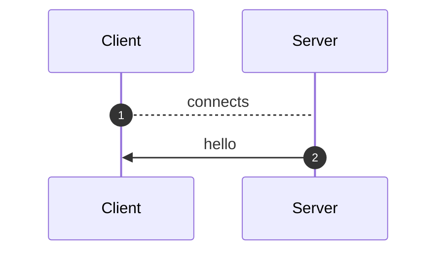
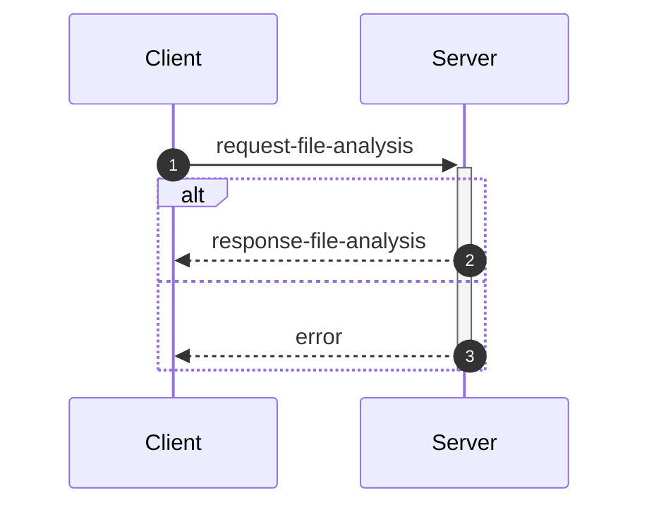
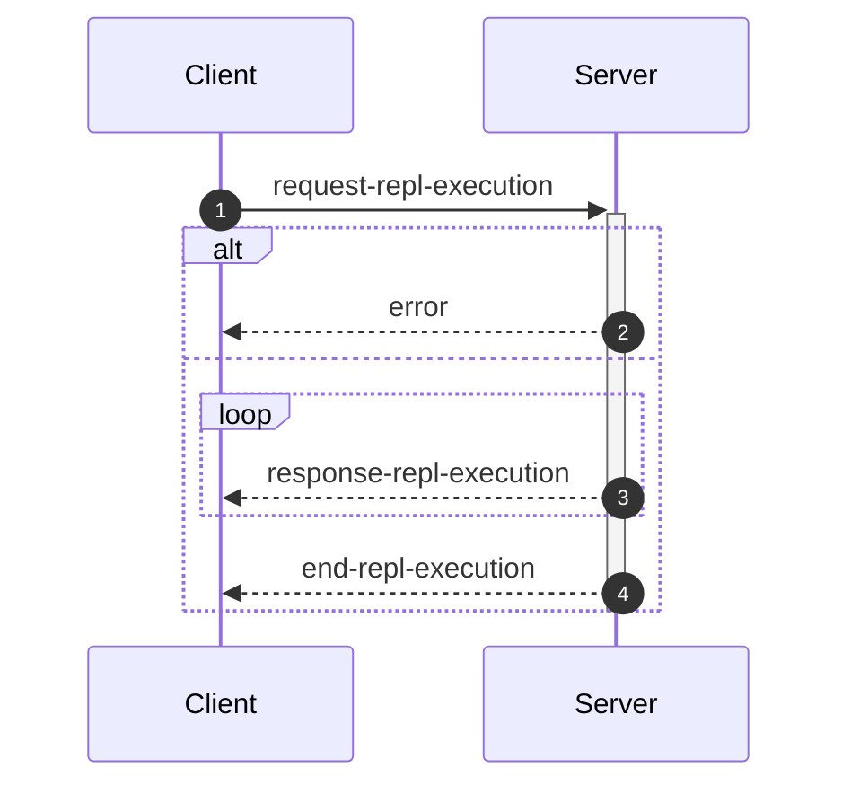
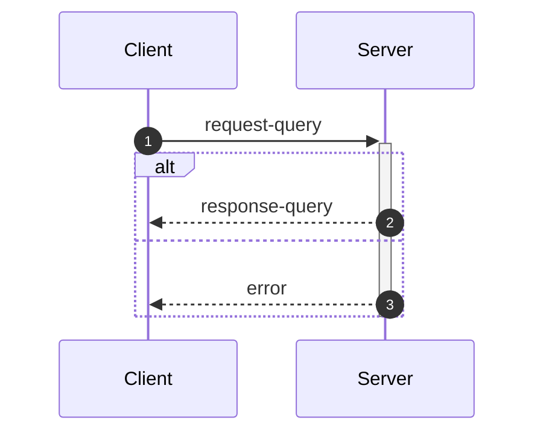

_<span title="an overview of flowR's interface">Generated</span> from '[wiki-interface.ts](https://github.com/flowr-analysis/flowr/tree/main/src/documentation/wiki-interface.ts "src/documentation/wiki-interface.ts")' on 2026-10-03, 10:21:01 UTC (v2.16.8, R v4.6.1), do not edit directly._

Although far from being as detailed as the in-depth explanation of [_flowR_](https://github.com/flowr-analysis/flowr/wiki/Core),
this wiki page explains how to interface with _flowR_ in more detail.
In general, command line arguments and other options provide short descriptions on hover over.

* [💻 Using the REPL](#using-the-repl)
* [⚙️ Configuring FlowR](#configuring-flowr)
* [⚒️ Writing Code](#writing-code)
* [💬 Communicating with the Server](#communicating-with-the-server)

<a id='using-the-repl'></a>
## 💻 Using the REPL

> [!NOTE]
> To execute arbitrary R commands with a repl request, _flowR_ has to be started explicitly with <span title="Description (Command Line Argument): Allow to access the underlying R session when using flowR (security warning: this allows the execution of arbitrary R code!)">`--r-session-access`</span>.
> Please be aware that this introduces a security risk and note that this relies on the [`r-shell` engine](https://github.com/flowr-analysis/flowr/wiki/Engines) .

Although primarily meant for users to explore,
there is nothing which forbids calling _flowR_ as a subprocess to use standard-in, -output, and -error
for communication (although you can access the REPL using the server as well,
with the [REPL Request](#message-request-repl-execution) message).

The read-eval-print loop&nbsp;(REPL) works relatively simple.
You can submit an expression (using <kbd>Enter</kbd>),
which is interpreted as an R&nbsp;expression by default but interpreted as a *command* if it starts with a colon (`:`).
The best command to get started with the REPL is <span title="Description (Repl Command): Show help information (aliases: :h, :?)">`:help`</span>.
Besides, you can leave the REPL either with the command <span title="Description (Repl Command): End the repl (aliases: :q, :exit)">`:quit`</span> or by pressing <kbd>Ctrl</kbd>+<kbd>C</kbd> twice.
When writing a *command*, you may press <kbd>Tab</kbd> to get a list of completions, if available.
Multiple commands can be entered in a single line by separating them with a semicolon (`;`), e.g. `:parse "x<-2"; :df*`.
If a command is given without R code, the REPL will re-use R code given in a previous command.
The prior example will hence return first the parsed AST of the program and then the dataflow graph for `"x <- 2"`.

> [!NOTE]
> If you develop flowR, you may want to launch the repl using the `npm run main-dev` command, this way, you get a non-minified version of flowR with debug information and hot-reloading of source files.

<details>
<summary>Available Commands</summary>

We currently offer the following commands (this with a `[*]` suffix are available with and without the star):

| Command | Description |
| ------- | ----------- |
| **<span title="Description (Repl Command): End the repl (aliases: :q, :exit)">:quit</span>** | End the repl (aliases: **:<span title="Alias of ':quit'. End the repl">q</span>**, **:<span title="Alias of ':quit'. End the repl">exit</span>**) |
| **<span title="Description (Repl Command): Execute the given code as R code. This requires the `--r-session-access` flag to be set and requires the r-shell engine. (aliases: :e, :r)">:execute</span>** | Execute the given code as R code. This requires the `--r-session-access` flag to be set and requires the r-shell engine. (aliases: **:<span title="Alias of ':execute'. Execute the given code as R code. This requires the `--r-session-access` flag to be set and requires the r-shell engine.">e</span>**, **:<span title="Alias of ':execute'. Execute the given code as R code. This requires the `--r-session-access` flag to be set and requires the r-shell engine.">r</span>**) |
| **<span title="Description (Repl Command): Get mermaid code for the control-flow graph of R code (aliases: :cfg, :cf)">:controlflow[*]</span>** | Get mermaid code for the control-flow graph of R code (star: Returns the URL to mermaid.live) (aliases: **:<span title="Alias of ':controlflow'. Get mermaid code for the control-flow graph of R code">cfg</span>**, **:<span title="Alias of ':controlflow'. Get mermaid code for the control-flow graph of R code">cf</span>**) |
| **<span title="Description (Repl Command): Get mermaid code for the control-flow graph with basic blocks (aliases: :cfgb, :cfb)">:controlflowbb[*]</span>** | Get mermaid code for the control-flow graph with basic blocks (star: Returns the URL to mermaid.live) (aliases: **:<span title="Alias of ':controlflowbb'. Get mermaid code for the control-flow graph with basic blocks">cfgb</span>**, **:<span title="Alias of ':controlflowbb'. Get mermaid code for the control-flow graph with basic blocks">cfb</span>**) |
| **<span title="Description (Repl Command): Get mermaid code for the dataflow graph (aliases: :d, :df)">:dataflow[*]</span>** | Get mermaid code for the dataflow graph (star: Returns the URL to mermaid.live) (aliases: **:<span title="Alias of ':dataflow'. Get mermaid code for the dataflow graph">d</span>**, **:<span title="Alias of ':dataflow'. Get mermaid code for the dataflow graph">df</span>**) |
| **<span title="Description (Repl Command): Get mermaid code for the normalized AST of R code (aliases: :n)">:normalize[*]</span>** | Get mermaid code for the normalized AST of R code (star: Returns the URL to mermaid.live) (alias: **:<span title="Alias of ':normalize'. Get mermaid code for the normalized AST of R code">n</span>**) |
| **<span title="Description (Repl Command): Get mermaid code for the simplified dataflow graph (aliases: :ds, :dfs)">:dataflowsimple[*]</span>** | Get mermaid code for the simplified dataflow graph (star: Returns the URL to mermaid.live) (aliases: **:<span title="Alias of ':dataflowsimple'. Get mermaid code for the simplified dataflow graph">ds</span>**, **:<span title="Alias of ':dataflowsimple'. Get mermaid code for the simplified dataflow graph">dfs</span>**) |
| **<span title="Description (Repl Command): Inspect and extend the signature database: `query` (identical to :query @signature), `info <name>` for where a function comes from (identical to :query @function-info), `add <path>` to mount another database/source, `download` to fetch the full-history database. (aliases: :sig)">:signature</span>** | Inspect and extend the signature database: `query` (identical to :query @signature), `info <name>` for where a function comes from (identical to :query @function-info), `add <path>` to mount another database/source, `download` to fetch the full-history database. (alias: **:<span title="Alias of ':signature'. Inspect and extend the signature database: `query` (identical to :query @signature), `info <name>` for where a function comes from (identical to :query @function-info), `add <path>` to mount another database/source, `download` to fetch the full-history database.">sig</span>**) |
| **<span title="Description (Repl Command): Just calculates the DFG, but only prints summary info (aliases: :d#, :df#)">:dataflowsilent</span>** | Just calculates the DFG, but only prints summary info (aliases: **:<span title="Alias of ':dataflowsilent'. Just calculates the DFG, but only prints summary info">d#</span>**, **:<span title="Alias of ':dataflowsilent'. Just calculates the DFG, but only prints summary info">df#</span>**) |
| **<span title="Description (Repl Command): Prints ASCII Art of the parsed, unmodified AST (aliases: :p)">:parse</span>** | Prints ASCII Art of the parsed, unmodified AST (alias: **:<span title="Alias of ':parse'. Prints ASCII Art of the parsed, unmodified AST">p</span>**) |
| **<span title="Description (Repl Command): Prints the version of flowR as well as the current version of R">:version</span>** | Prints the version of flowR as well as the current version of R
| **<span title="Description (Repl Command): Query the given R code (use 'help' for more information)">:query[*]</span>** | Query the given R code (use 'help' for more information) (star: Similar to query, but returns the output in json format.)
| **<span title="Description (Repl Command): Returns an ASCII representation of the dataflow graph (aliases: :df!)">:dataflowascii</span>** | Returns an ASCII representation of the dataflow graph (alias: **:<span title="Alias of ':dataflowascii'. Returns an ASCII representation of the dataflow graph">df!</span>**) |
| **<span title="Description (Repl Command): Returns summarization stats for the normalized AST (aliases: :n#)">:normalize#</span>** | Returns summarization stats for the normalized AST (alias: **:<span title="Alias of ':normalize#'. Returns summarization stats for the normalized AST">n#</span>**) |
| **<span title="Description (Repl Command): Show help information (aliases: :h, :?)">:help</span>** | Show help information (aliases: **:<span title="Alias of ':help'. Show help information">h</span>**, **:<span title="Alias of ':help'. Show help information">?</span>**) |

</details>

> [!TIP]
> 
> As indicated by the examples before, all REPL commands that operate on code keep track of the state.
> Hence, if you run a command like <span title="Description (Repl Command, starred version): Returns the URL to mermaid.live; Base Command: Get mermaid code for the dataflow graph (aliases: :d*, :df*)">`:dataflow*`</span> without providing R code,
> the REPL will re-use the R code provided in a previous command.
> Likewise, doing this will benefit from incrementality!
> If you request the dataflow graph with `:df* x <- 2 * y` and then want to see the parsed AST with `:parse`,
> the REPL will re-use previously obtained information and not re-parse the code again.
> 		

Generally, many commands offer shortcut versions in the REPL. Many queries, for example, offer a shortened format (see the example below).
Of special note, the [Config Query](https://github.com/flowr-analysis/flowr/wiki/%5BQuery%5D-Config)
can be used to also modify the currently active configuration of _flowR_ within the REPL (see the [wiki page](https://github.com/flowr-analysis/flowr/wiki/%5BQuery%5D-Config) for more information).

### Example: Retrieving the Dataflow Graph

To retrieve a URL to the [mermaid](https://mermaid.js.org/) diagram of the dataflow of a given expression,
use <span title="Description (Repl Command, starred version): Returns the URL to mermaid.live; Base Command: Get mermaid code for the dataflow graph (aliases: :d*, :df*)">`:dataflow*`</span> (or <span title="Description (Repl Command): Get mermaid code for the dataflow graph (aliases: :d, :df)">`:dataflow`</span> to get the mermaid code in the cli):

```shell
$ docker run -it --rm eagleoutice/flowr # or npm run flowr 
flowR repl v2.16.8, R grammar v14 (tree-sitter engine)
R> :dataflow* y <- 1 + x
```

<details>
<summary style='color:gray'>Output</summary>

```text
https://mermaid.live/view#base64:eyJjb2RlIjoiZmxvd2NoYXJ0IFREXG4gICAgMXt7XCJgKiM5MTtSTnVtYmVyIzkzOyogKioxKipcbiAgICAgICoxLjYqICgqKmlkOiAxKiopYFwifX1cbiAgICAyKFtcImAqIzkxO1JTeW1ib2wjOTM7KiAqKngqKlxuICAgICAgKjEuMTAqICgqKmlkOiAyKiopYFwiXSlcbiAgICAzW1tcImAqIzkxO1JCaW5hcnlPcCM5MzsqIGJhc2UjNTg7IzU4OyoqIzQzOyoqXG4gICAgICAqMS42LTEwKiAoKippZDogMyoqKVxuICAgIGFyZzogKDEsIDIpYFwiXV1cbiAgICBidWlsdC1pbjpfNDNfW1wiYEJ1aWx0LUluOlxuIzQzO2BcIl1cbiAgICBzdHlsZSBidWlsdC1pbjpfNDNfIHN0cm9rZTpncmF5LGZpbGw6Z3JheSxzdHJva2Utd2lkdGg6MnB4LG9wYWNpdHk6Ljg7XG4gICAgMFtcImAqIzkxO1JTeW1ib2wjOTM7KiAqKnkqKlxuICAgICAgKjEuMSogKCoqaWQ6IDAqKiwgdjogMylgXCJdXG4gICAgNFtbXCJgKiM5MTtSQmluYXJ5T3AjOTM7KiBiYXNlIzU4OyM1ODsqKiM2MDsjNDU7KipcbiAgICAgICoxLjEtMTAqICgqKmlkOiA0KiopXG4gICAgYXJnOiAoMCwgMylgXCJdXVxuICAgIGJ1aWx0LWluOl82MF8tW1wiYEJ1aWx0LUluOlxuIzYwOyM0NTtgXCJdXG4gICAgc3R5bGUgYnVpbHQtaW46XzYwXy0gc3Ryb2tlOmdyYXksZmlsbDpncmF5LHN0cm9rZS13aWR0aDoycHgsb3BhY2l0eTouODtcbiAgICAxIC0uLT58XCJmbG93XCJ8IDJcbiAgICBsaW5rU3R5bGUgMCBzdHJva2U6Z3JheSxjb2xvcjpncmF5O1xuICAgIDIgLS4tPnxcImZsb3dcInwgM1xuICAgIGxpbmtTdHlsZSAxIHN0cm9rZTpncmF5LGNvbG9yOmdyYXk7XG4gICAgMyAtLT58XCJyZWFkcywgYXJnXCJ8IDFcbiAgICAzIC0tPnxcInJlYWRzLCBhcmdcInwgMlxuICAgIDMgLS4tPnxcImZsb3dcInwgMFxuICAgIGxpbmtTdHlsZSA0IHN0cm9rZTpncmF5LGNvbG9yOmdyYXk7XG4gICAgMyAtLi0+fFwicmVhZHMsIGNhbGxzXCJ8IGJ1aWx0LWluOl80M19cbiAgICBsaW5rU3R5bGUgNSBzdHJva2U6Z3JheTtcbiAgICAwIC0tPnxcImRlZmluZWQtYnksIGZsb3dcInwgNFxuICAgIDAgLS0+fFwiZGVmaW5lZC1ieVwifCAzXG4gICAgNCAtLT58XCJyZWFkcywgYXJnXCJ8IDNcbiAgICA0IC0tPnxcInJldHVybnMsIGFyZ1wifCAwXG4gICAgNCAtLi0+fFwicmVhZHMsIGNhbGxzXCJ8IGJ1aWx0LWluOl82MF8tXG4gICAgbGlua1N0eWxlIDEwIHN0cm9rZTpncmF5OyIsIm1lcm1haWQiOnsiYXV0b1N5bmMiOnRydWV9fQ==
```

Retrieve the dataflow graph of the expression `y <- 1 + x`. It looks like this:


<details>

<summary style="color:gray">R Code of the Dataflow Graph</summary>

The analysis ran (parse and normalize with the [tree-sitter](https://github.com/flowr-analysis/flowr/wiki/Engines) engine) in the generation environment. No [signature database](https://github.com/flowr-analysis/flowr/wiki/Signature-Database) is mounted, so `library()` attaches no exports (base-R names are still qualified, e.g., `stats::acf`). 
We encountered no unknown side effects during the analysis.

```r
y <- 1 + x
```

</details>

</details>

For small graphs like this, <span title="Description (Repl Command): Returns an ASCII representation of the dataflow graph (aliases: :df!)">`:dataflowascii`</span> also provides an ASCII representation directly in the REPL:

```shell
$ docker run -it --rm eagleoutice/flowr # or npm run flowr 
flowR repl v2.16.8, R grammar v14 (tree-sitter engine)
R> :df! y <- 1 + x
```

<details open>
<summary style='color:gray'>Output</summary>

```text
                        v<0>v
 c<4>c──────────────────| y |
 |<- |     ┌────────────v---v
 c---c     │
    │   c<3>c   0<1>0
    └───| + |───| 1 |───u<2>u
        c---c   0---0   | x |
           └────────────u---u
Edges:
3 -> 1: reads, arg          3 -> 2: reads, arg
3 -> 0: flows-to            1 -> 2: flows-to
2 -> 3: flows-to            4 -> 3: reads, arg
4 -> 0: returns, arg        0 -> 4: defined-by, flows-to
0 -> 3: defined-by
```

Retrieve the dataflow graph of the expression `y <- 1 + x` as ASCII art.

</details>

For the slicing with <span title="Description (Repl Command): Static backwards executable slicer for R">`:slicer`</span>, you have access to the same [magic comments](#slice-magic-comments) as with the [slice request](#message-request-slice).
Pass `--inline` to splice resolvable `source()` calls into the reconstruction so the slice is a single self-contained R text (the same as the static slice query's `inlineSources` flag).
See `--help` for more flags!

### Example: Interfacing with the File System

Many commands that allow for an R-expression (like <span title="Description (Repl Command, starred version): Returns the URL to mermaid.live; Base Command: Get mermaid code for the dataflow graph (aliases: :d*, :df*)">`:dataflow*`</span>) allow for a file as well
if the argument starts with `file://`.
If you are working from the root directory of the _flowR_ repository, the following gives you the parsed AST of the example file using the <span title="Description (Repl Command): Prints ASCII Art of the parsed, unmodified AST (aliases: :p)">`:parse`</span> command:

> **Watch mode**: Replace `file://` with `watch://` to enter watch mode.
> flowR runs the command immediately and then re-runs it every time the file (or any file inside the folder) changes.
> Enter any other command to leave watch mode.
> For example: `:df watch://analysis.R`

```shell
$ docker run -it --rm eagleoutice/flowr # or npm run flowr 
flowR repl v2.16.8, R grammar v14 (tree-sitter engine)
R> :parse file://test/testfiles/example.R
```

<details>
<summary style='color:gray'>Output</summary>

```text
File: test/testfiles/example.R

program
├ binaryoperator
│ ├ identifier "sum" (1:1─4)
│ ├ <- "<-" (1:5─7)
│ ╰ float "0" (1:8─9)
├ binaryoperator
│ ├ identifier "product" (2:1─8)
│ ├ <- "<-" (2:9─11)
│ ╰ float "1" (2:12─13)
├ binaryoperator
│ ├ identifier "w" (3:1─2)
│ ├ <- "<-" (3:3─5)
│ ╰ float "7" (3:6─7)
├ binaryoperator
│ ├ identifier "N" (4:1─2)
│ ├ <- "<-" (4:3─5)
│ ╰ float "10" (4:6─8)
├ forstatement
│ ├ for "for" (6:1─4)
│ ├ ( "(" (6:5─6)
│ ├ identifier "i" (6:6─7)
│ ├ in "in" (6:8─10)
│ ├ binaryoperator
│ │ ├ float "1" (6:11─12)
│ │ ├ : ":" (6:12─13)
│ │ ╰ parenthesizedexpression
│ │   ├ ( "(" (6:13─14)
│ │   ├ binaryoperator
│ │   │ ├ identifier "N" (6:14─15)
│ │   │ ├ - "-" (6:15─16)
│ │   │ ╰ float "1" (6:16─17)
│ │   ╰ ) ")" (6:17─18)
│ ├ ) ")" (6:18─19)
│ ╰ bracedexpression
│   ├ { "{" (6:20─21)
│   ├ binaryoperator
│   │ ├ identifier "sum" (7:3─6)
│   │ ├ <- "<-" (7:7─9)
│   │ ╰ binaryoperator
│   │   ├ binaryoperator
│   │   │ ├ identifier "sum" (7:10─13)
│   │   │ ├ + "+" (7:14─15)
│   │   │ ╰ identifier "i" (7:16─17)
│   │   ├ + "+" (7:18─19)
│   │   ╰ identifier "w" (7:20─21)
│   ├ binaryoperator
│   │ ├ identifier "product" (8:3─10)
│   │ ├ <- "<-" (8:11─13)
│   │ ╰ binaryoperator
│   │   ├ identifier "product" (8:14─21)
│   │   ├  "" (8:22─23)
│   │   ╰ identifier "i" (8:24─25)
│   ╰ } "}" (9:1─2)
├ call
│ ├ identifier "cat" (11:1─4)
│ ╰ arguments
│   ├ ( "(" (11:4─5)
│   ├ argument
│   │ ╰ string
│   │   ├ stringopen "\"" (11:5─6)
│   │   ├ stringcontent "Sum:" (11:6─10)
│   │   ╰ stringclose "\"" (11:10─11)
│   ├ comma "," (11:11─12)
│   ├ argument
│   │ ╰ identifier "sum" (11:13─16)
│   ├ comma "," (11:16─17)
│   ├ argument
│   │ ╰ string
│   │   ├ stringopen "\"" (11:18─19)
│   │   ├ stringcontent
│   │   │ ╰ escapesequence "\\n" (11:19─21)
│   │   ╰ stringclose "\"" (11:21─22)
│   ╰ ) ")" (11:22─23)
╰ call
  ├ identifier "cat" (12:1─4)
  ╰ arguments
    ├ ( "(" (12:4─5)
    ├ argument
    │ ╰ string
    │   ├ stringopen "\"" (12:5─6)
    │   ├ stringcontent "Product:" (12:6─14)
    │   ╰ stringclose "\"" (12:14─15)
    ├ comma "," (12:15─16)
    ├ argument
    │ ╰ identifier "product" (12:17─24)
    ├ comma "," (12:24─25)
    ├ argument
    │ ╰ string
    │   ├ stringopen "\"" (12:26─27)
    │   ├ stringcontent
    │   │ ╰ escapesequence "\\n" (12:27─29)
    │   ╰ stringclose "\"" (12:29─30)
    ╰ ) ")" (12:30─31)
```

Retrieve the parsed AST of the example file.

<details>

<summary>File Content</summary>

```r
sum <- 0
product <- 1
w <- 7
N <- 10

for (i in 1:(N-1)) {
  sum <- sum + i + w
  product <- product * i
}

cat("Sum:", sum, "\n")
cat("Product:", product, "\n")
```

</details>

As _flowR_ directly transforms this AST the output focuses on being human-readable instead of being machine-readable.
		
</details>

### Example: Run a Query

You can run any query supported by _flowR_ using the <span title="Description (Repl Command): Query the given R code (use 'help' for more information)">`:query`</span> command.
For example, to obtain the shapes of all data frames in a given piece of code, you can run:

```shell
$ docker run -it --rm eagleoutice/flowr # or npm run flowr 
flowR repl v2.16.8, R grammar v14 (tree-sitter engine)
R> :query @absint df-shape "x <- data.frame(a = 1:10, b = 1:10)\ny <- x$a"
```

<details open>
<summary style='color:gray'>Output</summary>

```text
Query: absint (3 ms)
   ╰ $12: (colnames: [{"a", "b"}, {}], cols: [2, 2], rows: [10, 10])
   ╰ $0: (colnames: [{"a", "b"}, {}], cols: [2, 2], rows: [10, 10])
```

Retrieve the shapes of all data frames in the given code.

</details>

To run the linter on a file, you can use (in this example, we just issue the `dead-code` linter on a small piece of code):

```shell
$ docker run -it --rm eagleoutice/flowr # or npm run flowr 
flowR repl v2.16.8, R grammar v14 (tree-sitter engine)
R> :query @linter rules:dead-code "if(FALSE) x <- 2"
```

<details open>
<summary style='color:gray'>Output</summary>

```text
Query: linter (3 ms)
   ╰ Dead Code (dead-code):
       ╰ certain:
           ╰ Code at 1.11-16 (1 quick fix(es) available)
```

Run the linter on the given code, with only the `dead-code` rule enabled.

</details>

For more information on the available queries, please check out the [Query API](https://github.com/flowr-analysis/flowr/wiki/Query-API).

<a id='configuring-flowr'></a>
## ⚙️ Configuring FlowR

When running _flowR_, you may want to specify some behaviors with a dedicated configuration file.
By default, flowR looks for a file named `flowr.json` in the current working directory (or any higher directory).
You can also specify a different file with <span title="Description (Command Line Argument): The name of the configuration file to use">`--config-file`</span> or pass the configuration inline using <span title="Description (Command Line Argument): The flowR configuration to use, as a JSON string">`--config-json`</span>.
A `flowr.json` found this way belongs to the analyzed project, so flowR ignores its options that decide what flowR executes or loads
(`engines.*.wasmPath`, `engines.*.treeSitterWasmPath`, `engines.*.rPath`, `solver.sigdb.additionalPaths`, `solver.sigdb.downloadRepo`, `solver.sigdb.installedLibrary.paths`),
unless you pass <span title="Description (Command Line Argument): Keep the security-sensitive options (e.g., the R executable) of the flowr.json found in the working directory or a parent. Only use this for projects you trust.">`--trust-config`</span>.
To analyze code you do not trust, use the secure mode (<span title="Description (Command Line Argument): Run in secure mode for analyzing untrusted code: flowR does not start R (or any other process), does not access the network, does not search for project configs, and ignores security-sensitive options in every config. Cannot be disabled once enabled. Can also be enabled with the environment variable {italic FLOWR_SECURE_MODE=1}.">`--secure`</span>, see the [security policy](https://github.com/flowr-analysis/flowr/blob/main/.github/SECURITY.md)).
To inspect the current configuration, you can run flowr with the <span title="Description (Command Line Argument): Run with verbose logging (will be passed to the corresponding script)">`--verbose`</span> flag, or use the `config` [Query](https://github.com/flowr-analysis/flowr/wiki/Query-API).
Within the REPL this works by running the following:

```shell
:query @config
```

To work with the <a href="https://github.com/flowr-analysis/flowr/tree/main/src/config.ts#L119"><code><span title="The configuration file format for flowR.">FlowrConfig</span></code></a> you can use the provided helper objects alongside its methods like
<a href="https://github.com/flowr-analysis/flowr/tree/main/src/config.ts#L914"><code><span title="Creates a new flowr config that has the updated values.">FlowrConfig::<b>amend</b></span></code></a>.
The schema below documents every option; the ones you most likely want are:

- <a href="https://github.com/flowr-analysis/flowr/wiki/Interface#configuring-flowr" title="Configuration Option (boolean): Whether source calls should be ignored, causing {@link processSourceCall}&#39;s behavior to be skipped.">ignoreSourceCalls</a>: ignore source calls when analyzing the code, i.e., ignore the inclusion of other files.
- <a href="https://github.com/flowr-analysis/flowr/wiki/Interface#configuring-flowr" title="Configuration Option (boolean): Whether load calls should be ignored, causing {@link processLoadCall}&#39;s behavior to be skipped.">ignoreLoadCalls</a>: ignore load calls when analyzing the code, i.e., ignore the loading of r-data files.
- <a href="https://github.com/flowr-analysis/flowr/wiki/Interface#configuring-flowr" title="Configuration Option (object): Do you want to overwrite (parts) of the builtin definition?">semantics.environment.overwriteBuiltIns</a>: overwrite _flowR_'s handling of built-in functions, or clear the preset definitions entirely.
  See [Configure BuiltIn Semantics](#configure-builtin-semantics) for more information.
- <a href="https://github.com/flowr-analysis/flowr/wiki/Interface#configuring-flowr" title="Configuration Option (string): How to resolve variables and their values. (one of &quot;disabled&quot;, &quot;alias&quot;, &quot;builtin&quot;)">solver.variables</a>: how to resolve variables and their values (`disabled`, `alias`, `builtin`).
- <a href="https://github.com/flowr-analysis/flowr/wiki/Interface#configuring-flowr" title="Configuration Option (array): The engine or set of engines to use for interacting with R code. An empty array means all available engines will be used.">engines</a> and <a href="https://github.com/flowr-analysis/flowr/wiki/Interface#configuring-flowr" title="Configuration Option (string): The default engine to use for interacting with R code. If this is undefined, an arbitrary engine from the specified list will be used. (one of &quot;tree-sitter&quot;, &quot;r-shell&quot;)">defaultEngine</a>: the engines used to interact with R code, see the [Engines wiki page](https://github.com/flowr-analysis/flowr/wiki/Engines).
- <a href="https://github.com/flowr-analysis/flowr/wiki/Interface#configuring-flowr" title="Configuration Option (array): Files a framework loads on its own, without any source() call (e.g. global.R in a shiny app), in the order they are loaded; flowR orders the matching project files accordingly and analyzes them as one program. Entries are case-insensitive globs matched against the file path, a plain name matches any file with that name, and entries matching no project file are warned about. Usually set per project kind via specializeConfig.">project.implicitSources</a>: the files a framework loads without any `source()` call, in the order in which they are
  loaded. Entries are globs (e.g. `R/*.R`) matched against the file path ignoring capitalization; one matching no file is reported.
- <a href="https://github.com/flowr-analysis/flowr/wiki/Interface#configuring-flowr" title="Configuration Option (object): Overwrite (parts of) the configuration depending on the project kind flowR detects, e.g. to give a shiny app its implicit sources.">specializeConfig</a>: overwrite (parts of) the configuration depending on the kind of project _flowR_ detects
  (e.g. `shiny-app`), which is how a shiny app gets its implicit sources by default. What you configure directly wins.
- <a href="https://github.com/flowr-analysis/flowr/wiki/Interface#configuring-flowr" title="Configuration Option (string): Overwrite the project kind flowR would otherwise infer from the analyzed files, e.g. when auto-detection guesses wrong. (one of &quot;package&quot;, &quot;script&quot;, &quot;shiny-app&quot;, &quot;notebook&quot;, &quot;project&quot;, &quot;unknown&quot;)">project.useProjectType</a>: skip that detection and force a project kind yourself, when auto-detection guesses wrong.
- <a href="https://github.com/flowr-analysis/flowr/wiki/Interface#configuring-flowr" title="Configuration Option (array): The default plugins to load when creating a new instance of FlowrAnalyzer">defaultPlugins</a> and <a href="https://github.com/flowr-analysis/flowr/wiki/Interface#configuring-flowr" title="Configuration Option (array): The plugins to load in REPL mode">repl.plugins</a>: the plugins to load for a new <a href="https://github.com/flowr-analysis/flowr/tree/main/src/project/flowr-analyzer.ts#L210"><code><span title="Central class for conducting analyses with FlowR. Use the FlowrAnalyzerBuilder to create a new instance. If you want the original pattern of creating a pipeline and running all steps, you can still do this with FlowrAnalyzer#runFull . To inspect the context of the analyzer, use FlowrAnalyzer#inspectContext (if you are a plugin and need to modify it, use FlowrAnalyzer#context instead).">FlowrAnalyzer</span></code></a> and in the REPL
  (use `flowr:default` to reference the former).

So you can configure _flowR_ by adding a file like the following:

<details>

<summary>Example Configuration File</summary>

```json
{
  "ignoreSourceCalls": true,
  "ignoreLoadCalls": true,
  "semantics": {
    "environment": {
      "overwriteBuiltIns": {
        "definitions": [
          {
            "type": "function",
            "names": [
              "foo"
            ],
            "processor": "builtin:assign",
            "config": {}
          }
        ]
      }
    }
  },
  "defaultPlugins": [
    "file:description",
    "versions:description"
  ],
  "repl": {
    "quickStats": false,
    "dfProcessorHeat": false,
    "hints": true,
    "plugins": [
      "flowr:default"
    ]
  },
  "project": {
    "resolveUnknownPathsOnDisk": true,
    "implicitSources": [
      "global.R",
      "app.R"
    ]
  },
  "linter": {
    "disabledRules": []
  },
  "specializeConfig": {
    "shiny-app": {
      "project": {
        "implicitSources": [
          "global.R",
          "ui.R",
          "server.R",
          "app.R"
        ]
      }
    }
  },
  "engines": [
    {
      "type": "r-shell"
    }
  ],
  "solver": {
    "variables": "alias",
    "evalStrings": true,
    "trackEnvironments": true,
    "sigdb": {
      "enabled": true,
      "loadProjectDependencies": true,
      "eagerlyLoad": false,
      "eagerlyLoadExports": false,
      "linkBaseR": false,
      "linkDescriptionDependencies": false
    },
    "resolveSource": {
      "dropPaths": "no",
      "ignoreCapitalization": true,
      "inferWorkingDirectory": "active-script",
      "searchPath": []
    },
    "instrument": {},
    "slicer": {
      "threshold": 50
    }
  },
  "abstractInterpretation": {
    "wideningThreshold": 4,
    "followCalls": true,
    "dataFrame": {
      "maxColNames": 20,
      "readLoadedData": {
        "readExternalFiles": true,
        "maxReadLines": 1000000
      }
    }
  },
  "incremental": {
    "alwaysIncremental": false,
    "parsing": {
      "activated": false,
      "heuristics": {
        "activated": true,
        "mtime": true,
        "linesFrom": 500,
        "bytesFrom": 50000,
        "alwaysWithEdits": false,
        "minFiles": 1
      }
    }
  },
  "gas": {
    "thresholds": {
      "memory": {
        "problematic": 0.7,
        "critical": 0.9
      },
      "timeMs": {
        "problematic": 100000,
        "critical": 120000
      }
    },
    "features": {}
  }
}
```

</details>

<details>
<a id='configure-builtin-semantics'></a>
<summary>Configure Built-In Semantics</summary>

`semantics/environment/overwriteBuiltins` accepts two keys:

- `loadDefaults` (boolean, initially `true`): If set to `true`, the default built-in definitions are loaded before applying the custom definitions. Setting this flag to `false` explicitly disables the loading of the default definitions.
- `definitions` (array, initially empty): Allows to overwrite or define new built-in elements. Each object within must have a `type` which is one of the below. Furthermore, they may define a string array of `names` which specifies the identifiers to bind the definitions to. You may use `assumePrimitive` to specify whether _flowR_ should assume that this is a primitive non-library definition (so you probably just do not want to specify the key).

  | Type            | Description                                                                                                                                                                                                                                                                                              | Example                                                                                                    |
  | --------------- | -------------------------------------------------------------------------------------------------------------------------------------------------------------------------------------------------------------------------------------------------------------------------------------------------------- | ---------------------------------------------------------------------------------------------------------- |
  | `constant`    | Additionally allows for a `value` this should resolve to.                                                                                                                                                                                                                                                | `{ type: 'constant', names: ['NULL', 'NA'],  value: null }`                                                |
  | `function`    | Is a rather flexible way to define and bind built-in functions. For the time, we do not have extensive documentation to cover all the cases, so please either consult the sources with the `default-builtin-config.ts` or open a [new issue](https://github.com/flowr-analysis/flowr/issues/new/choose). | `{ type: 'function', names: ['next'], processor: 'builtin:d', config: { cfg: ExitPointType.Next } }` |
  | `replacement` | A comfortable way to specify replacement functions like `$<-` or `names<-`. `suffixes` describes the... suffixes to attach automatically. | `{ type: 'replacement', suffixes: ['<-', '<<-'], names: ['[', '[['] }` |

</details>

<details>

<summary style='color:gray'>Full Configuration-File Schema</summary>

- _The configuration file format for flowR._ (object)
    - **logLevel** [optional] _flowR's global minimum log level, applied when the config is loaded._ (string)
        Only allows: 'silly', 'trace', 'debug', 'info', 'warn', 'error', 'fatal'
    - **ignoreSourceCalls** [optional] _Whether source calls should be ignored, causing {@link processSourceCall}'s behavior to be skipped._ (boolean)
    - **ignoreLoadCalls** [optional] _Whether load calls should be ignored, causing {@link processLoadCall}'s behavior to be skipped._ (boolean)
    - **semantics** _Configure language semantics and how flowR handles them._ (object)
        - **environment** [optional] _Semantics regarding how to handle the R environment._ (object)
            - **overwriteBuiltIns** [optional] _Do you want to overwrite (parts) of the builtin definition?_ (object)
                - **loadDefaults** [optional] _Should the default configuration still be loaded?_ (boolean)
                - **definitions** [optional] _The definitions to load/overwrite._ (array)
                Valid item types:
                    - (object)
    - **defaultPlugins** [optional] _The default plugins to load when creating a new instance of FlowrAnalyzer_ (array)
    Valid item types:
        - (alternatives)
            - (string)
            - (array)
    - **repl** _Configuration options for the REPL._ (object)
        - **quickStats** [optional] _Whether to show quick stats in the REPL after each evaluation._ (boolean)
        - **dfProcessorHeat** [optional] _This instruments the dataflow processors to count how often each processor is called._ (boolean)
        - **hints** [optional] _Whether to show dim inline hints on the empty prompt (automatically disabled on non-interactive terminals)._ (boolean)
        - **plugins** [optional] _The plugins to load in REPL mode_ (array)
        Valid item types:
            - (alternatives)
                - (string)
                - (array)
        - **autoUseFileProtocol** [optional] _Prepend the file protocol to a repl input that looks like a path, instead of only warning about it._ (boolean)
        - **queryStats** [optional] _Whether `:query` closes with the line stating how long the queries took (`:query*` never prints it)._ (boolean)
        - **showPlugins** [optional] _Whether `:version` grays out the plugins that did not activate during the last analysis._ (boolean)
    - **project** _Project specific configuration options._ (object)
        - **resolveUnknownPathsOnDisk** [optional] _Whether to resolve unknown paths loaded by the r project disk when trying to source/analyze files._ (boolean)
        - **failOnInaccessiblePath** [optional] _Whether a directory that cannot be traversed during file discovery (e.g. due to permissions) aborts the analysis; when false (the default) such paths are logged and skipped._ (boolean)
        - **basePackages** [optional] _The packages considered part of R itself (base and recommended); if unset, flowR uses its built-in list._ (array)
        Valid item types:
            - (string)
        - **implicitSources** [optional] _Files a framework loads on its own, without any source() call (e.g. global.R in a shiny app), in the order they are loaded; flowR orders the matching project files accordingly and analyzes them as one program. Entries are case-insensitive globs matched against the file path, a plain name matches any file with that name, and entries matching no project file are warned about. Usually set per project kind via specializeConfig._ (array)
        Valid item types:
            - (string)
        - **useProjectType** [optional] _Overwrite the project kind flowR would otherwise infer from the analyzed files, e.g. when auto-detection guesses wrong._ (string)
            Only allows: 'package', 'script', 'shiny-app', 'notebook', 'project', 'unknown'
        - **assumeImplicitEcho** [optional] _Whether the top level of the analyzed code is echoed, so that every visible result printed there is collected as an output by the dependencies query (default true, false for a package)._ (boolean)
        - **discovery** [optional] _Scoping options for the default project discovery._ (object)
            - **full** [optional] _Collect every file below the project root (greedy) instead of only the files the detected project kind needs (default false)._ (boolean)
            - **perKind** [optional] _Per-kind include/exclude glob overrides layered on the default scoping._ (object)
            - **ignore** [optional] _Case-insensitive globs that drop matching files from the intelligent discovery, regardless of kind (e.g. .Renviron to ignore environment files)._ (array)
            Valid item types:
                - (string)
        - **classification** [optional] _Overrides for the signals flowR uses to classify the project kind._ (object)
            - **shinyDescriptionTypes** [optional] _DESCRIPTION Type: values that mark a shiny app._ (array)
            Valid item types:
                - (string)
            - **shinyEntryFiles** [optional] _File names a shiny app is assembled from._ (array)
            Valid item types:
                - (string)
            - **shinyUsagePattern** [optional] _Regex source evidencing shiny usage in an entry file._ (string)
            - **notebookExtensions** [optional] _File extensions marking a notebook._ (array)
            Valid item types:
                - (string)
    - **linter** _Linter configuration options._ (object)
        - **disabledRules** _Linting rule names excluded from the default rule set (a rule requested explicitly via a linter query still runs). Usually set per project kind via specializeConfig._ (array)
        Valid item types:
            - (string)
        - **disabledTags** [optional] _Linting rule tags whose rules are excluded from the default rule set (a rule requested explicitly via a linter query still runs). By default the cmd-check rules are disabled for everything but a package; a configured list replaces that default._ (array)
        Valid item types:
            - (string)
    - **inputSources** [optional] _Further frameworks the input-sources analysis should know about; entries are added to flowR's defaults._ (object)
        - **pure** [optional] _Functions that only pass the constantness of their arguments on._ (array)
        Valid item types:
            - (string)
        - **param** [optional] _Functions whose result is a 'param' input._ (array)
        Valid item types:
            - (string)
        - **file** [optional] _Functions whose result is a 'file' input._ (array)
        Valid item types:
            - (string)
        - **tempfile** [optional] _Functions whose result is a 'tempfile' input._ (array)
        Valid item types:
            - (string)
        - **glob** [optional] _Functions whose result is a 'glob' input._ (array)
        Valid item types:
            - (string)
        - **net** [optional] _Functions whose result is a 'net' input._ (array)
        Valid item types:
            - (string)
        - **rand** [optional] _Functions whose result is a 'rand' input._ (array)
        Valid item types:
            - (string)
        - **system** [optional] _Functions whose result is a 'system' input._ (array)
        Valid item types:
            - (string)
        - **ffi** [optional] _Functions whose result is a 'ffi' input._ (array)
        Valid item types:
            - (string)
        - **lang** [optional] _Functions whose result is a 'lang' input._ (array)
        Valid item types:
            - (string)
        - **options** [optional] _Functions whose result is a 'options' input._ (array)
        Valid item types:
            - (string)
        - **cmdline** [optional] _Functions whose result is a 'cmdline' input._ (array)
        Valid item types:
            - (string)
        - **user** [optional] _Functions whose result is a 'user' input._ (array)
        Valid item types:
            - (string)
        - **const** [optional] _Functions whose result is a 'const' input._ (array)
        Valid item types:
            - (string)
        - **scope** [optional] _Functions whose result is a 'scope' input._ (array)
        Valid item types:
            - (string)
        - **dconst** [optional] _Functions whose result is a 'dconst' input._ (array)
        Valid item types:
            - (string)
        - **unknown** [optional] _Functions whose result is a 'unknown' input._ (array)
        Valid item types:
            - (string)
        - **linkedObjects** [optional] _Objects a framework provides without a definition in the code, e.g. shiny's input._ (array)
        Valid item types:
            - (object)
        - **linkedEntryPoints** [optional] _Calls that hand a function to a framework, which binds its objects to the parameters by position._ (array)
        Valid item types:
            - (object)
    - **specializeConfig** [optional] _Overwrite (parts of) the configuration depending on the project kind flowR detects, e.g. to give a shiny app its implicit sources._ (object)
    - **engines** _The engine or set of engines to use for interacting with R code. An empty array means all available engines will be used._ (array)
    Valid item types:
        - (alternatives)
            - _The configuration for the tree sitter engine._ (object)
                - **type** [required] _Use the tree sitter engine._ (string)
                    Only allows: 'tree-sitter'
                - **wasmPath** [optional] _The path to the tree-sitter-r WASM binary to use. If this is undefined, this uses the default path._ (string)
                - **treeSitterWasmPath** [optional] _The path to the tree-sitter WASM binary to use. If this is undefined, this uses the default path._ (string)
                - **lax** [optional] _Whether to use the lax parser for parsing R code (allowing for syntax errors). If this is undefined, the strict parser will be used._ (boolean)
            - _The configuration for the R shell engine._ (object)
                - **type** [required] _Use the R shell engine._ (string)
                    Only allows: 'r-shell'
                - **rPath** [optional] _The path to the R executable to use. If this is undefined, this uses the default path._ (string)
                - **pipeBind** [optional] _Whether to enable R's experimental pipe-bind operator "=>" by setting _R_USE_PIPEBIND_ for the R session (default false); R itself keeps this off by default, as it is experimental and has never shipped in a release version of R._ (boolean)
    - **defaultEngine** [optional] _The default engine to use for interacting with R code. If this is undefined, an arbitrary engine from the specified list will be used._ (string)
        Only allows: 'tree-sitter', 'r-shell'
    - **solver** _How to resolve constants, constraints, cells, ..._ (object)
        - **variables** _How to resolve variables and their values._ (string)
            Only allows: 'disabled', 'alias', 'builtin'
        - **evalStrings** _Should we include eval(parse(text="...")) calls in the dataflow graph?_ (boolean)
        - **trackEnvironments** [optional] _Track user-created environments (new.env, assign/get/local with envir=, dollar-assign, attach). When false, all envir-style calls fall through conservatively._ (boolean)
        - **sigdb** _Resolving library exports from a signature database._ (object)
            - **enabled** [optional] _Resolve library()/use() exports from a signature database (default true); when false no database is consulted._ (boolean)
            - **loadProjectDependencies** [optional] _Load the project's declared dependencies from its metadata files (DESCRIPTION Imports/Depends, rproject.toml, uvr.toml, renv.lock, rv.lock, uvr.lock) (default true); when false these files are not read for dependencies._ (boolean)
            - **eagerlyLoad** [optional] _Parse the database up front rather than on the first package load (default false, ignored if disabled)._ (boolean)
            - **eagerlyLoadExports** [optional] _Add a vertex for every export on load rather than on demand (default false); keeps the dataflow graph small._ (boolean)
            - **assumedRVersion** [optional] _R version assumed when resolving versioned (base-R) exports: a pin like "4.5" or "auto" to detect the installed R (default "auto")._ (string)
            - **linkBaseR** [optional] _Eagerly attach base-R namespaces so bare base calls resolve without library() (default false)._ (boolean)
            - **linkBaseRCalls** [optional] _Add a lightweight Reads edge from a bare base-R call to its signature-database function vertex (default false; base-R qualification is edge-free otherwise)._ (boolean)
            - **linkPackageCalls** [optional] _Add a lightweight Reads edge from a resolved package call to its signature-database function vertex (default false)._ (boolean)
            - **linkDescriptionDependencies** [optional] _Eagerly attach the namespaces of the project's declared DESCRIPTION dependencies (Imports/Depends) so their exports resolve without an explicit library() (default false)._ (boolean)
            - **warmInBackground** [optional] _Decompress the hot shards (base + most-downloaded) in a background task on startup so the first library() lookup is warm (default false; for long-running servers/REPLs)._ (boolean)
            - **additionalPaths** [optional] _Extra directories or bundle/manifest files searched for signature databases (alongside the shipped default and $FLOWR_SIGDB_DIR); a downloaded full-history bundle placed here is mounted automatically._ (array)
            Valid item types:
                - (string)
            - **downloadRepo** [optional] _GitHub owner/repo the full-history bundle is downloaded from via ":signature download" (default "flowr-analysis/flowr", release tag "sigdb-v<flowR-version>")._ (string)
            - **autoSync** [optional] _On startup, re-download shards whose committed sigdb.remote.json hash no longer matches the cache, in the background (default false; opt-in network sync after a git pull)._ (boolean)
            - **installedLibrary** [optional] _Recovering packages no signature database knows from the copy installed on this machine._ (object)
                - **enabled** [required] _Recover packages no signature database knows from their installed copy (default false)._ (boolean)
                - **paths** [optional] _Library directories to search; when empty they are discovered from the environment and the project._ (array)
                Valid item types:
                    - (string)
                - **useEnvironment** [optional] _Search the libraries R_LIBS_USER/R_LIBS/R_LIBS_SITE name (default true)._ (boolean)
                - **useProjectLibrary** [optional] _Search a project-local renv/packrat library (default true)._ (boolean)
                - **maxDepth** [optional] _How far to descend into the nested layout of a project-local library (default 3)._ (number)
                - **packages** [optional] _Only recover packages whose name matches one of these regular expressions; empty means any._ (array)
                Valid item types:
                    - (string)
            - **blobCacheBudgetMb** [optional] _How many MiB of decoded package blobs every open bundle may hold together (default 16)._ (number)
            - **versionSelection** [optional] _When a project constrains a dependency, resolve to the newest (default), oldest, or system-installed version satisfying it; system needs R and falls back to newest. Base-R packages always resolve against the assumed R version._ (string)
                Only allows: 'newest', 'oldest', 'system'
            - **versionOverrides** [optional] _Force an exact version for specific packages (name -> version), overriding both the project constraint and the versionSelection policy (default {})._ (object)
        - **versionManagement** _Policies for reasoning about dependency versions._ (object)
            - **linkedVersionGroups** [optional] _Groups of packages that must resolve to the same version; version guessing intersects each group so its members stay mutually compatible (default [])._ (array)
            Valid item types:
                - (array)
                Valid item types:
                    - (string)
        - **assumeAttachedPackages** [optional] _Packages to treat as attached without a `library()` call, so what the built-in configuration states about them applies to the analyzed code. The base packages R attaches on startup already resolve without it._ (array)
        Valid item types:
            - (string)
        - **transitiveSideEffectRounds** [optional] _How many rounds the transitive side-effect fixpoint may run before it is cut off (default 32); the propagation stops on its own as soon as a round adds nothing._ (number)
        - **maxOverlayDepth** [optional] _How many binding overlays may stack on one environment frame before a write flattens them (default 4); a pure performance knob, trading lookup cost against copy cost without changing any result._ (number)
        - **instrument** (object)
            - **dataflowExtractors** [optional] _These keys are only intended for use within code, allowing to instrument the dataflow analyzer!_ (any)
        - **resolveSource** [optional] _If lax source calls are active, flowR searches for sourced files much more freely, based on the configurations you give it. This option is only in effect if `ignoreSourceCalls` is set to false._ (object)
            - **dropPaths** _Allow to drop the first or all parts of the sourced path, if it is relative._ (string)
                Only allows: 'no', 'once', 'all'
            - **ignoreCapitalization** _Search for filenames matching in the lowercase._ (boolean)
            - **inferWorkingDirectory** _Try to infer the working directory from the main or any script to analyze._ (string)
                Only allows: 'no', 'main-script', 'active-script', 'any-script'
            - **searchPath** _Additionally search in these paths._ (array)
            Valid item types:
                - (string)
            - **repeatedSourceLimit** [optional] _How often the same file can be sourced within a single run? Please be aware: in case of cyclic sources this may not reach a fixpoint so give this a sensible limit._ (number)
            - **applyReplacements** _Provide name replacements for loaded files_ (array)
            Valid item types:
                - (object)
            - **assumeFilesExist** [optional] _Assume a sourced file is always there, making what it defines certain instead of conditional on the source call._ (boolean)
        - **slicer** [optional] _The configuration for the slicer._ (object)
            - **threshold** [optional] _The maximum number of iterations to perform on a single function call during slicing._ (number)
            - **autoExtend** [optional] _If set, the slicer will gain an additional post-pass._ (boolean)
    - **abstractInterpretation** _The configuration options for abstract interpretation._ (object)
        - **wideningThreshold** _The threshold for the number of visitations of a node at which widening should be performed to ensure the termination of the fixpoint iteration._ (number)
        - **followCalls** _Whether the abstract interpretation is interprocedural, i.e. whether it steps into the functions a call may dispatch to._ (boolean)
        - **dataFrame** _The configuration of the shape inference for data frames._ (object)
            - **maxColNames** _The maximum number of columns names to infer for data frames before over-approximating the column names to top._ (number)
            - **readLoadedData** _Configuration options for reading data frame shapes from loaded external data files, such as CSV files._ (object)
                - **readExternalFiles** _Whether data frame shapes should be extracted from loaded external files, such as CSV files._ (boolean)
                - **maxReadLines** _The maximum number of lines to read when extracting data frame shapes from loaded files, such as CSV files._ (number)
    - **incremental** (object)
        - **alwaysIncremental** _Always take the incremental path, regardless of heuristics._ (boolean)
        - **parsing** (object)
            - **activated** _If set, incremental parsing will be used._ (boolean)
            - **heuristics** (object)
                - **activated** [optional] _If set, the heuristics for incremental parsing will be used._ (boolean)
                - **mtime** [optional] _Skip reparsing entirely if the file's modification time is unchanged since the last parse._ (boolean)
                - **linesFrom** [optional] _Only consider incremental parsing for files with at least this many lines._ (number)
                - **bytesFrom** [optional] _Only consider incremental parsing for files with at least this many bytes._ (number)
                - **alwaysWithEdits** [optional] _Always take the incremental path whenever there is a computed edit region, regardless of the other thresholds._ (boolean)
                - **minFiles** [optional] _Only apply these heuristics once the project has at least this many files loaded._ (number)
    - **gas** [optional] _Resource-usage guard (gas) configuration. All feature factors default to 0 (disabled). See https://github.com/flowr-analysis/flowr/wiki/Core#gas-resource-guard._ (object)
        - **thresholds** [optional] _Thresholds for all gas checks (scaled by per-feature factor), boundable per feature._ (object)
            - **memory** [optional] _Heap-usage fraction thresholds (0-1), either shared or given per feature key (with `default` covering the rest)._ (object)
                - **problematic** [optional] _Heap fraction (0-1) above which Problematic is returned, for every feature without an entry of its own._ (number)
                - **critical** [optional] _Heap fraction (0-1) above which Critical is returned, for every feature without an entry of its own._ (number)
            - **timeMs** [optional] _Elapsed analysis time thresholds in milliseconds, either shared or given per feature key (with `default` covering the rest)._ (object)
                - **problematic** [optional] _Elapsed ms above which Problematic is returned, for every feature without an entry of its own._ (number)
                - **critical** [optional] _Elapsed ms above which Critical is returned, for every feature without an entry of its own._ (number)
            - **steps** [optional] _Processed-AST-node thresholds, counted rather than sampled; only a key that arms a budget (`dataflow`) reads them._ (object)
                - **problematic** [optional] _Processed AST nodes above which Problematic is returned, for every feature without an entry of its own._ (number)
                - **critical** [optional] _Processed AST nodes above which the extraction is cut short, for every feature without an entry of its own._ (number)
            - **vertices** [optional] _Created-dataflow-vertex thresholds, counted like `steps`._ (object)
                - **problematic** [optional] _Created dataflow vertices above which Problematic is returned, for every feature without an entry of its own._ (number)
                - **critical** [optional] _Created dataflow vertices above which the extraction is cut short, for every feature without an entry of its own._ (number)
        - **features** [optional] _Per-feature sensitivity factors. 0 or absent disables gas checking for that feature. A factor of 2 makes the feature twice as sensitive. Recognised keys: `source`, `side-effect-linking`, `linter`, `slicer`, `dataflow`._ (object)
        - **countedCheckEvery** [optional] _How many counted steps pass between two accountings of an armed check, be it a dataflow budget or the slicer's traversal (default 128); trades overshoot against the cost of the check._ (number)
        - **heapProvider** [optional] _Custom heap statistics source (programmatic configs only), overriding the built-in v8/performance.memory detection._ (function)

</details>

<a id='writing-code'></a>
## ⚒️ Writing Code

_flowR_ can be used as a [module](https://www.npmjs.com/package/@eagleoutice/flowr) and offers several main classes and interfaces that are interesting for extension writers 
(see the [Visual Studio Code extension](https://marketplace.visualstudio.com/items?itemName=code-inspect.vscode-flowr) or the [Core](https://github.com/flowr-analysis/flowr/wiki/Core) wiki page for more information).

### Creating Analyses with _flowR_

Nowadays, instances of the <a href="https://github.com/flowr-analysis/flowr/tree/main/src/project/flowr-analyzer.ts#L210"><code><span title="Central class for conducting analyses with FlowR. Use the FlowrAnalyzerBuilder to create a new instance. If you want the original pattern of creating a pipeline and running all steps, you can still do this with FlowrAnalyzer#runFull . To inspect the context of the analyzer, use FlowrAnalyzer#inspectContext (if you are a plugin and need to modify it, use FlowrAnalyzer#context instead).">FlowrAnalyzer</span></code></a> should be used as central frontend to get analysis results from _flowR_.
The entry points an analysis is written against are re-exported from the package root (`import { FlowrAnalyzerBuilder } from '@eagleoutice/flowr'`);
everything else stays reachable under its own path, as in `@eagleoutice/flowr/dataflow/graph/graph`.
For example, a program slice can be created like this:

```ts
const analyzer = await new FlowrAnalyzerBuilder()
    .setEngine('tree-sitter')
    .build();
analyzer.addRequest('x <- 1\ny <- x\nx');
const result = await analyzer.query([
    {
        type:     'static-slice',
        criteria: ['3@x']
    }
]);
```

For more information, please have a look at the [Analyzer](https://github.com/flowr-analysis/flowr/wiki/Analyzer) wiki page, which explains how to construct and use the <a href="https://github.com/flowr-analysis/flowr/tree/main/src/project/flowr-analyzer.ts#L210"><code><span title="Central class for conducting analyses with FlowR. Use the FlowrAnalyzerBuilder to create a new instance. If you want the original pattern of creating a pipeline and running all steps, you can still do this with FlowrAnalyzer#runFull . To inspect the context of the analyzer, use FlowrAnalyzer#inspectContext (if you are a plugin and need to modify it, use FlowrAnalyzer#context instead).">FlowrAnalyzer</span></code></a> in more detail.
To work with specific perspectives, you can also consult the respective pages like the [Dataflow Graph](https://github.com/flowr-analysis/flowr/wiki/Dataflow-Graph) or the [Abstract Interpretation](https://github.com/flowr-analysis/flowr/wiki/Abstract-Interpretation) wiki pages.
### The Pipeline Executor (Low-Level Interface)

Once, in the beginning, _flowR_ was meant to produce a dataflow graph merely to provide *program slices*. 
However, with continuous updates, the [Dataflow Graph](https://github.com/flowr-analysis/flowr/wiki/Dataflow-Graph) repeatedly proves to be the more interesting part.
With this, we restructured _flowR_'s originally *hardcoded* pipeline to be far more flexible. 
Now, it can be theoretically extended or replaced with arbitrary steps, optional steps, and what we call 'decorations' of these steps. 
In short, a slicing pipeline using the <a href="https://github.com/flowr-analysis/flowr/tree/main/src/core/pipeline-executor.ts#L97"><code><span title="**Please note:** The PipelineExecutor is now considered to be a rather low-level API for flowR. While it still works and is the basis for all other layers, we strongly recommend using the FlowrAnalyzer and its builder to create and use an analyzer instance that is pre-configured for your use-case. The pipeline executor allows to execute arbitrary pipelines in a step-by-step fashion. If you are not...">PipelineExecutor</span></code></a> looks like this:

```ts

const slicer = new PipelineExecutor(DEFAULT_SLICING_PIPELINE, {
  parser:    new RShell(),
  request:   requestFromInput('x <- 1\nx + 1'),
  criterion: ['2@x']
})
const slice = await slicer.allRemainingSteps()
// console.log(slice.reconstruct.code)
```

<details><summary>More Information</summary>

If you compare this, with what you would have done with the old (and removed) `SteppingSlicer`, 
this essentially just requires you to replace the `SteppingSlicer` with the <a href="https://github.com/flowr-analysis/flowr/tree/main/src/core/pipeline-executor.ts#L97"><code><span title="**Please note:** The PipelineExecutor is now considered to be a rather low-level API for flowR. While it still works and is the basis for all other layers, we strongly recommend using the FlowrAnalyzer and its builder to create and use an analyzer instance that is pre-configured for your use-case. The pipeline executor allows to execute arbitrary pipelines in a step-by-step fashion. If you are not...">PipelineExecutor</span></code></a>
and to pass the <a href="https://github.com/flowr-analysis/flowr/tree/main/src/core/steps/pipeline/default-pipelines.ts#L18"><code>DEFAULT_SLICING_PIPELINE</code></a> as the first argument.
The <a href="https://github.com/flowr-analysis/flowr/tree/main/src/core/pipeline-executor.ts#L97"><code><span title="**Please note:** The PipelineExecutor is now considered to be a rather low-level API for flowR. While it still works and is the basis for all other layers, we strongly recommend using the FlowrAnalyzer and its builder to create and use an analyzer instance that is pre-configured for your use-case. The pipeline executor allows to execute arbitrary pipelines in a step-by-step fashion. If you are not...">PipelineExecutor</span></code></a>...

1. Provides structures to investigate the results of all intermediate steps
2. Can be executed step-by-step
3. Can repeat steps (e.g., to calculate multiple slices on the same input)

See the in-code documentation for more information.

</details>

### Using the <a href="https://github.com/flowr-analysis/flowr/tree/main/src/r-bridge/shell.ts#L144"><code><span title="The RShell represents an interactive session with the R interpreter. You can configure it by RShellOptions . At the moment we are using a live R session (and not networking etc.) to communicate with R easily, which allows us to install packages etc. However, this might and probably will change in the future (leaving this as a legacy mode :D)">RShell</span></code></a> to Interact with R

The <a href="https://github.com/flowr-analysis/flowr/tree/main/src/r-bridge/shell.ts#L144"><code><span title="The RShell represents an interactive session with the R interpreter. You can configure it by RShellOptions . At the moment we are using a live R session (and not networking etc.) to communicate with R easily, which allows us to install packages etc. However, this might and probably will change in the future (leaving this as a legacy mode :D)">RShell</span></code></a> class allows interfacing with the `R`&nbsp;ecosystem installed on the host system.
Please have a look at [flowR's Engines](https://github.com/flowr-analysis/flowr/wiki/Engines) for more information on alternatives (for example, the <a href="https://github.com/flowr-analysis/flowr/tree/main/src/r-bridge/lang-4.x/tree-sitter/tree-sitter-executor.ts#L29"><code><span title="Synchronous and (way) faster alternative to the RShell using tree-sitter.">TreeSitterExecutor</span></code></a>).

> [!IMPORTANT]
> 
> Each <a href="https://github.com/flowr-analysis/flowr/tree/main/src/r-bridge/shell.ts#L144"><code><span title="The RShell represents an interactive session with the R interpreter. You can configure it by RShellOptions . At the moment we are using a live R session (and not networking etc.) to communicate with R easily, which allows us to install packages etc. However, this might and probably will change in the future (leaving this as a legacy mode :D)">RShell</span></code></a> controls a new instance of the R&nbsp;interpreter, 
> make sure to call <code><a href="https://github.com/flowr-analysis/flowr/tree/main/src/r-bridge/shell.ts#L350"><span title="Close the current R session, makes the object effectively invalid (can no longer be reopened etc.)">RShell::<i>close</i></span></a>()</code> when you are done.

You can start a new "session" by constructing a new object with <code>new <a href="https://github.com/flowr-analysis/flowr/tree/main/src/r-bridge/shell.ts#L144"><span title="The RShell represents an interactive session with the R interpreter. You can configure it by RShellOptions . At the moment we are using a live R session (and not networking etc.) to communicate with R easily, which allows us to install packages etc. However, this might and probably will change in the future (leaving this as a legacy mode :D)">RShell</span></a>()</code>.

However, there are several options that may be of interest 
(e.g., to automatically revive the shell in case of errors or to control the name location of the R process on the system).

With a shell object (let's call it `shell`), you can execute R code by using <a href="https://github.com/flowr-analysis/flowr/tree/main/src/r-bridge/shell.ts#L213"><code><span title="sends the given command directly to the current R session will not do anything to alter input markers!">RShell::<i>sendCommand</i></span></code></a>,
for example <code>shell.<a href="https://github.com/flowr-analysis/flowr/tree/main/src/r-bridge/shell.ts#L213"><span title="sends the given command directly to the current R session will not do anything to alter input markers!">sendCommand</span></a>("1 + 1")</code>.
However, this does not return anything, so if you want to collect the output of your command, use
<a href="https://github.com/flowr-analysis/flowr/tree/main/src/r-bridge/shell.ts#L296"><code><span title="Send a command and collect the output">RShell::<i>sendCommandWithOutput</i></span></code></a> instead.

<a id='communicating-with-the-server'></a>
## 💬 Communicating with the Server

As explained in the [Overview](https://github.com/flowr-analysis/flowr/wiki/Overview), you can run the [TCP](https://de.wikipedia.org/wiki/Transmission_Control_Protocol)&nbsp;server by adding the <span title="Description (Command Line Argument): Do not drop into a repl, but instead start a server on the given port (default: 1042) and listen for messages.">`--server`</span> flag (and, due to the interactive mode, exit with the conventional <kbd>CTRL</kbd>+<kbd>C</kbd>).
Currently, every connection is handled by the same underlying `RShell` - so the server is not designed to handle many clients at a time.
Additionally, the server is not well guarded against attacks (e.g., you can theoretically spawn an arbitrary number of&nbsp;RShell sessions on the target machine).

Every message has to be given in a single line (i.e., without a newline in-between) and end with a newline character. Nevertheless, we will pretty-print example given in the following segments for the ease of reading.

> [!NOTE]
> 
> The default <span title="Description (Command Line Argument): Do not drop into a repl, but instead start a server on the given port (default: 1042) and listen for messages.">`--server`</span> uses a simple [TCP](https://de.wikipedia.org/wiki/Transmission_Control_Protocol)
> connection. If you want _flowR_ to expose a [WebSocket](https://de.wikipedia.org/wiki/WebSocket) server instead, add the <span title="Description (Command Line Argument): If the server flag is set, use websocket for messaging">`--ws`</span> flag (i.e., <span title="Description (Command Line Argument): Do not drop into a repl, but instead start a server on the given port (default: 1042) and listen for messages.">`--server`</span> <span title="Description (Command Line Argument): If the server flag is set, use websocket for messaging">`--ws`</span>) when starting _flowR_ from the command line.

<ul><li>
<a id="message-hello"></a>
<b>Hello</b> Message (<code>hello</code>) 
<details>

<summary style="color:gray"> View Details. <i>The server informs the client about the successful connection and provides Meta-Information.</i> </summary>



After launching _flowR_, for example, with <code>docker run -it --rm eagleoutice/flowr <span title="Description (Command Line Argument): Do not drop into a repl, but instead start a server on the given port (default: 1042) and listen for messages.">-<span/>-server</span></code>&nbsp;(🐳️), connecting should present you with a `hello` message, that amongst others should reveal the versions of&nbsp;_flowR_ and&nbsp;R, using the [semver 2.0](https://semver.org/spec/v2.0.0.html) versioning scheme.
The message looks like this:

```json
{
  "type": "hello",
  "clientName": "client-0",
  "versions": {
    "flowr": "2.16.8",
    "r": "4.6.1",
    "engine": "r-shell"
  }
}
```

There are currently a few messages that you can send after the hello message.
If you want to _slice_ a piece of R code you first have to send an [analysis request](#message-request-file-analysis), so that you can send one or multiple slice requests afterward.
Requests for the [REPL](#message-request-repl-execution) are independent of that.
	
<hr>

<details>
<summary style="color:gray">Message schema (<code>hello</code>)</summary>

For the definition of the hello message, please see it's implementation at [`./src/cli/repl/server/messages/message-hello.ts`](https://github.com/flowr-analysis/flowr/tree/main/src/cli/repl/server/messages/message-hello.ts).

- [required] (object)
    - **type** [required] _The type of the hello message._ (string)
        Only allows: 'hello'
    - **id** [forbidden] _The id of the message is always undefined (as it is the initial message and not requested)._ (any)
    - **clientName** [required] _A unique name that is assigned to each client. It has no semantic meaning and is only used/useful for debugging._ (string)
    - **versions** [required] (object)
        - **flowr** [required] _The version of the flowr server running in semver format._ (string)
        - **r** [required] _The version of the underlying R shell running in semver format._ (string)
        - **engine** [required] _The parser backend that is used to parse the R code._ (string)

</details>

<hr>

</details>
	</li>

<li>
<a id="message-request-file-analysis"></a>
<b>Analysis</b> Message (<code>request-file-analysis</code>) 
<details>

<summary style="color:gray"> View Details. <i>The server builds the dataflow graph for a given input file (or a set of files).</i> </summary>



The request allows the server to analyze a file and prepare it for slicing.
The message can contain a `filetoken`, which is used to identify the file in later slice or query requests (if you do not add one, the request will not be stored and therefore, it is not available for subsequent requests).

> **Please note!**\
> If you want to send and process a lot of analysis requests, but do not want to slice them, please do not pass the `filetoken` field. This will save the server a lot of memory allocation.

Furthermore, the request must contain either a `content` field to directly pass the file's content or a `filepath` field which contains the path to the file (this path must be accessible for the server to be useful).
If you add the `id` field, the answer will use the same `id` so you can match requests and the corresponding answers.
See the implementation of the request-file-analysis message for more information.

You can drop one or more stored file tokens by adding the `invalidateToken` field (a single token or an array of tokens).
The server frees the corresponding analyses _after_ it has answered the request.

> **Tip!**\
> If you only want to drop tokens, you do not need a separate message: send a `request-file-analysis` that contains _just_ the `invalidateToken` field (and no `content` or `filepath`).
> Such a request behaves like an empty file analysis and the server replies with an empty `results` object.
> Because invalidation happens after the response, you may even pass the _current_ `filetoken` in `invalidateToken` to analyze a file once and have the server forget it right after you received the results.

<details>
<summary>Example of the <code>request-file-analysis</code> Message</summary>

_Note:_ even though we pretty-print these messages, they are sent as a single line, ending with a newline.

The following lists all messages that were sent and received in case you want to reproduce the scenario:

<ol>
<li> <code>hello</code> (response)
<details> 

<summary> Show Details </summary>

The first message is always a hello message.

```json
{"type":"hello","clientName":"client-0","versions":{"flowr":"2.16.8","r":"4.6.1","engine":"r-shell"}}
```

</details>
</li>

<li> <b><code>request-file-analysis</code> (request)</b>
<details open> 

<summary> Show Details </summary>

Let's suppose you simply want to analyze the following script:
 
```r
x <- 1
x + 1
```

 For this, you can send the following request:

```json
{"type":"request-file-analysis","id":"1","filetoken":"x","content":"x <- 1\nx + 1"}
```

</details>
</li>

<li> <code>response-file-analysis</code> (response)
<details> 

<summary> Show Details </summary>

The `results` field of the response effectively contains three keys of importance:

- `parse`: which contains 1:1 the parse result in CSV format that we received from the `RShell` (i.e., the AST produced by the parser of the R interpreter).
- `normalize`: which contains the normalized AST, including ids (see the `info` field and the [Normalized AST](https://github.com/flowr-analysis/flowr/wiki/Normalized-AST) wiki page).
- `dataflow`: especially important is the `graph` field which contains the dataflow graph as a set of root vertices (see the [Dataflow Graph](https://github.com/flowr-analysis/flowr/wiki/Dataflow-Graph) wiki page).
			
_As the code is pretty long, we inhibit pretty printing and syntax highlighting (JSON, hiding built-in):_

```text
{"type":"response-file-analysis","format":"json","id":"1","results":{"parse":{"files":[{"parsed":"[1,1,1,6,7,0,\"expr\",false,\"x <- 1\"],[1,1,1,1,1,3,\"SYMBOL\",true,\"x\"],[1,1,1,1,3,7,\"expr\",false,\"x\"],[1,3,1,4,2,7,\"LEFT_ASSIGN\",true,\"<-\"],[1,6,1,6,4,5,\"NUM_CONST\",true,\"1\"],[1,6,1,6,5,7,\"expr\",false,\"1\"],[2,1,2,5,16,0,\"expr\",false,\"x + 1\"],[2,1,2,1,10,12,\"SYMBOL\",true,\"x\"],[2,1,2,1,12,16,\"expr\",false,\"x\"],[2,3,2,3,11,16,\"'+'\",true,\"+\"],[2,5,2,5,13,14,\"NUM_CONST\",true,\"1\"],[2,5,2,5,14,16,\"expr\",false,\"1\"]","filePath":"/tmp/tmp-2061954-RKCULfCRnCNE-.R"}],".meta":{}},"normalize":{"ast":{"type":"RProject","files":[{"root":{"type":"RExpressionList","children":[{"type":"RBinaryOp","location":[1,3,1,4],"lhs":{"type":"RSymbol","location":[1,1,1,1],"content":"x","lexeme":"x","info":{"fullRange":[1,1,1,1],"adToks":[],"id":0,"parent":2,"role":"bin-l","index":0,"nest":0,"file":"/tmp/tmp-2061954-RKCULfCRnCNE-.R"}},"rhs":{"location":[1,6,1,6],"lexeme":"1","info":{"fullRange":[1,6,1,6],"adToks":[],"id":1,"parent":2,"role":"bin-r","index":1,"nest":0,"file":"/tmp/tmp-2061954-RKCULfCRnCNE-.R"},"type":"RNumber","content":{"num":1,"complexNumber":false,"markedAsInt":false}},"operator":"<-","lexeme":"<-","info":{"fullRange":[1,1,1,6],"adToks":[],"id":2,"parent":6,"nest":0,"file":"/tmp/tmp-2061954-RKCULfCRnCNE-.R","index":0,"role":"el-c"}},{"type":"RBinaryOp","location":[2,3,2,3],"lhs":{"type":"RSymbol","location":[2,1,2,1],"content":"x","lexeme":"x","info":{"fullRange":[2,1,2,1],"adToks":[],"id":3,"parent":5,"role":"bin-l","index":0,"nest":0,"file":"/tmp/tmp-2061954-RKCULfCRnCNE-.R"}},"rhs":{"location":[2,5,2,5],"lexeme":"1","info":{"fullRange":[2,5,2,5],"adToks":[],"id":4,"parent":5,"role":"bin-r","index":1,"nest":0,"file":"/tmp/tmp-2061954-RKCULfCRnCNE-.R"},"type":"RNumber","content":{"num":1,"complexNumber":false,"markedAsInt":false}},"operator":"+","lexeme":"+","info":{"fullRange":[2,1,2,5],"adToks":[],"id":5,"parent":6,"nest":0,"file":"/tmp/tmp-2061954-RKCULfCRnCNE-.R","index":1,"role":"el-c"}}],"info":{"adToks":[],"id":6,"nest":0,"file":"/tmp/tmp-2061954-RKCULfCRnCNE-.R","role":"root","index":0}},"filePath":"/tmp/tmp-2061954-RKCULfCRnCNE-.R"}],"info":{"id":7}},".meta":{}},"dataflow":{"unknownReferences":[],"in":[{"nodeId":2,"name":"<-","type":2},{"nodeId":5,"name":"+","type":2}],"out":[{"nodeId":0,"name":"x","type":4,"definedAt":2,"value":[1]}],"environment":{"current":{"id":1064,"parent":"<BuiltInEnvironment>","memory":[["x",[{"nodeId":0,"name":"x","type":4,"definedAt":2,"value":[1]}]]],"globalEnv":true},"level":0},"graph":{"rootVertices":[1,0,2,3,4,5],"vertexInformation":[[1,{"tag":"value","id":1}],[0,{"tag":"vdef","id":0,"source":[1]}],[2,{"tag":"fcall","id":2,"name":"<-","onlyBuiltin":true,"args":[{"nodeId":0,"type":32},{"nodeId":1,"type":32}],"origin":["builtin:assign"]}],[3,{"tag":"use","id":3}],[4,{"tag":"value","id":4}],[5,{"tag":"fcall","id":5,"name":"+","onlyBuiltin":true,"args":[{"nodeId":3,"type":32},{"nodeId":4,"type":32}],"origin":["builtin:d"]}]],"edgeInformation":[[2,[[1,{"types":65}],[0,{"types":72}],["built-in:<-",{"types":5}],[3,{"types":4096}]]],[1,[[0,{"types":4096}]]],[0,[[2,{"types":4098}],[1,{"types":2}]]],[5,[[3,{"types":65}],[4,{"types":65}],["built-in:+",{"types":5}]]],[3,[[0,{"types":1}],[4,{"types":4096}]]],[4,[[5,{"types":4096}]]]],"_unknownSideEffects":[]},"entryPoint":2,"cfgEntry":1,"exitPoints":[{"type":0,"nodeId":5}],"hooks":[],".meta":{}}}}
```

</details>
</li>
</ol>

The complete round-trip covers validating the messages as well as starting and stopping the internal mock server.

</details>

You receive an error if, for whatever reason, the analysis fails (e.g., the message or code you sent contained syntax errors).
It contains a human-readable description *why* the analysis failed (see the error message implementation for more details).

<details>
<summary>Example Error Message</summary>

_Note:_ even though we pretty-print these messages, they are sent as a single line, ending with a newline.

The following lists all messages that were sent and received in case you want to reproduce the scenario:

<ol>
<li> <code>hello</code> (response)
<details> 

<summary> Show Details </summary>

The first message is always a hello message.

```json
{"type":"hello","clientName":"client-0","versions":{"flowr":"2.16.8","r":"4.6.1","engine":"r-shell"}}
```

</details>
</li>

<li> <code>request-file-analysis</code> (request)
<details> 

<summary> Show Details </summary>

```json
{"type":"request-file-analysis","id":"1","filename":"sample.R","content":"x <-"}
```

</details>
</li>

<li> <b><code>error</code> (response)</b>
<details open> 

<summary> Show Details </summary>

```json
{
  "id": "1",
  "type": "error",
  "fatal": false,
  "reason": "Error while analyzing file sample.R: GuardError: unable to parse R code (see the log for more information) for request {\"request\":\"text\",\"content\":\"x <-\"}}\n Report a Bug: https://github.com/flowr-analysis/flowr/issues/new?body=%3C!%2D%2D%20Please%20describe%20your%20issue%20in%20more%20detail%20below!%20%2D%2D%3E%0A%0A%0A%3C!%2D%2D%20Automatically%20generated%20issue%20metadata%2C%20please%20do%20not%20edit%20or%20delete%20content%20below%20this%20line%20%2D%2D%3E%0A%2D%2D%2D%0A%0AflowR%20version%3A%202.16.8%0Anode%20version%3A%20v26.10.0%0Anode%20arch%3A%20x64%0Anode%20platform%3A%20linux%0Amessage%3A%20%60unable%20to%20parse%20R%20code%20%28see%20the%20log%20for%20more%20information%29%20for%20request%20%7B%22request%22%3A%22text%22%2C%22content%22%3A%22x%20%3C%2D%22%7D%7D%60%0Astack%20trace%3A%0A%60%60%60%0A%20%20%20%20at%20guard%20%28%3C%3E%2Fsrc%2Futil%2Fassert.ts%3A128%3A9%29%0A%20%20%20%20at%20guardRetrievedOutput%20%28%3C%3E%2Fsrc%2Fr%2Dbridge%2Fretriever.ts%3A155%3A7%29%0A%20%20%20%20at%20%2Fhome%2Fostwind%2Fgit%2Fphd%2Fflowr%2Dfield%2Fflowr%2Fsrc%2Fr%2Dbridge%2Fretriever.ts%3A122%3A4%0A%20%20%20%20at%20processTicksAndRejections%20%28node%3Ainternal%2Fprocess%2Ftask_queues%3A104%3A5%29%0A%20%20%20%20at%20async%20Object.parseRequests%20%5Bas%20processor%5D%20%28%3C%3E%2Fsrc%2Fr%2Dbridge%2Fparser.ts%3A108%3A19%29%0A%20%20%20%20at%20async%20PipelineExecutor.nextStep%20%28%3C%3E%2Fsrc%2Fcore%2Fpipeline%2Dexecutor.ts%3A192%3A25%29%0A%20%20%20%20at%20async%20FlowrAnalyzerCache.stepTapeUntil%20%28%3C%3E%2Fsrc%2Fproject%2Fcache%2Fflowr%2Danalyzer%2Dcache.ts%3A124%3A4%29%0A%60%60%60%0A%0A%2D%2D%2D%0A%09"
}
```

</details>
</li>
</ol>

The complete round-trip covers validating the messages as well as starting and stopping the internal mock server.

</details>

&nbsp;

<a id="analysis-include-cfg"></a>
**Including the Control Flow Graph**

The control flow graph is a view on the dataflow graph: the dataflow analysis records the control flow while it walks
the program, and the graph projects those edges on demand. The server can expose that structure as well (please create
a [new issue](https://github.com/flowr-analysis/flowr/issues/new/choose) for any bug you may encounter).
For this, the analysis request may add `cfg: true` to its list of options.

<details>
<summary>Requesting a Control Flow Graph</summary>

_Note:_ even though we pretty-print these messages, they are sent as a single line, ending with a newline.

The following lists all messages that were sent and received in case you want to reproduce the scenario:

<ol>
<li> <code>hello</code> (response)
<details> 

<summary> Show Details </summary>

The first message is always a hello message.

```json
{"type":"hello","clientName":"client-0","versions":{"flowr":"2.16.8","r":"4.6.1","engine":"r-shell"}}
```

</details>
</li>

<li> <b><code>request-file-analysis</code> (request)</b>
<details open> 

<summary> Show Details </summary>

```json
{
  "type": "request-file-analysis",
  "id": "1",
  "filetoken": "x",
  "content": "if(unknown > 0) { x <- 2 } else { x <- 5 }\nfor(i in 1:x) { print(x); print(i) }",
  "cfg": true
}
```

</details>
</li>

<li> <code>response-file-analysis</code> (response)
<details> 

<summary> Show Details </summary>

The response looks basically the same as a response sent without the `cfg` flag. However, additionally it contains a `cfg` field. 
If you are interested in a visual representation of the control flow graph, see the 
[visualization with mermaid](https://mermaid.live/view#base64:eyJjb2RlIjoiZmxvd2NoYXJ0IFREXG4gICAgbjAoW1wiYFJTeW1ib2wgKDApXG4qKnVua25vd24qKmBcIl0pXG4gICAgbjEoW1wiYFJOdW1iZXIgKDEpXG4qKjAqKmBcIl0pXG4gICAgbjIoW1wiYFJCaW5hcnlPcCAoMilcbioqdW5rbm93biAjNjI7IDAqKmBcIl0pXG4gICAgbjYoW1wiYFJOdW1iZXIgKDYpXG4qKjIqKmBcIl0pXG4gICAgbjUoW1wiYFJTeW1ib2wgKDUpXG4qKngqKmBcIl0pXG4gICAgbjdbXCJgUkJpbmFyeU9wICg3KVxuKip4ICM2MDsjNDU7IDIqKmBcIl1cbiAgICBuOChbXCJgUkV4cHJlc3Npb25MaXN0ICg4KWBcIl0pXG4gICAgbjEyKFtcImBSTnVtYmVyICgxMilcbioqNSoqYFwiXSlcbiAgICBuMTEoW1wiYFJTeW1ib2wgKDExKVxuKip4KipgXCJdKVxuICAgIG4xM1tcImBSQmluYXJ5T3AgKDEzKVxuKip4ICM2MDsjNDU7IDUqKmBcIl1cbiAgICBuMTQoW1wiYFJFeHByZXNzaW9uTGlzdCAoMTQpYFwiXSlcbiAgICBuMTVbXCJgUklmVGhlbkVsc2UgKDE1KVxuKippZih1bmtub3duICM2MjsgMCkgIzEyMzsgeCAjNjA7IzQ1OyAyICMxMjU7IGVsc2UgIzEyMzsgeCAjNjA7IzQ1OyA1ICMxMjU7KipgXCJdXG4gICAgbjE2KFtcImBSU3ltYm9sICgxNilcbioqaSoqYFwiXSlcbiAgICBuMTcoW1wiYFJOdW1iZXIgKDE3KVxuKioxKipgXCJdKVxuICAgIG4xOChbXCJgUlN5bWJvbCAoMTgpXG4qKngqKmBcIl0pXG4gICAgbjE5KFtcImBSQmluYXJ5T3AgKDE5KVxuKioxIzU4O3gqKmBcIl0pXG4gICAgbjIzKFtcImBSU3ltYm9sICgyMylcbioqeCoqYFwiXSlcbiAgICBuMjVbXCJgUkZ1bmN0aW9uQ2FsbCAoMjUpXG4qKnByaW50KHgpKipgXCJdXG4gICAgbjI3KFtcImBSU3ltYm9sICgyNylcbioqaSoqYFwiXSlcbiAgICBuMjlbXCJgUkZ1bmN0aW9uQ2FsbCAoMjkpXG4qKnByaW50KGkpKipgXCJdXG4gICAgbjMwKFtcImBSRXhwcmVzc2lvbkxpc3QgKDMwKWBcIl0pXG4gICAgbjMxW1wiYFJGb3JMb29wICgzMSlcbioqZm9yKGkgaW4gMSM1ODt4KSAjMTIzOyBwcmludCh4KTsgcHJpbnQoaSkgIzEyNTsqKmBcIl1cbiAgICBuMiAtLi0+fFwiYnJhbmNoIG9uIHVua25vd24gIzYyOyAwICgyKSBpZiBUXCJ8IG42XG4gICAgbjIgLS4tPnxcImJyYW5jaCBvbiB1bmtub3duICM2MjsgMCAoMikgaWYgRlwifCBuMTJcbiAgICBuMCAtLT58XCJmbG93cyB0b1wifCBuMVxuICAgIG4xIC0tPnxcImZsb3dzIHRvXCJ8IG4yXG4gICAgbjcgLS0+fFwiZmxvd3MgdG9cInwgbjhcbiAgICBuNiAtLT58XCJmbG93cyB0b1wifCBuNVxuICAgIG41IC0tPnxcImZsb3dzIHRvXCJ8IG43XG4gICAgbjggLS0+fFwiZmxvd3MgdG9cInwgbjE1XG4gICAgbjE1IC0tPnxcImZsb3dzIHRvXCJ8IG4xN1xuICAgIG4xMyAtLT58XCJmbG93cyB0b1wifCBuMTRcbiAgICBuMTIgLS0+fFwiZmxvd3MgdG9cInwgbjExXG4gICAgbjExIC0tPnxcImZsb3dzIHRvXCJ8IG4xM1xuICAgIG4xNCAtLT58XCJmbG93cyB0b1wifCBuMTVcbiAgICBuMTkgLS0+fFwiZmxvd3MgdG9cInwgbjE2XG4gICAgbjE4IC0tPnxcImZsb3dzIHRvXCJ8IG4xOVxuICAgIG4xNyAtLT58XCJmbG93cyB0b1wifCBuMThcbiAgICBuMjUgLS0+fFwiZmxvd3MgdG9cInwgbjI3XG4gICAgbjIzIC0tPnxcImZsb3dzIHRvXCJ8IG4yNVxuICAgIG4yOSAtLT58XCJmbG93cyB0b1wifCBuMzBcbiAgICBuMjcgLS0+fFwiZmxvd3MgdG9cInwgbjI5XG4gICAgbjMwIC0tPnxcImZsb3dzIHRvXCJ8IG4xNlxuICAgIG4xNiAtLi0+fFwiYnJhbmNoIG9uIGkgKDE2KSBpZiBUXCJ8IG4yM1xuICAgIG4xNiAtLi0+fFwiYnJhbmNoIG9uIGkgKDE2KSBpZiBGXCJ8IG4zMVxuICAgIHN0eWxlIG4wIHN0cm9rZTpjeWFuLHN0cm9rZS13aWR0aDo2LjVweDsgICAgc3R5bGUgbjMxIHN0cm9rZTpncmVlbixzdHJva2Utd2lkdGg6Ni41cHg7IiwibWVybWFpZCI6eyJhdXRvU3luYyI6dHJ1ZX19).
			
_As the code is pretty long, we inhibit pretty printing and syntax highlighting (JSON, hiding built-in):_

```text
{"type":"response-file-analysis","format":"json","id":"1","cfg":{"graph":{"roots":[0,1,2,6,5,7,8,12,11,13,14,15,16,17,18,19,23,25,27,29,30,31],"vtxInfos":[[0,[2,0]],[1,[2,1]],[2,[2,2]],[6,[2,6]],[5,[2,5]],[7,[1,7]],[8,[2,8]],[12,[2,12]],[11,[2,11]],[13,[1,13]],[14,[2,14]],[15,[1,15]],[16,[2,16]],[17,[2,17]],[18,[2,18]],[19,[2,19]],[23,[2,23]],[25,[1,25]],[27,[2,27]],[29,[1,29]],[30,[2,30]],[31,[1,31]]],"bbChildren":[],"edgeInfos":[[2,[[6,{"id":15,"when":true}],[12,{"id":15,"when":false}]]],[0,[[1,0]]],[1,[[2,0]]],[7,[[8,0]]],[6,[[5,0]]],[5,[[7,0]]],[8,[[15,0]]],[15,[[17,0]]],[13,[[14,0]]],[12,[[11,0]]],[11,[[13,0]]],[14,[[15,0]]],[19,[[16,0]]],[18,[[19,0]]],[17,[[18,0]]],[25,[[27,0]]],[23,[[25,0]]],[29,[[30,0]]],[27,[[29,0]]],[30,[[16,0]]],[16,[[23,{"id":31,"when":true}],[31,{"id":31,"when":false}]]]],"mayHaveBasicBlocks":false},"entryPoints":[0],"exitPoints":[31],"returns":[],"breaks":[],"nexts":[]},"results":{"parse":{"files":[{"parsed":"[1,1,1,42,38,0,\"expr\",false,\"if(unknown > 0) { x <- 2 } else { x <- 5 }\"],[1,1,1,2,1,38,\"IF\",true,\"if\"],[1,3,1,3,2,38,\"'('\",true,\"(\"],[1,4,1,14,9,38,\"expr\",false,\"unknown > 0\"],[1,4,1,10,3,5,\"SYMBOL\",true,\"unknown\"],[1,4,1,10,5,9,\"expr\",false,\"unknown\"],[1,12,1,12,4,9,\"GT\",true,\">\"],[1,14,1,14,6,7,\"NUM_CONST\",true,\"0\"],[1,14,1,14,7,9,\"expr\",false,\"0\"],[1,15,1,15,8,38,\"')'\",true,\")\"],[1,17,1,26,22,38,\"expr\",false,\"{ x <- 2 }\"],[1,17,1,17,12,22,\"'{'\",true,\"{\"],[1,19,1,24,19,22,\"expr\",false,\"x <- 2\"],[1,19,1,19,13,15,\"SYMBOL\",true,\"x\"],[1,19,1,19,15,19,\"expr\",false,\"x\"],[1,21,1,22,14,19,\"LEFT_ASSIGN\",true,\"<-\"],[1,24,1,24,16,17,\"NUM_CONST\",true,\"2\"],[1,24,1,24,17,19,\"expr\",false,\"2\"],[1,26,1,26,18,22,\"'}'\",true,\"}\"],[1,28,1,31,23,38,\"ELSE\",true,\"else\"],[1,33,1,42,35,38,\"expr\",false,\"{ x <- 5 }\"],[1,33,1,33,25,35,\"'{'\",true,\"{\"],[1,35,1,40,32,35,\"expr\",false,\"x <- 5\"],[1,35,1,35,26,28,\"SYMBOL\",true,\"x\"],[1,35,1,35,28,32,\"expr\",false,\"x\"],[1,37,1,38,27,32,\"LEFT_ASSIGN\",true,\"<-\"],[1,40,1,40,29,30,\"NUM_CONST\",true,\"5\"],[1,40,1,40,30,32,\"expr\",false,\"5\"],[1,42,1,42,31,35,\"'}'\",true,\"}\"],[2,1,2,36,84,0,\"expr\",false,\"for(i in 1:x) { print(x); print(i) }\"],[2,1,2,3,41,84,\"FOR\",true,\"for\"],[2,4,2,13,53,84,\"forcond\",false,\"(i in 1:x)\"],[2,4,2,4,42,53,\"'('\",true,\"(\"],[2,5,2,5,43,53,\"SYMBOL\",true,\"i\"],[2,7,2,8,44,53,\"IN\",true,\"in\"],[2,10,2,12,51,53,\"expr\",false,\"1:x\"],[2,10,2,10,45,46,\"NUM_CONST\",true,\"1\"],[2,10,2,10,46,51,\"expr\",false,\"1\"],[2,11,2,11,47,51,\"':'\",true,\":\"],[2,12,2,12,48,50,\"SYMBOL\",true,\"x\"],[2,12,2,12,50,51,\"expr\",false,\"x\"],[2,13,2,13,49,53,\"')'\",true,\")\"],[2,15,2,36,81,84,\"expr\",false,\"{ print(x); print(i) }\"],[2,15,2,15,54,81,\"'{'\",true,\"{\"],[2,17,2,24,64,81,\"expr\",false,\"print(x)\"],[2,17,2,21,55,57,\"SYMBOL_FUNCTION_CALL\",true,\"print\"],[2,17,2,21,57,64,\"expr\",false,\"print\"],[2,22,2,22,56,64,\"'('\",true,\"(\"],[2,23,2,23,58,60,\"SYMBOL\",true,\"x\"],[2,23,2,23,60,64,\"expr\",false,\"x\"],[2,24,2,24,59,64,\"')'\",true,\")\"],[2,25,2,25,65,81,\"';'\",true,\";\"],[2,27,2,34,77,81,\"expr\",false,\"print(i)\"],[2,27,2,31,68,70,\"SYMBOL_FUNCTION_CALL\",true,\"print\"],[2,27,2,31,70,77,\"expr\",false,\"print\"],[2,32,2,32,69,77,\"'('\",true,\"(\"],[2,33,2,33,71,73,\"SYMBOL\",true,\"i\"],[2,33,2,33,73,77,\"expr\",false,\"i\"],[2,34,2,34,72,77,\"')'\",true,\")\"],[2,36,2,36,78,81,\"'}'\",true,\"}\"]","filePath":"/tmp/tmp-2061954-i3a6BMf4pkzh-.R"}],".meta":{}},"normalize":{"ast":{"type":"RProject","files":[{"root":{"type":"RExpressionList","children":[{"type":"RIfThenElse","condition":{"type":"RBinaryOp","location":[1,12,1,12],"lhs":{"type":"RSymbol","location":[1,4,1,10],"content":"unknown","lexeme":"unknown","info":{"fullRange":[1,4,1,10],"adToks":[],"id":0,"parent":2,"role":"bin-l","index":0,"nest":1,"file":"/tmp/tmp-2061954-i3a6BMf4pkzh-.R"}},"rhs":{"location":[1,14,1,14],"lexeme":"0","info":{"fullRange":[1,14,1,14],"adToks":[],"id":1,"parent":2,"role":"bin-r","index":1,"nest":1,"file":"/tmp/tmp-2061954-i3a6BMf4pkzh-.R"},"type":"RNumber","content":{"num":0,"complexNumber":false,"markedAsInt":false}},"operator":">","lexeme":">","info":{"fullRange":[1,4,1,14],"adToks":[],"id":2,"parent":15,"nest":1,"file":"/tmp/tmp-2061954-i3a6BMf4pkzh-.R","role":"if-c"}},"then":{"type":"RExpressionList","children":[{"type":"RBinaryOp","location":[1,21,1,22],"lhs":{"type":"RSymbol","location":[1,19,1,19],"content":"x","lexeme":"x","info":{"fullRange":[1,19,1,19],"adToks":[],"id":5,"parent":7,"role":"bin-l","index":0,"nest":1,"file":"/tmp/tmp-2061954-i3a6BMf4pkzh-.R"}},"rhs":{"location":[1,24,1,24],"lexeme":"2","info":{"fullRange":[1,24,1,24],"adToks":[],"id":6,"parent":7,"role":"bin-r","index":1,"nest":1,"file":"/tmp/tmp-2061954-i3a6BMf4pkzh-.R"},"type":"RNumber","content":{"num":2,"complexNumber":false,"markedAsInt":false}},"operator":"<-","lexeme":"<-","info":{"fullRange":[1,19,1,24],"adToks":[],"id":7,"parent":8,"nest":1,"file":"/tmp/tmp-2061954-i3a6BMf4pkzh-.R","index":0,"role":"el-c"}}],"grouping":[{"type":"RSymbol","location":[1,17,1,17],"content":"{","lexeme":"{","info":{"fullRange":[1,17,1,26],"adToks":[],"id":3,"role":"el-g","index":0,"nest":1,"file":"/tmp/tmp-2061954-i3a6BMf4pkzh-.R"}},{"type":"RSymbol","location":[1,26,1,26],"content":"}","lexeme":"}","info":{"fullRange":[1,17,1,26],"adToks":[],"id":4,"role":"el-g","index":0,"nest":1,"file":"/tmp/tmp-2061954-i3a6BMf4pkzh-.R"}}],"info":{"adToks":[],"id":8,"parent":15,"nest":1,"file":"/tmp/tmp-2061954-i3a6BMf4pkzh-.R","index":1,"role":"if-then"}},"location":[1,1,1,2],"lexeme":"if","info":{"fullRange":[1,1,1,42],"adToks":[],"id":15,"parent":32,"nest":1,"file":"/tmp/tmp-2061954-i3a6BMf4pkzh-.R","index":0,"role":"el-c"},"otherwise":{"type":"RExpressionList","children":[{"type":"RBinaryOp","location":[1,37,1,38],"lhs":{"type":"RSymbol","location":[1,35,1,35],"content":"x","lexeme":"x","info":{"fullRange":[1,35,1,35],"adToks":[],"id":11,"parent":13,"role":"bin-l","index":0,"nest":1,"file":"/tmp/tmp-2061954-i3a6BMf4pkzh-.R"}},"rhs":{"location":[1,40,1,40],"lexeme":"5","info":{"fullRange":[1,40,1,40],"adToks":[],"id":12,"parent":13,"role":"bin-r","index":1,"nest":1,"file":"/tmp/tmp-2061954-i3a6BMf4pkzh-.R"},"type":"RNumber","content":{"num":5,"complexNumber":false,"markedAsInt":false}},"operator":"<-","lexeme":"<-","info":{"fullRange":[1,35,1,40],"adToks":[],"id":13,"parent":14,"nest":1,"file":"/tmp/tmp-2061954-i3a6BMf4pkzh-.R","index":0,"role":"el-c"}}],"grouping":[{"type":"RSymbol","location":[1,33,1,33],"content":"{","lexeme":"{","info":{"fullRange":[1,33,1,42],"adToks":[],"id":9,"role":"el-g","index":0,"nest":1,"file":"/tmp/tmp-2061954-i3a6BMf4pkzh-.R"}},{"type":"RSymbol","location":[1,42,1,42],"content":"}","lexeme":"}","info":{"fullRange":[1,33,1,42],"adToks":[],"id":10,"role":"el-g","index":0,"nest":1,"file":"/tmp/tmp-2061954-i3a6BMf4pkzh-.R"}}],"info":{"adToks":[],"id":14,"parent":15,"nest":1,"file":"/tmp/tmp-2061954-i3a6BMf4pkzh-.R","index":2,"role":"if-other"}}},{"type":"RForLoop","variable":{"type":"RSymbol","location":[2,5,2,5],"content":"i","lexeme":"i","info":{"adToks":[],"id":16,"parent":31,"role":"for-var","index":0,"nest":1,"file":"/tmp/tmp-2061954-i3a6BMf4pkzh-.R"}},"vector":{"type":"RBinaryOp","location":[2,11,2,11],"lhs":{"location":[2,10,2,10],"lexeme":"1","info":{"fullRange":[2,10,2,10],"adToks":[],"id":17,"parent":19,"role":"bin-l","index":0,"nest":1,"file":"/tmp/tmp-2061954-i3a6BMf4pkzh-.R"},"type":"RNumber","content":{"num":1,"complexNumber":false,"markedAsInt":false}},"rhs":{"type":"RSymbol","location":[2,12,2,12],"content":"x","lexeme":"x","info":{"fullRange":[2,12,2,12],"adToks":[],"id":18,"parent":19,"role":"bin-r","index":1,"nest":1,"file":"/tmp/tmp-2061954-i3a6BMf4pkzh-.R"}},"operator":":","lexeme":":","info":{"fullRange":[2,10,2,12],"adToks":[],"id":19,"parent":31,"nest":1,"file":"/tmp/tmp-2061954-i3a6BMf4pkzh-.R","index":1,"role":"for-vec"}},"body":{"type":"RExpressionList","children":[{"type":"RFunctionCall","named":true,"location":[2,17,2,21],"lexeme":"print","functionName":{"type":"RSymbol","location":[2,17,2,21],"content":"print","lexeme":"print","info":{"fullRange":[2,17,2,24],"adToks":[],"id":22,"parent":25,"role":"call-name","index":0,"nest":1,"file":"/tmp/tmp-2061954-i3a6BMf4pkzh-.R"}},"arguments":[{"type":"RArgument","location":[2,23,2,23],"lexeme":"x","value":{"type":"RSymbol","location":[2,23,2,23],"content":"x","lexeme":"x","info":{"fullRange":[2,23,2,23],"adToks":[],"id":23,"parent":24,"role":"arg-v","index":0,"nest":1,"file":"/tmp/tmp-2061954-i3a6BMf4pkzh-.R"}},"info":{"fullRange":[2,23,2,23],"adToks":[],"id":24,"parent":25,"nest":1,"file":"/tmp/tmp-2061954-i3a6BMf4pkzh-.R","index":1,"role":"call-arg"}}],"info":{"fullRange":[2,17,2,24],"adToks":[],"id":25,"parent":30,"nest":1,"file":"/tmp/tmp-2061954-i3a6BMf4pkzh-.R","index":0,"role":"el-c"}},{"type":"RFunctionCall","named":true,"location":[2,27,2,31],"lexeme":"print","functionName":{"type":"RSymbol","location":[2,27,2,31],"content":"print","lexeme":"print","info":{"fullRange":[2,27,2,34],"adToks":[],"id":26,"parent":29,"role":"call-name","index":0,"nest":1,"file":"/tmp/tmp-2061954-i3a6BMf4pkzh-.R"}},"arguments":[{"type":"RArgument","location":[2,33,2,33],"lexeme":"i","value":{"type":"RSymbol","location":[2,33,2,33],"content":"i","lexeme":"i","info":{"fullRange":[2,33,2,33],"adToks":[],"id":27,"parent":28,"role":"arg-v","index":0,"nest":1,"file":"/tmp/tmp-2061954-i3a6BMf4pkzh-.R"}},"info":{"fullRange":[2,33,2,33],"adToks":[],"id":28,"parent":29,"nest":1,"file":"/tmp/tmp-2061954-i3a6BMf4pkzh-.R","index":1,"role":"call-arg"}}],"info":{"fullRange":[2,27,2,34],"adToks":[],"id":29,"parent":30,"nest":1,"file":"/tmp/tmp-2061954-i3a6BMf4pkzh-.R","index":1,"role":"el-c"}}],"grouping":[{"type":"RSymbol","location":[2,15,2,15],"content":"{","lexeme":"{","info":{"fullRange":[2,15,2,36],"adToks":[],"id":20,"role":"el-g","index":0,"nest":1,"file":"/tmp/tmp-2061954-i3a6BMf4pkzh-.R"}},{"type":"RSymbol","location":[2,36,2,36],"content":"}","lexeme":"}","info":{"fullRange":[2,15,2,36],"adToks":[],"id":21,"role":"el-g","index":0,"nest":1,"file":"/tmp/tmp-2061954-i3a6BMf4pkzh-.R"}}],"info":{"adToks":[],"id":30,"parent":31,"nest":1,"file":"/tmp/tmp-2061954-i3a6BMf4pkzh-.R","index":2,"role":"for-b"}},"lexeme":"for","info":{"fullRange":[2,1,2,36],"adToks":[],"id":31,"parent":32,"nest":1,"file":"/tmp/tmp-2061954-i3a6BMf4pkzh-.R","index":1,"role":"el-c"},"location":[2,1,2,3]}],"info":{"adToks":[],"id":32,"nest":0,"file":"/tmp/tmp-2061954-i3a6BMf4pkzh-.R","role":"root","index":0}},"filePath":"/tmp/tmp-2061954-i3a6BMf4pkzh-.R"}],"info":{"id":33}},".meta":{}},"dataflow":{"unknownReferences":[],"in":[{"nodeId":15,"name":"if","type":2},{"nodeId":0,"name":"unknown","type":1024},{"nodeId":2,"name":">","type":2},{"nodeId":7,"name":"<-","cds":[{"id":15,"when":true}],"type":2},{"nodeId":13,"name":"<-","cds":[{"id":15,"when":false}],"type":2},{"nodeId":8,"name":"{","cds":[{"id":15,"when":true}],"type":2},{"nodeId":14,"name":"{","cds":[{"id":15,"when":false}],"type":2},{"nodeId":31,"name":"for","type":2},{"nodeId":19,"name":":","type":2},{"nodeId":25,"name":"print","type":2},{"nodeId":29,"name":"print","type":2}],"out":[{"nodeId":5,"name":"x","type":4,"definedAt":7,"cds":[{"id":15,"when":true}],"value":[6]},{"nodeId":11,"name":"x","type":4,"definedAt":13,"cds":[{"id":15,"when":false}],"value":[12]},{"nodeId":16,"name":"i","type":1}],"environment":{"current":{"id":1086,"parent":"<BuiltInEnvironment>","memory":[["x",[{"nodeId":5,"name":"x","type":4,"definedAt":7,"cds":[{"id":15,"when":true}],"value":[6]},{"nodeId":11,"name":"x","type":4,"definedAt":13,"cds":[{"id":15,"when":false}],"value":[12]}]],["i",[{"nodeId":16,"name":"i","type":1,"definedAt":31,"value":[19],"iterated":true}]]],"globalEnv":true},"level":0},"graph":{"rootVertices":[0,1,2,6,5,7,8,12,11,13,14,15,16,17,18,19,23,25,27,29,30,31],"vertexInformation":[[0,{"tag":"use","id":0}],[1,{"tag":"value","id":1}],[2,{"tag":"fcall","id":2,"name":">","onlyBuiltin":true,"args":[{"nodeId":0,"type":32},{"nodeId":1,"type":32}],"origin":["builtin:d"]}],[6,{"tag":"value","id":6}],[5,{"tag":"vdef","id":5,"cds":[{"id":15,"when":true}],"source":[6]}],[7,{"tag":"fcall","id":7,"name":"<-","onlyBuiltin":true,"cds":[{"id":15,"when":true}],"args":[{"nodeId":5,"type":32},{"nodeId":6,"type":32}],"origin":["builtin:assign"]}],[8,{"tag":"fcall","id":8,"name":"{","onlyBuiltin":true,"cds":[{"id":15,"when":true}],"args":[{"nodeId":7,"type":32}],"origin":["builtin:el"]}],[12,{"tag":"value","id":12}],[11,{"tag":"vdef","id":11,"cds":[{"id":15,"when":false}],"source":[12]}],[13,{"tag":"fcall","id":13,"name":"<-","onlyBuiltin":true,"cds":[{"id":15,"when":false}],"args":[{"nodeId":11,"type":32},{"nodeId":12,"type":32}],"origin":["builtin:assign"]}],[14,{"tag":"fcall","id":14,"name":"{","onlyBuiltin":true,"cds":[{"id":15,"when":false}],"args":[{"nodeId":13,"type":32}],"origin":["builtin:el"]}],[15,{"tag":"fcall","id":15,"name":"if","onlyBuiltin":true,"args":[{"nodeId":2,"type":32},{"nodeId":8,"type":32},{"nodeId":14,"type":32}],"origin":["builtin:ite"]}],[16,{"tag":"vdef","id":16,"source":[19]}],[17,{"tag":"value","id":17}],[18,{"tag":"use","id":18}],[19,{"tag":"fcall","id":19,"name":":","onlyBuiltin":true,"args":[{"nodeId":17,"type":32},{"nodeId":18,"type":32}],"origin":["builtin:d"]}],[23,{"tag":"use","id":23,"cds":[{"id":31,"when":true}]}],[25,{"tag":"fcall","id":25,"name":"print","onlyBuiltin":true,"cds":[{"id":31,"when":true}],"args":[{"nodeId":23,"type":32}],"origin":["builtin:d"]}],[27,{"tag":"use","id":27,"cds":[{"id":31,"when":true}]}],[29,{"tag":"fcall","id":29,"name":"print","onlyBuiltin":true,"cds":[{"id":31,"when":true}],"args":[{"nodeId":27,"type":32}],"origin":["builtin:d"]}],[30,{"tag":"fcall","id":30,"name":"{","onlyBuiltin":true,"cds":[{"id":31,"when":true}],"args":[{"nodeId":25,"type":32},{"nodeId":29,"type":32}],"origin":["builtin:el"]}],[31,{"tag":"fcall","id":31,"name":"for","onlyBuiltin":true,"args":[{"nodeId":16,"type":32},{"nodeId":19,"type":32},{"nodeId":30,"type":32}],"origin":["builtin:fl"]}]],"edgeInformation":[[2,[[0,{"types":65}],[1,{"types":65}],[6,{"types":8192,"cd":{"id":15,"when":true}}],[12,{"types":8192,"cd":{"id":15,"when":false}}],["built-in:>",{"types":5}]]],[0,[[1,{"types":4096}]]],[1,[[2,{"types":4096}]]],[7,[[6,{"types":65}],[5,{"types":72}],["built-in:<-",{"types":5}],[8,{"types":4096}]]],[6,[[5,{"types":4096}]]],[5,[[7,{"types":4098}],[6,{"types":2}]]],[8,[[7,{"types":72}],["built-in:{",{"types":5}],[15,{"types":4096}]]],[15,[[8,{"types":72}],[14,{"types":72}],[2,{"types":65}],["built-in:if",{"types":5}],[17,{"types":4096}]]],[13,[[12,{"types":65}],[11,{"types":72}],["built-in:<-",{"types":5}],[14,{"types":4096}]]],[12,[[11,{"types":4096}]]],[11,[[13,{"types":4098}],[12,{"types":2}]]],[14,[[13,{"types":72}],["built-in:{",{"types":5}],[15,{"types":4096}]]],[19,[[17,{"types":65}],[18,{"types":65}],[16,{"types":4096}],["built-in::",{"types":5}]]],[18,[[5,{"types":1}],[11,{"types":1}],[19,{"types":4096}]]],[17,[[18,{"types":4096}]]],[25,[[23,{"types":73}],["built-in:print",{"types":5}],[27,{"types":4096}]]],[23,[[5,{"types":1}],[11,{"types":1}],[25,{"types":4096}]]],[29,[[27,{"types":73}],["built-in:print",{"types":5}],[30,{"types":4096}]]],[27,[[16,{"types":1}],[29,{"types":4096}]]],[30,[[25,{"types":64}],[29,{"types":72}],["built-in:{",{"types":5}],[16,{"types":4096}]]],[16,[[19,{"types":2}],[23,{"types":8192,"cd":{"id":31,"when":true}}],[31,{"types":8192,"cd":{"id":31,"when":false}}]]],[31,[[16,{"types":64}],[19,{"types":65}],[30,{"types":320}],["built-in:for",{"types":5}]]]],"_unknownSideEffects":[{"id":25,"linkTo":{"type":"link-to-last-call","callName":{}}},{"id":29,"linkTo":{"type":"link-to-last-call","callName":{}}}]},"entryPoint":15,"cfgEntry":0,"exitPoints":[{"type":0,"nodeId":31}],"hooks":[],".meta":{}}}}
```

</details>
</li>
</ol>

The complete round-trip covers validating the messages as well as starting and stopping the internal mock server.

</details>

&nbsp;

<a id="analysis-format-n-quads"></a>
**Retrieve the Output as RDF N-Quads**

The default response is formatted as JSON.
However, by specifying `format: "n-quads"`, you can retrieve the individual results (e.g., the [Normalized AST](https://github.com/flowr-analysis/flowr/wiki/Normalized-AST)),
as [RDF N-Quads](https://www.w3.org/TR/n-quads/).
This works with and without the control flow graph as described [above](#analysis-include-cfg).

<details>
<summary>Requesting RDF N-Quads</summary>

_Note:_ even though we pretty-print these messages, they are sent as a single line, ending with a newline.

The following lists all messages that were sent and received in case you want to reproduce the scenario:

<ol>
<li> <code>hello</code> (response)
<details> 

<summary> Show Details </summary>

The first message is always a hello message.

```json
{"type":"hello","clientName":"client-0","versions":{"flowr":"2.16.8","r":"4.6.1","engine":"r-shell"}}
```

</details>
</li>

<li> <b><code>request-file-analysis</code> (request)</b>
<details open> 

<summary> Show Details </summary>

```json
{"type":"request-file-analysis","id":"1","filetoken":"x","content":"x <- 1\nx + 1","format":"n-quads","cfg":true}
```

</details>
</li>

<li> <code>response-file-analysis</code> (response)
<details> 

<summary> Show Details </summary>

The base message format is still JSON, only the individual results get converted.
While the context is derived from the `filename`, we currently offer no way to customize other parts of the quads 
(please open a [new issue](https://github.com/flowr-analysis/flowr/issues/new/choose) if you require this).

_As the code is pretty long, we inhibit pretty printing and syntax highlighting (JSON, hiding built-in):_

```text
{"type":"response-file-analysis","format":"n-quads","id":"1","cfg":"<https://uni-ulm.de/r-ast/unknown/0> <https://uni-ulm.de/r-ast/rootIds> \"1\"^^<http://www.w3.org/2001/XMLSchema#integer> <unknown> .\n<https://uni-ulm.de/r-ast/unknown/0> <https://uni-ulm.de/r-ast/rootIds> \"0\"^^<http://www.w3.org/2001/XMLSchema#integer> <unknown> .\n<https://uni-ulm.de/r-ast/unknown/0> <https://uni-ulm.de/r-ast/rootIds> \"2\"^^<http://www.w3.org/2001/XMLSchema#integer> <unknown> .\n<https://uni-ulm.de/r-ast/unknown/0> <https://uni-ulm.de/r-ast/rootIds> \"3\"^^<http://www.w3.org/2001/XMLSchema#integer> <unknown> .\n<https://uni-ulm.de/r-ast/unknown/0> <https://uni-ulm.de/r-ast/rootIds> \"4\"^^<http://www.w3.org/2001/XMLSchema#integer> <unknown> .\n<https://uni-ulm.de/r-ast/unknown/0> <https://uni-ulm.de/r-ast/rootIds> \"5\"^^<http://www.w3.org/2001/XMLSchema#integer> <unknown> .\n<https://uni-ulm.de/r-ast/unknown/0> <https://uni-ulm.de/r-ast/vertices> <https://uni-ulm.de/r-ast/unknown/1> <unknown> .\n<https://uni-ulm.de/r-ast/unknown/1> <https://uni-ulm.de/r-ast/next> <https://uni-ulm.de/r-ast/unknown/2> <unknown> .\n<https://uni-ulm.de/r-ast/unknown/1> <https://uni-ulm.de/r-ast/id> \"1\"^^<http://www.w3.org/2001/XMLSchema#integer> <unknown> .\n<https://uni-ulm.de/r-ast/unknown/0> <https://uni-ulm.de/r-ast/vertices> <https://uni-ulm.de/r-ast/unknown/2> <unknown> .\n<https://uni-ulm.de/r-ast/unknown/2> <https://uni-ulm.de/r-ast/next> <https://uni-ulm.de/r-ast/unknown/3> <unknown> .\n<https://uni-ulm.de/r-ast/unknown/2> <https://uni-ulm.de/r-ast/id> \"0\"^^<http://www.w3.org/2001/XMLSchema#integer> <unknown> .\n<https://uni-ulm.de/r-ast/unknown/0> <https://uni-ulm.de/r-ast/vertices> <https://uni-ulm.de/r-ast/unknown/3> <unknown> .\n<https://uni-ulm.de/r-ast/unknown/3> <https://uni-ulm.de/r-ast/next> <https://uni-ulm.de/r-ast/unknown/4> <unknown> .\n<https://uni-ulm.de/r-ast/unknown/3> <https://uni-ulm.de/r-ast/id> \"2\"^^<http://www.w3.org/2001/XMLSchema#integer> <unknown> .\n<https://uni-ulm.de/r-ast/unknown/0> <https://uni-ulm.de/r-ast/vertices> <https://uni-ulm.de/r-ast/unknown/4> <unknown> .\n<https://uni-ulm.de/r-ast/unknown/4> <https://uni-ulm.de/r-ast/next> <https://uni-ulm.de/r-ast/unknown/5> <unknown> .\n<https://uni-ulm.de/r-ast/unknown/4> <https://uni-ulm.de/r-ast/id> \"3\"^^<http://www.w3.org/2001/XMLSchema#integer> <unknown> .\n<https://uni-ulm.de/r-ast/unknown/0> <https://uni-ulm.de/r-ast/vertices> <https://uni-ulm.de/r-ast/unknown/5> <unknown> .\n<https://uni-ulm.de/r-ast/unknown/5> <https://uni-ulm.de/r-ast/next> <https://uni-ulm.de/r-ast/unknown/6> <unknown> .\n<https://uni-ulm.de/r-ast/unknown/5> <https://uni-ulm.de/r-ast/id> \"4\"^^<http://www.w3.org/2001/XMLSchema#integer> <unknown> .\n<https://uni-ulm.de/r-ast/unknown/0> <https://uni-ulm.de/r-ast/vertices> <https://uni-ulm.de/r-ast/unknown/6> <unknown> .\n<https://uni-ulm.de/r-ast/unknown/6> <https://uni-ulm.de/r-ast/id> \"5\"^^<http://www.w3.org/2001/XMLSchema#integer> <unknown> .\n<https://uni-ulm.de/r-ast/unknown/0> <https://uni-ulm.de/r-ast/edges> <https://uni-ulm.de/r-ast/unknown/7> <unknown> .\n<https://uni-ulm.de/r-ast/unknown/7> <https://uni-ulm.de/r-ast/next> <https://uni-ulm.de/r-ast/unknown/8> <unknown> .\n<https://uni-ulm.de/r-ast/unknown/7> <https://uni-ulm.de/r-ast/from> \"2\"^^<http://www.w3.org/2001/XMLSchema#integer> <unknown> .\n<https://uni-ulm.de/r-ast/unknown/7> <https://uni-ulm.de/r-ast/to> \"3\"^^<http://www.w3.org/2001/XMLSchema#integer> <unknown> .\n<https://uni-ulm.de/r-ast/unknown/7> <https://uni-ulm.de/r-ast/type> \"0\"^^<http://www.w3.org/2001/XMLSchema#integer> <unknown> .\n<https://uni-ulm.de/r-ast/unknown/0> <https://uni-ulm.de/r-ast/edges> <https://uni-ulm.de/r-ast/unknown/8> <unknown> .\n<https://uni-ulm.de/r-ast/unknown/8> <https://uni-ulm.de/r-ast/next> <https://uni-ulm.de/r-ast/unknown/9> <unknown> .\n<https://uni-ulm.de/r-ast/unknown/8> <https://uni-ulm.de/r-ast/from> \"1\"^^<http://www.w3.org/2001/XMLSchema#integer> <unknown> .\n<https://uni-ulm.de/r-ast/unknown/8> <https://uni-ulm.de/r-ast/to> \"0\"^^<http://www.w3.org/2001/XMLSchema#integer> <unknown> .\n<https://uni-ulm.de/r-ast/unknown/8> <https://uni-ulm.de/r-ast/type> \"0\"^^<http://www.w3.org/2001/XMLSchema#integer> <unknown> .\n<https://uni-ulm.de/r-ast/unknown/0> <https://uni-ulm.de/r-ast/edges> <https://uni-ulm.de/r-ast/unknown/9> <unknown> .\n<https://uni-ulm.de/r-ast/unknown/9> <https://uni-ulm.de/r-ast/next> <https://uni-ulm.de/r-ast/unknown/10> <unknown> .\n<https://uni-ulm.de/r-ast/unknown/9> <https://uni-ulm.de/r-ast/from> \"0\"^^<http://www.w3.org/2001/XMLSchema#integer> <unknown> .\n<https://uni-ulm.de/r-ast/unknown/9> <https://uni-ulm.de/r-ast/to> \"2\"^^<http://www.w3.org/2001/XMLSchema#integer> <unknown> .\n<https://uni-ulm.de/r-ast/unknown/9> <https://uni-ulm.de/r-ast/type> \"0\"^^<http://www.w3.org/2001/XMLSchema#integer> <unknown> .\n<https://uni-ulm.de/r-ast/unknown/0> <https://uni-ulm.de/r-ast/edges> <https://uni-ulm.de/r-ast/unknown/10> <unknown> .\n<https://uni-ulm.de/r-ast/unknown/10> <https://uni-ulm.de/r-ast/next> <https://uni-ulm.de/r-ast/unknown/11> <unknown> .\n<https://uni-ulm.de/r-ast/unknown/10> <https://uni-ulm.de/r-ast/from> \"3\"^^<http://www.w3.org/2001/XMLSchema#integer> <unknown> .\n<https://uni-ulm.de/r-ast/unknown/10> <https://uni-ulm.de/r-ast/to> \"4\"^^<http://www.w3.org/2001/XMLSchema#integer> <unknown> .\n<https://uni-ulm.de/r-ast/unknown/10> <https://uni-ulm.de/r-ast/type> \"0\"^^<http://www.w3.org/2001/XMLSchema#integer> <unknown> .\n<https://uni-ulm.de/r-ast/unknown/0> <https://uni-ulm.de/r-ast/edges> <https://uni-ulm.de/r-ast/unknown/11> <unknown> .\n<https://uni-ulm.de/r-ast/unknown/11> <https://uni-ulm.de/r-ast/from> \"4\"^^<http://www.w3.org/2001/XMLSchema#integer> <unknown> .\n<https://uni-ulm.de/r-ast/unknown/11> <https://uni-ulm.de/r-ast/to> \"5\"^^<http://www.w3.org/2001/XMLSchema#integer> <unknown> .\n<https://uni-ulm.de/r-ast/unknown/11> <https://uni-ulm.de/r-ast/type> \"0\"^^<http://www.w3.org/2001/XMLSchema#integer> <unknown> .\n<https://uni-ulm.de/r-ast/unknown/0> <https://uni-ulm.de/r-ast/entryPoints> \"1\"^^<http://www.w3.org/2001/XMLSchema#integer> <unknown> .\n<https://uni-ulm.de/r-ast/unknown/0> <https://uni-ulm.de/r-ast/exitPoints> \"5\"^^<http://www.w3.org/2001/XMLSchema#integer> <unknown> .\n","results":{"parse":"<https://uni-ulm.de/r-ast/unknown/0> <https://uni-ulm.de/r-ast/token> \"exprlist\" <unknown> .\n<https://uni-ulm.de/r-ast/unknown/0> <https://uni-ulm.de/r-ast/text> \"\" <unknown> .\n<https://uni-ulm.de/r-ast/unknown/0> <https://uni-ulm.de/r-ast/id> \"0\"^^<http://www.w3.org/2001/XMLSchema#integer> <unknown> .\n<https://uni-ulm.de/r-ast/unknown/0> <https://uni-ulm.de/r-ast/parent> \"0\"^^<http://www.w3.org/2001/XMLSchema#integer> <unknown> .\n<https://uni-ulm.de/r-ast/unknown/0> <https://uni-ulm.de/r-ast/line1> \"1\"^^<http://www.w3.org/2001/XMLSchema#integer> <unknown> .\n<https://uni-ulm.de/r-ast/unknown/0> <https://uni-ulm.de/r-ast/col1> \"1\"^^<http://www.w3.org/2001/XMLSchema#integer> <unknown> .\n<https://uni-ulm.de/r-ast/unknown/0> <https://uni-ulm.de/r-ast/line2> \"2\"^^<http://www.w3.org/2001/XMLSchema#integer> <unknown> .\n<https://uni-ulm.de/r-ast/unknown/0> <https://uni-ulm.de/r-ast/col2> \"5\"^^<http://www.w3.org/2001/XMLSchema#integer> <unknown> .\n<https://uni-ulm.de/r-ast/unknown/0> <https://uni-ulm.de/r-ast/children> <https://uni-ulm.de/r-ast/unknown/1> <unknown> .\n<https://uni-ulm.de/r-ast/unknown/1> <https://uni-ulm.de/r-ast/next> <https://uni-ulm.de/r-ast/unknown/2> <unknown> .\n<https://uni-ulm.de/r-ast/unknown/1> <https://uni-ulm.de/r-ast/line1> \"1\"^^<http://www.w3.org/2001/XMLSchema#integer> <unknown> .\n<https://uni-ulm.de/r-ast/unknown/1> <https://uni-ulm.de/r-ast/col1> \"1\"^^<http://www.w3.org/2001/XMLSchema#integer> <unknown> .\n<https://uni-ulm.de/r-ast/unknown/1> <https://uni-ulm.de/r-ast/line2> \"1\"^^<http://www.w3.org/2001/XMLSchema#integer> <unknown> .\n<https://uni-ulm.de/r-ast/unknown/1> <https://uni-ulm.de/r-ast/col2> \"6\"^^<http://www.w3.org/2001/XMLSchema#integer> <unknown> .\n<https://uni-ulm.de/r-ast/unknown/1> <https://uni-ulm.de/r-ast/id> \"7\"^^<http://www.w3.org/2001/XMLSchema#integer> <unknown> .\n<https://uni-ulm.de/r-ast/unknown/1> <https://uni-ulm.de/r-ast/parent> \"0\"^^<http://www.w3.org/2001/XMLSchema#integer> <unknown> .\n<https://uni-ulm.de/r-ast/unknown/1> <https://uni-ulm.de/r-ast/token> \"expr\" <unknown> .\n<https://uni-ulm.de/r-ast/unknown/1> <https://uni-ulm.de/r-ast/terminal> \"false\"^^<http://www.w3.org/2001/XMLSchema#boolean> <unknown> .\n<https://uni-ulm.de/r-ast/unknown/1> <https://uni-ulm.de/r-ast/text> \"x <- 1\" <unknown> .\n<https://uni-ulm.de/r-ast/unknown/1> <https://uni-ulm.de/r-ast/children> <https://uni-ulm.de/r-ast/unknown/3> <unknown> .\n<https://uni-ulm.de/r-ast/unknown/3> <https://uni-ulm.de/r-ast/next> <https://uni-ulm.de/r-ast/unknown/4> <unknown> .\n<https://uni-ulm.de/r-ast/unknown/3> <https://uni-ulm.de/r-ast/line1> \"1\"^^<http://www.w3.org/2001/XMLSchema#integer> <unknown> .\n<https://uni-ulm.de/r-ast/unknown/3> <https://uni-ulm.de/r-ast/col1> \"1\"^^<http://www.w3.org/2001/XMLSchema#integer> <unknown> .\n<https://uni-ulm.de/r-ast/unknown/3> <https://uni-ulm.de/r-ast/line2> \"1\"^^<http://www.w3.org/2001/XMLSchema#integer> <unknown> .\n<https://uni-ulm.de/r-ast/unknown/3> <https://uni-ulm.de/r-ast/col2> \"1\"^^<http://www.w3.org/2001/XMLSchema#integer> <unknown> .\n<https://uni-ulm.de/r-ast/unknown/3> <https://uni-ulm.de/r-ast/id> \"3\"^^<http://www.w3.org/2001/XMLSchema#integer> <unknown> .\n<https://uni-ulm.de/r-ast/unknown/3> <https://uni-ulm.de/r-ast/parent> \"7\"^^<http://www.w3.org/2001/XMLSchema#integer> <unknown> .\n<https://uni-ulm.de/r-ast/unknown/3> <https://uni-ulm.de/r-ast/token> \"expr\" <unknown> .\n<https://uni-ulm.de/r-ast/unknown/3> <https://uni-ulm.de/r-ast/terminal> \"false\"^^<http://www.w3.org/2001/XMLSchema#boolean> <unknown> .\n<https://uni-ulm.de/r-ast/unknown/3> <https://uni-ulm.de/r-ast/text> \"x\" <unknown> .\n<https://uni-ulm.de/r-ast/unknown/3> <https://uni-ulm.de/r-ast/children> <https://uni-ulm.de/r-ast/unknown/5> <unknown> .\n<https://uni-ulm.de/r-ast/unknown/5> <https://uni-ulm.de/r-ast/line1> \"1\"^^<http://www.w3.org/2001/XMLSchema#integer> <unknown> .\n<https://uni-ulm.de/r-ast/unknown/5> <https://uni-ulm.de/r-ast/col1> \"1\"^^<http://www.w3.org/2001/XMLSchema#integer> <unknown> .\n<https://uni-ulm.de/r-ast/unknown/5> <https://uni-ulm.de/r-ast/line2> \"1\"^^<http://www.w3.org/2001/XMLSchema#integer> <unknown> .\n<https://uni-ulm.de/r-ast/unknown/5> <https://uni-ulm.de/r-ast/col2> \"1\"^^<http://www.w3.org/2001/XMLSchema#integer> <unknown> .\n<https://uni-ulm.de/r-ast/unknown/5> <https://uni-ulm.de/r-ast/id> \"1\"^^<http://www.w3.org/2001/XMLSchema#integer> <unknown> .\n<https://uni-ulm.de/r-ast/unknown/5> <https://uni-ulm.de/r-ast/parent> \"3\"^^<http://www.w3.org/2001/XMLSchema#integer> <unknown> .\n<https://uni-ulm.de/r-ast/unknown/5> <https://uni-ulm.de/r-ast/token> \"SYMBOL\" <unknown> .\n<https://uni-ulm.de/r-ast/unknown/5> <https://uni-ulm.de/r-ast/terminal> \"true\"^^<http://www.w3.org/2001/XMLSchema#boolean> <unknown> .\n<https://uni-ulm.de/r-ast/unknown/5> <https://uni-ulm.de/r-ast/text> \"x\" <unknown> .\n<https://uni-ulm.de/r-ast/unknown/1> <https://uni-ulm.de/r-ast/children> <https://uni-ulm.de/r-ast/unknown/4> <unknown> .\n<https://uni-ulm.de/r-ast/unknown/4> <https://uni-ulm.de/r-ast/next> <https://uni-ulm.de/r-ast/unknown/6> <unknown> .\n<https://uni-ulm.de/r-ast/unknown/4> <https://uni-ulm.de/r-ast/line1> \"1\"^^<http://www.w3.org/2001/XMLSchema#integer> <unknown> .\n<https://uni-ulm.de/r-ast/unknown/4> <https://uni-ulm.de/r-ast/col1> \"3\"^^<http://www.w3.org/2001/XMLSchema#integer> <unknown> .\n<https://uni-ulm.de/r-ast/unknown/4> <https://uni-ulm.de/r-ast/line2> \"1\"^^<http://www.w3.org/2001/XMLSchema#integer> <unknown> .\n<https://uni-ulm.de/r-ast/unknown/4> <https://uni-ulm.de/r-ast/col2> \"4\"^^<http://www.w3.org/2001/XMLSchema#integer> <unknown> .\n<https://uni-ulm.de/r-ast/unknown/4> <https://uni-ulm.de/r-ast/id> \"2\"^^<http://www.w3.org/2001/XMLSchema#integer> <unknown> .\n<https://uni-ulm.de/r-ast/unknown/4> <https://uni-ulm.de/r-ast/parent> \"7\"^^<http://www.w3.org/2001/XMLSchema#integer> <unknown> .\n<https://uni-ulm.de/r-ast/unknown/4> <https://uni-ulm.de/r-ast/token> \"LEFT_ASSIGN\" <unknown> .\n<https://uni-ulm.de/r-ast/unknown/4> <https://uni-ulm.de/r-ast/terminal> \"true\"^^<http://www.w3.org/2001/XMLSchema#boolean> <unknown> .\n<https://uni-ulm.de/r-ast/unknown/4> <https://uni-ulm.de/r-ast/text> \"<-\" <unknown> .\n<https://uni-ulm.de/r-ast/unknown/1> <https://uni-ulm.de/r-ast/children> <https://uni-ulm.de/r-ast/unknown/6> <unknown> .\n<https://uni-ulm.de/r-ast/unknown/6> <https://uni-ulm.de/r-ast/line1> \"1\"^^<http://www.w3.org/2001/XMLSchema#integer> <unknown> .\n<https://uni-ulm.de/r-ast/unknown/6> <https://uni-ulm.de/r-ast/col1> \"6\"^^<http://www.w3.org/2001/XMLSchema#integer> <unknown> .\n<https://uni-ulm.de/r-ast/unknown/6> <https://uni-ulm.de/r-ast/line2> \"1\"^^<http://www.w3.org/2001/XMLSchema#integer> <unknown> .\n<https://uni-ulm.de/r-ast/unknown/6> <https://uni-ulm.de/r-ast/col2> \"6\"^^<http://www.w3.org/2001/XMLSchema#integer> <unknown> .\n<https://uni-ulm.de/r-ast/unknown/6> <https://uni-ulm.de/r-ast/id> \"5\"^^<http://www.w3.org/2001/XMLSchema#integer> <unknown> .\n<https://uni-ulm.de/r-ast/unknown/6> <https://uni-ulm.de/r-ast/parent> \"7\"^^<http://www.w3.org/2001/XMLSchema#integer> <unknown> .\n<https://uni-ulm.de/r-ast/unknown/6> <https://uni-ulm.de/r-ast/token> \"expr\" <unknown> .\n<https://uni-ulm.de/r-ast/unknown/6> <https://uni-ulm.de/r-ast/terminal> \"false\"^^<http://www.w3.org/2001/XMLSchema#boolean> <unknown> .\n<https://uni-ulm.de/r-ast/unknown/6> <https://uni-ulm.de/r-ast/text> \"1\" <unknown> .\n<https://uni-ulm.de/r-ast/unknown/6> <https://uni-ulm.de/r-ast/children> <https://uni-ulm.de/r-ast/unknown/7> <unknown> .\n<https://uni-ulm.de/r-ast/unknown/7> <https://uni-ulm.de/r-ast/line1> \"1\"^^<http://www.w3.org/2001/XMLSchema#integer> <unknown> .\n<https://uni-ulm.de/r-ast/unknown/7> <https://uni-ulm.de/r-ast/col1> \"6\"^^<http://www.w3.org/2001/XMLSchema#integer> <unknown> .\n<https://uni-ulm.de/r-ast/unknown/7> <https://uni-ulm.de/r-ast/line2> \"1\"^^<http://www.w3.org/2001/XMLSchema#integer> <unknown> .\n<https://uni-ulm.de/r-ast/unknown/7> <https://uni-ulm.de/r-ast/col2> \"6\"^^<http://www.w3.org/2001/XMLSchema#integer> <unknown> .\n<https://uni-ulm.de/r-ast/unknown/7> <https://uni-ulm.de/r-ast/id> \"4\"^^<http://www.w3.org/2001/XMLSchema#integer> <unknown> .\n<https://uni-ulm.de/r-ast/unknown/7> <https://uni-ulm.de/r-ast/parent> \"5\"^^<http://www.w3.org/2001/XMLSchema#integer> <unknown> .\n<https://uni-ulm.de/r-ast/unknown/7> <https://uni-ulm.de/r-ast/token> \"NUM_CONST\" <unknown> .\n<https://uni-ulm.de/r-ast/unknown/7> <https://uni-ulm.de/r-ast/terminal> \"true\"^^<http://www.w3.org/2001/XMLSchema#boolean> <unknown> .\n<https://uni-ulm.de/r-ast/unknown/7> <https://uni-ulm.de/r-ast/text> \"1\" <unknown> .\n<https://uni-ulm.de/r-ast/unknown/0> <https://uni-ulm.de/r-ast/children> <https://uni-ulm.de/r-ast/unknown/2> <unknown> .\n<https://uni-ulm.de/r-ast/unknown/2> <https://uni-ulm.de/r-ast/line1> \"2\"^^<http://www.w3.org/2001/XMLSchema#integer> <unknown> .\n<https://uni-ulm.de/r-ast/unknown/2> <https://uni-ulm.de/r-ast/col1> \"1\"^^<http://www.w3.org/2001/XMLSchema#integer> <unknown> .\n<https://uni-ulm.de/r-ast/unknown/2> <https://uni-ulm.de/r-ast/line2> \"2\"^^<http://www.w3.org/2001/XMLSchema#integer> <unknown> .\n<https://uni-ulm.de/r-ast/unknown/2> <https://uni-ulm.de/r-ast/col2> \"5\"^^<http://www.w3.org/2001/XMLSchema#integer> <unknown> .\n<https://uni-ulm.de/r-ast/unknown/2> <https://uni-ulm.de/r-ast/id> \"16\"^^<http://www.w3.org/2001/XMLSchema#integer> <unknown> .\n<https://uni-ulm.de/r-ast/unknown/2> <https://uni-ulm.de/r-ast/parent> \"0\"^^<http://www.w3.org/2001/XMLSchema#integer> <unknown> .\n<https://uni-ulm.de/r-ast/unknown/2> <https://uni-ulm.de/r-ast/token> \"expr\" <unknown> .\n<https://uni-ulm.de/r-ast/unknown/2> <https://uni-ulm.de/r-ast/terminal> \"false\"^^<http://www.w3.org/2001/XMLSchema#boolean> <unknown> .\n<https://uni-ulm.de/r-ast/unknown/2> <https://uni-ulm.de/r-ast/text> \"x + 1\" <unknown> .\n<https://uni-ulm.de/r-ast/unknown/2> <https://uni-ulm.de/r-ast/children> <https://uni-ulm.de/r-ast/unknown/8> <unknown> .\n<https://uni-ulm.de/r-ast/unknown/8> <https://uni-ulm.de/r-ast/next> <https://uni-ulm.de/r-ast/unknown/9> <unknown> .\n<https://uni-ulm.de/r-ast/unknown/8> <https://uni-ulm.de/r-ast/line1> \"2\"^^<http://www.w3.org/2001/XMLSchema#integer> <unknown> .\n<https://uni-ulm.de/r-ast/unknown/8> <https://uni-ulm.de/r-ast/col1> \"1\"^^<http://www.w3.org/2001/XMLSchema#integer> <unknown> .\n<https://uni-ulm.de/r-ast/unknown/8> <https://uni-ulm.de/r-ast/line2> \"2\"^^<http://www.w3.org/2001/XMLSchema#integer> <unknown> .\n<https://uni-ulm.de/r-ast/unknown/8> <https://uni-ulm.de/r-ast/col2> \"1\"^^<http://www.w3.org/2001/XMLSchema#integer> <unknown> .\n<https://uni-ulm.de/r-ast/unknown/8> <https://uni-ulm.de/r-ast/id> \"12\"^^<http://www.w3.org/2001/XMLSchema#integer> <unknown> .\n<https://uni-ulm.de/r-ast/unknown/8> <https://uni-ulm.de/r-ast/parent> \"16\"^^<http://www.w3.org/2001/XMLSchema#integer> <unknown> .\n<https://uni-ulm.de/r-ast/unknown/8> <https://uni-ulm.de/r-ast/token> \"expr\" <unknown> .\n<https://uni-ulm.de/r-ast/unknown/8> <https://uni-ulm.de/r-ast/terminal> \"false\"^^<http://www.w3.org/2001/XMLSchema#boolean> <unknown> .\n<https://uni-ulm.de/r-ast/unknown/8> <https://uni-ulm.de/r-ast/text> \"x\" <unknown> .\n<https://uni-ulm.de/r-ast/unknown/8> <https://uni-ulm.de/r-ast/children> <https://uni-ulm.de/r-ast/unknown/10> <unknown> .\n<https://uni-ulm.de/r-ast/unknown/10> <https://uni-ulm.de/r-ast/line1> \"2\"^^<http://www.w3.org/2001/XMLSchema#integer> <unknown> .\n<https://uni-ulm.de/r-ast/unknown/10> <https://uni-ulm.de/r-ast/col1> \"1\"^^<http://www.w3.org/2001/XMLSchema#integer> <unknown> .\n<https://uni-ulm.de/r-ast/unknown/10> <https://uni-ulm.de/r-ast/line2> \"2\"^^<http://www.w3.org/2001/XMLSchema#integer> <unknown> .\n<https://uni-ulm.de/r-ast/unknown/10> <https://uni-ulm.de/r-ast/col2> \"1\"^^<http://www.w3.org/2001/XMLSchema#integer> <unknown> .\n<https://uni-ulm.de/r-ast/unknown/10> <https://uni-ulm.de/r-ast/id> \"10\"^^<http://www.w3.org/2001/XMLSchema#integer> <unknown> .\n<https://uni-ulm.de/r-ast/unknown/10> <https://uni-ulm.de/r-ast/parent> \"12\"^^<http://www.w3.org/2001/XMLSchema#integer> <unknown> .\n<https://uni-ulm.de/r-ast/unknown/10> <https://uni-ulm.de/r-ast/token> \"SYMBOL\" <unknown> .\n<https://uni-ulm.de/r-ast/unknown/10> <https://uni-ulm.de/r-ast/terminal> \"true\"^^<http://www.w3.org/2001/XMLSchema#boolean> <unknown> .\n<https://uni-ulm.de/r-ast/unknown/10> <https://uni-ulm.de/r-ast/text> \"x\" <unknown> .\n<https://uni-ulm.de/r-ast/unknown/2> <https://uni-ulm.de/r-ast/children> <https://uni-ulm.de/r-ast/unknown/9> <unknown> .\n<https://uni-ulm.de/r-ast/unknown/9> <https://uni-ulm.de/r-ast/next> <https://uni-ulm.de/r-ast/unknown/11> <unknown> .\n<https://uni-ulm.de/r-ast/unknown/9> <https://uni-ulm.de/r-ast/line1> \"2\"^^<http://www.w3.org/2001/XMLSchema#integer> <unknown> .\n<https://uni-ulm.de/r-ast/unknown/9> <https://uni-ulm.de/r-ast/col1> \"3\"^^<http://www.w3.org/2001/XMLSchema#integer> <unknown> .\n<https://uni-ulm.de/r-ast/unknown/9> <https://uni-ulm.de/r-ast/line2> \"2\"^^<http://www.w3.org/2001/XMLSchema#integer> <unknown> .\n<https://uni-ulm.de/r-ast/unknown/9> <https://uni-ulm.de/r-ast/col2> \"3\"^^<http://www.w3.org/2001/XMLSchema#integer> <unknown> .\n<https://uni-ulm.de/r-ast/unknown/9> <https://uni-ulm.de/r-ast/id> \"11\"^^<http://www.w3.org/2001/XMLSchema#integer> <unknown> .\n<https://uni-ulm.de/r-ast/unknown/9> <https://uni-ulm.de/r-ast/parent> \"16\"^^<http://www.w3.org/2001/XMLSchema#integer> <unk
... [23500 more characters cut, run the example to see the whole response]
```

</details>
</li>
</ol>

The complete round-trip covers validating the messages as well as starting and stopping the internal mock server.

</details>

<a id="analysis-format-compact"></a>
**Retrieve the Output in a Compacted Form**

The default JSON response can get very big quickly.
By specifying `format: "compact"`, you can retrieve the results heavily compacted (using [lz-string](https://www.npmjs.com/package/lz-string)).
This works with and without the control flow graph as described [above](#analysis-include-cfg).

<details>
<summary>Requesting Compacted Results</summary>

_Note:_ even though we pretty-print these messages, they are sent as a single line, ending with a newline.

The following lists all messages that were sent and received in case you want to reproduce the scenario:

<ol>
<li> <code>hello</code> (response)
<details> 

<summary> Show Details </summary>

The first message is always a hello message.

```json
{"type":"hello","clientName":"client-0","versions":{"flowr":"2.16.8","r":"4.6.1","engine":"r-shell"}}
```

</details>
</li>

<li> <b><code>request-file-analysis</code> (request)</b>
<details open> 

<summary> Show Details </summary>

```json
{"type":"request-file-analysis","id":"1","filetoken":"x","content":"x <- 1\nx + 1","format":"compact","cfg":true}
```

</details>
</li>

<li> <code>response-file-analysis</code> (response)
<details> 

<summary> Show Details </summary>

The base message format is still JSON, only the individual results are printed as binary objects.
			
_As the code is pretty long, we inhibit pretty printing and syntax highlighting (JSON, hiding built-in):_

```text
{"type":"response-file-analysis","format":"compact","id":"1","cfg":"ᯡ࡙䂼ࢀܠ墠⹰ₛ⨢灓䤦栱䀭&℡ᤨ೨‶™堥樲Wؠ㰤䠧〬檧ᅎŢ尵礻ᬅᜲ╌⋈夥峴獊嗳䧊彬⢳ʰfጡ䊐ŌŒlဢ䲙獑җ㘱瞠傱▊祵ᄨ咸䕍ᖳ䮦嗵㢔ᤉ㛎άᜀג䀢㰠ተ噧0䨫րٔᓺ僪ö⅞ᐭ䬱怫熆㢀⃒*呋བ༲⻱拐挗笧䉬ᙇؠᗢϧ玑ᥙℋ⹌ṧܴ眱䋴  ","results":"ᯡࠣ䄬Ԁ朥ᢠ⹰ڀ■㚑䤦檲ⲐŒ≎ĸó⻀ᬵǸ吠拀ຨ㠠禥Ꮚᐰᨀ㢦瀠‣怫₱⧠ᝪ劭᫺⨡䲂ƴŔƄ¤Ȅ„Ƞ峀˙憮牲凃㮓✾㸢䉧溔㤦⫋㗈L⨠ጳ౬怪ဣࠠ吡稠䄽ຠበเβ嫹籡㉮唦㴵᱀૦ᗨˈ඲â፼仂⃎晀吮㥳䰚呕睎⽟аⱊᔁ甥⏈兕ਦᬧ䲛敔Ⲱͳ敫玱畖Դ㎿Ⲏ㔊瀍吮❔ٕ垤柺㹃㻲䒦椾†犍倅㦩嬻䛈声←厯⩔ⵖ䏁᭸崹䰸㥍憅䱩玭፿ᯄ偬ₔଠH₶\"晠ȉᘠ᛬φᥒѥ䏀⠠✵⨱䤔傠྄校勁♧⓲㊹ଦ‡栠┰+癰䃒絎Ӑ⁨⠲捣榈.性᥁ᩅ⥵₡ڡ⨯✨栠௡٠䀰ల懴䂶3昡㩠禉ᔠਠ⭘,㔕ⵄ瘯Ԡ䌢柕渗綄㳖ጻぐᨠⱕ䲈߈䢮⦸ㄪ΢ฑ矏栯敦ᇚȔ䲀ᅃ4⌴溊屣ʊ⡵⣢⥘ખ彬瑞絀ɐ੐㛧㗻朐ᜭૈ䜓䭅㲿ࣻḼNjᇘ≱加૝ᐭ䆠戅ࠩ匍⡼啤౤␥U䒛䋊桲ᄦ採倶牠儨Ĭ堹ʼ䚬䎼嚱噀㰲ࠝۖ٭翌㗄ಳᓣⳛጄ㲿ᐴ⊸傴劬偵䫅唣䎷垍ᶾ剽㶥⟁ξ灝ࠨÁ䟁啝柅盝㟑埜䲟⊜⿛甝忏盀e㑕䦨ଢDŽ౔㈴̃灱瑡劒ੌ羬㓠Ǔዢⲻᄅ峏᠄䋈圵ዔ厵ૅ൬痎⇑厼Ͳ囚玲䂋呕⹲ڳ毃ዡ尫䮒檂֙瘨ߔ倻煁⤬Ө牲ʪᚵ倵纴Å㚹ֱ㯗߼Ǟⶣ屹疔឵燜矒睰≵嚝⾧珡ነ૕Я䢁嚪ౣ窘ྂ䙱䧢暞೒䑭䵃皚䡢窈඼Ƽà㈤ヂ呎匽沝㒌偓㖌囍౼㷎̙݆䐽咈獭᭤皽㏜珃嶾Y猺烼㹮矻Ⱡ㉝╯࣊粕ⰲ侍敼൸事㷋ⱡ娬䨒㔼瀊⁒亣历䩢㶌潢Ά਻♾࣓ҕ䥂皙ཪ周甠ޝਗ਼Ⴢ憃ջं屿浠à保㓰攲䵤䶣㿘▦⦂ާ੤ઢṨ΢㎖䣦桡䣣೎ᷣ晡૓䒍䭂๵劓榸⪽溑㎚䌈Г璠ⴒː⨀竡岫ᬵ喫熑ѫ䦒㍫ᒆ⾒㥤⤡嬡⩊搿帛斋᫋洐ᡸ峸ᨆ⵿ᩡ烧⨶嵮䵢綁䧧塾᥶捱᣶厉⣳曢᡺䭪棕徹⬕඘䶯ጏ癯㋺㡷䙸ػ礊弻䔆婅⌛౭凄展׿獇㇙ዅ䷲夺Ӻ墺ⓣ䣎⳽㩡హή᫖六窱啔␅เᒤš涠ޒ穖ჳ㹖䔜ᬒ両ℎ㋐䚑刽ᗵ䛷䆹᠑Ʀ䈤㍅⛑⺤≺৐੯瘜碋纬搽E榠㕰ԭ䍆㸦婐஠》櫶䠝彨䢕儠לீ㈶㮙ዔ&瘰㬬岪ˈ嚲壨ⴠ䍁傊㇑(懐⠫ዩ䨠㾠ᑸᎱ㫂㮐猕䵉懐䰩ラ⬱ڬ䊰ᤳ⊦史ⷁ穜נု⢆ڀጥ̐⺠࢝示ɶ湑ࢱᤤ㒨ǂ婜䍈◱粵煺ᐯ底ை䴴⑳伈࠵⡟崦缲ᮨ䘤塓౔ଲ煺ወ䄽⍲᭧嚵樈嗄უुࡏ熡ẃ㤪Ꮜ⌡⢒ɱ⎫恨䮑༻棈ḣ䥔拲⩇䉪䉤牢ᩭ搲⠬䣱ᬢ䠮በŇࢊ⌸䩪ҫ൨媽爭ᓳᥛᎠᝇゞ⟄䃯唗ᘹ⒄⥾ᚢᡝ䑬⁆穴旴尢അ⑰ࢵᤵ䱁䍇≖䷄㩱䖴嫨唄䁙ధᤴᖲ⺬㈼⊆笭⓼峯㤘ى漼妞ṳ䅟㌀ᄄ百栔偳0剙ᢲ瓇ႃᵛ吞⿇ቘᙢ兇峱伹㙆关ኪ㰣父⇥ᚏ䛌橨ːⳖࡷ䕀嵲㣒䧀ȡ⍌杔溯棂ཙᖳ楷ቹ瓑䬺ⴴ汮劂厭劾⳼㹵㒿ᨃӔ剙ㄴ䖖⬒卪唌⢠岬敇᫫ो剎㒴Ⲋ堒䏪⁛࣠枵䘊Ὴዀ䩪⟤疚栊狋⪌䞌眱䃲ᭂ⨺୺㍷憍垸泂㪡↕㝰㔸媊也殽㡣΅喜择䫟䳙悱ඡ唺㉚䫴㙱ధ䜄㘩䁨ڞ棼㧑ḋ況ᮕ㍗㎎㠆尦䚰ݥ䞴ᘙᅻ瀧ᩕཔᥭ㗆䲊䬋⸙ቻ槭圡ⷛNj㡔ᶀ瘶柌⁸⮅Ⓕᖩ墠Ꮛ嬋⁴牸㕖嚏䁺沵澴◞咻ᯓ宄⇶ቜ凴Ⱨ⬂澩㡺⸝広⟜穣◳撚盜䐈弎淽磷㷡Ἓ槄IJጔ慩㗮妍瓠᤹柸⣏囂႞㎃㩴涜眊怸㬘䕨㌣倿呻䂚箇㭷ᄏ⟁昸纵汕㮏䑸ᚋ䒋ܪ℮箑ᚒ灩冫正⁕疘㗊ࣁ㰂ਖ勝奱厭燯殭⑖І᯦໙ᑰᶯ❨ఱ碾ԉᰃ䐬㕐㈡䪄✰濕ᤂ͉䏉䡭᧣๞楗娦㿑Ĭ箨哺丩繪妹᫳ٟ嶶㿇㭚勠ഢ擬疑䮼禵ᳰ奡⃁Š唳䡂ມ⩆䅴 犒⌤爸㏩垿獮㐓಑జ懵扂≄Ⱨ䨽ܓ祝揚厶禀噴浤㉨ĸᅂ㑂†ᅂ╃慒ùѨ\"⑩ᤨ䠠੨䦥ࢱⱨ8ᅃ⫋⅐≪⑤䀡੤䣈嚰囍อ樱ဠ᪱ဠ㪱ဠڱለᅀM㟩㳕ୋ糔尐㏻榅柮拌ᵶɸᣉ怯⦉㥙捞塧晑瞾狍崻䜶ᅅၚ੄䝒Æ䖉咶ҩᑑऻ燖ᅃᬧ੄㏮橤䀡๝摨⾛梩ۡ共ᆿᗁ細ű⭨瑇㚊㾝撑枖䓮乂畝䂟橱㥉ⓒ䄠厪㢪搎澎仓啀珎㰛廛㱤估瀻仍ã‱ዄἢሹ㭇ါ欷柷ឮ⺌ȼ䀮䇠ự3ʬ㇐ᔎ删ඒ᥉槤؛ẓ哚巏欳ଢ଼㝢緮໙漒㘌妏Ᾱ罘準㤗㉝䦊ᩎ繩姥牾永㽫琡ᙙ㰀䰨地೏⬙׵挣ᘊ↋䶢ᙥ寷䷮੤䢏ᘰᨭ䫲爩怎㻐䮓㺞̕燇㌴编⠣溿㓦ⱎ篘䲧⠠㽹ᥘᣝ眪ㆇ㸂淘䴢矈ɛ⩢䂃↠䓃ᝐԌ搸₀䐠獎笀᪫Ꮆ©┿ɐℱ溜cఠ䝒抈౽Ѫ᐀໭䳖䱚㫜推ᕫ㕚䲯緟吖緵弐畐΀厾ñ䙓ᚰ∠㻆㟣ॺ穯縠೴⇑䟢㹑⚠ᰃ⟶㼓瞔ጛ墥㹒̱倶#懟⨘ʹ䃾䂠ⴛ牺惗䆠⨁洦R^ᛃ੽㻊ᄚ౸≶⠼ࢸᬤ桽呁䚞ఠ怾繏ፍᐙहᚊᚠ急棺皛匛な⑖Į哀懃⡖桨瘠羚߲Ȇᙰ檥洮Ȉ`唘柮㹐إ崪磸੡ಡ灇ủ瓪ᨘ䡋⤄඙⺤桞䢔ࢀ盂唹䇝䍱࿱塚刼පᜦ発纜௟ᐠΌۂཱི㮥呚℮炇̈቟Ⅺఏ⠥㑅昣挒↥㴰䅮໶ᤦ㼻棹ⅰ䞥㱐籬༿ତ纳䤌ഀ唠ᩇ䄮က悧≘⅄功ఙ䑁帣斏㎹摑¾䎗㮱Ƴ渻⓰砦糸ㄺ䆿Ȣ䟿ᅉ䅈䔧䩏↾࿀畦唰儡⏀Ѧ濠Ⅲಆ㝧ɹ绹␈始時ㄿ玏஻⹁.區燀⬸栴䑸䚥㉆ㆿ㑳∣ṕ爏ࡐ浤噕憊፨曧㱘勛૲㻦硐焽ন䢥乗刊㠘囪Ŋ栾䃄ย㿥暈䮘會罯ᨸ͠ဥ❺ㆇሗ≋॔䥠䡠䮦䩜ॵಀ令俬绐䮈呦ᅔ熨ݘ氙泵牔䠸嗈滸ㅢ䩄囀⌾ຳ૚Յ䳨㻚㋤哅楋栬䭸唦⩋ㅌ䮤儤慀爍๘劰剧儷ཱི዇╄hᓠๅ湌⦲侧ψ⾼榹ଠ敄ᕑ੮俔䫄䅑䨋೴摆契憛࿴坅㩘槨䵔䃅味椬僔嗄䐹ᅿ瘉ಇᕁ樵䆠ᵉ匦⥎䎴䐤峽ᦹ䱸嬩猹㇚䕸宥絍⇬䨐䢅๓兇༬潄兊ᧀ⛠ↇ㇫⢶ǔ僦繀夰ͬᏥ䡣爄䬘寇㑘ሰȼ矅䭔অࣴ喅㕆妐䡔綅ൂ≆倄碥崪㦸䴌瞆䕗熳䲘箻⍅ℰ嗄的ʴ㨒似戡ᵜ秙ौ灄杗樓䷀挆ȶ夨䬬笄⍓㤭矜䥇՞䘧䣓‶楁檾לㄢ攥燜ᓜ䠦嵆祎㊢儒惊Đ⹌簦啜妀䳌簄͋禦䲟 ⹉拈⦢尷Ƕ煝䣓Է僗䈯㝰䤅჏᧣࣠቙ピ央෴璱啐⦽䱌Ề⌧।⵼䤵᭒᥻䤂䞇ㅑ᥎ㆲ䏋ദ┨ⷬ泦繙▼⯨琄磌绥඼噅産梈IJ标᝔᤭东撷罌檺ⶲ垇擘㆖⢕⇀ፕ◷䮂濦峇໺⡠瑅磗֋琲熶䳕兗煼睆᭏䦄⿩㞷泟㧒଒䊄ᵨᲿං窴⳦˞⡈孅癔၌ڲᾦ㟫䂼ⓈԠ堪倱ᎠѠ☤ᘵ⼨禵歒ᕶ⺪窸恰㇀ⷳῐ೥槹ุ䲣❗▙⡊晇Ř喐Պ嵶⫚勵ⷊ祶⫌ᖱઊ倄ɣ㥑⶙õ勱ᔶ〺䏈*䯵澫珂ᐮ哑ᵏ祾䑦回㇋⢤欆彵ᧉ啹Ⰺ壕确ᆌ⍨廆叉冇⩮怚ᩤᵸ牼怭㏋禎⪁᾵䋉嵩Ⰾ嵕寊㵴樺姩旌妊歞勹ႉ綖殔怭ݰ>倻䡼ᢢ㚣❊䆱ۋ唵㜋፿᫊呃㚻⽱વ嘊ᴺ宲⛌㞞坬Ӱ甠ʰ秐䶾⣓ὖۂ疰洺䜛⧖ඔ檶捔ⳍ㦈滒竵呸⵻ⴆ手ח䵔䠆箷勇煢櫶䣗䇙も滚䓔懙疐欀㵔廌◭⡶歴孇䴦浶揚瓩渜濺槵勏嗟௺矷㋕椞⼶䬥滂淲欮泔凞ⵌ汶執㻃嗸楚䇴ᵠÜᔈ୦⮔暽䎏᎑孉崭儌⎃檅宍暋⶚䷓匍ᒭ櫖㨽†䊔甋⟺ 溼眑㌊僶㛢盳㣚ᇺ⻴㓧⇺宺滊畆㳥ⷰ甠Ȑ㏏ⷚ㚾楖ψ洽渮羧䷈帐楎捷㽀㸅榌純㧕涨嚾䏉␦㷧⡽⨔ៀ䁫楖啕埇崻氎圗廉৑榌昔࿚川ᕞ唖ᯛ浧⫄䌊⟑嵼⽚丗珋嵔梚搖ᇒ᷻溮漕㝘ͩ෤烧ႄ綟概玖瓪⁀ᠮ瘖珙㷆椮吮ⷖ㕯湦簬Ⓢ㴭痡䨮浗熔Ḇ廷㗟絠游佔墍希䣟㱑濞儱ፇ୧篁ό梏✯㗓綃温ү罧䵦䖁嘬椫垱懂⒟ͣ⫲ଗી⏵ዴᔃ䂹全漪峗⢙奻䭱撬Ꮝⷊᡱ耋墩巪ᷜ掮䂌ඤḁ亭呥A䉧㬗㴵໐ᤱ禭Ⓛ廎᧑戔᝽䔕歞怮畮巼Ḻ枕橓㶴ᦞ佄梌権ᴾ䮸ኁ樠ࠅ䓪䞕⡳Ⰾᄊ筣儰⪣偘㫊㍳㠿⓴⩌ヾ劼婾倳᪣徬ᓣ测ಈਂ㤛ޞᖠ፧瓻䛩廽ᎏ煺䖟䧢šἽπ๡弮䍯案࣠ጺ⵵ٞ圝楍甈時㘝濓洕ွⱠ絢ᔍ狮㗅⟯㣤曎啓ⰵ䴜暄࣓滯烤惶㇓㟏খ杒㔂⮿儍ஔ怫ݴᙚ偉ƥῃヱᮞᘫ筦堺i槃冏崀⪆㈸枽㳭⋭嫓疸㓯板堓粳䋤ᜱ㠫忈⺩ᘱ㒘偹䁓㵼伄ፈ峫䳡㪌䙹ⴹ♱〵姯⋼昶㊁汹⓭đ㰳徾㓹啹ルై狴䙹㝫㙾䬟疦㟳橀೬ᙌ泋⩡祭柦㏣ᣗ䌣枙㦫žⳮᙞ㻓檶枼ƻ殺ত根樑㞍䈏૳䕕㫋奿㆑暐୫空幓ឦ᥋㽼狲筜㩡Ṿ䀦᠙㓓⼸絇朽㙽ㄸ䬜團乫䔌匒㜝㐋⇪䙎⣵㡍嵓̖㞫慌摹ܞ堔婱⍺䛻晶㺋⾺㍮笳㔂䋼䙑㝳㮃嵱㛮㛴䐋湰⪸嘝㬫㩻監ᐧ㰻༿ᛸ㝋ㄻ㹹㳩嚃㮫竻᣸坢㒻奡༏ᗻ㤳仾໽ᘛれ὿㙑偬局䇸妸ᚯ㊛嘕ᛤ瘭㚫᧾ᬔ㟪㯃㫿䜃㚖ヾ௸ੑ睛૞ξ䤂ß㐛叹童焭Ը䟃朆㬱☫じ䇲燧㻽僼᫣矋㡋嘌⻻睤㈛㗻䈕ᣗ㢓悵䇥稀畸䏺ॹ瘫㝫ቯ塭皰祛ᑚ㳺཭㑋㣽ଁᙽ㱫橘凮☣㷧⋡笑İ⢃懫㶺䮇匧㩺ਟ粬㙓䘍廥㞂媧㧺㼛枥㓛⤉ӭ䮻㕇慝䨟眅㭈楙ਟ瓡㧒ڴ刄侅ງ匓䧡ࠈ瞛烺㇪事㚋畚懶亵奌㩹姤堬矧歜ಡ癯ḇ痸动⥌纻ペ嬲ᚕ㽇ݜ⨋擋㌇瑙㼛俸熳九㲸ទ≮罚༔⽉⍫მ̖⢩洫糺姹⼲㌩摟弓仑㋧ౝ㻦⺺㫛ᵝ䩕⾘灷櫙竮ね҃૞䇴〚糅⋫凾圼絛۟伓瘢ዷ栈ጆ⿺痧奥พ乥ᚻ᷻ⷮ秠䌅౼䘎唭—䑛楴皴獗啝圚⼶甋䐸㟑漆で\\㷹硼廘ᡂ෤丷⸧㯅ᷱ㤸礻ᓚ㗺⻸算ӹ懳䖞砛䷘眏◁耚岧䨩䇖攧濝檲ṱ獷湾䷰Ἲ烛כ⓲滺緇䦶␊ṝ㰑䲞涣喒˰⬲縙穑罯沜☔枴羯㧝䛨埡缛≽㲽Ῥഗ᝔௸⑪睫Ω省澚⬧函曽仔㎯௛搌滴瘯⊛巳㝶祏㛾瘙癅睏ỿ௱伯䭈Ἰ䲺ẹ獏⥝ᰙ帯ဗ洿ᷲ⹙竏毟Ⰹ䝔狛办旭廕ڏ泇尅―犏㾛少牂☫孧䄥ㆡ棯㢾尌僃礜橈䷠ 狏⯛㨛彖㣳ᛊ旺䕃甠椙ၐ帢璿᤟纵朼⌖㤞ᔏⓋ箋ޛ枒➺玗඘䐟Ỵ⃿㛵᠏換眸ᝌ㠍㾏ᵿ沚ჺ庙绿㺟栀䶉欯淿䐍嘽ℸధ㨭㺴㡓୑⿺继稻ਘ槶晘狗垶濠䎛痟嘛Ὼ㌆㩟䮟䠙䑑㮟֚ݷὐ竷㴞Ὼ䔿磿ℝ槗纛糟ⴁ㠖࿥是岿畯凾縘㴅瞷亀ԟ澷᜜䀪⿤ᜯ↌ʬΤ兙灮Ꮅ弆ዀᎀ㨢ᖥ㏫佹›曈壦悩ᩌᇏỸ㪗搵ᨣᘠ恜罥▱@㱞檳䄇巔弆႐᭎᎜琣嗩本絼疃䋶ど䜮⁺䑋燬溲᷌杦咾ᑝ㢄૰Ƕ砛淃ᾯƞ㯯桧⪸緑㎰塱峘ษðĨ瞫忄皊磐İā倪Ώ潕বࡐ⽾纓琺っ咔凯䍞↣ࠧ㡅ł̏儗᳊⬤ဋ侺䆿碠Ѐ枢໤樲䡐࠲厧峤ࢦ䴫罟䢗秷殠䩣倗å徂呢Ⴘડ⨘栳᾿粼⡀ᣉ㾰ແ徶Ἥ緵㗳዁㈚濍ێ⇦᣸᳗ᶢึ兴僬塣Հ෼⍡㰰㐵゜єᚍ፣礨篰罶䋜瀸⦡䑳☶眤p孴᥷ޘଯ呂̶զศ㢾မ娿㐾⹺С某耉攰䱤ā䑮༻乎筛奌ᡦ憴֌᧏⑝祀屆ゥ桾ࣈ㪁咦潆G憹щ池緢⴩Ꮻ朿䌚ઐ㍌㦤䌃碊慿ؙ䒐弢簔㑐ࣵν㌨㨱綤䃅寏┈䠞乿អ碨≜惄⍢ᚈ┱篙䵠⒏纨刂ᔑ⇀攃᱐祚⋬ఁ墱㲤ḱ澬绗䍋䧰䌈岬埶漠結સ䏪懚畭烟帶稜ᯥಌ䴬䖧䠥哩૷嘄煥䐊硸儢䖗䈷ƭΒⱔ⣾䧕೘㬪磙伇㻌兵ϪỨ甜愨ᩍ⤝⍙揻䑎ࣣᒥ⡸乂䟃毲Ꮒ灣ⱉ⼪擿Ⴄ宂ᥥᩇᒈ‪䝰ᨇ㪹Ẫ༶椓ृਈ⑎⠣ᴵ灢ㅾ䔬᪫ⴄ䲰繤༬梣པ⑑䭦ਸ਼࢒ㅱ䞢ᜐ抂ᔯ㨰䥸⎦ᒠϰ䍧㣁㫂ᅃ߼ᵲ㰠筣ేᾍ䍢ஈ⛑䫥⤰崯ㆌ׈䁘䬠帮๙䣠扩࢈䗑㶑头Ѯ慀䑶ᜠं▭檬㢧⦃ִሠ纸ᤱ㌦煻䕣䕈擼Ꭻ㉚刴Ż඼ㅱ➦幧履ဧ䔒ᯊขᏦ⿵撂䋜ཱྀᏢತ‼澡Ḳ׊ನ墂〨䙅碬䐏औ㠩㎃Ἰ摗↏䛙ݰ檃夯䷷磭䌇ଌ㘡塇₲屸॰■倚㰃炩湗♜ኁ౜⥆ῥ✽䲄爙䞦ዹᄲᢩ䡾ᄀ䦈䷢㗨侤ࢸ䔾ঀ䒱ᅭȲὧᅏ磪ተ䵤ⷁๆط沎呂⠞伈㬌篕໴幖᎙෽呴孙㼾῕溜❁ᦘ洢剨滬㭑᎚⛲♩䷹ṇ▷⼒✊䕄坼屮繕缳扈䣜
嬥㴁㉤d爉Ẃ㎲澑ף⡑㣋ธ審充㼲₺伊⠞ၰ甲宷祚ᣃʡ⍃䑎㎸倨猹䨕秀´癜䅫⥑儡ፔ䦿幉を䂴缪⥒㌟䮈᥅⺭歧ęѪ䭪ⶾ㧨⩀岠㊄⑤伤Ҁ݄㡞歬同䬪〩ᛨ㩌˝फ笀ᕴ媄瀧㪩ᒧ籦今⛩⑆䊾ᡨⅢ▙慸⧙祮ұ㔟桏䍠ᴼ⨲粶ˁ倻▍ᖄ玥Ű晁哉匘䩔ᰴ穰䔂笨⥹⑙ᥐ窹歬浈妅匏ᗺ⨉䬘氮㲽ࡅ箍ᰫ⟲Ⓐ絅Ὃ䌵睪ⷮ㏆缈摅楸ͽᇴ楂睮ɝ⚂Ȟ䥝厐຤า猲᥿⟜✸䑨副䋲୏̑䵅噎⍧⸼⃃⤴۽ᗴ掳⢳勿೒ⵐ侒⺹抆Ⓕ瞤2䟻晔䔄注獎壐ඓ唦⡶㹄ㆃ㖯㻟䚅൬⨍䨭䍝夏䴾૲➹啦ᦽ晨㼌曊ᲄ泀㒕ᕋ×≊䰘微䟪䦲٥ᦖ◣ᵬ緲ⶲ䥋Ⳉ吕䳶⊮඄⎄佁ᦔ婛᳎⁲⛯煓哹卛ྺ㚹ຒ㡤皒姖曛‚╀䃁㩇ⴒ吏瘩ౙ柢⚼੬奴➕ᗙⲓ呷䙮Ⴁ劃伮䀔ⵠᏫ窂ᓙ松氬羵˭㟦瓏㉛ྶ⚞䌅燮榦㧺ӷᙑ᧬㹪獑-↻䠪㣙⎊䮶䮿য়投撮㭳ᓨ坎Ⲯ⋢ྎⴠὅˇ዇♮炰ड़汲ᅄ浖碖䲥ප坹椆ာ幼䤒慗揼戳旫᭛泊狢໾㖙磊᳋碹稒悋Ꮟ⺍ⷪ䥎粲泛䷮䏹േ憿᱿奯擻ᤜ懝翆罟Ქ栠⫒⸙ᧆ⮶ṻ⇠ᓝḜ䛓昑絁糚ⴀ⨦⣹᠘Ꮌṱ稀ᕺᛰ咲䡉网˂綳砝ʤག宼ⅿ䄹⟀孌䎌֫㑌䋽撇䢁䋬㈶翡ຐ共旄ὁ㈫疪᭴ˊ㎯䢡⯮ᠣ⣈㋝㤠㤨嫬恼㍁თ⤗⊹䲱⮄敄德㦯刌穽汀妓৬ड़䣇ࣄ专伥礴ⴁ嚅盟孛᧌砌埖穆唄嵙獡㓹⨷ឃ⚅姴㮸劂傒囩㣄ܰ峄䡵䦶䀷䲼䷜拞ᕹᑣ⁝㏑壂䋛ળ䲑⮒漵▄५槑ᘤ噼ឫ㪑䧭㲼摗䤁㛹捚攂劄有禤嬏ᡓᩎ敌჉ኒ⺚㴹憫䩷叀熎䌮渷Ȱ繏楁劸嵌⪗啥Ω匀㹩┿曁᠌湽穌ೃⴕ已⫝̸嶥審Ⓔᦄ槁ᙞ滂澓㵏ᭁೇખ瀻勅䱤ᢻ㚔敞嬟؀歍粳操᣼㴪⳯䡹⢴ⶵ峞敖敼娧ᇁ⒳೑֌ೌ牁ἅ皶晼揃⥺ᕊၿӜ睍癅瓸ᴞ⯉ⳮ㈒皹ⲋ㥀哜寸懪⩌㳫勌掘余㦅䮴紊֋敡晢吪榽狑㝆⋝㐖ⴎ┥ⲥⱲ矉攺ᖜ喘俪㛕ी઼⬷侀ㇰ崧᩽悃ᖼزᕗ㋜❏䳇努⮈౔ᖵ帥岼य़ᗚܟ亮ᐡ嫫ド犥梀ܵヹ渶ࢋ㢙ᗅᗔᭊ䓊㛫⫔ㅏਠᑆ❵硆㹲啳䦚唪堑໋殯㘾糜⭗乞p禘慰㕿◞擖⎊糝偈嫈漨䦿䓠ᓡ晶ᢷW商䏔傼潊㐒竄䥠檣䬭㗡ⵦ氮η䇨䇦忊槲䣌罅夤檅㆚㵕翲㰥灮㕩圦墊窸秉᫇ᪧ姟㊚嗙⏹Ọॲ唫ᒦ嘰喊㛬㛌嬃⇪匐⤖㛷獱䪝㖍Җ峘䧊緊ቼ㹡䍻使Ⴕմጌ䵯㖢ᜮ凊洋ၵ瀾䡲啻䴐ক燥❸⵫㋋嚵≺挋ᱡ㛂䁝克⼝儕痴୸疖䘙႖忎௳埊ໄ㫋⫒》䴕滶㝵峓畡杞堠笜敮䫜⒡⇕㉅䀁珵ᙺ䵶猋䇯懒暓ࠠ䇇᳼⮟⺑䝂⨄咸汹旳埤╜暊挆᥌ࢤ୘䥣⢱抷僴熇ऩᖞ嘂氻㻋籲䜀䭰湵⌕澵崣⍢◐㕜◈Њࢌ濷♣燧〆㊕ၗ硵䅳䨌㔟ቆ瀘䚢䎴㪩᩿⩃⸕ܓ笇㱵◟ࡉ室䀻ኌ㻖礨ᨯࡃ▱奔᣹░㈹䣻ᗆ尻ڧ⧓䚺䈫䷜᭭┵༱嶞䷔ߑ壆吺෮姕䴉᫈澔ϭ婖ࣶ䍼䶆写嚆師劊㱤曯᫢樓㝭㽔᳹摤ⵌ㗉奄去Ӫ◝䪧⭠瀉㋹ᓔ䵳捩朑䙀䱸殒↠弫䋞᪎ླྀ⍥檱二㶣䨸ᚯᑆ窸䖎ᙄ櫦媑䦌㢕ᓅ㰶ᵧ⵽圴奶礙⒱䍘䜗毺毪⥭୑㫴⩨⹧寖帛ႊᅏ家圊௢䢏᪍ℇ⛴僌炓᧩ᇆ乥ᮉἱ⋀ᰘ涝♍步盻㏆㖇㒚心∨怢放᪻嬎浫㻭瓕ᵵ峑㲿♝劊篻㞎עሤ⸉޹幕ైǸͤ疇㡜潜垄㈥⁔悤⬔㍱Ԙ勢揭ᚕ⒨矼建㐐⏪ⷙᴞ䖡氧⡙翖ǰ畄吾狗ቮ擂㪉䛿㣌㨼⣙⇜犖Ђ穣ᶕᖼ攠⥚㮎౵亠祉欇媽䗖槼䕣㱼癪ጔ烚ޠ㪮籏ͅ檛⼚ઓ秹矔┭獫劊據劆ㅢ朅䎕ⓨᬆ䏕泻᝭ᴪ痳嚊㛚㛩ᯁ樣䫃⋽ዖ溇垔᪒矸墎惚曆密泷㨽☐⪭侖⋳ඣ嵉咅嗙㟚⽭硁橆䄓֧ભㄖഡ཯嵼稛呖䎘刉䟅瓄簟∑⎶圇右፫ʎ堻児珚儓䓃᫑宔拯㦞䍅䞊湮䤧㖣埑ᴻ䕵柞⼜章梏᫝䴤峰λ㵪墘娗ݚ䍑矛ỵ画沗㧝Ĕ困ὺ洣皢搷㒪ᬋ橜扝અ溦墝羖廹綬緷ᒏ媓⵪帨哐㺦箮㏯⺉䯷ᔳ彰㦛痆⌄劂堊⿌洵稳歕ዩំ笂䂎港ក᧜瓪丑䛾缟᪼⌟⓵涴䌄ⷅ喓盨尲ࠧ俭毎廿᭷叿ᆂ∅呫罩淔ᛖ權䦛ࣄ䂅个ℳ犠ᙰ泻稳䄍儘౻丞坝䞕奚栮Ⱨ湟ㆭ硺灒ℑ㴽矼②带и歋ǯᬉ㔀癝嬶ᯯɌ䇋璿奀眦栿㟟唍˄䫠碉〣ሬᦲ㆚燨㥸㼚㵎咭此粰≟⟹愮孋ᄜ䍡摶߁犧Д⟠桩⯷䢹◬缆ⶡ㲡楕✽း坝LJب溉匘ⳡ⚥⽛ⱖュ秓暷廬䶦嫌竄ᠡԀ䫏⑃㳰セ愜浢ᤨ㣦䭲Œ䒒溳⨲ᴨ稩┪剔䤋Զพ忈晦灮䒗囍磔ᥞⷁ䬣牕आ㔵ഁᄊ㜡‼䝗ሓऊ᪠盝䠤扒⣠䘊㍔㎌睧后㶵孝䯜䉀ᗣ့፽⥌⌯睖摑簠⌸˚ㆡ䜽ᗺ℮圇嚰䏈掜౬㠞繩⬹勃ƥ梖ᩄ印峆㫴㤁⨄ᔴ㩮ݧ疉畔燴卟ⷘ犍帐⤬䞋㨐孃嬾篫䄐筆棿抍Θ樼炄⺽䨵楷ຘ㻆㿦㛨䊃焇䟬梈焭櫤⅔箇搁ᑼ㐑䴧娼㇚ऒ䞼械怮Ɱ揮⾔¨䵷埛≆Ἰᓎ㌎䬱⿱廱䖫党⤌DŽ䳢㲆升墾拖⡥傪䅪ભぺ㥒慜嗅㗇桀坊咼ⴲ䇉һ淀惭幭〯攕斔娒㐤㳣墿筂๷䚁ᵴ梡摭ੲ惂暴ಶH঴熤䐥䁰䈉ᴈ旒羮㕔๵厚䷑官֊縈妧䜊檙毞噃檰҉ᤞ⑎亩儉耉ၤ堤籴䀪檔睬䃯͔死台櫟䟤哙暾岋㤨晣᭦㦣憫ፕ಑᷄䢿ʀⴚ為燑ਨ枓ᥰ而忧捗࣡䵥侨㦜䖸喸ڛᦽ娊᪵㸳徨⍘泫⎢仵次煵ㆸ䒼娏❾⎌紣㓮子洎⡹䴦㏀⦀⠤堡佐末Ử檓ᓆ杒ⴏ㐌ڢ㳖姈ᆺ⺆㨁墹汼窓ᗬ❒㸮玶M䙮䈇䮸ⶰ函❈᰸⅓ぬ孍崁珷倎㥙䰇疺ڜ库ْⳐ絓泯㽚峦獘疎〥劀㛨䚐ׅᔬḏⰣ㶄幇圱㧰ඖ㇪珜橊劋㣑⨏ᢩḽ䦃ണ㐥ㄋ头䊮儃湡䄱Ȃℱ㈚⊫⭹ణ瑆灏㏕ၙ媨ࡸ䊦泶ᜇ؟୰ॴ怩孉ዐ佖べ䳋屺癯䗱䲙滴沵ִ㳡ⱚ~䶌ぅ㐡≿熃⪱ម奲爪∃哝岜猫剶ౠ㚶㚎↜縦᱉ᤙⲃन氠䩣᤯于㹥ᚶ批抆姽ᨔ屒礁᧥⣸ㄗ優⶟戅獺㎭羮”㥄⥘硋㪳㳒䄀䕡ⲥ㾑塶⥦ᕃ=敧ⶼޒτ糖弪Ⰻᜂ㌆₥ॻ哟妗ᇵ濬狭幥㊣型⎋ᯅふ纤湋ᖟ糕щ̐⏢䛍䪇繄࡞Ⅾ䫹㐀㈠䭛堼㨂䈔ᓂ⫔۸✯烃ᨌ᧘䘵岿㒿囎擶璬ܼ⭻戫㰤ぞ䃭䎀ኀ熥⨬玖槑ᥐߐᘠ๋拞秴乤峥煀ൻ留旤⦺娨竄䌬拘⭾屑⹥庵䏷慸ᢙ瘐圠உ⪭䆷奾䬟歉๔屷Ꮷ哔ႜ෻穸ᒤ堃Ꮩ箱篅ͳ䄚ʗԷ縔ෝᘚ㌈仚斁炍Ṁຝᇚ⾹ᾭ獂啾ᎍ挂㜠࣠ݠ៥弻᱕ᮾࢳ㤵䒂瓹厒᪶㘹廟䔓嚎૷᧝ᯀ皖㊅啠潽玕丆婥夆燱姠ణ੯痥⺋刈哖㋼㎅皽ٞ皶檢捖ᗑ圇ᰊ泈Ⓒ峭㫿玖溸ڥ媆旒౺ී㙥孪湡⹞㊦咏竐⑾ᮭ奢絋䞏淒⵽尔哑㘅唻ⱹᚓؗᇐ崔犣懶洭㗇みႱ㸠ᤷȾ咾婘矜㋂砼ᩏ性⋣ன港љ㫋勯ᶟ淀琝幨⩼凷翮嵤ᶇᥣ匮悊࣌ލ仪ڀ复๳忦烖༁ற汀㝀椶倧ᆓ巪ᜪ䅮矛婏棜㓳ఉ⽠⇊榖䩷ྏ渉矩ᶼ刽㨩⯚㐭㬴䆁㽽户෺Ĺ巰砐弮梫⤌⣕䨯㬱ᇩ㵥愖槾ྑ䖵˭嫼嚜匌௞ự㯈ڕ怞㐖䢼ա㸈㨱㛎揹ⱨ珗执傹⌡㣎姉ሶ堢㶠נ㪞簛㕮৕Ë筐ᶷ㈝䖗௼℁૭懘ڬྩ㬩ゑॅ绘᾽㘣哷嬁㵈䐈橂╠㱲⩖⢐粲ࠓ泀瘝焮咽憊䐌ླ峮椛䴍ߑ伎㮃潸գ性籝儋䗮࡜崽㫠徎廓㼜䴲ḙ㩣沯ⶤኂ⫝̸朤奊籩㷻䂞缝ܣ㙐笮恖ᩞ嚏或ሬ㢴䉵䍮㫽け㱾ㅣㅶ媨㯄䪃ণ᭰૑畫㌽㳬᪀䢃H㨃䋘þ䤑纥૜㴚柧⯔緘ਏ䟍摁㈳狗ʌ㺖緷䒑ނ慇⼼㲗尦㶐ᾭᨃ椦剙⮑䜄俒㺟ぇஓ圹㬝ⱴ㛽㙳乯ㅛ妟ሪ亍䯉樂ῖ䍗̆稝䰚Թ涺Ţ喉叴柒廉⟇翲ࡋᐯ揍攬琑喳楻ഖ䦻㋆㥓唆堩⣿Ƞ华汰ີ勮㛯ⴗ繪⇶峺珍涼㛝և❺↯㿓滯῍ᴐ䤯သṔ樋捣⺔㜎噢亴⨝化晵攀曷䘎㫖殄⾾2凮⍍乀ᇹ䫯ÿ䯤⌌㠟⴩磒凄㊘扩峸窢窎㡎䙘⺽㢃桢瓡玼妎咟ᛳ⌦ᡜ粈坯繚㢳ః⮱㲁㝬剿㶅煭倴ሳ᭫䇪䝛⳦哣ᒤ兒呪扼結昏䌴幂䮘৙媥剆ˆðع柈佔呂ᗸ埔㥒碔䆵䅶ॣ䰗仔䲵挪楼ޮ◰᚜廊穋䌶睻変▿姵㬐㷤ॵ඗嗬斡⫒爵ዏ啙Ɖ扳⽌ݕ籷樄᳂䘎咮彚灇ⓖ砸嬏瘂ܝ㯐揅坽妚ૈ៞峚秋䕍პᬜ欁毼䙕糇ቫ烐一㠎朦綋拎潛嬄χয䞭扗笩⎕䒙䔙峆硻经䒠慤䂛ℭѭ痙Ἱ倣⸍炩崦焓⚏泞會憺俏ໍ碠嫾宜⸆断彖睻䗎ໃ㸶恥禤ߍ瘷䐢➝伻灓巆筋䭎૜眜疥濇㣠႗㷨↛椶睫崎繛䡼ᾥ伅双䫯㥽磫㥾䩁淸㞼廜䖛撎篟㬀篚Ɐ㪘缡䩣叮㷼尓甸ᄠ㠏㿞异嗻瀒⟝盷滿涟䥝僠㴚௛䌪嫙ⱞ߸滜䷕☪㽾幑䐋㠉忖绛䐏䫙俩≐र箕瞷༐焙縕⓫柡ࠛ乎š潆悇懍㔣恻灞ᓔ㊶㠇⻱竧䰎䢞䜗剾Ự簛㺯}ӛ啅䃘㻎熻䄾傛嗎ᐞ䓨紱❂ᅟ⩨䠭䀣ⲕ䏀፸咈樋➽Ὅ㾵毐᭽㮐可㟐㊉眠࿁媝樕段ᾦ៳端孝ࡽ8俟乔ㄡ宾沙ⴃ䞩Ԅ筓笽峿牬→倛徸䨷甾ऌ怽㢎Ǽ缹㏯䐠侣௠傑㴙礓嚰纙ܔ栓垲磠ᙏポ從ㄾ⼥㵥眈㱏Ẉ嘔㈜Ṭ缃櫋⫝ޝͤĐ嶆㠑籿ཌ̜ᧃ⅍䚳磫㗾欑帚⯪ℕ砻捿娮พ䡕Ỵ≐ᕏ盜㿵䥬澉㳚瘘罾岜ฑ簉徆紻瘗ਫ਼畨寴澌኶୊峿᥌槈砀埲籅燾᫝團⏮㝦畘䉸ↀស爜䠄ῴ㺛意琠㍊丘圭帶ؼ䖎媺嬀᠓埞簧烏州穮ࠏ濾嵜㷫唻㗘ଘဃᾎ羳桏ߞ感旽᠔ᗝ硇禨䤛匞ㄏႧ ዐᏝ罗牪禫⇲乯旾擮帄ྡ弎纣硏垲殙屉ᾔ绝焇啞┝同㮾僽悬ᤨ壀⨘䰝၂耎ง狾䳝⸔ᰔ㸥榏⬂⦝䘝寠佅崸᫏䳞焞咯ᡘo䉯᱿仟⤼䉁弨㿳磏㳞㦟▟〓㽁羛矄㮝ถⰄ¬ፅ缠⓷ᥦᰂ⠌≀ޗ烐歹䚛៿⿒㽓磏叛䬚㢭濈]稯攜ޟ爜ब㾑綛瘠Ǿ⨜࠘㎿㻴㰗恟依┙㟫繗㱋砷勞搋᪳ᾢ缳糷焠⬞夑借忑綇牷图羛伞忹ⅻ穻晷儜䰓㟦漠␇綋㞞㘜泓忱罽籔椂䆜珪ᨔ羢૯糓䙿ヌ䈌忨繋纯憟㳡䠝͸û絏耚⥁⒡栗ఀ䦯縋拋殝欘ῥ耊縃筿帞䌚䉁ῌṛ綟摟Ⱍ䐖䠚翃痏奿䠞⋼㮚ḗ᢬࿷⾰煷绒⅐篗烝渐删纶䰜˻〗⸄⏭ࣜÔᔗ継硹䌹攠ℏڄ绩ీԥ 揿‡䰰您ɶ㭀ই溇䘯⃄䳩Ц砖桊⁁䁹⽔㩏ഇ㧐੒慵御⦶慭ᒺ猒⏄狨埐⑮ȟ兘ޢ摸⬠◬㢡硤珻๷瀾䫦ₑष剪͡嫃吰Ỉᜭܡണ㼨ⓓᦌޱ䃲᪛ඕ⃨ఈ⠵崼ኦ๕翛䁔 2悞䍙Ƽ吴د矐ᖀ⍵ၶ眢ᘧሦࠧ䰶δ䃑ⒾΜѦ劐ᚥ帵ᤖ₣涠䈭ᄉࡏ悁捬㣴Ტ寧ᖄ℃䆳ᧄ⒣ㅺڐ䛊᧤ႆ䙖噭岥䌠℠਌ը㰰رᤈ䁣㶢$簦੭惖ࠬ䄃䏞䬸ϼ⑸ࢱ䦛ࠧ瓧扬᳘籪⃘ᵈ⤿䕖վӞࣤ䊡㑁㒂否搦哙〷ኔࡾᐖ≧⎮ᴨᗀ᪣椉⥖㐱㞵傊ᵑ嘠䱂⎔๔௰㊣㰒吣嶨䈩㱮㜼偶歈㻀̣⡚䔬ဈῠ䶡㶄眥㙤൯䡇搱₲䈔ࡦ䤺㙴۔ી䫡㪣ㆢᨮ䍮塞潆愈帽ʖݴ䏸႐ⷣⴂܱ⹡ح縯ᄬゔሩ䈟䀾㍬ນ䝐Ⱐˡ傑㯫⨭吹㡋佈ქ䔀䏊ތೀ挨⿀姶瓍伧㗣᰽硟䅘⾀䤔䈣ᩒŕ懨㗋㔀ʣ䡂㫔簶⡇炅⃜ࢤ䐎⯴຦ⶮа䆰ᚣᛳ娬琻塑淌უ牍࠱ޥظከげ⻄瑢匥䬅䰽䨷ࢇ㝆烫ʩޒ哂汓΀況䩣㾫⤬ᰶŦ䁻Ὓ๼䏡慠ݘᒉ䬠碆๢䨱乒凇吮熢幗䆥Йߔ猘ᆐ㠀杶b瀣䔮᪂⑚⡥僖䅶䋚يৄᨌ姁⫁③牂䘬樲᰻⢐㝌↚䐆غ୔ᑹɐ槁剢ጣ䤫䨵э∭僘⇉ɍ᧝圔ᴈ㗰獁愢⌱乕羦℡灣ཻŐśۜ਄ἐ⡐斀ტ䊥縩਱ొᢐდ㒅䐚ɺತᕨ⥐淁ń榦ࡱష〵࢘ᨼ憸䎕ӨǤឨ⣰棁ഌࣈ木嘰䱁⡯℄慧Ў砷傣柸⫰⍁ண溧⥃瘼復徠傄䂀ƨɅᎽ槸Ⴀ䠁⿣綧嫔ص⡀⡳ყ䒃䉖䈾ಬᐨ㉰甁壢悥术䨽ё㢍サ⇶䄱ێࣴᏉ᭐擡峢㮥眬ᘴ塊҉ㄘᆄ䌰䕶༨⊤㥰䖆娥㾤䌧縶ܡ硻傶⅐㓿ёహ怤⪭⠁ゐ礤ܮIJᑔ҈㄁↰≇ӡভ䓐㲰仐止呧振为䉀てࢪ粋䌀Žཆ䗘おẁ巣窧眪ᘸ✤桺惽犲⏤੆ࣜᥡ勐匁怽ᤘ勤焴汌ѳ焞戠≊ࠡ匌䋴䴠ᠠῬঘ丗癌牆K䤗ᆠ⎙ݶ2᰸ば䕡ࡂ坡€主Ʌ䄤䣫㑲≬䠌๬Ẅ㹨垨䕃檦㌮愿ืҖ点䅺∫ڹ⁜ቸ⃨冬⍂妰ኪ⨻቉ҍს缛籝̙࣢倄㼐䯁㭂ⱦ檩㤰橒寗œ䑴㓚䛴✄ᐤ⾰䠱Ⴢ恥䌯簴⑊ᒘ䣣ᆑ⎬䞾౪ᚄⴐ罡哂檧ᄨ放ᡛᑦ䤜ᇺ⌨䐲੊Ი⪈忺ᧃ䡦䲭繌䩚䒙歾儬䎺䙞ংᆔ㐓㷀⏴珚͗崰੐㡰椁懁⏠䞦༺ᙄ♐䥱槂敦暨唵塎⑹梵慪⋐䗍ࣤᇔ㝈䄱˃㩧ഭⰷ婏瑡梠ㅧ⌆䒽ࡺᵴ㤀垼⟃綱ढㄲ汊炐⑼ㆪ᳁ࢹ⃡橘岸卪罢籦ڮԾ穄㒐䢨凂∺ݥൾ䬴┸嵆䂂䥦ㆩ☶䉐ゆࣵ冈䏶䛮⓲ᬬㆀ仱終䣥䢬猰屘瑿ॳ冫ᗏէ矩ਆᆴक़ʃ䒥ᐓ堅♍⁷㸱勭瀭笏偖ᚏ䛎ກã䉃榭ᐸ晇⡬ᣍ凴ɑ磾๴⊌⣸危曢嫦氓ᐸ㙓撤␽場Ʒ⧮琖Ꮪ䈡㧑媃⪲€ऺᱏѽ夜兘爀䈐Ҭඬ堟ᓆ娤䇧熪崼払塺㣺䜞拜ஐ׮ᄏᑘ䃱焂ᅦ⎫Խ๛࢝壘熚灋ȣ᙮ᤃ嚡㺑᷵᫧沭檤湌⁼࡞Ȿֲ礯̎᡼㜨䗑ጂơ䮯ı⹟ᡡ僘㈑掋䕇෫槼㼽ⶱ毃ⶤ箪৤❤ᝒ礩⪒畻䯏೐ݎ䮩ᆑ䃃ᝣޮഴቖ沅㣸煠炋䙇൦⽼ⵀ䮄渃㯤宩ㄿ㹃屽㝝懽抭ρ➸ᚌₘ墑䐂搠䞭簶ṏᑤ礊焩挋䛯ඞ᷄㵘篑圃㵀箬缻䑅粚硍ͻ䯠䣴ʢ₰䢑 䗥羯ㄠő摔ᣓ煀቏䖠䦾ᣀ␘䘩␀Ҧᾪ⼹⅃㱚ࠧ⤐ᐃ排㍡ሜ▤猞⯝篤㫓㴽㙄籰ԑ㇄Ꮗ䝿ࢡᥕ䐋̑䴂䓥጗サ᫲审搸ᑂ⢁㠤ฌ丼嶖⾁䇈དࢯ䢲≙ಒࢶḾ⁈宾ᘜ⧔䴇ἲ曅ᐸ䤦ᾍ⤨ᑟᎉዜա䗚؞ᑰ㹤䓱忂㋥瑮䟩仨承ळ঵䓬⚰㎁搻ʫඩⷠ癄㲠㢰ᙉ⑺⢓園ዴ⚻䝮⋤㙄抩≩ᶣⰮ瘷噷撒඀㊺ሩވ䩄ມຢᗌ㕁勧䬨⵩䩋妠塡燝䅚壘䨚ᓰ㾈勱瓢ᒃ怡⨦ỵቦ喖䧣▿Ĺ悬ธ㥤䖸墳䐢穨梸ફ⊘㤽਎ዮ宴䥒楲⧤䵩焅⹇橭梵ᥝҒ椞ᣞź☯琹᱒㐋㝩↳༻滕⢲䀤簿ⓧ䆻斂✼䨂ᶲ㒄湩熳䕦♫猴㼪劓䒥䦕ዅ݌䲙ᣲ㖐瑩㟌䝄乭坍㒱ቿ撣䧞⶿ǿƱࡠⵄ碾崝捩䅯傩՗㽘ⰺ劃Ꮏʺఇ⹨㤩Ͱ㦲唦橭㌵❶磉⓭઀掦Ԝ䫹Ḽ尴䌨☱彙慨䊵╋剬ਹ曳ᵜ夼伹槃݄沼㲲╆未ኸ煗ɫ攎嚏ጀ䒜䳥᫒⧄楉沂ඈ奪㊿㏨ગⓦ⦓ᴂ䫡ᗿⓊℱ቉惼䑦皩翃掰ባ撱⧯ዞ䖪వᎾ孴䨖緃୧७縮ᕙⲆ羜䡨撽ګ創Ộ垙㿾岵坆杁ᐷ₮䨰硹᱈刬娉౦ጻḨ㵱㝃碓㥪昳ö㉿ᒣ⦠䌑▓戭᠄㑔歡⾲兆㘤沱ᕙ檡ᄈ੗摢猺Ҕઢ⺗⺉≂泆ˀ窳ါ檑?⧗፱⠚䩜ᠺ㬠ʉ䡘䧇♩瀹ീ籱₶ㄲ䌋✦侒᣺Ⳅ棉澳⧅珓暹䵄悏③槹匛ᬮ䧴⿲㱓ᔉ㺅環䭯㔉畚Յ㒮⦗ሱ䛶䮭ὺ⏈澉␐ඪ⿢抵ൌ㒁哸榗樃┎䡣䓺㿔䪉ඳ杹✣亱ˡ窍⌧楝≿⑋悙䩺㳔欉⋨祄㝮ሶ㵛㩨㓽樁削☾䮍ᴺ㨨樉梉柅ì康浒ቩᓡ樉ⷘǞ䦚⊦ㆤ䡼ఁᯥ枒憲ᥝ橲瓒楋劫ጚ䧧৊⮔瞉䓲緇睭㚺穜㢗棈ᦆ梀攖䮣Ⴤⶄ獩ᕃ杺烪݋䍉橯࢒义╱揞䱽᥸ᦔ矉扒嗅絫纺㑉䚅ೝ榅墈树लὦ㏔礹۲ⲇ፬↻㵝ᗚ^᥆咔斾Ҕ䷽䯡ܨ⑍屰㽨ᆵ絈奒ࡀ曖䁍ኒ䬍ᛆめᘉ橓楸䳩孆獘咴剭ⁱ疰䊱攋⇸Ṉ■ὓⷒℂি䍄⚁೑ᦂॕ¿דᏼ༄䉊ᢤ㨃ᳯ䦶Ỡᚗ䳜惞㍣☠㝫ᐶ㍌䡹◡Ź…枃倷ᙩ掂娎Ⅺ料䴁ጙὄ⠉≓冄泫䔯୚媂ⴇᆤ剠擬䢨ᅶ⨠ᕹ䃒Ḥ竫疸傾᢫䦀妞㍜媭俫Ṗⱌ楤竒冄ᅶ㢀ᣵᢂ帶榏ⵆ昺˫ᨶ㨝㫹䷓օ㔱瀧䭃㙡Ⳉ⤾㳜䙩灛ᙖ㭌漱尲䎤咠愈फ摎泒᱕┆摶䨍ޝᆌ殦㑂⺆ࠗ嶹㭋㚈璽з㋆栁晿仸ਜ਼ᖚ炓珄㌒塆͇䉽ಳ椲䌨⛮ⅿ䀦嬠⑹㟒咹㲢灥搷嶵烶㹶⋴⋃䪮抱䨼渲⢒憑໯ඹݍ຅᳇妨剠䅴䢣ᔴ㤼楤抓椆⳪掰䎦ᙎ᳹ㇱ渑柺ేᛢʼ揹揓䚈䗩θ稼櫖㰡ᛰ勯穥˩҆䇾ⱙ干ߧ᧩䄹∮絖᳊\\猲惱ি䲜ټ絮䖓㦊㵲䎺䠪硟泜惸崅晑瞇ᆎ⌠ᗙ㶌༑䁀㳮杔⚆ᴓ圖獍晫仗Ṏⴼ䏙➓哘≧䢰Ⱗ␢䎇悁珃ܶ䶼䉦⮼厹䮉䇹呧㸩仰澽㮈癯惠ℚ倡朘෨䮰損ᶄ孫䎸卂ᒎᒵ᥺牸柎㜶ⵉʫ᪙䆤ᑺ㏫᳡൧Ṿ㲭㣙汍⟌䦉ጲ㱙ᒙ䡔絘呬䞸ㄸẁ攇怭䁮暙ท欪㢠ᤙ㱓┱揨⋍坅ᙤ瘥ᦔ捀䖷京ᅾ⅜欹ㅲ䢅䥭ྼい㦠攐牓琉╔΅┕娐ᨙ䅴㈅柨䦺㑑㹵ങ᧥獷暷䶙ღ▢Й渒υ㓫澼‪纁䝉਒ᐟ柙㌥ჶঌؙ戡犡䁍侻⧮纝撮姭剏惏䨪ᛞ⸜禙瞲㋤㓬媻彝᩶犙॰୎戴甠塶ᔆ₰གᶚ⟫ᱦ⃆ƕ煘ռ勏⠊䧥ᚡ⎜䘥Ы埆㓪瞶姺䆙綊լኩܗ伎ῡ⢜䍙摳ዦ嘭灧⤴條洝⚵牄႙㐂ⷣ䒛ό栒⠷᦮⦲惌浔䋿抿珇৖Ⴉࣁ⬛᠙᯳ᰶࠐ䘰჈Ჹ䌁֜ఎ⣯䫃ℸ㛢洺㕳泇ପ䬳ඳ皒ワ祯䇑⑃䦭ạ⳺㮥ᤪ尅が瞱捑ⁱႧՊϢីफ䄸㠢嶥≢然᱉Ĭ烆媟甈㐡௔៉䥰嵲㤔澥പⰰ㉋煉烃庛೔槶吟祘䖨囪䓵ᕥ妑䀁ཀၹ歡冔˵⧩઎⛩捃ሖ⪐஦擢᳥㱊ẳ烒ٿ䊢䗽શ攊䮀傦㬢候尫犋ᩌၸݞℼ拂⑧䢺ᛅㅣ━㷂䮥òª⢳⢂㕔碣┌䘍叴ᕮ௘⯑⤣㻥┍䣧ɍᑸ⇥ㆇ电䘕ધ፹柔ઐ亗ノ枫窡䡆䎵㯵溆拴䔳ዸᙐⰸ壒㖢墉ኪ囄৪㬱Ⴈ礫挏䔺喁ᖜ⨦ଘ㷨䘢ഭᘡ䀤梇竿夣Ţᚨၑᖂ⦻ᬡ⏂殥ᶪᙅ䵬䡀᧺ᶴ䣣৔᷻曋䷃ᓆㄼ繥嘉ᬨ่粶槿◆㬺◝泈㥑イ厡㳂櫖ᱪ梷煌扰ḡኋヮ惈䬑ᕀ䜴怜䃨݆渠䉰淭ᶹ⃒ᑂ劾J䪈ᕼ⨝Ⴖ㤑㡅ᗒ䠵๏䲰ᕝ纋ኼ扦੘ᚤⰿ懘䭲嵱窽᪷ᕈ㩴畋@⹞᥎反ゾг᎞㢲廅囒ڵ៯凬䃇ᅨ儕秇੍ᒲዝᥑ⑂奥⡪⫦桋㩽瓑楲㋪烎䯍ㄆڔӵ兲暅ᾫ㖆ፏ穷畁હ兇䧾୰ᖺ⸸夹⊂婱⦪☴晋᪡屷ᥪ㊬敮䄊⢎ោ߈Ꮉᴎ盫ᶵ獏⪷⃐᥿㔀★䮿愺䫌墉♒淥浓઴㭏樥䫥䑯㋙斵稅ᙌ煼咱㑢䥅焫䠂⑎ㄎⓚ煩勼䕣੹ᝩ㗴嵹ⶬ摅䆓傷婣⹺᝾⦕䌐⨼ʩӵ搘嬾Ɫ伮淪牢䴭憇检票ዑ敇䰁䝦⧌嬹㝏ᐅପ侷潎嫯奐↝放䥷Ꮀ壞⷟᧙㎔弦Ὺ಴䯨ء浘禊䍳攳䮠啮ⵐ周⸪䷒ࣣ䑶⃎ഄ敍ɱ૶⥧ᴰ嘚⠤寙㠑ݑ檱Ჷର冋煃嶥ޙׅ䨦ᕒ⯨儹‪猵䩫浘ߒ⽀㧳䖎䌘∌஋ᓺ⿌奱㪪瓉䥪剆䣉婎⋙ኜ⋸ᘊ⫘䧱⡌僥⸽ἅ䰫㾵磊Ṱ዇րଘᨘ⩏ᙛ࡬傮䢪嚵╊․䐫奾免▏ョ♓匱⊱ⱱᬉ嚪䜅ⶪ⡷曳ⅼ᳍↓ዳᗇⷬ啺⦲圹㌒䶵⡂煇⭰㥽噋敻䪰ָ㵈嗮疩፥⣹੥⭡皅屪ɶⳕ繥㌌ᔱ⪎ᕹ⽏慱㨁⪩熽ॶ气敽᧾䩱乥儇ᦹ☌亊幵䝪๵⻌䖶⚯湾䋅繠ゐ斌措凁Ⲽ幵⎟╵垱͇嫈ʱ榰Ɗ䔝礇᤺垙⢯Ⴢ╊奬⻊祵ᙬ᥿櫕ↀ欆ց⭦噹ⰴ弹⛴哵唲⭵ⴥ啹奩ቪ⫦喫Ⰹϙ⭙ᖲ媊䥄䟊㪷憮畸Ӑ榐⬝嗥⬮嘼⺲別㠄孵㟊ॵ段䪳ʡ畭⪍穗懻Ǫ井᝛䖘殴Šࣶ嵨ⅵㅦᙼⳢ凄䬏凙伅᥶䔨Ⴕᣁ優ⷱ碾ᄡ㎥஘ܚ䰹↧ᅐࡖ͜昮卩ধ瑩䍎㕗㖈㌃ᗀ䫭吃⽄ᐺ㋠ㅕలㄫǧ፴淺ᠵ᫔ࡔ橫Ǡ߆妽䄌獕գ⳴Ⲯⶶ᫄畬⫓啽碏珣⢅ၨ㬊琺撋嫵一亽⤴ᡉቪ窓嵭啝䇏⏅়啡Ᵽ⩠温啎⢨✹墝ᖱo娟ᖀ஬䥤ؐ棠㰃仔孻剥瓀㫿媍㘉ɾä䕆屚欜䎼䛪淉ਿ㛍亲ⅇ㗰⥍䅢≾䙝彰ҕ廤掙䑲杳໎勐坋クⷾᘟӅ̕嬌嫙㮊斐᷎❼෹浺㫢票૧妷⵬喕嗐冕猋彸倵㝾罴瞮⭾畏⍸⁇⧎咽〤䏬܋⻴寊嬠䓆㵺㊕勇Ᏺ➼䡾呝㋸搱䔋໷母❵ị㉪竼㻐ሿ烏⭬䁥䣋ጕ៊⟶埊༶‣㵽㪩痻檏䟶࢏ۮ兂㼕䒲៵區丄䱳綟⣊畃橼䫷⼾堵ኚ䐕䓬俷㿉䪺汈墺㫔攛紫ņᖡ偫吠㲕瘋⏶㟋彻湇㵼䬇䈨᪙㩙ⱠԠܦ烲帠਻ࢉ罿݅Ο竑痌玾௿⼏ᩣ∦糵戺榱幇刯㐩᢫ۖ඄ᮧ呰楞#㪦哵娺潸㢏牫仟ᥐ䜃䌚愸ኙ㒱士乚瀑仌㟶乬džቬ䛼෺戳࢏٘⧸ᰗŖཊ漨璉ᘦ癸೒ڨ冪ᰘ㖟搱嗒ユ敀斑≗丱売儭ᤳ潹⩩䑼㑄৆᎖㫚攭㐺䁕Ⲋ惵᫝掚䛚啡᮸㗠ͮ娅偨ѭ伻㿴碋烲仃ͨۥắ瓂㚑⟑对ᕆ燢嬻ྊ૶擽㛁ʼn䚠愆ᨲ㓛⩩冇䪨ⶀঁ楔٫擵׻嶥端ᘸ:㓤潁嚃㔦渕㼻॔扪㓲绁䍾ܚ䶩ࣳቾ整兞☴䫲憻៵灯㒮槉⎉∵ඏⱆ㛟ⲡ兓ⵒ㒕ᚈᅖ૳⳽毣啡✙෾ᮘ㕰楉壽⸋᛭㾭䅔滍᳽Ǟᣁ傏疥㒎㞌油僃⚆䖭偁繕Ջ攏㧌獲曠ֿᫎ㒧䬽⹱ᩲⅺ{㞠ⵄ坺槈厓曃䶸᯾㒜焥妜ᴆ琺堡䏊Ǝᱎ⃞㟍爼癍ᯘ㗔樑凳㥦寭友፵䀀欌C⍼䓥痖玌ՠޢ工჆瘕⡺寵㪋㶆ܺ卿縰⧀∖槀̱лჍᝍṻ⚄淋泷绀玏䚢ⷬ嫖⠒業专㿆响䳹熫㰒♈嗋䍺竼ⷂ少㗬汅廍㢶杍ᓜ━妌⊬濿៊⽩ዠ痹䤆՞啫⽹࣎筠㮐皊圬ᗎᎁ曆ⷅᯮ壺潕勵⿆监睺盗罣㸯牤㍥ˑ专尣㙜濹弳◶燭䈝绕ᗑ䫽噆ᮖ嬰屘䇓ɡ慽▸ӡ᫦⿥᠂㐡Ī㑩兟嫗㜉媓nj㆚ⲻ⍖矖囩䚡෍缢Ⓓ桟杕◡孾፶梔ݻⱖ墅ⶰ䉳岧吳ⷕ奯㘸沫ࡈ¿ㄙ䄲὿㋅熋䨵ൌ復剡㒶撆淕寮桌⿡孛⢤஍儊ⱻ劗棻唸栬嚐ⵘ嬦呿܍嫛㦼⛙梉姸朠ᾋ滽᥅᫾皵‫晀⪽儆䯮㜍癍䥈䏬嫰淞⹭⬺櫵ᠭᔏ䏸厾ဖ儂TጢĊ瀫╄ݤ㹓᪬墊栶濳☛⼢䥢䗻椰䌅疇睊䛊༇㧸孵㐦Р䏵妬廖⏌丳ᘧ縧䷄䣀盾⩾㡐瘗䦂ᕧ䀔Ԁ㩹3桢硏⏞㗆炅棛寐疰ף偕䠉⯎ׁ䯀ې匥ⷭᶆȹ砬处䃨Կ䙬ᷡᵠ䰁埢ഡ栣簦娢⥶汃䁿⃍䴄ઉ䃲礽槻檀夌ㇼ崥瓞仭㨽⃑漴哧⪭㦽␱ᚕㄊ彾戻䞕佾ᶦ⨘皻䐳庘៦㌘ㅛ粺┊⿩∦❼亻粪㰀䋤ų唸൮琸䢃媔梪秭㏍䝲楥涑㭬璥憃唉Ӯ垈圅⦔呇◺㜣䞝仕確䂄đ渱⧹ᗮ屘歜䊔粁৳ሻɎ䥑樴䄸૜䉜ཾߞ፽俩纗崥䧵㸨ᝲ仰崯懢璆ଈLJ⭮奅嗠ᒕ甌උᐭវ⺻㉹㨬矂炩ಇ⧷̀槳佶潂ⷰ㨽ൽᛧⴱ⌼甚ړ婷Ⲡ⛽⋩溔⪤秾戰䁍⻻ᴕ㮑ᙝ瞘䲈ᥤ㷰愡垂涁`㯑瞊倿8Ǽ⍊➂ڀী᩠圱劖㬌׳㸸ធ伞崮⦴䝖䳳偌ᒮ焍燚ⶰ㜉᳕ⷿ墒ỿ沕ᒶ疸2೧丂服庰夔爏䉲嗏㕷໢工㰌倦ٛ幷る޽櫚幡ㅆ䶀᫬䀹䁴䃙ǒǴըධᖬፑᱛ攕ᴉᗸҽ䑍仳巈Ǯ疁⒇停ᦾ忽㚚ᴕ㨉珺吠ភ⻐㷝㫢畣潳屌⒮䩡ᵛ࿔✈ㇹ吻ཀྵ偼㷈竄☳橗弩㺁ⷺ甑й⸎ᣴ㙪ⱗ3HȂ±柣䭔ᇤᏝល悓⦡Ꮫ㡜⁚䄃ㅍሺĂ嘏⿬瑝䧺嵡激߾ᬪ倩恸㋼ॏ৔犸⛳嫾䷆唚乕⛰柾浻ό☧㶾筽癝җ䈏㧾憝㳡㼕敗ㄣ࿏ศ㼑ᖁ竽璋歍䔿㨺ỸᶒᅃⰊయ࿝˂㼝᫩篴拏旗哺孞䏈਱Е⣵࿱Ԯ澗જ緅篝男滲ජÞ崝猛店庠矼࿔ό㺾悭穇㍗歖䫿⡂᪨༚爖࿦咣࿖⠺氬᢯倾G棌柿◒ԝ㔚⛊‌柱⇷ᾈ畼紪碇矷澿嘺ঞ椼ଚ氖Љ培忙㾖绨巰䦓㓗欨䚟㠡枝君⛨簏㴏㿝竇绲໣竜⦯梞♟Ⱎ儐ḡ耕帉缨忖㽠ǵ絢恠Ϗ棞ਠ籞伝嵨洷匷慯瑻⤷Ṷ紨ٳۡ湠㮖䧩รҵЕᑇ㿷ᷫ⠮ǭ೿竗痕г`篐‣爧ᐮ氌涃翁䑍Ʊ愔ݿᇵ၂䤁会⬣墄ᰮ憉 梭Ă盁γ簟⃫䂚ᾯ㳤⦣䇉∭䀼悢⿁℁傉ϻ䃡慰ᯏ噀扞搣煂ጠ倍忱╯⃫嵜ㅡ敌ౚ䟤巖峡灨Ⴇ䃙㴦塞࿈䃦偩͋箭ț歀ୀ窡䎝ࠧ惱‿濳∡汖緐ރ疗池㞟⮡窸ࢦ㛩䨻↡ᄴჺ溷ᤑÊ๤ᶔര淾到戧瘮᰻ာ炎℆炛Σ㯂䂘᥄ᘀ烁欤抧笁㝃呐ड㮁糽ᤃا㉴ẉ捰碂ᵣຽ眕瀼㯲ₙ僿缕䍲ۨ൘ᤠ㬀曡箣ಧḯ怹憍䢔ё梼洱ᄞ᭒㎏尀擁䮄▧㵘墬㱔㿠ۉቴ涓嵩ǜ᫛ᰬ䧁冝ᚦ焭㘸⑔䢝䑇⇴䍥窴ྨ᪈ᡐ涡恤ᄒᜭ堾屖擶烲㼛䍻䣞ആ۫ጔ䌱篣㷒∆ბ⍇滒侱糌㋑歺᪄ᦀ䒾㒀⾮䐛坳ʡ╆✲焂ỜԤ䟞䮜畄㝲优ቒ䲔咉㤿恇泏烣ࠠ⍒檡ౘ᧸ㇰ澁粣㜧Ⴎဠ剞晆ࣨ懏Ნ䚙ೋ兀࿨礁£ェ硖䀉࡚增ჯ〥綠䛺ྪᴤ㥈篁瓃璧㰕屍౺热䄃䱖χ稀Ý䔣塢Dн桢侑㷏⃃傈䮛䥔⍯樬൬᱕冠扄ܩ凥㉆ۀ⡆1惩䁭ر窵矩漧執㕮繽烴澠搦ឭȢ壒栵磥䁷惤⌹।Ặ徐ֳ㒕ⴥ᷵澶㗉ೋ↨ं禦ᾩո纋᱑◌⭹囗ॽ沧㖶焲愛ⴰ䈱渢LȆܩ⿪席ᖭ穖㢤ࢤ㇀犁䚸❠׺ⶰ⎠洃ὴ଑⌹䙗ಝ❢ㆾ嵁㫵甩椴ᚸ捑䃀⳦Ạ猺ۦ愿ᣫ摢推੖ᛮ∼㕩䧁⢂敼庑毪⹒偑㣭惏ዹ䆩盜ㄜ㎑፦ଃᶧㆯጧ⹒ߙ⽢仵㶰窗๡௼㦸缧㈃毸枭墠幕冧╤½日䪺᏾ᶥ嵥ɉ㠃᎚硕学ଌ䓄圤ᒼ恆㢙ᬱἅ嗗❪ 䒧粸½瑙㲆఺丬ᎃ䞙ᆙ扔âҩ䛼⃧ᓓ䢸⪲㻶栯ᆦ渢✛᝱ᰗ坤焁氒⧅䱯㖋䑬畸┝➙Ꮐ娀䄏ᘔߒ奩廀商敒䒽兖岒椔光ፑ㯴慉楲㷨冖熳േ〗⩡疥⍺攒燘š煷ม᯲㊈复Ѓ畑㙬庱疬䡶盚㉾ᛏ䟨፰焛Ⰴ玌㾳䐺‣㒺渮ኝ❽穤乱悩晿抔㘱ᦱ粺⃇妠䊻㏃帺䝧㫴匢৲䷮ὀ丄慘䂤榌ȳ㹌۱䗇ᖮ⧓ј⛢䱥᮲Դ牎䱳₽ᛲᴾ᪄䂓Ԁ䕊卅☨佦ു旴曉兄⫇撡╆米値◇榎厅♿夙Ử౔榗₰㇆䩸⚸ൕ办攔㈟揚⚦畕ḑ拴慉孳䍆㵩ڽ䙪᪜㓸i厢⃒䵨䰟͔恢ᳳᏆ䭭亸൑⡽塚᜞痵䑾中⃼㋏⮑砳哦䚣匾䅝䲗笼ো急䛩䄅แឨ⴩夽㥓擰嗮ᙝ櫘ɾგ〽⟴恢䜢樚༰㰠団森⮒≴⒑៞᦭धᅌɅި࢈ী⺃ી᷂Ⱖ␥⊪竇ᱥ偸ƪ⒕榠׷ㅑ堳ᓦ单₸ṓʘ೾ㇰ㐇䟡䴰伾ᔬ穎䠹碆㮕绎㾨ᅅ೫ৌᎿ奾ᔶ␱ᖬ渠⮁⊇䔊匕捒㗫⳧榭啄曩䱳᫆㪠ڹ嵓౉㾡ၔ㍕㰠汋≏叀⚞䶓ᴊ揬焑䏹峧ṣ悸㚢秌Ⱶ㣻捭২瞴䲶㘃㷖睶妇㪕ὕ歑䚙梙磵㏍䊇̐Ě㲰宨⨐睁嫮ʺ❕孠䍾妥㲖暳ྎᰚ㦜ᾑ䯓塆ˬ〣͕皓㒙礈㌨稣䲦ⵔ卌柹峓᥇掭䵀弣㕿㛆㧨獊曂䎅Ὦ㻼筹煚校⧭䧴ཕ亍䩡妸Ą杉业曆㴜ᚹ絓垱Ⱃ疦孒暒๐ম㌮昦瞓‚㡼澹寓叧ˬႾ୚ᙂ峩ӊ玃㪋侄⯎㒬珗⎓歋盰熩ཙ溇泬㧉৆帛䲥扛欔碱溸倇Ὥ垼湑ߑ泵ℇ㏛景༣᭎㪜㑹䜎熆៬㧊彚ທ⽫㉿獭⏃侗᪱ᰜ瀡Ჰ䐱痖䚏䮵爽皣⇰Y杙亏᪖㷜瀹刃纇滬ྼ筙ƚ紈⨸୺ᤣ令橊彼紘渓ો㉯䃰渭䆝ᲊ׭䁲䪘Ⲑ䐹据ೡ䋣徨奡獣罖暔ྜྷ姠௄ហ⾰帆㐬澙砫ↇ旬掭὘憒č㧆Ձ昻䶧᫼䥂罼នĶ則౹㎠Ϳ澤ぁ玓岴〉煒䪼筙耓濇牍∋ა⺂䌋姐ା朥₈岦㴢璎翓☷㩏λヒ⅃䋤櫎ଭ爌⽸媑㪂矠⮁墷์Ꮉ⁀䖬?㙏玩㲁梄壱浂綹䀫擦੎眺⣔⺊䌞秲琊ᜈ⸨䭞㰲来易㴷慏ᆼᣓᇡ咆◞ୄቿ一槩㻲砜➸摁㙍㔻暨ㄩ挆䚂଻柼⹈崑㳂犥檫弶㥃籺䃐憈ጌ᧚ρᙧ៰引䋲琧㽫䑌俯硼ⓕ㪗㌛称捭緪䷝ᢱ㚒罅沫崇㽭㞾䳖⦎㋭ן௵᚝仴嵹㳀綅欫䶷⭡岹㙣࿧ย☌㐆ᛎⶆ㐹㹂盓᮱切䃫䙻㣑ʂᑨֵ୞ើⱌ嶙㥼筥䙣⾷勬繼䓗翺ገେఀ峚⾋ಢʒ旑୲㗆竮䝰勗妆嚘ℷஒᚪ⹬奉ㄒ琥䡓䪷߮ᙹ糞禂⳶ᗒNሰ⸜徝⍪炵弎扷㘛檬勞˹瓲わ㇃䑾䷪孉䬪榵籋⪛╍她ᝑƀ≻斬Ⰴ棠၃ᠵも焥冫շ⛤偼瓖䆏Ύ᧙⯕ಉ዇䈊ដ濒狋㴇睌ƹ䳝熝䫶喨㍫᝭ՔᏉ㸭ή哓繶୆ս⍒治䁃單䰛䍍⾋ࢭ㺙ᕜ㐂૒ど፿歔Դ䳤秃㏳晭仯᭖㯢ƙ嗓暆潛ᵻ峑熍欃昄⬼垈⾊彥㋒搬悋℆᭎䍿䭖䉥᫴㦫⮆ᜐ㟐䉭㷞嬳኶帔䦣婺⫐斖狰ֶ⮅噕⽰峍㌒竕嚫嫷敇歹ポ䖉嫳㧶Ꭸ搧⸄录㴺揕监⅙㷏啶⪎֌綍犘ⳃ្➯Ჾ㲌碰⧓稇᛭ូᛛ㚘㫩؆⮰⟵ⵂ崕㕲暕壓㧶䡬᩻ӓ䖛㋵尪ℑឿ䳦巏抚畅䔮ቜ咠琣儮㛈㋴෪⁐㝷射欔౺璕䰋噶濎㕸绝疛䬎嗽␫噁㜦忱㻢怭䐾і䢍ⷈ䬤֍⳵榪ᯐ㛷㒠ݧຮᄕ嗍丅䲎佺ᭆ䎘勦ฑ歸㝇⶚夶㞦簕瑄䉖篗ࣺ㓓㺌䜋搮᭹暩⺡峹⭆穵䡼⧡⑕䧷僶ᦑ竤旵⭧㭿⻬壍㡆礙暫⿷焗侹绗Ƒ匟瘃Ⱄ瘈㓱嶮㓣╅₤ᬶ响枓⿡氳䜗઎ᯯ嘱⸉夕㶦玵婋姷⚏絻櫛綑嫱嗁⬭烼潙忹㻺焅席棖擏㲆惚㰣Qvᬿ嬸窾āશ絍瑋⹖媍慿杗掟✛疠宿圢⼥夙㒠౭朽ዦ⒌≾䧜䮇ᜌ灜寑㛗⿥延ᶶ暶死ⓗ怠ᕾ瀧凂଍℡孳窔写姳㻤ᄵ楻罖嗎烹哟䎄㡍⸜嶦坨潹峏橖橕懁Ֆ簚㛹䫕Ꮳ愤㬙⯒圮滏曙㈤撕伻ὗᢌ書৓䎈⛢涱ᬡ团澜幽㞜炚ࡂշ➏祃姞ㆋ盺䉃尛㚺唨Ӝֲ洌療շсē㩔ᶆ⋥淇殳㙠ͭ尓㞖糍系ᵶ侎䋸姗綍眇؆琟ᝁ濿ڧぜ᠍嗋䊖ℍ崺ϔൖ㪷࣢㮃嗮濏ᩋ㬊枙缻ષڍۑὒ㎛⾕ⷤë㛆㛍岋㻖穟ᵛ᪖淌㫾˖➖⬕Ḝᘲ䧀μ弞㵩᮫ᡳৗ䖌姽巖枞盱䶠䯫ᛊ淶妛㓚才墋矴䬍㛸ᔳ安䁩巠ȹ㞐ⷻ䳪ྶ班慻ᕷ⬍㱾᝚䞎㛣涬㯚砇》墳㖆牍姈痡䂌๸䯝噐Ụช䣦䃾ဧᇊࠍ䩝䯢墖Վ屺㯜枅漙◕ஈ癝泶嬗㺆惵䢋䎗䷎彧Χྜᰴ䓨箮撊䅉♔ܼ竽傍禓ሏ⯿寞ᮑ滫嗲殊癱沋壯㗎柵濓ᢆ笏ㇿז実滠゚笱昧䎋ि㼼祭䑨䤗᥅⣺硃ᾁ䜁ؚ⮐眹潇嶏㪾樅唋呶ᖌ痾珗澗ợ⸆䭢盨O幣ㅌᲝ洘䘗⪊㡡埑⪘ㅚ瀻箭瘰჋奯㼊痽䞛瞖帏Ӿ柚ᎇ漝ⷩᯆ⦑ⳇེ䱹ም撓儗㚠㮼國䚗ᬖ⍬寖ʀῳᡯ㎒愽珛㠖樏晼⅞䞋Ỿ縏㰝睾瀇好ヌ熸∧玆戲氕႘抦ᆞ傯慏⠅湅燈Όᚣ劀斗丌䭺䳒⮝弚㷯笼瞬湵巠玾桕耛㾖䜏ф゛ჷ೮᱄啔ངᵊ愺⣔᜝䗫൹爼〠秔澅㼁▶笼໻濟开絚笣偻į䀏灘ᯘᾔ∃ᡌc䥴ᶇỶᦁ慣碛̘䫮㜱㧕咟ഓ䏨玺㙔ᵇ嫰癚杣䘧ᑶ堾㏼ᢔ汷廾Σ笠໖⼿徂܁槥监᢮฾ޣપᶻ塛䏐㰊䭖␖慨盁稝嬧瑗垎㡝梙䄈紏Ѝ㯞圝䴓將㼢炣篻籶匹ቝᇪ䤂糘嗭䨹ྲᴏ琋㙊ᡈٓ圅ᴿ㉝⇛䤊盺喻孼ສᶒ岛㐞稍䦧得㤍≿揖筰嗈嗙ᓭ࿀欔㡨猡縣ⰶ懗ᦀ庾␡夁伆䐖ߞ๗氹峷㉱篝佋ギ䈾ᆹ䲗䖎㈐䊕䞈ᅷ掋࢘翞᭕⬭㝃㧋幟殩焑ἃᖿߜ㜜ẏ徇㮊㎽缧Ⴏ嗮ј㛐ℌ懡㶡⑼Þᾰ㳹⿘ð⥑僧ں㽍๎䔆四甓殹圇ï᳴ଡ憹帋ᮇⳮ繜川玈㇡␟ݻ眢ᶟ弸璁猵怛殯唽燽⻟禋਀ᖰ᯻噈Ẓ㩵䱁⪭㢊椒柍卼᭕ẟਖ㗢❗嚱氶嵄竜毣忧䎮¿๛ᗓ愄৿Ͻ簀们濴媸籁會瀧缚ʽ䗾淓攓㊰吁禀䠮柦勔窺抰ᣇ䯷጑╛႟䶄䧪稅簄佰ở彍㫉罣偧⺖媼䋻Ⳝ攀⻱緁笴ࢍἺ㭗㪉斃嗇ݱ䲌᪊漾䜹卸秱✹埥ι۝㴉眕卓㥯溼偞槖䄛樌淿⠔佝湒㮦㟪潳歇妯沽㝇䚛槞✔㐍̕侰眃ᑑ䢂᝵Ⴧ抇⦼⽺曕㶇ᬔ句獙份᳟彿㺡栳槧畯┼篸䊜ㄜᇨ䏸❑ᗻῺ岬猖᳽䀼筤ᶽ巢桺磫ⅮᎾ枘乓ᰮ㫬獉痳冋Ưᒾ瓾ಘ⤀ሑ⏉标༶泵帬瞾昳儧⦤箾䧾欱泖᧴津ଓگⱉ␜玎啲⹇瓮ҽ枹Ẕᴙ㴙玥✴伱潃姜筩漓狂偯᪽乍亙ᤞ㨞厦煾㣐ś㛂䨙盟ḷ⹪庥ᶐ፞އⅉቪᐔ䥠屚㳬瞺筓琷߷ま㵛ດⴍ滩㏓䟿矫ᰱ府碞橭呧と呿ᖾ犙殖徦䦧⋘施ᘳᚲ箉絕澇९綽ᵘ㆚㴘㧬ய✥仝ᱮ够㧥缓眷îᔽ磘䒛禜懮䕹់乾Ŗ㣼絅槨窘ߛ搆毼㈏忮昆㚱➖仳ᷱ㹜狅樫縋㉯禽᧻㆝匏∖綣ࠞ俰徊㳢疑摓䂷ヮ⦂朡稯㌔滺珋ឞ㈂幅㷒砈´圱磎紋睟㦐匈稒䮫㏊⺸帙㾧㧅灋歛惎璽㣘㊐㌟㻴⮷枢瞂崡潯வ炫礞᳎ӄ⨲㜉♏妕䀣枀⽅ᱡ㼒等撓䘇硏㺎პʒ䌃⧹⏰䞰伷⽬㻌箑盓䎘佐≿Ͻ凕㖗嘐楷ٯⱦᣆ㿪碙簫兇ᝮ橿ᣘ榐ଛ⇪吂杁⼝ᶢ㼪砹榍冷׮澾╩ಁ欉ୢ挴ɟ᳗ϰ㣂罁ဋ䙇㥏皽筜㪒ᬘ嗯䯼柃于微㥘秾盋妇竏᜽⅝ᢜ欔旤ྀ㟸仞嵐໦熉淰ጼ䊄䓾䇘禞ܞ䗴ᯑ堊〜巏宦绥杫緷勮㠼凜ⶔ⎊娋玺䞗ย梳㣒糑牣ᅗ怑Ꭰ朣㥪ᵨ⸌灐匣⾮崭㩲礭碳䗷㋏Ⰿ繟撘ԁ෺叹埳乎ồ㼳㻭挻指祔拽峅玞崇ᖡ客㟬㛛ᵱ坖燹璻䅷叏ν⧜嶓✉ⷵᎵ㝞伹嵃㺆甕烫滇᙮᳽奞႔焪淪珦枂⼴濃䌌禞囑ᐠ涕ᾬ㋌⹍༉ⴗ㏉㞾⺪巫㵊罉欋浗⎯烽巙喗匎嗷宦垈澶帛㧌瀽暦咗ᤎ㜲燘ǭ䨲市㰙畽䋸泝⫷ҽ繫䧷懎松ᣝ禑伉淲吅㟗⹘忛㿮粭烛橗◎㫾䍜掕᫕帆疳⟁溱㛗㺢漥ቇᤧᮎ᷼旚瞒⬇巾㐒執⿓忳㻊粥毞⨷秎᡽ㇺ憒嬀槫㉄ݦ湲嵙⍀秌牠囧װ燭寛Θ匂෶簈㠃⹸屵㯆琵璃恻ハ掷Ớ㺓眚ᘀφ孨恭㗯㪬烝粏্をἽ绑ቭ礍昛㰉㝿瀍嶾㲖矝歛狇ᴎ睽珟⮐紓༏ந཭⻇帋㠯㚣楋斷пḉ梘ỗ攑ྰ෶ྙ⽐㳇㶶纕絛漗䖏緼巜ྐ朄䏩篙坓乂屿㲊翥樧悷䐨ᢴ㢙垒惡⏮猅✆乁寈罾疣抻媗ḏー࿜ě㴌㈈篰࿾潏康㵺繽綿Հ䴾矾ᢞ⤞刞㎹тᙒ䯨忊⬖ᵉ㜎惴ቨ厣䦿兟戀燾⏁ཤầ庨纹幃枵琯༾⊶࠳㬲橕墔⟷ྵ砭䐪Ϙ櫼䯸橯婻ᶸ倏洭族揤㺤㐌牧޷࿱硣焛倯Ḗ㹱⇨箽絏▘姈佉Ἕ۰䪱ᆳ畉㐶夃਑劘ᚵ⹓叶➷㙙䊜䀄罳塳樼煯⋨哬儭瞟䈙淵琊✳伱岯㺮㱎ⴼ䵯煓䡵剏喝Ȝⲏ⠈਑Ὣ洔糩粳秧䓆璾ۤ╓漿㠩໾⠐ͣ㨱䳠٫涩䲇泭䖿䄼塅࠶ᯁ向枥串ጩ䘀欖ᕁ১懑䰽䛧Პℬؐ岅柡佗ῂ䇼碙牸ਇ熯侏⯳庙毲欔晈ឨ柭἞㳛ล砫慘助᠎抨ද挖㙒క栟࿐彩Ꮲ礚ᴓ璧纷㞿Ȥሌ紙᫢㒼⟥煍ᾩ㻍႕ ʫ惏៵匮♖䵙ᨻ忚⩍⮜楇᳽囜㌯昏Ώ០噡䴀᳻娌ጶ㠫毀㮿֖拫䔣帾䅃ёٮᯆ♐ك堺ㆤ▱⣈典ᖘ砱㘌构滷ᄈস瓺翔ࣞූ搱屚⺖⨋ဠ8䮋槷嗀⟄㭢᳗扸炂រ炸㵃㬏即⯌៯ᙎ䏏㭾䇪匌㬐璷痴侘Đᗾᚊ޺毧⽎哭屛仔⻅䏽׊䦪㞱㔱ᆓ朶ᐎ⃵䞗⦏拾ⶪ篍䨥⸔毫⪓⼹庾ಗ⽭瑻耔㳀皛痞示眒䱮枖㟢嶃毫෡ިທㄋ㎉㣐嵣傍㫳ර尙㟛⁓崇㷟湎哛祉姈仿夣㮙⯋渓ᦪ䷐ࡣ㘠忆㟽翑篣巫ᥦᐣ㎋䩒ᫍ⹄㞺ɘ掯㴧ᆼౠዩ牻׾⋿㭈圚意緳ḓ澷忤䓾緒氓௮㍶䎏偊㾙杀唭搐㛪ъ䚞ḗ㬆㻇∽㷨⩭ई嫕剓Д帮㛦¬Šロ⌽型ɀ㘿屟ራ⌥剟Ⲓ烻⶜ᘭ㮂㻲ᱧ⤜ഁ摚ɞݭ廴䈓㙣ࠖ㕺⦙䂻壎唃糢஛㎫濿䨏唎梺ḅ牚仵⋜皽埿ˠื㛢⃂㖢㟞痨仳筍జᓆ࡭汫⬑箴湚ᵓ唺奡㪜Ԝ枒疚ᔃ↔䠦_⇁๐䪡ೢ㨤憣ᑻ灅悫⌏娞俊㌹僬籾䕴ୈፐᘶ叹⽂攧㨜⤿⟳㐠徾䀂µᝈ䰷畀㦿䃟庝ϖࠣ⪯柨⿋⁎㻏@䯤ᢷ橏䞿擟㆝姱伈ᅃ᠔⿷哧⸒僥䚡犷显㜳狱榿䝡易ⷋ悷俬ຑ㼥㔄㰳粇燉榿䳞創ⴝᡮギ柮ݧᾣ⽏⾵粫硷筏捿峟碽崜瘙琞嘡⿌徊䃢罈猷ݗ晏磿᫺ঝ✝ถ吼⧺⿮湋㽜绵篫琌羏徃䳜▝䬜ḑⰟ幥䰦彞㽘墥戫矇狇᰿榾柟嬙ీఙ㚗⿔ҫ焚繐䟐䥍殧玿くᮟ朝帔氄㟸Ό忀缢繍繰䤯疏巿ෞ檡ጞ渒強㠉䪝徃㼎粃絈倇窏槿㖹枝撜㸒㕨᠘瑘㼱㼔繳竩ၶ痏寿ⷆᶟ⌚縔䂥į⿻῞ሚ羋ʓ磅碏噟㕡វሙ且᠙៭ῃ偈翆羃窋粯缿囿狟㤜䘘ఖ專砙碳弦復緂綴ُ曹ᛟ烟墈Ἔ帔竐簏抐㼳㺜嗳穓烯穈⧂俟᚞娙ᡣ簂愷ῒ䒣㾡给碷睏灿罟⃟弟㘞簘㠑〜怜彐縮罋秽氿揿䞿䊟ఠ㘞侑䴠῰㥳䀋䀟℧纞㫼啟勯៞ɜᄟ㸑塶濱粏彖㾞纓耛灜ဿ䠗⽠紜䐚䰑ᰐ—Ῠ翐缕羫綷瘯恟矟ᷞሜ尜␔氁⿺徰㋑纈㾦䄏紜沿焟瘶ܝ䐘Ⱇ吒矴翣‐㽗䲹礛秷斿屰㚟༝缘㨝栕瀏ᾰ㼭罣緽篏砿濿疟▞䤝氟␙瀕࿲㾵㽄ጛ粷ဿ缕旒㘟焞␜庶䀐堒Ւྦྷ㙿羐೏懐༤ỡ䰫婉䐍Ӊဠ⪹䩈᳑䶉䷴ሴ勞儯䐛᤯䄵ᙉ䬯嬯䫊ᰮ堑ਘ᰼䩪䕯嘶䒉੹கࠟ哖夯嘐䵃塖亨ԗ关䡇嚇嗻墧䲸᠊埽䳑屉䋎围䫑咋๨囑䱤媋ᢋ຋ڃᆋḠᦋᰮෑ压ηᵼ峲䝁᧑ᜪ䠪崒傔匑䕡庪䩬䢰ܑ䴙岂䱔娧䲠㉕ᇋ᠜ื噼帣䍄䭠㘀䊁坏佰࢒඿咗䑮婨૶ᅈᡐᰆɪἇ䪷䄑ᑷ䙖ᙀތᒰƌု傶ၥའ㐕འ㢉ᜲ䇫伝䕤埠りោ垘ᩨ້勠lj䢎䋠☠ૠ▒ɪː၀㼖䱷壊śஸ඗徊䅀㿆印Τ˖倧౥壿岍ᣜᴧ䣹ੀ♀⩂۠ダ㣐Ԡមxᾔ䰢᝽娧址㕫ࠧॢވ࠽಍䄢ღL䲠ᙉ庵䱬妼ඔாᙉ尌啌彭᫠᥼֯哩勏影ᗀ◀⟰ኹ失䟃䞈Ẁ㸃፦Ꮐ㠎媱䉸ዬ忀㐠ᷨѐ߸ក㹾֖䬐դᐱ凐ᤀ〤安屄嘹ᯡ䄂䛖䵞仆޽䯌咀㗀㹂ঀ✁䰍฀ⶳত徫ᱳ䞘όࢬ妼໢䠀▜က‰ⱉ䶀㸼᡾䡇෰ڐޫт喙俀⊸Ԗ䯚ࡇᄙᯡ䧚䈖帇ಀ㈑堰⬐ᐰ㄰⒪地㱕ᣰ ₰㪝ತḐภ༘ရҠ㹼嶩劰㪰⑫ႊ༚଀㶺嬠ゟ墶٤ư┨࿕䌵ர㹈ᆰ⿕䮫ፈՉ۰ᚰ⒠僀㑰⏣䦷ଗ哹ᐮ䜰،ඡ䜰Ӡ۱婐ඡ厎䈮䊵ᝀ⩰ⲝ䙧Ѱ┠౰⧀㏬ð⪝嫄ઐĄ࠶刈䋰りӀ⏑ɪᳰ⠴శ䫀㱡嶰㈟奌स᫰㘙嫰◪۳卝ɓ卦ᡀ⳰἖䬜੃寈᰷伦䰷勗ᐠભᩐ✓Გ嫡጑౳ო噐㭸吠ᣉΤၩ市嬥嘯堁尮ୄ ⮞䠠㉎䚢ᨘ౏䬐਎ᶬ䙠⿪䗌剬䮠Ġ㟊䄣ᐢʫͰ⍜䃳Χᙤ䎳ట䊯圊ಀᆫႯ䜯䞪尬勭怒圪䝖䙌᧐▎乺䷐㩛Τ叐⩹ᯐ⎀⿐⢯削堺彭ၢ͐⫬幭᭐㜩學嶐⨠ˀ䔡኎侐㍐⢅䤐㮐㲠⸫忧壣厊嶔仐㔖ழ䲐⇜䴠─ന亠㡣䒐㸸刐㟛൯䐆ɀᾸ夊媂也䶜ഐ⎐⍵Ш㾐⻅൤ભਨ㎧奈ആᾢᅈಉ䦧ዐ▌囕೪䧁᷉䖩䆴ٶᷰ☨㭸䵤Ǵᣊᨨ☨⤋剤࢘෰儨ㄧԨ㵒ፋແ冈ֈ䑷墵˫Ր匨▕嬨␣䢨⼦壊Ǵ ҫ悯䑎◮т䑆)є悢ὦ䑏ᖮ䑍ᛪ硉䑏䆣渡灗惢ᠧј℠⑏ͯ䑁樠 ☀䗄ᡄṤႤቄᕤ᱇涠୤ᓻ䵄ᅄ撖䆑佄ᵳޟⓄሡ揄ឣ◄ᄊࢠःૼ䴄ᖀ摑䝷护ឝؠܘĮࢨ憏࢞ƨሸἓ䋁̓ӄᶸȡ朄ᕂ✄ᔄᔴᬄᔴᮠ悟愿⸄ᰄᅐငᾏ࠴᰸ᦘ䨴ᶤᄴ᡾洄ᬃ෌⁴᪇५⏀᧜䷶䃏৞Ⱞྵ২ѱⶎⓉⰃ䛠汀Շ䬴瀍▴ῆ亪䜩慴ᜱ懫⊴䣔Į❛䟴ᰀଐ⁋ଈ؄ం࠻俗≘੮സ⎈٠ݔᡯ挻ࠋ䛠敔ᚴᖐ檮࠴ᦘ䧴ᦒ䄜౔ᆪ䯔ᘒӅÓ䤳专柀⽝佸ᕔ䲠ᩀ丠ధ◀ӈᚠ៤䄻慥䅆䴧⢁Ⅺ䷡⎝渓挔䯡⎺⧈೘䊔ᦀ࿺䚔ᴓ䆔ᛇ֔᪠ᥪ⥡䔔᯽䌔᭰⢁⵲ψᶶ晻慹䈔ᮝ䠔ụ京ᄖ-滉⢍拄䎳湡䆏ߤ䭴ⓧ捕Ĕᮬ䪷殟Ø᭽䡐䭨毴䵥䧔ῆ佢೔Ҍඩ浅ঔ枣ⲵʧ⫈ᶬ᰻⼁☴憕ྫྷ 䡬ᚩ柸ᄬኋ氘亯楬ᛠ浬ᚐ杬ኽ䃬ἓ䓬ᾢ瀕楧ⷬṰ曌ᄖхİই⥺䗌ᮇ➲䨰ݰὖ䐘፠ਡŹ䗌䷌᳚൅ߌᢇ⣛↌Ჷ⯞෡⬑䈔ᰬᾲ஠᝘܍⸬ᩬ᤬ᰘ䴬ᄿʈ၍⾶䵻恿ԧ✬ᡁ伔ḓ愴䈔ጔ佨Дᕵഉ⍶䚻ⷉ♳༰ᶰጠۖ૚Ġᥛ⪥䮕ਬᶗ،Ⴎ䠯䣸ᙌ᫨ḃཇ枔ᯞ्ⴽ䬬ቕ䯣俆䪬ჾྉⶩ橻₼ၭ斉䘧ĭ䉸ڏΛ海传ᾘጻǿ▧揮⓴佺◩ⅼᄼᯈᖑlj䇼ế⋉䇼᧌ẈᔾௌᣜጐΏ槵䟗ₗ⑏⁷⌾२̀வ橏ⱇ⚌Ɨ⽪Ƣ⶗ⱚ䵧洿䲔掑ؼ䫁惀ᮔᖓ敘ڂ䏛ⅾ䂻䞸ඏ⋷⌜ј䖜ᏺǥⰂ۾䢿ଅԃ⪗棠ୀნ檭₅䟜Ḝᾲ┖୭⺮⾺པ漖ⴭ༢ᱯ⛠擰䐈拚搃殥淫ⶴ૜ᮚ䶢ᘾ౔䧔䯋惁䑢ᬳ曜ᕰ⇜ᡏ⡩ć␪࿘ᯜ῜ᓠᚗ⵷⦗⪜ᕳ⺜ᘃ抶Ԣ᤮Á果ᎮЃ攜ᱸ̜ឡ䜜ዂȜᩱಢᐬૈజᙠလቂኅ掝Лⰻ䷍❡łṓ挢ᵍ⋂ᗢᢗ䤸Șढቔ楂ᾪ⿂ᣑઢΆ⺌ᷫ⍛⩢Ꮨ᝵␵乂ࡠ䛦䥉२ౚƮ䔧潎⫝䭭│ᵺഋ毗⿯⿗╢៯⏜ᤢᩓœᕷ⒜፷⫢ᬤⰜǢᵓή౬ᶚɅ⎮Ϡࠟ恁䩴Ҳᶋ݂ᙂᬵ੅।۾俕䶏⺄᎐䣂ᄓೂែႢᴢᄂᜢᔢႪ䴎ⵌᮔገ柎ଅ伈揸᪲ᛔႬី‟暲ᠢᛔᅪ䦢᪩ໂᤂᕺǺ੆䄂ሂᡒᡢᮂᑚRኘᡫ毲ŸংቒᎸᒌ䵿ൺலነệ⎲᧲ᾲ឵ࡲᠵ౲᫂ᡂᏂᧂᒂᆥ䗢ኂቨ亢᥋揲ẍ䎂ᯋ潒ᖂ᎕ⶒᅸஒ᷾䴘Ԓᡉ渢ᬒ჏Ӓᇺ˒ 滒ឲẛ柂ࢌ፴䯒ᥲᢂᩲἍ⸈暂ណ൅༒ᥒធᴦ䷍┒ᔊ⚥ߒῦ⊪ᗂᄠ䝳ʹ䵍╉࢒ᩲᤳ权摢̥પំ✤৘䔢ᵞ䖩ඌ汪ḜᏬᝨ዁׈൪ṪᒂῬᆰ淒ኮ☼䮪ቲἩᚫ撈ժᖠͪዪ᭕₝⑧êዞɠ೪Ⴂၭ櫂ᛖͮȐ旈歊Ὂᬅ沥䖪᰻䎪ᯂ្ᯪᐤᓊᲫ⛑䟍ⷀ䯊ᱻⅻ⫂ẎŦ⃊ᵒᨠ⸜ᚊᤆ⍷ۊᜎ⧪᧊ᨪ᭺洣檊ᠦ⾧≊᫴ⶊἊᨮ⦦⁔ᗈ斋ࡕܼ杰ؒ৒ᢠȢᰪḢឪᱯ✈߲ᅲᒒዝ䒒ᄪሼ᪲ဢᾐᔪᘇ࠺ᷦ⢔ሷɴૼ䀢8ᮘҀըᇝ䭾Є*ሸ䟟⑋۠抰ᥟீ技䍎桾怢෌⾴ઽ؀䞣బ䪲ⱺវĪঢ়䑌źᣂᛇͺ၊Ӡޟ⃺ᩄ伈ሣ෌⺽಄佮旡䝚ᑆ⃑ঀƼᆥ൓䄿⾈·䒙Ǝ䅸ۯ瀃曇旧旘ఀ䱏⚠᪤ᡚᶗ୨抰ᙧ殔იኌ῾ध⠯䭼ᓨ撿⹚ᔄ䌚ᜂ䌚Ὃ憼ቩŽ䂛泽殙ؚࠡᐘ੩໰Ꭵੌ⤸૟ູ౲۟ౚ䥿♹Ӛዚᥜ䊇໚ᒾတᑙේᜠ௚ᄿ⿚៧杄Қᘧ⤬ᶲႴ捾ࣅ挠ࡕ侾ק⨰٥ҚᏢౠڬࡾ擰´栢ⅸ̽⑿♦Ц᫄氢ᭈሠæᏟ಺ቭ╨঎䛠杧欳溒ᛩ椈櫄ࣔ࢔຋栦ᐚ᢮੭⏵ⷲ槈͆ᰦᢑ䥂ݪበ⧈রō懄⸦ᠤ෹ई汦ᘈ੦᭸䨲ጠ०ᘺ൦᝼ݦᜩ椈濚䩞஼䋁আᐘৄ࢈怸ई挭⮵⥆ᜏ⸇ࠢ⴩ĺᗯஆዲἴ曟ԕ۠栋䨧⻘༄Ϩ樧⃽䴶៹䷞۰⑼ᣲᱎ⛟ຎआ཈᣷拁෸ˈᏱⲶᑇؾ䖌ॸ䩆፹湆᳦ᕆẰ⛆ᝆ၆჆ᯘᧆၭ校്䵶ኑ䦀ࣶᱍⴙ═⯆ᤦᔘ๚Ῡ䁸༴Υ༦ቋ䛚ᛒᑺቺ᯺ᙺᑌּᷥ䵡⣰武ᮀ汁Ѵ䦩ຘ᭖ᧄର摳✪ந洖⿡䶠ࣗ澳慁०᫱ԍ仫Ԇ᝖Ἇ⃖ᠢ⤈榦ኢആᑼ༈᎗⣠䙐⴨柦ᾖቆቜᔪ䤧цᒶᘈ曂ེϦ᚟ถᷜᡊᧈᦘ䩶ᘆᨶ⼚䧈૶Ჱ䑍⬰䋤⃶὆᫆ᏺ᫟ജԮᣋ椅泋暙䩺ᜠમỶ᮸⧶ᱨ⴦ᾥ䯶ᚠ࿶ዑࡖ᫚ᒦቖᢈ෺ᖮ᥿╖ᣓৈ൭䶅䧄౰৕੡Ӛᔰ檖᱈慈槎Ⳗ፦᫖᡾懲৖ᠢ⼡䅜殈ߖᛞ–ᥤҖᵋʖᶆἈᣖḮॸ໫Ӯᝅ䞴ۮᦖᩔᶖ᪖ᬆᗧ⻢ᄖᲘ␶᪍लᣠ䀮ᑎᨺ⨖ὧ怮ᰖᣦီἠഗⰮ౶᫕樮ዦᛑ䄮᦮ṖᶮႮᔰ䵶ᩊក⧈Үᇺήὐ伴રħљٞ⓾⓽晴ᖲ侈ਾḾᜠाᓘ決⹮ᢦῴ໇⇚᪦ᶮḽ䦦ቖᖘɄ᳖ệⶦῩ䞦ᮇ⩍ښᚍ੦ᒮ୨捜᎐ᮕ׺ޚᰀ朚ᦉ䄠༾ᒀᢾᜤഘ棛✾ᆦႾᒾ᜘扜᫟ంᢴݚ᪓摞Ⴔ೾ᰘ攠ᗇ湺ᤷ⇥⩶⨤ᄿⵖᓆᑖ᥮ᤷ⦾ᗚᎾᩔᑾ፞ᮦᨀ䦡๚ᇩ䳚๾ᕺ᫿ౚᢊरଶյྒҞἊߤ䡮᝻䦇⌘ᙚლᗙ࿞ҾŞლᩎ䥆ᱞሚᮺឺ᝛䕀zᰬ䶔漄ɞጦ᭞ᑗ◺ᙖᲮᗩ䱋柰惂᪞ᚷພᗔ䝺ᖤ᳾Ἀᐡᛮዺ᫺ሷ̀ཝૼ価᳨ᢏ䘠Þᄤኹ䢰îἡἌ浮ጡ៺ᵡᗃဆឝ୺᪐漍⓾ᬞ᱁ѡᕂ②ႆढ़a᝛価῝ৃਡᔠมᑮᤡᶏ扡ᙡᴜšᕡᰒᩖᠾᅖს᠆ᗦዡሽ䛡ᴚᇡᣬࡁᢩ洦䏁᪓٠亳晠䗤䓡ᨔ䘡᏶ᅁᰛ➣䏧٧既ᨧ⿢᭤ಶ᚛⚮Ⲷኌᨧⅾି䘥┎ኼ⎚ˇ؇̭䛳ࠪ₳浱Ċ ٪ࢵ灮ࢽ爁(琪夹௎瘿ᐬᰩ嬦๭؈䠳籣⨷扦✣⨺戹ᘇ₣ᰪᢀ漥ࢴ๥ࢰ甠#畈䬐❈亨䶨䯽࿙Ѩ丂慨侤໮ཨ倁Ө䷊䠁Ǩ䮄珨䨡杳ˈ䨮⋈䬨䲨仈䥘૮ଅ䠍务䛚ཁ䏊䍠䥽㜈䡈䭕¨么倝È䫃ⅸ䡷䕿䇈䥢ସ䰸ࢸ伮䚸䣌掸䬓䍸䦚⃈䭈倀䫴㕈䨰乎⎒ᎠՄ֠䦨⍫㞒Ѥ䎹Ÿ୐Úˮ൮இ⎘䤼ˮ௞䈼ƛׄ㊠յ䁬࿳┓ˬ䎤瓘䷰仰⒤丆䏎䒾䑱䋴㈆䎤䣱䛘倔Ϙ䤍˜亯䑤䅄⟉⌽✘䪈䴘俬ޘ䠳Ȥ䭐䃜ᙍ৚ض砑琘䵵䐤两䣌挤䳼ಆɤ侤䪤䠣䆄䤖䄫䏣䃕࿨ෳ܄䥵༂䏞䑹䛖ⓟใ烸୪૟ਪ೜Ⅰ̘ጧwର㊱᠄䣍垀0֎ⅴ亄ব憿Ĵ䢘௣璊಴亴䶴䤠睴䪱᝴䮬眲匐ℂ吺䄂刭璒探঺ࠜʬ㚠ཱི瓐䱷䐝琸਩恲೜ⓔ佳ܔ䥕ⓔ乇✔䭇☔䳱䛔䧸㑒揔仓ঐ㗹慹ؔ䲔䷿๰䣨㕔扖।௴俉䌔佔佳ʼؔ䪇⠔䥠⁡敄䇓冞撡恌䭄ㇲ䔬䧂㠚痔䵸㓡߁Š䂬䩎ά䳅ၝဍຒ〪Δ䳘ࢴ䬴䳓唈䧌瘔依⟬䢀⠙⑽匡慌䯉↌๝░⠔ᔺ৸୭ٝਖ༴䪤ࡷ٤म䚊ㅎผ਌䵺熌ঌ䋼䷝Ⓖ༘৲拴゙猀ᇲ䍝ፀ⃀Ӱëಊ໰㒘ऄ䖥剜䧤࿹䑽埜俼䵌Аੰ痳ɜ俣⎕ᕰヸ䛌䋄憦杜䳜䤒ՙ೴ຍᓜ⟜佳Ԝ䷸抸๋栂暨勘し旟ଐ⍗扢䭉䏞䞐⊧ԣ刱٫ઌ化労俳♢˖࢛䑢䷓冚Ⅲ䢖ຼⓧॠЛཱིࣧ௞ۂ䷗໲儋໿䌋ഒɃ༣੓ୃ࿼ࠅ㙲ࣴηྻಆǂ䣛ࣼࠗ撓࿿ဇ༰㞔࿡㔲伕䊨✪˛ࢲ乏偻൒෌઒‚ॲᐘᇛ຦яㆧ෌ෲ中疲叞䈲䰃འ߂ດ㔕Ⅎ倅๫࿲乫ำ౸䔣凎೐Ϛジ䔣卡࣌朳ખ杕矂乒倃ึ吗ఠ䜒䲃ੲ䒭ع䁅瘄䱥ٲ䅭Ԫ䭐☪ඥ坔䆰ד嗞愪䵂䱽咪䦕Â䡕慭烫咚ᄑ߶અ敻፼࿔䁪䩂䫼旪䷖ঢ乆ፊ䡻冺䒄ؔǶ஽柼ޒ៻垃埪于告䶬䙊䵗˼䒊䯊佊仛熒旊亊今䤰旟ঠ૾恡┺五人摙✽獥犲♏ဃ獃Ⓔ二亠琢βբ䴹捺䦊ঊ乒恊䭥爱բ䥕⁚䣪俣଺䮲Ÿ–枬䣚䨓▪䤄඙z佚䤷⑽傚䳐Ÿʒᄝ所៊䱵ࠣ☹攚䧺伀ᎊ俺䨚乏њ䦚◊ᘚ䩢佌⌁؆┼⋺䦦䣺刡嚳畳厳点ߢ俺䮦䩶≚䣦侳烻➉挪䰝෻⏦䤚喲憳犧╴⍦䨢ై४䣊䤸䅈ᘺ丢ࢷ䝎ശ璆䣇☦₳癢㖌䙞٦但侊୥癓ྦ䰠撻坶⑜আ䬶⚆丆〉㞆䪳猆䶳爆䲽嗚䮔࿶甶上㘼䨶䰴⁆盶冻⎮∸➅੢呌圚叱м಄圙ㄜࢲᛐ‴吢ং㓶倏圡ઍ◖个䪪䡣හ旂侢愪䪖䤤晠疛燯璂૧㓤៧ൔᗟ䚶ௐ䷦♀җ຃炏ͪ丰ޖ䥳ၕࠣ䒮䣠ڮ䠿䌑␉๫ₑ଑ఇ吩Ç嗧树ு఩࡜☩༷冁॓厁ૃ犩່Ꮕ@䟞࠯Ϗᓇ៭总僩ທ䐯䕣甔ʱ༲坲䲎ス䃏ࢅ熊應དྷ侀⃗䔣凎䯨䀦↣叟兮三୮䮑Ⅾ侹撾䵙璾佁ऴᓁྕ燁ࠩࢁ෇劁ഩ੎䯋執ీ⒎䩌䖩ฯ囖䱛扲☱ഉব޲ゎ侇䁜֎䳺搞਱୭ਡഭ玧嚦䄗ˢ䷉࿰兦囶䡼න୞䡼ौ๎୨෕ჾޘ期୮䥉懡㝧௶⇀䄰匇䏁⋉䗆ࣨ᜜औ䣌晞Ġ皡䱴似枬⟉ঊ抚栔Ɗ杼垔丑曞枙打ᑏ㑐捭㎄俬䛡䳍捧╻圪䡽ׁ䰌傌⍵ዊྈ䷊ྮ૜䣅⅞ʘ猰界ֳ䉪吁䦇≀዁㝩瘱䵱㗬ࣲߴ㓡ʬ佔じ㝳呌Ѩ̮≌ਖ促䊽琎खভ䚎䶰┠䐽冂倵䗝炲䐐㠙䌱䥜㔷⅑俛炩ĭଗઋૃ⋑䧧ඊ暼䩷๢ѵ䞂Ʒ਩
埡ᕴณ༡䋷卖䎑䤅䎀ヨ偶ப䳰߀䞸䪑ϑ众ॕ⒩䪋෇䁛៑䶎◨ީ䪩䯨ᒑ們䥟㙷౵䃪̑䴑䷫ೂŜޒՐ࿄ƒࠣ⒋働ঀؑ䦀䝩䠧ࣨ喒䵑૴ഩ佫㌓䉩䳡柑䥕↉䦋ࡧྵ盨ө丑┽⓴ȉ云䨩☔嚖ᆂ䡇಑侔࠯Ďത㍷ӂڔ⁒䦭䞲஛๫ঘ䇛⊐䧑ْ䰾䬛ૢ丮䳃煗ඛೕ䞠Ѫͫ็ㅹ三䢬Ȉ㏗࿴Ӆ٪ྃ⚞ș௢䬢䭼ಀҳ偗旼᝙何琹侅䋋ఒ䮧࠹䴙䨔ཋ䎽捕ぷ䓷ത䑲伇ྂȲ䲛຦䙒䤢䯢䳜⍓র˭ঌ䔥䧒䶌ᕖቚਫᗗࠦ਒䠬ࡪひ䫓࠲䠬ƥ䫴คե䭦৥七ฒ䶧ඌፀ卅亿㜓គ䵊ੵ瞢暅䵫࿞Ȩ౅䫷ಥ促ਪ佅䥥䥇ዅ䧂䭫น䯅䵏ㄅ䠰䌵以䧰π瞿㒇ྵ䭉䜥䴜Ѕ䮤獅䩥䣅丵䢮䱵䦀眵䧋ා捀厵䯵丟ƚ㊑ഋ⍕䨟䁅䭿䉅䫲䪥伃࠵䳵䨵䪄借ⓕ䬶◅䡕䳹↠Ε䩮䢯䝮ಁ€☰ْ䢥⠕䢵⚃撗ᒂ仕䠰䗕䬇စ䧿䚪嗨䫵䦕䬃䍻-伭䨒䣥䪱ᑌխ䬭䨭䠵俤㉱ȼ䘭䣪埼Ïߥ䴍ਅ䢥久䭛ల䲕䭼੭䦽呍䮠í侳గ࣌ʍ䲅䱙ᐠ䙍䫴㋝囅倛ଥ䳍䵵仍俕䣵俍井䦽圍䲂䳭䳨ઽ侭业๽࢔ֳఖ慿༝ॳ๵䨽仌ϕ䮭䫟䐵䳅䧵䱽䭽䳲ㄕ䰗ୀ噳ः३⚖✅䧕丅仍䷷ລ䠵仔㗫ఃྥ䣁恥䖐惫ఖ偘䢍䷆⟵䰗ྔۥ⏹〉ㅵ䫽䧷౏㞓৹ʝ䩻႔な㔫༝䢽䩒㇧ƽ䮨矋೴Ѫڋལ䦗ᚂ䢣ไᄣ䧨国䮤焩ಣ䳍唍喠ࠂ䩲䲆ُØतᔓ吃ૃ䰃ుɗණ࿒䱫૗༐䲑晥俽䴡捣䩣䶍候佭㛭▎ࡩ䢊䨳䥩並⠑佃俕䱷௣价ও౏㆛๜䙘㎀び乫ஒ䯽仵䭕ʎ໊㇑䥝䦂ዳ丯ञ㞔س䫴㞐⎉䳱䂳伲䤽䱏㚳䳽俣䬣䮤煳䶥亼቗ॳ䠧୳䪕䬃䪑Փ䪩乣䷏朓䶩䡽乓䳕ษ̀卓伳余䲳仓䣛ී䶳䷛ะ䒓䱗ປ৾䦃䲥ཱི乭䶙ԫ䨓䰃俅䲧ଉ业畆䨫俁䷵ޠK䬳䩖⃓䡠䁃䡷ຫ䧝䫍䫲保乗ࣞใ䪛๳乫䵳俉䤓䣳借┄抬Ή专䬕䨋䴉䠫䡍䣏ы䡆佘╍䭣ୋ伂䃋䴇ྷཛృ෋丽俋侳䮋䪓䦪ᆓ䮋䮓䤋伽䴓䫊劍䰋仫侺偛䯫䬂堍䦖䴟⊵䶅ถ䧳ହ伌䛆吴䁛ஂ䴅䥿䔂䥓ࣃૃ೓䫋丰䆥俓ল䳓લ䳒䡃厲䫏ƭ䮳䮤瑐拝厲݋ඡގ䰘Ꮫੵ䶧丈㕲ᙏʒ݃䭻ୀǟէ䬼͆ɒ䷗஀㒧仠˼݋ૢ䤬ۧ䫬䂫ਧ䰎䨛੽佽䴣嗪ရૹ䮃䢩ۮ晕ৢ䨥ȧࠧ൥ണ傴ǒ䯗ੵ丩䦂ㆠ֙䨏ຆࢅ࿀➷䞗঍丗ဃ䴍䮰坛䶳刄伻乳⋛䱷䠴䴌愆亊⇣俛䲶咛义Sं䶔ٓགྷ࢓坓ళҫ䮤珩ӂǸ权䢋䱱ˏҨ灆࣪෿ӏLJג仹䡘䤷䶏ಬႇ冀◷䇘恷䩸攲⠋亣⎽䠰䍷䣍剩䡄䆑ಃ抯䣤䁷䜰矌䶺աℤၴ㋴ଗ侪̷䯠⊷䝳ί䨼䧆䯯䯉⎵།䖌匐♏乍䕏䭉䑯仌乯䨁⌇䙟垯坯䦰Է丗䢷佟わݏ䷔ӏ䥕┏䣢䋬圽ج۾ޏ࿋琿䭐捠͸傱俠㔴㚱䬈㎠Ȉ㜲๒௪抱ެ䥟ㄪ䡰सഀ㜩䪍Կ侘㕪掟燿丿伽֖§珳癟䷏珯叴㚿䶺Ʊ䮿䣔㈻傲਼䙿䪌䧣໼ޮ使乿ᕤ㋿䰓獟䯋瑯爟䴑⛐䮿掽愴䮬ରॄ⃼䪴愠⻖࿐䏡༠ᐬѮᘅ厽揞ͯ㘦⊥盄䥨ᎊྶ䳜⚾ᅜ㋼䙠⯾㆚⟠⾵僁戶䡴伶䩴休睅炯僞Ģ㟺杏єћޒ4ɝฝ用ǭ冬޳疴㗶䫊冶䭆侳灥➙瞃䲘⇠⨁䴡敀⧐㔝✰Ⱃᙿ䎜⎻⋴炠ⲑ戀朣♓╳ཕ䱨ᖚ䫕䮷抐挑丘执ΐࣩ䝕獰⬕債㓴ݕ䰶瑡⒟࿣盁撻凿拴叅㆟〥ద䨢ဆ䷐⫐ⰶ䣐⩴傢䅩▙ࡡℙ૯琩灿甸Ꮁ瞔ęୃ≥ೣ჻თ䅸撨Ⱟ䠐ⵝ眖䣲䭥烞Əѽ器⳴⊊⒁ݽ䅆ㆯ䷐ᖇ⋨⭭㊕ズ熲ऑ䋜㏶䯉焆噘唪匰䀢ௌ刢௨⣅㞯䴷ⓨ⢈ⳙ慫咻兌Ͽߕ痽䔈ⴖ仯琨⥱䨁䕈⮰โኣొ哢兘囈⪰ೖ䱶䭕ƃ儈⹨打垈ⳄԈⱸ捬㙓ᖒ䠚ボഔ璐⨸ⷲ垰ဈ刼జ喭ᕶ嚸ⲵ狑畜䍸⼃ჸ⡥坬唋䒻䧨⪡䱴垍䣏˸Ⳳ玠ග坹県䛃ቒ優堂咸⧿ᕘ〖瘣犘⿘⺌变⪍䡴厔喲ʨ⼌儤⼇↥㉈⩿ဘ埸⸬ਘ⼸⫈⣖䷈⯚䷴变⥨⧆䣼⚤⼷⌄䱴启㘝যො䃼╄⶘⨝璫匊千᜘⣈⤰ॳᅘ⫤⦸⯭慄⳪Ҹည䧚愄⬠Ɲ牌Ꮦ⁥堃᎔哘⮿猖倈⺪τⵄ傄⮜ಪሚᆄⶲ刢ࣼ┴⫭ᄴ⳸ⷘⶂ卧တ෼⑴哴⻄⨳痄⹤⤸⨪୤⭀ˢ劰燈ⱴ⻤⠴⯴⨮⃼⏴⻕珅䔬̀⮽憃嚔⢰⬴Ⰸ⽷呔⤘〒假ସ⭔⢸ⳤ⫔⮄⿩Δ⡴䥕✬⧐㜳∴⪳∴」版ᖕ瑛囮䴕砋䂔䜪ᝤⰘ⢌ཌ᝖䨦嗘勌ဌ唘⾠堈Ĥ䰆䳸ⴝ❴⪤☀⓺䩿㓷嚄痣其㊃㏐Ǻߺ斳咑ـԲ॔y䪌⾒Ȕ̯ᄜ֜ь瑑牢瓂N介呹䐗嘓垕䶎抧䉀ឱᝩ๞眩烶狐侀⎼⼮⎱౥䮱瑀߁燦㏈勯刔ߤ凯停ⱄ囡᠜ݵ琩ֶ㘡璚畑琡俭㙜⥇ョ㗐牯ќ⸟Dž㎜䡷ㆵ⎜⼞፜⫘炌⢎㋜⭢燜⢈ଜ⮡砒䬜⬧ᗇᒵ㟖懇ᔗ抢⺖惫朁ᛶ灋僜〜ⳉ炱略爢྇፻䄢⣒犴僇Ꭲ⩄䂜䛢⣌ڢ⾘剂⡂⢥璇ᘜⱋ哜⭢⻵໔⨴䙂⿒㔲⒛㗼ག⼢⫌⻇֦䬂『ሜ⹎燁఩Ҡ̂ⱥ疙畾䅨࣢⻔⨲⳴،⋥皘皛勖堄煾ࡣ暝犡ލ⟡৺ɓ䈔ղ⸈⠨⼔⨻占⬭๬䤟ᓄɹ䤓ř໐䲞ಐ䰃ຐ䪮攣叔圥珉䭙༮䫇ݲ⹲⫲Ⱎʍ▒Ⳳ⵲ⳅಅ৽敱ࣛ䫩⠅ఒ⪵઺ㇲ⾨⢴ⷩ瘑畨体㑕䋦嚋ᇦ囸喴⽔〘⼟ᖄ⭘⮂㜵൫瀪ⴕྲྀ㋪〒ⷅ෤ⓐ⣜䖎▐ⷐ杸儢ƨⅯᔤㅲϐ⿩ᒑ䱩慻ॅ伈३挦؜Ѳ䢋亜ۂ䊧㔧㖬傊Ƽ旖Ѳ䣧䳠䀺⢶Ȋ⮔㙲ᗧ䡎䈩柇䴮乫ਫ਼̽䈰⢧䊠͍ᗕ⃔䋼䍊⾎励ᓺⰹ掷゘⳾⑀Ňᚬ擹狼⯺⦹捚⤱您տ䞼㈹㛐˚⠲Ō搕㚒〟⏚⻚⥁昼䶚⢚Ⳛ⭍厇仁揚⨚⴫ᙚⱎ炈ယ⩍倧ᇆ䵠⛶ଦ⯤㠝偛㏥ᗶऔɖ关ᄹ䷢匚埦ᚕٙဉ䈬叵䄬堅ᔼ噘Ⳕ⡭䨤ⱔ瑦⨚ᖠ⮦⩧Ꭺ✶ཀྵ眶੄司⭦⿜ღ⥾拦ⲟᙿᕔ⾜ࡆ⪸⽪⹆⦌䖇⃹慕瓶౦ⶇ␪ⷜ䋶≓䠛焚厯ᒆⰭӦ⪧ۦ⢭ឆⱦ㞴ⱆⷜ⣘制⢶⭻∲䜶⹝厈⯅䍪䬈ⶢ䃦⡦且⧌థ㊆⿥ድ䎀冴⠬⤆⺄⥶⺡熃埶⮭璻埶⣶ℱ䶓㘽䜱乒擟ȥকศⴖⵑ䱽囲◬ヶ…⹸愖⢊ฒ㐦⩙敒ڞ䥚⮺䡴暦⺢伄⡲⒮⥭冦⩇᎖㋏⌖⣊枌䯿㕰ࡀⱽ堆ヶ➇⋴㜑▆伖⮀⬃ચ⵶⿉┶➥ರ懥≄ⷦ₃偖畑⋏ૄ䪏䏮⾮⨢હ⎎⾝୻䎎⯦怪ゞ⟱䫒✎⸦⸨⬾⡩‵䞹摚⿺⫩➮ፚ⬎⫎⿉玱牾⩀ù揷Ú⩭喿䷭⏾⹷ቬ䭾⵳灞ⳳ痬䤾྾⠮ዴヾ⾠خᆮ⩞Ⱆ⭥燞⴮䅕⚞⿽⌒⃴枖⫴㋔慠⼖⻉䍢Ԁ⭵࿈ற爞ⱎ⧆䴡⹀⦌➈⫮⾘嚡⬡㊅柵䏀!⦙ȡ⿮⮱砆佉㕁採⣑䪡⠮⾝畜௡⻛丂䑡⹡⮂ա⨎⢂⻡⾆෼ુ⭯⋥䋃↹䀪㜾〞⤀⦙Ш⎮Ⲿ⭥璁⻁⷏朁⩄䒻圂ʆ䶡⾵䓦䫭冁⫍掁Ⳑ℁⨢⽡⠱⳦䫡⤱⧦䬑ℴ䢞℠⳥࢞ⵓ㔔丨⤠⡩⛖┟瘰hᅽ⟙đ勭甊枖຃揈ᚱే玔䩣砎ు䡑ნ䨨✖༶࿰⭕牍♑⧖➖೧߱⡊⬁׭⇟໢䣟䵩ଠ຾㘠ෛ┠ౌ༠࠳Ҍ䭚䮖3˾䪘䶛刌ฑ曔ʤ䋺䴳玂ƴ㎄ؖⷑ⣱俑⡃監盚໢情➖ଓ䞖ཅ఑⨮❉⻢䵙䋲⭑⛶佩珉⩞䰪Åɠ䵖₲⴬⹴⊉ⷖ佟✉⮮⛥䧭ޏೄ䶼ڳէ&హ⼿䮠ع⣠Թ⭪⅋癞⨢ୀ傹⨼䚹ⶹ⡎敐⬌Ź⡖疹Ⲕⶢ䇫偖⭀只䷺䳚䁹⻔Ⲗ⿹⺖⯶⿹ⷹ⹬勓咻嗙⸩⅙Ⲟ⨢ঃ備ⱸⵥ∂׹⭀唓˴⾜䱥ݙ⣤哢䅲⊙⸡⭥瀥⨙ⶻ冖⳴¥⢷⃟噵ྜⱫ枴Υ⯵ྡྷ⫛晸ĥ⭡⭥牥⮵॥⧖⛥⾥⯃咻嘌偖⹅Ⰰ⃥⣁ⴉ⭱ƃ啅Ⲭ⩅⩼嗹⸌咔߷慅⮼劅⥼瘥⿪䕙ⳅ⧷υ⣴΅⢎⠣䛅ⶅ⺅⡐䢜回⾯䤅ⳉ䦱⪞Ⲉⱽ傀䏉✪䘹扼匂᐀䉵ⶨ⿪佅ⴁ⧵൵⧅⬦䧵⿅⩂㟈瘿䭂㉕ⲹ⬿䓵⺵⨢ඈ灯೿╕⪼䛥侴և䩷佄⦓̀咕⡅⹷ጎ䳕⻔⮕⪕⥍啪䠯క⣍冃啀⌵⸫䱠ĭ⢵⦮⬕⬠⪅玱璭⿯䥮ⷵm⯉⍀兞ؙ⤜⫽兵睮䣩䰩ӵ畍癔ǵ痎ᙍ䟵煻ვⶭ⤙玱獭⦍璵䫕災䦌ԭဦࢍ⺮⮱堂⩷఩ã圑䱁䝍⾉⺚⿩̀嚍〕⧆䠽⤕ਚ旍暖߱䫏ⓖܽⷽ୅ⴅ⽵ຽ⺢䚢Č矂⼅⧑ᚢ䖽⸦斁僽ⶾ⤶佃໐⾛乖⼱೹䌇᛽⮂堌
... [2156 more characters cut, run the example to see the whole response]
```

</details>
</li>
</ol>

The complete round-trip covers validating the messages as well as starting and stopping the internal mock server.

</details>

<hr>

<details>
<summary style="color:gray">Message schema (<code>request-file-analysis</code>)</summary>

For the definition of the hello message, please see it's implementation at [`./src/cli/repl/server/messages/message-analysis.ts`](https://github.com/flowr-analysis/flowr/tree/main/src/cli/repl/server/messages/message-analysis.ts).

- (object)
    - **type** [required] _The type of the message._ (string)
        Only allows: 'request-file-analysis'
    - **id** [optional] _You may pass an id to link requests with responses (they get the same id)._ (string)
    - **filetoken** [optional] _A unique token to identify the file for subsequent requests. Only use this if you plan to send more queries!_ (string)
    - **filename** [optional] _A human-readable name of the file, only for debugging purposes._ (string)
    - **content** [optional] _The content of the file or an R expression (either give this or the filepath)._ (string)
    - **filepath** [optional] _The path to the file(s) on the local machine (either give this or the content)._ (alternatives)
        - (string)
        - (array)
        Valid item types:
            - (string)
    - **cfg** [optional] _If you want to extract the control flow information of the file._ (boolean)
    - **format** [optional] _The format of the results, if missing we assume json._ (string)
        Only allows: 'json', 'n-quads', 'compact'
    - **invalidateToken** [optional] _One or more file tokens to drop from the server store after this request has been answered._ (alternatives)
        - (string)
        - (array)
        Valid item types:
            - (string)

</details>

<details>
<summary style="color:gray">Message schema (<code>response-file-analysis</code>)</summary>

For the definition of the hello message, please see it's implementation at [`./src/cli/repl/server/messages/message-analysis.ts`](https://github.com/flowr-analysis/flowr/tree/main/src/cli/repl/server/messages/message-analysis.ts).

- [required] _The response to a file analysis request (based on the `format` field)._ (alternatives)
    - _The response in JSON format._ (object)
        - **type** [required] _The type of the message._ (string)
            Only allows: 'response-file-analysis'
        - **id** [optional] _The id of the message, if you passed one in the request._ (string)
        - **format** [required] _The format of the results in json format._ (string)
            Only allows: 'json'
        - **results** [required] _The results of the analysis (one field per step)._ (object)
        - **cfg** [optional] _The control flow information of the file, only present if requested._ (object)
    - _The response as n-quads._ (object)
        - **type** [required] _The type of the message._ (string)
            Only allows: 'response-file-analysis'
        - **id** [optional] _The id of the message, if you passed one in the request._ (string)
        - **format** [required] _The format of the results in n-quads format._ (string)
            Only allows: 'n-quads'
        - **results** [required] _The results of the analysis (one field per step). Quads are presented as string._ (object)
        - **cfg** [optional] _The control flow information of the file, only present if requested._ (string)
    - (object)
        - **type** [required] _The type of the message._ (string)
            Only allows: 'response-file-analysis'
        - **id** [optional] _The id of the message, if you passed one in the request._ (string)
        - **format** [required] _The format of the results in compact format._ (string)
            Only allows: 'compact'
        - **results** [required] _The results of the analysis (one field per step)._ (string)
        - **cfg** [optional] _The control flow information of the file, only present if requested._ (string)

</details>

<hr>

</details>
	</li>

<li>
<a id="message-request-slice"></a>
<b>Slice</b> Message (<code>request-slice</code>) 
<details>

<summary style="color:gray"> View Details. <i>(<a href="https://github.com/flowr-analysis/flowr/wiki/Query%20API">deprecated</a>) The server slices a file based on the given criteria.</i> </summary>


**We deprecated the slice request in favor of the `static-slice` [Query](https://github.com/flowr-analysis/flowr/wiki/Query-API).**

To slice, you have to send a file analysis request first. The `filetoken` you assign is of use here as you can re-use it to repeatedly slice the same file.
Besides that, you only need to add an array of slicing criteria, using one of the formats described on the [terminology wiki page](https://github.com/flowr-analysis/flowr/wiki/Terminology#slicing-criterion) 
(however, instead of using `;`, you can pass separate array elements).
See the implementation of the request-slice message for more information.

Additionally, you may pass `"noMagicComments": true` to disable the automatic selection of elements based on magic comments (see below).

<details>
<summary>Example of the <code>request-slice</code> Message</summary>

_Note:_ even though we pretty-print these messages, they are sent as a single line, ending with a newline.

The following lists all messages that were sent and received in case you want to reproduce the scenario:

<ol>
<li> <code>hello</code> (response)
<details> 

<summary> Show Details </summary>

The first message is always a hello message.

```json
{"type":"hello","clientName":"client-0","versions":{"flowr":"2.16.8","r":"4.6.1","engine":"r-shell"}}
```

</details>
</li>

<li> <code>request-file-analysis</code> (request)
<details> 

<summary> Show Details </summary>

Let's assume you want to slice the following script:

```r
x <- 1
x + 1
```

For this we first request the analysis, using a `filetoken` of `x` to slice the file in the next request.

```json
{"type":"request-file-analysis","id":"1","filetoken":"x","content":"x <- 1\nx + 1"}
```

</details>
</li>

<li> <code>response-file-analysis</code> (response)
<details> 

<summary> Show Details </summary>

See [above](#message-request-file-analysis) for the general structure of the response.
			
_As the code is pretty long, we inhibit pretty printing and syntax highlighting (JSON, hiding built-in):_

```text
{"type":"response-file-analysis","format":"json","id":"1","results":{"parse":{"files":[{"parsed":"[1,1,1,6,7,0,\"expr\",false,\"x <- 1\"],[1,1,1,1,1,3,\"SYMBOL\",true,\"x\"],[1,1,1,1,3,7,\"expr\",false,\"x\"],[1,3,1,4,2,7,\"LEFT_ASSIGN\",true,\"<-\"],[1,6,1,6,4,5,\"NUM_CONST\",true,\"1\"],[1,6,1,6,5,7,\"expr\",false,\"1\"],[2,1,2,5,16,0,\"expr\",false,\"x + 1\"],[2,1,2,1,10,12,\"SYMBOL\",true,\"x\"],[2,1,2,1,12,16,\"expr\",false,\"x\"],[2,3,2,3,11,16,\"'+'\",true,\"+\"],[2,5,2,5,13,14,\"NUM_CONST\",true,\"1\"],[2,5,2,5,14,16,\"expr\",false,\"1\"]","filePath":"/tmp/tmp-2061954-rwCRxjWDyCdL-.R"}],".meta":{}},"normalize":{"ast":{"type":"RProject","files":[{"root":{"type":"RExpressionList","children":[{"type":"RBinaryOp","location":[1,3,1,4],"lhs":{"type":"RSymbol","location":[1,1,1,1],"content":"x","lexeme":"x","info":{"fullRange":[1,1,1,1],"adToks":[],"id":0,"parent":2,"role":"bin-l","index":0,"nest":0,"file":"/tmp/tmp-2061954-rwCRxjWDyCdL-.R"}},"rhs":{"location":[1,6,1,6],"lexeme":"1","info":{"fullRange":[1,6,1,6],"adToks":[],"id":1,"parent":2,"role":"bin-r","index":1,"nest":0,"file":"/tmp/tmp-2061954-rwCRxjWDyCdL-.R"},"type":"RNumber","content":{"num":1,"complexNumber":false,"markedAsInt":false}},"operator":"<-","lexeme":"<-","info":{"fullRange":[1,1,1,6],"adToks":[],"id":2,"parent":6,"nest":0,"file":"/tmp/tmp-2061954-rwCRxjWDyCdL-.R","index":0,"role":"el-c"}},{"type":"RBinaryOp","location":[2,3,2,3],"lhs":{"type":"RSymbol","location":[2,1,2,1],"content":"x","lexeme":"x","info":{"fullRange":[2,1,2,1],"adToks":[],"id":3,"parent":5,"role":"bin-l","index":0,"nest":0,"file":"/tmp/tmp-2061954-rwCRxjWDyCdL-.R"}},"rhs":{"location":[2,5,2,5],"lexeme":"1","info":{"fullRange":[2,5,2,5],"adToks":[],"id":4,"parent":5,"role":"bin-r","index":1,"nest":0,"file":"/tmp/tmp-2061954-rwCRxjWDyCdL-.R"},"type":"RNumber","content":{"num":1,"complexNumber":false,"markedAsInt":false}},"operator":"+","lexeme":"+","info":{"fullRange":[2,1,2,5],"adToks":[],"id":5,"parent":6,"nest":0,"file":"/tmp/tmp-2061954-rwCRxjWDyCdL-.R","index":1,"role":"el-c"}}],"info":{"adToks":[],"id":6,"nest":0,"file":"/tmp/tmp-2061954-rwCRxjWDyCdL-.R","role":"root","index":0}},"filePath":"/tmp/tmp-2061954-rwCRxjWDyCdL-.R"}],"info":{"id":7}},".meta":{}},"dataflow":{"unknownReferences":[],"in":[{"nodeId":2,"name":"<-","type":2},{"nodeId":5,"name":"+","type":2}],"out":[{"nodeId":0,"name":"x","type":4,"definedAt":2,"value":[1]}],"environment":{"current":{"id":1100,"parent":"<BuiltInEnvironment>","memory":[["x",[{"nodeId":0,"name":"x","type":4,"definedAt":2,"value":[1]}]]],"globalEnv":true},"level":0},"graph":{"rootVertices":[1,0,2,3,4,5],"vertexInformation":[[1,{"tag":"value","id":1}],[0,{"tag":"vdef","id":0,"source":[1]}],[2,{"tag":"fcall","id":2,"name":"<-","onlyBuiltin":true,"args":[{"nodeId":0,"type":32},{"nodeId":1,"type":32}],"origin":["builtin:assign"]}],[3,{"tag":"use","id":3}],[4,{"tag":"value","id":4}],[5,{"tag":"fcall","id":5,"name":"+","onlyBuiltin":true,"args":[{"nodeId":3,"type":32},{"nodeId":4,"type":32}],"origin":["builtin:d"]}]],"edgeInformation":[[2,[[1,{"types":65}],[0,{"types":72}],["built-in:<-",{"types":5}],[3,{"types":4096}]]],[1,[[0,{"types":4096}]]],[0,[[2,{"types":4098}],[1,{"types":2}]]],[5,[[3,{"types":65}],[4,{"types":65}],["built-in:+",{"types":5}]]],[3,[[0,{"types":1}],[4,{"types":4096}]]],[4,[[5,{"types":4096}]]]],"_unknownSideEffects":[]},"entryPoint":2,"cfgEntry":1,"exitPoints":[{"type":0,"nodeId":5}],"hooks":[],".meta":{}}}}
```

</details>
</li>

<li> <b><code>request-slice</code> (request)</b>
<details open> 

<summary> Show Details </summary>

The second slice criterion `2:1` is redundant for the input, as they refer to the same variable. It is only for demonstration purposes.

```json
{"type":"request-slice","id":"2","filetoken":"x","criterion":["2@x","2:1"]}
```

</details>
</li>

<li> <code>response-slice</code> (response)
<details> 

<summary> Show Details </summary>

The `results` field of the response contains two keys of importance:

- `slice`: which contains the result of the slicing (e.g., the ids included in the slice in `result`).
- `reconstruct`: contains the reconstructed code, as well as additional meta information. 
                   The automatically selected lines correspond to additional filters (e.g., magic comments) which force the unconditional inclusion of certain elements.

```json
{"type":"response-slice","id":"2","results":{}}
```

</details>
</li>
</ol>

The complete round-trip covers validating the messages as well as starting and stopping the internal mock server.

</details>

The semantics of the error message are similar. If, for example, the slicing criterion is invalid or the `filetoken` is unknown, _flowR_ will respond with an error.

&nbsp;

<a id="slice-magic-comments"></a>
**Magic Comments**

Within a document that is to be sliced, you can use magic comments to influence the slicing process:

- `# flowr@include_next_line` will cause the next line to be included, independent of if it is important for the slice.
- `# flowr@include_this_line` will cause the current line to be included, independent of if it is important for the slice.
- `# flowr@include_start` and `# flowr@include_end` will cause the lines between them to be included, independent of if they are important for the slice. These magic comments can be nested but should appear on a separate line.

<hr>

<details>
<summary style="color:gray">Message schema (<code>request-slice</code>)</summary>

For the definition of the hello message, please see it's implementation at [`./src/cli/repl/server/messages/message-slice.ts`](https://github.com/flowr-analysis/flowr/tree/main/src/cli/repl/server/messages/message-slice.ts).

- (object)
    - **type** [required] _The type of the message._ (string)
        Only allows: 'request-slice'
    - **id** [optional] _The id of the message, if you passed one in the request._ (string)
    - **filetoken** [required] _The filetoken of the file to slice must be the same as with the analysis request._ (string)
    - **criterion** [required] _The slicing criteria to use._ (array)
    Valid item types:
        - (string)
    - **direction** _The direction to slice in. Defaults to backward slicing if unset._ (string)
        Only allows: 'backward', 'forward'

</details>

<details>
<summary style="color:gray">Message schema (<code>response-slice</code>)</summary>

For the definition of the hello message, please see it's implementation at [`./src/cli/repl/server/messages/message-slice.ts`](https://github.com/flowr-analysis/flowr/tree/main/src/cli/repl/server/messages/message-slice.ts).

- _The response to a slice request._ (object)
    - **type** [required] _The type of the message._ (string)
        Only allows: 'response-slice'
    - **id** [optional] _The id of the message, if you passed one in the request._ (string)
    - **results** [required] _The results of the slice (one field per step slicing step)._ (object)

</details>

<hr>

</details>
	</li>

<li>
<a id="message-request-repl-execution"></a>
<b>REPL</b> Message (<code>request-repl-execution</code>) 
<details>

<summary style="color:gray"> View Details. <i>Access the read evaluate print loop of flowR.</i> </summary>



> [!WARNING]
> To execute arbitrary R commands with a request, the server has to be started explicitly with <span title="Description (Command Line Argument): Allow to access the underlying R session when using flowR (security warning: this allows the execution of arbitrary R code!)">`--r-session-access`</span>.
> Please be aware that this introduces a security risk.

The REPL execution message allows to send a REPL command to receive its output. 
For more on the REPL, see the [introduction](https://github.com/flowr-analysis/flowr/wiki/Overview#the-read-eval-print-loop-repl), or the [description below](#using-the-repl).
You only have to pass the command you want to execute in the `expression` field. 
Furthermore, you can set the `ansi` field to `true` if you are interested in output formatted using [ANSI escape codes](https://en.wikipedia.org/wiki/ANSI_escape_code).
We strongly recommend you to make use of the `id` field to link answers with requests as you can theoretically request the execution of multiple scripts at the same time, which then happens in parallel.

> [!WARNING]
> There is currently no automatic sandboxing or safeguarding against such requests. They execute the respective&nbsp;R code on your machine.
> Please be very careful (and do not use <span title="Description (Command Line Argument): Allow to access the underlying R session when using flowR (security warning: this allows the execution of arbitrary R code!)">`--r-session-access`</span> if you are unsure).

The answer on such a request is different from the other messages as the `response-repl-execution` message may be sent multiple times. 
This allows to better handle requests that require more time but already output intermediate results.
You can detect the end of the execution by receiving the `end-repl-execution` message.

The semantics of the error message are similar to that of the other messages.

<details>
<summary>Example of the <code>request-slice</code> Message</summary>

_Note:_ even though we pretty-print these messages, they are sent as a single line, ending with a newline.

The following lists all messages that were sent and received in case you want to reproduce the scenario:

<ol>
<li> <code>hello</code> (response)
<details> 

<summary> Show Details </summary>

The first message is always a hello message.

```json
{"type":"hello","clientName":"client-0","versions":{"flowr":"2.16.8","r":"4.6.1","engine":"r-shell"}}
```

</details>
</li>

<li> <b><code>request-repl-execution</code> (request)</b>
<details open> 

<summary> Show Details </summary>

```json
{"type":"request-repl-execution","id":"1","expression":":help"}
```

</details>
</li>

<li> <code>response-repl-execution</code> (response)
<details> 

<summary> Show Details </summary>

The `stream` field (either `stdout` or `stderr`) informs you of the output's origin: either the standard output or the standard error channel. After this message follows the end marker.

<details>
<summary>Pretty-Printed Result</summary>

```text

If enabled ('--r-session-access' and if using the 'r-shell' engine), you can just enter R expressions which get evaluated right away:
R> 1 + 1
[1] 2

Besides that, you can use the following commands. The scripts can accept further arguments. In general, those ending with [*] may be called with and without the star. 
There are the following basic commands:
  :controlflow[*]     Get mermaid code for the control-flow graph of R code (star: Returns the URL to mermaid.live) (aliases: :cfg, :cf)
     variants: :controlflowbb[*] (:cfgb, :cfb)
  :dataflow[*]        Get mermaid code for the dataflow graph (star: Returns the URL to mermaid.live) (aliases: :d, :df)
     variants: :dataflowascii (:df!), :dataflowsilent (:d#, :df#), :dataflowsimple[*] (:ds, :dfs)
  :execute            Execute the given code as R code. This requires the `--r-session-access` flag to be set and requires the r-shell engine. (aliases: :e, :r)
  :help               Show help information (aliases: :h, :?)
  :normalize[*]       Get mermaid code for the normalized AST of R code (star: Returns the URL to mermaid.live) (alias: :n)
     variants: :normalize# (:n#)
  :parse              Prints ASCII Art of the parsed, unmodified AST (alias: :p)
  :query[*]           Query the given R code (use 'help' for more information) (star: Similar to query, but returns the output in json format.)
  :quit               End the repl (aliases: :q, :exit)
  :signature          Inspect and extend the signature database: `query` (identical to :query @signature), `info <name>` for where a function comes from (identical to :query @function-info), `add <path>` to mount another database/source, `download` to fetch the full-history database. (alias: :sig)
  :version            Prints the version of flowR as well as the current version of R

Furthermore, you can directly call the following scripts which accept arguments. If you are unsure, try to add --help after the command.
  :benchmark          Benchmark the static backwards slicer
  :slicer             Static backwards executable slicer for R
  :summarizer         Summarize the results of the benchmark

You can combine commands by separating them with a semicolon ;.

Commands that accept a file path support two path prefixes:
  file://<path>   run the command once on the given file or folder
  watch://<path>  re-run the command whenever the file (or any file in the folder) changes
                     Press Ctrl+C or enter any other command to leave watch mode.

You are running flowR v2.16.8 (use :version for details). Check for newer releases and per-install upgrade steps (Docker, npm, source) at:
  https://github.com/flowr-analysis/flowr/releases
```

</details>
				
```json
{
  "type": "response-repl-execution",
  "id": "1",
  "result": "\nIf enabled ('--r-session-access' and if using the 'r-shell' engine), you can just enter R expressions which get evaluated right away:\nR> 1 + 1\n[1] 2\n\nBesides that, you can use the following commands. The scripts can accept further arguments. In general, those ending with [*] may be called with and without the star. \nThere are the following basic commands:\n  :controlflow[*]     Get mermaid code for the control-flow graph of R code (star: Returns the URL to mermaid.live) (aliases: :cfg, :cf)\n     variants: :controlflowbb[*] (:cfgb, :cfb)\n  :dataflow[*]        Get mermaid code for the dataflow graph (star: Returns the URL to mermaid.live) (aliases: :d, :df)\n     variants: :dataflowascii (:df!), :dataflowsilent (:d#, :df#), :dataflowsimple[*] (:ds, :dfs)\n  :execute            Execute the given code as R code. This requires the `--r-session-access` flag to be set and requires the r-shell engine. (aliases: :e, :r)\n  :help               Show help information (aliases: :h, :?)\n  :normalize[*]       Get mermaid code for the normalized AST of R code (star: Returns the URL to mermaid.live) (alias: :n)\n     variants: :normalize# (:n#)\n  :parse              Prints ASCII Art of the parsed, unmodified AST (alias: :p)\n  :query[*]           Query the given R code (use 'help' for more information) (star: Similar to query, but returns the output in json format.)\n  :quit               End the repl (aliases: :q, :exit)\n  :signature          Inspect and extend the signature database: `query` (identical to :query @signature), `info <name>` for where a function comes from (identical to :query @function-info), `add <path>` to mount another database/source, `download` to fetch the full-history database. (alias: :sig)\n  :version            Prints the version of flowR as well as the current version of R\n\nFurthermore, you can directly call the following scripts which accept arguments. If you are unsure, try to add --help after the command.\n  :benchmark          Benchmark the static backwards slicer\n  :slicer             Static backwards executable slicer for R\n  :summarizer         Summarize the results of the benchmark\n\nYou can combine commands by separating them with a semicolon ;.\n\nCommands that accept a file path support two path prefixes:\n  file://<path>   run the command once on the given file or folder\n  watch://<path>  re-run the command whenever the file (or any file in the folder) changes\n                     Press Ctrl+C or enter any other command to leave watch mode.\n\nYou are running flowR v2.16.8 (use :version for details). Check for newer releases and per-install upgrade steps (Docker, npm, source) at:\n  https://github.com/flowr-analysis/flowr/releases\n",
  "stream": "stdout"
}
```

</details>
</li>

<li> <code>end-repl-execution</code> (response)
<details> 

<summary> Show Details </summary>

```json
{"type":"end-repl-execution","id":"1"}
```

</details>
</li>
</ol>

The complete round-trip covers validating the messages as well as starting and stopping the internal mock server.

</details>

<hr>

<details>
<summary style="color:gray">Message schema (<code>request-repl-execution</code>)</summary>

For the definition of the hello message, please see it's implementation at [`./src/cli/repl/server/messages/message-repl.ts`](https://github.com/flowr-analysis/flowr/tree/main/src/cli/repl/server/messages/message-repl.ts).

- (object)
    - **type** [required] _The type of the message._ (string)
        Only allows: 'request-repl-execution'
    - **id** [optional] _The id of the message, will be the same for the request._ (string)
    - **ansi** [optional] _Should ansi formatting be enabled for the response? Is `false` by default._ (boolean)
    - **expression** [required] _The expression to execute._ (string)

</details>

<details>
<summary style="color:gray">Message schema (<code>response-repl-execution</code>)</summary>

For the definition of the hello message, please see it's implementation at [`./src/cli/repl/server/messages/message-repl.ts`](https://github.com/flowr-analysis/flowr/tree/main/src/cli/repl/server/messages/message-repl.ts).

- (object)
    - **type** [required] _The type of the message._ (string)
        Only allows: 'response-repl-execution'
    - **id** [optional] _The id of the message, will be the same for the request._ (string)
    - **stream** [required] _The stream the message is from._ (string)
        Only allows: 'stdout', 'stderr'
    - **result** [required] _The output of the execution._ (string)

</details>

<details>
<summary style="color:gray">Message schema (<code>end-repl-execution</code>)</summary>

For the definition of the hello message, please see it's implementation at [`./src/cli/repl/server/messages/message-repl.ts`](https://github.com/flowr-analysis/flowr/tree/main/src/cli/repl/server/messages/message-repl.ts).

- (object)
    - **type** [required] _The type of the message._ (string)
        Only allows: 'end-repl-execution'
    - **id** [optional] _The id of the message, will be the same for the request._ (string)

</details>

<hr>

</details>
	</li>

<li>
<a id="message-request-query"></a>
<b>Query</b> Message (<code>request-query</code>) 
<details>

<summary style="color:gray"> View Details. <i>Query an analysis result for specific information.</i> </summary>



To send queries, you have to send an [analysis request](#message-request-file-analysis) first. The `filetoken` you assign is of use here as you can re-use it to repeatedly query the same file.
This message provides direct access to _flowR_'s Query API. Please consult the [Query API documentation](https://github.com/flowr-analysis/flowr/wiki/Query-API) for more information.

<details>
<summary>Example of the <code>request-query</code> Message</summary>

_Note:_ even though we pretty-print these messages, they are sent as a single line, ending with a newline.

The following lists all messages that were sent and received in case you want to reproduce the scenario:

<ol>
<li> <code>hello</code> (response)
<details> 

<summary> Show Details </summary>

The first message is always a hello message.

```json
{"type":"hello","clientName":"client-0","versions":{"flowr":"2.16.8","r":"4.6.1","engine":"r-shell"}}
```

</details>
</li>

<li> <code>request-file-analysis</code> (request)
<details> 

<summary> Show Details </summary>

Let's assume you want to query the following script:

```r
library(ggplot)
library(dplyr)
library(readr)

# read data with read_csv
data <- read_csv('data.csv')
data2 <- read_csv('data2.csv')

m <- mean(data$x) 
print(m)

data %>%
	ggplot(aes(x = x, y = y)) +
	geom_point()
	
plot(data2$x, data2$y)
points(data2$x, data2$y)
	
print(mean(data2$k))
```
.

For this we first request the analysis, using a dummy `filetoken` of `x` to slice the file in the next request.

```json
{
  "type": "request-file-analysis",
  "id": "1",
  "filetoken": "x",
  "content": "library(ggplot)\nlibrary(dplyr)\nlibrary(readr)\n\n# read data with read_csv\ndata <- read_csv('data.csv')\ndata2 <- read_csv('data2.csv')\n\nm <- mean(data$x) \nprint(m)\n\ndata %>%\n\tggplot(aes(x = x, y = y)) +\n\tgeom_point()\n\t\nplot(data2$x, data2$y)\npoints(data2$x, data2$y)\n\t\nprint(mean(data2$k))"
}
```

</details>
</li>

<li> <code>response-file-analysis</code> (response)
<details> 

<summary> Show Details </summary>

See [above](#message-request-file-analysis) for the general structure of the response.
			
_As the code is pretty long, we inhibit pretty printing and syntax highlighting (JSON, hiding built-in):_

```text
{"type":"response-file-analysis","format":"json","id":"1","results":{"parse":{"files":[{"parsed":"[1,1,1,15,10,0,\"expr\",false,\"library(ggplot)\"],[1,1,1,7,1,3,\"SYMBOL_FUNCTION_CALL\",true,\"library\"],[1,1,1,7,3,10,\"expr\",false,\"library\"],[1,8,1,8,2,10,\"'('\",true,\"(\"],[1,9,1,14,4,6,\"SYMBOL\",true,\"ggplot\"],[1,9,1,14,6,10,\"expr\",false,\"ggplot\"],[1,15,1,15,5,10,\"')'\",true,\")\"],[2,1,2,14,23,0,\"expr\",false,\"library(dplyr)\"],[2,1,2,7,14,16,\"SYMBOL_FUNCTION_CALL\",true,\"library\"],[2,1,2,7,16,23,\"expr\",false,\"library\"],[2,8,2,8,15,23,\"'('\",true,\"(\"],[2,9,2,13,17,19,\"SYMBOL\",true,\"dplyr\"],[2,9,2,13,19,23,\"expr\",false,\"dplyr\"],[2,14,2,14,18,23,\"')'\",true,\")\"],[3,1,3,14,36,0,\"expr\",false,\"library(readr)\"],[3,1,3,7,27,29,\"SYMBOL_FUNCTION_CALL\",true,\"library\"],[3,1,3,7,29,36,\"expr\",false,\"library\"],[3,8,3,8,28,36,\"'('\",true,\"(\"],[3,9,3,13,30,32,\"SYMBOL\",true,\"readr\"],[3,9,3,13,32,36,\"expr\",false,\"readr\"],[3,14,3,14,31,36,\"')'\",true,\")\"],[5,1,5,25,42,-59,\"COMMENT\",true,\"# read data with read_csv\"],[6,1,6,28,59,0,\"expr\",false,\"data <- read_csv('data.csv')\"],[6,1,6,4,45,47,\"SYMBOL\",true,\"data\"],[6,1,6,4,47,59,\"expr\",false,\"data\"],[6,6,6,7,46,59,\"LEFT_ASSIGN\",true,\"<-\"],[6,9,6,28,57,59,\"expr\",false,\"read_csv('data.csv')\"],[6,9,6,16,48,50,\"SYMBOL_FUNCTION_CALL\",true,\"read_csv\"],[6,9,6,16,50,57,\"expr\",false,\"read_csv\"],[6,17,6,17,49,57,\"'('\",true,\"(\"],[6,18,6,27,51,53,\"STR_CONST\",true,\"'data.csv'\"],[6,18,6,27,53,57,\"expr\",false,\"'data.csv'\"],[6,28,6,28,52,57,\"')'\",true,\")\"],[7,1,7,30,76,0,\"expr\",false,\"data2 <- read_csv('data2.csv')\"],[7,1,7,5,62,64,\"SYMBOL\",true,\"data2\"],[7,1,7,5,64,76,\"expr\",false,\"data2\"],[7,7,7,8,63,76,\"LEFT_ASSIGN\",true,\"<-\"],[7,10,7,30,74,76,\"expr\",false,\"read_csv('data2.csv')\"],[7,10,7,17,65,67,\"SYMBOL_FUNCTION_CALL\",true,\"read_csv\"],[7,10,7,17,67,74,\"expr\",false,\"read_csv\"],[7,18,7,18,66,74,\"'('\",true,\"(\"],[7,19,7,29,68,70,\"STR_CONST\",true,\"'data2.csv'\"],[7,19,7,29,70,74,\"expr\",false,\"'data2.csv'\"],[7,30,7,30,69,74,\"')'\",true,\")\"],[9,1,9,17,98,0,\"expr\",false,\"m <- mean(data$x)\"],[9,1,9,1,81,83,\"SYMBOL\",true,\"m\"],[9,1,9,1,83,98,\"expr\",false,\"m\"],[9,3,9,4,82,98,\"LEFT_ASSIGN\",true,\"<-\"],[9,6,9,17,96,98,\"expr\",false,\"mean(data$x)\"],[9,6,9,9,84,86,\"SYMBOL_FUNCTION_CALL\",true,\"mean\"],[9,6,9,9,86,96,\"expr\",false,\"mean\"],[9,10,9,10,85,96,\"'('\",true,\"(\"],[9,11,9,16,91,96,\"expr\",false,\"data$x\"],[9,11,9,14,87,89,\"SYMBOL\",true,\"data\"],[9,11,9,14,89,91,\"expr\",false,\"data\"],[9,15,9,15,88,91,\"'$'\",true,\"$\"],[9,16,9,16,90,91,\"SYMBOL\",true,\"x\"],[9,17,9,17,92,96,\"')'\",true,\")\"],[10,1,10,8,110,0,\"expr\",false,\"print(m)\"],[10,1,10,5,101,103,\"SYMBOL_FUNCTION_CALL\",true,\"print\"],[10,1,10,5,103,110,\"expr\",false,\"print\"],[10,6,10,6,102,110,\"'('\",true,\"(\"],[10,7,10,7,104,106,\"SYMBOL\",true,\"m\"],[10,7,10,7,106,110,\"expr\",false,\"m\"],[10,8,10,8,105,110,\"')'\",true,\")\"],[12,1,14,20,158,0,\"expr\",false,\"data %>%\\n\\tggplot(aes(x = x, y = y)) +\\n\\tgeom_point()\"],[12,1,13,33,149,158,\"expr\",false,\"data %>%\\n\\tggplot(aes(x = x, y = y))\"],[12,1,12,4,116,118,\"SYMBOL\",true,\"data\"],[12,1,12,4,118,149,\"expr\",false,\"data\"],[12,6,12,8,117,149,\"SPECIAL\",true,\"%>%\"],[13,9,13,33,147,149,\"expr\",false,\"ggplot(aes(x = x, y = y))\"],[13,9,13,14,120,122,\"SYMBOL_FUNCTION_CALL\",true,\"ggplot\"],[13,9,13,14,122,147,\"expr\",false,\"ggplot\"],[13,15,13,15,121,147,\"'('\",true,\"(\"],[13,16,13,32,142,147,\"expr\",false,\"aes(x = x, y = y)\"],[13,16,13,18,123,125,\"SYMBOL_FUNCTION_CALL\",true,\"aes\"],[13,16,13,18,125,142,\"expr\",false,\"aes\"],[13,19,13,19,124,142,\"'('\",true,\"(\"],[13,20,13,20,126,142,\"SYMBOL_SUB\",true,\"x\"],[13,22,13,22,127,142,\"EQ_SUB\",true,\"=\"],[13,24,13,24,128,130,\"SYMBOL\",true,\"x\"],[13,24,13,24,130,142,\"expr\",false,\"x\"],[13,25,13,25,129,142,\"','\",true,\",\"],[13,27,13,27,134,142,\"SYMBOL_SUB\",true,\"y\"],[13,29,13,29,135,142,\"EQ_SUB\",true,\"=\"],[13,31,13,31,136,138,\"SYMBOL\",true,\"y\"],[13,31,13,31,138,142,\"expr\",false,\"y\"],[13,32,13,32,137,142,\"')'\",true,\")\"],[13,33,13,33,143,147,\"')'\",true,\")\"],[13,35,13,35,148,158,\"'+'\",true,\"+\"],[14,9,14,20,156,158,\"expr\",false,\"geom_point()\"],[14,9,14,18,151,153,\"SYMBOL_FUNCTION_CALL\",true,\"geom_point\"],[14,9,14,18,153,156,\"expr\",false,\"geom_point\"],[14,19,14,19,152,156,\"'('\",true,\"(\"],[14,20,14,20,154,156,\"')'\",true,\")\"],[16,1,16,22,184,0,\"expr\",false,\"plot(data2$x, data2$y)\"],[16,1,16,4,163,165,\"SYMBOL_FUNCTION_CALL\",true,\"plot\"],[16,1,16,4,165,184,\"expr\",false,\"plot\"],[16,5,16,5,164,184,\"'('\",true,\"(\"],[16,6,16,12,170,184,\"expr\",false,\"data2$x\"],[16,6,16,10,166,168,\"SYMBOL\",true,\"data2\"],[16,6,16,10,168,170,\"expr\",false,\"data2\"],[16,11,16,11,167,170,\"'$'\",true,\"$\"],[16,12,16,12,169,170,\"SYMBOL\",true,\"x\"],[16,13,16,13,171,184,\"','\",true,\",\"],[16,15,16,21,179,184,\"expr\",false,\"data2$y\"],[16,15,16,19,175,177,\"SYMBOL\",true,\"data2\"],[16,15,16,19,177,179,\"expr\",false,\"data2\"],[16,20,16,20,176,179,\"'$'\",true,\"$\"],[16,21,16,21,178,179,\"SYMBOL\",true,\"y\"],[16,22,16,22,180,184,\"')'\",true,\")\"],[17,1,17,24,209,0,\"expr\",false,\"points(data2$x, data2$y)\"],[17,1,17,6,188,190,\"SYMBOL_FUNCTION_CALL\",true,\"points\"],[17,1,17,6,190,209,\"expr\",false,\"points\"],[17,7,17,7,189,209,\"'('\",true,\"(\"],[17,8,17,14,195,209,\"expr\",false,\"data2$x\"],[17,8,17,12,191,193,\"SYMBOL\",true,\"data2\"],[17,8,17,12,193,195,\"expr\",false,\"data2\"],[17,13,17,13,192,195,\"'$'\",true,\"$\"],[17,14,17,14,194,195,\"SYMBOL\",true,\"x\"],[17,15,17,15,196,209,\"','\",true,\",\"],[17,17,17,23,204,209,\"expr\",false,\"data2$y\"],[17,17,17,21,200,202,\"SYMBOL\",true,\"data2\"],[17,17,17,21,202,204,\"expr\",false,\"data2\"],[17,22,17,22,201,204,\"'$'\",true,\"$\"],[17,23,17,23,203,204,\"SYMBOL\",true,\"y\"],[17,24,17,24,205,209,\"')'\",true,\")\"],[19,1,19,20,235,0,\"expr\",false,\"print(mean(data2$k))\"],[19,1,19,5,215,217,\"SYMBOL_FUNCTION_CALL\",true,\"print\"],[19,1,19,5,217,235,\"expr\",false,\"print\"],[19,6,19,6,216,235,\"'('\",true,\"(\"],[19,7,19,19,230,235,\"expr\",false,\"mean(data2$k)\"],[19,7,19,10,218,220,\"SYMBOL_FUNCTION_CALL\",true,\"mean\"],[19,7,19,10,220,230,\"expr\",false,\"mean\"],[19,11,19,11,219,230,\"'('\",true,\"(\"],[19,12,19,18,225,230,\"expr\",false,\"data2$k\"],[19,12,19,16,221,223,\"SYMBOL\",true,\"data2\"],[19,12,19,16,223,225,\"expr\",false,\"data2\"],[19,17,19,17,222,225,\"'$'\",true,\"$\"],[19,18,19,18,224,225,\"SYMBOL\",true,\"k\"],[19,19,19,19,226,230,\"')'\",true,\")\"],[19,20,19,20,231,235,\"')'\",true,\")\"]","filePath":"/tmp/tmp-2061954-fcRVmmM1qwFf-.R"}],".meta":{}},"normalize":{"ast":{"type":"RProject","files":[{"root":{"type":"RExpressionList","children":[{"type":"RFunctionCall","named":true,"location":[1,1,1,7],"lexeme":"library","functionName":{"type":"RSymbol","location":[1,1,1,7],"content":"library","lexeme":"library","info":{"fullRange":[1,1,1,15],"adToks":[],"id":0,"parent":3,"role":"call-name","index":0,"nest":0,"file":"/tmp/tmp-2061954-fcRVmmM1qwFf-.R"}},"arguments":[{"type":"RArgument","location":[1,9,1,14],"lexeme":"ggplot","value":{"type":"RSymbol","location":[1,9,1,14],"content":"ggplot","lexeme":"ggplot","info":{"fullRange":[1,9,1,14],"adToks":[],"id":1,"parent":2,"role":"arg-v","index":0,"nest":0,"file":"/tmp/tmp-2061954-fcRVmmM1qwFf-.R"}},"info":{"fullRange":[1,9,1,14],"adToks":[],"id":2,"parent":3,"nest":0,"file":"/tmp/tmp-2061954-fcRVmmM1qwFf-.R","index":1,"role":"call-arg"}}],"info":{"fullRange":[1,1,1,15],"adToks":[],"id":3,"parent":90,"nest":0,"file":"/tmp/tmp-2061954-fcRVmmM1qwFf-.R","index":0,"role":"el-c"}},{"type":"RFunctionCall","named":true,"location":[2,1,2,7],"lexeme":"library","functionName":{"type":"RSymbol","location":[2,1,2,7],"content":"library","lexeme":"library","info":{"fullRange":[2,1,2,14],"adToks":[],"id":4,"parent":7,"role":"call-name","index":0,"nest":0,"file":"/tmp/tmp-2061954-fcRVmmM1qwFf-.R"}},"arguments":[{"type":"RArgument","location":[2,9,2,13],"lexeme":"dplyr","value":{"type":"RSymbol","location":[2,9,2,13],"content":"dplyr","lexeme":"dplyr","info":{"fullRange":[2,9,2,13],"adToks":[],"id":5,"parent":6,"role":"arg-v","index":0,"nest":0,"file":"/tmp/tmp-2061954-fcRVmmM1qwFf-.R"}},"info":{"fullRange":[2,9,2,13],"adToks":[],"id":6,"parent":7,"nest":0,"file":"/tmp/tmp-2061954-fcRVmmM1qwFf-.R","index":1,"role":"call-arg"}}],"info":{"fullRange":[2,1,2,14],"adToks":[],"id":7,"parent":90,"nest":0,"file":"/tmp/tmp-2061954-fcRVmmM1qwFf-.R","index":1,"role":"el-c"}},{"type":"RFunctionCall","named":true,"location":[3,1,3,7],"lexeme":"library","functionName":{"type":"RSymbol","location":[3,1,3,7],"content":"library","lexeme":"library","info":{"fullRange":[3,1,3,14],"adToks":[],"id":8,"parent":11,"role":"call-name","index":0,"nest":0,"file":"/tmp/tmp-2061954-fcRVmmM1qwFf-.R"}},"arguments":[{"type":"RArgument","location":[3,9,3,13],"lexeme":"readr","value":{"type":"RSymbol","location":[3,9,3,13],"content":"readr","lexeme":"readr","info":{"fullRange":[3,9,3,13],"adToks":[],"id":9,"parent":10,"role":"arg-v","index":0,"nest":0,"file":"/tmp/tmp-2061954-fcRVmmM1qwFf-.R"}},"info":{"fullRange":[3,9,3,13],"adToks":[],"id":10,"parent":11,"nest":0,"file":"/tmp/tmp-2061954-fcRVmmM1qwFf-.R","index":1,"role":"call-arg"}}],"info":{"fullRange":[3,1,3,14],"adToks":[],"id":11,"parent":90,"nest":0,"file":"/tmp/tmp-2061954-fcRVmmM1qwFf-.R","index":2,"role":"el-c"}},{"type":"RBinaryOp","location":[6,6,6,7],"lhs":{"type":"RSymbol","location":[6,1,6,4],"content":"data","lexeme":"data","info":{"fullRange":[6,1,6,4],"adToks":[],"id":12,"parent":17,"role":"bin-l","index":0,"nest":0,"file":"/tmp/tmp-2061954-fcRVmmM1qwFf-.R"}},"rhs":{"type":"RFunctionCall","named":true,"location":[6,9,6,16],"lexeme":"read_csv","functionName":{"type":"RSymbol","location":[6,9,6,16],"content":"read_csv","lexeme":"read_csv","info":{"fullRange":[6,9,6,28],"adToks":[],"id":13,"parent":16,"role":"call-name","index":0,"nest":0,"file":"/tmp/tmp-2061954-fcRVmmM1qwFf-.R"}},"arguments":[{"type":"RArgument","location":[6,18,6,27],"lexeme":"'data.csv'","value":{"type":"RString","location":[6,18,6,27],"content":{"str":"data.csv","quotes":"'"},"lexeme":"'data.csv'","info":{"fullRange":[6,18,6,27],"adToks":[],"id":14,"parent":15,"role":"arg-v","index":0,"nest":0,"file":"/tmp/tmp-2061954-fcRVmmM1qwFf-.R"}},"info":{"fullRange":[6,18,6,27],"adToks":[],"id":15,"parent":16,"nest":0,"file":"/tmp/tmp-2061954-fcRVmmM1qwFf-.R","index":1,"role":"call-arg"}}],"info":{"fullRange":[6,9,6,28],"adToks":[],"id":16,"parent":17,"nest":0,"file":"/tmp/tmp-2061954-fcRVmmM1qwFf-.R","index":1,"role":"bin-r"}},"operator":"<-","lexeme":"<-","info":{"fullRange":[6,1,6,28],"adToks":[{"type":"RComment","location":[5,1,5,25],"lexeme":"# read data with read_csv","info":{"fullRange":[6,1,6,28],"adToks":[]}}],"id":17,"parent":90,"nest":0,"file":"/tmp/tmp-2061954-fcRVmmM1qwFf-.R","index":3,"role":"el-c"}},{"type":"RBinaryOp","location":[7,7,7,8],"lhs":{"type":"RSymbol","location":[7,1,7,5],"content":"data2","lexeme":"data2","info":{"fullRange":[7,1,7,5],"adToks":[],"id":18,"parent":23,"role":"bin-l","index":0,"nest":0,"file":"/tmp/tmp-2061954-fcRVmmM1qwFf-.R"}},"rhs":{"type":"RFunctionCall","named":true,"location":[7,10,7,17],"lexeme":"read_csv","functionName":{"type":"RSymbol","location":[7,10,7,17],"content":"read_csv","lexeme":"read_csv","info":{"fullRange":[7,10,7,30],"adToks":[],"id":19,"parent":22,"role":"call-name","index":0,"nest":0,"file":"/tmp/tmp-2061954-fcRVmmM1qwFf-.R"}},"arguments":[{"type":"RArgument","location":[7,19,7,29],"lexeme":"'data2.csv'","value":{"type":"RString","location":[7,19,7,29],"content":{"str":"data2.csv","quotes":"'"},"lexeme":"'data2.csv'","info":{"fullRange":[7,19,7,29],"adToks":[],"id":20,"parent":21,"role":"arg-v","index":0,"nest":0,"file":"/tmp/tmp-2061954-fcRVmmM1qwFf-.R"}},"info":{"fullRange":[7,19,7,29],"adToks":[],"id":21,"parent":22,"nest":0,"file":"/tmp/tmp-2061954-fcRVmmM1qwFf-.R","index":1,"role":"call-arg"}}],"info":{"fullRange":[7,10,7,30],"adToks":[],"id":22,"parent":23,"nest":0,"file":"/tmp/tmp-2061954-fcRVmmM1qwFf-.R","index":1,"role":"bin-r"}},"operator":"<-","lexeme":"<-","info":{"fullRange":[7,1,7,30],"adToks":[],"id":23,"parent":90,"nest":0,"file":"/tmp/tmp-2061954-fcRVmmM1qwFf-.R","index":4,"role":"el-c"}},{"type":"RBinaryOp","location":[9,3,9,4],"lhs":{"type":"RSymbol","location":[9,1,9,1],"content":"m","lexeme":"m","info":{"fullRange":[9,1,9,1],"adToks":[],"id":24,"parent":32,"role":"bin-l","index":0,"nest":0,"file":"/tmp/tmp-2061954-fcRVmmM1qwFf-.R"}},"rhs":{"type":"RFunctionCall","named":true,"location":[9,6,9,9],"lexeme":"mean","functionName":{"type":"RSymbol","location":[9,6,9,9],"content":"mean","lexeme":"mean","info":{"fullRange":[9,6,9,17],"adToks":[],"id":25,"parent":31,"role":"call-name","index":0,"nest":0,"file":"/tmp/tmp-2061954-fcRVmmM1qwFf-.R"}},"arguments":[{"type":"RArgument","location":[9,11,9,16],"lexeme":"data$x","value":{"type":"RAccess","location":[9,15,9,15],"lexeme":"$","accessed":{"type":"RSymbol","location":[9,11,9,14],"content":"data","lexeme":"data","info":{"fullRange":[9,11,9,14],"adToks":[],"id":26,"parent":29,"role":"acc","index":0,"nest":0,"file":"/tmp/tmp-2061954-fcRVmmM1qwFf-.R"}},"operator":"$","access":[{"type":"RArgument","location":[9,16,9,16],"lexeme":"x","value":{"type":"RSymbol","location":[9,16,9,16],"content":"x","lexeme":"x","info":{"fullRange":[9,16,9,16],"adToks":[],"id":27,"parent":28,"role":"arg-v","index":0,"nest":0,"file":"/tmp/tmp-2061954-fcRVmmM1qwFf-.R"}},"info":{"fullRange":[9,16,9,16],"adToks":[],"id":28,"parent":29,"nest":0,"file":"/tmp/tmp-2061954-fcRVmmM1qwFf-.R","index":1,"role":"idx-acc"}}],"info":{"fullRange":[9,11,9,16],"adToks":[],"id":29,"parent":30,"nest":0,"file":"/tmp/tmp-2061954-fcRVmmM1qwFf-.R","index":0,"role":"arg-v"}},"info":{"fullRange":[9,11,9,16],"adToks":[],"id":30,"parent":31,"nest":0,"file":"/tmp/tmp-2061954-fcRVmmM1qwFf-.R","index":1,"role":"call-arg"}}],"info":{"fullRange":[9,6,9,17],"adToks":[],"id":31,"parent":32,"nest":0,"file":"/tmp/tmp-2061954-fcRVmmM1qwFf-.R","index":1,"role":"bin-r"}},"operator":"<-","lexeme":"<-","info":{"fullRange":[9,1,9,17],"adToks":[],"id":32,"parent":90,"nest":0,"file":"/tmp/tmp-2061954-fcRVmmM1qwFf-.R","index":5,"role":"el-c"}},{"type":"RFunctionCall","named":true,"location":[10,1,10,5],"lexeme":"print","functionName":{"type":"RSymbol","location":[10,1,10,5],"content":"print","lexeme":"print","info":{"fullRange":[10,1,10,8],"adToks":[],"id":33,"parent":36,"role":"call-name","index":0,"nest":0,"file":"/tmp/tmp-2061954-fcRVmmM1qwFf-.R"}},"arguments":[{"type":"RArgument","location":[10,7,10,7],"lexeme":"m","value":{"type":"RSymbol","location":[10,7,10,7],"content":"m","lexeme":"m","info":{"fullRange":[10,7,10,7],"adToks":[],"id":34,"parent":35,"role":"arg-v","index":0,"nest":0,"file":"/tmp/tmp-2061954-fcRVmmM1qwFf-.R"}},"info":{"fullRange":[10,7,10,7],"adToks":[],"id":35,"parent":36,"nest":0,"file":"/tmp/tmp-2061954-fcRVmmM1qwFf-.R","index":1,"role":"call-arg"}}],"info":{"fullRange":[10,1,10,8],"adToks":[],"id":36,"parent":90,"nest":0,"file":"/tmp/tmp-2061954-fcRVmmM1qwFf-.R","index":6,"role":"el-c"}},{"type":"RBinaryOp","location":[13,35,13,35],"lhs":{"type":"RFunctionCall","named":true,"infixSpecial":true,"lexeme":"data %>%\n\tggplot(aes(x = x, y = y))","location":[12,6,12,8],"functionName":{"type":"RSymbol","location":[12,6,12,8],"lexeme":"%>%","content":"%>%","info":{"id":37,"parent":52,"role":"call-name","index":0,"nest":0,"file":"/tmp/tmp-2061954-fcRVmmM1qwFf-.R"}},"arguments":[{"type":"RArgument","location":[12,1,12,4],"value":{"type":"RSymbol","location":[12,1,12,4],"content":"data","lexeme":"data","info":{"fullRange":[12,1,12,4],"adToks":[],"id":38,"parent":39,"role":"arg-v","index":0,"nest":0,"file":"/tmp/tmp-2061954-fcRVmmM1qwFf-.R"}},"lexeme":"data","info":{"id":39,"parent":52,"nest":0,"file":"/tmp/tmp-2061954-fcRVmmM1qwFf-.R","index":1,"role":"call-arg"}},{"type":"RArgument","location":[13,9,13,14],"value":{"type":"RFunctionCall","named":true,"location":[13,9,13,14],"lexeme":"ggplot","functionName":{"type":"RSymbol","location":[13,9,13,14],"content":"ggplot","lexeme":"ggplot","info":{"fullRange":[13,9,13,33],"adToks":[],"id":40,"parent":50,"role":"call-name","index":0,"nest":0,"file":"/tmp/tmp-2061954-fcRVmmM1qwFf-.R"}},"arguments":[{"type":"RArgument","location":[13,16,13,32],"lexeme":"aes(x = x, y = y)","value":{"type":"RFunctionCall","named":true,"location":[13,16,13,18],"lexeme":"aes","functionName":{"type":"RSymbol","location":[13,16,13,18],"content":"aes","lexeme":"aes","info":{"fullRange":[13,16,13,32],"adToks":[],"id":41,"parent":48,"role":"call-name","index":0,"nest":0,"file":"/tmp/tmp-2061954-fcRVmmM1qwFf-.R"}},"arguments":[{"type":"RArgument","location":[13,20,13,20],"lexeme":"x","name":{"type":"RSymbol","location":[13,20,13,20],"content":"x","lexeme":"x","info":{"fullRange":[13,20,13,20],"adToks":[],"id":42,"parent":44,"role":"arg-n","index":0,"nest":0,"file":"/tmp/tmp-2061954-fcRVmmM1qwFf-.R"}},"value":{"type":"RSymbol","location":[13,24,13,24],"content":"x","lexeme":"x","info":{"fullRange":[13,24,13,24],"adToks":[],"id":43,"parent":44,"role":"arg-v","index":1,"nest":0,"file":"/tmp/tmp-2061954-fcRVmmM1qwFf-.R"}},"info":{"fullRange":[13,20,13,20],"adToks":[],"id":44,"parent":48,"nest":0,"file":"/tmp/tmp-2061954-fcRVmmM1qwFf-.R","index":1,"role":"call-arg"}},{"type":"RArgument","location":[13,27,13,27],"lexeme":"y","name":{"type":"RSymbol","location":[13,27,13,27],"content":"y","lexeme":"y","info":{"fullRange":[13,27,13,27],"adToks":[],"id":45,"parent":47,"role":"arg-n","index":0,"nest":0,"file":"/tmp/tmp-2061954-fcRVmmM1qwFf-.R"}},"value":{"type":"RSymbol","location":[13,31,13,31],"content":"y","lexeme":"y","info":{"fullRange":[13,31,13,31],"adToks":[],"id":46,"parent":47,"role":"arg-v","index":1,"nest":0,"file":"/tmp/tmp-2061954-fcRVmmM1qwFf-.R"}},"info":{"fullRange":[13,27,13,27],"adToks":[],"id":47,"parent":48,"nest":0,"file":"/tmp/tmp-2061954-fcRVmmM1qwFf-.R","index":2,"role":"call-arg"}}],"info":{"fullRange":[13,16,13,32],"adToks":[],"id":48,"parent":49,"nest":0,"file":"/tmp/tmp-2061954-fcRVmmM1qwFf-.R","index":0,"role":"arg-v"}},"info":{"fullRange":[13,16,13,32],"adToks":[],"id":49,"parent":50,"nest":0,"file":"/tmp/tmp-2061954-fcRVmmM1qwFf-.R","index":1,"role":"call-arg"}}],"info":{"fullRange":[13,9,13,33],"adToks":[],"id":50,"parent":51,"nest":0,"file":"/tmp/tmp-2061954-fcRVmmM1qwFf-.R","index":0,"role":"arg-v"}},"lexeme":"ggplot","info":{"id":51,"parent":52,"nest":0,"file":"/tmp/tmp-2061954-fcRVmmM1qwFf-.R","index":2,"role":"call-arg"}}],"info":{"adToks":[],"id":52,"parent":55,"nest":0,"file":"/tmp/tmp-2061954-fcRVmmM1qwFf-.R","role":"bin-l"}},"rhs":{"type":"RFunctionCall","named":true,"location":[14,9,14,18],"lexeme":"geom_point","functionName":{"type":"RSymbol","location":[14,9,14,18],"content":"geom_point","lexeme":"geom_point","info":{"fullRange":[14,9,14,20],"adToks":[],"id":53,"parent":54,"role":"call-name","index":0,"nest":0,"file":"/tmp/tmp-2061954-fcRVmmM1qwFf-.R"}},"arguments":[],"info":{"fullRange":[14,9,14,20],"adToks":[],"id":54,"parent":55,"nest":0,"file":"/tmp/tmp-2061954-fcRVmmM1qwFf-.R","index":1,"role":"bin-r"}},"operator":"+","lexeme":"+","info":{"fullRange":[12,1,14,20],"adToks":[],"id":55,"parent":90,"nest":0,"file":"/tmp/tmp-2061954-fcRVmmM1qwFf-.R","index":7,"role":"el-c"}},{"type":"RFunctionCall","named":true,"location":[16,1,16,4],"lexeme":"plot","functionName":{"type":"RSymbol","location":[16,1,16,4],"content":"plot","lexeme":"plot","info":{"fullRange":[16,1,16,22],"adToks":[],"id":56,"parent":67,"role":"call-name","index":0,"nest":0,"file":"/tmp/tmp-2061954-fcRVmmM1qwFf-.R"}},"arguments":[{"type":"RArgument","location":[16,6,16,12],"lexeme":"data2$x","value":{"type":"RAccess","location":[16,11,16,11],"lexeme":"$","accessed":{"t
... [769610 more characters cut, run the example to see the whole response]
```

</details>
</li>

<li> <b><code>request-query</code> (request)</b>
<details open> 

<summary> Show Details </summary>

```json
{
  "type": "request-query",
  "id": "2",
  "filetoken": "x",
  "query": [
    {
      "type": "compound",
      "query": "call-context",
      "commonArguments": {"kind":"visualize","subkind":"text","callTargets":"global"},
      "arguments": [{"callName":"^mean$"},{"callName":"^print$","callTargets":"local"}]
    }
  ]
}
```

</details>
</li>

<li> <code>response-query</code> (response)
<details> 

<summary> Show Details </summary>

```json
{
  "type": "response-query",
  "id": "2",
  "results": {
    "call-context": {".meta":{},"kinds":{"visualize":{"subkinds":{"text":[{"id":31,"name":"mean","calls":["built-in"]},{"id":87,"name":"mean","calls":["built-in"]}]}}}},
    ".meta": {}
  }
}
```

</details>
</li>
</ol>

The complete round-trip covers validating the messages as well as starting and stopping the internal mock server.

</details>

<hr>

<details>
<summary style="color:gray">Message schema (<code>request-query</code>)</summary>

For the definition of the hello message, please see it's implementation at [`./src/cli/repl/server/messages/message-query.ts`](https://github.com/flowr-analysis/flowr/tree/main/src/cli/repl/server/messages/message-query.ts).

- _Request a query to be run on the file analysis information._ (object)
    - **type** [required] _The type of the message._ (string)
        Only allows: 'request-query'
    - **id** [optional] _If you give the id, the response will be sent to the client with the same id._ (string)
    - **filetoken** [required] _The filetoken of the file/data retrieved from the analysis request._ (string)
    - **query** [required] _The query to run on the file analysis information._ (array)
    Valid item types:
        - _A virtual or an active query!_ (alternatives)
            - _Supported queries_ (alternatives)
                - _Call context query used to find calls in the dataflow graph_ (object)
                    - **type** [required] _The type of the query._ (string)
                        Only allows: 'call-context'
                    - **callName** [required] _Regex regarding the function name!_ (string)
                    - **callNameExact** [optional] _Should we automatically add the `^` and `$` anchors to the regex to make it an exact match?_ (boolean)
                    - **kind** [optional] _The kind of the call, this can be used to group calls together (e.g., linking `plot` to `visualize`). Defaults to `.`_ (string)
                    - **subkind** [optional] _The subkind of the call, this can be used to uniquely identify the respective call type when grouping the output (e.g., the normalized name, linking `ggplot` to `plot`). Defaults to `.`_ (string)
                    - **callTargets** [optional] _Call targets the function may have. This defaults to `any`. Request this specifically to gain all call targets we can resolve._ (string)
                        Only allows: 'global', 'must-include-global', 'local', 'must-include-local', 'any'
                    - **callTargetNamespace** [optional] _Only keep calls that resolve to (or are explicitly qualified with) this package (e.g. `bar` to find `bar::foo`)._ (string)
                    - **ignoreParameterValues** [optional] _Should we ignore default values for parameters in the results?_ (boolean)
                    - **includeAliases** [optional] _Consider a case like `f <- function_of_interest`, do you want uses of `f` to be included in the results?_ (boolean)
                    - **fileFilter** [optional] _Filter that, when set, a node's file attribute must match to be considered_ (object)
                        - **fileFilter** [required] _Regex that a node's file attribute must match to be considered_ (string)
                        - **includeUndefinedFiles** [optional] _If `fileFilter` is set, but a nodes `file` attribute is `undefined`, should we include it in the results? Defaults to `true`._ (boolean)
                    - **linkTo** [optional] _Links the current call to the last call of the given kind. This way, you can link a call like `points` to the latest graphics plot etc._ (alternatives)
                        - (alternatives)
                            - _Links the current call to the last call of the given kind. This way, you can link a call like `points` to the latest graphics plot etc._ (object)
                                - **type** [required] _The type of the linkTo sub-query._ (string)
                                    Only allows: 'link-to-last-call'
                                - **callName** [required] _Test regarding the function name of the last call. Similar to `callName`, strings are interpreted as a regular expression, and string arrays are checked for containment._ (alternatives)
                                    - (string)
                                    - (array)
                                    Valid item types:
                                        - (string)
                                - **ignoreIf** [optional] _Should we ignore this (source) call? Currently, there is no well working serialization for this._ (function)
                                - **cascadeIf** [optional] _Should we continue searching after the link was created? Currently, there is no well working serialization for this._ (function)
                                - **attachLinkInfo** [optional] _Additional information to attach to the link._ (object)
                            - _Allows to link nested calls to their parent calls. This way, you can link an `assert_equal` call to the parent `test_that` call etc._ (object)
                                - **type** [required] _The type of the linkTo sub-query._ (string)
                                    Only allows: 'link-to-nested-call'
                                - **callName** [required] _Test regarding the function name of the last call. Similar to `callName`, strings are interpreted as a regular expression, and string arrays are checked for containment._ (alternatives)
                                    - (string)
                                    - (array)
                                    Valid item types:
                                        - (string)
                                - **ignoreIf** [optional] _Should we ignore this (source) call? Currently, there is no well working serialization for this._ (function)
                                - **attachLinkInfo** [optional] _Additional information to attach to the link._ (object)
                        - (array)
                        Valid item types:
                            - (alternatives)
                                - _Links the current call to the last call of the given kind. This way, you can link a call like `points` to the latest graphics plot etc._ (object)
                                    - **type** [required] _The type of the linkTo sub-query._ (string)
                                        Only allows: 'link-to-last-call'
                                    - **callName** [required] _Test regarding the function name of the last call. Similar to `callName`, strings are interpreted as a regular expression, and string arrays are checked for containment._ (alternatives)
                                        - (string)
                                        - (array)
                                        Valid item types:
                                            - (string)
                                    - **ignoreIf** [optional] _Should we ignore this (source) call? Currently, there is no well working serialization for this._ (function)
                                    - **cascadeIf** [optional] _Should we continue searching after the link was created? Currently, there is no well working serialization for this._ (function)
                                    - **attachLinkInfo** [optional] _Additional information to attach to the link._ (object)
                                - _Allows to link nested calls to their parent calls. This way, you can link an `assert_equal` call to the parent `test_that` call etc._ (object)
                                    - **type** [required] _The type of the linkTo sub-query._ (string)
                                        Only allows: 'link-to-nested-call'
                                    - **callName** [required] _Test regarding the function name of the last call. Similar to `callName`, strings are interpreted as a regular expression, and string arrays are checked for containment._ (alternatives)
                                        - (string)
                                        - (array)
                                        Valid item types:
                                            - (string)
                                    - **ignoreIf** [optional] _Should we ignore this (source) call? Currently, there is no well working serialization for this._ (function)
                                    - **attachLinkInfo** [optional] _Additional information to attach to the link._ (object)
                - _The config query retrieves the current configuration of the flowR instance and optionally also updates it._ (object)
                    - **type** [required] _The type of the query._ (string)
                        Only allows: 'config'
                    - **update** [optional] _An optional partial configuration to update the current configuration with before returning it. Only the provided fields will be updated, all other fields will remain unchanged._ (object)
                    - **inspect** [optional] _An optional `.`-separated path (as a string array) to read a single configuration value instead of returning the whole configuration._ (array)
                    Valid item types:
                        - (string)
                    - **reset** [optional] _If true, discard every prior update and revert to the config the analyzer was created with, before returning it._ (boolean)
                - _The control flow query provides the control flow graph of the analysis, optionally simplified._ (object)
                    - **type** [required] _The type of the query._ (string)
                        Only allows: 'control-flow'
                    - **config** [optional] _Optional configuration for the control flow query._ (object)
                        - **simplificationPasses** _The simplification passes to apply to the control flow graph. If unset, the default simplification order will be used._ (array)
                        Valid item types:
                            - (string)
                                Only allows: 'unique-cf-sets', 'analyze-dead-code', 'remove-dead-code', 'to-basic-blocks'
                - _A query to compute the Call Graph of the analyzed project._ (object)
                    - **type** [required] _The type of the query._ (string)
                        Only allows: 'call-graph'
                    - **expandLibraryInternals** [optional] _Expand library/built-in leaf calls into their internal callees via the signature database (default false)._ (boolean)
                    - **reportUnreachable** [optional] _Also report the calls that top-level execution never reaches (default false)._ (boolean)
                - _The dataflow query simply returns the dataflow graph, there is no need to pass it multiple times!_ (object)
                    - **type** [required] _The type of the query._ (string)
                        Only allows: 'dataflow'
                    - **environments** [optional] _Whether to include the environments of the vertices and function definitions (default: true). They make up most of the answer, so leave them out if only the graph itself is of interest._ (boolean)
                - _Either returns all function definitions alongside whether they are recursive, or just those matching the filters._ (object)
                    - **type** [required] _The type of the query._ (string)
                        Only allows: 'does-call'
                    - **queryId** [optional] _An optional unique identifier for this query, to identify it in the output._ (string)
                    - **call** _The function from which calls are being made. This is a slicing criterion that resolves to a function definition node._ (string)
                    - **calls** [required] _The constraints on which functions are being called. This can be a combination of name-based or id-based constraints, combined with logical operators (and, or, one-of)._ (object)
                    - **expandLibraryInternals** [optional] _Expand a reached library/built-in leaf call into its internal callees via the signature database and match constraints against those too (default false)._ (boolean)
                - _The dataflow-lens query returns a simplified view on the dataflow graph_ (object)
                    - **type** [required] _The type of the query._ (string)
                        Only allows: 'dataflow-lens'
                - _The abstract interpretation query retrieves inferred abstract values_ (object)
                    - **type** [required] _The type of the query._ (string)
                        Only allows: 'absint'
                    - **inference** [required] _The type of abstract interpretation inference._ (string)
                        Only allows: 'df-shape'
                    - **criteria** [optional] _The slicing criteria of the nodes to get the inferred abstract values for._ (array)
                    Valid item types:
                        - (string)
                - _The taint query conducts taint analyses and returns their results._ (object)
                    - **type** [required] _The type of the query._ (string)
                        Only allows: 'taint'
                    - **defs** _The taint analyses to run._ (array)
                - _The file query finds files in the project based on their roles and path patterns._ (object)
                    - **type** [required] _The type of the query._ (string)
                        Only allows: 'files'
                    - **roles** [optional] _Optional roles of the files to query. If not provided, all roles are considered._ (array)
                    Valid item types:
                        - (string)
                            Only allows: 'description', 'namespace', 'news', 'vignette', 'test', 'install', 'data', 'documentation', 'license', 'virtual-env', 'manifest', 'startup', 'environment', 'source', 'other'
                    - **matchesPathRegex** [optional] _An optional regular expression to match the file paths against._ (string)
                - _The id map query retrieves the id map from the normalized AST._ (object)
                    - **type** [required] _The type of the query._ (string)
                        Only allows: 'id-map'
                - _The normalized AST query simply returns the normalized AST, there is no need to pass it multiple times!_ (object)
                    - **type** [required] _The type of the query._ (string)
                        Only allows: 'normalized-ast'
                - _The cluster query calculates and returns all clusters in the dataflow graph._ (object)
                    - **type** [required] _The type of the query._ (string)
                        Only allows: 'dataflow-cluster'
                - _Slice query used to slice the dataflow graph_ (object)
                    - **type** [required] _The type of the query._ (string)
                        Only allows: 'static-slice'
                    - **criteria** [required] _The slicing criteria to use._ (array)
                    Valid item types:
                        - (string)
                    - **direction** [optional] _The direction to slice in. Defaults to backward slicing if unset._ (string)
                        Only allows: 'backward', 'forward'
                    - **removal** [optional] _Compute the removal slice instead: the code that only exists for the criteria, which can go while the rest keeps working. The result holds the removed statements, the reconstruction the program without them._ (boolean)
                    - **name** [optional] _What to call this slice: the results are keyed by it instead of by the serialized query._ (string)
                    - **noReconstruction** [optional] _Do not reconstruct the slice into readable code._ (boolean)
                    - **noMagicComments** [optional] _Should the magic comments (force-including lines within the slice) be ignored?_ (boolean)
                    - **inlineSources** [optional] _Inline resolvable source() calls into the reconstruction so the result is a single self-contained R text; "banner" marks where each spliced file begins and ends with a banner comment naming it._ (alternatives)
                        - (boolean)
                        - (string)
                            Only allows: 'banner'
                    - **inlineFull** [optional] _Inline all files into the reconstruction, in flowR's loading order and independent of whether they are sourced explicitly; "banner" precedes every file with a banner comment naming it._ (alternatives)
                        - (boolean)
                        - (string)
                            Only allows: 'banner'
                    - **includeCallees** [optional] _If set (and slicing backward), continue the slice past a function-definition boundary, also including the definition's binding and call sites._ (boolean)
                    - **perFile** [optional] _Reconstruct the slice as the project's files, reported in `reconstruct.files` in loading order with their paths, instead of only the entry file._ (boolean)
                    - **reportPackages** [optional] _Also report the packages the slice calls into, i.e. what this selection needs installed rather than what the whole program loads._ (boolean)
                - _Provenance query definition_ (object)
                    - **type** [required] _The type of the query._ (string)
                        Only allows: 'provenance'
                    - **criterion** [required] _The slicing criterion to use._ (string)
                    - **restrictFdef** [required] _Whether to stop on fdef boundaries._ (boolean)
                - _Input Sources query definition_ (object)
                    - **type** [required] _The type of the query._ (string)
                        Only allows: 'input-sources'
                    - **criterion** [required] _The slicing criterion or array of criteria to use._ (alternatives)
                        - (string)
                        - (array)
                        Valid item types:
                            - (string)
                    - **config** [optional] (object)
                        - **pure** [optional] _Deterministic/pure functions: functions that preserve constantness of their inputs (e.g., arithmetic, parse)._ (array)
                        Valid item types:
                            - (string)
                        - **file** [optional] _Functions that read from the filesystem and produce data (e.g., read.csv, readRDS)._ (array)
                        Valid item types:
                            - (string)
                        - **tempfile** [optional] _Functions that produce a temporary file path, which on its own touches no file system (e.g., tempfile, tempdir)._ (array)
                        Valid item types:
                            - (string)
                        - **glob** [optional] _Functions that answer with the paths they match at run time (e.g., list.files, Sys.glob)._ (array)
                        Valid item types:
                            - (string)
                        - **net** [optional] _Functions that fetch data from the network (e.g., download.file, url connections)._ (array)
                        Valid item types:
                            - (string)
                        - **rand** [optional] _Functions that produce randomness (e.g., runif, rnorm)._ (array)
                        Valid item types:
                            - (string)
                        - **system** [optional] _Functions that execute system commands (e.g., system, system2, shell, pipe)._ (array)
                        Valid item types:
                            - (string)
                        - **ffi** [optional] _Functions that call native code via the R FFI (.C, .Call, .Fortran, .External, dyn.load)._ (array)
                        Valid item types:
                            - (string)
                        - **lang** [optional] _Functions that produce language objects (e.g., substitute, quote, bquote, expression)._ (array)
                        Valid item types:
                            - (string)
                        - **options** [optional] _Functions that access or set global options (e.g., options, getOption)._ (array)
                        Valid item types:
                            - (string)
                        - **cmdline** [optional] _Functions that hand back what the program was invoked with (e.g., commandArgs)._ (array)
                        Valid item types:
                            - (string)
                        - **user** [optional] _Functions that read interactive user input (e.g., file.choose, readline, menu, askYesNo)._ (array)
                        Valid item types:
                            - (string)
                        - **sanitizers** [optional] _Functions whose result counts as a derived constant whatever flows in (e.g., an escaping function)._ (array)
                        Valid item types:
                            - (string)
                        - **evaluating** [optional] _Functions that evaluate code or look up names at run time, whose result is unknown (e.g., eval, do.call, exists)._ (array)
                        Valid item types:
                            - (string)
                        - **editing** [optional] _Functions that cut or replace parts of a string, undoing what a sanitizer escaped (e.g., gsub, substr)._ (array)
                        Valid item types:
                            - (string)
                        - **linkedObjects** [optional] _Objects a framework provides without a definition in the code, e.g. shiny's input._ (array)
                        Valid item types:
                            - (object)
                                - **name** [required] _Name of the object, e.g. input._ (string)
                                - **type** [required] _How reads of the object (or of its fields) are classified._ (string)
                                    Only allows: 'param', 'file', 'tempfile', 'glob', 'net', 'rand', 'system', 'ffi', 'lang', 'options', 'cmdline', 'user', 'const', 'scope', 'dconst', 'unknown'
                                - **withParams** [optional] _Only link the object if the function binding it declares all of these parameters as well._ (array)
                                Valid item types:
                                    - (string)
                        - **linkedEntryPoints** [optional] _Calls that hand a function to a framework, which binds its objects to the parameters by position._ (array)
                        Valid item types:
                            - (object)
                                - **call** [required] _The call taking the function, e.g. shiny::shinyApp._ (string)
                                - **argName** [required] _Name of the argument holding the function._ (string)
                                - **argIdx** [required] _Index of that argument when it is passed positionally._ (number)
                                - **params** [required] _Which linkedObject the framework binds to each parameter, by position._ (array)
                                Valid item types:
                                    - (string)
                                        Only allows: 'null'
                - _The dependencies query retrieves and returns the set of all dependencies in the dataflow graph, which includes libraries, sourced files, read data, and written data._ (object)
                    - **type** [required] _The type of the query._ (string)
                        Only allows: 'dependencies'
                    - **ignoreDefaultFunctions** [optional] _Should the set of functions that are detected by default be ignored/skipped? Defaults to false._ (boolean)
                    - **libraryFunctions** [optional] _The set of library functions to search for._ (array)
                    Valid item types:
                        - (object)
                            - **name** [required] _The name of the library function._ (string)
                            - **package** [optional] _The package name of the library function_ (string)
                            - **argIdx** [optional] _The index of the argument that contains the library name._ (number)
                            - **argName** [optional] _The name of the argument that contains the library name._ (string)
                    - **remoteFunctions** [optional] _The set of remote functions to search for._ (array)
                    Valid item types:
                        - (object)
                            - **name** [required] _The name of the library function._ (string)
                            - **package** [optional] _The package name of the library function_ (string)
                            - **argIdx** [optional] _The index of the argument that contains the library name._ (number)
                            - **argName** [optional] _The name of the argument that contains the library name._ (string)
                    - **sourceFunctions** [optional] _The set of source functions to search for._ (array)
                    Valid item types:
                        - (object)
                            - **name** [required] _The name of the library function._ (string)
                            - **package** [optional] _The package name of the library function_ (string)
                            - **argIdx** [optional] _The index of the argument that contains the library name._ (number)
                            - **argName** [optional] _The name of the argument that contains the library name._ (string)
                    - **readFunctions** [optional] _The set of read functions to search for._ (array)
                    Valid item types:
                        - (object)
                            - **name** [required] _The name of the library function._ (string)
                            - **package** [optional] _The package name of the library function_ (string)
                            - **argIdx** [optional] _The index of the argument that contains the library name._ (number)
                            - **argName** [optional] _The name of the argument that contains the library name._ (string)
                    - **writeFunctions** [optional] _The set of write functions to search for._ (array)
                    Valid item types:
                        - (object)
                            - **name** [required] _The name of the library function._ (string)
                            - **package** [optional] _The package name of the library function_ (string)
                            - **argIdx** [optional] _The index of the argument that contains the library name._ (number)
                            - **argName** [optional] _The name of the argument that contains the library name._ (string)
                    - **visualizeFunctions** [optional] _The set of visualize functions to search for._ (array)
                    Valid item types:
                        - (object)
                            - **name** [required] _The name of the library function._ (string)
                            - **package** [optional] _The package name of the library function_ (string)
                            - **argIdx** [optional] _The index of the argument that contains the library name._ (number)
                            - **argName** [optional] _The name of the argument that contains the library name._ (string)
                    - **transformFunctions** [optional] _The set of transform functions to search for._ (array)
                    Valid item types:
                        - (object)
                            - **name** [required] _The name of the library function._ (string)
                            - **package** [optional] _The package name of the library function_ (string)
                            - **argIdx** [optional] _The index of the argument that contains the library name._ (number)
                            - **argName** [optional] _The name of the argument that contains the library name._ (string)
                    - **testFunctions** [optional] _The set of test functions to search for._ (array)
                    Valid item types:
                        - (object)
                            - **name** [required] _The name of the library function._ (string)
                            - **package** [optional] _The package name of the library function_ (string)
                            - **argIdx** [optional] _The index of the argument that contains the library name._ (number)
                            - **argName** [optional] _The name of the argument that contains the library name._ (string)
                    - **statisticsFunctions** [optional] _The set of statistics functions to search for._ (array)
                    Valid item types:
                        - (object)
                            - **name** [required] _The name of the library function._ (string)
                            - **package** [optional] _The package name of the library function_ (string)
                            - **argIdx** [optional] _The index of the argument that contains the library name._ (number)
                            - **argName** [optional] _The name of the argument that contains the library name._ (string)
                    - **enabledCategories** [optional] _A set of flags that determines what types of dependencies are searched for. If unset, all dependency types are searched for._ (array)
                    Valid item types:
                        - (string)
                    - **focus** [optional] _Focus on the dependencies at these slicing criteria: the result names every node taking part in them in `.meta.focus`._ (array)
                    Valid item types:
                        - (string)
                    - **assumedPackages** [optional] _Also report the base packages R attaches on startup (e.g. `stats` for a bare `sd()`) that the code uses but never asks for explicitly, as `library` entries marked `implicit`. `base` is reported too, additionally marked `alwaysAttached`. Defaults to false._ (boolean)
                    - **additionalCategories** [optional] _A set of additional, user-supplied dependency categories, whose results will be included in the query return value. Using the name of a built-in category extends it instead of replacing it._ (object)
                        Only allows: '[object Object]'
                - _The location map query retrieves the location of every id in the ast._ (object)
                    - **type** [required] _The type of the query._ (string)
                        Only allows: 'location-map'
                    - **ids** [optional] _Optional list of ids to filter the results by._ (array)
                    Valid item types:
                        - (string)
                    - **span** [optional] _How much of the source the reported range covers: the token itself (default), the whole subtree of the node, or the top-level statement it belongs to._ (string)
                        Only allows: 'token', 'full', 'statement'
                - _The search query searches the normalized AST and dataflow graph for nodes that match the given search query._ (object)
                    - **type** [required] _The type of the query._ (string)
                        Only allows: 'search'
                    - **search** [required] _The search query to execute._ (object)
                - _Happens-Before tracks whether a always happens before b._ (object)
                    - **type** [required] _The type of the query._ (string)
                        Only allows: 'happens-before'
                    - **a** [required] _The first slicing criterion._ (string)
                    - **b** [required] _The second slicing criterion._ (string)
                - _Query to inspect which functions throw exceptions._ (object)
                    - **type** [required] _The type of the query._ (string)
                        Only allows: 'inspect-exception'
                    - **filter** [optional] _If given, only function definitions that match one of the given slicing criteria are considered. Each criterion can be either `line:column`, `line@variable-name`, or `$id`, where the latter directly specifies the node id of the function definition to be considered._ (array)
                    Valid item types:
                        - [required] (string)
                - _Either returns all function definitions alongside whether they are higher-order functions, or just those matching the filters._ (object)
                    - **type** [required] _The type of the query._ (string)
                        Only allows: 'inspect-higher-order'
                    - **filter** [optional] _If given, only function definitions that match one of the given slicing criteria are considered. Each criterion can be either `line:column`, `line@variable-name`, or `$id`, where the latter directly specifies the node id of the function definition to be considered._ (array)
                    Valid item types:
                        - [required] (string)
                - _Either returns all function definitions alongside whether they are recursive, or just those matching the filters._ (object)
                    - **type** [required] _The type of the query._ (string)
                        Only allows: 'inspect-recursion'
                    - **filter** [optional] _If given, only function definitions that match one of the given slicing criteria are considered. Each criterion can be either `line:column`, `line@variable-name`, or `$id`, where the latter directly specifies the node id of the function definition to be considered._ (array)
                    Valid item types:
                        - [required] (string)
                - _Either returns all function definitions alongside what they and their formals do, or just those matching the filters._ (object)
                    - **type** [required] _The type of the query._ (string)
                        Only allows: 'inspect-fn-props'
                    - **filter** [optional] _If given, only function definitions that match one of the given slicing criteria are considered. Each criterion can be either `line:column`, `line@variable-name`, or `$id`, where the latter directly specifies the node id of the function definition to be considered._ (array)
                    Valid item types:
                        - [required] (string)
                    - **maxDepth** [optional] _How far a value is followed back through names and calls when deciding what a formal stands for (default 6)._ (number)
                    - **only** [optional] _Infer only what the formals do, or only what the function itself does; both are inferred when this is left out._ (string)
                        Only allows: 'arguments', 'function'
                    - **formals** [optional] _Keep only the formals written as one of these names._ (array)
                    Valid item types:
                        - (string)
                    - **props** [optional] _Keep only these properties, named as the ArgProp/CallProp/SemanticCallTag members they are._ (array)
                    Valid item types:
                        - (string)
                            Only allows: 'Forced', 'NoDefault', 'Alias', 'Value', 'Shape', 'Flag', 'Resource', 'Written', 'Nse', 'Callee', 'Presence', 'Bounds', 'Atomic', 'Handle', 'Lazy', 'Injectable', 'Deparsed', 'Pure', 'MayPure', 'Throws', 'Invisible', 'Generic', 'Method', 'Scope', 'NonDet', 'Ambient', 'Configures', 'Ffi', 'Lang', 'Strict', 'Concurrent', 'Primitive', 'Random', 'File', 'TempFile', 'Network', 'Process', 'User', 'CommandLine', 'Glob', 'Graphics', 'Database', 'Opens', 'Closes', 'Reads', 'Writes', 'Prints', 'Narrows', 'Edits', 'Statistics', 'Transforms', 'Deprecated', 'Eval', 'Html', 'JavaScript', 'LoadsPackage', 'AttachesPackage', 'ChecksPackage', 'Declares', 'Frames'
                - _The resolve value query used to get definitions of an identifier_ (object)
                    - **type** [required] _The type of the query._ (string)
                        Only allows: 'resolve-value'
                    - **criteria** [required] _The slicing criteria to use._ (array)
                    Valid item types:
                        - (string)
                - _The project query provides information on the analyzed project._ (object)
                    - **type** [required] _The type of the query._ (string)
                        Only allows: 'project'
                    - **withDf** [optional] _Whether to include Dataflow information in the result._ (boolean)
                    - **showFiles** [optional] _Whether to include the list of files in the result._ (boolean)
                - _Inspects the loaded signature database(s): loaded databases, a package, a function, or wildcard matches (optionally filtered by parameter name or required-parameter count). Names no database records are answered from flowR's own built-in configuration instead and marked as such._ (object)
                    - **type** [required] _The type of the query._ (string)
                        Only allows: 'signature'
                    - **package** [optional] _The package to inspect (glob wildcards allowed); omit for a summary of the loaded databases._ (string)
                    - **function** [optional] _A function/symbol to inspect (glob wildcards allowed)._ (string)
                    - **version** [optional] _A version spec: an exact version, a glob (3.*), a semver range (>=3.0.0, 3.x), or a release-date bound (<=2026, >=2021.05 in YYYY.MM.DD)._ (string)
                    - **parameters** [optional] _Keep only functions that have a parameter matching every one of these names (glob wildcards allowed, position-independent)._ (array)
                    Valid item types:
                        - (string)
                    - **requiredParameters** [optional] _Keep only functions with exactly this many required (no-default) parameters, excluding `...`._ (number)
                    - **flowr** [optional] _A spec over flowR's own built-in view: name(arg, [role], name[role], *) [prop], e.g. p*([alias]) [invisible]._ (string)
                    - **callGraph** [optional] _For a single function, also render its transitive call graph as a mermaid.live link (`--cg`)._ (boolean)
                    - **callGraphMaxNodes** [optional] _How many nodes the rendered call graph may hold before the expansion stops (default 300, `--cg-max <n>`)._ (number)
                - _The resolve value query used to get definitions of an identifier_ (object)
                    - **type** [required] _The type of the query._ (string)
                        Only allows: 'origin'
                    - **criterion** [required] _The slicing criteria to use_ (string)
                - _The linter query lints for the given set of rules and returns the result._ (object)
                    - **type** [required] _The type of the query._ (string)
                        Only allows: 'linter'
                    - **format** [optional] _Print the findings in a machine-readable format instead of the human-readable summary._ (string)
                        Only allows: 'text', 'sarif', 'github'
                    - **rules** _The rules to lint for. If unset, all rules will be included._ (array)
                    Valid item types:
                        - (string)
                            Only allows: 'deprecated-functions', 'file-path-validity', 'seeded-randomness', 'absolute-file-paths', 'unused-definitions', 'naming-convention', 'network-functions', 'dataframe-access-validation', 'dead-code', 'useless-loop', 'problematic-inputs', 'stop-call', 'roxygen-arguments', 'software-has-license', 'software-has-tests', 'no-leaked-credentials', 'undefined-symbol', 'unused-import', 'syntactically-valid', 'unclosed-connection', 'overwritten-file', 'unescaped-arguments', 'namespace-access', 'class-string-comparison', 'description-metadata', 'documentation-mismatch', 'non-ascii-code', 'true-false-abbreviation', 'bogus-return', 'package-hooks', 'global-environment-modification', 'namespace-tampering', 's3-method-consistency', 'foreign-function-calls', 'dependency-declaration', 'call-arguments', 'package-structure', 'compiled-code', 'package-metafiles', 'rd-files', 'package-data', 'package-runtime'
                        - (object)
                            - **name** [required] (string)
                                Only allows: 'deprecated-functions', 'file-path-validity', 'seeded-randomness', 'absolute-file-paths', 'unused-definitions', 'naming-convention', 'network-functions', 'dataframe-access-validation', 'dead-code', 'useless-loop', 'problematic-inputs', 'stop-call', 'roxygen-arguments', 'software-has-license', 'software-has-tests', 'no-leaked-credentials', 'undefined-symbol', 'unused-import', 'syntactically-valid', 'unclosed-connection', 'overwritten-file', 'unescaped-arguments', 'namespace-access', 'class-string-comparison', 'description-metadata', 'documentation-mismatch', 'non-ascii-code', 'true-false-abbreviation', 'bogus-return', 'package-hooks', 'global-environment-modification', 'namespace-tampering', 's3-method-consistency', 'foreign-function-calls', 'dependency-declaration', 'call-arguments', 'package-structure', 'compiled-code', 'package-metafiles', 'rd-files', 'package-data', 'package-runtime'
                            - **config** (object)
                    - **tags** [optional] _Lint for every rule carrying one of these tags, e.g. cmd-check for the R CMD check rules._ (array)
                    Valid item types:
                        - (string)
                            Only allows: 'bug', 'deprecated', 'documentation', 'experimental', 'performance', 'robustness', 'rver3', 'rver4', 'readability', 'reproducibility', 'security', 'shiny', 'smell', 'style', 'usability', 'cmd-check', 'quickfix'
                - _Dice query: selects only paths from the given start nodes that reach the given end nodes._ (object)
                    - **type** [required] _The type of the query._ (string)
                        Only allows: 'dice'
                    - **from** [required] _Slicing criteria for the start of the dice (forward slice seeds)._ (array)
                    Valid item types:
                        - (string)
                    - **to** [required] _Slicing criteria for the end of the dice (backward slice seeds)._ (array)
                    Valid item types:
                        - (string)
                    - **name** [optional] _What to call this slice: the results are keyed by it instead of by the serialized query._ (string)
                    - **noReconstruction** [optional] _Do not reconstruct the slice into readable code._ (boolean)
                    - **noMagicComments** [optional] _Should the magic comments (force-including lines within the slice) be ignored?_ (boolean)
                    - **inlineSources** [optional] _Inline resolvable source() calls into the reconstruction so the result is a single self-contained R text; "banner" marks where each spliced file begins and ends with a banner comment naming it._ (alternatives)
                        - (boolean)
                        - (string)
                            Only allows: 'banner'
                    - **inlineFull** [optional] _Inline all files into the reconstruction, in flowR's loading order and independent of whether they are sourced explicitly; "banner" precedes every file with a banner comment naming it._ (alternatives)
                        - (boolean)
                        - (string)
                            Only allows: 'banner'
                    - **includeCallees** [optional] _If set (and slicing backward), continue the slice past a function-definition boundary, also including the definition's binding and call sites._ (boolean)
                    - **perFile** [optional] _Reconstruct the slice as the project's files, reported in `reconstruct.files` in loading order with their paths, instead of only the entry file._ (boolean)
                    - **reportPackages** [optional] _Also report the packages the slice calls into, i.e. what this selection needs installed rather than what the whole program loads._ (boolean)
                - _Guesses the possible version range of every dependency from declared constraints and signature-database usage._ (object)
                    - **type** [required] _The type of the query._ (string)
                        Only allows: 'guess-dep-versions'
                    - **packages** [optional] _Restrict the guess to these packages; omit to guess for every declared and used dependency._ (array)
                    Valid item types:
                        - (string)
                    - **date** [optional] _Only consider versions released on or before this day, written YYYY.MM.DD (also YYYY or YYYY.MM)._ (string)
                    - **maxCandidates** [optional] _Cap the number of candidate versions listed per dependency._ (number)
                    - **maxIterations** [optional] _Bound both fixpoint loops (mutual transitive refinement and arc consistency)._ (number)
                    - **clean** [optional] _Ignore the project declared constraints (DESCRIPTION/lockfile/transitive); guess purely from code usage and the date/R bounds._ (boolean)
                    - **disabled** [optional] _Exclude these evidence sources from consideration entirely (repl: --disabled followed by their one-letter codes, e.g. --disabled ds for declared+signature)._ (array)
                    Valid item types:
                        - (string)
                            Only allows: 'declared', 'transitive', 'signature', 'date', 'base-r', 'available', 'indirect'
                    - **explode** [optional] _Also explode the guessed space into concrete per-dependency version assignments._ (object)
                        - **order** [optional] _Iterate each dependency newest-first (default) or oldest-first._ (string)
                            Only allows: 'newest', 'oldest'
                        - **prefer** [optional] _A version to prefer per dependency when it survives the constraints._ (object)
                        - **limit** [optional] _Cap the number of version combinations considered. Combinations whose versions cannot be loaded together are skipped, so fewer assignments may come out._ (number)
                - _Reports which packages export a function name, its signature/details in each, and whether flowR itself carries a built-in definition for it._ (object)
                    - **type** [required] _The type of the query._ (string)
                        Only allows: 'function-info'
                    - **name** [required] _The bare function/symbol name to look up._ (string)
                    - **packages** [optional] _Restrict the package list to these names; every exporting package is considered when omitted._ (array)
                    Valid item types:
                        - (string)
            - _Virtual queries (used for structure)_ (alternatives)
                - _Compound query used to combine queries of the same type_ (object)
                    - **type** [required] _The type of the query._ (string)
                        Only allows: 'compound'
                    - **query** [required] _The query to run on the file analysis information._ (string)
                    - **commonArguments** [required] _Common arguments for all queries._ (object)
                    - **arguments** [required] _Arguments for each query._ (array)
                    Valid item types:
                        - (object)

</details>

<details>
<summary style="color:gray">Message schema (<code>response-query</code>)</summary>

For the definition of the hello message, please see it's implementation at [`./src/cli/repl/server/messages/message-query.ts`](https://github.com/flowr-analysis/flowr/tree/main/src/cli/repl/server/messages/message-query.ts).

- _The response to a query request._ (object)
    - **type** [required] (string)
        Only allows: 'response-query'
    - **id** [optional] _The id of the message, will be the same for the request._ (string)
    - **results** [required] _The results of the query._ (object)

</details>

<hr>

</details>
	</li>

</ul>

### 📡 Ways of Connecting

If you are interested in clients that communicate with _flowR_, please check out the [R adapter](https://github.com/flowr-analysis/flowr-r-adapter)
as well as the [Visual Studio Code extension](https://github.com/flowr-analysis/vscode-flowr).

<ol>

<li>
<a id="using-netcat-without-websocket"></a>Using Netcat

<details>

<summary>Without Websocket</summary>

Suppose, you want to launch the server using a docker container. Then, start the server by (forwarding the internal default port):

```shell
docker run -p1042:1042 -it --rm eagleoutice/flowr --server
```

Now, using a tool like [_netcat_](https://linux.die.net/man/1/nc) to connect:

```shell
nc 127.0.0.1 1042
```

Within the started session, type the following message (as a single line) and press enter to see the response:

```json
{"type":"request-file-analysis","content":"x <- 1","id":"1"}
```

</details>
</li>

<li> Using Python
<details>
<summary>Without Websocket</summary>

In Python, a similar process would look like this. After starting the server as with using [netcat](#using-netcat-without-websocket), you can use the following script to connect:

```python

import socket

with socket.socket(socket.AF_INET, socket.SOCK_STREAM) as s:
    s.connect(('127.0.0.1', 1042))
    print(s.recv(4096))  # for the hello message

    s.send(b'{"type":"request-file-analysis","content":"x <- 1","id":"1"}\n')

    print(s.recv(65536))  # for the response (please use a more sophisticated mechanism)
```

</details>
</li>

</ol>
