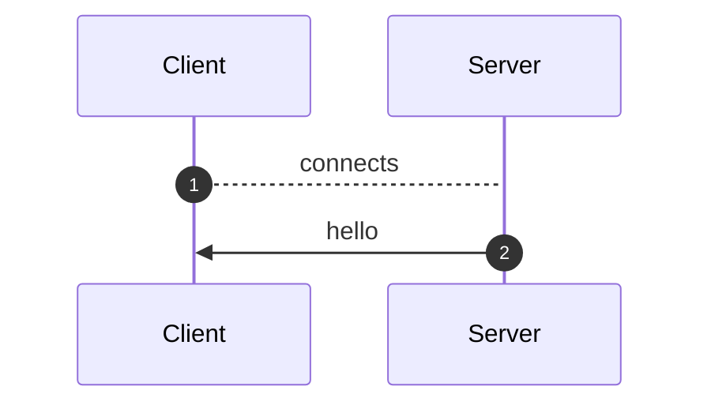
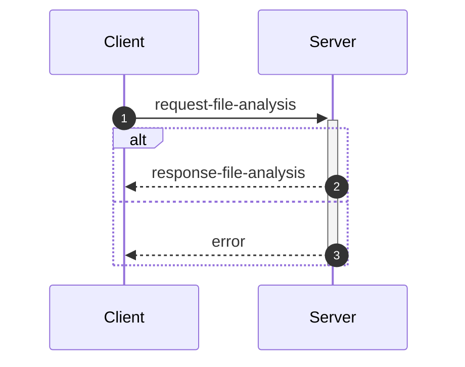
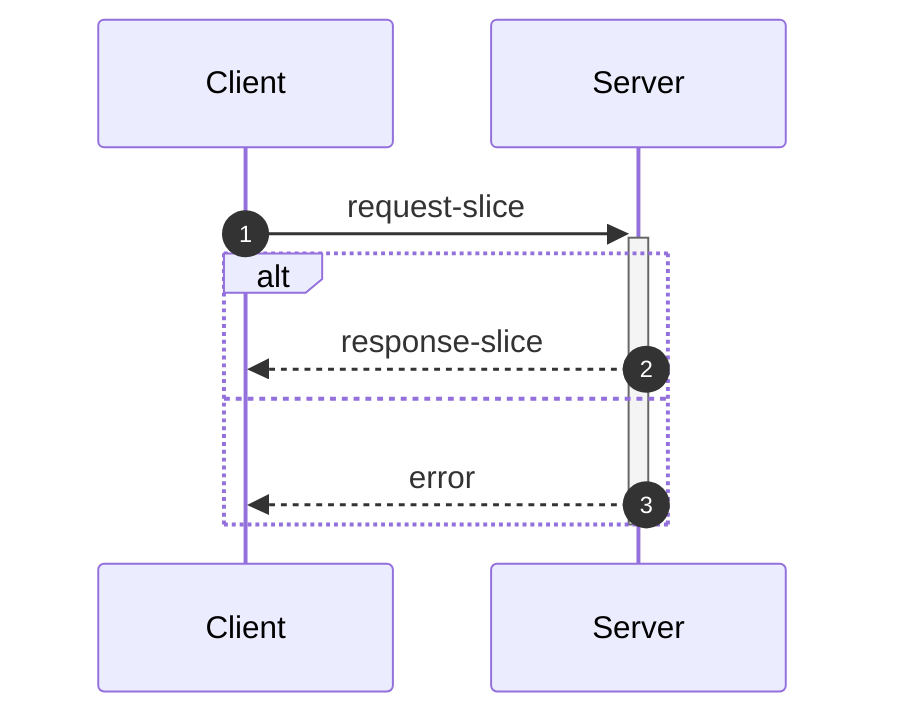
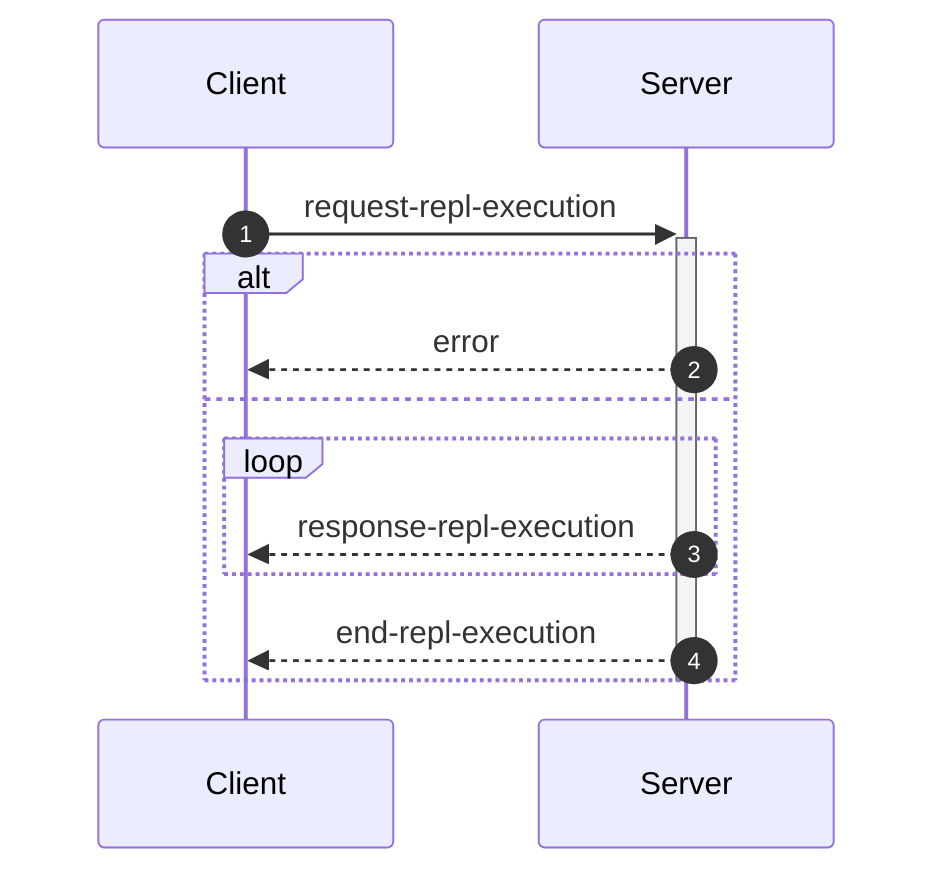

_<span title="an overview of flowR's interface">Generated</span> from '[wiki-interface.ts](https://github.com/flowr-analysis/flowr/tree/main/src/documentation/wiki-interface.ts "src/documentation/wiki-interface.ts")' on 2026-10-13, 23:21:10 UTC (v2.15.10, R v4.5.0), do not edit directly._

Although far from being as detailed as the in-depth explanation of [_flowR_](https://github.com/flowr-analysis/flowr/wiki/Core),
this wiki page explains how to interface with _flowR_ in more detail.
In general, command line arguments and other options provide short descriptions on hover over.

* [💻 Using the REPL](#using-the-repl)
* [⚙️ Configuring FlowR](#configuring-flowr)
* [⚒️ Writing Code](#writing-code)
* [💬 Communicating with the Server](#communicating-with-the-server)

<a id='using-the-repl'></a>
## 💻 Using the REPL

> [!NOTE]
> To execute arbitrary R commands with a repl request, _flowR_ has to be started explicitly with <span title="Description (Command Line Argument): Allow to access the underlying R session when using flowR (security warning: this allows the execution of arbitrary R code!)">`--r-session-access`</span>.
> Please be aware that this introduces a security risk and note that this relies on the [`r-shell` engine](https://github.com/flowr-analysis/flowr/wiki/Engines) .

Although primarily meant for users to explore,
there is nothing which forbids calling _flowR_ as a subprocess to use standard-in, -output, and -error
for communication (although you can access the REPL using the server as well,
with the [REPL Request](#message-request-repl-execution) message).

The read-eval-print loop&nbsp;(REPL) works relatively simple.
You can submit an expression (using <kbd>Enter</kbd>),
which is interpreted as an R&nbsp;expression by default but interpreted as a *command* if it starts with a colon (`:`).
The best command to get started with the REPL is <span title="Description (Repl Command): Show help information (aliases: :h, :?)">`:help`</span>.
Besides, you can leave the REPL either with the command <span title="Description (Repl Command): End the repl (aliases: :q, :exit)">`:quit`</span> or by pressing <kbd>Ctrl</kbd>+<kbd>C</kbd> twice.
When writing a *command*, you may press <kbd>Tab</kbd> to get a list of completions, if available.
Multiple commands can be entered in a single line by separating them with a semicolon (`;`), e.g. `:parse "x<-2"; :df*`.
If a command is given without R code, the REPL will re-use R code given in a previous command.
The prior example will hence return first the parsed AST of the program and then the dataflow graph for `"x <- 2"`.

> [!NOTE]
> If you develop flowR, you may want to launch the repl using the `npm run main-dev` command, this way, you get a non-minified version of flowR with debug information and hot-reloading of source files.

<details>
<summary>Available Commands</summary>

We currently offer the following commands (this with a `[*]` suffix are available with and without the star):

| Command | Description |
| ------- | ----------- |
| **<span title="Description (Repl Command): End the repl (aliases: :q, :exit)">:quit</span>** | End the repl (aliases: **:<span title="Alias of ':quit'. End the repl">q</span>**, **:<span title="Alias of ':quit'. End the repl">exit</span>**) |
| **<span title="Description (Repl Command): Execute the given code as R code. This requires the `--r-session-access` flag to be set and requires the r-shell engine. (aliases: :e, :r)">:execute</span>** | Execute the given code as R code. This requires the `--r-session-access` flag to be set and requires the r-shell engine. (aliases: **:<span title="Alias of ':execute'. Execute the given code as R code. This requires the `--r-session-access` flag to be set and requires the r-shell engine.">e</span>**, **:<span title="Alias of ':execute'. Execute the given code as R code. This requires the `--r-session-access` flag to be set and requires the r-shell engine.">r</span>**) |
| **<span title="Description (Repl Command): Get mermaid code for the control-flow graph of R code (aliases: :cfg, :cf)">:controlflow[*]</span>** | Get mermaid code for the control-flow graph of R code (star: Returns the URL to mermaid.live) (aliases: **:<span title="Alias of ':controlflow'. Get mermaid code for the control-flow graph of R code">cfg</span>**, **:<span title="Alias of ':controlflow'. Get mermaid code for the control-flow graph of R code">cf</span>**) |
| **<span title="Description (Repl Command): Get mermaid code for the control-flow graph with basic blocks (aliases: :cfgb, :cfb)">:controlflowbb[*]</span>** | Get mermaid code for the control-flow graph with basic blocks (star: Returns the URL to mermaid.live) (aliases: **:<span title="Alias of ':controlflowbb'. Get mermaid code for the control-flow graph with basic blocks">cfgb</span>**, **:<span title="Alias of ':controlflowbb'. Get mermaid code for the control-flow graph with basic blocks">cfb</span>**) |
| **<span title="Description (Repl Command): Get mermaid code for the dataflow graph (aliases: :d, :df)">:dataflow[*]</span>** | Get mermaid code for the dataflow graph (star: Returns the URL to mermaid.live) (aliases: **:<span title="Alias of ':dataflow'. Get mermaid code for the dataflow graph">d</span>**, **:<span title="Alias of ':dataflow'. Get mermaid code for the dataflow graph">df</span>**) |
| **<span title="Description (Repl Command): Get mermaid code for the normalized AST of R code (aliases: :n)">:normalize[*]</span>** | Get mermaid code for the normalized AST of R code (star: Returns the URL to mermaid.live) (alias: **:<span title="Alias of ':normalize'. Get mermaid code for the normalized AST of R code">n</span>**) |
| **<span title="Description (Repl Command): Get mermaid code for the simplified dataflow graph (aliases: :ds, :dfs)">:dataflowsimple[*]</span>** | Get mermaid code for the simplified dataflow graph (star: Returns the URL to mermaid.live) (aliases: **:<span title="Alias of ':dataflowsimple'. Get mermaid code for the simplified dataflow graph">ds</span>**, **:<span title="Alias of ':dataflowsimple'. Get mermaid code for the simplified dataflow graph">dfs</span>**) |
| **<span title="Description (Repl Command): Inspect and extend the signature database: `query` (identical to :query @signature), `info <name>` for where a function comes from (identical to :query @function-info), `add <path>` to mount another database/source, `download` to fetch the full-history database. (aliases: :sig)">:signature</span>** | Inspect and extend the signature database: `query` (identical to :query @signature), `info <name>` for where a function comes from (identical to :query @function-info), `add <path>` to mount another database/source, `download` to fetch the full-history database. (alias: **:<span title="Alias of ':signature'. Inspect and extend the signature database: `query` (identical to :query @signature), `info <name>` for where a function comes from (identical to :query @function-info), `add <path>` to mount another database/source, `download` to fetch the full-history database.">sig</span>**) |
| **<span title="Description (Repl Command): Just calculates the DFG, but only prints summary info (aliases: :d#, :df#)">:dataflowsilent</span>** | Just calculates the DFG, but only prints summary info (aliases: **:<span title="Alias of ':dataflowsilent'. Just calculates the DFG, but only prints summary info">d#</span>**, **:<span title="Alias of ':dataflowsilent'. Just calculates the DFG, but only prints summary info">df#</span>**) |
| **<span title="Description (Repl Command): Prints ASCII Art of the parsed, unmodified AST (aliases: :p)">:parse</span>** | Prints ASCII Art of the parsed, unmodified AST (alias: **:<span title="Alias of ':parse'. Prints ASCII Art of the parsed, unmodified AST">p</span>**) |
| **<span title="Description (Repl Command): Prints the version of flowR as well as the current version of R">:version</span>** | Prints the version of flowR as well as the current version of R
| **<span title="Description (Repl Command): Query the given R code (use 'help' for more information)">:query[*]</span>** | Query the given R code (use 'help' for more information) (star: Similar to query, but returns the output in json format.)
| **<span title="Description (Repl Command): Returns an ASCII representation of the dataflow graph (aliases: :df!)">:dataflowascii</span>** | Returns an ASCII representation of the dataflow graph (alias: **:<span title="Alias of ':dataflowascii'. Returns an ASCII representation of the dataflow graph">df!</span>**) |
| **<span title="Description (Repl Command): Returns summarization stats for the normalized AST (aliases: :n#)">:normalize#</span>** | Returns summarization stats for the normalized AST (alias: **:<span title="Alias of ':normalize#'. Returns summarization stats for the normalized AST">n#</span>**) |
| **<span title="Description (Repl Command): Show help information (aliases: :h, :?)">:help</span>** | Show help information (aliases: **:<span title="Alias of ':help'. Show help information">h</span>**, **:<span title="Alias of ':help'. Show help information">?</span>**) |

</details>

> [!TIP]
> 
> As indicated by the examples before, all REPL commands that operate on code keep track of the state.
> Hence, if you run a command like <span title="Description (Repl Command, starred version): Returns the URL to mermaid.live; Base Command: Get mermaid code for the dataflow graph (aliases: :d*, :df*)">`:dataflow*`</span> without providing R code,
> the REPL will re-use the R code provided in a previous command.
> Likewise, doing this will benefit from incrementality!
> If you request the dataflow graph with `:df* x <- 2 * y` and then want to see the parsed AST with `:parse`,
> the REPL will re-use previously obtained information and not re-parse the code again.
> 		

Generally, many commands offer shortcut versions in the REPL. Many queries, for example, offer a shortened format (see the example below).
Of special note, the [Config Query](https://github.com/flowr-analysis/flowr/wiki/%5BQuery%5D-Config)
can be used to also modify the currently active configuration of _flowR_ within the REPL (see the [wiki page](https://github.com/flowr-analysis/flowr/wiki/%5BQuery%5D-Config) for more information).

### Example: Retrieving the Dataflow Graph

To retrieve a URL to the [mermaid](https://mermaid.js.org/) diagram of the dataflow of a given expression,
use <span title="Description (Repl Command, starred version): Returns the URL to mermaid.live; Base Command: Get mermaid code for the dataflow graph (aliases: :d*, :df*)">`:dataflow*`</span> (or <span title="Description (Repl Command): Get mermaid code for the dataflow graph (aliases: :d, :df)">`:dataflow`</span> to get the mermaid code in the cli):

```shell
$ docker run -it --rm eagleoutice/flowr # or npm run flowr 
flowR repl v2.15.10, R grammar v14 (tree-sitter engine)
R> :dataflow* y <- 1 + x
```

<details>
<summary style='color:gray'>Output</summary>

```text
https://mermaid.live/view#base64:eyJjb2RlIjoiZmxvd2NoYXJ0IFREXG4gICAgMXt7XCJgKiM5MTtSTnVtYmVyIzkzOyogKioxKipcbiAgICAgICoxLjYqICgqKmlkOiAxKiopYFwifX1cbiAgICAyKFtcImAqIzkxO1JTeW1ib2wjOTM7KiAqKngqKlxuICAgICAgKjEuMTAqICgqKmlkOiAyKiopYFwiXSlcbiAgICAzW1tcImAqIzkxO1JCaW5hcnlPcCM5MzsqIGJhc2UjNTg7IzU4OyoqIzQzOyoqXG4gICAgICAqMS42LTEwKiAoKippZDogMyoqKVxuICAgIGFyZzogKDEsIDIpYFwiXV1cbiAgICBidWlsdC1pbjpfNDNfW1wiYEJ1aWx0LUluOlxuIzQzO2BcIl1cbiAgICBzdHlsZSBidWlsdC1pbjpfNDNfIHN0cm9rZTpncmF5LGZpbGw6Z3JheSxzdHJva2Utd2lkdGg6MnB4LG9wYWNpdHk6Ljg7XG4gICAgMFtcImAqIzkxO1JTeW1ib2wjOTM7KiAqKnkqKlxuICAgICAgKjEuMSogKCoqaWQ6IDAqKiwgdjogMylgXCJdXG4gICAgNFtbXCJgKiM5MTtSQmluYXJ5T3AjOTM7KiBiYXNlIzU4OyM1ODsqKiM2MDsjNDU7KipcbiAgICAgICoxLjEtMTAqICgqKmlkOiA0KiopXG4gICAgYXJnOiAoMCwgMylgXCJdXVxuICAgIGJ1aWx0LWluOl82MF8tW1wiYEJ1aWx0LUluOlxuIzYwOyM0NTtgXCJdXG4gICAgc3R5bGUgYnVpbHQtaW46XzYwXy0gc3Ryb2tlOmdyYXksZmlsbDpncmF5LHN0cm9rZS13aWR0aDoycHgsb3BhY2l0eTouODtcbiAgICAxIC0uLT58XCJmbG93XCJ8IDJcbiAgICBsaW5rU3R5bGUgMCBzdHJva2U6Z3JheSxjb2xvcjpncmF5O1xuICAgIDIgLS4tPnxcImZsb3dcInwgM1xuICAgIGxpbmtTdHlsZSAxIHN0cm9rZTpncmF5LGNvbG9yOmdyYXk7XG4gICAgMyAtLT58XCJyZWFkcywgYXJnXCJ8IDFcbiAgICAzIC0tPnxcInJlYWRzLCBhcmdcInwgMlxuICAgIDMgLS4tPnxcImZsb3dcInwgMFxuICAgIGxpbmtTdHlsZSA0IHN0cm9rZTpncmF5LGNvbG9yOmdyYXk7XG4gICAgMyAtLi0+fFwicmVhZHMsIGNhbGxzXCJ8IGJ1aWx0LWluOl80M19cbiAgICBsaW5rU3R5bGUgNSBzdHJva2U6Z3JheTtcbiAgICAwIC0tPnxcImRlZmluZWQtYnksIGZsb3dcInwgNFxuICAgIDAgLS0+fFwiZGVmaW5lZC1ieVwifCAzXG4gICAgNCAtLT58XCJyZWFkcywgYXJnXCJ8IDNcbiAgICA0IC0tPnxcInJldHVybnMsIGFyZ1wifCAwXG4gICAgNCAtLi0+fFwicmVhZHMsIGNhbGxzXCJ8IGJ1aWx0LWluOl82MF8tXG4gICAgbGlua1N0eWxlIDEwIHN0cm9rZTpncmF5OyIsIm1lcm1haWQiOnsiYXV0b1N5bmMiOnRydWV9fQ==
```

Retrieve the dataflow graph of the expression `y <- 1 + x`. It looks like this:


<details>

<summary style="color:gray">R Code of the Dataflow Graph</summary>

The analysis ran (including parse and normalize, using the [tree-sitter](https://github.com/flowr-analysis/flowr/wiki/Engines) engine) within the generation environment. No [signature database](https://github.com/flowr-analysis/flowr/wiki/Signature-Database) is mounted for these generated graphs, so `library()` calls attach no package exports; base-R names are still qualified via the generated base-package store (e.g. `acf` as `stats::acf`). 
We encountered no unknown side effects during the analysis.

```r
y <- 1 + x
```

</details>

</details>

For small graphs like this, <span title="Description (Repl Command): Returns an ASCII representation of the dataflow graph (aliases: :df!)">`:dataflowascii`</span> also provides an ASCII representation directly in the REPL:

```shell
$ docker run -it --rm eagleoutice/flowr # or npm run flowr 
flowR repl v2.15.10, R grammar v14 (tree-sitter engine)
R> :df! y <- 1 + x
```

<details open>
<summary style='color:gray'>Output</summary>

```text
                        v<0>v
 c<4>c──────────────────| y |
 |<- |     ┌────────────v---v
 c---c     │
    │   c<3>c   0<1>0
    └───| + |───| 1 |───u<2>u
        c---c   0---0   | x |
           └────────────u---u
Edges:
3 -> 1: reads, arg          3 -> 2: reads, arg
3 -> 0: flows-to            1 -> 2: flows-to
2 -> 3: flows-to            4 -> 3: reads, arg
4 -> 0: returns, arg        0 -> 4: defined-by, flows-to
0 -> 3: defined-by
```

Retrieve the dataflow graph of the expression `y <- 1 + x` as ASCII art.

</details>

For the slicing with <span title="Description (Repl Command): Static backwards executable slicer for R">`:slicer`</span>, you have access to the same [magic comments](#slice-magic-comments) as with the [slice request](#message-request-slice).
Pass `--inline` to splice resolvable `source()` calls into the reconstruction so the slice is a single self-contained R text (the same as the static slice query's `inlineSources` flag).
See `--help` for more flags!

### Example: Interfacing with the File System

Many commands that allow for an R-expression (like <span title="Description (Repl Command, starred version): Returns the URL to mermaid.live; Base Command: Get mermaid code for the dataflow graph (aliases: :d*, :df*)">`:dataflow*`</span>) allow for a file as well
if the argument starts with `file://`.
If you are working from the root directory of the _flowR_ repository, the following gives you the parsed AST of the example file using the <span title="Description (Repl Command): Prints ASCII Art of the parsed, unmodified AST (aliases: :p)">`:parse`</span> command:

> **Watch mode**: Replace `file://` with `watch://` to enter watch mode.
> flowR runs the command immediately and then re-runs it every time the file (or any file inside the folder) changes.
> Enter any other command to leave watch mode.
> For example: `:df watch://analysis.R`

```shell
$ docker run -it --rm eagleoutice/flowr # or npm run flowr 
flowR repl v2.15.10, R grammar v14 (tree-sitter engine)
R> :parse file://test/testfiles/example.R
```

<details>
<summary style='color:gray'>Output</summary>

```text
File: test/testfiles/example.R

program
├ binaryoperator
│ ├ identifier "sum" (1:1─4)
│ ├ <- "<-" (1:5─7)
│ ╰ float "0" (1:8─9)
├ binaryoperator
│ ├ identifier "product" (2:1─8)
│ ├ <- "<-" (2:9─11)
│ ╰ float "1" (2:12─13)
├ binaryoperator
│ ├ identifier "w" (3:1─2)
│ ├ <- "<-" (3:3─5)
│ ╰ float "7" (3:6─7)
├ binaryoperator
│ ├ identifier "N" (4:1─2)
│ ├ <- "<-" (4:3─5)
│ ╰ float "10" (4:6─8)
├ forstatement
│ ├ for "for" (6:1─4)
│ ├ ( "(" (6:5─6)
│ ├ identifier "i" (6:6─7)
│ ├ in "in" (6:8─10)
│ ├ binaryoperator
│ │ ├ float "1" (6:11─12)
│ │ ├ : ":" (6:12─13)
│ │ ╰ parenthesizedexpression
│ │   ├ ( "(" (6:13─14)
│ │   ├ binaryoperator
│ │   │ ├ identifier "N" (6:14─15)
│ │   │ ├ - "-" (6:15─16)
│ │   │ ╰ float "1" (6:16─17)
│ │   ╰ ) ")" (6:17─18)
│ ├ ) ")" (6:18─19)
│ ╰ bracedexpression
│   ├ { "{" (6:20─21)
│   ├ binaryoperator
│   │ ├ identifier "sum" (7:3─6)
│   │ ├ <- "<-" (7:7─9)
│   │ ╰ binaryoperator
│   │   ├ binaryoperator
│   │   │ ├ identifier "sum" (7:10─13)
│   │   │ ├ + "+" (7:14─15)
│   │   │ ╰ identifier "i" (7:16─17)
│   │   ├ + "+" (7:18─19)
│   │   ╰ identifier "w" (7:20─21)
│   ├ binaryoperator
│   │ ├ identifier "product" (8:3─10)
│   │ ├ <- "<-" (8:11─13)
│   │ ╰ binaryoperator
│   │   ├ identifier "product" (8:14─21)
│   │   ├  "" (8:22─23)
│   │   ╰ identifier "i" (8:24─25)
│   ╰ } "}" (9:1─2)
├ call
│ ├ identifier "cat" (11:1─4)
│ ╰ arguments
│   ├ ( "(" (11:4─5)
│   ├ argument
│   │ ╰ string
│   │   ├ " "\"" (11:5─6)
│   │   ├ stringcontent "Sum:" (11:6─10)
│   │   ╰ " "\"" (11:10─11)
│   ├ comma "," (11:11─12)
│   ├ argument
│   │ ╰ identifier "sum" (11:13─16)
│   ├ comma "," (11:16─17)
│   ├ argument
│   │ ╰ string
│   │   ├ " "\"" (11:18─19)
│   │   ├ stringcontent
│   │   │ ╰ escapesequence "\\n" (11:19─21)
│   │   ╰ " "\"" (11:21─22)
│   ╰ ) ")" (11:22─23)
╰ call
  ├ identifier "cat" (12:1─4)
  ╰ arguments
    ├ ( "(" (12:4─5)
    ├ argument
    │ ╰ string
    │   ├ " "\"" (12:5─6)
    │   ├ stringcontent "Product:" (12:6─14)
    │   ╰ " "\"" (12:14─15)
    ├ comma "," (12:15─16)
    ├ argument
    │ ╰ identifier "product" (12:17─24)
    ├ comma "," (12:24─25)
    ├ argument
    │ ╰ string
    │   ├ " "\"" (12:26─27)
    │   ├ stringcontent
    │   │ ╰ escapesequence "\\n" (12:27─29)
    │   ╰ " "\"" (12:29─30)
    ╰ ) ")" (12:30─31)
```

Retrieve the parsed AST of the example file.

<details>

<summary>File Content</summary>

```r
sum <- 0
product <- 1
w <- 7
N <- 10

for (i in 1:(N-1)) {
  sum <- sum + i + w
  product <- product * i
}

cat("Sum:", sum, "\n")
cat("Product:", product, "\n")
```

</details>

As _flowR_ directly transforms this AST the output focuses on being human-readable instead of being machine-readable.
		
</details>

### Example: Run a Query

You can run any query supported by _flowR_ using the <span title="Description (Repl Command): Query the given R code (use 'help' for more information)">`:query`</span> command.
For example, to obtain the shapes of all data frames in a given piece of code, you can run:

```shell
$ docker run -it --rm eagleoutice/flowr # or npm run flowr 
flowR repl v2.15.10, R grammar v14 (tree-sitter engine)
R> :query @absint df-shape "x <- data.frame(a = 1:10, b = 1:10)\ny <- x$a"
```

<details open>
<summary style='color:gray'>Output</summary>

```text
Query: absint (1 ms)
```

Retrieve the shapes of all data frames in the given code.

</details>

To run the linter on a file, you can use (in this example, we just issue the `dead-code` linter on a small piece of code):

```shell
$ docker run -it --rm eagleoutice/flowr # or npm run flowr 
flowR repl v2.15.10, R grammar v14 (tree-sitter engine)
R> :query @linter rules:dead-code "if(FALSE) x <- 2"
```

<details open>
<summary style='color:gray'>Output</summary>

```text
Query: linter (1 ms)
   ╰ Dead Code (dead-code):
       ╰ certain:
           ╰ Code at 1.11-16
```

Run the linter on the given code, with only the `dead-code` rule enabled.

</details>

For more information on the available queries, please check out the [Query API](https://github.com/flowr-analysis/flowr/wiki/Query-API).

<a id='configuring-flowr'></a>
## ⚙️ Configuring FlowR

When running _flowR_, you may want to specify some behaviors with a dedicated configuration file.
By default, flowR looks for a file named `flowr.json` in the current working directory (or any higher directory).
You can also specify a different file with <span title="Description (Command Line Argument): The name of the configuration file to use">`--config-file`</span> or pass the configuration inline using <span title="Description (Command Line Argument): The flowR configuration to use, as a JSON string">`--config-json`</span>.
To inspect the current configuration, you can run flowr with the <span title="Description (Command Line Argument): Run with verbose logging (will be passed to the corresponding script)">`--verbose`</span> flag, or use the `config` [Query](https://github.com/flowr-analysis/flowr/wiki/Query-API).
Within the REPL this works by running the following:

```shell
:query @config
```

To work with the <a href="https://github.com/flowr-analysis/flowr/tree/main/src/config.ts#L108"><code><span title="The configuration file format for flowR.">FlowrConfig</span></code></a> you can use the provided helper objects alongside its methods like
<a href="https://github.com/flowr-analysis/flowr/tree/main/src/config.ts#L871"><code><span title="Creates a new flowr config that has the updated values.">FlowrConfig::<b>amend</b></span></code></a>.
The schema below documents every option; the ones you most likely want are:

- <a href="https://github.com/flowr-analysis/flowr/wiki/Interface#configuring-flowr" title="Configuration Option (boolean): Whether source calls should be ignored, causing {@link processSourceCall}&#39;s behavior to be skipped.">ignoreSourceCalls</a>: ignore source calls when analyzing the code, i.e., ignore the inclusion of other files.
- <a href="https://github.com/flowr-analysis/flowr/wiki/Interface#configuring-flowr" title="Configuration Option (boolean): Whether load calls should be ignored, causing {@link processLoadCall}&#39;s behavior to be skipped.">ignoreLoadCalls</a>: ignore load calls when analyzing the code, i.e., ignore the loading of r-data files.
- <a href="https://github.com/flowr-analysis/flowr/wiki/Interface#configuring-flowr" title="Configuration Option (object): Do you want to overwrite (parts) of the builtin definition?">semantics.environment.overwriteBuiltIns</a>: overwrite _flowR_'s handling of built-in functions, or clear the preset definitions entirely.
  See [Configure BuiltIn Semantics](#configure-builtin-semantics) for more information.
- <a href="https://github.com/flowr-analysis/flowr/wiki/Interface#configuring-flowr" title="Configuration Option (string): How to resolve variables and their values. (one of &quot;disabled&quot;, &quot;alias&quot;, &quot;builtin&quot;)">solver.variables</a>: how to resolve variables and their values (`disabled`, `alias`, `builtin`).
- <a href="https://github.com/flowr-analysis/flowr/wiki/Interface#configuring-flowr" title="Configuration Option (array): The engine or set of engines to use for interacting with R code. An empty array means all available engines will be used.">engines</a> and <a href="https://github.com/flowr-analysis/flowr/wiki/Interface#configuring-flowr" title="Configuration Option (string): The default engine to use for interacting with R code. If this is undefined, an arbitrary engine from the specified list will be used. (one of &quot;tree-sitter&quot;, &quot;r-shell&quot;)">defaultEngine</a>: the engines used to interact with R code, see the [Engines wiki page](https://github.com/flowr-analysis/flowr/wiki/Engines).
- <a href="https://github.com/flowr-analysis/flowr/wiki/Interface#configuring-flowr" title="Configuration Option (array): Files a framework loads on its own, without any source() call (e.g. global.R in a shiny app), in the order they are loaded; flowR orders the matching project files accordingly and analyzes them as one program. Entries are case-insensitive globs matched against the file path, a plain name matches any file with that name, and entries matching no project file are warned about. Usually set per project kind via specializeConfig.">project.implicitSources</a>: the files a framework loads without any `source()` call, in the order in which they are
  loaded. Entries are globs (e.g. `R/*.R`) matched against the file path ignoring capitalization; one matching no file is reported.
- <a href="https://github.com/flowr-analysis/flowr/wiki/Interface#configuring-flowr" title="Configuration Option (object): Overwrite (parts of) the configuration depending on the project kind flowR detects, e.g. to give a shiny app its implicit sources.">specializeConfig</a>: overwrite (parts of) the configuration depending on the kind of project _flowR_ detects
  (e.g. `shiny-app`), which is how a shiny app gets its implicit sources by default. What you configure directly wins.
- <a href="https://github.com/flowr-analysis/flowr/wiki/Interface#configuring-flowr" title="Configuration Option (string): Overwrite the project kind flowR would otherwise infer from the analyzed files, e.g. when auto-detection guesses wrong. (one of &quot;package&quot;, &quot;script&quot;, &quot;shiny-app&quot;, &quot;notebook&quot;, &quot;project&quot;, &quot;unknown&quot;)">project.useProjectType</a>: skip that detection and force a project kind yourself, when auto-detection guesses wrong.
- <a href="https://github.com/flowr-analysis/flowr/wiki/Interface#configuring-flowr" title="Configuration Option (array): The default plugins to load when creating a new instance of FlowrAnalyzer">defaultPlugins</a> and <a href="https://github.com/flowr-analysis/flowr/wiki/Interface#configuring-flowr" title="Configuration Option (array): The plugins to load in REPL mode">repl.plugins</a>: the plugins to load for a new <a href="https://github.com/flowr-analysis/flowr/tree/main/src/project/flowr-analyzer.ts#L205"><code><span title="Central class for conducting analyses with FlowR. Use the FlowrAnalyzerBuilder to create a new instance. If you want the original pattern of creating a pipeline and running all steps, you can still do this with FlowrAnalyzer#runFull . To inspect the context of the analyzer, use FlowrAnalyzer#inspectContext (if you are a plugin and need to modify it, use FlowrAnalyzer#context instead).">FlowrAnalyzer</span></code></a> and in the REPL
  (use `flowr:default` to reference the former).

So you can configure _flowR_ by adding a file like the following:

<details>

<summary>Example Configuration File</summary>

```json
{
  "ignoreSourceCalls": true,
  "ignoreLoadCalls": true,
  "semantics": {
    "environment": {
      "overwriteBuiltIns": {
        "definitions": [
          {
            "type": "function",
            "names": [
              "foo"
            ],
            "processor": "builtin:assign",
            "config": {}
          }
        ]
      }
    }
  },
  "defaultPlugins": [
    "file:description",
    "versions:description"
  ],
  "repl": {
    "quickStats": false,
    "dfProcessorHeat": false,
    "hints": true,
    "plugins": [
      "flowr:default"
    ]
  },
  "project": {
    "resolveUnknownPathsOnDisk": true,
    "implicitSources": [
      "global.R",
      "app.R"
    ]
  },
  "linter": {
    "disabledRules": []
  },
  "specializeConfig": {
    "shiny-app": {
      "project": {
        "implicitSources": [
          "global.R",
          "ui.R",
          "server.R",
          "app.R"
        ]
      }
    }
  },
  "engines": [
    {
      "type": "r-shell"
    }
  ],
  "solver": {
    "variables": "alias",
    "evalStrings": true,
    "trackEnvironments": true,
    "sigdb": {
      "enabled": true,
      "loadProjectDependencies": true,
      "eagerlyLoad": false,
      "eagerlyLoadExports": false,
      "linkBaseR": false,
      "linkDescriptionDependencies": false
    },
    "resolveSource": {
      "dropPaths": "no",
      "ignoreCapitalization": true,
      "inferWorkingDirectory": "active-script",
      "searchPath": []
    },
    "instrument": {},
    "slicer": {
      "threshold": 50
    }
  },
  "abstractInterpretation": {
    "wideningThreshold": 4,
    "followCalls": true,
    "dataFrame": {
      "maxColNames": 20,
      "readLoadedData": {
        "readExternalFiles": true,
        "maxReadLines": 1000000
      }
    }
  },
  "incremental": {
    "alwaysIncremental": false,
    "parsing": {
      "activated": false,
      "heuristics": {
        "activated": true,
        "mtime": true,
        "linesFrom": 500,
        "bytesFrom": 50000,
        "alwaysWithEdits": false,
        "minFiles": 1
      }
    }
  },
  "gas": {
    "thresholds": {
      "memory": {
        "problematic": 0.7,
        "critical": 0.9
      },
      "timeMs": {
        "problematic": 100000,
        "critical": 120000
      }
    },
    "features": {}
  }
}
```

</details>

<details>
<a id='configure-builtin-semantics'></a>
<summary>Configure Built-In Semantics</summary>

`semantics/environment/overwriteBuiltins` accepts two keys:

- `loadDefaults` (boolean, initially `true`): If set to `true`, the default built-in definitions are loaded before applying the custom definitions. Setting this flag to `false` explicitly disables the loading of the default definitions.
- `definitions` (array, initially empty): Allows to overwrite or define new built-in elements. Each object within must have a `type` which is one of the below. Furthermore, they may define a string array of `names` which specifies the identifiers to bind the definitions to. You may use `assumePrimitive` to specify whether _flowR_ should assume that this is a primitive non-library definition (so you probably just do not want to specify the key).

  | Type            | Description                                                                                                                                                                                                                                                                                              | Example                                                                                                    |
  | --------------- | -------------------------------------------------------------------------------------------------------------------------------------------------------------------------------------------------------------------------------------------------------------------------------------------------------- | ---------------------------------------------------------------------------------------------------------- |
  | `constant`    | Additionally allows for a `value` this should resolve to.                                                                                                                                                                                                                                                | `{ type: 'constant', names: ['NULL', 'NA'],  value: null }`                                                |
  | `function`    | Is a rather flexible way to define and bind built-in functions. For the time, we do not have extensive documentation to cover all the cases, so please either consult the sources with the `default-builtin-config.ts` or open a [new issue](https://github.com/flowr-analysis/flowr/issues/new/choose). | `{ type: 'function', names: ['next'], processor: 'builtin:d', config: { cfg: ExitPointType.Next } }` |
  | `replacement` | A comfortable way to specify replacement functions like `$<-` or `names<-`. `suffixes` describes the... suffixes to attach automatically. | `{ type: 'replacement', suffixes: ['<-', '<<-'], names: ['[', '[['] }` |

</details>

<details>

<summary style='color:gray'>Full Configuration-File Schema</summary>

- _The configuration file format for flowR._ (object)
    - **logLevel** [optional] _flowR's global minimum log level, applied when the config is loaded._ (string)
        Only allows: 'silly', 'trace', 'debug', 'info', 'warn', 'error', 'fatal'
    - **ignoreSourceCalls** [optional] _Whether source calls should be ignored, causing {@link processSourceCall}'s behavior to be skipped._ (boolean)
    - **ignoreLoadCalls** [optional] _Whether load calls should be ignored, causing {@link processLoadCall}'s behavior to be skipped._ (boolean)
    - **semantics** _Configure language semantics and how flowR handles them._ (object)
        - **environment** [optional] _Semantics regarding how to handle the R environment._ (object)
            - **overwriteBuiltIns** [optional] _Do you want to overwrite (parts) of the builtin definition?_ (object)
                - **loadDefaults** [optional] _Should the default configuration still be loaded?_ (boolean)
                - **definitions** [optional] _The definitions to load/overwrite._ (array)
                Valid item types:
                    - (object)
    - **defaultPlugins** [optional] _The default plugins to load when creating a new instance of FlowrAnalyzer_ (array)
    Valid item types:
        - (alternatives)
            - (string)
            - (array)
    - **repl** _Configuration options for the REPL._ (object)
        - **quickStats** [optional] _Whether to show quick stats in the REPL after each evaluation._ (boolean)
        - **dfProcessorHeat** [optional] _This instruments the dataflow processors to count how often each processor is called._ (boolean)
        - **hints** [optional] _Whether to show dim inline hints on the empty prompt (automatically disabled on non-interactive terminals)._ (boolean)
        - **plugins** [optional] _The plugins to load in REPL mode_ (array)
        Valid item types:
            - (alternatives)
                - (string)
                - (array)
        - **autoUseFileProtocol** [optional] _Prepend the file protocol to a repl input that looks like a path, instead of only warning about it._ (boolean)
        - **queryStats** [optional] _Whether `:query` closes with the line stating how long the queries took (`:query*` never prints it)._ (boolean)
        - **showPlugins** [optional] _Whether `:version` grays out the plugins that did not activate during the last analysis._ (boolean)
    - **project** _Project specific configuration options._ (object)
        - **resolveUnknownPathsOnDisk** [optional] _Whether to resolve unknown paths loaded by the r project disk when trying to source/analyze files._ (boolean)
        - **failOnInaccessiblePath** [optional] _Whether a directory that cannot be traversed during file discovery (e.g. due to permissions) aborts the analysis; when false (the default) such paths are logged and skipped._ (boolean)
        - **basePackages** [optional] _The packages considered part of R itself (base and recommended); if unset, flowR uses its built-in list._ (array)
        Valid item types:
            - (string)
        - **implicitSources** [optional] _Files a framework loads on its own, without any source() call (e.g. global.R in a shiny app), in the order they are loaded; flowR orders the matching project files accordingly and analyzes them as one program. Entries are case-insensitive globs matched against the file path, a plain name matches any file with that name, and entries matching no project file are warned about. Usually set per project kind via specializeConfig._ (array)
        Valid item types:
            - (string)
        - **useProjectType** [optional] _Overwrite the project kind flowR would otherwise infer from the analyzed files, e.g. when auto-detection guesses wrong._ (string)
            Only allows: 'package', 'script', 'shiny-app', 'notebook', 'project', 'unknown'
        - **assumeImplicitEcho** [optional] _Whether the top level of the analyzed code is echoed, so that every visible result printed there is collected as an output by the dependencies query (default true, false for a package)._ (boolean)
        - **discovery** [optional] _Scoping options for the default project discovery._ (object)
            - **full** [optional] _Collect every file below the project root (greedy) instead of only the files the detected project kind needs (default false)._ (boolean)
            - **perKind** [optional] _Per-kind include/exclude glob overrides layered on the default scoping._ (object)
            - **ignore** [optional] _Case-insensitive globs that drop matching files from the intelligent discovery, regardless of kind (e.g. .Renviron to ignore environment files)._ (array)
            Valid item types:
                - (string)
        - **classification** [optional] _Overrides for the signals flowR uses to classify the project kind._ (object)
            - **shinyDescriptionTypes** [optional] _DESCRIPTION Type: values that mark a shiny app._ (array)
            Valid item types:
                - (string)
            - **shinyEntryFiles** [optional] _File names a shiny app is assembled from._ (array)
            Valid item types:
                - (string)
            - **shinyUsagePattern** [optional] _Regex source evidencing shiny usage in an entry file._ (string)
            - **notebookExtensions** [optional] _File extensions marking a notebook._ (array)
            Valid item types:
                - (string)
    - **linter** _Linter configuration options._ (object)
        - **disabledRules** _Linting rule names excluded from the default rule set (a rule requested explicitly via a linter query still runs). Usually set per project kind via specializeConfig._ (array)
        Valid item types:
            - (string)
    - **inputSources** [optional] _Further frameworks the input-sources analysis should know about; entries are added to flowR's defaults._ (object)
        - **pure** [optional] _Functions that only pass the constantness of their arguments on._ (array)
        Valid item types:
            - (string)
        - **param** [optional] _Functions whose result is a 'param' input._ (array)
        Valid item types:
            - (string)
        - **file** [optional] _Functions whose result is a 'file' input._ (array)
        Valid item types:
            - (string)
        - **tempfile** [optional] _Functions whose result is a 'tempfile' input._ (array)
        Valid item types:
            - (string)
        - **glob** [optional] _Functions whose result is a 'glob' input._ (array)
        Valid item types:
            - (string)
        - **net** [optional] _Functions whose result is a 'net' input._ (array)
        Valid item types:
            - (string)
        - **rand** [optional] _Functions whose result is a 'rand' input._ (array)
        Valid item types:
            - (string)
        - **system** [optional] _Functions whose result is a 'system' input._ (array)
        Valid item types:
            - (string)
        - **ffi** [optional] _Functions whose result is a 'ffi' input._ (array)
        Valid item types:
            - (string)
        - **lang** [optional] _Functions whose result is a 'lang' input._ (array)
        Valid item types:
            - (string)
        - **options** [optional] _Functions whose result is a 'options' input._ (array)
        Valid item types:
            - (string)
        - **cmdline** [optional] _Functions whose result is a 'cmdline' input._ (array)
        Valid item types:
            - (string)
        - **user** [optional] _Functions whose result is a 'user' input._ (array)
        Valid item types:
            - (string)
        - **const** [optional] _Functions whose result is a 'const' input._ (array)
        Valid item types:
            - (string)
        - **scope** [optional] _Functions whose result is a 'scope' input._ (array)
        Valid item types:
            - (string)
        - **dconst** [optional] _Functions whose result is a 'dconst' input._ (array)
        Valid item types:
            - (string)
        - **unknown** [optional] _Functions whose result is a 'unknown' input._ (array)
        Valid item types:
            - (string)
        - **linkedObjects** [optional] _Objects a framework provides without a definition in the code, e.g. shiny's input._ (array)
        Valid item types:
            - (object)
        - **linkedEntryPoints** [optional] _Calls that hand a function to a framework, which binds its objects to the parameters by position._ (array)
        Valid item types:
            - (object)
    - **specializeConfig** [optional] _Overwrite (parts of) the configuration depending on the project kind flowR detects, e.g. to give a shiny app its implicit sources._ (object)
    - **engines** _The engine or set of engines to use for interacting with R code. An empty array means all available engines will be used._ (array)
    Valid item types:
        - (alternatives)
            - _The configuration for the tree sitter engine._ (object)
                - **type** [required] _Use the tree sitter engine._ (string)
                    Only allows: 'tree-sitter'
                - **wasmPath** [optional] _The path to the tree-sitter-r WASM binary to use. If this is undefined, this uses the default path._ (string)
                - **treeSitterWasmPath** [optional] _The path to the tree-sitter WASM binary to use. If this is undefined, this uses the default path._ (string)
                - **lax** [optional] _Whether to use the lax parser for parsing R code (allowing for syntax errors). If this is undefined, the strict parser will be used._ (boolean)
            - _The configuration for the R shell engine._ (object)
                - **type** [required] _Use the R shell engine._ (string)
                    Only allows: 'r-shell'
                - **rPath** [optional] _The path to the R executable to use. If this is undefined, this uses the default path._ (string)
                - **pipeBind** [optional] _Whether to enable R's experimental pipe-bind operator "=>" by setting _R_USE_PIPEBIND_ for the R session (default false); R itself keeps this off by default, as it is experimental and has never shipped in a release version of R._ (boolean)
    - **defaultEngine** [optional] _The default engine to use for interacting with R code. If this is undefined, an arbitrary engine from the specified list will be used._ (string)
        Only allows: 'tree-sitter', 'r-shell'
    - **solver** _How to resolve constants, constraints, cells, ..._ (object)
        - **variables** _How to resolve variables and their values._ (string)
            Only allows: 'disabled', 'alias', 'builtin'
        - **evalStrings** _Should we include eval(parse(text="...")) calls in the dataflow graph?_ (boolean)
        - **trackEnvironments** [optional] _Track user-created environments (new.env, assign/get/local with envir=, dollar-assign, attach). When false, all envir-style calls fall through conservatively._ (boolean)
        - **sigdb** _Resolving library exports from a signature database._ (object)
            - **enabled** [optional] _Resolve library()/use() exports from a signature database (default true); when false no database is consulted._ (boolean)
            - **loadProjectDependencies** [optional] _Load the project's declared dependencies from its metadata files (DESCRIPTION Imports/Depends, rproject.toml, uvr.toml, renv.lock, rv.lock, uvr.lock) (default true); when false these files are not read for dependencies._ (boolean)
            - **eagerlyLoad** [optional] _Parse the database up front rather than on the first package load (default false, ignored if disabled)._ (boolean)
            - **eagerlyLoadExports** [optional] _Add a vertex for every export on load rather than on demand (default false); keeps the dataflow graph small._ (boolean)
            - **assumedRVersion** [optional] _R version assumed when resolving versioned (base-R) exports: a pin like "4.5" or "auto" to detect the installed R (default "auto")._ (string)
            - **linkBaseR** [optional] _Eagerly attach base-R namespaces so bare base calls resolve without library() (default false)._ (boolean)
            - **linkBaseRCalls** [optional] _Add a lightweight Reads edge from a bare base-R call to its signature-database function vertex (default false; base-R qualification is edge-free otherwise)._ (boolean)
            - **linkPackageCalls** [optional] _Add a lightweight Reads edge from a resolved package call to its signature-database function vertex (default false)._ (boolean)
            - **linkDescriptionDependencies** [optional] _Eagerly attach the namespaces of the project's declared DESCRIPTION dependencies (Imports/Depends) so their exports resolve without an explicit library() (default false)._ (boolean)
            - **warmInBackground** [optional] _Decompress the hot shards (base + most-downloaded) in a background task on startup so the first library() lookup is warm (default false; for long-running servers/REPLs)._ (boolean)
            - **additionalPaths** [optional] _Extra directories or bundle/manifest files searched for signature databases (alongside the shipped default and $FLOWR_SIGDB_DIR); a downloaded full-history bundle placed here is mounted automatically._ (array)
            Valid item types:
                - (string)
            - **downloadRepo** [optional] _GitHub owner/repo the full-history bundle is downloaded from via ":signature download" (default "flowr-analysis/flowr", release tag "sigdb-v<flowR-version>")._ (string)
            - **autoSync** [optional] _On startup, re-download shards whose committed sigdb.remote.json hash no longer matches the cache, in the background (default false; opt-in network sync after a git pull)._ (boolean)
            - **installedLibrary** [optional] _Recovering packages no signature database knows from the copy installed on this machine._ (object)
                - **enabled** [required] _Recover packages no signature database knows from their installed copy (default false)._ (boolean)
                - **paths** [optional] _Library directories to search; when empty they are discovered from the environment and the project._ (array)
                Valid item types:
                    - (string)
                - **useEnvironment** [optional] _Search the libraries R_LIBS_USER/R_LIBS/R_LIBS_SITE name (default true)._ (boolean)
                - **useProjectLibrary** [optional] _Search a project-local renv/packrat library (default true)._ (boolean)
                - **maxDepth** [optional] _How far to descend into the nested layout of a project-local library (default 3)._ (number)
                - **packages** [optional] _Only recover packages whose name matches one of these regular expressions; empty means any._ (array)
                Valid item types:
                    - (string)
            - **blobCacheBudgetMb** [optional] _How many MiB of decoded package blobs every open bundle may hold together (default 16)._ (number)
            - **versionSelection** [optional] _When a project constrains a dependency, resolve to the newest (default), oldest, or system-installed version satisfying it; system needs R and falls back to newest. Base-R packages always resolve against the assumed R version._ (string)
                Only allows: 'newest', 'oldest', 'system'
            - **versionOverrides** [optional] _Force an exact version for specific packages (name -> version), overriding both the project constraint and the versionSelection policy (default {})._ (object)
        - **versionManagement** _Policies for reasoning about dependency versions._ (object)
            - **linkedVersionGroups** [optional] _Groups of packages that must resolve to the same version; version guessing intersects each group so its members stay mutually compatible (default [])._ (array)
            Valid item types:
                - (array)
                Valid item types:
                    - (string)
        - **assumeAttachedPackages** [optional] _Packages to treat as attached without a `library()` call, so what the built-in configuration states about them applies to the analyzed code. The base packages R attaches on startup already resolve without it._ (array)
        Valid item types:
            - (string)
        - **transitiveSideEffectRounds** [optional] _How many rounds the transitive side-effect fixpoint may run before it is cut off (default 32); the propagation stops on its own as soon as a round adds nothing._ (number)
        - **maxOverlayDepth** [optional] _How many binding overlays may stack on one environment frame before a write flattens them (default 4); a pure performance knob, trading lookup cost against copy cost without changing any result._ (number)
        - **instrument** (object)
            - **dataflowExtractors** [optional] _These keys are only intended for use within code, allowing to instrument the dataflow analyzer!_ (any)
        - **resolveSource** [optional] _If lax source calls are active, flowR searches for sourced files much more freely, based on the configurations you give it. This option is only in effect if `ignoreSourceCalls` is set to false._ (object)
            - **dropPaths** _Allow to drop the first or all parts of the sourced path, if it is relative._ (string)
                Only allows: 'no', 'once', 'all'
            - **ignoreCapitalization** _Search for filenames matching in the lowercase._ (boolean)
            - **inferWorkingDirectory** _Try to infer the working directory from the main or any script to analyze._ (string)
                Only allows: 'no', 'main-script', 'active-script', 'any-script'
            - **searchPath** _Additionally search in these paths._ (array)
            Valid item types:
                - (string)
            - **repeatedSourceLimit** [optional] _How often the same file can be sourced within a single run? Please be aware: in case of cyclic sources this may not reach a fixpoint so give this a sensible limit._ (number)
            - **applyReplacements** _Provide name replacements for loaded files_ (array)
            Valid item types:
                - (object)
            - **assumeFilesExist** [optional] _Assume a sourced file is always there, making what it defines certain instead of conditional on the source call._ (boolean)
        - **slicer** [optional] _The configuration for the slicer._ (object)
            - **threshold** [optional] _The maximum number of iterations to perform on a single function call during slicing._ (number)
            - **autoExtend** [optional] _If set, the slicer will gain an additional post-pass._ (boolean)
    - **abstractInterpretation** _The configuration options for abstract interpretation._ (object)
        - **wideningThreshold** _The threshold for the number of visitations of a node at which widening should be performed to ensure the termination of the fixpoint iteration._ (number)
        - **followCalls** _Whether the abstract interpretation is interprocedural, i.e. whether it steps into the functions a call may dispatch to._ (boolean)
        - **dataFrame** _The configuration of the shape inference for data frames._ (object)
            - **maxColNames** _The maximum number of columns names to infer for data frames before over-approximating the column names to top._ (number)
            - **readLoadedData** _Configuration options for reading data frame shapes from loaded external data files, such as CSV files._ (object)
                - **readExternalFiles** _Whether data frame shapes should be extracted from loaded external files, such as CSV files._ (boolean)
                - **maxReadLines** _The maximum number of lines to read when extracting data frame shapes from loaded files, such as CSV files._ (number)
    - **incremental** (object)
        - **alwaysIncremental** _Always take the incremental path, regardless of heuristics._ (boolean)
        - **parsing** (object)
            - **activated** _If set, incremental parsing will be used._ (boolean)
            - **heuristics** (object)
                - **activated** [optional] _If set, the heuristics for incremental parsing will be used._ (boolean)
                - **mtime** [optional] _Skip reparsing entirely if the file's modification time is unchanged since the last parse._ (boolean)
                - **linesFrom** [optional] _Only consider incremental parsing for files with at least this many lines._ (number)
                - **bytesFrom** [optional] _Only consider incremental parsing for files with at least this many bytes._ (number)
                - **alwaysWithEdits** [optional] _Always take the incremental path whenever there is a computed edit region, regardless of the other thresholds._ (boolean)
                - **minFiles** [optional] _Only apply these heuristics once the project has at least this many files loaded._ (number)
    - **gas** [optional] _Resource-usage guard (gas) configuration. All feature factors default to 0 (disabled). See https://github.com/flowr-analysis/flowr/wiki/Core#gas-resource-guard._ (object)
        - **thresholds** [optional] _Thresholds for all gas checks (scaled by per-feature factor), boundable per feature._ (object)
            - **memory** [optional] _Heap-usage fraction thresholds (0-1), either shared or given per feature key (with `default` covering the rest)._ (object)
                - **problematic** [optional] _Heap fraction (0-1) above which Problematic is returned, for every feature without an entry of its own._ (number)
                - **critical** [optional] _Heap fraction (0-1) above which Critical is returned, for every feature without an entry of its own._ (number)
            - **timeMs** [optional] _Elapsed analysis time thresholds in milliseconds, either shared or given per feature key (with `default` covering the rest)._ (object)
                - **problematic** [optional] _Elapsed ms above which Problematic is returned, for every feature without an entry of its own._ (number)
                - **critical** [optional] _Elapsed ms above which Critical is returned, for every feature without an entry of its own._ (number)
            - **steps** [optional] _Processed-AST-node thresholds, counted rather than sampled; only a key that arms a budget (`dataflow`) reads them._ (object)
                - **problematic** [optional] _Processed AST nodes above which Problematic is returned, for every feature without an entry of its own._ (number)
                - **critical** [optional] _Processed AST nodes above which the extraction is cut short, for every feature without an entry of its own._ (number)
            - **vertices** [optional] _Created-dataflow-vertex thresholds, counted like `steps`._ (object)
                - **problematic** [optional] _Created dataflow vertices above which Problematic is returned, for every feature without an entry of its own._ (number)
                - **critical** [optional] _Created dataflow vertices above which the extraction is cut short, for every feature without an entry of its own._ (number)
        - **features** [optional] _Per-feature sensitivity factors. 0 or absent disables gas checking for that feature. A factor of 2 makes the feature twice as sensitive. Recognised keys: `source`, `side-effect-linking`, `linter`, `slicer`, `dataflow`._ (object)
        - **countedCheckEvery** [optional] _How many counted steps pass between two accountings of an armed check, be it a dataflow budget or the slicer's traversal (default 128); trades overshoot against the cost of the check._ (number)
        - **heapProvider** [optional] _Custom heap statistics source (programmatic configs only), overriding the built-in v8/performance.memory detection._ (function)

</details>

<a id='writing-code'></a>
## ⚒️ Writing Code

_flowR_ can be used as a [module](https://www.npmjs.com/package/@eagleoutice/flowr) and offers several main classes and interfaces that are interesting for extension writers 
(see the [Visual Studio Code extension](https://marketplace.visualstudio.com/items?itemName=code-inspect.vscode-flowr) or the [Core](https://github.com/flowr-analysis/flowr/wiki/Core) wiki page for more information).

### Creating Analyses with _flowR_

Nowadays, instances of the <a href="https://github.com/flowr-analysis/flowr/tree/main/src/project/flowr-analyzer.ts#L205"><code><span title="Central class for conducting analyses with FlowR. Use the FlowrAnalyzerBuilder to create a new instance. If you want the original pattern of creating a pipeline and running all steps, you can still do this with FlowrAnalyzer#runFull . To inspect the context of the analyzer, use FlowrAnalyzer#inspectContext (if you are a plugin and need to modify it, use FlowrAnalyzer#context instead).">FlowrAnalyzer</span></code></a> should be used as central frontend to get analysis results from _flowR_.
The entry points an analysis is written against are re-exported from the package root (`import { FlowrAnalyzerBuilder } from '@eagleoutice/flowr'`);
everything else stays reachable under its own path, as in `@eagleoutice/flowr/dataflow/graph/graph`.
For example, a program slice can be created like this:

```ts
const analyzer = await new FlowrAnalyzerBuilder()
    .setEngine('tree-sitter')
    .build();
analyzer.addRequest('x <- 1\ny <- x\nx');
const result = await analyzer.query([
    {
        type:     'static-slice',
        criteria: ['3@x']
    }
]);
```

For more information, please have a look at the [Analyzer](https://github.com/flowr-analysis/flowr/wiki/Analyzer) wiki page, which explains how to construct and use the <a href="https://github.com/flowr-analysis/flowr/tree/main/src/project/flowr-analyzer.ts#L205"><code><span title="Central class for conducting analyses with FlowR. Use the FlowrAnalyzerBuilder to create a new instance. If you want the original pattern of creating a pipeline and running all steps, you can still do this with FlowrAnalyzer#runFull . To inspect the context of the analyzer, use FlowrAnalyzer#inspectContext (if you are a plugin and need to modify it, use FlowrAnalyzer#context instead).">FlowrAnalyzer</span></code></a> in more detail.
To work with specific perspectives, you can also consult the respective pages like the [Dataflow Graph](https://github.com/flowr-analysis/flowr/wiki/Dataflow-Graph) or the [Abstract Interpretation](https://github.com/flowr-analysis/flowr/wiki/Abstract-Interpretation) wiki pages.
### The Pipeline Executor (Low-Level Interface)

Once, in the beginning, _flowR_ was meant to produce a dataflow graph merely to provide *program slices*. 
However, with continuous updates, the [Dataflow Graph](https://github.com/flowr-analysis/flowr/wiki/Dataflow-Graph) repeatedly proves to be the more interesting part.
With this, we restructured _flowR_'s originally *hardcoded* pipeline to be far more flexible. 
Now, it can be theoretically extended or replaced with arbitrary steps, optional steps, and what we call 'decorations' of these steps. 
In short, a slicing pipeline using the <a href="https://github.com/flowr-analysis/flowr/tree/main/src/core/pipeline-executor.ts#L97"><code><span title="**Please note:** The PipelineExecutor is now considered to be a rather low-level API for flowR. While it still works and is the basis for all other layers, we strongly recommend using the FlowrAnalyzer and its builder to create and use an analyzer instance that is pre-configured for your use-case. The pipeline executor allows to execute arbitrary pipelines in a step-by-step fashion. If you are not...">PipelineExecutor</span></code></a> looks like this:

```ts

const slicer = new PipelineExecutor(DEFAULT_SLICING_PIPELINE, {
  parser:    new RShell(),
  request:   requestFromInput('x <- 1\nx + 1'),
  criterion: ['2@x']
})
const slice = await slicer.allRemainingSteps()
// console.log(slice.reconstruct.code)
```

<details><summary>More Information</summary>

If you compare this, with what you would have done with the old (and removed) `SteppingSlicer`, 
this essentially just requires you to replace the `SteppingSlicer` with the <a href="https://github.com/flowr-analysis/flowr/tree/main/src/core/pipeline-executor.ts#L97"><code><span title="**Please note:** The PipelineExecutor is now considered to be a rather low-level API for flowR. While it still works and is the basis for all other layers, we strongly recommend using the FlowrAnalyzer and its builder to create and use an analyzer instance that is pre-configured for your use-case. The pipeline executor allows to execute arbitrary pipelines in a step-by-step fashion. If you are not...">PipelineExecutor</span></code></a>
and to pass the <a href="https://github.com/flowr-analysis/flowr/tree/main/src/core/steps/pipeline/default-pipelines.ts#L18"><code>DEFAULT_SLICING_PIPELINE</code></a> as the first argument.
The <a href="https://github.com/flowr-analysis/flowr/tree/main/src/core/pipeline-executor.ts#L97"><code><span title="**Please note:** The PipelineExecutor is now considered to be a rather low-level API for flowR. While it still works and is the basis for all other layers, we strongly recommend using the FlowrAnalyzer and its builder to create and use an analyzer instance that is pre-configured for your use-case. The pipeline executor allows to execute arbitrary pipelines in a step-by-step fashion. If you are not...">PipelineExecutor</span></code></a>...

1. Provides structures to investigate the results of all intermediate steps
2. Can be executed step-by-step
3. Can repeat steps (e.g., to calculate multiple slices on the same input)

See the in-code documentation for more information.

</details>

### Using the <a href="https://github.com/flowr-analysis/flowr/tree/main/src/r-bridge/shell.ts#L143"><code><span title="The RShell represents an interactive session with the R interpreter. You can configure it by RShellOptions . At the moment we are using a live R session (and not networking etc.) to communicate with R easily, which allows us to install packages etc. However, this might and probably will change in the future (leaving this as a legacy mode :D)">RShell</span></code></a> to Interact with R

The <a href="https://github.com/flowr-analysis/flowr/tree/main/src/r-bridge/shell.ts#L143"><code><span title="The RShell represents an interactive session with the R interpreter. You can configure it by RShellOptions . At the moment we are using a live R session (and not networking etc.) to communicate with R easily, which allows us to install packages etc. However, this might and probably will change in the future (leaving this as a legacy mode :D)">RShell</span></code></a> class allows interfacing with the `R`&nbsp;ecosystem installed on the host system.
Please have a look at [flowR's Engines](https://github.com/flowr-analysis/flowr/wiki/Engines) for more information on alternatives (for example, the <a href="https://github.com/flowr-analysis/flowr/tree/main/src/r-bridge/lang-4.x/tree-sitter/tree-sitter-executor.ts#L29"><code><span title="Synchronous and (way) faster alternative to the RShell using tree-sitter.">TreeSitterExecutor</span></code></a>).

> [!IMPORTANT]
> 
> Each <a href="https://github.com/flowr-analysis/flowr/tree/main/src/r-bridge/shell.ts#L143"><code><span title="The RShell represents an interactive session with the R interpreter. You can configure it by RShellOptions . At the moment we are using a live R session (and not networking etc.) to communicate with R easily, which allows us to install packages etc. However, this might and probably will change in the future (leaving this as a legacy mode :D)">RShell</span></code></a> controls a new instance of the R&nbsp;interpreter, 
> make sure to call <code><a href="https://github.com/flowr-analysis/flowr/tree/main/src/r-bridge/shell.ts#L353"><span title="Close the current R session, makes the object effectively invalid (can no longer be reopened etc.)">RShell::<i>close</i></span></a>()</code> when you are done.

You can start a new "session" by constructing a new object with <code>new <a href="https://github.com/flowr-analysis/flowr/tree/main/src/r-bridge/shell.ts#L143"><span title="The RShell represents an interactive session with the R interpreter. You can configure it by RShellOptions . At the moment we are using a live R session (and not networking etc.) to communicate with R easily, which allows us to install packages etc. However, this might and probably will change in the future (leaving this as a legacy mode :D)">RShell</span></a>()</code>.

However, there are several options that may be of interest 
(e.g., to automatically revive the shell in case of errors or to control the name location of the R process on the system).

With a shell object (let's call it `shell`), you can execute R code by using <a href="https://github.com/flowr-analysis/flowr/tree/main/src/r-bridge/shell.ts#L212"><code><span title="sends the given command directly to the current R session will not do anything to alter input markers!">RShell::<i>sendCommand</i></span></code></a>,
for example <code>shell.<a href="https://github.com/flowr-analysis/flowr/tree/main/src/r-bridge/shell.ts#L212"><span title="sends the given command directly to the current R session will not do anything to alter input markers!">sendCommand</span></a>("1 + 1")</code>.
However, this does not return anything, so if you want to collect the output of your command, use
<a href="https://github.com/flowr-analysis/flowr/tree/main/src/r-bridge/shell.ts#L295"><code><span title="Send a command and collect the output">RShell::<i>sendCommandWithOutput</i></span></code></a> instead.

<a id='communicating-with-the-server'></a>
## 💬 Communicating with the Server

As explained in the [Overview](https://github.com/flowr-analysis/flowr/wiki/Overview), you can run the [TCP](https://de.wikipedia.org/wiki/Transmission_Control_Protocol)&nbsp;server by adding the <span title="Description (Command Line Argument): Do not drop into a repl, but instead start a server on the given port (default: 1042) and listen for messages.">`--server`</span> flag (and, due to the interactive mode, exit with the conventional <kbd>CTRL</kbd>+<kbd>C</kbd>).
Currently, every connection is handled by the same underlying `RShell` - so the server is not designed to handle many clients at a time.
Additionally, the server is not well guarded against attacks (e.g., you can theoretically spawn an arbitrary number of&nbsp;RShell sessions on the target machine).

Every message has to be given in a single line (i.e., without a newline in-between) and end with a newline character. Nevertheless, we will pretty-print example given in the following segments for the ease of reading.

> [!NOTE]
> 
> The default <span title="Description (Command Line Argument): Do not drop into a repl, but instead start a server on the given port (default: 1042) and listen for messages.">`--server`</span> uses a simple [TCP](https://de.wikipedia.org/wiki/Transmission_Control_Protocol)
> connection. If you want _flowR_ to expose a [WebSocket](https://de.wikipedia.org/wiki/WebSocket) server instead, add the <span title="Description (Command Line Argument): If the server flag is set, use websocket for messaging">`--ws`</span> flag (i.e., <span title="Description (Command Line Argument): Do not drop into a repl, but instead start a server on the given port (default: 1042) and listen for messages.">`--server`</span> <span title="Description (Command Line Argument): If the server flag is set, use websocket for messaging">`--ws`</span>) when starting _flowR_ from the command line.

<ul><li>
<a id="message-hello"></a>
<b>Hello</b> Message (<code>hello</code>) 
<details>

<summary style="color:gray"> View Details. <i>The server informs the client about the successful connection and provides Meta-Information.</i> </summary>



After launching _flowR_, for example, with <code>docker run -it --rm eagleoutice/flowr <span title="Description (Command Line Argument): Do not drop into a repl, but instead start a server on the given port (default: 1042) and listen for messages.">-<span/>-server</span></code>&nbsp;(🐳️), connecting should present you with a `hello` message, that amongst others should reveal the versions of&nbsp;_flowR_ and&nbsp;R, using the [semver 2.0](https://semver.org/spec/v2.0.0.html) versioning scheme.
The message looks like this:

```json
{
  "type": "hello",
  "clientName": "client-0",
  "versions": {
    "flowr": "2.15.10",
    "r": "4.5.0",
    "engine": "r-shell"
  }
}
```

There are currently a few messages that you can send after the hello message.
If you want to _slice_ a piece of R code you first have to send an [analysis request](#message-request-file-analysis), so that you can send one or multiple slice requests afterward.
Requests for the [REPL](#message-request-repl-execution) are independent of that.
	
<hr>

<details>
<summary style="color:gray">Message schema (<code>hello</code>)</summary>

For the definition of the hello message, please see it's implementation at [`./src/cli/repl/server/messages/message-hello.ts`](https://github.com/flowr-analysis/flowr/tree/main/src/cli/repl/server/messages/message-hello.ts).

- [required] (object)
    - **type** [required] _The type of the hello message._ (string)
        Only allows: 'hello'
    - **id** [forbidden] _The id of the message is always undefined (as it is the initial message and not requested)._ (any)
    - **clientName** [required] _A unique name that is assigned to each client. It has no semantic meaning and is only used/useful for debugging._ (string)
    - **versions** [required] (object)
        - **flowr** [required] _The version of the flowr server running in semver format._ (string)
        - **r** [required] _The version of the underlying R shell running in semver format._ (string)
        - **engine** [required] _The parser backend that is used to parse the R code._ (string)

</details>

<hr>

</details>
	</li>

<li>
<a id="message-request-file-analysis"></a>
<b>Analysis</b> Message (<code>request-file-analysis</code>) 
<details>

<summary style="color:gray"> View Details. <i>The server builds the dataflow graph for a given input file (or a set of files).</i> </summary>



The request allows the server to analyze a file and prepare it for slicing.
The message can contain a `filetoken`, which is used to identify the file in later slice or query requests (if you do not add one, the request will not be stored and therefore, it is not available for subsequent requests).

> **Please note!**\
> If you want to send and process a lot of analysis requests, but do not want to slice them, please do not pass the `filetoken` field. This will save the server a lot of memory allocation.

Furthermore, the request must contain either a `content` field to directly pass the file's content or a `filepath` field which contains the path to the file (this path must be accessible for the server to be useful).
If you add the `id` field, the answer will use the same `id` so you can match requests and the corresponding answers.
See the implementation of the request-file-analysis message for more information.

You can drop one or more stored file tokens by adding the `invalidateToken` field (a single token or an array of tokens).
The server frees the corresponding analyses _after_ it has answered the request.

> **Tip!**\
> If you only want to drop tokens, you do not need a separate message: send a `request-file-analysis` that contains _just_ the `invalidateToken` field (and no `content` or `filepath`).
> Such a request behaves like an empty file analysis and the server replies with an empty `results` object.
> Because invalidation happens after the response, you may even pass the _current_ `filetoken` in `invalidateToken` to analyze a file once and have the server forget it right after you received the results.

<details>
<summary>Example of the <code>request-file-analysis</code> Message</summary>

_Note:_ even though we pretty-print these messages, they are sent as a single line, ending with a newline.

The following lists all messages that were sent and received in case you want to reproduce the scenario:

<ol>
<li> <code>hello</code> (response)
<details> 

<summary> Show Details </summary>

The first message is always a hello message.

```json
{"type":"hello","clientName":"client-0","versions":{"flowr":"2.15.10","r":"4.5.0","engine":"r-shell"}}
```

</details>
</li>

<li> <b><code>request-file-analysis</code> (request)</b>
<details open> 

<summary> Show Details </summary>

Let's suppose you simply want to analyze the following script:
 
```r
x <- 1
x + 1
```

 For this, you can send the following request:

```json
{"type":"request-file-analysis","id":"1","filetoken":"x","content":"x <- 1\nx + 1"}
```

</details>
</li>

<li> <code>response-file-analysis</code> (response)
<details> 

<summary> Show Details </summary>

The `results` field of the response effectively contains three keys of importance:

- `parse`: which contains 1:1 the parse result in CSV format that we received from the `RShell` (i.e., the AST produced by the parser of the R interpreter).
- `normalize`: which contains the normalized AST, including ids (see the `info` field and the [Normalized AST](https://github.com/flowr-analysis/flowr/wiki/Normalized-AST) wiki page).
- `dataflow`: especially important is the `graph` field which contains the dataflow graph as a set of root vertices (see the [Dataflow Graph](https://github.com/flowr-analysis/flowr/wiki/Dataflow-Graph) wiki page).
			
_As the code is pretty long, we inhibit pretty printing and syntax highlighting (JSON, hiding built-in):_

```text
{"type":"response-file-analysis","format":"json","id":"1","results":{"parse":{"files":[{"parsed":"[1,1,1,6,7,0,\"expr\",false,\"x <- 1\"],[1,1,1,1,1,3,\"SYMBOL\",true,\"x\"],[1,1,1,1,3,7,\"expr\",false,\"x\"],[1,3,1,4,2,7,\"LEFT_ASSIGN\",true,\"<-\"],[1,6,1,6,4,5,\"NUM_CONST\",true,\"1\"],[1,6,1,6,5,7,\"expr\",false,\"1\"],[2,1,2,5,16,0,\"expr\",false,\"x + 1\"],[2,1,2,1,10,12,\"SYMBOL\",true,\"x\"],[2,1,2,1,12,16,\"expr\",false,\"x\"],[2,3,2,3,11,16,\"'+'\",true,\"+\"],[2,5,2,5,13,14,\"NUM_CONST\",true,\"1\"],[2,5,2,5,14,16,\"expr\",false,\"1\"]","filePath":"/tmp/tmp-24847-El1UULCld6XD-.R"}],".meta":{}},"normalize":{"ast":{"type":"RProject","files":[{"root":{"type":"RExpressionList","children":[{"type":"RBinaryOp","location":[1,3,1,4],"lhs":{"type":"RSymbol","location":[1,1,1,1],"content":"x","lexeme":"x","info":{"fullRange":[1,1,1,1],"adToks":[],"id":0,"parent":2,"role":"bin-l","index":0,"nest":0,"file":"/tmp/tmp-24847-El1UULCld6XD-.R"}},"rhs":{"location":[1,6,1,6],"lexeme":"1","info":{"fullRange":[1,6,1,6],"adToks":[],"id":1,"parent":2,"role":"bin-r","index":1,"nest":0,"file":"/tmp/tmp-24847-El1UULCld6XD-.R"},"type":"RNumber","content":{"num":1,"complexNumber":false,"markedAsInt":false}},"operator":"<-","lexeme":"<-","info":{"fullRange":[1,1,1,6],"adToks":[],"id":2,"parent":6,"nest":0,"file":"/tmp/tmp-24847-El1UULCld6XD-.R","index":0,"role":"el-c"}},{"type":"RBinaryOp","location":[2,3,2,3],"lhs":{"type":"RSymbol","location":[2,1,2,1],"content":"x","lexeme":"x","info":{"fullRange":[2,1,2,1],"adToks":[],"id":3,"parent":5,"role":"bin-l","index":0,"nest":0,"file":"/tmp/tmp-24847-El1UULCld6XD-.R"}},"rhs":{"location":[2,5,2,5],"lexeme":"1","info":{"fullRange":[2,5,2,5],"adToks":[],"id":4,"parent":5,"role":"bin-r","index":1,"nest":0,"file":"/tmp/tmp-24847-El1UULCld6XD-.R"},"type":"RNumber","content":{"num":1,"complexNumber":false,"markedAsInt":false}},"operator":"+","lexeme":"+","info":{"fullRange":[2,1,2,5],"adToks":[],"id":5,"parent":6,"nest":0,"file":"/tmp/tmp-24847-El1UULCld6XD-.R","index":1,"role":"el-c"}}],"info":{"adToks":[],"id":6,"nest":0,"file":"/tmp/tmp-24847-El1UULCld6XD-.R","role":"root","index":0}},"filePath":"/tmp/tmp-24847-El1UULCld6XD-.R"}],"info":{"id":7}},".meta":{}},"dataflow":{"unknownReferences":[],"in":[{"nodeId":2,"name":"<-","type":2},{"nodeId":5,"name":"+","type":2}],"out":[{"nodeId":0,"name":"x","type":4,"definedAt":2,"value":[1]}],"environment":{"current":{"id":952,"parent":"<BuiltInEnvironment>","memory":[["x",[{"nodeId":0,"name":"x","type":4,"definedAt":2,"value":[1]}]]],"globalEnv":true},"level":0},"graph":{"rootVertices":[1,0,2,3,4,5],"vertexInformation":[[1,{"tag":"value","id":1}],[0,{"tag":"vdef","id":0,"source":[1]}],[2,{"tag":"fcall","id":2,"name":"<-","onlyBuiltin":true,"args":[{"nodeId":0,"type":32},{"nodeId":1,"type":32}],"origin":["builtin:assign"]}],[3,{"tag":"use","id":3}],[4,{"tag":"value","id":4}],[5,{"tag":"fcall","id":5,"name":"+","onlyBuiltin":true,"args":[{"nodeId":3,"type":32},{"nodeId":4,"type":32}],"origin":["builtin:d"]}]],"edgeInformation":[[2,[[1,{"types":65}],[0,{"types":72}],["built-in:<-",{"types":5}],[3,{"types":4096}]]],[1,[[0,{"types":4096}]]],[0,[[2,{"types":4098}],[1,{"types":2}]]],[5,[[3,{"types":65}],[4,{"types":65}],["built-in:+",{"types":5}]]],[3,[[0,{"types":1}],[4,{"types":4096}]]],[4,[[5,{"types":4096}]]]],"_unknownSideEffects":[]},"entryPoint":2,"cfgEntry":1,"exitPoints":[{"type":0,"nodeId":5}],"hooks":[],".meta":{}}}}
```

</details>
</li>
</ol>

The complete round-trip covers validating the messages as well as starting and stopping the internal mock server.

</details>

You receive an error if, for whatever reason, the analysis fails (e.g., the message or code you sent contained syntax errors).
It contains a human-readable description *why* the analysis failed (see the error message implementation for more details).

<details>
<summary>Example Error Message</summary>

_Note:_ even though we pretty-print these messages, they are sent as a single line, ending with a newline.

The following lists all messages that were sent and received in case you want to reproduce the scenario:

<ol>
<li> <code>hello</code> (response)
<details> 

<summary> Show Details </summary>

The first message is always a hello message.

```json
{"type":"hello","clientName":"client-0","versions":{"flowr":"2.15.10","r":"4.5.0","engine":"r-shell"}}
```

</details>
</li>

<li> <code>request-file-analysis</code> (request)
<details> 

<summary> Show Details </summary>

```json
{"type":"request-file-analysis","id":"1","filename":"sample.R","content":"x <-"}
```

</details>
</li>

<li> <b><code>error</code> (response)</b>
<details open> 

<summary> Show Details </summary>

```json
{
  "id": "1",
  "type": "error",
  "fatal": false,
  "reason": "Error while analyzing file sample.R: GuardError: unable to parse R code (see the log for more information) for request {\"request\":\"text\",\"content\":\"x <-\"}}\n Report a Bug: https://github.com/flowr-analysis/flowr/issues/new?body=%3C!%2D%2D%20Please%20describe%20your%20issue%20in%20more%20detail%20below!%20%2D%2D%3E%0A%0A%0A%3C!%2D%2D%20Automatically%20generated%20issue%20metadata%2C%20please%20do%20not%20edit%20or%20delete%20content%20below%20this%20line%20%2D%2D%3E%0A%2D%2D%2D%0A%0AflowR%20version%3A%202.15.10%0Anode%20version%3A%20v25.6.1%0Anode%20arch%3A%20x64%0Anode%20platform%3A%20linux%0Amessage%3A%20%60unable%20to%20parse%20R%20code%20%28see%20the%20log%20for%20more%20information%29%20for%20request%20%7B%22request%22%3A%22text%22%2C%22content%22%3A%22x%20%3C%2D%22%7D%7D%60%0Astack%20trace%3A%0A%60%60%60%0A%20%20%20%20at%20guard%20%28%3C%3E%2Fsrc%2Futil%2Fassert.ts%3A128%3A9%29%0A%20%20%20%20at%20guardRetrievedOutput%20%28%3C%3E%2Fsrc%2Fr%2Dbridge%2Fretriever.ts%3A167%3A7%29%0A%20%20%20%20at%20%2Fhome%2Frunner%2Fwork%2Fflowr%2Fflowr%2Fsrc%2Fr%2Dbridge%2Fretriever.ts%3A123%3A4%0A%20%20%20%20at%20processTicksAndRejections%20%28node%3Ainternal%2Fprocess%2Ftask_queues%3A104%3A5%29%0A%20%20%20%20at%20async%20Object.parseRequests%20%5Bas%20processor%5D%20%28%3C%3E%2Fsrc%2Fr%2Dbridge%2Fparser.ts%3A108%3A19%29%0A%20%20%20%20at%20async%20PipelineExecutor.nextStep%20%28%3C%3E%2Fsrc%2Fcore%2Fpipeline%2Dexecutor.ts%3A192%3A25%29%0A%20%20%20%20at%20async%20FlowrAnalyzerCache.stepTapeUntil%20%28%3C%3E%2Fsrc%2Fproject%2Fcache%2Fflowr%2Danalyzer%2Dcache.ts%3A117%3A4%29%0A%20%20%20%20at%20async%20FlowRServerConnection.sendFileAnalysisResponse%20%28%3C%3E%2Fsrc%2Fcli%2Frepl%2Fserver%2Fconnection.ts%3A216%3A53%29%0A%60%60%60%0A%0A%2D%2D%2D%0A%09"
}
```

</details>
</li>
</ol>

The complete round-trip covers validating the messages as well as starting and stopping the internal mock server.

</details>

&nbsp;

<a id="analysis-include-cfg"></a>
**Including the Control Flow Graph**

The control flow graph is a view on the dataflow graph: the dataflow analysis records the control flow while it walks
the program, and the graph projects those edges on demand. The server can expose that structure as well (please create
a [new issue](https://github.com/flowr-analysis/flowr/issues/new/choose) for any bug you may encounter).
For this, the analysis request may add `cfg: true` to its list of options.

<details>
<summary>Requesting a Control Flow Graph</summary>

_Note:_ even though we pretty-print these messages, they are sent as a single line, ending with a newline.

The following lists all messages that were sent and received in case you want to reproduce the scenario:

<ol>
<li> <code>hello</code> (response)
<details> 

<summary> Show Details </summary>

The first message is always a hello message.

```json
{"type":"hello","clientName":"client-0","versions":{"flowr":"2.15.10","r":"4.5.0","engine":"r-shell"}}
```

</details>
</li>

<li> <b><code>request-file-analysis</code> (request)</b>
<details open> 

<summary> Show Details </summary>

```json
{
  "type": "request-file-analysis",
  "id": "1",
  "filetoken": "x",
  "content": "if(unknown > 0) { x <- 2 } else { x <- 5 }\nfor(i in 1:x) { print(x); print(i) }",
  "cfg": true
}
```

</details>
</li>

<li> <code>response-file-analysis</code> (response)
<details> 

<summary> Show Details </summary>

The response looks basically the same as a response sent without the `cfg` flag. However, additionally it contains a `cfg` field. 
If you are interested in a visual representation of the control flow graph, see the 
[visualization with mermaid](https://mermaid.live/view#base64:eyJjb2RlIjoiZmxvd2NoYXJ0IFREXG4gICAgbjAoW1wiYFJTeW1ib2wgKDApXG4qKnVua25vd24qKmBcIl0pXG4gICAgbjEoW1wiYFJOdW1iZXIgKDEpXG4qKjAqKmBcIl0pXG4gICAgbjIoW1wiYFJCaW5hcnlPcCAoMilcbioqdW5rbm93biAjNjI7IDAqKmBcIl0pXG4gICAgbjYoW1wiYFJOdW1iZXIgKDYpXG4qKjIqKmBcIl0pXG4gICAgbjUoW1wiYFJTeW1ib2wgKDUpXG4qKngqKmBcIl0pXG4gICAgbjdbXCJgUkJpbmFyeU9wICg3KVxuKip4ICM2MDsjNDU7IDIqKmBcIl1cbiAgICBuOChbXCJgUkV4cHJlc3Npb25MaXN0ICg4KWBcIl0pXG4gICAgbjEyKFtcImBSTnVtYmVyICgxMilcbioqNSoqYFwiXSlcbiAgICBuMTEoW1wiYFJTeW1ib2wgKDExKVxuKip4KipgXCJdKVxuICAgIG4xM1tcImBSQmluYXJ5T3AgKDEzKVxuKip4ICM2MDsjNDU7IDUqKmBcIl1cbiAgICBuMTQoW1wiYFJFeHByZXNzaW9uTGlzdCAoMTQpYFwiXSlcbiAgICBuMTVbXCJgUklmVGhlbkVsc2UgKDE1KVxuKippZih1bmtub3duICM2MjsgMCkgIzEyMzsgeCAjNjA7IzQ1OyAyICMxMjU7IGVsc2UgIzEyMzsgeCAjNjA7IzQ1OyA1ICMxMjU7KipgXCJdXG4gICAgbjE2KFtcImBSU3ltYm9sICgxNilcbioqaSoqYFwiXSlcbiAgICBuMTcoW1wiYFJOdW1iZXIgKDE3KVxuKioxKipgXCJdKVxuICAgIG4xOChbXCJgUlN5bWJvbCAoMTgpXG4qKngqKmBcIl0pXG4gICAgbjE5KFtcImBSQmluYXJ5T3AgKDE5KVxuKioxIzU4O3gqKmBcIl0pXG4gICAgbjIzKFtcImBSU3ltYm9sICgyMylcbioqeCoqYFwiXSlcbiAgICBuMjVbXCJgUkZ1bmN0aW9uQ2FsbCAoMjUpXG4qKnByaW50KHgpKipgXCJdXG4gICAgbjI3KFtcImBSU3ltYm9sICgyNylcbioqaSoqYFwiXSlcbiAgICBuMjlbXCJgUkZ1bmN0aW9uQ2FsbCAoMjkpXG4qKnByaW50KGkpKipgXCJdXG4gICAgbjMwKFtcImBSRXhwcmVzc2lvbkxpc3QgKDMwKWBcIl0pXG4gICAgbjMxW1wiYFJGb3JMb29wICgzMSlcbioqZm9yKGkgaW4gMSM1ODt4KSAjMTIzOyBwcmludCh4KTsgcHJpbnQoaSkgIzEyNTsqKmBcIl1cbiAgICBuMiAtLi0+fFwiYnJhbmNoIG9uIHVua25vd24gIzYyOyAwICgyKSBpZiBUXCJ8IG42XG4gICAgbjIgLS4tPnxcImJyYW5jaCBvbiB1bmtub3duICM2MjsgMCAoMikgaWYgRlwifCBuMTJcbiAgICBuMCAtLT58XCJmbG93cyB0b1wifCBuMVxuICAgIG4xIC0tPnxcImZsb3dzIHRvXCJ8IG4yXG4gICAgbjcgLS0+fFwiZmxvd3MgdG9cInwgbjhcbiAgICBuNiAtLT58XCJmbG93cyB0b1wifCBuNVxuICAgIG41IC0tPnxcImZsb3dzIHRvXCJ8IG43XG4gICAgbjggLS0+fFwiZmxvd3MgdG9cInwgbjE1XG4gICAgbjE1IC0tPnxcImZsb3dzIHRvXCJ8IG4xN1xuICAgIG4xMyAtLT58XCJmbG93cyB0b1wifCBuMTRcbiAgICBuMTIgLS0+fFwiZmxvd3MgdG9cInwgbjExXG4gICAgbjExIC0tPnxcImZsb3dzIHRvXCJ8IG4xM1xuICAgIG4xNCAtLT58XCJmbG93cyB0b1wifCBuMTVcbiAgICBuMTkgLS0+fFwiZmxvd3MgdG9cInwgbjE2XG4gICAgbjE4IC0tPnxcImZsb3dzIHRvXCJ8IG4xOVxuICAgIG4xNyAtLT58XCJmbG93cyB0b1wifCBuMThcbiAgICBuMjUgLS0+fFwiZmxvd3MgdG9cInwgbjI3XG4gICAgbjIzIC0tPnxcImZsb3dzIHRvXCJ8IG4yNVxuICAgIG4yOSAtLT58XCJmbG93cyB0b1wifCBuMzBcbiAgICBuMjcgLS0+fFwiZmxvd3MgdG9cInwgbjI5XG4gICAgbjMwIC0tPnxcImZsb3dzIHRvXCJ8IG4xNlxuICAgIG4xNiAtLi0+fFwiYnJhbmNoIG9uIGkgKDE2KSBpZiBUXCJ8IG4yM1xuICAgIG4xNiAtLi0+fFwiYnJhbmNoIG9uIGkgKDE2KSBpZiBGXCJ8IG4zMVxuICAgIHN0eWxlIG4wIHN0cm9rZTpjeWFuLHN0cm9rZS13aWR0aDo2LjVweDsgICAgc3R5bGUgbjMxIHN0cm9rZTpncmVlbixzdHJva2Utd2lkdGg6Ni41cHg7IiwibWVybWFpZCI6eyJhdXRvU3luYyI6dHJ1ZX19).
			
_As the code is pretty long, we inhibit pretty printing and syntax highlighting (JSON, hiding built-in):_

```text
{"type":"response-file-analysis","format":"json","id":"1","cfg":{"graph":{"roots":[0,1,2,6,5,7,8,12,11,13,14,15,16,17,18,19,23,25,27,29,30,31],"vtxInfos":[[0,[2,0]],[1,[2,1]],[2,[2,2]],[6,[2,6]],[5,[2,5]],[7,[1,7]],[8,[2,8]],[12,[2,12]],[11,[2,11]],[13,[1,13]],[14,[2,14]],[15,[1,15]],[16,[2,16]],[17,[2,17]],[18,[2,18]],[19,[2,19]],[23,[2,23]],[25,[1,25]],[27,[2,27]],[29,[1,29]],[30,[2,30]],[31,[1,31]]],"bbChildren":[],"edgeInfos":[[2,[[6,{"id":15,"when":true}],[12,{"id":15,"when":false}]]],[0,[[1,0]]],[1,[[2,0]]],[7,[[8,0]]],[6,[[5,0]]],[5,[[7,0]]],[8,[[15,0]]],[15,[[17,0]]],[13,[[14,0]]],[12,[[11,0]]],[11,[[13,0]]],[14,[[15,0]]],[19,[[16,0]]],[18,[[19,0]]],[17,[[18,0]]],[25,[[27,0]]],[23,[[25,0]]],[29,[[30,0]]],[27,[[29,0]]],[30,[[16,0]]],[16,[[23,{"id":31,"when":true}],[31,{"id":31,"when":false}]]]],"mayHaveBasicBlocks":false},"entryPoints":[0],"exitPoints":[31],"returns":[],"breaks":[],"nexts":[]},"results":{"parse":{"files":[{"parsed":"[1,1,1,42,38,0,\"expr\",false,\"if(unknown > 0) { x <- 2 } else { x <- 5 }\"],[1,1,1,2,1,38,\"IF\",true,\"if\"],[1,3,1,3,2,38,\"'('\",true,\"(\"],[1,4,1,14,9,38,\"expr\",false,\"unknown > 0\"],[1,4,1,10,3,5,\"SYMBOL\",true,\"unknown\"],[1,4,1,10,5,9,\"expr\",false,\"unknown\"],[1,12,1,12,4,9,\"GT\",true,\">\"],[1,14,1,14,6,7,\"NUM_CONST\",true,\"0\"],[1,14,1,14,7,9,\"expr\",false,\"0\"],[1,15,1,15,8,38,\"')'\",true,\")\"],[1,17,1,26,22,38,\"expr\",false,\"{ x <- 2 }\"],[1,17,1,17,12,22,\"'{'\",true,\"{\"],[1,19,1,24,19,22,\"expr\",false,\"x <- 2\"],[1,19,1,19,13,15,\"SYMBOL\",true,\"x\"],[1,19,1,19,15,19,\"expr\",false,\"x\"],[1,21,1,22,14,19,\"LEFT_ASSIGN\",true,\"<-\"],[1,24,1,24,16,17,\"NUM_CONST\",true,\"2\"],[1,24,1,24,17,19,\"expr\",false,\"2\"],[1,26,1,26,18,22,\"'}'\",true,\"}\"],[1,28,1,31,23,38,\"ELSE\",true,\"else\"],[1,33,1,42,35,38,\"expr\",false,\"{ x <- 5 }\"],[1,33,1,33,25,35,\"'{'\",true,\"{\"],[1,35,1,40,32,35,\"expr\",false,\"x <- 5\"],[1,35,1,35,26,28,\"SYMBOL\",true,\"x\"],[1,35,1,35,28,32,\"expr\",false,\"x\"],[1,37,1,38,27,32,\"LEFT_ASSIGN\",true,\"<-\"],[1,40,1,40,29,30,\"NUM_CONST\",true,\"5\"],[1,40,1,40,30,32,\"expr\",false,\"5\"],[1,42,1,42,31,35,\"'}'\",true,\"}\"],[2,1,2,36,84,0,\"expr\",false,\"for(i in 1:x) { print(x); print(i) }\"],[2,1,2,3,41,84,\"FOR\",true,\"for\"],[2,4,2,13,53,84,\"forcond\",false,\"(i in 1:x)\"],[2,4,2,4,42,53,\"'('\",true,\"(\"],[2,5,2,5,43,53,\"SYMBOL\",true,\"i\"],[2,7,2,8,44,53,\"IN\",true,\"in\"],[2,10,2,12,51,53,\"expr\",false,\"1:x\"],[2,10,2,10,45,46,\"NUM_CONST\",true,\"1\"],[2,10,2,10,46,51,\"expr\",false,\"1\"],[2,11,2,11,47,51,\"':'\",true,\":\"],[2,12,2,12,48,50,\"SYMBOL\",true,\"x\"],[2,12,2,12,50,51,\"expr\",false,\"x\"],[2,13,2,13,49,53,\"')'\",true,\")\"],[2,15,2,36,81,84,\"expr\",false,\"{ print(x); print(i) }\"],[2,15,2,15,54,81,\"'{'\",true,\"{\"],[2,17,2,24,64,81,\"expr\",false,\"print(x)\"],[2,17,2,21,55,57,\"SYMBOL_FUNCTION_CALL\",true,\"print\"],[2,17,2,21,57,64,\"expr\",false,\"print\"],[2,22,2,22,56,64,\"'('\",true,\"(\"],[2,23,2,23,58,60,\"SYMBOL\",true,\"x\"],[2,23,2,23,60,64,\"expr\",false,\"x\"],[2,24,2,24,59,64,\"')'\",true,\")\"],[2,25,2,25,65,81,\"';'\",true,\";\"],[2,27,2,34,77,81,\"expr\",false,\"print(i)\"],[2,27,2,31,68,70,\"SYMBOL_FUNCTION_CALL\",true,\"print\"],[2,27,2,31,70,77,\"expr\",false,\"print\"],[2,32,2,32,69,77,\"'('\",true,\"(\"],[2,33,2,33,71,73,\"SYMBOL\",true,\"i\"],[2,33,2,33,73,77,\"expr\",false,\"i\"],[2,34,2,34,72,77,\"')'\",true,\")\"],[2,36,2,36,78,81,\"'}'\",true,\"}\"]","filePath":"/tmp/tmp-24847-xM8CL4Vc2HZG-.R"}],".meta":{}},"normalize":{"ast":{"type":"RProject","files":[{"root":{"type":"RExpressionList","children":[{"type":"RIfThenElse","condition":{"type":"RBinaryOp","location":[1,12,1,12],"lhs":{"type":"RSymbol","location":[1,4,1,10],"content":"unknown","lexeme":"unknown","info":{"fullRange":[1,4,1,10],"adToks":[],"id":0,"parent":2,"role":"bin-l","index":0,"nest":1,"file":"/tmp/tmp-24847-xM8CL4Vc2HZG-.R"}},"rhs":{"location":[1,14,1,14],"lexeme":"0","info":{"fullRange":[1,14,1,14],"adToks":[],"id":1,"parent":2,"role":"bin-r","index":1,"nest":1,"file":"/tmp/tmp-24847-xM8CL4Vc2HZG-.R"},"type":"RNumber","content":{"num":0,"complexNumber":false,"markedAsInt":false}},"operator":">","lexeme":">","info":{"fullRange":[1,4,1,14],"adToks":[],"id":2,"parent":15,"nest":1,"file":"/tmp/tmp-24847-xM8CL4Vc2HZG-.R","role":"if-c"}},"then":{"type":"RExpressionList","children":[{"type":"RBinaryOp","location":[1,21,1,22],"lhs":{"type":"RSymbol","location":[1,19,1,19],"content":"x","lexeme":"x","info":{"fullRange":[1,19,1,19],"adToks":[],"id":5,"parent":7,"role":"bin-l","index":0,"nest":1,"file":"/tmp/tmp-24847-xM8CL4Vc2HZG-.R"}},"rhs":{"location":[1,24,1,24],"lexeme":"2","info":{"fullRange":[1,24,1,24],"adToks":[],"id":6,"parent":7,"role":"bin-r","index":1,"nest":1,"file":"/tmp/tmp-24847-xM8CL4Vc2HZG-.R"},"type":"RNumber","content":{"num":2,"complexNumber":false,"markedAsInt":false}},"operator":"<-","lexeme":"<-","info":{"fullRange":[1,19,1,24],"adToks":[],"id":7,"parent":8,"nest":1,"file":"/tmp/tmp-24847-xM8CL4Vc2HZG-.R","index":0,"role":"el-c"}}],"grouping":[{"type":"RSymbol","location":[1,17,1,17],"content":"{","lexeme":"{","info":{"fullRange":[1,17,1,26],"adToks":[],"id":3,"role":"el-g","index":0,"nest":1,"file":"/tmp/tmp-24847-xM8CL4Vc2HZG-.R"}},{"type":"RSymbol","location":[1,26,1,26],"content":"}","lexeme":"}","info":{"fullRange":[1,17,1,26],"adToks":[],"id":4,"role":"el-g","index":0,"nest":1,"file":"/tmp/tmp-24847-xM8CL4Vc2HZG-.R"}}],"info":{"adToks":[],"id":8,"parent":15,"nest":1,"file":"/tmp/tmp-24847-xM8CL4Vc2HZG-.R","index":1,"role":"if-then"}},"location":[1,1,1,2],"lexeme":"if","info":{"fullRange":[1,1,1,42],"adToks":[],"id":15,"parent":32,"nest":1,"file":"/tmp/tmp-24847-xM8CL4Vc2HZG-.R","index":0,"role":"el-c"},"otherwise":{"type":"RExpressionList","children":[{"type":"RBinaryOp","location":[1,37,1,38],"lhs":{"type":"RSymbol","location":[1,35,1,35],"content":"x","lexeme":"x","info":{"fullRange":[1,35,1,35],"adToks":[],"id":11,"parent":13,"role":"bin-l","index":0,"nest":1,"file":"/tmp/tmp-24847-xM8CL4Vc2HZG-.R"}},"rhs":{"location":[1,40,1,40],"lexeme":"5","info":{"fullRange":[1,40,1,40],"adToks":[],"id":12,"parent":13,"role":"bin-r","index":1,"nest":1,"file":"/tmp/tmp-24847-xM8CL4Vc2HZG-.R"},"type":"RNumber","content":{"num":5,"complexNumber":false,"markedAsInt":false}},"operator":"<-","lexeme":"<-","info":{"fullRange":[1,35,1,40],"adToks":[],"id":13,"parent":14,"nest":1,"file":"/tmp/tmp-24847-xM8CL4Vc2HZG-.R","index":0,"role":"el-c"}}],"grouping":[{"type":"RSymbol","location":[1,33,1,33],"content":"{","lexeme":"{","info":{"fullRange":[1,33,1,42],"adToks":[],"id":9,"role":"el-g","index":0,"nest":1,"file":"/tmp/tmp-24847-xM8CL4Vc2HZG-.R"}},{"type":"RSymbol","location":[1,42,1,42],"content":"}","lexeme":"}","info":{"fullRange":[1,33,1,42],"adToks":[],"id":10,"role":"el-g","index":0,"nest":1,"file":"/tmp/tmp-24847-xM8CL4Vc2HZG-.R"}}],"info":{"adToks":[],"id":14,"parent":15,"nest":1,"file":"/tmp/tmp-24847-xM8CL4Vc2HZG-.R","index":2,"role":"if-other"}}},{"type":"RForLoop","variable":{"type":"RSymbol","location":[2,5,2,5],"content":"i","lexeme":"i","info":{"adToks":[],"id":16,"parent":31,"role":"for-var","index":0,"nest":1,"file":"/tmp/tmp-24847-xM8CL4Vc2HZG-.R"}},"vector":{"type":"RBinaryOp","location":[2,11,2,11],"lhs":{"location":[2,10,2,10],"lexeme":"1","info":{"fullRange":[2,10,2,10],"adToks":[],"id":17,"parent":19,"role":"bin-l","index":0,"nest":1,"file":"/tmp/tmp-24847-xM8CL4Vc2HZG-.R"},"type":"RNumber","content":{"num":1,"complexNumber":false,"markedAsInt":false}},"rhs":{"type":"RSymbol","location":[2,12,2,12],"content":"x","lexeme":"x","info":{"fullRange":[2,12,2,12],"adToks":[],"id":18,"parent":19,"role":"bin-r","index":1,"nest":1,"file":"/tmp/tmp-24847-xM8CL4Vc2HZG-.R"}},"operator":":","lexeme":":","info":{"fullRange":[2,10,2,12],"adToks":[],"id":19,"parent":31,"nest":1,"file":"/tmp/tmp-24847-xM8CL4Vc2HZG-.R","index":1,"role":"for-vec"}},"body":{"type":"RExpressionList","children":[{"type":"RFunctionCall","named":true,"location":[2,17,2,21],"lexeme":"print","functionName":{"type":"RSymbol","location":[2,17,2,21],"content":"print","lexeme":"print","info":{"fullRange":[2,17,2,24],"adToks":[],"id":22,"parent":25,"role":"call-name","index":0,"nest":1,"file":"/tmp/tmp-24847-xM8CL4Vc2HZG-.R"}},"arguments":[{"type":"RArgument","location":[2,23,2,23],"lexeme":"x","value":{"type":"RSymbol","location":[2,23,2,23],"content":"x","lexeme":"x","info":{"fullRange":[2,23,2,23],"adToks":[],"id":23,"parent":24,"role":"arg-v","index":0,"nest":1,"file":"/tmp/tmp-24847-xM8CL4Vc2HZG-.R"}},"info":{"fullRange":[2,23,2,23],"adToks":[],"id":24,"parent":25,"nest":1,"file":"/tmp/tmp-24847-xM8CL4Vc2HZG-.R","index":1,"role":"call-arg"}}],"info":{"fullRange":[2,17,2,24],"adToks":[],"id":25,"parent":30,"nest":1,"file":"/tmp/tmp-24847-xM8CL4Vc2HZG-.R","index":0,"role":"el-c"}},{"type":"RFunctionCall","named":true,"location":[2,27,2,31],"lexeme":"print","functionName":{"type":"RSymbol","location":[2,27,2,31],"content":"print","lexeme":"print","info":{"fullRange":[2,27,2,34],"adToks":[],"id":26,"parent":29,"role":"call-name","index":0,"nest":1,"file":"/tmp/tmp-24847-xM8CL4Vc2HZG-.R"}},"arguments":[{"type":"RArgument","location":[2,33,2,33],"lexeme":"i","value":{"type":"RSymbol","location":[2,33,2,33],"content":"i","lexeme":"i","info":{"fullRange":[2,33,2,33],"adToks":[],"id":27,"parent":28,"role":"arg-v","index":0,"nest":1,"file":"/tmp/tmp-24847-xM8CL4Vc2HZG-.R"}},"info":{"fullRange":[2,33,2,33],"adToks":[],"id":28,"parent":29,"nest":1,"file":"/tmp/tmp-24847-xM8CL4Vc2HZG-.R","index":1,"role":"call-arg"}}],"info":{"fullRange":[2,27,2,34],"adToks":[],"id":29,"parent":30,"nest":1,"file":"/tmp/tmp-24847-xM8CL4Vc2HZG-.R","index":1,"role":"el-c"}}],"grouping":[{"type":"RSymbol","location":[2,15,2,15],"content":"{","lexeme":"{","info":{"fullRange":[2,15,2,36],"adToks":[],"id":20,"role":"el-g","index":0,"nest":1,"file":"/tmp/tmp-24847-xM8CL4Vc2HZG-.R"}},{"type":"RSymbol","location":[2,36,2,36],"content":"}","lexeme":"}","info":{"fullRange":[2,15,2,36],"adToks":[],"id":21,"role":"el-g","index":0,"nest":1,"file":"/tmp/tmp-24847-xM8CL4Vc2HZG-.R"}}],"info":{"adToks":[],"id":30,"parent":31,"nest":1,"file":"/tmp/tmp-24847-xM8CL4Vc2HZG-.R","index":2,"role":"for-b"}},"lexeme":"for","info":{"fullRange":[2,1,2,36],"adToks":[],"id":31,"parent":32,"nest":1,"file":"/tmp/tmp-24847-xM8CL4Vc2HZG-.R","index":1,"role":"el-c"},"location":[2,1,2,3]}],"info":{"adToks":[],"id":32,"nest":0,"file":"/tmp/tmp-24847-xM8CL4Vc2HZG-.R","role":"root","index":0}},"filePath":"/tmp/tmp-24847-xM8CL4Vc2HZG-.R"}],"info":{"id":33}},".meta":{}},"dataflow":{"unknownReferences":[],"in":[{"nodeId":15,"name":"if","type":2},{"nodeId":0,"name":"unknown","type":1024},{"nodeId":2,"name":">","type":2},{"nodeId":7,"name":"<-","cds":[{"id":15,"when":true}],"type":2},{"nodeId":13,"name":"<-","cds":[{"id":15,"when":false}],"type":2},{"nodeId":8,"name":"{","cds":[{"id":15,"when":true}],"type":2},{"nodeId":14,"name":"{","cds":[{"id":15,"when":false}],"type":2},{"nodeId":31,"name":"for","type":2},{"nodeId":19,"name":":","type":2},{"nodeId":25,"name":"print","type":2},{"nodeId":29,"name":"print","type":2}],"out":[{"nodeId":5,"name":"x","type":4,"definedAt":7,"cds":[{"id":15,"when":true}],"value":[6]},{"nodeId":11,"name":"x","type":4,"definedAt":13,"cds":[{"id":15,"when":false}],"value":[12]},{"nodeId":16,"name":"i","type":1}],"environment":{"current":{"id":974,"parent":"<BuiltInEnvironment>","memory":[["x",[{"nodeId":5,"name":"x","type":4,"definedAt":7,"cds":[{"id":15,"when":true}],"value":[6]},{"nodeId":11,"name":"x","type":4,"definedAt":13,"cds":[{"id":15,"when":false}],"value":[12]}]],["i",[{"nodeId":16,"name":"i","type":1,"definedAt":31,"value":[19],"iterated":true}]]],"globalEnv":true},"level":0},"graph":{"rootVertices":[0,1,2,6,5,7,8,12,11,13,14,15,16,17,18,19,23,25,27,29,30,31],"vertexInformation":[[0,{"tag":"use","id":0}],[1,{"tag":"value","id":1}],[2,{"tag":"fcall","id":2,"name":">","onlyBuiltin":true,"args":[{"nodeId":0,"type":32},{"nodeId":1,"type":32}],"origin":["builtin:d"]}],[6,{"tag":"value","id":6}],[5,{"tag":"vdef","id":5,"cds":[{"id":15,"when":true}],"source":[6]}],[7,{"tag":"fcall","id":7,"name":"<-","onlyBuiltin":true,"cds":[{"id":15,"when":true}],"args":[{"nodeId":5,"type":32},{"nodeId":6,"type":32}],"origin":["builtin:assign"]}],[8,{"tag":"fcall","id":8,"name":"{","onlyBuiltin":true,"cds":[{"id":15,"when":true}],"args":[{"nodeId":7,"type":32}],"origin":["builtin:el"]}],[12,{"tag":"value","id":12}],[11,{"tag":"vdef","id":11,"cds":[{"id":15,"when":false}],"source":[12]}],[13,{"tag":"fcall","id":13,"name":"<-","onlyBuiltin":true,"cds":[{"id":15,"when":false}],"args":[{"nodeId":11,"type":32},{"nodeId":12,"type":32}],"origin":["builtin:assign"]}],[14,{"tag":"fcall","id":14,"name":"{","onlyBuiltin":true,"cds":[{"id":15,"when":false}],"args":[{"nodeId":13,"type":32}],"origin":["builtin:el"]}],[15,{"tag":"fcall","id":15,"name":"if","onlyBuiltin":true,"args":[{"nodeId":2,"type":32},{"nodeId":8,"type":32},{"nodeId":14,"type":32}],"origin":["builtin:ite"]}],[16,{"tag":"vdef","id":16,"source":[19]}],[17,{"tag":"value","id":17}],[18,{"tag":"use","id":18}],[19,{"tag":"fcall","id":19,"name":":","onlyBuiltin":true,"args":[{"nodeId":17,"type":32},{"nodeId":18,"type":32}],"origin":["builtin:d"]}],[23,{"tag":"use","id":23,"cds":[{"id":31,"when":true}]}],[25,{"tag":"fcall","id":25,"name":"print","onlyBuiltin":true,"cds":[{"id":31,"when":true}],"args":[{"nodeId":23,"type":32}],"origin":["builtin:d"]}],[27,{"tag":"use","id":27,"cds":[{"id":31,"when":true}]}],[29,{"tag":"fcall","id":29,"name":"print","onlyBuiltin":true,"cds":[{"id":31,"when":true}],"args":[{"nodeId":27,"type":32}],"origin":["builtin:d"]}],[30,{"tag":"fcall","id":30,"name":"{","onlyBuiltin":true,"cds":[{"id":31,"when":true}],"args":[{"nodeId":25,"type":32},{"nodeId":29,"type":32}],"origin":["builtin:el"]}],[31,{"tag":"fcall","id":31,"name":"for","onlyBuiltin":true,"args":[{"nodeId":16,"type":32},{"nodeId":19,"type":32},{"nodeId":30,"type":32}],"origin":["builtin:fl"]}]],"edgeInformation":[[2,[[0,{"types":65}],[1,{"types":65}],[6,{"types":8192,"cd":{"id":15,"when":true}}],[12,{"types":8192,"cd":{"id":15,"when":false}}],["built-in:>",{"types":5}]]],[0,[[1,{"types":4096}]]],[1,[[2,{"types":4096}]]],[7,[[6,{"types":65}],[5,{"types":72}],["built-in:<-",{"types":5}],[8,{"types":4096}]]],[6,[[5,{"types":4096}]]],[5,[[7,{"types":4098}],[6,{"types":2}]]],[8,[[7,{"types":72}],["built-in:{",{"types":5}],[15,{"types":4096}]]],[15,[[8,{"types":72}],[14,{"types":72}],[2,{"types":65}],["built-in:if",{"types":5}],[17,{"types":4096}]]],[13,[[12,{"types":65}],[11,{"types":72}],["built-in:<-",{"types":5}],[14,{"types":4096}]]],[12,[[11,{"types":4096}]]],[11,[[13,{"types":4098}],[12,{"types":2}]]],[14,[[13,{"types":72}],["built-in:{",{"types":5}],[15,{"types":4096}]]],[19,[[17,{"types":65}],[18,{"types":65}],[16,{"types":4096}],["built-in::",{"types":5}]]],[18,[[5,{"types":1}],[11,{"types":1}],[19,{"types":4096}]]],[17,[[18,{"types":4096}]]],[25,[[23,{"types":73}],["built-in:print",{"types":5}],[27,{"types":4096}]]],[23,[[5,{"types":1}],[11,{"types":1}],[25,{"types":4096}]]],[29,[[27,{"types":73}],["built-in:print",{"types":5}],[30,{"types":4096}]]],[27,[[16,{"types":1}],[29,{"types":4096}]]],[30,[[25,{"types":64}],[29,{"types":72}],["built-in:{",{"types":5}],[16,{"types":4096}]]],[16,[[19,{"types":2}],[23,{"types":8192,"cd":{"id":31,"when":true}}],[31,{"types":8192,"cd":{"id":31,"when":false}}]]],[31,[[16,{"types":64}],[19,{"types":65}],[30,{"types":320}],["built-in:for",{"types":5}]]]],"_unknownSideEffects":[{"id":25,"linkTo":{"type":"link-to-last-call","callName":{}}},{"id":29,"linkTo":{"type":"link-to-last-call","callName":{}}}]},"entryPoint":15,"cfgEntry":0,"exitPoints":[{"type":0,"nodeId":31}],"hooks":[],".meta":{}}}}
```

</details>
</li>
</ol>

The complete round-trip covers validating the messages as well as starting and stopping the internal mock server.

</details>

&nbsp;

<a id="analysis-format-n-quads"></a>
**Retrieve the Output as RDF N-Quads**

The default response is formatted as JSON.
However, by specifying `format: "n-quads"`, you can retrieve the individual results (e.g., the [Normalized AST](https://github.com/flowr-analysis/flowr/wiki/Normalized-AST)),
as [RDF N-Quads](https://www.w3.org/TR/n-quads/).
This works with and without the control flow graph as described [above](#analysis-include-cfg).

<details>
<summary>Requesting RDF N-Quads</summary>

_Note:_ even though we pretty-print these messages, they are sent as a single line, ending with a newline.

The following lists all messages that were sent and received in case you want to reproduce the scenario:

<ol>
<li> <code>hello</code> (response)
<details> 

<summary> Show Details </summary>

The first message is always a hello message.

```json
{"type":"hello","clientName":"client-0","versions":{"flowr":"2.15.10","r":"4.5.0","engine":"r-shell"}}
```

</details>
</li>

<li> <b><code>request-file-analysis</code> (request)</b>
<details open> 

<summary> Show Details </summary>

```json
{"type":"request-file-analysis","id":"1","filetoken":"x","content":"x <- 1\nx + 1","format":"n-quads","cfg":true}
```

</details>
</li>

<li> <code>response-file-analysis</code> (response)
<details> 

<summary> Show Details </summary>

The base message format is still JSON, only the individual results get converted.
While the context is derived from the `filename`, we currently offer no way to customize other parts of the quads 
(please open a [new issue](https://github.com/flowr-analysis/flowr/issues/new/choose) if you require this).

_As the code is pretty long, we inhibit pretty printing and syntax highlighting (JSON, hiding built-in):_

```text
{"type":"response-file-analysis","format":"n-quads","id":"1","cfg":"<https://uni-ulm.de/r-ast/unknown/0> <https://uni-ulm.de/r-ast/rootIds> \"1\"^^<http://www.w3.org/2001/XMLSchema#integer> <unknown> .\n<https://uni-ulm.de/r-ast/unknown/0> <https://uni-ulm.de/r-ast/rootIds> \"0\"^^<http://www.w3.org/2001/XMLSchema#integer> <unknown> .\n<https://uni-ulm.de/r-ast/unknown/0> <https://uni-ulm.de/r-ast/rootIds> \"2\"^^<http://www.w3.org/2001/XMLSchema#integer> <unknown> .\n<https://uni-ulm.de/r-ast/unknown/0> <https://uni-ulm.de/r-ast/rootIds> \"3\"^^<http://www.w3.org/2001/XMLSchema#integer> <unknown> .\n<https://uni-ulm.de/r-ast/unknown/0> <https://uni-ulm.de/r-ast/rootIds> \"4\"^^<http://www.w3.org/2001/XMLSchema#integer> <unknown> .\n<https://uni-ulm.de/r-ast/unknown/0> <https://uni-ulm.de/r-ast/rootIds> \"5\"^^<http://www.w3.org/2001/XMLSchema#integer> <unknown> .\n<https://uni-ulm.de/r-ast/unknown/0> <https://uni-ulm.de/r-ast/vertices> <https://uni-ulm.de/r-ast/unknown/1> <unknown> .\n<https://uni-ulm.de/r-ast/unknown/1> <https://uni-ulm.de/r-ast/next> <https://uni-ulm.de/r-ast/unknown/2> <unknown> .\n<https://uni-ulm.de/r-ast/unknown/1> <https://uni-ulm.de/r-ast/id> \"1\"^^<http://www.w3.org/2001/XMLSchema#integer> <unknown> .\n<https://uni-ulm.de/r-ast/unknown/0> <https://uni-ulm.de/r-ast/vertices> <https://uni-ulm.de/r-ast/unknown/2> <unknown> .\n<https://uni-ulm.de/r-ast/unknown/2> <https://uni-ulm.de/r-ast/next> <https://uni-ulm.de/r-ast/unknown/3> <unknown> .\n<https://uni-ulm.de/r-ast/unknown/2> <https://uni-ulm.de/r-ast/id> \"0\"^^<http://www.w3.org/2001/XMLSchema#integer> <unknown> .\n<https://uni-ulm.de/r-ast/unknown/0> <https://uni-ulm.de/r-ast/vertices> <https://uni-ulm.de/r-ast/unknown/3> <unknown> .\n<https://uni-ulm.de/r-ast/unknown/3> <https://uni-ulm.de/r-ast/next> <https://uni-ulm.de/r-ast/unknown/4> <unknown> .\n<https://uni-ulm.de/r-ast/unknown/3> <https://uni-ulm.de/r-ast/id> \"2\"^^<http://www.w3.org/2001/XMLSchema#integer> <unknown> .\n<https://uni-ulm.de/r-ast/unknown/0> <https://uni-ulm.de/r-ast/vertices> <https://uni-ulm.de/r-ast/unknown/4> <unknown> .\n<https://uni-ulm.de/r-ast/unknown/4> <https://uni-ulm.de/r-ast/next> <https://uni-ulm.de/r-ast/unknown/5> <unknown> .\n<https://uni-ulm.de/r-ast/unknown/4> <https://uni-ulm.de/r-ast/id> \"3\"^^<http://www.w3.org/2001/XMLSchema#integer> <unknown> .\n<https://uni-ulm.de/r-ast/unknown/0> <https://uni-ulm.de/r-ast/vertices> <https://uni-ulm.de/r-ast/unknown/5> <unknown> .\n<https://uni-ulm.de/r-ast/unknown/5> <https://uni-ulm.de/r-ast/next> <https://uni-ulm.de/r-ast/unknown/6> <unknown> .\n<https://uni-ulm.de/r-ast/unknown/5> <https://uni-ulm.de/r-ast/id> \"4\"^^<http://www.w3.org/2001/XMLSchema#integer> <unknown> .\n<https://uni-ulm.de/r-ast/unknown/0> <https://uni-ulm.de/r-ast/vertices> <https://uni-ulm.de/r-ast/unknown/6> <unknown> .\n<https://uni-ulm.de/r-ast/unknown/6> <https://uni-ulm.de/r-ast/id> \"5\"^^<http://www.w3.org/2001/XMLSchema#integer> <unknown> .\n<https://uni-ulm.de/r-ast/unknown/0> <https://uni-ulm.de/r-ast/edges> <https://uni-ulm.de/r-ast/unknown/7> <unknown> .\n<https://uni-ulm.de/r-ast/unknown/7> <https://uni-ulm.de/r-ast/next> <https://uni-ulm.de/r-ast/unknown/8> <unknown> .\n<https://uni-ulm.de/r-ast/unknown/7> <https://uni-ulm.de/r-ast/from> \"2\"^^<http://www.w3.org/2001/XMLSchema#integer> <unknown> .\n<https://uni-ulm.de/r-ast/unknown/7> <https://uni-ulm.de/r-ast/to> \"3\"^^<http://www.w3.org/2001/XMLSchema#integer> <unknown> .\n<https://uni-ulm.de/r-ast/unknown/7> <https://uni-ulm.de/r-ast/type> \"0\"^^<http://www.w3.org/2001/XMLSchema#integer> <unknown> .\n<https://uni-ulm.de/r-ast/unknown/0> <https://uni-ulm.de/r-ast/edges> <https://uni-ulm.de/r-ast/unknown/8> <unknown> .\n<https://uni-ulm.de/r-ast/unknown/8> <https://uni-ulm.de/r-ast/next> <https://uni-ulm.de/r-ast/unknown/9> <unknown> .\n<https://uni-ulm.de/r-ast/unknown/8> <https://uni-ulm.de/r-ast/from> \"1\"^^<http://www.w3.org/2001/XMLSchema#integer> <unknown> .\n<https://uni-ulm.de/r-ast/unknown/8> <https://uni-ulm.de/r-ast/to> \"0\"^^<http://www.w3.org/2001/XMLSchema#integer> <unknown> .\n<https://uni-ulm.de/r-ast/unknown/8> <https://uni-ulm.de/r-ast/type> \"0\"^^<http://www.w3.org/2001/XMLSchema#integer> <unknown> .\n<https://uni-ulm.de/r-ast/unknown/0> <https://uni-ulm.de/r-ast/edges> <https://uni-ulm.de/r-ast/unknown/9> <unknown> .\n<https://uni-ulm.de/r-ast/unknown/9> <https://uni-ulm.de/r-ast/next> <https://uni-ulm.de/r-ast/unknown/10> <unknown> .\n<https://uni-ulm.de/r-ast/unknown/9> <https://uni-ulm.de/r-ast/from> \"0\"^^<http://www.w3.org/2001/XMLSchema#integer> <unknown> .\n<https://uni-ulm.de/r-ast/unknown/9> <https://uni-ulm.de/r-ast/to> \"2\"^^<http://www.w3.org/2001/XMLSchema#integer> <unknown> .\n<https://uni-ulm.de/r-ast/unknown/9> <https://uni-ulm.de/r-ast/type> \"0\"^^<http://www.w3.org/2001/XMLSchema#integer> <unknown> .\n<https://uni-ulm.de/r-ast/unknown/0> <https://uni-ulm.de/r-ast/edges> <https://uni-ulm.de/r-ast/unknown/10> <unknown> .\n<https://uni-ulm.de/r-ast/unknown/10> <https://uni-ulm.de/r-ast/next> <https://uni-ulm.de/r-ast/unknown/11> <unknown> .\n<https://uni-ulm.de/r-ast/unknown/10> <https://uni-ulm.de/r-ast/from> \"3\"^^<http://www.w3.org/2001/XMLSchema#integer> <unknown> .\n<https://uni-ulm.de/r-ast/unknown/10> <https://uni-ulm.de/r-ast/to> \"4\"^^<http://www.w3.org/2001/XMLSchema#integer> <unknown> .\n<https://uni-ulm.de/r-ast/unknown/10> <https://uni-ulm.de/r-ast/type> \"0\"^^<http://www.w3.org/2001/XMLSchema#integer> <unknown> .\n<https://uni-ulm.de/r-ast/unknown/0> <https://uni-ulm.de/r-ast/edges> <https://uni-ulm.de/r-ast/unknown/11> <unknown> .\n<https://uni-ulm.de/r-ast/unknown/11> <https://uni-ulm.de/r-ast/from> \"4\"^^<http://www.w3.org/2001/XMLSchema#integer> <unknown> .\n<https://uni-ulm.de/r-ast/unknown/11> <https://uni-ulm.de/r-ast/to> \"5\"^^<http://www.w3.org/2001/XMLSchema#integer> <unknown> .\n<https://uni-ulm.de/r-ast/unknown/11> <https://uni-ulm.de/r-ast/type> \"0\"^^<http://www.w3.org/2001/XMLSchema#integer> <unknown> .\n<https://uni-ulm.de/r-ast/unknown/0> <https://uni-ulm.de/r-ast/entryPoints> \"1\"^^<http://www.w3.org/2001/XMLSchema#integer> <unknown> .\n<https://uni-ulm.de/r-ast/unknown/0> <https://uni-ulm.de/r-ast/exitPoints> \"5\"^^<http://www.w3.org/2001/XMLSchema#integer> <unknown> .\n","results":{"parse":"<https://uni-ulm.de/r-ast/unknown/0> <https://uni-ulm.de/r-ast/token> \"exprlist\" <unknown> .\n<https://uni-ulm.de/r-ast/unknown/0> <https://uni-ulm.de/r-ast/text> \"\" <unknown> .\n<https://uni-ulm.de/r-ast/unknown/0> <https://uni-ulm.de/r-ast/id> \"0\"^^<http://www.w3.org/2001/XMLSchema#integer> <unknown> .\n<https://uni-ulm.de/r-ast/unknown/0> <https://uni-ulm.de/r-ast/parent> \"0\"^^<http://www.w3.org/2001/XMLSchema#integer> <unknown> .\n<https://uni-ulm.de/r-ast/unknown/0> <https://uni-ulm.de/r-ast/line1> \"1\"^^<http://www.w3.org/2001/XMLSchema#integer> <unknown> .\n<https://uni-ulm.de/r-ast/unknown/0> <https://uni-ulm.de/r-ast/col1> \"1\"^^<http://www.w3.org/2001/XMLSchema#integer> <unknown> .\n<https://uni-ulm.de/r-ast/unknown/0> <https://uni-ulm.de/r-ast/line2> \"2\"^^<http://www.w3.org/2001/XMLSchema#integer> <unknown> .\n<https://uni-ulm.de/r-ast/unknown/0> <https://uni-ulm.de/r-ast/col2> \"5\"^^<http://www.w3.org/2001/XMLSchema#integer> <unknown> .\n<https://uni-ulm.de/r-ast/unknown/0> <https://uni-ulm.de/r-ast/children> <https://uni-ulm.de/r-ast/unknown/1> <unknown> .\n<https://uni-ulm.de/r-ast/unknown/1> <https://uni-ulm.de/r-ast/next> <https://uni-ulm.de/r-ast/unknown/2> <unknown> .\n<https://uni-ulm.de/r-ast/unknown/1> <https://uni-ulm.de/r-ast/line1> \"1\"^^<http://www.w3.org/2001/XMLSchema#integer> <unknown> .\n<https://uni-ulm.de/r-ast/unknown/1> <https://uni-ulm.de/r-ast/col1> \"1\"^^<http://www.w3.org/2001/XMLSchema#integer> <unknown> .\n<https://uni-ulm.de/r-ast/unknown/1> <https://uni-ulm.de/r-ast/line2> \"1\"^^<http://www.w3.org/2001/XMLSchema#integer> <unknown> .\n<https://uni-ulm.de/r-ast/unknown/1> <https://uni-ulm.de/r-ast/col2> \"6\"^^<http://www.w3.org/2001/XMLSchema#integer> <unknown> .\n<https://uni-ulm.de/r-ast/unknown/1> <https://uni-ulm.de/r-ast/id> \"7\"^^<http://www.w3.org/2001/XMLSchema#integer> <unknown> .\n<https://uni-ulm.de/r-ast/unknown/1> <https://uni-ulm.de/r-ast/parent> \"0\"^^<http://www.w3.org/2001/XMLSchema#integer> <unknown> .\n<https://uni-ulm.de/r-ast/unknown/1> <https://uni-ulm.de/r-ast/token> \"expr\" <unknown> .\n<https://uni-ulm.de/r-ast/unknown/1> <https://uni-ulm.de/r-ast/terminal> \"false\"^^<http://www.w3.org/2001/XMLSchema#boolean> <unknown> .\n<https://uni-ulm.de/r-ast/unknown/1> <https://uni-ulm.de/r-ast/text> \"x <- 1\" <unknown> .\n<https://uni-ulm.de/r-ast/unknown/1> <https://uni-ulm.de/r-ast/children> <https://uni-ulm.de/r-ast/unknown/3> <unknown> .\n<https://uni-ulm.de/r-ast/unknown/3> <https://uni-ulm.de/r-ast/next> <https://uni-ulm.de/r-ast/unknown/4> <unknown> .\n<https://uni-ulm.de/r-ast/unknown/3> <https://uni-ulm.de/r-ast/line1> \"1\"^^<http://www.w3.org/2001/XMLSchema#integer> <unknown> .\n<https://uni-ulm.de/r-ast/unknown/3> <https://uni-ulm.de/r-ast/col1> \"1\"^^<http://www.w3.org/2001/XMLSchema#integer> <unknown> .\n<https://uni-ulm.de/r-ast/unknown/3> <https://uni-ulm.de/r-ast/line2> \"1\"^^<http://www.w3.org/2001/XMLSchema#integer> <unknown> .\n<https://uni-ulm.de/r-ast/unknown/3> <https://uni-ulm.de/r-ast/col2> \"1\"^^<http://www.w3.org/2001/XMLSchema#integer> <unknown> .\n<https://uni-ulm.de/r-ast/unknown/3> <https://uni-ulm.de/r-ast/id> \"3\"^^<http://www.w3.org/2001/XMLSchema#integer> <unknown> .\n<https://uni-ulm.de/r-ast/unknown/3> <https://uni-ulm.de/r-ast/parent> \"7\"^^<http://www.w3.org/2001/XMLSchema#integer> <unknown> .\n<https://uni-ulm.de/r-ast/unknown/3> <https://uni-ulm.de/r-ast/token> \"expr\" <unknown> .\n<https://uni-ulm.de/r-ast/unknown/3> <https://uni-ulm.de/r-ast/terminal> \"false\"^^<http://www.w3.org/2001/XMLSchema#boolean> <unknown> .\n<https://uni-ulm.de/r-ast/unknown/3> <https://uni-ulm.de/r-ast/text> \"x\" <unknown> .\n<https://uni-ulm.de/r-ast/unknown/3> <https://uni-ulm.de/r-ast/children> <https://uni-ulm.de/r-ast/unknown/5> <unknown> .\n<https://uni-ulm.de/r-ast/unknown/5> <https://uni-ulm.de/r-ast/line1> \"1\"^^<http://www.w3.org/2001/XMLSchema#integer> <unknown> .\n<https://uni-ulm.de/r-ast/unknown/5> <https://uni-ulm.de/r-ast/col1> \"1\"^^<http://www.w3.org/2001/XMLSchema#integer> <unknown> .\n<https://uni-ulm.de/r-ast/unknown/5> <https://uni-ulm.de/r-ast/line2> \"1\"^^<http://www.w3.org/2001/XMLSchema#integer> <unknown> .\n<https://uni-ulm.de/r-ast/unknown/5> <https://uni-ulm.de/r-ast/col2> \"1\"^^<http://www.w3.org/2001/XMLSchema#integer> <unknown> .\n<https://uni-ulm.de/r-ast/unknown/5> <https://uni-ulm.de/r-ast/id> \"1\"^^<http://www.w3.org/2001/XMLSchema#integer> <unknown> .\n<https://uni-ulm.de/r-ast/unknown/5> <https://uni-ulm.de/r-ast/parent> \"3\"^^<http://www.w3.org/2001/XMLSchema#integer> <unknown> .\n<https://uni-ulm.de/r-ast/unknown/5> <https://uni-ulm.de/r-ast/token> \"SYMBOL\" <unknown> .\n<https://uni-ulm.de/r-ast/unknown/5> <https://uni-ulm.de/r-ast/terminal> \"true\"^^<http://www.w3.org/2001/XMLSchema#boolean> <unknown> .\n<https://uni-ulm.de/r-ast/unknown/5> <https://uni-ulm.de/r-ast/text> \"x\" <unknown> .\n<https://uni-ulm.de/r-ast/unknown/1> <https://uni-ulm.de/r-ast/children> <https://uni-ulm.de/r-ast/unknown/4> <unknown> .\n<https://uni-ulm.de/r-ast/unknown/4> <https://uni-ulm.de/r-ast/next> <https://uni-ulm.de/r-ast/unknown/6> <unknown> .\n<https://uni-ulm.de/r-ast/unknown/4> <https://uni-ulm.de/r-ast/line1> \"1\"^^<http://www.w3.org/2001/XMLSchema#integer> <unknown> .\n<https://uni-ulm.de/r-ast/unknown/4> <https://uni-ulm.de/r-ast/col1> \"3\"^^<http://www.w3.org/2001/XMLSchema#integer> <unknown> .\n<https://uni-ulm.de/r-ast/unknown/4> <https://uni-ulm.de/r-ast/line2> \"1\"^^<http://www.w3.org/2001/XMLSchema#integer> <unknown> .\n<https://uni-ulm.de/r-ast/unknown/4> <https://uni-ulm.de/r-ast/col2> \"4\"^^<http://www.w3.org/2001/XMLSchema#integer> <unknown> .\n<https://uni-ulm.de/r-ast/unknown/4> <https://uni-ulm.de/r-ast/id> \"2\"^^<http://www.w3.org/2001/XMLSchema#integer> <unknown> .\n<https://uni-ulm.de/r-ast/unknown/4> <https://uni-ulm.de/r-ast/parent> \"7\"^^<http://www.w3.org/2001/XMLSchema#integer> <unknown> .\n<https://uni-ulm.de/r-ast/unknown/4> <https://uni-ulm.de/r-ast/token> \"LEFT_ASSIGN\" <unknown> .\n<https://uni-ulm.de/r-ast/unknown/4> <https://uni-ulm.de/r-ast/terminal> \"true\"^^<http://www.w3.org/2001/XMLSchema#boolean> <unknown> .\n<https://uni-ulm.de/r-ast/unknown/4> <https://uni-ulm.de/r-ast/text> \"<-\" <unknown> .\n<https://uni-ulm.de/r-ast/unknown/1> <https://uni-ulm.de/r-ast/children> <https://uni-ulm.de/r-ast/unknown/6> <unknown> .\n<https://uni-ulm.de/r-ast/unknown/6> <https://uni-ulm.de/r-ast/line1> \"1\"^^<http://www.w3.org/2001/XMLSchema#integer> <unknown> .\n<https://uni-ulm.de/r-ast/unknown/6> <https://uni-ulm.de/r-ast/col1> \"6\"^^<http://www.w3.org/2001/XMLSchema#integer> <unknown> .\n<https://uni-ulm.de/r-ast/unknown/6> <https://uni-ulm.de/r-ast/line2> \"1\"^^<http://www.w3.org/2001/XMLSchema#integer> <unknown> .\n<https://uni-ulm.de/r-ast/unknown/6> <https://uni-ulm.de/r-ast/col2> \"6\"^^<http://www.w3.org/2001/XMLSchema#integer> <unknown> .\n<https://uni-ulm.de/r-ast/unknown/6> <https://uni-ulm.de/r-ast/id> \"5\"^^<http://www.w3.org/2001/XMLSchema#integer> <unknown> .\n<https://uni-ulm.de/r-ast/unknown/6> <https://uni-ulm.de/r-ast/parent> \"7\"^^<http://www.w3.org/2001/XMLSchema#integer> <unknown> .\n<https://uni-ulm.de/r-ast/unknown/6> <https://uni-ulm.de/r-ast/token> \"expr\" <unknown> .\n<https://uni-ulm.de/r-ast/unknown/6> <https://uni-ulm.de/r-ast/terminal> \"false\"^^<http://www.w3.org/2001/XMLSchema#boolean> <unknown> .\n<https://uni-ulm.de/r-ast/unknown/6> <https://uni-ulm.de/r-ast/text> \"1\" <unknown> .\n<https://uni-ulm.de/r-ast/unknown/6> <https://uni-ulm.de/r-ast/children> <https://uni-ulm.de/r-ast/unknown/7> <unknown> .\n<https://uni-ulm.de/r-ast/unknown/7> <https://uni-ulm.de/r-ast/line1> \"1\"^^<http://www.w3.org/2001/XMLSchema#integer> <unknown> .\n<https://uni-ulm.de/r-ast/unknown/7> <https://uni-ulm.de/r-ast/col1> \"6\"^^<http://www.w3.org/2001/XMLSchema#integer> <unknown> .\n<https://uni-ulm.de/r-ast/unknown/7> <https://uni-ulm.de/r-ast/line2> \"1\"^^<http://www.w3.org/2001/XMLSchema#integer> <unknown> .\n<https://uni-ulm.de/r-ast/unknown/7> <https://uni-ulm.de/r-ast/col2> \"6\"^^<http://www.w3.org/2001/XMLSchema#integer> <unknown> .\n<https://uni-ulm.de/r-ast/unknown/7> <https://uni-ulm.de/r-ast/id> \"4\"^^<http://www.w3.org/2001/XMLSchema#integer> <unknown> .\n<https://uni-ulm.de/r-ast/unknown/7> <https://uni-ulm.de/r-ast/parent> \"5\"^^<http://www.w3.org/2001/XMLSchema#integer> <unknown> .\n<https://uni-ulm.de/r-ast/unknown/7> <https://uni-ulm.de/r-ast/token> \"NUM_CONST\" <unknown> .\n<https://uni-ulm.de/r-ast/unknown/7> <https://uni-ulm.de/r-ast/terminal> \"true\"^^<http://www.w3.org/2001/XMLSchema#boolean> <unknown> .\n<https://uni-ulm.de/r-ast/unknown/7> <https://uni-ulm.de/r-ast/text> \"1\" <unknown> .\n<https://uni-ulm.de/r-ast/unknown/0> <https://uni-ulm.de/r-ast/children> <https://uni-ulm.de/r-ast/unknown/2> <unknown> .\n<https://uni-ulm.de/r-ast/unknown/2> <https://uni-ulm.de/r-ast/line1> \"2\"^^<http://www.w3.org/2001/XMLSchema#integer> <unknown> .\n<https://uni-ulm.de/r-ast/unknown/2> <https://uni-ulm.de/r-ast/col1> \"1\"^^<http://www.w3.org/2001/XMLSchema#integer> <unknown> .\n<https://uni-ulm.de/r-ast/unknown/2> <https://uni-ulm.de/r-ast/line2> \"2\"^^<http://www.w3.org/2001/XMLSchema#integer> <unknown> .\n<https://uni-ulm.de/r-ast/unknown/2> <https://uni-ulm.de/r-ast/col2> \"5\"^^<http://www.w3.org/2001/XMLSchema#integer> <unknown> .\n<https://uni-ulm.de/r-ast/unknown/2> <https://uni-ulm.de/r-ast/id> \"16\"^^<http://www.w3.org/2001/XMLSchema#integer> <unknown> .\n<https://uni-ulm.de/r-ast/unknown/2> <https://uni-ulm.de/r-ast/parent> \"0\"^^<http://www.w3.org/2001/XMLSchema#integer> <unknown> .\n<https://uni-ulm.de/r-ast/unknown/2> <https://uni-ulm.de/r-ast/token> \"expr\" <unknown> .\n<https://uni-ulm.de/r-ast/unknown/2> <https://uni-ulm.de/r-ast/terminal> \"false\"^^<http://www.w3.org/2001/XMLSchema#boolean> <unknown> .\n<https://uni-ulm.de/r-ast/unknown/2> <https://uni-ulm.de/r-ast/text> \"x + 1\" <unknown> .\n<https://uni-ulm.de/r-ast/unknown/2> <https://uni-ulm.de/r-ast/children> <https://uni-ulm.de/r-ast/unknown/8> <unknown> .\n<https://uni-ulm.de/r-ast/unknown/8> <https://uni-ulm.de/r-ast/next> <https://uni-ulm.de/r-ast/unknown/9> <unknown> .\n<https://uni-ulm.de/r-ast/unknown/8> <https://uni-ulm.de/r-ast/line1> \"2\"^^<http://www.w3.org/2001/XMLSchema#integer> <unknown> .\n<https://uni-ulm.de/r-ast/unknown/8> <https://uni-ulm.de/r-ast/col1> \"1\"^^<http://www.w3.org/2001/XMLSchema#integer> <unknown> .\n<https://uni-ulm.de/r-ast/unknown/8> <https://uni-ulm.de/r-ast/line2> \"2\"^^<http://www.w3.org/2001/XMLSchema#integer> <unknown> .\n<https://uni-ulm.de/r-ast/unknown/8> <https://uni-ulm.de/r-ast/col2> \"1\"^^<http://www.w3.org/2001/XMLSchema#integer> <unknown> .\n<https://uni-ulm.de/r-ast/unknown/8> <https://uni-ulm.de/r-ast/id> \"12\"^^<http://www.w3.org/2001/XMLSchema#integer> <unknown> .\n<https://uni-ulm.de/r-ast/unknown/8> <https://uni-ulm.de/r-ast/parent> \"16\"^^<http://www.w3.org/2001/XMLSchema#integer> <unknown> .\n<https://uni-ulm.de/r-ast/unknown/8> <https://uni-ulm.de/r-ast/token> \"expr\" <unknown> .\n<https://uni-ulm.de/r-ast/unknown/8> <https://uni-ulm.de/r-ast/terminal> \"false\"^^<http://www.w3.org/2001/XMLSchema#boolean> <unknown> .\n<https://uni-ulm.de/r-ast/unknown/8> <https://uni-ulm.de/r-ast/text> \"x\" <unknown> .\n<https://uni-ulm.de/r-ast/unknown/8> <https://uni-ulm.de/r-ast/children> <https://uni-ulm.de/r-ast/unknown/10> <unknown> .\n<https://uni-ulm.de/r-ast/unknown/10> <https://uni-ulm.de/r-ast/line1> \"2\"^^<http://www.w3.org/2001/XMLSchema#integer> <unknown> .\n<https://uni-ulm.de/r-ast/unknown/10> <https://uni-ulm.de/r-ast/col1> \"1\"^^<http://www.w3.org/2001/XMLSchema#integer> <unknown> .\n<https://uni-ulm.de/r-ast/unknown/10> <https://uni-ulm.de/r-ast/line2> \"2\"^^<http://www.w3.org/2001/XMLSchema#integer> <unknown> .\n<https://uni-ulm.de/r-ast/unknown/10> <https://uni-ulm.de/r-ast/col2> \"1\"^^<http://www.w3.org/2001/XMLSchema#integer> <unknown> .\n<https://uni-ulm.de/r-ast/unknown/10> <https://uni-ulm.de/r-ast/id> \"10\"^^<http://www.w3.org/2001/XMLSchema#integer> <unknown> .\n<https://uni-ulm.de/r-ast/unknown/10> <https://uni-ulm.de/r-ast/parent> \"12\"^^<http://www.w3.org/2001/XMLSchema#integer> <unknown> .\n<https://uni-ulm.de/r-ast/unknown/10> <https://uni-ulm.de/r-ast/token> \"SYMBOL\" <unknown> .\n<https://uni-ulm.de/r-ast/unknown/10> <https://uni-ulm.de/r-ast/terminal> \"true\"^^<http://www.w3.org/2001/XMLSchema#boolean> <unknown> .\n<https://uni-ulm.de/r-ast/unknown/10> <https://uni-ulm.de/r-ast/text> \"x\" <unknown> .\n<https://uni-ulm.de/r-ast/unknown/2> <https://uni-ulm.de/r-ast/children> <https://uni-ulm.de/r-ast/unknown/9> <unknown> .\n<https://uni-ulm.de/r-ast/unknown/9> <https://uni-ulm.de/r-ast/next> <https://uni-ulm.de/r-ast/unknown/11> <unknown> .\n<https://uni-ulm.de/r-ast/unknown/9> <https://uni-ulm.de/r-ast/line1> \"2\"^^<http://www.w3.org/2001/XMLSchema#integer> <unknown> .\n<https://uni-ulm.de/r-ast/unknown/9> <https://uni-ulm.de/r-ast/col1> \"3\"^^<http://www.w3.org/2001/XMLSchema#integer> <unknown> .\n<https://uni-ulm.de/r-ast/unknown/9> <https://uni-ulm.de/r-ast/line2> \"2\"^^<http://www.w3.org/2001/XMLSchema#integer> <unknown> .\n<https://uni-ulm.de/r-ast/unknown/9> <https://uni-ulm.de/r-ast/col2> \"3\"^^<http://www.w3.org/2001/XMLSchema#integer> <unknown> .\n<https://uni-ulm.de/r-ast/unknown/9> <https://uni-ulm.de/r-ast/id> \"11\"^^<http://www.w3.org/2001/XMLSchema#integer> <unknown> .\n<https://uni-ulm.de/r-ast/unknown/9> <https://uni-ulm.de/r-ast/parent> \"16\"^^<http://www.w3.org/2001/XMLSchema#integer> <unk
... [23500 more characters cut, run the example to see the whole response]
```

</details>
</li>
</ol>

The complete round-trip covers validating the messages as well as starting and stopping the internal mock server.

</details>

<a id="analysis-format-compact"></a>
**Retrieve the Output in a Compacted Form**

The default JSON response can get very big quickly.
By specifying `format: "compact"`, you can retrieve the results heavily compacted (using [lz-string](https://www.npmjs.com/package/lz-string)).
This works with and without the control flow graph as described [above](#analysis-include-cfg).

<details>
<summary>Requesting Compacted Results</summary>

_Note:_ even though we pretty-print these messages, they are sent as a single line, ending with a newline.

The following lists all messages that were sent and received in case you want to reproduce the scenario:

<ol>
<li> <code>hello</code> (response)
<details> 

<summary> Show Details </summary>

The first message is always a hello message.

```json
{"type":"hello","clientName":"client-0","versions":{"flowr":"2.15.10","r":"4.5.0","engine":"r-shell"}}
```

</details>
</li>

<li> <b><code>request-file-analysis</code> (request)</b>
<details open> 

<summary> Show Details </summary>

```json
{"type":"request-file-analysis","id":"1","filetoken":"x","content":"x <- 1\nx + 1","format":"compact","cfg":true}
```

</details>
</li>

<li> <code>response-file-analysis</code> (response)
<details> 

<summary> Show Details </summary>

The base message format is still JSON, only the individual results are printed as binary objects.
			
_As the code is pretty long, we inhibit pretty printing and syntax highlighting (JSON, hiding built-in):_

```text
{"type":"response-file-analysis","format":"compact","id":"1","cfg":"ᯡ࡙䂼ࢀܠ墠⹰ₛ⨢灓䤦栱䀭&℡ᤨ೨‶™堥樲Wؠ㰤䠧〬檧ᅎŢ尵礻ᬅᜲ╌⋈夥峴獊嗳䧊彬⢳ʰfጡ䊐ŌŒlဢ䲙獑җ㘱瞠傱▊祵ᄨ咸䕍ᖳ䮦嗵㢔ᤉ㛎άᜀג䀢㰠ተ噧0䨫րٔᓺ僪ö⅞ᐭ䬱怫熆㢀⃒*呋བ༲⻱拐挗笧䉬ᙇؠᗢϧ玑ᥙℋ⹌ṧܴ眱䋴  ","results":"ᯡࠣ䄬Ԁ朥ᢠ⹰ڀ■㚑䤦檲ⲐŒ≎ĸó⻀ᬵǸ吠拀ຨ㠠禥Ꮚᐰᨀ㢦瀠‣怫₱⧠ᝪ劭᫺⨡䲂ƴŔƄ¤Ȅ„Ƞ峀˙憮牲凃㮓✾㸢䉧溔㤦⫋㗈L⨠ጳ౬怪ဣࠠ吡稠䄽ຠበเβ嫹籡㉮唦㴵᱀૦ᗨˈ඲â፼仂⃎晀吮㥳䰚呕睎⽟аⱊᔁ甥⏈兕ਦᬧ䲛敔Ⲱͳ敫玱畖Դ㎿Ⲏ㔊瀍吮❔ٕ垤柺㹃㻲䒦椾†犍倅㦩嬻䛈声←厯⩔ⵖ䏁᭸崹䰸㥍憅䱩玭፿ᯄ偬ₔଠH₶\"晠ȉᘠ᛬φᥒѴဠ㥢䙋ᅯ匲〬Ʀာ剹䍀ĈEࠠؖ⡠熝ᜤ塀⑈ঃ∉㐠ހιေೆ⫀䃺䀾攧厤㐠؀䍀
ة㇊)猣浀ⓔ䪡䴠ᖼ&ᣚ⚲㬧䊡结◰璚廒ቻভ堸ദ㞊晔᧴✧ᓬᢥǡ嫈淹瞛ዃݽϚ♐ࢱ䆻䆪⍚⹁䅕ᑏᒁᒼṑⵆ㪗㺰Ĺ䴸⎙嶎㎘஦䞷ι斤宯䒭伮ɵ䣼ᅇ⥡䷎䨦惠ゲ䐯⿖呎㳂قኆ䀺濽戅㑉ࢣ㇠桊炉ᰝⰬ䊮ᵦ≮፧⬰ḩƞ浻Ǧ⿢᫲٩䭁噣䦒ṡ䰒䅸⪪ॺ⤺翯嫚⛥墊姣塴稧媎深 ਯ㮊Ϩ碾㏢笊⯪䠔対神៭碞樻笶浮ᥤဠޚ恛⣨⠩䙡己̩塗᪞烳Κ晥Ӓ㙳䮒ࢷ䮁Ⅴ⦪⥶⢺Ӳ嬄ᬬ㧠祄楎ㅗ硚浶敀慉㩒ⰻ䃹㭞♀垾悠⭪ɞስრ䲬╀⃐䒠㍫楠੢榰夣㮐ⷻ毅灙䘾ݸ窾珲秮甧䒺㯡筞㰰☞ᅅ摐卮ݡ൐߱浛◁絓ؒŤ昁獗ᙉᛒ⑮潮€ᤸ᫪捽⨮穊壶⠮塖፴䓮盷Ɯ䎳№所㩆ט㦮৪㦱㛯<禱㭎᝝㧍婛欎峅䐵㙘嚑䯖灎૏䝵໶噀派哥䐦劭㛄é偁╡畉嗉ѓ╁䙳嘉౐斁㻗ֹɘ橩緔ύ牓㑢䖦䚅㩁䕑埕ϝ๊禳↷䕵ŜҞ炤෦炊┡၁撠ࡎ೉曞แ盙׃瑀改沔栁ଡ଼娽Ὧ暮筏᫽傔Ǚ穣晙㍻攐喝⸥䶤檥烘䉥棎᧥粑៹ᓀᒠ涣ᖅ㈵泝糎䴵ڋ瑌暗盓᫝䵀炐䁕፵⟡囋♫呝೫ⲇ߫䇐⾊懙⠞㇌䁭⧆㗞㳕橵繄ḫ࿱坧ᇜⲠແὫỘ攃֛ṣᣬᯇ䴅䏥ࣼ䥲ᒇ■⻃໫ᔀ㐱䌖侷␱䏥䕹⫊磳⤊絳篥戢䡠ᐩ堠睷⎃㕧溈砍⥉怴྄䮀椸Ǽ噻䵨ᦰ㼩᷈⁊㎵ᘛ⢉⢍㚊ᾯ渭⿪䵝吘഼傺ᧁ塘柠卧纐Ԝ⍨ʾ䢱Ⲳʓ␷⁸ዖ煂㐠܌႖ݙ਼˘᭲灺К㛂⩍ㄠ惣ば੄熴ǿठGᎰ䴤㣰䬯䍱懐䰩ヱ⬰摉Ʊᡉᕝၺ㯃恼Ġ窦ゆŐさ̰ຣ備礊ѳ⹞࠱ᤣ咨གྷ੏Ȩ㻱峉照ᰒ幙ைԴⓃ䔈࠾⠿帤㼴ᰐ䘤塝໴̳ㆪᝈ䄮⍲॥曁槈䧀惭໡⁎熾ῃ㤨Ꭼ⌢࢒Ѓራ恠䯑ܻ棐”兗⌂⡇籪䈤牡樵攂⠬䣡ᨣ⩝⍐⭥牧䖘䆭⑲互વ⦩Ჳ䀵ፌ㵇扻➴綴瓈㋩✷Ĩὤ㩉刪ゅ性⛪⊠ҡ乌愩槪ὔ慄B⬦剖䓤獩Ⳙ͹≯䅩ᾈ㵂挈噥๩撺㶯䂌云䦶爙ḃ㝃Ê⣄溋▙ᠡ禕䤩筥奛ჲ區玆〄Ɖ撸嫅甋䥉⡳恃ᄓ๊᱆㗧⚌⟜濨ᮟ乥䖼姟ᥩ倢ţᢇ⩪䒢䚭洝䮙ᚼ䤙䩫擒劁㴅慵數䃪㌄内ᑶᨈ害惞䯙Ⓐ祪狒矫䢨ר䩹妕ᤲ筑发⃤敻ᝄ妨恮〉㕿㤢厲⹙⬮⵵▘厄ᎇ墬ر尷ᗁ჋㓈气⳴ⶐ䍺竈崘⫑杶㒶圊竑珦⡶幬枘矍窱ൕ⌠燙ং〲Ǐ俴㙽垤䵋̀極煥ฐ̺䪮᫩⸡絨Ƽ睬笔䳭棻ฑ偺≟櫱⃴并᝔禎曪濭㝹മᢺ䃉lj㻅⊐咦戦㜊槕⺱痺凸ફᩧ㍄΀嘺䄈有澍▼⦩ै甶ᆍ㠷浺㙖纯⻭澕儸⠳孃ߋ㮋⨄ㆃ垘䘌ዕ滽ỻ帝庻䵑ᆯㄡ䑹璠ࠊ廠桽㟰㴯孃焵წݢ⽲㔎䪋盅ⱽ暶̰㦚䗖୭弲䴿♮刼䇹母枹䔰市㢋㫅㹁ᾍ⛡拋勡潃ㇻઆ榦࣎䝦⺗殁࿲示䬈兠ਜ਼淴㮛ࠧ䝟㍴羐倞紈㛂ᨳ時̀́抚޿⪬ᵢဈ䊽䨚ᱠ兔捶ᇇ㲂⟸灯瓼䶠ᨣ熷澣⁝熆㨛ᨼ⡈ᑀ⠵⋐䑣偊䓰⪮擌ᣡⱘೲ㊖洁䰱悽姉⮨䒨䣑ै㨢晴澗ⓤⵥ䱼绹ࡩဤつ䓰䒠d䒥ٸ筁ठiॆℲ\"䤲&䤲ᆩ#Ʉ奲㑆ѩ⒨䠠ᅨ䧅Ӳ择刞䠣呂†㕂†畂†ൂ⏰≠z➵䏒ᒷ冏坸缬潺侘䫹◉⫠䬡ᕘˁ巒䟖㕖從瞘综ᷴ岔㬷䱤䩠⚡ǣࢳ甩卲㠲ሠ扄䟨汤䯌凨䤯Ꭵठəठ夽寂ሻՙ≧幆䴔›≭۲ᛢ᝽綶䏴⻝⃹㮨〮֯❄ⱪ⥘偠⤅๘孛㡓⍊婮咢仉県⫥焲㱣䂊㥔̭d䪰簨䦙甼䀥ⰿ╹ẞ㧐矒Zܡ⭤lᑑ᫹劮䠡新惧⬸栄祯崝㜑瀬৮当畚䪳㭩揓⨜㫇嚑M濅㔌䗓宵嘮㬇嬦睜紡禿优ጡפ«壝䄩㣠ᆚ䣲玁㦷堅斓粱ᅋ斡笕ㅔ岪坻䛌ˣ⿏䅝ᱲ沥㌇Ꮻ㡗Uᐔ儏宪⨠࿢䙮ᶳ拥潩涟殆፠嘊6檰倷⢀ቊ秬ɻᤦࡐᄠ瓪廘ୃ⤂჊ຠʄ䙡ᠱ倖╽瀯琢䈄琳⅙ᓖ❫㺷撸燡淏⥳Vਖ਼瀬ᢴ票∣㻳䂺淤͟జ吺曾Ḅᗀሓ㰏䀗参ယႯ䙠籉熔ˠϘ簨䪞恰ᦠ搎漹௽֝䕎ᐴѬ֝䑃綇穿伭܎⽡榀㘜勍〫惠đᚧ⽻穗䫬Ԍℍ⊰⋱ċⅬ揀М布潞磠œ8瑳挠⨤㈦¸秏䨢ṫđ础㨈䠻ᄴުഢ䭋役૰㺣搼୭姻䥢搻噉⪛ᬝ瘅ℚ㭔䐤乢惷≠⎝䩦儶̩ᱢᶫᅘɑዀᐢ恊䀤丠ᄡᡇ᭘㹢㿂ż㦷䤜⫊癉⣨ʢ砊Ն篲䑃⸂ェ↸㨣ᘽㄘ۸⮠ู炷ܴ䷢Ḵ炷Ҁ㝭楅ࢣ礹刜ℵᔠŲ䉟↢㝈瑥ቀ䄋瞨桡ⱄ桖ಿ੥㉋愹ྐ接㱗ᄡ㖱㕦੄ᚯ睈哈椢列痗ř䙆儿玨朚ᩑᄳ珐橧㉕慽୨瞥牒㫳స媥♎☠Ϸಘ⏈ᵆ⎩䲉䐊ὑ⚫䁲拺ᷱ璫墚捶ᯱ̗᲎搑暑㥐Iᰃ䜾㭳䟲堂瀃ࣚ䒨⋢଼棄䛔㻣洸磎͜⟂ਲ€⛈㐂䂷磉⮜⚰缵㜵ਈ⊂঄Ҽ⒢㛃䈾ㄅ䉢㜂࠻ҧ䗌⸳ᬷ梴⒲ⴲ䜍ᎌ⚂㖕紽⣽ٰゲᄸᵲ䐬㣢撷ᣌ獲㥃㒱壮䑒㘂ࣄᒼ࠘⫂⌵撰 ឭ⨟ே₸㕔䧓૘䑄湅凫ࢄ䳅楎⥶ᗴ歅灅⫚䪵\"ॕឩ秀ቩ戬ῂ䝫檅握ᥩ⍮䉩匉ᚉඨ媚╝ᶉ®㓇勅†㹍⑟份ㆱ㣸䐺㟳ଳ⒵䒔⨃㊼䓤撜ⶳ瓋೉⥨๓ጽᎂ敆ⰲᒰ䣈◼⩳⬴ಷ䝂㳒禳㔆䬶♒亻擐䐢㷳幍ೇ═㸝庵Ⳋ✺㼃劵䴓┆ₒ縸㽡ᰖ⹬利河嫚⟓ʄ峏❆⟳喱ᒸ⒆㸳ᤵᲿ梎㱓殹哌⚴㜲嶹⣧箜㌓᮹ⴘ䞏尸掼究ࠤ唽澲೩槾㜲ⶱഝଞ⠂㪥㲵昒ⷳʍ碰ᑞ㲳倳ⲩѬḓ䕂呱戡ઠ徼䓈ដဓ㎴⣛㦁㎲ŏ⊇☽ᖓ媸羂ᘮ㐳べ徇柡㥂⠯瑠㡮ⷰℌഄ♱㜪䌷㞚ၚⓒ䒸ᶛⓡⱳ⦿⋶䝝ᶪ㿄ዳ晟䡪勀ž㼴Յ⪪⣌漄͆㺓獔暶᥀廊⤠ᐪ〧j䲟⊵盤壚䠎ष洬䘑䡇ᘡ甪整ⴴ䪄睅⣝睩Ⱀᡬ桛憠ಣ‣昒䖜䓠恗▸烒厵㣏ㇲを斷⤪⫤Ӵ኶Ő㪩Ⲁ䣇畛㥴侒䰂・旞〒笧㉸ᕔҀᡵⱭᖪ䮼搚⫊⩙䑴Ձ‭ï⛜罄勅⬕⫔㖣᫘◎⻪䐠㳒㩾〔Ŵ˘斂ⶱ㏲䋛秒ᔊ捴竆▖玺睶眮啐ܴ໓沭ó⛒䞳䃍㦯矊曵᫇㗮⳪䤄湇ᖾ⺠ࣵ糌㗥〔緳⛙१ⷒᛶ今ᘈ䰽⯵ᔤ疒㖪啁໵唰ⲟWࢭ╂⫿㭃䆪畣⧚侵滈啡Ⲛ哵䫘勱玠۶换ズ׺೴䀬൘矵㜷泂ᗤ⍺䛵墹ᗝ䱠⯶伷嗻䯂寀ۗᗣ⡦慶˂㕯⭊繕槔㺿⿬矷囓⪒㟊渨䌹Ḯ☦䇵ᛝ㘂洬⩰⇕敬润沩委㕨欆橗䫝ኂ梶拗罐⚚桶粰⧇䪄債㕕ෝ㘆榅͕⭅ⵌ滚繶ᇓ上⼆他❾嗖泖拴৻涂僖竐⧉壚䛺炡ⷐ瘋⴮碖䟣ᗣ䪜瑖ⲩ涐榖䝗䛝淺渆璕䴬ᵍ䠆煗⋞䬕⦮纖䗝㗧䛴⢀⺷㕗県礶旜⢵滎洁ᗑ䵩溆惵嗞ഺ殖䥷ệ笕⺎䥑⫏؞棎䈐寔塁槬ᘙ䃞嶖⺳খ柞涩榦䪗㯍ḗ⹦工㏅痱楾忕ៀ緙䃆焢⁵Տ㚶䎗䟜⤇潟ᨵ仁ᷔ⤎櫕狖瘉梚演䋇丛毞䘖῀ⷍ俱㵷濒縅漴ᥫ晵ỷ汾熗囊̵ᕾ䰗埋帏澆眕㗇綾涺䈯婵Ầ檮搯炔淊伖幈粲ᶭ橥㉛揋㤮涞䜗傗崹瀎瀖߆洴᪢ሗ悜⡔ᢡ牲ᇶυ丁悯ႂ憮歡竖巕䍈满皗䔬⍜ᨶ抬 㰴潬ề僘⌢⤊競㒗⢯毁搄備ᵲᨎ䲭㿁ׅ⧡惓璅㲠ᱎ埵璜⠦ᰢᓋ㔤㕴ᡇ➬糜⏢⎞璮㿇㷶ᠾ囥嗋揪᥵⾯咕⥵浚ⶖ泄⎣垩岗ᡅ敞䭑歔Ⲙ፸᧑繖劔㵄溳Ⅽ╷Ⴒ䅐Ӻኟ㕗溳㥮⪟捹ẖ䠖んḒṤ絭⪐䎖甉岺爥偦ᇱ状๠㎭ᴎ癭㟓ⶍῩ䝮䚊ፃὐЭФ淾Ṟ厔ⷀ淦ᧂ磆ʇᏍᮁ涭߃㌢戡䀷㱨獋᭞朑ᯙᓻ䛉䌗ኅ挻慴෮ᷩ縔ᮢ磯᪃ͳᡙ䊯ẂÏᯙ睮激ୠ塠Քⴲӥ䊛ჯ嫙匕⪥昑ỽ獆᧹匭ʟ㎒ᦹ䜯䔩୐婉冔咟ୄγ᩵ၨณ槜巛䦛ඍ棚媇቏㵟嗅溊ঙ揭ᖅ撀㲎䮐姆䕏粇㦟Ṥ䃏暟∢媵む〩梴姉ቮ璙割妵惍᧘⭟創䰡্䛥῅ی瀪⩃ⴵ彎Ӱ殔嵥目ᦜ☍᨝⧍妌⯾ᗕ睎啉㠸ɕ啍嫆䵎崵秌䓏ᎁ᪄埍䶔玢㐭孎俹ࣁ䟁ᘗ嶄ඖ皔ⶢ⎘境ᬼ磀狳㲨⠩ತ㎟ฑ姐⊌廤௲㗭纍擪嶂啹絉䮏伔孾卮叅叟ụ桷ა㤈⠩घ糞ቘ淺ㅫ䊾⹽嫰Ṕ䖇䬌尶瑬䞜湙䁑䖎ݫ⢺奾ૌ㯟嵌΄ⶭ枚㰖志ᔌដ⩄吏྘枅⪛娟㊎Ồ湮ൽ繗ྀ簆晴╁羣ᵚ尽㘏甴缎⟙界৬缉⽩秴ᩏ榗૭完玝箥必㠎䳿棐妭䳔৲ň嫹摖䝑畠㣢個愔㯠᧓ᐼ䧧⢧庉ᛂ䬦寷ೕ璦偘ߨ䱃昽事㯳浴嗀嫆ߕᣏТ梗篯汔椼ᔼ䞈㼩栛ᇸᮯ炃岻ኤ吿夕䧍綸䞼㬆樾沔➿⓽䊼↙歒⚣峌檎Σ嘬᪾֙ޠ㨃涬甂Ӵ㤭溼඗⠂㶭䅙′杞尊䀼၎⠘淓䦽ᔜ柊䬠ᔽⴖ߲㌓帿┙ナ奣憿營杤㬣愋䌔曢㨓猽⌖᠖㾎䰄䌖ℴ㽣找Ԏ湾㶃岻熟ࠚ៫恽⇅ᜦ㭫漽᥈垱㥵㹽╢磈癕搛欑㯅㪓桿ᅙ垻庋䉷⺑䖮璋䵎笖猥屣䪆攝坌娻寭㌀亀尋喚㴉桋䁋䶹ᜄ㠌㤙榯巎⟥ហ⫰⬀庰ڔƌ朏枋㵓᫼堥㞨ɛ䬁⼘埡㭋䚎眞⻹幤淽怾矵㺉߽⼊⨱䜴␡Ⳁ㜤瀧偞㻩ᜬᶋ牤眖≈ϻ导罬༴䂧槿楹ဝ撵涰ℎ᝺㥵ᴫ椧ྰ耝圽当ᬳ㰃䅝਍࿺㻧箱㈑䡘㷧揮ᖖ搸㹋线ⲉք㽋冽娉俿㿱Ŝ㄁俑㤧璸਑ៃ㫪掽ᦙ睜籧敞河ᝮᬽ歟椸⟂砫磞疙⼡㹇䤽犛俼㸇繖☟⽔翧廝椝孖氮巗ᨁⰚኔἯ渗洦禳瓯น朽㯗獋帒濭ᆗ俗ϕ⥎籡䰭ᤏཡ篡僨ֺ⼬婗神丗濤ᮯ榽ᬖ῰ᵁ淟䔴崱沗烯ḇᶙ桏䟞䓋濩籷卄帟ἥ滵兌啶忙涮岸帘痻⻛箝廏甼綷嗍宙Ĵ秏烔簓彽㴿濶㰎堋⩱仞ݥ潪὏像㆛濣硏⌝咃ᾖ瓿汮琌Ϻ᪯䭟ట累潻儆㜓潅⭿䪜罥漧祛櫝ㄑė砡䪾琟䎥羥䨞䀙㾼箷愜ଗ◯䞀糘〳䨞ᩚ䀸㙊欔㬼䑧㴜ഃ䁟捑շ狏堡♩ᔮ杆皸ӻ汲≴⠠ᦡî⳰@㤡┙ࠋ㾿༘й䡏㞩含䦦+ℇ僳䈆➛㱨恴=恇洡ਣ忴L皀慶⃽场㐤ༀ䔧Ľ戧濂Ң⊓䀴㩂Д♌ർ渦䑎⁰Ƃո䓀眜㚓䡎☣烰̧Ⴄ〘槏傁䈇筱≅⼢崐ҧ⡟䥩ⓞ䤌ᰛⰀ⽉䅦۰ᢠ⮣瀓恆悟䧣兼ᵮ籪㔌㾽ŞҀࠀ楍ƒ塀ă㶌௥ỡⰢ᰺ႍ䛤ʤḰ䩌利ї惒ᅩ㉀嬎⸤㜆䖬ʊһ洀䉉ረ䁐☷₇炊䖊⼛囅檳⪌㡿桰呢В㡝­縊ྺ尡ܘ㦂㾣⅝⭴᝗ー甫彪㞀ⱴ๲ᗁ䧋昊ᨮ硸槺沏≰ⓠ៤₪ͪ૑἞熦​桺幇第៲㕢愩䞡ℏঋ瑞峞榧溮桦䈉Ꮌᑁ٢】Ὢ僐緶凚䡜冧帲ᝄ慥ٷ滐䝢ࣁ㯫焍τ戤↤ྦྷ⨶燔㙌ڞ樨綬婗ᡃጪⓎେ态宦❢瞴ᅀ䟲䦨䎬席䢲䢃䠢ঔ䡁㘦ဨ⑽炄؜Ề涬ᒩ⋰攱Ɛᇃ亱㥐唠ད䆵Ѡ໨旣䔩篧穖⍧悄㈖䜛᩠ᑩ᱄ǀ֠槣眀䩋¾⏉ೣᅦ䂑嘳⒞ᩪ䉅❈珀ᒦ੏儏৵಴㜡夲ఱ㰦傧磢ᅇ␙䚫ह౨䎙ཿ䄴⭦䴰ⶶ冶Ċ័瞩ຮ⌺儅䵅唸⟱䶸਱㖽冴ү滓૬ᐓٗ椟嶮㛛忱礚̻疢农䘑朸癃υ♚傲ⶩൂ咱⌙举媶㇇娐᎐涬⼔ᙂᣢ担⟡੺␙䤽ⱱㇶׂᮃ㶃䴱⨵棆⌤柌㔜泤泋䲗缌с悸壼䦯婊戸q㆔ⷱ栛䜱Nj磷㤽⫈ᾜŐ拯㍦涫ౙ塺䗧尰屲晚䇀೗݂䑔悿㣤⌟㑗䰆竸纇滊Īᬾ႘眂ᗳ湙㜪㘗ʜ㨱䂦堷䲍᪘᧾᪘䜼ᘕ泲㎋揷ࡱ嘑浠伶䱫䚀②ᅭⰑ瀭噋碥扂爘ⷪᗥ»ᆨট槡ᤤ䉍ᮬᩔ栻⁧㑜⻼浢ࢾⶣ溬᮸溤喭儭壴䓂ᏼ࿂㳖向䇩悕湐ˑᾰ獢ᛑ⿳Ӭ՘䧢㩡Ņ欁㼷㻂╎ᒿ㹕ᔂ櫣㙽≿甲䀎⛢ᗍᒖ碆䀦ᷤ刽縑䱀࣋ॴ䡖刁㵄琌⥕碸N汤䅘♫я⡝᳔付⣮㠢䲽㊆皶┎櫉㉀嗳摖怯ቄ䳏强睄㻁⢃紞◩䨀㗽Ⅹ祚罻෢侐㑉㷒珅棔凁榔⠟ⶲ攗捩ᓡዎ枪䀊崉ᱍ㯈㪙⑥᎘牄ժ緱烲券ྏḩ獧ⴄⶵ⥍㩩Ჩ㤘ᆔ㱙咰厘߄Ǣ楦㰩橣⧞❂⏴䎤ㅨ畑䑘厕Àᖈ䓆犰圪য㭸Ẵ瓳ᥬᎱ㓳秕灢㿑⠓瘋ᩲ盥⚀↏⁲燓懲⭓ↅㄜ㘱嵸亷檄⦆穽ᴄ旲䐲䩝㒺㑵٢⢑據ᪿ摼冯ӝ᛿⚬甪浍瓈㱞䤠〉ਙຶྲ烇⒲ᨘ䛲擅嵙㽙厈䪲㈹◅憿喸㹟➹ᨨ晒ࣩ浏䒰ʑ䲘㎘籆㒉答凄敽ᯔ弼ᓬ滢䴃劀͆⨉ჸ亱ߖ槰秔ᒇ୒䭬䍞ᕗ቏҆⛉彛楢窋ᦠ曶濴柳媥⏠璺ؙ业❰ƅ亱㑮織會Ử皳梭䢩栥㍱䯆∹⺅ㆳ䑯ᦴ栃፿㇒嶖᭎圱㋛盖⊩疅沵ኍ娎ܳᯬ䁩纠ἧ壝咁䧆巹ഀ沺⟌憩⦧⻸亳楅筝Ⴙ㏄朮㋉嵣䂸⁳᦯獕በ翓䔪ݟ㣤䊓㋊㥙媅㎻挸標✇⊼䋃㤅ݒ㩰璶低⢢ৠ糉࿀娑㣊䲾⼐ѓ㍘ೆ┻䧎┆䤇ֽ⹮磁砤䲾ྡྷ䥣摒ɐ§䯖㗙̐޺ṡۿ⒯ᑜ儤䵷刷敯ፕپぎ护瞠ⱏ岣堤䧜䨂秆弣ㄔ䧚剾♩໥ʸ庒祲勂䦎㓂㟫㳥崗㗡牞㊔簇ƈ硻稘䞌䅢⸒৩勧粧狥䫻䲒栆䮻ᅂ⩰·䤐䐪楂䪬粋帀⼾㷺璑䁳琮懒⟚ᢠ㰫岄κ⣬䂟ヲ㥺㲄၂䆆奀Ѐ哔䔪勀ᠯ粋岈ⰼゥ矇ၲ續䔔ᕍᛢ哈⟔᭐㩎૵䬆咥嬺硸硩癲兔স࿹屉⪬⌍⁄Ⰱ㦥吷⑻ᆃ憪ᚶ晟໵动矴畧狧ጦ䖥卡呴媆䖒ェ捸嶓划௭澆犠⢱墥撪瑺䅩䗼晸咄沨瘐᝔彔䴸⨦㷺笵䡶熆皎ᗵ≣㴃䅊⃇⋒㔔⢯叙嶧 ॹᚏ筽感৒࠵磙Ⴄ䭗㉩⃶⸚⑼椲绺ᙝ⪲䮽奏㡌⍵刱ྂ⼱ۥ汱ঊո䔇Ṳ喃竵ᣉ⳺吉➶埱ザỀ弫汊䐳⍲夫浏楋峡椦⦑㐜䬡熅X儒歽旵⓫卌殽㴗㕜㖸㯩㈵晱㐢攡ⓤ卧۪卉䳚僱䭦ਖ਼㏅痧੭榗㛅䗫⓲滒孊䙕⦂惠٨Ǫ毚Ṽ祩ラᛱᱲᡔ磒䂯⋗䩾⩳幼瞷為績ᙺ䍐ዲ僒⥔ˠ沝拉଼䟴⃣ᗯ悒ㅬ䦢圪䞑Ꭿὄ䓸⩁⹑㿰䵻娍ᒀ䅇◦䁏㹪杊侯⋲⪩⠷刁婷䥻ⅱʬ圲堜䴥Ⳉ勚拀嶌⤆㣄俪沉ぇᗔᚎ摊慊䳍ဪ⪎ƴ侅㩬楷挵熇暱⠒埂糊䭫⫈ዣ塅儩⭵ᑷ䰌⡠嗜歙Ѡị༪䃤檷䈢⟰㗚楧⵺窂喚恊ᢊ牄益ⵕ櫳禵߀❅椦㵲şк埂昘廏㡘᫟⩩惄ᮙ楥㫍幼䖠⑖氤掃਴厭փ㷭ƭ㐌ᢧ抈摜↱䋀冺勲׊䪧ᝁ⬵亦㴉Ӛ⍺ᙣ啖ᛀ慓ʊᡪ⛙䶐൰⥍㙕䞥孺皑䦂倶帊瞨㳅盎᫔ሻ⧂⾵擴孶Ⅰ畵啘崠ᆊ摗ⵢ㑌傂䐍㰑煢᝽ℷशܮἺ嘃෌䩬҃㷐ᕡ㻊痶缩嶩畸Ž儺榊ᔁ建᫊殏⦷U௦㟂ᵨ⛩ࠥ⭐纀暦浯᪨䁸Ԩᶅ߶㽽䂐ധ奻ᆘɳ㋉扅甄卉⡠䁵抱励毌෈曁嶜缂㯥␯沵殠䓐ଭ᱕摶᳂燦箓䙢帺҈䝇㋡ᡈ滣㉵啨⣲こ★坋ၮ⌺૊滉䌂ᮆୃ㛦癕ᚿ捦ธ㙭䍊妫䄬•䚱ᩘ橤㱹湗砻掞᪲㔬嵦搘䪋ೂ䚽+Šዠ䆻⃸ᴦ䵺㔉娒此⒈Ҩ䞒᭐泳⒡⍖㞀㎕䶞ၑ妆憺㶃彉朋᪚扃㈊南੮㍿ඎ㞉分䠓續堢㰠䡈潯ስᙖ婿历റ㜹嗌庫憍䘠⛸宲檵ᝰ䞵䂭ᑦ⸒犘姦瞪㯉ヴ㫹ࢡ炵៭⑖昵⩥傸棖ऒ༓䕂┬Ѿ䯰Ӫ਌庴㇄せ偋䄽䉀織㦏粩㔞孇ܭ娠坥䛯屹㕙䞛ᡆᛃᰩ䀼㛇ᔿ䱋㋦矵䝶弦䓨㚀⋈ᳺஎ䭅⛘淖欻⊍Ⴤ㎯ᮑ测咶ౠ᧻எ狄坚浿ⷽ㣍㭆眃〡ī⦰妖痺箈惙罯宖涰㊉㵔啨禟姨䢣吪䎀ịέᾖጀڧⳄ傖ぇݬᷔ权傮樘Ꭷ୽䓬㬟೟䘢⛄燴媃ĸƃ坷ቱ㡊ψᾒ㮰ऋ媽⻛⧿箣ȴ䋦ᓮ朊撳㼸зၮ撲ࢱᤣᘶ汔ᴁ⏚வ᪒⇩'㲗悼傃倾⛋᝽纐㨚ᢦമٕ焠常ᢗ⁚懐ᙐ䣣攨䪾㓅咸໸㞑᱁♥ࣹ䋱⡏።暖㞅㞅嗥ቜ劮瓂༈⏎泐㰅慧Ⓟ瞗凼疸Ƿ㬟曬牅䀐㋗漓㧚ඹⱝ厴၀׊斱ᧆ匋༻溤䓷勎ⱓ䳃䉝眤س›㜀䑕楮珜㨉㗣圢竚灏㤉ఠ琭䞿崳䁷塯↛櫖埒廛叫泏⃶Ὀ毵ٴ洵圣图掚櫫χ建窴瀿㴹°嶀〼Ľ眖ᵖ搘搈俎廪㱇ܿ⒢溆៷ᾋ㵛慏坡⯪㹴濚ภ窍ㇿ⺝∔㟶徊刮⚑൴呋痮㒼纯䭽樝᜝ᛇٲ啃綒㐕嶗㰛ሎ⑴圛ᇪ棶⛡备⫷憶┕㒵径፺㷕䢸娾䭀Ṅ᧊ࢧ嫿Gⷽ㙼屲ແ拳ㅇ㳞寡澐㸝㟻㧮⚙紑㞞–〛㌬旟ᩋ氘൤㚊䀯ବýⷝᙕ媡屝瀻㗖Ʈ嫚毭㟍⛅࡛♱Љ㝟䈞傦怍㑧绨௨ᷫ㊣㏷ฃ℀墔೵刡匧怹ゎǶ孴ᴀ攣Ⱟᅋ漿Ϙന㾡粍汯ᾨ懱ࠟ添儍妧ᴨ䨰㕆ླྀѮ嶦捊恻啇ጨᣟף⟶滸䚋≋䎐ظ㇝ȷ碀኉ⲃ捁㧣妔旪檃䏎␤伻ᲈ愬䗓延᪫㛐ṃ硵䱜箌䒉ത㱲୺࠽䂙䇰ج剠殣ổޅ完Þ޴ῖ堍⤺咁䄋ǡ潆㇃埛濽♫〉狕ᇱ熪拇墅㪾⤚ᰏ㵶庯≳筭ร൘㶀㊙暁⻞ᮉ䞨᮰擙キ♓統ᵋྐྵ䂋㐬挥㳋㇡㣺᪄壐乃㙔ձ探珅墑乀 岘燁䜘燫㔃冬煰❝掷ຌ㒑拪伊沑㋻䘮ᬘ箅ㆬ䶇磣Ȟ熩༼墺撯ዌ功⫝̸ḅ⸾穠牚味⥀乸͠歳䢻杕⥻㯒慽⬳稕᥋䓭巌瞅䙮埀㢎䩂‰猨樘㚽剭⣰ӳ⺴俱忼䪋澪䗚દ特‑夲ᑊᲃ⤔䱜䶟ᚁ㣀ʾ巨⦱✢瞛嶜慮㥙嶸厼䱅⬞ଋၣ㏌礅ᆱᙴ榉൭幑䵾㖿༊ω弛峋㯟⧊欓ⴗ⓳勵ᶊᾈ䵷瞸忺窳禎䁰ả㗑⥒仼◡䙴屜䆙矺㳀凇瘋⮵樊嗽ᵷ๬㼯Ⓗ㯘㐂➷沩ᒇ儂ڌ㵙⩰儿㣄௢嗨岙ᐆ䐀䕨尔⺭佻㖃ᑚ独殑ӭᾄ濑㎍称ⴠᨡ䊾㔥㪲׋᷌桢ᾦ恋䳻㈙伦ࡹ帜喺㕩姌⫻઼㈡Ử歝歽巒ᏸ䧠痸綾巢㧫Çᴼ杓☹獜琡㎡͂⭙紆疻ྠ㧇䟄惼祰঴᝜㩴攫倔㧒樇犫㚕堵杛᭼绝Ꮽ㝚⳨兢箾㳴⊲啯夺㦼⛢ථ㐓௬孟㮖珷䲊ங繕寠纁私ҿ᮲㰫忮⃖ᴑၭ⢰ֈ㛀徹⥉؂p嬜猓◯孓㳷㍉䒁㖥䘇偼惑䕔ư壜᪓⥲Ἣ぀糢ǁ㐉戡㑾䞱砦᠟ἅ㗓屏Ú崞ᩌ⿱ㆠ㘷⑾㿿䗖ᜤ婜畲柢ᣞӷ煲ⲑ㍺濢垸樿כ朘玲爓ᷭ嵐❚䯇毱愠ẍᒧ޺◻⟤櫔ë⍏擘甊䅏唡㳅䠶Ѹ恟☜恌売筱巬夎㌛僴⿱曄無䙻㊚缝ॄ␞ᬫL泜崝䯊Ⲁᰅ傷᩾ژ游噄堩ᣱ䡃糔䤔ⵊ僅㦭▶㊎妉▮昼塏ୋ壍峕匔䳥ⵅ㲥᩶吊矔⣰坘尢手幏㥒⬛ㆅ⼫ḅ䁩ड堨⼂墔ϫ֕滎竟欂玈ᥕ㨥牄䍻䀽桞嘦巒炓䅑⛓᫨歵䝠൵埓㕿梺多嘴嬂沋㱎⋟䛖歄ⷥ㢹孪歼喖∩㩐ɼᮠ痍毉嬗䓷⻽㏕営匬㖀瘆嚟⚚泰㯌仚⬜⯲ㄝ㠕将戕ڞ娐㠕⼪琋্瀉ܐ䮰ڦㆦ窋睿䫫碹ိ䖚睋瑻盓挌ᮜ㢃㽨⭶୽⧇⡬㝎士᠋咍笳⚱䁴洅㫉猃㣻妋痞ᴉ夦樫反䭜楛ᮽ⾖厸㑛➹ዀ堮ዑ岆搋㲎ૐ䕞〢漳㼅皼⋼ஔච䧰†〓㫬咳䱁ሐⶬ澵䪶恺殝ⷮ㘡孚絑䎌痚ཥ㍋品㺹滗屹㎟෧ᛍ徺繻ڑ卝䴅孋䌖Ġঁ哾俎渴ᛝ奅៻ڏ缱ᛣ孲澋䊈䓱䇽↟痖圡妃姨澌䏜圙旡䋡਴ῗཿ宣᷍恎嫼稕㶎໙⎾㭹濧㉭䂖旸ភ■䥓Πޘℓ㏜䤝ᔕ湗㘅梖礏ހ嗈嘫掎槛଎巜楟㬽淇㉶坂倠䯞9㬲䚎捋Ῐ⟕ἆ᪂丷㷪瞗竿㷱㶼憷媴炛盍⌅弔筋滷ヶ戗奻依䦥癈≾硳ㆍ䏝܄寝求䤠㘗寽徏㷤瘯嶞窛䏭䟝籗箸欣㆝恷⮐Ĝ⡀ཛ屈㶛ጏ儆㼘޸Ý㈝槖⫁㾒㷗癀㰞氠ῶ㖉䱐ޖ䳽涣挢燽⾁☈ཹ媄䬧⧺炔䈗ᰚተ玣焮⟽䢴䡲ℐ㼳▧㰍㯐绤㭯浸䇣䴯侾碿䏬ྗ壶榫搌啟㼑㰄ḽ橃燖৾ℇ睙ะ嬴瑨㽍מሎ箊Ẑ産眮㷻׫⏫嬅忾攧䌼㎧曶⍄冹倈ᬮႺ夂䉓ₔ㨬⽧ฎく㇭䜢ᷩწ䕆๘夜⻍獆槊旛䇱瞻൲淣噝徭⡯徊ྟ⊈伄暩懊䙘擑媂❲磢㝺矬䖊䔀Ꮔ亶䭩睎⥱劖婪❔欴羊寶㳌攒礌侱ᝉ罇岽⤅ݨᗐ疣䋳别䮎ө哘㯺㴭⟇ិ᪜၆ㄏ㎳Ᏻ僮乪໊䓗毚㮉粇䢯ῼ楜Óᵖ඄呛ⵘ⋕ᝀ欁橇㮇拶属ᇤ杻ᢓ入桑堀┴䦹ŀ䝁ᄙ姀橮ᝳ⩋䀨⧄㲇཰䘲溗ᦗ䲷㍕²ा潅ဨ䲴ᅧ㳀抲吿章ᚫͱ俪೔⥕应Შ₺ϜϮ㬊獭珧㡞㹉ɽ戡Ⳍ㟏柚䐜纎椃楃\"㎬婕曙礷䔽梚娊刡䆚ɓ匷㓟䲦փ乼䍙懸奁⺛絥䣼療犘叮पሬ㥴⼎㝥欋⾾昻䘞ៈ埕氫䇅⃚縭紨⸪嚥氠塽य؝栛敝屋䯹⋟௜Ⱎͅ㠥拽Ѳᦓᝉធܞ好䅘曛䦴㡦₇ᢕ浪ᙾ亝枛ិṺ玓倐睝猑玨恾㯘䝷ড疙䘖᝟᾿啋䦃䑅䬜ঙ⿡㰱䨷擂喚崌㠨煂矚此䇟琾॰濞㹉ࣷɼ䌰⽝圪灺繫痎箸㬈䆐橷⣴ᒡ杽䜢㨔Ҏ屼秫城㳚⌟䯓⚥㳲ḇ᳼ඓ䗤㟦峪犎沎惙妉⯤溁㥭渣䠊綑◯㜮⧂翻噎秘ቈ㯢演⯍暡㋽⶛ਗ䓻屐ᮢ㵏╙䷘簆⼻㶅旗ዠ㶞☗᝞庖耋惏⽝眙㯯佷㢵掗楼吃น䊑屮炻䲠⫛⬕ᮤ⿳㻵瘗ᅼ垖พ㝿嵦瓴税⚥漚簪濠睝牶਍䴬䠸äƢ㊅奂ⶠ㤛߼ṏ㴇㗷㮿嶖淤᛾峈䧋忏佞㼐ᯨᾕ㺣涗ဠ஝緻滟怖ရ拏žȆ㮭〇㣭疣◽℞緬ဋ帜籛冏勼战䞽滀ͅ澗ጾᖏᏮ༸䰤䇇棆⒘㜌䠆湈綍珷橜㮗旳睈峺់権ۛ䈂⟖ẝ眃汘燽礙װཀྵ岡筛䆍䊘䈍Ջύ㐽穯妦玙帋㗚㲠ಧ䕏㑙妤䠂橮䶔ち㐡䀨䣰⠓淰眷䰠চ☔䟆滫׃犯损澛␜睽尦炡㱎纜☦柠怘ห环⁾䞗縓佬ᩮ眇甏㞽Ȏ䞥湿㸓縲歜̗䗠៕㿡级㩿ᦘ眢៴Ể画槊ⳝ╲オ痼ϭ纋௎ڛ昈柛澎㩋爗ٜⴓ氟㨞㾦絷燜䎚⑚ᮦ庘窋洦ᛜԞ氇侉嶊竖梾ⲟ渒堞彃㯓摏㈶ᜟ²ཪ㼹祗䫉徝㻱暦⁉ᦼ羑⭠暸౪濙㿭ຓ与咜ᘎဂ忬羖峏廜༛ϱ漿㷵熥⎾惤帄⼞ῼ簳曱仜䔗㰖㝏㳝䜗惾ϝḝ㦨㻡縛祯ᑟ瞑፳ᾰ皙淕⾧⊹琛䎅彏㽃涏Ҝଙ尒Ώ㰪篗現ⷕ㸐瞡庢翇槑㏟㚋搓⿤緕眫奟府㸒侪庉羷縏౽ᘘ䔚༜罃䅗筞暇ካἂ䥆惀௉♏渔᪄慵ϼईპ䱄ᨔ⾭怃㶓朏䤏剬矻沟㾶绯炞䕘䄡උ居森᩟楙帑ሬἧ⎚ྷ濞Ÿ簄俧㘫斯級㘇䌚࿪便泊䮿璞勆ᩓ䂴௅࣏狠ᐴ㸈俥⢾绚ɏ䝎挛簙⯌缣粽۟㬞⸚吞䑝網杀䛴෼ⓘ㿸ᄱ柏緿攟⾚瀚㽎㲗秏漯楂崄㿩缛繏玶爞䠙壽炜ᣠฉ樏စⲯ旮朝ἂ⸚ർ們⠚ 巾ા⽪ग灐愍㬣䱹⁃䰠⁝㓦廋䋛浻ᒏป甕䐌嘤義⽦ẅ㵌篢⏄℟嘣ᐞ掘〘༶ᯩȧ㔧羚㑥೜䂎吟愄ḯ஼≥簙嗢੎柤翞¦ɍ䅏栥㟡憷乱᛬䰜攛〒ሯ缯攦᪙ლ綏簃爅⧬ᥟ᧮倣⤚ព㸍෩咹Â㩢Η稙㙀స༯ԡ煕䐧䐮䊁㿩䌵罂≗絀ڽ睛挝Ꭰ厞໡崈砩渆䟥ₒ彙₎甗竨੺⍀≠沢㸜⠠瞤䠾䫲緂䅜Ŷ̄ݱ◀ᤝẠ次紣⪪)昅偎玮䃉㺚̖砸෠ᦀ㫠汘卤Ě牰㠺ࡔ⁹硒࠮ᷨ۸ड梠ԟⱡ爱ᑀ惁㠰ⶭ恷ᩰચ嶼燈৑⇀⠠価婜縧㮔㵫䡞ण佃ǤŲߤ൐ᑨ什穡儢䷳䕔粉ぜ⧙噬䆰炴ԙ熷樀⏿ㅡ渣㴊砮瘏桐ாἺ䇍ʅᣛ㠏愋Ǡ䣆ӈ洒ቶⰶ劻偸༧幼榮ࠢ痟泏䃀䜡⼢埘ᾓᨋ假⋁穴ȃϊӒ數ἀ䕁ᖎ䱬㚪㗒ᣨ౭絛᝟ᑄ偓䉟⑰មᨼໞ⺉ၠ㌑丂Ẫ俛È㑥Ϝּ照檐㈊A㇜㗰㺐࠴䞬価䥏⋊䦕úޥ涶䌰奞ᨢ䱑帩䠡硘䀷惚ǝɖӀ㗷欨⠰籁Ჩ笥䄬᰼២⾩感ƃ䥉م瘤Ⴈム倈瑢᫚Ḷ爺䑌ᛖდ⌘㷱娪෧⻈༰楆瞢ឡन᛭硊盝澒∟ϐǢඎ䂨㚰眘灢䜥㜒㈾⡎煋Ⴤ廴䐄቉唴၆䓰哊።஘⴪琱ᑄ場僯䇒䉩Ԝࡴᗷ佰狁⩣⪤椩煁呞䢊潦∔㶹Ӣஔᛨヰ扁㹙尡⴬㱎౑д吣灵粸嫦ࣨᎈ⺢Ł楣䒦尭ሾ⟩盞儖↾䍁厚సᄨ㓯㿁嵢刉̨ᨱ瑈桫啲኎嗋ࠝ慀∮፻ର㖢䦥洩䨾嗱梜僒ⅎ䍫آฬᅸ㐰纁⸢䖥怣4呗墙ヂ᰼䈭奖ྐ⺠֨ಁ⠠妋挬⸸䱍͞ტ↯榀䐁僔ࠖ‐⽡੢斤猭⾧䱇㸯璚क稉᧻䝜რ姐㡰䬡削悢佭䝸ᠽ炧愲梋卺୼᥈═緁≠室瞡渳桉梎徛汑烵֚൜ᵬ圐狀㟢侦榶䄿㱓ᡃ炱琾哀€ㇰ¤㘽ᨱ筀ᡤ弬⪉籗ᕚ烴愥娟ء௼ᰤ⮺⠱メ恤伭Э槻Ѵ|ᆗ䊖㡑ંᡡȅ᪬塃䂥ᷴ焴䉝碋㨢ሉႨ䜞෷撪孵〼畣ၤ๕焽吹ѧ烧䊢ᣘ䑽ɀ䏠ᄨ沱繂त匓堰㷵⑲䢡ᅧᵔۯ熰ఁ古Ꮀ㥃㎣熥㰽籃㡽㑤⫃䆱⤤〼ᕄ㊙⺱㹂灧就ᤷ剟Ҵ嘳勌䴲ࠀ爒᝶䏾ᭀὣ丙紩ิ緲摳٠凸Ÿז෷攄ഢԠ㽐ഛ喂㘤ੁ䫚⣏牑⌘㇙༂ᓥ䝈妱ൂ⫒峥Բ俬䀴Ⴁ⹱⋰ュඌᠤň殔癡䥦恖娋楤段䑢写␄䑌爷䖴㝈窱⟣੫⏤ԁ嫸Ꭺ咍烣⏤ゥࡌᗮ夀熁絸峲ኪ値橅ᑸୄ䠬撶䡭ࣺ᥋ୈ橠叠幦⟵ഺ䯿嫎椝兽⍓Ⱥ㇍➞บ⵱㣃畦ϵᴱ䀠璗ᥧ凯⍤ކղϑ伐߱㍭㢥傃䨱⟩㑾坟稩↗ܔ咎慁䣃ᘐ䀀晪ུ㸨䯦搷罇ᆺ䈹Ҡसᴨ⼂ၑ硨⃥ἥ⢁و䝏█ㆩ⢼䧣ࡦ᥎᭣ち戠㽥侳䰼䡈䣕᢫ǤNjʉਗ਼᷄⺸帀暃⮦狀̴筫಑烂ੈ掝׃௜੘㷺ὑ僣㼸㦯浇擾䨩置㇂ʺαឈᱠᅸ疌䅃Ꮐ禨㔹᱗ᡠ壒凣ɥ䚬೦Ὸ㎰弼ᐝ⫦ṕ匶㙙䒣敦䅙ㄚ捋಴ތ⮸穨䶃匛Α款溰Ⲑď₅ͪ硑ⅰᅌ⃜੡➂䃉漤㬻ଡᕇࢄ廌抲ܰʮᴌ⍸䞁攢箚漤栿噘䁈壞Ȏ捋Ӓ枮ᆲ幘兮⑼೤坷伌⹁೉⢻ᙢ㷠碻卉ů䓨堊ૢ⾓眂嫂⣫⇏ⵝ㇣䍓䙝⟎ῠ侸厑妥ᨻ㡒໥২岆䐺ㆻ紂㪯ച᡼┑❑ጂ䣙枯ᜱሽゆヱሖ⏤䜻朶ᇼ⺈䑱ಂ࠱䒩⋉幘汨磹燲捏г䞽潌㕲㴎玂㈙ᆕ弰箢屪磟䈎栯䐢狾ፔ㔸矀䫂▧ቃ㼰湛Ɱ㣞᱗揨䯘ᄡ៮ᔜР熉懧墲䂷&ʃ礅焪ϕ管獾ᄄ㚁ᬡ渃媧暯7繝㲁碵㘡扭䕒↠ܢℤ梊㈲仦揋ᣮɩ⣄ਟ≰⚌໻䢇ᰅ㧡䈲⧥はԵ湉睟ƍ䄸ከ┆揁᭬交甩䲉᪠ۃ礵剉ႉԑ㒰ᣍɉ愗䶔㤤崎吲滤䄪炼嘧籿壬溢ኺ䧠侱᥂⢽Ʃळὠㄒ★භ狅䁐Ÿᘚᡲ㓐ং㈤㖩嬳櫥἖㨱⟶༾徘␴䶉᫈㖊ᬠ㻃ᘦ䴳忦☕缺梳抎惍㊬䴜⛖撟栲➣᧜笳ๅ⁡墱渰䂍ᢶ怶ᐈᥘ䵩ᝆ>༠娉ݤồ഼椿ኗb䤩拼➱ྴᯏ䠮റ嶃ῥ֩笾䙀ᢏӉ懨䣪⑴䧗⧄ඕ㥩杠⦹἖ფ汉炘䓂热䌸⟆ࣂዢⵎ㵩侃䅅䠥笻䅜ኙຖ䥨䋐Ĭ䤧୘⟄缀䏠疧噯☧㐶᢯⒣䦂䍋䕇છ❲㏰儁弢ⵅ䉪J奅ᣑ擻℈ᗹ砣慙ឲ⟄籆䵠剄掯愀ޫ牤愷䅊ዒࠎ༻䍒⬄媑洣㝄瑯岳䢸䊅嵯䤺䇿䤕༑ဒ⤴堒戡㥅ᕒ抴幐ֵ㣍⹕拤䁳现榢㇄矑ૃ⅄慬撅煈ɳቬ⥎Ꮐ⬄䦾႘婱㴎焹䩄♪稍⹍㹍㣇婄刣䟬係ෂ⦄禦⪲ཅ᥃㊹嶭䪓ᓬ㑆Ї䒾Ꮮ亀㩮݉溂䱆ᔨ⩊╚犖ӽ燍ኻ⧐ྥႪẗ⋉呬⣆ဢ᪲う⪔匶櫌励㥺亘ᖔ⼴嫉滢彉䕮碽ै冢¸ۑൺᦞ␵᧷䞤廉༣ຣ嵭瓉畕↼ú⥙綍⚔ཀྵᅜ⨋㒉祭埦浫 㹁⩪㔅⦮却❐乵⬊㖜ᛉ渳ۦͩ✰㕊戱唔椦⧢ߓ獍႟䅇㊉М傉ဓ宭ⵗȼඋ੊剽䕚久၂㎤奉ኢׅ瞩㪳═ᲁ哚楍勢Թ⋍ᩚ㷢ୡ㚢䱻ࠬ琷穕⪄撺䨊Ꮰ䠆丶ᆼピ翑拳ᓥ浨᛫൒䯜惝纫ʍ䜸ࢺҵ֕ಡ珲ыᰮʴɅ㩠℞ƞ匶⛎䮥ᯚ㆜؉૲Ꮖⶫ怱絋ⅉ瓳缕勞䘡䬽Ṓ⦔䡉⦲姤㑭皾乀᪖甞Ņ勣䨀ୟ沴䄔呾皂₇❨Ʒ㺺穣㔁℻Ⓩ▤ោૺ㹠杉篳䧥Ὡ䆵Հ池瓽ज़勆؞䵣᥺⠔娉≒墄ɣ栍吩塅䃧䅬ⵘ枑䰒懋冔枴敠e䊧㘵䵝⩸犋慴紐ৡҩሴ༖࣊砣籂ᕕ瓁㥷屹ᑢ≆Ɗ慣ఐ沴ᐗ㸞抑㤙獬䊳幎ڋ∹ᦚ尡ӂ㈭ᓈર㊹操⪅䌧⦷ī窶䳘Z㍴᫉ࡓᎇ䣬扢₣檸糂熶㐧䚃穔ᦢᴰБ䴫ᡆ㾰煨á箪緆䩀䭔䇔䴯硓紎㥊玲૓倫⢼琉㫢瘖㴡ࠥⶬㅶč奄‿̬ˠᛦ੹ę⛆櫫睋害⠩瀪 Ꭺ✽೺⽨׌縂̓䔧㧲方ŵ筎ⴉΩ懒≣⊊⳶㩶㸂Ҍ㎊⛭㖰恭籞ᑧ㩬⵨☻ė⯶㯠罹䄹妅۩妇䭔㚒ᤝঋ㉽桰乛ጴሤ懐堳ច甔涹䭛㚀泥わ樖搵䩛ᾪᣤ旹͹稨氮䢿䇫擖㥡㺝㌎旈懻ᤖ⦦㏹昝Ꮑ绩偃᭘羷沱ᴆ䁴ᅛ偧᎚㶽↱ₒ㯠䇮唻䪼๫亄㦢峙婥䲡⃡Ѯ⅖垵┄滭䴻⏠㙮ⳝ奃㉾擺杇᭐⹔牡劒ۓ梕㳎杂乭ъ㨗㊉敝䯇ᄮ㙤ᐠ互䴆཮␾杓㇏=䙲狙斛爇ᰮ∌噙㄄̆瀩䮺᝝ڑぉ㤦妕ǟ˔଒䝼䛜ⷤᮆ⧫䐍❗㚟᳘缔獭䐻䯷᫸䓻ۙᮓ⪠ⴀ⼦❅溌峐凪惭暣䭡䎮ⰽ᫐ᕡ礇淬Ꮏ睉湣收怦ⶓ橖䧓举㽐㟢梜椇旨掸坘㚅峡㦲₃晲ķ̮⻼ᐠഓ剀ඁ䮁扵狁㲨㤎珪䟱̗ᓎ㈼䫙ゔ☆Ϩ⤁坎庖峘Ã㍏⚑֏ီ㜌抙䲒⨇狫➳漥広ʌ祖㧻栞䮖⦾ⲙᏚ਒噋㢰施潙ẍ᳴祎㧇散䁇ᝄ䨠ଙᅙ⻓৬庽彅ⅇ㲳㦾玙枻䬧፾⛶Ἑ−氆ぴ⸷䝀欬㩂䦈氨柿仫梞㯰▙弒ޅ䇶㾷㝁庁ᴇ礦壚撘䍆慮䩜咒䀪᪣危㾽杔溑紏㧸狯暻༠尡㻜䑡䔤䠶⁈᫭吼乲᳦㧦珀ᔿ䡷៮㔜匙ゔ堷၉羺䃁欹ʬԯᖺ䪩旼ᔎ亢䘀巢ࠇ灋㾻Ê幰岤ԧಸᘿŠ呠㞢忸͹凧嫫㌹䃵䅼岸֤੯攛伀吼㿓႙瘒ࡹ…綻祚⁳䃴㦠琇攰ⶰ剡⛶㑙Ⱃ倐呉৫湭?єŮ畬ី⯫⧁⯜咥┒㨷恋桺㙊慵ᨪդͼ៳⁕䰭嘅ྥ㌒宇⑋䁼坙慡损؊猩攘⯋䣜倶㪀ါ碄槆嚅㐵捇瓜ֲਨᑘ⦰唁⿜咲梫䤶⿬⡹䅱ᅬ⋄呔Ⲑ࡟䧆框ሐᥥ⠪椷塌ѹ惒␼䊤⡵ય殤⮲⋱㦝ᓈᱠ榠毆畊䰾㭞䤎⪼䅔iŭ乧ᫌ織溪̵῱䬸ᴪ㆚〫ᅖ掕ŗ⇌ذ仰㌺罃刧晡ⱺ縭ㅬ紊ᒓ猁稼㖾侄ਇ⻥枳⛱㧁㶡‥ⶨ⩚盐⇪ⓙ䯦䥄⺨䷌涫ᡃⴧⱰ桙ㅧ拝䖃ᖕψ劂怩⛂䟙ᾂߡ乌籽䜱ⰸ爬܃䄸᫠㙌Қ姍ᮥ眂ၦ幋岏磽俐አ׏ᑱ晓㍱୞ఴ䓠櫒汄握ቲ⭶瓙ዲࢉΩᓸ኶◕љӥゕరᒫྼ⤿亥椋尼䫗氘⯙榞྽ԁׂᛒᠦⰥ簬ㅺ⸻䘘槙ឯଷᵉ⹬㄀䖔⮠武䩀哕捒倲愇緈刎揈࢜ᤘ㛀ᴡ澠ୠ၁ᚿ塗琾ዌဠ椲⡼ྭᕲ昘൪䭪浏⩱വ⥊劣炖䮵ᕑ㖔坡৲曅㉩媶畎ְ㓒ь₃◁䅭ᚾ䝔妉㪄工᭫䌋䔣㩳瓁楼㊤敪䪍Ⅺ䒔坙媐Ⴡ⤢撨㍏⴯㕋⥳倽╧愣ᘺ⤬农౒䨈⺡ᆶ㦧ੳ೙ा㋌敏ᎉ䙖⿮䘜啲橩筪⯈㭊䂥泜歟劲敇患ᔺ⣌廸䰔҅ၽ揙歎婰泎ᦇ㊺椎қᛆ⾴圹㌜ᦠเ㘡౮発峙⡚狝₻䬴▌怼埉㢒禅፪喷ʤ乶ᓓ㎬犿根䬗ᜊ\\峹㦼縅෪䙆䏵ཎ༼ệ狘秼⒥䎐ŐʠṀ└ሉ烡ၤżˊ崩ᠿ碏⥡䂠ިݰ᧌ƴ浡Ệ⃊㸾᳚奩烦傃䠰坕䑯暠崢᪚Ύ׈籪繷嬴䖄㴘䖢㇅㌱⭲候∪䠵ு抳䃊Ÿ拓ᠬો欔←団䅢嗎䖐ᨵ偊暵ナ獭ᬹ㑠⒎ᕣn1ⷑ䍥䀄ࣘ狄ᑵ擧悫⋚⣒䫙ᕐ⨈囑⪢哥╨▨ً婷壉瞫ˍ㠤䬄ᗈ⫸埖Ȳ呢嬪援兊刳惌ⅱᠿ֑⑼ᘂ䆦採䉝Đᩪ凶䕋ᯑ哋ᅺ咴䉪䪵姞⯭㊉⠲叅㎴㺵⨈ᱵ溥ᥰ㸼敡䫫ᔳ䨭ኬⷒ坁ת掵䥋䖇縴ᅹ䂴ᖋ⥥ᕄ䳟៶㗂嘵⍘༠棋⁴徣極勆ᕱ䫮ᔮ⪰呅Ⰲ圠Ɋ䔰⭋悱勋屪዇ᕰņ▗磪唳ᙂ儔塊栥憅ⅵ㚇ձ㋎含ଖ嗺䆂嗡⾪寥㭽㳵௪ԧ㫈櫍 櫞᱊䂦嚺俺廅㪥㍞楥㴁∓繱⫀ս⫰ᕐ↊埭ⱺ囘ڡ୵嗊㍴ヌ幺䫅ள䫉ᗙ⮌㎽⾁☯䲬¨嬄呶ῧ䐬ۍᚋ傉啩⬰⏽⣒夕Ⲡ㏵ᗋ籵廌畾コ㕣એ喝⬰ዸ朦刂ڙ⧉㲋ᛱNjኄ拼൵፠拰毰嗽⩴յⷐɕ穀䣶ዏⅶ䛟堦᫬湸樢≨⎖⵷䒂妺΁叉䓏据⛎䧛ἱ㖒ㅩ½៼⯱⦫ⓕ瓡䂧䫌⤧⛂䐭᫯ᥗⰉ呕⯚ӭ㗊嫵矊᭵㻎敵曃ᕰ峾㗸毳⨫⯪埧๺瓕Ń༫ⷉ℺咬簪Ⅳ牋咽嘆教ᕭ㜊呵疋ٶὌ㕽囕畬᫝㗻᧹嗣攆徭෺䯕眥ᇵ㾲✎勒窄櫪㕷⮵埖ײ孭⟺䋵䶊灴ω⍴໕䵫稻ᖗਟ䙤ט剽㣩ࡦ砠䞁⥈悡然䦞㝟ಅ㐞଍⺲႕㚂灚⋋Ẓ旱ࡸ罆䵒ጸᒝ壠ɝ⥐ࠒ塚爅勫䆶䍋๽杪擃炃ᆆ䅠䅍抺ɞཐघᳰể熤ᱱ嵀⥩ᡡ㫳ⱥ毗䝮₮÷㼼ᦔ➆䗴⯋㯥⺺崭㫍⩓刋刧侸ჽ㐰粀抳⚫㽬䓫媀㡳㺜㤛囪㌎傳娠㠲綽捴䊔ö㉼欠竁畃櫭ᖯ⨼噹㊚羀樊㪢柎➠廙栲竔ǔᅷ喁䈉̝㥺ᐑ☸ῴ⹯ᇧ՛疸ک亯ؑ䓤㝙⚸ஒ璊娻޶̴䃵仒恐竘恐᪫ᐦ⮡兝㒒戭㮼㏵柋⃺㉙㶃䢌ඔ←㐴ྍᠶ௚䞩ሺ毐ᢎ㹶᝗ᩉӓ঄ᤂ߆ەᓥ崣຀㌪ֵ䥆ヷ盕㠻ܕ啾䌜戄敁埧᭦䚭幭查ះ⣻凋粹ȷ㕊⑍ŧ⫹䂃㣪熭愋ন䫀壿䓵掂䜔᥮᫟䨺⻔∈ẑ␰セ㾷⣀磱嵫掞㬑ⓞᬮ㉤棴ำ㴕੭緥稆㴂㘭滂冃粟䣩㓴勠濴弣㞦桅㈠ɖ傉ҌᇓΞ㨬‹欁⁔⻛槿墦䓅卒娵ํ珀࿱ⱘ洔᱙᪐ሂޠ୬⃆䈶匲涄篊᭠兔犕䂃䢶ł䏤۴Ӱᦚ䅰糱ᘣሠ旃愵担ᰩ偸xࠃى媙Ω祭穁ᕗ柎哱䇎ᴸ䜕瘍糇㭆產斉㉲奱橒᧧㪋惽岥甴暰繫紦㗠׆ᙓ⻷⿶ᆺ㎺Ə瓶塕㈼暸+᪶㟳ⅹ嶜ආ䛭࿠孕喥Ḯ嘷ᄡ曲万䯫搳♡塃㴆嵭ᘋ➠᪉⒤槃⾽曹ඍ᭳䒔櫾嬓㚰笆ၻՔఖ糴ਸ਼䲘灾ĝ᫿㍑ʎⱎ㐶愦乺ᷩƊᓹ懐㥩⚾ම媰㘿ץ壝㼶梭䉺㡗抠》㧍⯍┒Ჯᮛ❜涋晫⟆殴帬糖箶狰旛卯曺ㆇ熕㟹ȥ嶜娠Í㰅ᛖ䆊琾מ㎂朅䷈Ŷ㟌檊䢫₺㛭ᑺ答㻢૲㳃அ㋌⷇᪤㑼桅彳⹶䥍䴜䰛ᖈ勴秆牨墺ⵜ◷᣺桕勳⣶獙৭曖啁஋䧟涡᲌浐⧱㚪栭幋┦姭⥺≕ろ䫾ᇞ⮚彨涺寃㓦ⶭ婰⯆䭭㞺喳ᅇ曻篩䮆恺㈙娵᧰ⓩ噟䂖婭绫㻗䟉๶ᗟ䍮ᛊ丅宊㕼沉厓⍶勍޻浕汎勺淖䭫ᙻ↣导ᗆ欷ᤳ㹺噭歬扢⁠汳筜⚳䠡犰樽ȶ梽屻⪖䓍᧻桗▌囶ේ孤㛥缕婷㙲歽峲㹖䜍䓻瘈侏傥秓⭾眔ᦷ孯㚹䛧࠮䐦䨮ᡚו䞎烷㷊㵣盲淡婿㗴橅元⍟⠍旻冷ⵊ㛹槟筲罖渑৾灁欍嘧㦶獙Ⓚ燀䧡ᵅ摸ᠵ囆ᚲᅨ➍‵婛☠ㆅ㽺䗖儍刄ා୥㛌ḁ嬷㞔梍塧⵶岍ឺ–窋燦揉䞇໣ⵔ㪴㙑椃廫お睴〠̻墲槳叐⮗໎ൂ婰瘐栳嵛Ⳗ琍慛珗ঋ৲槂➊园疟媄皱泽廱䚏㺽䙻咔箎㎿නឮ仳碆ㆀ䃑殣壓偎湺ٺ䞵ᄎ᧶㳞筹仧洶㪊㙼櫍嶓㜮拍幍忕ए⻲珐ޕᥐ嵪㭳㓉潣᜺፤⚍ⵜᏻ䩍曶㮢䉅棢斦㮥㘼歉堻㳮䘽⭛䦔ឍ◴川ᝡວᴩ玨睙泵噧㎜✖櫛ₔ䄔ᗹ୕Π攐Y᫷窪ㆻ兟儮嵽幚⚗ຎ拿௅坼盖嵖㩚瞩棫啇㧖䤽Ǜ澓服စ⏌㞗仑㥃ᮆ番卨樾Əⷽ厳㟔挏燷߰➌盄嶏婲瑊洋従㯎欍堒ୄ宍ᇻೡ瞈溴漃㬄䮐ԧ喯ᬨ忚稰㑅涍䳰痚஄灸ⷪ䅽㚌椕岫㞆檶⟚䝕ᬏⷴᏓ㞇漖巿㮖瘝樝倯㺨⠡垻ȋ戈᛬参睤༚㸑ᕫ⪭呩⬸Ϯ摽◛揗Ἅ᧺篙坱ắ巸㪋㕽畅徧㪒佽⩺五缏櫤୍侘䋦㷞Ɖ䞿⁷傥䯊ぽ傊Ǹ⤤燳⁞殄ᛧⵐ宽㗢棧弋㩶㙝呻筕⌈㗹᷎រແ㷁婥璞歫尗㉾翽㘫Ė་⬏਱旕䓻⵪窦㝓䣷凇㙃㲘嵚客ᜉ燻柟ཀྵ㛩ⶶ㮩畛淓唻⾎掽供綗㸊㕆࿌瞘Ệ㶱㎮燒⫨氵䪰ຠ㉀䦄囪៹␤彥႗㳼竃睁氇嫗⸎粝憛⊔看姲俗坶⻃嶸ࡋ畷浫ᘯ㷏ѝ䰴〢簍៸歈梸ᱭ㵙䫟ণ䒿宋㛞冽ᮛ㆔،᏾篑澋㻒㸍穉皅榷孯⠔ⴝ乛壋䄌䖰㿄ᾑ⑱恒猏䧋䡿彷㿶䯽斀世ጏ⿾緉ί眍縛㬚盫榺К̞榎˛㨕撵翻穱䃓຾⵬ⲅ㍖׷堸伾捽多俕 䫲⟛㞆缄縏筳睳樧巿␹ࠣ糛巗ᘎ㎱”ú⵬⛇娯Īʿ姑ⲱȀ稰搮ㅯ俽š潽缞㴯笥痏池㢿ⷞ樣㞛ᔔ㸈恕矕㦯廫㫄هǰᥭ垠灞壙樦⨴䐽ᗰ武㞗jᗳ穖䥽桰㤿㆞匣䜛Ⱟᰎ㿵篖孾໎巼ڗ症欟塀稛㲣ᆐȖ纍凾ゔ昬滭э㌆盦ʎ䃡ǡ䆽㬛冔搋⇷࿁ċ皮͈ۿ瘸᤟嗿⍞彭✧瘯▀࿴㬨㾓繋币ݣ斉熻冢Ὣⶕᗴ垕ሹḩᇦ箃Ǟᷬߝɟ椭廠掞庣ល擖ᮊћ忕宑滇Љٲນ潛徠猎扣琁䤬咒㑖橵჻√劎ߴഄᳰ㫟㭡慣᠛ᰬȹ幵ៗ箑䇝絟歚໧ᒨ㌐!昪㒧堣檱෌㍙凔:嶞䯒್桇徏ⶡ澣⊦挕殈䯺ᢝ澍⊩䎵ۖ毌ᶸ㲟⯧㛺⧚䮠⠿Ự⏱ᑝȎቐލ瓏淸ぐ羁僣缧䜮硫ౕ⟇仟ǻ曆ٚ䓜ᬰ㘇⇁䐽ࡦ⩘署ኺᓾࣸ嵝㵨稭瓃橜̋ℶ穨玚㭖⸉竳柞徇䇛㷾تജᷰ㢐罡毝Ꭶ㰭主灞俀ℋ亪๨䟁扸ḹ峨耊ᤑ糅Ჭ䆍≕׉殑ၬ⎎寑ບ槧嚫⮁䎝ᶦ⒮ㄎ姳䏏烡䈊⍦܉ಸᲄま૩ᧆ噧䴅唺䷳湚⢯㣤㴴䆱砒ṹ亯⬱妒ᅦ碯夗੔⒓烴凶嵨ޅ༴ᬟ徇㔁櫽᪛㊗㖏牊剚焔↺ᴕ揫禣䏧ዚ嚞悃給ვ示ᯰᒄ澉凄ⷘ䟝㙺ᡄ㈀瘡垣砧⒬䔍籘璜侀∔Ϡ䠉ຢᥴㄈ䁑伙ឌ㜮ぶٜ❄Ⓔ凑ኵ䚙఺᭤㒈灱晝ᱦ廖爊婔䲘䣪㈉⍻㨽౲᥈㫳ⳁ皃㝧䄕瀅Ⅹ儻検戇籉啧ྻ䇴㫧⽱䩃嫧憮刎᯲㒈⣹冫㶑䟾ཏ榀㿰柡媃牦䔙฿䩐҅棶ᛡ捸ِਊᣴ㓃⿱櫄Ⱐ᠊㶵ࡴ䡎礅洬䈚笷ಂ᪬㫘晑玃ㅦভ᠏忷䢋ℎ熹⏂稯๲ᵈ㥇ₑ昣Ⴆ粓Ἴᇅ㲝ټ৆⛨⨗ஆⳀ㘘商庭တ㍔᜼᯴岒ᣪ燦搆䙗໖ᤘ㷘氁瀳⻧堗௴㲍圬㜒䐇ڧญⵢワ䀞瑃䣓ᡭ㾵㇣䰫弿⓷揜䜐䲞᱂㚏㢩䮃㿦ᨮ┸癗㒏惦㇍絹䝛瑴Ẃ㍿ᾩ皝䈛掮‷煛௼Ṏ倻⬂᱇Ϛײㅳ䲲ำユ䉭刏䋵粋ྌ㈑ᐎࠟ༄ᣉ吤畑䠳枚京㰎䯴抜礁渣፦⛧಑᮲▣䝩拥ⵜٮ䁶䩈ઓ株ḡᏘ⟱౹ᵗ屈綑涳ầ嬭怸◼犊䔋䧬挪䜸䵊Ჸ㓨籜⠪㪦㨗粸ⱚઊᔑ㔪᚜緆㗞ὒ㳘狩儳䓇㾭沼䥚䪃㝫㼔捝䛼䷀ᱲ㨄昩䔮䫆橭∸楚ଲ唆挴⪿ക⯮᭒㬴滉米㗦㙭᪾║ᒕ哣廡䐛䚈举᫄㲘暱毃框ȭ巳櫀䊐亖唯⬚䵷u槮漠ഉ䉃᫧卯欼繐檁㓵庩Ꮭۄ䷅ᴌ㾈窩攈暺尯㊺䅒Ҏ⽲ᶋ厂璮䶘瞹ǚ䪎䖬⼘⻳⊻嵑ಘ椝⧱Ꭽ➾何ᶚ㋔澁弃劚牮纾浘咇ᣩ䇂竗⤜䱨ὣᔬ甜ऀ燡ಪ晐卑ᰣㄖ঺卓☨乃ᡪ㔔缱橓ᓇ䦯庹䥐㢌ԏ㈇⍛❯ญᴤ㓴䚹啓⋇橬䪾乊ᚊ㞌缊揵糡捶ᴬ㢈縹䎃⒇⳯挿㍜媓䳻⦽͸杚䶅ᷦ㎴缹平⋌૮䜽滳璐♌姉挼⎮煠ߡ❣⺔嫼箇ὖ溾⭟䊁೼樏揂䙱䵍Ổ㹤盱䊝Ẇ᭯䂻癙ʇ唎⦫䏆掽䱛ᱱᨬ笜䲓侻ᾄ侒毳㎺⹌ᨗ㏢➹俭᨜㰌眞婓涇⭭䤻歛暋哢䦯Ꮁ枴䴧཮㡔溁擓ᩙ㘣Ȑҥ䒅㪫㧅㎕䙵䱝᭶㮼涹忓㛦㚯Ⓔݑ檔峡娚ᐝ䙃伻᪮㓩ෙ粓栘墯⾵綌׉僓䂦㐗♤䳓ᨎ㇌濙夳䁆㮯劼絙䪞⓿榩率䜚伶瑾㭼擑琜噻䙉䈵䇺亂⼽禬猽晝介᣾㐌矙纓ງ涭㦺ཞ媛甍্厃柣䱷Ჾ㕼穻ᐓ䰇᛬柲㽚ེ抛ላ㙚稰⿗ᾜ㜴穑疳万ᮬ¼㥗広甌䨝㍧札倝ᷬ㠬繮别干偏ں৮ↁࣼ׍␁甇ᮒᥡ㭴榹埓శ῭㞺罕嚇糮姕卅晣专ᾒ㹐狙垳Ѱ嵳桼僟⺐♘䗮〉䶐⌠㋩ṓ⽆䵌戝᥄ᱪ⛦劬჈瀥䵆᫐ⱙᥙ唄漥炓7᭬₼䩾哵⋲⒭ଥ絹穥璫᫟䵥和∝牍䴧圍ᑵ㿋䖭׊䰻箂滱㲵㫒笉潠ㅦ澒猎៫⊅ᒱ⦠巬⿪ϱ㟰抩缓簶⏮厍傥䩎呣僩᧮厶⑲棑㌂绗ණ翝洘㱽၎㣳⾾ᙗୠ䭛禴嬑㇧ߥ嚫ᴷ䇶ɻာ঑ྥ⠸ⶂტⲤ䧴ᕪ⠮㑫倇䮗㡸ཛ纝唟稐ઠ᜗櫄寚Ẳ殴皉橦㨺⩼磒࿶挅ˤ!糊⽘孴去❛⬞⏴吘⒣哟熘ᑖㆸ2畫⢤嬕汐老䈤碽㞵⠶ဃ妃㿞盛䰌≘枏琐晟幥䏥䲦棒橻᡿⦌楱斳䰙䃮⽱烙㝤祂㗫猶寔㹺穒柠勪廷䬨⵷稐װⓉ墟㉋彫幏帗泒㇀ଞ煀⮨累䴃᫙〳廒呋ᦔ⣏牻ࠏ֞⌚ᗙᠠI垐᥻⥫ৈ掔ڴ啼㗑㈘櫣Ƞ঵壙ٶị烰㹑᧑᳈䲦૕㭕倃桩匡ᑲ翡ਰ孚չ洀喀⫺动䋃᱆⯠¨⅁㖎罅ؓჰⵌ猡㝛ᅷᨭ⭯ㆭ珣ৣ⚺䦽₶獷⛎扔ⶾ奆欜喵⯂殭㝊ڕ㝆ተ⹠没໎巊竓疋⫶ᚽ⬳᲍⿤ʂ䴝㚰瞸䛁ی໪獣疒欅倦ᚑ圍ⷍ䩭ㄽ⿵宼椋槍綰⽜‱ℚভ匃䆓ⷈᬁ㥊綵䕄憫⇷धப䅰嬜䫳⧕園╺壚㉲㽤ᗚㆆ㠗穽ᛙ䋅ᤥ㖴⻵囨⧖妴吳⧕䧺㒣ᦡ⡖畇ࡒ䈵͎ᴲ场疺⾻侈༜჎櫶⭧ṋ≰ᩪ㬘痓橑ⓗ⵰䘜ઊᴱ䬊煠䟎松潐෌楪㚘䠦ŏ⌚䴟شࠜܤ⸩ⓒ᧎嗱渴攆㦧⁇垶㝨⛝㗚Ṱ㣀ᓠ斈⏄亮ᐯ笖␳殅几氡徨Ӡ呮ᐻ咠㟎哔塈梽䡒኏殸ᬾࢁ帻⫉ိ徦怔ؓ┳懜Ά慧籸䯡櫏⹁川㫞ජ〘丩耀彻䂎¥Ɋ禨揸㘰流堣㐦悭橝忶和⃾斪Κ۩傑⃐㝘௡娳㿦睂਻ᘠ梌罦ᇓ掉㒢䷨਱椯⽽撣㷰擕紋࣫ᒍჸ䤿㶛繛ɟ碣焸渤ㆃ㡄熹笻䥗᲌䓾燒厗䛢傁ᬪ䄤渑姓ト౭洤๗翎܊䱊䎝ܖ᎗ʰ㝭ₙ徣㲚摍甡ئ⽯㘼廒䎼ܞ䷺᭯嘸滘䍓㦄ᖭ縳⭗⺏罽姟䎞曷䶡ᮙ㚀淡徇ආ篭绡䘠纏擿דᣖ掝ᑱ᭥㠐䧨ᑃ㓥凍椻⢊嗱ቤ䄯᫖ᔅ痡牬Ӛ潌横ʈš痈碣ᱵ䵋㽢殉盅捍1ĸǭ嶐䕚皁ᘐ瓃姐幈െ㤩㓄涬ẻᙻ〖囗⚚歭伓᰷煍౺ౘ榉⣼勁宛橷砿⬷⭷䔚瀕禕槩啌彿5⺵㨻痺瓛᪗૽ᖲ篔䈹Ǣѕ䣪瘽ܨ䍤享䇹挲❴㇋㷇ᦽ⨘䁶⍦Ἴ倰䞙䯞᪵ᬺ䇥剞崭㩖㱲ٔ䣀纣ᬣ☪䨱㩔䄴㮲␍䫤һ੨ߌᡦ㊗⇈凼沎内䱲᷍䕬皀偨ൾౄֵ墰確ᆵ燹䀠➅ާƅ⤖˹澳嬆䴡䧪柔Ẕ挍䗮ᘦ果ᬭ䍹䛩灎坱⠇㡎梽珐ⱱ刨嗻昢䀵㱇ᠳ懫垆ⶍ剷㨺坽䌒㳶伬ゾⴣʵՍ烼灗ಌ䜳䅩֑㤃ḋ婃岺淽ો㞒滲曲檾◽Л嬩核廽䰁䞖笺ⴿ娲瞔]䢟⃮愃氻☘嘙㘕滥㉊漍癗㑌狕䆺㸉磓爙䚛ଗ㐾灺䞱旁䈍㭳ଅ␥ཪ碂壤⍶൑ㅙ㥨᫝廀嬗刍榽㨦ྏ癝ࢉ宮䇧ǭ傃Ʀ᧽戭粀掳⛺柕ዐ皗欩嫭瞕˗妴ᲆⰤ甛ሐ㘍毺䷾䃩硜Әᄌ穷⯏弪ڜᚍ៫瞉堦吨滘Ậ䈦縝箶෯⮿寿㗞涩⋛㍐⠣䴡淑歚懃縇簞᥋ⴡ拄厨ऌ㙕ᱠ☣火ح䛟ᦍኼ汊癨࢟巆℡樝焣フ⭀ᡊㆊᰡǬક㰞䂥漳彭࿂ᤣ燨ᘪᴍ檤篑ᴪపД浈๜モ壱〉糶㸧₀殍࡜糗籒ᙣω⣀w⫐㴓⯢㧚睋瘯梆䀠描ℹ捪泳涎᪳啪懐৶拪睻࣫䅖惽ḧ熽و䁳ബᏠ枱䰈ᶼ㰅ᚅ潓忊⹰୛͗眎㒭ޅ棁䞈㣆ၮ䁣恭㴛䈽㾱䀪峊戛ॻࠆྫ⺖廳㷺簲ᒭ⪲㦬⣯⢗ケ㛭(䂗埮瀃῰獪⍂⾧Ꭱጦ぀㢛佂懷䝈䝗ᵵየ䅽⢱瑑瑰䓈⢚⊡校烠㼂䏭ሡ攊穻⠫๠ᆣ岲夰勂婂⒜䤊㔊⏋⸹໒᱈㸪ࢩ✽㡕ীᾡ╽煄浨ܡ␎Ⰵ໥曔⊵ Һ着揻叵࿲᳠Ө焱䓦捧ኔ浴⣒ਢ㇗ሑⅫ㡚⧟Ⴀظ癎ゃ哈 ˷㢖Წ㣮ͱ粃嵧㍫匿䗆㒟ᤛ捱֛㊒බ 嵸矑汼仧⥱ࠣࣆ䩂礃░啽䗹ྡྷ䂠咜༖೺揘拓ᐍ㙂
⊽ڛ搇䠏๷⣜㳂䕕㐃䠻ᣖ眱䀣粑ᠠ৽晀➔๡᳢㹈禢嬳嵴唪ⴍ䤷綵妬㤳䡇墭ॸℿீ䯲⾃㙕愠ፋ⛸䱹䔐刟洔᧩昑ᱭϋⵈ䒡❇厳睰ᴣኖ•秛倻灈热ᮺ̀ʼn柭圼叭壴䕛翟曕ਁ昫烞¶䤒㵴纶关㙺籃慙傄䷘⭇ൌ渙嬭㖎䨓⴨獩㾡ڹ庴૨᥋ᒋㆯ᲎·䯥Ⴣ䟽更禀ఎ⻇峉窽犁౷ᮍയ䎫⟦磍Ỡ㇔焓仳娦堮⢺⁠嫟㔙⠹⥳⥎倞卖夋Ỻ捇᝔䮑䜑ゑ痏羗我帱砫טᮃ⼰摧Ừ䒢Ь䂼䪲໙୑䢴呗燩仹䗶㹀憹摉皇חƿ宅Ḡⴕ娉筴奅侂ᥐᝌ箃ᇓ朌䛮箂柀䐥泑ᓘ珞效╢’و⇉⹵徧⺯ᤃ❘⹾⩭㧺㌚Კ揃⡚㴔纲᯳瓬彯䚼͚⺔഍晱⍨ߑ䇈೦㭠潩ⱓ产䩘຾ḷ删⹌线⒰犝૚➺枷㽢ຢヸ㑑Ό₮唇ィ㛡厹实侗䮋㈉⎹緓湦ᆤ㎏柠庝㔞稁笍د瑟ᵶ㮲⁲㿄瘊糠䷳⭿廃㵲崽孝➀⻙偩⹜耉洌پ៧ࡽ唰㻂⌔ۑ఑㢃侰ᶛ䊼绥篽䟜䘡䨿ㄹ䖷犾ᨻ୥৵穜昩㭅౅盨䕡ॎ宷㇎翓ዌ憒⢎᜻付崾濗✮徤ګ侭ب⡥Ჴ䎰䥭䬡ᨂ⹿֎Ⲕ–౫䲠⅏♿猡ج簲旬䯯僚糌幉掲繑㹮ڷ嵎ത瓚⛥㙥⡞さ甧撴⹵榣⠅犰w⫱洏ᱴᯂ侍刈‣ត梬忹㥒牅糫䶷捏ችự牴ⴒ䥫旺♵歼᎐̰礤ॳ帇⋏ᣲ㌡ᕱⴎ罊⯐埍僃唳ᇊ縵罔Ⲣ潎瀡᫜࢒௞悋Ⱆ埇቉ㅶ䚪終ᡚ䦪ǎଽ竇䖔憱ᘓ䮱岤䑿߅㩑ᔅ懫䯸坎榑㡘⊬ⰻ嗽⮸䟷牜弶Ȋ玴伐ỷᗴʆໟ᫧欟ᨨ毁坱⻘昭㶪罙烫䂷Ⓨ᥼ᛞ▔嬇㕬䪸奇⿪䢝㳺爒㳧ᓷ⎲罾ᛚ䴾ᬆ呬毛᠟〙䲔䢢࠯࠻睩䂎⽾䗃偢吥୿䭉堕亲Ԋ˴⊭昻䯷眗᠒㓄ƃ㌖㘃氙埿婾元㤿ɠܻ撷斕䲇᧬掜䜋Jᯥ坳㫆弭䛧͍㏋櫼៏泾怠縹ᡠ䷭䭂㠀溡幣㶡揭掻䂱࣒Ůᛝ玐壟Ҵ殭㤃䐒䖓㧛䣕楻䫁捇⪺י崶܎㘃䯒㠂潄岋㾔ᄷ᩻䋣疏ާᒭ⩡䚺睍寕ᓌ嬊ɜ䓘縩஄ɷߏ罼⪡喛ੂ෮⃸㟸殌࢕彊綕楳織箏渪淚ᙥࢺ⢧硍䲄ʬʏ怙ു吸ⱷ͎╳㇌䯔怺⻧碔ᨉ⃅⍎╶灙๛䘀Ԏ柡Ꮭ枢爵ḁ㬋హ澁ↇ㵸灙ᴬ稄垥洯䥗代ᢙ塠糫 ⺺劒㘮喈ڋᰩᨵ䖢ό᣸崚㬊瀳泽瞜ᴑᎪ絽怡㶵䴏癵㍜᪖洉㨝㱚◺泰帓⪲⻽竍筞᥹䬮ˎ⨠̌Ⴢ⩔䶊坯忞ǽ峗供朵煢巼篜䩎ƿ巰㱺簂榧巠Ծ簽㲛看ㅀ叿⥋䫟䘯⬮㲜ፖဓ疰Ơਰတ斨⨏䱃ࠢ⤪囌䀳‪疪憫ŭ䪂媦ഛ愍ὗ㱽㧁ℜ喬嶌䒛ᨗ墾掃⳾⦜ణ睮漏嚣俙஢∁筛Ὣ硷漈㱐ᙴরᴻ攡瘾磾䀡ĒబА嵐縔⃀㳠穴ܣ糘∯∮竒䚵㞦摮䅘䠗恪⃳唤壎嵚⾐䘯ੀ癑㖏ɧ䈌ⱥ㪧Ӹ欕㆔⛦媙䪲匀筀⻵⥈傉㈌ᛊ᱊┴Ṕⶸ磎凎ìရ籖ϖ㌤ž䅑嶘Փ₂ᔭ䀾ᕺ癘宧䁘╒࿅ଉԐᖜ㺣䳁⯪ᛟ㍊ک穣禷ḗ嗡妣䊦㠀ત縕㍞瞆䰃幇㺵䅽琸့淕燤ᴤ⤛ۊ䰾㦆䒖໪㱀綺巪构෕樉曡恤䋱㐾勶⎈࿙ࡏ毝ⁱ睳氪睋⪾⥌斆羓ļ吓଎⯭⑉Ř奁ы䓋噦⫅卞Კ㳗㱦嵙ࠈផ櫀ᢸ䁁秋ᎇ夘掰䳽⢚⏉〱Ꮸ啥ᥑᾶ⹿䕙粤歃㋀㌎՝怦崛ݤᚴ䎋灯᾽㣄笲ڳ挄㍔䠏奜忝攒⼟ᐒ㯻ガな㽊Ï✖䥨ㅠʩ惝㸗ഔ䈑䶔ኺ倐Ẵ䃵⫆ࣳ攨䭯b抌㪛ྥ樟య➳咝ὄ㲢㨹瑫箊⑏ᛔ楠੃櫪ᨕః啢䝳ῴⳉ恖嶭㦷厫Ἶጱ᪟䴟燲䏷᠈ٛ‒峝昰İ䡇穨䰑睟獧㴞㨔䐅柛俏Ἶ㶤碭⸴ᕀ㖔熉䳧঩❔傆䴵偵《开ʊ缡宨〇澗~ᆴߟ㾘稚囗篠⿇䇦᳴答尝羕耗Ϲ叽嗧榟ἕ儭䏠㤖⪸徇廄刵᜜ᬌࠡ竜ㇼᬑȼͫ珰潿渭㴺绅挒究ࣇ⮀篽䠒✑ਵᰓᗘĒ灦汯㥮焹㏴䘱䜯䇵憚㾓䨂毻篁睖庪償㯽㇚䀧戗处毈ᝌ笗䦶帛ᑨ䁾ㅼᆼ䚍穚ན弗廾䇝䡴⾤༣ᰛ⇻䄳Ⅷ㳆箊⑹݈ಗ夏Ʃ俢┩ਹ咸涨料ễ㸴羁噺懂᪗汹淝షモԊ‮㯨奇幪ዊ↰ࢹᩱᘏᡉ䝌⥒᜝ऎ䛂俻忋ᒎ籵盛痣禤崾サ毞冔⭚⼍砆㧗徢፦⛝瓥䬗溄ቮ㸫没⼕⩫篯揦皀Ŀ㽿ڝ笛擦䠏猎䯉徘絳划嬆㮠῁澗揩䜣玩稞ᐿ㉹槑ᕖ刞㖩㯼࿯俘㻍ᕲ、ᙅ㔛ɗ⹾婍理㘧娖এ䣝倃漖㲇䒾撫䤇唢婟替 䟅ᔠ9ٯ痼㥞び▁娣㬂ᥫⷩ₝䃦戲ၙ㹎窆Շ掙⤀⥙⺕ㄱ⠆癥ὲ倠Ęⴞ工㐉⟤5ᾃ滮₉羻⷇簃溿ዉ窜㽀硢怽䉍䙻Ά妌绩硳瞇懯絧婣耑睇㑭⌐祇䉃潬䨄綹箳ඇ斕㉿獹䪞ۚƘ夝洽㈶ñ㼱ᇥ硏ષ爁㖿䭞႞嗘娝Ёᣂ⽘Ä䀾㿾戴྄ࢶ䠠ᆱෝ㌧洤̗稄Փč㼸愈圦侅⎜凸满⬼⬟ሓ⎴㟶ኛ⓱䥠勋㼘䕗瀒∼櫟㖟獧嘝֩基⹧ₛ濚耖ċ糈ဓ盿㝞Ӣ㡆䨀优瑅ᦳඝ㺮怭缦䱗撯峿槞掞⃇丗䥆㕮፷徔㻜椗䖃珅͂㇦昐،ᢇ≸⤘㴧烀䵓⫅⏐0ൈ刿帏俟ْ࿁縗ク矷㟵䝐羹擣罏櫵㬎ᢉ㕉ỆỊ緊䤎ష炁宕彋崎礒௺筏牟㨑磰爟㡆൚粮Ί犔绖㈃禁偯權䣰់䮑♣吒⠌㫫埆ὁ樠欻巌䵯澭ᵟငഞˋ墏屷妑䎗ڒ纚昦ᎇ碃⢴滺䊟ⓜ㕉義堑櫟῱宄翟㽠Ⓡ穞籿秇㤨ₒᘘ㢿㱪ᆵ怙㾑⒬ᵭቐ糗䛗沛ᄱ滝᝝న᜻弖挱箯⧆氾⌨簻憉㏟⿎旲␖Ϡ澜皧濝⇴㹈ʈΑ筩渋桁㪽刞⢎᷁က塓ḁ⭭剆栣ᜂ⋨⹟䊟ˎ䨝ᯈО⏊㻵ၓ煵匓红傎桛斕Ԟܞ㈜၃滩笪䥷ъ姑඾■㺄灾য়待䞤Пᵎ窲稅0堇侇懧绀筲䟣橶⯀瀾䉟叭क缍毣ឡ佴恇缠繼ר幧嬟ि畝⦤廻怈⥤䑌礔帯籬糉睑珐栐嚯Ԣ溗ട猻䫣߻翏翣ᗸŖᙙʟ儯㠬ⴿ֝䢦—掓洗䀓洐㤑㶢創ڗ湇ሠ爒剷䦑曠⬖倔ᄕ䬔ㄕ㫓ဒ瀓∱㪠㥤 㽗劤ᣡ窥ଐ⹶浂Аឧ怬媤တ⚒怯婰嫰櫐穵⮕⊡云䊁ဨ⊠〯⺗囐㢦倫ῄ㈠稤亖㗖瀩઒ဪ〨േ瀨倫㝱忁ࠩပ⚀⻅ᐖ⻃㞕眐ᰓ䯅云〦ᯁ͇䠫朖䏐ᾖ䠨ఒ廆ᛁ縣ठ㠗Փ栨㊔ࠨ⦃ȴ澄ウ㠐盂ᠬ༕栨堬⻕આ堯堨兆〪墤砗ˢⵃ㠯堪瑱䠬堠㓰巁砫砭捁㠨ẐЮ䷥᪶㬐滀㓵䘇ⵦ➠ᠯ楑䐬㤄〭ᠨ樷㷡ᵆ઄␫〫ࠫ☀␩堫㥇㌁怩欔呇搬⻦Ь亡⯕ࠩ䏐㝆ᐯፐ坠↗ፃ䙲㠯᫧堬‣徤႖區㐨↕ۀ琬᱄ն琫嫧吭含᫢泦㐭㐨଱୔ఫ嫢琨䰪媀梔剂ᶑ䖳槡Α⢖咲碗琦ถ㺶䊴䓗ᘅ帐ⵃ䰯㡀঳㟡喑孅֕䐓層潆密斐+摢猗挷男Ƅ噳ᖶʑ埢ᰪ痢ᰬ㏃ỳ⡲偐㪃ባ缐㤧縑㷥឵䂆䷐投ΐጐ᭦໓ೄ㳅䳱沂稧淑ኗ簖ᲇ⻓㐬ᒒ䈯淐殷䮦䈪ᔀᘣ⅖寕┆戭Ჵኔ昧ኑ稖᯦ȯ᠗⠱ሓ潄渴䖲刨抴㤆䫷㣗刮৲❲⭰杲琖⍳㕵⍷ᐑ壂䛒ヤẓ๧ᰪ㱵御屵⚂ᕥ⃇ὦ„懕᪰䨯拲䪢㮒⬑䔖巧䨩䬒ᴅ㰗؁ᘧ㵣ဠ匕ᵧ缷儧缶䪔塦平屦樭猖ᝲ喓燦⨮⬔滤娬⨫ᓥ⤷㴖䩅搧娪娩㰔൥!ᨯ儡ᨨ䂢“ဧ権㴧夦揗刡ℑᵂ㣑㮐嵢ᨨ⁢稪剶ᝳ䀫㦗换㨫碁䬔㱀☩ᴖ⬐૖搠樭矣⫐昭䄥知㨫烴ᒑឡᆔ㍵㆗岠䄠耑粓Ụʑⴓ洐旁ཅ爖洑倗夐洒猔箒剰猖ⴗ⍧䀤䔡㤑㑕嘬昮浣⵲猕䑷抦䔢澑㵆弡ඔ㰯晖Ԕ堡昬樭廠崒ㄖ⨧丫絧႒࣢ㆀⷵ倐坰怐⌒႐怯愑倖ⶓਗ⋅ᷱ Ԓゑ瀃∱䄱倓㪑耖傑温圓ഗ甔⌑ 怩梁帮‭-匲䜰怮㝔縬櫡㤐翀ĩ䀢Į温ഒ㸯〕㸯㸪爱īįḮⳕ縮㤗ἣ㿀䌑擴焗ূ䜱栧ℯ㏔㸪睢䄯渭℔↴亢愩愬⸫䬒扳ℭ䘢䷴ਥ䘠֗ㅁ擷儯Ĭ櫥温㸬ᄮ⫦ᄪ撄ㄫ᫦縩秶焫ۧ仆ච傠㢶ࠡ耖犑䀢ब灄湲㴱倐㸨䄯愬怖䄪ᄮ杤䤩ऩ䤪縫Ԗⳑ春⤮䤫縯⦔䢧ୣफ亲渠枧師䞓愩㸠ᄩʑ䄭ᬱ᤬᤭䤭焫䯓夫䀣椪ஶ怡ĩ沄徣᤬ك匔䄬⤯ㄭ洔焩珂礨㤬椪့㤯帶⤯縩儖愐徒ɲ攕䔮䓳ብ礨⤫渮央⤨縩䔮徑໴㤯↲䜱ㄑ愕㱃呅愯䤬夬怖⤖№⤪獣ᨨҡ耗㌖畡⋃㤒砕澕Ԓ⸭匲㨧ᝧ乁焖഑ㄫ礯ഐ唯儢ᤔⲦ唩稭耒ഩ᝶来㔨儫糱儮⨤䔦㴗䴮ㄯ滥┫ㄫጓۑႦᱳ孖⴪䍷甐ഭㅦ䉵㴃ە耖➥猐悥猖夐䀪䆗猗ଔ交徤⴨℮⸨䋷㕄ᒰ㨮㗔憑⨬ن権ጐ唖稢഑┫ᔯ甪႐瘭㌓␅猖̫洗䀨േ㴩㨭攬䖱憕㩂㴕滢㨥㴭⮓滠紮煂累瀓┮Д⬧紫ᘤ̩ʗ̭䴕㴃̬ⴑ㌐䌫䘨盶〈䌫ԭ盶匭娮席☬⨭㝐┑㨪泤挨羦挬ക挨夯挭洪̫ጩ䴕〵ጭ䝂ⴔ崫᠓病㌮㌨㴩縪䬪┐竂急ء⌭怯恤⻂⬫㌬紨ฮئ紨瀕紩猭ᔫ猪⤐ଭଯጮጬ܁ଭ㼧ጪ猔䌪⏄⬪㌪┗ᄭ
秳⬯嬮㋁嬰ᤨ⨨㬬粀笯⌮兠猩洭጑挮ĕ猩砰ጪ㌔଩禖ଭ耗̮嬬匫㱱笩匫㔮㎶ᘠ✨㌭ဒ᤭⮑Ԯ‪泠峅崪甔㤦ℯ倐㨤【䟶ख䄔犡欪⤨焭䤑‗औᒒ*濇挣–䈓甯猩ʔ㳄≵⸠洡₠嘧怔耖笂㌓ᄫ怐幱Ⴄ䁦➢夡欯⌖稣༭䘤ว䔦耒ḫ㭇䮤眫द眭㘯稧༭㛣ᤑ瀖(କ儑滲剳ኢ௓)㘪剰悇䮓洗䀥଒㶠砕䎒剱栤栥.หᄯᨩႰ礬㬨師͔䔨焮ᾖ缬櫡橴玑⬩⪢术缯ń౶煅本甖撣倐ऐ䄓ᜩ〔圯傔᱁ᨣ嫁欫洮㜮Ꭷ伪嘯⊗侤枢䉱尭Ἥ壡¬᧰縵䌪缪ଐ®Ֆᒢ㨩殱㊲ㆁ傯䶳⥤⌀劅気䌡磱ጬ᭷䘯䲤ク㡀ギ㹅⩧㎑᭡砑⻄ࢬ䭦ࢯ᫦カ%オ縧カ屠䥷慷捥ࢨ娧ࢬ㱂⢪㕤Ჵ᪣稦⼧ܗ⧒梨䋃†⏳䊕㈭歲縦琔爫杰䙵Თ䂦樥朓羓⸣ါ៦∨ឧਣ梮䭰⏲懕㢩梭᪡嬤⧖ố碭旓其❳㈯䌣᢭歱Ზ怡揂ࢡ砪横怪ሢ㢨⊧ਧ碪粔滤⒯䊑懖҄ὢ亖㚃⚐ᇶᨖ扐局溒㄃⃀㈪ㆃἤ懴ن拐凑干㊕Ȫ㉣ᒨ围㱇咪硵琨佡䍶单㒯㤲泤咫ᩰἦ૴ᯇ➦樣䶧夣ᨢ侒䫔吖㐬ஐ਩ዔ㰯నᆓ㒪䰫䲬ശ㫣篂ᝆ乳撬交扰撳ㄕ砭狡ⶶ⨢ㄪ䎃夶礓⛄Σ҇沫᫦ྲᛧᲨभ䒃䙵愀ᒱ㿓㌷ē拥ↀ㲪㢖䟱㢓戔Е䲯岬㱲Ꮓ岭㲫粩俤ᶓ㞑ᶐ盐粬拷㓓忡䀤綕᪲㨣涑䘵䤷痧䘲⊬ʳ㱕ᅐ廐䀓ḵ⊪涖㿠ἥ䃅⩠䃃烧˲֒泐傦ክ䳴㷰披๷ී庱ϓධ㒴ҖલԪኬࡄ劬檇ካ㊯䶷♳䙷映⾦工⩳犫ᴗʬቔ粬暶䳗⪵儳窶㊭䙳寧犬滤બ刧犬⊩佳宒熶⃷㲭બ䊨䙶㼳⢳≶䪨䓒Ԩἥ⪬滦᪨檫沴捡✨枢ᲷⲲ媬᢬䗓他檮噵檮ゲ䪪冷ᦴ䔰ᮅ媮㤬洱璳媬㣳窩ᘦ⊭⮐ϥतÇ⊪䗐䩕劮ϕ⼱㱰᪪瓔Ⲣ䎖窪䃅᪵ڪڨⷠ炱嗄┢寔簪繀Ϡ㱒┫ᇖ动嘯ય㢰㊫䲷㪮檳2ԯ暮暭窯Ⲱᚨ粷ⲱ᪩ಳ柠檬槖㢒㪮ԡ㪬䪬㊫ᦲ嚬窪⚬捡᪪沶㚯᪨㰷ⲱ碳冕㚪亨印䚬㪬抮㪫劭䚯檬嚯皲唲窬捥亩㫖㎰Ϧ溩⹷ⵠإ㸑⩳䙲ắ䲩બ♒皭ᚯ劭梑緐㈂ԭ⩳ắ㤴㱄㺯Дշ㚯ፇ㚨ᷔ皬⺪粪㹢ϖⰩ⺪䆳⢡Ṕ䈰䓕⺱氨䶳灷哂ࡴⷠ簬ኒ繄ဧ࣡磒᳖⨢翱ᨣᡆⴤᯁ橲₦ဠ䲑⼡ᚩ$憯㨠紶㸠㸣䓔ݖ೔㓴ዑ౔炗獴⣢ቀ喓夕壢↭坖೰䂵幒ޢ㢷敂熩㢵㰆倀佗牰⛳䩒Ñ䏡⫱䥵熯ข濴⅔䦮ʀ⒅㣣㊫忇ፂ咀⦮ᘣ必泓捒নDZফᣒႩ⦬ȶ朐䗧Ᏺᗷ榬⦩ፃ᦯ㅀ妨⠀ভÒ榮旱榫ݔ䋖卂妯୔崐妩洵礵⦬ᦫ篃田᦯⦯熪⠄ফ↮ম捕冮Ò㦨ۥ禩㦮᦬䖱攳禨⮕କႀ㠪掦↩妮ࣗ洔碤䀡▩冬峖⑤析䖬ᷤ▯幀㳗↲斨Ẃ罂棒⦒禅曒¢牕⦓彧㨥喨皨䊭纫ⴥ糑樓଴刦ⲓᗰ爑“ᡶ爑浠林夣䉷ବಱ䋕䘩ⶐ⦗喩喫㼠坄⦕嘠㖭喪ӂ掔ঃ⎑Ӂⶮ厔䢶甯ᇓ᩶璮爯㢒㔦渷র瘁㼲㊬᪪ᫀ涫ⶩ₫厓ர㎗暓ⶭ嚔ʯ⒆䩅粯⒇癳⥂矖ሥ䤣㲨唣⨬岅唔ܮ狕㲅素縧〓洫帡⋡呕̕砠潶槁ᬧ〒伮ྣ䎨ଢ䎩༫簓ఓ沄Ἦအ弯㛦⎭砕咫瞂㶨栭匵㶩⤇ⱕክ淓⮒ဦႁ瓑ㆯᎨ砯厫ຖ㨡Ⱳ䰂撨䳅␆঴✶⺱㉐媢㷄吷ሬᐰ氩冰溩ᕅ佡㎫᪄ᒯ㎯庬ኪ⺗㣔簔玨碗倲∅玨ⶒ奥䲴В஬溶䮯⪄簖䃂ĕ幓ந䃀愫ቆ氳彡ෳư皶玫㶡⮫箓⮨笰殫⺪潴ຩ纥᮪᮫䶮㎫㮩犯ⵣဨફ䙱箨宪玨䆵怑箭⮯ͧ⮬❢笳皲㮮殫平箭玨⪫䞩窥組䨪⸵⮖ߦ㈨⦄爣嶖灕⟡㻲ፁ学⽶呇䱴¬ᐬ柡劔≰弮䧧绂没枮䊯ឩ瑵孳䊨⻇瑰弨戀塰ᔰ枬唁ᰑᯔ叠㒭᪵䨭㱀ᚕుឡ籆瞮浕⟡⚪搯時ྫྷ䉅୕ు笗Ḕףྯ֪峅㣣侨䙀⾭ᴢ䑰祧嚃ਯ៦⾫ম擓忣澪ፂᕠ⪄ဢ犓熷䮧厪⾭С౴ᮕ峐徭抩凤䄢㾩᷂㐖㗐爪䴱ఐ㾪㉡ᘤ䰗Ъ羯ᾯᎬ㰅⮕㾩n羮枩瞫劶循ဢെ䃅䁯䀥ൃ榁廁ᒭ⮐曁➯磧಩ౄ․䲮䁨ហ恫枭᪴ၬឩ㒬息㒯ၯ澫徨䤠䲫漗ྫྷ䒐ឪ䨪侪㾥犭ၭ岬な卐఩➮甩०恪憣息偯㐨灪憖࿵は嬕ᛧ嵤㠔䡪偯徬ↂ憠廥噷恨⊢祡澬ㅇ嵡吨浢㠪灮ㄤ琭ྮ偯ء恨⡭羨ឦ㲩桫Юねᡪ砫ߥ㈗ኅ㈖Ա羨ᇱⲐ痣塪ፇ炲瑳Ქា畀硩ɲ拱㗔湴㴄窴䫇水吐䷗ᆒ吓沅捡⻦瘧᪓Ẓ䕆硬满㗐䎧㡨ㆄ砓Ձ眕⑬ҫᖗ痓㓑槕痔灆摭⏲Ɨ気⠬Ḕဤ墠䪧儬亡矕ᘦ̂ᠭے憠⓷练嶕Ѩ䝥氆䷒冓ᧃ棁㗑䎔イ淗⑪ᠫዤ㖮爓䰯㣒౨ᰬ䑅⇖ᡨ⊡單౩溯滳౨Ⱜ檑沯ܓḐ両熠㘷䔮ⱨ᢫䀥ⱨ性Ɱ⁄䱨叴攩䚡Ɑୗ汬滢䜱ᱮ汭汯汪箯ਢ䜵瀭⮕⩰㱩ᠬ唃値塢䱪墦㱬♰➮箬♳屩沵箩繄沱⅀籪ᱭ䞮ɪ♴䉫屪䜳ᦥ䔖֔຦籮墱ウᗣɭ垫燢≫䉪䉯屮⨢扪Ⱪ漧䉩枂䜰ቬૣ≪⡪墦ቫ䱫攭ૐ竓㥴䮖栓䔖䦤䨣剫玗«㱫ቬ࡫咩㉬垮䝶牮宐ҥ⩷⊲ɮઆ粵ቬ㑤籯⒤੭੭籩੨暮ᒢ䩪⨡娧垆੯⊲⩫巶⿠物⾭䪭䩫䀣⩮㾬ঠ⩭橮⩩痣傫i炭ɯ੯ɯ਑尖䨮犬睶㘡橭ઇₔ㩭≬婯≨儆㩪੫罰㩪੬櫄㬠ᬑ櫇穩梭㩨䘬ᾭዔ壶ᫀ学汫⪔䙨٪ⱬ䨧Ἡឯ曑卢䜰♯剮Β笒@ᖨ⊥♬♬㞮ね景♫屫⛥ᩪ®㒥⩱ᙫ榕╳偪橭乷ⵤ噮扨㙪Ɐ嘡⮓ᙯ梢䜱㙯玗䞵Ò䜶潶⤵刴橫٩峖佖⨤癯晬吮㒠癨丶ᣀᬡↂ嬣਩ዅ乮䨵ྑ٬᎒⹨朥ĥ๓ஐ⿄᮰朡⹯㡀怶⹫ᾩ㒪柰ప柵㢶ࡦἨ㔵湫㗂᪖冗ᫀጱڐ⢅㣤堧形㱰€⎴捦㨦䋠㤧̲片㹫庒抴ệ廧䱁撲䂡㲯甶Ꮑ䆗侣湂樣娥幫剷Ⴆ壶䅩⅒⨦熯槗䒫ไऐ䟵卆慨៳ྣ慫憵ឫ䛤ᅬ咴幫☥猷⹭幬䆕਩澨瑨境㹪墅㹫䟒ㅮጶ᭷✢ū㚒؇繭⢄ᇦ⼧䅭⾓庒Ⅸ㣴६⡦粷Ⅸ篓నは䞦╅㕅ᅭᾤቇ㞬本⥭㗗䘤ჷₐ全┷刦兩ẓྡ⥨悶䫧㶢曃ᗃ挱煪ᒂ⡢䶲窷᳆䞤堣ඣᄳ᪖罱Ⴗ業升楨⥩泵環粁ⶱ⥨祪棂ʳ⃤䁢幯⢱౷㈡炃㤇㥬渤沩秶票䕭ᦦ嘓琄嘀幮ळ㘵༄կ㭦昱坦խ瓇㌆禷䓢欕ⷐᎮ㾃䕭䪃䕭࠳䭖ᤫ帤⭐⮬渓妖〴㦨ந瀱吴⭐⤲ቄ噐媭㯣⥄復ک璶织爐ު歄ྡྷ〷䀡〳淴慬宩嗇廥畭ຯ൨畮煔ྣ栦性➣呄㸧䵩䊩ɫ祭敤〱䠥啮湩࿦⵨⵬沴䨔䁃䵯浩璁䵯ம᮪繁畮侀环⵫局൪浪൫啫ᯠ䵮嵭栴ᵩۡ㵬捤窭࿄絫ᮯ䆩栐奅絨䃃ᅬ浮浨䩨沪ͬ簗㵩俄䍫ೆ傣䎦宁ᘠ⍨幭ͬ㵩浨ၪ⍯ິ㉅匷䍫ㄓ嬫㚩᱃沯捫塪啭⍭⋷ͭ崖፨屆䍫䛡㬨፨ↅ䠁斤䩅ݧ憮ó㙪㶁樢㍪അ樥㍬碅ᆰ浯嵫ͪ婨䪴獮㍭来獪据Ⳕ㍫୩獪撔䠆樢獯ᝁ᜵୮獩ͬ୫⍨卯欀⭩䭬䭩堖歭⭩⤴㈤戲ㆇ䞣\"঵嵫ᐪ渢༤℧獓砓ᑂ孩爴ᵰ㭫䖴⡢孮ͭ圃㭯䮨孭㭩㈡孩൪䥫浴筨嬶㎵᭮ͫᒓ伒ㆅ怠⼖煁 ಑张⓲沥㘓䓲┢㬡匐Ρ䜖ண⬡༪႖⒗↲䝨弐Ң䝨䝭⮒᝭匔م䝨Დ㐃د瘤❬㈗嘤㬥穇儧἗❯Ԥ杯娢䊩ʕ杬䖵ᝫ䦤侦ᝯ㍭塦䝮兠坫⒗䝮爭坭⼒ᣱ❬㝩䌑㝬㴒ޢ杯㵱ሑ璓杯杭睩睨咖㝫⥡ཫ漆坮⦤渔佩珖佬悒潬羥㝨⽯㝪抬睪睩ᒑ睩狥暧睮ᅩ磥䚢ཫቡ潪坨❬瀳坮Ὦ㬠缣欗佯㨤⽨睯⋂ۥ᪰勣枓䓡㽬㽮♬ধí㽨羧㽫ཪᰗ潪❪佨㝩Ὣ罨杨彮杫燦竢ဒ䃨ᝫ恄樧î䞓熶ჩ㽫ᝩ䝪ቃ䝬ᆫ੠佨∓⃮┡佬惯Ὤì彯眪假წ䰫殯刡ძዢ烮怢潫䮭烨ჩ䅤⃭僨ᩧ僭䝆❯⃭罩ヨêê彫劰ࣩࡪ䨑⣮㝭禒㕡d࣭ძ➨ᶢ棭癱䀧䃭㨧࣭ඕ㮒罬Ὥヱ罫❯ᬢ惫ラ惮㰮畦棭⣬䁇棫ᡴᣨ䃯㛣㣮㣪࣯V磨磮ᣨ㨥ᣫ潭ᶥ⃪Ὥ䣫┧䣫㝨㣨濧磪梆㭃䓬࣬磭⚇森䃭戨⑵⓬僮཮僬坪⃫纩⃮罨䓪㝨ᑧ置䓪⽮喔ಀ㖖堦⓪歅⓫⓭暭䍃哪擫㽩擭ཨ䣯ᣨ唤ᓪヨ惩ᓫ壬⣨烬㣮ݫஶ埲䀠森㫠坷哨↨浃櫤Ӯ䘥㓭潬罬瓬壯坮瓭罭瓭ワ瓫䀠㴶‬攱䫡哩甪ᣬ䳨ͬ㽓泭䳩晑僫ᣯᡢ䣬఑Ⳮ❪㝪䓮惯ᓬ句䤭泬櫣೮҃䡄犒ᳬ㉯劢性ୡࠣᳮӬ⳨Ὠワӭ⳩士Ὠ⣯リ泩㮬糫ୗᕃ䋪ᣬჭ㣄⋭磭⮓糪糬˯䳨罯ཨ壭˪壪ᓮᐠ㳯壪㳪㉠拯䋭᪷ዬᳮ⋫䱃烬庶ְ僫࣮拫擨ᐶ峩䣯ˮᓫ佫ᓮêܰ㋮热᪴㫢⋩ৣ狪⓭棨ཬ૭Ὢ波˭拪⳯拭峮ヮዬ泯矁ἥîと䫯泭ۡ棪埅㫤㋮潮㋯㓪峫拮䣬ル峭佭壨泮䋮㪁櫯狮ぬ櫪૫ៃ䃫૪㽨䯠两㫪㋫帠峩ӫ㋩᫨⫯⳪䋩䓮䮅㫭⫨乩㺆嫭૭໐⠬堦糨≩㿁砪拨竭擨᫩坪᫩峮壬狯᫯竭የហ䐩滔㱁曫ध泯曪䛮䛩枂᛬䫯ᝯ櫬峮⛭䫮᫫˭᫭Ὥᓬ㳩狨⊢᛬淓䛯泫͡᛬厬目㓨⃬囪竩⛯㋯囫竮狪⣭⩑哇氫፠盪仪盩⚑仭盩ᣯ目˫Өየ狪ዩ໪㛫໯դ㥡䔅匴盯泫╥仫㌴Ứ⻪Ӫ⻩䫩˭园⻮໪独滨೨ឤ啠擄樠Ữ㻪ử䜵㻭ừ䳨⛫㓪囨ᓮⳫ⛯⻭廩ዮ㛨啤纱烯㳯ῳ缧㨣㻯愅囗䛮ဤ竬㑨㰂⠂瓩廨曭໯廩〪䇨ূ䇯泫䇩䇯ে懬绯ᳬ⛭续恮⇩园⛬የ㛫瓬嫩翶懭姅懯泬໐ᇪ簨⛐ˮᇮ䫮⃯ᇮ倅⇮ヨ滮Ǫ滭楁໔ኇ㇯嫩ၓ৫⋨ཀྵ㇯䇬⇮爨䐠凬廪凫⻩凨嫨ۮ৫৬洲㛐䇭䢧璕㇪繃槬燯盬昔䣬໩竩Ὠ৪⫪႗ⲗ↴᧫䦣槯槨浀㧪᧮续潩᧨瓪⧪໭竪Ǫ姩ʑ姬䖶㧫䦢沔㧩卦ש㧨⇭ᇫؖ泦竫囯燩秫凩ʐ㲗↳תת䧮㫯劦׭䧬䗯㧬᫬凪秩瓯䗯⧫ဢ◬䖴早勩ሣ៲畫⏒哃ⷀ嗭➢ڒ娬䀄ᩰִ(傣傦䫥繩ڗń㤲⚯㯤岯⏠䍰㒅㒆㒅㒀幫ϑമᲭ䒀㱐ᰅ淣㙴݅榓䄵瓆ၡ㭴䀁⸠澧灅渶ⲅ෯痯恣ⷫ䦠 ᮜ↌㮜␍杽戽朽暽昕▽䍂宄ኰˌ㮽撽晝穟䁝暽栘䌄⁨䅨䍸惠䄬⋞݃䃈䉹䄀䆀筄䉰ͦ狏䁘䕺䏛碗➲枦姴ᢸ旉᎗㯹¡ヿˈǐ΍ʹϪ€㌘㏌⑆媡⩯䍰Ϊ૏ģ搶愐䁰Π䌀ǐ3新̀䆽ڧϣɐጶ碣斳敤ɳ晓⣞椐䉃䟆摅ͽ㤸ä䈁恔娙ԝ晹ϭ¬⫼焬․挫昺Ϫ͈䖧⊍ƀ㰆ᇕᆽ猀ΈÓ朴㌳撞ʈƳ枤Ë暇㭯ɀDZतôË擀Ǔ搠䄰㢠䅑䔓搨䈓栜堫暍䌣È䂫搯ڍ䀺填撰䍫易枮㌓旰ᇎ㋏䂰ʑ΃斕⅑⩯䅤ȃ擱灶÷╴Ƴ摳暟Ж̑㦳旻䄅Ģ䄑熳杋擧旀䄙称ǝ昔ɯ䍧敹Жr㪇敌䄤ǐ̧斧斚Ї攙私夤Ѓ旇最▇最ôɯ䋇昇攖䉧攤Ƌ曷柙䏧搳䊛Ň斧Ϸ枈ć斷擿ʳ柗术摷曐䈷斒⎤ɯ䈻曷搷旝柪̈́̔䔞䖮⫞Ѓˎ͍ɫ⡃匀♙Ћ嬨䍸ȭ㬩\\䞏摂ᥧ䟺áʍ䇗撝䂝䗓JϹ䩏ϊ͏͹ᇏĺĠ  "}
```

</details>
</li>
</ol>

The complete round-trip covers validating the messages as well as starting and stopping the internal mock server.

</details>

<hr>

<details>
<summary style="color:gray">Message schema (<code>request-file-analysis</code>)</summary>

For the definition of the hello message, please see it's implementation at [`./src/cli/repl/server/messages/message-analysis.ts`](https://github.com/flowr-analysis/flowr/tree/main/src/cli/repl/server/messages/message-analysis.ts).

- (object)
    - **type** [required] _The type of the message._ (string)
        Only allows: 'request-file-analysis'
    - **id** [optional] _You may pass an id to link requests with responses (they get the same id)._ (string)
    - **filetoken** [optional] _A unique token to identify the file for subsequent requests. Only use this if you plan to send more queries!_ (string)
    - **filename** [optional] _A human-readable name of the file, only for debugging purposes._ (string)
    - **content** [optional] _The content of the file or an R expression (either give this or the filepath)._ (string)
    - **filepath** [optional] _The path to the file(s) on the local machine (either give this or the content)._ (alternatives)
        - (string)
        - (array)
        Valid item types:
            - (string)
    - **cfg** [optional] _If you want to extract the control flow information of the file._ (boolean)
    - **format** [optional] _The format of the results, if missing we assume json._ (string)
        Only allows: 'json', 'n-quads', 'compact'
    - **invalidateToken** [optional] _One or more file tokens to drop from the server store after this request has been answered._ (alternatives)
        - (string)
        - (array)
        Valid item types:
            - (string)

</details>

<details>
<summary style="color:gray">Message schema (<code>response-file-analysis</code>)</summary>

For the definition of the hello message, please see it's implementation at [`./src/cli/repl/server/messages/message-analysis.ts`](https://github.com/flowr-analysis/flowr/tree/main/src/cli/repl/server/messages/message-analysis.ts).

- [required] _The response to a file analysis request (based on the `format` field)._ (alternatives)
    - _The response in JSON format._ (object)
        - **type** [required] _The type of the message._ (string)
            Only allows: 'response-file-analysis'
        - **id** [optional] _The id of the message, if you passed one in the request._ (string)
        - **format** [required] _The format of the results in json format._ (string)
            Only allows: 'json'
        - **results** [required] _The results of the analysis (one field per step)._ (object)
        - **cfg** [optional] _The control flow information of the file, only present if requested._ (object)
    - _The response as n-quads._ (object)
        - **type** [required] _The type of the message._ (string)
            Only allows: 'response-file-analysis'
        - **id** [optional] _The id of the message, if you passed one in the request._ (string)
        - **format** [required] _The format of the results in n-quads format._ (string)
            Only allows: 'n-quads'
        - **results** [required] _The results of the analysis (one field per step). Quads are presented as string._ (object)
        - **cfg** [optional] _The control flow information of the file, only present if requested._ (string)
    - (object)
        - **type** [required] _The type of the message._ (string)
            Only allows: 'response-file-analysis'
        - **id** [optional] _The id of the message, if you passed one in the request._ (string)
        - **format** [required] _The format of the results in bson format._ (string)
            Only allows: 'bson'
        - **results** [required] _The results of the analysis (one field per step)._ (string)
        - **cfg** [optional] _The control flow information of the file, only present if requested._ (string)

</details>

<hr>

</details>
	</li>

<li>
<a id="message-request-slice"></a>
<b>Slice</b> Message (<code>request-slice</code>) 
<details>

<summary style="color:gray"> View Details. <i>(<a href="https://github.com/flowr-analysis/flowr/wiki/Query%20API">deprecated</a>) The server slices a file based on the given criteria.</i> </summary>



**We deprecated the slice request in favor of the `static-slice` [Query](https://github.com/flowr-analysis/flowr/wiki/Query-API).**

To slice, you have to send a file analysis request first. The `filetoken` you assign is of use here as you can re-use it to repeatedly slice the same file.
Besides that, you only need to add an array of slicing criteria, using one of the formats described on the [terminology wiki page](https://github.com/flowr-analysis/flowr/wiki/Terminology#slicing-criterion) 
(however, instead of using `;`, you can pass separate array elements).
See the implementation of the request-slice message for more information.

Additionally, you may pass `"noMagicComments": true` to disable the automatic selection of elements based on magic comments (see below).

<details>
<summary>Example of the <code>request-slice</code> Message</summary>

_Note:_ even though we pretty-print these messages, they are sent as a single line, ending with a newline.

The following lists all messages that were sent and received in case you want to reproduce the scenario:

<ol>
<li> <code>hello</code> (response)
<details> 

<summary> Show Details </summary>

The first message is always a hello message.

```json
{"type":"hello","clientName":"client-0","versions":{"flowr":"2.15.10","r":"4.5.0","engine":"r-shell"}}
```

</details>
</li>

<li> <code>request-file-analysis</code> (request)
<details> 

<summary> Show Details </summary>

Let's assume you want to slice the following script:

```r
x <- 1
x + 1
```

For this we first request the analysis, using a `filetoken` of `x` to slice the file in the next request.

```json
{"type":"request-file-analysis","id":"1","filetoken":"x","content":"x <- 1\nx + 1"}
```

</details>
</li>

<li> <code>response-file-analysis</code> (response)
<details> 

<summary> Show Details </summary>

See [above](#message-request-file-analysis) for the general structure of the response.
			
_As the code is pretty long, we inhibit pretty printing and syntax highlighting (JSON, hiding built-in):_

```text
{"type":"response-file-analysis","format":"json","id":"1","results":{"parse":{"files":[{"parsed":"[1,1,1,6,7,0,\"expr\",false,\"x <- 1\"],[1,1,1,1,1,3,\"SYMBOL\",true,\"x\"],[1,1,1,1,3,7,\"expr\",false,\"x\"],[1,3,1,4,2,7,\"LEFT_ASSIGN\",true,\"<-\"],[1,6,1,6,4,5,\"NUM_CONST\",true,\"1\"],[1,6,1,6,5,7,\"expr\",false,\"1\"],[2,1,2,5,16,0,\"expr\",false,\"x + 1\"],[2,1,2,1,10,12,\"SYMBOL\",true,\"x\"],[2,1,2,1,12,16,\"expr\",false,\"x\"],[2,3,2,3,11,16,\"'+'\",true,\"+\"],[2,5,2,5,13,14,\"NUM_CONST\",true,\"1\"],[2,5,2,5,14,16,\"expr\",false,\"1\"]","filePath":"/tmp/tmp-24847-I2MxYRTfXI3d-.R"}],".meta":{}},"normalize":{"ast":{"type":"RProject","files":[{"root":{"type":"RExpressionList","children":[{"type":"RBinaryOp","location":[1,3,1,4],"lhs":{"type":"RSymbol","location":[1,1,1,1],"content":"x","lexeme":"x","info":{"fullRange":[1,1,1,1],"adToks":[],"id":0,"parent":2,"role":"bin-l","index":0,"nest":0,"file":"/tmp/tmp-24847-I2MxYRTfXI3d-.R"}},"rhs":{"location":[1,6,1,6],"lexeme":"1","info":{"fullRange":[1,6,1,6],"adToks":[],"id":1,"parent":2,"role":"bin-r","index":1,"nest":0,"file":"/tmp/tmp-24847-I2MxYRTfXI3d-.R"},"type":"RNumber","content":{"num":1,"complexNumber":false,"markedAsInt":false}},"operator":"<-","lexeme":"<-","info":{"fullRange":[1,1,1,6],"adToks":[],"id":2,"parent":6,"nest":0,"file":"/tmp/tmp-24847-I2MxYRTfXI3d-.R","index":0,"role":"el-c"}},{"type":"RBinaryOp","location":[2,3,2,3],"lhs":{"type":"RSymbol","location":[2,1,2,1],"content":"x","lexeme":"x","info":{"fullRange":[2,1,2,1],"adToks":[],"id":3,"parent":5,"role":"bin-l","index":0,"nest":0,"file":"/tmp/tmp-24847-I2MxYRTfXI3d-.R"}},"rhs":{"location":[2,5,2,5],"lexeme":"1","info":{"fullRange":[2,5,2,5],"adToks":[],"id":4,"parent":5,"role":"bin-r","index":1,"nest":0,"file":"/tmp/tmp-24847-I2MxYRTfXI3d-.R"},"type":"RNumber","content":{"num":1,"complexNumber":false,"markedAsInt":false}},"operator":"+","lexeme":"+","info":{"fullRange":[2,1,2,5],"adToks":[],"id":5,"parent":6,"nest":0,"file":"/tmp/tmp-24847-I2MxYRTfXI3d-.R","index":1,"role":"el-c"}}],"info":{"adToks":[],"id":6,"nest":0,"file":"/tmp/tmp-24847-I2MxYRTfXI3d-.R","role":"root","index":0}},"filePath":"/tmp/tmp-24847-I2MxYRTfXI3d-.R"}],"info":{"id":7}},".meta":{}},"dataflow":{"unknownReferences":[],"in":[{"nodeId":2,"name":"<-","type":2},{"nodeId":5,"name":"+","type":2}],"out":[{"nodeId":0,"name":"x","type":4,"definedAt":2,"value":[1]}],"environment":{"current":{"id":988,"parent":"<BuiltInEnvironment>","memory":[["x",[{"nodeId":0,"name":"x","type":4,"definedAt":2,"value":[1]}]]],"globalEnv":true},"level":0},"graph":{"rootVertices":[1,0,2,3,4,5],"vertexInformation":[[1,{"tag":"value","id":1}],[0,{"tag":"vdef","id":0,"source":[1]}],[2,{"tag":"fcall","id":2,"name":"<-","onlyBuiltin":true,"args":[{"nodeId":0,"type":32},{"nodeId":1,"type":32}],"origin":["builtin:assign"]}],[3,{"tag":"use","id":3}],[4,{"tag":"value","id":4}],[5,{"tag":"fcall","id":5,"name":"+","onlyBuiltin":true,"args":[{"nodeId":3,"type":32},{"nodeId":4,"type":32}],"origin":["builtin:d"]}]],"edgeInformation":[[2,[[1,{"types":65}],[0,{"types":72}],["built-in:<-",{"types":5}],[3,{"types":4096}]]],[1,[[0,{"types":4096}]]],[0,[[2,{"types":4098}],[1,{"types":2}]]],[5,[[3,{"types":65}],[4,{"types":65}],["built-in:+",{"types":5}]]],[3,[[0,{"types":1}],[4,{"types":4096}]]],[4,[[5,{"types":4096}]]]],"_unknownSideEffects":[]},"entryPoint":2,"cfgEntry":1,"exitPoints":[{"type":0,"nodeId":5}],"hooks":[],".meta":{}}}}
```

</details>
</li>

<li> <b><code>request-slice</code> (request)</b>
<details open> 

<summary> Show Details </summary>

The second slice criterion `2:1` is redundant for the input, as they refer to the same variable. It is only for demonstration purposes.

```json
{"type":"request-slice","id":"2","filetoken":"x","criterion":["2@x","2:1"]}
```

</details>
</li>

<li> <code>response-slice</code> (response)
<details> 

<summary> Show Details </summary>

The `results` field of the response contains two keys of importance:

- `slice`: which contains the result of the slicing (e.g., the ids included in the slice in `result`).
- `reconstruct`: contains the reconstructed code, as well as additional meta information. 
                   The automatically selected lines correspond to additional filters (e.g., magic comments) which force the unconditional inclusion of certain elements.

```json
{"type":"response-slice","id":"2","results":{}}
```

</details>
</li>
</ol>

The complete round-trip covers validating the messages as well as starting and stopping the internal mock server.

</details>

The semantics of the error message are similar. If, for example, the slicing criterion is invalid or the `filetoken` is unknown, _flowR_ will respond with an error.

&nbsp;

<a id="slice-magic-comments"></a>
**Magic Comments**

Within a document that is to be sliced, you can use magic comments to influence the slicing process:

- `# flowr@include_next_line` will cause the next line to be included, independent of if it is important for the slice.
- `# flowr@include_this_line` will cause the current line to be included, independent of if it is important for the slice.
- `# flowr@include_start` and `# flowr@include_end` will cause the lines between them to be included, independent of if they are important for the slice. These magic comments can be nested but should appear on a separate line.

<hr>

<details>
<summary style="color:gray">Message schema (<code>request-slice</code>)</summary>

For the definition of the hello message, please see it's implementation at [`./src/cli/repl/server/messages/message-slice.ts`](https://github.com/flowr-analysis/flowr/tree/main/src/cli/repl/server/messages/message-slice.ts).

- (object)
    - **type** [required] _The type of the message._ (string)
        Only allows: 'request-slice'
    - **id** [optional] _The id of the message, if you passed one in the request._ (string)
    - **filetoken** [required] _The filetoken of the file to slice must be the same as with the analysis request._ (string)
    - **criterion** [required] _The slicing criteria to use._ (array)
    Valid item types:
        - (string)
    - **direction** _The direction to slice in. Defaults to backward slicing if unset._ (string)
        Only allows: 'backward', 'forward'

</details>

<details>
<summary style="color:gray">Message schema (<code>response-slice</code>)</summary>

For the definition of the hello message, please see it's implementation at [`./src/cli/repl/server/messages/message-slice.ts`](https://github.com/flowr-analysis/flowr/tree/main/src/cli/repl/server/messages/message-slice.ts).

- _The response to a slice request._ (object)
    - **type** [required] _The type of the message._ (string)
        Only allows: 'response-slice'
    - **id** [optional] _The id of the message, if you passed one in the request._ (string)
    - **results** [required] _The results of the slice (one field per step slicing step)._ (object)

</details>

<hr>

</details>
	</li>

<li>
<a id="message-request-repl-execution"></a>
<b>REPL</b> Message (<code>request-repl-execution</code>) 
<details>

<summary style="color:gray"> View Details. <i>Access the read evaluate print loop of flowR.</i> </summary>



> [!WARNING]
> To execute arbitrary R commands with a request, the server has to be started explicitly with <span title="Description (Command Line Argument): Allow to access the underlying R session when using flowR (security warning: this allows the execution of arbitrary R code!)">`--r-session-access`</span>.
> Please be aware that this introduces a security risk.

The REPL execution message allows to send a REPL command to receive its output. 
For more on the REPL, see the [introduction](https://github.com/flowr-analysis/flowr/wiki/Overview#the-read-eval-print-loop-repl), or the [description below](#using-the-repl).
You only have to pass the command you want to execute in the `expression` field. 
Furthermore, you can set the `ansi` field to `true` if you are interested in output formatted using [ANSI escape codes](https://en.wikipedia.org/wiki/ANSI_escape_code).
We strongly recommend you to make use of the `id` field to link answers with requests as you can theoretically request the execution of multiple scripts at the same time, which then happens in parallel.

> [!WARNING]
> There is currently no automatic sandboxing or safeguarding against such requests. They execute the respective&nbsp;R code on your machine.
> Please be very careful (and do not use <span title="Description (Command Line Argument): Allow to access the underlying R session when using flowR (security warning: this allows the execution of arbitrary R code!)">`--r-session-access`</span> if you are unsure).

The answer on such a request is different from the other messages as the `response-repl-execution` message may be sent multiple times. 
This allows to better handle requests that require more time but already output intermediate results.
You can detect the end of the execution by receiving the `end-repl-execution` message.

The semantics of the error message are similar to that of the other messages.

<details>
<summary>Example of the <code>request-slice</code> Message</summary>

_Note:_ even though we pretty-print these messages, they are sent as a single line, ending with a newline.

The following lists all messages that were sent and received in case you want to reproduce the scenario:

<ol>
<li> <code>hello</code> (response)
<details> 

<summary> Show Details </summary>

The first message is always a hello message.

```json
{"type":"hello","clientName":"client-0","versions":{"flowr":"2.15.10","r":"4.5.0","engine":"r-shell"}}
```

</details>
</li>

<li> <b><code>request-repl-execution</code> (request)</b>
<details open> 

<summary> Show Details </summary>

```json
{"type":"request-repl-execution","id":"1","expression":":help"}
```

</details>
</li>

<li> <code>response-repl-execution</code> (response)
<details> 

<summary> Show Details </summary>

The `stream` field (either `stdout` or `stderr`) informs you of the output's origin: either the standard output or the standard error channel. After this message follows the end marker.

<details>
<summary>Pretty-Printed Result</summary>

```text

If enabled ('--r-session-access' and if using the 'r-shell' engine), you can just enter R expressions which get evaluated right away:
R> 1 + 1
[1] 2

Besides that, you can use the following commands. The scripts can accept further arguments. In general, those ending with [*] may be called with and without the star. 
There are the following basic commands:
  :controlflow[*]     Get mermaid code for the control-flow graph of R code (star: Returns the URL to mermaid.live) (aliases: :cfg, :cf)
     variants: :controlflowbb[*] (:cfgb, :cfb)
  :dataflow[*]        Get mermaid code for the dataflow graph (star: Returns the URL to mermaid.live) (aliases: :d, :df)
     variants: :dataflowascii (:df!), :dataflowsilent (:d#, :df#), :dataflowsimple[*] (:ds, :dfs)
  :execute            Execute the given code as R code. This requires the `--r-session-access` flag to be set and requires the r-shell engine. (aliases: :e, :r)
  :help               Show help information (aliases: :h, :?)
  :normalize[*]       Get mermaid code for the normalized AST of R code (star: Returns the URL to mermaid.live) (alias: :n)
     variants: :normalize# (:n#)
  :parse              Prints ASCII Art of the parsed, unmodified AST (alias: :p)
  :query[*]           Query the given R code (use 'help' for more information) (star: Similar to query, but returns the output in json format.)
  :quit               End the repl (aliases: :q, :exit)
  :signature          Inspect and extend the signature database: `query` (identical to :query @signature), `info <name>` for where a function comes from (identical to :query @function-info), `add <path>` to mount another database/source, `download` to fetch the full-history database. (alias: :sig)
  :version            Prints the version of flowR as well as the current version of R

Furthermore, you can directly call the following scripts which accept arguments. If you are unsure, try to add --help after the command.
  :benchmark          Benchmark the static backwards slicer
  :slicer             Static backwards executable slicer for R
  :summarizer         Summarize the results of the benchmark

You can combine commands by separating them with a semicolon ;.

Commands that accept a file path support two path prefixes:
  file://<path>   run the command once on the given file or folder
  watch://<path>  re-run the command whenever the file (or any file in the folder) changes
                     Press Ctrl+C or enter any other command to leave watch mode.

You are running flowR v2.15.10 (use :version for details). Check for newer releases and per-install upgrade steps (Docker, npm, source) at:
  https://github.com/flowr-analysis/flowr/releases
```

</details>
				
```json
{
  "type": "response-repl-execution",
  "id": "1",
  "result": "\nIf enabled ('--r-session-access' and if using the 'r-shell' engine), you can just enter R expressions which get evaluated right away:\nR> 1 + 1\n[1] 2\n\nBesides that, you can use the following commands. The scripts can accept further arguments. In general, those ending with [*] may be called with and without the star. \nThere are the following basic commands:\n  :controlflow[*]     Get mermaid code for the control-flow graph of R code (star: Returns the URL to mermaid.live) (aliases: :cfg, :cf)\n     variants: :controlflowbb[*] (:cfgb, :cfb)\n  :dataflow[*]        Get mermaid code for the dataflow graph (star: Returns the URL to mermaid.live) (aliases: :d, :df)\n     variants: :dataflowascii (:df!), :dataflowsilent (:d#, :df#), :dataflowsimple[*] (:ds, :dfs)\n  :execute            Execute the given code as R code. This requires the `--r-session-access` flag to be set and requires the r-shell engine. (aliases: :e, :r)\n  :help               Show help information (aliases: :h, :?)\n  :normalize[*]       Get mermaid code for the normalized AST of R code (star: Returns the URL to mermaid.live) (alias: :n)\n     variants: :normalize# (:n#)\n  :parse              Prints ASCII Art of the parsed, unmodified AST (alias: :p)\n  :query[*]           Query the given R code (use 'help' for more information) (star: Similar to query, but returns the output in json format.)\n  :quit               End the repl (aliases: :q, :exit)\n  :signature          Inspect and extend the signature database: `query` (identical to :query @signature), `info <name>` for where a function comes from (identical to :query @function-info), `add <path>` to mount another database/source, `download` to fetch the full-history database. (alias: :sig)\n  :version            Prints the version of flowR as well as the current version of R\n\nFurthermore, you can directly call the following scripts which accept arguments. If you are unsure, try to add --help after the command.\n  :benchmark          Benchmark the static backwards slicer\n  :slicer             Static backwards executable slicer for R\n  :summarizer         Summarize the results of the benchmark\n\nYou can combine commands by separating them with a semicolon ;.\n\nCommands that accept a file path support two path prefixes:\n  file://<path>   run the command once on the given file or folder\n  watch://<path>  re-run the command whenever the file (or any file in the folder) changes\n                     Press Ctrl+C or enter any other command to leave watch mode.\n\nYou are running flowR v2.15.10 (use :version for details). Check for newer releases and per-install upgrade steps (Docker, npm, source) at:\n  https://github.com/flowr-analysis/flowr/releases\n",
  "stream": "stdout"
}
```

</details>
</li>

<li> <code>end-repl-execution</code> (response)
<details> 

<summary> Show Details </summary>

```json
{"type":"end-repl-execution","id":"1"}
```

</details>
</li>
</ol>

The complete round-trip covers validating the messages as well as starting and stopping the internal mock server.

</details>

<hr>

<details>
<summary style="color:gray">Message schema (<code>request-repl-execution</code>)</summary>

For the definition of the hello message, please see it's implementation at [`./src/cli/repl/server/messages/message-repl.ts`](https://github.com/flowr-analysis/flowr/tree/main/src/cli/repl/server/messages/message-repl.ts).

- (object)
    - **type** [required] _The type of the message._ (string)
        Only allows: 'request-repl-execution'
    - **id** [optional] _The id of the message, will be the same for the request._ (string)
    - **ansi** [optional] _Should ansi formatting be enabled for the response? Is `false` by default._ (boolean)
    - **expression** [required] _The expression to execute._ (string)

</details>

<details>
<summary style="color:gray">Message schema (<code>response-repl-execution</code>)</summary>

For the definition of the hello message, please see it's implementation at [`./src/cli/repl/server/messages/message-repl.ts`](https://github.com/flowr-analysis/flowr/tree/main/src/cli/repl/server/messages/message-repl.ts).

- (object)
    - **type** [required] _The type of the message._ (string)
        Only allows: 'response-repl-execution'
    - **id** [optional] _The id of the message, will be the same for the request._ (string)
    - **stream** [required] _The stream the message is from._ (string)
        Only allows: 'stdout', 'stderr'
    - **result** [required] _The output of the execution._ (string)

</details>

<details>
<summary style="color:gray">Message schema (<code>end-repl-execution</code>)</summary>

For the definition of the hello message, please see it's implementation at [`./src/cli/repl/server/messages/message-repl.ts`](https://github.com/flowr-analysis/flowr/tree/main/src/cli/repl/server/messages/message-repl.ts).

- (object)
    - **type** [required] _The type of the message._ (string)
        Only allows: 'end-repl-execution'
    - **id** [optional] _The id of the message, will be the same for the request._ (string)

</details>

<hr>

</details>
	</li>

<li>
<a id="message-request-query"></a>
<b>Query</b> Message (<code>request-query</code>) 
<details>

<summary style="color:gray"> View Details. <i>Query an analysis result for specific information.</i> </summary>


To send queries, you have to send an [analysis request](#message-request-file-analysis) first. The `filetoken` you assign is of use here as you can re-use it to repeatedly query the same file.
This message provides direct access to _flowR_'s Query API. Please consult the [Query API documentation](https://github.com/flowr-analysis/flowr/wiki/Query-API) for more information.

<details>
<summary>Example of the <code>request-query</code> Message</summary>

_Note:_ even though we pretty-print these messages, they are sent as a single line, ending with a newline.

The following lists all messages that were sent and received in case you want to reproduce the scenario:

<ol>
<li> <code>hello</code> (response)
<details> 

<summary> Show Details </summary>

The first message is always a hello message.

```json
{"type":"hello","clientName":"client-0","versions":{"flowr":"2.15.10","r":"4.5.0","engine":"r-shell"}}
```

</details>
</li>

<li> <code>request-file-analysis</code> (request)
<details> 

<summary> Show Details </summary>

Let's assume you want to query the following script:

```r
library(ggplot)
library(dplyr)
library(readr)

# read data with read_csv
data <- read_csv('data.csv')
data2 <- read_csv('data2.csv')

m <- mean(data$x) 
print(m)

data %>%
	ggplot(aes(x = x, y = y)) +
	geom_point()
	
plot(data2$x, data2$y)
points(data2$x, data2$y)
	
print(mean(data2$k))
```
.

For this we first request the analysis, using a dummy `filetoken` of `x` to slice the file in the next request.

```json
{
  "type": "request-file-analysis",
  "id": "1",
  "filetoken": "x",
  "content": "library(ggplot)\nlibrary(dplyr)\nlibrary(readr)\n\n# read data with read_csv\ndata <- read_csv('data.csv')\ndata2 <- read_csv('data2.csv')\n\nm <- mean(data$x) \nprint(m)\n\ndata %>%\n\tggplot(aes(x = x, y = y)) +\n\tgeom_point()\n\t\nplot(data2$x, data2$y)\npoints(data2$x, data2$y)\n\t\nprint(mean(data2$k))"
}
```

</details>
</li>

<li> <code>response-file-analysis</code> (response)
<details> 

<summary> Show Details </summary>

See [above](#message-request-file-analysis) for the general structure of the response.
			
_As the code is pretty long, we inhibit pretty printing and syntax highlighting (JSON, hiding built-in):_

```text
{"type":"response-file-analysis","format":"json","id":"1","results":{"parse":{"files":[{"parsed":"[1,1,1,15,10,0,\"expr\",false,\"library(ggplot)\"],[1,1,1,7,1,3,\"SYMBOL_FUNCTION_CALL\",true,\"library\"],[1,1,1,7,3,10,\"expr\",false,\"library\"],[1,8,1,8,2,10,\"'('\",true,\"(\"],[1,9,1,14,4,6,\"SYMBOL\",true,\"ggplot\"],[1,9,1,14,6,10,\"expr\",false,\"ggplot\"],[1,15,1,15,5,10,\"')'\",true,\")\"],[2,1,2,14,23,0,\"expr\",false,\"library(dplyr)\"],[2,1,2,7,14,16,\"SYMBOL_FUNCTION_CALL\",true,\"library\"],[2,1,2,7,16,23,\"expr\",false,\"library\"],[2,8,2,8,15,23,\"'('\",true,\"(\"],[2,9,2,13,17,19,\"SYMBOL\",true,\"dplyr\"],[2,9,2,13,19,23,\"expr\",false,\"dplyr\"],[2,14,2,14,18,23,\"')'\",true,\")\"],[3,1,3,14,36,0,\"expr\",false,\"library(readr)\"],[3,1,3,7,27,29,\"SYMBOL_FUNCTION_CALL\",true,\"library\"],[3,1,3,7,29,36,\"expr\",false,\"library\"],[3,8,3,8,28,36,\"'('\",true,\"(\"],[3,9,3,13,30,32,\"SYMBOL\",true,\"readr\"],[3,9,3,13,32,36,\"expr\",false,\"readr\"],[3,14,3,14,31,36,\"')'\",true,\")\"],[5,1,5,25,42,-59,\"COMMENT\",true,\"# read data with read_csv\"],[6,1,6,28,59,0,\"expr\",false,\"data <- read_csv('data.csv')\"],[6,1,6,4,45,47,\"SYMBOL\",true,\"data\"],[6,1,6,4,47,59,\"expr\",false,\"data\"],[6,6,6,7,46,59,\"LEFT_ASSIGN\",true,\"<-\"],[6,9,6,28,57,59,\"expr\",false,\"read_csv('data.csv')\"],[6,9,6,16,48,50,\"SYMBOL_FUNCTION_CALL\",true,\"read_csv\"],[6,9,6,16,50,57,\"expr\",false,\"read_csv\"],[6,17,6,17,49,57,\"'('\",true,\"(\"],[6,18,6,27,51,53,\"STR_CONST\",true,\"'data.csv'\"],[6,18,6,27,53,57,\"expr\",false,\"'data.csv'\"],[6,28,6,28,52,57,\"')'\",true,\")\"],[7,1,7,30,76,0,\"expr\",false,\"data2 <- read_csv('data2.csv')\"],[7,1,7,5,62,64,\"SYMBOL\",true,\"data2\"],[7,1,7,5,64,76,\"expr\",false,\"data2\"],[7,7,7,8,63,76,\"LEFT_ASSIGN\",true,\"<-\"],[7,10,7,30,74,76,\"expr\",false,\"read_csv('data2.csv')\"],[7,10,7,17,65,67,\"SYMBOL_FUNCTION_CALL\",true,\"read_csv\"],[7,10,7,17,67,74,\"expr\",false,\"read_csv\"],[7,18,7,18,66,74,\"'('\",true,\"(\"],[7,19,7,29,68,70,\"STR_CONST\",true,\"'data2.csv'\"],[7,19,7,29,70,74,\"expr\",false,\"'data2.csv'\"],[7,30,7,30,69,74,\"')'\",true,\")\"],[9,1,9,17,98,0,\"expr\",false,\"m <- mean(data$x)\"],[9,1,9,1,81,83,\"SYMBOL\",true,\"m\"],[9,1,9,1,83,98,\"expr\",false,\"m\"],[9,3,9,4,82,98,\"LEFT_ASSIGN\",true,\"<-\"],[9,6,9,17,96,98,\"expr\",false,\"mean(data$x)\"],[9,6,9,9,84,86,\"SYMBOL_FUNCTION_CALL\",true,\"mean\"],[9,6,9,9,86,96,\"expr\",false,\"mean\"],[9,10,9,10,85,96,\"'('\",true,\"(\"],[9,11,9,16,91,96,\"expr\",false,\"data$x\"],[9,11,9,14,87,89,\"SYMBOL\",true,\"data\"],[9,11,9,14,89,91,\"expr\",false,\"data\"],[9,15,9,15,88,91,\"'$'\",true,\"$\"],[9,16,9,16,90,91,\"SYMBOL\",true,\"x\"],[9,17,9,17,92,96,\"')'\",true,\")\"],[10,1,10,8,110,0,\"expr\",false,\"print(m)\"],[10,1,10,5,101,103,\"SYMBOL_FUNCTION_CALL\",true,\"print\"],[10,1,10,5,103,110,\"expr\",false,\"print\"],[10,6,10,6,102,110,\"'('\",true,\"(\"],[10,7,10,7,104,106,\"SYMBOL\",true,\"m\"],[10,7,10,7,106,110,\"expr\",false,\"m\"],[10,8,10,8,105,110,\"')'\",true,\")\"],[12,1,14,20,158,0,\"expr\",false,\"data %>%\\n\\tggplot(aes(x = x, y = y)) +\\n\\tgeom_point()\"],[12,1,13,33,149,158,\"expr\",false,\"data %>%\\n\\tggplot(aes(x = x, y = y))\"],[12,1,12,4,116,118,\"SYMBOL\",true,\"data\"],[12,1,12,4,118,149,\"expr\",false,\"data\"],[12,6,12,8,117,149,\"SPECIAL\",true,\"%>%\"],[13,9,13,33,147,149,\"expr\",false,\"ggplot(aes(x = x, y = y))\"],[13,9,13,14,120,122,\"SYMBOL_FUNCTION_CALL\",true,\"ggplot\"],[13,9,13,14,122,147,\"expr\",false,\"ggplot\"],[13,15,13,15,121,147,\"'('\",true,\"(\"],[13,16,13,32,142,147,\"expr\",false,\"aes(x = x, y = y)\"],[13,16,13,18,123,125,\"SYMBOL_FUNCTION_CALL\",true,\"aes\"],[13,16,13,18,125,142,\"expr\",false,\"aes\"],[13,19,13,19,124,142,\"'('\",true,\"(\"],[13,20,13,20,126,142,\"SYMBOL_SUB\",true,\"x\"],[13,22,13,22,127,142,\"EQ_SUB\",true,\"=\"],[13,24,13,24,128,130,\"SYMBOL\",true,\"x\"],[13,24,13,24,130,142,\"expr\",false,\"x\"],[13,25,13,25,129,142,\"','\",true,\",\"],[13,27,13,27,134,142,\"SYMBOL_SUB\",true,\"y\"],[13,29,13,29,135,142,\"EQ_SUB\",true,\"=\"],[13,31,13,31,136,138,\"SYMBOL\",true,\"y\"],[13,31,13,31,138,142,\"expr\",false,\"y\"],[13,32,13,32,137,142,\"')'\",true,\")\"],[13,33,13,33,143,147,\"')'\",true,\")\"],[13,35,13,35,148,158,\"'+'\",true,\"+\"],[14,9,14,20,156,158,\"expr\",false,\"geom_point()\"],[14,9,14,18,151,153,\"SYMBOL_FUNCTION_CALL\",true,\"geom_point\"],[14,9,14,18,153,156,\"expr\",false,\"geom_point\"],[14,19,14,19,152,156,\"'('\",true,\"(\"],[14,20,14,20,154,156,\"')'\",true,\")\"],[16,1,16,22,184,0,\"expr\",false,\"plot(data2$x, data2$y)\"],[16,1,16,4,163,165,\"SYMBOL_FUNCTION_CALL\",true,\"plot\"],[16,1,16,4,165,184,\"expr\",false,\"plot\"],[16,5,16,5,164,184,\"'('\",true,\"(\"],[16,6,16,12,170,184,\"expr\",false,\"data2$x\"],[16,6,16,10,166,168,\"SYMBOL\",true,\"data2\"],[16,6,16,10,168,170,\"expr\",false,\"data2\"],[16,11,16,11,167,170,\"'$'\",true,\"$\"],[16,12,16,12,169,170,\"SYMBOL\",true,\"x\"],[16,13,16,13,171,184,\"','\",true,\",\"],[16,15,16,21,179,184,\"expr\",false,\"data2$y\"],[16,15,16,19,175,177,\"SYMBOL\",true,\"data2\"],[16,15,16,19,177,179,\"expr\",false,\"data2\"],[16,20,16,20,176,179,\"'$'\",true,\"$\"],[16,21,16,21,178,179,\"SYMBOL\",true,\"y\"],[16,22,16,22,180,184,\"')'\",true,\")\"],[17,1,17,24,209,0,\"expr\",false,\"points(data2$x, data2$y)\"],[17,1,17,6,188,190,\"SYMBOL_FUNCTION_CALL\",true,\"points\"],[17,1,17,6,190,209,\"expr\",false,\"points\"],[17,7,17,7,189,209,\"'('\",true,\"(\"],[17,8,17,14,195,209,\"expr\",false,\"data2$x\"],[17,8,17,12,191,193,\"SYMBOL\",true,\"data2\"],[17,8,17,12,193,195,\"expr\",false,\"data2\"],[17,13,17,13,192,195,\"'$'\",true,\"$\"],[17,14,17,14,194,195,\"SYMBOL\",true,\"x\"],[17,15,17,15,196,209,\"','\",true,\",\"],[17,17,17,23,204,209,\"expr\",false,\"data2$y\"],[17,17,17,21,200,202,\"SYMBOL\",true,\"data2\"],[17,17,17,21,202,204,\"expr\",false,\"data2\"],[17,22,17,22,201,204,\"'$'\",true,\"$\"],[17,23,17,23,203,204,\"SYMBOL\",true,\"y\"],[17,24,17,24,205,209,\"')'\",true,\")\"],[19,1,19,20,235,0,\"expr\",false,\"print(mean(data2$k))\"],[19,1,19,5,215,217,\"SYMBOL_FUNCTION_CALL\",true,\"print\"],[19,1,19,5,217,235,\"expr\",false,\"print\"],[19,6,19,6,216,235,\"'('\",true,\"(\"],[19,7,19,19,230,235,\"expr\",false,\"mean(data2$k)\"],[19,7,19,10,218,220,\"SYMBOL_FUNCTION_CALL\",true,\"mean\"],[19,7,19,10,220,230,\"expr\",false,\"mean\"],[19,11,19,11,219,230,\"'('\",true,\"(\"],[19,12,19,18,225,230,\"expr\",false,\"data2$k\"],[19,12,19,16,221,223,\"SYMBOL\",true,\"data2\"],[19,12,19,16,223,225,\"expr\",false,\"data2\"],[19,17,19,17,222,225,\"'$'\",true,\"$\"],[19,18,19,18,224,225,\"SYMBOL\",true,\"k\"],[19,19,19,19,226,230,\"')'\",true,\")\"],[19,20,19,20,231,235,\"')'\",true,\")\"]","filePath":"/tmp/tmp-24847-kCGVPdM3tmUG-.R"}],".meta":{}},"normalize":{"ast":{"type":"RProject","files":[{"root":{"type":"RExpressionList","children":[{"type":"RFunctionCall","named":true,"location":[1,1,1,7],"lexeme":"library","functionName":{"type":"RSymbol","location":[1,1,1,7],"content":"library","lexeme":"library","info":{"fullRange":[1,1,1,15],"adToks":[],"id":0,"parent":3,"role":"call-name","index":0,"nest":0,"file":"/tmp/tmp-24847-kCGVPdM3tmUG-.R"}},"arguments":[{"type":"RArgument","location":[1,9,1,14],"lexeme":"ggplot","value":{"type":"RSymbol","location":[1,9,1,14],"content":"ggplot","lexeme":"ggplot","info":{"fullRange":[1,9,1,14],"adToks":[],"id":1,"parent":2,"role":"arg-v","index":0,"nest":0,"file":"/tmp/tmp-24847-kCGVPdM3tmUG-.R"}},"info":{"fullRange":[1,9,1,14],"adToks":[],"id":2,"parent":3,"nest":0,"file":"/tmp/tmp-24847-kCGVPdM3tmUG-.R","index":1,"role":"call-arg"}}],"info":{"fullRange":[1,1,1,15],"adToks":[],"id":3,"parent":90,"nest":0,"file":"/tmp/tmp-24847-kCGVPdM3tmUG-.R","index":0,"role":"el-c"}},{"type":"RFunctionCall","named":true,"location":[2,1,2,7],"lexeme":"library","functionName":{"type":"RSymbol","location":[2,1,2,7],"content":"library","lexeme":"library","info":{"fullRange":[2,1,2,14],"adToks":[],"id":4,"parent":7,"role":"call-name","index":0,"nest":0,"file":"/tmp/tmp-24847-kCGVPdM3tmUG-.R"}},"arguments":[{"type":"RArgument","location":[2,9,2,13],"lexeme":"dplyr","value":{"type":"RSymbol","location":[2,9,2,13],"content":"dplyr","lexeme":"dplyr","info":{"fullRange":[2,9,2,13],"adToks":[],"id":5,"parent":6,"role":"arg-v","index":0,"nest":0,"file":"/tmp/tmp-24847-kCGVPdM3tmUG-.R"}},"info":{"fullRange":[2,9,2,13],"adToks":[],"id":6,"parent":7,"nest":0,"file":"/tmp/tmp-24847-kCGVPdM3tmUG-.R","index":1,"role":"call-arg"}}],"info":{"fullRange":[2,1,2,14],"adToks":[],"id":7,"parent":90,"nest":0,"file":"/tmp/tmp-24847-kCGVPdM3tmUG-.R","index":1,"role":"el-c"}},{"type":"RFunctionCall","named":true,"location":[3,1,3,7],"lexeme":"library","functionName":{"type":"RSymbol","location":[3,1,3,7],"content":"library","lexeme":"library","info":{"fullRange":[3,1,3,14],"adToks":[],"id":8,"parent":11,"role":"call-name","index":0,"nest":0,"file":"/tmp/tmp-24847-kCGVPdM3tmUG-.R"}},"arguments":[{"type":"RArgument","location":[3,9,3,13],"lexeme":"readr","value":{"type":"RSymbol","location":[3,9,3,13],"content":"readr","lexeme":"readr","info":{"fullRange":[3,9,3,13],"adToks":[],"id":9,"parent":10,"role":"arg-v","index":0,"nest":0,"file":"/tmp/tmp-24847-kCGVPdM3tmUG-.R"}},"info":{"fullRange":[3,9,3,13],"adToks":[],"id":10,"parent":11,"nest":0,"file":"/tmp/tmp-24847-kCGVPdM3tmUG-.R","index":1,"role":"call-arg"}}],"info":{"fullRange":[3,1,3,14],"adToks":[],"id":11,"parent":90,"nest":0,"file":"/tmp/tmp-24847-kCGVPdM3tmUG-.R","index":2,"role":"el-c"}},{"type":"RBinaryOp","location":[6,6,6,7],"lhs":{"type":"RSymbol","location":[6,1,6,4],"content":"data","lexeme":"data","info":{"fullRange":[6,1,6,4],"adToks":[],"id":12,"parent":17,"role":"bin-l","index":0,"nest":0,"file":"/tmp/tmp-24847-kCGVPdM3tmUG-.R"}},"rhs":{"type":"RFunctionCall","named":true,"location":[6,9,6,16],"lexeme":"read_csv","functionName":{"type":"RSymbol","location":[6,9,6,16],"content":"read_csv","lexeme":"read_csv","info":{"fullRange":[6,9,6,28],"adToks":[],"id":13,"parent":16,"role":"call-name","index":0,"nest":0,"file":"/tmp/tmp-24847-kCGVPdM3tmUG-.R"}},"arguments":[{"type":"RArgument","location":[6,18,6,27],"lexeme":"'data.csv'","value":{"type":"RString","location":[6,18,6,27],"content":{"str":"data.csv","quotes":"'"},"lexeme":"'data.csv'","info":{"fullRange":[6,18,6,27],"adToks":[],"id":14,"parent":15,"role":"arg-v","index":0,"nest":0,"file":"/tmp/tmp-24847-kCGVPdM3tmUG-.R"}},"info":{"fullRange":[6,18,6,27],"adToks":[],"id":15,"parent":16,"nest":0,"file":"/tmp/tmp-24847-kCGVPdM3tmUG-.R","index":1,"role":"call-arg"}}],"info":{"fullRange":[6,9,6,28],"adToks":[],"id":16,"parent":17,"nest":0,"file":"/tmp/tmp-24847-kCGVPdM3tmUG-.R","index":1,"role":"bin-r"}},"operator":"<-","lexeme":"<-","info":{"fullRange":[6,1,6,28],"adToks":[{"type":"RComment","location":[5,1,5,25],"lexeme":"# read data with read_csv","info":{"fullRange":[6,1,6,28],"adToks":[]}}],"id":17,"parent":90,"nest":0,"file":"/tmp/tmp-24847-kCGVPdM3tmUG-.R","index":3,"role":"el-c"}},{"type":"RBinaryOp","location":[7,7,7,8],"lhs":{"type":"RSymbol","location":[7,1,7,5],"content":"data2","lexeme":"data2","info":{"fullRange":[7,1,7,5],"adToks":[],"id":18,"parent":23,"role":"bin-l","index":0,"nest":0,"file":"/tmp/tmp-24847-kCGVPdM3tmUG-.R"}},"rhs":{"type":"RFunctionCall","named":true,"location":[7,10,7,17],"lexeme":"read_csv","functionName":{"type":"RSymbol","location":[7,10,7,17],"content":"read_csv","lexeme":"read_csv","info":{"fullRange":[7,10,7,30],"adToks":[],"id":19,"parent":22,"role":"call-name","index":0,"nest":0,"file":"/tmp/tmp-24847-kCGVPdM3tmUG-.R"}},"arguments":[{"type":"RArgument","location":[7,19,7,29],"lexeme":"'data2.csv'","value":{"type":"RString","location":[7,19,7,29],"content":{"str":"data2.csv","quotes":"'"},"lexeme":"'data2.csv'","info":{"fullRange":[7,19,7,29],"adToks":[],"id":20,"parent":21,"role":"arg-v","index":0,"nest":0,"file":"/tmp/tmp-24847-kCGVPdM3tmUG-.R"}},"info":{"fullRange":[7,19,7,29],"adToks":[],"id":21,"parent":22,"nest":0,"file":"/tmp/tmp-24847-kCGVPdM3tmUG-.R","index":1,"role":"call-arg"}}],"info":{"fullRange":[7,10,7,30],"adToks":[],"id":22,"parent":23,"nest":0,"file":"/tmp/tmp-24847-kCGVPdM3tmUG-.R","index":1,"role":"bin-r"}},"operator":"<-","lexeme":"<-","info":{"fullRange":[7,1,7,30],"adToks":[],"id":23,"parent":90,"nest":0,"file":"/tmp/tmp-24847-kCGVPdM3tmUG-.R","index":4,"role":"el-c"}},{"type":"RBinaryOp","location":[9,3,9,4],"lhs":{"type":"RSymbol","location":[9,1,9,1],"content":"m","lexeme":"m","info":{"fullRange":[9,1,9,1],"adToks":[],"id":24,"parent":32,"role":"bin-l","index":0,"nest":0,"file":"/tmp/tmp-24847-kCGVPdM3tmUG-.R"}},"rhs":{"type":"RFunctionCall","named":true,"location":[9,6,9,9],"lexeme":"mean","functionName":{"type":"RSymbol","location":[9,6,9,9],"content":"mean","lexeme":"mean","info":{"fullRange":[9,6,9,17],"adToks":[],"id":25,"parent":31,"role":"call-name","index":0,"nest":0,"file":"/tmp/tmp-24847-kCGVPdM3tmUG-.R"}},"arguments":[{"type":"RArgument","location":[9,11,9,16],"lexeme":"data$x","value":{"type":"RAccess","location":[9,15,9,15],"lexeme":"$","accessed":{"type":"RSymbol","location":[9,11,9,14],"content":"data","lexeme":"data","info":{"fullRange":[9,11,9,14],"adToks":[],"id":26,"parent":29,"role":"acc","index":0,"nest":0,"file":"/tmp/tmp-24847-kCGVPdM3tmUG-.R"}},"operator":"$","access":[{"type":"RArgument","location":[9,16,9,16],"lexeme":"x","value":{"type":"RSymbol","location":[9,16,9,16],"content":"x","lexeme":"x","info":{"fullRange":[9,16,9,16],"adToks":[],"id":27,"parent":28,"role":"arg-v","index":0,"nest":0,"file":"/tmp/tmp-24847-kCGVPdM3tmUG-.R"}},"info":{"fullRange":[9,16,9,16],"adToks":[],"id":28,"parent":29,"nest":0,"file":"/tmp/tmp-24847-kCGVPdM3tmUG-.R","index":1,"role":"idx-acc"}}],"info":{"fullRange":[9,11,9,16],"adToks":[],"id":29,"parent":30,"nest":0,"file":"/tmp/tmp-24847-kCGVPdM3tmUG-.R","index":0,"role":"arg-v"}},"info":{"fullRange":[9,11,9,16],"adToks":[],"id":30,"parent":31,"nest":0,"file":"/tmp/tmp-24847-kCGVPdM3tmUG-.R","index":1,"role":"call-arg"}}],"info":{"fullRange":[9,6,9,17],"adToks":[],"id":31,"parent":32,"nest":0,"file":"/tmp/tmp-24847-kCGVPdM3tmUG-.R","index":1,"role":"bin-r"}},"operator":"<-","lexeme":"<-","info":{"fullRange":[9,1,9,17],"adToks":[],"id":32,"parent":90,"nest":0,"file":"/tmp/tmp-24847-kCGVPdM3tmUG-.R","index":5,"role":"el-c"}},{"type":"RFunctionCall","named":true,"location":[10,1,10,5],"lexeme":"print","functionName":{"type":"RSymbol","location":[10,1,10,5],"content":"print","lexeme":"print","info":{"fullRange":[10,1,10,8],"adToks":[],"id":33,"parent":36,"role":"call-name","index":0,"nest":0,"file":"/tmp/tmp-24847-kCGVPdM3tmUG-.R"}},"arguments":[{"type":"RArgument","location":[10,7,10,7],"lexeme":"m","value":{"type":"RSymbol","location":[10,7,10,7],"content":"m","lexeme":"m","info":{"fullRange":[10,7,10,7],"adToks":[],"id":34,"parent":35,"role":"arg-v","index":0,"nest":0,"file":"/tmp/tmp-24847-kCGVPdM3tmUG-.R"}},"info":{"fullRange":[10,7,10,7],"adToks":[],"id":35,"parent":36,"nest":0,"file":"/tmp/tmp-24847-kCGVPdM3tmUG-.R","index":1,"role":"call-arg"}}],"info":{"fullRange":[10,1,10,8],"adToks":[],"id":36,"parent":90,"nest":0,"file":"/tmp/tmp-24847-kCGVPdM3tmUG-.R","index":6,"role":"el-c"}},{"type":"RBinaryOp","location":[13,35,13,35],"lhs":{"type":"RFunctionCall","named":true,"infixSpecial":true,"lexeme":"data %>%\n\tggplot(aes(x = x, y = y))","location":[12,6,12,8],"functionName":{"type":"RSymbol","location":[12,6,12,8],"lexeme":"%>%","content":"%>%","info":{"id":37,"parent":52,"role":"call-name","index":0,"nest":0,"file":"/tmp/tmp-24847-kCGVPdM3tmUG-.R"}},"arguments":[{"type":"RArgument","location":[12,1,12,4],"value":{"type":"RSymbol","location":[12,1,12,4],"content":"data","lexeme":"data","info":{"fullRange":[12,1,12,4],"adToks":[],"id":38,"parent":39,"role":"arg-v","index":0,"nest":0,"file":"/tmp/tmp-24847-kCGVPdM3tmUG-.R"}},"lexeme":"data","info":{"id":39,"parent":52,"nest":0,"file":"/tmp/tmp-24847-kCGVPdM3tmUG-.R","index":1,"role":"call-arg"}},{"type":"RArgument","location":[13,9,13,14],"value":{"type":"RFunctionCall","named":true,"location":[13,9,13,14],"lexeme":"ggplot","functionName":{"type":"RSymbol","location":[13,9,13,14],"content":"ggplot","lexeme":"ggplot","info":{"fullRange":[13,9,13,33],"adToks":[],"id":40,"parent":50,"role":"call-name","index":0,"nest":0,"file":"/tmp/tmp-24847-kCGVPdM3tmUG-.R"}},"arguments":[{"type":"RArgument","location":[13,16,13,32],"lexeme":"aes(x = x, y = y)","value":{"type":"RFunctionCall","named":true,"location":[13,16,13,18],"lexeme":"aes","functionName":{"type":"RSymbol","location":[13,16,13,18],"content":"aes","lexeme":"aes","info":{"fullRange":[13,16,13,32],"adToks":[],"id":41,"parent":48,"role":"call-name","index":0,"nest":0,"file":"/tmp/tmp-24847-kCGVPdM3tmUG-.R"}},"arguments":[{"type":"RArgument","location":[13,20,13,20],"lexeme":"x","name":{"type":"RSymbol","location":[13,20,13,20],"content":"x","lexeme":"x","info":{"fullRange":[13,20,13,20],"adToks":[],"id":42,"parent":44,"role":"arg-n","index":0,"nest":0,"file":"/tmp/tmp-24847-kCGVPdM3tmUG-.R"}},"value":{"type":"RSymbol","location":[13,24,13,24],"content":"x","lexeme":"x","info":{"fullRange":[13,24,13,24],"adToks":[],"id":43,"parent":44,"role":"arg-v","index":1,"nest":0,"file":"/tmp/tmp-24847-kCGVPdM3tmUG-.R"}},"info":{"fullRange":[13,20,13,20],"adToks":[],"id":44,"parent":48,"nest":0,"file":"/tmp/tmp-24847-kCGVPdM3tmUG-.R","index":1,"role":"call-arg"}},{"type":"RArgument","location":[13,27,13,27],"lexeme":"y","name":{"type":"RSymbol","location":[13,27,13,27],"content":"y","lexeme":"y","info":{"fullRange":[13,27,13,27],"adToks":[],"id":45,"parent":47,"role":"arg-n","index":0,"nest":0,"file":"/tmp/tmp-24847-kCGVPdM3tmUG-.R"}},"value":{"type":"RSymbol","location":[13,31,13,31],"content":"y","lexeme":"y","info":{"fullRange":[13,31,13,31],"adToks":[],"id":46,"parent":47,"role":"arg-v","index":1,"nest":0,"file":"/tmp/tmp-24847-kCGVPdM3tmUG-.R"}},"info":{"fullRange":[13,27,13,27],"adToks":[],"id":47,"parent":48,"nest":0,"file":"/tmp/tmp-24847-kCGVPdM3tmUG-.R","index":2,"role":"call-arg"}}],"info":{"fullRange":[13,16,13,32],"adToks":[],"id":48,"parent":49,"nest":0,"file":"/tmp/tmp-24847-kCGVPdM3tmUG-.R","index":0,"role":"arg-v"}},"info":{"fullRange":[13,16,13,32],"adToks":[],"id":49,"parent":50,"nest":0,"file":"/tmp/tmp-24847-kCGVPdM3tmUG-.R","index":1,"role":"call-arg"}}],"info":{"fullRange":[13,9,13,33],"adToks":[],"id":50,"parent":51,"nest":0,"file":"/tmp/tmp-24847-kCGVPdM3tmUG-.R","index":0,"role":"arg-v"}},"lexeme":"ggplot","info":{"id":51,"parent":52,"nest":0,"file":"/tmp/tmp-24847-kCGVPdM3tmUG-.R","index":2,"role":"call-arg"}}],"info":{"adToks":[],"id":52,"parent":55,"nest":0,"file":"/tmp/tmp-24847-kCGVPdM3tmUG-.R","role":"bin-l"}},"rhs":{"type":"RFunctionCall","named":true,"location":[14,9,14,18],"lexeme":"geom_point","functionName":{"type":"RSymbol","location":[14,9,14,18],"content":"geom_point","lexeme":"geom_point","info":{"fullRange":[14,9,14,20],"adToks":[],"id":53,"parent":54,"role":"call-name","index":0,"nest":0,"file":"/tmp/tmp-24847-kCGVPdM3tmUG-.R"}},"arguments":[],"info":{"fullRange":[14,9,14,20],"adToks":[],"id":54,"parent":55,"nest":0,"file":"/tmp/tmp-24847-kCGVPdM3tmUG-.R","index":1,"role":"bin-r"}},"operator":"+","lexeme":"+","info":{"fullRange":[12,1,14,20],"adToks":[],"id":55,"parent":90,"nest":0,"file":"/tmp/tmp-24847-kCGVPdM3tmUG-.R","index":7,"role":"el-c"}},{"type":"RFunctionCall","named":true,"location":[16,1,16,4],"lexeme":"plot","functionName":{"type":"RSymbol","location":[16,1,16,4],"content":"plot","lexeme":"plot","info":{"fullRange":[16,1,16,22],"adToks":[],"id":56,"parent":67,"role":"call-name","index":0,"nest":0,"file":"/tmp/tmp-24847-kCGVPdM3tmUG-.R"}},"arguments":[{"type":"RArgument","location":[16,6,16,12],"lexeme":"data2$x","value":{"type":"RAccess","location":[16,11,16,11],"lexeme":"$","accessed":{"type":"RSymbol","location":[16,6,16,10],"content":"data2","lexeme":"data2","info":{"fullRange":[16,6,16,10],"adToks":
... [739923 more characters cut, run the example to see the whole response]
```

</details>
</li>

<li> <b><code>request-query</code> (request)</b>
<details open> 

<summary> Show Details </summary>

```json
{
  "type": "request-query",
  "id": "2",
  "filetoken": "x",
  "query": [
    {
      "type": "compound",
      "query": "call-context",
      "commonArguments": {"kind":"visualize","subkind":"text","callTargets":"global"},
      "arguments": [{"callName":"^mean$"},{"callName":"^print$","callTargets":"local"}]
    }
  ]
}
```

</details>
</li>

<li> <code>response-query</code> (response)
<details> 

<summary> Show Details </summary>

```json
{
  "type": "response-query",
  "id": "2",
  "results": {
    "call-context": {".meta":{},"kinds":{"visualize":{"subkinds":{"text":[{"id":31,"name":"mean","calls":["built-in"]},{"id":87,"name":"mean","calls":["built-in"]}]}}}},
    ".meta": {}
  }
}
```

</details>
</li>
</ol>

The complete round-trip covers validating the messages as well as starting and stopping the internal mock server.

</details>

<hr>

<details>
<summary style="color:gray">Message schema (<code>request-query</code>)</summary>

For the definition of the hello message, please see it's implementation at [`./src/cli/repl/server/messages/message-query.ts`](https://github.com/flowr-analysis/flowr/tree/main/src/cli/repl/server/messages/message-query.ts).

- _Request a query to be run on the file analysis information._ (object)
    - **type** [required] _The type of the message._ (string)
        Only allows: 'request-query'
    - **id** [optional] _If you give the id, the response will be sent to the client with the same id._ (string)
    - **filetoken** [required] _The filetoken of the file/data retrieved from the analysis request._ (string)
    - **query** [required] _The query to run on the file analysis information._ (array)
    Valid item types:
        - _A virtual or an active query!_ (alternatives)
            - _Supported queries_ (alternatives)
                - _Call context query used to find calls in the dataflow graph_ (object)
                    - **type** [required] _The type of the query._ (string)
                        Only allows: 'call-context'
                    - **callName** [required] _Regex regarding the function name!_ (string)
                    - **callNameExact** [optional] _Should we automatically add the `^` and `$` anchors to the regex to make it an exact match?_ (boolean)
                    - **kind** [optional] _The kind of the call, this can be used to group calls together (e.g., linking `plot` to `visualize`). Defaults to `.`_ (string)
                    - **subkind** [optional] _The subkind of the call, this can be used to uniquely identify the respective call type when grouping the output (e.g., the normalized name, linking `ggplot` to `plot`). Defaults to `.`_ (string)
                    - **callTargets** [optional] _Call targets the function may have. This defaults to `any`. Request this specifically to gain all call targets we can resolve._ (string)
                        Only allows: 'global', 'must-include-global', 'local', 'must-include-local', 'any'
                    - **callTargetNamespace** [optional] _Only keep calls that resolve to (or are explicitly qualified with) this package (e.g. `bar` to find `bar::foo`)._ (string)
                    - **ignoreParameterValues** [optional] _Should we ignore default values for parameters in the results?_ (boolean)
                    - **includeAliases** [optional] _Consider a case like `f <- function_of_interest`, do you want uses of `f` to be included in the results?_ (boolean)
                    - **fileFilter** [optional] _Filter that, when set, a node's file attribute must match to be considered_ (object)
                        - **fileFilter** [required] _Regex that a node's file attribute must match to be considered_ (string)
                        - **includeUndefinedFiles** [optional] _If `fileFilter` is set, but a nodes `file` attribute is `undefined`, should we include it in the results? Defaults to `true`._ (boolean)
                    - **linkTo** [optional] _Links the current call to the last call of the given kind. This way, you can link a call like `points` to the latest graphics plot etc._ (alternatives)
                        - (alternatives)
                            - _Links the current call to the last call of the given kind. This way, you can link a call like `points` to the latest graphics plot etc._ (object)
                                - **type** [required] _The type of the linkTo sub-query._ (string)
                                    Only allows: 'link-to-last-call'
                                - **callName** [required] _Test regarding the function name of the last call. Similar to `callName`, strings are interpreted as a regular expression, and string arrays are checked for containment._ (alternatives)
                                    - (string)
                                    - (array)
                                    Valid item types:
                                        - (string)
                                - **ignoreIf** [optional] _Should we ignore this (source) call? Currently, there is no well working serialization for this._ (function)
                                - **cascadeIf** [optional] _Should we continue searching after the link was created? Currently, there is no well working serialization for this._ (function)
                                - **attachLinkInfo** [optional] _Additional information to attach to the link._ (object)
                            - _Allows to link nested calls to their parent calls. This way, you can link an `assert_equal` call to the parent `test_that` call etc._ (object)
                                - **type** [required] _The type of the linkTo sub-query._ (string)
                                    Only allows: 'link-to-nested-call'
                                - **callName** [required] _Test regarding the function name of the last call. Similar to `callName`, strings are interpreted as a regular expression, and string arrays are checked for containment._ (alternatives)
                                    - (string)
                                    - (array)
                                    Valid item types:
                                        - (string)
                                - **ignoreIf** [optional] _Should we ignore this (source) call? Currently, there is no well working serialization for this._ (function)
                                - **attachLinkInfo** [optional] _Additional information to attach to the link._ (object)
                        - (array)
                        Valid item types:
                            - (alternatives)
                                - _Links the current call to the last call of the given kind. This way, you can link a call like `points` to the latest graphics plot etc._ (object)
                                    - **type** [required] _The type of the linkTo sub-query._ (string)
                                        Only allows: 'link-to-last-call'
                                    - **callName** [required] _Test regarding the function name of the last call. Similar to `callName`, strings are interpreted as a regular expression, and string arrays are checked for containment._ (alternatives)
                                        - (string)
                                        - (array)
                                        Valid item types:
                                            - (string)
                                    - **ignoreIf** [optional] _Should we ignore this (source) call? Currently, there is no well working serialization for this._ (function)
                                    - **cascadeIf** [optional] _Should we continue searching after the link was created? Currently, there is no well working serialization for this._ (function)
                                    - **attachLinkInfo** [optional] _Additional information to attach to the link._ (object)
                                - _Allows to link nested calls to their parent calls. This way, you can link an `assert_equal` call to the parent `test_that` call etc._ (object)
                                    - **type** [required] _The type of the linkTo sub-query._ (string)
                                        Only allows: 'link-to-nested-call'
                                    - **callName** [required] _Test regarding the function name of the last call. Similar to `callName`, strings are interpreted as a regular expression, and string arrays are checked for containment._ (alternatives)
                                        - (string)
                                        - (array)
                                        Valid item types:
                                            - (string)
                                    - **ignoreIf** [optional] _Should we ignore this (source) call? Currently, there is no well working serialization for this._ (function)
                                    - **attachLinkInfo** [optional] _Additional information to attach to the link._ (object)
                - _The config query retrieves the current configuration of the flowR instance and optionally also updates it._ (object)
                    - **type** [required] _The type of the query._ (string)
                        Only allows: 'config'
                    - **update** [optional] _An optional partial configuration to update the current configuration with before returning it. Only the provided fields will be updated, all other fields will remain unchanged._ (object)
                    - **inspect** [optional] _An optional `.`-separated path (as a string array) to read a single configuration value instead of returning the whole configuration._ (array)
                    Valid item types:
                        - (string)
                    - **reset** [optional] _If true, discard every prior update and revert to the config the analyzer was created with, before returning it._ (boolean)
                - _The control flow query provides the control flow graph of the analysis, optionally simplified._ (object)
                    - **type** [required] _The type of the query._ (string)
                        Only allows: 'control-flow'
                    - **config** [optional] _Optional configuration for the control flow query._ (object)
                        - **simplificationPasses** _The simplification passes to apply to the control flow graph. If unset, the default simplification order will be used._ (array)
                        Valid item types:
                            - (string)
                                Only allows: 'unique-cf-sets', 'analyze-dead-code', 'remove-dead-code', 'to-basic-blocks'
                - _A query to compute the Call Graph of the analyzed project._ (object)
                    - **type** [required] _The type of the query._ (string)
                        Only allows: 'call-graph'
                    - **expandLibraryInternals** [optional] _Expand library/built-in leaf calls into their internal callees via the signature database (default false)._ (boolean)
                    - **reportUnreachable** [optional] _Also report the calls that top-level execution never reaches (default false)._ (boolean)
                - _The dataflow query simply returns the dataflow graph, there is no need to pass it multiple times!_ (object)
                    - **type** [required] _The type of the query._ (string)
                        Only allows: 'dataflow'
                    - **environments** [optional] _Whether to include the environments of the vertices and function definitions (default: true). They make up most of the answer, so leave them out if only the graph itself is of interest._ (boolean)
                - _Either returns all function definitions alongside whether they are recursive, or just those matching the filters._ (object)
                    - **type** [required] _The type of the query._ (string)
                        Only allows: 'does-call'
                    - **queryId** [optional] _An optional unique identifier for this query, to identify it in the output._ (string)
                    - **call** _The function from which calls are being made. This is a slicing criterion that resolves to a function definition node._ (string)
                    - **calls** [required] _The constraints on which functions are being called. This can be a combination of name-based or id-based constraints, combined with logical operators (and, or, one-of)._ (object)
                    - **expandLibraryInternals** [optional] _Expand a reached library/built-in leaf call into its internal callees via the signature database and match constraints against those too (default false)._ (boolean)
                - _The dataflow-lens query returns a simplified view on the dataflow graph_ (object)
                    - **type** [required] _The type of the query._ (string)
                        Only allows: 'dataflow-lens'
                - _The abstract interpretation query retrieves inferred abstract values_ (object)
                    - **type** [required] _The type of the query._ (string)
                        Only allows: 'absint'
                    - **inference** [required] _The type of abstract interpretation inference._ (string)
                        Only allows: 'df-shape'
                    - **criteria** [optional] _The slicing criteria of the nodes to get the inferred abstract values for._ (array)
                    Valid item types:
                        - (string)
                - _The file query finds files in the project based on their roles and path patterns._ (object)
                    - **type** [required] _The type of the query._ (string)
                        Only allows: 'files'
                    - **roles** [optional] _Optional roles of the files to query. If not provided, all roles are considered._ (array)
                    Valid item types:
                        - (string)
                            Only allows: 'description', 'namespace', 'news', 'vignette', 'test', 'install', 'data', 'documentation', 'license', 'virtual-env', 'manifest', 'startup', 'environment', 'source', 'other'
                    - **matchesPathRegex** [optional] _An optional regular expression to match the file paths against._ (string)
                - _The id map query retrieves the id map from the normalized AST._ (object)
                    - **type** [required] _The type of the query._ (string)
                        Only allows: 'id-map'
                - _The normalized AST query simply returns the normalized AST, there is no need to pass it multiple times!_ (object)
                    - **type** [required] _The type of the query._ (string)
                        Only allows: 'normalized-ast'
                - _The cluster query calculates and returns all clusters in the dataflow graph._ (object)
                    - **type** [required] _The type of the query._ (string)
                        Only allows: 'dataflow-cluster'
                - _Slice query used to slice the dataflow graph_ (object)
                    - **type** [required] _The type of the query._ (string)
                        Only allows: 'static-slice'
                    - **criteria** [required] _The slicing criteria to use._ (array)
                    Valid item types:
                        - (string)
                    - **direction** [optional] _The direction to slice in. Defaults to backward slicing if unset._ (string)
                        Only allows: 'backward', 'forward'
                    - **name** [optional] _What to call this slice: the results are keyed by it instead of by the serialized query._ (string)
                    - **noReconstruction** [optional] _Do not reconstruct the slice into readable code._ (boolean)
                    - **noMagicComments** [optional] _Should the magic comments (force-including lines within the slice) be ignored?_ (boolean)
                    - **inlineSources** [optional] _Inline resolvable source() calls into the reconstruction so the result is a single self-contained R text._ (boolean)
                    - **inlineFull** [optional] _Inline all files into the reconstruction, in flowR's loading order and independent of whether they are sourced explicitly; "banner" precedes every file with a banner comment naming it._ (alternatives)
                        - (boolean)
                        - (string)
                            Only allows: 'banner'
                    - **includeCallees** [optional] _If set (and slicing backward), continue the slice past a function-definition boundary, also including the definition's binding and call sites._ (boolean)
                    - **perFile** [optional] _Reconstruct the slice as the project's files, reported in `reconstruct.files` in loading order with their paths, instead of only the entry file._ (boolean)
                    - **reportPackages** [optional] _Also report the packages the slice calls into, i.e. what this selection needs installed rather than what the whole program loads._ (boolean)
                - _Provenance query definition_ (object)
                    - **type** [required] _The type of the query._ (string)
                        Only allows: 'provenance'
                    - **criterion** [required] _The slicing criterion to use._ (string)
                    - **restrictFdef** [required] _Whether to stop on fdef boundaries._ (boolean)
                - _Input Sources query definition_ (object)
                    - **type** [required] _The type of the query._ (string)
                        Only allows: 'input-sources'
                    - **criterion** [required] _The slicing criterion or array of criteria to use._ (alternatives)
                        - (string)
                        - (array)
                        Valid item types:
                            - (string)
                    - **config** [optional] (object)
                        - **pure** [optional] _Deterministic/pure functions: functions that preserve constantness of their inputs (e.g., arithmetic, parse)._ (array)
                        Valid item types:
                            - (string)
                        - **file** [optional] _Functions that read from the filesystem and produce data (e.g., read.csv, readRDS)._ (array)
                        Valid item types:
                            - (string)
                        - **tempfile** [optional] _Functions that produce a temporary file path, which on its own touches no file system (e.g., tempfile, tempdir)._ (array)
                        Valid item types:
                            - (string)
                        - **glob** [optional] _Functions that answer with the paths they match at run time (e.g., list.files, Sys.glob)._ (array)
                        Valid item types:
                            - (string)
                        - **net** [optional] _Functions that fetch data from the network (e.g., download.file, url connections)._ (array)
                        Valid item types:
                            - (string)
                        - **rand** [optional] _Functions that produce randomness (e.g., runif, rnorm)._ (array)
                        Valid item types:
                            - (string)
                        - **system** [optional] _Functions that execute system commands (e.g., system, system2, shell, pipe)._ (array)
                        Valid item types:
                            - (string)
                        - **ffi** [optional] _Functions that call native code via the R FFI (.C, .Call, .Fortran, .External, dyn.load)._ (array)
                        Valid item types:
                            - (string)
                        - **lang** [optional] _Functions that produce language objects (e.g., substitute, quote, bquote, expression)._ (array)
                        Valid item types:
                            - (string)
                        - **options** [optional] _Functions that access or set global options (e.g., options, getOption)._ (array)
                        Valid item types:
                            - (string)
                        - **cmdline** [optional] _Functions that hand back what the program was invoked with (e.g., commandArgs)._ (array)
                        Valid item types:
                            - (string)
                        - **user** [optional] _Functions that read interactive user input (e.g., file.choose, readline, menu, askYesNo)._ (array)
                        Valid item types:
                            - (string)
                        - **linkedObjects** [optional] _Objects a framework provides without a definition in the code, e.g. shiny's input._ (array)
                        Valid item types:
                            - (object)
                                - **name** [required] _Name of the object, e.g. input._ (string)
                                - **type** [required] _How reads of the object (or of its fields) are classified._ (string)
                                    Only allows: 'param', 'file', 'tempfile', 'glob', 'net', 'rand', 'system', 'ffi', 'lang', 'options', 'cmdline', 'user', 'const', 'scope', 'dconst', 'unknown'
                                - **withParams** [optional] _Only link the object if the function binding it declares all of these parameters as well._ (array)
                                Valid item types:
                                    - (string)
                        - **linkedEntryPoints** [optional] _Calls that hand a function to a framework, which binds its objects to the parameters by position._ (array)
                        Valid item types:
                            - (object)
                                - **call** [required] _The call taking the function, e.g. shiny::shinyApp._ (string)
                                - **argName** [required] _Name of the argument holding the function._ (string)
                                - **argIdx** [required] _Index of that argument when it is passed positionally._ (number)
                                - **params** [required] _Which linkedObject the framework binds to each parameter, by position._ (array)
                                Valid item types:
                                    - (string)
                                        Only allows: 'null'
                - _The dependencies query retrieves and returns the set of all dependencies in the dataflow graph, which includes libraries, sourced files, read data, and written data._ (object)
                    - **type** [required] _The type of the query._ (string)
                        Only allows: 'dependencies'
                    - **ignoreDefaultFunctions** [optional] _Should the set of functions that are detected by default be ignored/skipped? Defaults to false._ (boolean)
                    - **libraryFunctions** [optional] _The set of library functions to search for._ (array)
                    Valid item types:
                        - (object)
                            - **name** [required] _The name of the library function._ (string)
                            - **package** [optional] _The package name of the library function_ (string)
                            - **argIdx** [optional] _The index of the argument that contains the library name._ (number)
                            - **argName** [optional] _The name of the argument that contains the library name._ (string)
                    - **remoteFunctions** [optional] _The set of remote functions to search for._ (array)
                    Valid item types:
                        - (object)
                            - **name** [required] _The name of the library function._ (string)
                            - **package** [optional] _The package name of the library function_ (string)
                            - **argIdx** [optional] _The index of the argument that contains the library name._ (number)
                            - **argName** [optional] _The name of the argument that contains the library name._ (string)
                    - **sourceFunctions** [optional] _The set of source functions to search for._ (array)
                    Valid item types:
                        - (object)
                            - **name** [required] _The name of the library function._ (string)
                            - **package** [optional] _The package name of the library function_ (string)
                            - **argIdx** [optional] _The index of the argument that contains the library name._ (number)
                            - **argName** [optional] _The name of the argument that contains the library name._ (string)
                    - **readFunctions** [optional] _The set of read functions to search for._ (array)
                    Valid item types:
                        - (object)
                            - **name** [required] _The name of the library function._ (string)
                            - **package** [optional] _The package name of the library function_ (string)
                            - **argIdx** [optional] _The index of the argument that contains the library name._ (number)
                            - **argName** [optional] _The name of the argument that contains the library name._ (string)
                    - **writeFunctions** [optional] _The set of write functions to search for._ (array)
                    Valid item types:
                        - (object)
                            - **name** [required] _The name of the library function._ (string)
                            - **package** [optional] _The package name of the library function_ (string)
                            - **argIdx** [optional] _The index of the argument that contains the library name._ (number)
                            - **argName** [optional] _The name of the argument that contains the library name._ (string)
                    - **visualizeFunctions** [optional] _The set of visualize functions to search for._ (array)
                    Valid item types:
                        - (object)
                            - **name** [required] _The name of the library function._ (string)
                            - **package** [optional] _The package name of the library function_ (string)
                            - **argIdx** [optional] _The index of the argument that contains the library name._ (number)
                            - **argName** [optional] _The name of the argument that contains the library name._ (string)
                    - **testFunctions** [optional] _The set of test functions to search for._ (array)
                    Valid item types:
                        - (object)
                            - **name** [required] _The name of the library function._ (string)
                            - **package** [optional] _The package name of the library function_ (string)
                            - **argIdx** [optional] _The index of the argument that contains the library name._ (number)
                            - **argName** [optional] _The name of the argument that contains the library name._ (string)
                    - **statisticsFunctions** [optional] _The set of statistics functions to search for._ (array)
                    Valid item types:
                        - (object)
                            - **name** [required] _The name of the library function._ (string)
                            - **package** [optional] _The package name of the library function_ (string)
                            - **argIdx** [optional] _The index of the argument that contains the library name._ (number)
                            - **argName** [optional] _The name of the argument that contains the library name._ (string)
                    - **enabledCategories** [optional] _A set of flags that determines what types of dependencies are searched for. If unset, all dependency types are searched for._ (array)
                    Valid item types:
                        - (string)
                    - **assumedPackages** [optional] _Also report the base packages R attaches on startup (e.g. `stats` for a bare `sd()`) that the code uses but never asks for explicitly, as `library` entries marked `implicit`. `base` is reported too, additionally marked `alwaysAttached`. Defaults to false._ (boolean)
                    - **additionalCategories** [optional] _A set of additional, user-supplied dependency categories, whose results will be included in the query return value. Using the name of a built-in category extends it instead of replacing it._ (object)
                        Only allows: '[object Object]'
                - _The location map query retrieves the location of every id in the ast._ (object)
                    - **type** [required] _The type of the query._ (string)
                        Only allows: 'location-map'
                    - **ids** [optional] _Optional list of ids to filter the results by._ (array)
                    Valid item types:
                        - (string)
                    - **span** [optional] _How much of the source the reported range covers: the token itself (default), the whole subtree of the node, or the top-level statement it belongs to._ (string)
                        Only allows: 'token', 'full', 'statement'
                - _The search query searches the normalized AST and dataflow graph for nodes that match the given search query._ (object)
                    - **type** [required] _The type of the query._ (string)
                        Only allows: 'search'
                    - **search** [required] _The search query to execute._ (object)
                - _Happens-Before tracks whether a always happens before b._ (object)
                    - **type** [required] _The type of the query._ (string)
                        Only allows: 'happens-before'
                    - **a** [required] _The first slicing criterion._ (string)
                    - **b** [required] _The second slicing criterion._ (string)
                - _Query to inspect which functions throw exceptions._ (object)
                    - **type** [required] _The type of the query._ (string)
                        Only allows: 'inspect-exception'
                    - **filter** [optional] _If given, only function definitions that match one of the given slicing criteria are considered. Each criterion can be either `line:column`, `line@variable-name`, or `$id`, where the latter directly specifies the node id of the function definition to be considered._ (array)
                    Valid item types:
                        - [required] (string)
                - _Either returns all function definitions alongside whether they are higher-order functions, or just those matching the filters._ (object)
                    - **type** [required] _The type of the query._ (string)
                        Only allows: 'inspect-higher-order'
                    - **filter** [optional] _If given, only function definitions that match one of the given slicing criteria are considered. Each criterion can be either `line:column`, `line@variable-name`, or `$id`, where the latter directly specifies the node id of the function definition to be considered._ (array)
                    Valid item types:
                        - [required] (string)
                - _Either returns all function definitions alongside whether they are recursive, or just those matching the filters._ (object)
                    - **type** [required] _The type of the query._ (string)
                        Only allows: 'inspect-recursion'
                    - **filter** [optional] _If given, only function definitions that match one of the given slicing criteria are considered. Each criterion can be either `line:column`, `line@variable-name`, or `$id`, where the latter directly specifies the node id of the function definition to be considered._ (array)
                    Valid item types:
                        - [required] (string)
                - _Either returns all function definitions alongside what they and their formals do, or just those matching the filters._ (object)
                    - **type** [required] _The type of the query._ (string)
                        Only allows: 'inspect-fn-props'
                    - **filter** [optional] _If given, only function definitions that match one of the given slicing criteria are considered. Each criterion can be either `line:column`, `line@variable-name`, or `$id`, where the latter directly specifies the node id of the function definition to be considered._ (array)
                    Valid item types:
                        - [required] (string)
                    - **maxDepth** [optional] _How far a value is followed back through names and calls when deciding what a formal stands for (default 6)._ (number)
                    - **only** [optional] _Infer only what the formals do, or only what the function itself does; both are inferred when this is left out._ (string)
                        Only allows: 'arguments', 'function'
                    - **formals** [optional] _Keep only the formals written as one of these names._ (array)
                    Valid item types:
                        - (string)
                    - **props** [optional] _Keep only these properties, named as the ArgProp/CallProp/SemanticCallTag members they are._ (array)
                    Valid item types:
                        - (string)
                            Only allows: 'Forced', 'NoDefault', 'Alias', 'Value', 'Shape', 'Flag', 'Resource', 'Written', 'Nse', 'Callee', 'Presence', 'Bounds', 'Atomic', 'Handle', 'Lazy', 'Injectable', 'Pure', 'MayPure', 'Throws', 'Invisible', 'Generic', 'Method', 'Scope', 'NonDet', 'Ambient', 'Configures', 'Ffi', 'Lang', 'Strict', 'Concurrent', 'Primitive', 'Random', 'File', 'TempFile', 'Network', 'Process', 'User', 'CommandLine', 'Glob', 'Graphics', 'Database', 'Opens', 'Closes', 'Reads', 'Writes', 'Prints', 'Narrows', 'Statistics', 'Deprecated', 'Eval', 'Html', 'JavaScript', 'LoadsPackage', 'AttachesPackage', 'ChecksPackage'
                - _The resolve value query used to get definitions of an identifier_ (object)
                    - **type** [required] _The type of the query._ (string)
                        Only allows: 'resolve-value'
                    - **criteria** [required] _The slicing criteria to use._ (array)
                    Valid item types:
                        - (string)
                - _The project query provides information on the analyzed project._ (object)
                    - **type** [required] _The type of the query._ (string)
                        Only allows: 'project'
                    - **withDf** [optional] _Whether to include Dataflow information in the result._ (boolean)
                - _Inspects the loaded signature database(s): loaded databases, a package, a function, or wildcard matches (optionally filtered by parameter name or required-parameter count). Names no database records are answered from flowR's own built-in configuration instead and marked as such._ (object)
                    - **type** [required] _The type of the query._ (string)
                        Only allows: 'signature'
                    - **package** [optional] _The package to inspect (glob wildcards allowed); omit for a summary of the loaded databases._ (string)
                    - **function** [optional] _A function/symbol to inspect (glob wildcards allowed)._ (string)
                    - **version** [optional] _A version spec: an exact version, a glob (3.*), a semver range (>=3.0.0, 3.x), or a release-date bound (<=2026, >=2021.05 in YYYY.MM.DD)._ (string)
                    - **parameters** [optional] _Keep only functions that have a parameter matching every one of these names (glob wildcards allowed, position-independent)._ (array)
                    Valid item types:
                        - (string)
                    - **requiredParameters** [optional] _Keep only functions with exactly this many required (no-default) parameters, excluding `...`._ (number)
                    - **callGraph** [optional] _For a single function, also render its transitive call graph as a mermaid.live link (`--cg`)._ (boolean)
                    - **callGraphMaxNodes** [optional] _How many nodes the rendered call graph may hold before the expansion stops (default 300, `--cg-max <n>`)._ (number)
                - _The resolve value query used to get definitions of an identifier_ (object)
                    - **type** [required] _The type of the query._ (string)
                        Only allows: 'origin'
                    - **criterion** [required] _The slicing criteria to use_ (string)
                - _The linter query lints for the given set of rules and returns the result._ (object)
                    - **type** [required] _The type of the query._ (string)
                        Only allows: 'linter'
                    - **format** [optional] _Print the findings in a machine-readable format instead of the human-readable summary._ (string)
                        Only allows: 'text', 'sarif', 'github'
                    - **rules** _The rules to lint for. If unset, all rules will be included._ (array)
                    Valid item types:
                        - (string)
                            Only allows: 'deprecated-functions', 'file-path-validity', 'seeded-randomness', 'absolute-file-paths', 'unused-definitions', 'naming-convention', 'network-functions', 'dataframe-access-validation', 'dead-code', 'useless-loop', 'problematic-inputs', 'stop-call', 'roxygen-arguments', 'software-has-license', 'software-has-tests', 'no-leaked-credentials', 'undefined-symbol', 'unused-import', 'syntactically-valid', 'unclosed-connection', 'unescaped-arguments', 'namespace-access'
                        - (object)
                            - **name** [required] (string)
                                Only allows: 'deprecated-functions', 'file-path-validity', 'seeded-randomness', 'absolute-file-paths', 'unused-definitions', 'naming-convention', 'network-functions', 'dataframe-access-validation', 'dead-code', 'useless-loop', 'problematic-inputs', 'stop-call', 'roxygen-arguments', 'software-has-license', 'software-has-tests', 'no-leaked-credentials', 'undefined-symbol', 'unused-import', 'syntactically-valid', 'unclosed-connection', 'unescaped-arguments', 'namespace-access'
                            - **config** (object)
                - _Dice query: selects only paths from the given start nodes that reach the given end nodes._ (object)
                    - **type** [required] _The type of the query._ (string)
                        Only allows: 'dice'
                    - **from** [required] _Slicing criteria for the start of the dice (forward slice seeds)._ (array)
                    Valid item types:
                        - (string)
                    - **to** [required] _Slicing criteria for the end of the dice (backward slice seeds)._ (array)
                    Valid item types:
                        - (string)
                    - **name** [optional] _What to call this slice: the results are keyed by it instead of by the serialized query._ (string)
                    - **noReconstruction** [optional] _Do not reconstruct the slice into readable code._ (boolean)
                    - **noMagicComments** [optional] _Should the magic comments (force-including lines within the slice) be ignored?_ (boolean)
                    - **inlineSources** [optional] _Inline resolvable source() calls into the reconstruction so the result is a single self-contained R text._ (boolean)
                    - **inlineFull** [optional] _Inline all files into the reconstruction, in flowR's loading order and independent of whether they are sourced explicitly; "banner" precedes every file with a banner comment naming it._ (alternatives)
                        - (boolean)
                        - (string)
                            Only allows: 'banner'
                    - **includeCallees** [optional] _If set (and slicing backward), continue the slice past a function-definition boundary, also including the definition's binding and call sites._ (boolean)
                    - **perFile** [optional] _Reconstruct the slice as the project's files, reported in `reconstruct.files` in loading order with their paths, instead of only the entry file._ (boolean)
                    - **reportPackages** [optional] _Also report the packages the slice calls into, i.e. what this selection needs installed rather than what the whole program loads._ (boolean)
                - _Guesses the possible version range of every dependency from declared constraints and signature-database usage._ (object)
                    - **type** [required] _The type of the query._ (string)
                        Only allows: 'guess-dep-versions'
                    - **packages** [optional] _Restrict the guess to these packages; omit to guess for every declared and used dependency._ (array)
                    Valid item types:
                        - (string)
                    - **date** [optional] _Only consider versions released on or before this day, written YYYY.MM.DD (also YYYY or YYYY.MM)._ (string)
                    - **maxCandidates** [optional] _Cap the number of candidate versions listed per dependency._ (number)
                    - **maxIterations** [optional] _Bound both fixpoint loops (mutual transitive refinement and arc consistency)._ (number)
                    - **clean** [optional] _Ignore the project declared constraints (DESCRIPTION/lockfile/transitive); guess purely from code usage and the date/R bounds._ (boolean)
                    - **disabled** [optional] _Exclude these evidence sources from consideration entirely (repl: --disabled followed by their one-letter codes, e.g. --disabled ds for declared+signature)._ (array)
                    Valid item types:
                        - (string)
                            Only allows: 'declared', 'transitive', 'signature', 'date', 'base-r', 'available', 'indirect'
                    - **explode** [optional] _Also explode the guessed space into concrete per-dependency version assignments._ (object)
                        - **order** [optional] _Iterate each dependency newest-first (default) or oldest-first._ (string)
                            Only allows: 'newest', 'oldest'
                        - **prefer** [optional] _A version to prefer per dependency when it survives the constraints._ (object)
                        - **limit** [optional] _Cap the number of version combinations considered. Combinations whose versions cannot be loaded together are skipped, so fewer assignments may come out._ (number)
                - _Reports which packages export a function name, its signature/details in each, and whether flowR itself carries a built-in definition for it._ (object)
                    - **type** [required] _The type of the query._ (string)
                        Only allows: 'function-info'
                    - **name** [required] _The bare function/symbol name to look up._ (string)
                    - **packages** [optional] _Restrict the package list to these names; every exporting package is considered when omitted._ (array)
                    Valid item types:
                        - (string)
            - _Virtual queries (used for structure)_ (alternatives)
                - _Compound query used to combine queries of the same type_ (object)
                    - **type** [required] _The type of the query._ (string)
                        Only allows: 'compound'
                    - **query** [required] _The query to run on the file analysis information._ (string)
                    - **commonArguments** [required] _Common arguments for all queries._ (object)
                    - **arguments** [required] _Arguments for each query._ (array)
                    Valid item types:
                        - (object)

</details>

<details>
<summary style="color:gray">Message schema (<code>response-query</code>)</summary>

For the definition of the hello message, please see it's implementation at [`./src/cli/repl/server/messages/message-query.ts`](https://github.com/flowr-analysis/flowr/tree/main/src/cli/repl/server/messages/message-query.ts).

- _The response to a query request._ (object)
    - **type** [required] (string)
        Only allows: 'response-query'
    - **id** [optional] _The id of the message, will be the same for the request._ (string)
    - **results** [required] _The results of the query._ (object)

</details>

<hr>

</details>
	</li>

</ul>

### 📡 Ways of Connecting

If you are interested in clients that communicate with _flowR_, please check out the [R adapter](https://github.com/flowr-analysis/flowr-r-adapter)
as well as the [Visual Studio Code extension](https://github.com/flowr-analysis/vscode-flowr).

<ol>

<li>
<a id="using-netcat-without-websocket"></a>Using Netcat

<details>

<summary>Without Websocket</summary>

Suppose, you want to launch the server using a docker container. Then, start the server by (forwarding the internal default port):

```shell
docker run -p1042:1042 -it --rm eagleoutice/flowr --server
```

Now, using a tool like [_netcat_](https://linux.die.net/man/1/nc) to connect:

```shell
nc 127.0.0.1 1042
```

Within the started session, type the following message (as a single line) and press enter to see the response:

```json
{"type":"request-file-analysis","content":"x <- 1","id":"1"}
```

</details>
</li>

<li> Using Python
<details>
<summary>Without Websocket</summary>

In Python, a similar process would look like this. After starting the server as with using [netcat](#using-netcat-without-websocket), you can use the following script to connect:

```python

import socket

with socket.socket(socket.AF_INET, socket.SOCK_STREAM) as s:
    s.connect(('127.0.0.1', 1042))
    print(s.recv(4096))  # for the hello message

    s.send(b'{"type":"request-file-analysis","content":"x <- 1","id":"1"}\n')

    print(s.recv(65536))  # for the response (please use a more sophisticated mechanism)
```

</details>
</li>

</ol>
