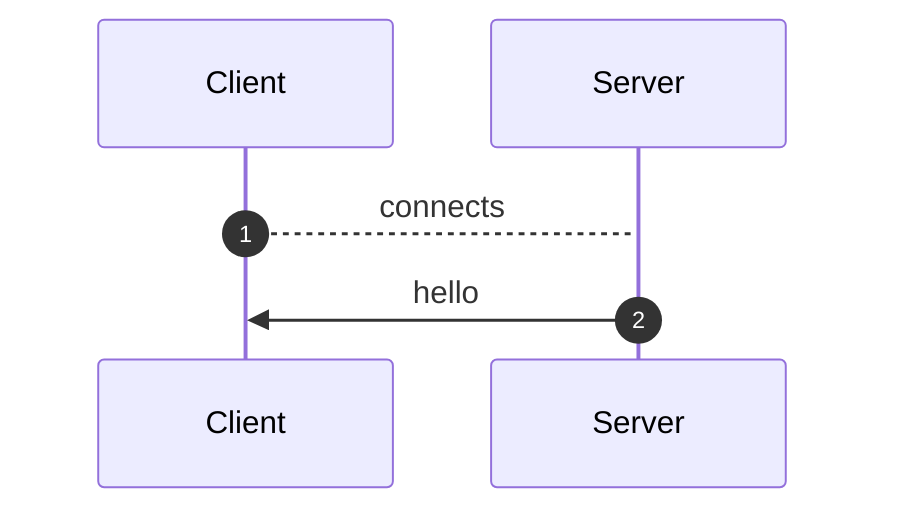
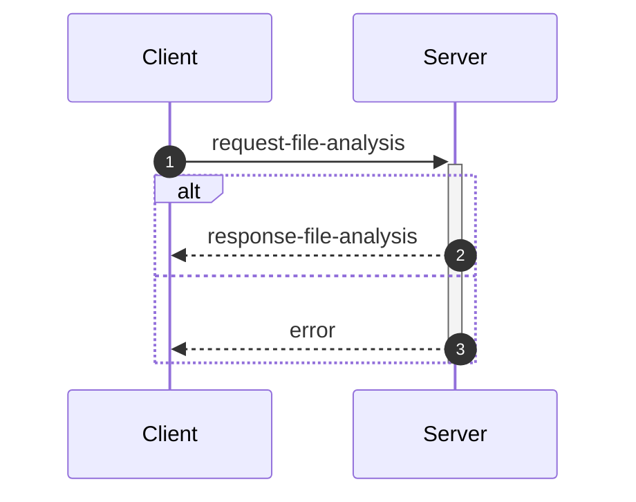
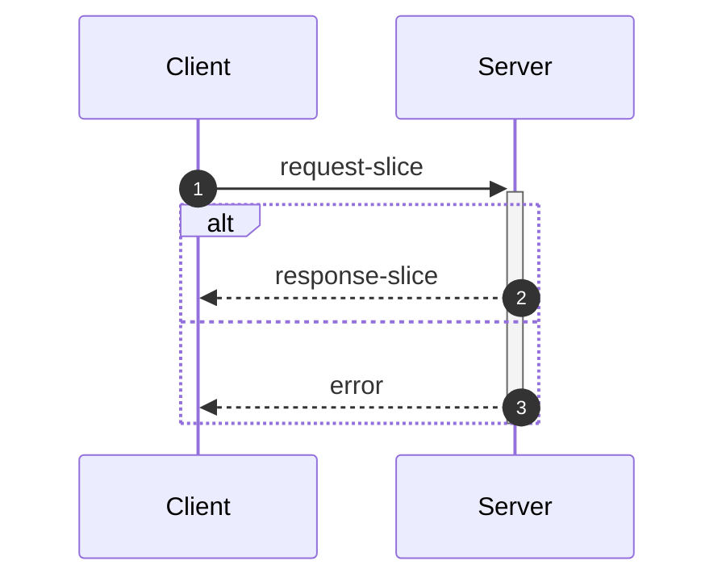
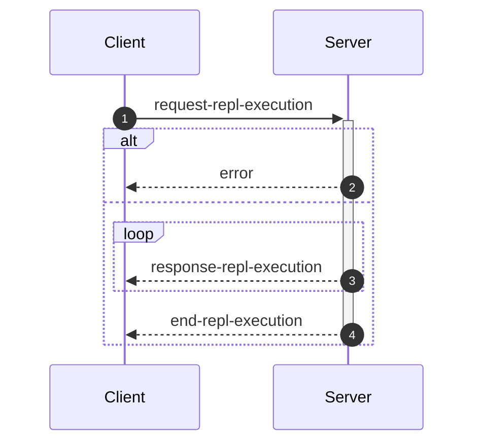

_<span title="an overview of flowR's interface">Generated</span> from '[wiki-interface.ts](https://github.com/flowr-analysis/flowr/tree/main/src/documentation/wiki-interface.ts "src/documentation/wiki-interface.ts")' on 2026-10-22, 18:15:08 UTC (v2.16.5, R v4.5.0), do not edit directly._

Although far from being as detailed as the in-depth explanation of [_flowR_](https://github.com/flowr-analysis/flowr/wiki/Core),
this wiki page explains how to interface with _flowR_ in more detail.
In general, command line arguments and other options provide short descriptions on hover over.

* [💻 Using the REPL](#using-the-repl)
* [⚙️ Configuring FlowR](#configuring-flowr)
* [⚒️ Writing Code](#writing-code)
* [💬 Communicating with the Server](#communicating-with-the-server)

<a id='using-the-repl'></a>
## 💻 Using the REPL

> [!NOTE]
> To execute arbitrary R commands with a repl request, _flowR_ has to be started explicitly with <span title="Description (Command Line Argument): Allow to access the underlying R session when using flowR (security warning: this allows the execution of arbitrary R code!)">`--r-session-access`</span>.
> Please be aware that this introduces a security risk and note that this relies on the [`r-shell` engine](https://github.com/flowr-analysis/flowr/wiki/Engines) .

Although primarily meant for users to explore,
there is nothing which forbids calling _flowR_ as a subprocess to use standard-in, -output, and -error
for communication (although you can access the REPL using the server as well,
with the [REPL Request](#message-request-repl-execution) message).

The read-eval-print loop&nbsp;(REPL) works relatively simple.
You can submit an expression (using <kbd>Enter</kbd>),
which is interpreted as an R&nbsp;expression by default but interpreted as a *command* if it starts with a colon (`:`).
The best command to get started with the REPL is <span title="Description (Repl Command): Show help information (aliases: :h, :?)">`:help`</span>.
Besides, you can leave the REPL either with the command <span title="Description (Repl Command): End the repl (aliases: :q, :exit)">`:quit`</span> or by pressing <kbd>Ctrl</kbd>+<kbd>C</kbd> twice.
When writing a *command*, you may press <kbd>Tab</kbd> to get a list of completions, if available.
Multiple commands can be entered in a single line by separating them with a semicolon (`;`), e.g. `:parse "x<-2"; :df*`.
If a command is given without R code, the REPL will re-use R code given in a previous command.
The prior example will hence return first the parsed AST of the program and then the dataflow graph for `"x <- 2"`.

> [!NOTE]
> If you develop flowR, you may want to launch the repl using the `npm run main-dev` command, this way, you get a non-minified version of flowR with debug information and hot-reloading of source files.

<details>
<summary>Available Commands</summary>

We currently offer the following commands (this with a `[*]` suffix are available with and without the star):

| Command | Description |
| ------- | ----------- |
| **<span title="Description (Repl Command): End the repl (aliases: :q, :exit)">:quit</span>** | End the repl (aliases: **:<span title="Alias of ':quit'. End the repl">q</span>**, **:<span title="Alias of ':quit'. End the repl">exit</span>**) |
| **<span title="Description (Repl Command): Execute the given code as R code. This requires the `--r-session-access` flag to be set and requires the r-shell engine. (aliases: :e, :r)">:execute</span>** | Execute the given code as R code. This requires the `--r-session-access` flag to be set and requires the r-shell engine. (aliases: **:<span title="Alias of ':execute'. Execute the given code as R code. This requires the `--r-session-access` flag to be set and requires the r-shell engine.">e</span>**, **:<span title="Alias of ':execute'. Execute the given code as R code. This requires the `--r-session-access` flag to be set and requires the r-shell engine.">r</span>**) |
| **<span title="Description (Repl Command): Get mermaid code for the control-flow graph of R code (aliases: :cfg, :cf)">:controlflow[*]</span>** | Get mermaid code for the control-flow graph of R code (star: Returns the URL to mermaid.live) (aliases: **:<span title="Alias of ':controlflow'. Get mermaid code for the control-flow graph of R code">cfg</span>**, **:<span title="Alias of ':controlflow'. Get mermaid code for the control-flow graph of R code">cf</span>**) |
| **<span title="Description (Repl Command): Get mermaid code for the control-flow graph with basic blocks (aliases: :cfgb, :cfb)">:controlflowbb[*]</span>** | Get mermaid code for the control-flow graph with basic blocks (star: Returns the URL to mermaid.live) (aliases: **:<span title="Alias of ':controlflowbb'. Get mermaid code for the control-flow graph with basic blocks">cfgb</span>**, **:<span title="Alias of ':controlflowbb'. Get mermaid code for the control-flow graph with basic blocks">cfb</span>**) |
| **<span title="Description (Repl Command): Get mermaid code for the dataflow graph (aliases: :d, :df)">:dataflow[*]</span>** | Get mermaid code for the dataflow graph (star: Returns the URL to mermaid.live) (aliases: **:<span title="Alias of ':dataflow'. Get mermaid code for the dataflow graph">d</span>**, **:<span title="Alias of ':dataflow'. Get mermaid code for the dataflow graph">df</span>**) |
| **<span title="Description (Repl Command): Get mermaid code for the normalized AST of R code (aliases: :n)">:normalize[*]</span>** | Get mermaid code for the normalized AST of R code (star: Returns the URL to mermaid.live) (alias: **:<span title="Alias of ':normalize'. Get mermaid code for the normalized AST of R code">n</span>**) |
| **<span title="Description (Repl Command): Get mermaid code for the simplified dataflow graph (aliases: :ds, :dfs)">:dataflowsimple[*]</span>** | Get mermaid code for the simplified dataflow graph (star: Returns the URL to mermaid.live) (aliases: **:<span title="Alias of ':dataflowsimple'. Get mermaid code for the simplified dataflow graph">ds</span>**, **:<span title="Alias of ':dataflowsimple'. Get mermaid code for the simplified dataflow graph">dfs</span>**) |
| **<span title="Description (Repl Command): Inspect and extend the signature database: `query` (identical to :query @signature), `info <name>` for where a function comes from (identical to :query @function-info), `add <path>` to mount another database/source, `download` to fetch the full-history database. (aliases: :sig)">:signature</span>** | Inspect and extend the signature database: `query` (identical to :query @signature), `info <name>` for where a function comes from (identical to :query @function-info), `add <path>` to mount another database/source, `download` to fetch the full-history database. (alias: **:<span title="Alias of ':signature'. Inspect and extend the signature database: `query` (identical to :query @signature), `info <name>` for where a function comes from (identical to :query @function-info), `add <path>` to mount another database/source, `download` to fetch the full-history database.">sig</span>**) |
| **<span title="Description (Repl Command): Just calculates the DFG, but only prints summary info (aliases: :d#, :df#)">:dataflowsilent</span>** | Just calculates the DFG, but only prints summary info (aliases: **:<span title="Alias of ':dataflowsilent'. Just calculates the DFG, but only prints summary info">d#</span>**, **:<span title="Alias of ':dataflowsilent'. Just calculates the DFG, but only prints summary info">df#</span>**) |
| **<span title="Description (Repl Command): Prints ASCII Art of the parsed, unmodified AST (aliases: :p)">:parse</span>** | Prints ASCII Art of the parsed, unmodified AST (alias: **:<span title="Alias of ':parse'. Prints ASCII Art of the parsed, unmodified AST">p</span>**) |
| **<span title="Description (Repl Command): Prints the version of flowR as well as the current version of R">:version</span>** | Prints the version of flowR as well as the current version of R
| **<span title="Description (Repl Command): Query the given R code (use 'help' for more information)">:query[*]</span>** | Query the given R code (use 'help' for more information) (star: Similar to query, but returns the output in json format.)
| **<span title="Description (Repl Command): Returns an ASCII representation of the dataflow graph (aliases: :df!)">:dataflowascii</span>** | Returns an ASCII representation of the dataflow graph (alias: **:<span title="Alias of ':dataflowascii'. Returns an ASCII representation of the dataflow graph">df!</span>**) |
| **<span title="Description (Repl Command): Returns summarization stats for the normalized AST (aliases: :n#)">:normalize#</span>** | Returns summarization stats for the normalized AST (alias: **:<span title="Alias of ':normalize#'. Returns summarization stats for the normalized AST">n#</span>**) |
| **<span title="Description (Repl Command): Show help information (aliases: :h, :?)">:help</span>** | Show help information (aliases: **:<span title="Alias of ':help'. Show help information">h</span>**, **:<span title="Alias of ':help'. Show help information">?</span>**) |

</details>

> [!TIP]
> 
> As indicated by the examples before, all REPL commands that operate on code keep track of the state.
> Hence, if you run a command like <span title="Description (Repl Command, starred version): Returns the URL to mermaid.live; Base Command: Get mermaid code for the dataflow graph (aliases: :d*, :df*)">`:dataflow*`</span> without providing R code,
> the REPL will re-use the R code provided in a previous command.
> Likewise, doing this will benefit from incrementality!
> If you request the dataflow graph with `:df* x <- 2 * y` and then want to see the parsed AST with `:parse`,
> the REPL will re-use previously obtained information and not re-parse the code again.
> 		

Generally, many commands offer shortcut versions in the REPL. Many queries, for example, offer a shortened format (see the example below).
Of special note, the [Config Query](https://github.com/flowr-analysis/flowr/wiki/%5BQuery%5D-Config)
can be used to also modify the currently active configuration of _flowR_ within the REPL (see the [wiki page](https://github.com/flowr-analysis/flowr/wiki/%5BQuery%5D-Config) for more information).

### Example: Retrieving the Dataflow Graph

To retrieve a URL to the [mermaid](https://mermaid.js.org/) diagram of the dataflow of a given expression,
use <span title="Description (Repl Command, starred version): Returns the URL to mermaid.live; Base Command: Get mermaid code for the dataflow graph (aliases: :d*, :df*)">`:dataflow*`</span> (or <span title="Description (Repl Command): Get mermaid code for the dataflow graph (aliases: :d, :df)">`:dataflow`</span> to get the mermaid code in the cli):

```shell
$ docker run -it --rm eagleoutice/flowr # or npm run flowr 
flowR repl v2.16.5, R grammar v14 (tree-sitter engine)
R> :dataflow* y <- 1 + x
```

<details>
<summary style='color:gray'>Output</summary>

```text
https://mermaid.live/view#base64:eyJjb2RlIjoiZmxvd2NoYXJ0IFREXG4gICAgMXt7XCJgKiM5MTtSTnVtYmVyIzkzOyogKioxKipcbiAgICAgICoxLjYqICgqKmlkOiAxKiopYFwifX1cbiAgICAyKFtcImAqIzkxO1JTeW1ib2wjOTM7KiAqKngqKlxuICAgICAgKjEuMTAqICgqKmlkOiAyKiopYFwiXSlcbiAgICAzW1tcImAqIzkxO1JCaW5hcnlPcCM5MzsqIGJhc2UjNTg7IzU4OyoqIzQzOyoqXG4gICAgICAqMS42LTEwKiAoKippZDogMyoqKVxuICAgIGFyZzogKDEsIDIpYFwiXV1cbiAgICBidWlsdC1pbjpfNDNfW1wiYEJ1aWx0LUluOlxuIzQzO2BcIl1cbiAgICBzdHlsZSBidWlsdC1pbjpfNDNfIHN0cm9rZTpncmF5LGZpbGw6Z3JheSxzdHJva2Utd2lkdGg6MnB4LG9wYWNpdHk6Ljg7XG4gICAgMFtcImAqIzkxO1JTeW1ib2wjOTM7KiAqKnkqKlxuICAgICAgKjEuMSogKCoqaWQ6IDAqKiwgdjogMylgXCJdXG4gICAgNFtbXCJgKiM5MTtSQmluYXJ5T3AjOTM7KiBiYXNlIzU4OyM1ODsqKiM2MDsjNDU7KipcbiAgICAgICoxLjEtMTAqICgqKmlkOiA0KiopXG4gICAgYXJnOiAoMCwgMylgXCJdXVxuICAgIGJ1aWx0LWluOl82MF8tW1wiYEJ1aWx0LUluOlxuIzYwOyM0NTtgXCJdXG4gICAgc3R5bGUgYnVpbHQtaW46XzYwXy0gc3Ryb2tlOmdyYXksZmlsbDpncmF5LHN0cm9rZS13aWR0aDoycHgsb3BhY2l0eTouODtcbiAgICAxIC0uLT58XCJmbG93XCJ8IDJcbiAgICBsaW5rU3R5bGUgMCBzdHJva2U6Z3JheSxjb2xvcjpncmF5O1xuICAgIDIgLS4tPnxcImZsb3dcInwgM1xuICAgIGxpbmtTdHlsZSAxIHN0cm9rZTpncmF5LGNvbG9yOmdyYXk7XG4gICAgMyAtLT58XCJyZWFkcywgYXJnXCJ8IDFcbiAgICAzIC0tPnxcInJlYWRzLCBhcmdcInwgMlxuICAgIDMgLS4tPnxcImZsb3dcInwgMFxuICAgIGxpbmtTdHlsZSA0IHN0cm9rZTpncmF5LGNvbG9yOmdyYXk7XG4gICAgMyAtLi0+fFwicmVhZHMsIGNhbGxzXCJ8IGJ1aWx0LWluOl80M19cbiAgICBsaW5rU3R5bGUgNSBzdHJva2U6Z3JheTtcbiAgICAwIC0tPnxcImRlZmluZWQtYnksIGZsb3dcInwgNFxuICAgIDAgLS0+fFwiZGVmaW5lZC1ieVwifCAzXG4gICAgNCAtLT58XCJyZWFkcywgYXJnXCJ8IDNcbiAgICA0IC0tPnxcInJldHVybnMsIGFyZ1wifCAwXG4gICAgNCAtLi0+fFwicmVhZHMsIGNhbGxzXCJ8IGJ1aWx0LWluOl82MF8tXG4gICAgbGlua1N0eWxlIDEwIHN0cm9rZTpncmF5OyIsIm1lcm1haWQiOnsiYXV0b1N5bmMiOnRydWV9fQ==
```

Retrieve the dataflow graph of the expression `y <- 1 + x`. It looks like this:


<details>

<summary style="color:gray">R Code of the Dataflow Graph</summary>

The analysis ran (including parse and normalize, using the [tree-sitter](https://github.com/flowr-analysis/flowr/wiki/Engines) engine) within the generation environment. No [signature database](https://github.com/flowr-analysis/flowr/wiki/Signature-Database) is mounted for these generated graphs, so `library()` calls attach no package exports; base-R names are still qualified via the generated base-package store (e.g. `acf` as `stats::acf`). 
We encountered no unknown side effects during the analysis.

```r
y <- 1 + x
```

</details>

</details>

For small graphs like this, <span title="Description (Repl Command): Returns an ASCII representation of the dataflow graph (aliases: :df!)">`:dataflowascii`</span> also provides an ASCII representation directly in the REPL:

```shell
$ docker run -it --rm eagleoutice/flowr # or npm run flowr 
flowR repl v2.16.5, R grammar v14 (tree-sitter engine)
R> :df! y <- 1 + x
```

<details open>
<summary style='color:gray'>Output</summary>

```text
                        v<0>v
 c<4>c──────────────────| y |
 |<- |     ┌────────────v---v
 c---c     │
    │   c<3>c   0<1>0
    └───| + |───| 1 |───u<2>u
        c---c   0---0   | x |
           └────────────u---u
Edges:
3 -> 1: reads, arg          3 -> 2: reads, arg
3 -> 0: flows-to            1 -> 2: flows-to
2 -> 3: flows-to            4 -> 3: reads, arg
4 -> 0: returns, arg        0 -> 4: defined-by, flows-to
0 -> 3: defined-by
```

Retrieve the dataflow graph of the expression `y <- 1 + x` as ASCII art.

</details>

For the slicing with <span title="Description (Repl Command): Static backwards executable slicer for R">`:slicer`</span>, you have access to the same [magic comments](#slice-magic-comments) as with the [slice request](#message-request-slice).
Pass `--inline` to splice resolvable `source()` calls into the reconstruction so the slice is a single self-contained R text (the same as the static slice query's `inlineSources` flag).
See `--help` for more flags!

### Example: Interfacing with the File System

Many commands that allow for an R-expression (like <span title="Description (Repl Command, starred version): Returns the URL to mermaid.live; Base Command: Get mermaid code for the dataflow graph (aliases: :d*, :df*)">`:dataflow*`</span>) allow for a file as well
if the argument starts with `file://`.
If you are working from the root directory of the _flowR_ repository, the following gives you the parsed AST of the example file using the <span title="Description (Repl Command): Prints ASCII Art of the parsed, unmodified AST (aliases: :p)">`:parse`</span> command:

> **Watch mode**: Replace `file://` with `watch://` to enter watch mode.
> flowR runs the command immediately and then re-runs it every time the file (or any file inside the folder) changes.
> Enter any other command to leave watch mode.
> For example: `:df watch://analysis.R`

```shell
$ docker run -it --rm eagleoutice/flowr # or npm run flowr 
flowR repl v2.16.5, R grammar v14 (tree-sitter engine)
R> :parse file://test/testfiles/example.R
```

<details>
<summary style='color:gray'>Output</summary>

```text
File: test/testfiles/example.R

program
├ binaryoperator
│ ├ identifier "sum" (1:1─4)
│ ├ <- "<-" (1:5─7)
│ ╰ float "0" (1:8─9)
├ binaryoperator
│ ├ identifier "product" (2:1─8)
│ ├ <- "<-" (2:9─11)
│ ╰ float "1" (2:12─13)
├ binaryoperator
│ ├ identifier "w" (3:1─2)
│ ├ <- "<-" (3:3─5)
│ ╰ float "7" (3:6─7)
├ binaryoperator
│ ├ identifier "N" (4:1─2)
│ ├ <- "<-" (4:3─5)
│ ╰ float "10" (4:6─8)
├ forstatement
│ ├ for "for" (6:1─4)
│ ├ ( "(" (6:5─6)
│ ├ identifier "i" (6:6─7)
│ ├ in "in" (6:8─10)
│ ├ binaryoperator
│ │ ├ float "1" (6:11─12)
│ │ ├ : ":" (6:12─13)
│ │ ╰ parenthesizedexpression
│ │   ├ ( "(" (6:13─14)
│ │   ├ binaryoperator
│ │   │ ├ identifier "N" (6:14─15)
│ │   │ ├ - "-" (6:15─16)
│ │   │ ╰ float "1" (6:16─17)
│ │   ╰ ) ")" (6:17─18)
│ ├ ) ")" (6:18─19)
│ ╰ bracedexpression
│   ├ { "{" (6:20─21)
│   ├ binaryoperator
│   │ ├ identifier "sum" (7:3─6)
│   │ ├ <- "<-" (7:7─9)
│   │ ╰ binaryoperator
│   │   ├ binaryoperator
│   │   │ ├ identifier "sum" (7:10─13)
│   │   │ ├ + "+" (7:14─15)
│   │   │ ╰ identifier "i" (7:16─17)
│   │   ├ + "+" (7:18─19)
│   │   ╰ identifier "w" (7:20─21)
│   ├ binaryoperator
│   │ ├ identifier "product" (8:3─10)
│   │ ├ <- "<-" (8:11─13)
│   │ ╰ binaryoperator
│   │   ├ identifier "product" (8:14─21)
│   │   ├  "" (8:22─23)
│   │   ╰ identifier "i" (8:24─25)
│   ╰ } "}" (9:1─2)
├ call
│ ├ identifier "cat" (11:1─4)
│ ╰ arguments
│   ├ ( "(" (11:4─5)
│   ├ argument
│   │ ╰ string
│   │   ├ " "\"" (11:5─6)
│   │   ├ stringcontent "Sum:" (11:6─10)
│   │   ╰ " "\"" (11:10─11)
│   ├ comma "," (11:11─12)
│   ├ argument
│   │ ╰ identifier "sum" (11:13─16)
│   ├ comma "," (11:16─17)
│   ├ argument
│   │ ╰ string
│   │   ├ " "\"" (11:18─19)
│   │   ├ stringcontent
│   │   │ ╰ escapesequence "\\n" (11:19─21)
│   │   ╰ " "\"" (11:21─22)
│   ╰ ) ")" (11:22─23)
╰ call
  ├ identifier "cat" (12:1─4)
  ╰ arguments
    ├ ( "(" (12:4─5)
    ├ argument
    │ ╰ string
    │   ├ " "\"" (12:5─6)
    │   ├ stringcontent "Product:" (12:6─14)
    │   ╰ " "\"" (12:14─15)
    ├ comma "," (12:15─16)
    ├ argument
    │ ╰ identifier "product" (12:17─24)
    ├ comma "," (12:24─25)
    ├ argument
    │ ╰ string
    │   ├ " "\"" (12:26─27)
    │   ├ stringcontent
    │   │ ╰ escapesequence "\\n" (12:27─29)
    │   ╰ " "\"" (12:29─30)
    ╰ ) ")" (12:30─31)
```

Retrieve the parsed AST of the example file.

<details>

<summary>File Content</summary>

```r
sum <- 0
product <- 1
w <- 7
N <- 10

for (i in 1:(N-1)) {
  sum <- sum + i + w
  product <- product * i
}

cat("Sum:", sum, "\n")
cat("Product:", product, "\n")
```

</details>

As _flowR_ directly transforms this AST the output focuses on being human-readable instead of being machine-readable.
		
</details>

### Example: Run a Query

You can run any query supported by _flowR_ using the <span title="Description (Repl Command): Query the given R code (use 'help' for more information)">`:query`</span> command.
For example, to obtain the shapes of all data frames in a given piece of code, you can run:

```shell
$ docker run -it --rm eagleoutice/flowr # or npm run flowr 
flowR repl v2.16.5, R grammar v14 (tree-sitter engine)
R> :query @absint df-shape "x <- data.frame(a = 1:10, b = 1:10)\ny <- x$a"
```

<details open>
<summary style='color:gray'>Output</summary>

```text
Query: absint (1 ms)
```

Retrieve the shapes of all data frames in the given code.

</details>

To run the linter on a file, you can use (in this example, we just issue the `dead-code` linter on a small piece of code):

```shell
$ docker run -it --rm eagleoutice/flowr # or npm run flowr 
flowR repl v2.16.5, R grammar v14 (tree-sitter engine)
R> :query @linter rules:dead-code "if(FALSE) x <- 2"
```

<details open>
<summary style='color:gray'>Output</summary>

```text
Query: linter (1 ms)
   ╰ Dead Code (dead-code):
       ╰ certain:
           ╰ Code at 1.11-16
```

Run the linter on the given code, with only the `dead-code` rule enabled.

</details>

For more information on the available queries, please check out the [Query API](https://github.com/flowr-analysis/flowr/wiki/Query-API).

<a id='configuring-flowr'></a>
## ⚙️ Configuring FlowR

When running _flowR_, you may want to specify some behaviors with a dedicated configuration file.
By default, flowR looks for a file named `flowr.json` in the current working directory (or any higher directory).
You can also specify a different file with <span title="Description (Command Line Argument): The name of the configuration file to use">`--config-file`</span> or pass the configuration inline using <span title="Description (Command Line Argument): The flowR configuration to use, as a JSON string">`--config-json`</span>.
A `flowr.json` found this way belongs to the analyzed project, so flowR ignores its options that decide what flowR executes or loads
(`engines.*.wasmPath`, `engines.*.treeSitterWasmPath`, `engines.*.rPath`, `solver.sigdb.additionalPaths`, `solver.sigdb.downloadRepo`, `solver.sigdb.installedLibrary.paths`),
unless you pass <span title="Description (Command Line Argument): Keep the security-sensitive options (e.g., the R executable) of the flowr.json found in the working directory or a parent. Only use this for projects you trust.">`--trust-config`</span>.
To analyze code you do not trust, use the secure mode (<span title="Description (Command Line Argument): Run in secure mode for analyzing untrusted code: flowR does not start R (or any other process), does not access the network, does not search for project configs, and ignores security-sensitive options in every config. Cannot be disabled once enabled. Can also be enabled with the environment variable {italic FLOWR_SECURE_MODE=1}.">`--secure`</span>, see the [security policy](https://github.com/flowr-analysis/flowr/blob/main/.github/SECURITY.md)).
To inspect the current configuration, you can run flowr with the <span title="Description (Command Line Argument): Run with verbose logging (will be passed to the corresponding script)">`--verbose`</span> flag, or use the `config` [Query](https://github.com/flowr-analysis/flowr/wiki/Query-API).
Within the REPL this works by running the following:

```shell
:query @config
```

To work with the <a href="https://github.com/flowr-analysis/flowr/tree/main/src/config.ts#L119"><code><span title="The configuration file format for flowR.">FlowrConfig</span></code></a> you can use the provided helper objects alongside its methods like
<a href="https://github.com/flowr-analysis/flowr/tree/main/src/config.ts#L914"><code><span title="Creates a new flowr config that has the updated values.">FlowrConfig::<b>amend</b></span></code></a>.
The schema below documents every option; the ones you most likely want are:

- <a href="https://github.com/flowr-analysis/flowr/wiki/Interface#configuring-flowr" title="Configuration Option (boolean): Whether source calls should be ignored, causing {@link processSourceCall}&#39;s behavior to be skipped.">ignoreSourceCalls</a>: ignore source calls when analyzing the code, i.e., ignore the inclusion of other files.
- <a href="https://github.com/flowr-analysis/flowr/wiki/Interface#configuring-flowr" title="Configuration Option (boolean): Whether load calls should be ignored, causing {@link processLoadCall}&#39;s behavior to be skipped.">ignoreLoadCalls</a>: ignore load calls when analyzing the code, i.e., ignore the loading of r-data files.
- <a href="https://github.com/flowr-analysis/flowr/wiki/Interface#configuring-flowr" title="Configuration Option (object): Do you want to overwrite (parts) of the builtin definition?">semantics.environment.overwriteBuiltIns</a>: overwrite _flowR_'s handling of built-in functions, or clear the preset definitions entirely.
  See [Configure BuiltIn Semantics](#configure-builtin-semantics) for more information.
- <a href="https://github.com/flowr-analysis/flowr/wiki/Interface#configuring-flowr" title="Configuration Option (string): How to resolve variables and their values. (one of &quot;disabled&quot;, &quot;alias&quot;, &quot;builtin&quot;)">solver.variables</a>: how to resolve variables and their values (`disabled`, `alias`, `builtin`).
- <a href="https://github.com/flowr-analysis/flowr/wiki/Interface#configuring-flowr" title="Configuration Option (array): The engine or set of engines to use for interacting with R code. An empty array means all available engines will be used.">engines</a> and <a href="https://github.com/flowr-analysis/flowr/wiki/Interface#configuring-flowr" title="Configuration Option (string): The default engine to use for interacting with R code. If this is undefined, an arbitrary engine from the specified list will be used. (one of &quot;tree-sitter&quot;, &quot;r-shell&quot;)">defaultEngine</a>: the engines used to interact with R code, see the [Engines wiki page](https://github.com/flowr-analysis/flowr/wiki/Engines).
- <a href="https://github.com/flowr-analysis/flowr/wiki/Interface#configuring-flowr" title="Configuration Option (array): Files a framework loads on its own, without any source() call (e.g. global.R in a shiny app), in the order they are loaded; flowR orders the matching project files accordingly and analyzes them as one program. Entries are case-insensitive globs matched against the file path, a plain name matches any file with that name, and entries matching no project file are warned about. Usually set per project kind via specializeConfig.">project.implicitSources</a>: the files a framework loads without any `source()` call, in the order in which they are
  loaded. Entries are globs (e.g. `R/*.R`) matched against the file path ignoring capitalization; one matching no file is reported.
- <a href="https://github.com/flowr-analysis/flowr/wiki/Interface#configuring-flowr" title="Configuration Option (object): Overwrite (parts of) the configuration depending on the project kind flowR detects, e.g. to give a shiny app its implicit sources.">specializeConfig</a>: overwrite (parts of) the configuration depending on the kind of project _flowR_ detects
  (e.g. `shiny-app`), which is how a shiny app gets its implicit sources by default. What you configure directly wins.
- <a href="https://github.com/flowr-analysis/flowr/wiki/Interface#configuring-flowr" title="Configuration Option (string): Overwrite the project kind flowR would otherwise infer from the analyzed files, e.g. when auto-detection guesses wrong. (one of &quot;package&quot;, &quot;script&quot;, &quot;shiny-app&quot;, &quot;notebook&quot;, &quot;project&quot;, &quot;unknown&quot;)">project.useProjectType</a>: skip that detection and force a project kind yourself, when auto-detection guesses wrong.
- <a href="https://github.com/flowr-analysis/flowr/wiki/Interface#configuring-flowr" title="Configuration Option (array): The default plugins to load when creating a new instance of FlowrAnalyzer">defaultPlugins</a> and <a href="https://github.com/flowr-analysis/flowr/wiki/Interface#configuring-flowr" title="Configuration Option (array): The plugins to load in REPL mode">repl.plugins</a>: the plugins to load for a new <a href="https://github.com/flowr-analysis/flowr/tree/main/src/project/flowr-analyzer.ts#L205"><code><span title="Central class for conducting analyses with FlowR. Use the FlowrAnalyzerBuilder to create a new instance. If you want the original pattern of creating a pipeline and running all steps, you can still do this with FlowrAnalyzer#runFull . To inspect the context of the analyzer, use FlowrAnalyzer#inspectContext (if you are a plugin and need to modify it, use FlowrAnalyzer#context instead).">FlowrAnalyzer</span></code></a> and in the REPL
  (use `flowr:default` to reference the former).

So you can configure _flowR_ by adding a file like the following:

<details>

<summary>Example Configuration File</summary>

```json
{
  "ignoreSourceCalls": true,
  "ignoreLoadCalls": true,
  "semantics": {
    "environment": {
      "overwriteBuiltIns": {
        "definitions": [
          {
            "type": "function",
            "names": [
              "foo"
            ],
            "processor": "builtin:assign",
            "config": {}
          }
        ]
      }
    }
  },
  "defaultPlugins": [
    "file:description",
    "versions:description"
  ],
  "repl": {
    "quickStats": false,
    "dfProcessorHeat": false,
    "hints": true,
    "plugins": [
      "flowr:default"
    ]
  },
  "project": {
    "resolveUnknownPathsOnDisk": true,
    "implicitSources": [
      "global.R",
      "app.R"
    ]
  },
  "linter": {
    "disabledRules": []
  },
  "specializeConfig": {
    "shiny-app": {
      "project": {
        "implicitSources": [
          "global.R",
          "ui.R",
          "server.R",
          "app.R"
        ]
      }
    }
  },
  "engines": [
    {
      "type": "r-shell"
    }
  ],
  "solver": {
    "variables": "alias",
    "evalStrings": true,
    "trackEnvironments": true,
    "sigdb": {
      "enabled": true,
      "loadProjectDependencies": true,
      "eagerlyLoad": false,
      "eagerlyLoadExports": false,
      "linkBaseR": false,
      "linkDescriptionDependencies": false
    },
    "resolveSource": {
      "dropPaths": "no",
      "ignoreCapitalization": true,
      "inferWorkingDirectory": "active-script",
      "searchPath": []
    },
    "instrument": {},
    "slicer": {
      "threshold": 50
    }
  },
  "abstractInterpretation": {
    "wideningThreshold": 4,
    "followCalls": true,
    "dataFrame": {
      "maxColNames": 20,
      "readLoadedData": {
        "readExternalFiles": true,
        "maxReadLines": 1000000
      }
    }
  },
  "incremental": {
    "alwaysIncremental": false,
    "parsing": {
      "activated": false,
      "heuristics": {
        "activated": true,
        "mtime": true,
        "linesFrom": 500,
        "bytesFrom": 50000,
        "alwaysWithEdits": false,
        "minFiles": 1
      }
    }
  },
  "gas": {
    "thresholds": {
      "memory": {
        "problematic": 0.7,
        "critical": 0.9
      },
      "timeMs": {
        "problematic": 100000,
        "critical": 120000
      }
    },
    "features": {}
  }
}
```

</details>

<details>
<a id='configure-builtin-semantics'></a>
<summary>Configure Built-In Semantics</summary>

`semantics/environment/overwriteBuiltins` accepts two keys:

- `loadDefaults` (boolean, initially `true`): If set to `true`, the default built-in definitions are loaded before applying the custom definitions. Setting this flag to `false` explicitly disables the loading of the default definitions.
- `definitions` (array, initially empty): Allows to overwrite or define new built-in elements. Each object within must have a `type` which is one of the below. Furthermore, they may define a string array of `names` which specifies the identifiers to bind the definitions to. You may use `assumePrimitive` to specify whether _flowR_ should assume that this is a primitive non-library definition (so you probably just do not want to specify the key).

  | Type            | Description                                                                                                                                                                                                                                                                                              | Example                                                                                                    |
  | --------------- | -------------------------------------------------------------------------------------------------------------------------------------------------------------------------------------------------------------------------------------------------------------------------------------------------------- | ---------------------------------------------------------------------------------------------------------- |
  | `constant`    | Additionally allows for a `value` this should resolve to.                                                                                                                                                                                                                                                | `{ type: 'constant', names: ['NULL', 'NA'],  value: null }`                                                |
  | `function`    | Is a rather flexible way to define and bind built-in functions. For the time, we do not have extensive documentation to cover all the cases, so please either consult the sources with the `default-builtin-config.ts` or open a [new issue](https://github.com/flowr-analysis/flowr/issues/new/choose). | `{ type: 'function', names: ['next'], processor: 'builtin:d', config: { cfg: ExitPointType.Next } }` |
  | `replacement` | A comfortable way to specify replacement functions like `$<-` or `names<-`. `suffixes` describes the... suffixes to attach automatically. | `{ type: 'replacement', suffixes: ['<-', '<<-'], names: ['[', '[['] }` |

</details>

<details>

<summary style='color:gray'>Full Configuration-File Schema</summary>

- _The configuration file format for flowR._ (object)
    - **logLevel** [optional] _flowR's global minimum log level, applied when the config is loaded._ (string)
        Only allows: 'silly', 'trace', 'debug', 'info', 'warn', 'error', 'fatal'
    - **ignoreSourceCalls** [optional] _Whether source calls should be ignored, causing {@link processSourceCall}'s behavior to be skipped._ (boolean)
    - **ignoreLoadCalls** [optional] _Whether load calls should be ignored, causing {@link processLoadCall}'s behavior to be skipped._ (boolean)
    - **semantics** _Configure language semantics and how flowR handles them._ (object)
        - **environment** [optional] _Semantics regarding how to handle the R environment._ (object)
            - **overwriteBuiltIns** [optional] _Do you want to overwrite (parts) of the builtin definition?_ (object)
                - **loadDefaults** [optional] _Should the default configuration still be loaded?_ (boolean)
                - **definitions** [optional] _The definitions to load/overwrite._ (array)
                Valid item types:
                    - (object)
    - **defaultPlugins** [optional] _The default plugins to load when creating a new instance of FlowrAnalyzer_ (array)
    Valid item types:
        - (alternatives)
            - (string)
            - (array)
    - **repl** _Configuration options for the REPL._ (object)
        - **quickStats** [optional] _Whether to show quick stats in the REPL after each evaluation._ (boolean)
        - **dfProcessorHeat** [optional] _This instruments the dataflow processors to count how often each processor is called._ (boolean)
        - **hints** [optional] _Whether to show dim inline hints on the empty prompt (automatically disabled on non-interactive terminals)._ (boolean)
        - **plugins** [optional] _The plugins to load in REPL mode_ (array)
        Valid item types:
            - (alternatives)
                - (string)
                - (array)
        - **autoUseFileProtocol** [optional] _Prepend the file protocol to a repl input that looks like a path, instead of only warning about it._ (boolean)
        - **queryStats** [optional] _Whether `:query` closes with the line stating how long the queries took (`:query*` never prints it)._ (boolean)
        - **showPlugins** [optional] _Whether `:version` grays out the plugins that did not activate during the last analysis._ (boolean)
    - **project** _Project specific configuration options._ (object)
        - **resolveUnknownPathsOnDisk** [optional] _Whether to resolve unknown paths loaded by the r project disk when trying to source/analyze files._ (boolean)
        - **failOnInaccessiblePath** [optional] _Whether a directory that cannot be traversed during file discovery (e.g. due to permissions) aborts the analysis; when false (the default) such paths are logged and skipped._ (boolean)
        - **basePackages** [optional] _The packages considered part of R itself (base and recommended); if unset, flowR uses its built-in list._ (array)
        Valid item types:
            - (string)
        - **implicitSources** [optional] _Files a framework loads on its own, without any source() call (e.g. global.R in a shiny app), in the order they are loaded; flowR orders the matching project files accordingly and analyzes them as one program. Entries are case-insensitive globs matched against the file path, a plain name matches any file with that name, and entries matching no project file are warned about. Usually set per project kind via specializeConfig._ (array)
        Valid item types:
            - (string)
        - **useProjectType** [optional] _Overwrite the project kind flowR would otherwise infer from the analyzed files, e.g. when auto-detection guesses wrong._ (string)
            Only allows: 'package', 'script', 'shiny-app', 'notebook', 'project', 'unknown'
        - **assumeImplicitEcho** [optional] _Whether the top level of the analyzed code is echoed, so that every visible result printed there is collected as an output by the dependencies query (default true, false for a package)._ (boolean)
        - **discovery** [optional] _Scoping options for the default project discovery._ (object)
            - **full** [optional] _Collect every file below the project root (greedy) instead of only the files the detected project kind needs (default false)._ (boolean)
            - **perKind** [optional] _Per-kind include/exclude glob overrides layered on the default scoping._ (object)
            - **ignore** [optional] _Case-insensitive globs that drop matching files from the intelligent discovery, regardless of kind (e.g. .Renviron to ignore environment files)._ (array)
            Valid item types:
                - (string)
        - **classification** [optional] _Overrides for the signals flowR uses to classify the project kind._ (object)
            - **shinyDescriptionTypes** [optional] _DESCRIPTION Type: values that mark a shiny app._ (array)
            Valid item types:
                - (string)
            - **shinyEntryFiles** [optional] _File names a shiny app is assembled from._ (array)
            Valid item types:
                - (string)
            - **shinyUsagePattern** [optional] _Regex source evidencing shiny usage in an entry file._ (string)
            - **notebookExtensions** [optional] _File extensions marking a notebook._ (array)
            Valid item types:
                - (string)
    - **linter** _Linter configuration options._ (object)
        - **disabledRules** _Linting rule names excluded from the default rule set (a rule requested explicitly via a linter query still runs). Usually set per project kind via specializeConfig._ (array)
        Valid item types:
            - (string)
        - **disabledTags** [optional] _Linting rule tags whose rules are excluded from the default rule set (a rule requested explicitly via a linter query still runs). By default the cmd-check rules are disabled for everything but a package; a configured list replaces that default._ (array)
        Valid item types:
            - (string)
    - **inputSources** [optional] _Further frameworks the input-sources analysis should know about; entries are added to flowR's defaults._ (object)
        - **pure** [optional] _Functions that only pass the constantness of their arguments on._ (array)
        Valid item types:
            - (string)
        - **param** [optional] _Functions whose result is a 'param' input._ (array)
        Valid item types:
            - (string)
        - **file** [optional] _Functions whose result is a 'file' input._ (array)
        Valid item types:
            - (string)
        - **tempfile** [optional] _Functions whose result is a 'tempfile' input._ (array)
        Valid item types:
            - (string)
        - **glob** [optional] _Functions whose result is a 'glob' input._ (array)
        Valid item types:
            - (string)
        - **net** [optional] _Functions whose result is a 'net' input._ (array)
        Valid item types:
            - (string)
        - **rand** [optional] _Functions whose result is a 'rand' input._ (array)
        Valid item types:
            - (string)
        - **system** [optional] _Functions whose result is a 'system' input._ (array)
        Valid item types:
            - (string)
        - **ffi** [optional] _Functions whose result is a 'ffi' input._ (array)
        Valid item types:
            - (string)
        - **lang** [optional] _Functions whose result is a 'lang' input._ (array)
        Valid item types:
            - (string)
        - **options** [optional] _Functions whose result is a 'options' input._ (array)
        Valid item types:
            - (string)
        - **cmdline** [optional] _Functions whose result is a 'cmdline' input._ (array)
        Valid item types:
            - (string)
        - **user** [optional] _Functions whose result is a 'user' input._ (array)
        Valid item types:
            - (string)
        - **const** [optional] _Functions whose result is a 'const' input._ (array)
        Valid item types:
            - (string)
        - **scope** [optional] _Functions whose result is a 'scope' input._ (array)
        Valid item types:
            - (string)
        - **dconst** [optional] _Functions whose result is a 'dconst' input._ (array)
        Valid item types:
            - (string)
        - **unknown** [optional] _Functions whose result is a 'unknown' input._ (array)
        Valid item types:
            - (string)
        - **linkedObjects** [optional] _Objects a framework provides without a definition in the code, e.g. shiny's input._ (array)
        Valid item types:
            - (object)
        - **linkedEntryPoints** [optional] _Calls that hand a function to a framework, which binds its objects to the parameters by position._ (array)
        Valid item types:
            - (object)
    - **specializeConfig** [optional] _Overwrite (parts of) the configuration depending on the project kind flowR detects, e.g. to give a shiny app its implicit sources._ (object)
    - **engines** _The engine or set of engines to use for interacting with R code. An empty array means all available engines will be used._ (array)
    Valid item types:
        - (alternatives)
            - _The configuration for the tree sitter engine._ (object)
                - **type** [required] _Use the tree sitter engine._ (string)
                    Only allows: 'tree-sitter'
                - **wasmPath** [optional] _The path to the tree-sitter-r WASM binary to use. If this is undefined, this uses the default path._ (string)
                - **treeSitterWasmPath** [optional] _The path to the tree-sitter WASM binary to use. If this is undefined, this uses the default path._ (string)
                - **lax** [optional] _Whether to use the lax parser for parsing R code (allowing for syntax errors). If this is undefined, the strict parser will be used._ (boolean)
            - _The configuration for the R shell engine._ (object)
                - **type** [required] _Use the R shell engine._ (string)
                    Only allows: 'r-shell'
                - **rPath** [optional] _The path to the R executable to use. If this is undefined, this uses the default path._ (string)
                - **pipeBind** [optional] _Whether to enable R's experimental pipe-bind operator "=>" by setting _R_USE_PIPEBIND_ for the R session (default false); R itself keeps this off by default, as it is experimental and has never shipped in a release version of R._ (boolean)
    - **defaultEngine** [optional] _The default engine to use for interacting with R code. If this is undefined, an arbitrary engine from the specified list will be used._ (string)
        Only allows: 'tree-sitter', 'r-shell'
    - **solver** _How to resolve constants, constraints, cells, ..._ (object)
        - **variables** _How to resolve variables and their values._ (string)
            Only allows: 'disabled', 'alias', 'builtin'
        - **evalStrings** _Should we include eval(parse(text="...")) calls in the dataflow graph?_ (boolean)
        - **trackEnvironments** [optional] _Track user-created environments (new.env, assign/get/local with envir=, dollar-assign, attach). When false, all envir-style calls fall through conservatively._ (boolean)
        - **sigdb** _Resolving library exports from a signature database._ (object)
            - **enabled** [optional] _Resolve library()/use() exports from a signature database (default true); when false no database is consulted._ (boolean)
            - **loadProjectDependencies** [optional] _Load the project's declared dependencies from its metadata files (DESCRIPTION Imports/Depends, rproject.toml, uvr.toml, renv.lock, rv.lock, uvr.lock) (default true); when false these files are not read for dependencies._ (boolean)
            - **eagerlyLoad** [optional] _Parse the database up front rather than on the first package load (default false, ignored if disabled)._ (boolean)
            - **eagerlyLoadExports** [optional] _Add a vertex for every export on load rather than on demand (default false); keeps the dataflow graph small._ (boolean)
            - **assumedRVersion** [optional] _R version assumed when resolving versioned (base-R) exports: a pin like "4.5" or "auto" to detect the installed R (default "auto")._ (string)
            - **linkBaseR** [optional] _Eagerly attach base-R namespaces so bare base calls resolve without library() (default false)._ (boolean)
            - **linkBaseRCalls** [optional] _Add a lightweight Reads edge from a bare base-R call to its signature-database function vertex (default false; base-R qualification is edge-free otherwise)._ (boolean)
            - **linkPackageCalls** [optional] _Add a lightweight Reads edge from a resolved package call to its signature-database function vertex (default false)._ (boolean)
            - **linkDescriptionDependencies** [optional] _Eagerly attach the namespaces of the project's declared DESCRIPTION dependencies (Imports/Depends) so their exports resolve without an explicit library() (default false)._ (boolean)
            - **warmInBackground** [optional] _Decompress the hot shards (base + most-downloaded) in a background task on startup so the first library() lookup is warm (default false; for long-running servers/REPLs)._ (boolean)
            - **additionalPaths** [optional] _Extra directories or bundle/manifest files searched for signature databases (alongside the shipped default and $FLOWR_SIGDB_DIR); a downloaded full-history bundle placed here is mounted automatically._ (array)
            Valid item types:
                - (string)
            - **downloadRepo** [optional] _GitHub owner/repo the full-history bundle is downloaded from via ":signature download" (default "flowr-analysis/flowr", release tag "sigdb-v<flowR-version>")._ (string)
            - **autoSync** [optional] _On startup, re-download shards whose committed sigdb.remote.json hash no longer matches the cache, in the background (default false; opt-in network sync after a git pull)._ (boolean)
            - **installedLibrary** [optional] _Recovering packages no signature database knows from the copy installed on this machine._ (object)
                - **enabled** [required] _Recover packages no signature database knows from their installed copy (default false)._ (boolean)
                - **paths** [optional] _Library directories to search; when empty they are discovered from the environment and the project._ (array)
                Valid item types:
                    - (string)
                - **useEnvironment** [optional] _Search the libraries R_LIBS_USER/R_LIBS/R_LIBS_SITE name (default true)._ (boolean)
                - **useProjectLibrary** [optional] _Search a project-local renv/packrat library (default true)._ (boolean)
                - **maxDepth** [optional] _How far to descend into the nested layout of a project-local library (default 3)._ (number)
                - **packages** [optional] _Only recover packages whose name matches one of these regular expressions; empty means any._ (array)
                Valid item types:
                    - (string)
            - **blobCacheBudgetMb** [optional] _How many MiB of decoded package blobs every open bundle may hold together (default 16)._ (number)
            - **versionSelection** [optional] _When a project constrains a dependency, resolve to the newest (default), oldest, or system-installed version satisfying it; system needs R and falls back to newest. Base-R packages always resolve against the assumed R version._ (string)
                Only allows: 'newest', 'oldest', 'system'
            - **versionOverrides** [optional] _Force an exact version for specific packages (name -> version), overriding both the project constraint and the versionSelection policy (default {})._ (object)
        - **versionManagement** _Policies for reasoning about dependency versions._ (object)
            - **linkedVersionGroups** [optional] _Groups of packages that must resolve to the same version; version guessing intersects each group so its members stay mutually compatible (default [])._ (array)
            Valid item types:
                - (array)
                Valid item types:
                    - (string)
        - **assumeAttachedPackages** [optional] _Packages to treat as attached without a `library()` call, so what the built-in configuration states about them applies to the analyzed code. The base packages R attaches on startup already resolve without it._ (array)
        Valid item types:
            - (string)
        - **transitiveSideEffectRounds** [optional] _How many rounds the transitive side-effect fixpoint may run before it is cut off (default 32); the propagation stops on its own as soon as a round adds nothing._ (number)
        - **maxOverlayDepth** [optional] _How many binding overlays may stack on one environment frame before a write flattens them (default 4); a pure performance knob, trading lookup cost against copy cost without changing any result._ (number)
        - **instrument** (object)
            - **dataflowExtractors** [optional] _These keys are only intended for use within code, allowing to instrument the dataflow analyzer!_ (any)
        - **resolveSource** [optional] _If lax source calls are active, flowR searches for sourced files much more freely, based on the configurations you give it. This option is only in effect if `ignoreSourceCalls` is set to false._ (object)
            - **dropPaths** _Allow to drop the first or all parts of the sourced path, if it is relative._ (string)
                Only allows: 'no', 'once', 'all'
            - **ignoreCapitalization** _Search for filenames matching in the lowercase._ (boolean)
            - **inferWorkingDirectory** _Try to infer the working directory from the main or any script to analyze._ (string)
                Only allows: 'no', 'main-script', 'active-script', 'any-script'
            - **searchPath** _Additionally search in these paths._ (array)
            Valid item types:
                - (string)
            - **repeatedSourceLimit** [optional] _How often the same file can be sourced within a single run? Please be aware: in case of cyclic sources this may not reach a fixpoint so give this a sensible limit._ (number)
            - **applyReplacements** _Provide name replacements for loaded files_ (array)
            Valid item types:
                - (object)
            - **assumeFilesExist** [optional] _Assume a sourced file is always there, making what it defines certain instead of conditional on the source call._ (boolean)
        - **slicer** [optional] _The configuration for the slicer._ (object)
            - **threshold** [optional] _The maximum number of iterations to perform on a single function call during slicing._ (number)
            - **autoExtend** [optional] _If set, the slicer will gain an additional post-pass._ (boolean)
    - **abstractInterpretation** _The configuration options for abstract interpretation._ (object)
        - **wideningThreshold** _The threshold for the number of visitations of a node at which widening should be performed to ensure the termination of the fixpoint iteration._ (number)
        - **followCalls** _Whether the abstract interpretation is interprocedural, i.e. whether it steps into the functions a call may dispatch to._ (boolean)
        - **dataFrame** _The configuration of the shape inference for data frames._ (object)
            - **maxColNames** _The maximum number of columns names to infer for data frames before over-approximating the column names to top._ (number)
            - **readLoadedData** _Configuration options for reading data frame shapes from loaded external data files, such as CSV files._ (object)
                - **readExternalFiles** _Whether data frame shapes should be extracted from loaded external files, such as CSV files._ (boolean)
                - **maxReadLines** _The maximum number of lines to read when extracting data frame shapes from loaded files, such as CSV files._ (number)
    - **incremental** (object)
        - **alwaysIncremental** _Always take the incremental path, regardless of heuristics._ (boolean)
        - **parsing** (object)
            - **activated** _If set, incremental parsing will be used._ (boolean)
            - **heuristics** (object)
                - **activated** [optional] _If set, the heuristics for incremental parsing will be used._ (boolean)
                - **mtime** [optional] _Skip reparsing entirely if the file's modification time is unchanged since the last parse._ (boolean)
                - **linesFrom** [optional] _Only consider incremental parsing for files with at least this many lines._ (number)
                - **bytesFrom** [optional] _Only consider incremental parsing for files with at least this many bytes._ (number)
                - **alwaysWithEdits** [optional] _Always take the incremental path whenever there is a computed edit region, regardless of the other thresholds._ (boolean)
                - **minFiles** [optional] _Only apply these heuristics once the project has at least this many files loaded._ (number)
    - **gas** [optional] _Resource-usage guard (gas) configuration. All feature factors default to 0 (disabled). See https://github.com/flowr-analysis/flowr/wiki/Core#gas-resource-guard._ (object)
        - **thresholds** [optional] _Thresholds for all gas checks (scaled by per-feature factor), boundable per feature._ (object)
            - **memory** [optional] _Heap-usage fraction thresholds (0-1), either shared or given per feature key (with `default` covering the rest)._ (object)
                - **problematic** [optional] _Heap fraction (0-1) above which Problematic is returned, for every feature without an entry of its own._ (number)
                - **critical** [optional] _Heap fraction (0-1) above which Critical is returned, for every feature without an entry of its own._ (number)
            - **timeMs** [optional] _Elapsed analysis time thresholds in milliseconds, either shared or given per feature key (with `default` covering the rest)._ (object)
                - **problematic** [optional] _Elapsed ms above which Problematic is returned, for every feature without an entry of its own._ (number)
                - **critical** [optional] _Elapsed ms above which Critical is returned, for every feature without an entry of its own._ (number)
            - **steps** [optional] _Processed-AST-node thresholds, counted rather than sampled; only a key that arms a budget (`dataflow`) reads them._ (object)
                - **problematic** [optional] _Processed AST nodes above which Problematic is returned, for every feature without an entry of its own._ (number)
                - **critical** [optional] _Processed AST nodes above which the extraction is cut short, for every feature without an entry of its own._ (number)
            - **vertices** [optional] _Created-dataflow-vertex thresholds, counted like `steps`._ (object)
                - **problematic** [optional] _Created dataflow vertices above which Problematic is returned, for every feature without an entry of its own._ (number)
                - **critical** [optional] _Created dataflow vertices above which the extraction is cut short, for every feature without an entry of its own._ (number)
        - **features** [optional] _Per-feature sensitivity factors. 0 or absent disables gas checking for that feature. A factor of 2 makes the feature twice as sensitive. Recognised keys: `source`, `side-effect-linking`, `linter`, `slicer`, `dataflow`._ (object)
        - **countedCheckEvery** [optional] _How many counted steps pass between two accountings of an armed check, be it a dataflow budget or the slicer's traversal (default 128); trades overshoot against the cost of the check._ (number)
        - **heapProvider** [optional] _Custom heap statistics source (programmatic configs only), overriding the built-in v8/performance.memory detection._ (function)

</details>

<a id='writing-code'></a>
## ⚒️ Writing Code

_flowR_ can be used as a [module](https://www.npmjs.com/package/@eagleoutice/flowr) and offers several main classes and interfaces that are interesting for extension writers 
(see the [Visual Studio Code extension](https://marketplace.visualstudio.com/items?itemName=code-inspect.vscode-flowr) or the [Core](https://github.com/flowr-analysis/flowr/wiki/Core) wiki page for more information).

### Creating Analyses with _flowR_

Nowadays, instances of the <a href="https://github.com/flowr-analysis/flowr/tree/main/src/project/flowr-analyzer.ts#L205"><code><span title="Central class for conducting analyses with FlowR. Use the FlowrAnalyzerBuilder to create a new instance. If you want the original pattern of creating a pipeline and running all steps, you can still do this with FlowrAnalyzer#runFull . To inspect the context of the analyzer, use FlowrAnalyzer#inspectContext (if you are a plugin and need to modify it, use FlowrAnalyzer#context instead).">FlowrAnalyzer</span></code></a> should be used as central frontend to get analysis results from _flowR_.
The entry points an analysis is written against are re-exported from the package root (`import { FlowrAnalyzerBuilder } from '@eagleoutice/flowr'`);
everything else stays reachable under its own path, as in `@eagleoutice/flowr/dataflow/graph/graph`.
For example, a program slice can be created like this:

```ts
const analyzer = await new FlowrAnalyzerBuilder()
    .setEngine('tree-sitter')
    .build();
analyzer.addRequest('x <- 1\ny <- x\nx');
const result = await analyzer.query([
    {
        type:     'static-slice',
        criteria: ['3@x']
    }
]);
```

For more information, please have a look at the [Analyzer](https://github.com/flowr-analysis/flowr/wiki/Analyzer) wiki page, which explains how to construct and use the <a href="https://github.com/flowr-analysis/flowr/tree/main/src/project/flowr-analyzer.ts#L205"><code><span title="Central class for conducting analyses with FlowR. Use the FlowrAnalyzerBuilder to create a new instance. If you want the original pattern of creating a pipeline and running all steps, you can still do this with FlowrAnalyzer#runFull . To inspect the context of the analyzer, use FlowrAnalyzer#inspectContext (if you are a plugin and need to modify it, use FlowrAnalyzer#context instead).">FlowrAnalyzer</span></code></a> in more detail.
To work with specific perspectives, you can also consult the respective pages like the [Dataflow Graph](https://github.com/flowr-analysis/flowr/wiki/Dataflow-Graph) or the [Abstract Interpretation](https://github.com/flowr-analysis/flowr/wiki/Abstract-Interpretation) wiki pages.
### The Pipeline Executor (Low-Level Interface)

Once, in the beginning, _flowR_ was meant to produce a dataflow graph merely to provide *program slices*. 
However, with continuous updates, the [Dataflow Graph](https://github.com/flowr-analysis/flowr/wiki/Dataflow-Graph) repeatedly proves to be the more interesting part.
With this, we restructured _flowR_'s originally *hardcoded* pipeline to be far more flexible. 
Now, it can be theoretically extended or replaced with arbitrary steps, optional steps, and what we call 'decorations' of these steps. 
In short, a slicing pipeline using the <a href="https://github.com/flowr-analysis/flowr/tree/main/src/core/pipeline-executor.ts#L97"><code><span title="**Please note:** The PipelineExecutor is now considered to be a rather low-level API for flowR. While it still works and is the basis for all other layers, we strongly recommend using the FlowrAnalyzer and its builder to create and use an analyzer instance that is pre-configured for your use-case. The pipeline executor allows to execute arbitrary pipelines in a step-by-step fashion. If you are not...">PipelineExecutor</span></code></a> looks like this:

```ts

const slicer = new PipelineExecutor(DEFAULT_SLICING_PIPELINE, {
  parser:    new RShell(),
  request:   requestFromInput('x <- 1\nx + 1'),
  criterion: ['2@x']
})
const slice = await slicer.allRemainingSteps()
// console.log(slice.reconstruct.code)
```

<details><summary>More Information</summary>

If you compare this, with what you would have done with the old (and removed) `SteppingSlicer`, 
this essentially just requires you to replace the `SteppingSlicer` with the <a href="https://github.com/flowr-analysis/flowr/tree/main/src/core/pipeline-executor.ts#L97"><code><span title="**Please note:** The PipelineExecutor is now considered to be a rather low-level API for flowR. While it still works and is the basis for all other layers, we strongly recommend using the FlowrAnalyzer and its builder to create and use an analyzer instance that is pre-configured for your use-case. The pipeline executor allows to execute arbitrary pipelines in a step-by-step fashion. If you are not...">PipelineExecutor</span></code></a>
and to pass the <a href="https://github.com/flowr-analysis/flowr/tree/main/src/core/steps/pipeline/default-pipelines.ts#L18"><code>DEFAULT_SLICING_PIPELINE</code></a> as the first argument.
The <a href="https://github.com/flowr-analysis/flowr/tree/main/src/core/pipeline-executor.ts#L97"><code><span title="**Please note:** The PipelineExecutor is now considered to be a rather low-level API for flowR. While it still works and is the basis for all other layers, we strongly recommend using the FlowrAnalyzer and its builder to create and use an analyzer instance that is pre-configured for your use-case. The pipeline executor allows to execute arbitrary pipelines in a step-by-step fashion. If you are not...">PipelineExecutor</span></code></a>...

1. Provides structures to investigate the results of all intermediate steps
2. Can be executed step-by-step
3. Can repeat steps (e.g., to calculate multiple slices on the same input)

See the in-code documentation for more information.

</details>

### Using the <a href="https://github.com/flowr-analysis/flowr/tree/main/src/r-bridge/shell.ts#L144"><code><span title="The RShell represents an interactive session with the R interpreter. You can configure it by RShellOptions . At the moment we are using a live R session (and not networking etc.) to communicate with R easily, which allows us to install packages etc. However, this might and probably will change in the future (leaving this as a legacy mode :D)">RShell</span></code></a> to Interact with R

The <a href="https://github.com/flowr-analysis/flowr/tree/main/src/r-bridge/shell.ts#L144"><code><span title="The RShell represents an interactive session with the R interpreter. You can configure it by RShellOptions . At the moment we are using a live R session (and not networking etc.) to communicate with R easily, which allows us to install packages etc. However, this might and probably will change in the future (leaving this as a legacy mode :D)">RShell</span></code></a> class allows interfacing with the `R`&nbsp;ecosystem installed on the host system.
Please have a look at [flowR's Engines](https://github.com/flowr-analysis/flowr/wiki/Engines) for more information on alternatives (for example, the <a href="https://github.com/flowr-analysis/flowr/tree/main/src/r-bridge/lang-4.x/tree-sitter/tree-sitter-executor.ts#L29"><code><span title="Synchronous and (way) faster alternative to the RShell using tree-sitter.">TreeSitterExecutor</span></code></a>).

> [!IMPORTANT]
> 
> Each <a href="https://github.com/flowr-analysis/flowr/tree/main/src/r-bridge/shell.ts#L144"><code><span title="The RShell represents an interactive session with the R interpreter. You can configure it by RShellOptions . At the moment we are using a live R session (and not networking etc.) to communicate with R easily, which allows us to install packages etc. However, this might and probably will change in the future (leaving this as a legacy mode :D)">RShell</span></code></a> controls a new instance of the R&nbsp;interpreter, 
> make sure to call <code><a href="https://github.com/flowr-analysis/flowr/tree/main/src/r-bridge/shell.ts#L350"><span title="Close the current R session, makes the object effectively invalid (can no longer be reopened etc.)">RShell::<i>close</i></span></a>()</code> when you are done.

You can start a new "session" by constructing a new object with <code>new <a href="https://github.com/flowr-analysis/flowr/tree/main/src/r-bridge/shell.ts#L144"><span title="The RShell represents an interactive session with the R interpreter. You can configure it by RShellOptions . At the moment we are using a live R session (and not networking etc.) to communicate with R easily, which allows us to install packages etc. However, this might and probably will change in the future (leaving this as a legacy mode :D)">RShell</span></a>()</code>.

However, there are several options that may be of interest 
(e.g., to automatically revive the shell in case of errors or to control the name location of the R process on the system).

With a shell object (let's call it `shell`), you can execute R code by using <a href="https://github.com/flowr-analysis/flowr/tree/main/src/r-bridge/shell.ts#L213"><code><span title="sends the given command directly to the current R session will not do anything to alter input markers!">RShell::<i>sendCommand</i></span></code></a>,
for example <code>shell.<a href="https://github.com/flowr-analysis/flowr/tree/main/src/r-bridge/shell.ts#L213"><span title="sends the given command directly to the current R session will not do anything to alter input markers!">sendCommand</span></a>("1 + 1")</code>.
However, this does not return anything, so if you want to collect the output of your command, use
<a href="https://github.com/flowr-analysis/flowr/tree/main/src/r-bridge/shell.ts#L296"><code><span title="Send a command and collect the output">RShell::<i>sendCommandWithOutput</i></span></code></a> instead.

<a id='communicating-with-the-server'></a>
## 💬 Communicating with the Server

As explained in the [Overview](https://github.com/flowr-analysis/flowr/wiki/Overview), you can run the [TCP](https://de.wikipedia.org/wiki/Transmission_Control_Protocol)&nbsp;server by adding the <span title="Description (Command Line Argument): Do not drop into a repl, but instead start a server on the given port (default: 1042) and listen for messages.">`--server`</span> flag (and, due to the interactive mode, exit with the conventional <kbd>CTRL</kbd>+<kbd>C</kbd>).
Currently, every connection is handled by the same underlying `RShell` - so the server is not designed to handle many clients at a time.
Additionally, the server is not well guarded against attacks (e.g., you can theoretically spawn an arbitrary number of&nbsp;RShell sessions on the target machine).

Every message has to be given in a single line (i.e., without a newline in-between) and end with a newline character. Nevertheless, we will pretty-print example given in the following segments for the ease of reading.

> [!NOTE]
> 
> The default <span title="Description (Command Line Argument): Do not drop into a repl, but instead start a server on the given port (default: 1042) and listen for messages.">`--server`</span> uses a simple [TCP](https://de.wikipedia.org/wiki/Transmission_Control_Protocol)
> connection. If you want _flowR_ to expose a [WebSocket](https://de.wikipedia.org/wiki/WebSocket) server instead, add the <span title="Description (Command Line Argument): If the server flag is set, use websocket for messaging">`--ws`</span> flag (i.e., <span title="Description (Command Line Argument): Do not drop into a repl, but instead start a server on the given port (default: 1042) and listen for messages.">`--server`</span> <span title="Description (Command Line Argument): If the server flag is set, use websocket for messaging">`--ws`</span>) when starting _flowR_ from the command line.

<ul><li>
<a id="message-hello"></a>
<b>Hello</b> Message (<code>hello</code>) 
<details>

<summary style="color:gray"> View Details. <i>The server informs the client about the successful connection and provides Meta-Information.</i> </summary>



After launching _flowR_, for example, with <code>docker run -it --rm eagleoutice/flowr <span title="Description (Command Line Argument): Do not drop into a repl, but instead start a server on the given port (default: 1042) and listen for messages.">-<span/>-server</span></code>&nbsp;(🐳️), connecting should present you with a `hello` message, that amongst others should reveal the versions of&nbsp;_flowR_ and&nbsp;R, using the [semver 2.0](https://semver.org/spec/v2.0.0.html) versioning scheme.
The message looks like this:

```json
{
  "type": "hello",
  "clientName": "client-0",
  "versions": {
    "flowr": "2.16.5",
    "r": "4.5.0",
    "engine": "r-shell"
  }
}
```

There are currently a few messages that you can send after the hello message.
If you want to _slice_ a piece of R code you first have to send an [analysis request](#message-request-file-analysis), so that you can send one or multiple slice requests afterward.
Requests for the [REPL](#message-request-repl-execution) are independent of that.
	
<hr>

<details>
<summary style="color:gray">Message schema (<code>hello</code>)</summary>

For the definition of the hello message, please see it's implementation at [`./src/cli/repl/server/messages/message-hello.ts`](https://github.com/flowr-analysis/flowr/tree/main/src/cli/repl/server/messages/message-hello.ts).

- [required] (object)
    - **type** [required] _The type of the hello message._ (string)
        Only allows: 'hello'
    - **id** [forbidden] _The id of the message is always undefined (as it is the initial message and not requested)._ (any)
    - **clientName** [required] _A unique name that is assigned to each client. It has no semantic meaning and is only used/useful for debugging._ (string)
    - **versions** [required] (object)
        - **flowr** [required] _The version of the flowr server running in semver format._ (string)
        - **r** [required] _The version of the underlying R shell running in semver format._ (string)
        - **engine** [required] _The parser backend that is used to parse the R code._ (string)

</details>

<hr>

</details>
	</li>

<li>
<a id="message-request-file-analysis"></a>
<b>Analysis</b> Message (<code>request-file-analysis</code>) 
<details>

<summary style="color:gray"> View Details. <i>The server builds the dataflow graph for a given input file (or a set of files).</i> </summary>



The request allows the server to analyze a file and prepare it for slicing.
The message can contain a `filetoken`, which is used to identify the file in later slice or query requests (if you do not add one, the request will not be stored and therefore, it is not available for subsequent requests).

> **Please note!**\
> If you want to send and process a lot of analysis requests, but do not want to slice them, please do not pass the `filetoken` field. This will save the server a lot of memory allocation.

Furthermore, the request must contain either a `content` field to directly pass the file's content or a `filepath` field which contains the path to the file (this path must be accessible for the server to be useful).
If you add the `id` field, the answer will use the same `id` so you can match requests and the corresponding answers.
See the implementation of the request-file-analysis message for more information.

You can drop one or more stored file tokens by adding the `invalidateToken` field (a single token or an array of tokens).
The server frees the corresponding analyses _after_ it has answered the request.

> **Tip!**\
> If you only want to drop tokens, you do not need a separate message: send a `request-file-analysis` that contains _just_ the `invalidateToken` field (and no `content` or `filepath`).
> Such a request behaves like an empty file analysis and the server replies with an empty `results` object.
> Because invalidation happens after the response, you may even pass the _current_ `filetoken` in `invalidateToken` to analyze a file once and have the server forget it right after you received the results.

<details>
<summary>Example of the <code>request-file-analysis</code> Message</summary>

_Note:_ even though we pretty-print these messages, they are sent as a single line, ending with a newline.

The following lists all messages that were sent and received in case you want to reproduce the scenario:

<ol>
<li> <code>hello</code> (response)
<details> 

<summary> Show Details </summary>

The first message is always a hello message.

```json
{"type":"hello","clientName":"client-0","versions":{"flowr":"2.16.5","r":"4.5.0","engine":"r-shell"}}
```

</details>
</li>

<li> <b><code>request-file-analysis</code> (request)</b>
<details open> 

<summary> Show Details </summary>

Let's suppose you simply want to analyze the following script:
 
```r
x <- 1
x + 1
```

 For this, you can send the following request:

```json
{"type":"request-file-analysis","id":"1","filetoken":"x","content":"x <- 1\nx + 1"}
```

</details>
</li>

<li> <code>response-file-analysis</code> (response)
<details> 

<summary> Show Details </summary>

The `results` field of the response effectively contains three keys of importance:

- `parse`: which contains 1:1 the parse result in CSV format that we received from the `RShell` (i.e., the AST produced by the parser of the R interpreter).
- `normalize`: which contains the normalized AST, including ids (see the `info` field and the [Normalized AST](https://github.com/flowr-analysis/flowr/wiki/Normalized-AST) wiki page).
- `dataflow`: especially important is the `graph` field which contains the dataflow graph as a set of root vertices (see the [Dataflow Graph](https://github.com/flowr-analysis/flowr/wiki/Dataflow-Graph) wiki page).
			
_As the code is pretty long, we inhibit pretty printing and syntax highlighting (JSON, hiding built-in):_

```text
{"type":"response-file-analysis","format":"json","id":"1","results":{"parse":{"files":[{"parsed":"[1,1,1,6,7,0,\"expr\",false,\"x <- 1\"],[1,1,1,1,1,3,\"SYMBOL\",true,\"x\"],[1,1,1,1,3,7,\"expr\",false,\"x\"],[1,3,1,4,2,7,\"LEFT_ASSIGN\",true,\"<-\"],[1,6,1,6,4,5,\"NUM_CONST\",true,\"1\"],[1,6,1,6,5,7,\"expr\",false,\"1\"],[2,1,2,5,16,0,\"expr\",false,\"x + 1\"],[2,1,2,1,10,12,\"SYMBOL\",true,\"x\"],[2,1,2,1,12,16,\"expr\",false,\"x\"],[2,3,2,3,11,16,\"'+'\",true,\"+\"],[2,5,2,5,13,14,\"NUM_CONST\",true,\"1\"],[2,5,2,5,14,16,\"expr\",false,\"1\"]","filePath":"/tmp/tmp-23509-KlVAFq3pbW7s-.R"}],".meta":{}},"normalize":{"ast":{"type":"RProject","files":[{"root":{"type":"RExpressionList","children":[{"type":"RBinaryOp","location":[1,3,1,4],"lhs":{"type":"RSymbol","location":[1,1,1,1],"content":"x","lexeme":"x","info":{"fullRange":[1,1,1,1],"adToks":[],"id":0,"parent":2,"role":"bin-l","index":0,"nest":0,"file":"/tmp/tmp-23509-KlVAFq3pbW7s-.R"}},"rhs":{"location":[1,6,1,6],"lexeme":"1","info":{"fullRange":[1,6,1,6],"adToks":[],"id":1,"parent":2,"role":"bin-r","index":1,"nest":0,"file":"/tmp/tmp-23509-KlVAFq3pbW7s-.R"},"type":"RNumber","content":{"num":1,"complexNumber":false,"markedAsInt":false}},"operator":"<-","lexeme":"<-","info":{"fullRange":[1,1,1,6],"adToks":[],"id":2,"parent":6,"nest":0,"file":"/tmp/tmp-23509-KlVAFq3pbW7s-.R","index":0,"role":"el-c"}},{"type":"RBinaryOp","location":[2,3,2,3],"lhs":{"type":"RSymbol","location":[2,1,2,1],"content":"x","lexeme":"x","info":{"fullRange":[2,1,2,1],"adToks":[],"id":3,"parent":5,"role":"bin-l","index":0,"nest":0,"file":"/tmp/tmp-23509-KlVAFq3pbW7s-.R"}},"rhs":{"location":[2,5,2,5],"lexeme":"1","info":{"fullRange":[2,5,2,5],"adToks":[],"id":4,"parent":5,"role":"bin-r","index":1,"nest":0,"file":"/tmp/tmp-23509-KlVAFq3pbW7s-.R"},"type":"RNumber","content":{"num":1,"complexNumber":false,"markedAsInt":false}},"operator":"+","lexeme":"+","info":{"fullRange":[2,1,2,5],"adToks":[],"id":5,"parent":6,"nest":0,"file":"/tmp/tmp-23509-KlVAFq3pbW7s-.R","index":1,"role":"el-c"}}],"info":{"adToks":[],"id":6,"nest":0,"file":"/tmp/tmp-23509-KlVAFq3pbW7s-.R","role":"root","index":0}},"filePath":"/tmp/tmp-23509-KlVAFq3pbW7s-.R"}],"info":{"id":7}},".meta":{}},"dataflow":{"unknownReferences":[],"in":[{"nodeId":2,"name":"<-","type":2},{"nodeId":5,"name":"+","type":2}],"out":[{"nodeId":0,"name":"x","type":4,"definedAt":2,"value":[1]}],"environment":{"current":{"id":973,"parent":"<BuiltInEnvironment>","memory":[["x",[{"nodeId":0,"name":"x","type":4,"definedAt":2,"value":[1]}]]],"globalEnv":true},"level":0},"graph":{"rootVertices":[1,0,2,3,4,5],"vertexInformation":[[1,{"tag":"value","id":1}],[0,{"tag":"vdef","id":0,"source":[1]}],[2,{"tag":"fcall","id":2,"name":"<-","onlyBuiltin":true,"args":[{"nodeId":0,"type":32},{"nodeId":1,"type":32}],"origin":["builtin:assign"]}],[3,{"tag":"use","id":3}],[4,{"tag":"value","id":4}],[5,{"tag":"fcall","id":5,"name":"+","onlyBuiltin":true,"args":[{"nodeId":3,"type":32},{"nodeId":4,"type":32}],"origin":["builtin:d"]}]],"edgeInformation":[[2,[[1,{"types":65}],[0,{"types":72}],["built-in:<-",{"types":5}],[3,{"types":4096}]]],[1,[[0,{"types":4096}]]],[0,[[2,{"types":4098}],[1,{"types":2}]]],[5,[[3,{"types":65}],[4,{"types":65}],["built-in:+",{"types":5}]]],[3,[[0,{"types":1}],[4,{"types":4096}]]],[4,[[5,{"types":4096}]]]],"_unknownSideEffects":[]},"entryPoint":2,"cfgEntry":1,"exitPoints":[{"type":0,"nodeId":5}],"hooks":[],".meta":{}}}}
```

</details>
</li>
</ol>

The complete round-trip covers validating the messages as well as starting and stopping the internal mock server.

</details>

You receive an error if, for whatever reason, the analysis fails (e.g., the message or code you sent contained syntax errors).
It contains a human-readable description *why* the analysis failed (see the error message implementation for more details).

<details>
<summary>Example Error Message</summary>

_Note:_ even though we pretty-print these messages, they are sent as a single line, ending with a newline.

The following lists all messages that were sent and received in case you want to reproduce the scenario:

<ol>
<li> <code>hello</code> (response)
<details> 

<summary> Show Details </summary>

The first message is always a hello message.

```json
{"type":"hello","clientName":"client-0","versions":{"flowr":"2.16.5","r":"4.5.0","engine":"r-shell"}}
```

</details>
</li>

<li> <code>request-file-analysis</code> (request)
<details> 

<summary> Show Details </summary>

```json
{"type":"request-file-analysis","id":"1","filename":"sample.R","content":"x <-"}
```

</details>
</li>

<li> <b><code>error</code> (response)</b>
<details open> 

<summary> Show Details </summary>

```json
{
  "id": "1",
  "type": "error",
  "fatal": false,
  "reason": "Error while analyzing file sample.R: GuardError: unable to parse R code (see the log for more information) for request {\"request\":\"text\",\"content\":\"x <-\"}}\n Report a Bug: https://github.com/flowr-analysis/flowr/issues/new?body=%3C!%2D%2D%20Please%20describe%20your%20issue%20in%20more%20detail%20below!%20%2D%2D%3E%0A%0A%0A%3C!%2D%2D%20Automatically%20generated%20issue%20metadata%2C%20please%20do%20not%20edit%20or%20delete%20content%20below%20this%20line%20%2D%2D%3E%0A%2D%2D%2D%0A%0AflowR%20version%3A%202.16.5%0Anode%20version%3A%20v25.6.1%0Anode%20arch%3A%20x64%0Anode%20platform%3A%20linux%0Amessage%3A%20%60unable%20to%20parse%20R%20code%20%28see%20the%20log%20for%20more%20information%29%20for%20request%20%7B%22request%22%3A%22text%22%2C%22content%22%3A%22x%20%3C%2D%22%7D%7D%60%0Astack%20trace%3A%0A%60%60%60%0A%20%20%20%20at%20guard%20%28%3C%3E%2Fsrc%2Futil%2Fassert.ts%3A128%3A9%29%0A%20%20%20%20at%20guardRetrievedOutput%20%28%3C%3E%2Fsrc%2Fr%2Dbridge%2Fretriever.ts%3A155%3A7%29%0A%20%20%20%20at%20%2Fhome%2Frunner%2Fwork%2Fflowr%2Fflowr%2Fsrc%2Fr%2Dbridge%2Fretriever.ts%3A122%3A4%0A%20%20%20%20at%20processTicksAndRejections%20%28node%3Ainternal%2Fprocess%2Ftask_queues%3A104%3A5%29%0A%20%20%20%20at%20async%20Object.parseRequests%20%5Bas%20processor%5D%20%28%3C%3E%2Fsrc%2Fr%2Dbridge%2Fparser.ts%3A108%3A19%29%0A%20%20%20%20at%20async%20PipelineExecutor.nextStep%20%28%3C%3E%2Fsrc%2Fcore%2Fpipeline%2Dexecutor.ts%3A192%3A25%29%0A%20%20%20%20at%20async%20FlowrAnalyzerCache.stepTapeUntil%20%28%3C%3E%2Fsrc%2Fproject%2Fcache%2Fflowr%2Danalyzer%2Dcache.ts%3A117%3A4%29%0A%20%20%20%20at%20async%20FlowRServerConnection.sendFileAnalysisResponse%20%28%3C%3E%2Fsrc%2Fcli%2Frepl%2Fserver%2Fconnection.ts%3A206%3A53%29%0A%60%60%60%0A%0A%2D%2D%2D%0A%09"
}
```

</details>
</li>
</ol>

The complete round-trip covers validating the messages as well as starting and stopping the internal mock server.

</details>

&nbsp;

<a id="analysis-include-cfg"></a>
**Including the Control Flow Graph**

The control flow graph is a view on the dataflow graph: the dataflow analysis records the control flow while it walks
the program, and the graph projects those edges on demand. The server can expose that structure as well (please create
a [new issue](https://github.com/flowr-analysis/flowr/issues/new/choose) for any bug you may encounter).
For this, the analysis request may add `cfg: true` to its list of options.

<details>
<summary>Requesting a Control Flow Graph</summary>

_Note:_ even though we pretty-print these messages, they are sent as a single line, ending with a newline.

The following lists all messages that were sent and received in case you want to reproduce the scenario:

<ol>
<li> <code>hello</code> (response)
<details> 

<summary> Show Details </summary>

The first message is always a hello message.

```json
{"type":"hello","clientName":"client-0","versions":{"flowr":"2.16.5","r":"4.5.0","engine":"r-shell"}}
```

</details>
</li>

<li> <b><code>request-file-analysis</code> (request)</b>
<details open> 

<summary> Show Details </summary>

```json
{
  "type": "request-file-analysis",
  "id": "1",
  "filetoken": "x",
  "content": "if(unknown > 0) { x <- 2 } else { x <- 5 }\nfor(i in 1:x) { print(x); print(i) }",
  "cfg": true
}
```

</details>
</li>

<li> <code>response-file-analysis</code> (response)
<details> 

<summary> Show Details </summary>

The response looks basically the same as a response sent without the `cfg` flag. However, additionally it contains a `cfg` field. 
If you are interested in a visual representation of the control flow graph, see the 
[visualization with mermaid](https://mermaid.live/view#base64:eyJjb2RlIjoiZmxvd2NoYXJ0IFREXG4gICAgbjAoW1wiYFJTeW1ib2wgKDApXG4qKnVua25vd24qKmBcIl0pXG4gICAgbjEoW1wiYFJOdW1iZXIgKDEpXG4qKjAqKmBcIl0pXG4gICAgbjIoW1wiYFJCaW5hcnlPcCAoMilcbioqdW5rbm93biAjNjI7IDAqKmBcIl0pXG4gICAgbjYoW1wiYFJOdW1iZXIgKDYpXG4qKjIqKmBcIl0pXG4gICAgbjUoW1wiYFJTeW1ib2wgKDUpXG4qKngqKmBcIl0pXG4gICAgbjdbXCJgUkJpbmFyeU9wICg3KVxuKip4ICM2MDsjNDU7IDIqKmBcIl1cbiAgICBuOChbXCJgUkV4cHJlc3Npb25MaXN0ICg4KWBcIl0pXG4gICAgbjEyKFtcImBSTnVtYmVyICgxMilcbioqNSoqYFwiXSlcbiAgICBuMTEoW1wiYFJTeW1ib2wgKDExKVxuKip4KipgXCJdKVxuICAgIG4xM1tcImBSQmluYXJ5T3AgKDEzKVxuKip4ICM2MDsjNDU7IDUqKmBcIl1cbiAgICBuMTQoW1wiYFJFeHByZXNzaW9uTGlzdCAoMTQpYFwiXSlcbiAgICBuMTVbXCJgUklmVGhlbkVsc2UgKDE1KVxuKippZih1bmtub3duICM2MjsgMCkgIzEyMzsgeCAjNjA7IzQ1OyAyICMxMjU7IGVsc2UgIzEyMzsgeCAjNjA7IzQ1OyA1ICMxMjU7KipgXCJdXG4gICAgbjE2KFtcImBSU3ltYm9sICgxNilcbioqaSoqYFwiXSlcbiAgICBuMTcoW1wiYFJOdW1iZXIgKDE3KVxuKioxKipgXCJdKVxuICAgIG4xOChbXCJgUlN5bWJvbCAoMTgpXG4qKngqKmBcIl0pXG4gICAgbjE5KFtcImBSQmluYXJ5T3AgKDE5KVxuKioxIzU4O3gqKmBcIl0pXG4gICAgbjIzKFtcImBSU3ltYm9sICgyMylcbioqeCoqYFwiXSlcbiAgICBuMjVbXCJgUkZ1bmN0aW9uQ2FsbCAoMjUpXG4qKnByaW50KHgpKipgXCJdXG4gICAgbjI3KFtcImBSU3ltYm9sICgyNylcbioqaSoqYFwiXSlcbiAgICBuMjlbXCJgUkZ1bmN0aW9uQ2FsbCAoMjkpXG4qKnByaW50KGkpKipgXCJdXG4gICAgbjMwKFtcImBSRXhwcmVzc2lvbkxpc3QgKDMwKWBcIl0pXG4gICAgbjMxW1wiYFJGb3JMb29wICgzMSlcbioqZm9yKGkgaW4gMSM1ODt4KSAjMTIzOyBwcmludCh4KTsgcHJpbnQoaSkgIzEyNTsqKmBcIl1cbiAgICBuMiAtLi0+fFwiYnJhbmNoIG9uIHVua25vd24gIzYyOyAwICgyKSBpZiBUXCJ8IG42XG4gICAgbjIgLS4tPnxcImJyYW5jaCBvbiB1bmtub3duICM2MjsgMCAoMikgaWYgRlwifCBuMTJcbiAgICBuMCAtLT58XCJmbG93cyB0b1wifCBuMVxuICAgIG4xIC0tPnxcImZsb3dzIHRvXCJ8IG4yXG4gICAgbjcgLS0+fFwiZmxvd3MgdG9cInwgbjhcbiAgICBuNiAtLT58XCJmbG93cyB0b1wifCBuNVxuICAgIG41IC0tPnxcImZsb3dzIHRvXCJ8IG43XG4gICAgbjggLS0+fFwiZmxvd3MgdG9cInwgbjE1XG4gICAgbjE1IC0tPnxcImZsb3dzIHRvXCJ8IG4xN1xuICAgIG4xMyAtLT58XCJmbG93cyB0b1wifCBuMTRcbiAgICBuMTIgLS0+fFwiZmxvd3MgdG9cInwgbjExXG4gICAgbjExIC0tPnxcImZsb3dzIHRvXCJ8IG4xM1xuICAgIG4xNCAtLT58XCJmbG93cyB0b1wifCBuMTVcbiAgICBuMTkgLS0+fFwiZmxvd3MgdG9cInwgbjE2XG4gICAgbjE4IC0tPnxcImZsb3dzIHRvXCJ8IG4xOVxuICAgIG4xNyAtLT58XCJmbG93cyB0b1wifCBuMThcbiAgICBuMjUgLS0+fFwiZmxvd3MgdG9cInwgbjI3XG4gICAgbjIzIC0tPnxcImZsb3dzIHRvXCJ8IG4yNVxuICAgIG4yOSAtLT58XCJmbG93cyB0b1wifCBuMzBcbiAgICBuMjcgLS0+fFwiZmxvd3MgdG9cInwgbjI5XG4gICAgbjMwIC0tPnxcImZsb3dzIHRvXCJ8IG4xNlxuICAgIG4xNiAtLi0+fFwiYnJhbmNoIG9uIGkgKDE2KSBpZiBUXCJ8IG4yM1xuICAgIG4xNiAtLi0+fFwiYnJhbmNoIG9uIGkgKDE2KSBpZiBGXCJ8IG4zMVxuICAgIHN0eWxlIG4wIHN0cm9rZTpjeWFuLHN0cm9rZS13aWR0aDo2LjVweDsgICAgc3R5bGUgbjMxIHN0cm9rZTpncmVlbixzdHJva2Utd2lkdGg6Ni41cHg7IiwibWVybWFpZCI6eyJhdXRvU3luYyI6dHJ1ZX19).
			
_As the code is pretty long, we inhibit pretty printing and syntax highlighting (JSON, hiding built-in):_

```text
{"type":"response-file-analysis","format":"json","id":"1","cfg":{"graph":{"roots":[0,1,2,6,5,7,8,12,11,13,14,15,16,17,18,19,23,25,27,29,30,31],"vtxInfos":[[0,[2,0]],[1,[2,1]],[2,[2,2]],[6,[2,6]],[5,[2,5]],[7,[1,7]],[8,[2,8]],[12,[2,12]],[11,[2,11]],[13,[1,13]],[14,[2,14]],[15,[1,15]],[16,[2,16]],[17,[2,17]],[18,[2,18]],[19,[2,19]],[23,[2,23]],[25,[1,25]],[27,[2,27]],[29,[1,29]],[30,[2,30]],[31,[1,31]]],"bbChildren":[],"edgeInfos":[[2,[[6,{"id":15,"when":true}],[12,{"id":15,"when":false}]]],[0,[[1,0]]],[1,[[2,0]]],[7,[[8,0]]],[6,[[5,0]]],[5,[[7,0]]],[8,[[15,0]]],[15,[[17,0]]],[13,[[14,0]]],[12,[[11,0]]],[11,[[13,0]]],[14,[[15,0]]],[19,[[16,0]]],[18,[[19,0]]],[17,[[18,0]]],[25,[[27,0]]],[23,[[25,0]]],[29,[[30,0]]],[27,[[29,0]]],[30,[[16,0]]],[16,[[23,{"id":31,"when":true}],[31,{"id":31,"when":false}]]]],"mayHaveBasicBlocks":false},"entryPoints":[0],"exitPoints":[31],"returns":[],"breaks":[],"nexts":[]},"results":{"parse":{"files":[{"parsed":"[1,1,1,42,38,0,\"expr\",false,\"if(unknown > 0) { x <- 2 } else { x <- 5 }\"],[1,1,1,2,1,38,\"IF\",true,\"if\"],[1,3,1,3,2,38,\"'('\",true,\"(\"],[1,4,1,14,9,38,\"expr\",false,\"unknown > 0\"],[1,4,1,10,3,5,\"SYMBOL\",true,\"unknown\"],[1,4,1,10,5,9,\"expr\",false,\"unknown\"],[1,12,1,12,4,9,\"GT\",true,\">\"],[1,14,1,14,6,7,\"NUM_CONST\",true,\"0\"],[1,14,1,14,7,9,\"expr\",false,\"0\"],[1,15,1,15,8,38,\"')'\",true,\")\"],[1,17,1,26,22,38,\"expr\",false,\"{ x <- 2 }\"],[1,17,1,17,12,22,\"'{'\",true,\"{\"],[1,19,1,24,19,22,\"expr\",false,\"x <- 2\"],[1,19,1,19,13,15,\"SYMBOL\",true,\"x\"],[1,19,1,19,15,19,\"expr\",false,\"x\"],[1,21,1,22,14,19,\"LEFT_ASSIGN\",true,\"<-\"],[1,24,1,24,16,17,\"NUM_CONST\",true,\"2\"],[1,24,1,24,17,19,\"expr\",false,\"2\"],[1,26,1,26,18,22,\"'}'\",true,\"}\"],[1,28,1,31,23,38,\"ELSE\",true,\"else\"],[1,33,1,42,35,38,\"expr\",false,\"{ x <- 5 }\"],[1,33,1,33,25,35,\"'{'\",true,\"{\"],[1,35,1,40,32,35,\"expr\",false,\"x <- 5\"],[1,35,1,35,26,28,\"SYMBOL\",true,\"x\"],[1,35,1,35,28,32,\"expr\",false,\"x\"],[1,37,1,38,27,32,\"LEFT_ASSIGN\",true,\"<-\"],[1,40,1,40,29,30,\"NUM_CONST\",true,\"5\"],[1,40,1,40,30,32,\"expr\",false,\"5\"],[1,42,1,42,31,35,\"'}'\",true,\"}\"],[2,1,2,36,84,0,\"expr\",false,\"for(i in 1:x) { print(x); print(i) }\"],[2,1,2,3,41,84,\"FOR\",true,\"for\"],[2,4,2,13,53,84,\"forcond\",false,\"(i in 1:x)\"],[2,4,2,4,42,53,\"'('\",true,\"(\"],[2,5,2,5,43,53,\"SYMBOL\",true,\"i\"],[2,7,2,8,44,53,\"IN\",true,\"in\"],[2,10,2,12,51,53,\"expr\",false,\"1:x\"],[2,10,2,10,45,46,\"NUM_CONST\",true,\"1\"],[2,10,2,10,46,51,\"expr\",false,\"1\"],[2,11,2,11,47,51,\"':'\",true,\":\"],[2,12,2,12,48,50,\"SYMBOL\",true,\"x\"],[2,12,2,12,50,51,\"expr\",false,\"x\"],[2,13,2,13,49,53,\"')'\",true,\")\"],[2,15,2,36,81,84,\"expr\",false,\"{ print(x); print(i) }\"],[2,15,2,15,54,81,\"'{'\",true,\"{\"],[2,17,2,24,64,81,\"expr\",false,\"print(x)\"],[2,17,2,21,55,57,\"SYMBOL_FUNCTION_CALL\",true,\"print\"],[2,17,2,21,57,64,\"expr\",false,\"print\"],[2,22,2,22,56,64,\"'('\",true,\"(\"],[2,23,2,23,58,60,\"SYMBOL\",true,\"x\"],[2,23,2,23,60,64,\"expr\",false,\"x\"],[2,24,2,24,59,64,\"')'\",true,\")\"],[2,25,2,25,65,81,\"';'\",true,\";\"],[2,27,2,34,77,81,\"expr\",false,\"print(i)\"],[2,27,2,31,68,70,\"SYMBOL_FUNCTION_CALL\",true,\"print\"],[2,27,2,31,70,77,\"expr\",false,\"print\"],[2,32,2,32,69,77,\"'('\",true,\"(\"],[2,33,2,33,71,73,\"SYMBOL\",true,\"i\"],[2,33,2,33,73,77,\"expr\",false,\"i\"],[2,34,2,34,72,77,\"')'\",true,\")\"],[2,36,2,36,78,81,\"'}'\",true,\"}\"]","filePath":"/tmp/tmp-23509-yB8ogN9fx63y-.R"}],".meta":{}},"normalize":{"ast":{"type":"RProject","files":[{"root":{"type":"RExpressionList","children":[{"type":"RIfThenElse","condition":{"type":"RBinaryOp","location":[1,12,1,12],"lhs":{"type":"RSymbol","location":[1,4,1,10],"content":"unknown","lexeme":"unknown","info":{"fullRange":[1,4,1,10],"adToks":[],"id":0,"parent":2,"role":"bin-l","index":0,"nest":1,"file":"/tmp/tmp-23509-yB8ogN9fx63y-.R"}},"rhs":{"location":[1,14,1,14],"lexeme":"0","info":{"fullRange":[1,14,1,14],"adToks":[],"id":1,"parent":2,"role":"bin-r","index":1,"nest":1,"file":"/tmp/tmp-23509-yB8ogN9fx63y-.R"},"type":"RNumber","content":{"num":0,"complexNumber":false,"markedAsInt":false}},"operator":">","lexeme":">","info":{"fullRange":[1,4,1,14],"adToks":[],"id":2,"parent":15,"nest":1,"file":"/tmp/tmp-23509-yB8ogN9fx63y-.R","role":"if-c"}},"then":{"type":"RExpressionList","children":[{"type":"RBinaryOp","location":[1,21,1,22],"lhs":{"type":"RSymbol","location":[1,19,1,19],"content":"x","lexeme":"x","info":{"fullRange":[1,19,1,19],"adToks":[],"id":5,"parent":7,"role":"bin-l","index":0,"nest":1,"file":"/tmp/tmp-23509-yB8ogN9fx63y-.R"}},"rhs":{"location":[1,24,1,24],"lexeme":"2","info":{"fullRange":[1,24,1,24],"adToks":[],"id":6,"parent":7,"role":"bin-r","index":1,"nest":1,"file":"/tmp/tmp-23509-yB8ogN9fx63y-.R"},"type":"RNumber","content":{"num":2,"complexNumber":false,"markedAsInt":false}},"operator":"<-","lexeme":"<-","info":{"fullRange":[1,19,1,24],"adToks":[],"id":7,"parent":8,"nest":1,"file":"/tmp/tmp-23509-yB8ogN9fx63y-.R","index":0,"role":"el-c"}}],"grouping":[{"type":"RSymbol","location":[1,17,1,17],"content":"{","lexeme":"{","info":{"fullRange":[1,17,1,26],"adToks":[],"id":3,"role":"el-g","index":0,"nest":1,"file":"/tmp/tmp-23509-yB8ogN9fx63y-.R"}},{"type":"RSymbol","location":[1,26,1,26],"content":"}","lexeme":"}","info":{"fullRange":[1,17,1,26],"adToks":[],"id":4,"role":"el-g","index":0,"nest":1,"file":"/tmp/tmp-23509-yB8ogN9fx63y-.R"}}],"info":{"adToks":[],"id":8,"parent":15,"nest":1,"file":"/tmp/tmp-23509-yB8ogN9fx63y-.R","index":1,"role":"if-then"}},"location":[1,1,1,2],"lexeme":"if","info":{"fullRange":[1,1,1,42],"adToks":[],"id":15,"parent":32,"nest":1,"file":"/tmp/tmp-23509-yB8ogN9fx63y-.R","index":0,"role":"el-c"},"otherwise":{"type":"RExpressionList","children":[{"type":"RBinaryOp","location":[1,37,1,38],"lhs":{"type":"RSymbol","location":[1,35,1,35],"content":"x","lexeme":"x","info":{"fullRange":[1,35,1,35],"adToks":[],"id":11,"parent":13,"role":"bin-l","index":0,"nest":1,"file":"/tmp/tmp-23509-yB8ogN9fx63y-.R"}},"rhs":{"location":[1,40,1,40],"lexeme":"5","info":{"fullRange":[1,40,1,40],"adToks":[],"id":12,"parent":13,"role":"bin-r","index":1,"nest":1,"file":"/tmp/tmp-23509-yB8ogN9fx63y-.R"},"type":"RNumber","content":{"num":5,"complexNumber":false,"markedAsInt":false}},"operator":"<-","lexeme":"<-","info":{"fullRange":[1,35,1,40],"adToks":[],"id":13,"parent":14,"nest":1,"file":"/tmp/tmp-23509-yB8ogN9fx63y-.R","index":0,"role":"el-c"}}],"grouping":[{"type":"RSymbol","location":[1,33,1,33],"content":"{","lexeme":"{","info":{"fullRange":[1,33,1,42],"adToks":[],"id":9,"role":"el-g","index":0,"nest":1,"file":"/tmp/tmp-23509-yB8ogN9fx63y-.R"}},{"type":"RSymbol","location":[1,42,1,42],"content":"}","lexeme":"}","info":{"fullRange":[1,33,1,42],"adToks":[],"id":10,"role":"el-g","index":0,"nest":1,"file":"/tmp/tmp-23509-yB8ogN9fx63y-.R"}}],"info":{"adToks":[],"id":14,"parent":15,"nest":1,"file":"/tmp/tmp-23509-yB8ogN9fx63y-.R","index":2,"role":"if-other"}}},{"type":"RForLoop","variable":{"type":"RSymbol","location":[2,5,2,5],"content":"i","lexeme":"i","info":{"adToks":[],"id":16,"parent":31,"role":"for-var","index":0,"nest":1,"file":"/tmp/tmp-23509-yB8ogN9fx63y-.R"}},"vector":{"type":"RBinaryOp","location":[2,11,2,11],"lhs":{"location":[2,10,2,10],"lexeme":"1","info":{"fullRange":[2,10,2,10],"adToks":[],"id":17,"parent":19,"role":"bin-l","index":0,"nest":1,"file":"/tmp/tmp-23509-yB8ogN9fx63y-.R"},"type":"RNumber","content":{"num":1,"complexNumber":false,"markedAsInt":false}},"rhs":{"type":"RSymbol","location":[2,12,2,12],"content":"x","lexeme":"x","info":{"fullRange":[2,12,2,12],"adToks":[],"id":18,"parent":19,"role":"bin-r","index":1,"nest":1,"file":"/tmp/tmp-23509-yB8ogN9fx63y-.R"}},"operator":":","lexeme":":","info":{"fullRange":[2,10,2,12],"adToks":[],"id":19,"parent":31,"nest":1,"file":"/tmp/tmp-23509-yB8ogN9fx63y-.R","index":1,"role":"for-vec"}},"body":{"type":"RExpressionList","children":[{"type":"RFunctionCall","named":true,"location":[2,17,2,21],"lexeme":"print","functionName":{"type":"RSymbol","location":[2,17,2,21],"content":"print","lexeme":"print","info":{"fullRange":[2,17,2,24],"adToks":[],"id":22,"parent":25,"role":"call-name","index":0,"nest":1,"file":"/tmp/tmp-23509-yB8ogN9fx63y-.R"}},"arguments":[{"type":"RArgument","location":[2,23,2,23],"lexeme":"x","value":{"type":"RSymbol","location":[2,23,2,23],"content":"x","lexeme":"x","info":{"fullRange":[2,23,2,23],"adToks":[],"id":23,"parent":24,"role":"arg-v","index":0,"nest":1,"file":"/tmp/tmp-23509-yB8ogN9fx63y-.R"}},"info":{"fullRange":[2,23,2,23],"adToks":[],"id":24,"parent":25,"nest":1,"file":"/tmp/tmp-23509-yB8ogN9fx63y-.R","index":1,"role":"call-arg"}}],"info":{"fullRange":[2,17,2,24],"adToks":[],"id":25,"parent":30,"nest":1,"file":"/tmp/tmp-23509-yB8ogN9fx63y-.R","index":0,"role":"el-c"}},{"type":"RFunctionCall","named":true,"location":[2,27,2,31],"lexeme":"print","functionName":{"type":"RSymbol","location":[2,27,2,31],"content":"print","lexeme":"print","info":{"fullRange":[2,27,2,34],"adToks":[],"id":26,"parent":29,"role":"call-name","index":0,"nest":1,"file":"/tmp/tmp-23509-yB8ogN9fx63y-.R"}},"arguments":[{"type":"RArgument","location":[2,33,2,33],"lexeme":"i","value":{"type":"RSymbol","location":[2,33,2,33],"content":"i","lexeme":"i","info":{"fullRange":[2,33,2,33],"adToks":[],"id":27,"parent":28,"role":"arg-v","index":0,"nest":1,"file":"/tmp/tmp-23509-yB8ogN9fx63y-.R"}},"info":{"fullRange":[2,33,2,33],"adToks":[],"id":28,"parent":29,"nest":1,"file":"/tmp/tmp-23509-yB8ogN9fx63y-.R","index":1,"role":"call-arg"}}],"info":{"fullRange":[2,27,2,34],"adToks":[],"id":29,"parent":30,"nest":1,"file":"/tmp/tmp-23509-yB8ogN9fx63y-.R","index":1,"role":"el-c"}}],"grouping":[{"type":"RSymbol","location":[2,15,2,15],"content":"{","lexeme":"{","info":{"fullRange":[2,15,2,36],"adToks":[],"id":20,"role":"el-g","index":0,"nest":1,"file":"/tmp/tmp-23509-yB8ogN9fx63y-.R"}},{"type":"RSymbol","location":[2,36,2,36],"content":"}","lexeme":"}","info":{"fullRange":[2,15,2,36],"adToks":[],"id":21,"role":"el-g","index":0,"nest":1,"file":"/tmp/tmp-23509-yB8ogN9fx63y-.R"}}],"info":{"adToks":[],"id":30,"parent":31,"nest":1,"file":"/tmp/tmp-23509-yB8ogN9fx63y-.R","index":2,"role":"for-b"}},"lexeme":"for","info":{"fullRange":[2,1,2,36],"adToks":[],"id":31,"parent":32,"nest":1,"file":"/tmp/tmp-23509-yB8ogN9fx63y-.R","index":1,"role":"el-c"},"location":[2,1,2,3]}],"info":{"adToks":[],"id":32,"nest":0,"file":"/tmp/tmp-23509-yB8ogN9fx63y-.R","role":"root","index":0}},"filePath":"/tmp/tmp-23509-yB8ogN9fx63y-.R"}],"info":{"id":33}},".meta":{}},"dataflow":{"unknownReferences":[],"in":[{"nodeId":15,"name":"if","type":2},{"nodeId":0,"name":"unknown","type":1024},{"nodeId":2,"name":">","type":2},{"nodeId":7,"name":"<-","cds":[{"id":15,"when":true}],"type":2},{"nodeId":13,"name":"<-","cds":[{"id":15,"when":false}],"type":2},{"nodeId":8,"name":"{","cds":[{"id":15,"when":true}],"type":2},{"nodeId":14,"name":"{","cds":[{"id":15,"when":false}],"type":2},{"nodeId":31,"name":"for","type":2},{"nodeId":19,"name":":","type":2},{"nodeId":25,"name":"print","type":2},{"nodeId":29,"name":"print","type":2}],"out":[{"nodeId":5,"name":"x","type":4,"definedAt":7,"cds":[{"id":15,"when":true}],"value":[6]},{"nodeId":11,"name":"x","type":4,"definedAt":13,"cds":[{"id":15,"when":false}],"value":[12]},{"nodeId":16,"name":"i","type":1}],"environment":{"current":{"id":995,"parent":"<BuiltInEnvironment>","memory":[["x",[{"nodeId":5,"name":"x","type":4,"definedAt":7,"cds":[{"id":15,"when":true}],"value":[6]},{"nodeId":11,"name":"x","type":4,"definedAt":13,"cds":[{"id":15,"when":false}],"value":[12]}]],["i",[{"nodeId":16,"name":"i","type":1,"definedAt":31,"value":[19],"iterated":true}]]],"globalEnv":true},"level":0},"graph":{"rootVertices":[0,1,2,6,5,7,8,12,11,13,14,15,16,17,18,19,23,25,27,29,30,31],"vertexInformation":[[0,{"tag":"use","id":0}],[1,{"tag":"value","id":1}],[2,{"tag":"fcall","id":2,"name":">","onlyBuiltin":true,"args":[{"nodeId":0,"type":32},{"nodeId":1,"type":32}],"origin":["builtin:d"]}],[6,{"tag":"value","id":6}],[5,{"tag":"vdef","id":5,"cds":[{"id":15,"when":true}],"source":[6]}],[7,{"tag":"fcall","id":7,"name":"<-","onlyBuiltin":true,"cds":[{"id":15,"when":true}],"args":[{"nodeId":5,"type":32},{"nodeId":6,"type":32}],"origin":["builtin:assign"]}],[8,{"tag":"fcall","id":8,"name":"{","onlyBuiltin":true,"cds":[{"id":15,"when":true}],"args":[{"nodeId":7,"type":32}],"origin":["builtin:el"]}],[12,{"tag":"value","id":12}],[11,{"tag":"vdef","id":11,"cds":[{"id":15,"when":false}],"source":[12]}],[13,{"tag":"fcall","id":13,"name":"<-","onlyBuiltin":true,"cds":[{"id":15,"when":false}],"args":[{"nodeId":11,"type":32},{"nodeId":12,"type":32}],"origin":["builtin:assign"]}],[14,{"tag":"fcall","id":14,"name":"{","onlyBuiltin":true,"cds":[{"id":15,"when":false}],"args":[{"nodeId":13,"type":32}],"origin":["builtin:el"]}],[15,{"tag":"fcall","id":15,"name":"if","onlyBuiltin":true,"args":[{"nodeId":2,"type":32},{"nodeId":8,"type":32},{"nodeId":14,"type":32}],"origin":["builtin:ite"]}],[16,{"tag":"vdef","id":16,"source":[19]}],[17,{"tag":"value","id":17}],[18,{"tag":"use","id":18}],[19,{"tag":"fcall","id":19,"name":":","onlyBuiltin":true,"args":[{"nodeId":17,"type":32},{"nodeId":18,"type":32}],"origin":["builtin:d"]}],[23,{"tag":"use","id":23,"cds":[{"id":31,"when":true}]}],[25,{"tag":"fcall","id":25,"name":"print","onlyBuiltin":true,"cds":[{"id":31,"when":true}],"args":[{"nodeId":23,"type":32}],"origin":["builtin:d"]}],[27,{"tag":"use","id":27,"cds":[{"id":31,"when":true}]}],[29,{"tag":"fcall","id":29,"name":"print","onlyBuiltin":true,"cds":[{"id":31,"when":true}],"args":[{"nodeId":27,"type":32}],"origin":["builtin:d"]}],[30,{"tag":"fcall","id":30,"name":"{","onlyBuiltin":true,"cds":[{"id":31,"when":true}],"args":[{"nodeId":25,"type":32},{"nodeId":29,"type":32}],"origin":["builtin:el"]}],[31,{"tag":"fcall","id":31,"name":"for","onlyBuiltin":true,"args":[{"nodeId":16,"type":32},{"nodeId":19,"type":32},{"nodeId":30,"type":32}],"origin":["builtin:fl"]}]],"edgeInformation":[[2,[[0,{"types":65}],[1,{"types":65}],[6,{"types":8192,"cd":{"id":15,"when":true}}],[12,{"types":8192,"cd":{"id":15,"when":false}}],["built-in:>",{"types":5}]]],[0,[[1,{"types":4096}]]],[1,[[2,{"types":4096}]]],[7,[[6,{"types":65}],[5,{"types":72}],["built-in:<-",{"types":5}],[8,{"types":4096}]]],[6,[[5,{"types":4096}]]],[5,[[7,{"types":4098}],[6,{"types":2}]]],[8,[[7,{"types":72}],["built-in:{",{"types":5}],[15,{"types":4096}]]],[15,[[8,{"types":72}],[14,{"types":72}],[2,{"types":65}],["built-in:if",{"types":5}],[17,{"types":4096}]]],[13,[[12,{"types":65}],[11,{"types":72}],["built-in:<-",{"types":5}],[14,{"types":4096}]]],[12,[[11,{"types":4096}]]],[11,[[13,{"types":4098}],[12,{"types":2}]]],[14,[[13,{"types":72}],["built-in:{",{"types":5}],[15,{"types":4096}]]],[19,[[17,{"types":65}],[18,{"types":65}],[16,{"types":4096}],["built-in::",{"types":5}]]],[18,[[5,{"types":1}],[11,{"types":1}],[19,{"types":4096}]]],[17,[[18,{"types":4096}]]],[25,[[23,{"types":73}],["built-in:print",{"types":5}],[27,{"types":4096}]]],[23,[[5,{"types":1}],[11,{"types":1}],[25,{"types":4096}]]],[29,[[27,{"types":73}],["built-in:print",{"types":5}],[30,{"types":4096}]]],[27,[[16,{"types":1}],[29,{"types":4096}]]],[30,[[25,{"types":64}],[29,{"types":72}],["built-in:{",{"types":5}],[16,{"types":4096}]]],[16,[[19,{"types":2}],[23,{"types":8192,"cd":{"id":31,"when":true}}],[31,{"types":8192,"cd":{"id":31,"when":false}}]]],[31,[[16,{"types":64}],[19,{"types":65}],[30,{"types":320}],["built-in:for",{"types":5}]]]],"_unknownSideEffects":[{"id":25,"linkTo":{"type":"link-to-last-call","callName":{}}},{"id":29,"linkTo":{"type":"link-to-last-call","callName":{}}}]},"entryPoint":15,"cfgEntry":0,"exitPoints":[{"type":0,"nodeId":31}],"hooks":[],".meta":{}}}}
```

</details>
</li>
</ol>

The complete round-trip covers validating the messages as well as starting and stopping the internal mock server.

</details>

&nbsp;

<a id="analysis-format-n-quads"></a>
**Retrieve the Output as RDF N-Quads**

The default response is formatted as JSON.
However, by specifying `format: "n-quads"`, you can retrieve the individual results (e.g., the [Normalized AST](https://github.com/flowr-analysis/flowr/wiki/Normalized-AST)),
as [RDF N-Quads](https://www.w3.org/TR/n-quads/).
This works with and without the control flow graph as described [above](#analysis-include-cfg).

<details>
<summary>Requesting RDF N-Quads</summary>

_Note:_ even though we pretty-print these messages, they are sent as a single line, ending with a newline.

The following lists all messages that were sent and received in case you want to reproduce the scenario:

<ol>
<li> <code>hello</code> (response)
<details> 

<summary> Show Details </summary>

The first message is always a hello message.

```json
{"type":"hello","clientName":"client-0","versions":{"flowr":"2.16.5","r":"4.5.0","engine":"r-shell"}}
```

</details>
</li>

<li> <b><code>request-file-analysis</code> (request)</b>
<details open> 

<summary> Show Details </summary>

```json
{"type":"request-file-analysis","id":"1","filetoken":"x","content":"x <- 1\nx + 1","format":"n-quads","cfg":true}
```

</details>
</li>

<li> <code>response-file-analysis</code> (response)
<details> 

<summary> Show Details </summary>

The base message format is still JSON, only the individual results get converted.
While the context is derived from the `filename`, we currently offer no way to customize other parts of the quads 
(please open a [new issue](https://github.com/flowr-analysis/flowr/issues/new/choose) if you require this).

_As the code is pretty long, we inhibit pretty printing and syntax highlighting (JSON, hiding built-in):_

```text
{"type":"response-file-analysis","format":"n-quads","id":"1","cfg":"<https://uni-ulm.de/r-ast/unknown/0> <https://uni-ulm.de/r-ast/rootIds> \"1\"^^<http://www.w3.org/2001/XMLSchema#integer> <unknown> .\n<https://uni-ulm.de/r-ast/unknown/0> <https://uni-ulm.de/r-ast/rootIds> \"0\"^^<http://www.w3.org/2001/XMLSchema#integer> <unknown> .\n<https://uni-ulm.de/r-ast/unknown/0> <https://uni-ulm.de/r-ast/rootIds> \"2\"^^<http://www.w3.org/2001/XMLSchema#integer> <unknown> .\n<https://uni-ulm.de/r-ast/unknown/0> <https://uni-ulm.de/r-ast/rootIds> \"3\"^^<http://www.w3.org/2001/XMLSchema#integer> <unknown> .\n<https://uni-ulm.de/r-ast/unknown/0> <https://uni-ulm.de/r-ast/rootIds> \"4\"^^<http://www.w3.org/2001/XMLSchema#integer> <unknown> .\n<https://uni-ulm.de/r-ast/unknown/0> <https://uni-ulm.de/r-ast/rootIds> \"5\"^^<http://www.w3.org/2001/XMLSchema#integer> <unknown> .\n<https://uni-ulm.de/r-ast/unknown/0> <https://uni-ulm.de/r-ast/vertices> <https://uni-ulm.de/r-ast/unknown/1> <unknown> .\n<https://uni-ulm.de/r-ast/unknown/1> <https://uni-ulm.de/r-ast/next> <https://uni-ulm.de/r-ast/unknown/2> <unknown> .\n<https://uni-ulm.de/r-ast/unknown/1> <https://uni-ulm.de/r-ast/id> \"1\"^^<http://www.w3.org/2001/XMLSchema#integer> <unknown> .\n<https://uni-ulm.de/r-ast/unknown/0> <https://uni-ulm.de/r-ast/vertices> <https://uni-ulm.de/r-ast/unknown/2> <unknown> .\n<https://uni-ulm.de/r-ast/unknown/2> <https://uni-ulm.de/r-ast/next> <https://uni-ulm.de/r-ast/unknown/3> <unknown> .\n<https://uni-ulm.de/r-ast/unknown/2> <https://uni-ulm.de/r-ast/id> \"0\"^^<http://www.w3.org/2001/XMLSchema#integer> <unknown> .\n<https://uni-ulm.de/r-ast/unknown/0> <https://uni-ulm.de/r-ast/vertices> <https://uni-ulm.de/r-ast/unknown/3> <unknown> .\n<https://uni-ulm.de/r-ast/unknown/3> <https://uni-ulm.de/r-ast/next> <https://uni-ulm.de/r-ast/unknown/4> <unknown> .\n<https://uni-ulm.de/r-ast/unknown/3> <https://uni-ulm.de/r-ast/id> \"2\"^^<http://www.w3.org/2001/XMLSchema#integer> <unknown> .\n<https://uni-ulm.de/r-ast/unknown/0> <https://uni-ulm.de/r-ast/vertices> <https://uni-ulm.de/r-ast/unknown/4> <unknown> .\n<https://uni-ulm.de/r-ast/unknown/4> <https://uni-ulm.de/r-ast/next> <https://uni-ulm.de/r-ast/unknown/5> <unknown> .\n<https://uni-ulm.de/r-ast/unknown/4> <https://uni-ulm.de/r-ast/id> \"3\"^^<http://www.w3.org/2001/XMLSchema#integer> <unknown> .\n<https://uni-ulm.de/r-ast/unknown/0> <https://uni-ulm.de/r-ast/vertices> <https://uni-ulm.de/r-ast/unknown/5> <unknown> .\n<https://uni-ulm.de/r-ast/unknown/5> <https://uni-ulm.de/r-ast/next> <https://uni-ulm.de/r-ast/unknown/6> <unknown> .\n<https://uni-ulm.de/r-ast/unknown/5> <https://uni-ulm.de/r-ast/id> \"4\"^^<http://www.w3.org/2001/XMLSchema#integer> <unknown> .\n<https://uni-ulm.de/r-ast/unknown/0> <https://uni-ulm.de/r-ast/vertices> <https://uni-ulm.de/r-ast/unknown/6> <unknown> .\n<https://uni-ulm.de/r-ast/unknown/6> <https://uni-ulm.de/r-ast/id> \"5\"^^<http://www.w3.org/2001/XMLSchema#integer> <unknown> .\n<https://uni-ulm.de/r-ast/unknown/0> <https://uni-ulm.de/r-ast/edges> <https://uni-ulm.de/r-ast/unknown/7> <unknown> .\n<https://uni-ulm.de/r-ast/unknown/7> <https://uni-ulm.de/r-ast/next> <https://uni-ulm.de/r-ast/unknown/8> <unknown> .\n<https://uni-ulm.de/r-ast/unknown/7> <https://uni-ulm.de/r-ast/from> \"2\"^^<http://www.w3.org/2001/XMLSchema#integer> <unknown> .\n<https://uni-ulm.de/r-ast/unknown/7> <https://uni-ulm.de/r-ast/to> \"3\"^^<http://www.w3.org/2001/XMLSchema#integer> <unknown> .\n<https://uni-ulm.de/r-ast/unknown/7> <https://uni-ulm.de/r-ast/type> \"0\"^^<http://www.w3.org/2001/XMLSchema#integer> <unknown> .\n<https://uni-ulm.de/r-ast/unknown/0> <https://uni-ulm.de/r-ast/edges> <https://uni-ulm.de/r-ast/unknown/8> <unknown> .\n<https://uni-ulm.de/r-ast/unknown/8> <https://uni-ulm.de/r-ast/next> <https://uni-ulm.de/r-ast/unknown/9> <unknown> .\n<https://uni-ulm.de/r-ast/unknown/8> <https://uni-ulm.de/r-ast/from> \"1\"^^<http://www.w3.org/2001/XMLSchema#integer> <unknown> .\n<https://uni-ulm.de/r-ast/unknown/8> <https://uni-ulm.de/r-ast/to> \"0\"^^<http://www.w3.org/2001/XMLSchema#integer> <unknown> .\n<https://uni-ulm.de/r-ast/unknown/8> <https://uni-ulm.de/r-ast/type> \"0\"^^<http://www.w3.org/2001/XMLSchema#integer> <unknown> .\n<https://uni-ulm.de/r-ast/unknown/0> <https://uni-ulm.de/r-ast/edges> <https://uni-ulm.de/r-ast/unknown/9> <unknown> .\n<https://uni-ulm.de/r-ast/unknown/9> <https://uni-ulm.de/r-ast/next> <https://uni-ulm.de/r-ast/unknown/10> <unknown> .\n<https://uni-ulm.de/r-ast/unknown/9> <https://uni-ulm.de/r-ast/from> \"0\"^^<http://www.w3.org/2001/XMLSchema#integer> <unknown> .\n<https://uni-ulm.de/r-ast/unknown/9> <https://uni-ulm.de/r-ast/to> \"2\"^^<http://www.w3.org/2001/XMLSchema#integer> <unknown> .\n<https://uni-ulm.de/r-ast/unknown/9> <https://uni-ulm.de/r-ast/type> \"0\"^^<http://www.w3.org/2001/XMLSchema#integer> <unknown> .\n<https://uni-ulm.de/r-ast/unknown/0> <https://uni-ulm.de/r-ast/edges> <https://uni-ulm.de/r-ast/unknown/10> <unknown> .\n<https://uni-ulm.de/r-ast/unknown/10> <https://uni-ulm.de/r-ast/next> <https://uni-ulm.de/r-ast/unknown/11> <unknown> .\n<https://uni-ulm.de/r-ast/unknown/10> <https://uni-ulm.de/r-ast/from> \"3\"^^<http://www.w3.org/2001/XMLSchema#integer> <unknown> .\n<https://uni-ulm.de/r-ast/unknown/10> <https://uni-ulm.de/r-ast/to> \"4\"^^<http://www.w3.org/2001/XMLSchema#integer> <unknown> .\n<https://uni-ulm.de/r-ast/unknown/10> <https://uni-ulm.de/r-ast/type> \"0\"^^<http://www.w3.org/2001/XMLSchema#integer> <unknown> .\n<https://uni-ulm.de/r-ast/unknown/0> <https://uni-ulm.de/r-ast/edges> <https://uni-ulm.de/r-ast/unknown/11> <unknown> .\n<https://uni-ulm.de/r-ast/unknown/11> <https://uni-ulm.de/r-ast/from> \"4\"^^<http://www.w3.org/2001/XMLSchema#integer> <unknown> .\n<https://uni-ulm.de/r-ast/unknown/11> <https://uni-ulm.de/r-ast/to> \"5\"^^<http://www.w3.org/2001/XMLSchema#integer> <unknown> .\n<https://uni-ulm.de/r-ast/unknown/11> <https://uni-ulm.de/r-ast/type> \"0\"^^<http://www.w3.org/2001/XMLSchema#integer> <unknown> .\n<https://uni-ulm.de/r-ast/unknown/0> <https://uni-ulm.de/r-ast/entryPoints> \"1\"^^<http://www.w3.org/2001/XMLSchema#integer> <unknown> .\n<https://uni-ulm.de/r-ast/unknown/0> <https://uni-ulm.de/r-ast/exitPoints> \"5\"^^<http://www.w3.org/2001/XMLSchema#integer> <unknown> .\n","results":{"parse":"<https://uni-ulm.de/r-ast/unknown/0> <https://uni-ulm.de/r-ast/token> \"exprlist\" <unknown> .\n<https://uni-ulm.de/r-ast/unknown/0> <https://uni-ulm.de/r-ast/text> \"\" <unknown> .\n<https://uni-ulm.de/r-ast/unknown/0> <https://uni-ulm.de/r-ast/id> \"0\"^^<http://www.w3.org/2001/XMLSchema#integer> <unknown> .\n<https://uni-ulm.de/r-ast/unknown/0> <https://uni-ulm.de/r-ast/parent> \"0\"^^<http://www.w3.org/2001/XMLSchema#integer> <unknown> .\n<https://uni-ulm.de/r-ast/unknown/0> <https://uni-ulm.de/r-ast/line1> \"1\"^^<http://www.w3.org/2001/XMLSchema#integer> <unknown> .\n<https://uni-ulm.de/r-ast/unknown/0> <https://uni-ulm.de/r-ast/col1> \"1\"^^<http://www.w3.org/2001/XMLSchema#integer> <unknown> .\n<https://uni-ulm.de/r-ast/unknown/0> <https://uni-ulm.de/r-ast/line2> \"2\"^^<http://www.w3.org/2001/XMLSchema#integer> <unknown> .\n<https://uni-ulm.de/r-ast/unknown/0> <https://uni-ulm.de/r-ast/col2> \"5\"^^<http://www.w3.org/2001/XMLSchema#integer> <unknown> .\n<https://uni-ulm.de/r-ast/unknown/0> <https://uni-ulm.de/r-ast/children> <https://uni-ulm.de/r-ast/unknown/1> <unknown> .\n<https://uni-ulm.de/r-ast/unknown/1> <https://uni-ulm.de/r-ast/next> <https://uni-ulm.de/r-ast/unknown/2> <unknown> .\n<https://uni-ulm.de/r-ast/unknown/1> <https://uni-ulm.de/r-ast/line1> \"1\"^^<http://www.w3.org/2001/XMLSchema#integer> <unknown> .\n<https://uni-ulm.de/r-ast/unknown/1> <https://uni-ulm.de/r-ast/col1> \"1\"^^<http://www.w3.org/2001/XMLSchema#integer> <unknown> .\n<https://uni-ulm.de/r-ast/unknown/1> <https://uni-ulm.de/r-ast/line2> \"1\"^^<http://www.w3.org/2001/XMLSchema#integer> <unknown> .\n<https://uni-ulm.de/r-ast/unknown/1> <https://uni-ulm.de/r-ast/col2> \"6\"^^<http://www.w3.org/2001/XMLSchema#integer> <unknown> .\n<https://uni-ulm.de/r-ast/unknown/1> <https://uni-ulm.de/r-ast/id> \"7\"^^<http://www.w3.org/2001/XMLSchema#integer> <unknown> .\n<https://uni-ulm.de/r-ast/unknown/1> <https://uni-ulm.de/r-ast/parent> \"0\"^^<http://www.w3.org/2001/XMLSchema#integer> <unknown> .\n<https://uni-ulm.de/r-ast/unknown/1> <https://uni-ulm.de/r-ast/token> \"expr\" <unknown> .\n<https://uni-ulm.de/r-ast/unknown/1> <https://uni-ulm.de/r-ast/terminal> \"false\"^^<http://www.w3.org/2001/XMLSchema#boolean> <unknown> .\n<https://uni-ulm.de/r-ast/unknown/1> <https://uni-ulm.de/r-ast/text> \"x <- 1\" <unknown> .\n<https://uni-ulm.de/r-ast/unknown/1> <https://uni-ulm.de/r-ast/children> <https://uni-ulm.de/r-ast/unknown/3> <unknown> .\n<https://uni-ulm.de/r-ast/unknown/3> <https://uni-ulm.de/r-ast/next> <https://uni-ulm.de/r-ast/unknown/4> <unknown> .\n<https://uni-ulm.de/r-ast/unknown/3> <https://uni-ulm.de/r-ast/line1> \"1\"^^<http://www.w3.org/2001/XMLSchema#integer> <unknown> .\n<https://uni-ulm.de/r-ast/unknown/3> <https://uni-ulm.de/r-ast/col1> \"1\"^^<http://www.w3.org/2001/XMLSchema#integer> <unknown> .\n<https://uni-ulm.de/r-ast/unknown/3> <https://uni-ulm.de/r-ast/line2> \"1\"^^<http://www.w3.org/2001/XMLSchema#integer> <unknown> .\n<https://uni-ulm.de/r-ast/unknown/3> <https://uni-ulm.de/r-ast/col2> \"1\"^^<http://www.w3.org/2001/XMLSchema#integer> <unknown> .\n<https://uni-ulm.de/r-ast/unknown/3> <https://uni-ulm.de/r-ast/id> \"3\"^^<http://www.w3.org/2001/XMLSchema#integer> <unknown> .\n<https://uni-ulm.de/r-ast/unknown/3> <https://uni-ulm.de/r-ast/parent> \"7\"^^<http://www.w3.org/2001/XMLSchema#integer> <unknown> .\n<https://uni-ulm.de/r-ast/unknown/3> <https://uni-ulm.de/r-ast/token> \"expr\" <unknown> .\n<https://uni-ulm.de/r-ast/unknown/3> <https://uni-ulm.de/r-ast/terminal> \"false\"^^<http://www.w3.org/2001/XMLSchema#boolean> <unknown> .\n<https://uni-ulm.de/r-ast/unknown/3> <https://uni-ulm.de/r-ast/text> \"x\" <unknown> .\n<https://uni-ulm.de/r-ast/unknown/3> <https://uni-ulm.de/r-ast/children> <https://uni-ulm.de/r-ast/unknown/5> <unknown> .\n<https://uni-ulm.de/r-ast/unknown/5> <https://uni-ulm.de/r-ast/line1> \"1\"^^<http://www.w3.org/2001/XMLSchema#integer> <unknown> .\n<https://uni-ulm.de/r-ast/unknown/5> <https://uni-ulm.de/r-ast/col1> \"1\"^^<http://www.w3.org/2001/XMLSchema#integer> <unknown> .\n<https://uni-ulm.de/r-ast/unknown/5> <https://uni-ulm.de/r-ast/line2> \"1\"^^<http://www.w3.org/2001/XMLSchema#integer> <unknown> .\n<https://uni-ulm.de/r-ast/unknown/5> <https://uni-ulm.de/r-ast/col2> \"1\"^^<http://www.w3.org/2001/XMLSchema#integer> <unknown> .\n<https://uni-ulm.de/r-ast/unknown/5> <https://uni-ulm.de/r-ast/id> \"1\"^^<http://www.w3.org/2001/XMLSchema#integer> <unknown> .\n<https://uni-ulm.de/r-ast/unknown/5> <https://uni-ulm.de/r-ast/parent> \"3\"^^<http://www.w3.org/2001/XMLSchema#integer> <unknown> .\n<https://uni-ulm.de/r-ast/unknown/5> <https://uni-ulm.de/r-ast/token> \"SYMBOL\" <unknown> .\n<https://uni-ulm.de/r-ast/unknown/5> <https://uni-ulm.de/r-ast/terminal> \"true\"^^<http://www.w3.org/2001/XMLSchema#boolean> <unknown> .\n<https://uni-ulm.de/r-ast/unknown/5> <https://uni-ulm.de/r-ast/text> \"x\" <unknown> .\n<https://uni-ulm.de/r-ast/unknown/1> <https://uni-ulm.de/r-ast/children> <https://uni-ulm.de/r-ast/unknown/4> <unknown> .\n<https://uni-ulm.de/r-ast/unknown/4> <https://uni-ulm.de/r-ast/next> <https://uni-ulm.de/r-ast/unknown/6> <unknown> .\n<https://uni-ulm.de/r-ast/unknown/4> <https://uni-ulm.de/r-ast/line1> \"1\"^^<http://www.w3.org/2001/XMLSchema#integer> <unknown> .\n<https://uni-ulm.de/r-ast/unknown/4> <https://uni-ulm.de/r-ast/col1> \"3\"^^<http://www.w3.org/2001/XMLSchema#integer> <unknown> .\n<https://uni-ulm.de/r-ast/unknown/4> <https://uni-ulm.de/r-ast/line2> \"1\"^^<http://www.w3.org/2001/XMLSchema#integer> <unknown> .\n<https://uni-ulm.de/r-ast/unknown/4> <https://uni-ulm.de/r-ast/col2> \"4\"^^<http://www.w3.org/2001/XMLSchema#integer> <unknown> .\n<https://uni-ulm.de/r-ast/unknown/4> <https://uni-ulm.de/r-ast/id> \"2\"^^<http://www.w3.org/2001/XMLSchema#integer> <unknown> .\n<https://uni-ulm.de/r-ast/unknown/4> <https://uni-ulm.de/r-ast/parent> \"7\"^^<http://www.w3.org/2001/XMLSchema#integer> <unknown> .\n<https://uni-ulm.de/r-ast/unknown/4> <https://uni-ulm.de/r-ast/token> \"LEFT_ASSIGN\" <unknown> .\n<https://uni-ulm.de/r-ast/unknown/4> <https://uni-ulm.de/r-ast/terminal> \"true\"^^<http://www.w3.org/2001/XMLSchema#boolean> <unknown> .\n<https://uni-ulm.de/r-ast/unknown/4> <https://uni-ulm.de/r-ast/text> \"<-\" <unknown> .\n<https://uni-ulm.de/r-ast/unknown/1> <https://uni-ulm.de/r-ast/children> <https://uni-ulm.de/r-ast/unknown/6> <unknown> .\n<https://uni-ulm.de/r-ast/unknown/6> <https://uni-ulm.de/r-ast/line1> \"1\"^^<http://www.w3.org/2001/XMLSchema#integer> <unknown> .\n<https://uni-ulm.de/r-ast/unknown/6> <https://uni-ulm.de/r-ast/col1> \"6\"^^<http://www.w3.org/2001/XMLSchema#integer> <unknown> .\n<https://uni-ulm.de/r-ast/unknown/6> <https://uni-ulm.de/r-ast/line2> \"1\"^^<http://www.w3.org/2001/XMLSchema#integer> <unknown> .\n<https://uni-ulm.de/r-ast/unknown/6> <https://uni-ulm.de/r-ast/col2> \"6\"^^<http://www.w3.org/2001/XMLSchema#integer> <unknown> .\n<https://uni-ulm.de/r-ast/unknown/6> <https://uni-ulm.de/r-ast/id> \"5\"^^<http://www.w3.org/2001/XMLSchema#integer> <unknown> .\n<https://uni-ulm.de/r-ast/unknown/6> <https://uni-ulm.de/r-ast/parent> \"7\"^^<http://www.w3.org/2001/XMLSchema#integer> <unknown> .\n<https://uni-ulm.de/r-ast/unknown/6> <https://uni-ulm.de/r-ast/token> \"expr\" <unknown> .\n<https://uni-ulm.de/r-ast/unknown/6> <https://uni-ulm.de/r-ast/terminal> \"false\"^^<http://www.w3.org/2001/XMLSchema#boolean> <unknown> .\n<https://uni-ulm.de/r-ast/unknown/6> <https://uni-ulm.de/r-ast/text> \"1\" <unknown> .\n<https://uni-ulm.de/r-ast/unknown/6> <https://uni-ulm.de/r-ast/children> <https://uni-ulm.de/r-ast/unknown/7> <unknown> .\n<https://uni-ulm.de/r-ast/unknown/7> <https://uni-ulm.de/r-ast/line1> \"1\"^^<http://www.w3.org/2001/XMLSchema#integer> <unknown> .\n<https://uni-ulm.de/r-ast/unknown/7> <https://uni-ulm.de/r-ast/col1> \"6\"^^<http://www.w3.org/2001/XMLSchema#integer> <unknown> .\n<https://uni-ulm.de/r-ast/unknown/7> <https://uni-ulm.de/r-ast/line2> \"1\"^^<http://www.w3.org/2001/XMLSchema#integer> <unknown> .\n<https://uni-ulm.de/r-ast/unknown/7> <https://uni-ulm.de/r-ast/col2> \"6\"^^<http://www.w3.org/2001/XMLSchema#integer> <unknown> .\n<https://uni-ulm.de/r-ast/unknown/7> <https://uni-ulm.de/r-ast/id> \"4\"^^<http://www.w3.org/2001/XMLSchema#integer> <unknown> .\n<https://uni-ulm.de/r-ast/unknown/7> <https://uni-ulm.de/r-ast/parent> \"5\"^^<http://www.w3.org/2001/XMLSchema#integer> <unknown> .\n<https://uni-ulm.de/r-ast/unknown/7> <https://uni-ulm.de/r-ast/token> \"NUM_CONST\" <unknown> .\n<https://uni-ulm.de/r-ast/unknown/7> <https://uni-ulm.de/r-ast/terminal> \"true\"^^<http://www.w3.org/2001/XMLSchema#boolean> <unknown> .\n<https://uni-ulm.de/r-ast/unknown/7> <https://uni-ulm.de/r-ast/text> \"1\" <unknown> .\n<https://uni-ulm.de/r-ast/unknown/0> <https://uni-ulm.de/r-ast/children> <https://uni-ulm.de/r-ast/unknown/2> <unknown> .\n<https://uni-ulm.de/r-ast/unknown/2> <https://uni-ulm.de/r-ast/line1> \"2\"^^<http://www.w3.org/2001/XMLSchema#integer> <unknown> .\n<https://uni-ulm.de/r-ast/unknown/2> <https://uni-ulm.de/r-ast/col1> \"1\"^^<http://www.w3.org/2001/XMLSchema#integer> <unknown> .\n<https://uni-ulm.de/r-ast/unknown/2> <https://uni-ulm.de/r-ast/line2> \"2\"^^<http://www.w3.org/2001/XMLSchema#integer> <unknown> .\n<https://uni-ulm.de/r-ast/unknown/2> <https://uni-ulm.de/r-ast/col2> \"5\"^^<http://www.w3.org/2001/XMLSchema#integer> <unknown> .\n<https://uni-ulm.de/r-ast/unknown/2> <https://uni-ulm.de/r-ast/id> \"16\"^^<http://www.w3.org/2001/XMLSchema#integer> <unknown> .\n<https://uni-ulm.de/r-ast/unknown/2> <https://uni-ulm.de/r-ast/parent> \"0\"^^<http://www.w3.org/2001/XMLSchema#integer> <unknown> .\n<https://uni-ulm.de/r-ast/unknown/2> <https://uni-ulm.de/r-ast/token> \"expr\" <unknown> .\n<https://uni-ulm.de/r-ast/unknown/2> <https://uni-ulm.de/r-ast/terminal> \"false\"^^<http://www.w3.org/2001/XMLSchema#boolean> <unknown> .\n<https://uni-ulm.de/r-ast/unknown/2> <https://uni-ulm.de/r-ast/text> \"x + 1\" <unknown> .\n<https://uni-ulm.de/r-ast/unknown/2> <https://uni-ulm.de/r-ast/children> <https://uni-ulm.de/r-ast/unknown/8> <unknown> .\n<https://uni-ulm.de/r-ast/unknown/8> <https://uni-ulm.de/r-ast/next> <https://uni-ulm.de/r-ast/unknown/9> <unknown> .\n<https://uni-ulm.de/r-ast/unknown/8> <https://uni-ulm.de/r-ast/line1> \"2\"^^<http://www.w3.org/2001/XMLSchema#integer> <unknown> .\n<https://uni-ulm.de/r-ast/unknown/8> <https://uni-ulm.de/r-ast/col1> \"1\"^^<http://www.w3.org/2001/XMLSchema#integer> <unknown> .\n<https://uni-ulm.de/r-ast/unknown/8> <https://uni-ulm.de/r-ast/line2> \"2\"^^<http://www.w3.org/2001/XMLSchema#integer> <unknown> .\n<https://uni-ulm.de/r-ast/unknown/8> <https://uni-ulm.de/r-ast/col2> \"1\"^^<http://www.w3.org/2001/XMLSchema#integer> <unknown> .\n<https://uni-ulm.de/r-ast/unknown/8> <https://uni-ulm.de/r-ast/id> \"12\"^^<http://www.w3.org/2001/XMLSchema#integer> <unknown> .\n<https://uni-ulm.de/r-ast/unknown/8> <https://uni-ulm.de/r-ast/parent> \"16\"^^<http://www.w3.org/2001/XMLSchema#integer> <unknown> .\n<https://uni-ulm.de/r-ast/unknown/8> <https://uni-ulm.de/r-ast/token> \"expr\" <unknown> .\n<https://uni-ulm.de/r-ast/unknown/8> <https://uni-ulm.de/r-ast/terminal> \"false\"^^<http://www.w3.org/2001/XMLSchema#boolean> <unknown> .\n<https://uni-ulm.de/r-ast/unknown/8> <https://uni-ulm.de/r-ast/text> \"x\" <unknown> .\n<https://uni-ulm.de/r-ast/unknown/8> <https://uni-ulm.de/r-ast/children> <https://uni-ulm.de/r-ast/unknown/10> <unknown> .\n<https://uni-ulm.de/r-ast/unknown/10> <https://uni-ulm.de/r-ast/line1> \"2\"^^<http://www.w3.org/2001/XMLSchema#integer> <unknown> .\n<https://uni-ulm.de/r-ast/unknown/10> <https://uni-ulm.de/r-ast/col1> \"1\"^^<http://www.w3.org/2001/XMLSchema#integer> <unknown> .\n<https://uni-ulm.de/r-ast/unknown/10> <https://uni-ulm.de/r-ast/line2> \"2\"^^<http://www.w3.org/2001/XMLSchema#integer> <unknown> .\n<https://uni-ulm.de/r-ast/unknown/10> <https://uni-ulm.de/r-ast/col2> \"1\"^^<http://www.w3.org/2001/XMLSchema#integer> <unknown> .\n<https://uni-ulm.de/r-ast/unknown/10> <https://uni-ulm.de/r-ast/id> \"10\"^^<http://www.w3.org/2001/XMLSchema#integer> <unknown> .\n<https://uni-ulm.de/r-ast/unknown/10> <https://uni-ulm.de/r-ast/parent> \"12\"^^<http://www.w3.org/2001/XMLSchema#integer> <unknown> .\n<https://uni-ulm.de/r-ast/unknown/10> <https://uni-ulm.de/r-ast/token> \"SYMBOL\" <unknown> .\n<https://uni-ulm.de/r-ast/unknown/10> <https://uni-ulm.de/r-ast/terminal> \"true\"^^<http://www.w3.org/2001/XMLSchema#boolean> <unknown> .\n<https://uni-ulm.de/r-ast/unknown/10> <https://uni-ulm.de/r-ast/text> \"x\" <unknown> .\n<https://uni-ulm.de/r-ast/unknown/2> <https://uni-ulm.de/r-ast/children> <https://uni-ulm.de/r-ast/unknown/9> <unknown> .\n<https://uni-ulm.de/r-ast/unknown/9> <https://uni-ulm.de/r-ast/next> <https://uni-ulm.de/r-ast/unknown/11> <unknown> .\n<https://uni-ulm.de/r-ast/unknown/9> <https://uni-ulm.de/r-ast/line1> \"2\"^^<http://www.w3.org/2001/XMLSchema#integer> <unknown> .\n<https://uni-ulm.de/r-ast/unknown/9> <https://uni-ulm.de/r-ast/col1> \"3\"^^<http://www.w3.org/2001/XMLSchema#integer> <unknown> .\n<https://uni-ulm.de/r-ast/unknown/9> <https://uni-ulm.de/r-ast/line2> \"2\"^^<http://www.w3.org/2001/XMLSchema#integer> <unknown> .\n<https://uni-ulm.de/r-ast/unknown/9> <https://uni-ulm.de/r-ast/col2> \"3\"^^<http://www.w3.org/2001/XMLSchema#integer> <unknown> .\n<https://uni-ulm.de/r-ast/unknown/9> <https://uni-ulm.de/r-ast/id> \"11\"^^<http://www.w3.org/2001/XMLSchema#integer> <unknown> .\n<https://uni-ulm.de/r-ast/unknown/9> <https://uni-ulm.de/r-ast/parent> \"16\"^^<http://www.w3.org/2001/XMLSchema#integer> <unk
... [23500 more characters cut, run the example to see the whole response]
```

</details>
</li>
</ol>

The complete round-trip covers validating the messages as well as starting and stopping the internal mock server.

</details>

<a id="analysis-format-compact"></a>
**Retrieve the Output in a Compacted Form**

The default JSON response can get very big quickly.
By specifying `format: "compact"`, you can retrieve the results heavily compacted (using [lz-string](https://www.npmjs.com/package/lz-string)).
This works with and without the control flow graph as described [above](#analysis-include-cfg).

<details>
<summary>Requesting Compacted Results</summary>

_Note:_ even though we pretty-print these messages, they are sent as a single line, ending with a newline.

The following lists all messages that were sent and received in case you want to reproduce the scenario:

<ol>
<li> <code>hello</code> (response)
<details> 

<summary> Show Details </summary>

The first message is always a hello message.

```json
{"type":"hello","clientName":"client-0","versions":{"flowr":"2.16.5","r":"4.5.0","engine":"r-shell"}}
```

</details>
</li>

<li> <b><code>request-file-analysis</code> (request)</b>
<details open> 

<summary> Show Details </summary>

```json
{"type":"request-file-analysis","id":"1","filetoken":"x","content":"x <- 1\nx + 1","format":"compact","cfg":true}
```

</details>
</li>

<li> <code>response-file-analysis</code> (response)
<details> 

<summary> Show Details </summary>

The base message format is still JSON, only the individual results are printed as binary objects.
			
_As the code is pretty long, we inhibit pretty printing and syntax highlighting (JSON, hiding built-in):_

```text
{"type":"response-file-analysis","format":"compact","id":"1","cfg":"ᯡ࡙䂼ࢀܠ墠⹰ₛ⨢灓䤦栱䀭&℡ᤨ೨‶™堥樲Wؠ㰤䠧〬檧ᅎŢ尵礻ᬅᜲ╌⋈夥峴獊嗳䧊彬⢳ʰfጡ䊐ŌŒlဢ䲙獑җ㘱瞠傱▊祵ᄨ咸䕍ᖳ䮦嗵㢔ᤉ㛎άᜀג䀢㰠ተ噧0䨫րٔᓺ僪ö⅞ᐭ䬱怫熆㢀⃒*呋བ༲⻱拐挗笧䉬ᙇؠᗢϧ玑ᥙℋ⹌ṧܴ眱䋴  ","results":"ᯡࠣ䄬Ԁ朥ᢠ⹰ڀ■㚑䤦檲ⲐŒ≎ĸó⻀ᬵǸ吠拀ຨ㠠禥Ꮚᐰᨀ㢦瀠‣怫₱⧠ᝪ劭᫺⨡䲂ƴŔƄ¤Ȅ„Ƞ峀˙憮牲凃㮓✾㸢䉧溔㤦⫋㗈L⨠ጳ౬怪ဣࠠ吡稠䄽ຠበเβ嫹籡㉮唦㴵᱀૦ᗨˈ඲â፼仂⃎晀吮㥳䰚呕睎⽟аⱊᔁ甥⏈兕ਦᬧ䲛敔Ⲱͳ敫玱畖Դ㎿Ⲏ㔊瀍吮❔ٕ垤柺㹃㻲䒦椾†犍倅㦩嬻䛈声←厯⩔ⵖ䏁᭸崹䰸㥍憅䱩玭፿ᯄ偬ₔଠH₶\"晠ȉᘠ᛬φᥒѳ⋈堠✬䝠Eℳᭂ䊈W3棢䂬ᤠݠň䀠⿒䈡䰉㡅䄢Ⅰ䬺ཫ†㬠ᳩªᖪ唤TĖ⡝᱃†⼤ᤢ`に᭲ɸ拐ײǫⓈ᫰Ź怠㇇妉Ꮠ㱈ా孝坯堋ᄅ墸涡䃰歡嚃⁝⊘㥬憨⠼‹䟝徟坊᤭核劃©ౕ常劓䬂ళ⥢ᕦ३憳᫺㏃ఉ1嫱䋗淮睗䃘㐵㱛乸ᗄ籪洐炕ⲭ愳ڴ᫵瓀㘬̧ᑡ䚷㕢烊ႂᅍ㐡団渥⭢䢨ᬼڢ㝳⦋͌٢❣⍂杫⢋࠾ҡ缣ⶡ፟挺椦⓫僶⻩㤾⿪ց⹊▉⽉ᔫ∡⁁昉嬮毊᜾慳校毛睤Ƞ⡃悈体憙⼻撉漦ῲᾇ朘㽏搛⢟湸ൄ攳䢹瀋䂣⍁‮ᬦཤॆტ氛⍬ဋ᤬ዩ央ⷩ礡⑊䔩╊攥♤卺殰汉朢哫⛘擠ᬈඇᒢⓕ棩ゎԄ峵ᢢ庛ȣ浈ଘ䡴䌢㈹ᒠ⌓⦋ⵟ┠⥻♢搽淡瞟⮷⃮᪚嶓榛⽻擛呁ᦉἷ漙炑ᐥⓏსⵄἥ瓰᫦ೣᖦ䳼ᆄऋᱤᖂ廅㬙Ᏽ㠬̓䍲ᕠ畱櫥欦攡ᬶ榋⢥淺灏䢒㐡楤䝴櫗䝉捙机ᗹ瀣佒垕昇㞍峧絣汵㣒另⬞ព渵杴䓦叻᫤ෂ嫄墠檉壄⃈ሠ惘ᯄ㪽ኧ瓔ᣫ窳Ꭷ䴜ᖅࣻᣗ䢳娠盺។Ⅵ䓧状ᛤ㣏媠绞យ⧁䱄᫑ᴤ羐䤭ጸ㈥戅ᜆᆣ⥖㓫⷇ᄎ傇儌㶥䳜ᦆࢻቧ沵倸䋩欅େ售䀿Ὡ紗ᶊʾ׌瘐姒ⶈ嬷࢘墵ጴ噧勷ᖵ䊰ෑ犢噡㷯婵ᦪ勯纥仭Ǯ㓷㧄̮ࡖ奎㪴㪦站㦤燥㱔৵㹖䘑㥆גܡ暥庉㼲嘋櫱᤾ᆿ滵◉咼䁞媼ᗁ徬嗑呫珶Ⴙ⌼粬塴屫甒╪㇃ᘠۼ㓌䛢㛎䯦㵽ၦ࡝唭○፝⢈䵿桟ࠪ℠偖怣峝ච㕿හ㸭᳇p⮱ⷣⲊު喃㖀晣約䇁ĉ兽ⳮ姂ⵋ⛔砃籐渜瓯渟䗱䴪卺ජ⚜ء倵ᨰἔ䒡撰ឺ惚Ɂ㷕䥫ℴ愧に䣁䪲桋ѱ偐〺㫇欰ܬᬥòⒹ※礜䖠堬㠡㴯ゴ㒼ᬩ䂶ࢵㄠ桥णᅄ⯊㵅婑⏠尢ĕڀ昢グ㌦ွ΀渔ᩘ勼Ĵᅒࢉࠩ≴ェ࡫儙☄䬿珜䔷⣪ᑩᎽ栰ձ徼ŸᠴࢬӐ䌰㓦ᾂ⩙⢢ᅦ削䝍᧴棫⇡ᴿ䆾ႂ䙗ᅢⳤ〩݀ᤳ⃜ĩ䜼燝ಣ湇硠ὧ㲏䜸桪ҵĩ撨㐻俤倹ტ㨥၄⒠㑫惴䏱⼳焩᪰啓斊㻇ኊ✠㩩壬䱩庳⧎⁓Շ፼␧牼✴睨䳘ࠉ╨僡ṓ斸…ⵤ囓⛔溬Ⳏ䰑⶷[ᑨ䑅ችᢇⱫࡈ姨峫⊑砫䦎ሃⱨ剮㓇ቖ撀㵯ᒧ䨉Æa⯓慅栮㭥婧⟤槮˳㔥ḭ᥷ᑒ⍞獊␵䆖⛜峩⃯䴉ኾ᥸岫歓㎡㊳․ɦᓨ㔕થ尴㤤圪㽘壉⚵檅枸盇⋻ๅ䩹䨼嵒⽅捅庄㺁☲狫㋡⣼乸֪ᄡ㤮䰖⭦ᦌ❒勭᳅⬅殴䂶ᆠ睏䪕㨆晸堂擉㋼䇵ճᓹ۸乃Ť㱤吤ᕔ嫉䔖乙኷㔮屁仗⫱⣶㊏坺⏈۳ⷥ獰妺帓⇜᫤Ⲵ⩬儸㎮嬕↠䠨縱埒ᅃ檁㯵౪㗆䶬朊⮠ࣲÈ厓㳄᭳㸣厖Ɔ䖌⛨洵㲱ᕿᐋ痎Ļⳗ㎂㛺侉曗⣱糴斶嗋࠸尀዗⭯ᜦ侅⪁涍ᦵഽ偲巈婷㱤ᖂ⇪ᵥ䐵⯭⢽Գ嗚繟㬯ご嵄䙎䊪廃殍㞾ᖻ啋ៀ窯⾗྄ឮ䛌伏䱨ᯱᆥྚ
޿⼴捠಴倸⬘䕨㌣偯宻㿔篵⯶捩⑁刺㻊漅⮏䑶䩒䯇ް朷宛旞䭋ᇏ棹િ࡟弋梓殁⪖ᤀ據ѳƮ᭽䩚綥堃ಁ⬲䔡᣸瓑䆊懃ള恘䀦嘧㊒߃㏗徂˩䋉䡅ᵣ晒榇怚៑Ô玩擢伱䙎᧑ṳ෸፦㇇璁⋠ണ䓣ᛑ涺㧙ᳰᥡ⃁Š唳䡂ມ⩛ဠ݇ቐ❀䌬䩽ཝ㍴㼇亁⬂ᅂቌ⇪ມ㧟泣ᡔ㇩㪷榎☴⥄䀱䄲።ሠIJቜḃ沤ⓜ䑩ᤨ䠠੨䠠ᩨ䥬␠ఱፊ旁ᡂ╄≠ª≭丹㦈ႄĊࢰ:䢰Z䢰&䢱琱ဠᚻ撱䊫旔墻㹒紶墆简嘵⬢ⰼ唀⯌㒩᯳ౖ揿ᆖ垐国ᇥ଱ኰԪቋᤠ፩㓴䴤䒤ᢩᘒ嬱ᄻⓒታ擔ⷂ उ湤䶗庨䢌ጅऩ空߱Y೔䝭嬸崗⹥๥⤏℁伳氢⚥঱᥉⑒䄡Ꮂ㥒牯佺䷳啄㐆㶛曓㱤估瀥位ã‱ዄἢቱ㯧ာ殇拶ូ⺌‌䀮䇠᱙ᡨ昋止畀Ŷᆰ侌㎼᧳Ἣ懺䇵ᦅ掝杌烋圃኎纵㌃沴緝೮ᳩ㺓犭䁎䌖悝摿⁑㎫弤恉㢠ᦗឨ⃎ᠦ⽲᥼汁㉺᫛-攪≩垶غ㫲榒ݽ睖墫㻜㾔綑ᷕଋ䃮༜湴窭❻怎ˈ_㢹ᰰ宇͖卍犍ᱭǗ吢淊Ⅰᇁ䂘唷ᠧ㚄ీࣻ᧗圠ᑾ᳐ど䣸ኢࢯ␀స怸㦶፠䌈↱ἧ㙌旔䛼㥦ᱠ⩫⣠篜毭佩復㞥⦠ᬩᴐԸ㪓⑂ᷟ滻䱟戡㾻籕ௌ弗瞴⧀ଘ∑ྸ緽फ़噆侬䀤␂琥䁏㢯淞㽆し偀ɞ䲶堭炀ʘ㭡䀬䄗䧈岵俜䑾䈶悱䨽Ɇ͡㈵䏐ㄿ䌠ᠥᾩఠ憞≦䖢䔠἞੗Ꮕ峇⿡怨⫞ȭࡡ孤䏇系懾泔ᦤ䋄ឈု‸̧汞刑䁘紀ᜈ䯤⁢҄ʡ└濚⢗斡䵥恲璴ᑡ穡ၹ˕ˈ䨩瘢䑞䍡擷偵ĸᢞᘩᾴï欺渫ƭ䏄ᡁஓ埗摢዁㮕㤿椽拔㤭羴䲒栂畦ྡྷ›曁⽤塧燝঴䤭墝䐗䮲琩澽œᲞ㘨災ᣞ↞Ⱁ炙㳲ᜱ㰗䗟粺Ⴀձ恱凫҈੠撌䏟潁ធᢷ⊚៱唫矖⊐᮱⢫墉Ϊወ劫祙⎸ᥱ瘯碇Ί᠂䰔攣≑⩑喷ಅ偝Ũᰧҍ䰮ᯱ෡叙৐४哧䑹椲ᢒ休㋙むྑನノヒᲸ榫悞⎴ᝑܬХ⍸ốª炖搊ᘦ瞬粒ᵕঀ㎭埍䴁ᄠ哠⪿堦ᐞឨ⡺䳀∄徨ံ糪ᨰᘤ䥓䐇无癄吥Øⰲ㠠䐤憜潩☭ᢘᏊᣄ亳咎拠攢㊗Ჟ糝䧆圔౲⏹拪ᤠ䱸ʶᧄ䴷ኑ捆ጁ橮㉽ዊé♭劋ዡ᠁䡪沂–ᶞ獕墴匂恆耒䩢吠ժᒼ⠉伲ⳃ㓬䕊㢲昼壒⑲⥲咷:ⓒ㵲ᕈ擵➊㖂Ჱ墺䞒㨳㲼㓬䥚◃暲䣤úⅴ㒫㓁䛹䕓亳ᒲ⟚ⅲ
⒥च⡓纰Ⳮ☚⎄㪵⣐斒⡤㲴㓾ٗూ⢿缴摊䀠竉伴毥❽妹䬔ⳇᘣ榪䮿Ɔ絍⤺䩌禄䍗⦻ࢬ䇄慚ᥫ刌岇໭✍䡵\"䧷ᇹ屮౿䕗ᵉ㻮晼匧ឹ⽩๤爣᩹㇫㉱絣៉姬᩾掌⿙㍩⹫ᘗᇙᩢ溃扽഑筭溂Ƿᘙϭ㩟㐅ᨉ懩⩶厫ᗠ⯮ڛᏇḹ᫬䙽㏫搥濮⹥᳴溥᮪婳发ᚹ耓慨୽ᆡঅẄଫᴥ燮六玜᥹篮ⅼ狃ό才㹶ଽᒹݑ Ƙ㱽崟曹侪⑺ヒᐮ㝓禵˒晾⊒瑶壮➿䔪侹䦁៑㡣彌እ⠠Ⴟ䕟䰒ᣄ睖晚⤲場佒╴⺲䦆擂夰䦼匶Ὄۦ⭲䑤䩸攪倠ἠ䨾殆位皈યṅࡊ健䫧ፅ婉奢䬢ᓅさ禆௴割佈⪴䃜堞Ӯ╿䭨婩ोṴ䭢喅烊乣ଌ市嫮⥲痲圵ᝊᣒ⩜寅Ɍ癣勇⼅嵎粈̯ᜉ揮斅୧Ὡニᙼ䬏ᱵ嵦䕢爴⳵䛯徢㏦咵㫍຿珜怞⤡㖁ችᩅⳊ֒剢寵糏畤⫋ᣅ晍Ⅶᒶ兕嚫▟੗ᖉ濯喁䰟滙⯉ᥠ⬈ߞᢄ䥧楙ల㲐絠欰嵹ዉඝ㐎冥Ū㙢㊡厑痬ᩕ欆傅䅋嵴ᬾ凵්力殢⧈䧥ĵǞ埕䙏綁櫪僂䢈ᩐ᫭⥕䍒፶爵⫤㵊羽制傹檍㕱ዶ峑៊๵ɰస䢔妗傁毕䋍奲଑儅凋ၓ䮌櫤浉▒⌬旅䒋ঘ௹峉࿇獢પ呍懏掃䭮弹妉屠ș勱ᓉ樻⍊ᑼ઺⑤ી琣⋋㓻⠋櫷竭㒫㻓⛲$઀ᤲ擶卣㞽䋐䚪Ḻ㟭㕋ᔏ盠畓㖋♻䲼䚄尙䱍㑃炰㨡㠴炼咝ʡ఩᳕㘫⧻╶̺͌ᱚ⃽皶⠷⁛咠喂Ȋࣺ嶽祊癣䉚妴䛥㞀⫢ੇༀ扇♡䧵盗呬͚姻㳿吽◻昏⺽㗞⪕揰唢懊ʰ倦䀯僽⸺঻Ἓ⍸ᆛ狾嫫⃧⦔ᷰ仄皈⊢槿滬瑛❚⏿ᴚ族㺛᯾ᜟ磿⎛ޣẸêჹ⹦䀥儧㘻瓸㍹矟↚忸漖呋┓㯾漈ʗㄚ⧴嚴㚿゛瑱㻈喋㑻翼爯甠磚杷绷琠琚㜶⻊⍽妛㿶卢๱೺恶曶眄㾚巳漃癡㵛᧱⥤秠ป◁ᡭĽᴛᅵҴ࿶㲧┊✌ධ汛ᑢ绗甑ۛൽ祔๾஛Ⳳସ㎠碭燿⇃盇⦧灛戝址璚ᣏᆤㆀ睺檄ㆻ䛯⑰ᆥ佗Ⴐ摚晚绋๦ᭉᑔ笊່溧偛溳瓰ച㣴᫜盀燧噒燪囹勦⅚剩೪媴狃ᆠᛯ♆᳈凙⟘耂篹ƣ瞗㍧ず炽ဘ捻ŝ㻷畄湇矺庲䰪噆㫩ᇖ愺ᐛ䈯ਐ仟⻆൐䘵啗ⅺ楖滕ൠ筆ぞ㜅㠄恺籟咣໸嚛ⵑ沃ನ瓦ⳉᨋ⏴窆ᙚ缓怺ቑ㝭绚㟸纇⭖㸭乎ᗧ䷽槺ຄ捦͗滿ీ繪穟我亄嚚歐㧪掴朦㊤禪ヌ晰ᠠⰯ磣㮆㋰爏伜敇㰌冽矄戧橕燦൰㦧坘᫢䰣㳝ፒ׷䴢标֩ሂϠ䌻紿秢ᑴ晰㣚罬㜠翫䝞ֺ໧ⴆフ凘⼬筛⍐糋瓂瘚ⓗ䖩璑⪕㏱旰ቨ竅⭃佛ย瞆㊨ᗺ䪢稊哑燺〔篧婕㧽༃㧻Ⳙㇷ瑪杜慐纭⸔䛇屸䧤⤥৆㫓ᐲ⤃䏆⁖⢳䳲稷狛ׁ䵊惇㧼䘕ⶺ棶灮䗑⾺氇ᥥ䜱⼻⹧⿷痉⳺捆盐戚⹚悛䫐৷ⱬ硖ဥ䞍ⴲ摗ቝ䲃⊃⁗㗲⥹璆棰擙㖪ⶔ晷მ槌书睆⽣ง⹿▪泓ᒜ液擧Ᏼ෦涏ᾷ屰㑮璺慓巐仰Ɫ柇ṟ㗈淠槶⍛㧑䷊盥緜䶶澒簄珓㤕䵽இӘ㍵濔栃ᇰુ溼扖㥘ᨑ泶犖⫔⨒禎殷煴ㅋ汊址犢ぅ寎懊p緇渮窷懗槪漾潆Ꮤ旉泒绖ᣎ縇泆烬悓㣼䃔ᓥ姛ᇂ⫡琗㋘㶫䴘甗ž㸘涬䤮廕ᴸᾸఆ䈬燻ల瘗䵞秸交棗᥼㙏浢栖䟙㦬ᴯㇺ痔㪤湱撯埕⫟ੜ檮児㘖』ḇ᥯尷滽⢶ฺᐗ㮲皯摲䏦᷁煶Ⲙ䈆⿹⚖ཛྷᏭ⃩籮႔؉ẓ㒅ቛ㑸Ꮆ఍炐䧷皹缘徇Ꮆ㑉泖⏛縆Ḙ洖燐ᆦ泹糮㲑␏Ჰ܃痶䆂න牯ڄ௮഼琦嵰斠ố椦睙叅桥捕㺟缴廦ŵ䆛淭湥绮凼䜟滉朆墙玬⮅漮䯙憥⮦̡溢௻嬧㑶友Ⱊ度檷⺐䘁砈楎੊毖ׅ慓經䀥⪗⋏ᚚ䒤瑵罎篗縊淙献ẟ㧅榭潎௓㷟્畎㖓Ბ庥斛چ尬ͭ暮ຘⰙ嶕涮㶒ϻऽ窏殛揤ǽ竏山瑻ɦথ磘殿甌摣䢡簒択牪㊡⮂䖃㚣ḽ䜗ᵂ泏㙆箻#氂ྛ㎘㹃斖㋃䯕ᯌ恵涒凇ᷪ旯梒憥઀尾ᕍἤ癄䮦䝡⥸友䪾娣懺潽掯ㇱ䟪岴嬾指㜢搆猾國柍猃櫗槲怨䐖ᙖㄜ寺㨫磱Θ㎝⇐⡾ૉ╱笯徾及埈ԣ杊༇┑㹽慏叓㯬䦋絾㛡呪₠䯻≒敓㲺᨝㹡Ꭳ巉䘜෺㮢嵶溢㊡ᡈ㹍橿㶗䳇䀉斴漓㣃硹羏⑒攨絪泪㥽矿㸻絯䋸࿸粓棥㈓枷䱭淃ڧྸ彊ㅟ愙ិ⻣獅窢禰翷彞省E畧砏彏㐫ⴎ珇寷ᰂ縛繎⨚喳㵎䗟猑枚糼㽂焻侤斯氂ἔ笘繡⯟䨔έ‗慤吔ῗ䜧Ŵ怩⾭㾜実稕ఋⲕ慟ᄘ忲彫簠㰑俟ఏ狐尘 㽧檕尒ΰ絈瘊⠓瞲罓煎Ⱉ㿷罷柟ℜ૆秷㼲䥠ட商搛栊㿉㼌㠳∠У/JS᲎ᇜ༼ਚೡ䂐庽章ᐟ㇝ⴒ⺧ċ細Ǡ㋚ᅙഎᎶƊ㈹晇㔜渒嫮䞀㸐ວ䳞ఙ栻ᏒἉ㩰ὠ䷥憢⤲ᾏ尡㐭䓄Ĥ悠⿄䣊᫬⑱㤤提⢡㽘ɹ灠㱡ㆃ堂毀䇃窈᤟᎜╂䀻₹嶻匡䳖ᤧ晇ၷ廌ࠛ滠悝稨䡔䃻˴૿巰殨琼殾绮ѐᛵㆌ䠐翦Ï籞僉Ḡⷃ㰆厲绉稟椠߀䤕䳵嬲䥂໘䧡⢤堦†㸾݄ᤠ塍㸪偡㽠䏵扯䥡怙࠸猺∊ߘᒰ䷤ㆡ䨲`璈অ዁檦Ǩど㙹Է檟ը⠢џႢΠ版⢘Ⱑ⨱⑃⇼ц⽰惣簮㤬ίͤੑᆤ㬫Ѓᾱ䆥箮怰䊣ᘩ矬პ続ම㊁搤昱ᢏ䡕㭙຿ⵢⶒ᱘ᡛᰶຫ崎咈㱏灹繫㨧歐窝㬫碩焓䏦࿄ȞᎧ㹫ᡣ繭җ榓ૣ⪣ⱔᄓ紾ຒခ憦༁Ѩ级ڜ႟㟢戨䉀羟䊓ᛘ⥞宥㨶悜ƀ㌜ከ呂檃扎美ᗽ͕䫆撹☳䶨抵ᯒ䙳⩃ᵷ≌併䌎ࡈァЦ䤺⦶嘤䓒䇨祂煔瑱ᮟⴻ玐Ⓞ剤䎁䡫㪠䑣拨督䰕瑌⣄浪ഴぱ᮫唯杅ᄨ㤸䛈喝ᜯᡤ⼬⎹૤⫡ᱦ䗍呲兺䞼䱨灨嗱‪晤≏捠ᛱ偹ぅᒆᇿ箂᳀堸㚭綻䣉甽ଳ᨜孡續ၦ盎礦ᴈ绂䲫榼ᢍ䤙璇婱⍧嘶ѿ缋ଗఈ矩⦭࿮7⨍೻孑ࣥ會㢁刎䜺ᨈ棕斥殽ᣝГࡵഘ㐣懢Ω儠⧶ჸ枣䳷癥梿ಡ౔д⩱熍㬰ᆪ۪Ḱ潢ⶬ㙅烤çई宪戠氪ԣ☻䄨Ể፽匮汮㢿䲈䀫䍁仦ᖍ沊皬䈖ᖠĂ঩ᙉᢧ䌟疼㺑䷥洅ⱥ紋䑎့㢤⤫碷屽⍐ᒬゑၤ䬎㲏↉䓤ᣛ३Ạ੎㵇疿ୀ㘚瘈៊澷䈒㢇∘䨂℮繀Ὗ絩ಢ⼚০傻㻓穄䞉愠⺼徖⹇眱⏉ๅ垡奙弹刮燑㤢᧽ܭ⦒䙝ᐪㄺ㞬ⷱ䑆ᆍな৘⠁Ẉ復⒬灑帼Ꭱ㉯ᝑ灅Һ粃Ǿߞᡸ䇃䂩䩃棢䏹উ䴶౅ᒵ䗀䦰ᡧ䘤楂ᩩ䮢䓘Ꮔ䪬⢑祅夶͖䧬኉᩠妳ᥣ䢥⾓䢷ࡨ䢩嗦ဩ␽䤥䛚ᱸ嬳嶐⥌ط኿ͧᝰᄡш篏䧄Ψ℠ᢘ䶭妳⠨吉࿲㷩奆ጺѯ焨ݥႬߕŬ੡ᥴ卵ीഠ畤䒾吵㬊䛥ᕤ揌䂮缦⠵Ѹ䤒㼁摆稸⩾⥵碼⒩ၳ㚀㕟严⠻ড়IɄᲲၵᆞᆕፄّ宯䅕䓺剘丈⢉Ễᅊ㣋⨟獭ᆬ〳䒑士⓵䰤燷垑ф⚲㒝㋄䓍ᨳ⸃㱯ⵛ䜥⠮䵃䑑牛翮㪆槴➍᫨佢ࠩ嵔䂻厠倓廩➪Ჰ᪈䨏⛽ᙴ緳䎬汑Ⓓ↞䳒㫮否洃㢱з☱ῴ曂繆䍏甅䈡乒㈉げᆼ㣂ቖ秬敚≓倀絗祏吁䠠䌁ॆ悶ᩭ⤯◪Ⴀ䰠皖㕛೸䊬◆㴡嵺♣ٿ⧁䔒᫬僌⋣楅嵥᱋㊃䯑ᒆ䬽犈嫄䚊扌ᇳ≬䭅䴏䴶㎉䶉禅ᚌ抌⨜栃檧ˌ睯ൊ䲱採䪹啹榆䤰㚌烠☀昝ࢳ⒯᭒ℝ涍㉳䭹翄疸٥眛଀溣‬㱭ग़洀ጙ㘊㐉㢄Ç抎ᚥ妳ᚗ㫓䏐Ꮸⳍ劽䵦㪹升妌ດ∋勻敚႓ⓖ乘ሮ≝わ匉ベ哥乹声⟖᭟㒔᫯孁殄㊃䴶ⓩ熄䪍亇夥敂䶤暓⿲㛯波㈣䣘嗙໹嬻嶲ᨶষᡌ犽嫬卙洌ᶨ༎㍖┇磨暑樍奯ᘓ㠐息罨楞㎬ࢮ㍹ଇ羉牵溂朴懣⟒⯪ᇰ桔|ल㈆ᐄ尶嚚礧宷ὀ䯰㯪ᯭೀ䷾㓞㪙秅ঋ䅉礹摴䭝㈀濮⽗⭏狏䭾㓙ฅ澿ʎ奠斡䠜澘ڦ罐糀ਠⲱ尘ᴛԴ牪祚䚧ᨏ㴽旗᳡洄㋀⦖㎮吶ၱ憵儵်ई㭜≪僝何㋣ゃ䢙ȷ㞳婹㈕䧰厯⤣ᱎ珵瞘㣀ج㘹亄䑏憘䥐▧᝟ᷲ䑏ཏ䅱ଢ଼䦠๥亩忥劒䔲䙨怔璫昖ၕ⊬Ꮄ⭚ⷐ᜸䒸㹕僴㮀剼捃࿭矸䋬䦬ⱚ䀑ෛ䊠ㆀ仡቟ঠოᅯ羵抿䴅獱⦁嘶㑱㾷䘎ᑮᐲ峝戵堽㍐Ꮁҩ㟥ଵ塷庙㳱 澂揼䥉屳恐ቒⶩ㈥㈅㑰ⳏ¾撄庖⋭᪱ॎ卭●䰑∙碴殸ᆩ▾枴偣⋬璳Ŏ匶䯒⡒㋥ටⱴ崻☉Ѯ៲䷥㐃⃗Ჷ㵣琏ଥ焵⢍t䗙ᑿ汒粪ፏⓗ䂚₉ᄲ㏠営瀵ᑠ□碌卩Ԃ筊㓈株Ö䍉㧅㢑禽⇖斓ᘧ曲屙勫峈㊤⏰⼚⍖⶷ֳ奪㈘䓄劯⶝屳⸡坁૎䨻嫰ᒒ⹳ᥦ䕗ᘟ怪柒ニՄ㋀⬓䦅፰䦷ஹ▫↤ᕢ尘煳勩⋅䴇䭦⪟射睠儾զᘞᖂ壄矫䧩捘䫗䭚ᆥ⏥ӫ⥪֛敻⚜彈捊ᡫ䋄䣜⪹⻠⾵شⅹ䖌㦚暹ᡊ凒磎㾰桠㡤䣭凁㉴牺ᖔׂ毪壒䇀ᗷ糔ૹ⩾⹆‵յ䱾䕲嗵束ό㻋ノ櫆焴⪕ⱅ㝡⌳⵶斌旪唔副฀䌩糟縧⨥঵ⶉὴ┵㥧斴埧᠊䪲㻈㋒欞Ⱃ何㿵慴⥼畬䖎䍦巪旋ᴰ㫒᪾⋳⨵㲵檴㥾撆㖲嗚婟㰨樯⛊㪀惯䕆⪅猴⦲椿㳇朾ᮺ汅䗉幃櫩綻⪙⣰砵活啠ૣᙚᎌ杫嚫囅哳抲䯊⚹ষ筺ⁿ㔡䞑❳⭫୐ໞᓒ㥧⩢㊉Ч杺ₜ瘂࣮½ヌ㷊䕗㫃烕㑵ゕ䛶䗅佑硼䛖壁ላ竓⍾ɐR䊩㈕柴捽䶊ᬇ埶▾ᴂ濈乇竇氏⣉Κ穢Ꮕॢ竀㖢墊墵㛪⺷ᓄ⒄Λ䡾簅ଲ1硅䌧䵴娺■渿娬䓚⹬㠑ࡕ䃺⁨඀㑊䉊Ϙ≬凜䔈᪜્䇁䓅坻媙㱔㘉浌嬺㿨⢪嵈È桝㵎樳⯪㶄䪬㛎廤䬺ᣁ燚庉㋄湓宪ᰁ䂰厛畵堳䙆垳㕏ឩ⚩戴椳٢織ፉ䡛应㟟拆医抏ボ幣᭝䫓ⅴ̠䁦ɽ䶵嗂峰榺檍潃⚬⤼洖⯭ճ㘊⶗撞㖆嬆䄻䥫ưᜉ㏕灵ী峠䇯獩⓱㐺ଶ偺玕⧄ᜑ櫠恫⥍榆㋲巛娘᧥宛Ṻ䁖েᖒ೬潳㓵䯹ૹ皗娟ᘒῚ淋䑭㱞图㎬檠㭕㋕峴繼㧂檒ᕌ下ҩ㗈狥㈪民ӹ䝷ᕉ歺⸋堇⃌独寋䷑匹甕㞆㿹愵撂孤浴䥭卲敻ٔ淔䃹㍋呮Ⱙ待㛰儮浿喯⊖椢枍෱⣱嬰ܴ㥍䥊⻴඙ㄯ㑮ᚻ⯼㷫ō峄㉎漱峍睕盷ߏ淳圝僊Ꭽ⭬㷚໳ો⩕⺎ᘐ㉍懐⒏㟦垲喉ᅔ筎༇੊❾䐹⠠攤熸त盺౮䇘ᤪ囻嬹ኂ⺻≭⎐⤨❥ᷩᓲ孜戠攊Ꮔ伀᎑橶㞽敖ݿ䞜擴笍叶廳䅖燬ಶ㭶䴻嵼撠ெʙむϫ典㧻啈咼䌰㈰☧㯍ㅷ䬷ᝢ帖л嫎噼硭᬴糐ቊ佗ⱥ杕画䆉䅀䯿ᘺᢀ嬄᥋礓ᨲ⽋䳽絢箯♧秙㢣ᐎ缣䆣へ焝ᬮ焯㍔瞤׿੷櫂瘋嚊撛伮䭆ᣰ⫃濓㱢唖䏽ཨ䦶Ƈ庾厺緩㧐⺥碕櫑⅕㴕ᏽྟ瘙疇淥㜡ُߍ☦筺桧☭጖燦⾗┩哗娌澛䮊嶺掅獜䉀ᗽ壄歷ཱུ減㘯噞瓓˕࿈Ԏᔋౙ䑩昖兴⽮簳疗塦䈢氌筏㼇硕ܔ」␗細ޚ巅疕幾晛瀆Ὶ㫳窽௏佝᭶ᅶᦝ㰴䊁岶䃓硊潂缌ՙ㊬⛰瘊ヷ岏ㆹ␖ᷞ桻⚨翝櫖㨠䫴☣焛R罧᧠嘹䌟㐛㠮翎䬺毱哦庽୔ㅡ䄇緲朰㧊䮪ˆ₌ҹ⣈ᠷ㬣出灔杞Б瓊嚊攧࠽၆䇤݄㑎ÈⓂỻỏΔ჻凞崽琼Ᏺ䕈Ⴁ࠰䬝漖ㇸჶâධ呁怰倎ᘱ亓㰪䦠捣ᖑ璻ͳ՟矿Ჽಳ䖦娳絸慂ƀᑀȮ㷸枓絚ປᲡ䎧⧉帴勆穓ⶐ浽㤔⩩綛涛Ⓜ兲䆊ڢ㉢䛳犯䕨ӕ橕䉑ँ㸍碹块㘘䂮஦憯ᮌ✢ዠ炬䭱Ლ⎹ລᷥ๦☥ⷃ崕婪⁈痝宗扙ዂ⏡ፄ㋡䯋ՃҐ凯㋪᧘䝃旒᯸歳䦍࿣共筺嗖咂剺䛇歨汃皯竷ã䗽ฃ僂๦㨡ᘥkĀ瞐檔妯晘壺崣࿗⤡穻⋵ⲑ椕䝨௸憃䂳牖ࣼ搛ྭԱ䙧朸ⲛᰲ孀哸櫰涬曻壹掋྇Ǧ實᜽㒌ᇜ礤ⵠ椵ᖮ繘䰦揯౓妲๦缾㒘৥箢✈嵼⡀䒿Ԉᑸฯᢁ䌺ᒣ䪥獀⍰梹㛰瘸㬪礶ഹⅡમ筣௲湌䦥ࣸ㉐౰屔䗼ᤆⓨ䳬慑揽䲺೓⠡઀{ᔙᐭ囶䄋庼䵂⏩碕⟏ࢊᲱ獗曱៣ಗ晴ᔗᏜ俨彉䣇搸٬Ⱕ⚊๸簄ૣࠡ員喍矱客玼ኼ㭏䄻ƍ௞䕃傖㉣哾厥៊㋉嚃❊檚墫䫺氪俣猑ᗹ皗厧矣之㼦狋䀿樊䥄ഔ挴砠䍟惤熱䰦㬩恢㎢壯盤枛䮨犩热戂䴜䕹五↴ẻᴾ絝ॷႬ桔猢೮㉤⳵⤸☆ㅰ璤ᒣŖ憚曭刞ᰨ⽂䝫㢳灒ɑᗸਖ਼ㅣ਷ᅊ瘊ㄽⴭ濣䏂澵Å武㡙綋ැ䘥๖ขǜ᱐ㅣۣあパ䃊սᦉ倉ᠻ堡煶ጲ哉䬆䞻ᔀ㺭丞᫩涹枺㪎᧥㯵旜縕独圏㴈㍦疠ங份׮傞峧杯ấ⠓Ⴗ殴罴ৄ疁ᛎ䡅9盰ǃ岄䲼౰⡍⥛⶝ဵ㥺㙎捤恽၍Ԇ珩睒㌡ᝬ䙋䌎ṯ䱈䏄䎓ѹ淣=F༜犫橎罒㕺ସ儽敥嶤ᛍ冕䗱尳冂瀵m忽祇㫼ⴱ㠙潢ɻ冋盎ៈ壂惠䭤磟攀፟Ӯ൅䄤䉸ㆁἒ碮牲牢㙎㓒ᯗઽ椉㣎䊔ٿ册碽䠋៲晫Ὥ೙㋢咐ȗ䫎揺癿焽㻔杒โ殠筍Ⰽᙳ䭆瞑ⲩ堳繹䟇ᖊ䋑ᦲ㜳价煖㖮ⓤ仙੩䵜ੇ享ܔȒ䌛ᄫᩭ楑㄂஦䅸恂䍇湼ւ㤟᜽瘷๵堒兓槜ൄु坏㸒ⅽ㤻਀䢵毋䓜䁁⌾૭儅䅥㑩戶Ⓓ௜䦴圚廄縠婯楟ಃ፫删⽂奶ુྫྷ嗧宆字౳㋺⫘䍦穕Ⲃ㦖㵶㉪㖜婅ۺ妲⼳从॒䞜Ⰰ˥㡕儐ͺ懝ᗱ坱漺慤׎㶸笑⮏㨝嬞⯶琾ⶊ崤ᯊ奔ԭ᥄之䫴ㄾ䏅ة愦焗㶚恉囿抦昋㗏绪⫬᮳伈㼉瓌礐喛痊堁帟⎐渡⌤ґ䌘淃崀塗㘼撿䆌㟇Ⲧ礻๮怯Ჟ排⸑㉲᯽ᧁ糤⇷ᛱ忰殠䲎囓✟毠濳㍄牷ᒽᶗ嘋垦壪笌㯏峒最寳坸૭䗛倆堻槧嫾當歕ᦌ嗗䢜寬ሄ፷È僼㷆⩃㛟欚绕序ჾ狩尃೯ἡ獻倥䎕瞋Ó暓ൻឍ䱖垊ോ囁㛅䒆ỻ㮆ᦠ盓ဂಀ㯮䏙ᜩ䮃哜㺅僌懺ᯂḉ䜞戈䜰Ì叟༆寢ⱀἩ抖使➒⹹㭣峇⑩甎⧹伊䯌ක㜽妗勭ម岎ᗯὋል䜌哚㋬㰅烗㌔嶇ᘧᖷ᧟⅂ῢ瞩䁕㉗力䰈䰗㋺昇耇྇⧋⪸ᾎ㽪伆㵿Ἀᜎ⸀㼜晳਱⾋㽍碅ݾ氩琩矒廦∎⸿㿝椢柾澆㤀Ծ涢ᶻ☦㒮狽箾束㴞╁⮿⺏眗盷ᤡ㷳ᦏ㿙缔甠᱄ៅ櫩䠸墄巐຀ᣐ粝尴四笈ቹ滢┣琚そ垅Ђ慒狵⣃䘌䩓ᡯ⏂๟㒣潻⅓篓㷢⏒䇻䝑䈍ἃ坊篤ᶺ坣晒獯ᄅ䩕憗⟏㴺奏੐ᓫᒘ浓䔦榆䑘垞刞ດ⭁琺䍑䒛匆㥖䄰䗄岯⯯㪀㲾䶺丙吚㎩䟘刌楍⛐窼皯ᴴ䡺Tė崊ልȫಚ㇩䊚Ⓢ箱᪮Ạ椑αำ⣑憚⬾緵䚟帙攸眃渻熹䲑渇姼㬢⧤ĵʗ燡㇊᯸篈㢁ᩘㄕ䛠乕Ӑᡇ显璙ᇺ䳁Ṹำ杰㮒Ꮒᐃ㟩濩擉⺏⊘爝毿਄皃庅ṛ椁◪仴丩ᄘশ岢䧱䕟᪖勳兮㙙ᔑকྂ㪑淛灭ᝤ槧⠕Ი狣穮甯㔑ё乊ࡾ䒠筠പ槭޼槀Ó一⥞ᔗ˲倚㽉疇疽ᚔ⧤䝅楮俓無୞ԁ⩷憌¿ᡠ於ଡ଼⚕枩狞ޓ坯䩙甓堧ྖ㾒樇宼〩娑杉果䰓䯯罘䔊珷瘒㤲㸐䶿㪝娏❿ᷤ紃晚ペᴆ叩仇╥杇湋洠䟅ბ珼笞克⼀䀯஢⻾㨱罩⢼ᆓ৲ឣᾣㅿ⥏䖧ጊ叠⾉⥅沷ㅢ⺓䗩䗤Ȳ篥煎媭猖గ倁㴙皷ƿ⏔ᨍ᳢巂煓䧯丕䬛ఀ䣚䶢ᾷ䚎֘ᩭ䁯䏐慫潦哛ᛧ㏚⻅㢅榔啾疚昚ᜪ岴事睎棷⬇䐙ᜠ䤵犷嬿䧓◹➋氢疋偏仟̛䕤䂌Ќ瞰ᴡ⫨简㟡度礳懎Ở紞Ꭼ⡃㮠౰ჽ䎝⨜埞崸䢻犎凚䏚'⾐㸁眹㳽疘⇡埊Ủ粋猻⛘▘寫⿳㾅棤梅涑⤱碸ǎ෠㺏㓳意扶湐ލ旷絽嶑᫥㞲嵶癭匉㷟眎⯔俍㩑ኗ歠㮟瘆㥬ṻᓣ氯哟ଓ氘澌₠඗㙿姻巧ݕฺઌ➎⮮絉⑳湫㶒搇嵢ᆚᷧ巉ౢ㊛絁廟圝仫潿㩽拄⌠ព㷱ᤠ⬞磛啮稻଎箩⿪㨣渗᧼㎗焴࿿帕扸ʫ翚⾈㝄”ờ戛⤤掙巼㟨帤座琾೯安睢Ḱ稾Ђ亽䲔ㅡぎ⛬畮堾絜圑簋➦㷃檯ጫ瞒␚´㻬睿㚯ྌⴇ⹅ཉ㷝榯߼⫸挃ᴢ㷆猧䎏⤱常⟵⏚䱎ኴૠ儝淧ᵊ㸮Ġ㪿ᢜ䥑枒澐纃牯㾏┑尮侚㷶睇筛୘娍⟣侵㿧㱐䑃⊡吁㟭磙矘ⶏ噟㪌⠛濪㿄௯㝟➜⏣䕡㻙琇羯ࠬℨ簨秼窕棤峡性௷᠚㾳ᣧ䁿湾☕ែỜ㦅ݏ磟䤙UӍ忠ř穰চ㎕ჲ師ށ䴛ၝ紙䯤࿇澥ᔠ᥿疝澔᠜徿王描૟彜⯿⾕㸏㕷曏ࠡᘝ垱徲㽫洎罜嬝帆⒳䀕獗疾憜㷹㠉徻㹈㛏狟果А䥔ẍ矗宎翝丟妙廗㿣浞懜众淹澋㴕缀滿汗減㠐ì᫈凯䏜Ẑʸ¿㿐⸗縖ڞ戈栐Ỏ翅粗䝐ț䰾⿕ᷤጯ偞㜵ሴ䡑弍ⰑԿǾ䮙㯾ྰ絞瓚♟嶟䐈扢㺼粓௏橝༑⠏係㽕焯䧎儝८ྫྷ⼗盇穏㐏⒧旴᝴繵綀ໆ夙弎俼㸹翧粿庞㨜栌睗禕煏社ἷ≺䊋⃱窋•箪ᘐ៶མ粹爮咿擻Ⱈᡩ㾀絷慿Ο䤞䎇窜乚絷侎ᢏ檟⯮㚭Ხ╚睏丒⃠浌勛竉䊩Ἓ佧᳂⿱籠߿㾥ᛞƓԲ㴋皇晨䈘Zⴈ翐弗盿㕠ॿ矪彡纲媭挪硋勥濤经炼ⵟਵ硌೪崨吪瀿撆☟ᖖ糐翪㣏烽ᣯఐ坿叩̨ஸɖ㑘堕徿૭崯烣ᦏక濪峲暗相ᡫ⾖ڄ绤㥦䯠⹩毜匱”綨熏搂䢲怦研眶曶㪦ᐜ䐧篚⃖㈆ൊТ㪨梈⽣㡃ؔ䅧ቪᣠᷤ୐Ⓧ弰࠽၂⹫瞲䡂㚕䲶᧨䌐̈䁄䔄ၙ数ɀ 唸斡ᎁၭ梽दഴ㣈⅍Ŀ͟懙䫖พ瞐砘宕ຈܹ羳䭗繒⒬䧯瘈⛟䕼㝤綐呂塂㸇࡬㿐␰悞䇻笝痓ॠ㖄ࢴ东幠砕㬬制ё®䓧籕䇠༞↟䤑㉘᳈䠧䔁‽短l䤷繦䃐כ冄⨟呈သ䀝଱ང<L孈Î琰ˠŠਛɔ唟㠒ᘴ紨⬦″ʡ羳羀䤂̈́ڞᖿ枯喯ʨ㨢Х•ှヽ㟍ÊǍഹ¤玐᳹䪐᜞䐱涸堯瀎恈翛㎎ȇ粃ſ瀰ῄᜟᆡ儢冩䰯䀉♦ₗ缿愒ȯᬮɰᗭ啠砡䳀ᨦᲑ䬩䜾~䃡ĹতҮ㒟溠㓠昡㢢४摑濆̲㠧䄄瘮ɨܳ琑ݰ◐㢤㐕ྊ產㩉灕姖罿ƛ糸ؿ烔а㸠漡ᠽ堘∬ᠿ㿺ၦ÷纵̴ࡄದⰟ僀䀞奨椦灰搳ွ₆䃼䇐Вܟ呈ᅐᣀ熡㊢ᕂ戮怾睴柅㬬⡽Ξ戰࡟擰▿′㐕倀䔦倲俩撬W䄬˜Րဈᅸῠ僡丢杠琩й㿿䂄੣䈝Âڴରᅰ⌀璡⭠怙ᘮ␰Hš⃟ⲹ̀Ԅ࿰ឰ㝠䇡䦢䈤愩ᠶ㡞ࡴ䃲㛂紓᎜೔ྐ㶠厡耐弤ḇ糆毺桒⁐äǛ⣰഑⋨ⶰ䝁ᾣ㴤簭嶫忠ࢀ惧炡ʥܤ஠ِⱀ摁䉢䔧भᰰ儼炙Ⴒ粫ʜ獌ௐૐㅠ穁ඣᢥ㘪搳塗ࡾ愜∗擁ܼসṰ⺀䉁੣嘤ᡡ爾摎炝䂧䄨˅祝柔៨⮞ὁ䟔ວ礮砵Ⱔ羿䃱ℼɦԐനᄨ⎺ࣲ抣┒昨䠹⡄炕僵Ⅸ䎄ՄॸჀ⏊㫡ဢ窧㘩戳T࡫傩䆸棃ڮƨᙨ⠱㲁ᕣ㻻⸭墣瑆䡳僚⇄͓炚༂倗䏰ఠᣤ栢叠ᾊթज़ヮ慝̝Ԗ࠘᫠㧰磁ᐝኧ┯ؼ咦qェ䑑䏬ݬඤᅸ⎜⇐䒢₂㔫☶⊣ᡪ䃌愦䊓ވ಴ၰ㉐䰴棣ᚦ挩䥎ⱂ恭僽㹑㇛זࡾ䟸⇀珁穢র嬩瘿㱚ៗL䒯㕟٬⠌᠐⡰悁ᇣ䌤┭శ౑q烔㓥䌇צࣔሟ䥐欁ൢ瀡㔯☳呓ᡸĝ⇸䐚㬌௬ᢘバ爁⡃➧札‸屒碕⃈ܕ䢟׸ಈገ⣿┱ᾬಣ允Ԋ㹾栻厑બ̚С࠸ᐤ㠰翀燢恥朆丿䉖㢁ࢸᅄ␎䧊ர᪸╀璐呃宧傮昵䉈桮ࢢ↘⍀䜩ൄᖈ⩑؁ᆄ嘧⼩䲌扑䒍ㄊᇯ䌬揄ㆂḿᐚ⹖Ѝᙦ㶇姮扐⡠ノᄡΠ䖮ഢḨ㰨檱恔Ѥ㒫ḵ剖Ҝ℘ᅈ䋄䗂๰Ᏻᎀ䊱栣箧瘭ᨱɋ撚䣅⇅䈷Ҳड़殠℡Ꮈᩰ㤂椬㠰汆缭䤘纚づǟⅫ檖孑ᅱ擸ᑫ嘯夽䢣ⱀइᄸ䐄䜎ื晛劰嬡㋂䒡㊬㰺瑕和⼻䓫えnj凁柴㾅ձᵢ啦产稫⩈ࢎ傦冸≱拡Ѐĸ࿂⤠犼䍧媫嘽䩙傂u優凘Еଢ⯔㢈孺䫃㼧桤㤲ᑛ䒔棕ƭ⌆䟋䝌඘屟⻚⫣᥀ຫⴼ㉇ᒂ7優养㦫^䘤專乌ቕ璫ຨ਽⩄ࢄ棑∖℄䕽යᨖᜈ拱䗤ཧ⿰忯穗瑱䣇戏≱䞱圂䗴䁥⪺ᅄ㣦Ⱕ⧄ٔ㑩棶ࢼ⏮䗵೚ᖨ㭀抱秂睥ᚬ⌷ტ缡ᣂㄽ⊈䟩瑠ˬ✂㟱ᥡ嬥纬ᨫ晀桪⚀ㄣ䊧آࢦὴ㨸䵑ᯂ୧溯ᔃ晏䱺ᤚ憻∵䔫ଚ၌㵰⛀ᠢ≨禬欰㸻⁨棟悃⋥䔦੟敬⌨瓑境㋤᦯䬱噍㱎ブㅆ⋴挋࿖ᓔ宪ད儑Ƹ梐笹᳸࿜丱ㆍ䷩䜮ೆᚤ⩸懁㪃烤̅嬴姳沏㡧ㄸ戥䛧૬┘೶១㯬⧦投殪㮵⍎ㄍ䣚䱴䟪཈Ꮛ䷨∶交冨᬴ĄѶз稢㚸Ă壘啖ు䲱ᣘ◣ྡྷ䦯稱嘯ᱤ炯ᆥ捩ܷࣚ晼⠱֑ᜤ嗦⧵地冫ڠ⡆爌票䞝₲ᐘՈ㥮㴃⧦痧╄癍焽䤵煣ᑛʷ烵湿䞘䢴ᴃ娥玩⎫¤䄻ٵၑ⍴䒎੟䯬ಈ伞⼃籤ବ᜺焹࢚僥煒氯䝮偞᭎䕘焠烡Ფ㸮経幟粏沌熅妓䗹ᗢ᯼⁈瓪㰃淦ܪਸ繝摠䣸儡≷Ռञᣗ娓‑2㺺㞭¼乏䮪C炠ያ磋百ቢⰤ梒␂擐侨᜴㡆Ԣ惗
ሿ䗹ᜎ᪢㏨稩㠂䀙ね┼䇥ᱵԟኾ槾䙰䵁ᑢ✘ᢨ䖝㯥⸗ง乒≵кࣁ堢憓㒡ᔘའ梺抣䱇澯㚌䅏䁦歠㡺ᎀ௯๪৐ᥰ㮶礳ᑃ⑯悴簡⊕䓿燤Ꮿ婠琱ẝ廮⴩⾩瑅⾩䂵⡎㱫Ұㆨቯ稈伸Ḱ⮤侩既㱄ឫᢴ幓㱢掃盒㷷䖶冩῝勚ᇢ叕⥅䷇㢷䑞䧝祬ⲵ̤䞩ମ⟞Ḥ義Ḝ籤偭㷆䖼㲗䔆स᏿䕤䪞溲⊑ⴂ㜢杨䚱刂๼⋊䘶ńॉ↫ͅ䛂㽘燁沲嗒患帱汓獔Ⴍ碐ጊ䋐䤬ᘨ㽤峼决㶤♫怊繙ᢉ䓿ĆᏐ⑈䗬ᵌ唨೶䝡嫤梒ᨨ㥀汭Ӓ泽ኄ̔乀࿲㤘吩ⲳ禤狂Ⲿ籓㍊攉ᅰ֪␮൉ᜄↄ撴枳捆幯⩦奁ѿӽᆱ粷₼䷹Ἇ䪔⑉㞂㔺乪曣⇲㠢ᓴ晳࢚㉼仙ᮒ⺤緩↳ཆ⃇粺估ੴ擗ഛ炆⒴䮹ᕈ⨘叩氡䭅८ʹ䅞劖擢䡈厺ᣒ䧺ዪ㰐䝉㜲ᝇ篑璳㰦牷戡䥈瀯ܟ偅ዒ⠴篩べ὇缭㤺౜劕ᓑ䦤匮㇜䰪ᝲ㎄祮渠峇▴檿奉㺵Րኇ悩䞠佥ᯪ⬄罉ⱲṄ煮⤿㹬⩽ᓩ⧲姅⒑ඵὒ㡄繉ᩲ⽇ᕨ䪺啗䊃ᔞূ椭⠏埵᫲⮨㎖䝤㄃㥩᪱Ⱟ䩿ⓡ⦗Ᏼ⑜䯰ᮊ㏴煉䩹ໄᲪ瀳祕橵Ʉ楏ᡵ⛴䨕Ị㷫㨠ჲᎫ୭ḫⱪBጺ๬ᇗ㊔䨅ᔺ⳴䲉Ḩ᪡ྥ娦ܸѝ撻⨎刡❆䧞ᓃĜፉ᫳簊⭪೎氶ᐯ㭼您↾㍆㜬๚⅍ᔉলᇆ牀抾㕋煂ࠬ䚍卛䊖䫍䖏ड़ૉ㠲㋹䝨樯ᵚ捆昸晧則␺}ᮔᄝᐠ᳌㨠⽩ῇ㵕搣瓹楗沷⚄䅽ᓺ㹘܉ᣀ寇捯彋嵊ᡞ璲⤣匝⟶➠ച⨠Ⰹ燳牊岧庸絞皱砳槳匾樚慣ᣚ㣴猉即ᣇ孤䥬睨㻂ィ楬台普䵝ᢓ఍ኌ౒㟇㣅掉㵚穪紺ດ㏈摱䣿悢ⱸ崹秀撇❬䌹൒⅃㒡⧟琨曛嘑ᱦ㰬扪ḡ璇䣪禍Ւᅄ䲶ᦥ簸⇖Ʉ扄囎⡊呲ڛ䘃ኺᙄѼ哞ǜ㎒ᇉ侠ഺぬ縒ཀర⠤䖣剄⿍僃᤻沾Ӭᙳᗦ䥬窹睸埇⓮傄獍晣ಷᙸ㶾僈䰑Ꮖ㧴敉灢چ㉣妲㍔й䳣䱁ㅌ暽㕇䢥䜠塉⟂䯁泮禱獓䆷䲯ၞ㉊ࣄ䄘䃹佌州䈼媆ˬܼୂ㡹ࡩᔆ㋜ᇥ䯈悺儘⊘堬相ᱰ㖿䭆圳䳴䂷䀴析灍梷嘁ݹ⻓岄⦤ऋ棧繊䘨夢㋂杻〻ᆠᯌ汊᧒玄ᱯ昭刽Ბ…奐᳐擸厭ᾼ㩌溉ᡈ൸⩣㸡㫮៏ഫ嘯恠⏘嚰欘ϐ厰笂緄㹮榳ᕓ岛ӊ⦰⧊朴࡛Ⴢऌ嘺Ꮢ⽒თᶵ⺧抵治妪烦墸䱃༠஄碹౰秧囮ࣥỲ㼽䥘㥤ᐋè下ᶏ䨍ᶲ咓ߤ涷偝癷唉䧅㊽❝䴌欖⪢ř炳歄⇪ℽॉ硖᳃㬔猞⩕㏒⓰஥㎩戠洄宨纶揻੠ೊ沴琎敪䲛ቮ␰偩ᥢᔆ筯κՆ晾䢮暼狘⦝喇ᎯǤ峀ૐᎀ㧫⮰㬳㚏ᳫ⨜獘ⓟ࿕ᑲ⑼窉㆒⾇敭䨽㹚⺏唄娕ค⟋䧑ᱠ୼恼繀೺摨ࠌ‵湮Ჾ䱢券♬䮎Ṫ⤤秙徲ⅆ෮窹ॐ婳ᓯ㨏劄榛䬚ἠ㤼揺䥣਄ᡰֹ䥗੪ᱸ熚̈撸㙭᮰塁とᯍ᥸碁᮱湄ࡹ⒰禰⢓敦ᓇι♩ᆙ⦌☇䏨油ݞⱢ㲽ऐ玺晝景ᇾ㮸簡ڒ㫧篯⠉◿晼䢔秶勋㌩䳈ᡎ㓜䁩ೲ窅㍮⩥ὗṾ泊㥀劍曫伥ḏ䢜䲹ғڂ┮掿ཛ粷᲼๽屜碴䒴ኞ㥤夙岒擐䕪㯉ᰥ滔糉㧤獭朑೭ᅎ⦜搙䉒䂨柮㞳❊ຍ岤檷猵曧瞠ᖞ㨜Р⬹伅嗒䁷&Ɗ㲻神狂䒺ಿḞ⑬据ࡂȅ㹨励慟ښ˜䥸்晧产ᜯย䈥戝搴ᷬ䁴䳶ƍˤ׊ተᜬ䦿捄坄僖∫々䯯㾰当繵ሼ䈷㕊⚀⫗„♼獱孢〡恏䣉჆䆛ٝ⁘࠷妿䰋အย磌筡䴰⢳ර㽋煝精熬቗愈䷳ጊ㞢仩ห秄⏭㞳ᛥⅼ䌆䒴ૌ㋈⾰忠崲■俘嬊Ⱓ-坸涳䊷ؐჼᒘ⨇ኁ⼜瑱ତ眫䥕ҳỤ嫂ତ姇ⴵ奦Ϛ歞㰄伥䧢簵娰ѽ煜ᆊ⮘姥䍫䗫㎨剁⎜墥㦒ᶢ另硰䄽憏㡕爏⊪᝘ⴊ搁Ⳃ䕢絀㊠砥糣歑Ⅶᳪ䉭୻ޛ䷨䰎㼙㆜ၓ⧇才梼ད㺒⋏粙剂ⓗ䷇ᑺ⇂䝥懬筄晎瀬棞冟Ↄ恐燺⛨⭎Ʋ⭢耉ᷓ䄵瑊ர畐ㅰ㳒㤶珒ઘ✸嵮㑢䬾㦓ᔪ噌筋㣌屋┞䋹䆽Vよ匑⍬什涪᷇痩うᣋ橡䋠䧣஬ᕴࣘ廞⒢倥䲕ᔨ㹏屾磉桓䳪䌔䆕Ͱᅹ惱⤲廀侫㡈穋汿睈煰ኳ䖵狮᠜⭿ც∲朙ᓓ⤵唦≿㍕梂ጊ□㤊᛿㒄僡⬲匥ᠼ娆翵⇏䥛ų洒礿犲ᛐ唨嘾Ⳣ擥䀫撷橖ာ擆⚽⋃禇旝䟠३䧁㤢恥籣䰳⩣栵擃䆀ጙ祦ਥᘟ圄屡⋢卉䥣Ứ䵍䩾憰䉲㴘Ǥ夐♠ቴ己ⶲ䛅瘫䈷㕋牸䣆媡勜䖄䨪ᖏ䯬ᎉ⟱ⲹఓ嚶࡯ᩴ㻠ǀ紏犁䩚⚭䲀勉㦢籲粳攓ߐ摲嗧綩殀䢣搔᛬䱐制ゲ槆⍣䔧剈嶌ṝ᥽㳤慂䨠ᗗ䲬嬂⋂䫑歫䥇嶮婹乏瑳㋔熖䮃ឈ⨨凾史毅渫㪴㵍ᡱᣒ奫彶旋戢䡄伙ै⮘梅䴂渹㤨♥᳖㦂劮攩卙᝚⬯᯹Ⲡ֙ᆫʶ剏汸㓊㆑勱攵ᖋᑙ䨍沙⢤咅ԫ柛শ⼺煇⹾犿䗛ਭ栎ⴀ坞⳼䅅ֵᷪ㵨噵㣊災峭煕䯧ᚨ䰢喝䖼怑䌁嗱僨Ⴙ˄姓᪑禾᎔ᜂ⮜团㐒䡅佫㾷牎屻瓄ʌଁह⓯ᚃ䢢吓ࣸΩᘂ玵m幹幉㥶挅▚玿᝟ග姙㯘ぅ㵪ᡵ݋繱࿢䦜崒ᘘ⩇᝶ხᘐ⑃⠮扊窠⣏Ⴔ牷թપ䨯䪴䙁⦜岥㦪糙㰫∆彌慽瓛֗ૉᖂ⬘咡ⴲ彨ᡪ痂⧘涢ѫ㒳⇠ౡ倳ᗤዮ┨矔嬽ה有求㨵朂ູ᥂剈擫©䮉扻染⹼つถ䑍䤈䱖劢牤性ⱌ᪲㎙ႀ๎Ი丨劵淪₶峎ᐱ狋整⠿ᕿェ䠙ⶨ媕䡊䶙჊瀡䋋ᶷ䛪ᕱ㣓᳑⯘♼⫢怙⅕ֵ⭋⿩䦅ṵ橘斕偳ᖽ塈ڿፉ䉄䑐ݵᏵ⇫ඪ਺偅␸╎㜙࢑ㄻࠆ滞᷁۲嘡᧨摣ἥ఩㹙➎喻ⶍ寝๺忨䠍㵀௠䜱敳樭嫗綻खᤣ⬝ㄭ⢗䉕㾴槐ከ佰旓海⮪粷༧ૹ䃖嗽⺓ᅁ⳸І㥴㿡ᅠ㺇㉈畩罡嗜㓮圀唺妕ℂ兩䬫潶彑䚅竅ㅲ⡨ֆ愞棣ⳤ念䀊䧵䂊曦咁;᫂൲ᑉԨ武燶ፁៜ⊤慕形斄㖠ͼ᫘൥欌㕄㍩囄砂咂Ʌ㾊凘ᵻ獔兰ʷ䛈≟懇≉嗃⫆妭⚺捑᪣斩姉椈曓㜸嫱岿崵棫⨆噬㔺劌及ᣵ䮂捼ᛜ䑷卙㘑፤⓫ⴻ倗䃐⋚綊⎆囁⍷曉⶚᫐奋㢥問੖幍㑤淕妔Ջ⃊㭻竟抛㍪㕠欥唝ෆ婡㍄㦀ដྲྀἇ筶桏●≯䋷火妧⿔٭㞺䡁ྊ⫴窃⭴幊ᵱ剠痈䡳喈፾୍⭚糕傃纣揌孺徺浥䔍㄄࠹唋⫮婗ϐṎ㱍玶ೢ䀭⻘塎䥞喟⫭唿ٶ塽㲨㆕ቓ෶⤡䮦仟縣㫆⺝歧猶L՟䓛ᤕԴㇴᗋ㝱滜疗嬕㖆ⳝ᥯⪿淍㎈䎕瑝␓碤嵶䍇㵼ળ㗍欃堓ⴖ嫍㯚濕ᗙ篵淈潵㻔㜿㫗橅渏圕ⱚ圍㤊秕Ɗ柶៊⼴组Ⱐ竩籟歧猽朆剽䠦喆㙓⿶ᗏ㝱㛁㵸櫅瘍沁暠梎䠝㻚戭䀺૨婉幹曕卑嫐ӆ殯域ⵞ墽㴚摅ఙᗇ傎彸⋌䎝☹ีᄍ~غ䯝ⓛ㏵غ߶炊὿仄絢㫼䑩橌❐榝慣㗰崭翉᝶始䭲⻠栶嬐ൡ㌇坠滆嘝⋤䒭縻旴㟌⣴ô㽐斜䔍剫墈槜໺㗺璭簺偔㿊ჿᇄ䙮䜓瀢᪭章¹⧃㒞ᯙ璒牅綫㹾盓䎇㪾ൄ㏦㣹煃段咎ᅕ瞒ᑇ⡩㽰㇃䍡ێඞ殨㞪⡭┠᠌㈭㕑兖䠆Ệ䀠∤碲皩᮲㛶了䞣⑆冭䈻屔⊉穵勍᎔䚅ප᪪㑈攻俗兽╭崋捥䠠ᝳǔ൥䔊下歪㚽矪ᲃ廰㮌皊ቶ୐䇇䉩畬竜疕᭼㑔樖剣ぞݭ纺側媍㨹᧋卭扷惺䑐㐡痓࣓㋫൭᜻⅕岏擹勞冺朅ᙅ᭽ࠌ櫲殅卐ዜ䙒痵員戥䰬穾䦝確Ą䈜⢸ࣕ㷫㗭玻㰅㯭妦秛ᡂ灢盏旟䄜暔ઞ㌦橄喱罔ᴢ˸᧖卫ଊඒ偏砢澤唳૖٤ਡ൛篆Ҭ䯱㆖⪴楅壠撰桠⏱ᰶ恍毴簅抋˻䄢୰ധ嘶斮✵冎儣㏘娐硻ᓗ⧤喳䪧ᗔ炎囇ⷾဥⵚ湴༌凙縐獋㏕㏉租縱傚皭ⷚ㜳Ⲳ嫣⿬桠殈㢵០毆䖹⮔ᾋ墊嫘Ũ䮒ো♵ࠔᇴ⽔ㇲ嚎㋡嵍㭲ᗼ⧛ᬆٹ媧僬◍ⵌ᭕ԯ㾥泩⩩曩⦬ƶȞʙ勘EȢ㭻ḇ庫竳㢼㡋㤭₴რ䬦涼懘ᖔ⧼喘産侤张㐧⁗瀪棖䗌㌮ϝؼ厰ᖦᱫ⣔綋ơෝ縸㛲ȥ季㘮䜂䄻ⴘ↍困≨⮌䡪ⷋᲈ㥸渑嫆煆涢ରᕖ撀瓻₂㎎曲惛殐圜渝䲅ɶ濍娌囖喍⏼ᕀ䮊攏ᰱઅ暶⣳媖䍦⵺䓻⌘஍擻淕澤盶屒ᐸੌ淜惝㜆栽婍ᆖ洍ᩪ䜚侎䳬獂᭹⋂浕媧㛾溭壻㷰᲍㗺埢安⛵巅哂ग䨋̯㗵䡔䂠䜖䈨⋺ᎫĊ䛹᷁≔盓œ⇕㮯懁洧㘮䎥㎉⯔ᎈ绹巍᭮盿浚䐟㘆楝呛㸜ఽ捠炗侈猸䏘䝣䋚籯喃抡㛃峽㱥ቐ渠☠倧䐯妳猪ᡔ࣬㭸矌惆ԡᴦᑐအ無樣疮皠栩㌎ᷳ功㘴䤫໴ቪႽ㻐唠両ṍ炣໘笤Ɍ⍡⃫䚶⇇⚮秸爌㒖ỳ嗧⏄╃໎ᶌ㮎䎱┃勧㳮満㹚䨺墧䧶䜬❺㊩Ḍ㩓㝬喳厵ᖌឤ悱ຕآ⧶瑥➒᝕ḙ樔疉氬咂࣮暽⢄憕䂲Ⴌ㏌浉伋ᵜ㩌疉Ǒڇ╎涽我粕㜣秺Ꮬ❭伎愎㩩⚙沢万㷢ʨ㽛ખ⛌嗼Ꮖ⡌汤᣷倾͉栣刷㑺㱽棛␨㬍槺箶ឌʤ帖㢲盙浫咊͎珬㭛佡猋ἠ⯓᝱⼎淒䤾㖙梀䰇㡮䓠櫚ⶖ㑳㗱͏垔ᬃᶝ氬登ျ媗ࢎ慽ᛀ嚗܊旴㐧᝹I差㯷᡽殻嗰Ǯ⋽㋚ጠ權吸㗘ᝳ疖∣㪭䨍淃៷㝝໽揚拠砣෾揋籚⼄布㯒矹氳嫗㋰㓽᝛➕┈ⷵⶻ枛漂粿㭁ᖍ汩⏗㜵ⱽ孕٤䒵ப扙䴩滹巈Ⴡ瑝梻假㠌ቝ篚⤗ଈ畢篃䴺溠工䒢甃漛嘦ᒾ瞺䙂
䄎˲姟縯䌇瘄筡畑溧儯㒎瓝⻡㔖猈⏿䯙྅Ỵ㵧䥹睊❋尲ᶌ྽ِग圌׺毇侈婑㷋⭖䚻様估ࡤͺ຋㚁⸎碮៕㔥ứᴨ⇉瘵桷噠Ế巽෠ྕㄎ㷸䁝供滗Ѧ笁揶⟗坨婹㢝⩻ʕ氱ॅ㟄㷈㦇㸌㭽矊ܧ彏㘾珰⾚㎖┎㏶⊣⽵ቋᠦ簟ふ潂ৄ∆灨‬᰹㨌䓶⁸潸㻛ȳ䘃瘄㘩੨ᐵ⨒䶸≪導昩䍑ᾄ廔綔⁳琵⮷妗㬎欰ⴚ⬔琏䷾埀ᾟ什緫㮈㖷澛奿㌣྽䷚瘗䯢矾濂䚔奭綿ᦅ楾ᇺ卣䧋Ђᒹ稕㙒䙊价⽿ɝℓ䑰ȃ䝏垧㙛ȝⰅ桛‎㦳㸶㢸僧娿稱犂⩯冇ゞ羝͠ἕ䠊㧽俍杴纶㵓篶痏洯姆䒠〝侄䀔↫榈߈羐Ỿ縊₠෱杛式⍞嵝〦ᐔ›㷱珍ų糗嶈孂Ø友䛡ˣ⛍ᰱ幃ẍᠰᶦ㕻册㵕箑瓣俧儷㎎⅝曣㻤࿐ࡖ㚮伸%㵆Ǖ楩浣廛ⷖ䞍濻涻㱵㸣ါṄࢇ̓⇇愶ڿ1ᢄᤰⲺ搡㮬۹㐯妠玁櫢参ޠℍ撼⩄ণ姭੤ᝒ⺂峭᥷婍曵֫̎㞢űཞ潐唸Ჷ秒ス㡋䕰≱㒶هेଚᴠḥଞ澃愯ɵᷢႌ⃤䆬浲߿㒎涰㱘ṡ懀䔧䨬根碭ᦽ卆䆲᣺ڭ旇䭍䐀朲偉揻疲绮Ӌ࿺ᄙĜ㩹䆰琵ႈ㻁㑙ᱣ簧ᘣ䐺☨䢅箓㜄䍒۟㗄ᨴჀ楡痀ᔦạ吸伷㑒砶䇡烒䤌哥䘖ៀ㣞㥣奭檗ᨽᇻ㏽ュ䙉৹䇣ᓰ盪恸ॆ猍〨洭⼎ࢉ梏潵٨墱䑶ခ灠ₐ瞁玌ḧࠠḺ᱐䓖样练ਿݑᚼ᧫冐浾剔ᮦ•洇噤₫羉㔏䌶ᦀ䌭ሔ೜娱滀塧䈭性⮯ࢋ億Ȗ窷ᦎဂ榡⼨甙㡽剻獒焽䉕徭塝䛶䘃㵡₢ㅣ台渖抍ᒦ̭ڍㄬᢋᄊ䇼䌺߆ఴ᰾਼㪸暡庫Ḳ玏㲲⭗⃫૮昱⎩䎂ᨨ㩨灢Ṁ砡᭦⤾䘍ペ票廵璊୑ᘓ烄༴Ṁǀ⚡樭䪧ᚩ〹ၗ≞࠷㒹户ˠজⲨባ㩧紮ㄎ䋲9䤈戌䌳ܒಒᦂࡰ糸壃㹦怐Ծ㷶䵑䤒䫑⏓ڋ璢ᥥ䫈消䱑ᥦ瀢㚬⩚棡㯜冰云䛅಄仹ঀ፱盃嵧⠣甼ᩐ座砩刍シ䂕䇒⋔㺧㕁翃ݦ挬爿⡞爿჻凎⍰抙ප燭厫㢐Ⴣ瘺稯塬ّ⢕䛂㇊⏩汃౥Ӻᵘហᓃ䞙ᱡ⽲䀯಍ⶹ碃૧呇െΐ䱸纱淃璧柠䘸噜璝䣦9䎽毢䝽ฟⱿ߱䋽㽦皭㮬癚墌ث籑掛唇༖᬴㤸玈昃᧧⹣挸凍2㤕ൗ搓䟓䓆᭬㏈慦ể䠀ڭഽ晟㒔棡ㆫ⌠炉ශ橼㷛⻱禃❦沯⬽㩓ⴧ㣮炸ㅾ䟱㟽䶌ル␒昘㏦眮樬繛㲏㤝燢ᗁ᱿ྑ≣晨搶耘⩆≲᜹婛ʅ㤆⇧⏌䛋൬᫼㧨甩䳱䮂ᡯ㶌ੜ㲈ㆈ凝捡䘪㘤ῌ䝤盐羃䶡᭥梹淣ሾɐ庻ⴴᰴ䵐䟂㔤穡栍旦䌬㈻⹐䊝䔎∍掲戻༌犌㖤灩燥㱆≭㬺ㆎ就┘㇫㇄❽ҙȝⒽ䍈⚈Ќ━䨉⻱劏僶䧆ፚ❷೒Ἰ㢤掩决ས箭碼Ṟ埂攞ዋፐ捤伌滸䚴⯩䎳ᶢή࣏㥒໙㹈ᖐ匁䇿೰熱Ł㐚┃ק㹯ⴿ祗႐ᓫਕ揁✬䶑Ṓㆌ㞱妳Ň㐅ҿ䕙㙑ᔕ⫠ᶀオ丅ᵊ㞘捉毁㻆╬䜾㮏㱄涿洭璀ņ佲ᦠଛ㨩挳⫆⠛悻ㅙᢞ唍㈎ᎁ挻ถ溪㋯㙉楙໇ᨥ㪸ќ䪂礔槹厝䜼䴭ᩗ撦䚉懖↴亂Ⴀᕟ᷄ℳ榤⛝䚃㞵᥌ヨ温溳惇ᖯ嚹噒䊑唇冶叞䛺乹᪊㤃䔉揱煇昂㍡梠᪄䓭榮ㆨ枾䶭ḩॗ嫶暾沇橯暽瑑⪃ݠ⦵吟❸䲥ᡒ㰬枴ᛳፆ䬯社㙚㐠甎ਈ㐝ᶁ䵃୪ᛷ䔼⃳᥇᥮㦿ߪ⒍咗傡㍝⌆䱍ᳲ㱬禉䛐嗆ᓭƾ⅝⚔ഄ⨐㎓݁䷥ᦆ㉗۩疁憇䕥Ⓘ嵓暕梜凖兛⌵孧䜜᲌猲䌳䫇̮䦺՞⚐೫凮Ꮋ☵俁᩶㒙ࠜッç噯伽୭怬泺⦼䇈柹椛ᾼⴾᄁ㐉樬䱃桎繞㤵ᣬM⎟䞇!ᣴම磱栳糧暭Ა孑ᚊ泴姒㏕❉䷫᭩ͬ浹缃窇瞅嶻㙒ᒈ瓬᦭㐁㉃䶜✆㰀ᎈ挨ㄇ䞋ῴ㮊㭱ᡅ槏匤枉ഝỲ㶌曉纳妆໬䆸䕜皗㓣᧤ą暐倚՜㨌悩棔ᱸ淭ǒ嵞䪏⳱彅玳⚿棝ᷗ囱ʰ⥳⤆᪮掿♟粓ᤀ਄獀✊燇᱌㦈簉䰳䦆₧▻孙岜ᔗሂ獱❇佯ḩ廸硩䉳ᬆГ瞿乐準⤁କ琴♓ᓨ䑬२ݠര今Ḛ⁺刣Ɠৃ廐ҹ杫ฝ᧖㞼碙氓竧濬嶸略纜䶓᨜ጲ䙀摀庡㬢歶〫⣧Ѵ性ე䆅㕭折㤐炗䴔湆Ⳣ愙琍ἇ୮ⶻᙛ予㴝妼஁⋰休ῡ㙥Ⴅ沕娆ᶯ枽პ⼣䌜營㩮⚭篨夤慦䧺町ឋ巭䖻祕亏䌆֡୏昺䶯ᴱㅜ泙䫓䏇䗭妺㌰䁲㠫嬊ண䘪⠪ក侴楑旒⪨⹎㺺烝冈䴚؆᎚⛶丨婑㜜氹榫瞲቎柎დᆘᤂ䦇௨柄乗᱂彷᷐㠫皥੬传怩ᓕ拪杔䭓䅒⺘弱⚢砉徫†ᮭႹཟᚘ挓⧰䬮㧢〚ᮾ㠜毹桃Ჶ᥍扽歐䦖䦓◜䰌簥侐׎寜昐佫穛䳲੿睓亟⋠◣ம杊ⴍᷣ嘲糥摫ڶ௯歀᭛榏泶ࢠ獄㱶⳹ᚌ၌盢㛵Ѝ㭏⑇泚ᚐ䳿㦲㎃ᜧ䱬孉㑂悓ࢫ⪷㍌橿䳕ᆗ紇⨟玮ㄮ⴨橔侂獉䟫柊媠䤼☬▶籉ᝦ͢朡ⴀ䄥㔃⒅秫䠇籍⹻Քগ˨▧䯪枼㕣᥁㴲氬Ǔࡷ瑕噾嶡妁拖ᘀ⯘嘡⽄甹ᓒ䰵奋氠ᓍ䪾烞ᚗ挕⨟୒朢⵬帩㣌竅橋瞇畎幼㓞⼨䫢攽㎋柺ⴻ砅㓒奻㐠ᲇ栅ᦴ犃䇋桔ᖧ琞䂿亴塥㫪椵筋ᑷ⻭ṹ罕⺕䳻旔滴焥〛὾㚬晵缢瓀奎庸⦉憀勽秅叹极⾬庅㥒璙孋爆ᫌࡺ櫙⺒拾嗕惍ᚥⲠ庒㺊略玁㌬㉢╺⡿囌ᬁ碿揧栃䶾ˬ㰤獄ᘓ㍦㟮₻勓冁䫠秆⯯柎⹂帱㏤缅栜䱇⵭兽⭑䖌⓹槀䏁垧ᮜ忶㵺暦䂥ᗓږ篮♝ທ磦㈂
嚓െ嬢㺼棑淋帶ᡎ⹺㫛䶕⬞㘍叆♙⳥ᴕ㈌熅沫⊐ⷎ垺᫜ᖃ䲗䕌ຈ楄敤哽㫺椙岓໷䒑Ꮌ⛛楷嬊㖰Ē堍⹊宥㉚敵䯋㕶滍୿煑ڔ嫥䘒歩⚚䱾国㓚綅燋皔㨆㪷䎦ᛑ盓נᮎኃ⸎嵞㧺紙刋㳦⧌₻Ốᶗ⋰瘌毪噖仾弽㭬擙矃䨇塯㾺竚綛哨ㆬ⣠㟙型⩱㇬㢭瑤ቤᣰ瑡⣆嶚᫻㗸氛四ⳇṭ㸤捙䈻䳶ᝏ჻啕⚐峳妳ఎ埤ⳮ弅㲔潵匦ᩗۏ㽹⻐㷺䛨㦼⻵爪䭷䴣ユ簭䊓㐇ߏ㭾ờ㺎ܙ痝௣嚓⳾壉㬊恭䐋㷆䊏ὸⳓ斉㌃≅ᯕ嚭祂⳽㠍᧫Œܺș〦㧟⎗㫩秕᮰㙔泑奝㏆掭八䙶╌磸᝞璘朁㗟˥圾ⱹ庙㏊絹潋⊐䋑㉓姚嶅ᜓ㼀᫇攇㠔屰䶶浱堻潗燍⃼槓΍䜟㘔歞អ涆崫㾼糅弻榷ᏎӾห⦄礔䗙殸噏Ⰵ寥㌐ࠕ䤾Ѧ海䨄Ȿඃຝ㸣㕛嚃仉幋㠆猙䁻癗ᖍ乸⫖
⫸⸚嬱㜏ⲹ庫㤚玵䖓姶嚏杹漌ᮇ囹ඣ湧㛗烮̴҈̆湻㕑羚揢巛獙ᡁⷘ殩暠亵嵮㬦纍瞫䗖៏᛺廐㎕۱䶭孱㚩ᓥ姻㍜筵矋ⓗ喤⻸㷜㮀䫦潸㯟ᩣ⻧䔳⫟䌍梺敖庌廿⧖箟朖䷏寇᠏伝媄䀖攭漻痗梍灺仑疎ᜄḜᯇ⟿⽌壧㙐剭繋㻗ӌ姽༥徭㏕䢢孊㚪滝壞㏺悽䕻濗䔍瓾燗⮆猆⑽搗囖涹妋㱆緍绻仗䭎移㏛殚✆旾㯒畽橠猿⢜犍惛岗䌍㓼緖ឈ份嗩㯕㟐⸆巙ぺ暅榻倇䬌幽ঢ়ޏ涁೏氌矕汘叚ᴷ帠ᇀ愬⎏䜔ߜྒྷ朑嶼㯞㜑滭崷㮜憍䓛⑗㜌奻⇐瞂㫽᧌ᮆᜉ渁媩ㅺ榽䉓〽ᮡ㦹⍑枑眸㷂簈ׁㆉዏㅖ緕䐻϶㈌䗸察ྜ⼕巄篖柩澥富㕮礵珛ⴖ峌嗿㯝㎟ㄭ㸏㭺瘣ⴻ病䑒䊐㔀䃄櫸柹丫ᖉ盠巈笭盭涵對㋾櫽愋抶Ḏ囹䯜䮮狳嶥㭎矓渍娿ゖ粻̛㨖搌仹ሃ:绣㖤㤐焈洡妟ㅆ欽撛♖▏燾㟖䶕廮綰宛矅濻嶷㒞槍徛㦶栌䓾坑瞌毛綳㏄㘱滹䚁㝦缍ᑢ⠡ڊᨿ⁑䄋ǫ⇮䧯㟟泭媏㹶殝澓䔗㰍べ⟔އ弚嗨ߑ㘧淛嶠籞盤♰尮憮㗻志瞃惆ϐ挤毾א崆峎ɝ嶛ὖ氏⃸線℟编緤᮴ฬ⺮嵯㘡燽䐧ᐗ縎盹䂛喎Ȋ纁޼ྰḯ⸰獕寕糶⌯‎䑞䷘澜滴䐘ᬩ盻淨㾥㠮懍摻搗ℏ㛼櫝Đ㼓ϫ笰剬᷅徇⢺抭̎Ӧ䗪囇⩕羞弓෸箟矌ᰠ㶰琡檣珋ᨮ樌ヸ罖儂໮㶮宙眨淄㐨篁瓝涸⇧簨纆㪉㖌₱⎱ެ㟢ᴟ岨疁睭箛碮ਾቚ⢞侓۸ᷗެา澪᭷㻅䳃湧得ྒ欀瘼叭憝㗰ᛣ࿵឴㪻㑎扣欻丗刿䡝増ञ∁䷧ߠ瞼Ổᓯ㔡緃呛ᘯ೙䙚䛛椂㻧ᣐୃ຿槎夯〿嶚᧧ম✏⏿⿙ᄖ㈔⎹޼㘽〉崏㛖篝剧檗䶍ဥ㗞檛ㇷ䏺㠴䃎᰼㧁㱔栳澙䬉╥⩌緢⩐咔Ꮰ㲆梞㉮˴㠏㛃嶧毶฾⧼粛澕⇾嗶刐個俍ഊᇜ樳垥䂙Ⴞમ娭桄Ⓥ⣊➡ᮚ᭵滺ҳ┳咽瞆皇䖨瀸礞㈀κ寠།涮廤牤旬熹䧓㇅捋抲焈筶䎢兀旚ٞ๶ᡥ㚳搚㽍坦敛磺玅⾤⣕⟢投Ղ㦄熻ⶳ厹๮䒢画耇ᤇ䌌⏾⠕ྶᶂ㪈熦編Ꮉ䣒抾㭍⁺㆏⫶叚⟏⏱䚍औ糉竱⥱᤬㒼͟㺱⩞灝分➯㭂䏛ᦠૻ娝㇇⌆㢽⡄簉䊏ਐ㏘煤俹䟓喊၁ʳ共㲍ソ獚㣶塌᧾叨杓嚃ếᙌ༹羭䡛敩䦿箎䪝橓笜㣭六倓ἆ㡺ᵣ䓃䘘勃ᶿ֩ᚑഏ澔㏸杵佭䑆㯀礥ồ哇ᶯ䦒筘噅甁⧷⣙杕䗘倠ÃŎ崉࣪ሖ䐟ޓ瘺㓤㰨泊ࠠ䷯⺧坜῁䣥朙ሒ繍厂᮷׻㔋㗔䱰⸁␳⡤䓣㉭歧嚱䧴჏ܫ⇆⎙測䘇↴᪢杒湄೹ᏜM挚᪨〚ʕ孃⾖澍⾋し澰䆑䫘ቕ沲欅┋ᰜ睢窥灁ቕᥠ㡼罞㭧紜ؒᇩ皂娳Ꮯ䄢禶慤᳀岡夢ࣞ翿⌑䗴௩஄ƀ得燢缰஺㮣筲憃媤↚ۊ孃௬ព䄎㢩㣬徥扫搝䵕䱼ᰎ䭇⌁䗤䄠䟤Ě⸨㿨爢ࢅ侳ᬯύ睛礯㧌羑႙㢄⋅烸峲糱峫姲ⱏ朼嘔㚃㾋⋳揿厚⽔䀹㱠ᲅ狐籓౰癿綌洽猊櫀呅⏪➱⠥㿦㌱紥䚍唹妪᪇彎䍩妩㼜ү恫䑤Ҁ࣠ۺ„ⱺ屓ዝ▙乪ᠩ㻫Ѕ笢࡬僄̩欞瘺簁琔୆綉䬐稐∰埄㑢廹㛵宸ྋ㫪⛏㑂嫕勖ଉ昗㛊Ɏ䂟捿癒笶⫬塕ⅻ劽Ⱪ傧嫠犻⯅ۖ儃⹝冴ݕ珋掷学᧗Ȅ⒠〩穏䒭Ӱ৔ዠ∟摜ᔢب䈮ႌᛝ橐偽㗱琵⁒䁓Ƃ㒉䓚ٰ׷岰୼䍤㶕㬞ူ㆜䑏⽲㪚玕绋゠♩睾廜娪㬒础墸ㅠ濞幽㤦砕瞭ᷮㅧჼ绛䥨㳬䤨ⱝ⯀湹ᡱ㱓ƭ朂㗷㲍罽⭮皗焯ญ殬䷺⻚峍㼍囕樻繢ᮀေ⁂档傿㘁ᭃ坋癛ⴃ㱦紭異ⱗz彽ᇙΞ⬳䷳気圢ᕞ崫㫚班总彗⺎᣿䇜嬾ᜆพᯘ㠟ᰱ徽㧆粭糢⩗璏ዾ㇟㴲✀与ᯆ療▾岼弄碦疋䊜䟏ধ㛜㎗嬀别ᮽ瓧⺜沓㭶翭箻勗庎૾唤ச眆ⷨ宩Ӳ澞岛㪶瘍登櫗啡䃿川᎗ᜓₘ宯κ湸ǃ㺴犍抑㏷孱绾㻟䶑优咣䯓㠁⻉幻㧆綍纻暤ᠨᐃ᧞傢ゴᇹ䏷⁎湃忋㱶穭灛嗷ᾏ痽巙䨭伏㐻㮹㝚漡弛㪚缼晛掮儎㫽ߟ甇།歶射瞽潝䢗㤚燴宪㻗斏扴斎組开୬䫏௫⾀䱻㾿䖍残䦗᷎䳿淜垛渺工␇㝏㠛屫㸮炼笛䃗朎⃼柙ྛ㼏帗㮡石烧弄ₚ烽橛䅗』䷿揜恥ἆ㧢䅾矓濠㻭㴞瞘磻愗㯦䭽珞疔篚䷯氂睑‹嶷㷰䄍潂᭗Ꮞ埿忙徔演ḋ㮿砍澿忿㰞糝爛矗栾箬忞䞞༔䐅毀ྴ①㰢㧁瘭縧瓒ㄎ≮៝ྒྷȆ䏚簘㝢侓屺㿮粣烛樯Џ桞䯝涞⼄縁毧㟘὏嶽㡁磽惻焯樾現䗟环∀䷻篆༿潘㷰磁瑃敻䦯Ⱦⱜ㏃ㄕ椃ਹ䞠࿄،㸦ἂ䔵炻䷻ᙱ⹜䴏Ⳣ䤶У溷寋⾟⤦ᐑ篈箬ࠠᄧ仃⑯姱ଙ㖵摿窷稾㓅㹇䗋ㅤ䲲ࠁ䪆槞䧷䗆徇䟐ᡙḮ⫤秋䓹啬历о扟⫺燜侁ᇣⷅᘚٽ㜖㉭沀梓⦣䗣昬❒䍽ᳩभ䈙朐ķᯌ悐㻙乇⸥犓欿坋⥱拊ቱ⇄Ԯ䯥ẇ䱸㋱橑㝅ὶ╜号嚌缤㨅弭➿϶㱐ࢗ圭睰ᖬڏ屾⻏ᅦ憾ᐰ〻䰧⡋᳏溳嶺噀㋸剡捠㳜囑͛㐔疍俒痊ᗃ䫜煢⍰ጨ䟗†n漩ሷ焙憤䏽孮㳠ݙ稹Ċ㦀侾䒣♶曈䫫ऍ䟉ஐ彈㜜絛᳍吻㯖汿皐↚䌗炲珶㰫䩈Ǘ䌓ڹ⿵濝廋ႍ睋ḹ匟猍☊簂㋶Ô嶠⃦䙚⃘ږ屓唁剦⋿໴⚈೼䩌干䢍Ԗⱋ籅ᣀᵦⰖ珰津ᘓ绉準⿓卙㹧㞣㌺➷栠坁䆠㶤欚ঢ䮅灙ࢃ稻Њ策ẅᾷ䨂⌚䏠ƈ᧷㚲㳴品⿂徊幪礀瀚噷眦瞃㲻掺漫搵㩡喽ㄾ忇憚稕瓞琠⋏ゑⱢ》㨭ᰫ䧄拨ᎊ廲ි泂䚋深ణ䅺奝現ଖ̶ᨅၯ⿦䇝㷦絔怋猐₏糿䮈䔣㸯Éћ㦡ڂᇫ㳿Ц攃㉪᮰娃㛜ᵫ櫝䫶尅㞵玓璋㻥ύ瑉䎳㩰䝤㚣⢾⩘㌦䯰砜䰚崬嶃梄䙐ᬌ㯽ᱠ☠ࡈ偑坶㭳ǭଃ幰̮秆Ⱬ抗䘆ⲏʺޚ漜ආ凖摍൨勯㲩⟥稰䄊─䯿湢䦙㔦ፋ戁⒛濎䌏㾼䌧ַᮕ洪俷➒ƚ‡ع篪្¨∓ḱ⬣紷吠⏺桞⾈὿し侐就珸ὦ絠Ȧኁਐ揟⊳灦№欁堫爐垟䞾埿߾幾=䍮㊇䬅⟪⤂㲚碹䬄ᙂ୅涇㍬᡽㖮ᣱ㙇嚠׾珞㋙▟㚯॥䘁伥穦䡜梃窕䦯䑵ᙟ䒺綯㈜扠嘞╞r泒帑笔咉㤷㬤౞毄ᆾ我增编倉篍攔翯塓燇瑋眗濻乿昼㹿ᝆ䠌⟚ᾼ㽤籒⛵忽ɀ⾩ᪿⱵ჉ਟ等柭7ὄ䫵⛉羁焞磯䎕ᵟུऋ樐唡≃浈徿眲䅷▀伴ݠ㙖ਫ਼቉⩵⇌⾺彾㸊⡠ᧂ掰Ȁ䇬Ⅴ⑿⣞≩⥀䷗఑悂〄忁῾჆㋗塼Ր䤣櫴Ḉ㌝㗾ధ᠇ɲ忎䋉၊䀠ɦɯ培⿑〵㺀Ņ秆敇⛏䘠⬸疜㉼屔氞ᒣ尻⾻㫺紾㠻笈⿏䋈 ʀⓖ縭羫綠ዏ壿೺᎝✛ⴃᰀऑ㶙怎然缄囫璙枏毁ⷞ哳⧁ै䀱䴨Ể࿁Ṥ櫞ࠛӟ⬏䮏炊ᤋ磮昕䰨程瀜怌瓡絝纛獣嘏寿弚䑞矚偦;矪瞨ം㧷悭㭭眚栿孿႟ுဣИ⋖࿥䚕⟿Ṑ⯲㵺䕶㝐៸㉩Ტ翪嫸棞ᷛ漁éᵏ癍⵭箲䄥㹟⧵⺤姈᫧㸷恒礡㽤䴌䔿▔ȄÄᅮㅠ俢燡䄃㐴࠙㓩⥵娒㯝溷罛拞䱘ಟᴝ⾶彬᠔᠃湧⊥慾⃭㇞撩䑓䚞勸ᕺ洜䙀䨅ᗶ᧶⪼㼼糄窬⮵⭋ۊ絻คĊ箶̻瀁⭑Ҟⱕτፗ禀῅࢞岩㒜渚斔䨜㗬䥷㿇ⴕ㖿甗簜夗枵直♽䰅簟ⲵ溟▉㋹縨ヹ㪒⾅画⍇㧘༁ı㘽⬍⧓忀⊿湊燩耜˕☆ঝ哥ᒹ㘘揉Å䚇䢝䟂梏汜功㕞⃟矲Ȟ勐䰜䥦〞瀂俇㿿仃૷粫使滋⧹勎⸞勓㠜䗣快䦪简ㆧ纰ᘿ纖᠆Ѡ㯺㑚牨—緄㺈⁰䂴心䠶✓盾.爟偛ɓ砝ǰ祩翹㜅磾縪䬛笯玉嫿䆲実刟㴙ı搛ɡ瞘传⭰໓帚ᐙ狐ㇲ㐚ᩂ縛㔉揨岛۸䝳噳ဧΚ湂㺘怢曠࣢䊘ᆙ㧐␙耙␛瀑椐凰រ&᪑砲ḙײ悠⻐ᐛ歳‧ᆒ怤ㅢ晈糚ࣈ堥ٛ呑嚂䙚㠧೛垐抛⋙⮁紋耛絙嬪柒Ḛ㑱ᠥ汐砤㺋庩᱑㠥砙澘ϡ䩱ኊ㊠ᶛ椲ᠡ⚙፸嫊畐搡㍠库ᩂㅓ狈䡁琤᱊櫓⥣琤㉂㈊㱀ᄙ役ᅘ㝰吤Ϡٰᰦ䖚旰ᬲ彙潑尤ᅛ⾲ᖊ灱ⳋధ䰧ᄉ崢⻡ద琤ȧ呈岲杫簦杪䰤ㅓ∥扁Ⱕ䀀氧㪹氧႒㰧瘚䆉刧倳ȧଡ筣᭡㒳㈦⤢爧䭠䓁竲睐椋会䥀簦咁簦䈥戥㹂దゑ∤Ⱖ翳涋弈Ⱊ堻㣳嗢浑ᠻ務焘栥⠺羳㲛焛墂猣⶙瀙኉獲㔠爦䭡爦Ⲱਥਤ倸姩判ᘦ˚㔓䬣ᘤ昧ਥ䷃̃᭡䨤඘㎊䨦ⳋ瘧儺⨤ә䮀樤䰧䈤⌣弢樧ᨥ䰥樦刘㼋䘥䷢提㘤㍢春ᗩ帥᭣ਧੱἠ嘤᝱縦㘤焚䎰瘧䭡瘥縊ว䨧᳘݀〙㧐⸥䈥烫ːᄦḤ枚㑰判簛㐧縤ᛲħ帤縤ᯐ悠ذḦ䍩䖢धᨦ‱淁㧒を∦渤戥嵛╚灡禒⸧刧⺰थᤧ㘸乀଺ᤤᄦࠛলഠ㤥〡㤥樧値ᜉ⨥䮁⤤渥夤剙定⑂㔢㤦䤧摋杓Ë⌸攧⟠䠣攧碡Όᤦ曠䧠㰉༐ᄧ㔧Ⲋ壩嫰⤦灳䔥ᨦ椦焉畹㔤甤⣪᫈䕻甤洦ᓩᤧ痢ᕨ♪堐ᄤ崦楩ഥҐ䴧䛨∤┧ᄥ┧╛ᴧ㭨嶊瓉攸㴦䌥砉៰哫⭨䘘ᖘទ樢幠⨥អ㐦穳㐧䴤తਧ〠椥纣渥䤧弈笰粘䘥ฤ⠹儤☥䃡境石ป㣁ઠ䒱羣羘漡ఠ⮚䅢监㲣Ω㑠簦⺃弊ዐᜀ爉ᘂ㭱ཙ羡ฒ犠ᕢ曁৚ဣᛂ䎰瞫ᬤ澢嬤嫑↠㬤ᖊ䬊挀笧㥡ᠢ嬈ܥⰂ猘嫁ฐ⻀炰չ屸ջ㥫剂Ⱓ〤ៀ埑┋洣᎑恉泳䬠᧙縋䛛᫚㜣㘃䎛㴘⑱㬤粀䰊ዑ狘ḛ氘搘紘䰉栤䝰 漙㜤扸楹ඳ䂧佛〤纃㻒ᦛ粊㸨㔢悧㼡焸ᠩ㜧洉㹊伧伥犲㦁⼤⏣㶙ⲁ漥怠ἥ┉ἧ嫘撢弧ኛ㽙䢣܃௠糹̙口壚䈡ὂ弥塣ࠠ㒢ࠉ䠡ᨠ核䜀㭩滈ⴋ烡悥傤墘㐥⮀碥嬀ا㳉⤢糋弋僳䫘曊㑳܀咢஢皠䣘傧悤⇣勈◈CႤᴢ㒧佚㈠礦筰㔡ತ䨦碧梥㴢ᢥ眣ᢦ墧嘂崣㼢㢧爛܃墢梧圣䊲⑁墧⮠㒡匉榣܀䉓碥咦墠්䒦೘岦ḧ粦ḧ犒㖉圢岡䀊㖈盓护橒៣ࠤᒤ护Ⲧ澠稧牱⎈纈ഡល䠸㨤婣ⴣ⋱䶠就ሦ᧻ᒧ䬠Ҥ⣨⃪䲤凢㖩⸃Ὂ溹檥ÚⰣⓐ撦⽘梺⣘㔣媦ᪧ傧ٳѓ猢抡♃ェಒ⼤ลᬤ嬧᫑硑ᶣⶣあ伥㴢Ქ⨉榠̳แ甘Ფ㢥伊㡂婡㠉瀀涣晢掺洠奙础墥奃᳐め㲥ᚤ㤊㡂嚥ᓫ欂䢥ၡ⺦粤惙૛⩋✰栋弋ٳ૘ᅛ栻Ⅲ皦ḧ撤级ɣ⭠⒤܂ધ怣С㜳䪥憻竫欀咧⪧㜤௹媧勉㒤㪤璧忢窤㏳䠒Ⱑ朧⚦ㆦ㪦䞚帀㔢熧䭣熧窤♲ڥ倣ڥ繂䚤⼥炤⚤ഢ朤ᅑ嬥↢䊚㥒巩⣐ⵐ㒣ਢ䵃暥㷨㚥Ფᝃठ䶛嚧墤㒢∉榠皥砋皦䙨䗛ລ獂亥䢣亦‚⺦㚧⺤嚥䶫ᖦ㿂㦧ዐ犢禧܀ấ䖤瀺㡁㺥座噠㺤㍊庤䫚级r㚁撤䠥㊥ҥ氢䆤㖈㍋习ԧ垚牲⪦咦ᝪ檤熧ᦦᾡ䦤⸁冧庫忠䦦Τ冥氂抢删㚁Ⲃ凪ǨљᦘÃ洣⎦接怣掤戻乪榦炤窠㎋⼦ࢥ怣ࢦ䢤⚦⼠䜛嚤㎋䢧ё⢦䄊䳂㼦⃀Ὼ⇠䰉㠦栉ḛᴚ㌙彻欀楻歀厤䢥厤㎧㰓㔈•厧皛厤患ᘃ⿑欃☛涣䂦濒咥➧抣༦戻ᄹ䀠⊘⛛嬧㮈䭈Ὠ䴙┋妥璥榦玧㮋玦漧煓஧㮊⮤弧沥崡㜦ᩊ坢殤圦ᶁ圥畢∡⨠䰊岘澤嵠氛⾥ஈ両ẛ䂳༧歂埠⏡抠枥ᩩ枧dᙱ዁欤梑␠ᬦ䎰忠㊠ឤ⦧垥Ἀ朥⚤妥儺ᬙఱ殦圧Ƨ圥笤㠸䁦猘恦禤䜦䜧㣀搢糀䒰⡤䓀捛允㞤䌘扒ሣᏃA┊偧䎤暦朘㫁䒥朂笧ɠ㺢堛笧羦㡃⡦࣋⡦㓣峂⡤梐⡦拂伃恦岢ၦ㭱⊙⧙挑䀣桦ᾢᡧᡤて⊡塤Τ㡤匦ဣ㡦Ⓜ硤籑䬥䂥ѥ榣⑧䈘䤒Ɽ⠱䯈楙䈃椳站朳摤ェၦ⊡㶊㖉塊䫙夦થᅛ斱㿂㖈㦋哪ᶤ¦㖋珣嬐ᕊᒥ晱佣窀ူ⃓巁ᔦᕛੀᕠ!䡲⋠䣲≤儊焽Ʈʾ畼㴅§6恼䣫᲎㵃উ粡ऑ憉緻䏚䱨ᇇĀ౑⅒⍨॒∵†œⵂ恨浂奂ဠ㥃ྡྷ址Ճ岹䕂㇝╂٩敃ά䲰岡啃഍㕃㣝疱ᵃ␩ᵃ⥂᥂嵂㵂⦜㡉晰㵱刜灱硂稍千畃㙁楂䵂㜱浃ྉ䝃皑奂۝㠢玜㥰孱ᭂ䆱孂濍㭂ࠩ❃勩浃ⵃቂᎢⵂ㉃塈ᶤ瀡⒡卢圐᥍⹡Ⴑ十ᷣ᷈映❡喜ᣜ禠Ⴢ獣⾈ᑐ☔ᑡ垀጑㥈亀༰䋣ὂ噂่ᣂ᮰婱湱僰Ꭳ殱㣂ᡰἐ㽂罃旀Â暑Ⴐ怐埣䍉惃䎡Ⴣ὜瓂䍃ࣂؠ猥䶢ᝡ㐌缔烃垀ࣂᑑ䣂ᤉ⣃᪜瓡ӂ磃ᣃྐ⋃ᓰ෹➕䷹勃皐唹䐀幂㛝楽ᇸ囱రᴜᤈ⠡簙㾁㦜ὐ柄䜙㫃䤍䅁氠Ƞ≩䛂㑂㥱䧱ૃ囱㏜⫂⿢•᫂㡀䞼曃Ѵ曃ᵨ榴恨▴≰▴ଔ窸熝緡ح䯣⯣侣஢✣穽℠པ糝㛃盱㥉Ể悁㇂ᎩỂᒉ㇃咉燃➑廃洭㻃ጔ占ക圱ὁ燃慝卼湃ʬ嘹᠝䅰䴝囃ᩉ燃疱Ꭱ燂Ᲊৃ⾑ჹ⟨ₔ潸ヸ䷂ݵ䳱槂本䘌⪸练ˣᑀ倱㷂璐׃੅䇂婃ዅ⹼玑᠔䫃堜⻁ፂャ᳥滂ឭස临〔瓝䯃䷃䕉玈杉玉⌜嘰᫝ী澣伝⌡ጁ懜懸ড়旃ᇸばc㠜梢毝㎈㯂཈毝櫥᪸Ꭲ姝曃磄愐ᐡᨡ᫔参➩洜懩㥈濃᧝હ␨濃係■彜嵣簅㲹䐅灴☩±԰昩ะ⍅ῃ忂㛂湠ण毝盅‚₃⋰姝哈ߜἘゃઅ㆙濣ᜈ⦘撂曱ቱ⬑ā᫕㇡簹᫔サ੣櫃䣙ࡡ⯀᱈ᒃ倝伭⒂懕枼㟠⠠⻢⠉绢ʃ㱣晣疑ᙣ⺡噢䛡巡涝檡⫣ˣ㦝ʂ湢㉠Ṣ欐怰坢ዣ纠⹭⪂曥剁؁ۣ幣䛢⭣➝ͅ偀ග䡤䁀坢冁ᰰൣ圑⣣ൢ巕殥柃䪱ʂ剢䏡疝⻢ᕁ媂粣໣㚃ͅ᫕âᤱ㫕ဣ⟩撠䒣᫕⢢廣㱢嬤๹⫉䓣㟡⺂楴⇢ྭ熂⊂涐㍸绀װ嶽湜ヅᦃₕ惈夜㕂匣ਬဝ昀א懁უ⯁㨜禂瀝̹乁ࠜᎢ⋁禂᜝ւ千䖂㈡▂ᣀ䶂喃伭嶃႔尡ಠ㺠ං㦃媹΃匝⠝眘Ĝ檝涃ᶃ㙀管⨁掃ᖩ伭玂䎃㖂⑹⿱柢廤Ꭳ⒩ᮂ䖼◩箹⁜埣濣ᅜᵼ偣䞂毢烵䶤㱁ⴝ嗔窢ⱁᒂ䋉ⶃ珂夼䮙垂ྃ␸澃㲂垃瞃㵼߸澃㾂㇈侃泬壍羃ᐢℭℂ犈吜ឃᘠ栁๹ׂ㉡㄃ྂ竍㮃ः幹焂㄃ᄂᕀⶤ篸䬙䎃橽老夂娀ྂւ嚣⃈㤃澃伭ԃ㤂殃㳱緹妃礂奨Ⱔු␄厃汝䓜岂Ҭ叁洂㔂䆝屨䚜紃皑㾂召ⲃƜ䏔Ăㆸ挂簩倁ጃᆐ狈㌃瑩̂簩䌃ᥝ哝猂桘瓜欂倌噴£㞼ℙᶢ朢瑴㬵偄䜤጑粝䳭ʝྵᩀ纜ׄƜ㘕嬃㎈繩墢㑼䄢匢᭜攝ָԣ堄嗑ㅼ冠洢༝᫔ༀƃ愬溄䵙寔元⪕ἃ拉⼂෩ἂ噼䩭᪘䐱濂吰ᣩ⫂滢吙❹㿃ᤝ㥉ߠ䞽ਃѵਃ簕凬瞸纠╝㉃坃燸丅䂜稌⏅礜䬈䘃棜☃写朘㦌ഃ簄□䜬噢㥰ጝ捂甝梂斢⌂㘔䟠࣡㦝丂毄᳥␃Ɛ䬙࡬㒼吂٭ᠬ愕䐔箹क弔瀡㼕穂惐܃戝䀝ተ㼃唑态⣔㡹㠱樜ݱᰭ㙀㣐兹ጬ㊉㐃敕屰䦣ע⣣ྈ砂䇣㯃̬嫢ୡⱠ瀃儁䯝ⱡ䰄噝犱Ổ㥱 溃䰄听ᯝᨡ␰筃᥀倂ဂᎩ倲ᵣ傑ኄ䇢≩㤡࠲〲ᰘ挝‡  ᖠᡐ怃搬䀃䯜摡䞡⹠䝝璠㱣⃈ソ氃耂嗐䀲慃䯝գᆂᤈ〡怳ኴࠨ⠲磹倃勩氳䣣瀳枽夠㠲Ứ櫸᪡簲㍙禈。庡㦝嘀尢搕猀摡ȩ຃湃㬐羝湵ᥣգ崱࿉໢⃣⊃գƃ໢㹃ಂ团䃣ⱑ瀡煡笀䈡㣌樲ȳ῱㼕惢㠔堡ॠ璙⟨䮸յ▣䲂‚䰳ఠ㈡㆘ㆃ∳㊂焑䈲嘲䁐纃棢ij㸲⯑嫭㿝敥厣㱢ڂ坢屣Ⱡ䪃矩⺃ᢃ戂檝℠㈠喢悀⋬䦂຃潤㵤✜㷹娳䈝ঃ翜ㄲ挝ར櫣焲‡ळ㥈〡椳ᤳ⋱⼅ঃ䄳潤䴳⊂Բ⻢昲Ź䟄ᥢᔜ怰ۣ攲䛣櫣纠㔲䰳甲⌜娜㴳抃⨲㤲皂㺼匲氰崲Բ㨡⒭䙣㚀᳣⬲抂氱ㄳᔳ礝⌲椲ᤲጲ斂᪠⬳ড畣婣ⴲ✳ᬳ倁⒬緀羉㜲禑┳督̳ڃ䌳屣洲ᯝ挲䋂焐༲ଂⴲྭ㼳母㿨堣呁丵䈡⺃柨₲ɉ嫙㎅娳皐̲淰䌲唳笳Ⴔ申ܳ弲媑㎁₲コ䴲ᜳ冬傲悳コ榃⁘㉀噐Ⴒ䠔管稀┳儳伳ࢳ⼳䢲ἳ㔲弲ӕᒲ撲炳缳棝⒲瀡लⴅ瀁撲Ꭲ㳕Գባ炲攲璲焲笳ಲ挳梲Ⲳ粳沲碳棝㊳䒲炸穣䉣ࢭ䈜ᩢ桢曰ࢲᾠ䢲ኳ䒲䲳劲㼜⪳⡣ࢭ㌲䵢᳥⼄᪳䒬㡨歨嬲檂㪳⼳佣漳䒲搭҅澕䤲ᦴᯱ⼈㿃悝僣堈梲ള按皂猳ौ倍掍Ⴒ皲㬲㹣乣㱣䉵⺳⼉澕ᅣ′ڳƲ泑䆳暳洈Ⅳ壣煠䊂㦲媳⊲ຳ抲䋣ᳰ≔⪠㴱㽐━犂䚃纠娀⛜Ȥ㱼溃㖲溃ໂ溃ॢ䆃⥢䃣ἳڲ熂㇭榲ℳ㶳❕䴴䠲㑘Ⱓ倃➐瀂喲漳‭㑢ֲ喠佣礝⛢ソ耙堙༣ல䘳䖨纲爸Ʋ䜳䰢栣倂Ჳ⺥⎳ᇣᑭ溡䎲Ꭳ⬐掳⇨Ꮃ癣㪳䖲曥媲玲櫢亳Ⱡ殳潢ɥ⮳س液氬•宲ᢲ䯀ឲ〲޲䜘s㰲Ȝ㰲絣獸㵢栲垳ijᎲ唳㝢ླࡅ玲䋣⾳曣澲溃⡲ళ嘢㾳䲲䚳恳㹴暲㩣⼄擣ࠈ堡ᆠ枲⎃䳹㰹摳偳扉垳檃㬲瞲㎳㒳ֲ侲ளᾲ桲⮲ᡲᱲ塳ढ㡳嶳㕢摳硲皐䁲棭味䉲妨岲ᑳ⸂擔剳㑳䳱瑳ୣ౲㫃瞳㎲䡲汲⡲ᱳ䮲Ȥᾳ᷉形徲᮳米⦲ㄅⲳ砃瀳䇣㤲᯵♲⑳壣粳ᑲ䳨ଳ栢䅴፹❢ຽ匳㖐噣綸䱢⾲Ɫ䛀灲窲Α䪃兩Ṣ㞲䋣広⻔極Ⅰ决喳涬୥瀠⪃௄๡暃䁥㦜〡ᬲ㯰㖡䥲榤娀๡Ꮃ᪂搠䠀㥳⎡ϡተẳ㑔烥煳㵙ݐ璃䆠䕲༰ㅣ湢㺃բ址⚲⥣攑㤜惢Ƃ໣䵳ຣ໢ტợգ稳䅀㨡ᨠⴳ惣楲ɂ㘔〡Ḳ㷣ḝ⤐ㄈ㶳㢳䦃㑍๳ⵢ⻢燕㪢Ꭳલ氰᭳庣䳱乲❣㥀瑢ᆠౢ干㙢㹲癢౲ઃᰰ᥀摠氉Ꮃ侳ᅳ؁঍☝䨳幵ⅡẂਘ楢㾲㍲䏢劤ṡ獳⅐绣歳灈ᒅ≳洉孲Ӭ㒅ᭁܰ犴Ꭲ⠲圱ᢴ瀥梱ς⣠យ桲〭㔳㽳ㅠ獳羐୳疰ࣲ䜰ᎩӲ⁙䅁媢⒑炴恩擲㙑ᓲ曱䣲怡⣲羡棲犕笔䪔ᯝ壳署囔磲䃳昁哳㚡㓲Ꭸ糲௱⼵㛀䆡ᯠ⏢恨㊠拲㼈校ᇭ琂匔氂羠㧃Ⰲ䴕巕䞝湀ڠ䇂ᑢ审斃ແ烝˝⪕气癝勳渕琵屜⛲ዳ㛁໠۽獽図䫼幜堭ః姂Ⰲ氂䞝堠⦸≁椂搡㫳⫨嘂ᷢ䛳㙀㊠盳㳽๝䇲䮈珈棑䨢㔙ᎃ㇈唤珃堈幂㸝䩨〜൘ᕀ㟡吂㑙槲球扉▼峃炝羝⍽䣙瓥ጭ疰姳᠃伬旳⛩⾐挃勂猂筑ᔕࢽμ劔柡㒭㮸稀ڠᮁ⹡嚡⾣傢Ꮒ䌂⚢㰃㜙Ợ䛕୤◲࣬㗲ෲጃ痲㲅罉吸䯈࿍燲爹紉㶉ドⵢ眲䈲ᤂଃₙ破գ敩ᄁ㿢⾂፸᪡毲㍕䵣᯲䂲簰䏕ㄘ䴴⏜䅼∰埲䭘㟳⚝࡝ᓽᡃ㣕⬃嚑࿲᥽又࿳ജ䫸㡨墢湌墣╝瓌䡜ᚃރ溡䁒偣缣㖨埅漁Ⰸ灒窑≝⁓⿳恓汜柡劉伬ᡓᤃ岉呀曐⦭⬢勍嬰硒ㆩ凭曬䆍⡒咜ᐅᥜ朂綵㦴猝捜ᩴҌ煂⑒ђ⿹ⱒ摒䇔䏕䖠Ⰱ懕屓ᒡ㱓⛼敝ᑓⲴ㍜坴̴⡴䍜⡅橵㜃᤼䂕籓ɒ悔੒壣؅ᙴ᤬ۄ橒ᙔ䉒⡒㯽巕搅乴䔅煵粴޴抴牓ᖣᩒ穕勨柠ਭ䬵汑斠岲漵紩癓稁俳䉓㩒侕穒嶵ٓ妵斅籤㉓޵ރᔩ乒曳伬䅓♳㙓ᕨؤ⢴Ꭲ慒䊈导⿳湓ᅡṓ⺽幓ȅ㹓剓౓㉒濍߳ᒵ剠尩⅒ഴ祒ɨ䈴ҹ楠ࡣ᭝彩ᔩ㻍Ⳝ狌ᑓ॒呒ٓ₅㑒宵䙒⪜œ汜啒敓サ紩啒ᅒ㙓⇅紩絒⁒᧌恒൒幒䵓ቒ㦴᱅繓♓奒佨ഴ䍓猵͓橒伵汐䖴͒歓䦵⹒㩓暜穓張呓⥒㠴卒繓ᥓ浒₝㬅ഀ孒⽨ഴ䖴ીᇔ↡㗲࢔䏔ནᏳ䡒⍒≓䥓䰴䙓溴浓㍓䱓ϕ⿰⽓⢄䩓Ó➕勈婓㭴婓䍒喌≒圬榢嚝乵౵紡✃ፓ楒禴䊝֤⣒㍒㉼ᆹ橒ᄈᙔ丩爂䑒᎙崅ۥ於᪡䗭ᚡⶨ᭡㮸燔桁䐡⎜寠ਲ哒瘠᭡䮅澠⾠㜌粽吽׭掽猌⸼Ȃ䬘秥⌢⥢㣓喥崄⅍皢䧹Ꮲ㸵ⵈሁ㋓ဨǤ汼⾲ᓓƬ㖼欽⌴⦽劼㋒縵ዓ⯍狓嬉倁⑒๸狉䛓罜Ⅵ擒㹀櫓ඌᨌ嫓ނ瞥䢬嘐竒ჲ曓Խ⺄໒⛒㑘榄ồ曒欤ⓤ椼禱⫒≭櫒⨽ኼ㕽㶈庄㻒㶌䷭ᇓ⻓倁瓹ෑ⻒櫸৒凓૒憽冼䇒६⇓㛒ල盒⧒䧒搌ྭ秓斡㹸壭უ᭸羃䔀㪼䛥瞼ᓓဠ嗒糓ᮍ䨃殣厽汝痒䥙Ҽ潤ᆢිᇳਢ᭡䓐抠၁ⵉ丢峙⩼䏓婓潓畓憽䢼╂喅ᒠஜ旒䒣澔繃呡༢䅂䒹᫕洵㺲翃懓လ緓⏓ϒ㿠ൈ⏒ϒ䏓䮉粣檢ၙ第⪢惼䲣栣㔼᧕㧳穃᚜ᵡ㿄穕㦥乵当綵㽒拒ཐ㟓罘矓憣Ѵ粣㊢“岢㜱埳忲≩႒ᜈ⢔♈懝䒡䩠俲畠ᠳ䟂慡㞳㦝⧸㨭䐠㾠䌳ི侠皐㣍బ4畠ହᛠ䌳祳瀰撒⋠䒒婂╳昃ᇹ᫔ғ໢ߠ救翂绳嵬倠坅炓㻔忳をᎨん洘ውђᇍ䊒欈ޭ㯒糌抒៸抓䫸倠ᄠ疑ᄬ孳嘠઒籡抓◭哜⪓઒䐘瓜媒檒犒ࠜ杕㥢卭犓录㝔᜝姈ና㿓䏙⚒䚒柅䐘⪒暓ۂ⫔ạ畴埒Ꭳ㥄溓栢ࡴ囅㫳䀉ᩅԄፒ溜桴㰱❒罓ഌ㥓憽⺓籤⧳䥘憥ᗱ吜㒽吝縴牵㺒ແ纓ⴍ紵㣕䵒廌❓ᕴ䱒ᆒⱒ朕઼㑢ᇳ⺒㲈欳老Ẓᖒ崴宄紅⚂纒昣ǰ妓㟤㦓䩴禓悴奓罒䧳斓ᗽ䟓㶓ⳕ旔䏔纓ྈᇔ⎒⦓㼄㒥榒䶒ᑐⶓ緄涓挅↓禒嶓֒Ó㳥榓䗕䎓榓䁨᧳宂║姳站簁ア璢ၓ箓旳ᴂ瓈᠂嗲ⷩജ煳䚓晘ᮂ皒筳䖄Ⱑ䵁ᚣ劼㮂侒㈣᭥ᾒ瞓僲庂喭䕝歭溸Ꮓ澓ރⅬ⭜㠂㞒粈箒瑩ᢵ綱ℒ哜ᾓ㡑祒ន䪨焒狨෣᳂ྒྷෑ堍⃑ओ㢽䤓㤓ᝡ㫼㾓ⷨ礓ᴰ䟱晘唓ㅨԒ懓嚒⑸㔒䛨䟱ႽСㆢᎣ獥劓㔓懃叜᪓ල欀崒㊈̒䐡楈Ⰳ᥈挓撢◂晭䤂ጒ卽痃纼洒呰䆽ଓݤ㺢匒➓汝ᴒ䐡筈䌒⬒ᰢഁ㮓癲ઙ瘸畬ℓ困⡠䬂ϲ䤓ނ丸ᄓ伭㜓樭匂枒湜㉳∑屒ޓ◙䩐琠ᜒ⒀圓ԓ盓漓枓҃石伓窜垓ᖓᑽȒ䘝ᓘ弒㼒Ⱡ缓甒ῳ戓版划倌燰䠃㑈౐ᤩ㈓冠䬃笐ߕ圓汝樓Ⱓ⺥䘒戓ᱡᐢ痲濱挂睕朓㨒⒁稓匓劽㴂ᘓ⤓䈒ᦨ䏕⸓䕓攐幃ᛩ৲ᑨ䀥䞒廕垜ᾓ৲䛨氵㙸址Ᏼ⎲吒僕涹⹝嫙栘▵Ⅹ揂㴓砣専ಒ◥忂ܐ嘝吜߲ࠩ⹜毵幹㐓ᐒ睙璃㟳᪘濣栒幜索⫳㎔䒝䡝Ŝɉ䅝羭⅝䏂➃Ⳣ獣Р㙀狀眲炈᧹ᖡ଱垃屼⒁乽В⿒У⛝ᇹ䈣ᑈ䑼䙀祝疰堓垃Ո址̨ⱁƑϓ狩༂㒽ᠫ眂╩⣼专ނ插堫摽潥䐫嬂Գ囀⏢᳂㎡⊀欵䝅䟳ᶠ噐㐪ᠠ琫亨Ъᬓ杒ཹఫ含堌氫␩⼄含㋲瀠Ⱚ氪睓䎓⏕⎒ሪ႔勑犱Ы汜掓ሪ⃓㳥⏕截䁉琪Ꭲᇔ眴ከ爫ᰪ晓碕横揔䏔眴横⨪渵汀别⿱⼄亁㬃と琡㨪愒ਫ刪㘪䘪嘪᪠⸪ી犡疕㵳怕師ڣ㻒佰หؒ尪Ơ縫瞓媈愫羒傔䏕璵ᘪ篸ᢵ㈪撱爪Kᇕㄫ䨫璵☫咵ມ䦘籓იᢵ夫࠼糨䄫缒个礫檠ԫ䲢঱⤫礪㤫㙂⊒ᤄ搱焓Ī䤪稪獒庨䓲㊉挰㯹涡焫兒䜒᎘ⰱ㴪䴫䷱䔫ਓ䆣̪椫␸ጪपЈ滠槣䐈狁ㅑ䈫प2┪Å琈䬪⅒椒䙀ᬫ猪Բ犠㥹瞓䈜ܪ㸫璨਒⍝㧓汝⼄✫縪佹䓣ܪ儫⬀䏕ℐ烳紪ᇔ⼫䌪稕塂ᜫⷒ⤫伪ᴫ伭漪崪恲䟠Ӣ石彁⼅₪琒䊥⼄㈡྽桼䚠⾽缍㉀曤恱〉㼫ኒᣁႫ␫猳|Գ䶠溢పᴬ憢໔⠙オ盕⢫䴫⬪挫ރ⼄ҫ皓伬璪憣Ᾱ୙盠唓⪅෥糄ྡྷ㨪⴫掅Ც拡ၠ㒌䆣愓粪沪䠃y懴拠ྡྷ伒䱢䚝㊪⦓熑䀈句糄㲜眝̣ⅸ墉ݹ汐Ạⓑ壕㿨ᅹᵸ㪫᫝䞅慨窪ੁڡವ券圐䟡⸴攴⃨䭘ò੡ᘜ㌑灉窡亠Ⱌ•㬬漭享庠ᢴ૒˝⧄ῳ犫䐘杳曔ᦵ↪⯽ࡣ⽈ᆫ㖒ବ欰䪫⊫⪪䥜娒〪簱ᘡ㪪ù榫䚫䃹榪ࠐ䁢ڡᚫⷣᲝढ़砙⚪᝹ᘑᯡ溪㺫⼬9瘝咵纪ײ䄃噌ឬㆪ㿲儨ٴ䍈⹨⥔Ḙ嶪擼怱席ࡐ䪫璠Ⱌ▫ĩ㶪䋸疑羀箨᪫ࡸ熙んᄵ°⽵斫ਁᘠ஁๵瘜䦄Åᒘ䈓⇣措濸暭ഝ䗸㶪ޫ㮠瓔痄㵑પ皝ẜ䴑专㶫ޫ⋕㮪➫祡ዔ夂㽃噤棃㉴必ʄ˱⋄冣᭑垪ᣕ緸枅⯐ৢᥜᲓ⮒䄬澪៸澪ๅ「ᴅ「⦒查梳៤才㟤竌秤࡫桘侠栽碢㵒圑䅂᭒撨♉熣杄㵐䡪៥獝଍緄竌啓硪⌜䭒Ҹ瑫亅〰稡堠稀歩⾡ⱪ〡汫㑵㤱摫ႅᑫᢪ㯘᐀屪㱪ू≄攓ᱪ汫旄疉䑫汐恥⪄䱪库ㆫ殂㜢ᑫ䊫汝☹⺅籤皢᳤婫料熓㉫⺄㲉吸䩪♫㱪ᖸᐁ柤ɪᩪÅ穪ᚵ䦓㩫洉癫䓑▓䰀ᖡ椁ʘṪ⩪埢橪㙫䤫稫巣幫कृ䍭幫⑳噐扨⠈䉲兪ᙪᏨ繫֬Ū洪熂ㅫ৲乫砍扲八櫤ڠᖀ票畑೒䪓紫彥㥫⸘䚠ժ⣹枪籪噫䡫ɪഒ⎸㥪祫୑敪䂓⺥䕫൪敫壹奪╫ᯈ络൫╪㹫籫५⴫嶓ᔭڡ嵫ைⅪቫѴ浫絫戱玂䝄Ꭲ樀怡㦥㉴䭪挥㕪ЃŪኅಠ僅嬪⾩獪烅䂉玃晫㨉䝫䦓⭫玃歪⤽᭫䥫忈杫䖓⺤䭪♫ᆜ偂Ꭳ㠡ぃ扈秥斜␥穃䵁⃃嫳䶠满⭩Ⱡ翠㷣匁嫠㯕㗁Ⱡ㆜䜙潫ᚱ山潫⽫紫࣫竣⇨彪䎜㽫乼罫⹂㉡ëᥡ䃫䔡⃪罳惫㟀⬥礜リ֝䑂㜱琀䣫⼒叀㓫⣫Ὢ癩彪俠壪矤㣫䒪䃫奠⃫㳢惪ሀძࡤ僫搠ᓫ洈೫哪⣪恨㓪Ὣ䳱棪箝䳒ຑ壪ͣᮠ磫滠㥠䓫ㅠ⓫ძ擪⋪⒘勫烪ᘕ◁㓪䧣㚁䆑勫⭱㋫奥㽫泪䫫㣪ᥡ⫪㳪ᄁ䓫糫⓫᪤夲殑岃۫竫ᑉ۪䛪冫䓩⛪曪怰᛫ᣫ⇂瞁罫本盪Ӫ哪瓼᫫仪嫫⋱瞐Ừᧀ哪ও䡹ừ➈窡⛫೪㋫䳪ᣫⳫ⇫૪䡃㛪峪ỡ櫫ע燫˪庩᧫滪筪ڱ嗫䧪廫㡒槫䧫㻪ᕓ䓨ᦐ〡凫皑䇫秪濳䎡׫੃䫫ᇫ峫ӫ㳪仪抠˪暽௭痫欃㗪ᷪ⧫㳈ᯰ䠱堡ⷫ漃䓩ᢸ௱䯫ᷫ姫曫㧪狫᱂摰Ϫë䏫◪揫㇪Ꮺ⻫恓縸䯪ₔ☓ᐍខᯫ㟪摂㥼㟫㢉凫ᛨ࿪䥔俫Ǫ庠㷫狫㊰䟪ᇪ◪櫪柫旪៫燫埫࿫⍸ᡩῪ寪௪⿪倡⯪傃秨࿪㿫⺠翪߫緫囪䗫ᳫ磪⏪旫᫫ᗫ拨࿪㈃嘡俫攑⡊䡋Ӣᧈ摊桋熠篫ᛪ泪畠ᳪ⫪凪ъᗪ叫။⑋ࡋ摊綑㱢呋悫┽疐瑋猄Ⳬ翪䞱J䏫䁊໪㇪恋Ꮺ擪ᇓ䊲⨉籋෪睢氱濪廓籊≊ᡊ囫䱊㛫㡋盫⏫໫柫牋⻫੊惢ⅈ婋⩊堠噐∠ɋ᪘㙊䜝婊ొ⇪緫㪁懪削硋⟫䙊牋៪僫ĉ㙊矫榍ŋ㱋皭妨之癋䓓๊癋乊侠手ᡋ湊ⱊ⟪⁊㹋ы᱋昁兊䅋洉᥋灋㑔厑槪梅祊෪≰㩊䱊㓂㡋ⱋ硋⁊楊ੋ晸䕋㏫渒稩畋寪䗈埠㻫⚰◹䵊巫➑╊׫塋ϫ䗪幊⥋㉊㕊晊畊浊ଃ㗸嵋⅋侑䕊ՙ䞐Ջ巪⹋㷫㯔ቋ絋䟫削㳣⥊᱋㕋橹㮐㗫ോ硘ୋ䕊ᑸǪᵊ廓筊ⷪ㯪䇫䭋扊ᵱቋ͋ي巪糫恊䑋ౙ䝊ോᔵᝊ⯫⅋㮃ᅊ䨴罋坋㿫㝊ॊ懪䥋ᭋ汋⽋楋䰢廳␩Ë⌒⏃嫲ᩊᎢ罋ㅋ䐡煋㩋敊͊ي汋啊㭊捋昁㮃皹࣋䈹㥋ĉױᒡ罊ᤅ摐棊ᣊ敊ṋཊ凪磊僋㭋䦌ᓊ൉扑⅊㓊哋掙峊䃋桊⃋ᣊೊ㣋硋჋♊埪᥊䄈寉᳋⅋痰㳊ἄ窡㓊秪睋߫歊䁊䍊㉋怰♊繊嗫⛕伬狋⩊狋狊⬘䛋糋瑊煋䫋⃊ཊ⋋◪拊㫋只竊珫ો⅋厡⩽䛊崹᩼䫋篫穂ᄡ絥ٽ䷣徣殣㜝䪝䋋ᕋ幊⍋磊ዊ嶃晽ܹị⩋⻊抡䣋紪ো嵊棫ˊ怪绊湼丝㡂俣䇋稵惊᫊䙊ᇊⳊӋ凋⩼ᙼ滋⅋幽滋ᕓ噼廋ో⇫㻊憼ͽ姊ᕁॸ秋ྠ׊佋䳋拋繋䒡噽眴痋⩋嗊㗋䓨⏊曋≋ᛊ㻋᧊ɥͼ㧋ඨ᷊穊ᕋ䥊⃪益၊᷸ϊ巸扼ㅋ⩊㶝⏊p篊Ꮚ㩋ᝃ睊櫋ṋ巋孊
... [999 more characters cut, run the example to see the whole response]
```

</details>
</li>
</ol>

The complete round-trip covers validating the messages as well as starting and stopping the internal mock server.

</details>

<hr>

<details>
<summary style="color:gray">Message schema (<code>request-file-analysis</code>)</summary>

For the definition of the hello message, please see it's implementation at [`./src/cli/repl/server/messages/message-analysis.ts`](https://github.com/flowr-analysis/flowr/tree/main/src/cli/repl/server/messages/message-analysis.ts).

- (object)
    - **type** [required] _The type of the message._ (string)
        Only allows: 'request-file-analysis'
    - **id** [optional] _You may pass an id to link requests with responses (they get the same id)._ (string)
    - **filetoken** [optional] _A unique token to identify the file for subsequent requests. Only use this if you plan to send more queries!_ (string)
    - **filename** [optional] _A human-readable name of the file, only for debugging purposes._ (string)
    - **content** [optional] _The content of the file or an R expression (either give this or the filepath)._ (string)
    - **filepath** [optional] _The path to the file(s) on the local machine (either give this or the content)._ (alternatives)
        - (string)
        - (array)
        Valid item types:
            - (string)
    - **cfg** [optional] _If you want to extract the control flow information of the file._ (boolean)
    - **format** [optional] _The format of the results, if missing we assume json._ (string)
        Only allows: 'json', 'n-quads', 'compact'
    - **invalidateToken** [optional] _One or more file tokens to drop from the server store after this request has been answered._ (alternatives)
        - (string)
        - (array)
        Valid item types:
            - (string)

</details>

<details>
<summary style="color:gray">Message schema (<code>response-file-analysis</code>)</summary>

For the definition of the hello message, please see it's implementation at [`./src/cli/repl/server/messages/message-analysis.ts`](https://github.com/flowr-analysis/flowr/tree/main/src/cli/repl/server/messages/message-analysis.ts).

- [required] _The response to a file analysis request (based on the `format` field)._ (alternatives)
    - _The response in JSON format._ (object)
        - **type** [required] _The type of the message._ (string)
            Only allows: 'response-file-analysis'
        - **id** [optional] _The id of the message, if you passed one in the request._ (string)
        - **format** [required] _The format of the results in json format._ (string)
            Only allows: 'json'
        - **results** [required] _The results of the analysis (one field per step)._ (object)
        - **cfg** [optional] _The control flow information of the file, only present if requested._ (object)
    - _The response as n-quads._ (object)
        - **type** [required] _The type of the message._ (string)
            Only allows: 'response-file-analysis'
        - **id** [optional] _The id of the message, if you passed one in the request._ (string)
        - **format** [required] _The format of the results in n-quads format._ (string)
            Only allows: 'n-quads'
        - **results** [required] _The results of the analysis (one field per step). Quads are presented as string._ (object)
        - **cfg** [optional] _The control flow information of the file, only present if requested._ (string)
    - (object)
        - **type** [required] _The type of the message._ (string)
            Only allows: 'response-file-analysis'
        - **id** [optional] _The id of the message, if you passed one in the request._ (string)
        - **format** [required] _The format of the results in compact format._ (string)
            Only allows: 'compact'
        - **results** [required] _The results of the analysis (one field per step)._ (string)
        - **cfg** [optional] _The control flow information of the file, only present if requested._ (string)

</details>

<hr>

</details>
	</li>

<li>
<a id="message-request-slice"></a>
<b>Slice</b> Message (<code>request-slice</code>) 
<details>

<summary style="color:gray"> View Details. <i>(<a href="https://github.com/flowr-analysis/flowr/wiki/Query%20API">deprecated</a>) The server slices a file based on the given criteria.</i> </summary>



**We deprecated the slice request in favor of the `static-slice` [Query](https://github.com/flowr-analysis/flowr/wiki/Query-API).**

To slice, you have to send a file analysis request first. The `filetoken` you assign is of use here as you can re-use it to repeatedly slice the same file.
Besides that, you only need to add an array of slicing criteria, using one of the formats described on the [terminology wiki page](https://github.com/flowr-analysis/flowr/wiki/Terminology#slicing-criterion) 
(however, instead of using `;`, you can pass separate array elements).
See the implementation of the request-slice message for more information.

Additionally, you may pass `"noMagicComments": true` to disable the automatic selection of elements based on magic comments (see below).

<details>
<summary>Example of the <code>request-slice</code> Message</summary>

_Note:_ even though we pretty-print these messages, they are sent as a single line, ending with a newline.

The following lists all messages that were sent and received in case you want to reproduce the scenario:

<ol>
<li> <code>hello</code> (response)
<details> 

<summary> Show Details </summary>

The first message is always a hello message.

```json
{"type":"hello","clientName":"client-0","versions":{"flowr":"2.16.5","r":"4.5.0","engine":"r-shell"}}
```

</details>
</li>

<li> <code>request-file-analysis</code> (request)
<details> 

<summary> Show Details </summary>

Let's assume you want to slice the following script:

```r
x <- 1
x + 1
```

For this we first request the analysis, using a `filetoken` of `x` to slice the file in the next request.

```json
{"type":"request-file-analysis","id":"1","filetoken":"x","content":"x <- 1\nx + 1"}
```

</details>
</li>

<li> <code>response-file-analysis</code> (response)
<details> 

<summary> Show Details </summary>

See [above](#message-request-file-analysis) for the general structure of the response.
			
_As the code is pretty long, we inhibit pretty printing and syntax highlighting (JSON, hiding built-in):_

```text
{"type":"response-file-analysis","format":"json","id":"1","results":{"parse":{"files":[{"parsed":"[1,1,1,6,7,0,\"expr\",false,\"x <- 1\"],[1,1,1,1,1,3,\"SYMBOL\",true,\"x\"],[1,1,1,1,3,7,\"expr\",false,\"x\"],[1,3,1,4,2,7,\"LEFT_ASSIGN\",true,\"<-\"],[1,6,1,6,4,5,\"NUM_CONST\",true,\"1\"],[1,6,1,6,5,7,\"expr\",false,\"1\"],[2,1,2,5,16,0,\"expr\",false,\"x + 1\"],[2,1,2,1,10,12,\"SYMBOL\",true,\"x\"],[2,1,2,1,12,16,\"expr\",false,\"x\"],[2,3,2,3,11,16,\"'+'\",true,\"+\"],[2,5,2,5,13,14,\"NUM_CONST\",true,\"1\"],[2,5,2,5,14,16,\"expr\",false,\"1\"]","filePath":"/tmp/tmp-23509-Wu6PW6wwcGs3-.R"}],".meta":{}},"normalize":{"ast":{"type":"RProject","files":[{"root":{"type":"RExpressionList","children":[{"type":"RBinaryOp","location":[1,3,1,4],"lhs":{"type":"RSymbol","location":[1,1,1,1],"content":"x","lexeme":"x","info":{"fullRange":[1,1,1,1],"adToks":[],"id":0,"parent":2,"role":"bin-l","index":0,"nest":0,"file":"/tmp/tmp-23509-Wu6PW6wwcGs3-.R"}},"rhs":{"location":[1,6,1,6],"lexeme":"1","info":{"fullRange":[1,6,1,6],"adToks":[],"id":1,"parent":2,"role":"bin-r","index":1,"nest":0,"file":"/tmp/tmp-23509-Wu6PW6wwcGs3-.R"},"type":"RNumber","content":{"num":1,"complexNumber":false,"markedAsInt":false}},"operator":"<-","lexeme":"<-","info":{"fullRange":[1,1,1,6],"adToks":[],"id":2,"parent":6,"nest":0,"file":"/tmp/tmp-23509-Wu6PW6wwcGs3-.R","index":0,"role":"el-c"}},{"type":"RBinaryOp","location":[2,3,2,3],"lhs":{"type":"RSymbol","location":[2,1,2,1],"content":"x","lexeme":"x","info":{"fullRange":[2,1,2,1],"adToks":[],"id":3,"parent":5,"role":"bin-l","index":0,"nest":0,"file":"/tmp/tmp-23509-Wu6PW6wwcGs3-.R"}},"rhs":{"location":[2,5,2,5],"lexeme":"1","info":{"fullRange":[2,5,2,5],"adToks":[],"id":4,"parent":5,"role":"bin-r","index":1,"nest":0,"file":"/tmp/tmp-23509-Wu6PW6wwcGs3-.R"},"type":"RNumber","content":{"num":1,"complexNumber":false,"markedAsInt":false}},"operator":"+","lexeme":"+","info":{"fullRange":[2,1,2,5],"adToks":[],"id":5,"parent":6,"nest":0,"file":"/tmp/tmp-23509-Wu6PW6wwcGs3-.R","index":1,"role":"el-c"}}],"info":{"adToks":[],"id":6,"nest":0,"file":"/tmp/tmp-23509-Wu6PW6wwcGs3-.R","role":"root","index":0}},"filePath":"/tmp/tmp-23509-Wu6PW6wwcGs3-.R"}],"info":{"id":7}},".meta":{}},"dataflow":{"unknownReferences":[],"in":[{"nodeId":2,"name":"<-","type":2},{"nodeId":5,"name":"+","type":2}],"out":[{"nodeId":0,"name":"x","type":4,"definedAt":2,"value":[1]}],"environment":{"current":{"id":1009,"parent":"<BuiltInEnvironment>","memory":[["x",[{"nodeId":0,"name":"x","type":4,"definedAt":2,"value":[1]}]]],"globalEnv":true},"level":0},"graph":{"rootVertices":[1,0,2,3,4,5],"vertexInformation":[[1,{"tag":"value","id":1}],[0,{"tag":"vdef","id":0,"source":[1]}],[2,{"tag":"fcall","id":2,"name":"<-","onlyBuiltin":true,"args":[{"nodeId":0,"type":32},{"nodeId":1,"type":32}],"origin":["builtin:assign"]}],[3,{"tag":"use","id":3}],[4,{"tag":"value","id":4}],[5,{"tag":"fcall","id":5,"name":"+","onlyBuiltin":true,"args":[{"nodeId":3,"type":32},{"nodeId":4,"type":32}],"origin":["builtin:d"]}]],"edgeInformation":[[2,[[1,{"types":65}],[0,{"types":72}],["built-in:<-",{"types":5}],[3,{"types":4096}]]],[1,[[0,{"types":4096}]]],[0,[[2,{"types":4098}],[1,{"types":2}]]],[5,[[3,{"types":65}],[4,{"types":65}],["built-in:+",{"types":5}]]],[3,[[0,{"types":1}],[4,{"types":4096}]]],[4,[[5,{"types":4096}]]]],"_unknownSideEffects":[]},"entryPoint":2,"cfgEntry":1,"exitPoints":[{"type":0,"nodeId":5}],"hooks":[],".meta":{}}}}
```

</details>
</li>

<li> <b><code>request-slice</code> (request)</b>
<details open> 

<summary> Show Details </summary>

The second slice criterion `2:1` is redundant for the input, as they refer to the same variable. It is only for demonstration purposes.

```json
{"type":"request-slice","id":"2","filetoken":"x","criterion":["2@x","2:1"]}
```

</details>
</li>

<li> <code>response-slice</code> (response)
<details> 

<summary> Show Details </summary>

The `results` field of the response contains two keys of importance:

- `slice`: which contains the result of the slicing (e.g., the ids included in the slice in `result`).
- `reconstruct`: contains the reconstructed code, as well as additional meta information. 
                   The automatically selected lines correspond to additional filters (e.g., magic comments) which force the unconditional inclusion of certain elements.

```json
{"type":"response-slice","id":"2","results":{}}
```

</details>
</li>
</ol>

The complete round-trip covers validating the messages as well as starting and stopping the internal mock server.

</details>

The semantics of the error message are similar. If, for example, the slicing criterion is invalid or the `filetoken` is unknown, _flowR_ will respond with an error.

&nbsp;

<a id="slice-magic-comments"></a>
**Magic Comments**

Within a document that is to be sliced, you can use magic comments to influence the slicing process:

- `# flowr@include_next_line` will cause the next line to be included, independent of if it is important for the slice.
- `# flowr@include_this_line` will cause the current line to be included, independent of if it is important for the slice.
- `# flowr@include_start` and `# flowr@include_end` will cause the lines between them to be included, independent of if they are important for the slice. These magic comments can be nested but should appear on a separate line.

<hr>

<details>
<summary style="color:gray">Message schema (<code>request-slice</code>)</summary>

For the definition of the hello message, please see it's implementation at [`./src/cli/repl/server/messages/message-slice.ts`](https://github.com/flowr-analysis/flowr/tree/main/src/cli/repl/server/messages/message-slice.ts).

- (object)
    - **type** [required] _The type of the message._ (string)
        Only allows: 'request-slice'
    - **id** [optional] _The id of the message, if you passed one in the request._ (string)
    - **filetoken** [required] _The filetoken of the file to slice must be the same as with the analysis request._ (string)
    - **criterion** [required] _The slicing criteria to use._ (array)
    Valid item types:
        - (string)
    - **direction** _The direction to slice in. Defaults to backward slicing if unset._ (string)
        Only allows: 'backward', 'forward'

</details>

<details>
<summary style="color:gray">Message schema (<code>response-slice</code>)</summary>

For the definition of the hello message, please see it's implementation at [`./src/cli/repl/server/messages/message-slice.ts`](https://github.com/flowr-analysis/flowr/tree/main/src/cli/repl/server/messages/message-slice.ts).

- _The response to a slice request._ (object)
    - **type** [required] _The type of the message._ (string)
        Only allows: 'response-slice'
    - **id** [optional] _The id of the message, if you passed one in the request._ (string)
    - **results** [required] _The results of the slice (one field per step slicing step)._ (object)

</details>

<hr>

</details>
	</li>

<li>
<a id="message-request-repl-execution"></a>
<b>REPL</b> Message (<code>request-repl-execution</code>) 
<details>

<summary style="color:gray"> View Details. <i>Access the read evaluate print loop of flowR.</i> </summary>



> [!WARNING]
> To execute arbitrary R commands with a request, the server has to be started explicitly with <span title="Description (Command Line Argument): Allow to access the underlying R session when using flowR (security warning: this allows the execution of arbitrary R code!)">`--r-session-access`</span>.
> Please be aware that this introduces a security risk.

The REPL execution message allows to send a REPL command to receive its output. 
For more on the REPL, see the [introduction](https://github.com/flowr-analysis/flowr/wiki/Overview#the-read-eval-print-loop-repl), or the [description below](#using-the-repl).
You only have to pass the command you want to execute in the `expression` field. 
Furthermore, you can set the `ansi` field to `true` if you are interested in output formatted using [ANSI escape codes](https://en.wikipedia.org/wiki/ANSI_escape_code).
We strongly recommend you to make use of the `id` field to link answers with requests as you can theoretically request the execution of multiple scripts at the same time, which then happens in parallel.

> [!WARNING]
> There is currently no automatic sandboxing or safeguarding against such requests. They execute the respective&nbsp;R code on your machine.
> Please be very careful (and do not use <span title="Description (Command Line Argument): Allow to access the underlying R session when using flowR (security warning: this allows the execution of arbitrary R code!)">`--r-session-access`</span> if you are unsure).

The answer on such a request is different from the other messages as the `response-repl-execution` message may be sent multiple times. 
This allows to better handle requests that require more time but already output intermediate results.
You can detect the end of the execution by receiving the `end-repl-execution` message.

The semantics of the error message are similar to that of the other messages.

<details>
<summary>Example of the <code>request-slice</code> Message</summary>

_Note:_ even though we pretty-print these messages, they are sent as a single line, ending with a newline.

The following lists all messages that were sent and received in case you want to reproduce the scenario:

<ol>
<li> <code>hello</code> (response)
<details> 

<summary> Show Details </summary>

The first message is always a hello message.

```json
{"type":"hello","clientName":"client-0","versions":{"flowr":"2.16.5","r":"4.5.0","engine":"r-shell"}}
```

</details>
</li>

<li> <b><code>request-repl-execution</code> (request)</b>
<details open> 

<summary> Show Details </summary>

```json
{"type":"request-repl-execution","id":"1","expression":":help"}
```

</details>
</li>

<li> <code>response-repl-execution</code> (response)
<details> 

<summary> Show Details </summary>

The `stream` field (either `stdout` or `stderr`) informs you of the output's origin: either the standard output or the standard error channel. After this message follows the end marker.

<details>
<summary>Pretty-Printed Result</summary>

```text

If enabled ('--r-session-access' and if using the 'r-shell' engine), you can just enter R expressions which get evaluated right away:
R> 1 + 1
[1] 2

Besides that, you can use the following commands. The scripts can accept further arguments. In general, those ending with [*] may be called with and without the star. 
There are the following basic commands:
  :controlflow[*]     Get mermaid code for the control-flow graph of R code (star: Returns the URL to mermaid.live) (aliases: :cfg, :cf)
     variants: :controlflowbb[*] (:cfgb, :cfb)
  :dataflow[*]        Get mermaid code for the dataflow graph (star: Returns the URL to mermaid.live) (aliases: :d, :df)
     variants: :dataflowascii (:df!), :dataflowsilent (:d#, :df#), :dataflowsimple[*] (:ds, :dfs)
  :execute            Execute the given code as R code. This requires the `--r-session-access` flag to be set and requires the r-shell engine. (aliases: :e, :r)
  :help               Show help information (aliases: :h, :?)
  :normalize[*]       Get mermaid code for the normalized AST of R code (star: Returns the URL to mermaid.live) (alias: :n)
     variants: :normalize# (:n#)
  :parse              Prints ASCII Art of the parsed, unmodified AST (alias: :p)
  :query[*]           Query the given R code (use 'help' for more information) (star: Similar to query, but returns the output in json format.)
  :quit               End the repl (aliases: :q, :exit)
  :signature          Inspect and extend the signature database: `query` (identical to :query @signature), `info <name>` for where a function comes from (identical to :query @function-info), `add <path>` to mount another database/source, `download` to fetch the full-history database. (alias: :sig)
  :version            Prints the version of flowR as well as the current version of R

Furthermore, you can directly call the following scripts which accept arguments. If you are unsure, try to add --help after the command.
  :benchmark          Benchmark the static backwards slicer
  :slicer             Static backwards executable slicer for R
  :summarizer         Summarize the results of the benchmark

You can combine commands by separating them with a semicolon ;.

Commands that accept a file path support two path prefixes:
  file://<path>   run the command once on the given file or folder
  watch://<path>  re-run the command whenever the file (or any file in the folder) changes
                     Press Ctrl+C or enter any other command to leave watch mode.

You are running flowR v2.16.5 (use :version for details). Check for newer releases and per-install upgrade steps (Docker, npm, source) at:
  https://github.com/flowr-analysis/flowr/releases
```

</details>
				
```json
{
  "type": "response-repl-execution",
  "id": "1",
  "result": "\nIf enabled ('--r-session-access' and if using the 'r-shell' engine), you can just enter R expressions which get evaluated right away:\nR> 1 + 1\n[1] 2\n\nBesides that, you can use the following commands. The scripts can accept further arguments. In general, those ending with [*] may be called with and without the star. \nThere are the following basic commands:\n  :controlflow[*]     Get mermaid code for the control-flow graph of R code (star: Returns the URL to mermaid.live) (aliases: :cfg, :cf)\n     variants: :controlflowbb[*] (:cfgb, :cfb)\n  :dataflow[*]        Get mermaid code for the dataflow graph (star: Returns the URL to mermaid.live) (aliases: :d, :df)\n     variants: :dataflowascii (:df!), :dataflowsilent (:d#, :df#), :dataflowsimple[*] (:ds, :dfs)\n  :execute            Execute the given code as R code. This requires the `--r-session-access` flag to be set and requires the r-shell engine. (aliases: :e, :r)\n  :help               Show help information (aliases: :h, :?)\n  :normalize[*]       Get mermaid code for the normalized AST of R code (star: Returns the URL to mermaid.live) (alias: :n)\n     variants: :normalize# (:n#)\n  :parse              Prints ASCII Art of the parsed, unmodified AST (alias: :p)\n  :query[*]           Query the given R code (use 'help' for more information) (star: Similar to query, but returns the output in json format.)\n  :quit               End the repl (aliases: :q, :exit)\n  :signature          Inspect and extend the signature database: `query` (identical to :query @signature), `info <name>` for where a function comes from (identical to :query @function-info), `add <path>` to mount another database/source, `download` to fetch the full-history database. (alias: :sig)\n  :version            Prints the version of flowR as well as the current version of R\n\nFurthermore, you can directly call the following scripts which accept arguments. If you are unsure, try to add --help after the command.\n  :benchmark          Benchmark the static backwards slicer\n  :slicer             Static backwards executable slicer for R\n  :summarizer         Summarize the results of the benchmark\n\nYou can combine commands by separating them with a semicolon ;.\n\nCommands that accept a file path support two path prefixes:\n  file://<path>   run the command once on the given file or folder\n  watch://<path>  re-run the command whenever the file (or any file in the folder) changes\n                     Press Ctrl+C or enter any other command to leave watch mode.\n\nYou are running flowR v2.16.5 (use :version for details). Check for newer releases and per-install upgrade steps (Docker, npm, source) at:\n  https://github.com/flowr-analysis/flowr/releases\n",
  "stream": "stdout"
}
```

</details>
</li>

<li> <code>end-repl-execution</code> (response)
<details> 

<summary> Show Details </summary>

```json
{"type":"end-repl-execution","id":"1"}
```

</details>
</li>
</ol>

The complete round-trip covers validating the messages as well as starting and stopping the internal mock server.

</details>

<hr>

<details>
<summary style="color:gray">Message schema (<code>request-repl-execution</code>)</summary>

For the definition of the hello message, please see it's implementation at [`./src/cli/repl/server/messages/message-repl.ts`](https://github.com/flowr-analysis/flowr/tree/main/src/cli/repl/server/messages/message-repl.ts).

- (object)
    - **type** [required] _The type of the message._ (string)
        Only allows: 'request-repl-execution'
    - **id** [optional] _The id of the message, will be the same for the request._ (string)
    - **ansi** [optional] _Should ansi formatting be enabled for the response? Is `false` by default._ (boolean)
    - **expression** [required] _The expression to execute._ (string)

</details>

<details>
<summary style="color:gray">Message schema (<code>response-repl-execution</code>)</summary>

For the definition of the hello message, please see it's implementation at [`./src/cli/repl/server/messages/message-repl.ts`](https://github.com/flowr-analysis/flowr/tree/main/src/cli/repl/server/messages/message-repl.ts).

- (object)
    - **type** [required] _The type of the message._ (string)
        Only allows: 'response-repl-execution'
    - **id** [optional] _The id of the message, will be the same for the request._ (string)
    - **stream** [required] _The stream the message is from._ (string)
        Only allows: 'stdout', 'stderr'
    - **result** [required] _The output of the execution._ (string)

</details>

<details>
<summary style="color:gray">Message schema (<code>end-repl-execution</code>)</summary>

For the definition of the hello message, please see it's implementation at [`./src/cli/repl/server/messages/message-repl.ts`](https://github.com/flowr-analysis/flowr/tree/main/src/cli/repl/server/messages/message-repl.ts).

- (object)
    - **type** [required] _The type of the message._ (string)
        Only allows: 'end-repl-execution'
    - **id** [optional] _The id of the message, will be the same for the request._ (string)

</details>

<hr>

</details>
	</li>

<li>
<a id="message-request-query"></a>
<b>Query</b> Message (<code>request-query</code>) 
<details>

<summary style="color:gray"> View Details. <i>Query an analysis result for specific information.</i> </summary>


To send queries, you have to send an [analysis request](#message-request-file-analysis) first. The `filetoken` you assign is of use here as you can re-use it to repeatedly query the same file.
This message provides direct access to _flowR_'s Query API. Please consult the [Query API documentation](https://github.com/flowr-analysis/flowr/wiki/Query-API) for more information.

<details>
<summary>Example of the <code>request-query</code> Message</summary>

_Note:_ even though we pretty-print these messages, they are sent as a single line, ending with a newline.

The following lists all messages that were sent and received in case you want to reproduce the scenario:

<ol>
<li> <code>hello</code> (response)
<details> 

<summary> Show Details </summary>

The first message is always a hello message.

```json
{"type":"hello","clientName":"client-0","versions":{"flowr":"2.16.5","r":"4.5.0","engine":"r-shell"}}
```

</details>
</li>

<li> <code>request-file-analysis</code> (request)
<details> 

<summary> Show Details </summary>

Let's assume you want to query the following script:

```r
library(ggplot)
library(dplyr)
library(readr)

# read data with read_csv
data <- read_csv('data.csv')
data2 <- read_csv('data2.csv')

m <- mean(data$x) 
print(m)

data %>%
	ggplot(aes(x = x, y = y)) +
	geom_point()
	
plot(data2$x, data2$y)
points(data2$x, data2$y)
	
print(mean(data2$k))
```
.

For this we first request the analysis, using a dummy `filetoken` of `x` to slice the file in the next request.

```json
{
  "type": "request-file-analysis",
  "id": "1",
  "filetoken": "x",
  "content": "library(ggplot)\nlibrary(dplyr)\nlibrary(readr)\n\n# read data with read_csv\ndata <- read_csv('data.csv')\ndata2 <- read_csv('data2.csv')\n\nm <- mean(data$x) \nprint(m)\n\ndata %>%\n\tggplot(aes(x = x, y = y)) +\n\tgeom_point()\n\t\nplot(data2$x, data2$y)\npoints(data2$x, data2$y)\n\t\nprint(mean(data2$k))"
}
```

</details>
</li>

<li> <code>response-file-analysis</code> (response)
<details> 

<summary> Show Details </summary>

See [above](#message-request-file-analysis) for the general structure of the response.
			
_As the code is pretty long, we inhibit pretty printing and syntax highlighting (JSON, hiding built-in):_

```text
{"type":"response-file-analysis","format":"json","id":"1","results":{"parse":{"files":[{"parsed":"[1,1,1,15,10,0,\"expr\",false,\"library(ggplot)\"],[1,1,1,7,1,3,\"SYMBOL_FUNCTION_CALL\",true,\"library\"],[1,1,1,7,3,10,\"expr\",false,\"library\"],[1,8,1,8,2,10,\"'('\",true,\"(\"],[1,9,1,14,4,6,\"SYMBOL\",true,\"ggplot\"],[1,9,1,14,6,10,\"expr\",false,\"ggplot\"],[1,15,1,15,5,10,\"')'\",true,\")\"],[2,1,2,14,23,0,\"expr\",false,\"library(dplyr)\"],[2,1,2,7,14,16,\"SYMBOL_FUNCTION_CALL\",true,\"library\"],[2,1,2,7,16,23,\"expr\",false,\"library\"],[2,8,2,8,15,23,\"'('\",true,\"(\"],[2,9,2,13,17,19,\"SYMBOL\",true,\"dplyr\"],[2,9,2,13,19,23,\"expr\",false,\"dplyr\"],[2,14,2,14,18,23,\"')'\",true,\")\"],[3,1,3,14,36,0,\"expr\",false,\"library(readr)\"],[3,1,3,7,27,29,\"SYMBOL_FUNCTION_CALL\",true,\"library\"],[3,1,3,7,29,36,\"expr\",false,\"library\"],[3,8,3,8,28,36,\"'('\",true,\"(\"],[3,9,3,13,30,32,\"SYMBOL\",true,\"readr\"],[3,9,3,13,32,36,\"expr\",false,\"readr\"],[3,14,3,14,31,36,\"')'\",true,\")\"],[5,1,5,25,42,-59,\"COMMENT\",true,\"# read data with read_csv\"],[6,1,6,28,59,0,\"expr\",false,\"data <- read_csv('data.csv')\"],[6,1,6,4,45,47,\"SYMBOL\",true,\"data\"],[6,1,6,4,47,59,\"expr\",false,\"data\"],[6,6,6,7,46,59,\"LEFT_ASSIGN\",true,\"<-\"],[6,9,6,28,57,59,\"expr\",false,\"read_csv('data.csv')\"],[6,9,6,16,48,50,\"SYMBOL_FUNCTION_CALL\",true,\"read_csv\"],[6,9,6,16,50,57,\"expr\",false,\"read_csv\"],[6,17,6,17,49,57,\"'('\",true,\"(\"],[6,18,6,27,51,53,\"STR_CONST\",true,\"'data.csv'\"],[6,18,6,27,53,57,\"expr\",false,\"'data.csv'\"],[6,28,6,28,52,57,\"')'\",true,\")\"],[7,1,7,30,76,0,\"expr\",false,\"data2 <- read_csv('data2.csv')\"],[7,1,7,5,62,64,\"SYMBOL\",true,\"data2\"],[7,1,7,5,64,76,\"expr\",false,\"data2\"],[7,7,7,8,63,76,\"LEFT_ASSIGN\",true,\"<-\"],[7,10,7,30,74,76,\"expr\",false,\"read_csv('data2.csv')\"],[7,10,7,17,65,67,\"SYMBOL_FUNCTION_CALL\",true,\"read_csv\"],[7,10,7,17,67,74,\"expr\",false,\"read_csv\"],[7,18,7,18,66,74,\"'('\",true,\"(\"],[7,19,7,29,68,70,\"STR_CONST\",true,\"'data2.csv'\"],[7,19,7,29,70,74,\"expr\",false,\"'data2.csv'\"],[7,30,7,30,69,74,\"')'\",true,\")\"],[9,1,9,17,98,0,\"expr\",false,\"m <- mean(data$x)\"],[9,1,9,1,81,83,\"SYMBOL\",true,\"m\"],[9,1,9,1,83,98,\"expr\",false,\"m\"],[9,3,9,4,82,98,\"LEFT_ASSIGN\",true,\"<-\"],[9,6,9,17,96,98,\"expr\",false,\"mean(data$x)\"],[9,6,9,9,84,86,\"SYMBOL_FUNCTION_CALL\",true,\"mean\"],[9,6,9,9,86,96,\"expr\",false,\"mean\"],[9,10,9,10,85,96,\"'('\",true,\"(\"],[9,11,9,16,91,96,\"expr\",false,\"data$x\"],[9,11,9,14,87,89,\"SYMBOL\",true,\"data\"],[9,11,9,14,89,91,\"expr\",false,\"data\"],[9,15,9,15,88,91,\"'$'\",true,\"$\"],[9,16,9,16,90,91,\"SYMBOL\",true,\"x\"],[9,17,9,17,92,96,\"')'\",true,\")\"],[10,1,10,8,110,0,\"expr\",false,\"print(m)\"],[10,1,10,5,101,103,\"SYMBOL_FUNCTION_CALL\",true,\"print\"],[10,1,10,5,103,110,\"expr\",false,\"print\"],[10,6,10,6,102,110,\"'('\",true,\"(\"],[10,7,10,7,104,106,\"SYMBOL\",true,\"m\"],[10,7,10,7,106,110,\"expr\",false,\"m\"],[10,8,10,8,105,110,\"')'\",true,\")\"],[12,1,14,20,158,0,\"expr\",false,\"data %>%\\n\\tggplot(aes(x = x, y = y)) +\\n\\tgeom_point()\"],[12,1,13,33,149,158,\"expr\",false,\"data %>%\\n\\tggplot(aes(x = x, y = y))\"],[12,1,12,4,116,118,\"SYMBOL\",true,\"data\"],[12,1,12,4,118,149,\"expr\",false,\"data\"],[12,6,12,8,117,149,\"SPECIAL\",true,\"%>%\"],[13,9,13,33,147,149,\"expr\",false,\"ggplot(aes(x = x, y = y))\"],[13,9,13,14,120,122,\"SYMBOL_FUNCTION_CALL\",true,\"ggplot\"],[13,9,13,14,122,147,\"expr\",false,\"ggplot\"],[13,15,13,15,121,147,\"'('\",true,\"(\"],[13,16,13,32,142,147,\"expr\",false,\"aes(x = x, y = y)\"],[13,16,13,18,123,125,\"SYMBOL_FUNCTION_CALL\",true,\"aes\"],[13,16,13,18,125,142,\"expr\",false,\"aes\"],[13,19,13,19,124,142,\"'('\",true,\"(\"],[13,20,13,20,126,142,\"SYMBOL_SUB\",true,\"x\"],[13,22,13,22,127,142,\"EQ_SUB\",true,\"=\"],[13,24,13,24,128,130,\"SYMBOL\",true,\"x\"],[13,24,13,24,130,142,\"expr\",false,\"x\"],[13,25,13,25,129,142,\"','\",true,\",\"],[13,27,13,27,134,142,\"SYMBOL_SUB\",true,\"y\"],[13,29,13,29,135,142,\"EQ_SUB\",true,\"=\"],[13,31,13,31,136,138,\"SYMBOL\",true,\"y\"],[13,31,13,31,138,142,\"expr\",false,\"y\"],[13,32,13,32,137,142,\"')'\",true,\")\"],[13,33,13,33,143,147,\"')'\",true,\")\"],[13,35,13,35,148,158,\"'+'\",true,\"+\"],[14,9,14,20,156,158,\"expr\",false,\"geom_point()\"],[14,9,14,18,151,153,\"SYMBOL_FUNCTION_CALL\",true,\"geom_point\"],[14,9,14,18,153,156,\"expr\",false,\"geom_point\"],[14,19,14,19,152,156,\"'('\",true,\"(\"],[14,20,14,20,154,156,\"')'\",true,\")\"],[16,1,16,22,184,0,\"expr\",false,\"plot(data2$x, data2$y)\"],[16,1,16,4,163,165,\"SYMBOL_FUNCTION_CALL\",true,\"plot\"],[16,1,16,4,165,184,\"expr\",false,\"plot\"],[16,5,16,5,164,184,\"'('\",true,\"(\"],[16,6,16,12,170,184,\"expr\",false,\"data2$x\"],[16,6,16,10,166,168,\"SYMBOL\",true,\"data2\"],[16,6,16,10,168,170,\"expr\",false,\"data2\"],[16,11,16,11,167,170,\"'$'\",true,\"$\"],[16,12,16,12,169,170,\"SYMBOL\",true,\"x\"],[16,13,16,13,171,184,\"','\",true,\",\"],[16,15,16,21,179,184,\"expr\",false,\"data2$y\"],[16,15,16,19,175,177,\"SYMBOL\",true,\"data2\"],[16,15,16,19,177,179,\"expr\",false,\"data2\"],[16,20,16,20,176,179,\"'$'\",true,\"$\"],[16,21,16,21,178,179,\"SYMBOL\",true,\"y\"],[16,22,16,22,180,184,\"')'\",true,\")\"],[17,1,17,24,209,0,\"expr\",false,\"points(data2$x, data2$y)\"],[17,1,17,6,188,190,\"SYMBOL_FUNCTION_CALL\",true,\"points\"],[17,1,17,6,190,209,\"expr\",false,\"points\"],[17,7,17,7,189,209,\"'('\",true,\"(\"],[17,8,17,14,195,209,\"expr\",false,\"data2$x\"],[17,8,17,12,191,193,\"SYMBOL\",true,\"data2\"],[17,8,17,12,193,195,\"expr\",false,\"data2\"],[17,13,17,13,192,195,\"'$'\",true,\"$\"],[17,14,17,14,194,195,\"SYMBOL\",true,\"x\"],[17,15,17,15,196,209,\"','\",true,\",\"],[17,17,17,23,204,209,\"expr\",false,\"data2$y\"],[17,17,17,21,200,202,\"SYMBOL\",true,\"data2\"],[17,17,17,21,202,204,\"expr\",false,\"data2\"],[17,22,17,22,201,204,\"'$'\",true,\"$\"],[17,23,17,23,203,204,\"SYMBOL\",true,\"y\"],[17,24,17,24,205,209,\"')'\",true,\")\"],[19,1,19,20,235,0,\"expr\",false,\"print(mean(data2$k))\"],[19,1,19,5,215,217,\"SYMBOL_FUNCTION_CALL\",true,\"print\"],[19,1,19,5,217,235,\"expr\",false,\"print\"],[19,6,19,6,216,235,\"'('\",true,\"(\"],[19,7,19,19,230,235,\"expr\",false,\"mean(data2$k)\"],[19,7,19,10,218,220,\"SYMBOL_FUNCTION_CALL\",true,\"mean\"],[19,7,19,10,220,230,\"expr\",false,\"mean\"],[19,11,19,11,219,230,\"'('\",true,\"(\"],[19,12,19,18,225,230,\"expr\",false,\"data2$k\"],[19,12,19,16,221,223,\"SYMBOL\",true,\"data2\"],[19,12,19,16,223,225,\"expr\",false,\"data2\"],[19,17,19,17,222,225,\"'$'\",true,\"$\"],[19,18,19,18,224,225,\"SYMBOL\",true,\"k\"],[19,19,19,19,226,230,\"')'\",true,\")\"],[19,20,19,20,231,235,\"')'\",true,\")\"]","filePath":"/tmp/tmp-23509-At941fUFBiLv-.R"}],".meta":{}},"normalize":{"ast":{"type":"RProject","files":[{"root":{"type":"RExpressionList","children":[{"type":"RFunctionCall","named":true,"location":[1,1,1,7],"lexeme":"library","functionName":{"type":"RSymbol","location":[1,1,1,7],"content":"library","lexeme":"library","info":{"fullRange":[1,1,1,15],"adToks":[],"id":0,"parent":3,"role":"call-name","index":0,"nest":0,"file":"/tmp/tmp-23509-At941fUFBiLv-.R"}},"arguments":[{"type":"RArgument","location":[1,9,1,14],"lexeme":"ggplot","value":{"type":"RSymbol","location":[1,9,1,14],"content":"ggplot","lexeme":"ggplot","info":{"fullRange":[1,9,1,14],"adToks":[],"id":1,"parent":2,"role":"arg-v","index":0,"nest":0,"file":"/tmp/tmp-23509-At941fUFBiLv-.R"}},"info":{"fullRange":[1,9,1,14],"adToks":[],"id":2,"parent":3,"nest":0,"file":"/tmp/tmp-23509-At941fUFBiLv-.R","index":1,"role":"call-arg"}}],"info":{"fullRange":[1,1,1,15],"adToks":[],"id":3,"parent":90,"nest":0,"file":"/tmp/tmp-23509-At941fUFBiLv-.R","index":0,"role":"el-c"}},{"type":"RFunctionCall","named":true,"location":[2,1,2,7],"lexeme":"library","functionName":{"type":"RSymbol","location":[2,1,2,7],"content":"library","lexeme":"library","info":{"fullRange":[2,1,2,14],"adToks":[],"id":4,"parent":7,"role":"call-name","index":0,"nest":0,"file":"/tmp/tmp-23509-At941fUFBiLv-.R"}},"arguments":[{"type":"RArgument","location":[2,9,2,13],"lexeme":"dplyr","value":{"type":"RSymbol","location":[2,9,2,13],"content":"dplyr","lexeme":"dplyr","info":{"fullRange":[2,9,2,13],"adToks":[],"id":5,"parent":6,"role":"arg-v","index":0,"nest":0,"file":"/tmp/tmp-23509-At941fUFBiLv-.R"}},"info":{"fullRange":[2,9,2,13],"adToks":[],"id":6,"parent":7,"nest":0,"file":"/tmp/tmp-23509-At941fUFBiLv-.R","index":1,"role":"call-arg"}}],"info":{"fullRange":[2,1,2,14],"adToks":[],"id":7,"parent":90,"nest":0,"file":"/tmp/tmp-23509-At941fUFBiLv-.R","index":1,"role":"el-c"}},{"type":"RFunctionCall","named":true,"location":[3,1,3,7],"lexeme":"library","functionName":{"type":"RSymbol","location":[3,1,3,7],"content":"library","lexeme":"library","info":{"fullRange":[3,1,3,14],"adToks":[],"id":8,"parent":11,"role":"call-name","index":0,"nest":0,"file":"/tmp/tmp-23509-At941fUFBiLv-.R"}},"arguments":[{"type":"RArgument","location":[3,9,3,13],"lexeme":"readr","value":{"type":"RSymbol","location":[3,9,3,13],"content":"readr","lexeme":"readr","info":{"fullRange":[3,9,3,13],"adToks":[],"id":9,"parent":10,"role":"arg-v","index":0,"nest":0,"file":"/tmp/tmp-23509-At941fUFBiLv-.R"}},"info":{"fullRange":[3,9,3,13],"adToks":[],"id":10,"parent":11,"nest":0,"file":"/tmp/tmp-23509-At941fUFBiLv-.R","index":1,"role":"call-arg"}}],"info":{"fullRange":[3,1,3,14],"adToks":[],"id":11,"parent":90,"nest":0,"file":"/tmp/tmp-23509-At941fUFBiLv-.R","index":2,"role":"el-c"}},{"type":"RBinaryOp","location":[6,6,6,7],"lhs":{"type":"RSymbol","location":[6,1,6,4],"content":"data","lexeme":"data","info":{"fullRange":[6,1,6,4],"adToks":[],"id":12,"parent":17,"role":"bin-l","index":0,"nest":0,"file":"/tmp/tmp-23509-At941fUFBiLv-.R"}},"rhs":{"type":"RFunctionCall","named":true,"location":[6,9,6,16],"lexeme":"read_csv","functionName":{"type":"RSymbol","location":[6,9,6,16],"content":"read_csv","lexeme":"read_csv","info":{"fullRange":[6,9,6,28],"adToks":[],"id":13,"parent":16,"role":"call-name","index":0,"nest":0,"file":"/tmp/tmp-23509-At941fUFBiLv-.R"}},"arguments":[{"type":"RArgument","location":[6,18,6,27],"lexeme":"'data.csv'","value":{"type":"RString","location":[6,18,6,27],"content":{"str":"data.csv","quotes":"'"},"lexeme":"'data.csv'","info":{"fullRange":[6,18,6,27],"adToks":[],"id":14,"parent":15,"role":"arg-v","index":0,"nest":0,"file":"/tmp/tmp-23509-At941fUFBiLv-.R"}},"info":{"fullRange":[6,18,6,27],"adToks":[],"id":15,"parent":16,"nest":0,"file":"/tmp/tmp-23509-At941fUFBiLv-.R","index":1,"role":"call-arg"}}],"info":{"fullRange":[6,9,6,28],"adToks":[],"id":16,"parent":17,"nest":0,"file":"/tmp/tmp-23509-At941fUFBiLv-.R","index":1,"role":"bin-r"}},"operator":"<-","lexeme":"<-","info":{"fullRange":[6,1,6,28],"adToks":[{"type":"RComment","location":[5,1,5,25],"lexeme":"# read data with read_csv","info":{"fullRange":[6,1,6,28],"adToks":[]}}],"id":17,"parent":90,"nest":0,"file":"/tmp/tmp-23509-At941fUFBiLv-.R","index":3,"role":"el-c"}},{"type":"RBinaryOp","location":[7,7,7,8],"lhs":{"type":"RSymbol","location":[7,1,7,5],"content":"data2","lexeme":"data2","info":{"fullRange":[7,1,7,5],"adToks":[],"id":18,"parent":23,"role":"bin-l","index":0,"nest":0,"file":"/tmp/tmp-23509-At941fUFBiLv-.R"}},"rhs":{"type":"RFunctionCall","named":true,"location":[7,10,7,17],"lexeme":"read_csv","functionName":{"type":"RSymbol","location":[7,10,7,17],"content":"read_csv","lexeme":"read_csv","info":{"fullRange":[7,10,7,30],"adToks":[],"id":19,"parent":22,"role":"call-name","index":0,"nest":0,"file":"/tmp/tmp-23509-At941fUFBiLv-.R"}},"arguments":[{"type":"RArgument","location":[7,19,7,29],"lexeme":"'data2.csv'","value":{"type":"RString","location":[7,19,7,29],"content":{"str":"data2.csv","quotes":"'"},"lexeme":"'data2.csv'","info":{"fullRange":[7,19,7,29],"adToks":[],"id":20,"parent":21,"role":"arg-v","index":0,"nest":0,"file":"/tmp/tmp-23509-At941fUFBiLv-.R"}},"info":{"fullRange":[7,19,7,29],"adToks":[],"id":21,"parent":22,"nest":0,"file":"/tmp/tmp-23509-At941fUFBiLv-.R","index":1,"role":"call-arg"}}],"info":{"fullRange":[7,10,7,30],"adToks":[],"id":22,"parent":23,"nest":0,"file":"/tmp/tmp-23509-At941fUFBiLv-.R","index":1,"role":"bin-r"}},"operator":"<-","lexeme":"<-","info":{"fullRange":[7,1,7,30],"adToks":[],"id":23,"parent":90,"nest":0,"file":"/tmp/tmp-23509-At941fUFBiLv-.R","index":4,"role":"el-c"}},{"type":"RBinaryOp","location":[9,3,9,4],"lhs":{"type":"RSymbol","location":[9,1,9,1],"content":"m","lexeme":"m","info":{"fullRange":[9,1,9,1],"adToks":[],"id":24,"parent":32,"role":"bin-l","index":0,"nest":0,"file":"/tmp/tmp-23509-At941fUFBiLv-.R"}},"rhs":{"type":"RFunctionCall","named":true,"location":[9,6,9,9],"lexeme":"mean","functionName":{"type":"RSymbol","location":[9,6,9,9],"content":"mean","lexeme":"mean","info":{"fullRange":[9,6,9,17],"adToks":[],"id":25,"parent":31,"role":"call-name","index":0,"nest":0,"file":"/tmp/tmp-23509-At941fUFBiLv-.R"}},"arguments":[{"type":"RArgument","location":[9,11,9,16],"lexeme":"data$x","value":{"type":"RAccess","location":[9,15,9,15],"lexeme":"$","accessed":{"type":"RSymbol","location":[9,11,9,14],"content":"data","lexeme":"data","info":{"fullRange":[9,11,9,14],"adToks":[],"id":26,"parent":29,"role":"acc","index":0,"nest":0,"file":"/tmp/tmp-23509-At941fUFBiLv-.R"}},"operator":"$","access":[{"type":"RArgument","location":[9,16,9,16],"lexeme":"x","value":{"type":"RSymbol","location":[9,16,9,16],"content":"x","lexeme":"x","info":{"fullRange":[9,16,9,16],"adToks":[],"id":27,"parent":28,"role":"arg-v","index":0,"nest":0,"file":"/tmp/tmp-23509-At941fUFBiLv-.R"}},"info":{"fullRange":[9,16,9,16],"adToks":[],"id":28,"parent":29,"nest":0,"file":"/tmp/tmp-23509-At941fUFBiLv-.R","index":1,"role":"idx-acc"}}],"info":{"fullRange":[9,11,9,16],"adToks":[],"id":29,"parent":30,"nest":0,"file":"/tmp/tmp-23509-At941fUFBiLv-.R","index":0,"role":"arg-v"}},"info":{"fullRange":[9,11,9,16],"adToks":[],"id":30,"parent":31,"nest":0,"file":"/tmp/tmp-23509-At941fUFBiLv-.R","index":1,"role":"call-arg"}}],"info":{"fullRange":[9,6,9,17],"adToks":[],"id":31,"parent":32,"nest":0,"file":"/tmp/tmp-23509-At941fUFBiLv-.R","index":1,"role":"bin-r"}},"operator":"<-","lexeme":"<-","info":{"fullRange":[9,1,9,17],"adToks":[],"id":32,"parent":90,"nest":0,"file":"/tmp/tmp-23509-At941fUFBiLv-.R","index":5,"role":"el-c"}},{"type":"RFunctionCall","named":true,"location":[10,1,10,5],"lexeme":"print","functionName":{"type":"RSymbol","location":[10,1,10,5],"content":"print","lexeme":"print","info":{"fullRange":[10,1,10,8],"adToks":[],"id":33,"parent":36,"role":"call-name","index":0,"nest":0,"file":"/tmp/tmp-23509-At941fUFBiLv-.R"}},"arguments":[{"type":"RArgument","location":[10,7,10,7],"lexeme":"m","value":{"type":"RSymbol","location":[10,7,10,7],"content":"m","lexeme":"m","info":{"fullRange":[10,7,10,7],"adToks":[],"id":34,"parent":35,"role":"arg-v","index":0,"nest":0,"file":"/tmp/tmp-23509-At941fUFBiLv-.R"}},"info":{"fullRange":[10,7,10,7],"adToks":[],"id":35,"parent":36,"nest":0,"file":"/tmp/tmp-23509-At941fUFBiLv-.R","index":1,"role":"call-arg"}}],"info":{"fullRange":[10,1,10,8],"adToks":[],"id":36,"parent":90,"nest":0,"file":"/tmp/tmp-23509-At941fUFBiLv-.R","index":6,"role":"el-c"}},{"type":"RBinaryOp","location":[13,35,13,35],"lhs":{"type":"RFunctionCall","named":true,"infixSpecial":true,"lexeme":"data %>%\n\tggplot(aes(x = x, y = y))","location":[12,6,12,8],"functionName":{"type":"RSymbol","location":[12,6,12,8],"lexeme":"%>%","content":"%>%","info":{"id":37,"parent":52,"role":"call-name","index":0,"nest":0,"file":"/tmp/tmp-23509-At941fUFBiLv-.R"}},"arguments":[{"type":"RArgument","location":[12,1,12,4],"value":{"type":"RSymbol","location":[12,1,12,4],"content":"data","lexeme":"data","info":{"fullRange":[12,1,12,4],"adToks":[],"id":38,"parent":39,"role":"arg-v","index":0,"nest":0,"file":"/tmp/tmp-23509-At941fUFBiLv-.R"}},"lexeme":"data","info":{"id":39,"parent":52,"nest":0,"file":"/tmp/tmp-23509-At941fUFBiLv-.R","index":1,"role":"call-arg"}},{"type":"RArgument","location":[13,9,13,14],"value":{"type":"RFunctionCall","named":true,"location":[13,9,13,14],"lexeme":"ggplot","functionName":{"type":"RSymbol","location":[13,9,13,14],"content":"ggplot","lexeme":"ggplot","info":{"fullRange":[13,9,13,33],"adToks":[],"id":40,"parent":50,"role":"call-name","index":0,"nest":0,"file":"/tmp/tmp-23509-At941fUFBiLv-.R"}},"arguments":[{"type":"RArgument","location":[13,16,13,32],"lexeme":"aes(x = x, y = y)","value":{"type":"RFunctionCall","named":true,"location":[13,16,13,18],"lexeme":"aes","functionName":{"type":"RSymbol","location":[13,16,13,18],"content":"aes","lexeme":"aes","info":{"fullRange":[13,16,13,32],"adToks":[],"id":41,"parent":48,"role":"call-name","index":0,"nest":0,"file":"/tmp/tmp-23509-At941fUFBiLv-.R"}},"arguments":[{"type":"RArgument","location":[13,20,13,20],"lexeme":"x","name":{"type":"RSymbol","location":[13,20,13,20],"content":"x","lexeme":"x","info":{"fullRange":[13,20,13,20],"adToks":[],"id":42,"parent":44,"role":"arg-n","index":0,"nest":0,"file":"/tmp/tmp-23509-At941fUFBiLv-.R"}},"value":{"type":"RSymbol","location":[13,24,13,24],"content":"x","lexeme":"x","info":{"fullRange":[13,24,13,24],"adToks":[],"id":43,"parent":44,"role":"arg-v","index":1,"nest":0,"file":"/tmp/tmp-23509-At941fUFBiLv-.R"}},"info":{"fullRange":[13,20,13,20],"adToks":[],"id":44,"parent":48,"nest":0,"file":"/tmp/tmp-23509-At941fUFBiLv-.R","index":1,"role":"call-arg"}},{"type":"RArgument","location":[13,27,13,27],"lexeme":"y","name":{"type":"RSymbol","location":[13,27,13,27],"content":"y","lexeme":"y","info":{"fullRange":[13,27,13,27],"adToks":[],"id":45,"parent":47,"role":"arg-n","index":0,"nest":0,"file":"/tmp/tmp-23509-At941fUFBiLv-.R"}},"value":{"type":"RSymbol","location":[13,31,13,31],"content":"y","lexeme":"y","info":{"fullRange":[13,31,13,31],"adToks":[],"id":46,"parent":47,"role":"arg-v","index":1,"nest":0,"file":"/tmp/tmp-23509-At941fUFBiLv-.R"}},"info":{"fullRange":[13,27,13,27],"adToks":[],"id":47,"parent":48,"nest":0,"file":"/tmp/tmp-23509-At941fUFBiLv-.R","index":2,"role":"call-arg"}}],"info":{"fullRange":[13,16,13,32],"adToks":[],"id":48,"parent":49,"nest":0,"file":"/tmp/tmp-23509-At941fUFBiLv-.R","index":0,"role":"arg-v"}},"info":{"fullRange":[13,16,13,32],"adToks":[],"id":49,"parent":50,"nest":0,"file":"/tmp/tmp-23509-At941fUFBiLv-.R","index":1,"role":"call-arg"}}],"info":{"fullRange":[13,9,13,33],"adToks":[],"id":50,"parent":51,"nest":0,"file":"/tmp/tmp-23509-At941fUFBiLv-.R","index":0,"role":"arg-v"}},"lexeme":"ggplot","info":{"id":51,"parent":52,"nest":0,"file":"/tmp/tmp-23509-At941fUFBiLv-.R","index":2,"role":"call-arg"}}],"info":{"adToks":[],"id":52,"parent":55,"nest":0,"file":"/tmp/tmp-23509-At941fUFBiLv-.R","role":"bin-l"}},"rhs":{"type":"RFunctionCall","named":true,"location":[14,9,14,18],"lexeme":"geom_point","functionName":{"type":"RSymbol","location":[14,9,14,18],"content":"geom_point","lexeme":"geom_point","info":{"fullRange":[14,9,14,20],"adToks":[],"id":53,"parent":54,"role":"call-name","index":0,"nest":0,"file":"/tmp/tmp-23509-At941fUFBiLv-.R"}},"arguments":[],"info":{"fullRange":[14,9,14,20],"adToks":[],"id":54,"parent":55,"nest":0,"file":"/tmp/tmp-23509-At941fUFBiLv-.R","index":1,"role":"bin-r"}},"operator":"+","lexeme":"+","info":{"fullRange":[12,1,14,20],"adToks":[],"id":55,"parent":90,"nest":0,"file":"/tmp/tmp-23509-At941fUFBiLv-.R","index":7,"role":"el-c"}},{"type":"RFunctionCall","named":true,"location":[16,1,16,4],"lexeme":"plot","functionName":{"type":"RSymbol","location":[16,1,16,4],"content":"plot","lexeme":"plot","info":{"fullRange":[16,1,16,22],"adToks":[],"id":56,"parent":67,"role":"call-name","index":0,"nest":0,"file":"/tmp/tmp-23509-At941fUFBiLv-.R"}},"arguments":[{"type":"RArgument","location":[16,6,16,12],"lexeme":"data2$x","value":{"type":"RAccess","location":[16,11,16,11],"lexeme":"$","accessed":{"type":"RSymbol","location":[16,6,16,10],"content":"data2","lexeme":"data2","info":{"fullRange":[16,6,16,10],"adToks":
... [763225 more characters cut, run the example to see the whole response]
```

</details>
</li>

<li> <b><code>request-query</code> (request)</b>
<details open> 

<summary> Show Details </summary>

```json
{
  "type": "request-query",
  "id": "2",
  "filetoken": "x",
  "query": [
    {
      "type": "compound",
      "query": "call-context",
      "commonArguments": {"kind":"visualize","subkind":"text","callTargets":"global"},
      "arguments": [{"callName":"^mean$"},{"callName":"^print$","callTargets":"local"}]
    }
  ]
}
```

</details>
</li>

<li> <code>response-query</code> (response)
<details> 

<summary> Show Details </summary>

```json
{
  "type": "response-query",
  "id": "2",
  "results": {
    "call-context": {".meta":{},"kinds":{"visualize":{"subkinds":{"text":[{"id":31,"name":"mean","calls":["built-in"]},{"id":87,"name":"mean","calls":["built-in"]}]}}}},
    ".meta": {}
  }
}
```

</details>
</li>
</ol>

The complete round-trip covers validating the messages as well as starting and stopping the internal mock server.

</details>

<hr>

<details>
<summary style="color:gray">Message schema (<code>request-query</code>)</summary>

For the definition of the hello message, please see it's implementation at [`./src/cli/repl/server/messages/message-query.ts`](https://github.com/flowr-analysis/flowr/tree/main/src/cli/repl/server/messages/message-query.ts).

- _Request a query to be run on the file analysis information._ (object)
    - **type** [required] _The type of the message._ (string)
        Only allows: 'request-query'
    - **id** [optional] _If you give the id, the response will be sent to the client with the same id._ (string)
    - **filetoken** [required] _The filetoken of the file/data retrieved from the analysis request._ (string)
    - **query** [required] _The query to run on the file analysis information._ (array)
    Valid item types:
        - _A virtual or an active query!_ (alternatives)
            - _Supported queries_ (alternatives)
                - _Call context query used to find calls in the dataflow graph_ (object)
                    - **type** [required] _The type of the query._ (string)
                        Only allows: 'call-context'
                    - **callName** [required] _Regex regarding the function name!_ (string)
                    - **callNameExact** [optional] _Should we automatically add the `^` and `$` anchors to the regex to make it an exact match?_ (boolean)
                    - **kind** [optional] _The kind of the call, this can be used to group calls together (e.g., linking `plot` to `visualize`). Defaults to `.`_ (string)
                    - **subkind** [optional] _The subkind of the call, this can be used to uniquely identify the respective call type when grouping the output (e.g., the normalized name, linking `ggplot` to `plot`). Defaults to `.`_ (string)
                    - **callTargets** [optional] _Call targets the function may have. This defaults to `any`. Request this specifically to gain all call targets we can resolve._ (string)
                        Only allows: 'global', 'must-include-global', 'local', 'must-include-local', 'any'
                    - **callTargetNamespace** [optional] _Only keep calls that resolve to (or are explicitly qualified with) this package (e.g. `bar` to find `bar::foo`)._ (string)
                    - **ignoreParameterValues** [optional] _Should we ignore default values for parameters in the results?_ (boolean)
                    - **includeAliases** [optional] _Consider a case like `f <- function_of_interest`, do you want uses of `f` to be included in the results?_ (boolean)
                    - **fileFilter** [optional] _Filter that, when set, a node's file attribute must match to be considered_ (object)
                        - **fileFilter** [required] _Regex that a node's file attribute must match to be considered_ (string)
                        - **includeUndefinedFiles** [optional] _If `fileFilter` is set, but a nodes `file` attribute is `undefined`, should we include it in the results? Defaults to `true`._ (boolean)
                    - **linkTo** [optional] _Links the current call to the last call of the given kind. This way, you can link a call like `points` to the latest graphics plot etc._ (alternatives)
                        - (alternatives)
                            - _Links the current call to the last call of the given kind. This way, you can link a call like `points` to the latest graphics plot etc._ (object)
                                - **type** [required] _The type of the linkTo sub-query._ (string)
                                    Only allows: 'link-to-last-call'
                                - **callName** [required] _Test regarding the function name of the last call. Similar to `callName`, strings are interpreted as a regular expression, and string arrays are checked for containment._ (alternatives)
                                    - (string)
                                    - (array)
                                    Valid item types:
                                        - (string)
                                - **ignoreIf** [optional] _Should we ignore this (source) call? Currently, there is no well working serialization for this._ (function)
                                - **cascadeIf** [optional] _Should we continue searching after the link was created? Currently, there is no well working serialization for this._ (function)
                                - **attachLinkInfo** [optional] _Additional information to attach to the link._ (object)
                            - _Allows to link nested calls to their parent calls. This way, you can link an `assert_equal` call to the parent `test_that` call etc._ (object)
                                - **type** [required] _The type of the linkTo sub-query._ (string)
                                    Only allows: 'link-to-nested-call'
                                - **callName** [required] _Test regarding the function name of the last call. Similar to `callName`, strings are interpreted as a regular expression, and string arrays are checked for containment._ (alternatives)
                                    - (string)
                                    - (array)
                                    Valid item types:
                                        - (string)
                                - **ignoreIf** [optional] _Should we ignore this (source) call? Currently, there is no well working serialization for this._ (function)
                                - **attachLinkInfo** [optional] _Additional information to attach to the link._ (object)
                        - (array)
                        Valid item types:
                            - (alternatives)
                                - _Links the current call to the last call of the given kind. This way, you can link a call like `points` to the latest graphics plot etc._ (object)
                                    - **type** [required] _The type of the linkTo sub-query._ (string)
                                        Only allows: 'link-to-last-call'
                                    - **callName** [required] _Test regarding the function name of the last call. Similar to `callName`, strings are interpreted as a regular expression, and string arrays are checked for containment._ (alternatives)
                                        - (string)
                                        - (array)
                                        Valid item types:
                                            - (string)
                                    - **ignoreIf** [optional] _Should we ignore this (source) call? Currently, there is no well working serialization for this._ (function)
                                    - **cascadeIf** [optional] _Should we continue searching after the link was created? Currently, there is no well working serialization for this._ (function)
                                    - **attachLinkInfo** [optional] _Additional information to attach to the link._ (object)
                                - _Allows to link nested calls to their parent calls. This way, you can link an `assert_equal` call to the parent `test_that` call etc._ (object)
                                    - **type** [required] _The type of the linkTo sub-query._ (string)
                                        Only allows: 'link-to-nested-call'
                                    - **callName** [required] _Test regarding the function name of the last call. Similar to `callName`, strings are interpreted as a regular expression, and string arrays are checked for containment._ (alternatives)
                                        - (string)
                                        - (array)
                                        Valid item types:
                                            - (string)
                                    - **ignoreIf** [optional] _Should we ignore this (source) call? Currently, there is no well working serialization for this._ (function)
                                    - **attachLinkInfo** [optional] _Additional information to attach to the link._ (object)
                - _The config query retrieves the current configuration of the flowR instance and optionally also updates it._ (object)
                    - **type** [required] _The type of the query._ (string)
                        Only allows: 'config'
                    - **update** [optional] _An optional partial configuration to update the current configuration with before returning it. Only the provided fields will be updated, all other fields will remain unchanged._ (object)
                    - **inspect** [optional] _An optional `.`-separated path (as a string array) to read a single configuration value instead of returning the whole configuration._ (array)
                    Valid item types:
                        - (string)
                    - **reset** [optional] _If true, discard every prior update and revert to the config the analyzer was created with, before returning it._ (boolean)
                - _The control flow query provides the control flow graph of the analysis, optionally simplified._ (object)
                    - **type** [required] _The type of the query._ (string)
                        Only allows: 'control-flow'
                    - **config** [optional] _Optional configuration for the control flow query._ (object)
                        - **simplificationPasses** _The simplification passes to apply to the control flow graph. If unset, the default simplification order will be used._ (array)
                        Valid item types:
                            - (string)
                                Only allows: 'unique-cf-sets', 'analyze-dead-code', 'remove-dead-code', 'to-basic-blocks'
                - _A query to compute the Call Graph of the analyzed project._ (object)
                    - **type** [required] _The type of the query._ (string)
                        Only allows: 'call-graph'
                    - **expandLibraryInternals** [optional] _Expand library/built-in leaf calls into their internal callees via the signature database (default false)._ (boolean)
                    - **reportUnreachable** [optional] _Also report the calls that top-level execution never reaches (default false)._ (boolean)
                - _The dataflow query simply returns the dataflow graph, there is no need to pass it multiple times!_ (object)
                    - **type** [required] _The type of the query._ (string)
                        Only allows: 'dataflow'
                    - **environments** [optional] _Whether to include the environments of the vertices and function definitions (default: true). They make up most of the answer, so leave them out if only the graph itself is of interest._ (boolean)
                - _Either returns all function definitions alongside whether they are recursive, or just those matching the filters._ (object)
                    - **type** [required] _The type of the query._ (string)
                        Only allows: 'does-call'
                    - **queryId** [optional] _An optional unique identifier for this query, to identify it in the output._ (string)
                    - **call** _The function from which calls are being made. This is a slicing criterion that resolves to a function definition node._ (string)
                    - **calls** [required] _The constraints on which functions are being called. This can be a combination of name-based or id-based constraints, combined with logical operators (and, or, one-of)._ (object)
                    - **expandLibraryInternals** [optional] _Expand a reached library/built-in leaf call into its internal callees via the signature database and match constraints against those too (default false)._ (boolean)
                - _The dataflow-lens query returns a simplified view on the dataflow graph_ (object)
                    - **type** [required] _The type of the query._ (string)
                        Only allows: 'dataflow-lens'
                - _The abstract interpretation query retrieves inferred abstract values_ (object)
                    - **type** [required] _The type of the query._ (string)
                        Only allows: 'absint'
                    - **inference** [required] _The type of abstract interpretation inference._ (string)
                        Only allows: 'df-shape'
                    - **criteria** [optional] _The slicing criteria of the nodes to get the inferred abstract values for._ (array)
                    Valid item types:
                        - (string)
                - _The file query finds files in the project based on their roles and path patterns._ (object)
                    - **type** [required] _The type of the query._ (string)
                        Only allows: 'files'
                    - **roles** [optional] _Optional roles of the files to query. If not provided, all roles are considered._ (array)
                    Valid item types:
                        - (string)
                            Only allows: 'description', 'namespace', 'news', 'vignette', 'test', 'install', 'data', 'documentation', 'license', 'virtual-env', 'manifest', 'startup', 'environment', 'source', 'other'
                    - **matchesPathRegex** [optional] _An optional regular expression to match the file paths against._ (string)
                - _The id map query retrieves the id map from the normalized AST._ (object)
                    - **type** [required] _The type of the query._ (string)
                        Only allows: 'id-map'
                - _The normalized AST query simply returns the normalized AST, there is no need to pass it multiple times!_ (object)
                    - **type** [required] _The type of the query._ (string)
                        Only allows: 'normalized-ast'
                - _The cluster query calculates and returns all clusters in the dataflow graph._ (object)
                    - **type** [required] _The type of the query._ (string)
                        Only allows: 'dataflow-cluster'
                - _Slice query used to slice the dataflow graph_ (object)
                    - **type** [required] _The type of the query._ (string)
                        Only allows: 'static-slice'
                    - **criteria** [required] _The slicing criteria to use._ (array)
                    Valid item types:
                        - (string)
                    - **direction** [optional] _The direction to slice in. Defaults to backward slicing if unset._ (string)
                        Only allows: 'backward', 'forward'
                    - **removal** [optional] _Compute the removal slice instead: the code that only exists for the criteria, which can go while the rest keeps working. The result holds the removed statements, the reconstruction the program without them._ (boolean)
                    - **name** [optional] _What to call this slice: the results are keyed by it instead of by the serialized query._ (string)
                    - **noReconstruction** [optional] _Do not reconstruct the slice into readable code._ (boolean)
                    - **noMagicComments** [optional] _Should the magic comments (force-including lines within the slice) be ignored?_ (boolean)
                    - **inlineSources** [optional] _Inline resolvable source() calls into the reconstruction so the result is a single self-contained R text; "banner" marks where each spliced file begins and ends with a banner comment naming it._ (alternatives)
                        - (boolean)
                        - (string)
                            Only allows: 'banner'
                    - **inlineFull** [optional] _Inline all files into the reconstruction, in flowR's loading order and independent of whether they are sourced explicitly; "banner" precedes every file with a banner comment naming it._ (alternatives)
                        - (boolean)
                        - (string)
                            Only allows: 'banner'
                    - **includeCallees** [optional] _If set (and slicing backward), continue the slice past a function-definition boundary, also including the definition's binding and call sites._ (boolean)
                    - **perFile** [optional] _Reconstruct the slice as the project's files, reported in `reconstruct.files` in loading order with their paths, instead of only the entry file._ (boolean)
                    - **reportPackages** [optional] _Also report the packages the slice calls into, i.e. what this selection needs installed rather than what the whole program loads._ (boolean)
                - _Provenance query definition_ (object)
                    - **type** [required] _The type of the query._ (string)
                        Only allows: 'provenance'
                    - **criterion** [required] _The slicing criterion to use._ (string)
                    - **restrictFdef** [required] _Whether to stop on fdef boundaries._ (boolean)
                - _Input Sources query definition_ (object)
                    - **type** [required] _The type of the query._ (string)
                        Only allows: 'input-sources'
                    - **criterion** [required] _The slicing criterion or array of criteria to use._ (alternatives)
                        - (string)
                        - (array)
                        Valid item types:
                            - (string)
                    - **config** [optional] (object)
                        - **pure** [optional] _Deterministic/pure functions: functions that preserve constantness of their inputs (e.g., arithmetic, parse)._ (array)
                        Valid item types:
                            - (string)
                        - **file** [optional] _Functions that read from the filesystem and produce data (e.g., read.csv, readRDS)._ (array)
                        Valid item types:
                            - (string)
                        - **tempfile** [optional] _Functions that produce a temporary file path, which on its own touches no file system (e.g., tempfile, tempdir)._ (array)
                        Valid item types:
                            - (string)
                        - **glob** [optional] _Functions that answer with the paths they match at run time (e.g., list.files, Sys.glob)._ (array)
                        Valid item types:
                            - (string)
                        - **net** [optional] _Functions that fetch data from the network (e.g., download.file, url connections)._ (array)
                        Valid item types:
                            - (string)
                        - **rand** [optional] _Functions that produce randomness (e.g., runif, rnorm)._ (array)
                        Valid item types:
                            - (string)
                        - **system** [optional] _Functions that execute system commands (e.g., system, system2, shell, pipe)._ (array)
                        Valid item types:
                            - (string)
                        - **ffi** [optional] _Functions that call native code via the R FFI (.C, .Call, .Fortran, .External, dyn.load)._ (array)
                        Valid item types:
                            - (string)
                        - **lang** [optional] _Functions that produce language objects (e.g., substitute, quote, bquote, expression)._ (array)
                        Valid item types:
                            - (string)
                        - **options** [optional] _Functions that access or set global options (e.g., options, getOption)._ (array)
                        Valid item types:
                            - (string)
                        - **cmdline** [optional] _Functions that hand back what the program was invoked with (e.g., commandArgs)._ (array)
                        Valid item types:
                            - (string)
                        - **user** [optional] _Functions that read interactive user input (e.g., file.choose, readline, menu, askYesNo)._ (array)
                        Valid item types:
                            - (string)
                        - **sanitizers** [optional] _Functions whose result counts as a derived constant whatever flows in (e.g., an escaping function)._ (array)
                        Valid item types:
                            - (string)
                        - **evaluating** [optional] _Functions that evaluate code or look up names at run time, whose result is unknown (e.g., eval, do.call, exists)._ (array)
                        Valid item types:
                            - (string)
                        - **editing** [optional] _Functions that cut or replace parts of a string, undoing what a sanitizer escaped (e.g., gsub, substr)._ (array)
                        Valid item types:
                            - (string)
                        - **linkedObjects** [optional] _Objects a framework provides without a definition in the code, e.g. shiny's input._ (array)
                        Valid item types:
                            - (object)
                                - **name** [required] _Name of the object, e.g. input._ (string)
                                - **type** [required] _How reads of the object (or of its fields) are classified._ (string)
                                    Only allows: 'param', 'file', 'tempfile', 'glob', 'net', 'rand', 'system', 'ffi', 'lang', 'options', 'cmdline', 'user', 'const', 'scope', 'dconst', 'unknown'
                                - **withParams** [optional] _Only link the object if the function binding it declares all of these parameters as well._ (array)
                                Valid item types:
                                    - (string)
                        - **linkedEntryPoints** [optional] _Calls that hand a function to a framework, which binds its objects to the parameters by position._ (array)
                        Valid item types:
                            - (object)
                                - **call** [required] _The call taking the function, e.g. shiny::shinyApp._ (string)
                                - **argName** [required] _Name of the argument holding the function._ (string)
                                - **argIdx** [required] _Index of that argument when it is passed positionally._ (number)
                                - **params** [required] _Which linkedObject the framework binds to each parameter, by position._ (array)
                                Valid item types:
                                    - (string)
                                        Only allows: 'null'
                - _The dependencies query retrieves and returns the set of all dependencies in the dataflow graph, which includes libraries, sourced files, read data, and written data._ (object)
                    - **type** [required] _The type of the query._ (string)
                        Only allows: 'dependencies'
                    - **ignoreDefaultFunctions** [optional] _Should the set of functions that are detected by default be ignored/skipped? Defaults to false._ (boolean)
                    - **libraryFunctions** [optional] _The set of library functions to search for._ (array)
                    Valid item types:
                        - (object)
                            - **name** [required] _The name of the library function._ (string)
                            - **package** [optional] _The package name of the library function_ (string)
                            - **argIdx** [optional] _The index of the argument that contains the library name._ (number)
                            - **argName** [optional] _The name of the argument that contains the library name._ (string)
                    - **remoteFunctions** [optional] _The set of remote functions to search for._ (array)
                    Valid item types:
                        - (object)
                            - **name** [required] _The name of the library function._ (string)
                            - **package** [optional] _The package name of the library function_ (string)
                            - **argIdx** [optional] _The index of the argument that contains the library name._ (number)
                            - **argName** [optional] _The name of the argument that contains the library name._ (string)
                    - **sourceFunctions** [optional] _The set of source functions to search for._ (array)
                    Valid item types:
                        - (object)
                            - **name** [required] _The name of the library function._ (string)
                            - **package** [optional] _The package name of the library function_ (string)
                            - **argIdx** [optional] _The index of the argument that contains the library name._ (number)
                            - **argName** [optional] _The name of the argument that contains the library name._ (string)
                    - **readFunctions** [optional] _The set of read functions to search for._ (array)
                    Valid item types:
                        - (object)
                            - **name** [required] _The name of the library function._ (string)
                            - **package** [optional] _The package name of the library function_ (string)
                            - **argIdx** [optional] _The index of the argument that contains the library name._ (number)
                            - **argName** [optional] _The name of the argument that contains the library name._ (string)
                    - **writeFunctions** [optional] _The set of write functions to search for._ (array)
                    Valid item types:
                        - (object)
                            - **name** [required] _The name of the library function._ (string)
                            - **package** [optional] _The package name of the library function_ (string)
                            - **argIdx** [optional] _The index of the argument that contains the library name._ (number)
                            - **argName** [optional] _The name of the argument that contains the library name._ (string)
                    - **visualizeFunctions** [optional] _The set of visualize functions to search for._ (array)
                    Valid item types:
                        - (object)
                            - **name** [required] _The name of the library function._ (string)
                            - **package** [optional] _The package name of the library function_ (string)
                            - **argIdx** [optional] _The index of the argument that contains the library name._ (number)
                            - **argName** [optional] _The name of the argument that contains the library name._ (string)
                    - **transformFunctions** [optional] _The set of transform functions to search for._ (array)
                    Valid item types:
                        - (object)
                            - **name** [required] _The name of the library function._ (string)
                            - **package** [optional] _The package name of the library function_ (string)
                            - **argIdx** [optional] _The index of the argument that contains the library name._ (number)
                            - **argName** [optional] _The name of the argument that contains the library name._ (string)
                    - **testFunctions** [optional] _The set of test functions to search for._ (array)
                    Valid item types:
                        - (object)
                            - **name** [required] _The name of the library function._ (string)
                            - **package** [optional] _The package name of the library function_ (string)
                            - **argIdx** [optional] _The index of the argument that contains the library name._ (number)
                            - **argName** [optional] _The name of the argument that contains the library name._ (string)
                    - **statisticsFunctions** [optional] _The set of statistics functions to search for._ (array)
                    Valid item types:
                        - (object)
                            - **name** [required] _The name of the library function._ (string)
                            - **package** [optional] _The package name of the library function_ (string)
                            - **argIdx** [optional] _The index of the argument that contains the library name._ (number)
                            - **argName** [optional] _The name of the argument that contains the library name._ (string)
                    - **enabledCategories** [optional] _A set of flags that determines what types of dependencies are searched for. If unset, all dependency types are searched for._ (array)
                    Valid item types:
                        - (string)
                    - **assumedPackages** [optional] _Also report the base packages R attaches on startup (e.g. `stats` for a bare `sd()`) that the code uses but never asks for explicitly, as `library` entries marked `implicit`. `base` is reported too, additionally marked `alwaysAttached`. Defaults to false._ (boolean)
                    - **additionalCategories** [optional] _A set of additional, user-supplied dependency categories, whose results will be included in the query return value. Using the name of a built-in category extends it instead of replacing it._ (object)
                        Only allows: '[object Object]'
                - _The location map query retrieves the location of every id in the ast._ (object)
                    - **type** [required] _The type of the query._ (string)
                        Only allows: 'location-map'
                    - **ids** [optional] _Optional list of ids to filter the results by._ (array)
                    Valid item types:
                        - (string)
                    - **span** [optional] _How much of the source the reported range covers: the token itself (default), the whole subtree of the node, or the top-level statement it belongs to._ (string)
                        Only allows: 'token', 'full', 'statement'
                - _The search query searches the normalized AST and dataflow graph for nodes that match the given search query._ (object)
                    - **type** [required] _The type of the query._ (string)
                        Only allows: 'search'
                    - **search** [required] _The search query to execute._ (object)
                - _Happens-Before tracks whether a always happens before b._ (object)
                    - **type** [required] _The type of the query._ (string)
                        Only allows: 'happens-before'
                    - **a** [required] _The first slicing criterion._ (string)
                    - **b** [required] _The second slicing criterion._ (string)
                - _Query to inspect which functions throw exceptions._ (object)
                    - **type** [required] _The type of the query._ (string)
                        Only allows: 'inspect-exception'
                    - **filter** [optional] _If given, only function definitions that match one of the given slicing criteria are considered. Each criterion can be either `line:column`, `line@variable-name`, or `$id`, where the latter directly specifies the node id of the function definition to be considered._ (array)
                    Valid item types:
                        - [required] (string)
                - _Either returns all function definitions alongside whether they are higher-order functions, or just those matching the filters._ (object)
                    - **type** [required] _The type of the query._ (string)
                        Only allows: 'inspect-higher-order'
                    - **filter** [optional] _If given, only function definitions that match one of the given slicing criteria are considered. Each criterion can be either `line:column`, `line@variable-name`, or `$id`, where the latter directly specifies the node id of the function definition to be considered._ (array)
                    Valid item types:
                        - [required] (string)
                - _Either returns all function definitions alongside whether they are recursive, or just those matching the filters._ (object)
                    - **type** [required] _The type of the query._ (string)
                        Only allows: 'inspect-recursion'
                    - **filter** [optional] _If given, only function definitions that match one of the given slicing criteria are considered. Each criterion can be either `line:column`, `line@variable-name`, or `$id`, where the latter directly specifies the node id of the function definition to be considered._ (array)
                    Valid item types:
                        - [required] (string)
                - _Either returns all function definitions alongside what they and their formals do, or just those matching the filters._ (object)
                    - **type** [required] _The type of the query._ (string)
                        Only allows: 'inspect-fn-props'
                    - **filter** [optional] _If given, only function definitions that match one of the given slicing criteria are considered. Each criterion can be either `line:column`, `line@variable-name`, or `$id`, where the latter directly specifies the node id of the function definition to be considered._ (array)
                    Valid item types:
                        - [required] (string)
                    - **maxDepth** [optional] _How far a value is followed back through names and calls when deciding what a formal stands for (default 6)._ (number)
                    - **only** [optional] _Infer only what the formals do, or only what the function itself does; both are inferred when this is left out._ (string)
                        Only allows: 'arguments', 'function'
                    - **formals** [optional] _Keep only the formals written as one of these names._ (array)
                    Valid item types:
                        - (string)
                    - **props** [optional] _Keep only these properties, named as the ArgProp/CallProp/SemanticCallTag members they are._ (array)
                    Valid item types:
                        - (string)
                            Only allows: 'Forced', 'NoDefault', 'Alias', 'Value', 'Shape', 'Flag', 'Resource', 'Written', 'Nse', 'Callee', 'Presence', 'Bounds', 'Atomic', 'Handle', 'Lazy', 'Injectable', 'Pure', 'MayPure', 'Throws', 'Invisible', 'Generic', 'Method', 'Scope', 'NonDet', 'Ambient', 'Configures', 'Ffi', 'Lang', 'Strict', 'Concurrent', 'Primitive', 'Random', 'File', 'TempFile', 'Network', 'Process', 'User', 'CommandLine', 'Glob', 'Graphics', 'Database', 'Opens', 'Closes', 'Reads', 'Writes', 'Prints', 'Narrows', 'Edits', 'Statistics', 'Transforms', 'Deprecated', 'Eval', 'Html', 'JavaScript', 'LoadsPackage', 'AttachesPackage', 'ChecksPackage'
                - _The resolve value query used to get definitions of an identifier_ (object)
                    - **type** [required] _The type of the query._ (string)
                        Only allows: 'resolve-value'
                    - **criteria** [required] _The slicing criteria to use._ (array)
                    Valid item types:
                        - (string)
                - _The project query provides information on the analyzed project._ (object)
                    - **type** [required] _The type of the query._ (string)
                        Only allows: 'project'
                    - **withDf** [optional] _Whether to include Dataflow information in the result._ (boolean)
                - _Inspects the loaded signature database(s): loaded databases, a package, a function, or wildcard matches (optionally filtered by parameter name or required-parameter count). Names no database records are answered from flowR's own built-in configuration instead and marked as such._ (object)
                    - **type** [required] _The type of the query._ (string)
                        Only allows: 'signature'
                    - **package** [optional] _The package to inspect (glob wildcards allowed); omit for a summary of the loaded databases._ (string)
                    - **function** [optional] _A function/symbol to inspect (glob wildcards allowed)._ (string)
                    - **version** [optional] _A version spec: an exact version, a glob (3.*), a semver range (>=3.0.0, 3.x), or a release-date bound (<=2026, >=2021.05 in YYYY.MM.DD)._ (string)
                    - **parameters** [optional] _Keep only functions that have a parameter matching every one of these names (glob wildcards allowed, position-independent)._ (array)
                    Valid item types:
                        - (string)
                    - **requiredParameters** [optional] _Keep only functions with exactly this many required (no-default) parameters, excluding `...`._ (number)
                    - **callGraph** [optional] _For a single function, also render its transitive call graph as a mermaid.live link (`--cg`)._ (boolean)
                    - **callGraphMaxNodes** [optional] _How many nodes the rendered call graph may hold before the expansion stops (default 300, `--cg-max <n>`)._ (number)
                - _The resolve value query used to get definitions of an identifier_ (object)
                    - **type** [required] _The type of the query._ (string)
                        Only allows: 'origin'
                    - **criterion** [required] _The slicing criteria to use_ (string)
                - _The linter query lints for the given set of rules and returns the result._ (object)
                    - **type** [required] _The type of the query._ (string)
                        Only allows: 'linter'
                    - **format** [optional] _Print the findings in a machine-readable format instead of the human-readable summary._ (string)
                        Only allows: 'text', 'sarif', 'github'
                    - **rules** _The rules to lint for. If unset, all rules will be included._ (array)
                    Valid item types:
                        - (string)
                            Only allows: 'deprecated-functions', 'file-path-validity', 'seeded-randomness', 'absolute-file-paths', 'unused-definitions', 'naming-convention', 'network-functions', 'dataframe-access-validation', 'dead-code', 'useless-loop', 'problematic-inputs', 'stop-call', 'roxygen-arguments', 'software-has-license', 'software-has-tests', 'no-leaked-credentials', 'undefined-symbol', 'unused-import', 'syntactically-valid', 'unclosed-connection', 'unescaped-arguments', 'namespace-access', 'class-string-comparison', 'description-metadata', 'documentation-mismatch', 'non-ascii-code', 'true-false-abbreviation', 'bogus-return', 'package-hooks', 'global-environment-modification', 'namespace-tampering', 's3-method-consistency', 'foreign-function-calls', 'dependency-declaration', 'call-arguments', 'package-structure', 'compiled-code', 'package-metafiles', 'rd-files', 'package-data', 'package-runtime'
                        - (object)
                            - **name** [required] (string)
                                Only allows: 'deprecated-functions', 'file-path-validity', 'seeded-randomness', 'absolute-file-paths', 'unused-definitions', 'naming-convention', 'network-functions', 'dataframe-access-validation', 'dead-code', 'useless-loop', 'problematic-inputs', 'stop-call', 'roxygen-arguments', 'software-has-license', 'software-has-tests', 'no-leaked-credentials', 'undefined-symbol', 'unused-import', 'syntactically-valid', 'unclosed-connection', 'unescaped-arguments', 'namespace-access', 'class-string-comparison', 'description-metadata', 'documentation-mismatch', 'non-ascii-code', 'true-false-abbreviation', 'bogus-return', 'package-hooks', 'global-environment-modification', 'namespace-tampering', 's3-method-consistency', 'foreign-function-calls', 'dependency-declaration', 'call-arguments', 'package-structure', 'compiled-code', 'package-metafiles', 'rd-files', 'package-data', 'package-runtime'
                            - **config** (object)
                    - **tags** [optional] _Lint for every rule carrying one of these tags, e.g. cmd-check for the R CMD check rules._ (array)
                    Valid item types:
                        - (string)
                            Only allows: 'bug', 'deprecated', 'documentation', 'experimental', 'performance', 'robustness', 'rver3', 'rver4', 'readability', 'reproducibility', 'security', 'shiny', 'smell', 'style', 'usability', 'cmd-check', 'quickfix'
                - _Dice query: selects only paths from the given start nodes that reach the given end nodes._ (object)
                    - **type** [required] _The type of the query._ (string)
                        Only allows: 'dice'
                    - **from** [required] _Slicing criteria for the start of the dice (forward slice seeds)._ (array)
                    Valid item types:
                        - (string)
                    - **to** [required] _Slicing criteria for the end of the dice (backward slice seeds)._ (array)
                    Valid item types:
                        - (string)
                    - **name** [optional] _What to call this slice: the results are keyed by it instead of by the serialized query._ (string)
                    - **noReconstruction** [optional] _Do not reconstruct the slice into readable code._ (boolean)
                    - **noMagicComments** [optional] _Should the magic comments (force-including lines within the slice) be ignored?_ (boolean)
                    - **inlineSources** [optional] _Inline resolvable source() calls into the reconstruction so the result is a single self-contained R text; "banner" marks where each spliced file begins and ends with a banner comment naming it._ (alternatives)
                        - (boolean)
                        - (string)
                            Only allows: 'banner'
                    - **inlineFull** [optional] _Inline all files into the reconstruction, in flowR's loading order and independent of whether they are sourced explicitly; "banner" precedes every file with a banner comment naming it._ (alternatives)
                        - (boolean)
                        - (string)
                            Only allows: 'banner'
                    - **includeCallees** [optional] _If set (and slicing backward), continue the slice past a function-definition boundary, also including the definition's binding and call sites._ (boolean)
                    - **perFile** [optional] _Reconstruct the slice as the project's files, reported in `reconstruct.files` in loading order with their paths, instead of only the entry file._ (boolean)
                    - **reportPackages** [optional] _Also report the packages the slice calls into, i.e. what this selection needs installed rather than what the whole program loads._ (boolean)
                - _Guesses the possible version range of every dependency from declared constraints and signature-database usage._ (object)
                    - **type** [required] _The type of the query._ (string)
                        Only allows: 'guess-dep-versions'
                    - **packages** [optional] _Restrict the guess to these packages; omit to guess for every declared and used dependency._ (array)
                    Valid item types:
                        - (string)
                    - **date** [optional] _Only consider versions released on or before this day, written YYYY.MM.DD (also YYYY or YYYY.MM)._ (string)
                    - **maxCandidates** [optional] _Cap the number of candidate versions listed per dependency._ (number)
                    - **maxIterations** [optional] _Bound both fixpoint loops (mutual transitive refinement and arc consistency)._ (number)
                    - **clean** [optional] _Ignore the project declared constraints (DESCRIPTION/lockfile/transitive); guess purely from code usage and the date/R bounds._ (boolean)
                    - **disabled** [optional] _Exclude these evidence sources from consideration entirely (repl: --disabled followed by their one-letter codes, e.g. --disabled ds for declared+signature)._ (array)
                    Valid item types:
                        - (string)
                            Only allows: 'declared', 'transitive', 'signature', 'date', 'base-r', 'available', 'indirect'
                    - **explode** [optional] _Also explode the guessed space into concrete per-dependency version assignments._ (object)
                        - **order** [optional] _Iterate each dependency newest-first (default) or oldest-first._ (string)
                            Only allows: 'newest', 'oldest'
                        - **prefer** [optional] _A version to prefer per dependency when it survives the constraints._ (object)
                        - **limit** [optional] _Cap the number of version combinations considered. Combinations whose versions cannot be loaded together are skipped, so fewer assignments may come out._ (number)
                - _Reports which packages export a function name, its signature/details in each, and whether flowR itself carries a built-in definition for it._ (object)
                    - **type** [required] _The type of the query._ (string)
                        Only allows: 'function-info'
                    - **name** [required] _The bare function/symbol name to look up._ (string)
                    - **packages** [optional] _Restrict the package list to these names; every exporting package is considered when omitted._ (array)
                    Valid item types:
                        - (string)
            - _Virtual queries (used for structure)_ (alternatives)
                - _Compound query used to combine queries of the same type_ (object)
                    - **type** [required] _The type of the query._ (string)
                        Only allows: 'compound'
                    - **query** [required] _The query to run on the file analysis information._ (string)
                    - **commonArguments** [required] _Common arguments for all queries._ (object)
                    - **arguments** [required] _Arguments for each query._ (array)
                    Valid item types:
                        - (object)

</details>

<details>
<summary style="color:gray">Message schema (<code>response-query</code>)</summary>

For the definition of the hello message, please see it's implementation at [`./src/cli/repl/server/messages/message-query.ts`](https://github.com/flowr-analysis/flowr/tree/main/src/cli/repl/server/messages/message-query.ts).

- _The response to a query request._ (object)
    - **type** [required] (string)
        Only allows: 'response-query'
    - **id** [optional] _The id of the message, will be the same for the request._ (string)
    - **results** [required] _The results of the query._ (object)

</details>

<hr>

</details>
	</li>

</ul>

### 📡 Ways of Connecting

If you are interested in clients that communicate with _flowR_, please check out the [R adapter](https://github.com/flowr-analysis/flowr-r-adapter)
as well as the [Visual Studio Code extension](https://github.com/flowr-analysis/vscode-flowr).

<ol>

<li>
<a id="using-netcat-without-websocket"></a>Using Netcat

<details>

<summary>Without Websocket</summary>

Suppose, you want to launch the server using a docker container. Then, start the server by (forwarding the internal default port):

```shell
docker run -p1042:1042 -it --rm eagleoutice/flowr --server
```

Now, using a tool like [_netcat_](https://linux.die.net/man/1/nc) to connect:

```shell
nc 127.0.0.1 1042
```

Within the started session, type the following message (as a single line) and press enter to see the response:

```json
{"type":"request-file-analysis","content":"x <- 1","id":"1"}
```

</details>
</li>

<li> Using Python
<details>
<summary>Without Websocket</summary>

In Python, a similar process would look like this. After starting the server as with using [netcat](#using-netcat-without-websocket), you can use the following script to connect:

```python

import socket

with socket.socket(socket.AF_INET, socket.SOCK_STREAM) as s:
    s.connect(('127.0.0.1', 1042))
    print(s.recv(4096))  # for the hello message

    s.send(b'{"type":"request-file-analysis","content":"x <- 1","id":"1"}\n')

    print(s.recv(65536))  # for the response (please use a more sophisticated mechanism)
```

</details>
</li>

</ol>
