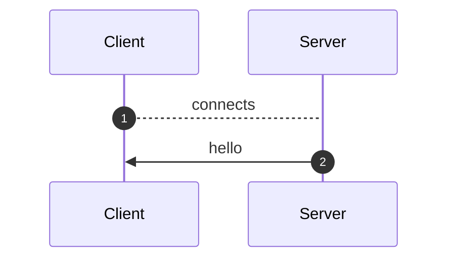
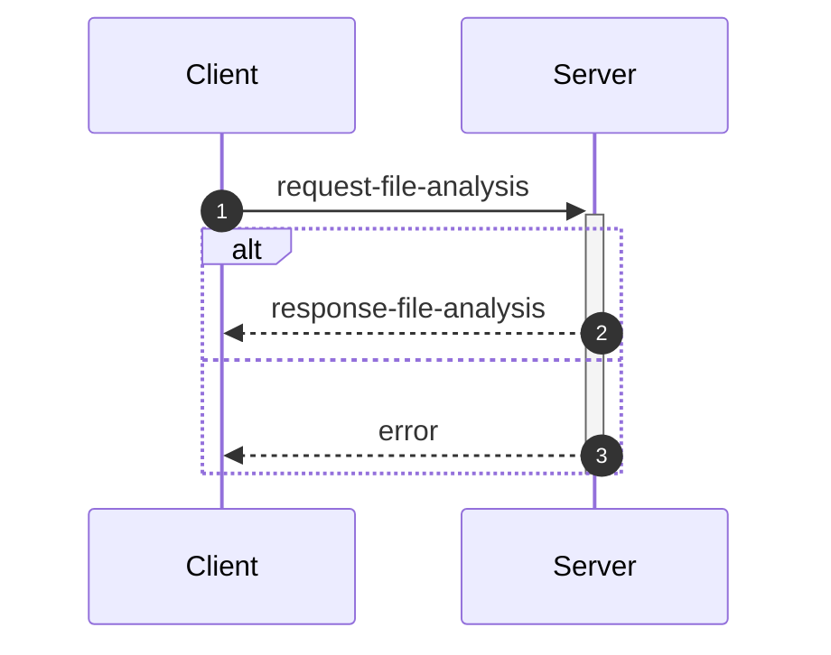
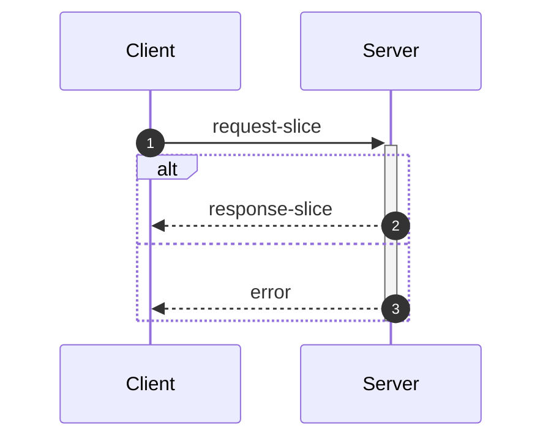
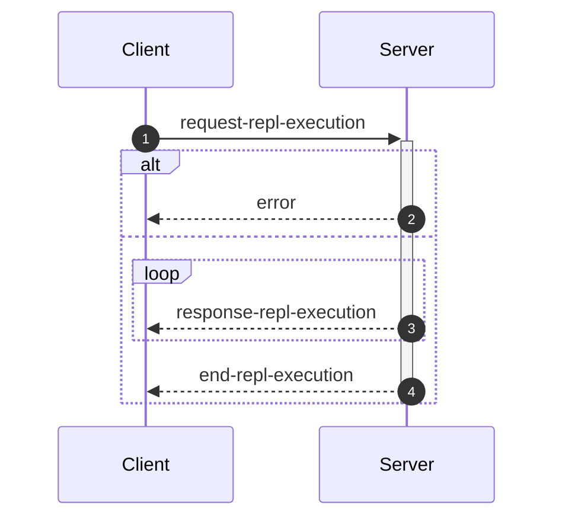

_<span title="an overview of flowR's interface">Generated</span> from '[wiki-interface.ts](https://github.com/flowr-analysis/flowr/tree/main/src/documentation/wiki-interface.ts "src/documentation/wiki-interface.ts")' on 2026-10-15, 14:58:45 UTC (v2.16.0, R v4.5.0), do not edit directly._

Although far from being as detailed as the in-depth explanation of [_flowR_](https://github.com/flowr-analysis/flowr/wiki/Core),
this wiki page explains how to interface with _flowR_ in more detail.
In general, command line arguments and other options provide short descriptions on hover over.

* [💻 Using the REPL](#using-the-repl)
* [⚙️ Configuring FlowR](#configuring-flowr)
* [⚒️ Writing Code](#writing-code)
* [💬 Communicating with the Server](#communicating-with-the-server)

<a id='using-the-repl'></a>
## 💻 Using the REPL

> [!NOTE]
> To execute arbitrary R commands with a repl request, _flowR_ has to be started explicitly with <span title="Description (Command Line Argument): Allow to access the underlying R session when using flowR (security warning: this allows the execution of arbitrary R code!)">`--r-session-access`</span>.
> Please be aware that this introduces a security risk and note that this relies on the [`r-shell` engine](https://github.com/flowr-analysis/flowr/wiki/Engines) .

Although primarily meant for users to explore,
there is nothing which forbids calling _flowR_ as a subprocess to use standard-in, -output, and -error
for communication (although you can access the REPL using the server as well,
with the [REPL Request](#message-request-repl-execution) message).

The read-eval-print loop&nbsp;(REPL) works relatively simple.
You can submit an expression (using <kbd>Enter</kbd>),
which is interpreted as an R&nbsp;expression by default but interpreted as a *command* if it starts with a colon (`:`).
The best command to get started with the REPL is <span title="Description (Repl Command): Show help information (aliases: :h, :?)">`:help`</span>.
Besides, you can leave the REPL either with the command <span title="Description (Repl Command): End the repl (aliases: :q, :exit)">`:quit`</span> or by pressing <kbd>Ctrl</kbd>+<kbd>C</kbd> twice.
When writing a *command*, you may press <kbd>Tab</kbd> to get a list of completions, if available.
Multiple commands can be entered in a single line by separating them with a semicolon (`;`), e.g. `:parse "x<-2"; :df*`.
If a command is given without R code, the REPL will re-use R code given in a previous command.
The prior example will hence return first the parsed AST of the program and then the dataflow graph for `"x <- 2"`.

> [!NOTE]
> If you develop flowR, you may want to launch the repl using the `npm run main-dev` command, this way, you get a non-minified version of flowR with debug information and hot-reloading of source files.

<details>
<summary>Available Commands</summary>

We currently offer the following commands (this with a `[*]` suffix are available with and without the star):

| Command | Description |
| ------- | ----------- |
| **<span title="Description (Repl Command): End the repl (aliases: :q, :exit)">:quit</span>** | End the repl (aliases: **:<span title="Alias of ':quit'. End the repl">q</span>**, **:<span title="Alias of ':quit'. End the repl">exit</span>**) |
| **<span title="Description (Repl Command): Execute the given code as R code. This requires the `--r-session-access` flag to be set and requires the r-shell engine. (aliases: :e, :r)">:execute</span>** | Execute the given code as R code. This requires the `--r-session-access` flag to be set and requires the r-shell engine. (aliases: **:<span title="Alias of ':execute'. Execute the given code as R code. This requires the `--r-session-access` flag to be set and requires the r-shell engine.">e</span>**, **:<span title="Alias of ':execute'. Execute the given code as R code. This requires the `--r-session-access` flag to be set and requires the r-shell engine.">r</span>**) |
| **<span title="Description (Repl Command): Get mermaid code for the control-flow graph of R code (aliases: :cfg, :cf)">:controlflow[*]</span>** | Get mermaid code for the control-flow graph of R code (star: Returns the URL to mermaid.live) (aliases: **:<span title="Alias of ':controlflow'. Get mermaid code for the control-flow graph of R code">cfg</span>**, **:<span title="Alias of ':controlflow'. Get mermaid code for the control-flow graph of R code">cf</span>**) |
| **<span title="Description (Repl Command): Get mermaid code for the control-flow graph with basic blocks (aliases: :cfgb, :cfb)">:controlflowbb[*]</span>** | Get mermaid code for the control-flow graph with basic blocks (star: Returns the URL to mermaid.live) (aliases: **:<span title="Alias of ':controlflowbb'. Get mermaid code for the control-flow graph with basic blocks">cfgb</span>**, **:<span title="Alias of ':controlflowbb'. Get mermaid code for the control-flow graph with basic blocks">cfb</span>**) |
| **<span title="Description (Repl Command): Get mermaid code for the dataflow graph (aliases: :d, :df)">:dataflow[*]</span>** | Get mermaid code for the dataflow graph (star: Returns the URL to mermaid.live) (aliases: **:<span title="Alias of ':dataflow'. Get mermaid code for the dataflow graph">d</span>**, **:<span title="Alias of ':dataflow'. Get mermaid code for the dataflow graph">df</span>**) |
| **<span title="Description (Repl Command): Get mermaid code for the normalized AST of R code (aliases: :n)">:normalize[*]</span>** | Get mermaid code for the normalized AST of R code (star: Returns the URL to mermaid.live) (alias: **:<span title="Alias of ':normalize'. Get mermaid code for the normalized AST of R code">n</span>**) |
| **<span title="Description (Repl Command): Get mermaid code for the simplified dataflow graph (aliases: :ds, :dfs)">:dataflowsimple[*]</span>** | Get mermaid code for the simplified dataflow graph (star: Returns the URL to mermaid.live) (aliases: **:<span title="Alias of ':dataflowsimple'. Get mermaid code for the simplified dataflow graph">ds</span>**, **:<span title="Alias of ':dataflowsimple'. Get mermaid code for the simplified dataflow graph">dfs</span>**) |
| **<span title="Description (Repl Command): Inspect and extend the signature database: `query` (identical to :query @signature), `info <name>` for where a function comes from (identical to :query @function-info), `add <path>` to mount another database/source, `download` to fetch the full-history database. (aliases: :sig)">:signature</span>** | Inspect and extend the signature database: `query` (identical to :query @signature), `info <name>` for where a function comes from (identical to :query @function-info), `add <path>` to mount another database/source, `download` to fetch the full-history database. (alias: **:<span title="Alias of ':signature'. Inspect and extend the signature database: `query` (identical to :query @signature), `info <name>` for where a function comes from (identical to :query @function-info), `add <path>` to mount another database/source, `download` to fetch the full-history database.">sig</span>**) |
| **<span title="Description (Repl Command): Just calculates the DFG, but only prints summary info (aliases: :d#, :df#)">:dataflowsilent</span>** | Just calculates the DFG, but only prints summary info (aliases: **:<span title="Alias of ':dataflowsilent'. Just calculates the DFG, but only prints summary info">d#</span>**, **:<span title="Alias of ':dataflowsilent'. Just calculates the DFG, but only prints summary info">df#</span>**) |
| **<span title="Description (Repl Command): Prints ASCII Art of the parsed, unmodified AST (aliases: :p)">:parse</span>** | Prints ASCII Art of the parsed, unmodified AST (alias: **:<span title="Alias of ':parse'. Prints ASCII Art of the parsed, unmodified AST">p</span>**) |
| **<span title="Description (Repl Command): Prints the version of flowR as well as the current version of R">:version</span>** | Prints the version of flowR as well as the current version of R
| **<span title="Description (Repl Command): Query the given R code (use 'help' for more information)">:query[*]</span>** | Query the given R code (use 'help' for more information) (star: Similar to query, but returns the output in json format.)
| **<span title="Description (Repl Command): Returns an ASCII representation of the dataflow graph (aliases: :df!)">:dataflowascii</span>** | Returns an ASCII representation of the dataflow graph (alias: **:<span title="Alias of ':dataflowascii'. Returns an ASCII representation of the dataflow graph">df!</span>**) |
| **<span title="Description (Repl Command): Returns summarization stats for the normalized AST (aliases: :n#)">:normalize#</span>** | Returns summarization stats for the normalized AST (alias: **:<span title="Alias of ':normalize#'. Returns summarization stats for the normalized AST">n#</span>**) |
| **<span title="Description (Repl Command): Show help information (aliases: :h, :?)">:help</span>** | Show help information (aliases: **:<span title="Alias of ':help'. Show help information">h</span>**, **:<span title="Alias of ':help'. Show help information">?</span>**) |

</details>

> [!TIP]
> 
> As indicated by the examples before, all REPL commands that operate on code keep track of the state.
> Hence, if you run a command like <span title="Description (Repl Command, starred version): Returns the URL to mermaid.live; Base Command: Get mermaid code for the dataflow graph (aliases: :d*, :df*)">`:dataflow*`</span> without providing R code,
> the REPL will re-use the R code provided in a previous command.
> Likewise, doing this will benefit from incrementality!
> If you request the dataflow graph with `:df* x <- 2 * y` and then want to see the parsed AST with `:parse`,
> the REPL will re-use previously obtained information and not re-parse the code again.
> 		

Generally, many commands offer shortcut versions in the REPL. Many queries, for example, offer a shortened format (see the example below).
Of special note, the [Config Query](https://github.com/flowr-analysis/flowr/wiki/%5BQuery%5D-Config)
can be used to also modify the currently active configuration of _flowR_ within the REPL (see the [wiki page](https://github.com/flowr-analysis/flowr/wiki/%5BQuery%5D-Config) for more information).

### Example: Retrieving the Dataflow Graph

To retrieve a URL to the [mermaid](https://mermaid.js.org/) diagram of the dataflow of a given expression,
use <span title="Description (Repl Command, starred version): Returns the URL to mermaid.live; Base Command: Get mermaid code for the dataflow graph (aliases: :d*, :df*)">`:dataflow*`</span> (or <span title="Description (Repl Command): Get mermaid code for the dataflow graph (aliases: :d, :df)">`:dataflow`</span> to get the mermaid code in the cli):

```shell
$ docker run -it --rm eagleoutice/flowr # or npm run flowr 
flowR repl v2.16.0, R grammar v14 (tree-sitter engine)
R> :dataflow* y <- 1 + x
```

<details>
<summary style='color:gray'>Output</summary>

```text
https://mermaid.live/view#base64:eyJjb2RlIjoiZmxvd2NoYXJ0IFREXG4gICAgMXt7XCJgKiM5MTtSTnVtYmVyIzkzOyogKioxKipcbiAgICAgICoxLjYqICgqKmlkOiAxKiopYFwifX1cbiAgICAyKFtcImAqIzkxO1JTeW1ib2wjOTM7KiAqKngqKlxuICAgICAgKjEuMTAqICgqKmlkOiAyKiopYFwiXSlcbiAgICAzW1tcImAqIzkxO1JCaW5hcnlPcCM5MzsqIGJhc2UjNTg7IzU4OyoqIzQzOyoqXG4gICAgICAqMS42LTEwKiAoKippZDogMyoqKVxuICAgIGFyZzogKDEsIDIpYFwiXV1cbiAgICBidWlsdC1pbjpfNDNfW1wiYEJ1aWx0LUluOlxuIzQzO2BcIl1cbiAgICBzdHlsZSBidWlsdC1pbjpfNDNfIHN0cm9rZTpncmF5LGZpbGw6Z3JheSxzdHJva2Utd2lkdGg6MnB4LG9wYWNpdHk6Ljg7XG4gICAgMFtcImAqIzkxO1JTeW1ib2wjOTM7KiAqKnkqKlxuICAgICAgKjEuMSogKCoqaWQ6IDAqKiwgdjogMylgXCJdXG4gICAgNFtbXCJgKiM5MTtSQmluYXJ5T3AjOTM7KiBiYXNlIzU4OyM1ODsqKiM2MDsjNDU7KipcbiAgICAgICoxLjEtMTAqICgqKmlkOiA0KiopXG4gICAgYXJnOiAoMCwgMylgXCJdXVxuICAgIGJ1aWx0LWluOl82MF8tW1wiYEJ1aWx0LUluOlxuIzYwOyM0NTtgXCJdXG4gICAgc3R5bGUgYnVpbHQtaW46XzYwXy0gc3Ryb2tlOmdyYXksZmlsbDpncmF5LHN0cm9rZS13aWR0aDoycHgsb3BhY2l0eTouODtcbiAgICAxIC0uLT58XCJmbG93XCJ8IDJcbiAgICBsaW5rU3R5bGUgMCBzdHJva2U6Z3JheSxjb2xvcjpncmF5O1xuICAgIDIgLS4tPnxcImZsb3dcInwgM1xuICAgIGxpbmtTdHlsZSAxIHN0cm9rZTpncmF5LGNvbG9yOmdyYXk7XG4gICAgMyAtLT58XCJyZWFkcywgYXJnXCJ8IDFcbiAgICAzIC0tPnxcInJlYWRzLCBhcmdcInwgMlxuICAgIDMgLS4tPnxcImZsb3dcInwgMFxuICAgIGxpbmtTdHlsZSA0IHN0cm9rZTpncmF5LGNvbG9yOmdyYXk7XG4gICAgMyAtLi0+fFwicmVhZHMsIGNhbGxzXCJ8IGJ1aWx0LWluOl80M19cbiAgICBsaW5rU3R5bGUgNSBzdHJva2U6Z3JheTtcbiAgICAwIC0tPnxcImRlZmluZWQtYnksIGZsb3dcInwgNFxuICAgIDAgLS0+fFwiZGVmaW5lZC1ieVwifCAzXG4gICAgNCAtLT58XCJyZWFkcywgYXJnXCJ8IDNcbiAgICA0IC0tPnxcInJldHVybnMsIGFyZ1wifCAwXG4gICAgNCAtLi0+fFwicmVhZHMsIGNhbGxzXCJ8IGJ1aWx0LWluOl82MF8tXG4gICAgbGlua1N0eWxlIDEwIHN0cm9rZTpncmF5OyIsIm1lcm1haWQiOnsiYXV0b1N5bmMiOnRydWV9fQ==
```

Retrieve the dataflow graph of the expression `y <- 1 + x`. It looks like this:


<details>

<summary style="color:gray">R Code of the Dataflow Graph</summary>

The analysis ran (including parse and normalize, using the [tree-sitter](https://github.com/flowr-analysis/flowr/wiki/Engines) engine) within the generation environment. No [signature database](https://github.com/flowr-analysis/flowr/wiki/Signature-Database) is mounted for these generated graphs, so `library()` calls attach no package exports; base-R names are still qualified via the generated base-package store (e.g. `acf` as `stats::acf`). 
We encountered no unknown side effects during the analysis.

```r
y <- 1 + x
```

</details>

</details>

For small graphs like this, <span title="Description (Repl Command): Returns an ASCII representation of the dataflow graph (aliases: :df!)">`:dataflowascii`</span> also provides an ASCII representation directly in the REPL:

```shell
$ docker run -it --rm eagleoutice/flowr # or npm run flowr 
flowR repl v2.16.0, R grammar v14 (tree-sitter engine)
R> :df! y <- 1 + x
```

<details open>
<summary style='color:gray'>Output</summary>

```text
                        v<0>v
 c<4>c──────────────────| y |
 |<- |     ┌────────────v---v
 c---c     │
    │   c<3>c   0<1>0
    └───| + |───| 1 |───u<2>u
        c---c   0---0   | x |
           └────────────u---u
Edges:
3 -> 1: reads, arg          3 -> 2: reads, arg
3 -> 0: flows-to            1 -> 2: flows-to
2 -> 3: flows-to            4 -> 3: reads, arg
4 -> 0: returns, arg        0 -> 4: defined-by, flows-to
0 -> 3: defined-by
```

Retrieve the dataflow graph of the expression `y <- 1 + x` as ASCII art.

</details>

For the slicing with <span title="Description (Repl Command): Static backwards executable slicer for R">`:slicer`</span>, you have access to the same [magic comments](#slice-magic-comments) as with the [slice request](#message-request-slice).
Pass `--inline` to splice resolvable `source()` calls into the reconstruction so the slice is a single self-contained R text (the same as the static slice query's `inlineSources` flag).
See `--help` for more flags!

### Example: Interfacing with the File System

Many commands that allow for an R-expression (like <span title="Description (Repl Command, starred version): Returns the URL to mermaid.live; Base Command: Get mermaid code for the dataflow graph (aliases: :d*, :df*)">`:dataflow*`</span>) allow for a file as well
if the argument starts with `file://`.
If you are working from the root directory of the _flowR_ repository, the following gives you the parsed AST of the example file using the <span title="Description (Repl Command): Prints ASCII Art of the parsed, unmodified AST (aliases: :p)">`:parse`</span> command:

> **Watch mode**: Replace `file://` with `watch://` to enter watch mode.
> flowR runs the command immediately and then re-runs it every time the file (or any file inside the folder) changes.
> Enter any other command to leave watch mode.
> For example: `:df watch://analysis.R`

```shell
$ docker run -it --rm eagleoutice/flowr # or npm run flowr 
flowR repl v2.16.0, R grammar v14 (tree-sitter engine)
R> :parse file://test/testfiles/example.R
```

<details>
<summary style='color:gray'>Output</summary>

```text
File: test/testfiles/example.R

program
├ binaryoperator
│ ├ identifier "sum" (1:1─4)
│ ├ <- "<-" (1:5─7)
│ ╰ float "0" (1:8─9)
├ binaryoperator
│ ├ identifier "product" (2:1─8)
│ ├ <- "<-" (2:9─11)
│ ╰ float "1" (2:12─13)
├ binaryoperator
│ ├ identifier "w" (3:1─2)
│ ├ <- "<-" (3:3─5)
│ ╰ float "7" (3:6─7)
├ binaryoperator
│ ├ identifier "N" (4:1─2)
│ ├ <- "<-" (4:3─5)
│ ╰ float "10" (4:6─8)
├ forstatement
│ ├ for "for" (6:1─4)
│ ├ ( "(" (6:5─6)
│ ├ identifier "i" (6:6─7)
│ ├ in "in" (6:8─10)
│ ├ binaryoperator
│ │ ├ float "1" (6:11─12)
│ │ ├ : ":" (6:12─13)
│ │ ╰ parenthesizedexpression
│ │   ├ ( "(" (6:13─14)
│ │   ├ binaryoperator
│ │   │ ├ identifier "N" (6:14─15)
│ │   │ ├ - "-" (6:15─16)
│ │   │ ╰ float "1" (6:16─17)
│ │   ╰ ) ")" (6:17─18)
│ ├ ) ")" (6:18─19)
│ ╰ bracedexpression
│   ├ { "{" (6:20─21)
│   ├ binaryoperator
│   │ ├ identifier "sum" (7:3─6)
│   │ ├ <- "<-" (7:7─9)
│   │ ╰ binaryoperator
│   │   ├ binaryoperator
│   │   │ ├ identifier "sum" (7:10─13)
│   │   │ ├ + "+" (7:14─15)
│   │   │ ╰ identifier "i" (7:16─17)
│   │   ├ + "+" (7:18─19)
│   │   ╰ identifier "w" (7:20─21)
│   ├ binaryoperator
│   │ ├ identifier "product" (8:3─10)
│   │ ├ <- "<-" (8:11─13)
│   │ ╰ binaryoperator
│   │   ├ identifier "product" (8:14─21)
│   │   ├  "" (8:22─23)
│   │   ╰ identifier "i" (8:24─25)
│   ╰ } "}" (9:1─2)
├ call
│ ├ identifier "cat" (11:1─4)
│ ╰ arguments
│   ├ ( "(" (11:4─5)
│   ├ argument
│   │ ╰ string
│   │   ├ " "\"" (11:5─6)
│   │   ├ stringcontent "Sum:" (11:6─10)
│   │   ╰ " "\"" (11:10─11)
│   ├ comma "," (11:11─12)
│   ├ argument
│   │ ╰ identifier "sum" (11:13─16)
│   ├ comma "," (11:16─17)
│   ├ argument
│   │ ╰ string
│   │   ├ " "\"" (11:18─19)
│   │   ├ stringcontent
│   │   │ ╰ escapesequence "\\n" (11:19─21)
│   │   ╰ " "\"" (11:21─22)
│   ╰ ) ")" (11:22─23)
╰ call
  ├ identifier "cat" (12:1─4)
  ╰ arguments
    ├ ( "(" (12:4─5)
    ├ argument
    │ ╰ string
    │   ├ " "\"" (12:5─6)
    │   ├ stringcontent "Product:" (12:6─14)
    │   ╰ " "\"" (12:14─15)
    ├ comma "," (12:15─16)
    ├ argument
    │ ╰ identifier "product" (12:17─24)
    ├ comma "," (12:24─25)
    ├ argument
    │ ╰ string
    │   ├ " "\"" (12:26─27)
    │   ├ stringcontent
    │   │ ╰ escapesequence "\\n" (12:27─29)
    │   ╰ " "\"" (12:29─30)
    ╰ ) ")" (12:30─31)
```

Retrieve the parsed AST of the example file.

<details>

<summary>File Content</summary>

```r
sum <- 0
product <- 1
w <- 7
N <- 10

for (i in 1:(N-1)) {
  sum <- sum + i + w
  product <- product * i
}

cat("Sum:", sum, "\n")
cat("Product:", product, "\n")
```

</details>

As _flowR_ directly transforms this AST the output focuses on being human-readable instead of being machine-readable.
		
</details>

### Example: Run a Query

You can run any query supported by _flowR_ using the <span title="Description (Repl Command): Query the given R code (use 'help' for more information)">`:query`</span> command.
For example, to obtain the shapes of all data frames in a given piece of code, you can run:

```shell
$ docker run -it --rm eagleoutice/flowr # or npm run flowr 
flowR repl v2.16.0, R grammar v14 (tree-sitter engine)
R> :query @absint df-shape "x <- data.frame(a = 1:10, b = 1:10)\ny <- x$a"
```

<details open>
<summary style='color:gray'>Output</summary>

```text
Query: absint (1 ms)
```

Retrieve the shapes of all data frames in the given code.

</details>

To run the linter on a file, you can use (in this example, we just issue the `dead-code` linter on a small piece of code):

```shell
$ docker run -it --rm eagleoutice/flowr # or npm run flowr 
flowR repl v2.16.0, R grammar v14 (tree-sitter engine)
R> :query @linter rules:dead-code "if(FALSE) x <- 2"
```

<details open>
<summary style='color:gray'>Output</summary>

```text
Query: linter (1 ms)
   ╰ Dead Code (dead-code):
       ╰ certain:
           ╰ Code at 1.11-16
```

Run the linter on the given code, with only the `dead-code` rule enabled.

</details>

For more information on the available queries, please check out the [Query API](https://github.com/flowr-analysis/flowr/wiki/Query-API).

<a id='configuring-flowr'></a>
## ⚙️ Configuring FlowR

When running _flowR_, you may want to specify some behaviors with a dedicated configuration file.
By default, flowR looks for a file named `flowr.json` in the current working directory (or any higher directory).
You can also specify a different file with <span title="Description (Command Line Argument): The name of the configuration file to use">`--config-file`</span> or pass the configuration inline using <span title="Description (Command Line Argument): The flowR configuration to use, as a JSON string">`--config-json`</span>.
A `flowr.json` found this way belongs to the analyzed project, so flowR ignores its options that decide what flowR executes or loads
(`engines.*.wasmPath`, `engines.*.treeSitterWasmPath`, `engines.*.rPath`, `solver.sigdb.additionalPaths`, `solver.sigdb.downloadRepo`, `solver.sigdb.installedLibrary.paths`),
unless you pass <span title="Description (Command Line Argument): Keep the security-sensitive options (e.g., the R executable) of the flowr.json found in the working directory or a parent. Only use this for projects you trust.">`--trust-config`</span>.
To inspect the current configuration, you can run flowr with the <span title="Description (Command Line Argument): Run with verbose logging (will be passed to the corresponding script)">`--verbose`</span> flag, or use the `config` [Query](https://github.com/flowr-analysis/flowr/wiki/Query-API).
Within the REPL this works by running the following:

```shell
:query @config
```

To work with the <a href="https://github.com/flowr-analysis/flowr/tree/main/src/config.ts#L113"><code><span title="The configuration file format for flowR.">FlowrConfig</span></code></a> you can use the provided helper objects alongside its methods like
<a href="https://github.com/flowr-analysis/flowr/tree/main/src/config.ts#L892"><code><span title="Creates a new flowr config that has the updated values.">FlowrConfig::<b>amend</b></span></code></a>.
The schema below documents every option; the ones you most likely want are:

- <a href="https://github.com/flowr-analysis/flowr/wiki/Interface#configuring-flowr" title="Configuration Option (boolean): Whether source calls should be ignored, causing {@link processSourceCall}&#39;s behavior to be skipped.">ignoreSourceCalls</a>: ignore source calls when analyzing the code, i.e., ignore the inclusion of other files.
- <a href="https://github.com/flowr-analysis/flowr/wiki/Interface#configuring-flowr" title="Configuration Option (boolean): Whether load calls should be ignored, causing {@link processLoadCall}&#39;s behavior to be skipped.">ignoreLoadCalls</a>: ignore load calls when analyzing the code, i.e., ignore the loading of r-data files.
- <a href="https://github.com/flowr-analysis/flowr/wiki/Interface#configuring-flowr" title="Configuration Option (object): Do you want to overwrite (parts) of the builtin definition?">semantics.environment.overwriteBuiltIns</a>: overwrite _flowR_'s handling of built-in functions, or clear the preset definitions entirely.
  See [Configure BuiltIn Semantics](#configure-builtin-semantics) for more information.
- <a href="https://github.com/flowr-analysis/flowr/wiki/Interface#configuring-flowr" title="Configuration Option (string): How to resolve variables and their values. (one of &quot;disabled&quot;, &quot;alias&quot;, &quot;builtin&quot;)">solver.variables</a>: how to resolve variables and their values (`disabled`, `alias`, `builtin`).
- <a href="https://github.com/flowr-analysis/flowr/wiki/Interface#configuring-flowr" title="Configuration Option (array): The engine or set of engines to use for interacting with R code. An empty array means all available engines will be used.">engines</a> and <a href="https://github.com/flowr-analysis/flowr/wiki/Interface#configuring-flowr" title="Configuration Option (string): The default engine to use for interacting with R code. If this is undefined, an arbitrary engine from the specified list will be used. (one of &quot;tree-sitter&quot;, &quot;r-shell&quot;)">defaultEngine</a>: the engines used to interact with R code, see the [Engines wiki page](https://github.com/flowr-analysis/flowr/wiki/Engines).
- <a href="https://github.com/flowr-analysis/flowr/wiki/Interface#configuring-flowr" title="Configuration Option (array): Files a framework loads on its own, without any source() call (e.g. global.R in a shiny app), in the order they are loaded; flowR orders the matching project files accordingly and analyzes them as one program. Entries are case-insensitive globs matched against the file path, a plain name matches any file with that name, and entries matching no project file are warned about. Usually set per project kind via specializeConfig.">project.implicitSources</a>: the files a framework loads without any `source()` call, in the order in which they are
  loaded. Entries are globs (e.g. `R/*.R`) matched against the file path ignoring capitalization; one matching no file is reported.
- <a href="https://github.com/flowr-analysis/flowr/wiki/Interface#configuring-flowr" title="Configuration Option (object): Overwrite (parts of) the configuration depending on the project kind flowR detects, e.g. to give a shiny app its implicit sources.">specializeConfig</a>: overwrite (parts of) the configuration depending on the kind of project _flowR_ detects
  (e.g. `shiny-app`), which is how a shiny app gets its implicit sources by default. What you configure directly wins.
- <a href="https://github.com/flowr-analysis/flowr/wiki/Interface#configuring-flowr" title="Configuration Option (string): Overwrite the project kind flowR would otherwise infer from the analyzed files, e.g. when auto-detection guesses wrong. (one of &quot;package&quot;, &quot;script&quot;, &quot;shiny-app&quot;, &quot;notebook&quot;, &quot;project&quot;, &quot;unknown&quot;)">project.useProjectType</a>: skip that detection and force a project kind yourself, when auto-detection guesses wrong.
- <a href="https://github.com/flowr-analysis/flowr/wiki/Interface#configuring-flowr" title="Configuration Option (array): The default plugins to load when creating a new instance of FlowrAnalyzer">defaultPlugins</a> and <a href="https://github.com/flowr-analysis/flowr/wiki/Interface#configuring-flowr" title="Configuration Option (array): The plugins to load in REPL mode">repl.plugins</a>: the plugins to load for a new <a href="https://github.com/flowr-analysis/flowr/tree/main/src/project/flowr-analyzer.ts#L205"><code><span title="Central class for conducting analyses with FlowR. Use the FlowrAnalyzerBuilder to create a new instance. If you want the original pattern of creating a pipeline and running all steps, you can still do this with FlowrAnalyzer#runFull . To inspect the context of the analyzer, use FlowrAnalyzer#inspectContext (if you are a plugin and need to modify it, use FlowrAnalyzer#context instead).">FlowrAnalyzer</span></code></a> and in the REPL
  (use `flowr:default` to reference the former).

So you can configure _flowR_ by adding a file like the following:

<details>

<summary>Example Configuration File</summary>

```json
{
  "ignoreSourceCalls": true,
  "ignoreLoadCalls": true,
  "semantics": {
    "environment": {
      "overwriteBuiltIns": {
        "definitions": [
          {
            "type": "function",
            "names": [
              "foo"
            ],
            "processor": "builtin:assign",
            "config": {}
          }
        ]
      }
    }
  },
  "defaultPlugins": [
    "file:description",
    "versions:description"
  ],
  "repl": {
    "quickStats": false,
    "dfProcessorHeat": false,
    "hints": true,
    "plugins": [
      "flowr:default"
    ]
  },
  "project": {
    "resolveUnknownPathsOnDisk": true,
    "implicitSources": [
      "global.R",
      "app.R"
    ]
  },
  "linter": {
    "disabledRules": []
  },
  "specializeConfig": {
    "shiny-app": {
      "project": {
        "implicitSources": [
          "global.R",
          "ui.R",
          "server.R",
          "app.R"
        ]
      }
    }
  },
  "engines": [
    {
      "type": "r-shell"
    }
  ],
  "solver": {
    "variables": "alias",
    "evalStrings": true,
    "trackEnvironments": true,
    "sigdb": {
      "enabled": true,
      "loadProjectDependencies": true,
      "eagerlyLoad": false,
      "eagerlyLoadExports": false,
      "linkBaseR": false,
      "linkDescriptionDependencies": false
    },
    "resolveSource": {
      "dropPaths": "no",
      "ignoreCapitalization": true,
      "inferWorkingDirectory": "active-script",
      "searchPath": []
    },
    "instrument": {},
    "slicer": {
      "threshold": 50
    }
  },
  "abstractInterpretation": {
    "wideningThreshold": 4,
    "followCalls": true,
    "dataFrame": {
      "maxColNames": 20,
      "readLoadedData": {
        "readExternalFiles": true,
        "maxReadLines": 1000000
      }
    }
  },
  "incremental": {
    "alwaysIncremental": false,
    "parsing": {
      "activated": false,
      "heuristics": {
        "activated": true,
        "mtime": true,
        "linesFrom": 500,
        "bytesFrom": 50000,
        "alwaysWithEdits": false,
        "minFiles": 1
      }
    }
  },
  "gas": {
    "thresholds": {
      "memory": {
        "problematic": 0.7,
        "critical": 0.9
      },
      "timeMs": {
        "problematic": 100000,
        "critical": 120000
      }
    },
    "features": {}
  }
}
```

</details>

<details>
<a id='configure-builtin-semantics'></a>
<summary>Configure Built-In Semantics</summary>

`semantics/environment/overwriteBuiltins` accepts two keys:

- `loadDefaults` (boolean, initially `true`): If set to `true`, the default built-in definitions are loaded before applying the custom definitions. Setting this flag to `false` explicitly disables the loading of the default definitions.
- `definitions` (array, initially empty): Allows to overwrite or define new built-in elements. Each object within must have a `type` which is one of the below. Furthermore, they may define a string array of `names` which specifies the identifiers to bind the definitions to. You may use `assumePrimitive` to specify whether _flowR_ should assume that this is a primitive non-library definition (so you probably just do not want to specify the key).

  | Type            | Description                                                                                                                                                                                                                                                                                              | Example                                                                                                    |
  | --------------- | -------------------------------------------------------------------------------------------------------------------------------------------------------------------------------------------------------------------------------------------------------------------------------------------------------- | ---------------------------------------------------------------------------------------------------------- |
  | `constant`    | Additionally allows for a `value` this should resolve to.                                                                                                                                                                                                                                                | `{ type: 'constant', names: ['NULL', 'NA'],  value: null }`                                                |
  | `function`    | Is a rather flexible way to define and bind built-in functions. For the time, we do not have extensive documentation to cover all the cases, so please either consult the sources with the `default-builtin-config.ts` or open a [new issue](https://github.com/flowr-analysis/flowr/issues/new/choose). | `{ type: 'function', names: ['next'], processor: 'builtin:d', config: { cfg: ExitPointType.Next } }` |
  | `replacement` | A comfortable way to specify replacement functions like `$<-` or `names<-`. `suffixes` describes the... suffixes to attach automatically. | `{ type: 'replacement', suffixes: ['<-', '<<-'], names: ['[', '[['] }` |

</details>

<details>

<summary style='color:gray'>Full Configuration-File Schema</summary>

- _The configuration file format for flowR._ (object)
    - **logLevel** [optional] _flowR's global minimum log level, applied when the config is loaded._ (string)
        Only allows: 'silly', 'trace', 'debug', 'info', 'warn', 'error', 'fatal'
    - **ignoreSourceCalls** [optional] _Whether source calls should be ignored, causing {@link processSourceCall}'s behavior to be skipped._ (boolean)
    - **ignoreLoadCalls** [optional] _Whether load calls should be ignored, causing {@link processLoadCall}'s behavior to be skipped._ (boolean)
    - **semantics** _Configure language semantics and how flowR handles them._ (object)
        - **environment** [optional] _Semantics regarding how to handle the R environment._ (object)
            - **overwriteBuiltIns** [optional] _Do you want to overwrite (parts) of the builtin definition?_ (object)
                - **loadDefaults** [optional] _Should the default configuration still be loaded?_ (boolean)
                - **definitions** [optional] _The definitions to load/overwrite._ (array)
                Valid item types:
                    - (object)
    - **defaultPlugins** [optional] _The default plugins to load when creating a new instance of FlowrAnalyzer_ (array)
    Valid item types:
        - (alternatives)
            - (string)
            - (array)
    - **repl** _Configuration options for the REPL._ (object)
        - **quickStats** [optional] _Whether to show quick stats in the REPL after each evaluation._ (boolean)
        - **dfProcessorHeat** [optional] _This instruments the dataflow processors to count how often each processor is called._ (boolean)
        - **hints** [optional] _Whether to show dim inline hints on the empty prompt (automatically disabled on non-interactive terminals)._ (boolean)
        - **plugins** [optional] _The plugins to load in REPL mode_ (array)
        Valid item types:
            - (alternatives)
                - (string)
                - (array)
        - **autoUseFileProtocol** [optional] _Prepend the file protocol to a repl input that looks like a path, instead of only warning about it._ (boolean)
        - **queryStats** [optional] _Whether `:query` closes with the line stating how long the queries took (`:query*` never prints it)._ (boolean)
        - **showPlugins** [optional] _Whether `:version` grays out the plugins that did not activate during the last analysis._ (boolean)
    - **project** _Project specific configuration options._ (object)
        - **resolveUnknownPathsOnDisk** [optional] _Whether to resolve unknown paths loaded by the r project disk when trying to source/analyze files._ (boolean)
        - **failOnInaccessiblePath** [optional] _Whether a directory that cannot be traversed during file discovery (e.g. due to permissions) aborts the analysis; when false (the default) such paths are logged and skipped._ (boolean)
        - **basePackages** [optional] _The packages considered part of R itself (base and recommended); if unset, flowR uses its built-in list._ (array)
        Valid item types:
            - (string)
        - **implicitSources** [optional] _Files a framework loads on its own, without any source() call (e.g. global.R in a shiny app), in the order they are loaded; flowR orders the matching project files accordingly and analyzes them as one program. Entries are case-insensitive globs matched against the file path, a plain name matches any file with that name, and entries matching no project file are warned about. Usually set per project kind via specializeConfig._ (array)
        Valid item types:
            - (string)
        - **useProjectType** [optional] _Overwrite the project kind flowR would otherwise infer from the analyzed files, e.g. when auto-detection guesses wrong._ (string)
            Only allows: 'package', 'script', 'shiny-app', 'notebook', 'project', 'unknown'
        - **assumeImplicitEcho** [optional] _Whether the top level of the analyzed code is echoed, so that every visible result printed there is collected as an output by the dependencies query (default true, false for a package)._ (boolean)
        - **discovery** [optional] _Scoping options for the default project discovery._ (object)
            - **full** [optional] _Collect every file below the project root (greedy) instead of only the files the detected project kind needs (default false)._ (boolean)
            - **perKind** [optional] _Per-kind include/exclude glob overrides layered on the default scoping._ (object)
            - **ignore** [optional] _Case-insensitive globs that drop matching files from the intelligent discovery, regardless of kind (e.g. .Renviron to ignore environment files)._ (array)
            Valid item types:
                - (string)
        - **classification** [optional] _Overrides for the signals flowR uses to classify the project kind._ (object)
            - **shinyDescriptionTypes** [optional] _DESCRIPTION Type: values that mark a shiny app._ (array)
            Valid item types:
                - (string)
            - **shinyEntryFiles** [optional] _File names a shiny app is assembled from._ (array)
            Valid item types:
                - (string)
            - **shinyUsagePattern** [optional] _Regex source evidencing shiny usage in an entry file._ (string)
            - **notebookExtensions** [optional] _File extensions marking a notebook._ (array)
            Valid item types:
                - (string)
    - **linter** _Linter configuration options._ (object)
        - **disabledRules** _Linting rule names excluded from the default rule set (a rule requested explicitly via a linter query still runs). Usually set per project kind via specializeConfig._ (array)
        Valid item types:
            - (string)
    - **inputSources** [optional] _Further frameworks the input-sources analysis should know about; entries are added to flowR's defaults._ (object)
        - **pure** [optional] _Functions that only pass the constantness of their arguments on._ (array)
        Valid item types:
            - (string)
        - **param** [optional] _Functions whose result is a 'param' input._ (array)
        Valid item types:
            - (string)
        - **file** [optional] _Functions whose result is a 'file' input._ (array)
        Valid item types:
            - (string)
        - **tempfile** [optional] _Functions whose result is a 'tempfile' input._ (array)
        Valid item types:
            - (string)
        - **glob** [optional] _Functions whose result is a 'glob' input._ (array)
        Valid item types:
            - (string)
        - **net** [optional] _Functions whose result is a 'net' input._ (array)
        Valid item types:
            - (string)
        - **rand** [optional] _Functions whose result is a 'rand' input._ (array)
        Valid item types:
            - (string)
        - **system** [optional] _Functions whose result is a 'system' input._ (array)
        Valid item types:
            - (string)
        - **ffi** [optional] _Functions whose result is a 'ffi' input._ (array)
        Valid item types:
            - (string)
        - **lang** [optional] _Functions whose result is a 'lang' input._ (array)
        Valid item types:
            - (string)
        - **options** [optional] _Functions whose result is a 'options' input._ (array)
        Valid item types:
            - (string)
        - **cmdline** [optional] _Functions whose result is a 'cmdline' input._ (array)
        Valid item types:
            - (string)
        - **user** [optional] _Functions whose result is a 'user' input._ (array)
        Valid item types:
            - (string)
        - **const** [optional] _Functions whose result is a 'const' input._ (array)
        Valid item types:
            - (string)
        - **scope** [optional] _Functions whose result is a 'scope' input._ (array)
        Valid item types:
            - (string)
        - **dconst** [optional] _Functions whose result is a 'dconst' input._ (array)
        Valid item types:
            - (string)
        - **unknown** [optional] _Functions whose result is a 'unknown' input._ (array)
        Valid item types:
            - (string)
        - **linkedObjects** [optional] _Objects a framework provides without a definition in the code, e.g. shiny's input._ (array)
        Valid item types:
            - (object)
        - **linkedEntryPoints** [optional] _Calls that hand a function to a framework, which binds its objects to the parameters by position._ (array)
        Valid item types:
            - (object)
    - **specializeConfig** [optional] _Overwrite (parts of) the configuration depending on the project kind flowR detects, e.g. to give a shiny app its implicit sources._ (object)
    - **engines** _The engine or set of engines to use for interacting with R code. An empty array means all available engines will be used._ (array)
    Valid item types:
        - (alternatives)
            - _The configuration for the tree sitter engine._ (object)
                - **type** [required] _Use the tree sitter engine._ (string)
                    Only allows: 'tree-sitter'
                - **wasmPath** [optional] _The path to the tree-sitter-r WASM binary to use. If this is undefined, this uses the default path._ (string)
                - **treeSitterWasmPath** [optional] _The path to the tree-sitter WASM binary to use. If this is undefined, this uses the default path._ (string)
                - **lax** [optional] _Whether to use the lax parser for parsing R code (allowing for syntax errors). If this is undefined, the strict parser will be used._ (boolean)
            - _The configuration for the R shell engine._ (object)
                - **type** [required] _Use the R shell engine._ (string)
                    Only allows: 'r-shell'
                - **rPath** [optional] _The path to the R executable to use. If this is undefined, this uses the default path._ (string)
                - **pipeBind** [optional] _Whether to enable R's experimental pipe-bind operator "=>" by setting _R_USE_PIPEBIND_ for the R session (default false); R itself keeps this off by default, as it is experimental and has never shipped in a release version of R._ (boolean)
    - **defaultEngine** [optional] _The default engine to use for interacting with R code. If this is undefined, an arbitrary engine from the specified list will be used._ (string)
        Only allows: 'tree-sitter', 'r-shell'
    - **solver** _How to resolve constants, constraints, cells, ..._ (object)
        - **variables** _How to resolve variables and their values._ (string)
            Only allows: 'disabled', 'alias', 'builtin'
        - **evalStrings** _Should we include eval(parse(text="...")) calls in the dataflow graph?_ (boolean)
        - **trackEnvironments** [optional] _Track user-created environments (new.env, assign/get/local with envir=, dollar-assign, attach). When false, all envir-style calls fall through conservatively._ (boolean)
        - **sigdb** _Resolving library exports from a signature database._ (object)
            - **enabled** [optional] _Resolve library()/use() exports from a signature database (default true); when false no database is consulted._ (boolean)
            - **loadProjectDependencies** [optional] _Load the project's declared dependencies from its metadata files (DESCRIPTION Imports/Depends, rproject.toml, uvr.toml, renv.lock, rv.lock, uvr.lock) (default true); when false these files are not read for dependencies._ (boolean)
            - **eagerlyLoad** [optional] _Parse the database up front rather than on the first package load (default false, ignored if disabled)._ (boolean)
            - **eagerlyLoadExports** [optional] _Add a vertex for every export on load rather than on demand (default false); keeps the dataflow graph small._ (boolean)
            - **assumedRVersion** [optional] _R version assumed when resolving versioned (base-R) exports: a pin like "4.5" or "auto" to detect the installed R (default "auto")._ (string)
            - **linkBaseR** [optional] _Eagerly attach base-R namespaces so bare base calls resolve without library() (default false)._ (boolean)
            - **linkBaseRCalls** [optional] _Add a lightweight Reads edge from a bare base-R call to its signature-database function vertex (default false; base-R qualification is edge-free otherwise)._ (boolean)
            - **linkPackageCalls** [optional] _Add a lightweight Reads edge from a resolved package call to its signature-database function vertex (default false)._ (boolean)
            - **linkDescriptionDependencies** [optional] _Eagerly attach the namespaces of the project's declared DESCRIPTION dependencies (Imports/Depends) so their exports resolve without an explicit library() (default false)._ (boolean)
            - **warmInBackground** [optional] _Decompress the hot shards (base + most-downloaded) in a background task on startup so the first library() lookup is warm (default false; for long-running servers/REPLs)._ (boolean)
            - **additionalPaths** [optional] _Extra directories or bundle/manifest files searched for signature databases (alongside the shipped default and $FLOWR_SIGDB_DIR); a downloaded full-history bundle placed here is mounted automatically._ (array)
            Valid item types:
                - (string)
            - **downloadRepo** [optional] _GitHub owner/repo the full-history bundle is downloaded from via ":signature download" (default "flowr-analysis/flowr", release tag "sigdb-v<flowR-version>")._ (string)
            - **autoSync** [optional] _On startup, re-download shards whose committed sigdb.remote.json hash no longer matches the cache, in the background (default false; opt-in network sync after a git pull)._ (boolean)
            - **installedLibrary** [optional] _Recovering packages no signature database knows from the copy installed on this machine._ (object)
                - **enabled** [required] _Recover packages no signature database knows from their installed copy (default false)._ (boolean)
                - **paths** [optional] _Library directories to search; when empty they are discovered from the environment and the project._ (array)
                Valid item types:
                    - (string)
                - **useEnvironment** [optional] _Search the libraries R_LIBS_USER/R_LIBS/R_LIBS_SITE name (default true)._ (boolean)
                - **useProjectLibrary** [optional] _Search a project-local renv/packrat library (default true)._ (boolean)
                - **maxDepth** [optional] _How far to descend into the nested layout of a project-local library (default 3)._ (number)
                - **packages** [optional] _Only recover packages whose name matches one of these regular expressions; empty means any._ (array)
                Valid item types:
                    - (string)
            - **blobCacheBudgetMb** [optional] _How many MiB of decoded package blobs every open bundle may hold together (default 16)._ (number)
            - **versionSelection** [optional] _When a project constrains a dependency, resolve to the newest (default), oldest, or system-installed version satisfying it; system needs R and falls back to newest. Base-R packages always resolve against the assumed R version._ (string)
                Only allows: 'newest', 'oldest', 'system'
            - **versionOverrides** [optional] _Force an exact version for specific packages (name -> version), overriding both the project constraint and the versionSelection policy (default {})._ (object)
        - **versionManagement** _Policies for reasoning about dependency versions._ (object)
            - **linkedVersionGroups** [optional] _Groups of packages that must resolve to the same version; version guessing intersects each group so its members stay mutually compatible (default [])._ (array)
            Valid item types:
                - (array)
                Valid item types:
                    - (string)
        - **assumeAttachedPackages** [optional] _Packages to treat as attached without a `library()` call, so what the built-in configuration states about them applies to the analyzed code. The base packages R attaches on startup already resolve without it._ (array)
        Valid item types:
            - (string)
        - **transitiveSideEffectRounds** [optional] _How many rounds the transitive side-effect fixpoint may run before it is cut off (default 32); the propagation stops on its own as soon as a round adds nothing._ (number)
        - **maxOverlayDepth** [optional] _How many binding overlays may stack on one environment frame before a write flattens them (default 4); a pure performance knob, trading lookup cost against copy cost without changing any result._ (number)
        - **instrument** (object)
            - **dataflowExtractors** [optional] _These keys are only intended for use within code, allowing to instrument the dataflow analyzer!_ (any)
        - **resolveSource** [optional] _If lax source calls are active, flowR searches for sourced files much more freely, based on the configurations you give it. This option is only in effect if `ignoreSourceCalls` is set to false._ (object)
            - **dropPaths** _Allow to drop the first or all parts of the sourced path, if it is relative._ (string)
                Only allows: 'no', 'once', 'all'
            - **ignoreCapitalization** _Search for filenames matching in the lowercase._ (boolean)
            - **inferWorkingDirectory** _Try to infer the working directory from the main or any script to analyze._ (string)
                Only allows: 'no', 'main-script', 'active-script', 'any-script'
            - **searchPath** _Additionally search in these paths._ (array)
            Valid item types:
                - (string)
            - **repeatedSourceLimit** [optional] _How often the same file can be sourced within a single run? Please be aware: in case of cyclic sources this may not reach a fixpoint so give this a sensible limit._ (number)
            - **applyReplacements** _Provide name replacements for loaded files_ (array)
            Valid item types:
                - (object)
            - **assumeFilesExist** [optional] _Assume a sourced file is always there, making what it defines certain instead of conditional on the source call._ (boolean)
        - **slicer** [optional] _The configuration for the slicer._ (object)
            - **threshold** [optional] _The maximum number of iterations to perform on a single function call during slicing._ (number)
            - **autoExtend** [optional] _If set, the slicer will gain an additional post-pass._ (boolean)
    - **abstractInterpretation** _The configuration options for abstract interpretation._ (object)
        - **wideningThreshold** _The threshold for the number of visitations of a node at which widening should be performed to ensure the termination of the fixpoint iteration._ (number)
        - **followCalls** _Whether the abstract interpretation is interprocedural, i.e. whether it steps into the functions a call may dispatch to._ (boolean)
        - **dataFrame** _The configuration of the shape inference for data frames._ (object)
            - **maxColNames** _The maximum number of columns names to infer for data frames before over-approximating the column names to top._ (number)
            - **readLoadedData** _Configuration options for reading data frame shapes from loaded external data files, such as CSV files._ (object)
                - **readExternalFiles** _Whether data frame shapes should be extracted from loaded external files, such as CSV files._ (boolean)
                - **maxReadLines** _The maximum number of lines to read when extracting data frame shapes from loaded files, such as CSV files._ (number)
    - **incremental** (object)
        - **alwaysIncremental** _Always take the incremental path, regardless of heuristics._ (boolean)
        - **parsing** (object)
            - **activated** _If set, incremental parsing will be used._ (boolean)
            - **heuristics** (object)
                - **activated** [optional] _If set, the heuristics for incremental parsing will be used._ (boolean)
                - **mtime** [optional] _Skip reparsing entirely if the file's modification time is unchanged since the last parse._ (boolean)
                - **linesFrom** [optional] _Only consider incremental parsing for files with at least this many lines._ (number)
                - **bytesFrom** [optional] _Only consider incremental parsing for files with at least this many bytes._ (number)
                - **alwaysWithEdits** [optional] _Always take the incremental path whenever there is a computed edit region, regardless of the other thresholds._ (boolean)
                - **minFiles** [optional] _Only apply these heuristics once the project has at least this many files loaded._ (number)
    - **gas** [optional] _Resource-usage guard (gas) configuration. All feature factors default to 0 (disabled). See https://github.com/flowr-analysis/flowr/wiki/Core#gas-resource-guard._ (object)
        - **thresholds** [optional] _Thresholds for all gas checks (scaled by per-feature factor), boundable per feature._ (object)
            - **memory** [optional] _Heap-usage fraction thresholds (0-1), either shared or given per feature key (with `default` covering the rest)._ (object)
                - **problematic** [optional] _Heap fraction (0-1) above which Problematic is returned, for every feature without an entry of its own._ (number)
                - **critical** [optional] _Heap fraction (0-1) above which Critical is returned, for every feature without an entry of its own._ (number)
            - **timeMs** [optional] _Elapsed analysis time thresholds in milliseconds, either shared or given per feature key (with `default` covering the rest)._ (object)
                - **problematic** [optional] _Elapsed ms above which Problematic is returned, for every feature without an entry of its own._ (number)
                - **critical** [optional] _Elapsed ms above which Critical is returned, for every feature without an entry of its own._ (number)
            - **steps** [optional] _Processed-AST-node thresholds, counted rather than sampled; only a key that arms a budget (`dataflow`) reads them._ (object)
                - **problematic** [optional] _Processed AST nodes above which Problematic is returned, for every feature without an entry of its own._ (number)
                - **critical** [optional] _Processed AST nodes above which the extraction is cut short, for every feature without an entry of its own._ (number)
            - **vertices** [optional] _Created-dataflow-vertex thresholds, counted like `steps`._ (object)
                - **problematic** [optional] _Created dataflow vertices above which Problematic is returned, for every feature without an entry of its own._ (number)
                - **critical** [optional] _Created dataflow vertices above which the extraction is cut short, for every feature without an entry of its own._ (number)
        - **features** [optional] _Per-feature sensitivity factors. 0 or absent disables gas checking for that feature. A factor of 2 makes the feature twice as sensitive. Recognised keys: `source`, `side-effect-linking`, `linter`, `slicer`, `dataflow`._ (object)
        - **countedCheckEvery** [optional] _How many counted steps pass between two accountings of an armed check, be it a dataflow budget or the slicer's traversal (default 128); trades overshoot against the cost of the check._ (number)
        - **heapProvider** [optional] _Custom heap statistics source (programmatic configs only), overriding the built-in v8/performance.memory detection._ (function)

</details>

<a id='writing-code'></a>
## ⚒️ Writing Code

_flowR_ can be used as a [module](https://www.npmjs.com/package/@eagleoutice/flowr) and offers several main classes and interfaces that are interesting for extension writers 
(see the [Visual Studio Code extension](https://marketplace.visualstudio.com/items?itemName=code-inspect.vscode-flowr) or the [Core](https://github.com/flowr-analysis/flowr/wiki/Core) wiki page for more information).

### Creating Analyses with _flowR_

Nowadays, instances of the <a href="https://github.com/flowr-analysis/flowr/tree/main/src/project/flowr-analyzer.ts#L205"><code><span title="Central class for conducting analyses with FlowR. Use the FlowrAnalyzerBuilder to create a new instance. If you want the original pattern of creating a pipeline and running all steps, you can still do this with FlowrAnalyzer#runFull . To inspect the context of the analyzer, use FlowrAnalyzer#inspectContext (if you are a plugin and need to modify it, use FlowrAnalyzer#context instead).">FlowrAnalyzer</span></code></a> should be used as central frontend to get analysis results from _flowR_.
The entry points an analysis is written against are re-exported from the package root (`import { FlowrAnalyzerBuilder } from '@eagleoutice/flowr'`);
everything else stays reachable under its own path, as in `@eagleoutice/flowr/dataflow/graph/graph`.
For example, a program slice can be created like this:

```ts
const analyzer = await new FlowrAnalyzerBuilder()
    .setEngine('tree-sitter')
    .build();
analyzer.addRequest('x <- 1\ny <- x\nx');
const result = await analyzer.query([
    {
        type:     'static-slice',
        criteria: ['3@x']
    }
]);
```

For more information, please have a look at the [Analyzer](https://github.com/flowr-analysis/flowr/wiki/Analyzer) wiki page, which explains how to construct and use the <a href="https://github.com/flowr-analysis/flowr/tree/main/src/project/flowr-analyzer.ts#L205"><code><span title="Central class for conducting analyses with FlowR. Use the FlowrAnalyzerBuilder to create a new instance. If you want the original pattern of creating a pipeline and running all steps, you can still do this with FlowrAnalyzer#runFull . To inspect the context of the analyzer, use FlowrAnalyzer#inspectContext (if you are a plugin and need to modify it, use FlowrAnalyzer#context instead).">FlowrAnalyzer</span></code></a> in more detail.
To work with specific perspectives, you can also consult the respective pages like the [Dataflow Graph](https://github.com/flowr-analysis/flowr/wiki/Dataflow-Graph) or the [Abstract Interpretation](https://github.com/flowr-analysis/flowr/wiki/Abstract-Interpretation) wiki pages.
### The Pipeline Executor (Low-Level Interface)

Once, in the beginning, _flowR_ was meant to produce a dataflow graph merely to provide *program slices*. 
However, with continuous updates, the [Dataflow Graph](https://github.com/flowr-analysis/flowr/wiki/Dataflow-Graph) repeatedly proves to be the more interesting part.
With this, we restructured _flowR_'s originally *hardcoded* pipeline to be far more flexible. 
Now, it can be theoretically extended or replaced with arbitrary steps, optional steps, and what we call 'decorations' of these steps. 
In short, a slicing pipeline using the <a href="https://github.com/flowr-analysis/flowr/tree/main/src/core/pipeline-executor.ts#L97"><code><span title="**Please note:** The PipelineExecutor is now considered to be a rather low-level API for flowR. While it still works and is the basis for all other layers, we strongly recommend using the FlowrAnalyzer and its builder to create and use an analyzer instance that is pre-configured for your use-case. The pipeline executor allows to execute arbitrary pipelines in a step-by-step fashion. If you are not...">PipelineExecutor</span></code></a> looks like this:

```ts

const slicer = new PipelineExecutor(DEFAULT_SLICING_PIPELINE, {
  parser:    new RShell(),
  request:   requestFromInput('x <- 1\nx + 1'),
  criterion: ['2@x']
})
const slice = await slicer.allRemainingSteps()
// console.log(slice.reconstruct.code)
```

<details><summary>More Information</summary>

If you compare this, with what you would have done with the old (and removed) `SteppingSlicer`, 
this essentially just requires you to replace the `SteppingSlicer` with the <a href="https://github.com/flowr-analysis/flowr/tree/main/src/core/pipeline-executor.ts#L97"><code><span title="**Please note:** The PipelineExecutor is now considered to be a rather low-level API for flowR. While it still works and is the basis for all other layers, we strongly recommend using the FlowrAnalyzer and its builder to create and use an analyzer instance that is pre-configured for your use-case. The pipeline executor allows to execute arbitrary pipelines in a step-by-step fashion. If you are not...">PipelineExecutor</span></code></a>
and to pass the <a href="https://github.com/flowr-analysis/flowr/tree/main/src/core/steps/pipeline/default-pipelines.ts#L18"><code>DEFAULT_SLICING_PIPELINE</code></a> as the first argument.
The <a href="https://github.com/flowr-analysis/flowr/tree/main/src/core/pipeline-executor.ts#L97"><code><span title="**Please note:** The PipelineExecutor is now considered to be a rather low-level API for flowR. While it still works and is the basis for all other layers, we strongly recommend using the FlowrAnalyzer and its builder to create and use an analyzer instance that is pre-configured for your use-case. The pipeline executor allows to execute arbitrary pipelines in a step-by-step fashion. If you are not...">PipelineExecutor</span></code></a>...

1. Provides structures to investigate the results of all intermediate steps
2. Can be executed step-by-step
3. Can repeat steps (e.g., to calculate multiple slices on the same input)

See the in-code documentation for more information.

</details>

### Using the <a href="https://github.com/flowr-analysis/flowr/tree/main/src/r-bridge/shell.ts#L143"><code><span title="The RShell represents an interactive session with the R interpreter. You can configure it by RShellOptions . At the moment we are using a live R session (and not networking etc.) to communicate with R easily, which allows us to install packages etc. However, this might and probably will change in the future (leaving this as a legacy mode :D)">RShell</span></code></a> to Interact with R

The <a href="https://github.com/flowr-analysis/flowr/tree/main/src/r-bridge/shell.ts#L143"><code><span title="The RShell represents an interactive session with the R interpreter. You can configure it by RShellOptions . At the moment we are using a live R session (and not networking etc.) to communicate with R easily, which allows us to install packages etc. However, this might and probably will change in the future (leaving this as a legacy mode :D)">RShell</span></code></a> class allows interfacing with the `R`&nbsp;ecosystem installed on the host system.
Please have a look at [flowR's Engines](https://github.com/flowr-analysis/flowr/wiki/Engines) for more information on alternatives (for example, the <a href="https://github.com/flowr-analysis/flowr/tree/main/src/r-bridge/lang-4.x/tree-sitter/tree-sitter-executor.ts#L29"><code><span title="Synchronous and (way) faster alternative to the RShell using tree-sitter.">TreeSitterExecutor</span></code></a>).

> [!IMPORTANT]
> 
> Each <a href="https://github.com/flowr-analysis/flowr/tree/main/src/r-bridge/shell.ts#L143"><code><span title="The RShell represents an interactive session with the R interpreter. You can configure it by RShellOptions . At the moment we are using a live R session (and not networking etc.) to communicate with R easily, which allows us to install packages etc. However, this might and probably will change in the future (leaving this as a legacy mode :D)">RShell</span></code></a> controls a new instance of the R&nbsp;interpreter, 
> make sure to call <code><a href="https://github.com/flowr-analysis/flowr/tree/main/src/r-bridge/shell.ts#L353"><span title="Close the current R session, makes the object effectively invalid (can no longer be reopened etc.)">RShell::<i>close</i></span></a>()</code> when you are done.

You can start a new "session" by constructing a new object with <code>new <a href="https://github.com/flowr-analysis/flowr/tree/main/src/r-bridge/shell.ts#L143"><span title="The RShell represents an interactive session with the R interpreter. You can configure it by RShellOptions . At the moment we are using a live R session (and not networking etc.) to communicate with R easily, which allows us to install packages etc. However, this might and probably will change in the future (leaving this as a legacy mode :D)">RShell</span></a>()</code>.

However, there are several options that may be of interest 
(e.g., to automatically revive the shell in case of errors or to control the name location of the R process on the system).

With a shell object (let's call it `shell`), you can execute R code by using <a href="https://github.com/flowr-analysis/flowr/tree/main/src/r-bridge/shell.ts#L212"><code><span title="sends the given command directly to the current R session will not do anything to alter input markers!">RShell::<i>sendCommand</i></span></code></a>,
for example <code>shell.<a href="https://github.com/flowr-analysis/flowr/tree/main/src/r-bridge/shell.ts#L212"><span title="sends the given command directly to the current R session will not do anything to alter input markers!">sendCommand</span></a>("1 + 1")</code>.
However, this does not return anything, so if you want to collect the output of your command, use
<a href="https://github.com/flowr-analysis/flowr/tree/main/src/r-bridge/shell.ts#L295"><code><span title="Send a command and collect the output">RShell::<i>sendCommandWithOutput</i></span></code></a> instead.

<a id='communicating-with-the-server'></a>
## 💬 Communicating with the Server

As explained in the [Overview](https://github.com/flowr-analysis/flowr/wiki/Overview), you can run the [TCP](https://de.wikipedia.org/wiki/Transmission_Control_Protocol)&nbsp;server by adding the <span title="Description (Command Line Argument): Do not drop into a repl, but instead start a server on the given port (default: 1042) and listen for messages.">`--server`</span> flag (and, due to the interactive mode, exit with the conventional <kbd>CTRL</kbd>+<kbd>C</kbd>).
Currently, every connection is handled by the same underlying `RShell` - so the server is not designed to handle many clients at a time.
Additionally, the server is not well guarded against attacks (e.g., you can theoretically spawn an arbitrary number of&nbsp;RShell sessions on the target machine).

Every message has to be given in a single line (i.e., without a newline in-between) and end with a newline character. Nevertheless, we will pretty-print example given in the following segments for the ease of reading.

> [!NOTE]
> 
> The default <span title="Description (Command Line Argument): Do not drop into a repl, but instead start a server on the given port (default: 1042) and listen for messages.">`--server`</span> uses a simple [TCP](https://de.wikipedia.org/wiki/Transmission_Control_Protocol)
> connection. If you want _flowR_ to expose a [WebSocket](https://de.wikipedia.org/wiki/WebSocket) server instead, add the <span title="Description (Command Line Argument): If the server flag is set, use websocket for messaging">`--ws`</span> flag (i.e., <span title="Description (Command Line Argument): Do not drop into a repl, but instead start a server on the given port (default: 1042) and listen for messages.">`--server`</span> <span title="Description (Command Line Argument): If the server flag is set, use websocket for messaging">`--ws`</span>) when starting _flowR_ from the command line.

<ul><li>
<a id="message-hello"></a>
<b>Hello</b> Message (<code>hello</code>) 
<details>

<summary style="color:gray"> View Details. <i>The server informs the client about the successful connection and provides Meta-Information.</i> </summary>



After launching _flowR_, for example, with <code>docker run -it --rm eagleoutice/flowr <span title="Description (Command Line Argument): Do not drop into a repl, but instead start a server on the given port (default: 1042) and listen for messages.">-<span/>-server</span></code>&nbsp;(🐳️), connecting should present you with a `hello` message, that amongst others should reveal the versions of&nbsp;_flowR_ and&nbsp;R, using the [semver 2.0](https://semver.org/spec/v2.0.0.html) versioning scheme.
The message looks like this:

```json
{
  "type": "hello",
  "clientName": "client-0",
  "versions": {
    "flowr": "2.16.0",
    "r": "4.5.0",
    "engine": "r-shell"
  }
}
```

There are currently a few messages that you can send after the hello message.
If you want to _slice_ a piece of R code you first have to send an [analysis request](#message-request-file-analysis), so that you can send one or multiple slice requests afterward.
Requests for the [REPL](#message-request-repl-execution) are independent of that.
	
<hr>

<details>
<summary style="color:gray">Message schema (<code>hello</code>)</summary>

For the definition of the hello message, please see it's implementation at [`./src/cli/repl/server/messages/message-hello.ts`](https://github.com/flowr-analysis/flowr/tree/main/src/cli/repl/server/messages/message-hello.ts).

- [required] (object)
    - **type** [required] _The type of the hello message._ (string)
        Only allows: 'hello'
    - **id** [forbidden] _The id of the message is always undefined (as it is the initial message and not requested)._ (any)
    - **clientName** [required] _A unique name that is assigned to each client. It has no semantic meaning and is only used/useful for debugging._ (string)
    - **versions** [required] (object)
        - **flowr** [required] _The version of the flowr server running in semver format._ (string)
        - **r** [required] _The version of the underlying R shell running in semver format._ (string)
        - **engine** [required] _The parser backend that is used to parse the R code._ (string)

</details>

<hr>

</details>
	</li>

<li>
<a id="message-request-file-analysis"></a>
<b>Analysis</b> Message (<code>request-file-analysis</code>) 
<details>

<summary style="color:gray"> View Details. <i>The server builds the dataflow graph for a given input file (or a set of files).</i> </summary>



The request allows the server to analyze a file and prepare it for slicing.
The message can contain a `filetoken`, which is used to identify the file in later slice or query requests (if you do not add one, the request will not be stored and therefore, it is not available for subsequent requests).

> **Please note!**\
> If you want to send and process a lot of analysis requests, but do not want to slice them, please do not pass the `filetoken` field. This will save the server a lot of memory allocation.

Furthermore, the request must contain either a `content` field to directly pass the file's content or a `filepath` field which contains the path to the file (this path must be accessible for the server to be useful).
If you add the `id` field, the answer will use the same `id` so you can match requests and the corresponding answers.
See the implementation of the request-file-analysis message for more information.

You can drop one or more stored file tokens by adding the `invalidateToken` field (a single token or an array of tokens).
The server frees the corresponding analyses _after_ it has answered the request.

> **Tip!**\
> If you only want to drop tokens, you do not need a separate message: send a `request-file-analysis` that contains _just_ the `invalidateToken` field (and no `content` or `filepath`).
> Such a request behaves like an empty file analysis and the server replies with an empty `results` object.
> Because invalidation happens after the response, you may even pass the _current_ `filetoken` in `invalidateToken` to analyze a file once and have the server forget it right after you received the results.

<details>
<summary>Example of the <code>request-file-analysis</code> Message</summary>

_Note:_ even though we pretty-print these messages, they are sent as a single line, ending with a newline.

The following lists all messages that were sent and received in case you want to reproduce the scenario:

<ol>
<li> <code>hello</code> (response)
<details> 

<summary> Show Details </summary>

The first message is always a hello message.

```json
{"type":"hello","clientName":"client-0","versions":{"flowr":"2.16.0","r":"4.5.0","engine":"r-shell"}}
```

</details>
</li>

<li> <b><code>request-file-analysis</code> (request)</b>
<details open> 

<summary> Show Details </summary>

Let's suppose you simply want to analyze the following script:
 
```r
x <- 1
x + 1
```

 For this, you can send the following request:

```json
{"type":"request-file-analysis","id":"1","filetoken":"x","content":"x <- 1\nx + 1"}
```

</details>
</li>

<li> <code>response-file-analysis</code> (response)
<details> 

<summary> Show Details </summary>

The `results` field of the response effectively contains three keys of importance:

- `parse`: which contains 1:1 the parse result in CSV format that we received from the `RShell` (i.e., the AST produced by the parser of the R interpreter).
- `normalize`: which contains the normalized AST, including ids (see the `info` field and the [Normalized AST](https://github.com/flowr-analysis/flowr/wiki/Normalized-AST) wiki page).
- `dataflow`: especially important is the `graph` field which contains the dataflow graph as a set of root vertices (see the [Dataflow Graph](https://github.com/flowr-analysis/flowr/wiki/Dataflow-Graph) wiki page).
			
_As the code is pretty long, we inhibit pretty printing and syntax highlighting (JSON, hiding built-in):_

```text
{"type":"response-file-analysis","format":"json","id":"1","results":{"parse":{"files":[{"parsed":"[1,1,1,6,7,0,\"expr\",false,\"x <- 1\"],[1,1,1,1,1,3,\"SYMBOL\",true,\"x\"],[1,1,1,1,3,7,\"expr\",false,\"x\"],[1,3,1,4,2,7,\"LEFT_ASSIGN\",true,\"<-\"],[1,6,1,6,4,5,\"NUM_CONST\",true,\"1\"],[1,6,1,6,5,7,\"expr\",false,\"1\"],[2,1,2,5,16,0,\"expr\",false,\"x + 1\"],[2,1,2,1,10,12,\"SYMBOL\",true,\"x\"],[2,1,2,1,12,16,\"expr\",false,\"x\"],[2,3,2,3,11,16,\"'+'\",true,\"+\"],[2,5,2,5,13,14,\"NUM_CONST\",true,\"1\"],[2,5,2,5,14,16,\"expr\",false,\"1\"]","filePath":"/tmp/tmp-22521-S2WDTh5Gk5Wd-.R"}],".meta":{}},"normalize":{"ast":{"type":"RProject","files":[{"root":{"type":"RExpressionList","children":[{"type":"RBinaryOp","location":[1,3,1,4],"lhs":{"type":"RSymbol","location":[1,1,1,1],"content":"x","lexeme":"x","info":{"fullRange":[1,1,1,1],"adToks":[],"id":0,"parent":2,"role":"bin-l","index":0,"nest":0,"file":"/tmp/tmp-22521-S2WDTh5Gk5Wd-.R"}},"rhs":{"location":[1,6,1,6],"lexeme":"1","info":{"fullRange":[1,6,1,6],"adToks":[],"id":1,"parent":2,"role":"bin-r","index":1,"nest":0,"file":"/tmp/tmp-22521-S2WDTh5Gk5Wd-.R"},"type":"RNumber","content":{"num":1,"complexNumber":false,"markedAsInt":false}},"operator":"<-","lexeme":"<-","info":{"fullRange":[1,1,1,6],"adToks":[],"id":2,"parent":6,"nest":0,"file":"/tmp/tmp-22521-S2WDTh5Gk5Wd-.R","index":0,"role":"el-c"}},{"type":"RBinaryOp","location":[2,3,2,3],"lhs":{"type":"RSymbol","location":[2,1,2,1],"content":"x","lexeme":"x","info":{"fullRange":[2,1,2,1],"adToks":[],"id":3,"parent":5,"role":"bin-l","index":0,"nest":0,"file":"/tmp/tmp-22521-S2WDTh5Gk5Wd-.R"}},"rhs":{"location":[2,5,2,5],"lexeme":"1","info":{"fullRange":[2,5,2,5],"adToks":[],"id":4,"parent":5,"role":"bin-r","index":1,"nest":0,"file":"/tmp/tmp-22521-S2WDTh5Gk5Wd-.R"},"type":"RNumber","content":{"num":1,"complexNumber":false,"markedAsInt":false}},"operator":"+","lexeme":"+","info":{"fullRange":[2,1,2,5],"adToks":[],"id":5,"parent":6,"nest":0,"file":"/tmp/tmp-22521-S2WDTh5Gk5Wd-.R","index":1,"role":"el-c"}}],"info":{"adToks":[],"id":6,"nest":0,"file":"/tmp/tmp-22521-S2WDTh5Gk5Wd-.R","role":"root","index":0}},"filePath":"/tmp/tmp-22521-S2WDTh5Gk5Wd-.R"}],"info":{"id":7}},".meta":{}},"dataflow":{"unknownReferences":[],"in":[{"nodeId":2,"name":"<-","type":2},{"nodeId":5,"name":"+","type":2}],"out":[{"nodeId":0,"name":"x","type":4,"definedAt":2,"value":[1]}],"environment":{"current":{"id":918,"parent":"<BuiltInEnvironment>","memory":[["x",[{"nodeId":0,"name":"x","type":4,"definedAt":2,"value":[1]}]]],"globalEnv":true},"level":0},"graph":{"rootVertices":[1,0,2,3,4,5],"vertexInformation":[[1,{"tag":"value","id":1}],[0,{"tag":"vdef","id":0,"source":[1]}],[2,{"tag":"fcall","id":2,"name":"<-","onlyBuiltin":true,"args":[{"nodeId":0,"type":32},{"nodeId":1,"type":32}],"origin":["builtin:assign"]}],[3,{"tag":"use","id":3}],[4,{"tag":"value","id":4}],[5,{"tag":"fcall","id":5,"name":"+","onlyBuiltin":true,"args":[{"nodeId":3,"type":32},{"nodeId":4,"type":32}],"origin":["builtin:d"]}]],"edgeInformation":[[2,[[1,{"types":65}],[0,{"types":72}],["built-in:<-",{"types":5}],[3,{"types":4096}]]],[1,[[0,{"types":4096}]]],[0,[[2,{"types":4098}],[1,{"types":2}]]],[5,[[3,{"types":65}],[4,{"types":65}],["built-in:+",{"types":5}]]],[3,[[0,{"types":1}],[4,{"types":4096}]]],[4,[[5,{"types":4096}]]]],"_unknownSideEffects":[]},"entryPoint":2,"cfgEntry":1,"exitPoints":[{"type":0,"nodeId":5}],"hooks":[],".meta":{}}}}
```

</details>
</li>
</ol>

The complete round-trip covers validating the messages as well as starting and stopping the internal mock server.

</details>

You receive an error if, for whatever reason, the analysis fails (e.g., the message or code you sent contained syntax errors).
It contains a human-readable description *why* the analysis failed (see the error message implementation for more details).

<details>
<summary>Example Error Message</summary>

_Note:_ even though we pretty-print these messages, they are sent as a single line, ending with a newline.

The following lists all messages that were sent and received in case you want to reproduce the scenario:

<ol>
<li> <code>hello</code> (response)
<details> 

<summary> Show Details </summary>

The first message is always a hello message.

```json
{"type":"hello","clientName":"client-0","versions":{"flowr":"2.16.0","r":"4.5.0","engine":"r-shell"}}
```

</details>
</li>

<li> <code>request-file-analysis</code> (request)
<details> 

<summary> Show Details </summary>

```json
{"type":"request-file-analysis","id":"1","filename":"sample.R","content":"x <-"}
```

</details>
</li>

<li> <b><code>error</code> (response)</b>
<details open> 

<summary> Show Details </summary>

```json
{
  "id": "1",
  "type": "error",
  "fatal": false,
  "reason": "Error while analyzing file sample.R: GuardError: unable to parse R code (see the log for more information) for request {\"request\":\"text\",\"content\":\"x <-\"}}\n Report a Bug: https://github.com/flowr-analysis/flowr/issues/new?body=%3C!%2D%2D%20Please%20describe%20your%20issue%20in%20more%20detail%20below!%20%2D%2D%3E%0A%0A%0A%3C!%2D%2D%20Automatically%20generated%20issue%20metadata%2C%20please%20do%20not%20edit%20or%20delete%20content%20below%20this%20line%20%2D%2D%3E%0A%2D%2D%2D%0A%0AflowR%20version%3A%202.16.0%0Anode%20version%3A%20v25.6.1%0Anode%20arch%3A%20x64%0Anode%20platform%3A%20linux%0Amessage%3A%20%60unable%20to%20parse%20R%20code%20%28see%20the%20log%20for%20more%20information%29%20for%20request%20%7B%22request%22%3A%22text%22%2C%22content%22%3A%22x%20%3C%2D%22%7D%7D%60%0Astack%20trace%3A%0A%60%60%60%0A%20%20%20%20at%20guard%20%28%3C%3E%2Fsrc%2Futil%2Fassert.ts%3A128%3A9%29%0A%20%20%20%20at%20guardRetrievedOutput%20%28%3C%3E%2Fsrc%2Fr%2Dbridge%2Fretriever.ts%3A167%3A7%29%0A%20%20%20%20at%20%2Fhome%2Frunner%2Fwork%2Fflowr%2Fflowr%2Fsrc%2Fr%2Dbridge%2Fretriever.ts%3A123%3A4%0A%20%20%20%20at%20processTicksAndRejections%20%28node%3Ainternal%2Fprocess%2Ftask_queues%3A104%3A5%29%0A%20%20%20%20at%20async%20Object.parseRequests%20%5Bas%20processor%5D%20%28%3C%3E%2Fsrc%2Fr%2Dbridge%2Fparser.ts%3A108%3A19%29%0A%20%20%20%20at%20async%20PipelineExecutor.nextStep%20%28%3C%3E%2Fsrc%2Fcore%2Fpipeline%2Dexecutor.ts%3A192%3A25%29%0A%20%20%20%20at%20async%20FlowrAnalyzerCache.stepTapeUntil%20%28%3C%3E%2Fsrc%2Fproject%2Fcache%2Fflowr%2Danalyzer%2Dcache.ts%3A117%3A4%29%0A%20%20%20%20at%20async%20FlowRServerConnection.sendFileAnalysisResponse%20%28%3C%3E%2Fsrc%2Fcli%2Frepl%2Fserver%2Fconnection.ts%3A216%3A53%29%0A%60%60%60%0A%0A%2D%2D%2D%0A%09"
}
```

</details>
</li>
</ol>

The complete round-trip covers validating the messages as well as starting and stopping the internal mock server.

</details>

&nbsp;

<a id="analysis-include-cfg"></a>
**Including the Control Flow Graph**

The control flow graph is a view on the dataflow graph: the dataflow analysis records the control flow while it walks
the program, and the graph projects those edges on demand. The server can expose that structure as well (please create
a [new issue](https://github.com/flowr-analysis/flowr/issues/new/choose) for any bug you may encounter).
For this, the analysis request may add `cfg: true` to its list of options.

<details>
<summary>Requesting a Control Flow Graph</summary>

_Note:_ even though we pretty-print these messages, they are sent as a single line, ending with a newline.

The following lists all messages that were sent and received in case you want to reproduce the scenario:

<ol>
<li> <code>hello</code> (response)
<details> 

<summary> Show Details </summary>

The first message is always a hello message.

```json
{"type":"hello","clientName":"client-0","versions":{"flowr":"2.16.0","r":"4.5.0","engine":"r-shell"}}
```

</details>
</li>

<li> <b><code>request-file-analysis</code> (request)</b>
<details open> 

<summary> Show Details </summary>

```json
{
  "type": "request-file-analysis",
  "id": "1",
  "filetoken": "x",
  "content": "if(unknown > 0) { x <- 2 } else { x <- 5 }\nfor(i in 1:x) { print(x); print(i) }",
  "cfg": true
}
```

</details>
</li>

<li> <code>response-file-analysis</code> (response)
<details> 

<summary> Show Details </summary>

The response looks basically the same as a response sent without the `cfg` flag. However, additionally it contains a `cfg` field. 
If you are interested in a visual representation of the control flow graph, see the 
[visualization with mermaid](https://mermaid.live/view#base64:eyJjb2RlIjoiZmxvd2NoYXJ0IFREXG4gICAgbjAoW1wiYFJTeW1ib2wgKDApXG4qKnVua25vd24qKmBcIl0pXG4gICAgbjEoW1wiYFJOdW1iZXIgKDEpXG4qKjAqKmBcIl0pXG4gICAgbjIoW1wiYFJCaW5hcnlPcCAoMilcbioqdW5rbm93biAjNjI7IDAqKmBcIl0pXG4gICAgbjYoW1wiYFJOdW1iZXIgKDYpXG4qKjIqKmBcIl0pXG4gICAgbjUoW1wiYFJTeW1ib2wgKDUpXG4qKngqKmBcIl0pXG4gICAgbjdbXCJgUkJpbmFyeU9wICg3KVxuKip4ICM2MDsjNDU7IDIqKmBcIl1cbiAgICBuOChbXCJgUkV4cHJlc3Npb25MaXN0ICg4KWBcIl0pXG4gICAgbjEyKFtcImBSTnVtYmVyICgxMilcbioqNSoqYFwiXSlcbiAgICBuMTEoW1wiYFJTeW1ib2wgKDExKVxuKip4KipgXCJdKVxuICAgIG4xM1tcImBSQmluYXJ5T3AgKDEzKVxuKip4ICM2MDsjNDU7IDUqKmBcIl1cbiAgICBuMTQoW1wiYFJFeHByZXNzaW9uTGlzdCAoMTQpYFwiXSlcbiAgICBuMTVbXCJgUklmVGhlbkVsc2UgKDE1KVxuKippZih1bmtub3duICM2MjsgMCkgIzEyMzsgeCAjNjA7IzQ1OyAyICMxMjU7IGVsc2UgIzEyMzsgeCAjNjA7IzQ1OyA1ICMxMjU7KipgXCJdXG4gICAgbjE2KFtcImBSU3ltYm9sICgxNilcbioqaSoqYFwiXSlcbiAgICBuMTcoW1wiYFJOdW1iZXIgKDE3KVxuKioxKipgXCJdKVxuICAgIG4xOChbXCJgUlN5bWJvbCAoMTgpXG4qKngqKmBcIl0pXG4gICAgbjE5KFtcImBSQmluYXJ5T3AgKDE5KVxuKioxIzU4O3gqKmBcIl0pXG4gICAgbjIzKFtcImBSU3ltYm9sICgyMylcbioqeCoqYFwiXSlcbiAgICBuMjVbXCJgUkZ1bmN0aW9uQ2FsbCAoMjUpXG4qKnByaW50KHgpKipgXCJdXG4gICAgbjI3KFtcImBSU3ltYm9sICgyNylcbioqaSoqYFwiXSlcbiAgICBuMjlbXCJgUkZ1bmN0aW9uQ2FsbCAoMjkpXG4qKnByaW50KGkpKipgXCJdXG4gICAgbjMwKFtcImBSRXhwcmVzc2lvbkxpc3QgKDMwKWBcIl0pXG4gICAgbjMxW1wiYFJGb3JMb29wICgzMSlcbioqZm9yKGkgaW4gMSM1ODt4KSAjMTIzOyBwcmludCh4KTsgcHJpbnQoaSkgIzEyNTsqKmBcIl1cbiAgICBuMiAtLi0+fFwiYnJhbmNoIG9uIHVua25vd24gIzYyOyAwICgyKSBpZiBUXCJ8IG42XG4gICAgbjIgLS4tPnxcImJyYW5jaCBvbiB1bmtub3duICM2MjsgMCAoMikgaWYgRlwifCBuMTJcbiAgICBuMCAtLT58XCJmbG93cyB0b1wifCBuMVxuICAgIG4xIC0tPnxcImZsb3dzIHRvXCJ8IG4yXG4gICAgbjcgLS0+fFwiZmxvd3MgdG9cInwgbjhcbiAgICBuNiAtLT58XCJmbG93cyB0b1wifCBuNVxuICAgIG41IC0tPnxcImZsb3dzIHRvXCJ8IG43XG4gICAgbjggLS0+fFwiZmxvd3MgdG9cInwgbjE1XG4gICAgbjE1IC0tPnxcImZsb3dzIHRvXCJ8IG4xN1xuICAgIG4xMyAtLT58XCJmbG93cyB0b1wifCBuMTRcbiAgICBuMTIgLS0+fFwiZmxvd3MgdG9cInwgbjExXG4gICAgbjExIC0tPnxcImZsb3dzIHRvXCJ8IG4xM1xuICAgIG4xNCAtLT58XCJmbG93cyB0b1wifCBuMTVcbiAgICBuMTkgLS0+fFwiZmxvd3MgdG9cInwgbjE2XG4gICAgbjE4IC0tPnxcImZsb3dzIHRvXCJ8IG4xOVxuICAgIG4xNyAtLT58XCJmbG93cyB0b1wifCBuMThcbiAgICBuMjUgLS0+fFwiZmxvd3MgdG9cInwgbjI3XG4gICAgbjIzIC0tPnxcImZsb3dzIHRvXCJ8IG4yNVxuICAgIG4yOSAtLT58XCJmbG93cyB0b1wifCBuMzBcbiAgICBuMjcgLS0+fFwiZmxvd3MgdG9cInwgbjI5XG4gICAgbjMwIC0tPnxcImZsb3dzIHRvXCJ8IG4xNlxuICAgIG4xNiAtLi0+fFwiYnJhbmNoIG9uIGkgKDE2KSBpZiBUXCJ8IG4yM1xuICAgIG4xNiAtLi0+fFwiYnJhbmNoIG9uIGkgKDE2KSBpZiBGXCJ8IG4zMVxuICAgIHN0eWxlIG4wIHN0cm9rZTpjeWFuLHN0cm9rZS13aWR0aDo2LjVweDsgICAgc3R5bGUgbjMxIHN0cm9rZTpncmVlbixzdHJva2Utd2lkdGg6Ni41cHg7IiwibWVybWFpZCI6eyJhdXRvU3luYyI6dHJ1ZX19).
			
_As the code is pretty long, we inhibit pretty printing and syntax highlighting (JSON, hiding built-in):_

```text
{"type":"response-file-analysis","format":"json","id":"1","cfg":{"graph":{"roots":[0,1,2,6,5,7,8,12,11,13,14,15,16,17,18,19,23,25,27,29,30,31],"vtxInfos":[[0,[2,0]],[1,[2,1]],[2,[2,2]],[6,[2,6]],[5,[2,5]],[7,[1,7]],[8,[2,8]],[12,[2,12]],[11,[2,11]],[13,[1,13]],[14,[2,14]],[15,[1,15]],[16,[2,16]],[17,[2,17]],[18,[2,18]],[19,[2,19]],[23,[2,23]],[25,[1,25]],[27,[2,27]],[29,[1,29]],[30,[2,30]],[31,[1,31]]],"bbChildren":[],"edgeInfos":[[2,[[6,{"id":15,"when":true}],[12,{"id":15,"when":false}]]],[0,[[1,0]]],[1,[[2,0]]],[7,[[8,0]]],[6,[[5,0]]],[5,[[7,0]]],[8,[[15,0]]],[15,[[17,0]]],[13,[[14,0]]],[12,[[11,0]]],[11,[[13,0]]],[14,[[15,0]]],[19,[[16,0]]],[18,[[19,0]]],[17,[[18,0]]],[25,[[27,0]]],[23,[[25,0]]],[29,[[30,0]]],[27,[[29,0]]],[30,[[16,0]]],[16,[[23,{"id":31,"when":true}],[31,{"id":31,"when":false}]]]],"mayHaveBasicBlocks":false},"entryPoints":[0],"exitPoints":[31],"returns":[],"breaks":[],"nexts":[]},"results":{"parse":{"files":[{"parsed":"[1,1,1,42,38,0,\"expr\",false,\"if(unknown > 0) { x <- 2 } else { x <- 5 }\"],[1,1,1,2,1,38,\"IF\",true,\"if\"],[1,3,1,3,2,38,\"'('\",true,\"(\"],[1,4,1,14,9,38,\"expr\",false,\"unknown > 0\"],[1,4,1,10,3,5,\"SYMBOL\",true,\"unknown\"],[1,4,1,10,5,9,\"expr\",false,\"unknown\"],[1,12,1,12,4,9,\"GT\",true,\">\"],[1,14,1,14,6,7,\"NUM_CONST\",true,\"0\"],[1,14,1,14,7,9,\"expr\",false,\"0\"],[1,15,1,15,8,38,\"')'\",true,\")\"],[1,17,1,26,22,38,\"expr\",false,\"{ x <- 2 }\"],[1,17,1,17,12,22,\"'{'\",true,\"{\"],[1,19,1,24,19,22,\"expr\",false,\"x <- 2\"],[1,19,1,19,13,15,\"SYMBOL\",true,\"x\"],[1,19,1,19,15,19,\"expr\",false,\"x\"],[1,21,1,22,14,19,\"LEFT_ASSIGN\",true,\"<-\"],[1,24,1,24,16,17,\"NUM_CONST\",true,\"2\"],[1,24,1,24,17,19,\"expr\",false,\"2\"],[1,26,1,26,18,22,\"'}'\",true,\"}\"],[1,28,1,31,23,38,\"ELSE\",true,\"else\"],[1,33,1,42,35,38,\"expr\",false,\"{ x <- 5 }\"],[1,33,1,33,25,35,\"'{'\",true,\"{\"],[1,35,1,40,32,35,\"expr\",false,\"x <- 5\"],[1,35,1,35,26,28,\"SYMBOL\",true,\"x\"],[1,35,1,35,28,32,\"expr\",false,\"x\"],[1,37,1,38,27,32,\"LEFT_ASSIGN\",true,\"<-\"],[1,40,1,40,29,30,\"NUM_CONST\",true,\"5\"],[1,40,1,40,30,32,\"expr\",false,\"5\"],[1,42,1,42,31,35,\"'}'\",true,\"}\"],[2,1,2,36,84,0,\"expr\",false,\"for(i in 1:x) { print(x); print(i) }\"],[2,1,2,3,41,84,\"FOR\",true,\"for\"],[2,4,2,13,53,84,\"forcond\",false,\"(i in 1:x)\"],[2,4,2,4,42,53,\"'('\",true,\"(\"],[2,5,2,5,43,53,\"SYMBOL\",true,\"i\"],[2,7,2,8,44,53,\"IN\",true,\"in\"],[2,10,2,12,51,53,\"expr\",false,\"1:x\"],[2,10,2,10,45,46,\"NUM_CONST\",true,\"1\"],[2,10,2,10,46,51,\"expr\",false,\"1\"],[2,11,2,11,47,51,\"':'\",true,\":\"],[2,12,2,12,48,50,\"SYMBOL\",true,\"x\"],[2,12,2,12,50,51,\"expr\",false,\"x\"],[2,13,2,13,49,53,\"')'\",true,\")\"],[2,15,2,36,81,84,\"expr\",false,\"{ print(x); print(i) }\"],[2,15,2,15,54,81,\"'{'\",true,\"{\"],[2,17,2,24,64,81,\"expr\",false,\"print(x)\"],[2,17,2,21,55,57,\"SYMBOL_FUNCTION_CALL\",true,\"print\"],[2,17,2,21,57,64,\"expr\",false,\"print\"],[2,22,2,22,56,64,\"'('\",true,\"(\"],[2,23,2,23,58,60,\"SYMBOL\",true,\"x\"],[2,23,2,23,60,64,\"expr\",false,\"x\"],[2,24,2,24,59,64,\"')'\",true,\")\"],[2,25,2,25,65,81,\"';'\",true,\";\"],[2,27,2,34,77,81,\"expr\",false,\"print(i)\"],[2,27,2,31,68,70,\"SYMBOL_FUNCTION_CALL\",true,\"print\"],[2,27,2,31,70,77,\"expr\",false,\"print\"],[2,32,2,32,69,77,\"'('\",true,\"(\"],[2,33,2,33,71,73,\"SYMBOL\",true,\"i\"],[2,33,2,33,73,77,\"expr\",false,\"i\"],[2,34,2,34,72,77,\"')'\",true,\")\"],[2,36,2,36,78,81,\"'}'\",true,\"}\"]","filePath":"/tmp/tmp-22521-bDKdso3TYIpV-.R"}],".meta":{}},"normalize":{"ast":{"type":"RProject","files":[{"root":{"type":"RExpressionList","children":[{"type":"RIfThenElse","condition":{"type":"RBinaryOp","location":[1,12,1,12],"lhs":{"type":"RSymbol","location":[1,4,1,10],"content":"unknown","lexeme":"unknown","info":{"fullRange":[1,4,1,10],"adToks":[],"id":0,"parent":2,"role":"bin-l","index":0,"nest":1,"file":"/tmp/tmp-22521-bDKdso3TYIpV-.R"}},"rhs":{"location":[1,14,1,14],"lexeme":"0","info":{"fullRange":[1,14,1,14],"adToks":[],"id":1,"parent":2,"role":"bin-r","index":1,"nest":1,"file":"/tmp/tmp-22521-bDKdso3TYIpV-.R"},"type":"RNumber","content":{"num":0,"complexNumber":false,"markedAsInt":false}},"operator":">","lexeme":">","info":{"fullRange":[1,4,1,14],"adToks":[],"id":2,"parent":15,"nest":1,"file":"/tmp/tmp-22521-bDKdso3TYIpV-.R","role":"if-c"}},"then":{"type":"RExpressionList","children":[{"type":"RBinaryOp","location":[1,21,1,22],"lhs":{"type":"RSymbol","location":[1,19,1,19],"content":"x","lexeme":"x","info":{"fullRange":[1,19,1,19],"adToks":[],"id":5,"parent":7,"role":"bin-l","index":0,"nest":1,"file":"/tmp/tmp-22521-bDKdso3TYIpV-.R"}},"rhs":{"location":[1,24,1,24],"lexeme":"2","info":{"fullRange":[1,24,1,24],"adToks":[],"id":6,"parent":7,"role":"bin-r","index":1,"nest":1,"file":"/tmp/tmp-22521-bDKdso3TYIpV-.R"},"type":"RNumber","content":{"num":2,"complexNumber":false,"markedAsInt":false}},"operator":"<-","lexeme":"<-","info":{"fullRange":[1,19,1,24],"adToks":[],"id":7,"parent":8,"nest":1,"file":"/tmp/tmp-22521-bDKdso3TYIpV-.R","index":0,"role":"el-c"}}],"grouping":[{"type":"RSymbol","location":[1,17,1,17],"content":"{","lexeme":"{","info":{"fullRange":[1,17,1,26],"adToks":[],"id":3,"role":"el-g","index":0,"nest":1,"file":"/tmp/tmp-22521-bDKdso3TYIpV-.R"}},{"type":"RSymbol","location":[1,26,1,26],"content":"}","lexeme":"}","info":{"fullRange":[1,17,1,26],"adToks":[],"id":4,"role":"el-g","index":0,"nest":1,"file":"/tmp/tmp-22521-bDKdso3TYIpV-.R"}}],"info":{"adToks":[],"id":8,"parent":15,"nest":1,"file":"/tmp/tmp-22521-bDKdso3TYIpV-.R","index":1,"role":"if-then"}},"location":[1,1,1,2],"lexeme":"if","info":{"fullRange":[1,1,1,42],"adToks":[],"id":15,"parent":32,"nest":1,"file":"/tmp/tmp-22521-bDKdso3TYIpV-.R","index":0,"role":"el-c"},"otherwise":{"type":"RExpressionList","children":[{"type":"RBinaryOp","location":[1,37,1,38],"lhs":{"type":"RSymbol","location":[1,35,1,35],"content":"x","lexeme":"x","info":{"fullRange":[1,35,1,35],"adToks":[],"id":11,"parent":13,"role":"bin-l","index":0,"nest":1,"file":"/tmp/tmp-22521-bDKdso3TYIpV-.R"}},"rhs":{"location":[1,40,1,40],"lexeme":"5","info":{"fullRange":[1,40,1,40],"adToks":[],"id":12,"parent":13,"role":"bin-r","index":1,"nest":1,"file":"/tmp/tmp-22521-bDKdso3TYIpV-.R"},"type":"RNumber","content":{"num":5,"complexNumber":false,"markedAsInt":false}},"operator":"<-","lexeme":"<-","info":{"fullRange":[1,35,1,40],"adToks":[],"id":13,"parent":14,"nest":1,"file":"/tmp/tmp-22521-bDKdso3TYIpV-.R","index":0,"role":"el-c"}}],"grouping":[{"type":"RSymbol","location":[1,33,1,33],"content":"{","lexeme":"{","info":{"fullRange":[1,33,1,42],"adToks":[],"id":9,"role":"el-g","index":0,"nest":1,"file":"/tmp/tmp-22521-bDKdso3TYIpV-.R"}},{"type":"RSymbol","location":[1,42,1,42],"content":"}","lexeme":"}","info":{"fullRange":[1,33,1,42],"adToks":[],"id":10,"role":"el-g","index":0,"nest":1,"file":"/tmp/tmp-22521-bDKdso3TYIpV-.R"}}],"info":{"adToks":[],"id":14,"parent":15,"nest":1,"file":"/tmp/tmp-22521-bDKdso3TYIpV-.R","index":2,"role":"if-other"}}},{"type":"RForLoop","variable":{"type":"RSymbol","location":[2,5,2,5],"content":"i","lexeme":"i","info":{"adToks":[],"id":16,"parent":31,"role":"for-var","index":0,"nest":1,"file":"/tmp/tmp-22521-bDKdso3TYIpV-.R"}},"vector":{"type":"RBinaryOp","location":[2,11,2,11],"lhs":{"location":[2,10,2,10],"lexeme":"1","info":{"fullRange":[2,10,2,10],"adToks":[],"id":17,"parent":19,"role":"bin-l","index":0,"nest":1,"file":"/tmp/tmp-22521-bDKdso3TYIpV-.R"},"type":"RNumber","content":{"num":1,"complexNumber":false,"markedAsInt":false}},"rhs":{"type":"RSymbol","location":[2,12,2,12],"content":"x","lexeme":"x","info":{"fullRange":[2,12,2,12],"adToks":[],"id":18,"parent":19,"role":"bin-r","index":1,"nest":1,"file":"/tmp/tmp-22521-bDKdso3TYIpV-.R"}},"operator":":","lexeme":":","info":{"fullRange":[2,10,2,12],"adToks":[],"id":19,"parent":31,"nest":1,"file":"/tmp/tmp-22521-bDKdso3TYIpV-.R","index":1,"role":"for-vec"}},"body":{"type":"RExpressionList","children":[{"type":"RFunctionCall","named":true,"location":[2,17,2,21],"lexeme":"print","functionName":{"type":"RSymbol","location":[2,17,2,21],"content":"print","lexeme":"print","info":{"fullRange":[2,17,2,24],"adToks":[],"id":22,"parent":25,"role":"call-name","index":0,"nest":1,"file":"/tmp/tmp-22521-bDKdso3TYIpV-.R"}},"arguments":[{"type":"RArgument","location":[2,23,2,23],"lexeme":"x","value":{"type":"RSymbol","location":[2,23,2,23],"content":"x","lexeme":"x","info":{"fullRange":[2,23,2,23],"adToks":[],"id":23,"parent":24,"role":"arg-v","index":0,"nest":1,"file":"/tmp/tmp-22521-bDKdso3TYIpV-.R"}},"info":{"fullRange":[2,23,2,23],"adToks":[],"id":24,"parent":25,"nest":1,"file":"/tmp/tmp-22521-bDKdso3TYIpV-.R","index":1,"role":"call-arg"}}],"info":{"fullRange":[2,17,2,24],"adToks":[],"id":25,"parent":30,"nest":1,"file":"/tmp/tmp-22521-bDKdso3TYIpV-.R","index":0,"role":"el-c"}},{"type":"RFunctionCall","named":true,"location":[2,27,2,31],"lexeme":"print","functionName":{"type":"RSymbol","location":[2,27,2,31],"content":"print","lexeme":"print","info":{"fullRange":[2,27,2,34],"adToks":[],"id":26,"parent":29,"role":"call-name","index":0,"nest":1,"file":"/tmp/tmp-22521-bDKdso3TYIpV-.R"}},"arguments":[{"type":"RArgument","location":[2,33,2,33],"lexeme":"i","value":{"type":"RSymbol","location":[2,33,2,33],"content":"i","lexeme":"i","info":{"fullRange":[2,33,2,33],"adToks":[],"id":27,"parent":28,"role":"arg-v","index":0,"nest":1,"file":"/tmp/tmp-22521-bDKdso3TYIpV-.R"}},"info":{"fullRange":[2,33,2,33],"adToks":[],"id":28,"parent":29,"nest":1,"file":"/tmp/tmp-22521-bDKdso3TYIpV-.R","index":1,"role":"call-arg"}}],"info":{"fullRange":[2,27,2,34],"adToks":[],"id":29,"parent":30,"nest":1,"file":"/tmp/tmp-22521-bDKdso3TYIpV-.R","index":1,"role":"el-c"}}],"grouping":[{"type":"RSymbol","location":[2,15,2,15],"content":"{","lexeme":"{","info":{"fullRange":[2,15,2,36],"adToks":[],"id":20,"role":"el-g","index":0,"nest":1,"file":"/tmp/tmp-22521-bDKdso3TYIpV-.R"}},{"type":"RSymbol","location":[2,36,2,36],"content":"}","lexeme":"}","info":{"fullRange":[2,15,2,36],"adToks":[],"id":21,"role":"el-g","index":0,"nest":1,"file":"/tmp/tmp-22521-bDKdso3TYIpV-.R"}}],"info":{"adToks":[],"id":30,"parent":31,"nest":1,"file":"/tmp/tmp-22521-bDKdso3TYIpV-.R","index":2,"role":"for-b"}},"lexeme":"for","info":{"fullRange":[2,1,2,36],"adToks":[],"id":31,"parent":32,"nest":1,"file":"/tmp/tmp-22521-bDKdso3TYIpV-.R","index":1,"role":"el-c"},"location":[2,1,2,3]}],"info":{"adToks":[],"id":32,"nest":0,"file":"/tmp/tmp-22521-bDKdso3TYIpV-.R","role":"root","index":0}},"filePath":"/tmp/tmp-22521-bDKdso3TYIpV-.R"}],"info":{"id":33}},".meta":{}},"dataflow":{"unknownReferences":[],"in":[{"nodeId":15,"name":"if","type":2},{"nodeId":0,"name":"unknown","type":1024},{"nodeId":2,"name":">","type":2},{"nodeId":7,"name":"<-","cds":[{"id":15,"when":true}],"type":2},{"nodeId":13,"name":"<-","cds":[{"id":15,"when":false}],"type":2},{"nodeId":8,"name":"{","cds":[{"id":15,"when":true}],"type":2},{"nodeId":14,"name":"{","cds":[{"id":15,"when":false}],"type":2},{"nodeId":31,"name":"for","type":2},{"nodeId":19,"name":":","type":2},{"nodeId":25,"name":"print","type":2},{"nodeId":29,"name":"print","type":2}],"out":[{"nodeId":5,"name":"x","type":4,"definedAt":7,"cds":[{"id":15,"when":true}],"value":[6]},{"nodeId":11,"name":"x","type":4,"definedAt":13,"cds":[{"id":15,"when":false}],"value":[12]},{"nodeId":16,"name":"i","type":1}],"environment":{"current":{"id":940,"parent":"<BuiltInEnvironment>","memory":[["x",[{"nodeId":5,"name":"x","type":4,"definedAt":7,"cds":[{"id":15,"when":true}],"value":[6]},{"nodeId":11,"name":"x","type":4,"definedAt":13,"cds":[{"id":15,"when":false}],"value":[12]}]],["i",[{"nodeId":16,"name":"i","type":1,"definedAt":31,"value":[19],"iterated":true}]]],"globalEnv":true},"level":0},"graph":{"rootVertices":[0,1,2,6,5,7,8,12,11,13,14,15,16,17,18,19,23,25,27,29,30,31],"vertexInformation":[[0,{"tag":"use","id":0}],[1,{"tag":"value","id":1}],[2,{"tag":"fcall","id":2,"name":">","onlyBuiltin":true,"args":[{"nodeId":0,"type":32},{"nodeId":1,"type":32}],"origin":["builtin:d"]}],[6,{"tag":"value","id":6}],[5,{"tag":"vdef","id":5,"cds":[{"id":15,"when":true}],"source":[6]}],[7,{"tag":"fcall","id":7,"name":"<-","onlyBuiltin":true,"cds":[{"id":15,"when":true}],"args":[{"nodeId":5,"type":32},{"nodeId":6,"type":32}],"origin":["builtin:assign"]}],[8,{"tag":"fcall","id":8,"name":"{","onlyBuiltin":true,"cds":[{"id":15,"when":true}],"args":[{"nodeId":7,"type":32}],"origin":["builtin:el"]}],[12,{"tag":"value","id":12}],[11,{"tag":"vdef","id":11,"cds":[{"id":15,"when":false}],"source":[12]}],[13,{"tag":"fcall","id":13,"name":"<-","onlyBuiltin":true,"cds":[{"id":15,"when":false}],"args":[{"nodeId":11,"type":32},{"nodeId":12,"type":32}],"origin":["builtin:assign"]}],[14,{"tag":"fcall","id":14,"name":"{","onlyBuiltin":true,"cds":[{"id":15,"when":false}],"args":[{"nodeId":13,"type":32}],"origin":["builtin:el"]}],[15,{"tag":"fcall","id":15,"name":"if","onlyBuiltin":true,"args":[{"nodeId":2,"type":32},{"nodeId":8,"type":32},{"nodeId":14,"type":32}],"origin":["builtin:ite"]}],[16,{"tag":"vdef","id":16,"source":[19]}],[17,{"tag":"value","id":17}],[18,{"tag":"use","id":18}],[19,{"tag":"fcall","id":19,"name":":","onlyBuiltin":true,"args":[{"nodeId":17,"type":32},{"nodeId":18,"type":32}],"origin":["builtin:d"]}],[23,{"tag":"use","id":23,"cds":[{"id":31,"when":true}]}],[25,{"tag":"fcall","id":25,"name":"print","onlyBuiltin":true,"cds":[{"id":31,"when":true}],"args":[{"nodeId":23,"type":32}],"origin":["builtin:d"]}],[27,{"tag":"use","id":27,"cds":[{"id":31,"when":true}]}],[29,{"tag":"fcall","id":29,"name":"print","onlyBuiltin":true,"cds":[{"id":31,"when":true}],"args":[{"nodeId":27,"type":32}],"origin":["builtin:d"]}],[30,{"tag":"fcall","id":30,"name":"{","onlyBuiltin":true,"cds":[{"id":31,"when":true}],"args":[{"nodeId":25,"type":32},{"nodeId":29,"type":32}],"origin":["builtin:el"]}],[31,{"tag":"fcall","id":31,"name":"for","onlyBuiltin":true,"args":[{"nodeId":16,"type":32},{"nodeId":19,"type":32},{"nodeId":30,"type":32}],"origin":["builtin:fl"]}]],"edgeInformation":[[2,[[0,{"types":65}],[1,{"types":65}],[6,{"types":8192,"cd":{"id":15,"when":true}}],[12,{"types":8192,"cd":{"id":15,"when":false}}],["built-in:>",{"types":5}]]],[0,[[1,{"types":4096}]]],[1,[[2,{"types":4096}]]],[7,[[6,{"types":65}],[5,{"types":72}],["built-in:<-",{"types":5}],[8,{"types":4096}]]],[6,[[5,{"types":4096}]]],[5,[[7,{"types":4098}],[6,{"types":2}]]],[8,[[7,{"types":72}],["built-in:{",{"types":5}],[15,{"types":4096}]]],[15,[[8,{"types":72}],[14,{"types":72}],[2,{"types":65}],["built-in:if",{"types":5}],[17,{"types":4096}]]],[13,[[12,{"types":65}],[11,{"types":72}],["built-in:<-",{"types":5}],[14,{"types":4096}]]],[12,[[11,{"types":4096}]]],[11,[[13,{"types":4098}],[12,{"types":2}]]],[14,[[13,{"types":72}],["built-in:{",{"types":5}],[15,{"types":4096}]]],[19,[[17,{"types":65}],[18,{"types":65}],[16,{"types":4096}],["built-in::",{"types":5}]]],[18,[[5,{"types":1}],[11,{"types":1}],[19,{"types":4096}]]],[17,[[18,{"types":4096}]]],[25,[[23,{"types":73}],["built-in:print",{"types":5}],[27,{"types":4096}]]],[23,[[5,{"types":1}],[11,{"types":1}],[25,{"types":4096}]]],[29,[[27,{"types":73}],["built-in:print",{"types":5}],[30,{"types":4096}]]],[27,[[16,{"types":1}],[29,{"types":4096}]]],[30,[[25,{"types":64}],[29,{"types":72}],["built-in:{",{"types":5}],[16,{"types":4096}]]],[16,[[19,{"types":2}],[23,{"types":8192,"cd":{"id":31,"when":true}}],[31,{"types":8192,"cd":{"id":31,"when":false}}]]],[31,[[16,{"types":64}],[19,{"types":65}],[30,{"types":320}],["built-in:for",{"types":5}]]]],"_unknownSideEffects":[{"id":25,"linkTo":{"type":"link-to-last-call","callName":{}}},{"id":29,"linkTo":{"type":"link-to-last-call","callName":{}}}]},"entryPoint":15,"cfgEntry":0,"exitPoints":[{"type":0,"nodeId":31}],"hooks":[],".meta":{}}}}
```

</details>
</li>
</ol>

The complete round-trip covers validating the messages as well as starting and stopping the internal mock server.

</details>

&nbsp;

<a id="analysis-format-n-quads"></a>
**Retrieve the Output as RDF N-Quads**

The default response is formatted as JSON.
However, by specifying `format: "n-quads"`, you can retrieve the individual results (e.g., the [Normalized AST](https://github.com/flowr-analysis/flowr/wiki/Normalized-AST)),
as [RDF N-Quads](https://www.w3.org/TR/n-quads/).
This works with and without the control flow graph as described [above](#analysis-include-cfg).

<details>
<summary>Requesting RDF N-Quads</summary>

_Note:_ even though we pretty-print these messages, they are sent as a single line, ending with a newline.

The following lists all messages that were sent and received in case you want to reproduce the scenario:

<ol>
<li> <code>hello</code> (response)
<details> 

<summary> Show Details </summary>

The first message is always a hello message.

```json
{"type":"hello","clientName":"client-0","versions":{"flowr":"2.16.0","r":"4.5.0","engine":"r-shell"}}
```

</details>
</li>

<li> <b><code>request-file-analysis</code> (request)</b>
<details open> 

<summary> Show Details </summary>

```json
{"type":"request-file-analysis","id":"1","filetoken":"x","content":"x <- 1\nx + 1","format":"n-quads","cfg":true}
```

</details>
</li>

<li> <code>response-file-analysis</code> (response)
<details> 

<summary> Show Details </summary>

The base message format is still JSON, only the individual results get converted.
While the context is derived from the `filename`, we currently offer no way to customize other parts of the quads 
(please open a [new issue](https://github.com/flowr-analysis/flowr/issues/new/choose) if you require this).

_As the code is pretty long, we inhibit pretty printing and syntax highlighting (JSON, hiding built-in):_

```text
{"type":"response-file-analysis","format":"n-quads","id":"1","cfg":"<https://uni-ulm.de/r-ast/unknown/0> <https://uni-ulm.de/r-ast/rootIds> \"1\"^^<http://www.w3.org/2001/XMLSchema#integer> <unknown> .\n<https://uni-ulm.de/r-ast/unknown/0> <https://uni-ulm.de/r-ast/rootIds> \"0\"^^<http://www.w3.org/2001/XMLSchema#integer> <unknown> .\n<https://uni-ulm.de/r-ast/unknown/0> <https://uni-ulm.de/r-ast/rootIds> \"2\"^^<http://www.w3.org/2001/XMLSchema#integer> <unknown> .\n<https://uni-ulm.de/r-ast/unknown/0> <https://uni-ulm.de/r-ast/rootIds> \"3\"^^<http://www.w3.org/2001/XMLSchema#integer> <unknown> .\n<https://uni-ulm.de/r-ast/unknown/0> <https://uni-ulm.de/r-ast/rootIds> \"4\"^^<http://www.w3.org/2001/XMLSchema#integer> <unknown> .\n<https://uni-ulm.de/r-ast/unknown/0> <https://uni-ulm.de/r-ast/rootIds> \"5\"^^<http://www.w3.org/2001/XMLSchema#integer> <unknown> .\n<https://uni-ulm.de/r-ast/unknown/0> <https://uni-ulm.de/r-ast/vertices> <https://uni-ulm.de/r-ast/unknown/1> <unknown> .\n<https://uni-ulm.de/r-ast/unknown/1> <https://uni-ulm.de/r-ast/next> <https://uni-ulm.de/r-ast/unknown/2> <unknown> .\n<https://uni-ulm.de/r-ast/unknown/1> <https://uni-ulm.de/r-ast/id> \"1\"^^<http://www.w3.org/2001/XMLSchema#integer> <unknown> .\n<https://uni-ulm.de/r-ast/unknown/0> <https://uni-ulm.de/r-ast/vertices> <https://uni-ulm.de/r-ast/unknown/2> <unknown> .\n<https://uni-ulm.de/r-ast/unknown/2> <https://uni-ulm.de/r-ast/next> <https://uni-ulm.de/r-ast/unknown/3> <unknown> .\n<https://uni-ulm.de/r-ast/unknown/2> <https://uni-ulm.de/r-ast/id> \"0\"^^<http://www.w3.org/2001/XMLSchema#integer> <unknown> .\n<https://uni-ulm.de/r-ast/unknown/0> <https://uni-ulm.de/r-ast/vertices> <https://uni-ulm.de/r-ast/unknown/3> <unknown> .\n<https://uni-ulm.de/r-ast/unknown/3> <https://uni-ulm.de/r-ast/next> <https://uni-ulm.de/r-ast/unknown/4> <unknown> .\n<https://uni-ulm.de/r-ast/unknown/3> <https://uni-ulm.de/r-ast/id> \"2\"^^<http://www.w3.org/2001/XMLSchema#integer> <unknown> .\n<https://uni-ulm.de/r-ast/unknown/0> <https://uni-ulm.de/r-ast/vertices> <https://uni-ulm.de/r-ast/unknown/4> <unknown> .\n<https://uni-ulm.de/r-ast/unknown/4> <https://uni-ulm.de/r-ast/next> <https://uni-ulm.de/r-ast/unknown/5> <unknown> .\n<https://uni-ulm.de/r-ast/unknown/4> <https://uni-ulm.de/r-ast/id> \"3\"^^<http://www.w3.org/2001/XMLSchema#integer> <unknown> .\n<https://uni-ulm.de/r-ast/unknown/0> <https://uni-ulm.de/r-ast/vertices> <https://uni-ulm.de/r-ast/unknown/5> <unknown> .\n<https://uni-ulm.de/r-ast/unknown/5> <https://uni-ulm.de/r-ast/next> <https://uni-ulm.de/r-ast/unknown/6> <unknown> .\n<https://uni-ulm.de/r-ast/unknown/5> <https://uni-ulm.de/r-ast/id> \"4\"^^<http://www.w3.org/2001/XMLSchema#integer> <unknown> .\n<https://uni-ulm.de/r-ast/unknown/0> <https://uni-ulm.de/r-ast/vertices> <https://uni-ulm.de/r-ast/unknown/6> <unknown> .\n<https://uni-ulm.de/r-ast/unknown/6> <https://uni-ulm.de/r-ast/id> \"5\"^^<http://www.w3.org/2001/XMLSchema#integer> <unknown> .\n<https://uni-ulm.de/r-ast/unknown/0> <https://uni-ulm.de/r-ast/edges> <https://uni-ulm.de/r-ast/unknown/7> <unknown> .\n<https://uni-ulm.de/r-ast/unknown/7> <https://uni-ulm.de/r-ast/next> <https://uni-ulm.de/r-ast/unknown/8> <unknown> .\n<https://uni-ulm.de/r-ast/unknown/7> <https://uni-ulm.de/r-ast/from> \"2\"^^<http://www.w3.org/2001/XMLSchema#integer> <unknown> .\n<https://uni-ulm.de/r-ast/unknown/7> <https://uni-ulm.de/r-ast/to> \"3\"^^<http://www.w3.org/2001/XMLSchema#integer> <unknown> .\n<https://uni-ulm.de/r-ast/unknown/7> <https://uni-ulm.de/r-ast/type> \"0\"^^<http://www.w3.org/2001/XMLSchema#integer> <unknown> .\n<https://uni-ulm.de/r-ast/unknown/0> <https://uni-ulm.de/r-ast/edges> <https://uni-ulm.de/r-ast/unknown/8> <unknown> .\n<https://uni-ulm.de/r-ast/unknown/8> <https://uni-ulm.de/r-ast/next> <https://uni-ulm.de/r-ast/unknown/9> <unknown> .\n<https://uni-ulm.de/r-ast/unknown/8> <https://uni-ulm.de/r-ast/from> \"1\"^^<http://www.w3.org/2001/XMLSchema#integer> <unknown> .\n<https://uni-ulm.de/r-ast/unknown/8> <https://uni-ulm.de/r-ast/to> \"0\"^^<http://www.w3.org/2001/XMLSchema#integer> <unknown> .\n<https://uni-ulm.de/r-ast/unknown/8> <https://uni-ulm.de/r-ast/type> \"0\"^^<http://www.w3.org/2001/XMLSchema#integer> <unknown> .\n<https://uni-ulm.de/r-ast/unknown/0> <https://uni-ulm.de/r-ast/edges> <https://uni-ulm.de/r-ast/unknown/9> <unknown> .\n<https://uni-ulm.de/r-ast/unknown/9> <https://uni-ulm.de/r-ast/next> <https://uni-ulm.de/r-ast/unknown/10> <unknown> .\n<https://uni-ulm.de/r-ast/unknown/9> <https://uni-ulm.de/r-ast/from> \"0\"^^<http://www.w3.org/2001/XMLSchema#integer> <unknown> .\n<https://uni-ulm.de/r-ast/unknown/9> <https://uni-ulm.de/r-ast/to> \"2\"^^<http://www.w3.org/2001/XMLSchema#integer> <unknown> .\n<https://uni-ulm.de/r-ast/unknown/9> <https://uni-ulm.de/r-ast/type> \"0\"^^<http://www.w3.org/2001/XMLSchema#integer> <unknown> .\n<https://uni-ulm.de/r-ast/unknown/0> <https://uni-ulm.de/r-ast/edges> <https://uni-ulm.de/r-ast/unknown/10> <unknown> .\n<https://uni-ulm.de/r-ast/unknown/10> <https://uni-ulm.de/r-ast/next> <https://uni-ulm.de/r-ast/unknown/11> <unknown> .\n<https://uni-ulm.de/r-ast/unknown/10> <https://uni-ulm.de/r-ast/from> \"3\"^^<http://www.w3.org/2001/XMLSchema#integer> <unknown> .\n<https://uni-ulm.de/r-ast/unknown/10> <https://uni-ulm.de/r-ast/to> \"4\"^^<http://www.w3.org/2001/XMLSchema#integer> <unknown> .\n<https://uni-ulm.de/r-ast/unknown/10> <https://uni-ulm.de/r-ast/type> \"0\"^^<http://www.w3.org/2001/XMLSchema#integer> <unknown> .\n<https://uni-ulm.de/r-ast/unknown/0> <https://uni-ulm.de/r-ast/edges> <https://uni-ulm.de/r-ast/unknown/11> <unknown> .\n<https://uni-ulm.de/r-ast/unknown/11> <https://uni-ulm.de/r-ast/from> \"4\"^^<http://www.w3.org/2001/XMLSchema#integer> <unknown> .\n<https://uni-ulm.de/r-ast/unknown/11> <https://uni-ulm.de/r-ast/to> \"5\"^^<http://www.w3.org/2001/XMLSchema#integer> <unknown> .\n<https://uni-ulm.de/r-ast/unknown/11> <https://uni-ulm.de/r-ast/type> \"0\"^^<http://www.w3.org/2001/XMLSchema#integer> <unknown> .\n<https://uni-ulm.de/r-ast/unknown/0> <https://uni-ulm.de/r-ast/entryPoints> \"1\"^^<http://www.w3.org/2001/XMLSchema#integer> <unknown> .\n<https://uni-ulm.de/r-ast/unknown/0> <https://uni-ulm.de/r-ast/exitPoints> \"5\"^^<http://www.w3.org/2001/XMLSchema#integer> <unknown> .\n","results":{"parse":"<https://uni-ulm.de/r-ast/unknown/0> <https://uni-ulm.de/r-ast/token> \"exprlist\" <unknown> .\n<https://uni-ulm.de/r-ast/unknown/0> <https://uni-ulm.de/r-ast/text> \"\" <unknown> .\n<https://uni-ulm.de/r-ast/unknown/0> <https://uni-ulm.de/r-ast/id> \"0\"^^<http://www.w3.org/2001/XMLSchema#integer> <unknown> .\n<https://uni-ulm.de/r-ast/unknown/0> <https://uni-ulm.de/r-ast/parent> \"0\"^^<http://www.w3.org/2001/XMLSchema#integer> <unknown> .\n<https://uni-ulm.de/r-ast/unknown/0> <https://uni-ulm.de/r-ast/line1> \"1\"^^<http://www.w3.org/2001/XMLSchema#integer> <unknown> .\n<https://uni-ulm.de/r-ast/unknown/0> <https://uni-ulm.de/r-ast/col1> \"1\"^^<http://www.w3.org/2001/XMLSchema#integer> <unknown> .\n<https://uni-ulm.de/r-ast/unknown/0> <https://uni-ulm.de/r-ast/line2> \"2\"^^<http://www.w3.org/2001/XMLSchema#integer> <unknown> .\n<https://uni-ulm.de/r-ast/unknown/0> <https://uni-ulm.de/r-ast/col2> \"5\"^^<http://www.w3.org/2001/XMLSchema#integer> <unknown> .\n<https://uni-ulm.de/r-ast/unknown/0> <https://uni-ulm.de/r-ast/children> <https://uni-ulm.de/r-ast/unknown/1> <unknown> .\n<https://uni-ulm.de/r-ast/unknown/1> <https://uni-ulm.de/r-ast/next> <https://uni-ulm.de/r-ast/unknown/2> <unknown> .\n<https://uni-ulm.de/r-ast/unknown/1> <https://uni-ulm.de/r-ast/line1> \"1\"^^<http://www.w3.org/2001/XMLSchema#integer> <unknown> .\n<https://uni-ulm.de/r-ast/unknown/1> <https://uni-ulm.de/r-ast/col1> \"1\"^^<http://www.w3.org/2001/XMLSchema#integer> <unknown> .\n<https://uni-ulm.de/r-ast/unknown/1> <https://uni-ulm.de/r-ast/line2> \"1\"^^<http://www.w3.org/2001/XMLSchema#integer> <unknown> .\n<https://uni-ulm.de/r-ast/unknown/1> <https://uni-ulm.de/r-ast/col2> \"6\"^^<http://www.w3.org/2001/XMLSchema#integer> <unknown> .\n<https://uni-ulm.de/r-ast/unknown/1> <https://uni-ulm.de/r-ast/id> \"7\"^^<http://www.w3.org/2001/XMLSchema#integer> <unknown> .\n<https://uni-ulm.de/r-ast/unknown/1> <https://uni-ulm.de/r-ast/parent> \"0\"^^<http://www.w3.org/2001/XMLSchema#integer> <unknown> .\n<https://uni-ulm.de/r-ast/unknown/1> <https://uni-ulm.de/r-ast/token> \"expr\" <unknown> .\n<https://uni-ulm.de/r-ast/unknown/1> <https://uni-ulm.de/r-ast/terminal> \"false\"^^<http://www.w3.org/2001/XMLSchema#boolean> <unknown> .\n<https://uni-ulm.de/r-ast/unknown/1> <https://uni-ulm.de/r-ast/text> \"x <- 1\" <unknown> .\n<https://uni-ulm.de/r-ast/unknown/1> <https://uni-ulm.de/r-ast/children> <https://uni-ulm.de/r-ast/unknown/3> <unknown> .\n<https://uni-ulm.de/r-ast/unknown/3> <https://uni-ulm.de/r-ast/next> <https://uni-ulm.de/r-ast/unknown/4> <unknown> .\n<https://uni-ulm.de/r-ast/unknown/3> <https://uni-ulm.de/r-ast/line1> \"1\"^^<http://www.w3.org/2001/XMLSchema#integer> <unknown> .\n<https://uni-ulm.de/r-ast/unknown/3> <https://uni-ulm.de/r-ast/col1> \"1\"^^<http://www.w3.org/2001/XMLSchema#integer> <unknown> .\n<https://uni-ulm.de/r-ast/unknown/3> <https://uni-ulm.de/r-ast/line2> \"1\"^^<http://www.w3.org/2001/XMLSchema#integer> <unknown> .\n<https://uni-ulm.de/r-ast/unknown/3> <https://uni-ulm.de/r-ast/col2> \"1\"^^<http://www.w3.org/2001/XMLSchema#integer> <unknown> .\n<https://uni-ulm.de/r-ast/unknown/3> <https://uni-ulm.de/r-ast/id> \"3\"^^<http://www.w3.org/2001/XMLSchema#integer> <unknown> .\n<https://uni-ulm.de/r-ast/unknown/3> <https://uni-ulm.de/r-ast/parent> \"7\"^^<http://www.w3.org/2001/XMLSchema#integer> <unknown> .\n<https://uni-ulm.de/r-ast/unknown/3> <https://uni-ulm.de/r-ast/token> \"expr\" <unknown> .\n<https://uni-ulm.de/r-ast/unknown/3> <https://uni-ulm.de/r-ast/terminal> \"false\"^^<http://www.w3.org/2001/XMLSchema#boolean> <unknown> .\n<https://uni-ulm.de/r-ast/unknown/3> <https://uni-ulm.de/r-ast/text> \"x\" <unknown> .\n<https://uni-ulm.de/r-ast/unknown/3> <https://uni-ulm.de/r-ast/children> <https://uni-ulm.de/r-ast/unknown/5> <unknown> .\n<https://uni-ulm.de/r-ast/unknown/5> <https://uni-ulm.de/r-ast/line1> \"1\"^^<http://www.w3.org/2001/XMLSchema#integer> <unknown> .\n<https://uni-ulm.de/r-ast/unknown/5> <https://uni-ulm.de/r-ast/col1> \"1\"^^<http://www.w3.org/2001/XMLSchema#integer> <unknown> .\n<https://uni-ulm.de/r-ast/unknown/5> <https://uni-ulm.de/r-ast/line2> \"1\"^^<http://www.w3.org/2001/XMLSchema#integer> <unknown> .\n<https://uni-ulm.de/r-ast/unknown/5> <https://uni-ulm.de/r-ast/col2> \"1\"^^<http://www.w3.org/2001/XMLSchema#integer> <unknown> .\n<https://uni-ulm.de/r-ast/unknown/5> <https://uni-ulm.de/r-ast/id> \"1\"^^<http://www.w3.org/2001/XMLSchema#integer> <unknown> .\n<https://uni-ulm.de/r-ast/unknown/5> <https://uni-ulm.de/r-ast/parent> \"3\"^^<http://www.w3.org/2001/XMLSchema#integer> <unknown> .\n<https://uni-ulm.de/r-ast/unknown/5> <https://uni-ulm.de/r-ast/token> \"SYMBOL\" <unknown> .\n<https://uni-ulm.de/r-ast/unknown/5> <https://uni-ulm.de/r-ast/terminal> \"true\"^^<http://www.w3.org/2001/XMLSchema#boolean> <unknown> .\n<https://uni-ulm.de/r-ast/unknown/5> <https://uni-ulm.de/r-ast/text> \"x\" <unknown> .\n<https://uni-ulm.de/r-ast/unknown/1> <https://uni-ulm.de/r-ast/children> <https://uni-ulm.de/r-ast/unknown/4> <unknown> .\n<https://uni-ulm.de/r-ast/unknown/4> <https://uni-ulm.de/r-ast/next> <https://uni-ulm.de/r-ast/unknown/6> <unknown> .\n<https://uni-ulm.de/r-ast/unknown/4> <https://uni-ulm.de/r-ast/line1> \"1\"^^<http://www.w3.org/2001/XMLSchema#integer> <unknown> .\n<https://uni-ulm.de/r-ast/unknown/4> <https://uni-ulm.de/r-ast/col1> \"3\"^^<http://www.w3.org/2001/XMLSchema#integer> <unknown> .\n<https://uni-ulm.de/r-ast/unknown/4> <https://uni-ulm.de/r-ast/line2> \"1\"^^<http://www.w3.org/2001/XMLSchema#integer> <unknown> .\n<https://uni-ulm.de/r-ast/unknown/4> <https://uni-ulm.de/r-ast/col2> \"4\"^^<http://www.w3.org/2001/XMLSchema#integer> <unknown> .\n<https://uni-ulm.de/r-ast/unknown/4> <https://uni-ulm.de/r-ast/id> \"2\"^^<http://www.w3.org/2001/XMLSchema#integer> <unknown> .\n<https://uni-ulm.de/r-ast/unknown/4> <https://uni-ulm.de/r-ast/parent> \"7\"^^<http://www.w3.org/2001/XMLSchema#integer> <unknown> .\n<https://uni-ulm.de/r-ast/unknown/4> <https://uni-ulm.de/r-ast/token> \"LEFT_ASSIGN\" <unknown> .\n<https://uni-ulm.de/r-ast/unknown/4> <https://uni-ulm.de/r-ast/terminal> \"true\"^^<http://www.w3.org/2001/XMLSchema#boolean> <unknown> .\n<https://uni-ulm.de/r-ast/unknown/4> <https://uni-ulm.de/r-ast/text> \"<-\" <unknown> .\n<https://uni-ulm.de/r-ast/unknown/1> <https://uni-ulm.de/r-ast/children> <https://uni-ulm.de/r-ast/unknown/6> <unknown> .\n<https://uni-ulm.de/r-ast/unknown/6> <https://uni-ulm.de/r-ast/line1> \"1\"^^<http://www.w3.org/2001/XMLSchema#integer> <unknown> .\n<https://uni-ulm.de/r-ast/unknown/6> <https://uni-ulm.de/r-ast/col1> \"6\"^^<http://www.w3.org/2001/XMLSchema#integer> <unknown> .\n<https://uni-ulm.de/r-ast/unknown/6> <https://uni-ulm.de/r-ast/line2> \"1\"^^<http://www.w3.org/2001/XMLSchema#integer> <unknown> .\n<https://uni-ulm.de/r-ast/unknown/6> <https://uni-ulm.de/r-ast/col2> \"6\"^^<http://www.w3.org/2001/XMLSchema#integer> <unknown> .\n<https://uni-ulm.de/r-ast/unknown/6> <https://uni-ulm.de/r-ast/id> \"5\"^^<http://www.w3.org/2001/XMLSchema#integer> <unknown> .\n<https://uni-ulm.de/r-ast/unknown/6> <https://uni-ulm.de/r-ast/parent> \"7\"^^<http://www.w3.org/2001/XMLSchema#integer> <unknown> .\n<https://uni-ulm.de/r-ast/unknown/6> <https://uni-ulm.de/r-ast/token> \"expr\" <unknown> .\n<https://uni-ulm.de/r-ast/unknown/6> <https://uni-ulm.de/r-ast/terminal> \"false\"^^<http://www.w3.org/2001/XMLSchema#boolean> <unknown> .\n<https://uni-ulm.de/r-ast/unknown/6> <https://uni-ulm.de/r-ast/text> \"1\" <unknown> .\n<https://uni-ulm.de/r-ast/unknown/6> <https://uni-ulm.de/r-ast/children> <https://uni-ulm.de/r-ast/unknown/7> <unknown> .\n<https://uni-ulm.de/r-ast/unknown/7> <https://uni-ulm.de/r-ast/line1> \"1\"^^<http://www.w3.org/2001/XMLSchema#integer> <unknown> .\n<https://uni-ulm.de/r-ast/unknown/7> <https://uni-ulm.de/r-ast/col1> \"6\"^^<http://www.w3.org/2001/XMLSchema#integer> <unknown> .\n<https://uni-ulm.de/r-ast/unknown/7> <https://uni-ulm.de/r-ast/line2> \"1\"^^<http://www.w3.org/2001/XMLSchema#integer> <unknown> .\n<https://uni-ulm.de/r-ast/unknown/7> <https://uni-ulm.de/r-ast/col2> \"6\"^^<http://www.w3.org/2001/XMLSchema#integer> <unknown> .\n<https://uni-ulm.de/r-ast/unknown/7> <https://uni-ulm.de/r-ast/id> \"4\"^^<http://www.w3.org/2001/XMLSchema#integer> <unknown> .\n<https://uni-ulm.de/r-ast/unknown/7> <https://uni-ulm.de/r-ast/parent> \"5\"^^<http://www.w3.org/2001/XMLSchema#integer> <unknown> .\n<https://uni-ulm.de/r-ast/unknown/7> <https://uni-ulm.de/r-ast/token> \"NUM_CONST\" <unknown> .\n<https://uni-ulm.de/r-ast/unknown/7> <https://uni-ulm.de/r-ast/terminal> \"true\"^^<http://www.w3.org/2001/XMLSchema#boolean> <unknown> .\n<https://uni-ulm.de/r-ast/unknown/7> <https://uni-ulm.de/r-ast/text> \"1\" <unknown> .\n<https://uni-ulm.de/r-ast/unknown/0> <https://uni-ulm.de/r-ast/children> <https://uni-ulm.de/r-ast/unknown/2> <unknown> .\n<https://uni-ulm.de/r-ast/unknown/2> <https://uni-ulm.de/r-ast/line1> \"2\"^^<http://www.w3.org/2001/XMLSchema#integer> <unknown> .\n<https://uni-ulm.de/r-ast/unknown/2> <https://uni-ulm.de/r-ast/col1> \"1\"^^<http://www.w3.org/2001/XMLSchema#integer> <unknown> .\n<https://uni-ulm.de/r-ast/unknown/2> <https://uni-ulm.de/r-ast/line2> \"2\"^^<http://www.w3.org/2001/XMLSchema#integer> <unknown> .\n<https://uni-ulm.de/r-ast/unknown/2> <https://uni-ulm.de/r-ast/col2> \"5\"^^<http://www.w3.org/2001/XMLSchema#integer> <unknown> .\n<https://uni-ulm.de/r-ast/unknown/2> <https://uni-ulm.de/r-ast/id> \"16\"^^<http://www.w3.org/2001/XMLSchema#integer> <unknown> .\n<https://uni-ulm.de/r-ast/unknown/2> <https://uni-ulm.de/r-ast/parent> \"0\"^^<http://www.w3.org/2001/XMLSchema#integer> <unknown> .\n<https://uni-ulm.de/r-ast/unknown/2> <https://uni-ulm.de/r-ast/token> \"expr\" <unknown> .\n<https://uni-ulm.de/r-ast/unknown/2> <https://uni-ulm.de/r-ast/terminal> \"false\"^^<http://www.w3.org/2001/XMLSchema#boolean> <unknown> .\n<https://uni-ulm.de/r-ast/unknown/2> <https://uni-ulm.de/r-ast/text> \"x + 1\" <unknown> .\n<https://uni-ulm.de/r-ast/unknown/2> <https://uni-ulm.de/r-ast/children> <https://uni-ulm.de/r-ast/unknown/8> <unknown> .\n<https://uni-ulm.de/r-ast/unknown/8> <https://uni-ulm.de/r-ast/next> <https://uni-ulm.de/r-ast/unknown/9> <unknown> .\n<https://uni-ulm.de/r-ast/unknown/8> <https://uni-ulm.de/r-ast/line1> \"2\"^^<http://www.w3.org/2001/XMLSchema#integer> <unknown> .\n<https://uni-ulm.de/r-ast/unknown/8> <https://uni-ulm.de/r-ast/col1> \"1\"^^<http://www.w3.org/2001/XMLSchema#integer> <unknown> .\n<https://uni-ulm.de/r-ast/unknown/8> <https://uni-ulm.de/r-ast/line2> \"2\"^^<http://www.w3.org/2001/XMLSchema#integer> <unknown> .\n<https://uni-ulm.de/r-ast/unknown/8> <https://uni-ulm.de/r-ast/col2> \"1\"^^<http://www.w3.org/2001/XMLSchema#integer> <unknown> .\n<https://uni-ulm.de/r-ast/unknown/8> <https://uni-ulm.de/r-ast/id> \"12\"^^<http://www.w3.org/2001/XMLSchema#integer> <unknown> .\n<https://uni-ulm.de/r-ast/unknown/8> <https://uni-ulm.de/r-ast/parent> \"16\"^^<http://www.w3.org/2001/XMLSchema#integer> <unknown> .\n<https://uni-ulm.de/r-ast/unknown/8> <https://uni-ulm.de/r-ast/token> \"expr\" <unknown> .\n<https://uni-ulm.de/r-ast/unknown/8> <https://uni-ulm.de/r-ast/terminal> \"false\"^^<http://www.w3.org/2001/XMLSchema#boolean> <unknown> .\n<https://uni-ulm.de/r-ast/unknown/8> <https://uni-ulm.de/r-ast/text> \"x\" <unknown> .\n<https://uni-ulm.de/r-ast/unknown/8> <https://uni-ulm.de/r-ast/children> <https://uni-ulm.de/r-ast/unknown/10> <unknown> .\n<https://uni-ulm.de/r-ast/unknown/10> <https://uni-ulm.de/r-ast/line1> \"2\"^^<http://www.w3.org/2001/XMLSchema#integer> <unknown> .\n<https://uni-ulm.de/r-ast/unknown/10> <https://uni-ulm.de/r-ast/col1> \"1\"^^<http://www.w3.org/2001/XMLSchema#integer> <unknown> .\n<https://uni-ulm.de/r-ast/unknown/10> <https://uni-ulm.de/r-ast/line2> \"2\"^^<http://www.w3.org/2001/XMLSchema#integer> <unknown> .\n<https://uni-ulm.de/r-ast/unknown/10> <https://uni-ulm.de/r-ast/col2> \"1\"^^<http://www.w3.org/2001/XMLSchema#integer> <unknown> .\n<https://uni-ulm.de/r-ast/unknown/10> <https://uni-ulm.de/r-ast/id> \"10\"^^<http://www.w3.org/2001/XMLSchema#integer> <unknown> .\n<https://uni-ulm.de/r-ast/unknown/10> <https://uni-ulm.de/r-ast/parent> \"12\"^^<http://www.w3.org/2001/XMLSchema#integer> <unknown> .\n<https://uni-ulm.de/r-ast/unknown/10> <https://uni-ulm.de/r-ast/token> \"SYMBOL\" <unknown> .\n<https://uni-ulm.de/r-ast/unknown/10> <https://uni-ulm.de/r-ast/terminal> \"true\"^^<http://www.w3.org/2001/XMLSchema#boolean> <unknown> .\n<https://uni-ulm.de/r-ast/unknown/10> <https://uni-ulm.de/r-ast/text> \"x\" <unknown> .\n<https://uni-ulm.de/r-ast/unknown/2> <https://uni-ulm.de/r-ast/children> <https://uni-ulm.de/r-ast/unknown/9> <unknown> .\n<https://uni-ulm.de/r-ast/unknown/9> <https://uni-ulm.de/r-ast/next> <https://uni-ulm.de/r-ast/unknown/11> <unknown> .\n<https://uni-ulm.de/r-ast/unknown/9> <https://uni-ulm.de/r-ast/line1> \"2\"^^<http://www.w3.org/2001/XMLSchema#integer> <unknown> .\n<https://uni-ulm.de/r-ast/unknown/9> <https://uni-ulm.de/r-ast/col1> \"3\"^^<http://www.w3.org/2001/XMLSchema#integer> <unknown> .\n<https://uni-ulm.de/r-ast/unknown/9> <https://uni-ulm.de/r-ast/line2> \"2\"^^<http://www.w3.org/2001/XMLSchema#integer> <unknown> .\n<https://uni-ulm.de/r-ast/unknown/9> <https://uni-ulm.de/r-ast/col2> \"3\"^^<http://www.w3.org/2001/XMLSchema#integer> <unknown> .\n<https://uni-ulm.de/r-ast/unknown/9> <https://uni-ulm.de/r-ast/id> \"11\"^^<http://www.w3.org/2001/XMLSchema#integer> <unknown> .\n<https://uni-ulm.de/r-ast/unknown/9> <https://uni-ulm.de/r-ast/parent> \"16\"^^<http://www.w3.org/2001/XMLSchema#integer> <unk
... [23500 more characters cut, run the example to see the whole response]
```

</details>
</li>
</ol>

The complete round-trip covers validating the messages as well as starting and stopping the internal mock server.

</details>

<a id="analysis-format-compact"></a>
**Retrieve the Output in a Compacted Form**

The default JSON response can get very big quickly.
By specifying `format: "compact"`, you can retrieve the results heavily compacted (using [lz-string](https://www.npmjs.com/package/lz-string)).
This works with and without the control flow graph as described [above](#analysis-include-cfg).

<details>
<summary>Requesting Compacted Results</summary>

_Note:_ even though we pretty-print these messages, they are sent as a single line, ending with a newline.

The following lists all messages that were sent and received in case you want to reproduce the scenario:

<ol>
<li> <code>hello</code> (response)
<details> 

<summary> Show Details </summary>

The first message is always a hello message.

```json
{"type":"hello","clientName":"client-0","versions":{"flowr":"2.16.0","r":"4.5.0","engine":"r-shell"}}
```

</details>
</li>

<li> <b><code>request-file-analysis</code> (request)</b>
<details open> 

<summary> Show Details </summary>

```json
{"type":"request-file-analysis","id":"1","filetoken":"x","content":"x <- 1\nx + 1","format":"compact","cfg":true}
```

</details>
</li>

<li> <code>response-file-analysis</code> (response)
<details> 

<summary> Show Details </summary>

The base message format is still JSON, only the individual results are printed as binary objects.
			
_As the code is pretty long, we inhibit pretty printing and syntax highlighting (JSON, hiding built-in):_

```text
{"type":"response-file-analysis","format":"compact","id":"1","cfg":"ᯡ࡙䂼ࢀܠ墠⹰ₛ⨢灓䤦栱䀭&℡ᤨ೨‶™堥樲Wؠ㰤䠧〬檧ᅎŢ尵礻ᬅᜲ╌⋈夥峴獊嗳䧊彬⢳ʰfጡ䊐ŌŒlဢ䲙獑җ㘱瞠傱▊祵ᄨ咸䕍ᖳ䮦嗵㢔ᤉ㛎άᜀג䀢㰠ተ噧0䨫րٔᓺ僪ö⅞ᐭ䬱怫熆㢀⃒*呋བ༲⻱拐挗笧䉬ᙇؠᗢϧ玑ᥙℋ⹌ṧܴ眱䋴  ","results":"ᯡࠣ䄬Ԁ朥ᢠ⹰ڀ■㚑䤦檲ⲐŒ≎ĸó⻀ᬵǸ吠拀ຨ㠠禥Ꮚᐰᨀ㢦瀠‣怫₱⧠ᝪ劭᫺⨡䲂ƴŔƄ¤Ȅ„Ƞ峀˙憮牲凃㮓✾㸢䉧溔㤦⫋㗈L⨠ጳ౬怪ဣࠠ吡稠䄽ຠበเβ嫹籡㉮唦㴵᱀૦ᗨˈ඲â፼仂⃎晀吮㥳䰚呕睎⽟аⱊᔁ甥⏈兕ਦᬧ䲛敔Ⲱͳ敫玱畖Դ㎿Ⲏ㔊瀍吮❔ٕ垤柺㹃㻲䒦椾†犍倅㦩嬻䛈声←厯⩔ⵖ䏁᭸崹䰸㥍憅䱩玭፿ᯄ偬ₔଠH₶\"晠ȉᘠ᛬φᥒѢወ∴ತ怡渉C䀤㖩ಔ㽀撁౒.䀢⢠㊤ڷ榐▢ɢ䂶ᨾ䭠礠㦲İ⨵⨨ϨȌ傚㡦䀠帨㈤ 悶ᛄӐ¾〳別䭩⡅倢姠ƒ㯜楇゘⠨᳗差矗歂旑᣻ơ傶佌捡嵤墒䳣ࡰᰧ䶮㵞忖⩓痰ោ挡स◌ᣇ㌵戸፲䋪䘲䧡Ᏽ檇⌗榢旃ƍ嬽亏Ɛ棪墇᳓䮩碥威悊夻䉇畈◃楠永ض⢢൮檥晴⃤≲栣ⲧ屒嚥ᄰ㙘ധ⾭獨ᦀ㈰Ⰺ᤺㮺絸䄐␧礒氱ᤞ棶䡒♵ے癳䮒㹨⢪ㅢ⥪㥱⦺ဪȮཱུ寖ᵾ㮖ા䐖混㩀ဢ䀾Ṩ碾㏢祾ͦ秱纾穞៭碞⿺䌞㋧䩆⢴䕮㽴ԒᤪǑ桟㩀煞ж濪᪀㽹䧁᙭䢒⹷䠪慴⮪䥦⯪቙᣶岦恮㠹➺ᗪ⠞杧䩙␼Ⓨ䙫ΐ݉杉䐵珸ံ楠柤䋄ᠳᅩ␬ᚺ獲欚⠢䭺㈶↎渧㨚泒ߑ揹檾珲签׽
獡神埯ʩB⒙آ桁塇✡晟⠉ౘ极㍏ٹ䉞⨵啃囩⻋䂀᤬ᬱ⨻⢮晖寶⠱孖獲䗮⻷Ɯ䎳␖牘㣆旌㡮⧦㥱仯<禹㫎ན㪍䙏氎䋃䒵⹜圑ᯖ煎᫈⟵滱噀洹呅䐦剭祌ѡဪӡ浍喉⑗Ⓛ䙷唹ⱔ朁ୀ䝹秔䔽倫㝱᷂ੌٗᕑᙍ䒝含甑ᯢ䴬䅎咩䡋箤炑ᥣ⁆้᝞ഒ燝➺䵑ڕ㵕ڃ䱄攁獟չ≖敍罨ᘪ材塝࢔ƙ穧曙䭿攐උ⺥䶼橥棘䋥磑᥅ቕ᝙ೄᒠ涧ᘅ㈣濝拁䶵⚗瑌嚀࿓ۓ䵀⢐䃕熝啃摛哫瑋࿫䇏ཋ凘⺫煟䶰㠦㗭卣礵ྲྀ圩焞ඞ囂ⱭԄĕ攎Ⱝ岉ⲭ≷ὑ磲ᦇ䒅䍅扷➲⩽హ〯垃ֈ㠃ᖘ忳䬉ɐ缕⯊䵩ᬊ絨殞缘䁲ࠥ˖=戈氾ⴙⴣ珪敘ʣᴒ昸掀㡶⭋⴦㉏捄礨ͬ૊抔䴥冉ᚵ糟਺㾭ᤛ〒㨳♴䭣ォ価XɆ䰦庱ᇹሦ玈ᝠ硋㛲⺈-汀瘡㤴ॳ䵙㐀娢ٞℒ倦ౖԡቱᥠᐑဠʑ⨯獧⻗佄㐴ᬩ䂶༵ㄧ䨐⤣ᅘ⧊㵆婏⏠尢ĕڀ昢〰㴦ွʀ瘗樸僼縸ᅒ࿉࠱⎴₥ࡳ写㨇୏燜Է⡪ᑩʵ栰ᥰ徼ǟ࠰ࢬӐ̳摦ឃ䩉⢢Ŧ刪䙍ৰ椓⋡活䄾ῃٗၢ㓤け݀ऱ⃜ةܴ燝ࢢ湋硠ཥ㱯䔸䡬ҵة撯咋䯤倹ᅢ㈥ဤ⒠ᑩ惴䗱伽爑᪱ᕝ撊⻅ቪ✠ᩮ墬䡩ẽ⧮⿲՛ቼ⠥犌┴坯೘Љ䕨偡ᙒ斸√㕥ᚳⓔ亨ⳮ丑䶷ûᑩљኽࢅⱳ௨槯ᴓ⒑砣䧎ἃ䱰厮Ⓡሶ撀ᵫᔛ伉㽆!⏒慉樖⭦媛◤䧪̃ㄥḥᦷᡓ䍎牊㠶䅶ⓜ泪₯䤉抶ᦸ咪歃㊡㊳․f⓯哕ಥ永㨘嬫彈奉㪶橥斸囃⊻੅੾䬌啓余揥亇幡␲勭㊡⭼๰Ԫᄡ㤶䬖㍤ᥬ╒择᳥ⴅ⮴䀶ᆡ㝗䯕⨄暈嘂䓎㋼䛵祽ᓹૹใdⱤ员ᙔ櫎䓖䩙抻㘖局仇⭱ヴ㉯噺Ϗ窳⧥㍿᤺嘒⇌᭤㒷䪔儸Ꭺ嫕↠䠯㼁寓慝毁⯶ಒ㛆疨曊⮠烲H嶒㳘ᩳ㸡厖ʆ禈⚨椵岾ᖿḊ痎;㓕㍢㓺瞎曷⽱㳸收始ࠨ尀˕⮗ᔦ瞁⩁榍榹ญ徳᷐宷Ⱨ斂⋪ᵥ䒅ⷭ䢵؃姛㹏㨯⁕ᴤ䑎粬廣涍垶ᔻ奊៟㬯㞕ཤᖮ竈仏䱨毾ᆥޚ‰ڿ㜷⎟眴怿䬘䕨㌣傯厺㿄竵㏴掑⟡戼㻪欅ஏ䐶䉓௛ڰ笵孻曞獍ᇯ潹犿ࣿ圊梃檁㊔ᣠ敚ᡵȖᵽ੒紥専ಞⰂ䔢ᤈ睑續懣ळ⁘䄚娦㊂ۃ⏕徂é糉䡥ᥣ♜槇堛柑Ŕ綪攜䴱穊᧱ᩳ痰Ꭶ㻆璞⋠ഡ䔝ᓑ䶼㧹ᳰ楡⃁Š唭䉂ມ⩆䅴 燐挣バ㝩䗾獶㥦溉栅⹂ቂ⋤ⳁ梇ḝౝΦᲷ⦝ង繦ቨĸᅂ㑂†ᅂ◣ṝ䡤䀠ቤ䦰䒠Ä䒠DŽ䒤扠áल垺ঢቲ≄(剄䴁䰆並‮傩!咩#咩 㒩ཡठƊ庑࿨幻◩布柾㔦㿖֞⫐ዢ敮Ú䍯৽ὣ噕禷㶗օ格パॉΰ兄妰ɔ獭⒰⑩䆨䦿בड宫ᅆẓ⃺ု攍摨㞓梩۠⹱ᄿ㧃㴰ֱ獯㑛㺪⾙摱硷໴హ煝䁤澱椵ኴ䵈ူ⤥ፌ⓹盉嵚剦㺇㟒歷䑩焮y糰౔IJ⩣灂┷㲒M㊝ⶌ秥曠ǨĈᰧ䎳¬㻙㓮删ᖜᤩ曦㧣ᵓ烚ᷨᥳ晼㟼狯狚濲㜍楶ⵝ煯宱䤃ಷ松⃸̈⾌߼䘔Ķ㣛灬ʷࠣធ缤ଃ…畃ᗭ䀶㧃⯐ͼ惄Ⓔ禁⇋ⷭᝀ痮犋თ氛睯᜻嬱⫘ഁ濭祭⤄痛漇䪠Г঳䄫㚟及㋾䛽䓰᎚䁕嫄ᐠᨸ֪冓V晡䈮೓᎚灜䘃筃偀亱桁̌䈶璜£డݒ抈ࡽк汽漓⿶㕇㹅怅☠汀叠⒆樕Ⴈ眐篎㆟ࠦ缏絳㗏䀗䑶䂇愯䒜搊瑩筑᪜㈯憏ீᘡ巧恴刏妠‫Ὑढ़᎜䧍ᒉ᎝⑊ͯ篿岭攉㝩氀㰝狍か惠ऐ㚪澇碗孌ځ₾ⅰ㫰儂WᏀဝЌά磠Ნ怲璓扠⸤㈣Ä箏䄢㹤䂴ޖṤ潮䄙઀⬢吣䄃篨䦢ⰳ⃘少帜ᨽ₣㏪䟹ဆ澚ӛ僤၁惞碚ḣ㰃爭࣐ᱨ㈿὎ˑዀᐢ恊䄤丠ᄡᠿᢘ㶄樾癢ѻ仜彁瘭᫰☜݉澆⣨ࠝ᰽ソ稏廣ีヹӘ㟣渹焒䮘㍃縻䃓᣸乃娲㭵᧤㹴%⒨榤泪兝灨珀汙ᇁ私ᱞ⊐֐徧㉃兞ஐ繦Ɏ冇瞫㰙⩞⩔䛈氚ⓧᛞႸ絥剀䁩ௐ䭦剎㸽ଈ噥㱏函ࠨ根晘ㅚস戠♞⨠ϴ䲔∸᫆环䱿粺᳑嚮⁺⎼᧱㲩瑷ǖ᧑ʮ䗜䒎႑劮㋙搅†劀⑼⽬圼数⟤ↂሻㄕჄⷃ伾壗䖌㔳弾⾈⒴⊽⪍Ұ⓲ళ༄娳լ㶼傰Ⓒ◼⦂ࢲ壄◌⍃紾磼䙒㞃Ա䦀⑲㬳䐵礮▢㋂甼ペڲ♃Ꮑ⣁䙸⪳ሶᙇ䟲㘂ⲳ䣯䐬㐬押ࣺ竴ⲃ皂 ̑㕜য㇓ໆ⥑ᅲ乸ⵄ敕ƒ䧸䋇児ᆦ䬄桧ੰ樒倠ⅎ助ኔቬ屹䎜⬉⍬㒕፭ᤑ皨㉵厚ᎉ偕窝劌氉祰?ི瀄㤘曼㣳炸೵䑺⎃總㒶⒂㴵䦿碼❒幓狅ဤ杬⃬斲䴟Ⓔㄳ暾䣫⚌❒㬷䲻ॶビ岼⥒旦ⷳʵࢨ➚ㄡㆶ甖Ԇǃ଻ⳓ✦㇓妶೼昤㢓⪾㽄朊㓓㶲ᵯ␮⛬刢Ჩ⛆㧂䆼䒰敖⺒ⶸࢽ敎⒂䜱㲰⑴ゲ綳⤗笢⼒纱᳔旰Ĝ僬೗凐䡄礋糶柒☒冴粷撢㽱瞱峁▚⛭䂱˷既⾜璺䂿攤䍱ʬɊ!あ灳摢⒖⇳ً䋞⚊㦩溴瑭栊㸜摺᳿簎⻣ᾼ䌔䓀ࡐ儊೯⋣䴓₃⋒㢤⛭䱢甒斲㊕亰䌛䓲ㄓ璶穎ᗒ㆕≲˃䚩㹴/戲䣅㹵◵䴠㔆屉㺈䲨ᕣ៰֫哲䠡恳XЂ簚哂眅䁔ㄓ䣇擰⫼簙〰栮ⷂ礆Ⴡ爂⃴घ㉳粬ᓔȐ怦⃰ࠒ狃㽂〴Ҁ⭄繄Ž⿒偘ࣆ暩⸾㳋࠷⢊Ⲥ攊㋍䆛䧌簅䵏斏䉃ၴ䋌ᕜ৩ᑴ栶ᗦ⾱Ṷ⽐焦㒊糋猵⠴䊠ᨡ庡秢䧪埫嫖棶܊墴͎奅⠪琡̢嘁Ⳓ匷ᱍ瑑⮪禚ۓ啃⡲䆺囘㘛䎊䰣┿ⳮ⍠ᳲ᳉缝䫂凧嫀畽⹚架慜☉佔Ӷᝰᗳ⴪泷⫈禫⯊恦⻑撧⧚漵啝统⭴㗴槡ᖖ⫄෺竆׎Ⲧ礱㓛攨䲂柀‿旯⪺灵廊喱ⴚ瑶拜助玠㻴䭢ズZ㵴⇝攨楪屗⧇Û⿺圳㋐㧟⽜⣶歅൯⾱௵㇒唱⾺岧燙㘈历屒Ǚ㦻⯺绋䇝嘘ᜬᚘ岦ൎ⣚廷旂ᢹ⑦練㽄ᙰ朆奶廟䶓⿌䋷ג䶒桶曖槕ⷲ䝶拖族㗲勅Ⳉ姆服⪖筈㧝祼武楶秆㕘氶叱ᛜ涮瀅㏔珺浲溴ߔ巑䷍䁔ᇷе淠毺䊕Ꮞథ⮜牤緝൜泦䂔ׄ浢淊䣔汽嘉澌㣖䵲ⷊノ旂Ꮚ崮溴⨀礢᣷⅚收ፚ᷍澎紁㗌㗙氖䆗㇈嵕⤮俵盗嶄把䁆❽嗳滚㲗猡繰⭚瞕母ᵋ欖亖痑痞沺祶䟘渃漚核⯛㴻⳾瓀〻㶬湀Ⱘチ½溒秷⏁緗瓢淶╛涛浦应ා丏ⷦ咵䷒㷲䄞吖柈娓毺搯±䵵ᅹປᗍ緷橡䵨矁䖟濶翗࿃痀ᵎ梗┣α梶嘇⏔䏪⒆煈竍㶯䧖洭゙൘ᡞ䙕࿈洤ᥢ堯俑洨倪㐮㭐挎瀁䰲᧝ᑸ畡䜗᥽唲ẁ缚墀Θᴁ䠯㢈䐀᮱嘔撏㖒ᲆ嚂ളղᣌ瘗璀桿櫮剔ᒏⶌ΅䜯ˆᵿ⭎䙫嫔捿潁獴䲃㰨᳴佃⛅ᵧฑ灷撟㵪᤾䪬ᲇ䏒⨆徭㒒㪡ᩞ㳉寂瑏潾熯ᥩᎹ欼巴̈́Ꮳ毑悗௘ᶇ檩䗀场嶋僁檸㊜ෙִণᛥጬᡓⵯ檘ᐟ毩懗沐厮᳆䭬᪊᷊㐉䵬娤扦Ḳ埪爤㎍ᷡ塭㪔絮ᱽ⓯䰰⎤⥙ᓮᧈ›橶紭竕䵳準嗔Ⲟ痙ᱞ杬ઞ㏤᳹緖技㘛᫹玔瞣⡍潪⼂᪗㎎殡漓ẝ滿濂瓄暟ᎃ毦窮碂Ϳᦂ俯岎㷗ᬥ召↑庺侊痃€壿㌹窷੩୰ť䤣⚆掠ᱎ䨗Ƃ㷀幥渓㻠㏺Ẵ᥎农඙⥡㑔皖൧࿅楔ߒ㦲⭱䥌䪕䰉兹䶺禆ᢩᮅ穏竘刬徱嶄⺐ᄲ姙磎䧞⪁䃠⯂ᦎ白歩攉ᖅ⮲奦瓎䃫⭐Շඖ⪙䨦墆曇⛖⯂尼旍妗玥⩢睮⊞ᗖ尅峎౵止峴奭ⶉ䭊桓࿍消獙᪕䡌䪐ᮎ峅曍✢⯷癤Ҁ᡹緶姓ᯂ氡ᮅ䎉炇┢四悸〄す⇸⯠粎ⰱᰜ徟⪌氽ᬨѩ瓋粀暍瀅໎ᒃ占Ὑ煌ঢ়⅃䋢偫⟸ᔩፆ䇳䩺ᔊ瀽嚠⧆⮕徕澪ᮌ⺖矬⦯殃丫壾㎍㽘䭌¨ᾂ⧏⢦嵽甎့㮫徵Պ䟸㹫庅⨍S᭧䢗㮥㞁㐒ዝ稍ⶽ⢴䈡㇔䶒㫯婔㘛㲭珬塓ป狋፟桜䚇剉↙岝爧羊᭿ᘣ硗恍ஞ孡獋ᄒ⭳䩜吼箒䴸㡝䘿枂堠䀕猏ञ毹樒傔焈孅᯴㤽ↆͿៃ硖洮䎊嶞璯毢X瘭䝌ℙ慔㦣嬿䮈煂㾵㩰⪤䞈㲽Ⓖ纽䭥ⴅ搾ず޴殳琗愘匊㼦墀ᒥܼ㵩磯੷❰ⓣ劾ԅ⟘㰨䦼䖴✡寳硕‡柲㬃埩ᴔ未㼣甾ⴖ䝎库暼㶁栒匠଼崃⭿ᄫ绁垛枥妣摼ᤘ款ὣ䬿̄➁㩓憨䌇䟱㱉傽焍ᜡ㸑ᙼ盓⥔壝攉䬓柸ώ絅猐ᆵ㱋戡䬞⩷䏧㊏念坙㫭侼愓圧崋䙷䆅獩嵣殿ੱ猰ܙ毬⤒捑㵳恤✊㜺㲃傮籱㠐姍曆‭桃㡓卮哻㞋䌋瘼笜匐ú⾿䯰矫㱫瑏੺睨㶔ᬀ堼圱㪛尠弊坌᧋樥Ԍ砊瞻栻⼓瞭㸧硗⌺⢰’筽โ཰繪弾翇矪㶫票值瞠祉屜⤹ᕋ㵹桲璲མ秳掲ᄝ᜸屑㴫椬体㻶嘾᮪࢟਋敕⨆侘秓⭟㲱⮮⟣䱜·佡䃅扝㴔ᮬ祴㍟ⴀ⽠Ꮣ檹⨐䟾岒᩽稖⾪绫埼Ổ⽡Ꮛ绎嘇༌羟ᕟ䔁〔䔫狞䶑⽱㽷哏ƌ⿺缭䗜ጂ卩㳵䏟䇕桑漮柗䨌⮦ភ沖⏘⽴㳷䆎㈞ᖞ紗䯗笌ᶌ厮曇帊䏏㹉㲞穠῀㰙䛜櫖漲紣㊜♨ⴚ穘溟ႚ䎑筮䎔㏑῞筏掗Ꮚ瀔筱嚞挒与糎涞ᬅ怅窎䭿●疀漗愇帊畧⭓䂼䯑忁罏℞簘㽱窆桗ࠛ忲䓱姞❽澺᷇壷氝ᇈ⤯喼琇⌰˧㮜ခᏅ碡搖ಔ㠁㩯尬〃➡碲椝Ẽ㾛祉篟悆睮篛喟倓綻㸍弬⛧㇭⊕ⱒ瘑࿾儺礆侣噡窇族㚜瀔Q੝㶎犃䜞ᤊ›掹擤㣏泧㘣牖䡦澘ʻ琨䵰纐྆⁥〹⧀ʠ▹㠯෦䃟堿熪䉆Ỻ砉㯚ᒹ⫰ፏ㍈尭঺纋ⅷ叻帆ૺа₋Ƃ筡ظᛩௗ໸䂩緱↠ౡϹᐵ[倲㧠ഊ㴢Ổ桜℀粹煀㐬㋢痠⾡䳦ޣ⊜ᨡ粦Ⴟ弻᥌໐㼞栦⤎剁Ĭ礤俈ぉᓂ㽦瘷籘৑ỡᬦᬀ࢟缅ጰ΀ࡈ䧳⸿✰͘盟僤イ∵≎ᜊ竘ჿ㮢䥔㈫惌œྰ㘞磈ሻ㺲ℴ媸᫆ţᄭ拼䅪綜✎ᦡ咧㠍ϛŐ㮗ɰ獉樫Ῠ㕎喠ไ噁〦ီ瞧∋⢏抉ᵣ⛳぀悥ʌ⠈ⶊᐥ䀆䁯縣ҵ怠汍᎐淪僞䍞㎥墎㴥怾⥔橄槚晏⩰擥埼䵼䌜ࣩḞ⇚↊䂊漋݌ᓗᯜ寲➻ℐʾৈ⧡䬸䘶Ᾱ懝㧜Ꮰ欜缬⿪㔨磶ྗ報ᦒ樱ၯ懭稍⸨翢彃ɑ䈰⌷疑垎ᢦഁ⟋懲䋂᷐儣ഩ䉛࣏ൟ球ᰞⱤ焲㶹擱ޔᆨ保㹄刲䣼⋼࿤あ穤ἦ䜮偂İ⾯⭃␧ၢP禌෰徱䲹棃k䅰䝒ᨦۀʫᥣ䣯涽猙ᩱ槡淢›ĄӜᢛ⫃搪్᥏䎿爩ᐘ☙⇪㢄冔㦊ṧᯀᒧ䩔䣭⍒堇Ṵ欥⼡摺ᇴ䠍泪⏂剣⌥Ⴉ⏦௨㳜ཧᴼ䜦傶ͺᝐ澨ƫ⌱㽋䵕僴㷾棥֬息刂稸ᢠ䮔ݗ柦焜㴃ཬ㰾᳦Ի޾ㅚ䙚提濃本⺾ᤘ⎪⃌㆞᩻ሻ౾櫕䔫成燭種♂カ䈻໥岶䫤耈沘᪤ᎌ汀怽⪀ๆ筆⍫ণ咑㚫̺಍懃䝿䕨䟄㴬扃繆捥ຐ⨞Ḙ✹⚬4婺ሸ坂⧕牑உ㕕߬㩚倀䠂㧛ڇᤢ最焭ឨỲ畭⁖㟴ഠ⏛伽㻖ԏ䙘Ộ断捷拹⍙䲨೙丑࿦ᬀ庸ुߨ仵∀偫ⱖӾ碙Ȝ⬑皺了涽熉ܰ朤爳恩㑖̲ರ䥢ㆺ倀瀵㿏⇯䞱泠䀳⅔˨䮛揠㕂⟑弲⢾گᄖ䅮懈笲叒ᙚ型掌㗜㺩ⱄ斁扳㘧宑ᓻ㘙粣⡍ジDŽ侘】㪛䴍确爒❑ሞ᪲ⶓ徴ऍጋ癲㽱朚璾濖䨒吏ঈಃ摩⹌擣䶻೿彩告⧍㉦㇓ۼᔄ亼瀤怿㬭␏䔒ヰ呅怲枧䧗標ႛླ䅭绳⦄⃻卸⩉ᯋ⢵忈憅䟈⮀㑲ߕ䕜൯ö೪⽩䷧嬸嵖⦭㪅ᆖΔ細橁ᵞ䖘䲟䨱䪋䪾劍⧥␺༁᫢৲㕇ᔊ匢ᆊ␾籇Ỡ溳⧷爗䙤儃⒖㊶㹊ᎌ䴆倚ÆɊ᪚䥓⟪䨀㵁⸰橁㓷Պ䫑巉偐嚾剶椭⑰ǔᥳ㵯䎺䓽Ⱡ䤊ㄉ㫇亿檀樈䗚ቡ◜歩歹ཤ劀矱嚉⣚ᖉ㑊噗⒨ᒑ଀⤆ᵒ㓳吕㔚㵩㿇䇁呕槎䔝ᣡ㛂ê㵅ⓠ䑁佲⤹漚⸏ⲝ榐撍ᢠ緳嵩忽瓘糡䴜㦴⩰䆵㞩椬┇桬箜惩㗩ೂ㍷珆∉犇ҳ促᧘望抬曅穒Σ⤎㎮烆Ⓠ㺄吿呕ဿⓠϬ斳㒬 璤㷦䩧䬹磈斺ڇ槂晥ᖘӒ䍩䧱⤕㐙䦆Ⓠࢆ爉䱭䰦晜ቌ桂䋪㍐ಡ㋣烖㶹垥䶲殲娔摂ᔌ旓烨ᥐᄲ㏥佲⯹喆箂㚓奩砧ᜌ䋓ᐖݎ泞䉭䢳嘤孚α疬㦋䖙Ⓞ湲挮㒯店抒୳䅙畅̢㹑煡ክ፠沲ͪᝍ哶捒呮䄑㽦ᐲ⹿氱昷ῠ曄৶㕁嶟጑ྱ಼欄汬湡盭枰╘ぴ⡔䭐㥌礯䕯兩䈉⶷嚜⫃是ᴄ䥂憬‶㲣烕䠎㱁㓀抻ĸ;斳ᕜ絢巨撫ẕ狨㉖㝢⸄㞾₷⬔䂥⌴嘒㟯⯩ᢣ熫د๡犱ᾳ籿㓯楅ᨈḒ䛑㥟ཱྀ嗏何䡄慰ᷡ咈՟᪃ᡳ㱜票睉把硃䢡ℶ₲㋅8ף搪敢㖘偎٦ʣ猷╡℥各妅䅨攒兿ې䔫㯯㭀亜ఄ⋁㇎਷ӥܦ冹¡慜䓲㑍䃄V௴丁㹴̣☇ຏ䒢ᙇᶳ✪䇵僛糱௴䦱㹴毻Ѹ䀢䕁昴敂䰽䩈䝚箙⢺Ǭᐼ䔴瑳搾䕊ᜦ⛂敔يᣂᴓ૸亿夊⹄汻嚚⊉⤣东儜öჁ宛ଵク䢙䶅䜉⟗䔩䗫ᯝ㯒乎烟澙猯ࡗ䁅炊封ȡ楕碪ᒼ攒⅏䍻䋸䩎䡩㙺ᔚܽ窐煒ᮄ儂玥⅋僘ⱜ練䡯䍊㰙嘱翁☒ጴ帜䵪ߑ哂❣糶ཿ䜥⏫橳Ϛ縱月旬元䗨᣷磄䩭ሮ䯅ᷤټᙰ昝䙻⎲呒祌亮活ቘ⾶テ嘓ῂ㑽◉ᒴ哒䑪噲ᱷ㋶᱉ۅ䨠守෨兰橇ᖼ圴偫ۤᓷ挦䊙噚尙䮷ⴭ㦚䧏ᚼ廍⏣坎峾壿䮶⤹㖅ዤ⯭ɀ盟Т埒偕ؓ⭶㋧᷵晨෪㚴ᅴ䖕թ䕘嵫ᰩ屋ᘬd⯫Ǯ┵籷֍▾偢܄屔屭᎖ᬽ磦⍰ᔭᑐⶒ厷㟜⪦䝲巼㼃㎯揵䫲⪔爬ჶ庘ば㞿ᔹ别歲练敇繦މ͞䤵⡥䛛╿斈嘄ࡊ孊挂ᑶ⹊Ⳬu⿣壥眆燭慶嗢唊儼懊㋏䯨኎L丑⹁弲⵸४日䘊奊敔盏⥕櫖嗼䉀ᆵ൥ႅ畢䥠噚幘绊╍竞f⩀䴕ⱕ㚥ɩゟ㨺䛦噔䏊睉˙櫠䐳⽲㵕氓唧悌䧹噐ᙘ婢ዎ烞縼橴௭㮡㮐⤢繦兣⣟ዂ䁍ɪ烿㳑㷰哢䱾⭢歼熚↾߅฀眫᷈糊嫟㏪⋫䭵ඇ䥵嚝渣嗂嚤丂ᡪख़嫔ᒹ掍⹎槶䈀ᵷ䗰ͮ帄罈毊䃁嬙檻⺚㳄囵㾵ᖎ畣嚣ᆚ夋䷷术ᐤ儴⾊伕㕠ὶ媟त尀櫃΄ၣ௠䄰欖嚝䀐⟤õ䀫痱垴䧺捘⿑囈㫈᩵摬㚕ņཱུ經䌁⩜廡㰌䝱䘲ံŢƙ㘭㑔⠰⎙盔敾ੴ惋ؐ䍂咮䰉ᒵ㳄݆㶵⍯奬㟪䨤■ߥ␶ᴐ௿ः㙙嵷楆㱸廢玟ᛦ漻䔯㣕♱᭘濮㳄兔䰧ᥲ煔䘮❆緊Nj煐卡᩠⼁╭畄瓺捯ോㅺ党徫㹅৐曵ᯤ⸥⤒䵖擽卡䵶橀徆䦜⁉燇₂恰Ӑᒆ੔೪፻䵔ڙ噊䶺㳳姝䛟ᩜ漋ᇭ僗峰ஞ䵱㠙婔㜺熈秓᰺᭰ራ⋰ეྦஅ䂹扥営瑺㙤橴⛜磩⾹⊵⾳૰䱀ⶹ㒵密伻㖏䪠格⬂⼓㕬⛗嗨䦅䷡៞吤箍璲䏶⪂᳥狼㸸͡⴦Ⱜ㫹ዟᄆ㎰ၤ泀㱼凞枻⢺⌡㴦尭泇ٳ⻶䡉橮淙⣎㉕Ͱ☠䗓弾ᵹⶳ嘸䦈出➈祿㫠ᎆ㐋フݑ䬮䀣෥孠ȸ䷻ۯ罅᭣孞浛⍉ᆃ໰ނ䘅䌰మ添㝎緧嚧子䱽ⴎᬢ栾嫗禀瑣帖䌓㜭⏋眘Ⱆ䶋㦴ᱴ䠈ࢡᴧ堳喺罁ѭᗑ⛻到玠Ჽ⪲৷䃍ᴴ盭ᓮ絚Ȩ怾⵹዇ԇ╁槇㧼⒄╧ैᇮ琲⺣┥䋜㭷眷₡侇◿比巆⛐Ⅸ᫣稶⯑൏煠䗁༌剂⤳ေ憽䃃䴴េ╰坃ᳬ㥟Ē䶮䢙㫊綉嵁䞂Ḹ੘䓷䐪硐惝Ļ۠Ӡ挬呆⫅冮寨ⰰ⑧嵯⢱容⽏ᕽ暤⓼攤㵘睓壂乊爋㭈伕㤳渉╝㚗㶉䂂䕬᭰嶇᚛狌恒嬍哶ࡸⱵ৛僿থ㶅ᯁ塈ៀㅗ䷐⭬獨ຸゕ挔嬄䑻⺲瑂ᇾ嬍ứ矟圾穞䣠ݠ劙嘶⦨練笗尬焛␍Պ㠩箠ⷸ㡊ؕ婼後絩甸ᛞ攚┊濑㼙࣪ぐᬡ⿇仲㎔女䈿奡ᔛ懗Ὲ缅㉐ß㦢䝛ˀ羑絴督᫆㓴《必殇箏槿℘〗暷潞ᗀ眠㢺媻徔ѣ擾ᄽ烧㼾栭ॹ哖涋݀㍚渪ᒤෝڱ娦仔ᢺ盠幭ᮘÓ㞢干ᴉн㷙ᄅ尀ջ㶍ሬ悺ᅓ䢱䊍報⨧ඖ₏箁㦙䷟౵ǗᲤ᭰⓭㖶䘦嘧梉悂㜜ٖ⨽䚍⠡曵ტ涴෨㋖嫻墎わƎٴༀ燍倐偝僺ͧ䬐㚢稻ȹឨ܁孤ᬻ㜣䧔࡟᭺⣒ത䅡勻ਾ備↭婇㔣Ҝ甭塝僧ω嫩ᮞ⾦稺ۊ盨憟⫯̎ះ籝が榱ཙ傮帙䍱Ջ䈘䚍澣⨽痆આ屗A࿸㕢ኘ挖⫯ᆨ䞲´凎簨ቑ੡㧶†䮝╛櫊⧗相Bပ⯍畔䅽⣭ᗉ摘㝡儦㈾璉⇺܄ৼ⫃⚮暼ᣭ␀櫆汮潓嘦Ꮓ㻡㊆ᠧ䕡֯ᬩ嵺䄪㗴㵮熽糂䒗Ἕⷖ᪥㛚卻癑ᤕ䁹煙䣂檌朻ૄ㛮珟䳘狰玮䩚㣣搐圑ِ㉊漼䮷ㆲ䳫Ԙ愃⿹崌䇛掭㜜㎨ਧ₿㲛爘嗺氘瞍࡮◡偻搇ᒊᄩ秪猹㫨৔⛳橤烘⺆䏥ሽŽ眴䉊啨䰫⒑瓀瑰߄ᭃ卧拂ⓡᏓ⠂㦀⎓瘺⯒悒头⢯⎳瑯䏶攗ጱ斒㜏㜒愍ɘ⧞᮸භ㟰㹔⎱8卒㟈Ⳛ䯂瀈ⳛⳈ෵瑦ㅳ撆㕜ம糲䊾囐䶤窼檝⧀㶕ῴ悮㍯㕙哔ࣕ൙⽱簘㚿䣡㞏確⭀䋶ᖲ㭽䍪ጾ䴮嶦嫳䨈ᨳ槟猀᧓᠃⃬甄㍩絖喿円堼㹣柈Ⱞ⬥栭午࿅㐴┅Ṛ煚㰬滘䦿泅ᦽ楕የ榼堔㙞羓ᓥ䴹ᅉ根ᖹ⎯ᨈ⨬旌淾⭢ࡪѫ㎇䗍ᒡ㻕箩⽨畫ᕝ侌桑⭧ፚ匵灚烞᜿㌥倣 ⨖儴Ⳁ媓姯䑉҂෨ଦ᯹墁綹柪㧎咷ᾅ⚑ᇯ঳峬琋㞡圢媢⾃溍ョࡏὴዠ⯯㴺峯㎎䈖㠰⁤㞼堲秳暧ᡜ㽓䥔㻵紛⠿⚼帙皚潍Ɠ娗殿᧴᎓㟯Ʋ˼王伮㠙槍恺Ɠ⦝瀦互ȓ൦ブᮖରⳎ㷹笆⾽䆑擻瘐塢籢竮๙ᴾఐⅱ㚙煀嵱ံ栾ₐ壬矤ᙉ倪拵瀯乡㔙䤶ぺ溋༶ឨ΂羫ᩌŕⱸ䬲⾞㽊㐁㘠侸‮៍⸈ㅫ䔓ἢ匁உඖ㾫㐷⾼卣★ᙐҲ愓ᑎ❬㋶䯆⿩㧉Ⰱ⩾᧚ᨛᚔ婭㱱䅌㬪⋨䰑⭙㢥咶મᒧ斢態⫍劰夐᳕ഏ⇖䂥㘵䮶္そ施⅜客溮ࠣ⋕琹䯨ⱖ㇮⩶䖡䖝ֵ秬乀᱋敯䫺睁Ⱌⴱ㿅傷ٽၜ喨᜜委㩤‱⽐瑭䀯䌳⨥䛃ຮ䄢嗽ᛀ廊沫䂫㫑欏䰆ⶅ㼈孶㵽妍ւ囫ᥴ磄篮拒棻䯤ⲙ㱅牶㏨斗稑均⑺罋犲ሣ〱帕ㄈն⊫ݾᶔ痝Ͷ屪綋䪈⻗7假ⶽ㒥盷㑸ƨ痧垾怌㨠姍浙夁䐣䜕㬅籶㝸溋昒碡忊沋矏੥ܞ氒ဿঠଁ尣綔甠㞜≦挠ᒏǗ૾䬠ᠹ㡕核壹掚෬垁屑һ䭢凝ᬙ␰Ɔ㽙䍖濈▜ත均犆懋䘇様Ⳬ䴽嗃㨠䬂੦ᬷฅ垜勊涋ᫎ䃤᜝ၻ⺒历㓖⵼橨悊㠙壵を斌様䋢඀浅㥭ۗ㋼Ẓ㪝㞉忿㣐㥆嗟㔏榆澳哕岇罗஖痩㟣㛖惻୍㹤ⱞざ汃ぜ㣒ѻ亗؜戉ಂ漶ʌۑܚᔈ̛㰽甃擾䦐扨皣屶斜㇮孑㥪㬽例ㄍ歖㯗➇秙㟿掂粓⎷岠ᰤą䁻ㆭ戌亯朢䪒瞍彯忋঍৒䫩㯕濑㙭寶燽碭䗕慫寎篻穡䌯Ʉ⠵澶㽾ᄖ㮥綞巑⋥崮槛焍෡Ứ笽瀇㙇጖叾箇ᡘ/䂯ᒛ秎౥廮簉⽯㇘掗໾㞞ᕣ瞗奾烻⾱⿜㼗宰Ű䒭簡圍┯㷲坒砄⨠᠏ৈ㓩篓㣓㯍恤俹羟ᡟ盭ᴺ癛罍㿜缘ޏ涠ҽ䤋忽羏⦯癎橋䔧砽盜峺⎇澇㈣嘯⿹感㨈ຍഡ甧ሾἇȋ筴溋㴐朷ࠠ儞Ϛ๥寖皛勊৐廦⓬Ự粭䫖㟻㮞睂ྩ喁擻瀠Ṙ㖮ㄈế嘠⒮䨯㞋ⷜຠ㯚搧礿⒘ᇮ欱㯈磃偷᪵ሴ䠹࿃ᡑ涧܌咔眜⩆Ẉ煭澨噜㾒Φ໴奼䀛┼䇟䈐߆俟㶃垖䱘㤉䘟睄䉊珋䘼ʖމ䝓濘竃枯࡞堬ᐏ຀㩋䳳䂽႟ᅘ姒䵰䦈ᆯ㴫┑晀懢㵞糧ఏ䯣䧦⟎消籩䕉㥜攜␗珋ⲁ盇妄䇑┊珝㑥⠱ͯ橨甞⨦乚匈Ⓥాဣ槡⺗㛱᣺敔䍛⯱圩伶ஞ㨙ڒ丏⧼柊䂃ṩ儕桬ይ且⢦㧦⩝䧳㚕⁷᧔瘂夬罯⠏䀿䢃互灝⎇ᷥບ䖉⎗Ṁぼ凯䈡映๾㉾㶌щ竷滷⊆杖Ꮌ粰⯯彟坓珗乆᷇㝕䒒Ὕ殪㆔乢発扙䆔⒄ᐏ乌ヷ➫ࢂῢS墪⍡ॢ㸑ઠ­∰/䌊䶐優璧⳱狱䁛䠶ၨ䣾အ救㸉ఏኰᩯ㜶Ⅎᨼ䄞࿍⦁ࠕթ囹➿䥧ᤨ獡䦑繱瘒ዲ缎㵎濨寋嬒䥹㡔ᶷ瑕䏾䔸ÿᵕ忎ŏ式ᔓ᝟ᐅ☬៰瞾ᢜ㗪搨⢂爄㙏㣙䠿ௌ᪩㤽ᒷ牽怩☖⇨烲範ᵏ漴㌙䯀䦵㵵榵ছᔮኯ᠏堒煵჎怡ଗ癏⎽㲵攭楽㶛ᗯ圪忁倻䝎涩ᓜ段㧕㳰⬭嘌ೣ丘᪢䉒඙妏欈丳ఘࢽ㷕绷䉽䴤痤圴彦൫組㋝㳮⯤㛳㵮⍗㕿Ηݕኁ廎ㄻ惏楦䜕秉ㅑ憕憕木㮜纷㟄崖狫琧ǝ硆ݲ瀁揭睷䋾⓶⸙̙噈又㜣ᗜ毋௺滅ᯕ罗ۿখ噓㟎廖爋箏䧜眕ᯆ⼵㪝喗䳽欂෰眱̒羫⤎㈢䜆ᯉ濥㦽橷ȁ峂䷣៫怚瘛美烟ី篟姗㡍眛׏獽㽞ӆ嵘界䰠㢜嬊尋⹏㽌ଗ嵾ᶝ垝瞎帚㰹㴎ጤ⼗殯湠Ѝ桗ሦ羕ᓐ瞜屨晛烏Ꮪ䈃➛澇㩭稯埾愞縚㜨㷑籺愿暣∞籽湦䱃煶瀎⴬䠸äȲ㞧愅涠攝⟭Ẩ筝曗涕殝㷭㛗岽༻䮎哚㼕ƚ‚Ν濷╽┞帉м㿢◧怾㲞Ȝ㯰Ḥ纽慗䩬徐布俬㻑笇疽⪟樕߈•㽣桧䪙⌑叫ፃ吹磂牿ڞ園堲⽬磃燗⩜嶓⏻㞖㶚ᣛ稩㷙㨜⟇Ὑ㾓梐作„Ϩလ㶪疇廏Փଌ堎汷㮅獗♞ᄝ慦⾒㻥皇抿Ꮐ昘ᝯ剣ະⴠ唐൙ᯬó㻭窛噿嶥ሏ௓Ὀ祅窯䟽̙䋇⽉䁵珷稺綞䨊杺彃䠝籗潝ᬛ˸࿍㼩耇䎾桲瘞߃彳䥛扏ₛ朘尗㤒㷕球岮溠⸋啹怅✀ł䔷䈕ヒ潄㲹禛綏暚㜐垽忺絋縂狟㬒嘏⾐㽒ẗ摑យ༚矿Ὰ箭桯䡜㬞䟫濮㷝癏߿催Ѫ࿼澦秽振䌲ᨒ⸛燖䌃巇糗ᴝ䪓៸㺒羧掏糝㜜䟭俛㲥紗䇿ᤛ⼊堆ẟ㰽环ʟ㤐ᗯ侜㻽礗緿攛␚⿓毉竧礏Პ㦕᛿ύ当缷经⚋ᰉ݃啒ᡔ滿ᡀ戞㷼ᾄ㱃秗帏挟㬒⾦Ὁ禷瘏䎟弜㟶㟸⨃罷䧚䔘气⯲㹀籭爏緟瘙緭‒耕牲掹品掯矱幂璗暇礰囡′榬᰷竔䐜唧尥梂ẘ∷淿ᆝ⼖埭濼Ṏ䉿兀娝㐗戶翚㪢଺㖥ᇒᘯ㽿㮷獄ᗏ嘛⬷ឧ⾌䌓懟抝ક娗䀗栝䆏䊿渜ഞ㿝稱掊浡娵㫙怅䃔ᙵᑟ䵰嘞サ瀕弒翏牗᨝ᰟᅃ养绗瓟翾ड़‶翝缉㓰㾊渏⩾耜ࡧ禷煿䤞⠘氓 ῢ翏༩滓粌␂焟撟ෟɾ㗙怚䀐桀簦ᴡ྄⫨͗ᬋ䃑俍׏ᛨ炔㬙眗㱣摧Ṝ洬㳉旌ছ坣╀崭ी㬭敁粣ǁ瞬⹉漠ᑧ粬箅獶஠⣏ⶾ晉㬛ᴗ㖂爤䂂捑㴄ɟ੨᝙♏ڠ睦稣殢ᠩ㤡௭❅ᄴǚ燬劒Ꭰᢠᜠ务ভ涠亓䶉绷戢潸㈿אצ痠ኮᐢ⡴⊉䩡搐吅弻ⴡ粎〠ϸٹ甀ኯ亯⻞㝝卫㐭䵅灉q⮂䃔穙㘈⇀㿠奆㿥䘥㿅ᠿ䁊⿞ᅅ㻟格ܿ犐᠈נ䓞咜Ч樐⠼䁔ၡᕌ䄡Ё⭀ॠœ၀䑶ᗤᨦਫе犢ၦ么䇶Θގᖀ዗嬷੡澜椤戩嘌你偱№∶⡷禴ଈᰀ⬘⢨಼㨧结ྈӡ础惪ࣴူ兴ྎ२䈏Ḫ䗼禑戭潠䡍䂊澍㫭Έ簈㙇䔗圿ݡ戡ጧة搸㡂䉑惿ō槭ᮚえẉ䚎ⳡ䁁猧∭簍ѡ傀弮ǚ畼ښ睨ῐ⣡⊡ཕ䚺廖栅厯炞匬呜秊⮢౦侐㭿Პ尉Թ刃吲࿶悄祕䆭ʱ礞ጀᙒ匚ҡ䑢㿘ᜄ䈸殬პ眬ᙾ䐣宸扐ᾫ᜷⡴ੰ⋡㿁怸硜߀⽢䳰↡磭熾䔗伿ʬ呢漦ⴖ渊䡘ᤫႿ帽樉㢘ണ˷䁳⒂␭皡䖐橀㐺⡼㝌ƴ䋅᭲૜ౠະ䦡٢ゥτਲ߽䡨債䇸᧙ӛ猷憨㐀組ᵢ沧Ԭ硪ᑄ匼儑⇛᳞⇺಴ሢ幰昜ẝ瀂ԥ㨼᥶फ़婊⅒‰׊ࣳ佨∐੘㊜爘ⴭ➥㑙ࡤ楃⇦㱭ݹ熈၈㬠Ⴡ缈⊥ᔧ㺅瑗⛆バ㺹䍁笆௘ᓈ㳐ુ婢䆤㔩ذ௶䇘㄄懚䋃ڒ৶䬸⥀夠㹣থཀ䘷呚梚ズ朙䉃䮐۬ᧉԘ㜞䘼Τ昬ᘼ悿梊儕↱͕֦໴ᵸ㋰檁止ڤ墀㘱塞ᡣ瞞⇍䌇٦ࡼေኺ㄁Ϲ䎦䲱偋ܠᶧࡈ⇃䎫ئත敘㳐捁䫣㎦央渼⎿⢟熛Ǐέڛ畔ᇘ㳰圁監㮦ɇ…㱑址ः愒倸⃕垔ᒑᰨ䤁8纤̪罯Ƚ䛕傐㠯ϫնಜ᠘⻐綡㓵㴸༭璀ၬᡔ⢖♙䈀䈗ℸậ䲀煆㛠䑤౵ᄾ摀墌अ∃䉫ԲѢႜᤨ峡㑂䇳徂➢籎悁籞㪤⏵˱ࡶ䇽ᓃ㔱慂⑦䒯严䵪\\婈ZD䛺ヂ῝彠现祃੥Ү㒇缷桳घᄺ㣸䒑ൢហ⹟༱䣠籤儮䵎剙摆䣂ᅌ甄䓹ੲᤇᄞࢱ㉂浈岪䤶牜碃ࣂ懬⋏ק矅⃍ᕮጁ⹢䔈㲩爧≌⒏▐冱⊄䙥ሀ౤≈璱牂˺㕰┺牞䒚ᝤ䇧ℝ˺瓨渂෨ⱱ⨥濉您丶洸᥀⣦⩌ͿЩ઴⺴㏨紱፵略ካ㤸喵堡Ώግ⏝׻㋽优〠栁Ӣ䋓彲⫩穻?䤀႑糼䎀⃀शế㻌⻃⃨ᚫ㔺ᩃ«⤖↽≶䘵๪ᏋῬάའ殥㠬倀Ƥ㒜k愳⊣六॰䍔⹣㥾秕櫘污ᴷ䃡呴⢧⇦㣚䛍੊ḯ᥄㟒乭彦᪐䂋橒忚愔↣∹偽ဎ䈶ᬈ䰼縁ਃ凱〃ٛ泒椘Éǯ…ࡗ♞䯈䩑ఠ棤猧絅ݥ繞婧冇⎼⍹擦᪬㨈湑䗃⍥ㆩ挸罷恾ねႈΨSఔ棈…めፃ惧Ἧ㱯惼别炎䙛洬ᨰ㏞Тᾖ《柠㎘Უ墅䉐績棵戏ȿʂ౉䦔㆗⽑礱糦ࡔ଼⎾㚨壬呁◥䙫౷ࡑ叐俦䩤⳧͕琶㙛≚罼ƕ䁲䗋㔬楨仸䰱勈᳤ἑ⬸屆呪烆䄿ϟۀ№‘㠀䐀枂┉ᶯ捀ჲ䢳⁑ዷΨŧ઀ფ㗸妁亃䫤眩䬽癉殶愂弉ࠣ䓺ࣤ愘๘翦⠝㠤ய搸㡂噄永燒䇫䓛ࣩ܌⨀䝁Ⴣ疥斩笸噌桩⾔䇙揫挀૎ᢖ൝ӡ欂ᥲ碦⤺䩐㥑A煕揫े࢛掀㼐㙱ᜃ䐡ᖫ㠱湄沞↑煭ᗧ䞔熕溌㟟ᜑ殂㭤撦䈶⟰㮵␧弙⏰栧ရ丱傺㎦ƭᮋᮩ̾居墝ቓ燉摏䛄爰ጺ䜘䪦৹捚瞬㌰㶾篖磭煟䑣䒊៝戼⦹⻱嗬⶘本ᓩ⩓ᮮ㤛焥㳟՟௅⡈Ƶȩ唂⯧䯧³姧盛籼ध᰹㣚煎ᣂ弗⤩䠲ߧ熁䂻࿨ᵜԓ燉抰␽எằẤ民ⰳ㿤缰傱๼䊄䥎㈰ȅ儗඲⁂⸠Ⴉ㊄偆ྭ傷ŝɰ⣮䜎ʸ␭ಞ᷐㺲ᬩᱣ䯤眱ࢶᅔ准䒡爜ኙ欓ᄱ῜㸕ഩ♣ホ僳䈹䷦㱢䓾ⅾ綴✝敛䝲嬰书申卪౩⡈ㅚ縨䒲ೖ䈄瀸侶丂ⴺ㝱㾸ӧ⡩䠊ㅋ灴役爋ϑ㭖௑Ꮰ◤帤⼳㪢ɭ䵄䥇抈嶖惉焳㊂哐ؠଵ㚚奭◐⛵䂫䥟ቢ㣺熁ᐏ܅悑Ἷ市Ⳇ⥭ู瘖璎棩䆥᪋ঞ䆂▇࣓䪯ѯ᭡㆔േ㩕崷ქ劘ᕮ爈兒┴乆䉲⽄瞐ᔢ䂦ጒ撼⥎Ȭ攐㲤碘Ï╌橐㕨䅜Ⱑ劣噪Ёṗ劇ऄ熆ሻ䖛ྉᙠፘ眡溳伥䙩墡޿㉵㦀ᆋᏘŒ䵹ᯒㄐਁ䘼ᄒ㹬Ჵ埦偼湓䨜⏳䚌ถ᪢┾ⷩ氲ᇺਅ粰㶧物㡃懛ዓɚŷ⡯ᤴ偩ⓡ⅄漩Ჲ㮹Å烧Ȓ掼֢䮩᎒⎰呉箲棄ᴠெ偂ཚᔗ䧤槉ᬊɴ毀₇ќ䙳厑妬✽䕁瞮ຜ⦓打䜲䬉ᰈ䵐掲䊙泇⥪尃奁䩮傄ુѶ♈噀ཊ㊤熩䪲纹ᥐ㸂᭪扰ᣔ⇨፡䝼优₨⅄佌╲ᇪᕪ拌Ń碸ҷ⻬ᡢ⟓൵ኮᵴ搾䵳片㕩爱楖扰唑⩧ዩ⚐䯢⬔㊻㗉୳䓳㈫Ⴒ痢̾⃏峖務☩犱ሪ䭴䅉ᢲệ番窻⥐ᱩ⚛漁匋䰚䳦昺㭀傉⍬檹⵩繀ⵜ䢋䭈椵ዟ勠䮭ᢨ㻄䣆䈬∦⑖㴎࣪ቮ唆ঞ搁殚䱽歺㙙㳺۳䵄㾫岱䤣᪍惙䥋綧╺㙁ᱺ⌠休⧳⠦⍩⪹ⵖ᩾喘樜厕╈䴕ᴊ⣴籴ೳ叇䴥ຶ假㪊Ĝ椸Ϩ橡ࡓ࢚㼤㔺粂௄捯Ҵ൥㪔⒧熫掷⟘ཅᑚⱔ䨉溣⨦╨庳炢灵惦ฺΎڒ䣍ᵰ㈀浡༂ᝆ㮤઼䵆㱻瓥桠㈡ࠎ䲵ᢦ⨦ס㘐女援⠱䍝䋅⃌⦀㋘䛔ෙᔦ❽⮑盲珚彬搷灟᱆೹≝˴Ҥৃႁᷳ㨡ɝ⟅ȭᐸ偓窗䤈槧Ꮗ䓚䡭၊Ⲭ硉੒寅㮪熶捋窜擿࠺͟⟁䪃ỦⓀ哒䙓㟳椢庾࡟ٿച熜匿⚢丳ቪ㏔䞁⩒ၐᓪ䦹㙋ႉ䳪䨷慻4ൄᣣ䈚㖹䭡㚆䭫憴冽⡛ࣈ僷䎏╴丬䴤⾀䍴р㘤⃳㻤ᅸ⁠䐷✓㗶⮿ૅཨ䓠❸憂夻劤䨏恇჌⃷⤿䊌Ⓚ䡓ᚅᜨ挎ᙣ䲺ᄫ⨥␴ᙰ⒋ɜ⵺␵㌥⬜♌尠㣓崸ኪ▱⯥ᚊ㽰縫㦢儒Ǔᑵ䗏㈹ᬽ᳨ࠠ疴獋嚓儒䣡䇿੧惴⩖⬌㤒⽈Ӆᶐ䜄到毛畩ᰯ栭䇧玚İợẂᘡ㷓②Ἡ఻㚅ᩩ妱示焽䵾⿲庰ᨀ੡䳅㙫栱缷⡅洐ቹ⎡䞋垻ᚢ堖ዹ啣䛠牦歭᩾皒嚐ኼ涎আÛ‖㑽ఠ、ࣁ揰ᢲ㘱ẳ沵库㉄き供᫙妌培㔃⹄懯収煓๢⡯ॆ憤⠃亗濴㋯⯹䗒⤆㻭ⶱ䝑੊├㤲㥌଴൙洹䕉⦒᧙㎄廬⎶筈䯙ᴞ纴犬௳䯮毰㾼䒼燔ጉ佨翂ᝀ⿈缲㤼狩栋╧ᯮ⠃әᤍ᷹ந䮱Ꮊⶻ┭㥤琖䗋ՇᲮ⹼䕙羼᥃崀盀ᝁ䙦岩Გḓǔ勗ឬ】᭙ቼ笅㧨᮳杈湢೻㦆牰撛䣰⯠ᤵ⿙涒㥥䠢㮴㩔啜峗㨒ძЛ䰤ᦌ㟼䒼͠忢洣㓏ང漦㬯䈮玕擫俷ᾫ౜媼攓ਇᗮ䦾偏Ṥ猡ں恕ʋ䥾ॎ㢼忀愒ᾆ巫⧦⽃姀ᴜ㱮㥋摩枌ȵ叝ᣙ粔ḅଠ䉆佛ᑢ᳣籨玽枇䱗ᛇៜ敀ᦑ丆䍔侻ᄽ底孖䨾洄䥷䧷ᵎ㢜杙ᄓ䜇䟪Ꮜ彚௔㲦ᦛ猼猑̛Ἶ䔜渹塩樇埨ἢὋ㹢ಽ祦ׯ暛下ᱞภ៹क़各瞱⊉罚㚅糡稌牗曫䬿὾⢽မ䓬ヸ粓ᄭⰶᆤ㲬j牱᧠ⶀ䫞ぜ猰嬓崄囯޺∱Ŷ䈣祈㏐ᝑ䠰溽ᎄ䪱寒㈻䰃害᭟纃峬秃爠ㄇ䩇②㨜搥䘪ነ䇩横㝞ẻ̝⃇獹数⣯ᠡ⭜崥ࠒ㼹㡈灻䃅纈䌗礶墙Ƌ䥤捁㮢䘙䀐堄毩偷㽂Ẑ䊷ⴒ૤ᓯ侟ڢ䋼䗌凅ነ傩⊈ナ砪ࣾׯ㏈ᐨⷀ娾⍢垑匫⟡ᡊᜰ烜ฤ亁焮掔ញൎߡ㬜渙㬒ᠵ唅ᄂ坆梬䤩ᰬ特⚿加Ű〜斥縪㠆㟯硶䝈亿氽էࣂᙙ慾⚠ᾤ㭔礕ᤷ㉌痄僇慪䌋֊୨䇸⽥Н䏩㹥✪ℵ牎㍡Ꭾ䎻╦䔡犧柤⨠呁␢冢暫戶⁌㑾潹ኁᅱ㤼㋅䭮㗔ࡑ㤢步㼫栵቉查㹲㝐Ჺ䕼洆ឬ⡲楠墢䤑᭑価噈䱰Í冀䋻ֽ੪ㆌⰟ⏱⨟㇥䰕獨㌣滧൱䎮ၬ悂⎸ਿ䓰̈́ᔄ䇹⠬圵㌧睨⩣煲窗☦䁻叶מ䤈ᶃ෹ƽ㼸Ō缤ӗ纁⋸䕤匳儍抠५刲啉樸䇳῀倯ヺᔰ⑍盏ቊ柃丘‑㬤᷀恪ӊौɲ䓜ഡ偻બ᳉ᔌ⥅抴䤲煅ነ崇͇䤹᰺憼䍒悟嘆檵ڶ᣼㬨箦㜵硅ๅ剺惍勂䌔簺ᄬ刢任Ṳˤ䓠奪ຂ䦴⩵怨に䠵╂攮具᎘咀䶢⽪Ȫ糥Ἧⱱ烈煞嵪ㅍ௕毿䏷⒉⮼炚斠㾢乨批⚬榃紣汎䯷禮Ϻ侞ʤ᫢佪༉圡⺡ㆴ笽⁳焇悙ĈԜ๺ᚡ˔⇡㟃缳カ䍰ੳ勠䒞䯝ᓎ䂮⪹㵰࿅祰纴侣♾䳻庄瑼旬࣓ᘦ⤘ⰹ㑒筹࣫偢戦䙱శᥨಘ斩䯊❈♬娦ᣒ纅畄ᶶ䭉玎⤳ᦇ獹悎䎦ᘮ⠌嗔׬汄૪柡⭌䙻Ⳇ籝㌀᡽»នҔ匧ᒒ愅ॳ㶅坊坪ᝯ楬撿▪ᖗᗠ䟼南ኒ墅櫪况杈Ṅ幱妈㜢㹋䭉刾⠬劀孔戠䟫妶㕇癶〧䐻⭿বᵟឞ⥩᢭ᔒ甅᫪疵⽋䙻㳁榎ᓌ┯䮭氚⬜墈ࠒ䜅Ἵ羶჉Ⓓ⵻㳌㰲笕ዐ噃⁦෠Ӡਠ碠⟡岪⌢䄰䖑૖璄悠ም₦ȠṀᵠ绐晰礠㚹⋔䕤૩狍↣ၑ》џ坁⪤偐崘䅡䮡๨╶ફ塘⫛朮⵪䥅K㸵੊⑴柆䩮⋈䖂䫮恔⮤᭑Ȃ嚮֪柚㗠汵ᓈ煱ᩫ䕱牕塊ࢢ⎉⨸ʐᾪ䰼敹ᡴ䓉㹷㋘╯殛ᖋԨ⋙⯢剌ޠʵ⩋坣ᓎ墣狌䑦䫧傶⮸囑⭲卤࣪瀔ፋ璱䳈⡯⋑䕤恞ᘔㄸ坪λ¦ଔϠᭋᓳ峎㥰㶷ᖘ䬞ा⨬⒙⦻佅㕪澵ᩀ᩠ˈ啴૘㹍ભ惁⩯䎥Ⳋ嗸੊儀ឫ♷぀奸䫊敦泽簢⬥䫩⾑ᬅ◎ㅵ䘽䍵䫊祰⋖啲䪯灕⨬埉⿊姅⅊匵曊穵怤⵹૆禕ቮ嗑⩆Е⸔⏉⸞⥵ᥭ⍵喷൸ⳛⳉ⪫അ⫖喖޺囈၊电旊ⅶ立ձ嫞畢猐儂⤖囀⍒墕⭗ㇵᨅ፴䵵䥰ᅿ係䕱㡧⑞৽⢪嗸ศ˵碋䅵棋綮嫋溷欋斫䮞噲㉪嶅₊䰼梋㉋稓䆨ᄧ拔䬗礑é囦ㄔܭ㗊爨⒋⵴凈渦䛗╦ᬘ㗿⪷؝⺂䞭〺粤ᡘ哵㱡Ὄᓀ晀嫸簶⩜炊዆幉嘺瓵柊繶ᇊ㵻᫉㕡倦善Ź哕⾂叕⩲㝕㧽㳴⵶畻塭矓抣⋦慏⮹Ⳇ䵍㱭ࣕ啐囷䇅ሩ穽碧㨭∮櫓ʅබ嫄Ṻ䴰䖋㖇ᗉ昬曝⵮䫭㖦⯕埢◶嵋彺紺䎊ሇ෌ͱ浼涀櫫ຮ欺䓞ⶖ唍⹈偨Ⰰ愪ঔ⣅今嬦ᒶ࢒欝呃ⱕ؍➰•晀᫶㻈獵䛇疎櫼㖝⪀爇⧮壢䒠㺕权᝴⧋⑹᫖畱㫬㗵⪵埽⣎屨࡚疕窋㗷祉્֣ɦң喸䭂Ĥ䍕䶦䕲嘨⼰ષ綒Ӫ怷აᫎ燀橿ឮ皒叉䬼䛂♬ࡰ䞃,曄怶ᔩ界㵽¦⪼农ᴒ洅ᣪ氅紦Ռ簦‶㲐ၯ㦆䍯䑌൞ǔ㝈ቁ䨶⹭毎瓌ใ欳㬉撾Ⓗ砟ભ唚摨栺庶ᷳ⎯%溻㪗㨻⮭匛劧䑸]ᜐ⺋峣痄㪶孉ᕼ梲䰨᭡烻劂旌⯩㵮校䡩冐籎㻒綕竘无⬿哮⬢员৷㰕個ᚣ㿋㨫织ᆛȠ෤ウ℧吾䅂㼶भ䁲ᶧ৐ヲ⣧䊂䛣⺺䧳⎣东喕㗼⚀䁊㎐墍㵵ሪ綂ゖ඗歋ᚐ洢妙➦盚㸺忴੐ᔷ绕搸䛆ဲ᪷޶䦫ൣ➴於示暪අ棺዇⍯栯⪴დȶ䲁濈ᡆ噥燪考璍⭶ͨ掇᫷憱ㅸ஘澪丳㽐⑭摊候劉ӽ熵䦴<痘ⷍ×⣑䌳⇊籭ᰊⶨ櫁⓻擿ᎆ⚻⋴࠻㩂暢ਈ寰Ȳ暺㪢媌⍪⧎፻۰疡哴㍴洶仳㸑εᮊ㉓ڍ㓼வ塛䋫㘦ちⅵ刢媃√碅⸻ᙖ忋ဣ㇀⍽䜁ඹ梼㝶䕈壷䬟␾᱘亵斪র幑忍勑呀᷆㘰⏤༠ൠ糭♍䥆㒊睹媽ቬ惍䢶Ƃ䏤ȄӰယ䥰㋱ᘣሢ㗊愱㩒噭ㄇ䃕䀴℁勓⋦䰕ᐪॳ甠罻㇇絵㩽万䄠㛄䁙夿尠枭囪尀䂎䆸噒玄䛺摟⡞㔭犯挐ᎀ᪡ុ⌊✥瀫㧑⋃ᛇ䶿᫮⎜榠ఓ䀆答䁻矣ƍ˵簮劳Ნ灸Ìұ֥唝㮦竭晁᭖ҏ売ᇝ୶ᚷඤ緇筲殯抓ザ入债ⓕ຋ዾ粽秕᭖⵴嬑㓲渐ۀ㖶淭㿹污䞲䀬㗋䆭囙狦婯ᕌ歜嫓ℶ漭摻籗斉泿结஘䜞烊絏篊橬嗋㘲牡嶕ⓖᮮ䵂㸬撪祛ⷬ嬷筲濙圠ൠ丘䝻燕妍㇍>殃ܻ曮嫐֜標堓‶樠⁺⃕㫂૰䪤⭴ᜑⶠ煽㒡⣜刋㫦埍呺䉗冋竱䀹⮀㛉绡孭㒊泓䪓㵌疙ᵺ᝕疎䛵ᛧᮂ㛫䵉婍㕮櫋⊛ጚۂ㎌帷ᴤ䫾痞㦂ᛙⷻᩛ㙘瀕崃⟖䍾屺㇘ވዲ测⻝የ渃尟࣒ᓞ䒻㓶洍䥲⯕怖ぢ᧋翋目䵎媀Ͽ⮕弫㎖柍吁廔瞈㣺ᇟ㮞曰Ȋ縛㚦潝啎≖滍橻竗ቆ㪁線㹡獧淝㎺㗛⾿ᦾ䩨Ⱘၪ␴ړ㤤㹦䵺皦渆᪻㠞榍堧ⷖ䋍౺巔Ή拶嗊ݫ㊸ᖇᬔ斮档兛㬝⸽ر砛ᎋԦ偈䝾ໄ᱄燙秜桛䩇K㬍㿺垴ĉ⋵姍୨໅⴬㩀發浝嫧㢖䳍剒Ზ䶌⇷イτ亳ⷀ㰤癪䭪ƺᖮ⟲繤憢玊棸ㄺ≘᳃吥寫ᖱ殥內㙮唽祚㻖瞍ǿ⏀箃ໞ浇寀痑泝弧㝮圽磉皕ⴎ㫳᷄枏⳨嶮㫍㐽儧浊چ斖哸㎘匊䧲珊⭺曍淍娴矖橳埓⠦檽⎻檕ᜡ䇲ᷘ䭮亸溚㨱፭ᘺ䘠ፎ冽䧽㆔粗◴毛ㆤ捧ᤐ₌瞩椺⏷⏍˭⿺㿖ᮎ㽹⏄䯖盥ᶪ宪瞂测刻▮䕽惚૤欍㺇⯙ご楡己㪮㟁澋嗗ㅎ偨倽䚶暈ᷭ绢䅤猌崻导癭濫嘇⣎堽ዛ⫔̌ᦄ௓➂ᛮű媏㔣捛埧∖孽⠜䞕ᄆ䳽@槐ế繹㯟㖸涓幗㬎嫐⧛֔月㷷ᯉ睸à嶫㪧㔲滳大㛎䷭Ӡ℔嬍帏篜䎸Ụť䷺᭧䒧湯⃚渕䢛䭔猎㛳㯚䝡⻺ᶽ寛㠙浧北㴾墍碓沗㈋ⷰ柪侏漃ᷔ孅➐з巯Ǩ多ذ㴉渪ᛵ旄宏ᛒ渜婋㖢渵夫ⱶ牶楚溕Ⲍ㏹珘ނỿḀ㩱瘓歂欗㌾䟽㵻ጒ☈Ᏻ㬨侂禚ࢲ筊⦮儛⵲䅐㍽ᇚ儗樈䷷ߖ瞞廚ᶌ簆睑濜峗⢴桽Მ₀ῆ㯳ቦ潹嚧䶲千皅橏⟷⥬愄⇈亗䈫䯽旔宑႒涢婒⁢洵崫≶旽ᥚ㬔縊㏷㯀潠㼃㶊㫭瞊滋劏↺㎚岳叔看寻㡭ὡ滓岉熄䤗汹孯㠖盝ⵛ焔娋滸㟑睰㚮㷆站癵櫳冏℮䍽ᷠ䌖嬉௻歇㜡勴乭ⳉĈ˂๖ㆧఠ⸛ᒠ砈悍Ӄ栶庸㶅筌碯渕噟㫞攝䜛䝖ގ珱㷅㝣缞炔䴯眿檻ᑌَ欝盛‖砋ᶺ⭟䡒㻦㧝ؙ ᱭ吹ⓞ儝㳚ᘕ縍㏲叆役⻚縁孧㗟樺椠碎劆巚倘›更⭿溘Ո称ا疭溵圠潾瓽羚䠯瀍埳ῄὼ໵巐ⷿ瞷䐴Ծ㠞种䥳氬噕៤偺枓᜚挜߳疙❟兠湮倽樧࠭紌߶䟘ύ漓䴸ࠗ猨ᶏ忧〞吞ᕸ涠࠽㊀愨砦e⦢ߞ☁毰む碎椣凛撔『࿻矊ℍ绺ϝ嫇砂棳序⬖䌝ㅣ䘭✥ᡛ篭徚䈚䴾ࠔྈ᤽Ⱟ㮠ᒵᔚ溃ȿ瞷籬ℎ⺩͔㪏甙毟儀戞祽ಛ瘕㈍ዻ䟞禨∅綤箜๏ኙ嵈ᭁ哭㲛稲⻭ϲ⢕䄹∞紶߁瞨ᤓ奀愾䴣ᤧ䠬ᜏ䡒炌ᾟỀ㳠筪ཊ懨㮏⽁淢ʦ㴬䯪ї䟋Ɋ⭕瘉㶡瞬᭜૛㐠㑣ڛ昕⠼㑝ႈ潽ƴ̬ش༓棨㗰沁瘐ধ席吺灛歀僬懕痥ࠏᣒ࠺⹰猁瘠殧售㸊巹㿍絭䆵䎖޺࿌ᶈ㴥⦎団მ䰭ᰍ汛㢆㒬㻼Ϥ笖෭ၛⴠᤎ婽䏕枕翠ⱝ矊羋懱紩ࠌാ檃址簁橣㐦ด瘿䲅ҏ儌㻴液勎每煼ਠ扂璆牦倯ᴋၙゎ儎度䍈䞴璜ᩨ㽠淁婣稛㪕珶淴㢎ᾏⴊ⌫嫖灜㊲ന犨晼ᅦ但ஈ狼⷇䮔灞⸊䁵當桏孻㍾䰣⬧ᐭ᤿䑒撍・ᆭ䌼䚑࿄ờ吖Ⰿ਑䉧₯爼䩞忸ᒷ卦๖䜁ဍ೯像㹱勝䕦稗䆉囱埆ச冦⍫ەྙ槴ㅟ⽱埣嫘倖栏㷺炌᝷溲䴖䟭࿗濧䬸粢ɱᣅ䦭K㩗ᒄ硎㻪渙筝ഷ濍坨盁䱣窦焬̽䷲嗓烰㻌⏯简矀ᴛ劈罹⪃篻䌗ู礆㹁棟႘֬᱀ോ䶷午繾䚃զ˗㌸穞埏ᣭẺ䍾箁畂ᾠ㮀由歃瑧侗⠈ᩓ柏烻缐帞䑛ീ⡏ᑨ浠瞃␪婨洹楈㲍᣿㇌綪窓睋澔㛏マ嶍燧༮䰎塓᲍烼燽⌫䜼๟歝壠监旝ᴘᡳ㑣䙐ᢋᢿ爈碖灿䓶冞᯸抰ⳃ洛᭑崾๝㲕⤗冢掳䞾ಌ湤㷈泑戍ज᢮㨎⹒翔ᾟ懢〱㩀亐 㐃媳㊃孈〹啵ɺ㽫Uਖ⵰⠛ೡ᫬㫏㫖椃實ࢭ✹㱔粙䤆ਖ㷩ݰ೎ᶟ垨繊㴳㫲䶬堉㙔翼┍丣溿䷎搱浟⇳⩆揃叧亮㌼幟ʝ䓭燕⏨⚾๞Ṹ㟤椾禃惧ᖮ䌼繛碄⓯爝㌏䓟励Ṅ㯶╩棚ṙ圇杕㲰璉ᡚㆶ፺⛸䳊ᬔ㱿㽩䐃䵦▯漏࿼䟂夆ᆫᏮݙ๦Ἧ土ϩ䀳楆㚪岿〇ᇶḡ倻䗖㪪煮̔঴簣࿁潇枮悺๗犗ᤇি⍥䜹ລ᫏嚨笩挃✦㼯娼ᅚ悃⯎⨜卩⛨䰣澊ㆽ⒕⹳㰴⟷窽氹ʓ䭹熷⌷䜀䶵ᤂ㟄抑䆳Ⴧ䴔スᥕ䊃ቁ暰搖ፌ何ᩰㅣ⢉䞴݇པ皾ເ猧䖣徊㷑Ჸ䶭ᳲ㥔祱祳ᧇ瞮怽䑐媔売榡ᐌ䛋ྦᱰ㩄欎ㇳၧ熬ዥெⰻ櫀೹ृ⟀伵ᶂ㶔窉刳姇䅬Ẽ埴梕礝⨗捉ߋ൵橔㜀瓸碊㷆⢅ʪ曈೽㠸刍䨐đ亪ᲂ㩔捩愃╦㦮↼՝ڞ甑㇧厁✲ෞᰲ㧐玉柳䔤ẻ熼畘犝垇ᦲ㐍畾劢቞䩬琹磳዇ᓬ䜽楕ڎ瓦凸㌨߾ృ᥺㲛㜩寳⿧㢬治߬ᚇ甀঻ᡃ框ᮮҼ২䌃Ǔ⧡ṯ㔢ᕖ᚜೵ᧉ㍔暅会Ẽ㒄熉硳升䳮庾䕔檖ᓧ↶ϳ⑭䴻Ჲ㮰祉挒ᠡ㻯堐䁜㲋嗟ႃ捀枸䶣Ḓㄬ曹纃媇㋯榻䍚墈ᤋ娝⏊曌䰱᫺㼵ౙ考淦ᚮ渷杒ʂ歛湈Œᔠ哂㝎㥼繮㒓ெᓭ⼹楘䊖泽ộ厒枇ฦᢪ㚄橉竳ᣇڭ㤿䕒疦崅ᜟ㐝ܣ仼ᝪ©㛙翳斐浉枹Ṟ㪜䴋凲向晻乇ᯖ㕴濱䵳碇槮ᆹ㍗䊆多娔㍎堷䶯᧼㊦⺙䡆嘱੉琌⽖⚀㣪禩㌨☢䲏ᮎ㌬教糓៦篭ᖹ慔岋᳻᦭㐅焏便ᩎ㾯ཞ欺檍垹ⁿ彚ᚒ甊程㐋朏࿟ᯆ㵴憹浳秧篭嶻睑皀㳼⧮䍅᤹㞓ᣕ唢淈䳾ಃ摎恹䝙㚎ᴂ׷珨ᜧ睇᭡㪼慹倓ȵ䫯羿㭝䒘⓮㨖㌯⎏去琄㏬樟ዌ父䨕ⴾ慻䥂⋵֦獯暻候ᬼ㗤甩泍瑆佯ᶾⵞ憏紃⨎ఘ⚸༇὏ڿ㩥栫忆׸⤢宿暍⍥ၸ掉浟ᨏ঱㳜抉䈫䦆䡍ᑼᥟ璑䳽⧿猭♟ဗᨁ㟂澥䙨⇉噏౹歚㆖挃᢬唏籆▶恵ᔲ烄䱫᧙㟲ԥ糰䧕挜榶௿柛䲇᭺ㄪ⋎珆簱ᎊᙨ槫^ὼ◂䮏簪⹺ŝ懈䨠啫梪盺ဒ⋼䦍喃㋡᧺甾䞱焠ᔚ▤楉擫䪡剸睜粋峫姌୛㯸ᆕๆᘆ⋐孾篫祏⦁Ἀ忮្罕Ǖᙋ⥀㋟潒籂洳棭บ㙾ヨ榉ዪ▻疍ᙩ㢔得捴ា䒨冝ੇὪ烛屍紃؛㍜✽䷈媆㩒祖磫凃ፍ漒嚶窅䆦旚䰗粶⹟燔⯒瀵摫ʶ翈橿䀇絠羥㽣䭍᜷ᚃ榠ҭ䲕❫᯼⴯䲽⁡槯ዤ㺸⭎䴶ⲭ煿攠₢ыလ夹䀐ᓟȢ䬀羘⭹મⷦ⹥㪪棐㩋獝ᣎ箿④䖍奯ᘤŔ圩ⳓ煹㯪榫ᐡ㸡㨪扸ᓚᖓtᴣ䰔圱⾥ʅ㼘䖵篞ះ᧯楂狓Τ⬙䅁廠圫暊巰⽊ Ժ慃⭽ᬀϋ䖁岃⿆武恹͕紡᫛歈櫶㖖ᩔ⚴佦㟟œ౥㱃䫆ࣗ嫊䡯㓛⡵҂欎㏍咦ネ䰺户㸆砠疫砏⨠睹Ⴅ䋟஄Íᑄ⩼墱㖌傔⣷征䘀䬻๽媲嵳ᙙ囓ⰷႧᯒフ傋䣶曌䍹』㼮ᬜ厕ヹë⼇ⷨú揮ʋ崶䧏唡྾㐰嬜⁶ᒡ画䖥䖊̎⁂傔䛶秌洡⦆ᶘ嫬᳉殴榅͖岍㣢䆕榼䠷䐢䈻XᛨɄ⇱Ͼ块㜚彲ԑ㱚煀禐╊✣⻛卫㬘ẜ欤枎曋吖㺀玙俋⭶ߎ䈦㱹ⓤ笗祛欶抉❾尧═❐ウ傔檴úǁ矅˦凘旋԰ß䏃抚爸泱籪║丮储ΐ哐යࣘ獕፪ì㣂嬭劽婦䧬⠻䙵䶡ሡ䁧棵⏘ጠ␀䨡᜶▕岭巡亸㽝俏܏ᛥӄ㜯⍊ڴຸႍ㊔䗱劣壹播䎘ᨠ䷮ᰑĤ੩昳㪰ಭ牶愔ⴰ䋤Ѣ掜午㗃䒪㟡冑嫨柡回ۂ畖㲌ੋΏ嶜փ㊲᭲㟨涏䓃㯡ᾢⴻȁ〱偠孑琵⛿නᰆ䂔溉徴㛦擭悻狑ຌ㳽৞᎟乗三ᬥ঄泐޳㨦׭娪㜘ᇫ䋼䉶厃䧖与☯埠洱婓㶧m渼⮀1@姓⎟ሸ䈦ᮖ㞽Y従㠶秭眻块ኌ䫹⨥玘囧งᮂ㛶ᰙ始㍆恒⌠㥖એ祑㹴ᎆ橝ⷆҋׅĕ墳ㄐ楍湽扗⦌㳿◟缪ᐶⶰг烌清巓㻄爙啻z䶎㣻ᗑ஍曪假᭵㙊滵奴V燍囻ὗ殖嫹א厀県̵缝㜜洰䧨䦒୉㷻佊䫐氦䄯㫀㤑ต犢Ӿ氢欃Ƞᴚ又憣᩵捏歩偹ᴼ㽐♺Bɐڧ㘁൲稺㰁浧ʪ笵ñ省⦛孊㵲瞪ḑդȾ愻⸆໯屸惔㟄猋缐෽址㓍ᩡ庎䉯ٻ砻呕㻢⃰睳⿓嵷㪸᫝榎㜉㹦⊑⇉䢲峙氮䣷㕑㪄垃煄柪痈万㿋ൽ㳊斕堃᥻᷁嶟޼巫⹢橂洊޶䖶矕培楨䓲护ئ氳ᡆ⠸梷㒵湯⾖⬰֌⥀净眸䷽ᒄ垃₱┛ㅇ㰑毊t瀜a丁扣㪏⸮⧎᥮嶸š瘴竈቙π䇽兀繃滩䡕嫚nj἖᧐箑奲䌗汯㢭´悛Ζ滢㹤巆ࣰ堪m烼战䓡尙㱻ᥝ另䔗៫坼剛桺恖痸␸⧈䘇Ҥ殝ⓐ畘咰梶⅖唼Ց಺梄㋽矫瀜槝⒛䶈㾛㫴ᙑ毼ᄰ澋熳㷠慍睠͙Ȭ܌ຝ嗔≫枢摣凙Ӝ╻㷏䙏禲商睿㣞ც㒁碢帍㴦࿗ٍₕ㷳簀楱⹲δ㇜Ọᥱ檐摆仵忘㐾缓㷓㌥ᅈ䎣䚂Į旰─⏕ॢⶢ俖ᗇ䍩ࢉ攍瞒਑Ᵽ㷚㨝甘㰖ဏ㽹纻Ĝ硜З筹ᘐ⃞ԱႤ׾搊儱ᠽ⾦Ҁ䊸᤼䂷䇨矯刀㺪a瀍㥪ਮ堾ࡘ⟘猥5偬㮤曢ᣰ 罃क丼ᕪ㢠滤ͳ䐤怬䓦⪠櫧៏⨸檴ᶣ烽笄氽ᡚ੒ū㉑䋜洪ะ勇娬о烽耈䌱ʣᑝ㤫侉呇㶥栥႔ἕ仰皒ᗢ侬哦屪ᬸ壡瞉8ᠣߒ⣺䈒娑浪榫⠠䔵渿磱惓廆䱇䎿ເ$ࡐ䁉忟⼮煭妋侎廿䍾箑奣⛭啳䄯䈠㱃࿮檤惛ɒ㣇ᾖ簷⥰㦝Ⳃ惐焏䗝澾ᮒ緘彩儯䋦牝ಿ͕Ꮘ⏚䵡柊​ᬔ坱磹䍧₯唕剿滖燛檖伞ᦹཱུᕬສ䄰᫈䥛ᴆ㵎೭䏗椆䀠揔榔䴀啈ᆈ答䚃嵧祱牂ᑶⲒ᪞ᑆ⨥ốₔδ㑨穀‑ɲͳ㺪Ꮞᆮ‵䑳羙࡫ྶᲊᚐ侜綃䆎ⶮ㬼ࣣ沕擟亵ᬜ灿䈗ⲇ揵⎧ᤃ䵐ᮯ㶇᱇䪠$䛐䐳淧ᆁ眼怦沒䣡፫掱㪏နౄ湮Ⓒ䇼Ẵ捈‡䅝疲Ԟ⨠!᫢㱯悼㙞怠礆৭竘⠒栱Ნ㺝㺱䐵⩇З梼ढ़疷䔞⩂Rᐺ䕹ᷩⴕ⌶樃硰尵侠ǣ䝾眣㚔γ䜼佅⒒㦄癉綳壇⧋㪌ኋ犐ᔀ械口篋ί慀ƴ球喳䂴䑸孎嵸兏⦃桐㉗ჿぺᇐ䌷䜄-⑆䂋䈣潐䏐㭒㵱籣݌犜㤷ᎊ䎜០Ȳ睮к姪啬琸槹(ᙾ䀿䌃䐔斈ಠᢇ痚䇲䃔ʹഏ䈉嫙瘆棝᳴㷘⍠彘௨䛔⺺攨ዒ᧴啈ḉ惄ᭁ潣崍䅃䎍㼧㢗⧩⋬ႉ哜䯋䌸᲋拸᧚㈩ќ㐎ᚇ䬠ℐ獘撧䴉橹ᩈ㭐皒Ꮆ㬷䥹纍㖇㎔喾摞㊍乤勓㏽嬊䁾災䇝こ引櫮㸅丰ᷣ௨ߧ姸揠毉旇搌ᅰ栭⃣ㄼ磋⨩∴溓⩱ȏⳮ⌒刀⑎㵟⎙汵ᬇ䏛ⓨ䷏皞ᤌ⽎珹ⱏ丼悿樶Კ灡┦慯疑њ㲱๾秥氵琱ȗᖵႢ粙㹉⡠䌖䇋ჿ璛礛岬ఔ斮⫰弖⷇ۜ⛕㶇໯祫滸᚜磈姶玲ܰ㔆⎔㒰煙潙⢦Ṡ䇺䝝⢇⎾娈䪭熺䤾⛾㺬滥愪ᦀޖ〡曧憫箂Ἓ畎杤⾛ἶ㪞⮜᎓氇淮ሥ㘴䏙⭑媙␱杵攸忥⌂炛஫冚⋠ⷰ佹䇆ᵧ◻巓เ眨崧ⓒ履濓䁹ל痄䷉枏匕嵋㶍᠖⿠很㠯ഥ旫瞛⿙ఠ剝ᕩ歔ᕆ㑍ᚕ晐ᣵ䰒番K祱ᶣѦÌͽ愖敶⌔倾⼺煄循綧≘她೸墅勞号➺⦊獿ᝒȜ弈横瑸ಈ䅷㬇䕾ࢩ֙ଇ琼㽲埯槂幹成玂೐♷ɴ⵾榰樤ⰷ娳㑰≷も斕㭍¥᱅⽀ⱊᕖ㠁斟嚯ᘍ⯂⁥〉ੵ㬪礧嗲䈇敪⡋嗥⏎廇ᅗ(䞕⿛⭄䈊掸ᜪ怷嚄ᵾ⤧疒滆⧏⯮坅凚岈ᓪ窕煩䛥崫㔈ѣᘧ㬁ԣᙆ棣⽷淦⨺燶Ⰻ畇⥪䏏熄䶚ଗ⎙⯷愙⹡彵㨮䕕憚漜䛏䜅Ớ傣洪痠毰燗⹱幔権৶㘋抪沎᣿⨏㶖ⴳ痢⚿坃⽞ᲈ䞢缚堻啷烏綊⇞涗ܖ斀沼㞩⾹怃㵹ቌࢾൗ味᳼懜啄弸㒝ᄪ地濙彃ᴵᯭ纻窲氰䕹⛘竉㑪୬尚㜼⹈䭐⃴Í殻塷ဗ㽷䛟拦܎㗪ⓑ㝟⥵彯䅀Ǎ灄叚㥤Ⱋ甧䮕䀱ⷭᯔ吔漆悳䚖刳击珗⾪တם⺇圄⸜毣㟿㪉嵛㶠ل⟌䁞㞏䇾窾纓✟⸦ࢷ㟹⚸㯳㦮犸ル壂⾏ӥןΕᬟ淥ۤ矟䉣幻㲙宽癛撗㍈ᵥܮ窚ᾚ䶽‷䣃⻅ᅔ䂺硖㽻恷௏㍾緘ᮝܒ⸌ᰚٻ⿉㌝㡬皺寳䒒⊉惰ઠ橃縦懵灃x๡ℨㄒ๭瑀๷᫉õ䡖ᓭସ偑≾姹∅⏎➮篙Ё㚡⨎埠柙ᢁؾ㸂簀Ⳬ滙⅐y䷉ഃ䷂嗨簯渺࡟㢀墋糫Ĝ⻚劊㇞守਋ࢩ䄴斡㋸⓼䎄۴䢋江矫‌㽞硣Ṋ夦磊ᮿ擞䦒爭幚↚ᝊ⼮幀ᘤ㲟ȱ珮砎皢㋄瓱秷Ѝ窜ཕ皴ᘎ挻⧅㭰㡴畠´唲䃭缂ṝ縙㔟漀Ƞ秞尣挭短珹恝穙ᄦ㖸幘樀琋窳⺤ւᶂధ䬨戠橠緋ဤ栠冸ᢽ㬟㌜嘁䙁眛⻎垷℈牟㖂瞑ਤᚗ池㔲⿲忣㱽ྞᾫ檯俺䖇徆✻暈䐇灕ྦྷᲤ⍋㥼⾞ፀࠛ縿憢Ҟᯃ濙䐬qྦ偄㹷ڱ碁泶⬰㸿⮣礶だਓ砺䠡疞䃭㈞䢘ᓃ暨㱐Կ扰㒞⬿ሗ╂笙ྜྷड嚡ㅴ勘᧨ຕᕫ䘻῁⩻⽽㘂ᭀ皅ῒ㳊柷আޣ䚻基㦢ѝ併廔Ⴥ倽੆恟ସ羞ᤃ爼ắ䌒⹟堗徨㽸噫喧坢痵Ƭ竑禋岧术㳡兣皮儛䈓縝ࠏ垳濇彊慞焌ࠣ懺爃亣⊘㍳☿䂻≚䞧Ễ㵕;狲ᵚ煱偵堣櫺᳚䧴⏡∸ܟ⣂㹼筂劑甇磫ᕸ汜ၢᴟ狆䱈椪₅壙㧱玾嚗‰⡏⌾⭿㼷㈰㈚吅➵ྖÔ㸺晥缠ᡠ㉢庿䠳⚛椐᨜㏰柜〃ṃⴿ㻹眠ڇ傪䈾擝䭤匙疔屜某᪫῎⋃⎞筣氛䛯ṡ߼㫵侑ط眞栕⁃璱槉ݾ皢և浕侾㉞⯉㉾㨒⏺䡧啕狁⋼笇Ồ䮶痀➿䠰庙ᄦ稚甧柀侮ພ㴊穚䑋瘍ᙰฎ曓纛䬗㥭㷨៩䦋ျ嘣ⷕ猲斚勏Ѿ೙ᆟ㔟ᄪ娺ុ塊䭑㻻㬰疄❍ཏ簀瓜চ夔☘ᰑ箪〘彋⭥ը໽Ṻ᷑㶃㢛笎燯ฑ᯼„潅വג纼懫燒倗☾ᓞ灓ㄑ娜破ᐓ侑䩘㶡匡篱籝壷樋椳κ䎯૞昃㫷柨⾤灠í盎歗吰┺⾶津眖䀩ᯠ矵ോ⾵ㄦ㷖ན氟ᔏᣁ㏞䵿⮠ޅۼ篦攭匴䗬㧞偋疇崯⻀熵஛羚⸗樕㠔ᯕ忘㳚޹矒▔㙷⛿〉⿝檠㊾ᕾ㐋濮凿ᵾ翼劐Dž㺐ऐ௞ゝ᪳縚㰌⢌စჄʯ㲁昧糷䟢ᰐ楣Ęൄޑ奡篍俜彍⾃ⲍ章䈗䶢嘎✾ℛ徘幷ߦ䲄携䒄6⃑䊪癳✏媻劊ሧଓ㻉߭ួ佨俉Ꮔ綄喝磓竹ᰎ⒝焝居搐䟱࿦ไ㽨罡缨ⴄฯ䔯㗿ஷ䤛)␞籕࿺ᾼ忙㽦硣皧橲ି⏨⯼෈⽾䔐⠗လ㱚㼦玷䡵ᮻᄺి兟೜┝犝碅⦜匓ᗨᷙ庚窉㎝ැ㉏㙫⍧ᆚ←琟ḯ箋⥻歉厷叽ၽ繞溌祰!䡢緌ጫ炥᥶㷀㿏வ獝䨨ᰱ㙝ᅙ⯆睸઺㬷䞮ᓳ䨷ಱᆜ྄䘟ᔠ/䃏嫢⋞农‡䘔Ȓ爢〃嫩㾖᷷⢱⨻ᵏ怄弨Ⱑ塦昘崴埡癲忁㹂綵磋珩燘䇧揨Ⱓ୞㉧炻ࠚᒐ徙㿡匵籱⭗煅祿嘗ɽ沲㿣Ჴ㠂利彖ሆ籧ᙋ硷羯粗˞䊞ᒱ万4䡙᠗洚޼䆂椠Ւնò㌠䝢绹熚瞁矰灿寡䠧ý䞪噤܌㜌㕯ޞ甙妠ࠄ॓剸撰⨃弢┧羥आ৿㏞旀⼙⋭㰙ⅅ矱勏㼊籜ࢗ㚯悏児㸨㶙⟛ᴨ㚞⨇┤㓿㸱初籐礯氿恟⟨償䈀獹擾俬満攁⢌縉⃺瘑䎜ે䍢檾ែ米燷倍渙ऌ$Šᘷ瑡竭ㄘ嚞ࠏ娙㤩栝৸忩⦂罺塰౱⟺ㄺΉ暊椋噝眮➙㯹瞫ὁ⌯⺏嶷罩梋۵畄緆壳Ⱎŭ⿬渭㼦ᰞ楲۷翋紺凼ྱ㜟绿氚㼙笟睪㞥ᡁ淂㾜殏焥◟⺅ᄻ弲ṷ烾ᆤ㿧夿؍绤濦㘖姿䓰ਰ䀳ᐞ䩩砟笇߆὆䢭耛竔絏揂ஈ盟⥛䐝ᛧ界㍩ɒ羱羪䥗◦綱絽⿇娖ী碞溚ᠲⸯ縀⛦绨㙀笍獴䇟歗⼙᪳⿽砂ݩ個㄃ἴŔɔ礇緝⮿絽抌搜硨υ濪䠺ᦚ仇㑶㨞ဴᥟ窟垤⭮琝欯㔉怒盡璳羌◗嫞筸␟䬟䦿⏩⟑ǡ⩽愿㙡㥊⦂฽ᳪ擟粙≙ฟ矪㡝⾡‡笕曆ܔ/䤔඗䤐औ᪒礒⿴眡嵡₣欖ᴓ稢+Ԓ䤠䔓ợ群̐⬓ဢᇳ
⬐ឥਕ窐̔紕䔗⭱熇桑⎣夢劓堧昄̒䖡Ე夐继ܔ〭坱ᬶ٢)椗‧㲕笔⽷Ԗ宖⌐〫怰㨔ᤑ唒⦓冒橷ሧ娑⩱䖕崁/〭椔጖囗⨠.‪₅窣㥠ᙳ✔㨳⠭䆖⺔㪕娶栯↔堒栭ڢ挐ຢᗂ㢢䆓曰堫ᙲ㔀ੴზ堮㹲ᠮᒦણ耑摤㈦稤堯䞑渥➢ڑ堫䖇嘲䂇㠭砬㠮⧐ᦦ砨砫ᠪⱁ園LJ糆䐭㻇䕁〣眧濥㼔ϕǑ䪀ǂ簗礃縢䤥怑ὶ搭媓砭஀Ю緲ゥ怕ϧ搪怖נ吭ⱇ☆含䦔孃栯䕦䀐㱀ᇣ含Ⴣ㆔搬òǒ栓ǂ琨㐪䂄琮层㠬ᢣ䐬堤ð七浢枥搩Ԅ絃檄攁栭堭唶浔䰯䰬ᠭШᷥ䰪䰭㠯⡥挀栫ѓὂ䪂䫔Ⱜ㐮∅氮⍃ᰮ徣䅱吭獂尯吨壢䇑㾠㢖䲒佧启坅尯㐨ᝇ㰫㫡尩㰪۠籀㰨耓恢簫窃㰭簫狦ᕃ㉇堔䈨㵀⾔Ε⒒榰䆰⼆满ᆲ岱簇琣縗砖䈨䝄疳㯡㞑疖ᶗఓ⫐劤䘢ⶖ瀯ᒠ㮡⩲欵ⴴ憇乵稔ȫ㿣戯痣戬⯇懴䴐ᦦ偤ር⁢乄琗緦䌃䢀ࠗ倕Դᢐ爬䪰爨桅稣⯆窀䨫䱗栒粃㒳႔㢑拀狶吓⑵ⶑ䯖ဖᘢ๷氪ᱧ㽅⥖㨢᪑昡᪕㘓௠਩ઑ匥樨ᤲ䀀娫勤攅滱哕娯懓繃卵ᅱ縥㰔浱坷᎐ᾣ䈭暑ᦔᓢ㽃⯇፦㾠扳厂啡ᓀ㽤䷁ࣵ᪰㨯㍧䪦垑䜑ጔ⣃䘫ܔ㠗⍥\"ᬓ䴦ㄧ☩䎦Ɠဧ傷ⷷ塢䅷剢昩椓シ℗䕢☯挐Ỡ嘩጗䪥搠┶☨橃嘪撆☩窕☯綧ᘧ絣ဦᘩ持昮ㄣ是㴦㤤毗刣䤔絃ᛥ垔⧤ᘭ⁦ᘩ⩳ゲ䠨㖑䇢㘬堡㘨䝄⸫ܒ㫖搠瘫矤ᄐ渨ㆁ俥㘪壳⾖垧妔坷䮡ᄣ槠㙴䨕廦⪕ц弦⌒㗂潁㨓ᢧ〬刨笒䀔瞓笖䌓嬐㨗篗唐᱓帬渪ᵢ絰㨖δ⊧䔥ℕ㯅喳瞓刮䙗䌄堡測瘭㻠⠫⛷⨧䄫ͤⓤ耄⣇ϴ⍠嬔ဪ嬒紑匡⠬椓)椖䠬耒ῠࠬិϰ暗㊆ᄭ㚓䠩増䤔嬔Ԕ‭䤓,咗㘩儮椗䠨䜑。༱⠪㚖र䀭席彔फ唖ऩ䷡愫杣愪䬑!⠩ゅब᫧唒〮夒䀃焪ऩ☇䢢༱栦䳲㤒䭂椩椯+紕愮ㄯ愪‫ㄪ淄ଐ᤬℩焫⠷椨☡ഖ䳵皥䥄㤫簫繄䤫㸦䤬ᢓ䤫恡㤬䛠儮囕礪竧㡃熒傥ᛦࠧ〩竁ԫ⡃㖆挶ᄨ䤬ㄮ᤬̑䤮礩ᓧ昣䶥ԩ䔫䠯礫勲䔫ԭ䔮櫠框䢧䭠䔪͒ᔫ䀧儯澐┪䤩᤮┯᤮⟃ᔪ攬ഔ嬰㔯ᤨ䜷御ᔯ䞒牰⤫㤒唨礩唪礫唭簷㔫䔮攮捖നᔪ₁儓愓㻱भ夑ᄔ᤬᫢ㄪ┨ന䴯䤫䴩䴮焬〭太䴯ᤑ▓厅椨࿡甪᤮唬̑ီㄤᄮ䢳㔔ͷ〬㬖൤㋄㔑䀑䉆⤬឵㨠㭠⅂ᴬ⴬┮ီԑ攗嬔崭䢴ͷ䔗瞕烦㴪宑ഗ⨥䔦,䌮愭甬嘦⴨ᬓ盒猅粁⽡Ꭰ‪̓稢枡㉱匃监椔挩椒悤䌐䞱ܑࠪ唔䦕稒ܖ䌬洩⤩婇徤䌬屰沰㘭屰祑ف㘨壧☫〈䤩紗㤫䌮紬㢒㬐曧̑匄ጩ䩤缢縫丮⡡挗㆑㘭ഭ疲䬭䜔橥Ụ㌯䞔⬬嘩䷧㌮焔礨ᬒ玶猨氵ᴬᢗ猬淠㬕䀓ශ䌑ጪͱ䇡⬨☪匬឴嬭䴖優⬬栮ᒢ༵㌨籇⬨怬䬖ਮ欭䌭欭猩嬔縫̖堶ନᬮ⌕ᄯ㢆ጕ䴖太洬䪶㬯䬮㴂怠䘠㬮横ǣ廀✭⬫㌨īؠ猬笫焖笪ဩ䔗欯笨ବܩ椖ܨ㨕ܬୁ✪⸭⬩䬭獗䜪圩嘯㪃ᔬ✨⯑嫡渧枡㬫繃㬨䬗欓⾒猭末愫ᴩଭᬫ紨䌑ᜬᜫᬯᜨ抂㜮圪㔨ㆳ㜮ㄕ䜯緤焯⌐岆用Ⅲ䖱ᤑ㴕㤢प⫢䀮ऑ礓礔ᑢ本㢖
瞦䩄䔐欬㢑怫瀩ᄢ䢤អⴭ笩Ბ拂甭 儴倮絷昁嬒夬䂢倫䀣珒آ枣夣〉怮ㄧ䁤©ว眣〮ᄬͶ㼮性⸦洦⌓¨☦盠ᔕ瀭㩱⩴岣夔瓱⩲劢ߖ⌖ࠩ㨗㮖ᇣ笓Რܐ㨑䎑⩱栤栧礮Ī夫ᘮᔃ⼬䜮匪ݓ⼪㫑笑ٳ䞔㬬巆用炨箐籀漮㴑撧㤕漯樮䀨ᬠἫओ⨦ἬḫჃ溶ⅇ筴弫欬㢓弮㉴䂪席㳤ͱ⢬㿑㸫ጩ挗ബ᫥炯ᇡ圪䀇梬䏵籰没Ⲣ嶳ⱃ嘯䞵䠓繃ጅ䪇⠒炡ۥ༪䂔ѡ墪墨Ỡ碪ᷧ䪢㮒泣䀔⣃碬⭠ҩ䷠㢫\"㢩Եᦕ畳㢭ƢҮ娡Ҩ䝃䒪畡⊱媤ا⼣眓痓⒭ዅ༖叶㨪⥵㨫㍷楰稬㙷ና㢡爡⼑Đ渣ᣡᠫ䌢㰯ឦ䨢撪㭱䯲䗔㒨撩媧嬧ᗕ懐璨淔犔筶ᝰ䴣㨬捳䙵ᒮࢤ搪瘫⠨㜑䘰⧖璩䗐Ủ䨡䲮❧Ɣ㤂炭碡娒碕擑᠒⋷ࡦ戫彤橢弣娬ㄇ沬㨪祠⋒ᐗ㭗媐⨯䕢Წ䘩㹶岯淄簪佧向簨ᦒ礴ⓕ䫐⓱ἦ⳵爣枡爤润㤤娣Ĕ粓栒䇒箖١拓梪尬㐕ȩ㲩佤⫣࿃㝇㭔沪੷Ⱝ᫠䛒㤭⼫భ㤫䖃傱昭❃爧ᛗ⊭ᱱ匯⨢㤬尨㙇ㆇⲱゕ嶲क瞓沵扵揔㻓滗經堮㰭劬劯䲗ካ助勆矡掗噁㎔◔㳑ුᐤ筁䀡㎗␭㶓İ䔷㮧䛂䪨犰ᇔ㊬᧖倭ơἢ჆భ碡⪨簭т傡䝢糷嶑ᩱ㕦檮䡀狵㒐᧐帯Ԥ䢲㈶ʱᆴ璳Ⲡⷤ᪭檯⥅⃁檮᪯ͣ穲ᘥ⾥穳䅷㪫䫀યၒબ⹰媪咲媨ᒔ珗㬇ㄫ㪬删窨Ỡ䚨窬䪯㽳ⱁἧ䚪ුપ㻐ڬ榳帳㘆ڪಗ㪲斷᫣⛀疶⋰曀ᚬ㡴⊶፣ᘣᔭ⊵沷ᚯ枠㊮෕⚯᪯⚪樷Ჱګ⺴ᴵલ嚯伮⚗揠䏦嚬珅ᚪ⿧ᘦ䪮粴Ꮴ䤤䃇䪫嚪㊫⚯䈨暮᭢暭⺳㚳گ㚫ᚬຮ䷠䨰皯⒧皯ቐ埖法瑀䏢溭嚩⚬亨㚮亪㚫亭榰⺪章ĴᏧ溫䊶庭┣洭璱彤ᚬ犄Ꮲ⚫ǔẬ⪮ậ熱亮綱∶媪⚷ㄨ䏣㺫⺮፧䚯皮皰䴗檭⦠䏠䆨ẫ窯嚩庶䳕享纩㚨庫暫਴Ꮵ䆭庭沵䆩晳䅶آ㲫繷憬㐕窯剗窪纭Ʋ↩撦暪㘰ƭ䅳浠ᆯ卶䚮ᆯ卲嵄⢗䞗棧ᡵᆬᙐ↬⓶禔冩纬∨㈆∭↩峑ಗ䠀戭綴㡲䳇ᢔᷲ〳搩ᇶ㡄㓖⋔监仰瀆㤤㘡爡ٱ₦ဦ䊐漣᪯ᨠ㡃ⴠ㌵㸢㸣㣑潓❖拱⫑擕኱⩲娠ຨ㸧涓採挔ဤቔទ䁶囲稡ᒶ㕀䞦禭勖ဃ⑒婴練䕑⭓峑啅禫ᒷ偑礂伖禮徢㒆扂᪩…獇䖮Ѓ᫑➒⦯耄֭⦮廱֬烑惖狓劁▬▯ᇢ䖩ᢪᖫᘢ㴃ᷦᖭ䥆喯禫⭕挖碦֩睕֯斩㵅喯ὓ⛶喪⌶፥▪▬㄄㴰▨喯▮猄斬ᩒ֩斮㖫断擐ᖯហත疩ᖨ汑礃䶪疪淢挒䶰᪃ⶫ墨䂆⦪斮碤䀦Ꭱ塲磒⍒ݣႁ䶨欄涮ᓐ䀄ិ涫庅ூ▐㘠䃢稣¦㕃䖐㶫⻖㶮⚯䆪Ậ洧㲩彲᪔別⊓䦯娑࢒摲㨖ᵦ⾖㤧㉳ᬨ㲱勗ବܕƧ嶫ⴤ㶨綬▕㶪⎯㶪缢擁宓ᮕ焠ᴫ㭦ᮗḡ掭㌷ຨ纨ᦪ㓐㋖㻐璓㔢ℴ禱糒䢱冮ㄡ媯ㄮ宓⮕ᦅ喐宗冴䪱㎭溗㎯ͦ䤇㊬⣇环努ŷ᥆翖ሤ⤠ன㨢㠗㠑Ԥ欫⾓ʆöဢ縠༬ᢐ㸠勣᱕洕砦ð秇ᬣ愩©㨡殪ଠ殨缫’ṣ媕盢⮮⌓漤䟠岫咯⊢ந璄㗠㮪搪ဠ涭㮬҅㖫懢䉒皫㦦箩䓁⽠ɶ簆䆓㨤ޮᎨ榱Ẫ䐳䨇媤䈄ⰴ笳ậ㚵㿴㼇ㄨ墵ި庖䖨ު➮媆溑哓㠑ƴ伶犵㠆䞩喕氰失䘱∩䆷ㄭ⃄㪬ےⲬ展撁㶩ޭ⃀翖䈴䞯綢ឨ瞐㥥ឯ䐷ឯ榷↩䙐ު㞫啀ྯ垫憫浦咬炂ᆫྮ䞩熰প璔ឭڡ䞩握嶢瞭ⰱ瞨⼴枩♳䅷ྪ癲澮䞬⿠Ჯ䞓篦Ჭ஄ᾣ簕䳖␮秷␨䘯岯洫劭૖屴㯔垇㯣屰㾮ョ缂㒧ᾭ♁㾬籵—䪶㾩籱ថᾩⲮ䭆ᾯ㄃栔羬⭁ǰ䝀直⿧⃄ᾭṃ䪩·j៕♅⪩⊨Ƀ溑糁㜔ᐗ亂穵筗䣦֩મ扇恭俦恨崧㟇祧亅ثⵄၬ箫矂偯㟢啤䓔ဣភ䞖䄥な斐٣偮䶨櫗⮣箭㪄灬φ尕屴ᒪ灩歵懀↗偬浃࡮浅䡩の箪᠇は灪ဥ᠂䏅簒䡭火稑⡯䀥ⵀȔ灭Ԕ壗榒j✮斆ᡭo⟦ʪ汄‥ʩ⁨䗵䇄循༐㡫罳ኮ徭䥂窨塩侂塮ᆥ塪ၪȬ㭢䁩㹱助䁪獀硨圗㡨ѯѯ⯦硪ㄥ确䡬ୃѫ策䊯⋷〄բ偪煇㵦䑭㻑䤢䇗廦⹳塯ឣ⑫➪䀂ᑯ咗浦尯濳䅷ㄣ尫⒁䑨兤滧摫硨⑮䭡吭ᒂ呭ⱁ㗡娕䙃Ⲭ箔䡬ʴࠑ柣ⲩ䪇䩷䵄岦䌆ⵃ౫剳⬣暓㖀匀㚵牄ᰖ摮ক稯“䨮倐㻥砑ᓃ暗澰䝆汨敄岢Ꮲ゠㷑⦆䀔犒涖緔峒᧔緓⡀屯䩕緔栕␫猒”ဦ墥䪢㤯敄㟐嘡܇搭盖ᆧ滐桮Ⱬϖ研ᚐ妐旂汨ᱭᱨ榐䉯搫勢㶪㨔䈩哓䉩戩⑃䧖䇰ⷢ≬ප㪨扫㉆優媣眐ᐒ両ঢ粷䞒༳扩撨ቨ怢ቨ၅≩俳⴫ቯ䭠剪剨ụቨ瘠㉭筒剭ྮ䨢༴砮k究牬ᐯ㄃倧塣≯㙲澩癱澫ྯ੬牭䊰橃穵䊰㵆੭剭੫浧䩨晳䅵粴牪༴㦤䆪㯒ᙳ੭撱彐⩩㑡੩ᓣ牯⨦橨䩪牯ᩭウ儨竑₇ے寤⩨䁮Ð㩨㚖㫗ͥ䨣╲Ⴌ僂穨䞖ථ止㩨ᑯ⊤穪ޑ羯⥁ٮ穬物䪳檭橪粣究䙬䫤٪㑯䕧䙪㊴婨♪䙪㊷娢澄窬䰪晩晬㩮ᩪ⩭ᩫ䅶䙮晨叴㗥♫⨧᙭௄㳡䙬垃噬♪᙮㩬灄碬ሲ墩檃㘣檃♯☃⢖癬砪♯䑪㐫癨♨媂癨晬⋤竆㭡撨ⅆ乬朒㙬个桪ᮕ䪡乮㒩㹵竃⹭ூ༵䨧䤳٭䴭湮穪緣䑮⹫ܩ旃湩㴳⪬‡湨幩ន穱曤媴侮曣㙬箒䄖๯ឧ幫㙫⩫浠㹮湯⨢㘧ⴱ剷繪㸲䱬娂༶婵䊬㜲๭ṭ娶ũ❲幪༰ů᢫倶ᬣㆅ嬥خ祅Ⅽ⨴ĔᙨȆᴲ慩ଧħ繖枔⭀ᅯⅬの䁫ᅬēካ矱簫矷ᒷ㣷毗⌔䴳ᅩ皑ᆕࠬ悂嚐墀䷃㨠罠喲⦖煩疬堡⋠࠳䢁澀璆ຑ爧䪵织㻠ἡ撱䲵动媓䤢䦕厣㹃樤㨢ⷄͶ擰擱⥬稢㊳禨矔夷硯六ȩ矱兩渤⦱㜩⛣ࢯ⦵㦵ᕧ䁣悩ㅩ➱皳ক盥دᦖᚕ煨ᥬ咁९⇅煬寧䕷樦䥫ಖḇ片煭⥮ⅇ⥨Ɨ⑀䓳⪂纓楫⨦祫ᨨ́奨犫➣纲獇剁摵獂敫槔抰à㥬昤䈃ا判楯ㅭ┅敮倶⫠Σ௥竆欳५լ಴䧡䀥ζ璀嶳㨤ⶢᤷ䕯崰撥箁岪幫畩徨啭૳劮⊇濵敭൩峇ޯ奫⢒ᕪব䏑֥⦖ᔀ䵮渦⊮囑⵭攥抄ᷱḐ㰀Ḁㅯ⬳椳ᔴ䲬㥨㸶➑皔⵫䢅指喲ⓡ✒⏓宩墤㦣浨䝄㵯絔則ݒ͐㸢䝓枯䢧ᠱ䠤報磑籗嵨⎔絨᝔㗥怴Ṕ溯㻣㨑㺭沵撖䍯浬弗Η絫஗刯䕣溪䍬ྑ㹷⍯᥇⚕៦㸣栦怣枧ᭇ捬፭䎠⍭絮⍩ᩩ孁፭ફ፭ސ桐侠፭卩槠据፡渁滁捫㍭␶絬⍨堷䀢堲卭䶭㍭➫ᦴ৶୬枬⽶୪垮柂䭭枨到à卯獨ͫᶨ㴵䭪ଧ卩婃䍭㾂垩⩂礡ះᘧ⎡侬⺤⭮䋴୯⊡㻄᭫冶纳䗰᭨䌃圪㺮ⲭᡩൄ在㭩䨯歡᭨୮ᙯ䌇孫Ⲩ歩ォ筭沭䈁爠喣⩀❣榩⌇䞓码ݭ㴀ᨧݭ⒆䵨療⍪⭩ᅩ悷樦䝫ݩ沐ؔ玭疲䝭ݨ㝣䝪忓❫杭✒㭫洂ᝩ䝫粰筮⭩䇥杨坪杮孩礅坫睇䔴㈡䨴㄃➣!㘁獨睩分坮╬὆砯娲幨睮™♔㈦䭨橀睮䭨⍩睮℡⍬岮∆砮佪㔷ཀྵ垬橥性ȗ䞐潪䈓繅怳岖〇สย㒣帗ਔᣳ┥㬣ᬔ䎡眐匐䞤欠缬ᢕⲑ礆潯͠潬潮m㽩潪祣潨䊐Ὧ滖ὯᨓὩ㬧学ㄥ成旖䔦䮣彩〨㽩⨨ᦠ罩㽮㽩Ⲑ⃩䷦罪ናᎯ१罭ൃ䓷Ὦíଓé彪稤䃪峐㽬㽯Ზ㽬岕î岓䃬⍡⃯∄Ὡ榡Ὤ焒㘢è梕ï羧í彩度મჩ䃭⦧侠ሑ磡ᚣ㽭ᝪ粠㋧ྐ籁僭置㻐惯䈑篖惩ヨ澖༗惬ც烩ᓥ䫤㗥࣯ᑠ࣯⚠僬ㄅ࣭࣫潬則潨㼣罨㠰ì堢ワ┡惭レ⣨䃬烪⪭⣫嫡耔࣪澒枯删森哅樧㣮僬ᣩ置ᣪ䣭ᣬ惭䣮ル㬡缡壨烯彩狤磬㣩㹴㟁㣩⃂䓮棪࣪奨㪀⓮急ヨ壠䣫磩⨗䉦䣭Ὧᣫ䣩ӭӮ彭壨䓯摅⓮ᑩ婅䓫䓫厂嶢畢䁣⓮ᑥ䙅哪摲ṱ䀧棪罩磭⃩树擨ө䣬ì壯䣪彯ヨძ士缪ᶓ哭㓮㇆൧哫㓬棯筆䳭㓩棬ᾮ㓩䳯⓯࣬瓭僩ᣩ唣ᣨ壨彩êᓮ೮⣯士ߡⳬ䳪㈨⳯⷇烯䳪䀢⓬埑⹀悁峬罭䉤擫⃮剥擬ヨᓬ彫惩ᓪ䃨㈩沇㟥哮哩絬˭峩溯峩˪㳫羡㳮瓪Ὥ瓫擭泪壨ᳪ⣭೬㇇糯ᶖ堢峫倷䤕˫檑⹃᫧㓮㳨泬䣮擭䋮泬ӯ瓫泭惫ヮ⋭ᓭ䶫䔮䁮拫䳪择⫢ⳮo拨ዪ䋪ዪ擯嘑瓫ያ瓯擮Ӫ攢⋩糪ჯۧ勩㹷㋪㋪泇䭡ࠡ拫㈭⦢怡䫭䳮熒狭㳫垓䋨糬૩è⣮ᓯӭ糫॔桃⚓啄᫭䫪䫨䍢⫭㋮࣮ᒤ⫫⚓⳨ᣨ㸢ᣫ⫭狩␗狨⋩ヮ૫櫭૨᫪⫮᫨嫪˭䤠弤࣬㓬Ʒ㖲۩⫨㫭磪㫭ዩ㫯䋬糮櫪೩勯櫪眵۬䛥瓁⛨㓪㿄۬⓮۬甯⛫㓨狨稦䋫僯嶠リ惪櫮ᐠ竩೭勨味曩权曬拯濁䛣۫ƃ䁶㛮⃭⫩䋯僩泫䛪勫Ӫ囪⛯ಲ㛭⛨䫪໨曪࿃棩曫㋭໯曬䋬ᛨ目ᛯ㳫ᛨ೬ᓩ櫬ᳩ⋮促⣬六㛮曫绔㱬堣䫪䆮㊥నᛮ㨢ᛪ泩䛬櫮⻪糮勩૩⣫⦓ನ榔搯竮Ứử䙮ᒡ㻭仭ữ仯ửᛪӪ廯泭⻬⛪端ឥఫ䡩琯⸠㛪卢╥㻬垂㣁ừ䘦绯磫狭䛯᛬囪ᳫ೩䙖泄▗䍧竫䇩䇪揔‣懬绨⇨䛪瓨⻨櫪⻬勮壭櫯目ǪᎢ懮戩懯竫敧懮沱㇮ᇮ槴㫬盩ᛮ盭⇬ǭ廮ᳯឤ㕢㓅樦㇭৭㇭嶱㇯䇬燬䛮燬⻫绪凫⇯⻬䓫橱䓯৫᫫Ồ稠䧨ഄ槮䧫ứ簔᠆စ燯续盩凯⇬᫷Ốụ槨槪滔嫮⓪ᱥ槫槬⇩ዮᨤ᧮⇬廬⧯燬竫廫ご廒姭姯竪绖槭ῂר燯槩㧩填㧨廬凪壪秭凩秨䞅结䊶廔ש◮׮䚂ת㧭ᇬ注᧯耆᧬秨⛨২懫⍪◮ij◫᫪ʗ◭瑄嗫ׯ仮⸗⫯㧩䗬೮糮秬৩匤抑礁嗯ͤ嗪嗩⹁痭嗮旨Ὧ嗮㫭绨勬⋫䗯᧬ᢐ痪䀇痯͡投痪䭇䷨෮ဢ燮搗⃨凨⧭䗬ᗭ㗮ᗩᲔ㊑礂ⷫ䷫姫峬ⷫ嫨瓬෨㼦෮䛭෨૩᧮凫⻮囫稧淪䀇䷬׮却嚮ᶰ⇆嚱⯗⇀࠮㒴䙵▷濂傧傦⫥९⑀璄绗㷮湑劷㷫䛤Ⲇ䲄Ⲁ⍭䣷紪唰ᝇቔ⠆⁦湴倲⎒礷䷀偡東ဳ⸥塥❁ℳ岂ᏬⱲηᏯ䪠 ᬢℂ㬢⍳旌ዳ柳晓攻␥䪪头ᇛ䢠͓摓攐杒䄓晓昤䀴Ⅸ䃨䇈恀䂬⃩ԃ䇈䍛䅕Ǯ䋱Ǚ熏䎯䘚䃗窪擺柪᥄Ֆᨶ枹Ꮯ㩐㋰曈ǐȍʹ͊ϩ઄ㄲ⑮奉⯯䍰Ű窏Â碉憢桰ư䌀ǐͻ新Ѐ䀳ѧŃˬ㫴械䉛敤Û晷⮙榢氋䔟ř䔸”䅥挼嬹ѫ晝⅍͜⪟Ԉ⌙⋧杠䃅ƕ≇ℍʈ㫜ჭᇙ烈ΈЛ暷㧻斞ʈɛ枤ȇ新㌐䄿䄤ôȇ擀ȧ撠䈸㡠䊧枧擅祫䝵Ҭ↣Lj䇧搠䂬ℰ楇斒珤䗇撄䊇姍懞㆏䂰̑ƻ攭∙⯯䅤ɻ摹灟ȥ䉛杛晠䄮ƙ㩛松⌴⎢䇵牛朇杏撀䋕称ī昔ϯ䅏旹Įʺ㠿柌䄤ǐͯ旯斿曕篩夤Ż朏擸☿最ôϯ䄏暿晔䅴̷替枟族搹䄛ʏ晧˟枈̿星柉̟朠ᙀο曟枤ϯ䅷束曠ᙿ杊̈́ʜ䚳䑕±ώǍ[⯳僸✈㠺¨䍷姼割䜀ᒳᨲ䥚ǡĈ℟栔媫䒓Êĵ䫏ΊϏșᆏʺĠ  "}
```

</details>
</li>
</ol>

The complete round-trip covers validating the messages as well as starting and stopping the internal mock server.

</details>

<hr>

<details>
<summary style="color:gray">Message schema (<code>request-file-analysis</code>)</summary>

For the definition of the hello message, please see it's implementation at [`./src/cli/repl/server/messages/message-analysis.ts`](https://github.com/flowr-analysis/flowr/tree/main/src/cli/repl/server/messages/message-analysis.ts).

- (object)
    - **type** [required] _The type of the message._ (string)
        Only allows: 'request-file-analysis'
    - **id** [optional] _You may pass an id to link requests with responses (they get the same id)._ (string)
    - **filetoken** [optional] _A unique token to identify the file for subsequent requests. Only use this if you plan to send more queries!_ (string)
    - **filename** [optional] _A human-readable name of the file, only for debugging purposes._ (string)
    - **content** [optional] _The content of the file or an R expression (either give this or the filepath)._ (string)
    - **filepath** [optional] _The path to the file(s) on the local machine (either give this or the content)._ (alternatives)
        - (string)
        - (array)
        Valid item types:
            - (string)
    - **cfg** [optional] _If you want to extract the control flow information of the file._ (boolean)
    - **format** [optional] _The format of the results, if missing we assume json._ (string)
        Only allows: 'json', 'n-quads', 'compact'
    - **invalidateToken** [optional] _One or more file tokens to drop from the server store after this request has been answered._ (alternatives)
        - (string)
        - (array)
        Valid item types:
            - (string)

</details>

<details>
<summary style="color:gray">Message schema (<code>response-file-analysis</code>)</summary>

For the definition of the hello message, please see it's implementation at [`./src/cli/repl/server/messages/message-analysis.ts`](https://github.com/flowr-analysis/flowr/tree/main/src/cli/repl/server/messages/message-analysis.ts).

- [required] _The response to a file analysis request (based on the `format` field)._ (alternatives)
    - _The response in JSON format._ (object)
        - **type** [required] _The type of the message._ (string)
            Only allows: 'response-file-analysis'
        - **id** [optional] _The id of the message, if you passed one in the request._ (string)
        - **format** [required] _The format of the results in json format._ (string)
            Only allows: 'json'
        - **results** [required] _The results of the analysis (one field per step)._ (object)
        - **cfg** [optional] _The control flow information of the file, only present if requested._ (object)
    - _The response as n-quads._ (object)
        - **type** [required] _The type of the message._ (string)
            Only allows: 'response-file-analysis'
        - **id** [optional] _The id of the message, if you passed one in the request._ (string)
        - **format** [required] _The format of the results in n-quads format._ (string)
            Only allows: 'n-quads'
        - **results** [required] _The results of the analysis (one field per step). Quads are presented as string._ (object)
        - **cfg** [optional] _The control flow information of the file, only present if requested._ (string)
    - (object)
        - **type** [required] _The type of the message._ (string)
            Only allows: 'response-file-analysis'
        - **id** [optional] _The id of the message, if you passed one in the request._ (string)
        - **format** [required] _The format of the results in bson format._ (string)
            Only allows: 'bson'
        - **results** [required] _The results of the analysis (one field per step)._ (string)
        - **cfg** [optional] _The control flow information of the file, only present if requested._ (string)

</details>

<hr>

</details>
	</li>

<li>
<a id="message-request-slice"></a>
<b>Slice</b> Message (<code>request-slice</code>) 
<details>

<summary style="color:gray"> View Details. <i>(<a href="https://github.com/flowr-analysis/flowr/wiki/Query%20API">deprecated</a>) The server slices a file based on the given criteria.</i> </summary>



**We deprecated the slice request in favor of the `static-slice` [Query](https://github.com/flowr-analysis/flowr/wiki/Query-API).**

To slice, you have to send a file analysis request first. The `filetoken` you assign is of use here as you can re-use it to repeatedly slice the same file.
Besides that, you only need to add an array of slicing criteria, using one of the formats described on the [terminology wiki page](https://github.com/flowr-analysis/flowr/wiki/Terminology#slicing-criterion) 
(however, instead of using `;`, you can pass separate array elements).
See the implementation of the request-slice message for more information.

Additionally, you may pass `"noMagicComments": true` to disable the automatic selection of elements based on magic comments (see below).

<details>
<summary>Example of the <code>request-slice</code> Message</summary>

_Note:_ even though we pretty-print these messages, they are sent as a single line, ending with a newline.

The following lists all messages that were sent and received in case you want to reproduce the scenario:

<ol>
<li> <code>hello</code> (response)
<details> 

<summary> Show Details </summary>

The first message is always a hello message.

```json
{"type":"hello","clientName":"client-0","versions":{"flowr":"2.16.0","r":"4.5.0","engine":"r-shell"}}
```

</details>
</li>

<li> <code>request-file-analysis</code> (request)
<details> 

<summary> Show Details </summary>

Let's assume you want to slice the following script:

```r
x <- 1
x + 1
```

For this we first request the analysis, using a `filetoken` of `x` to slice the file in the next request.

```json
{"type":"request-file-analysis","id":"1","filetoken":"x","content":"x <- 1\nx + 1"}
```

</details>
</li>

<li> <code>response-file-analysis</code> (response)
<details> 

<summary> Show Details </summary>

See [above](#message-request-file-analysis) for the general structure of the response.
			
_As the code is pretty long, we inhibit pretty printing and syntax highlighting (JSON, hiding built-in):_

```text
{"type":"response-file-analysis","format":"json","id":"1","results":{"parse":{"files":[{"parsed":"[1,1,1,6,7,0,\"expr\",false,\"x <- 1\"],[1,1,1,1,1,3,\"SYMBOL\",true,\"x\"],[1,1,1,1,3,7,\"expr\",false,\"x\"],[1,3,1,4,2,7,\"LEFT_ASSIGN\",true,\"<-\"],[1,6,1,6,4,5,\"NUM_CONST\",true,\"1\"],[1,6,1,6,5,7,\"expr\",false,\"1\"],[2,1,2,5,16,0,\"expr\",false,\"x + 1\"],[2,1,2,1,10,12,\"SYMBOL\",true,\"x\"],[2,1,2,1,12,16,\"expr\",false,\"x\"],[2,3,2,3,11,16,\"'+'\",true,\"+\"],[2,5,2,5,13,14,\"NUM_CONST\",true,\"1\"],[2,5,2,5,14,16,\"expr\",false,\"1\"]","filePath":"/tmp/tmp-22521-CHlltyB7Pczp-.R"}],".meta":{}},"normalize":{"ast":{"type":"RProject","files":[{"root":{"type":"RExpressionList","children":[{"type":"RBinaryOp","location":[1,3,1,4],"lhs":{"type":"RSymbol","location":[1,1,1,1],"content":"x","lexeme":"x","info":{"fullRange":[1,1,1,1],"adToks":[],"id":0,"parent":2,"role":"bin-l","index":0,"nest":0,"file":"/tmp/tmp-22521-CHlltyB7Pczp-.R"}},"rhs":{"location":[1,6,1,6],"lexeme":"1","info":{"fullRange":[1,6,1,6],"adToks":[],"id":1,"parent":2,"role":"bin-r","index":1,"nest":0,"file":"/tmp/tmp-22521-CHlltyB7Pczp-.R"},"type":"RNumber","content":{"num":1,"complexNumber":false,"markedAsInt":false}},"operator":"<-","lexeme":"<-","info":{"fullRange":[1,1,1,6],"adToks":[],"id":2,"parent":6,"nest":0,"file":"/tmp/tmp-22521-CHlltyB7Pczp-.R","index":0,"role":"el-c"}},{"type":"RBinaryOp","location":[2,3,2,3],"lhs":{"type":"RSymbol","location":[2,1,2,1],"content":"x","lexeme":"x","info":{"fullRange":[2,1,2,1],"adToks":[],"id":3,"parent":5,"role":"bin-l","index":0,"nest":0,"file":"/tmp/tmp-22521-CHlltyB7Pczp-.R"}},"rhs":{"location":[2,5,2,5],"lexeme":"1","info":{"fullRange":[2,5,2,5],"adToks":[],"id":4,"parent":5,"role":"bin-r","index":1,"nest":0,"file":"/tmp/tmp-22521-CHlltyB7Pczp-.R"},"type":"RNumber","content":{"num":1,"complexNumber":false,"markedAsInt":false}},"operator":"+","lexeme":"+","info":{"fullRange":[2,1,2,5],"adToks":[],"id":5,"parent":6,"nest":0,"file":"/tmp/tmp-22521-CHlltyB7Pczp-.R","index":1,"role":"el-c"}}],"info":{"adToks":[],"id":6,"nest":0,"file":"/tmp/tmp-22521-CHlltyB7Pczp-.R","role":"root","index":0}},"filePath":"/tmp/tmp-22521-CHlltyB7Pczp-.R"}],"info":{"id":7}},".meta":{}},"dataflow":{"unknownReferences":[],"in":[{"nodeId":2,"name":"<-","type":2},{"nodeId":5,"name":"+","type":2}],"out":[{"nodeId":0,"name":"x","type":4,"definedAt":2,"value":[1]}],"environment":{"current":{"id":954,"parent":"<BuiltInEnvironment>","memory":[["x",[{"nodeId":0,"name":"x","type":4,"definedAt":2,"value":[1]}]]],"globalEnv":true},"level":0},"graph":{"rootVertices":[1,0,2,3,4,5],"vertexInformation":[[1,{"tag":"value","id":1}],[0,{"tag":"vdef","id":0,"source":[1]}],[2,{"tag":"fcall","id":2,"name":"<-","onlyBuiltin":true,"args":[{"nodeId":0,"type":32},{"nodeId":1,"type":32}],"origin":["builtin:assign"]}],[3,{"tag":"use","id":3}],[4,{"tag":"value","id":4}],[5,{"tag":"fcall","id":5,"name":"+","onlyBuiltin":true,"args":[{"nodeId":3,"type":32},{"nodeId":4,"type":32}],"origin":["builtin:d"]}]],"edgeInformation":[[2,[[1,{"types":65}],[0,{"types":72}],["built-in:<-",{"types":5}],[3,{"types":4096}]]],[1,[[0,{"types":4096}]]],[0,[[2,{"types":4098}],[1,{"types":2}]]],[5,[[3,{"types":65}],[4,{"types":65}],["built-in:+",{"types":5}]]],[3,[[0,{"types":1}],[4,{"types":4096}]]],[4,[[5,{"types":4096}]]]],"_unknownSideEffects":[]},"entryPoint":2,"cfgEntry":1,"exitPoints":[{"type":0,"nodeId":5}],"hooks":[],".meta":{}}}}
```

</details>
</li>

<li> <b><code>request-slice</code> (request)</b>
<details open> 

<summary> Show Details </summary>

The second slice criterion `2:1` is redundant for the input, as they refer to the same variable. It is only for demonstration purposes.

```json
{"type":"request-slice","id":"2","filetoken":"x","criterion":["2@x","2:1"]}
```

</details>
</li>

<li> <code>response-slice</code> (response)
<details> 

<summary> Show Details </summary>

The `results` field of the response contains two keys of importance:

- `slice`: which contains the result of the slicing (e.g., the ids included in the slice in `result`).
- `reconstruct`: contains the reconstructed code, as well as additional meta information. 
                   The automatically selected lines correspond to additional filters (e.g., magic comments) which force the unconditional inclusion of certain elements.

```json
{"type":"response-slice","id":"2","results":{}}
```

</details>
</li>
</ol>

The complete round-trip covers validating the messages as well as starting and stopping the internal mock server.

</details>

The semantics of the error message are similar. If, for example, the slicing criterion is invalid or the `filetoken` is unknown, _flowR_ will respond with an error.

&nbsp;

<a id="slice-magic-comments"></a>
**Magic Comments**

Within a document that is to be sliced, you can use magic comments to influence the slicing process:

- `# flowr@include_next_line` will cause the next line to be included, independent of if it is important for the slice.
- `# flowr@include_this_line` will cause the current line to be included, independent of if it is important for the slice.
- `# flowr@include_start` and `# flowr@include_end` will cause the lines between them to be included, independent of if they are important for the slice. These magic comments can be nested but should appear on a separate line.

<hr>

<details>
<summary style="color:gray">Message schema (<code>request-slice</code>)</summary>

For the definition of the hello message, please see it's implementation at [`./src/cli/repl/server/messages/message-slice.ts`](https://github.com/flowr-analysis/flowr/tree/main/src/cli/repl/server/messages/message-slice.ts).

- (object)
    - **type** [required] _The type of the message._ (string)
        Only allows: 'request-slice'
    - **id** [optional] _The id of the message, if you passed one in the request._ (string)
    - **filetoken** [required] _The filetoken of the file to slice must be the same as with the analysis request._ (string)
    - **criterion** [required] _The slicing criteria to use._ (array)
    Valid item types:
        - (string)
    - **direction** _The direction to slice in. Defaults to backward slicing if unset._ (string)
        Only allows: 'backward', 'forward'

</details>

<details>
<summary style="color:gray">Message schema (<code>response-slice</code>)</summary>

For the definition of the hello message, please see it's implementation at [`./src/cli/repl/server/messages/message-slice.ts`](https://github.com/flowr-analysis/flowr/tree/main/src/cli/repl/server/messages/message-slice.ts).

- _The response to a slice request._ (object)
    - **type** [required] _The type of the message._ (string)
        Only allows: 'response-slice'
    - **id** [optional] _The id of the message, if you passed one in the request._ (string)
    - **results** [required] _The results of the slice (one field per step slicing step)._ (object)

</details>

<hr>

</details>
	</li>

<li>
<a id="message-request-repl-execution"></a>
<b>REPL</b> Message (<code>request-repl-execution</code>) 
<details>

<summary style="color:gray"> View Details. <i>Access the read evaluate print loop of flowR.</i> </summary>



> [!WARNING]
> To execute arbitrary R commands with a request, the server has to be started explicitly with <span title="Description (Command Line Argument): Allow to access the underlying R session when using flowR (security warning: this allows the execution of arbitrary R code!)">`--r-session-access`</span>.
> Please be aware that this introduces a security risk.

The REPL execution message allows to send a REPL command to receive its output. 
For more on the REPL, see the [introduction](https://github.com/flowr-analysis/flowr/wiki/Overview#the-read-eval-print-loop-repl), or the [description below](#using-the-repl).
You only have to pass the command you want to execute in the `expression` field. 
Furthermore, you can set the `ansi` field to `true` if you are interested in output formatted using [ANSI escape codes](https://en.wikipedia.org/wiki/ANSI_escape_code).
We strongly recommend you to make use of the `id` field to link answers with requests as you can theoretically request the execution of multiple scripts at the same time, which then happens in parallel.

> [!WARNING]
> There is currently no automatic sandboxing or safeguarding against such requests. They execute the respective&nbsp;R code on your machine.
> Please be very careful (and do not use <span title="Description (Command Line Argument): Allow to access the underlying R session when using flowR (security warning: this allows the execution of arbitrary R code!)">`--r-session-access`</span> if you are unsure).

The answer on such a request is different from the other messages as the `response-repl-execution` message may be sent multiple times. 
This allows to better handle requests that require more time but already output intermediate results.
You can detect the end of the execution by receiving the `end-repl-execution` message.

The semantics of the error message are similar to that of the other messages.

<details>
<summary>Example of the <code>request-slice</code> Message</summary>

_Note:_ even though we pretty-print these messages, they are sent as a single line, ending with a newline.

The following lists all messages that were sent and received in case you want to reproduce the scenario:

<ol>
<li> <code>hello</code> (response)
<details> 

<summary> Show Details </summary>

The first message is always a hello message.

```json
{"type":"hello","clientName":"client-0","versions":{"flowr":"2.16.0","r":"4.5.0","engine":"r-shell"}}
```

</details>
</li>

<li> <b><code>request-repl-execution</code> (request)</b>
<details open> 

<summary> Show Details </summary>

```json
{"type":"request-repl-execution","id":"1","expression":":help"}
```

</details>
</li>

<li> <code>response-repl-execution</code> (response)
<details> 

<summary> Show Details </summary>

The `stream` field (either `stdout` or `stderr`) informs you of the output's origin: either the standard output or the standard error channel. After this message follows the end marker.

<details>
<summary>Pretty-Printed Result</summary>

```text

If enabled ('--r-session-access' and if using the 'r-shell' engine), you can just enter R expressions which get evaluated right away:
R> 1 + 1
[1] 2

Besides that, you can use the following commands. The scripts can accept further arguments. In general, those ending with [*] may be called with and without the star. 
There are the following basic commands:
  :controlflow[*]     Get mermaid code for the control-flow graph of R code (star: Returns the URL to mermaid.live) (aliases: :cfg, :cf)
     variants: :controlflowbb[*] (:cfgb, :cfb)
  :dataflow[*]        Get mermaid code for the dataflow graph (star: Returns the URL to mermaid.live) (aliases: :d, :df)
     variants: :dataflowascii (:df!), :dataflowsilent (:d#, :df#), :dataflowsimple[*] (:ds, :dfs)
  :execute            Execute the given code as R code. This requires the `--r-session-access` flag to be set and requires the r-shell engine. (aliases: :e, :r)
  :help               Show help information (aliases: :h, :?)
  :normalize[*]       Get mermaid code for the normalized AST of R code (star: Returns the URL to mermaid.live) (alias: :n)
     variants: :normalize# (:n#)
  :parse              Prints ASCII Art of the parsed, unmodified AST (alias: :p)
  :query[*]           Query the given R code (use 'help' for more information) (star: Similar to query, but returns the output in json format.)
  :quit               End the repl (aliases: :q, :exit)
  :signature          Inspect and extend the signature database: `query` (identical to :query @signature), `info <name>` for where a function comes from (identical to :query @function-info), `add <path>` to mount another database/source, `download` to fetch the full-history database. (alias: :sig)
  :version            Prints the version of flowR as well as the current version of R

Furthermore, you can directly call the following scripts which accept arguments. If you are unsure, try to add --help after the command.
  :benchmark          Benchmark the static backwards slicer
  :slicer             Static backwards executable slicer for R
  :summarizer         Summarize the results of the benchmark

You can combine commands by separating them with a semicolon ;.

Commands that accept a file path support two path prefixes:
  file://<path>   run the command once on the given file or folder
  watch://<path>  re-run the command whenever the file (or any file in the folder) changes
                     Press Ctrl+C or enter any other command to leave watch mode.

You are running flowR v2.16.0 (use :version for details). Check for newer releases and per-install upgrade steps (Docker, npm, source) at:
  https://github.com/flowr-analysis/flowr/releases
```

</details>
				
```json
{
  "type": "response-repl-execution",
  "id": "1",
  "result": "\nIf enabled ('--r-session-access' and if using the 'r-shell' engine), you can just enter R expressions which get evaluated right away:\nR> 1 + 1\n[1] 2\n\nBesides that, you can use the following commands. The scripts can accept further arguments. In general, those ending with [*] may be called with and without the star. \nThere are the following basic commands:\n  :controlflow[*]     Get mermaid code for the control-flow graph of R code (star: Returns the URL to mermaid.live) (aliases: :cfg, :cf)\n     variants: :controlflowbb[*] (:cfgb, :cfb)\n  :dataflow[*]        Get mermaid code for the dataflow graph (star: Returns the URL to mermaid.live) (aliases: :d, :df)\n     variants: :dataflowascii (:df!), :dataflowsilent (:d#, :df#), :dataflowsimple[*] (:ds, :dfs)\n  :execute            Execute the given code as R code. This requires the `--r-session-access` flag to be set and requires the r-shell engine. (aliases: :e, :r)\n  :help               Show help information (aliases: :h, :?)\n  :normalize[*]       Get mermaid code for the normalized AST of R code (star: Returns the URL to mermaid.live) (alias: :n)\n     variants: :normalize# (:n#)\n  :parse              Prints ASCII Art of the parsed, unmodified AST (alias: :p)\n  :query[*]           Query the given R code (use 'help' for more information) (star: Similar to query, but returns the output in json format.)\n  :quit               End the repl (aliases: :q, :exit)\n  :signature          Inspect and extend the signature database: `query` (identical to :query @signature), `info <name>` for where a function comes from (identical to :query @function-info), `add <path>` to mount another database/source, `download` to fetch the full-history database. (alias: :sig)\n  :version            Prints the version of flowR as well as the current version of R\n\nFurthermore, you can directly call the following scripts which accept arguments. If you are unsure, try to add --help after the command.\n  :benchmark          Benchmark the static backwards slicer\n  :slicer             Static backwards executable slicer for R\n  :summarizer         Summarize the results of the benchmark\n\nYou can combine commands by separating them with a semicolon ;.\n\nCommands that accept a file path support two path prefixes:\n  file://<path>   run the command once on the given file or folder\n  watch://<path>  re-run the command whenever the file (or any file in the folder) changes\n                     Press Ctrl+C or enter any other command to leave watch mode.\n\nYou are running flowR v2.16.0 (use :version for details). Check for newer releases and per-install upgrade steps (Docker, npm, source) at:\n  https://github.com/flowr-analysis/flowr/releases\n",
  "stream": "stdout"
}
```

</details>
</li>

<li> <code>end-repl-execution</code> (response)
<details> 

<summary> Show Details </summary>

```json
{"type":"end-repl-execution","id":"1"}
```

</details>
</li>
</ol>

The complete round-trip covers validating the messages as well as starting and stopping the internal mock server.

</details>

<hr>

<details>
<summary style="color:gray">Message schema (<code>request-repl-execution</code>)</summary>

For the definition of the hello message, please see it's implementation at [`./src/cli/repl/server/messages/message-repl.ts`](https://github.com/flowr-analysis/flowr/tree/main/src/cli/repl/server/messages/message-repl.ts).

- (object)
    - **type** [required] _The type of the message._ (string)
        Only allows: 'request-repl-execution'
    - **id** [optional] _The id of the message, will be the same for the request._ (string)
    - **ansi** [optional] _Should ansi formatting be enabled for the response? Is `false` by default._ (boolean)
    - **expression** [required] _The expression to execute._ (string)

</details>

<details>
<summary style="color:gray">Message schema (<code>response-repl-execution</code>)</summary>

For the definition of the hello message, please see it's implementation at [`./src/cli/repl/server/messages/message-repl.ts`](https://github.com/flowr-analysis/flowr/tree/main/src/cli/repl/server/messages/message-repl.ts).

- (object)
    - **type** [required] _The type of the message._ (string)
        Only allows: 'response-repl-execution'
    - **id** [optional] _The id of the message, will be the same for the request._ (string)
    - **stream** [required] _The stream the message is from._ (string)
        Only allows: 'stdout', 'stderr'
    - **result** [required] _The output of the execution._ (string)

</details>

<details>
<summary style="color:gray">Message schema (<code>end-repl-execution</code>)</summary>

For the definition of the hello message, please see it's implementation at [`./src/cli/repl/server/messages/message-repl.ts`](https://github.com/flowr-analysis/flowr/tree/main/src/cli/repl/server/messages/message-repl.ts).

- (object)
    - **type** [required] _The type of the message._ (string)
        Only allows: 'end-repl-execution'
    - **id** [optional] _The id of the message, will be the same for the request._ (string)

</details>

<hr>

</details>
	</li>

<li>
<a id="message-request-query"></a>
<b>Query</b> Message (<code>request-query</code>) 
<details>

<summary style="color:gray"> View Details. <i>Query an analysis result for specific information.</i> </summary>


To send queries, you have to send an [analysis request](#message-request-file-analysis) first. The `filetoken` you assign is of use here as you can re-use it to repeatedly query the same file.
This message provides direct access to _flowR_'s Query API. Please consult the [Query API documentation](https://github.com/flowr-analysis/flowr/wiki/Query-API) for more information.

<details>
<summary>Example of the <code>request-query</code> Message</summary>

_Note:_ even though we pretty-print these messages, they are sent as a single line, ending with a newline.

The following lists all messages that were sent and received in case you want to reproduce the scenario:

<ol>
<li> <code>hello</code> (response)
<details> 

<summary> Show Details </summary>

The first message is always a hello message.

```json
{"type":"hello","clientName":"client-0","versions":{"flowr":"2.16.0","r":"4.5.0","engine":"r-shell"}}
```

</details>
</li>

<li> <code>request-file-analysis</code> (request)
<details> 

<summary> Show Details </summary>

Let's assume you want to query the following script:

```r
library(ggplot)
library(dplyr)
library(readr)

# read data with read_csv
data <- read_csv('data.csv')
data2 <- read_csv('data2.csv')

m <- mean(data$x) 
print(m)

data %>%
	ggplot(aes(x = x, y = y)) +
	geom_point()
	
plot(data2$x, data2$y)
points(data2$x, data2$y)
	
print(mean(data2$k))
```
.

For this we first request the analysis, using a dummy `filetoken` of `x` to slice the file in the next request.

```json
{
  "type": "request-file-analysis",
  "id": "1",
  "filetoken": "x",
  "content": "library(ggplot)\nlibrary(dplyr)\nlibrary(readr)\n\n# read data with read_csv\ndata <- read_csv('data.csv')\ndata2 <- read_csv('data2.csv')\n\nm <- mean(data$x) \nprint(m)\n\ndata %>%\n\tggplot(aes(x = x, y = y)) +\n\tgeom_point()\n\t\nplot(data2$x, data2$y)\npoints(data2$x, data2$y)\n\t\nprint(mean(data2$k))"
}
```

</details>
</li>

<li> <code>response-file-analysis</code> (response)
<details> 

<summary> Show Details </summary>

See [above](#message-request-file-analysis) for the general structure of the response.
			
_As the code is pretty long, we inhibit pretty printing and syntax highlighting (JSON, hiding built-in):_

```text
{"type":"response-file-analysis","format":"json","id":"1","results":{"parse":{"files":[{"parsed":"[1,1,1,15,10,0,\"expr\",false,\"library(ggplot)\"],[1,1,1,7,1,3,\"SYMBOL_FUNCTION_CALL\",true,\"library\"],[1,1,1,7,3,10,\"expr\",false,\"library\"],[1,8,1,8,2,10,\"'('\",true,\"(\"],[1,9,1,14,4,6,\"SYMBOL\",true,\"ggplot\"],[1,9,1,14,6,10,\"expr\",false,\"ggplot\"],[1,15,1,15,5,10,\"')'\",true,\")\"],[2,1,2,14,23,0,\"expr\",false,\"library(dplyr)\"],[2,1,2,7,14,16,\"SYMBOL_FUNCTION_CALL\",true,\"library\"],[2,1,2,7,16,23,\"expr\",false,\"library\"],[2,8,2,8,15,23,\"'('\",true,\"(\"],[2,9,2,13,17,19,\"SYMBOL\",true,\"dplyr\"],[2,9,2,13,19,23,\"expr\",false,\"dplyr\"],[2,14,2,14,18,23,\"')'\",true,\")\"],[3,1,3,14,36,0,\"expr\",false,\"library(readr)\"],[3,1,3,7,27,29,\"SYMBOL_FUNCTION_CALL\",true,\"library\"],[3,1,3,7,29,36,\"expr\",false,\"library\"],[3,8,3,8,28,36,\"'('\",true,\"(\"],[3,9,3,13,30,32,\"SYMBOL\",true,\"readr\"],[3,9,3,13,32,36,\"expr\",false,\"readr\"],[3,14,3,14,31,36,\"')'\",true,\")\"],[5,1,5,25,42,-59,\"COMMENT\",true,\"# read data with read_csv\"],[6,1,6,28,59,0,\"expr\",false,\"data <- read_csv('data.csv')\"],[6,1,6,4,45,47,\"SYMBOL\",true,\"data\"],[6,1,6,4,47,59,\"expr\",false,\"data\"],[6,6,6,7,46,59,\"LEFT_ASSIGN\",true,\"<-\"],[6,9,6,28,57,59,\"expr\",false,\"read_csv('data.csv')\"],[6,9,6,16,48,50,\"SYMBOL_FUNCTION_CALL\",true,\"read_csv\"],[6,9,6,16,50,57,\"expr\",false,\"read_csv\"],[6,17,6,17,49,57,\"'('\",true,\"(\"],[6,18,6,27,51,53,\"STR_CONST\",true,\"'data.csv'\"],[6,18,6,27,53,57,\"expr\",false,\"'data.csv'\"],[6,28,6,28,52,57,\"')'\",true,\")\"],[7,1,7,30,76,0,\"expr\",false,\"data2 <- read_csv('data2.csv')\"],[7,1,7,5,62,64,\"SYMBOL\",true,\"data2\"],[7,1,7,5,64,76,\"expr\",false,\"data2\"],[7,7,7,8,63,76,\"LEFT_ASSIGN\",true,\"<-\"],[7,10,7,30,74,76,\"expr\",false,\"read_csv('data2.csv')\"],[7,10,7,17,65,67,\"SYMBOL_FUNCTION_CALL\",true,\"read_csv\"],[7,10,7,17,67,74,\"expr\",false,\"read_csv\"],[7,18,7,18,66,74,\"'('\",true,\"(\"],[7,19,7,29,68,70,\"STR_CONST\",true,\"'data2.csv'\"],[7,19,7,29,70,74,\"expr\",false,\"'data2.csv'\"],[7,30,7,30,69,74,\"')'\",true,\")\"],[9,1,9,17,98,0,\"expr\",false,\"m <- mean(data$x)\"],[9,1,9,1,81,83,\"SYMBOL\",true,\"m\"],[9,1,9,1,83,98,\"expr\",false,\"m\"],[9,3,9,4,82,98,\"LEFT_ASSIGN\",true,\"<-\"],[9,6,9,17,96,98,\"expr\",false,\"mean(data$x)\"],[9,6,9,9,84,86,\"SYMBOL_FUNCTION_CALL\",true,\"mean\"],[9,6,9,9,86,96,\"expr\",false,\"mean\"],[9,10,9,10,85,96,\"'('\",true,\"(\"],[9,11,9,16,91,96,\"expr\",false,\"data$x\"],[9,11,9,14,87,89,\"SYMBOL\",true,\"data\"],[9,11,9,14,89,91,\"expr\",false,\"data\"],[9,15,9,15,88,91,\"'$'\",true,\"$\"],[9,16,9,16,90,91,\"SYMBOL\",true,\"x\"],[9,17,9,17,92,96,\"')'\",true,\")\"],[10,1,10,8,110,0,\"expr\",false,\"print(m)\"],[10,1,10,5,101,103,\"SYMBOL_FUNCTION_CALL\",true,\"print\"],[10,1,10,5,103,110,\"expr\",false,\"print\"],[10,6,10,6,102,110,\"'('\",true,\"(\"],[10,7,10,7,104,106,\"SYMBOL\",true,\"m\"],[10,7,10,7,106,110,\"expr\",false,\"m\"],[10,8,10,8,105,110,\"')'\",true,\")\"],[12,1,14,20,158,0,\"expr\",false,\"data %>%\\n\\tggplot(aes(x = x, y = y)) +\\n\\tgeom_point()\"],[12,1,13,33,149,158,\"expr\",false,\"data %>%\\n\\tggplot(aes(x = x, y = y))\"],[12,1,12,4,116,118,\"SYMBOL\",true,\"data\"],[12,1,12,4,118,149,\"expr\",false,\"data\"],[12,6,12,8,117,149,\"SPECIAL\",true,\"%>%\"],[13,9,13,33,147,149,\"expr\",false,\"ggplot(aes(x = x, y = y))\"],[13,9,13,14,120,122,\"SYMBOL_FUNCTION_CALL\",true,\"ggplot\"],[13,9,13,14,122,147,\"expr\",false,\"ggplot\"],[13,15,13,15,121,147,\"'('\",true,\"(\"],[13,16,13,32,142,147,\"expr\",false,\"aes(x = x, y = y)\"],[13,16,13,18,123,125,\"SYMBOL_FUNCTION_CALL\",true,\"aes\"],[13,16,13,18,125,142,\"expr\",false,\"aes\"],[13,19,13,19,124,142,\"'('\",true,\"(\"],[13,20,13,20,126,142,\"SYMBOL_SUB\",true,\"x\"],[13,22,13,22,127,142,\"EQ_SUB\",true,\"=\"],[13,24,13,24,128,130,\"SYMBOL\",true,\"x\"],[13,24,13,24,130,142,\"expr\",false,\"x\"],[13,25,13,25,129,142,\"','\",true,\",\"],[13,27,13,27,134,142,\"SYMBOL_SUB\",true,\"y\"],[13,29,13,29,135,142,\"EQ_SUB\",true,\"=\"],[13,31,13,31,136,138,\"SYMBOL\",true,\"y\"],[13,31,13,31,138,142,\"expr\",false,\"y\"],[13,32,13,32,137,142,\"')'\",true,\")\"],[13,33,13,33,143,147,\"')'\",true,\")\"],[13,35,13,35,148,158,\"'+'\",true,\"+\"],[14,9,14,20,156,158,\"expr\",false,\"geom_point()\"],[14,9,14,18,151,153,\"SYMBOL_FUNCTION_CALL\",true,\"geom_point\"],[14,9,14,18,153,156,\"expr\",false,\"geom_point\"],[14,19,14,19,152,156,\"'('\",true,\"(\"],[14,20,14,20,154,156,\"')'\",true,\")\"],[16,1,16,22,184,0,\"expr\",false,\"plot(data2$x, data2$y)\"],[16,1,16,4,163,165,\"SYMBOL_FUNCTION_CALL\",true,\"plot\"],[16,1,16,4,165,184,\"expr\",false,\"plot\"],[16,5,16,5,164,184,\"'('\",true,\"(\"],[16,6,16,12,170,184,\"expr\",false,\"data2$x\"],[16,6,16,10,166,168,\"SYMBOL\",true,\"data2\"],[16,6,16,10,168,170,\"expr\",false,\"data2\"],[16,11,16,11,167,170,\"'$'\",true,\"$\"],[16,12,16,12,169,170,\"SYMBOL\",true,\"x\"],[16,13,16,13,171,184,\"','\",true,\",\"],[16,15,16,21,179,184,\"expr\",false,\"data2$y\"],[16,15,16,19,175,177,\"SYMBOL\",true,\"data2\"],[16,15,16,19,177,179,\"expr\",false,\"data2\"],[16,20,16,20,176,179,\"'$'\",true,\"$\"],[16,21,16,21,178,179,\"SYMBOL\",true,\"y\"],[16,22,16,22,180,184,\"')'\",true,\")\"],[17,1,17,24,209,0,\"expr\",false,\"points(data2$x, data2$y)\"],[17,1,17,6,188,190,\"SYMBOL_FUNCTION_CALL\",true,\"points\"],[17,1,17,6,190,209,\"expr\",false,\"points\"],[17,7,17,7,189,209,\"'('\",true,\"(\"],[17,8,17,14,195,209,\"expr\",false,\"data2$x\"],[17,8,17,12,191,193,\"SYMBOL\",true,\"data2\"],[17,8,17,12,193,195,\"expr\",false,\"data2\"],[17,13,17,13,192,195,\"'$'\",true,\"$\"],[17,14,17,14,194,195,\"SYMBOL\",true,\"x\"],[17,15,17,15,196,209,\"','\",true,\",\"],[17,17,17,23,204,209,\"expr\",false,\"data2$y\"],[17,17,17,21,200,202,\"SYMBOL\",true,\"data2\"],[17,17,17,21,202,204,\"expr\",false,\"data2\"],[17,22,17,22,201,204,\"'$'\",true,\"$\"],[17,23,17,23,203,204,\"SYMBOL\",true,\"y\"],[17,24,17,24,205,209,\"')'\",true,\")\"],[19,1,19,20,235,0,\"expr\",false,\"print(mean(data2$k))\"],[19,1,19,5,215,217,\"SYMBOL_FUNCTION_CALL\",true,\"print\"],[19,1,19,5,217,235,\"expr\",false,\"print\"],[19,6,19,6,216,235,\"'('\",true,\"(\"],[19,7,19,19,230,235,\"expr\",false,\"mean(data2$k)\"],[19,7,19,10,218,220,\"SYMBOL_FUNCTION_CALL\",true,\"mean\"],[19,7,19,10,220,230,\"expr\",false,\"mean\"],[19,11,19,11,219,230,\"'('\",true,\"(\"],[19,12,19,18,225,230,\"expr\",false,\"data2$k\"],[19,12,19,16,221,223,\"SYMBOL\",true,\"data2\"],[19,12,19,16,223,225,\"expr\",false,\"data2\"],[19,17,19,17,222,225,\"'$'\",true,\"$\"],[19,18,19,18,224,225,\"SYMBOL\",true,\"k\"],[19,19,19,19,226,230,\"')'\",true,\")\"],[19,20,19,20,231,235,\"')'\",true,\")\"]","filePath":"/tmp/tmp-22521-R57dxj0p5Mu4-.R"}],".meta":{}},"normalize":{"ast":{"type":"RProject","files":[{"root":{"type":"RExpressionList","children":[{"type":"RFunctionCall","named":true,"location":[1,1,1,7],"lexeme":"library","functionName":{"type":"RSymbol","location":[1,1,1,7],"content":"library","lexeme":"library","info":{"fullRange":[1,1,1,15],"adToks":[],"id":0,"parent":3,"role":"call-name","index":0,"nest":0,"file":"/tmp/tmp-22521-R57dxj0p5Mu4-.R"}},"arguments":[{"type":"RArgument","location":[1,9,1,14],"lexeme":"ggplot","value":{"type":"RSymbol","location":[1,9,1,14],"content":"ggplot","lexeme":"ggplot","info":{"fullRange":[1,9,1,14],"adToks":[],"id":1,"parent":2,"role":"arg-v","index":0,"nest":0,"file":"/tmp/tmp-22521-R57dxj0p5Mu4-.R"}},"info":{"fullRange":[1,9,1,14],"adToks":[],"id":2,"parent":3,"nest":0,"file":"/tmp/tmp-22521-R57dxj0p5Mu4-.R","index":1,"role":"call-arg"}}],"info":{"fullRange":[1,1,1,15],"adToks":[],"id":3,"parent":90,"nest":0,"file":"/tmp/tmp-22521-R57dxj0p5Mu4-.R","index":0,"role":"el-c"}},{"type":"RFunctionCall","named":true,"location":[2,1,2,7],"lexeme":"library","functionName":{"type":"RSymbol","location":[2,1,2,7],"content":"library","lexeme":"library","info":{"fullRange":[2,1,2,14],"adToks":[],"id":4,"parent":7,"role":"call-name","index":0,"nest":0,"file":"/tmp/tmp-22521-R57dxj0p5Mu4-.R"}},"arguments":[{"type":"RArgument","location":[2,9,2,13],"lexeme":"dplyr","value":{"type":"RSymbol","location":[2,9,2,13],"content":"dplyr","lexeme":"dplyr","info":{"fullRange":[2,9,2,13],"adToks":[],"id":5,"parent":6,"role":"arg-v","index":0,"nest":0,"file":"/tmp/tmp-22521-R57dxj0p5Mu4-.R"}},"info":{"fullRange":[2,9,2,13],"adToks":[],"id":6,"parent":7,"nest":0,"file":"/tmp/tmp-22521-R57dxj0p5Mu4-.R","index":1,"role":"call-arg"}}],"info":{"fullRange":[2,1,2,14],"adToks":[],"id":7,"parent":90,"nest":0,"file":"/tmp/tmp-22521-R57dxj0p5Mu4-.R","index":1,"role":"el-c"}},{"type":"RFunctionCall","named":true,"location":[3,1,3,7],"lexeme":"library","functionName":{"type":"RSymbol","location":[3,1,3,7],"content":"library","lexeme":"library","info":{"fullRange":[3,1,3,14],"adToks":[],"id":8,"parent":11,"role":"call-name","index":0,"nest":0,"file":"/tmp/tmp-22521-R57dxj0p5Mu4-.R"}},"arguments":[{"type":"RArgument","location":[3,9,3,13],"lexeme":"readr","value":{"type":"RSymbol","location":[3,9,3,13],"content":"readr","lexeme":"readr","info":{"fullRange":[3,9,3,13],"adToks":[],"id":9,"parent":10,"role":"arg-v","index":0,"nest":0,"file":"/tmp/tmp-22521-R57dxj0p5Mu4-.R"}},"info":{"fullRange":[3,9,3,13],"adToks":[],"id":10,"parent":11,"nest":0,"file":"/tmp/tmp-22521-R57dxj0p5Mu4-.R","index":1,"role":"call-arg"}}],"info":{"fullRange":[3,1,3,14],"adToks":[],"id":11,"parent":90,"nest":0,"file":"/tmp/tmp-22521-R57dxj0p5Mu4-.R","index":2,"role":"el-c"}},{"type":"RBinaryOp","location":[6,6,6,7],"lhs":{"type":"RSymbol","location":[6,1,6,4],"content":"data","lexeme":"data","info":{"fullRange":[6,1,6,4],"adToks":[],"id":12,"parent":17,"role":"bin-l","index":0,"nest":0,"file":"/tmp/tmp-22521-R57dxj0p5Mu4-.R"}},"rhs":{"type":"RFunctionCall","named":true,"location":[6,9,6,16],"lexeme":"read_csv","functionName":{"type":"RSymbol","location":[6,9,6,16],"content":"read_csv","lexeme":"read_csv","info":{"fullRange":[6,9,6,28],"adToks":[],"id":13,"parent":16,"role":"call-name","index":0,"nest":0,"file":"/tmp/tmp-22521-R57dxj0p5Mu4-.R"}},"arguments":[{"type":"RArgument","location":[6,18,6,27],"lexeme":"'data.csv'","value":{"type":"RString","location":[6,18,6,27],"content":{"str":"data.csv","quotes":"'"},"lexeme":"'data.csv'","info":{"fullRange":[6,18,6,27],"adToks":[],"id":14,"parent":15,"role":"arg-v","index":0,"nest":0,"file":"/tmp/tmp-22521-R57dxj0p5Mu4-.R"}},"info":{"fullRange":[6,18,6,27],"adToks":[],"id":15,"parent":16,"nest":0,"file":"/tmp/tmp-22521-R57dxj0p5Mu4-.R","index":1,"role":"call-arg"}}],"info":{"fullRange":[6,9,6,28],"adToks":[],"id":16,"parent":17,"nest":0,"file":"/tmp/tmp-22521-R57dxj0p5Mu4-.R","index":1,"role":"bin-r"}},"operator":"<-","lexeme":"<-","info":{"fullRange":[6,1,6,28],"adToks":[{"type":"RComment","location":[5,1,5,25],"lexeme":"# read data with read_csv","info":{"fullRange":[6,1,6,28],"adToks":[]}}],"id":17,"parent":90,"nest":0,"file":"/tmp/tmp-22521-R57dxj0p5Mu4-.R","index":3,"role":"el-c"}},{"type":"RBinaryOp","location":[7,7,7,8],"lhs":{"type":"RSymbol","location":[7,1,7,5],"content":"data2","lexeme":"data2","info":{"fullRange":[7,1,7,5],"adToks":[],"id":18,"parent":23,"role":"bin-l","index":0,"nest":0,"file":"/tmp/tmp-22521-R57dxj0p5Mu4-.R"}},"rhs":{"type":"RFunctionCall","named":true,"location":[7,10,7,17],"lexeme":"read_csv","functionName":{"type":"RSymbol","location":[7,10,7,17],"content":"read_csv","lexeme":"read_csv","info":{"fullRange":[7,10,7,30],"adToks":[],"id":19,"parent":22,"role":"call-name","index":0,"nest":0,"file":"/tmp/tmp-22521-R57dxj0p5Mu4-.R"}},"arguments":[{"type":"RArgument","location":[7,19,7,29],"lexeme":"'data2.csv'","value":{"type":"RString","location":[7,19,7,29],"content":{"str":"data2.csv","quotes":"'"},"lexeme":"'data2.csv'","info":{"fullRange":[7,19,7,29],"adToks":[],"id":20,"parent":21,"role":"arg-v","index":0,"nest":0,"file":"/tmp/tmp-22521-R57dxj0p5Mu4-.R"}},"info":{"fullRange":[7,19,7,29],"adToks":[],"id":21,"parent":22,"nest":0,"file":"/tmp/tmp-22521-R57dxj0p5Mu4-.R","index":1,"role":"call-arg"}}],"info":{"fullRange":[7,10,7,30],"adToks":[],"id":22,"parent":23,"nest":0,"file":"/tmp/tmp-22521-R57dxj0p5Mu4-.R","index":1,"role":"bin-r"}},"operator":"<-","lexeme":"<-","info":{"fullRange":[7,1,7,30],"adToks":[],"id":23,"parent":90,"nest":0,"file":"/tmp/tmp-22521-R57dxj0p5Mu4-.R","index":4,"role":"el-c"}},{"type":"RBinaryOp","location":[9,3,9,4],"lhs":{"type":"RSymbol","location":[9,1,9,1],"content":"m","lexeme":"m","info":{"fullRange":[9,1,9,1],"adToks":[],"id":24,"parent":32,"role":"bin-l","index":0,"nest":0,"file":"/tmp/tmp-22521-R57dxj0p5Mu4-.R"}},"rhs":{"type":"RFunctionCall","named":true,"location":[9,6,9,9],"lexeme":"mean","functionName":{"type":"RSymbol","location":[9,6,9,9],"content":"mean","lexeme":"mean","info":{"fullRange":[9,6,9,17],"adToks":[],"id":25,"parent":31,"role":"call-name","index":0,"nest":0,"file":"/tmp/tmp-22521-R57dxj0p5Mu4-.R"}},"arguments":[{"type":"RArgument","location":[9,11,9,16],"lexeme":"data$x","value":{"type":"RAccess","location":[9,15,9,15],"lexeme":"$","accessed":{"type":"RSymbol","location":[9,11,9,14],"content":"data","lexeme":"data","info":{"fullRange":[9,11,9,14],"adToks":[],"id":26,"parent":29,"role":"acc","index":0,"nest":0,"file":"/tmp/tmp-22521-R57dxj0p5Mu4-.R"}},"operator":"$","access":[{"type":"RArgument","location":[9,16,9,16],"lexeme":"x","value":{"type":"RSymbol","location":[9,16,9,16],"content":"x","lexeme":"x","info":{"fullRange":[9,16,9,16],"adToks":[],"id":27,"parent":28,"role":"arg-v","index":0,"nest":0,"file":"/tmp/tmp-22521-R57dxj0p5Mu4-.R"}},"info":{"fullRange":[9,16,9,16],"adToks":[],"id":28,"parent":29,"nest":0,"file":"/tmp/tmp-22521-R57dxj0p5Mu4-.R","index":1,"role":"idx-acc"}}],"info":{"fullRange":[9,11,9,16],"adToks":[],"id":29,"parent":30,"nest":0,"file":"/tmp/tmp-22521-R57dxj0p5Mu4-.R","index":0,"role":"arg-v"}},"info":{"fullRange":[9,11,9,16],"adToks":[],"id":30,"parent":31,"nest":0,"file":"/tmp/tmp-22521-R57dxj0p5Mu4-.R","index":1,"role":"call-arg"}}],"info":{"fullRange":[9,6,9,17],"adToks":[],"id":31,"parent":32,"nest":0,"file":"/tmp/tmp-22521-R57dxj0p5Mu4-.R","index":1,"role":"bin-r"}},"operator":"<-","lexeme":"<-","info":{"fullRange":[9,1,9,17],"adToks":[],"id":32,"parent":90,"nest":0,"file":"/tmp/tmp-22521-R57dxj0p5Mu4-.R","index":5,"role":"el-c"}},{"type":"RFunctionCall","named":true,"location":[10,1,10,5],"lexeme":"print","functionName":{"type":"RSymbol","location":[10,1,10,5],"content":"print","lexeme":"print","info":{"fullRange":[10,1,10,8],"adToks":[],"id":33,"parent":36,"role":"call-name","index":0,"nest":0,"file":"/tmp/tmp-22521-R57dxj0p5Mu4-.R"}},"arguments":[{"type":"RArgument","location":[10,7,10,7],"lexeme":"m","value":{"type":"RSymbol","location":[10,7,10,7],"content":"m","lexeme":"m","info":{"fullRange":[10,7,10,7],"adToks":[],"id":34,"parent":35,"role":"arg-v","index":0,"nest":0,"file":"/tmp/tmp-22521-R57dxj0p5Mu4-.R"}},"info":{"fullRange":[10,7,10,7],"adToks":[],"id":35,"parent":36,"nest":0,"file":"/tmp/tmp-22521-R57dxj0p5Mu4-.R","index":1,"role":"call-arg"}}],"info":{"fullRange":[10,1,10,8],"adToks":[],"id":36,"parent":90,"nest":0,"file":"/tmp/tmp-22521-R57dxj0p5Mu4-.R","index":6,"role":"el-c"}},{"type":"RBinaryOp","location":[13,35,13,35],"lhs":{"type":"RFunctionCall","named":true,"infixSpecial":true,"lexeme":"data %>%\n\tggplot(aes(x = x, y = y))","location":[12,6,12,8],"functionName":{"type":"RSymbol","location":[12,6,12,8],"lexeme":"%>%","content":"%>%","info":{"id":37,"parent":52,"role":"call-name","index":0,"nest":0,"file":"/tmp/tmp-22521-R57dxj0p5Mu4-.R"}},"arguments":[{"type":"RArgument","location":[12,1,12,4],"value":{"type":"RSymbol","location":[12,1,12,4],"content":"data","lexeme":"data","info":{"fullRange":[12,1,12,4],"adToks":[],"id":38,"parent":39,"role":"arg-v","index":0,"nest":0,"file":"/tmp/tmp-22521-R57dxj0p5Mu4-.R"}},"lexeme":"data","info":{"id":39,"parent":52,"nest":0,"file":"/tmp/tmp-22521-R57dxj0p5Mu4-.R","index":1,"role":"call-arg"}},{"type":"RArgument","location":[13,9,13,14],"value":{"type":"RFunctionCall","named":true,"location":[13,9,13,14],"lexeme":"ggplot","functionName":{"type":"RSymbol","location":[13,9,13,14],"content":"ggplot","lexeme":"ggplot","info":{"fullRange":[13,9,13,33],"adToks":[],"id":40,"parent":50,"role":"call-name","index":0,"nest":0,"file":"/tmp/tmp-22521-R57dxj0p5Mu4-.R"}},"arguments":[{"type":"RArgument","location":[13,16,13,32],"lexeme":"aes(x = x, y = y)","value":{"type":"RFunctionCall","named":true,"location":[13,16,13,18],"lexeme":"aes","functionName":{"type":"RSymbol","location":[13,16,13,18],"content":"aes","lexeme":"aes","info":{"fullRange":[13,16,13,32],"adToks":[],"id":41,"parent":48,"role":"call-name","index":0,"nest":0,"file":"/tmp/tmp-22521-R57dxj0p5Mu4-.R"}},"arguments":[{"type":"RArgument","location":[13,20,13,20],"lexeme":"x","name":{"type":"RSymbol","location":[13,20,13,20],"content":"x","lexeme":"x","info":{"fullRange":[13,20,13,20],"adToks":[],"id":42,"parent":44,"role":"arg-n","index":0,"nest":0,"file":"/tmp/tmp-22521-R57dxj0p5Mu4-.R"}},"value":{"type":"RSymbol","location":[13,24,13,24],"content":"x","lexeme":"x","info":{"fullRange":[13,24,13,24],"adToks":[],"id":43,"parent":44,"role":"arg-v","index":1,"nest":0,"file":"/tmp/tmp-22521-R57dxj0p5Mu4-.R"}},"info":{"fullRange":[13,20,13,20],"adToks":[],"id":44,"parent":48,"nest":0,"file":"/tmp/tmp-22521-R57dxj0p5Mu4-.R","index":1,"role":"call-arg"}},{"type":"RArgument","location":[13,27,13,27],"lexeme":"y","name":{"type":"RSymbol","location":[13,27,13,27],"content":"y","lexeme":"y","info":{"fullRange":[13,27,13,27],"adToks":[],"id":45,"parent":47,"role":"arg-n","index":0,"nest":0,"file":"/tmp/tmp-22521-R57dxj0p5Mu4-.R"}},"value":{"type":"RSymbol","location":[13,31,13,31],"content":"y","lexeme":"y","info":{"fullRange":[13,31,13,31],"adToks":[],"id":46,"parent":47,"role":"arg-v","index":1,"nest":0,"file":"/tmp/tmp-22521-R57dxj0p5Mu4-.R"}},"info":{"fullRange":[13,27,13,27],"adToks":[],"id":47,"parent":48,"nest":0,"file":"/tmp/tmp-22521-R57dxj0p5Mu4-.R","index":2,"role":"call-arg"}}],"info":{"fullRange":[13,16,13,32],"adToks":[],"id":48,"parent":49,"nest":0,"file":"/tmp/tmp-22521-R57dxj0p5Mu4-.R","index":0,"role":"arg-v"}},"info":{"fullRange":[13,16,13,32],"adToks":[],"id":49,"parent":50,"nest":0,"file":"/tmp/tmp-22521-R57dxj0p5Mu4-.R","index":1,"role":"call-arg"}}],"info":{"fullRange":[13,9,13,33],"adToks":[],"id":50,"parent":51,"nest":0,"file":"/tmp/tmp-22521-R57dxj0p5Mu4-.R","index":0,"role":"arg-v"}},"lexeme":"ggplot","info":{"id":51,"parent":52,"nest":0,"file":"/tmp/tmp-22521-R57dxj0p5Mu4-.R","index":2,"role":"call-arg"}}],"info":{"adToks":[],"id":52,"parent":55,"nest":0,"file":"/tmp/tmp-22521-R57dxj0p5Mu4-.R","role":"bin-l"}},"rhs":{"type":"RFunctionCall","named":true,"location":[14,9,14,18],"lexeme":"geom_point","functionName":{"type":"RSymbol","location":[14,9,14,18],"content":"geom_point","lexeme":"geom_point","info":{"fullRange":[14,9,14,20],"adToks":[],"id":53,"parent":54,"role":"call-name","index":0,"nest":0,"file":"/tmp/tmp-22521-R57dxj0p5Mu4-.R"}},"arguments":[],"info":{"fullRange":[14,9,14,20],"adToks":[],"id":54,"parent":55,"nest":0,"file":"/tmp/tmp-22521-R57dxj0p5Mu4-.R","index":1,"role":"bin-r"}},"operator":"+","lexeme":"+","info":{"fullRange":[12,1,14,20],"adToks":[],"id":55,"parent":90,"nest":0,"file":"/tmp/tmp-22521-R57dxj0p5Mu4-.R","index":7,"role":"el-c"}},{"type":"RFunctionCall","named":true,"location":[16,1,16,4],"lexeme":"plot","functionName":{"type":"RSymbol","location":[16,1,16,4],"content":"plot","lexeme":"plot","info":{"fullRange":[16,1,16,22],"adToks":[],"id":56,"parent":67,"role":"call-name","index":0,"nest":0,"file":"/tmp/tmp-22521-R57dxj0p5Mu4-.R"}},"arguments":[{"type":"RArgument","location":[16,6,16,12],"lexeme":"data2$x","value":{"type":"RAccess","location":[16,11,16,11],"lexeme":"$","accessed":{"type":"RSymbol","location":[16,6,16,10],"content":"data2","lexeme":"data2","info":{"fullRange":[16,6,16,10],"adToks":
... [739697 more characters cut, run the example to see the whole response]
```

</details>
</li>

<li> <b><code>request-query</code> (request)</b>
<details open> 

<summary> Show Details </summary>

```json
{
  "type": "request-query",
  "id": "2",
  "filetoken": "x",
  "query": [
    {
      "type": "compound",
      "query": "call-context",
      "commonArguments": {"kind":"visualize","subkind":"text","callTargets":"global"},
      "arguments": [{"callName":"^mean$"},{"callName":"^print$","callTargets":"local"}]
    }
  ]
}
```

</details>
</li>

<li> <code>response-query</code> (response)
<details> 

<summary> Show Details </summary>

```json
{
  "type": "response-query",
  "id": "2",
  "results": {
    "call-context": {".meta":{},"kinds":{"visualize":{"subkinds":{"text":[{"id":31,"name":"mean","calls":["built-in"]},{"id":87,"name":"mean","calls":["built-in"]}]}}}},
    ".meta": {}
  }
}
```

</details>
</li>
</ol>

The complete round-trip covers validating the messages as well as starting and stopping the internal mock server.

</details>

<hr>

<details>
<summary style="color:gray">Message schema (<code>request-query</code>)</summary>

For the definition of the hello message, please see it's implementation at [`./src/cli/repl/server/messages/message-query.ts`](https://github.com/flowr-analysis/flowr/tree/main/src/cli/repl/server/messages/message-query.ts).

- _Request a query to be run on the file analysis information._ (object)
    - **type** [required] _The type of the message._ (string)
        Only allows: 'request-query'
    - **id** [optional] _If you give the id, the response will be sent to the client with the same id._ (string)
    - **filetoken** [required] _The filetoken of the file/data retrieved from the analysis request._ (string)
    - **query** [required] _The query to run on the file analysis information._ (array)
    Valid item types:
        - _A virtual or an active query!_ (alternatives)
            - _Supported queries_ (alternatives)
                - _Call context query used to find calls in the dataflow graph_ (object)
                    - **type** [required] _The type of the query._ (string)
                        Only allows: 'call-context'
                    - **callName** [required] _Regex regarding the function name!_ (string)
                    - **callNameExact** [optional] _Should we automatically add the `^` and `$` anchors to the regex to make it an exact match?_ (boolean)
                    - **kind** [optional] _The kind of the call, this can be used to group calls together (e.g., linking `plot` to `visualize`). Defaults to `.`_ (string)
                    - **subkind** [optional] _The subkind of the call, this can be used to uniquely identify the respective call type when grouping the output (e.g., the normalized name, linking `ggplot` to `plot`). Defaults to `.`_ (string)
                    - **callTargets** [optional] _Call targets the function may have. This defaults to `any`. Request this specifically to gain all call targets we can resolve._ (string)
                        Only allows: 'global', 'must-include-global', 'local', 'must-include-local', 'any'
                    - **callTargetNamespace** [optional] _Only keep calls that resolve to (or are explicitly qualified with) this package (e.g. `bar` to find `bar::foo`)._ (string)
                    - **ignoreParameterValues** [optional] _Should we ignore default values for parameters in the results?_ (boolean)
                    - **includeAliases** [optional] _Consider a case like `f <- function_of_interest`, do you want uses of `f` to be included in the results?_ (boolean)
                    - **fileFilter** [optional] _Filter that, when set, a node's file attribute must match to be considered_ (object)
                        - **fileFilter** [required] _Regex that a node's file attribute must match to be considered_ (string)
                        - **includeUndefinedFiles** [optional] _If `fileFilter` is set, but a nodes `file` attribute is `undefined`, should we include it in the results? Defaults to `true`._ (boolean)
                    - **linkTo** [optional] _Links the current call to the last call of the given kind. This way, you can link a call like `points` to the latest graphics plot etc._ (alternatives)
                        - (alternatives)
                            - _Links the current call to the last call of the given kind. This way, you can link a call like `points` to the latest graphics plot etc._ (object)
                                - **type** [required] _The type of the linkTo sub-query._ (string)
                                    Only allows: 'link-to-last-call'
                                - **callName** [required] _Test regarding the function name of the last call. Similar to `callName`, strings are interpreted as a regular expression, and string arrays are checked for containment._ (alternatives)
                                    - (string)
                                    - (array)
                                    Valid item types:
                                        - (string)
                                - **ignoreIf** [optional] _Should we ignore this (source) call? Currently, there is no well working serialization for this._ (function)
                                - **cascadeIf** [optional] _Should we continue searching after the link was created? Currently, there is no well working serialization for this._ (function)
                                - **attachLinkInfo** [optional] _Additional information to attach to the link._ (object)
                            - _Allows to link nested calls to their parent calls. This way, you can link an `assert_equal` call to the parent `test_that` call etc._ (object)
                                - **type** [required] _The type of the linkTo sub-query._ (string)
                                    Only allows: 'link-to-nested-call'
                                - **callName** [required] _Test regarding the function name of the last call. Similar to `callName`, strings are interpreted as a regular expression, and string arrays are checked for containment._ (alternatives)
                                    - (string)
                                    - (array)
                                    Valid item types:
                                        - (string)
                                - **ignoreIf** [optional] _Should we ignore this (source) call? Currently, there is no well working serialization for this._ (function)
                                - **attachLinkInfo** [optional] _Additional information to attach to the link._ (object)
                        - (array)
                        Valid item types:
                            - (alternatives)
                                - _Links the current call to the last call of the given kind. This way, you can link a call like `points` to the latest graphics plot etc._ (object)
                                    - **type** [required] _The type of the linkTo sub-query._ (string)
                                        Only allows: 'link-to-last-call'
                                    - **callName** [required] _Test regarding the function name of the last call. Similar to `callName`, strings are interpreted as a regular expression, and string arrays are checked for containment._ (alternatives)
                                        - (string)
                                        - (array)
                                        Valid item types:
                                            - (string)
                                    - **ignoreIf** [optional] _Should we ignore this (source) call? Currently, there is no well working serialization for this._ (function)
                                    - **cascadeIf** [optional] _Should we continue searching after the link was created? Currently, there is no well working serialization for this._ (function)
                                    - **attachLinkInfo** [optional] _Additional information to attach to the link._ (object)
                                - _Allows to link nested calls to their parent calls. This way, you can link an `assert_equal` call to the parent `test_that` call etc._ (object)
                                    - **type** [required] _The type of the linkTo sub-query._ (string)
                                        Only allows: 'link-to-nested-call'
                                    - **callName** [required] _Test regarding the function name of the last call. Similar to `callName`, strings are interpreted as a regular expression, and string arrays are checked for containment._ (alternatives)
                                        - (string)
                                        - (array)
                                        Valid item types:
                                            - (string)
                                    - **ignoreIf** [optional] _Should we ignore this (source) call? Currently, there is no well working serialization for this._ (function)
                                    - **attachLinkInfo** [optional] _Additional information to attach to the link._ (object)
                - _The config query retrieves the current configuration of the flowR instance and optionally also updates it._ (object)
                    - **type** [required] _The type of the query._ (string)
                        Only allows: 'config'
                    - **update** [optional] _An optional partial configuration to update the current configuration with before returning it. Only the provided fields will be updated, all other fields will remain unchanged._ (object)
                    - **inspect** [optional] _An optional `.`-separated path (as a string array) to read a single configuration value instead of returning the whole configuration._ (array)
                    Valid item types:
                        - (string)
                    - **reset** [optional] _If true, discard every prior update and revert to the config the analyzer was created with, before returning it._ (boolean)
                - _The control flow query provides the control flow graph of the analysis, optionally simplified._ (object)
                    - **type** [required] _The type of the query._ (string)
                        Only allows: 'control-flow'
                    - **config** [optional] _Optional configuration for the control flow query._ (object)
                        - **simplificationPasses** _The simplification passes to apply to the control flow graph. If unset, the default simplification order will be used._ (array)
                        Valid item types:
                            - (string)
                                Only allows: 'unique-cf-sets', 'analyze-dead-code', 'remove-dead-code', 'to-basic-blocks'
                - _A query to compute the Call Graph of the analyzed project._ (object)
                    - **type** [required] _The type of the query._ (string)
                        Only allows: 'call-graph'
                    - **expandLibraryInternals** [optional] _Expand library/built-in leaf calls into their internal callees via the signature database (default false)._ (boolean)
                    - **reportUnreachable** [optional] _Also report the calls that top-level execution never reaches (default false)._ (boolean)
                - _The dataflow query simply returns the dataflow graph, there is no need to pass it multiple times!_ (object)
                    - **type** [required] _The type of the query._ (string)
                        Only allows: 'dataflow'
                    - **environments** [optional] _Whether to include the environments of the vertices and function definitions (default: true). They make up most of the answer, so leave them out if only the graph itself is of interest._ (boolean)
                - _Either returns all function definitions alongside whether they are recursive, or just those matching the filters._ (object)
                    - **type** [required] _The type of the query._ (string)
                        Only allows: 'does-call'
                    - **queryId** [optional] _An optional unique identifier for this query, to identify it in the output._ (string)
                    - **call** _The function from which calls are being made. This is a slicing criterion that resolves to a function definition node._ (string)
                    - **calls** [required] _The constraints on which functions are being called. This can be a combination of name-based or id-based constraints, combined with logical operators (and, or, one-of)._ (object)
                    - **expandLibraryInternals** [optional] _Expand a reached library/built-in leaf call into its internal callees via the signature database and match constraints against those too (default false)._ (boolean)
                - _The dataflow-lens query returns a simplified view on the dataflow graph_ (object)
                    - **type** [required] _The type of the query._ (string)
                        Only allows: 'dataflow-lens'
                - _The abstract interpretation query retrieves inferred abstract values_ (object)
                    - **type** [required] _The type of the query._ (string)
                        Only allows: 'absint'
                    - **inference** [required] _The type of abstract interpretation inference._ (string)
                        Only allows: 'df-shape'
                    - **criteria** [optional] _The slicing criteria of the nodes to get the inferred abstract values for._ (array)
                    Valid item types:
                        - (string)
                - _The file query finds files in the project based on their roles and path patterns._ (object)
                    - **type** [required] _The type of the query._ (string)
                        Only allows: 'files'
                    - **roles** [optional] _Optional roles of the files to query. If not provided, all roles are considered._ (array)
                    Valid item types:
                        - (string)
                            Only allows: 'description', 'namespace', 'news', 'vignette', 'test', 'install', 'data', 'documentation', 'license', 'virtual-env', 'manifest', 'startup', 'environment', 'source', 'other'
                    - **matchesPathRegex** [optional] _An optional regular expression to match the file paths against._ (string)
                - _The id map query retrieves the id map from the normalized AST._ (object)
                    - **type** [required] _The type of the query._ (string)
                        Only allows: 'id-map'
                - _The normalized AST query simply returns the normalized AST, there is no need to pass it multiple times!_ (object)
                    - **type** [required] _The type of the query._ (string)
                        Only allows: 'normalized-ast'
                - _The cluster query calculates and returns all clusters in the dataflow graph._ (object)
                    - **type** [required] _The type of the query._ (string)
                        Only allows: 'dataflow-cluster'
                - _Slice query used to slice the dataflow graph_ (object)
                    - **type** [required] _The type of the query._ (string)
                        Only allows: 'static-slice'
                    - **criteria** [required] _The slicing criteria to use._ (array)
                    Valid item types:
                        - (string)
                    - **direction** [optional] _The direction to slice in. Defaults to backward slicing if unset._ (string)
                        Only allows: 'backward', 'forward'
                    - **name** [optional] _What to call this slice: the results are keyed by it instead of by the serialized query._ (string)
                    - **noReconstruction** [optional] _Do not reconstruct the slice into readable code._ (boolean)
                    - **noMagicComments** [optional] _Should the magic comments (force-including lines within the slice) be ignored?_ (boolean)
                    - **inlineSources** [optional] _Inline resolvable source() calls into the reconstruction so the result is a single self-contained R text._ (boolean)
                    - **inlineFull** [optional] _Inline all files into the reconstruction, in flowR's loading order and independent of whether they are sourced explicitly; "banner" precedes every file with a banner comment naming it._ (alternatives)
                        - (boolean)
                        - (string)
                            Only allows: 'banner'
                    - **includeCallees** [optional] _If set (and slicing backward), continue the slice past a function-definition boundary, also including the definition's binding and call sites._ (boolean)
                    - **perFile** [optional] _Reconstruct the slice as the project's files, reported in `reconstruct.files` in loading order with their paths, instead of only the entry file._ (boolean)
                    - **reportPackages** [optional] _Also report the packages the slice calls into, i.e. what this selection needs installed rather than what the whole program loads._ (boolean)
                - _Provenance query definition_ (object)
                    - **type** [required] _The type of the query._ (string)
                        Only allows: 'provenance'
                    - **criterion** [required] _The slicing criterion to use._ (string)
                    - **restrictFdef** [required] _Whether to stop on fdef boundaries._ (boolean)
                - _Input Sources query definition_ (object)
                    - **type** [required] _The type of the query._ (string)
                        Only allows: 'input-sources'
                    - **criterion** [required] _The slicing criterion or array of criteria to use._ (alternatives)
                        - (string)
                        - (array)
                        Valid item types:
                            - (string)
                    - **config** [optional] (object)
                        - **pure** [optional] _Deterministic/pure functions: functions that preserve constantness of their inputs (e.g., arithmetic, parse)._ (array)
                        Valid item types:
                            - (string)
                        - **file** [optional] _Functions that read from the filesystem and produce data (e.g., read.csv, readRDS)._ (array)
                        Valid item types:
                            - (string)
                        - **tempfile** [optional] _Functions that produce a temporary file path, which on its own touches no file system (e.g., tempfile, tempdir)._ (array)
                        Valid item types:
                            - (string)
                        - **glob** [optional] _Functions that answer with the paths they match at run time (e.g., list.files, Sys.glob)._ (array)
                        Valid item types:
                            - (string)
                        - **net** [optional] _Functions that fetch data from the network (e.g., download.file, url connections)._ (array)
                        Valid item types:
                            - (string)
                        - **rand** [optional] _Functions that produce randomness (e.g., runif, rnorm)._ (array)
                        Valid item types:
                            - (string)
                        - **system** [optional] _Functions that execute system commands (e.g., system, system2, shell, pipe)._ (array)
                        Valid item types:
                            - (string)
                        - **ffi** [optional] _Functions that call native code via the R FFI (.C, .Call, .Fortran, .External, dyn.load)._ (array)
                        Valid item types:
                            - (string)
                        - **lang** [optional] _Functions that produce language objects (e.g., substitute, quote, bquote, expression)._ (array)
                        Valid item types:
                            - (string)
                        - **options** [optional] _Functions that access or set global options (e.g., options, getOption)._ (array)
                        Valid item types:
                            - (string)
                        - **cmdline** [optional] _Functions that hand back what the program was invoked with (e.g., commandArgs)._ (array)
                        Valid item types:
                            - (string)
                        - **user** [optional] _Functions that read interactive user input (e.g., file.choose, readline, menu, askYesNo)._ (array)
                        Valid item types:
                            - (string)
                        - **linkedObjects** [optional] _Objects a framework provides without a definition in the code, e.g. shiny's input._ (array)
                        Valid item types:
                            - (object)
                                - **name** [required] _Name of the object, e.g. input._ (string)
                                - **type** [required] _How reads of the object (or of its fields) are classified._ (string)
                                    Only allows: 'param', 'file', 'tempfile', 'glob', 'net', 'rand', 'system', 'ffi', 'lang', 'options', 'cmdline', 'user', 'const', 'scope', 'dconst', 'unknown'
                                - **withParams** [optional] _Only link the object if the function binding it declares all of these parameters as well._ (array)
                                Valid item types:
                                    - (string)
                        - **linkedEntryPoints** [optional] _Calls that hand a function to a framework, which binds its objects to the parameters by position._ (array)
                        Valid item types:
                            - (object)
                                - **call** [required] _The call taking the function, e.g. shiny::shinyApp._ (string)
                                - **argName** [required] _Name of the argument holding the function._ (string)
                                - **argIdx** [required] _Index of that argument when it is passed positionally._ (number)
                                - **params** [required] _Which linkedObject the framework binds to each parameter, by position._ (array)
                                Valid item types:
                                    - (string)
                                        Only allows: 'null'
                - _The dependencies query retrieves and returns the set of all dependencies in the dataflow graph, which includes libraries, sourced files, read data, and written data._ (object)
                    - **type** [required] _The type of the query._ (string)
                        Only allows: 'dependencies'
                    - **ignoreDefaultFunctions** [optional] _Should the set of functions that are detected by default be ignored/skipped? Defaults to false._ (boolean)
                    - **libraryFunctions** [optional] _The set of library functions to search for._ (array)
                    Valid item types:
                        - (object)
                            - **name** [required] _The name of the library function._ (string)
                            - **package** [optional] _The package name of the library function_ (string)
                            - **argIdx** [optional] _The index of the argument that contains the library name._ (number)
                            - **argName** [optional] _The name of the argument that contains the library name._ (string)
                    - **remoteFunctions** [optional] _The set of remote functions to search for._ (array)
                    Valid item types:
                        - (object)
                            - **name** [required] _The name of the library function._ (string)
                            - **package** [optional] _The package name of the library function_ (string)
                            - **argIdx** [optional] _The index of the argument that contains the library name._ (number)
                            - **argName** [optional] _The name of the argument that contains the library name._ (string)
                    - **sourceFunctions** [optional] _The set of source functions to search for._ (array)
                    Valid item types:
                        - (object)
                            - **name** [required] _The name of the library function._ (string)
                            - **package** [optional] _The package name of the library function_ (string)
                            - **argIdx** [optional] _The index of the argument that contains the library name._ (number)
                            - **argName** [optional] _The name of the argument that contains the library name._ (string)
                    - **readFunctions** [optional] _The set of read functions to search for._ (array)
                    Valid item types:
                        - (object)
                            - **name** [required] _The name of the library function._ (string)
                            - **package** [optional] _The package name of the library function_ (string)
                            - **argIdx** [optional] _The index of the argument that contains the library name._ (number)
                            - **argName** [optional] _The name of the argument that contains the library name._ (string)
                    - **writeFunctions** [optional] _The set of write functions to search for._ (array)
                    Valid item types:
                        - (object)
                            - **name** [required] _The name of the library function._ (string)
                            - **package** [optional] _The package name of the library function_ (string)
                            - **argIdx** [optional] _The index of the argument that contains the library name._ (number)
                            - **argName** [optional] _The name of the argument that contains the library name._ (string)
                    - **visualizeFunctions** [optional] _The set of visualize functions to search for._ (array)
                    Valid item types:
                        - (object)
                            - **name** [required] _The name of the library function._ (string)
                            - **package** [optional] _The package name of the library function_ (string)
                            - **argIdx** [optional] _The index of the argument that contains the library name._ (number)
                            - **argName** [optional] _The name of the argument that contains the library name._ (string)
                    - **testFunctions** [optional] _The set of test functions to search for._ (array)
                    Valid item types:
                        - (object)
                            - **name** [required] _The name of the library function._ (string)
                            - **package** [optional] _The package name of the library function_ (string)
                            - **argIdx** [optional] _The index of the argument that contains the library name._ (number)
                            - **argName** [optional] _The name of the argument that contains the library name._ (string)
                    - **statisticsFunctions** [optional] _The set of statistics functions to search for._ (array)
                    Valid item types:
                        - (object)
                            - **name** [required] _The name of the library function._ (string)
                            - **package** [optional] _The package name of the library function_ (string)
                            - **argIdx** [optional] _The index of the argument that contains the library name._ (number)
                            - **argName** [optional] _The name of the argument that contains the library name._ (string)
                    - **enabledCategories** [optional] _A set of flags that determines what types of dependencies are searched for. If unset, all dependency types are searched for._ (array)
                    Valid item types:
                        - (string)
                    - **assumedPackages** [optional] _Also report the base packages R attaches on startup (e.g. `stats` for a bare `sd()`) that the code uses but never asks for explicitly, as `library` entries marked `implicit`. `base` is reported too, additionally marked `alwaysAttached`. Defaults to false._ (boolean)
                    - **additionalCategories** [optional] _A set of additional, user-supplied dependency categories, whose results will be included in the query return value. Using the name of a built-in category extends it instead of replacing it._ (object)
                        Only allows: '[object Object]'
                - _The location map query retrieves the location of every id in the ast._ (object)
                    - **type** [required] _The type of the query._ (string)
                        Only allows: 'location-map'
                    - **ids** [optional] _Optional list of ids to filter the results by._ (array)
                    Valid item types:
                        - (string)
                    - **span** [optional] _How much of the source the reported range covers: the token itself (default), the whole subtree of the node, or the top-level statement it belongs to._ (string)
                        Only allows: 'token', 'full', 'statement'
                - _The search query searches the normalized AST and dataflow graph for nodes that match the given search query._ (object)
                    - **type** [required] _The type of the query._ (string)
                        Only allows: 'search'
                    - **search** [required] _The search query to execute._ (object)
                - _Happens-Before tracks whether a always happens before b._ (object)
                    - **type** [required] _The type of the query._ (string)
                        Only allows: 'happens-before'
                    - **a** [required] _The first slicing criterion._ (string)
                    - **b** [required] _The second slicing criterion._ (string)
                - _Query to inspect which functions throw exceptions._ (object)
                    - **type** [required] _The type of the query._ (string)
                        Only allows: 'inspect-exception'
                    - **filter** [optional] _If given, only function definitions that match one of the given slicing criteria are considered. Each criterion can be either `line:column`, `line@variable-name`, or `$id`, where the latter directly specifies the node id of the function definition to be considered._ (array)
                    Valid item types:
                        - [required] (string)
                - _Either returns all function definitions alongside whether they are higher-order functions, or just those matching the filters._ (object)
                    - **type** [required] _The type of the query._ (string)
                        Only allows: 'inspect-higher-order'
                    - **filter** [optional] _If given, only function definitions that match one of the given slicing criteria are considered. Each criterion can be either `line:column`, `line@variable-name`, or `$id`, where the latter directly specifies the node id of the function definition to be considered._ (array)
                    Valid item types:
                        - [required] (string)
                - _Either returns all function definitions alongside whether they are recursive, or just those matching the filters._ (object)
                    - **type** [required] _The type of the query._ (string)
                        Only allows: 'inspect-recursion'
                    - **filter** [optional] _If given, only function definitions that match one of the given slicing criteria are considered. Each criterion can be either `line:column`, `line@variable-name`, or `$id`, where the latter directly specifies the node id of the function definition to be considered._ (array)
                    Valid item types:
                        - [required] (string)
                - _Either returns all function definitions alongside what they and their formals do, or just those matching the filters._ (object)
                    - **type** [required] _The type of the query._ (string)
                        Only allows: 'inspect-fn-props'
                    - **filter** [optional] _If given, only function definitions that match one of the given slicing criteria are considered. Each criterion can be either `line:column`, `line@variable-name`, or `$id`, where the latter directly specifies the node id of the function definition to be considered._ (array)
                    Valid item types:
                        - [required] (string)
                    - **maxDepth** [optional] _How far a value is followed back through names and calls when deciding what a formal stands for (default 6)._ (number)
                    - **only** [optional] _Infer only what the formals do, or only what the function itself does; both are inferred when this is left out._ (string)
                        Only allows: 'arguments', 'function'
                    - **formals** [optional] _Keep only the formals written as one of these names._ (array)
                    Valid item types:
                        - (string)
                    - **props** [optional] _Keep only these properties, named as the ArgProp/CallProp/SemanticCallTag members they are._ (array)
                    Valid item types:
                        - (string)
                            Only allows: 'Forced', 'NoDefault', 'Alias', 'Value', 'Shape', 'Flag', 'Resource', 'Written', 'Nse', 'Callee', 'Presence', 'Bounds', 'Atomic', 'Handle', 'Lazy', 'Injectable', 'Pure', 'MayPure', 'Throws', 'Invisible', 'Generic', 'Method', 'Scope', 'NonDet', 'Ambient', 'Configures', 'Ffi', 'Lang', 'Strict', 'Concurrent', 'Primitive', 'Random', 'File', 'TempFile', 'Network', 'Process', 'User', 'CommandLine', 'Glob', 'Graphics', 'Database', 'Opens', 'Closes', 'Reads', 'Writes', 'Prints', 'Narrows', 'Statistics', 'Deprecated', 'Eval', 'Html', 'JavaScript', 'LoadsPackage', 'AttachesPackage', 'ChecksPackage'
                - _The resolve value query used to get definitions of an identifier_ (object)
                    - **type** [required] _The type of the query._ (string)
                        Only allows: 'resolve-value'
                    - **criteria** [required] _The slicing criteria to use._ (array)
                    Valid item types:
                        - (string)
                - _The project query provides information on the analyzed project._ (object)
                    - **type** [required] _The type of the query._ (string)
                        Only allows: 'project'
                    - **withDf** [optional] _Whether to include Dataflow information in the result._ (boolean)
                - _Inspects the loaded signature database(s): loaded databases, a package, a function, or wildcard matches (optionally filtered by parameter name or required-parameter count). Names no database records are answered from flowR's own built-in configuration instead and marked as such._ (object)
                    - **type** [required] _The type of the query._ (string)
                        Only allows: 'signature'
                    - **package** [optional] _The package to inspect (glob wildcards allowed); omit for a summary of the loaded databases._ (string)
                    - **function** [optional] _A function/symbol to inspect (glob wildcards allowed)._ (string)
                    - **version** [optional] _A version spec: an exact version, a glob (3.*), a semver range (>=3.0.0, 3.x), or a release-date bound (<=2026, >=2021.05 in YYYY.MM.DD)._ (string)
                    - **parameters** [optional] _Keep only functions that have a parameter matching every one of these names (glob wildcards allowed, position-independent)._ (array)
                    Valid item types:
                        - (string)
                    - **requiredParameters** [optional] _Keep only functions with exactly this many required (no-default) parameters, excluding `...`._ (number)
                    - **callGraph** [optional] _For a single function, also render its transitive call graph as a mermaid.live link (`--cg`)._ (boolean)
                    - **callGraphMaxNodes** [optional] _How many nodes the rendered call graph may hold before the expansion stops (default 300, `--cg-max <n>`)._ (number)
                - _The resolve value query used to get definitions of an identifier_ (object)
                    - **type** [required] _The type of the query._ (string)
                        Only allows: 'origin'
                    - **criterion** [required] _The slicing criteria to use_ (string)
                - _The linter query lints for the given set of rules and returns the result._ (object)
                    - **type** [required] _The type of the query._ (string)
                        Only allows: 'linter'
                    - **format** [optional] _Print the findings in a machine-readable format instead of the human-readable summary._ (string)
                        Only allows: 'text', 'sarif', 'github'
                    - **rules** _The rules to lint for. If unset, all rules will be included._ (array)
                    Valid item types:
                        - (string)
                            Only allows: 'deprecated-functions', 'file-path-validity', 'seeded-randomness', 'absolute-file-paths', 'unused-definitions', 'naming-convention', 'network-functions', 'dataframe-access-validation', 'dead-code', 'useless-loop', 'problematic-inputs', 'stop-call', 'roxygen-arguments', 'software-has-license', 'software-has-tests', 'no-leaked-credentials', 'undefined-symbol', 'unused-import', 'syntactically-valid', 'unclosed-connection', 'unescaped-arguments', 'namespace-access'
                        - (object)
                            - **name** [required] (string)
                                Only allows: 'deprecated-functions', 'file-path-validity', 'seeded-randomness', 'absolute-file-paths', 'unused-definitions', 'naming-convention', 'network-functions', 'dataframe-access-validation', 'dead-code', 'useless-loop', 'problematic-inputs', 'stop-call', 'roxygen-arguments', 'software-has-license', 'software-has-tests', 'no-leaked-credentials', 'undefined-symbol', 'unused-import', 'syntactically-valid', 'unclosed-connection', 'unescaped-arguments', 'namespace-access'
                            - **config** (object)
                - _Dice query: selects only paths from the given start nodes that reach the given end nodes._ (object)
                    - **type** [required] _The type of the query._ (string)
                        Only allows: 'dice'
                    - **from** [required] _Slicing criteria for the start of the dice (forward slice seeds)._ (array)
                    Valid item types:
                        - (string)
                    - **to** [required] _Slicing criteria for the end of the dice (backward slice seeds)._ (array)
                    Valid item types:
                        - (string)
                    - **name** [optional] _What to call this slice: the results are keyed by it instead of by the serialized query._ (string)
                    - **noReconstruction** [optional] _Do not reconstruct the slice into readable code._ (boolean)
                    - **noMagicComments** [optional] _Should the magic comments (force-including lines within the slice) be ignored?_ (boolean)
                    - **inlineSources** [optional] _Inline resolvable source() calls into the reconstruction so the result is a single self-contained R text._ (boolean)
                    - **inlineFull** [optional] _Inline all files into the reconstruction, in flowR's loading order and independent of whether they are sourced explicitly; "banner" precedes every file with a banner comment naming it._ (alternatives)
                        - (boolean)
                        - (string)
                            Only allows: 'banner'
                    - **includeCallees** [optional] _If set (and slicing backward), continue the slice past a function-definition boundary, also including the definition's binding and call sites._ (boolean)
                    - **perFile** [optional] _Reconstruct the slice as the project's files, reported in `reconstruct.files` in loading order with their paths, instead of only the entry file._ (boolean)
                    - **reportPackages** [optional] _Also report the packages the slice calls into, i.e. what this selection needs installed rather than what the whole program loads._ (boolean)
                - _Guesses the possible version range of every dependency from declared constraints and signature-database usage._ (object)
                    - **type** [required] _The type of the query._ (string)
                        Only allows: 'guess-dep-versions'
                    - **packages** [optional] _Restrict the guess to these packages; omit to guess for every declared and used dependency._ (array)
                    Valid item types:
                        - (string)
                    - **date** [optional] _Only consider versions released on or before this day, written YYYY.MM.DD (also YYYY or YYYY.MM)._ (string)
                    - **maxCandidates** [optional] _Cap the number of candidate versions listed per dependency._ (number)
                    - **maxIterations** [optional] _Bound both fixpoint loops (mutual transitive refinement and arc consistency)._ (number)
                    - **clean** [optional] _Ignore the project declared constraints (DESCRIPTION/lockfile/transitive); guess purely from code usage and the date/R bounds._ (boolean)
                    - **disabled** [optional] _Exclude these evidence sources from consideration entirely (repl: --disabled followed by their one-letter codes, e.g. --disabled ds for declared+signature)._ (array)
                    Valid item types:
                        - (string)
                            Only allows: 'declared', 'transitive', 'signature', 'date', 'base-r', 'available', 'indirect'
                    - **explode** [optional] _Also explode the guessed space into concrete per-dependency version assignments._ (object)
                        - **order** [optional] _Iterate each dependency newest-first (default) or oldest-first._ (string)
                            Only allows: 'newest', 'oldest'
                        - **prefer** [optional] _A version to prefer per dependency when it survives the constraints._ (object)
                        - **limit** [optional] _Cap the number of version combinations considered. Combinations whose versions cannot be loaded together are skipped, so fewer assignments may come out._ (number)
                - _Reports which packages export a function name, its signature/details in each, and whether flowR itself carries a built-in definition for it._ (object)
                    - **type** [required] _The type of the query._ (string)
                        Only allows: 'function-info'
                    - **name** [required] _The bare function/symbol name to look up._ (string)
                    - **packages** [optional] _Restrict the package list to these names; every exporting package is considered when omitted._ (array)
                    Valid item types:
                        - (string)
            - _Virtual queries (used for structure)_ (alternatives)
                - _Compound query used to combine queries of the same type_ (object)
                    - **type** [required] _The type of the query._ (string)
                        Only allows: 'compound'
                    - **query** [required] _The query to run on the file analysis information._ (string)
                    - **commonArguments** [required] _Common arguments for all queries._ (object)
                    - **arguments** [required] _Arguments for each query._ (array)
                    Valid item types:
                        - (object)

</details>

<details>
<summary style="color:gray">Message schema (<code>response-query</code>)</summary>

For the definition of the hello message, please see it's implementation at [`./src/cli/repl/server/messages/message-query.ts`](https://github.com/flowr-analysis/flowr/tree/main/src/cli/repl/server/messages/message-query.ts).

- _The response to a query request._ (object)
    - **type** [required] (string)
        Only allows: 'response-query'
    - **id** [optional] _The id of the message, will be the same for the request._ (string)
    - **results** [required] _The results of the query._ (object)

</details>

<hr>

</details>
	</li>

</ul>

### 📡 Ways of Connecting

If you are interested in clients that communicate with _flowR_, please check out the [R adapter](https://github.com/flowr-analysis/flowr-r-adapter)
as well as the [Visual Studio Code extension](https://github.com/flowr-analysis/vscode-flowr).

<ol>

<li>
<a id="using-netcat-without-websocket"></a>Using Netcat

<details>

<summary>Without Websocket</summary>

Suppose, you want to launch the server using a docker container. Then, start the server by (forwarding the internal default port):

```shell
docker run -p1042:1042 -it --rm eagleoutice/flowr --server
```

Now, using a tool like [_netcat_](https://linux.die.net/man/1/nc) to connect:

```shell
nc 127.0.0.1 1042
```

Within the started session, type the following message (as a single line) and press enter to see the response:

```json
{"type":"request-file-analysis","content":"x <- 1","id":"1"}
```

</details>
</li>

<li> Using Python
<details>
<summary>Without Websocket</summary>

In Python, a similar process would look like this. After starting the server as with using [netcat](#using-netcat-without-websocket), you can use the following script to connect:

```python

import socket

with socket.socket(socket.AF_INET, socket.SOCK_STREAM) as s:
    s.connect(('127.0.0.1', 1042))
    print(s.recv(4096))  # for the hello message

    s.send(b'{"type":"request-file-analysis","content":"x <- 1","id":"1"}\n')

    print(s.recv(65536))  # for the response (please use a more sophisticated mechanism)
```

</details>
</li>

</ol>
