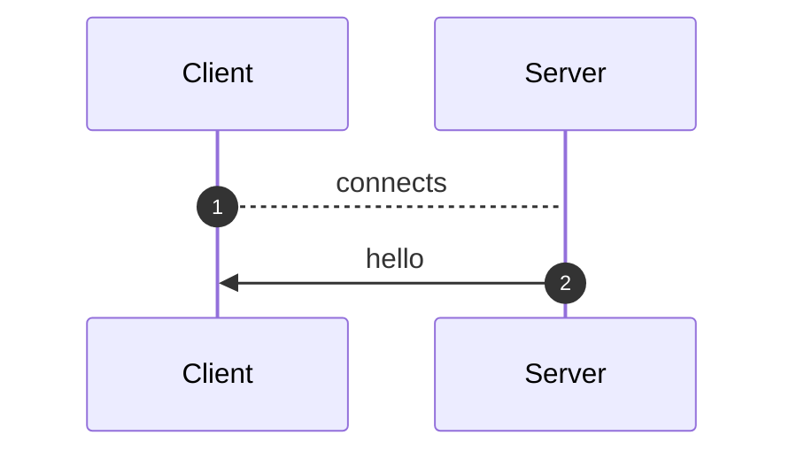
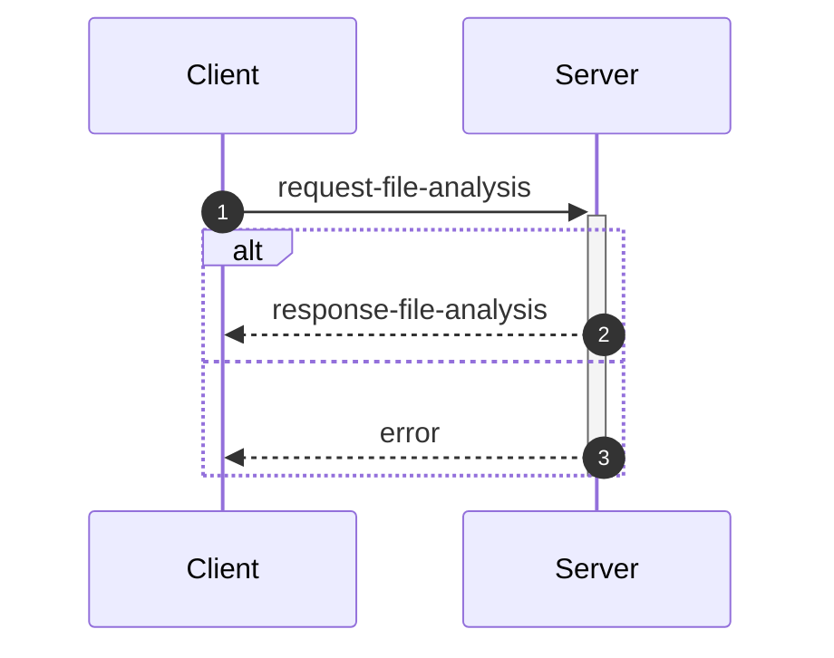
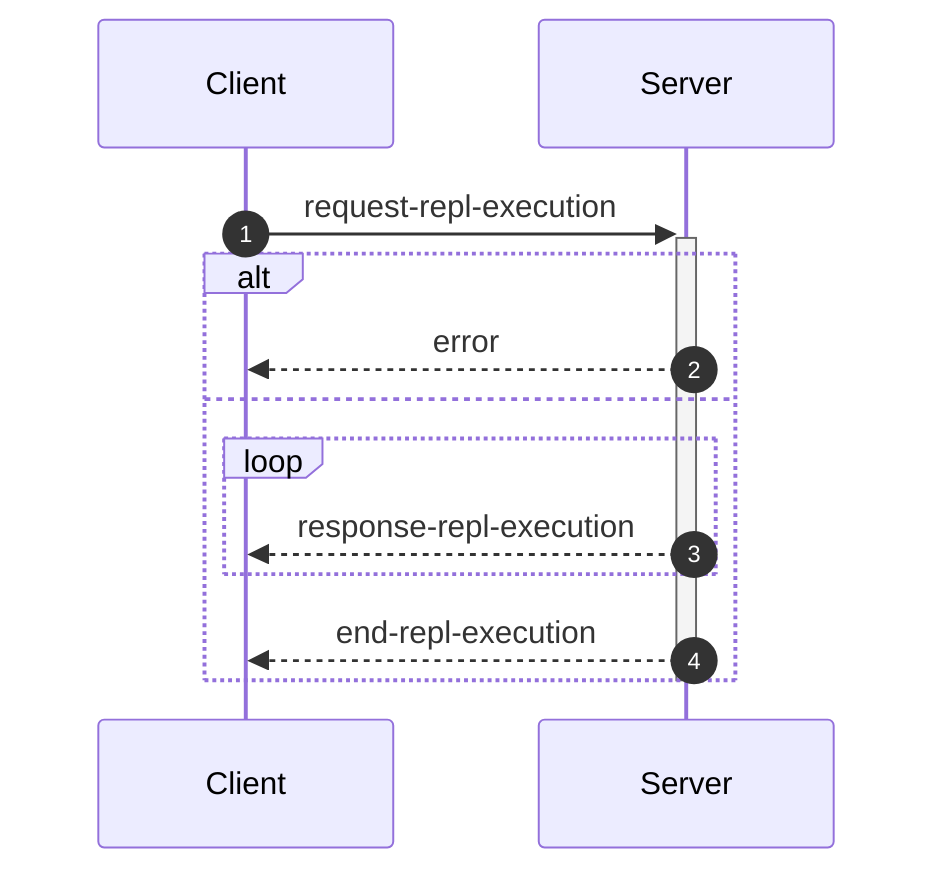
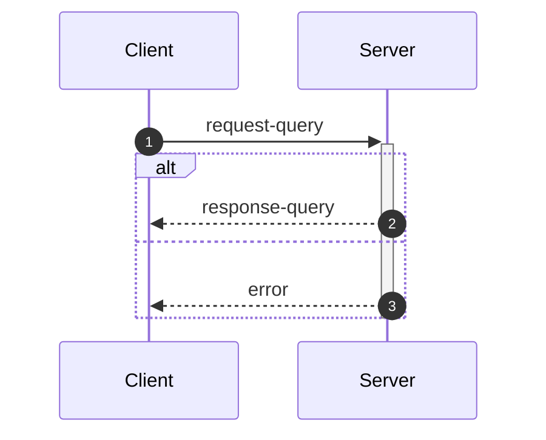

_<span title="an overview of flowR's interface">Generated</span> from '[wiki-interface.ts](https://github.com/flowr-analysis/flowr/tree/main/src/documentation/wiki-interface.ts "src/documentation/wiki-interface.ts")' on 2026-11-18, 18:09:44 UTC (v2.17.8, R v4.5.0), do not edit directly._

Although far from being as detailed as the in-depth explanation of [_flowR_](https://github.com/flowr-analysis/flowr/wiki/Core),
this wiki page explains how to interface with _flowR_ in more detail.
In general, command line arguments and other options provide short descriptions on hover over.

* [💻 Using the REPL](#using-the-repl)
* [⚙️ Configuring FlowR](#configuring-flowr)
* [⚒️ Writing Code](#writing-code)
* [💬 Communicating with the Server](#communicating-with-the-server)

<a id='using-the-repl'></a>
## 💻 Using the REPL

> [!NOTE]
> To execute arbitrary R commands with a repl request, _flowR_ has to be started explicitly with <span title="Description (Command Line Argument): Allow to access the underlying R session when using flowR (security warning: this allows the execution of arbitrary R code!)">`--r-session-access`</span>.
> Please be aware that this introduces a security risk and note that this relies on the [`r-shell` engine](https://github.com/flowr-analysis/flowr/wiki/Engines) .

Although primarily meant for users to explore,
there is nothing which forbids calling _flowR_ as a subprocess to use standard-in, -output, and -error
for communication (although you can access the REPL using the server as well,
with the [REPL Request](#message-request-repl-execution) message).

The read-eval-print loop&nbsp;(REPL) works relatively simple.
You can submit an expression (using <kbd>Enter</kbd>),
which is interpreted as an R&nbsp;expression by default but interpreted as a *command* if it starts with a colon (`:`).
The best command to get started with the REPL is <span title="Description (Repl Command): Show help information (aliases: :h, :?)">`:help`</span>.
Besides, you can leave the REPL either with the command <span title="Description (Repl Command): End the repl (aliases: :q, :exit)">`:quit`</span> or by pressing <kbd>Ctrl</kbd>+<kbd>C</kbd> twice.
When writing a *command*, you may press <kbd>Tab</kbd> to get a list of completions, if available.
Multiple commands can be entered in a single line by separating them with a semicolon (`;`), e.g. `:parse "x<-2"; :df*`.
If a command is given without R code, the REPL will re-use R code given in a previous command.
The prior example will hence return first the parsed AST of the program and then the dataflow graph for `"x <- 2"`.

> [!NOTE]
> If you develop flowR, you may want to launch the repl using the `npm run main-dev` command, this way, you get a non-minified version of flowR with debug information and hot-reloading of source files.

<details>
<summary>Available Commands</summary>

We currently offer the following commands (this with a `[*]` suffix are available with and without the star):

| Command | Description |
| ------- | ----------- |
| **<span title="Description (Repl Command): End the repl (aliases: :q, :exit)">:quit</span>** | End the repl (aliases: **:<span title="Alias of ':quit'. End the repl">q</span>**, **:<span title="Alias of ':quit'. End the repl">exit</span>**) |
| **<span title="Description (Repl Command): Execute the given code as R code. This requires the `--r-session-access` flag to be set and requires the r-shell engine. (aliases: :e, :r)">:execute</span>** | Execute the given code as R code. This requires the `--r-session-access` flag to be set and requires the r-shell engine. (aliases: **:<span title="Alias of ':execute'. Execute the given code as R code. This requires the `--r-session-access` flag to be set and requires the r-shell engine.">e</span>**, **:<span title="Alias of ':execute'. Execute the given code as R code. This requires the `--r-session-access` flag to be set and requires the r-shell engine.">r</span>**) |
| **<span title="Description (Repl Command): Get mermaid code for the control-flow graph of R code (aliases: :cfg, :cf)">:controlflow[*]</span>** | Get mermaid code for the control-flow graph of R code (star: Returns the URL to mermaid.live) (aliases: **:<span title="Alias of ':controlflow'. Get mermaid code for the control-flow graph of R code">cfg</span>**, **:<span title="Alias of ':controlflow'. Get mermaid code for the control-flow graph of R code">cf</span>**) |
| **<span title="Description (Repl Command): Get mermaid code for the control-flow graph with basic blocks (aliases: :cfgb, :cfb)">:controlflowbb[*]</span>** | Get mermaid code for the control-flow graph with basic blocks (star: Returns the URL to mermaid.live) (aliases: **:<span title="Alias of ':controlflowbb'. Get mermaid code for the control-flow graph with basic blocks">cfgb</span>**, **:<span title="Alias of ':controlflowbb'. Get mermaid code for the control-flow graph with basic blocks">cfb</span>**) |
| **<span title="Description (Repl Command): Get mermaid code for the dataflow graph (aliases: :d, :df)">:dataflow[*]</span>** | Get mermaid code for the dataflow graph (star: Returns the URL to mermaid.live) (aliases: **:<span title="Alias of ':dataflow'. Get mermaid code for the dataflow graph">d</span>**, **:<span title="Alias of ':dataflow'. Get mermaid code for the dataflow graph">df</span>**) |
| **<span title="Description (Repl Command): Get mermaid code for the normalized AST of R code (aliases: :n)">:normalize[*]</span>** | Get mermaid code for the normalized AST of R code (star: Returns the URL to mermaid.live) (alias: **:<span title="Alias of ':normalize'. Get mermaid code for the normalized AST of R code">n</span>**) |
| **<span title="Description (Repl Command): Get mermaid code for the simplified dataflow graph (aliases: :ds, :dfs)">:dataflowsimple[*]</span>** | Get mermaid code for the simplified dataflow graph (star: Returns the URL to mermaid.live) (aliases: **:<span title="Alias of ':dataflowsimple'. Get mermaid code for the simplified dataflow graph">ds</span>**, **:<span title="Alias of ':dataflowsimple'. Get mermaid code for the simplified dataflow graph">dfs</span>**) |
| **<span title="Description (Repl Command): Inspect and extend the signature database: `query` (identical to :query @signature), `info <name>` for where a function comes from (identical to :query @function-info), `add <path>` to mount another database/source, `download` to fetch the full-history database. (aliases: :sig)">:signature</span>** | Inspect and extend the signature database: `query` (identical to :query @signature), `info <name>` for where a function comes from (identical to :query @function-info), `add <path>` to mount another database/source, `download` to fetch the full-history database. (alias: **:<span title="Alias of ':signature'. Inspect and extend the signature database: `query` (identical to :query @signature), `info <name>` for where a function comes from (identical to :query @function-info), `add <path>` to mount another database/source, `download` to fetch the full-history database.">sig</span>**) |
| **<span title="Description (Repl Command): Just calculates the DFG, but only prints summary info (aliases: :d#, :df#)">:dataflowsilent</span>** | Just calculates the DFG, but only prints summary info (aliases: **:<span title="Alias of ':dataflowsilent'. Just calculates the DFG, but only prints summary info">d#</span>**, **:<span title="Alias of ':dataflowsilent'. Just calculates the DFG, but only prints summary info">df#</span>**) |
| **<span title="Description (Repl Command): Prints ASCII Art of the parsed, unmodified AST (aliases: :p)">:parse</span>** | Prints ASCII Art of the parsed, unmodified AST (alias: **:<span title="Alias of ':parse'. Prints ASCII Art of the parsed, unmodified AST">p</span>**) |
| **<span title="Description (Repl Command): Prints the version of flowR as well as the current version of R">:version</span>** | Prints the version of flowR as well as the current version of R
| **<span title="Description (Repl Command): Query the given R code (use 'help' for more information)">:query[*]</span>** | Query the given R code (use 'help' for more information) (star: Similar to query, but returns the output in json format.)
| **<span title="Description (Repl Command): Returns an ASCII representation of the dataflow graph (aliases: :df!)">:dataflowascii</span>** | Returns an ASCII representation of the dataflow graph (alias: **:<span title="Alias of ':dataflowascii'. Returns an ASCII representation of the dataflow graph">df!</span>**) |
| **<span title="Description (Repl Command): Returns summarization stats for the normalized AST (aliases: :n#)">:normalize#</span>** | Returns summarization stats for the normalized AST (alias: **:<span title="Alias of ':normalize#'. Returns summarization stats for the normalized AST">n#</span>**) |
| **<span title="Description (Repl Command): Show help information (aliases: :h, :?)">:help</span>** | Show help information (aliases: **:<span title="Alias of ':help'. Show help information">h</span>**, **:<span title="Alias of ':help'. Show help information">?</span>**) |

</details>

> [!TIP]
> 
> As indicated by the examples before, all REPL commands that operate on code keep track of the state.
> Hence, if you run a command like <span title="Description (Repl Command, starred version): Returns the URL to mermaid.live; Base Command: Get mermaid code for the dataflow graph (aliases: :d*, :df*)">`:dataflow*`</span> without providing R code,
> the REPL will re-use the R code provided in a previous command.
> Likewise, doing this will benefit from incrementality!
> If you request the dataflow graph with `:df* x <- 2 * y` and then want to see the parsed AST with `:parse`,
> the REPL will re-use previously obtained information and not re-parse the code again.
> 		

Generally, many commands offer shortcut versions in the REPL. Many queries, for example, offer a shortened format (see the example below).
Of special note, the [Config Query](https://github.com/flowr-analysis/flowr/wiki/%5BQuery%5D-Config)
can be used to also modify the currently active configuration of _flowR_ within the REPL (see the [wiki page](https://github.com/flowr-analysis/flowr/wiki/%5BQuery%5D-Config) for more information).

### Example: Retrieving the Dataflow Graph

To retrieve a URL to the [mermaid](https://mermaid.js.org/) diagram of the dataflow of a given expression,
use <span title="Description (Repl Command, starred version): Returns the URL to mermaid.live; Base Command: Get mermaid code for the dataflow graph (aliases: :d*, :df*)">`:dataflow*`</span> (or <span title="Description (Repl Command): Get mermaid code for the dataflow graph (aliases: :d, :df)">`:dataflow`</span> to get the mermaid code in the cli):

```shell
$ docker run -it --rm eagleoutice/flowr # or npm run flowr 
flowR repl v2.17.8, R grammar v14 (tree-sitter engine)
R> :dataflow* y <- 1 + x
```

<details>
<summary style='color:gray'>Output</summary>

```text
https://mermaid.live/view#base64:eyJjb2RlIjoiZmxvd2NoYXJ0IFREXG4gICAgMXt7XCJgKiM5MTtSTnVtYmVyIzkzOyogKioxKipcbiAgICAgICoxLjYqICgqKmlkOiAxKiopYFwifX1cbiAgICAyKFtcImAqIzkxO1JTeW1ib2wjOTM7KiAqKngqKlxuICAgICAgKjEuMTAqICgqKmlkOiAyKiopYFwiXSlcbiAgICAzW1tcImAqIzkxO1JCaW5hcnlPcCM5MzsqIGJhc2UjNTg7IzU4OyoqIzQzOyoqXG4gICAgICAqMS42LTEwKiAoKippZDogMyoqKVxuICAgIGFyZzogKDEsIDIpYFwiXV1cbiAgICBidWlsdC1pbjpfNDNfW1wiYEJ1aWx0LUluOlxuIzQzO2BcIl1cbiAgICBzdHlsZSBidWlsdC1pbjpfNDNfIHN0cm9rZTpncmF5LGZpbGw6Z3JheSxzdHJva2Utd2lkdGg6MnB4LG9wYWNpdHk6Ljg7XG4gICAgMFtcImAqIzkxO1JTeW1ib2wjOTM7KiAqKnkqKlxuICAgICAgKjEuMSogKCoqaWQ6IDAqKiwgdjogMylgXCJdXG4gICAgNFtbXCJgKiM5MTtSQmluYXJ5T3AjOTM7KiBiYXNlIzU4OyM1ODsqKiM2MDsjNDU7KipcbiAgICAgICoxLjEtMTAqICgqKmlkOiA0KiopXG4gICAgYXJnOiAoMCwgMylgXCJdXVxuICAgIGJ1aWx0LWluOl82MF8tW1wiYEJ1aWx0LUluOlxuIzYwOyM0NTtgXCJdXG4gICAgc3R5bGUgYnVpbHQtaW46XzYwXy0gc3Ryb2tlOmdyYXksZmlsbDpncmF5LHN0cm9rZS13aWR0aDoycHgsb3BhY2l0eTouODtcbiAgICAxIC0uLT58XCJmbG93XCJ8IDJcbiAgICBsaW5rU3R5bGUgMCBzdHJva2U6Z3JheSxjb2xvcjpncmF5O1xuICAgIDIgLS4tPnxcImZsb3dcInwgM1xuICAgIGxpbmtTdHlsZSAxIHN0cm9rZTpncmF5LGNvbG9yOmdyYXk7XG4gICAgMyAtLT58XCJyZWFkcywgYXJnXCJ8IDFcbiAgICAzIC0tPnxcInJlYWRzLCBhcmdcInwgMlxuICAgIDMgLS4tPnxcImZsb3dcInwgMFxuICAgIGxpbmtTdHlsZSA0IHN0cm9rZTpncmF5LGNvbG9yOmdyYXk7XG4gICAgMyAtLi0+fFwicmVhZHMsIGNhbGxzXCJ8IGJ1aWx0LWluOl80M19cbiAgICBsaW5rU3R5bGUgNSBzdHJva2U6Z3JheTtcbiAgICAwIC0tPnxcImRlZmluZWQtYnksIGZsb3dcInwgNFxuICAgIDAgLS0+fFwiZGVmaW5lZC1ieVwifCAzXG4gICAgNCAtLT58XCJyZWFkcywgYXJnXCJ8IDNcbiAgICA0IC0tPnxcInJldHVybnMsIGFyZ1wifCAwXG4gICAgNCAtLi0+fFwicmVhZHMsIGNhbGxzXCJ8IGJ1aWx0LWluOl82MF8tXG4gICAgbGlua1N0eWxlIDEwIHN0cm9rZTpncmF5OyIsIm1lcm1haWQiOnsiYXV0b1N5bmMiOnRydWV9fQ==
```

Retrieve the dataflow graph of the expression `y <- 1 + x`. It looks like this:


<details>

<summary style="color:gray">R Code of the Dataflow Graph</summary>

The analysis ran (parse and normalize with the [tree-sitter](https://github.com/flowr-analysis/flowr/wiki/Engines) engine) in the generation environment. No [signature database](https://github.com/flowr-analysis/flowr/wiki/Signature-Database) is mounted, so `library()` attaches no exports (base-R names are still qualified, e.g., `stats::acf`). 
We encountered no unknown side effects during the analysis.

```r
y <- 1 + x
```

</details>

</details>

For small graphs like this, <span title="Description (Repl Command): Returns an ASCII representation of the dataflow graph (aliases: :df!)">`:dataflowascii`</span> also provides an ASCII representation directly in the REPL:

```shell
$ docker run -it --rm eagleoutice/flowr # or npm run flowr 
flowR repl v2.17.8, R grammar v14 (tree-sitter engine)
R> :df! y <- 1 + x
```

<details open>
<summary style='color:gray'>Output</summary>

```text
                        v<0>v
 c<4>c──────────────────| y |
 |<- |     ┌────────────v---v
 c---c     │
    │   c<3>c   0<1>0
    └───| + |───| 1 |───u<2>u
        c---c   0---0   | x |
           └────────────u---u
Edges:
3 -> 1: reads, arg          3 -> 2: reads, arg
3 -> 0: flows-to            1 -> 2: flows-to
2 -> 3: flows-to            4 -> 3: reads, arg
4 -> 0: returns, arg        0 -> 4: defined-by, flows-to
0 -> 3: defined-by
```

Retrieve the dataflow graph of the expression `y <- 1 + x` as ASCII art.

</details>

For the slicing with <span title="Description (Repl Command): Static backwards executable slicer for R">`:slicer`</span>, you have access to the same [magic comments](#slice-magic-comments) as with the [slice request](#message-request-slice).
Pass `--inline` to splice resolvable `source()` calls into the reconstruction so the slice is a single self-contained R text (the same as the static slice query's `inlineSources` flag).
See `--help` for more flags!

### Example: Interfacing with the File System

Many commands that allow for an R-expression (like <span title="Description (Repl Command, starred version): Returns the URL to mermaid.live; Base Command: Get mermaid code for the dataflow graph (aliases: :d*, :df*)">`:dataflow*`</span>) allow for a file as well
if the argument starts with `file://`.
If you are working from the root directory of the _flowR_ repository, the following gives you the parsed AST of the example file using the <span title="Description (Repl Command): Prints ASCII Art of the parsed, unmodified AST (aliases: :p)">`:parse`</span> command:

> **Watch mode**: Replace `file://` with `watch://` to enter watch mode.
> flowR runs the command immediately and then re-runs it every time the file (or any file inside the folder) changes.
> Enter any other command to leave watch mode.
> For example: `:df watch://analysis.R`

```shell
$ docker run -it --rm eagleoutice/flowr # or npm run flowr 
flowR repl v2.17.8, R grammar v14 (tree-sitter engine)
R> :parse file://test/testfiles/example.R
```

<details>
<summary style='color:gray'>Output</summary>

```text
File: test/testfiles/example.R

program
├ binaryoperator
│ ├ identifier "sum" (1:1─4)
│ ├ <- "<-" (1:5─7)
│ ╰ float "0" (1:8─9)
├ binaryoperator
│ ├ identifier "product" (2:1─8)
│ ├ <- "<-" (2:9─11)
│ ╰ float "1" (2:12─13)
├ binaryoperator
│ ├ identifier "w" (3:1─2)
│ ├ <- "<-" (3:3─5)
│ ╰ float "7" (3:6─7)
├ binaryoperator
│ ├ identifier "N" (4:1─2)
│ ├ <- "<-" (4:3─5)
│ ╰ float "10" (4:6─8)
├ forstatement
│ ├ for "for" (6:1─4)
│ ├ ( "(" (6:5─6)
│ ├ identifier "i" (6:6─7)
│ ├ in "in" (6:8─10)
│ ├ binaryoperator
│ │ ├ float "1" (6:11─12)
│ │ ├ : ":" (6:12─13)
│ │ ╰ parenthesizedexpression
│ │   ├ ( "(" (6:13─14)
│ │   ├ binaryoperator
│ │   │ ├ identifier "N" (6:14─15)
│ │   │ ├ - "-" (6:15─16)
│ │   │ ╰ float "1" (6:16─17)
│ │   ╰ ) ")" (6:17─18)
│ ├ ) ")" (6:18─19)
│ ╰ bracedexpression
│   ├ { "{" (6:20─21)
│   ├ binaryoperator
│   │ ├ identifier "sum" (7:3─6)
│   │ ├ <- "<-" (7:7─9)
│   │ ╰ binaryoperator
│   │   ├ binaryoperator
│   │   │ ├ identifier "sum" (7:10─13)
│   │   │ ├ + "+" (7:14─15)
│   │   │ ╰ identifier "i" (7:16─17)
│   │   ├ + "+" (7:18─19)
│   │   ╰ identifier "w" (7:20─21)
│   ├ binaryoperator
│   │ ├ identifier "product" (8:3─10)
│   │ ├ <- "<-" (8:11─13)
│   │ ╰ binaryoperator
│   │   ├ identifier "product" (8:14─21)
│   │   ├  "" (8:22─23)
│   │   ╰ identifier "i" (8:24─25)
│   ╰ } "}" (9:1─2)
├ call
│ ├ identifier "cat" (11:1─4)
│ ╰ arguments
│   ├ ( "(" (11:4─5)
│   ├ argument
│   │ ╰ string
│   │   ├ stringopen "\"" (11:5─6)
│   │   ├ stringcontent "Sum:" (11:6─10)
│   │   ╰ stringclose "\"" (11:10─11)
│   ├ comma "," (11:11─12)
│   ├ argument
│   │ ╰ identifier "sum" (11:13─16)
│   ├ comma "," (11:16─17)
│   ├ argument
│   │ ╰ string
│   │   ├ stringopen "\"" (11:18─19)
│   │   ├ stringcontent
│   │   │ ╰ escapesequence "\\n" (11:19─21)
│   │   ╰ stringclose "\"" (11:21─22)
│   ╰ ) ")" (11:22─23)
╰ call
  ├ identifier "cat" (12:1─4)
  ╰ arguments
    ├ ( "(" (12:4─5)
    ├ argument
    │ ╰ string
    │   ├ stringopen "\"" (12:5─6)
    │   ├ stringcontent "Product:" (12:6─14)
    │   ╰ stringclose "\"" (12:14─15)
    ├ comma "," (12:15─16)
    ├ argument
    │ ╰ identifier "product" (12:17─24)
    ├ comma "," (12:24─25)
    ├ argument
    │ ╰ string
    │   ├ stringopen "\"" (12:26─27)
    │   ├ stringcontent
    │   │ ╰ escapesequence "\\n" (12:27─29)
    │   ╰ stringclose "\"" (12:29─30)
    ╰ ) ")" (12:30─31)
```

Retrieve the parsed AST of the example file.

<details>

<summary>File Content</summary>

```r
sum <- 0
product <- 1
w <- 7
N <- 10

for (i in 1:(N-1)) {
  sum <- sum + i + w
  product <- product * i
}

cat("Sum:", sum, "\n")
cat("Product:", product, "\n")
```

</details>

As _flowR_ directly transforms this AST the output focuses on being human-readable instead of being machine-readable.
		
</details>

### Example: Run a Query

You can run any query supported by _flowR_ using the <span title="Description (Repl Command): Query the given R code (use 'help' for more information)">`:query`</span> command.
For example, to obtain the shapes of all data frames in a given piece of code, you can run:

```shell
$ docker run -it --rm eagleoutice/flowr # or npm run flowr 
flowR repl v2.17.8, R grammar v14 (tree-sitter engine)
R> :query @absint df-shape "x <- data.frame(a = 1:10, b = 1:10)\ny <- x$a"
```

<details open>
<summary style='color:gray'>Output</summary>

```text
Query: absint (2 ms)
   ╰ $12: (colnames: [{"a", "b"}, {}], cols: [2, 2], rows: [10, 10])
   ╰ $0: (colnames: [{"a", "b"}, {}], cols: [2, 2], rows: [10, 10])
```

Retrieve the shapes of all data frames in the given code.

</details>

To run the linter on a file, you can use (in this example, we just issue the `dead-code` linter on a small piece of code):

```shell
$ docker run -it --rm eagleoutice/flowr # or npm run flowr 
flowR repl v2.17.8, R grammar v14 (tree-sitter engine)
R> :query @linter rules:dead-code "if(FALSE) x <- 2"
```

<details open>
<summary style='color:gray'>Output</summary>

```text
Query: linter (3 ms)
   ╰ Dead Code (dead-code):
       ╰ certain:
           ╰ Code at 1.11-16 (1 quick fix(es) available)
```

Run the linter on the given code, with only the `dead-code` rule enabled.

</details>

For more information on the available queries, please check out the [Query API](https://github.com/flowr-analysis/flowr/wiki/Query-API).

<a id='configuring-flowr'></a>
## ⚙️ Configuring FlowR

When running _flowR_, you may want to specify some behaviors with a dedicated configuration file.
By default, flowR looks for a file named `flowr.json` in the current working directory (or any higher directory).
You can also specify a different file with <span title="Description (Command Line Argument): The name of the configuration file to use">`--config-file`</span> or pass the configuration inline using <span title="Description (Command Line Argument): The flowR configuration to use, as a JSON string">`--config-json`</span>.
A `flowr.json` found this way belongs to the analyzed project, so flowR ignores its options that decide what flowR executes or loads
(`engines.*.wasmPath`, `engines.*.treeSitterWasmPath`, `engines.*.rPath`, `solver.sigdb.additionalPaths`, `solver.sigdb.downloadRepo`, `solver.sigdb.installedLibrary.paths`, `solver.sigdb.onDemand.enabled`, `solver.sigdb.onDemand.repositories`, `solver.sigdb.onDemand.cranMirror`, `solver.sigdb.onDemand.bioconductorMirror`, `solver.sigdb.onDemand.cacheDir`),
unless you pass <span title="Description (Command Line Argument): Keep the security-sensitive options (e.g., the R executable) of the flowr.json found in the working directory or a parent. Only use this for projects you trust.">`--trust-config`</span>.
To analyze code you do not trust, use the secure mode (<span title="Description (Command Line Argument): Run in secure mode for analyzing untrusted code: flowR does not start R (or any other process), does not access the network, does not search for project configs, and ignores security-sensitive options in every config. Cannot be disabled once enabled. Can also be enabled with the environment variable {italic FLOWR_SECURE_MODE=1}.">`--secure`</span>, see the [security policy](https://github.com/flowr-analysis/flowr/blob/main/.github/SECURITY.md)).
To inspect the current configuration, you can run flowr with the <span title="Description (Command Line Argument): Run with verbose logging (will be passed to the corresponding script)">`--verbose`</span> flag, or use the `config` [Query](https://github.com/flowr-analysis/flowr/wiki/Query-API).
Within the REPL this works by running the following:

```shell
:query @config
```

To work with the <a href="https://github.com/flowr-analysis/flowr/tree/main/src/config.ts#L122"><code><span title="The configuration file format for flowR.">FlowrConfig</span></code></a> you can use the provided helper objects alongside its methods like
<a href="https://github.com/flowr-analysis/flowr/tree/main/src/config.ts#L954"><code><span title="Creates a new flowr config that has the updated values.">FlowrConfig::<b>amend</b></span></code></a>.
The schema below documents every option; the ones you most likely want are:

- <a href="https://github.com/flowr-analysis/flowr/wiki/Interface#configuring-flowr" title="Configuration Option (boolean): Whether source calls should be ignored, causing {@link processSourceCall}&#39;s behavior to be skipped.">ignoreSourceCalls</a>: ignore source calls when analyzing the code, i.e., ignore the inclusion of other files.
- <a href="https://github.com/flowr-analysis/flowr/wiki/Interface#configuring-flowr" title="Configuration Option (boolean): Whether load calls should be ignored, causing {@link processLoadCall}&#39;s behavior to be skipped.">ignoreLoadCalls</a>: ignore load calls when analyzing the code, i.e., ignore the loading of r-data files.
- <a href="https://github.com/flowr-analysis/flowr/wiki/Interface#configuring-flowr" title="Configuration Option (object): Do you want to overwrite (parts) of the builtin definition?">semantics.environment.overwriteBuiltIns</a>: overwrite _flowR_'s handling of built-in functions, or clear the preset definitions entirely.
  See [Configure BuiltIn Semantics](#configure-builtin-semantics) for more information.
- <a href="https://github.com/flowr-analysis/flowr/wiki/Interface#configuring-flowr" title="Configuration Option (boolean): Whether calls drawing on a graphics device (e.g., `plot`) count as writing to it, which the ambient state queries then report.">semantics.ambient.drawingWritesDevice</a>: whether calls drawing on a graphics device (e.g., `plot`) count as writing the device in the ambient state queries.
- <a href="https://github.com/flowr-analysis/flowr/wiki/Interface#configuring-flowr" title="Configuration Option (string): How to resolve variables and their values. (one of &quot;disabled&quot;, &quot;alias&quot;, &quot;builtin&quot;)">solver.variables</a>: how to resolve variables and their values (`disabled`, `alias`, `builtin`).
- <a href="https://github.com/flowr-analysis/flowr/wiki/Interface#configuring-flowr" title="Configuration Option (array): The engine or set of engines to use for interacting with R code. An empty array means all available engines will be used.">engines</a> and <a href="https://github.com/flowr-analysis/flowr/wiki/Interface#configuring-flowr" title="Configuration Option (string): The default engine to use for interacting with R code. If this is undefined, an arbitrary engine from the specified list will be used. (one of &quot;tree-sitter&quot;, &quot;r-shell&quot;)">defaultEngine</a>: the engines used to interact with R code, see the [Engines wiki page](https://github.com/flowr-analysis/flowr/wiki/Engines).
- <a href="https://github.com/flowr-analysis/flowr/wiki/Interface#configuring-flowr" title="Configuration Option (array): Files a framework loads on its own, without any source() call (e.g. global.R in a shiny app), in the order they are loaded; flowR orders the matching project files accordingly and analyzes them as one program. Entries are case-insensitive globs matched against the file path, a plain name matches any file with that name, and entries matching no project file are warned about. Usually set per project kind via specializeConfig.">project.implicitSources</a>: the files a framework loads without any `source()` call, in the order in which they are
  loaded. Entries are globs (e.g. `R/*.R`) matched against the file path ignoring capitalization; one matching no file is reported.
- <a href="https://github.com/flowr-analysis/flowr/wiki/Interface#configuring-flowr" title="Configuration Option (object): Overwrite (parts of) the configuration depending on the project kind flowR detects, e.g. to give a shiny app its implicit sources.">specializeConfig</a>: overwrite (parts of) the configuration depending on the kind of project _flowR_ detects
  (e.g. `shiny-app`), which is how a shiny app gets its implicit sources by default. What you configure directly wins.
- <a href="https://github.com/flowr-analysis/flowr/wiki/Interface#configuring-flowr" title="Configuration Option (string): Overwrite the project kind flowR would otherwise infer from the analyzed files, e.g. when auto-detection guesses wrong. (one of &quot;package&quot;, &quot;script&quot;, &quot;shiny-app&quot;, &quot;notebook&quot;, &quot;project&quot;, &quot;unknown&quot;)">project.useProjectType</a>: skip that detection and force a project kind yourself, when auto-detection guesses wrong.
- <a href="https://github.com/flowr-analysis/flowr/wiki/Interface#configuring-flowr" title="Configuration Option (array): The default plugins to load when creating a new instance of FlowrAnalyzer">defaultPlugins</a> and <a href="https://github.com/flowr-analysis/flowr/wiki/Interface#configuring-flowr" title="Configuration Option (array): The plugins to load in REPL mode">repl.plugins</a>: the plugins to load for a new <a href="https://github.com/flowr-analysis/flowr/tree/main/src/project/flowr-analyzer.ts#L218"><code><span title="Central class for conducting analyses with FlowR. Use the FlowrAnalyzerBuilder to create a new instance. If you want the original pattern of creating a pipeline and running all steps, you can still do this with FlowrAnalyzer#runFull . To inspect the context of the analyzer, use FlowrAnalyzer#inspectContext (if you are a plugin and need to modify it, use FlowrAnalyzer#context instead).">FlowrAnalyzer</span></code></a> and in the REPL
  (use `flowr:default` to reference the former).

So you can configure _flowR_ by adding a file like the following:

<details>

<summary>Example Configuration File</summary>

```json
{
  "ignoreSourceCalls": true,
  "ignoreLoadCalls": true,
  "semantics": {
    "environment": {
      "overwriteBuiltIns": {
        "definitions": [
          {
            "type": "function",
            "names": [
              "foo"
            ],
            "processor": "builtin:assign",
            "config": {}
          }
        ]
      }
    }
  },
  "defaultPlugins": [
    "file:description",
    "versions:description"
  ],
  "repl": {
    "quickStats": false,
    "dfProcessorHeat": false,
    "hints": true,
    "plugins": [
      "flowr:default"
    ]
  },
  "project": {
    "resolveUnknownPathsOnDisk": true,
    "implicitSources": [
      "global.R",
      "app.R"
    ]
  },
  "linter": {
    "disabledRules": []
  },
  "specializeConfig": {
    "shiny-app": {
      "project": {
        "implicitSources": [
          "global.R",
          "ui.R",
          "server.R",
          "app.R"
        ]
      }
    }
  },
  "engines": [
    {
      "type": "r-shell"
    }
  ],
  "solver": {
    "variables": "alias",
    "evalStrings": true,
    "trackEnvironments": true,
    "sigdb": {
      "enabled": true,
      "loadProjectDependencies": true,
      "eagerlyLoad": false,
      "eagerlyLoadExports": false,
      "linkBaseR": false,
      "linkDescriptionDependencies": false
    },
    "resolveSource": {
      "dropPaths": "no",
      "ignoreCapitalization": true,
      "inferWorkingDirectory": "active-script",
      "searchPath": []
    },
    "instrument": {},
    "slicer": {
      "threshold": 50
    }
  },
  "abstractInterpretation": {
    "wideningThreshold": 4,
    "followCalls": true,
    "dataFrame": {
      "maxColNames": 20,
      "readLoadedData": {
        "readExternalFiles": true,
        "maxReadLines": 1000000
      }
    }
  },
  "incremental": {
    "alwaysIncremental": false,
    "parsing": {
      "activated": false,
      "heuristics": {
        "activated": true,
        "mtime": true,
        "linesFrom": 500,
        "bytesFrom": 50000,
        "alwaysWithEdits": false,
        "minFiles": 1
      }
    }
  },
  "gas": {
    "thresholds": {
      "memory": {
        "problematic": 0.7,
        "critical": 0.9
      },
      "timeMs": {
        "problematic": 100000,
        "critical": 120000
      }
    },
    "features": {}
  }
}
```

</details>

<details>
<a id='configure-builtin-semantics'></a>
<summary>Configure Built-In Semantics</summary>

`semantics/environment/overwriteBuiltins` accepts two keys:

- `loadDefaults` (boolean, initially `true`): If set to `true`, the default built-in definitions are loaded before applying the custom definitions. Setting this flag to `false` explicitly disables the loading of the default definitions.
- `definitions` (array, initially empty): Allows to overwrite or define new built-in elements. Each object within must have a `type` which is one of the below. Furthermore, they may define a string array of `names` which specifies the identifiers to bind the definitions to. You may use `assumePrimitive` to specify whether _flowR_ should assume that this is a primitive non-library definition (so you probably just do not want to specify the key).

  | Type            | Description                                                                                                                                                                                                                                                                                              | Example                                                                                                    |
  | --------------- | -------------------------------------------------------------------------------------------------------------------------------------------------------------------------------------------------------------------------------------------------------------------------------------------------------- | ---------------------------------------------------------------------------------------------------------- |
  | `constant`    | Additionally allows for a `value` this should resolve to.                                                                                                                                                                                                                                                | `{ type: 'constant', names: ['NULL', 'NA'],  value: null }`                                                |
  | `function`    | Is a rather flexible way to define and bind built-in functions. For the time, we do not have extensive documentation to cover all the cases, so please either consult the sources with the `default-builtin-config/` folder or open a [new issue](https://github.com/flowr-analysis/flowr/issues/new/choose). | `{ type: 'function', names: ['next'], processor: 'builtin:d', config: { cfg: ExitPointType.Next } }` |
  | `replacement` | A comfortable way to specify replacement functions like `$<-` or `names<-`. `suffixes` describes the... suffixes to attach automatically. | `{ type: 'replacement', suffixes: ['<-', '<<-'], names: ['[', '[['] }` |

</details>

<details>

<summary style='color:gray'>Full Configuration-File Schema</summary>

- _The configuration file format for flowR._ (object)
    - **logLevel** [optional] _flowR's global minimum log level, applied when the config is loaded._ (string)
        Only allows: 'silly', 'trace', 'debug', 'info', 'warn', 'error', 'fatal'
    - **ignoreSourceCalls** [optional] _Whether source calls should be ignored, causing {@link processSourceCall}'s behavior to be skipped._ (boolean)
    - **ignoreLoadCalls** [optional] _Whether load calls should be ignored, causing {@link processLoadCall}'s behavior to be skipped._ (boolean)
    - **semantics** _Configure language semantics and how flowR handles them._ (object)
        - **environment** [optional] _Semantics regarding how to handle the R environment._ (object)
            - **overwriteBuiltIns** [optional] _Do you want to overwrite (parts) of the builtin definition?_ (object)
                - **loadDefaults** [optional] _Should the default configuration still be loaded?_ (boolean)
                - **definitions** [optional] _The definitions to load/overwrite._ (array)
                Valid item types:
                    - (object)
        - **ambient** [optional] _Semantics regarding the global state (options, devices, files, ...) calls access._ (object)
            - **drawingWritesDevice** [optional] _Whether calls drawing on a graphics device (e.g., `plot`) count as writing to it, which the ambient state queries then report._ (boolean)
    - **defaultPlugins** [optional] _The default plugins to load when creating a new instance of FlowrAnalyzer_ (array)
    Valid item types:
        - (alternatives)
            - (string)
            - (array)
    - **repl** _Configuration options for the REPL._ (object)
        - **quickStats** [optional] _Whether to show quick stats in the REPL after each evaluation._ (boolean)
        - **dfProcessorHeat** [optional] _This instruments the dataflow processors to count how often each processor is called._ (boolean)
        - **hints** [optional] _Whether to show dim inline hints on the empty prompt (automatically disabled on non-interactive terminals)._ (boolean)
        - **plugins** [optional] _The plugins to load in REPL mode_ (array)
        Valid item types:
            - (alternatives)
                - (string)
                - (array)
        - **autoUseFileProtocol** [optional] _Prepend the file protocol to a repl input that looks like a path, instead of only warning about it._ (boolean)
        - **queryStats** [optional] _Whether `:query` closes with the line stating how long the queries took (`:query*` never prints it)._ (boolean)
        - **showPlugins** [optional] _Whether `:version` grays out the plugins that did not activate during the last analysis._ (boolean)
    - **project** _Project specific configuration options._ (object)
        - **resolveUnknownPathsOnDisk** [optional] _Whether to resolve unknown paths loaded by the r project disk when trying to source/analyze files._ (boolean)
        - **failOnInaccessiblePath** [optional] _Whether a directory that cannot be traversed during file discovery (e.g. due to permissions) aborts the analysis; when false (the default) such paths are logged and skipped._ (boolean)
        - **basePackages** [optional] _The packages considered part of R itself (base and recommended); if unset, flowR uses its built-in list._ (array)
        Valid item types:
            - (string)
        - **implicitSources** [optional] _Files a framework loads on its own, without any source() call (e.g. global.R in a shiny app), in the order they are loaded; flowR orders the matching project files accordingly and analyzes them as one program. Entries are case-insensitive globs matched against the file path, a plain name matches any file with that name, and entries matching no project file are warned about. Usually set per project kind via specializeConfig._ (array)
        Valid item types:
            - (string)
        - **useProjectType** [optional] _Overwrite the project kind flowR would otherwise infer from the analyzed files, e.g. when auto-detection guesses wrong._ (string)
            Only allows: 'package', 'script', 'shiny-app', 'notebook', 'project', 'unknown'
        - **assumeImplicitEcho** [optional] _Whether the top level of the analyzed code is echoed, so that every visible result printed there is collected as an output by the dependencies query (default true, false for a package)._ (boolean)
        - **discovery** [optional] _Scoping options for the default project discovery._ (object)
            - **full** [optional] _Collect every file below the project root (greedy) instead of only the files the detected project kind needs (default false)._ (boolean)
            - **perKind** [optional] _Per-kind include/exclude glob overrides layered on the default scoping._ (object)
            - **ignore** [optional] _Case-insensitive globs that drop matching files from the intelligent discovery, regardless of kind (e.g. .Renviron to ignore environment files)._ (array)
            Valid item types:
                - (string)
        - **classification** [optional] _Overrides for the signals flowR uses to classify the project kind._ (object)
            - **shinyDescriptionTypes** [optional] _DESCRIPTION Type: values that mark a shiny app._ (array)
            Valid item types:
                - (string)
            - **shinyEntryFiles** [optional] _File names a shiny app is assembled from._ (array)
            Valid item types:
                - (string)
            - **shinyUsagePattern** [optional] _Regex source evidencing shiny usage in an entry file._ (string)
            - **notebookExtensions** [optional] _File extensions marking a notebook._ (array)
            Valid item types:
                - (string)
    - **linter** _Linter configuration options._ (object)
        - **disabledRules** _Linting rule names excluded from the default rule set (a rule requested explicitly via a linter query still runs). Usually set per project kind via specializeConfig._ (array)
        Valid item types:
            - (string)
        - **disabledTags** [optional] _Linting rule tags whose rules are excluded from the default rule set (a rule requested explicitly via a linter query still runs). By default the cmd-check rules are disabled for everything but a package; a configured list replaces that default._ (array)
        Valid item types:
            - (string)
    - **inputSources** [optional] _Further frameworks the input-sources analysis should know about; entries are added to flowR's defaults._ (object)
        - **pure** [optional] _Functions that only pass the constantness of their arguments on._ (array)
        Valid item types:
            - (string)
        - **param** [optional] _Functions whose result is a 'param' input._ (array)
        Valid item types:
            - (string)
        - **file** [optional] _Functions whose result is a 'file' input._ (array)
        Valid item types:
            - (string)
        - **tempfile** [optional] _Functions whose result is a 'tempfile' input._ (array)
        Valid item types:
            - (string)
        - **glob** [optional] _Functions whose result is a 'glob' input._ (array)
        Valid item types:
            - (string)
        - **net** [optional] _Functions whose result is a 'net' input._ (array)
        Valid item types:
            - (string)
        - **rand** [optional] _Functions whose result is a 'rand' input._ (array)
        Valid item types:
            - (string)
        - **system** [optional] _Functions whose result is a 'system' input._ (array)
        Valid item types:
            - (string)
        - **ffi** [optional] _Functions whose result is a 'ffi' input._ (array)
        Valid item types:
            - (string)
        - **lang** [optional] _Functions whose result is a 'lang' input._ (array)
        Valid item types:
            - (string)
        - **options** [optional] _Functions whose result is a 'options' input._ (array)
        Valid item types:
            - (string)
        - **cmdline** [optional] _Functions whose result is a 'cmdline' input._ (array)
        Valid item types:
            - (string)
        - **user** [optional] _Functions whose result is a 'user' input._ (array)
        Valid item types:
            - (string)
        - **const** [optional] _Functions whose result is a 'const' input._ (array)
        Valid item types:
            - (string)
        - **scope** [optional] _Functions whose result is a 'scope' input._ (array)
        Valid item types:
            - (string)
        - **dconst** [optional] _Functions whose result is a 'dconst' input._ (array)
        Valid item types:
            - (string)
        - **unknown** [optional] _Functions whose result is a 'unknown' input._ (array)
        Valid item types:
            - (string)
        - **linkedObjects** [optional] _Objects a framework provides without a definition in the code, e.g. shiny's input._ (array)
        Valid item types:
            - (object)
        - **linkedEntryPoints** [optional] _Calls that hand a function to a framework, which binds its objects to the parameters by position._ (array)
        Valid item types:
            - (object)
    - **specializeConfig** [optional] _Overwrite (parts of) the configuration depending on the project kind flowR detects, e.g. to give a shiny app its implicit sources._ (object)
    - **engines** _The engine or set of engines to use for interacting with R code. An empty array means all available engines will be used._ (array)
    Valid item types:
        - (alternatives)
            - _The configuration for the tree sitter engine._ (object)
                - **type** [required] _Use the tree sitter engine._ (string)
                    Only allows: 'tree-sitter'
                - **wasmPath** [optional] _The path to the tree-sitter-r WASM binary to use. If this is undefined, this uses the default path._ (string)
                - **treeSitterWasmPath** [optional] _The path to the tree-sitter WASM binary to use. If this is undefined, this uses the default path._ (string)
                - **lax** [optional] _Whether to use the lax parser for parsing R code (allowing for syntax errors). If this is undefined, the strict parser will be used._ (boolean)
            - _The configuration for the R shell engine._ (object)
                - **type** [required] _Use the R shell engine._ (string)
                    Only allows: 'r-shell'
                - **rPath** [optional] _The path to the R executable to use. If this is undefined, this uses the default path._ (string)
                - **pipeBind** [optional] _Whether to enable R's experimental pipe-bind operator "=>" by setting _R_USE_PIPEBIND_ for the R session (default false); R itself keeps this off by default, as it is experimental and has never shipped in a release version of R._ (boolean)
    - **defaultEngine** [optional] _The default engine to use for interacting with R code. If this is undefined, an arbitrary engine from the specified list will be used._ (string)
        Only allows: 'tree-sitter', 'r-shell'
    - **solver** _How to resolve constants, constraints, cells, ..._ (object)
        - **variables** _How to resolve variables and their values._ (string)
            Only allows: 'disabled', 'alias', 'builtin'
        - **evalStrings** _Should we include eval(parse(text="...")) calls in the dataflow graph?_ (boolean)
        - **trackEnvironments** [optional] _Track user-created environments (new.env, assign/get/local with envir=, dollar-assign, attach). When false, all envir-style calls fall through conservatively._ (boolean)
        - **sigdb** _Resolving library exports from a signature database._ (object)
            - **enabled** [optional] _Resolve library()/use() exports from a signature database (default true); when false no database is consulted._ (boolean)
            - **loadProjectDependencies** [optional] _Load the project's declared dependencies from its metadata files (DESCRIPTION Imports/Depends, rproject.toml, uvr.toml, rig rproj.toml and script blocks, renv.lock, rv.lock, uvr.lock, rig lockfiles) (default true); when false these files are not read for dependencies._ (boolean)
            - **eagerlyLoad** [optional] _Parse the database up front rather than on the first package load (default false, ignored if disabled)._ (boolean)
            - **eagerlyLoadExports** [optional] _Add a vertex for every export on load rather than on demand (default false); keeps the dataflow graph small._ (boolean)
            - **assumedRVersion** [optional] _R version assumed when resolving versioned (base-R) exports: a pin like "4.5" or "auto" to detect the installed R (default "auto")._ (string)
            - **linkBaseR** [optional] _Eagerly attach base-R namespaces so bare base calls resolve without library() (default false)._ (boolean)
            - **linkBaseRCalls** [optional] _Add a lightweight Reads edge from a bare base-R call to its signature-database function vertex (default false; base-R qualification is edge-free otherwise)._ (boolean)
            - **linkPackageCalls** [optional] _Add a lightweight Reads edge from a resolved package call to its signature-database function vertex (default false)._ (boolean)
            - **linkDescriptionDependencies** [optional] _Eagerly attach the namespaces of the project's declared DESCRIPTION dependencies (Imports/Depends) so their exports resolve without an explicit library() (default false)._ (boolean)
            - **warmInBackground** [optional] _Decompress the hot shards (base + most-downloaded) in a background task on startup so the first library() lookup is warm (default false; for long-running servers/REPLs)._ (boolean)
            - **additionalPaths** [optional] _Extra directories or bundle/manifest files searched for signature databases (alongside the shipped default and $FLOWR_SIGDB_DIR); a downloaded full-history bundle placed here is mounted automatically._ (array)
            Valid item types:
                - (string)
            - **downloadRepo** [optional] _GitHub owner/repo the full-history bundle is downloaded from via ":signature download" (default "flowr-analysis/flowr"; the release tag comes from the committed sigdb.remote.json unless a version is given)._ (string)
            - **autoSync** [optional] _On startup, re-download shards whose committed sigdb.remote.json hash no longer matches the cache, in the background (default false; opt-in network sync after a git pull)._ (boolean)
            - **installedLibrary** [optional] _Recovering packages no signature database knows from the copy installed on this machine._ (object)
                - **enabled** [required] _Recover packages no signature database knows from their installed copy (default false)._ (boolean)
                - **paths** [optional] _Library directories to search; when empty they are discovered from the environment and the project._ (array)
                Valid item types:
                    - (string)
                - **useEnvironment** [optional] _Search the libraries R_LIBS_USER/R_LIBS/R_LIBS_SITE name (default true)._ (boolean)
                - **useProjectLibrary** [optional] _Search a project-local renv/packrat library (default true)._ (boolean)
                - **maxDepth** [optional] _How far to descend into the nested layout of a project-local library (default 3)._ (number)
                - **packages** [optional] _Only recover packages whose name matches one of these regular expressions; empty means any._ (array)
                Valid item types:
                    - (string)
            - **onDemand** [optional] _Recovering packages no signature database knows from their sources on CRAN, Bioconductor, or GitHub._ (object)
                - **enabled** [required] _Fetch and recover the sources of packages no signature database knows when the analyzed code uses them (default false, accesses the network)._ (boolean)
                - **sources** [optional] _Where to look, in order: github, cran, bioconductor, or a source a plugin adds (default ["github", "cran", "bioconductor"])._ (array)
                Valid item types:
                    - (string)
                - **repositories** [optional] _GitHub repositories (owner/repo[/subdir][@ref]) to fetch packages from, by package name. The analyzed project may name more (DESCRIPTION Remotes, install_github calls)._ (object)
                - **packages** [optional] _Only recover packages whose name matches one of these regular expressions, empty means any._ (array)
                Valid item types:
                    - (string)
                - **cranMirror** [optional] _The CRAN src/contrib/ to fetch from, over https (default https://cloud.r-project.org/src/contrib/). It may be on the local network._ (string)
                - **bioconductorMirror** [optional] _The Bioconductor host, over https (default https://bioconductor.org). It may be on the local network._ (string)
                - **bioconductorRelease** [optional] _The Bioconductor release to fetch from: release, devel, or a number like 3.20 (default release)._ (string)
                - **githubMirrors** [optional] _Use the GitHub mirrors of CRAN (cran/<pkg>) and Bioconductor (bioc/<pkg>) (default true)._ (boolean)
                - **maxPackages** [optional] _The most packages to fetch for one analysis (default 25)._ (number)
                - **maxArchiveMb** [optional] _The most MiB a package archive may have (default 32). It may unpack to three times that, at most 128 MiB._ (number)
                - **offline** [optional] _Only use what was fetched before, never the network (default false)._ (boolean)
                - **retryAfterHours** [optional] _How many hours to wait before asking again for a package no source had (default 24)._ (number)
                - **cacheDir** [optional] _Where to cache what was fetched (default the on-demand directory of the signature cache)._ (string)
            - **blobCacheBudgetMb** [optional] _How many MiB of decoded package blobs every open bundle may hold together (default 16)._ (number)
            - **versionSelection** [optional] _When a project constrains a dependency, resolve to the newest (default), oldest, or system-installed version satisfying it; system needs R and falls back to newest. Base-R packages always resolve against the assumed R version._ (string)
                Only allows: 'newest', 'oldest', 'system'
            - **versionOverrides** [optional] _Force an exact version for specific packages (name -> version), overriding both the project constraint and the versionSelection policy (default {})._ (object)
        - **versionManagement** _Policies for reasoning about dependency versions._ (object)
            - **linkedVersionGroups** [optional] _Groups of packages that must resolve to the same version; version guessing intersects each group so its members stay mutually compatible (default [])._ (array)
            Valid item types:
                - (array)
                Valid item types:
                    - (string)
        - **assumeAttachedPackages** [optional] _Packages to treat as attached without a `library()` call, so what the built-in configuration states about them applies to the analyzed code. The base packages R attaches on startup already resolve without it._ (array)
        Valid item types:
            - (string)
        - **transitiveSideEffectRounds** [optional] _How many rounds the transitive side-effect fixpoint may run before it is cut off (default 32); the propagation stops on its own as soon as a round adds nothing._ (number)
        - **maxOverlayDepth** [optional] _How many binding overlays may stack on one environment frame before a write flattens them (default 4); a pure performance knob, trading lookup cost against copy cost without changing any result._ (number)
        - **instrument** (object)
            - **dataflowExtractors** [optional] _These keys are only intended for use within code, allowing to instrument the dataflow analyzer!_ (any)
        - **resolveSource** [optional] _If lax source calls are active, flowR searches for sourced files much more freely, based on the configurations you give it. This option is only in effect if `ignoreSourceCalls` is set to false._ (object)
            - **dropPaths** _Allow to drop the first or all parts of the sourced path, if it is relative._ (string)
                Only allows: 'no', 'once', 'all'
            - **ignoreCapitalization** _Search for filenames matching in the lowercase._ (boolean)
            - **inferWorkingDirectory** _Try to infer the working directory from the main or any script to analyze._ (string)
                Only allows: 'no', 'main-script', 'active-script', 'any-script'
            - **searchPath** _Additionally search in these paths._ (array)
            Valid item types:
                - (string)
            - **repeatedSourceLimit** [optional] _How often the same file can be sourced within a single run? Please be aware: in case of cyclic sources this may not reach a fixpoint so give this a sensible limit._ (number)
            - **applyReplacements** _Provide name replacements for loaded files_ (array)
            Valid item types:
                - (object)
            - **assumeFilesExist** [optional] _Assume a sourced file is always there, making what it defines certain instead of conditional on the source call._ (boolean)
        - **slicer** [optional] _The configuration for the slicer._ (object)
            - **threshold** [optional] _The maximum number of iterations to perform on a single function call during slicing._ (number)
            - **autoExtend** [optional] _If set, the slicer will gain an additional post-pass._ (boolean)
    - **abstractInterpretation** _The configuration options for abstract interpretation._ (object)
        - **wideningThreshold** _The threshold for the number of visitations of a node at which widening should be performed to ensure the termination of the fixpoint iteration._ (number)
        - **followCalls** _Whether the abstract interpretation is interprocedural, i.e. whether it steps into the functions a call may dispatch to._ (boolean)
        - **dataFrame** _The configuration of the shape inference for data frames._ (object)
            - **maxColNames** _The maximum number of columns names to infer for data frames before over-approximating the column names to top._ (number)
            - **readLoadedData** _Configuration options for reading data frame shapes from loaded external data files, such as CSV files._ (object)
                - **readExternalFiles** _Whether data frame shapes should be extracted from loaded external files, such as CSV files._ (boolean)
                - **maxReadLines** _The maximum number of lines to read when extracting data frame shapes from loaded files, such as CSV files._ (number)
    - **incremental** (object)
        - **alwaysIncremental** _Always take the incremental path, regardless of heuristics._ (boolean)
        - **parsing** (object)
            - **activated** _If set, incremental parsing will be used._ (boolean)
            - **heuristics** (object)
                - **activated** [optional] _If set, the heuristics for incremental parsing will be used._ (boolean)
                - **mtime** [optional] _Skip reparsing entirely if the file's modification time is unchanged since the last parse._ (boolean)
                - **linesFrom** [optional] _Only consider incremental parsing for files with at least this many lines._ (number)
                - **bytesFrom** [optional] _Only consider incremental parsing for files with at least this many bytes._ (number)
                - **alwaysWithEdits** [optional] _Always take the incremental path whenever there is a computed edit region, regardless of the other thresholds._ (boolean)
                - **minFiles** [optional] _Only apply these heuristics once the project has at least this many files loaded._ (number)
    - **gas** [optional] _Resource-usage guard (gas) configuration. All feature factors default to 0 (disabled). See https://github.com/flowr-analysis/flowr/wiki/Core#gas-resource-guard._ (object)
        - **thresholds** [optional] _Thresholds for all gas checks (scaled by per-feature factor), boundable per feature._ (object)
            - **memory** [optional] _Heap-usage fraction thresholds (0-1), either shared or given per feature key (with `default` covering the rest)._ (object)
                - **problematic** [optional] _Heap fraction (0-1) above which Problematic is returned, for every feature without an entry of its own._ (number)
                - **critical** [optional] _Heap fraction (0-1) above which Critical is returned, for every feature without an entry of its own._ (number)
            - **timeMs** [optional] _Elapsed analysis time thresholds in milliseconds, either shared or given per feature key (with `default` covering the rest)._ (object)
                - **problematic** [optional] _Elapsed ms above which Problematic is returned, for every feature without an entry of its own._ (number)
                - **critical** [optional] _Elapsed ms above which Critical is returned, for every feature without an entry of its own._ (number)
            - **steps** [optional] _Processed-AST-node thresholds, counted rather than sampled; only a key that arms a budget (`dataflow`) reads them._ (object)
                - **problematic** [optional] _Processed AST nodes above which Problematic is returned, for every feature without an entry of its own._ (number)
                - **critical** [optional] _Processed AST nodes above which the extraction is cut short, for every feature without an entry of its own._ (number)
            - **vertices** [optional] _Created-dataflow-vertex thresholds, counted like `steps`._ (object)
                - **problematic** [optional] _Created dataflow vertices above which Problematic is returned, for every feature without an entry of its own._ (number)
                - **critical** [optional] _Created dataflow vertices above which the extraction is cut short, for every feature without an entry of its own._ (number)
        - **features** [optional] _Per-feature sensitivity factors. 0 or absent disables gas checking for that feature. A factor of 2 makes the feature twice as sensitive. Recognised keys: `source`, `side-effect-linking`, `linter`, `slicer`, `dataflow`._ (object)
        - **countedCheckEvery** [optional] _How many counted steps pass between two accountings of an armed check, be it a dataflow budget or the slicer's traversal (default 128); trades overshoot against the cost of the check._ (number)
        - **heapProvider** [optional] _Custom heap statistics source (programmatic configs only), overriding the built-in v8/performance.memory detection._ (function)

</details>

<a id='writing-code'></a>
## ⚒️ Writing Code

_flowR_ can be used as a [module](https://www.npmjs.com/package/@eagleoutice/flowr) and offers several main classes and interfaces that are interesting for extension writers 
(see the [Visual Studio Code extension](https://marketplace.visualstudio.com/items?itemName=code-inspect.vscode-flowr) or the [Core](https://github.com/flowr-analysis/flowr/wiki/Core) wiki page for more information).

### Creating Analyses with _flowR_

Nowadays, instances of the <a href="https://github.com/flowr-analysis/flowr/tree/main/src/project/flowr-analyzer.ts#L218"><code><span title="Central class for conducting analyses with FlowR. Use the FlowrAnalyzerBuilder to create a new instance. If you want the original pattern of creating a pipeline and running all steps, you can still do this with FlowrAnalyzer#runFull . To inspect the context of the analyzer, use FlowrAnalyzer#inspectContext (if you are a plugin and need to modify it, use FlowrAnalyzer#context instead).">FlowrAnalyzer</span></code></a> should be used as central frontend to get analysis results from _flowR_.
The entry points an analysis is written against are re-exported from the package root (`import { FlowrAnalyzerBuilder } from '@eagleoutice/flowr'`);
everything else stays reachable under its own path, as in `@eagleoutice/flowr/dataflow/graph/graph`.
For example, a program slice can be created like this:

```ts
const analyzer = await new FlowrAnalyzerBuilder()
    .setEngine('tree-sitter')
    .build();
analyzer.addRequest('x <- 1\ny <- x\nx');
const { slice, reconstruct } = await analyzer.query({ type: 'static-slice', criteria: ['3@x'] });
```

For more information, please have a look at the [Analyzer](https://github.com/flowr-analysis/flowr/wiki/Analyzer) wiki page, which explains how to construct and use the <a href="https://github.com/flowr-analysis/flowr/tree/main/src/project/flowr-analyzer.ts#L218"><code><span title="Central class for conducting analyses with FlowR. Use the FlowrAnalyzerBuilder to create a new instance. If you want the original pattern of creating a pipeline and running all steps, you can still do this with FlowrAnalyzer#runFull . To inspect the context of the analyzer, use FlowrAnalyzer#inspectContext (if you are a plugin and need to modify it, use FlowrAnalyzer#context instead).">FlowrAnalyzer</span></code></a> in more detail.
To work with specific perspectives, you can also consult the respective pages like the [Dataflow Graph](https://github.com/flowr-analysis/flowr/wiki/Dataflow-Graph) or the [Abstract Interpretation](https://github.com/flowr-analysis/flowr/wiki/Abstract-Interpretation) wiki pages.
### The Pipeline Executor (Low-Level Interface)

Once, in the beginning, _flowR_ was meant to produce a dataflow graph merely to provide *program slices*. 
However, with continuous updates, the [Dataflow Graph](https://github.com/flowr-analysis/flowr/wiki/Dataflow-Graph) repeatedly proves to be the more interesting part.
With this, we restructured _flowR_'s originally *hardcoded* pipeline to be far more flexible. 
Now, it can be theoretically extended or replaced with arbitrary steps, optional steps, and what we call 'decorations' of these steps. 
In short, a slicing pipeline using the <a href="https://github.com/flowr-analysis/flowr/tree/main/src/core/pipeline-executor.ts#L97"><code><span title="**Please note:** The PipelineExecutor is now considered to be a rather low-level API for flowR. While it still works and is the basis for all other layers, we strongly recommend using the FlowrAnalyzer and its builder to create and use an analyzer instance that is pre-configured for your use-case. The pipeline executor allows to execute arbitrary pipelines in a step-by-step fashion. If you are not...">PipelineExecutor</span></code></a> looks like this:

```ts

const slicer = new PipelineExecutor(DEFAULT_SLICING_PIPELINE, {
  parser:    new RShell(),
  request:   requestFromInput('x <- 1\nx + 1'),
  criterion: ['2@x']
})
const slice = await slicer.allRemainingSteps()
// console.log(slice.reconstruct.code)
```

<details><summary>More Information</summary>

If you compare this, with what you would have done with the old (and removed) `SteppingSlicer`, 
this essentially just requires you to replace the `SteppingSlicer` with the <a href="https://github.com/flowr-analysis/flowr/tree/main/src/core/pipeline-executor.ts#L97"><code><span title="**Please note:** The PipelineExecutor is now considered to be a rather low-level API for flowR. While it still works and is the basis for all other layers, we strongly recommend using the FlowrAnalyzer and its builder to create and use an analyzer instance that is pre-configured for your use-case. The pipeline executor allows to execute arbitrary pipelines in a step-by-step fashion. If you are not...">PipelineExecutor</span></code></a>
and to pass the <a href="https://github.com/flowr-analysis/flowr/tree/main/src/core/steps/pipeline/default-pipelines.ts#L15"><code>DEFAULT_SLICING_PIPELINE</code></a> as the first argument.
The <a href="https://github.com/flowr-analysis/flowr/tree/main/src/core/pipeline-executor.ts#L97"><code><span title="**Please note:** The PipelineExecutor is now considered to be a rather low-level API for flowR. While it still works and is the basis for all other layers, we strongly recommend using the FlowrAnalyzer and its builder to create and use an analyzer instance that is pre-configured for your use-case. The pipeline executor allows to execute arbitrary pipelines in a step-by-step fashion. If you are not...">PipelineExecutor</span></code></a>...

1. Provides structures to investigate the results of all intermediate steps
2. Can be executed step-by-step
3. Can repeat steps (e.g., to calculate multiple slices on the same input)

See the in-code documentation for more information.

</details>

### Using the <a href="https://github.com/flowr-analysis/flowr/tree/main/src/r-bridge/shell.ts#L133"><code><span title="The RShell represents an interactive session with the R interpreter. You can configure it by RShellOptions . At the moment we are using a live R session (and not networking etc.) to communicate with R easily, which allows us to install packages etc. However, this might and probably will change in the future (leaving this as a legacy mode :D)">RShell</span></code></a> to Interact with R

The <a href="https://github.com/flowr-analysis/flowr/tree/main/src/r-bridge/shell.ts#L133"><code><span title="The RShell represents an interactive session with the R interpreter. You can configure it by RShellOptions . At the moment we are using a live R session (and not networking etc.) to communicate with R easily, which allows us to install packages etc. However, this might and probably will change in the future (leaving this as a legacy mode :D)">RShell</span></code></a> class allows interfacing with the `R`&nbsp;ecosystem installed on the host system.
Please have a look at [flowR's Engines](https://github.com/flowr-analysis/flowr/wiki/Engines) for more information on alternatives (for example, the <a href="https://github.com/flowr-analysis/flowr/tree/main/src/r-bridge/lang-4.x/tree-sitter/tree-sitter-executor.ts#L26"><code><span title="Synchronous and (way) faster alternative to the RShell using tree-sitter.">TreeSitterExecutor</span></code></a>).

> [!IMPORTANT]
> 
> Each <a href="https://github.com/flowr-analysis/flowr/tree/main/src/r-bridge/shell.ts#L133"><code><span title="The RShell represents an interactive session with the R interpreter. You can configure it by RShellOptions . At the moment we are using a live R session (and not networking etc.) to communicate with R easily, which allows us to install packages etc. However, this might and probably will change in the future (leaving this as a legacy mode :D)">RShell</span></code></a> controls a new instance of the R&nbsp;interpreter, 
> make sure to call <code><a href="https://github.com/flowr-analysis/flowr/tree/main/src/r-bridge/shell.ts#L328"><span title="Close the current R session, makes the object effectively invalid (can no longer be reopened etc.)">RShell::<i>close</i></span></a>()</code> when you are done.

You can start a new "session" by constructing a new object with <code>new <a href="https://github.com/flowr-analysis/flowr/tree/main/src/r-bridge/shell.ts#L133"><span title="The RShell represents an interactive session with the R interpreter. You can configure it by RShellOptions . At the moment we are using a live R session (and not networking etc.) to communicate with R easily, which allows us to install packages etc. However, this might and probably will change in the future (leaving this as a legacy mode :D)">RShell</span></a>()</code>.

However, there are several options that may be of interest 
(e.g., to automatically revive the shell in case of errors or to control the name location of the R process on the system).

With a shell object (let's call it `shell`), you can execute R code by using <a href="https://github.com/flowr-analysis/flowr/tree/main/src/r-bridge/shell.ts#L199"><code><span title="sends the given command directly to the current R session will not do anything to alter input markers!">RShell::<i>sendCommand</i></span></code></a>,
for example <code>shell.<a href="https://github.com/flowr-analysis/flowr/tree/main/src/r-bridge/shell.ts#L199"><span title="sends the given command directly to the current R session will not do anything to alter input markers!">sendCommand</span></a>("1 + 1")</code>.
However, this does not return anything, so if you want to collect the output of your command, use
<a href="https://github.com/flowr-analysis/flowr/tree/main/src/r-bridge/shell.ts#L279"><code><span title="Send a command and collect the output">RShell::<i>sendCommandWithOutput</i></span></code></a> instead.

<a id='communicating-with-the-server'></a>
## 💬 Communicating with the Server

As explained in the [Overview](https://github.com/flowr-analysis/flowr/wiki/Overview), you can run the [TCP](https://de.wikipedia.org/wiki/Transmission_Control_Protocol)&nbsp;server by adding the <span title="Description (Command Line Argument): Do not drop into a repl, but instead start a server on the given port (default: 1042) and listen for messages.">`--server`</span> flag (and, due to the interactive mode, exit with the conventional <kbd>CTRL</kbd>+<kbd>C</kbd>).
Currently, every connection is handled by the same underlying `RShell` - so the server is not designed to handle many clients at a time.
Additionally, the server is not well guarded against attacks (e.g., you can theoretically spawn an arbitrary number of&nbsp;RShell sessions on the target machine).

Every message has to be given in a single line (i.e., without a newline in-between) and end with a newline character. Nevertheless, we will pretty-print example given in the following segments for the ease of reading.

> [!NOTE]
> 
> The default <span title="Description (Command Line Argument): Do not drop into a repl, but instead start a server on the given port (default: 1042) and listen for messages.">`--server`</span> uses a simple [TCP](https://de.wikipedia.org/wiki/Transmission_Control_Protocol)
> connection. If you want _flowR_ to expose a [WebSocket](https://de.wikipedia.org/wiki/WebSocket) server instead, add the <span title="Description (Command Line Argument): If the server flag is set, use websocket for messaging">`--ws`</span> flag (i.e., <span title="Description (Command Line Argument): Do not drop into a repl, but instead start a server on the given port (default: 1042) and listen for messages.">`--server`</span> <span title="Description (Command Line Argument): If the server flag is set, use websocket for messaging">`--ws`</span>) when starting _flowR_ from the command line.

<ul><li>
<a id="message-hello"></a>
<b>Hello</b> Message (<code>hello</code>) 
<details>

<summary style="color:gray"> View Details. <i>The server informs the client about the successful connection and provides Meta-Information.</i> </summary>



After launching _flowR_, for example, with <code>docker run -it --rm eagleoutice/flowr <span title="Description (Command Line Argument): Do not drop into a repl, but instead start a server on the given port (default: 1042) and listen for messages.">-<span/>-server</span></code>&nbsp;(🐳️), connecting should present you with a `hello` message, that amongst others should reveal the versions of&nbsp;_flowR_ and&nbsp;R, using the [semver 2.0](https://semver.org/spec/v2.0.0.html) versioning scheme.
The message looks like this:

```json
{
  "type": "hello",
  "clientName": "client-0",
  "versions": {
    "flowr": "2.17.8",
    "r": "4.5.0",
    "engine": "r-shell"
  }
}
```

There are currently a few messages that you can send after the hello message.
If you want to _slice_ a piece of R code you first have to send an [analysis request](#message-request-file-analysis), so that you can send one or multiple slice requests afterward.
Requests for the [REPL](#message-request-repl-execution) are independent of that.
	
<hr>

<details>
<summary style="color:gray">Message schema (<code>hello</code>)</summary>

For the definition of the hello message, please see it's implementation at [`./src/cli/repl/server/messages/message-hello.ts`](https://github.com/flowr-analysis/flowr/tree/main/src/cli/repl/server/messages/message-hello.ts).

- [required] (object)
    - **type** [required] _The type of the hello message._ (string)
        Only allows: 'hello'
    - **id** [forbidden] _The id of the message is always undefined (as it is the initial message and not requested)._ (any)
    - **clientName** [required] _A unique name that is assigned to each client. It has no semantic meaning and is only used/useful for debugging._ (string)
    - **versions** [required] (object)
        - **flowr** [required] _The version of the flowr server running in semver format._ (string)
        - **r** [required] _The version of the underlying R shell running in semver format._ (string)
        - **engine** [required] _The parser backend that is used to parse the R code._ (string)

</details>

<hr>

</details>
	</li>

<li>
<a id="message-request-file-analysis"></a>
<b>Analysis</b> Message (<code>request-file-analysis</code>) 
<details>

<summary style="color:gray"> View Details. <i>The server builds the dataflow graph for a given input file (or a set of files).</i> </summary>



The request allows the server to analyze a file and prepare it for slicing.
The message can contain a `filetoken`, which is used to identify the file in later slice or query requests (if you do not add one, the request will not be stored and therefore, it is not available for subsequent requests).

> **Please note!**\
> If you want to send and process a lot of analysis requests, but do not want to slice them, please do not pass the `filetoken` field. This will save the server a lot of memory allocation.

Furthermore, the request must contain either a `content` field to directly pass the file's content or a `filepath` field which contains the path to the file (this path must be accessible for the server to be useful).
If you add the `id` field, the answer will use the same `id` so you can match requests and the corresponding answers.
See the implementation of the request-file-analysis message for more information.

You can drop one or more stored file tokens by adding the `invalidateToken` field (a single token or an array of tokens).
The server frees the corresponding analyses _after_ it has answered the request.

> **Tip!**\
> If you only want to drop tokens, you do not need a separate message: send a `request-file-analysis` that contains _just_ the `invalidateToken` field (and no `content` or `filepath`).
> Such a request behaves like an empty file analysis and the server replies with an empty `results` object.
> Because invalidation happens after the response, you may even pass the _current_ `filetoken` in `invalidateToken` to analyze a file once and have the server forget it right after you received the results.

<details>
<summary>Example of the <code>request-file-analysis</code> Message</summary>

_Note:_ even though we pretty-print these messages, they are sent as a single line, ending with a newline.

The following lists all messages that were sent and received in case you want to reproduce the scenario:

<ol>
<li> <code>hello</code> (response)
<details> 

<summary> Show Details </summary>

The first message is always a hello message.

```json
{"type":"hello","clientName":"client-0","versions":{"flowr":"2.17.8","r":"4.5.0","engine":"r-shell"}}
```

</details>
</li>

<li> <b><code>request-file-analysis</code> (request)</b>
<details open> 

<summary> Show Details </summary>

Let's suppose you simply want to analyze the following script:
 
```r
x <- 1
x + 1
```

 For this, you can send the following request:

```json
{"type":"request-file-analysis","id":"1","filetoken":"x","content":"x <- 1\nx + 1"}
```

</details>
</li>

<li> <code>response-file-analysis</code> (response)
<details> 

<summary> Show Details </summary>

The `results` field of the response effectively contains three keys of importance:

- `parse`: which contains 1:1 the parse result in CSV format that we received from the `RShell` (i.e., the AST produced by the parser of the R interpreter).
- `normalize`: which contains the normalized AST, including ids (see the `info` field and the [Normalized AST](https://github.com/flowr-analysis/flowr/wiki/Normalized-AST) wiki page).
- `dataflow`: especially important is the `graph` field which contains the dataflow graph as a set of root vertices (see the [Dataflow Graph](https://github.com/flowr-analysis/flowr/wiki/Dataflow-Graph) wiki page).
			
_As the code is pretty long, we inhibit pretty printing and syntax highlighting (JSON, hiding built-in):_

```text
{"type":"response-file-analysis","format":"json","id":"1","results":{"parse":{"files":[{"parsed":"[1,1,1,6,7,0,\"expr\",false,\"x <- 1\"],[1,1,1,1,1,3,\"SYMBOL\",true,\"x\"],[1,1,1,1,3,7,\"expr\",false,\"x\"],[1,3,1,4,2,7,\"LEFT_ASSIGN\",true,\"<-\"],[1,6,1,6,4,5,\"NUM_CONST\",true,\"1\"],[1,6,1,6,5,7,\"expr\",false,\"1\"],[2,1,2,5,16,0,\"expr\",false,\"x + 1\"],[2,1,2,1,10,12,\"SYMBOL\",true,\"x\"],[2,1,2,1,12,16,\"expr\",false,\"x\"],[2,3,2,3,11,16,\"'+'\",true,\"+\"],[2,5,2,5,13,14,\"NUM_CONST\",true,\"1\"],[2,5,2,5,14,16,\"expr\",false,\"1\"]","filePath":"/tmp/tmp-5355-QnrW3Pdu03vb-.R"}],".meta":{}},"normalize":{"ast":{"type":"RProject","files":[{"root":{"type":"RExpressionList","children":[{"type":"RBinaryOp","location":[1,3,1,4],"lhs":{"type":"RSymbol","location":[1,1,1,1],"content":"x","lexeme":"x","info":{"fullRange":[1,1,1,1],"adToks":[],"id":0,"parent":2,"role":"bin-l","index":0,"nest":0,"file":"/tmp/tmp-5355-QnrW3Pdu03vb-.R"}},"rhs":{"location":[1,6,1,6],"lexeme":"1","info":{"fullRange":[1,6,1,6],"adToks":[],"id":1,"parent":2,"role":"bin-r","index":1,"nest":0,"file":"/tmp/tmp-5355-QnrW3Pdu03vb-.R"},"type":"RNumber","content":{"num":1,"complexNumber":false,"markedAsInt":false}},"operator":"<-","lexeme":"<-","info":{"fullRange":[1,1,1,6],"adToks":[],"id":2,"parent":6,"nest":0,"file":"/tmp/tmp-5355-QnrW3Pdu03vb-.R","index":0,"role":"el-c"}},{"type":"RBinaryOp","location":[2,3,2,3],"lhs":{"type":"RSymbol","location":[2,1,2,1],"content":"x","lexeme":"x","info":{"fullRange":[2,1,2,1],"adToks":[],"id":3,"parent":5,"role":"bin-l","index":0,"nest":0,"file":"/tmp/tmp-5355-QnrW3Pdu03vb-.R"}},"rhs":{"location":[2,5,2,5],"lexeme":"1","info":{"fullRange":[2,5,2,5],"adToks":[],"id":4,"parent":5,"role":"bin-r","index":1,"nest":0,"file":"/tmp/tmp-5355-QnrW3Pdu03vb-.R"},"type":"RNumber","content":{"num":1,"complexNumber":false,"markedAsInt":false}},"operator":"+","lexeme":"+","info":{"fullRange":[2,1,2,5],"adToks":[],"id":5,"parent":6,"nest":0,"file":"/tmp/tmp-5355-QnrW3Pdu03vb-.R","index":1,"role":"el-c"}}],"info":{"adToks":[],"id":6,"nest":0,"file":"/tmp/tmp-5355-QnrW3Pdu03vb-.R","role":"root","index":0}},"filePath":"/tmp/tmp-5355-QnrW3Pdu03vb-.R"}],"info":{"id":7}},".meta":{}},"dataflow":{"unknownReferences":[],"in":[{"nodeId":2,"name":"<-","type":2},{"nodeId":5,"name":"+","type":2}],"out":[{"nodeId":0,"name":"x","type":4,"definedAt":2,"value":[1]}],"environment":{"level":0,"current":{"id":1554,"parent":"<BuiltInEnvironment>","memory":[["x",[{"nodeId":0,"name":"x","type":4,"definedAt":2,"value":[1]}]],["#sink:output",[{"nodeId":5,"name":"#sink:output","type":4,"definedAt":5,"cds":[]}]]],"globalEnv":true}},"graph":{"rootVertices":[1,0,2,3,4,5],"vertexInformation":[[1,{"tag":"value","id":1}],[0,{"tag":"vdef","id":0,"source":[1]}],[2,{"tag":"fcall","id":2,"name":"<-","onlyBuiltin":true,"args":[{"nodeId":0,"type":32},{"nodeId":1,"type":32}],"origin":["builtin:assign"]}],[3,{"tag":"use","id":3}],[4,{"tag":"value","id":4}],[5,{"tag":"fcall","id":5,"name":"+","onlyBuiltin":true,"args":[{"nodeId":3,"type":32},{"nodeId":4,"type":32}],"origin":["builtin:d"]}]],"edgeInformation":[[2,[[1,{"types":65}],[0,{"types":72}],["built-in:<-",{"types":5}],[3,{"types":4096}]]],[1,[[0,{"types":4096}]]],[0,[[2,{"types":4098}],[1,{"types":2}]]],[5,[[3,{"types":65}],[4,{"types":65}],["built-in:+",{"types":5}]]],[3,[[0,{"types":1}],[4,{"types":4096}]]],[4,[[5,{"types":4096}]]]],"_unknownSideEffects":[],"_ambientAccess":[[5,{"reads":["#options","#sink"],"writes":["#sink:output"],"assumed":[],"local":[],"kills":[]}]]},"entryPoint":2,"cfgEntry":1,"exitPoints":[{"type":0,"nodeId":5}],"hooks":[],".meta":{}}}}
```

</details>
</li>
</ol>

The complete round-trip covers validating the messages as well as starting and stopping the internal mock server.

</details>

You receive an error if, for whatever reason, the analysis fails (e.g., the message or code you sent contained syntax errors).
It contains a human-readable description *why* the analysis failed (see the error message implementation for more details).

<details>
<summary>Example Error Message</summary>

_Note:_ even though we pretty-print these messages, they are sent as a single line, ending with a newline.

The following lists all messages that were sent and received in case you want to reproduce the scenario:

<ol>
<li> <code>hello</code> (response)
<details> 

<summary> Show Details </summary>

The first message is always a hello message.

```json
{"type":"hello","clientName":"client-0","versions":{"flowr":"2.17.8","r":"4.5.0","engine":"r-shell"}}
```

</details>
</li>

<li> <code>request-file-analysis</code> (request)
<details> 

<summary> Show Details </summary>

```json
{"type":"request-file-analysis","id":"1","filename":"sample.R","content":"x <-"}
```

</details>
</li>

<li> <b><code>error</code> (response)</b>
<details open> 

<summary> Show Details </summary>

```json
{"id":"1","type":"error","fatal":false,"reason":"Error while analyzing file sample.R: GuardError: unable to parse R code (see the log for more information) for request {\"request\":\"text\",\"content\":\"x <-\"}}\n Report a Bug: https://github.com/flowr-analysis/flowr/issues/new?body=%3C!%2D%2D%20Please%20describe%20your%20issue%20in%20more%20detail%20below!%20%2D%2D%3E%0A%0A%0A%3C!%2D%2D%20Automatically%20generated%20issue%20metadata%2C%20please%20do%20not%20edit%20or%20delete%20content%20below%20this%20line%20%2D%2D%3E%0A%2D%2D%2D%0A%0AflowR%20version%3A%202.17.8%0Anode%20version%3A%20v25.6.1%0Anode%20arch%3A%20x64%0Anode%20platform%3A%20linux%0Amessage%3A%20%60unable%20to%20parse%20R%20code%20%28see%20the%20log%20for%20more%20information%29%20for%20request%20%7B%22request%22%3A%22text%22%2C%22content%22%3A%22x%20%3C%2D%22%7D%7D%60%0Astack%20trace%3A%0A%60%60%60%0A%20%20%20%20at%20guard%20%28%3C%3E%2Fsrc%2Futil%2Fassert.ts%3A125%3A9%29%0A%20%20%20%20at%20guardRetrievedOutput%20%28%3C%3E%2Fsrc%2Fr%2Dbridge%2Fretriever.ts%3A137%3A7%29%0A%20%20%20%20at%20%2Fhome%2Frunner%2Fwork%2Fflowr%2Fflowr%2Fsrc%2Fr%2Dbridge%2Fretriever.ts%3A106%3A4%0A%20%20%20%20at%20processTicksAndRejections%20%28node%3Ainternal%2Fprocess%2Ftask_queues%3A104%3A5%29%0A%20%20%20%20at%20async%20Object.parseRequests%20%5Bas%20processor%5D%20%28%3C%3E%2Fsrc%2Fr%2Dbridge%2Fparser.ts%3A110%3A19%29%0A%20%20%20%20at%20async%20PipelineExecutor.nextStep%20%28%3C%3E%2Fsrc%2Fcore%2Fpipeline%2Dexecutor.ts%3A189%3A25%29%0A%20%20%20%20at%20async%20FlowrAnalyzerCache.stepTapeUntil%20%28%3C%3E%2Fsrc%2Fproject%2Fcache%2Fflowr%2Danalyzer%2Dcache.ts%3A123%3A4%29%0A%60%60%60%0A%0A%2D%2D%2D%0A%09"}
```

</details>
</li>
</ol>

The complete round-trip covers validating the messages as well as starting and stopping the internal mock server.

</details>

&nbsp;

<a id="analysis-include-cfg"></a>
**Including the Control Flow Graph**

The control flow graph is a view on the dataflow graph: the dataflow analysis records the control flow while it walks
the program, and the graph projects those edges on demand. The server can expose that structure as well (please create
a [new issue](https://github.com/flowr-analysis/flowr/issues/new/choose) for any bug you may encounter).
For this, the analysis request may add `cfg: true` to its list of options.

<details>
<summary>Requesting a Control Flow Graph</summary>

_Note:_ even though we pretty-print these messages, they are sent as a single line, ending with a newline.

The following lists all messages that were sent and received in case you want to reproduce the scenario:

<ol>
<li> <code>hello</code> (response)
<details> 

<summary> Show Details </summary>

The first message is always a hello message.

```json
{"type":"hello","clientName":"client-0","versions":{"flowr":"2.17.8","r":"4.5.0","engine":"r-shell"}}
```

</details>
</li>

<li> <b><code>request-file-analysis</code> (request)</b>
<details open> 

<summary> Show Details </summary>

```json
{"type":"request-file-analysis","id":"1","filetoken":"x","content":"if(unknown > 0) { x <- 2 } else { x <- 5 }\nfor(i in 1:x) { print(x); print(i) }","cfg":true}
```

</details>
</li>

<li> <code>response-file-analysis</code> (response)
<details> 

<summary> Show Details </summary>

The response looks basically the same as a response sent without the `cfg` flag. However, additionally it contains a `cfg` field. 
If you are interested in a visual representation of the control flow graph, see the 
[visualization with mermaid](https://mermaid.live/view#base64:eyJjb2RlIjoiZmxvd2NoYXJ0IFREXG4gICAgbjAoW1wiYFJTeW1ib2wgKDApXG4qKnVua25vd24qKmBcIl0pXG4gICAgbjEoW1wiYFJOdW1iZXIgKDEpXG4qKjAqKmBcIl0pXG4gICAgbjIoW1wiYFJCaW5hcnlPcCAoMilcbioqdW5rbm93biAjNjI7IDAqKmBcIl0pXG4gICAgbjYoW1wiYFJOdW1iZXIgKDYpXG4qKjIqKmBcIl0pXG4gICAgbjUoW1wiYFJTeW1ib2wgKDUpXG4qKngqKmBcIl0pXG4gICAgbjdbXCJgUkJpbmFyeU9wICg3KVxuKip4ICM2MDsjNDU7IDIqKmBcIl1cbiAgICBuOChbXCJgUkV4cHJlc3Npb25MaXN0ICg4KWBcIl0pXG4gICAgbjEyKFtcImBSTnVtYmVyICgxMilcbioqNSoqYFwiXSlcbiAgICBuMTEoW1wiYFJTeW1ib2wgKDExKVxuKip4KipgXCJdKVxuICAgIG4xM1tcImBSQmluYXJ5T3AgKDEzKVxuKip4ICM2MDsjNDU7IDUqKmBcIl1cbiAgICBuMTQoW1wiYFJFeHByZXNzaW9uTGlzdCAoMTQpYFwiXSlcbiAgICBuMTVbXCJgUklmVGhlbkVsc2UgKDE1KVxuKippZih1bmtub3duICM2MjsgMCkgIzEyMzsgeCAjNjA7IzQ1OyAyICMxMjU7IGVsc2UgIzEyMzsgeCAjNjA7IzQ1OyA1ICMxMjU7KipgXCJdXG4gICAgbjE2KFtcImBSU3ltYm9sICgxNilcbioqaSoqYFwiXSlcbiAgICBuMTcoW1wiYFJOdW1iZXIgKDE3KVxuKioxKipgXCJdKVxuICAgIG4xOChbXCJgUlN5bWJvbCAoMTgpXG4qKngqKmBcIl0pXG4gICAgbjE5KFtcImBSQmluYXJ5T3AgKDE5KVxuKioxIzU4O3gqKmBcIl0pXG4gICAgbjIzKFtcImBSU3ltYm9sICgyMylcbioqeCoqYFwiXSlcbiAgICBuMjVbXCJgUkZ1bmN0aW9uQ2FsbCAoMjUpXG4qKnByaW50KHgpKipgXCJdXG4gICAgbjI3KFtcImBSU3ltYm9sICgyNylcbioqaSoqYFwiXSlcbiAgICBuMjlbXCJgUkZ1bmN0aW9uQ2FsbCAoMjkpXG4qKnByaW50KGkpKipgXCJdXG4gICAgbjMwKFtcImBSRXhwcmVzc2lvbkxpc3QgKDMwKWBcIl0pXG4gICAgbjMxW1wiYFJGb3JMb29wICgzMSlcbioqZm9yKGkgaW4gMSM1ODt4KSAjMTIzOyBwcmludCh4KTsgcHJpbnQoaSkgIzEyNTsqKmBcIl1cbiAgICBuMiAtLi0+fFwiYnJhbmNoIG9uIHVua25vd24gIzYyOyAwICgyKSBpZiBUXCJ8IG42XG4gICAgbjIgLS4tPnxcImJyYW5jaCBvbiB1bmtub3duICM2MjsgMCAoMikgaWYgRlwifCBuMTJcbiAgICBuMCAtLT58XCJmbG93cyB0b1wifCBuMVxuICAgIG4xIC0tPnxcImZsb3dzIHRvXCJ8IG4yXG4gICAgbjcgLS0+fFwiZmxvd3MgdG9cInwgbjhcbiAgICBuNiAtLT58XCJmbG93cyB0b1wifCBuNVxuICAgIG41IC0tPnxcImZsb3dzIHRvXCJ8IG43XG4gICAgbjggLS0+fFwiZmxvd3MgdG9cInwgbjE1XG4gICAgbjE1IC0tPnxcImZsb3dzIHRvXCJ8IG4xN1xuICAgIG4xMyAtLT58XCJmbG93cyB0b1wifCBuMTRcbiAgICBuMTIgLS0+fFwiZmxvd3MgdG9cInwgbjExXG4gICAgbjExIC0tPnxcImZsb3dzIHRvXCJ8IG4xM1xuICAgIG4xNCAtLT58XCJmbG93cyB0b1wifCBuMTVcbiAgICBuMTkgLS0+fFwiZmxvd3MgdG9cInwgbjE2XG4gICAgbjE4IC0tPnxcImZsb3dzIHRvXCJ8IG4xOVxuICAgIG4xNyAtLT58XCJmbG93cyB0b1wifCBuMThcbiAgICBuMjUgLS0+fFwiZmxvd3MgdG9cInwgbjI3XG4gICAgbjIzIC0tPnxcImZsb3dzIHRvXCJ8IG4yNVxuICAgIG4yOSAtLT58XCJmbG93cyB0b1wifCBuMzBcbiAgICBuMjcgLS0+fFwiZmxvd3MgdG9cInwgbjI5XG4gICAgbjMwIC0tPnxcImZsb3dzIHRvXCJ8IG4xNlxuICAgIG4xNiAtLi0+fFwiYnJhbmNoIG9uIGkgKDE2KSBpZiBUXCJ8IG4yM1xuICAgIG4xNiAtLi0+fFwiYnJhbmNoIG9uIGkgKDE2KSBpZiBGXCJ8IG4zMVxuICAgIHN0eWxlIG4wIHN0cm9rZTpjeWFuLHN0cm9rZS13aWR0aDo2LjVweDsgICAgc3R5bGUgbjMxIHN0cm9rZTpncmVlbixzdHJva2Utd2lkdGg6Ni41cHg7IiwibWVybWFpZCI6eyJhdXRvU3luYyI6dHJ1ZX19).
			
_As the code is pretty long, we inhibit pretty printing and syntax highlighting (JSON, hiding built-in):_

```text
{"type":"response-file-analysis","format":"json","id":"1","cfg":{"graph":{"roots":[0,1,2,6,5,7,8,12,11,13,14,15,16,17,18,19,23,25,27,29,30,31],"vtxInfos":[[0,[2,0]],[1,[2,1]],[2,[2,2]],[6,[2,6]],[5,[2,5]],[7,[1,7]],[8,[2,8]],[12,[2,12]],[11,[2,11]],[13,[1,13]],[14,[2,14]],[15,[1,15]],[16,[2,16]],[17,[2,17]],[18,[2,18]],[19,[2,19]],[23,[2,23]],[25,[1,25]],[27,[2,27]],[29,[1,29]],[30,[2,30]],[31,[1,31]]],"bbChildren":[],"edgeInfos":[[2,[[6,{"id":15,"when":true}],[12,{"id":15,"when":false}]]],[0,[[1,0]]],[1,[[2,0]]],[7,[[8,0]]],[6,[[5,0]]],[5,[[7,0]]],[8,[[15,0]]],[15,[[17,0]]],[13,[[14,0]]],[12,[[11,0]]],[11,[[13,0]]],[14,[[15,0]]],[19,[[16,0]]],[18,[[19,0]]],[17,[[18,0]]],[25,[[27,0]]],[23,[[25,0]]],[29,[[30,0]]],[27,[[29,0]]],[30,[[16,0]]],[16,[[23,{"id":31,"when":true}],[31,{"id":31,"when":false}]]]],"mayHaveBasicBlocks":false},"entryPoints":[0],"exitPoints":[31],"returns":[],"breaks":[],"nexts":[]},"results":{"parse":{"files":[{"parsed":"[1,1,1,42,38,0,\"expr\",false,\"if(unknown > 0) { x <- 2 } else { x <- 5 }\"],[1,1,1,2,1,38,\"IF\",true,\"if\"],[1,3,1,3,2,38,\"'('\",true,\"(\"],[1,4,1,14,9,38,\"expr\",false,\"unknown > 0\"],[1,4,1,10,3,5,\"SYMBOL\",true,\"unknown\"],[1,4,1,10,5,9,\"expr\",false,\"unknown\"],[1,12,1,12,4,9,\"GT\",true,\">\"],[1,14,1,14,6,7,\"NUM_CONST\",true,\"0\"],[1,14,1,14,7,9,\"expr\",false,\"0\"],[1,15,1,15,8,38,\"')'\",true,\")\"],[1,17,1,26,22,38,\"expr\",false,\"{ x <- 2 }\"],[1,17,1,17,12,22,\"'{'\",true,\"{\"],[1,19,1,24,19,22,\"expr\",false,\"x <- 2\"],[1,19,1,19,13,15,\"SYMBOL\",true,\"x\"],[1,19,1,19,15,19,\"expr\",false,\"x\"],[1,21,1,22,14,19,\"LEFT_ASSIGN\",true,\"<-\"],[1,24,1,24,16,17,\"NUM_CONST\",true,\"2\"],[1,24,1,24,17,19,\"expr\",false,\"2\"],[1,26,1,26,18,22,\"'}'\",true,\"}\"],[1,28,1,31,23,38,\"ELSE\",true,\"else\"],[1,33,1,42,35,38,\"expr\",false,\"{ x <- 5 }\"],[1,33,1,33,25,35,\"'{'\",true,\"{\"],[1,35,1,40,32,35,\"expr\",false,\"x <- 5\"],[1,35,1,35,26,28,\"SYMBOL\",true,\"x\"],[1,35,1,35,28,32,\"expr\",false,\"x\"],[1,37,1,38,27,32,\"LEFT_ASSIGN\",true,\"<-\"],[1,40,1,40,29,30,\"NUM_CONST\",true,\"5\"],[1,40,1,40,30,32,\"expr\",false,\"5\"],[1,42,1,42,31,35,\"'}'\",true,\"}\"],[2,1,2,36,84,0,\"expr\",false,\"for(i in 1:x) { print(x); print(i) }\"],[2,1,2,3,41,84,\"FOR\",true,\"for\"],[2,4,2,13,53,84,\"forcond\",false,\"(i in 1:x)\"],[2,4,2,4,42,53,\"'('\",true,\"(\"],[2,5,2,5,43,53,\"SYMBOL\",true,\"i\"],[2,7,2,8,44,53,\"IN\",true,\"in\"],[2,10,2,12,51,53,\"expr\",false,\"1:x\"],[2,10,2,10,45,46,\"NUM_CONST\",true,\"1\"],[2,10,2,10,46,51,\"expr\",false,\"1\"],[2,11,2,11,47,51,\"':'\",true,\":\"],[2,12,2,12,48,50,\"SYMBOL\",true,\"x\"],[2,12,2,12,50,51,\"expr\",false,\"x\"],[2,13,2,13,49,53,\"')'\",true,\")\"],[2,15,2,36,81,84,\"expr\",false,\"{ print(x); print(i) }\"],[2,15,2,15,54,81,\"'{'\",true,\"{\"],[2,17,2,24,64,81,\"expr\",false,\"print(x)\"],[2,17,2,21,55,57,\"SYMBOL_FUNCTION_CALL\",true,\"print\"],[2,17,2,21,57,64,\"expr\",false,\"print\"],[2,22,2,22,56,64,\"'('\",true,\"(\"],[2,23,2,23,58,60,\"SYMBOL\",true,\"x\"],[2,23,2,23,60,64,\"expr\",false,\"x\"],[2,24,2,24,59,64,\"')'\",true,\")\"],[2,25,2,25,65,81,\"';'\",true,\";\"],[2,27,2,34,77,81,\"expr\",false,\"print(i)\"],[2,27,2,31,68,70,\"SYMBOL_FUNCTION_CALL\",true,\"print\"],[2,27,2,31,70,77,\"expr\",false,\"print\"],[2,32,2,32,69,77,\"'('\",true,\"(\"],[2,33,2,33,71,73,\"SYMBOL\",true,\"i\"],[2,33,2,33,73,77,\"expr\",false,\"i\"],[2,34,2,34,72,77,\"')'\",true,\")\"],[2,36,2,36,78,81,\"'}'\",true,\"}\"]","filePath":"/tmp/tmp-5355-wMODzxjc7HLg-.R"}],".meta":{}},"normalize":{"ast":{"type":"RProject","files":[{"root":{"type":"RExpressionList","children":[{"type":"RIfThenElse","condition":{"type":"RBinaryOp","location":[1,12,1,12],"lhs":{"type":"RSymbol","location":[1,4,1,10],"content":"unknown","lexeme":"unknown","info":{"fullRange":[1,4,1,10],"adToks":[],"id":0,"parent":2,"role":"bin-l","index":0,"nest":1,"file":"/tmp/tmp-5355-wMODzxjc7HLg-.R"}},"rhs":{"location":[1,14,1,14],"lexeme":"0","info":{"fullRange":[1,14,1,14],"adToks":[],"id":1,"parent":2,"role":"bin-r","index":1,"nest":1,"file":"/tmp/tmp-5355-wMODzxjc7HLg-.R"},"type":"RNumber","content":{"num":0,"complexNumber":false,"markedAsInt":false}},"operator":">","lexeme":">","info":{"fullRange":[1,4,1,14],"adToks":[],"id":2,"parent":15,"nest":1,"file":"/tmp/tmp-5355-wMODzxjc7HLg-.R","role":"if-c"}},"then":{"type":"RExpressionList","children":[{"type":"RBinaryOp","location":[1,21,1,22],"lhs":{"type":"RSymbol","location":[1,19,1,19],"content":"x","lexeme":"x","info":{"fullRange":[1,19,1,19],"adToks":[],"id":5,"parent":7,"role":"bin-l","index":0,"nest":1,"file":"/tmp/tmp-5355-wMODzxjc7HLg-.R"}},"rhs":{"location":[1,24,1,24],"lexeme":"2","info":{"fullRange":[1,24,1,24],"adToks":[],"id":6,"parent":7,"role":"bin-r","index":1,"nest":1,"file":"/tmp/tmp-5355-wMODzxjc7HLg-.R"},"type":"RNumber","content":{"num":2,"complexNumber":false,"markedAsInt":false}},"operator":"<-","lexeme":"<-","info":{"fullRange":[1,19,1,24],"adToks":[],"id":7,"parent":8,"nest":1,"file":"/tmp/tmp-5355-wMODzxjc7HLg-.R","index":0,"role":"el-c"}}],"grouping":[{"type":"RSymbol","location":[1,17,1,17],"content":"{","lexeme":"{","info":{"fullRange":[1,17,1,26],"adToks":[],"id":3,"parent":8,"role":"el-g","index":0,"nest":1,"file":"/tmp/tmp-5355-wMODzxjc7HLg-.R"}},{"type":"RSymbol","location":[1,26,1,26],"content":"}","lexeme":"}","info":{"fullRange":[1,17,1,26],"adToks":[],"id":4,"parent":8,"role":"el-g","index":0,"nest":1,"file":"/tmp/tmp-5355-wMODzxjc7HLg-.R"}}],"info":{"adToks":[],"id":8,"parent":15,"nest":1,"file":"/tmp/tmp-5355-wMODzxjc7HLg-.R","index":1,"role":"if-then"}},"location":[1,1,1,2],"lexeme":"if","info":{"fullRange":[1,1,1,42],"adToks":[],"id":15,"parent":32,"nest":1,"file":"/tmp/tmp-5355-wMODzxjc7HLg-.R","index":0,"role":"el-c"},"otherwise":{"type":"RExpressionList","children":[{"type":"RBinaryOp","location":[1,37,1,38],"lhs":{"type":"RSymbol","location":[1,35,1,35],"content":"x","lexeme":"x","info":{"fullRange":[1,35,1,35],"adToks":[],"id":11,"parent":13,"role":"bin-l","index":0,"nest":1,"file":"/tmp/tmp-5355-wMODzxjc7HLg-.R"}},"rhs":{"location":[1,40,1,40],"lexeme":"5","info":{"fullRange":[1,40,1,40],"adToks":[],"id":12,"parent":13,"role":"bin-r","index":1,"nest":1,"file":"/tmp/tmp-5355-wMODzxjc7HLg-.R"},"type":"RNumber","content":{"num":5,"complexNumber":false,"markedAsInt":false}},"operator":"<-","lexeme":"<-","info":{"fullRange":[1,35,1,40],"adToks":[],"id":13,"parent":14,"nest":1,"file":"/tmp/tmp-5355-wMODzxjc7HLg-.R","index":0,"role":"el-c"}}],"grouping":[{"type":"RSymbol","location":[1,33,1,33],"content":"{","lexeme":"{","info":{"fullRange":[1,33,1,42],"adToks":[],"id":9,"parent":14,"role":"el-g","index":0,"nest":1,"file":"/tmp/tmp-5355-wMODzxjc7HLg-.R"}},{"type":"RSymbol","location":[1,42,1,42],"content":"}","lexeme":"}","info":{"fullRange":[1,33,1,42],"adToks":[],"id":10,"parent":14,"role":"el-g","index":0,"nest":1,"file":"/tmp/tmp-5355-wMODzxjc7HLg-.R"}}],"info":{"adToks":[],"id":14,"parent":15,"nest":1,"file":"/tmp/tmp-5355-wMODzxjc7HLg-.R","index":2,"role":"if-other"}}},{"type":"RForLoop","variable":{"type":"RSymbol","location":[2,5,2,5],"content":"i","lexeme":"i","info":{"adToks":[],"id":16,"parent":31,"role":"for-var","index":0,"nest":1,"file":"/tmp/tmp-5355-wMODzxjc7HLg-.R"}},"vector":{"type":"RBinaryOp","location":[2,11,2,11],"lhs":{"location":[2,10,2,10],"lexeme":"1","info":{"fullRange":[2,10,2,10],"adToks":[],"id":17,"parent":19,"role":"bin-l","index":0,"nest":1,"file":"/tmp/tmp-5355-wMODzxjc7HLg-.R"},"type":"RNumber","content":{"num":1,"complexNumber":false,"markedAsInt":false}},"rhs":{"type":"RSymbol","location":[2,12,2,12],"content":"x","lexeme":"x","info":{"fullRange":[2,12,2,12],"adToks":[],"id":18,"parent":19,"role":"bin-r","index":1,"nest":1,"file":"/tmp/tmp-5355-wMODzxjc7HLg-.R"}},"operator":":","lexeme":":","info":{"fullRange":[2,10,2,12],"adToks":[],"id":19,"parent":31,"nest":1,"file":"/tmp/tmp-5355-wMODzxjc7HLg-.R","index":1,"role":"for-vec"}},"body":{"type":"RExpressionList","children":[{"type":"RFunctionCall","named":true,"location":[2,17,2,21],"lexeme":"print","functionName":{"type":"RSymbol","location":[2,17,2,21],"content":"print","lexeme":"print","info":{"fullRange":[2,17,2,24],"adToks":[],"id":22,"parent":25,"role":"call-name","index":0,"nest":1,"file":"/tmp/tmp-5355-wMODzxjc7HLg-.R"}},"arguments":[{"type":"RArgument","location":[2,23,2,23],"lexeme":"x","value":{"type":"RSymbol","location":[2,23,2,23],"content":"x","lexeme":"x","info":{"fullRange":[2,23,2,23],"adToks":[],"id":23,"parent":24,"role":"arg-v","index":0,"nest":1,"file":"/tmp/tmp-5355-wMODzxjc7HLg-.R"}},"info":{"fullRange":[2,23,2,23],"adToks":[],"id":24,"parent":25,"nest":1,"file":"/tmp/tmp-5355-wMODzxjc7HLg-.R","index":1,"role":"call-arg"}}],"info":{"fullRange":[2,17,2,24],"adToks":[],"id":25,"parent":30,"nest":1,"file":"/tmp/tmp-5355-wMODzxjc7HLg-.R","index":0,"role":"el-c"}},{"type":"RFunctionCall","named":true,"location":[2,27,2,31],"lexeme":"print","functionName":{"type":"RSymbol","location":[2,27,2,31],"content":"print","lexeme":"print","info":{"fullRange":[2,27,2,34],"adToks":[],"id":26,"parent":29,"role":"call-name","index":0,"nest":1,"file":"/tmp/tmp-5355-wMODzxjc7HLg-.R"}},"arguments":[{"type":"RArgument","location":[2,33,2,33],"lexeme":"i","value":{"type":"RSymbol","location":[2,33,2,33],"content":"i","lexeme":"i","info":{"fullRange":[2,33,2,33],"adToks":[],"id":27,"parent":28,"role":"arg-v","index":0,"nest":1,"file":"/tmp/tmp-5355-wMODzxjc7HLg-.R"}},"info":{"fullRange":[2,33,2,33],"adToks":[],"id":28,"parent":29,"nest":1,"file":"/tmp/tmp-5355-wMODzxjc7HLg-.R","index":1,"role":"call-arg"}}],"info":{"fullRange":[2,27,2,34],"adToks":[],"id":29,"parent":30,"nest":1,"file":"/tmp/tmp-5355-wMODzxjc7HLg-.R","index":1,"role":"el-c"}}],"grouping":[{"type":"RSymbol","location":[2,15,2,15],"content":"{","lexeme":"{","info":{"fullRange":[2,15,2,36],"adToks":[],"id":20,"parent":30,"role":"el-g","index":0,"nest":1,"file":"/tmp/tmp-5355-wMODzxjc7HLg-.R"}},{"type":"RSymbol","location":[2,36,2,36],"content":"}","lexeme":"}","info":{"fullRange":[2,15,2,36],"adToks":[],"id":21,"parent":30,"role":"el-g","index":0,"nest":1,"file":"/tmp/tmp-5355-wMODzxjc7HLg-.R"}}],"info":{"adToks":[],"id":30,"parent":31,"nest":1,"file":"/tmp/tmp-5355-wMODzxjc7HLg-.R","index":2,"role":"for-b"}},"lexeme":"for","info":{"fullRange":[2,1,2,36],"adToks":[],"id":31,"parent":32,"nest":1,"file":"/tmp/tmp-5355-wMODzxjc7HLg-.R","index":1,"role":"el-c"},"location":[2,1,2,3]}],"info":{"adToks":[],"id":32,"nest":0,"file":"/tmp/tmp-5355-wMODzxjc7HLg-.R","role":"root","index":0}},"filePath":"/tmp/tmp-5355-wMODzxjc7HLg-.R"}],"info":{"id":33}},".meta":{}},"dataflow":{"unknownReferences":[],"in":[{"nodeId":15,"name":"if","type":2},{"nodeId":0,"name":"unknown","type":1024},{"nodeId":2,"name":">","type":2},{"nodeId":7,"name":"<-","cds":[{"id":15,"when":true}],"type":2},{"nodeId":13,"name":"<-","cds":[{"id":15,"when":false}],"type":2},{"nodeId":8,"name":"{","cds":[{"id":15,"when":true}],"type":2},{"nodeId":14,"name":"{","cds":[{"id":15,"when":false}],"type":2},{"nodeId":31,"name":"for","type":2},{"nodeId":19,"name":":","type":2},{"nodeId":25,"name":"print","type":2},{"nodeId":29,"name":"print","type":2}],"out":[{"nodeId":5,"name":"x","type":4,"definedAt":7,"cds":[{"id":15,"when":true}],"value":[6]},{"nodeId":11,"name":"x","type":4,"definedAt":13,"cds":[{"id":15,"when":false}],"value":[12]},{"nodeId":16,"name":"i","type":1}],"environment":{"level":0,"current":{"id":1595,"parent":"<BuiltInEnvironment>","memory":[["x",[{"nodeId":5,"name":"x","type":4,"definedAt":7,"cds":[{"id":15,"when":true}],"value":[6]},{"nodeId":11,"name":"x","type":4,"definedAt":13,"cds":[{"id":15,"when":false}],"value":[12]}]],["#sink:output",[{"nodeId":15,"name":"#sink:output","type":4,"definedAt":15,"cds":[]},{"nodeId":25,"name":"#sink:output","type":4,"definedAt":25,"cds":[]},{"nodeId":29,"name":"#sink:output","type":4,"definedAt":29,"cds":[]}]],["i",[{"nodeId":16,"name":"i","type":1,"definedAt":31,"value":[19],"iterated":true}]]],"globalEnv":true}},"graph":{"rootVertices":[0,1,2,6,5,7,8,12,11,13,14,15,16,17,18,19,23,25,27,29,30,31],"vertexInformation":[[0,{"tag":"use","id":0}],[1,{"tag":"value","id":1}],[2,{"tag":"fcall","id":2,"name":">","onlyBuiltin":true,"args":[{"nodeId":0,"type":32},{"nodeId":1,"type":32}],"origin":["builtin:d"]}],[6,{"tag":"value","id":6}],[5,{"tag":"vdef","id":5,"cds":[{"id":15,"when":true}],"source":[6]}],[7,{"tag":"fcall","id":7,"name":"<-","onlyBuiltin":true,"cds":[{"id":15,"when":true}],"args":[{"nodeId":5,"type":32},{"nodeId":6,"type":32}],"origin":["builtin:assign"]}],[8,{"tag":"fcall","id":8,"name":"{","onlyBuiltin":true,"cds":[{"id":15,"when":true}],"args":[{"nodeId":7,"type":32}],"origin":["builtin:el"]}],[12,{"tag":"value","id":12}],[11,{"tag":"vdef","id":11,"cds":[{"id":15,"when":false}],"source":[12]}],[13,{"tag":"fcall","id":13,"name":"<-","onlyBuiltin":true,"cds":[{"id":15,"when":false}],"args":[{"nodeId":11,"type":32},{"nodeId":12,"type":32}],"origin":["builtin:assign"]}],[14,{"tag":"fcall","id":14,"name":"{","onlyBuiltin":true,"cds":[{"id":15,"when":false}],"args":[{"nodeId":13,"type":32}],"origin":["builtin:el"]}],[15,{"tag":"fcall","id":15,"name":"if","onlyBuiltin":true,"args":[{"nodeId":2,"type":32},{"nodeId":8,"type":32},{"nodeId":14,"type":32}],"origin":["builtin:ite"]}],[16,{"tag":"vdef","id":16,"source":[19]}],[17,{"tag":"value","id":17}],[18,{"tag":"use","id":18}],[19,{"tag":"fcall","id":19,"name":":","onlyBuiltin":true,"args":[{"nodeId":17,"type":32},{"nodeId":18,"type":32}],"origin":["builtin:d"]}],[23,{"tag":"use","id":23,"cds":[{"id":31,"when":true}]}],[25,{"tag":"fcall","id":25,"name":"print","onlyBuiltin":true,"cds":[{"id":31,"when":true}],"args":[{"nodeId":23,"type":32}],"origin":["builtin:d"]}],[27,{"tag":"use","id":27,"cds":[{"id":31,"when":true}]}],[29,{"tag":"fcall","id":29,"name":"print","onlyBuiltin":true,"cds":[{"id":31,"when":true}],"args":[{"nodeId":27,"type":32}],"origin":["builtin:d"]}],[30,{"tag":"fcall","id":30,"name":"{","onlyBuiltin":true,"cds":[{"id":31,"when":true}],"args":[{"nodeId":25,"type":32},{"nodeId":29,"type":32}],"origin":["builtin:el"]}],[31,{"tag":"fcall","id":31,"name":"for","onlyBuiltin":true,"args":[{"nodeId":16,"type":32},{"nodeId":19,"type":32},{"nodeId":30,"type":32}],"origin":["builtin:fl"]}]],"edgeInformation":[[2,[[0,{"types":65}],[1,{"types":65}],[6,{"types":8192,"cd":{"id":15,"when":true}}],[12,{"types":8192,"cd":{"id":15,"when":false}}],["built-in:>",{"types":5}]]],[0,[[1,{"types":4096}]]],[1,[[2,{"types":4096}]]],[7,[[6,{"types":65}],[5,{"types":72}],["built-in:<-",{"types":5}],[8,{"types":4096}]]],[6,[[5,{"types":4096}]]],[5,[[7,{"types":4098}],[6,{"types":2}]]],[8,[[7,{"types":72}],["built-in:{",{"types":5}],[15,{"types":4096}]]],[15,[[8,{"types":72}],[14,{"types":72}],[2,{"types":65}],["built-in:if",{"types":5}],[17,{"types":4096}]]],[13,[[12,{"types":65}],[11,{"types":72}],["built-in:<-",{"types":5}],[14,{"types":4096}]]],[12,[[11,{"types":4096}]]],[11,[[13,{"types":4098}],[12,{"types":2}]]],[14,[[13,{"types":72}],["built-in:{",{"types":5}],[15,{"types":4096}]]],[19,[[17,{"types":65}],[18,{"types":65}],[16,{"types":4096}],["built-in::",{"types":5}]]],[18,[[5,{"types":1}],[11,{"types":1}],[19,{"types":4096}]]],[17,[[18,{"types":4096}]]],[25,[[23,{"types":73}],["built-in:print",{"types":5}],[27,{"types":4096}]]],[23,[[5,{"types":1}],[11,{"types":1}],[25,{"types":4096}]]],[29,[[27,{"types":73}],["built-in:print",{"types":5}],[30,{"types":4096}]]],[27,[[16,{"types":1}],[29,{"types":4096}]]],[30,[[25,{"types":64}],[29,{"types":72}],["built-in:{",{"types":5}],[16,{"types":4096}]]],[16,[[19,{"types":2}],[23,{"types":8192,"cd":{"id":31,"when":true}}],[31,{"types":8192,"cd":{"id":31,"when":false}}]]],[31,[[16,{"types":64}],[19,{"types":65}],[30,{"types":320}],["built-in:for",{"types":5}]]]],"_unknownSideEffects":[],"_ambientAccess":[[15,{"reads":["#options","#sink"],"writes":["#sink:output"],"assumed":[],"local":[],"kills":[]}],[25,{"reads":["#option:digits","#option:width","#option:max.print","#option:digits.secs","#option:useFancyQuotes","#option:scipen","#option:OutDec","#option:*","#sink"],"writes":["#sink:output"],"assumed":[],"local":[],"kills":[]}],[29,{"reads":["#options","#sink"],"writes":["#sink:output"],"assumed":[],"local":[],"kills":[]}]]},"entryPoint":15,"cfgEntry":0,"exitPoints":[{"type":0,"nodeId":31}],"hooks":[],".meta":{}}}}
```

</details>
</li>
</ol>

The complete round-trip covers validating the messages as well as starting and stopping the internal mock server.

</details>

&nbsp;

<a id="analysis-format-n-quads"></a>
**Retrieve the Output as RDF N-Quads**

The default response is formatted as JSON.
However, by specifying `format: "n-quads"`, you can retrieve the individual results (e.g., the [Normalized AST](https://github.com/flowr-analysis/flowr/wiki/Normalized-AST)),
as [RDF N-Quads](https://www.w3.org/TR/n-quads/).
This works with and without the control flow graph as described [above](#analysis-include-cfg).

<details>
<summary>Requesting RDF N-Quads</summary>

_Note:_ even though we pretty-print these messages, they are sent as a single line, ending with a newline.

The following lists all messages that were sent and received in case you want to reproduce the scenario:

<ol>
<li> <code>hello</code> (response)
<details> 

<summary> Show Details </summary>

The first message is always a hello message.

```json
{"type":"hello","clientName":"client-0","versions":{"flowr":"2.17.8","r":"4.5.0","engine":"r-shell"}}
```

</details>
</li>

<li> <b><code>request-file-analysis</code> (request)</b>
<details open> 

<summary> Show Details </summary>

```json
{"type":"request-file-analysis","id":"1","filetoken":"x","content":"x <- 1\nx + 1","format":"n-quads","cfg":true}
```

</details>
</li>

<li> <code>response-file-analysis</code> (response)
<details> 

<summary> Show Details </summary>

The base message format is still JSON, only the individual results get converted.
While the context is derived from the `filename`, we currently offer no way to customize other parts of the quads 
(please open a [new issue](https://github.com/flowr-analysis/flowr/issues/new/choose) if you require this).

_As the code is pretty long, we inhibit pretty printing and syntax highlighting (JSON, hiding built-in):_

```text
{"type":"response-file-analysis","format":"n-quads","id":"1","cfg":"<https://uni-ulm.de/r-ast/unknown/0> <https://uni-ulm.de/r-ast/rootIds> \"1\"^^<http://www.w3.org/2001/XMLSchema#integer> <unknown> .\n<https://uni-ulm.de/r-ast/unknown/0> <https://uni-ulm.de/r-ast/rootIds> \"0\"^^<http://www.w3.org/2001/XMLSchema#integer> <unknown> .\n<https://uni-ulm.de/r-ast/unknown/0> <https://uni-ulm.de/r-ast/rootIds> \"2\"^^<http://www.w3.org/2001/XMLSchema#integer> <unknown> .\n<https://uni-ulm.de/r-ast/unknown/0> <https://uni-ulm.de/r-ast/rootIds> \"3\"^^<http://www.w3.org/2001/XMLSchema#integer> <unknown> .\n<https://uni-ulm.de/r-ast/unknown/0> <https://uni-ulm.de/r-ast/rootIds> \"4\"^^<http://www.w3.org/2001/XMLSchema#integer> <unknown> .\n<https://uni-ulm.de/r-ast/unknown/0> <https://uni-ulm.de/r-ast/rootIds> \"5\"^^<http://www.w3.org/2001/XMLSchema#integer> <unknown> .\n<https://uni-ulm.de/r-ast/unknown/0> <https://uni-ulm.de/r-ast/vertices> <https://uni-ulm.de/r-ast/unknown/1> <unknown> .\n<https://uni-ulm.de/r-ast/unknown/1> <https://uni-ulm.de/r-ast/next> <https://uni-ulm.de/r-ast/unknown/2> <unknown> .\n<https://uni-ulm.de/r-ast/unknown/1> <https://uni-ulm.de/r-ast/id> \"1\"^^<http://www.w3.org/2001/XMLSchema#integer> <unknown> .\n<https://uni-ulm.de/r-ast/unknown/0> <https://uni-ulm.de/r-ast/vertices> <https://uni-ulm.de/r-ast/unknown/2> <unknown> .\n<https://uni-ulm.de/r-ast/unknown/2> <https://uni-ulm.de/r-ast/next> <https://uni-ulm.de/r-ast/unknown/3> <unknown> .\n<https://uni-ulm.de/r-ast/unknown/2> <https://uni-ulm.de/r-ast/id> \"0\"^^<http://www.w3.org/2001/XMLSchema#integer> <unknown> .\n<https://uni-ulm.de/r-ast/unknown/0> <https://uni-ulm.de/r-ast/vertices> <https://uni-ulm.de/r-ast/unknown/3> <unknown> .\n<https://uni-ulm.de/r-ast/unknown/3> <https://uni-ulm.de/r-ast/next> <https://uni-ulm.de/r-ast/unknown/4> <unknown> .\n<https://uni-ulm.de/r-ast/unknown/3> <https://uni-ulm.de/r-ast/id> \"2\"^^<http://www.w3.org/2001/XMLSchema#integer> <unknown> .\n<https://uni-ulm.de/r-ast/unknown/0> <https://uni-ulm.de/r-ast/vertices> <https://uni-ulm.de/r-ast/unknown/4> <unknown> .\n<https://uni-ulm.de/r-ast/unknown/4> <https://uni-ulm.de/r-ast/next> <https://uni-ulm.de/r-ast/unknown/5> <unknown> .\n<https://uni-ulm.de/r-ast/unknown/4> <https://uni-ulm.de/r-ast/id> \"3\"^^<http://www.w3.org/2001/XMLSchema#integer> <unknown> .\n<https://uni-ulm.de/r-ast/unknown/0> <https://uni-ulm.de/r-ast/vertices> <https://uni-ulm.de/r-ast/unknown/5> <unknown> .\n<https://uni-ulm.de/r-ast/unknown/5> <https://uni-ulm.de/r-ast/next> <https://uni-ulm.de/r-ast/unknown/6> <unknown> .\n<https://uni-ulm.de/r-ast/unknown/5> <https://uni-ulm.de/r-ast/id> \"4\"^^<http://www.w3.org/2001/XMLSchema#integer> <unknown> .\n<https://uni-ulm.de/r-ast/unknown/0> <https://uni-ulm.de/r-ast/vertices> <https://uni-ulm.de/r-ast/unknown/6> <unknown> .\n<https://uni-ulm.de/r-ast/unknown/6> <https://uni-ulm.de/r-ast/id> \"5\"^^<http://www.w3.org/2001/XMLSchema#integer> <unknown> .\n<https://uni-ulm.de/r-ast/unknown/0> <https://uni-ulm.de/r-ast/edges> <https://uni-ulm.de/r-ast/unknown/7> <unknown> .\n<https://uni-ulm.de/r-ast/unknown/7> <https://uni-ulm.de/r-ast/next> <https://uni-ulm.de/r-ast/unknown/8> <unknown> .\n<https://uni-ulm.de/r-ast/unknown/7> <https://uni-ulm.de/r-ast/from> \"2\"^^<http://www.w3.org/2001/XMLSchema#integer> <unknown> .\n<https://uni-ulm.de/r-ast/unknown/7> <https://uni-ulm.de/r-ast/to> \"3\"^^<http://www.w3.org/2001/XMLSchema#integer> <unknown> .\n<https://uni-ulm.de/r-ast/unknown/7> <https://uni-ulm.de/r-ast/type> \"0\"^^<http://www.w3.org/2001/XMLSchema#integer> <unknown> .\n<https://uni-ulm.de/r-ast/unknown/0> <https://uni-ulm.de/r-ast/edges> <https://uni-ulm.de/r-ast/unknown/8> <unknown> .\n<https://uni-ulm.de/r-ast/unknown/8> <https://uni-ulm.de/r-ast/next> <https://uni-ulm.de/r-ast/unknown/9> <unknown> .\n<https://uni-ulm.de/r-ast/unknown/8> <https://uni-ulm.de/r-ast/from> \"1\"^^<http://www.w3.org/2001/XMLSchema#integer> <unknown> .\n<https://uni-ulm.de/r-ast/unknown/8> <https://uni-ulm.de/r-ast/to> \"0\"^^<http://www.w3.org/2001/XMLSchema#integer> <unknown> .\n<https://uni-ulm.de/r-ast/unknown/8> <https://uni-ulm.de/r-ast/type> \"0\"^^<http://www.w3.org/2001/XMLSchema#integer> <unknown> .\n<https://uni-ulm.de/r-ast/unknown/0> <https://uni-ulm.de/r-ast/edges> <https://uni-ulm.de/r-ast/unknown/9> <unknown> .\n<https://uni-ulm.de/r-ast/unknown/9> <https://uni-ulm.de/r-ast/next> <https://uni-ulm.de/r-ast/unknown/10> <unknown> .\n<https://uni-ulm.de/r-ast/unknown/9> <https://uni-ulm.de/r-ast/from> \"0\"^^<http://www.w3.org/2001/XMLSchema#integer> <unknown> .\n<https://uni-ulm.de/r-ast/unknown/9> <https://uni-ulm.de/r-ast/to> \"2\"^^<http://www.w3.org/2001/XMLSchema#integer> <unknown> .\n<https://uni-ulm.de/r-ast/unknown/9> <https://uni-ulm.de/r-ast/type> \"0\"^^<http://www.w3.org/2001/XMLSchema#integer> <unknown> .\n<https://uni-ulm.de/r-ast/unknown/0> <https://uni-ulm.de/r-ast/edges> <https://uni-ulm.de/r-ast/unknown/10> <unknown> .\n<https://uni-ulm.de/r-ast/unknown/10> <https://uni-ulm.de/r-ast/next> <https://uni-ulm.de/r-ast/unknown/11> <unknown> .\n<https://uni-ulm.de/r-ast/unknown/10> <https://uni-ulm.de/r-ast/from> \"3\"^^<http://www.w3.org/2001/XMLSchema#integer> <unknown> .\n<https://uni-ulm.de/r-ast/unknown/10> <https://uni-ulm.de/r-ast/to> \"4\"^^<http://www.w3.org/2001/XMLSchema#integer> <unknown> .\n<https://uni-ulm.de/r-ast/unknown/10> <https://uni-ulm.de/r-ast/type> \"0\"^^<http://www.w3.org/2001/XMLSchema#integer> <unknown> .\n<https://uni-ulm.de/r-ast/unknown/0> <https://uni-ulm.de/r-ast/edges> <https://uni-ulm.de/r-ast/unknown/11> <unknown> .\n<https://uni-ulm.de/r-ast/unknown/11> <https://uni-ulm.de/r-ast/from> \"4\"^^<http://www.w3.org/2001/XMLSchema#integer> <unknown> .\n<https://uni-ulm.de/r-ast/unknown/11> <https://uni-ulm.de/r-ast/to> \"5\"^^<http://www.w3.org/2001/XMLSchema#integer> <unknown> .\n<https://uni-ulm.de/r-ast/unknown/11> <https://uni-ulm.de/r-ast/type> \"0\"^^<http://www.w3.org/2001/XMLSchema#integer> <unknown> .\n<https://uni-ulm.de/r-ast/unknown/0> <https://uni-ulm.de/r-ast/entryPoints> \"1\"^^<http://www.w3.org/2001/XMLSchema#integer> <unknown> .\n<https://uni-ulm.de/r-ast/unknown/0> <https://uni-ulm.de/r-ast/exitPoints> \"5\"^^<http://www.w3.org/2001/XMLSchema#integer> <unknown> .\n","results":{"parse":"<https://uni-ulm.de/r-ast/unknown/0> <https://uni-ulm.de/r-ast/token> \"exprlist\" <unknown> .\n<https://uni-ulm.de/r-ast/unknown/0> <https://uni-ulm.de/r-ast/text> \"\" <unknown> .\n<https://uni-ulm.de/r-ast/unknown/0> <https://uni-ulm.de/r-ast/id> \"0\"^^<http://www.w3.org/2001/XMLSchema#integer> <unknown> .\n<https://uni-ulm.de/r-ast/unknown/0> <https://uni-ulm.de/r-ast/parent> \"0\"^^<http://www.w3.org/2001/XMLSchema#integer> <unknown> .\n<https://uni-ulm.de/r-ast/unknown/0> <https://uni-ulm.de/r-ast/line1> \"1\"^^<http://www.w3.org/2001/XMLSchema#integer> <unknown> .\n<https://uni-ulm.de/r-ast/unknown/0> <https://uni-ulm.de/r-ast/col1> \"1\"^^<http://www.w3.org/2001/XMLSchema#integer> <unknown> .\n<https://uni-ulm.de/r-ast/unknown/0> <https://uni-ulm.de/r-ast/line2> \"2\"^^<http://www.w3.org/2001/XMLSchema#integer> <unknown> .\n<https://uni-ulm.de/r-ast/unknown/0> <https://uni-ulm.de/r-ast/col2> \"5\"^^<http://www.w3.org/2001/XMLSchema#integer> <unknown> .\n<https://uni-ulm.de/r-ast/unknown/0> <https://uni-ulm.de/r-ast/children> <https://uni-ulm.de/r-ast/unknown/1> <unknown> .\n<https://uni-ulm.de/r-ast/unknown/1> <https://uni-ulm.de/r-ast/next> <https://uni-ulm.de/r-ast/unknown/2> <unknown> .\n<https://uni-ulm.de/r-ast/unknown/1> <https://uni-ulm.de/r-ast/line1> \"1\"^^<http://www.w3.org/2001/XMLSchema#integer> <unknown> .\n<https://uni-ulm.de/r-ast/unknown/1> <https://uni-ulm.de/r-ast/col1> \"1\"^^<http://www.w3.org/2001/XMLSchema#integer> <unknown> .\n<https://uni-ulm.de/r-ast/unknown/1> <https://uni-ulm.de/r-ast/line2> \"1\"^^<http://www.w3.org/2001/XMLSchema#integer> <unknown> .\n<https://uni-ulm.de/r-ast/unknown/1> <https://uni-ulm.de/r-ast/col2> \"6\"^^<http://www.w3.org/2001/XMLSchema#integer> <unknown> .\n<https://uni-ulm.de/r-ast/unknown/1> <https://uni-ulm.de/r-ast/id> \"7\"^^<http://www.w3.org/2001/XMLSchema#integer> <unknown> .\n<https://uni-ulm.de/r-ast/unknown/1> <https://uni-ulm.de/r-ast/parent> \"0\"^^<http://www.w3.org/2001/XMLSchema#integer> <unknown> .\n<https://uni-ulm.de/r-ast/unknown/1> <https://uni-ulm.de/r-ast/token> \"expr\" <unknown> .\n<https://uni-ulm.de/r-ast/unknown/1> <https://uni-ulm.de/r-ast/terminal> \"false\"^^<http://www.w3.org/2001/XMLSchema#boolean> <unknown> .\n<https://uni-ulm.de/r-ast/unknown/1> <https://uni-ulm.de/r-ast/text> \"x <- 1\" <unknown> .\n<https://uni-ulm.de/r-ast/unknown/1> <https://uni-ulm.de/r-ast/children> <https://uni-ulm.de/r-ast/unknown/3> <unknown> .\n<https://uni-ulm.de/r-ast/unknown/3> <https://uni-ulm.de/r-ast/next> <https://uni-ulm.de/r-ast/unknown/4> <unknown> .\n<https://uni-ulm.de/r-ast/unknown/3> <https://uni-ulm.de/r-ast/line1> \"1\"^^<http://www.w3.org/2001/XMLSchema#integer> <unknown> .\n<https://uni-ulm.de/r-ast/unknown/3> <https://uni-ulm.de/r-ast/col1> \"1\"^^<http://www.w3.org/2001/XMLSchema#integer> <unknown> .\n<https://uni-ulm.de/r-ast/unknown/3> <https://uni-ulm.de/r-ast/line2> \"1\"^^<http://www.w3.org/2001/XMLSchema#integer> <unknown> .\n<https://uni-ulm.de/r-ast/unknown/3> <https://uni-ulm.de/r-ast/col2> \"1\"^^<http://www.w3.org/2001/XMLSchema#integer> <unknown> .\n<https://uni-ulm.de/r-ast/unknown/3> <https://uni-ulm.de/r-ast/id> \"3\"^^<http://www.w3.org/2001/XMLSchema#integer> <unknown> .\n<https://uni-ulm.de/r-ast/unknown/3> <https://uni-ulm.de/r-ast/parent> \"7\"^^<http://www.w3.org/2001/XMLSchema#integer> <unknown> .\n<https://uni-ulm.de/r-ast/unknown/3> <https://uni-ulm.de/r-ast/token> \"expr\" <unknown> .\n<https://uni-ulm.de/r-ast/unknown/3> <https://uni-ulm.de/r-ast/terminal> \"false\"^^<http://www.w3.org/2001/XMLSchema#boolean> <unknown> .\n<https://uni-ulm.de/r-ast/unknown/3> <https://uni-ulm.de/r-ast/text> \"x\" <unknown> .\n<https://uni-ulm.de/r-ast/unknown/3> <https://uni-ulm.de/r-ast/children> <https://uni-ulm.de/r-ast/unknown/5> <unknown> .\n<https://uni-ulm.de/r-ast/unknown/5> <https://uni-ulm.de/r-ast/line1> \"1\"^^<http://www.w3.org/2001/XMLSchema#integer> <unknown> .\n<https://uni-ulm.de/r-ast/unknown/5> <https://uni-ulm.de/r-ast/col1> \"1\"^^<http://www.w3.org/2001/XMLSchema#integer> <unknown> .\n<https://uni-ulm.de/r-ast/unknown/5> <https://uni-ulm.de/r-ast/line2> \"1\"^^<http://www.w3.org/2001/XMLSchema#integer> <unknown> .\n<https://uni-ulm.de/r-ast/unknown/5> <https://uni-ulm.de/r-ast/col2> \"1\"^^<http://www.w3.org/2001/XMLSchema#integer> <unknown> .\n<https://uni-ulm.de/r-ast/unknown/5> <https://uni-ulm.de/r-ast/id> \"1\"^^<http://www.w3.org/2001/XMLSchema#integer> <unknown> .\n<https://uni-ulm.de/r-ast/unknown/5> <https://uni-ulm.de/r-ast/parent> \"3\"^^<http://www.w3.org/2001/XMLSchema#integer> <unknown> .\n<https://uni-ulm.de/r-ast/unknown/5> <https://uni-ulm.de/r-ast/token> \"SYMBOL\" <unknown> .\n<https://uni-ulm.de/r-ast/unknown/5> <https://uni-ulm.de/r-ast/terminal> \"true\"^^<http://www.w3.org/2001/XMLSchema#boolean> <unknown> .\n<https://uni-ulm.de/r-ast/unknown/5> <https://uni-ulm.de/r-ast/text> \"x\" <unknown> .\n<https://uni-ulm.de/r-ast/unknown/1> <https://uni-ulm.de/r-ast/children> <https://uni-ulm.de/r-ast/unknown/4> <unknown> .\n<https://uni-ulm.de/r-ast/unknown/4> <https://uni-ulm.de/r-ast/next> <https://uni-ulm.de/r-ast/unknown/6> <unknown> .\n<https://uni-ulm.de/r-ast/unknown/4> <https://uni-ulm.de/r-ast/line1> \"1\"^^<http://www.w3.org/2001/XMLSchema#integer> <unknown> .\n<https://uni-ulm.de/r-ast/unknown/4> <https://uni-ulm.de/r-ast/col1> \"3\"^^<http://www.w3.org/2001/XMLSchema#integer> <unknown> .\n<https://uni-ulm.de/r-ast/unknown/4> <https://uni-ulm.de/r-ast/line2> \"1\"^^<http://www.w3.org/2001/XMLSchema#integer> <unknown> .\n<https://uni-ulm.de/r-ast/unknown/4> <https://uni-ulm.de/r-ast/col2> \"4\"^^<http://www.w3.org/2001/XMLSchema#integer> <unknown> .\n<https://uni-ulm.de/r-ast/unknown/4> <https://uni-ulm.de/r-ast/id> \"2\"^^<http://www.w3.org/2001/XMLSchema#integer> <unknown> .\n<https://uni-ulm.de/r-ast/unknown/4> <https://uni-ulm.de/r-ast/parent> \"7\"^^<http://www.w3.org/2001/XMLSchema#integer> <unknown> .\n<https://uni-ulm.de/r-ast/unknown/4> <https://uni-ulm.de/r-ast/token> \"LEFT_ASSIGN\" <unknown> .\n<https://uni-ulm.de/r-ast/unknown/4> <https://uni-ulm.de/r-ast/terminal> \"true\"^^<http://www.w3.org/2001/XMLSchema#boolean> <unknown> .\n<https://uni-ulm.de/r-ast/unknown/4> <https://uni-ulm.de/r-ast/text> \"<-\" <unknown> .\n<https://uni-ulm.de/r-ast/unknown/1> <https://uni-ulm.de/r-ast/children> <https://uni-ulm.de/r-ast/unknown/6> <unknown> .\n<https://uni-ulm.de/r-ast/unknown/6> <https://uni-ulm.de/r-ast/line1> \"1\"^^<http://www.w3.org/2001/XMLSchema#integer> <unknown> .\n<https://uni-ulm.de/r-ast/unknown/6> <https://uni-ulm.de/r-ast/col1> \"6\"^^<http://www.w3.org/2001/XMLSchema#integer> <unknown> .\n<https://uni-ulm.de/r-ast/unknown/6> <https://uni-ulm.de/r-ast/line2> \"1\"^^<http://www.w3.org/2001/XMLSchema#integer> <unknown> .\n<https://uni-ulm.de/r-ast/unknown/6> <https://uni-ulm.de/r-ast/col2> \"6\"^^<http://www.w3.org/2001/XMLSchema#integer> <unknown> .\n<https://uni-ulm.de/r-ast/unknown/6> <https://uni-ulm.de/r-ast/id> \"5\"^^<http://www.w3.org/2001/XMLSchema#integer> <unknown> .\n<https://uni-ulm.de/r-ast/unknown/6> <https://uni-ulm.de/r-ast/parent> \"7\"^^<http://www.w3.org/2001/XMLSchema#integer> <unknown> .\n<https://uni-ulm.de/r-ast/unknown/6> <https://uni-ulm.de/r-ast/token> \"expr\" <unknown> .\n<https://uni-ulm.de/r-ast/unknown/6> <https://uni-ulm.de/r-ast/terminal> \"false\"^^<http://www.w3.org/2001/XMLSchema#boolean> <unknown> .\n<https://uni-ulm.de/r-ast/unknown/6> <https://uni-ulm.de/r-ast/text> \"1\" <unknown> .\n<https://uni-ulm.de/r-ast/unknown/6> <https://uni-ulm.de/r-ast/children> <https://uni-ulm.de/r-ast/unknown/7> <unknown> .\n<https://uni-ulm.de/r-ast/unknown/7> <https://uni-ulm.de/r-ast/line1> \"1\"^^<http://www.w3.org/2001/XMLSchema#integer> <unknown> .\n<https://uni-ulm.de/r-ast/unknown/7> <https://uni-ulm.de/r-ast/col1> \"6\"^^<http://www.w3.org/2001/XMLSchema#integer> <unknown> .\n<https://uni-ulm.de/r-ast/unknown/7> <https://uni-ulm.de/r-ast/line2> \"1\"^^<http://www.w3.org/2001/XMLSchema#integer> <unknown> .\n<https://uni-ulm.de/r-ast/unknown/7> <https://uni-ulm.de/r-ast/col2> \"6\"^^<http://www.w3.org/2001/XMLSchema#integer> <unknown> .\n<https://uni-ulm.de/r-ast/unknown/7> <https://uni-ulm.de/r-ast/id> \"4\"^^<http://www.w3.org/2001/XMLSchema#integer> <unknown> .\n<https://uni-ulm.de/r-ast/unknown/7> <https://uni-ulm.de/r-ast/parent> \"5\"^^<http://www.w3.org/2001/XMLSchema#integer> <unknown> .\n<https://uni-ulm.de/r-ast/unknown/7> <https://uni-ulm.de/r-ast/token> \"NUM_CONST\" <unknown> .\n<https://uni-ulm.de/r-ast/unknown/7> <https://uni-ulm.de/r-ast/terminal> \"true\"^^<http://www.w3.org/2001/XMLSchema#boolean> <unknown> .\n<https://uni-ulm.de/r-ast/unknown/7> <https://uni-ulm.de/r-ast/text> \"1\" <unknown> .\n<https://uni-ulm.de/r-ast/unknown/0> <https://uni-ulm.de/r-ast/children> <https://uni-ulm.de/r-ast/unknown/2> <unknown> .\n<https://uni-ulm.de/r-ast/unknown/2> <https://uni-ulm.de/r-ast/line1> \"2\"^^<http://www.w3.org/2001/XMLSchema#integer> <unknown> .\n<https://uni-ulm.de/r-ast/unknown/2> <https://uni-ulm.de/r-ast/col1> \"1\"^^<http://www.w3.org/2001/XMLSchema#integer> <unknown> .\n<https://uni-ulm.de/r-ast/unknown/2> <https://uni-ulm.de/r-ast/line2> \"2\"^^<http://www.w3.org/2001/XMLSchema#integer> <unknown> .\n<https://uni-ulm.de/r-ast/unknown/2> <https://uni-ulm.de/r-ast/col2> \"5\"^^<http://www.w3.org/2001/XMLSchema#integer> <unknown> .\n<https://uni-ulm.de/r-ast/unknown/2> <https://uni-ulm.de/r-ast/id> \"16\"^^<http://www.w3.org/2001/XMLSchema#integer> <unknown> .\n<https://uni-ulm.de/r-ast/unknown/2> <https://uni-ulm.de/r-ast/parent> \"0\"^^<http://www.w3.org/2001/XMLSchema#integer> <unknown> .\n<https://uni-ulm.de/r-ast/unknown/2> <https://uni-ulm.de/r-ast/token> \"expr\" <unknown> .\n<https://uni-ulm.de/r-ast/unknown/2> <https://uni-ulm.de/r-ast/terminal> \"false\"^^<http://www.w3.org/2001/XMLSchema#boolean> <unknown> .\n<https://uni-ulm.de/r-ast/unknown/2> <https://uni-ulm.de/r-ast/text> \"x + 1\" <unknown> .\n<https://uni-ulm.de/r-ast/unknown/2> <https://uni-ulm.de/r-ast/children> <https://uni-ulm.de/r-ast/unknown/8> <unknown> .\n<https://uni-ulm.de/r-ast/unknown/8> <https://uni-ulm.de/r-ast/next> <https://uni-ulm.de/r-ast/unknown/9> <unknown> .\n<https://uni-ulm.de/r-ast/unknown/8> <https://uni-ulm.de/r-ast/line1> \"2\"^^<http://www.w3.org/2001/XMLSchema#integer> <unknown> .\n<https://uni-ulm.de/r-ast/unknown/8> <https://uni-ulm.de/r-ast/col1> \"1\"^^<http://www.w3.org/2001/XMLSchema#integer> <unknown> .\n<https://uni-ulm.de/r-ast/unknown/8> <https://uni-ulm.de/r-ast/line2> \"2\"^^<http://www.w3.org/2001/XMLSchema#integer> <unknown> .\n<https://uni-ulm.de/r-ast/unknown/8> <https://uni-ulm.de/r-ast/col2> \"1\"^^<http://www.w3.org/2001/XMLSchema#integer> <unknown> .\n<https://uni-ulm.de/r-ast/unknown/8> <https://uni-ulm.de/r-ast/id> \"12\"^^<http://www.w3.org/2001/XMLSchema#integer> <unknown> .\n<https://uni-ulm.de/r-ast/unknown/8> <https://uni-ulm.de/r-ast/parent> \"16\"^^<http://www.w3.org/2001/XMLSchema#integer> <unknown> .\n<https://uni-ulm.de/r-ast/unknown/8> <https://uni-ulm.de/r-ast/token> \"expr\" <unknown> .\n<https://uni-ulm.de/r-ast/unknown/8> <https://uni-ulm.de/r-ast/terminal> \"false\"^^<http://www.w3.org/2001/XMLSchema#boolean> <unknown> .\n<https://uni-ulm.de/r-ast/unknown/8> <https://uni-ulm.de/r-ast/text> \"x\" <unknown> .\n<https://uni-ulm.de/r-ast/unknown/8> <https://uni-ulm.de/r-ast/children> <https://uni-ulm.de/r-ast/unknown/10> <unknown> .\n<https://uni-ulm.de/r-ast/unknown/10> <https://uni-ulm.de/r-ast/line1> \"2\"^^<http://www.w3.org/2001/XMLSchema#integer> <unknown> .\n<https://uni-ulm.de/r-ast/unknown/10> <https://uni-ulm.de/r-ast/col1> \"1\"^^<http://www.w3.org/2001/XMLSchema#integer> <unknown> .\n<https://uni-ulm.de/r-ast/unknown/10> <https://uni-ulm.de/r-ast/line2> \"2\"^^<http://www.w3.org/2001/XMLSchema#integer> <unknown> .\n<https://uni-ulm.de/r-ast/unknown/10> <https://uni-ulm.de/r-ast/col2> \"1\"^^<http://www.w3.org/2001/XMLSchema#integer> <unknown> .\n<https://uni-ulm.de/r-ast/unknown/10> <https://uni-ulm.de/r-ast/id> \"10\"^^<http://www.w3.org/2001/XMLSchema#integer> <unknown> .\n<https://uni-ulm.de/r-ast/unknown/10> <https://uni-ulm.de/r-ast/parent> \"12\"^^<http://www.w3.org/2001/XMLSchema#integer> <unknown> .\n<https://uni-ulm.de/r-ast/unknown/10> <https://uni-ulm.de/r-ast/token> \"SYMBOL\" <unknown> .\n<https://uni-ulm.de/r-ast/unknown/10> <https://uni-ulm.de/r-ast/terminal> \"true\"^^<http://www.w3.org/2001/XMLSchema#boolean> <unknown> .\n<https://uni-ulm.de/r-ast/unknown/10> <https://uni-ulm.de/r-ast/text> \"x\" <unknown> .\n<https://uni-ulm.de/r-ast/unknown/2> <https://uni-ulm.de/r-ast/children> <https://uni-ulm.de/r-ast/unknown/9> <unknown> .\n<https://uni-ulm.de/r-ast/unknown/9> <https://uni-ulm.de/r-ast/next> <https://uni-ulm.de/r-ast/unknown/11> <unknown> .\n<https://uni-ulm.de/r-ast/unknown/9> <https://uni-ulm.de/r-ast/line1> \"2\"^^<http://www.w3.org/2001/XMLSchema#integer> <unknown> .\n<https://uni-ulm.de/r-ast/unknown/9> <https://uni-ulm.de/r-ast/col1> \"3\"^^<http://www.w3.org/2001/XMLSchema#integer> <unknown> .\n<https://uni-ulm.de/r-ast/unknown/9> <https://uni-ulm.de/r-ast/line2> \"2\"^^<http://www.w3.org/2001/XMLSchema#integer> <unknown> .\n<https://uni-ulm.de/r-ast/unknown/9> <https://uni-ulm.de/r-ast/col2> \"3\"^^<http://www.w3.org/2001/XMLSchema#integer> <unknown> .\n<https://uni-ulm.de/r-ast/unknown/9> <https://uni-ulm.de/r-ast/id> \"11\"^^<http://www.w3.org/2001/XMLSchema#integer> <unknown> .\n<https://uni-ulm.de/r-ast/unknown/9> <https://uni-ulm.de/r-ast/parent> \"16\"^^<http://www.w3.org/2001/XMLSchema#integer> <unk
... [23500 more characters cut, run the example to see the whole response]
```

</details>
</li>
</ol>

The complete round-trip covers validating the messages as well as starting and stopping the internal mock server.

</details>

<a id="analysis-format-compact"></a>
**Retrieve the Output in a Compacted Form**

The default JSON response can get very big quickly.
By specifying `format: "compact"`, you can retrieve the results heavily compacted (using [lz-string](https://www.npmjs.com/package/lz-string)).
This works with and without the control flow graph as described [above](#analysis-include-cfg).

<details>
<summary>Requesting Compacted Results</summary>

_Note:_ even though we pretty-print these messages, they are sent as a single line, ending with a newline.

The following lists all messages that were sent and received in case you want to reproduce the scenario:

<ol>
<li> <code>hello</code> (response)
<details> 

<summary> Show Details </summary>

The first message is always a hello message.

```json
{"type":"hello","clientName":"client-0","versions":{"flowr":"2.17.8","r":"4.5.0","engine":"r-shell"}}
```

</details>
</li>

<li> <b><code>request-file-analysis</code> (request)</b>
<details open> 

<summary> Show Details </summary>

```json
{"type":"request-file-analysis","id":"1","filetoken":"x","content":"x <- 1\nx + 1","format":"compact","cfg":true}
```

</details>
</li>

<li> <code>response-file-analysis</code> (response)
<details> 

<summary> Show Details </summary>

The base message format is still JSON, only the individual results are printed as binary objects.
			
_As the code is pretty long, we inhibit pretty printing and syntax highlighting (JSON, hiding built-in):_

```text
{"type":"response-file-analysis","format":"compact","id":"1","cfg":"ᯡ࡙䂼ࢀܠ墠⹰ₛ⨢灓䤦栱䀭&℡ᤨ೨‶™堥樲Wؠ㰤䠧〬檧ᅎŢ尵礻ᬅᜲ╌⋈夥峴獊嗳䧊彬⢳ʰfጡ䊐ŌŒlဢ䲙獑җ㘱瞠傱▊祵ᄨ咸䕍ᖳ䮦嗵㢔ᤉ㛎άᜀג䀢㰠ተ噧0䨫րٔᓺ僪ö⅞ᐭ䬱怫熆㢀⃒*呋བ༲⻱拐挗笧䉬ᙇؠᗢϧ玑ᥙℋ⹌ṧܴ眱䋴  ","results":"ᯡࠣ䄬Ԁ朥ᢠ⹰ڀ■㚑䤦檲ⲐŒ≎ĸó⻀ᬵǸ吠拀ຨ㠠禥Ꮚᐰᨀ㢦瀠‣怫₱⧠ᝪ劭᫺⨡䲂ƴŔƄ¤Ȅ„Ƞ峀˙憮牲凃㮓✾㸢䉧溔㤦⫋㗈L⨠ጳ౬怪ဣࠠ吡稠䄽ຠበเβ嫹籡㉮唦㴵᱀૦ᗨˈ඲â፼仂⃎晀吮㥳䰚呕睎⽟аⱊᔁ甥⏈兕ਦᬧ䲛敔Ⲱͳ敫玱畖Դ㎿Ⲏ㔊瀍吮❔ٕ垤柺㹃㻲䒦椾†犍倅㦩嬻䛈声←厯⩔ⵖ䏁᭸崹䰸㥍憅䱩玭፿ᯄ偬ₔଠH₶\"晠ȉᘠ᛬φᥒᕳ⋉⩒ᰠݐÌ琠࣠ߐƬᑝਦɐ㈠ຠɱ 待У៲火Ȥ䊡ᙔẶ䀠盼刢䑶ᕴࠠ樵℔炭!㰰搨ġ䅌浨ঀŜ恇␧ᚲ偁㞷«溫Ⓗ䈁⁀桾睛廿ⲧᛤ掌ئ䄪ۓദ甲⋪㌬Ⅰ瀣㩙甚给⣨㝠庳త⒁⊪㍖⹁䅕ᑂ咁ᒼř⽆㩏㺼ᒀ䶶睵一⸺ղᖇᙲ繞ᅖ㱘ᵶ⎐䓣┤ᒚ⠻̡䇪၃⧺僘⪨ᢨ䤪‹㾗ŵ僄∭䜣⃫刪ᄡ͸ᤠᔭಮᱍ⇌ₘሡ簭㘯౟⒋␹ፄ䍹㭉撙㽌ᓥӅᖅˆ㑍ᐧ汝㎂ᕻ㔁汊㴣混✈䁠ԣ尭ἀ㲯ਆ㷙؅␚㘋㰿ᐂ糿㔩籫Ǐඟ䀇璠䇃Ⴠጱϗ∬ኀ庎籃☧疹㈲擹݅攙⃊ᗥⓍᘅ዁㔳ᖋ䢌⤇Ą䗀峤砌琭඲㐼僈擐㜭㎌岸䅾㶢ƍᐯ㱨⩣Œᢴ䄢䄲¥⿅I㗆ↄᬍ恗ῆ䫠猿嶽∌㵯㨃ᷴ༱㒏Ḉ紐₳籍ℬ爸○ˀ窰Ј嚵印庱䌬瘲㌐粹˴怄ᓺ圡䂄ࣄ嗭່Ḉ疋Ⳁ㶈汍⤾⏻⸥礮⚣涨䄄丆焊ᵦ䔆⋇۰㨆㴈嶼權守忍岒䬿䫸兹挐◷ᷪ張⩛൸䇔ࢼ犊ࣶᯄ䠸᬴琼殦䈾檰杻台䆵䎬渶㌂儿浠᫾㭞僮䒈䙷∸匲筰ᯱ扏ш妘数ዠ導ড瑸䅡撸Π網Ǡ僼厁簱匰捄䛰纹䊬为㐐䖷ᰝ⾰ᔌ纃㫹株琉㮲7ឳ愵狐ୖׂૢ無ૂ粋௭㱸䮲羲ǖ㩹䫨⏜笒敘⯉䅐墦㵟揊協䅡絶机䪷ͺ暸䙰牑រ穓ᛁ囙栈尡᫆姂綒䟁Ⱍ翸༰ᢘᝃ䣝勠ᝲ䝅影䘵℺ᬝⲎ඙䇀勀屹෩ᕊ⻥睺䛅罹䛓䕛替⌧૵ۅ吳Ỉ㖭㰇நՁp㎀Ǽậ䁕瞵啾ڼ厠⠽䵌⊴㟯丙㋔ႆ⎝㾡傡┖⣌ݤ↻ᚰ勞濈ᯟ┋媞享祴Ⅳㄑ侠濣籺勳濃椲▲‶ア琣ʆ湄ᚠý䈮悇ᅣᔥ劶⨫⁀恔畦噀֡⡍᱀⑰水ʩ㲅w慔㨡࠿䈼瑄㱀⁰汆ɸᑵ䐣╡␬䑡⻉璺棝༢瀨 ᾤ抠氪⤨䀠ห⁡䍮ੋ䧣屆ℭᄠ摧䭑ᨣ佰Ŗ咥ü䌠ᅠ慽ᓹ䡐䊡ࠠ晙痠䤾ᇌб䅽籈㉂ᐪ刐ɷ皅䓰䔲曼䎁倸䂑婤㴩㉸㔨ᩨ䳒绪ࡌ!Ეڈ煯扯䘠恕匄ᐬŎ࣠嵠㒨ౡ㉫⡍ᰘ⼴⑺Å㨤Ŵ䰇÷桲婇⊄㥳岋姨峱ᲅठ唴䇉ǂ䕒懔㓆翃䯀ᆯ@挠·⃩᱅โ⋘ᆪ⨥Ðᕧ㣘¨পࡻᏒ⪴Ꮲ㉆ᷓ卸摫䁦ᄌᣧ अ慅䤲枼⌎㞻筇擪ۓ奔î⨯ⅿ᮸㊹姙 љ䤢夡ʽ㌠潅ֿጪ〧狸䥳ゑ密Р続ዔ᥋祰ဒሺŢ㢦Ⱔ䉸Ⴠ䢉Ꮜठ䪖➌䒸䆓ሢⰡ㊿Ⴍ㼲抙Ⱥ㻀ܓ斷ᦱ㔷༱ᄪਣႆ⳶堁≼࿒ᚲ䥦䉄㴰埱ࡍ㥱⣔煹ᖚ䵕Ûⵜ廉䠠̓൸呪䞅ჲ朄⼂咴刉㋏㏭⼡⵱勺暖宕⇩汷璘奔妯㢍ȠԶ̲䴨䁏⇠ᔲ攴仫綳䰕㮷ṿᓚLJ㳰૔㘺嗿ᇋ癛Ⰸ䩵疔ᗊ䩋ᅱ⦵盧ᕤ䣊ᠹ⮽᭗啺ᖊ䗌೽⡂倨瘒删㗎宑嫵㯝२ᧈ奜啔堇տ䪵䏞ᑍ㉥〻坲᷏㮘响❼济彚㛑㩝㌷㵮ᛖ絁䀩ـ⩹䴲ஈ泒䡉㊱怤䊎啃労υŢಁ䓪㇒穙ダ灵㒜劍狷䭭䅼Ո偫网਻┵䅤ឮⰔ䆹⎥ѷ̀㉋ゃ஢䬷睿喡䣃۲⹼ੵ╔哔瓖浉➻ᥬ˒岌ए汭䞼䶠㺻䗇᪻⚔疔堊揈洎橵䢿ϙ崊׍寧ヶ➝઺傻伞汽ᇰ痋叧秚☷぀睦ฎ濊暟ⷪ⃲෗崠䥲᯿⪮捭矦崿岾⦙ᴄ̿ᦺ⫅ܤ綗Ԕ坁烋ᛸᬃ՝⶜ㄇ䋉柸旭୪疰෩秺沩篽⒣嵛盉◻⃶ᥘ伴㔊⧷⫽庩瓫左劝៽㥲㶆บᓊẳ械㏱㴥䶛㟊᜿㨖彳㩱画᧺ᯐˑ犬䰢忍噍٠玬ȝ⠣ן梃S㏬㒪◕௵Ⴔūಢ琻ᚨᥣ䑙ʎ㕗ʝ埴映絹΁䶳糼᥅ϖኤ㵫୫楨憷䤑何睻䁎ⴻ歙㧖㨢ʍ䠓№ᆇ㞥澌䷶ᳵ䃕笩ㅚ▤歲皕猌䶅粽׎歫⣚卻㘊㮋۔窇ⵍ刉墌ᧈ涍ፙ縆㏷ᚑ䟦挙挿䲍䟹㛢桫硑珿㫚巇尘燯⧧༥俸⫿Ẕ䒓୐ᩚℌ⛡羿ᴒ䲅匍䏴瞧䢘䟸Ხ䖃䝪甕捙皹畻庹ᯋⅢ緁䣶ῆ䜰Ꮄ唳咭喹⚡⤙矓ᰀ㻗彑㝁⻾憁啁经㸒潣ᒛ寘嗆㢏ٮ粶⦙淿ि勄凛棰➦為┌㙾抏巾㓳宊称娃ᚙ✠璾ᴈ⺲摼䁄䶫呜旘复潔⾒盆弍ຄ䌾甈㐹䒋揆嵓篘簆瓧攋᫹瀾㼍ᵛ榋壦㭯忚栞㻮䆁ᚒ箼⋩ࣩ唈ள◯⍺ឡ㹏㛎➽᪝堑㿫柜⮷ṷ狚垵㖚咦囕籷櫾廽殚Ꭷ彣㡵気綌*俷Ν㏫‗἟ᛝ糽ơ涆泖慰㯇䰠Ⴆនⶻ岛暦䋐榾涝搡≶ᶹᓮ汦䯓߃ᕃ枖᠗冧㳩斎堪৐ᵳ济刔柃㖛沾块櫈ᴝࡾḓ䯆糫朮峔垢尰ᐎ嬐ۆᶣ⃾烲᦮̏櫶ߗ悉ḃ旾䨬•ʓ恞ђྥ㓸፞㿔➩Л晡⫱⢄⸇櫞㣓ຽΥ斴࢐滜絅旞⚗べ䋋悞ϲᾥⷵ溞䶐⻖嶕朚愬Ꮘ䊟⪎倱羥帟瀖䛱宼洢ᔦⅧʲ渄᫖淧䢆渗旡㠇拒ʮ暂ė⁥泎渾ᓀ碔㱌栘⟗硢㶨ᴆ刭り㧳揮ࠨֿ㱤梁㴐ど䍍ⳡᢐ塨籋涁中⏆䲘ᏆⲐࢎᶏ樁⎓摿䍛枆ગ囑⊡懁ࠨ㎲䏪ᅡ䦯࿌䍇潑〖桼籴柁䆕ঢ়∷滱ᕗ᡹⏶ᓡຯ䑷⊵沚ᖗዉ籕歶Ⱁ殣⴦᮱㛔㿁喿昁ୡ刧緎⮒弨ᑸ拾曮悩t泠ᨩ澶䑤ወᜡ巰岗ʄࠎ吨ᆰ㱐ᦱ氯揎͞ᬾ怕⚱⎶ᶾ䨔桺疘歞▪厪採毑ᘐៃ⏷洮匑יȮᅎᬨ⑿唋柱絔࢓㰭拶憮Ꮮ∨᥁熮瞡Ᏼ᭱妬⢑Ꮉ楱傭↤厈Ბቨ柏ᶔ኶䘗䗕Ꮂ摚⬬ᱫʹᗁ厬ᱻᐁខ⮮ᾭ挼᎚未滋䊾Ꮁ繮ᯎؖ⚎फ翞ዉ戩礯ɴ⋀ጱᠯઇ⏝梱䑮⒟峰᪩ಪ恤㵑ቁū࡮ጪᰦ煩ᒍᶩᅱ㉪呤糉᝱ᩬぢᳬႉ渔ᙩ厣፾浔ڷኑ擾枪㩨戡ᡡ೰䲖㍉ፑ祫䱦㌶᫹䉭暒卓᠖㺐檆簬ᨠ稯沑剅汹猔亞ⷮሹዐ婣䍏➑䰒㻃抏椉㜓㲇ⲷޡဠ>䠂Ậᮟ䜪⏲⦵瓣孢ⱂᄸ睠敭䨳ㄶ䖒枔ⱓ䄱಴┱婒撍䣘攬♜䊾瓜♾⭝઼ᾆ⚲㕢匳⣅♅归璻徉杈㚓寊糤Ԕ⫓簽撡䖎⼢䦸ԕブ㹳唳℀寳婳䪻ᓌ撱❓涵杈ᔈ⮃䎲棱柡❳ࡼ棦⑑㓓Ⲿ䋣祎┝嚱㼷ќⷣ笅ྚ曜◳怈沱┢㲝庰紛㮤☬㞹ý〦⟓棏Ó⠍䐓䢺㭈撧匣㾱⍞◗屢爁㳂ۆ㪂⨏洎曱ⷓኾ挜砶㙼䖲棧ᓒ⺓㩲ಮ✐㻜㡻Ⳝគ⠫噲˱❨ⅲ榺犪ា䯒ᬾⓐᗥ⸫尊哞歑㝲⎼弮ᘊ⪓幸㓐嬙⴫玿嵥斵妒善焛䟎㱪疽崋ㅟ侓ἲ ʳ嫘秮䕜䄵᭛ᥪ⢠濇ᓙ溺⽲屧糂奨䵨撇㽄昈䶬䮘Á娇䪪䊴⥗娉䫂厵呍ᗡ㜼䒺㣋旼Ⳑ極ᇼ喏䴄瘴歈∟䦘抄⋗শ皌壄㛜֔煻┷૚䗰⯒氶㧴疬⳸䙻㙉㻺俯๶僄廹㐦漵糎फ䯴㶥Ӆ㧕⭼瘛屎畲⢟ವ嵒ᗯ⠺瘄絕▱ऺ榋絜㕏䣚䘷彐皿䩒島楦ᦟ䩺緷寸Ԥ溒更᳘唣䬿᯵盏ᘎ⩚绅ૄ妾⭌畔ᅊ痸璏ⷶ姛ฌ濦䁧泥ᕐ侚呥㻃ᖒ䷺綷勆㦹⹏⡕㕏ᨙ⭚処秀嘐滻≖཰╶䵦䷅櫃ല⫤䊅㛥営⤊䵁㫒爣㘘沶囓䷶牆奖䅤丗䶸䕗ὃ溳⮜瓷烡䷡犆妶᫟֯⹬涴׏ⴰ⩔懖痟畢梈嗔᥆ൈ⮦奵揆䵒瀈桵㇒斝⾲儶廕ᕙ椚箹㗐น榢夵⟫嶒䨼摗瑈崳䣎瑕◨榃毿ᖔӊ啈槊受凃㦸桶眆燌礼栨䢗X䶗传䞇⏌ᴳ⡦哷䍐斡璆梚双ᘎ櫒叵㟇嵙牪偕嗆⇼殢䇶楄布消䋧䷔椡⽧ၷ⭎ⷜ䲲䎔㏐䖏憎竖דⶩ⨒䰗㓎ϯ汖愖拧㇆梦䣖ૄ疍દ甔俘器濖嫚᷄▖䬲䏇毅繛䬠ߧ巓ቡ䛩⹩‿ዄ擱ㅨ瑼剩≄㕨嵷紕ហ♻᩵匔━磨瑱汽ᅰࠡ童⃓⁚㽨呠粊ᙡ᭫੢㊨ޱ䇈౶㊞ၹ⌫ᙢ棋ᄌ⒨䫐狻ᗹ㳊Ⲙ父䕙ᐡ绢猜堖䨅繑嵖⽺欺۞⧣⪮壴揖ॖ浞䆴曋秩櫞痸姂昉洸罵㧝畒䧺搖噋ϥ潖父⃊㴠ᣌ䶔䋞ⵑἪ屭ᯚ͑ⵂ岥䏓姻⹪爭寍ㅊ䠾竅ߓ΃䩐椔◗΅櫩䝯ⷚ廤ᯖ崔᷁㴴ᢝᔮ㝆䍾ॗ⯄㟙ⶾ休梕ۂḛ濇∗㓟䗁䡮婧೅ᵱὒ砮抎▾᷉憖傇ⵉᰌ宷劀䎹ᥘ癯嚐ᗝ໚栭又厧᭺玕䪎䘑ⴚ䈮ⷆ匩ᥡ戭傉匸ᬦ婯媔懂毡怔ࢇᐝṦ僭俱㷂⿊甮埖䏭⾘歶濎⏽⨻㮮₞ᏻ淗ᢕ粀紡ᩞ啔柃㎇欩劕兙䶛ᮖ怷ઈ猠宎副纀川漦嗭⟆獄䯙哖䍏ፗ⬡獌囓㴳㕶燬禒厽楢瞕绎⯵ᩡ凔壘㷜墥卧໋厳樉斕࢒熣ᭁ烮浔㏈弹穎⚝㴾ᾙ洴粞ڄ她䕍嚘Ⱊ⯆稗剞㖬妙渕涘ḇ᫺忭喛䬵ᶉ廦໛紶漶摍磝歠Კ泔祏歌宙杔斝䮥澡缗㗆䖁嵩偎᪛ᗀ奖䒌楒ผ嬶䴅֚䮵⻘槍ᆄ㍷匹䬖ઝ涔ᢁ䊈䀽纞洟⽶঄古夨反᚝╯䳅沕ඁ঻ᶺ䑮䳗㏉岵泮䃖̼嵵勏㏛ᰀ媭䙯⮜崦彚界ẋש巢䓯綐㮌峭䆌⺁ᗙ怎纍Ε攬⸥䦎㕍䖿泍戌掖ൟ宥燌ᮖ熈楥䯕រ◟冹縕暈ᄫḑ复絕欩Ῑ刦䊑ᴷ澽䋷⊟㏏ᨮ䐗ᖉ絥媝䄾ஒ琀皭䃎ᓿ筈㳢弥侎巶峝歏涆篯客縎珄嗁它䁗炍筀棵䭭䤕㹵庥淯⤘Ⱅ峔掎坔߫涖粇ෳ௛䬖知简ᶘ溣欎Q歈㚕䫺嚙ܩ婨娽㚒紫嫨华ᔙ㭺㫮殔亃㮇᥃䗮㿃斑壿㼏㪝枦帩旷‰獉姞媍焚⯤ⷝ箄㤞卟〆綼喛畮⽡䠌䟄❟堵䳛㴈篳彔䧏ęழ᳕完焃寖嫝総ޝ☚㾓↽呆䟔涻㵔㄁䯷棝災▛⟑⽽䢎㞖᠁帳堕瞌❼㷍噼侎䟕桉兾嬅㯱⶞䝿㞊⧟ᯭ濵㞎ᝫ㪂䂿᪌అ孖痮㴜✹㱁澾Ě⟙㺍緅⶝孪㤋㴯㆛孧佳宮ύ垖㶣伖䦁޵ị焦欖㰁᪋挍̆枹欑嬌ᴞ᝼娃牿笗㞣㽫从◘箩嵝磿䖚枢亃䚍䌒ཙ崃瑾㺅昚汵熌㜔宿安䩼།៱堣洕Ę☆妍䅼ᔙ㔰㨐䂏焊福㱹弗䞋睡乓嵼偎䮭㨜䁜嬈཰Ἣ何土ဏ濺祟∔➚娻䒾ሖ䟡⬵砼ểཊ櫧玼⌇猯尃厼圗坒筴簎狋⬴羧杬⟅⼧㧇白樜䌬罛慼▕燪㧛埖㫏୿瓳灞ো倐㨇房慺Ǝ孷惜剝߾姹施㘉ⷖ㤧尖ኑ柤㵗椾崇̾㶧畞欔⯯ᰧ穟厗⽐᭯恌㭁⮰⼋桞圑箣䤥剿⸅䕪翗屟楓ᝧ㷇䧿標渒㩯哭Ἒ㟉纻᰾䞌᾿㩣䵼ؗ研崷抜䰛⾅禣斞㬜濒帋亜⤏㜮緗潮汔㜺繏磞䰄ᝲර祮䤒ះᳯ佾䤓䀊峻妍笛箴篿唾ḝ㍲㻊厍帕宆㳹唍圎㩓㷋皫䜝堲描ᬝ搑߲㽕ᗣ疗ਫ਼ᇚ儉痐弑穤擟᨜Ⱀ忥瞕糡疝䓾࠘崀垻丧窷⇿Ɯ̒៰᜼γ爯哆Ⱉ㺎揁廘筄濏఍ทⷠ㩡᳖玟坞䨦翏嗗纲㢰掷㾜䯰㕹㾏׆㞇嘡᱐⬁篟䘱禉⒇㒝琑௧殆崸犻䕞⸙ॄ⏒湄ߖ⏟ý䬒翢䄎級㛎忮穘✉矎ǯ㣝⭏ە狔ⷠ涂Ћ獗叡ᩊጅ㞮皍竅樟㔢痗ࡅ潓Ⱗ皰㺡ဥ寤懈儉䈄䁲㢬捆烢剞඲ಱݦ℺ᩥ⥇䒂ᢠŃᚬ綁䣲⊗破㐞Ӱ┰咈䅚䐺ᩨ橲㥣㩑䲣栣ശ♑䇤䌱噡ㆱ擶ᠼ䯰䧨慄㣼犟㰧ㆠ㷎䔦矈䂔绊ٳ╛ྜ㓕᧮㮟巐෰≾≺∉旗ຼҟ♠悢㿵⫸㜥䎯無亡㖧倌灧曬г湥ᬢ冐灋Ἣ䲨ఐ㧞§㜍䇎缙簟␟㡢縕㯪ეⵎ眝ᢞ䄚☌Ҥ纚㭈ṫⳣő極³ᷰய宆Ⱔㅎ㡳䇃砸ᩱ᝼帨၎ᝓʁ烐㑁硦⭆ᯞ⛈磓溨红䰬所漮瑜๗弞漦​灳㺶竑┯㰜嘭绿̓䊌ฏ倞奛猆ά䇑ࠎ⟶ϼ㵶䁕㼩䎲ተ⪞ᔧှ傑ᆺڀᆇ⩂䂨屃࣌涛勸⻞屧㠇墇懪窗毞Ꮬ✨׼答∸ડ單ᶦ渷⑱廕礂᝗Μ䔑㱍䣭ⴢഄ⯞湥㴅摳廟篯〟Bប䷸ࢲ左࿠⸡ቻ㨍ᡢ冱祊Ა娣疒竹ࣕ⌶僴㊱䘥☉挱䅑㥒᩠撍ଖѐ㝫ʝ୔⤾剦㘃ၽ窬ۺᤐ浃ྱ埤煝≽ਐ↱噤䨂澷创ܚῗ㿂㼨ೢᄀ拄తⱑ⾛⼅涸ǝ婠ᇇᐽ妯ɞè␅຤ㅱ娘㐻▲ሆ㦁文Ճ嚨汎椛䉁瑜㗞爤紵⟗慔׸ኯኝ㖩婏⼦揞ゔ㶡揦Ἰ➳刎䖖ᜐ䂢䚪偒磐䊧ఘ㉁処䌸炌䅃祲ṷᓣ⓷䙍ℕ掵೼ⳮ䱚綃Ⲝ䅒䓼έὕ⸪埿ख綤࿿峑䌛⼶⒍熈⓭捨吂䶯剆୶描犘▱ḧ⋧悋繿嬖ᥧᅂବّୡ≍㘴♁澙✳欨Š㫮ᤗ⡂ެ珦ᣰ紃ർ⅑硅ጰ䑪ㄸ׆Ꮨ椳▔۰磽⎽ூ㓡䍧䰷粌ᙤ╆掘樳橯៻Ӛ䷼ಔ⽚浄堻控熽䜐ጟᥜ䖮穉՝籭ऀ䱡䁄Բΰ冣碪ᄸ瓂冬䱝眵扽ㆤ㊖₹礸墂ᅨⓌỈ礂妫ɓⓜ扌侻俎㏧岺Ⱨ॑➺ᾀ祂泳幞᎚扬ೂ㈲曥㤋≽䦝梖ᣤ䔅ắ㱘慿搐䭌㓱䇤ᆃᎿ䧜␥ῤ攃‪फ़睱ፅࢢ↑䕈℺´ᄱ◎ḗᴝ࡮ⱑ㽤勠乊⢖䶤㐌ち㇚┶ᖴ圵䚭效罪扯獘㍑緤䪊⪆樅⛢䥴幝圫䯶咧ᐊ乖䗩ૹ墱犞椩঑ᗴ幼㵮䑊械␇४㉩ᇻᜳኔ榒⛭ᇘ勢羔ⵃᣄ卮䮅䝑乙セ㩻䅭➱濄歳潫楰瓳䍍ग़▉毸ἶ⪋ǯ䚁ᄐ煓癩㙘佇፩焄㘉᳇缵䯇槇㠠ᓯᄜɨൌ℮呀ঔᗦᇇ䒺媘楫䙭Ḵ䆼㐐䍁ӈ㈷盰Ȿ⭤শ⮺樀箌᜘糝孯协㓦㈴䥄⤉㲅憿ᚆḵ秖᎟ᷢ婬㉟⤆⋽ಒ⦩杅榲檁懊祓ᰐ澳彬㏯䓟劢䯠Ⲟ僆挳ʌ䦐⑫ᗌ䫂⩩⅞䄝㉙烆ⲹ埤⎺㲚娖秕ᘄ璝㐭歙㓒ቼ०⫞尙劾亅䥹斅☘筃⸓㥗㓘狑䷖叉ᚄ䌱瞺ḯ炓ᰏ࿕〉䩓洀糄䡠㟹ょ綿柄ᦑ⑍ፌ櫣磭❂䓼抵今〈ᤅ涴嚏ᄧ⟋殬䌽緫ᥔᝣ㊔䳚゜橄沶㙱娔♻ᤔ猳佩淯ԛ㍤ࠢ㳙䤥攋穩樟␯ᄋӲ悲䵌⳨剰మ㺉梆箴媕㨐摋᪴癃毪⽗フ㏧䶭䂑⯧ಲ⊉䦱䗇ᡜ緂呮奊哻፧䯟䫹ۅԊ抟祕塛᧤叒䆩煕泾匞䷎☜碤墄䡧ۉڴ䏣╩၃儬僂ₒऱ彁㟢ਸ਼ᤶ䜏犴᱄沩੒㨹⍡䥴㘹ᒄ皲䩭磞䑍ݚ۰冬Ⱑⲫ僓෶ᗑ俁䶱Ⲉ᡹搾䍘毬吣⍬͞㎁㊏䴶⫎熆㮹ᚗ㧯摇欜异懨⡆哳㉖佖パш偰㷁秤䕇᭜廓៯ᵒ拦扊䵾⇆瀄檴㱺圞зᏸ䶪纬ᅛ攃琞ढ⫙㷤⾿Ṭ凚㢫ᨬ帒㍭棑糉㋔౑㘹ᔇ≲੹䗙枊ႈ怒ᣬ⃲㴖⒑䣔㇥ವ䁵㡤؍楠咬祒ᝯ㹊䳯抉伌ⴹᮛ伲ࢆ契❓ኜ羲柫䍔⣖嗥ฺ㼶唴Ⓘ八㥀旗Ⴒ硒䥋教ᣁ㳗๢❡㨄⩻䦁䇣曠垔夒Ո位˙䯇䵉⇡㠄䱹㾵╘礘剜囫晎潆波玃俢㏩㎩ྺ↥㨁ᔠᣍᑫ⭊䅌ᔘ䯔⿞ㅑ綴搀毊凊⚠尴埓奊罂抭狖仑➅7ɸ云৵䚧ᴂ兓界䃝挈ற䭙㸥᮶榷㦀☝䙂夌侳ᡎ畛˞䫠䠹✶᧧ᑷᲅ秿ᔛ᤽ῒ献䕊㳀⭳໼⑙㦆᥸嚓懰唟ᫌ届Ҩ᥈匌㈮⡊⵩喴屳֒礪࢘厔湋歯担势搁Ⱍ以琵䥽扥ᘎ篜囝␼糊ୂ㋘䫆Ⱉㅅ㟈缄纔妉ខ湲硊啋拝ᓜ⌔䴵㌹亴㥰煱旦ᗂ壜瞪噭哊ᲬⰎ䲉℥⟆涱啯ᆛᛸⷲ填⟫๚䫜ૺ儲㺵ㅄƶᦋ滆嚈尒搄紒嫎㒴䩡⨅▅䝵噵䑠嘙䛘嬅⸲▨歐擀ற無㔵䲷䁾⵻䕷♊坲疊ൌ磜᪽獃⾕ℙ䀷ṱႜ㗝ᙆ圜柪旊㋚┓⬓⧱⃕⼅ᒸ奢⨉᜼岊䫓ᇮ⭚᳠䊖䷵䓙佷੹ᕩ䥍哪庪例ᣌ盛଎欅⸍✵栘॰ॴ㕐宪噼䯪㵉絒㫨䮳⧥䢉㓷禱䶀奠旪ᮺ摅秋ź櫂殣乹⧥囵ᵲ啫喙ᒪ応滪嫌˛櫢匵兙㲩盷敵⦦敾ᗠ墦䗝秬㕝⫁櫰椽㒵傷°䶈ॳ咛ᦐ嘒ᩉ⥫⊥氞⾲〵ℇ㥻ͣ啭昁呜吝࣪䏿㫈⴩੝≵涄枳畱⦞啁岌楓从权ᓇ紜⽃㤥៷ॾ橨┿垮嘚䌺㿏畗漾㋎❭㎕熷ƶ㕫ᘍ旒在牫積嫅क殝⾣ね៤睲ඖ斴㔑⌺爋劌᳋ڨ෯〕㢭欙㭼අ痁嘖嫊砃᪉秓⬊ᯕⷃ⒑穔≼sൺ䛮嫼䶻午睉㫝੷⾪☹筴㝶獨䷪㝊妴緫Ջ秊⛬ᯅ⭍㙵ⅷ⩵䕰㖾㕥巚缽䵋䗁⽂爯⤕⇕凷ܵ䆞嘌朹忙㭵痨䩄㊡㈱䱼㭕㙕䃺᫇ഡ枑厊橫亍ᗕ曏䰙⼀Ⅽ⬷ዦ፽帯ᚷ᮳㉋⠕狍朆娣⡻娥╷峽ୣ渊㕀埶䵺咉ዙᛝᬈ梽ロೕൾ⭢浶㔆彚砻ௌ䇐嫧᭖潬㮍㥖ǹ纐䷸税弖䉊㪊⋘ʴ⫎椫ℍ໴垳㶄⶗噳ጢ卫囪㻕勀䉟炆⢍ᩗ㻺䮏渉㒜尚杈ь⑍䎄䈸⼁ു帹⩩䢋֕ၔ䭢砨⤫烑䑸⩜䋁礲㡴᤽⇢皈揂ӛ䴨䣀䂙䧺଱ⓦषᱥᆏ⇒᧎䵂粫䌬⣁峱䮠泓㐭傔囹㕤ᷫ呌屶䰒⺋䏗㚤㰖楳㗵粴ዻㅲⴸ㑽岔尻复㯗坬猨氵㜍愖拿熙ḝ㞩噊嵻濋໇皣ᨹ汕ⶾ碔䃽ʎⴶ哬偶䎺䖉睎櫽挽榽⾍㫄燳⵻嗈㛃傼綪㼎❌土㫊樯ㄽᏦ⫸絺嘑㑷媢稻㇈惗⪷㋦椴⦽〥ٰΌ浠㟭劊灚䮈寜䶐㯵劣⨽拵磷⽱㷮疏᩾瀒⢋囆Ỏ簜梋ⰵŔ滶ஃ㵎畵奺灔㶈䟂䚮筝洛⯅ἕ㺶㯀ţ窅夤偛月柃䛋㬇沧㝝̵㛰⾖ശ㒦勾䢻庎忕竸篮棧㌍勴࿱㶁᷍㝾延旫⣪䋜ậ᫾橅₩㒔槿ཽᶩ琺冫Ӻ浳勌曠᪠᧳嬙⨔㿶ފ淓ᒒ另勫㋭䂙䚪婨櫋㛕䪗歶絴ͭ嚃勡囃ࠊ峎皯ᩰ᫏䴝剔⿱䄋䥈癅实瞚㫈㿕䳗㏯䦟ⲉ㔔繽ὦ䪔྇廖琻㲎わ溵竗⤠椽犗໷侤䷴疋៞娊䶏䂅圓䭬ẏ❅ៗ砾潶綣㔐㼫ⵛ⎊㿀㼂ڑ㕭ⲣ刔⡝಄紫㋿ᦾ繻圌ᗖ滜簟沋㘭䏾徐啧㛨㎞並㘹埌包笀ᴫ㡣烗滻㶃䏷ឿ婮宛ᠺ槐⭨ڜᯠ濣㚆ʰݳ崺དྷ峓Ṻ皏俗织᪁栠硍挬⎼烶疀ຘ㭶伛疍撖⛠ߎ梐瑝搔䯰ཥ奔❳ᥱ潺㈺悞᳇䮐᤻⽵缭窿ˀ䥼栞刱䂜搈罍凙檈᳗⭝墬珿ࣿ綝ൄ㫡熚ཫ⒔⛬䚢⻨篽栮緿掓ൢເパ實䬼潄ড়狄ᶛ⎃᪮Ṱ䞮捠⠀㥪砋羉⟕凓㯳椈穃⺬翰礏⏀嗸㲱毦懊囁DZ䛘ᱝ㫣ᾭ硓ñ䌥࿜㔁乫‹㟍憶Ꮚᤗ∣ভ揻壿㸛ༀ報瞌缑䷌燐䟝䫘猳倖湝罭巑移徾珦妊ኆ᜚➱櫠瘳磻函⓿搙ఢ㝑刚⛯ゑ皫䭶ᱡ㷣㙯䁒ၷ崪೅壱䪧絋⢍⋌橂ᷜ妍ᨔ瑗㣾䌫瓡墁翦ઽ⿅㇂᪪ᴀ殱癆⓸Ʃ痭喃征慦䂿檍ȅ❼ᶘ㌝༯䥕烽⏧㭛ᤞ卦ܼ筲㜉宦⸴畝瑮㑝㤋卿症深湇儏抒᧢✝᭾⑝フ͞楷憴䶚啑偺ݓ劔ৼ㨵⥈悽㊬൒攎礿Ӣ㚖絧岼暖樊Ⰽ᳭㊣噖≞掍΅䱊ⅹ䳆ऺ㲟㺷䜋ṇ⇓䃯䯶ᣨ㛾໸ᰑ涚㮊䚞ᨂ䞰᳹㔣㕖፝ძ榻ථ㺹祊㲺暏䧣䝙䣩່昺姾憴䡄ᖴ亰佛ᑌṺ䊡㪺⏁㻁ⴹག慿庲瘔䵰圫㔯⣮⺦䌰΢楽紺嗺ᆘ䕮Ꮈ懒㒫㬉壠ㄛದઑ壽㧔⹔ⴛ⏜端幹乆殼㲚妡ݿ滼戍♯䱙磥吒༏廹糆咬ʃ᳸晄ᵟ┝圗噐紈珁䱵⾞毪榌ႆ欶䜦Ე縝煭᝙ᔝ௲伢嘉従㒺溄懦⛬ị㈓楍紂㳾⎇䶖ヾ炶౨庖禯⋁Ჲ綳浕⯵筣⎛ෞ㺜愚䉮࿔燑䎴宼熍׬嵝儒珧毼㣥幆○榗榣ᝲἌ泝瞗䵛⤇Ꮬ൶፩俆ɽ檈刀⠋᥄悓磌⅖売㎆䰾㰆橷掸⊆榼୴ᩲ盓䮬狶勭捑൪㜱摶喾䖓ᘕڦ᱒旣捌橕壼ፙྐྵ㵑䃦噼᪐ᫎ寏ἰ盫䤯૟㳾禅⺗妉䟳㉼绉য়嬹瀄窑੏乑剣⮳ᒶ㨵䚶⮸㆛▣ޔ嬊懳⣗䩐䫦紹໊㔙瓔籼源∌嚃ᩳ⃳๎૞ዩ⯰余㊵䫶暳䛁ậ嚳淁䚓厔哑䔍எ仕ㄵ秶䰼嶛⧸嚚宬漋璯ׂ㌋㏜ⲭㇹ渼㪾䚈◯埱崲熃⋌䵚攟毩⸭㻉籆ᦾ⢆嘞䯜嬆㡃㺆䉘ⴔᯥ䵕㩹䧷慸窇冮嚷泒罫㒌䓑ᬇய⺹㲙曇➼ៜ㘏垒婴挻⟔ጇ㴃䮫Ⳇ㱚伷䃻⶟⛐㘴幋介再㧓⋲Ɯ浲曵扖母䏆㇔➠Ḋ撃ᕬ۔竨噏ⰲ㡭䘆䫸㻛瘛ᛨ棶撓Ž様㿊殪෩㽮懖垐纋洳䟹塌绻䃍ᵞໂ班⾂㗅坊䣺ᣞⶳ㚎嬚棫⛯㊽惺㏯⸃㿥嶃潾ᎆ勃☣᧜汫⇮ݼ䫺十漋㘽竷縉䑒ฑ種廓➻揌嫙勵嬹泻㿱枆㧸ₘㇽ歅妖穻ጎ旑㌖㮏ⴳ㎼昆卹垆㘒㞞塺灛᪎巒܂ᐍ濞㎹孵ʿ暟昚埈嬴瘻ノⷐ䛰筅㒯ね橖໹綛疢瞫䵛⚛㞎䯚競⭫沅ᓍ笶䙿ஞ巢⫄姦旛歬㳕ᴃ෦浟㢽檶埸实ァ㝋᱿㯳ᒎ壗૳㵮浯㐽毗祭Ệ姯㙵墄璻঍䢒ȓ疘ẟ㟝當哊仅下テ浓⹛㐍䟚ᔃ⮨‗㪕窗䩨嶋ᷛ㘢弾潛㻍忐ᮖ寿ූ㸝䟗௺箆旕穨㷚抻ࣶ䂐۳㭞㧿嫽绖߽喕ু๘㱚矛৸ᾲ䈛⮈ὃ㉍尯䉛ᄕ縝曕屜磛」柚ᬈ篒Ṉ牁欗㮽垃㷪གྷ欂笣坎㒙ȋ珰ᴹ崽縫团撷稖㩄㌇㲥縺ⵡ䋭԰⴫凮糛╃篶ؚ琀婱儫ᦔ僖䧺௬᳋߃⭣塺⤩㊕㭚௢筽⬹ࣟ桼䗄ⱈ崈ኪ繼㝝䏹⊁彖箧續ᡑ宙䜢ᶭㇳ䘲䩟ᄌ␈穟弡汓Õ╳缙㮟淥怣楧∎ĝⷳ⟉婺歃䂽ⵛ烴ݬ潮㬣昮៼焛叔眧封獛ޖҞ㼓篸ṯ㿵甮卛▇ⴙ矎㹁竫ኍ溕玓ᎋᵳ㔅伖㑛殔ලྐྵ建柫巌䕙樗᭼ᶼ箝䗯䏻រ瘋࿥巑楋䶽㹝娎ᯮ 㓧㨇湙⾔㏿㜋帙碓曅䂔㴟ᅏ乮㿓䰮穙崞ώ了ໞ礧㺿瑙㨍季ᵸ狶䔗彝愀ே们廥焷ዄ⯜弗寫ᶥ堍摇歟紝ஷ៖ᮒ抓䚏梖ৱ篔呢秭䍏僝ᴖࣵ柍忞硷⢎珒缞㮖ἦ㜔栖ј䚅䘙伄㴙汫≼ᒜ几痊ṗ㯝偏篽犗⏙͕㼨愧ᵽ⊿㎉䠚忻凫殮䝝崖㖮ۭ㺌櫣੽Პ䫶厶἟㞋喖㳜症玧ᚅ㳶糷⪗掛⇾杊张ᣣ埤᫘➏毦⾀䶥硗㰎䎐缎᠔彂焋槎棟夜嗀㟆㷐梧㜼㺖䷨䝘ᴝ㰃嘚狜·ⷎ⛊屍礳ྶ㯕⌉宷氦犃歏ế焊珮⹃㹕氇೽禒Ḑ㬺ᵨ瑋峯瞨ⴐἙဝᬑ綛㏿偐໹ឯ 爋崮叚㕬ః䛫㿱樷㎍ᦔ䈛ᘞ㙐カ戏㎺㜉毑亃㱎箝໿ẓ፮រۺ羫勯綹ⴘ䯌漞㧭癗そ䞓ዶ䟠嶚瞉懯嵻伄珯溚㧞曗硼ඟ緱垠㹾熙磮➏ಜߡ⼳㮶渇ỿ䢞ᘜྲ嵦秝瘏嫕∕ᦪ垿ḏ㪷⋽㛞਑筌᳈奥绷䝜ᤆ௽⻮巍湳牝㯖ᜓ㟂Ს缝䒯ᣜ䲚␎湳㶣甗㳍泘䐟对徏㉛窯嘩洝新争㲩⚗⥟焓Ꮲ眠啎硍䃯⯟܏ޭ潘絥玝㛿ᛞ䏣ཏ᳘礝庿㷛㗓搜嘰稑撷܌瞞瘆྾庙㨫梾㣖ᔈ⧖໙㾝纗䉟⮚琊ݚ⸬稇剏峟眞玺Ὄ᭣牧Ȿᤚ秺睐㾥璡疗柞⾕㏄Ὡ㨃琯䦽澘䯣瞻⽇吋禎ٙ瞖⟠漕㡳煃╞枝珦篞㱝㵝䃎㋽嘄ឦ濾㶃惯ᷭ⌑揬」㷥耇璋粜匐⠅⼿㩀畏暖⊓糮⑤᠞㧮椪䁸僆劂候渱䕇ᚳ桴⡮䓥᳐嬞㥣㵅攀㊜书⊢杤応䪔ᅪ帞Ⴚೠ㕯崨ᆇ⼓ඨ宱㌏ҧ⼖枑֗㸡㷮揾⻃Ѕ矼䋠➛搿䚧ᡳ煌䚥琝燢幯屍䯐反സᚹ᥽㦱∑⧧⇆ᦋ台嵯घ㔎挰<㐛ቬ೟媟䛈哘㟡䢘ǀ憣㘸ᙹ⬐⁁୐㉳⚬ᗈ᳙䆆ŀ ᓆ倠ॡ၎〲Ơш๨栦掫ᠬŎ搭ᢴ䩳甤㬫㢗匆࠾▀傟ⱂ䟲幭㭳痗峽௘㯢㟡㵛秈塿殟嬈ߧ⿡ᬃ瓯᯽嶘؏⾳怕焭渿⽅఍嬑㽗䊷窐Ӓ星慜彤᎞ԏ૟㥀ᨣ」㾕穝ÿ⎜丐㐹弲{粴㗟䓅尃›㹉⒗烷敞⎛ᯫ㞞㺛煩粎囟炆ᖠ缵壻査‾㤔Ḓ㍽縑罧䂾䨼坒Ḁ≫㤠 䉓⢥祗㾴䔞⩿ᒤ忉綶຿簦猜Ⴑ⿼羥敷惟疟᠓埾必粆๿斟嘚尅ƚ缻籩ן槞⤘㐞᜵㴨ᧇ䋎咾⸏瀄剂嶯㩉名朏䂗᭾፝䢙䴗渁䗷羵佅⻓綿毧燮ǟ媱᜞ᔝ磡研ᭀ㿡⾮㾕䲙糵箿癕ট䓟⇞ᰝ⇂丗ᰍ㐲濇䡧绤č秚ʏ氈 簒ݜ㎙⤔耎叼⎣䞏㻝籒墀炋栿吠朎剭᧚
瘆楫垽འ廳緣堰㜻⺗䰡 㹷湡楰۪囿榠㘘ڞ簱࠙瀮Ⰲ㿿ᾦ彅ńЕ禰๗慠⋟ᔡ⠠㐦氓ḯ⁁心·绫硍ʏ״๘Ẩ⡠ᥠ帤堤⊡䞽ₜͭDz糐ӥ⇠ᶿ婈ࡡ姘〠䜣ร៾Ƽ抜Ʀ̨Ҹ๏暀ⳟ□㰝吤氓倰恁濓Í㰺畅稚̐᐀⿠導ᆼ斚禐㴉࿱㟌箟经簭䫆炫桫䒟ှ㈝╸怮熍⯢ώ朻Ợ㰦秏熔0ヹၡ㔝娧研标偂ႂ⃜磇綬ڸໟ憀㜔┡⬜夤‑尀灙翓㼷ŀüڀ̀ɰ♰⾡嘣䌤担఻忼ゖé䇘φࠊ䖵ⴰ㤈ⰸ䮢ㅰረᠻᡈ悚弴䅷緬ۿ盐ᮀ❀採㲢冠瘨昤⡀炗䃃䆅̻㫛焰ၵ䰟ǢḢ吙樭簀桜擞佀縼˩媂ଯ攠≟㱾⤝䅙ԕḉᦡ㾲䂵织涥祝╘᭗ᴀ屡⮣㨤港㨬㿽炒ℂlj̶ܜ൸ᎀ㭀䛡岢䰧ĩ恊灌⑞惯İ䎮ࠋᛄᄡᚰ摡ࠨ愥ဖ㰵ࡆၩ根⅋沆ذθᨐⶰ矡璣䬥Ⱚ爿硗䢀ᄞ℠̪ҿܤᩰ㖠碒㜝∙朒掎◱掿Ä渫氧礹㎣懶呠愆壝⻛䴐☈⑄矌㽥ᚔ屙剪འ᥏䭠巡ঢಧ䈪㈶呚&僒Åʞ҄ఘᏨ⻟⛡✣嬦ԭ氼ᑃ恨c䈂䈣ウ๯昸㡀䋁奣圧⌫刳ડ炌₵↱㦃ز䄘Ⴘ㶰劁嵣ᤧ㤯ⰶ䱏䢓䃌懀䋭ڪࣔᎦ䈵աᬼḛ朕开瑄勌朹๎䌚姑瞔ၵ䩷㳶湝ሤ㔔∳၈瞬罗䨪˵㮖抰ી㡐䞡├⢃┫ᘿᒮ⢞䄊Ⱔ˯票ѬᏈ⺴ề簝㐦പ氿䡇ま惼戙䋁ؾ൙⨸➟ᖁ姘ឦ測瀏̦墒僓戕䋾ߊघᮘ◐縁ᖢ侥氪䀁䱍碏ャℝ䌓֪༜ᖷ䒐䩎㇢皥咗愅᱐䎭坃湭ʺ磔ఊ愠㩷⹁仜殧宐渼瞢㮿ℂⅦ沣ҫ牜ሤ┐䘡勢ᆧ椪栏ᑊѼジᆗ䏨ז६᧸㻠瞁䳢梩ԯ㠾㑒ࡩ惮ᆈΫࠞௌኦࠨ䲁㹃喥ᔪ㰽剖㝋惋慩ʏک੸ᄘ㷐䇁⻢䚤笭䤹桬ࡠ烥ᅣ䈰檮ྗ槿垯㒡溣ᷛ巕樈ၐ㾦ᄂ♦㲖箨௻慟䏨嚾燼೺ဨ҈偈Ⓨ創纲㲫ޑौᙐ㽨禁⣣ɥ಩㈳㱋⢉Ęᆯ䋶ݞ૒ᬘ⁰涱࿢੤ଯ⥈䩘⩉烴切䉋ߪ්ᨤ㝨䀱༼ඤ㔪ສ㉓䢂ࢠ⇥≭׹࣢ᘘ㋰榪屃⪘ޗ䈷汴㯇䢨ạ㕱яᝂឮ呣㓶囝䚘梨䠱❴ᑧ浉况ⵂ䞎ຈ滤⪰犱ഢ㱤努焼ᔳ⑲彬凰⌨ҕ஢ᙄ㳨䒱䋂剧ⲩ䤹䱮⑨僬ᆣ䌫ؽనᲔ⌀捱ൃ略瀯紼ᔬѾ䣳兵泺䓡৪ᚰ⼈䈱˂䡧匪ȷ橏墑⃌ᅣ⏰䧽᝭戈㫀繁媢㼚ℕ䴻籏撐䂿ọϑߔࣹ槰⁇ᰡ儌纥⊮暅䖮Ⴊὢଈ綎禐柛涯䅇⒨䘩䥙爵┉篴剄䰶૫糸⩴ၱ࠯䚿Ůƃࠠ䖬ࣄ柤⋋Ὂ伌縐夓熱⿎䧇⇚条̘⤬ఴἬ⾲⣕ᄰ∡䟅೜ᖷᬐ憞梂Ყጯ樺䱉璏⣢ㅹᑦ䜧矢៫߰旎扃四簕示瑃㟀݊ᅋ⎷ާ珂ᷠ↨囱夢添ㄐᴏ婂渵⣉塕⏡䞜䝚᳨⬈娞⌝媦憯攱汑璒ࣄㄮ控ڃಖ湷䮠䓮ヂ㓧㔐ἃᱛ汼烁縲岪᥎ೆ曔⩝ⴾ痢懦㜫䠰㛧㢃ᤝ摂搂䘍㖮ḒṘ䪱掂ɦ䶨ⱎ㙈䂇⤋ㇽ≿Ӂॊᩤ ు凂䗤㸗㤹婜ᒔ椉慞⋨䟂ॆᴌ㿸孡⽢员権瘇♗㑧㮄Ʒማ䒢䐾Ꮐ⒘瓡⅃ඦࠨ怋㩌摼ᣌ焨揄䛁૾ნ㈵ⱁ儕捤䍓挸瑉䟝⾍熭㰶䙥琪Ṭㄘ微沌⟦稪ሰృ孉Ⴃ愼⊩䐻༬Ⴜ␴ኑ䢃䤦➯ळ㙒⑮㤃℥ϓߩ࢒ᅴ㿠矱ᆣ㽤媫唲㙘Ѱ碰㇭⏴䚳ᗡ᚟䰀湱ംᙦ涮Ⴓ㉕璟⣴ㆿ⎝㩏௾ᙔ㣘玑儃毥̐ጵᯱ偮礆䆵˗㨮熡ᱛ䪸䖾䏘䅘ၯ稾۰ᢀ澔汷扱⃿ಬវ♐䐑磣硇溬Ⴝ乑౩ԗ慙䏪䞁࡚Ả㫈洩嘲厀灮̵᬴౽Өᆷ⎤䘀䦞ᗴ㸸佱娃䣧傪ࢸ牒ள夌⇖䍽䕳෽榇䛏ੁ㤲梧䁭皅㳭㷒检凋≢䛏೏♼≈啎ᴲ琘✱䔵晬䢊ԇਚ捼❅చᖢ┴ษ猲䶦ⶭ㘵ㅚ㱱⣐䧄ዪ䑰䪑ጼ㪤姡㜲䛥京̸慞火ԁ䤰掺⛒೑᜜㋨巑⺲₤≬㢾䙑污㣐ǫ拼䕨୾ᡲ⎘䤱⾂恅Ь⢱奊傕࣠燔⍷ҧர櫼⦨仱祌䠧⎨⠀᥆䡰擏঩捦▸們ᤜ⎤歩㳂㱅࡭墿慉ᒻ棯憈扅ݜ䪴ᬒ⇄䳀伳僄籯㢱௽䊑䃿䧼ሾ䒟ບᘜ⁤䩑ᖲ书Ỳ挷т⊅⽩纬⎠◵癋搠㺈䙩䠳磛殩⤄㹗ಜԋẨ᎔❀亝涌ᾐ澑⿂⹅措䊴慃执撫円掬䒋疢Ẽ㘘暑禲籄庮ʶ⅝璀椐⧼刧䜒䷞ᕐ⭨屉ল潅ᬒ⊾埴⩷ԑ⨟ኌ⚟ாፊ㬴潩喳秧吁᲼兀ɥ址ा挛祽ヅჂ⊨助沂杄᮫撽奊⊎攍凥ᐉ䟛პở䈴态䰲糇幨ス祈⩶⢱⧓ቅ✐䰥ᵊ㇡ࡉᱲ峄橩犷⥗抐磵⦹厸♜৭ᕒⰄ筱売ۇ兯嬴奞摧棈䥂᎟䚳ඒṘ㾷ྞ筳簧᎒地᷾㡸䎌䧰᎖箚ࡩᰈ㭤翉⽌泄ⴣ䔳噁ᒐ㓵ᇁ創♒వᙜ㡴仉ᑳ竅六һ乞抙Ӫ榴ሬ➮䣡ᯤ㨴汉ヲ⃃慬䲸䕚㊖⤂楫劇䓎䭢ᅺ㹴瑩疲硥歨ᄼ㹒㢘㌧⤢̮✳๙ᾚ㰠䂑ི㷄㚮窴᫫≳ᒲ䤯ᐔ◈૽᭲ヸ曉䚲ˇᎨҺ㵈ቴ碰䤷匌▆ਉỚ⿄叩䕳埧ᕩᢽ䵁੡璭⧰匬䕦䥮ቊ↔灩砃䯆僭夺㕃ڙ唇ᆟ挻ᨲ伟拼㩤勾ᒳᗧ彩笿牓㞴Ҡ冓⶟⟲不ၨ㿔娑䐌工㱁㏆䟯秝⅘丹Ѡ嫫ై⸥侸兞呌婐䖩ヂ假ᎵἩ㇨ⶡ築䧱ෆ㌫᥮᚝䬡娔毂噖⊮撚件㋩稓獂椲᭸䤚礍ᯇリᢻ䍟䒞഍⦉挕♱䲵Ⴚ㌴䇩 ㅄ䀖䜂幋檕攖᧨䎄░䪕Ẳ₭᠉箽滅業䂿㑛澡㜶ᅨᎽሦ䨸ᄦ㵔吹巳や糨冴䍊䙪ೀ⦮剽磶侏愚㹄耉Ü㝆䥩⸍ϻ䚕㣾᧣縗䖖个᠚㽄捹棓㝅絯সᵜ劕堾燃匛䠅䩵ᆺ€䰹ࣲ㏄抷༼繌⪟䴘楦剸܂䥨撶⫀䷉᛭හ彮㚼瑕媝杗ℽ却椞䵫ᛂ⇌囮έ懧㒔䜻◬ٯ烔槳㌪栎䮻᪂↌涤◓▄ࡨ環奒窗礊姁㌘暐ࢫὤ㿌淹ᣒ㍦剫䴼畂ʞᔈ廽㎒✕䲫႗䤰惹揜τ匕渼偊功┗ᥒ䆬▙亽ᜦ㰄糡䑒羇წ璸݀⊚಻榵⋆攁䦻ᒚ㬤煹桒㊢ཨ玲⍖㪔㓯䆇双⚶䱹ᖚ₈塉寳ᛇ㛮媲捁ࡠ೚㛣ⱋ䔣䱆Ⱐ⼖⿑嬃幚䐐医ᗽ≿㔀᧸狃䕝䭡጖㦼对⧳ᖥ䧨墹❝劕Რ㥔㌉摘䭕჊⣼䞹ᚒᴅ睯ಷ䵖㙵ᔍ⦼ኁ䙎䰷ᵦ㋌疒卣ᅄ㝮䈳⭖ቫ夔㈳䎘Ֆ䪔᳧嚐安ᬃ沙殭ည兜㾿ⴔ㦬⍒杒䵉፼䢔䠠䪳᳆᧬Ꮌ❔႑ⲳ槨別栝䪵ᐶ⥔泉偳䉅⡩ឹ獌府泯㥼玨晈✗ᰖ⫼祹᪓㜄䵮Ⲱ睜⺀婪ሂᏡ敼䧛ᠦ㾗㵡墓Ԅ૕ᶴ婜癡礎槢㏎曠຿᭬ⱬ緩㷂܇⩮ḹ͒㩾ೲ㧽狋杻䧏ᲊ⻜絙㆓䘅ᷪᎲ潐қᴕ⤾獹摠䵟ᦎ⺄嫹౳᠅Ϭࢲ䵚婨ᳮ娃狖④䳯ᓶ㙜䠩牲杪䖗羄佁㡲Ს᧮嶎⧏䣯ᇩ䌼皙ၓ兦燭䔿䝋ٽ糲禯狻枊䷵ᰎ㖌䁉痓嵇淯冸着繡ⳃ祄狭曟䴇ᑦ㸌埙଒㫅俫瞳㝐ṥᆀ稟犦箧䬫ᰧ䊜䦑ᶳᰇ䮭侷୚ƒ岾暩㊷䚼䣛ጋ䔢婙ฒ猅è‼ᭇ߃撴Ŭ玽撻也ᣡ㶢䤥⮂唅㡈德橚纃㳗ᨘਿ旅ഛỾ▢泊ẓஅ杮ᡶ楓纙̏稁Ꮟ⓿䠰堡⵼串榒፦ቬ梳ὓ䚂岶᱐ଶ㧠⭛ᬈ夼秩䜃繘䉈ُ㷦ᾫᓈ相૙䢮䦓ᦷ徜瑉Ȫ瘷㳪ᡳ潃憁哏ִ૷⑓䪏ᎁ◼兹∪ᴄ㯭ぼ烛皋䊲䖑卜ᖶ䤷ሾ㌬䡹㯳爵◩ࡹᅊᙴᴜㅐ狄ᕋ䳅ᝁⱤ特䔫䠵勬ᄺፗ⺆䌝㧚挬⟿䷈嫡⧄憉⢃ᰴ˨偺嵎⪏䌋ה୾柰ⶏᾁ⦢捥✪帇੍汵罓再ು秴੧撏旍ᰡ㻔䍉柲㍛癪喱ᣞ๵ᓤ㧻㸂ᔩ侸僺㇧إ㶒ౙ奮䦺憶⚊ங᧠Ⲋ⌹丆ᡯ䃁㓑ᔢ媇ݤ吅⡯♺䘣ᦔ粬杮䒇斥䳬敮屌焚喭妾噁暓❰î㋺㫌ⷰ廑㽢䌥ೃ⒇惨嬷㣃冐岨䖌Ͽ筋㜫ሡ㊜檥朌幤甗伽გ㆕椠䖽劤ᚋ䥣拁⯀䃹࡫䬶Ử㉼潃ㆉ峖◜狨暋玈剺⁜抉㟳㴴◫㱹奃煨䳛⤧㌃暠侫ᒒ◴䮱濲㥄ቌ窺ÍŶ㳴䕹㏲៯矯Ṗ❂敁ʒ㔴奏ᱴ⣛ㅳ礝☇君攐⩛ቷ偢䃅愪䊶䑍䮺ᓏ㊇壿䖱઄᠁嚴岾㵼峅㔒ᴧ埪⩲ᣅ⥮紓燺୏䕒⡈形⌂笥旒纅䫫汾⣎㹺擳◕㏾ᙞ䴘匾㫲搥僝䞅⨯㚴彎ᆂʼ↩଀➢ⴔ厾㏘䪼編⨥௮呲㣘湹拢Օ䫣ᒐ䬄噱∂巙䪪䜷䃨橼೙㦗䲦䖮ంӼ⵼兮▌䎅箪㲵ㅪ㱵⣜偿⌉䕛㊢ᑾዔ帑ⵒ燅䥫缵♉娶♏ᦊ糰▎挑䒶⢮樦㵲傅◫Դ俯び睄憏㳦斻䪅♸⫍Ὑ㽂涥櫫޷῭嘴惙兢⊑煐⯼។⣼嶙゜侥⬪戇籉晸࣐ㅱᓲ爂૥ᑋ䢴堑⅌敲‪㌷ᵉɵ㭕Ɯ坚ᔸ㵯䚶⢳ᵙⷊ↙৓⧄ᝋ桱˝մ૓斺䏷ᔫ䷇ᢥ⪢帅巫恴睬汴罕䅵抳昅凿摾ⵐ弥㢪嶙㩒䩷ڐ㹳糎噴㳇楽䫿ᛞ䦍ᛶㅜ漹㾂亴㗯晹♐妄椅┳䭐ᖶ⯿ᠹⱪ獅ो炁㙏㉾❆╧糢ᖒ⨧敿䱲叙㨌徵⫫ŷ哏㮵䋛争猀嘑䉃᠛䣋ᒉ㞢怙戒6䳎๷ू文㊬㧭㉖柩匜勥♲猙恫ជ召⩽♇䖏哌㧊䭵㩩䧥䇪⑪渙㣊桴ዊၴブ▁勺租犰嚧䶪媥㍲䆥ۃᡷ䂩╽勀㕸⪣╹⮦唅⩒匵✨䅵磪䕶瞀ⱺ糋寃બ敲䩂毠⨤堙⟌犥㝪䖵᫋嶵䏹ឪ拑榛䨢喆䪲嚵⑨拵䣫尷㋏嵬䵏ᕪ૶ؑ⮾噐⩜匞⺊叡׋㩵惊广ዐ斍猕嘋帙ᛑ⪜嵥㖬䅩毋儆㞨ᵿᅙ䕧䕤㗪ᎉ╈⠢妉ㆴ䚥繊⎆㉏㊾⑟楸ા喳⭹ᚯঐ埮✈䑕努ᅷ⍎捣站熗⪩嘛䭀唣⦺嘬⧂橵ᵪᲷ杬ർ嫇纊櫸㖄⩬囖⭒廹㻌圵睊⌵䫋朽Ձ㺊峪ᗒ䰃៪⺠ᜅ⍤䩥検庶珯ŀ竅╩棕ᘝ⯄啓⿌埅⨺摵ᇋ具◌᮳⛇䶄䫞㔺⮯ᘻᇢ嚉Ი痕别ិ㥎䍻罍㕳嬘㗂ቃ枹⧺嘩⫪绵惓ᾷ㇏揂㫅ẛ૚唥䬵坄⤊ⷞ␪嘥益ល㽕␋ӆᎠ୒ਪ㊱ᝮ䅤婃Џ〉䉫棃屧渳升७⅜◜ᗲ㩀ߎ劆㡥㥮獒䫦Ⳮ唃㍛侽䲣㨢絉呒ⵖ匍⨊䣩䮋⽶࠭禿盖涀㬛㗖⩭ᚯ䶕ၪ㤺䳙憪棶䙈捷້䖝劤㧋樰ឋ⦒嗎⽺仙ኋ姷㳎卽曂㶟ᓉ痢橢囯ⶢ勭⢊䓕ᣫ䯶幋㙾㓃奱᫏䗑毳ᖃ⿾倩ヘ䊥ᔊӶ㣈㕱仗⚲拲㕘玓喠ᐔ婝㊌揵啊媷槉㑷李奼竨㔫櫹固⸧᧕㇪砕֊൷痊᥀拗㶁櫪嗧⮂៖ᚒ怙∦旵▊寷Ï䠻彚綟櫾喠毕ᑓⷴ喣㨚硵堋敷狍䭸⫒Ṵ㪲啄剀ᖲ丌垅┌䱥䇪瑗݉歷䑗給⳯ᖰ䫺嘩⧥䭙⯊念⏃㓴䍉㵰绂溓᫡ข橌ᙛ⹢岑✚樭⧊䃧秏暼㵚▞૟䤿⯬ᚰ䤮嶃㲪愭櫊漊ፊ౵Ὅⅸ⋸姜䫲┠漜呁⑟᧵ᒒ᝷Պ嵼ো㹬۫甡叫ᔦ䥡庍⴦縑᜺拵⍊絾曞废ʻ඼ᬬ㐾⥟ᰭ㥊枙秊㥗廌敷䧅㖗櫼喼欜ᚍⷦ嶬㞌岎䀋幦㇏ӱ絁楳ഄ痕⯠㟵⪁唣㢍㌱䧪㧷㒎盬ዊ䵸竻ඹᰌ㞄溾吒㝆柵ںՖ䛉瑱ⳃ᎝⒫㔷੊㛭⫉嘭◦䙵欓ƅ忈ᓵ燌㕦櫱ൻ⯤㜶ᛷἌ㯒䲭嗜ⲙ窈ή㕍檌拒㪬ᰂ㝐汩台㥆嬭Ⰻ獔䪍㭷櫅㥪曪秕ᯮ㠌⭣ᖃ✆幥灻㟷䍨᳸燓溗媰撘⫮㞿䣙币㑼梕⽜ࣵ粎⇁㓍數朊笂䭈㘠椙尣ㇲ嬵↺猵纊♹݅䍦䛶嗥帓暕⮹岣⳺廭ⲻᇄ䲋㵶㇉㖝⛫丗す圹⺖僓⁶勭㕲Ỵ䇎ᳵ筗֋䋕䴾ᯫ☲漑卍▚埭㘊Ŕ棋ࡸמ䖄䋐䶐爳噍૩፵♆䯅咒䱕䢎䃱㻄ஊ⚿ᖘ௧嗸毆峓㡶痱畻磔⩌ᱴ◍殌囇ඌ琊ᒂ滢呍㞦䣕㜪湕檏⳱ᗞ縿˿嘗䬎㗔濵幫㵚儱ឺⶇḓ潷◒ᎈ᳌⇪ᩯ告ⴹ庝⊆垵Ŋ㼓睆摴䇔▐㛯㥡⯝㑁䴵弃⿶䇥ܓ嫔斉⋱痈掛嫄啧ᬥ坴溥婍㘶幍硻༶䣊盶໎ᥱۄ㔦婱嚏⹕媹⛪簕礊ᅗ㍊❻䳘絣ڱ丟ᨽ㞬毙ኳ㯷ܭ̺თ㢏⃺嗑䶎ᛓ؍娱㞎Ⱝ叁㞆䢍࿒ᡶᖌ哴᷄獨盟㔢᫥㟦桅己↬幉̴်ឈ潶À㙪嬆斞⯵咕䵅峑壖漍㔋ၗ䮊Ỽ痌䶜ۖ塐䪎秩䤆ἳ垽㮕ଋၺ೭ᒯ居䊮⪌☂抻唐噇曽⢲䂈禂巵䥈毃⧳俟㫍Ӵ䰙祙䤾嫣䁒傍ỻୖ㶊૵ෑ絭眝ᕡ檷吰毙坛㐮䚍刺姗Ⳍᶿཏ妒䓥祶媧ᔎ潚塭ⴚ拥❺ᷧ墋˶㷕ஈ㛈ⷭ孙ᖮ淝兛⟆烱嚻炖໱罱◁➟窯料媘朏ࢮ唅ㄮ嚽ᙻŗ嵉岺懟❣ᤉ䴨᪘瑩琅弋の徍Ḻᡕ碋৷㛏ʹ˶缌˂㑜棐棛⡆䪅ᤲ挵䶏便ᣣ⵶皫湖婘嘎涅冷⾗ቭ㵚⃛滏װ淉䅳㚱ᴺ䐘㐱Ⱍ凋㲂尞焊扖⏌㳸珙玂亻▩㫈㑺滅ᑻブ䤅坫罖⦌⬁ⷓ⍷ᛱ夶䆔㜒濍假⹶傽ᕺ㻵杭㣺䕎ᮋ⻲冨寖㟄瀅匛☴扵砭᩵㷌䛳௄ⶆ滟㦐媻ᖔ⩉吃㩮嶽塴犗涊㧽槆䮏⛗ᶿ吚វ楿ḇⓎ澽һᦔ滊☊৥ো囇涧㬻㞷䧉嫻㮎帍巚࿗➍祻⯕湩滣㊇㩾ѽ櫝寉㬎夥≊ኖ᪎峿寝坼㋔渟掿ᒔ叺列…埽盓準㬌秺ᯅ⎐㣲嶞㩜嘻ⲹ吷㫖債僚೉㧎ⷴ㯞垅溰嗭䐁盽桢唵㤾前咚䌔戋۾緐㮕持涆㭢呫漽垗㊖囍妛ㆴ䇩䧾槊佾泎䷴嬉瞺棽卣ㅦ䈽䵛ㅗ㔌⭰㷞䶰泸෵㪶甹渍噳モ槭彺嚔ᓉ䯺⟏Ɽ⺵嵱㨼㕋栶勏Ⱆ嫝熚㛴炌ᏸ廘佴媴㶚箌皋⣪⇳㯟ঢ়਺朖猋檇υὦ产櫌筎⟓漂峛㧊圁枚債朎ᐫ䃊ྀ㼁㷐篟㞛櫷嗙⁖抝嬚椕橏⋺࿈睶᜝棞檻畫渮傿㝾䠕䈥㾗厈㧿㟝瞉康ᶣ㩍瘖か嗍㨍঍嶊吖甎䷹旚㯎Ⲡ紽簖㚦ⲏ冇㱮岝䶺箕ᒮ㻰埋彠盐絺⩃瑕椵崿☚䖭伻䐗縊娼䯔㞖欎嶹定睙河嬇↾俽》⁕ᦍ糸ߐ殊᫲緀笚箚⭉ṭ㢔罝獕̕希䗱矚ណἈ涑㮐㠄沵塳㥖犵㬚᠕徊忳濇ྚ漋洣稬唯檽剟⩮滍䦓ܗ埈䴰矞⺉國᷹窒尅淁嶏㦞刽坊氕È狱⿎柖绕䔠歇嚹毟嶔㌡沝ӛ∱▋䍷៙ð㻴́箨ຂ浀㶫㗂䔣⊚坔怊ǵ孌榜盷崳㯇皇涿孫㰎罭䌦磶叭灚㻛罠䇎㶵婐眥櫣峬㩇ٞ皂夛焉Ɖڨ䞟ᤊ痄㫭⋡㖟׵ǚ唽⑍䷶椏㕪࢜࿃໲┶㊊㥝ũ༂ᗤ੣∋ᅀ房ਉऱ␾歗紵巕㬅睹䩑᳌㉤ᩡ儱䢄ክ怦䡙ѐ恹Υ猨濏⽉̔ᕣ䪅⹁喅䫂梍,∯䛙ㅅ碽Ќ⻰浌ǀ⃡毢䉎Ⓔ㡽ܫµ″〤ᛤ儧⒕䨒ヌኦ㢃䨿穩⢛僭⇝㤕ۆైఐ䜘ቤᏰအ扃⺥㡐笻ދ᣼᷾ݫ哚䋨㘥嘏⪹㑫į僕䑛˰核⇪ᷲ畅䠂⺶ỵḁ屣ቫّᒡㇶ夹ᄛ䑭ₚうτ᣶᠖ခ䇀ẅᤶࢠ樧डቓ㽤×愃̄ըՆ⌁居䊼ࢴ爔┏碟࿀嵕ᤤ䩒㰜ᦁ⽤᱁埣絒ⷵ僖剑滒ྰᇠ䢪ᅡ䍋ไи፸ᶹ夹盂߉䉙ा䐰匴|䜦ԮⓉ᮵୎៌Ⱁ㖀栺◰⢃箵㝈䒴䇀`̬ೌṢℜ疸墬椧撫䠡坚ᑭ礇෥໳ኴㆠ䙱囘㥦攗显傄㇢یᐵ⍩⇵෩Ӵヵ᭱橠嵦ဣ甿Ὧ㍱ञ≸䡰ȂₚƟ惂̈́㮣ᥒ䗶㈑᝸䓅橃ሟ΄䟅䟱ضᩌ⩽㕞㩧㒖᠐ɚ㍅䤓໸㺲ᒾ䊑沓ለፑ僆岧៩祎฀墎棽ହ⁩⇷䏕䚕棡์ଠ疹ڣ偠㠏⁕ᣀ灉䷜稳ᅂᠬ㐸羈⨐㨡ൣ冁ᠩⴧ儎ᇨ捾߃าᲱস撱対➦⌊㌹ダ?䊸愫⹅ᩚ⒖ဠ湗ᙖ㈧ᆲ吱ÊǰƱ⊘洑稸⢼ᆮ㰹ᒭ㢆ᤅ咝換ϼԀɼ㕽⑽܃牛牒㸻♕ࢗ㤃碂┾䃨䀺ɐܠᾘ㱈㕧ᥡ妢ࢯ仇ᤈ⁳捀䠓౬¨༂᷑昨☠㹃䌼᝻㲇≋偧ࢅ䀿༴DZ䥽㚮婰ᘴ墷塴㝹ࢇ㤙ᇤĔ㭪㭚آ㨤簩䘠䡇ଙ笾㐇ʁӾ㇍㩯⁰仨换゠̩嘃⯝塭妫幗䊐戡ৢ⌥焘㌱淂㰰沿⒨⤡奠缾湛⟺ⱪ䦽ಠ➽àǐࢴɈ㸳癆は㖣Ḭ抎$঳烦✪ˡᾈⷤ掱弳呆ᡁҼ〩䊟ᵫᣜ⏑ᵪ≩ἄൄ慇ㅠ䠀⑯缻ᅔ劎⍖䳕Ᏼ㩔作ᦰಆ❩栠ᠡ⯠‣#倨ȴ3烉{䉄ŅLj๡榳၆恬ⲽㅕ㊙搩䦥ㆬƟ’ᰲㅐᗩ沬䝆≬௉懿ӛ擱彿ፗࠈ䃥᮲〰摽ݳᘴㅯ䊼兑࢈࿝ሂ䉪΂䱑汜㿄滨↳⥇噭㨠㢨䪙ᔊ⨔厹⟒俦Œ㓤惉斳⡆歬沼煟氼唂্㩵♐仵Ṣ㜄禿޳槦ቬ媻神杯唇⦤揱❦价ⶱ䀠ವ甆熠㺱⛅䝜ᾚ㖸瞼Р筡潀䲻䀮沎⠿〠Ċᯱ涢䪺ㇴऽ䤏㪢揉ၲ໨斑ಲՄ⊨筒岔㴣絛劖㰶炚➪⌅ᦩʨ硑婃૆旃‣㕪㣬夏坪峽汅ᮐ狴㱋ෑ巀稢缣㠣簯摗⾡㽮㌲Ǿ䱨̔ࠐᒾ綖Ⳙ缢櫦᪮⬻䴁倩+䄌䂪Όږɹ勬疜ᐡ㘑୔䷓҆䁥ᅓޕ䠄ᢆ㵇䬳⯃➩⶯硧㍑ု灐妾㏒栙丫Ḷ㑨ᖘ㑓ݰⷁ฻橈䠮⠽⁸䃳⇿䦫ᡸ⅌歼ᓓ͠㋬గ䭖䪉⳰㰵㎛棵䲋ᩄە❹澡ୠ仮䬡㭕尻媧姏㍞栅慮᧢㩲ؠಠ慠⭡朹'窑㤃戗揍欞䳐倠Ѝ⺓甎䴏卟޾໷‚㮬္灓巇⃯Ч͓*೪㧣ㄘ䄖乐䞦㢔焁䇨撇⤯䞸捕䚈夓倶玘暭3ỠҘމ峳劇Ʈ儿搾䒄挵᨟ჽ妉個ᶠ⢌燯㇓ㄈ⳯⦃㍑沒泷ᦻ㎜杄˷ᨶ㉌矹汾熇ዯ▽獗ᚈ⠢妨獴僃䳡䆮㧌槆垡ԇگ฼὞殸糶坅⎇曽໓ὖ㖜櫹睓䭀`禸㽐皉ᴓ姍磎柛⯤ըڀݠ㟓⿬监綹䕀຅愰㦰玿柟䷋璮㘡%岓墊⁌み睑活̄⵼ఘᜨⲚ䌜憔握碳ᴱ秮஻㕙ᄥ峹㧴┵曰壗ᦁ∔暱瀃ᩇ勤摺㉚ℽ峬⡃っ朵䞲ⲱ⧯䛉䄕䬹⹬㈹捓⿚噭刀噺ඬ㯪⏌㞷䅂಄㛠䟁㼦惷᥇ص[桫ᤉ⃸ࣈ㭀渆䴍綛侖ዓǴ悔愋ǯ帆簓㚎欀㘩䣎檕㸧犗堋⇸௅殘׌䩆ួᦸ忔㊪ዥ岾橸㙍㌣壒Ⱑ拤哇୎᜗凘崞㧅ᤞ縭祦ᶔ䀍◴䣐ጘ⋖Η玀癓滉㗶⯮淝Ὓ怭妌䁖湂ᱽ櫪綐٠Ƿᮼ圛奅犖Ⴭ晏惠擖᯸⭖☘䢁冏⌞氘ᡲ氢५༷堬܈噛ᷗ挝歩絑ᚉ瓯氟坟㑅旝畚䩔渍嫷৘彠ᚰ㵝᠎昔帰㚳㫱唦匷ଭ剽噑>夔旌䮄ㆌ⿬忩ㆄ㦅殫樢歌㚈哖⟂䖂维給筚㓧⷇庀纾綵暶ᔖ仉㏲忕⍯⻧Μ⮯㗠歘㏢笑墳⮧Ɍኦ࣒⺞烡ὀ叔♞䳷῎㕤梉洽㬆ެ䢡⣐Ẕ⁚䘎疺ᙙ篣熀ς掮囨紶ʮ౾ೖཔ㌄מ眊⣆⹎监㐒杅快䖷窦žᓜ֝ㄇ䗶姃窕ਿ⺃ᣠ昒绹㻚㶵㱹⧽䙍❫⾋⸇ឪ睁殛嬲槾癋ល嗄䕺䒄暜⫧旋ஆ䦆⼄塹㳷⦅牤朶⭍ᕻᓒ喗ᮘᘄ綰堜㜸᫙㥗〟㵫悷氬㻒⋝妈亡㻔⮌窡癕⼉㦮㳞痋纷ᢕ㦲೗凄㌓斴䯏ᚋ౪妓敊笌⿫笶狌⸐⫓̵㌒嘕䯒᫵⸱揵奯⭵淉ᵷ䀕垏翸䖐ü嫦ⶱឦ㞺忽媧⫵稽⴫ᄗ౿曖ᦕዱ㗇⮹ᛒ狚嶵㈊繵埋⊶㗎絽⡎⦃㌞⇊䯨圗᫖寭憿⡅嚝䚶禖琎ۖ㦁᫽䇲浆ݍⳕ⨰㭗㲺亓縶秬ாዐ粄⋹ᗲ⏫䝻嗷ᶢ摈Ё䃳婦羮梿㕯綕峻ᗱ獀 ‰ℿ㢧倶ܝ⧫叙栏༷ᴣ㘰祬䏣焷儭䃽䆍怠۸壀ᰒើ࿕⏣㸦慸䝋䤰ろ⠡⍙ᄾܕณ吘场倂ᯣ剪播稻磧忍કᇒ慯ⓠ傘ā䁂佱᪪㉎垭缻灖♁䱠墣*戠氲Öᆯ7ḡ̀ᴠⰠ✁撌戔樮ㄥ橕䁓恐Ëᐇ᱾ৈፌγডᣮ撁䨡㎔曣෱፬㛜䶴䅅㩆杉墫੷勦ᳺ㈺ઇ✜⑊摔圦侜Ḻ㏂Ꮽ庻䲑抏‧帪ㄼ扅䒋࢒㠈䇸䑳㹒խ庀孇儘Ⲧ护簳栲⡏᮸瀬浏ٓ㯽㥀↻䪰暎①姓ᐪ朂ෞ୷ݨϞ彫㯆篭玻祇勦˾秒慦㘧桹ఊ⚞䲫喋㑄楥暻㓖䶍㋹䠠⮓ᙙ෦偆㛼⋃ᢸˠᷤॻ⧗嚌᪼屔檅۷᢬ᢆႚ沑墱㗃ᯍ䯳䤱壃㤡ᘭ搢䠰䧡ᮔ垗ญ塛㒖簭彻浖ᦍ˹娭䮈朏䑆ᶰ㚾䍭当㦆淤㥻ᯧ俏᛽珎㮇䡅涳಺䅌˞὎㭧䀍懻◠㮌ᱤ樢ᐾ砯䷢ᯢ㝻嗚ʹ㼮熵䊀哖㞎櫼ොᮉ眉኷宓㟾溵崛㖤盭熕ߜ⮌击䏔␸Ɇp㭸㞗൳徧㋢厘፛Җ牍ᇻ↊枖໺᷾宸睍‭忛㑖杍幛᳦Ԍ⛾ᗑ箚㛷涢⭫㞇್弇㪮暽䰃⿷ᮌ瑤⯝➇䜜ᑔ\"㜠沓崋㲮筽厐㣇ả秼䢨ថ穐巧孩㙊㮫宛㥂ɴӛ䆱獂ৼ䯜➚⼉ᷥ寬㞞没㋃ÿ䧘ۻ婚缌痾䏒礥⣲ゖ宭栜溴䌯㒴柍䧛毖̎滿槕㞋⠪倮⏣㚽激䉺ଡ଼ᗽ䠠吰㽁⁢䚯㞓栾偎琖滞ۯ㞾瘐㆛灦昍毽䣬Ⱝ竩㸆⡅䈟՛妢૜ᛑ僀漗啂᯼䢯%㐩㸀簁䁝濙ᣋ㝎抽潚外ሌ懸刯➅朓懹笨x⡠݁໮揍厓ᆕ氏揿൜ಌ滭ⷬ孢瞑添妻㕎緤㱠㪡㤡曹䯖➊ᤔ綰ᛛ眃伣屿ヶ稁琛ᚗ煁෼濕ྖ䞋ᶿ簈皕ȿ壗ㄖ浝搻揆☎᷽㟒瞄令縏宵㜿泴䀠耎琕尃耗怎偙ド瀾恬傝嬬ᅃ洩塗㚥䜣䮐㰯Ӂ⫻珕厉἖ᶳ筂着滭媗〠᩶၌⁲⁒䁬ǴѨ͈ᕀ≠྆㨡珻㨨┨栴丘䂊䟨懷察㘎滭糛底␿ࠧ႐℃ܙᘗ筂瘄Ṉ㵀ˢ䌠㝃Ꮦ纎椎梖⎋嵪⸊ޣ瞡濻砙཮掱善⏡ᕂ对旔瞍曾㷵炐Ĭ≲ħ㞾漘ೀ焯匙᷿⨥␽簾㷱࠰Ⅰ䂷嶛㥜槽䏨ଗ湂䄭Ҫ把,倧悙眼䄉宔^暔ਠㅖ伎ᡟ࿛憁Ǵ緮㇜琬ᴣ塿㫎罣瓈僇岡੝梞䲗㤅␎⍪៨漸㭫㊮睰ᯀଯ㦌檖墚抏Ự䂝₆紓溇奏㴁痣箧ܮ㘡磺㧒⾓戗䐉怮ཕŠ̿㯒፰ਜ਼֯ļ氡Ⲙ外⍘听䞳࿼⍄䀜࠱珤ࡧ眰績ᕢ嗚एἋ䐱篓悌ῤ㱨甎羃毀冮☏㉟䷔䎇県䎰ᚕ๿沴㽠筱惣䬪ଜ凃⩞ǝᙈਁ䏓ᥭ๽⃔㽐版ዣ澕⺯㘿層ಝञ㈆揩छ๮䅛帰෨᫰໛䩡岬䯹槖㑌㇤搔❀Ʀᾒΐ皱窃䞛጖䄽㱡៖帹ⰳ帝Ꭹℓ滜㪰稄粽䅧၍悿੟㢗礖䔘Ꮆଐ偉戰㵛㭤汳燛縗ᝂ䜣‬爴ɏ⏬ďᇠ͖ʎۈ斦ᤠឰ᪠瀥㼬唟初ࡢd䅕ῆ۴眠ܐệ絰ھ啜䀥䀲怴Ḓ偂䃕῱Ōউ琥抛䤱䖠㹿束安ᔁじ✽ཡ౬Àั瑓兛ჯ的ᖨ䐪࠳漗Ꮘ捄埅ẞ寤༠ࡳ瓑⓮ⱈ䔦ဤ䴂⧾䏽捹亓ᵈ忞Фᅳ樠簀⪽䠤ᚚ㔇቙吞᭶仫Ḕ㷔絬槳䯇粩溿畟ᚘ㔓硝叧❎䆽ᶺ㶔熉祴ဈ佯伌絙䠧甌 㐘❩݃ᱦ㮼੎翐ಇ㣮坯㢁ዐⴝ⧱ၩ柳乾ʌͬ紐掓䕘ᘴ窢盥暓⤖䓩珖寝㛽Ṹª༰ð፠㶂於侤堬䠿ǡ戅୪憯͋ݣ౹慳子╯ᶾ浜溒洀㧫傂ê冸⿖ՠ૤溘㠷䴮ᶾ᭜嚒̏娋㎽⟃࿓րnj羴ᘫ涨ࡏ䆀浜嚜洕׸ௗ⟣俍ᴡ㩂珹柍疇⾰摽畛媨㾛樊硿❩⃇῔㽯㢬溓寛䣯஼缥䚟Ė⼗巪݋㝏ᴕ廼绱敓尠緮⌉䓞䏜ᐷ䀨ர❤㙥桉㱌炾朓帇߮便त䅚紝秦璀梉惐ǩ؜罉瓓溷⑎䚼僝冗䌒ץᏬ୐⿑⇹㡂祥竫磇቏塿牃嚓➂徠珇ថ⺏A㣂疅摨ে绮广棜⊨⌈樐䀭⃝侌帮㾌磥擣备ᙎᎽ壙溙挖㨗栾ᜫ亍潎㰲羞暑䥋㕎⡼ⓜڕጆ☋㫒坧佢三Ẃ೩牰኷㶖小⏼†欅㱏㷛ᄊ⾅‒䝒瀥懓䖇睎᪼⋛冝䀷⨔⯗ខ⽠幥㨼罹狫烷滯煼棛ඞ㔙ᗴᏫ⣬⽸怚㤂繎籓幷僮籿儸ছ䤈◬䎧ᮻ惚彘㺊爅拋咈䃁啽僔疔欃ᨈ⧢悩㞴库嫱䈕晳䌳绎▾ۜⶕ洊姺毡杞⼰嵍㹔筕粋箇჎僽拘㪚嬍؜殯❬⼋഍㾂砹筋炇峏⪠㻺ᶐ⬔瘃ฉߥ橩⼝㫼禵牫揷゗㮬⧜暘尵ᔏ緂߻睻坄㪆琡旰÷ူ䍼䇙妖ܛ昄毨㝀澨幅㮌繥瞻厇橏慼凘涚㞕ᘖ殬埛⿑怍㽟㱮炻窫䋎板૛幒጗仛ᰊࢴ澵屝㯼筭皩䇗ᝧⅮኢ冬朒⨚㏛ၖ潙帞㣒猵浳䞷㆏桼ᛝ㮝ܓ昌ᮩ㟠滅峍㦶穥画䤇璏掿滚ڔ䊏ฃέ㟱侩峹嵆点竍痗⌇ᇽ⫛ᮟ㜖C〶宦籀М䇬瘕碣囻㴎׼僙ᯜ眈ท尞㝈湁忣㤶珬ϻ梗笏ǽᇞޗᬎ⸈珥㞱溑彧㡚羭絻咇犼嫼䧟䚒⬚圈䐽墅漎嵳㳊獭憽洳䨏秼䔣㶚䔐䨸\"惰ƕ氱忷㫭程疠㐠᯾ᴻ綑߫一ᮾ㜡澰忛㠶稍檋桷ᾎ䷽懜䮕⌈ᷬᰕ埣乲巅弎筝暓湗缏ㇽߙ㐂ἑ᷸篽㜮㘯崿㫾璍欻䧗张佽㒂࢘㼓㸊揍㮊ᄫ廕㰟㣮氠ᨯ猎絽俟纑㼚帕篺睢湻崱㲎玝秛琗壏勽忚░缓㗷厬㝪満㵧㸂㷥悛漷⊎⮿჻殛瞛Ϭࡢ栉瀇嵏夳ぃ烉嵷眱ဠࡦʑ䈅丛Ⰹ࿐Ǡ湷㱁絕琻䤯眯䋽᭘儛ᜟ渗寤㜩⽈㺗㼮纵柛櫗秮燿ߘ➐宔Ϻ玴砙溴㿸戞篙渧暗枧ੜᣟ㢤ȽϮ篖埔㯜㼀耚羣旻媯ᬎ⇽毞儓ᬗ減篏㞊Ḭ㽃㤮粃慻猯㌾㱭䞹䞐✐ϰሀབίẰ啊碝攫䭧堿⦽岝⦘⨒␌䘸B䁫h绾窸濧捛᪾瀡檞⤝朜報߱场ᾂ㿿㴶璃潧屯娿兟梘㆘戍ᘆᯌ堆Ἦ嶄穼綃縃敻ݗ䵞媘઒⨚◹⠄㭫ί廨柉க织圃䰿㑬皝疔ਚ急叻材ȏṞ㴷洙捰ᰇਯٽ㽙ᦚ匼呛➯䢽Ώ嶜䈪瞮ᥙ琷扡㡼拿憐䬽珽ߡ㜸⽗䆁㲩˜᧫䁏惏ᅜ῟甓樁෰柧眬 嶟㥩紃矛囚ᯰ⌼㢘Ĝ㬇ᐜ柙㯅⿀Ĩ纑熽憛瓑⎿ᮾ䕟⪓礮Z硓柀俼㷲笏㛳紛䝯傿䑟䊝ᄗ؏后䟤⽂澱㱂筦粳扛晏䏇䝾ᑡ焑礑ᨋឦ⿰ẗᱲ紱竽㩳絏竧Ⅼ䤢怠儂渍寜柔⛕㲰Ҡ䙄λ冇垿濛ԗᬂᐅ篸坚ἲ㰬縉籋恷棏瑿拟ෛㄞ䨟帋䒞砖䁘㾐淨篷悏฿皠䎛掖ℭᰴ㒞瞞⿨₨ā烘᧐㱧㭯⿿篜✑戍Ⰾ偫 ℑ巊碠ƴᩗ箨ダ庠攢朓丟帑㟏ܥ幘㹶縴ःֳ羗坠⭣篞瀯丐尊᧖漼ὸ俖緻㵻漻䣃⠰㊠獟羙䨊⯬垥俵㜭㴊粆碍槧䟏敿⨾寊伜㘒䩁家ૼƣ泡ϵ纙穸䜏涖寝ᷟᬗ؊氘殻〚‍㲗㲕璫瘛烯熏⍝写㪭缃毶៏⾁係ᾧ娲㿽纴ij缎□䀣炩̟帓மྕ幀䏹ͭ疩撗愗ㇾ䕽Ꮯྜ⺏㯣㼣澜緩㲨籽皥儯媨梖櫞ᅞ漜昄⺮࿬㡖࿹㰰紅禋箷痏广㛝⊙⌘ᘕ币䞷⾁滥㺸碵皳玧繷男勞愝够䨅᷽៼ᾓ彸㱎笊㫋羯儿溯ᦿ⡠濔昅◻ᯉᾛ癮㺉㣙緅笇溷៮睜ᡢ㑤㌛稉䰋おỨ絣㥝瞅簇掷㾿僟惝㦞␋可័⾞⿐尥㦒琫湇䘏㾎璜忛㞒؊ᗳ࿗⽌㾿㹡姤ǣ摱枰฾粬掘焔଄᠗ㆶ瀜ᤑ尦縭ǣ毰⬳Š巟䉇笞ช߷߮ 復㽵嫁Ԡᩯ䨿秾梜䔛ↇ䰃㻫Գ梷僀㳩缚緣๐㈯ᐎ䴛甛㴕昚栅࿭྄Ἅ㲜禩瞝笗䞿対庞㿜㼑䘏査࿇儝溲給礁翖栤↬㲏岢㏺缒䀧㈘て漦䂟㿘䖍締ᖏ箨ǿ檡ޙƑᰕ៾᮳焃㻄㹸cत᝗䆀槞䟼䄞ᨢ㰔㑖⊞矼䄳㽝羑Ơฏ砿䷟榜也枑尖哲⾤彠繒㽡秗㗧筻尿〿喎⬘㘘嘚三寪⿯ށ缿㺧㆚ߧ䍯ο勧刜Ԛ㼔珥၍᝷ṜӼ翲羓歯揯΅窝ྞ刞刌׷柧㏆㻁㸥㰥痃欛孿叿፽Ԩ䌐㰿珥俇῝Ṽ紕綇獣朗洿坿䎟嶝ㄒ縎瑗埨弱癆羚̍竜્䓿勠⬝⒙帘簔к㟋思渥]禍爯硗籿壟㾞冻ᰗᴸ矦⿜㜱㼑徰䊠ైᡦܿւᄞ䟛攟㎂㷥ၒ⽥㼱糊筢掯狇愛儰熢⤡栦㨩㡝䡂瞛渰㼧竄ؿ抰ҟ቞⅝ⴞ瘞܊䠙矴羗徚紪紷牋篯䓟彞匝⚛×䜀桔䠰‖ͷ䋞̎׏楈⍀฾⌬ดᨪᤗ篦偮㦉愕愘䀎瞗攏滟㶯႟䄾⟗悿౎㟣㺶ũϊ㠠ńᐾ爁徳㿦羲纻緵ޭ煏猟᛿ᷜ堘瀝㠒揫ί㽀´縐秉̠ᙟ梟焞ⲾଚਜⰑ瓨䶳耑纱幻㾑ĒȄٟ綿牞椊䀜㨔縓⾫⾦㹈粓礋矫桏打涿潧悳榛澛旽扗摿晗悷憻杫戾檏潟檰撏曍悻怺ਪਬ昂ħ泤؁楆榷挏涷汅扪戟摳欞挃橳撯扎䉠ᠿ桰䯠ާ歇暥䁈ݠᢛ懫拷抿樇慕怠፯濫愋朇扏濷晏澿旕攠ᥓ曧栋橿潷浨ޭ敿池Ϳ濽涾捀ᝀἂТර斧慀ᦚѮ┈抷悏昃消ا憻洠ϻ槨桛汛漂࣊ࡪྈࣘपΏ滗渷澥掏揗敳棊߾摾悀ጤƠѮ⍃椀᥂ठༀᨪԑ枫橛港桠ᆕ浶擠ᚽ檧氏溧旃ะᴮ枤橈̟昔期暖涗䋝殯擷浯氫恗槠០፧枿槷法恀ឿ摗汀᥏橀Ṗ愧淏洱椠ɩ濽殈࢈ڷ撠ẏ撠ጧ椯揧戏汼漰ᚰ፝搏欃楠᫽◰ᗓ愎檴柘୺ࢰჼ沰ႋ扐ᓊਟ憰᫠ᐟ柭栟歹溿洇榿昇恰ኻ摰ᣧ扰ᓣ晰៕挠ᗏ漗歃൒Ơ᜻懣月໏歃ȴส/桞捰ᨛ栗惰ឭ潨з棫杰አົ洏湳䟟殳毣扪柘ൢ੐ᶹ湵椰៰᠏旃(ᔠШᑐᜍ憗淠ଂԿ惃杫漨ᒿ敽櫷曐Ꮀሠṣ憨ᔝ淠ᴋ毠ṏ橰᡿湰᢬搋渨攷懏敀჏晨Აၟ淓揀Ა៿歃Ơ೏栰ᘯ斷淧悟杋朸͈ʨᡇ擋斟槦旃ۋ抨᭫揨ႢĠ˜潠᭷橲ۋ慈ᕈዠᩧ曠ᰟ滯泐ᗠᆿ懠ᮨῃ澨Ḡᡨᯐᱨῐᅰ᜛毨慨ᠯ曟沠Ẉ᳨ᖏ戗柈ཊݰ‗源ṑ棰ᣟ惟渷殀ᎏ査濽柗朠—湉淿暘ڼ਀᫆最ᠸ᷻渀ᯬ䳻槗梖映ջ摊˟洸ᬸᒀᾫ氰᧨᠐៧湈ႜैᱬ濨Ⴏ昨ᴰᏂ݈ᦸᕈᙈᆗ愤ྤ浈ᱽ恸ᝫ晸ᕄ檨᫃滠ᶰ᚛櫐ᧈᖛ掿旐ၨᑀῈᅓ梈ᗥ拟样槜ǣ棗檠ዟ憏湀ʠᳰገᤐᮐ᳂個澻游Ά氨⋻毈൮昐ᯟ戰᙭溸᩸ᶠ୸Ꮈ᝝攰ቷ汈ᵸᷘ᫴揦潑歃氃斯洐拑枮Ž榰Ẩᇠᓸ၏推᫸ᨠᴘᄠኃ淸ው悐ᘈᓺ࿽浳朵懣撴೪໑旻淇撀ឬஂ惿橐惿樐᫏浘᥻橤ͻ朠ɻ楗漻枭楻毠ঐᢐ橘᫟搻毗惿䌸᪤ᒀ᳥滿淨٪Ҁᢻ橤Ṥᚠሀᶘ፤ᨪۂҀიᒀḈᰈḸὰᵘ᯦洈ᰯ擰ᆩ擨᝚૨ᄻ棏欷映֤ᰴ೹棻澀᷿梗汘Ꮯ搨搐ᑫ摠ᵶ杤ᯘ᫓漣恂暘ᴮ惘๐᭪濋浌ⷄẰ᭒ฟ沛擐ᚿ滈᳸ᶰᗈᡓ殿淐ᙓ攛洠ᖁ湇楲Ч澁挗暠๢ˆ͈ࡄ撀ᰀᖠἂ੐慤ᩔ΄и枭挠ഀឡ漄ኼ族憻槏柏洠͈࿏淤ቘᯤᄂ๑浳滝拿漂ྻ摤ჿ掄ӌท旑澏櫤椸ᚈឤẏ榈ᵓ櫰ᜏ暸ᱼ悄Ᏸᦟ濘ᶟ曭悴ͫ樴泿惪ϟ䛤ᅸᴿ揂໴ᔈ溔״ᣈᲿ拈ᆨᤘႭ搠ᖿ汏桰ყ懸Ꮠṓ拣扨ᒰ摮⹁撐Ẏ攈搈ᑀݰ恴᥂̒伲Đᭃŏ䝏悔ᵆ৤˼ȷ滔 ᘙ样淰杆梠ᥘᅘᰯ慴ᩢౄᥰጴᕨ᧗橄ᗻ揨´შ᪔Ⴔᬔ᧗泘ᚮ滟淗渷樈᭄ፓ撠Äᥞ擄ᱼ柴ፑ樄᡹汳湠ᛓ濰ᚥ䂬᧴ጨᄿ昄้梨᭧⎬᭐ᒄមჸᓽ晔ჽ朘ᖨῠፔᯈ᧸ὔ᪳懨惩数ᓾ欄ᯒॐ₀ბ暠ీ୸淘ᙄᮀࠔᨈބ࢚ຐኔᙘ᰺Ҁᢷ湌ᇣ懤ὤᎬᓏ惁杌ᗏ滿旻済ೌᄻ泏曌ᥰᏬᅤῤḠ଴῿此ὨӀ᳨ᫌᲟ沌ថᚘ৮⒌ሔᭃංǣ滑懔ዔἱ椻暤᠘ኟ攔ᙴ᐀ፄᯨ摟授௨ᛨᾠḐỘᲽ汼桬᩠ቱ汇擴ᚥ䘼፠ᓿ晄ຘ᦯楐ẹ摈೿掘ឣ澯溓榓揅槔ᮓ悅湯沅楯挓潐ኄ᫈ጫ殰Ἣ棧懐ἳ楬ᝬᾄᣔ᠝椬ၫ杓欬ᨰᱼ朼ᆥ汃棴ᑈၸኼἼᴮ撧氨⾬ᯘ恜ᚼᣇ暓桯涼ៅ懇戙檤ᔓ暅汼፯撇晼ᕬឰ᥼៫揈ᬇ柈Ὤ᫧撈ᆃ攬ን氼ἧ拖扜Ἧ柘ី႘Ꮒʜዢ䓘ج፷楸ᩲΜ᣷歒Ƽᅜ᫇掼ᩯ槇杚෇杜ᕯ惜ᖰᙍ潯敔ᅼᇸᕼᇜᑏ杔᝼ᏸᎵ淟濜ᡫ拼ᇘᨼᏠӼৼẜᔼᗃजᴮ攟斈Έ෴ỵ斢ᰶ槭挜᳇摯悘՜ូᘜᅯ毇摼ᓈაᰥ檄ἥ湼Ꮰ᭬ᨢᎄ᭔ងቀᔢᛒͨᥴᷣ檸ᭋ浶澢Ꭲዓ檬Ễᩲࡂṱ敃杫敿拼௾殢᭧⛋浂ኚ࣫涙湜ᱢᥜệ湢ᨙ恼ᕢᰳ暨ᩬ၍栢ᕼᅔỐỜ᫢᭬ᄢᇢᘘᄄ掤ᩘᘪื植挢ᕴ῟捴ዖ惂Ḥୂ᫄ቂồ暥䜂ፂᇋ斴ሺۀᑜ᭤濡ۀዂၯ曂᜜ᙢᙯ慢᷂ᴓ毂ὸቔራ梂ᠠ፼ዢỸẂỢ័ᖂ᯽ⴄᘃ懣掌᥂Bޭ悖暠ႜྌᙄऎ椂ኸᛰᗨᵶ樲Ყ抢ᅠḨᮤ栲ᗛ拶憢វᏴᩲҌᒢᖖ擇於ᔲᇂጲᗂᏇ漲ᲄᣜὢኲᷠᲂᕣ枨ᚂ᧜᭼ᦂᰝ楂䧲᠘ᬘੌၜᇣ拀჻斴὘ᱠ௨€႒Ⴛ毌ᬤᯗ棘<᫘ὄᢜᴯ汼毲ᮜᆟ恈ᗼᛎ揲ᆢᗁ揨ۏ杂ᱜሒẔᡢၒ዇汯曇殼ቒ᭜᡼Ⴒႇ棐᩼ტዜᰢ᳢᪂ᆲᣒᆂᶲዒợ柸ᄻ搒ᙄᗋ捤ሧ柀ᯒኌᷢᩢࡄ᷿濌ᮌᣜ橌ᄤ༲ώ恪၈ࠬὨᎪᷠਪѪᯀცᱲ൪ᑈêᚒᭃؠƗ梴᯿暗旪ᆗ檗憻憗拨ᙄᷠ௨໑游ᘈŊᢶ拻捈ߴᄂ᪰潊ᔄල枀ᢒឭ検ፈࣀᡲᡌᷗ椡೬Ẏ撢ᑮ→ᴐង۶濽汩橌᪀ᭃ࿰悊᯦ƀሷ揎湻漂࢈঱拻昔ᇊᔊᐈ᧪Ẏ昊ᘁ沒ᨊᶻ渊ᯌᙻ懔ኊ᠘ᐔ὚࠼ᛘ២ᅛ汼斠ڔᥡ擲ᚬዲᩲºᨒᶜᘊᘒ᭤樺ῲ᫂ᡒᠪἜᵜᄓ朲὜።ቼᦿ浒ᇈᦄጘἇ捬ᢪᖲႈᎲ፳䍌ᨴᔈᾔᏤᄔ᝚ۀᘛ时ුủ杄Ὸ̬ឱ本ዖ殺ᨂ᤼᷼ᄜᖺᛞ淠ܸᰲᵌ⾻朸Ḳᦼဪᩢ᱒᨜ᩒᐜᵢ᱔ᤪ᥺ᄥ棢᭒ᖄᔋ惒Ḣ᣺ᨘኪᡞ懒ḷ游Ꮄᨊዘᅗ揺ᕃ梏䷒៺ᠷ渺ሗ歪၄ᙄᩊ᩻瀒մഴᓌᰬᒀወ怺 ᘦἂ¸ᓚᒸᐰᇨ᭲ጂ᠖杚ឮ಺ᩂᢠദᶧ橔؈ன恤惚ἃ榦ᶦឺᄲၺỚᰪ᧚ᨪᏂᅒ“ႂႚጪᓢᣒẲὺᚚᄛ摨ᆚᨋ捏沈ᘉ橸Ƹؚ᪺ॱ橌ᨧ枪ᆩ杨᝚Ϧဣ梔ᦠƠʀĥ欰ȄᴺᶒᬺᎷ曼ᾦ᭑椒᮸ᳲᾸᭈ᳆ᯟ䖍榦᫪Հᮦၧ毆ᅨՀዚᬜ᡺ᴲᙦḜᘪᥦᾘᮛ敺ᆄᡀღᘠჺ᳦ᗸე᧢៽懦ᡰ䮪Ὼᐊጔၪᮀഊៜᔂᰐῢᓆᚏ䟆᪜ᛄḂ᱈ᒆᗼ੉惉涺ẹ梶᠒ᾺᛚᾴƆ፜ᖆᅦቬᒲឆ፦ᐢᝦᑏ攆፼ᒪᓺᦚỦ᳨ᘤᇣ扠৤ҀᐤᚠȤኗ橤྘տ攏濽梈ώ昁晪ᡘᗦᕪᜈ៦ᶪឭ恆Ὼ᫪ᵌᄈᨯ杆ᑚ᎒ឃ曼኶᫆᚜Ệᆜᭈᢶዢ仾染撰ឍ泞湓Dž暶ቢᆶᇚᖶᥢṒ᮶៚ᲲၶᒂᚲἪᣦᰠᓒᲪᛦျ悜Պ᱈ĉ氷欷桪թ敊ᥪɴ᧦ᥪᏦᇤжᑆដቖዌၪᩊᦒᡚᴬፖᯧ汼滖ᔶᘂẬᗃܮᏦ揨൤ᗲỵ漠٤᳘ੜឯ瀒ῖቯ決ᾼᙒᙺᯚᝢᔪᾆᔘዸᣢᘢᮖᙶ᫦ᵏ淠ࢼ渋擮᧗懒ซ曮ႌᨮὌᄮ῜ᱚẕ悢᥮檮ᶮἮᥚጒᇵ摎៼ᛞ换௾悼ᬟ旖Ꮮ济ዥ桦᫚ᾮᐪሜᒖ᩺ᰜṺᥒṮᆖ᪲ᕮ᭦፮ᥔᝮἆᳺᨨ拮᪬憎ᢐ懮᪬掎ᗿ΀ᡖᤗ愤іᵨᷮᥖᖒᵖ჆ᩚ᠖棎Ღᨨᓖᚢᮤ氎ᴮ樬⭎᧖ោᖘᯄ⎮ᓯ䑢ᱦ႖ᩦᇎᱮᗎᩮᛯ濚᭺ᗷ悎ᡶᒎᡗ溚᪎ᅶῪጂ»恢Ɉ֥源ᔒؘྲྀ៎.ᣘ᪩梀ሷ掚Έ਄Ljč潪ᵉ撀Ấ⋶Ώ敄ᯗ恌ᯪ᝟旺Ა湘᥂ૺᢏ洔ᮤᏮሶᣄ᫼᥮放቎ᡈᙎᨾᦢᄒגẮ἟泞ᘲᯖᑦẶၮᧂṦኖ᠜ᮆဢ៎ፒᖖὒႪᓦᤠᾖᵏ恪ၶ恾ᾮ槢ɟ淿搸ߦ懣愒ଢ༎᤮ᢠ߮Ꮝ歖ዖ攟拞὞橑潞ᛞᗒᛖᔑ构রஈ۶悆᫽⒴܈डᴡჇ殮៖ỂႾቺᒾᏚែាᒞẾ᫜ሢᶖᴆᆞመើᛦᝅ檏攖Ⴗ挖ᖏ個或ᜁ悷渖ၖᠮ᳼Ŀ悏䫤椉浲ᜦᵴᘶዖ漡ᄿ攡᪙惖ᴶ᢮Ꮒߡᢡᯖۖᎀė次ᚥ俬᳎ᚆቦỎᆡᷚḪ᳈ᚖᾶឡᬪὦᡡ᩶ᮾწ᯸ᆊ‚ᆸईຐᶚỌᙄ᠆ᏪԆ槡ၠᘎᵞ፞敁᝞ᴒ᭧❁ዢ䂅櫞᭱澓檶ᗞᫎᑺᯞᶶ῞᷎ᕦ᫹慮Ṕ᪞᷈᪚᭮េᏜ᯽₈ޞᐦࠦᬎẁ፶ᏪتҀႈ೿暀ඈᥞἢሼዖ漁ᑁႮ᪺ᢠ…拢䃅撶ᴐ湱ḁዎᚡᓁᑮ዁ᎆῂሱᲞᵺᤆᏁᦾ኎῁፳䔌瀒ϊᙖ᨞ᯮᴮᇰዖ敱ᡱᩎ 滪ᗄၤᅱ቎䉾ᢝ潁ᤲẆᢖ᳁ᶆ᪖᙮ᚾᢚḱᶄẞᔱᬆᷜᩗ愄枎Ṁވ᪰撑ᘈʑᎱቚᾁሥ䝑ᄰᯰှᕚᢠ஑ᚯ昏毼ᩑ捁ᗖ欑᪼ბ᜾Ꮮሪေቮᶡềᮡ᧑ᦾቶᇱᴱ႑ႁᘆሞᒱᅗ擪ᗪቪᐮᅞ፲ᷡ᜺ዖ溯朑᠎ᾑኺᇆᢠ঩ḑዶ慨ʜሁᣝ汩ᣤᐑᷞᛎᡮᬲᦡ᫁᭢᪾ẖᧁᑶᮖḩ፺Ἐ᳧潮᱿恪ᬩᨚᘮႩ᐀ᒩႊފᲸᗡᴂᏡᯮ䆚ɩᙑሡᯘ敉ᅩዢ仏䍑᫽Ⓣ᧭昴Ƅ渶怾ʀఢழ橖扜悐ᯯ䶬洈Ӊ᩸浴˭俸晬挶汏Ќ极၎Ữ䫉ቁᩲӉᛖᲨ核泉ᭁᬉᵄ抎扈ʠݜౄ້ᘠ৉ᙪ෉᫜搴Čᄴ࠸Ö斐滜浄柉ᛨ愡洄慐ಒёᢟ溉恘愔椑ጹὅ有暮我ᏂHιḦ渹ጠहዬ▐恹ᆉ毮搉᝜ఘܹ᳼ᖑញᇣࡹጶᾹ᡹ᠩ柲ᩩᘩ懹ᓂ浹ᒠЬݹኹᛴ擴Ēᱱጤجዢ䨠৹ᴐ楙ჱ本漹ᛧ棡淸ש漏昂̈́捙ᱱᨠˢ䥂ՙ቎䷙ዚᔴ೪඲Ĵπ撈ૂ桜橖械殭捦滧榬悂洈ूઉᢇ␔⩳⯭ⵕⷿ┏ཇݶಢ扶檰⚚܆愨掻揯⒑䞪湉ᖐ槉摙៙ᱱ᥂יᷙឹᩲ׎䵱႙‒චಙ᪙᝜࠴Ҩ殲Ơ๢༰É歺௉ᓧ▙ᴽ掙ᣡ枙၊愙ᤙᾹ䝬濃⌙ẛ⮺▥⍒湅น᥸ŀఙ៏候ᚴἵ涥ՙ⯸枽⼦ᐖ愥ᡤ梥ᤉ᥂䋢䀠ɮ璵冩ኴ䊲渢䊵ᎂ㲼ᄇḢ㊂礪ᨫ䊿䊶簫ڀ䢃滃䬃㲳ఁ㲃ẋⓂ)ኴ粷䢃㏈䔣忁ㆊభ℡䰮Ⰱ杊㱍䄬ᖮኳ屪䡉㺊簧⧋⢁ᄋ抲ʴ綎ʼ甄Ჳኺኹኲ慠 ኲ䧱̪䶲䱜䵢䦠Ѳ䷯㄂㕲䧢䮠Ϣ䭮Ӳ䷺㎬䡦㗲侑߲䵜㑒䳶ᔠ̪䲂㋭㔢䴫ఒ䪺т㒪䴲䬪䫄㛄㞢䱠ߊ伣㐊௞Đᓢ䮃猠ߜ›砂㒱߲俾඄㟌倇೧枩ưג瑂り䦌䵉Š䧊䷊䮱瞷ඎ埊䲄ㅗ㊊䲥Ă㄄㞊䴊仪䡉ܑٚ琊䨸䨺䤺䦲㞺䣬䬷ౚ乜璗㏊䭠җ㉱㄄㒒ˋ㝦㇜䲒҉ጸ͚㗖้ƥኚ䴛㇗㐊䣂俁Õ߬懚䬴㝴䂴㞄⍔㎯䏷惔㆐䒔ȬԶ㆞へ⊐䇚䧷㉶ㅴ㉝׋ɰឰ㈐储Ώ冒拴Ϊƪ⟴ɗ扔°вグٮ㏩ヮ㖨DŽāぁ㝋Ɖ炢Ӏ獺哦䫔㔆䅔㓴䆞ćᏞͻ儬䁆䦨癆互㕆䢏ෝÆ䫆䯡㇆䦢ŀϚ෠㓢ኆ䧲䅊䪿ࠢ懷㈋㠒ペ䩚䷃其䧎㠊ボ੮ຎ㌺㈩盡瘔¿璢㈍ϒϤ㙨Ŕ燚㍐Ϻ֊䦬䳖倌֊䤄㘌ʭɋ㐜قӈϪ䰛ێほ咝㈸俶䩶侇┖䵶䷼〮䦁◄ᇼ䩽痁ᔆ焄ㅅФᙢ㗪䷷➚䥜㝂䮅㏀ȩࠊ丟൉ŠȻ㝉ూ㔮䴲亴ᔪ㞀0ϊ䱎伣㊮䭑Ʈ䲨ή佑䁮䫈Ϝ䨸䳮䡡ȼ䥎伺䱠Ŏ䤮仨䏊䰭¤燬㓰ũÊ㘎囏㓎亖侠™¸Ǻޮ䰀͚㟜䵠Ūȴ曏㍞ľ䵝参乓喝坉圭唦匆俽Β俀ᐭݷ懷暌j°ľ䯐̤။ζ䷨䬐ㅾȼ䬎䦎䬎䦔且Äܪ䦯ヒ㍙眎䱹؎倎䶃垚䧺ټ乣㊠ߑࠒ㐝疞䦎䨡䲞䦁∈䧭珊䢡习侨㈎䰎䲣㠚䳈¾ゾ俒Ţ㚾䢒瘶ȴ栚䳂斆䲴へ⌕䌦䪝׋Ҧ俼ڞ㗻拫䎦䫬څݚ°ɦ䮗䕦䨃҆䫦䭶嗦仅䈆䶾І䣠ϐ6䩞°ض仆䶨׆䢶䢆䶦冶䨣嗡䦈䞆䦁䳾䰔ށ䩆䥆䭆䨶䴖㓆䠱䨱俆丒盼匱仮㈸䵾!侇⚡䰮䷂け䢲䵲ㆺ䢯ष✲䠢㏡獂癢仩ݜ䶅㆗焜ɔ䴠ӑ丒掮懂义剰㉛呝ኂ䢋Ƃ且΂䣓㐜䵷\"䨂䠿⎪Ȓ㚬ႌѽ䐽ň⑂㐪么䶑产㓑䵑䫶䶺䭢慩仲㛑䨼痑䵞֊䲑会乒䭪Ւ䶗噾侗傠䈑䫩㚂䫟Ȝ䨩䤂䤩䬂䢔猩倂₩䧚㘬䵮䐽͂㞩䱑亶ᓩ产ㄪ䵩䱮ཀྵ䫱䀹䫩䨩燑䮲䯑䦅㈪I䧄埪䩉䮑䴟đ俠㗿印㝹䌜䧉䶂侂䩝Ԃ䭄琢䨋㗡▉䩒㙼ک䱯䖩佒Ʋ㓊么䴹倉䫲㊞䱠9䫑伹䧩䲹䯩䭱㖹云䡹倗䙹伺垷哘傹ᘑ䯷ࠑ䷝۹亳䔩䲤㜩䯳玉䥙䤉䠪㎩䳙䨉亘㒙䥈┪〠W㕡կ㕥⋯峯⋬拮括Ⴊ㆐套㟒ᷕဥ罨粒ₓဥ拪括⋩ூ勮择デ吣ᠣᠡ秒Ⲥ帩௄㋮㋫₤♬‥暦嗐狫ₑ㝯狨㋮扗ѕ㋮歯㋩૯柖狮&嬡ⷒ扐૭९䫮૮␧㔬焢䀣᭭૯䂧ᣭ㝲扑⫪㤣⫨櫪䫪烪㨡䫫狭␣櫪⸠᫨⫮ᑭ櫭⫫夣᭮⫫㪐怠櫬凳૮೩梥櫪㫬᫪啖‥䫭珄竨媖㫮嫫扨ۮࠠ㫭Օ櫮䑡㫨൓㫮櫫ↄ䛯穦竮䫫竩ƀ⛬楤᫬ߕ湓⛭⡇ۯ㢤䛬㩗ࢗ嫩㋪櫩漖㱗曭⩖㩒⛮᫮模⛩咧ᛯ甪ᛯ嗖ⶬ‧囬ᛯ⫮䏓橖᛫㋩櫪穒ሡ竭狮᝔盪㛬ޭᒤ盩チ䨦搦㘧咠怣炦ᒭ㫩ᛯ戕㝰仪仮ࠥ仫目⛮嗖⻩殥⻯炦ۮ㛪滮仫⻯໪ᠠ㒣纁ᦡἣ⻬櫮盫ↁ䨡ữ䀣ữ尬廪᫬悥竬滫廫䀠㻬䅒㻬曭兕廭Ừ។㻭滮Ứ㒤廯仮廪棣绯䀢㻩竭᫮᝔䇫䀦绩⦵९䇪ửՐ卪盯૭㝷⇪狮囨煑ⷖ懮⢕ᒕ湗⇩ツ␠懯㫭ᒣᇩ懩㻩ᥗ懫滩໬‣ᇩダ࣯ᇫ䛪棡㇮凪㨥㕩ⷐ燬ᇭ↩㇮㇭㇭ᛩே䐧⻭懮燭珅৮໬㱭৩ヂ䔣ᵩ䛨⻨〪棧䧫৩㻨໩ⷕ⧮䧫஭⧭畒槫Ǭ懫ↁ䠢槮㻪㨠槭珆᧮ㄧ凬㱬姨䪠▪৬⻩碫‣⧪㨡歐値Ტ吣睫倥椤⢡⒤〡⒢̥㢮㧮槯䢮㧩ッ䐣炕䐣䨠࢒廬᧪棠䗬␢䗩䗭᧩㪤䫪ᠢሢ㐢ሠ!लΛ᡺ũ撠΄IJɯ礲ʄIJ ũडᡙढ㦄䀠డठ濸ⴠ䰡ढ䤡ठ\"ᒩƋ䁠Ʋ狈牠Ċ© ô䒠წ䒠和†璌† 婂ᣜ琩㥩㧶㦂熓㧱㨝態⺮Ḧ㤴㦨ô⺮ṉ㦶億ᒫ绺恬偤䁝㚷⤯㻽偛䁤䄊兀Ü眖ᄕ໲✛䂕⁤䃃榤ₑ晐ၔ皝妮晤䁧܍ڞ幭Ⴅ໋㦘灟姲扻㦾ṷƫ䂴䁾ย䂫缋㦌㥚Ⴢႂ℀秡儛㥞妲ᄅ㦇䁤䄑ě㥶ၜ惉³椶䁶ᄍ܅㤣䄶䁤稖჉®श䁚6♤䁆¸棙b䃥ᅀy㧁䁓㥀Ⲑ祴䀰稛㦠积܌礨禰禈纀禥皻䃑㤻㧜祢祝㛨祀È秎ₕ䄈禸秖Ò稘称º繀Ø禤儖ဤ礵㦻恝㛄稍܄私Ⴉ㛽㤶♫䂞⁔禕ܙℭ㤬礻䀶礶䃬祶☶租㦌禢祑㺜㥍概稜᣷戗᥯懹䘡်㙀ໞ憶盇瘧ȉى䤴夢瘫㤤懰癃ؾᆕ⧱秪ᅆ皭ປु瀡⇣⦘Ĭ煁伜嘷塾仫缎Ⓙᦑ社䄊䃎䃴Ⴧ悶䂌⁜⧒娉廮䂥禚⛯ヅ秧䄅礶䃙’䁆C㥵礶乕祅祑ภ⃶惙Mì妍祥秕祽秋盞⨙๞ٕᄙ祁㧛䜙禠亿Ǒ禿Ǔ䦰乩礦げ燉祺㜉祔¹禬㣹稕໭࢙称℣礽祿კ倭禶䂵秦ᄍ秥秧禅禰䙝秭种礷禣禽稘曋皭禝礥禷祣祏祖䤢⦨ໜ丳礫秼祂瓖儽娗稗ᥭ祍福楺惃仩秋祄儙焹稖㋻祿ㄗ⃂椛秒ᆧ祷禛し秽祵ᄇ礸は秷稕秗禭禀ָտ祝ㅝ稏稄ׯ禴׃秢⺁禲ူՃ㥳秔⛬Խ娏禁樑妼֫祌䚃Ố؉⼐ԯㆨՊ䃨֥僈֥⤈؋恔դթ㻘և祇⁒׸פؒ،ժؔ⃣礷᧝稆?禤քº؇椭䤯真祎僺ו㥠՚娏稏ᅊぼպᢨ炼溷䥵᱐Ջ禢։稛⺹禿ᦜ炯祧稚׿秶悥健⦇ض䤻朄晻晿悸䛸䘼☫䂎˙⚃䘳䚚僿ၽڪ⁊瑄0偰目䁾䃇惡Ⴡ­⁅熘♄—䂙₺1¬”ƒ恨䜆瀿任䄈おⲽ櫉և⁆姧ۇ愗Š丮䅱׽弐œ⁥Յօ׶愛َ僵֦ԣ⥓䚬ץ烌ՠ稓瀵㻫纕⨂ל֊瓢⃮מ熋礨ֻ税榯⓾ոԺ֞ױ傺悡֜⧛♑䦻曇愁ֶĒ奱ՠჰ⛛⚑։暑⁀偩օᴕַ㘹չׁYԮ‽ԥՓ纝䥝؅Թ桵ؑᇕՉ֧䥯׀¹ԡვ䧌☭ȍؙս׿ׅן؝ֶ傣ؔՒໃדԶֈⳔ炍ⅈ儗זם⅘䔴䃍خդ⥮֧瘢ؙ晢Ի礴>ד曪᰻Դ֣㈞ך傛էೡ֣䜌ᔝ䁇և؋☷ׁ䦘⤃䙗׶悗֤䗽دנ䘉׀䕏֏׺怿א䖠恟֝ԥटՕؐᲕ؂䖭ր䕵ҕ₰䕐曛⚙ՙႿ׽ؐ䖪䖵ԣը烁祆ֶ僢䔧湧ظ䕺᣶䗍ۧ伐Ი䗅၊ⳤ䗺⤫ք䕎Դ䖎׿䅔䕦⥾Ԥ՞ջִ՛ՠ♹嚌䕧ּ䖙Ӈֱ՜䕑Լ⛷ؔ⁝ڀ․䕖䖂䖉Ժ䕲䗙ג䖥֐䗝Եש僪䕢䗊䕠䖹䔾䂺䔪ჺ䖍؋⛙䕿ؒ䗦䖥䗜僥䕈䕜伃祎傎䗎秂⧰況♱め焳Ļ㦝䕰Ժ᜜׾䗫ע׋גᠮ戂祱傺_椶䘍䔴Р票㧥ॣ䕮䗑⤇⨋砩禓䧀悫Չ禴䘎֋Ԯ〪䢊䘅䗯ԡიჍ序偘墨䖃晊䕾⇻ܞ₅䔭Ե䗹䗵䕰䗬瓉䔨〥姮䘹䕏䘇䗿ַ䘂ຍ⣗䗋䄗䘀䣇䘟䖲䕫习◷䗽壀▣տ䗔䊰╀䕭ּ䕍՜à╱֖ၜ⥗䕪䖆䘀☖粟䗈▵䗉槐◁䥆䕥䔤╅䕒䁇儃ຍ⃯䕄╹؄╀☘╨䔠䕈傖奯䖓ႯԲ䖈▐၌☔⁉糒䔷ᤨ┼▂噈▜▵䕸䃃x☐▌▗䕔▶ᚲ╹䘝䂂妸▐▀҂☗䖺Յ᧍哢壨ᚼã禼2»悚䀱碄偄?朘℈ヺ╣؉楞癕ႋ墖䘘䗇ⱎ凅偟䖩繎䖨.䘵奾▓ף朓䦛䖐מ䔵Ȟ䘓ᨊ桊●䔷䗒►╢⒖╿䖾⧓榬╲▏䗍Կ䗿偔◨ẍ姤◉☝䃥֢☒◆䘌☀▃塱┠◻曑┴╭䕅䃥䕨◔ጅ◰╡怸╷䖜䗆♊ծ䁥╴╅╔║榭☜■惡Ⴅ╺┪▀╔▔▰䜝▵䔣်◵▟״╿䕼◙◊┢╵▄â═䗂◃▨☊⳩՜☊䗱▬უ☑◻☂◪╉╋▥恌惓◌◥▪╿䗚◴⦩ᛯ䃴墦▖⊜ㅆ▆◚悶☔˒晖▴◭䗴◍䗦֫䖲პ┭奜恎◎䔾▞┺䛸䕳囶ƻ䔨昖჻䗄䬚䧡◎؋禧䘈ᦱ┷▧◠䚋▘▗▃▩▯䗫☘旹֭‰☹╸㩿䗹◟䕳◇急▤敽■敝╿䔰▘攵◟䁗╤旽☗◇૲粬昈╜旍◙☾ヘ◌旕┫☖灤◢斝䥣╌敃◤敛╀倳┬☛▇䕭◿燧╼搩◿ၫ☒斨÷▂敢▲籂┠旲昌旛☄攵╒◜敲旱㘢敀儇►数┣☊◆斮斕◿Ⴏ╎㉟ᧃ砦◌⥦╏禿┹৿◫䁶▟☖㒖◠敃ֶ䖀攥圖ၰ敞╩旰皫䩞๨旙槈敝楡╾䕫ԧ䖞䕧䖳ࡇ䕼旺既‮旪昜敄旿ၩ◼▜Ü▷▴昏䗚䗔新䢾┦悅攣◬斵敇╊昂▼斎敬═╪斝旵旊昂⩢敽斵䕵M▒▚䕘△◾敒攫を旳敬斪旝斚旇☗䘊断ԭ攧┵╓╾敵斌旮於☚妽散料○◜旹䌚䖽ջ☝昗䕰䡦昖敇斃文敕敎敮噦斾易斿敶昇於狿禚▀ᑡ攡᥁斄冁昆╸_◶║敛昖╰縤䛂⺳敊ㅉ改斉紐攵楨攵椡┵ᴈ昙昛䗁┦ਁ◰⣅旷斷┵政旻旯敔▕旖旺旭昉◍昇ڔ攽昕旕╺旽旂攠ᖔᘃ攣斅☋敃敻斶敮旿昈ᗟḧ敜ᕓ斓斑╡′敫旇敠ᖲᔬ⇊⁂ᔪ敆昜ᘂᕞ斊敠Ⴓ►ᕚ旃攢ᕿ攳旪冶奷敒ᘎ斵䗺ᗷ䘗收敕┲ᘆᗏ敦ᘏ敚ᕮᖚᘉᛟ敦ᘟ攪ᗚᕋ效傞攧暲㳏〰ᗗ偰ᔿ╀Æ☁收▱旟┥紟▾ᕠ攫䕄囋斦禸ᕰつ☋䖛昗ᨚᘔ═ᦠ䜏榙旉⼄䘃䕴䘄ᗌ炴ᗶᗣ敺悂ᗩᗶ敀催ᕦ敌ᗴ斌ᗗՐ攰敬ᗜᗚ攡ᖭᖉ敦斜ᘞᔭᗠᗨ╦ᗓ散ᖍ╪ᖍ⃫昝ᘊᖌၕᕗ斣▖ᖓ☚昙ᖦᕴᔴ旝ᕃᖊᖦ敦ᕋᘋ☆斻▝ᗠᗎᖻᖖ断ℕᘓ▓ᗎ斫ᖷ▞ᗋᕨᔯ◀ᕯ◁ᘉ儁ᔲ±ᕸPᔱ敮
ᔲiᗷᖪ░旚滃؋ᕠ⦹ᗔ┦ᗽ稐敫◾╀傐唤ᗌ䛛䗤ᕁ╸敥敘斉碏旻ᕠ喊ᗭᕦᗍᕚ䕲㈼ᗐ敼ᖭ昘敝旔ᕇᖊᖣ斗ᘘ斳ᗗ▢ᘗ䖃ᘇᗺ攳ᗚ攮₫敓ᕊᗮᔣ斋旌嗽斻整啛ᘆᗙᕍᕘ喋ᔷ斶ᖄ喧旺攧ᖆ支斒㛴啎ᔴ梏斷ᗢ嗘嘆ᗗᗼᕖᗣ䜒嗓ᗠᗡᘎ᧯┿ᕿᖐ_ᖑᖟᔨᕻパ旉ᗵ㘨喷新敋䖘䤮嗲嘉旜汯⁨数䤎䗙效嗅ᖃ䖥斁◥敠僵ᕚ嗕ᔤ敷ᖲ唯䕻⇽ᗳ●մ敤喬ᡄ啽ᕦ斴唾ᖺ啢ᕜ碣ᔲ啯ᖢ攴℃ᘒᕳᕼ喽╜啾ᘓᗑ唻昚嗅喡ᕰ唥ᔵ啣兙嘔ᖫ▮嘕嗗旆攮ᗧᕂ嘂▇ᖔ唷ᖭ啬啪╞ᔢ喵䔯ᖬ喆ᘂ╦啫᥆嗏◡昏◿ᗱᕿ▶啫䄟ᖠ嗖嗖䥀斉ᔾ唱秛䛉洋䖶ᜐ嗾ᘑ禘ḹ⧃䔥旄ᗰᆵᗧ
... [47497 more characters cut, run the example to see the whole response]
```

</details>
</li>
</ol>

The complete round-trip covers validating the messages as well as starting and stopping the internal mock server.

</details>

<hr>

<details>
<summary style="color:gray">Message schema (<code>request-file-analysis</code>)</summary>

For the definition of the hello message, please see it's implementation at [`./src/cli/repl/server/messages/message-analysis.ts`](https://github.com/flowr-analysis/flowr/tree/main/src/cli/repl/server/messages/message-analysis.ts).

- (object)
    - **type** [required] _The type of the message._ (string)
        Only allows: 'request-file-analysis'
    - **id** [optional] _You may pass an id to link requests with responses (they get the same id)._ (string)
    - **filetoken** [optional] _A unique token to identify the file for subsequent requests. Only use this if you plan to send more queries!_ (string)
    - **filename** [optional] _A human-readable name of the file, only for debugging purposes._ (string)
    - **content** [optional] _The content of the file or an R expression (either give this or the filepath)._ (string)
    - **filepath** [optional] _The path to the file(s) on the local machine (either give this or the content)._ (alternatives)
        - (string)
        - (array)
        Valid item types:
            - (string)
    - **cfg** [optional] _If you want to extract the control flow information of the file._ (boolean)
    - **format** [optional] _The format of the results, if missing we assume json._ (string)
        Only allows: 'json', 'n-quads', 'compact'
    - **invalidateToken** [optional] _One or more file tokens to drop from the server store after this request has been answered._ (alternatives)
        - (string)
        - (array)
        Valid item types:
            - (string)

</details>

<details>
<summary style="color:gray">Message schema (<code>response-file-analysis</code>)</summary>

For the definition of the hello message, please see it's implementation at [`./src/cli/repl/server/messages/message-analysis.ts`](https://github.com/flowr-analysis/flowr/tree/main/src/cli/repl/server/messages/message-analysis.ts).

- [required] _The response to a file analysis request (based on the `format` field)._ (alternatives)
    - _The response in JSON format._ (object)
        - **type** [required] _The type of the message._ (string)
            Only allows: 'response-file-analysis'
        - **id** [optional] _The id of the message, if you passed one in the request._ (string)
        - **format** [required] _The format of the results in json format._ (string)
            Only allows: 'json'
        - **results** [required] _The results of the analysis (one field per step)._ (object)
        - **cfg** [optional] _The control flow information of the file, only present if requested._ (object)
    - _The response as n-quads._ (object)
        - **type** [required] _The type of the message._ (string)
            Only allows: 'response-file-analysis'
        - **id** [optional] _The id of the message, if you passed one in the request._ (string)
        - **format** [required] _The format of the results in n-quads format._ (string)
            Only allows: 'n-quads'
        - **results** [required] _The results of the analysis (one field per step). Quads are presented as string._ (object)
        - **cfg** [optional] _The control flow information of the file, only present if requested._ (string)
    - (object)
        - **type** [required] _The type of the message._ (string)
            Only allows: 'response-file-analysis'
        - **id** [optional] _The id of the message, if you passed one in the request._ (string)
        - **format** [required] _The format of the results in compact format._ (string)
            Only allows: 'compact'
        - **results** [required] _The results of the analysis (one field per step)._ (string)
        - **cfg** [optional] _The control flow information of the file, only present if requested._ (string)

</details>

<hr>

</details>
	</li>

<li>
<a id="message-request-slice"></a>
<b>Slice</b> Message (<code>request-slice</code>) 
<details>

<summary style="color:gray"> View Details. <i>(<a href="https://github.com/flowr-analysis/flowr/wiki/Query%20API">deprecated</a>) The server slices a file based on the given criteria.</i> </summary>


**We deprecated the slice request in favor of the `static-slice` [Query](https://github.com/flowr-analysis/flowr/wiki/Query-API).**

To slice, you have to send a file analysis request first. The `filetoken` you assign is of use here as you can re-use it to repeatedly slice the same file.
Besides that, you only need to add an array of slicing criteria, using one of the formats described on the [terminology wiki page](https://github.com/flowr-analysis/flowr/wiki/Terminology#slicing-criterion) 
(however, instead of using `;`, you can pass separate array elements).
See the implementation of the request-slice message for more information.

Additionally, you may pass `"noMagicComments": true` to disable the automatic selection of elements based on magic comments (see below).

<details>
<summary>Example of the <code>request-slice</code> Message</summary>

_Note:_ even though we pretty-print these messages, they are sent as a single line, ending with a newline.

The following lists all messages that were sent and received in case you want to reproduce the scenario:

<ol>
<li> <code>hello</code> (response)
<details> 

<summary> Show Details </summary>

The first message is always a hello message.

```json
{"type":"hello","clientName":"client-0","versions":{"flowr":"2.17.8","r":"4.5.0","engine":"r-shell"}}
```

</details>
</li>

<li> <code>request-file-analysis</code> (request)
<details> 

<summary> Show Details </summary>

Let's assume you want to slice the following script:

```r
x <- 1
x + 1
```

For this we first request the analysis, using a `filetoken` of `x` to slice the file in the next request.

```json
{"type":"request-file-analysis","id":"1","filetoken":"x","content":"x <- 1\nx + 1"}
```

</details>
</li>

<li> <code>response-file-analysis</code> (response)
<details> 

<summary> Show Details </summary>

See [above](#message-request-file-analysis) for the general structure of the response.
			
_As the code is pretty long, we inhibit pretty printing and syntax highlighting (JSON, hiding built-in):_

```text
{"type":"response-file-analysis","format":"json","id":"1","results":{"parse":{"files":[{"parsed":"[1,1,1,6,7,0,\"expr\",false,\"x <- 1\"],[1,1,1,1,1,3,\"SYMBOL\",true,\"x\"],[1,1,1,1,3,7,\"expr\",false,\"x\"],[1,3,1,4,2,7,\"LEFT_ASSIGN\",true,\"<-\"],[1,6,1,6,4,5,\"NUM_CONST\",true,\"1\"],[1,6,1,6,5,7,\"expr\",false,\"1\"],[2,1,2,5,16,0,\"expr\",false,\"x + 1\"],[2,1,2,1,10,12,\"SYMBOL\",true,\"x\"],[2,1,2,1,12,16,\"expr\",false,\"x\"],[2,3,2,3,11,16,\"'+'\",true,\"+\"],[2,5,2,5,13,14,\"NUM_CONST\",true,\"1\"],[2,5,2,5,14,16,\"expr\",false,\"1\"]","filePath":"/tmp/tmp-5355-368b3NbLGEm6-.R"}],".meta":{}},"normalize":{"ast":{"type":"RProject","files":[{"root":{"type":"RExpressionList","children":[{"type":"RBinaryOp","location":[1,3,1,4],"lhs":{"type":"RSymbol","location":[1,1,1,1],"content":"x","lexeme":"x","info":{"fullRange":[1,1,1,1],"adToks":[],"id":0,"parent":2,"role":"bin-l","index":0,"nest":0,"file":"/tmp/tmp-5355-368b3NbLGEm6-.R"}},"rhs":{"location":[1,6,1,6],"lexeme":"1","info":{"fullRange":[1,6,1,6],"adToks":[],"id":1,"parent":2,"role":"bin-r","index":1,"nest":0,"file":"/tmp/tmp-5355-368b3NbLGEm6-.R"},"type":"RNumber","content":{"num":1,"complexNumber":false,"markedAsInt":false}},"operator":"<-","lexeme":"<-","info":{"fullRange":[1,1,1,6],"adToks":[],"id":2,"parent":6,"nest":0,"file":"/tmp/tmp-5355-368b3NbLGEm6-.R","index":0,"role":"el-c"}},{"type":"RBinaryOp","location":[2,3,2,3],"lhs":{"type":"RSymbol","location":[2,1,2,1],"content":"x","lexeme":"x","info":{"fullRange":[2,1,2,1],"adToks":[],"id":3,"parent":5,"role":"bin-l","index":0,"nest":0,"file":"/tmp/tmp-5355-368b3NbLGEm6-.R"}},"rhs":{"location":[2,5,2,5],"lexeme":"1","info":{"fullRange":[2,5,2,5],"adToks":[],"id":4,"parent":5,"role":"bin-r","index":1,"nest":0,"file":"/tmp/tmp-5355-368b3NbLGEm6-.R"},"type":"RNumber","content":{"num":1,"complexNumber":false,"markedAsInt":false}},"operator":"+","lexeme":"+","info":{"fullRange":[2,1,2,5],"adToks":[],"id":5,"parent":6,"nest":0,"file":"/tmp/tmp-5355-368b3NbLGEm6-.R","index":1,"role":"el-c"}}],"info":{"adToks":[],"id":6,"nest":0,"file":"/tmp/tmp-5355-368b3NbLGEm6-.R","role":"root","index":0}},"filePath":"/tmp/tmp-5355-368b3NbLGEm6-.R"}],"info":{"id":7}},".meta":{}},"dataflow":{"unknownReferences":[],"in":[{"nodeId":2,"name":"<-","type":2},{"nodeId":5,"name":"+","type":2}],"out":[{"nodeId":0,"name":"x","type":4,"definedAt":2,"value":[1]}],"environment":{"level":0,"current":{"id":1627,"parent":"<BuiltInEnvironment>","memory":[["x",[{"nodeId":0,"name":"x","type":4,"definedAt":2,"value":[1]}]],["#sink:output",[{"nodeId":5,"name":"#sink:output","type":4,"definedAt":5,"cds":[]}]]],"globalEnv":true}},"graph":{"rootVertices":[1,0,2,3,4,5],"vertexInformation":[[1,{"tag":"value","id":1}],[0,{"tag":"vdef","id":0,"source":[1]}],[2,{"tag":"fcall","id":2,"name":"<-","onlyBuiltin":true,"args":[{"nodeId":0,"type":32},{"nodeId":1,"type":32}],"origin":["builtin:assign"]}],[3,{"tag":"use","id":3}],[4,{"tag":"value","id":4}],[5,{"tag":"fcall","id":5,"name":"+","onlyBuiltin":true,"args":[{"nodeId":3,"type":32},{"nodeId":4,"type":32}],"origin":["builtin:d"]}]],"edgeInformation":[[2,[[1,{"types":65}],[0,{"types":72}],["built-in:<-",{"types":5}],[3,{"types":4096}]]],[1,[[0,{"types":4096}]]],[0,[[2,{"types":4098}],[1,{"types":2}]]],[5,[[3,{"types":65}],[4,{"types":65}],["built-in:+",{"types":5}]]],[3,[[0,{"types":1}],[4,{"types":4096}]]],[4,[[5,{"types":4096}]]]],"_unknownSideEffects":[],"_ambientAccess":[[5,{"reads":["#options","#sink"],"writes":["#sink:output"],"assumed":[],"local":[],"kills":[]}]]},"entryPoint":2,"cfgEntry":1,"exitPoints":[{"type":0,"nodeId":5}],"hooks":[],".meta":{}}}}
```

</details>
</li>

<li> <b><code>request-slice</code> (request)</b>
<details open> 

<summary> Show Details </summary>

The second slice criterion `2:1` is redundant for the input, as they refer to the same variable. It is only for demonstration purposes.

```json
{"type":"request-slice","id":"2","filetoken":"x","criterion":["2@x","2:1"]}
```

</details>
</li>

<li> <code>response-slice</code> (response)
<details> 

<summary> Show Details </summary>

The `results` field of the response contains two keys of importance:

- `slice`: which contains the result of the slicing (e.g., the ids included in the slice in `result`).
- `reconstruct`: contains the reconstructed code, as well as additional meta information. 
                   The automatically selected lines correspond to additional filters (e.g., magic comments) which force the unconditional inclusion of certain elements.

```json
{"type":"response-slice","id":"2","results":{"slice":{"timesHitThreshold":0,"result":[3,0,2,1],"slicedFor":[3,3],"freeNames":[],".meta":{}},"reconstruct":{"code":"x <- 1\nx","files":[{"path":"/tmp/tmp-5355-368b3NbLGEm6-.R","code":"x <- 1\nx"}],"linesWithAutoSelected":0,".meta":{}}}}
```

</details>
</li>
</ol>

The complete round-trip covers validating the messages as well as starting and stopping the internal mock server.

</details>

The semantics of the error message are similar. If, for example, the slicing criterion is invalid or the `filetoken` is unknown, _flowR_ will respond with an error.

&nbsp;

<a id="slice-magic-comments"></a>
**Magic Comments**

Within a document that is to be sliced, you can use magic comments to influence the slicing process:

- `# flowr@include_next_line` will cause the next line to be included, independent of if it is important for the slice.
- `# flowr@include_this_line` will cause the current line to be included, independent of if it is important for the slice.
- `# flowr@include_start` and `# flowr@include_end` will cause the lines between them to be included, independent of if they are important for the slice. These magic comments can be nested but should appear on a separate line.

<hr>

<details>
<summary style="color:gray">Message schema (<code>request-slice</code>)</summary>

For the definition of the hello message, please see it's implementation at [`./src/cli/repl/server/messages/message-slice.ts`](https://github.com/flowr-analysis/flowr/tree/main/src/cli/repl/server/messages/message-slice.ts).

- (object)
    - **type** [required] _The type of the message._ (string)
        Only allows: 'request-slice'
    - **id** [optional] _The id of the message, if you passed one in the request._ (string)
    - **filetoken** [required] _The filetoken of the file to slice must be the same as with the analysis request._ (string)
    - **criterion** [required] _The slicing criteria to use._ (array)
    Valid item types:
        - (string)
    - **direction** _The direction to slice in. Defaults to backward slicing if unset._ (string)
        Only allows: 'backward', 'forward'

</details>

<details>
<summary style="color:gray">Message schema (<code>response-slice</code>)</summary>

For the definition of the hello message, please see it's implementation at [`./src/cli/repl/server/messages/message-slice.ts`](https://github.com/flowr-analysis/flowr/tree/main/src/cli/repl/server/messages/message-slice.ts).

- _The response to a slice request._ (object)
    - **type** [required] _The type of the message._ (string)
        Only allows: 'response-slice'
    - **id** [optional] _The id of the message, if you passed one in the request._ (string)
    - **results** [required] _The results of the slice (one field per step slicing step)._ (object)

</details>

<hr>

</details>
	</li>

<li>
<a id="message-request-repl-execution"></a>
<b>REPL</b> Message (<code>request-repl-execution</code>) 
<details>

<summary style="color:gray"> View Details. <i>Access the read evaluate print loop of flowR.</i> </summary>



> [!WARNING]
> To execute arbitrary R commands with a request, the server has to be started explicitly with <span title="Description (Command Line Argument): Allow to access the underlying R session when using flowR (security warning: this allows the execution of arbitrary R code!)">`--r-session-access`</span>.
> Please be aware that this introduces a security risk.

The REPL execution message allows to send a REPL command to receive its output. 
For more on the REPL, see the [introduction](https://github.com/flowr-analysis/flowr/wiki/Overview#the-read-eval-print-loop-repl), or the [description below](#using-the-repl).
You only have to pass the command you want to execute in the `expression` field. 
Furthermore, you can set the `ansi` field to `true` if you are interested in output formatted using [ANSI escape codes](https://en.wikipedia.org/wiki/ANSI_escape_code).
We strongly recommend you to make use of the `id` field to link answers with requests as you can theoretically request the execution of multiple scripts at the same time, which then happens in parallel.

> [!WARNING]
> There is currently no automatic sandboxing or safeguarding against such requests. They execute the respective&nbsp;R code on your machine.
> Please be very careful (and do not use <span title="Description (Command Line Argument): Allow to access the underlying R session when using flowR (security warning: this allows the execution of arbitrary R code!)">`--r-session-access`</span> if you are unsure).

The answer on such a request is different from the other messages as the `response-repl-execution` message may be sent multiple times. 
This allows to better handle requests that require more time but already output intermediate results.
You can detect the end of the execution by receiving the `end-repl-execution` message.

The semantics of the error message are similar to that of the other messages.

<details>
<summary>Example of the <code>request-slice</code> Message</summary>

_Note:_ even though we pretty-print these messages, they are sent as a single line, ending with a newline.

The following lists all messages that were sent and received in case you want to reproduce the scenario:

<ol>
<li> <code>hello</code> (response)
<details> 

<summary> Show Details </summary>

The first message is always a hello message.

```json
{"type":"hello","clientName":"client-0","versions":{"flowr":"2.17.8","r":"4.5.0","engine":"r-shell"}}
```

</details>
</li>

<li> <b><code>request-repl-execution</code> (request)</b>
<details open> 

<summary> Show Details </summary>

```json
{"type":"request-repl-execution","id":"1","expression":":help"}
```

</details>
</li>

<li> <code>response-repl-execution</code> (response)
<details> 

<summary> Show Details </summary>

The `stream` field (either `stdout` or `stderr`) informs you of the output's origin: either the standard output or the standard error channel. After this message follows the end marker.

<details>
<summary>Pretty-Printed Result</summary>

```text

If enabled ('--r-session-access' and if using the 'r-shell' engine), you can just enter R expressions which get evaluated right away:
R> 1 + 1
[1] 2

Besides that, you can use the following commands. The scripts can accept further arguments. In general, those ending with [*] may be called with and without the star. 
There are the following basic commands:
  :controlflow[*]     Get mermaid code for the control-flow graph of R code (star: Returns the URL to mermaid.live) (aliases: :cfg, :cf)
     variants: :controlflowbb[*] (:cfgb, :cfb)
  :dataflow[*]        Get mermaid code for the dataflow graph (star: Returns the URL to mermaid.live) (aliases: :d, :df)
     variants: :dataflowascii (:df!), :dataflowsilent (:d#, :df#), :dataflowsimple[*] (:ds, :dfs)
  :execute            Execute the given code as R code. This requires the `--r-session-access` flag to be set and requires the r-shell engine. (aliases: :e, :r)
  :help               Show help information (aliases: :h, :?)
  :normalize[*]       Get mermaid code for the normalized AST of R code (star: Returns the URL to mermaid.live) (alias: :n)
     variants: :normalize# (:n#)
  :parse              Prints ASCII Art of the parsed, unmodified AST (alias: :p)
  :query[*]           Query the given R code (use 'help' for more information) (star: Similar to query, but returns the output in json format.)
  :quit               End the repl (aliases: :q, :exit)
  :signature          Inspect and extend the signature database: `query` (identical to :query @signature), `info <name>` for where a function comes from (identical to :query @function-info), `add <path>` to mount another database/source, `download` to fetch the full-history database. (alias: :sig)
  :version            Prints the version of flowR as well as the current version of R

Furthermore, you can directly call the following scripts which accept arguments. If you are unsure, try to add --help after the command.
  :benchmark          Benchmark the static backwards slicer
  :slicer             Static backwards executable slicer for R
  :summarizer         Summarize the results of the benchmark

You can combine commands by separating them with a semicolon ;.

Commands that accept a file path support two path prefixes:
  file://<path>   run the command once on the given file or folder
  watch://<path>  re-run the command whenever the file (or any file in the folder) changes
                     Press Ctrl+C or enter any other command to leave watch mode.

You are running flowR v2.17.8 (use :version for details). Check for newer releases and per-install upgrade steps (Docker, npm, source) at:
  https://github.com/flowr-analysis/flowr/releases
```

</details>
				
```json
{"type":"response-repl-execution","id":"1","result":"\nIf enabled ('--r-session-access' and if using the 'r-shell' engine), you can just enter R expressions which get evaluated right away:\nR> 1 + 1\n[1] 2\n\nBesides that, you can use the following commands. The scripts can accept further arguments. In general, those ending with [*] may be called with and without the star. \nThere are the following basic commands:\n  :controlflow[*]     Get mermaid code for the control-flow graph of R code (star: Returns the URL to mermaid.live) (aliases: :cfg, :cf)\n     variants: :controlflowbb[*] (:cfgb, :cfb)\n  :dataflow[*]        Get mermaid code for the dataflow graph (star: Returns the URL to mermaid.live) (aliases: :d, :df)\n     variants: :dataflowascii (:df!), :dataflowsilent (:d#, :df#), :dataflowsimple[*] (:ds, :dfs)\n  :execute            Execute the given code as R code. This requires the `--r-session-access` flag to be set and requires the r-shell engine. (aliases: :e, :r)\n  :help               Show help information (aliases: :h, :?)\n  :normalize[*]       Get mermaid code for the normalized AST of R code (star: Returns the URL to mermaid.live) (alias: :n)\n     variants: :normalize# (:n#)\n  :parse              Prints ASCII Art of the parsed, unmodified AST (alias: :p)\n  :query[*]           Query the given R code (use 'help' for more information) (star: Similar to query, but returns the output in json format.)\n  :quit               End the repl (aliases: :q, :exit)\n  :signature          Inspect and extend the signature database: `query` (identical to :query @signature), `info <name>` for where a function comes from (identical to :query @function-info), `add <path>` to mount another database/source, `download` to fetch the full-history database. (alias: :sig)\n  :version            Prints the version of flowR as well as the current version of R\n\nFurthermore, you can directly call the following scripts which accept arguments. If you are unsure, try to add --help after the command.\n  :benchmark          Benchmark the static backwards slicer\n  :slicer             Static backwards executable slicer for R\n  :summarizer         Summarize the results of the benchmark\n\nYou can combine commands by separating them with a semicolon ;.\n\nCommands that accept a file path support two path prefixes:\n  file://<path>   run the command once on the given file or folder\n  watch://<path>  re-run the command whenever the file (or any file in the folder) changes\n                     Press Ctrl+C or enter any other command to leave watch mode.\n\nYou are running flowR v2.17.8 (use :version for details). Check for newer releases and per-install upgrade steps (Docker, npm, source) at:\n  https://github.com/flowr-analysis/flowr/releases\n","stream":"stdout"}
```

</details>
</li>

<li> <code>end-repl-execution</code> (response)
<details> 

<summary> Show Details </summary>

```json
{"type":"end-repl-execution","id":"1"}
```

</details>
</li>
</ol>

The complete round-trip covers validating the messages as well as starting and stopping the internal mock server.

</details>

<hr>

<details>
<summary style="color:gray">Message schema (<code>request-repl-execution</code>)</summary>

For the definition of the hello message, please see it's implementation at [`./src/cli/repl/server/messages/message-repl.ts`](https://github.com/flowr-analysis/flowr/tree/main/src/cli/repl/server/messages/message-repl.ts).

- (object)
    - **type** [required] _The type of the message._ (string)
        Only allows: 'request-repl-execution'
    - **id** [optional] _The id of the message, will be the same for the request._ (string)
    - **ansi** [optional] _Should ansi formatting be enabled for the response? Is `false` by default._ (boolean)
    - **expression** [required] _The expression to execute._ (string)

</details>

<details>
<summary style="color:gray">Message schema (<code>response-repl-execution</code>)</summary>

For the definition of the hello message, please see it's implementation at [`./src/cli/repl/server/messages/message-repl.ts`](https://github.com/flowr-analysis/flowr/tree/main/src/cli/repl/server/messages/message-repl.ts).

- (object)
    - **type** [required] _The type of the message._ (string)
        Only allows: 'response-repl-execution'
    - **id** [optional] _The id of the message, will be the same for the request._ (string)
    - **stream** [required] _The stream the message is from._ (string)
        Only allows: 'stdout', 'stderr'
    - **result** [required] _The output of the execution._ (string)

</details>

<details>
<summary style="color:gray">Message schema (<code>end-repl-execution</code>)</summary>

For the definition of the hello message, please see it's implementation at [`./src/cli/repl/server/messages/message-repl.ts`](https://github.com/flowr-analysis/flowr/tree/main/src/cli/repl/server/messages/message-repl.ts).

- (object)
    - **type** [required] _The type of the message._ (string)
        Only allows: 'end-repl-execution'
    - **id** [optional] _The id of the message, will be the same for the request._ (string)

</details>

<hr>

</details>
	</li>

<li>
<a id="message-request-query"></a>
<b>Query</b> Message (<code>request-query</code>) 
<details>

<summary style="color:gray"> View Details. <i>Query an analysis result for specific information.</i> </summary>



To send queries, you have to send an [analysis request](#message-request-file-analysis) first. The `filetoken` you assign is of use here as you can re-use it to repeatedly query the same file.
This message provides direct access to _flowR_'s Query API. Please consult the [Query API documentation](https://github.com/flowr-analysis/flowr/wiki/Query-API) for more information.

<details>
<summary>Example of the <code>request-query</code> Message</summary>

_Note:_ even though we pretty-print these messages, they are sent as a single line, ending with a newline.

The following lists all messages that were sent and received in case you want to reproduce the scenario:

<ol>
<li> <code>hello</code> (response)
<details> 

<summary> Show Details </summary>

The first message is always a hello message.

```json
{"type":"hello","clientName":"client-0","versions":{"flowr":"2.17.8","r":"4.5.0","engine":"r-shell"}}
```

</details>
</li>

<li> <code>request-file-analysis</code> (request)
<details> 

<summary> Show Details </summary>

Let's assume you want to query the following script:

```r
library(ggplot)
library(dplyr)
library(readr)

# read data with read_csv
data <- read_csv('data.csv')
data2 <- read_csv('data2.csv')

m <- mean(data$x) 
print(m)

data %>%
	ggplot(aes(x = x, y = y)) +
	geom_point()
	
plot(data2$x, data2$y)
points(data2$x, data2$y)
	
print(mean(data2$k))
```
.

For this we first request the analysis, using a dummy `filetoken` of `x` to slice the file in the next request.

```json
{"type":"request-file-analysis","id":"1","filetoken":"x","content":"library(ggplot)\nlibrary(dplyr)\nlibrary(readr)\n\n# read data with read_csv\ndata <- read_csv('data.csv')\ndata2 <- read_csv('data2.csv')\n\nm <- mean(data$x) \nprint(m)\n\ndata %>%\n\tggplot(aes(x = x, y = y)) +\n\tgeom_point()\n\t\nplot(data2$x, data2$y)\npoints(data2$x, data2$y)\n\t\nprint(mean(data2$k))"}
```

</details>
</li>

<li> <code>response-file-analysis</code> (response)
<details> 

<summary> Show Details </summary>

See [above](#message-request-file-analysis) for the general structure of the response.
			
_As the code is pretty long, we inhibit pretty printing and syntax highlighting (JSON, hiding built-in):_

```text
{"type":"response-file-analysis","format":"json","id":"1","results":{"parse":{"files":[{"parsed":"[1,1,1,15,10,0,\"expr\",false,\"library(ggplot)\"],[1,1,1,7,1,3,\"SYMBOL_FUNCTION_CALL\",true,\"library\"],[1,1,1,7,3,10,\"expr\",false,\"library\"],[1,8,1,8,2,10,\"'('\",true,\"(\"],[1,9,1,14,4,6,\"SYMBOL\",true,\"ggplot\"],[1,9,1,14,6,10,\"expr\",false,\"ggplot\"],[1,15,1,15,5,10,\"')'\",true,\")\"],[2,1,2,14,23,0,\"expr\",false,\"library(dplyr)\"],[2,1,2,7,14,16,\"SYMBOL_FUNCTION_CALL\",true,\"library\"],[2,1,2,7,16,23,\"expr\",false,\"library\"],[2,8,2,8,15,23,\"'('\",true,\"(\"],[2,9,2,13,17,19,\"SYMBOL\",true,\"dplyr\"],[2,9,2,13,19,23,\"expr\",false,\"dplyr\"],[2,14,2,14,18,23,\"')'\",true,\")\"],[3,1,3,14,36,0,\"expr\",false,\"library(readr)\"],[3,1,3,7,27,29,\"SYMBOL_FUNCTION_CALL\",true,\"library\"],[3,1,3,7,29,36,\"expr\",false,\"library\"],[3,8,3,8,28,36,\"'('\",true,\"(\"],[3,9,3,13,30,32,\"SYMBOL\",true,\"readr\"],[3,9,3,13,32,36,\"expr\",false,\"readr\"],[3,14,3,14,31,36,\"')'\",true,\")\"],[5,1,5,25,42,-59,\"COMMENT\",true,\"# read data with read_csv\"],[6,1,6,28,59,0,\"expr\",false,\"data <- read_csv('data.csv')\"],[6,1,6,4,45,47,\"SYMBOL\",true,\"data\"],[6,1,6,4,47,59,\"expr\",false,\"data\"],[6,6,6,7,46,59,\"LEFT_ASSIGN\",true,\"<-\"],[6,9,6,28,57,59,\"expr\",false,\"read_csv('data.csv')\"],[6,9,6,16,48,50,\"SYMBOL_FUNCTION_CALL\",true,\"read_csv\"],[6,9,6,16,50,57,\"expr\",false,\"read_csv\"],[6,17,6,17,49,57,\"'('\",true,\"(\"],[6,18,6,27,51,53,\"STR_CONST\",true,\"'data.csv'\"],[6,18,6,27,53,57,\"expr\",false,\"'data.csv'\"],[6,28,6,28,52,57,\"')'\",true,\")\"],[7,1,7,30,76,0,\"expr\",false,\"data2 <- read_csv('data2.csv')\"],[7,1,7,5,62,64,\"SYMBOL\",true,\"data2\"],[7,1,7,5,64,76,\"expr\",false,\"data2\"],[7,7,7,8,63,76,\"LEFT_ASSIGN\",true,\"<-\"],[7,10,7,30,74,76,\"expr\",false,\"read_csv('data2.csv')\"],[7,10,7,17,65,67,\"SYMBOL_FUNCTION_CALL\",true,\"read_csv\"],[7,10,7,17,67,74,\"expr\",false,\"read_csv\"],[7,18,7,18,66,74,\"'('\",true,\"(\"],[7,19,7,29,68,70,\"STR_CONST\",true,\"'data2.csv'\"],[7,19,7,29,70,74,\"expr\",false,\"'data2.csv'\"],[7,30,7,30,69,74,\"')'\",true,\")\"],[9,1,9,17,98,0,\"expr\",false,\"m <- mean(data$x)\"],[9,1,9,1,81,83,\"SYMBOL\",true,\"m\"],[9,1,9,1,83,98,\"expr\",false,\"m\"],[9,3,9,4,82,98,\"LEFT_ASSIGN\",true,\"<-\"],[9,6,9,17,96,98,\"expr\",false,\"mean(data$x)\"],[9,6,9,9,84,86,\"SYMBOL_FUNCTION_CALL\",true,\"mean\"],[9,6,9,9,86,96,\"expr\",false,\"mean\"],[9,10,9,10,85,96,\"'('\",true,\"(\"],[9,11,9,16,91,96,\"expr\",false,\"data$x\"],[9,11,9,14,87,89,\"SYMBOL\",true,\"data\"],[9,11,9,14,89,91,\"expr\",false,\"data\"],[9,15,9,15,88,91,\"'$'\",true,\"$\"],[9,16,9,16,90,91,\"SYMBOL\",true,\"x\"],[9,17,9,17,92,96,\"')'\",true,\")\"],[10,1,10,8,110,0,\"expr\",false,\"print(m)\"],[10,1,10,5,101,103,\"SYMBOL_FUNCTION_CALL\",true,\"print\"],[10,1,10,5,103,110,\"expr\",false,\"print\"],[10,6,10,6,102,110,\"'('\",true,\"(\"],[10,7,10,7,104,106,\"SYMBOL\",true,\"m\"],[10,7,10,7,106,110,\"expr\",false,\"m\"],[10,8,10,8,105,110,\"')'\",true,\")\"],[12,1,14,20,158,0,\"expr\",false,\"data %>%\\n\\tggplot(aes(x = x, y = y)) +\\n\\tgeom_point()\"],[12,1,13,33,149,158,\"expr\",false,\"data %>%\\n\\tggplot(aes(x = x, y = y))\"],[12,1,12,4,116,118,\"SYMBOL\",true,\"data\"],[12,1,12,4,118,149,\"expr\",false,\"data\"],[12,6,12,8,117,149,\"SPECIAL\",true,\"%>%\"],[13,9,13,33,147,149,\"expr\",false,\"ggplot(aes(x = x, y = y))\"],[13,9,13,14,120,122,\"SYMBOL_FUNCTION_CALL\",true,\"ggplot\"],[13,9,13,14,122,147,\"expr\",false,\"ggplot\"],[13,15,13,15,121,147,\"'('\",true,\"(\"],[13,16,13,32,142,147,\"expr\",false,\"aes(x = x, y = y)\"],[13,16,13,18,123,125,\"SYMBOL_FUNCTION_CALL\",true,\"aes\"],[13,16,13,18,125,142,\"expr\",false,\"aes\"],[13,19,13,19,124,142,\"'('\",true,\"(\"],[13,20,13,20,126,142,\"SYMBOL_SUB\",true,\"x\"],[13,22,13,22,127,142,\"EQ_SUB\",true,\"=\"],[13,24,13,24,128,130,\"SYMBOL\",true,\"x\"],[13,24,13,24,130,142,\"expr\",false,\"x\"],[13,25,13,25,129,142,\"','\",true,\",\"],[13,27,13,27,134,142,\"SYMBOL_SUB\",true,\"y\"],[13,29,13,29,135,142,\"EQ_SUB\",true,\"=\"],[13,31,13,31,136,138,\"SYMBOL\",true,\"y\"],[13,31,13,31,138,142,\"expr\",false,\"y\"],[13,32,13,32,137,142,\"')'\",true,\")\"],[13,33,13,33,143,147,\"')'\",true,\")\"],[13,35,13,35,148,158,\"'+'\",true,\"+\"],[14,9,14,20,156,158,\"expr\",false,\"geom_point()\"],[14,9,14,18,151,153,\"SYMBOL_FUNCTION_CALL\",true,\"geom_point\"],[14,9,14,18,153,156,\"expr\",false,\"geom_point\"],[14,19,14,19,152,156,\"'('\",true,\"(\"],[14,20,14,20,154,156,\"')'\",true,\")\"],[16,1,16,22,184,0,\"expr\",false,\"plot(data2$x, data2$y)\"],[16,1,16,4,163,165,\"SYMBOL_FUNCTION_CALL\",true,\"plot\"],[16,1,16,4,165,184,\"expr\",false,\"plot\"],[16,5,16,5,164,184,\"'('\",true,\"(\"],[16,6,16,12,170,184,\"expr\",false,\"data2$x\"],[16,6,16,10,166,168,\"SYMBOL\",true,\"data2\"],[16,6,16,10,168,170,\"expr\",false,\"data2\"],[16,11,16,11,167,170,\"'$'\",true,\"$\"],[16,12,16,12,169,170,\"SYMBOL\",true,\"x\"],[16,13,16,13,171,184,\"','\",true,\",\"],[16,15,16,21,179,184,\"expr\",false,\"data2$y\"],[16,15,16,19,175,177,\"SYMBOL\",true,\"data2\"],[16,15,16,19,177,179,\"expr\",false,\"data2\"],[16,20,16,20,176,179,\"'$'\",true,\"$\"],[16,21,16,21,178,179,\"SYMBOL\",true,\"y\"],[16,22,16,22,180,184,\"')'\",true,\")\"],[17,1,17,24,209,0,\"expr\",false,\"points(data2$x, data2$y)\"],[17,1,17,6,188,190,\"SYMBOL_FUNCTION_CALL\",true,\"points\"],[17,1,17,6,190,209,\"expr\",false,\"points\"],[17,7,17,7,189,209,\"'('\",true,\"(\"],[17,8,17,14,195,209,\"expr\",false,\"data2$x\"],[17,8,17,12,191,193,\"SYMBOL\",true,\"data2\"],[17,8,17,12,193,195,\"expr\",false,\"data2\"],[17,13,17,13,192,195,\"'$'\",true,\"$\"],[17,14,17,14,194,195,\"SYMBOL\",true,\"x\"],[17,15,17,15,196,209,\"','\",true,\",\"],[17,17,17,23,204,209,\"expr\",false,\"data2$y\"],[17,17,17,21,200,202,\"SYMBOL\",true,\"data2\"],[17,17,17,21,202,204,\"expr\",false,\"data2\"],[17,22,17,22,201,204,\"'$'\",true,\"$\"],[17,23,17,23,203,204,\"SYMBOL\",true,\"y\"],[17,24,17,24,205,209,\"')'\",true,\")\"],[19,1,19,20,235,0,\"expr\",false,\"print(mean(data2$k))\"],[19,1,19,5,215,217,\"SYMBOL_FUNCTION_CALL\",true,\"print\"],[19,1,19,5,217,235,\"expr\",false,\"print\"],[19,6,19,6,216,235,\"'('\",true,\"(\"],[19,7,19,19,230,235,\"expr\",false,\"mean(data2$k)\"],[19,7,19,10,218,220,\"SYMBOL_FUNCTION_CALL\",true,\"mean\"],[19,7,19,10,220,230,\"expr\",false,\"mean\"],[19,11,19,11,219,230,\"'('\",true,\"(\"],[19,12,19,18,225,230,\"expr\",false,\"data2$k\"],[19,12,19,16,221,223,\"SYMBOL\",true,\"data2\"],[19,12,19,16,223,225,\"expr\",false,\"data2\"],[19,17,19,17,222,225,\"'$'\",true,\"$\"],[19,18,19,18,224,225,\"SYMBOL\",true,\"k\"],[19,19,19,19,226,230,\"')'\",true,\")\"],[19,20,19,20,231,235,\"')'\",true,\")\"]","filePath":"/tmp/tmp-5355-Dudw3t3atvA2-.R"}],".meta":{}},"normalize":{"ast":{"type":"RProject","files":[{"root":{"type":"RExpressionList","children":[{"type":"RFunctionCall","named":true,"location":[1,1,1,7],"lexeme":"library","functionName":{"type":"RSymbol","location":[1,1,1,7],"content":"library","lexeme":"library","info":{"fullRange":[1,1,1,15],"adToks":[],"id":0,"parent":3,"role":"call-name","index":0,"nest":0,"file":"/tmp/tmp-5355-Dudw3t3atvA2-.R"}},"arguments":[{"type":"RArgument","location":[1,9,1,14],"lexeme":"ggplot","value":{"type":"RSymbol","location":[1,9,1,14],"content":"ggplot","lexeme":"ggplot","info":{"fullRange":[1,9,1,14],"adToks":[],"id":1,"parent":2,"role":"arg-v","index":0,"nest":0,"file":"/tmp/tmp-5355-Dudw3t3atvA2-.R"}},"info":{"fullRange":[1,9,1,14],"adToks":[],"id":2,"parent":3,"nest":0,"file":"/tmp/tmp-5355-Dudw3t3atvA2-.R","index":1,"role":"call-arg"}}],"info":{"fullRange":[1,1,1,15],"adToks":[],"id":3,"parent":90,"nest":0,"file":"/tmp/tmp-5355-Dudw3t3atvA2-.R","index":0,"role":"el-c"}},{"type":"RFunctionCall","named":true,"location":[2,1,2,7],"lexeme":"library","functionName":{"type":"RSymbol","location":[2,1,2,7],"content":"library","lexeme":"library","info":{"fullRange":[2,1,2,14],"adToks":[],"id":4,"parent":7,"role":"call-name","index":0,"nest":0,"file":"/tmp/tmp-5355-Dudw3t3atvA2-.R"}},"arguments":[{"type":"RArgument","location":[2,9,2,13],"lexeme":"dplyr","value":{"type":"RSymbol","location":[2,9,2,13],"content":"dplyr","lexeme":"dplyr","info":{"fullRange":[2,9,2,13],"adToks":[],"id":5,"parent":6,"role":"arg-v","index":0,"nest":0,"file":"/tmp/tmp-5355-Dudw3t3atvA2-.R"}},"info":{"fullRange":[2,9,2,13],"adToks":[],"id":6,"parent":7,"nest":0,"file":"/tmp/tmp-5355-Dudw3t3atvA2-.R","index":1,"role":"call-arg"}}],"info":{"fullRange":[2,1,2,14],"adToks":[],"id":7,"parent":90,"nest":0,"file":"/tmp/tmp-5355-Dudw3t3atvA2-.R","index":1,"role":"el-c"}},{"type":"RFunctionCall","named":true,"location":[3,1,3,7],"lexeme":"library","functionName":{"type":"RSymbol","location":[3,1,3,7],"content":"library","lexeme":"library","info":{"fullRange":[3,1,3,14],"adToks":[],"id":8,"parent":11,"role":"call-name","index":0,"nest":0,"file":"/tmp/tmp-5355-Dudw3t3atvA2-.R"}},"arguments":[{"type":"RArgument","location":[3,9,3,13],"lexeme":"readr","value":{"type":"RSymbol","location":[3,9,3,13],"content":"readr","lexeme":"readr","info":{"fullRange":[3,9,3,13],"adToks":[],"id":9,"parent":10,"role":"arg-v","index":0,"nest":0,"file":"/tmp/tmp-5355-Dudw3t3atvA2-.R"}},"info":{"fullRange":[3,9,3,13],"adToks":[],"id":10,"parent":11,"nest":0,"file":"/tmp/tmp-5355-Dudw3t3atvA2-.R","index":1,"role":"call-arg"}}],"info":{"fullRange":[3,1,3,14],"adToks":[],"id":11,"parent":90,"nest":0,"file":"/tmp/tmp-5355-Dudw3t3atvA2-.R","index":2,"role":"el-c"}},{"type":"RBinaryOp","location":[6,6,6,7],"lhs":{"type":"RSymbol","location":[6,1,6,4],"content":"data","lexeme":"data","info":{"fullRange":[6,1,6,4],"adToks":[],"id":12,"parent":17,"role":"bin-l","index":0,"nest":0,"file":"/tmp/tmp-5355-Dudw3t3atvA2-.R"}},"rhs":{"type":"RFunctionCall","named":true,"location":[6,9,6,16],"lexeme":"read_csv","functionName":{"type":"RSymbol","location":[6,9,6,16],"content":"read_csv","lexeme":"read_csv","info":{"fullRange":[6,9,6,28],"adToks":[],"id":13,"parent":16,"role":"call-name","index":0,"nest":0,"file":"/tmp/tmp-5355-Dudw3t3atvA2-.R"}},"arguments":[{"type":"RArgument","location":[6,18,6,27],"lexeme":"'data.csv'","value":{"type":"RString","location":[6,18,6,27],"content":{"str":"data.csv","quotes":"'"},"lexeme":"'data.csv'","info":{"fullRange":[6,18,6,27],"adToks":[],"id":14,"parent":15,"role":"arg-v","index":0,"nest":0,"file":"/tmp/tmp-5355-Dudw3t3atvA2-.R"}},"info":{"fullRange":[6,18,6,27],"adToks":[],"id":15,"parent":16,"nest":0,"file":"/tmp/tmp-5355-Dudw3t3atvA2-.R","index":1,"role":"call-arg"}}],"info":{"fullRange":[6,9,6,28],"adToks":[],"id":16,"parent":17,"nest":0,"file":"/tmp/tmp-5355-Dudw3t3atvA2-.R","index":1,"role":"bin-r"}},"operator":"<-","lexeme":"<-","info":{"fullRange":[6,1,6,28],"adToks":[{"type":"RComment","location":[5,1,5,25],"lexeme":"# read data with read_csv","info":{"fullRange":[6,1,6,28],"adToks":[]}}],"id":17,"parent":90,"nest":0,"file":"/tmp/tmp-5355-Dudw3t3atvA2-.R","index":3,"role":"el-c"}},{"type":"RBinaryOp","location":[7,7,7,8],"lhs":{"type":"RSymbol","location":[7,1,7,5],"content":"data2","lexeme":"data2","info":{"fullRange":[7,1,7,5],"adToks":[],"id":18,"parent":23,"role":"bin-l","index":0,"nest":0,"file":"/tmp/tmp-5355-Dudw3t3atvA2-.R"}},"rhs":{"type":"RFunctionCall","named":true,"location":[7,10,7,17],"lexeme":"read_csv","functionName":{"type":"RSymbol","location":[7,10,7,17],"content":"read_csv","lexeme":"read_csv","info":{"fullRange":[7,10,7,30],"adToks":[],"id":19,"parent":22,"role":"call-name","index":0,"nest":0,"file":"/tmp/tmp-5355-Dudw3t3atvA2-.R"}},"arguments":[{"type":"RArgument","location":[7,19,7,29],"lexeme":"'data2.csv'","value":{"type":"RString","location":[7,19,7,29],"content":{"str":"data2.csv","quotes":"'"},"lexeme":"'data2.csv'","info":{"fullRange":[7,19,7,29],"adToks":[],"id":20,"parent":21,"role":"arg-v","index":0,"nest":0,"file":"/tmp/tmp-5355-Dudw3t3atvA2-.R"}},"info":{"fullRange":[7,19,7,29],"adToks":[],"id":21,"parent":22,"nest":0,"file":"/tmp/tmp-5355-Dudw3t3atvA2-.R","index":1,"role":"call-arg"}}],"info":{"fullRange":[7,10,7,30],"adToks":[],"id":22,"parent":23,"nest":0,"file":"/tmp/tmp-5355-Dudw3t3atvA2-.R","index":1,"role":"bin-r"}},"operator":"<-","lexeme":"<-","info":{"fullRange":[7,1,7,30],"adToks":[],"id":23,"parent":90,"nest":0,"file":"/tmp/tmp-5355-Dudw3t3atvA2-.R","index":4,"role":"el-c"}},{"type":"RBinaryOp","location":[9,3,9,4],"lhs":{"type":"RSymbol","location":[9,1,9,1],"content":"m","lexeme":"m","info":{"fullRange":[9,1,9,1],"adToks":[],"id":24,"parent":32,"role":"bin-l","index":0,"nest":0,"file":"/tmp/tmp-5355-Dudw3t3atvA2-.R"}},"rhs":{"type":"RFunctionCall","named":true,"location":[9,6,9,9],"lexeme":"mean","functionName":{"type":"RSymbol","location":[9,6,9,9],"content":"mean","lexeme":"mean","info":{"fullRange":[9,6,9,17],"adToks":[],"id":25,"parent":31,"role":"call-name","index":0,"nest":0,"file":"/tmp/tmp-5355-Dudw3t3atvA2-.R"}},"arguments":[{"type":"RArgument","location":[9,11,9,16],"lexeme":"data$x","value":{"type":"RAccess","location":[9,15,9,15],"lexeme":"$","accessed":{"type":"RSymbol","location":[9,11,9,14],"content":"data","lexeme":"data","info":{"fullRange":[9,11,9,14],"adToks":[],"id":26,"parent":29,"role":"acc","index":0,"nest":0,"file":"/tmp/tmp-5355-Dudw3t3atvA2-.R"}},"operator":"$","access":[{"type":"RArgument","location":[9,16,9,16],"lexeme":"x","value":{"type":"RSymbol","location":[9,16,9,16],"content":"x","lexeme":"x","info":{"fullRange":[9,16,9,16],"adToks":[],"id":27,"parent":28,"role":"arg-v","index":0,"nest":0,"file":"/tmp/tmp-5355-Dudw3t3atvA2-.R"}},"info":{"fullRange":[9,16,9,16],"adToks":[],"id":28,"parent":29,"nest":0,"file":"/tmp/tmp-5355-Dudw3t3atvA2-.R","index":1,"role":"idx-acc"}}],"info":{"fullRange":[9,11,9,16],"adToks":[],"id":29,"parent":30,"nest":0,"file":"/tmp/tmp-5355-Dudw3t3atvA2-.R","index":0,"role":"arg-v"}},"info":{"fullRange":[9,11,9,16],"adToks":[],"id":30,"parent":31,"nest":0,"file":"/tmp/tmp-5355-Dudw3t3atvA2-.R","index":1,"role":"call-arg"}}],"info":{"fullRange":[9,6,9,17],"adToks":[],"id":31,"parent":32,"nest":0,"file":"/tmp/tmp-5355-Dudw3t3atvA2-.R","index":1,"role":"bin-r"}},"operator":"<-","lexeme":"<-","info":{"fullRange":[9,1,9,17],"adToks":[],"id":32,"parent":90,"nest":0,"file":"/tmp/tmp-5355-Dudw3t3atvA2-.R","index":5,"role":"el-c"}},{"type":"RFunctionCall","named":true,"location":[10,1,10,5],"lexeme":"print","functionName":{"type":"RSymbol","location":[10,1,10,5],"content":"print","lexeme":"print","info":{"fullRange":[10,1,10,8],"adToks":[],"id":33,"parent":36,"role":"call-name","index":0,"nest":0,"file":"/tmp/tmp-5355-Dudw3t3atvA2-.R"}},"arguments":[{"type":"RArgument","location":[10,7,10,7],"lexeme":"m","value":{"type":"RSymbol","location":[10,7,10,7],"content":"m","lexeme":"m","info":{"fullRange":[10,7,10,7],"adToks":[],"id":34,"parent":35,"role":"arg-v","index":0,"nest":0,"file":"/tmp/tmp-5355-Dudw3t3atvA2-.R"}},"info":{"fullRange":[10,7,10,7],"adToks":[],"id":35,"parent":36,"nest":0,"file":"/tmp/tmp-5355-Dudw3t3atvA2-.R","index":1,"role":"call-arg"}}],"info":{"fullRange":[10,1,10,8],"adToks":[],"id":36,"parent":90,"nest":0,"file":"/tmp/tmp-5355-Dudw3t3atvA2-.R","index":6,"role":"el-c"}},{"type":"RBinaryOp","location":[13,35,13,35],"lhs":{"type":"RFunctionCall","named":true,"infixSpecial":true,"lexeme":"data %>%\n\tggplot(aes(x = x, y = y))","location":[12,6,12,8],"functionName":{"type":"RSymbol","location":[12,6,12,8],"lexeme":"%>%","content":"%>%","info":{"id":37,"parent":52,"role":"call-name","index":0,"nest":0,"file":"/tmp/tmp-5355-Dudw3t3atvA2-.R"}},"arguments":[{"type":"RArgument","location":[12,1,12,4],"value":{"type":"RSymbol","location":[12,1,12,4],"content":"data","lexeme":"data","info":{"fullRange":[12,1,12,4],"adToks":[],"id":38,"parent":39,"role":"arg-v","index":0,"nest":0,"file":"/tmp/tmp-5355-Dudw3t3atvA2-.R"}},"lexeme":"data","info":{"id":39,"parent":52,"nest":0,"file":"/tmp/tmp-5355-Dudw3t3atvA2-.R","index":1,"role":"call-arg"}},{"type":"RArgument","location":[13,9,13,14],"value":{"type":"RFunctionCall","named":true,"location":[13,9,13,14],"lexeme":"ggplot","functionName":{"type":"RSymbol","location":[13,9,13,14],"content":"ggplot","lexeme":"ggplot","info":{"fullRange":[13,9,13,33],"adToks":[],"id":40,"parent":50,"role":"call-name","index":0,"nest":0,"file":"/tmp/tmp-5355-Dudw3t3atvA2-.R"}},"arguments":[{"type":"RArgument","location":[13,16,13,32],"lexeme":"aes(x = x, y = y)","value":{"type":"RFunctionCall","named":true,"location":[13,16,13,18],"lexeme":"aes","functionName":{"type":"RSymbol","location":[13,16,13,18],"content":"aes","lexeme":"aes","info":{"fullRange":[13,16,13,32],"adToks":[],"id":41,"parent":48,"role":"call-name","index":0,"nest":0,"file":"/tmp/tmp-5355-Dudw3t3atvA2-.R"}},"arguments":[{"type":"RArgument","location":[13,20,13,20],"lexeme":"x","name":{"type":"RSymbol","location":[13,20,13,20],"content":"x","lexeme":"x","info":{"fullRange":[13,20,13,20],"adToks":[],"id":42,"parent":44,"role":"arg-n","index":0,"nest":0,"file":"/tmp/tmp-5355-Dudw3t3atvA2-.R"}},"value":{"type":"RSymbol","location":[13,24,13,24],"content":"x","lexeme":"x","info":{"fullRange":[13,24,13,24],"adToks":[],"id":43,"parent":44,"role":"arg-v","index":1,"nest":0,"file":"/tmp/tmp-5355-Dudw3t3atvA2-.R"}},"info":{"fullRange":[13,20,13,20],"adToks":[],"id":44,"parent":48,"nest":0,"file":"/tmp/tmp-5355-Dudw3t3atvA2-.R","index":1,"role":"call-arg"}},{"type":"RArgument","location":[13,27,13,27],"lexeme":"y","name":{"type":"RSymbol","location":[13,27,13,27],"content":"y","lexeme":"y","info":{"fullRange":[13,27,13,27],"adToks":[],"id":45,"parent":47,"role":"arg-n","index":0,"nest":0,"file":"/tmp/tmp-5355-Dudw3t3atvA2-.R"}},"value":{"type":"RSymbol","location":[13,31,13,31],"content":"y","lexeme":"y","info":{"fullRange":[13,31,13,31],"adToks":[],"id":46,"parent":47,"role":"arg-v","index":1,"nest":0,"file":"/tmp/tmp-5355-Dudw3t3atvA2-.R"}},"info":{"fullRange":[13,27,13,27],"adToks":[],"id":47,"parent":48,"nest":0,"file":"/tmp/tmp-5355-Dudw3t3atvA2-.R","index":2,"role":"call-arg"}}],"info":{"fullRange":[13,16,13,32],"adToks":[],"id":48,"parent":49,"nest":0,"file":"/tmp/tmp-5355-Dudw3t3atvA2-.R","index":0,"role":"arg-v"}},"info":{"fullRange":[13,16,13,32],"adToks":[],"id":49,"parent":50,"nest":0,"file":"/tmp/tmp-5355-Dudw3t3atvA2-.R","index":1,"role":"call-arg"}}],"info":{"fullRange":[13,9,13,33],"adToks":[],"id":50,"parent":51,"nest":0,"file":"/tmp/tmp-5355-Dudw3t3atvA2-.R","index":0,"role":"arg-v"}},"lexeme":"ggplot","info":{"id":51,"parent":52,"nest":0,"file":"/tmp/tmp-5355-Dudw3t3atvA2-.R","index":2,"role":"call-arg"}}],"info":{"adToks":[],"id":52,"parent":55,"nest":0,"file":"/tmp/tmp-5355-Dudw3t3atvA2-.R","role":"bin-l"}},"rhs":{"type":"RFunctionCall","named":true,"location":[14,9,14,18],"lexeme":"geom_point","functionName":{"type":"RSymbol","location":[14,9,14,18],"content":"geom_point","lexeme":"geom_point","info":{"fullRange":[14,9,14,20],"adToks":[],"id":53,"parent":54,"role":"call-name","index":0,"nest":0,"file":"/tmp/tmp-5355-Dudw3t3atvA2-.R"}},"arguments":[],"info":{"fullRange":[14,9,14,20],"adToks":[],"id":54,"parent":55,"nest":0,"file":"/tmp/tmp-5355-Dudw3t3atvA2-.R","index":1,"role":"bin-r"}},"operator":"+","lexeme":"+","info":{"fullRange":[12,1,14,20],"adToks":[],"id":55,"parent":90,"nest":0,"file":"/tmp/tmp-5355-Dudw3t3atvA2-.R","index":7,"role":"el-c"}},{"type":"RFunctionCall","named":true,"location":[16,1,16,4],"lexeme":"plot","functionName":{"type":"RSymbol","location":[16,1,16,4],"content":"plot","lexeme":"plot","info":{"fullRange":[16,1,16,22],"adToks":[],"id":56,"parent":67,"role":"call-name","index":0,"nest":0,"file":"/tmp/tmp-5355-Dudw3t3atvA2-.R"}},"arguments":[{"type":"RArgument","location":[16,6,16,12],"lexeme":"data2$x","value":{"type":"RAccess","location":[16,11,16,11],"lexeme":"$","accessed":{"type":"RSymbol","location":[16,6,16,10],"content":"data2","lexeme":"data2","info":{"fullRange":[16,6,16,10],"adToks":[],"id":57,"parent":60,"role":"acc","index":0,"nest":0,"fi
... [1010409 more characters cut, run the example to see the whole response]
```

</details>
</li>

<li> <b><code>request-query</code> (request)</b>
<details open> 

<summary> Show Details </summary>

```json
{"type":"request-query","id":"2","filetoken":"x","query":[{"type":"compound","query":"call-context","commonArguments":{"kind":"visualize","subkind":"text","callTargets":"global"},"arguments":[{"callName":"^mean$"},{"callName":"^print$","callTargets":"local"}]}]}
```

</details>
</li>

<li> <code>response-query</code> (response)
<details> 

<summary> Show Details </summary>

```json
{"type":"response-query","id":"2","results":{"call-context":{".meta":{},"kinds":{"visualize":{"subkinds":{"text":[{"id":31,"name":"mean","calls":["built-in"]},{"id":87,"name":"mean","calls":["built-in"]}]}}}},".meta":{}}}
```

</details>
</li>
</ol>

The complete round-trip covers validating the messages as well as starting and stopping the internal mock server.

</details>

<hr>

<details>
<summary style="color:gray">Message schema (<code>request-query</code>)</summary>

For the definition of the hello message, please see it's implementation at [`./src/cli/repl/server/messages/message-query.ts`](https://github.com/flowr-analysis/flowr/tree/main/src/cli/repl/server/messages/message-query.ts).

- _Request a query to be run on the file analysis information._ (object)
    - **type** [required] _The type of the message._ (string)
        Only allows: 'request-query'
    - **id** [optional] _If you give the id, the response will be sent to the client with the same id._ (string)
    - **filetoken** [required] _The filetoken of the file/data retrieved from the analysis request._ (string)
    - **query** [required] _The query to run on the file analysis information._ (array)
    Valid item types:
        - _A virtual or an active query!_ (alternatives)
            - _Supported queries_ (alternatives)
                - _Call context query used to find calls in the dataflow graph_ (object)
                    - **type** [required] _The type of the query._ (string)
                        Only allows: 'call-context'
                    - **callName** [required] _Regex regarding the function name!_ (string)
                    - **callNameExact** [optional] _Should we automatically add the `^` and `$` anchors to the regex to make it an exact match?_ (boolean)
                    - **kind** [optional] _The kind of the call, this can be used to group calls together (e.g., linking `plot` to `visualize`). Defaults to `.`_ (string)
                    - **subkind** [optional] _The subkind of the call, this can be used to uniquely identify the respective call type when grouping the output (e.g., the normalized name, linking `ggplot` to `plot`). Defaults to `.`_ (string)
                    - **callTargets** [optional] _Call targets the function may have. This defaults to `any`. Request this specifically to gain all call targets we can resolve._ (string)
                        Only allows: 'global', 'must-include-global', 'local', 'must-include-local', 'any'
                    - **callTargetNamespace** [optional] _Only keep calls that resolve to (or are explicitly qualified with) this package (e.g. `bar` to find `bar::foo`)._ (string)
                    - **ignoreParameterValues** [optional] _Should we ignore default values for parameters in the results?_ (boolean)
                    - **includeAliases** [optional] _Consider a case like `f <- function_of_interest`, do you want uses of `f` to be included in the results?_ (boolean)
                    - **fileFilter** [optional] _Filter that, when set, a node's file attribute must match to be considered_ (object)
                        - **fileFilter** [required] _Regex that a node's file attribute must match to be considered_ (string)
                        - **includeUndefinedFiles** [optional] _If `fileFilter` is set, but a nodes `file` attribute is `undefined`, should we include it in the results? Defaults to `true`._ (boolean)
                    - **linkTo** [optional] _Links the current call to the last call of the given kind. This way, you can link a call like `points` to the latest graphics plot etc._ (alternatives)
                        - (alternatives)
                            - _Links the current call to the last call of the given kind. This way, you can link a call like `points` to the latest graphics plot etc._ (object)
                                - **type** [required] _The type of the linkTo sub-query._ (string)
                                    Only allows: 'link-to-last-call'
                                - **callName** [required] _Test regarding the function name of the last call. Similar to `callName`, strings are interpreted as a regular expression, and string arrays are checked for containment._ (alternatives)
                                    - (string)
                                    - (array)
                                    Valid item types:
                                        - (string)
                                - **ignoreIf** [optional] _Should we ignore this (source) call? Currently, there is no well working serialization for this._ (function)
                                - **cascadeIf** [optional] _Should we continue searching after the link was created? Currently, there is no well working serialization for this._ (function)
                                - **attachLinkInfo** [optional] _Additional information to attach to the link._ (object)
                            - _Allows to link nested calls to their parent calls. This way, you can link an `assert_equal` call to the parent `test_that` call etc._ (object)
                                - **type** [required] _The type of the linkTo sub-query._ (string)
                                    Only allows: 'link-to-nested-call'
                                - **callName** [required] _Test regarding the function name of the last call. Similar to `callName`, strings are interpreted as a regular expression, and string arrays are checked for containment._ (alternatives)
                                    - (string)
                                    - (array)
                                    Valid item types:
                                        - (string)
                                - **ignoreIf** [optional] _Should we ignore this (source) call? Currently, there is no well working serialization for this._ (function)
                                - **attachLinkInfo** [optional] _Additional information to attach to the link._ (object)
                        - (array)
                        Valid item types:
                            - (alternatives)
                                - _Links the current call to the last call of the given kind. This way, you can link a call like `points` to the latest graphics plot etc._ (object)
                                    - **type** [required] _The type of the linkTo sub-query._ (string)
                                        Only allows: 'link-to-last-call'
                                    - **callName** [required] _Test regarding the function name of the last call. Similar to `callName`, strings are interpreted as a regular expression, and string arrays are checked for containment._ (alternatives)
                                        - (string)
                                        - (array)
                                        Valid item types:
                                            - (string)
                                    - **ignoreIf** [optional] _Should we ignore this (source) call? Currently, there is no well working serialization for this._ (function)
                                    - **cascadeIf** [optional] _Should we continue searching after the link was created? Currently, there is no well working serialization for this._ (function)
                                    - **attachLinkInfo** [optional] _Additional information to attach to the link._ (object)
                                - _Allows to link nested calls to their parent calls. This way, you can link an `assert_equal` call to the parent `test_that` call etc._ (object)
                                    - **type** [required] _The type of the linkTo sub-query._ (string)
                                        Only allows: 'link-to-nested-call'
                                    - **callName** [required] _Test regarding the function name of the last call. Similar to `callName`, strings are interpreted as a regular expression, and string arrays are checked for containment._ (alternatives)
                                        - (string)
                                        - (array)
                                        Valid item types:
                                            - (string)
                                    - **ignoreIf** [optional] _Should we ignore this (source) call? Currently, there is no well working serialization for this._ (function)
                                    - **attachLinkInfo** [optional] _Additional information to attach to the link._ (object)
                - _The config query retrieves the current configuration of the flowR instance and optionally also updates it._ (object)
                    - **type** [required] _The type of the query._ (string)
                        Only allows: 'config'
                    - **update** [optional] _An optional partial configuration to update the current configuration with before returning it. Only the provided fields will be updated, all other fields will remain unchanged._ (object)
                    - **inspect** [optional] _An optional `.`-separated path (as a string array) to read a single configuration value instead of returning the whole configuration._ (array)
                    Valid item types:
                        - (string)
                    - **reset** [optional] _If true, discard every prior update and revert to the config the analyzer was created with, before returning it._ (boolean)
                - _The control flow query provides the control flow graph of the analysis, optionally simplified._ (object)
                    - **type** [required] _The type of the query._ (string)
                        Only allows: 'control-flow'
                    - **config** [optional] _Optional configuration for the control flow query._ (object)
                        - **simplificationPasses** _The simplification passes to apply to the control flow graph. If unset, the default simplification order will be used._ (array)
                        Valid item types:
                            - (string)
                                Only allows: 'unique-cf-sets', 'analyze-dead-code', 'remove-dead-code', 'to-basic-blocks'
                - _A query to compute the Call Graph of the analyzed project._ (object)
                    - **type** [required] _The type of the query._ (string)
                        Only allows: 'call-graph'
                    - **expandLibraryInternals** [optional] _Expand library/built-in leaf calls into their internal callees via the signature database (default false)._ (boolean)
                    - **reportUnreachable** [optional] _Also report the calls that top-level execution never reaches (default false)._ (boolean)
                - _The dataflow query simply returns the dataflow graph, there is no need to pass it multiple times!_ (object)
                    - **type** [required] _The type of the query._ (string)
                        Only allows: 'dataflow'
                    - **environments** [optional] _Whether to include the environments of the vertices and function definitions (default: true). They make up most of the answer, so leave them out if only the graph itself is of interest._ (boolean)
                - _Either returns all function definitions alongside whether they are recursive, or just those matching the filters._ (object)
                    - **type** [required] _The type of the query._ (string)
                        Only allows: 'does-call'
                    - **queryId** [optional] _An optional unique identifier for this query, to identify it in the output._ (string)
                    - **call** _The function from which calls are being made. This is a slicing criterion that resolves to a function definition node._ (string)
                    - **calls** [required] _The constraints on which functions are being called. This can be a combination of name-based or id-based constraints, combined with logical operators (and, or, one-of)._ (object)
                    - **expandLibraryInternals** [optional] _Expand a reached library/built-in leaf call into its internal callees via the signature database and match constraints against those too (default false)._ (boolean)
                - _The dataflow-lens query returns a simplified view on the dataflow graph_ (object)
                    - **type** [required] _The type of the query._ (string)
                        Only allows: 'dataflow-lens'
                - _The abstract interpretation query retrieves inferred abstract values_ (object)
                    - **type** [required] _The type of the query._ (string)
                        Only allows: 'absint'
                    - **inference** [required] _The type of abstract interpretation inference._ (string)
                        Only allows: 'df-shape'
                    - **criteria** [optional] _The slicing criteria of the nodes to get the inferred abstract values for._ (array)
                    Valid item types:
                        - (string)
                - _The taint query conducts taint analyses and returns their results._ (object)
                    - **type** [required] _The type of the query._ (string)
                        Only allows: 'taint'
                    - **defs** _The taint analyses to run._ (array)
                - _The file query finds files in the project based on their roles and path patterns._ (object)
                    - **type** [required] _The type of the query._ (string)
                        Only allows: 'files'
                    - **roles** [optional] _Optional roles of the files to query. If not provided, all roles are considered._ (array)
                    Valid item types:
                        - (string)
                            Only allows: 'description', 'namespace', 'news', 'vignette', 'test', 'install', 'data', 'documentation', 'license', 'virtual-env', 'manifest', 'startup', 'environment', 'source', 'other'
                    - **matchesPathRegex** [optional] _An optional regular expression to match the file paths against._ (string)
                - _The id map query retrieves the id map from the normalized AST._ (object)
                    - **type** [required] _The type of the query._ (string)
                        Only allows: 'id-map'
                - _The normalized AST query simply returns the normalized AST, there is no need to pass it multiple times!_ (object)
                    - **type** [required] _The type of the query._ (string)
                        Only allows: 'normalized-ast'
                - _The cluster query calculates and returns all clusters in the dataflow graph._ (object)
                    - **type** [required] _The type of the query._ (string)
                        Only allows: 'dataflow-cluster'
                - _Slice query used to slice the dataflow graph_ (object)
                    - **type** [required] _The type of the query._ (string)
                        Only allows: 'static-slice'
                    - **criteria** [required] _The slicing criteria to use._ (array)
                    Valid item types:
                        - (string)
                    - **direction** [optional] _The direction to slice in. Defaults to backward slicing if unset._ (string)
                        Only allows: 'backward', 'forward'
                    - **removal** [optional] _Compute the removal slice instead: the code that only exists for the criteria, which can go while the rest keeps working. The result holds the removed statements, the reconstruction the program without them._ (boolean)
                    - **name** [optional] _What to call this slice: the results are keyed by it instead of by the serialized query._ (string)
                    - **noReconstruction** [optional] _Do not reconstruct the slice into readable code._ (boolean)
                    - **noMagicComments** [optional] _Should the magic comments (force-including lines within the slice) be ignored?_ (boolean)
                    - **inlineSources** [optional] _Inline resolvable source() calls into the reconstruction so the result is a single self-contained R text; "banner" marks where each spliced file begins and ends with a banner comment naming it._ (alternatives)
                        - (boolean)
                        - (string)
                            Only allows: 'banner'
                    - **inlineFull** [optional] _Inline all files into the reconstruction, in flowR's loading order and independent of whether they are sourced explicitly; "banner" precedes every file with a banner comment naming it._ (alternatives)
                        - (boolean)
                        - (string)
                            Only allows: 'banner'
                    - **includeCallees** [optional] _If set (and slicing backward), continue the slice past a function-definition boundary, also including the definition's binding and call sites._ (boolean)
                    - **perFile** [optional] _Reconstruct the slice as the project's files, reported in `reconstruct.files` in loading order with their paths, instead of only the entry file._ (boolean)
                    - **reportPackages** [optional] _Also report the packages the slice calls into, i.e. what this selection needs installed rather than what the whole program loads._ (boolean)
                - _Provenance query definition_ (object)
                    - **type** [required] _The type of the query._ (string)
                        Only allows: 'provenance'
                    - **criterion** [required] _The slicing criterion to use._ (string)
                    - **restrictFdef** [required] _Whether to stop on fdef boundaries._ (boolean)
                - _Input Sources query definition_ (object)
                    - **type** [required] _The type of the query._ (string)
                        Only allows: 'input-sources'
                    - **criterion** [required] _The slicing criterion or array of criteria to use._ (alternatives)
                        - (string)
                        - (array)
                        Valid item types:
                            - (string)
                    - **config** [optional] (object)
                        - **pure** [optional] _Deterministic/pure functions: functions that preserve constantness of their inputs (e.g., arithmetic, parse)._ (array)
                        Valid item types:
                            - (string)
                        - **file** [optional] _Functions that read from the filesystem and produce data (e.g., read.csv, readRDS)._ (array)
                        Valid item types:
                            - (string)
                        - **tempfile** [optional] _Functions that produce a temporary file path, which on its own touches no file system (e.g., tempfile, tempdir)._ (array)
                        Valid item types:
                            - (string)
                        - **glob** [optional] _Functions that answer with the paths they match at run time (e.g., list.files, Sys.glob)._ (array)
                        Valid item types:
                            - (string)
                        - **net** [optional] _Functions that fetch data from the network (e.g., download.file, url connections)._ (array)
                        Valid item types:
                            - (string)
                        - **rand** [optional] _Functions that produce randomness (e.g., runif, rnorm)._ (array)
                        Valid item types:
                            - (string)
                        - **system** [optional] _Functions that execute system commands (e.g., system, system2, shell, pipe)._ (array)
                        Valid item types:
                            - (string)
                        - **ffi** [optional] _Functions that call native code via the R FFI (.C, .Call, .Fortran, .External, dyn.load)._ (array)
                        Valid item types:
                            - (string)
                        - **lang** [optional] _Functions that produce language objects (e.g., substitute, quote, bquote, expression)._ (array)
                        Valid item types:
                            - (string)
                        - **options** [optional] _Functions that access or set global options (e.g., options, getOption)._ (array)
                        Valid item types:
                            - (string)
                        - **cmdline** [optional] _Functions that hand back what the program was invoked with (e.g., commandArgs)._ (array)
                        Valid item types:
                            - (string)
                        - **user** [optional] _Functions that read interactive user input (e.g., file.choose, readline, menu, askYesNo)._ (array)
                        Valid item types:
                            - (string)
                        - **sanitizers** [optional] _Functions whose result counts as a derived constant whatever flows in (e.g., an escaping function)._ (array)
                        Valid item types:
                            - (string)
                        - **evaluating** [optional] _Functions that evaluate code or look up names at run time, whose result is unknown (e.g., eval, do.call, exists)._ (array)
                        Valid item types:
                            - (string)
                        - **editing** [optional] _Functions that cut or replace parts of a string, undoing what a sanitizer escaped (e.g., gsub, substr)._ (array)
                        Valid item types:
                            - (string)
                        - **linkedObjects** [optional] _Objects a framework provides without a definition in the code, e.g. shiny's input._ (array)
                        Valid item types:
                            - (object)
                                - **name** [required] _Name of the object, e.g. input._ (string)
                                - **type** [required] _How reads of the object (or of its fields) are classified._ (string)
                                    Only allows: 'param', 'file', 'tempfile', 'glob', 'net', 'rand', 'system', 'ffi', 'lang', 'options', 'cmdline', 'user', 'const', 'scope', 'dconst', 'unknown'
                                - **withParams** [optional] _Only link the object if the function binding it declares all of these parameters as well._ (array)
                                Valid item types:
                                    - (string)
                        - **linkedEntryPoints** [optional] _Calls that hand a function to a framework, which binds its objects to the parameters by position._ (array)
                        Valid item types:
                            - (object)
                                - **call** [required] _The call taking the function, e.g. shiny::shinyApp._ (string)
                                - **argName** [required] _Name of the argument holding the function._ (string)
                                - **argIdx** [required] _Index of that argument when it is passed positionally._ (number)
                                - **params** [required] _Which linkedObject the framework binds to each parameter, by position._ (array)
                                Valid item types:
                                    - (string)
                                        Only allows: 'null'
                - _The dependencies query retrieves and returns the set of all dependencies in the dataflow graph, which includes libraries, sourced files, read data, and written data._ (object)
                    - **type** [required] _The type of the query._ (string)
                        Only allows: 'dependencies'
                    - **ignoreDefaultFunctions** [optional] _Should the set of functions that are detected by default be ignored/skipped? Defaults to false._ (boolean)
                    - **libraryFunctions** [optional] _The set of library functions to search for._ (array)
                    Valid item types:
                        - (object)
                            - **name** [required] _The name of the library function._ (string)
                            - **package** [optional] _The package name of the library function_ (string)
                            - **argIdx** [optional] _The index of the argument that contains the library name._ (number)
                            - **argName** [optional] _The name of the argument that contains the library name._ (string)
                    - **remoteFunctions** [optional] _The set of remote functions to search for._ (array)
                    Valid item types:
                        - (object)
                            - **name** [required] _The name of the library function._ (string)
                            - **package** [optional] _The package name of the library function_ (string)
                            - **argIdx** [optional] _The index of the argument that contains the library name._ (number)
                            - **argName** [optional] _The name of the argument that contains the library name._ (string)
                    - **sourceFunctions** [optional] _The set of source functions to search for._ (array)
                    Valid item types:
                        - (object)
                            - **name** [required] _The name of the library function._ (string)
                            - **package** [optional] _The package name of the library function_ (string)
                            - **argIdx** [optional] _The index of the argument that contains the library name._ (number)
                            - **argName** [optional] _The name of the argument that contains the library name._ (string)
                    - **readFunctions** [optional] _The set of read functions to search for._ (array)
                    Valid item types:
                        - (object)
                            - **name** [required] _The name of the library function._ (string)
                            - **package** [optional] _The package name of the library function_ (string)
                            - **argIdx** [optional] _The index of the argument that contains the library name._ (number)
                            - **argName** [optional] _The name of the argument that contains the library name._ (string)
                    - **writeFunctions** [optional] _The set of write functions to search for._ (array)
                    Valid item types:
                        - (object)
                            - **name** [required] _The name of the library function._ (string)
                            - **package** [optional] _The package name of the library function_ (string)
                            - **argIdx** [optional] _The index of the argument that contains the library name._ (number)
                            - **argName** [optional] _The name of the argument that contains the library name._ (string)
                    - **visualizeFunctions** [optional] _The set of visualize functions to search for._ (array)
                    Valid item types:
                        - (object)
                            - **name** [required] _The name of the library function._ (string)
                            - **package** [optional] _The package name of the library function_ (string)
                            - **argIdx** [optional] _The index of the argument that contains the library name._ (number)
                            - **argName** [optional] _The name of the argument that contains the library name._ (string)
                    - **transformFunctions** [optional] _The set of transform functions to search for._ (array)
                    Valid item types:
                        - (object)
                            - **name** [required] _The name of the library function._ (string)
                            - **package** [optional] _The package name of the library function_ (string)
                            - **argIdx** [optional] _The index of the argument that contains the library name._ (number)
                            - **argName** [optional] _The name of the argument that contains the library name._ (string)
                    - **testFunctions** [optional] _The set of test functions to search for._ (array)
                    Valid item types:
                        - (object)
                            - **name** [required] _The name of the library function._ (string)
                            - **package** [optional] _The package name of the library function_ (string)
                            - **argIdx** [optional] _The index of the argument that contains the library name._ (number)
                            - **argName** [optional] _The name of the argument that contains the library name._ (string)
                    - **statisticsFunctions** [optional] _The set of statistics functions to search for._ (array)
                    Valid item types:
                        - (object)
                            - **name** [required] _The name of the library function._ (string)
                            - **package** [optional] _The package name of the library function_ (string)
                            - **argIdx** [optional] _The index of the argument that contains the library name._ (number)
                            - **argName** [optional] _The name of the argument that contains the library name._ (string)
                    - **interactiveFunctions** [optional] _The set of interactive functions to search for._ (array)
                    Valid item types:
                        - (object)
                            - **name** [required] _The name of the library function._ (string)
                            - **package** [optional] _The package name of the library function_ (string)
                            - **argIdx** [optional] _The index of the argument that contains the library name._ (number)
                            - **argName** [optional] _The name of the argument that contains the library name._ (string)
                    - **enabledCategories** [optional] _A set of flags that determines what types of dependencies are searched for. If unset, all dependency types are searched for._ (array)
                    Valid item types:
                        - (string)
                    - **focus** [optional] _Focus on the dependencies at these slicing criteria: the result names every node taking part in them in `.meta.focus`._ (array)
                    Valid item types:
                        - (string)
                    - **assumedPackages** [optional] _Also report the base packages R attaches on startup (e.g. `stats` for a bare `sd()`) that the code uses but never asks for explicitly, as `library` entries marked `implicit`. `base` is reported too, additionally marked `alwaysAttached`. Defaults to false._ (boolean)
                    - **additionalCategories** [optional] _A set of additional, user-supplied dependency categories, whose results will be included in the query return value. Using the name of a built-in category extends it instead of replacing it._ (object)
                        Only allows: '[object Object]'
                - _The location map query retrieves the location of every id in the ast._ (object)
                    - **type** [required] _The type of the query._ (string)
                        Only allows: 'location-map'
                    - **ids** [optional] _Optional list of ids to filter the results by._ (array)
                    Valid item types:
                        - (string)
                    - **span** [optional] _How much of the source the reported range covers: the token itself (default), the whole subtree of the node, or the top-level statement it belongs to._ (string)
                        Only allows: 'token', 'full', 'statement'
                - _The search query searches the normalized AST and dataflow graph for nodes that match the given search query._ (object)
                    - **type** [required] _The type of the query._ (string)
                        Only allows: 'search'
                    - **search** [required] _The search query to execute._ (object)
                - _Happens-Before tracks whether a always happens before b._ (object)
                    - **type** [required] _The type of the query._ (string)
                        Only allows: 'happens-before'
                    - **a** [required] _The first slicing criterion._ (string)
                    - **b** [required] _The second slicing criterion._ (string)
                - _Query to inspect which functions throw exceptions._ (object)
                    - **type** [required] _The type of the query._ (string)
                        Only allows: 'inspect-exception'
                    - **filter** [optional] _If given, only function definitions that match one of the given slicing criteria are considered. Each criterion can be either `line:column`, `line@variable-name`, or `$id`, where the latter directly specifies the node id of the function definition to be considered._ (array)
                    Valid item types:
                        - [required] (string)
                - _Either returns all function definitions alongside whether they are higher-order functions, or just those matching the filters._ (object)
                    - **type** [required] _The type of the query._ (string)
                        Only allows: 'inspect-higher-order'
                    - **filter** [optional] _If given, only function definitions that match one of the given slicing criteria are considered. Each criterion can be either `line:column`, `line@variable-name`, or `$id`, where the latter directly specifies the node id of the function definition to be considered._ (array)
                    Valid item types:
                        - [required] (string)
                - _Either returns all function definitions alongside whether they are recursive, or just those matching the filters._ (object)
                    - **type** [required] _The type of the query._ (string)
                        Only allows: 'inspect-recursion'
                    - **filter** [optional] _If given, only function definitions that match one of the given slicing criteria are considered. Each criterion can be either `line:column`, `line@variable-name`, or `$id`, where the latter directly specifies the node id of the function definition to be considered._ (array)
                    Valid item types:
                        - [required] (string)
                - _Either returns all function definitions alongside what they and their formals do, or just those matching the filters._ (object)
                    - **type** [required] _The type of the query._ (string)
                        Only allows: 'inspect-fn-props'
                    - **filter** [optional] _If given, only function definitions that match one of the given slicing criteria are considered. Each criterion can be either `line:column`, `line@variable-name`, or `$id`, where the latter directly specifies the node id of the function definition to be considered._ (array)
                    Valid item types:
                        - [required] (string)
                    - **natives** [optional] _The native routines of the analyzed package (as the signature database records them), whose purity and concurrency the calls to them inherit._ (array)
                    Valid item types:
                        - (object)
                    - **maxDepth** [optional] _How far a value is followed back through names and calls when deciding what a formal stands for (default 6)._ (number)
                    - **only** [optional] _Infer only what the formals do, or only what the function itself does; both are inferred when this is left out._ (string)
                        Only allows: 'arguments', 'function'
                    - **formals** [optional] _Keep only the formals written as one of these names._ (array)
                    Valid item types:
                        - (string)
                    - **props** [optional] _Keep only these properties, named as the ArgProp/CallProp/SemanticCallTag members they are._ (array)
                    Valid item types:
                        - (string)
                            Only allows: 'Forced', 'NoDefault', 'Alias', 'Value', 'Shape', 'Flag', 'Resource', 'Written', 'Nse', 'Callee', 'Presence', 'Bounds', 'Atomic', 'Handle', 'Lazy', 'Injectable', 'Deparsed', 'Optional', 'Required', 'Guarded', 'Pure', 'MayPure', 'Throws', 'Invisible', 'Generic', 'Method', 'Scope', 'NonDet', 'Ambient', 'Configures', 'Ffi', 'Lang', 'Strict', 'Concurrent', 'Primitive', 'Random', 'File', 'TempFile', 'Network', 'Process', 'User', 'Interactive', 'CommandLine', 'Glob', 'Graphics', 'Console', 'Database', 'Opens', 'Closes', 'Reads', 'Writes', 'Prints', 'Narrows', 'Edits', 'Statistics', 'Transforms', 'Deprecated', 'Eval', 'Html', 'JavaScript', 'LoadsPackage', 'AttachesPackage', 'ChecksPackage', 'DetachesPackage', 'Declares', 'Frames'
                - _Returns what function definitions ask of the calls they return from, for all of them or just those matching the filter._ (object)
                    - **type** [required] _The type of the query._ (string)
                        Only allows: 'inspect-fn-guards'
                    - **filter** [optional] _If given, only function definitions that match one of the given slicing criteria are considered. Each criterion can be either `line:column`, `line@variable-name`, or `$id`, where the latter directly specifies the node id of the function definition to be considered._ (array)
                    Valid item types:
                        - [required] (string)
                    - **kind** [optional] _Keep only the conditions the function checks itself, or only those R checks for it._ (string)
                        Only allows: 'explicit', 'implicit'
                    - **onlyPure** [optional] _Keep only the conditions failing before any side effect._ (boolean)
                    - **formals** [optional] _Keep only what is said about the formals written as one of these names._ (array)
                    Valid item types:
                        - (string)
                    - **builtIns** [optional] _Also state what these functions of R ask for, written `name` or `pkg::name`._ (array)
                    Valid item types:
                        - (string)
                    - **natives** [optional] _The native routines of the analyzed package (as the signature database records them), whose contracts the calls to them inherit._ (array)
                    Valid item types:
                        - (object)
                - _What code reads and writes of the global state (options, environment variables, devices, ...)._ (object)
                    - **type** [required] _The type of the query._ (string)
                        Only allows: 'ambient-access'
                    - **criteria** [optional] _The code to ask for, each slicing criterion with all the code its node spans. Without, every file and the whole project._ (array)
                    Valid item types:
                        - (string)
                    - **functions** [optional] _Also answer for every function definition the code writes._ (boolean)
                    - **includeCallees** [optional] _Whether what the called functions access counts as well (default true)._ (boolean)
                - _The resolve value query used to get definitions of an identifier_ (object)
                    - **type** [required] _The type of the query._ (string)
                        Only allows: 'resolve-value'
                    - **criteria** [required] _The slicing criteria to use._ (array)
                    Valid item types:
                        - (string)
                - _The project query provides information on the analyzed project._ (object)
                    - **type** [required] _The type of the query._ (string)
                        Only allows: 'project'
                    - **withDf** [optional] _Whether to include Dataflow information in the result._ (boolean)
                    - **showFiles** [optional] _Whether to include the list of files in the result._ (boolean)
                - _Inspects the loaded signature database(s): loaded databases, a package, a function, or wildcard matches (optionally filtered by parameter name or required-parameter count). Names no database records are answered from flowR's own built-in configuration instead and marked as such._ (object)
                    - **type** [required] _The type of the query._ (string)
                        Only allows: 'signature'
                    - **package** [optional] _The package to inspect (glob wildcards allowed); omit for a summary of the loaded databases._ (string)
                    - **function** [optional] _A function/symbol to inspect (glob wildcards allowed)._ (string)
                    - **version** [optional] _A version spec: an exact version, a glob (3.*), a semver range (>=3.0.0, 3.x), or a release-date bound (<=2026, >=2021.05 in YYYY.MM.DD)._ (string)
                    - **parameters** [optional] _Keep only functions that have a parameter matching every one of these names (glob wildcards allowed, position-independent)._ (array)
                    Valid item types:
                        - (string)
                    - **requiredParameters** [optional] _Keep only functions with exactly this many required (no-default) parameters, excluding `...`._ (number)
                    - **flowr** [optional] _A spec over flowR's own built-in view: name(arg, [role], name[role], *) [prop], e.g. p*([alias]) [invisible]._ (string)
                    - **callGraph** [optional] _For a single function, also render its transitive call graph as a mermaid.live link (`--cg`)._ (boolean)
                    - **callGraphMaxNodes** [optional] _How many nodes the rendered call graph may hold before the expansion stops (default 300, `--cg-max <n>`)._ (number)
                - _The resolve value query used to get definitions of an identifier_ (object)
                    - **type** [required] _The type of the query._ (string)
                        Only allows: 'origin'
                    - **criterion** [required] _The slicing criteria to use_ (string)
                - _The linter query lints for the given set of rules and returns the result._ (object)
                    - **type** [required] _The type of the query._ (string)
                        Only allows: 'linter'
                    - **format** [optional] _Print the findings in a machine-readable format instead of the human-readable summary._ (string)
                        Only allows: 'text', 'sarif', 'github'
                    - **rules** _The rules to lint for. If unset, all rules will be included._ (array)
                    Valid item types:
                        - (string)
                            Only allows: 'deprecated-functions', 'file-path-validity', 'seeded-randomness', 'absolute-file-paths', 'unused-definitions', 'naming-convention', 'network-functions', 'dataframe-access-validation', 'dead-code', 'useless-loop', 'problematic-inputs', 'stop-call', 'roxygen-arguments', 'software-has-license', 'software-has-tests', 'no-leaked-credentials', 'undefined-symbol', 'unused-import', 'syntactically-valid', 'unclosed-connection', 'overwritten-file', 'unescaped-arguments', 'namespace-access', 'class-string-comparison', 'description-metadata', 'documentation-mismatch', 'non-ascii-code', 'true-false-abbreviation', 'bogus-return', 'package-hooks', 'global-environment-modification', 'namespace-tampering', 's3-method-consistency', 'foreign-function-calls', 'dependency-declaration', 'call-arguments', 'package-structure', 'compiled-code', 'package-metafiles', 'rd-files', 'package-data', 'package-runtime', 'secret-exfiltration', 'process-state-in-session', 'code-clones', 'call-contracts', 'interactive-functions'
                        - (object)
                            - **name** [required] (string)
                                Only allows: 'deprecated-functions', 'file-path-validity', 'seeded-randomness', 'absolute-file-paths', 'unused-definitions', 'naming-convention', 'network-functions', 'dataframe-access-validation', 'dead-code', 'useless-loop', 'problematic-inputs', 'stop-call', 'roxygen-arguments', 'software-has-license', 'software-has-tests', 'no-leaked-credentials', 'undefined-symbol', 'unused-import', 'syntactically-valid', 'unclosed-connection', 'overwritten-file', 'unescaped-arguments', 'namespace-access', 'class-string-comparison', 'description-metadata', 'documentation-mismatch', 'non-ascii-code', 'true-false-abbreviation', 'bogus-return', 'package-hooks', 'global-environment-modification', 'namespace-tampering', 's3-method-consistency', 'foreign-function-calls', 'dependency-declaration', 'call-arguments', 'package-structure', 'compiled-code', 'package-metafiles', 'rd-files', 'package-data', 'package-runtime', 'secret-exfiltration', 'process-state-in-session', 'code-clones', 'call-contracts', 'interactive-functions'
                            - **config** (object)
                    - **tags** [optional] _Lint for every rule carrying one of these tags, e.g. cmd-check for the R CMD check rules._ (array)
                    Valid item types:
                        - (string)
                            Only allows: 'bug', 'deprecated', 'documentation', 'experimental', 'performance', 'robustness', 'rver3', 'rver4', 'readability', 'reproducibility', 'security', 'shiny', 'smell', 'style', 'usability', 'cmd-check', 'quickfix'
                - _Dice query: selects only paths from the given start nodes that reach the given end nodes._ (object)
                    - **type** [required] _The type of the query._ (string)
                        Only allows: 'dice'
                    - **from** [required] _Slicing criteria for the start of the dice (forward slice seeds)._ (array)
                    Valid item types:
                        - (string)
                    - **to** [required] _Slicing criteria for the end of the dice (backward slice seeds)._ (array)
                    Valid item types:
                        - (string)
                    - **name** [optional] _What to call this slice: the results are keyed by it instead of by the serialized query._ (string)
                    - **noReconstruction** [optional] _Do not reconstruct the slice into readable code._ (boolean)
                    - **noMagicComments** [optional] _Should the magic comments (force-including lines within the slice) be ignored?_ (boolean)
                    - **inlineSources** [optional] _Inline resolvable source() calls into the reconstruction so the result is a single self-contained R text; "banner" marks where each spliced file begins and ends with a banner comment naming it._ (alternatives)
                        - (boolean)
                        - (string)
                            Only allows: 'banner'
                    - **inlineFull** [optional] _Inline all files into the reconstruction, in flowR's loading order and independent of whether they are sourced explicitly; "banner" precedes every file with a banner comment naming it._ (alternatives)
                        - (boolean)
                        - (string)
                            Only allows: 'banner'
                    - **includeCallees** [optional] _If set (and slicing backward), continue the slice past a function-definition boundary, also including the definition's binding and call sites._ (boolean)
                    - **perFile** [optional] _Reconstruct the slice as the project's files, reported in `reconstruct.files` in loading order with their paths, instead of only the entry file._ (boolean)
                    - **reportPackages** [optional] _Also report the packages the slice calls into, i.e. what this selection needs installed rather than what the whole program loads._ (boolean)
                - _Guesses the possible version range of every dependency from declared constraints and signature-database usage._ (object)
                    - **type** [required] _The type of the query._ (string)
                        Only allows: 'guess-dep-versions'
                    - **packages** [optional] _Restrict the guess to these packages; omit to guess for every declared and used dependency._ (array)
                    Valid item types:
                        - (string)
                    - **date** [optional] _Only consider versions released on or before this day, written YYYY.MM.DD (also YYYY or YYYY.MM)._ (string)
                    - **maxCandidates** [optional] _Cap the number of candidate versions listed per dependency._ (number)
                    - **maxIterations** [optional] _Bound both fixpoint loops (mutual transitive refinement and arc consistency)._ (number)
                    - **clean** [optional] _Ignore the project declared constraints (DESCRIPTION/lockfile/transitive); guess purely from code usage and the date/R bounds._ (boolean)
                    - **disabled** [optional] _Exclude these evidence sources from consideration entirely (repl: --disabled followed by their one-letter codes, e.g. --disabled ds for declared+signature)._ (array)
                    Valid item types:
                        - (string)
                            Only allows: 'declared', 'transitive', 'signature', 'date', 'base-r', 'available', 'indirect'
                    - **explode** [optional] _Also explode the guessed space into concrete per-dependency version assignments._ (object)
                        - **order** [optional] _Iterate each dependency newest-first (default) or oldest-first._ (string)
                            Only allows: 'newest', 'oldest'
                        - **prefer** [optional] _A version to prefer per dependency when it survives the constraints._ (object)
                        - **limit** [optional] _Cap the number of version combinations considered. Combinations whose versions cannot be loaded together are skipped, so fewer assignments may come out._ (number)
                - _Reports which packages export a function name, its signature/details in each, and whether flowR itself carries a built-in definition for it._ (object)
                    - **type** [required] _The type of the query._ (string)
                        Only allows: 'function-info'
                    - **name** [required] _The bare function/symbol name to look up._ (string)
                    - **packages** [optional] _Restrict the package list to these names; every exporting package is considered when omitted._ (array)
                    Valid item types:
                        - (string)
                - _Finds code clones with a configurable selection of algorithms (AST, token, and fingerprint based)._ (object)
                    - **type** [required] _The type of the query._ (string)
                        Only allows: 'code-clones'
                    - **algorithms** [optional] _The clone detection algorithms to run (default: gst)._ (array)
                    Valid item types:
                        - (string)
                            Only allows: 'baxter', 'gst', 'winnowing'
                    - **perspective** [optional] _How the code is presented to the algorithms: as written (syntax), with sugar and newer R features rewritten (canonical, default), or additionally with single-use temporaries inlined along the dataflow (dataflow)._ (string)
                        Only allows: 'syntax', 'canonical', 'dataflow'
                    - **config** [optional] _Thresholds and options of the algorithms, merged into the defaults._ (object)
                        - **scope** [optional] (string)
                            Only allows: 'all', 'cross-file'
                        - **maxPairs** [optional] (number)
                        - **gst** [optional] (object)
                            - **tokens** (string)
                                Only allows: 'normalized', 'exact'
                            - **minimumMatchLength** (number)
                            - **threshold** (number)
                            - **unit** (string)
                                Only allows: 'function', 'file'
                        - **winnowing** [optional] (object)
                            - **tokens** (string)
                                Only allows: 'normalized', 'exact'
                            - **k** (number)
                            - **t** (number)
                            - **threshold** (number)
                            - **maxDocumentFrequency** (number)
                            - **unit** (string)
                                Only allows: 'function', 'file'
                        - **baxter** [optional] (object)
                            - **massThreshold** (number)
                            - **similarityThreshold** (number)
                    - **exportIndex** [optional] _Also return the clone index of the analyzed files, to search against it later._ (boolean)
                    - **against** [optional] _Previously exported clone indices to search the analyzed files against. They must use the same perspective as the query._ (array)
                    Valid item types:
                        - (object)
                            - **format** [required] (string)
                                Only allows: 'flowr-clone-index'
                            - **version** [required] (number)
                                Only allows: '1'
                            - **perspective** [required] (string)
                                Only allows: 'syntax', 'canonical', 'dataflow'
                            - **files** [required] (array)
                            Valid item types:
                                - (object)
                - _The data columns query returns the columns of a data frame that can be written at a position, after `df$` or within the arguments a call evaluates within its data._ (object)
                    - **type** [required] _The type of the query._ (string)
                        Only allows: 'data-columns'
                    - **positions** [required] _The positions to ask about, as `line:column` of the cursor._ (array)
                    Valid item types:
                        - (string)
                    - **file** [optional] _The file the positions are in, if the analysis holds more than one._ (string)
            - _Virtual queries (used for structure)_ (alternatives)
                - _Compound query used to combine queries of the same type_ (object)
                    - **type** [required] _The type of the query._ (string)
                        Only allows: 'compound'
                    - **query** [required] _The query to run on the file analysis information._ (string)
                    - **commonArguments** [required] _Common arguments for all queries._ (object)
                    - **arguments** [required] _Arguments for each query._ (array)
                    Valid item types:
                        - (object)

</details>

<details>
<summary style="color:gray">Message schema (<code>response-query</code>)</summary>

For the definition of the hello message, please see it's implementation at [`./src/cli/repl/server/messages/message-query.ts`](https://github.com/flowr-analysis/flowr/tree/main/src/cli/repl/server/messages/message-query.ts).

- _The response to a query request._ (object)
    - **type** [required] (string)
        Only allows: 'response-query'
    - **id** [optional] _The id of the message, will be the same for the request._ (string)
    - **results** [required] _The results of the query._ (object)

</details>

<hr>

</details>
	</li>

</ul>

### 📡 Ways of Connecting

If you are interested in clients that communicate with _flowR_, please check out the [R adapter](https://github.com/flowr-analysis/flowr-r-adapter)
as well as the [Visual Studio Code extension](https://github.com/flowr-analysis/vscode-flowr).

<ol>

<li>
<a id="using-netcat-without-websocket"></a>Using Netcat

<details>

<summary>Without Websocket</summary>

Suppose, you want to launch the server using a docker container. Then, start the server by (forwarding the internal default port):

```shell
docker run -p1042:1042 -it --rm eagleoutice/flowr --server
```

Now, using a tool like [_netcat_](https://linux.die.net/man/1/nc) to connect:

```shell
nc 127.0.0.1 1042
```

Within the started session, type the following message (as a single line) and press enter to see the response:

```json
{"type":"request-file-analysis","content":"x <- 1","id":"1"}
```

</details>
</li>

<li> Using Python
<details>
<summary>Without Websocket</summary>

In Python, a similar process would look like this. After starting the server as with using [netcat](#using-netcat-without-websocket), you can use the following script to connect:

```python

import socket

with socket.socket(socket.AF_INET, socket.SOCK_STREAM) as s:
    s.connect(('127.0.0.1', 1042))
    print(s.recv(4096))  # for the hello message

    s.send(b'{"type":"request-file-analysis","content":"x <- 1","id":"1"}\n')

    print(s.recv(65536))  # for the response (please use a more sophisticated mechanism)
```

</details>
</li>

</ol>
