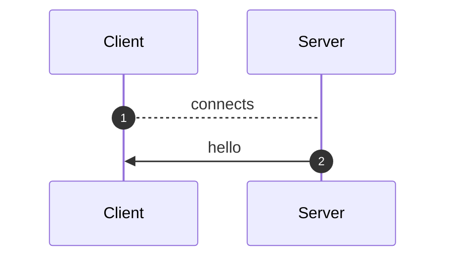
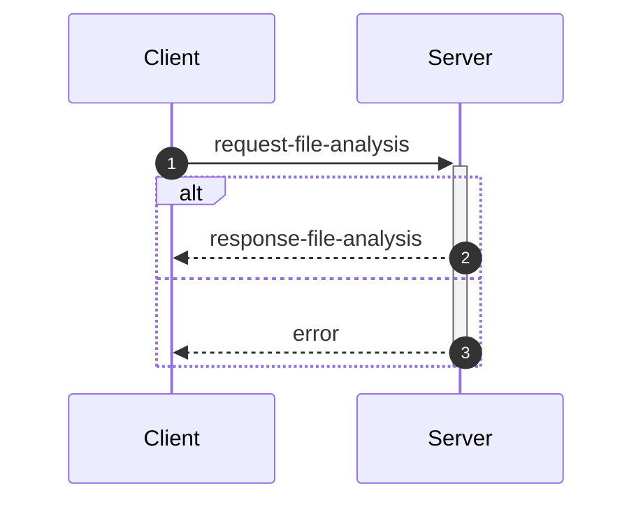
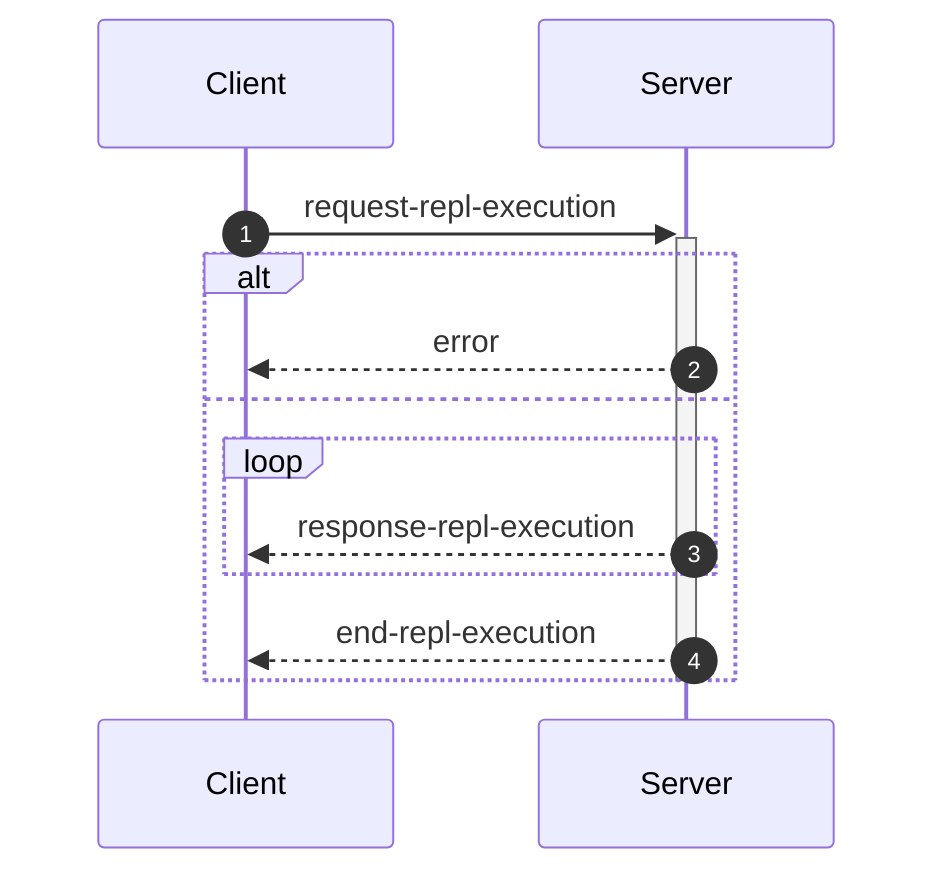
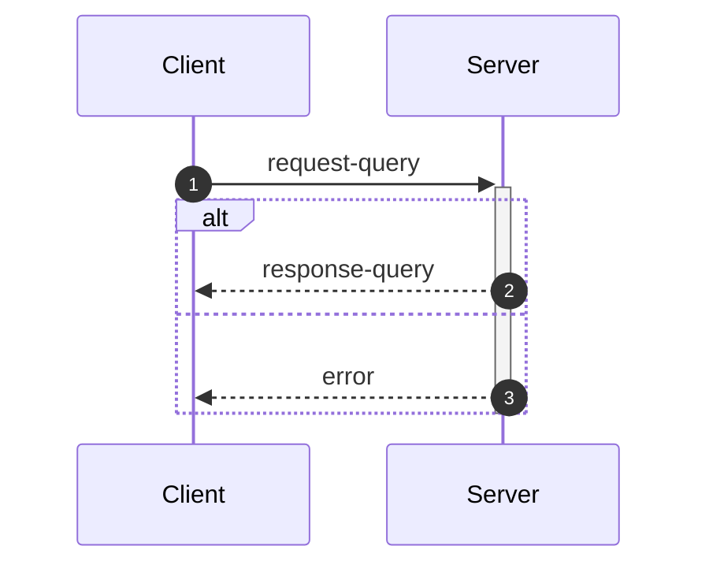

_<span title="an overview of flowR's interface">Generated</span> from '[wiki-interface.ts](https://github.com/flowr-analysis/flowr/tree/main/src/documentation/wiki-interface.ts "src/documentation/wiki-interface.ts")' on 2026-11-08, 20:13:02 UTC (v2.17.5, R v4.5.0), do not edit directly._

Although far from being as detailed as the in-depth explanation of [_flowR_](https://github.com/flowr-analysis/flowr/wiki/Core),
this wiki page explains how to interface with _flowR_ in more detail.
In general, command line arguments and other options provide short descriptions on hover over.

* [💻 Using the REPL](#using-the-repl)
* [⚙️ Configuring FlowR](#configuring-flowr)
* [⚒️ Writing Code](#writing-code)
* [💬 Communicating with the Server](#communicating-with-the-server)

<a id='using-the-repl'></a>
## 💻 Using the REPL

> [!NOTE]
> To execute arbitrary R commands with a repl request, _flowR_ has to be started explicitly with <span title="Description (Command Line Argument): Allow to access the underlying R session when using flowR (security warning: this allows the execution of arbitrary R code!)">`--r-session-access`</span>.
> Please be aware that this introduces a security risk and note that this relies on the [`r-shell` engine](https://github.com/flowr-analysis/flowr/wiki/Engines) .

Although primarily meant for users to explore,
there is nothing which forbids calling _flowR_ as a subprocess to use standard-in, -output, and -error
for communication (although you can access the REPL using the server as well,
with the [REPL Request](#message-request-repl-execution) message).

The read-eval-print loop&nbsp;(REPL) works relatively simple.
You can submit an expression (using <kbd>Enter</kbd>),
which is interpreted as an R&nbsp;expression by default but interpreted as a *command* if it starts with a colon (`:`).
The best command to get started with the REPL is <span title="Description (Repl Command): Show help information (aliases: :h, :?)">`:help`</span>.
Besides, you can leave the REPL either with the command <span title="Description (Repl Command): End the repl (aliases: :q, :exit)">`:quit`</span> or by pressing <kbd>Ctrl</kbd>+<kbd>C</kbd> twice.
When writing a *command*, you may press <kbd>Tab</kbd> to get a list of completions, if available.
Multiple commands can be entered in a single line by separating them with a semicolon (`;`), e.g. `:parse "x<-2"; :df*`.
If a command is given without R code, the REPL will re-use R code given in a previous command.
The prior example will hence return first the parsed AST of the program and then the dataflow graph for `"x <- 2"`.

> [!NOTE]
> If you develop flowR, you may want to launch the repl using the `npm run main-dev` command, this way, you get a non-minified version of flowR with debug information and hot-reloading of source files.

<details>
<summary>Available Commands</summary>

We currently offer the following commands (this with a `[*]` suffix are available with and without the star):

| Command | Description |
| ------- | ----------- |
| **<span title="Description (Repl Command): End the repl (aliases: :q, :exit)">:quit</span>** | End the repl (aliases: **:<span title="Alias of ':quit'. End the repl">q</span>**, **:<span title="Alias of ':quit'. End the repl">exit</span>**) |
| **<span title="Description (Repl Command): Execute the given code as R code. This requires the `--r-session-access` flag to be set and requires the r-shell engine. (aliases: :e, :r)">:execute</span>** | Execute the given code as R code. This requires the `--r-session-access` flag to be set and requires the r-shell engine. (aliases: **:<span title="Alias of ':execute'. Execute the given code as R code. This requires the `--r-session-access` flag to be set and requires the r-shell engine.">e</span>**, **:<span title="Alias of ':execute'. Execute the given code as R code. This requires the `--r-session-access` flag to be set and requires the r-shell engine.">r</span>**) |
| **<span title="Description (Repl Command): Get mermaid code for the control-flow graph of R code (aliases: :cfg, :cf)">:controlflow[*]</span>** | Get mermaid code for the control-flow graph of R code (star: Returns the URL to mermaid.live) (aliases: **:<span title="Alias of ':controlflow'. Get mermaid code for the control-flow graph of R code">cfg</span>**, **:<span title="Alias of ':controlflow'. Get mermaid code for the control-flow graph of R code">cf</span>**) |
| **<span title="Description (Repl Command): Get mermaid code for the control-flow graph with basic blocks (aliases: :cfgb, :cfb)">:controlflowbb[*]</span>** | Get mermaid code for the control-flow graph with basic blocks (star: Returns the URL to mermaid.live) (aliases: **:<span title="Alias of ':controlflowbb'. Get mermaid code for the control-flow graph with basic blocks">cfgb</span>**, **:<span title="Alias of ':controlflowbb'. Get mermaid code for the control-flow graph with basic blocks">cfb</span>**) |
| **<span title="Description (Repl Command): Get mermaid code for the dataflow graph (aliases: :d, :df)">:dataflow[*]</span>** | Get mermaid code for the dataflow graph (star: Returns the URL to mermaid.live) (aliases: **:<span title="Alias of ':dataflow'. Get mermaid code for the dataflow graph">d</span>**, **:<span title="Alias of ':dataflow'. Get mermaid code for the dataflow graph">df</span>**) |
| **<span title="Description (Repl Command): Get mermaid code for the normalized AST of R code (aliases: :n)">:normalize[*]</span>** | Get mermaid code for the normalized AST of R code (star: Returns the URL to mermaid.live) (alias: **:<span title="Alias of ':normalize'. Get mermaid code for the normalized AST of R code">n</span>**) |
| **<span title="Description (Repl Command): Get mermaid code for the simplified dataflow graph (aliases: :ds, :dfs)">:dataflowsimple[*]</span>** | Get mermaid code for the simplified dataflow graph (star: Returns the URL to mermaid.live) (aliases: **:<span title="Alias of ':dataflowsimple'. Get mermaid code for the simplified dataflow graph">ds</span>**, **:<span title="Alias of ':dataflowsimple'. Get mermaid code for the simplified dataflow graph">dfs</span>**) |
| **<span title="Description (Repl Command): Inspect and extend the signature database: `query` (identical to :query @signature), `info <name>` for where a function comes from (identical to :query @function-info), `add <path>` to mount another database/source, `download` to fetch the full-history database. (aliases: :sig)">:signature</span>** | Inspect and extend the signature database: `query` (identical to :query @signature), `info <name>` for where a function comes from (identical to :query @function-info), `add <path>` to mount another database/source, `download` to fetch the full-history database. (alias: **:<span title="Alias of ':signature'. Inspect and extend the signature database: `query` (identical to :query @signature), `info <name>` for where a function comes from (identical to :query @function-info), `add <path>` to mount another database/source, `download` to fetch the full-history database.">sig</span>**) |
| **<span title="Description (Repl Command): Just calculates the DFG, but only prints summary info (aliases: :d#, :df#)">:dataflowsilent</span>** | Just calculates the DFG, but only prints summary info (aliases: **:<span title="Alias of ':dataflowsilent'. Just calculates the DFG, but only prints summary info">d#</span>**, **:<span title="Alias of ':dataflowsilent'. Just calculates the DFG, but only prints summary info">df#</span>**) |
| **<span title="Description (Repl Command): Prints ASCII Art of the parsed, unmodified AST (aliases: :p)">:parse</span>** | Prints ASCII Art of the parsed, unmodified AST (alias: **:<span title="Alias of ':parse'. Prints ASCII Art of the parsed, unmodified AST">p</span>**) |
| **<span title="Description (Repl Command): Prints the version of flowR as well as the current version of R">:version</span>** | Prints the version of flowR as well as the current version of R
| **<span title="Description (Repl Command): Query the given R code (use 'help' for more information)">:query[*]</span>** | Query the given R code (use 'help' for more information) (star: Similar to query, but returns the output in json format.)
| **<span title="Description (Repl Command): Returns an ASCII representation of the dataflow graph (aliases: :df!)">:dataflowascii</span>** | Returns an ASCII representation of the dataflow graph (alias: **:<span title="Alias of ':dataflowascii'. Returns an ASCII representation of the dataflow graph">df!</span>**) |
| **<span title="Description (Repl Command): Returns summarization stats for the normalized AST (aliases: :n#)">:normalize#</span>** | Returns summarization stats for the normalized AST (alias: **:<span title="Alias of ':normalize#'. Returns summarization stats for the normalized AST">n#</span>**) |
| **<span title="Description (Repl Command): Show help information (aliases: :h, :?)">:help</span>** | Show help information (aliases: **:<span title="Alias of ':help'. Show help information">h</span>**, **:<span title="Alias of ':help'. Show help information">?</span>**) |

</details>

> [!TIP]
> 
> As indicated by the examples before, all REPL commands that operate on code keep track of the state.
> Hence, if you run a command like <span title="Description (Repl Command, starred version): Returns the URL to mermaid.live; Base Command: Get mermaid code for the dataflow graph (aliases: :d*, :df*)">`:dataflow*`</span> without providing R code,
> the REPL will re-use the R code provided in a previous command.
> Likewise, doing this will benefit from incrementality!
> If you request the dataflow graph with `:df* x <- 2 * y` and then want to see the parsed AST with `:parse`,
> the REPL will re-use previously obtained information and not re-parse the code again.
> 		

Generally, many commands offer shortcut versions in the REPL. Many queries, for example, offer a shortened format (see the example below).
Of special note, the [Config Query](https://github.com/flowr-analysis/flowr/wiki/%5BQuery%5D-Config)
can be used to also modify the currently active configuration of _flowR_ within the REPL (see the [wiki page](https://github.com/flowr-analysis/flowr/wiki/%5BQuery%5D-Config) for more information).

### Example: Retrieving the Dataflow Graph

To retrieve a URL to the [mermaid](https://mermaid.js.org/) diagram of the dataflow of a given expression,
use <span title="Description (Repl Command, starred version): Returns the URL to mermaid.live; Base Command: Get mermaid code for the dataflow graph (aliases: :d*, :df*)">`:dataflow*`</span> (or <span title="Description (Repl Command): Get mermaid code for the dataflow graph (aliases: :d, :df)">`:dataflow`</span> to get the mermaid code in the cli):

```shell
$ docker run -it --rm eagleoutice/flowr # or npm run flowr 
flowR repl v2.17.5, R grammar v14 (tree-sitter engine)
R> :dataflow* y <- 1 + x
```

<details>
<summary style='color:gray'>Output</summary>

```text
https://mermaid.live/view#base64:eyJjb2RlIjoiZmxvd2NoYXJ0IFREXG4gICAgMXt7XCJgKiM5MTtSTnVtYmVyIzkzOyogKioxKipcbiAgICAgICoxLjYqICgqKmlkOiAxKiopYFwifX1cbiAgICAyKFtcImAqIzkxO1JTeW1ib2wjOTM7KiAqKngqKlxuICAgICAgKjEuMTAqICgqKmlkOiAyKiopYFwiXSlcbiAgICAzW1tcImAqIzkxO1JCaW5hcnlPcCM5MzsqIGJhc2UjNTg7IzU4OyoqIzQzOyoqXG4gICAgICAqMS42LTEwKiAoKippZDogMyoqKVxuICAgIGFyZzogKDEsIDIpYFwiXV1cbiAgICBidWlsdC1pbjpfNDNfW1wiYEJ1aWx0LUluOlxuIzQzO2BcIl1cbiAgICBzdHlsZSBidWlsdC1pbjpfNDNfIHN0cm9rZTpncmF5LGZpbGw6Z3JheSxzdHJva2Utd2lkdGg6MnB4LG9wYWNpdHk6Ljg7XG4gICAgMFtcImAqIzkxO1JTeW1ib2wjOTM7KiAqKnkqKlxuICAgICAgKjEuMSogKCoqaWQ6IDAqKiwgdjogMylgXCJdXG4gICAgNFtbXCJgKiM5MTtSQmluYXJ5T3AjOTM7KiBiYXNlIzU4OyM1ODsqKiM2MDsjNDU7KipcbiAgICAgICoxLjEtMTAqICgqKmlkOiA0KiopXG4gICAgYXJnOiAoMCwgMylgXCJdXVxuICAgIGJ1aWx0LWluOl82MF8tW1wiYEJ1aWx0LUluOlxuIzYwOyM0NTtgXCJdXG4gICAgc3R5bGUgYnVpbHQtaW46XzYwXy0gc3Ryb2tlOmdyYXksZmlsbDpncmF5LHN0cm9rZS13aWR0aDoycHgsb3BhY2l0eTouODtcbiAgICAxIC0uLT58XCJmbG93XCJ8IDJcbiAgICBsaW5rU3R5bGUgMCBzdHJva2U6Z3JheSxjb2xvcjpncmF5O1xuICAgIDIgLS4tPnxcImZsb3dcInwgM1xuICAgIGxpbmtTdHlsZSAxIHN0cm9rZTpncmF5LGNvbG9yOmdyYXk7XG4gICAgMyAtLT58XCJyZWFkcywgYXJnXCJ8IDFcbiAgICAzIC0tPnxcInJlYWRzLCBhcmdcInwgMlxuICAgIDMgLS4tPnxcImZsb3dcInwgMFxuICAgIGxpbmtTdHlsZSA0IHN0cm9rZTpncmF5LGNvbG9yOmdyYXk7XG4gICAgMyAtLi0+fFwicmVhZHMsIGNhbGxzXCJ8IGJ1aWx0LWluOl80M19cbiAgICBsaW5rU3R5bGUgNSBzdHJva2U6Z3JheTtcbiAgICAwIC0tPnxcImRlZmluZWQtYnksIGZsb3dcInwgNFxuICAgIDAgLS0+fFwiZGVmaW5lZC1ieVwifCAzXG4gICAgNCAtLT58XCJyZWFkcywgYXJnXCJ8IDNcbiAgICA0IC0tPnxcInJldHVybnMsIGFyZ1wifCAwXG4gICAgNCAtLi0+fFwicmVhZHMsIGNhbGxzXCJ8IGJ1aWx0LWluOl82MF8tXG4gICAgbGlua1N0eWxlIDEwIHN0cm9rZTpncmF5OyIsIm1lcm1haWQiOnsiYXV0b1N5bmMiOnRydWV9fQ==
```

Retrieve the dataflow graph of the expression `y <- 1 + x`. It looks like this:


<details>

<summary style="color:gray">R Code of the Dataflow Graph</summary>

The analysis ran (parse and normalize with the [tree-sitter](https://github.com/flowr-analysis/flowr/wiki/Engines) engine) in the generation environment. No [signature database](https://github.com/flowr-analysis/flowr/wiki/Signature-Database) is mounted, so `library()` attaches no exports (base-R names are still qualified, e.g., `stats::acf`). 
We encountered no unknown side effects during the analysis.

```r
y <- 1 + x
```

</details>

</details>

For small graphs like this, <span title="Description (Repl Command): Returns an ASCII representation of the dataflow graph (aliases: :df!)">`:dataflowascii`</span> also provides an ASCII representation directly in the REPL:

```shell
$ docker run -it --rm eagleoutice/flowr # or npm run flowr 
flowR repl v2.17.5, R grammar v14 (tree-sitter engine)
R> :df! y <- 1 + x
```

<details open>
<summary style='color:gray'>Output</summary>

```text
                        v<0>v
 c<4>c──────────────────| y |
 |<- |     ┌────────────v---v
 c---c     │
    │   c<3>c   0<1>0
    └───| + |───| 1 |───u<2>u
        c---c   0---0   | x |
           └────────────u---u
Edges:
3 -> 1: reads, arg          3 -> 2: reads, arg
3 -> 0: flows-to            1 -> 2: flows-to
2 -> 3: flows-to            4 -> 3: reads, arg
4 -> 0: returns, arg        0 -> 4: defined-by, flows-to
0 -> 3: defined-by
```

Retrieve the dataflow graph of the expression `y <- 1 + x` as ASCII art.

</details>

For the slicing with <span title="Description (Repl Command): Static backwards executable slicer for R">`:slicer`</span>, you have access to the same [magic comments](#slice-magic-comments) as with the [slice request](#message-request-slice).
Pass `--inline` to splice resolvable `source()` calls into the reconstruction so the slice is a single self-contained R text (the same as the static slice query's `inlineSources` flag).
See `--help` for more flags!

### Example: Interfacing with the File System

Many commands that allow for an R-expression (like <span title="Description (Repl Command, starred version): Returns the URL to mermaid.live; Base Command: Get mermaid code for the dataflow graph (aliases: :d*, :df*)">`:dataflow*`</span>) allow for a file as well
if the argument starts with `file://`.
If you are working from the root directory of the _flowR_ repository, the following gives you the parsed AST of the example file using the <span title="Description (Repl Command): Prints ASCII Art of the parsed, unmodified AST (aliases: :p)">`:parse`</span> command:

> **Watch mode**: Replace `file://` with `watch://` to enter watch mode.
> flowR runs the command immediately and then re-runs it every time the file (or any file inside the folder) changes.
> Enter any other command to leave watch mode.
> For example: `:df watch://analysis.R`

```shell
$ docker run -it --rm eagleoutice/flowr # or npm run flowr 
flowR repl v2.17.5, R grammar v14 (tree-sitter engine)
R> :parse file://test/testfiles/example.R
```

<details>
<summary style='color:gray'>Output</summary>

```text
File: test/testfiles/example.R

program
├ binaryoperator
│ ├ identifier "sum" (1:1─4)
│ ├ <- "<-" (1:5─7)
│ ╰ float "0" (1:8─9)
├ binaryoperator
│ ├ identifier "product" (2:1─8)
│ ├ <- "<-" (2:9─11)
│ ╰ float "1" (2:12─13)
├ binaryoperator
│ ├ identifier "w" (3:1─2)
│ ├ <- "<-" (3:3─5)
│ ╰ float "7" (3:6─7)
├ binaryoperator
│ ├ identifier "N" (4:1─2)
│ ├ <- "<-" (4:3─5)
│ ╰ float "10" (4:6─8)
├ forstatement
│ ├ for "for" (6:1─4)
│ ├ ( "(" (6:5─6)
│ ├ identifier "i" (6:6─7)
│ ├ in "in" (6:8─10)
│ ├ binaryoperator
│ │ ├ float "1" (6:11─12)
│ │ ├ : ":" (6:12─13)
│ │ ╰ parenthesizedexpression
│ │   ├ ( "(" (6:13─14)
│ │   ├ binaryoperator
│ │   │ ├ identifier "N" (6:14─15)
│ │   │ ├ - "-" (6:15─16)
│ │   │ ╰ float "1" (6:16─17)
│ │   ╰ ) ")" (6:17─18)
│ ├ ) ")" (6:18─19)
│ ╰ bracedexpression
│   ├ { "{" (6:20─21)
│   ├ binaryoperator
│   │ ├ identifier "sum" (7:3─6)
│   │ ├ <- "<-" (7:7─9)
│   │ ╰ binaryoperator
│   │   ├ binaryoperator
│   │   │ ├ identifier "sum" (7:10─13)
│   │   │ ├ + "+" (7:14─15)
│   │   │ ╰ identifier "i" (7:16─17)
│   │   ├ + "+" (7:18─19)
│   │   ╰ identifier "w" (7:20─21)
│   ├ binaryoperator
│   │ ├ identifier "product" (8:3─10)
│   │ ├ <- "<-" (8:11─13)
│   │ ╰ binaryoperator
│   │   ├ identifier "product" (8:14─21)
│   │   ├  "" (8:22─23)
│   │   ╰ identifier "i" (8:24─25)
│   ╰ } "}" (9:1─2)
├ call
│ ├ identifier "cat" (11:1─4)
│ ╰ arguments
│   ├ ( "(" (11:4─5)
│   ├ argument
│   │ ╰ string
│   │   ├ stringopen "\"" (11:5─6)
│   │   ├ stringcontent "Sum:" (11:6─10)
│   │   ╰ stringclose "\"" (11:10─11)
│   ├ comma "," (11:11─12)
│   ├ argument
│   │ ╰ identifier "sum" (11:13─16)
│   ├ comma "," (11:16─17)
│   ├ argument
│   │ ╰ string
│   │   ├ stringopen "\"" (11:18─19)
│   │   ├ stringcontent
│   │   │ ╰ escapesequence "\\n" (11:19─21)
│   │   ╰ stringclose "\"" (11:21─22)
│   ╰ ) ")" (11:22─23)
╰ call
  ├ identifier "cat" (12:1─4)
  ╰ arguments
    ├ ( "(" (12:4─5)
    ├ argument
    │ ╰ string
    │   ├ stringopen "\"" (12:5─6)
    │   ├ stringcontent "Product:" (12:6─14)
    │   ╰ stringclose "\"" (12:14─15)
    ├ comma "," (12:15─16)
    ├ argument
    │ ╰ identifier "product" (12:17─24)
    ├ comma "," (12:24─25)
    ├ argument
    │ ╰ string
    │   ├ stringopen "\"" (12:26─27)
    │   ├ stringcontent
    │   │ ╰ escapesequence "\\n" (12:27─29)
    │   ╰ stringclose "\"" (12:29─30)
    ╰ ) ")" (12:30─31)
```

Retrieve the parsed AST of the example file.

<details>

<summary>File Content</summary>

```r
sum <- 0
product <- 1
w <- 7
N <- 10

for (i in 1:(N-1)) {
  sum <- sum + i + w
  product <- product * i
}

cat("Sum:", sum, "\n")
cat("Product:", product, "\n")
```

</details>

As _flowR_ directly transforms this AST the output focuses on being human-readable instead of being machine-readable.
		
</details>

### Example: Run a Query

You can run any query supported by _flowR_ using the <span title="Description (Repl Command): Query the given R code (use 'help' for more information)">`:query`</span> command.
For example, to obtain the shapes of all data frames in a given piece of code, you can run:

```shell
$ docker run -it --rm eagleoutice/flowr # or npm run flowr 
flowR repl v2.17.5, R grammar v14 (tree-sitter engine)
R> :query @absint df-shape "x <- data.frame(a = 1:10, b = 1:10)\ny <- x$a"
```

<details open>
<summary style='color:gray'>Output</summary>

```text
Query: absint (2 ms)
   ╰ $12: (colnames: [{"a", "b"}, {}], cols: [2, 2], rows: [10, 10])
   ╰ $0: (colnames: [{"a", "b"}, {}], cols: [2, 2], rows: [10, 10])
```

Retrieve the shapes of all data frames in the given code.

</details>

To run the linter on a file, you can use (in this example, we just issue the `dead-code` linter on a small piece of code):

```shell
$ docker run -it --rm eagleoutice/flowr # or npm run flowr 
flowR repl v2.17.5, R grammar v14 (tree-sitter engine)
R> :query @linter rules:dead-code "if(FALSE) x <- 2"
```

<details open>
<summary style='color:gray'>Output</summary>

```text
Query: linter (2 ms)
   ╰ Dead Code (dead-code):
       ╰ certain:
           ╰ Code at 1.11-16 (1 quick fix(es) available)
```

Run the linter on the given code, with only the `dead-code` rule enabled.

</details>

For more information on the available queries, please check out the [Query API](https://github.com/flowr-analysis/flowr/wiki/Query-API).

<a id='configuring-flowr'></a>
## ⚙️ Configuring FlowR

When running _flowR_, you may want to specify some behaviors with a dedicated configuration file.
By default, flowR looks for a file named `flowr.json` in the current working directory (or any higher directory).
You can also specify a different file with <span title="Description (Command Line Argument): The name of the configuration file to use">`--config-file`</span> or pass the configuration inline using <span title="Description (Command Line Argument): The flowR configuration to use, as a JSON string">`--config-json`</span>.
A `flowr.json` found this way belongs to the analyzed project, so flowR ignores its options that decide what flowR executes or loads
(`engines.*.wasmPath`, `engines.*.treeSitterWasmPath`, `engines.*.rPath`, `solver.sigdb.additionalPaths`, `solver.sigdb.downloadRepo`, `solver.sigdb.installedLibrary.paths`, `solver.sigdb.onDemand.enabled`, `solver.sigdb.onDemand.repositories`, `solver.sigdb.onDemand.cranMirror`, `solver.sigdb.onDemand.bioconductorMirror`, `solver.sigdb.onDemand.cacheDir`),
unless you pass <span title="Description (Command Line Argument): Keep the security-sensitive options (e.g., the R executable) of the flowr.json found in the working directory or a parent. Only use this for projects you trust.">`--trust-config`</span>.
To analyze code you do not trust, use the secure mode (<span title="Description (Command Line Argument): Run in secure mode for analyzing untrusted code: flowR does not start R (or any other process), does not access the network, does not search for project configs, and ignores security-sensitive options in every config. Cannot be disabled once enabled. Can also be enabled with the environment variable {italic FLOWR_SECURE_MODE=1}.">`--secure`</span>, see the [security policy](https://github.com/flowr-analysis/flowr/blob/main/.github/SECURITY.md)).
To inspect the current configuration, you can run flowr with the <span title="Description (Command Line Argument): Run with verbose logging (will be passed to the corresponding script)">`--verbose`</span> flag, or use the `config` [Query](https://github.com/flowr-analysis/flowr/wiki/Query-API).
Within the REPL this works by running the following:

```shell
:query @config
```

To work with the <a href="https://github.com/flowr-analysis/flowr/tree/main/src/config.ts#L125"><code><span title="The configuration file format for flowR.">FlowrConfig</span></code></a> you can use the provided helper objects alongside its methods like
<a href="https://github.com/flowr-analysis/flowr/tree/main/src/config.ts#L991"><code><span title="Creates a new flowr config that has the updated values.">FlowrConfig::<b>amend</b></span></code></a>.
The schema below documents every option; the ones you most likely want are:

- <a href="https://github.com/flowr-analysis/flowr/wiki/Interface#configuring-flowr" title="Configuration Option (boolean): Whether source calls should be ignored, causing {@link processSourceCall}&#39;s behavior to be skipped.">ignoreSourceCalls</a>: ignore source calls when analyzing the code, i.e., ignore the inclusion of other files.
- <a href="https://github.com/flowr-analysis/flowr/wiki/Interface#configuring-flowr" title="Configuration Option (boolean): Whether load calls should be ignored, causing {@link processLoadCall}&#39;s behavior to be skipped.">ignoreLoadCalls</a>: ignore load calls when analyzing the code, i.e., ignore the loading of r-data files.
- <a href="https://github.com/flowr-analysis/flowr/wiki/Interface#configuring-flowr" title="Configuration Option (object): Do you want to overwrite (parts) of the builtin definition?">semantics.environment.overwriteBuiltIns</a>: overwrite _flowR_'s handling of built-in functions, or clear the preset definitions entirely.
  See [Configure BuiltIn Semantics](#configure-builtin-semantics) for more information.
- <a href="https://github.com/flowr-analysis/flowr/wiki/Interface#configuring-flowr" title="Configuration Option (boolean): Whether calls drawing on a graphics device (e.g., `plot`) count as writing to it, which the ambient state queries then report.">semantics.ambient.drawingWritesDevice</a>: whether calls drawing on a graphics device (e.g., `plot`) count as writing the device in the ambient state queries.
- <a href="https://github.com/flowr-analysis/flowr/wiki/Interface#configuring-flowr" title="Configuration Option (string): How to resolve variables and their values. (one of &quot;disabled&quot;, &quot;alias&quot;, &quot;builtin&quot;)">solver.variables</a>: how to resolve variables and their values (`disabled`, `alias`, `builtin`).
- <a href="https://github.com/flowr-analysis/flowr/wiki/Interface#configuring-flowr" title="Configuration Option (array): The engine or set of engines to use for interacting with R code. An empty array means all available engines will be used.">engines</a> and <a href="https://github.com/flowr-analysis/flowr/wiki/Interface#configuring-flowr" title="Configuration Option (string): The default engine to use for interacting with R code. If this is undefined, an arbitrary engine from the specified list will be used. (one of &quot;tree-sitter&quot;, &quot;r-shell&quot;)">defaultEngine</a>: the engines used to interact with R code, see the [Engines wiki page](https://github.com/flowr-analysis/flowr/wiki/Engines).
- <a href="https://github.com/flowr-analysis/flowr/wiki/Interface#configuring-flowr" title="Configuration Option (array): Files a framework loads on its own, without any source() call (e.g. global.R in a shiny app), in the order they are loaded; flowR orders the matching project files accordingly and analyzes them as one program. Entries are case-insensitive globs matched against the file path, a plain name matches any file with that name, and entries matching no project file are warned about. Usually set per project kind via specializeConfig.">project.implicitSources</a>: the files a framework loads without any `source()` call, in the order in which they are
  loaded. Entries are globs (e.g. `R/*.R`) matched against the file path ignoring capitalization; one matching no file is reported.
- <a href="https://github.com/flowr-analysis/flowr/wiki/Interface#configuring-flowr" title="Configuration Option (object): Overwrite (parts of) the configuration depending on the project kind flowR detects, e.g. to give a shiny app its implicit sources.">specializeConfig</a>: overwrite (parts of) the configuration depending on the kind of project _flowR_ detects
  (e.g. `shiny-app`), which is how a shiny app gets its implicit sources by default. What you configure directly wins.
- <a href="https://github.com/flowr-analysis/flowr/wiki/Interface#configuring-flowr" title="Configuration Option (string): Overwrite the project kind flowR would otherwise infer from the analyzed files, e.g. when auto-detection guesses wrong. (one of &quot;package&quot;, &quot;script&quot;, &quot;shiny-app&quot;, &quot;notebook&quot;, &quot;project&quot;, &quot;unknown&quot;)">project.useProjectType</a>: skip that detection and force a project kind yourself, when auto-detection guesses wrong.
- <a href="https://github.com/flowr-analysis/flowr/wiki/Interface#configuring-flowr" title="Configuration Option (array): The default plugins to load when creating a new instance of FlowrAnalyzer">defaultPlugins</a> and <a href="https://github.com/flowr-analysis/flowr/wiki/Interface#configuring-flowr" title="Configuration Option (array): The plugins to load in REPL mode">repl.plugins</a>: the plugins to load for a new <a href="https://github.com/flowr-analysis/flowr/tree/main/src/project/flowr-analyzer.ts#L240"><code><span title="Central class for conducting analyses with FlowR. Use the FlowrAnalyzerBuilder to create a new instance. If you want the original pattern of creating a pipeline and running all steps, you can still do this with FlowrAnalyzer#runFull . To inspect the context of the analyzer, use FlowrAnalyzer#inspectContext (if you are a plugin and need to modify it, use FlowrAnalyzer#context instead).">FlowrAnalyzer</span></code></a> and in the REPL
  (use `flowr:default` to reference the former).

So you can configure _flowR_ by adding a file like the following:

<details>

<summary>Example Configuration File</summary>

```json
{
  "ignoreSourceCalls": true,
  "ignoreLoadCalls": true,
  "semantics": {
    "environment": {
      "overwriteBuiltIns": {
        "definitions": [
          {
            "type": "function",
            "names": [
              "foo"
            ],
            "processor": "builtin:assign",
            "config": {}
          }
        ]
      }
    }
  },
  "defaultPlugins": [
    "file:description",
    "versions:description"
  ],
  "repl": {
    "quickStats": false,
    "dfProcessorHeat": false,
    "hints": true,
    "plugins": [
      "flowr:default"
    ]
  },
  "project": {
    "resolveUnknownPathsOnDisk": true,
    "implicitSources": [
      "global.R",
      "app.R"
    ]
  },
  "linter": {
    "disabledRules": []
  },
  "specializeConfig": {
    "shiny-app": {
      "project": {
        "implicitSources": [
          "global.R",
          "ui.R",
          "server.R",
          "app.R"
        ]
      }
    }
  },
  "engines": [
    {
      "type": "r-shell"
    }
  ],
  "solver": {
    "variables": "alias",
    "evalStrings": true,
    "trackEnvironments": true,
    "sigdb": {
      "enabled": true,
      "loadProjectDependencies": true,
      "eagerlyLoad": false,
      "eagerlyLoadExports": false,
      "linkBaseR": false,
      "linkDescriptionDependencies": false
    },
    "resolveSource": {
      "dropPaths": "no",
      "ignoreCapitalization": true,
      "inferWorkingDirectory": "active-script",
      "searchPath": []
    },
    "instrument": {},
    "slicer": {
      "threshold": 50
    }
  },
  "abstractInterpretation": {
    "wideningThreshold": 4,
    "followCalls": true,
    "dataFrame": {
      "maxColNames": 20,
      "readLoadedData": {
        "readExternalFiles": true,
        "maxReadLines": 1000000
      }
    }
  },
  "incremental": {
    "alwaysIncremental": false,
    "parsing": {
      "activated": false,
      "heuristics": {
        "activated": true,
        "mtime": true,
        "linesFrom": 500,
        "bytesFrom": 50000,
        "alwaysWithEdits": false,
        "minFiles": 1
      }
    }
  },
  "gas": {
    "thresholds": {
      "memory": {
        "problematic": 0.7,
        "critical": 0.9
      },
      "timeMs": {
        "problematic": 100000,
        "critical": 120000
      }
    },
    "features": {}
  }
}
```

</details>

<details>
<a id='configure-builtin-semantics'></a>
<summary>Configure Built-In Semantics</summary>

`semantics/environment/overwriteBuiltins` accepts two keys:

- `loadDefaults` (boolean, initially `true`): If set to `true`, the default built-in definitions are loaded before applying the custom definitions. Setting this flag to `false` explicitly disables the loading of the default definitions.
- `definitions` (array, initially empty): Allows to overwrite or define new built-in elements. Each object within must have a `type` which is one of the below. Furthermore, they may define a string array of `names` which specifies the identifiers to bind the definitions to. You may use `assumePrimitive` to specify whether _flowR_ should assume that this is a primitive non-library definition (so you probably just do not want to specify the key).

  | Type            | Description                                                                                                                                                                                                                                                                                              | Example                                                                                                    |
  | --------------- | -------------------------------------------------------------------------------------------------------------------------------------------------------------------------------------------------------------------------------------------------------------------------------------------------------- | ---------------------------------------------------------------------------------------------------------- |
  | `constant`    | Additionally allows for a `value` this should resolve to.                                                                                                                                                                                                                                                | `{ type: 'constant', names: ['NULL', 'NA'],  value: null }`                                                |
  | `function`    | Is a rather flexible way to define and bind built-in functions. For the time, we do not have extensive documentation to cover all the cases, so please either consult the sources with the `default-builtin-config/` folder or open a [new issue](https://github.com/flowr-analysis/flowr/issues/new/choose). | `{ type: 'function', names: ['next'], processor: 'builtin:d', config: { cfg: ExitPointType.Next } }` |
  | `replacement` | A comfortable way to specify replacement functions like `$<-` or `names<-`. `suffixes` describes the... suffixes to attach automatically. | `{ type: 'replacement', suffixes: ['<-', '<<-'], names: ['[', '[['] }` |

</details>

<details>

<summary style='color:gray'>Full Configuration-File Schema</summary>

- _The configuration file format for flowR._ (object)
    - **logLevel** [optional] _flowR's global minimum log level, applied when the config is loaded._ (string)
        Only allows: 'silly', 'trace', 'debug', 'info', 'warn', 'error', 'fatal'
    - **ignoreSourceCalls** [optional] _Whether source calls should be ignored, causing {@link processSourceCall}'s behavior to be skipped._ (boolean)
    - **ignoreLoadCalls** [optional] _Whether load calls should be ignored, causing {@link processLoadCall}'s behavior to be skipped._ (boolean)
    - **semantics** _Configure language semantics and how flowR handles them._ (object)
        - **environment** [optional] _Semantics regarding how to handle the R environment._ (object)
            - **overwriteBuiltIns** [optional] _Do you want to overwrite (parts) of the builtin definition?_ (object)
                - **loadDefaults** [optional] _Should the default configuration still be loaded?_ (boolean)
                - **definitions** [optional] _The definitions to load/overwrite._ (array)
                Valid item types:
                    - (object)
        - **ambient** [optional] _Semantics regarding the global state (options, devices, files, ...) calls access._ (object)
            - **drawingWritesDevice** [optional] _Whether calls drawing on a graphics device (e.g., `plot`) count as writing to it, which the ambient state queries then report._ (boolean)
    - **defaultPlugins** [optional] _The default plugins to load when creating a new instance of FlowrAnalyzer_ (array)
    Valid item types:
        - (alternatives)
            - (string)
            - (array)
    - **repl** _Configuration options for the REPL._ (object)
        - **quickStats** [optional] _Whether to show quick stats in the REPL after each evaluation._ (boolean)
        - **dfProcessorHeat** [optional] _This instruments the dataflow processors to count how often each processor is called._ (boolean)
        - **hints** [optional] _Whether to show dim inline hints on the empty prompt (automatically disabled on non-interactive terminals)._ (boolean)
        - **plugins** [optional] _The plugins to load in REPL mode_ (array)
        Valid item types:
            - (alternatives)
                - (string)
                - (array)
        - **autoUseFileProtocol** [optional] _Prepend the file protocol to a repl input that looks like a path, instead of only warning about it._ (boolean)
        - **queryStats** [optional] _Whether `:query` closes with the line stating how long the queries took (`:query*` never prints it)._ (boolean)
        - **showPlugins** [optional] _Whether `:version` grays out the plugins that did not activate during the last analysis._ (boolean)
    - **project** _Project specific configuration options._ (object)
        - **resolveUnknownPathsOnDisk** [optional] _Whether to resolve unknown paths loaded by the r project disk when trying to source/analyze files._ (boolean)
        - **failOnInaccessiblePath** [optional] _Whether a directory that cannot be traversed during file discovery (e.g. due to permissions) aborts the analysis; when false (the default) such paths are logged and skipped._ (boolean)
        - **basePackages** [optional] _The packages considered part of R itself (base and recommended); if unset, flowR uses its built-in list._ (array)
        Valid item types:
            - (string)
        - **implicitSources** [optional] _Files a framework loads on its own, without any source() call (e.g. global.R in a shiny app), in the order they are loaded; flowR orders the matching project files accordingly and analyzes them as one program. Entries are case-insensitive globs matched against the file path, a plain name matches any file with that name, and entries matching no project file are warned about. Usually set per project kind via specializeConfig._ (array)
        Valid item types:
            - (string)
        - **useProjectType** [optional] _Overwrite the project kind flowR would otherwise infer from the analyzed files, e.g. when auto-detection guesses wrong._ (string)
            Only allows: 'package', 'script', 'shiny-app', 'notebook', 'project', 'unknown'
        - **assumeImplicitEcho** [optional] _Whether the top level of the analyzed code is echoed, so that every visible result printed there is collected as an output by the dependencies query (default true, false for a package)._ (boolean)
        - **discovery** [optional] _Scoping options for the default project discovery._ (object)
            - **full** [optional] _Collect every file below the project root (greedy) instead of only the files the detected project kind needs (default false)._ (boolean)
            - **perKind** [optional] _Per-kind include/exclude glob overrides layered on the default scoping._ (object)
            - **ignore** [optional] _Case-insensitive globs that drop matching files from the intelligent discovery, regardless of kind (e.g. .Renviron to ignore environment files)._ (array)
            Valid item types:
                - (string)
        - **classification** [optional] _Overrides for the signals flowR uses to classify the project kind._ (object)
            - **shinyDescriptionTypes** [optional] _DESCRIPTION Type: values that mark a shiny app._ (array)
            Valid item types:
                - (string)
            - **shinyEntryFiles** [optional] _File names a shiny app is assembled from._ (array)
            Valid item types:
                - (string)
            - **shinyUsagePattern** [optional] _Regex source evidencing shiny usage in an entry file._ (string)
            - **notebookExtensions** [optional] _File extensions marking a notebook._ (array)
            Valid item types:
                - (string)
    - **linter** _Linter configuration options._ (object)
        - **disabledRules** _Linting rule names excluded from the default rule set (a rule requested explicitly via a linter query still runs). Usually set per project kind via specializeConfig._ (array)
        Valid item types:
            - (string)
        - **disabledTags** [optional] _Linting rule tags whose rules are excluded from the default rule set (a rule requested explicitly via a linter query still runs). By default the cmd-check rules are disabled for everything but a package; a configured list replaces that default._ (array)
        Valid item types:
            - (string)
    - **inputSources** [optional] _Further frameworks the input-sources analysis should know about; entries are added to flowR's defaults._ (object)
        - **pure** [optional] _Functions that only pass the constantness of their arguments on._ (array)
        Valid item types:
            - (string)
        - **param** [optional] _Functions whose result is a 'param' input._ (array)
        Valid item types:
            - (string)
        - **file** [optional] _Functions whose result is a 'file' input._ (array)
        Valid item types:
            - (string)
        - **tempfile** [optional] _Functions whose result is a 'tempfile' input._ (array)
        Valid item types:
            - (string)
        - **glob** [optional] _Functions whose result is a 'glob' input._ (array)
        Valid item types:
            - (string)
        - **net** [optional] _Functions whose result is a 'net' input._ (array)
        Valid item types:
            - (string)
        - **rand** [optional] _Functions whose result is a 'rand' input._ (array)
        Valid item types:
            - (string)
        - **system** [optional] _Functions whose result is a 'system' input._ (array)
        Valid item types:
            - (string)
        - **ffi** [optional] _Functions whose result is a 'ffi' input._ (array)
        Valid item types:
            - (string)
        - **lang** [optional] _Functions whose result is a 'lang' input._ (array)
        Valid item types:
            - (string)
        - **options** [optional] _Functions whose result is a 'options' input._ (array)
        Valid item types:
            - (string)
        - **cmdline** [optional] _Functions whose result is a 'cmdline' input._ (array)
        Valid item types:
            - (string)
        - **user** [optional] _Functions whose result is a 'user' input._ (array)
        Valid item types:
            - (string)
        - **const** [optional] _Functions whose result is a 'const' input._ (array)
        Valid item types:
            - (string)
        - **scope** [optional] _Functions whose result is a 'scope' input._ (array)
        Valid item types:
            - (string)
        - **dconst** [optional] _Functions whose result is a 'dconst' input._ (array)
        Valid item types:
            - (string)
        - **unknown** [optional] _Functions whose result is a 'unknown' input._ (array)
        Valid item types:
            - (string)
        - **linkedObjects** [optional] _Objects a framework provides without a definition in the code, e.g. shiny's input._ (array)
        Valid item types:
            - (object)
        - **linkedEntryPoints** [optional] _Calls that hand a function to a framework, which binds its objects to the parameters by position._ (array)
        Valid item types:
            - (object)
    - **specializeConfig** [optional] _Overwrite (parts of) the configuration depending on the project kind flowR detects, e.g. to give a shiny app its implicit sources._ (object)
    - **engines** _The engine or set of engines to use for interacting with R code. An empty array means all available engines will be used._ (array)
    Valid item types:
        - (alternatives)
            - _The configuration for the tree sitter engine._ (object)
                - **type** [required] _Use the tree sitter engine._ (string)
                    Only allows: 'tree-sitter'
                - **wasmPath** [optional] _The path to the tree-sitter-r WASM binary to use. If this is undefined, this uses the default path._ (string)
                - **treeSitterWasmPath** [optional] _The path to the tree-sitter WASM binary to use. If this is undefined, this uses the default path._ (string)
                - **lax** [optional] _Whether to use the lax parser for parsing R code (allowing for syntax errors). If this is undefined, the strict parser will be used._ (boolean)
            - _The configuration for the R shell engine._ (object)
                - **type** [required] _Use the R shell engine._ (string)
                    Only allows: 'r-shell'
                - **rPath** [optional] _The path to the R executable to use. If this is undefined, this uses the default path._ (string)
                - **pipeBind** [optional] _Whether to enable R's experimental pipe-bind operator "=>" by setting _R_USE_PIPEBIND_ for the R session (default false); R itself keeps this off by default, as it is experimental and has never shipped in a release version of R._ (boolean)
    - **defaultEngine** [optional] _The default engine to use for interacting with R code. If this is undefined, an arbitrary engine from the specified list will be used._ (string)
        Only allows: 'tree-sitter', 'r-shell'
    - **solver** _How to resolve constants, constraints, cells, ..._ (object)
        - **variables** _How to resolve variables and their values._ (string)
            Only allows: 'disabled', 'alias', 'builtin'
        - **evalStrings** _Should we include eval(parse(text="...")) calls in the dataflow graph?_ (boolean)
        - **trackEnvironments** [optional] _Track user-created environments (new.env, assign/get/local with envir=, dollar-assign, attach). When false, all envir-style calls fall through conservatively._ (boolean)
        - **sigdb** _Resolving library exports from a signature database._ (object)
            - **enabled** [optional] _Resolve library()/use() exports from a signature database (default true); when false no database is consulted._ (boolean)
            - **loadProjectDependencies** [optional] _Load the project's declared dependencies from its metadata files (DESCRIPTION Imports/Depends, rproject.toml, uvr.toml, rig rproj.toml and script blocks, renv.lock, rv.lock, uvr.lock, rig lockfiles) (default true); when false these files are not read for dependencies._ (boolean)
            - **eagerlyLoad** [optional] _Parse the database up front rather than on the first package load (default false, ignored if disabled)._ (boolean)
            - **eagerlyLoadExports** [optional] _Add a vertex for every export on load rather than on demand (default false); keeps the dataflow graph small._ (boolean)
            - **assumedRVersion** [optional] _R version assumed when resolving versioned (base-R) exports: a pin like "4.5" or "auto" to detect the installed R (default "auto")._ (string)
            - **linkBaseR** [optional] _Eagerly attach base-R namespaces so bare base calls resolve without library() (default false)._ (boolean)
            - **linkBaseRCalls** [optional] _Add a lightweight Reads edge from a bare base-R call to its signature-database function vertex (default false; base-R qualification is edge-free otherwise)._ (boolean)
            - **linkPackageCalls** [optional] _Add a lightweight Reads edge from a resolved package call to its signature-database function vertex (default false)._ (boolean)
            - **linkDescriptionDependencies** [optional] _Eagerly attach the namespaces of the project's declared DESCRIPTION dependencies (Imports/Depends) so their exports resolve without an explicit library() (default false)._ (boolean)
            - **warmInBackground** [optional] _Decompress the hot shards (base + most-downloaded) in a background task on startup so the first library() lookup is warm (default false; for long-running servers/REPLs)._ (boolean)
            - **additionalPaths** [optional] _Extra directories or bundle/manifest files searched for signature databases (alongside the shipped default and $FLOWR_SIGDB_DIR); a downloaded full-history bundle placed here is mounted automatically._ (array)
            Valid item types:
                - (string)
            - **downloadRepo** [optional] _GitHub owner/repo the full-history bundle is downloaded from via ":signature download" (default "flowr-analysis/flowr"; the release tag comes from the committed sigdb.remote.json unless a version is given)._ (string)
            - **autoSync** [optional] _On startup, re-download shards whose committed sigdb.remote.json hash no longer matches the cache, in the background (default false; opt-in network sync after a git pull)._ (boolean)
            - **installedLibrary** [optional] _Recovering packages no signature database knows from the copy installed on this machine._ (object)
                - **enabled** [required] _Recover packages no signature database knows from their installed copy (default false)._ (boolean)
                - **paths** [optional] _Library directories to search; when empty they are discovered from the environment and the project._ (array)
                Valid item types:
                    - (string)
                - **useEnvironment** [optional] _Search the libraries R_LIBS_USER/R_LIBS/R_LIBS_SITE name (default true)._ (boolean)
                - **useProjectLibrary** [optional] _Search a project-local renv/packrat library (default true)._ (boolean)
                - **maxDepth** [optional] _How far to descend into the nested layout of a project-local library (default 3)._ (number)
                - **packages** [optional] _Only recover packages whose name matches one of these regular expressions; empty means any._ (array)
                Valid item types:
                    - (string)
            - **onDemand** [optional] _Recovering packages no signature database knows from their sources on CRAN, Bioconductor, or GitHub._ (object)
                - **enabled** [required] _Fetch and recover the sources of packages no signature database knows when the analyzed code uses them (default false, accesses the network)._ (boolean)
                - **sources** [optional] _Where to look, in order: github, cran, bioconductor, or a source a plugin adds (default ["github", "cran", "bioconductor"])._ (array)
                Valid item types:
                    - (string)
                - **repositories** [optional] _GitHub repositories (owner/repo[/subdir][@ref]) to fetch packages from, by package name. The analyzed project may name more (DESCRIPTION Remotes, install_github calls)._ (object)
                - **packages** [optional] _Only recover packages whose name matches one of these regular expressions, empty means any._ (array)
                Valid item types:
                    - (string)
                - **cranMirror** [optional] _The CRAN src/contrib/ to fetch from, over https (default https://cloud.r-project.org/src/contrib/). It may be on the local network._ (string)
                - **bioconductorMirror** [optional] _The Bioconductor host, over https (default https://bioconductor.org). It may be on the local network._ (string)
                - **bioconductorRelease** [optional] _The Bioconductor release to fetch from: release, devel, or a number like 3.20 (default release)._ (string)
                - **githubMirrors** [optional] _Use the GitHub mirrors of CRAN (cran/<pkg>) and Bioconductor (bioc/<pkg>) (default true)._ (boolean)
                - **maxPackages** [optional] _The most packages to fetch for one analysis (default 25)._ (number)
                - **maxArchiveMb** [optional] _The most MiB a package archive may have (default 32). It may unpack to three times that, at most 128 MiB._ (number)
                - **offline** [optional] _Only use what was fetched before, never the network (default false)._ (boolean)
                - **retryAfterHours** [optional] _How many hours to wait before asking again for a package no source had (default 24)._ (number)
                - **cacheDir** [optional] _Where to cache what was fetched (default the on-demand directory of the signature cache)._ (string)
            - **blobCacheBudgetMb** [optional] _How many MiB of decoded package blobs every open bundle may hold together (default 16)._ (number)
            - **versionSelection** [optional] _When a project constrains a dependency, resolve to the newest (default), oldest, or system-installed version satisfying it; system needs R and falls back to newest. Base-R packages always resolve against the assumed R version._ (string)
                Only allows: 'newest', 'oldest', 'system'
            - **versionOverrides** [optional] _Force an exact version for specific packages (name -> version), overriding both the project constraint and the versionSelection policy (default {})._ (object)
        - **versionManagement** _Policies for reasoning about dependency versions._ (object)
            - **linkedVersionGroups** [optional] _Groups of packages that must resolve to the same version; version guessing intersects each group so its members stay mutually compatible (default [])._ (array)
            Valid item types:
                - (array)
                Valid item types:
                    - (string)
        - **assumeAttachedPackages** [optional] _Packages to treat as attached without a `library()` call, so what the built-in configuration states about them applies to the analyzed code. The base packages R attaches on startup already resolve without it._ (array)
        Valid item types:
            - (string)
        - **transitiveSideEffectRounds** [optional] _How many rounds the transitive side-effect fixpoint may run before it is cut off (default 32); the propagation stops on its own as soon as a round adds nothing._ (number)
        - **maxOverlayDepth** [optional] _How many binding overlays may stack on one environment frame before a write flattens them (default 4); a pure performance knob, trading lookup cost against copy cost without changing any result._ (number)
        - **instrument** (object)
            - **dataflowExtractors** [optional] _These keys are only intended for use within code, allowing to instrument the dataflow analyzer!_ (any)
        - **resolveSource** [optional] _If lax source calls are active, flowR searches for sourced files much more freely, based on the configurations you give it. This option is only in effect if `ignoreSourceCalls` is set to false._ (object)
            - **dropPaths** _Allow to drop the first or all parts of the sourced path, if it is relative._ (string)
                Only allows: 'no', 'once', 'all'
            - **ignoreCapitalization** _Search for filenames matching in the lowercase._ (boolean)
            - **inferWorkingDirectory** _Try to infer the working directory from the main or any script to analyze._ (string)
                Only allows: 'no', 'main-script', 'active-script', 'any-script'
            - **searchPath** _Additionally search in these paths._ (array)
            Valid item types:
                - (string)
            - **repeatedSourceLimit** [optional] _How often the same file can be sourced within a single run? Please be aware: in case of cyclic sources this may not reach a fixpoint so give this a sensible limit._ (number)
            - **applyReplacements** _Provide name replacements for loaded files_ (array)
            Valid item types:
                - (object)
            - **assumeFilesExist** [optional] _Assume a sourced file is always there, making what it defines certain instead of conditional on the source call._ (boolean)
        - **slicer** [optional] _The configuration for the slicer._ (object)
            - **threshold** [optional] _The maximum number of iterations to perform on a single function call during slicing._ (number)
            - **autoExtend** [optional] _If set, the slicer will gain an additional post-pass._ (boolean)
    - **abstractInterpretation** _The configuration options for abstract interpretation._ (object)
        - **wideningThreshold** _The threshold for the number of visitations of a node at which widening should be performed to ensure the termination of the fixpoint iteration._ (number)
        - **followCalls** _Whether the abstract interpretation is interprocedural, i.e. whether it steps into the functions a call may dispatch to._ (boolean)
        - **dataFrame** _The configuration of the shape inference for data frames._ (object)
            - **maxColNames** _The maximum number of columns names to infer for data frames before over-approximating the column names to top._ (number)
            - **readLoadedData** _Configuration options for reading data frame shapes from loaded external data files, such as CSV files._ (object)
                - **readExternalFiles** _Whether data frame shapes should be extracted from loaded external files, such as CSV files._ (boolean)
                - **maxReadLines** _The maximum number of lines to read when extracting data frame shapes from loaded files, such as CSV files._ (number)
    - **incremental** (object)
        - **alwaysIncremental** _Always take the incremental path, regardless of heuristics._ (boolean)
        - **parsing** (object)
            - **activated** _If set, incremental parsing will be used._ (boolean)
            - **heuristics** (object)
                - **activated** [optional] _If set, the heuristics for incremental parsing will be used._ (boolean)
                - **mtime** [optional] _Skip reparsing entirely if the file's modification time is unchanged since the last parse._ (boolean)
                - **linesFrom** [optional] _Only consider incremental parsing for files with at least this many lines._ (number)
                - **bytesFrom** [optional] _Only consider incremental parsing for files with at least this many bytes._ (number)
                - **alwaysWithEdits** [optional] _Always take the incremental path whenever there is a computed edit region, regardless of the other thresholds._ (boolean)
                - **minFiles** [optional] _Only apply these heuristics once the project has at least this many files loaded._ (number)
    - **gas** [optional] _Resource-usage guard (gas) configuration. All feature factors default to 0 (disabled). See https://github.com/flowr-analysis/flowr/wiki/Core#gas-resource-guard._ (object)
        - **thresholds** [optional] _Thresholds for all gas checks (scaled by per-feature factor), boundable per feature._ (object)
            - **memory** [optional] _Heap-usage fraction thresholds (0-1), either shared or given per feature key (with `default` covering the rest)._ (object)
                - **problematic** [optional] _Heap fraction (0-1) above which Problematic is returned, for every feature without an entry of its own._ (number)
                - **critical** [optional] _Heap fraction (0-1) above which Critical is returned, for every feature without an entry of its own._ (number)
            - **timeMs** [optional] _Elapsed analysis time thresholds in milliseconds, either shared or given per feature key (with `default` covering the rest)._ (object)
                - **problematic** [optional] _Elapsed ms above which Problematic is returned, for every feature without an entry of its own._ (number)
                - **critical** [optional] _Elapsed ms above which Critical is returned, for every feature without an entry of its own._ (number)
            - **steps** [optional] _Processed-AST-node thresholds, counted rather than sampled; only a key that arms a budget (`dataflow`) reads them._ (object)
                - **problematic** [optional] _Processed AST nodes above which Problematic is returned, for every feature without an entry of its own._ (number)
                - **critical** [optional] _Processed AST nodes above which the extraction is cut short, for every feature without an entry of its own._ (number)
            - **vertices** [optional] _Created-dataflow-vertex thresholds, counted like `steps`._ (object)
                - **problematic** [optional] _Created dataflow vertices above which Problematic is returned, for every feature without an entry of its own._ (number)
                - **critical** [optional] _Created dataflow vertices above which the extraction is cut short, for every feature without an entry of its own._ (number)
        - **features** [optional] _Per-feature sensitivity factors. 0 or absent disables gas checking for that feature. A factor of 2 makes the feature twice as sensitive. Recognised keys: `source`, `side-effect-linking`, `linter`, `slicer`, `dataflow`._ (object)
        - **countedCheckEvery** [optional] _How many counted steps pass between two accountings of an armed check, be it a dataflow budget or the slicer's traversal (default 128); trades overshoot against the cost of the check._ (number)
        - **heapProvider** [optional] _Custom heap statistics source (programmatic configs only), overriding the built-in v8/performance.memory detection._ (function)

</details>

<a id='writing-code'></a>
## ⚒️ Writing Code

_flowR_ can be used as a [module](https://www.npmjs.com/package/@eagleoutice/flowr) and offers several main classes and interfaces that are interesting for extension writers 
(see the [Visual Studio Code extension](https://marketplace.visualstudio.com/items?itemName=code-inspect.vscode-flowr) or the [Core](https://github.com/flowr-analysis/flowr/wiki/Core) wiki page for more information).

### Creating Analyses with _flowR_

Nowadays, instances of the <a href="https://github.com/flowr-analysis/flowr/tree/main/src/project/flowr-analyzer.ts#L240"><code><span title="Central class for conducting analyses with FlowR. Use the FlowrAnalyzerBuilder to create a new instance. If you want the original pattern of creating a pipeline and running all steps, you can still do this with FlowrAnalyzer#runFull . To inspect the context of the analyzer, use FlowrAnalyzer#inspectContext (if you are a plugin and need to modify it, use FlowrAnalyzer#context instead).">FlowrAnalyzer</span></code></a> should be used as central frontend to get analysis results from _flowR_.
The entry points an analysis is written against are re-exported from the package root (`import { FlowrAnalyzerBuilder } from '@eagleoutice/flowr'`);
everything else stays reachable under its own path, as in `@eagleoutice/flowr/dataflow/graph/graph`.
For example, a program slice can be created like this:

```ts
const analyzer = await new FlowrAnalyzerBuilder()
    .setEngine('tree-sitter')
    .build();
analyzer.addRequest('x <- 1\ny <- x\nx');
const { slice, reconstruct } = await analyzer.query({
    type:     'static-slice',
    criteria: ['3@x']
});
```

For more information, please have a look at the [Analyzer](https://github.com/flowr-analysis/flowr/wiki/Analyzer) wiki page, which explains how to construct and use the <a href="https://github.com/flowr-analysis/flowr/tree/main/src/project/flowr-analyzer.ts#L240"><code><span title="Central class for conducting analyses with FlowR. Use the FlowrAnalyzerBuilder to create a new instance. If you want the original pattern of creating a pipeline and running all steps, you can still do this with FlowrAnalyzer#runFull . To inspect the context of the analyzer, use FlowrAnalyzer#inspectContext (if you are a plugin and need to modify it, use FlowrAnalyzer#context instead).">FlowrAnalyzer</span></code></a> in more detail.
To work with specific perspectives, you can also consult the respective pages like the [Dataflow Graph](https://github.com/flowr-analysis/flowr/wiki/Dataflow-Graph) or the [Abstract Interpretation](https://github.com/flowr-analysis/flowr/wiki/Abstract-Interpretation) wiki pages.
### The Pipeline Executor (Low-Level Interface)

Once, in the beginning, _flowR_ was meant to produce a dataflow graph merely to provide *program slices*. 
However, with continuous updates, the [Dataflow Graph](https://github.com/flowr-analysis/flowr/wiki/Dataflow-Graph) repeatedly proves to be the more interesting part.
With this, we restructured _flowR_'s originally *hardcoded* pipeline to be far more flexible. 
Now, it can be theoretically extended or replaced with arbitrary steps, optional steps, and what we call 'decorations' of these steps. 
In short, a slicing pipeline using the <a href="https://github.com/flowr-analysis/flowr/tree/main/src/core/pipeline-executor.ts#L97"><code><span title="**Please note:** The PipelineExecutor is now considered to be a rather low-level API for flowR. While it still works and is the basis for all other layers, we strongly recommend using the FlowrAnalyzer and its builder to create and use an analyzer instance that is pre-configured for your use-case. The pipeline executor allows to execute arbitrary pipelines in a step-by-step fashion. If you are not...">PipelineExecutor</span></code></a> looks like this:

```ts

const slicer = new PipelineExecutor(DEFAULT_SLICING_PIPELINE, {
  parser:    new RShell(),
  request:   requestFromInput('x <- 1\nx + 1'),
  criterion: ['2@x']
})
const slice = await slicer.allRemainingSteps()
// console.log(slice.reconstruct.code)
```

<details><summary>More Information</summary>

If you compare this, with what you would have done with the old (and removed) `SteppingSlicer`, 
this essentially just requires you to replace the `SteppingSlicer` with the <a href="https://github.com/flowr-analysis/flowr/tree/main/src/core/pipeline-executor.ts#L97"><code><span title="**Please note:** The PipelineExecutor is now considered to be a rather low-level API for flowR. While it still works and is the basis for all other layers, we strongly recommend using the FlowrAnalyzer and its builder to create and use an analyzer instance that is pre-configured for your use-case. The pipeline executor allows to execute arbitrary pipelines in a step-by-step fashion. If you are not...">PipelineExecutor</span></code></a>
and to pass the <a href="https://github.com/flowr-analysis/flowr/tree/main/src/core/steps/pipeline/default-pipelines.ts#L18"><code>DEFAULT_SLICING_PIPELINE</code></a> as the first argument.
The <a href="https://github.com/flowr-analysis/flowr/tree/main/src/core/pipeline-executor.ts#L97"><code><span title="**Please note:** The PipelineExecutor is now considered to be a rather low-level API for flowR. While it still works and is the basis for all other layers, we strongly recommend using the FlowrAnalyzer and its builder to create and use an analyzer instance that is pre-configured for your use-case. The pipeline executor allows to execute arbitrary pipelines in a step-by-step fashion. If you are not...">PipelineExecutor</span></code></a>...

1. Provides structures to investigate the results of all intermediate steps
2. Can be executed step-by-step
3. Can repeat steps (e.g., to calculate multiple slices on the same input)

See the in-code documentation for more information.

</details>

### Using the <a href="https://github.com/flowr-analysis/flowr/tree/main/src/r-bridge/shell.ts#L144"><code><span title="The RShell represents an interactive session with the R interpreter. You can configure it by RShellOptions . At the moment we are using a live R session (and not networking etc.) to communicate with R easily, which allows us to install packages etc. However, this might and probably will change in the future (leaving this as a legacy mode :D)">RShell</span></code></a> to Interact with R

The <a href="https://github.com/flowr-analysis/flowr/tree/main/src/r-bridge/shell.ts#L144"><code><span title="The RShell represents an interactive session with the R interpreter. You can configure it by RShellOptions . At the moment we are using a live R session (and not networking etc.) to communicate with R easily, which allows us to install packages etc. However, this might and probably will change in the future (leaving this as a legacy mode :D)">RShell</span></code></a> class allows interfacing with the `R`&nbsp;ecosystem installed on the host system.
Please have a look at [flowR's Engines](https://github.com/flowr-analysis/flowr/wiki/Engines) for more information on alternatives (for example, the <a href="https://github.com/flowr-analysis/flowr/tree/main/src/r-bridge/lang-4.x/tree-sitter/tree-sitter-executor.ts#L29"><code><span title="Synchronous and (way) faster alternative to the RShell using tree-sitter.">TreeSitterExecutor</span></code></a>).

> [!IMPORTANT]
> 
> Each <a href="https://github.com/flowr-analysis/flowr/tree/main/src/r-bridge/shell.ts#L144"><code><span title="The RShell represents an interactive session with the R interpreter. You can configure it by RShellOptions . At the moment we are using a live R session (and not networking etc.) to communicate with R easily, which allows us to install packages etc. However, this might and probably will change in the future (leaving this as a legacy mode :D)">RShell</span></code></a> controls a new instance of the R&nbsp;interpreter, 
> make sure to call <code><a href="https://github.com/flowr-analysis/flowr/tree/main/src/r-bridge/shell.ts#L350"><span title="Close the current R session, makes the object effectively invalid (can no longer be reopened etc.)">RShell::<i>close</i></span></a>()</code> when you are done.

You can start a new "session" by constructing a new object with <code>new <a href="https://github.com/flowr-analysis/flowr/tree/main/src/r-bridge/shell.ts#L144"><span title="The RShell represents an interactive session with the R interpreter. You can configure it by RShellOptions . At the moment we are using a live R session (and not networking etc.) to communicate with R easily, which allows us to install packages etc. However, this might and probably will change in the future (leaving this as a legacy mode :D)">RShell</span></a>()</code>.

However, there are several options that may be of interest 
(e.g., to automatically revive the shell in case of errors or to control the name location of the R process on the system).

With a shell object (let's call it `shell`), you can execute R code by using <a href="https://github.com/flowr-analysis/flowr/tree/main/src/r-bridge/shell.ts#L213"><code><span title="sends the given command directly to the current R session will not do anything to alter input markers!">RShell::<i>sendCommand</i></span></code></a>,
for example <code>shell.<a href="https://github.com/flowr-analysis/flowr/tree/main/src/r-bridge/shell.ts#L213"><span title="sends the given command directly to the current R session will not do anything to alter input markers!">sendCommand</span></a>("1 + 1")</code>.
However, this does not return anything, so if you want to collect the output of your command, use
<a href="https://github.com/flowr-analysis/flowr/tree/main/src/r-bridge/shell.ts#L296"><code><span title="Send a command and collect the output">RShell::<i>sendCommandWithOutput</i></span></code></a> instead.

<a id='communicating-with-the-server'></a>
## 💬 Communicating with the Server

As explained in the [Overview](https://github.com/flowr-analysis/flowr/wiki/Overview), you can run the [TCP](https://de.wikipedia.org/wiki/Transmission_Control_Protocol)&nbsp;server by adding the <span title="Description (Command Line Argument): Do not drop into a repl, but instead start a server on the given port (default: 1042) and listen for messages.">`--server`</span> flag (and, due to the interactive mode, exit with the conventional <kbd>CTRL</kbd>+<kbd>C</kbd>).
Currently, every connection is handled by the same underlying `RShell` - so the server is not designed to handle many clients at a time.
Additionally, the server is not well guarded against attacks (e.g., you can theoretically spawn an arbitrary number of&nbsp;RShell sessions on the target machine).

Every message has to be given in a single line (i.e., without a newline in-between) and end with a newline character. Nevertheless, we will pretty-print example given in the following segments for the ease of reading.

> [!NOTE]
> 
> The default <span title="Description (Command Line Argument): Do not drop into a repl, but instead start a server on the given port (default: 1042) and listen for messages.">`--server`</span> uses a simple [TCP](https://de.wikipedia.org/wiki/Transmission_Control_Protocol)
> connection. If you want _flowR_ to expose a [WebSocket](https://de.wikipedia.org/wiki/WebSocket) server instead, add the <span title="Description (Command Line Argument): If the server flag is set, use websocket for messaging">`--ws`</span> flag (i.e., <span title="Description (Command Line Argument): Do not drop into a repl, but instead start a server on the given port (default: 1042) and listen for messages.">`--server`</span> <span title="Description (Command Line Argument): If the server flag is set, use websocket for messaging">`--ws`</span>) when starting _flowR_ from the command line.

<ul><li>
<a id="message-hello"></a>
<b>Hello</b> Message (<code>hello</code>) 
<details>

<summary style="color:gray"> View Details. <i>The server informs the client about the successful connection and provides Meta-Information.</i> </summary>



After launching _flowR_, for example, with <code>docker run -it --rm eagleoutice/flowr <span title="Description (Command Line Argument): Do not drop into a repl, but instead start a server on the given port (default: 1042) and listen for messages.">-<span/>-server</span></code>&nbsp;(🐳️), connecting should present you with a `hello` message, that amongst others should reveal the versions of&nbsp;_flowR_ and&nbsp;R, using the [semver 2.0](https://semver.org/spec/v2.0.0.html) versioning scheme.
The message looks like this:

```json
{
  "type": "hello",
  "clientName": "client-0",
  "versions": {
    "flowr": "2.17.5",
    "r": "4.5.0",
    "engine": "r-shell"
  }
}
```

There are currently a few messages that you can send after the hello message.
If you want to _slice_ a piece of R code you first have to send an [analysis request](#message-request-file-analysis), so that you can send one or multiple slice requests afterward.
Requests for the [REPL](#message-request-repl-execution) are independent of that.
	
<hr>

<details>
<summary style="color:gray">Message schema (<code>hello</code>)</summary>

For the definition of the hello message, please see it's implementation at [`./src/cli/repl/server/messages/message-hello.ts`](https://github.com/flowr-analysis/flowr/tree/main/src/cli/repl/server/messages/message-hello.ts).

- [required] (object)
    - **type** [required] _The type of the hello message._ (string)
        Only allows: 'hello'
    - **id** [forbidden] _The id of the message is always undefined (as it is the initial message and not requested)._ (any)
    - **clientName** [required] _A unique name that is assigned to each client. It has no semantic meaning and is only used/useful for debugging._ (string)
    - **versions** [required] (object)
        - **flowr** [required] _The version of the flowr server running in semver format._ (string)
        - **r** [required] _The version of the underlying R shell running in semver format._ (string)
        - **engine** [required] _The parser backend that is used to parse the R code._ (string)

</details>

<hr>

</details>
	</li>

<li>
<a id="message-request-file-analysis"></a>
<b>Analysis</b> Message (<code>request-file-analysis</code>) 
<details>

<summary style="color:gray"> View Details. <i>The server builds the dataflow graph for a given input file (or a set of files).</i> </summary>



The request allows the server to analyze a file and prepare it for slicing.
The message can contain a `filetoken`, which is used to identify the file in later slice or query requests (if you do not add one, the request will not be stored and therefore, it is not available for subsequent requests).

> **Please note!**\
> If you want to send and process a lot of analysis requests, but do not want to slice them, please do not pass the `filetoken` field. This will save the server a lot of memory allocation.

Furthermore, the request must contain either a `content` field to directly pass the file's content or a `filepath` field which contains the path to the file (this path must be accessible for the server to be useful).
If you add the `id` field, the answer will use the same `id` so you can match requests and the corresponding answers.
See the implementation of the request-file-analysis message for more information.

You can drop one or more stored file tokens by adding the `invalidateToken` field (a single token or an array of tokens).
The server frees the corresponding analyses _after_ it has answered the request.

> **Tip!**\
> If you only want to drop tokens, you do not need a separate message: send a `request-file-analysis` that contains _just_ the `invalidateToken` field (and no `content` or `filepath`).
> Such a request behaves like an empty file analysis and the server replies with an empty `results` object.
> Because invalidation happens after the response, you may even pass the _current_ `filetoken` in `invalidateToken` to analyze a file once and have the server forget it right after you received the results.

<details>
<summary>Example of the <code>request-file-analysis</code> Message</summary>

_Note:_ even though we pretty-print these messages, they are sent as a single line, ending with a newline.

The following lists all messages that were sent and received in case you want to reproduce the scenario:

<ol>
<li> <code>hello</code> (response)
<details> 

<summary> Show Details </summary>

The first message is always a hello message.

```json
{"type":"hello","clientName":"client-0","versions":{"flowr":"2.17.5","r":"4.5.0","engine":"r-shell"}}
```

</details>
</li>

<li> <b><code>request-file-analysis</code> (request)</b>
<details open> 

<summary> Show Details </summary>

Let's suppose you simply want to analyze the following script:
 
```r
x <- 1
x + 1
```

 For this, you can send the following request:

```json
{"type":"request-file-analysis","id":"1","filetoken":"x","content":"x <- 1\nx + 1"}
```

</details>
</li>

<li> <code>response-file-analysis</code> (response)
<details> 

<summary> Show Details </summary>

The `results` field of the response effectively contains three keys of importance:

- `parse`: which contains 1:1 the parse result in CSV format that we received from the `RShell` (i.e., the AST produced by the parser of the R interpreter).
- `normalize`: which contains the normalized AST, including ids (see the `info` field and the [Normalized AST](https://github.com/flowr-analysis/flowr/wiki/Normalized-AST) wiki page).
- `dataflow`: especially important is the `graph` field which contains the dataflow graph as a set of root vertices (see the [Dataflow Graph](https://github.com/flowr-analysis/flowr/wiki/Dataflow-Graph) wiki page).
			
_As the code is pretty long, we inhibit pretty printing and syntax highlighting (JSON, hiding built-in):_

```text
{"type":"response-file-analysis","format":"json","id":"1","results":{"parse":{"files":[{"parsed":"[1,1,1,6,7,0,\"expr\",false,\"x <- 1\"],[1,1,1,1,1,3,\"SYMBOL\",true,\"x\"],[1,1,1,1,3,7,\"expr\",false,\"x\"],[1,3,1,4,2,7,\"LEFT_ASSIGN\",true,\"<-\"],[1,6,1,6,4,5,\"NUM_CONST\",true,\"1\"],[1,6,1,6,5,7,\"expr\",false,\"1\"],[2,1,2,5,16,0,\"expr\",false,\"x + 1\"],[2,1,2,1,10,12,\"SYMBOL\",true,\"x\"],[2,1,2,1,12,16,\"expr\",false,\"x\"],[2,3,2,3,11,16,\"'+'\",true,\"+\"],[2,5,2,5,13,14,\"NUM_CONST\",true,\"1\"],[2,5,2,5,14,16,\"expr\",false,\"1\"]","filePath":"/tmp/tmp-5697-OhRevl9mMPTN-.R"}],".meta":{}},"normalize":{"ast":{"type":"RProject","files":[{"root":{"type":"RExpressionList","children":[{"type":"RBinaryOp","location":[1,3,1,4],"lhs":{"type":"RSymbol","location":[1,1,1,1],"content":"x","lexeme":"x","info":{"fullRange":[1,1,1,1],"adToks":[],"id":0,"parent":2,"role":"bin-l","index":0,"nest":0,"file":"/tmp/tmp-5697-OhRevl9mMPTN-.R"}},"rhs":{"location":[1,6,1,6],"lexeme":"1","info":{"fullRange":[1,6,1,6],"adToks":[],"id":1,"parent":2,"role":"bin-r","index":1,"nest":0,"file":"/tmp/tmp-5697-OhRevl9mMPTN-.R"},"type":"RNumber","content":{"num":1,"complexNumber":false,"markedAsInt":false}},"operator":"<-","lexeme":"<-","info":{"fullRange":[1,1,1,6],"adToks":[],"id":2,"parent":6,"nest":0,"file":"/tmp/tmp-5697-OhRevl9mMPTN-.R","index":0,"role":"el-c"}},{"type":"RBinaryOp","location":[2,3,2,3],"lhs":{"type":"RSymbol","location":[2,1,2,1],"content":"x","lexeme":"x","info":{"fullRange":[2,1,2,1],"adToks":[],"id":3,"parent":5,"role":"bin-l","index":0,"nest":0,"file":"/tmp/tmp-5697-OhRevl9mMPTN-.R"}},"rhs":{"location":[2,5,2,5],"lexeme":"1","info":{"fullRange":[2,5,2,5],"adToks":[],"id":4,"parent":5,"role":"bin-r","index":1,"nest":0,"file":"/tmp/tmp-5697-OhRevl9mMPTN-.R"},"type":"RNumber","content":{"num":1,"complexNumber":false,"markedAsInt":false}},"operator":"+","lexeme":"+","info":{"fullRange":[2,1,2,5],"adToks":[],"id":5,"parent":6,"nest":0,"file":"/tmp/tmp-5697-OhRevl9mMPTN-.R","index":1,"role":"el-c"}}],"info":{"adToks":[],"id":6,"nest":0,"file":"/tmp/tmp-5697-OhRevl9mMPTN-.R","role":"root","index":0}},"filePath":"/tmp/tmp-5697-OhRevl9mMPTN-.R"}],"info":{"id":7}},".meta":{}},"dataflow":{"unknownReferences":[],"in":[{"nodeId":2,"name":"<-","type":2},{"nodeId":5,"name":"+","type":2}],"out":[{"nodeId":0,"name":"x","type":4,"definedAt":2,"value":[1]}],"environment":{"current":{"id":2263,"parent":"<BuiltInEnvironment>","memory":[["x",[{"nodeId":0,"name":"x","type":4,"definedAt":2,"value":[1]}]]],"globalEnv":true},"level":0},"graph":{"rootVertices":[1,0,2,3,4,5],"vertexInformation":[[1,{"tag":"value","id":1}],[0,{"tag":"vdef","id":0,"source":[1]}],[2,{"tag":"fcall","id":2,"name":"<-","onlyBuiltin":true,"args":[{"nodeId":0,"type":32},{"nodeId":1,"type":32}],"origin":["builtin:assign"]}],[3,{"tag":"use","id":3}],[4,{"tag":"value","id":4}],[5,{"tag":"fcall","id":5,"name":"+","onlyBuiltin":true,"args":[{"nodeId":3,"type":32},{"nodeId":4,"type":32}],"origin":["builtin:d"]}]],"edgeInformation":[[2,[[1,{"types":65}],[0,{"types":72}],["built-in:<-",{"types":5}],[3,{"types":4096}]]],[1,[[0,{"types":4096}]]],[0,[[2,{"types":4098}],[1,{"types":2}]]],[5,[[3,{"types":65}],[4,{"types":65}],["built-in:+",{"types":5}]]],[3,[[0,{"types":1}],[4,{"types":4096}]]],[4,[[5,{"types":4096}]]]],"_unknownSideEffects":[],"_ambientAccess":[[5,{"reads":["#options"],"writes":[],"assumed":[],"local":[]}]]},"entryPoint":2,"cfgEntry":1,"exitPoints":[{"type":0,"nodeId":5}],"hooks":[],".meta":{}}}}
```

</details>
</li>
</ol>

The complete round-trip covers validating the messages as well as starting and stopping the internal mock server.

</details>

You receive an error if, for whatever reason, the analysis fails (e.g., the message or code you sent contained syntax errors).
It contains a human-readable description *why* the analysis failed (see the error message implementation for more details).

<details>
<summary>Example Error Message</summary>

_Note:_ even though we pretty-print these messages, they are sent as a single line, ending with a newline.

The following lists all messages that were sent and received in case you want to reproduce the scenario:

<ol>
<li> <code>hello</code> (response)
<details> 

<summary> Show Details </summary>

The first message is always a hello message.

```json
{"type":"hello","clientName":"client-0","versions":{"flowr":"2.17.5","r":"4.5.0","engine":"r-shell"}}
```

</details>
</li>

<li> <code>request-file-analysis</code> (request)
<details> 

<summary> Show Details </summary>

```json
{"type":"request-file-analysis","id":"1","filename":"sample.R","content":"x <-"}
```

</details>
</li>

<li> <b><code>error</code> (response)</b>
<details open> 

<summary> Show Details </summary>

```json
{"id":"1","type":"error","fatal":false,"reason":"Error while analyzing file sample.R: GuardError: unable to parse R code (see the log for more information) for request {\"request\":\"text\",\"content\":\"x <-\"}}\n Report a Bug: https://github.com/flowr-analysis/flowr/issues/new?body=%3C!%2D%2D%20Please%20describe%20your%20issue%20in%20more%20detail%20below!%20%2D%2D%3E%0A%0A%0A%3C!%2D%2D%20Automatically%20generated%20issue%20metadata%2C%20please%20do%20not%20edit%20or%20delete%20content%20below%20this%20line%20%2D%2D%3E%0A%2D%2D%2D%0A%0AflowR%20version%3A%202.17.5%0Anode%20version%3A%20v25.6.1%0Anode%20arch%3A%20x64%0Anode%20platform%3A%20linux%0Amessage%3A%20%60unable%20to%20parse%20R%20code%20%28see%20the%20log%20for%20more%20information%29%20for%20request%20%7B%22request%22%3A%22text%22%2C%22content%22%3A%22x%20%3C%2D%22%7D%7D%60%0Astack%20trace%3A%0A%60%60%60%0A%20%20%20%20at%20guard%20%28%3C%3E%2Fsrc%2Futil%2Fassert.ts%3A128%3A9%29%0A%20%20%20%20at%20guardRetrievedOutput%20%28%3C%3E%2Fsrc%2Fr%2Dbridge%2Fretriever.ts%3A155%3A7%29%0A%20%20%20%20at%20%2Fhome%2Frunner%2Fwork%2Fflowr%2Fflowr%2Fsrc%2Fr%2Dbridge%2Fretriever.ts%3A122%3A4%0A%20%20%20%20at%20processTicksAndRejections%20%28node%3Ainternal%2Fprocess%2Ftask_queues%3A104%3A5%29%0A%20%20%20%20at%20async%20Object.parseRequests%20%5Bas%20processor%5D%20%28%3C%3E%2Fsrc%2Fr%2Dbridge%2Fparser.ts%3A115%3A19%29%0A%20%20%20%20at%20async%20PipelineExecutor.nextStep%20%28%3C%3E%2Fsrc%2Fcore%2Fpipeline%2Dexecutor.ts%3A192%3A25%29%0A%20%20%20%20at%20async%20FlowrAnalyzerCache.stepTapeUntil%20%28%3C%3E%2Fsrc%2Fproject%2Fcache%2Fflowr%2Danalyzer%2Dcache.ts%3A127%3A4%29%0A%60%60%60%0A%0A%2D%2D%2D%0A%09"}
```

</details>
</li>
</ol>

The complete round-trip covers validating the messages as well as starting and stopping the internal mock server.

</details>

&nbsp;

<a id="analysis-include-cfg"></a>
**Including the Control Flow Graph**

The control flow graph is a view on the dataflow graph: the dataflow analysis records the control flow while it walks
the program, and the graph projects those edges on demand. The server can expose that structure as well (please create
a [new issue](https://github.com/flowr-analysis/flowr/issues/new/choose) for any bug you may encounter).
For this, the analysis request may add `cfg: true` to its list of options.

<details>
<summary>Requesting a Control Flow Graph</summary>

_Note:_ even though we pretty-print these messages, they are sent as a single line, ending with a newline.

The following lists all messages that were sent and received in case you want to reproduce the scenario:

<ol>
<li> <code>hello</code> (response)
<details> 

<summary> Show Details </summary>

The first message is always a hello message.

```json
{"type":"hello","clientName":"client-0","versions":{"flowr":"2.17.5","r":"4.5.0","engine":"r-shell"}}
```

</details>
</li>

<li> <b><code>request-file-analysis</code> (request)</b>
<details open> 

<summary> Show Details </summary>

```json
{"type":"request-file-analysis","id":"1","filetoken":"x","content":"if(unknown > 0) { x <- 2 } else { x <- 5 }\nfor(i in 1:x) { print(x); print(i) }","cfg":true}
```

</details>
</li>

<li> <code>response-file-analysis</code> (response)
<details> 

<summary> Show Details </summary>

The response looks basically the same as a response sent without the `cfg` flag. However, additionally it contains a `cfg` field. 
If you are interested in a visual representation of the control flow graph, see the 
[visualization with mermaid](https://mermaid.live/view#base64:eyJjb2RlIjoiZmxvd2NoYXJ0IFREXG4gICAgbjAoW1wiYFJTeW1ib2wgKDApXG4qKnVua25vd24qKmBcIl0pXG4gICAgbjEoW1wiYFJOdW1iZXIgKDEpXG4qKjAqKmBcIl0pXG4gICAgbjIoW1wiYFJCaW5hcnlPcCAoMilcbioqdW5rbm93biAjNjI7IDAqKmBcIl0pXG4gICAgbjYoW1wiYFJOdW1iZXIgKDYpXG4qKjIqKmBcIl0pXG4gICAgbjUoW1wiYFJTeW1ib2wgKDUpXG4qKngqKmBcIl0pXG4gICAgbjdbXCJgUkJpbmFyeU9wICg3KVxuKip4ICM2MDsjNDU7IDIqKmBcIl1cbiAgICBuOChbXCJgUkV4cHJlc3Npb25MaXN0ICg4KWBcIl0pXG4gICAgbjEyKFtcImBSTnVtYmVyICgxMilcbioqNSoqYFwiXSlcbiAgICBuMTEoW1wiYFJTeW1ib2wgKDExKVxuKip4KipgXCJdKVxuICAgIG4xM1tcImBSQmluYXJ5T3AgKDEzKVxuKip4ICM2MDsjNDU7IDUqKmBcIl1cbiAgICBuMTQoW1wiYFJFeHByZXNzaW9uTGlzdCAoMTQpYFwiXSlcbiAgICBuMTVbXCJgUklmVGhlbkVsc2UgKDE1KVxuKippZih1bmtub3duICM2MjsgMCkgIzEyMzsgeCAjNjA7IzQ1OyAyICMxMjU7IGVsc2UgIzEyMzsgeCAjNjA7IzQ1OyA1ICMxMjU7KipgXCJdXG4gICAgbjE2KFtcImBSU3ltYm9sICgxNilcbioqaSoqYFwiXSlcbiAgICBuMTcoW1wiYFJOdW1iZXIgKDE3KVxuKioxKipgXCJdKVxuICAgIG4xOChbXCJgUlN5bWJvbCAoMTgpXG4qKngqKmBcIl0pXG4gICAgbjE5KFtcImBSQmluYXJ5T3AgKDE5KVxuKioxIzU4O3gqKmBcIl0pXG4gICAgbjIzKFtcImBSU3ltYm9sICgyMylcbioqeCoqYFwiXSlcbiAgICBuMjVbXCJgUkZ1bmN0aW9uQ2FsbCAoMjUpXG4qKnByaW50KHgpKipgXCJdXG4gICAgbjI3KFtcImBSU3ltYm9sICgyNylcbioqaSoqYFwiXSlcbiAgICBuMjlbXCJgUkZ1bmN0aW9uQ2FsbCAoMjkpXG4qKnByaW50KGkpKipgXCJdXG4gICAgbjMwKFtcImBSRXhwcmVzc2lvbkxpc3QgKDMwKWBcIl0pXG4gICAgbjMxW1wiYFJGb3JMb29wICgzMSlcbioqZm9yKGkgaW4gMSM1ODt4KSAjMTIzOyBwcmludCh4KTsgcHJpbnQoaSkgIzEyNTsqKmBcIl1cbiAgICBuMiAtLi0+fFwiYnJhbmNoIG9uIHVua25vd24gIzYyOyAwICgyKSBpZiBUXCJ8IG42XG4gICAgbjIgLS4tPnxcImJyYW5jaCBvbiB1bmtub3duICM2MjsgMCAoMikgaWYgRlwifCBuMTJcbiAgICBuMCAtLT58XCJmbG93cyB0b1wifCBuMVxuICAgIG4xIC0tPnxcImZsb3dzIHRvXCJ8IG4yXG4gICAgbjcgLS0+fFwiZmxvd3MgdG9cInwgbjhcbiAgICBuNiAtLT58XCJmbG93cyB0b1wifCBuNVxuICAgIG41IC0tPnxcImZsb3dzIHRvXCJ8IG43XG4gICAgbjggLS0+fFwiZmxvd3MgdG9cInwgbjE1XG4gICAgbjE1IC0tPnxcImZsb3dzIHRvXCJ8IG4xN1xuICAgIG4xMyAtLT58XCJmbG93cyB0b1wifCBuMTRcbiAgICBuMTIgLS0+fFwiZmxvd3MgdG9cInwgbjExXG4gICAgbjExIC0tPnxcImZsb3dzIHRvXCJ8IG4xM1xuICAgIG4xNCAtLT58XCJmbG93cyB0b1wifCBuMTVcbiAgICBuMTkgLS0+fFwiZmxvd3MgdG9cInwgbjE2XG4gICAgbjE4IC0tPnxcImZsb3dzIHRvXCJ8IG4xOVxuICAgIG4xNyAtLT58XCJmbG93cyB0b1wifCBuMThcbiAgICBuMjUgLS0+fFwiZmxvd3MgdG9cInwgbjI3XG4gICAgbjIzIC0tPnxcImZsb3dzIHRvXCJ8IG4yNVxuICAgIG4yOSAtLT58XCJmbG93cyB0b1wifCBuMzBcbiAgICBuMjcgLS0+fFwiZmxvd3MgdG9cInwgbjI5XG4gICAgbjMwIC0tPnxcImZsb3dzIHRvXCJ8IG4xNlxuICAgIG4xNiAtLi0+fFwiYnJhbmNoIG9uIGkgKDE2KSBpZiBUXCJ8IG4yM1xuICAgIG4xNiAtLi0+fFwiYnJhbmNoIG9uIGkgKDE2KSBpZiBGXCJ8IG4zMVxuICAgIHN0eWxlIG4wIHN0cm9rZTpjeWFuLHN0cm9rZS13aWR0aDo2LjVweDsgICAgc3R5bGUgbjMxIHN0cm9rZTpncmVlbixzdHJva2Utd2lkdGg6Ni41cHg7IiwibWVybWFpZCI6eyJhdXRvU3luYyI6dHJ1ZX19).
			
_As the code is pretty long, we inhibit pretty printing and syntax highlighting (JSON, hiding built-in):_

```text
{"type":"response-file-analysis","format":"json","id":"1","cfg":{"graph":{"roots":[0,1,2,6,5,7,8,12,11,13,14,15,16,17,18,19,23,25,27,29,30,31],"vtxInfos":[[0,[2,0]],[1,[2,1]],[2,[2,2]],[6,[2,6]],[5,[2,5]],[7,[1,7]],[8,[2,8]],[12,[2,12]],[11,[2,11]],[13,[1,13]],[14,[2,14]],[15,[1,15]],[16,[2,16]],[17,[2,17]],[18,[2,18]],[19,[2,19]],[23,[2,23]],[25,[1,25]],[27,[2,27]],[29,[1,29]],[30,[2,30]],[31,[1,31]]],"bbChildren":[],"edgeInfos":[[2,[[6,{"id":15,"when":true}],[12,{"id":15,"when":false}]]],[0,[[1,0]]],[1,[[2,0]]],[7,[[8,0]]],[6,[[5,0]]],[5,[[7,0]]],[8,[[15,0]]],[15,[[17,0]]],[13,[[14,0]]],[12,[[11,0]]],[11,[[13,0]]],[14,[[15,0]]],[19,[[16,0]]],[18,[[19,0]]],[17,[[18,0]]],[25,[[27,0]]],[23,[[25,0]]],[29,[[30,0]]],[27,[[29,0]]],[30,[[16,0]]],[16,[[23,{"id":31,"when":true}],[31,{"id":31,"when":false}]]]],"mayHaveBasicBlocks":false},"entryPoints":[0],"exitPoints":[31],"returns":[],"breaks":[],"nexts":[]},"results":{"parse":{"files":[{"parsed":"[1,1,1,42,38,0,\"expr\",false,\"if(unknown > 0) { x <- 2 } else { x <- 5 }\"],[1,1,1,2,1,38,\"IF\",true,\"if\"],[1,3,1,3,2,38,\"'('\",true,\"(\"],[1,4,1,14,9,38,\"expr\",false,\"unknown > 0\"],[1,4,1,10,3,5,\"SYMBOL\",true,\"unknown\"],[1,4,1,10,5,9,\"expr\",false,\"unknown\"],[1,12,1,12,4,9,\"GT\",true,\">\"],[1,14,1,14,6,7,\"NUM_CONST\",true,\"0\"],[1,14,1,14,7,9,\"expr\",false,\"0\"],[1,15,1,15,8,38,\"')'\",true,\")\"],[1,17,1,26,22,38,\"expr\",false,\"{ x <- 2 }\"],[1,17,1,17,12,22,\"'{'\",true,\"{\"],[1,19,1,24,19,22,\"expr\",false,\"x <- 2\"],[1,19,1,19,13,15,\"SYMBOL\",true,\"x\"],[1,19,1,19,15,19,\"expr\",false,\"x\"],[1,21,1,22,14,19,\"LEFT_ASSIGN\",true,\"<-\"],[1,24,1,24,16,17,\"NUM_CONST\",true,\"2\"],[1,24,1,24,17,19,\"expr\",false,\"2\"],[1,26,1,26,18,22,\"'}'\",true,\"}\"],[1,28,1,31,23,38,\"ELSE\",true,\"else\"],[1,33,1,42,35,38,\"expr\",false,\"{ x <- 5 }\"],[1,33,1,33,25,35,\"'{'\",true,\"{\"],[1,35,1,40,32,35,\"expr\",false,\"x <- 5\"],[1,35,1,35,26,28,\"SYMBOL\",true,\"x\"],[1,35,1,35,28,32,\"expr\",false,\"x\"],[1,37,1,38,27,32,\"LEFT_ASSIGN\",true,\"<-\"],[1,40,1,40,29,30,\"NUM_CONST\",true,\"5\"],[1,40,1,40,30,32,\"expr\",false,\"5\"],[1,42,1,42,31,35,\"'}'\",true,\"}\"],[2,1,2,36,84,0,\"expr\",false,\"for(i in 1:x) { print(x); print(i) }\"],[2,1,2,3,41,84,\"FOR\",true,\"for\"],[2,4,2,13,53,84,\"forcond\",false,\"(i in 1:x)\"],[2,4,2,4,42,53,\"'('\",true,\"(\"],[2,5,2,5,43,53,\"SYMBOL\",true,\"i\"],[2,7,2,8,44,53,\"IN\",true,\"in\"],[2,10,2,12,51,53,\"expr\",false,\"1:x\"],[2,10,2,10,45,46,\"NUM_CONST\",true,\"1\"],[2,10,2,10,46,51,\"expr\",false,\"1\"],[2,11,2,11,47,51,\"':'\",true,\":\"],[2,12,2,12,48,50,\"SYMBOL\",true,\"x\"],[2,12,2,12,50,51,\"expr\",false,\"x\"],[2,13,2,13,49,53,\"')'\",true,\")\"],[2,15,2,36,81,84,\"expr\",false,\"{ print(x); print(i) }\"],[2,15,2,15,54,81,\"'{'\",true,\"{\"],[2,17,2,24,64,81,\"expr\",false,\"print(x)\"],[2,17,2,21,55,57,\"SYMBOL_FUNCTION_CALL\",true,\"print\"],[2,17,2,21,57,64,\"expr\",false,\"print\"],[2,22,2,22,56,64,\"'('\",true,\"(\"],[2,23,2,23,58,60,\"SYMBOL\",true,\"x\"],[2,23,2,23,60,64,\"expr\",false,\"x\"],[2,24,2,24,59,64,\"')'\",true,\")\"],[2,25,2,25,65,81,\"';'\",true,\";\"],[2,27,2,34,77,81,\"expr\",false,\"print(i)\"],[2,27,2,31,68,70,\"SYMBOL_FUNCTION_CALL\",true,\"print\"],[2,27,2,31,70,77,\"expr\",false,\"print\"],[2,32,2,32,69,77,\"'('\",true,\"(\"],[2,33,2,33,71,73,\"SYMBOL\",true,\"i\"],[2,33,2,33,73,77,\"expr\",false,\"i\"],[2,34,2,34,72,77,\"')'\",true,\")\"],[2,36,2,36,78,81,\"'}'\",true,\"}\"]","filePath":"/tmp/tmp-5697-9xQW8acGKw51-.R"}],".meta":{}},"normalize":{"ast":{"type":"RProject","files":[{"root":{"type":"RExpressionList","children":[{"type":"RIfThenElse","condition":{"type":"RBinaryOp","location":[1,12,1,12],"lhs":{"type":"RSymbol","location":[1,4,1,10],"content":"unknown","lexeme":"unknown","info":{"fullRange":[1,4,1,10],"adToks":[],"id":0,"parent":2,"role":"bin-l","index":0,"nest":1,"file":"/tmp/tmp-5697-9xQW8acGKw51-.R"}},"rhs":{"location":[1,14,1,14],"lexeme":"0","info":{"fullRange":[1,14,1,14],"adToks":[],"id":1,"parent":2,"role":"bin-r","index":1,"nest":1,"file":"/tmp/tmp-5697-9xQW8acGKw51-.R"},"type":"RNumber","content":{"num":0,"complexNumber":false,"markedAsInt":false}},"operator":">","lexeme":">","info":{"fullRange":[1,4,1,14],"adToks":[],"id":2,"parent":15,"nest":1,"file":"/tmp/tmp-5697-9xQW8acGKw51-.R","role":"if-c"}},"then":{"type":"RExpressionList","children":[{"type":"RBinaryOp","location":[1,21,1,22],"lhs":{"type":"RSymbol","location":[1,19,1,19],"content":"x","lexeme":"x","info":{"fullRange":[1,19,1,19],"adToks":[],"id":5,"parent":7,"role":"bin-l","index":0,"nest":1,"file":"/tmp/tmp-5697-9xQW8acGKw51-.R"}},"rhs":{"location":[1,24,1,24],"lexeme":"2","info":{"fullRange":[1,24,1,24],"adToks":[],"id":6,"parent":7,"role":"bin-r","index":1,"nest":1,"file":"/tmp/tmp-5697-9xQW8acGKw51-.R"},"type":"RNumber","content":{"num":2,"complexNumber":false,"markedAsInt":false}},"operator":"<-","lexeme":"<-","info":{"fullRange":[1,19,1,24],"adToks":[],"id":7,"parent":8,"nest":1,"file":"/tmp/tmp-5697-9xQW8acGKw51-.R","index":0,"role":"el-c"}}],"grouping":[{"type":"RSymbol","location":[1,17,1,17],"content":"{","lexeme":"{","info":{"fullRange":[1,17,1,26],"adToks":[],"id":3,"parent":8,"role":"el-g","index":0,"nest":1,"file":"/tmp/tmp-5697-9xQW8acGKw51-.R"}},{"type":"RSymbol","location":[1,26,1,26],"content":"}","lexeme":"}","info":{"fullRange":[1,17,1,26],"adToks":[],"id":4,"parent":8,"role":"el-g","index":0,"nest":1,"file":"/tmp/tmp-5697-9xQW8acGKw51-.R"}}],"info":{"adToks":[],"id":8,"parent":15,"nest":1,"file":"/tmp/tmp-5697-9xQW8acGKw51-.R","index":1,"role":"if-then"}},"location":[1,1,1,2],"lexeme":"if","info":{"fullRange":[1,1,1,42],"adToks":[],"id":15,"parent":32,"nest":1,"file":"/tmp/tmp-5697-9xQW8acGKw51-.R","index":0,"role":"el-c"},"otherwise":{"type":"RExpressionList","children":[{"type":"RBinaryOp","location":[1,37,1,38],"lhs":{"type":"RSymbol","location":[1,35,1,35],"content":"x","lexeme":"x","info":{"fullRange":[1,35,1,35],"adToks":[],"id":11,"parent":13,"role":"bin-l","index":0,"nest":1,"file":"/tmp/tmp-5697-9xQW8acGKw51-.R"}},"rhs":{"location":[1,40,1,40],"lexeme":"5","info":{"fullRange":[1,40,1,40],"adToks":[],"id":12,"parent":13,"role":"bin-r","index":1,"nest":1,"file":"/tmp/tmp-5697-9xQW8acGKw51-.R"},"type":"RNumber","content":{"num":5,"complexNumber":false,"markedAsInt":false}},"operator":"<-","lexeme":"<-","info":{"fullRange":[1,35,1,40],"adToks":[],"id":13,"parent":14,"nest":1,"file":"/tmp/tmp-5697-9xQW8acGKw51-.R","index":0,"role":"el-c"}}],"grouping":[{"type":"RSymbol","location":[1,33,1,33],"content":"{","lexeme":"{","info":{"fullRange":[1,33,1,42],"adToks":[],"id":9,"parent":14,"role":"el-g","index":0,"nest":1,"file":"/tmp/tmp-5697-9xQW8acGKw51-.R"}},{"type":"RSymbol","location":[1,42,1,42],"content":"}","lexeme":"}","info":{"fullRange":[1,33,1,42],"adToks":[],"id":10,"parent":14,"role":"el-g","index":0,"nest":1,"file":"/tmp/tmp-5697-9xQW8acGKw51-.R"}}],"info":{"adToks":[],"id":14,"parent":15,"nest":1,"file":"/tmp/tmp-5697-9xQW8acGKw51-.R","index":2,"role":"if-other"}}},{"type":"RForLoop","variable":{"type":"RSymbol","location":[2,5,2,5],"content":"i","lexeme":"i","info":{"adToks":[],"id":16,"parent":31,"role":"for-var","index":0,"nest":1,"file":"/tmp/tmp-5697-9xQW8acGKw51-.R"}},"vector":{"type":"RBinaryOp","location":[2,11,2,11],"lhs":{"location":[2,10,2,10],"lexeme":"1","info":{"fullRange":[2,10,2,10],"adToks":[],"id":17,"parent":19,"role":"bin-l","index":0,"nest":1,"file":"/tmp/tmp-5697-9xQW8acGKw51-.R"},"type":"RNumber","content":{"num":1,"complexNumber":false,"markedAsInt":false}},"rhs":{"type":"RSymbol","location":[2,12,2,12],"content":"x","lexeme":"x","info":{"fullRange":[2,12,2,12],"adToks":[],"id":18,"parent":19,"role":"bin-r","index":1,"nest":1,"file":"/tmp/tmp-5697-9xQW8acGKw51-.R"}},"operator":":","lexeme":":","info":{"fullRange":[2,10,2,12],"adToks":[],"id":19,"parent":31,"nest":1,"file":"/tmp/tmp-5697-9xQW8acGKw51-.R","index":1,"role":"for-vec"}},"body":{"type":"RExpressionList","children":[{"type":"RFunctionCall","named":true,"location":[2,17,2,21],"lexeme":"print","functionName":{"type":"RSymbol","location":[2,17,2,21],"content":"print","lexeme":"print","info":{"fullRange":[2,17,2,24],"adToks":[],"id":22,"parent":25,"role":"call-name","index":0,"nest":1,"file":"/tmp/tmp-5697-9xQW8acGKw51-.R"}},"arguments":[{"type":"RArgument","location":[2,23,2,23],"lexeme":"x","value":{"type":"RSymbol","location":[2,23,2,23],"content":"x","lexeme":"x","info":{"fullRange":[2,23,2,23],"adToks":[],"id":23,"parent":24,"role":"arg-v","index":0,"nest":1,"file":"/tmp/tmp-5697-9xQW8acGKw51-.R"}},"info":{"fullRange":[2,23,2,23],"adToks":[],"id":24,"parent":25,"nest":1,"file":"/tmp/tmp-5697-9xQW8acGKw51-.R","index":1,"role":"call-arg"}}],"info":{"fullRange":[2,17,2,24],"adToks":[],"id":25,"parent":30,"nest":1,"file":"/tmp/tmp-5697-9xQW8acGKw51-.R","index":0,"role":"el-c"}},{"type":"RFunctionCall","named":true,"location":[2,27,2,31],"lexeme":"print","functionName":{"type":"RSymbol","location":[2,27,2,31],"content":"print","lexeme":"print","info":{"fullRange":[2,27,2,34],"adToks":[],"id":26,"parent":29,"role":"call-name","index":0,"nest":1,"file":"/tmp/tmp-5697-9xQW8acGKw51-.R"}},"arguments":[{"type":"RArgument","location":[2,33,2,33],"lexeme":"i","value":{"type":"RSymbol","location":[2,33,2,33],"content":"i","lexeme":"i","info":{"fullRange":[2,33,2,33],"adToks":[],"id":27,"parent":28,"role":"arg-v","index":0,"nest":1,"file":"/tmp/tmp-5697-9xQW8acGKw51-.R"}},"info":{"fullRange":[2,33,2,33],"adToks":[],"id":28,"parent":29,"nest":1,"file":"/tmp/tmp-5697-9xQW8acGKw51-.R","index":1,"role":"call-arg"}}],"info":{"fullRange":[2,27,2,34],"adToks":[],"id":29,"parent":30,"nest":1,"file":"/tmp/tmp-5697-9xQW8acGKw51-.R","index":1,"role":"el-c"}}],"grouping":[{"type":"RSymbol","location":[2,15,2,15],"content":"{","lexeme":"{","info":{"fullRange":[2,15,2,36],"adToks":[],"id":20,"parent":30,"role":"el-g","index":0,"nest":1,"file":"/tmp/tmp-5697-9xQW8acGKw51-.R"}},{"type":"RSymbol","location":[2,36,2,36],"content":"}","lexeme":"}","info":{"fullRange":[2,15,2,36],"adToks":[],"id":21,"parent":30,"role":"el-g","index":0,"nest":1,"file":"/tmp/tmp-5697-9xQW8acGKw51-.R"}}],"info":{"adToks":[],"id":30,"parent":31,"nest":1,"file":"/tmp/tmp-5697-9xQW8acGKw51-.R","index":2,"role":"for-b"}},"lexeme":"for","info":{"fullRange":[2,1,2,36],"adToks":[],"id":31,"parent":32,"nest":1,"file":"/tmp/tmp-5697-9xQW8acGKw51-.R","index":1,"role":"el-c"},"location":[2,1,2,3]}],"info":{"adToks":[],"id":32,"nest":0,"file":"/tmp/tmp-5697-9xQW8acGKw51-.R","role":"root","index":0}},"filePath":"/tmp/tmp-5697-9xQW8acGKw51-.R"}],"info":{"id":33}},".meta":{}},"dataflow":{"unknownReferences":[],"in":[{"nodeId":15,"name":"if","type":2},{"nodeId":0,"name":"unknown","type":1024},{"nodeId":2,"name":">","type":2},{"nodeId":7,"name":"<-","cds":[{"id":15,"when":true}],"type":2},{"nodeId":13,"name":"<-","cds":[{"id":15,"when":false}],"type":2},{"nodeId":8,"name":"{","cds":[{"id":15,"when":true}],"type":2},{"nodeId":14,"name":"{","cds":[{"id":15,"when":false}],"type":2},{"nodeId":31,"name":"for","type":2},{"nodeId":19,"name":":","type":2},{"nodeId":25,"name":"print","type":2},{"nodeId":29,"name":"print","type":2}],"out":[{"nodeId":5,"name":"x","type":4,"definedAt":7,"cds":[{"id":15,"when":true}],"value":[6]},{"nodeId":11,"name":"x","type":4,"definedAt":13,"cds":[{"id":15,"when":false}],"value":[12]},{"nodeId":16,"name":"i","type":1}],"environment":{"current":{"id":2298,"parent":"<BuiltInEnvironment>","memory":[["x",[{"nodeId":5,"name":"x","type":4,"definedAt":7,"cds":[{"id":15,"when":true}],"value":[6]},{"nodeId":11,"name":"x","type":4,"definedAt":13,"cds":[{"id":15,"when":false}],"value":[12]}]],["i",[{"nodeId":16,"name":"i","type":1,"definedAt":31,"value":[19],"iterated":true}]]],"globalEnv":true},"level":0},"graph":{"rootVertices":[0,1,2,6,5,7,8,12,11,13,14,15,16,17,18,19,23,25,27,29,30,31],"vertexInformation":[[0,{"tag":"use","id":0}],[1,{"tag":"value","id":1}],[2,{"tag":"fcall","id":2,"name":">","onlyBuiltin":true,"args":[{"nodeId":0,"type":32},{"nodeId":1,"type":32}],"origin":["builtin:d"]}],[6,{"tag":"value","id":6}],[5,{"tag":"vdef","id":5,"cds":[{"id":15,"when":true}],"source":[6]}],[7,{"tag":"fcall","id":7,"name":"<-","onlyBuiltin":true,"cds":[{"id":15,"when":true}],"args":[{"nodeId":5,"type":32},{"nodeId":6,"type":32}],"origin":["builtin:assign"]}],[8,{"tag":"fcall","id":8,"name":"{","onlyBuiltin":true,"cds":[{"id":15,"when":true}],"args":[{"nodeId":7,"type":32}],"origin":["builtin:el"]}],[12,{"tag":"value","id":12}],[11,{"tag":"vdef","id":11,"cds":[{"id":15,"when":false}],"source":[12]}],[13,{"tag":"fcall","id":13,"name":"<-","onlyBuiltin":true,"cds":[{"id":15,"when":false}],"args":[{"nodeId":11,"type":32},{"nodeId":12,"type":32}],"origin":["builtin:assign"]}],[14,{"tag":"fcall","id":14,"name":"{","onlyBuiltin":true,"cds":[{"id":15,"when":false}],"args":[{"nodeId":13,"type":32}],"origin":["builtin:el"]}],[15,{"tag":"fcall","id":15,"name":"if","onlyBuiltin":true,"args":[{"nodeId":2,"type":32},{"nodeId":8,"type":32},{"nodeId":14,"type":32}],"origin":["builtin:ite"]}],[16,{"tag":"vdef","id":16,"source":[19]}],[17,{"tag":"value","id":17}],[18,{"tag":"use","id":18}],[19,{"tag":"fcall","id":19,"name":":","onlyBuiltin":true,"args":[{"nodeId":17,"type":32},{"nodeId":18,"type":32}],"origin":["builtin:d"]}],[23,{"tag":"use","id":23,"cds":[{"id":31,"when":true}]}],[25,{"tag":"fcall","id":25,"name":"print","onlyBuiltin":true,"cds":[{"id":31,"when":true}],"args":[{"nodeId":23,"type":32}],"origin":["builtin:d"]}],[27,{"tag":"use","id":27,"cds":[{"id":31,"when":true}]}],[29,{"tag":"fcall","id":29,"name":"print","onlyBuiltin":true,"cds":[{"id":31,"when":true}],"args":[{"nodeId":27,"type":32}],"origin":["builtin:d"]}],[30,{"tag":"fcall","id":30,"name":"{","onlyBuiltin":true,"cds":[{"id":31,"when":true}],"args":[{"nodeId":25,"type":32},{"nodeId":29,"type":32}],"origin":["builtin:el"]}],[31,{"tag":"fcall","id":31,"name":"for","onlyBuiltin":true,"args":[{"nodeId":16,"type":32},{"nodeId":19,"type":32},{"nodeId":30,"type":32}],"origin":["builtin:fl"]}]],"edgeInformation":[[2,[[0,{"types":65}],[1,{"types":65}],[6,{"types":8192,"cd":{"id":15,"when":true}}],[12,{"types":8192,"cd":{"id":15,"when":false}}],["built-in:>",{"types":5}]]],[0,[[1,{"types":4096}]]],[1,[[2,{"types":4096}]]],[7,[[6,{"types":65}],[5,{"types":72}],["built-in:<-",{"types":5}],[8,{"types":4096}]]],[6,[[5,{"types":4096}]]],[5,[[7,{"types":4098}],[6,{"types":2}]]],[8,[[7,{"types":72}],["built-in:{",{"types":5}],[15,{"types":4096}]]],[15,[[8,{"types":72}],[14,{"types":72}],[2,{"types":65}],["built-in:if",{"types":5}],[17,{"types":4096}]]],[13,[[12,{"types":65}],[11,{"types":72}],["built-in:<-",{"types":5}],[14,{"types":4096}]]],[12,[[11,{"types":4096}]]],[11,[[13,{"types":4098}],[12,{"types":2}]]],[14,[[13,{"types":72}],["built-in:{",{"types":5}],[15,{"types":4096}]]],[19,[[17,{"types":65}],[18,{"types":65}],[16,{"types":4096}],["built-in::",{"types":5}]]],[18,[[5,{"types":1}],[11,{"types":1}],[19,{"types":4096}]]],[17,[[18,{"types":4096}]]],[25,[[23,{"types":73}],["built-in:print",{"types":5}],[27,{"types":4096}]]],[23,[[5,{"types":1}],[11,{"types":1}],[25,{"types":4096}]]],[29,[[27,{"types":73}],["built-in:print",{"types":5}],[30,{"types":4096}]]],[27,[[16,{"types":1}],[29,{"types":4096}]]],[30,[[25,{"types":64}],[29,{"types":72}],["built-in:{",{"types":5}],[16,{"types":4096}]]],[16,[[19,{"types":2}],[23,{"types":8192,"cd":{"id":31,"when":true}}],[31,{"types":8192,"cd":{"id":31,"when":false}}]]],[31,[[16,{"types":64}],[19,{"types":65}],[30,{"types":320}],["built-in:for",{"types":5}]]]],"_unknownSideEffects":[{"id":25,"linkTo":{"type":"link-to-last-call","callName":{}}},{"id":29,"linkTo":{"type":"link-to-last-call","callName":{}}}],"_ambientAccess":[[15,{"reads":["#options"],"writes":[],"assumed":[],"local":[]}],[25,{"reads":["#option:digits","#option:width","#option:max.print","#option:digits.secs","#option:useFancyQuotes","#option:*"],"writes":[],"assumed":[],"local":[]}],[29,{"reads":["#options"],"writes":[],"assumed":[],"local":[]}]]},"entryPoint":15,"cfgEntry":0,"exitPoints":[{"type":0,"nodeId":31}],"hooks":[],".meta":{}}}}
```

</details>
</li>
</ol>

The complete round-trip covers validating the messages as well as starting and stopping the internal mock server.

</details>

&nbsp;

<a id="analysis-format-n-quads"></a>
**Retrieve the Output as RDF N-Quads**

The default response is formatted as JSON.
However, by specifying `format: "n-quads"`, you can retrieve the individual results (e.g., the [Normalized AST](https://github.com/flowr-analysis/flowr/wiki/Normalized-AST)),
as [RDF N-Quads](https://www.w3.org/TR/n-quads/).
This works with and without the control flow graph as described [above](#analysis-include-cfg).

<details>
<summary>Requesting RDF N-Quads</summary>

_Note:_ even though we pretty-print these messages, they are sent as a single line, ending with a newline.

The following lists all messages that were sent and received in case you want to reproduce the scenario:

<ol>
<li> <code>hello</code> (response)
<details> 

<summary> Show Details </summary>

The first message is always a hello message.

```json
{"type":"hello","clientName":"client-0","versions":{"flowr":"2.17.5","r":"4.5.0","engine":"r-shell"}}
```

</details>
</li>

<li> <b><code>request-file-analysis</code> (request)</b>
<details open> 

<summary> Show Details </summary>

```json
{"type":"request-file-analysis","id":"1","filetoken":"x","content":"x <- 1\nx + 1","format":"n-quads","cfg":true}
```

</details>
</li>

<li> <code>response-file-analysis</code> (response)
<details> 

<summary> Show Details </summary>

The base message format is still JSON, only the individual results get converted.
While the context is derived from the `filename`, we currently offer no way to customize other parts of the quads 
(please open a [new issue](https://github.com/flowr-analysis/flowr/issues/new/choose) if you require this).

_As the code is pretty long, we inhibit pretty printing and syntax highlighting (JSON, hiding built-in):_

```text
{"type":"response-file-analysis","format":"n-quads","id":"1","cfg":"<https://uni-ulm.de/r-ast/unknown/0> <https://uni-ulm.de/r-ast/rootIds> \"1\"^^<http://www.w3.org/2001/XMLSchema#integer> <unknown> .\n<https://uni-ulm.de/r-ast/unknown/0> <https://uni-ulm.de/r-ast/rootIds> \"0\"^^<http://www.w3.org/2001/XMLSchema#integer> <unknown> .\n<https://uni-ulm.de/r-ast/unknown/0> <https://uni-ulm.de/r-ast/rootIds> \"2\"^^<http://www.w3.org/2001/XMLSchema#integer> <unknown> .\n<https://uni-ulm.de/r-ast/unknown/0> <https://uni-ulm.de/r-ast/rootIds> \"3\"^^<http://www.w3.org/2001/XMLSchema#integer> <unknown> .\n<https://uni-ulm.de/r-ast/unknown/0> <https://uni-ulm.de/r-ast/rootIds> \"4\"^^<http://www.w3.org/2001/XMLSchema#integer> <unknown> .\n<https://uni-ulm.de/r-ast/unknown/0> <https://uni-ulm.de/r-ast/rootIds> \"5\"^^<http://www.w3.org/2001/XMLSchema#integer> <unknown> .\n<https://uni-ulm.de/r-ast/unknown/0> <https://uni-ulm.de/r-ast/vertices> <https://uni-ulm.de/r-ast/unknown/1> <unknown> .\n<https://uni-ulm.de/r-ast/unknown/1> <https://uni-ulm.de/r-ast/next> <https://uni-ulm.de/r-ast/unknown/2> <unknown> .\n<https://uni-ulm.de/r-ast/unknown/1> <https://uni-ulm.de/r-ast/id> \"1\"^^<http://www.w3.org/2001/XMLSchema#integer> <unknown> .\n<https://uni-ulm.de/r-ast/unknown/0> <https://uni-ulm.de/r-ast/vertices> <https://uni-ulm.de/r-ast/unknown/2> <unknown> .\n<https://uni-ulm.de/r-ast/unknown/2> <https://uni-ulm.de/r-ast/next> <https://uni-ulm.de/r-ast/unknown/3> <unknown> .\n<https://uni-ulm.de/r-ast/unknown/2> <https://uni-ulm.de/r-ast/id> \"0\"^^<http://www.w3.org/2001/XMLSchema#integer> <unknown> .\n<https://uni-ulm.de/r-ast/unknown/0> <https://uni-ulm.de/r-ast/vertices> <https://uni-ulm.de/r-ast/unknown/3> <unknown> .\n<https://uni-ulm.de/r-ast/unknown/3> <https://uni-ulm.de/r-ast/next> <https://uni-ulm.de/r-ast/unknown/4> <unknown> .\n<https://uni-ulm.de/r-ast/unknown/3> <https://uni-ulm.de/r-ast/id> \"2\"^^<http://www.w3.org/2001/XMLSchema#integer> <unknown> .\n<https://uni-ulm.de/r-ast/unknown/0> <https://uni-ulm.de/r-ast/vertices> <https://uni-ulm.de/r-ast/unknown/4> <unknown> .\n<https://uni-ulm.de/r-ast/unknown/4> <https://uni-ulm.de/r-ast/next> <https://uni-ulm.de/r-ast/unknown/5> <unknown> .\n<https://uni-ulm.de/r-ast/unknown/4> <https://uni-ulm.de/r-ast/id> \"3\"^^<http://www.w3.org/2001/XMLSchema#integer> <unknown> .\n<https://uni-ulm.de/r-ast/unknown/0> <https://uni-ulm.de/r-ast/vertices> <https://uni-ulm.de/r-ast/unknown/5> <unknown> .\n<https://uni-ulm.de/r-ast/unknown/5> <https://uni-ulm.de/r-ast/next> <https://uni-ulm.de/r-ast/unknown/6> <unknown> .\n<https://uni-ulm.de/r-ast/unknown/5> <https://uni-ulm.de/r-ast/id> \"4\"^^<http://www.w3.org/2001/XMLSchema#integer> <unknown> .\n<https://uni-ulm.de/r-ast/unknown/0> <https://uni-ulm.de/r-ast/vertices> <https://uni-ulm.de/r-ast/unknown/6> <unknown> .\n<https://uni-ulm.de/r-ast/unknown/6> <https://uni-ulm.de/r-ast/id> \"5\"^^<http://www.w3.org/2001/XMLSchema#integer> <unknown> .\n<https://uni-ulm.de/r-ast/unknown/0> <https://uni-ulm.de/r-ast/edges> <https://uni-ulm.de/r-ast/unknown/7> <unknown> .\n<https://uni-ulm.de/r-ast/unknown/7> <https://uni-ulm.de/r-ast/next> <https://uni-ulm.de/r-ast/unknown/8> <unknown> .\n<https://uni-ulm.de/r-ast/unknown/7> <https://uni-ulm.de/r-ast/from> \"2\"^^<http://www.w3.org/2001/XMLSchema#integer> <unknown> .\n<https://uni-ulm.de/r-ast/unknown/7> <https://uni-ulm.de/r-ast/to> \"3\"^^<http://www.w3.org/2001/XMLSchema#integer> <unknown> .\n<https://uni-ulm.de/r-ast/unknown/7> <https://uni-ulm.de/r-ast/type> \"0\"^^<http://www.w3.org/2001/XMLSchema#integer> <unknown> .\n<https://uni-ulm.de/r-ast/unknown/0> <https://uni-ulm.de/r-ast/edges> <https://uni-ulm.de/r-ast/unknown/8> <unknown> .\n<https://uni-ulm.de/r-ast/unknown/8> <https://uni-ulm.de/r-ast/next> <https://uni-ulm.de/r-ast/unknown/9> <unknown> .\n<https://uni-ulm.de/r-ast/unknown/8> <https://uni-ulm.de/r-ast/from> \"1\"^^<http://www.w3.org/2001/XMLSchema#integer> <unknown> .\n<https://uni-ulm.de/r-ast/unknown/8> <https://uni-ulm.de/r-ast/to> \"0\"^^<http://www.w3.org/2001/XMLSchema#integer> <unknown> .\n<https://uni-ulm.de/r-ast/unknown/8> <https://uni-ulm.de/r-ast/type> \"0\"^^<http://www.w3.org/2001/XMLSchema#integer> <unknown> .\n<https://uni-ulm.de/r-ast/unknown/0> <https://uni-ulm.de/r-ast/edges> <https://uni-ulm.de/r-ast/unknown/9> <unknown> .\n<https://uni-ulm.de/r-ast/unknown/9> <https://uni-ulm.de/r-ast/next> <https://uni-ulm.de/r-ast/unknown/10> <unknown> .\n<https://uni-ulm.de/r-ast/unknown/9> <https://uni-ulm.de/r-ast/from> \"0\"^^<http://www.w3.org/2001/XMLSchema#integer> <unknown> .\n<https://uni-ulm.de/r-ast/unknown/9> <https://uni-ulm.de/r-ast/to> \"2\"^^<http://www.w3.org/2001/XMLSchema#integer> <unknown> .\n<https://uni-ulm.de/r-ast/unknown/9> <https://uni-ulm.de/r-ast/type> \"0\"^^<http://www.w3.org/2001/XMLSchema#integer> <unknown> .\n<https://uni-ulm.de/r-ast/unknown/0> <https://uni-ulm.de/r-ast/edges> <https://uni-ulm.de/r-ast/unknown/10> <unknown> .\n<https://uni-ulm.de/r-ast/unknown/10> <https://uni-ulm.de/r-ast/next> <https://uni-ulm.de/r-ast/unknown/11> <unknown> .\n<https://uni-ulm.de/r-ast/unknown/10> <https://uni-ulm.de/r-ast/from> \"3\"^^<http://www.w3.org/2001/XMLSchema#integer> <unknown> .\n<https://uni-ulm.de/r-ast/unknown/10> <https://uni-ulm.de/r-ast/to> \"4\"^^<http://www.w3.org/2001/XMLSchema#integer> <unknown> .\n<https://uni-ulm.de/r-ast/unknown/10> <https://uni-ulm.de/r-ast/type> \"0\"^^<http://www.w3.org/2001/XMLSchema#integer> <unknown> .\n<https://uni-ulm.de/r-ast/unknown/0> <https://uni-ulm.de/r-ast/edges> <https://uni-ulm.de/r-ast/unknown/11> <unknown> .\n<https://uni-ulm.de/r-ast/unknown/11> <https://uni-ulm.de/r-ast/from> \"4\"^^<http://www.w3.org/2001/XMLSchema#integer> <unknown> .\n<https://uni-ulm.de/r-ast/unknown/11> <https://uni-ulm.de/r-ast/to> \"5\"^^<http://www.w3.org/2001/XMLSchema#integer> <unknown> .\n<https://uni-ulm.de/r-ast/unknown/11> <https://uni-ulm.de/r-ast/type> \"0\"^^<http://www.w3.org/2001/XMLSchema#integer> <unknown> .\n<https://uni-ulm.de/r-ast/unknown/0> <https://uni-ulm.de/r-ast/entryPoints> \"1\"^^<http://www.w3.org/2001/XMLSchema#integer> <unknown> .\n<https://uni-ulm.de/r-ast/unknown/0> <https://uni-ulm.de/r-ast/exitPoints> \"5\"^^<http://www.w3.org/2001/XMLSchema#integer> <unknown> .\n","results":{"parse":"<https://uni-ulm.de/r-ast/unknown/0> <https://uni-ulm.de/r-ast/token> \"exprlist\" <unknown> .\n<https://uni-ulm.de/r-ast/unknown/0> <https://uni-ulm.de/r-ast/text> \"\" <unknown> .\n<https://uni-ulm.de/r-ast/unknown/0> <https://uni-ulm.de/r-ast/id> \"0\"^^<http://www.w3.org/2001/XMLSchema#integer> <unknown> .\n<https://uni-ulm.de/r-ast/unknown/0> <https://uni-ulm.de/r-ast/parent> \"0\"^^<http://www.w3.org/2001/XMLSchema#integer> <unknown> .\n<https://uni-ulm.de/r-ast/unknown/0> <https://uni-ulm.de/r-ast/line1> \"1\"^^<http://www.w3.org/2001/XMLSchema#integer> <unknown> .\n<https://uni-ulm.de/r-ast/unknown/0> <https://uni-ulm.de/r-ast/col1> \"1\"^^<http://www.w3.org/2001/XMLSchema#integer> <unknown> .\n<https://uni-ulm.de/r-ast/unknown/0> <https://uni-ulm.de/r-ast/line2> \"2\"^^<http://www.w3.org/2001/XMLSchema#integer> <unknown> .\n<https://uni-ulm.de/r-ast/unknown/0> <https://uni-ulm.de/r-ast/col2> \"5\"^^<http://www.w3.org/2001/XMLSchema#integer> <unknown> .\n<https://uni-ulm.de/r-ast/unknown/0> <https://uni-ulm.de/r-ast/children> <https://uni-ulm.de/r-ast/unknown/1> <unknown> .\n<https://uni-ulm.de/r-ast/unknown/1> <https://uni-ulm.de/r-ast/next> <https://uni-ulm.de/r-ast/unknown/2> <unknown> .\n<https://uni-ulm.de/r-ast/unknown/1> <https://uni-ulm.de/r-ast/line1> \"1\"^^<http://www.w3.org/2001/XMLSchema#integer> <unknown> .\n<https://uni-ulm.de/r-ast/unknown/1> <https://uni-ulm.de/r-ast/col1> \"1\"^^<http://www.w3.org/2001/XMLSchema#integer> <unknown> .\n<https://uni-ulm.de/r-ast/unknown/1> <https://uni-ulm.de/r-ast/line2> \"1\"^^<http://www.w3.org/2001/XMLSchema#integer> <unknown> .\n<https://uni-ulm.de/r-ast/unknown/1> <https://uni-ulm.de/r-ast/col2> \"6\"^^<http://www.w3.org/2001/XMLSchema#integer> <unknown> .\n<https://uni-ulm.de/r-ast/unknown/1> <https://uni-ulm.de/r-ast/id> \"7\"^^<http://www.w3.org/2001/XMLSchema#integer> <unknown> .\n<https://uni-ulm.de/r-ast/unknown/1> <https://uni-ulm.de/r-ast/parent> \"0\"^^<http://www.w3.org/2001/XMLSchema#integer> <unknown> .\n<https://uni-ulm.de/r-ast/unknown/1> <https://uni-ulm.de/r-ast/token> \"expr\" <unknown> .\n<https://uni-ulm.de/r-ast/unknown/1> <https://uni-ulm.de/r-ast/terminal> \"false\"^^<http://www.w3.org/2001/XMLSchema#boolean> <unknown> .\n<https://uni-ulm.de/r-ast/unknown/1> <https://uni-ulm.de/r-ast/text> \"x <- 1\" <unknown> .\n<https://uni-ulm.de/r-ast/unknown/1> <https://uni-ulm.de/r-ast/children> <https://uni-ulm.de/r-ast/unknown/3> <unknown> .\n<https://uni-ulm.de/r-ast/unknown/3> <https://uni-ulm.de/r-ast/next> <https://uni-ulm.de/r-ast/unknown/4> <unknown> .\n<https://uni-ulm.de/r-ast/unknown/3> <https://uni-ulm.de/r-ast/line1> \"1\"^^<http://www.w3.org/2001/XMLSchema#integer> <unknown> .\n<https://uni-ulm.de/r-ast/unknown/3> <https://uni-ulm.de/r-ast/col1> \"1\"^^<http://www.w3.org/2001/XMLSchema#integer> <unknown> .\n<https://uni-ulm.de/r-ast/unknown/3> <https://uni-ulm.de/r-ast/line2> \"1\"^^<http://www.w3.org/2001/XMLSchema#integer> <unknown> .\n<https://uni-ulm.de/r-ast/unknown/3> <https://uni-ulm.de/r-ast/col2> \"1\"^^<http://www.w3.org/2001/XMLSchema#integer> <unknown> .\n<https://uni-ulm.de/r-ast/unknown/3> <https://uni-ulm.de/r-ast/id> \"3\"^^<http://www.w3.org/2001/XMLSchema#integer> <unknown> .\n<https://uni-ulm.de/r-ast/unknown/3> <https://uni-ulm.de/r-ast/parent> \"7\"^^<http://www.w3.org/2001/XMLSchema#integer> <unknown> .\n<https://uni-ulm.de/r-ast/unknown/3> <https://uni-ulm.de/r-ast/token> \"expr\" <unknown> .\n<https://uni-ulm.de/r-ast/unknown/3> <https://uni-ulm.de/r-ast/terminal> \"false\"^^<http://www.w3.org/2001/XMLSchema#boolean> <unknown> .\n<https://uni-ulm.de/r-ast/unknown/3> <https://uni-ulm.de/r-ast/text> \"x\" <unknown> .\n<https://uni-ulm.de/r-ast/unknown/3> <https://uni-ulm.de/r-ast/children> <https://uni-ulm.de/r-ast/unknown/5> <unknown> .\n<https://uni-ulm.de/r-ast/unknown/5> <https://uni-ulm.de/r-ast/line1> \"1\"^^<http://www.w3.org/2001/XMLSchema#integer> <unknown> .\n<https://uni-ulm.de/r-ast/unknown/5> <https://uni-ulm.de/r-ast/col1> \"1\"^^<http://www.w3.org/2001/XMLSchema#integer> <unknown> .\n<https://uni-ulm.de/r-ast/unknown/5> <https://uni-ulm.de/r-ast/line2> \"1\"^^<http://www.w3.org/2001/XMLSchema#integer> <unknown> .\n<https://uni-ulm.de/r-ast/unknown/5> <https://uni-ulm.de/r-ast/col2> \"1\"^^<http://www.w3.org/2001/XMLSchema#integer> <unknown> .\n<https://uni-ulm.de/r-ast/unknown/5> <https://uni-ulm.de/r-ast/id> \"1\"^^<http://www.w3.org/2001/XMLSchema#integer> <unknown> .\n<https://uni-ulm.de/r-ast/unknown/5> <https://uni-ulm.de/r-ast/parent> \"3\"^^<http://www.w3.org/2001/XMLSchema#integer> <unknown> .\n<https://uni-ulm.de/r-ast/unknown/5> <https://uni-ulm.de/r-ast/token> \"SYMBOL\" <unknown> .\n<https://uni-ulm.de/r-ast/unknown/5> <https://uni-ulm.de/r-ast/terminal> \"true\"^^<http://www.w3.org/2001/XMLSchema#boolean> <unknown> .\n<https://uni-ulm.de/r-ast/unknown/5> <https://uni-ulm.de/r-ast/text> \"x\" <unknown> .\n<https://uni-ulm.de/r-ast/unknown/1> <https://uni-ulm.de/r-ast/children> <https://uni-ulm.de/r-ast/unknown/4> <unknown> .\n<https://uni-ulm.de/r-ast/unknown/4> <https://uni-ulm.de/r-ast/next> <https://uni-ulm.de/r-ast/unknown/6> <unknown> .\n<https://uni-ulm.de/r-ast/unknown/4> <https://uni-ulm.de/r-ast/line1> \"1\"^^<http://www.w3.org/2001/XMLSchema#integer> <unknown> .\n<https://uni-ulm.de/r-ast/unknown/4> <https://uni-ulm.de/r-ast/col1> \"3\"^^<http://www.w3.org/2001/XMLSchema#integer> <unknown> .\n<https://uni-ulm.de/r-ast/unknown/4> <https://uni-ulm.de/r-ast/line2> \"1\"^^<http://www.w3.org/2001/XMLSchema#integer> <unknown> .\n<https://uni-ulm.de/r-ast/unknown/4> <https://uni-ulm.de/r-ast/col2> \"4\"^^<http://www.w3.org/2001/XMLSchema#integer> <unknown> .\n<https://uni-ulm.de/r-ast/unknown/4> <https://uni-ulm.de/r-ast/id> \"2\"^^<http://www.w3.org/2001/XMLSchema#integer> <unknown> .\n<https://uni-ulm.de/r-ast/unknown/4> <https://uni-ulm.de/r-ast/parent> \"7\"^^<http://www.w3.org/2001/XMLSchema#integer> <unknown> .\n<https://uni-ulm.de/r-ast/unknown/4> <https://uni-ulm.de/r-ast/token> \"LEFT_ASSIGN\" <unknown> .\n<https://uni-ulm.de/r-ast/unknown/4> <https://uni-ulm.de/r-ast/terminal> \"true\"^^<http://www.w3.org/2001/XMLSchema#boolean> <unknown> .\n<https://uni-ulm.de/r-ast/unknown/4> <https://uni-ulm.de/r-ast/text> \"<-\" <unknown> .\n<https://uni-ulm.de/r-ast/unknown/1> <https://uni-ulm.de/r-ast/children> <https://uni-ulm.de/r-ast/unknown/6> <unknown> .\n<https://uni-ulm.de/r-ast/unknown/6> <https://uni-ulm.de/r-ast/line1> \"1\"^^<http://www.w3.org/2001/XMLSchema#integer> <unknown> .\n<https://uni-ulm.de/r-ast/unknown/6> <https://uni-ulm.de/r-ast/col1> \"6\"^^<http://www.w3.org/2001/XMLSchema#integer> <unknown> .\n<https://uni-ulm.de/r-ast/unknown/6> <https://uni-ulm.de/r-ast/line2> \"1\"^^<http://www.w3.org/2001/XMLSchema#integer> <unknown> .\n<https://uni-ulm.de/r-ast/unknown/6> <https://uni-ulm.de/r-ast/col2> \"6\"^^<http://www.w3.org/2001/XMLSchema#integer> <unknown> .\n<https://uni-ulm.de/r-ast/unknown/6> <https://uni-ulm.de/r-ast/id> \"5\"^^<http://www.w3.org/2001/XMLSchema#integer> <unknown> .\n<https://uni-ulm.de/r-ast/unknown/6> <https://uni-ulm.de/r-ast/parent> \"7\"^^<http://www.w3.org/2001/XMLSchema#integer> <unknown> .\n<https://uni-ulm.de/r-ast/unknown/6> <https://uni-ulm.de/r-ast/token> \"expr\" <unknown> .\n<https://uni-ulm.de/r-ast/unknown/6> <https://uni-ulm.de/r-ast/terminal> \"false\"^^<http://www.w3.org/2001/XMLSchema#boolean> <unknown> .\n<https://uni-ulm.de/r-ast/unknown/6> <https://uni-ulm.de/r-ast/text> \"1\" <unknown> .\n<https://uni-ulm.de/r-ast/unknown/6> <https://uni-ulm.de/r-ast/children> <https://uni-ulm.de/r-ast/unknown/7> <unknown> .\n<https://uni-ulm.de/r-ast/unknown/7> <https://uni-ulm.de/r-ast/line1> \"1\"^^<http://www.w3.org/2001/XMLSchema#integer> <unknown> .\n<https://uni-ulm.de/r-ast/unknown/7> <https://uni-ulm.de/r-ast/col1> \"6\"^^<http://www.w3.org/2001/XMLSchema#integer> <unknown> .\n<https://uni-ulm.de/r-ast/unknown/7> <https://uni-ulm.de/r-ast/line2> \"1\"^^<http://www.w3.org/2001/XMLSchema#integer> <unknown> .\n<https://uni-ulm.de/r-ast/unknown/7> <https://uni-ulm.de/r-ast/col2> \"6\"^^<http://www.w3.org/2001/XMLSchema#integer> <unknown> .\n<https://uni-ulm.de/r-ast/unknown/7> <https://uni-ulm.de/r-ast/id> \"4\"^^<http://www.w3.org/2001/XMLSchema#integer> <unknown> .\n<https://uni-ulm.de/r-ast/unknown/7> <https://uni-ulm.de/r-ast/parent> \"5\"^^<http://www.w3.org/2001/XMLSchema#integer> <unknown> .\n<https://uni-ulm.de/r-ast/unknown/7> <https://uni-ulm.de/r-ast/token> \"NUM_CONST\" <unknown> .\n<https://uni-ulm.de/r-ast/unknown/7> <https://uni-ulm.de/r-ast/terminal> \"true\"^^<http://www.w3.org/2001/XMLSchema#boolean> <unknown> .\n<https://uni-ulm.de/r-ast/unknown/7> <https://uni-ulm.de/r-ast/text> \"1\" <unknown> .\n<https://uni-ulm.de/r-ast/unknown/0> <https://uni-ulm.de/r-ast/children> <https://uni-ulm.de/r-ast/unknown/2> <unknown> .\n<https://uni-ulm.de/r-ast/unknown/2> <https://uni-ulm.de/r-ast/line1> \"2\"^^<http://www.w3.org/2001/XMLSchema#integer> <unknown> .\n<https://uni-ulm.de/r-ast/unknown/2> <https://uni-ulm.de/r-ast/col1> \"1\"^^<http://www.w3.org/2001/XMLSchema#integer> <unknown> .\n<https://uni-ulm.de/r-ast/unknown/2> <https://uni-ulm.de/r-ast/line2> \"2\"^^<http://www.w3.org/2001/XMLSchema#integer> <unknown> .\n<https://uni-ulm.de/r-ast/unknown/2> <https://uni-ulm.de/r-ast/col2> \"5\"^^<http://www.w3.org/2001/XMLSchema#integer> <unknown> .\n<https://uni-ulm.de/r-ast/unknown/2> <https://uni-ulm.de/r-ast/id> \"16\"^^<http://www.w3.org/2001/XMLSchema#integer> <unknown> .\n<https://uni-ulm.de/r-ast/unknown/2> <https://uni-ulm.de/r-ast/parent> \"0\"^^<http://www.w3.org/2001/XMLSchema#integer> <unknown> .\n<https://uni-ulm.de/r-ast/unknown/2> <https://uni-ulm.de/r-ast/token> \"expr\" <unknown> .\n<https://uni-ulm.de/r-ast/unknown/2> <https://uni-ulm.de/r-ast/terminal> \"false\"^^<http://www.w3.org/2001/XMLSchema#boolean> <unknown> .\n<https://uni-ulm.de/r-ast/unknown/2> <https://uni-ulm.de/r-ast/text> \"x + 1\" <unknown> .\n<https://uni-ulm.de/r-ast/unknown/2> <https://uni-ulm.de/r-ast/children> <https://uni-ulm.de/r-ast/unknown/8> <unknown> .\n<https://uni-ulm.de/r-ast/unknown/8> <https://uni-ulm.de/r-ast/next> <https://uni-ulm.de/r-ast/unknown/9> <unknown> .\n<https://uni-ulm.de/r-ast/unknown/8> <https://uni-ulm.de/r-ast/line1> \"2\"^^<http://www.w3.org/2001/XMLSchema#integer> <unknown> .\n<https://uni-ulm.de/r-ast/unknown/8> <https://uni-ulm.de/r-ast/col1> \"1\"^^<http://www.w3.org/2001/XMLSchema#integer> <unknown> .\n<https://uni-ulm.de/r-ast/unknown/8> <https://uni-ulm.de/r-ast/line2> \"2\"^^<http://www.w3.org/2001/XMLSchema#integer> <unknown> .\n<https://uni-ulm.de/r-ast/unknown/8> <https://uni-ulm.de/r-ast/col2> \"1\"^^<http://www.w3.org/2001/XMLSchema#integer> <unknown> .\n<https://uni-ulm.de/r-ast/unknown/8> <https://uni-ulm.de/r-ast/id> \"12\"^^<http://www.w3.org/2001/XMLSchema#integer> <unknown> .\n<https://uni-ulm.de/r-ast/unknown/8> <https://uni-ulm.de/r-ast/parent> \"16\"^^<http://www.w3.org/2001/XMLSchema#integer> <unknown> .\n<https://uni-ulm.de/r-ast/unknown/8> <https://uni-ulm.de/r-ast/token> \"expr\" <unknown> .\n<https://uni-ulm.de/r-ast/unknown/8> <https://uni-ulm.de/r-ast/terminal> \"false\"^^<http://www.w3.org/2001/XMLSchema#boolean> <unknown> .\n<https://uni-ulm.de/r-ast/unknown/8> <https://uni-ulm.de/r-ast/text> \"x\" <unknown> .\n<https://uni-ulm.de/r-ast/unknown/8> <https://uni-ulm.de/r-ast/children> <https://uni-ulm.de/r-ast/unknown/10> <unknown> .\n<https://uni-ulm.de/r-ast/unknown/10> <https://uni-ulm.de/r-ast/line1> \"2\"^^<http://www.w3.org/2001/XMLSchema#integer> <unknown> .\n<https://uni-ulm.de/r-ast/unknown/10> <https://uni-ulm.de/r-ast/col1> \"1\"^^<http://www.w3.org/2001/XMLSchema#integer> <unknown> .\n<https://uni-ulm.de/r-ast/unknown/10> <https://uni-ulm.de/r-ast/line2> \"2\"^^<http://www.w3.org/2001/XMLSchema#integer> <unknown> .\n<https://uni-ulm.de/r-ast/unknown/10> <https://uni-ulm.de/r-ast/col2> \"1\"^^<http://www.w3.org/2001/XMLSchema#integer> <unknown> .\n<https://uni-ulm.de/r-ast/unknown/10> <https://uni-ulm.de/r-ast/id> \"10\"^^<http://www.w3.org/2001/XMLSchema#integer> <unknown> .\n<https://uni-ulm.de/r-ast/unknown/10> <https://uni-ulm.de/r-ast/parent> \"12\"^^<http://www.w3.org/2001/XMLSchema#integer> <unknown> .\n<https://uni-ulm.de/r-ast/unknown/10> <https://uni-ulm.de/r-ast/token> \"SYMBOL\" <unknown> .\n<https://uni-ulm.de/r-ast/unknown/10> <https://uni-ulm.de/r-ast/terminal> \"true\"^^<http://www.w3.org/2001/XMLSchema#boolean> <unknown> .\n<https://uni-ulm.de/r-ast/unknown/10> <https://uni-ulm.de/r-ast/text> \"x\" <unknown> .\n<https://uni-ulm.de/r-ast/unknown/2> <https://uni-ulm.de/r-ast/children> <https://uni-ulm.de/r-ast/unknown/9> <unknown> .\n<https://uni-ulm.de/r-ast/unknown/9> <https://uni-ulm.de/r-ast/next> <https://uni-ulm.de/r-ast/unknown/11> <unknown> .\n<https://uni-ulm.de/r-ast/unknown/9> <https://uni-ulm.de/r-ast/line1> \"2\"^^<http://www.w3.org/2001/XMLSchema#integer> <unknown> .\n<https://uni-ulm.de/r-ast/unknown/9> <https://uni-ulm.de/r-ast/col1> \"3\"^^<http://www.w3.org/2001/XMLSchema#integer> <unknown> .\n<https://uni-ulm.de/r-ast/unknown/9> <https://uni-ulm.de/r-ast/line2> \"2\"^^<http://www.w3.org/2001/XMLSchema#integer> <unknown> .\n<https://uni-ulm.de/r-ast/unknown/9> <https://uni-ulm.de/r-ast/col2> \"3\"^^<http://www.w3.org/2001/XMLSchema#integer> <unknown> .\n<https://uni-ulm.de/r-ast/unknown/9> <https://uni-ulm.de/r-ast/id> \"11\"^^<http://www.w3.org/2001/XMLSchema#integer> <unknown> .\n<https://uni-ulm.de/r-ast/unknown/9> <https://uni-ulm.de/r-ast/parent> \"16\"^^<http://www.w3.org/2001/XMLSchema#integer> <unk
... [23500 more characters cut, run the example to see the whole response]
```

</details>
</li>
</ol>

The complete round-trip covers validating the messages as well as starting and stopping the internal mock server.

</details>

<a id="analysis-format-compact"></a>
**Retrieve the Output in a Compacted Form**

The default JSON response can get very big quickly.
By specifying `format: "compact"`, you can retrieve the results heavily compacted (using [lz-string](https://www.npmjs.com/package/lz-string)).
This works with and without the control flow graph as described [above](#analysis-include-cfg).

<details>
<summary>Requesting Compacted Results</summary>

_Note:_ even though we pretty-print these messages, they are sent as a single line, ending with a newline.

The following lists all messages that were sent and received in case you want to reproduce the scenario:

<ol>
<li> <code>hello</code> (response)
<details> 

<summary> Show Details </summary>

The first message is always a hello message.

```json
{"type":"hello","clientName":"client-0","versions":{"flowr":"2.17.5","r":"4.5.0","engine":"r-shell"}}
```

</details>
</li>

<li> <b><code>request-file-analysis</code> (request)</b>
<details open> 

<summary> Show Details </summary>

```json
{"type":"request-file-analysis","id":"1","filetoken":"x","content":"x <- 1\nx + 1","format":"compact","cfg":true}
```

</details>
</li>

<li> <code>response-file-analysis</code> (response)
<details> 

<summary> Show Details </summary>

The base message format is still JSON, only the individual results are printed as binary objects.
			
_As the code is pretty long, we inhibit pretty printing and syntax highlighting (JSON, hiding built-in):_

```text
{"type":"response-file-analysis","format":"compact","id":"1","cfg":"ᯡ࡙䂼ࢀܠ墠⹰ₛ⨢灓䤦栱䀭&℡ᤨ೨‶™堥樲Wؠ㰤䠧〬檧ᅎŢ尵礻ᬅᜲ╌⋈夥峴獊嗳䧊彬⢳ʰfጡ䊐ŌŒlဢ䲙獑җ㘱瞠傱▊祵ᄨ咸䕍ᖳ䮦嗵㢔ᤉ㛎άᜀג䀢㰠ተ噧0䨫րٔᓺ僪ö⅞ᐭ䬱怫熆㢀⃒*呋བ༲⻱拐挗笧䉬ᙇؠᗢϧ玑ᥙℋ⹌ṧܴ眱䋴  ","results":"ᯡࠣ䄬Ԁ朥ᢠ⹰ڀ■㚑䤦檲ⲐŒ≎ĸó⻀ᬵǸ吠拀ຨ㠠禥Ꮚᐰᨀ㢦瀠‣怫₱⧠ᝪ劭᫺⨡䲂ƴŔƄ¤Ȅ„Ƞ峀˙憮牲凃㮓✾㸢䉧溔㤦⫋㗈L⨠ጳ౬怪ဣࠠ吡稠䄽ຠበเβ嫹籡㉮唦㴵᱀૦ᗨˈ඲â፼仂⃎晀吮㥳䰚呕睎⽟аⱊᔁ甥⏈兕ਦᬧ䲛敔Ⲱͳ敫玱畖Դ㎿Ⲏ㔊瀍吮❔ٕ垤柺㹃㻲䒦椾†犍倅㦩嬻䛈声←厯⩔ⵖ䏁᭸崹䰸㥍憅䱩玭፿ᯄ偬ₔଠH₶\"晠ȉᘠ᛬φᥒᕮ䀢㤸ᤦݰǍᙔᑊ䠠嚐1╷䒄=$儠Þ攨൏匀䬤ҥ%空#堡晨⚡⡵⡀Ềߒ䈉愺\"硁䠰ȣɸ媰ዠʙ䁮䠶ⵅ₶检ٗ㯭ኖޥ£䮛崎箝㉌嬳ැᠺঋ櫬㐻呩݉䱑ԣ䄕椇吋箅⍞崢穬〱ᆤ婣આ㙼↢㕈Ⳉ慉ᰢ㥾⚔⾝ဢ᩺ᡆ旖涆砷ڬ咦姫ᓟྨ䶾ฦ喱层㽲䉺Ẵۡ䂁㊨ჴ盈⺅∬≅᛾ₛ䍊桲ᄦ採偕椥ࢠ䆶̀揞圅箾噀㰲̜竖ެ忄㗄ಳᙣⲧጄ㳟ᐴ⋘咴㋜啕暴ࠌồ㖌ʼ甌ᕝ،宮瑠‥ܣߑ畝柅灕埕ဈ瞣犜⾻焝呗煌竜㠝儢窬䊡悄௽ࡐ䶢秇炭ᠿ嚄⡫ᎅ᳗ᐄʰ唴ኴ厵૙呬嗎⇑掼γ曒猳㿓叴㙲س䯃ዡ展䷒犂֙瘨ה偏ᅁ⤬Ө扲ЫѨӕ㺴Å嚹ֱᯗۼ纺⽔ޱ皔➹烜埜睰㲙埝࿓珡ɿ睕ѓ䢀ᚼຣ橰ࢂ婶䭢窆౒㡩俣牴୲„琔瀦ư⇂单媰炃嗍㊡痃㝔撌焍㠷摙ᩏㅃβ㞺⏘璽叙ྌ砡枸䮪皒ᯊ毂纾燪窫࿪汱ⴂឍ摽敿ોᶭⱡ娨互㔨殊⁔䬣佢䦊䶊䡢ᩲಅᶎ䣢ږ๒硹䮫䑠甠步ࣺჂ旂ᦝಃ䱾ⵡ潧ໜ⓰昃ᕠ䧪Ῐ℧冂̧ነണ癨ߵヲ佔⪜උ᪒൧梞䫢䚎൒ѥ䮻经䬼皞㇛ᴈ֓瓛䢓ᚷ䨁⬚堫᭙優憑ª农㖪曜Ⱬ䦟䤡孚⳪摋庛⽭᱊瓷桹ഏ溇喋᩠愝ⴇඈ宧࢛ⲷ⡺ᦷ㵶ᡷ΂串㳣༻᎔殜⾕ᦔ罫ᠶᾴ㺋䎌㤠ᵢ㺶㶆ᾶͱഺ摌㜬ˤ਺ⰼⲭ撵ᙧ婸̋椌尋壡௯廩㩡఼⵵櫆偬桎呕偼⹀ᒤš䶠ސ穖ཱུ牶宛櫒両ₖ㓑ٱ䀾㸅䫴䆹З纚䈠叹⋐ᴱڈ媶䈘纀昘⧇墟Ꮒ羅ⓔᬯഘМ翮ഠ㈉ॅ䥀㭔䆔֢⮎ጆ䀠滢ށ玱₵ᳲ䬶׀ႃ橕⋶ဢౖԡ≾ᥠḑ罆䁤グ䞚ા懆᱖ডᘪᖂཱひ͂ၳ⪚⛔⽧䃘Ƞ/慑偉ʴ䉀'ᳲ傞厥㬂炾র絨䃒ῌ⽭­᧰ⷊⅠǁ䀨偐坩㚄ీ厼桓ᣦ瀴䑨欢Ҁ嘞燁ᠱࣁ䪯䀲䂓ᙆ䅈桧嬠䫞ᠣö䮱⿪◘⌠Ծ剀ㄥ䥭ℶ㢷䁒ᑨ掵栰ᥳ澼ɟ〰⓫DZ撻ᅪ䈃Ỿ⌆䔀周Lj稭⑭൉犸䃠ᤅ核戨ࡑ䀰◰⡡めኑ䤵恬⥰ᐥ䃊ϥ怤⡢䲹䡁㫄ಱᴲ倶቉䭦኎䛄割ኘ૩总䨐௰え剟ሹ媎䛛ᕩ⠰ư㤻ᨧ⽳⩌練⌤䪖䜈叨ᤎ䤔¿樎⡓䍑抬ⲅ怤晌瓭䴙䲹塲娀ۓ榦ፒ↨癲Ⓞ婬ᴔ⪱㾹ڙẓ՘剑✇ታ柼咨J㏩ėᙱ瞶䄺ḓढ़厉䀄↓儢䃪ಱ䬅᜾ᤫᓒ烘⬱㱄兴◂盭ᓝ䧥ಿ≔厲䓀勜㒷⹯杄浊勊珅Զ禭ሓ䵕单ㄠ椦娸佮⋠䤥㹾׮ᕂ僌⪆∅暓嘘䓉㙴⳹瑱嗛Ჳ筝ቍ༶疙劼繩୕⫙䱾樆及/⟊畑䬭㦵㹹ᚺ抌狋⨅孶Հ੓ᶱ毁⑶嶜ᓢ独笕亵碳憒傒૚硠ୖॹ曊氨曖ⷱ䓳唠੫浩嬒⧉剹㏕䪎䠖䗈̎Ⰹ广䶥塊仁੽ㇷ䭨啂䑮竍䷍罽䔭尻ૄŇⱔ善㒖忏༄䲽㻳␣勀⽉栭⒗卥矔澍廉欅庳㕪⨫糁檥㦖䕰ಎ擈洍涅ⱸෘ墛濎筻≔⺚哦䔈纽⻅๻⥣僳俅區綴㥵ֆ㔎缀⸶˰ᗥ弊旝歠毵╯哪嶈ܙ⡝⛱䏪固柒琐睤㣮吠⼠丮搎ໃⴽ埻兢㨚㧖㬓䀖Ⅹ㛢䴹NJ櫽役䘕吺䝓塠ᩬ佷ു璏ዤڳᵰ¤慟㸔壂㢜♿┯ኅ䳩恋䧿毕੐ͫ养䂇月竖ᣮ畡欹槉ຓ͘䍄岇⛙暕‡硤憵泺㘁夏㒤廭坓緫Ȇொ䚠敭糺䱑䐻ໍᦣ⛱䬨㱪凗䞲⅏拵䶁梾◯䵫䥟⭶㑧ᛋᛨ杏枅ม侼ᘕ湋灑叒勧篔ᙠํ㬘㓵稌㧤λ䕧焯ᕁখ暹ⷌ䵷㝄曼方滫㿿㖪㵧⯖䛦曖ℙ⹖噬Ḋ徍Ṗ䯚᧖㫊₺戕ዮ漺嵼妓揗毇㨇枀坎畮嚝ྭ匽漈Ί嵘ܱ㣖⾃嘡硭箕ᗾ獹練添翛淸琯⒀㉢ⰹ狽毒ޫ㤊䀓畗ߡ㵖⇈倀憏ἒಹ歛⶯ญ絣䟿㷗礏睾欗秩ὺ彻᷂櫇༱咃䐤吮俎灎滴澉䭟ழ㤇棟宨߮窠㪕↫ⴞ喩䩻淫池᎝歄㥎攉≉炌倰㌋ќ穃抧歰௅㆚瞍䛒⛿娗ຓ槈ㄫ᫻⟿㐍㳗暂⾓㷬۠൝ᅾ䎿㢻晗崺碚爛⹣睽ⷼ㴊䀧牧秘Ᏹ㱠匔㯀८䯂ჹᠬ᯽š媘㏀怗᧝⽀णᠧ•耎䯧渜湚௼᳗皾繽ᘚ呒碬ย侸€Т弪ྫྷ愽݀稰沺⼥⨊籣攀䘣惆֏澞澊碡⺩拫ᄿਡᕥ翻╡᭏囒᠈痷吊死ཱི栂罏欛Უ㼖痕༙䇦⼛焑መ俱䂇瓽ॸ㏷㫷牑⸘ϡ䑽㒟▚ㇽ㙲ኰ㙲䟪Ḷ犟ᔛࣦ㹐ǐ≰⊦纋爱ⅠᲮ㸫玠ጘ埳ᒼ映䊘独ƴ璠戚灡Ç矇Ȧ᧷⋨ࡔ⨤瓸儏擠穙灒䩘ಙٸ࡜式登ಡ⫫績䆠㜐‬Z¡ᐡ⾵ူ⑨㐢㢽㺔඿〚ᡙ䆠஀䖤Ᏹ䄟䓇㐧硖įᒠ悦懣廩ᔰ碦絭↧ᗋ▘ɇ⪊౰惚ࡂ弈猨䓛䡒䅱ᅠ䴦းźৰ庤桰懦൐竂桋傶టጤU䈆௨䎥᱐㙎ࢸᮥ④慊瘗⚸籁ᆂ࣋ᤠ扟἟ㆨ仈,䗱堕綤䶶揱খ⿝偄ⲱଫ䀱綅࿸'⩲ᓑ㤴ਮװᲽ㰃⢥䣐ᶱ唀祗ब嶰䩇Ð᣽䳍䥃9nֈ栵ᅁ䘇䣭羄ᢽ⠠߱熝ืä䳹燣ࢠ⣦ᙈ䉳ම糤㬰ᒻ炗ᏛᏣㅻেф๓懧గ⧧乁ᑍෳ⟦湚⇫㔘睦幜㼗ଘ俦䶿ࡀ౯ʸ旻晳ᛈ圡坥䃐ඤ櫘乑‡ࣘ片⹓䚱㈨穚穉燸亯Ԛ瑥煕焠ࣥ䙘।個ॆᝩ☴䮕Ɉ楎冨૥⍅ᅑ๲᠄叻婒幏఍◀צ暱॰坛㕞Ẏ㜴咨#⅐涪䢾䁍ᢑᢓ䉣⋓泩⏴᩺ᏹ᳖廴᩿㗘ω㎓㿛捭⯺潪᪖⳶ሠ獪⮧䗍ᄹ婯咄洽᳉⏲ڋ劶旮⃩櫙˧༠烢⡿刼抆೪晤嵬⺂䬱䁕䒀ஂه壙捀⍀琥䀻㡘᳠你䀥䓒ⶀ䯡䁁炍ڑ瘀橙旘ᅐΨ㳔內ᑙ孯⟐䈣┉˩撒㋱泖姯㨮呛ៈ⻮娻岓῱㳭᫊珷ᎈ⋮䁏წↂ⬱墩Č⚘᫫ᓝ㌓ȩ睆㙦僻ᯆ㷮皝ᆛᇜǬඳ榧ᕂ凮䩘犃Ὁ㶲㪋牗᫩咕޾峠備ᵳ⩙䘘ᗙ㞩湾帀娔Ū㹫煝Ҵ㗫㹧琛 捫值勇Ἱ⮮Խ䧰囉㮬垺ਰϊ囨ᨩ〭Ũ䑈䒒䐝៎䙎ㆋ੅榥盩憞珿ፀ㻬橁੮扥漫ᅬ淘圠ᙍ⸱ჽŨ缗⪚ᶄ彅穏䡬·暠泯ㆎ㊃澹ᵋ㜦䈳ૹⱉ䆐䭤庒斬䦅簱湥浈恎䩀偞䬒㥫䯳ᇈქ牗ከἅ潍祦௬偅仫慨䭟ṅ႓妝ሼ卖╉祱ᆛ所䡈៛␲尅ᵷ漦⬜唱旖斀⬘刵៬ঘ⯌唵Ʊ䖜Ꮔ刺ˉ⾰⪛恈ᓋ㦚ᴊ墵ᵱᘬʼnρ㙍橧ੰ喎从畲ㆢ崙⤴妞૤啵ݫ䕨㒦叵䕈橅䁴卥璗䵲〸喢廍窖猬媊ࠢ浱⫦嶥ト溄欢ൕ㣭䶁琮忡˲⵪毱ኆ寉玣旒岅峏檉嗾崅ፍၵ嘘創叉癤⨨妕䴖嵳㒞包秪䅵巁峙礬硅熨ൈ♌ド嶳₅幮ⓒᩀ䚭⠠掍岇栭燍ᕹ歡啕㜒ࡴ䭁喲㲍⎚᭨ଭ㓍梣ᨩ壢ᵰ恆琔寕᲌⁗ᮣᕎᛮᵲ䨥܈㐡ٟ㷡弮ბۀ嬼ℕ哏緀媕₈֊Ⅾፋ滍㞖ᎌ䱣ቍⱋஎ〥Ս௎卷䐌坍䏱殂殴峍涍⮜䌕ʵ䲎憿ᰞ挍ᰠ੧Ɍ䱵⤶᭤嫭吥剋厎䳝垍旈㮚᱃及☓䙇歘喎礋絯ⶽ෵ᠣ吡碯䟈ᴧ㸼Ƃʠ球ٞᢌ桉絥爬䅌ঈ湥㨹╻ژ糧壉ⶠܴ劌㒲⧗䚑♉梁ㆣ娹翨䰥Ƕ摩ࢧ㍋硠䴄䆐ļȏ̀Ἃ?㪐ܴ砬完⪽ኽࡋ扜z峖三檲祻ᷕⲈ箅㴯啥华権ぉĴ碣樳∌Ⲙᘬ塒₹喲易⬹燵䒪ഊ极祍ಜ㴌䅁㮫唽緃穓䨯䕽ᬎ⾻兆䤝稫ḫ㫻怍༈䀷㰇咴䘌䭪歉桝䗠啿燧幘㐢佹㯏媲؊⾔桍徉⯊㪙笎啣᰹㱆憗劆䘽㵴䑇௠曣楿⯑怖Ḽ潦௏妀小徃簒䴝堌፧烄∝燂怼䢟嬈䀉杰ث命㠡ᝧ倴⹽⠾垍㬀ヽܵ侲߱⫽箇㞑ㇰ㷽ⰾ儒儐㙙ȿ庂ç年ሻᄞ䙈㦣弉リ窮ᝩ櫎㎙த㟣≦ヹ寗圠瘽᫘☳庹縂漠܌䉃䶉犟淨ጔḃⓤ☥ᰝ洈Ď㰓刣ᴻĔ筀㥽⌽䄝㨰㺃దℕ䝰㮃఺䔎ܦ澣戌ᄛ䞨㥝䨱礌筈㄃¹䭴ಇᲳ岺䀨䙠໳嘽砼✕涳ᒾ漾✲㽁岶䴞♒䀅璔泬杏嶥娏࣬ď儝䜎䣵硿圝嵔⣷穴㾌䊿羀ݪ㷃崿ùÊ㴣挻唃㬰㣳䬹ℑ歺㾃缿瞘̥◳ለ➧䙽؃ƾ⭏䜆㠳㭮Ӭ檽ΐ粽䳨柂㠴䖺密៶㈂䋣幮朒劆ች❽岾㇃垽ĉ㰔㘓᪻垜ܞン⚻箐᝛娫氿̓䘠嬃刋甉رゔᨋ侒ᛦ㈥Ӭ匄⚑㸍㱽⦒涅㏊䝆坭Գ偕皳⬞䉅捫押棹⟾㥳଎納❹㚃匸猁嫒∫㼽狧☠攫ẽ䋤穥㻢䆸䬜嚈㺞᪏女劕㇋獣䳬⠑㷋ᗥ櫼㬌䷅䵻浾崲䌻ʻ⣱♾㰣㞸哹㪹㌣ᙽᣳ㩌㽤⬼狶଍㝓✼瓫䟚㜃坿䋧圱㑓签僪ᝇ᭭ฎ䜅扣㣋嗋潻㛘㨂ᠠ䁄寲㯭摋䛵峤⿻䇺持栕㪻ⴿ勾䞵䖻Ᾰ嫾㘡ほ⁾᜗ᘻ㋣㋺㫥㟁㜆櫿甍㛥㒫潺㛥緷傹燸໨ゆㇻ㘺⫩䲏㥛≸㲻儩嘠˦䁟ږ剛纈绺ß㷵⠢勬粇㉳㓿仧昸䓛獽期柍㎃ⷽᛠ簗㌋慾磽㛝㘫昊䬔爳ᠧ恙综垐罓Ḋ㼉咨縛偝眖䯴⑛ĽᾚḈ笤ο絧偀碋瓸㌂睭㳫ጿ哵圡㳳⹻外眙㹻ż困坜㲛׽Ἕ㝅㭣㑿儁໠çⱸ㻢杈瓓൛㇤✃偛堥䜟ᭀ੢澋殇ླ㴓䡛伙➘癋㡙曰侻則⋽嫪࿝㯛ㆶ㫵㝐穋㽣ỹ๏㠋⯿ᆙ乬簻潽܎侳岇昈泰࿖㱛ⶋ洒⸳咻䴉⛽亭ㆻ䙿爖㜤盫慟⼈佗㹇员䋿珰耇㥟㫢亢瓇珿懪⑑ㆷ㜃ୢ圿㗻ፑŞ竔券ዤᒆ⻩㘕►෼f瘧⭲燽ᘼ磷侼ᘒ瘰绫睙嬎䱫㸇㑞䧡皟⒛ۙ䈘垦㈷囝Ԝ⭆絗䤎痮侚畧䯘෧䑳嵈塅漻婺泧㸋烫漀ܗ⭟❭侉㔧ךḓ侪禋㝛ᗧ佖瘇㉙秬崜瑩ڳ㫶༴玧ݹ笊笈ㄭฎ縋潨熯壛帜㜑簗廾瀧䮀䪇翐叮䫉疷甸ᬜ澭㦻旟䈋倓㔈䋸淴䓖眯ᷚཾ滨沯᫼ⷣঢ熯僛⽨⚽᭯䠺レ⽛㔕即䰚䖛㵢⠤ᶛ漑暷旐毶怞疝掸䤙曇ও略䤃֎ㄠ倎⤙婠ݗ悙㏡⼬㑷徸䐇ổǛ作嘖濊狈嫚␝⽱瓷璜㛹渣㍢Ξ槥ྩ疎綜楧䖨ܸᩝ绩簟䀖攜塊㼕㠯⚚㰞⼘笏ᗘ珺盙縏ᢝ簟”碯ԑజ亮煏焙⨌㊑点ⴙ栔⻨瑯斛殧㹠碭༵婅䄸砛嶞㻥ᇸ皽⎙徉杄㆓吡䣭昴㎏┾羃朓筛㳜㧤۹猇ዜ䐙㿪琏㚻簟ᜥ珳笜Ḕ窻穓᜞š࿨屟篼⯯⾛癛䨜᧶䫤✸䩡桙ॷߒಎ┋勃羵ᄟ硲ࠠ溝妕姻䞈ᱭ㙏嶾К㸌䀥㻜竣憯㱝ე߮往索熎᧎叛瀊ຬ犀؟怠竐帔Ꮹ⽗☓ፀ∡䬡″唠®昦䠎俘细勐ᕟ㕍ᰕ旧䝑㰬㛉䷾ᗺᄎ寒๵窀၏⃍㠫䋡弻紨ಷ䉞ӫ㠵䖷⼄㫤朷㭩⨫㻻䍾lj瓏ಐ紤ᨃ䮼ŀ础᱀䦝䠫៫澃絋畟嫞琘搶猵繁砰ᘿḝ㻖䯽ତ撬ྍ嘞寛怎椿䇝孿䋸㬣滰柲幐䌏㊽䎮˜怴ߝ仮礷榀刢ἑ塕Ûϰರ㇦椤攋ၪἘޫ检玜帮揾็⒂ট寞ᨤ协媴哑܈ᱨ㺥ޠ怸䀨䉞犨㴼䏠桦桧↑ݯ意ἢ昩⑉杝緡畽䤮ᚸ〷䡭㹘Әហ䨍∑ᷩℂɻぬ埁⠣稳⢕Ə竰᪊ᛢ㬪翩瞏巘Αᠡ⵺瑬篙懰ٓ旟£ℐ䱝潉䏤স㝁᷻爴ហ烎ܴᲗҼ碗ⱟ欤撎஑ᬶ媧瘿⡩ẑ䍪ஐ岕従㹴碔䥎ഽ巄柚ᄼ弽懆ݓ桿㣣࠯濣ᄉ䋤炐⩡禦眉㾲憢ۿ暍ᓜᔯ೤ࢤ≗ቤ₾樸簀㢔ᆶͪƨ曁炩䉕Ȩůͯ剁两㤽ᑟᆢ䖂ᬠ乂㰒ࣩⷿ䋤ધ䞾㐸䤷ᡳ䄥ٌᝀ瘝摕ᑓ惌㵴玏䉎濛䔸䤫ᅌ᧒ᔨ犔䚫ἠ⢳⎙ഄ㈨ᰐా䝓渮䓀⥈剣尔ࡌ༷䈵੟娾Ფ唹硹ᄷ秘氐狣渭ⱌ僝⍻瓈↱㹧〦瑵nj䗴კস⺨♙兏ᗀܖ䔱X㔥ு廣ل᾿㉣㢭濮⢿⋶瑴≡䃦┇巙ᇁ䙲᣿ໂ㒮⡑斜捌熯卡㤛勁沚帩⃅擧㝢笐๓ᝢ挽界♱塛Ḻၵ㆞䕊៯⥂檮籉P拉ঌ〱犧画ಙ૫䌌Ჸ摃⦭᪯㢳䈾⁔֪娱維垸粹ᮋ↘临៷䑔)捝ઘ⋑姦䬏ᱭㅜ嫊ᕇࢂ䈔橍悲䉜ඌ⠱烘⑎㲔/䗽␰溩ၬ幘呕㐭i䡱⺤䔵㝙煈⟚ቸ氂ᘫ᫠䣷䏋྘㛑䝺紀塯璋䝖ሤ會冨㿭坛祐䳔ឦ㇦悼䥃৬☯暘䖨ᐪU᝻揱杜☠ṇグ碜nj篞᫗⠃㘯穙⢿抣๼⊱䁅總⑭ॡᣦὨ娥㍖煒êʛ஢㭩䘧喪嗕偻᪭柤滬⎭傧䄐ᱦິ⯱᧦Ⓒ㿔䤫䛬ὄ怃丨光墥ψ䳧䵩㩇伋畒灶▂櫤戠䅭ᥓ䓉ࡳ哗妺峧续੻穆ժၿᔂ䈯慞⣙掼伜‱⿫欿粁⇂祱ᤸ滂繩၎縤匄㐨䋱㑥碃એ㛻憀沰ઔ㦯ᥜ䭳⠺䧰䧉㸺ⴍ᷍䥉⟹ᅄ榜䒨嗤䓼勨䢌
⊧䌼ʑ⧀▎Ễ瓍ᩨ界N匃ӓ呉旆嚵ື᪳஭ৰ仝籮ⶫM呐ے㚎㻆✰᩺ℤ✚ᖴ焲牫噜㔜剕઺㶑὆椽屦䤲ଽ។䡳沪宧瓳卯઱ᆦ楣皳㱥䤼᫺৤ᡓ̭灘壱Ꮼ༲㬉೅⒵䡬䦫䜞឴䞳䌒祛⤗勻ࢰ吹ᦺ䊼⚐ᨍ戠ዞᅑル᥈㤔ᏺ⟴ኹャ嬣♬滶㡃ῠ墲⼑⍒壔㏙盪⫎Ն᬴劔樟݉潔羲౒㤩ᒆ㋓ֆ㬎ഥ䎋元ᦖⅳዬ揼ངK摺㋧瑚⓬ⶅ亾暝憼敃ᷬ穳㳪㥝ಷ቞ಚℾ牆熲ᙻ槓⛉᪫˳ထ䶠法ʵ坔⤑桉沭嚄⨀˵ᙂ␰ใ䕒庈剣休ॉསḷ䉠丶擀Ῥ緲㥪恆圩刪侰㼹枆粺的娅✧ᘂ᦭Ⅼ䝈峾淗״ֈ焇凡⹰โⒻᙐ禂㳨繒洄玩࢚㒩㮄㎲突⧾┇ሔ寓瑬楖峫䕢䤾㟖〢⴨晫⦔昋᪊┓叫煬⌳㳄㑿䬆㫇⸋㟚缆䃞᜼牓曩㝉᳔΄䵮Ⰱౙ熹痟㦤撦䃜墱ᶨіἲ狇䯞㟖禘枻嚄ᧆ凟ᓜ燜琕ᯩ綕玷琴喞箻渋幷ᧉпᤄ刓天ὐⴗᏵ࿻䁎冄咻亓㛠䞱⸜劂暩♎ඖ䧟䥼䞠呄ູ繿姼ǓႸ㌒翭⽘䡅絊䳾⶞޸瞱㪎ਛ摇ᢜ晢淩ൃ峑勛亚⤥ఇㄅ㹸॒硆⫘㤫⚭拰磜ஔ✱す嘥ⴠ㳕熚䢠ᯂʫ恵ࣷ糓䲈⨰ဥ稴堅平ե䜻ᩐ妃㊮㝚ˮய䳦ⷩ沆ၶ⌡湠▫ዷࢪ㸯ᅽ⋅ఎ埖䟹ᤷቡ熎堬⡋䛏㊫絵≄⅀䰉瑌㫠ⴷ栆㞺礶礠垓ᷝ⩐獔拴叝ँ㢉ᐘ硶习㻽暙ᤌ兲㥨ཟᴒᒍ瞷剥ᯚ᾿窛┅ᗋ朥Ც亮ⶾ䡦䭔⶿孥ؚ桷兵带ᙐ嘢䬪篫᭝䋫૒⿐❅㐇ֺ穱☂曱ᙴ吝ⵏɏム䊊ׅⷱ∶德ዉパ⛕ṗSᭈ䄧紖䮂⠡ⅅ紷x㆟◉ᗹ᜘䖪䍫㱝峳玣০⠁䄵刌ᅤ妓ᓭ䖠✰ݎ惊⌅䯊䷱ᰅⶶ简ᑅ䂪獷᳖ᡋଂ䓊䊮䬂⬉㔅ặ乷楪╆᝼弼䢢⍏峛䋧䪥䲺㟙洇੽㺁瓰呋愨䁋㻪宬䫰䏘׬৅柉楳橳照᤼怜秝坓᳉ግ玬⻤㿉᮵⁷㥱य០垂䬃ࠤ兏崂⭼⭳䳅♶⩸噶䅂௪圽─庠ᨮ㠰䬤ギ⵵൶偈㧔▌唈坢牋峊ᣜ˳㍀⸹⡵⿤厺ᕳ槯ᛎᬒ䫣勈糃エ嶕⳵ㆅϦ⥻熂³撀໊崁⫌ے^烕ⴛ䵑㕵䍽␻╇ᯢ劒杋⛉Ùክ糎々㌵⬦ळ䖖▘呀幊擊䓉䳔唗⪆怭⟰੢捽畮ײᛓⲲ㦊㇈佔䌦Ⰷ亍⹕ᘆ㩻兲ᘒᣂ娢婊糌嵀⬋⯌ഹ⁑熵ṿㅫ斥ᕪ屺库Ὁ彍嬊氞⻉〵竷᭱櫙♍嘋䉸ᢁݏ䛘犮⩗三⿕㓷共䵻ո哺垔䣊栗曑Ⓣ䪇⦑ⷵఴ曣嵻㡽䕋Ჲᰊ璓䥭㺗牘ா⦆念圬数憦堎廪籪䧉盌櫫䫯ⰽ㍕璦ࢻ㕭疮׾奒態៭㫖㋲橣➠ð㿴ᕳ煽㔬䬡匜䌵㑀ÿ笁⌠櫗਩⩕睱浢ᕽ坡弝ઊ㳈嫑崓ଥ⤽❕ㆵ獶ᖝ疸㔨嶦䦊⿉ھ䛎璨淡⒭䥖ጁ焬Ã䁮଍⑋禲⧒㡰ᬍ朣⦭䓵ཻ涊㗬ំ傦䘊姎⇚竼ⰍⰁㇵॷᵱಈ䶓圁墚⊻䝥㭩㫊䯛പ㧭敗擰祋ĵᑦ屘䦸纎Ӗસ䭀汥㖭ش佸㎜෌ᔬ妚漻䋈姖竡ᩐ櫮⬭姷偾ɨ㓡㙤廀焻羅旑ἧ䢲䎔໨䲣↼㺭හᘭ❽㥻ᖌ㇚䋮橭⦣㶭獴ٱžᇗᙅ劦牺梍◀䬔婤泫㌖儷䣊⮀ĵ㔿ⵆ涋羀䷞圉婚凐ࣰ×榻免䁋㚥咊獻嵍㗂猞殲乓㹍卖溵㙠奉㑚奚友及ᛉ窼ᯤ汝΍᧖絲⍳涊橵᫖活浄╋㚨ᮭⷻⶭ緖佰ᵼ⵶呅嶺剻㧌姛Ĝ䨽䢝㜍∧ώ䭭娿㗙壊庲汬啇⨾೗⡅䦩䛔፸㶂▍㗡刮惪愉ᷓᓓ嬍⣛⫭⯔泳㭦⶗㖩岮厈㤋糝曯欰ǧ㕶杉⮳妊䗩Ⴆ߮䅚ߊ䇏⛸ᨮ涮㏍✄磱ޏ⵰盳匮缪焎্猛᫒欻⚌憕殱枚᷁┋壸ᰵᐖ㽊ᵯ媊澉᨞厖㓲⚼ᖂ瑥兎䥚匉慜从嬅歓㪽呕᜾䎀浺䕓墮緻ⴊ撪滥猕桋㚪᎖ូ㞘ᘊ፱嚤埻⭈别˿媔橇⮵➗Ǹ㮈ᶎ眮彎离ଏ痒皢殌榺⍽凕屳᭐绩璞哊牨嘍䟗嬠I㤏㒹庡ⓢ䊀䔒ᭁ圢いӟપ⋑⏙↲㴲娹⨭ࢰ䷝ಖာ潦疶ð䮞⪻⛁ᘮ㻈ȕ⦅⑐ᐣ౬ሧ㶀Ɨ回⾚┲Ԧ悘B䐬ᔶ䰓៿άძૌ』╥ೡݱ曆屷漰䖅⿷唥㾖᷷椥⣞廘掦翂⺃笀՟⡆䰓翻ả⨻眸倘ป⅁ዊ␠ދ漇‣ᵲ悡ᆙ嶍☋䚡䔫•䂘桗ජ⎠沝ᷤ⑍䃵⥴埔䙡仉†悗㌖䢈᱌㘣とᵳ汃綷獧ᧄ䌧Ⅽ'⩉ঈ᰷㝬㣵⊬⁄嫸eπ㖡窦ᢤ⦅䖒朜䛲ᇨ岃Ӌ⹋煭ޞἦ吊䢷䇞ޟ櫗ၴℬ₪ᄉ㈲ำ⋜Ņ∡佺ሬÖ垨ᒦ皧篻ჲ㲃ᅝউṫq⢄ᡕݔ俰獣⴯摀)ם崲ɐヨ䎱Ꭸ㥁妧䀴畲㠻܌ᤜᶢ≉摞Ҥ㈯ᄼ䤰⎘氿創∄①Ĩ檝䂬畠 䡃撰䩚ࣱ䌱ຸ㲂㑧堥䒎{ߦ䁨绢≊濸᳊⍲Ꮔ㳾ԅ昋䙧ᇛ秪ᪿⓃ掐䷫儛⓶火䋌欛䈡䔬沟㳠؄֍В㩙䥄ℂ嘰㘲ㄦ壃⹦⁵߳ר抃␬♒ᤈ挢畼Ჲ㗘㜄ᳪㆷ热煨傌֭ᙑ焷␋ฯ姑剛啱沏㇈䠮᱘檝䮮箆䀪ÅเЩ汥΄㤹䵝䕼Გؠ楠焣焧䓢ʒႩ箨㵐沕坽ᒀ丕ళ␭䅔磘⋓摻埩㪤Ⳉ槷桲₪ᓄነ䡃ʌ䠱პসߔࣅ᠍⿉䦡恥ᓇ࿐澊罀ȩࢵĔ㘷㕵撾抂䱧䓊攪㱳建筮㌼ⱞ䠡屩嘉㊿䆰猱❉ᦀ媳皥沫眠噎䅔ⶸ㍆猽㊀榮⚭‌à⌲⤩ぜ籧⍉忾均粽犏థ䤥ἐ⹒ᅮ牓ᓼ各บ嘉凙爱ḯ⡹㈷歘汅撲͜ഘጠ㊸ⴅḅ崽㪬〿࣊Ƥ䂣㞮嬂䀨䪇挄ㄹ児㺹ᇇᨓ傕➀`ㆮ瑬⳴㎃ღ㊍ኆ⸀⚏䁄枴᫸睤೮偫䤙㍨ྶ㏊㞄₾皇浶䟹݈䀬ᰳ沠潏ᐐ͐ᅐ໰疹ຕ槚⎻Ṏ㟴廭⟽泦痞䁲ȩ䦀殹悀㻭'ᴬ唳᷁㉝⪴+䱳৙燬离䷉䄫暕⛾აࡶ䍟暽獨或㊖⼇λಲন╼ᵤ矤⏬ᵍ幉玞䍞㌪䛳瞾ᗊ⊟ࠐᒜ而⡌२㦥ۢസ㭑慄瘒縷憝笽䛎姸树濯䤈⦐⼖攥琶䒼悊溂᠀妅ㄫ䌮≢䋥䎈⾵࿉昷⫮憕ᑼ᝔俢渝䐠⣛涱⍄ⲟᙥ筨籼冈ㄊᛢỞ٣ᜧ僔拯㵸ⳅä㬶ሴಔᔁម嶰䐳㹌䡊ደ晨⻱㺁勤剼㆚䅹ᙸ徲牢䩰ٙ㴅㲺ⷨ∂ ۝儴㯺ᶶ₸㦉斷ᝦ噍䦢᷶壊 獷⭻⠈᮷乺妝຀噼姵Ề㌡䰥孀撱嚺䔵䱷塃灩wჯl克坉ၙ䬄⯉˥㊢ʛ䥅搯ᘄ垯杏䍋ዏ⣊ઑ⯝嬵㲰૓ᱢ䀾䨋挂尫⅋咣櫔牃⯭Ⲡॱ⨢ᕼ疕㢎囒媿⻋ۍ沯┎⯩Ϳ↠㍷␅㖍㛂噚妺柋㻎寀᫪歃⽵㳕洕㍽喃嗯Ⴗ戀຋䆐ᛘ⬂•⸽㸄⫶⥿疜䕫嘭䉚箠ỏϪ᫡殯⽽㿕牠㒒卂㘜堂寷ጋၚ绔櫱ႋ⿻͖ၗ倡΅痳棾弚砻メ给૤ÙН㛵恗⣻Ζ痔噐ê欻ᚋ绫ऺ᭚卪ධ㎁㥀怿䉡ࡺ塊煳䐡䧑✐䃴澃㙵埜঴㎒桪㙹屆狜亏㧐ᅏ㛲䄸޲㜉婱で丙圉尲睤憎䗗क़孷愓㯵混歿ᅮ⸘å岠ॻ䆎秞䜦宐Ƌㅍ惗⓹ஞi㝮庶溣妍䷐⻎孊淓㞕䳸۾⮕痰剽奖繢䒢攧⡌℈湍㢠㟗㻽㎏ʑ䔒ᆻ࡛㾍痜孄㯝婄ဍ秷燽ᖔḀу嫺殫礌畯ࡊ₆ĈԽ哖ú宻᷼盃墖瑛ᅨ曬⻾㰉滎墠ᖖ绺极Ḛ㠂Į槰ଌ䍢演㭆プ㏊ᑱ䂽厐帖䤛嶎畋㙀ፌỷ㯆匯㨱Ԗ׸掊渹G孎槰岌ፈ廫桕汰㰒㔗爰槩嶹㛷⤾核楠⠨夵‣䷰հ⚡䦼爽䢀ル⭠᎛㽵矓唼₩ɄରⳀ㨧澚渄䣿夞氛␍⑩⫱䁤䅔Ѩ ≤䊷㧽䠡夢ሠ)ᅁᤢሠIᅀ&䤲ҵ䠠آርณɄᒰ≡䔤⑜儆䎟㺈ኖ‣吨䠠ô䒡䱨䢐摠ʬ䐠!㖩ℭ‛倍⢕⫷௜Ḡ珔憲冓侀᷌Ť㳓俋⤱ͦᱞつ䊤枕㾗㍒ሪ嫧短شࢰۉ䲋囊ʾ玠ѨԆ䑤⥱Ʉ員婄ဎ⟀䀦ҝ僼Ḿ䥃怣ᚓ㮋䗧࿃㘍䱤ㅂ⤭ᐭ弒ᰯ㽝旚⮦礗揀๠ա猐≣戧?䟘ὠѨ⩡疿ᨺ扐⍰㿾ധ口抜孱ၚŐ⑨ড㯏ᨷၫ₉夠ȧᴻ沔浇䝴䄘癘౮⹝垊吀侊㤑桇៚噞ሙ殭ᷔ珘㊖䷇ԕ摚慂㺩盠䆽ኝ!ㄑḐঠᅁ䥟┒ዴ伣⳩惰搕宣䧸Ë䈙޳墀峽楈反啖㽔ೇ嘑喢凕盍ῄぃ䍯杜撥㤰⟗᪌䙩৊⧋慾簪࿇ᎉ㾶ჴ֝奇癨氮⬠䍣䍺ⴒ␠尺ฺ挦䤿暽崷煈棡哢伆库⁌剭俋䔉⡏惟唋㶰⽫̥窰ᵰ䑓曉௟泄䓜ე珆ऺ௙ᮖ᥌䘇疩ᆛᴇ榽炦䁫濯ᨕጀ絘➧瑆䨈恾䅙日ჼ嶲罆ಲペخ஺⾒⪚ʠ摼㹓᫗柚㌆ૈÎ栦夓௟⬵㬅敷䁭慓嘽䢲梢㣋滏Ӳ碕⧨⹉㵡呷⩗⦖泄坣棪砾䡭狙͇Ⰾ箭㶅洚᝿惏嗮榠怒㯫穏粸䌍私窵ೕ籷᭿߷㗧䑠ྔ甸ᚡ޻ᷩ毡⒑㫄᧧㢎䊰෯䷮峝曤ǎ⻙ᗬ䧶䙣㳅瘷㎫憛◽棲屒硜墕姝掝气㤭㷭掷楡㛍娏।尨㣋宏ⱽ㺄๻穫㬵泗ॾ⎟☇柒歓䢚㞏救┲㷝㧇㾍筷楠绔䛧㜢⼲磋䬎倫眔ऱ⻉㽍盷ㇾ᎙ᷳ㒻幃㷛旮壛猙㰓溬侰具曠ഩᚬ搜ྼ㶛搏俜嫰尀满䐽櫷Ͼ䞕⸘睬率䪛屆Ῐ㝡尅堿㳔ਗ䡜宐ⴆ嗜幊碧嬚䌪わ㯲濍㡥溷 ྚ϶⑈䀏ह崎圂ለ᧼晻㶬碥ࢄ࿞縕㍛岢䁛䗏篙༟潉」㦇ㇷ᏾ञϣྷ忊矧庀ⷞ⟦急㣊澯㺻䕾䔞Ᏸ域卑粕ᢏ䏘䜝䟈澠窅檗㡬攓պ坄㝩焢Ⲿ⷟ඍ㮥✈籵磯㥞࡛緫ླྀ㰡竇刎⣙啳⠉⁌絃憹㡬ⴒ淵歰⋞瘹瘏庞夔殿潐稽笯ૼ㤝⸟䥩庎爕侾ʛ樎ঠ康㴎佗楠匘搜俥峹稷嶿活我柺渥䎤絏磟绨嗪⽍岆࢈Їᷛ㼑⯊念叚䡏绽㌘吋ཊ㸅秧䎺囱爁⯘☺秳絗⹏欕ჰࣈඪ爩廀᎘昜毖後箃珏䣞䏄䷴漠ᥡ犆⫿㯥ₙ㡐犀峏ࡓᏀ朒ట眫㿨ㄇ泎Ž瘓冽忶絕ď⧢⋛ᐩ䃬Ἑ翭⹠侙㸈ᰁ㔟㼭术䫽㬙坼坷㲠༗珿㞜΃矺噺ɪ瞷岣∙㐑濟㾥盇績亳䐜悐㻍杧晋ѝ⦻Ḓྐ伈寻埾䅄␙⟟幂罳男Ө儗䠟ᣚ㶵硯嵞䯝५䣄傚㡇汱ก娚壩ᾚ抦绷䕞⤘ᘚ៍Ῑ禗ឿڜ㶕柦停紎˻痁㒸幵矦㿅ѷ挘傻ᬚ⟠怓㲕皗繾រ紘࿥⿵祌ᑆ⦞ᮗԉ強䰂瓜㰨爉჎䞢」糓琼䗝⨔珳㓮籋㦯筩弛⨫ᯖᠽ緃碷វ朖砞张缔㒏䄿懱簍柽ࡽ縇㬜ၯײ倘㾍๧瓗浔䧛⠇熤纥涡偟ㅽ䐛早䀑縓繦㯟⤘♼徠羝罻㣆ᾟಱ䁉㾛㿃䏗墟ᘙ᩿砌纚綯橤伜Ⱁ㟨燍罗病㉀憡傢⟧㾩㤝䛠⨜䬠䟭㸰ẞ⇱宧冱堝壻ķ篚䒟糪⠒彤ଶ䃱楗樞᨝㘋ՅỢ籝櫗䶅ܮ思䐠ᣵ㼻䞨㰉䀓․湥縧桓ၘᰜ䥏罘亐⦓U焤毈łଐఝ䰸⁂ར怬㴿㽸呩巠ڠࡏ梠ᤠ咦㩘湠嘗㥥䁛徤㾌㋪營砯灍஠㾟ᔼ㝀燱̦泋⯯枠⑭㻿峗慘㋓⡠ヿԎ戢琧耗竅⁃揞偐ǜϣ筄ゕ⋠⇷ၞ戣䯢㠯࠼㝧䯛㾆䨰Ģ硐ཅ浀塠圾儢亲津⬄ᯡ厼䃾泰⑗᥾Ꮰᡀ㦠䈡湝䐦琭※偎ᵘ䄌Ǯ䓌؀೯恠㣠檡ၥ㘥䠯䛩ၗ㷚䂰⚀Ŝՠੰᤀ㌏㬡ἣ▘⎴砳唴澨᎐䇞ʾ⭈་梠㠿②患椃䈨ㅧ吢炬䄇哉ͽ篸ਰ ♟ᕢ䲣⠦⼠䢯䗼⿛Ἱ繁簤᫓炷揳察㒢䰌唣㟥搶恉椵⃒䆼ͺӼ瞰低ۏ㬎ĭ崥ᬐ⠿柩惝⃦䄾紪簔ഀᅐ㕶㒰樣㴥徑أᡕ澧䲖瑯ᷪ凴ૈð㒝⬡ၜǒᘭ‰塐Ⱞ䃝䆅紖иથ檣ᖀ摴疣ᬥᨩ氻⿴炋䃡咫ʬ熵匐᝶䭀䢎✥⸻怡ⴧ✵≎ぐ樥䇏䋨瑫殛䣥ࢡ¢᯳席‹5火惵恌þֵ呤ᔰⰀ䊺岽决縯஍侾ㄶ੷⁗巁嫎矗䄨⽀䡂㫔⢦ራ潮⑗孄ぐ㊵咛ᢉτḫ䭿ጾ侣湪屑‣硃玶რ⇘䋒␂૽揪䒰獡䶥ದ᭵※⑑嫊嘻ᄄऩ㧬ఓ浢Ḓ⸡ᙣ䒲䞕㢏䆦ႀὨ℩䤵۪ഀᯈ⊠粤䕢ᰧⰫ毣㈤桹悾繎౜₊ෘᇇ䧔㇁渣笧䴮瀽ᑞ䠯䃾⺪䊢ӊ଴䛈⛰䮬䵣刘䔭湃㈨ႃ愍ⳁ䏔ךૐᨈ㑐缡䭢约ᑐ૨ై⦳䂰戎䐃ަ෱؈㞠䌴偣ҧ㞕猀ᑌࡲ惆ƨ巵Ц௔ᵯ䳅㺁ᦄ៙㌬㑠⑎塽睄⛥㷰ア㟤ቷ䟰縡本潘㠑☶瓴䡭ピ弍䌪זૻ潁൰Ѯ卣俒柃∇㜡珝伪懩䋋ڛ瘯❘≠䜁宜䗰䅑ࢃ屆㟓㊖䛫䉞㦏熻ߘ╧΁ቼ㮧卆娣⏥⊻眭䤗ᶭ቞⃘ṭк᫡◢䨐璆形䁓翟債憃ʳ㩞ഀᰤ⎕ൖ㌝ጲⴔḶ㯸碆罂Ů䡫´瓜ᢤ㟖㼐㐡䰨俥猆䉃Ѡ愔ữ䌾㧞૒䖐㐐䏨絡ݻ⇗਍皶Ѡ烙曵䊆掁य़२⓬̱搝䐠⡆㥮∹⿏᝖ᅚ⥘䟰௢ᶶᨨ䩦圬摦Ố儵䀪䒟炳成⏻珑ຝ櫘᳿⚡⯼㱤㢭禊ࡿ䯄䎉ŔЙ吂೵潀⁨彸⅃㶧堕娸ɘ࿎䤅⸺̬报გᧄ㵨䳞ࠠ猛䨯帷珿ࡧ₺䅞䊬䓠ཿ晋噗⒱ްॡড㼇籉ᢔ䤍䈖䐙֫疷浰⾟኱㽴湦䨬琺汚⡕༮慢㲿ة౬ἓ丨硱㩂ኋ劬瀿䑕ᑾタື䓲މရྨ⨩Рづṥ㊯瘺屐垵⣒冥⌁᭵่ὁẂ㸀ၬ嵧碨⸿䉄䒖⢺ᆬ崒䘾䘊ᒵ৊⏴⹍捤址໫寢咅㰭⃳ᰯߵ൒᪘⑔ዱ㌹䥱⚭垉婃掩Tó䎙㧊İ浘㯟ឱ狣伺Ც⣂ੈ㒃⣄ħ⋮䟈ጇ⊔ㄈ妀ᘤ㘢⼢㕬牔ዟᨬᅿ≿ᮽൺ᥸⳨無翂扢Ʈ㴴䃼ಗ椛ᅤ縑範࢈◨妿ᇾ䇂൦䆪呄柱㮸焄ㆫ峛ᣃฅ漬㾸࿁悂g嚬Ấ♓䂅ᢲ凶綆ڹ癅澨㚸猞⏢剤犮਷㡘㡳ᢼㅬ投⌮ㄤ柬㔸䭑僂泤吮樾⊠ⱷ䕈瑼甙䟆⏆ᵶ亯ఠ㻂㐂緃⌶婆⒃䩰䱰拇橋࿒ᬇ䣐䞾⻍㩫㬮ⰽ䯤瞾征ᇌ掦䓶牭澨㗯ጱ⒃ẛ摂ᔻϳ箺⢴兎捀砨མ᝗䝏⧾ஃ䋥ⶪ䘎㉜ާ墷漖拘傧ண捑䓈凎絼㎥ᆭ䜲㗰り傽㻞揭䜹ໂᾔ㡘于⽼帺⼯戸乞撖伿出哴冉灓挪壸矑Ⱍ̛ሑᤲٜ䱳㑗ᄵ掂䝹ଂ泼Ɐ᣾➃চ挒椿ᑇ⑯㣣ㄚ␚䒽䅖ᐌ⳸僞笂擧喩䥨ṉ痋⤅滝搌䐭煎ᡝ䑢㽾凝㡤䞬ᤶ⟦翉ᣐ刌扂䜉䟤ዜ↘樑᛼⿢匔張癖㞭㣽㺳挣䝍癗揋乧ᱱӜ浙ន₥䓵ិ碥ᑗ掗䜅熢ᖼ㢠䨾絡忦倭·吻籱佣ࡰጟ䚓灜آ〘䊁唂Ꮵ殬㼳俹籫佸਀Ꮳ䖱灖ᰜ㤟⇎⏃ࣧ枑㼿᱙ⱹ圠ঞ打䜠䢁乢㎠焩矃仳洧​旯⡋ӟ繱ʞ箳睡ᝢ⅒ܩ琜硆⡔炴K╓źᴑ抶と䣪ᣠ⫰䈑冂䎧拁䢲Ʌ⊀▀繎⊔䚆╌ὂ⑸污ጢ唫㑬ᐽ克姓〤ㄫ⊚স乆᲼㟰栁ಃᬩⱪ匸煕⬼l8˄⟧斑ᤣᎍᖑ崲ᡇ簐ۥ煝抐䔌慡ቷ䃎◐й伇⑩│٦ᐫ墸湀║ཀྵ䅑Ꮻ䬸ᘅ樀ݤ忁笳摲㉭‹䥋䵌྘⤞岪▄䡩፜㹺⥩吣࿛晤ᒰ㐪㈨፧渭ᐟ䞴䷪ᛘ㜆ⰾ暲⅄䆔璸䑝᥂ㅾ⺮䕱Ԡ䧩ἵᅑ㝩٨溨畤砯␢㈦⓾Ó቞ݠ೚ᩒ⑔೩রፇ噭㽉楟亥䓃剛኶➄䱩ᇲ㻄旤䯢䵅ෲ楯恐㊜ㄎ懹Ϝ䠘䮨ᱠ⫏࠱峢䚦ⴠ梻穟癒瀻㬚桺筌䯅椒⃤仁ླ窦䅭䴲೯㊞奓冗ዹѻ൹ᩪ䴈昁ൡ䱆嬮岺ⅎ䚫攁䨐厮⒢೬᜜㋈䯩و㽄㬩ኽ䕖䉢ᓆ熄剆Ⓩ䜥ᔌ┴䞁ٳ擄ṯ炶⥩䩭ᒦ⨝ጕ˦凙ᷪ㄄歩䐃⍥᭢嘅⵲硨唞扽⥳碜䫍⬪‴泘䩲奀繭ર╒帲哰⪷䂙⒂侉ʪ♴䶩䈔狇⴨⪲粣⪄悳⦙䐕ʊ䪥ჰ䋴罉ᚂ䛅煫状᱆檑ᔉ⧄卽❒䥹᮪◰᫉䊢櫄ᣁ檸敄橧哠⧌劄倦䱈်⏊Ш徴昛⍪⬷神ተ壾㱦ᆔ剩࿕ቔᾘ⊱㜃㗹̤暷⎥Ŏጻ䦂঑ᣀ䩭ᣲՔ姚⁲榥䙮ᚱ㱅⩫ย槠䴊♔䶣晲Ⳕ䋸㴲媥ᑬ咹孼犋㒵撳䅲ス瞶ᱫ嫚ᓬ孲⍅㵫ິᵒむ瓵䲒‧⑰⑪ޓ䈤ᠠ旳䇇敪人嵝㩤攕ⲋ剻ڋᑆ佨੭ީ浲䟄佭吴呠璒樹 㡷䈾疐洙䊇Ⱎޱ侺圤⮏悪婸墯㌇勳㮆䫝楁夔悞烱椺禑ƻ柶⪈㊑ⅿ叛☾䜣፰㌐簹噃⑂䃪檷夥٤ೝ⨗ጥ⍡䴭ᳫ䌬䈹竳䮀䑖䲏៾ⅉ砰☴㉗◸甍ᐸ⎸䳸⩒ፄ⣭瞇ᑞ䱠䌪娳删惱䦣᰸⚌ܹ吢ᲄ畠ᠫ縤৐䴘槝㆗㰛會ឦㄔᢹ丢犄畡Ṣө⚕ಥਚᏋ⒦䅳ᅒ⥬仈⚠妡㒕ẻ儯♾倣ᦖ́▬䚳Ẻ㣬榹䯣嚆箄᜸㍀‹坘熆㌅␦獳ᗺ㞬䢈ݒፆ஭⫢ⱑ晸⤠姎㍣Ꮩ䷃᪸㰔䢈䅣甙ࣩ᦭୛㉴㤙初扵劧ଝ朲㖰容ᓽ㇈磯决浕沕⓴妠䴭䜮䲳暇壌朹ㆰ憄狪ἲټ噤Ԓ娘屻䜎ઋᇚ⫌䲹⾜ⶄ♮ᜳ偔㡹㽱慁㐝燕佭ቷ夨箁⹳඘䅕Ἰᙐ㘰泏⥳㉆➿ྰ䏻峤特䬑䮇Ɐ▹䯮⩴㥩晳䰴ㆅ䤓ᝦ⛌潶᧼ㆇ罫竎孃接ၕ㹰Ż㮴琫ᱟ܌巹墳寧㘔厥ᯯ塴┐妣䋜显䒛ᶈᨌ䒡毒ą宗夹㭐᚞ᄐ㤣㋫┍䶟溺㈼槹؃ឆ坖␠ף㦳ɴ㤫ࡗ❺࢙;䵿ᾚ濓㑧婪䢩峳ຊʄᄸ狱曊戬ԲӰ柁᪓婱ᴮ䎴Ňㅁ沨姐㈽ѓ䣔ᦘ⢎ߩ䚒⊄坅玻❉梏ឌ籼犹晡䭦᭮᷌箄↓紅㍫㉫婎⹧½⣼v旑䮝曎⎌毹↢ⴆ屣㎳筗ᚁ瑍㦼ɭ搿⚶⼠Ç㈾ஓᯋ⛯笿坐乨椂㤴旃㋻䢹ᕑ勼悒㑂䢙僮⒭睂䉢㓽㨖犌㠻䩇ᡷ忼朡ओ榳唧ḹᭆṰጵไ担暧䪗ᡷ䭒ⲙ吣樄Ꮺ嶳䑌eႇ椣㊘☏୦ᅐ㶟ᗀ戙俄䒨Ḉ搼⑼㞊奢厣氇乵ẖ⒭֙㱼ḥᯪ砶潟䩱㳠ৡ獫柷亗Ḁ㏜䱁漓纇…瞸୆䝄糢秆抱硞䮷๲吔䳙嵑各䟨䲶彗ṫ㞑僥ॲ礏䧀䪬㟜䴩剨ใ㸫乨ὐ埂垝租䁀◢㛟ᴴᩝƀ勂⮋ສ㞼罙㾱純煒煬ሖࡌ՜嚫①ᘡ℠⿪‶罇纊Ö稏琝♾ىᰎ⬜੉硱䴄æ䮾炥ẕ夓ᄨପ䚀⻧⯅ᮘᆤ㦃▇঑ĩ〯Ə敄ֵ䴛ؘ焠尯墢椥֓凳ᛥ偿䃗孍ʳE㎇砨㖀巎㊤灾羙楂屒偲彛䍎˖ּ˘ᓐⷠ媉ᵼ䤉丫ሶ林ၽ罒䅺ˀ燤Έᕨ⭛ᣎ⬗᪥ᓀ㠴䡉栨ⰥE䀸㺐ஈ᠈⨤撁⋌报㌓䨵ᾭ⡻䃌憁䊼ຨ㐌ᐸ⣐寁㮘Υ䬠ᑙ䃩㡾ヂ䎢䋡⤜ா᣸ⳡខ⽢殥缫丷䉋硱Ⴤ䅱❛慿ጬ଀⾨妁あ䡥³㸫ቋๅࣛ㰪⌗媥ࡡᥑ⁈巢⺜漩岴懊5循烧๨ᥑӶ䄀͎牅̚⩉ᶰܱ㝧ड⬌埽兰̓~䇿✍䨰嶫ᣂ䓩⊪䰁椇晌媦ㅎ䩫⧋㉸灬⦠Ց㦰嘹䰜奃〓瞻⅁爿/䢦匆柬ⱸ峾㍢忊╉ₐᙎ䱾⹢щ拀⺐૖⩼ⷵ᧖⫯㔩〓ᝧ征堤⺫⯃崔פʎ᠌ⴀḑⴂ欆璓ᜲ籪窹峳䂈ገ秬א⑄ⵎᣙภ⑅䚄㩅曫䉵ӄҒኤ╗䏌᫏ࠩ毂ૣǜ佂率橑ĸⓁ䕂⡶ᥒ૿㤕┑⾩⋄䷴剫ե楊皁岽㧀ⳗ擬䬫௣勣⠴㷐▼ダ庣஀嚹㎻㱛炐⼊ˡ䪸㎎Ɂ䨗㋴楡ᜆⴂ࠲砨く₂䂌Ǧʬೈѣ㙁ˠ☠㬢眠⃢瑨㒠熣୹ᗗӜ኉❠匤ᑫƆ㝒婺獄অ劤☆Ƚᑟ侙ᑜ⩴寅⠢廅጗水幚Ề圧妶⍲ᜓ捿欁厏⟹ᯝ氙䜢稭᯽冟彚禣ଔ䔣䯒ᅦ䥈㥱妫䮃媪ⲵ畓ᦁ₶免粔êવᆠÒ簄⳪㒴ᴬ丢ⳏ突抲ᩛ㳋ᔈࠡ佹㫲掅䋫ặ䭊撦ᗩ奤擮斥䩻砸μᨒ☲屹䧡綶㭃ᙶ楐垮潱斋䣡⒀ڼ屿䀦㴅෭ழݏ๸ᕙ湸坅昆ɷᖮ⺹ᒂ଼䙩緪Ȅⓨ斵畕扯敿䕧䮛㊬ⱈ娩⎔䕥㭀唴㱡呰ᘮ兩て䖇ᆺហֈ偑㞢᭖⿫栠㊦㍭棞O⌞䕿䰕ƍ⒱᠘㵔丅吢㞵ኃ礈᥌➯㳴೷勮ᇾ䩔๱❩⬚㻣᮹ੀ᾽⣏塪ʚ䔿䰘Ꮤⱪ۱⾌䝥⁋㾵②瑷棎ᮬ૙奈⭓擁⭶䆹Ⴢ朵ካ䝳働庹࣫մ಼ᕯ䩪樴ↀ䡥㨒焵㟪ശ嬤繱⋇祠૮䗠⯈呑⼢峥㷒溸଱ⱴ䙌煸䋃筄泑Ἒ⪘喁␂妥⾤簌প綥崢⩭⃙犁䬋@␌呎䫲䔅㷤爵䳨ɶ働煲ღ穹䫼䫍ᑙѹ本ଁ囆㩥➲ፐ㳎咈狒ᕦÏᓐ^別䤝䈅ᙤ撹眉♶㳈⾾綡ᖀ⫺ᕿ䭈嗱⨏ਥㆪ矔畊Ꮅ®堬䫄ѥ⪯咑⬏ᘬ仐ޙ⻲䚵Ĉ൴ㄨⶺ櫒牧䑴紌੊߬࠿䷡ぜ囹᥅極⋏⚽櫟⢟⬑䗀㣇䩭仐ൽͧe䍫屑ᩍ女Ხ㕬櫬程⬿墎唂ࢹ嫲曪㷊䵵䫎Ќ抵ৗ㊣嘕丒ᜍⱩ毫䣂痵NJ➵㛪窷㫌疅炷喩䲖喎Ͱ愤㞊緹⏋殶କᵱ䨯᲌ⳅ稧⯪㩒⧔Ũᰧ୅♫ᘠ懏絸兗癳㐳┨櫭ᗣ⼡扩㟰ಉ㠪㨳㇏়ܨቖ㌝榄ఓ䒳ⵀॠⅈ㓀匓㳙Ŧ却归枷哚㗅牆❓⢆徫互㜱㧩帙㵬䄪㓔ൿ㸼䔉䥉Ê⭴奖⑺櫅搲㺥曨䭶ᛓẌ媥ᑛ⫻旦爚峍㠄揵尃瓰糈慱䫞楡െ禑差堋⧤ᔸᣩཱུ䴳彇摎䭼櫈䙟ᡍㄦ璔ៜ伢ᜡ㦐८残䝷࠭㭰噫亷嫵㨒焧ᗏ๩๢䛾㫕䊋湡㵮ݴㅒⱮ棋溱欣神䦸凎⿯ʕ⽊知厮䭣㛅ᶊ´痗䴛厘焔ᜡ⅚勎戂㰷繬㱱仃浳剂疁䈥啻䛎唸㹢㖕瑲囅痢㝼㳌ᵰ櫴ਓ狝◗ⴀ᯽∲奙㤓䰪ߎ᥺壖岚㔑晃樶既ⰾ偝㡠 ᠒瀶⟏佹V㺘礎畖殷坖վ噊⚚䬕⍠Ⴕߊ䄷灂㵼ዴ┳䷳ᄟ䒻ᖝ㏫ᙨ䑀䑡ڄ姣ㄬ焰ͳ伞稏呰ӰŠᐚ䵄哬⅃ၷᘥ䍲ᡚ椻၇ᱏᐉ㔬䈝Ⱊ倕཰Ᏼ濈ⶵ㻃㫝灑∻痱杀湀ણ㜚溸簋䞑缗役㻲沋掟畭䕧搜ᘡ墒ᐦ䛞㩌䅢⧧惲崽౲傛☈᭐㞽⺁哺㹢Ԭ吀ɂ䡡箲滐㔰晎ൄშ䃁䪰ഐἚၕ縊㣳è䣤癛၀Մᯇ円⠂寥ᅺ⼴ـ#ন≀۵ՠ०竀ᔻ䡅䗃稥凄涾䛂⬄ᩥ䉰歗浣⡪碊Ⱥ䚴ࡦ⨮溧ٟͥ异䈼㗽ସႤ⁦焨ḻ攆每㒩懏掐䜜⼆䎗ޤ栴䲉䘠㴮寍ቹ当溄呧ͣ⥌⚟㵲䟏珁塣⼐ⅲ刺⥖圣噡判Ϳ䢐඼䲆摑琪壎Ꮶ䌭ྜ昰娬䓵歜፷㌷暤挡䐺啡䂴ᓐ᧤滈ၠ慵㣸绒揁᪞䗙ᐽभ戣䮹忀㋨䀋⅂ᒋᝧ䧎!⚩ᄴ᮪㒞Չ倦҆栌熺ѕᲊ窳䇌楲ᡕ㔖䈏国ⱙ嫳▵㮔຺㬻㪎ါ槐౻䚡䷉ᩋ㯌欹应ʆ儭榻Պ犌೿᧒捥傋൅ᬆᩳ䊙廓䘆园䘺㛴ഡ᳸ᯥ废氨ⶨ⇑橢櫤倽䲐ɍ⏈塰⺊瓲䚦獬ᕛ丆䄆㘝爥姓㊆伆瞺半㺊技姐浮塐ോᨡ㘭䁅别㋔㪉摻㭖ʍ梬旟㎜䊎H嬢斒槡図㤊㩍ᤠ坕ㆋ嵣䗄>ᛧ䷸Ŧ㜢泵◓⪆䀭仡叱暈勴⧚䮍䜟㴔宅㙒梮巫⊄潍๻凘㡩ʏ带䙴▖䷸橑㔔湱殓㿆湍⾻磕█泰旍獢囒⸙᪞㕲櫁儣⍶揍枺嫖悊窲㗒ṱ囆䵌⁹ᔢけ濫ⴶ䗍ⅻᣗⶎ拻㗜⮝囩ⵢⒽ㠚潤朑䚆纬敺ổ纉勸⒰ஏ嚹⷗煡㟆你ػ⊄禍⏠奰佖᫻ⷋʹ䑡ⷢ媀䯊۾ඈNJᷭ憺䗖উ㫸ෞ孤撺࠯㳔僖̪༭⭐ⰰቝ̈́䞏⨬㍂㮘曓ⴢ媃㝖汙ૻ㷖兀任↳⥓幧ᗘ䮛挠㕠⏇㖮毴ݛ☆䋹䏻㏗䪄ᚅ劮搴૝ў⥙問⧝垄༖植呺奁ᮋ䛲巄䅺皧瘗䄞禎漬ϛ㘣Ἅ⒊䜇ժ㻵%算᫽疺禿㘾樋̖ᷜ攍㠫ᷱᄏ仵ෝ筲盯淙ᓙ媦ت寻⛺樽燻៕㵵ම䏘䞄㍏ᓂ㷁ᘧ⢄䦀᪮對嘒妡ⱔ↬Ϟƶ⑗‬㭖呑櫃垄ᳺ扥㦫㒸ịᥬ㪶৓㠬渟毸眉䔃埧⫊傽熪∺Ⅿ♰㿱➃໡绬㯤矪檳勵㕮眽㞲猁ࡳ⇲秔⺁亪Ḉ㩹⢒⹶Ɠ⫚ᄪ䧀暖୑䥁緊步㝼ᷖ猞܎檽᪇㤖䤽»僖ᚪ秲㷘᫜䈫䴱ϑ嗩疥䌃〸䓍岵๡݀㞡⒴摶㜅す嬪㕌歵帋㊼ⱽ⨠䩃挊擶ג嵢㈰巈ɢ睧䮠О刖好烛波⌉䋍௔ᤶ⺼嵵2璣੫噋Վ拭⬻䭗喌旹啱垓⻒㇇歊皇䪻䦵ᡎ癕䘃店ᄋ烾椢獤滠帍歩慑瑩卷⼊ᵽ羘ඖ猌㣺毘ַ暵ⶉ㫝㛌洜毷㎎垭糛篗戯෸爾㞇ù嵷㪜矋暌ਙ㏰揽⸃◴ܤ㣇硽垉媹ዢ瑞➀֭崇♎潽ਠ矹猉孻篓祦粷崯㬞痭濛啞☎屝ቜ瘦ኌ姶毗㞙۸ਰ簞睎樧实।࡝橊䡁㽋⬰⯗㣂ớ巨窙摳濓吷⏤ᜐ搕৷䥋稀柒⩦⼯巂擞睏⟋尯㐾妍搐洖⮈௾潋啫滑സ¬睑浯晏ⴐⓝ᧪ᦘᩧ㝭䟒殕朜䡾䪅瑫淇彏⨾忽熚猗ఒೣ䰥␺܂f笭咁满压〖䖎ⳛῷ㿌校⒤▃㛀唍௔ጁ⬜妜᠘㮩澣㲡Ć夥⋅殖滛᫙嫚璅梤槊仾䰭㒬綥ἠᕶ矖繛⋯㶪㩶椛気决丼姽偛䞄⢃᯽ⳁ䅩䰼紭環㜰njӇ⥚罔ਹ☕唈瑰䷚潾ẩ䁠㪫㫚檵∿㵎懽ᦐ妖䮊ヲ⿟੿仕呣ᣋ眷檈ע∨縀戚煘ᮉ基ᗟ厝㻷䴲㩩㔄榏媷㏎宝婺‚㰎櫸⏈㍘纭ؙ竡喯氟汿㙰Ю⨽␗ࠦ῿懢潴䑞䶕筀㓞㒏尻姞䖭昛㽖䐏㟸ᔳ᎖曍縗䁏疢⠱功㟖ㄠ媻ƅ>獵㿊㾚皹綗筊㔲浅哟⏎氝嘚חᷧ忹忌佹焀ͽ㎊㛾㌙宿␳᳭㰦ᨛᜍ⃬䧙ᮊ摥猞⯶⯏痗崣⇾穁徣凙ો⥸㳨ὣࡎ㸛㪌㖧栣5⯊䒝娦ᒱ㤯《勉䕢㞔椤ػ殇ⷠ㑿㇚埭⬛ƅ暋䡒䟟砪漛䵣᭣ዙ桉挩嵖欣⓻擖專᷶忌㈦䈜ᴯၗ琦泮孀矞䶅翐ਯ甍㺵秇㾞Ƨͼኴ೩ᕀㄓ✮夀㱛䀇㐸糴嗃ཫ绯ⶼ߿癖欐㜇㞡䦍㐧林ࠫ䳸炒⃶፧Љ䦎匟汪岰怡儣攦␭⌎⛹炛惦⚷暱笈྄梏䜋㰆恣㳻嶖ۦᡗ汊Ν廹␳櫲တ猵ᣰ溮௴咦碴奷尅ਫ቞ڒ璙䁄眰Ṛ伀浡瑡༱楔⪏灣巎Č暠䌨ڢလ湠㄀㜼祭窛⠯䰿⁗䍭僢沷呩ۖ僙炋⻰懂本֚港㈸硝’ㄌǥ絓ܔྴᮟ墀晼⠝䴛檅捆Ⴇ㏉搫祢᳗⨖཭哯Ḑ玦ⷞ寒㰠䷀ݽ䓀ᩉҘ♬哭桎櫢䎟㢠㮭穢琗斉桛熿ℐ↧䍘㌱඗槖剦㈱䡃皢ႯĻ㨨࿶䢗捰⌡浩ຘ㟸楟⸱忾ㄜ啖懩䅼䒏愓给䌵ۘඬ䟄㽣ㆱ梣ᶻಥ䤺匿撊䣯捴٬䮼剚؎ӯア䂦䔵㚣䔻䀩ᒂ⸺ở₆ࢄǖ洪Ձ䑪⤨叓䔦单ʧ㇛ᙧ䑁▋䦀㋦垈彨և೤Ώ╷∺㩫ᒎ栤凤⏞㋥ౚt㽨㼷ᠠʓ屦㴹╴寓ჰ懓䐀⮱⁰Ὴ᭰昦煣䏙┭眉⿰ゑユ挋紥࠘࿌ᷔ㻿߱筡㓦㠯䁭猇᧎⟂廌䏕㫨༦ᦞ⦵⅑䰣ሉ匯㎍䱙◝䣨⇹㠯Ⴞඨᬙ埽⧑暃嗠⡗篖晕秝夎ㇳ䌥䟮සବ㑰条笣ᣧ梭挹㊿ⲑ᣽∄捹稻有䎹巸繁它఻汔㱦ਫ劰塼̕揂Ჵ෋吔૳ᙨ㡩᥄㡳ᐅ欨㷹ㆷ╾湌±ᦨ䟾ุᬑ窉淧疦妎⒤粀穠㩅灨䘀╏ⴜ㳞੺䖽㷦搠༽⿀㻘磪ᨣざ⢨凭东㫃㩚弝▸のᗊ楪縨疵勡䥈⛐˺ⱙ䳈栩枔䏧ᔱṑʞ㽨ື䌼牘璁ᩘ㴴ခ懐ᑪ䤮ඤ䶹⊗㣰浑Ⳡ⚯ัἢ㚘溌匳ᩆ䝸琫ℱ沅ݠ䨆᎞疵䇑ᡂ㻽ࢩ圳䉛䉭咊䬴䃲ኞጮි䙗ᣉᠴ䎤憨㢳獀ᱬ₦ᅒӍ⓼ৎ㫋痠傕⚲Ĥ竲妳嶉塮¼楗䊄Ԗ䧩Ꮌ➩ۮ᣼妄篺䊳㝆ᵰិ቞㫺㌴祰痀T佊២㄄甦ᒳ杆摯ᇈ白犝擴絟ᐔ呗⯄䥣垲㶲䶳惇癮恷՜ᭅᔝ嫎ᙅ䈔࢕ↂ伈㤱਽⋇㚠䒺㣅劓ᓳ䨁妅⚣⌅᧭᝴椀紐෬櫣筇⥖䪊哸৽Ᏺ♖๝厊㽴楺ᆳdž㨦嬠〉␭ᦙ㻙媃☫˵ࠢ㋤羑嶳癇๬窸䕙獌ݧ㊹匳➂亥ၐ䁈嚉棳ቹ䙙䰐ᘫ䰸揊⦥变⟰ゥỊ㫔碌槳ᠡ杬᪺开エ瓮䃮ᄆ⛫碝᫒㽔瑩欳◆ቭ䊹啒ӛ瓮槜叀晚偭ώᙿ䨹凑忇ᕬƽ՜㪫ᓨዸ㎖檦䱉᭦㏀㗟ڪ㌜㣭⥏䍗硫哮䧳掋⚮旮᥇ᾬ睺㏳㽴➸咸畡緧攝ᬳ晎戢乓匲㢬眉楓懓೭䆹暻暃唥刟⢿♰甫ᩩຄ按忳䗇坬㊾畝暄ॸ娝′暉仝呶㹾❠廀㝇嚶㖺⭓窈グ⨂㍋⠅丱槶㻌湩䲕媇⛬₸畣㼧ՙ⼉帋㖍乾Ҡ桬瑹⇓₆睬䅊㭐㸯䳫樏㏃㩜≨䭏淙䃹杓㦆穮ऌ痡䚎ᔀ㦍䈻䴳曛ᰰ⼌礹灓䉚⩘喻䷊岄囊晔|ᄞㆷ燮㞼浌巘儆㋯ᚸ筜㚏哳㑈¥枓㮻ᾢ㡕ᛙ掔່䊴〦⸧湊㔅㰺玸ǻ䱵ᩆ㘼撹䒓⬆ᶶ宽睟⺈攈稜㨴㔯僪ⵅ愮⤔掱ೠ竬䮼畐Ẉ泰禴掅ᐷ仯Ệ㴼曨眓☇㷒礢丿ៗ䯑秵攽❎仹᭎㠬教染ᮋ柭䝏པ䃱糬猉䦉䀲ጐ湳媊ܰ㪀叺㺦䉦キၻ凗䚤擟束伙滐㥾ᰥ䚀㪛≴ഢ牋ⰾ⤟ແ斀樰ⷀ䂔㜬罹婳晈⛱沠ᓻ㣵棢甝暢程ະ岍嚡䘺ፃཚ֘粏⃔䆈䋿缚த᜽͙⤑ˆᰊ尥ึ緬偷漠↓˩些ヮऌ䁮β嵥㏊ᴄ皪ՠЉᅝ取㌨᫞緫㇘⸫᣼泜渎栤䛀丫⼾ⱗ㲸㵆拰⨎ᅽ⎐濒߂盌糤䆻廳㪅㗩煵竎媄ᄡᓦ申ʆ㝧䮲哝䰆勭䠦⣺熍紞包䁿䀴䧨弑㞿⮽ၫ廸⎣笗⨬ℤ৘▹▱᠍孹᫞ぺæ潅斝ዥ䚧宋擔崫尨፵䧬⎗匲̀य़⟈႑牗妠ӛↁ᤬◌摱ᝰմ宩㡂ݴ౫ὦ㕎禒㓙Ħ匄姇૪ᩲ⺋੺亲擇♫握⼁汣擖弰匓㾂䬣䃊dࠑ㞚乥孫嗡盺⼨ⳕ঑勿ጉ⃹⨊⽤役㧒熅寕䔆䞓㩻䀥琵጑䛒=ᜦ々عヤႠᱨ௼㠀⤦倅䤯㠡␿㻚まⳂ慉ッ⊕⍱❨ㅎ癸瓜妇㋺牍䮋ᙂ⾢冼ϰ㏙穘㪶჌ᯅ㷵㔨ᓱ斳䯝៴㘪⒥㞕ጅ樠殶≡湽楀禈翂哶ᐺ咶䊽ذशฅ愞扷扃乡砡䀷ቂ⨦ႆºDŽڪ搋ᩦ䄀夺彍䩻䳑⦜䕌ᗕ偰嫀Ⳣ役㖹ၵ爞塶映㢤紾䊵匈嘕⁲圭ê塥㈈ˑ狐摷❍穼糡䖛⏑旌䭘垁ᣂ䮎௩Ⲡᦠ咡㤣㈣吪䠻ဣ㮏焚ᡕ⻂塲䖼ͅ廋↶㥏㫢⥭⊄)嗆Ⰶ坍⽺巕㳈ε䎦㝑华晼৏ᦞ⫱䌉⯟ن♪妭㨔᣽ᬉ䖼Ʒ፻䵔ᡰⰯ3HȂ̱痬汔Ḥ㚋島ᒛ嬠䣹昤\\⁚䀤Მ戊âᛉ㣕撆ㄌٻΔ棘ᬲ嫡݊䁇Ź䙖㎉ឭⵠ幕ᓶፆ洣⛚繠㬄樆㸜榷悮場䦺箠ᆋ㳷杣䣤ᛓ䶁㫶げ氋䇻ⵅ◍㥍⇃⬋໠峌ᷥ㛐̼᥏፭正Û⼫਍㻙⿕䊄⧶䰁䄷Ჶᶗ嬮҉毜屿⿾岸懼ຕ䬋ዷᑣᒣ䒯ᶗ竾傕殄ï⳶寍㫘Ǖ纋Ϸⲥཻಢ㶃戹痮欷䟻⽪߁掽塛Ϡ滷⮤潿଴綕›痥乩ݿⵏ⿣㡸嚕总䛷翍唤凔☤ۣࡐᰛ恀漎娣㈺美⢄іཁჸ廝䩊竫䧼ᰑ⣨潔᤽㖭╕冁槷撍㽽凘嶙簠඿毡丈汶嫍㗚禭吻䗶わ岀ᄼڨ䑡ਮᮨ䶥䑞ᥰ曚⫁һ㊊῎暩ᇐ皙ሦ倩᯷ೄ濩忭㭆暭䎻勷⍎溤㇝嶞嫾痖ᬮᓔ漁⃆䈘㊼㢄௧硒೼㨀ᎃ㑰䶷揩ࢿ⴩䧰䩆㹍䴋策檎⢡䄧ᎅᜐ෗ᰅ噴㥑姽ㆶ柭篽䠺ጣჾ懑矢ᜌ䳤嬳Ꮜ⊕⠪Ỳ攥洽࠰៙泸⤭᎒䐳䷘Í㝒潌牨䓆竕湻⽗ⲍ᭺囧厛ង㊑摼㞴澾夫㓁䜭熻䋚疌漈ⷕ仧䉅ž⻖ലↀ寗Ŧ旭橻䛱ᶎᓹ旙玒ܗ䷁寃梪浭岲婖泍峻牉殏Ἴ⣝滥㛻׎ᮧ̢書㍀島歕任嵪箏㻸᷒厏ᛩ涭ᬿ䴾༵娃㞔৳◆烡䱃Ṑᬢ὏䜄⧌⤅㚻⏝忀嗮唽澌剠὆瓆᧷Ë໦んᴹ垲沽孫㴆捍翻獡綏໼ොޜ盩ⷴ׃㙪楣岼憘糜籛姗⏨䍧揓䞔䞔⸎㮴㱘㘴➲᢫㟩僛乃憖䍂㯺ᠱᎸ獅灚⡰ǘ䆧㨢粍ᣛ塆ᔆ碭煣唴簻࣋炴㉨O煵㴈ᮍ繻˷榍睸叞ΐ໭ᶫԝӐ卸牡ᤤ維簕ゖឬ罀碠瞑仩ᴆ㭺O່㇒ؘ粪䘃☇猎ᗻ纄㎓企璍㬦睘է巷ㇵἭ役孖ⳋ෹ᷝ⎃囿淌尋䄮滉娧㋱䗕窣ウ՘⼿瞁㲏῜k୿䋗䎦Ցㄏඏ࿰泂憎筹巚絪ᛣ淅竑㞗宪⬐ᗾ緝ᓼ帕ᨌ࿲䣱歲檮㶐㨾痙焥ḑ䨲糰◫擲劶Վੵ⵴⥴杏⮲䭳⛤庩䡵⇃⋅敪㯌囄橻摇⦊硚屪䑷濩ΐ潣ㅎ禉⵪粧┎劇箼榒巒橝睹喗客亸᠁燱ဗྩر濎嶐㼉渀正哧溽圇䭀巚ᨛ㿝硑ঈ㳒䪺❼巌ĝ䫂⋦堯濻ࠝ侵珀倌䍥ₛඒ确Ϥ殭毀Š䲠ᶸ梣灩䎸而߻矈Ę㻷ඉ抣⒚歙ᇟ⡐欪␧૽值䟅䂔㚡Ǽ9䒄ཷ埧潀疸̣崀Ⱟ߂љ潽ஂ⇡笛滼ᩓ˩琫ᤥ㝐⺓䬂Ⳋ⡞痓潺䇦一䢗浧㦌ࠦ啌䒤㲧ⅶ෬ᦳ䢒儘翗㉽㯐樬ሻ崠ແ罅斠/娽瑝糙塺桕䏪派ຨ♡¦Ḉ÷⾧ふ槍淠㢟彫⇾㸁㔍ด᳙ᠪ╛偃溴߷冏珃碑橃截ݠ娉༫ત㳰碞䂣ᇩ㹶粆㠩℄䦭㪇⨥䘜໻ቅ⩽ᙱ澣欚⤬泯㉛ब焂愽㱝嘔᫫淦灧㻔熉㱴檯榢橞႙⤁㙿⏈䠣ညẀൈ纸ण娧ᖊ䯴䙛᙭羜潺䏞簟矢Ḅ█碳巃冞亮渾᳇䲝ᤈ結◄ڑࣖᕤ䁘秤ၟ১㊯撠糂ὡყ笥ʓ䟓໌汒➸玑瞰ᷧফ༾ᙘ㒒夊䈎␟㳈䳖὿䇸癁硴寧竉Ἴṛ$礈爖墨⟗མ䏼㴣丑礣䗧ῴ␴ࡈ灰籕孡᫠号ࠍⰸ潴㰏ヰᛃ㟴㓍浹৆䒁ュ䍠ⷄ჊ከḑ㝠ఐણ忻炮ẏ劔怫群犹擘佱ᚂ㬩㏒盰ք涶炸没墣憐⃒䛓䮒♬㞪㤴纈ܨ勰綫ඏ坼狘⠲㋨ᑲ䯁䦁摿䰙㑉扳浫ͮ⊿⏬牏+䒃盓❳㤑ΐᬵ䳃㙹䄚浯ϭ伽ٮ㔙䵋䌲⠎侁浣⣠ൈᏳ喵䩆纾廻檘⎽⡌◴䯛櫍᳻睃ᆊ横氫㌚Ꮟ绥䨫ച᭟禣䰚᫪⏹ᦿ㡌Ṁ㗫㵪䒱䍿ݒ甎纱䪰栄⦳ᾄά窛㌐䖇⫮灍①嚟甐ᚃ㏷宽᜞௺㵾娉睓乫糯䬱ᑧ㈨樽㴑㏪㡭佣ᖪᨬ簒尀悇凯㬼ᣨ嫔洉䚜珣䇸疟䎮庴㜛䊐ㄠ悮㙩೵㹍儐˨ᶯ綉ᱞᚴ冻৙煃宛䀕⮼椫ੜ熘䯋ዷ᫝▗Ṝ៼稰ࠥ簕揮於曠㺗Ԕᒯ珁㛮⣧ɪᯜ灁䕈溓恎犛ჹោ䦌刬叔䮄T㘡㦰̺勮዇⽠⪾⁣⪘墨⌀沜㴋糨䜿䒢ଡ଼瀘䷃᢮亱䃚ƙ⵷秷ପᜰ⸸匰œ΂ᓾ͋箇忭㣀㆒ア奓చ唕擲⠵嬮ྐ᧽程橋噱䯭ⲅ紂⚧ெ᠖ၸ帵લ痥晫伷卮࡚ⴥ䟸䫝⠪䯕᠃䖈᳨梨畒火敘橬侠⃧』㽳嬕૕㊺啨幃娈瞦䍫檷ۉᆾ㓘ݘ㵅䅔ⓗᝑ摽歡映䚵⤜֎㯭䲶祐癥㸾摓Ѧ¬Ƌᩚ䏅⴮所㡷䣎⺣䌥犆㾅仢䴴үᚷ窛張庂羢⽆毲⥽䅝թ焙੬妃繁᫓?䣩ᲂ糋丙浏便㳘塦燗ᨚᒀё⏎橩᭞֠Ӛᶄ㚣㥊͒๨⟀䝯Ꮠ୵⿨⃵㳜ᙵ璋䯅᭣翪ˮ䨣ᬖ嘌ⴷ杍ཚ㌵ぐԽ差熄叨斳佂岫㲭屖䵆娨唆嵨搜䫕濻㋀楡⦢⩉䲋区⠹氓䢓⺚࿽㣚缰ᜐ临⟏⤡囘㶕㬑禐䂙䣗⾾徺ٚ皘º᤼὿仚Γ笚㇏叙䴀滞己䑒ᑒ।Ძ悎晒⼫⎔᛺ญ挰⚷⿨⬝㹎㏙熋絷疮⭼⇞爼ਨ礩牲攅䥋႔⢌䢢໽㡺䲏烾⇙⨭䜆瘉氒㜷⿠㫓㢚笕琮㯷㺎᝼㧘怯笋䷢ᯀ㟆祡岃昶甭缻䱗ᦏ呓ל檔刱䁒᯴㟂潘؃㻚瑛㪋湗Ҋ便৙ϯ㣩歝毬↴潢䍳㭜䅹ᰦ絗㯩ⳉ维瓂朂ⷻᮽ㜤湞幫㥴௭痻罗㟎ᅙ旟㎐圖燘宵₠濝忸䉶狣ၛ篗䖎烾緜⎔ऽⷫ4㜥๣≝㵠ᤕ璻×嗩㣼珟㶙猑೛晳㟞㧭岍㫆特ۻ嵗㷏೽䋱僂県ḗᰙ㟚潝巛㨖磽毻瓀紎ǼᏞ㞐✔᷽毆眱湡忧㤎眍瑻咗㎈⫿畈殖伐稷㰟㞰ᝬừ㜎窪⒒⣗堪⼾揙ޛ挚犩㮤㲅湧劍㧆珕沠඗ୀ䳿毟㋋漈ᷫ㮸砍漧店㵾竽簋炗㿎⿼秜䞚ἑ縘篗矐濝㍯㴴䲽畛僷疌᯿㗟Ě⛺ⷨ㙾⺈潇巓ᨠ翝父∗敡䟽⯛实㼑渊㵰-溟廟㯞玝爋䲗栎ㇿ䂟徕缀Ёީ矿澾廋㺵歝琧珖栾㆐♫䄜䖾⅖簁Đᾑ彰禁璍沽ॗᨺ擽㻘宖䈛㘍寽坡⮋徍剚綝沛縯ྏ矼㿚Β∊䏿管码滸㹰羱牍瀛眯䀾䶰ᢘᢑ曷䐗㹶࿆ὅ煃␒砶㊂ᢑ㭗䌈氤䄡䮝䪪≅槗䎼㵨愴䏞媻㾭⒨㹽僋禛䥠秌Ⱀ埓ᆬ⸖ೞग⊻嬽䝝㙝×卭㈓㉿䯵ⳬ䭝ג、疾嗽Ⳛ崕損抣⫞坺㼗嗷⮻㠥ᙸ瑿㑨ᦝ䰛㘗劶敊╯!⥰㍽箊䩓堘ᷘ㛨缁礃斕礮ᗤᑟ⢏絫ϛ疡䜭嗐㷩⮈㊑佯ⓦվ埫㉳杝㧚㉁◙猲呌硏ᶤ掍瓦Š孳⧞皛嘼䘰̰܇瘉ᆈ◲䁾⌯㿜墡⚲䤠儁ጉ曒枣䗫潮ዼ缸哉Ị勄䋤筜怣῀ଲ繕䫀▻疰Ⅼ梉ྪ䮣䜽ḯㄢ⣷猧揊涐䎾㮅䃆㳕⶙癊㫚ൻ㊈殿ㅛ稍〻㧵吥㡃寮⸽⺍劇་ۧ筁溔抛㒱䘔ՉᗴȄ幂▚ž䣓瑼勰㩾⭜奶挘斚⼟ᢜ⿅楁㽛܅瑨̥娀ㆨᴶ湒ᇟ峯㖌च㬩䞥㷘䄡㗇㇯㥏ㄵ೟埮ᖛ☓庍玉䗆磄ᡀ玭噃僚竏笱᫟㖛㍚昗收㡣啖福ں㑄䧫綻⁇ㅿⳤ䫽䣗ᘒ䰙ਥ侴䁕㸺˵疋⃑☁坿滜ത笚埐⌜䊕㑼涤Ț砭糃Ы導ჿᓻ䎜ᬔ咂㠩挕ⷶ弩㿙႕筋沷珏᧐㇝䎟欑瘞ᰜ૆㘲笓䀚羭纎⬤᐀䘩䜴椋ɚӠ≅㟳烵幋ᣫ䙅疳⍗熯牉ၴᮛ䄢⎾噥㟐傭彌喙Щ䫰ඏČ㽞䞛ใ瑐秣㷹䢃ǝ偾᧤ʀო碀௧ˌ☤㟞峒㯪Q澋⩧㼎绨崶林式ᯢᤰ䗿厍़簇疧཮἗Ⳙ秗㸁瘋娀㗝廗ᡟ穛Ҋ澛Ꮯ䑓ක峞㚁ӂ᷂䜏ྚ耄ો῟Ӻ揬ḉ晅⩢㳗䂬㴄ᒦ橃㮦䠮楙⁘圠߰࿨⬥⪔㍲㌣繉∯灱◾௜姻䖓ᲆ昉抝Ҿဂ剱綎᱊熒ി㩙⋌ᤜ╴搚篲ⷻ潌㞣ᡞ篨䱢ᯁ珋℻堈㔵㊛䇈䠼➪漗橐罱⤩呝ɀ㮽精⻋⥟曺䐀ؤ倅ࢩ篢㳰ֳ癧篃䔿㙟๲夝墒ɀ柼㸛漇憜:獓礯㬩䵎杠徸ᢧ㺶渤狠瀻ິ嬒䄟۲㋌㊼ο絗⹁掕㏙眬ἃ佼॓ァᮭҧ妘㑏禿㖈࿔幜恑ℏ廯䟒࢞ἔ岅为堳璗ᡷ傿穌愛Ԑᐝ㾯ሗ㯼匕㦻囒珇焠☣泿傗⋾恜ฝ⠪჻喕㹅掘示粷瓂ᆎ歝㱷匟娉䰊⤦俷إ㽨䔵磑ふ⪗斠庥Ꮎ在嘒ബ愥თ喭㻙兦簓椙潴吷羙椺屔佃䰈拾⿷ڱ滣祡窪ⱅ㲍䂔寢崶̛㒶碍⭄䛻毴⾋壅⌨᫛熏罔挦泯ᙅ⸞筜◳渣ଧ㻘ȕ穤戭羏䘃߫漕䝕Ḝ˜砚狫徺懁೭䆛玗㈏氒ᎈᄠ婻䁽⏹လ◝⧁ŢȢ篷ᰗ潏絨嗢検㩺糄䠐ଔⷂ㾾沧猠Ṛ᜷禃匤䓟啽汃㘛惗昏瞬彁ᾚ納稿䘂ҏ戏㇞燇࣊บ䵀ㅭ✎㖵畐฀㧋罛缱䶯⡦泯⊍䓸盾፹㫋楽㿺ᤕ穔㶵敋盿乮Ქ娩篝栒Ш濁㽅㿙῎⪻碚ࢱ瑃燎猜珪㾷欀᥮჎⋧仒᱅禋琡Տ礸嚞厢牳Ỗ଀佷烁ቀ吭纫箎ॾ东䏟⇶ም劒獫争ᑅ᠟⺑罦㧖㪡ƹ晠ཫ䤈纣性ഉ␹׳凌⯤䂑⻼孴ྒ测態嵑嫸㹚兯ᢴ瓕紣అ棧ϛॕ昨⵿௔ऱ⽏氐堙ԓ瑒傆᭷ᇂ曗穃㥩絽᰷㎷ᩕკ↖嬭捃䈹ይ䄟㘇籤瞕ሡଘ屢ఝⰜ↩✲怏戉嬢壗㳙ᰢ皫䥟珏玲䠞剝ॱ䉛⤚Ძ缹⹳縠潵㲲礅曋㑷娞庻栞נ怖▽俘噫耂孏甒毟挟᪮Ỳᶟ▼‷᎟㺀ட ⋮ޟぁ㠀†澟་㾟␠実ബᓊ⤟ᛋ㤟⺓ᰟरℨĚ㜘ℇ⨬ᴟ㱃ᬟⲋ㌟၁᧤ᜟؔ㳤ྴԠ瞟ܟϦᴠ便ܞ἟㤿Ô⺓ྭ㘟ⴿ㷯∠ঀ✠桢⌢ଟᇖ㖧ᆁ 䆀Ⴀ嶧ୃⅇᥨڟⳇ➫ⴔⰟ㣁ᅯὅᯋ᠟㆟⑫ᷕ‟ጞ㢔▼⛿⊮㘆ץ⢿㜠ܿ㠰ܿ℟㮟⎈ᘞ㓔ㄟொ㨠婋∷ᘠ攟⸠瑹໅⋮⧻Ⲧᠤ㮔ᄠ洠怠祰⢠欟┠素䀸㳝ၟƫ㚫⽜㺠砏ᡠ棠ㆠ嫦⃿⦠吠瓏⅟㬠䊄ᤠ敀㢠嘥㞴᩠䋖㛖㈞⼠眨ঀ㩠绵✠慠憂㷞๠䮠壤〤㎠䨠宠剦ޠ愠旀㴟`䐠京㐀ठ侟Ⴕྠ伟✏㦃Ňࢺⶠ友ࠠ㶠夀㘠扼⭼ȟ⶞᱅㹠懖㙠䞷㧵ㅠ泠䦿ᣣ⍠焠Ⅰ䥩㸀ॠ懬ᥠ䬤ՠ羚㕠殠皧⃨㙟ⴟૠ瞠笟֎㍠池崏㰿❐∿㶌à䦭ԟᔷ᫸㣠牠昪ૠ䥠徉۠拠斧⃐ᵁྠ䭭㹔◠斞㎘࿽㔠孠獠棯㨼Ძᨨ⩔぀廭၀挠秙ኴ᠔᱀崠叿᥾ᬄۀ⩀翠笟⯿∌㵠梽㡀姠瓺ᑀ祂Ძ㻀ੀ嘠ᩀ挟᳅⓱㜠敀癀畀湀懧Ԓᴠ紮⪇᠓㑋ᕁ⌟݀氠᪇⛹⡀勂၁ഠ筠恠冚ᱏᰠ笟ὀ粇ӱᾘ㜠䁠䳀嘍ᏼᴠ奮⪍῍ʇ㬇ⴡ⫀瞍À仙㮬⅀嘴ࣀ䑀挠奀䘜Ძ`嫀瓍㴍㛱ˀ什竀熍㪱ჩ㻑ჩ᧍ȴ■Ɑ⅔͕⧻ⷀៀᛏᛴスঀ㕗㾚ӷᬘኹ㼿❇Ḡ圤᧾⽆㸚ቷ㟿ጏڿş⃿㦫ミ࢟દ㻆♑⯀纑⚀燚ᡰ⩠㍒ᛴ⦝㊝ẙ㺀憀尠ㆀ傧ᠺ㙤߀琠⇱Ⲿ࿀䵱㿀尠₀瀦඿ᕠ綨ఠ㩤↿⧻⢀嬀㢀幟₿⤑㒀䀸㎺ㇿㅀ㈇ӏ℀暿ᝧ㥓ᘘ⚀瘌Рᦀ䛯ր惐どḧጀ瀦㦀斀硩㲤⢒൱㡰̀坕㌘ੋᔤ㣩㱿㵟㯟፟ၰ㌻㞀滛⧻㺂ᦤ⟀綀孰〤⿀玀殀炀澀嘀碬㦨ᶨ㻆㱆㷖㮠尻㞱؃㸚⤆⳨መ‰䵖⻿0䵫ৠℙ⾤ୡ㣰Ȁ嗐̀坹ਰ樀満䜯ຠ⚠ট㕆ᙇ⽵ι㓀⸰縰䢹ぴ㯀琀矀尀最牮᫐㾚⸫᥺ŏ㾯㯀䟀㰀⊰⥛ૃ⦀Ỏᓰ㍬㯀占ᆞᬰ焠㪐Ḙᦛ㚳ᘏྀ䌨グ浰⚲ᤰ䕕㔟ⴏⳬ㜰寎♷ᢰ晷Ჰ箦㡻㻆㑐㫖⤰竀İ盗Ằ啀Ù⃛ᐎጰ冰䆰绵ᦰ怢ְ礰寀吀嶀田䖤ⷀᡰᴰ叀ⵦ㖰箮Ѐ䶀傰䜰䌲⦀ᇨἰ妤°䪞ᇛ㒰匋⁲₰傫̿ᡰ抰㭻ᤠڰ櫗ട㿜࿪㩦⽆᪰潆ڰ晷㒿ഀ主㚰籯⺸⌰䶰帰纰嶰䕙➰搽॰熰䕕㲤㌻ࡆᵰ䃄㌻᫇㻥ウ➐ഛᯟႭ⍟Gܤȇ⣏≮ࠫ⭼Ͱ箪་✡ᵰ癚Ͱ堹ჰ懬፰暛ⷥ⭰徰旛ᣕوჰ獿❰擷㝰戌ဥ๟ីỵð掾ჰ娇ჰ戹ᣰ䮵޵⺴㭫Ƶ᧰崚䀃ტ೰䚧Ḓ୰堋᱐ㄨ਄㳰罞⫰澯ߟ㍟ὸ⽰淏㽰掘㛿⚰孩ǰ帺㶵㧰爩ᣉᡐ痰爞〿३⟑㭅඿⠠ᑫҀ䑏⊆⧏◵ὰ綰㴭๰䅟ߞ〿㯠籐徉㰾⎕᧥㲣⥐憂⁍ᬞ⠕ᑠ瀆㊆⭑Ѓ⪆⭼⯏ᖕ㥐俏㿥ॐ啀㎕ᬷᶕ㓥ⷩ᧭Ⰱ㚻㧴ロᕐ暠൐滰嵐䆻⯦ፐ祐䳸⯏ᖣ㜠峐嬗❦⿼㐰擾ૐ䝫⇬↷⯀Ⲋඛᬨ㤫Ը⏀૚Ϙ⤳᥿ⰰ㷖೸⯼⫐模◐櫫わᆏ੟Ɀ㷐䙟㷥᪆⎾ٴಠㅟ㓿Ꮠ刱㕿㟐䬥Ṩϐ睐灢珐绀䙆ᯐ恴ߐ秐䢈㢈ᥟ☇Ō࢐䍫ቔ⍀㟀ₐ着䦸㜀㫮৫⢐窫♾৐崀篐某旟ઐ皐俐粐筨⚐檐敟Ϩ㹁ᾀ申㻑㐰柰埋ᖑ⾇ᤷ੠帙က䌑ᶐ悒ᬨᗐ浕ကᢰᗐ妹㺐筙दฒĐ䩆ያ㑻⾐淐湿᎐斠ষ╷᫰嬘ষㄐ岫㞐欐磷က䐸⫊᱆㖔ᾐ尥⛿㕕◀ᄐ汉ऐ懙⶷∈ሐ缐岐崿ᒊἐ䨐洐曥Ԑ厱ᯡᴨⰐ攝ঀᜐμ㝷♨⏏⌯㤐簐歷ుఐ歷ĉ㙕㏕௧቏ې罐牓ݷတ歷䀐䞏ߒ׭ᦐ帐漄⨨挿⅞㻟⃩㫫〨憂⭷͚㭷㠐坷∨箏ᮐ线㘨擞㈏Ḩ孡㪄⴨粞⸨唨綞Äℨ広ᰨ䤨三ᤨ䴫(厺̨䬨䋹㼨槕㲤ᄠ䮉㝱¡⇀惯⶝㭇‏╭⬦੃㶌⊿╣િ㸝⬦㏣᥿⢨渋ૠ朡⢨翉♠捉㺨箫ᝫПੋ⚟Რ亟㘠滋㊠嗫㯋᪠榟ᢤ㩷ᎈw⎄㶟׮㲝ӽᜐⓔ㨛௞Პൡ㎨秨ᾟ㘷ᴯ⃨ऀ壨㾨嗠砠ƫඛ㩦ඛ㮨坨ܱ᧚ᖫ㡻ᾠ啢੨䒉㺨噴௔ߠ俠燍ᙨ矠䂞๠擇⇫ন吟⃠䰟ƀ▨筰疨癋ⶨ瑖ဟڠ䎨禟❦⏴╋׀ᖠ檆Ꮗඬ㴐㤠壀䖎㳝ቨ䔅㝨喊㴱Ṩ櫠乨模㼐ᄠ穠䝕↨坕↨渟⋍ᦔϋᦨ䌰㥨溟⊠䠟ᆟᵨ窠抴⚠厈׮⺠敛⣨䐠䆁ᶰᦠ彏㞧ծඑༀȠ嫅ሠ槨淹ɠ樠兊Ϡ䈷᫨斨渠狤❨䭬შ翽⑀擛⫦ᑠ懨呠擨皨䇟⦣㈠䪋࿿ᖧₛ⍱შ爰糨昁ὕଟ‣ਐ䈼㜱ᩈ傼㊛ㅛ⃻᠀ᕛ✿㐻֤⺀≠㳤㜿㎋୾Ġ板᭟㿜㡨栞㊨ඛ㦎ਇ⤴㉛ⷌ♈孌ቈ孈廗Ϩᵠ㰠㾅㕰䡆཈䮀楰䷇㦎㏀࿪༰夠㣈䪰籰⬏ᤠ㕣と僨㢋ᣨᓈ岑؃㕣᫦ߞఠ⚠ࢴқᎈ⃈彈新䓩㻈烈磥੔㐠ㄠ㙠㊰岑㵵ᧈ吠׈嗈䯹ഘ⍷⸇㼷⊘ወ桛Ѩ䨠⮆Ĭ⭼ᛈ仈嫵ⷈ緈氰㓈扏₈旈炈矎㲤⹠ᄪLj礰汞ಈ䧈䃄ᤦⵠ椑ଠ㯈惈ૈ媦ᑠ竈呠桻⬁Ὲ䝢ᩞʈ罈模㒈礪Ⲉ䵰䞨㒈䚴ࡆ㖈氳⇬㋲ᯰ烰➿㏘௛㺈址ர糭⇋༞ㅞ⑖Ჴ᫛㑻ᶈ刳ި݀箎⯃ࡆ⤈瘶㤈䃄⎈台玈燄⢄㜻џளఠވ最篣㴞㙑㤴┈痀㔈䓩༈慔⇐楖₀ጐ๛ᛜⰯਈ滀଀栋୻㟻᱐㹈䧛ⵦ⹅ᅨỀ͟㫰擈冏ᄀ䭾㨐兙ୈ混☈娈圠坚㓀8瘈楖ැߗ⳷и䱗จ埻৛Ṉ击ň窻ͷᵦ♅Ἠ➐䌰ຏ᦬⥏㘋㎛㪗㐸乗⚗ĸ璑ࢨ䌾⊟ϗⓙᎢⴀ椐噈㩭☪㼾ਟゾ㤹ຬȬ⽎⨐⒲୊‷Ḕ㷆㮲͐伨笅ྶᭌ̹ସ筈瑻㬸搔㴨慞㞻ିᒸ欻Ä᜸缋֤㼐ⶼ໅ᅮỀܮᶰ◀㢀氇㰇ℨ僀焨杷ᜨ佷⢄ᚕè䂸䢸䅰䂔Ḩ璸您沸攽ᇁ⪞ᮉ㮲㔸䘐牨ᑙ㛚㻁ᘨ殟ṃ㤏㧶⊺ᗞỀྸ漗㽊⇠撽ᴗド㫫᳒ぃ㽕㦐久⑸恸瑸窱᫠湕ఠ⛠䭊∯ۇ㡸摱⟠瑻⯀㓨粤㼐⨹௧ⅸ昹ტٸ嶠Ძॸ愹ⱸ忙㈍ቱϨ⹃⓼⪭㜱у፸䷰墐䫤ï◝ᾃࣣ✟ᙃ☛஬ዛ㄃ᖃ⫍ⲃ㊿ᣨޭø䃌ዛ㪨崀慾⍸墬း刦˸燬㈞ⓨ䖔⹨啬ᙡ᝸榃⫽๣⤎ᕭ༊നڀᛜ㑈旨硈呷␠⿪ჸ撠牽ࣸ䜣േႯ੦⇸京ㇸ娠⧸熛㧸俿͔㹷⳸䴸燹㫸俓Ө䯔۸塋ฎ࢒⣇㡘嶰巩໸䐣᷍㾃ὸ檎Ν㝃ཟ׸圛㉠㳇௝ ヸ孯㖃ݯ㣸䳘┟⯭Ϩ⍃؃ဦ٘烇ᙘ皿᳸劎౫ƀј凇⡁ј卭☳᭸䘏ᴾⵁ᭘疝ャ㫅㫡ʺ㸛ᣧ⇀๿ळ๘篍㈿᣸司䏊ᕭ᝴,⃘敧೸妍⍁᝘䓁ዘ拸䵁⍁ঀᢨ㨈尥ⵁ⛘煮Ҡ祸偰タ᫽〽⣘奣㭯ਿᰠῸ殸儒㠇ۘ眀㻘惃☳Ộ懴ᡘ烀㒸峋᱆㯘岸䋷¯ৗ֤㇘绸淸穝⹘棸夃㰠㗘墙㻇៘䶸偋ಘ欻୘䲵ɰ⩏ᄰ罔❘犘睘堏⃅႘洭ルㅘ磴⟘÷qᐵ຃ᩘ凸罀䟸漣ᠠៀ⫀⩘俿ἂ඘径ⱈ䣘炘䊿㣘碘擘揣ẘ啭㖔ಿ⮦㻘䶓ᎃᦘ毸䖘汈榣㊘涘凟ᩘ䎘䳞㎘疠夠ः∣Ә搭ẘ䶛⾘䴠⡝㆘嶰⦘俿㦘䧸夘窽㖘攘䈘儸መ厘濸擀窘疘变劘瘘折堷ၘ䭭☳ᛸ䵃ᚘ檣⽘簕㞘紭㬘冘掍ঘ儘漘䤘缘盟∘䶘楘喘掘檭෸様殘炝㮘揸䬘禳྘憘嚿᜘愘砩․䛜〤甘䔘砤礘娘吤恿⭯ᣘ䗘猘栘禳ᬘ憘朘怘眘䀤䘃Ἐ篸䨘䴘帤栤洘䘘䱀捁ఘ斍✤桘䂆⍁㎺ఘ吘䍥¤䛸氘璨皘䉘珘᠘峘ᔤ电Ę优紤値挤䠤樘堤嶘榛Ԙ稘䢟㍃㲿ᰤ椤䞘戤寘㈤徘䞨㲤崤悓ኤ斘縤媤唘綘暤愤殘ㄤ秘幘旘憤绐倘甤籰䀘䘤护嘤犤两刘䬤檤嬤窀昘缤椀ᜤ廭☳ࢤ俓㸘械㭮໘緘䗮ٯ㓚㿘幤タᣍ᫽⺘判砘沤悝Ⱔ榚ከ䝃ម乤䲤䦤䫨Ꭴ璃ጘ䆤礤寘┤儔Ὕ⒘檙Ꮔ⻘榀㔨䵸䁰ቤ絸滸侮㥕́☳ṕゟృᒨ甝㗝㱘潸娿ገ〘唝㱈Н㠈䊨崔ᅤ涃⒀ӨȰ櫣ᘠⳤ椚╤勤䙃⻸櫤枤撀㱈ᖫᡤ䃤彤䫘槤繕㺉␘倃ၘ䋨椭㓇ᛋⲠ暭ᕾ♴㦭▃⢘䏸势➘䠝⪨氭㽯ࠏࣤ簘席⿤擀䯤毩Ɽ災ɸ瑷ѡᑄ䱔⮣⶛ⲝ̰⼏ߐ瑄祰≐筏⾰尨⿈Ɇ㷐㸀ࠀᒰ䢰暲Ṅ庠傠ӂ㺶⹄憥৐ń䲰䒤✐؎㇂√ᱰᅏආቆ̷㻐嵄攢ᦸ䮳ᐠჍηᏄᑸ橄䓩Ä枴⼖㚂㭘煎℠ᖿ㋥᳉㏌׀壄朡Ⓞ爞ࠌѠ㌘धጕ㖠ૄ䜰ႅܞᝄ欠汧ドۄ櫄澉㈏⇄囄屵㉟ࠓⳀ扵ۄ䰫Ề源䏥࿫⡄䷄旄疇ৄ吠ׄ槧Ⳁ沟ᯀ∫ݽ㤸杂࿭㠣ⵃ⑬Ֆנ罸繤溤慤簤埤卤䶎∟࿄俭⌸䂄橽⁃⼁⒀傄尘炌⢄瘵㶭ᅍత撄夭㒄甭Ⲅ樇㸹⼝᝚ह≟࿄䤹ـ斘㔾ᣂּ⚘碤䢄坖ᢄ溄䒄彠竚໤澠঄紊ή৔΄矏㥟Ą䶄惇᱆ಏ⑘䔄墤棤砏ⳬ㚄䇃㟔᳤燐䋤橨㞄䒘擀䱫ᔄ岋㫫Ԅ䥱㩈䩸捥Ǝ㷥⡨㇠揄岫Á㵬຀戄坈䡁⑃⟄湛௧ⶐ䯄埊ુ೫⭶㥫⼨厑ḙ㐄北᝚ᐄ縄綇ͬ⪞ᙈ爄將⊰泄噸瓯⢸䝤溌಑ɤ搄䰑ޱඩ⿰䠄爨繱Ⲏ̑⁰瞑೅㪺ቹ㪐剑ឺ⇾㞞਴潋⠄摱ิ䮺ᨑ⸴桢ൎ㴓ყ+ᠴ娒㨄洴䵉ൎݕ⋄漁ጤ㳄䳾ऴ䒋␴硠䜴模␰ܴ瓩∸䡆⦀ᓰ犑೫⨄樴䔨䳸Ҵ䣰繩ᢴ笴壄峩ᰥゴ檴硽ᛰ匴缴懈⋄䛩ቈ圴儠ጰ␙㞮㼄䯧␥ܸ爄孀Ȱ᭡ǀ䠰坯⻄奿㻄掙Ꮯ⫼܀宴䒸嚴㫫㦴傐屸找࠴墐揘㍇Ҁᶴ僀沴廄䴄ྴ昄䴨䁴玓㞴屴䪺ጕ㑴娀㹀癸ぴ涴穈㡴椴娴弨扴淿ᘎ㾸瘄悞౎╧㬩⍈焴䶴桴穈ᓨⱌѴ玴巃մ昁⥴旧㫫௰ศ牴从㸨䀫ᕴ憟൴尡ཋἴ头璽᭴縨壉⣴崨䜯⤄㣰⾸絖䀄೴罉ᮭЮ᫲༸偠偐湴厈㳴䧂⚗㓴淂ᓴ䩱ǹ⳷⤄᡹ùዴ䫴槻㯹㫴岴窗ㇴ懴欯ⷴ濎ზ⤄ᮞ᜗㏴䖞ⓙ᧴溷⥗᫴嗻⩗᯴䂨䙗㿴炨翿ᤸ湕ᴸ氄皴只Ự烴沮ᴸ纑ㅱᖯ゠ㇳ㗥መ㧳㖿㐄ቐ婐䙄儨⃖੐皳㻀⧜৐ຸ䁄溸ᢿၯỵ♿ᒿ῿Ṑ嘿ᠫ⩔濥㵔瓩ᐰ廐䶯㍔䔐丏ℷሸ嚀᥈推ᮯ⠼ޯ׬ឯݰ紐竍ᶨ盆⭨姵ⱏᵰԐ卷㴰せ⑔矟֎は㡷⏝ᡵ㕴ᢿᵔ圯୔副ᛔ答繎ៀ⁸暨眱ǔ篑㢨秱⋨δ癱Ꮄ峸䭡৔暨坹ᷔ皨瑿̐宀ᛴⷆ─ᾖ⟘Ϳ௔䬀篔䘠⟔吱㉗ິ䱔劰俔挤忔䂔簵㫀ⱨ⿔渴䂔塘妤᪐抇▘✄囫㢞㻃⷇ொಠ簷㼿ᖨ绋⵨奡㶨䰐፨巰උↄ֠䍆ఏ㜐Ⱡঐ嗨珫״ืჴ䛴器⪔廫✡⮔吐咨౫⹰⑘侔窔僨ゔ玔溸㞔纐㮔竫ྔ䊔竀ڼℰ䗕ઔ伄唔兔㞁ڔ絴䷔敫㴔䤜ᅔᲘ婔̔斈䏨Ⳁᨻ❀曀婏㽔㼔勀䰄廉㌔乴痴撛Ȕ罀潛ݤ樔戔处畕ጐ㣄䂦౫ເҠ狤☔厔瘔厈ࠔ气夔弐怬塘栔緀 ᰔ導,嫀㠬摪ጔ䄔娄溴琬尠Ⱜ勸唚㈬樬怣㍸窴綈䘔䈬䬔翸篒㍎Ĉ䝤稘敕ࢀఔ䝞∐嫨┬堔儴န䓀䗀䴬栔䋄猬䠬沧ፒ㘈抧㓒᫒ݣௐ䌬嵚ⴇ࢈ᓦ⼬娬楒༬禀瘅㫀Ⳁᶇሔ檘䱍㒬沬硽⡨悬擀妤ಬ吔咔垥ኬ塘欞㠃௧౫Ậ崬综બ掴催戈↬䤬稨廘▬焈娂὇⁹ᦤ㜐ࣈ婳⫃ㅇ⛃हໃ޿㴬縬嘔摴䊄Ꭼ婛ሦ倊ຟᲙᡬ冨犲㷠揤五僠篨品ể⾬瀔羬掴㲠䆙⼕ᡬ璙ຟᅘ惩ᩬ敀ᅘ䋨娠䱬够ᱬ幬䟨喌⦬嗔禬砽㙬珠烽⵬剘卭๕௧ⱀ全公氳६䚭㱬篃լ旔仄畬惯ᤥⷀ坚⭬䥅Ὠƫ㢻㣬孓┛㑬䝬䘠楬䖨䉬椔╬罬擀交ᓬ峀獴ሦ㫬䉰ᵉ㬫㫀΀㣭㟔懬巄手⮬䆭㞫㞬䧸¬妬媬䇬揀嚬䧬怴枰ⷀаむ唙ǐ⯬嗐଴簬䭇⨬௬䩔㝀᫜ᧀ俈溴䁌寬䬴余⟬䩔む撸䛮⓹ὅ㱌攝⬔ෝ㑌痸䝟ⅿ╥ࣿ㒵೅㴽⍻㙌抪イ紽ⲽ᠅㚤ᔫ㔵㻀᪃㬞೘眐㹙ज␨㞸墽㨿؃㌐⨈揀㡟ⅿᆧ֧ત栔繌䗗㺄构䶠煬糬榭ነ岫㾸剌涸籌屌眀✗ᾴ槤≌泌疝ੌ偝ㅳ㩌䫔剆ⴴ䛟ֵ᜽㟡ㅌ洨ᖵ㴽㼡⽆╌䅙ဆ⻖㛌咨᥌瑛㔵⭌滀㭌䪤劧ㆧਘ潌姌䞄䥣㭬冭࣌淐磌拌絀∥㣴奺㿌崼ඟḴ犔䬼⢌狌堸ෝ㵀㡟ی簌⒌䙭㌘ઝ♌搅ᲝČ෌峘₴ 㤵ⷌ旃㗃㝠䗗Ƅ澬⯨暭࿌溴坴ኬ࠱⒌烕ኬ⑃㷹⃩⢌綌揈惵㬨欧㒌沨悛‿ଣŤ翢⦌僠禌䢔斌䡗៵㖌嶌椌岔ြ␬洡ᔌ疝Ꮍ⫝ᄀ竨ઍ㗀䯭Ⓙ⦤塽ߝǾঀ罌厝଄憭ᷴ❬愌儔呲ⴌ䱁ⴌ熝㾺᨝㾺ヤ爑քక㰠ᰕ㹊ุ怔䞅წ㘌䕙㸀ժ㸘怙´㽤䲵ᆷᓄ疀燴㐕ಠⰕ㬧㷒㇐䜤歘䀼墬圶❘䰼窱⽀Ạ㘠ᅮᩱሼ䨼撍Ⱘ幁Ḍ格䐌砼祀溴䶨㈼橸䆮レ盬䖄ㄼ樼羹⪷㰠⿄珧㳌偹഼䍥₄嘼摱᭠堼䡌痔愬淘呹఼崼嵀糀俕Ἴ晝ᇁἼ斄唙ᢼ窄欼渌笼帼朼䃬欙Ⓖ罐᤼唚ဌ洼斄簛⮰ᠡ⦀ච㖝࠼䜼愔䰌溸Ԩ⺼敛㵀䯱ຼ倊↸堷⥌␍㖼硔璼䡁Ⲽ研↼䩬籴༙ᢀ඼宐઼枺޼杂ɔ凃㻀Ю⇱␎দ᮵⻏Ềぼ紕ǀ᡼欕㠣㺼岼殼䍴䊄㇃ᑼ桼枵ᦼ悼刦⩼䡼氾ⱼ䲧⁼摼湼挕௧๼瑼庼丼䆼戬䢔奼搎⛬䗓ऺ⵼羉ᝡ⚐凭ᰥۮᠠὍ⎼柀⚐䕍㸼凐歁ဈ獤墪⭼恑㉉⣼垑ƽ⍀㢼䦽㓼咼值䖴⽼戰㲼刨冼磴⚐碼漉ۼ絇⼦㼶㸴廘⸠ᚶᷘᢶ㈶ઈ烜㒶ㆶ፧Ჶึֶ㞦⡶㋸⇼涶Ϩ⇼廼碌䏼窶ᑭຶശ㘐ڻከ׼扤শተ⬶ʶ⊶⿈ڦ⡲௼叼咨ந⯼囀罔౜䢶ㇼ埼碶㫇㟰俢㿼墤㌶ၜ妶⡜䕐ྦќ揼澌౜汜爔翸ㅜ扜又牜槼濼䙜竰䎀⦶ึ⹜忀㹜圶㥜綹˖ड़粬绾ݜ䕜嗈ৼ庶൜冶\\嗼䍜橰ⷼ䗐焞㑻㷞㐘㏔ݜ杜洔䲔᳜潜䟀㽜俼柟ῼ僜晜恜叐ᬶ㣜瞹ⓜ䝤瓜䳜劜ᷞཛྷ媄絀㓜狜珀⫝̸橜祈穜曜嵜痼壜皳ᨁ⧜䁔瑻ᲅఠ㇜䍸寜瘠߼䭸䗜勜䢭ᕜ䃜竜浜噜仜䡜廜戈⟜䅃ₜ䂞㪶໲৲ៜ䤘⩟⻲ࢠᇼ敜縀⺶᫜婜欂㢜盜灜縘௜糔㪜䅴忊⁒જ䛪㊜翜媜䶜暜彜䢜溜巜纜䏜䒜农抜渋ᦜ亨妜抜䢨噹㳜䂽ᇲĜ嗜䲀᎜淜梂Ɯ䣜癜䷼䦜䎮ᷴ秩ज䛪⿎⶜䯧Ž߼憂ො毈䛜廆◼厧Ꮬ咜崜厈৴挜䬜矜犉㵀ℜ樫ᾜጐΜ䫜礜眜唜缜棜䊶㒜埞ᴓ᝹⸜呜禉☜嘜洽Ŏܜ䈶М姼緜漜烜琜䴜滜刜淌ࠜ剈渜稜䉷⒦ᜨ㰉“涏␢⅔㈢応検燼ຜ䔜兄⭶ض↜乜尜罁⌢آ筫㦜沺ᤢ溓Ԣ䈢稢䴢䨢樢䂖㴢昢埜帜痜瀢䚻Ģ䲶㔜撜禶㐢爑㔢欢䙠礢挢砜稢匢秶Ң瘢圜䠢删㜢弜絜搢氜䂢沮ᤢ䢢崢夢欜䌼䒢笢夜皜矼帢䊘ʢ砢劢弢果孉ε㩨吠ᾜ棝㘘⒢絖ᦛẢ丢憢毈䦢囜漢䞜䤢欙₰绡ᆞȢ厢䎢崾⁢䲢朢柟㮢揜䰜缢䑖ᑹ⾢呝㶢䈢嶞ᘢ猅㈐᧜柼䆢䩜客礔༢䐢禢瞢䥙᎞㯜䝤剢喜咉⩢䊜偢煎ॢ怢唶ᡢ府戠Ѣ箜乜卜䞅Ⅲ懕㈱᭢嬢砜儞ʜ檜䯧ར牢穢焠⸢噢宜儢洜䱢戈â攢旕ᤞ⽢羂᳢応敢䂦㓢䵢皶٢畜硢癢抢䈜瑢䡉⋢䳢櫉─ᇜ砜瞐狢導᧢桢䛢梜絢换磢珜擢厈㞐濥က䈢姢秢徾㯢嗢烢殢岢䍢盢榢滢䖢粴析労猐嬀ⶢ䏨㨇ߢ罔㑂矢䣢忢䬨Ʒ㏘㈇Ⲁ䩶࿛⤿Ḁ๢妢垢檢摐㘇⨡᱂䬥⬇㚢综幚ᜇ᫢剜痢玜喌㠕⊰䏟ᩂ者♿᰿ᣢ枢獢繢繂圇ᢥू䈢倇ూ翸ὂ籂濢灛ᵂ搭⩂吤㩂獂禃㙂偂䝂耇Ӂ⸇⽂拂罂斘ὂ玢沢䣂牂䪿㣂怅ਘᓂ噂仢呢灂䢈㳂垧࿇ᝢ崼ᨛ₳௧⍙⍒ʓௐ瘹㘝୪ᾁᘛțǕ㘼厁ࡖᥓ㜼媙ᗂ䠱ῂ籂ίⶼ䯧ጘႂ眆ᝨ囥ἱ㟂䷘慾⢂䃝౸疬旂ᢂ澌ᓋ㱆ᘅ⁹⪂稅ᙙฌ䂴侶ʱ㒂墙኎⚂窂䓩ㆂ䘅Kބ፳⁹⬀▂氐㥳┝ゴ庂䘄㪉ං剰ᖂ囼涂煳Ԓᬀ⮄ᶂ䥳ࢂ侂箂砣⎂䬸纂窉㙕ᐄᾂ䋄愂唂冼⌟ᣂ⻀址导媂ᴠ䌂䏀慛ᚺ࿨撂媱㤂欂曍〄刦`嬂䬌怴嵳ẹᝂ掬徂稂晏Ậᜂ厂徶㏵ᘂ䅂䣥ᐂ坂燚㕾ᯃ⌟⌐尥⯬捾㯧ሔ⬐焂瞶⤂玂埉。奀ᴠ朐瑻㠲栂笟༐䜯✭㩣Ⱟ∲昝㝼䤂咂窉᩾䀝፣㑻ᘲ倝#⥖㾌ᛴ੣Ⱟᄲ䌘㩣ຂ庴縂䆂檙኎೅ୣ⚗ᤲ瀝㰛㵀ᠷᘈ涄穘⢨ᬲ媀攲稲伂堲眀㜲痟㐲悲玴㬲桊ደẔN⳴崾ُᒲ䵷ဲ眂夂唉⒲䚰់㋏㲲哷⮷ᘐማ㖂䥷⺲漲瀲䘲䪲仠䈂唚ぷݻዐ䧴າ缁͏໠缁↲劲栲䷕ֲ皋ᶉݤ殲瘁➛⍒⌑ᨐㄜ㞛ྲ猀ᾲ穯ᨲ冲缲䷕㠿ၲ䨠㾲䱁㸿ᑲ羲䩡ㅮ᷀࿄䛔⹕ᗀመĄ䋔⎲甲籙㩲牲羼嶫⹸干綄叔ᣣ⬲稠❂㶎⁹㝔∫╲嶓㙲䠲䐂䷕൲䕲于㐴抂縪㥲溴᭲丄惄⬲眐⭲啲翎㽲惲絲抲乲埉൲䃲睲啲䓩ᓲ棲籴笫୲䳲嶓ⷵ㋲嵲刄朂灌ᡲ犲硍㫲佲朡໔⵲䇲䬄⽀ࢀⲌ差᧲䗲䎂仲玲焓ఄᗲ偬禲揲桊⽀ⵁự㖂寲捁߲䍲熲䮲埲昳࿲牉R䍥ự⧲流೼筼䡒愄疝ἲ滲緲磴㑒曼灒䑒仼坡⽀ᅽ⣙ْ䜌濲硲䉒柀㙒皂灒䥽㩒癝◲奒䷲厲卲繒斠᧲瑝ᕏᵒ瀌槲促ܲ告⽀୒汒淲畒朓ߒ㭒搨⇢穘ⵒ䝒槲䔬◲棒敒䓲翲磒漉⽀⣒四ㄠ፲㜴嬸䋒悴湒籒佒䢈Ⳁ૒眴匹㛒儠⾌፠Ⳁ㧋ୀ穇⁹⇒燒䁠孓҂擒繒秒湠৒筢瑻᷒䏒悞㷀ြᴼ摃ぷಲ煎ᯒ堠ߒ優ᶁ❒啒䴲查Ꮔ⿒習礪ₒ模㢒流’啒ׅఎ⤝⅗TḂ捲䢒䪥ྭᢑࠌ潲极⻶ᯑ೶႒䷒䛒䷴ㅾẒ乑ƒ䮎ƒ抧⦒嶯⡲炒窉㥾ᦒ篙ඒ潲戫≀䁀尥ᮒ䵀秠䓒媒昲汀䏒盗Ē獠楖ಊℒ泷ᤒ灀磲徒埉ፁ㞮㱀渲攒剀漖᫄䢂屼䇫⤭㖽␰नᲛᯤ巸䟤椃㠭ሯ⻸穦ᕭჅㄠ㢊⮦㳤㟛⚑Ꭽᮬↇ㗒⣲㣐၄碿᪲櫦ᨒ祯㬞㘒䇀ᗆூ䎑Ѳ欕ጴ᥮༒䠘䦒⼀嬃⿀ॼ䌼烀␪全朒癕⚆ࠪ禰㛤冄䗴擤樒紭㨒昒煌㨅〒唑ਁཬВ秺᦯མ灄䁎㰒昪栒嘒渪䦣⧽෕ప岴᳌〪父᝚̪䅼呂捀ࡆᤀ✪摬檟ᦔᜒ擤⢦㈪䷣त䮤埍㈒唝ت恼䘒懃Ϩ㠒帪渒柨梋೫ْ⮲✛⤪氒礪佮ࠒ䲪征㲪洪䌭෕㜪羢㌪洶᝚ㆪ桊㚙㖂喪巤甔ª刪紘嬣㷸戒獦㟴壨⒀ᒪ氉ᔪ个丒幽K䪪搒伪㐒磤䠘洭ᰒ皪攪溪堒䴪怒甑൒䶪倪悪妪刦Àឲ䊺ᘨᐪ奂穴٪尪嶪䈪眒傪措溣⢪墘划狷ન嚪旣㒪瘪岪䱪縪朞㾪忬埚⭂᱘煪桪稪䔪番沪咨㺪汪嫔䚹Ꮊ๪瑼⦪株圶ఠ๪䩯༭፲ㄠ㗂䌼殀ᓪ堠೪湪缪繪剪紴ἒ䢘䥪柤櫴箪硪啪垪呪甪澪掭ኪ倈ᄪ䵚प僯ᤪ孤䑪坪庪嵪抪硝ㆼ◀㓪䪮≪䠪䍼矩㏪毪䔒ዪ恹⋪緂䬓ߌ䫪榀∪慪䛪份Ȓ畤奪宪揣᫣㸞ࣴᇪ倒䆪嘪睪畭㸒䁪焪慜⭪噤擤牘峘Оቊ䊪巪絪櫵ࡂῪ癌࣪柪䒒ዪ漐狴㗀垡ߩ㵊䛭㋪纬㶪硊䨪纤䱊矤滸繊䉊猙⵪燪嗌瞪䧪捪檪䷒▼ڪ枌彊磴⅊侪牊征⩊彪午桥ܔፊ笂匪嫪畊珂㫊䍊櫙HཌྷNJ涪䡊䲰Ū漒杊墪朣Ҫ晭㽊緪僊磍࣊槽ᣊ恪乲な孪痪䳊絈㑪緊勊楊惥㜠ᇊ篪䬪刦Š䑈⺥ㄋᜪ溴Ҋ漪帟ᣌ㭊秊䢪玤楪殪佊屘侘峊惊䋊笞⿊抪珊噊䭪哊䗣⟊煝ᅊ䩊揊憪繒焥㒊敊囊眠喊类┌剖ޓ㌂殊ᎊ歊喽⫪䎪䑊䌘玪瑊䪊冊纘埊榊拊禊嫱Ẋ䗪癊憊簕㱊泊扊糊煊䇪䵪崪繒䚼ᮊ烪涊坚⬊碪‣ⓤ࿼᯼᝕ᘨἊ搷j偳㲊竪䯊
... [4209 more characters cut, run the example to see the whole response]
```

</details>
</li>
</ol>

The complete round-trip covers validating the messages as well as starting and stopping the internal mock server.

</details>

<hr>

<details>
<summary style="color:gray">Message schema (<code>request-file-analysis</code>)</summary>

For the definition of the hello message, please see it's implementation at [`./src/cli/repl/server/messages/message-analysis.ts`](https://github.com/flowr-analysis/flowr/tree/main/src/cli/repl/server/messages/message-analysis.ts).

- (object)
    - **type** [required] _The type of the message._ (string)
        Only allows: 'request-file-analysis'
    - **id** [optional] _You may pass an id to link requests with responses (they get the same id)._ (string)
    - **filetoken** [optional] _A unique token to identify the file for subsequent requests. Only use this if you plan to send more queries!_ (string)
    - **filename** [optional] _A human-readable name of the file, only for debugging purposes._ (string)
    - **content** [optional] _The content of the file or an R expression (either give this or the filepath)._ (string)
    - **filepath** [optional] _The path to the file(s) on the local machine (either give this or the content)._ (alternatives)
        - (string)
        - (array)
        Valid item types:
            - (string)
    - **cfg** [optional] _If you want to extract the control flow information of the file._ (boolean)
    - **format** [optional] _The format of the results, if missing we assume json._ (string)
        Only allows: 'json', 'n-quads', 'compact'
    - **invalidateToken** [optional] _One or more file tokens to drop from the server store after this request has been answered._ (alternatives)
        - (string)
        - (array)
        Valid item types:
            - (string)

</details>

<details>
<summary style="color:gray">Message schema (<code>response-file-analysis</code>)</summary>

For the definition of the hello message, please see it's implementation at [`./src/cli/repl/server/messages/message-analysis.ts`](https://github.com/flowr-analysis/flowr/tree/main/src/cli/repl/server/messages/message-analysis.ts).

- [required] _The response to a file analysis request (based on the `format` field)._ (alternatives)
    - _The response in JSON format._ (object)
        - **type** [required] _The type of the message._ (string)
            Only allows: 'response-file-analysis'
        - **id** [optional] _The id of the message, if you passed one in the request._ (string)
        - **format** [required] _The format of the results in json format._ (string)
            Only allows: 'json'
        - **results** [required] _The results of the analysis (one field per step)._ (object)
        - **cfg** [optional] _The control flow information of the file, only present if requested._ (object)
    - _The response as n-quads._ (object)
        - **type** [required] _The type of the message._ (string)
            Only allows: 'response-file-analysis'
        - **id** [optional] _The id of the message, if you passed one in the request._ (string)
        - **format** [required] _The format of the results in n-quads format._ (string)
            Only allows: 'n-quads'
        - **results** [required] _The results of the analysis (one field per step). Quads are presented as string._ (object)
        - **cfg** [optional] _The control flow information of the file, only present if requested._ (string)
    - (object)
        - **type** [required] _The type of the message._ (string)
            Only allows: 'response-file-analysis'
        - **id** [optional] _The id of the message, if you passed one in the request._ (string)
        - **format** [required] _The format of the results in compact format._ (string)
            Only allows: 'compact'
        - **results** [required] _The results of the analysis (one field per step)._ (string)
        - **cfg** [optional] _The control flow information of the file, only present if requested._ (string)

</details>

<hr>

</details>
	</li>

<li>
<a id="message-request-slice"></a>
<b>Slice</b> Message (<code>request-slice</code>) 
<details>

<summary style="color:gray"> View Details. <i>(<a href="https://github.com/flowr-analysis/flowr/wiki/Query%20API">deprecated</a>) The server slices a file based on the given criteria.</i> </summary>


**We deprecated the slice request in favor of the `static-slice` [Query](https://github.com/flowr-analysis/flowr/wiki/Query-API).**

To slice, you have to send a file analysis request first. The `filetoken` you assign is of use here as you can re-use it to repeatedly slice the same file.
Besides that, you only need to add an array of slicing criteria, using one of the formats described on the [terminology wiki page](https://github.com/flowr-analysis/flowr/wiki/Terminology#slicing-criterion) 
(however, instead of using `;`, you can pass separate array elements).
See the implementation of the request-slice message for more information.

Additionally, you may pass `"noMagicComments": true` to disable the automatic selection of elements based on magic comments (see below).

<details>
<summary>Example of the <code>request-slice</code> Message</summary>

_Note:_ even though we pretty-print these messages, they are sent as a single line, ending with a newline.

The following lists all messages that were sent and received in case you want to reproduce the scenario:

<ol>
<li> <code>hello</code> (response)
<details> 

<summary> Show Details </summary>

The first message is always a hello message.

```json
{"type":"hello","clientName":"client-0","versions":{"flowr":"2.17.5","r":"4.5.0","engine":"r-shell"}}
```

</details>
</li>

<li> <code>request-file-analysis</code> (request)
<details> 

<summary> Show Details </summary>

Let's assume you want to slice the following script:

```r
x <- 1
x + 1
```

For this we first request the analysis, using a `filetoken` of `x` to slice the file in the next request.

```json
{"type":"request-file-analysis","id":"1","filetoken":"x","content":"x <- 1\nx + 1"}
```

</details>
</li>

<li> <code>response-file-analysis</code> (response)
<details> 

<summary> Show Details </summary>

See [above](#message-request-file-analysis) for the general structure of the response.
			
_As the code is pretty long, we inhibit pretty printing and syntax highlighting (JSON, hiding built-in):_

```text
{"type":"response-file-analysis","format":"json","id":"1","results":{"parse":{"files":[{"parsed":"[1,1,1,6,7,0,\"expr\",false,\"x <- 1\"],[1,1,1,1,1,3,\"SYMBOL\",true,\"x\"],[1,1,1,1,3,7,\"expr\",false,\"x\"],[1,3,1,4,2,7,\"LEFT_ASSIGN\",true,\"<-\"],[1,6,1,6,4,5,\"NUM_CONST\",true,\"1\"],[1,6,1,6,5,7,\"expr\",false,\"1\"],[2,1,2,5,16,0,\"expr\",false,\"x + 1\"],[2,1,2,1,10,12,\"SYMBOL\",true,\"x\"],[2,1,2,1,12,16,\"expr\",false,\"x\"],[2,3,2,3,11,16,\"'+'\",true,\"+\"],[2,5,2,5,13,14,\"NUM_CONST\",true,\"1\"],[2,5,2,5,14,16,\"expr\",false,\"1\"]","filePath":"/tmp/tmp-5697-8AuIrq62XAJV-.R"}],".meta":{}},"normalize":{"ast":{"type":"RProject","files":[{"root":{"type":"RExpressionList","children":[{"type":"RBinaryOp","location":[1,3,1,4],"lhs":{"type":"RSymbol","location":[1,1,1,1],"content":"x","lexeme":"x","info":{"fullRange":[1,1,1,1],"adToks":[],"id":0,"parent":2,"role":"bin-l","index":0,"nest":0,"file":"/tmp/tmp-5697-8AuIrq62XAJV-.R"}},"rhs":{"location":[1,6,1,6],"lexeme":"1","info":{"fullRange":[1,6,1,6],"adToks":[],"id":1,"parent":2,"role":"bin-r","index":1,"nest":0,"file":"/tmp/tmp-5697-8AuIrq62XAJV-.R"},"type":"RNumber","content":{"num":1,"complexNumber":false,"markedAsInt":false}},"operator":"<-","lexeme":"<-","info":{"fullRange":[1,1,1,6],"adToks":[],"id":2,"parent":6,"nest":0,"file":"/tmp/tmp-5697-8AuIrq62XAJV-.R","index":0,"role":"el-c"}},{"type":"RBinaryOp","location":[2,3,2,3],"lhs":{"type":"RSymbol","location":[2,1,2,1],"content":"x","lexeme":"x","info":{"fullRange":[2,1,2,1],"adToks":[],"id":3,"parent":5,"role":"bin-l","index":0,"nest":0,"file":"/tmp/tmp-5697-8AuIrq62XAJV-.R"}},"rhs":{"location":[2,5,2,5],"lexeme":"1","info":{"fullRange":[2,5,2,5],"adToks":[],"id":4,"parent":5,"role":"bin-r","index":1,"nest":0,"file":"/tmp/tmp-5697-8AuIrq62XAJV-.R"},"type":"RNumber","content":{"num":1,"complexNumber":false,"markedAsInt":false}},"operator":"+","lexeme":"+","info":{"fullRange":[2,1,2,5],"adToks":[],"id":5,"parent":6,"nest":0,"file":"/tmp/tmp-5697-8AuIrq62XAJV-.R","index":1,"role":"el-c"}}],"info":{"adToks":[],"id":6,"nest":0,"file":"/tmp/tmp-5697-8AuIrq62XAJV-.R","role":"root","index":0}},"filePath":"/tmp/tmp-5697-8AuIrq62XAJV-.R"}],"info":{"id":7}},".meta":{}},"dataflow":{"unknownReferences":[],"in":[{"nodeId":2,"name":"<-","type":2},{"nodeId":5,"name":"+","type":2}],"out":[{"nodeId":0,"name":"x","type":4,"definedAt":2,"value":[1]}],"environment":{"current":{"id":2327,"parent":"<BuiltInEnvironment>","memory":[["x",[{"nodeId":0,"name":"x","type":4,"definedAt":2,"value":[1]}]]],"globalEnv":true},"level":0},"graph":{"rootVertices":[1,0,2,3,4,5],"vertexInformation":[[1,{"tag":"value","id":1}],[0,{"tag":"vdef","id":0,"source":[1]}],[2,{"tag":"fcall","id":2,"name":"<-","onlyBuiltin":true,"args":[{"nodeId":0,"type":32},{"nodeId":1,"type":32}],"origin":["builtin:assign"]}],[3,{"tag":"use","id":3}],[4,{"tag":"value","id":4}],[5,{"tag":"fcall","id":5,"name":"+","onlyBuiltin":true,"args":[{"nodeId":3,"type":32},{"nodeId":4,"type":32}],"origin":["builtin:d"]}]],"edgeInformation":[[2,[[1,{"types":65}],[0,{"types":72}],["built-in:<-",{"types":5}],[3,{"types":4096}]]],[1,[[0,{"types":4096}]]],[0,[[2,{"types":4098}],[1,{"types":2}]]],[5,[[3,{"types":65}],[4,{"types":65}],["built-in:+",{"types":5}]]],[3,[[0,{"types":1}],[4,{"types":4096}]]],[4,[[5,{"types":4096}]]]],"_unknownSideEffects":[],"_ambientAccess":[[5,{"reads":["#options"],"writes":[],"assumed":[],"local":[]}]]},"entryPoint":2,"cfgEntry":1,"exitPoints":[{"type":0,"nodeId":5}],"hooks":[],".meta":{}}}}
```

</details>
</li>

<li> <b><code>request-slice</code> (request)</b>
<details open> 

<summary> Show Details </summary>

The second slice criterion `2:1` is redundant for the input, as they refer to the same variable. It is only for demonstration purposes.

```json
{"type":"request-slice","id":"2","filetoken":"x","criterion":["2@x","2:1"]}
```

</details>
</li>

<li> <code>response-slice</code> (response)
<details> 

<summary> Show Details </summary>

The `results` field of the response contains two keys of importance:

- `slice`: which contains the result of the slicing (e.g., the ids included in the slice in `result`).
- `reconstruct`: contains the reconstructed code, as well as additional meta information. 
                   The automatically selected lines correspond to additional filters (e.g., magic comments) which force the unconditional inclusion of certain elements.

```json
{"type":"response-slice","id":"2","results":{"slice":{"timesHitThreshold":0,"result":[3,0,2,1],"slicedFor":[3,3],"freeNames":[],".meta":{}},"reconstruct":{"code":"x <- 1\nx","files":[{"path":"/tmp/tmp-5697-8AuIrq62XAJV-.R","code":"x <- 1\nx"}],"linesWithAutoSelected":0,".meta":{}}}}
```

</details>
</li>
</ol>

The complete round-trip covers validating the messages as well as starting and stopping the internal mock server.

</details>

The semantics of the error message are similar. If, for example, the slicing criterion is invalid or the `filetoken` is unknown, _flowR_ will respond with an error.

&nbsp;

<a id="slice-magic-comments"></a>
**Magic Comments**

Within a document that is to be sliced, you can use magic comments to influence the slicing process:

- `# flowr@include_next_line` will cause the next line to be included, independent of if it is important for the slice.
- `# flowr@include_this_line` will cause the current line to be included, independent of if it is important for the slice.
- `# flowr@include_start` and `# flowr@include_end` will cause the lines between them to be included, independent of if they are important for the slice. These magic comments can be nested but should appear on a separate line.

<hr>

<details>
<summary style="color:gray">Message schema (<code>request-slice</code>)</summary>

For the definition of the hello message, please see it's implementation at [`./src/cli/repl/server/messages/message-slice.ts`](https://github.com/flowr-analysis/flowr/tree/main/src/cli/repl/server/messages/message-slice.ts).

- (object)
    - **type** [required] _The type of the message._ (string)
        Only allows: 'request-slice'
    - **id** [optional] _The id of the message, if you passed one in the request._ (string)
    - **filetoken** [required] _The filetoken of the file to slice must be the same as with the analysis request._ (string)
    - **criterion** [required] _The slicing criteria to use._ (array)
    Valid item types:
        - (string)
    - **direction** _The direction to slice in. Defaults to backward slicing if unset._ (string)
        Only allows: 'backward', 'forward'

</details>

<details>
<summary style="color:gray">Message schema (<code>response-slice</code>)</summary>

For the definition of the hello message, please see it's implementation at [`./src/cli/repl/server/messages/message-slice.ts`](https://github.com/flowr-analysis/flowr/tree/main/src/cli/repl/server/messages/message-slice.ts).

- _The response to a slice request._ (object)
    - **type** [required] _The type of the message._ (string)
        Only allows: 'response-slice'
    - **id** [optional] _The id of the message, if you passed one in the request._ (string)
    - **results** [required] _The results of the slice (one field per step slicing step)._ (object)

</details>

<hr>

</details>
	</li>

<li>
<a id="message-request-repl-execution"></a>
<b>REPL</b> Message (<code>request-repl-execution</code>) 
<details>

<summary style="color:gray"> View Details. <i>Access the read evaluate print loop of flowR.</i> </summary>



> [!WARNING]
> To execute arbitrary R commands with a request, the server has to be started explicitly with <span title="Description (Command Line Argument): Allow to access the underlying R session when using flowR (security warning: this allows the execution of arbitrary R code!)">`--r-session-access`</span>.
> Please be aware that this introduces a security risk.

The REPL execution message allows to send a REPL command to receive its output. 
For more on the REPL, see the [introduction](https://github.com/flowr-analysis/flowr/wiki/Overview#the-read-eval-print-loop-repl), or the [description below](#using-the-repl).
You only have to pass the command you want to execute in the `expression` field. 
Furthermore, you can set the `ansi` field to `true` if you are interested in output formatted using [ANSI escape codes](https://en.wikipedia.org/wiki/ANSI_escape_code).
We strongly recommend you to make use of the `id` field to link answers with requests as you can theoretically request the execution of multiple scripts at the same time, which then happens in parallel.

> [!WARNING]
> There is currently no automatic sandboxing or safeguarding against such requests. They execute the respective&nbsp;R code on your machine.
> Please be very careful (and do not use <span title="Description (Command Line Argument): Allow to access the underlying R session when using flowR (security warning: this allows the execution of arbitrary R code!)">`--r-session-access`</span> if you are unsure).

The answer on such a request is different from the other messages as the `response-repl-execution` message may be sent multiple times. 
This allows to better handle requests that require more time but already output intermediate results.
You can detect the end of the execution by receiving the `end-repl-execution` message.

The semantics of the error message are similar to that of the other messages.

<details>
<summary>Example of the <code>request-slice</code> Message</summary>

_Note:_ even though we pretty-print these messages, they are sent as a single line, ending with a newline.

The following lists all messages that were sent and received in case you want to reproduce the scenario:

<ol>
<li> <code>hello</code> (response)
<details> 

<summary> Show Details </summary>

The first message is always a hello message.

```json
{"type":"hello","clientName":"client-0","versions":{"flowr":"2.17.5","r":"4.5.0","engine":"r-shell"}}
```

</details>
</li>

<li> <b><code>request-repl-execution</code> (request)</b>
<details open> 

<summary> Show Details </summary>

```json
{"type":"request-repl-execution","id":"1","expression":":help"}
```

</details>
</li>

<li> <code>response-repl-execution</code> (response)
<details> 

<summary> Show Details </summary>

The `stream` field (either `stdout` or `stderr`) informs you of the output's origin: either the standard output or the standard error channel. After this message follows the end marker.

<details>
<summary>Pretty-Printed Result</summary>

```text

If enabled ('--r-session-access' and if using the 'r-shell' engine), you can just enter R expressions which get evaluated right away:
R> 1 + 1
[1] 2

Besides that, you can use the following commands. The scripts can accept further arguments. In general, those ending with [*] may be called with and without the star. 
There are the following basic commands:
  :controlflow[*]     Get mermaid code for the control-flow graph of R code (star: Returns the URL to mermaid.live) (aliases: :cfg, :cf)
     variants: :controlflowbb[*] (:cfgb, :cfb)
  :dataflow[*]        Get mermaid code for the dataflow graph (star: Returns the URL to mermaid.live) (aliases: :d, :df)
     variants: :dataflowascii (:df!), :dataflowsilent (:d#, :df#), :dataflowsimple[*] (:ds, :dfs)
  :execute            Execute the given code as R code. This requires the `--r-session-access` flag to be set and requires the r-shell engine. (aliases: :e, :r)
  :help               Show help information (aliases: :h, :?)
  :normalize[*]       Get mermaid code for the normalized AST of R code (star: Returns the URL to mermaid.live) (alias: :n)
     variants: :normalize# (:n#)
  :parse              Prints ASCII Art of the parsed, unmodified AST (alias: :p)
  :query[*]           Query the given R code (use 'help' for more information) (star: Similar to query, but returns the output in json format.)
  :quit               End the repl (aliases: :q, :exit)
  :signature          Inspect and extend the signature database: `query` (identical to :query @signature), `info <name>` for where a function comes from (identical to :query @function-info), `add <path>` to mount another database/source, `download` to fetch the full-history database. (alias: :sig)
  :version            Prints the version of flowR as well as the current version of R

Furthermore, you can directly call the following scripts which accept arguments. If you are unsure, try to add --help after the command.
  :benchmark          Benchmark the static backwards slicer
  :slicer             Static backwards executable slicer for R
  :summarizer         Summarize the results of the benchmark

You can combine commands by separating them with a semicolon ;.

Commands that accept a file path support two path prefixes:
  file://<path>   run the command once on the given file or folder
  watch://<path>  re-run the command whenever the file (or any file in the folder) changes
                     Press Ctrl+C or enter any other command to leave watch mode.

You are running flowR v2.17.5 (use :version for details). Check for newer releases and per-install upgrade steps (Docker, npm, source) at:
  https://github.com/flowr-analysis/flowr/releases
```

</details>
				
```json
{"type":"response-repl-execution","id":"1","result":"\nIf enabled ('--r-session-access' and if using the 'r-shell' engine), you can just enter R expressions which get evaluated right away:\nR> 1 + 1\n[1] 2\n\nBesides that, you can use the following commands. The scripts can accept further arguments. In general, those ending with [*] may be called with and without the star. \nThere are the following basic commands:\n  :controlflow[*]     Get mermaid code for the control-flow graph of R code (star: Returns the URL to mermaid.live) (aliases: :cfg, :cf)\n     variants: :controlflowbb[*] (:cfgb, :cfb)\n  :dataflow[*]        Get mermaid code for the dataflow graph (star: Returns the URL to mermaid.live) (aliases: :d, :df)\n     variants: :dataflowascii (:df!), :dataflowsilent (:d#, :df#), :dataflowsimple[*] (:ds, :dfs)\n  :execute            Execute the given code as R code. This requires the `--r-session-access` flag to be set and requires the r-shell engine. (aliases: :e, :r)\n  :help               Show help information (aliases: :h, :?)\n  :normalize[*]       Get mermaid code for the normalized AST of R code (star: Returns the URL to mermaid.live) (alias: :n)\n     variants: :normalize# (:n#)\n  :parse              Prints ASCII Art of the parsed, unmodified AST (alias: :p)\n  :query[*]           Query the given R code (use 'help' for more information) (star: Similar to query, but returns the output in json format.)\n  :quit               End the repl (aliases: :q, :exit)\n  :signature          Inspect and extend the signature database: `query` (identical to :query @signature), `info <name>` for where a function comes from (identical to :query @function-info), `add <path>` to mount another database/source, `download` to fetch the full-history database. (alias: :sig)\n  :version            Prints the version of flowR as well as the current version of R\n\nFurthermore, you can directly call the following scripts which accept arguments. If you are unsure, try to add --help after the command.\n  :benchmark          Benchmark the static backwards slicer\n  :slicer             Static backwards executable slicer for R\n  :summarizer         Summarize the results of the benchmark\n\nYou can combine commands by separating them with a semicolon ;.\n\nCommands that accept a file path support two path prefixes:\n  file://<path>   run the command once on the given file or folder\n  watch://<path>  re-run the command whenever the file (or any file in the folder) changes\n                     Press Ctrl+C or enter any other command to leave watch mode.\n\nYou are running flowR v2.17.5 (use :version for details). Check for newer releases and per-install upgrade steps (Docker, npm, source) at:\n  https://github.com/flowr-analysis/flowr/releases\n","stream":"stdout"}
```

</details>
</li>

<li> <code>end-repl-execution</code> (response)
<details> 

<summary> Show Details </summary>

```json
{"type":"end-repl-execution","id":"1"}
```

</details>
</li>
</ol>

The complete round-trip covers validating the messages as well as starting and stopping the internal mock server.

</details>

<hr>

<details>
<summary style="color:gray">Message schema (<code>request-repl-execution</code>)</summary>

For the definition of the hello message, please see it's implementation at [`./src/cli/repl/server/messages/message-repl.ts`](https://github.com/flowr-analysis/flowr/tree/main/src/cli/repl/server/messages/message-repl.ts).

- (object)
    - **type** [required] _The type of the message._ (string)
        Only allows: 'request-repl-execution'
    - **id** [optional] _The id of the message, will be the same for the request._ (string)
    - **ansi** [optional] _Should ansi formatting be enabled for the response? Is `false` by default._ (boolean)
    - **expression** [required] _The expression to execute._ (string)

</details>

<details>
<summary style="color:gray">Message schema (<code>response-repl-execution</code>)</summary>

For the definition of the hello message, please see it's implementation at [`./src/cli/repl/server/messages/message-repl.ts`](https://github.com/flowr-analysis/flowr/tree/main/src/cli/repl/server/messages/message-repl.ts).

- (object)
    - **type** [required] _The type of the message._ (string)
        Only allows: 'response-repl-execution'
    - **id** [optional] _The id of the message, will be the same for the request._ (string)
    - **stream** [required] _The stream the message is from._ (string)
        Only allows: 'stdout', 'stderr'
    - **result** [required] _The output of the execution._ (string)

</details>

<details>
<summary style="color:gray">Message schema (<code>end-repl-execution</code>)</summary>

For the definition of the hello message, please see it's implementation at [`./src/cli/repl/server/messages/message-repl.ts`](https://github.com/flowr-analysis/flowr/tree/main/src/cli/repl/server/messages/message-repl.ts).

- (object)
    - **type** [required] _The type of the message._ (string)
        Only allows: 'end-repl-execution'
    - **id** [optional] _The id of the message, will be the same for the request._ (string)

</details>

<hr>

</details>
	</li>

<li>
<a id="message-request-query"></a>
<b>Query</b> Message (<code>request-query</code>) 
<details>

<summary style="color:gray"> View Details. <i>Query an analysis result for specific information.</i> </summary>



To send queries, you have to send an [analysis request](#message-request-file-analysis) first. The `filetoken` you assign is of use here as you can re-use it to repeatedly query the same file.
This message provides direct access to _flowR_'s Query API. Please consult the [Query API documentation](https://github.com/flowr-analysis/flowr/wiki/Query-API) for more information.

<details>
<summary>Example of the <code>request-query</code> Message</summary>

_Note:_ even though we pretty-print these messages, they are sent as a single line, ending with a newline.

The following lists all messages that were sent and received in case you want to reproduce the scenario:

<ol>
<li> <code>hello</code> (response)
<details> 

<summary> Show Details </summary>

The first message is always a hello message.

```json
{"type":"hello","clientName":"client-0","versions":{"flowr":"2.17.5","r":"4.5.0","engine":"r-shell"}}
```

</details>
</li>

<li> <code>request-file-analysis</code> (request)
<details> 

<summary> Show Details </summary>

Let's assume you want to query the following script:

```r
library(ggplot)
library(dplyr)
library(readr)

# read data with read_csv
data <- read_csv('data.csv')
data2 <- read_csv('data2.csv')

m <- mean(data$x) 
print(m)

data %>%
	ggplot(aes(x = x, y = y)) +
	geom_point()
	
plot(data2$x, data2$y)
points(data2$x, data2$y)
	
print(mean(data2$k))
```
.

For this we first request the analysis, using a dummy `filetoken` of `x` to slice the file in the next request.

```json
{"type":"request-file-analysis","id":"1","filetoken":"x","content":"library(ggplot)\nlibrary(dplyr)\nlibrary(readr)\n\n# read data with read_csv\ndata <- read_csv('data.csv')\ndata2 <- read_csv('data2.csv')\n\nm <- mean(data$x) \nprint(m)\n\ndata %>%\n\tggplot(aes(x = x, y = y)) +\n\tgeom_point()\n\t\nplot(data2$x, data2$y)\npoints(data2$x, data2$y)\n\t\nprint(mean(data2$k))"}
```

</details>
</li>

<li> <code>response-file-analysis</code> (response)
<details> 

<summary> Show Details </summary>

See [above](#message-request-file-analysis) for the general structure of the response.
			
_As the code is pretty long, we inhibit pretty printing and syntax highlighting (JSON, hiding built-in):_

```text
{"type":"response-file-analysis","format":"json","id":"1","results":{"parse":{"files":[{"parsed":"[1,1,1,15,10,0,\"expr\",false,\"library(ggplot)\"],[1,1,1,7,1,3,\"SYMBOL_FUNCTION_CALL\",true,\"library\"],[1,1,1,7,3,10,\"expr\",false,\"library\"],[1,8,1,8,2,10,\"'('\",true,\"(\"],[1,9,1,14,4,6,\"SYMBOL\",true,\"ggplot\"],[1,9,1,14,6,10,\"expr\",false,\"ggplot\"],[1,15,1,15,5,10,\"')'\",true,\")\"],[2,1,2,14,23,0,\"expr\",false,\"library(dplyr)\"],[2,1,2,7,14,16,\"SYMBOL_FUNCTION_CALL\",true,\"library\"],[2,1,2,7,16,23,\"expr\",false,\"library\"],[2,8,2,8,15,23,\"'('\",true,\"(\"],[2,9,2,13,17,19,\"SYMBOL\",true,\"dplyr\"],[2,9,2,13,19,23,\"expr\",false,\"dplyr\"],[2,14,2,14,18,23,\"')'\",true,\")\"],[3,1,3,14,36,0,\"expr\",false,\"library(readr)\"],[3,1,3,7,27,29,\"SYMBOL_FUNCTION_CALL\",true,\"library\"],[3,1,3,7,29,36,\"expr\",false,\"library\"],[3,8,3,8,28,36,\"'('\",true,\"(\"],[3,9,3,13,30,32,\"SYMBOL\",true,\"readr\"],[3,9,3,13,32,36,\"expr\",false,\"readr\"],[3,14,3,14,31,36,\"')'\",true,\")\"],[5,1,5,25,42,-59,\"COMMENT\",true,\"# read data with read_csv\"],[6,1,6,28,59,0,\"expr\",false,\"data <- read_csv('data.csv')\"],[6,1,6,4,45,47,\"SYMBOL\",true,\"data\"],[6,1,6,4,47,59,\"expr\",false,\"data\"],[6,6,6,7,46,59,\"LEFT_ASSIGN\",true,\"<-\"],[6,9,6,28,57,59,\"expr\",false,\"read_csv('data.csv')\"],[6,9,6,16,48,50,\"SYMBOL_FUNCTION_CALL\",true,\"read_csv\"],[6,9,6,16,50,57,\"expr\",false,\"read_csv\"],[6,17,6,17,49,57,\"'('\",true,\"(\"],[6,18,6,27,51,53,\"STR_CONST\",true,\"'data.csv'\"],[6,18,6,27,53,57,\"expr\",false,\"'data.csv'\"],[6,28,6,28,52,57,\"')'\",true,\")\"],[7,1,7,30,76,0,\"expr\",false,\"data2 <- read_csv('data2.csv')\"],[7,1,7,5,62,64,\"SYMBOL\",true,\"data2\"],[7,1,7,5,64,76,\"expr\",false,\"data2\"],[7,7,7,8,63,76,\"LEFT_ASSIGN\",true,\"<-\"],[7,10,7,30,74,76,\"expr\",false,\"read_csv('data2.csv')\"],[7,10,7,17,65,67,\"SYMBOL_FUNCTION_CALL\",true,\"read_csv\"],[7,10,7,17,67,74,\"expr\",false,\"read_csv\"],[7,18,7,18,66,74,\"'('\",true,\"(\"],[7,19,7,29,68,70,\"STR_CONST\",true,\"'data2.csv'\"],[7,19,7,29,70,74,\"expr\",false,\"'data2.csv'\"],[7,30,7,30,69,74,\"')'\",true,\")\"],[9,1,9,17,98,0,\"expr\",false,\"m <- mean(data$x)\"],[9,1,9,1,81,83,\"SYMBOL\",true,\"m\"],[9,1,9,1,83,98,\"expr\",false,\"m\"],[9,3,9,4,82,98,\"LEFT_ASSIGN\",true,\"<-\"],[9,6,9,17,96,98,\"expr\",false,\"mean(data$x)\"],[9,6,9,9,84,86,\"SYMBOL_FUNCTION_CALL\",true,\"mean\"],[9,6,9,9,86,96,\"expr\",false,\"mean\"],[9,10,9,10,85,96,\"'('\",true,\"(\"],[9,11,9,16,91,96,\"expr\",false,\"data$x\"],[9,11,9,14,87,89,\"SYMBOL\",true,\"data\"],[9,11,9,14,89,91,\"expr\",false,\"data\"],[9,15,9,15,88,91,\"'$'\",true,\"$\"],[9,16,9,16,90,91,\"SYMBOL\",true,\"x\"],[9,17,9,17,92,96,\"')'\",true,\")\"],[10,1,10,8,110,0,\"expr\",false,\"print(m)\"],[10,1,10,5,101,103,\"SYMBOL_FUNCTION_CALL\",true,\"print\"],[10,1,10,5,103,110,\"expr\",false,\"print\"],[10,6,10,6,102,110,\"'('\",true,\"(\"],[10,7,10,7,104,106,\"SYMBOL\",true,\"m\"],[10,7,10,7,106,110,\"expr\",false,\"m\"],[10,8,10,8,105,110,\"')'\",true,\")\"],[12,1,14,20,158,0,\"expr\",false,\"data %>%\\n\\tggplot(aes(x = x, y = y)) +\\n\\tgeom_point()\"],[12,1,13,33,149,158,\"expr\",false,\"data %>%\\n\\tggplot(aes(x = x, y = y))\"],[12,1,12,4,116,118,\"SYMBOL\",true,\"data\"],[12,1,12,4,118,149,\"expr\",false,\"data\"],[12,6,12,8,117,149,\"SPECIAL\",true,\"%>%\"],[13,9,13,33,147,149,\"expr\",false,\"ggplot(aes(x = x, y = y))\"],[13,9,13,14,120,122,\"SYMBOL_FUNCTION_CALL\",true,\"ggplot\"],[13,9,13,14,122,147,\"expr\",false,\"ggplot\"],[13,15,13,15,121,147,\"'('\",true,\"(\"],[13,16,13,32,142,147,\"expr\",false,\"aes(x = x, y = y)\"],[13,16,13,18,123,125,\"SYMBOL_FUNCTION_CALL\",true,\"aes\"],[13,16,13,18,125,142,\"expr\",false,\"aes\"],[13,19,13,19,124,142,\"'('\",true,\"(\"],[13,20,13,20,126,142,\"SYMBOL_SUB\",true,\"x\"],[13,22,13,22,127,142,\"EQ_SUB\",true,\"=\"],[13,24,13,24,128,130,\"SYMBOL\",true,\"x\"],[13,24,13,24,130,142,\"expr\",false,\"x\"],[13,25,13,25,129,142,\"','\",true,\",\"],[13,27,13,27,134,142,\"SYMBOL_SUB\",true,\"y\"],[13,29,13,29,135,142,\"EQ_SUB\",true,\"=\"],[13,31,13,31,136,138,\"SYMBOL\",true,\"y\"],[13,31,13,31,138,142,\"expr\",false,\"y\"],[13,32,13,32,137,142,\"')'\",true,\")\"],[13,33,13,33,143,147,\"')'\",true,\")\"],[13,35,13,35,148,158,\"'+'\",true,\"+\"],[14,9,14,20,156,158,\"expr\",false,\"geom_point()\"],[14,9,14,18,151,153,\"SYMBOL_FUNCTION_CALL\",true,\"geom_point\"],[14,9,14,18,153,156,\"expr\",false,\"geom_point\"],[14,19,14,19,152,156,\"'('\",true,\"(\"],[14,20,14,20,154,156,\"')'\",true,\")\"],[16,1,16,22,184,0,\"expr\",false,\"plot(data2$x, data2$y)\"],[16,1,16,4,163,165,\"SYMBOL_FUNCTION_CALL\",true,\"plot\"],[16,1,16,4,165,184,\"expr\",false,\"plot\"],[16,5,16,5,164,184,\"'('\",true,\"(\"],[16,6,16,12,170,184,\"expr\",false,\"data2$x\"],[16,6,16,10,166,168,\"SYMBOL\",true,\"data2\"],[16,6,16,10,168,170,\"expr\",false,\"data2\"],[16,11,16,11,167,170,\"'$'\",true,\"$\"],[16,12,16,12,169,170,\"SYMBOL\",true,\"x\"],[16,13,16,13,171,184,\"','\",true,\",\"],[16,15,16,21,179,184,\"expr\",false,\"data2$y\"],[16,15,16,19,175,177,\"SYMBOL\",true,\"data2\"],[16,15,16,19,177,179,\"expr\",false,\"data2\"],[16,20,16,20,176,179,\"'$'\",true,\"$\"],[16,21,16,21,178,179,\"SYMBOL\",true,\"y\"],[16,22,16,22,180,184,\"')'\",true,\")\"],[17,1,17,24,209,0,\"expr\",false,\"points(data2$x, data2$y)\"],[17,1,17,6,188,190,\"SYMBOL_FUNCTION_CALL\",true,\"points\"],[17,1,17,6,190,209,\"expr\",false,\"points\"],[17,7,17,7,189,209,\"'('\",true,\"(\"],[17,8,17,14,195,209,\"expr\",false,\"data2$x\"],[17,8,17,12,191,193,\"SYMBOL\",true,\"data2\"],[17,8,17,12,193,195,\"expr\",false,\"data2\"],[17,13,17,13,192,195,\"'$'\",true,\"$\"],[17,14,17,14,194,195,\"SYMBOL\",true,\"x\"],[17,15,17,15,196,209,\"','\",true,\",\"],[17,17,17,23,204,209,\"expr\",false,\"data2$y\"],[17,17,17,21,200,202,\"SYMBOL\",true,\"data2\"],[17,17,17,21,202,204,\"expr\",false,\"data2\"],[17,22,17,22,201,204,\"'$'\",true,\"$\"],[17,23,17,23,203,204,\"SYMBOL\",true,\"y\"],[17,24,17,24,205,209,\"')'\",true,\")\"],[19,1,19,20,235,0,\"expr\",false,\"print(mean(data2$k))\"],[19,1,19,5,215,217,\"SYMBOL_FUNCTION_CALL\",true,\"print\"],[19,1,19,5,217,235,\"expr\",false,\"print\"],[19,6,19,6,216,235,\"'('\",true,\"(\"],[19,7,19,19,230,235,\"expr\",false,\"mean(data2$k)\"],[19,7,19,10,218,220,\"SYMBOL_FUNCTION_CALL\",true,\"mean\"],[19,7,19,10,220,230,\"expr\",false,\"mean\"],[19,11,19,11,219,230,\"'('\",true,\"(\"],[19,12,19,18,225,230,\"expr\",false,\"data2$k\"],[19,12,19,16,221,223,\"SYMBOL\",true,\"data2\"],[19,12,19,16,223,225,\"expr\",false,\"data2\"],[19,17,19,17,222,225,\"'$'\",true,\"$\"],[19,18,19,18,224,225,\"SYMBOL\",true,\"k\"],[19,19,19,19,226,230,\"')'\",true,\")\"],[19,20,19,20,231,235,\"')'\",true,\")\"]","filePath":"/tmp/tmp-5697-T0QY4j5cr4IF-.R"}],".meta":{}},"normalize":{"ast":{"type":"RProject","files":[{"root":{"type":"RExpressionList","children":[{"type":"RFunctionCall","named":true,"location":[1,1,1,7],"lexeme":"library","functionName":{"type":"RSymbol","location":[1,1,1,7],"content":"library","lexeme":"library","info":{"fullRange":[1,1,1,15],"adToks":[],"id":0,"parent":3,"role":"call-name","index":0,"nest":0,"file":"/tmp/tmp-5697-T0QY4j5cr4IF-.R"}},"arguments":[{"type":"RArgument","location":[1,9,1,14],"lexeme":"ggplot","value":{"type":"RSymbol","location":[1,9,1,14],"content":"ggplot","lexeme":"ggplot","info":{"fullRange":[1,9,1,14],"adToks":[],"id":1,"parent":2,"role":"arg-v","index":0,"nest":0,"file":"/tmp/tmp-5697-T0QY4j5cr4IF-.R"}},"info":{"fullRange":[1,9,1,14],"adToks":[],"id":2,"parent":3,"nest":0,"file":"/tmp/tmp-5697-T0QY4j5cr4IF-.R","index":1,"role":"call-arg"}}],"info":{"fullRange":[1,1,1,15],"adToks":[],"id":3,"parent":90,"nest":0,"file":"/tmp/tmp-5697-T0QY4j5cr4IF-.R","index":0,"role":"el-c"}},{"type":"RFunctionCall","named":true,"location":[2,1,2,7],"lexeme":"library","functionName":{"type":"RSymbol","location":[2,1,2,7],"content":"library","lexeme":"library","info":{"fullRange":[2,1,2,14],"adToks":[],"id":4,"parent":7,"role":"call-name","index":0,"nest":0,"file":"/tmp/tmp-5697-T0QY4j5cr4IF-.R"}},"arguments":[{"type":"RArgument","location":[2,9,2,13],"lexeme":"dplyr","value":{"type":"RSymbol","location":[2,9,2,13],"content":"dplyr","lexeme":"dplyr","info":{"fullRange":[2,9,2,13],"adToks":[],"id":5,"parent":6,"role":"arg-v","index":0,"nest":0,"file":"/tmp/tmp-5697-T0QY4j5cr4IF-.R"}},"info":{"fullRange":[2,9,2,13],"adToks":[],"id":6,"parent":7,"nest":0,"file":"/tmp/tmp-5697-T0QY4j5cr4IF-.R","index":1,"role":"call-arg"}}],"info":{"fullRange":[2,1,2,14],"adToks":[],"id":7,"parent":90,"nest":0,"file":"/tmp/tmp-5697-T0QY4j5cr4IF-.R","index":1,"role":"el-c"}},{"type":"RFunctionCall","named":true,"location":[3,1,3,7],"lexeme":"library","functionName":{"type":"RSymbol","location":[3,1,3,7],"content":"library","lexeme":"library","info":{"fullRange":[3,1,3,14],"adToks":[],"id":8,"parent":11,"role":"call-name","index":0,"nest":0,"file":"/tmp/tmp-5697-T0QY4j5cr4IF-.R"}},"arguments":[{"type":"RArgument","location":[3,9,3,13],"lexeme":"readr","value":{"type":"RSymbol","location":[3,9,3,13],"content":"readr","lexeme":"readr","info":{"fullRange":[3,9,3,13],"adToks":[],"id":9,"parent":10,"role":"arg-v","index":0,"nest":0,"file":"/tmp/tmp-5697-T0QY4j5cr4IF-.R"}},"info":{"fullRange":[3,9,3,13],"adToks":[],"id":10,"parent":11,"nest":0,"file":"/tmp/tmp-5697-T0QY4j5cr4IF-.R","index":1,"role":"call-arg"}}],"info":{"fullRange":[3,1,3,14],"adToks":[],"id":11,"parent":90,"nest":0,"file":"/tmp/tmp-5697-T0QY4j5cr4IF-.R","index":2,"role":"el-c"}},{"type":"RBinaryOp","location":[6,6,6,7],"lhs":{"type":"RSymbol","location":[6,1,6,4],"content":"data","lexeme":"data","info":{"fullRange":[6,1,6,4],"adToks":[],"id":12,"parent":17,"role":"bin-l","index":0,"nest":0,"file":"/tmp/tmp-5697-T0QY4j5cr4IF-.R"}},"rhs":{"type":"RFunctionCall","named":true,"location":[6,9,6,16],"lexeme":"read_csv","functionName":{"type":"RSymbol","location":[6,9,6,16],"content":"read_csv","lexeme":"read_csv","info":{"fullRange":[6,9,6,28],"adToks":[],"id":13,"parent":16,"role":"call-name","index":0,"nest":0,"file":"/tmp/tmp-5697-T0QY4j5cr4IF-.R"}},"arguments":[{"type":"RArgument","location":[6,18,6,27],"lexeme":"'data.csv'","value":{"type":"RString","location":[6,18,6,27],"content":{"str":"data.csv","quotes":"'"},"lexeme":"'data.csv'","info":{"fullRange":[6,18,6,27],"adToks":[],"id":14,"parent":15,"role":"arg-v","index":0,"nest":0,"file":"/tmp/tmp-5697-T0QY4j5cr4IF-.R"}},"info":{"fullRange":[6,18,6,27],"adToks":[],"id":15,"parent":16,"nest":0,"file":"/tmp/tmp-5697-T0QY4j5cr4IF-.R","index":1,"role":"call-arg"}}],"info":{"fullRange":[6,9,6,28],"adToks":[],"id":16,"parent":17,"nest":0,"file":"/tmp/tmp-5697-T0QY4j5cr4IF-.R","index":1,"role":"bin-r"}},"operator":"<-","lexeme":"<-","info":{"fullRange":[6,1,6,28],"adToks":[{"type":"RComment","location":[5,1,5,25],"lexeme":"# read data with read_csv","info":{"fullRange":[6,1,6,28],"adToks":[]}}],"id":17,"parent":90,"nest":0,"file":"/tmp/tmp-5697-T0QY4j5cr4IF-.R","index":3,"role":"el-c"}},{"type":"RBinaryOp","location":[7,7,7,8],"lhs":{"type":"RSymbol","location":[7,1,7,5],"content":"data2","lexeme":"data2","info":{"fullRange":[7,1,7,5],"adToks":[],"id":18,"parent":23,"role":"bin-l","index":0,"nest":0,"file":"/tmp/tmp-5697-T0QY4j5cr4IF-.R"}},"rhs":{"type":"RFunctionCall","named":true,"location":[7,10,7,17],"lexeme":"read_csv","functionName":{"type":"RSymbol","location":[7,10,7,17],"content":"read_csv","lexeme":"read_csv","info":{"fullRange":[7,10,7,30],"adToks":[],"id":19,"parent":22,"role":"call-name","index":0,"nest":0,"file":"/tmp/tmp-5697-T0QY4j5cr4IF-.R"}},"arguments":[{"type":"RArgument","location":[7,19,7,29],"lexeme":"'data2.csv'","value":{"type":"RString","location":[7,19,7,29],"content":{"str":"data2.csv","quotes":"'"},"lexeme":"'data2.csv'","info":{"fullRange":[7,19,7,29],"adToks":[],"id":20,"parent":21,"role":"arg-v","index":0,"nest":0,"file":"/tmp/tmp-5697-T0QY4j5cr4IF-.R"}},"info":{"fullRange":[7,19,7,29],"adToks":[],"id":21,"parent":22,"nest":0,"file":"/tmp/tmp-5697-T0QY4j5cr4IF-.R","index":1,"role":"call-arg"}}],"info":{"fullRange":[7,10,7,30],"adToks":[],"id":22,"parent":23,"nest":0,"file":"/tmp/tmp-5697-T0QY4j5cr4IF-.R","index":1,"role":"bin-r"}},"operator":"<-","lexeme":"<-","info":{"fullRange":[7,1,7,30],"adToks":[],"id":23,"parent":90,"nest":0,"file":"/tmp/tmp-5697-T0QY4j5cr4IF-.R","index":4,"role":"el-c"}},{"type":"RBinaryOp","location":[9,3,9,4],"lhs":{"type":"RSymbol","location":[9,1,9,1],"content":"m","lexeme":"m","info":{"fullRange":[9,1,9,1],"adToks":[],"id":24,"parent":32,"role":"bin-l","index":0,"nest":0,"file":"/tmp/tmp-5697-T0QY4j5cr4IF-.R"}},"rhs":{"type":"RFunctionCall","named":true,"location":[9,6,9,9],"lexeme":"mean","functionName":{"type":"RSymbol","location":[9,6,9,9],"content":"mean","lexeme":"mean","info":{"fullRange":[9,6,9,17],"adToks":[],"id":25,"parent":31,"role":"call-name","index":0,"nest":0,"file":"/tmp/tmp-5697-T0QY4j5cr4IF-.R"}},"arguments":[{"type":"RArgument","location":[9,11,9,16],"lexeme":"data$x","value":{"type":"RAccess","location":[9,15,9,15],"lexeme":"$","accessed":{"type":"RSymbol","location":[9,11,9,14],"content":"data","lexeme":"data","info":{"fullRange":[9,11,9,14],"adToks":[],"id":26,"parent":29,"role":"acc","index":0,"nest":0,"file":"/tmp/tmp-5697-T0QY4j5cr4IF-.R"}},"operator":"$","access":[{"type":"RArgument","location":[9,16,9,16],"lexeme":"x","value":{"type":"RSymbol","location":[9,16,9,16],"content":"x","lexeme":"x","info":{"fullRange":[9,16,9,16],"adToks":[],"id":27,"parent":28,"role":"arg-v","index":0,"nest":0,"file":"/tmp/tmp-5697-T0QY4j5cr4IF-.R"}},"info":{"fullRange":[9,16,9,16],"adToks":[],"id":28,"parent":29,"nest":0,"file":"/tmp/tmp-5697-T0QY4j5cr4IF-.R","index":1,"role":"idx-acc"}}],"info":{"fullRange":[9,11,9,16],"adToks":[],"id":29,"parent":30,"nest":0,"file":"/tmp/tmp-5697-T0QY4j5cr4IF-.R","index":0,"role":"arg-v"}},"info":{"fullRange":[9,11,9,16],"adToks":[],"id":30,"parent":31,"nest":0,"file":"/tmp/tmp-5697-T0QY4j5cr4IF-.R","index":1,"role":"call-arg"}}],"info":{"fullRange":[9,6,9,17],"adToks":[],"id":31,"parent":32,"nest":0,"file":"/tmp/tmp-5697-T0QY4j5cr4IF-.R","index":1,"role":"bin-r"}},"operator":"<-","lexeme":"<-","info":{"fullRange":[9,1,9,17],"adToks":[],"id":32,"parent":90,"nest":0,"file":"/tmp/tmp-5697-T0QY4j5cr4IF-.R","index":5,"role":"el-c"}},{"type":"RFunctionCall","named":true,"location":[10,1,10,5],"lexeme":"print","functionName":{"type":"RSymbol","location":[10,1,10,5],"content":"print","lexeme":"print","info":{"fullRange":[10,1,10,8],"adToks":[],"id":33,"parent":36,"role":"call-name","index":0,"nest":0,"file":"/tmp/tmp-5697-T0QY4j5cr4IF-.R"}},"arguments":[{"type":"RArgument","location":[10,7,10,7],"lexeme":"m","value":{"type":"RSymbol","location":[10,7,10,7],"content":"m","lexeme":"m","info":{"fullRange":[10,7,10,7],"adToks":[],"id":34,"parent":35,"role":"arg-v","index":0,"nest":0,"file":"/tmp/tmp-5697-T0QY4j5cr4IF-.R"}},"info":{"fullRange":[10,7,10,7],"adToks":[],"id":35,"parent":36,"nest":0,"file":"/tmp/tmp-5697-T0QY4j5cr4IF-.R","index":1,"role":"call-arg"}}],"info":{"fullRange":[10,1,10,8],"adToks":[],"id":36,"parent":90,"nest":0,"file":"/tmp/tmp-5697-T0QY4j5cr4IF-.R","index":6,"role":"el-c"}},{"type":"RBinaryOp","location":[13,35,13,35],"lhs":{"type":"RFunctionCall","named":true,"infixSpecial":true,"lexeme":"data %>%\n\tggplot(aes(x = x, y = y))","location":[12,6,12,8],"functionName":{"type":"RSymbol","location":[12,6,12,8],"lexeme":"%>%","content":"%>%","info":{"id":37,"parent":52,"role":"call-name","index":0,"nest":0,"file":"/tmp/tmp-5697-T0QY4j5cr4IF-.R"}},"arguments":[{"type":"RArgument","location":[12,1,12,4],"value":{"type":"RSymbol","location":[12,1,12,4],"content":"data","lexeme":"data","info":{"fullRange":[12,1,12,4],"adToks":[],"id":38,"parent":39,"role":"arg-v","index":0,"nest":0,"file":"/tmp/tmp-5697-T0QY4j5cr4IF-.R"}},"lexeme":"data","info":{"id":39,"parent":52,"nest":0,"file":"/tmp/tmp-5697-T0QY4j5cr4IF-.R","index":1,"role":"call-arg"}},{"type":"RArgument","location":[13,9,13,14],"value":{"type":"RFunctionCall","named":true,"location":[13,9,13,14],"lexeme":"ggplot","functionName":{"type":"RSymbol","location":[13,9,13,14],"content":"ggplot","lexeme":"ggplot","info":{"fullRange":[13,9,13,33],"adToks":[],"id":40,"parent":50,"role":"call-name","index":0,"nest":0,"file":"/tmp/tmp-5697-T0QY4j5cr4IF-.R"}},"arguments":[{"type":"RArgument","location":[13,16,13,32],"lexeme":"aes(x = x, y = y)","value":{"type":"RFunctionCall","named":true,"location":[13,16,13,18],"lexeme":"aes","functionName":{"type":"RSymbol","location":[13,16,13,18],"content":"aes","lexeme":"aes","info":{"fullRange":[13,16,13,32],"adToks":[],"id":41,"parent":48,"role":"call-name","index":0,"nest":0,"file":"/tmp/tmp-5697-T0QY4j5cr4IF-.R"}},"arguments":[{"type":"RArgument","location":[13,20,13,20],"lexeme":"x","name":{"type":"RSymbol","location":[13,20,13,20],"content":"x","lexeme":"x","info":{"fullRange":[13,20,13,20],"adToks":[],"id":42,"parent":44,"role":"arg-n","index":0,"nest":0,"file":"/tmp/tmp-5697-T0QY4j5cr4IF-.R"}},"value":{"type":"RSymbol","location":[13,24,13,24],"content":"x","lexeme":"x","info":{"fullRange":[13,24,13,24],"adToks":[],"id":43,"parent":44,"role":"arg-v","index":1,"nest":0,"file":"/tmp/tmp-5697-T0QY4j5cr4IF-.R"}},"info":{"fullRange":[13,20,13,20],"adToks":[],"id":44,"parent":48,"nest":0,"file":"/tmp/tmp-5697-T0QY4j5cr4IF-.R","index":1,"role":"call-arg"}},{"type":"RArgument","location":[13,27,13,27],"lexeme":"y","name":{"type":"RSymbol","location":[13,27,13,27],"content":"y","lexeme":"y","info":{"fullRange":[13,27,13,27],"adToks":[],"id":45,"parent":47,"role":"arg-n","index":0,"nest":0,"file":"/tmp/tmp-5697-T0QY4j5cr4IF-.R"}},"value":{"type":"RSymbol","location":[13,31,13,31],"content":"y","lexeme":"y","info":{"fullRange":[13,31,13,31],"adToks":[],"id":46,"parent":47,"role":"arg-v","index":1,"nest":0,"file":"/tmp/tmp-5697-T0QY4j5cr4IF-.R"}},"info":{"fullRange":[13,27,13,27],"adToks":[],"id":47,"parent":48,"nest":0,"file":"/tmp/tmp-5697-T0QY4j5cr4IF-.R","index":2,"role":"call-arg"}}],"info":{"fullRange":[13,16,13,32],"adToks":[],"id":48,"parent":49,"nest":0,"file":"/tmp/tmp-5697-T0QY4j5cr4IF-.R","index":0,"role":"arg-v"}},"info":{"fullRange":[13,16,13,32],"adToks":[],"id":49,"parent":50,"nest":0,"file":"/tmp/tmp-5697-T0QY4j5cr4IF-.R","index":1,"role":"call-arg"}}],"info":{"fullRange":[13,9,13,33],"adToks":[],"id":50,"parent":51,"nest":0,"file":"/tmp/tmp-5697-T0QY4j5cr4IF-.R","index":0,"role":"arg-v"}},"lexeme":"ggplot","info":{"id":51,"parent":52,"nest":0,"file":"/tmp/tmp-5697-T0QY4j5cr4IF-.R","index":2,"role":"call-arg"}}],"info":{"adToks":[],"id":52,"parent":55,"nest":0,"file":"/tmp/tmp-5697-T0QY4j5cr4IF-.R","role":"bin-l"}},"rhs":{"type":"RFunctionCall","named":true,"location":[14,9,14,18],"lexeme":"geom_point","functionName":{"type":"RSymbol","location":[14,9,14,18],"content":"geom_point","lexeme":"geom_point","info":{"fullRange":[14,9,14,20],"adToks":[],"id":53,"parent":54,"role":"call-name","index":0,"nest":0,"file":"/tmp/tmp-5697-T0QY4j5cr4IF-.R"}},"arguments":[],"info":{"fullRange":[14,9,14,20],"adToks":[],"id":54,"parent":55,"nest":0,"file":"/tmp/tmp-5697-T0QY4j5cr4IF-.R","index":1,"role":"bin-r"}},"operator":"+","lexeme":"+","info":{"fullRange":[12,1,14,20],"adToks":[],"id":55,"parent":90,"nest":0,"file":"/tmp/tmp-5697-T0QY4j5cr4IF-.R","index":7,"role":"el-c"}},{"type":"RFunctionCall","named":true,"location":[16,1,16,4],"lexeme":"plot","functionName":{"type":"RSymbol","location":[16,1,16,4],"content":"plot","lexeme":"plot","info":{"fullRange":[16,1,16,22],"adToks":[],"id":56,"parent":67,"role":"call-name","index":0,"nest":0,"file":"/tmp/tmp-5697-T0QY4j5cr4IF-.R"}},"arguments":[{"type":"RArgument","location":[16,6,16,12],"lexeme":"data2$x","value":{"type":"RAccess","location":[16,11,16,11],"lexeme":"$","accessed":{"type":"RSymbol","location":[16,6,16,10],"content":"data2","lexeme":"data2","info":{"fullRange":[16,6,16,10],"adToks":[],"id":57,"parent":60,"role":"acc","index":0,"nest":0,"fi
... [888868 more characters cut, run the example to see the whole response]
```

</details>
</li>

<li> <b><code>request-query</code> (request)</b>
<details open> 

<summary> Show Details </summary>

```json
{"type":"request-query","id":"2","filetoken":"x","query":[{"type":"compound","query":"call-context","commonArguments":{"kind":"visualize","subkind":"text","callTargets":"global"},"arguments":[{"callName":"^mean$"},{"callName":"^print$","callTargets":"local"}]}]}
```

</details>
</li>

<li> <code>response-query</code> (response)
<details> 

<summary> Show Details </summary>

```json
{"type":"response-query","id":"2","results":{"call-context":{".meta":{},"kinds":{"visualize":{"subkinds":{"text":[{"id":31,"name":"mean","calls":["built-in"]},{"id":87,"name":"mean","calls":["built-in"]}]}}}},".meta":{}}}
```

</details>
</li>
</ol>

The complete round-trip covers validating the messages as well as starting and stopping the internal mock server.

</details>

<hr>

<details>
<summary style="color:gray">Message schema (<code>request-query</code>)</summary>

For the definition of the hello message, please see it's implementation at [`./src/cli/repl/server/messages/message-query.ts`](https://github.com/flowr-analysis/flowr/tree/main/src/cli/repl/server/messages/message-query.ts).

- _Request a query to be run on the file analysis information._ (object)
    - **type** [required] _The type of the message._ (string)
        Only allows: 'request-query'
    - **id** [optional] _If you give the id, the response will be sent to the client with the same id._ (string)
    - **filetoken** [required] _The filetoken of the file/data retrieved from the analysis request._ (string)
    - **query** [required] _The query to run on the file analysis information._ (array)
    Valid item types:
        - _A virtual or an active query!_ (alternatives)
            - _Supported queries_ (alternatives)
                - _Call context query used to find calls in the dataflow graph_ (object)
                    - **type** [required] _The type of the query._ (string)
                        Only allows: 'call-context'
                    - **callName** [required] _Regex regarding the function name!_ (string)
                    - **callNameExact** [optional] _Should we automatically add the `^` and `$` anchors to the regex to make it an exact match?_ (boolean)
                    - **kind** [optional] _The kind of the call, this can be used to group calls together (e.g., linking `plot` to `visualize`). Defaults to `.`_ (string)
                    - **subkind** [optional] _The subkind of the call, this can be used to uniquely identify the respective call type when grouping the output (e.g., the normalized name, linking `ggplot` to `plot`). Defaults to `.`_ (string)
                    - **callTargets** [optional] _Call targets the function may have. This defaults to `any`. Request this specifically to gain all call targets we can resolve._ (string)
                        Only allows: 'global', 'must-include-global', 'local', 'must-include-local', 'any'
                    - **callTargetNamespace** [optional] _Only keep calls that resolve to (or are explicitly qualified with) this package (e.g. `bar` to find `bar::foo`)._ (string)
                    - **ignoreParameterValues** [optional] _Should we ignore default values for parameters in the results?_ (boolean)
                    - **includeAliases** [optional] _Consider a case like `f <- function_of_interest`, do you want uses of `f` to be included in the results?_ (boolean)
                    - **fileFilter** [optional] _Filter that, when set, a node's file attribute must match to be considered_ (object)
                        - **fileFilter** [required] _Regex that a node's file attribute must match to be considered_ (string)
                        - **includeUndefinedFiles** [optional] _If `fileFilter` is set, but a nodes `file` attribute is `undefined`, should we include it in the results? Defaults to `true`._ (boolean)
                    - **linkTo** [optional] _Links the current call to the last call of the given kind. This way, you can link a call like `points` to the latest graphics plot etc._ (alternatives)
                        - (alternatives)
                            - _Links the current call to the last call of the given kind. This way, you can link a call like `points` to the latest graphics plot etc._ (object)
                                - **type** [required] _The type of the linkTo sub-query._ (string)
                                    Only allows: 'link-to-last-call'
                                - **callName** [required] _Test regarding the function name of the last call. Similar to `callName`, strings are interpreted as a regular expression, and string arrays are checked for containment._ (alternatives)
                                    - (string)
                                    - (array)
                                    Valid item types:
                                        - (string)
                                - **ignoreIf** [optional] _Should we ignore this (source) call? Currently, there is no well working serialization for this._ (function)
                                - **cascadeIf** [optional] _Should we continue searching after the link was created? Currently, there is no well working serialization for this._ (function)
                                - **attachLinkInfo** [optional] _Additional information to attach to the link._ (object)
                            - _Allows to link nested calls to their parent calls. This way, you can link an `assert_equal` call to the parent `test_that` call etc._ (object)
                                - **type** [required] _The type of the linkTo sub-query._ (string)
                                    Only allows: 'link-to-nested-call'
                                - **callName** [required] _Test regarding the function name of the last call. Similar to `callName`, strings are interpreted as a regular expression, and string arrays are checked for containment._ (alternatives)
                                    - (string)
                                    - (array)
                                    Valid item types:
                                        - (string)
                                - **ignoreIf** [optional] _Should we ignore this (source) call? Currently, there is no well working serialization for this._ (function)
                                - **attachLinkInfo** [optional] _Additional information to attach to the link._ (object)
                        - (array)
                        Valid item types:
                            - (alternatives)
                                - _Links the current call to the last call of the given kind. This way, you can link a call like `points` to the latest graphics plot etc._ (object)
                                    - **type** [required] _The type of the linkTo sub-query._ (string)
                                        Only allows: 'link-to-last-call'
                                    - **callName** [required] _Test regarding the function name of the last call. Similar to `callName`, strings are interpreted as a regular expression, and string arrays are checked for containment._ (alternatives)
                                        - (string)
                                        - (array)
                                        Valid item types:
                                            - (string)
                                    - **ignoreIf** [optional] _Should we ignore this (source) call? Currently, there is no well working serialization for this._ (function)
                                    - **cascadeIf** [optional] _Should we continue searching after the link was created? Currently, there is no well working serialization for this._ (function)
                                    - **attachLinkInfo** [optional] _Additional information to attach to the link._ (object)
                                - _Allows to link nested calls to their parent calls. This way, you can link an `assert_equal` call to the parent `test_that` call etc._ (object)
                                    - **type** [required] _The type of the linkTo sub-query._ (string)
                                        Only allows: 'link-to-nested-call'
                                    - **callName** [required] _Test regarding the function name of the last call. Similar to `callName`, strings are interpreted as a regular expression, and string arrays are checked for containment._ (alternatives)
                                        - (string)
                                        - (array)
                                        Valid item types:
                                            - (string)
                                    - **ignoreIf** [optional] _Should we ignore this (source) call? Currently, there is no well working serialization for this._ (function)
                                    - **attachLinkInfo** [optional] _Additional information to attach to the link._ (object)
                - _The config query retrieves the current configuration of the flowR instance and optionally also updates it._ (object)
                    - **type** [required] _The type of the query._ (string)
                        Only allows: 'config'
                    - **update** [optional] _An optional partial configuration to update the current configuration with before returning it. Only the provided fields will be updated, all other fields will remain unchanged._ (object)
                    - **inspect** [optional] _An optional `.`-separated path (as a string array) to read a single configuration value instead of returning the whole configuration._ (array)
                    Valid item types:
                        - (string)
                    - **reset** [optional] _If true, discard every prior update and revert to the config the analyzer was created with, before returning it._ (boolean)
                - _The control flow query provides the control flow graph of the analysis, optionally simplified._ (object)
                    - **type** [required] _The type of the query._ (string)
                        Only allows: 'control-flow'
                    - **config** [optional] _Optional configuration for the control flow query._ (object)
                        - **simplificationPasses** _The simplification passes to apply to the control flow graph. If unset, the default simplification order will be used._ (array)
                        Valid item types:
                            - (string)
                                Only allows: 'unique-cf-sets', 'analyze-dead-code', 'remove-dead-code', 'to-basic-blocks'
                - _A query to compute the Call Graph of the analyzed project._ (object)
                    - **type** [required] _The type of the query._ (string)
                        Only allows: 'call-graph'
                    - **expandLibraryInternals** [optional] _Expand library/built-in leaf calls into their internal callees via the signature database (default false)._ (boolean)
                    - **reportUnreachable** [optional] _Also report the calls that top-level execution never reaches (default false)._ (boolean)
                - _The dataflow query simply returns the dataflow graph, there is no need to pass it multiple times!_ (object)
                    - **type** [required] _The type of the query._ (string)
                        Only allows: 'dataflow'
                    - **environments** [optional] _Whether to include the environments of the vertices and function definitions (default: true). They make up most of the answer, so leave them out if only the graph itself is of interest._ (boolean)
                - _Either returns all function definitions alongside whether they are recursive, or just those matching the filters._ (object)
                    - **type** [required] _The type of the query._ (string)
                        Only allows: 'does-call'
                    - **queryId** [optional] _An optional unique identifier for this query, to identify it in the output._ (string)
                    - **call** _The function from which calls are being made. This is a slicing criterion that resolves to a function definition node._ (string)
                    - **calls** [required] _The constraints on which functions are being called. This can be a combination of name-based or id-based constraints, combined with logical operators (and, or, one-of)._ (object)
                    - **expandLibraryInternals** [optional] _Expand a reached library/built-in leaf call into its internal callees via the signature database and match constraints against those too (default false)._ (boolean)
                - _The dataflow-lens query returns a simplified view on the dataflow graph_ (object)
                    - **type** [required] _The type of the query._ (string)
                        Only allows: 'dataflow-lens'
                - _The abstract interpretation query retrieves inferred abstract values_ (object)
                    - **type** [required] _The type of the query._ (string)
                        Only allows: 'absint'
                    - **inference** [required] _The type of abstract interpretation inference._ (string)
                        Only allows: 'df-shape'
                    - **criteria** [optional] _The slicing criteria of the nodes to get the inferred abstract values for._ (array)
                    Valid item types:
                        - (string)
                - _The taint query conducts taint analyses and returns their results._ (object)
                    - **type** [required] _The type of the query._ (string)
                        Only allows: 'taint'
                    - **defs** _The taint analyses to run._ (array)
                - _The file query finds files in the project based on their roles and path patterns._ (object)
                    - **type** [required] _The type of the query._ (string)
                        Only allows: 'files'
                    - **roles** [optional] _Optional roles of the files to query. If not provided, all roles are considered._ (array)
                    Valid item types:
                        - (string)
                            Only allows: 'description', 'namespace', 'news', 'vignette', 'test', 'install', 'data', 'documentation', 'license', 'virtual-env', 'manifest', 'startup', 'environment', 'source', 'other'
                    - **matchesPathRegex** [optional] _An optional regular expression to match the file paths against._ (string)
                - _The id map query retrieves the id map from the normalized AST._ (object)
                    - **type** [required] _The type of the query._ (string)
                        Only allows: 'id-map'
                - _The normalized AST query simply returns the normalized AST, there is no need to pass it multiple times!_ (object)
                    - **type** [required] _The type of the query._ (string)
                        Only allows: 'normalized-ast'
                - _The cluster query calculates and returns all clusters in the dataflow graph._ (object)
                    - **type** [required] _The type of the query._ (string)
                        Only allows: 'dataflow-cluster'
                - _Slice query used to slice the dataflow graph_ (object)
                    - **type** [required] _The type of the query._ (string)
                        Only allows: 'static-slice'
                    - **criteria** [required] _The slicing criteria to use._ (array)
                    Valid item types:
                        - (string)
                    - **direction** [optional] _The direction to slice in. Defaults to backward slicing if unset._ (string)
                        Only allows: 'backward', 'forward'
                    - **removal** [optional] _Compute the removal slice instead: the code that only exists for the criteria, which can go while the rest keeps working. The result holds the removed statements, the reconstruction the program without them._ (boolean)
                    - **name** [optional] _What to call this slice: the results are keyed by it instead of by the serialized query._ (string)
                    - **noReconstruction** [optional] _Do not reconstruct the slice into readable code._ (boolean)
                    - **noMagicComments** [optional] _Should the magic comments (force-including lines within the slice) be ignored?_ (boolean)
                    - **inlineSources** [optional] _Inline resolvable source() calls into the reconstruction so the result is a single self-contained R text; "banner" marks where each spliced file begins and ends with a banner comment naming it._ (alternatives)
                        - (boolean)
                        - (string)
                            Only allows: 'banner'
                    - **inlineFull** [optional] _Inline all files into the reconstruction, in flowR's loading order and independent of whether they are sourced explicitly; "banner" precedes every file with a banner comment naming it._ (alternatives)
                        - (boolean)
                        - (string)
                            Only allows: 'banner'
                    - **includeCallees** [optional] _If set (and slicing backward), continue the slice past a function-definition boundary, also including the definition's binding and call sites._ (boolean)
                    - **perFile** [optional] _Reconstruct the slice as the project's files, reported in `reconstruct.files` in loading order with their paths, instead of only the entry file._ (boolean)
                    - **reportPackages** [optional] _Also report the packages the slice calls into, i.e. what this selection needs installed rather than what the whole program loads._ (boolean)
                - _Provenance query definition_ (object)
                    - **type** [required] _The type of the query._ (string)
                        Only allows: 'provenance'
                    - **criterion** [required] _The slicing criterion to use._ (string)
                    - **restrictFdef** [required] _Whether to stop on fdef boundaries._ (boolean)
                - _Input Sources query definition_ (object)
                    - **type** [required] _The type of the query._ (string)
                        Only allows: 'input-sources'
                    - **criterion** [required] _The slicing criterion or array of criteria to use._ (alternatives)
                        - (string)
                        - (array)
                        Valid item types:
                            - (string)
                    - **config** [optional] (object)
                        - **pure** [optional] _Deterministic/pure functions: functions that preserve constantness of their inputs (e.g., arithmetic, parse)._ (array)
                        Valid item types:
                            - (string)
                        - **file** [optional] _Functions that read from the filesystem and produce data (e.g., read.csv, readRDS)._ (array)
                        Valid item types:
                            - (string)
                        - **tempfile** [optional] _Functions that produce a temporary file path, which on its own touches no file system (e.g., tempfile, tempdir)._ (array)
                        Valid item types:
                            - (string)
                        - **glob** [optional] _Functions that answer with the paths they match at run time (e.g., list.files, Sys.glob)._ (array)
                        Valid item types:
                            - (string)
                        - **net** [optional] _Functions that fetch data from the network (e.g., download.file, url connections)._ (array)
                        Valid item types:
                            - (string)
                        - **rand** [optional] _Functions that produce randomness (e.g., runif, rnorm)._ (array)
                        Valid item types:
                            - (string)
                        - **system** [optional] _Functions that execute system commands (e.g., system, system2, shell, pipe)._ (array)
                        Valid item types:
                            - (string)
                        - **ffi** [optional] _Functions that call native code via the R FFI (.C, .Call, .Fortran, .External, dyn.load)._ (array)
                        Valid item types:
                            - (string)
                        - **lang** [optional] _Functions that produce language objects (e.g., substitute, quote, bquote, expression)._ (array)
                        Valid item types:
                            - (string)
                        - **options** [optional] _Functions that access or set global options (e.g., options, getOption)._ (array)
                        Valid item types:
                            - (string)
                        - **cmdline** [optional] _Functions that hand back what the program was invoked with (e.g., commandArgs)._ (array)
                        Valid item types:
                            - (string)
                        - **user** [optional] _Functions that read interactive user input (e.g., file.choose, readline, menu, askYesNo)._ (array)
                        Valid item types:
                            - (string)
                        - **sanitizers** [optional] _Functions whose result counts as a derived constant whatever flows in (e.g., an escaping function)._ (array)
                        Valid item types:
                            - (string)
                        - **evaluating** [optional] _Functions that evaluate code or look up names at run time, whose result is unknown (e.g., eval, do.call, exists)._ (array)
                        Valid item types:
                            - (string)
                        - **editing** [optional] _Functions that cut or replace parts of a string, undoing what a sanitizer escaped (e.g., gsub, substr)._ (array)
                        Valid item types:
                            - (string)
                        - **linkedObjects** [optional] _Objects a framework provides without a definition in the code, e.g. shiny's input._ (array)
                        Valid item types:
                            - (object)
                                - **name** [required] _Name of the object, e.g. input._ (string)
                                - **type** [required] _How reads of the object (or of its fields) are classified._ (string)
                                    Only allows: 'param', 'file', 'tempfile', 'glob', 'net', 'rand', 'system', 'ffi', 'lang', 'options', 'cmdline', 'user', 'const', 'scope', 'dconst', 'unknown'
                                - **withParams** [optional] _Only link the object if the function binding it declares all of these parameters as well._ (array)
                                Valid item types:
                                    - (string)
                        - **linkedEntryPoints** [optional] _Calls that hand a function to a framework, which binds its objects to the parameters by position._ (array)
                        Valid item types:
                            - (object)
                                - **call** [required] _The call taking the function, e.g. shiny::shinyApp._ (string)
                                - **argName** [required] _Name of the argument holding the function._ (string)
                                - **argIdx** [required] _Index of that argument when it is passed positionally._ (number)
                                - **params** [required] _Which linkedObject the framework binds to each parameter, by position._ (array)
                                Valid item types:
                                    - (string)
                                        Only allows: 'null'
                - _The dependencies query retrieves and returns the set of all dependencies in the dataflow graph, which includes libraries, sourced files, read data, and written data._ (object)
                    - **type** [required] _The type of the query._ (string)
                        Only allows: 'dependencies'
                    - **ignoreDefaultFunctions** [optional] _Should the set of functions that are detected by default be ignored/skipped? Defaults to false._ (boolean)
                    - **libraryFunctions** [optional] _The set of library functions to search for._ (array)
                    Valid item types:
                        - (object)
                            - **name** [required] _The name of the library function._ (string)
                            - **package** [optional] _The package name of the library function_ (string)
                            - **argIdx** [optional] _The index of the argument that contains the library name._ (number)
                            - **argName** [optional] _The name of the argument that contains the library name._ (string)
                    - **remoteFunctions** [optional] _The set of remote functions to search for._ (array)
                    Valid item types:
                        - (object)
                            - **name** [required] _The name of the library function._ (string)
                            - **package** [optional] _The package name of the library function_ (string)
                            - **argIdx** [optional] _The index of the argument that contains the library name._ (number)
                            - **argName** [optional] _The name of the argument that contains the library name._ (string)
                    - **sourceFunctions** [optional] _The set of source functions to search for._ (array)
                    Valid item types:
                        - (object)
                            - **name** [required] _The name of the library function._ (string)
                            - **package** [optional] _The package name of the library function_ (string)
                            - **argIdx** [optional] _The index of the argument that contains the library name._ (number)
                            - **argName** [optional] _The name of the argument that contains the library name._ (string)
                    - **readFunctions** [optional] _The set of read functions to search for._ (array)
                    Valid item types:
                        - (object)
                            - **name** [required] _The name of the library function._ (string)
                            - **package** [optional] _The package name of the library function_ (string)
                            - **argIdx** [optional] _The index of the argument that contains the library name._ (number)
                            - **argName** [optional] _The name of the argument that contains the library name._ (string)
                    - **writeFunctions** [optional] _The set of write functions to search for._ (array)
                    Valid item types:
                        - (object)
                            - **name** [required] _The name of the library function._ (string)
                            - **package** [optional] _The package name of the library function_ (string)
                            - **argIdx** [optional] _The index of the argument that contains the library name._ (number)
                            - **argName** [optional] _The name of the argument that contains the library name._ (string)
                    - **visualizeFunctions** [optional] _The set of visualize functions to search for._ (array)
                    Valid item types:
                        - (object)
                            - **name** [required] _The name of the library function._ (string)
                            - **package** [optional] _The package name of the library function_ (string)
                            - **argIdx** [optional] _The index of the argument that contains the library name._ (number)
                            - **argName** [optional] _The name of the argument that contains the library name._ (string)
                    - **transformFunctions** [optional] _The set of transform functions to search for._ (array)
                    Valid item types:
                        - (object)
                            - **name** [required] _The name of the library function._ (string)
                            - **package** [optional] _The package name of the library function_ (string)
                            - **argIdx** [optional] _The index of the argument that contains the library name._ (number)
                            - **argName** [optional] _The name of the argument that contains the library name._ (string)
                    - **testFunctions** [optional] _The set of test functions to search for._ (array)
                    Valid item types:
                        - (object)
                            - **name** [required] _The name of the library function._ (string)
                            - **package** [optional] _The package name of the library function_ (string)
                            - **argIdx** [optional] _The index of the argument that contains the library name._ (number)
                            - **argName** [optional] _The name of the argument that contains the library name._ (string)
                    - **statisticsFunctions** [optional] _The set of statistics functions to search for._ (array)
                    Valid item types:
                        - (object)
                            - **name** [required] _The name of the library function._ (string)
                            - **package** [optional] _The package name of the library function_ (string)
                            - **argIdx** [optional] _The index of the argument that contains the library name._ (number)
                            - **argName** [optional] _The name of the argument that contains the library name._ (string)
                    - **enabledCategories** [optional] _A set of flags that determines what types of dependencies are searched for. If unset, all dependency types are searched for._ (array)
                    Valid item types:
                        - (string)
                    - **focus** [optional] _Focus on the dependencies at these slicing criteria: the result names every node taking part in them in `.meta.focus`._ (array)
                    Valid item types:
                        - (string)
                    - **assumedPackages** [optional] _Also report the base packages R attaches on startup (e.g. `stats` for a bare `sd()`) that the code uses but never asks for explicitly, as `library` entries marked `implicit`. `base` is reported too, additionally marked `alwaysAttached`. Defaults to false._ (boolean)
                    - **additionalCategories** [optional] _A set of additional, user-supplied dependency categories, whose results will be included in the query return value. Using the name of a built-in category extends it instead of replacing it._ (object)
                        Only allows: '[object Object]'
                - _The location map query retrieves the location of every id in the ast._ (object)
                    - **type** [required] _The type of the query._ (string)
                        Only allows: 'location-map'
                    - **ids** [optional] _Optional list of ids to filter the results by._ (array)
                    Valid item types:
                        - (string)
                    - **span** [optional] _How much of the source the reported range covers: the token itself (default), the whole subtree of the node, or the top-level statement it belongs to._ (string)
                        Only allows: 'token', 'full', 'statement'
                - _The search query searches the normalized AST and dataflow graph for nodes that match the given search query._ (object)
                    - **type** [required] _The type of the query._ (string)
                        Only allows: 'search'
                    - **search** [required] _The search query to execute._ (object)
                - _Happens-Before tracks whether a always happens before b._ (object)
                    - **type** [required] _The type of the query._ (string)
                        Only allows: 'happens-before'
                    - **a** [required] _The first slicing criterion._ (string)
                    - **b** [required] _The second slicing criterion._ (string)
                - _Query to inspect which functions throw exceptions._ (object)
                    - **type** [required] _The type of the query._ (string)
                        Only allows: 'inspect-exception'
                    - **filter** [optional] _If given, only function definitions that match one of the given slicing criteria are considered. Each criterion can be either `line:column`, `line@variable-name`, or `$id`, where the latter directly specifies the node id of the function definition to be considered._ (array)
                    Valid item types:
                        - [required] (string)
                - _Either returns all function definitions alongside whether they are higher-order functions, or just those matching the filters._ (object)
                    - **type** [required] _The type of the query._ (string)
                        Only allows: 'inspect-higher-order'
                    - **filter** [optional] _If given, only function definitions that match one of the given slicing criteria are considered. Each criterion can be either `line:column`, `line@variable-name`, or `$id`, where the latter directly specifies the node id of the function definition to be considered._ (array)
                    Valid item types:
                        - [required] (string)
                - _Either returns all function definitions alongside whether they are recursive, or just those matching the filters._ (object)
                    - **type** [required] _The type of the query._ (string)
                        Only allows: 'inspect-recursion'
                    - **filter** [optional] _If given, only function definitions that match one of the given slicing criteria are considered. Each criterion can be either `line:column`, `line@variable-name`, or `$id`, where the latter directly specifies the node id of the function definition to be considered._ (array)
                    Valid item types:
                        - [required] (string)
                - _Either returns all function definitions alongside what they and their formals do, or just those matching the filters._ (object)
                    - **type** [required] _The type of the query._ (string)
                        Only allows: 'inspect-fn-props'
                    - **filter** [optional] _If given, only function definitions that match one of the given slicing criteria are considered. Each criterion can be either `line:column`, `line@variable-name`, or `$id`, where the latter directly specifies the node id of the function definition to be considered._ (array)
                    Valid item types:
                        - [required] (string)
                    - **maxDepth** [optional] _How far a value is followed back through names and calls when deciding what a formal stands for (default 6)._ (number)
                    - **only** [optional] _Infer only what the formals do, or only what the function itself does; both are inferred when this is left out._ (string)
                        Only allows: 'arguments', 'function'
                    - **formals** [optional] _Keep only the formals written as one of these names._ (array)
                    Valid item types:
                        - (string)
                    - **props** [optional] _Keep only these properties, named as the ArgProp/CallProp/SemanticCallTag members they are._ (array)
                    Valid item types:
                        - (string)
                            Only allows: 'Forced', 'NoDefault', 'Alias', 'Value', 'Shape', 'Flag', 'Resource', 'Written', 'Nse', 'Callee', 'Presence', 'Bounds', 'Atomic', 'Handle', 'Lazy', 'Injectable', 'Deparsed', 'Optional', 'Pure', 'MayPure', 'Throws', 'Invisible', 'Generic', 'Method', 'Scope', 'NonDet', 'Ambient', 'Configures', 'Ffi', 'Lang', 'Strict', 'Concurrent', 'Primitive', 'Random', 'File', 'TempFile', 'Network', 'Process', 'User', 'CommandLine', 'Glob', 'Graphics', 'Console', 'Database', 'Opens', 'Closes', 'Reads', 'Writes', 'Prints', 'Narrows', 'Edits', 'Statistics', 'Transforms', 'Deprecated', 'Eval', 'Html', 'JavaScript', 'LoadsPackage', 'AttachesPackage', 'ChecksPackage', 'DetachesPackage', 'Declares', 'Frames'
                - _What code reads and writes of the global state (options, environment variables, devices, ...)._ (object)
                    - **type** [required] _The type of the query._ (string)
                        Only allows: 'ambient-access'
                    - **criteria** [optional] _The code to ask for, each slicing criterion with all the code its node spans. Without, every file and the whole project._ (array)
                    Valid item types:
                        - (string)
                    - **functions** [optional] _Also answer for every function definition the code writes._ (boolean)
                    - **includeCallees** [optional] _Whether what the called functions access counts as well (default true)._ (boolean)
                - _The resolve value query used to get definitions of an identifier_ (object)
                    - **type** [required] _The type of the query._ (string)
                        Only allows: 'resolve-value'
                    - **criteria** [required] _The slicing criteria to use._ (array)
                    Valid item types:
                        - (string)
                - _The project query provides information on the analyzed project._ (object)
                    - **type** [required] _The type of the query._ (string)
                        Only allows: 'project'
                    - **withDf** [optional] _Whether to include Dataflow information in the result._ (boolean)
                    - **showFiles** [optional] _Whether to include the list of files in the result._ (boolean)
                - _Inspects the loaded signature database(s): loaded databases, a package, a function, or wildcard matches (optionally filtered by parameter name or required-parameter count). Names no database records are answered from flowR's own built-in configuration instead and marked as such._ (object)
                    - **type** [required] _The type of the query._ (string)
                        Only allows: 'signature'
                    - **package** [optional] _The package to inspect (glob wildcards allowed); omit for a summary of the loaded databases._ (string)
                    - **function** [optional] _A function/symbol to inspect (glob wildcards allowed)._ (string)
                    - **version** [optional] _A version spec: an exact version, a glob (3.*), a semver range (>=3.0.0, 3.x), or a release-date bound (<=2026, >=2021.05 in YYYY.MM.DD)._ (string)
                    - **parameters** [optional] _Keep only functions that have a parameter matching every one of these names (glob wildcards allowed, position-independent)._ (array)
                    Valid item types:
                        - (string)
                    - **requiredParameters** [optional] _Keep only functions with exactly this many required (no-default) parameters, excluding `...`._ (number)
                    - **flowr** [optional] _A spec over flowR's own built-in view: name(arg, [role], name[role], *) [prop], e.g. p*([alias]) [invisible]._ (string)
                    - **callGraph** [optional] _For a single function, also render its transitive call graph as a mermaid.live link (`--cg`)._ (boolean)
                    - **callGraphMaxNodes** [optional] _How many nodes the rendered call graph may hold before the expansion stops (default 300, `--cg-max <n>`)._ (number)
                - _The resolve value query used to get definitions of an identifier_ (object)
                    - **type** [required] _The type of the query._ (string)
                        Only allows: 'origin'
                    - **criterion** [required] _The slicing criteria to use_ (string)
                - _The linter query lints for the given set of rules and returns the result._ (object)
                    - **type** [required] _The type of the query._ (string)
                        Only allows: 'linter'
                    - **format** [optional] _Print the findings in a machine-readable format instead of the human-readable summary._ (string)
                        Only allows: 'text', 'sarif', 'github'
                    - **rules** _The rules to lint for. If unset, all rules will be included._ (array)
                    Valid item types:
                        - (string)
                            Only allows: 'deprecated-functions', 'file-path-validity', 'seeded-randomness', 'absolute-file-paths', 'unused-definitions', 'naming-convention', 'network-functions', 'dataframe-access-validation', 'dead-code', 'useless-loop', 'problematic-inputs', 'stop-call', 'roxygen-arguments', 'software-has-license', 'software-has-tests', 'no-leaked-credentials', 'undefined-symbol', 'unused-import', 'syntactically-valid', 'unclosed-connection', 'overwritten-file', 'unescaped-arguments', 'namespace-access', 'class-string-comparison', 'description-metadata', 'documentation-mismatch', 'non-ascii-code', 'true-false-abbreviation', 'bogus-return', 'package-hooks', 'global-environment-modification', 'namespace-tampering', 's3-method-consistency', 'foreign-function-calls', 'dependency-declaration', 'call-arguments', 'package-structure', 'compiled-code', 'package-metafiles', 'rd-files', 'package-data', 'package-runtime', 'secret-exfiltration', 'process-state-in-session', 'code-clones'
                        - (object)
                            - **name** [required] (string)
                                Only allows: 'deprecated-functions', 'file-path-validity', 'seeded-randomness', 'absolute-file-paths', 'unused-definitions', 'naming-convention', 'network-functions', 'dataframe-access-validation', 'dead-code', 'useless-loop', 'problematic-inputs', 'stop-call', 'roxygen-arguments', 'software-has-license', 'software-has-tests', 'no-leaked-credentials', 'undefined-symbol', 'unused-import', 'syntactically-valid', 'unclosed-connection', 'overwritten-file', 'unescaped-arguments', 'namespace-access', 'class-string-comparison', 'description-metadata', 'documentation-mismatch', 'non-ascii-code', 'true-false-abbreviation', 'bogus-return', 'package-hooks', 'global-environment-modification', 'namespace-tampering', 's3-method-consistency', 'foreign-function-calls', 'dependency-declaration', 'call-arguments', 'package-structure', 'compiled-code', 'package-metafiles', 'rd-files', 'package-data', 'package-runtime', 'secret-exfiltration', 'process-state-in-session', 'code-clones'
                            - **config** (object)
                    - **tags** [optional] _Lint for every rule carrying one of these tags, e.g. cmd-check for the R CMD check rules._ (array)
                    Valid item types:
                        - (string)
                            Only allows: 'bug', 'deprecated', 'documentation', 'experimental', 'performance', 'robustness', 'rver3', 'rver4', 'readability', 'reproducibility', 'security', 'shiny', 'smell', 'style', 'usability', 'cmd-check', 'quickfix'
                - _Dice query: selects only paths from the given start nodes that reach the given end nodes._ (object)
                    - **type** [required] _The type of the query._ (string)
                        Only allows: 'dice'
                    - **from** [required] _Slicing criteria for the start of the dice (forward slice seeds)._ (array)
                    Valid item types:
                        - (string)
                    - **to** [required] _Slicing criteria for the end of the dice (backward slice seeds)._ (array)
                    Valid item types:
                        - (string)
                    - **name** [optional] _What to call this slice: the results are keyed by it instead of by the serialized query._ (string)
                    - **noReconstruction** [optional] _Do not reconstruct the slice into readable code._ (boolean)
                    - **noMagicComments** [optional] _Should the magic comments (force-including lines within the slice) be ignored?_ (boolean)
                    - **inlineSources** [optional] _Inline resolvable source() calls into the reconstruction so the result is a single self-contained R text; "banner" marks where each spliced file begins and ends with a banner comment naming it._ (alternatives)
                        - (boolean)
                        - (string)
                            Only allows: 'banner'
                    - **inlineFull** [optional] _Inline all files into the reconstruction, in flowR's loading order and independent of whether they are sourced explicitly; "banner" precedes every file with a banner comment naming it._ (alternatives)
                        - (boolean)
                        - (string)
                            Only allows: 'banner'
                    - **includeCallees** [optional] _If set (and slicing backward), continue the slice past a function-definition boundary, also including the definition's binding and call sites._ (boolean)
                    - **perFile** [optional] _Reconstruct the slice as the project's files, reported in `reconstruct.files` in loading order with their paths, instead of only the entry file._ (boolean)
                    - **reportPackages** [optional] _Also report the packages the slice calls into, i.e. what this selection needs installed rather than what the whole program loads._ (boolean)
                - _Guesses the possible version range of every dependency from declared constraints and signature-database usage._ (object)
                    - **type** [required] _The type of the query._ (string)
                        Only allows: 'guess-dep-versions'
                    - **packages** [optional] _Restrict the guess to these packages; omit to guess for every declared and used dependency._ (array)
                    Valid item types:
                        - (string)
                    - **date** [optional] _Only consider versions released on or before this day, written YYYY.MM.DD (also YYYY or YYYY.MM)._ (string)
                    - **maxCandidates** [optional] _Cap the number of candidate versions listed per dependency._ (number)
                    - **maxIterations** [optional] _Bound both fixpoint loops (mutual transitive refinement and arc consistency)._ (number)
                    - **clean** [optional] _Ignore the project declared constraints (DESCRIPTION/lockfile/transitive); guess purely from code usage and the date/R bounds._ (boolean)
                    - **disabled** [optional] _Exclude these evidence sources from consideration entirely (repl: --disabled followed by their one-letter codes, e.g. --disabled ds for declared+signature)._ (array)
                    Valid item types:
                        - (string)
                            Only allows: 'declared', 'transitive', 'signature', 'date', 'base-r', 'available', 'indirect'
                    - **explode** [optional] _Also explode the guessed space into concrete per-dependency version assignments._ (object)
                        - **order** [optional] _Iterate each dependency newest-first (default) or oldest-first._ (string)
                            Only allows: 'newest', 'oldest'
                        - **prefer** [optional] _A version to prefer per dependency when it survives the constraints._ (object)
                        - **limit** [optional] _Cap the number of version combinations considered. Combinations whose versions cannot be loaded together are skipped, so fewer assignments may come out._ (number)
                - _Reports which packages export a function name, its signature/details in each, and whether flowR itself carries a built-in definition for it._ (object)
                    - **type** [required] _The type of the query._ (string)
                        Only allows: 'function-info'
                    - **name** [required] _The bare function/symbol name to look up._ (string)
                    - **packages** [optional] _Restrict the package list to these names; every exporting package is considered when omitted._ (array)
                    Valid item types:
                        - (string)
                - _Finds code clones with a configurable selection of algorithms (AST, token, and fingerprint based)._ (object)
                    - **type** [required] _The type of the query._ (string)
                        Only allows: 'code-clones'
                    - **algorithms** [optional] _The clone detection algorithms to run (default: gst)._ (array)
                    Valid item types:
                        - (string)
                            Only allows: 'baxter', 'gst', 'winnowing'
                    - **perspective** [optional] _How the code is presented to the algorithms: as written (syntax), with sugar and newer R features rewritten (canonical, default), or additionally with single-use temporaries inlined along the dataflow (dataflow)._ (string)
                        Only allows: 'syntax', 'canonical', 'dataflow'
                    - **config** [optional] _Thresholds and options of the algorithms, merged into the defaults._ (object)
                        - **scope** [optional] (string)
                            Only allows: 'all', 'cross-file'
                        - **maxPairs** [optional] (number)
                        - **gst** [optional] (object)
                            - **tokens** (string)
                                Only allows: 'normalized', 'exact'
                            - **minimumMatchLength** (number)
                            - **threshold** (number)
                            - **unit** (string)
                                Only allows: 'function', 'file'
                        - **winnowing** [optional] (object)
                            - **tokens** (string)
                                Only allows: 'normalized', 'exact'
                            - **k** (number)
                            - **t** (number)
                            - **threshold** (number)
                            - **maxDocumentFrequency** (number)
                            - **unit** (string)
                                Only allows: 'function', 'file'
                        - **baxter** [optional] (object)
                            - **massThreshold** (number)
                            - **similarityThreshold** (number)
                    - **exportIndex** [optional] _Also return the clone index of the analyzed files, to search against it later._ (boolean)
                    - **against** [optional] _Previously exported clone indices to search the analyzed files against. They must use the same perspective as the query._ (array)
                    Valid item types:
                        - (object)
                            - **format** [required] (string)
                                Only allows: 'flowr-clone-index'
                            - **version** [required] (number)
                                Only allows: '1'
                            - **perspective** [required] (string)
                                Only allows: 'syntax', 'canonical', 'dataflow'
                            - **files** [required] (array)
                            Valid item types:
                                - (object)
            - _Virtual queries (used for structure)_ (alternatives)
                - _Compound query used to combine queries of the same type_ (object)
                    - **type** [required] _The type of the query._ (string)
                        Only allows: 'compound'
                    - **query** [required] _The query to run on the file analysis information._ (string)
                    - **commonArguments** [required] _Common arguments for all queries._ (object)
                    - **arguments** [required] _Arguments for each query._ (array)
                    Valid item types:
                        - (object)

</details>

<details>
<summary style="color:gray">Message schema (<code>response-query</code>)</summary>

For the definition of the hello message, please see it's implementation at [`./src/cli/repl/server/messages/message-query.ts`](https://github.com/flowr-analysis/flowr/tree/main/src/cli/repl/server/messages/message-query.ts).

- _The response to a query request._ (object)
    - **type** [required] (string)
        Only allows: 'response-query'
    - **id** [optional] _The id of the message, will be the same for the request._ (string)
    - **results** [required] _The results of the query._ (object)

</details>

<hr>

</details>
	</li>

</ul>

### 📡 Ways of Connecting

If you are interested in clients that communicate with _flowR_, please check out the [R adapter](https://github.com/flowr-analysis/flowr-r-adapter)
as well as the [Visual Studio Code extension](https://github.com/flowr-analysis/vscode-flowr).

<ol>

<li>
<a id="using-netcat-without-websocket"></a>Using Netcat

<details>

<summary>Without Websocket</summary>

Suppose, you want to launch the server using a docker container. Then, start the server by (forwarding the internal default port):

```shell
docker run -p1042:1042 -it --rm eagleoutice/flowr --server
```

Now, using a tool like [_netcat_](https://linux.die.net/man/1/nc) to connect:

```shell
nc 127.0.0.1 1042
```

Within the started session, type the following message (as a single line) and press enter to see the response:

```json
{"type":"request-file-analysis","content":"x <- 1","id":"1"}
```

</details>
</li>

<li> Using Python
<details>
<summary>Without Websocket</summary>

In Python, a similar process would look like this. After starting the server as with using [netcat](#using-netcat-without-websocket), you can use the following script to connect:

```python

import socket

with socket.socket(socket.AF_INET, socket.SOCK_STREAM) as s:
    s.connect(('127.0.0.1', 1042))
    print(s.recv(4096))  # for the hello message

    s.send(b'{"type":"request-file-analysis","content":"x <- 1","id":"1"}\n')

    print(s.recv(65536))  # for the response (please use a more sophisticated mechanism)
```

</details>
</li>

</ol>
