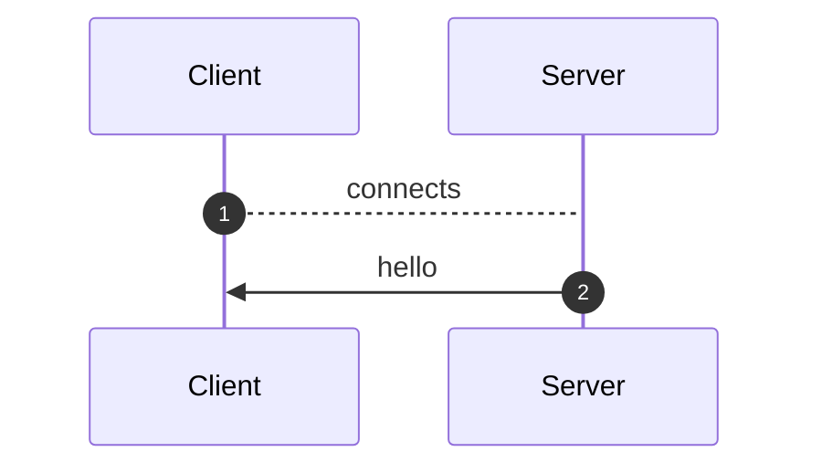
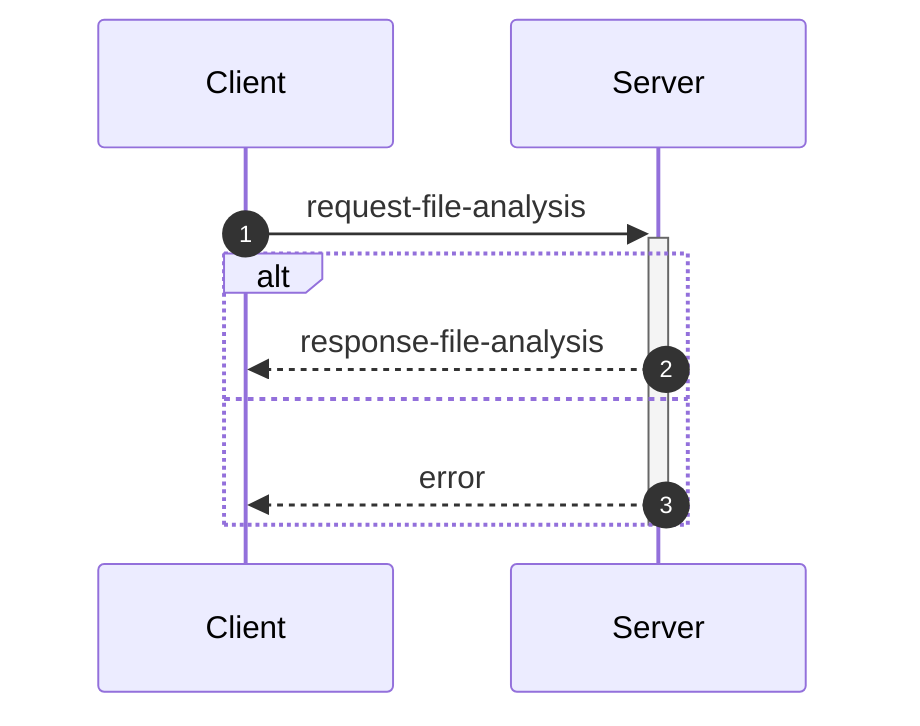
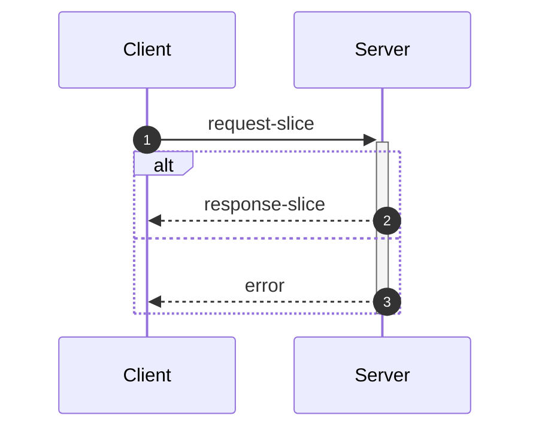
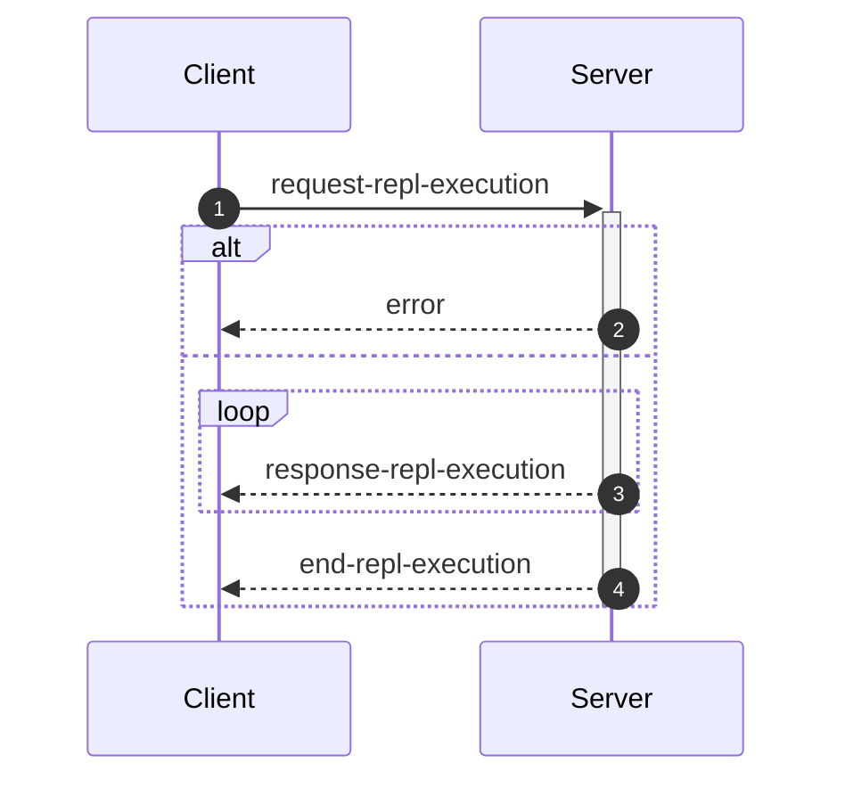

_<span title="an overview of flowR's interface">Generated</span> from '[wiki-interface.ts](https://github.com/flowr-analysis/flowr/tree/main/src/documentation/wiki-interface.ts "src/documentation/wiki-interface.ts")' on 2026-10-22, 15:15:45 UTC (v2.16.4, R v4.5.0), do not edit directly._

Although far from being as detailed as the in-depth explanation of [_flowR_](https://github.com/flowr-analysis/flowr/wiki/Core),
this wiki page explains how to interface with _flowR_ in more detail.
In general, command line arguments and other options provide short descriptions on hover over.

* [💻 Using the REPL](#using-the-repl)
* [⚙️ Configuring FlowR](#configuring-flowr)
* [⚒️ Writing Code](#writing-code)
* [💬 Communicating with the Server](#communicating-with-the-server)

<a id='using-the-repl'></a>
## 💻 Using the REPL

> [!NOTE]
> To execute arbitrary R commands with a repl request, _flowR_ has to be started explicitly with <span title="Description (Command Line Argument): Allow to access the underlying R session when using flowR (security warning: this allows the execution of arbitrary R code!)">`--r-session-access`</span>.
> Please be aware that this introduces a security risk and note that this relies on the [`r-shell` engine](https://github.com/flowr-analysis/flowr/wiki/Engines) .

Although primarily meant for users to explore,
there is nothing which forbids calling _flowR_ as a subprocess to use standard-in, -output, and -error
for communication (although you can access the REPL using the server as well,
with the [REPL Request](#message-request-repl-execution) message).

The read-eval-print loop&nbsp;(REPL) works relatively simple.
You can submit an expression (using <kbd>Enter</kbd>),
which is interpreted as an R&nbsp;expression by default but interpreted as a *command* if it starts with a colon (`:`).
The best command to get started with the REPL is <span title="Description (Repl Command): Show help information (aliases: :h, :?)">`:help`</span>.
Besides, you can leave the REPL either with the command <span title="Description (Repl Command): End the repl (aliases: :q, :exit)">`:quit`</span> or by pressing <kbd>Ctrl</kbd>+<kbd>C</kbd> twice.
When writing a *command*, you may press <kbd>Tab</kbd> to get a list of completions, if available.
Multiple commands can be entered in a single line by separating them with a semicolon (`;`), e.g. `:parse "x<-2"; :df*`.
If a command is given without R code, the REPL will re-use R code given in a previous command.
The prior example will hence return first the parsed AST of the program and then the dataflow graph for `"x <- 2"`.

> [!NOTE]
> If you develop flowR, you may want to launch the repl using the `npm run main-dev` command, this way, you get a non-minified version of flowR with debug information and hot-reloading of source files.

<details>
<summary>Available Commands</summary>

We currently offer the following commands (this with a `[*]` suffix are available with and without the star):

| Command | Description |
| ------- | ----------- |
| **<span title="Description (Repl Command): End the repl (aliases: :q, :exit)">:quit</span>** | End the repl (aliases: **:<span title="Alias of ':quit'. End the repl">q</span>**, **:<span title="Alias of ':quit'. End the repl">exit</span>**) |
| **<span title="Description (Repl Command): Execute the given code as R code. This requires the `--r-session-access` flag to be set and requires the r-shell engine. (aliases: :e, :r)">:execute</span>** | Execute the given code as R code. This requires the `--r-session-access` flag to be set and requires the r-shell engine. (aliases: **:<span title="Alias of ':execute'. Execute the given code as R code. This requires the `--r-session-access` flag to be set and requires the r-shell engine.">e</span>**, **:<span title="Alias of ':execute'. Execute the given code as R code. This requires the `--r-session-access` flag to be set and requires the r-shell engine.">r</span>**) |
| **<span title="Description (Repl Command): Get mermaid code for the control-flow graph of R code (aliases: :cfg, :cf)">:controlflow[*]</span>** | Get mermaid code for the control-flow graph of R code (star: Returns the URL to mermaid.live) (aliases: **:<span title="Alias of ':controlflow'. Get mermaid code for the control-flow graph of R code">cfg</span>**, **:<span title="Alias of ':controlflow'. Get mermaid code for the control-flow graph of R code">cf</span>**) |
| **<span title="Description (Repl Command): Get mermaid code for the control-flow graph with basic blocks (aliases: :cfgb, :cfb)">:controlflowbb[*]</span>** | Get mermaid code for the control-flow graph with basic blocks (star: Returns the URL to mermaid.live) (aliases: **:<span title="Alias of ':controlflowbb'. Get mermaid code for the control-flow graph with basic blocks">cfgb</span>**, **:<span title="Alias of ':controlflowbb'. Get mermaid code for the control-flow graph with basic blocks">cfb</span>**) |
| **<span title="Description (Repl Command): Get mermaid code for the dataflow graph (aliases: :d, :df)">:dataflow[*]</span>** | Get mermaid code for the dataflow graph (star: Returns the URL to mermaid.live) (aliases: **:<span title="Alias of ':dataflow'. Get mermaid code for the dataflow graph">d</span>**, **:<span title="Alias of ':dataflow'. Get mermaid code for the dataflow graph">df</span>**) |
| **<span title="Description (Repl Command): Get mermaid code for the normalized AST of R code (aliases: :n)">:normalize[*]</span>** | Get mermaid code for the normalized AST of R code (star: Returns the URL to mermaid.live) (alias: **:<span title="Alias of ':normalize'. Get mermaid code for the normalized AST of R code">n</span>**) |
| **<span title="Description (Repl Command): Get mermaid code for the simplified dataflow graph (aliases: :ds, :dfs)">:dataflowsimple[*]</span>** | Get mermaid code for the simplified dataflow graph (star: Returns the URL to mermaid.live) (aliases: **:<span title="Alias of ':dataflowsimple'. Get mermaid code for the simplified dataflow graph">ds</span>**, **:<span title="Alias of ':dataflowsimple'. Get mermaid code for the simplified dataflow graph">dfs</span>**) |
| **<span title="Description (Repl Command): Inspect and extend the signature database: `query` (identical to :query @signature), `info <name>` for where a function comes from (identical to :query @function-info), `add <path>` to mount another database/source, `download` to fetch the full-history database. (aliases: :sig)">:signature</span>** | Inspect and extend the signature database: `query` (identical to :query @signature), `info <name>` for where a function comes from (identical to :query @function-info), `add <path>` to mount another database/source, `download` to fetch the full-history database. (alias: **:<span title="Alias of ':signature'. Inspect and extend the signature database: `query` (identical to :query @signature), `info <name>` for where a function comes from (identical to :query @function-info), `add <path>` to mount another database/source, `download` to fetch the full-history database.">sig</span>**) |
| **<span title="Description (Repl Command): Just calculates the DFG, but only prints summary info (aliases: :d#, :df#)">:dataflowsilent</span>** | Just calculates the DFG, but only prints summary info (aliases: **:<span title="Alias of ':dataflowsilent'. Just calculates the DFG, but only prints summary info">d#</span>**, **:<span title="Alias of ':dataflowsilent'. Just calculates the DFG, but only prints summary info">df#</span>**) |
| **<span title="Description (Repl Command): Prints ASCII Art of the parsed, unmodified AST (aliases: :p)">:parse</span>** | Prints ASCII Art of the parsed, unmodified AST (alias: **:<span title="Alias of ':parse'. Prints ASCII Art of the parsed, unmodified AST">p</span>**) |
| **<span title="Description (Repl Command): Prints the version of flowR as well as the current version of R">:version</span>** | Prints the version of flowR as well as the current version of R
| **<span title="Description (Repl Command): Query the given R code (use 'help' for more information)">:query[*]</span>** | Query the given R code (use 'help' for more information) (star: Similar to query, but returns the output in json format.)
| **<span title="Description (Repl Command): Returns an ASCII representation of the dataflow graph (aliases: :df!)">:dataflowascii</span>** | Returns an ASCII representation of the dataflow graph (alias: **:<span title="Alias of ':dataflowascii'. Returns an ASCII representation of the dataflow graph">df!</span>**) |
| **<span title="Description (Repl Command): Returns summarization stats for the normalized AST (aliases: :n#)">:normalize#</span>** | Returns summarization stats for the normalized AST (alias: **:<span title="Alias of ':normalize#'. Returns summarization stats for the normalized AST">n#</span>**) |
| **<span title="Description (Repl Command): Show help information (aliases: :h, :?)">:help</span>** | Show help information (aliases: **:<span title="Alias of ':help'. Show help information">h</span>**, **:<span title="Alias of ':help'. Show help information">?</span>**) |

</details>

> [!TIP]
> 
> As indicated by the examples before, all REPL commands that operate on code keep track of the state.
> Hence, if you run a command like <span title="Description (Repl Command, starred version): Returns the URL to mermaid.live; Base Command: Get mermaid code for the dataflow graph (aliases: :d*, :df*)">`:dataflow*`</span> without providing R code,
> the REPL will re-use the R code provided in a previous command.
> Likewise, doing this will benefit from incrementality!
> If you request the dataflow graph with `:df* x <- 2 * y` and then want to see the parsed AST with `:parse`,
> the REPL will re-use previously obtained information and not re-parse the code again.
> 		

Generally, many commands offer shortcut versions in the REPL. Many queries, for example, offer a shortened format (see the example below).
Of special note, the [Config Query](https://github.com/flowr-analysis/flowr/wiki/%5BQuery%5D-Config)
can be used to also modify the currently active configuration of _flowR_ within the REPL (see the [wiki page](https://github.com/flowr-analysis/flowr/wiki/%5BQuery%5D-Config) for more information).

### Example: Retrieving the Dataflow Graph

To retrieve a URL to the [mermaid](https://mermaid.js.org/) diagram of the dataflow of a given expression,
use <span title="Description (Repl Command, starred version): Returns the URL to mermaid.live; Base Command: Get mermaid code for the dataflow graph (aliases: :d*, :df*)">`:dataflow*`</span> (or <span title="Description (Repl Command): Get mermaid code for the dataflow graph (aliases: :d, :df)">`:dataflow`</span> to get the mermaid code in the cli):

```shell
$ docker run -it --rm eagleoutice/flowr # or npm run flowr 
flowR repl v2.16.4, R grammar v14 (tree-sitter engine)
R> :dataflow* y <- 1 + x
```

<details>
<summary style='color:gray'>Output</summary>

```text
https://mermaid.live/view#base64:eyJjb2RlIjoiZmxvd2NoYXJ0IFREXG4gICAgMXt7XCJgKiM5MTtSTnVtYmVyIzkzOyogKioxKipcbiAgICAgICoxLjYqICgqKmlkOiAxKiopYFwifX1cbiAgICAyKFtcImAqIzkxO1JTeW1ib2wjOTM7KiAqKngqKlxuICAgICAgKjEuMTAqICgqKmlkOiAyKiopYFwiXSlcbiAgICAzW1tcImAqIzkxO1JCaW5hcnlPcCM5MzsqIGJhc2UjNTg7IzU4OyoqIzQzOyoqXG4gICAgICAqMS42LTEwKiAoKippZDogMyoqKVxuICAgIGFyZzogKDEsIDIpYFwiXV1cbiAgICBidWlsdC1pbjpfNDNfW1wiYEJ1aWx0LUluOlxuIzQzO2BcIl1cbiAgICBzdHlsZSBidWlsdC1pbjpfNDNfIHN0cm9rZTpncmF5LGZpbGw6Z3JheSxzdHJva2Utd2lkdGg6MnB4LG9wYWNpdHk6Ljg7XG4gICAgMFtcImAqIzkxO1JTeW1ib2wjOTM7KiAqKnkqKlxuICAgICAgKjEuMSogKCoqaWQ6IDAqKiwgdjogMylgXCJdXG4gICAgNFtbXCJgKiM5MTtSQmluYXJ5T3AjOTM7KiBiYXNlIzU4OyM1ODsqKiM2MDsjNDU7KipcbiAgICAgICoxLjEtMTAqICgqKmlkOiA0KiopXG4gICAgYXJnOiAoMCwgMylgXCJdXVxuICAgIGJ1aWx0LWluOl82MF8tW1wiYEJ1aWx0LUluOlxuIzYwOyM0NTtgXCJdXG4gICAgc3R5bGUgYnVpbHQtaW46XzYwXy0gc3Ryb2tlOmdyYXksZmlsbDpncmF5LHN0cm9rZS13aWR0aDoycHgsb3BhY2l0eTouODtcbiAgICAxIC0uLT58XCJmbG93XCJ8IDJcbiAgICBsaW5rU3R5bGUgMCBzdHJva2U6Z3JheSxjb2xvcjpncmF5O1xuICAgIDIgLS4tPnxcImZsb3dcInwgM1xuICAgIGxpbmtTdHlsZSAxIHN0cm9rZTpncmF5LGNvbG9yOmdyYXk7XG4gICAgMyAtLT58XCJyZWFkcywgYXJnXCJ8IDFcbiAgICAzIC0tPnxcInJlYWRzLCBhcmdcInwgMlxuICAgIDMgLS4tPnxcImZsb3dcInwgMFxuICAgIGxpbmtTdHlsZSA0IHN0cm9rZTpncmF5LGNvbG9yOmdyYXk7XG4gICAgMyAtLi0+fFwicmVhZHMsIGNhbGxzXCJ8IGJ1aWx0LWluOl80M19cbiAgICBsaW5rU3R5bGUgNSBzdHJva2U6Z3JheTtcbiAgICAwIC0tPnxcImRlZmluZWQtYnksIGZsb3dcInwgNFxuICAgIDAgLS0+fFwiZGVmaW5lZC1ieVwifCAzXG4gICAgNCAtLT58XCJyZWFkcywgYXJnXCJ8IDNcbiAgICA0IC0tPnxcInJldHVybnMsIGFyZ1wifCAwXG4gICAgNCAtLi0+fFwicmVhZHMsIGNhbGxzXCJ8IGJ1aWx0LWluOl82MF8tXG4gICAgbGlua1N0eWxlIDEwIHN0cm9rZTpncmF5OyIsIm1lcm1haWQiOnsiYXV0b1N5bmMiOnRydWV9fQ==
```

Retrieve the dataflow graph of the expression `y <- 1 + x`. It looks like this:


<details>

<summary style="color:gray">R Code of the Dataflow Graph</summary>

The analysis ran (including parse and normalize, using the [tree-sitter](https://github.com/flowr-analysis/flowr/wiki/Engines) engine) within the generation environment. No [signature database](https://github.com/flowr-analysis/flowr/wiki/Signature-Database) is mounted for these generated graphs, so `library()` calls attach no package exports; base-R names are still qualified via the generated base-package store (e.g. `acf` as `stats::acf`). 
We encountered no unknown side effects during the analysis.

```r
y <- 1 + x
```

</details>

</details>

For small graphs like this, <span title="Description (Repl Command): Returns an ASCII representation of the dataflow graph (aliases: :df!)">`:dataflowascii`</span> also provides an ASCII representation directly in the REPL:

```shell
$ docker run -it --rm eagleoutice/flowr # or npm run flowr 
flowR repl v2.16.4, R grammar v14 (tree-sitter engine)
R> :df! y <- 1 + x
```

<details open>
<summary style='color:gray'>Output</summary>

```text
                        v<0>v
 c<4>c──────────────────| y |
 |<- |     ┌────────────v---v
 c---c     │
    │   c<3>c   0<1>0
    └───| + |───| 1 |───u<2>u
        c---c   0---0   | x |
           └────────────u---u
Edges:
3 -> 1: reads, arg          3 -> 2: reads, arg
3 -> 0: flows-to            1 -> 2: flows-to
2 -> 3: flows-to            4 -> 3: reads, arg
4 -> 0: returns, arg        0 -> 4: defined-by, flows-to
0 -> 3: defined-by
```

Retrieve the dataflow graph of the expression `y <- 1 + x` as ASCII art.

</details>

For the slicing with <span title="Description (Repl Command): Static backwards executable slicer for R">`:slicer`</span>, you have access to the same [magic comments](#slice-magic-comments) as with the [slice request](#message-request-slice).
Pass `--inline` to splice resolvable `source()` calls into the reconstruction so the slice is a single self-contained R text (the same as the static slice query's `inlineSources` flag).
See `--help` for more flags!

### Example: Interfacing with the File System

Many commands that allow for an R-expression (like <span title="Description (Repl Command, starred version): Returns the URL to mermaid.live; Base Command: Get mermaid code for the dataflow graph (aliases: :d*, :df*)">`:dataflow*`</span>) allow for a file as well
if the argument starts with `file://`.
If you are working from the root directory of the _flowR_ repository, the following gives you the parsed AST of the example file using the <span title="Description (Repl Command): Prints ASCII Art of the parsed, unmodified AST (aliases: :p)">`:parse`</span> command:

> **Watch mode**: Replace `file://` with `watch://` to enter watch mode.
> flowR runs the command immediately and then re-runs it every time the file (or any file inside the folder) changes.
> Enter any other command to leave watch mode.
> For example: `:df watch://analysis.R`

```shell
$ docker run -it --rm eagleoutice/flowr # or npm run flowr 
flowR repl v2.16.4, R grammar v14 (tree-sitter engine)
R> :parse file://test/testfiles/example.R
```

<details>
<summary style='color:gray'>Output</summary>

```text
File: test/testfiles/example.R

program
├ binaryoperator
│ ├ identifier "sum" (1:1─4)
│ ├ <- "<-" (1:5─7)
│ ╰ float "0" (1:8─9)
├ binaryoperator
│ ├ identifier "product" (2:1─8)
│ ├ <- "<-" (2:9─11)
│ ╰ float "1" (2:12─13)
├ binaryoperator
│ ├ identifier "w" (3:1─2)
│ ├ <- "<-" (3:3─5)
│ ╰ float "7" (3:6─7)
├ binaryoperator
│ ├ identifier "N" (4:1─2)
│ ├ <- "<-" (4:3─5)
│ ╰ float "10" (4:6─8)
├ forstatement
│ ├ for "for" (6:1─4)
│ ├ ( "(" (6:5─6)
│ ├ identifier "i" (6:6─7)
│ ├ in "in" (6:8─10)
│ ├ binaryoperator
│ │ ├ float "1" (6:11─12)
│ │ ├ : ":" (6:12─13)
│ │ ╰ parenthesizedexpression
│ │   ├ ( "(" (6:13─14)
│ │   ├ binaryoperator
│ │   │ ├ identifier "N" (6:14─15)
│ │   │ ├ - "-" (6:15─16)
│ │   │ ╰ float "1" (6:16─17)
│ │   ╰ ) ")" (6:17─18)
│ ├ ) ")" (6:18─19)
│ ╰ bracedexpression
│   ├ { "{" (6:20─21)
│   ├ binaryoperator
│   │ ├ identifier "sum" (7:3─6)
│   │ ├ <- "<-" (7:7─9)
│   │ ╰ binaryoperator
│   │   ├ binaryoperator
│   │   │ ├ identifier "sum" (7:10─13)
│   │   │ ├ + "+" (7:14─15)
│   │   │ ╰ identifier "i" (7:16─17)
│   │   ├ + "+" (7:18─19)
│   │   ╰ identifier "w" (7:20─21)
│   ├ binaryoperator
│   │ ├ identifier "product" (8:3─10)
│   │ ├ <- "<-" (8:11─13)
│   │ ╰ binaryoperator
│   │   ├ identifier "product" (8:14─21)
│   │   ├  "" (8:22─23)
│   │   ╰ identifier "i" (8:24─25)
│   ╰ } "}" (9:1─2)
├ call
│ ├ identifier "cat" (11:1─4)
│ ╰ arguments
│   ├ ( "(" (11:4─5)
│   ├ argument
│   │ ╰ string
│   │   ├ " "\"" (11:5─6)
│   │   ├ stringcontent "Sum:" (11:6─10)
│   │   ╰ " "\"" (11:10─11)
│   ├ comma "," (11:11─12)
│   ├ argument
│   │ ╰ identifier "sum" (11:13─16)
│   ├ comma "," (11:16─17)
│   ├ argument
│   │ ╰ string
│   │   ├ " "\"" (11:18─19)
│   │   ├ stringcontent
│   │   │ ╰ escapesequence "\\n" (11:19─21)
│   │   ╰ " "\"" (11:21─22)
│   ╰ ) ")" (11:22─23)
╰ call
  ├ identifier "cat" (12:1─4)
  ╰ arguments
    ├ ( "(" (12:4─5)
    ├ argument
    │ ╰ string
    │   ├ " "\"" (12:5─6)
    │   ├ stringcontent "Product:" (12:6─14)
    │   ╰ " "\"" (12:14─15)
    ├ comma "," (12:15─16)
    ├ argument
    │ ╰ identifier "product" (12:17─24)
    ├ comma "," (12:24─25)
    ├ argument
    │ ╰ string
    │   ├ " "\"" (12:26─27)
    │   ├ stringcontent
    │   │ ╰ escapesequence "\\n" (12:27─29)
    │   ╰ " "\"" (12:29─30)
    ╰ ) ")" (12:30─31)
```

Retrieve the parsed AST of the example file.

<details>

<summary>File Content</summary>

```r
sum <- 0
product <- 1
w <- 7
N <- 10

for (i in 1:(N-1)) {
  sum <- sum + i + w
  product <- product * i
}

cat("Sum:", sum, "\n")
cat("Product:", product, "\n")
```

</details>

As _flowR_ directly transforms this AST the output focuses on being human-readable instead of being machine-readable.
		
</details>

### Example: Run a Query

You can run any query supported by _flowR_ using the <span title="Description (Repl Command): Query the given R code (use 'help' for more information)">`:query`</span> command.
For example, to obtain the shapes of all data frames in a given piece of code, you can run:

```shell
$ docker run -it --rm eagleoutice/flowr # or npm run flowr 
flowR repl v2.16.4, R grammar v14 (tree-sitter engine)
R> :query @absint df-shape "x <- data.frame(a = 1:10, b = 1:10)\ny <- x$a"
```

<details open>
<summary style='color:gray'>Output</summary>

```text
Query: absint (1 ms)
```

Retrieve the shapes of all data frames in the given code.

</details>

To run the linter on a file, you can use (in this example, we just issue the `dead-code` linter on a small piece of code):

```shell
$ docker run -it --rm eagleoutice/flowr # or npm run flowr 
flowR repl v2.16.4, R grammar v14 (tree-sitter engine)
R> :query @linter rules:dead-code "if(FALSE) x <- 2"
```

<details open>
<summary style='color:gray'>Output</summary>

```text
Query: linter (2 ms)
   ╰ Dead Code (dead-code):
       ╰ certain:
           ╰ Code at 1.11-16
```

Run the linter on the given code, with only the `dead-code` rule enabled.

</details>

For more information on the available queries, please check out the [Query API](https://github.com/flowr-analysis/flowr/wiki/Query-API).

<a id='configuring-flowr'></a>
## ⚙️ Configuring FlowR

When running _flowR_, you may want to specify some behaviors with a dedicated configuration file.
By default, flowR looks for a file named `flowr.json` in the current working directory (or any higher directory).
You can also specify a different file with <span title="Description (Command Line Argument): The name of the configuration file to use">`--config-file`</span> or pass the configuration inline using <span title="Description (Command Line Argument): The flowR configuration to use, as a JSON string">`--config-json`</span>.
A `flowr.json` found this way belongs to the analyzed project, so flowR ignores its options that decide what flowR executes or loads
(`engines.*.wasmPath`, `engines.*.treeSitterWasmPath`, `engines.*.rPath`, `solver.sigdb.additionalPaths`, `solver.sigdb.downloadRepo`, `solver.sigdb.installedLibrary.paths`),
unless you pass <span title="Description (Command Line Argument): Keep the security-sensitive options (e.g., the R executable) of the flowr.json found in the working directory or a parent. Only use this for projects you trust.">`--trust-config`</span>.
To analyze code you do not trust, use the secure mode (<span title="Description (Command Line Argument): Run in secure mode for analyzing untrusted code: flowR does not start R (or any other process), does not access the network, does not search for project configs, and ignores security-sensitive options in every config. Cannot be disabled once enabled. Can also be enabled with the environment variable {italic FLOWR_SECURE_MODE=1}.">`--secure`</span>, see the [security policy](https://github.com/flowr-analysis/flowr/blob/main/.github/SECURITY.md)).
To inspect the current configuration, you can run flowr with the <span title="Description (Command Line Argument): Run with verbose logging (will be passed to the corresponding script)">`--verbose`</span> flag, or use the `config` [Query](https://github.com/flowr-analysis/flowr/wiki/Query-API).
Within the REPL this works by running the following:

```shell
:query @config
```

To work with the <a href="https://github.com/flowr-analysis/flowr/tree/main/src/config.ts#L119"><code><span title="The configuration file format for flowR.">FlowrConfig</span></code></a> you can use the provided helper objects alongside its methods like
<a href="https://github.com/flowr-analysis/flowr/tree/main/src/config.ts#L914"><code><span title="Creates a new flowr config that has the updated values.">FlowrConfig::<b>amend</b></span></code></a>.
The schema below documents every option; the ones you most likely want are:

- <a href="https://github.com/flowr-analysis/flowr/wiki/Interface#configuring-flowr" title="Configuration Option (boolean): Whether source calls should be ignored, causing {@link processSourceCall}&#39;s behavior to be skipped.">ignoreSourceCalls</a>: ignore source calls when analyzing the code, i.e., ignore the inclusion of other files.
- <a href="https://github.com/flowr-analysis/flowr/wiki/Interface#configuring-flowr" title="Configuration Option (boolean): Whether load calls should be ignored, causing {@link processLoadCall}&#39;s behavior to be skipped.">ignoreLoadCalls</a>: ignore load calls when analyzing the code, i.e., ignore the loading of r-data files.
- <a href="https://github.com/flowr-analysis/flowr/wiki/Interface#configuring-flowr" title="Configuration Option (object): Do you want to overwrite (parts) of the builtin definition?">semantics.environment.overwriteBuiltIns</a>: overwrite _flowR_'s handling of built-in functions, or clear the preset definitions entirely.
  See [Configure BuiltIn Semantics](#configure-builtin-semantics) for more information.
- <a href="https://github.com/flowr-analysis/flowr/wiki/Interface#configuring-flowr" title="Configuration Option (string): How to resolve variables and their values. (one of &quot;disabled&quot;, &quot;alias&quot;, &quot;builtin&quot;)">solver.variables</a>: how to resolve variables and their values (`disabled`, `alias`, `builtin`).
- <a href="https://github.com/flowr-analysis/flowr/wiki/Interface#configuring-flowr" title="Configuration Option (array): The engine or set of engines to use for interacting with R code. An empty array means all available engines will be used.">engines</a> and <a href="https://github.com/flowr-analysis/flowr/wiki/Interface#configuring-flowr" title="Configuration Option (string): The default engine to use for interacting with R code. If this is undefined, an arbitrary engine from the specified list will be used. (one of &quot;tree-sitter&quot;, &quot;r-shell&quot;)">defaultEngine</a>: the engines used to interact with R code, see the [Engines wiki page](https://github.com/flowr-analysis/flowr/wiki/Engines).
- <a href="https://github.com/flowr-analysis/flowr/wiki/Interface#configuring-flowr" title="Configuration Option (array): Files a framework loads on its own, without any source() call (e.g. global.R in a shiny app), in the order they are loaded; flowR orders the matching project files accordingly and analyzes them as one program. Entries are case-insensitive globs matched against the file path, a plain name matches any file with that name, and entries matching no project file are warned about. Usually set per project kind via specializeConfig.">project.implicitSources</a>: the files a framework loads without any `source()` call, in the order in which they are
  loaded. Entries are globs (e.g. `R/*.R`) matched against the file path ignoring capitalization; one matching no file is reported.
- <a href="https://github.com/flowr-analysis/flowr/wiki/Interface#configuring-flowr" title="Configuration Option (object): Overwrite (parts of) the configuration depending on the project kind flowR detects, e.g. to give a shiny app its implicit sources.">specializeConfig</a>: overwrite (parts of) the configuration depending on the kind of project _flowR_ detects
  (e.g. `shiny-app`), which is how a shiny app gets its implicit sources by default. What you configure directly wins.
- <a href="https://github.com/flowr-analysis/flowr/wiki/Interface#configuring-flowr" title="Configuration Option (string): Overwrite the project kind flowR would otherwise infer from the analyzed files, e.g. when auto-detection guesses wrong. (one of &quot;package&quot;, &quot;script&quot;, &quot;shiny-app&quot;, &quot;notebook&quot;, &quot;project&quot;, &quot;unknown&quot;)">project.useProjectType</a>: skip that detection and force a project kind yourself, when auto-detection guesses wrong.
- <a href="https://github.com/flowr-analysis/flowr/wiki/Interface#configuring-flowr" title="Configuration Option (array): The default plugins to load when creating a new instance of FlowrAnalyzer">defaultPlugins</a> and <a href="https://github.com/flowr-analysis/flowr/wiki/Interface#configuring-flowr" title="Configuration Option (array): The plugins to load in REPL mode">repl.plugins</a>: the plugins to load for a new <a href="https://github.com/flowr-analysis/flowr/tree/main/src/project/flowr-analyzer.ts#L205"><code><span title="Central class for conducting analyses with FlowR. Use the FlowrAnalyzerBuilder to create a new instance. If you want the original pattern of creating a pipeline and running all steps, you can still do this with FlowrAnalyzer#runFull . To inspect the context of the analyzer, use FlowrAnalyzer#inspectContext (if you are a plugin and need to modify it, use FlowrAnalyzer#context instead).">FlowrAnalyzer</span></code></a> and in the REPL
  (use `flowr:default` to reference the former).

So you can configure _flowR_ by adding a file like the following:

<details>

<summary>Example Configuration File</summary>

```json
{
  "ignoreSourceCalls": true,
  "ignoreLoadCalls": true,
  "semantics": {
    "environment": {
      "overwriteBuiltIns": {
        "definitions": [
          {
            "type": "function",
            "names": [
              "foo"
            ],
            "processor": "builtin:assign",
            "config": {}
          }
        ]
      }
    }
  },
  "defaultPlugins": [
    "file:description",
    "versions:description"
  ],
  "repl": {
    "quickStats": false,
    "dfProcessorHeat": false,
    "hints": true,
    "plugins": [
      "flowr:default"
    ]
  },
  "project": {
    "resolveUnknownPathsOnDisk": true,
    "implicitSources": [
      "global.R",
      "app.R"
    ]
  },
  "linter": {
    "disabledRules": []
  },
  "specializeConfig": {
    "shiny-app": {
      "project": {
        "implicitSources": [
          "global.R",
          "ui.R",
          "server.R",
          "app.R"
        ]
      }
    }
  },
  "engines": [
    {
      "type": "r-shell"
    }
  ],
  "solver": {
    "variables": "alias",
    "evalStrings": true,
    "trackEnvironments": true,
    "sigdb": {
      "enabled": true,
      "loadProjectDependencies": true,
      "eagerlyLoad": false,
      "eagerlyLoadExports": false,
      "linkBaseR": false,
      "linkDescriptionDependencies": false
    },
    "resolveSource": {
      "dropPaths": "no",
      "ignoreCapitalization": true,
      "inferWorkingDirectory": "active-script",
      "searchPath": []
    },
    "instrument": {},
    "slicer": {
      "threshold": 50
    }
  },
  "abstractInterpretation": {
    "wideningThreshold": 4,
    "followCalls": true,
    "dataFrame": {
      "maxColNames": 20,
      "readLoadedData": {
        "readExternalFiles": true,
        "maxReadLines": 1000000
      }
    }
  },
  "incremental": {
    "alwaysIncremental": false,
    "parsing": {
      "activated": false,
      "heuristics": {
        "activated": true,
        "mtime": true,
        "linesFrom": 500,
        "bytesFrom": 50000,
        "alwaysWithEdits": false,
        "minFiles": 1
      }
    }
  },
  "gas": {
    "thresholds": {
      "memory": {
        "problematic": 0.7,
        "critical": 0.9
      },
      "timeMs": {
        "problematic": 100000,
        "critical": 120000
      }
    },
    "features": {}
  }
}
```

</details>

<details>
<a id='configure-builtin-semantics'></a>
<summary>Configure Built-In Semantics</summary>

`semantics/environment/overwriteBuiltins` accepts two keys:

- `loadDefaults` (boolean, initially `true`): If set to `true`, the default built-in definitions are loaded before applying the custom definitions. Setting this flag to `false` explicitly disables the loading of the default definitions.
- `definitions` (array, initially empty): Allows to overwrite or define new built-in elements. Each object within must have a `type` which is one of the below. Furthermore, they may define a string array of `names` which specifies the identifiers to bind the definitions to. You may use `assumePrimitive` to specify whether _flowR_ should assume that this is a primitive non-library definition (so you probably just do not want to specify the key).

  | Type            | Description                                                                                                                                                                                                                                                                                              | Example                                                                                                    |
  | --------------- | -------------------------------------------------------------------------------------------------------------------------------------------------------------------------------------------------------------------------------------------------------------------------------------------------------- | ---------------------------------------------------------------------------------------------------------- |
  | `constant`    | Additionally allows for a `value` this should resolve to.                                                                                                                                                                                                                                                | `{ type: 'constant', names: ['NULL', 'NA'],  value: null }`                                                |
  | `function`    | Is a rather flexible way to define and bind built-in functions. For the time, we do not have extensive documentation to cover all the cases, so please either consult the sources with the `default-builtin-config.ts` or open a [new issue](https://github.com/flowr-analysis/flowr/issues/new/choose). | `{ type: 'function', names: ['next'], processor: 'builtin:d', config: { cfg: ExitPointType.Next } }` |
  | `replacement` | A comfortable way to specify replacement functions like `$<-` or `names<-`. `suffixes` describes the... suffixes to attach automatically. | `{ type: 'replacement', suffixes: ['<-', '<<-'], names: ['[', '[['] }` |

</details>

<details>

<summary style='color:gray'>Full Configuration-File Schema</summary>

- _The configuration file format for flowR._ (object)
    - **logLevel** [optional] _flowR's global minimum log level, applied when the config is loaded._ (string)
        Only allows: 'silly', 'trace', 'debug', 'info', 'warn', 'error', 'fatal'
    - **ignoreSourceCalls** [optional] _Whether source calls should be ignored, causing {@link processSourceCall}'s behavior to be skipped._ (boolean)
    - **ignoreLoadCalls** [optional] _Whether load calls should be ignored, causing {@link processLoadCall}'s behavior to be skipped._ (boolean)
    - **semantics** _Configure language semantics and how flowR handles them._ (object)
        - **environment** [optional] _Semantics regarding how to handle the R environment._ (object)
            - **overwriteBuiltIns** [optional] _Do you want to overwrite (parts) of the builtin definition?_ (object)
                - **loadDefaults** [optional] _Should the default configuration still be loaded?_ (boolean)
                - **definitions** [optional] _The definitions to load/overwrite._ (array)
                Valid item types:
                    - (object)
    - **defaultPlugins** [optional] _The default plugins to load when creating a new instance of FlowrAnalyzer_ (array)
    Valid item types:
        - (alternatives)
            - (string)
            - (array)
    - **repl** _Configuration options for the REPL._ (object)
        - **quickStats** [optional] _Whether to show quick stats in the REPL after each evaluation._ (boolean)
        - **dfProcessorHeat** [optional] _This instruments the dataflow processors to count how often each processor is called._ (boolean)
        - **hints** [optional] _Whether to show dim inline hints on the empty prompt (automatically disabled on non-interactive terminals)._ (boolean)
        - **plugins** [optional] _The plugins to load in REPL mode_ (array)
        Valid item types:
            - (alternatives)
                - (string)
                - (array)
        - **autoUseFileProtocol** [optional] _Prepend the file protocol to a repl input that looks like a path, instead of only warning about it._ (boolean)
        - **queryStats** [optional] _Whether `:query` closes with the line stating how long the queries took (`:query*` never prints it)._ (boolean)
        - **showPlugins** [optional] _Whether `:version` grays out the plugins that did not activate during the last analysis._ (boolean)
    - **project** _Project specific configuration options._ (object)
        - **resolveUnknownPathsOnDisk** [optional] _Whether to resolve unknown paths loaded by the r project disk when trying to source/analyze files._ (boolean)
        - **failOnInaccessiblePath** [optional] _Whether a directory that cannot be traversed during file discovery (e.g. due to permissions) aborts the analysis; when false (the default) such paths are logged and skipped._ (boolean)
        - **basePackages** [optional] _The packages considered part of R itself (base and recommended); if unset, flowR uses its built-in list._ (array)
        Valid item types:
            - (string)
        - **implicitSources** [optional] _Files a framework loads on its own, without any source() call (e.g. global.R in a shiny app), in the order they are loaded; flowR orders the matching project files accordingly and analyzes them as one program. Entries are case-insensitive globs matched against the file path, a plain name matches any file with that name, and entries matching no project file are warned about. Usually set per project kind via specializeConfig._ (array)
        Valid item types:
            - (string)
        - **useProjectType** [optional] _Overwrite the project kind flowR would otherwise infer from the analyzed files, e.g. when auto-detection guesses wrong._ (string)
            Only allows: 'package', 'script', 'shiny-app', 'notebook', 'project', 'unknown'
        - **assumeImplicitEcho** [optional] _Whether the top level of the analyzed code is echoed, so that every visible result printed there is collected as an output by the dependencies query (default true, false for a package)._ (boolean)
        - **discovery** [optional] _Scoping options for the default project discovery._ (object)
            - **full** [optional] _Collect every file below the project root (greedy) instead of only the files the detected project kind needs (default false)._ (boolean)
            - **perKind** [optional] _Per-kind include/exclude glob overrides layered on the default scoping._ (object)
            - **ignore** [optional] _Case-insensitive globs that drop matching files from the intelligent discovery, regardless of kind (e.g. .Renviron to ignore environment files)._ (array)
            Valid item types:
                - (string)
        - **classification** [optional] _Overrides for the signals flowR uses to classify the project kind._ (object)
            - **shinyDescriptionTypes** [optional] _DESCRIPTION Type: values that mark a shiny app._ (array)
            Valid item types:
                - (string)
            - **shinyEntryFiles** [optional] _File names a shiny app is assembled from._ (array)
            Valid item types:
                - (string)
            - **shinyUsagePattern** [optional] _Regex source evidencing shiny usage in an entry file._ (string)
            - **notebookExtensions** [optional] _File extensions marking a notebook._ (array)
            Valid item types:
                - (string)
    - **linter** _Linter configuration options._ (object)
        - **disabledRules** _Linting rule names excluded from the default rule set (a rule requested explicitly via a linter query still runs). Usually set per project kind via specializeConfig._ (array)
        Valid item types:
            - (string)
        - **disabledTags** [optional] _Linting rule tags whose rules are excluded from the default rule set (a rule requested explicitly via a linter query still runs). By default the cmd-check rules are disabled for everything but a package; a configured list replaces that default._ (array)
        Valid item types:
            - (string)
    - **inputSources** [optional] _Further frameworks the input-sources analysis should know about; entries are added to flowR's defaults._ (object)
        - **pure** [optional] _Functions that only pass the constantness of their arguments on._ (array)
        Valid item types:
            - (string)
        - **param** [optional] _Functions whose result is a 'param' input._ (array)
        Valid item types:
            - (string)
        - **file** [optional] _Functions whose result is a 'file' input._ (array)
        Valid item types:
            - (string)
        - **tempfile** [optional] _Functions whose result is a 'tempfile' input._ (array)
        Valid item types:
            - (string)
        - **glob** [optional] _Functions whose result is a 'glob' input._ (array)
        Valid item types:
            - (string)
        - **net** [optional] _Functions whose result is a 'net' input._ (array)
        Valid item types:
            - (string)
        - **rand** [optional] _Functions whose result is a 'rand' input._ (array)
        Valid item types:
            - (string)
        - **system** [optional] _Functions whose result is a 'system' input._ (array)
        Valid item types:
            - (string)
        - **ffi** [optional] _Functions whose result is a 'ffi' input._ (array)
        Valid item types:
            - (string)
        - **lang** [optional] _Functions whose result is a 'lang' input._ (array)
        Valid item types:
            - (string)
        - **options** [optional] _Functions whose result is a 'options' input._ (array)
        Valid item types:
            - (string)
        - **cmdline** [optional] _Functions whose result is a 'cmdline' input._ (array)
        Valid item types:
            - (string)
        - **user** [optional] _Functions whose result is a 'user' input._ (array)
        Valid item types:
            - (string)
        - **const** [optional] _Functions whose result is a 'const' input._ (array)
        Valid item types:
            - (string)
        - **scope** [optional] _Functions whose result is a 'scope' input._ (array)
        Valid item types:
            - (string)
        - **dconst** [optional] _Functions whose result is a 'dconst' input._ (array)
        Valid item types:
            - (string)
        - **unknown** [optional] _Functions whose result is a 'unknown' input._ (array)
        Valid item types:
            - (string)
        - **linkedObjects** [optional] _Objects a framework provides without a definition in the code, e.g. shiny's input._ (array)
        Valid item types:
            - (object)
        - **linkedEntryPoints** [optional] _Calls that hand a function to a framework, which binds its objects to the parameters by position._ (array)
        Valid item types:
            - (object)
    - **specializeConfig** [optional] _Overwrite (parts of) the configuration depending on the project kind flowR detects, e.g. to give a shiny app its implicit sources._ (object)
    - **engines** _The engine or set of engines to use for interacting with R code. An empty array means all available engines will be used._ (array)
    Valid item types:
        - (alternatives)
            - _The configuration for the tree sitter engine._ (object)
                - **type** [required] _Use the tree sitter engine._ (string)
                    Only allows: 'tree-sitter'
                - **wasmPath** [optional] _The path to the tree-sitter-r WASM binary to use. If this is undefined, this uses the default path._ (string)
                - **treeSitterWasmPath** [optional] _The path to the tree-sitter WASM binary to use. If this is undefined, this uses the default path._ (string)
                - **lax** [optional] _Whether to use the lax parser for parsing R code (allowing for syntax errors). If this is undefined, the strict parser will be used._ (boolean)
            - _The configuration for the R shell engine._ (object)
                - **type** [required] _Use the R shell engine._ (string)
                    Only allows: 'r-shell'
                - **rPath** [optional] _The path to the R executable to use. If this is undefined, this uses the default path._ (string)
                - **pipeBind** [optional] _Whether to enable R's experimental pipe-bind operator "=>" by setting _R_USE_PIPEBIND_ for the R session (default false); R itself keeps this off by default, as it is experimental and has never shipped in a release version of R._ (boolean)
    - **defaultEngine** [optional] _The default engine to use for interacting with R code. If this is undefined, an arbitrary engine from the specified list will be used._ (string)
        Only allows: 'tree-sitter', 'r-shell'
    - **solver** _How to resolve constants, constraints, cells, ..._ (object)
        - **variables** _How to resolve variables and their values._ (string)
            Only allows: 'disabled', 'alias', 'builtin'
        - **evalStrings** _Should we include eval(parse(text="...")) calls in the dataflow graph?_ (boolean)
        - **trackEnvironments** [optional] _Track user-created environments (new.env, assign/get/local with envir=, dollar-assign, attach). When false, all envir-style calls fall through conservatively._ (boolean)
        - **sigdb** _Resolving library exports from a signature database._ (object)
            - **enabled** [optional] _Resolve library()/use() exports from a signature database (default true); when false no database is consulted._ (boolean)
            - **loadProjectDependencies** [optional] _Load the project's declared dependencies from its metadata files (DESCRIPTION Imports/Depends, rproject.toml, uvr.toml, renv.lock, rv.lock, uvr.lock) (default true); when false these files are not read for dependencies._ (boolean)
            - **eagerlyLoad** [optional] _Parse the database up front rather than on the first package load (default false, ignored if disabled)._ (boolean)
            - **eagerlyLoadExports** [optional] _Add a vertex for every export on load rather than on demand (default false); keeps the dataflow graph small._ (boolean)
            - **assumedRVersion** [optional] _R version assumed when resolving versioned (base-R) exports: a pin like "4.5" or "auto" to detect the installed R (default "auto")._ (string)
            - **linkBaseR** [optional] _Eagerly attach base-R namespaces so bare base calls resolve without library() (default false)._ (boolean)
            - **linkBaseRCalls** [optional] _Add a lightweight Reads edge from a bare base-R call to its signature-database function vertex (default false; base-R qualification is edge-free otherwise)._ (boolean)
            - **linkPackageCalls** [optional] _Add a lightweight Reads edge from a resolved package call to its signature-database function vertex (default false)._ (boolean)
            - **linkDescriptionDependencies** [optional] _Eagerly attach the namespaces of the project's declared DESCRIPTION dependencies (Imports/Depends) so their exports resolve without an explicit library() (default false)._ (boolean)
            - **warmInBackground** [optional] _Decompress the hot shards (base + most-downloaded) in a background task on startup so the first library() lookup is warm (default false; for long-running servers/REPLs)._ (boolean)
            - **additionalPaths** [optional] _Extra directories or bundle/manifest files searched for signature databases (alongside the shipped default and $FLOWR_SIGDB_DIR); a downloaded full-history bundle placed here is mounted automatically._ (array)
            Valid item types:
                - (string)
            - **downloadRepo** [optional] _GitHub owner/repo the full-history bundle is downloaded from via ":signature download" (default "flowr-analysis/flowr", release tag "sigdb-v<flowR-version>")._ (string)
            - **autoSync** [optional] _On startup, re-download shards whose committed sigdb.remote.json hash no longer matches the cache, in the background (default false; opt-in network sync after a git pull)._ (boolean)
            - **installedLibrary** [optional] _Recovering packages no signature database knows from the copy installed on this machine._ (object)
                - **enabled** [required] _Recover packages no signature database knows from their installed copy (default false)._ (boolean)
                - **paths** [optional] _Library directories to search; when empty they are discovered from the environment and the project._ (array)
                Valid item types:
                    - (string)
                - **useEnvironment** [optional] _Search the libraries R_LIBS_USER/R_LIBS/R_LIBS_SITE name (default true)._ (boolean)
                - **useProjectLibrary** [optional] _Search a project-local renv/packrat library (default true)._ (boolean)
                - **maxDepth** [optional] _How far to descend into the nested layout of a project-local library (default 3)._ (number)
                - **packages** [optional] _Only recover packages whose name matches one of these regular expressions; empty means any._ (array)
                Valid item types:
                    - (string)
            - **blobCacheBudgetMb** [optional] _How many MiB of decoded package blobs every open bundle may hold together (default 16)._ (number)
            - **versionSelection** [optional] _When a project constrains a dependency, resolve to the newest (default), oldest, or system-installed version satisfying it; system needs R and falls back to newest. Base-R packages always resolve against the assumed R version._ (string)
                Only allows: 'newest', 'oldest', 'system'
            - **versionOverrides** [optional] _Force an exact version for specific packages (name -> version), overriding both the project constraint and the versionSelection policy (default {})._ (object)
        - **versionManagement** _Policies for reasoning about dependency versions._ (object)
            - **linkedVersionGroups** [optional] _Groups of packages that must resolve to the same version; version guessing intersects each group so its members stay mutually compatible (default [])._ (array)
            Valid item types:
                - (array)
                Valid item types:
                    - (string)
        - **assumeAttachedPackages** [optional] _Packages to treat as attached without a `library()` call, so what the built-in configuration states about them applies to the analyzed code. The base packages R attaches on startup already resolve without it._ (array)
        Valid item types:
            - (string)
        - **transitiveSideEffectRounds** [optional] _How many rounds the transitive side-effect fixpoint may run before it is cut off (default 32); the propagation stops on its own as soon as a round adds nothing._ (number)
        - **maxOverlayDepth** [optional] _How many binding overlays may stack on one environment frame before a write flattens them (default 4); a pure performance knob, trading lookup cost against copy cost without changing any result._ (number)
        - **instrument** (object)
            - **dataflowExtractors** [optional] _These keys are only intended for use within code, allowing to instrument the dataflow analyzer!_ (any)
        - **resolveSource** [optional] _If lax source calls are active, flowR searches for sourced files much more freely, based on the configurations you give it. This option is only in effect if `ignoreSourceCalls` is set to false._ (object)
            - **dropPaths** _Allow to drop the first or all parts of the sourced path, if it is relative._ (string)
                Only allows: 'no', 'once', 'all'
            - **ignoreCapitalization** _Search for filenames matching in the lowercase._ (boolean)
            - **inferWorkingDirectory** _Try to infer the working directory from the main or any script to analyze._ (string)
                Only allows: 'no', 'main-script', 'active-script', 'any-script'
            - **searchPath** _Additionally search in these paths._ (array)
            Valid item types:
                - (string)
            - **repeatedSourceLimit** [optional] _How often the same file can be sourced within a single run? Please be aware: in case of cyclic sources this may not reach a fixpoint so give this a sensible limit._ (number)
            - **applyReplacements** _Provide name replacements for loaded files_ (array)
            Valid item types:
                - (object)
            - **assumeFilesExist** [optional] _Assume a sourced file is always there, making what it defines certain instead of conditional on the source call._ (boolean)
        - **slicer** [optional] _The configuration for the slicer._ (object)
            - **threshold** [optional] _The maximum number of iterations to perform on a single function call during slicing._ (number)
            - **autoExtend** [optional] _If set, the slicer will gain an additional post-pass._ (boolean)
    - **abstractInterpretation** _The configuration options for abstract interpretation._ (object)
        - **wideningThreshold** _The threshold for the number of visitations of a node at which widening should be performed to ensure the termination of the fixpoint iteration._ (number)
        - **followCalls** _Whether the abstract interpretation is interprocedural, i.e. whether it steps into the functions a call may dispatch to._ (boolean)
        - **dataFrame** _The configuration of the shape inference for data frames._ (object)
            - **maxColNames** _The maximum number of columns names to infer for data frames before over-approximating the column names to top._ (number)
            - **readLoadedData** _Configuration options for reading data frame shapes from loaded external data files, such as CSV files._ (object)
                - **readExternalFiles** _Whether data frame shapes should be extracted from loaded external files, such as CSV files._ (boolean)
                - **maxReadLines** _The maximum number of lines to read when extracting data frame shapes from loaded files, such as CSV files._ (number)
    - **incremental** (object)
        - **alwaysIncremental** _Always take the incremental path, regardless of heuristics._ (boolean)
        - **parsing** (object)
            - **activated** _If set, incremental parsing will be used._ (boolean)
            - **heuristics** (object)
                - **activated** [optional] _If set, the heuristics for incremental parsing will be used._ (boolean)
                - **mtime** [optional] _Skip reparsing entirely if the file's modification time is unchanged since the last parse._ (boolean)
                - **linesFrom** [optional] _Only consider incremental parsing for files with at least this many lines._ (number)
                - **bytesFrom** [optional] _Only consider incremental parsing for files with at least this many bytes._ (number)
                - **alwaysWithEdits** [optional] _Always take the incremental path whenever there is a computed edit region, regardless of the other thresholds._ (boolean)
                - **minFiles** [optional] _Only apply these heuristics once the project has at least this many files loaded._ (number)
    - **gas** [optional] _Resource-usage guard (gas) configuration. All feature factors default to 0 (disabled). See https://github.com/flowr-analysis/flowr/wiki/Core#gas-resource-guard._ (object)
        - **thresholds** [optional] _Thresholds for all gas checks (scaled by per-feature factor), boundable per feature._ (object)
            - **memory** [optional] _Heap-usage fraction thresholds (0-1), either shared or given per feature key (with `default` covering the rest)._ (object)
                - **problematic** [optional] _Heap fraction (0-1) above which Problematic is returned, for every feature without an entry of its own._ (number)
                - **critical** [optional] _Heap fraction (0-1) above which Critical is returned, for every feature without an entry of its own._ (number)
            - **timeMs** [optional] _Elapsed analysis time thresholds in milliseconds, either shared or given per feature key (with `default` covering the rest)._ (object)
                - **problematic** [optional] _Elapsed ms above which Problematic is returned, for every feature without an entry of its own._ (number)
                - **critical** [optional] _Elapsed ms above which Critical is returned, for every feature without an entry of its own._ (number)
            - **steps** [optional] _Processed-AST-node thresholds, counted rather than sampled; only a key that arms a budget (`dataflow`) reads them._ (object)
                - **problematic** [optional] _Processed AST nodes above which Problematic is returned, for every feature without an entry of its own._ (number)
                - **critical** [optional] _Processed AST nodes above which the extraction is cut short, for every feature without an entry of its own._ (number)
            - **vertices** [optional] _Created-dataflow-vertex thresholds, counted like `steps`._ (object)
                - **problematic** [optional] _Created dataflow vertices above which Problematic is returned, for every feature without an entry of its own._ (number)
                - **critical** [optional] _Created dataflow vertices above which the extraction is cut short, for every feature without an entry of its own._ (number)
        - **features** [optional] _Per-feature sensitivity factors. 0 or absent disables gas checking for that feature. A factor of 2 makes the feature twice as sensitive. Recognised keys: `source`, `side-effect-linking`, `linter`, `slicer`, `dataflow`._ (object)
        - **countedCheckEvery** [optional] _How many counted steps pass between two accountings of an armed check, be it a dataflow budget or the slicer's traversal (default 128); trades overshoot against the cost of the check._ (number)
        - **heapProvider** [optional] _Custom heap statistics source (programmatic configs only), overriding the built-in v8/performance.memory detection._ (function)

</details>

<a id='writing-code'></a>
## ⚒️ Writing Code

_flowR_ can be used as a [module](https://www.npmjs.com/package/@eagleoutice/flowr) and offers several main classes and interfaces that are interesting for extension writers 
(see the [Visual Studio Code extension](https://marketplace.visualstudio.com/items?itemName=code-inspect.vscode-flowr) or the [Core](https://github.com/flowr-analysis/flowr/wiki/Core) wiki page for more information).

### Creating Analyses with _flowR_

Nowadays, instances of the <a href="https://github.com/flowr-analysis/flowr/tree/main/src/project/flowr-analyzer.ts#L205"><code><span title="Central class for conducting analyses with FlowR. Use the FlowrAnalyzerBuilder to create a new instance. If you want the original pattern of creating a pipeline and running all steps, you can still do this with FlowrAnalyzer#runFull . To inspect the context of the analyzer, use FlowrAnalyzer#inspectContext (if you are a plugin and need to modify it, use FlowrAnalyzer#context instead).">FlowrAnalyzer</span></code></a> should be used as central frontend to get analysis results from _flowR_.
The entry points an analysis is written against are re-exported from the package root (`import { FlowrAnalyzerBuilder } from '@eagleoutice/flowr'`);
everything else stays reachable under its own path, as in `@eagleoutice/flowr/dataflow/graph/graph`.
For example, a program slice can be created like this:

```ts
const analyzer = await new FlowrAnalyzerBuilder()
    .setEngine('tree-sitter')
    .build();
analyzer.addRequest('x <- 1\ny <- x\nx');
const result = await analyzer.query([
    {
        type:     'static-slice',
        criteria: ['3@x']
    }
]);
```

For more information, please have a look at the [Analyzer](https://github.com/flowr-analysis/flowr/wiki/Analyzer) wiki page, which explains how to construct and use the <a href="https://github.com/flowr-analysis/flowr/tree/main/src/project/flowr-analyzer.ts#L205"><code><span title="Central class for conducting analyses with FlowR. Use the FlowrAnalyzerBuilder to create a new instance. If you want the original pattern of creating a pipeline and running all steps, you can still do this with FlowrAnalyzer#runFull . To inspect the context of the analyzer, use FlowrAnalyzer#inspectContext (if you are a plugin and need to modify it, use FlowrAnalyzer#context instead).">FlowrAnalyzer</span></code></a> in more detail.
To work with specific perspectives, you can also consult the respective pages like the [Dataflow Graph](https://github.com/flowr-analysis/flowr/wiki/Dataflow-Graph) or the [Abstract Interpretation](https://github.com/flowr-analysis/flowr/wiki/Abstract-Interpretation) wiki pages.
### The Pipeline Executor (Low-Level Interface)

Once, in the beginning, _flowR_ was meant to produce a dataflow graph merely to provide *program slices*. 
However, with continuous updates, the [Dataflow Graph](https://github.com/flowr-analysis/flowr/wiki/Dataflow-Graph) repeatedly proves to be the more interesting part.
With this, we restructured _flowR_'s originally *hardcoded* pipeline to be far more flexible. 
Now, it can be theoretically extended or replaced with arbitrary steps, optional steps, and what we call 'decorations' of these steps. 
In short, a slicing pipeline using the <a href="https://github.com/flowr-analysis/flowr/tree/main/src/core/pipeline-executor.ts#L97"><code><span title="**Please note:** The PipelineExecutor is now considered to be a rather low-level API for flowR. While it still works and is the basis for all other layers, we strongly recommend using the FlowrAnalyzer and its builder to create and use an analyzer instance that is pre-configured for your use-case. The pipeline executor allows to execute arbitrary pipelines in a step-by-step fashion. If you are not...">PipelineExecutor</span></code></a> looks like this:

```ts

const slicer = new PipelineExecutor(DEFAULT_SLICING_PIPELINE, {
  parser:    new RShell(),
  request:   requestFromInput('x <- 1\nx + 1'),
  criterion: ['2@x']
})
const slice = await slicer.allRemainingSteps()
// console.log(slice.reconstruct.code)
```

<details><summary>More Information</summary>

If you compare this, with what you would have done with the old (and removed) `SteppingSlicer`, 
this essentially just requires you to replace the `SteppingSlicer` with the <a href="https://github.com/flowr-analysis/flowr/tree/main/src/core/pipeline-executor.ts#L97"><code><span title="**Please note:** The PipelineExecutor is now considered to be a rather low-level API for flowR. While it still works and is the basis for all other layers, we strongly recommend using the FlowrAnalyzer and its builder to create and use an analyzer instance that is pre-configured for your use-case. The pipeline executor allows to execute arbitrary pipelines in a step-by-step fashion. If you are not...">PipelineExecutor</span></code></a>
and to pass the <a href="https://github.com/flowr-analysis/flowr/tree/main/src/core/steps/pipeline/default-pipelines.ts#L18"><code>DEFAULT_SLICING_PIPELINE</code></a> as the first argument.
The <a href="https://github.com/flowr-analysis/flowr/tree/main/src/core/pipeline-executor.ts#L97"><code><span title="**Please note:** The PipelineExecutor is now considered to be a rather low-level API for flowR. While it still works and is the basis for all other layers, we strongly recommend using the FlowrAnalyzer and its builder to create and use an analyzer instance that is pre-configured for your use-case. The pipeline executor allows to execute arbitrary pipelines in a step-by-step fashion. If you are not...">PipelineExecutor</span></code></a>...

1. Provides structures to investigate the results of all intermediate steps
2. Can be executed step-by-step
3. Can repeat steps (e.g., to calculate multiple slices on the same input)

See the in-code documentation for more information.

</details>

### Using the <a href="https://github.com/flowr-analysis/flowr/tree/main/src/r-bridge/shell.ts#L144"><code><span title="The RShell represents an interactive session with the R interpreter. You can configure it by RShellOptions . At the moment we are using a live R session (and not networking etc.) to communicate with R easily, which allows us to install packages etc. However, this might and probably will change in the future (leaving this as a legacy mode :D)">RShell</span></code></a> to Interact with R

The <a href="https://github.com/flowr-analysis/flowr/tree/main/src/r-bridge/shell.ts#L144"><code><span title="The RShell represents an interactive session with the R interpreter. You can configure it by RShellOptions . At the moment we are using a live R session (and not networking etc.) to communicate with R easily, which allows us to install packages etc. However, this might and probably will change in the future (leaving this as a legacy mode :D)">RShell</span></code></a> class allows interfacing with the `R`&nbsp;ecosystem installed on the host system.
Please have a look at [flowR's Engines](https://github.com/flowr-analysis/flowr/wiki/Engines) for more information on alternatives (for example, the <a href="https://github.com/flowr-analysis/flowr/tree/main/src/r-bridge/lang-4.x/tree-sitter/tree-sitter-executor.ts#L29"><code><span title="Synchronous and (way) faster alternative to the RShell using tree-sitter.">TreeSitterExecutor</span></code></a>).

> [!IMPORTANT]
> 
> Each <a href="https://github.com/flowr-analysis/flowr/tree/main/src/r-bridge/shell.ts#L144"><code><span title="The RShell represents an interactive session with the R interpreter. You can configure it by RShellOptions . At the moment we are using a live R session (and not networking etc.) to communicate with R easily, which allows us to install packages etc. However, this might and probably will change in the future (leaving this as a legacy mode :D)">RShell</span></code></a> controls a new instance of the R&nbsp;interpreter, 
> make sure to call <code><a href="https://github.com/flowr-analysis/flowr/tree/main/src/r-bridge/shell.ts#L350"><span title="Close the current R session, makes the object effectively invalid (can no longer be reopened etc.)">RShell::<i>close</i></span></a>()</code> when you are done.

You can start a new "session" by constructing a new object with <code>new <a href="https://github.com/flowr-analysis/flowr/tree/main/src/r-bridge/shell.ts#L144"><span title="The RShell represents an interactive session with the R interpreter. You can configure it by RShellOptions . At the moment we are using a live R session (and not networking etc.) to communicate with R easily, which allows us to install packages etc. However, this might and probably will change in the future (leaving this as a legacy mode :D)">RShell</span></a>()</code>.

However, there are several options that may be of interest 
(e.g., to automatically revive the shell in case of errors or to control the name location of the R process on the system).

With a shell object (let's call it `shell`), you can execute R code by using <a href="https://github.com/flowr-analysis/flowr/tree/main/src/r-bridge/shell.ts#L213"><code><span title="sends the given command directly to the current R session will not do anything to alter input markers!">RShell::<i>sendCommand</i></span></code></a>,
for example <code>shell.<a href="https://github.com/flowr-analysis/flowr/tree/main/src/r-bridge/shell.ts#L213"><span title="sends the given command directly to the current R session will not do anything to alter input markers!">sendCommand</span></a>("1 + 1")</code>.
However, this does not return anything, so if you want to collect the output of your command, use
<a href="https://github.com/flowr-analysis/flowr/tree/main/src/r-bridge/shell.ts#L296"><code><span title="Send a command and collect the output">RShell::<i>sendCommandWithOutput</i></span></code></a> instead.

<a id='communicating-with-the-server'></a>
## 💬 Communicating with the Server

As explained in the [Overview](https://github.com/flowr-analysis/flowr/wiki/Overview), you can run the [TCP](https://de.wikipedia.org/wiki/Transmission_Control_Protocol)&nbsp;server by adding the <span title="Description (Command Line Argument): Do not drop into a repl, but instead start a server on the given port (default: 1042) and listen for messages.">`--server`</span> flag (and, due to the interactive mode, exit with the conventional <kbd>CTRL</kbd>+<kbd>C</kbd>).
Currently, every connection is handled by the same underlying `RShell` - so the server is not designed to handle many clients at a time.
Additionally, the server is not well guarded against attacks (e.g., you can theoretically spawn an arbitrary number of&nbsp;RShell sessions on the target machine).

Every message has to be given in a single line (i.e., without a newline in-between) and end with a newline character. Nevertheless, we will pretty-print example given in the following segments for the ease of reading.

> [!NOTE]
> 
> The default <span title="Description (Command Line Argument): Do not drop into a repl, but instead start a server on the given port (default: 1042) and listen for messages.">`--server`</span> uses a simple [TCP](https://de.wikipedia.org/wiki/Transmission_Control_Protocol)
> connection. If you want _flowR_ to expose a [WebSocket](https://de.wikipedia.org/wiki/WebSocket) server instead, add the <span title="Description (Command Line Argument): If the server flag is set, use websocket for messaging">`--ws`</span> flag (i.e., <span title="Description (Command Line Argument): Do not drop into a repl, but instead start a server on the given port (default: 1042) and listen for messages.">`--server`</span> <span title="Description (Command Line Argument): If the server flag is set, use websocket for messaging">`--ws`</span>) when starting _flowR_ from the command line.

<ul><li>
<a id="message-hello"></a>
<b>Hello</b> Message (<code>hello</code>) 
<details>

<summary style="color:gray"> View Details. <i>The server informs the client about the successful connection and provides Meta-Information.</i> </summary>



After launching _flowR_, for example, with <code>docker run -it --rm eagleoutice/flowr <span title="Description (Command Line Argument): Do not drop into a repl, but instead start a server on the given port (default: 1042) and listen for messages.">-<span/>-server</span></code>&nbsp;(🐳️), connecting should present you with a `hello` message, that amongst others should reveal the versions of&nbsp;_flowR_ and&nbsp;R, using the [semver 2.0](https://semver.org/spec/v2.0.0.html) versioning scheme.
The message looks like this:

```json
{
  "type": "hello",
  "clientName": "client-0",
  "versions": {
    "flowr": "2.16.4",
    "r": "4.5.0",
    "engine": "r-shell"
  }
}
```

There are currently a few messages that you can send after the hello message.
If you want to _slice_ a piece of R code you first have to send an [analysis request](#message-request-file-analysis), so that you can send one or multiple slice requests afterward.
Requests for the [REPL](#message-request-repl-execution) are independent of that.
	
<hr>

<details>
<summary style="color:gray">Message schema (<code>hello</code>)</summary>

For the definition of the hello message, please see it's implementation at [`./src/cli/repl/server/messages/message-hello.ts`](https://github.com/flowr-analysis/flowr/tree/main/src/cli/repl/server/messages/message-hello.ts).

- [required] (object)
    - **type** [required] _The type of the hello message._ (string)
        Only allows: 'hello'
    - **id** [forbidden] _The id of the message is always undefined (as it is the initial message and not requested)._ (any)
    - **clientName** [required] _A unique name that is assigned to each client. It has no semantic meaning and is only used/useful for debugging._ (string)
    - **versions** [required] (object)
        - **flowr** [required] _The version of the flowr server running in semver format._ (string)
        - **r** [required] _The version of the underlying R shell running in semver format._ (string)
        - **engine** [required] _The parser backend that is used to parse the R code._ (string)

</details>

<hr>

</details>
	</li>

<li>
<a id="message-request-file-analysis"></a>
<b>Analysis</b> Message (<code>request-file-analysis</code>) 
<details>

<summary style="color:gray"> View Details. <i>The server builds the dataflow graph for a given input file (or a set of files).</i> </summary>



The request allows the server to analyze a file and prepare it for slicing.
The message can contain a `filetoken`, which is used to identify the file in later slice or query requests (if you do not add one, the request will not be stored and therefore, it is not available for subsequent requests).

> **Please note!**\
> If you want to send and process a lot of analysis requests, but do not want to slice them, please do not pass the `filetoken` field. This will save the server a lot of memory allocation.

Furthermore, the request must contain either a `content` field to directly pass the file's content or a `filepath` field which contains the path to the file (this path must be accessible for the server to be useful).
If you add the `id` field, the answer will use the same `id` so you can match requests and the corresponding answers.
See the implementation of the request-file-analysis message for more information.

You can drop one or more stored file tokens by adding the `invalidateToken` field (a single token or an array of tokens).
The server frees the corresponding analyses _after_ it has answered the request.

> **Tip!**\
> If you only want to drop tokens, you do not need a separate message: send a `request-file-analysis` that contains _just_ the `invalidateToken` field (and no `content` or `filepath`).
> Such a request behaves like an empty file analysis and the server replies with an empty `results` object.
> Because invalidation happens after the response, you may even pass the _current_ `filetoken` in `invalidateToken` to analyze a file once and have the server forget it right after you received the results.

<details>
<summary>Example of the <code>request-file-analysis</code> Message</summary>

_Note:_ even though we pretty-print these messages, they are sent as a single line, ending with a newline.

The following lists all messages that were sent and received in case you want to reproduce the scenario:

<ol>
<li> <code>hello</code> (response)
<details> 

<summary> Show Details </summary>

The first message is always a hello message.

```json
{"type":"hello","clientName":"client-0","versions":{"flowr":"2.16.4","r":"4.5.0","engine":"r-shell"}}
```

</details>
</li>

<li> <b><code>request-file-analysis</code> (request)</b>
<details open> 

<summary> Show Details </summary>

Let's suppose you simply want to analyze the following script:
 
```r
x <- 1
x + 1
```

 For this, you can send the following request:

```json
{"type":"request-file-analysis","id":"1","filetoken":"x","content":"x <- 1\nx + 1"}
```

</details>
</li>

<li> <code>response-file-analysis</code> (response)
<details> 

<summary> Show Details </summary>

The `results` field of the response effectively contains three keys of importance:

- `parse`: which contains 1:1 the parse result in CSV format that we received from the `RShell` (i.e., the AST produced by the parser of the R interpreter).
- `normalize`: which contains the normalized AST, including ids (see the `info` field and the [Normalized AST](https://github.com/flowr-analysis/flowr/wiki/Normalized-AST) wiki page).
- `dataflow`: especially important is the `graph` field which contains the dataflow graph as a set of root vertices (see the [Dataflow Graph](https://github.com/flowr-analysis/flowr/wiki/Dataflow-Graph) wiki page).
			
_As the code is pretty long, we inhibit pretty printing and syntax highlighting (JSON, hiding built-in):_

```text
{"type":"response-file-analysis","format":"json","id":"1","results":{"parse":{"files":[{"parsed":"[1,1,1,6,7,0,\"expr\",false,\"x <- 1\"],[1,1,1,1,1,3,\"SYMBOL\",true,\"x\"],[1,1,1,1,3,7,\"expr\",false,\"x\"],[1,3,1,4,2,7,\"LEFT_ASSIGN\",true,\"<-\"],[1,6,1,6,4,5,\"NUM_CONST\",true,\"1\"],[1,6,1,6,5,7,\"expr\",false,\"1\"],[2,1,2,5,16,0,\"expr\",false,\"x + 1\"],[2,1,2,1,10,12,\"SYMBOL\",true,\"x\"],[2,1,2,1,12,16,\"expr\",false,\"x\"],[2,3,2,3,11,16,\"'+'\",true,\"+\"],[2,5,2,5,13,14,\"NUM_CONST\",true,\"1\"],[2,5,2,5,14,16,\"expr\",false,\"1\"]","filePath":"/tmp/tmp-23214-MWyojNuooNIn-.R"}],".meta":{}},"normalize":{"ast":{"type":"RProject","files":[{"root":{"type":"RExpressionList","children":[{"type":"RBinaryOp","location":[1,3,1,4],"lhs":{"type":"RSymbol","location":[1,1,1,1],"content":"x","lexeme":"x","info":{"fullRange":[1,1,1,1],"adToks":[],"id":0,"parent":2,"role":"bin-l","index":0,"nest":0,"file":"/tmp/tmp-23214-MWyojNuooNIn-.R"}},"rhs":{"location":[1,6,1,6],"lexeme":"1","info":{"fullRange":[1,6,1,6],"adToks":[],"id":1,"parent":2,"role":"bin-r","index":1,"nest":0,"file":"/tmp/tmp-23214-MWyojNuooNIn-.R"},"type":"RNumber","content":{"num":1,"complexNumber":false,"markedAsInt":false}},"operator":"<-","lexeme":"<-","info":{"fullRange":[1,1,1,6],"adToks":[],"id":2,"parent":6,"nest":0,"file":"/tmp/tmp-23214-MWyojNuooNIn-.R","index":0,"role":"el-c"}},{"type":"RBinaryOp","location":[2,3,2,3],"lhs":{"type":"RSymbol","location":[2,1,2,1],"content":"x","lexeme":"x","info":{"fullRange":[2,1,2,1],"adToks":[],"id":3,"parent":5,"role":"bin-l","index":0,"nest":0,"file":"/tmp/tmp-23214-MWyojNuooNIn-.R"}},"rhs":{"location":[2,5,2,5],"lexeme":"1","info":{"fullRange":[2,5,2,5],"adToks":[],"id":4,"parent":5,"role":"bin-r","index":1,"nest":0,"file":"/tmp/tmp-23214-MWyojNuooNIn-.R"},"type":"RNumber","content":{"num":1,"complexNumber":false,"markedAsInt":false}},"operator":"+","lexeme":"+","info":{"fullRange":[2,1,2,5],"adToks":[],"id":5,"parent":6,"nest":0,"file":"/tmp/tmp-23214-MWyojNuooNIn-.R","index":1,"role":"el-c"}}],"info":{"adToks":[],"id":6,"nest":0,"file":"/tmp/tmp-23214-MWyojNuooNIn-.R","role":"root","index":0}},"filePath":"/tmp/tmp-23214-MWyojNuooNIn-.R"}],"info":{"id":7}},".meta":{}},"dataflow":{"unknownReferences":[],"in":[{"nodeId":2,"name":"<-","type":2},{"nodeId":5,"name":"+","type":2}],"out":[{"nodeId":0,"name":"x","type":4,"definedAt":2,"value":[1]}],"environment":{"current":{"id":973,"parent":"<BuiltInEnvironment>","memory":[["x",[{"nodeId":0,"name":"x","type":4,"definedAt":2,"value":[1]}]]],"globalEnv":true},"level":0},"graph":{"rootVertices":[1,0,2,3,4,5],"vertexInformation":[[1,{"tag":"value","id":1}],[0,{"tag":"vdef","id":0,"source":[1]}],[2,{"tag":"fcall","id":2,"name":"<-","onlyBuiltin":true,"args":[{"nodeId":0,"type":32},{"nodeId":1,"type":32}],"origin":["builtin:assign"]}],[3,{"tag":"use","id":3}],[4,{"tag":"value","id":4}],[5,{"tag":"fcall","id":5,"name":"+","onlyBuiltin":true,"args":[{"nodeId":3,"type":32},{"nodeId":4,"type":32}],"origin":["builtin:d"]}]],"edgeInformation":[[2,[[1,{"types":65}],[0,{"types":72}],["built-in:<-",{"types":5}],[3,{"types":4096}]]],[1,[[0,{"types":4096}]]],[0,[[2,{"types":4098}],[1,{"types":2}]]],[5,[[3,{"types":65}],[4,{"types":65}],["built-in:+",{"types":5}]]],[3,[[0,{"types":1}],[4,{"types":4096}]]],[4,[[5,{"types":4096}]]]],"_unknownSideEffects":[]},"entryPoint":2,"cfgEntry":1,"exitPoints":[{"type":0,"nodeId":5}],"hooks":[],".meta":{}}}}
```

</details>
</li>
</ol>

The complete round-trip covers validating the messages as well as starting and stopping the internal mock server.

</details>

You receive an error if, for whatever reason, the analysis fails (e.g., the message or code you sent contained syntax errors).
It contains a human-readable description *why* the analysis failed (see the error message implementation for more details).

<details>
<summary>Example Error Message</summary>

_Note:_ even though we pretty-print these messages, they are sent as a single line, ending with a newline.

The following lists all messages that were sent and received in case you want to reproduce the scenario:

<ol>
<li> <code>hello</code> (response)
<details> 

<summary> Show Details </summary>

The first message is always a hello message.

```json
{"type":"hello","clientName":"client-0","versions":{"flowr":"2.16.4","r":"4.5.0","engine":"r-shell"}}
```

</details>
</li>

<li> <code>request-file-analysis</code> (request)
<details> 

<summary> Show Details </summary>

```json
{"type":"request-file-analysis","id":"1","filename":"sample.R","content":"x <-"}
```

</details>
</li>

<li> <b><code>error</code> (response)</b>
<details open> 

<summary> Show Details </summary>

```json
{
  "id": "1",
  "type": "error",
  "fatal": false,
  "reason": "Error while analyzing file sample.R: GuardError: unable to parse R code (see the log for more information) for request {\"request\":\"text\",\"content\":\"x <-\"}}\n Report a Bug: https://github.com/flowr-analysis/flowr/issues/new?body=%3C!%2D%2D%20Please%20describe%20your%20issue%20in%20more%20detail%20below!%20%2D%2D%3E%0A%0A%0A%3C!%2D%2D%20Automatically%20generated%20issue%20metadata%2C%20please%20do%20not%20edit%20or%20delete%20content%20below%20this%20line%20%2D%2D%3E%0A%2D%2D%2D%0A%0AflowR%20version%3A%202.16.4%0Anode%20version%3A%20v25.6.1%0Anode%20arch%3A%20x64%0Anode%20platform%3A%20linux%0Amessage%3A%20%60unable%20to%20parse%20R%20code%20%28see%20the%20log%20for%20more%20information%29%20for%20request%20%7B%22request%22%3A%22text%22%2C%22content%22%3A%22x%20%3C%2D%22%7D%7D%60%0Astack%20trace%3A%0A%60%60%60%0A%20%20%20%20at%20guard%20%28%3C%3E%2Fsrc%2Futil%2Fassert.ts%3A128%3A9%29%0A%20%20%20%20at%20guardRetrievedOutput%20%28%3C%3E%2Fsrc%2Fr%2Dbridge%2Fretriever.ts%3A155%3A7%29%0A%20%20%20%20at%20%2Fhome%2Frunner%2Fwork%2Fflowr%2Fflowr%2Fsrc%2Fr%2Dbridge%2Fretriever.ts%3A122%3A4%0A%20%20%20%20at%20processTicksAndRejections%20%28node%3Ainternal%2Fprocess%2Ftask_queues%3A104%3A5%29%0A%20%20%20%20at%20async%20Object.parseRequests%20%5Bas%20processor%5D%20%28%3C%3E%2Fsrc%2Fr%2Dbridge%2Fparser.ts%3A108%3A19%29%0A%20%20%20%20at%20async%20PipelineExecutor.nextStep%20%28%3C%3E%2Fsrc%2Fcore%2Fpipeline%2Dexecutor.ts%3A192%3A25%29%0A%20%20%20%20at%20async%20FlowrAnalyzerCache.stepTapeUntil%20%28%3C%3E%2Fsrc%2Fproject%2Fcache%2Fflowr%2Danalyzer%2Dcache.ts%3A117%3A4%29%0A%20%20%20%20at%20async%20FlowRServerConnection.sendFileAnalysisResponse%20%28%3C%3E%2Fsrc%2Fcli%2Frepl%2Fserver%2Fconnection.ts%3A206%3A53%29%0A%60%60%60%0A%0A%2D%2D%2D%0A%09"
}
```

</details>
</li>
</ol>

The complete round-trip covers validating the messages as well as starting and stopping the internal mock server.

</details>

&nbsp;

<a id="analysis-include-cfg"></a>
**Including the Control Flow Graph**

The control flow graph is a view on the dataflow graph: the dataflow analysis records the control flow while it walks
the program, and the graph projects those edges on demand. The server can expose that structure as well (please create
a [new issue](https://github.com/flowr-analysis/flowr/issues/new/choose) for any bug you may encounter).
For this, the analysis request may add `cfg: true` to its list of options.

<details>
<summary>Requesting a Control Flow Graph</summary>

_Note:_ even though we pretty-print these messages, they are sent as a single line, ending with a newline.

The following lists all messages that were sent and received in case you want to reproduce the scenario:

<ol>
<li> <code>hello</code> (response)
<details> 

<summary> Show Details </summary>

The first message is always a hello message.

```json
{"type":"hello","clientName":"client-0","versions":{"flowr":"2.16.4","r":"4.5.0","engine":"r-shell"}}
```

</details>
</li>

<li> <b><code>request-file-analysis</code> (request)</b>
<details open> 

<summary> Show Details </summary>

```json
{
  "type": "request-file-analysis",
  "id": "1",
  "filetoken": "x",
  "content": "if(unknown > 0) { x <- 2 } else { x <- 5 }\nfor(i in 1:x) { print(x); print(i) }",
  "cfg": true
}
```

</details>
</li>

<li> <code>response-file-analysis</code> (response)
<details> 

<summary> Show Details </summary>

The response looks basically the same as a response sent without the `cfg` flag. However, additionally it contains a `cfg` field. 
If you are interested in a visual representation of the control flow graph, see the 
[visualization with mermaid](https://mermaid.live/view#base64:eyJjb2RlIjoiZmxvd2NoYXJ0IFREXG4gICAgbjAoW1wiYFJTeW1ib2wgKDApXG4qKnVua25vd24qKmBcIl0pXG4gICAgbjEoW1wiYFJOdW1iZXIgKDEpXG4qKjAqKmBcIl0pXG4gICAgbjIoW1wiYFJCaW5hcnlPcCAoMilcbioqdW5rbm93biAjNjI7IDAqKmBcIl0pXG4gICAgbjYoW1wiYFJOdW1iZXIgKDYpXG4qKjIqKmBcIl0pXG4gICAgbjUoW1wiYFJTeW1ib2wgKDUpXG4qKngqKmBcIl0pXG4gICAgbjdbXCJgUkJpbmFyeU9wICg3KVxuKip4ICM2MDsjNDU7IDIqKmBcIl1cbiAgICBuOChbXCJgUkV4cHJlc3Npb25MaXN0ICg4KWBcIl0pXG4gICAgbjEyKFtcImBSTnVtYmVyICgxMilcbioqNSoqYFwiXSlcbiAgICBuMTEoW1wiYFJTeW1ib2wgKDExKVxuKip4KipgXCJdKVxuICAgIG4xM1tcImBSQmluYXJ5T3AgKDEzKVxuKip4ICM2MDsjNDU7IDUqKmBcIl1cbiAgICBuMTQoW1wiYFJFeHByZXNzaW9uTGlzdCAoMTQpYFwiXSlcbiAgICBuMTVbXCJgUklmVGhlbkVsc2UgKDE1KVxuKippZih1bmtub3duICM2MjsgMCkgIzEyMzsgeCAjNjA7IzQ1OyAyICMxMjU7IGVsc2UgIzEyMzsgeCAjNjA7IzQ1OyA1ICMxMjU7KipgXCJdXG4gICAgbjE2KFtcImBSU3ltYm9sICgxNilcbioqaSoqYFwiXSlcbiAgICBuMTcoW1wiYFJOdW1iZXIgKDE3KVxuKioxKipgXCJdKVxuICAgIG4xOChbXCJgUlN5bWJvbCAoMTgpXG4qKngqKmBcIl0pXG4gICAgbjE5KFtcImBSQmluYXJ5T3AgKDE5KVxuKioxIzU4O3gqKmBcIl0pXG4gICAgbjIzKFtcImBSU3ltYm9sICgyMylcbioqeCoqYFwiXSlcbiAgICBuMjVbXCJgUkZ1bmN0aW9uQ2FsbCAoMjUpXG4qKnByaW50KHgpKipgXCJdXG4gICAgbjI3KFtcImBSU3ltYm9sICgyNylcbioqaSoqYFwiXSlcbiAgICBuMjlbXCJgUkZ1bmN0aW9uQ2FsbCAoMjkpXG4qKnByaW50KGkpKipgXCJdXG4gICAgbjMwKFtcImBSRXhwcmVzc2lvbkxpc3QgKDMwKWBcIl0pXG4gICAgbjMxW1wiYFJGb3JMb29wICgzMSlcbioqZm9yKGkgaW4gMSM1ODt4KSAjMTIzOyBwcmludCh4KTsgcHJpbnQoaSkgIzEyNTsqKmBcIl1cbiAgICBuMiAtLi0+fFwiYnJhbmNoIG9uIHVua25vd24gIzYyOyAwICgyKSBpZiBUXCJ8IG42XG4gICAgbjIgLS4tPnxcImJyYW5jaCBvbiB1bmtub3duICM2MjsgMCAoMikgaWYgRlwifCBuMTJcbiAgICBuMCAtLT58XCJmbG93cyB0b1wifCBuMVxuICAgIG4xIC0tPnxcImZsb3dzIHRvXCJ8IG4yXG4gICAgbjcgLS0+fFwiZmxvd3MgdG9cInwgbjhcbiAgICBuNiAtLT58XCJmbG93cyB0b1wifCBuNVxuICAgIG41IC0tPnxcImZsb3dzIHRvXCJ8IG43XG4gICAgbjggLS0+fFwiZmxvd3MgdG9cInwgbjE1XG4gICAgbjE1IC0tPnxcImZsb3dzIHRvXCJ8IG4xN1xuICAgIG4xMyAtLT58XCJmbG93cyB0b1wifCBuMTRcbiAgICBuMTIgLS0+fFwiZmxvd3MgdG9cInwgbjExXG4gICAgbjExIC0tPnxcImZsb3dzIHRvXCJ8IG4xM1xuICAgIG4xNCAtLT58XCJmbG93cyB0b1wifCBuMTVcbiAgICBuMTkgLS0+fFwiZmxvd3MgdG9cInwgbjE2XG4gICAgbjE4IC0tPnxcImZsb3dzIHRvXCJ8IG4xOVxuICAgIG4xNyAtLT58XCJmbG93cyB0b1wifCBuMThcbiAgICBuMjUgLS0+fFwiZmxvd3MgdG9cInwgbjI3XG4gICAgbjIzIC0tPnxcImZsb3dzIHRvXCJ8IG4yNVxuICAgIG4yOSAtLT58XCJmbG93cyB0b1wifCBuMzBcbiAgICBuMjcgLS0+fFwiZmxvd3MgdG9cInwgbjI5XG4gICAgbjMwIC0tPnxcImZsb3dzIHRvXCJ8IG4xNlxuICAgIG4xNiAtLi0+fFwiYnJhbmNoIG9uIGkgKDE2KSBpZiBUXCJ8IG4yM1xuICAgIG4xNiAtLi0+fFwiYnJhbmNoIG9uIGkgKDE2KSBpZiBGXCJ8IG4zMVxuICAgIHN0eWxlIG4wIHN0cm9rZTpjeWFuLHN0cm9rZS13aWR0aDo2LjVweDsgICAgc3R5bGUgbjMxIHN0cm9rZTpncmVlbixzdHJva2Utd2lkdGg6Ni41cHg7IiwibWVybWFpZCI6eyJhdXRvU3luYyI6dHJ1ZX19).
			
_As the code is pretty long, we inhibit pretty printing and syntax highlighting (JSON, hiding built-in):_

```text
{"type":"response-file-analysis","format":"json","id":"1","cfg":{"graph":{"roots":[0,1,2,6,5,7,8,12,11,13,14,15,16,17,18,19,23,25,27,29,30,31],"vtxInfos":[[0,[2,0]],[1,[2,1]],[2,[2,2]],[6,[2,6]],[5,[2,5]],[7,[1,7]],[8,[2,8]],[12,[2,12]],[11,[2,11]],[13,[1,13]],[14,[2,14]],[15,[1,15]],[16,[2,16]],[17,[2,17]],[18,[2,18]],[19,[2,19]],[23,[2,23]],[25,[1,25]],[27,[2,27]],[29,[1,29]],[30,[2,30]],[31,[1,31]]],"bbChildren":[],"edgeInfos":[[2,[[6,{"id":15,"when":true}],[12,{"id":15,"when":false}]]],[0,[[1,0]]],[1,[[2,0]]],[7,[[8,0]]],[6,[[5,0]]],[5,[[7,0]]],[8,[[15,0]]],[15,[[17,0]]],[13,[[14,0]]],[12,[[11,0]]],[11,[[13,0]]],[14,[[15,0]]],[19,[[16,0]]],[18,[[19,0]]],[17,[[18,0]]],[25,[[27,0]]],[23,[[25,0]]],[29,[[30,0]]],[27,[[29,0]]],[30,[[16,0]]],[16,[[23,{"id":31,"when":true}],[31,{"id":31,"when":false}]]]],"mayHaveBasicBlocks":false},"entryPoints":[0],"exitPoints":[31],"returns":[],"breaks":[],"nexts":[]},"results":{"parse":{"files":[{"parsed":"[1,1,1,42,38,0,\"expr\",false,\"if(unknown > 0) { x <- 2 } else { x <- 5 }\"],[1,1,1,2,1,38,\"IF\",true,\"if\"],[1,3,1,3,2,38,\"'('\",true,\"(\"],[1,4,1,14,9,38,\"expr\",false,\"unknown > 0\"],[1,4,1,10,3,5,\"SYMBOL\",true,\"unknown\"],[1,4,1,10,5,9,\"expr\",false,\"unknown\"],[1,12,1,12,4,9,\"GT\",true,\">\"],[1,14,1,14,6,7,\"NUM_CONST\",true,\"0\"],[1,14,1,14,7,9,\"expr\",false,\"0\"],[1,15,1,15,8,38,\"')'\",true,\")\"],[1,17,1,26,22,38,\"expr\",false,\"{ x <- 2 }\"],[1,17,1,17,12,22,\"'{'\",true,\"{\"],[1,19,1,24,19,22,\"expr\",false,\"x <- 2\"],[1,19,1,19,13,15,\"SYMBOL\",true,\"x\"],[1,19,1,19,15,19,\"expr\",false,\"x\"],[1,21,1,22,14,19,\"LEFT_ASSIGN\",true,\"<-\"],[1,24,1,24,16,17,\"NUM_CONST\",true,\"2\"],[1,24,1,24,17,19,\"expr\",false,\"2\"],[1,26,1,26,18,22,\"'}'\",true,\"}\"],[1,28,1,31,23,38,\"ELSE\",true,\"else\"],[1,33,1,42,35,38,\"expr\",false,\"{ x <- 5 }\"],[1,33,1,33,25,35,\"'{'\",true,\"{\"],[1,35,1,40,32,35,\"expr\",false,\"x <- 5\"],[1,35,1,35,26,28,\"SYMBOL\",true,\"x\"],[1,35,1,35,28,32,\"expr\",false,\"x\"],[1,37,1,38,27,32,\"LEFT_ASSIGN\",true,\"<-\"],[1,40,1,40,29,30,\"NUM_CONST\",true,\"5\"],[1,40,1,40,30,32,\"expr\",false,\"5\"],[1,42,1,42,31,35,\"'}'\",true,\"}\"],[2,1,2,36,84,0,\"expr\",false,\"for(i in 1:x) { print(x); print(i) }\"],[2,1,2,3,41,84,\"FOR\",true,\"for\"],[2,4,2,13,53,84,\"forcond\",false,\"(i in 1:x)\"],[2,4,2,4,42,53,\"'('\",true,\"(\"],[2,5,2,5,43,53,\"SYMBOL\",true,\"i\"],[2,7,2,8,44,53,\"IN\",true,\"in\"],[2,10,2,12,51,53,\"expr\",false,\"1:x\"],[2,10,2,10,45,46,\"NUM_CONST\",true,\"1\"],[2,10,2,10,46,51,\"expr\",false,\"1\"],[2,11,2,11,47,51,\"':'\",true,\":\"],[2,12,2,12,48,50,\"SYMBOL\",true,\"x\"],[2,12,2,12,50,51,\"expr\",false,\"x\"],[2,13,2,13,49,53,\"')'\",true,\")\"],[2,15,2,36,81,84,\"expr\",false,\"{ print(x); print(i) }\"],[2,15,2,15,54,81,\"'{'\",true,\"{\"],[2,17,2,24,64,81,\"expr\",false,\"print(x)\"],[2,17,2,21,55,57,\"SYMBOL_FUNCTION_CALL\",true,\"print\"],[2,17,2,21,57,64,\"expr\",false,\"print\"],[2,22,2,22,56,64,\"'('\",true,\"(\"],[2,23,2,23,58,60,\"SYMBOL\",true,\"x\"],[2,23,2,23,60,64,\"expr\",false,\"x\"],[2,24,2,24,59,64,\"')'\",true,\")\"],[2,25,2,25,65,81,\"';'\",true,\";\"],[2,27,2,34,77,81,\"expr\",false,\"print(i)\"],[2,27,2,31,68,70,\"SYMBOL_FUNCTION_CALL\",true,\"print\"],[2,27,2,31,70,77,\"expr\",false,\"print\"],[2,32,2,32,69,77,\"'('\",true,\"(\"],[2,33,2,33,71,73,\"SYMBOL\",true,\"i\"],[2,33,2,33,73,77,\"expr\",false,\"i\"],[2,34,2,34,72,77,\"')'\",true,\")\"],[2,36,2,36,78,81,\"'}'\",true,\"}\"]","filePath":"/tmp/tmp-23214-4SxPqTcukaMA-.R"}],".meta":{}},"normalize":{"ast":{"type":"RProject","files":[{"root":{"type":"RExpressionList","children":[{"type":"RIfThenElse","condition":{"type":"RBinaryOp","location":[1,12,1,12],"lhs":{"type":"RSymbol","location":[1,4,1,10],"content":"unknown","lexeme":"unknown","info":{"fullRange":[1,4,1,10],"adToks":[],"id":0,"parent":2,"role":"bin-l","index":0,"nest":1,"file":"/tmp/tmp-23214-4SxPqTcukaMA-.R"}},"rhs":{"location":[1,14,1,14],"lexeme":"0","info":{"fullRange":[1,14,1,14],"adToks":[],"id":1,"parent":2,"role":"bin-r","index":1,"nest":1,"file":"/tmp/tmp-23214-4SxPqTcukaMA-.R"},"type":"RNumber","content":{"num":0,"complexNumber":false,"markedAsInt":false}},"operator":">","lexeme":">","info":{"fullRange":[1,4,1,14],"adToks":[],"id":2,"parent":15,"nest":1,"file":"/tmp/tmp-23214-4SxPqTcukaMA-.R","role":"if-c"}},"then":{"type":"RExpressionList","children":[{"type":"RBinaryOp","location":[1,21,1,22],"lhs":{"type":"RSymbol","location":[1,19,1,19],"content":"x","lexeme":"x","info":{"fullRange":[1,19,1,19],"adToks":[],"id":5,"parent":7,"role":"bin-l","index":0,"nest":1,"file":"/tmp/tmp-23214-4SxPqTcukaMA-.R"}},"rhs":{"location":[1,24,1,24],"lexeme":"2","info":{"fullRange":[1,24,1,24],"adToks":[],"id":6,"parent":7,"role":"bin-r","index":1,"nest":1,"file":"/tmp/tmp-23214-4SxPqTcukaMA-.R"},"type":"RNumber","content":{"num":2,"complexNumber":false,"markedAsInt":false}},"operator":"<-","lexeme":"<-","info":{"fullRange":[1,19,1,24],"adToks":[],"id":7,"parent":8,"nest":1,"file":"/tmp/tmp-23214-4SxPqTcukaMA-.R","index":0,"role":"el-c"}}],"grouping":[{"type":"RSymbol","location":[1,17,1,17],"content":"{","lexeme":"{","info":{"fullRange":[1,17,1,26],"adToks":[],"id":3,"role":"el-g","index":0,"nest":1,"file":"/tmp/tmp-23214-4SxPqTcukaMA-.R"}},{"type":"RSymbol","location":[1,26,1,26],"content":"}","lexeme":"}","info":{"fullRange":[1,17,1,26],"adToks":[],"id":4,"role":"el-g","index":0,"nest":1,"file":"/tmp/tmp-23214-4SxPqTcukaMA-.R"}}],"info":{"adToks":[],"id":8,"parent":15,"nest":1,"file":"/tmp/tmp-23214-4SxPqTcukaMA-.R","index":1,"role":"if-then"}},"location":[1,1,1,2],"lexeme":"if","info":{"fullRange":[1,1,1,42],"adToks":[],"id":15,"parent":32,"nest":1,"file":"/tmp/tmp-23214-4SxPqTcukaMA-.R","index":0,"role":"el-c"},"otherwise":{"type":"RExpressionList","children":[{"type":"RBinaryOp","location":[1,37,1,38],"lhs":{"type":"RSymbol","location":[1,35,1,35],"content":"x","lexeme":"x","info":{"fullRange":[1,35,1,35],"adToks":[],"id":11,"parent":13,"role":"bin-l","index":0,"nest":1,"file":"/tmp/tmp-23214-4SxPqTcukaMA-.R"}},"rhs":{"location":[1,40,1,40],"lexeme":"5","info":{"fullRange":[1,40,1,40],"adToks":[],"id":12,"parent":13,"role":"bin-r","index":1,"nest":1,"file":"/tmp/tmp-23214-4SxPqTcukaMA-.R"},"type":"RNumber","content":{"num":5,"complexNumber":false,"markedAsInt":false}},"operator":"<-","lexeme":"<-","info":{"fullRange":[1,35,1,40],"adToks":[],"id":13,"parent":14,"nest":1,"file":"/tmp/tmp-23214-4SxPqTcukaMA-.R","index":0,"role":"el-c"}}],"grouping":[{"type":"RSymbol","location":[1,33,1,33],"content":"{","lexeme":"{","info":{"fullRange":[1,33,1,42],"adToks":[],"id":9,"role":"el-g","index":0,"nest":1,"file":"/tmp/tmp-23214-4SxPqTcukaMA-.R"}},{"type":"RSymbol","location":[1,42,1,42],"content":"}","lexeme":"}","info":{"fullRange":[1,33,1,42],"adToks":[],"id":10,"role":"el-g","index":0,"nest":1,"file":"/tmp/tmp-23214-4SxPqTcukaMA-.R"}}],"info":{"adToks":[],"id":14,"parent":15,"nest":1,"file":"/tmp/tmp-23214-4SxPqTcukaMA-.R","index":2,"role":"if-other"}}},{"type":"RForLoop","variable":{"type":"RSymbol","location":[2,5,2,5],"content":"i","lexeme":"i","info":{"adToks":[],"id":16,"parent":31,"role":"for-var","index":0,"nest":1,"file":"/tmp/tmp-23214-4SxPqTcukaMA-.R"}},"vector":{"type":"RBinaryOp","location":[2,11,2,11],"lhs":{"location":[2,10,2,10],"lexeme":"1","info":{"fullRange":[2,10,2,10],"adToks":[],"id":17,"parent":19,"role":"bin-l","index":0,"nest":1,"file":"/tmp/tmp-23214-4SxPqTcukaMA-.R"},"type":"RNumber","content":{"num":1,"complexNumber":false,"markedAsInt":false}},"rhs":{"type":"RSymbol","location":[2,12,2,12],"content":"x","lexeme":"x","info":{"fullRange":[2,12,2,12],"adToks":[],"id":18,"parent":19,"role":"bin-r","index":1,"nest":1,"file":"/tmp/tmp-23214-4SxPqTcukaMA-.R"}},"operator":":","lexeme":":","info":{"fullRange":[2,10,2,12],"adToks":[],"id":19,"parent":31,"nest":1,"file":"/tmp/tmp-23214-4SxPqTcukaMA-.R","index":1,"role":"for-vec"}},"body":{"type":"RExpressionList","children":[{"type":"RFunctionCall","named":true,"location":[2,17,2,21],"lexeme":"print","functionName":{"type":"RSymbol","location":[2,17,2,21],"content":"print","lexeme":"print","info":{"fullRange":[2,17,2,24],"adToks":[],"id":22,"parent":25,"role":"call-name","index":0,"nest":1,"file":"/tmp/tmp-23214-4SxPqTcukaMA-.R"}},"arguments":[{"type":"RArgument","location":[2,23,2,23],"lexeme":"x","value":{"type":"RSymbol","location":[2,23,2,23],"content":"x","lexeme":"x","info":{"fullRange":[2,23,2,23],"adToks":[],"id":23,"parent":24,"role":"arg-v","index":0,"nest":1,"file":"/tmp/tmp-23214-4SxPqTcukaMA-.R"}},"info":{"fullRange":[2,23,2,23],"adToks":[],"id":24,"parent":25,"nest":1,"file":"/tmp/tmp-23214-4SxPqTcukaMA-.R","index":1,"role":"call-arg"}}],"info":{"fullRange":[2,17,2,24],"adToks":[],"id":25,"parent":30,"nest":1,"file":"/tmp/tmp-23214-4SxPqTcukaMA-.R","index":0,"role":"el-c"}},{"type":"RFunctionCall","named":true,"location":[2,27,2,31],"lexeme":"print","functionName":{"type":"RSymbol","location":[2,27,2,31],"content":"print","lexeme":"print","info":{"fullRange":[2,27,2,34],"adToks":[],"id":26,"parent":29,"role":"call-name","index":0,"nest":1,"file":"/tmp/tmp-23214-4SxPqTcukaMA-.R"}},"arguments":[{"type":"RArgument","location":[2,33,2,33],"lexeme":"i","value":{"type":"RSymbol","location":[2,33,2,33],"content":"i","lexeme":"i","info":{"fullRange":[2,33,2,33],"adToks":[],"id":27,"parent":28,"role":"arg-v","index":0,"nest":1,"file":"/tmp/tmp-23214-4SxPqTcukaMA-.R"}},"info":{"fullRange":[2,33,2,33],"adToks":[],"id":28,"parent":29,"nest":1,"file":"/tmp/tmp-23214-4SxPqTcukaMA-.R","index":1,"role":"call-arg"}}],"info":{"fullRange":[2,27,2,34],"adToks":[],"id":29,"parent":30,"nest":1,"file":"/tmp/tmp-23214-4SxPqTcukaMA-.R","index":1,"role":"el-c"}}],"grouping":[{"type":"RSymbol","location":[2,15,2,15],"content":"{","lexeme":"{","info":{"fullRange":[2,15,2,36],"adToks":[],"id":20,"role":"el-g","index":0,"nest":1,"file":"/tmp/tmp-23214-4SxPqTcukaMA-.R"}},{"type":"RSymbol","location":[2,36,2,36],"content":"}","lexeme":"}","info":{"fullRange":[2,15,2,36],"adToks":[],"id":21,"role":"el-g","index":0,"nest":1,"file":"/tmp/tmp-23214-4SxPqTcukaMA-.R"}}],"info":{"adToks":[],"id":30,"parent":31,"nest":1,"file":"/tmp/tmp-23214-4SxPqTcukaMA-.R","index":2,"role":"for-b"}},"lexeme":"for","info":{"fullRange":[2,1,2,36],"adToks":[],"id":31,"parent":32,"nest":1,"file":"/tmp/tmp-23214-4SxPqTcukaMA-.R","index":1,"role":"el-c"},"location":[2,1,2,3]}],"info":{"adToks":[],"id":32,"nest":0,"file":"/tmp/tmp-23214-4SxPqTcukaMA-.R","role":"root","index":0}},"filePath":"/tmp/tmp-23214-4SxPqTcukaMA-.R"}],"info":{"id":33}},".meta":{}},"dataflow":{"unknownReferences":[],"in":[{"nodeId":15,"name":"if","type":2},{"nodeId":0,"name":"unknown","type":1024},{"nodeId":2,"name":">","type":2},{"nodeId":7,"name":"<-","cds":[{"id":15,"when":true}],"type":2},{"nodeId":13,"name":"<-","cds":[{"id":15,"when":false}],"type":2},{"nodeId":8,"name":"{","cds":[{"id":15,"when":true}],"type":2},{"nodeId":14,"name":"{","cds":[{"id":15,"when":false}],"type":2},{"nodeId":31,"name":"for","type":2},{"nodeId":19,"name":":","type":2},{"nodeId":25,"name":"print","type":2},{"nodeId":29,"name":"print","type":2}],"out":[{"nodeId":5,"name":"x","type":4,"definedAt":7,"cds":[{"id":15,"when":true}],"value":[6]},{"nodeId":11,"name":"x","type":4,"definedAt":13,"cds":[{"id":15,"when":false}],"value":[12]},{"nodeId":16,"name":"i","type":1}],"environment":{"current":{"id":995,"parent":"<BuiltInEnvironment>","memory":[["x",[{"nodeId":5,"name":"x","type":4,"definedAt":7,"cds":[{"id":15,"when":true}],"value":[6]},{"nodeId":11,"name":"x","type":4,"definedAt":13,"cds":[{"id":15,"when":false}],"value":[12]}]],["i",[{"nodeId":16,"name":"i","type":1,"definedAt":31,"value":[19],"iterated":true}]]],"globalEnv":true},"level":0},"graph":{"rootVertices":[0,1,2,6,5,7,8,12,11,13,14,15,16,17,18,19,23,25,27,29,30,31],"vertexInformation":[[0,{"tag":"use","id":0}],[1,{"tag":"value","id":1}],[2,{"tag":"fcall","id":2,"name":">","onlyBuiltin":true,"args":[{"nodeId":0,"type":32},{"nodeId":1,"type":32}],"origin":["builtin:d"]}],[6,{"tag":"value","id":6}],[5,{"tag":"vdef","id":5,"cds":[{"id":15,"when":true}],"source":[6]}],[7,{"tag":"fcall","id":7,"name":"<-","onlyBuiltin":true,"cds":[{"id":15,"when":true}],"args":[{"nodeId":5,"type":32},{"nodeId":6,"type":32}],"origin":["builtin:assign"]}],[8,{"tag":"fcall","id":8,"name":"{","onlyBuiltin":true,"cds":[{"id":15,"when":true}],"args":[{"nodeId":7,"type":32}],"origin":["builtin:el"]}],[12,{"tag":"value","id":12}],[11,{"tag":"vdef","id":11,"cds":[{"id":15,"when":false}],"source":[12]}],[13,{"tag":"fcall","id":13,"name":"<-","onlyBuiltin":true,"cds":[{"id":15,"when":false}],"args":[{"nodeId":11,"type":32},{"nodeId":12,"type":32}],"origin":["builtin:assign"]}],[14,{"tag":"fcall","id":14,"name":"{","onlyBuiltin":true,"cds":[{"id":15,"when":false}],"args":[{"nodeId":13,"type":32}],"origin":["builtin:el"]}],[15,{"tag":"fcall","id":15,"name":"if","onlyBuiltin":true,"args":[{"nodeId":2,"type":32},{"nodeId":8,"type":32},{"nodeId":14,"type":32}],"origin":["builtin:ite"]}],[16,{"tag":"vdef","id":16,"source":[19]}],[17,{"tag":"value","id":17}],[18,{"tag":"use","id":18}],[19,{"tag":"fcall","id":19,"name":":","onlyBuiltin":true,"args":[{"nodeId":17,"type":32},{"nodeId":18,"type":32}],"origin":["builtin:d"]}],[23,{"tag":"use","id":23,"cds":[{"id":31,"when":true}]}],[25,{"tag":"fcall","id":25,"name":"print","onlyBuiltin":true,"cds":[{"id":31,"when":true}],"args":[{"nodeId":23,"type":32}],"origin":["builtin:d"]}],[27,{"tag":"use","id":27,"cds":[{"id":31,"when":true}]}],[29,{"tag":"fcall","id":29,"name":"print","onlyBuiltin":true,"cds":[{"id":31,"when":true}],"args":[{"nodeId":27,"type":32}],"origin":["builtin:d"]}],[30,{"tag":"fcall","id":30,"name":"{","onlyBuiltin":true,"cds":[{"id":31,"when":true}],"args":[{"nodeId":25,"type":32},{"nodeId":29,"type":32}],"origin":["builtin:el"]}],[31,{"tag":"fcall","id":31,"name":"for","onlyBuiltin":true,"args":[{"nodeId":16,"type":32},{"nodeId":19,"type":32},{"nodeId":30,"type":32}],"origin":["builtin:fl"]}]],"edgeInformation":[[2,[[0,{"types":65}],[1,{"types":65}],[6,{"types":8192,"cd":{"id":15,"when":true}}],[12,{"types":8192,"cd":{"id":15,"when":false}}],["built-in:>",{"types":5}]]],[0,[[1,{"types":4096}]]],[1,[[2,{"types":4096}]]],[7,[[6,{"types":65}],[5,{"types":72}],["built-in:<-",{"types":5}],[8,{"types":4096}]]],[6,[[5,{"types":4096}]]],[5,[[7,{"types":4098}],[6,{"types":2}]]],[8,[[7,{"types":72}],["built-in:{",{"types":5}],[15,{"types":4096}]]],[15,[[8,{"types":72}],[14,{"types":72}],[2,{"types":65}],["built-in:if",{"types":5}],[17,{"types":4096}]]],[13,[[12,{"types":65}],[11,{"types":72}],["built-in:<-",{"types":5}],[14,{"types":4096}]]],[12,[[11,{"types":4096}]]],[11,[[13,{"types":4098}],[12,{"types":2}]]],[14,[[13,{"types":72}],["built-in:{",{"types":5}],[15,{"types":4096}]]],[19,[[17,{"types":65}],[18,{"types":65}],[16,{"types":4096}],["built-in::",{"types":5}]]],[18,[[5,{"types":1}],[11,{"types":1}],[19,{"types":4096}]]],[17,[[18,{"types":4096}]]],[25,[[23,{"types":73}],["built-in:print",{"types":5}],[27,{"types":4096}]]],[23,[[5,{"types":1}],[11,{"types":1}],[25,{"types":4096}]]],[29,[[27,{"types":73}],["built-in:print",{"types":5}],[30,{"types":4096}]]],[27,[[16,{"types":1}],[29,{"types":4096}]]],[30,[[25,{"types":64}],[29,{"types":72}],["built-in:{",{"types":5}],[16,{"types":4096}]]],[16,[[19,{"types":2}],[23,{"types":8192,"cd":{"id":31,"when":true}}],[31,{"types":8192,"cd":{"id":31,"when":false}}]]],[31,[[16,{"types":64}],[19,{"types":65}],[30,{"types":320}],["built-in:for",{"types":5}]]]],"_unknownSideEffects":[{"id":25,"linkTo":{"type":"link-to-last-call","callName":{}}},{"id":29,"linkTo":{"type":"link-to-last-call","callName":{}}}]},"entryPoint":15,"cfgEntry":0,"exitPoints":[{"type":0,"nodeId":31}],"hooks":[],".meta":{}}}}
```

</details>
</li>
</ol>

The complete round-trip covers validating the messages as well as starting and stopping the internal mock server.

</details>

&nbsp;

<a id="analysis-format-n-quads"></a>
**Retrieve the Output as RDF N-Quads**

The default response is formatted as JSON.
However, by specifying `format: "n-quads"`, you can retrieve the individual results (e.g., the [Normalized AST](https://github.com/flowr-analysis/flowr/wiki/Normalized-AST)),
as [RDF N-Quads](https://www.w3.org/TR/n-quads/).
This works with and without the control flow graph as described [above](#analysis-include-cfg).

<details>
<summary>Requesting RDF N-Quads</summary>

_Note:_ even though we pretty-print these messages, they are sent as a single line, ending with a newline.

The following lists all messages that were sent and received in case you want to reproduce the scenario:

<ol>
<li> <code>hello</code> (response)
<details> 

<summary> Show Details </summary>

The first message is always a hello message.

```json
{"type":"hello","clientName":"client-0","versions":{"flowr":"2.16.4","r":"4.5.0","engine":"r-shell"}}
```

</details>
</li>

<li> <b><code>request-file-analysis</code> (request)</b>
<details open> 

<summary> Show Details </summary>

```json
{"type":"request-file-analysis","id":"1","filetoken":"x","content":"x <- 1\nx + 1","format":"n-quads","cfg":true}
```

</details>
</li>

<li> <code>response-file-analysis</code> (response)
<details> 

<summary> Show Details </summary>

The base message format is still JSON, only the individual results get converted.
While the context is derived from the `filename`, we currently offer no way to customize other parts of the quads 
(please open a [new issue](https://github.com/flowr-analysis/flowr/issues/new/choose) if you require this).

_As the code is pretty long, we inhibit pretty printing and syntax highlighting (JSON, hiding built-in):_

```text
{"type":"response-file-analysis","format":"n-quads","id":"1","cfg":"<https://uni-ulm.de/r-ast/unknown/0> <https://uni-ulm.de/r-ast/rootIds> \"1\"^^<http://www.w3.org/2001/XMLSchema#integer> <unknown> .\n<https://uni-ulm.de/r-ast/unknown/0> <https://uni-ulm.de/r-ast/rootIds> \"0\"^^<http://www.w3.org/2001/XMLSchema#integer> <unknown> .\n<https://uni-ulm.de/r-ast/unknown/0> <https://uni-ulm.de/r-ast/rootIds> \"2\"^^<http://www.w3.org/2001/XMLSchema#integer> <unknown> .\n<https://uni-ulm.de/r-ast/unknown/0> <https://uni-ulm.de/r-ast/rootIds> \"3\"^^<http://www.w3.org/2001/XMLSchema#integer> <unknown> .\n<https://uni-ulm.de/r-ast/unknown/0> <https://uni-ulm.de/r-ast/rootIds> \"4\"^^<http://www.w3.org/2001/XMLSchema#integer> <unknown> .\n<https://uni-ulm.de/r-ast/unknown/0> <https://uni-ulm.de/r-ast/rootIds> \"5\"^^<http://www.w3.org/2001/XMLSchema#integer> <unknown> .\n<https://uni-ulm.de/r-ast/unknown/0> <https://uni-ulm.de/r-ast/vertices> <https://uni-ulm.de/r-ast/unknown/1> <unknown> .\n<https://uni-ulm.de/r-ast/unknown/1> <https://uni-ulm.de/r-ast/next> <https://uni-ulm.de/r-ast/unknown/2> <unknown> .\n<https://uni-ulm.de/r-ast/unknown/1> <https://uni-ulm.de/r-ast/id> \"1\"^^<http://www.w3.org/2001/XMLSchema#integer> <unknown> .\n<https://uni-ulm.de/r-ast/unknown/0> <https://uni-ulm.de/r-ast/vertices> <https://uni-ulm.de/r-ast/unknown/2> <unknown> .\n<https://uni-ulm.de/r-ast/unknown/2> <https://uni-ulm.de/r-ast/next> <https://uni-ulm.de/r-ast/unknown/3> <unknown> .\n<https://uni-ulm.de/r-ast/unknown/2> <https://uni-ulm.de/r-ast/id> \"0\"^^<http://www.w3.org/2001/XMLSchema#integer> <unknown> .\n<https://uni-ulm.de/r-ast/unknown/0> <https://uni-ulm.de/r-ast/vertices> <https://uni-ulm.de/r-ast/unknown/3> <unknown> .\n<https://uni-ulm.de/r-ast/unknown/3> <https://uni-ulm.de/r-ast/next> <https://uni-ulm.de/r-ast/unknown/4> <unknown> .\n<https://uni-ulm.de/r-ast/unknown/3> <https://uni-ulm.de/r-ast/id> \"2\"^^<http://www.w3.org/2001/XMLSchema#integer> <unknown> .\n<https://uni-ulm.de/r-ast/unknown/0> <https://uni-ulm.de/r-ast/vertices> <https://uni-ulm.de/r-ast/unknown/4> <unknown> .\n<https://uni-ulm.de/r-ast/unknown/4> <https://uni-ulm.de/r-ast/next> <https://uni-ulm.de/r-ast/unknown/5> <unknown> .\n<https://uni-ulm.de/r-ast/unknown/4> <https://uni-ulm.de/r-ast/id> \"3\"^^<http://www.w3.org/2001/XMLSchema#integer> <unknown> .\n<https://uni-ulm.de/r-ast/unknown/0> <https://uni-ulm.de/r-ast/vertices> <https://uni-ulm.de/r-ast/unknown/5> <unknown> .\n<https://uni-ulm.de/r-ast/unknown/5> <https://uni-ulm.de/r-ast/next> <https://uni-ulm.de/r-ast/unknown/6> <unknown> .\n<https://uni-ulm.de/r-ast/unknown/5> <https://uni-ulm.de/r-ast/id> \"4\"^^<http://www.w3.org/2001/XMLSchema#integer> <unknown> .\n<https://uni-ulm.de/r-ast/unknown/0> <https://uni-ulm.de/r-ast/vertices> <https://uni-ulm.de/r-ast/unknown/6> <unknown> .\n<https://uni-ulm.de/r-ast/unknown/6> <https://uni-ulm.de/r-ast/id> \"5\"^^<http://www.w3.org/2001/XMLSchema#integer> <unknown> .\n<https://uni-ulm.de/r-ast/unknown/0> <https://uni-ulm.de/r-ast/edges> <https://uni-ulm.de/r-ast/unknown/7> <unknown> .\n<https://uni-ulm.de/r-ast/unknown/7> <https://uni-ulm.de/r-ast/next> <https://uni-ulm.de/r-ast/unknown/8> <unknown> .\n<https://uni-ulm.de/r-ast/unknown/7> <https://uni-ulm.de/r-ast/from> \"2\"^^<http://www.w3.org/2001/XMLSchema#integer> <unknown> .\n<https://uni-ulm.de/r-ast/unknown/7> <https://uni-ulm.de/r-ast/to> \"3\"^^<http://www.w3.org/2001/XMLSchema#integer> <unknown> .\n<https://uni-ulm.de/r-ast/unknown/7> <https://uni-ulm.de/r-ast/type> \"0\"^^<http://www.w3.org/2001/XMLSchema#integer> <unknown> .\n<https://uni-ulm.de/r-ast/unknown/0> <https://uni-ulm.de/r-ast/edges> <https://uni-ulm.de/r-ast/unknown/8> <unknown> .\n<https://uni-ulm.de/r-ast/unknown/8> <https://uni-ulm.de/r-ast/next> <https://uni-ulm.de/r-ast/unknown/9> <unknown> .\n<https://uni-ulm.de/r-ast/unknown/8> <https://uni-ulm.de/r-ast/from> \"1\"^^<http://www.w3.org/2001/XMLSchema#integer> <unknown> .\n<https://uni-ulm.de/r-ast/unknown/8> <https://uni-ulm.de/r-ast/to> \"0\"^^<http://www.w3.org/2001/XMLSchema#integer> <unknown> .\n<https://uni-ulm.de/r-ast/unknown/8> <https://uni-ulm.de/r-ast/type> \"0\"^^<http://www.w3.org/2001/XMLSchema#integer> <unknown> .\n<https://uni-ulm.de/r-ast/unknown/0> <https://uni-ulm.de/r-ast/edges> <https://uni-ulm.de/r-ast/unknown/9> <unknown> .\n<https://uni-ulm.de/r-ast/unknown/9> <https://uni-ulm.de/r-ast/next> <https://uni-ulm.de/r-ast/unknown/10> <unknown> .\n<https://uni-ulm.de/r-ast/unknown/9> <https://uni-ulm.de/r-ast/from> \"0\"^^<http://www.w3.org/2001/XMLSchema#integer> <unknown> .\n<https://uni-ulm.de/r-ast/unknown/9> <https://uni-ulm.de/r-ast/to> \"2\"^^<http://www.w3.org/2001/XMLSchema#integer> <unknown> .\n<https://uni-ulm.de/r-ast/unknown/9> <https://uni-ulm.de/r-ast/type> \"0\"^^<http://www.w3.org/2001/XMLSchema#integer> <unknown> .\n<https://uni-ulm.de/r-ast/unknown/0> <https://uni-ulm.de/r-ast/edges> <https://uni-ulm.de/r-ast/unknown/10> <unknown> .\n<https://uni-ulm.de/r-ast/unknown/10> <https://uni-ulm.de/r-ast/next> <https://uni-ulm.de/r-ast/unknown/11> <unknown> .\n<https://uni-ulm.de/r-ast/unknown/10> <https://uni-ulm.de/r-ast/from> \"3\"^^<http://www.w3.org/2001/XMLSchema#integer> <unknown> .\n<https://uni-ulm.de/r-ast/unknown/10> <https://uni-ulm.de/r-ast/to> \"4\"^^<http://www.w3.org/2001/XMLSchema#integer> <unknown> .\n<https://uni-ulm.de/r-ast/unknown/10> <https://uni-ulm.de/r-ast/type> \"0\"^^<http://www.w3.org/2001/XMLSchema#integer> <unknown> .\n<https://uni-ulm.de/r-ast/unknown/0> <https://uni-ulm.de/r-ast/edges> <https://uni-ulm.de/r-ast/unknown/11> <unknown> .\n<https://uni-ulm.de/r-ast/unknown/11> <https://uni-ulm.de/r-ast/from> \"4\"^^<http://www.w3.org/2001/XMLSchema#integer> <unknown> .\n<https://uni-ulm.de/r-ast/unknown/11> <https://uni-ulm.de/r-ast/to> \"5\"^^<http://www.w3.org/2001/XMLSchema#integer> <unknown> .\n<https://uni-ulm.de/r-ast/unknown/11> <https://uni-ulm.de/r-ast/type> \"0\"^^<http://www.w3.org/2001/XMLSchema#integer> <unknown> .\n<https://uni-ulm.de/r-ast/unknown/0> <https://uni-ulm.de/r-ast/entryPoints> \"1\"^^<http://www.w3.org/2001/XMLSchema#integer> <unknown> .\n<https://uni-ulm.de/r-ast/unknown/0> <https://uni-ulm.de/r-ast/exitPoints> \"5\"^^<http://www.w3.org/2001/XMLSchema#integer> <unknown> .\n","results":{"parse":"<https://uni-ulm.de/r-ast/unknown/0> <https://uni-ulm.de/r-ast/token> \"exprlist\" <unknown> .\n<https://uni-ulm.de/r-ast/unknown/0> <https://uni-ulm.de/r-ast/text> \"\" <unknown> .\n<https://uni-ulm.de/r-ast/unknown/0> <https://uni-ulm.de/r-ast/id> \"0\"^^<http://www.w3.org/2001/XMLSchema#integer> <unknown> .\n<https://uni-ulm.de/r-ast/unknown/0> <https://uni-ulm.de/r-ast/parent> \"0\"^^<http://www.w3.org/2001/XMLSchema#integer> <unknown> .\n<https://uni-ulm.de/r-ast/unknown/0> <https://uni-ulm.de/r-ast/line1> \"1\"^^<http://www.w3.org/2001/XMLSchema#integer> <unknown> .\n<https://uni-ulm.de/r-ast/unknown/0> <https://uni-ulm.de/r-ast/col1> \"1\"^^<http://www.w3.org/2001/XMLSchema#integer> <unknown> .\n<https://uni-ulm.de/r-ast/unknown/0> <https://uni-ulm.de/r-ast/line2> \"2\"^^<http://www.w3.org/2001/XMLSchema#integer> <unknown> .\n<https://uni-ulm.de/r-ast/unknown/0> <https://uni-ulm.de/r-ast/col2> \"5\"^^<http://www.w3.org/2001/XMLSchema#integer> <unknown> .\n<https://uni-ulm.de/r-ast/unknown/0> <https://uni-ulm.de/r-ast/children> <https://uni-ulm.de/r-ast/unknown/1> <unknown> .\n<https://uni-ulm.de/r-ast/unknown/1> <https://uni-ulm.de/r-ast/next> <https://uni-ulm.de/r-ast/unknown/2> <unknown> .\n<https://uni-ulm.de/r-ast/unknown/1> <https://uni-ulm.de/r-ast/line1> \"1\"^^<http://www.w3.org/2001/XMLSchema#integer> <unknown> .\n<https://uni-ulm.de/r-ast/unknown/1> <https://uni-ulm.de/r-ast/col1> \"1\"^^<http://www.w3.org/2001/XMLSchema#integer> <unknown> .\n<https://uni-ulm.de/r-ast/unknown/1> <https://uni-ulm.de/r-ast/line2> \"1\"^^<http://www.w3.org/2001/XMLSchema#integer> <unknown> .\n<https://uni-ulm.de/r-ast/unknown/1> <https://uni-ulm.de/r-ast/col2> \"6\"^^<http://www.w3.org/2001/XMLSchema#integer> <unknown> .\n<https://uni-ulm.de/r-ast/unknown/1> <https://uni-ulm.de/r-ast/id> \"7\"^^<http://www.w3.org/2001/XMLSchema#integer> <unknown> .\n<https://uni-ulm.de/r-ast/unknown/1> <https://uni-ulm.de/r-ast/parent> \"0\"^^<http://www.w3.org/2001/XMLSchema#integer> <unknown> .\n<https://uni-ulm.de/r-ast/unknown/1> <https://uni-ulm.de/r-ast/token> \"expr\" <unknown> .\n<https://uni-ulm.de/r-ast/unknown/1> <https://uni-ulm.de/r-ast/terminal> \"false\"^^<http://www.w3.org/2001/XMLSchema#boolean> <unknown> .\n<https://uni-ulm.de/r-ast/unknown/1> <https://uni-ulm.de/r-ast/text> \"x <- 1\" <unknown> .\n<https://uni-ulm.de/r-ast/unknown/1> <https://uni-ulm.de/r-ast/children> <https://uni-ulm.de/r-ast/unknown/3> <unknown> .\n<https://uni-ulm.de/r-ast/unknown/3> <https://uni-ulm.de/r-ast/next> <https://uni-ulm.de/r-ast/unknown/4> <unknown> .\n<https://uni-ulm.de/r-ast/unknown/3> <https://uni-ulm.de/r-ast/line1> \"1\"^^<http://www.w3.org/2001/XMLSchema#integer> <unknown> .\n<https://uni-ulm.de/r-ast/unknown/3> <https://uni-ulm.de/r-ast/col1> \"1\"^^<http://www.w3.org/2001/XMLSchema#integer> <unknown> .\n<https://uni-ulm.de/r-ast/unknown/3> <https://uni-ulm.de/r-ast/line2> \"1\"^^<http://www.w3.org/2001/XMLSchema#integer> <unknown> .\n<https://uni-ulm.de/r-ast/unknown/3> <https://uni-ulm.de/r-ast/col2> \"1\"^^<http://www.w3.org/2001/XMLSchema#integer> <unknown> .\n<https://uni-ulm.de/r-ast/unknown/3> <https://uni-ulm.de/r-ast/id> \"3\"^^<http://www.w3.org/2001/XMLSchema#integer> <unknown> .\n<https://uni-ulm.de/r-ast/unknown/3> <https://uni-ulm.de/r-ast/parent> \"7\"^^<http://www.w3.org/2001/XMLSchema#integer> <unknown> .\n<https://uni-ulm.de/r-ast/unknown/3> <https://uni-ulm.de/r-ast/token> \"expr\" <unknown> .\n<https://uni-ulm.de/r-ast/unknown/3> <https://uni-ulm.de/r-ast/terminal> \"false\"^^<http://www.w3.org/2001/XMLSchema#boolean> <unknown> .\n<https://uni-ulm.de/r-ast/unknown/3> <https://uni-ulm.de/r-ast/text> \"x\" <unknown> .\n<https://uni-ulm.de/r-ast/unknown/3> <https://uni-ulm.de/r-ast/children> <https://uni-ulm.de/r-ast/unknown/5> <unknown> .\n<https://uni-ulm.de/r-ast/unknown/5> <https://uni-ulm.de/r-ast/line1> \"1\"^^<http://www.w3.org/2001/XMLSchema#integer> <unknown> .\n<https://uni-ulm.de/r-ast/unknown/5> <https://uni-ulm.de/r-ast/col1> \"1\"^^<http://www.w3.org/2001/XMLSchema#integer> <unknown> .\n<https://uni-ulm.de/r-ast/unknown/5> <https://uni-ulm.de/r-ast/line2> \"1\"^^<http://www.w3.org/2001/XMLSchema#integer> <unknown> .\n<https://uni-ulm.de/r-ast/unknown/5> <https://uni-ulm.de/r-ast/col2> \"1\"^^<http://www.w3.org/2001/XMLSchema#integer> <unknown> .\n<https://uni-ulm.de/r-ast/unknown/5> <https://uni-ulm.de/r-ast/id> \"1\"^^<http://www.w3.org/2001/XMLSchema#integer> <unknown> .\n<https://uni-ulm.de/r-ast/unknown/5> <https://uni-ulm.de/r-ast/parent> \"3\"^^<http://www.w3.org/2001/XMLSchema#integer> <unknown> .\n<https://uni-ulm.de/r-ast/unknown/5> <https://uni-ulm.de/r-ast/token> \"SYMBOL\" <unknown> .\n<https://uni-ulm.de/r-ast/unknown/5> <https://uni-ulm.de/r-ast/terminal> \"true\"^^<http://www.w3.org/2001/XMLSchema#boolean> <unknown> .\n<https://uni-ulm.de/r-ast/unknown/5> <https://uni-ulm.de/r-ast/text> \"x\" <unknown> .\n<https://uni-ulm.de/r-ast/unknown/1> <https://uni-ulm.de/r-ast/children> <https://uni-ulm.de/r-ast/unknown/4> <unknown> .\n<https://uni-ulm.de/r-ast/unknown/4> <https://uni-ulm.de/r-ast/next> <https://uni-ulm.de/r-ast/unknown/6> <unknown> .\n<https://uni-ulm.de/r-ast/unknown/4> <https://uni-ulm.de/r-ast/line1> \"1\"^^<http://www.w3.org/2001/XMLSchema#integer> <unknown> .\n<https://uni-ulm.de/r-ast/unknown/4> <https://uni-ulm.de/r-ast/col1> \"3\"^^<http://www.w3.org/2001/XMLSchema#integer> <unknown> .\n<https://uni-ulm.de/r-ast/unknown/4> <https://uni-ulm.de/r-ast/line2> \"1\"^^<http://www.w3.org/2001/XMLSchema#integer> <unknown> .\n<https://uni-ulm.de/r-ast/unknown/4> <https://uni-ulm.de/r-ast/col2> \"4\"^^<http://www.w3.org/2001/XMLSchema#integer> <unknown> .\n<https://uni-ulm.de/r-ast/unknown/4> <https://uni-ulm.de/r-ast/id> \"2\"^^<http://www.w3.org/2001/XMLSchema#integer> <unknown> .\n<https://uni-ulm.de/r-ast/unknown/4> <https://uni-ulm.de/r-ast/parent> \"7\"^^<http://www.w3.org/2001/XMLSchema#integer> <unknown> .\n<https://uni-ulm.de/r-ast/unknown/4> <https://uni-ulm.de/r-ast/token> \"LEFT_ASSIGN\" <unknown> .\n<https://uni-ulm.de/r-ast/unknown/4> <https://uni-ulm.de/r-ast/terminal> \"true\"^^<http://www.w3.org/2001/XMLSchema#boolean> <unknown> .\n<https://uni-ulm.de/r-ast/unknown/4> <https://uni-ulm.de/r-ast/text> \"<-\" <unknown> .\n<https://uni-ulm.de/r-ast/unknown/1> <https://uni-ulm.de/r-ast/children> <https://uni-ulm.de/r-ast/unknown/6> <unknown> .\n<https://uni-ulm.de/r-ast/unknown/6> <https://uni-ulm.de/r-ast/line1> \"1\"^^<http://www.w3.org/2001/XMLSchema#integer> <unknown> .\n<https://uni-ulm.de/r-ast/unknown/6> <https://uni-ulm.de/r-ast/col1> \"6\"^^<http://www.w3.org/2001/XMLSchema#integer> <unknown> .\n<https://uni-ulm.de/r-ast/unknown/6> <https://uni-ulm.de/r-ast/line2> \"1\"^^<http://www.w3.org/2001/XMLSchema#integer> <unknown> .\n<https://uni-ulm.de/r-ast/unknown/6> <https://uni-ulm.de/r-ast/col2> \"6\"^^<http://www.w3.org/2001/XMLSchema#integer> <unknown> .\n<https://uni-ulm.de/r-ast/unknown/6> <https://uni-ulm.de/r-ast/id> \"5\"^^<http://www.w3.org/2001/XMLSchema#integer> <unknown> .\n<https://uni-ulm.de/r-ast/unknown/6> <https://uni-ulm.de/r-ast/parent> \"7\"^^<http://www.w3.org/2001/XMLSchema#integer> <unknown> .\n<https://uni-ulm.de/r-ast/unknown/6> <https://uni-ulm.de/r-ast/token> \"expr\" <unknown> .\n<https://uni-ulm.de/r-ast/unknown/6> <https://uni-ulm.de/r-ast/terminal> \"false\"^^<http://www.w3.org/2001/XMLSchema#boolean> <unknown> .\n<https://uni-ulm.de/r-ast/unknown/6> <https://uni-ulm.de/r-ast/text> \"1\" <unknown> .\n<https://uni-ulm.de/r-ast/unknown/6> <https://uni-ulm.de/r-ast/children> <https://uni-ulm.de/r-ast/unknown/7> <unknown> .\n<https://uni-ulm.de/r-ast/unknown/7> <https://uni-ulm.de/r-ast/line1> \"1\"^^<http://www.w3.org/2001/XMLSchema#integer> <unknown> .\n<https://uni-ulm.de/r-ast/unknown/7> <https://uni-ulm.de/r-ast/col1> \"6\"^^<http://www.w3.org/2001/XMLSchema#integer> <unknown> .\n<https://uni-ulm.de/r-ast/unknown/7> <https://uni-ulm.de/r-ast/line2> \"1\"^^<http://www.w3.org/2001/XMLSchema#integer> <unknown> .\n<https://uni-ulm.de/r-ast/unknown/7> <https://uni-ulm.de/r-ast/col2> \"6\"^^<http://www.w3.org/2001/XMLSchema#integer> <unknown> .\n<https://uni-ulm.de/r-ast/unknown/7> <https://uni-ulm.de/r-ast/id> \"4\"^^<http://www.w3.org/2001/XMLSchema#integer> <unknown> .\n<https://uni-ulm.de/r-ast/unknown/7> <https://uni-ulm.de/r-ast/parent> \"5\"^^<http://www.w3.org/2001/XMLSchema#integer> <unknown> .\n<https://uni-ulm.de/r-ast/unknown/7> <https://uni-ulm.de/r-ast/token> \"NUM_CONST\" <unknown> .\n<https://uni-ulm.de/r-ast/unknown/7> <https://uni-ulm.de/r-ast/terminal> \"true\"^^<http://www.w3.org/2001/XMLSchema#boolean> <unknown> .\n<https://uni-ulm.de/r-ast/unknown/7> <https://uni-ulm.de/r-ast/text> \"1\" <unknown> .\n<https://uni-ulm.de/r-ast/unknown/0> <https://uni-ulm.de/r-ast/children> <https://uni-ulm.de/r-ast/unknown/2> <unknown> .\n<https://uni-ulm.de/r-ast/unknown/2> <https://uni-ulm.de/r-ast/line1> \"2\"^^<http://www.w3.org/2001/XMLSchema#integer> <unknown> .\n<https://uni-ulm.de/r-ast/unknown/2> <https://uni-ulm.de/r-ast/col1> \"1\"^^<http://www.w3.org/2001/XMLSchema#integer> <unknown> .\n<https://uni-ulm.de/r-ast/unknown/2> <https://uni-ulm.de/r-ast/line2> \"2\"^^<http://www.w3.org/2001/XMLSchema#integer> <unknown> .\n<https://uni-ulm.de/r-ast/unknown/2> <https://uni-ulm.de/r-ast/col2> \"5\"^^<http://www.w3.org/2001/XMLSchema#integer> <unknown> .\n<https://uni-ulm.de/r-ast/unknown/2> <https://uni-ulm.de/r-ast/id> \"16\"^^<http://www.w3.org/2001/XMLSchema#integer> <unknown> .\n<https://uni-ulm.de/r-ast/unknown/2> <https://uni-ulm.de/r-ast/parent> \"0\"^^<http://www.w3.org/2001/XMLSchema#integer> <unknown> .\n<https://uni-ulm.de/r-ast/unknown/2> <https://uni-ulm.de/r-ast/token> \"expr\" <unknown> .\n<https://uni-ulm.de/r-ast/unknown/2> <https://uni-ulm.de/r-ast/terminal> \"false\"^^<http://www.w3.org/2001/XMLSchema#boolean> <unknown> .\n<https://uni-ulm.de/r-ast/unknown/2> <https://uni-ulm.de/r-ast/text> \"x + 1\" <unknown> .\n<https://uni-ulm.de/r-ast/unknown/2> <https://uni-ulm.de/r-ast/children> <https://uni-ulm.de/r-ast/unknown/8> <unknown> .\n<https://uni-ulm.de/r-ast/unknown/8> <https://uni-ulm.de/r-ast/next> <https://uni-ulm.de/r-ast/unknown/9> <unknown> .\n<https://uni-ulm.de/r-ast/unknown/8> <https://uni-ulm.de/r-ast/line1> \"2\"^^<http://www.w3.org/2001/XMLSchema#integer> <unknown> .\n<https://uni-ulm.de/r-ast/unknown/8> <https://uni-ulm.de/r-ast/col1> \"1\"^^<http://www.w3.org/2001/XMLSchema#integer> <unknown> .\n<https://uni-ulm.de/r-ast/unknown/8> <https://uni-ulm.de/r-ast/line2> \"2\"^^<http://www.w3.org/2001/XMLSchema#integer> <unknown> .\n<https://uni-ulm.de/r-ast/unknown/8> <https://uni-ulm.de/r-ast/col2> \"1\"^^<http://www.w3.org/2001/XMLSchema#integer> <unknown> .\n<https://uni-ulm.de/r-ast/unknown/8> <https://uni-ulm.de/r-ast/id> \"12\"^^<http://www.w3.org/2001/XMLSchema#integer> <unknown> .\n<https://uni-ulm.de/r-ast/unknown/8> <https://uni-ulm.de/r-ast/parent> \"16\"^^<http://www.w3.org/2001/XMLSchema#integer> <unknown> .\n<https://uni-ulm.de/r-ast/unknown/8> <https://uni-ulm.de/r-ast/token> \"expr\" <unknown> .\n<https://uni-ulm.de/r-ast/unknown/8> <https://uni-ulm.de/r-ast/terminal> \"false\"^^<http://www.w3.org/2001/XMLSchema#boolean> <unknown> .\n<https://uni-ulm.de/r-ast/unknown/8> <https://uni-ulm.de/r-ast/text> \"x\" <unknown> .\n<https://uni-ulm.de/r-ast/unknown/8> <https://uni-ulm.de/r-ast/children> <https://uni-ulm.de/r-ast/unknown/10> <unknown> .\n<https://uni-ulm.de/r-ast/unknown/10> <https://uni-ulm.de/r-ast/line1> \"2\"^^<http://www.w3.org/2001/XMLSchema#integer> <unknown> .\n<https://uni-ulm.de/r-ast/unknown/10> <https://uni-ulm.de/r-ast/col1> \"1\"^^<http://www.w3.org/2001/XMLSchema#integer> <unknown> .\n<https://uni-ulm.de/r-ast/unknown/10> <https://uni-ulm.de/r-ast/line2> \"2\"^^<http://www.w3.org/2001/XMLSchema#integer> <unknown> .\n<https://uni-ulm.de/r-ast/unknown/10> <https://uni-ulm.de/r-ast/col2> \"1\"^^<http://www.w3.org/2001/XMLSchema#integer> <unknown> .\n<https://uni-ulm.de/r-ast/unknown/10> <https://uni-ulm.de/r-ast/id> \"10\"^^<http://www.w3.org/2001/XMLSchema#integer> <unknown> .\n<https://uni-ulm.de/r-ast/unknown/10> <https://uni-ulm.de/r-ast/parent> \"12\"^^<http://www.w3.org/2001/XMLSchema#integer> <unknown> .\n<https://uni-ulm.de/r-ast/unknown/10> <https://uni-ulm.de/r-ast/token> \"SYMBOL\" <unknown> .\n<https://uni-ulm.de/r-ast/unknown/10> <https://uni-ulm.de/r-ast/terminal> \"true\"^^<http://www.w3.org/2001/XMLSchema#boolean> <unknown> .\n<https://uni-ulm.de/r-ast/unknown/10> <https://uni-ulm.de/r-ast/text> \"x\" <unknown> .\n<https://uni-ulm.de/r-ast/unknown/2> <https://uni-ulm.de/r-ast/children> <https://uni-ulm.de/r-ast/unknown/9> <unknown> .\n<https://uni-ulm.de/r-ast/unknown/9> <https://uni-ulm.de/r-ast/next> <https://uni-ulm.de/r-ast/unknown/11> <unknown> .\n<https://uni-ulm.de/r-ast/unknown/9> <https://uni-ulm.de/r-ast/line1> \"2\"^^<http://www.w3.org/2001/XMLSchema#integer> <unknown> .\n<https://uni-ulm.de/r-ast/unknown/9> <https://uni-ulm.de/r-ast/col1> \"3\"^^<http://www.w3.org/2001/XMLSchema#integer> <unknown> .\n<https://uni-ulm.de/r-ast/unknown/9> <https://uni-ulm.de/r-ast/line2> \"2\"^^<http://www.w3.org/2001/XMLSchema#integer> <unknown> .\n<https://uni-ulm.de/r-ast/unknown/9> <https://uni-ulm.de/r-ast/col2> \"3\"^^<http://www.w3.org/2001/XMLSchema#integer> <unknown> .\n<https://uni-ulm.de/r-ast/unknown/9> <https://uni-ulm.de/r-ast/id> \"11\"^^<http://www.w3.org/2001/XMLSchema#integer> <unknown> .\n<https://uni-ulm.de/r-ast/unknown/9> <https://uni-ulm.de/r-ast/parent> \"16\"^^<http://www.w3.org/2001/XMLSchema#integer> <unk
... [23500 more characters cut, run the example to see the whole response]
```

</details>
</li>
</ol>

The complete round-trip covers validating the messages as well as starting and stopping the internal mock server.

</details>

<a id="analysis-format-compact"></a>
**Retrieve the Output in a Compacted Form**

The default JSON response can get very big quickly.
By specifying `format: "compact"`, you can retrieve the results heavily compacted (using [lz-string](https://www.npmjs.com/package/lz-string)).
This works with and without the control flow graph as described [above](#analysis-include-cfg).

<details>
<summary>Requesting Compacted Results</summary>

_Note:_ even though we pretty-print these messages, they are sent as a single line, ending with a newline.

The following lists all messages that were sent and received in case you want to reproduce the scenario:

<ol>
<li> <code>hello</code> (response)
<details> 

<summary> Show Details </summary>

The first message is always a hello message.

```json
{"type":"hello","clientName":"client-0","versions":{"flowr":"2.16.4","r":"4.5.0","engine":"r-shell"}}
```

</details>
</li>

<li> <b><code>request-file-analysis</code> (request)</b>
<details open> 

<summary> Show Details </summary>

```json
{"type":"request-file-analysis","id":"1","filetoken":"x","content":"x <- 1\nx + 1","format":"compact","cfg":true}
```

</details>
</li>

<li> <code>response-file-analysis</code> (response)
<details> 

<summary> Show Details </summary>

The base message format is still JSON, only the individual results are printed as binary objects.
			
_As the code is pretty long, we inhibit pretty printing and syntax highlighting (JSON, hiding built-in):_

```text
{"type":"response-file-analysis","format":"compact","id":"1","cfg":"ᯡ࡙䂼ࢀܠ墠⹰ₛ⨢灓䤦栱䀭&℡ᤨ೨‶™堥樲Wؠ㰤䠧〬檧ᅎŢ尵礻ᬅᜲ╌⋈夥峴獊嗳䧊彬⢳ʰfጡ䊐ŌŒlဢ䲙獑җ㘱瞠傱▊祵ᄨ咸䕍ᖳ䮦嗵㢔ᤉ㛎άᜀג䀢㰠ተ噧0䨫րٔᓺ僪ö⅞ᐭ䬱怫熆㢀⃒*呋བ༲⻱拐挗笧䉬ᙇؠᗢϧ玑ᥙℋ⹌ṧܴ眱䋴  ","results":"ᯡࠣ䄬Ԁ朥ᢠ⹰ڀ■㚑䤦檲ⲐŒ≎ĸó⻀ᬵǸ吠拀ຨ㠠禥Ꮚᐰᨀ㢦瀠‣怫₱⧠ᝪ劭᫺⨡䲂ƴŔƄ¤Ȅ„Ƞ峀˙憮牲凃㮓✾㸢䉧溔㤦⫋㗈L⨠ጳ౬怪ဣࠠ吡稠䄽ຠበเβ嫹籡㉮唦㴵᱀૦ᗨˈ඲â፼仂⃎晀吮㥳䰚呕睎⽟аⱊᔁ甥⏈兕ਦᬧ䲛敔Ⲱͳ敫玱畖Դ㎿Ⲏ㔊瀍吮❔ٕ垤柺㹃㻲䒦椾†犍倅㦩嬻䛈声←厯⩔ⵖ䏁᭸崹䰸㥍憅䱩玭፿ᯄ偬ₔଠH₶\"晠ȉᘠ᛬φᥒѳ₨⣁ಭ!尠ภᅸ䍠:⌠໅!䘸ಠπ´†៹℡昔尲悡Ⴠ▭߅倠ᶠຄ䁥䬅⪢ĺ›ᐾ丱倠អಡ@ᡅ䯉ŌG䰦璠૲⨫㐠嚐ᓛ滔䧸Ḵ̮淾篟氭䠪汬㛠悈ⷈ歑偾兊ⳆヤᐮɔᏞ䂈ᡵ೦琯楑䁤䘶檴⦙疑ة品᫃ӄ烉嶃᧱縔䀨殈懻众㾻恼ᨺ問杌⫪㹇㚘㡆噦炩捪உ穰ᬦƠ⩀卻嫁㣵ࡑࢵ娠歱眦嗁⑤ථǀ㜎㗍ᢅ䃨㔌㒄㴍㖭ㄣ悰4㗐઀̃ⵀ撹☺旹❍昙჊ᑅ㓋ᔵૅ㑠ᐢᲝޅ渕㌇汊㴤ḗ∈䁠Ԣ㲭ᨁ㳏ง㱭Є搚㐊籟᠃紟㔨͋ᇂ䳂┷Უ␴㒄ᐥ搀爈䇄爼⸟ⲉ䂣㍅䉹ᭁ擙⽈ᖥᣉᒅ㳄呈媏ⶒඣᴀ㪽㑗᲼Ͻᇊ犰㒱崹ᘭ恼宾匰⯯だ⏅ǿप䢀♧ኰᑹ㗍ⷈೀՏ㓨ⲧ巘Ȅฒ氽揯㯉㷏⸏㱷㪢Ꮝఆ絟ḩበ䲳爸ෂ䌰䆾ϸ熼㊐禿䋌儻㍨勊⭔佸匚圫ᓅ㤵ℕ㤎戻ᎅ{ᮍ㖈匋涐៨㥔ᄍ⋧㪆孇ഇ᰷ᴳ洐ǯ᧷✃玗໺抣㈊⪘䕷揊悿㮎ᬀ櫤獷浺戭出䩸䂊⳼勀䰲Ā䈿勚庶䌬䘸攦妷䍌愳㉨綴孈槺Ɩ紿婁⋢挪嬱拘矺䆞䂰緉僪ኺ䒻̟㡥ٳⱖЁ檱犱凍ᯔ痋印潴㍐乛䉌䄽㎨嶶⌼櫼ೢ甎牫㏽ݠ᾿␢枻㖢伭垕摹姍Ɀந≼䩳ᩱ⍒箳䩂䠭堪其⇝埾⮹啺昡䋡枡坒檙别ܨݵ៚橞䐚糝䎑勚ᬩ嫙᫥䓝እ大6礳糪俈毤咔䜟❽ᚆ犒&媘噦䅚噆兀⿸劃ඓ䩒懲煈㏩ᕅ䙬堤ᬑ狖᪩竚⺹疔䄸ℑ哕໊䰭㇆㘟ℜ⁉Т䁛.爔㘱垜皱穔઼š湵㊵熸ᵊ㖽垣᤿灲䚤߆▍㝚ᚹ㒍ᛳ徿狣㠗原㠞㝡㒊䮈㘥ᨐᠦ䁬桠䟲ቇበ㺏̈ತ໾◍޳н䃎⊥⪋⋌Ṧ䂁䒉᪠池ੰ水˩અ怪ᘢ惑搥瑝䍱媐汆ɸ㉵䑃∄␬䓱⧉璾椝༢瀨ϴᦣᠩ䉡䰸䂔ඣ㟸栲䞐Ѱ䞒ᇄ⁅ॱ䈼↎䠅垪ⲟ䈒ᑽ⍈兆乯⁠㕦纐Ȝၰ≐ዢ಑䟸䪭⩀䑱咪克⺕ᩚ梐❧炇䐸燆ᢰ䭑ఢ⇨Ť桏Ƣ㇧᲏⍀箫縰߱漻燙ȳŅ↢㥃ശ爩ᐦ⑰亡␡ीԲ硕ᄔ⯤粜⒴敮示䯉⒲䧠ڲ㙃Ꮪ⫅怿▄簡擗ऑ癈⦽ᒂ捗叼仅䩢䞔斆࢞䭱嗄楍ᯃㅈ勚㕃ሶ撀㽩B๩㝤᧶ᛤ᭔珮㌅Ე曘䠫擃䱹Ҷ㦐ි⪱₢㯅ʸ¥໫ӗ⟹洺樍ᜲ䭔牡ⰵॕ昬烨㲪䱥Ḣ秹ἒ⡞㉚㣄ᅹ媢噈ˀ⡥䩭0ഹ⭞叴⨶炁栂屉糲担᩻⧨広㪭஌㠶⦖⢒癋㳉ㄙ㦰⤤劓䤭䬥⮒㦚晈䐥摚⯹ⴸ救ᳫ䝉㊵⮴湲ɸ䘧峞⧵歪祎ᩊ磂⩹㝀畢嗪㙠癇࣠儾ᅊī്⯂ⷅ㺏䟺揎࠷ⷵ呴㔹᠋㚩欣㓴煥嚜曎糐梭ㄶ★ᝈ䘹抍㍰恄ɟ⒍洐䴕ᡳ瘑᪻槆拓㪵恄㕼睍⒰氌畦丐ƻ堻ᭋ⥕⍨圄磈⳿ⲍ㠬清厺䧎欛㝗嵦䐶半嫍Ⱡዿu劫㝗䭣㒗孡❦垏撾湍嗾ᄪ墰મ冂շ玄❢唎滃࡝⏴ඎ䥂痁⏏㤔㮙嚎冊廣湝緲㶰奚᫚㯞ㅂ潤䘴Љ@ᦝᦶᕻ奊埙ᨴ㹂刹䄈㐋替歝畽疑尃࢙޿㫕疕専ශച淣ᑕ᧏孒ゅ䯨氖ƙ⟤ဈ窬ᬕ塳ᵬげ溪ᓠ环垇㝱簌⁆ᡵ擂䃬ㅛⲐ寐繅䔐เNjǙᲣ屻ഠ㰂犁⪄ᥭ僫པ稏绫池浝挒㣆⒝੬籬哬㞖氾᧭ᢃԶˆņ್䚤旯攆䇪❀偊䀠丨䏀⪩偵ߨƑ䀢爻劝㖙䶻㺹ᩑ⽐喑ࢱशဵݡ峿疁窿䓔士ⳟጪᢲ
悩ুठ©फ़ฑ癢ሠ²ቬ䉄%ቄ-ቄ匲&ѩ䫚桬ࢲ䤱ဪᅁ枌廔ࡒ•Ѩ-⑩抨䡥ࢱ琱ဠᚬ暱䊬ᗬ庻繕⏰㑇箘嘵⬢ⰼ唀ᯈ㓩ῳ䱞揿ᦗ垄噝ᇤ䬱ኰԪኋᤠ㍭㓴䬤䒼ᢩḓ嬱ጻᓒና曔淂 उ湤䎗㺨䢌ᤵऩ筺⟱Y໔杣專北湵໭⨮⵱䲳氧䆸哼䩧ᐰ൙厧ᛄ挗泬䗩͚㎶㬃ಾ殗䑩焮ƙ翏‱ዄἢሣ 粒č㚜ᶊ硅曠ǨĈᰧ䎳ڬ䇛㓎刡喊ᢩ盦㧵ቓ獜冪㭳⍚㟼熎૖漅ᵆ漝ᜅ叽磧㺗ɒ䤪၎繹墥摾氠㽺ೞ䩀㤠䦕¸൏㌉⾰䥼〼廄⫙墂曔ඖ{临䒻⽌᱖痕匄Ộḽ㔶䎘繙笃㮎仙槼䙢⸩剼㤹հž॒㢜䛯ڞ杛瓻㢺Ώ⠣孴䊠፣©⍎〾注ᡢᇎ㎏⸠⤜㦀₳ሐ⌤ᄡ䟠౑䁈獌⚣牰䃂㸩汙侉䷋琂㢡咮冡䄚᷋㯓ᙹ漪匠㘺㨀ْ甖䡤྘ợ曭生㠙㔯Ᵽ焿౳‽礃璿㔚㴮㼌ⁿಠѧ挈֠⾓俠縡⚀⿀′㸹ᛐḀ怬砮䆠ಡ瞻⡙ቿ㲪庯䡡Ꮄጤ☡䆄ᎧᢂᾦP˟⤸ö繤䖫ʪ䁇纶畳Ⱈ杸∀ࡵㄥഴ䈖䊧‛㯷庙㉓ಥ摁栰འᐥ䟢㹳熠ങ၃棷䕠䈨搣ȉ珿♲࿯Ǻ䑀綉呌䈔䃀唤甭⣔ఌʪ㺡䅉嚀唢塌縼೟ᐣ⿮ᬜଣΧ摔⇖㇃ഈ≃℮瞒㿰巵㑪ਠ璻狨抺䂿Ȣ߫⅞䗐堂紻ᓒಐ玧瞧ዸ౟ᴠɂ繼਀結ᙶ缗瀰䶙㉉ᇯ猰䱧㹭儨uĤ䴲塆䃄๦ᑀǪྗ㱫穐㇣೰焛牀䆥ந厦⡜冊䓈䁳⩝䇕ༀ灦硑兦Ꮯ㙰婝ੳࢹ೧⴫栴䇠❥Ӵ煣ૼⵚ⬦´坬㉧亵ᄧᐏ୉ṅ煙ࢁ㺁牕ᠫੀ照呙ㅎన൦㡇ㅁఀ䇧ᩌٟࢠ⯤䀲熶ۘ瑥өਉ䁵㿒䙐ƿ॰綹撠䡀㼙⩔၌ڲ㮤埫䂼Ⓢԡ㡨ነ¨Ӣ䈩䥵Хᑅɖਛౠ⇤ῢ曖ኡ㥘湙廾拳យ䙍ሌ熅ಢ晊ȋ໲⚫⥂熓ऐ絇奓䥌䮄捇᥍䆶຤絧ᒣ剭੘堸ᕑ幇㚏˄ᕠt楨ቡ䲩ዪ䝭摦叩ᖁඪ剭ቕᝩ㠠㉧ᎹṲ噮橡劙᝱嶨㑹吁ᆉ慨擛剚ᦩ朔㩢咉ԉ熪দ㉝ᓉ੩空危 Դژ㋙ᨹ㵮ٷጭẞ据䚉劤⺉Ⅼࢃ㣂ᢶಬ…㈵†㵬曪Ⰲ㏋泼攚ᥳ䬫甕❏䓒䆳咪斶㮲嬷Ⳟ⛦⁲ࢰ䴚椮㥓涴㍾摊䀡ⓛ䰌慄♈挛䱴䤇獅⨃䩌攅㕟⨅䥌斄畆妡બ匆᭎᧭䧏⨇ⵒ伖㕜弄椠福ஔߤ嵘禨׼怵佝棃䵴忄潔妗䷴崇Ὓㅆ䧟ࠇ๖抰⨢朅ᯣ奘⷇㷇嵟ॹ䵬劆䥓榶ৠ擓⽎䆨⫌爵ვ֫䯸猆Ջ֩䩬壄千姤⷇\"砤墙おর䯀嘉ᩋກ㎉ᕙ㧭亓ୃጩ㙏㹪球ዹ煉纕希湅հAᡫ䁰ਹ┾⡬ٱጊᙲ♫䖻㳦ᑉㆪⱻ撵ម䧓᱿ⶓᖉ㱣彎㊥⠠ྤ▯㈳㾷݆Է亲簷棚㥁䢜䨵ᓝׁೢ堻ˏՖ䤌羴ᕪ‡⸠䞆㋄ᖲ⫒䑶㕁䕓䦪抴ᝉ救䵲䜵䃷ᕉ⸜䭊㋏斦ⵂ羆嵆㫞ⱒ翦⁜秾䳜疴჊ᘗ䬀␄⍜嗏互绂ው㤪ᄊ宇烈曓⣪獷䝴֡⺏ᒢ㫒䖙上硴❒ᘒⵊ䎵拞夸⭲标兣㖓⵪冺⻏㨖䨢䭶䳙廛俚䖶惘绐斲毰˨ጘ爚掷䛒啎⪺䮄廗՜⫼怆廏㧦䂚䫴䳔◯ⶦ寵䋏㖺䴚࿷䩻⣳䜢ᔣ绘疏並姵峁⋛书枵㩗抄橔Ȅᕽ䑦〟㏅囃娔權奆ⳃㄿ⭦嵄倬ᡰ珒䊫珶ᖃ⹲偖⛘䶀㖆䑗曞朌⟲噷剈暚⥦仵惛䶾ึ凄⫁奤滊瓴䀹ⴴ歒浘?䃍㥩亹嬒坥⋈㉤⃊ݠ♏它娡婍ᶏ୾婻ᖍဠ⃆Q᤭ᙳ᭥泋ʈ刀㎊毒啮ᄋݻ᫈嬥⯨ᑦ◟䳢孢ἥπࡡ㜩妇案࣠秪殀᯽嬅げ恉傃嵍每姉㭣嵨նਢ䐁哭䤏姝㩵啅㖏恽䈴ⲽャ❬䁓怍⿉松㭽張㡨䮞孻咍朕㝢咫Lj੦䟇椾墭໯侃凌ڠ岒浯⯻傽息嚯㭳庽崩傖㩆஽納嚖孮娍ᬗ⾂竗喕竉亣筗岘㨉䀳嵼伄㐤ⵘ㨱峭⍗佱妟思夎浾笫ᢽ䐎䁏㩯妽疍㵅筧劕ӈ佫㉠㐝椗å㩿帒ⰺ摿箉浽⩡嶪窠㕽椎兕対埨墁䄗㬀㲝缍ὶ㪏ᱝ₳➼ȋ榺ত桑楰㡭ྍ⹫㍨㍣㫎楫ᗤ㎠倎羕燭偙Ⱥ罡哻啱⺌瞁⊯埽ȋὧُ剝ʈ䶑㰕喣Ծ佺穴㟤媗佯Ⴣ྾ཀ儓㩹⮃笽敍ۢ坠഼ラ౳參㘺ℇڤ㲃ႏ彷笌㴸眼䣷䮜⬃䢿⤼䚅⵪㥴⣻⮴㝈Ⓒ犺䝙彣歡礖䘰㡝琉偁䙥噝繫徚ᘇ妳ᒸ夐۟即嶃䣧ねࠝ愥┘ఇ勳㚼⌮筢嫍漸έܜ㡳㴻偰⚬㙍ጼ惷篚㗸䒃惴䝿孓孥㔜暌㘝䯢ᩔㄎ䀣✌⮝万嗓ᶾ⸧䘦㮳䴺➓ࠜ㢣ᮋ剤曪㚣爌唍䒮㚜Ꮎ嘽✮㧓瞼匦朅Ơ⋥翃㫨妃z̖♵ᡓ⼍礜ݸ㮓∈ᣵ穿ᜍ對ࣸ⟡ㆁ䖹䔜ⓚㄫ㤾ၜґ剑ၽ㖇⛟填〕捤ޗ廃ி攕杦㻣熺⌐⛆㨳⪸勱៉㶫䪍拷ᛉ㯱❒⌷篦⍲຺ড়童㡾᩿甛㯁㗃䙿䋱⠔㉳摻ⅳ晊㺫乻䩔坥䯫䥽૪搲㱋檾ከ⡅㳾㍿᭖稡᜽伸⫵晦㳋ㆿ⎋ᝆ㑽๽㳣⟭イ⾹㣯嚍䀓泆掳䘮〻㥡܄ᚯ潫↽䋫ޔ㳫㝻⫻᝝ㆣ౺䜟垶㤻ࠡἼ䞓ઈ岋ۥ寲ほ፦勿⠒厳ػ䛡♽㒻箿㬃枤㵓౻ᛯᙗ⍍ࣿ㛰嚢⒈弌嫧㐛㪽棻攍㚵㢻䂺㛡㭱㺣ឺ❠盓㸒懻朐埖㶔㶽˱䷷㯳㭼䄁糧㌫㫼份晕劻ཻ⌚䪋換栊ⴒ癗མյ搢偬˖䷻ደ䶿㬛凼崌޽㊛䑿ἓ㙢㺻瑲绻矂㟫▱㻪沿㋰匶ᛲ䞪⼧Ὸ㌟瘢㪛搽ᓬ矪㻥浻犪ື㲧猧糰䈂㡛窻䨹฼㪧燿⇢ឪ㊣௻伞๒⒓撺䓡囍㧓๙᫰☇匁⩞敁燿㔕ぼਏᨻ歋⫽兺༁〧䙞戕笫妛珎竼偄籇㾪爘倗䑇㜕᫷簍༤䫦緂໲㬳⍚䀩乨୧⏸仦༠瓧恟㌈࿴粇簆緄༭㝈ཝᨍḋ嚢爽ዸ京样㋶䛧㪼瓇ᑽ懵⭸罺烛烱ྏ悈⃝叚⽤竝淸䗹曀㡵䛺Ǯཕ㞧⯿⋆⿜糾瓘⪬兝ష㯐䞘㚇⭷⸬䗦䟂绋噍㨜砋⋷㊔眅㩹⟷䞭➆⿬縥弈嘅㙙孥ໝ✊乩壄Ⰵ昅⹛ᥗࣙ嗼烦爷泟妣盆矛婹ᭆ฾㱷᛺竦☖狗ᵚᦵ漘㈞摦䘳ѩヷ䀾㣤䌾禀柙绷欅൶犫掃Μᾭ᝛⛯⺤ᨗ濙◱䓝஀⟜嘦⺅Ⅷ策泠哺笻筟凪噹㛋ⲏเῪ⃞唉ᓟޮ乲磄殩Ổࡃ晞㳢⿛咯梘⦲ḽ摸㋾⏫ᔭס⸇␇欸狠ࢤ๜湸癷᎓㏯ẹ痯皘⫅ᓇ慞ນ仌开ᐗ᭎㮳ጥ秷ᰉ௺乒Ⓩ禝嬶光Ȣ羊眂彝೏ဗ礶⽈㋪倒䏔了篕䱚ぼ偆ȯ㏙Șάᖏ嗚ᦽ徉溞㍙淭庇⠿䣚序澡秏ᕞ氂滣瓯ㄝ㐇柦瑆䍤糣怃念㨩㯻心筛㪝௦⓳箛ᱼ撑冉椈明ࠛ濚ᄠ孾畼嘪咣ᴜА師珏竴埩㻀狾㬜㱨㧍獿弶ᒛ⏆禿˘⢫㿽糇級欁䀋≟浘พާ爼ճQ㼧瓷澰瀙㼒睫㺙年缓眷嶏吘ŗ簏筕瀕ㇷ痿⸙ᜏ䑗矿縞圓㻃盿㨘砓丏疟ᙶ㿧竢娙惏㟩䀭㿪ଫ䵃疗嗞媙䀈宸Ɵ磮䰠彤䚧接ᾆ礏ηಞݺ″㋑线窵渟߁⠮矶焲̋右剮ᅛ倱泆乲㮀Ꮥ㰝倮俶ᜲ市瞿䅤㨤䔈䂗摼ܖ湲ᓀ⩢ߵ瞝䴿瞩ၡ㡃䐍Ƽ㙫঴ⵡ΍ᐐ翶â̶炰㱸刧᯦傉*兠р䠣䐓桜Ç㲜㖰▂礥ᠻ価Ȍ԰ᯀ撢䴕塝ℕ絝˜䈞⑛扩7傟ࡐὋ⸢䠒䟼劘ǖ䆀⍶珙崁䤧䅎Ԑᔟ㎣簮㦦ႶȔྐ㹁庘ⰰ➰䊺牸᳀疢爖⑁ᾄ䈵⎬๰䠡䏃ⁱ䲥ܴᄾ㞢ࠕ⑓ഥࡰШ㍁傘ᜆ͙ℴ䁧䎗㶹ⴭ༦坷ም疐⋮焦稳瞵℥䡯渕ၝ䰩῭䃓籘ࢁࢁ箘㨴ᯜ懔牐䣨ᢁ䈯⢱坑ʬ╸㹞ച㲁࿑⛕ߊӀ卣㈓Ʒㄕ䉔ऌ匁ူ嘺牝绅؍愐䰝笭⭰烵ⶮ࿠⭁ᦥ࠺墏纫ݕ挐怢䅇籏㽇䊶࿄ጞᆥ竆ᡦᨳٔሏ㝽栓ɝὠ⏞╤㚼你㊀ᕒ⚥灢ፚ㙃ൕଦࣇ㴠猘㔁⑥䈎㾱ᇘ䖄擯ⵃ況⓯兏畓い㰄汦㎆碞⹳姄ነ擢嘭籑㝮⎓㛘⣬ᅦ垁弿擩筷淟ߙ劮䛯ƒ∱ঠⴁ眚ᜉ呀岲硊᝽ᨠ⠦妽䣿থߴㅱ幤⤰ᑯ慂᫬ᲈ忹梪ᩏ⤑ᡟ柔ᠶᄥ㞏㌮拝抲ᓈ凢䅇䄪⡍䧹盇䕱悥㬍⒌愾䖪Ἀ珃༳䀵橣␂Ⓦὼ⽥䴼౴懁֛梸撃張䙖乓烰gҤ级䃇䱡ㅾؽ棿⸤⦯ᒸ栰⣉♅䜌獦ᄳΈ繶䔰ቸ憂儯䒽壸䎺⇐ᐴ㚹㜡塪⊏㧪ᮞᾃÓ儶权ϝഘ㾮痺ᤧⱶ-䛆ᡈ殃஖ြ㢡拇ഌℂ䷦✽傐噎䚌ቘ監ࠤ穜墹ᶓ勌ㅡ୥唷˜≹䛤▨堔᯲⽱Ⴣ৑ග⨚槧⼿摳㇌߆፨䰃࿵掮棩䖠侞娑൚⠵叛熨΂០槂➕柼剾疘㞬ྱ䳂⦮榰ㅞ૾ᕨ獣竰ⅆӉ᳠䤜⊶ቆ༢撆ᙧ䜮ᩀ宣摩光ԅ⌐倜⑁侙´扣ᇓᰂ汋㙂灓䞨壻䓟倲⬡௦ḃᱮậ䛊ၤ秢䑩ख़䉡ኗྡྷⅩ況摣ឿ摣䟜⊘䌳ࠤ刳┆ኝං♩曧☶屸ചⓞຮ㻀∡㾧彫ሯ਩᭰ᤑҼ潓䧛塗榘撳䧖䥄ᣍ㷵༨䈠ᝄ緃㉩庣㫤␴損䋔樸⡍␃೨䒠㐡㔽撕䋟䞟ऻᑘɑ⹒棶深↪⥉甙兆੪缑ᐅᡎˈ֫带撷嶯࿂₁⌲⪷ቆᡟ䝁៨矢瞩⡌٦及䥧᭰瑩沴ፗ⦸捱ᵧ㮭煩⥊䝾ᱵ疼㣩㽄搀જ䦳➱淤勲㒐ᑊ㓷ቛᔺ⒱煆䝋粛⧒⑍ዹ㛳ྮ粤甊ጜ犼㲉汦⺵珉ማ♲᪄怳㌩嵚杯ᵮ丑ᘉ᭚Ჾ⤱Ү᫪᪘忳卪䥛ᒮ叒ଣ࠹ன窼⩽盞ᄣሞᚲⁱ楞哤€Ϛ㞉咊媻牺ㄼ➦ᘇᅲͩg璥৑௵丩劇අ႔䢒㡆椇ᆲ㞫ㅔᣢቻ჆㫄᥹䢱᩹᧴◬掤痲⭓⳧Ҵ卦ౝ其Ⲛ嶈⯖᧋䜅ᮂ㙂㳨⳹㽸㏠䠥喆ẹ₺Ʈ܄數摣㠭⒨睦䲻䷑爒㐹䏇漸媚姤ᣍẌ拱呬勸䭭㉔眅䳑但ḇ噽༒㧳ፔ䍒♨ŗೂȰ䲖␉▆涾ɕস具欈䠌ᠬۤ䪚緹圿䑹❻嶰揇妟䞛Ụ牂⽮䝂欵勣䪢⟖箇玲檞奬塝ᾤ右㻮ੋ絢玴令㽙㤻㾧ɨ٢䬋῝♜䧬ᭂⲼ㉓䩀⧙䄅౫湼䛘ᇀ̀磲䝖ᨸ㳇㌃䡘㩡㜆榼乨ᥲ摽潺ᤒ䚠住峤w䭾⹦口䞲Ṡ᧚╪摞⬓ᄩ㝆㳱㏻伶ⴖ㧆栉檉䙦夯ᤰ䝓ߨ㽇壆犅ࢮ㑎澻毮俉秴旛᝜䞒埪睌ᢾ牴㙪⨙〶瀆巓催箭ᒈప椒ᡋ挬㷯䠡㌙熦ាࢁ稨ឫ䓯㰪ⴖ૦$㣀ׂ㭩㫇䃄Ⅹմ擆ᦢ埝ᑍ眣䴚૑༟Ჹᘵၱ硢祙╏ቬ嬪㗩ダ傮惦俾┹䐂津৏祔ᖐ喢嵣ɏ櫡Ⳳ終䖱▁㠢〡៘榯拈媈㔪壮Ù䲺硔Ⱕ䭥⚘౳柔䋖Ό朤牀ᙏニὃ㎈⽟䫥尻摳濃䗔犘ܤ箪㙋䉑䴟፭䦌句敇山㭊暚䮭ዳỄ䋭䉒⋐㊥ॎ䑅瘇䉲⇊晬䧡ዳ੪幎䓄泻狤㙩⅁⚙剰䡧糣珟᭴寃㜖ᓅႽఌ⼬⋅⚙៥ūዜϲé㣳Ḧ㓒包⏊⩀ⷅ٪ɴ榇࣡ᒺŠ㛰慎ⓞ๽㏺爔⯅䗙剿ܧ᧓ᛳ䁻ᰲ䭊⃒㋹揆⬣օ故ᙹ寝⻅ᙧ᎐淁⤀䳗惮ં⽒㽺෣笀ፘ⤸䔼孮㛀╋兌动功䣦㴆䐙乵䦘ᨚ橜廜忪ⲯɘ⌐ᕝϿ剅᣺㹷ㅴ䕾窢嚨玫䉯៯克䯩乥㖅厵ⅾ㦔夹፲侒䍃䣋瑯狭句౅㰵搶ⅹ湦敤⒲凬缐ൈј桀㧦䡍勁瞴簾╰ִ哖⳪笓峍泑䬀⪤拙▵枅梎敦װ哂ᒒ筣烌桊⪧䬏ࠅ␙巘奨禐啳撜妲禓巬ⷵ⬟䨵⺜↵䶆൶䕸嘐䚒卾ⱋ勉峄唒ጭ⩥⹵≷泣䖓戽ᕬ兊䯲䋏⽙櫺甘䷵ㇵᙲ楶喝嘺啴弊忒绉块⪽Ѐ❰㿵᧱䌦㹚᥂坯Ḃ彃䊥㓿哔犹䮲◒Ӷ捼剾㗤松⫝̸䇂ˉx勝⏔⦂㎡戓޼岙嘈叴奺嵪ᗌ㩘⬶䵲⵹䫕窇ῥ䶏䗹ᓷ䇺繪巎䡮㡴瘑୍⏒紓ྣᖩ旆唘彔循㘆仜㫙்ⱶ⣤ᗵྤ槁爐ᆠִ▪篈Ễ櫭⪝仵㱂⏷妳ᕴ疷嘑断㒙璣❲抧檿⩐⅙竲ኾ䒬䃐礓惀磣敂Ἤ塲慩爩ိਆݣ䣕祍䖂征ఋ坎ᶦ櫓挀淇೴枓䚺䎝nj坴ᦧբ௉彇状摐漀⎹≔笼ᐴˆ㙮嘷㔨弃仉ͼᬛⱽₕ瑳䣵眧᧌㐹搲ฐ灮燄竬ᴩ撃㼭墷痋排䧼㚩䃽ዊ∖粳ႛ㴈瀃⼭桗㡲L下曉僊Ơ眫䛛牭᪳⽵ⶵ␸ӵ͹䥐㑈䯆笓暈⪹⾍ᮜ⛓㒵㖵桄㎎䕙哷䞆䝒᜖૩傜慡懓㹄⽕ണ玝丈嗲┆䎋㙇秐ᚮ㉂棫嬦அ恻୮奸㗟榧㢭ઉ᧙⛋㏷䳫⛎㩦檎冎ⷓ啅儠壋⦌৉✉ਸ⁋ⶕє㝸䁑ᅩᐫጤ⣫ඍ㫆祲宬溚⢡㦄ቲ嚚暓橳ᰆ羒Ίׄ圊ೲ洋ㆎ㊅ᨅ暐囡擵ᴒ䇪憐ݏ䛏嗺溓⤉ᬑ曾并浚ڪᡖ戠岯䧕㛑嫪潫⋍⹤㦵න▥寭噢䯫彆坞璴婮椋⋙䶵㞡淚甪ᗷ᱋Ѭ㒗淏眑પ梥⤦丐牅䪙⒋㖥冲⁛喌ፃ奸㩋烄៮⠡攡়ऻ棃嚮凘濌懿嬴ሹ眻⸍綊ㇿ㑖ᵮᖝ叿⥛⤏⏚䓤㰖滤㺽ᇖ缶ݨ෰矶䣮宬焏੣奮㯨燰㍼撢䯇ʅむī啸⭺⃬䏚䍿ᰰ≇㴕綊䗾᝼ᖴ疂⡎烚ે╌沁猀䫷ヰ珧፳媭䉒ڢ⩱ᦣ⸲⃼ᩨ悕掊㈉㏴䁸宾嵚畣ᖑ㱚㦕秿⺵䋣̀幞男㷵䴵態㔖堕㫺䯏⊿棃䨣櫳㥩औ緵㢔䋑畧墬熵摊ল恤笖ਜ਼㡝禔᷾ࢦ㶡睉Ế翛ਖૻ䁁ૄ樿幄㌔皸㝴䫟䒧廮枥Ზ廈暊窌㜒ࢠᮖ䞱澜V瞢彾亚穊哧弛෷伹Ꮭ潠ᕧ䲉會❯園涚ߑ棜刦竣ⱻ亝瘇埱缶偖䝌州䏃䃪᭙㻡穼沍⾝፥橶㽻㔻灲ద绺᯵忙仿润マ〕硥㇄李᫧׺ྞ偙䜩噘䩥扐䶛ⅽᛨ翾幸Η磿壊绫`翬Ǟ᮫俍堑沊㿺ྒྷූ፟溾嗊㖈⣓Ȁ᪒溠ḣ糖ࡕą▨౉押䨧ႋ₀䜝ਥ➠晝種䡗ᆱ㡥⃅࿖紕ⰻ傠漝ᬷ潀揹穈悬㡨䋇㑭嘦✦堦炌㻏瓘ḢǼ⠮᧯埘楟癈㛎ᏻ簿体⤬琩泋㛰䀈ケࠫÁ̠㮾䥚ਾ梒⾓ࠅ灅⼐債⣴疃攱ᖇ厙࢛敃᫕㻐ᦉ⢩⚵䜬僼ṱ磉˦度羧Ļ様᪣᭐炟ᤁ庐䱔ᾍ䒰≸1纊⒉ґ愁ⰲᩞӠ翄⯺ᱱ䐹඄㥎嚦㨹䒆䈁ᬨ瀐惃⚛牗㵢䐹ಪ๾䰧䫉亮净㨷湫Ⰺ⢭ɢ⤃㴥ᐘ㽱睛㱲ᦥ冺䞚ᱨ杠㋠倩〢༖೒䆱磦窪䲐凚╚Ὁᐆ墬俿ट䐓๬㟶੦挸䲑ㆥ⤆ᡘ犈悯癐壮㣮෰⋑瞕䠈淝ઃ䙎὾㈃䦬Ხ䤟䏥犰咬檛一撓燅䙩䯘汝䶮቟磵⌿ཆ୮åᬂ㗆ㆹ槁ᴥಣ耄඾䆑→凌㐲ᰚ੆ᓞ栾೛ڹᜩ杓岣Ȥᶕ֏╘楆㻷䀨恟⃗Ǜ୉Ậᅟᚊ巭煒㣒盀⑉䀼⢁珀᡻㘣࿛‮䓗ፑ毩凁怫翎㦲墔Ǽ᳥㥭䮪㥜ᔖΎ矚ᇩ僆㲻㣜ⱎ⟵Ώ⫐戡㕒ᔐᶄ埞崞娫〉梓纝⏟ླྀ缃嬲畟哲卜甹䞉拆ㆩ೎ਏ䥥櫆⏣䖔㈿てⅻ瑃䯋㬦䳋䀰᧊䣝ᶴ拍砡䍞愖旁䴦㥞愪玣壹㌄杇伨竢潭㥶䳯ᕙ且▴Ⓕാ䧓璢朵૬拵勬᤺ⳡ−ࡲܤ掤疾孧籨ႜ䜽ከ䵄搥䉯ト珥ࠈⅥ構囋๿悃哏䣁椒捐ᴚኒ䌗媮㜭焣帪⡟‥ǐᥐ磡唬ᑙ㑸ಸ௸Đ嬲䥻擮玆䵈挅揆歐慫㶽־㬉䊆⌌殦禳⯫ὥᑽ篬୷㴘㎻㤦濖溒ྼ䚋澏暃渕䐱犱㼾๱㎵的∤䁇䵀ϫ绥泟條壃㽢ញ⓲⹠༾㪆琥ၬ墒Ӟ䔴䭠㷳俅烛柃獒攱ヨ儷ᮐ性⁾䌀䢝媫✫ࣛ約啴⳱㲂崁瑽䣸⭾瑘夷㕚Ṍ罝祹⍕玑㫥䆊籹冒䖣Dž௹⾳⚭湱䀴䭄ੑ㡅䨇穋丱◹׷䢝䍫乍ɫ溮䯜ⴿ…䂶嫍ᢗ᫴疬嬲棫楍屼ἤ嵚䷹㽞漧嗑ᆃስତ䅷✣Ἓ峑ᝢ吨䷡ 傚㞳⊝搬⛼᧰朳䫠㊍䥁᐀̲㈦濳峅䖚⦪⛩灱ᮦᩭ楐䬖ᎂᏙ̸͇⹿嚰ᘅᐜ峗垼♵㿤䓬ᚿ呰␚嚪翉ւ䚽ݥ棠˔⤭礵䓲ᡆ䇺Ե繇愋▎ᗈiᠺ敋濒⥑䬍ጸ␵㓥碃ᕻ哒嗟ᝠဪ榋Э掃⬗疻毵㽦䕁梾㖆৖垠䄊手滎煝ૡᎴ䶅ౕ偩⍾斊䧘Œ媺暾᧍࠹Ἴ歅ⵍ㙵汝䭊羫痵埊帴క㫍䴦㓿ሒ䳦ు纘䄯↎⦿埌ȅ㘻ᆯщ嫠ᰵ⾟䲭啷Էⶈด૗܀᰻每⡮佑懍ⴳ㴭咆ࣸ䯻㊪㛔⢛嘠绥㹒依淞ዣ斺⁌㰸暙ᚿ೑彦搻愯槓僭毑⹽㮕䓶奺ه冶㠙寉㫠嚌痻✇君㛣惍䣻ո䏹䉿⟖⻐ᏳȬ䡽䣸௙෵偊᱖罼掀෺嚙嵶狍䅬ِ໓⹦湃㶀㺙⺄⮑淝ۀ崊粼儯৵斋寮溋㉢寖̌बほ枣媷ӫ箕扑䥀托䏏ጽ䢖繿䞜ḑ叁ᬮ曝杏ૹ㜊㯑浓涽䊖屸䲿㢟痦侮朽ᖏỘ寉㬴疙㛎炖䜁嚁株⃊査⇓䬣ᯞ⻪䬸⻗㻽䝓巺扟㫽⟩䠾罕剦ⷜ䓀ラ౾〺焖䗊傒抯篳´䁈䮍柔枼簋簏䝈⬗据恫㶥矃㓖瞛嘏ᒴ㼞箕殠⿖簱泺⾛⑫㛏廻⩢䈶⤬崊珫᝟㋙䨓䄌宙焷眿䪾扢砎忔໯紸Ⓑㅒ࠯䝎Ϙ槎í壺粓悎ⷘᢤޑ澠甡粁ᮓ殖☂柤ඈ捛ਢⷑ屈堤晚㟗⹱ᮓ䙀䖼ຳଞ招஥痫檋嵄ᴭ潣䋈磺㎦◛嬶濓ට帶䟛∞婜ể䱣惧属捷◢㴍ɁᲹ䤿ᮼޑ嵐姂␫―圳྆⎦ယ䪁炱㔼倳TˆƏ㷴͛㈳椀掫ֳટ㔲㻅ᒕᐪ䠜᳓ᲃ璙♝眸⏻㙙࢑罧㩮ፕ椀协ㅘ眤厨⑍礓揄ኜ㑱毰放ⅇ㇭㰡Ṹг憯ᙜ㄄⏹䚜㫴ዠ㼼゗燷玄眤瑼岌慟樦揨佛平ェ䲼ኑ凲⟭㮄練«䕏㤳ᐑ匯䏉甽Ჿ䅿ሁ⌙ᱤ珱卯嵿唕厷཭獚〶庼媓⨐囜槀ɠ⏀䚠㔒䏃ࡆ㪹漐㊿䲚৵䠁Ḵ緳璙୙䴟合㎵ᦅƇ戣⚞䨐圏䋸୞ァ㍙撔磓仳果ጇ嚼嚗䧺朥Ỹ米䕻㝘崃R並㷙㟤便溝稐✪办֓绖㝚罱珙࿀㴉掇䮎䆛娂⟎“礫壯堉場塄磡㫡簫弘㆙␶ᝰ巔㷄㭮᥅䌍珳ᛃ崏䈠籾টਏ枨㙚୫忀❘澬⌂Ǒ㴁羳溫妜娔᜶ᾲ瑳敎ᬺ៷䯤⹊㹥瓉ㅽ冞⥅⨐⊒縑南煃䬇䍂⼐㵅绔䅼穒嗯枛Ẉ縒໏䃜ṁ⯦㛘㥵⾷扽⼰ᗫ杽᳏㯋剏͝碭Ꮓ⺢⑨۠廭᫣偍ⴛ㗚爋城⅞㴛墕义㲮摷竲綗?傾徚繳䱒ੈ䜊ᰟ⸵␚⓷䚉ᖔㄪ㞊岓㉫䱎㛛䌊ᐔ⥓㿅潷䪿㹤⸑〪儿ঠ܁尥✋ヽዋ㣠ۗ୿喛䷰㟏ᴪ稻䷆᥄㜙少⼃㨏埗孢殒瘁ἔ᱓幛羛囟㜖殢溅䲽憷嫔•戛揿痶粬破⩣ᬥ尌漟䡱潗ჿ厶㌔⟦䎎翻绯䴽἞䡶⿪≐ᢗ痼繑沽睃忤绁悏窦ܓ寃滉㡱ᨗ筼▘瘜⒟庮烂⦀䖤ڇᐜ寠秽望㷼㪐㷷矹垖篷ᦀ䑏缀㯡⭰碣晷㉯ṇ樁䞭ᴶ࿄森晚䄚㮯湛㼉梯籜ⱈ巢䘈ȁ牧垯䁻帯⸧禴ᶃ橧岖嚓Ḟ㠏ᶛ浓嬿橘戙幡Ễ㾰篨懠‥Ⱓ砉弗楇效㊚朖ߖ湈綽羯琛⚕尴佪㼶焋忯╪啈履ẖ㧣晈⥣Ⴋੌ來峮佨־ަ䀦߃嶄瞝竧䏽ᄜӱ㼖㵹纛绎ἆ稑枰Ṡ߬ภ␂旭㐗៞Ⴅ瘷䭏䪞㨎ߒ⸰稈穏烞級ⷴ⿨⃥玛屣呂圞Q杒䂫湫梦猔Ⱟ٧滞癧伾檛爘ⰄẒ窠ཏ狞㟖䰄埩ㄥ᣷奾֛;០ᅪ翫秷ɝ暘䁄ĝ㻊甇䖂⺟漗䠗‛ⷀ紴凞㬐ᰚ༷崏懷卾寽瘑㞭座㦝絜ḏ圕氎漳㹾᫇宿࢛丈▥弮翫礏回Ğ毸澒䇽皇堠稻呴栝徦箛涾糠优瞹澿崔㐗䟾⮛稝愗忘ᔛ禯Բ䤪␱⿸ᴸ䜯翾筯ሜ瞾䞱翛惯⒟戔௥⽿㽼範繟埿䘐࿪Ἧ妋潯_㈒ᰅἵ弪撝沰᳜䈛瞶庹祧猹櫟刑⠁⿶̊㘯穿渫㐟俀徾ᙤ媤孠ማ䗸彎ㆦǯ挢椚Л綷䑅砷淏咄嘗៰⾀㛿幔仞䇍䈈榫ྯ㎁勻綟垾㠅㝠㑓䤐烿笘⽶᳽溭笴挏♗望ㅝ张䠟㸒⟞縒小紻㺡ⱇ改依䅺ᔒ፬妻綏䛀惈獔Ὶ⯲ࡧ᥽帕ᐜᝩ宩暺㸝梇䨘忕῿ᜨ⻯硠糠凜ᰔ㏩ķ璂搚⼘䮐微態粁㛟挞ᙺ೪㾦☘ᙼ垏ẜ欅忼縣牑➛䬟✌洄柰戟䰷䔗ᐵ䙟↵₠❱Р␃⏥尹䊦ℨ玅ᲁ企ִ܁枟権Ὡ戒⤯䛱珎ዙپⶼ䢋堼䈹峊ѐ稧ૢ玁₠拨䤡媮㨱嚠〜ܔ௷碏᎟W㠓僾罆䀯礈ず❷䯟㎸䬜̲෢傩悵㞳縺㛢姣Ȧŏ氿尪∡রᙳࠑ礦῭汊䢘ჰΚዯ瓶༟䦟ᲀ嘜㞱䀑ৣ翡∵㞂榮ࠠਠᮎ䁱ᓐᐝ潫倓䀩㿹⥕缠ၞᤏ稗⒟映᨟⿸曅琚᠓⺄䆢䁮≊ȓ紟稒ႀᢟ䯹㗆〢‡倫⮩J㾬Đ㹦ᅴӁ咄ဃ你历᧠␚ၣ㚃䁒㿞¹纍䶨נٿ擘䔼ᬞ䍀ᰙہ倷⁗㿛䭦Ʋ摸ޥ͟楂Ꭰ䘄渣㠘䎀䀍䨰⁤❹へ烤ު㒰ᅐ᩠䮡ḝ敃搮7㝻箸㝺䘦О慠ʠ῁䑯ބ槠稧⑇濏孿⡙紧㲸ͧ窸ࢿ枠㪟ᗀ⬢戦氨慉䎺႟₇ǒЈߘࡰ᪼怊ឡ吜羢簫Ɐ灆羥䝞ǡʿ禤ਾ൫᫠呡䜣怘娭倿ࡁ≂⃆Š䷰ᤰ⑈ᆰ⭀暡䆝ᯋ矰羣搹˜᝽ቐĖҀ੐ᖠ⋀喀猣唦࠯ᴪ၂㳝⃒Ɣࢺۤඈᜀ㾟ݡ簥崥堫琷峴㠠⃁䅡ʄ(ਰḰ⸟②倝匦⠭䰺灁ႛ⃄䄽籲ߵ畤䲐㫰㪡簢㤥縆ᰳ⮣埍傄䂀ƨʶ兠ᡊ嬰湁籢✤字ᐷ㬼㾥惊䆯慌ٲ໐ᾐ㻠礡ࡢ別ℯ䰲1ょ䂻⃌М珐ఐ᯵က漡b䂥䘭䀋㡋ᖿ畇䆌䐟竢੸ᘍ䐣㺪扢碥绥∽䡖˜䅅⇄䏷犲࿻ⳈⲰ熡᫠琙䰩到⁖偽惲Ŭ䌾ݕᚰᦢ๠況掤焥愬塉硗䢗惋纣ʥ߿琤ሰ㠰磡㾩ጧ䄭捣㑟༻⃗䅚ഽתੰዐ⹌ແ疢ᨧ䐯Ⰷ呝㼱斔┞䓰Ƈ䎢✗䯰ఠ㓢ᦦయሲげ䢑儘憔䌇硒ࣔᅀ㫰僴季↦(琱ో䡱堾䅀く簔࠴ለ⹖メ潣⌦ઑȾᑁᡷ橷绡䍾ዶऐᗟ亀叁祣䟘ᜑ☳䱚Ḿヘ憈䏵݅䖼᮸☿㢠㲩箋㠤渺⡔灥Ⴣ↵ɫӴ࿄ᝰ⋐捡⫢乨䌭㰷ⱜᡫ惃繎䊜شࠄ፥ၰ极慢㺦䔩࠰౒⡥烜㱃䏏֮ฟ慘㉐奖⾙宥晁∹䡞ᢚᄎນࢮᬯᒔ܉傰濦у䢳甫ᰴⱐ硥䄃憅䍯ӏ瓔ᧉ࢐疁⯢ゥ䌫牀汅㢣烾䅯䋻Ӟऌጫௐ䣁廢纤∨考籈ᢑट懄⊏ޱ௜ᣀ㐨稜ҭࡥथ⨹塝⾰䣔ላ礟匃㓬ᵄ⿶⼁ˣڦ㖦ᘽ䉚灰を战⍋ґ೜ᗤↀ緁燣傧碮‍灚䒋タ䅑戈䠖㞜ᏸ☟᠁っ汦天椽⃻䒀ऊƜ⍚Щම⌆ڴ⹘兂তἑงቈׇŸ扮煢秡Ꮰᘴ㬼⑪㾢攦塤愽⑈碀⃏Ⅼ⎆秛狛殂ቈ晾ᅂ健ᜪ栰ᒴᒖ⢥⡂䁈Ô嘻扴㟅ూ壂箧抨Ḹ䩕⒟悴儿䎸䟡ЀԸᢂ⤠Ậᕤ犨氿牆俗⣶໅⌀䮐ȺḠ嫈抱㏀䆠咪尸機䂓⣴㣍⍋Ўᖗ摆啫㩈ᇃ㵉粩䄲攣㒍᱊漂憯凡៺ᡫᘕ౱䆢照牆⤵䉆㒇僙兖⋞抋䉺ᇴ█祺⾙䝦ຬ䄻橛㑬璗兯告䣸д恆岉╲ሴʉ亨ġ㩒㑹‰凔䌼䇞ઊᾔⴔ᭱旃嫘ƭ̳橚Ғ烤@捌ȳ䓍沈๰၁⏂ӥফാ㩆咅梻䅐戨ۭसᨰ◈揱盃Ψ庫᷆穄䱯催㆙⋖ـߺᡬ⎸繑ᦽ᪣㔥䀇埠䱰墣灂ˊ䞳ࢺẐ㜠剱媃嶧榨ⴸ晅౹彑ㆋ惥֍૦ᯬ㱸稰Ƃ掻䍗淋晏䁁夐ㄭ⁉䕣ྂ൬⚟ˑ哂ཧᆮ㴳棸沘獾灺搒䝛ྜ恽䘐٬⎣㞻㶩复⇹沯䙑ⅻᄕᨦಒጨ☐↘䩬ഩ礰ᙊ续᪮ᶃ䉄䃎堨ፖ෡䜱⸪⹣ქ䠕ܸ摋⑤㣝ᅱ扜䃧ด沐幘䮢掤纨ה怪乔ߚ㤍悹扜䉖਄᚟䵈ས儂㻧痥筫㉿ᒇ㢠熫ᓛŜ包汷幄ກ擅厓Ω࠺๕โȪӼ᧴䁙নᵹ᳨䐢㺀㧥孓朶㱐㡥焃ᇭ䊨揠մฝ䢘佊ᐂ̋㶮ဥᐠ䡡悴㊽捏䘝䒾᜻ј暲⦣婧漩㭌㼽㱥壼焽䷗䑘ஞᒄ⪨橰䶠䟥枖䞉剣✵碴ื拀➿अ抠घ㘑ᱼۺ㮨₰繜⒴礊ⱓ揣䝏ೂለᰘ朑怃ᩧ伨±牏㱻Ė熨᱀◀仒⠍ସ権䐲ㆨ弡弦ᄢ⿐磥⹖㱝᪉ᆁᕢڤ᭼⃑偛ᾩ㸮ᓡ䛔䂯䈘ቆ䔟জྼ✭᭢尳濥ᬨ傲Ń岗ӪࢌᏀ✰ȁỂ⸤唼渍䎚偮ᾈ繆ର䓐煫掺؀䣾ᥨ⮘焩ḃ⑇䑬⢻摒䉸ҥ糴Ꭿ姱爏䂂ⴛ⳺址䡤澯š屽ၱ䓢䒂䏟Հ搥䩭峄ᄱ㰲瑑㾬䢶㑄䁭䒻ᔁቚդ䡱᫼【Ꭹ൝嚨籮淃䥀僓⥢ḵ塐◦懠ᅡኴ㣐橸♆凥ҹ䎾м焔憟᧬⛱௅䬲⃰往碲㘥義幧⥍㢎晭缄ጼ❈䳖晈㟛ヲ慸⚣ᴡ଼ᯢ㉸僀䤹ᅪⓨ݉ᱠዄ甑᠃Ɽ┪⃣楞㢃┞䧋抃㋔䣢ᮤ㳰扩溳堢穭ᳫ奛䡩䤀৞Š▄䦚楒①䝒ᦲ捅㩔㲴ⶸ㟔炗䦫渆ტ恹ᓒ▄嘩㖳₥墬沶㥛㉿⒵焿扯掻னኘ㤄嶡び畅㏤䊻弡扻㣁䧮ᎊᮜ亘措㖧้ⷢӄḁ磯祎硒擟䑵᏶␮৒䗒⇄橉暲㥐๯渴⁏҂ᓺ䨀匉⑼䪥Ẫ⍄晉箳ஓ㠢኱晰⩾夁ⲇ悡䜭眵ᆅҴ䔖㊲擆ū籭䅄੦攖⧨劖╢䦩ᬪⷄ夞ൂ泅㻅劲䕋䩺ᔔ䥗ጯ䔔㊵ᓯੴ繩Ṁⷹ电䎬╄劌哥䨒剉⛌丱ᕪ㱳lj畳㰂㕨䢽啃剬䔝⤼匭⚜擙Ꮺ㓴䜡⩜㛇ᒷ‣截㺰歘ቬၜ䯓↵ᕸ๴䕩㾩䡢቗娮ܴк擟橾吉☌乡⪞଴俔ӳᛄ፪㩅ᐾᐻ㮜惨⁞㋆㇍ᗈ῭Ή䚲໅繪㪰Փ᩶偃灙卛䐆䩡䒏ᵜ◩ᢳ忺㬥嚺浞捎暍䨳剻⟶亽᳘஝ᐠ㬸倠琣亰曭ᯇԆ㜎ⅷ⟎亍ቯ䠲➉㓳仄㍨࡫浟婾㔗⦟喧ⓦԽᎠ哔罉䶵㯇岧溻ⵇ䪫瓕椻君焿ʽ᣺㾍ࢌ㿳淅景嚪╌穿畋㫃畻猶䴞ᢣ坖္᧳ឋ惨⺸浚ℯZ楦䃻✌机⮭䌬嘹厸੥婭䬳့٬䁏ᄘ㎏獠猣Ṫ㴥␹ᮔ崧Ⅼ㺺Zᢀ媔ᤨ㈨撓ᗣỦ⅟̨໠һ味熳祒㟀幍⧍丁⑄䯐ᜬ☶ೀ⎵堢佩冷絫搫Ȫñㆭ䭑侗榗ၬ嚶ⵒ㖒Ө擢䍑剠䳹ᨚ㍐晎䪒攏占©㽲抅๨䦾䇺ά䴘ĉ刴敀扳᠁լ䃶季ᒸ䀬砂捗䚑䴒ᦆ㏔搥䡓បe᪘幬⏦ሔ⣁୒ନ䴋ᨔᆌ暔俢ᅤఊ᮹㹠Ẇ㲪၈㸶ᙳḼ奎喔曩䵨඘ᮬ䜮ำᆛ䐴়⭃I⳨Ⲡ࢜㉙䮳᷺▸墦䮴善䫭ֿ䰾ڶᣦ姵㎊无䱌௄࿸焠䇒ത䃫ኄ՚窋䳃⧋ಔᢞך昷䧋ⱶࠀ⁀☆ࢎ簽ᡫ䡋嘬勷䚩亅᎐㫤廉ᭈ溇␫ր儾㚌⭥妿᥉ᣍ临҂嶌曹斑拹hἹൊ䉫灱姽㌛䚉ᔛᓢ㢠⎀瘳⛘⫪ᢪเດ哇熎卬❭䴭ᇊ∔廹䋢琚໨㐶䭈橠撬⧗ቴⓞ̧᠉䬼扊⾃䐡ᨤ⃆ǥ硁᳼਽厢♣伴抖㘼秬♲आ㖢⎰硓⥕ᴃ⧷፾旼佳ᆴ㰤䥙䐵⾸积஧Ł⡕ⲉ壤獔✫伧ᲂ㊼丩⚲や慨▿❀癱Ӄ姬䏔䗃丅ᆮ㸌壙䏑ឋ㡯ஷ⺰⑆甚湈斨;䢷ᅮ㊌呙ሳ๧ἠႵㅉ⺒ᴟ燶牾暄䴇ᛔ㍈槙⚘✆῕džၗ癱壿㥚ᅀ㩺猑䖆㌤翁っ氱⩧ઋ䍇↫Რ䊅拘㍲㒺潩偦㱙╂㜦畨㮳㲦ṿᅘ稉Ӂ宴䔶椕喼缑ន㺄㓯嚭く溒䥊禡猖䖨໧៏䇜增䍭ᚄᒣޱ畖䚔炋㨽ɹ擻䮥ᒶご䶴㩓㸆凮㮷敕湦஋Ǹ犋杗䨃ᶀ㒼昮⣓㣘៭玱ᥴṤᲩ䈖⍍殗䪣Ა俜媙皳抇ዮ⮷₤㺌㳑祷፫摯住ᗮ㋜墡䘒᜘Ύ⏡缢=䙁㥂獫租䮠Ȟ㾤箙专戆䅬懮㽏䢴┞稞厯支䧜䈡㥘漑爒ᬅ䭭椎罜⹽▏租獿擆㑶渞〜悩㭂䀵‱梌䥆岊峣祚卹▇仯倀䅤ᄥ倪瀵⿪⢰䃉窞婄ի硹ᢖↀ壒尜滌䝠䤱ᥲ灰㐠䄰䲹ᴕ㈠ᚗ䭑ᦒ㋤愙⺲嚤䡏偸ᥑ䆄糙✜ઘᛐ⧎戡ᥢ悥ᖥ䢱㼂䖏IJ怸Y㩿䷔᝝斷⿁モ祙ರⅇ㟮㯥⃅䒙䓢㱓涎妙䠺歍彋⪙禓樇咯ၴ李䥑繨䧟䉩䩘ⶪ洁⡄⮥㚕瀵䵨ᄌプⅢУם悛䞝ࣤⴱ➦ấ㢫㔂਱瀤֬噰ᳱ爓ᴬ䇪Ө嶸⳼斥⦒翈將庻❔䆁ԉ৲୕Ꮄ⼅ኊ㶼唾ⰠԷ㠢摾幣ᅻ⋂䘙ቺᚾ֧ࡲ➦ὥ披痂⥫ᑻ炢兯䅚㦾૨ɓ䡂ᰁ㲂䍥㚒昄ᄮ⠸⡨ㅾⴜ䕣ચᔐ旬ଈồ㹥嶪䈴ⲕ౺䡢↍峤㨖犜ᖛጭᣱ㦂䞾㽓Ԫ่瑰㣅栯ㅢ䌔䈕Ͱᘻ漑㐂凥༒埆ⷨၳᝃ慱粫䕕੮♰⺠⎑⦂丙ᖪ༷版籰㐵ⅶᢿ䕨䨢燄Ⳟ憩㻭ܙ䦒射䀔䞷ሼ⧇⭐յୀᛴⱜ慖⧼岥璓ᄵ䭮ဥ䓝䚺⋪溂ʮ䓒⼠≁㜲急ㆌ簁⏯⃌Ⓨ䆄䊶⤨剈ᘿ哄客⵼䒉ຓ㠅巩眆擖㹶禁⳶̀╀乿ႍ䥲縑㫓㠵煉⪽⵮慹抡祢䬌敼⢴柉ㆂ瘙ԫ劵⟫࠼哉繤礻◬䬍ᘈ乢ᇹॲ憩⋔Ჷ䷪牽╅᳊ⓠ䔳泦堭ノ῵呂䊙瀫݆൉ᾲᓂ䦉勀䤃洧嫥㈬宕噘䌹烲䴵世婼㻡ᆖ墬敾ኝ旺⠾‎㽒濑癪媵㵊ቼ⃊䦀劬秾ଆᔠ堐孁㕒工䯜㊷濪ᙽ湔ᓖ㋖昕狻ᗸ㚔咆ॲ䂑✭溶䭋ࡻ籤䥨ዒע䮭᠒⢌宑㘲緥ଓ吧ⵌ๻⅗岗ᢡ敧˹ᄈ䪔堂⵽㟑㝪䇦䑈ɺ繒妙抦㦷஋ᓦ⢴嚹Ⳕ枑䳪ᶷ㻯湻䳕ҤӍ砦䆦撉扎༙㫺㿥盬厅ⷯ੺Ⓦॽ粒▂䮡ᙖ⾼峹⌫ḑ⿫眑㍌㹱旭禑堽ो䨠摠䵢冁⒂楥̃t❎呲˂ঁࣚ԰⩍ᗢⱼ堙⎷ص硋峧箬湷筓禀ᚚ⃝䮗᝗䆢壥⢒戅乪χ罍墺㳀概崐◇犨囮⦤婥→帙԰汴ഠ䓍⋝⾴䫆ᔡ㥦炖ܖᕒ⿒䮔╋㚠哌䬼᳘澥瓘僢ϕរ⯀䒺㹤䡱⽡㺴护ᯥ卼岀䐫皴䵹欇仅࿄䓠ླྀ旒磸ⵃ㐼⹙㣛磊敾ેᙾ⥒征⳪斠୊䋥ฆ綣㋒㎻䋖⼐Ↄ教⮠̅㜋㨹ཊ渥㳌串䳎㥸䫈ᗪ㑮䔺ٲ弢①沵Ã㥷狊凪祜剘め犙㖦穵⫛ࡶ姹⑑㛬簥咡厍Ǹ允ᚃ぀沗扤䣺⻞Ⴞನ㐀ㆣ埡璋⫖卒䥱啛啢ᐺ˜ຑ঵㓵囍Ὸ᫈嬴櫄ᬫ⫓⁲㌪Ꮥ⭖űᏦ㠖秋朲排挻䰾䠬檧䓏班䏾㐀冕㓸儞旋ᒧ᫈凎嫍啹ᔍ啛㐖➟㈞ɪؓ〉俋㴴劧ᵲ┹㋏櫃䖭Ⰾ囍Ⲛ厌⟦ᛵ今ί䶡狌ۑ焾ㄵ★㎒ᐽ剦庤ㅌ曐ߋ⵴Ⲗ䍲歛淐䮔㕎痉穁坑⥺䝡ྲྀ䋭䡆估凉ࢿᡱ೐㗙壶噣⮭䞭⏘敕慝瑄㧉桅巪䶊劺㗜橑囵૦席✺呕៊ヶ潌୼⛑ᅡ䅋溯ࡡ碫呶彭⛬䣕⚊ჴ㛎䞁ᛟൢ僇曪欮嘗౶偎垠⸆ᎊ⫶㇉尽䛉疎ᬍ㕊ይ吻⧂吲䮫ფ⡥沛瑩㭸琨ⶅᣀ恶橹哢掆墣䏺僄眲墱ό㱣嘺䄠ನ痒Ჶ哫ಆ咜ᦺ曕ؙ㛶႖䝹曏屺㪽ɽ䈑㰁㍲帑᭚榀ㅅㇴ᧋個盉ᶄ䪴痗䨫噲ηȽ㖪疕畄屹䄒Ⴢ᝹嵲Დ㗢歍嚫⻖幍℈擕☫㧉寏❳⋈㵮䅡჻⨠枯⮳⹄吺榕漊绶㛌坰Ộ▴笁疒⭷唈ᇎ岚䓛᜕立泲柋⭰仃ⶓ櫞畚毇۸䋂ݸࢧ঎㥋㯴䙒ඁ曀٦g疤㍵喗⽶噍㖺匕䔫枋Ή印盎╿笘䑼ⷚ㎄⫽ᰮℍ⠭⾋ᛧᩧ佾⻒䑗竫◪㒦壋ሱ掝⁈䨭嚹扚Ⓣᵼڢ㵩㭼ඳ⡇囟⣖名⸦䨕໊柴羔儨⇞⵬嬚৔ᯟ橜≔്ⓛଭ㨺⑖㯋ჱ织嵷竳瘌毅吠棡廣⦦亢窵䔲獩ណᇎ硎㓮෾櫨Ʒ⣁嬕ㄧ㒭琀毴ろ⣾ܧ⃁岭湸䤯⚠^弝⤚栕羋ࡕ䣈䥹∹揚ں㹴ᒔୃ⧨崶⨠㨩挊濷㢎᣻懔掟ۤຟㄋ嗍拟⪤宕ᨠı晐䯔Ӽ৙᩵੣ඎᬳ啈瀎吝⍑ᡭ欹瑕箬⓰冧⃎漱㨹ᩛ埨澂ࣃ⛺垭寪奕҉壱䧗֠䌉替䯎䡞傠ų㪚䮭刺੗䢏擹⇇冾䝧⃕᯴㓳玉即㤊浘矡᪪㓗淏槆旖⚸඙ᮛ哔澥恓⴦纾䑕䍕ᓐ⪣䐧ᡖഁ幫ᯙ瀱䵄⊞ᶰ⩢懋᛹嚍昡捛濏䒝䶁㈫墺͊帜ံ⯀☒⣶ᲈ䲡㧉桕月ඤዐ㗪䙿榓㘂䉬␸㤰⠦嶁㺨ረ⽖䗱⫾咶亥⥽弆渨䞺埉塊ᦨᢡ獵曩嘅ၭ̷㚹ᢶ廆圭ᦪ柣床䋳✵᙭䩵槓䇮堭㊘䞅⒋ቭ٭㌅ᣪ⃰ᒱ㝒᜕犔媔ਓⷙ宫䍢㬪ވ㭕ɡ偷櫙晎ᖎ⵼Ÿ⒙Ѕ僪堚⚊嶻ᆺ妌⯀塨獢ㆄᕠѣ■橗ḥ௓᝹枻ᒤ翤皏ᗆ沈牦ë 䄢⸙孢帡⛍⚙䫖㓐⪩ᰪ岶偪࢐⑍㝮㋕囚᪎Ⳝ㪡柢⾢ᨣ倷硅㒝⌖ᥧϾ䆖‶ࣣ⩢ͺ惕䃥嫳缺歳Ṱ渖嬗〉旕嚜ౖ箈燅㇖摂䛱㊩歫囱崎尀䋤̕崸߶核㽺ǔ汎䁄෗秂湄渑尕悓ᝍ劻㳶徆㭻ㅚᜠ粷仆㩄㚦渓᢮ᗆ棞ƻ⏶皍㰁㧔嬮䔫ʿ歿ᢝⷀ⋫㗶樟௔ᐍ᪥໩ⷕ➉癋㗎ᆘ㛤涕媷㑚漲⧻㗶暍佺緗窷〺幏炈監ⵁ孷㑀䜭峄冖娍懰㇔➊樦〠␠᣾ף㵻㟾浔छ⏖柀杺巕⾦滻淛歠皣涣ʯ㜦濶䌛∖暥ࣻ㟕♗ǿ稾⇞畄砸痧塁滖䲬ᮠঠᐡ焢纃崪䘭ɚ໬᷻᥉䇠∞䴬Р㱠㪠䎀緂ᨤ೟ރ㔝淰博䆝⍃呖ીৠᕥ縲⍗ཱྀ呩ݼ尮㊨⍡≗ⴅ巧㕅Ⴝᑛ拠砣懵䏁䐮䠻࠲㨨甖Ƀ啁嶨ጽ璐咔㿓䀣⏏猽໚బ㪌凍䐐䐲᥮僠噛䙫夏㴉揄崨伅ው⸀琩汪掇⸩ᄨ筛⊖㒥䧻⏚➆偷ᶤ㩇挱槼ࢇ㊮甽䥛㶢綎槴䆯➗䈤ᤄ㩆Ñ漊儷㝀᳀א䢀潠㰦揌䷙伝㒮㰘矏ძ傧㘜厽㸪五ḅ⇹珛ޛ交唸㬢瑉榚ࠇⴘ}㥚ౣ̈幠别甸⺣ᶱ㪬瓥浮⪇⠚婽⹵ᚔ经姿䳳ᝣᴢ巳㢪瞵毋寸ఘಽ燚ὒ⬉ᇽ⯕➊猭᷸㨺眕⊋寇⊀ݽ᜘拕䴏滌ᑠ坭ᔡ嶧䑤甁䳓婗Ɱ娽᧛᪕✈秵㯞➗以᷄㫺砙歳峗㻎纍敩殔潃槵寗愮漎嶛㬢䠽溵姚䡮䚺㑃箈旧೎ቬ㝻溽晦冪砆λ变ဌൽ埛Ɣĉ䷥篑灴⼃ᵾ據睲樋卾ਾ䖺䥂䀩侉峰燗ா䋝畴⦁璃池ΗⳎ屝撚搠ᜍ嗻⏕㝭ઌ㶺䡺瞴䃻࿇ㆬ᭽棚⦖ひ᏾䔦佭嬠冲箉揤ȱŚ姖矨㦛幂樊䁯⟂㞊҉嵌稾瓝է壗⮐ᱝ䲛ᾔ␭揱毋慊⻠㸚榵疭⤆ⶏㄶ䈸㬥捩昉ྃ߂瞂Ἐ㷢䧽盓澂ߏ⎾暽⺛⎠稉獪㟓ফɝᚄ⏹Ȗ捖੡彮壝䮚ⶳḊ秫㟒₢呲⁧ᖧ䣌汷専൞満恓⼔崋巰戩ж庪嵚穨眛潧减⭮捽᎛涖䐌௹ዂὧ⼏穑稩瞸漶乏㛤ຝഛݔ憏妭濏猠嶞抳䖏ᬯ桚匨䡞淦㹤㧻䌊ᙬਯ⣞ᱨ緧媝᦯氞柿㭑⬝Ụ㟠㜵刿孻㽦ᝃ䘊箈眷淛巏⓰྽㈠ᘕᜈ㏰࿍呀炰綑簁惖⟿察ⱭठЛ縑猏梶㯟ᾘ仢緝䅪疛歏劯╮忝ᗚᾔ瀱槽×㹭崮巶ず瘕惢⟫✤㞨ঠ糕ฆ控旛㝥廇緢ⴚ璣桛☯↿௑䳢␯ⷀ另9ཀྵ䁙㪔㭗㞖櫭去⾖宆䌵澠䣭娭ȹ悹ಥ硅䀷悤∹Ť੆䳥໭⛔答䜏泶嫆㔹Ǡ⏀ዶ煖ᅙ䉡旍時玸ᝒ⺆叟洦玂䋅䇗ᩁLj䷯⾸ྫྷ㤦ዚĂൣ獝彸⊝㒦߷䩸᳍洠ᖙ㾞㮝㘮⧖䷡₊䃭ǿⶔڟ㔖沀㩘ᦡ燀嘧稀㠺稥悜挣Ѿτ㈘ೡ䧤塱ს磆᜙喰䄉㙥㭒䶼㽧А˅ঐ₣峁䝐нޘⸯ>偒䰽愇眔涾ظ༎樐㥨□嬣䂦㹃暅瓦ࢍ䐤↹尾䯢ࣛඨ㰁ṁ榍けᧂ璗㑫換ᄌ໳Ⳍ᎓ǻᄀ汐框兩构礯倎炀⢈潣嚈壜䕚ထ璻⹐璁犲捠呀䘹ݎ᧾桎绦些ڮᝬᨓ坐竞䋞挦揔娴᱑棚烼窘ၭ☝ɗ៘㿈ሁ礣㠡ᬂ尼ᑑœ焑⚅䐑ᭆ歜Ḿ⏧₡䟍ާ㚗᳠瘣凑箱䱰⢰䷍傘ᮕ嘀糁乭ဠ唬ȹᎋ⢛䄇䠦䍫刀㙑ྺẢ䗞Ǎ嘃熆о眡泮沀碟䎀ㆁ྾い攴Ὀ浃ᬸ⨶᮱㉓糋㉅䁤儑­Ŕ܀ㅴ˔■撠̱硦側木尶e焴‱༞漐㊨洱笣౧䄯樾帧悐㱍棚ㅢ˦᜶樕᣷⪂䰭㴃ᒬሿ彦撃ႂᢦ⏼戤ᘬᬈ汛䦱绺姡㰢ℾ䪱撋䣯ᇞ⏈%പắ࠘ᑱ仐毡㫢െ䩔䒟筬ܙ⍕ڵഐᥴ㸰浱籑㯂䫦ऽ硬⒋ཾ刜ᖪ护ղễ嘇Ⴍස䝧ၥ䴼氯䩞棳ᇫ㳼₇⥠הㅵ䓑權学༒̻ᑜಗ愙碊䎪䜊౦ᣠૈ漱疱㣦媯纉涺⒎疐૴挱ᷳමᡘ䣗ᐜ▃淴斬猽ᩗಏ࡜œ刃䝤⩮ᩌ㺱娠㦃侲殯✼似璆Wᇾ〉ᨙ๟д㱈篱橃ㅦ纮┼ά⢛箂ᇚ搝婣ธ᪌㧠旑癃䣧യ⌸ㄹ沓⤀㚽⎋㮳෻亱ᢈ毁绔½喭涫乗 夆燨♒硁㐍啣濃⎰瘃ⷺ䆯漸㙟炁⤓燌⏁ۿ༂Ṫᬸ簑再Ủ⒯缸๔ʅュ䥘ፓ䞡޺ί悤斁✀砱ᔗ䂍⍵爿ḳѴ淨⠈എ濌㥰爑穃ⱆℭ樿㙟䊃⣷✿揝䝨侾Ⱒと碑碵ྉ⨪ᢸ煛䲖㤍ঠ册⚸䰧敇ం㪺兞浇ᱬ怢绲䊎磳ǞᎭ䘤䴤ᦜ㎤淑咃໦ࣥ㬸䥒⊐繪㈒Ᏼ䙌ဉᥲ㍤网睑Ⳁ姀Ⰲ᳄੪⡚燌絲嶔㨟⛌㤋⮩楣Ṇ桭䲸慖ಊ攐䧻Ꮒ✧ಌ璒㒸秩䀳㰑⹬㌸橀જᔔ爐ᎊ⚉磨䌪㐴燱浖瓢㋁℻䨃絬U⦣፦⟘丞涪㝟呑玃汆䥯弻奐⊜⓱৕悲❒䶱ᶲ㒈燕✔竆䛸犫晛瀡㤘榦匿灼捁ت㋥㶢拳ᡬ炬欺䕛㲆ᔉ䧖吜❐乹ᴊ㎨枴ཱིㅆ楯窼♙篊ⓠ䬌千➠䶒卺㘤悱䐳קཬ⪸㐁毡⮎䜆碫㲣染◌㏔拁廳獆ݮㄺड़㪕቉槴名ߕอᤤ匄漉䔳ଧὭ⚽⥝犑ᡪᨕ粰䛂䚆໦㶴㸱図ᥧ䢬Ἱ͐䪈甎঳卉✍䞖ᠺ㫜〢᥃ੋ僬䦣㥒沶䣮᧯ᎁΪ乁历㑴㓝ⳖԐ宧禸绸㊄儖榶叛❕䏕ᰲ㳈曩睳⪆Ҭ榼嵑㲾䴟㈉Ꮧ⠎䗩Ừ卫Ⱜ㜠ↇ⣭㲹䵝晗ⴟㄤ硝ѷ⛽嚅傍冤㧓❦罂㤽湚璀礛凃掾䙥඾Ḕㅈ棇S熆䃮▿浖⚜೥᧨㐒栎䙋Ḝ㍥չ岕懆᫮䚽墭㚓ƕ৮㐈柴䵐䅬杽ᥐͳ䰌᧮⚸ፒᚆ磱᧾Ꮰ栂䲕ᰮ㭌漩淑և楯ᕄ䝒⻍ⳳ᧭㐉∴䶡䑅䖡偳㻓┇ۯ嘑㝟᪚ᒥႅ叚♱䢏₪ㆢ➑弃㝧䒠㴹ṑ䤵喧娟⍲䜩仁ᢶ㎐⩹懳匆≬⮽ݕ⺙⳰槚獙♧ྋ᭐濁ド珳⺇㖉޿㵚ࣆ≒な⁚Ĉ䍵⤪㌯ଙ啀将㭺嘉稭皖⣩ᨂ珲杻࿏ὴ㓬汙仹ᬇ⹕й䥓ພ瓭㰸o暏䷿ᦵ䑴祙䵞⠶手᾽䃒ᣡยᲞ琜殔䯀帾㴌䐙煓瑆侮垹䭗纆᣹榸㏤➺ഏ᧚㽼癙䙨᰷厬঱㵝晁䋬ਔ䚆毰毻Ⲫ㞼磩恓㥧绬䮹ნ䪃㳣䦫吁杧̠墉幨氥岃܇⭧䰼ᇏ㛞̇㦠凳䁭哒ᜀ乴渱归䴷㡏纸⽒㊗洒禡ୟ板භ᳆㉂炩刍㪇呍̠ᩘ䚅䳥啚䑺᝽䒿ᡡ㢦从➀ᗧ坹ᢻḡ䀾䥮ㆣ䍬ᄜⰤ壺㷢槉瑳ᾇ籎䦼ࣛ纘⌟稊㍻枚剨壥嵂絹沫㨶⌶类个ক挔標揼拯̤姩㸂糄᭓渡㧴嚹䉝䚂匃⧱㌥杺丛ᦩ㪂竩椫俧癭ⱻ恀䲜⋲4䭈䠌⾠婦㫬曅峘收Վጩ೐ྻഃ䈹嗘枳ű枰䭒睙䑫ㆇ΅ࡸ奖ڈ⋼姫஝⟌⵰徦㖴皥䐫ם华ᙽ㖎溗墉秼ۇᘽˬ嫦㽒朤ൎ吧㪧ㆼ㳕㰱Ԟע獭៟估宩㷒慅斓ㄶ䁎汽Þ䦍ᤆ▨⌯ត䅜審㚬敥䵞㚆潎倿峖䧮劍┽盏័˴哺㏢秉嫫㣆䑎㙻糞⺀ଆ秀⭖ᘮ⽧ᣩ㲒挣♋窴ᝌ滢峓澱૶ᘎ圌䷀ƝẤ㋉䎵嵫紇௭౺آ庈䫹䗖䭶≚⼌嬉㬬抵䍓Ʒ响ټ䃑擵ุ旨ᏼ搅ᮀ瀘䦢狹樂෠積⣄糘榘挓◿䭂堂ⶰ堡㒲扙䡋㒶䝏敿߉䨸紞▵Ⰺ粕Ɀᭉ㟁傲暁睷ሯ㜻孒璟㤜灣捺䅽亾ᦾ㹈溙嘃屷ᅏ煺᝘▜ᣩ嘟䮆圲⾲壪㥪瞙䎫峆㒭㵺⫖熞ଗ᧌歄ᤋ栍呑♖⒙濋އ绌⼤何璚㴙燯㌡䘬⸐嬞㬺煉䑓⚧Ⓨ䑻法㪊欃᧝琒☴⸮呍㢼猅箫嫕䗏啹枳䍝ڍ妪₞埧䶱戭㕜绔⢋௦廬᭺䓔涃㋼㗶䯆基⼕὚㧺睱瞋奷惌楺ၥᶃ䴐痼毕㒃摵ၧझ㠸帋耊㻌板ᛗᶊ嫻娅殕堇书嵹ぢ悵朋ᛶ䇭孼⛘ր竿燃欴䟳』ᳬ㍾ᴥ䰕☶䳎ڴ㻜ǖ᥮ᨽ࣌ᖫ⽮忖㙜槹䔓ជௌ紻ۙ㲉ӯ疦䭫朥Ⲹ幕㷚慕漋爷熭╿泓ᖒ܀旧େࣰ氫ᨽ㣪撕䊪ပ梌ᷠ仜ᯣ熙瘂⧃朽䰦庖ペ竕匋嫷懌䣹Ⳗ⎀⫹A⭻囚䲲夣㙪氭旋哶㑎筺歓Ώᒮ㳮᭏ǘ浳凝㻺僛ၦ懜堠㳓҅¯侫疼ᰂ㜐湩夝㍆碭绋牖䪎⣾૝⎍✍ณ⯩埋䱡妱㊚盵涨歗熵೾マ埢᛺⍇ዣ撻㕴忓̐犁䪉兖ᗎ;ṕ᎐䛪瘚毄㠙⽤娙㐆畭䖫盷ᵏ尔僔஛⛽䘆ᮒ坸滸䅫㠑᥵繱䛖墩㩏ፎ殝䣹㗧᮵堐澅徖㑦疕繻䌷֏᭿፞㆘ᳮ昝殲坊澏ị㨪曵絻汵ᶍ⋼⇑䁽園ツ硆䂇殝玼ࠈᮍ禹㭗榍彻痚玖㴛䷕毱埞ⶭ孾㏚汵弋਷㓮᣽⭓厊ۿ㗱掹囖氱事㐄澍䇻Ę箌ᣱ澈ގ≷⶧ᮂ㞚泙夭㜆梍粻˖ᯎ䆹⧚涃礝淚ᮠៅⳝ始㈶梑䑋瀠ℌ揁緘䱟໯啀䡎き䵳桖普欭洋屗珍㋻ᷘᮏ᛼ᶱ嬨瘣䶌尓㪮恍暻ष䆍䅹揚㶎ᙄ朦⯦㛏⼀㈷ぎ䯝㺩⡒⊏㫸䏙䮘᫭㘓寐砊⿣役㢮瀭䓻恗纍፾珛榗伂涬歞䴛樳壡婞䮝ী渭᳎檿č尯瓵છ᯸㜅汩忇㴮楽卛ᖖⴍ嗻㏜▔圚䶮歓㚾浵媃㶮烇Ძ埂掬淸竑㶋䜈嶾紐M滻嫤≓Ჹ㊛゗༌㋾㯐垚⛻帏毬眻⶛嶩㼺掽䙨籦᪌Ϻ⭜䦟⼎䷦琝噮዇嵻㊆眂㊛တ厢朥奈囵廼灛㭧㞅沇库㌎煽捛崖Ἇ珿绞垜㜈喲筿䙅Ⱶ尯㝖硝彛儗㤌怤矞澁弌㷁ᡋ盎䋹ᗝ㦦羍㨫㸖㌏䇻矗➋Ữ⷏欱圓濎塏㋲操擻㋖㐎⅍䷙⾞㜕嘊簒ᙞ瀋 㺦约瑻Ã怎䶺熃ࡪL䵬䏿筜ࢠ㥔㴚絝䧻⢗Ў狾࿗斓滸縏㭥瞝澋崣㹾柅戠㺷窮櫽ה宙ᵤϰࠍ࡭泸渠牡柑ⶠ綢Ϭ✅⮭➕笍ḗ毎皧湿夿㶞攣憛彗栾㧹毕䄘ଋ綾殏㜔湷㟀紾摽磫఻琾Ꮧク孪㳺㶺㭮㝯氱堻ァ涣刧刖㇌ø俗㮊㼘嘉寓癋涉塿ゎ稭浍櫷戽翹吅Ẉ燐瞟ຖิṐ㩰糡縣䘛㥗氽⻼᫔⮉໰ප㮚฾濱废㲁猽䋻砗戍䃧婜ដ戂൨䟚㏳۱㐥䴯⡘燻☯➌塛⢞焃⇧ύࠃ瞎泱帀禡烣瘧尮࣬壼ᯒ沦⡜⏫ދ㚎੄㩧⿁㽕帚㼇ഽ࿹䂚䤎Ȗ㷶޹྘⾄㻛㷁潃熛䓙同ౚ㿗ᾅ绩䏐䟌拘瑔㸄嵱燝梾暯㲷摕䔈ⶃ䞪揁妮ບ濫奰稚癭䞻䕗汣ᓸ毙ᾈ㈞䏧学ນ渨㹝㿮汍农੠揍≙咓㜾燽㴓癜䇂妇䊧乔剈垀侮ओⷄ˭᰻䤆Ἕ䟃㠚ΐ娀老洽䒳岖㼿ቌ猶呟ᑼᏟ䞄㕢䛺ݟ⸑洳䥡⫃眢儺ӼԎ䝣᧦妷΁䟈㨈稁抭凋拗䤍↿ş獉暜䲥⧃䪡⻢㫤狈㝈扇溃ᅧ兟磰儵ᒏ丬⟳ᐆ䐪㺑冽倀恇ɯ㻕ड़ল┏焿ᇿƄ休⸞姨窡箣縛㾗㺦᫮㦴攙⩱䫚䗽ិ瓖⠄珩愳墱Ã䚼䴳㲟ⷂᒈ⢱ّ⎑ᱪ㨫徻↹䰠⫼堺敘⽵ԋ仭䪓㸣❹῜㯔県⮳淇澓敁㊯ộ䔝爒࡜㚰姂甍ߤ甉毀₧坯䏪䬠窛┐函ɿ❅宎ṅ摊᱆桓垓糮ㆽⵛ㔱⇡糡⤗䞅侃ᱚ㡬禯◳寇㓮⚦㵝Აए竖㏫䎳楢䝶㴚᦬⤳瞇䳤ી 凡ᄼ眐搁繣㜧弬≐屘㔗䄸琕㹃仗橄㙯⋤穌倘␁㚏䮡Ҟ戽⭿㓘偻慈፰䌇⻄侄仍㨠竔楮催塊唤㶵朿吏὎㯕喔哟ᛀ柮宿崡㪕否፡㜝Μ᩺㕀枠՘夁۹壴怊歖紊̂ᖈ⌀㖒䃀峾㷶䞙縓䐇摎ીᔥ搭䠾׾纬᝸⼄㓠潵儭㫰ᐷ碠糰琾ᚱଳ吤曷啨ᣐ御㲎椥满ウ塏㑾㭞㿳䌎悸䶖ទ㟪⋮ـॲ皣傸幎䗷瑾ෘ涖羖䡍䶳箩ɋ䊼ᮝᆎႷ枬⁃䄾ሡ̊漖甘䠭䳷澤夐籬籫䔠䥎ሤ據䘻㴊焝௏妥᝴屜吵๮涓湎戩〗㓚撙纗歷ᮋ䤈ᔠ橖㖿待穘䑠䘡ఢ᷅٤ן䍏䰟៑䪃˯泐㗀ώ絪੠儒栌Ǐ㸬ᾈ㈠㛡⽸彎囒耒䍋拭Ż禣嫕㓃䬖䉁欼⭷瞼怆櫀✈ဢ℁᥎ᦆ哩˻̀⻩㈢堍ⴢ⥕㮰汋๰֋緔ᵾ㪸滹㮗☞㛿居ာ͞䂃ᏁḢ㺤䐨栙ޤ恡䄥ᇳ与圧䝇焭㹝ۈ๰ 瑭浓正䨬嬇ሧ⯰桛⽶忤ڔⱱᾋ橠懏㭿囝֌ိ䤶殣埶䀶徜珖ᮕ洋䫷篏᝼⣴崄笉㗫每漛䳉ሒקㄕ継ၗ㭱潾⺋䅆嬏ඵ殨䵰ॡᷱ氺琕稬琤㣀瀱瑀ᡥᬜ慏㠧㮪ຝģ㺚纕疋塗䷏彼য়嶕⬿ซ氕⁧⾕娫䃆熕樻䟷ఠ㝼䧜厐笏䲝棚㞤渹幼澆眸玻溣欩罾ǚ᎜擦㭱䱨㜻⻂䩐⚎湔例狫ᵏ䆮綈⎞㬉෸比㞳〒⊃㶺篾粙幗ᚏ瓾◝ᶚ✝⡙ᰝ㞧⾮廳㭖眕箻痷⎏⳿絽玔ၓ丕審㞮湂㰓㭜瑍懋䧗悎喁浦厓Ⴂ෠㮳堒溼怕㩬糍撋漘㖎࠲柠掘⛫෼毼㜹㛍忊Ķ瞍瞋槗畠睽⧘実娻ᷯ毎㞲澹尷㹖盭氋榗嚎⋽巜ᔁ眂Ⓑ导枳禣徠偀㝈᧛伹এ僿ᣈজ漳布ᮮᕂ⹪徧㺪ऽ称牗堩㨲揜ᡥ圏ጲ㰗ₚ潋尻㺦熽疋嚗淏׿滟㞒弅混㰍睆渷惷㱈仝泛疗ଏ䟼囘஛䂡币ϩ籂濜᫗㯞筮᳛珳妎໽楜㦞┘㸓㸽埊満ዃ㪾缽暋洗ᶏ㢌៟ᾔ弑䷾篝埮澓峳㿮縣棛漗ᠿ俼㧝➗漇䷹箣垷湩㭿㽈獾ԧ洃敄ѝ匿㖚㼅縐澔྿⾾伵㡶羘楻帢‏⍽翜侑ᬎḆ室矺澯漋㥮磝焧搯搾毼珛㞗伊Ѓ管༧潐㲏㭮玍爋䅃㬏嫖炛ᢖ̲䐌䟤ㅤỨ㲋ḵ䬸垹⫭㝏⊔攡堯Ȯསⷅ㞝䓾碰噑矨枬ࠠਦ⻁塬⧲猍㖻䯟橙淹ș㯮䨹v亦ࠀ粅䟛ູ೻␂ᢟચἢ⧙㫤፴絫仢䛬㑝䏚糕焆盤Ꮹ寞⨶沨ᬧـ擝䊣⇭刮䝔䖜椡⃽囅Аȇᮌ数㫙囧‰偊ṧ歊割⋌檄∟祼⮕ể䆨㠱皢櫙岖瑡㓓嚁缱娄ⳍ⮧Κ㲀ॷ刕罰ᶬ咎⑿㛍六憱ᑈ〭ⳇ⡳ᶀ㉄੊䤦Ⱡᅡ⒢⚦ᦘ䌓㋀柚䪣ḥ椈Ⱗᮅ攤囀☱ތ索弽帺⑑懹䍳亳Ὤ禠୓滒⧴䫠ݝᚙ恆ᕱ㨴⻔堔恾㺼砰䎃┇卶ߙᥣᙴ䎁㊾球柀䔓ỡ㺙Šොྸᴬ䫏簿៹䌙囤௹䖞᝸ᙱ䭸ز略ܺԉ䌀⇹⼸暳✶婆฼瘬㐜㿜燥珊厈♷敎㣞礼ⴔ⡓㐳ឧ竳㨑㳶䱅總䤩䥏ધ湡䌤笠ᘊፄᜋ悒ႝ畖̵玌ⰊՏᕤ⌗籌峼䏙浖З喱䲉㾤▅猿ポ⛏䖿磥⤧竕帩嘫咺㡦抙ᠺ絔ҋ澷䖴乿愃墡极琶㡇ጨ槤忩⚲篙๫梷璲ᆚ畼俢䣎嘟ⴻ只℆幭ɺ綕纅絿₏惿⇜┿⫙境砯粴ႍ曦ഒޭ玜఻ִ⿉䷧≨㺻䞎ᰜ⡔濊䳧榨䕭碻盦愪䢌窩洠䔑Nj框⡪澁ឡ楩㻠㠵澠෸໚㢠䰡䁓ణ坴盔΄涋㳙䅠ջ沑䖏⇾᭮ᡵ༜Ḉ熶摩඿ኇ㾢羠͓疡⧴槡珞憞漠刪䰁΢䢋忤䟮糷ℹ碏㒇䑆᝝ဤ䌥帏Нᢃ瀟ἰ歾硵ਠᾍЏ䠔䂷缎勴⸭攨G漡⍠Śኁ࿐瓟ጳݏ⼔ಚᤘ௄揹⯣䍧⿏®斛έ撒爅≡ş◯㈧搲䧏㠅姅䆁恽㆖ၱ⽧撝᛾⛝岝֖೟㙶ᶢᕢ⪙单ᅣ皧燖創䱟㝺ఽ戓䉿ߩ㉑䄔䱢峛₨圖㉓㜤㿿ᧆ⁼Ȝ䓁㤀俥䨳婤粗嫎⹇晇栗䖏厾⹝繴啋䁓䞼ᕱ⽰簭㍱ሄԀ̹撿囎⪝䀍␝⟷䞺1R嚩ⷄ壽甲ᢿ㹞㳉ⴞ䨣污≞洧῍ྲ䌪Ԁ䢴ݠ㩖塞⻨㡵੹毕᝴傐೑㇨þ緋⃂Ŵᵄ䝞亟⁙㨝䡝标個཯ࣳ᧫橎઄ゖ䪊匄戕䘈ؑ縂᠚彚␪倠±悲ᘖ來៻侸>䀀㪃汫熠໦㉿缷猯帵壍೙湒埌御㾘Ⴕ罷摷慴 Řጝ㽪羫֫煷珯濍᫞疞⚐㘖㢆㧯㕶弮樜粕翆ࡗ絿㽿㪉瓳䚴‪暼瞁寏὿⣠Ϟ'೿⇜༘὾哗瞽䡯溠៮〯潻㹢籈叛绗掏烾⷟实帍渟∘ᗁ濭嶝塮糊紥夹匏畈桩㞝漞猺簆捝䛃俇䖻⡛慧ᬺ䪲x縒嶆婏ށ毘›✼監⭉㕨卾❺सῸÃ擶䶃弫瀱峉ᾢ⛅ͯ叚̒ྲᗇ῀⠀礀ᨫ娦‥倖ߑ䉙ᱚ瑓箍甿⠏昪㲟♐⨚਑㒈⿴ጫ癉汏奷犑绳лᄿ༾㳗夙㉤㐘炣䫪⛢嬷磇䭆戎㽺㛟枳↽祚樧䥢々䁜䩲翊孉綊❏楿漩ᴭ⬜ۗⰘᳶᗝ㞰啑嗀庀囷璉烿絍⾞ខ哘䃵匐榼㏜㨭熮আ൪稃替彂Џᦐ夜ħ⫉㚌纯∴䵮絨品٦㽸⒣ㄹ懜ʩ濔k寿忴㕃珛濥焫ன氊㏘償㣊搘樓僺‎⹸羭ⵞ㉇纔ⲿ治᪟㙇਍䃢᠞幻忥汀ⰱƷ㕹怏纛◙⡠⑾⧨氞ᨖ濝眂„䤣绷↨昿盚ẅጟ棺ᰀ㷮⢍堜Ῑ徹㿜䓍籧络矨仿缼ㇾ⼞፰䖄㐸䟃怉圏ᱝ绔◷灠纰⧙䖺崶㍵㓊耘怛偿伴㒀M䇍ඃ禇䋧य噿䑋广废᢯᰽ᷗ奿嬋ᘩੋ䙊塒嫑ጟ䑶卿巿剿忥П嶙Ⴢ忉ᦃ哐મ٫䶃圠⮆໮ጻ˿冮䷎徟䳪刘ᙕঞ䩥༟佉ţࢠ㬫Ⴀㅼ࿟喗䑜౅ࡆ孈ື尡ᆠLJ僂Ὂ䊢᭔ἇ᷂ދṊ偠㪴ᡠ㘔ᾏ䉠∮堎娡ᘗ徙倳䚅Ꭰ⑜૮䕠⺷䁽Ñᤓ圓ୠ䀃咵ᑀᶶ䋧`♠ࡠ❁呠㓐๬哠㒞Ὡ۔屠⛔卢䇋٠⥂๠⿗匥ॠㄲᑓၤའ❼坠⟑᳠㊰”ᗔᲹଌ৪偀⋔˪ᢱᮓĮ䚏劲რ⟦ᣠ⫠⹳䑀⋠⻠㉠㴥ႆ䏎䱟喠៱፼໳࿗偋䐯䝂ώ䛑᥄ṷὐॷ䲻ᷠ⪵᭰ᓐీ㘞䟣ۀ⁀Ⳕࡀ㍠⯠㿔ᧀ㱀⴪埠⻀⤂䡎ᗔੀ㱷埶剀⽊傀⹯䟲เ⹖ŀ⧠⯡۠㐐Ӡ㪀㔳ƀ㉀ձŠ⚟䫀㝕Ꮰ㤓䟀┧ᯀ⏀㘸巕፪墠ᮀ⣕儀㤀⇾࿀⋔€㌾墀㩀⽫卤ಟ娧઀㻠䀈ᇠ㨀⣀▀㋀⡆䚅ᔀ⾀㡿䙍䠀㍔׀㲇ศࣁঀクᱸᐰ⸀⹌䊀㩬嚀㕀⇠☳寻圤ηᅀ㨂䈰㔰㿍ጂ࿱䔰㪀⃟婌声ର⬠ܰ⸀㐟䙮᧺Ǭ丰㺀⨰〥块噢᭰ᬰ㈰㉠㚓Ȓ䋱亰↜Ҡᆰぢ嵵兀↌ᒼ፞䥍怞᪀㞰㘠ڔ䊞䘰ヂˠ㛠⪰ⵀ⚰㯻䞰⾰€䣊䄵䡰ⅰ➬兀ー൴徰⟛䏒ᵰ㡔佞墷Ჰ⋧ተ⺀㔰㙰⋯坰㍰ㅰ▰⌹一⍰㴄䞬宦ᅔ势䎷増ເ᪄ـ⦘ྠ㪙儀㸰①㥀㽩៰⩠⛪ᔰ㦀ㄠダ㟮Ҁ⾿䩥ᶀ⛜ᇰ㋴媄͊૲Ᲊဘ᪎࢘䣠ŗ吴ċᨸༀ⃠⨡䜾ώ吇䦠ᕎ宾ඵ弿倘H彈Ŵᦊ˓厊ᱩ൐⍐㗋ዜߨݐム〮Ð⥋َᾙ从ᬵ䡏及H塪ͥ崵墏ᯐ㓐⇴孂ዠဟ婜ᾛຮ凰੗ᰜ卭ዐᔻ匾䍯坋宐᥾໷䣯寯嗐㣆᚞僐≋䫟䨠㉟寜ຑଟ单ڠ⎮䓐㵞ֹጐ⯵ܐ㦓借倶;ጷ忇䔹ࠜȐ㠐࠱䌠匐ㅮ佰͚୰ነ⥉໹ڐ㙼ࣷ仦Ɛ⸠ঐ⺮䖐ニ乨ᶐ㾶䛿䊨࿎˜৭䖝叡᣸ន呀ପᶐⶤᢠ୨Ԟ䡐ীһᙦཔ䆊嬮䂬А㈁嬧垠⤦Ⴈ⻎ࠏ堫૪尌ώ䅋怃喀⭹俎൨ࣘྈ༓帐⨐㈼ᆨ㙺䲘怐⧰ྨ㦓區༰㩿୰ᱨ≀⢨㤨⟰ᔨ㭜ಠؠጨ⣴ᬨ㫘༨㼿俎…ႜ᧩ᙢ൨㠐୨ᓎ䲠࿎ஒ䒨㮨㶨࣐୶䌒᪨㌮୨㺨㐯ࢨ⽲ώ䝇ྶ䎐ᷨឞ侶䗋Ꮐ⾶媐ගᐭȠ㽀⇨⻎ჼ᫬ྶ崬䵔䟐Ꮧ䟜偈㧄ᛰ௭᳸סඨ⛝䞁ࢨ㎨㒨€䮵੨㔼ొ壾ऊ䭈㧟ዠ੫ર୭ѓ჈ㆨⰐ㻅ᮣაṈẂᲐ
㪐⢀⼐ᵐ✘ፐ⧐㨸᫧䎳ᓼ巰è㍾庸ᇱ̂ѯ寈㜨ⷈࡏ䗄ߞ劬亼ໄ媻䂳䡢ጨヲϫదὨ㢈✮垢Ὲ㞬从ረ⤤߈㚪ࡏ䙋䝢䡶ᛞ婋壅ᙋ喨❀∙ឆᦨ⁈㭀ㅋ܄ᚨ㗎ᬈ㵁ᡠઑै␝仍ᕈ㋐ᵈ⬐㈥䭰ࣈ㱊徨㣈㋼䁈䠜᠈⼁ᦓ䗈㇐⸠и㖓其厝䭰᰸⋔ਸ⋈㣅ૈⴠۈ⠲່⽧Lj㽖廐㸸ⷈ㧸۸ἢᲐ㪫ዳ୨ᣀ૲Ⴘ⯈✨⍨ⶒᢰ᩷傈⪸⒈㞢ಈゞ囸Єទ廰ڈ㔲ຈ⊨ƈ✦ঈ㪸⡏䶈㞸〚ᢸ㩳཈Ჸ⿎ᎈ↸➈㞢ྈ㰎ጟ἞呐⡢ᤈ㾈♈㦸⌈㿨ㅋ䈈㯼ภ༈✌ྶ帠ਈ㰌؈㳍Ψ␈㮨㨔勠᜸㈸㳈⃾8と☾ุ㾋መᄸ㹣Ṉᕀކ໦<伌䚣䬷尪ᇰ᷸㏸㼋ศৡ壄䌸⪐⠨㟶嚐㐨㈸㜳ረ㇈㬐ˏ傈㟶娨㮣ศ㴖幚ᮐ✒஝䥋仁٫幷凋嗴ᤐⱾ䜐㯁䈠ၘ㒇塘㢏廟ሟ峘∨⡘㯸㓥ᚍந↿䇸ᓘ㌳嗋ᗘㅈẵ岓䰠໧䚤ǧ彖䡒嶔嫯亮又㡨≘⿈੘␨㺐⹘㪿䕘㗋嘨㹾ᤢጐ⃂䶔ፘ⽐㥖᷐⽴ቀ᱌ֲᬄ඘㗴ᤁҐ⚇᱖䭯壐⟘⯓变ⅈᓘ㥩ஜᙼܘ㺵䍊ӈᥐ═㱩ᐜୈᯘ㤸㧐㬸⧈⇐⭐Ⰱ䥓䎘㞱ᮘパᏐ⚟䔘␗䩠᳐⚿ᨤ⻲ᡶ٠ᡊᲉᄤ⍗䱏ఠҘ⻯呃ᅀတ〤㩈ܸ㧸ⶣᜤ㖘䛨ⰊაⰠ㐈՟䌐㌘⡏䔤㮸䔤⭬៪त㢏ᄤ㥊᪎И㷨ఘ㯋႘≛䴤⌤㈘ତ✤㬀〘㫸㮤ⵏ埊Ҥ㼶䏐㻞劤ⳮ團⚤ㆤ㼏䟞֤⁎>ᰃ䀾ቅዋ俑Τ㰐⠘≛䁝侶䚢䉋䦀⃤⡆她‚ྶ䂶噬䙈㊟侶䓜ᇏ඲䓸㖸崔Ḷᶑᵤ⥰ㄭȲŴ ಫ扎ҧ扂攵喹栴ぉ᧰Ꮱ⠤㠼⠿⒱᧬≖㟵⬱࿸炿ั࿺㿫Ⳣ䄶㠷ýਿ扉伿扁⨠'液ᜤ䮲ဲᄠв᳘ᶒزᗩ䤲ᴋ洪⽚䥰ˠү氕໩୲ᒲᲴ᪬䪡ȫ昦rᓯrḂ᠂ᡲᱲᘇ漼乫攵ؠᘹ࿉ยᲲ᫲ᚲᮂంᦲ᭮޲ῖ䝒ᄏ࠲ṋ怠ặ桒ḹ౒ቕْᳲኲᛲ῍Òᇬ䞲Ꮂᓢᅹ液᫢ᯔ亸✠੨Ĭᒏဂ漄଩঒ʜ ઔ·栫恸ഒၬ᫖䍣ୟ╤ΖяՂ䌆ʩз檒ᣂᑆప៙߅అܭŹ毙ĪᮥٟƒᖒᅺΒኇ଩ഠ䈈ঘᔒᩘ̒႓榪ᥲᐒႀܐ⺸ᦔ۾榯⨒᎖ฒ፣ࠒ᤹䀪ῧ潬̪ᤪሪᴕପằ↯⋽䫪ᜯ掅ƽ͡ⳋ恧槗⟜ᚗ敂䊠य़䡯櫔Ừဴⲓ࡟ⱋ໠@๔䵊ᆻ槪ᅞ෪თ毪ᯜᓲᬔᑊᎢț杊ᷬ❊—₼Ⱜ⛇ↅйⲯ⾉䌇濼ѥ漐柼ᣜᑢᤏ…戋暯惗榢䢹◴䢊ᓯࢹ⒑䴊Ầ䴊ᄏಊᰠ檊ᆗ⍔گ⬝佒ชᮃ涊᣷淯⒁也潥ѫ曷敂上ᡦ上ቦ伊ᡢ䬭䱜䚛⸕䚭人ᣕ⻭ఊፐ殎棉䚊ᵬᥢܡѺᲗغᯢ⫘ᶸᙐᅅ樰ී⾊ሄϪ᡼ᦷ漺ᬊ᳡⚺ᘗ۟♍漈䇺ᆺᰲ仓ʐၚᕯ极ਠඋ⇘᤿橐Վދ悽专⑫摕य़汼ᴸ᭧朲䑚ὒ䭧柋柳慮檘䠻潊ᷲ Šীشᬺሐራ╂䏚ᘦບ፾⻉䇚ᐿ䁈ᐔ⏩䋾⧥⣑઎佁݀䆎䭲⿚ᢚᣲ䚯抚ᱺ⚚᷉䀻愚ᨅ䷌␦ᆷ਷䢜ᯎ並቟漜ᎅ୏Ю߫✼໡䂌ᬑ⬀Ꭿ栯溛⋹ষ䄦អ䔦ᶛ∹▌ᮜߌᯞ䁦አѦᶍҤᔸʤ៹䣄᷼ӗ愤᳜ᵌᾤᙠѦᢤ᧘д䟄ღỄᣬὬۤ滦ᱤᦅ⸴Ռᗦፌ៴ᕗ昼➳ݸષ沘ⷔጶ௡δṆᦅ⾌ၛ➒☕٦ᜠ晆ῌᨨ䛦ၨጴ὆ᧆဦ䖔ᑋ⒠ᣟ乨Ԩ᷌ᶠ榢䇤ህ䞙掜੦ᑤ—ḵℌ᪬䔌ឆᝤ᠅倊੽๹枚Ḓ๻ฺԔớⰾ⽵漓䦑ͺ⍀Ʀ፾ఆᔊປⴒ∆ᶋ⒑䴂࡟慹暊ദᠶᰋ揧捰᫠渶ᄑ䂶᳟恠沶ឦᨹࣨဈࢶḆᲓ⑶ჯ怶ឣ䀯氶ᆶᘶჟ捾˜־Ŷ᥻⁠棶ᱶၶቬ䍁为ხ䗶᥺ጤᢤ榿௙䆇涨䪼ᑵ捪䯶ᾃ曵橮揢য悻⸗䍖ᶦᐶ亗损濆憡䃖ᴶၠ梦᭖ᛟ晲惖ṵ榸⟖ᬠᓖᮮ旖ῇ౦䧖ᢖ᧦䂟恜ᷘඞω䶊ពᲖḍ橖ᝄखᇬ䌖ᦀඞಸ⤫䥏䉶᷈ጨ撒䗝䰖᥶ᆆ⚶Ẉᠮιࣖᇬ䖸␮ᄦᩚ䅝䘆‖Ჶ掠⠼╶ᐶ᎝氈ʮ‒䖮ዾ槓ଠᓪ䝻⿖ᶍ࿖Ꭱ暦ᆇ檤ᚖ᠐ᐬᡮᬤ䮮᥮ᅄႍ䅮ṵ橨ᱨତ䩮ᣦⳞ据ᶗ`擮ᗇ໊澵⧺䖄䛫⥥撙Ⅵ⊙⌰⑏Х❼柇消⥎ᵩ⻎⺇搝⁎ᜲ䑎ᖇ⢐ᖨ倈ᰰᣰᎡ⦧ȅ添橮毫Ⱇ扇߫▖⊆⓳俻ⶰᙏ⧎ᨁ䶎᤺䷎ჽ佹䮣䕥੢ᮢ侍ࢿ揿仇沚၊᤹䢜ț晡࣪ᗔ䙣䁽䠸ࣹ䘣䈾ᢤ捋摫漁↛濜慺⍬ᩎ䞌怾ᬫ⮰ᷳ棉♸ࢶ撮ዪئ䪶洎Ზ⾸ถܲḚ᣺‗溮ᵫ⒜г毡඾ᦺ⍯䕾ᣅⴵ䈳ⱗ䡫ཾጭ搈ҟ⧇․кႏ⎟⍺ጻɎᏟ潘໹楪܁‡ఓ⡯ઝ୅溣৿≾楏䖄滦䍞ᷠ惊܈ᎌာᜤ䓞᢬ᓹ䵯樠ౌᣔ໤ෞጮ׻洬₞ữ櫉ঙ掙ߞᓌ᰷䂞᳐ᦢ䌠ীॡ॒ᆲ۞ᮌ᳄䔞ዞᔛ຦⻞Ṕ䮰Ȟᴞᑟ䧞‖ոأ٠ພᦞᴴᖌ⒞ᘔ༄œ潨ࡤᒒ丗Ȉ៵ઞᝡພᮂᖞᖠ栗⿻枞Ὡ⣗พឭ仞᳄䮡ᙴ᜞ၿ䦀ධࠡᇌ䣍䗈١Ფšᱚᅰ搷明Ѡᐏ⋠᪊ܤ޻⟂᎙૷暔ጴၑߚ䌴ᣚ٦኎ᢆᵖᚆᲦ᷵䊔Ꮁ߫⾓戴ጪ握ṡ᠝࢏ⷌᲕ≪಴ઘკ䂵⤸ᦎ᠚Ꮷ棠̀ষ䠨⽁ᝦᙫ䕡ᢁᄆ᮴ი抁፡ᱣ›樻қ渴⹦ᑤᑆᷔᓦỤ˦᠚䛆ኚᕂ䳄ፀܸ῍ྫྷ棆ᤆᖬ⯬搲Ž♦᲏晦ᄏौᵯ旔᳔ጁሠ܁ᘁᗨఁᨏ曽來ឌᠱᾴ⨱ᾆ᠅䋺⭄ᮜ5䮱ᰴᾱᄁᇔᴱᣦᾯ悱Ꮷ撱᥯抱៌ሴᚁᠬᶁ桱ᗡཱᎱᦀπन惮᪘䂎⇱Ჸˮᔱᗽ๱፬ᥱᰶᵱ᭪ᮂϱ᧱ჱᔆᥑ៱ᣒ䤨恚೒䃑዗સᤁᙱ᱆ᜱቑᐝ⸁Ჱᤢ泑Ჷ1ẁ᫊濑ả䢇Öൢؗీر᱗䑸ຑቢ䀬⍶⚱ᤱᛑᡑᇑᅱᶱ᎞ᙑᥖ䰟憑ᄑᄱំᖬ⮑ᰑᖑሑៅ䂘ɾඑᅹ楸͂ރı᫑ᩱᬑᴁἑᜆᨑᐁ፱᱅丩ᬩᔑဩḖ〈ᯌᨩጙ␞ऩ᩶Ⴘ䶠ೱ῱጑ᘘёᐷ旑ᵫ⏑ẩᔙ䙩᪱ᝤằᒑᝅⓩᜁሱ᱄ᤘᨘᝁ淩ᅤ᮫攡Qᕩᜑ᱑ሑᢱᚩṑᆲŽ⯤ᯩᢑᣱᢦ䍉ቄᨘየ䧌䍄Ⴉ቉ᷔᒄᬁሑᏞⴴᆞሁူ䧝Ύ䒚ᑕ⿻昑ᨁ䶴၄ᖬ⨈Ǔࣼ䅩ᇉ፸׉ᧄᤄဪ߉ᔦ₠欉ᶞᅉᯑ᧫൑ᠩỊ搞ࢴ౦᰹ቱᗡԁᬱᾯ毭෕⦟䡑Ы੮࿬Თз摍ޫ⹠⩥憞ᑍƞ᧊ᆞᘄሄ᧌᪔᪩ᰉᮂйᖉᓆᆁᾌ朂䈟樞᫓╹ᰞṄ䷞ᢹዔ៴ᎌⱉᔉ᳔᷉ᱺ䅁ᜉᣰ⾄᧹ᫌẆᆡ᡹ჩᮉ䭹ዞ᫩჉᭶䖠῁๴ፏਈ൹ᅹ歏ྡᵗù᧦ᒩ፬ᛔ᫹ᒞⴉ፬ᝌႯÌᛟ䯹ᯙ᥁ᨁᕱ᥉ᣗࣙᴞᎩᷬ↙ᱡᗩᑡ᠔៩ᾙᴾ䳙ᢁ᣹ᜱᇙᥩ᛹ᢄᾯ撙᷹ᣌᒔṁΌạὀẉᚙᘦŽ⾡ᖙỏ䄥ፙၿ䖠സཙቩᤌἥᔙሙ旞ᬙ᫙᤹ộዹᨙᗙỹᐙዌὌ᥈⢙ᡥ᪔ᲄ䤂ᨰ佩ᕉ᷿䊥ᤥᶉᆁ᭥ᬥᘩឩᢥᦾἺ䦩᳞ᄙᄏ˙ᛏ▥ᡌᎥᤉឥḙᏙᩥ႔ᏹᆞᰙၙሥᑙᵥ᥅⇥ᝥᙹᤍ⋥ᓥἾ⳩ᾔᩴᜩṄ䫮䧋䝔ᨄޱፈངᵦ႘ӄዄ᱉ܙᲩ᫷૦ᝄߦᛄᐷ毦ᏆᅤൂپĹ᱅ᐷ橎䉫ⶅỺ┄Նᐢ௔ᕑᅆᠸՆᛸ⾾Ԅࣹᓯ♠ພȵṘ࡜૆ᚱᇷ⼅ᙩᨅᯓ¦ᘸԵᬑ଄᷆ᡓↂ᳉ᬐ柫Ⱟ掗淌ዤᲙᰔ䫈ጴᢌᑨጴሸ៫⏀ী)ᓁ ፂ᷑ᯁြᎀ☄ଯƫ倖䳡⹩ ṹ᧩᫅៌ᴋ◈᠌ᬬᛅቌ橈ᗅሒ٫䯅Ổዱᥦᢅᚤኅᖤᦥ၌ᯡາŤݞ䣹ᇹᔅᩮɬ๿栗惤Ḵ࿆ᵠⱁ᎞ᳵ᝼ế杨ᜯ৵ᦴᩕᡕၦ┥ᐬṩផᏦ⸞ᾑ΅挬᳾କṟ⹄䃟䲩ٺ᪬ય䣌ḋ昁ᚕἴƕỵ᳔俍ؕᗺᖬⴭᏸ䯨ἳʦῖ䂭ᄃҭᄏకᘠပဤ࠭ᎅࢇⰭᏁፀ˵ḭᨗԳ˹ʭᾈڭᇬ乭ᴾߑ➊ਸড়ॼᄭ潭῎䯨࢟✏〟⠺῏⻇ⷾᒹ慗漂҈࿼ᕺᏘशᡌ䌾ᄢἿ⾣泭ᆿ₼懬䝈ՍᣭដԌೝ旵操ᤣ洇⠟⢏⪬৾ᷭᕿ⹗涠ڹ䉂ฺᯞሆᜓ歮╂䕞ᗕ櫍ḭ擯݈֍ỳ߿息䒥᭟敤斑俉洠䛊Ṷ䍡⿍؍ዟ潯䗦仴⃾ᅹ掜ࢴ湄䤉橪ῂቾᘮᐝ└∰洟‽ᩍ斬ⰽპᡢ䡮᫪ၮᐓǏ
杹杧⚜Θ淙䱾҈৖༄ஈ໘ៅ枊ቮᢈᘕఉ慥ሧ̽ᅾ᣺䪽ᦽ᷒䣽᪦ⱋʫⅹ暫╶ᐇ潑⼍᙭䓮䅱旅䁴ᣑᥡᨖዑᙧ䘕̡⟻Ԯ৓擼旵ᩝ႑ᰃ⠏׈࣑ᝮ᠗䦱⵻檭Ⅾᛝᐵ樽捇杣揾ᵶᆮᗝ᪜Ꮭ᳽ᒇʝᝍ䟤䌠ಐ៬䚐ም擉歇憟不樈ڐṖ᷐ᕞ䦦⃾୞䨝ᷠ依ᔺ汝殮暜ۦ䁠搣ᖖ፺䪮倈䞌漕Ḕ歠䵢ƳǨ汌摝椝ᴴఙ⍲Ⰺ⏇濸⍂⭳淧憇湦伣ᔣᷖ䜣ᤣፑ୻⃳२৞΋❻⩸ţᯝᄝ῝ᒹ檣ᶁ⺣ᚙ⵹々◧敉Ⓝ樧╣ṣᴾ䕻ⷣᅣምዠ梺➵⠀毪柝៛⤃棳濸」ೣῥ⠅⒉⁁঵⣎ᦛ殂ڜуᦊ≃ᛃⷑ⤻ǥῑ⋱⴩ቾكᝣᅃΆ⣣ᐡ⭃ᄡ╁Ɫⶣᇣዖᣗࡰ䂃ፍၠ愃ᯃ᭄᷃؝ḑ⾱⼃ᰝ᯵橅滚楃ᨉ⳩憃ḹ⫣Ⴣợ᝙溪̃ᰣở⍚Գᘣ᠈⿆☠ഘᗚᯄ䡰䏊桉Ἔ柵沣ἧ浃Ꮥ⥱➥♩ⶃᓃᎣᆮᚳᦴన挳ᚔ侱⺳ằ⾱⻃ၑ⸫ۃ⭣”ᶳᲑ➡⋊ⰳᩧ晠া⪮΃ᄳᮂࡰ仃ጺ❳ᩃ᷃᜹⦆慹桰乓ᚥᷱ沃ỡኣᩎᚣᜮ⁳ᖃᛪ⟳ᮮ敓ᐱⱓዱⵓ᭮஋⸸ڽᴛ❻ₓᓽ᠝ᰚ櫳ᚃዊ↣Ᏻᣃᚇ扳ዃᆲ࿓Ừ៣ᘝʓ᫽ᕕ⓳᝕⓳ᵇ杓ᄺể԰扱⢅⹎῰ݎᶓ፹⋇槂ɾ⃡ⳃ᧣ᗪ䩃ዺ䗃ሔ泤戕Ꮘ᙮╌ℬ⏙檩น杩橸䧔ෙ䴋⚢ౠॷ旜ནᶈ஫᠈ࡖ⨘ܘة殱梳濠憹晾歞柫➈σጘ๰᠄ῳḰ䙮Ⓔ怴⡠ɣ୎߁ⱇ⠈ࡋᙬ↫ᔼ槌໋⥨戼瀎摱槫ᵆ汋ẁ⏫፯䧼ᡋሞणᾅ䓪介ᚓ楗乔⭼掐⥋᭄测Ṷ橑掹撝ᗋᱎ惘溋ᡶ⾷䝘⼐梓披ᮗ߆⮋ᾅ䚌ⲹ涫ᢋᕖ溑渓朼攋ẋṁ澴⣶ⵙ䖋ᡢ佭䐻᥸Nj᩿䨻ᴋ᷋ፇп昙搂Ջᨋ᫳檋ᄓ᧋䔻᠋ᒆ欔曭䘻ឋဿԔ᝵ₖቮହ浌⟋ᐸ໋⤠ѻძፋᝡࡸኻᬫ፾Ż᪳䓶懩暉泈᥻Ỻ什ያ䟥愢લ䧻ᇇࠈϻᳳẓὣᴴؽἭ沖⥨סᯖᚆᏻ檂᭤௹ᦂၩ䟫⧱⚉ṥḋᵜ査᷻ᐜ²䧛ၛᷛᦨὨḓ䢰ᗱႜ䛨ᶘ২ᡄˮᜭ氋♛ṅ拰條߅⭃▁␡☫ᛣ὎᥉❋Ꮅ䡨ᆛჰ⼂᭶䁨ᢛᐛỊ淝ᴎ乔䈧ሒ時䮋汨ૄໝᑨ௃༈ଽ䑔ዕὬଽ䁀池࠘ൌᇹጘ؇Ҫ澬ᮒ⃴॑䖌ൌḵᲡࡧᩌ஧᳆᪹ጺḽ䞵ầጴႜ୳ද懮ṋ⣒⤧ἠ䆝ᝨ淺ዪวុᑠ–៧ᐵ䊋ớ᜶Ǫ敮᳈៧᭭䄰૵侀慹欯Շ၄ԥ䑨汇ᛍ佇፼ᥳ᳭䶀ેổ⹻攠_涸໓⾋ጣ᠏েና⇓⫾ⰶ䘌䝻ឃ᧒䊇ῇ႓Ⱖ᭔毇᪇ᏦⲲ♵⢪⇠ᘈ܇ቺ攚ᠫᣊⰪ〖ऊ࣐ᘽő⋲╎።暘⻓ḍ欇ᚘⰍᚳ䆈⯈䲫ᒇዽ࢟榥☥♎ቄ⠷ᤀ᰷፮⥑☷ᙧ斣ᱳᮃቁ泼抷Ủ䶙愍᪪桭䯻ᨇṦ䋮Ⴧ瀇ᤶᐷᐮȷᣪ➷ზ愷ᡷᨛឩ捷ᕷᾲ䐫LJշᩣᡬ⠷ῖ䮋⣷ᐙ⩎ᣇ棷ᖷ፣˷ᯖ⋓ᵎᑳនᑷᳲ᫖ᤓ᝻⹗ᆛ⇗ᠷᨼ䖨柬䳾ᴻʞĐዩ洝ჳඤ湖႗ᵤ䴇ᾌ䶗Ḡ䢁䓲ధ⪗᪯攑྇ᮘᴗ᳓ⓚ⛽ៗ᱗䈽ᦋ䞊ᤗᆇ歞ၠ拸浤䥦䅹涨䭦䰮倗Ძ攗ᴳᗧᡨ䘢䕤䖝ᵙ䫞恼䪯ᒀ䴯ᭋᮮ歼亯፼䕼䪯ᮥ䡡î乞Ḫ䦯ᑇᗷᯃ๥䡡ຝ䡠࿦⣾᧎ੇᢗ᝺ᓻ悉櫩歯ᙇሂჯᅇᗃ旭ሂ䯯ភᔺᢨᆇ數Һ᫶ᯯ፯ᩇᙴⅹ櫴⥏᜶⡏ኗᮣᗯἠ௲仦䓏᩹Πხ̘恠᧏Ᏽ栗ᄍڤۮ᥽ጯᆇ拁䐯ệᢇ䖡䦗ኽᚗᠽᔍᅮᰗឣ佣ƙ欸࢏ᖼṯ᧮ᎏႽი散Ჽᨱ␏ᢼ᳒倏ဿ柏ᴏ᫮ᩦҏᖯḍ澏პ඿梢搿Ị沽ѯᜢ䥯ᩯ῏ጏᩦ໏ɛⲏᆮᢿᬿᮛ毃ݮᷤྮ᩿䝻⑿ᦦ䈿ႏᆿ၏ֿ᤿Ṯ᩿ᑮ᚝ᔎ࿖៱͡ⶔ䘍ᅟ⽏ᐩ✺ᴝᐍၠ攈ࠍᨹඒ໽⫲䑟᫋❟䠳怬ⓟ䐹ⷀ䟒➊ᬅ毟惺ᩯൿᶏ梟捝᭾殉䩟ᓯ࠳撮࣓ₜᗖሂ䟟ፖᆅɰᢃ揍ሓว愽暃洈䦃悘涃慺ᥖỴၬᡠ΂࣑݊ሚ䑫授ű͖ብ橦ๅ梁䲗Ὗၞ᭚ḽ䅠᨟ᅞṝҧ昦࠳樨ዢঠᢟᬠ坽[᳌䑎ḑ撠峎ᛳ倕摏ᆮ᷻Რ咿⁠掠偎ᛱᎊॼᱪ᝘ن࿱ⵒⳝ᷸ރ੠冠๠壈䦠像ᆮႎⱠ嫭᭠彠宽䕠剠嫞潠呗ႎ⠖᱕᳾ٗኻ⒢䫉֠媻Ⴢీ嗘ஶẏᒂՀ圶᎛⾜䅠兹残⻑⩪䙀哠兀廎ݻ⛀匓ᐹ䜺⣀塬◈̆ബᒷዪՀ劀夷ǀ倯ᆮᆀ孁旗ᘝŽ⦀嚥漷⩵៟⬀剈ᚇ᰾ⶀ嶿ᗀ僈Ȁ嬗ᓯက屈ᬗᑗᰑ⥣ᤫ䚩⩀啩เ彻Ẫ஋⸰大⤰咯ᐲ°咩ⴈȷ䄰嗝亰妰崰咡ᜍᏸ殮暰姈ư処柀少⩰噦䭕⣾ḕḀ匰姀地妴ₕ⻦䉣ᱠ槸ධ嘑ⅹ歹ǰ咑⬥Ѐ孿ᆮᷰ墰劝䇡ϰ廾䝊ಳ૭᣼䇾䥐傼毌俰式ḍ湞䭐凯‛ፐ吼ᙏ斌᫚⠰岏惈ැ幕ႈᜏၰ堉渍悎⟐圀創䜬ῐ娗᪰坻〗ߜ䋀垐孰冽䄿ᣐ冇残⾐嫐僂䈐嫰垙᧙恱ᾙ橓⛹䂎⍀࿙樥抈ҙ擔℃ઙ挌䃐岐喇ᱷᏏ毺➠孀墠Ž【囱᫸ࢆ⥠妀֨傐忝⦫ረ媋▄ᫍܨ叽ᡰ媐嗈ި寿⼯ᐆᕨ刺⃤欍⹌Әᖳ䓨儌ɯὐ彰僶⺼♪ⴤ຦暈ᆮᐴ൓仨呯ဥ䛨哘ᮮᣄᅇ效媷፛ຢ䑈噪ⰵ漃杘䯕䔏投䔵䘈५വ⵸仈发⦀ʇɼ⁕䘷䴎䛏撈Ʃⱁ䆠檁✱ℸኆⷡ஭ି暿ড়ଈٕ䱰ᛐ澈崄ᒩ≋ᥫ掻政ᒅᕋ⪨僄ᲅ᥈傘෽桀廡⠈偝澎朻͟཈叨嵠ᨠᬹ⹞ᨠ姈嘈娱⿈偋溉俈域ୟⲈຈ嶏擈堅樦䐴䷈僂ई墈ഈ帿掵䗐慐椠ἶ槈સ帎᝿ᚤᾝ怸儸壒俄䮏ᛥᄖ䇸勾ᒚⴰ披཈彨̈峈倰䏸偍䫵䀮ࠞ䇾䶖⒈屸唁⨩Õ₠᩸嚾ঀ่চ⬿檀涇᳡♘坲䙘刞ϸ嫱⎮䓪䂘命䱑⥉䷑ಧ怡Ο撝ኘ塴ൽ䒕⮘彽䃯䆒᭄⊩๖╨⦗泶≍ຢ䡺⪓‡怫⅝䒵⻛Ќ᠃搈庈ጘ傿̘圢⟞橎⢞漘坜⥉ᣜ↊拲⮮樼⢞揎⌘দ淃ᦧ斂ᮊ⋱⎤崈ᱲ⌫¤僜ⲻ᤽᳖ᢨ岔䵳ᒏத巓ឩ䍤傸ᖝἘ߀ච౾ৌ䳤嫤徊⼤孞ཛྷ⼠Ҥ僰嗘嶘ᇤ嶝ᾊ⠛Ꮶ歞ˤ剄勐䃤口Ÿ⾶䙂侷䚘ⷤ坐ᩤ偈嗀偤孄屢♄叿DŽ嘇Ị毄幦䭥䍄偗ẽ䔸層古墤噤嗷ႄ劷᷄妧䃄口ࢄ傱ࠄƮ䕸ƮŗẄ勄埤善宮杢༄刴䝢⾴⠄峿䊥ᗤ䈹䨴廿ᑤ塱ɤ帄囄声岁ᄴ啤构刡ૡ䴸Ӥ䁌⵶Ҵ䋳౫ፇᔍ῔⦴呿䊈δ囁䔴嶪䆄嫄嬰塄卾ྴ喴嫓౴嫙┆፴塴彴冴孴尌ጘḥӴ呚䭈匴怈楴奤嵴岈t巴岴匉⑔围儒䣶᫅┍ᶾؠ୒⩴征ࣶὰ▄噮ᆮ᭔剒⁠滔幵⫦⣨ࢄ呰⣶។孈孔峔庮泧ᆇ歔墔姦ₔ幷᱋஠̜᱗䞔兌Ṅ䨼♷攜ๅ擲ʜ᭐斴Ȍ์᤮ݼፎࠈόೆᾯ攇怴⤔孮ޔ徔兹椬唔崌䌔屗挠₡ሔ参ᝄ૸༌ͧ໤ܢ᠔弴,听埨∬咾ᾆ̬儬帬夷朜ᜬ姄䬔婫ፗಬ奴ᷘڬ嶴Ƭ噬ᶬ夬᭎ެ僉捬᮷昬帬帷汬噬幬廭༬嬇朔卺᭬帜᪬帔哬喬完န囬垚Ԙ∬娬卯䋞֬姎䙺Ԭ唍ᐷL啥ь囈⒬廜⊬宨奌宴ব幬ድᮬ彌唝᠁ᷮ᪨嗌弢ᒎᶠൌ岿ᦺൌ儏ௌ墬弔傌坬兌庬劌屰ࠜຌ坌尬嶌傑ᇬ䗌奸᭖䚷໌咸᣾ᔼ匌嬬塌奬催剌吢ᆙٌ嗢Ὤ岌娌<孌堬妌几≷Ὠŷٷᑼ崼倷ܼ夌凌嗸很䩼匌巌唡༌劼崲ᩘຼ忶წ吔妬厼厬吼徬奝ż垿᭶䪥䌠ૌ尊䧝ڡऌ匼帯ᖖാ๜屜傼双咼屌嵬峉ૼ嘔尌嶼嚌宼廬僌嵰፜嚛⁜另浜吳⿜儼嘵晜劜啼嘸屪亜坩䬌嵗ࣼ峜嚼嘌幌和廜垴׼嫬垼尼勬䒜孜嘊䰜农後塯൜妜凴宑Ȣ彜僼壜埌娌僴ࢌ廼啌姜巼嘜导吜岍䞎ᔠજ尢嶀Ԍ屘ሢ彼合Ĝ堓ំਔ妼圜姼咢娜巜喌嚢問◳⾢吢吴ᗡਢ劳ኬ䟷b嘟洢刌婌崜冼同壬堌刜册帜忂䔑ᇬ仢壢单ᱜ勢崯毄仢凢墸ע哼嫜⫝̸噢偂嶼呂叼凬共時尯ᑤቜ姫⬸䑼ݜ媲䒂剀Â入╬屢徖੢忢凼峬卌岢嵢偼帍ᚂ傜叿֠ރຂ奂娂岂客兹氂庂冂呢忌圢希嬜廂弜奢层媢塚䜂傲䜂傂媤䩗ټ倦⊲弼内Ȳ嬢庪Ḳ傢塂崲嗂叜庅䳗਼偠滗Ʋ崺䉲奼奜唍Ṳ嵲妲哂夜寵ૂ垂啌姂劢巂居亲僰⦖䷲嵂奂垗Ŝ孥䗗લ圌売嶂勲儲徂廲崂峚௷ɒ婲媨塒劂奥丼卲嵼厣䴝⻌尲幒娲厲匜垲凂偲凲呲囅䗒壒孨専೒咲塼ᄟᦀ͂儋ᾆȖᏒ匘ւ埒宂啒墢勬匲姲庪Ȗᦠᶊᖢ宒厖ᝄဂ唍ᴒ匒屠ܒ嶲划墒唲帒塲卢僶᷶ድ柶ᷡ䎒媨浣Ē嚀博ใप崪叢嘲傒喼尔夂啢徼坒嵡⊖䖇▪吂喪嶪嗪浃ཪ夢塢寒匪弢剪兢傪劒咪屮൪归䳪幼彨ê均佽ྪ岼哲卥॒圪媌巪孒塼塣᱊奂噊削夳恉ˆޜ崔囪塪忒埢娒塂卒兪僊娎⇊吪偲Ӆ櫊儣⑅湊哜嶂凨ٿ曟䵵搲ࡸᑧ槧毊囼姪儂崡Ԃ咊判擅棅查暊嶊妊媭ⰺ勪姢嬒兊垊婴╅棠ᯘᒵ䬊寞ପ娊嬌堼只匂喸查怺堈ƪ姅抂勽䫅掊匢卺ᾊ嬺唊厔ᡸ䢺崘Ǫ幢嘊嚺彊忍޺厐暅暊垺嘪凒当䡺呺巢媼囗⌺墅擿洊傺凧撺卺夲嗪噪吒媒夳ᦅ架◺奂偷戺崶⣚帺壂夺宊忲ᔜ呪埊半坺嗜尊吷旷怴⋚孮ࣚ哚宫䚚
... [972 more characters cut, run the example to see the whole response]
```

</details>
</li>
</ol>

The complete round-trip covers validating the messages as well as starting and stopping the internal mock server.

</details>

<hr>

<details>
<summary style="color:gray">Message schema (<code>request-file-analysis</code>)</summary>

For the definition of the hello message, please see it's implementation at [`./src/cli/repl/server/messages/message-analysis.ts`](https://github.com/flowr-analysis/flowr/tree/main/src/cli/repl/server/messages/message-analysis.ts).

- (object)
    - **type** [required] _The type of the message._ (string)
        Only allows: 'request-file-analysis'
    - **id** [optional] _You may pass an id to link requests with responses (they get the same id)._ (string)
    - **filetoken** [optional] _A unique token to identify the file for subsequent requests. Only use this if you plan to send more queries!_ (string)
    - **filename** [optional] _A human-readable name of the file, only for debugging purposes._ (string)
    - **content** [optional] _The content of the file or an R expression (either give this or the filepath)._ (string)
    - **filepath** [optional] _The path to the file(s) on the local machine (either give this or the content)._ (alternatives)
        - (string)
        - (array)
        Valid item types:
            - (string)
    - **cfg** [optional] _If you want to extract the control flow information of the file._ (boolean)
    - **format** [optional] _The format of the results, if missing we assume json._ (string)
        Only allows: 'json', 'n-quads', 'compact'
    - **invalidateToken** [optional] _One or more file tokens to drop from the server store after this request has been answered._ (alternatives)
        - (string)
        - (array)
        Valid item types:
            - (string)

</details>

<details>
<summary style="color:gray">Message schema (<code>response-file-analysis</code>)</summary>

For the definition of the hello message, please see it's implementation at [`./src/cli/repl/server/messages/message-analysis.ts`](https://github.com/flowr-analysis/flowr/tree/main/src/cli/repl/server/messages/message-analysis.ts).

- [required] _The response to a file analysis request (based on the `format` field)._ (alternatives)
    - _The response in JSON format._ (object)
        - **type** [required] _The type of the message._ (string)
            Only allows: 'response-file-analysis'
        - **id** [optional] _The id of the message, if you passed one in the request._ (string)
        - **format** [required] _The format of the results in json format._ (string)
            Only allows: 'json'
        - **results** [required] _The results of the analysis (one field per step)._ (object)
        - **cfg** [optional] _The control flow information of the file, only present if requested._ (object)
    - _The response as n-quads._ (object)
        - **type** [required] _The type of the message._ (string)
            Only allows: 'response-file-analysis'
        - **id** [optional] _The id of the message, if you passed one in the request._ (string)
        - **format** [required] _The format of the results in n-quads format._ (string)
            Only allows: 'n-quads'
        - **results** [required] _The results of the analysis (one field per step). Quads are presented as string._ (object)
        - **cfg** [optional] _The control flow information of the file, only present if requested._ (string)
    - (object)
        - **type** [required] _The type of the message._ (string)
            Only allows: 'response-file-analysis'
        - **id** [optional] _The id of the message, if you passed one in the request._ (string)
        - **format** [required] _The format of the results in compact format._ (string)
            Only allows: 'compact'
        - **results** [required] _The results of the analysis (one field per step)._ (string)
        - **cfg** [optional] _The control flow information of the file, only present if requested._ (string)

</details>

<hr>

</details>
	</li>

<li>
<a id="message-request-slice"></a>
<b>Slice</b> Message (<code>request-slice</code>) 
<details>

<summary style="color:gray"> View Details. <i>(<a href="https://github.com/flowr-analysis/flowr/wiki/Query%20API">deprecated</a>) The server slices a file based on the given criteria.</i> </summary>



**We deprecated the slice request in favor of the `static-slice` [Query](https://github.com/flowr-analysis/flowr/wiki/Query-API).**

To slice, you have to send a file analysis request first. The `filetoken` you assign is of use here as you can re-use it to repeatedly slice the same file.
Besides that, you only need to add an array of slicing criteria, using one of the formats described on the [terminology wiki page](https://github.com/flowr-analysis/flowr/wiki/Terminology#slicing-criterion) 
(however, instead of using `;`, you can pass separate array elements).
See the implementation of the request-slice message for more information.

Additionally, you may pass `"noMagicComments": true` to disable the automatic selection of elements based on magic comments (see below).

<details>
<summary>Example of the <code>request-slice</code> Message</summary>

_Note:_ even though we pretty-print these messages, they are sent as a single line, ending with a newline.

The following lists all messages that were sent and received in case you want to reproduce the scenario:

<ol>
<li> <code>hello</code> (response)
<details> 

<summary> Show Details </summary>

The first message is always a hello message.

```json
{"type":"hello","clientName":"client-0","versions":{"flowr":"2.16.4","r":"4.5.0","engine":"r-shell"}}
```

</details>
</li>

<li> <code>request-file-analysis</code> (request)
<details> 

<summary> Show Details </summary>

Let's assume you want to slice the following script:

```r
x <- 1
x + 1
```

For this we first request the analysis, using a `filetoken` of `x` to slice the file in the next request.

```json
{"type":"request-file-analysis","id":"1","filetoken":"x","content":"x <- 1\nx + 1"}
```

</details>
</li>

<li> <code>response-file-analysis</code> (response)
<details> 

<summary> Show Details </summary>

See [above](#message-request-file-analysis) for the general structure of the response.
			
_As the code is pretty long, we inhibit pretty printing and syntax highlighting (JSON, hiding built-in):_

```text
{"type":"response-file-analysis","format":"json","id":"1","results":{"parse":{"files":[{"parsed":"[1,1,1,6,7,0,\"expr\",false,\"x <- 1\"],[1,1,1,1,1,3,\"SYMBOL\",true,\"x\"],[1,1,1,1,3,7,\"expr\",false,\"x\"],[1,3,1,4,2,7,\"LEFT_ASSIGN\",true,\"<-\"],[1,6,1,6,4,5,\"NUM_CONST\",true,\"1\"],[1,6,1,6,5,7,\"expr\",false,\"1\"],[2,1,2,5,16,0,\"expr\",false,\"x + 1\"],[2,1,2,1,10,12,\"SYMBOL\",true,\"x\"],[2,1,2,1,12,16,\"expr\",false,\"x\"],[2,3,2,3,11,16,\"'+'\",true,\"+\"],[2,5,2,5,13,14,\"NUM_CONST\",true,\"1\"],[2,5,2,5,14,16,\"expr\",false,\"1\"]","filePath":"/tmp/tmp-23214-GVdygrQ3VqJh-.R"}],".meta":{}},"normalize":{"ast":{"type":"RProject","files":[{"root":{"type":"RExpressionList","children":[{"type":"RBinaryOp","location":[1,3,1,4],"lhs":{"type":"RSymbol","location":[1,1,1,1],"content":"x","lexeme":"x","info":{"fullRange":[1,1,1,1],"adToks":[],"id":0,"parent":2,"role":"bin-l","index":0,"nest":0,"file":"/tmp/tmp-23214-GVdygrQ3VqJh-.R"}},"rhs":{"location":[1,6,1,6],"lexeme":"1","info":{"fullRange":[1,6,1,6],"adToks":[],"id":1,"parent":2,"role":"bin-r","index":1,"nest":0,"file":"/tmp/tmp-23214-GVdygrQ3VqJh-.R"},"type":"RNumber","content":{"num":1,"complexNumber":false,"markedAsInt":false}},"operator":"<-","lexeme":"<-","info":{"fullRange":[1,1,1,6],"adToks":[],"id":2,"parent":6,"nest":0,"file":"/tmp/tmp-23214-GVdygrQ3VqJh-.R","index":0,"role":"el-c"}},{"type":"RBinaryOp","location":[2,3,2,3],"lhs":{"type":"RSymbol","location":[2,1,2,1],"content":"x","lexeme":"x","info":{"fullRange":[2,1,2,1],"adToks":[],"id":3,"parent":5,"role":"bin-l","index":0,"nest":0,"file":"/tmp/tmp-23214-GVdygrQ3VqJh-.R"}},"rhs":{"location":[2,5,2,5],"lexeme":"1","info":{"fullRange":[2,5,2,5],"adToks":[],"id":4,"parent":5,"role":"bin-r","index":1,"nest":0,"file":"/tmp/tmp-23214-GVdygrQ3VqJh-.R"},"type":"RNumber","content":{"num":1,"complexNumber":false,"markedAsInt":false}},"operator":"+","lexeme":"+","info":{"fullRange":[2,1,2,5],"adToks":[],"id":5,"parent":6,"nest":0,"file":"/tmp/tmp-23214-GVdygrQ3VqJh-.R","index":1,"role":"el-c"}}],"info":{"adToks":[],"id":6,"nest":0,"file":"/tmp/tmp-23214-GVdygrQ3VqJh-.R","role":"root","index":0}},"filePath":"/tmp/tmp-23214-GVdygrQ3VqJh-.R"}],"info":{"id":7}},".meta":{}},"dataflow":{"unknownReferences":[],"in":[{"nodeId":2,"name":"<-","type":2},{"nodeId":5,"name":"+","type":2}],"out":[{"nodeId":0,"name":"x","type":4,"definedAt":2,"value":[1]}],"environment":{"current":{"id":1009,"parent":"<BuiltInEnvironment>","memory":[["x",[{"nodeId":0,"name":"x","type":4,"definedAt":2,"value":[1]}]]],"globalEnv":true},"level":0},"graph":{"rootVertices":[1,0,2,3,4,5],"vertexInformation":[[1,{"tag":"value","id":1}],[0,{"tag":"vdef","id":0,"source":[1]}],[2,{"tag":"fcall","id":2,"name":"<-","onlyBuiltin":true,"args":[{"nodeId":0,"type":32},{"nodeId":1,"type":32}],"origin":["builtin:assign"]}],[3,{"tag":"use","id":3}],[4,{"tag":"value","id":4}],[5,{"tag":"fcall","id":5,"name":"+","onlyBuiltin":true,"args":[{"nodeId":3,"type":32},{"nodeId":4,"type":32}],"origin":["builtin:d"]}]],"edgeInformation":[[2,[[1,{"types":65}],[0,{"types":72}],["built-in:<-",{"types":5}],[3,{"types":4096}]]],[1,[[0,{"types":4096}]]],[0,[[2,{"types":4098}],[1,{"types":2}]]],[5,[[3,{"types":65}],[4,{"types":65}],["built-in:+",{"types":5}]]],[3,[[0,{"types":1}],[4,{"types":4096}]]],[4,[[5,{"types":4096}]]]],"_unknownSideEffects":[]},"entryPoint":2,"cfgEntry":1,"exitPoints":[{"type":0,"nodeId":5}],"hooks":[],".meta":{}}}}
```

</details>
</li>

<li> <b><code>request-slice</code> (request)</b>
<details open> 

<summary> Show Details </summary>

The second slice criterion `2:1` is redundant for the input, as they refer to the same variable. It is only for demonstration purposes.

```json
{"type":"request-slice","id":"2","filetoken":"x","criterion":["2@x","2:1"]}
```

</details>
</li>

<li> <code>response-slice</code> (response)
<details> 

<summary> Show Details </summary>

The `results` field of the response contains two keys of importance:

- `slice`: which contains the result of the slicing (e.g., the ids included in the slice in `result`).
- `reconstruct`: contains the reconstructed code, as well as additional meta information. 
                   The automatically selected lines correspond to additional filters (e.g., magic comments) which force the unconditional inclusion of certain elements.

```json
{"type":"response-slice","id":"2","results":{}}
```

</details>
</li>
</ol>

The complete round-trip covers validating the messages as well as starting and stopping the internal mock server.

</details>

The semantics of the error message are similar. If, for example, the slicing criterion is invalid or the `filetoken` is unknown, _flowR_ will respond with an error.

&nbsp;

<a id="slice-magic-comments"></a>
**Magic Comments**

Within a document that is to be sliced, you can use magic comments to influence the slicing process:

- `# flowr@include_next_line` will cause the next line to be included, independent of if it is important for the slice.
- `# flowr@include_this_line` will cause the current line to be included, independent of if it is important for the slice.
- `# flowr@include_start` and `# flowr@include_end` will cause the lines between them to be included, independent of if they are important for the slice. These magic comments can be nested but should appear on a separate line.

<hr>

<details>
<summary style="color:gray">Message schema (<code>request-slice</code>)</summary>

For the definition of the hello message, please see it's implementation at [`./src/cli/repl/server/messages/message-slice.ts`](https://github.com/flowr-analysis/flowr/tree/main/src/cli/repl/server/messages/message-slice.ts).

- (object)
    - **type** [required] _The type of the message._ (string)
        Only allows: 'request-slice'
    - **id** [optional] _The id of the message, if you passed one in the request._ (string)
    - **filetoken** [required] _The filetoken of the file to slice must be the same as with the analysis request._ (string)
    - **criterion** [required] _The slicing criteria to use._ (array)
    Valid item types:
        - (string)
    - **direction** _The direction to slice in. Defaults to backward slicing if unset._ (string)
        Only allows: 'backward', 'forward'

</details>

<details>
<summary style="color:gray">Message schema (<code>response-slice</code>)</summary>

For the definition of the hello message, please see it's implementation at [`./src/cli/repl/server/messages/message-slice.ts`](https://github.com/flowr-analysis/flowr/tree/main/src/cli/repl/server/messages/message-slice.ts).

- _The response to a slice request._ (object)
    - **type** [required] _The type of the message._ (string)
        Only allows: 'response-slice'
    - **id** [optional] _The id of the message, if you passed one in the request._ (string)
    - **results** [required] _The results of the slice (one field per step slicing step)._ (object)

</details>

<hr>

</details>
	</li>

<li>
<a id="message-request-repl-execution"></a>
<b>REPL</b> Message (<code>request-repl-execution</code>) 
<details>

<summary style="color:gray"> View Details. <i>Access the read evaluate print loop of flowR.</i> </summary>



> [!WARNING]
> To execute arbitrary R commands with a request, the server has to be started explicitly with <span title="Description (Command Line Argument): Allow to access the underlying R session when using flowR (security warning: this allows the execution of arbitrary R code!)">`--r-session-access`</span>.
> Please be aware that this introduces a security risk.

The REPL execution message allows to send a REPL command to receive its output. 
For more on the REPL, see the [introduction](https://github.com/flowr-analysis/flowr/wiki/Overview#the-read-eval-print-loop-repl), or the [description below](#using-the-repl).
You only have to pass the command you want to execute in the `expression` field. 
Furthermore, you can set the `ansi` field to `true` if you are interested in output formatted using [ANSI escape codes](https://en.wikipedia.org/wiki/ANSI_escape_code).
We strongly recommend you to make use of the `id` field to link answers with requests as you can theoretically request the execution of multiple scripts at the same time, which then happens in parallel.

> [!WARNING]
> There is currently no automatic sandboxing or safeguarding against such requests. They execute the respective&nbsp;R code on your machine.
> Please be very careful (and do not use <span title="Description (Command Line Argument): Allow to access the underlying R session when using flowR (security warning: this allows the execution of arbitrary R code!)">`--r-session-access`</span> if you are unsure).

The answer on such a request is different from the other messages as the `response-repl-execution` message may be sent multiple times. 
This allows to better handle requests that require more time but already output intermediate results.
You can detect the end of the execution by receiving the `end-repl-execution` message.

The semantics of the error message are similar to that of the other messages.

<details>
<summary>Example of the <code>request-slice</code> Message</summary>

_Note:_ even though we pretty-print these messages, they are sent as a single line, ending with a newline.

The following lists all messages that were sent and received in case you want to reproduce the scenario:

<ol>
<li> <code>hello</code> (response)
<details> 

<summary> Show Details </summary>

The first message is always a hello message.

```json
{"type":"hello","clientName":"client-0","versions":{"flowr":"2.16.4","r":"4.5.0","engine":"r-shell"}}
```

</details>
</li>

<li> <b><code>request-repl-execution</code> (request)</b>
<details open> 

<summary> Show Details </summary>

```json
{"type":"request-repl-execution","id":"1","expression":":help"}
```

</details>
</li>

<li> <code>response-repl-execution</code> (response)
<details> 

<summary> Show Details </summary>

The `stream` field (either `stdout` or `stderr`) informs you of the output's origin: either the standard output or the standard error channel. After this message follows the end marker.

<details>
<summary>Pretty-Printed Result</summary>

```text

If enabled ('--r-session-access' and if using the 'r-shell' engine), you can just enter R expressions which get evaluated right away:
R> 1 + 1
[1] 2

Besides that, you can use the following commands. The scripts can accept further arguments. In general, those ending with [*] may be called with and without the star. 
There are the following basic commands:
  :controlflow[*]     Get mermaid code for the control-flow graph of R code (star: Returns the URL to mermaid.live) (aliases: :cfg, :cf)
     variants: :controlflowbb[*] (:cfgb, :cfb)
  :dataflow[*]        Get mermaid code for the dataflow graph (star: Returns the URL to mermaid.live) (aliases: :d, :df)
     variants: :dataflowascii (:df!), :dataflowsilent (:d#, :df#), :dataflowsimple[*] (:ds, :dfs)
  :execute            Execute the given code as R code. This requires the `--r-session-access` flag to be set and requires the r-shell engine. (aliases: :e, :r)
  :help               Show help information (aliases: :h, :?)
  :normalize[*]       Get mermaid code for the normalized AST of R code (star: Returns the URL to mermaid.live) (alias: :n)
     variants: :normalize# (:n#)
  :parse              Prints ASCII Art of the parsed, unmodified AST (alias: :p)
  :query[*]           Query the given R code (use 'help' for more information) (star: Similar to query, but returns the output in json format.)
  :quit               End the repl (aliases: :q, :exit)
  :signature          Inspect and extend the signature database: `query` (identical to :query @signature), `info <name>` for where a function comes from (identical to :query @function-info), `add <path>` to mount another database/source, `download` to fetch the full-history database. (alias: :sig)
  :version            Prints the version of flowR as well as the current version of R

Furthermore, you can directly call the following scripts which accept arguments. If you are unsure, try to add --help after the command.
  :benchmark          Benchmark the static backwards slicer
  :slicer             Static backwards executable slicer for R
  :summarizer         Summarize the results of the benchmark

You can combine commands by separating them with a semicolon ;.

Commands that accept a file path support two path prefixes:
  file://<path>   run the command once on the given file or folder
  watch://<path>  re-run the command whenever the file (or any file in the folder) changes
                     Press Ctrl+C or enter any other command to leave watch mode.

You are running flowR v2.16.4 (use :version for details). Check for newer releases and per-install upgrade steps (Docker, npm, source) at:
  https://github.com/flowr-analysis/flowr/releases
```

</details>
				
```json
{
  "type": "response-repl-execution",
  "id": "1",
  "result": "\nIf enabled ('--r-session-access' and if using the 'r-shell' engine), you can just enter R expressions which get evaluated right away:\nR> 1 + 1\n[1] 2\n\nBesides that, you can use the following commands. The scripts can accept further arguments. In general, those ending with [*] may be called with and without the star. \nThere are the following basic commands:\n  :controlflow[*]     Get mermaid code for the control-flow graph of R code (star: Returns the URL to mermaid.live) (aliases: :cfg, :cf)\n     variants: :controlflowbb[*] (:cfgb, :cfb)\n  :dataflow[*]        Get mermaid code for the dataflow graph (star: Returns the URL to mermaid.live) (aliases: :d, :df)\n     variants: :dataflowascii (:df!), :dataflowsilent (:d#, :df#), :dataflowsimple[*] (:ds, :dfs)\n  :execute            Execute the given code as R code. This requires the `--r-session-access` flag to be set and requires the r-shell engine. (aliases: :e, :r)\n  :help               Show help information (aliases: :h, :?)\n  :normalize[*]       Get mermaid code for the normalized AST of R code (star: Returns the URL to mermaid.live) (alias: :n)\n     variants: :normalize# (:n#)\n  :parse              Prints ASCII Art of the parsed, unmodified AST (alias: :p)\n  :query[*]           Query the given R code (use 'help' for more information) (star: Similar to query, but returns the output in json format.)\n  :quit               End the repl (aliases: :q, :exit)\n  :signature          Inspect and extend the signature database: `query` (identical to :query @signature), `info <name>` for where a function comes from (identical to :query @function-info), `add <path>` to mount another database/source, `download` to fetch the full-history database. (alias: :sig)\n  :version            Prints the version of flowR as well as the current version of R\n\nFurthermore, you can directly call the following scripts which accept arguments. If you are unsure, try to add --help after the command.\n  :benchmark          Benchmark the static backwards slicer\n  :slicer             Static backwards executable slicer for R\n  :summarizer         Summarize the results of the benchmark\n\nYou can combine commands by separating them with a semicolon ;.\n\nCommands that accept a file path support two path prefixes:\n  file://<path>   run the command once on the given file or folder\n  watch://<path>  re-run the command whenever the file (or any file in the folder) changes\n                     Press Ctrl+C or enter any other command to leave watch mode.\n\nYou are running flowR v2.16.4 (use :version for details). Check for newer releases and per-install upgrade steps (Docker, npm, source) at:\n  https://github.com/flowr-analysis/flowr/releases\n",
  "stream": "stdout"
}
```

</details>
</li>

<li> <code>end-repl-execution</code> (response)
<details> 

<summary> Show Details </summary>

```json
{"type":"end-repl-execution","id":"1"}
```

</details>
</li>
</ol>

The complete round-trip covers validating the messages as well as starting and stopping the internal mock server.

</details>

<hr>

<details>
<summary style="color:gray">Message schema (<code>request-repl-execution</code>)</summary>

For the definition of the hello message, please see it's implementation at [`./src/cli/repl/server/messages/message-repl.ts`](https://github.com/flowr-analysis/flowr/tree/main/src/cli/repl/server/messages/message-repl.ts).

- (object)
    - **type** [required] _The type of the message._ (string)
        Only allows: 'request-repl-execution'
    - **id** [optional] _The id of the message, will be the same for the request._ (string)
    - **ansi** [optional] _Should ansi formatting be enabled for the response? Is `false` by default._ (boolean)
    - **expression** [required] _The expression to execute._ (string)

</details>

<details>
<summary style="color:gray">Message schema (<code>response-repl-execution</code>)</summary>

For the definition of the hello message, please see it's implementation at [`./src/cli/repl/server/messages/message-repl.ts`](https://github.com/flowr-analysis/flowr/tree/main/src/cli/repl/server/messages/message-repl.ts).

- (object)
    - **type** [required] _The type of the message._ (string)
        Only allows: 'response-repl-execution'
    - **id** [optional] _The id of the message, will be the same for the request._ (string)
    - **stream** [required] _The stream the message is from._ (string)
        Only allows: 'stdout', 'stderr'
    - **result** [required] _The output of the execution._ (string)

</details>

<details>
<summary style="color:gray">Message schema (<code>end-repl-execution</code>)</summary>

For the definition of the hello message, please see it's implementation at [`./src/cli/repl/server/messages/message-repl.ts`](https://github.com/flowr-analysis/flowr/tree/main/src/cli/repl/server/messages/message-repl.ts).

- (object)
    - **type** [required] _The type of the message._ (string)
        Only allows: 'end-repl-execution'
    - **id** [optional] _The id of the message, will be the same for the request._ (string)

</details>

<hr>

</details>
	</li>

<li>
<a id="message-request-query"></a>
<b>Query</b> Message (<code>request-query</code>) 
<details>

<summary style="color:gray"> View Details. <i>Query an analysis result for specific information.</i> </summary>


To send queries, you have to send an [analysis request](#message-request-file-analysis) first. The `filetoken` you assign is of use here as you can re-use it to repeatedly query the same file.
This message provides direct access to _flowR_'s Query API. Please consult the [Query API documentation](https://github.com/flowr-analysis/flowr/wiki/Query-API) for more information.

<details>
<summary>Example of the <code>request-query</code> Message</summary>

_Note:_ even though we pretty-print these messages, they are sent as a single line, ending with a newline.

The following lists all messages that were sent and received in case you want to reproduce the scenario:

<ol>
<li> <code>hello</code> (response)
<details> 

<summary> Show Details </summary>

The first message is always a hello message.

```json
{"type":"hello","clientName":"client-0","versions":{"flowr":"2.16.4","r":"4.5.0","engine":"r-shell"}}
```

</details>
</li>

<li> <code>request-file-analysis</code> (request)
<details> 

<summary> Show Details </summary>

Let's assume you want to query the following script:

```r
library(ggplot)
library(dplyr)
library(readr)

# read data with read_csv
data <- read_csv('data.csv')
data2 <- read_csv('data2.csv')

m <- mean(data$x) 
print(m)

data %>%
	ggplot(aes(x = x, y = y)) +
	geom_point()
	
plot(data2$x, data2$y)
points(data2$x, data2$y)
	
print(mean(data2$k))
```
.

For this we first request the analysis, using a dummy `filetoken` of `x` to slice the file in the next request.

```json
{
  "type": "request-file-analysis",
  "id": "1",
  "filetoken": "x",
  "content": "library(ggplot)\nlibrary(dplyr)\nlibrary(readr)\n\n# read data with read_csv\ndata <- read_csv('data.csv')\ndata2 <- read_csv('data2.csv')\n\nm <- mean(data$x) \nprint(m)\n\ndata %>%\n\tggplot(aes(x = x, y = y)) +\n\tgeom_point()\n\t\nplot(data2$x, data2$y)\npoints(data2$x, data2$y)\n\t\nprint(mean(data2$k))"
}
```

</details>
</li>

<li> <code>response-file-analysis</code> (response)
<details> 

<summary> Show Details </summary>

See [above](#message-request-file-analysis) for the general structure of the response.
			
_As the code is pretty long, we inhibit pretty printing and syntax highlighting (JSON, hiding built-in):_

```text
{"type":"response-file-analysis","format":"json","id":"1","results":{"parse":{"files":[{"parsed":"[1,1,1,15,10,0,\"expr\",false,\"library(ggplot)\"],[1,1,1,7,1,3,\"SYMBOL_FUNCTION_CALL\",true,\"library\"],[1,1,1,7,3,10,\"expr\",false,\"library\"],[1,8,1,8,2,10,\"'('\",true,\"(\"],[1,9,1,14,4,6,\"SYMBOL\",true,\"ggplot\"],[1,9,1,14,6,10,\"expr\",false,\"ggplot\"],[1,15,1,15,5,10,\"')'\",true,\")\"],[2,1,2,14,23,0,\"expr\",false,\"library(dplyr)\"],[2,1,2,7,14,16,\"SYMBOL_FUNCTION_CALL\",true,\"library\"],[2,1,2,7,16,23,\"expr\",false,\"library\"],[2,8,2,8,15,23,\"'('\",true,\"(\"],[2,9,2,13,17,19,\"SYMBOL\",true,\"dplyr\"],[2,9,2,13,19,23,\"expr\",false,\"dplyr\"],[2,14,2,14,18,23,\"')'\",true,\")\"],[3,1,3,14,36,0,\"expr\",false,\"library(readr)\"],[3,1,3,7,27,29,\"SYMBOL_FUNCTION_CALL\",true,\"library\"],[3,1,3,7,29,36,\"expr\",false,\"library\"],[3,8,3,8,28,36,\"'('\",true,\"(\"],[3,9,3,13,30,32,\"SYMBOL\",true,\"readr\"],[3,9,3,13,32,36,\"expr\",false,\"readr\"],[3,14,3,14,31,36,\"')'\",true,\")\"],[5,1,5,25,42,-59,\"COMMENT\",true,\"# read data with read_csv\"],[6,1,6,28,59,0,\"expr\",false,\"data <- read_csv('data.csv')\"],[6,1,6,4,45,47,\"SYMBOL\",true,\"data\"],[6,1,6,4,47,59,\"expr\",false,\"data\"],[6,6,6,7,46,59,\"LEFT_ASSIGN\",true,\"<-\"],[6,9,6,28,57,59,\"expr\",false,\"read_csv('data.csv')\"],[6,9,6,16,48,50,\"SYMBOL_FUNCTION_CALL\",true,\"read_csv\"],[6,9,6,16,50,57,\"expr\",false,\"read_csv\"],[6,17,6,17,49,57,\"'('\",true,\"(\"],[6,18,6,27,51,53,\"STR_CONST\",true,\"'data.csv'\"],[6,18,6,27,53,57,\"expr\",false,\"'data.csv'\"],[6,28,6,28,52,57,\"')'\",true,\")\"],[7,1,7,30,76,0,\"expr\",false,\"data2 <- read_csv('data2.csv')\"],[7,1,7,5,62,64,\"SYMBOL\",true,\"data2\"],[7,1,7,5,64,76,\"expr\",false,\"data2\"],[7,7,7,8,63,76,\"LEFT_ASSIGN\",true,\"<-\"],[7,10,7,30,74,76,\"expr\",false,\"read_csv('data2.csv')\"],[7,10,7,17,65,67,\"SYMBOL_FUNCTION_CALL\",true,\"read_csv\"],[7,10,7,17,67,74,\"expr\",false,\"read_csv\"],[7,18,7,18,66,74,\"'('\",true,\"(\"],[7,19,7,29,68,70,\"STR_CONST\",true,\"'data2.csv'\"],[7,19,7,29,70,74,\"expr\",false,\"'data2.csv'\"],[7,30,7,30,69,74,\"')'\",true,\")\"],[9,1,9,17,98,0,\"expr\",false,\"m <- mean(data$x)\"],[9,1,9,1,81,83,\"SYMBOL\",true,\"m\"],[9,1,9,1,83,98,\"expr\",false,\"m\"],[9,3,9,4,82,98,\"LEFT_ASSIGN\",true,\"<-\"],[9,6,9,17,96,98,\"expr\",false,\"mean(data$x)\"],[9,6,9,9,84,86,\"SYMBOL_FUNCTION_CALL\",true,\"mean\"],[9,6,9,9,86,96,\"expr\",false,\"mean\"],[9,10,9,10,85,96,\"'('\",true,\"(\"],[9,11,9,16,91,96,\"expr\",false,\"data$x\"],[9,11,9,14,87,89,\"SYMBOL\",true,\"data\"],[9,11,9,14,89,91,\"expr\",false,\"data\"],[9,15,9,15,88,91,\"'$'\",true,\"$\"],[9,16,9,16,90,91,\"SYMBOL\",true,\"x\"],[9,17,9,17,92,96,\"')'\",true,\")\"],[10,1,10,8,110,0,\"expr\",false,\"print(m)\"],[10,1,10,5,101,103,\"SYMBOL_FUNCTION_CALL\",true,\"print\"],[10,1,10,5,103,110,\"expr\",false,\"print\"],[10,6,10,6,102,110,\"'('\",true,\"(\"],[10,7,10,7,104,106,\"SYMBOL\",true,\"m\"],[10,7,10,7,106,110,\"expr\",false,\"m\"],[10,8,10,8,105,110,\"')'\",true,\")\"],[12,1,14,20,158,0,\"expr\",false,\"data %>%\\n\\tggplot(aes(x = x, y = y)) +\\n\\tgeom_point()\"],[12,1,13,33,149,158,\"expr\",false,\"data %>%\\n\\tggplot(aes(x = x, y = y))\"],[12,1,12,4,116,118,\"SYMBOL\",true,\"data\"],[12,1,12,4,118,149,\"expr\",false,\"data\"],[12,6,12,8,117,149,\"SPECIAL\",true,\"%>%\"],[13,9,13,33,147,149,\"expr\",false,\"ggplot(aes(x = x, y = y))\"],[13,9,13,14,120,122,\"SYMBOL_FUNCTION_CALL\",true,\"ggplot\"],[13,9,13,14,122,147,\"expr\",false,\"ggplot\"],[13,15,13,15,121,147,\"'('\",true,\"(\"],[13,16,13,32,142,147,\"expr\",false,\"aes(x = x, y = y)\"],[13,16,13,18,123,125,\"SYMBOL_FUNCTION_CALL\",true,\"aes\"],[13,16,13,18,125,142,\"expr\",false,\"aes\"],[13,19,13,19,124,142,\"'('\",true,\"(\"],[13,20,13,20,126,142,\"SYMBOL_SUB\",true,\"x\"],[13,22,13,22,127,142,\"EQ_SUB\",true,\"=\"],[13,24,13,24,128,130,\"SYMBOL\",true,\"x\"],[13,24,13,24,130,142,\"expr\",false,\"x\"],[13,25,13,25,129,142,\"','\",true,\",\"],[13,27,13,27,134,142,\"SYMBOL_SUB\",true,\"y\"],[13,29,13,29,135,142,\"EQ_SUB\",true,\"=\"],[13,31,13,31,136,138,\"SYMBOL\",true,\"y\"],[13,31,13,31,138,142,\"expr\",false,\"y\"],[13,32,13,32,137,142,\"')'\",true,\")\"],[13,33,13,33,143,147,\"')'\",true,\")\"],[13,35,13,35,148,158,\"'+'\",true,\"+\"],[14,9,14,20,156,158,\"expr\",false,\"geom_point()\"],[14,9,14,18,151,153,\"SYMBOL_FUNCTION_CALL\",true,\"geom_point\"],[14,9,14,18,153,156,\"expr\",false,\"geom_point\"],[14,19,14,19,152,156,\"'('\",true,\"(\"],[14,20,14,20,154,156,\"')'\",true,\")\"],[16,1,16,22,184,0,\"expr\",false,\"plot(data2$x, data2$y)\"],[16,1,16,4,163,165,\"SYMBOL_FUNCTION_CALL\",true,\"plot\"],[16,1,16,4,165,184,\"expr\",false,\"plot\"],[16,5,16,5,164,184,\"'('\",true,\"(\"],[16,6,16,12,170,184,\"expr\",false,\"data2$x\"],[16,6,16,10,166,168,\"SYMBOL\",true,\"data2\"],[16,6,16,10,168,170,\"expr\",false,\"data2\"],[16,11,16,11,167,170,\"'$'\",true,\"$\"],[16,12,16,12,169,170,\"SYMBOL\",true,\"x\"],[16,13,16,13,171,184,\"','\",true,\",\"],[16,15,16,21,179,184,\"expr\",false,\"data2$y\"],[16,15,16,19,175,177,\"SYMBOL\",true,\"data2\"],[16,15,16,19,177,179,\"expr\",false,\"data2\"],[16,20,16,20,176,179,\"'$'\",true,\"$\"],[16,21,16,21,178,179,\"SYMBOL\",true,\"y\"],[16,22,16,22,180,184,\"')'\",true,\")\"],[17,1,17,24,209,0,\"expr\",false,\"points(data2$x, data2$y)\"],[17,1,17,6,188,190,\"SYMBOL_FUNCTION_CALL\",true,\"points\"],[17,1,17,6,190,209,\"expr\",false,\"points\"],[17,7,17,7,189,209,\"'('\",true,\"(\"],[17,8,17,14,195,209,\"expr\",false,\"data2$x\"],[17,8,17,12,191,193,\"SYMBOL\",true,\"data2\"],[17,8,17,12,193,195,\"expr\",false,\"data2\"],[17,13,17,13,192,195,\"'$'\",true,\"$\"],[17,14,17,14,194,195,\"SYMBOL\",true,\"x\"],[17,15,17,15,196,209,\"','\",true,\",\"],[17,17,17,23,204,209,\"expr\",false,\"data2$y\"],[17,17,17,21,200,202,\"SYMBOL\",true,\"data2\"],[17,17,17,21,202,204,\"expr\",false,\"data2\"],[17,22,17,22,201,204,\"'$'\",true,\"$\"],[17,23,17,23,203,204,\"SYMBOL\",true,\"y\"],[17,24,17,24,205,209,\"')'\",true,\")\"],[19,1,19,20,235,0,\"expr\",false,\"print(mean(data2$k))\"],[19,1,19,5,215,217,\"SYMBOL_FUNCTION_CALL\",true,\"print\"],[19,1,19,5,217,235,\"expr\",false,\"print\"],[19,6,19,6,216,235,\"'('\",true,\"(\"],[19,7,19,19,230,235,\"expr\",false,\"mean(data2$k)\"],[19,7,19,10,218,220,\"SYMBOL_FUNCTION_CALL\",true,\"mean\"],[19,7,19,10,220,230,\"expr\",false,\"mean\"],[19,11,19,11,219,230,\"'('\",true,\"(\"],[19,12,19,18,225,230,\"expr\",false,\"data2$k\"],[19,12,19,16,221,223,\"SYMBOL\",true,\"data2\"],[19,12,19,16,223,225,\"expr\",false,\"data2\"],[19,17,19,17,222,225,\"'$'\",true,\"$\"],[19,18,19,18,224,225,\"SYMBOL\",true,\"k\"],[19,19,19,19,226,230,\"')'\",true,\")\"],[19,20,19,20,231,235,\"')'\",true,\")\"]","filePath":"/tmp/tmp-23214-luLNeRFpTsAI-.R"}],".meta":{}},"normalize":{"ast":{"type":"RProject","files":[{"root":{"type":"RExpressionList","children":[{"type":"RFunctionCall","named":true,"location":[1,1,1,7],"lexeme":"library","functionName":{"type":"RSymbol","location":[1,1,1,7],"content":"library","lexeme":"library","info":{"fullRange":[1,1,1,15],"adToks":[],"id":0,"parent":3,"role":"call-name","index":0,"nest":0,"file":"/tmp/tmp-23214-luLNeRFpTsAI-.R"}},"arguments":[{"type":"RArgument","location":[1,9,1,14],"lexeme":"ggplot","value":{"type":"RSymbol","location":[1,9,1,14],"content":"ggplot","lexeme":"ggplot","info":{"fullRange":[1,9,1,14],"adToks":[],"id":1,"parent":2,"role":"arg-v","index":0,"nest":0,"file":"/tmp/tmp-23214-luLNeRFpTsAI-.R"}},"info":{"fullRange":[1,9,1,14],"adToks":[],"id":2,"parent":3,"nest":0,"file":"/tmp/tmp-23214-luLNeRFpTsAI-.R","index":1,"role":"call-arg"}}],"info":{"fullRange":[1,1,1,15],"adToks":[],"id":3,"parent":90,"nest":0,"file":"/tmp/tmp-23214-luLNeRFpTsAI-.R","index":0,"role":"el-c"}},{"type":"RFunctionCall","named":true,"location":[2,1,2,7],"lexeme":"library","functionName":{"type":"RSymbol","location":[2,1,2,7],"content":"library","lexeme":"library","info":{"fullRange":[2,1,2,14],"adToks":[],"id":4,"parent":7,"role":"call-name","index":0,"nest":0,"file":"/tmp/tmp-23214-luLNeRFpTsAI-.R"}},"arguments":[{"type":"RArgument","location":[2,9,2,13],"lexeme":"dplyr","value":{"type":"RSymbol","location":[2,9,2,13],"content":"dplyr","lexeme":"dplyr","info":{"fullRange":[2,9,2,13],"adToks":[],"id":5,"parent":6,"role":"arg-v","index":0,"nest":0,"file":"/tmp/tmp-23214-luLNeRFpTsAI-.R"}},"info":{"fullRange":[2,9,2,13],"adToks":[],"id":6,"parent":7,"nest":0,"file":"/tmp/tmp-23214-luLNeRFpTsAI-.R","index":1,"role":"call-arg"}}],"info":{"fullRange":[2,1,2,14],"adToks":[],"id":7,"parent":90,"nest":0,"file":"/tmp/tmp-23214-luLNeRFpTsAI-.R","index":1,"role":"el-c"}},{"type":"RFunctionCall","named":true,"location":[3,1,3,7],"lexeme":"library","functionName":{"type":"RSymbol","location":[3,1,3,7],"content":"library","lexeme":"library","info":{"fullRange":[3,1,3,14],"adToks":[],"id":8,"parent":11,"role":"call-name","index":0,"nest":0,"file":"/tmp/tmp-23214-luLNeRFpTsAI-.R"}},"arguments":[{"type":"RArgument","location":[3,9,3,13],"lexeme":"readr","value":{"type":"RSymbol","location":[3,9,3,13],"content":"readr","lexeme":"readr","info":{"fullRange":[3,9,3,13],"adToks":[],"id":9,"parent":10,"role":"arg-v","index":0,"nest":0,"file":"/tmp/tmp-23214-luLNeRFpTsAI-.R"}},"info":{"fullRange":[3,9,3,13],"adToks":[],"id":10,"parent":11,"nest":0,"file":"/tmp/tmp-23214-luLNeRFpTsAI-.R","index":1,"role":"call-arg"}}],"info":{"fullRange":[3,1,3,14],"adToks":[],"id":11,"parent":90,"nest":0,"file":"/tmp/tmp-23214-luLNeRFpTsAI-.R","index":2,"role":"el-c"}},{"type":"RBinaryOp","location":[6,6,6,7],"lhs":{"type":"RSymbol","location":[6,1,6,4],"content":"data","lexeme":"data","info":{"fullRange":[6,1,6,4],"adToks":[],"id":12,"parent":17,"role":"bin-l","index":0,"nest":0,"file":"/tmp/tmp-23214-luLNeRFpTsAI-.R"}},"rhs":{"type":"RFunctionCall","named":true,"location":[6,9,6,16],"lexeme":"read_csv","functionName":{"type":"RSymbol","location":[6,9,6,16],"content":"read_csv","lexeme":"read_csv","info":{"fullRange":[6,9,6,28],"adToks":[],"id":13,"parent":16,"role":"call-name","index":0,"nest":0,"file":"/tmp/tmp-23214-luLNeRFpTsAI-.R"}},"arguments":[{"type":"RArgument","location":[6,18,6,27],"lexeme":"'data.csv'","value":{"type":"RString","location":[6,18,6,27],"content":{"str":"data.csv","quotes":"'"},"lexeme":"'data.csv'","info":{"fullRange":[6,18,6,27],"adToks":[],"id":14,"parent":15,"role":"arg-v","index":0,"nest":0,"file":"/tmp/tmp-23214-luLNeRFpTsAI-.R"}},"info":{"fullRange":[6,18,6,27],"adToks":[],"id":15,"parent":16,"nest":0,"file":"/tmp/tmp-23214-luLNeRFpTsAI-.R","index":1,"role":"call-arg"}}],"info":{"fullRange":[6,9,6,28],"adToks":[],"id":16,"parent":17,"nest":0,"file":"/tmp/tmp-23214-luLNeRFpTsAI-.R","index":1,"role":"bin-r"}},"operator":"<-","lexeme":"<-","info":{"fullRange":[6,1,6,28],"adToks":[{"type":"RComment","location":[5,1,5,25],"lexeme":"# read data with read_csv","info":{"fullRange":[6,1,6,28],"adToks":[]}}],"id":17,"parent":90,"nest":0,"file":"/tmp/tmp-23214-luLNeRFpTsAI-.R","index":3,"role":"el-c"}},{"type":"RBinaryOp","location":[7,7,7,8],"lhs":{"type":"RSymbol","location":[7,1,7,5],"content":"data2","lexeme":"data2","info":{"fullRange":[7,1,7,5],"adToks":[],"id":18,"parent":23,"role":"bin-l","index":0,"nest":0,"file":"/tmp/tmp-23214-luLNeRFpTsAI-.R"}},"rhs":{"type":"RFunctionCall","named":true,"location":[7,10,7,17],"lexeme":"read_csv","functionName":{"type":"RSymbol","location":[7,10,7,17],"content":"read_csv","lexeme":"read_csv","info":{"fullRange":[7,10,7,30],"adToks":[],"id":19,"parent":22,"role":"call-name","index":0,"nest":0,"file":"/tmp/tmp-23214-luLNeRFpTsAI-.R"}},"arguments":[{"type":"RArgument","location":[7,19,7,29],"lexeme":"'data2.csv'","value":{"type":"RString","location":[7,19,7,29],"content":{"str":"data2.csv","quotes":"'"},"lexeme":"'data2.csv'","info":{"fullRange":[7,19,7,29],"adToks":[],"id":20,"parent":21,"role":"arg-v","index":0,"nest":0,"file":"/tmp/tmp-23214-luLNeRFpTsAI-.R"}},"info":{"fullRange":[7,19,7,29],"adToks":[],"id":21,"parent":22,"nest":0,"file":"/tmp/tmp-23214-luLNeRFpTsAI-.R","index":1,"role":"call-arg"}}],"info":{"fullRange":[7,10,7,30],"adToks":[],"id":22,"parent":23,"nest":0,"file":"/tmp/tmp-23214-luLNeRFpTsAI-.R","index":1,"role":"bin-r"}},"operator":"<-","lexeme":"<-","info":{"fullRange":[7,1,7,30],"adToks":[],"id":23,"parent":90,"nest":0,"file":"/tmp/tmp-23214-luLNeRFpTsAI-.R","index":4,"role":"el-c"}},{"type":"RBinaryOp","location":[9,3,9,4],"lhs":{"type":"RSymbol","location":[9,1,9,1],"content":"m","lexeme":"m","info":{"fullRange":[9,1,9,1],"adToks":[],"id":24,"parent":32,"role":"bin-l","index":0,"nest":0,"file":"/tmp/tmp-23214-luLNeRFpTsAI-.R"}},"rhs":{"type":"RFunctionCall","named":true,"location":[9,6,9,9],"lexeme":"mean","functionName":{"type":"RSymbol","location":[9,6,9,9],"content":"mean","lexeme":"mean","info":{"fullRange":[9,6,9,17],"adToks":[],"id":25,"parent":31,"role":"call-name","index":0,"nest":0,"file":"/tmp/tmp-23214-luLNeRFpTsAI-.R"}},"arguments":[{"type":"RArgument","location":[9,11,9,16],"lexeme":"data$x","value":{"type":"RAccess","location":[9,15,9,15],"lexeme":"$","accessed":{"type":"RSymbol","location":[9,11,9,14],"content":"data","lexeme":"data","info":{"fullRange":[9,11,9,14],"adToks":[],"id":26,"parent":29,"role":"acc","index":0,"nest":0,"file":"/tmp/tmp-23214-luLNeRFpTsAI-.R"}},"operator":"$","access":[{"type":"RArgument","location":[9,16,9,16],"lexeme":"x","value":{"type":"RSymbol","location":[9,16,9,16],"content":"x","lexeme":"x","info":{"fullRange":[9,16,9,16],"adToks":[],"id":27,"parent":28,"role":"arg-v","index":0,"nest":0,"file":"/tmp/tmp-23214-luLNeRFpTsAI-.R"}},"info":{"fullRange":[9,16,9,16],"adToks":[],"id":28,"parent":29,"nest":0,"file":"/tmp/tmp-23214-luLNeRFpTsAI-.R","index":1,"role":"idx-acc"}}],"info":{"fullRange":[9,11,9,16],"adToks":[],"id":29,"parent":30,"nest":0,"file":"/tmp/tmp-23214-luLNeRFpTsAI-.R","index":0,"role":"arg-v"}},"info":{"fullRange":[9,11,9,16],"adToks":[],"id":30,"parent":31,"nest":0,"file":"/tmp/tmp-23214-luLNeRFpTsAI-.R","index":1,"role":"call-arg"}}],"info":{"fullRange":[9,6,9,17],"adToks":[],"id":31,"parent":32,"nest":0,"file":"/tmp/tmp-23214-luLNeRFpTsAI-.R","index":1,"role":"bin-r"}},"operator":"<-","lexeme":"<-","info":{"fullRange":[9,1,9,17],"adToks":[],"id":32,"parent":90,"nest":0,"file":"/tmp/tmp-23214-luLNeRFpTsAI-.R","index":5,"role":"el-c"}},{"type":"RFunctionCall","named":true,"location":[10,1,10,5],"lexeme":"print","functionName":{"type":"RSymbol","location":[10,1,10,5],"content":"print","lexeme":"print","info":{"fullRange":[10,1,10,8],"adToks":[],"id":33,"parent":36,"role":"call-name","index":0,"nest":0,"file":"/tmp/tmp-23214-luLNeRFpTsAI-.R"}},"arguments":[{"type":"RArgument","location":[10,7,10,7],"lexeme":"m","value":{"type":"RSymbol","location":[10,7,10,7],"content":"m","lexeme":"m","info":{"fullRange":[10,7,10,7],"adToks":[],"id":34,"parent":35,"role":"arg-v","index":0,"nest":0,"file":"/tmp/tmp-23214-luLNeRFpTsAI-.R"}},"info":{"fullRange":[10,7,10,7],"adToks":[],"id":35,"parent":36,"nest":0,"file":"/tmp/tmp-23214-luLNeRFpTsAI-.R","index":1,"role":"call-arg"}}],"info":{"fullRange":[10,1,10,8],"adToks":[],"id":36,"parent":90,"nest":0,"file":"/tmp/tmp-23214-luLNeRFpTsAI-.R","index":6,"role":"el-c"}},{"type":"RBinaryOp","location":[13,35,13,35],"lhs":{"type":"RFunctionCall","named":true,"infixSpecial":true,"lexeme":"data %>%\n\tggplot(aes(x = x, y = y))","location":[12,6,12,8],"functionName":{"type":"RSymbol","location":[12,6,12,8],"lexeme":"%>%","content":"%>%","info":{"id":37,"parent":52,"role":"call-name","index":0,"nest":0,"file":"/tmp/tmp-23214-luLNeRFpTsAI-.R"}},"arguments":[{"type":"RArgument","location":[12,1,12,4],"value":{"type":"RSymbol","location":[12,1,12,4],"content":"data","lexeme":"data","info":{"fullRange":[12,1,12,4],"adToks":[],"id":38,"parent":39,"role":"arg-v","index":0,"nest":0,"file":"/tmp/tmp-23214-luLNeRFpTsAI-.R"}},"lexeme":"data","info":{"id":39,"parent":52,"nest":0,"file":"/tmp/tmp-23214-luLNeRFpTsAI-.R","index":1,"role":"call-arg"}},{"type":"RArgument","location":[13,9,13,14],"value":{"type":"RFunctionCall","named":true,"location":[13,9,13,14],"lexeme":"ggplot","functionName":{"type":"RSymbol","location":[13,9,13,14],"content":"ggplot","lexeme":"ggplot","info":{"fullRange":[13,9,13,33],"adToks":[],"id":40,"parent":50,"role":"call-name","index":0,"nest":0,"file":"/tmp/tmp-23214-luLNeRFpTsAI-.R"}},"arguments":[{"type":"RArgument","location":[13,16,13,32],"lexeme":"aes(x = x, y = y)","value":{"type":"RFunctionCall","named":true,"location":[13,16,13,18],"lexeme":"aes","functionName":{"type":"RSymbol","location":[13,16,13,18],"content":"aes","lexeme":"aes","info":{"fullRange":[13,16,13,32],"adToks":[],"id":41,"parent":48,"role":"call-name","index":0,"nest":0,"file":"/tmp/tmp-23214-luLNeRFpTsAI-.R"}},"arguments":[{"type":"RArgument","location":[13,20,13,20],"lexeme":"x","name":{"type":"RSymbol","location":[13,20,13,20],"content":"x","lexeme":"x","info":{"fullRange":[13,20,13,20],"adToks":[],"id":42,"parent":44,"role":"arg-n","index":0,"nest":0,"file":"/tmp/tmp-23214-luLNeRFpTsAI-.R"}},"value":{"type":"RSymbol","location":[13,24,13,24],"content":"x","lexeme":"x","info":{"fullRange":[13,24,13,24],"adToks":[],"id":43,"parent":44,"role":"arg-v","index":1,"nest":0,"file":"/tmp/tmp-23214-luLNeRFpTsAI-.R"}},"info":{"fullRange":[13,20,13,20],"adToks":[],"id":44,"parent":48,"nest":0,"file":"/tmp/tmp-23214-luLNeRFpTsAI-.R","index":1,"role":"call-arg"}},{"type":"RArgument","location":[13,27,13,27],"lexeme":"y","name":{"type":"RSymbol","location":[13,27,13,27],"content":"y","lexeme":"y","info":{"fullRange":[13,27,13,27],"adToks":[],"id":45,"parent":47,"role":"arg-n","index":0,"nest":0,"file":"/tmp/tmp-23214-luLNeRFpTsAI-.R"}},"value":{"type":"RSymbol","location":[13,31,13,31],"content":"y","lexeme":"y","info":{"fullRange":[13,31,13,31],"adToks":[],"id":46,"parent":47,"role":"arg-v","index":1,"nest":0,"file":"/tmp/tmp-23214-luLNeRFpTsAI-.R"}},"info":{"fullRange":[13,27,13,27],"adToks":[],"id":47,"parent":48,"nest":0,"file":"/tmp/tmp-23214-luLNeRFpTsAI-.R","index":2,"role":"call-arg"}}],"info":{"fullRange":[13,16,13,32],"adToks":[],"id":48,"parent":49,"nest":0,"file":"/tmp/tmp-23214-luLNeRFpTsAI-.R","index":0,"role":"arg-v"}},"info":{"fullRange":[13,16,13,32],"adToks":[],"id":49,"parent":50,"nest":0,"file":"/tmp/tmp-23214-luLNeRFpTsAI-.R","index":1,"role":"call-arg"}}],"info":{"fullRange":[13,9,13,33],"adToks":[],"id":50,"parent":51,"nest":0,"file":"/tmp/tmp-23214-luLNeRFpTsAI-.R","index":0,"role":"arg-v"}},"lexeme":"ggplot","info":{"id":51,"parent":52,"nest":0,"file":"/tmp/tmp-23214-luLNeRFpTsAI-.R","index":2,"role":"call-arg"}}],"info":{"adToks":[],"id":52,"parent":55,"nest":0,"file":"/tmp/tmp-23214-luLNeRFpTsAI-.R","role":"bin-l"}},"rhs":{"type":"RFunctionCall","named":true,"location":[14,9,14,18],"lexeme":"geom_point","functionName":{"type":"RSymbol","location":[14,9,14,18],"content":"geom_point","lexeme":"geom_point","info":{"fullRange":[14,9,14,20],"adToks":[],"id":53,"parent":54,"role":"call-name","index":0,"nest":0,"file":"/tmp/tmp-23214-luLNeRFpTsAI-.R"}},"arguments":[],"info":{"fullRange":[14,9,14,20],"adToks":[],"id":54,"parent":55,"nest":0,"file":"/tmp/tmp-23214-luLNeRFpTsAI-.R","index":1,"role":"bin-r"}},"operator":"+","lexeme":"+","info":{"fullRange":[12,1,14,20],"adToks":[],"id":55,"parent":90,"nest":0,"file":"/tmp/tmp-23214-luLNeRFpTsAI-.R","index":7,"role":"el-c"}},{"type":"RFunctionCall","named":true,"location":[16,1,16,4],"lexeme":"plot","functionName":{"type":"RSymbol","location":[16,1,16,4],"content":"plot","lexeme":"plot","info":{"fullRange":[16,1,16,22],"adToks":[],"id":56,"parent":67,"role":"call-name","index":0,"nest":0,"file":"/tmp/tmp-23214-luLNeRFpTsAI-.R"}},"arguments":[{"type":"RArgument","location":[16,6,16,12],"lexeme":"data2$x","value":{"type":"RAccess","location":[16,11,16,11],"lexeme":"$","accessed":{"type":"RSymbol","location":[16,6,16,10],"content":"data2","lexeme":"data2","info":{"fullRange":[16,6,16,10],"adToks":
... [763225 more characters cut, run the example to see the whole response]
```

</details>
</li>

<li> <b><code>request-query</code> (request)</b>
<details open> 

<summary> Show Details </summary>

```json
{
  "type": "request-query",
  "id": "2",
  "filetoken": "x",
  "query": [
    {
      "type": "compound",
      "query": "call-context",
      "commonArguments": {"kind":"visualize","subkind":"text","callTargets":"global"},
      "arguments": [{"callName":"^mean$"},{"callName":"^print$","callTargets":"local"}]
    }
  ]
}
```

</details>
</li>

<li> <code>response-query</code> (response)
<details> 

<summary> Show Details </summary>

```json
{
  "type": "response-query",
  "id": "2",
  "results": {
    "call-context": {".meta":{},"kinds":{"visualize":{"subkinds":{"text":[{"id":31,"name":"mean","calls":["built-in"]},{"id":87,"name":"mean","calls":["built-in"]}]}}}},
    ".meta": {}
  }
}
```

</details>
</li>
</ol>

The complete round-trip covers validating the messages as well as starting and stopping the internal mock server.

</details>

<hr>

<details>
<summary style="color:gray">Message schema (<code>request-query</code>)</summary>

For the definition of the hello message, please see it's implementation at [`./src/cli/repl/server/messages/message-query.ts`](https://github.com/flowr-analysis/flowr/tree/main/src/cli/repl/server/messages/message-query.ts).

- _Request a query to be run on the file analysis information._ (object)
    - **type** [required] _The type of the message._ (string)
        Only allows: 'request-query'
    - **id** [optional] _If you give the id, the response will be sent to the client with the same id._ (string)
    - **filetoken** [required] _The filetoken of the file/data retrieved from the analysis request._ (string)
    - **query** [required] _The query to run on the file analysis information._ (array)
    Valid item types:
        - _A virtual or an active query!_ (alternatives)
            - _Supported queries_ (alternatives)
                - _Call context query used to find calls in the dataflow graph_ (object)
                    - **type** [required] _The type of the query._ (string)
                        Only allows: 'call-context'
                    - **callName** [required] _Regex regarding the function name!_ (string)
                    - **callNameExact** [optional] _Should we automatically add the `^` and `$` anchors to the regex to make it an exact match?_ (boolean)
                    - **kind** [optional] _The kind of the call, this can be used to group calls together (e.g., linking `plot` to `visualize`). Defaults to `.`_ (string)
                    - **subkind** [optional] _The subkind of the call, this can be used to uniquely identify the respective call type when grouping the output (e.g., the normalized name, linking `ggplot` to `plot`). Defaults to `.`_ (string)
                    - **callTargets** [optional] _Call targets the function may have. This defaults to `any`. Request this specifically to gain all call targets we can resolve._ (string)
                        Only allows: 'global', 'must-include-global', 'local', 'must-include-local', 'any'
                    - **callTargetNamespace** [optional] _Only keep calls that resolve to (or are explicitly qualified with) this package (e.g. `bar` to find `bar::foo`)._ (string)
                    - **ignoreParameterValues** [optional] _Should we ignore default values for parameters in the results?_ (boolean)
                    - **includeAliases** [optional] _Consider a case like `f <- function_of_interest`, do you want uses of `f` to be included in the results?_ (boolean)
                    - **fileFilter** [optional] _Filter that, when set, a node's file attribute must match to be considered_ (object)
                        - **fileFilter** [required] _Regex that a node's file attribute must match to be considered_ (string)
                        - **includeUndefinedFiles** [optional] _If `fileFilter` is set, but a nodes `file` attribute is `undefined`, should we include it in the results? Defaults to `true`._ (boolean)
                    - **linkTo** [optional] _Links the current call to the last call of the given kind. This way, you can link a call like `points` to the latest graphics plot etc._ (alternatives)
                        - (alternatives)
                            - _Links the current call to the last call of the given kind. This way, you can link a call like `points` to the latest graphics plot etc._ (object)
                                - **type** [required] _The type of the linkTo sub-query._ (string)
                                    Only allows: 'link-to-last-call'
                                - **callName** [required] _Test regarding the function name of the last call. Similar to `callName`, strings are interpreted as a regular expression, and string arrays are checked for containment._ (alternatives)
                                    - (string)
                                    - (array)
                                    Valid item types:
                                        - (string)
                                - **ignoreIf** [optional] _Should we ignore this (source) call? Currently, there is no well working serialization for this._ (function)
                                - **cascadeIf** [optional] _Should we continue searching after the link was created? Currently, there is no well working serialization for this._ (function)
                                - **attachLinkInfo** [optional] _Additional information to attach to the link._ (object)
                            - _Allows to link nested calls to their parent calls. This way, you can link an `assert_equal` call to the parent `test_that` call etc._ (object)
                                - **type** [required] _The type of the linkTo sub-query._ (string)
                                    Only allows: 'link-to-nested-call'
                                - **callName** [required] _Test regarding the function name of the last call. Similar to `callName`, strings are interpreted as a regular expression, and string arrays are checked for containment._ (alternatives)
                                    - (string)
                                    - (array)
                                    Valid item types:
                                        - (string)
                                - **ignoreIf** [optional] _Should we ignore this (source) call? Currently, there is no well working serialization for this._ (function)
                                - **attachLinkInfo** [optional] _Additional information to attach to the link._ (object)
                        - (array)
                        Valid item types:
                            - (alternatives)
                                - _Links the current call to the last call of the given kind. This way, you can link a call like `points` to the latest graphics plot etc._ (object)
                                    - **type** [required] _The type of the linkTo sub-query._ (string)
                                        Only allows: 'link-to-last-call'
                                    - **callName** [required] _Test regarding the function name of the last call. Similar to `callName`, strings are interpreted as a regular expression, and string arrays are checked for containment._ (alternatives)
                                        - (string)
                                        - (array)
                                        Valid item types:
                                            - (string)
                                    - **ignoreIf** [optional] _Should we ignore this (source) call? Currently, there is no well working serialization for this._ (function)
                                    - **cascadeIf** [optional] _Should we continue searching after the link was created? Currently, there is no well working serialization for this._ (function)
                                    - **attachLinkInfo** [optional] _Additional information to attach to the link._ (object)
                                - _Allows to link nested calls to their parent calls. This way, you can link an `assert_equal` call to the parent `test_that` call etc._ (object)
                                    - **type** [required] _The type of the linkTo sub-query._ (string)
                                        Only allows: 'link-to-nested-call'
                                    - **callName** [required] _Test regarding the function name of the last call. Similar to `callName`, strings are interpreted as a regular expression, and string arrays are checked for containment._ (alternatives)
                                        - (string)
                                        - (array)
                                        Valid item types:
                                            - (string)
                                    - **ignoreIf** [optional] _Should we ignore this (source) call? Currently, there is no well working serialization for this._ (function)
                                    - **attachLinkInfo** [optional] _Additional information to attach to the link._ (object)
                - _The config query retrieves the current configuration of the flowR instance and optionally also updates it._ (object)
                    - **type** [required] _The type of the query._ (string)
                        Only allows: 'config'
                    - **update** [optional] _An optional partial configuration to update the current configuration with before returning it. Only the provided fields will be updated, all other fields will remain unchanged._ (object)
                    - **inspect** [optional] _An optional `.`-separated path (as a string array) to read a single configuration value instead of returning the whole configuration._ (array)
                    Valid item types:
                        - (string)
                    - **reset** [optional] _If true, discard every prior update and revert to the config the analyzer was created with, before returning it._ (boolean)
                - _The control flow query provides the control flow graph of the analysis, optionally simplified._ (object)
                    - **type** [required] _The type of the query._ (string)
                        Only allows: 'control-flow'
                    - **config** [optional] _Optional configuration for the control flow query._ (object)
                        - **simplificationPasses** _The simplification passes to apply to the control flow graph. If unset, the default simplification order will be used._ (array)
                        Valid item types:
                            - (string)
                                Only allows: 'unique-cf-sets', 'analyze-dead-code', 'remove-dead-code', 'to-basic-blocks'
                - _A query to compute the Call Graph of the analyzed project._ (object)
                    - **type** [required] _The type of the query._ (string)
                        Only allows: 'call-graph'
                    - **expandLibraryInternals** [optional] _Expand library/built-in leaf calls into their internal callees via the signature database (default false)._ (boolean)
                    - **reportUnreachable** [optional] _Also report the calls that top-level execution never reaches (default false)._ (boolean)
                - _The dataflow query simply returns the dataflow graph, there is no need to pass it multiple times!_ (object)
                    - **type** [required] _The type of the query._ (string)
                        Only allows: 'dataflow'
                    - **environments** [optional] _Whether to include the environments of the vertices and function definitions (default: true). They make up most of the answer, so leave them out if only the graph itself is of interest._ (boolean)
                - _Either returns all function definitions alongside whether they are recursive, or just those matching the filters._ (object)
                    - **type** [required] _The type of the query._ (string)
                        Only allows: 'does-call'
                    - **queryId** [optional] _An optional unique identifier for this query, to identify it in the output._ (string)
                    - **call** _The function from which calls are being made. This is a slicing criterion that resolves to a function definition node._ (string)
                    - **calls** [required] _The constraints on which functions are being called. This can be a combination of name-based or id-based constraints, combined with logical operators (and, or, one-of)._ (object)
                    - **expandLibraryInternals** [optional] _Expand a reached library/built-in leaf call into its internal callees via the signature database and match constraints against those too (default false)._ (boolean)
                - _The dataflow-lens query returns a simplified view on the dataflow graph_ (object)
                    - **type** [required] _The type of the query._ (string)
                        Only allows: 'dataflow-lens'
                - _The abstract interpretation query retrieves inferred abstract values_ (object)
                    - **type** [required] _The type of the query._ (string)
                        Only allows: 'absint'
                    - **inference** [required] _The type of abstract interpretation inference._ (string)
                        Only allows: 'df-shape'
                    - **criteria** [optional] _The slicing criteria of the nodes to get the inferred abstract values for._ (array)
                    Valid item types:
                        - (string)
                - _The file query finds files in the project based on their roles and path patterns._ (object)
                    - **type** [required] _The type of the query._ (string)
                        Only allows: 'files'
                    - **roles** [optional] _Optional roles of the files to query. If not provided, all roles are considered._ (array)
                    Valid item types:
                        - (string)
                            Only allows: 'description', 'namespace', 'news', 'vignette', 'test', 'install', 'data', 'documentation', 'license', 'virtual-env', 'manifest', 'startup', 'environment', 'source', 'other'
                    - **matchesPathRegex** [optional] _An optional regular expression to match the file paths against._ (string)
                - _The id map query retrieves the id map from the normalized AST._ (object)
                    - **type** [required] _The type of the query._ (string)
                        Only allows: 'id-map'
                - _The normalized AST query simply returns the normalized AST, there is no need to pass it multiple times!_ (object)
                    - **type** [required] _The type of the query._ (string)
                        Only allows: 'normalized-ast'
                - _The cluster query calculates and returns all clusters in the dataflow graph._ (object)
                    - **type** [required] _The type of the query._ (string)
                        Only allows: 'dataflow-cluster'
                - _Slice query used to slice the dataflow graph_ (object)
                    - **type** [required] _The type of the query._ (string)
                        Only allows: 'static-slice'
                    - **criteria** [required] _The slicing criteria to use._ (array)
                    Valid item types:
                        - (string)
                    - **direction** [optional] _The direction to slice in. Defaults to backward slicing if unset._ (string)
                        Only allows: 'backward', 'forward'
                    - **removal** [optional] _Compute the removal slice instead: the code that only exists for the criteria, which can go while the rest keeps working. The result holds the removed statements, the reconstruction the program without them._ (boolean)
                    - **name** [optional] _What to call this slice: the results are keyed by it instead of by the serialized query._ (string)
                    - **noReconstruction** [optional] _Do not reconstruct the slice into readable code._ (boolean)
                    - **noMagicComments** [optional] _Should the magic comments (force-including lines within the slice) be ignored?_ (boolean)
                    - **inlineSources** [optional] _Inline resolvable source() calls into the reconstruction so the result is a single self-contained R text; "banner" marks where each spliced file begins and ends with a banner comment naming it._ (alternatives)
                        - (boolean)
                        - (string)
                            Only allows: 'banner'
                    - **inlineFull** [optional] _Inline all files into the reconstruction, in flowR's loading order and independent of whether they are sourced explicitly; "banner" precedes every file with a banner comment naming it._ (alternatives)
                        - (boolean)
                        - (string)
                            Only allows: 'banner'
                    - **includeCallees** [optional] _If set (and slicing backward), continue the slice past a function-definition boundary, also including the definition's binding and call sites._ (boolean)
                    - **perFile** [optional] _Reconstruct the slice as the project's files, reported in `reconstruct.files` in loading order with their paths, instead of only the entry file._ (boolean)
                    - **reportPackages** [optional] _Also report the packages the slice calls into, i.e. what this selection needs installed rather than what the whole program loads._ (boolean)
                - _Provenance query definition_ (object)
                    - **type** [required] _The type of the query._ (string)
                        Only allows: 'provenance'
                    - **criterion** [required] _The slicing criterion to use._ (string)
                    - **restrictFdef** [required] _Whether to stop on fdef boundaries._ (boolean)
                - _Input Sources query definition_ (object)
                    - **type** [required] _The type of the query._ (string)
                        Only allows: 'input-sources'
                    - **criterion** [required] _The slicing criterion or array of criteria to use._ (alternatives)
                        - (string)
                        - (array)
                        Valid item types:
                            - (string)
                    - **config** [optional] (object)
                        - **pure** [optional] _Deterministic/pure functions: functions that preserve constantness of their inputs (e.g., arithmetic, parse)._ (array)
                        Valid item types:
                            - (string)
                        - **file** [optional] _Functions that read from the filesystem and produce data (e.g., read.csv, readRDS)._ (array)
                        Valid item types:
                            - (string)
                        - **tempfile** [optional] _Functions that produce a temporary file path, which on its own touches no file system (e.g., tempfile, tempdir)._ (array)
                        Valid item types:
                            - (string)
                        - **glob** [optional] _Functions that answer with the paths they match at run time (e.g., list.files, Sys.glob)._ (array)
                        Valid item types:
                            - (string)
                        - **net** [optional] _Functions that fetch data from the network (e.g., download.file, url connections)._ (array)
                        Valid item types:
                            - (string)
                        - **rand** [optional] _Functions that produce randomness (e.g., runif, rnorm)._ (array)
                        Valid item types:
                            - (string)
                        - **system** [optional] _Functions that execute system commands (e.g., system, system2, shell, pipe)._ (array)
                        Valid item types:
                            - (string)
                        - **ffi** [optional] _Functions that call native code via the R FFI (.C, .Call, .Fortran, .External, dyn.load)._ (array)
                        Valid item types:
                            - (string)
                        - **lang** [optional] _Functions that produce language objects (e.g., substitute, quote, bquote, expression)._ (array)
                        Valid item types:
                            - (string)
                        - **options** [optional] _Functions that access or set global options (e.g., options, getOption)._ (array)
                        Valid item types:
                            - (string)
                        - **cmdline** [optional] _Functions that hand back what the program was invoked with (e.g., commandArgs)._ (array)
                        Valid item types:
                            - (string)
                        - **user** [optional] _Functions that read interactive user input (e.g., file.choose, readline, menu, askYesNo)._ (array)
                        Valid item types:
                            - (string)
                        - **sanitizers** [optional] _Functions whose result counts as a derived constant whatever flows in (e.g., an escaping function)._ (array)
                        Valid item types:
                            - (string)
                        - **evaluating** [optional] _Functions that evaluate code or look up names at run time, whose result is unknown (e.g., eval, do.call, exists)._ (array)
                        Valid item types:
                            - (string)
                        - **editing** [optional] _Functions that cut or replace parts of a string, undoing what a sanitizer escaped (e.g., gsub, substr)._ (array)
                        Valid item types:
                            - (string)
                        - **linkedObjects** [optional] _Objects a framework provides without a definition in the code, e.g. shiny's input._ (array)
                        Valid item types:
                            - (object)
                                - **name** [required] _Name of the object, e.g. input._ (string)
                                - **type** [required] _How reads of the object (or of its fields) are classified._ (string)
                                    Only allows: 'param', 'file', 'tempfile', 'glob', 'net', 'rand', 'system', 'ffi', 'lang', 'options', 'cmdline', 'user', 'const', 'scope', 'dconst', 'unknown'
                                - **withParams** [optional] _Only link the object if the function binding it declares all of these parameters as well._ (array)
                                Valid item types:
                                    - (string)
                        - **linkedEntryPoints** [optional] _Calls that hand a function to a framework, which binds its objects to the parameters by position._ (array)
                        Valid item types:
                            - (object)
                                - **call** [required] _The call taking the function, e.g. shiny::shinyApp._ (string)
                                - **argName** [required] _Name of the argument holding the function._ (string)
                                - **argIdx** [required] _Index of that argument when it is passed positionally._ (number)
                                - **params** [required] _Which linkedObject the framework binds to each parameter, by position._ (array)
                                Valid item types:
                                    - (string)
                                        Only allows: 'null'
                - _The dependencies query retrieves and returns the set of all dependencies in the dataflow graph, which includes libraries, sourced files, read data, and written data._ (object)
                    - **type** [required] _The type of the query._ (string)
                        Only allows: 'dependencies'
                    - **ignoreDefaultFunctions** [optional] _Should the set of functions that are detected by default be ignored/skipped? Defaults to false._ (boolean)
                    - **libraryFunctions** [optional] _The set of library functions to search for._ (array)
                    Valid item types:
                        - (object)
                            - **name** [required] _The name of the library function._ (string)
                            - **package** [optional] _The package name of the library function_ (string)
                            - **argIdx** [optional] _The index of the argument that contains the library name._ (number)
                            - **argName** [optional] _The name of the argument that contains the library name._ (string)
                    - **remoteFunctions** [optional] _The set of remote functions to search for._ (array)
                    Valid item types:
                        - (object)
                            - **name** [required] _The name of the library function._ (string)
                            - **package** [optional] _The package name of the library function_ (string)
                            - **argIdx** [optional] _The index of the argument that contains the library name._ (number)
                            - **argName** [optional] _The name of the argument that contains the library name._ (string)
                    - **sourceFunctions** [optional] _The set of source functions to search for._ (array)
                    Valid item types:
                        - (object)
                            - **name** [required] _The name of the library function._ (string)
                            - **package** [optional] _The package name of the library function_ (string)
                            - **argIdx** [optional] _The index of the argument that contains the library name._ (number)
                            - **argName** [optional] _The name of the argument that contains the library name._ (string)
                    - **readFunctions** [optional] _The set of read functions to search for._ (array)
                    Valid item types:
                        - (object)
                            - **name** [required] _The name of the library function._ (string)
                            - **package** [optional] _The package name of the library function_ (string)
                            - **argIdx** [optional] _The index of the argument that contains the library name._ (number)
                            - **argName** [optional] _The name of the argument that contains the library name._ (string)
                    - **writeFunctions** [optional] _The set of write functions to search for._ (array)
                    Valid item types:
                        - (object)
                            - **name** [required] _The name of the library function._ (string)
                            - **package** [optional] _The package name of the library function_ (string)
                            - **argIdx** [optional] _The index of the argument that contains the library name._ (number)
                            - **argName** [optional] _The name of the argument that contains the library name._ (string)
                    - **visualizeFunctions** [optional] _The set of visualize functions to search for._ (array)
                    Valid item types:
                        - (object)
                            - **name** [required] _The name of the library function._ (string)
                            - **package** [optional] _The package name of the library function_ (string)
                            - **argIdx** [optional] _The index of the argument that contains the library name._ (number)
                            - **argName** [optional] _The name of the argument that contains the library name._ (string)
                    - **transformFunctions** [optional] _The set of transform functions to search for._ (array)
                    Valid item types:
                        - (object)
                            - **name** [required] _The name of the library function._ (string)
                            - **package** [optional] _The package name of the library function_ (string)
                            - **argIdx** [optional] _The index of the argument that contains the library name._ (number)
                            - **argName** [optional] _The name of the argument that contains the library name._ (string)
                    - **testFunctions** [optional] _The set of test functions to search for._ (array)
                    Valid item types:
                        - (object)
                            - **name** [required] _The name of the library function._ (string)
                            - **package** [optional] _The package name of the library function_ (string)
                            - **argIdx** [optional] _The index of the argument that contains the library name._ (number)
                            - **argName** [optional] _The name of the argument that contains the library name._ (string)
                    - **statisticsFunctions** [optional] _The set of statistics functions to search for._ (array)
                    Valid item types:
                        - (object)
                            - **name** [required] _The name of the library function._ (string)
                            - **package** [optional] _The package name of the library function_ (string)
                            - **argIdx** [optional] _The index of the argument that contains the library name._ (number)
                            - **argName** [optional] _The name of the argument that contains the library name._ (string)
                    - **enabledCategories** [optional] _A set of flags that determines what types of dependencies are searched for. If unset, all dependency types are searched for._ (array)
                    Valid item types:
                        - (string)
                    - **assumedPackages** [optional] _Also report the base packages R attaches on startup (e.g. `stats` for a bare `sd()`) that the code uses but never asks for explicitly, as `library` entries marked `implicit`. `base` is reported too, additionally marked `alwaysAttached`. Defaults to false._ (boolean)
                    - **additionalCategories** [optional] _A set of additional, user-supplied dependency categories, whose results will be included in the query return value. Using the name of a built-in category extends it instead of replacing it._ (object)
                        Only allows: '[object Object]'
                - _The location map query retrieves the location of every id in the ast._ (object)
                    - **type** [required] _The type of the query._ (string)
                        Only allows: 'location-map'
                    - **ids** [optional] _Optional list of ids to filter the results by._ (array)
                    Valid item types:
                        - (string)
                    - **span** [optional] _How much of the source the reported range covers: the token itself (default), the whole subtree of the node, or the top-level statement it belongs to._ (string)
                        Only allows: 'token', 'full', 'statement'
                - _The search query searches the normalized AST and dataflow graph for nodes that match the given search query._ (object)
                    - **type** [required] _The type of the query._ (string)
                        Only allows: 'search'
                    - **search** [required] _The search query to execute._ (object)
                - _Happens-Before tracks whether a always happens before b._ (object)
                    - **type** [required] _The type of the query._ (string)
                        Only allows: 'happens-before'
                    - **a** [required] _The first slicing criterion._ (string)
                    - **b** [required] _The second slicing criterion._ (string)
                - _Query to inspect which functions throw exceptions._ (object)
                    - **type** [required] _The type of the query._ (string)
                        Only allows: 'inspect-exception'
                    - **filter** [optional] _If given, only function definitions that match one of the given slicing criteria are considered. Each criterion can be either `line:column`, `line@variable-name`, or `$id`, where the latter directly specifies the node id of the function definition to be considered._ (array)
                    Valid item types:
                        - [required] (string)
                - _Either returns all function definitions alongside whether they are higher-order functions, or just those matching the filters._ (object)
                    - **type** [required] _The type of the query._ (string)
                        Only allows: 'inspect-higher-order'
                    - **filter** [optional] _If given, only function definitions that match one of the given slicing criteria are considered. Each criterion can be either `line:column`, `line@variable-name`, or `$id`, where the latter directly specifies the node id of the function definition to be considered._ (array)
                    Valid item types:
                        - [required] (string)
                - _Either returns all function definitions alongside whether they are recursive, or just those matching the filters._ (object)
                    - **type** [required] _The type of the query._ (string)
                        Only allows: 'inspect-recursion'
                    - **filter** [optional] _If given, only function definitions that match one of the given slicing criteria are considered. Each criterion can be either `line:column`, `line@variable-name`, or `$id`, where the latter directly specifies the node id of the function definition to be considered._ (array)
                    Valid item types:
                        - [required] (string)
                - _Either returns all function definitions alongside what they and their formals do, or just those matching the filters._ (object)
                    - **type** [required] _The type of the query._ (string)
                        Only allows: 'inspect-fn-props'
                    - **filter** [optional] _If given, only function definitions that match one of the given slicing criteria are considered. Each criterion can be either `line:column`, `line@variable-name`, or `$id`, where the latter directly specifies the node id of the function definition to be considered._ (array)
                    Valid item types:
                        - [required] (string)
                    - **maxDepth** [optional] _How far a value is followed back through names and calls when deciding what a formal stands for (default 6)._ (number)
                    - **only** [optional] _Infer only what the formals do, or only what the function itself does; both are inferred when this is left out._ (string)
                        Only allows: 'arguments', 'function'
                    - **formals** [optional] _Keep only the formals written as one of these names._ (array)
                    Valid item types:
                        - (string)
                    - **props** [optional] _Keep only these properties, named as the ArgProp/CallProp/SemanticCallTag members they are._ (array)
                    Valid item types:
                        - (string)
                            Only allows: 'Forced', 'NoDefault', 'Alias', 'Value', 'Shape', 'Flag', 'Resource', 'Written', 'Nse', 'Callee', 'Presence', 'Bounds', 'Atomic', 'Handle', 'Lazy', 'Injectable', 'Pure', 'MayPure', 'Throws', 'Invisible', 'Generic', 'Method', 'Scope', 'NonDet', 'Ambient', 'Configures', 'Ffi', 'Lang', 'Strict', 'Concurrent', 'Primitive', 'Random', 'File', 'TempFile', 'Network', 'Process', 'User', 'CommandLine', 'Glob', 'Graphics', 'Database', 'Opens', 'Closes', 'Reads', 'Writes', 'Prints', 'Narrows', 'Edits', 'Statistics', 'Transforms', 'Deprecated', 'Eval', 'Html', 'JavaScript', 'LoadsPackage', 'AttachesPackage', 'ChecksPackage'
                - _The resolve value query used to get definitions of an identifier_ (object)
                    - **type** [required] _The type of the query._ (string)
                        Only allows: 'resolve-value'
                    - **criteria** [required] _The slicing criteria to use._ (array)
                    Valid item types:
                        - (string)
                - _The project query provides information on the analyzed project._ (object)
                    - **type** [required] _The type of the query._ (string)
                        Only allows: 'project'
                    - **withDf** [optional] _Whether to include Dataflow information in the result._ (boolean)
                - _Inspects the loaded signature database(s): loaded databases, a package, a function, or wildcard matches (optionally filtered by parameter name or required-parameter count). Names no database records are answered from flowR's own built-in configuration instead and marked as such._ (object)
                    - **type** [required] _The type of the query._ (string)
                        Only allows: 'signature'
                    - **package** [optional] _The package to inspect (glob wildcards allowed); omit for a summary of the loaded databases._ (string)
                    - **function** [optional] _A function/symbol to inspect (glob wildcards allowed)._ (string)
                    - **version** [optional] _A version spec: an exact version, a glob (3.*), a semver range (>=3.0.0, 3.x), or a release-date bound (<=2026, >=2021.05 in YYYY.MM.DD)._ (string)
                    - **parameters** [optional] _Keep only functions that have a parameter matching every one of these names (glob wildcards allowed, position-independent)._ (array)
                    Valid item types:
                        - (string)
                    - **requiredParameters** [optional] _Keep only functions with exactly this many required (no-default) parameters, excluding `...`._ (number)
                    - **callGraph** [optional] _For a single function, also render its transitive call graph as a mermaid.live link (`--cg`)._ (boolean)
                    - **callGraphMaxNodes** [optional] _How many nodes the rendered call graph may hold before the expansion stops (default 300, `--cg-max <n>`)._ (number)
                - _The resolve value query used to get definitions of an identifier_ (object)
                    - **type** [required] _The type of the query._ (string)
                        Only allows: 'origin'
                    - **criterion** [required] _The slicing criteria to use_ (string)
                - _The linter query lints for the given set of rules and returns the result._ (object)
                    - **type** [required] _The type of the query._ (string)
                        Only allows: 'linter'
                    - **format** [optional] _Print the findings in a machine-readable format instead of the human-readable summary._ (string)
                        Only allows: 'text', 'sarif', 'github'
                    - **rules** _The rules to lint for. If unset, all rules will be included._ (array)
                    Valid item types:
                        - (string)
                            Only allows: 'deprecated-functions', 'file-path-validity', 'seeded-randomness', 'absolute-file-paths', 'unused-definitions', 'naming-convention', 'network-functions', 'dataframe-access-validation', 'dead-code', 'useless-loop', 'problematic-inputs', 'stop-call', 'roxygen-arguments', 'software-has-license', 'software-has-tests', 'no-leaked-credentials', 'undefined-symbol', 'unused-import', 'syntactically-valid', 'unclosed-connection', 'unescaped-arguments', 'namespace-access', 'class-string-comparison', 'description-metadata', 'documentation-mismatch', 'non-ascii-code', 'true-false-abbreviation', 'bogus-return', 'package-hooks', 'global-environment-modification', 'namespace-tampering', 's3-method-consistency', 'foreign-function-calls', 'dependency-declaration', 'call-arguments', 'package-structure', 'compiled-code', 'package-metafiles', 'rd-files', 'package-data', 'package-runtime'
                        - (object)
                            - **name** [required] (string)
                                Only allows: 'deprecated-functions', 'file-path-validity', 'seeded-randomness', 'absolute-file-paths', 'unused-definitions', 'naming-convention', 'network-functions', 'dataframe-access-validation', 'dead-code', 'useless-loop', 'problematic-inputs', 'stop-call', 'roxygen-arguments', 'software-has-license', 'software-has-tests', 'no-leaked-credentials', 'undefined-symbol', 'unused-import', 'syntactically-valid', 'unclosed-connection', 'unescaped-arguments', 'namespace-access', 'class-string-comparison', 'description-metadata', 'documentation-mismatch', 'non-ascii-code', 'true-false-abbreviation', 'bogus-return', 'package-hooks', 'global-environment-modification', 'namespace-tampering', 's3-method-consistency', 'foreign-function-calls', 'dependency-declaration', 'call-arguments', 'package-structure', 'compiled-code', 'package-metafiles', 'rd-files', 'package-data', 'package-runtime'
                            - **config** (object)
                    - **tags** [optional] _Lint for every rule carrying one of these tags, e.g. cmd-check for the R CMD check rules._ (array)
                    Valid item types:
                        - (string)
                            Only allows: 'bug', 'deprecated', 'documentation', 'experimental', 'performance', 'robustness', 'rver3', 'rver4', 'readability', 'reproducibility', 'security', 'shiny', 'smell', 'style', 'usability', 'cmd-check', 'quickfix'
                - _Dice query: selects only paths from the given start nodes that reach the given end nodes._ (object)
                    - **type** [required] _The type of the query._ (string)
                        Only allows: 'dice'
                    - **from** [required] _Slicing criteria for the start of the dice (forward slice seeds)._ (array)
                    Valid item types:
                        - (string)
                    - **to** [required] _Slicing criteria for the end of the dice (backward slice seeds)._ (array)
                    Valid item types:
                        - (string)
                    - **name** [optional] _What to call this slice: the results are keyed by it instead of by the serialized query._ (string)
                    - **noReconstruction** [optional] _Do not reconstruct the slice into readable code._ (boolean)
                    - **noMagicComments** [optional] _Should the magic comments (force-including lines within the slice) be ignored?_ (boolean)
                    - **inlineSources** [optional] _Inline resolvable source() calls into the reconstruction so the result is a single self-contained R text; "banner" marks where each spliced file begins and ends with a banner comment naming it._ (alternatives)
                        - (boolean)
                        - (string)
                            Only allows: 'banner'
                    - **inlineFull** [optional] _Inline all files into the reconstruction, in flowR's loading order and independent of whether they are sourced explicitly; "banner" precedes every file with a banner comment naming it._ (alternatives)
                        - (boolean)
                        - (string)
                            Only allows: 'banner'
                    - **includeCallees** [optional] _If set (and slicing backward), continue the slice past a function-definition boundary, also including the definition's binding and call sites._ (boolean)
                    - **perFile** [optional] _Reconstruct the slice as the project's files, reported in `reconstruct.files` in loading order with their paths, instead of only the entry file._ (boolean)
                    - **reportPackages** [optional] _Also report the packages the slice calls into, i.e. what this selection needs installed rather than what the whole program loads._ (boolean)
                - _Guesses the possible version range of every dependency from declared constraints and signature-database usage._ (object)
                    - **type** [required] _The type of the query._ (string)
                        Only allows: 'guess-dep-versions'
                    - **packages** [optional] _Restrict the guess to these packages; omit to guess for every declared and used dependency._ (array)
                    Valid item types:
                        - (string)
                    - **date** [optional] _Only consider versions released on or before this day, written YYYY.MM.DD (also YYYY or YYYY.MM)._ (string)
                    - **maxCandidates** [optional] _Cap the number of candidate versions listed per dependency._ (number)
                    - **maxIterations** [optional] _Bound both fixpoint loops (mutual transitive refinement and arc consistency)._ (number)
                    - **clean** [optional] _Ignore the project declared constraints (DESCRIPTION/lockfile/transitive); guess purely from code usage and the date/R bounds._ (boolean)
                    - **disabled** [optional] _Exclude these evidence sources from consideration entirely (repl: --disabled followed by their one-letter codes, e.g. --disabled ds for declared+signature)._ (array)
                    Valid item types:
                        - (string)
                            Only allows: 'declared', 'transitive', 'signature', 'date', 'base-r', 'available', 'indirect'
                    - **explode** [optional] _Also explode the guessed space into concrete per-dependency version assignments._ (object)
                        - **order** [optional] _Iterate each dependency newest-first (default) or oldest-first._ (string)
                            Only allows: 'newest', 'oldest'
                        - **prefer** [optional] _A version to prefer per dependency when it survives the constraints._ (object)
                        - **limit** [optional] _Cap the number of version combinations considered. Combinations whose versions cannot be loaded together are skipped, so fewer assignments may come out._ (number)
                - _Reports which packages export a function name, its signature/details in each, and whether flowR itself carries a built-in definition for it._ (object)
                    - **type** [required] _The type of the query._ (string)
                        Only allows: 'function-info'
                    - **name** [required] _The bare function/symbol name to look up._ (string)
                    - **packages** [optional] _Restrict the package list to these names; every exporting package is considered when omitted._ (array)
                    Valid item types:
                        - (string)
            - _Virtual queries (used for structure)_ (alternatives)
                - _Compound query used to combine queries of the same type_ (object)
                    - **type** [required] _The type of the query._ (string)
                        Only allows: 'compound'
                    - **query** [required] _The query to run on the file analysis information._ (string)
                    - **commonArguments** [required] _Common arguments for all queries._ (object)
                    - **arguments** [required] _Arguments for each query._ (array)
                    Valid item types:
                        - (object)

</details>

<details>
<summary style="color:gray">Message schema (<code>response-query</code>)</summary>

For the definition of the hello message, please see it's implementation at [`./src/cli/repl/server/messages/message-query.ts`](https://github.com/flowr-analysis/flowr/tree/main/src/cli/repl/server/messages/message-query.ts).

- _The response to a query request._ (object)
    - **type** [required] (string)
        Only allows: 'response-query'
    - **id** [optional] _The id of the message, will be the same for the request._ (string)
    - **results** [required] _The results of the query._ (object)

</details>

<hr>

</details>
	</li>

</ul>

### 📡 Ways of Connecting

If you are interested in clients that communicate with _flowR_, please check out the [R adapter](https://github.com/flowr-analysis/flowr-r-adapter)
as well as the [Visual Studio Code extension](https://github.com/flowr-analysis/vscode-flowr).

<ol>

<li>
<a id="using-netcat-without-websocket"></a>Using Netcat

<details>

<summary>Without Websocket</summary>

Suppose, you want to launch the server using a docker container. Then, start the server by (forwarding the internal default port):

```shell
docker run -p1042:1042 -it --rm eagleoutice/flowr --server
```

Now, using a tool like [_netcat_](https://linux.die.net/man/1/nc) to connect:

```shell
nc 127.0.0.1 1042
```

Within the started session, type the following message (as a single line) and press enter to see the response:

```json
{"type":"request-file-analysis","content":"x <- 1","id":"1"}
```

</details>
</li>

<li> Using Python
<details>
<summary>Without Websocket</summary>

In Python, a similar process would look like this. After starting the server as with using [netcat](#using-netcat-without-websocket), you can use the following script to connect:

```python

import socket

with socket.socket(socket.AF_INET, socket.SOCK_STREAM) as s:
    s.connect(('127.0.0.1', 1042))
    print(s.recv(4096))  # for the hello message

    s.send(b'{"type":"request-file-analysis","content":"x <- 1","id":"1"}\n')

    print(s.recv(65536))  # for the response (please use a more sophisticated mechanism)
```

</details>
</li>

</ol>
