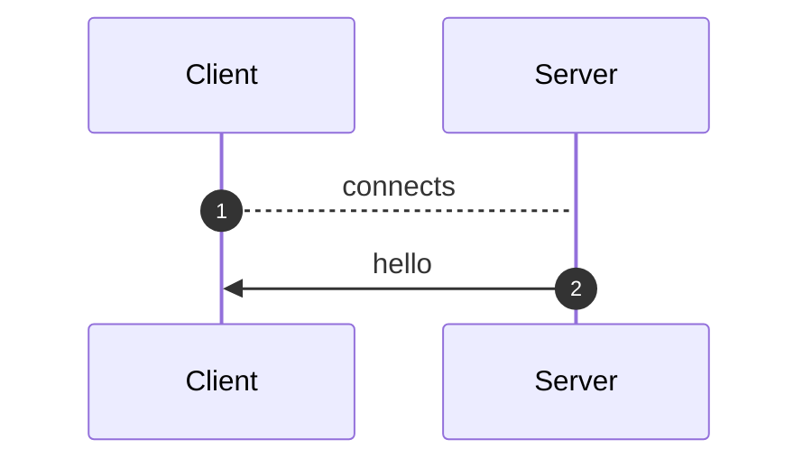
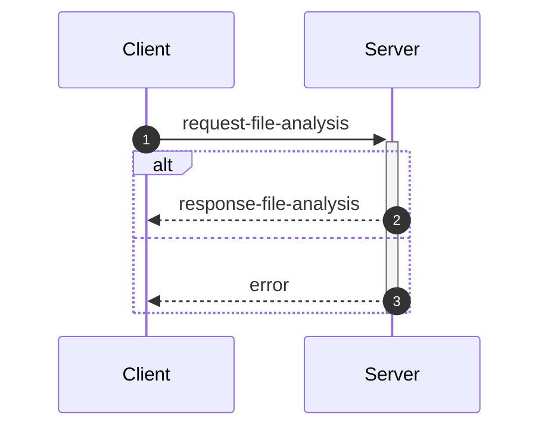
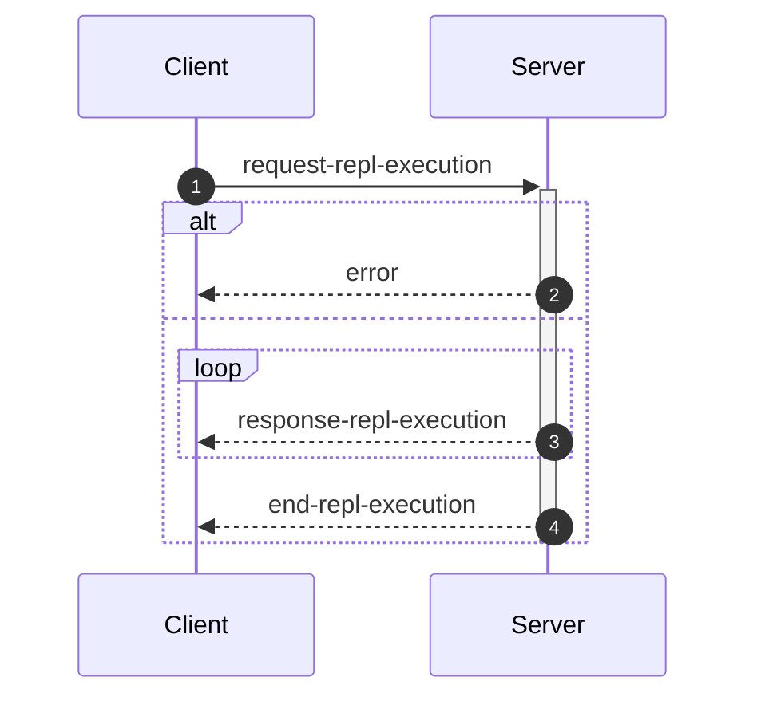
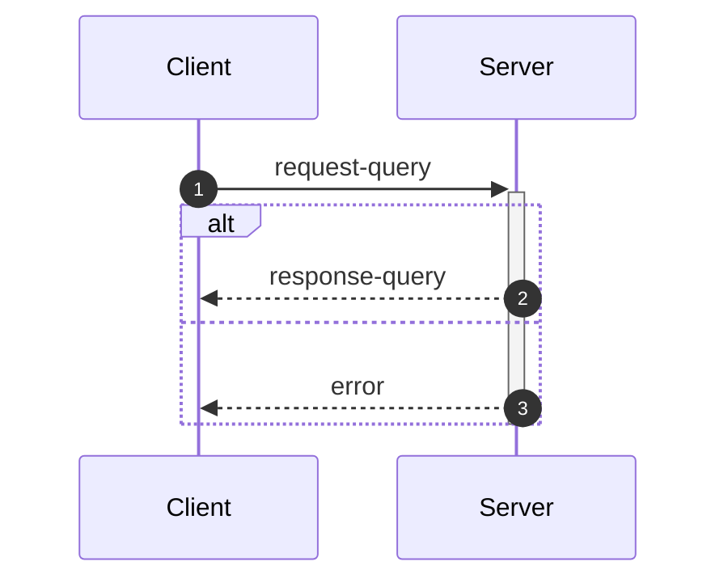

_<span title="an overview of flowR's interface">Generated</span> from '[wiki-interface.ts](https://github.com/flowr-analysis/flowr/tree/main/src/documentation/wiki-interface.ts "src/documentation/wiki-interface.ts")' on 2026-11-03, 12:43:37 UTC (v2.16.8, R v4.6.1), do not edit directly._

Although far from being as detailed as the in-depth explanation of [_flowR_](https://github.com/flowr-analysis/flowr/wiki/Core),
this wiki page explains how to interface with _flowR_ in more detail.
In general, command line arguments and other options provide short descriptions on hover over.

* [💻 Using the REPL](#using-the-repl)
* [⚙️ Configuring FlowR](#configuring-flowr)
* [⚒️ Writing Code](#writing-code)
* [💬 Communicating with the Server](#communicating-with-the-server)

<a id='using-the-repl'></a>
## 💻 Using the REPL

> [!NOTE]
> To execute arbitrary R commands with a repl request, _flowR_ has to be started explicitly with <span title="Description (Command Line Argument): Allow to access the underlying R session when using flowR (security warning: this allows the execution of arbitrary R code!)">`--r-session-access`</span>.
> Please be aware that this introduces a security risk and note that this relies on the [`r-shell` engine](https://github.com/flowr-analysis/flowr/wiki/Engines) .

Although primarily meant for users to explore,
there is nothing which forbids calling _flowR_ as a subprocess to use standard-in, -output, and -error
for communication (although you can access the REPL using the server as well,
with the [REPL Request](#message-request-repl-execution) message).

The read-eval-print loop&nbsp;(REPL) works relatively simple.
You can submit an expression (using <kbd>Enter</kbd>),
which is interpreted as an R&nbsp;expression by default but interpreted as a *command* if it starts with a colon (`:`).
The best command to get started with the REPL is <span title="Description (Repl Command): Show help information (aliases: :h, :?)">`:help`</span>.
Besides, you can leave the REPL either with the command <span title="Description (Repl Command): End the repl (aliases: :q, :exit)">`:quit`</span> or by pressing <kbd>Ctrl</kbd>+<kbd>C</kbd> twice.
When writing a *command*, you may press <kbd>Tab</kbd> to get a list of completions, if available.
Multiple commands can be entered in a single line by separating them with a semicolon (`;`), e.g. `:parse "x<-2"; :df*`.
If a command is given without R code, the REPL will re-use R code given in a previous command.
The prior example will hence return first the parsed AST of the program and then the dataflow graph for `"x <- 2"`.

> [!NOTE]
> If you develop flowR, you may want to launch the repl using the `npm run main-dev` command, this way, you get a non-minified version of flowR with debug information and hot-reloading of source files.

<details>
<summary>Available Commands</summary>

We currently offer the following commands (this with a `[*]` suffix are available with and without the star):

| Command | Description |
| ------- | ----------- |
| **<span title="Description (Repl Command): End the repl (aliases: :q, :exit)">:quit</span>** | End the repl (aliases: **:<span title="Alias of ':quit'. End the repl">q</span>**, **:<span title="Alias of ':quit'. End the repl">exit</span>**) |
| **<span title="Description (Repl Command): Execute the given code as R code. This requires the `--r-session-access` flag to be set and requires the r-shell engine. (aliases: :e, :r)">:execute</span>** | Execute the given code as R code. This requires the `--r-session-access` flag to be set and requires the r-shell engine. (aliases: **:<span title="Alias of ':execute'. Execute the given code as R code. This requires the `--r-session-access` flag to be set and requires the r-shell engine.">e</span>**, **:<span title="Alias of ':execute'. Execute the given code as R code. This requires the `--r-session-access` flag to be set and requires the r-shell engine.">r</span>**) |
| **<span title="Description (Repl Command): Get mermaid code for the control-flow graph of R code (aliases: :cfg, :cf)">:controlflow[*]</span>** | Get mermaid code for the control-flow graph of R code (star: Returns the URL to mermaid.live) (aliases: **:<span title="Alias of ':controlflow'. Get mermaid code for the control-flow graph of R code">cfg</span>**, **:<span title="Alias of ':controlflow'. Get mermaid code for the control-flow graph of R code">cf</span>**) |
| **<span title="Description (Repl Command): Get mermaid code for the control-flow graph with basic blocks (aliases: :cfgb, :cfb)">:controlflowbb[*]</span>** | Get mermaid code for the control-flow graph with basic blocks (star: Returns the URL to mermaid.live) (aliases: **:<span title="Alias of ':controlflowbb'. Get mermaid code for the control-flow graph with basic blocks">cfgb</span>**, **:<span title="Alias of ':controlflowbb'. Get mermaid code for the control-flow graph with basic blocks">cfb</span>**) |
| **<span title="Description (Repl Command): Get mermaid code for the dataflow graph (aliases: :d, :df)">:dataflow[*]</span>** | Get mermaid code for the dataflow graph (star: Returns the URL to mermaid.live) (aliases: **:<span title="Alias of ':dataflow'. Get mermaid code for the dataflow graph">d</span>**, **:<span title="Alias of ':dataflow'. Get mermaid code for the dataflow graph">df</span>**) |
| **<span title="Description (Repl Command): Get mermaid code for the normalized AST of R code (aliases: :n)">:normalize[*]</span>** | Get mermaid code for the normalized AST of R code (star: Returns the URL to mermaid.live) (alias: **:<span title="Alias of ':normalize'. Get mermaid code for the normalized AST of R code">n</span>**) |
| **<span title="Description (Repl Command): Get mermaid code for the simplified dataflow graph (aliases: :ds, :dfs)">:dataflowsimple[*]</span>** | Get mermaid code for the simplified dataflow graph (star: Returns the URL to mermaid.live) (aliases: **:<span title="Alias of ':dataflowsimple'. Get mermaid code for the simplified dataflow graph">ds</span>**, **:<span title="Alias of ':dataflowsimple'. Get mermaid code for the simplified dataflow graph">dfs</span>**) |
| **<span title="Description (Repl Command): Inspect and extend the signature database: `query` (identical to :query @signature), `info <name>` for where a function comes from (identical to :query @function-info), `add <path>` to mount another database/source, `download` to fetch the full-history database. (aliases: :sig)">:signature</span>** | Inspect and extend the signature database: `query` (identical to :query @signature), `info <name>` for where a function comes from (identical to :query @function-info), `add <path>` to mount another database/source, `download` to fetch the full-history database. (alias: **:<span title="Alias of ':signature'. Inspect and extend the signature database: `query` (identical to :query @signature), `info <name>` for where a function comes from (identical to :query @function-info), `add <path>` to mount another database/source, `download` to fetch the full-history database.">sig</span>**) |
| **<span title="Description (Repl Command): Just calculates the DFG, but only prints summary info (aliases: :d#, :df#)">:dataflowsilent</span>** | Just calculates the DFG, but only prints summary info (aliases: **:<span title="Alias of ':dataflowsilent'. Just calculates the DFG, but only prints summary info">d#</span>**, **:<span title="Alias of ':dataflowsilent'. Just calculates the DFG, but only prints summary info">df#</span>**) |
| **<span title="Description (Repl Command): Prints ASCII Art of the parsed, unmodified AST (aliases: :p)">:parse</span>** | Prints ASCII Art of the parsed, unmodified AST (alias: **:<span title="Alias of ':parse'. Prints ASCII Art of the parsed, unmodified AST">p</span>**) |
| **<span title="Description (Repl Command): Prints the version of flowR as well as the current version of R">:version</span>** | Prints the version of flowR as well as the current version of R
| **<span title="Description (Repl Command): Query the given R code (use 'help' for more information)">:query[*]</span>** | Query the given R code (use 'help' for more information) (star: Similar to query, but returns the output in json format.)
| **<span title="Description (Repl Command): Returns an ASCII representation of the dataflow graph (aliases: :df!)">:dataflowascii</span>** | Returns an ASCII representation of the dataflow graph (alias: **:<span title="Alias of ':dataflowascii'. Returns an ASCII representation of the dataflow graph">df!</span>**) |
| **<span title="Description (Repl Command): Returns summarization stats for the normalized AST (aliases: :n#)">:normalize#</span>** | Returns summarization stats for the normalized AST (alias: **:<span title="Alias of ':normalize#'. Returns summarization stats for the normalized AST">n#</span>**) |
| **<span title="Description (Repl Command): Show help information (aliases: :h, :?)">:help</span>** | Show help information (aliases: **:<span title="Alias of ':help'. Show help information">h</span>**, **:<span title="Alias of ':help'. Show help information">?</span>**) |

</details>

> [!TIP]
> 
> As indicated by the examples before, all REPL commands that operate on code keep track of the state.
> Hence, if you run a command like <span title="Description (Repl Command, starred version): Returns the URL to mermaid.live; Base Command: Get mermaid code for the dataflow graph (aliases: :d*, :df*)">`:dataflow*`</span> without providing R code,
> the REPL will re-use the R code provided in a previous command.
> Likewise, doing this will benefit from incrementality!
> If you request the dataflow graph with `:df* x <- 2 * y` and then want to see the parsed AST with `:parse`,
> the REPL will re-use previously obtained information and not re-parse the code again.
> 		

Generally, many commands offer shortcut versions in the REPL. Many queries, for example, offer a shortened format (see the example below).
Of special note, the [Config Query](https://github.com/flowr-analysis/flowr/wiki/%5BQuery%5D-Config)
can be used to also modify the currently active configuration of _flowR_ within the REPL (see the [wiki page](https://github.com/flowr-analysis/flowr/wiki/%5BQuery%5D-Config) for more information).

### Example: Retrieving the Dataflow Graph

To retrieve a URL to the [mermaid](https://mermaid.js.org/) diagram of the dataflow of a given expression,
use <span title="Description (Repl Command, starred version): Returns the URL to mermaid.live; Base Command: Get mermaid code for the dataflow graph (aliases: :d*, :df*)">`:dataflow*`</span> (or <span title="Description (Repl Command): Get mermaid code for the dataflow graph (aliases: :d, :df)">`:dataflow`</span> to get the mermaid code in the cli):

```shell
$ docker run -it --rm eagleoutice/flowr # or npm run flowr 
flowR repl v2.16.8, R grammar v14 (tree-sitter engine)
R> :dataflow* y <- 1 + x
```

<details>
<summary style='color:gray'>Output</summary>

```text
https://mermaid.live/view#base64:eyJjb2RlIjoiZmxvd2NoYXJ0IFREXG4gICAgMXt7XCJgKiM5MTtSTnVtYmVyIzkzOyogKioxKipcbiAgICAgICoxLjYqICgqKmlkOiAxKiopYFwifX1cbiAgICAyKFtcImAqIzkxO1JTeW1ib2wjOTM7KiAqKngqKlxuICAgICAgKjEuMTAqICgqKmlkOiAyKiopYFwiXSlcbiAgICAzW1tcImAqIzkxO1JCaW5hcnlPcCM5MzsqIGJhc2UjNTg7IzU4OyoqIzQzOyoqXG4gICAgICAqMS42LTEwKiAoKippZDogMyoqKVxuICAgIGFyZzogKDEsIDIpYFwiXV1cbiAgICBidWlsdC1pbjpfNDNfW1wiYEJ1aWx0LUluOlxuIzQzO2BcIl1cbiAgICBzdHlsZSBidWlsdC1pbjpfNDNfIHN0cm9rZTpncmF5LGZpbGw6Z3JheSxzdHJva2Utd2lkdGg6MnB4LG9wYWNpdHk6Ljg7XG4gICAgMFtcImAqIzkxO1JTeW1ib2wjOTM7KiAqKnkqKlxuICAgICAgKjEuMSogKCoqaWQ6IDAqKiwgdjogMylgXCJdXG4gICAgNFtbXCJgKiM5MTtSQmluYXJ5T3AjOTM7KiBiYXNlIzU4OyM1ODsqKiM2MDsjNDU7KipcbiAgICAgICoxLjEtMTAqICgqKmlkOiA0KiopXG4gICAgYXJnOiAoMCwgMylgXCJdXVxuICAgIGJ1aWx0LWluOl82MF8tW1wiYEJ1aWx0LUluOlxuIzYwOyM0NTtgXCJdXG4gICAgc3R5bGUgYnVpbHQtaW46XzYwXy0gc3Ryb2tlOmdyYXksZmlsbDpncmF5LHN0cm9rZS13aWR0aDoycHgsb3BhY2l0eTouODtcbiAgICAxIC0uLT58XCJmbG93XCJ8IDJcbiAgICBsaW5rU3R5bGUgMCBzdHJva2U6Z3JheSxjb2xvcjpncmF5O1xuICAgIDIgLS4tPnxcImZsb3dcInwgM1xuICAgIGxpbmtTdHlsZSAxIHN0cm9rZTpncmF5LGNvbG9yOmdyYXk7XG4gICAgMyAtLT58XCJyZWFkcywgYXJnXCJ8IDFcbiAgICAzIC0tPnxcInJlYWRzLCBhcmdcInwgMlxuICAgIDMgLS4tPnxcImZsb3dcInwgMFxuICAgIGxpbmtTdHlsZSA0IHN0cm9rZTpncmF5LGNvbG9yOmdyYXk7XG4gICAgMyAtLi0+fFwicmVhZHMsIGNhbGxzXCJ8IGJ1aWx0LWluOl80M19cbiAgICBsaW5rU3R5bGUgNSBzdHJva2U6Z3JheTtcbiAgICAwIC0tPnxcImRlZmluZWQtYnksIGZsb3dcInwgNFxuICAgIDAgLS0+fFwiZGVmaW5lZC1ieVwifCAzXG4gICAgNCAtLT58XCJyZWFkcywgYXJnXCJ8IDNcbiAgICA0IC0tPnxcInJldHVybnMsIGFyZ1wifCAwXG4gICAgNCAtLi0+fFwicmVhZHMsIGNhbGxzXCJ8IGJ1aWx0LWluOl82MF8tXG4gICAgbGlua1N0eWxlIDEwIHN0cm9rZTpncmF5OyIsIm1lcm1haWQiOnsiYXV0b1N5bmMiOnRydWV9fQ==
```

Retrieve the dataflow graph of the expression `y <- 1 + x`. It looks like this:


<details>

<summary style="color:gray">R Code of the Dataflow Graph</summary>

The analysis ran (parse and normalize with the [tree-sitter](https://github.com/flowr-analysis/flowr/wiki/Engines) engine) in the generation environment. No [signature database](https://github.com/flowr-analysis/flowr/wiki/Signature-Database) is mounted, so `library()` attaches no exports (base-R names are still qualified, e.g., `stats::acf`). 
We encountered no unknown side effects during the analysis.

```r
y <- 1 + x
```

</details>

</details>

For small graphs like this, <span title="Description (Repl Command): Returns an ASCII representation of the dataflow graph (aliases: :df!)">`:dataflowascii`</span> also provides an ASCII representation directly in the REPL:

```shell
$ docker run -it --rm eagleoutice/flowr # or npm run flowr 
flowR repl v2.16.8, R grammar v14 (tree-sitter engine)
R> :df! y <- 1 + x
```

<details open>
<summary style='color:gray'>Output</summary>

```text
                        v<0>v
 c<4>c──────────────────| y |
 |<- |     ┌────────────v---v
 c---c     │
    │   c<3>c   0<1>0
    └───| + |───| 1 |───u<2>u
        c---c   0---0   | x |
           └────────────u---u
Edges:
3 -> 1: reads, arg          3 -> 2: reads, arg
3 -> 0: flows-to            1 -> 2: flows-to
2 -> 3: flows-to            4 -> 3: reads, arg
4 -> 0: returns, arg        0 -> 4: defined-by, flows-to
0 -> 3: defined-by
```

Retrieve the dataflow graph of the expression `y <- 1 + x` as ASCII art.

</details>

For the slicing with <span title="Description (Repl Command): Static backwards executable slicer for R">`:slicer`</span>, you have access to the same [magic comments](#slice-magic-comments) as with the [slice request](#message-request-slice).
Pass `--inline` to splice resolvable `source()` calls into the reconstruction so the slice is a single self-contained R text (the same as the static slice query's `inlineSources` flag).
See `--help` for more flags!

### Example: Interfacing with the File System

Many commands that allow for an R-expression (like <span title="Description (Repl Command, starred version): Returns the URL to mermaid.live; Base Command: Get mermaid code for the dataflow graph (aliases: :d*, :df*)">`:dataflow*`</span>) allow for a file as well
if the argument starts with `file://`.
If you are working from the root directory of the _flowR_ repository, the following gives you the parsed AST of the example file using the <span title="Description (Repl Command): Prints ASCII Art of the parsed, unmodified AST (aliases: :p)">`:parse`</span> command:

> **Watch mode**: Replace `file://` with `watch://` to enter watch mode.
> flowR runs the command immediately and then re-runs it every time the file (or any file inside the folder) changes.
> Enter any other command to leave watch mode.
> For example: `:df watch://analysis.R`

```shell
$ docker run -it --rm eagleoutice/flowr # or npm run flowr 
flowR repl v2.16.8, R grammar v14 (tree-sitter engine)
R> :parse file://test/testfiles/example.R
```

<details>
<summary style='color:gray'>Output</summary>

```text
File: test/testfiles/example.R

program
├ binaryoperator
│ ├ identifier "sum" (1:1─4)
│ ├ <- "<-" (1:5─7)
│ ╰ float "0" (1:8─9)
├ binaryoperator
│ ├ identifier "product" (2:1─8)
│ ├ <- "<-" (2:9─11)
│ ╰ float "1" (2:12─13)
├ binaryoperator
│ ├ identifier "w" (3:1─2)
│ ├ <- "<-" (3:3─5)
│ ╰ float "7" (3:6─7)
├ binaryoperator
│ ├ identifier "N" (4:1─2)
│ ├ <- "<-" (4:3─5)
│ ╰ float "10" (4:6─8)
├ forstatement
│ ├ for "for" (6:1─4)
│ ├ ( "(" (6:5─6)
│ ├ identifier "i" (6:6─7)
│ ├ in "in" (6:8─10)
│ ├ binaryoperator
│ │ ├ float "1" (6:11─12)
│ │ ├ : ":" (6:12─13)
│ │ ╰ parenthesizedexpression
│ │   ├ ( "(" (6:13─14)
│ │   ├ binaryoperator
│ │   │ ├ identifier "N" (6:14─15)
│ │   │ ├ - "-" (6:15─16)
│ │   │ ╰ float "1" (6:16─17)
│ │   ╰ ) ")" (6:17─18)
│ ├ ) ")" (6:18─19)
│ ╰ bracedexpression
│   ├ { "{" (6:20─21)
│   ├ binaryoperator
│   │ ├ identifier "sum" (7:3─6)
│   │ ├ <- "<-" (7:7─9)
│   │ ╰ binaryoperator
│   │   ├ binaryoperator
│   │   │ ├ identifier "sum" (7:10─13)
│   │   │ ├ + "+" (7:14─15)
│   │   │ ╰ identifier "i" (7:16─17)
│   │   ├ + "+" (7:18─19)
│   │   ╰ identifier "w" (7:20─21)
│   ├ binaryoperator
│   │ ├ identifier "product" (8:3─10)
│   │ ├ <- "<-" (8:11─13)
│   │ ╰ binaryoperator
│   │   ├ identifier "product" (8:14─21)
│   │   ├  "" (8:22─23)
│   │   ╰ identifier "i" (8:24─25)
│   ╰ } "}" (9:1─2)
├ call
│ ├ identifier "cat" (11:1─4)
│ ╰ arguments
│   ├ ( "(" (11:4─5)
│   ├ argument
│   │ ╰ string
│   │   ├ stringopen "\"" (11:5─6)
│   │   ├ stringcontent "Sum:" (11:6─10)
│   │   ╰ stringclose "\"" (11:10─11)
│   ├ comma "," (11:11─12)
│   ├ argument
│   │ ╰ identifier "sum" (11:13─16)
│   ├ comma "," (11:16─17)
│   ├ argument
│   │ ╰ string
│   │   ├ stringopen "\"" (11:18─19)
│   │   ├ stringcontent
│   │   │ ╰ escapesequence "\\n" (11:19─21)
│   │   ╰ stringclose "\"" (11:21─22)
│   ╰ ) ")" (11:22─23)
╰ call
  ├ identifier "cat" (12:1─4)
  ╰ arguments
    ├ ( "(" (12:4─5)
    ├ argument
    │ ╰ string
    │   ├ stringopen "\"" (12:5─6)
    │   ├ stringcontent "Product:" (12:6─14)
    │   ╰ stringclose "\"" (12:14─15)
    ├ comma "," (12:15─16)
    ├ argument
    │ ╰ identifier "product" (12:17─24)
    ├ comma "," (12:24─25)
    ├ argument
    │ ╰ string
    │   ├ stringopen "\"" (12:26─27)
    │   ├ stringcontent
    │   │ ╰ escapesequence "\\n" (12:27─29)
    │   ╰ stringclose "\"" (12:29─30)
    ╰ ) ")" (12:30─31)
```

Retrieve the parsed AST of the example file.

<details>

<summary>File Content</summary>

```r
sum <- 0
product <- 1
w <- 7
N <- 10

for (i in 1:(N-1)) {
  sum <- sum + i + w
  product <- product * i
}

cat("Sum:", sum, "\n")
cat("Product:", product, "\n")
```

</details>

As _flowR_ directly transforms this AST the output focuses on being human-readable instead of being machine-readable.
		
</details>

### Example: Run a Query

You can run any query supported by _flowR_ using the <span title="Description (Repl Command): Query the given R code (use 'help' for more information)">`:query`</span> command.
For example, to obtain the shapes of all data frames in a given piece of code, you can run:

```shell
$ docker run -it --rm eagleoutice/flowr # or npm run flowr 
flowR repl v2.16.8, R grammar v14 (tree-sitter engine)
R> :query @absint df-shape "x <- data.frame(a = 1:10, b = 1:10)\ny <- x$a"
```

<details open>
<summary style='color:gray'>Output</summary>

```text
Query: absint (1 ms)
   ╰ $12: (colnames: [{"a", "b"}, {}], cols: [2, 2], rows: [10, 10])
   ╰ $0: (colnames: [{"a", "b"}, {}], cols: [2, 2], rows: [10, 10])
```

Retrieve the shapes of all data frames in the given code.

</details>

To run the linter on a file, you can use (in this example, we just issue the `dead-code` linter on a small piece of code):

```shell
$ docker run -it --rm eagleoutice/flowr # or npm run flowr 
flowR repl v2.16.8, R grammar v14 (tree-sitter engine)
R> :query @linter rules:dead-code "if(FALSE) x <- 2"
```

<details open>
<summary style='color:gray'>Output</summary>

```text
Query: linter (1 ms)
   ╰ Dead Code (dead-code):
       ╰ certain:
           ╰ Code at 1.11-16 (1 quick fix(es) available)
```

Run the linter on the given code, with only the `dead-code` rule enabled.

</details>

For more information on the available queries, please check out the [Query API](https://github.com/flowr-analysis/flowr/wiki/Query-API).

<a id='configuring-flowr'></a>
## ⚙️ Configuring FlowR

When running _flowR_, you may want to specify some behaviors with a dedicated configuration file.
By default, flowR looks for a file named `flowr.json` in the current working directory (or any higher directory).
You can also specify a different file with <span title="Description (Command Line Argument): The name of the configuration file to use">`--config-file`</span> or pass the configuration inline using <span title="Description (Command Line Argument): The flowR configuration to use, as a JSON string">`--config-json`</span>.
A `flowr.json` found this way belongs to the analyzed project, so flowR ignores its options that decide what flowR executes or loads
(`engines.*.wasmPath`, `engines.*.treeSitterWasmPath`, `engines.*.rPath`, `solver.sigdb.additionalPaths`, `solver.sigdb.downloadRepo`, `solver.sigdb.installedLibrary.paths`, `solver.sigdb.onDemand.enabled`, `solver.sigdb.onDemand.repositories`, `solver.sigdb.onDemand.cranMirror`, `solver.sigdb.onDemand.bioconductorMirror`, `solver.sigdb.onDemand.cacheDir`),
unless you pass <span title="Description (Command Line Argument): Keep the security-sensitive options (e.g., the R executable) of the flowr.json found in the working directory or a parent. Only use this for projects you trust.">`--trust-config`</span>.
To analyze code you do not trust, use the secure mode (<span title="Description (Command Line Argument): Run in secure mode for analyzing untrusted code: flowR does not start R (or any other process), does not access the network, does not search for project configs, and ignores security-sensitive options in every config. Cannot be disabled once enabled. Can also be enabled with the environment variable {italic FLOWR_SECURE_MODE=1}.">`--secure`</span>, see the [security policy](https://github.com/flowr-analysis/flowr/blob/main/.github/SECURITY.md)).
To inspect the current configuration, you can run flowr with the <span title="Description (Command Line Argument): Run with verbose logging (will be passed to the corresponding script)">`--verbose`</span> flag, or use the `config` [Query](https://github.com/flowr-analysis/flowr/wiki/Query-API).
Within the REPL this works by running the following:

```shell
:query @config
```

To work with the <a href="https://github.com/flowr-analysis/flowr/tree/main/src/config.ts#L119"><code><span title="The configuration file format for flowR.">FlowrConfig</span></code></a> you can use the provided helper objects alongside its methods like
<a href="https://github.com/flowr-analysis/flowr/tree/main/src/config.ts#L966"><code><span title="Creates a new flowr config that has the updated values.">FlowrConfig::<b>amend</b></span></code></a>.
The schema below documents every option; the ones you most likely want are:

- <a href="https://github.com/flowr-analysis/flowr/wiki/Interface#configuring-flowr" title="Configuration Option (boolean): Whether source calls should be ignored, causing {@link processSourceCall}&#39;s behavior to be skipped.">ignoreSourceCalls</a>: ignore source calls when analyzing the code, i.e., ignore the inclusion of other files.
- <a href="https://github.com/flowr-analysis/flowr/wiki/Interface#configuring-flowr" title="Configuration Option (boolean): Whether load calls should be ignored, causing {@link processLoadCall}&#39;s behavior to be skipped.">ignoreLoadCalls</a>: ignore load calls when analyzing the code, i.e., ignore the loading of r-data files.
- <a href="https://github.com/flowr-analysis/flowr/wiki/Interface#configuring-flowr" title="Configuration Option (object): Do you want to overwrite (parts) of the builtin definition?">semantics.environment.overwriteBuiltIns</a>: overwrite _flowR_'s handling of built-in functions, or clear the preset definitions entirely.
  See [Configure BuiltIn Semantics](#configure-builtin-semantics) for more information.
- <a href="https://github.com/flowr-analysis/flowr/wiki/Interface#configuring-flowr" title="Configuration Option (string): How to resolve variables and their values. (one of &quot;disabled&quot;, &quot;alias&quot;, &quot;builtin&quot;)">solver.variables</a>: how to resolve variables and their values (`disabled`, `alias`, `builtin`).
- <a href="https://github.com/flowr-analysis/flowr/wiki/Interface#configuring-flowr" title="Configuration Option (array): The engine or set of engines to use for interacting with R code. An empty array means all available engines will be used.">engines</a> and <a href="https://github.com/flowr-analysis/flowr/wiki/Interface#configuring-flowr" title="Configuration Option (string): The default engine to use for interacting with R code. If this is undefined, an arbitrary engine from the specified list will be used. (one of &quot;tree-sitter&quot;, &quot;r-shell&quot;)">defaultEngine</a>: the engines used to interact with R code, see the [Engines wiki page](https://github.com/flowr-analysis/flowr/wiki/Engines).
- <a href="https://github.com/flowr-analysis/flowr/wiki/Interface#configuring-flowr" title="Configuration Option (array): Files a framework loads on its own, without any source() call (e.g. global.R in a shiny app), in the order they are loaded; flowR orders the matching project files accordingly and analyzes them as one program. Entries are case-insensitive globs matched against the file path, a plain name matches any file with that name, and entries matching no project file are warned about. Usually set per project kind via specializeConfig.">project.implicitSources</a>: the files a framework loads without any `source()` call, in the order in which they are
  loaded. Entries are globs (e.g. `R/*.R`) matched against the file path ignoring capitalization; one matching no file is reported.
- <a href="https://github.com/flowr-analysis/flowr/wiki/Interface#configuring-flowr" title="Configuration Option (object): Overwrite (parts of) the configuration depending on the project kind flowR detects, e.g. to give a shiny app its implicit sources.">specializeConfig</a>: overwrite (parts of) the configuration depending on the kind of project _flowR_ detects
  (e.g. `shiny-app`), which is how a shiny app gets its implicit sources by default. What you configure directly wins.
- <a href="https://github.com/flowr-analysis/flowr/wiki/Interface#configuring-flowr" title="Configuration Option (string): Overwrite the project kind flowR would otherwise infer from the analyzed files, e.g. when auto-detection guesses wrong. (one of &quot;package&quot;, &quot;script&quot;, &quot;shiny-app&quot;, &quot;notebook&quot;, &quot;project&quot;, &quot;unknown&quot;)">project.useProjectType</a>: skip that detection and force a project kind yourself, when auto-detection guesses wrong.
- <a href="https://github.com/flowr-analysis/flowr/wiki/Interface#configuring-flowr" title="Configuration Option (array): The default plugins to load when creating a new instance of FlowrAnalyzer">defaultPlugins</a> and <a href="https://github.com/flowr-analysis/flowr/wiki/Interface#configuring-flowr" title="Configuration Option (array): The plugins to load in REPL mode">repl.plugins</a>: the plugins to load for a new <a href="https://github.com/flowr-analysis/flowr/tree/main/src/project/flowr-analyzer.ts#L210"><code><span title="Central class for conducting analyses with FlowR. Use the FlowrAnalyzerBuilder to create a new instance. If you want the original pattern of creating a pipeline and running all steps, you can still do this with FlowrAnalyzer#runFull . To inspect the context of the analyzer, use FlowrAnalyzer#inspectContext (if you are a plugin and need to modify it, use FlowrAnalyzer#context instead).">FlowrAnalyzer</span></code></a> and in the REPL
  (use `flowr:default` to reference the former).

So you can configure _flowR_ by adding a file like the following:

<details>

<summary>Example Configuration File</summary>

```json
{
  "ignoreSourceCalls": true,
  "ignoreLoadCalls": true,
  "semantics": {
    "environment": {
      "overwriteBuiltIns": {
        "definitions": [
          {
            "type": "function",
            "names": [
              "foo"
            ],
            "processor": "builtin:assign",
            "config": {}
          }
        ]
      }
    }
  },
  "defaultPlugins": [
    "file:description",
    "versions:description"
  ],
  "repl": {
    "quickStats": false,
    "dfProcessorHeat": false,
    "hints": true,
    "plugins": [
      "flowr:default"
    ]
  },
  "project": {
    "resolveUnknownPathsOnDisk": true,
    "implicitSources": [
      "global.R",
      "app.R"
    ]
  },
  "linter": {
    "disabledRules": []
  },
  "specializeConfig": {
    "shiny-app": {
      "project": {
        "implicitSources": [
          "global.R",
          "ui.R",
          "server.R",
          "app.R"
        ]
      }
    }
  },
  "engines": [
    {
      "type": "r-shell"
    }
  ],
  "solver": {
    "variables": "alias",
    "evalStrings": true,
    "trackEnvironments": true,
    "sigdb": {
      "enabled": true,
      "loadProjectDependencies": true,
      "eagerlyLoad": false,
      "eagerlyLoadExports": false,
      "linkBaseR": false,
      "linkDescriptionDependencies": false
    },
    "resolveSource": {
      "dropPaths": "no",
      "ignoreCapitalization": true,
      "inferWorkingDirectory": "active-script",
      "searchPath": []
    },
    "instrument": {},
    "slicer": {
      "threshold": 50
    }
  },
  "abstractInterpretation": {
    "wideningThreshold": 4,
    "followCalls": true,
    "dataFrame": {
      "maxColNames": 20,
      "readLoadedData": {
        "readExternalFiles": true,
        "maxReadLines": 1000000
      }
    }
  },
  "incremental": {
    "alwaysIncremental": false,
    "parsing": {
      "activated": false,
      "heuristics": {
        "activated": true,
        "mtime": true,
        "linesFrom": 500,
        "bytesFrom": 50000,
        "alwaysWithEdits": false,
        "minFiles": 1
      }
    }
  },
  "gas": {
    "thresholds": {
      "memory": {
        "problematic": 0.7,
        "critical": 0.9
      },
      "timeMs": {
        "problematic": 100000,
        "critical": 120000
      }
    },
    "features": {}
  }
}
```

</details>

<details>
<a id='configure-builtin-semantics'></a>
<summary>Configure Built-In Semantics</summary>

`semantics/environment/overwriteBuiltins` accepts two keys:

- `loadDefaults` (boolean, initially `true`): If set to `true`, the default built-in definitions are loaded before applying the custom definitions. Setting this flag to `false` explicitly disables the loading of the default definitions.
- `definitions` (array, initially empty): Allows to overwrite or define new built-in elements. Each object within must have a `type` which is one of the below. Furthermore, they may define a string array of `names` which specifies the identifiers to bind the definitions to. You may use `assumePrimitive` to specify whether _flowR_ should assume that this is a primitive non-library definition (so you probably just do not want to specify the key).

  | Type            | Description                                                                                                                                                                                                                                                                                              | Example                                                                                                    |
  | --------------- | -------------------------------------------------------------------------------------------------------------------------------------------------------------------------------------------------------------------------------------------------------------------------------------------------------- | ---------------------------------------------------------------------------------------------------------- |
  | `constant`    | Additionally allows for a `value` this should resolve to.                                                                                                                                                                                                                                                | `{ type: 'constant', names: ['NULL', 'NA'],  value: null }`                                                |
  | `function`    | Is a rather flexible way to define and bind built-in functions. For the time, we do not have extensive documentation to cover all the cases, so please either consult the sources with the `default-builtin-config.ts` or open a [new issue](https://github.com/flowr-analysis/flowr/issues/new/choose). | `{ type: 'function', names: ['next'], processor: 'builtin:d', config: { cfg: ExitPointType.Next } }` |
  | `replacement` | A comfortable way to specify replacement functions like `$<-` or `names<-`. `suffixes` describes the... suffixes to attach automatically. | `{ type: 'replacement', suffixes: ['<-', '<<-'], names: ['[', '[['] }` |

</details>

<details>

<summary style='color:gray'>Full Configuration-File Schema</summary>

- _The configuration file format for flowR._ (object)
    - **logLevel** [optional] _flowR's global minimum log level, applied when the config is loaded._ (string)
        Only allows: 'silly', 'trace', 'debug', 'info', 'warn', 'error', 'fatal'
    - **ignoreSourceCalls** [optional] _Whether source calls should be ignored, causing {@link processSourceCall}'s behavior to be skipped._ (boolean)
    - **ignoreLoadCalls** [optional] _Whether load calls should be ignored, causing {@link processLoadCall}'s behavior to be skipped._ (boolean)
    - **semantics** _Configure language semantics and how flowR handles them._ (object)
        - **environment** [optional] _Semantics regarding how to handle the R environment._ (object)
            - **overwriteBuiltIns** [optional] _Do you want to overwrite (parts) of the builtin definition?_ (object)
                - **loadDefaults** [optional] _Should the default configuration still be loaded?_ (boolean)
                - **definitions** [optional] _The definitions to load/overwrite._ (array)
                Valid item types:
                    - (object)
    - **defaultPlugins** [optional] _The default plugins to load when creating a new instance of FlowrAnalyzer_ (array)
    Valid item types:
        - (alternatives)
            - (string)
            - (array)
    - **repl** _Configuration options for the REPL._ (object)
        - **quickStats** [optional] _Whether to show quick stats in the REPL after each evaluation._ (boolean)
        - **dfProcessorHeat** [optional] _This instruments the dataflow processors to count how often each processor is called._ (boolean)
        - **hints** [optional] _Whether to show dim inline hints on the empty prompt (automatically disabled on non-interactive terminals)._ (boolean)
        - **plugins** [optional] _The plugins to load in REPL mode_ (array)
        Valid item types:
            - (alternatives)
                - (string)
                - (array)
        - **autoUseFileProtocol** [optional] _Prepend the file protocol to a repl input that looks like a path, instead of only warning about it._ (boolean)
        - **queryStats** [optional] _Whether `:query` closes with the line stating how long the queries took (`:query*` never prints it)._ (boolean)
        - **showPlugins** [optional] _Whether `:version` grays out the plugins that did not activate during the last analysis._ (boolean)
    - **project** _Project specific configuration options._ (object)
        - **resolveUnknownPathsOnDisk** [optional] _Whether to resolve unknown paths loaded by the r project disk when trying to source/analyze files._ (boolean)
        - **failOnInaccessiblePath** [optional] _Whether a directory that cannot be traversed during file discovery (e.g. due to permissions) aborts the analysis; when false (the default) such paths are logged and skipped._ (boolean)
        - **basePackages** [optional] _The packages considered part of R itself (base and recommended); if unset, flowR uses its built-in list._ (array)
        Valid item types:
            - (string)
        - **implicitSources** [optional] _Files a framework loads on its own, without any source() call (e.g. global.R in a shiny app), in the order they are loaded; flowR orders the matching project files accordingly and analyzes them as one program. Entries are case-insensitive globs matched against the file path, a plain name matches any file with that name, and entries matching no project file are warned about. Usually set per project kind via specializeConfig._ (array)
        Valid item types:
            - (string)
        - **useProjectType** [optional] _Overwrite the project kind flowR would otherwise infer from the analyzed files, e.g. when auto-detection guesses wrong._ (string)
            Only allows: 'package', 'script', 'shiny-app', 'notebook', 'project', 'unknown'
        - **assumeImplicitEcho** [optional] _Whether the top level of the analyzed code is echoed, so that every visible result printed there is collected as an output by the dependencies query (default true, false for a package)._ (boolean)
        - **discovery** [optional] _Scoping options for the default project discovery._ (object)
            - **full** [optional] _Collect every file below the project root (greedy) instead of only the files the detected project kind needs (default false)._ (boolean)
            - **perKind** [optional] _Per-kind include/exclude glob overrides layered on the default scoping._ (object)
            - **ignore** [optional] _Case-insensitive globs that drop matching files from the intelligent discovery, regardless of kind (e.g. .Renviron to ignore environment files)._ (array)
            Valid item types:
                - (string)
        - **classification** [optional] _Overrides for the signals flowR uses to classify the project kind._ (object)
            - **shinyDescriptionTypes** [optional] _DESCRIPTION Type: values that mark a shiny app._ (array)
            Valid item types:
                - (string)
            - **shinyEntryFiles** [optional] _File names a shiny app is assembled from._ (array)
            Valid item types:
                - (string)
            - **shinyUsagePattern** [optional] _Regex source evidencing shiny usage in an entry file._ (string)
            - **notebookExtensions** [optional] _File extensions marking a notebook._ (array)
            Valid item types:
                - (string)
    - **linter** _Linter configuration options._ (object)
        - **disabledRules** _Linting rule names excluded from the default rule set (a rule requested explicitly via a linter query still runs). Usually set per project kind via specializeConfig._ (array)
        Valid item types:
            - (string)
        - **disabledTags** [optional] _Linting rule tags whose rules are excluded from the default rule set (a rule requested explicitly via a linter query still runs). By default the cmd-check rules are disabled for everything but a package; a configured list replaces that default._ (array)
        Valid item types:
            - (string)
    - **inputSources** [optional] _Further frameworks the input-sources analysis should know about; entries are added to flowR's defaults._ (object)
        - **pure** [optional] _Functions that only pass the constantness of their arguments on._ (array)
        Valid item types:
            - (string)
        - **param** [optional] _Functions whose result is a 'param' input._ (array)
        Valid item types:
            - (string)
        - **file** [optional] _Functions whose result is a 'file' input._ (array)
        Valid item types:
            - (string)
        - **tempfile** [optional] _Functions whose result is a 'tempfile' input._ (array)
        Valid item types:
            - (string)
        - **glob** [optional] _Functions whose result is a 'glob' input._ (array)
        Valid item types:
            - (string)
        - **net** [optional] _Functions whose result is a 'net' input._ (array)
        Valid item types:
            - (string)
        - **rand** [optional] _Functions whose result is a 'rand' input._ (array)
        Valid item types:
            - (string)
        - **system** [optional] _Functions whose result is a 'system' input._ (array)
        Valid item types:
            - (string)
        - **ffi** [optional] _Functions whose result is a 'ffi' input._ (array)
        Valid item types:
            - (string)
        - **lang** [optional] _Functions whose result is a 'lang' input._ (array)
        Valid item types:
            - (string)
        - **options** [optional] _Functions whose result is a 'options' input._ (array)
        Valid item types:
            - (string)
        - **cmdline** [optional] _Functions whose result is a 'cmdline' input._ (array)
        Valid item types:
            - (string)
        - **user** [optional] _Functions whose result is a 'user' input._ (array)
        Valid item types:
            - (string)
        - **const** [optional] _Functions whose result is a 'const' input._ (array)
        Valid item types:
            - (string)
        - **scope** [optional] _Functions whose result is a 'scope' input._ (array)
        Valid item types:
            - (string)
        - **dconst** [optional] _Functions whose result is a 'dconst' input._ (array)
        Valid item types:
            - (string)
        - **unknown** [optional] _Functions whose result is a 'unknown' input._ (array)
        Valid item types:
            - (string)
        - **linkedObjects** [optional] _Objects a framework provides without a definition in the code, e.g. shiny's input._ (array)
        Valid item types:
            - (object)
        - **linkedEntryPoints** [optional] _Calls that hand a function to a framework, which binds its objects to the parameters by position._ (array)
        Valid item types:
            - (object)
    - **specializeConfig** [optional] _Overwrite (parts of) the configuration depending on the project kind flowR detects, e.g. to give a shiny app its implicit sources._ (object)
    - **engines** _The engine or set of engines to use for interacting with R code. An empty array means all available engines will be used._ (array)
    Valid item types:
        - (alternatives)
            - _The configuration for the tree sitter engine._ (object)
                - **type** [required] _Use the tree sitter engine._ (string)
                    Only allows: 'tree-sitter'
                - **wasmPath** [optional] _The path to the tree-sitter-r WASM binary to use. If this is undefined, this uses the default path._ (string)
                - **treeSitterWasmPath** [optional] _The path to the tree-sitter WASM binary to use. If this is undefined, this uses the default path._ (string)
                - **lax** [optional] _Whether to use the lax parser for parsing R code (allowing for syntax errors). If this is undefined, the strict parser will be used._ (boolean)
            - _The configuration for the R shell engine._ (object)
                - **type** [required] _Use the R shell engine._ (string)
                    Only allows: 'r-shell'
                - **rPath** [optional] _The path to the R executable to use. If this is undefined, this uses the default path._ (string)
                - **pipeBind** [optional] _Whether to enable R's experimental pipe-bind operator "=>" by setting _R_USE_PIPEBIND_ for the R session (default false); R itself keeps this off by default, as it is experimental and has never shipped in a release version of R._ (boolean)
    - **defaultEngine** [optional] _The default engine to use for interacting with R code. If this is undefined, an arbitrary engine from the specified list will be used._ (string)
        Only allows: 'tree-sitter', 'r-shell'
    - **solver** _How to resolve constants, constraints, cells, ..._ (object)
        - **variables** _How to resolve variables and their values._ (string)
            Only allows: 'disabled', 'alias', 'builtin'
        - **evalStrings** _Should we include eval(parse(text="...")) calls in the dataflow graph?_ (boolean)
        - **trackEnvironments** [optional] _Track user-created environments (new.env, assign/get/local with envir=, dollar-assign, attach). When false, all envir-style calls fall through conservatively._ (boolean)
        - **sigdb** _Resolving library exports from a signature database._ (object)
            - **enabled** [optional] _Resolve library()/use() exports from a signature database (default true); when false no database is consulted._ (boolean)
            - **loadProjectDependencies** [optional] _Load the project's declared dependencies from its metadata files (DESCRIPTION Imports/Depends, rproject.toml, uvr.toml, rig rproj.toml and script blocks, renv.lock, rv.lock, uvr.lock, rig lockfiles) (default true); when false these files are not read for dependencies._ (boolean)
            - **eagerlyLoad** [optional] _Parse the database up front rather than on the first package load (default false, ignored if disabled)._ (boolean)
            - **eagerlyLoadExports** [optional] _Add a vertex for every export on load rather than on demand (default false); keeps the dataflow graph small._ (boolean)
            - **assumedRVersion** [optional] _R version assumed when resolving versioned (base-R) exports: a pin like "4.5" or "auto" to detect the installed R (default "auto")._ (string)
            - **linkBaseR** [optional] _Eagerly attach base-R namespaces so bare base calls resolve without library() (default false)._ (boolean)
            - **linkBaseRCalls** [optional] _Add a lightweight Reads edge from a bare base-R call to its signature-database function vertex (default false; base-R qualification is edge-free otherwise)._ (boolean)
            - **linkPackageCalls** [optional] _Add a lightweight Reads edge from a resolved package call to its signature-database function vertex (default false)._ (boolean)
            - **linkDescriptionDependencies** [optional] _Eagerly attach the namespaces of the project's declared DESCRIPTION dependencies (Imports/Depends) so their exports resolve without an explicit library() (default false)._ (boolean)
            - **warmInBackground** [optional] _Decompress the hot shards (base + most-downloaded) in a background task on startup so the first library() lookup is warm (default false; for long-running servers/REPLs)._ (boolean)
            - **additionalPaths** [optional] _Extra directories or bundle/manifest files searched for signature databases (alongside the shipped default and $FLOWR_SIGDB_DIR); a downloaded full-history bundle placed here is mounted automatically._ (array)
            Valid item types:
                - (string)
            - **downloadRepo** [optional] _GitHub owner/repo the full-history bundle is downloaded from via ":signature download" (default "flowr-analysis/flowr"; the release tag comes from the committed sigdb.remote.json unless a version is given)._ (string)
            - **autoSync** [optional] _On startup, re-download shards whose committed sigdb.remote.json hash no longer matches the cache, in the background (default false; opt-in network sync after a git pull)._ (boolean)
            - **installedLibrary** [optional] _Recovering packages no signature database knows from the copy installed on this machine._ (object)
                - **enabled** [required] _Recover packages no signature database knows from their installed copy (default false)._ (boolean)
                - **paths** [optional] _Library directories to search; when empty they are discovered from the environment and the project._ (array)
                Valid item types:
                    - (string)
                - **useEnvironment** [optional] _Search the libraries R_LIBS_USER/R_LIBS/R_LIBS_SITE name (default true)._ (boolean)
                - **useProjectLibrary** [optional] _Search a project-local renv/packrat library (default true)._ (boolean)
                - **maxDepth** [optional] _How far to descend into the nested layout of a project-local library (default 3)._ (number)
                - **packages** [optional] _Only recover packages whose name matches one of these regular expressions; empty means any._ (array)
                Valid item types:
                    - (string)
            - **onDemand** [optional] _Recovering packages no signature database knows from their sources on CRAN, Bioconductor, or GitHub._ (object)
                - **enabled** [required] _Fetch and recover the sources of packages no signature database knows when the analyzed code uses them (default false, accesses the network)._ (boolean)
                - **sources** [optional] _Where to look, in order: github, cran, bioconductor, or a source a plugin adds (default ["github", "cran", "bioconductor"])._ (array)
                Valid item types:
                    - (string)
                - **repositories** [optional] _GitHub repositories (owner/repo[/subdir][@ref]) to fetch packages from, by package name. The analyzed project may name more (DESCRIPTION Remotes, install_github calls)._ (object)
                - **packages** [optional] _Only recover packages whose name matches one of these regular expressions, empty means any._ (array)
                Valid item types:
                    - (string)
                - **cranMirror** [optional] _The CRAN src/contrib/ to fetch from, over https (default https://cloud.r-project.org/src/contrib/). It may be on the local network._ (string)
                - **bioconductorMirror** [optional] _The Bioconductor host, over https (default https://bioconductor.org). It may be on the local network._ (string)
                - **bioconductorRelease** [optional] _The Bioconductor release to fetch from: release, devel, or a number like 3.20 (default release)._ (string)
                - **githubMirrors** [optional] _Use the GitHub mirrors of CRAN (cran/<pkg>) and Bioconductor (bioc/<pkg>) (default true)._ (boolean)
                - **maxPackages** [optional] _The most packages to fetch for one analysis (default 25)._ (number)
                - **maxArchiveMb** [optional] _The most MiB a package archive may have (default 32). It may unpack to three times that, at most 128 MiB._ (number)
                - **offline** [optional] _Only use what was fetched before, never the network (default false)._ (boolean)
                - **retryAfterHours** [optional] _How many hours to wait before asking again for a package no source had (default 24)._ (number)
                - **cacheDir** [optional] _Where to cache what was fetched (default the on-demand directory of the signature cache)._ (string)
            - **blobCacheBudgetMb** [optional] _How many MiB of decoded package blobs every open bundle may hold together (default 16)._ (number)
            - **versionSelection** [optional] _When a project constrains a dependency, resolve to the newest (default), oldest, or system-installed version satisfying it; system needs R and falls back to newest. Base-R packages always resolve against the assumed R version._ (string)
                Only allows: 'newest', 'oldest', 'system'
            - **versionOverrides** [optional] _Force an exact version for specific packages (name -> version), overriding both the project constraint and the versionSelection policy (default {})._ (object)
        - **versionManagement** _Policies for reasoning about dependency versions._ (object)
            - **linkedVersionGroups** [optional] _Groups of packages that must resolve to the same version; version guessing intersects each group so its members stay mutually compatible (default [])._ (array)
            Valid item types:
                - (array)
                Valid item types:
                    - (string)
        - **assumeAttachedPackages** [optional] _Packages to treat as attached without a `library()` call, so what the built-in configuration states about them applies to the analyzed code. The base packages R attaches on startup already resolve without it._ (array)
        Valid item types:
            - (string)
        - **transitiveSideEffectRounds** [optional] _How many rounds the transitive side-effect fixpoint may run before it is cut off (default 32); the propagation stops on its own as soon as a round adds nothing._ (number)
        - **maxOverlayDepth** [optional] _How many binding overlays may stack on one environment frame before a write flattens them (default 4); a pure performance knob, trading lookup cost against copy cost without changing any result._ (number)
        - **instrument** (object)
            - **dataflowExtractors** [optional] _These keys are only intended for use within code, allowing to instrument the dataflow analyzer!_ (any)
        - **resolveSource** [optional] _If lax source calls are active, flowR searches for sourced files much more freely, based on the configurations you give it. This option is only in effect if `ignoreSourceCalls` is set to false._ (object)
            - **dropPaths** _Allow to drop the first or all parts of the sourced path, if it is relative._ (string)
                Only allows: 'no', 'once', 'all'
            - **ignoreCapitalization** _Search for filenames matching in the lowercase._ (boolean)
            - **inferWorkingDirectory** _Try to infer the working directory from the main or any script to analyze._ (string)
                Only allows: 'no', 'main-script', 'active-script', 'any-script'
            - **searchPath** _Additionally search in these paths._ (array)
            Valid item types:
                - (string)
            - **repeatedSourceLimit** [optional] _How often the same file can be sourced within a single run? Please be aware: in case of cyclic sources this may not reach a fixpoint so give this a sensible limit._ (number)
            - **applyReplacements** _Provide name replacements for loaded files_ (array)
            Valid item types:
                - (object)
            - **assumeFilesExist** [optional] _Assume a sourced file is always there, making what it defines certain instead of conditional on the source call._ (boolean)
        - **slicer** [optional] _The configuration for the slicer._ (object)
            - **threshold** [optional] _The maximum number of iterations to perform on a single function call during slicing._ (number)
            - **autoExtend** [optional] _If set, the slicer will gain an additional post-pass._ (boolean)
    - **abstractInterpretation** _The configuration options for abstract interpretation._ (object)
        - **wideningThreshold** _The threshold for the number of visitations of a node at which widening should be performed to ensure the termination of the fixpoint iteration._ (number)
        - **followCalls** _Whether the abstract interpretation is interprocedural, i.e. whether it steps into the functions a call may dispatch to._ (boolean)
        - **dataFrame** _The configuration of the shape inference for data frames._ (object)
            - **maxColNames** _The maximum number of columns names to infer for data frames before over-approximating the column names to top._ (number)
            - **readLoadedData** _Configuration options for reading data frame shapes from loaded external data files, such as CSV files._ (object)
                - **readExternalFiles** _Whether data frame shapes should be extracted from loaded external files, such as CSV files._ (boolean)
                - **maxReadLines** _The maximum number of lines to read when extracting data frame shapes from loaded files, such as CSV files._ (number)
    - **incremental** (object)
        - **alwaysIncremental** _Always take the incremental path, regardless of heuristics._ (boolean)
        - **parsing** (object)
            - **activated** _If set, incremental parsing will be used._ (boolean)
            - **heuristics** (object)
                - **activated** [optional] _If set, the heuristics for incremental parsing will be used._ (boolean)
                - **mtime** [optional] _Skip reparsing entirely if the file's modification time is unchanged since the last parse._ (boolean)
                - **linesFrom** [optional] _Only consider incremental parsing for files with at least this many lines._ (number)
                - **bytesFrom** [optional] _Only consider incremental parsing for files with at least this many bytes._ (number)
                - **alwaysWithEdits** [optional] _Always take the incremental path whenever there is a computed edit region, regardless of the other thresholds._ (boolean)
                - **minFiles** [optional] _Only apply these heuristics once the project has at least this many files loaded._ (number)
    - **gas** [optional] _Resource-usage guard (gas) configuration. All feature factors default to 0 (disabled). See https://github.com/flowr-analysis/flowr/wiki/Core#gas-resource-guard._ (object)
        - **thresholds** [optional] _Thresholds for all gas checks (scaled by per-feature factor), boundable per feature._ (object)
            - **memory** [optional] _Heap-usage fraction thresholds (0-1), either shared or given per feature key (with `default` covering the rest)._ (object)
                - **problematic** [optional] _Heap fraction (0-1) above which Problematic is returned, for every feature without an entry of its own._ (number)
                - **critical** [optional] _Heap fraction (0-1) above which Critical is returned, for every feature without an entry of its own._ (number)
            - **timeMs** [optional] _Elapsed analysis time thresholds in milliseconds, either shared or given per feature key (with `default` covering the rest)._ (object)
                - **problematic** [optional] _Elapsed ms above which Problematic is returned, for every feature without an entry of its own._ (number)
                - **critical** [optional] _Elapsed ms above which Critical is returned, for every feature without an entry of its own._ (number)
            - **steps** [optional] _Processed-AST-node thresholds, counted rather than sampled; only a key that arms a budget (`dataflow`) reads them._ (object)
                - **problematic** [optional] _Processed AST nodes above which Problematic is returned, for every feature without an entry of its own._ (number)
                - **critical** [optional] _Processed AST nodes above which the extraction is cut short, for every feature without an entry of its own._ (number)
            - **vertices** [optional] _Created-dataflow-vertex thresholds, counted like `steps`._ (object)
                - **problematic** [optional] _Created dataflow vertices above which Problematic is returned, for every feature without an entry of its own._ (number)
                - **critical** [optional] _Created dataflow vertices above which the extraction is cut short, for every feature without an entry of its own._ (number)
        - **features** [optional] _Per-feature sensitivity factors. 0 or absent disables gas checking for that feature. A factor of 2 makes the feature twice as sensitive. Recognised keys: `source`, `side-effect-linking`, `linter`, `slicer`, `dataflow`._ (object)
        - **countedCheckEvery** [optional] _How many counted steps pass between two accountings of an armed check, be it a dataflow budget or the slicer's traversal (default 128); trades overshoot against the cost of the check._ (number)
        - **heapProvider** [optional] _Custom heap statistics source (programmatic configs only), overriding the built-in v8/performance.memory detection._ (function)

</details>

<a id='writing-code'></a>
## ⚒️ Writing Code

_flowR_ can be used as a [module](https://www.npmjs.com/package/@eagleoutice/flowr) and offers several main classes and interfaces that are interesting for extension writers 
(see the [Visual Studio Code extension](https://marketplace.visualstudio.com/items?itemName=code-inspect.vscode-flowr) or the [Core](https://github.com/flowr-analysis/flowr/wiki/Core) wiki page for more information).

### Creating Analyses with _flowR_

Nowadays, instances of the <a href="https://github.com/flowr-analysis/flowr/tree/main/src/project/flowr-analyzer.ts#L210"><code><span title="Central class for conducting analyses with FlowR. Use the FlowrAnalyzerBuilder to create a new instance. If you want the original pattern of creating a pipeline and running all steps, you can still do this with FlowrAnalyzer#runFull . To inspect the context of the analyzer, use FlowrAnalyzer#inspectContext (if you are a plugin and need to modify it, use FlowrAnalyzer#context instead).">FlowrAnalyzer</span></code></a> should be used as central frontend to get analysis results from _flowR_.
The entry points an analysis is written against are re-exported from the package root (`import { FlowrAnalyzerBuilder } from '@eagleoutice/flowr'`);
everything else stays reachable under its own path, as in `@eagleoutice/flowr/dataflow/graph/graph`.
For example, a program slice can be created like this:

```ts
const analyzer = await new FlowrAnalyzerBuilder()
    .setEngine('tree-sitter')
    .build();
analyzer.addRequest('x <- 1\ny <- x\nx');
const result = await analyzer.query([
    {
        type:     'static-slice',
        criteria: ['3@x']
    }
]);
```

For more information, please have a look at the [Analyzer](https://github.com/flowr-analysis/flowr/wiki/Analyzer) wiki page, which explains how to construct and use the <a href="https://github.com/flowr-analysis/flowr/tree/main/src/project/flowr-analyzer.ts#L210"><code><span title="Central class for conducting analyses with FlowR. Use the FlowrAnalyzerBuilder to create a new instance. If you want the original pattern of creating a pipeline and running all steps, you can still do this with FlowrAnalyzer#runFull . To inspect the context of the analyzer, use FlowrAnalyzer#inspectContext (if you are a plugin and need to modify it, use FlowrAnalyzer#context instead).">FlowrAnalyzer</span></code></a> in more detail.
To work with specific perspectives, you can also consult the respective pages like the [Dataflow Graph](https://github.com/flowr-analysis/flowr/wiki/Dataflow-Graph) or the [Abstract Interpretation](https://github.com/flowr-analysis/flowr/wiki/Abstract-Interpretation) wiki pages.
### The Pipeline Executor (Low-Level Interface)

Once, in the beginning, _flowR_ was meant to produce a dataflow graph merely to provide *program slices*. 
However, with continuous updates, the [Dataflow Graph](https://github.com/flowr-analysis/flowr/wiki/Dataflow-Graph) repeatedly proves to be the more interesting part.
With this, we restructured _flowR_'s originally *hardcoded* pipeline to be far more flexible. 
Now, it can be theoretically extended or replaced with arbitrary steps, optional steps, and what we call 'decorations' of these steps. 
In short, a slicing pipeline using the <a href="https://github.com/flowr-analysis/flowr/tree/main/src/core/pipeline-executor.ts#L97"><code><span title="**Please note:** The PipelineExecutor is now considered to be a rather low-level API for flowR. While it still works and is the basis for all other layers, we strongly recommend using the FlowrAnalyzer and its builder to create and use an analyzer instance that is pre-configured for your use-case. The pipeline executor allows to execute arbitrary pipelines in a step-by-step fashion. If you are not...">PipelineExecutor</span></code></a> looks like this:

```ts

const slicer = new PipelineExecutor(DEFAULT_SLICING_PIPELINE, {
  parser:    new RShell(),
  request:   requestFromInput('x <- 1\nx + 1'),
  criterion: ['2@x']
})
const slice = await slicer.allRemainingSteps()
// console.log(slice.reconstruct.code)
```

<details><summary>More Information</summary>

If you compare this, with what you would have done with the old (and removed) `SteppingSlicer`, 
this essentially just requires you to replace the `SteppingSlicer` with the <a href="https://github.com/flowr-analysis/flowr/tree/main/src/core/pipeline-executor.ts#L97"><code><span title="**Please note:** The PipelineExecutor is now considered to be a rather low-level API for flowR. While it still works and is the basis for all other layers, we strongly recommend using the FlowrAnalyzer and its builder to create and use an analyzer instance that is pre-configured for your use-case. The pipeline executor allows to execute arbitrary pipelines in a step-by-step fashion. If you are not...">PipelineExecutor</span></code></a>
and to pass the <a href="https://github.com/flowr-analysis/flowr/tree/main/src/core/steps/pipeline/default-pipelines.ts#L18"><code>DEFAULT_SLICING_PIPELINE</code></a> as the first argument.
The <a href="https://github.com/flowr-analysis/flowr/tree/main/src/core/pipeline-executor.ts#L97"><code><span title="**Please note:** The PipelineExecutor is now considered to be a rather low-level API for flowR. While it still works and is the basis for all other layers, we strongly recommend using the FlowrAnalyzer and its builder to create and use an analyzer instance that is pre-configured for your use-case. The pipeline executor allows to execute arbitrary pipelines in a step-by-step fashion. If you are not...">PipelineExecutor</span></code></a>...

1. Provides structures to investigate the results of all intermediate steps
2. Can be executed step-by-step
3. Can repeat steps (e.g., to calculate multiple slices on the same input)

See the in-code documentation for more information.

</details>

### Using the <a href="https://github.com/flowr-analysis/flowr/tree/main/src/r-bridge/shell.ts#L144"><code><span title="The RShell represents an interactive session with the R interpreter. You can configure it by RShellOptions . At the moment we are using a live R session (and not networking etc.) to communicate with R easily, which allows us to install packages etc. However, this might and probably will change in the future (leaving this as a legacy mode :D)">RShell</span></code></a> to Interact with R

The <a href="https://github.com/flowr-analysis/flowr/tree/main/src/r-bridge/shell.ts#L144"><code><span title="The RShell represents an interactive session with the R interpreter. You can configure it by RShellOptions . At the moment we are using a live R session (and not networking etc.) to communicate with R easily, which allows us to install packages etc. However, this might and probably will change in the future (leaving this as a legacy mode :D)">RShell</span></code></a> class allows interfacing with the `R`&nbsp;ecosystem installed on the host system.
Please have a look at [flowR's Engines](https://github.com/flowr-analysis/flowr/wiki/Engines) for more information on alternatives (for example, the <a href="https://github.com/flowr-analysis/flowr/tree/main/src/r-bridge/lang-4.x/tree-sitter/tree-sitter-executor.ts#L29"><code><span title="Synchronous and (way) faster alternative to the RShell using tree-sitter.">TreeSitterExecutor</span></code></a>).

> [!IMPORTANT]
> 
> Each <a href="https://github.com/flowr-analysis/flowr/tree/main/src/r-bridge/shell.ts#L144"><code><span title="The RShell represents an interactive session with the R interpreter. You can configure it by RShellOptions . At the moment we are using a live R session (and not networking etc.) to communicate with R easily, which allows us to install packages etc. However, this might and probably will change in the future (leaving this as a legacy mode :D)">RShell</span></code></a> controls a new instance of the R&nbsp;interpreter, 
> make sure to call <code><a href="https://github.com/flowr-analysis/flowr/tree/main/src/r-bridge/shell.ts#L350"><span title="Close the current R session, makes the object effectively invalid (can no longer be reopened etc.)">RShell::<i>close</i></span></a>()</code> when you are done.

You can start a new "session" by constructing a new object with <code>new <a href="https://github.com/flowr-analysis/flowr/tree/main/src/r-bridge/shell.ts#L144"><span title="The RShell represents an interactive session with the R interpreter. You can configure it by RShellOptions . At the moment we are using a live R session (and not networking etc.) to communicate with R easily, which allows us to install packages etc. However, this might and probably will change in the future (leaving this as a legacy mode :D)">RShell</span></a>()</code>.

However, there are several options that may be of interest 
(e.g., to automatically revive the shell in case of errors or to control the name location of the R process on the system).

With a shell object (let's call it `shell`), you can execute R code by using <a href="https://github.com/flowr-analysis/flowr/tree/main/src/r-bridge/shell.ts#L213"><code><span title="sends the given command directly to the current R session will not do anything to alter input markers!">RShell::<i>sendCommand</i></span></code></a>,
for example <code>shell.<a href="https://github.com/flowr-analysis/flowr/tree/main/src/r-bridge/shell.ts#L213"><span title="sends the given command directly to the current R session will not do anything to alter input markers!">sendCommand</span></a>("1 + 1")</code>.
However, this does not return anything, so if you want to collect the output of your command, use
<a href="https://github.com/flowr-analysis/flowr/tree/main/src/r-bridge/shell.ts#L296"><code><span title="Send a command and collect the output">RShell::<i>sendCommandWithOutput</i></span></code></a> instead.

<a id='communicating-with-the-server'></a>
## 💬 Communicating with the Server

As explained in the [Overview](https://github.com/flowr-analysis/flowr/wiki/Overview), you can run the [TCP](https://de.wikipedia.org/wiki/Transmission_Control_Protocol)&nbsp;server by adding the <span title="Description (Command Line Argument): Do not drop into a repl, but instead start a server on the given port (default: 1042) and listen for messages.">`--server`</span> flag (and, due to the interactive mode, exit with the conventional <kbd>CTRL</kbd>+<kbd>C</kbd>).
Currently, every connection is handled by the same underlying `RShell` - so the server is not designed to handle many clients at a time.
Additionally, the server is not well guarded against attacks (e.g., you can theoretically spawn an arbitrary number of&nbsp;RShell sessions on the target machine).

Every message has to be given in a single line (i.e., without a newline in-between) and end with a newline character. Nevertheless, we will pretty-print example given in the following segments for the ease of reading.

> [!NOTE]
> 
> The default <span title="Description (Command Line Argument): Do not drop into a repl, but instead start a server on the given port (default: 1042) and listen for messages.">`--server`</span> uses a simple [TCP](https://de.wikipedia.org/wiki/Transmission_Control_Protocol)
> connection. If you want _flowR_ to expose a [WebSocket](https://de.wikipedia.org/wiki/WebSocket) server instead, add the <span title="Description (Command Line Argument): If the server flag is set, use websocket for messaging">`--ws`</span> flag (i.e., <span title="Description (Command Line Argument): Do not drop into a repl, but instead start a server on the given port (default: 1042) and listen for messages.">`--server`</span> <span title="Description (Command Line Argument): If the server flag is set, use websocket for messaging">`--ws`</span>) when starting _flowR_ from the command line.

<ul><li>
<a id="message-hello"></a>
<b>Hello</b> Message (<code>hello</code>) 
<details>

<summary style="color:gray"> View Details. <i>The server informs the client about the successful connection and provides Meta-Information.</i> </summary>



After launching _flowR_, for example, with <code>docker run -it --rm eagleoutice/flowr <span title="Description (Command Line Argument): Do not drop into a repl, but instead start a server on the given port (default: 1042) and listen for messages.">-<span/>-server</span></code>&nbsp;(🐳️), connecting should present you with a `hello` message, that amongst others should reveal the versions of&nbsp;_flowR_ and&nbsp;R, using the [semver 2.0](https://semver.org/spec/v2.0.0.html) versioning scheme.
The message looks like this:

```json
{
  "type": "hello",
  "clientName": "client-0",
  "versions": {
    "flowr": "2.16.8",
    "r": "4.6.1",
    "engine": "r-shell"
  }
}
```

There are currently a few messages that you can send after the hello message.
If you want to _slice_ a piece of R code you first have to send an [analysis request](#message-request-file-analysis), so that you can send one or multiple slice requests afterward.
Requests for the [REPL](#message-request-repl-execution) are independent of that.
	
<hr>

<details>
<summary style="color:gray">Message schema (<code>hello</code>)</summary>

For the definition of the hello message, please see it's implementation at [`./src/cli/repl/server/messages/message-hello.ts`](https://github.com/flowr-analysis/flowr/tree/main/src/cli/repl/server/messages/message-hello.ts).

- [required] (object)
    - **type** [required] _The type of the hello message._ (string)
        Only allows: 'hello'
    - **id** [forbidden] _The id of the message is always undefined (as it is the initial message and not requested)._ (any)
    - **clientName** [required] _A unique name that is assigned to each client. It has no semantic meaning and is only used/useful for debugging._ (string)
    - **versions** [required] (object)
        - **flowr** [required] _The version of the flowr server running in semver format._ (string)
        - **r** [required] _The version of the underlying R shell running in semver format._ (string)
        - **engine** [required] _The parser backend that is used to parse the R code._ (string)

</details>

<hr>

</details>
	</li>

<li>
<a id="message-request-file-analysis"></a>
<b>Analysis</b> Message (<code>request-file-analysis</code>) 
<details>

<summary style="color:gray"> View Details. <i>The server builds the dataflow graph for a given input file (or a set of files).</i> </summary>



The request allows the server to analyze a file and prepare it for slicing.
The message can contain a `filetoken`, which is used to identify the file in later slice or query requests (if you do not add one, the request will not be stored and therefore, it is not available for subsequent requests).

> **Please note!**\
> If you want to send and process a lot of analysis requests, but do not want to slice them, please do not pass the `filetoken` field. This will save the server a lot of memory allocation.

Furthermore, the request must contain either a `content` field to directly pass the file's content or a `filepath` field which contains the path to the file (this path must be accessible for the server to be useful).
If you add the `id` field, the answer will use the same `id` so you can match requests and the corresponding answers.
See the implementation of the request-file-analysis message for more information.

You can drop one or more stored file tokens by adding the `invalidateToken` field (a single token or an array of tokens).
The server frees the corresponding analyses _after_ it has answered the request.

> **Tip!**\
> If you only want to drop tokens, you do not need a separate message: send a `request-file-analysis` that contains _just_ the `invalidateToken` field (and no `content` or `filepath`).
> Such a request behaves like an empty file analysis and the server replies with an empty `results` object.
> Because invalidation happens after the response, you may even pass the _current_ `filetoken` in `invalidateToken` to analyze a file once and have the server forget it right after you received the results.

<details>
<summary>Example of the <code>request-file-analysis</code> Message</summary>

_Note:_ even though we pretty-print these messages, they are sent as a single line, ending with a newline.

The following lists all messages that were sent and received in case you want to reproduce the scenario:

<ol>
<li> <code>hello</code> (response)
<details> 

<summary> Show Details </summary>

The first message is always a hello message.

```json
{"type":"hello","clientName":"client-0","versions":{"flowr":"2.16.8","r":"4.6.1","engine":"r-shell"}}
```

</details>
</li>

<li> <b><code>request-file-analysis</code> (request)</b>
<details open> 

<summary> Show Details </summary>

Let's suppose you simply want to analyze the following script:
 
```r
x <- 1
x + 1
```

 For this, you can send the following request:

```json
{"type":"request-file-analysis","id":"1","filetoken":"x","content":"x <- 1\nx + 1"}
```

</details>
</li>

<li> <code>response-file-analysis</code> (response)
<details> 

<summary> Show Details </summary>

The `results` field of the response effectively contains three keys of importance:

- `parse`: which contains 1:1 the parse result in CSV format that we received from the `RShell` (i.e., the AST produced by the parser of the R interpreter).
- `normalize`: which contains the normalized AST, including ids (see the `info` field and the [Normalized AST](https://github.com/flowr-analysis/flowr/wiki/Normalized-AST) wiki page).
- `dataflow`: especially important is the `graph` field which contains the dataflow graph as a set of root vertices (see the [Dataflow Graph](https://github.com/flowr-analysis/flowr/wiki/Dataflow-Graph) wiki page).
			
_As the code is pretty long, we inhibit pretty printing and syntax highlighting (JSON, hiding built-in):_

```text
{"type":"response-file-analysis","format":"json","id":"1","results":{"parse":{"files":[{"parsed":"[1,1,1,6,7,0,\"expr\",false,\"x <- 1\"],[1,1,1,1,1,3,\"SYMBOL\",true,\"x\"],[1,1,1,1,3,7,\"expr\",false,\"x\"],[1,3,1,4,2,7,\"LEFT_ASSIGN\",true,\"<-\"],[1,6,1,6,4,5,\"NUM_CONST\",true,\"1\"],[1,6,1,6,5,7,\"expr\",false,\"1\"],[2,1,2,5,16,0,\"expr\",false,\"x + 1\"],[2,1,2,1,10,12,\"SYMBOL\",true,\"x\"],[2,1,2,1,12,16,\"expr\",false,\"x\"],[2,3,2,3,11,16,\"'+'\",true,\"+\"],[2,5,2,5,13,14,\"NUM_CONST\",true,\"1\"],[2,5,2,5,14,16,\"expr\",false,\"1\"]","filePath":"/tmp/tmp-570878-qWc8fCZdnjMR-.R"}],".meta":{}},"normalize":{"ast":{"type":"RProject","files":[{"root":{"type":"RExpressionList","children":[{"type":"RBinaryOp","location":[1,3,1,4],"lhs":{"type":"RSymbol","location":[1,1,1,1],"content":"x","lexeme":"x","info":{"fullRange":[1,1,1,1],"adToks":[],"id":0,"parent":2,"role":"bin-l","index":0,"nest":0,"file":"/tmp/tmp-570878-qWc8fCZdnjMR-.R"}},"rhs":{"location":[1,6,1,6],"lexeme":"1","info":{"fullRange":[1,6,1,6],"adToks":[],"id":1,"parent":2,"role":"bin-r","index":1,"nest":0,"file":"/tmp/tmp-570878-qWc8fCZdnjMR-.R"},"type":"RNumber","content":{"num":1,"complexNumber":false,"markedAsInt":false}},"operator":"<-","lexeme":"<-","info":{"fullRange":[1,1,1,6],"adToks":[],"id":2,"parent":6,"nest":0,"file":"/tmp/tmp-570878-qWc8fCZdnjMR-.R","index":0,"role":"el-c"}},{"type":"RBinaryOp","location":[2,3,2,3],"lhs":{"type":"RSymbol","location":[2,1,2,1],"content":"x","lexeme":"x","info":{"fullRange":[2,1,2,1],"adToks":[],"id":3,"parent":5,"role":"bin-l","index":0,"nest":0,"file":"/tmp/tmp-570878-qWc8fCZdnjMR-.R"}},"rhs":{"location":[2,5,2,5],"lexeme":"1","info":{"fullRange":[2,5,2,5],"adToks":[],"id":4,"parent":5,"role":"bin-r","index":1,"nest":0,"file":"/tmp/tmp-570878-qWc8fCZdnjMR-.R"},"type":"RNumber","content":{"num":1,"complexNumber":false,"markedAsInt":false}},"operator":"+","lexeme":"+","info":{"fullRange":[2,1,2,5],"adToks":[],"id":5,"parent":6,"nest":0,"file":"/tmp/tmp-570878-qWc8fCZdnjMR-.R","index":1,"role":"el-c"}}],"info":{"adToks":[],"id":6,"nest":0,"file":"/tmp/tmp-570878-qWc8fCZdnjMR-.R","role":"root","index":0}},"filePath":"/tmp/tmp-570878-qWc8fCZdnjMR-.R"}],"info":{"id":7}},".meta":{}},"dataflow":{"unknownReferences":[],"in":[{"nodeId":2,"name":"<-","type":2},{"nodeId":5,"name":"+","type":2}],"out":[{"nodeId":0,"name":"x","type":4,"definedAt":2,"value":[1]}],"environment":{"current":{"id":1535,"parent":"<BuiltInEnvironment>","memory":[["x",[{"nodeId":0,"name":"x","type":4,"definedAt":2,"value":[1]}]]],"globalEnv":true},"level":0},"graph":{"rootVertices":[1,0,2,3,4,5],"vertexInformation":[[1,{"tag":"value","id":1}],[0,{"tag":"vdef","id":0,"source":[1]}],[2,{"tag":"fcall","id":2,"name":"<-","onlyBuiltin":true,"args":[{"nodeId":0,"type":32},{"nodeId":1,"type":32}],"origin":["builtin:assign"]}],[3,{"tag":"use","id":3}],[4,{"tag":"value","id":4}],[5,{"tag":"fcall","id":5,"name":"+","onlyBuiltin":true,"args":[{"nodeId":3,"type":32},{"nodeId":4,"type":32}],"origin":["builtin:d"]}]],"edgeInformation":[[2,[[1,{"types":65}],[0,{"types":72}],["built-in:<-",{"types":5}],[3,{"types":4096}]]],[1,[[0,{"types":4096}]]],[0,[[2,{"types":4098}],[1,{"types":2}]]],[5,[[3,{"types":65}],[4,{"types":65}],["built-in:+",{"types":5}]]],[3,[[0,{"types":1}],[4,{"types":4096}]]],[4,[[5,{"types":4096}]]]],"_unknownSideEffects":[]},"entryPoint":2,"cfgEntry":1,"exitPoints":[{"type":0,"nodeId":5}],"hooks":[],".meta":{}}}}
```

</details>
</li>
</ol>

The complete round-trip covers validating the messages as well as starting and stopping the internal mock server.

</details>

You receive an error if, for whatever reason, the analysis fails (e.g., the message or code you sent contained syntax errors).
It contains a human-readable description *why* the analysis failed (see the error message implementation for more details).

<details>
<summary>Example Error Message</summary>

_Note:_ even though we pretty-print these messages, they are sent as a single line, ending with a newline.

The following lists all messages that were sent and received in case you want to reproduce the scenario:

<ol>
<li> <code>hello</code> (response)
<details> 

<summary> Show Details </summary>

The first message is always a hello message.

```json
{"type":"hello","clientName":"client-0","versions":{"flowr":"2.16.8","r":"4.6.1","engine":"r-shell"}}
```

</details>
</li>

<li> <code>request-file-analysis</code> (request)
<details> 

<summary> Show Details </summary>

```json
{"type":"request-file-analysis","id":"1","filename":"sample.R","content":"x <-"}
```

</details>
</li>

<li> <b><code>error</code> (response)</b>
<details open> 

<summary> Show Details </summary>

```json
{
  "id": "1",
  "type": "error",
  "fatal": false,
  "reason": "Error while analyzing file sample.R: GuardError: unable to parse R code (see the log for more information) for request {\"request\":\"text\",\"content\":\"x <-\"}}\n Report a Bug: https://github.com/flowr-analysis/flowr/issues/new?body=%3C!%2D%2D%20Please%20describe%20your%20issue%20in%20more%20detail%20below!%20%2D%2D%3E%0A%0A%0A%3C!%2D%2D%20Automatically%20generated%20issue%20metadata%2C%20please%20do%20not%20edit%20or%20delete%20content%20below%20this%20line%20%2D%2D%3E%0A%2D%2D%2D%0A%0AflowR%20version%3A%202.16.8%0Anode%20version%3A%20v26.10.0%0Anode%20arch%3A%20x64%0Anode%20platform%3A%20linux%0Amessage%3A%20%60unable%20to%20parse%20R%20code%20%28see%20the%20log%20for%20more%20information%29%20for%20request%20%7B%22request%22%3A%22text%22%2C%22content%22%3A%22x%20%3C%2D%22%7D%7D%60%0Astack%20trace%3A%0A%60%60%60%0A%20%20%20%20at%20guard%20%28%3C%3E%2Fsrc%2Futil%2Fassert.ts%3A128%3A9%29%0A%20%20%20%20at%20guardRetrievedOutput%20%28%3C%3E%2Fsrc%2Fr%2Dbridge%2Fretriever.ts%3A155%3A7%29%0A%20%20%20%20at%20%2Fhome%2Fostwind%2Fgit%2Fphd%2Fflowr%2Dfield%2Fflowr%2Fsrc%2Fr%2Dbridge%2Fretriever.ts%3A122%3A4%0A%20%20%20%20at%20processTicksAndRejections%20%28node%3Ainternal%2Fprocess%2Ftask_queues%3A104%3A5%29%0A%20%20%20%20at%20async%20Object.parseRequests%20%5Bas%20processor%5D%20%28%3C%3E%2Fsrc%2Fr%2Dbridge%2Fparser.ts%3A108%3A19%29%0A%20%20%20%20at%20async%20PipelineExecutor.nextStep%20%28%3C%3E%2Fsrc%2Fcore%2Fpipeline%2Dexecutor.ts%3A192%3A25%29%0A%20%20%20%20at%20async%20FlowrAnalyzerCache.stepTapeUntil%20%28%3C%3E%2Fsrc%2Fproject%2Fcache%2Fflowr%2Danalyzer%2Dcache.ts%3A125%3A4%29%0A%60%60%60%0A%0A%2D%2D%2D%0A%09"
}
```

</details>
</li>
</ol>

The complete round-trip covers validating the messages as well as starting and stopping the internal mock server.

</details>

&nbsp;

<a id="analysis-include-cfg"></a>
**Including the Control Flow Graph**

The control flow graph is a view on the dataflow graph: the dataflow analysis records the control flow while it walks
the program, and the graph projects those edges on demand. The server can expose that structure as well (please create
a [new issue](https://github.com/flowr-analysis/flowr/issues/new/choose) for any bug you may encounter).
For this, the analysis request may add `cfg: true` to its list of options.

<details>
<summary>Requesting a Control Flow Graph</summary>

_Note:_ even though we pretty-print these messages, they are sent as a single line, ending with a newline.

The following lists all messages that were sent and received in case you want to reproduce the scenario:

<ol>
<li> <code>hello</code> (response)
<details> 

<summary> Show Details </summary>

The first message is always a hello message.

```json
{"type":"hello","clientName":"client-0","versions":{"flowr":"2.16.8","r":"4.6.1","engine":"r-shell"}}
```

</details>
</li>

<li> <b><code>request-file-analysis</code> (request)</b>
<details open> 

<summary> Show Details </summary>

```json
{
  "type": "request-file-analysis",
  "id": "1",
  "filetoken": "x",
  "content": "if(unknown > 0) { x <- 2 } else { x <- 5 }\nfor(i in 1:x) { print(x); print(i) }",
  "cfg": true
}
```

</details>
</li>

<li> <code>response-file-analysis</code> (response)
<details> 

<summary> Show Details </summary>

The response looks basically the same as a response sent without the `cfg` flag. However, additionally it contains a `cfg` field. 
If you are interested in a visual representation of the control flow graph, see the 
[visualization with mermaid](https://mermaid.live/view#base64:eyJjb2RlIjoiZmxvd2NoYXJ0IFREXG4gICAgbjAoW1wiYFJTeW1ib2wgKDApXG4qKnVua25vd24qKmBcIl0pXG4gICAgbjEoW1wiYFJOdW1iZXIgKDEpXG4qKjAqKmBcIl0pXG4gICAgbjIoW1wiYFJCaW5hcnlPcCAoMilcbioqdW5rbm93biAjNjI7IDAqKmBcIl0pXG4gICAgbjYoW1wiYFJOdW1iZXIgKDYpXG4qKjIqKmBcIl0pXG4gICAgbjUoW1wiYFJTeW1ib2wgKDUpXG4qKngqKmBcIl0pXG4gICAgbjdbXCJgUkJpbmFyeU9wICg3KVxuKip4ICM2MDsjNDU7IDIqKmBcIl1cbiAgICBuOChbXCJgUkV4cHJlc3Npb25MaXN0ICg4KWBcIl0pXG4gICAgbjEyKFtcImBSTnVtYmVyICgxMilcbioqNSoqYFwiXSlcbiAgICBuMTEoW1wiYFJTeW1ib2wgKDExKVxuKip4KipgXCJdKVxuICAgIG4xM1tcImBSQmluYXJ5T3AgKDEzKVxuKip4ICM2MDsjNDU7IDUqKmBcIl1cbiAgICBuMTQoW1wiYFJFeHByZXNzaW9uTGlzdCAoMTQpYFwiXSlcbiAgICBuMTVbXCJgUklmVGhlbkVsc2UgKDE1KVxuKippZih1bmtub3duICM2MjsgMCkgIzEyMzsgeCAjNjA7IzQ1OyAyICMxMjU7IGVsc2UgIzEyMzsgeCAjNjA7IzQ1OyA1ICMxMjU7KipgXCJdXG4gICAgbjE2KFtcImBSU3ltYm9sICgxNilcbioqaSoqYFwiXSlcbiAgICBuMTcoW1wiYFJOdW1iZXIgKDE3KVxuKioxKipgXCJdKVxuICAgIG4xOChbXCJgUlN5bWJvbCAoMTgpXG4qKngqKmBcIl0pXG4gICAgbjE5KFtcImBSQmluYXJ5T3AgKDE5KVxuKioxIzU4O3gqKmBcIl0pXG4gICAgbjIzKFtcImBSU3ltYm9sICgyMylcbioqeCoqYFwiXSlcbiAgICBuMjVbXCJgUkZ1bmN0aW9uQ2FsbCAoMjUpXG4qKnByaW50KHgpKipgXCJdXG4gICAgbjI3KFtcImBSU3ltYm9sICgyNylcbioqaSoqYFwiXSlcbiAgICBuMjlbXCJgUkZ1bmN0aW9uQ2FsbCAoMjkpXG4qKnByaW50KGkpKipgXCJdXG4gICAgbjMwKFtcImBSRXhwcmVzc2lvbkxpc3QgKDMwKWBcIl0pXG4gICAgbjMxW1wiYFJGb3JMb29wICgzMSlcbioqZm9yKGkgaW4gMSM1ODt4KSAjMTIzOyBwcmludCh4KTsgcHJpbnQoaSkgIzEyNTsqKmBcIl1cbiAgICBuMiAtLi0+fFwiYnJhbmNoIG9uIHVua25vd24gIzYyOyAwICgyKSBpZiBUXCJ8IG42XG4gICAgbjIgLS4tPnxcImJyYW5jaCBvbiB1bmtub3duICM2MjsgMCAoMikgaWYgRlwifCBuMTJcbiAgICBuMCAtLT58XCJmbG93cyB0b1wifCBuMVxuICAgIG4xIC0tPnxcImZsb3dzIHRvXCJ8IG4yXG4gICAgbjcgLS0+fFwiZmxvd3MgdG9cInwgbjhcbiAgICBuNiAtLT58XCJmbG93cyB0b1wifCBuNVxuICAgIG41IC0tPnxcImZsb3dzIHRvXCJ8IG43XG4gICAgbjggLS0+fFwiZmxvd3MgdG9cInwgbjE1XG4gICAgbjE1IC0tPnxcImZsb3dzIHRvXCJ8IG4xN1xuICAgIG4xMyAtLT58XCJmbG93cyB0b1wifCBuMTRcbiAgICBuMTIgLS0+fFwiZmxvd3MgdG9cInwgbjExXG4gICAgbjExIC0tPnxcImZsb3dzIHRvXCJ8IG4xM1xuICAgIG4xNCAtLT58XCJmbG93cyB0b1wifCBuMTVcbiAgICBuMTkgLS0+fFwiZmxvd3MgdG9cInwgbjE2XG4gICAgbjE4IC0tPnxcImZsb3dzIHRvXCJ8IG4xOVxuICAgIG4xNyAtLT58XCJmbG93cyB0b1wifCBuMThcbiAgICBuMjUgLS0+fFwiZmxvd3MgdG9cInwgbjI3XG4gICAgbjIzIC0tPnxcImZsb3dzIHRvXCJ8IG4yNVxuICAgIG4yOSAtLT58XCJmbG93cyB0b1wifCBuMzBcbiAgICBuMjcgLS0+fFwiZmxvd3MgdG9cInwgbjI5XG4gICAgbjMwIC0tPnxcImZsb3dzIHRvXCJ8IG4xNlxuICAgIG4xNiAtLi0+fFwiYnJhbmNoIG9uIGkgKDE2KSBpZiBUXCJ8IG4yM1xuICAgIG4xNiAtLi0+fFwiYnJhbmNoIG9uIGkgKDE2KSBpZiBGXCJ8IG4zMVxuICAgIHN0eWxlIG4wIHN0cm9rZTpjeWFuLHN0cm9rZS13aWR0aDo2LjVweDsgICAgc3R5bGUgbjMxIHN0cm9rZTpncmVlbixzdHJva2Utd2lkdGg6Ni41cHg7IiwibWVybWFpZCI6eyJhdXRvU3luYyI6dHJ1ZX19).
			
_As the code is pretty long, we inhibit pretty printing and syntax highlighting (JSON, hiding built-in):_

```text
{"type":"response-file-analysis","format":"json","id":"1","cfg":{"graph":{"roots":[0,1,2,6,5,7,8,12,11,13,14,15,16,17,18,19,23,25,27,29,30,31],"vtxInfos":[[0,[2,0]],[1,[2,1]],[2,[2,2]],[6,[2,6]],[5,[2,5]],[7,[1,7]],[8,[2,8]],[12,[2,12]],[11,[2,11]],[13,[1,13]],[14,[2,14]],[15,[1,15]],[16,[2,16]],[17,[2,17]],[18,[2,18]],[19,[2,19]],[23,[2,23]],[25,[1,25]],[27,[2,27]],[29,[1,29]],[30,[2,30]],[31,[1,31]]],"bbChildren":[],"edgeInfos":[[2,[[6,{"id":15,"when":true}],[12,{"id":15,"when":false}]]],[0,[[1,0]]],[1,[[2,0]]],[7,[[8,0]]],[6,[[5,0]]],[5,[[7,0]]],[8,[[15,0]]],[15,[[17,0]]],[13,[[14,0]]],[12,[[11,0]]],[11,[[13,0]]],[14,[[15,0]]],[19,[[16,0]]],[18,[[19,0]]],[17,[[18,0]]],[25,[[27,0]]],[23,[[25,0]]],[29,[[30,0]]],[27,[[29,0]]],[30,[[16,0]]],[16,[[23,{"id":31,"when":true}],[31,{"id":31,"when":false}]]]],"mayHaveBasicBlocks":false},"entryPoints":[0],"exitPoints":[31],"returns":[],"breaks":[],"nexts":[]},"results":{"parse":{"files":[{"parsed":"[1,1,1,42,38,0,\"expr\",false,\"if(unknown > 0) { x <- 2 } else { x <- 5 }\"],[1,1,1,2,1,38,\"IF\",true,\"if\"],[1,3,1,3,2,38,\"'('\",true,\"(\"],[1,4,1,14,9,38,\"expr\",false,\"unknown > 0\"],[1,4,1,10,3,5,\"SYMBOL\",true,\"unknown\"],[1,4,1,10,5,9,\"expr\",false,\"unknown\"],[1,12,1,12,4,9,\"GT\",true,\">\"],[1,14,1,14,6,7,\"NUM_CONST\",true,\"0\"],[1,14,1,14,7,9,\"expr\",false,\"0\"],[1,15,1,15,8,38,\"')'\",true,\")\"],[1,17,1,26,22,38,\"expr\",false,\"{ x <- 2 }\"],[1,17,1,17,12,22,\"'{'\",true,\"{\"],[1,19,1,24,19,22,\"expr\",false,\"x <- 2\"],[1,19,1,19,13,15,\"SYMBOL\",true,\"x\"],[1,19,1,19,15,19,\"expr\",false,\"x\"],[1,21,1,22,14,19,\"LEFT_ASSIGN\",true,\"<-\"],[1,24,1,24,16,17,\"NUM_CONST\",true,\"2\"],[1,24,1,24,17,19,\"expr\",false,\"2\"],[1,26,1,26,18,22,\"'}'\",true,\"}\"],[1,28,1,31,23,38,\"ELSE\",true,\"else\"],[1,33,1,42,35,38,\"expr\",false,\"{ x <- 5 }\"],[1,33,1,33,25,35,\"'{'\",true,\"{\"],[1,35,1,40,32,35,\"expr\",false,\"x <- 5\"],[1,35,1,35,26,28,\"SYMBOL\",true,\"x\"],[1,35,1,35,28,32,\"expr\",false,\"x\"],[1,37,1,38,27,32,\"LEFT_ASSIGN\",true,\"<-\"],[1,40,1,40,29,30,\"NUM_CONST\",true,\"5\"],[1,40,1,40,30,32,\"expr\",false,\"5\"],[1,42,1,42,31,35,\"'}'\",true,\"}\"],[2,1,2,36,84,0,\"expr\",false,\"for(i in 1:x) { print(x); print(i) }\"],[2,1,2,3,41,84,\"FOR\",true,\"for\"],[2,4,2,13,53,84,\"forcond\",false,\"(i in 1:x)\"],[2,4,2,4,42,53,\"'('\",true,\"(\"],[2,5,2,5,43,53,\"SYMBOL\",true,\"i\"],[2,7,2,8,44,53,\"IN\",true,\"in\"],[2,10,2,12,51,53,\"expr\",false,\"1:x\"],[2,10,2,10,45,46,\"NUM_CONST\",true,\"1\"],[2,10,2,10,46,51,\"expr\",false,\"1\"],[2,11,2,11,47,51,\"':'\",true,\":\"],[2,12,2,12,48,50,\"SYMBOL\",true,\"x\"],[2,12,2,12,50,51,\"expr\",false,\"x\"],[2,13,2,13,49,53,\"')'\",true,\")\"],[2,15,2,36,81,84,\"expr\",false,\"{ print(x); print(i) }\"],[2,15,2,15,54,81,\"'{'\",true,\"{\"],[2,17,2,24,64,81,\"expr\",false,\"print(x)\"],[2,17,2,21,55,57,\"SYMBOL_FUNCTION_CALL\",true,\"print\"],[2,17,2,21,57,64,\"expr\",false,\"print\"],[2,22,2,22,56,64,\"'('\",true,\"(\"],[2,23,2,23,58,60,\"SYMBOL\",true,\"x\"],[2,23,2,23,60,64,\"expr\",false,\"x\"],[2,24,2,24,59,64,\"')'\",true,\")\"],[2,25,2,25,65,81,\"';'\",true,\";\"],[2,27,2,34,77,81,\"expr\",false,\"print(i)\"],[2,27,2,31,68,70,\"SYMBOL_FUNCTION_CALL\",true,\"print\"],[2,27,2,31,70,77,\"expr\",false,\"print\"],[2,32,2,32,69,77,\"'('\",true,\"(\"],[2,33,2,33,71,73,\"SYMBOL\",true,\"i\"],[2,33,2,33,73,77,\"expr\",false,\"i\"],[2,34,2,34,72,77,\"')'\",true,\")\"],[2,36,2,36,78,81,\"'}'\",true,\"}\"]","filePath":"/tmp/tmp-570878-SWo5ovGDiunk-.R"}],".meta":{}},"normalize":{"ast":{"type":"RProject","files":[{"root":{"type":"RExpressionList","children":[{"type":"RIfThenElse","condition":{"type":"RBinaryOp","location":[1,12,1,12],"lhs":{"type":"RSymbol","location":[1,4,1,10],"content":"unknown","lexeme":"unknown","info":{"fullRange":[1,4,1,10],"adToks":[],"id":0,"parent":2,"role":"bin-l","index":0,"nest":1,"file":"/tmp/tmp-570878-SWo5ovGDiunk-.R"}},"rhs":{"location":[1,14,1,14],"lexeme":"0","info":{"fullRange":[1,14,1,14],"adToks":[],"id":1,"parent":2,"role":"bin-r","index":1,"nest":1,"file":"/tmp/tmp-570878-SWo5ovGDiunk-.R"},"type":"RNumber","content":{"num":0,"complexNumber":false,"markedAsInt":false}},"operator":">","lexeme":">","info":{"fullRange":[1,4,1,14],"adToks":[],"id":2,"parent":15,"nest":1,"file":"/tmp/tmp-570878-SWo5ovGDiunk-.R","role":"if-c"}},"then":{"type":"RExpressionList","children":[{"type":"RBinaryOp","location":[1,21,1,22],"lhs":{"type":"RSymbol","location":[1,19,1,19],"content":"x","lexeme":"x","info":{"fullRange":[1,19,1,19],"adToks":[],"id":5,"parent":7,"role":"bin-l","index":0,"nest":1,"file":"/tmp/tmp-570878-SWo5ovGDiunk-.R"}},"rhs":{"location":[1,24,1,24],"lexeme":"2","info":{"fullRange":[1,24,1,24],"adToks":[],"id":6,"parent":7,"role":"bin-r","index":1,"nest":1,"file":"/tmp/tmp-570878-SWo5ovGDiunk-.R"},"type":"RNumber","content":{"num":2,"complexNumber":false,"markedAsInt":false}},"operator":"<-","lexeme":"<-","info":{"fullRange":[1,19,1,24],"adToks":[],"id":7,"parent":8,"nest":1,"file":"/tmp/tmp-570878-SWo5ovGDiunk-.R","index":0,"role":"el-c"}}],"grouping":[{"type":"RSymbol","location":[1,17,1,17],"content":"{","lexeme":"{","info":{"fullRange":[1,17,1,26],"adToks":[],"id":3,"role":"el-g","index":0,"nest":1,"file":"/tmp/tmp-570878-SWo5ovGDiunk-.R"}},{"type":"RSymbol","location":[1,26,1,26],"content":"}","lexeme":"}","info":{"fullRange":[1,17,1,26],"adToks":[],"id":4,"role":"el-g","index":0,"nest":1,"file":"/tmp/tmp-570878-SWo5ovGDiunk-.R"}}],"info":{"adToks":[],"id":8,"parent":15,"nest":1,"file":"/tmp/tmp-570878-SWo5ovGDiunk-.R","index":1,"role":"if-then"}},"location":[1,1,1,2],"lexeme":"if","info":{"fullRange":[1,1,1,42],"adToks":[],"id":15,"parent":32,"nest":1,"file":"/tmp/tmp-570878-SWo5ovGDiunk-.R","index":0,"role":"el-c"},"otherwise":{"type":"RExpressionList","children":[{"type":"RBinaryOp","location":[1,37,1,38],"lhs":{"type":"RSymbol","location":[1,35,1,35],"content":"x","lexeme":"x","info":{"fullRange":[1,35,1,35],"adToks":[],"id":11,"parent":13,"role":"bin-l","index":0,"nest":1,"file":"/tmp/tmp-570878-SWo5ovGDiunk-.R"}},"rhs":{"location":[1,40,1,40],"lexeme":"5","info":{"fullRange":[1,40,1,40],"adToks":[],"id":12,"parent":13,"role":"bin-r","index":1,"nest":1,"file":"/tmp/tmp-570878-SWo5ovGDiunk-.R"},"type":"RNumber","content":{"num":5,"complexNumber":false,"markedAsInt":false}},"operator":"<-","lexeme":"<-","info":{"fullRange":[1,35,1,40],"adToks":[],"id":13,"parent":14,"nest":1,"file":"/tmp/tmp-570878-SWo5ovGDiunk-.R","index":0,"role":"el-c"}}],"grouping":[{"type":"RSymbol","location":[1,33,1,33],"content":"{","lexeme":"{","info":{"fullRange":[1,33,1,42],"adToks":[],"id":9,"role":"el-g","index":0,"nest":1,"file":"/tmp/tmp-570878-SWo5ovGDiunk-.R"}},{"type":"RSymbol","location":[1,42,1,42],"content":"}","lexeme":"}","info":{"fullRange":[1,33,1,42],"adToks":[],"id":10,"role":"el-g","index":0,"nest":1,"file":"/tmp/tmp-570878-SWo5ovGDiunk-.R"}}],"info":{"adToks":[],"id":14,"parent":15,"nest":1,"file":"/tmp/tmp-570878-SWo5ovGDiunk-.R","index":2,"role":"if-other"}}},{"type":"RForLoop","variable":{"type":"RSymbol","location":[2,5,2,5],"content":"i","lexeme":"i","info":{"adToks":[],"id":16,"parent":31,"role":"for-var","index":0,"nest":1,"file":"/tmp/tmp-570878-SWo5ovGDiunk-.R"}},"vector":{"type":"RBinaryOp","location":[2,11,2,11],"lhs":{"location":[2,10,2,10],"lexeme":"1","info":{"fullRange":[2,10,2,10],"adToks":[],"id":17,"parent":19,"role":"bin-l","index":0,"nest":1,"file":"/tmp/tmp-570878-SWo5ovGDiunk-.R"},"type":"RNumber","content":{"num":1,"complexNumber":false,"markedAsInt":false}},"rhs":{"type":"RSymbol","location":[2,12,2,12],"content":"x","lexeme":"x","info":{"fullRange":[2,12,2,12],"adToks":[],"id":18,"parent":19,"role":"bin-r","index":1,"nest":1,"file":"/tmp/tmp-570878-SWo5ovGDiunk-.R"}},"operator":":","lexeme":":","info":{"fullRange":[2,10,2,12],"adToks":[],"id":19,"parent":31,"nest":1,"file":"/tmp/tmp-570878-SWo5ovGDiunk-.R","index":1,"role":"for-vec"}},"body":{"type":"RExpressionList","children":[{"type":"RFunctionCall","named":true,"location":[2,17,2,21],"lexeme":"print","functionName":{"type":"RSymbol","location":[2,17,2,21],"content":"print","lexeme":"print","info":{"fullRange":[2,17,2,24],"adToks":[],"id":22,"parent":25,"role":"call-name","index":0,"nest":1,"file":"/tmp/tmp-570878-SWo5ovGDiunk-.R"}},"arguments":[{"type":"RArgument","location":[2,23,2,23],"lexeme":"x","value":{"type":"RSymbol","location":[2,23,2,23],"content":"x","lexeme":"x","info":{"fullRange":[2,23,2,23],"adToks":[],"id":23,"parent":24,"role":"arg-v","index":0,"nest":1,"file":"/tmp/tmp-570878-SWo5ovGDiunk-.R"}},"info":{"fullRange":[2,23,2,23],"adToks":[],"id":24,"parent":25,"nest":1,"file":"/tmp/tmp-570878-SWo5ovGDiunk-.R","index":1,"role":"call-arg"}}],"info":{"fullRange":[2,17,2,24],"adToks":[],"id":25,"parent":30,"nest":1,"file":"/tmp/tmp-570878-SWo5ovGDiunk-.R","index":0,"role":"el-c"}},{"type":"RFunctionCall","named":true,"location":[2,27,2,31],"lexeme":"print","functionName":{"type":"RSymbol","location":[2,27,2,31],"content":"print","lexeme":"print","info":{"fullRange":[2,27,2,34],"adToks":[],"id":26,"parent":29,"role":"call-name","index":0,"nest":1,"file":"/tmp/tmp-570878-SWo5ovGDiunk-.R"}},"arguments":[{"type":"RArgument","location":[2,33,2,33],"lexeme":"i","value":{"type":"RSymbol","location":[2,33,2,33],"content":"i","lexeme":"i","info":{"fullRange":[2,33,2,33],"adToks":[],"id":27,"parent":28,"role":"arg-v","index":0,"nest":1,"file":"/tmp/tmp-570878-SWo5ovGDiunk-.R"}},"info":{"fullRange":[2,33,2,33],"adToks":[],"id":28,"parent":29,"nest":1,"file":"/tmp/tmp-570878-SWo5ovGDiunk-.R","index":1,"role":"call-arg"}}],"info":{"fullRange":[2,27,2,34],"adToks":[],"id":29,"parent":30,"nest":1,"file":"/tmp/tmp-570878-SWo5ovGDiunk-.R","index":1,"role":"el-c"}}],"grouping":[{"type":"RSymbol","location":[2,15,2,15],"content":"{","lexeme":"{","info":{"fullRange":[2,15,2,36],"adToks":[],"id":20,"role":"el-g","index":0,"nest":1,"file":"/tmp/tmp-570878-SWo5ovGDiunk-.R"}},{"type":"RSymbol","location":[2,36,2,36],"content":"}","lexeme":"}","info":{"fullRange":[2,15,2,36],"adToks":[],"id":21,"role":"el-g","index":0,"nest":1,"file":"/tmp/tmp-570878-SWo5ovGDiunk-.R"}}],"info":{"adToks":[],"id":30,"parent":31,"nest":1,"file":"/tmp/tmp-570878-SWo5ovGDiunk-.R","index":2,"role":"for-b"}},"lexeme":"for","info":{"fullRange":[2,1,2,36],"adToks":[],"id":31,"parent":32,"nest":1,"file":"/tmp/tmp-570878-SWo5ovGDiunk-.R","index":1,"role":"el-c"},"location":[2,1,2,3]}],"info":{"adToks":[],"id":32,"nest":0,"file":"/tmp/tmp-570878-SWo5ovGDiunk-.R","role":"root","index":0}},"filePath":"/tmp/tmp-570878-SWo5ovGDiunk-.R"}],"info":{"id":33}},".meta":{}},"dataflow":{"unknownReferences":[],"in":[{"nodeId":15,"name":"if","type":2},{"nodeId":0,"name":"unknown","type":1024},{"nodeId":2,"name":">","type":2},{"nodeId":7,"name":"<-","cds":[{"id":15,"when":true}],"type":2},{"nodeId":13,"name":"<-","cds":[{"id":15,"when":false}],"type":2},{"nodeId":8,"name":"{","cds":[{"id":15,"when":true}],"type":2},{"nodeId":14,"name":"{","cds":[{"id":15,"when":false}],"type":2},{"nodeId":31,"name":"for","type":2},{"nodeId":19,"name":":","type":2},{"nodeId":25,"name":"print","type":2},{"nodeId":29,"name":"print","type":2}],"out":[{"nodeId":5,"name":"x","type":4,"definedAt":7,"cds":[{"id":15,"when":true}],"value":[6]},{"nodeId":11,"name":"x","type":4,"definedAt":13,"cds":[{"id":15,"when":false}],"value":[12]},{"nodeId":16,"name":"i","type":1}],"environment":{"current":{"id":1557,"parent":"<BuiltInEnvironment>","memory":[["x",[{"nodeId":5,"name":"x","type":4,"definedAt":7,"cds":[{"id":15,"when":true}],"value":[6]},{"nodeId":11,"name":"x","type":4,"definedAt":13,"cds":[{"id":15,"when":false}],"value":[12]}]],["i",[{"nodeId":16,"name":"i","type":1,"definedAt":31,"value":[19],"iterated":true}]]],"globalEnv":true},"level":0},"graph":{"rootVertices":[0,1,2,6,5,7,8,12,11,13,14,15,16,17,18,19,23,25,27,29,30,31],"vertexInformation":[[0,{"tag":"use","id":0}],[1,{"tag":"value","id":1}],[2,{"tag":"fcall","id":2,"name":">","onlyBuiltin":true,"args":[{"nodeId":0,"type":32},{"nodeId":1,"type":32}],"origin":["builtin:d"]}],[6,{"tag":"value","id":6}],[5,{"tag":"vdef","id":5,"cds":[{"id":15,"when":true}],"source":[6]}],[7,{"tag":"fcall","id":7,"name":"<-","onlyBuiltin":true,"cds":[{"id":15,"when":true}],"args":[{"nodeId":5,"type":32},{"nodeId":6,"type":32}],"origin":["builtin:assign"]}],[8,{"tag":"fcall","id":8,"name":"{","onlyBuiltin":true,"cds":[{"id":15,"when":true}],"args":[{"nodeId":7,"type":32}],"origin":["builtin:el"]}],[12,{"tag":"value","id":12}],[11,{"tag":"vdef","id":11,"cds":[{"id":15,"when":false}],"source":[12]}],[13,{"tag":"fcall","id":13,"name":"<-","onlyBuiltin":true,"cds":[{"id":15,"when":false}],"args":[{"nodeId":11,"type":32},{"nodeId":12,"type":32}],"origin":["builtin:assign"]}],[14,{"tag":"fcall","id":14,"name":"{","onlyBuiltin":true,"cds":[{"id":15,"when":false}],"args":[{"nodeId":13,"type":32}],"origin":["builtin:el"]}],[15,{"tag":"fcall","id":15,"name":"if","onlyBuiltin":true,"args":[{"nodeId":2,"type":32},{"nodeId":8,"type":32},{"nodeId":14,"type":32}],"origin":["builtin:ite"]}],[16,{"tag":"vdef","id":16,"source":[19]}],[17,{"tag":"value","id":17}],[18,{"tag":"use","id":18}],[19,{"tag":"fcall","id":19,"name":":","onlyBuiltin":true,"args":[{"nodeId":17,"type":32},{"nodeId":18,"type":32}],"origin":["builtin:d"]}],[23,{"tag":"use","id":23,"cds":[{"id":31,"when":true}]}],[25,{"tag":"fcall","id":25,"name":"print","onlyBuiltin":true,"cds":[{"id":31,"when":true}],"args":[{"nodeId":23,"type":32}],"origin":["builtin:d"]}],[27,{"tag":"use","id":27,"cds":[{"id":31,"when":true}]}],[29,{"tag":"fcall","id":29,"name":"print","onlyBuiltin":true,"cds":[{"id":31,"when":true}],"args":[{"nodeId":27,"type":32}],"origin":["builtin:d"]}],[30,{"tag":"fcall","id":30,"name":"{","onlyBuiltin":true,"cds":[{"id":31,"when":true}],"args":[{"nodeId":25,"type":32},{"nodeId":29,"type":32}],"origin":["builtin:el"]}],[31,{"tag":"fcall","id":31,"name":"for","onlyBuiltin":true,"args":[{"nodeId":16,"type":32},{"nodeId":19,"type":32},{"nodeId":30,"type":32}],"origin":["builtin:fl"]}]],"edgeInformation":[[2,[[0,{"types":65}],[1,{"types":65}],[6,{"types":8192,"cd":{"id":15,"when":true}}],[12,{"types":8192,"cd":{"id":15,"when":false}}],["built-in:>",{"types":5}]]],[0,[[1,{"types":4096}]]],[1,[[2,{"types":4096}]]],[7,[[6,{"types":65}],[5,{"types":72}],["built-in:<-",{"types":5}],[8,{"types":4096}]]],[6,[[5,{"types":4096}]]],[5,[[7,{"types":4098}],[6,{"types":2}]]],[8,[[7,{"types":72}],["built-in:{",{"types":5}],[15,{"types":4096}]]],[15,[[8,{"types":72}],[14,{"types":72}],[2,{"types":65}],["built-in:if",{"types":5}],[17,{"types":4096}]]],[13,[[12,{"types":65}],[11,{"types":72}],["built-in:<-",{"types":5}],[14,{"types":4096}]]],[12,[[11,{"types":4096}]]],[11,[[13,{"types":4098}],[12,{"types":2}]]],[14,[[13,{"types":72}],["built-in:{",{"types":5}],[15,{"types":4096}]]],[19,[[17,{"types":65}],[18,{"types":65}],[16,{"types":4096}],["built-in::",{"types":5}]]],[18,[[5,{"types":1}],[11,{"types":1}],[19,{"types":4096}]]],[17,[[18,{"types":4096}]]],[25,[[23,{"types":73}],["built-in:print",{"types":5}],[27,{"types":4096}]]],[23,[[5,{"types":1}],[11,{"types":1}],[25,{"types":4096}]]],[29,[[27,{"types":73}],["built-in:print",{"types":5}],[30,{"types":4096}]]],[27,[[16,{"types":1}],[29,{"types":4096}]]],[30,[[25,{"types":64}],[29,{"types":72}],["built-in:{",{"types":5}],[16,{"types":4096}]]],[16,[[19,{"types":2}],[23,{"types":8192,"cd":{"id":31,"when":true}}],[31,{"types":8192,"cd":{"id":31,"when":false}}]]],[31,[[16,{"types":64}],[19,{"types":65}],[30,{"types":320}],["built-in:for",{"types":5}]]]],"_unknownSideEffects":[{"id":25,"linkTo":{"type":"link-to-last-call","callName":{}}},{"id":29,"linkTo":{"type":"link-to-last-call","callName":{}}}]},"entryPoint":15,"cfgEntry":0,"exitPoints":[{"type":0,"nodeId":31}],"hooks":[],".meta":{}}}}
```

</details>
</li>
</ol>

The complete round-trip covers validating the messages as well as starting and stopping the internal mock server.

</details>

&nbsp;

<a id="analysis-format-n-quads"></a>
**Retrieve the Output as RDF N-Quads**

The default response is formatted as JSON.
However, by specifying `format: "n-quads"`, you can retrieve the individual results (e.g., the [Normalized AST](https://github.com/flowr-analysis/flowr/wiki/Normalized-AST)),
as [RDF N-Quads](https://www.w3.org/TR/n-quads/).
This works with and without the control flow graph as described [above](#analysis-include-cfg).

<details>
<summary>Requesting RDF N-Quads</summary>

_Note:_ even though we pretty-print these messages, they are sent as a single line, ending with a newline.

The following lists all messages that were sent and received in case you want to reproduce the scenario:

<ol>
<li> <code>hello</code> (response)
<details> 

<summary> Show Details </summary>

The first message is always a hello message.

```json
{"type":"hello","clientName":"client-0","versions":{"flowr":"2.16.8","r":"4.6.1","engine":"r-shell"}}
```

</details>
</li>

<li> <b><code>request-file-analysis</code> (request)</b>
<details open> 

<summary> Show Details </summary>

```json
{"type":"request-file-analysis","id":"1","filetoken":"x","content":"x <- 1\nx + 1","format":"n-quads","cfg":true}
```

</details>
</li>

<li> <code>response-file-analysis</code> (response)
<details> 

<summary> Show Details </summary>

The base message format is still JSON, only the individual results get converted.
While the context is derived from the `filename`, we currently offer no way to customize other parts of the quads 
(please open a [new issue](https://github.com/flowr-analysis/flowr/issues/new/choose) if you require this).

_As the code is pretty long, we inhibit pretty printing and syntax highlighting (JSON, hiding built-in):_

```text
{"type":"response-file-analysis","format":"n-quads","id":"1","cfg":"<https://uni-ulm.de/r-ast/unknown/0> <https://uni-ulm.de/r-ast/rootIds> \"1\"^^<http://www.w3.org/2001/XMLSchema#integer> <unknown> .\n<https://uni-ulm.de/r-ast/unknown/0> <https://uni-ulm.de/r-ast/rootIds> \"0\"^^<http://www.w3.org/2001/XMLSchema#integer> <unknown> .\n<https://uni-ulm.de/r-ast/unknown/0> <https://uni-ulm.de/r-ast/rootIds> \"2\"^^<http://www.w3.org/2001/XMLSchema#integer> <unknown> .\n<https://uni-ulm.de/r-ast/unknown/0> <https://uni-ulm.de/r-ast/rootIds> \"3\"^^<http://www.w3.org/2001/XMLSchema#integer> <unknown> .\n<https://uni-ulm.de/r-ast/unknown/0> <https://uni-ulm.de/r-ast/rootIds> \"4\"^^<http://www.w3.org/2001/XMLSchema#integer> <unknown> .\n<https://uni-ulm.de/r-ast/unknown/0> <https://uni-ulm.de/r-ast/rootIds> \"5\"^^<http://www.w3.org/2001/XMLSchema#integer> <unknown> .\n<https://uni-ulm.de/r-ast/unknown/0> <https://uni-ulm.de/r-ast/vertices> <https://uni-ulm.de/r-ast/unknown/1> <unknown> .\n<https://uni-ulm.de/r-ast/unknown/1> <https://uni-ulm.de/r-ast/next> <https://uni-ulm.de/r-ast/unknown/2> <unknown> .\n<https://uni-ulm.de/r-ast/unknown/1> <https://uni-ulm.de/r-ast/id> \"1\"^^<http://www.w3.org/2001/XMLSchema#integer> <unknown> .\n<https://uni-ulm.de/r-ast/unknown/0> <https://uni-ulm.de/r-ast/vertices> <https://uni-ulm.de/r-ast/unknown/2> <unknown> .\n<https://uni-ulm.de/r-ast/unknown/2> <https://uni-ulm.de/r-ast/next> <https://uni-ulm.de/r-ast/unknown/3> <unknown> .\n<https://uni-ulm.de/r-ast/unknown/2> <https://uni-ulm.de/r-ast/id> \"0\"^^<http://www.w3.org/2001/XMLSchema#integer> <unknown> .\n<https://uni-ulm.de/r-ast/unknown/0> <https://uni-ulm.de/r-ast/vertices> <https://uni-ulm.de/r-ast/unknown/3> <unknown> .\n<https://uni-ulm.de/r-ast/unknown/3> <https://uni-ulm.de/r-ast/next> <https://uni-ulm.de/r-ast/unknown/4> <unknown> .\n<https://uni-ulm.de/r-ast/unknown/3> <https://uni-ulm.de/r-ast/id> \"2\"^^<http://www.w3.org/2001/XMLSchema#integer> <unknown> .\n<https://uni-ulm.de/r-ast/unknown/0> <https://uni-ulm.de/r-ast/vertices> <https://uni-ulm.de/r-ast/unknown/4> <unknown> .\n<https://uni-ulm.de/r-ast/unknown/4> <https://uni-ulm.de/r-ast/next> <https://uni-ulm.de/r-ast/unknown/5> <unknown> .\n<https://uni-ulm.de/r-ast/unknown/4> <https://uni-ulm.de/r-ast/id> \"3\"^^<http://www.w3.org/2001/XMLSchema#integer> <unknown> .\n<https://uni-ulm.de/r-ast/unknown/0> <https://uni-ulm.de/r-ast/vertices> <https://uni-ulm.de/r-ast/unknown/5> <unknown> .\n<https://uni-ulm.de/r-ast/unknown/5> <https://uni-ulm.de/r-ast/next> <https://uni-ulm.de/r-ast/unknown/6> <unknown> .\n<https://uni-ulm.de/r-ast/unknown/5> <https://uni-ulm.de/r-ast/id> \"4\"^^<http://www.w3.org/2001/XMLSchema#integer> <unknown> .\n<https://uni-ulm.de/r-ast/unknown/0> <https://uni-ulm.de/r-ast/vertices> <https://uni-ulm.de/r-ast/unknown/6> <unknown> .\n<https://uni-ulm.de/r-ast/unknown/6> <https://uni-ulm.de/r-ast/id> \"5\"^^<http://www.w3.org/2001/XMLSchema#integer> <unknown> .\n<https://uni-ulm.de/r-ast/unknown/0> <https://uni-ulm.de/r-ast/edges> <https://uni-ulm.de/r-ast/unknown/7> <unknown> .\n<https://uni-ulm.de/r-ast/unknown/7> <https://uni-ulm.de/r-ast/next> <https://uni-ulm.de/r-ast/unknown/8> <unknown> .\n<https://uni-ulm.de/r-ast/unknown/7> <https://uni-ulm.de/r-ast/from> \"2\"^^<http://www.w3.org/2001/XMLSchema#integer> <unknown> .\n<https://uni-ulm.de/r-ast/unknown/7> <https://uni-ulm.de/r-ast/to> \"3\"^^<http://www.w3.org/2001/XMLSchema#integer> <unknown> .\n<https://uni-ulm.de/r-ast/unknown/7> <https://uni-ulm.de/r-ast/type> \"0\"^^<http://www.w3.org/2001/XMLSchema#integer> <unknown> .\n<https://uni-ulm.de/r-ast/unknown/0> <https://uni-ulm.de/r-ast/edges> <https://uni-ulm.de/r-ast/unknown/8> <unknown> .\n<https://uni-ulm.de/r-ast/unknown/8> <https://uni-ulm.de/r-ast/next> <https://uni-ulm.de/r-ast/unknown/9> <unknown> .\n<https://uni-ulm.de/r-ast/unknown/8> <https://uni-ulm.de/r-ast/from> \"1\"^^<http://www.w3.org/2001/XMLSchema#integer> <unknown> .\n<https://uni-ulm.de/r-ast/unknown/8> <https://uni-ulm.de/r-ast/to> \"0\"^^<http://www.w3.org/2001/XMLSchema#integer> <unknown> .\n<https://uni-ulm.de/r-ast/unknown/8> <https://uni-ulm.de/r-ast/type> \"0\"^^<http://www.w3.org/2001/XMLSchema#integer> <unknown> .\n<https://uni-ulm.de/r-ast/unknown/0> <https://uni-ulm.de/r-ast/edges> <https://uni-ulm.de/r-ast/unknown/9> <unknown> .\n<https://uni-ulm.de/r-ast/unknown/9> <https://uni-ulm.de/r-ast/next> <https://uni-ulm.de/r-ast/unknown/10> <unknown> .\n<https://uni-ulm.de/r-ast/unknown/9> <https://uni-ulm.de/r-ast/from> \"0\"^^<http://www.w3.org/2001/XMLSchema#integer> <unknown> .\n<https://uni-ulm.de/r-ast/unknown/9> <https://uni-ulm.de/r-ast/to> \"2\"^^<http://www.w3.org/2001/XMLSchema#integer> <unknown> .\n<https://uni-ulm.de/r-ast/unknown/9> <https://uni-ulm.de/r-ast/type> \"0\"^^<http://www.w3.org/2001/XMLSchema#integer> <unknown> .\n<https://uni-ulm.de/r-ast/unknown/0> <https://uni-ulm.de/r-ast/edges> <https://uni-ulm.de/r-ast/unknown/10> <unknown> .\n<https://uni-ulm.de/r-ast/unknown/10> <https://uni-ulm.de/r-ast/next> <https://uni-ulm.de/r-ast/unknown/11> <unknown> .\n<https://uni-ulm.de/r-ast/unknown/10> <https://uni-ulm.de/r-ast/from> \"3\"^^<http://www.w3.org/2001/XMLSchema#integer> <unknown> .\n<https://uni-ulm.de/r-ast/unknown/10> <https://uni-ulm.de/r-ast/to> \"4\"^^<http://www.w3.org/2001/XMLSchema#integer> <unknown> .\n<https://uni-ulm.de/r-ast/unknown/10> <https://uni-ulm.de/r-ast/type> \"0\"^^<http://www.w3.org/2001/XMLSchema#integer> <unknown> .\n<https://uni-ulm.de/r-ast/unknown/0> <https://uni-ulm.de/r-ast/edges> <https://uni-ulm.de/r-ast/unknown/11> <unknown> .\n<https://uni-ulm.de/r-ast/unknown/11> <https://uni-ulm.de/r-ast/from> \"4\"^^<http://www.w3.org/2001/XMLSchema#integer> <unknown> .\n<https://uni-ulm.de/r-ast/unknown/11> <https://uni-ulm.de/r-ast/to> \"5\"^^<http://www.w3.org/2001/XMLSchema#integer> <unknown> .\n<https://uni-ulm.de/r-ast/unknown/11> <https://uni-ulm.de/r-ast/type> \"0\"^^<http://www.w3.org/2001/XMLSchema#integer> <unknown> .\n<https://uni-ulm.de/r-ast/unknown/0> <https://uni-ulm.de/r-ast/entryPoints> \"1\"^^<http://www.w3.org/2001/XMLSchema#integer> <unknown> .\n<https://uni-ulm.de/r-ast/unknown/0> <https://uni-ulm.de/r-ast/exitPoints> \"5\"^^<http://www.w3.org/2001/XMLSchema#integer> <unknown> .\n","results":{"parse":"<https://uni-ulm.de/r-ast/unknown/0> <https://uni-ulm.de/r-ast/token> \"exprlist\" <unknown> .\n<https://uni-ulm.de/r-ast/unknown/0> <https://uni-ulm.de/r-ast/text> \"\" <unknown> .\n<https://uni-ulm.de/r-ast/unknown/0> <https://uni-ulm.de/r-ast/id> \"0\"^^<http://www.w3.org/2001/XMLSchema#integer> <unknown> .\n<https://uni-ulm.de/r-ast/unknown/0> <https://uni-ulm.de/r-ast/parent> \"0\"^^<http://www.w3.org/2001/XMLSchema#integer> <unknown> .\n<https://uni-ulm.de/r-ast/unknown/0> <https://uni-ulm.de/r-ast/line1> \"1\"^^<http://www.w3.org/2001/XMLSchema#integer> <unknown> .\n<https://uni-ulm.de/r-ast/unknown/0> <https://uni-ulm.de/r-ast/col1> \"1\"^^<http://www.w3.org/2001/XMLSchema#integer> <unknown> .\n<https://uni-ulm.de/r-ast/unknown/0> <https://uni-ulm.de/r-ast/line2> \"2\"^^<http://www.w3.org/2001/XMLSchema#integer> <unknown> .\n<https://uni-ulm.de/r-ast/unknown/0> <https://uni-ulm.de/r-ast/col2> \"5\"^^<http://www.w3.org/2001/XMLSchema#integer> <unknown> .\n<https://uni-ulm.de/r-ast/unknown/0> <https://uni-ulm.de/r-ast/children> <https://uni-ulm.de/r-ast/unknown/1> <unknown> .\n<https://uni-ulm.de/r-ast/unknown/1> <https://uni-ulm.de/r-ast/next> <https://uni-ulm.de/r-ast/unknown/2> <unknown> .\n<https://uni-ulm.de/r-ast/unknown/1> <https://uni-ulm.de/r-ast/line1> \"1\"^^<http://www.w3.org/2001/XMLSchema#integer> <unknown> .\n<https://uni-ulm.de/r-ast/unknown/1> <https://uni-ulm.de/r-ast/col1> \"1\"^^<http://www.w3.org/2001/XMLSchema#integer> <unknown> .\n<https://uni-ulm.de/r-ast/unknown/1> <https://uni-ulm.de/r-ast/line2> \"1\"^^<http://www.w3.org/2001/XMLSchema#integer> <unknown> .\n<https://uni-ulm.de/r-ast/unknown/1> <https://uni-ulm.de/r-ast/col2> \"6\"^^<http://www.w3.org/2001/XMLSchema#integer> <unknown> .\n<https://uni-ulm.de/r-ast/unknown/1> <https://uni-ulm.de/r-ast/id> \"7\"^^<http://www.w3.org/2001/XMLSchema#integer> <unknown> .\n<https://uni-ulm.de/r-ast/unknown/1> <https://uni-ulm.de/r-ast/parent> \"0\"^^<http://www.w3.org/2001/XMLSchema#integer> <unknown> .\n<https://uni-ulm.de/r-ast/unknown/1> <https://uni-ulm.de/r-ast/token> \"expr\" <unknown> .\n<https://uni-ulm.de/r-ast/unknown/1> <https://uni-ulm.de/r-ast/terminal> \"false\"^^<http://www.w3.org/2001/XMLSchema#boolean> <unknown> .\n<https://uni-ulm.de/r-ast/unknown/1> <https://uni-ulm.de/r-ast/text> \"x <- 1\" <unknown> .\n<https://uni-ulm.de/r-ast/unknown/1> <https://uni-ulm.de/r-ast/children> <https://uni-ulm.de/r-ast/unknown/3> <unknown> .\n<https://uni-ulm.de/r-ast/unknown/3> <https://uni-ulm.de/r-ast/next> <https://uni-ulm.de/r-ast/unknown/4> <unknown> .\n<https://uni-ulm.de/r-ast/unknown/3> <https://uni-ulm.de/r-ast/line1> \"1\"^^<http://www.w3.org/2001/XMLSchema#integer> <unknown> .\n<https://uni-ulm.de/r-ast/unknown/3> <https://uni-ulm.de/r-ast/col1> \"1\"^^<http://www.w3.org/2001/XMLSchema#integer> <unknown> .\n<https://uni-ulm.de/r-ast/unknown/3> <https://uni-ulm.de/r-ast/line2> \"1\"^^<http://www.w3.org/2001/XMLSchema#integer> <unknown> .\n<https://uni-ulm.de/r-ast/unknown/3> <https://uni-ulm.de/r-ast/col2> \"1\"^^<http://www.w3.org/2001/XMLSchema#integer> <unknown> .\n<https://uni-ulm.de/r-ast/unknown/3> <https://uni-ulm.de/r-ast/id> \"3\"^^<http://www.w3.org/2001/XMLSchema#integer> <unknown> .\n<https://uni-ulm.de/r-ast/unknown/3> <https://uni-ulm.de/r-ast/parent> \"7\"^^<http://www.w3.org/2001/XMLSchema#integer> <unknown> .\n<https://uni-ulm.de/r-ast/unknown/3> <https://uni-ulm.de/r-ast/token> \"expr\" <unknown> .\n<https://uni-ulm.de/r-ast/unknown/3> <https://uni-ulm.de/r-ast/terminal> \"false\"^^<http://www.w3.org/2001/XMLSchema#boolean> <unknown> .\n<https://uni-ulm.de/r-ast/unknown/3> <https://uni-ulm.de/r-ast/text> \"x\" <unknown> .\n<https://uni-ulm.de/r-ast/unknown/3> <https://uni-ulm.de/r-ast/children> <https://uni-ulm.de/r-ast/unknown/5> <unknown> .\n<https://uni-ulm.de/r-ast/unknown/5> <https://uni-ulm.de/r-ast/line1> \"1\"^^<http://www.w3.org/2001/XMLSchema#integer> <unknown> .\n<https://uni-ulm.de/r-ast/unknown/5> <https://uni-ulm.de/r-ast/col1> \"1\"^^<http://www.w3.org/2001/XMLSchema#integer> <unknown> .\n<https://uni-ulm.de/r-ast/unknown/5> <https://uni-ulm.de/r-ast/line2> \"1\"^^<http://www.w3.org/2001/XMLSchema#integer> <unknown> .\n<https://uni-ulm.de/r-ast/unknown/5> <https://uni-ulm.de/r-ast/col2> \"1\"^^<http://www.w3.org/2001/XMLSchema#integer> <unknown> .\n<https://uni-ulm.de/r-ast/unknown/5> <https://uni-ulm.de/r-ast/id> \"1\"^^<http://www.w3.org/2001/XMLSchema#integer> <unknown> .\n<https://uni-ulm.de/r-ast/unknown/5> <https://uni-ulm.de/r-ast/parent> \"3\"^^<http://www.w3.org/2001/XMLSchema#integer> <unknown> .\n<https://uni-ulm.de/r-ast/unknown/5> <https://uni-ulm.de/r-ast/token> \"SYMBOL\" <unknown> .\n<https://uni-ulm.de/r-ast/unknown/5> <https://uni-ulm.de/r-ast/terminal> \"true\"^^<http://www.w3.org/2001/XMLSchema#boolean> <unknown> .\n<https://uni-ulm.de/r-ast/unknown/5> <https://uni-ulm.de/r-ast/text> \"x\" <unknown> .\n<https://uni-ulm.de/r-ast/unknown/1> <https://uni-ulm.de/r-ast/children> <https://uni-ulm.de/r-ast/unknown/4> <unknown> .\n<https://uni-ulm.de/r-ast/unknown/4> <https://uni-ulm.de/r-ast/next> <https://uni-ulm.de/r-ast/unknown/6> <unknown> .\n<https://uni-ulm.de/r-ast/unknown/4> <https://uni-ulm.de/r-ast/line1> \"1\"^^<http://www.w3.org/2001/XMLSchema#integer> <unknown> .\n<https://uni-ulm.de/r-ast/unknown/4> <https://uni-ulm.de/r-ast/col1> \"3\"^^<http://www.w3.org/2001/XMLSchema#integer> <unknown> .\n<https://uni-ulm.de/r-ast/unknown/4> <https://uni-ulm.de/r-ast/line2> \"1\"^^<http://www.w3.org/2001/XMLSchema#integer> <unknown> .\n<https://uni-ulm.de/r-ast/unknown/4> <https://uni-ulm.de/r-ast/col2> \"4\"^^<http://www.w3.org/2001/XMLSchema#integer> <unknown> .\n<https://uni-ulm.de/r-ast/unknown/4> <https://uni-ulm.de/r-ast/id> \"2\"^^<http://www.w3.org/2001/XMLSchema#integer> <unknown> .\n<https://uni-ulm.de/r-ast/unknown/4> <https://uni-ulm.de/r-ast/parent> \"7\"^^<http://www.w3.org/2001/XMLSchema#integer> <unknown> .\n<https://uni-ulm.de/r-ast/unknown/4> <https://uni-ulm.de/r-ast/token> \"LEFT_ASSIGN\" <unknown> .\n<https://uni-ulm.de/r-ast/unknown/4> <https://uni-ulm.de/r-ast/terminal> \"true\"^^<http://www.w3.org/2001/XMLSchema#boolean> <unknown> .\n<https://uni-ulm.de/r-ast/unknown/4> <https://uni-ulm.de/r-ast/text> \"<-\" <unknown> .\n<https://uni-ulm.de/r-ast/unknown/1> <https://uni-ulm.de/r-ast/children> <https://uni-ulm.de/r-ast/unknown/6> <unknown> .\n<https://uni-ulm.de/r-ast/unknown/6> <https://uni-ulm.de/r-ast/line1> \"1\"^^<http://www.w3.org/2001/XMLSchema#integer> <unknown> .\n<https://uni-ulm.de/r-ast/unknown/6> <https://uni-ulm.de/r-ast/col1> \"6\"^^<http://www.w3.org/2001/XMLSchema#integer> <unknown> .\n<https://uni-ulm.de/r-ast/unknown/6> <https://uni-ulm.de/r-ast/line2> \"1\"^^<http://www.w3.org/2001/XMLSchema#integer> <unknown> .\n<https://uni-ulm.de/r-ast/unknown/6> <https://uni-ulm.de/r-ast/col2> \"6\"^^<http://www.w3.org/2001/XMLSchema#integer> <unknown> .\n<https://uni-ulm.de/r-ast/unknown/6> <https://uni-ulm.de/r-ast/id> \"5\"^^<http://www.w3.org/2001/XMLSchema#integer> <unknown> .\n<https://uni-ulm.de/r-ast/unknown/6> <https://uni-ulm.de/r-ast/parent> \"7\"^^<http://www.w3.org/2001/XMLSchema#integer> <unknown> .\n<https://uni-ulm.de/r-ast/unknown/6> <https://uni-ulm.de/r-ast/token> \"expr\" <unknown> .\n<https://uni-ulm.de/r-ast/unknown/6> <https://uni-ulm.de/r-ast/terminal> \"false\"^^<http://www.w3.org/2001/XMLSchema#boolean> <unknown> .\n<https://uni-ulm.de/r-ast/unknown/6> <https://uni-ulm.de/r-ast/text> \"1\" <unknown> .\n<https://uni-ulm.de/r-ast/unknown/6> <https://uni-ulm.de/r-ast/children> <https://uni-ulm.de/r-ast/unknown/7> <unknown> .\n<https://uni-ulm.de/r-ast/unknown/7> <https://uni-ulm.de/r-ast/line1> \"1\"^^<http://www.w3.org/2001/XMLSchema#integer> <unknown> .\n<https://uni-ulm.de/r-ast/unknown/7> <https://uni-ulm.de/r-ast/col1> \"6\"^^<http://www.w3.org/2001/XMLSchema#integer> <unknown> .\n<https://uni-ulm.de/r-ast/unknown/7> <https://uni-ulm.de/r-ast/line2> \"1\"^^<http://www.w3.org/2001/XMLSchema#integer> <unknown> .\n<https://uni-ulm.de/r-ast/unknown/7> <https://uni-ulm.de/r-ast/col2> \"6\"^^<http://www.w3.org/2001/XMLSchema#integer> <unknown> .\n<https://uni-ulm.de/r-ast/unknown/7> <https://uni-ulm.de/r-ast/id> \"4\"^^<http://www.w3.org/2001/XMLSchema#integer> <unknown> .\n<https://uni-ulm.de/r-ast/unknown/7> <https://uni-ulm.de/r-ast/parent> \"5\"^^<http://www.w3.org/2001/XMLSchema#integer> <unknown> .\n<https://uni-ulm.de/r-ast/unknown/7> <https://uni-ulm.de/r-ast/token> \"NUM_CONST\" <unknown> .\n<https://uni-ulm.de/r-ast/unknown/7> <https://uni-ulm.de/r-ast/terminal> \"true\"^^<http://www.w3.org/2001/XMLSchema#boolean> <unknown> .\n<https://uni-ulm.de/r-ast/unknown/7> <https://uni-ulm.de/r-ast/text> \"1\" <unknown> .\n<https://uni-ulm.de/r-ast/unknown/0> <https://uni-ulm.de/r-ast/children> <https://uni-ulm.de/r-ast/unknown/2> <unknown> .\n<https://uni-ulm.de/r-ast/unknown/2> <https://uni-ulm.de/r-ast/line1> \"2\"^^<http://www.w3.org/2001/XMLSchema#integer> <unknown> .\n<https://uni-ulm.de/r-ast/unknown/2> <https://uni-ulm.de/r-ast/col1> \"1\"^^<http://www.w3.org/2001/XMLSchema#integer> <unknown> .\n<https://uni-ulm.de/r-ast/unknown/2> <https://uni-ulm.de/r-ast/line2> \"2\"^^<http://www.w3.org/2001/XMLSchema#integer> <unknown> .\n<https://uni-ulm.de/r-ast/unknown/2> <https://uni-ulm.de/r-ast/col2> \"5\"^^<http://www.w3.org/2001/XMLSchema#integer> <unknown> .\n<https://uni-ulm.de/r-ast/unknown/2> <https://uni-ulm.de/r-ast/id> \"16\"^^<http://www.w3.org/2001/XMLSchema#integer> <unknown> .\n<https://uni-ulm.de/r-ast/unknown/2> <https://uni-ulm.de/r-ast/parent> \"0\"^^<http://www.w3.org/2001/XMLSchema#integer> <unknown> .\n<https://uni-ulm.de/r-ast/unknown/2> <https://uni-ulm.de/r-ast/token> \"expr\" <unknown> .\n<https://uni-ulm.de/r-ast/unknown/2> <https://uni-ulm.de/r-ast/terminal> \"false\"^^<http://www.w3.org/2001/XMLSchema#boolean> <unknown> .\n<https://uni-ulm.de/r-ast/unknown/2> <https://uni-ulm.de/r-ast/text> \"x + 1\" <unknown> .\n<https://uni-ulm.de/r-ast/unknown/2> <https://uni-ulm.de/r-ast/children> <https://uni-ulm.de/r-ast/unknown/8> <unknown> .\n<https://uni-ulm.de/r-ast/unknown/8> <https://uni-ulm.de/r-ast/next> <https://uni-ulm.de/r-ast/unknown/9> <unknown> .\n<https://uni-ulm.de/r-ast/unknown/8> <https://uni-ulm.de/r-ast/line1> \"2\"^^<http://www.w3.org/2001/XMLSchema#integer> <unknown> .\n<https://uni-ulm.de/r-ast/unknown/8> <https://uni-ulm.de/r-ast/col1> \"1\"^^<http://www.w3.org/2001/XMLSchema#integer> <unknown> .\n<https://uni-ulm.de/r-ast/unknown/8> <https://uni-ulm.de/r-ast/line2> \"2\"^^<http://www.w3.org/2001/XMLSchema#integer> <unknown> .\n<https://uni-ulm.de/r-ast/unknown/8> <https://uni-ulm.de/r-ast/col2> \"1\"^^<http://www.w3.org/2001/XMLSchema#integer> <unknown> .\n<https://uni-ulm.de/r-ast/unknown/8> <https://uni-ulm.de/r-ast/id> \"12\"^^<http://www.w3.org/2001/XMLSchema#integer> <unknown> .\n<https://uni-ulm.de/r-ast/unknown/8> <https://uni-ulm.de/r-ast/parent> \"16\"^^<http://www.w3.org/2001/XMLSchema#integer> <unknown> .\n<https://uni-ulm.de/r-ast/unknown/8> <https://uni-ulm.de/r-ast/token> \"expr\" <unknown> .\n<https://uni-ulm.de/r-ast/unknown/8> <https://uni-ulm.de/r-ast/terminal> \"false\"^^<http://www.w3.org/2001/XMLSchema#boolean> <unknown> .\n<https://uni-ulm.de/r-ast/unknown/8> <https://uni-ulm.de/r-ast/text> \"x\" <unknown> .\n<https://uni-ulm.de/r-ast/unknown/8> <https://uni-ulm.de/r-ast/children> <https://uni-ulm.de/r-ast/unknown/10> <unknown> .\n<https://uni-ulm.de/r-ast/unknown/10> <https://uni-ulm.de/r-ast/line1> \"2\"^^<http://www.w3.org/2001/XMLSchema#integer> <unknown> .\n<https://uni-ulm.de/r-ast/unknown/10> <https://uni-ulm.de/r-ast/col1> \"1\"^^<http://www.w3.org/2001/XMLSchema#integer> <unknown> .\n<https://uni-ulm.de/r-ast/unknown/10> <https://uni-ulm.de/r-ast/line2> \"2\"^^<http://www.w3.org/2001/XMLSchema#integer> <unknown> .\n<https://uni-ulm.de/r-ast/unknown/10> <https://uni-ulm.de/r-ast/col2> \"1\"^^<http://www.w3.org/2001/XMLSchema#integer> <unknown> .\n<https://uni-ulm.de/r-ast/unknown/10> <https://uni-ulm.de/r-ast/id> \"10\"^^<http://www.w3.org/2001/XMLSchema#integer> <unknown> .\n<https://uni-ulm.de/r-ast/unknown/10> <https://uni-ulm.de/r-ast/parent> \"12\"^^<http://www.w3.org/2001/XMLSchema#integer> <unknown> .\n<https://uni-ulm.de/r-ast/unknown/10> <https://uni-ulm.de/r-ast/token> \"SYMBOL\" <unknown> .\n<https://uni-ulm.de/r-ast/unknown/10> <https://uni-ulm.de/r-ast/terminal> \"true\"^^<http://www.w3.org/2001/XMLSchema#boolean> <unknown> .\n<https://uni-ulm.de/r-ast/unknown/10> <https://uni-ulm.de/r-ast/text> \"x\" <unknown> .\n<https://uni-ulm.de/r-ast/unknown/2> <https://uni-ulm.de/r-ast/children> <https://uni-ulm.de/r-ast/unknown/9> <unknown> .\n<https://uni-ulm.de/r-ast/unknown/9> <https://uni-ulm.de/r-ast/next> <https://uni-ulm.de/r-ast/unknown/11> <unknown> .\n<https://uni-ulm.de/r-ast/unknown/9> <https://uni-ulm.de/r-ast/line1> \"2\"^^<http://www.w3.org/2001/XMLSchema#integer> <unknown> .\n<https://uni-ulm.de/r-ast/unknown/9> <https://uni-ulm.de/r-ast/col1> \"3\"^^<http://www.w3.org/2001/XMLSchema#integer> <unknown> .\n<https://uni-ulm.de/r-ast/unknown/9> <https://uni-ulm.de/r-ast/line2> \"2\"^^<http://www.w3.org/2001/XMLSchema#integer> <unknown> .\n<https://uni-ulm.de/r-ast/unknown/9> <https://uni-ulm.de/r-ast/col2> \"3\"^^<http://www.w3.org/2001/XMLSchema#integer> <unknown> .\n<https://uni-ulm.de/r-ast/unknown/9> <https://uni-ulm.de/r-ast/id> \"11\"^^<http://www.w3.org/2001/XMLSchema#integer> <unknown> .\n<https://uni-ulm.de/r-ast/unknown/9> <https://uni-ulm.de/r-ast/parent> \"16\"^^<http://www.w3.org/2001/XMLSchema#integer> <unk
... [23500 more characters cut, run the example to see the whole response]
```

</details>
</li>
</ol>

The complete round-trip covers validating the messages as well as starting and stopping the internal mock server.

</details>

<a id="analysis-format-compact"></a>
**Retrieve the Output in a Compacted Form**

The default JSON response can get very big quickly.
By specifying `format: "compact"`, you can retrieve the results heavily compacted (using [lz-string](https://www.npmjs.com/package/lz-string)).
This works with and without the control flow graph as described [above](#analysis-include-cfg).

<details>
<summary>Requesting Compacted Results</summary>

_Note:_ even though we pretty-print these messages, they are sent as a single line, ending with a newline.

The following lists all messages that were sent and received in case you want to reproduce the scenario:

<ol>
<li> <code>hello</code> (response)
<details> 

<summary> Show Details </summary>

The first message is always a hello message.

```json
{"type":"hello","clientName":"client-0","versions":{"flowr":"2.16.8","r":"4.6.1","engine":"r-shell"}}
```

</details>
</li>

<li> <b><code>request-file-analysis</code> (request)</b>
<details open> 

<summary> Show Details </summary>

```json
{"type":"request-file-analysis","id":"1","filetoken":"x","content":"x <- 1\nx + 1","format":"compact","cfg":true}
```

</details>
</li>

<li> <code>response-file-analysis</code> (response)
<details> 

<summary> Show Details </summary>

The base message format is still JSON, only the individual results are printed as binary objects.
			
_As the code is pretty long, we inhibit pretty printing and syntax highlighting (JSON, hiding built-in):_

```text
{"type":"response-file-analysis","format":"compact","id":"1","cfg":"ᯡ࡙䂼ࢀܠ墠⹰ₛ⨢灓䤦栱䀭&℡ᤨ೨‶™堥樲Wؠ㰤䠧〬檧ᅎŢ尵礻ᬅᜲ╌⋈夥峴獊嗳䧊彬⢳ʰfጡ䊐ŌŒlဢ䲙獑җ㘱瞠傱▊祵ᄨ咸䕍ᖳ䮦嗵㢔ᤉ㛎άᜀג䀢㰠ተ噧0䨫րٔᓺ僪ö⅞ᐭ䬱怫熆㢀⃒*呋བ༲⻱拐挗笧䉬ᙇؠᗢϧ玑ᥙℋ⹌ṧܴ眱䋴  ","results":"ᯡࠣ䄬Ԁ朥ᢠ⹰ڀ■㚑䤦檲ⲐŒ≎ĸó⻀ᬵǸ吠拀ຨ㠠禥Ꮚᐰᨀ㢦瀠‣怫₱⧠ᝪ劭᫺⨡䲂ƴŔƄ¤Ȅ„Ƞ峀˙憮牲凃㮓✾㸢䉧溔㤦⫋㗈L⨠ጳ౬怪ဣࠠ吡稠䄽ຠበเβ嫹籡㉮唦㴵᱀૦ᗨˈ඲â፼仂⃎晀吮㥳䰚呕睎⽟аⱊᔁ甥⏈兕ਦᬧ䲛敔Ⲱͳ敫玱畖Դ㎿Ⲏ㔊瀍吮❔ٕ垤柺㹃㻲䒦椾†犍倅㦩嬻䛈声←厯⩔ⵖ䏁᭸崹䰸㥍憅䱩玭፿ᯄ偬ₔଠH₶\"晠ȉᘠ᛬φᥒᕱ䆀<䘧ፀÜ[ᴠߐ´ظỀ¨倠㪬䀣傪†៹℣昔尲悡Ⴠ▭߅儜䀼撠况敵ȧ犥⡝᱃↙ђȠ䂀䭎判堠佐᧲«ⓈࡰŹ怠ㆧ喉Ꮠ㱈఺੝ᝯ堋ၥ墸涡䃰↟ᚃ⇽⊘㥬憨⠼࿫䛝徟削᢭桗劃©ర常劓䬂ళ⥢㕦३憳᫺㏆簉1䡱䋗淮睗䃘㑕㱛乸ᗄ籪洐灭ⲭ愲䚴ࡹ瓀㘬̢ᑠ✇㕢燊ႂᅄᐡ団渭⭢䢨ᬼڢ㝄԰䂀斡䡩撈摹斉ංϡၟ濫い栘捺⃩᤬᫫奎⏨ց♈╚䵉敥⋊ⴰᑚ㵖懻略揸⪚Z瞝梠䀪қ礳暘⽋掛൛棧穧洙弯昘羊ရ䮞Ⓕð ℞⍁ᜦཤՅტ氛⍬ဋᥬዩ奮ⷩ祡⩋䕉⭈ᕅⅤ卺殰汉朢哋⛚擠ጋ禇ᚋ峁⣩ゎԄ峵ᢢ庛ȣ浈ଘ䡴䌢㉹ᒠ⊫▉՟┠⥻♢搽淡瞟⮴惎᪘嶓榛⽻擛咁ᖉἷ漙瀩ᐥⵢ؄ᢋⲤოᘥ壣ᢇンឤⳢᶆ䣅ⱷ唎判枟✠〹฻䣊ߊ䝖᝸ᭈӸ孋⍤ណ殡㹣䧀݊ቚ厕幙✹杚棎枠ນ䫛坏ᷚ皶 ྂ工䫾ᥴҧ宐坚婆᪾泶ႍ൅㲺䍖窰Ӆ⃕ἦ瓮叆儝Ầᤡ劆焓ၥⴂᎅ䣴奧ݰߕ梣優ᚆᾶ外᧤维ࠗ磛捭رჷ䒸ᐛ䊈㒶ၸデ䃨ᜄ䁸ክ㓎媭僞冤熼ᚇ烫ᑤ䣻ዉⴧᚸ䋩欅ଷ塎䀿Ὡ粰ۚʾ௏瘐姑ⶈ嬷࢘墵ጴ內勷ᖵ䊰ෑ犢噢縏婴妪囮ƥ䧬䈎㓶秄ଭ嫡ㇷ㒴Ᏼಥ㖦爅㉖ਕ㙦⛉㖈䗖ὖᜒᘘ䫯⽵䒸煌罄獌㈘㿴㏅㱔৕㱬⛘䀈ፈ慏祉尚䦸湩⥌㒅䁡垬嗱呯䚵⹿᧺璢ᡲ㇉㔽Ⲹൃ⪉ުᱠ⤨ʡ嬠༉璌㽊粍ਟ摥ᰢ䅼䖎ඃ㡜⫋෇͒ဌЙР暪疀崨䓔掄ᒿ搙ヷ簹做“匠嫂਻ɬ簭㒀ᜠ忺㓀㐉ॖ婀㽓䆔ɢ➇ቶ䀠滢ހ䮱ⅵ૰⭉׀ょ牭≖玃ば̈́䦴ǟೱ⨽͐Ô焅畦䧣ジঁॶሙᒥၒብ⛇剻✔㰫䁀཰昬恆Ԧ災Ѐ縒ᩘ勼ᄶᅒ҉࠭≔Ⲥ⢓儙☂婌௠唷⤊ᑩᎭ栰൰㿚ԞɕࢬӐጿ撆ᔂᩕ⢢ᕦ剆䛍ױ棋⁁紼∀Ⰳ織排Ɇⱦɰ爠军਌炲熎ᯱ⡜̲㣤剤⚤䪧Ԅ䉔෠ተಱᅖʰل䀼┰橤ᣄ䠩㌺䣵ᨄ畁史㍇V☟Ḃ咺䮠ƿ䨐ࡳṃ˸䣥粗⛄彭哷ႉલ凋ṹ䈰㋔ⶈ婻␸䥮Ⳓ乨嶱䂣ሡ摃Ꮍ҅汸摘仫䁝䦹眷ㆈგ㹔匢★并整䗓@培⢼瑧ៃ浓厞⟇ቐᚢ充崁䴹噍姝Ⴊ㰺獼㚄㱷枘勮ⓟ䣥Âո僜慕㎫ᨠ⁄れ据棽ుᎸ好ẓ哓ᔉ㻅ᅵ䜊⩏ೊⳄ᩵旸偲磘卹㘶֐咎㝌˼䂠岠斧ᓫ煃卮⢵䲂唒巪※࣠䞶䗊᷊嚧ਫ਼⣅㱦哌盌̙⛨㛪焸ृ剅⇡㧆喔ᕺ榫媧⸰杳啈墋捇檥ᇷ綉喪柨䪿䭙䂲ඁ啂ᓒ吅࣡屢嚊త䂇眭νा勪㇓⩳ⵕ䚆㛲尧ڻ丅Ⲵമᱻ瀽ᯐ୔⮂㑦湊䛫ⲵ壸䄕圡෌寓ㅖ涊㟠຋㫤ҥ晰䥽呺⏅婽⫖畭㝺Ꮽ擾泍㍷ᨘ嘊燎㰝〶ረ凴ⱦ⫝̸涩⡰ⶤ巳ߘ稣㧲撍㜄三Ỗ潕禰▌堳俉ᩴㅂ佤᠆甌ᜋ毝ᤸ⢯尛潋㯃⬖䱿瘢籥⑓ǰ៻䴠㺚叝⪇㯆ᄒೞ挌撨傣ါ䍈㔧拓宠瓦䣩瑁耏㪬᭵᡽渑ਧ㛿ࡷ⣶夋睡攽䇠䶃䁸䩈སᏐې檮ʐ䷑绎ሉᨃ੝稜㢡劐઄ṭ僣໔䘊ȅέ⹃ᏜⱧ窄☴揕ᔇ癀হ缐͠兙ᵬ㏛ࠬČ梇ᵆ䏪ԥЪˈ)您㨥⢺հᲷ朸៭↮Ⓢ䮿ሓᤝ塳஠圱ऱᆂѰ瑝侩猼欄嵫瓖捊ᚲ
悩ুॄ儲㸾熰ۨ≠2≩䡤䀠剤䀡剤䆂†悩ॵ⴩䄲⥂ሠѲ቎烫⭧絶䝰䒠ô䒦⢩ 㒩ཡठƉ暊瓈湻▩塦䣱㔶㬫㮟ᜡ⬢ⱌ唀⯊㓑ᲃ佽䏆ᆖ垀坽ץ଱ኰ⴪ታᤠ卥㓴䌤䒤ᢩᘒ嬱ኻᶪታ斊≠®≮ᛷ㘈䒦悱⢱侵冝ࠢ⣋☄ⷔ㗯㬅䤓㬴繏㭱Ỡම⣹ᓄ祡³䥙ᦞ睏㋬槵Ᏻ捝㸆姜≯࢐Ӯ嚠懀ࢲ刿IJポ掰ڋం欷䩎㘿癠ݡ怮梠ত䙾娴׹ᐱ䁯捝伉憾ס濖凿Ꮽⱗ五枠喏癆眹▾瓻῎ᵟ客Ἱẓ犭䟮̖悝桿⁑㊫弤怩㢠⦓ᝨ❎ᠪ⽲ᅼ汁ㅺ૛-攪≡垶਻竪榒᭽眾宫⻞㾔礑淕૎罉演伂槭淳昢䀣窩䧠片㢳敜瀞◤样㵠Ǻ刴̺ధ䖁㦠䞆⃢ത※ᦗ圠咎᳐ᡨ⣘ᚢࢨ傊䟡楸㦶፠㥈ⁱ᜞㼸Ơ孨洺媃䐥⒕᢭㰉州県㷠亏䁳Vख़瀪ᥔ獨∻㾉显旗⓿戞ⵠᬯ㴛攴栥㹀綧橞㝠侻ࣇ捀ᄷ磚ƀ߼⸓.縘ⷈ成㣕䂏̠Ꮳ娬„œ浤ᓌ綴✔๣Ӝ刈ᅐ娮僋⦣ಞ吒䁙粇⦞≢䖬緿樞壗᮳䶠၁䁰႟Ⴈᮈ䢖翋㷻校匷ࢄ䌍ء琠䁠粧扞ᠣྡྷͽঘ搪€䃰ᒾ瀦ض˭Ρࠣ悎┴ᱡ穥႙ʕۈ⨩瘪䓞䭡擰ふ¸ᢞ嘪昹絷⡺渮ᆭ䋄ᡁ矲㦨⎴ᙁ᜕羼䉂዁弔穆ϐᗌ䬨縷兒䅁嬯墁祈ᢱᜫ㵏䴈ᨁ⊮ど䏻ࠁศҁᕏ涞ḯឿ㢋摁⠔‧再欄€㮺榄„䝑㒆傧悠漕⢇冐ằ䢫塹Β᧞匩澽œᅱᐗ硣ᢊᠲⰔ敝⊭⁑亯忏ථ淺涨⁀ᕌᲈ狦ᨥႦፁ墭瑣浄梠Ꭻᱥ戲ᄡㆯ悆⊴ᥑܬᓒ⋭དᘬⲛ͘ᠱ㖫咑ాᕒ➪婛偉Π㊒㧘Ꮾᇘ᭔暦ð؞燱璑施欪ᑫ⊓捦ᚱ㞬႖⋆ᅡ᦮濏戶ᛡ斬⤲▊ᇑ払抃⌮渱ᚪ㊒Ꮥุを瑥楑Ꮖ༔委ዙᾩ擤ን䏾ቩ⾯ቹ䍔䠑犮創≶ᝩၨ㊇෦⑉湩2Ր଩嬓㊇ዡ株ఀ橬⌟斩ŭ䋑刭቉㵣੪䑆Ꮁ㉯籬厶թ䪪ʊ挰໑ᰓ⩣䓍᭪䵮橨䄖ᆎ溷窐匡⹸ᠢ૊゙ᴈ㹨s䳃ጹ↯᭎てᩉ⬯婤勄ᤉ䜫㩲挵᭩ㄷ副厘Ჹࠥ䙬緕ঀ嵮㑽手᪸掭Ⴥ扑ᶑ獯䢀⑀˹᭪稽剒ᱩ峭ኞ㐞჉཮⩷卡ᰉ岶皊㏁᭹ჯ䉯㊭ᅁၳ扼㋭໹繬皂ƭᛙ㼀礦㎍ᖹǪ摰狅ၹ䁮呤珝᧑熳溊Ꮉᚎ噫屣猑ᠪ伡幑ȅઑ渰湯糭ᷙ❔繠碟ᔠ㿫⚘ȩኙݮ຀⅏፩఑⩹㏫戥濭繷涖ᜩᚫⅸ௘⺖椫㚀ଳዱత䏄યṱ᝭⑩琇ၸ絧ٌሰ呹⑌亊厘ᙥ≧乽㉿᳆乌ˑ兘怙ӫ瑽挤幥䏯摡Ɔᚌ垭撽௽ڠ䙏䆈珽ᶙዮⅽ爼⹅⹉噯ି晅繈濅☙హ慊湩଎᪅撔䥤ʞᧄᩏ③䨸哥啌ᚘ牔囥ᑊ᫕䮔匩䗩㒏䬡⠼⮮ᆈ䮴挢孊⑬䮅ᨰᘢ䥓䐇无ไ吥xհコ䀤⁆ฆ瓈濓ੜ堂勪榎⒀⓱幌姏壴檉㢩㑬䆛ᾅ斣䕢Ⱂᒵ㠡▎⩒奲ⳉ敺⩒噱␓⥲卜宙捓ѡ䬔掆\"僵✃ⴋԹ圬⩪呷ᤆ啢㗊⩎櫾嘅㯋奺䫜吭㟣湾勂嚉㢭୵䋝◼⚋Ã⑹咖⧬睴嫛ᓥ⧋煾嫙窍⏊絹䫝嚕㽊湵㴁嚽⯪╲兇噽㻓䪇㫠⠠ཾ畠⦈籗Ớᔴ䶪篴柣㗩⻺坶㛏畟ⱚ䁆჋䆇⺼䪫ᇒവⶥ㱖ŠÄ媈⎅䮴潭ۍ㵮䑑墵⿉掏毙塭㇩ᶞ兩寡ᚋᦴᭌ拭㪉刣ᯬ嘵宮㍴孹嚭㟉㖇毑忕岊灞ᨮ偵Ǝᖑඉ働冊厗㐭僭䁲䶂止孵毈嵴⩽ࣵ࿎偶毵叭ឋ獰殫ር凋፨M幕ᡔ妿嬡†庀癓㱋ᚊ໥㓚㶺⫴眏唍⼻㳳圀㘫㐻䒅ໃ㑭㉚懸Ԡȱ䏆ⷶ湳Ɨ⏕㔼櫦珗绗㗩氦煗ŝᵞ济嚔ϖૅ氥!秣坍䭒睪ᰍ园㗌掊嫋吕ᬋ㭪㭝嚽澍灿㭉嶽塲瞀ᓄ෽秎皪簛嵅▍䞃娪ᩝ䔌殍㰅ል噉侙㱗彝圏⽭䱛塽⮋䶖Ꮫ⮝㌍籰筙囍權❤笋勥ኌ㞌笫妝㹕瞎㮬勂⤣影஫妆࠹㾚ᬃ埝Ԉ歯⯟岝揍❾媝嬣ᜎČᖀ㝭⧎䮝稾勱媌ჼޗ懨墇㽷梪ᥲ岕ᒄ筯啙憏ხࠖ᧊㈻᭸٠୭⍢ჴؿ冉ᎏ烥ޗ咵娻Ӗ兇ؤ⨤ワ笪嵝ᘿឿ്࠙‸焗╴㷣コㄱ㪤㏙㴸冒欺坠㸖僶ᩰస䢔罷傁瀕瞏⃴筐㯡⌿ᕢ篛⛤納⾃筕➽ਹ澐篈ᘔܺヿ端咊缿ㄈ㍬〃䁰_ߧ䉙啤亏⡇ࡑᠨ䌐嗺套†㗀栻乔ᜒ竄歳窬ഌᗼㅇ极ⲃ↯ὦ⑗㣌ºệ䙒笍甯⹪⩋纖पԙ␽\\՘⬺彡⁦Є炊乜或ិ姆畘ܭ೤灄獖Ṡ⬰ð䥓崕䱩㵒♘Ậ㖔斕㵟榹Ȭ滒㑑ᡑ䱬椋՝ᨏឬ宇绻䈎橜瀴֡吪⎡Ⰹ䑘䛛䟜绱嘦䂌㧻⮚ㇹ樞攔硐❖㧜䛋㒇捘燻侤祦䛏积䴢樇ᩚㅔ⸢焐潓J筙ᗨ䩹姇ᯜ擹䓔婔亸簶➹מ䰬捣ボ৫䱂汆෱਑䮲梷恵◥䶲悶ᓛ斻ᣌ檨൛秞ᛴ檰㙻娖䳧㳧๰熚⽢榷䍗׶ⶤ兜瀥⽲桬፠❨䘚皚㎶๊ᖲ㣒⏧᫆㖻ᮒ猑ⓒ棻⽯䐶⭻碥⸖⺷倥צ⴬籧⸱嗣⼟⎶⣕旡⼑ጶ䭘䁧⳺悶ⶹಌ厪榻ᚎ秸涇屹仚㇗⸼祷廞㦱倚綷䛜ට୆扑⧞ඡ⿪՗奯䘙ₒ嚵㋏㗟䰲滖峀৬汢珶೚㧵⼚済坐෥೘糝潒润潤拗⏟嘺淖ᣰ䩼ၦ潉帆㏗᷇⻪画狕⇥⼄字巓瘔䱨罖ਜ਼圂仂悷䯑沉篘欛᫄巁⋮挗凟ᒓ搒ቑ睠䶨盢帇俚緥捲涻淑瘃䴆禶Կ؋䴳しד᧳浞挘㿙ⲑ汚悷忕♧滂⥜㽘䷯涾纪淙帗⿄➖ブ営⳰බ䟑䆳沦繱梔粧签範䯛䎺漰ᄤ㉚泻墩⟛墟ᑶ῟噦浞巙䐡炯᷒嗝汼沯悟曪‟㢖ӗ搖ᾶ椯㲖提ჶ犄畀巄氲獮㨈Ꭱ瞏⑮䫖᐀Ჱ琯ߐ⧃⳾⣗㥎秝ᾫଗ体㷽—䪖㱒ᷲ⤥᭮㲙䖀ⷎ烮ᯛٌ溹瞗㧞嗉ᰮ礖犓ϟὉ槗㗕琘ჶ獉ᤉ䎯澖帇⦗䐀岖栮憒Σ湥惖㚝Њᾅ焮ঝ䮺澆ӱ㉞䰎ẅ悷㖘ዴ柆耗碒జ弱矖悕௹Ჺ滯䶓帡ᵙ欷Ŏ禶忉枧粥ֿᾖ嚎絖ᆢᲹ篎㷟巟⼵抮䕓఑䩍猽糘૙帢䘖㝮緦床唏⯕ˠ崏䮗嵚ா岍濗撕㏨ẵ缆䫖屫決憯♅㮻ᬄѰ☨宓巏㍴䄒ࠅ嶕毶֞㏂怖擎⍻㐍䬣琿ޗ㣨㹍年ⴡㄦ徣斅㤝ߜ廣樏ኘ䠍巼氻⩄⟪彉址䔓ⷁǦ淩礛燦ὁ绗燐㏰ⷽ斏寘簕徳瘏ፔ䗀涵磗ᴒ栘幎橾旒揣煞獉箦ࠖ㾂慯କ㇇䨞楻瞔㧲㴫潖宖篡浱牿㲙堅㻆Ⲏᇞ禧Ջ懜Ẑ◻⇡᳐徆栄䲓繰⼘繬៕睿紐篕屩棾ᔒ㠈席敥潓矗㳫杯引w㲰ۭ孕䆋墛殆ڦ侠䷟㑞⌓㨋ὃ承㥊俽ⷳ狭☑䴻ᮇ畿἟篒紓旷灛毫ẫ烞廲䟕➺稓ᛝ榌縢屐ᠦ璔縨燇䪈 紅旟䜖瀗崷琏㥁ᾳ秧瘴䰓䁨昔曞ᨔ䳭籗翿呼篞嵃揟䘒先⳷挿䪎㿽Ⱟ暐尚ᾩ⹹導᠟忞㼫穮⟼䗳緆⌠᠓㟇᭟掟༭溥堲ᡖࡘ痡மʚ䱢m䂀޶೗㰕犤䨷ᅙඪ឴ʀ礻䐀ᯇ㻐ߠᶏ⿽互y࢜ϋ焅Ẏ䯛䠳垰⺚礱梏Ѽ坔咻ⱔ͊⊿࿆咱疂㩅ⓑ⋋䇠嚠ۖῩ⎏籿㈵ᇮ䈧䜈䀨䅂狻䁸୼ᐮ環栳碗䊿儞䮸堡࡟ㄝ㤍椿ᑱ㈮⡜彸⤴ர〴ⅰ䟤὜䇆ኸጡ∢壷宭ᔭɟ犹䰞ؘ呥゙䈖憊२ᠩ穳緰቗ͭ֟៨嬘睆缮晗㬓欝֕⫷偣Ô˔ે冲₦〈ᓏ䢠冏伏М墖皽Ⴜ糂ເ䙁䰦ᰶ឴๎޴⦥䀜ⴱ摆₤ᷗ砈䣰岤ႄ䪡↑بᑛᛥ用ᡀ熚䎍悠ᰆ䲤㌉㝏ℭܖ泰嘣㐕᯷㜧਍ۧˁ㮫☳㍆⊽૴ჹᢑ启᝱債०ੈ㷞Ω䨸塡ŝ笘ᢠ㻢㚃0栺䐚ࣛ寄㎤㨸澦㜘㥀ቱ㛢琑ῴ傻䈰癨⅌玦丿ᢐⅮㆼᑐ嫣⻐㱋്䐂ຐ㪾d显ၤ㙰䓹䌿֣ŀ≈ࣹ⓽㒘㙁ㆤం碎懴筂ᨐ瞈ࢮ᱿䡼㦶๳ܐ⦒怌ѥ䛱՜Ḩ磝┯ቅ㾎椹୹勾涚䤱⾻ᅊ秼ᬕࣣḴ֪偰䈚喈⳾ጙ㤰㢝๤ٿ么䶹剗嗲焈̢⎴ⷎØ∰狓滭Ъᑈ珢ጩ桙⣆⍕⟴₞╀㈹接䨣ޔ丸ৃ䌬ߴ礯䔓ᑋ厁繥⨨ᒐ冴硢ᱦᗃだᩒ椋⍃ᛔ、ᚩ†౯ᄽᠼ濹ⰴ劳牖Ⴭ⋽໠㭡伛̽璇↺兆ၜ⧢溢≰ᣛ䕀ޔձ炥ᰉ⇕ሙ՜ᥲ㰠㭤扂ݽ⍛痬⭑籦㕫ⱱ扜ᩖዠ≃亄晎v扱ੌ㩑䊥䬺坁↔䒴ᤨ䞂嶯噚烱抌憬Ṱ䠣檁撌ᓳ䛮დ╃⢩Ɇ䢬⋢Ⅰ᳑䇤䔹ᢎ⒫䑲Óⳣ䪀ṕ㌾෣ڒᑁ㛤⼷ゲ⅋䝋ⵟᴬ亨湈㢯巉燜⬑ᓦⴹ㲊∇䝙ΰ皃搗繘ᡟ㵵ౌう䥙Ἶ呍ᇛ䔈᎘䀳掭ᢾҰኌ懜㠁秧㭦䊀ᇁ䖢枰䖼Ⱞ㹇㤗␉ྜ㧨徦Ⴘशঘ娞Ὠ㟣j㿬䓻䐏ࢢ⣾⡅䄻ʇ㺈⛼Ი䌳㑮瑇䍗↋㔰㻖ᴐス啀䦳姆昤䵌硪ᗭ䒸Ꭸ丼ⰲ曻Һ涷燆ၩ᫄䎍䜰ዢ坑Ꮪ␲⋎᱇嘸粚Ť⟦Ⴐ俕٨䀠眾ᎁ⛒ⴘ皪积⊁䇏ႜᾘ缩ၫ᥅僥ዿใ፰杄⢸䀠⦵䇌暠ਡ⚇楒纐厞愒㓩༨弱抗缋ᡥᐈ瑳⥭㾶梔⓭බ共䐣塀㳔䧏⡸⌥ຄ␳䅾཭峀䮢᱐嶱搿悗䦵䓩悸砜ի═ቖ千Ꭰ״⣆ɮⰢ璑⛈ၤ琳७神㾊㸚侊㤁滄泡㸺牰䌄瞈獨ⵟᣪᔺ兊㲂㋆㹍ᣜ⥱窽棨൉沖嶾⓱剌䤔⟺ᗆᚴੵ業䖤䱠ච段儹ὅ单ₚ⨉ப䂰ⱦ榛⠗పᇲ堡ᵑ咽≃甏帉呫Ế⡬ᅮ㎣᝛܁␡楃獼⳻ల‶⾸⢉犋ৠ曞Ṕ犲䣯⍝Ⓨ搩㍦⌶䒇清垪廝⟼⇏㛀༖牐㓏ፊ⊥䝶⬛ھ䨵ᤓ塕Ⴔ禳挭͛罡Ꮹ䫗䪉Ƅ攸䚍่攁沁͒壮獇攓剨䯦㱹䊇⦳⏓ย␲樋Ҙዯ厽䉍㏛೦≎叄禵䒕㈜撋ᯌ哘癮㉜泬傴⅐㘄卦‾㑵憶ћᆬ濳汫ൕ焊㵉Ζ⫰⃨簵ᑿ䆎斨℠ᢙ⽮璻⢐玬佐䏹Շ斴副婱杯䀼䁴眶❚串ðڒ⪹䵣嚈ઔ妦斤䰜㳁䨲獐䓙㎙䧠㰞㴇㎱碗ઉ杉䭼潙Àⵆ碒䱀༈姹㳅宻ቆᤚ旧ᚔ喒⵭ᑗ岮猜偼勆救䞹䙂᧬禶愼䚲猖現磡玭䫌⾹٧ាႁ慡擋὜疌㱐ὕ伥⋵琩ᤙᬥ஻ᙳ⦿硋ᐍؓ䫨彑ಸ籾䫆ど᠅㺾媏ᅣ┻᥼䧓ᯮ叽糤綝瘶㧾怶搈ՙч攅ᴣⱈ偌彔䝿犏䪐⼙師恵Ҿ䪭晹伢氙໪睗ᓓ琒䴞⾆Ěᦱ⺒ץؙᐍడᡰ㝊㳡␱佶㹰ݛ㖲憗ㆡᣣ旻ᥜ㋯Ⴤഊ狗亁ⷮḆ┱ႀ䥌ᖫល଍嫯ỳ䲸玻痔⺡ᄙ⾻慮᧾晋᥂䐍䫬ॆ⋹愱䨵䒶䘅স■戦ᗨ儘䊫̒⣑̌㊲䠱㽥㹹ⶾኈ㙆ᕍ٬媽ᷭ牻峢ਥ侑⛱丷䔎௕䗷昐剜怪ક磋⌐䰘珚㖡曹ጇ桬Ԧᯢ✲旑纖絟㍉ሜ⭓䶙䀄㞿慸▩㫄娢慪擆兌ቡ዆焑㹒⼵氄ㆅ☎摸尿硪⃄ያ᎘჉⒎॥み㊐溕㣤唿⃌㠂卜䬿▸䷅呮⚶ᴸ⢻┷✐⩒哲୊㏨桔Ⓤ⳼䂥媶⎌䎪斕䞬常怼ܒ壅勹䭰⾳䨖ᶷ㩿Ⅿ຤ዌ夛㈀ᝋ㙞朾稙י㶥শ圈㦓▒Ⓖ墼糫⺑峎壧૝矙★⑨残縥憩ᖯ漿ъ繉Ꮻ䌚ό⵱✱扒䙱硰ᘊ礊樴䳽㲢偊䴞↑ⴰ╡ⲵ戊㊒ᖍ؍桪䣙䫨ዜ䃷礁抠ᭉ➄㙲ࡣᖥ⟄嘸䛢㍏ዔ⢵ࢀ΅⪉繶ᥳ㌣᱃祢够㶲 婋撾⬗ॱᑵ憅╸Ց硢䏦敬䫊⯪ᕓ䫒⮌⻇䍵愴穽浞嗈◠ঠ㺢哮㼬檳⇅⫦㙵㡆䵺䓕嗪智夊䁢㱖∥策扝Ⰵ侅⹶⒇㖇㻾啭ᐺ䠅㰣㙓总⪫䠭㰞ࣷᖱ඙沗娍╬䴌筳ᣅ䓈殕⹃Օ⧇㍰䶑傉⧖፛Ɗ潍䥊咿䫈⤂伖拵ʴⶋ㇏猗䤪獋ぎ皶㺗ዕ⧀⠙狶熽Ⅳ㖢圖娺姢⥲卓悚⁲卭ⴱ孶㍳皨疃咂堲ഊ⋒囇㒄檷⥰♵⧶⭿䵺岓噀Ѻ䮁痌㛟̆歕○䶕䧵㶲䕯㘈坣ᛩ㼲慃⸬⫆檲⦈䈕㏴㍱㵥ᔮዞ崊僁気㫇ᳳ獖⻴෕๴㭾嵧痜嘖⶚漒ሮDŽ⫳欬⻆⦩盷Ԇ屲ᔻ垷䜈㜲㟋屫܌⯪⼝⸙濷䝶䎑旱呒ᱦ伋㓅组⫘ᬰ汞Э々ഊ⎗昄㘠坦偲ಎ≨桠㣉䷋妑ᑕ⤳啤ඒ嚃⿨ሂ㢎⦿䛴᎟⸃〭ᷨὰᎈ෈㜶ᙦ䘺䛄⧊㓭᭣伳⯵ᯡᓴ捸ง呇ᅺ䍥窎ۜ暽ኘ梶㫭瘴❾絩䷽咔嵆摫嚎ᱳ✚ᩜ楃㕭噗哾ᥕ෱䬫᷆䂳䂋䧜⫌䏤䴫⸕瑔䓳偣ല㓡儻㱺ବ₽ᣤᮣÞᢥ㥸䲹涅┋᫮惙⹫䵯㓜帬嫲横ⳍ䘵䉪涘⦍䓵嬴悻牋ვ剾磱ሦⶭ䙨᭻⮒娕㙎怖ଊ䬅竗瓭梪淞㠅妹澃䶄涂࣮߳⢳犈䑶㚳爔皂㻭ᣖᳶ兲㥫㠉揚嚙⟧㧪⍤࣠ê௵⏔价㍫අ咕嗖揳枊Ջṻ娮檀㰪穣窅畫涏㞖៏ᚓ㖱䠤ą͊䦹㋄᐀䬬ཙ㥀£嫒䄈䌰僇ワ毥ၔᐍ篔㻷絸⒆叻䕬穛嬖秗孅揷之⺅猑ㇽ摮痤琬勶吠ᤈⷅ冕䵉滧㖍䯗缯⧌᷸䟣勂ⵛ嘄䧂弦਌␥༘㛧秱㭯䵊ᐃ䩖䨫掊᪰⻀吙樳Ⴊ烔ⴺㅆ₁ع勆澍⌉㏔泲䊵檺㭽䁰దĻ㈚疅呇Ⴛ侗⯋嫭官቗⪉殖ŭもถ甃嚎繚掍ᧈ橧㪗⻐〴⚢猢݂൞砒ࠎ叛濷ᯚ盾У樯➕गⰃ斡䘘囧吊捺㶮㷴⬷㯥殗⾎ԕ⚿ㆊॺ⟭彎䯓ᑫ柊┅᭭澞啝㆖⡴玙㲲▉屾彺剌⇇⌈娪჏⍽5㍱册䕛块圓Ⴋཏ矈⻾泻棗㌕禶ߴઘ䕜ᩉ潈䆚祩俍㒲બ浶䒝ㄗ䯠彴椻癦⎄宂䙨㏘⺰ŷ氓⇤⍄睽⯐Žᗵ妞基⨊䫰ຖ簒ⴋ㿅㻷ΌƉ㚊坳垑ᖌ☉⯌廌㑷戸彶ケ࿻இ㻿畭ḡ佣ᘠ⟲孝㤰栥䘣壸ၰ⣌溝䞔敫Л⅏祂䡤܀ᨪ℣孢恚煳؀࿱医㰚䀊⿕⻼婴†玡刕姺瑙ϲ穤呡糜㱗ᘬ„䆺㗿㕼測⬢澗斵ኪ渏ረ樊埒滲嬘ᨀ祹丯硟䍩䨰Λ梈ፊ䟎㻊故آ䝼䳥䷅ॆ㳙⥱䝝樺ᢁᬆ൓沭嫧潏әⴭ箧ⅵ櫪㍸㋁樳䆡ᾠҫ⩼᳭ԩ∔桓䝘䎐癡孴瀋Ḹᯙ檯ۊྕぃ圭㱕⚅䂱༤㲎淼耎⣗懪簜ᴳ㙃キ㱟㭼␁ඤ䷠ࠚ琌ჟᇪߒ歖᧍ظᡙΑ⍳❴㟾嗹◐࿞凳۬⸚⋃㘖冉爱íഎ奒ᝦ洱烮㓿泉䰸熭⨭䩓慪⎸ವ咊ࣦ卭䲕繍⁲䲪㐝⥖ᙓ઒͢౏䠁歛ႌ義㇡⫶ᣪ➦y䇻乥ႀ畛剪眫䤿橘㒻῟ⱄ⍣纹䩑槻຋嵯Ϧ卪粍჏䜰栤㙃͕䙚岎⸧ᑂ咒曦網⧵ᆽ䝤栤挃᷷慝␠绂؜ㆊ橇机ʔ冰➈೑Ⰵ㋵ᠰ杌䙳ำ准䙇»埚?䚽瞴Ẉˁከ䎛暔佐仪瀛檪岑૝痀䊢⁢ᡬ㹚䕡᛬両ೌ卆堡㊚乬⚕個▃㚒╘᧑Ẁ䰤嵒糇䍮ᘨ⡅ᖃҨ֠傠䥚㥶抒俘ᾡ䇆滏ᓘۄ檅ῒⳳ䄭㙜᪟嗧瓮▉嚪嚼ʢѫo䕨്䲕兎甙⸛眖掞ᐳ̅檂⼑䥽ᨔ樹䓕᳦೧卵㙴䘹䦡偊㻚૸⨃᥈擽ᱯἀ೺ḏಗ名⪆卯暅樏⚶恈楓ॷ㭦೩㎉乄ㆹ簔妻䚇᧧笓Ṍ箾劔孚刱㎎䴈ɸਡᘣ揢榪柝Ἄ籉㻯ⵖ笽掭䶀㳹垆㶽ນⳐ枧Ḍ摄Ḹ᝛᳤桾䳮㉙垐纼暍ȋⅇẸ瑓⇭坐ⴑ獻䳹䘹庙⨼磅䫈柝᫜沓⳯婔㳻匯修㾙技㚅ᱵ⺈჉伜搴扷慴唀ᷓ䛪䂧ᐳቔ咡嫻⇕ㄌᚄ炔㊭ȰεᏀྴ៹䡹⢫⭃ǝüᬌ Ὕ勇͟㩦㋱䀇㩎[⡦⪀ƴലフ䭑஑ǰ˶⍥歬㮸犂ঢ⟂杌ᔫϮ䥞哅௬⻱㡊䂷呺ঃ礡煤宼ₓ䵰⬬⁄䭸俆㲾笷確Ϗ䪻B䣥侳峮硋ጜ䭳✉㋥牆᰸๝ᚳᛳ⺊廳㐙䳖㽠焫෣䡂瘇啍庍䥘Ȍ姉ǁ䭌柪狣䬧ෙ㒴♲ᠡ癱۳礢屿㬳ㆺ㳒૰⭡╥㹮斅⹣䯞䖥㫛ც᥽恬⋚ğᧉ⼫ᶵ狊到刭壻Ъ孩倘ࡁ㲮ᴨ࠮擨໬垁䤅䔻梔䘒残⌼濢媍ᡬ爀⡒㋶䅻䶐䘹ํ⸂ǜ᱐潣ۣあパ䇊໓ᦉ¹ᠻ堶6ᆔ䃹₴呹狱⮔㨺姊᫶ଭ⮧旳ᛠ׺篭低㡐㫭䰛⿙㮟ᅫࢋ䗨⻯៎娪⹎⠬শ㤒᧾࿟☑ᷦ玓岛睝杇ܔᐋౌ嫿␭㻡䲇啐積傩ᆎㄐ㙥⣖┹墌滙䫣ሐ溑嬭渜ᠡ栲礋抇æ滢᳚滝䜆᭟埃㦭䜜⟡掑竕޳Ἅਸ਼犍燘䛤榝᫳㭁捖⓿Ṇ㠣ü䣆朓揶ⴾ朇ᮔ汸㣡矼᳼ၫ⛞㝥嵆摻प矷榴孒媷利凷㋿玙䶳焅姓ᓵłཽ朚䏪㊋ぁ䉗˼䇟⸈ᩤ⢭䓻⿮㡖沟玃亡㬄㠶礻溚ؒ憋ぉī坁ვ恪䓨删㘍煀䃑㵀෌ᚐ峴总⍠孌ᕣ⤤⼄䎍狒㛼ѐ⹞᯿搢攒ῖ䡏箕啀Ⱳإ弆䑿ᚼ⧻⚽幔۰ឍ惛相⒨⿰㊥䂗桻箘᷼᠈Ắ浫᎐睼·玍湁属㊗帼᳭ᷟ嬡㓮眽洏淛仯琙漪ㄥ冖◽䆍涠㝋弧㔫䄍毟Vଭ浧㨅垖ⷺ珖੭瞱᠀嫠㫗矝⳺兪〖⟽䚗⚤ϒמ⨤导緰瓂磗唚剧渪匝䊖៼ᾃ縡眦橯⳦仙俞姏洿渣凘㜠冢䅈憐ྠᳬ㈛წᱢთ篏涟㧵䧆斮堽䦀埰㿼䕛璫俘䇵算澀籔挗㗸垃淊睐奾摛㱌п✃ቸṞⱅ氡塝㾺恋㝐㾁೫縖⋖戕䯻泖寣缋枭ࡀ緋噤㹞簩捚牧䇪݊⤻㩆䝉≟嶜⎮┹⽴滍次㏪獐㴳ಭ刭疚䛁K⏆ྫྷ㬊⁨ㆢ硞㈘岦漯ᢙ䨚十截㓓䔼㠲姧ା㯖爕䞧ⷰ琍㠆噘᫊猎検㦑磫猽恕♻䞘ྐ球禄๟攡挞ཱིன潼㳍洡␹Ⲩ㗍ㆳ瞯牙桋Ꮙ吒㹘复奌冼⨏卩皙㥹῁斊凌司曘彪Ṱ宭⦹䂳❤䶥㣅枷ⵝ岈ᔎ俺㥯吢䑕悪攚⮾⼬秞栥〄刴㘑圊溹沋嶴⪓ਙ㳱䣬砪扮䀷䴖㏓฾᳴扇⦲皟᛻Ꮉᐠ盶羗㉚㞒嘃℮㪑愇䱮挫㿂㎴澶㧊ᬀቜ㕿හ㥐Ⱙ瘇䐇潽圶ᬣ╌箳朲Ø惟政侙庱ဴ〼ᕸ䎌ᝲ垖ᨅ䉏䤃墌⵸⡱㤵⛰爰冽䗸敩眈㽅අ瑲⥵攰〙䯥抙䄆䑹◱ᅐ͠ڠ፮嵧凂Ω⺹㪶₷㶛᳊◼䟖ḑ㄂ℤ泝憖戏倌᳓ၷ灋妟棺ᵬ⽝䕋它⹄㋎Ⰱ⸺ⱙ宷敊⺘嘅䃪归絹ю拙⚖⯍⇀᥵爇祽⻘⃪圣曺ị奎糚㾋竫⾕㭥磺徽 ᘒ嗈䬷㬄㧏櫊笉җ⻍㧰殷找ᓁ嘊氞崚琻䯏㸕ᢸ簦櫃㬊᥵灈䠯㑟პ彩㷲ᖬ栥✆碓⾣㧕瑗ᝊ禟繳㏜ஆ箻窏凝ଝ௃⩳㹀ൗོ碊籍䄃猨ƻ慧ᭉ㜑ṷ懻㨭炉㕽ஓ昅柽巖熠㺎㇚᱔㯾濧㵕秗ɹⶕ⚛焙尮翹ⷎ◛擊㧾ַ㻍罷嫾㕣已㟧ౠܠ敁㈀眉ᗢ箢䥝磐珿箙昁㞽䆦瞋榎察ើ桳漏㺕曗坼ᐳ㷹矾䅖糞⫋徴⼓᯳࠴⌡֗߾ޔ縑㞷ṡ稧砎篝缂ްẠ糉ෙ㡀⾜秣ெᆁ緋㸎ૻ೤ᯘᾧ㴒悯ৼ羛฀⒴㷮畃฾㫺厐椈ᾨ籅望㉟䎜姱呆彁祜䇏巅爐堣梌ߊ滌ᴠ⫨䎂⃂㷠จ㢿ኘ᜖ࠝ↿㣽悽ݽὣᏼ伲㵲燕瘉᪟䨆晈ସ窒枻匱ഔ␑栌㸊糇簿ṿᨏ䠊⹃㟓硯Ḹ侩䀺烼̹绒榿Ń㨃/ὸ糓璯᭟䤝搘撞㰥篛缿篞璢េ⅜翃疡ぽ徶׫⎯岥痧祎ಭ☒㯝牀%棓箭㴐ʯ侨ʼn4ⁿ楾؄䯬怍㮡睄狟椥⏪པ㶵璈տঙ⢨悘循窠ゥ滜ጛ嘊稉㳵猛朎癝撠㠆忂絣灄⧞㬞㘩ㄜ圕獲䊺䮟如柊幦祳猇拠ଡ寣俚㵁ỗ䘾⩇›ᥤ湐眣紙ˢ綸෰潩睵珗櫷㞜帄⮶庮ཛ漏叞⁉☜͗䎋侫焾依娌័㜞结燯㬐ȓ䗯↾∮Ġր⮞㦊ธ㺥≧玏烌䈚௶⾿࿗ὔ㩞嗜Ḓந‑硧挿⏿៮లࣱ⍃穷絁唛渺j廑绻琿岟粸栍ά㵣翱᝟䴘⸗ᡘo䂯຿嶎ⳤ៨徠㺃磅癟㖝㼂㞵ॅ紷枿⏝ᄴ䈴彟㹠âᮿ瀠疑叐Ὓ㧼孿⠢瘝嗗✯㼣盯乞疝Ηሳ㻭翷羋喜䨘ण弥䎻突ᛞ懭ᰃ濆以纃抑ᶝ縔Ꮸ柌絉穗檿⼈ᤜ㊗㼕累杯垟嬼လ㿾糇緋᱿Κ师瀟䊝粗獟᚞昝㠜怃䀒羏庞缘᠅澡ḻ࣏潿⬞⨙⤸Ċ䵌⑯皟៛教忹Γя曓Ꮎ棄ᷩ㾊㿵紶ட⠃㠝瞹彺笏痟῞䤪␠㽏ᾔ佟澞⟻䰌㠁缍祱֟欜挚ㄮ羭籔紏獎ⵚ簆⿞翷窯絝ᤜᱡ㠑䋙㱨ស瓎丛 ⑄Ώ緣祋杒怛ጊ羥䙿禓寇ᰞ槝㴘猱耊ʡ㟔㉪搬Ⴅɏ珣懴䙒డ䀜໳ఐ瀍࿲⇁䝤ǡ䁠׋矪■㘠䋾䢕✻⼔․⁁▿㽟盀䵆⪜募慁勣ᇈ㈢卪ᠬʦ⁃猢┮纤ᕸޱᎂ搥䳮➶⸣塨睰࠶⥸່ᵚ㢔Ⓣ䦐๣Ⱨ加湆⦵᝙␭ᮋ䁑ₒቷᜒഊ槈র榑垠屜䣍ᨤෑ䖏偁↿ᕕǢƓͪ㇯挅丼㉠㌢介㐬⪇恌࿜䩳ƍ䄌ۗ㆐Ẁ㕠䉘惍⹸᩷≋ǫ㾷䮏Ʀȱ懄ን⋳仠珌勌㧚֦羢#汒䡘ᄔᆿ䊋Ê抜ᰪ܀䌩穣ᇡᬨ⼹Ὃ⊐ᣯ㢃ϻ䐫ز෯ㄠ暔慂綵瞩␪ϐ▊ࣲ䦧Ŵ¨࠘ᄆᦀᭅ␲乄噪ݹฺࡋ℉ˁ歬噈᷏ᓀ灚囍༺⩦吼㐶偾玓ۖ粏篻珐᪑᝼㉡ৌ㘛⸶嫈Ԥᠿ倫ļ͖⮌હ௹ᩀ垰㢢थ䡆畁哵ႍ氨㨹̀Ƅద⏡᧨ṡῠ࿁ਯ椢⡃ⵙ⃪䆳͕壬୐挤净岐ᚢ笓娩᳥桌/₿夝撎جధⱐ╾⣡ᔰ弤☭㡋硎偪歇ŊီՋ䙸ᆐ㤜⸡汢ឺᤠ⬌⑄喴瀸䇨၊妼੨ᦐ␤㗡ƣᤤ挡搴硄ʡ⃎䂏κガഘṐ⾓ᓡ㾣ⵈᨮ㩤桘ࢍ兰↽͒䁢ਅ檼̼ⷡᕍ炥ل∱ݧ䢐楞∈䉦䠤ࡸዂነ⥁㿐倠嘨檊Y♖僁๲᧶ᩁ埴઴䲰奶墢咧⪗᰺塊炎и↬䏒ٜപྰ㘀簔祢ጢᔮ∻摍ࢌ悠Ⅲ䊡۔ဌ䙈♠㡁䡣劧稭䨴ᡝ灷გ䇪䋀䫊బᑜ䅿ᦞ筨暦甯樿䑉ᾥ傱ᣏ煨⌌ട斛䘠ᆁ⎣撤中娱ⰾ梍Ⴕ儔䎎߼೴消ְ沜㙣ᅡ㴯䘰䑛䡥₴⅀sࠜ౪⠨⡸ࣁ㚣⦓䔮琵ᑟ涠並↋əѶlᙐ㟐翁᪢檥是☾可䫙ニ⃘䍶غఴ乸₞࿞Ⅱ䤡䀦ာ売恽戮恐ͯ޾࣌ᶈ㊰痡橢碥็嘴瑖㡳ㄆ∎䉾شഌ᧨㯐抁既⪤̬ำ屸㢓⃰慇䧣٦઼៰㧰崁㿢தª⸽硕ࢊ烴愺䉐ެ䛜᰸ᜐ濸巢ڦ瀩愲㱌硡ㄆ抗䐞ᡱಏ䲐⛰吁㭢㒤别刾籑塳თ⇯ˠ插ౢᐈ⍺㌢擢⁥₳稺Ʌ僘ࣱ憁䏧Ѧࢴᔸ㪐檄姢犧箴⨻扊傟࣠ᇈ⏵։㍍湾ᒨ兀Ƀ㦧嘭ᢥ前჏畺擕⓰ˇ䎌⳿巰ఠፂ晥⴨刵Ⱙ梓炧Ⅼ⋶䏡ജᛤ㖰柁䬹牤碭ฬɝҐ楡ᄢ䊈⅗悢ረ㱨䰱敉冧悫䤻ᆡ⒏䣞ሞ∤䕆৑⦨㰠ᆱ⭃恰沮昲籟㡢Ⲕ凶⎿竘ℸ伫壈由䫣㑤Ჯ儲籑桫䢯懌⌌⋖औᰘ⯨汱ὃㆰኮ䰶呐ᑭ䔱ᆰ⌺宥ಲᬤ㨰沱㣣ⵥ⒇䔴剑ᑪ䣞戋䍫窎༰ੴ❨崁姝ࠣ㠡౩泾桒甲ǎ䵖䟾௒ᏸ᫐扡櫃乤⺥㤿⩅増炮ᄽ䉺䑊ஊጮ劈東㷭嵧樮Կ㊴ᒈ傡决䍂䝩঴ᬨ㟖ὡ㣃浤ắ爽ᩃҚ䣗湦傖䙶⛲ៈ❈渡⢂⚥ᰒ⥪Ǽ撒ᤘზ⋋ױৌფ㘐婡ᙃ⺤᪬崾江璗䤑兠択խॢፔ⡐䡱兂偦㺬䨽穎Ѩ棘⇄抸࡭ࣆᤔ⁈牱ៃ⥤峣劭䜩㒎⤌䊈扤ߓ圊╾᡿ᮂ⒣ዤ༁⹎穆䒀䑪凸掮䖥ईᅄⰈ娡氜塤ᱡ䬱埦౮ㄅ凍㴕䕫థӖʠᄊሣ曥䝷䬲ᑑⲈ户ᆮ⌋ҝྲྀᄴ㤼ᰰ㸠ᆢ㺵倶䣧⃕墣㆐抳簛থ憌ⷑ㜠儂⢨ᖯᔴ噑汵⣇ᆊ拡ح༚ሌ㳐⑒ᾃジ琷ܶᵨⲎÌ煖ー砯…䛸䃘欼⒕㛥缧嬾㨿栳壦ᄩ扇ٓྖᫎᕘ矑ԣちன渻ُ㢒䃖熏㕻䣸ʂ橎䪹ᮒ䙵⌉摲䜰籁沉梺燏䉽䙇೶ᨖ৘埑碅槧祑筬Ṓ恈碼煩緷䠃䆀ᒈప㝡挃篦⌫䃮ṟ㒁棺懕掇䟷લኼ⦘犜圃様侨眸㙘Ⲇ吢焧扁ࠇ࿾ᧈ᭰ὡ䤢㿤㞣䄾⹎呔㣩燵挃䝛଼ᬌ⥘掑侂槦ᾯ⼧繚ࡶ磝ᇞ㴠❀亻䢸㵗⢘٬D灬疆࿽ᦹ礒噸抮䟧ໞᇌ⇘䌑砲ⷧ砯漻䅏届ӝ缈ረ➽㙒攘ᛖᦁ席᱆ᣂ̀Ɒ猼ࣽ䢒ⵦ䛽ੲᔘݜV淥䍨ᚵ䴌ᩦ咾猲₾渞㫱ᓼф媵Á倲Ꮴຮ尼ᅍ撁ᤖሌㅤϮ༂Ṃ㗾Ԯ⽌ᖩ䉥䢵䱺咼ຸ̨ƴ♴䃖˩嵤宰⃃᝛Ѫ炰崵Ჲ㽏জᎱ႖۶抇屿ไ₳㶲Ѯ䈼ᅙ๜ɲѺ奴䋓଺᱘㊦㽐䬂焥瑯ᴻ䡕䡱ళਝƥ੼狒ᠴ嗛㡩⻅᱇ࠧء㱏の牏ਅሺ栨倌䑂⇹౱ㄳ甧̭⹊䥌ɮ䓇ℹሩ䑽౑Ꮂ⮨幩Ể䝸ᶵ燡⥖玹┑䧅ᏟჀŞॲⓐ干⼳㍅橬兩ी❔⓱৆፺⛚ԉẲ⫋♩䛂㾠٩崵奅㗇䓱䧫፱掴掞ᷲ঄峩淌価澢䢣Xኗ佰䧴氽䥜俁࣢ූ㾸㶙൅ἡ⦇䝨㊖擔䤵Ⲛ⑜ࡑᶲ⻸㏼恳ધ墷Ჸ祎䈫撩䧤ÞⓂ亹ᔛᧇड▲㵛ᶃⲺ䲣㊂Ⓐ䥊ᓔ⠍௹ᔘὤ彩桲ᲂٯ䊰ф㊇Ӿ朝ᷡ㥯牘⮪㿇᫬翥勧㥫姇祖棓᣸憠璵䡘䬺ᨪ㞄幑喴哅㉫㘼㥅㻎ຂຌ拮▬瘅ᐴ䈉ㅁ敵緫啶䈿䕟夢⃲Ѣ倧䀩急ቂ♐忱柘灠㊭᤺䎨㊒ⓟ瘽Ꮤ◤ொ᯲♴繡㥳吲⵨ᔶ綴偣₷廃㡖㧦疾⏣ᣰ⽀耂␤䍮¶ɰ獞咹¦厨̺䪩ᓲ㠈䎖䂕Ệ㊩媳畍剪ⓒ⦸掸䕪䡙ᑬ㷴䅤㓳囇㵯撱廴᪔Ⴝ樱劣◃响᭞䫄咆竲ᵚ㍇④ൎᩢ㔕䥩勭Ⓠ不䉺㕜ᦉ捉ቛ矡暱⩖咞ᣨ⧴厅ⓢ䮚涠௴瀌έ⪢㳔丬浀姊璸⻋吁㪎䲏䴺㫇lj⿩᷆८皽ਗ਼㋟㒬樝⣓⟺䴽ᤘ⽔䯁䧳⻅๩亵䚬窀瓿⧉⏘Ύ䧽√⴨଄䈂␤⾥༻啄祛㒣槉䡭❃䆆៺⺔窉埳ៅ矠㪾╒⩽甆愯厲䅞䵶䌚↔禉哂…晐ዅᱼᒬ᲍⧼⃲㌎䣌࿚⣴堹䓳Ç፨ℼ絚ډ㓌ᥣ后ࡁ䷭Ṛ㽔䯉䎲梆楯况㕀㩳೗椼縏䨱䡉扆⣲ᐠ忭翄ⓨ䒷問㪌㓰ᥜࣕ¿ה৉ࢴ吹㹓柇ᣨ痠㼧ڔ䴅㊌ᇨ孵垌଴ዠš⑁炑櫶ᦵ听暉㙗汛厄枱侳ᥦㅬ密ᕓँ፬υ灩Ṇ㔁楚㊤朐╟ש᫬満獒㛄拒妺㍄ᚍ䳥怫ೀgㇰĶ⍠屹址অ˪Ⴚ流戨ഇᦖႴ旙䱎Ȇ㟖ឹ⣠㺄士格䭊Jⲳᤧ෪晵䲹懡䛩ඹ୓榈᫪䖴歞暐೙᤽叭⏟♐惱乁᰹縐䝸嫯爪୎晹綁姃㊂柚刀श⒌瑹垲▛幬ᩃ᭑噸Ⳉ䆽቏䚠砑Ȅኌ桲㶘妇据疵䚷嚉䍲䐣㌜柬৶ᶁ֌歹ビ㮈滫䶱㍍㍆繖悼ዓ⌖瀲׭䑄悞䰐⾅ԣ㶰ಲ慓ㄇⳈ䥇Ϥ܌ଐ⭖⹹ᣀ傤未઻䝵砾ʙ২↉檼䭲ᚖ➄揉⑒眤୯璾䍚䄸d㥠攒棃䢁ڮℴ氲檙◦䳇綽粽癰ᴞ囷᎐ݳ䶛ᝮ〼柹呄涣惐嫅杅婺儭˷叠▰ڕᄐ㻨㾄䈙㿋〢㦸㭚㊧䡦дB情ဓ፾垼嚺喒В秬◨筆橯ᳩ㥺玖朜丢ॼ㬼宱㆒➰◯䀡⍆⺀ᵙ㥾࠵昛㚀‭嚈朞䵣曢㗩涿᭍⹾岯㥯㊯䢄䐫⦳忼礡纓Ⲅ塥庳䝕桥ࢗ瓖牙ϻ䳈橆夘⊘Ӕ曹᳤➸ୣ⺄峴䂷䅶曵㛜⯮⭜䘠ᴓ㦡ຖʇ缰猥峉㥽㉷䞉ㅷᦾ㭜淹崓介珯垽块Ẕ攜惺ₘ✰ďᰮ⩔䍩橒≄淪ㆲ㊯㦻瀫ू絉桸䪞آὡཆ埡♥Ღ⢷㕞ڀ峎䥎≁Ⓛ䬃ᒂ㬈櫔宓તᷔ咦὜຤粤ᰠ淇柌投❞↜糘瘍ࣇ㯯梭澥Ṱㄧ㉝獱楓႖⽸ƌ彾䶵䉆㿩䦲㲼ڌ岡ᨇ㍷摲䫟ம⚴熩椒ʅ᝭┻罛ۄᭋ簿猏⯟䪜Ӱࢵ⦶㐪ᠷ嫯⑨È㹢า姺㍠អ俹᧦ピ繙ʨ簇ヮ⮴㔸⊚̊⨵㐽䯰⤌懢ⴴ擀৑筚ṯみ罗Š紆䧆Ꮇ撮䳧ᢦ㝤椥篲尅୪╠ٚ䆅洚ȃᆤ⒪܀孁各眥㖸ɢ᳓㲳筍ㅚ䊾Ԯᄐᒳ੩ᱡ㑢敉ࠫ叄磭⭭ჟᕅ枂Zவ䣸⯋ᙰ㜀氙挂临Ῥᮿ祘㒌ザѕၴ妍䯼敡㫍শ⡅痺䏐᫤ボẔ咩Դલ刘⵴汞ⓠ喩䪰ℴ梒塿恕憇㴅㋓䎼ᓐෘ᠞ㄭⴁ㲫揋票ኻ⍅▩法℡ିj䢌ᇦ㱢礥猫吳䩏硳Á₎⊤կ猎ဴ⥠咨㜀猥ᜫ⭉穋犼Ȥ兯㓚᧊梺ᗤ⡀冚㡢嬹参⌆㟯呵Ø的瀳ص੺ᗄ⠸嶡⡠潥≵。杄⡱惄䂝᜶搧௼ᐪ䴐床⟌䫥㻓⋅䑪呵䝆冒೏憘爺ᐴ₸宑⁢氥ᨫ檳癊⡳૷煦ⱝ䕡ⴘ櫮⍘剑└恚ⶥ䈸ᕨ类㕜ᆛೇ䘎⋬ᕌ⽼⟙䑴朂劃ʆ摌れ㣒犺Ԝ勀䪡ដ恔Ю⻍ⴄ昵皠癁⹆⽟幼ᳫ䕇ጁᓬ⬽ᝑ⊔䋥ឪ⢷⡄塵䓃㡨缹礄䩩ᔌ▎濩㊲祚໡⨃䀵ࢉ〬8䍋嚵䥌jⱡՉ♲严㴪᜶筨橊ⱬ瞲哷ₕ᱌♛䰖憣弫㱅ᙫ㔵奌䁳彄墦熊皂吅⬊⼧⿉㫍ᄮ籌強ㅈ҇ᓁ⥲҉▝憜⠂⬴彉◻⋅⽪҅〥劍怾䔷泭ի紣⒦⨀ู㝢缂㸫半㔶䱲捘楯㡑ֆ䮱ᑺ⡈䲹㕂橱槥ㆶⲭ঳ೌᥱ㋭⥁䮯ı䥀ᵘ勒粅⵪巄棬䉼瑫⚓൰祗号撆⺘庉㟑ⷉᝪ㲶ȩ噱⸱糞䡡ૼ⇫ដ曬Ԉ჋अ䧪紇么㙸὇奯䳐⧦௠ᖰ⾄嶹⧁㎅湪獦祎之᳘奤狧℄症௲ߴ६嫒䤅㏪ڡ杏ɶ千⥬ㆉ䕋䯚⚖⩤圊㩂䖒䗳᝚住ṷ䓅䊘⡋旟䩳焦⨹戥⣂烥婪㉥㱉ᡣ烚㋕笿冬䮿ᑂ⢯᝱⎒濲⹪綶睌м‬ծ甼ᖂಒᛜ咰ᮐ⸦൅*檷ᬬゲ勾շዔ既獹ᖖ⫬庥㌲昵ធ垄積㳄੶㢞㣻䆃ᐆ║犬將垪浩削ḵ楏⩼歶䕳጖敆䬱ᕢ䪂吁䌪步喴籵ᠮॵᥕ柏ଌ⦷䎴拮உ洩乥ᤵ師扵䙎ⶀ䋑⡵✲伀璌➷㠌▂㼂䢥ࢫ☷彍㱹Ӳ憋ś┠沌呸亱ᣣᥪ䜀絊ʐ絏繷勈棆䪵ᔡᐒᜑⲪ墅ⱪ吵穫䤹Ⓤⅻዅֆ㊷ᔼ䮮⭺⯘嫥㴠岥ܰ穴拎ղ婀喗Ӣᔡ⬘➺ㇲ妆ӊ椨哵咵拍ᑷˑ⊆ዚᖌ∆ᙑ⽪姙㎫㦵ᤫ綶巩啺䵨喋⼡唯፠磒䴀噕⃪倹捊䟆ᭈᡷ㣕喅⬳؋䯛ᜄ䬜壪㊊偵⚒繆䙫նद劜栭䲸௟ዏ䉚勉⅒䌅縫ࡷ⩉㹼嫕֊櫚⧝⫐四䡚媩Ცჵ癳⍆仍ᬩ䕂啷㴏ক⬛枱Ⳛ姒㬊䏥寊殷滈⥸竏ᦗ挛ໜያح⻺復㿤払凋㲒໏利⫑媓糒䦸次埴並孕㆒嫵⟪㝴㭋嵶䫑窋䬚旹⬏撃⮚咭❲⸡埊ڣ㋆㶳㸵亙攦椫ጨ⣓䷇ᷭ⺒綴⍊䫓⇬橨Ôㅪ䬣ᦈ獍♸Ј᜾㋄】⼤征₰ⵃ䷪ᠠ᭚ۊ䶉⌛ᅐǶ᰽೹٨籤⑪厤ቃຒ⬔斴橚坳⣪咵᩺䡉熃溣旈䐥ɩ⵨⍵㗂ᄦ㪋⭡ခ❺尠㶊吅䂒᭶ㅘ丸ᤙె玼哻⬊嗉ཬ䔠篅䡣旌⮸囓惛嬋া橕嘛㋶唤䏐ㆀ羋竵俪ݿ⳵ࡩ嬂㧪卲䠓⪅ᴨ␊弒ଊ㍆歬咢భस癊㊭歎惍匢Ⲏ㬀桁ᕁᬥ瘄摪掴氡ݨ䂻䓙燙ɿૠ䅤ؐ⣠䰂⺕㝶ᶨᒼ竇媜吭~Ҥ䟦䖚儜䖼֪㯊㨽滒亠⅞畿䠢䎜⎆䤵䎚摄䢝㠧㌧刪廌ૐş炄冖墢Ⳗ•嶌皩ૌ篶篍婏滘綀䊫妝⯸嘒⦞弅䟍Е૫繻濌嬦Ⓤͦᣐ祎⍟吿⼞咝゚摶〺羴嚯包ǒ᤼榞ᗿ㌤圼ᇡ埔㒤漕哘㷶ႌ᳣绅ͼˢ෌劎⚸䗐̒䲨绵ግॺ秉羲懈䍼۳儨᭕䅀汎ᕣ⸺湨䪕Ⅎ梉㍱懟棛⽶ഢⰀܼᒋ槣♘眭刻篶碈僼䇚幦䣺֒᭤㘘䮱夹ڟ⼚紻ごᒏ稣懌溚≪ชᩁ䟨ⱑ妝⿤纭⻄懊䳔㣶⩝絷㫅ൿ歴㠐泑壏勋㎭ࠜᇓ䬣ۉ಼煍ঁ䩘剢㟺ޱ呎ⶨ⦭䐊幖㱨䓳璿捲㉤䴫ԕ䁰❫⺳⠿┴ḋ灗岏ჿ沢掇䓌䶩籱咴沬䇸ᔗूᱳᕗଠ剁滃㙻䚻ኄᩴ㘴歱娂㛆敀⦑䥕̴瓷㙣䆾澞⫛甦㜤ஞ府⧆䨐ᚺ晔俷㓴㫤㎉✟数Ȇ㜤殠ಝ㵍°㖺⹗䚉ჼ槙⎔曁ීᬀᒌ潂䏳⇒㇭֤嵗仰䔉㧝嶖竦䵛ᭆ㘌殩偝㯦䚁䩀㖡㺐縇幪-暶؛⮟炨梩怫ⳙ᛭戺祖皈磶槞፱殀ⵇᯈ篒䶥僐妖҅䗒娷ึ⋵৊屹x䶜᩾㚘䣥巃┺䙍䣨㟶仃⳱৴䮀婭䶃᫡㙈梥偳┒ᅭ⏍ᓖ⒈Ⳳ婎栥灊ⵟ⩘ᰒ˱儳垶歍⌻兖婧擺槑䮁曡ඇ砥㟼㎅嫷劽⺭อⷊ㉆牡৩⭭灭⑔嫘㒸洵忓ⴞӍ坫⊊怠㛌嗖⮛ᓕ⶷怶࢈ⵥ徣㉛⡍⵻壔疎㳻终痄罚ඝ┪䒡ס夹♦吠ᖳ䭲犋勸秒஘圈ⶐஞ押櫟䓣⦹㋺㐠≁涇◃෎ᮕ渼丗ᯡ㔦梅広㽶䀭㳊䉖ᎋۨ◑㍾㛛ⲱ䥓笏啍呋⬶䱭䝻㣗ᶋ䁾ⷖ捪᫲淧ࡾ楈㛞圭䒲糀㛺ᗔ㿎囹燏அ✶涽嫮呦漵桛ⷖ恈埠Ⅸ冎羳岲㭪孛ⷦᨽ㟲欵妻㑖操ဠ珖䗐ᛲ婓㮔嬡橱䧓ĬㅀᎨ୐ᶹ篥簂㐦į灕䁜㲽ɇ媴ଞ截⾛ㄖ熡⮽杊羥≤琩珔䛏纇৿㑚̝妫⒢洌㳤倡㈨综㳃姏㙁䒑橰婼挩я䱒䚕ᛪᯓ翎㵵皢㒴撟涿媖栦䰊▧イ=☊羁⦃纈佮王䜎䤷懠由櫇Ծ⬺Җ槡灸ǒ䙥盏淙⡅稇㍉朱䙔³儢斸幚଩⒋想痍ᗘ⬽ࣜႛឯ⥱ӌ婮婱毐犗ᅫུ磼⛑ᙢ婓殗ࢢ潌乥ഝ㝍ћ粇◔⇃⫸幰་䆿燊堹潿䖺ㆠ㋠㿡埕揋嫋䑲杴榃ᶛ媘㎮؊懘ᗔᕒཛᷕ㔣傪㏉梙会噏◌秭֍Ǜ㙯㥐扡噒⟢ྤ▶␬䂞簴Ⅼ৴Ӟගᾰຠ濠ᗀ⊵᛬ᰵ炉䙿᣺䲛ᑙ漃名៮栘Û䫨⬏秴ᴽ杣⬹扨჊甙梋嘉⫎䌍慻䆖攕׿᲼ᝢ璚囱㫌㌿Ⱡ伷△ችᰘ⦕崣◵㸳㼶⻘ბƒ癦߫塰⸈䣁筛㟗⨅秶毂ᝮ畍嵭㬊疤䘓岉ᛎ佲ሢ䞔⑁᷸௅摷⼏⁝㪋ሕ洧Էⴐⱽ㙁С䙧佺浢䡘ħࢧ䃫慷早గ㒸⩽瓛㎗㌈ⷰ縩㝵棫楥㰙䏍沓屦ᴎ敽ᷚ碖ဤ⏹㯐ਭ⼍⼓䂙唞櫝榯⾈¼䵻௕墡巷㯉焻ࠢ㷉䠦睝渻嵄Ḏ纼俛纷エ屬㐱≍梁冕㉏憇囯⵰ྠడ⹃Ճㄦ〩债₇ࡠ竆璣槞ݗ❎䑝ש䓧䂱䏲⯃㝢Ầ嶿煉畭៧嶯㲽♝㌡籣箪ⱆ㯍⽶偝㵆䀭痮⣖噠ᒾ洪篚搠㘊娭⟌含滨ᓰ䣚寵㍀ڀᕀ⹠沠產刦搫⌤璟傋㴳搾瑛檛唏㚾䞰垚緣帎௵矇潿庠綊䆡瓭溷嘯ㆎ糝˚ㅳ庫䏶⯗䅎弝㷄䯊眻氌桿‸ར揕㈁嬴洲Ծ卡ㅩーlÀިܧᔮ⩐ⰰ且尉㻥☦Ģ⻍愑Ċȕ䋴俨۪垝୒ଗ渰甮纠㽿ⱊ䁇ǜ䮘ℳ╳伿▝䮄⤔氊埾㬪厵㻆竻笋癱₏姿㗞緰畤ḗᰎΏ䰷徘卖ၓ筱悯桹朠ಞ宝ⴛ䲉⠊换嬫愸⑻絣ȇ盫ᑿ彃妞嚊㸚㧋<䃌‘ۙѵ緝䤯瞿漏功⭨ᣨ␚瀮」෺稻羐绱紷穁操椋䜟㕺ࠝ眨⩃䀋俾弲刬缙⃓グ拾䂘ß㹜怣ᾉီ氈䂊ž絴Ȁ圀ܻ烠᪟张桔ሣ硘堕值࿷㿓ĒȌЌ䐌兾澟壡ఞ傣‛␬⮷翰㗞䃠Ⲯ͢䫀ഴ犀㽦䶡朣Ȁ㰡砻㟳縱ČȞψܥ䂱䖰ㆠ戞眣穀〔敀䅺⩰㤡䍽勯㡟矨᭲ᇇ⦞燺䀵娮檒ず๭䃬⌮Ϯ壘඀ᦊۉὡ垀Ħ是倸弢ႜ㾍䈁愖ۖ䩘᧺┉ס晬潄Ḭ:硜ࢵ⃪Ἅℊژ㌫䋺ᕵ㘴ㅣ栧㨮ᰎᡖ濑б䈋М䃂ඎ؛ର櫡档ਚㅲ␸塱ᠤ䄍ǹ⫪߫掴Ṷ⹰瀴⋅純㣵湅౑ᇤᄈ䇐䎇簊๔ᭀ̰缞磶窦儕ᰄ瑝₠䃸⑕墿竨໨ᨈ㠟⺡乣ᾉጬ崊㗷秌䃸䑑䎌᪗Ꮴ˘㕐狁䑣穁㔮㔢㱐梔想∁ύچ࿔᭦䇐惂⦸Χᮒᐾ曱剸焏ɛ䎞ᆐ砑涥न筩༬㮧Ẹ䠬≐䣫䉃戊䍇穾ရ⣤㊠磰ᾝ㈡䴯ᘸ渪増烽䈟函ޟ眢Ὼ怄㌖熒Áᢻ␻瑞Ҝ帪ᇉ勌䜡⊲؝⚩ถᕒ乧妡囫ōᢜ㽶ᇗ䌫۸䈲ᮨ㴟✡忣牦爮ᷕ汖㾦䣻䈛䘬䝟畒᭷௡ྱ睃䟺㯉㔽⇥橣璶㆝亦䚥咔ḍ䂞㎊㮮䈧ᣲʧՋ䜶䤜ế㑤ⴁ䯀段吙䗱䶸㰀ཨ刬⇅璎¼狁⍕ޘംᾘ㞨笞煀⾦⬭娸⑖ࢋ桥ሕ礊䟉爚ᨔ㵎䒠㿃֥怬⊒јᒝࣩᆤϏ٣ඪ᢬䀌䢱搝棧劬㞃恘棚熉䍗φーා擴杇₤ᾨঠ犕㰴控Ꮩ傶⇅Ϭ䞈ᘄᦤ㵭䖡䖖䈳晦䜻ⓣ恬C↳‚వ瓇棫协㰾幽慻໊弡䠥伪цㅥ偳炫ů䔀䉒ʨ䮊堂崋喎࿝介ⵢ婪䊠䙠┓棢㐌☃廍彤ےං᫡罽㉉囓䖫˭ぢÕ允罐䎸呵ᫌ䜡䑗Ꮔᆑ揝ᵧ೐ຠ̒局䤡ᐓ稪ᰄ九Ზ㤋愙揀簆璇溫唈㖑笃Ⅱᮯ崦湟ො氾燵栧䜀朴「䐤槒汢㣤ۖヅ灠䊍恪ỆᏈᶈᦆɏ宼䎩啅ぅ䡬㸹乔䰭Ԅ廴綹㯳痫滢㌄㜩䜃∙Ѭ⾂㫪⊕䑙৆籂氍稰䥲泰亩桃㖩Ἳ㢽㩔㡣ᩝធ紾㦾➆ڤ扒䓩沍䊛㱭急⮢䊐ⓥ㈁ᰱ㇇犉ὣ嵝᪾㢖ˡ᙭璻潁犔擶Ҵᛖ䂝࿊吪㝙⾩境䷠ɭ嘹‹Ꭵ擻૗Ꮴㆨ჆᧽⢴粽㙽㼄㺢ṳ䄮䪟㾒橐厝筂亲ᮟ䒏ᙉ湵₨㻱势模䪄⦶⧪吝᫢⅕䑣⃴椩䶳⧧籮傸㥞ᣡ曝ਊ㱭⚗⥕䐨Ⲗ䄖䳀ᡆ㯣➍⸌Ⴖ皰榱卆䁫摠⏪㋩䃉枱ሉ湘㗄㙝㬤ऋ䧒匡㍆䶆غ㥮咉氖䇇㭯⚻恠᪓汩簮㙇瀹昿㉚㆔睩泳佡獬⊿㕙扒崪樛橒❍晒ᯯ勓䞉巳⯆ᴄ竳絕傾瓾筻卐ǩƒ∧Ꮐk⏲䯇٭皒ᱼڒ೧泘P暸姣ᴦㅘ旉嶳㖧濲ᲑŖ睘㽆匭厑⛖伝ἦ㊬稹汓〡烯⺺͙⚝乺ᦺ㎔晙旄ᎌ֋⚖翢ງ㶳傻⟹䊜⓪燃₋䟄䶎᮲㯘猐㼃劁偅枮傳⊞ސ炡㧲⮥㘈䮖᳔఩焸ၱᾸ磣戯)ᾶ妯ⴢ䫶⭺榱和扄滨䬡煣䇪㐣岌呙㑫éP劺悇པଠɩ䧚〣✈⹖ኙ㤅㛣竢朐䰱ỻᏘ編ʳ箱勭䒩䂿Ṟ⳪灥㎍䩵䵵㍶㩬ᯉ橊ᅪョ枭歗)Ᾱ妷✑㰭䱊珮㏬璬䗓⮇粠涻嫧㚙簣姇㏙Ⴇ爋Ӝ࿌ೂὓ兆ˮ綸喅ኟӬ䨀珤✄䵫᷵剋⩙峓斚燮埩ၹ╉ᳯ槨ㆥ柕伊࣮ㄴय़㔀帠㳮Ȳ焯孪^㨀嘷恵⭍坾㑼燞㎓䗦塭ּ弨຋峱ਙᎲ曨䱧ῆᡜ爰䲓ݚ浅ᖺṖ‵ⴌԕ㍉柈⦏᭾㇜皙甩䴆䨙忥⽗᭷㴇猷⛰W亃圡㟜缴䦓ᠡ囮涽 㚑洘ਿ恒㩽䱗ᾖ〮ᡩ矓圇ᄕ綸睔ຜ糤妬朋䕰䯞㱜爙粓㾇⿯枮❕劋楕ṥ⹟曵借ῤ峢禙伬◝ᳯ䚹㑭憗䴖֬Ꮢ竻佼ࡁ㚜籹梓䰇੯⾿画㺘㯅ؕ䏴ᛧ䵿䂾㬶䟹ˉ怆冧枿承憖罌䡤ࣿ婤疟焒Ė䉧ȓᾆ硏宸ݚᚖⓨ㦲፲៣倗Ả᜜缙䨽翧⏮坏დ旾䌆樍Ꮎ䗷8彮㠜筥者ጷō制Ꭲ⢜ㄒ䰬傹値⺛᪷勼硥斫儷噎㮻ୗ㆗峵秇ବ扈ⱞ⡶㕢揥䑕⼷䩰类ፗ熇浌◕㣌ᙢⳍૉ㵮᠕ᢒ烠၌䠨⢯◩┯稇ⴆថ⿫櫑㊜曥瞓ఆ⑏㉻ზ嚕拨稅㍔ᜳ䷟ᭉ㩴担漤㚶䵌塻㽖憟禂斮䮼៊樢挠ࣃ䍧♱嶶楓㩾ⓛ榕ጟ☔䯖᚛䶧ᰅβ湥䛎Զርᑼ磚冃ⴕ֍䬧᝔⵪෉㫷怍໫ᄽ䢰峢™榔僫㔠⭟䲇䶔就㿬礅䒳参扌㉼峐熚猈斷గᙚ๜幉㴒搙䁹偷䭍枼氠Ƈଆ旆繞糦䳃熩㉪繅埓ℶ䮬剹慖䦐䋤䘛௣ោ⳼嶶㞲渾慫䦷䩌䩿⿩ẖᾥᖮ熘垜Ћᣅ㑹䠵瑫䭐ၢ㩻ń㦆䫩旚⮇ᘹ⺄嫙㖲ᖵ丑礷祎掼狜纍䑍؊৓៕䟥Ẍ搜懙⫫ᗂ勍ॻ狋⩥哱㧞᫶囡⿅䴠୊椙縫穷扏ᕼ⋚喙ଔ㧴⮟߱ⱳ⥱㍒澵簮筶⛎び᫝禔ᬅ嘐<枅䞹ත㿌ㄅ摋Ⓐ狌慿稧ւ狰旲ழዦ⼚妴䠞ݵ勵䃶瑏Ϳ尀䶊Ⲁ嘀䰘堑ᐻᮭ㌫圲㒘硼෍李㫘ᚕ欂嘗⬨垹⹘引㑜獵䐓敆䕌͹狞纁䋣਒磼ƻⴤ嫱㵺耒攋㗩刀ࠃガӄ䁥熄娆松≻ᮡ㙼愥煀␶㗭偿坖皎⏋㖱ପ噥侼尹㱢筕䳓當睏筻㣔䀠嬊㛳冚坁к寀Ṭ捭㌋哨㕎杹ⴶ嶙㥔絤性ᛉ䫑搤擥劵扫䐆淍穸廔喋嫭痨玌噕Ⲓ尽㗪樅傋㔷䒃䃿㳗綘⬞ዼᮟᛀ᮪姘㴯䩲琫⣳く恸坘䆊崒؎ࣕ柰⼾媎㲺昭娋䥆滏慺曒ᦇ᫪ᖧ毣䎿⹱渽㦪沕幞੖㏯烻歟䓀୞㧷碰㳉Ĉׂ೽⤂䊻䩠䪏ߓᣖ掂挜嗮ᬽ埘潾布㮚撕磫㚲䊏㚉৕䎅狠ⳕᬺ㛻垫ʳ㖼缲䰠字䪏ऋ䎧ܴ䜎Ế犾㝈氶ᕝ㭪潭簻件㲌好盞斔ࣇ䈡毢檧⻞庹㉺笭嬑彖㏮䵺糔㡣曼䶵暮᭑歘梥ゲ摩笻䃗ネ㣼曘㎌᛿඿⬢㛬滥幜㉚搕濑☷乖᳸⽔ঢ়Ⳁⳏ᭦ᛏ㬯枌ൊ翭皻Ặ槍渉ᗕ㶒⌗㗄⬵㜛ⷁ妫ㆦ挵喻ⱷᢉᙆ㓗庙圞ጎ孫㝠ⴿၑ㊘̠ี孷喵㛹丫宜૬嘞寰垯伥塓㩖椭专ᑗ矍⛹䕮㎖䮍ⷱᯞ᜸ⱅᡛ㏖眵喋ɗ羴伣キ守盧固毼NJ㜢墌⬺搽吻˖㪎۸叼ᮈ䋵淃ᯨ㜏⿉᪫㤚焠⏻筻㫏拿櫚⶚ᘤ᷉㡋㠟ᜣ寊㓿噕涤嘋燎ጢ㻥Ⴒ仲㘜存ᛮ濖壛㩶焽祻捗㧍⫿⇘ⶍ笗䗜㭑埉汳娿䵚琅耋樝攎槾௞暚仡г滍䠞᫦嶷㧫⨽捛哷枎侼巔斚県䗻寈瞂୥墛㍶昙乛矷紎歺⯟ឃ猄⣔宛旭濿η㐮煽瘠廴ଌ旾㯜⻥⼕ᖷ⮐㙕滓嫷㒮服䩛⓪椎Ӻᯝ䞜㳼淑ᮺ暽滖儷㶎汽凢㮗㈎墖䀪▔埔ታ㘛杮淋庇㰎撍翛皗䤌䳻曜ᰳ༑Ể殕㠙沇幧Ѯ挦收㠒⩁圠痝痘挚⡟᮴⠢漉幋㿆濽噫䌗ȏ௺珝ᮇ仩州㮩㞘ᅗ幻㋒曽䒢䨖ᮍ䉦ᨮ㢷ⲵ⡮癫癮௳嫅㔪杝俛ƶऌ௹监ᮂᜊው⯼癿⽝岯㬖粕䍐䘗᫨埿繳㾙㻱䦥篦䄷佗奖㘟冝氛眗䭲㯽䏟皇弞㷞笧癙瀑忛㚭ೝ䊓खএ⳸ѩ羚㳿㠵冐ື俯峉ࣞ烄綻殍䐁峺槐枋漌ෳ䭌眠᳊婲㈡狍堧糶戌⯹㷞⦍眔牟塸པ洐▋暡笣䲺瘰瀍㦹㻋㐤̃嘞懹矝氰㯯㟞栣磻刯ᎎ⋿毞䞂Ǵ旈ߘ矧氤⎙握榣凢䔯ᦌ⯐獐掏˗䷢ਦ杔ẛ嫿ぁ紕傧䙶∽㵼Ὶ䎂⇡◳篢㜂滨㵗㽁憸⺧➆㗌㑚㭓䣒奉炮㎉皶曥炴ᨁ煐ϳᝡ䀏嗽濒ㄘ䇬䗽㇙ᙌἿ塗㸡犣潛劷◌渨碐㚇႐櫟߉๥㎕ឺǡ瞥卬沮ᠢ竸矟感DZ䏰䜾囦涸㬰璞狲喧或栏෻墖ᾆǣᡌM䤪ḏ᥺ᛱ权璋⎆㎩盻Ϙ掤⦟␃宝㞐᰸㵈琶磣䕧涗ᄾ湻毗⤐滬淫ᯰဆ汓Ј琜斈䛧庯ᴻ殂瘢ᤇ䋹ᗄ泛က瀼㿰犺烣哧犯ࢌϹ比ྔ朕䎫ᯖྫⷨ㦈痫ԃ啐㎯≔⍺᱋棯㇯㽕ݬв嬄㩘笪ᙴ⁰冯䔿䙘岙ᤛ弁Ёࠁ໵ⸯ彀穾繃椛䒮฿䙧ʖඟ支揝狸促⼈㠠楆ゃ纱യ䒿乜ᗕ澝ᬜ᷐䞾器ᴷ崇㊩樕婇⚮ᢽ幛ဤ┍ɔ籚䰄俙᲋㐂┲沭临䅯ᒼ懹ҙ㶁ਝᎨ䝅磂᷽峐犞练䶧琗⬽⏻傗尰栦凶帺佬䚼᝴歄ᯣ婍⼜ڼ㝸刪⺜崌灪獺䄔ᵑ婝㣼揹望ᡮ᲍慞䲓㤟廽搄✪侂᷸―㴑狝晇尝窽⼽埝Ῠ᧣㸟箨杩Ὄ掐屼玕秇巷䴓ⵘỘ㽹䜝双௰仉ḟ壭㑡穳則♮庿出㽐検ừ搛ܼ例䳦㫗㶖ڝ䒌䝴ཛ⛫ą畦㚉反歔㝍ᷱ婬犢秹巇䰶簼㍟છ侚爈⸀ެ你ᰶ㢹㉞涳潋ï垆᭜囓ᶇ盪棟׍攁悐汣∆涓伉橖㯎棻滟⎙᧽㧷㎉伛Ṛ㳬煉愭焇儯⎽䡟ຝ喘姵Ϋ答໏澬䃼牃㌚幇थ⾽≀ृᆿ∪᥿枭囗ᷦ㻽ㆉ洐㼋⻯㚽ཝ皜ऐ㨄叚➵ูᰯ忬猱橣歇勯䴽噟秀̗笔綤箙㷐彳䖨宼噂倷㍮⁼፟Ƙ掐竴ள歅྽ᳲ㠠畉愫䳇皔犼ᙜ⪔夒㨚ఖ➸⻆ࢱ㤬翄禓伬Ⱐ嫹㑜痗䩤◵䫲៍亗ῖ㯼秹檫䪇ữ㑿筘ෞ㴄᛹ⶱ杨⻧᳁㴯㳑濳甧㦷㐼㣀㤎⭠◾祩᠉䓤ᇂ⇧幅炥╳⭆ɇ㝝ƕ㔚峤ఊ᜸ᙴ庾㠼珞渫䳧宮猾痾ߙᄏ◷ట⠅体ފ燢瑊穭者ݎ煺䭉⍈䬖᧹௖枀〗Ῑ㩲獥疭檷⚗㹼⽜榕㴛◭珽៵㠔峊㶘篥暒㉷⫮⼡烝ࣈ䬐撌㱶㵿猒᳤妼จ׋䮇磯㮾፛㦘匐稇䮼埾⻴廡㡊目歫䟇摏㔼㣛䒞⬑列ఉ朱⻲䝕㲝庅爟ݷ⻎䵾紤Ṏ㉃嘐ᔉ᝝⼄帕㧔爅断䏇桖㹾њຘ⬊刕琑߅⼾ᵝ塺縵櫋椞夐ݿ囝䉏嬗㗺ℼ滈掏᝙㣂熵悋檇桎瑽૸㆟Ԟ،揹⠓ྡྷ幌㮺瘵烫懋⿷㈛统亚ទ㨔羟坽╬ᰌ皈挢砫婷坏❽㋚එ㬚༈氜场⹆崵㪺珅暋矇呯獼䭝㶖唖Ꮣ⍏坩䠺ᡌ㛙様ჳ縭砡糼䵙▓ጅ旧㐞埈៩徽㽬牕潋痷㽎溾⛜֟㤄廫᏶㜯併ṿ廇䱍斳ඛ屏壽ำ殐ᜆභ噘㜆滥崽㽪烅穻惷妎➾⻞厘圜㘞縚㟊潝ṝ㩴甑拋妇㟏⺡ă䟝ⴞ嗲ⵠ矏灇ͮ͒䟦䉛䴀䂮窡ǝ疙⌎淸ᯏᝮ渵嶴㩶禙漋煷ߎ䳾僜殐䤉㘟宸Q滬勵㤜焻ӛ痰惨⮽歛㙁玎巵尒ឩ湡彇㹲籕浛眛ត㓽州析朄嗾㯰堗伫庮姶籦Ǜ怇澮㖽᳠侘嶞嚈໅㪼⚑⒖አࣝ枩厷抏㉼淚䮝洛ᘅ᯵㮷๽᳽㯆矽揻瓷ᳪ∍䫞⎘紈易玹䴫滳亃㾯㒍簆䬗㘏攊氦ᘽ儇纂岎埭澮嵇㷾煭湻林䐎僾嵚枘䌟帎㮫睁⻏弯㽤瑽掻楺怎俿ϙ㾑ၳ縅孟撟䳛ᵗ㥆祍治緗揮ぼ槜毚ㄊϹ篦㟐ἱ屰㡎碣璛吇檙丿䯞侚⋫娎㨖Ǣ伎቏ᰞ灣繫众䡏䁞ᷚ厞伊爆㯻垴ἁ崥㢘縍程字ᒏ῏智Ꮟ௨᷽⮬༱妘㲋䷴疕唲᫘⊏⥽㟝᎐㴅ᷧ㯱ཽ湓廛㣁狥悙䲯疎ᤍ僟㎖ἇ浀總࿌ṣ尠Ᏹ煉䩲墇欚ᒣ൚幐㈜⸐᯻㝠ḽ庰缎繣焳硻梯Ͽ悞⪒笑⏣⸌ٞᾀ嗀罱笵斈治弾倹歜ஓᇀା⟞སἨ㲸美翝漣紷⇗౼懘֝ልⷰ緮ᜨệṐ緞繆棇穯ଏ撍છⳡᙏ榗滁亝´ᑀ፩䨮㰼嫣ࢿᙜ篞夗䴚䏶犰堜皅䠔礹綴⯘办▿䍟䧱䬴ᐲ桸ඩㅛἝ㞂ㅀ㯔ᙖ磯֛׌⯬弳Ṓ㐘䟋࿱Ῥᾝ࣏ᖎㄔ捵熷ୟ皜娺娐䒚枯佱婴⇛༗䯓籔氩䁿ݟࡩਸ਼ᨌ℄⠫俜狎㴲ז㭂ˇ䓧⪾焌檟禞甊䏦㧗㦲玾㵱䥒廥瓎䴇羾⃜ຘܶ娟ॠ៲⿝Ὠ∙汘穷䙸潆㈃眣綻εؒ䇬WẠ䴁㻬砾灱ᆠ沓瞾㓞ᦞゲ婁䯣䊲㥔庰䇮㯹祋秓撑晿ო嘼ᛑ昍॑ゎ⽑ ị⠅硫禋䧑㧮彞璯繷嘃歬壯㇇㫃ᶚ₶ᚋ甘䋏厾泞㗙⬕昇౪盬⽐Ẳ厊祷名ᓷ擲᠃Ǧࣺ嬙ᩰਠ*ᮂჿ壮治㕟㊜⃧⸣穿仃㹱烬౗者ჾହ嵓঒澔塲䳴⌮廕èٳጴޘᤤذᐹ涶姻㏏婹ᴐ㇇榕徆硘溻曬ᇽ筡搁嬲㜟ª瞉椓ᷝ㩣疰 ౬爽寵偵剻ℬ婊Ⲉ㳗⻠ 徨䬗ἂ杹瘟ὣ⺡潍徫琲扽碉ᠡᛀ㽛⿩์漟4᝱Ữ嶙庾㙋湋卻゚澌㷾⫵䉧侶䭪ҫܖ湗廏㶶፡彈ሗ昱⍶Ɔ瞙契ೣ冊授ڷ彝ྛ殝簈栯犂໚绯䴎⣰矖ќ‷帓ⵏ⚥䄊߻㠚澌恞矟狗༆䐚嚫矌ᾮ䞘Ⴊԣ獳䔾䄿沠濞玾ဪނ⫪㍐࡙♀ს㦬㧄̖翣⤫㌃⮟Ӥ憆䟡㍮Έḍŧ㿻㚳䳛幻禎㨌ᤘ値搟璋ဝุ㯾氩粟ᮠ⣋඗睵᳃඼炞乹⟸叱垰狯嫼䚹∮壋㗃ȩ信岤廸怱䀾⚎周㬕つՓ纇繵ᒀ歧瞭㐣㡘柀㐕冰㪯懄ྕ␡文纗䍤畟䫪ടᏄ受ᠡ㮁櫯ጸ‷㋯㮵摯慡梳ゞ坥㰱♹株䧋ᛧ愒瘸∶✨㖯沙䖒翷秾ؔ愸⦳眐彁㼠䋺䔢碦幰տ⣟䊜嵺ⵟ䡵ሡ䀷核珴ዠ⋰伡ὀ翖琨㡀Ꮫ䦕Ⱆ洆慦彇僵Ϫìإ庖ᬈ⇟Ձ⬛嚥ᰄ㠜⁌効আ组ʋ絗沏緖愡奲✙⸜ᰊ桟⿫悿捁ލ絻牗綏嵚燼櫯༞ตḓ⑃X吼䈙瀍繂氛独᏿᭑⎝䂐渒┊䠗㐯怃㾳㔟墦禿㧈瑢⧟綆⁁䔣³⅖䉮徰Ლ纏㢶终׫惿ᷞ殞㼟Ḝ射矾濒塷㿆籍粅ⓗ眿槿璞῕㜙␕䠉࿴籣彜岩縍筛爛㪿犴⊞㞝䚇帘簞倗㴴㶟㻞翝磩敬䚏䜛倾淏欙晶ࠅ埴Ɉ㾐১拣碁ಁ᫠ɟ巶澞樟⨡栒標´彨网粋羴ྯ籢ᛟ㒟羝䨟⨧ᰛ࿵Ύ怊縭綝粇纱Ṱ᳿᚞瞞㤤㸝䧧㪬濻⣚纶繵羗灼䔍瑿㫞ℜᬝ␞ࠕ堔ᾮ忾ᄁ綋؋稈ॿ䗟抟羟瘙ณ䠆῾濏㼧↭练綯瘗棿淟生✜༟ᰖ倂倗–忶考翻箇瑫絰ટ⧄㬞᜙㝃憨怉ῖ戭罖粉窇㉏槁ᣟ⇳䈝☙桮ဃᄢ忽柱縫羋絷缿笿够䬟㘞吞栘〕⿶㾳㾴缓緟ṷ糿挏猟ᤞ昞Ḙ堚怕᪫忙翜续糌怇熉擟惟猾缞庽Иလ〄ᾭѝ纅羕碯灟濏牟戟᜜㈙〘倍耜濉缳纗縟祟矯熿焿煇瞍戠ௗ盓坏発犛畟爪↠੮㟏畷畟砇牠ඁ㇋爷瘖㞏烗爯炷珟瞋皷猯疷琎޷瑑瑧爿瘠ྟ焝倠ట狏煿矿生瑟瞾Ꮐഠ୿犀ࣿ璠૿皠ൠॹ㎠ༀு㈁䜊┆☽⇳獩䚘惩΢߈㆒甔ᗛ⋪⒰ූ㇩ᒼ㚕ƙᛟ勳畮懳琧⁆ㅓ畓瓪䜫珼択̇ᐼ⌃儳␰਄畢䄰ઝ凳牜Ꮕ爐牢♊杠ཟ疤眡癞瘎牲㓗历畜㒛傊时ᒜㆊ懜㞊撓眊掋␓嚜㞠к憝䎜㜺斒䂮兺嚦側疤匜僂㉨㕴埥牄ۂ㈌垨ྭ牱癒燏⏐৽◂٤䔅癀ვ璕烘抨ኤ㏇⟴ƌ䊧疣瘻劲˵䞪Ȭ£䖂䅈ࡹ䟘 ▨ɻՄºʳ焝煹摈๯ዞ堈໺栔喊甤焙ᄸฌ䃉ᗾʲʚ㖲Ѻ㑈ៈࢦ㋤▂䝌¸࠻ၟ∖月㘓炆ո஁Ę➅勴ϸऄ䂞擡慘ಏ䑸ಈࡴ䚈૯߱煠׾ࠆߘ␟ׯ像矞曽Ⅷ喘ප⋺ޛ◃甔Ʊ䙓ፀF㐀瓃዇ٽߦ㞑惧ᕋᄳ⛐ʷ؀䚤อ⌘ର䋺ǖツ杔ቤ൴㒏䐘਷唸̑挋ᄤഠ֒جܖD༇䑃哜ɱܴれ̈́ก匤໑昞∤㠖愝凿嗩䝧ㅩᗼ⎤ศ䍤।๧✔٤ฯϾዄÔ燾ϋԣᕖ倡ဴિȴऴம灦ǂَ̧ޑ斔ڼ˂會ᙑᗤཆ߃噺㗄༒∈㏫犤ଘใԅ瓄д॔شฤள牯摔๔๔Ք౛Ꮓ噒㕁ΜΠϞï㛐୥圮撔ດෞ捩䞞䞑ᛦ≐๺瞔ඪԔಣㄴ抱Ĕ๢ң㖁杪ܪ⇔֔ਸ਼燘বತ睪暃烎⑳匸ۛΐ㇤Őnj㊬ΐぇ厌㞯ᖘ౬ࡠ煹恬ॠ֬า暬ཌॠ狴ᗹŵ固Ꮜฌ䃘๸ఞ䒼ҌྒϘନ㒤ཌ灦ތလ厌඙ݽ癎⎵知⎵璏䊸੠ʦ܌૊甊ߵ煺ኵ焕唠ѣ≼ৱ晟㓰◼➺Ŋ䄠żॺᔠӪ⎁Ȫ㉘偑ㅬ㘨㆝䜰ୌ㔰㊰ైᅪほ瓜ɻ䛿ᑨࢊ埫ᇃᗁݰྺ勓焄&柬ࡖ却惑ᒁᗄ愰හビ琀Ϣ曓獓爽᎐࣏㒮兴ຮ合ᓝ唜ఖ朜ୟᘜࡢ摁ဢആ∢೔ㄢ૓燓疦偕啟\\൬䀫ᙜ༒グ⁂੹均ⅎ皋䅂ோ⍷凂ୟ灞瘷焊ゑ瞼噆噧Őദ垢ୟᗰীƖ傢ཆ吔皢࢜෩ጂఖ扳哙䐂ৼ劁璄䏂ూవ▲ࣂ৓űѣ♲າ瑪ݹ䙟ުƦ㖱昲ল␕⌦ᕆ㉒病Ѕ䇩ٰ݀現ⅱХɪ䅲൲਩睲ࡔዲౡ昲બ䆼ƌ䏘㞺Ȝᚭ盵∐暈⑒࡭矘䜬Œࠨ䛒လ剪䐥 Ń㙄䔫஗夬椩䀦椮⡀⯱㤭և㤩淒䕐擅絇宦㈫瑔Ԫ渮䔯繴䔬ʠ ৖ႵӥЯYߥՙۜ୅יԆ燅ص᥄ㆹ⦅ބ愅ԥѓƵࠞ⢵آ䉀Ȉ慳ጕѴ᧧笩ߟ∳䰝䍊ᮋ恆ᰚк桨⊼戥ֆƎЭࠂ⠭ԕٍࠕٍԈ᤭րޠɃ䢄ᩈニ扭ܙ䬎ჭܹ߭ٞ䅀ύӍକ֘悙憚毟奾玕剗捠⧅凥⌙䎇⬷䪦⭸燘ᬨ͠〳ᣯ⥭ѐ媑⪹ѝ֌㨜硫_̘ɜ厣ߡ㍱॒惚™Θ䄦狽欮ă䃁䪵ˀ䌐步ᦃⅺ燘᥃܍ޔ惣䁆ᬎሣܮ慣ڱۻ抳֞㈬爞㈬珸଀燞ԭᆈެ慗烱兙礈ޜ䨎ㆋ⦧㋉梄ࣄ⫪勸⬘烳ݶ䮪簜禊Ɩ፳ٸƮᄐৈ߮愯⩓דն竛⤛⮣儑凉棄⥡㍶׫⫅兾稓ӳܐ⏈⦮ᄫѫҪ搄禟爩笟㌼筝揻䅡ၹङ箕ℑաᅳ磷抁Փ儇おᣯ䆅ሧ㈳ܸը䉍Ȼžᢑ⎺ࠂ⩉硁椆һվ玴⭪ڸ恻ߟⅻѷビݛީܭቛַ捛׻㉯䧛еኛߧ䧰䌛ڙʫ㢼ᪧә樷޽䏱⁤͕械૱憷ѥ殬劤ŜѬ㉇ۗ䏧䩷ߕ梑⊷ߕ椗凗н橋⫸⬇ᐓի׳ӫݯ懫׻ߓܭና؛㌶؝嫾磉槽獕㏏ォ吓ь尓Ԏ史Ĉ⪦処⩁制⨤禡ጌٳ僠˭䍶䄄䧔ޝ右٩振Ղ৽爠㊆߻ڎᄫዓً⥋֓ۯص博⡏܋ہ⊶⥾ᤎ冏ަ㡜㋡抬߳牪㍞恊〯ۮȣ原梹竧䯧⥹ॹ⡚ᬎ቏ߞ焠䛑示㈢㐟Ҫ拦檅Њ݆傀䐧䎡硵㌧櫒䤧櫜䅌橲è=㩛櫀͛槝欟ࡓ桖冝桀Ꮇ煣ᤌ⌛ሴ㫄ӓӒ磱揖Ķ̷厛抹ⅈ䈝棟ͥ䅓ᨴ䃹⮘䉩ጐ䚏棽穐ń۷᫳䪰⏳䤌⎇㈛⯨䜨䖇ㅐ䔬⇘ᮖᥗۦ歳抣䪀䗏樮᥺愀䑂ܹ㇋⢬簌熸䑻毾㠰䖥楻欰䗊箰䞧橰䛳歰䠙楃䇰䕓櫿猨䐣䄄㧐䝃䊣䪐䔚儐䜆ŷ栨䟄⁈䞺䊨䖰Ψ䒤䗻დ硩楁簖⋓䣈䟈䟢穽䍈䖰䞘䙍灦Ϟʄ䛄䗈䛃ᨃߘᮈ䒻䋤牸䛼玴䜼⏄䜶Ж䍖䃃፴䙲˴䞶䂖礰䠘䂥棻殳榙ㄧ䊰䙘䖘ѧ檻˝棲䃰䟘䜷㏰䘍捃䃻޾䍴犺䪬ȯ惸ǡʑǬ䞁狤䠋䈱慑ⁱɩይㅷ橕ۥ≩櫺ፄ䘄䘴䗵T䕫䡤䝬刹様ᩬ䝖᫋䌉〶ѹ祌䒈䓉桜䑨䜃䆛ߨ犣䯑劒≔䚶䇴䕚㆜䕔䙑સ䚨䎶\"䓉秕㩹䎶ɸ䚢䜖⇇捖䆌䞲ۜઌ䘐䟅Ҕ戌䘼怼䖼䟙̛ᆒ⃄䘴䐴䔷檈䚘№ᡐ墜䜱䉢䜢䘖䄜䝔䝈⥢䕲䘢䜠㋳䭢䕗剒䗲䗮⫢䞶䏢䗌᥂䞌䚩礈䋷؋悂䛈䔯㋄䜯⫫ጲ䛝媲䔛⋓䥒䓶僒䒆䇴䚊䪡⊂䞊䥊䖄䓎ጄ戋指⤂䘼䚲⧜硷稰䇓䢪䔥်䓮ጨ䘗卢⁗ᨺ䛃ᦧ؅ᄺz䖀ź䟳᧨傊䛺ᆊ䜄䖼䘊䐦Ѩ⎊ɺ䚺䟈䙓䭓⮇ᮚ䕯䂰Ț䝺䒆Ꮘ䛭䌳䄒ᢰࡤ䕦䔺橞毊䗂䞫䮂䟚䔪䐩妻奓᯦䓞楼䨦䓶妆䝦䕭䡷ㅓᬋ䂉䣦䑺硤䚶䟮䪬㎂ペ䞷䫆䜂䜊䜯᪆䟈䕶䓡䩞歷⩟炶䑑䠹櫭᎓䰞䭣ݚ扏᧴ˬ䄌䝨䐪䗨䔊䙈䒼䙖䐣Ђ䚔⇘ᦨ߬䞊惌䜯⫪剪䜐↊懬㋬䍏⏵≁倠䍚愤䤸Ś֯シ䆙̒䔪ᅶᰁᇘ᪌Րǰ᥈ႛ妽Р䃍ଅ§⇖ሠ戾䓾̾䗿¢䎯㈫~䘌䙩惾䜒䇾䘔ᡞ䠌Ф∠惍ઠ掴厡䑫ዧ媱䨬憊?ޡ␔灋毺ǩ狮␋厶ţ秌ᠵ磒㍸ጷđޡቾ䝯捺᫾䑙篧ݿگٗա㎓ׯנ䕏槡䝉၁䚑凡䗆砿ۂ∠牱箐稞窑䞞ǂℜ҅䢷恦į慦∴䌯恖卿櫺∬≸Á䞇ᅉ揁䑧䌪Ӗ⎁䗠́䑋氁䚎ȱ䖐̈Ҍ䚝ᬷ䇩㥱ׇ䅻檤Ǿ∱䖐䌰‰ƂᦰŔʝᬐ殶ʏ⢿橎䀩䒅ᥨ䓆Ҡǹ䙯抪䟑ᥲ¤㇘ᯙ碬箪䓰㧏惉ϭЍ˶秩䑚Α䑣䃇⢳⢀歁䝥䘩䛈ந䃺䘰功䊄ͪה઩䐡Ƕ⇏戹䚚̹䘎ʹ䞹䞸ლΞ͹䖽׏悑Œ䟎Ƨၨ⁹䛷‰ІᰚǏ揓Ⰵ䥙䟱kŹ楗掮䝝捵䔴䗕䔴䕺燩槎˙Ě᧩樇ね䗃剏䆴੿׼䙗堹䟿M䚬ƙ棞殆ی⣍䛑愛剻Ɔጥ䔹㪥䙙䑥䙒↊ʅ䛥䘙䟥䞜媽䞦㪟䂓ぽ䒈੸ǽ䝋⪩⪪अ䞩䙞Ρ䓒㐆˥2⋩䟩䗁䙂䖞䒾䜞䖾䘫Ą䩱ㄈ⮵䕹䚀䀤‶ॢ⃱գ䒉ȸᡓǔ䎊ᨍ䡷䉺䰃禼稒冹䖴↋㉲払䑵䓣䑓ǣ䔳ᢿ䂉䓀䄳䚿栤⃙础ጥ০ᤙ䜯⌟ʘ䓾梳䠢凞急䟭䛓䞛ㅸ䆙䝏掓䖔䑚䐶۪刽䞥䖥䪞穝䗥䞽䝋⧚氅ᆊŝ䐻准礞䔯损K䒆秽؅ኟ䍋䞶䇋䓝䞅䑯揝䗵ʝ䚎Ν䟼䈖∝䑒瀣䘴ा䜣䓋䟲㋛â䡣䖊ƒらら̴Ȏ䞻䙣䙹䙵䗰㪳䞱ӄ੃䛬ᠤ⋃䠊᯻ǀ䇠嫺΃䓯䌃䑱Ѓ䜒戳䝣䟗櫣䜐槧䕉⃛䔑㇑>䚝ᡳ䞛䖻ʹ۳䕖ዪ᭙碘䐬筼䟓䜞抓䒙砫䔛㈓䑉樤⢓榝䐍䠙ګ䚕䑡䘸熊΋䛋䕫䒘ၽ䛫䖋䚾䗠̋䔔ዥ˄˞惖⊟䡿䦟㧹㪌叺¯䖯䗠o䙁ᬊ䡻䛁䙉䛜ࢁ䓉䘯䓡ら䘣䙾ϥу䛜উ䛩ĉ䟕棲戡䖃ⅷ㪙禽狑篲յ橗֡䛑䑌塠ǯ䙴я䛡Ɂᣏݟ䟉䟯䙏䚌୯厥䛽楛͑䘌礯戠⟥ˑ䝚扈ҵ稵簞䘴ࣹ⡅䧩ы楛䕥䛏䜕Ϗ䝉䖁䞏䛣ؿ䝠␱䖵䕐㋖勲づ榿䕾䔵挡䜊䉤¥䊅⋼䄰ⓚ䁛ޡ䛰⑩ԔՏ቟䟏倠◥͑䗊䯐┠❇夐慨ĵųᐐ⒛䝚懟䂅Π╩䞾䝻䔣䚗䟻䓂䖢掿䑥掰♍ᐇ拝婩䙞䗰㤨➹Ѩኈ◉䈗ⅳშǯ₨⒫熠@⑱Ӧ㉄Ł䕦穥û䓨Ⓢݑؕ䟟⋾䕓ڍ懜䕈᪐⚹и█⑦折✈☈⒰࠸☸□ከ⛙Ψ✷ㇸ⚑ସ⚸❟θ♸▒䝨␯䞤♥Ϲ⁘⑑梡䝘◝˘⑐姈◗䠚$▘╙䈄⛒ႄ榡嫀ᇨ偘♝Ⴄ✻䛠♿磭㧩楋ၙ箘䗴⛦樤䓍䙑橫䣍䙇ש氇䊻炱⣾槺偾䌎慳䪴⚖䑦憜∢䀠Ƴ䙅嬲♆筁ࠂ礠ᅦਨ䰤䔡ܠ攢綳涛ྥڰ庥₲燠庥粥㈦䡃✠㔻䯠晇ᖰ晆Š 緮ዻॎᎆቀȆጐ掎↶Ꮘ壶ኀ䏶χ烖ዢₖቸƜ愖ዲᠮዮΘႎᎵ䢎ቆᏆᎎᐎ᎔䉒䎾爗凲ተ㆒側ኈḞኮክ⃆፮ኌ惎ጰ桑ጻ焆Ꮹʯ䋁ᐑ䰳冁ዕ倱ኬ岱Ꮙ烑ኗ⣎቎ጜቍ㷮ጢᏞ䥬䔀ũč拜࢖浼䂡ᇎ⇒ዬî䂒▗䌓™቟ᔯ棥㇍ಞ㗎懷ɤ桼惋ᅬ䌉ᐒቺႅጉ儓偛値き㶉儵ᏴㇳㄹᎹᏫⅹ፽炡ᆂࠨሻ⧙Ꭷƙጮ͉梭፾ዩ䀬ŷ֯⋎䅃崑䳑儧Ƕ世哥㇥ᐄ㥅ከ䈢ᅵኵᎅጎოኔば奢൒㤣ጾ䋑儦サ䦹Π䋼䃒ジሞ䍾汰Ǯ֞慬䉰焌摶䖳ካ⍊⇸$É䥓᎛ᄋᢧ懣Ꮢㅃፒトᎅ⨃ረ⃗ʓᐑᒓጛ䔄⒧䐿疛ႌ嗧㴬姴䉱䄟ÀᏞ╪緊ኲ፾凤緁ᏼ㧒䎗ড়嗧帋Ꮅ䧜命ᢧፑ梧ጻ焻቞ค塻ኝ扺ආ㤶⃇ᏻᎴ̈́ዜ䌌෕ᤋ䍕˃፺䌧ቧጓᣇ፩棧Ꭰਗ壱Ⴚ畟头刅ᓗ啈傇Ꮲ䰭ᶻፊෆ䄈₀ሇይ䅷ቂ緷Ꮫኵ军኉Ηᎌ綔扽↞ᎁᣇᏖ䳟姯᏶㤬⊠ჯᏏᏩ槟ɷ⥔⢁䋌ሑ̳₨捧䏑ʩɌ㡕ʽ凾䱧䋋㸏掗য়˅⏑瓆栿㈙̈妘揊咤姝ο╰ࡈŔó͞䍒౹̅ိ㔭ω燸卒ᓤ奼禈塚ࣥɫ‹⏀冲ดᥲ഼ᄛ┈券卒创Ꮈ匍▗क़劝儭Ϻᗛ䓉ǚᕚ䁯䄸ጰ桕硔剣፵公ड愄琳䇇嗊榯ᖥ掃ኈᲰ䁂疘ე叻䉱痌勛䉬Ռď䁰Ƌ戾押剼剱ࡲ緔怭指ؒ捤挪戺塬掕ⷺ䏴拪掓抳戹䁼厊掄䈊括ࡀ჉掱捺挊挍⎘㘄Å悓抺挓掁搊䊆∼䅜䌀ĉӉ捂怢ჽ咆≪則㸒勪ᇿ凼匋ි匋掼⒲匬甄瓪剶挢抦ᄄ瑵䉒Ӊ䵚მ಩␃敢拕奂拼同抛抅拏呛搏䅂厣▝↺㇭㲞絕ℤ兣⁙痋䎟娀斗ࡕႄ{䏫怶匽₌勀卬⇖劶叁㡷᣼⇫䉍㳭⇺琹棰由ርၖ卌助桮厱甖匢⇮同勘ŝŮ匆叚℗ų憎疶劄ն剤槶卖劭₞剞匾剾綁⃡匞劮厀授ዷጐ⑨Ԥ䢯掘ᲄ䨀綶嶱厐ኪ糈椥ᣑ剀㖫≘⁔剺㠠䆄䇔华卓〈厖十叒ࡩ办䍾剱可慗䌑卌Ĺ剨棎勺㶨怹发槟䎹可愬䐷㦀՞午匒䐥勩剶匦摋籌䒺㤥剁厐Ӆ勓愸ዲউ匉䣡⋦΋礩劲紋ᕊ売粶瑒精↕ζ崬創勆䢭单劆槊㦆厥匤砲ؘ╶┪㘏䃐ƕ单刭吝岎ˉ厐ӽ卾勈䎭厢堺畕勲ㅕ剸䉈㐽史綽勬剙又⤝匏䊂壃匽燊榃卹䧃嶰烍燅̣卜变夽厞棣匮䉾ȳ去ջ夓口ᵹ攫⦉撓熳⊩嗼攆哶啔श呗旍呍ጉ◷Ϸ⍫卛梿Æ棻判准吞拾ᥛ壛卍抛同̸䍐θ䍜劊䣤捬呰ᣫ煎⌺Ꮺ⦨Ļ揖Ϧ‮剐Ǜ升⑦ኼ悷剷吋ᵭᣞ␊⊗叛㓬甓㷺⊛㱩瘌⊚⎖峣甚⎼∦⌉疦⋘偫戸≏䌌͆⎝ሚҀ䳕昃㥁瓢≬燙औ籝õÂ⏻Ҝ⸄፨ጿ厓̃䌊刾灵焄瑯旿剁䧴甈఺⍞⊕喥䤰㎚㴗化㴗匐∯勺⏚瑚⊱ၯ叚⍒⍺え⊂瑼⊦⋼⌏卦⍜∥燙ি剏䆫勑⊅₝㥷⎩b䵶⏟卂∿瓤⎢⎱⊠㌆ႇ㲃䏕瀬剹䌄瘈㉻厽䊂⎱␏䋮磸㍹䌐糸ፐ㌐呗䄙͖洬ⵓ㴒䦨ხᔼᏉ⧃ጢᗜӤ䏄卫፬ɩ揙煳ጞ㧿攝ƪ妭ൗⳔ㋾䷌㦈㨄㤔攈ᵘᢌ㉱咎∪塸ѫƌ巴㍘Ӝ㍭ಬ爙Ⓘ䋞恞ካዷ⌄厬㐝Ł栤熪唜㉳熀фⳠ渂㍒ⲓ෴䃾ෆ䄷Ꭹ෫෹ЫIJƝ䣏ɗ፰椲⏅䋠⎛㆟単ট憀瘅⢹ヸ簻刚ಭⅸ煽妨䴐咲㎫㒘で⌧換拉䧺㎕扪妁䍠ų抶䃸䀦㏁悓˨ºᘂ⌂儌瓑冦㌹扆ᕒ፾沀ŔèᆱᏦ⇚㏛抢䣶㐎搅₆撚㋉䦒–㏶㋂Ԛ㌞恋ʼnヨ†㐂զ㋸䇦㏞䅼䂊ЉČ掟⧞璖⋾僆㍵傆㋚፦㈥拔⎅⤶㎶㏉爖㋠㢚㊢䤡㍅拖㉗㵌ǒŮ㎥゜Ձ㏁㍬⧆喕䓾指ҁ㇜䀢ᇽ憠⏥අ恈䁭৪叭ె䐃啬愄畮Ⴎ楺᎙掦叀㋙戬劇勫ਏ勺单㈀Ȃ䆕悤Ƶ氥戦㍶థ描哩Ⅎ䆿䊦娝哄㌞䏠䣶匸²疥硃؁㎢吀㣕Á㈣㥬⦺删ⷅ㉅㏋灋ⵧ̅䓠䣷燲勉抌拸䅆厛㇊劄勶卢„×⎨愳Ⳃ䄂掅搕䐤凌斦句䏼叧ϓ掁䍉挳揕㍜搌抒嘜䊀­㉭㈥䍬斦叭㎛掐״ᕆ刷沍㎧熹㏍壣㉯恃㋲さ㊽㋢卽㍆匭㎭㏁䌕䋃㊀ƒ㈣㍦劳禣㊶捡䏴ᒔÜᵃ㍌ī㈢ᵆ̽㋓ဳ㋮䊳㊡叝㍳㋖厽披㉦叜ࢣ㌻㋫㍿恙丛ℊ楛㌗燵㉋㉟Ë㌈᲋㐄㣝㉳㉝ጬ㢛㍹䣓㉻㈠ⵇ㋗勀娗䈸∅ᖤǼ剦⤷㌹⨛䔫昝㌯␛㋋Õ㏋㏽㎞㌋㏧㉣ㆆ悷㍗㐍㐅㐑ᐫï㉗㉷㌯㐖唗ȓ慷㊑Ⓙ㉻ል㊗㎧煕㉽㈯㍇灝㐖Ꭿ㍐琴⇿㐝㋏㌶㓿㌀c㏿敟恿㉍㵸甝㏜戽㋟㐃㉒叢吝Ƨ㐐䌠狩⏐dz㏅抇㋼㊀爿㍰ᴲ拘掲捛塨獼护捠ă㍋㍰猳㌯㎳㊝㋳㋂捨狊䷇㍎抮৴ᘘ抂抔䡅䧫㎰玈狉扺掌振㎛ㄆ㋢∕㋰㦙ガ剌粬劯㋧㋢⤐牘猒秣ᰫľ⧅ʈ爧㍰玤狸䂦搉掶ᕖ挹抦拢㎋㈴爥ᢴ玅拴狳㸂䀾抌牜剡ֱ㌒掗㊔☗㎝掂疢䓮ለ冩怳掺拮䋓應͌ㆂ甹搜猹揫ጹ拆搉㍤Ӌ抻戠独珈⣕Č珸猛戲珣Ჟ䎖㎯㕟䉡与拲〦㊜玩搝ũ捔猗㌳抔犹拦∷䂫掬勈㍫戭㍬犸牟䏣ᖡ㋠牶䓲狅扬ࣽDz牍㵬ড㎽㆒獢匈狮䌪玼玽㎜猈ᰫ扊犪Ҫ⏦珞㎚各琊犭⇚珶㎺獺礶珡㍣㋡㎾揨牖牢᤻焚猂功㎝掘㒪牼牪狮䏦琔狚ഹ揆犚厂ࢂ猞ዐ玝㊺牍㍻㏖琊㣜奓博狞劀उ᥃š狠䤖獝ż犳ኮ玦狢卪珮猁ӆ猉㉶択㌸琋㏻扞状玾爵㌱狶珿斠牚㏒琖㡑猞爫ࠡ猣拰爩ౡ爤狔犤狮珁牎獙ᓁ珊犢掊牧㈾玂㢑犱猣㊖咹狱爼厀狞牚䦐琌獾揜匋ᄈᨄ冑揼䂶挧爜匓৏勝㍪搖犝捬䍂叛惃䠺搚獬䉬Ⲃ割别恢ተ狩玼㌷䘀ǂ勢斒勎䔉ؓ抻㎀ℒ卾䖣Ó怼䄒猰2卙ᵍ猳ŧũ䃊厦勼൘᥸瘕狿〬刽玸०戺剀㉼抂戥扮䐙捉㏂狢⁃墓⍙㍾₥戥捑⌄璔Ŕƺ卙㊻㐆㌱ብ㎇挎Ӄ瑨࠷䨂爰琙抲狦吓犎揳㋲痫⋙猅掫狫猳⌺楧匼猪℥犑挪↜勥牽ª捅独抣₍獽㎙桫ൂบ珕獬䍲卣喽玌ࠩ㎳啢䀣獺厥接㊄œ玓䌐ও牅掋揋牞শ玭嵫牾⧳Ꮦ⁁Ⴍ౨ؖ㌱ᄇᗲՋჿ፱䅑䍎犕·琇珓獠ࢷ珫怯牏咗⠿猏哢⃃≹灬匰棿獳た猻熯狠ů猟ǯ珈ᆨง疞㉓狟户犓獬㏫惟玍Ÿ犗⦀௠僇ᖍ₣Ǘ䅿抻絰ੴᣰǂ奯Ͳ㉣ෲ㍫౩ಊ䏐ż䏰∙´͟ዬಷ卲ϔ斗ऊ㎣⅐௙ෂ塽紸௰஍⁽䂙絊籘ੑ絤Γ೺ടR㉏Ђං籨ୢ塄↹叮㏆劈୻ᔈଛඣ⇘ૈε䨅4ఇに䉟租岗Ⴕ䥷ʆ嶠剆ࣔ୻䎬ၛ䉼磢ℏ䀲㉨լல㈫व㰵痏㔥㏇ȸⶻ䖨丐糝䒺㎨籼ବ擫झ匣ኳ吟䋺摡攍㳶౏䁤䶆夓戙Ƕ慼䂥Ĩ捤綛ጣ匋␍劕勓卒絪㋤҇牤椼ੂ㐀㣜આಚ棒஝昏⧏ृ⢔ః敨᡼㳔桲招㎁㉊૲磎ᔬ猏㵁憸ጳ㷵ვÊ੧㒑ᆺઠਃ厽燳㦃ᔃʄ㗝力碚୻粂簪㎡৹吜䌏帄债琦ୌ粒૚ୣᗿᇵ䢹⋿䡅Ź⊦੏縒剋糽…⊑叁≷჉桍㱏䇽悤籐̐ⴱ㱋紮௙剱瑎గâ䧽㧍⳷周։榋き䱻ⲡ紑㍄㥈䱋卅呄戤䍂㈸哿ᓃ嘟㎲㳝㰸↾ୗ⳩䊁䥡ఎ੿獊↜疫w慻㰺瘁ખ玮਼Χ剦ୱफ़આ啾㴶嗺吡઀䊡੓䕖璱୉1੷㲤䠱੷ᅷ೻ਈ㎥䳶સ䉑஗惑லЂ嗵ᕀ䌑ఄ啚唩க৉熉੍㘔敬儉௧ᕫ䡀珇ᑣᗫQ琉௱ୂ䇡ᕀ斜斑ఞ୙ଡఄ㊭⇇ࡅఓ愯ᑥ୅ੑ琺瑣ǜભ琩ㄕ௒ଧ半㵮ପօఁ敆ⲽ┵ેⓙੵ௦↜璭ૺ斖疕ୢඥ઻沘扔୳摧ᑝ૕剅呁ᘞ䒢爴䒁怵咵硃姘嗄㍊壷ⷓ¢塄㏲䄠祙䈻ฃ੍烓࠽ౠᓍ௙Ⲥ䍄ᓮ碣ઘ䑣ଘ䌯旣சᎽ䍳䓸₃૏䐞㣠3ି䊳ોੳੋஸᇂˁ啚唣૶㕊㌌ㅎコ哣୼䁃੫੃ëௐੋఊ匋ଳୋଠ秨ျ௙੃焕⢝ః୕஝஥௉୒㡧ᒷ௮喉啋劆⌅૝֓ମ楛ଝ姚᎛૽琛ભ㖃஋ோਸ਼⍃੝ఋજ紟喋卿ᒵ਻匢狶㖣સሰ璫୾⤛௃ଧ஍䌻涳୧஧௧ୁᄸ抻ૉ唿ੌᒢ珻੢獣ం׿୳ય૟୯૧੕‹ર䩇એેਦ炇੣ᕷல䱷થય䢇ᑇ·௕④ᓋ嵷଱㉎哸䊑પҗસࡣ૛઀䪛஫ఀ䨧ର䨠䮰䩏ଃଋ૰䬄㏳ୀ䌋向஦䊿ୁ恿஘䋀䠯ஸ䬿㈰䪧ட੧ੰ䯸䪘䮠䬾ᕲ嘋劤䯠䫻஗ઈ8䩄䩟੸䩯઄䫳ᄄ䭘䫯௏଄㉐䯔࣐䩇ᒨ䬉஧ᕨ䯌䩍㖥઄䇹ॏᗥર䕾஝簹અୀ呗ੀ敍ௗிଓଗ੸剷摓ଡ଼ⳓଥኦ瑤䬢䫤䨡偠䭴䯓୨㍁慀䰈䨤਍੹੥୙梾删啼䮙栨䩣ᕌ咱్㷇ࠪ䪓㴏ᖯⓗ઎䑲净䪃Ė儨ᕻᔏ્唤䨲䪃Ê䨫உ喊䫽ं䪺䩂䰔䃊䨸䪊䨵䷬䪋㰲䱧ᑪ䭕૦䮟⒔㶦ᠩ⣼㸊啸䊜䯈䩣楬䗼喉咽Ꮑᒳ憽䊔䬀䫢₭୿·ॠ䋄危擔䬋墆䪖䇍ൟ愲ᐮ䨼喆ᖊ淢䪉呠ƙƶ䯕ᘊ䗍ವ䥖䮀䨬䮖䰖䪟୦®䩮Ƣᕮ䫏拜奌Ŏ䭹䢴䪼咂ɻ૭榾䮄ㇻ୾䮠ᠵ⑞䪸䮔䪖䪢ઞ䭃ઘȞ䨸䨠撔㷮䫕á䭣天䋲䮒↑䫵惷剺ჩ䮆䧂勴㉕挨⣇吸ᔆ䫪䩿ȣா煈塶䯄䓶䪄璱䭓ϘǑ䬝妡 㓓䎄獒䃙䪎ⅼ䂸琬䫃ᅳ㄀ƲƟᐮ䫫ࢄ̹⦲Į洅䭳涞䭈夹఺䭁啠䫴䯈ᇹ䩾䨩䓾䪙䬮䰐勺䫳ᄹ¥䯰妙䨨ქ䫺Ꮈ璯ఏ姫ą䫎䮞䭤Ꮋ禵䭵䰋汕䯉⤷瓚䨿କ䨪ိ䬁䩑ᕁ▭䩖䮙䰙䩴◮一Ǎ䫄厍䮡䰍䫅䮰䂀塽䯡䮼粵䨽䳝䯵䭃୕䫵ದ䯸綨怹䯥䁉䭿ႉ䪌悾䪥᳝੺ᅋ䬕揜䮿͗ଜ䫑克䬳嗸琩䔵֯䄩ᅑ䬫哥䮋䫵෕䭂ᔶᗃ呻䰛䠡䭣䭕ᡛ䪧炱搳䊛䮡䬛䬝䮴䬧䫰咁䫠Ż䯧䯎戁䫇䨵䭍ళ䫽䐇䬐䎰㲭ℛ䫪ㄓ␟ᖋ䭣䦉䭴綴愓䮂嘆䨻䮜䨲嘕䯀÷䫒嗎悔⇃䨯㓿㄃୍䭯㖓Ș᧺ᶡ䬓䯍ഭ呀Ʋś䪱撃።䮪⸎䮍嘍ᆿ䭧䯭䰊䗿䰊功䨿㕯撳୰⩿㘟䭗˽䊠Ⰳ䭒䃠⫗䯞䳿ְ咷䨾哑䐀⬁䰚䨩䔝獐⫟䩐⪃䫛ǐ⯀䀬綝䰐⭠⯠⪽ዄ䉃厁ȸᕫ䯏䯄ࡏ標௷嘙௠紂ӛ㶍用⌛㶊焭ၨ⩲哨⮂Ɍᘄ䒻匿̏䭹䬻刷吀㢌䪂娐䨩召䔹䬺桨ⓑ污䩧ⲧ㴌Ö䆆売瓐↨2䊆䳶ට㷝[旿Ǵ峂㶓ᱏ匦疽甦ㄛ痦瓇㎽外熀֤⑶⏈ₙ㳽㵳̉౥િŷ⌎犩୕䰸ᕙ洊ⴤ⯀㧝ĵᔫ⡃慲⭃䔍䗌⌓㲳䱕㰩㵔⪸汲⮵ᐲ⭺祠፲⭿戍Ⱐ⊌ɚ䥊⭯䓒⨲㱯吜→⨾㸒⩩䫍ⷫ,Ѫ⮭嶊⩓攕硒䒌䳊⫱㑋敛㖊⭒⩋䗒⪺⪆ⴒ⨱尥㱋綦Ⱊ⭚Ⱈ氠浕搶⭿㒹ၦ⩚⬦⪥帗ၖ⨦⪍㲭摆⬊淆⭝⎫岖⭶⫴㰩ⴿᆖ⨤ᢵ助戔⬎⫦⯹㴓㵀Ď⭢⪊ᰪᆏ⊕㸝屾⮭㢐嵿䔅剙瓻嗰⋻̻Ƙ燝ÀÅ⦬⏧௡⬟䃅૭௹׌ਸ緗ᏈᆫÒ䎫≥⌓κኈ䂪⊳䩶戫ᔇ᲎獲ஶ崔⍡⩈籁⮵䡩⫖䃡⩁⯭⊝⏧㡂⋲捖⤍⌉⫣⊽⍱ધ吁⭂䄱⩧厈ࣥ喁敹ੱ㎞ఈ啭ᘂ䭖+䩙ㇼ䶣∮簹⮓≊㇏㋅Ⰹ⪹䷣᷆௷჉䡵⭱吟㈙ⓜࣧ日ප䄦ଊ䆮㌼㠩獽㉼㡡䂟á狮䊿Ő偍氽掜įඛᢍ䃢匍猰ွ⯥䂍⪭珐北凼㤄瓍⩶抯䃧も⩆࣠痕⭕ᆘᇵ⩼痚ୌ粵动Ȕ⪃⭾姧᱉叁䌱ᥳ浈䏌B§焀䶪˳⩓⪟堡匹榺ࣞ⬯䰘壀dzⰘ䂸㥫⬟拖Ⱬ⮿㗫狍副⣳⪋⪋猓⨯栫⨪⪏始⭓ð⯫⬻⭿㖈焥唹⭔ఈ创⬝ଳᒗн⇆⤁⑳ᒨᓀ⮧Ⲁ⩊吙洛⯮䒬ீ᥸䖎௅䓋㳷ਰ咫ⲋ淧⫓娊ㄊ䭰琧䬇⯥⮭ド摗
... [2839 more characters cut, run the example to see the whole response]
```

</details>
</li>
</ol>

The complete round-trip covers validating the messages as well as starting and stopping the internal mock server.

</details>

<hr>

<details>
<summary style="color:gray">Message schema (<code>request-file-analysis</code>)</summary>

For the definition of the hello message, please see it's implementation at [`./src/cli/repl/server/messages/message-analysis.ts`](https://github.com/flowr-analysis/flowr/tree/main/src/cli/repl/server/messages/message-analysis.ts).

- (object)
    - **type** [required] _The type of the message._ (string)
        Only allows: 'request-file-analysis'
    - **id** [optional] _You may pass an id to link requests with responses (they get the same id)._ (string)
    - **filetoken** [optional] _A unique token to identify the file for subsequent requests. Only use this if you plan to send more queries!_ (string)
    - **filename** [optional] _A human-readable name of the file, only for debugging purposes._ (string)
    - **content** [optional] _The content of the file or an R expression (either give this or the filepath)._ (string)
    - **filepath** [optional] _The path to the file(s) on the local machine (either give this or the content)._ (alternatives)
        - (string)
        - (array)
        Valid item types:
            - (string)
    - **cfg** [optional] _If you want to extract the control flow information of the file._ (boolean)
    - **format** [optional] _The format of the results, if missing we assume json._ (string)
        Only allows: 'json', 'n-quads', 'compact'
    - **invalidateToken** [optional] _One or more file tokens to drop from the server store after this request has been answered._ (alternatives)
        - (string)
        - (array)
        Valid item types:
            - (string)

</details>

<details>
<summary style="color:gray">Message schema (<code>response-file-analysis</code>)</summary>

For the definition of the hello message, please see it's implementation at [`./src/cli/repl/server/messages/message-analysis.ts`](https://github.com/flowr-analysis/flowr/tree/main/src/cli/repl/server/messages/message-analysis.ts).

- [required] _The response to a file analysis request (based on the `format` field)._ (alternatives)
    - _The response in JSON format._ (object)
        - **type** [required] _The type of the message._ (string)
            Only allows: 'response-file-analysis'
        - **id** [optional] _The id of the message, if you passed one in the request._ (string)
        - **format** [required] _The format of the results in json format._ (string)
            Only allows: 'json'
        - **results** [required] _The results of the analysis (one field per step)._ (object)
        - **cfg** [optional] _The control flow information of the file, only present if requested._ (object)
    - _The response as n-quads._ (object)
        - **type** [required] _The type of the message._ (string)
            Only allows: 'response-file-analysis'
        - **id** [optional] _The id of the message, if you passed one in the request._ (string)
        - **format** [required] _The format of the results in n-quads format._ (string)
            Only allows: 'n-quads'
        - **results** [required] _The results of the analysis (one field per step). Quads are presented as string._ (object)
        - **cfg** [optional] _The control flow information of the file, only present if requested._ (string)
    - (object)
        - **type** [required] _The type of the message._ (string)
            Only allows: 'response-file-analysis'
        - **id** [optional] _The id of the message, if you passed one in the request._ (string)
        - **format** [required] _The format of the results in compact format._ (string)
            Only allows: 'compact'
        - **results** [required] _The results of the analysis (one field per step)._ (string)
        - **cfg** [optional] _The control flow information of the file, only present if requested._ (string)

</details>

<hr>

</details>
	</li>

<li>
<a id="message-request-slice"></a>
<b>Slice</b> Message (<code>request-slice</code>) 
<details>

<summary style="color:gray"> View Details. <i>(<a href="https://github.com/flowr-analysis/flowr/wiki/Query%20API">deprecated</a>) The server slices a file based on the given criteria.</i> </summary>


**We deprecated the slice request in favor of the `static-slice` [Query](https://github.com/flowr-analysis/flowr/wiki/Query-API).**

To slice, you have to send a file analysis request first. The `filetoken` you assign is of use here as you can re-use it to repeatedly slice the same file.
Besides that, you only need to add an array of slicing criteria, using one of the formats described on the [terminology wiki page](https://github.com/flowr-analysis/flowr/wiki/Terminology#slicing-criterion) 
(however, instead of using `;`, you can pass separate array elements).
See the implementation of the request-slice message for more information.

Additionally, you may pass `"noMagicComments": true` to disable the automatic selection of elements based on magic comments (see below).

<details>
<summary>Example of the <code>request-slice</code> Message</summary>

_Note:_ even though we pretty-print these messages, they are sent as a single line, ending with a newline.

The following lists all messages that were sent and received in case you want to reproduce the scenario:

<ol>
<li> <code>hello</code> (response)
<details> 

<summary> Show Details </summary>

The first message is always a hello message.

```json
{"type":"hello","clientName":"client-0","versions":{"flowr":"2.16.8","r":"4.6.1","engine":"r-shell"}}
```

</details>
</li>

<li> <code>request-file-analysis</code> (request)
<details> 

<summary> Show Details </summary>

Let's assume you want to slice the following script:

```r
x <- 1
x + 1
```

For this we first request the analysis, using a `filetoken` of `x` to slice the file in the next request.

```json
{"type":"request-file-analysis","id":"1","filetoken":"x","content":"x <- 1\nx + 1"}
```

</details>
</li>

<li> <code>response-file-analysis</code> (response)
<details> 

<summary> Show Details </summary>

See [above](#message-request-file-analysis) for the general structure of the response.
			
_As the code is pretty long, we inhibit pretty printing and syntax highlighting (JSON, hiding built-in):_

```text
{"type":"response-file-analysis","format":"json","id":"1","results":{"parse":{"files":[{"parsed":"[1,1,1,6,7,0,\"expr\",false,\"x <- 1\"],[1,1,1,1,1,3,\"SYMBOL\",true,\"x\"],[1,1,1,1,3,7,\"expr\",false,\"x\"],[1,3,1,4,2,7,\"LEFT_ASSIGN\",true,\"<-\"],[1,6,1,6,4,5,\"NUM_CONST\",true,\"1\"],[1,6,1,6,5,7,\"expr\",false,\"1\"],[2,1,2,5,16,0,\"expr\",false,\"x + 1\"],[2,1,2,1,10,12,\"SYMBOL\",true,\"x\"],[2,1,2,1,12,16,\"expr\",false,\"x\"],[2,3,2,3,11,16,\"'+'\",true,\"+\"],[2,5,2,5,13,14,\"NUM_CONST\",true,\"1\"],[2,5,2,5,14,16,\"expr\",false,\"1\"]","filePath":"/tmp/tmp-570878-soQYlJ2K60Up-.R"}],".meta":{}},"normalize":{"ast":{"type":"RProject","files":[{"root":{"type":"RExpressionList","children":[{"type":"RBinaryOp","location":[1,3,1,4],"lhs":{"type":"RSymbol","location":[1,1,1,1],"content":"x","lexeme":"x","info":{"fullRange":[1,1,1,1],"adToks":[],"id":0,"parent":2,"role":"bin-l","index":0,"nest":0,"file":"/tmp/tmp-570878-soQYlJ2K60Up-.R"}},"rhs":{"location":[1,6,1,6],"lexeme":"1","info":{"fullRange":[1,6,1,6],"adToks":[],"id":1,"parent":2,"role":"bin-r","index":1,"nest":0,"file":"/tmp/tmp-570878-soQYlJ2K60Up-.R"},"type":"RNumber","content":{"num":1,"complexNumber":false,"markedAsInt":false}},"operator":"<-","lexeme":"<-","info":{"fullRange":[1,1,1,6],"adToks":[],"id":2,"parent":6,"nest":0,"file":"/tmp/tmp-570878-soQYlJ2K60Up-.R","index":0,"role":"el-c"}},{"type":"RBinaryOp","location":[2,3,2,3],"lhs":{"type":"RSymbol","location":[2,1,2,1],"content":"x","lexeme":"x","info":{"fullRange":[2,1,2,1],"adToks":[],"id":3,"parent":5,"role":"bin-l","index":0,"nest":0,"file":"/tmp/tmp-570878-soQYlJ2K60Up-.R"}},"rhs":{"location":[2,5,2,5],"lexeme":"1","info":{"fullRange":[2,5,2,5],"adToks":[],"id":4,"parent":5,"role":"bin-r","index":1,"nest":0,"file":"/tmp/tmp-570878-soQYlJ2K60Up-.R"},"type":"RNumber","content":{"num":1,"complexNumber":false,"markedAsInt":false}},"operator":"+","lexeme":"+","info":{"fullRange":[2,1,2,5],"adToks":[],"id":5,"parent":6,"nest":0,"file":"/tmp/tmp-570878-soQYlJ2K60Up-.R","index":1,"role":"el-c"}}],"info":{"adToks":[],"id":6,"nest":0,"file":"/tmp/tmp-570878-soQYlJ2K60Up-.R","role":"root","index":0}},"filePath":"/tmp/tmp-570878-soQYlJ2K60Up-.R"}],"info":{"id":7}},".meta":{}},"dataflow":{"unknownReferences":[],"in":[{"nodeId":2,"name":"<-","type":2},{"nodeId":5,"name":"+","type":2}],"out":[{"nodeId":0,"name":"x","type":4,"definedAt":2,"value":[1]}],"environment":{"current":{"id":1571,"parent":"<BuiltInEnvironment>","memory":[["x",[{"nodeId":0,"name":"x","type":4,"definedAt":2,"value":[1]}]]],"globalEnv":true},"level":0},"graph":{"rootVertices":[1,0,2,3,4,5],"vertexInformation":[[1,{"tag":"value","id":1}],[0,{"tag":"vdef","id":0,"source":[1]}],[2,{"tag":"fcall","id":2,"name":"<-","onlyBuiltin":true,"args":[{"nodeId":0,"type":32},{"nodeId":1,"type":32}],"origin":["builtin:assign"]}],[3,{"tag":"use","id":3}],[4,{"tag":"value","id":4}],[5,{"tag":"fcall","id":5,"name":"+","onlyBuiltin":true,"args":[{"nodeId":3,"type":32},{"nodeId":4,"type":32}],"origin":["builtin:d"]}]],"edgeInformation":[[2,[[1,{"types":65}],[0,{"types":72}],["built-in:<-",{"types":5}],[3,{"types":4096}]]],[1,[[0,{"types":4096}]]],[0,[[2,{"types":4098}],[1,{"types":2}]]],[5,[[3,{"types":65}],[4,{"types":65}],["built-in:+",{"types":5}]]],[3,[[0,{"types":1}],[4,{"types":4096}]]],[4,[[5,{"types":4096}]]]],"_unknownSideEffects":[]},"entryPoint":2,"cfgEntry":1,"exitPoints":[{"type":0,"nodeId":5}],"hooks":[],".meta":{}}}}
```

</details>
</li>

<li> <b><code>request-slice</code> (request)</b>
<details open> 

<summary> Show Details </summary>

The second slice criterion `2:1` is redundant for the input, as they refer to the same variable. It is only for demonstration purposes.

```json
{"type":"request-slice","id":"2","filetoken":"x","criterion":["2@x","2:1"]}
```

</details>
</li>

<li> <code>response-slice</code> (response)
<details> 

<summary> Show Details </summary>

The `results` field of the response contains two keys of importance:

- `slice`: which contains the result of the slicing (e.g., the ids included in the slice in `result`).
- `reconstruct`: contains the reconstructed code, as well as additional meta information. 
                   The automatically selected lines correspond to additional filters (e.g., magic comments) which force the unconditional inclusion of certain elements.

```json
{"type":"response-slice","id":"2","results":{}}
```

</details>
</li>
</ol>

The complete round-trip covers validating the messages as well as starting and stopping the internal mock server.

</details>

The semantics of the error message are similar. If, for example, the slicing criterion is invalid or the `filetoken` is unknown, _flowR_ will respond with an error.

&nbsp;

<a id="slice-magic-comments"></a>
**Magic Comments**

Within a document that is to be sliced, you can use magic comments to influence the slicing process:

- `# flowr@include_next_line` will cause the next line to be included, independent of if it is important for the slice.
- `# flowr@include_this_line` will cause the current line to be included, independent of if it is important for the slice.
- `# flowr@include_start` and `# flowr@include_end` will cause the lines between them to be included, independent of if they are important for the slice. These magic comments can be nested but should appear on a separate line.

<hr>

<details>
<summary style="color:gray">Message schema (<code>request-slice</code>)</summary>

For the definition of the hello message, please see it's implementation at [`./src/cli/repl/server/messages/message-slice.ts`](https://github.com/flowr-analysis/flowr/tree/main/src/cli/repl/server/messages/message-slice.ts).

- (object)
    - **type** [required] _The type of the message._ (string)
        Only allows: 'request-slice'
    - **id** [optional] _The id of the message, if you passed one in the request._ (string)
    - **filetoken** [required] _The filetoken of the file to slice must be the same as with the analysis request._ (string)
    - **criterion** [required] _The slicing criteria to use._ (array)
    Valid item types:
        - (string)
    - **direction** _The direction to slice in. Defaults to backward slicing if unset._ (string)
        Only allows: 'backward', 'forward'

</details>

<details>
<summary style="color:gray">Message schema (<code>response-slice</code>)</summary>

For the definition of the hello message, please see it's implementation at [`./src/cli/repl/server/messages/message-slice.ts`](https://github.com/flowr-analysis/flowr/tree/main/src/cli/repl/server/messages/message-slice.ts).

- _The response to a slice request._ (object)
    - **type** [required] _The type of the message._ (string)
        Only allows: 'response-slice'
    - **id** [optional] _The id of the message, if you passed one in the request._ (string)
    - **results** [required] _The results of the slice (one field per step slicing step)._ (object)

</details>

<hr>

</details>
	</li>

<li>
<a id="message-request-repl-execution"></a>
<b>REPL</b> Message (<code>request-repl-execution</code>) 
<details>

<summary style="color:gray"> View Details. <i>Access the read evaluate print loop of flowR.</i> </summary>



> [!WARNING]
> To execute arbitrary R commands with a request, the server has to be started explicitly with <span title="Description (Command Line Argument): Allow to access the underlying R session when using flowR (security warning: this allows the execution of arbitrary R code!)">`--r-session-access`</span>.
> Please be aware that this introduces a security risk.

The REPL execution message allows to send a REPL command to receive its output. 
For more on the REPL, see the [introduction](https://github.com/flowr-analysis/flowr/wiki/Overview#the-read-eval-print-loop-repl), or the [description below](#using-the-repl).
You only have to pass the command you want to execute in the `expression` field. 
Furthermore, you can set the `ansi` field to `true` if you are interested in output formatted using [ANSI escape codes](https://en.wikipedia.org/wiki/ANSI_escape_code).
We strongly recommend you to make use of the `id` field to link answers with requests as you can theoretically request the execution of multiple scripts at the same time, which then happens in parallel.

> [!WARNING]
> There is currently no automatic sandboxing or safeguarding against such requests. They execute the respective&nbsp;R code on your machine.
> Please be very careful (and do not use <span title="Description (Command Line Argument): Allow to access the underlying R session when using flowR (security warning: this allows the execution of arbitrary R code!)">`--r-session-access`</span> if you are unsure).

The answer on such a request is different from the other messages as the `response-repl-execution` message may be sent multiple times. 
This allows to better handle requests that require more time but already output intermediate results.
You can detect the end of the execution by receiving the `end-repl-execution` message.

The semantics of the error message are similar to that of the other messages.

<details>
<summary>Example of the <code>request-slice</code> Message</summary>

_Note:_ even though we pretty-print these messages, they are sent as a single line, ending with a newline.

The following lists all messages that were sent and received in case you want to reproduce the scenario:

<ol>
<li> <code>hello</code> (response)
<details> 

<summary> Show Details </summary>

The first message is always a hello message.

```json
{"type":"hello","clientName":"client-0","versions":{"flowr":"2.16.8","r":"4.6.1","engine":"r-shell"}}
```

</details>
</li>

<li> <b><code>request-repl-execution</code> (request)</b>
<details open> 

<summary> Show Details </summary>

```json
{"type":"request-repl-execution","id":"1","expression":":help"}
```

</details>
</li>

<li> <code>response-repl-execution</code> (response)
<details> 

<summary> Show Details </summary>

The `stream` field (either `stdout` or `stderr`) informs you of the output's origin: either the standard output or the standard error channel. After this message follows the end marker.

<details>
<summary>Pretty-Printed Result</summary>

```text

If enabled ('--r-session-access' and if using the 'r-shell' engine), you can just enter R expressions which get evaluated right away:
R> 1 + 1
[1] 2

Besides that, you can use the following commands. The scripts can accept further arguments. In general, those ending with [*] may be called with and without the star. 
There are the following basic commands:
  :controlflow[*]     Get mermaid code for the control-flow graph of R code (star: Returns the URL to mermaid.live) (aliases: :cfg, :cf)
     variants: :controlflowbb[*] (:cfgb, :cfb)
  :dataflow[*]        Get mermaid code for the dataflow graph (star: Returns the URL to mermaid.live) (aliases: :d, :df)
     variants: :dataflowascii (:df!), :dataflowsilent (:d#, :df#), :dataflowsimple[*] (:ds, :dfs)
  :execute            Execute the given code as R code. This requires the `--r-session-access` flag to be set and requires the r-shell engine. (aliases: :e, :r)
  :help               Show help information (aliases: :h, :?)
  :normalize[*]       Get mermaid code for the normalized AST of R code (star: Returns the URL to mermaid.live) (alias: :n)
     variants: :normalize# (:n#)
  :parse              Prints ASCII Art of the parsed, unmodified AST (alias: :p)
  :query[*]           Query the given R code (use 'help' for more information) (star: Similar to query, but returns the output in json format.)
  :quit               End the repl (aliases: :q, :exit)
  :signature          Inspect and extend the signature database: `query` (identical to :query @signature), `info <name>` for where a function comes from (identical to :query @function-info), `add <path>` to mount another database/source, `download` to fetch the full-history database. (alias: :sig)
  :version            Prints the version of flowR as well as the current version of R

Furthermore, you can directly call the following scripts which accept arguments. If you are unsure, try to add --help after the command.
  :benchmark          Benchmark the static backwards slicer
  :slicer             Static backwards executable slicer for R
  :summarizer         Summarize the results of the benchmark

You can combine commands by separating them with a semicolon ;.

Commands that accept a file path support two path prefixes:
  file://<path>   run the command once on the given file or folder
  watch://<path>  re-run the command whenever the file (or any file in the folder) changes
                     Press Ctrl+C or enter any other command to leave watch mode.

You are running flowR v2.16.8 (use :version for details). Check for newer releases and per-install upgrade steps (Docker, npm, source) at:
  https://github.com/flowr-analysis/flowr/releases
```

</details>
				
```json
{
  "type": "response-repl-execution",
  "id": "1",
  "result": "\nIf enabled ('--r-session-access' and if using the 'r-shell' engine), you can just enter R expressions which get evaluated right away:\nR> 1 + 1\n[1] 2\n\nBesides that, you can use the following commands. The scripts can accept further arguments. In general, those ending with [*] may be called with and without the star. \nThere are the following basic commands:\n  :controlflow[*]     Get mermaid code for the control-flow graph of R code (star: Returns the URL to mermaid.live) (aliases: :cfg, :cf)\n     variants: :controlflowbb[*] (:cfgb, :cfb)\n  :dataflow[*]        Get mermaid code for the dataflow graph (star: Returns the URL to mermaid.live) (aliases: :d, :df)\n     variants: :dataflowascii (:df!), :dataflowsilent (:d#, :df#), :dataflowsimple[*] (:ds, :dfs)\n  :execute            Execute the given code as R code. This requires the `--r-session-access` flag to be set and requires the r-shell engine. (aliases: :e, :r)\n  :help               Show help information (aliases: :h, :?)\n  :normalize[*]       Get mermaid code for the normalized AST of R code (star: Returns the URL to mermaid.live) (alias: :n)\n     variants: :normalize# (:n#)\n  :parse              Prints ASCII Art of the parsed, unmodified AST (alias: :p)\n  :query[*]           Query the given R code (use 'help' for more information) (star: Similar to query, but returns the output in json format.)\n  :quit               End the repl (aliases: :q, :exit)\n  :signature          Inspect and extend the signature database: `query` (identical to :query @signature), `info <name>` for where a function comes from (identical to :query @function-info), `add <path>` to mount another database/source, `download` to fetch the full-history database. (alias: :sig)\n  :version            Prints the version of flowR as well as the current version of R\n\nFurthermore, you can directly call the following scripts which accept arguments. If you are unsure, try to add --help after the command.\n  :benchmark          Benchmark the static backwards slicer\n  :slicer             Static backwards executable slicer for R\n  :summarizer         Summarize the results of the benchmark\n\nYou can combine commands by separating them with a semicolon ;.\n\nCommands that accept a file path support two path prefixes:\n  file://<path>   run the command once on the given file or folder\n  watch://<path>  re-run the command whenever the file (or any file in the folder) changes\n                     Press Ctrl+C or enter any other command to leave watch mode.\n\nYou are running flowR v2.16.8 (use :version for details). Check for newer releases and per-install upgrade steps (Docker, npm, source) at:\n  https://github.com/flowr-analysis/flowr/releases\n",
  "stream": "stdout"
}
```

</details>
</li>

<li> <code>end-repl-execution</code> (response)
<details> 

<summary> Show Details </summary>

```json
{"type":"end-repl-execution","id":"1"}
```

</details>
</li>
</ol>

The complete round-trip covers validating the messages as well as starting and stopping the internal mock server.

</details>

<hr>

<details>
<summary style="color:gray">Message schema (<code>request-repl-execution</code>)</summary>

For the definition of the hello message, please see it's implementation at [`./src/cli/repl/server/messages/message-repl.ts`](https://github.com/flowr-analysis/flowr/tree/main/src/cli/repl/server/messages/message-repl.ts).

- (object)
    - **type** [required] _The type of the message._ (string)
        Only allows: 'request-repl-execution'
    - **id** [optional] _The id of the message, will be the same for the request._ (string)
    - **ansi** [optional] _Should ansi formatting be enabled for the response? Is `false` by default._ (boolean)
    - **expression** [required] _The expression to execute._ (string)

</details>

<details>
<summary style="color:gray">Message schema (<code>response-repl-execution</code>)</summary>

For the definition of the hello message, please see it's implementation at [`./src/cli/repl/server/messages/message-repl.ts`](https://github.com/flowr-analysis/flowr/tree/main/src/cli/repl/server/messages/message-repl.ts).

- (object)
    - **type** [required] _The type of the message._ (string)
        Only allows: 'response-repl-execution'
    - **id** [optional] _The id of the message, will be the same for the request._ (string)
    - **stream** [required] _The stream the message is from._ (string)
        Only allows: 'stdout', 'stderr'
    - **result** [required] _The output of the execution._ (string)

</details>

<details>
<summary style="color:gray">Message schema (<code>end-repl-execution</code>)</summary>

For the definition of the hello message, please see it's implementation at [`./src/cli/repl/server/messages/message-repl.ts`](https://github.com/flowr-analysis/flowr/tree/main/src/cli/repl/server/messages/message-repl.ts).

- (object)
    - **type** [required] _The type of the message._ (string)
        Only allows: 'end-repl-execution'
    - **id** [optional] _The id of the message, will be the same for the request._ (string)

</details>

<hr>

</details>
	</li>

<li>
<a id="message-request-query"></a>
<b>Query</b> Message (<code>request-query</code>) 
<details>

<summary style="color:gray"> View Details. <i>Query an analysis result for specific information.</i> </summary>



To send queries, you have to send an [analysis request](#message-request-file-analysis) first. The `filetoken` you assign is of use here as you can re-use it to repeatedly query the same file.
This message provides direct access to _flowR_'s Query API. Please consult the [Query API documentation](https://github.com/flowr-analysis/flowr/wiki/Query-API) for more information.

<details>
<summary>Example of the <code>request-query</code> Message</summary>

_Note:_ even though we pretty-print these messages, they are sent as a single line, ending with a newline.

The following lists all messages that were sent and received in case you want to reproduce the scenario:

<ol>
<li> <code>hello</code> (response)
<details> 

<summary> Show Details </summary>

The first message is always a hello message.

```json
{"type":"hello","clientName":"client-0","versions":{"flowr":"2.16.8","r":"4.6.1","engine":"r-shell"}}
```

</details>
</li>

<li> <code>request-file-analysis</code> (request)
<details> 

<summary> Show Details </summary>

Let's assume you want to query the following script:

```r
library(ggplot)
library(dplyr)
library(readr)

# read data with read_csv
data <- read_csv('data.csv')
data2 <- read_csv('data2.csv')

m <- mean(data$x) 
print(m)

data %>%
	ggplot(aes(x = x, y = y)) +
	geom_point()
	
plot(data2$x, data2$y)
points(data2$x, data2$y)
	
print(mean(data2$k))
```
.

For this we first request the analysis, using a dummy `filetoken` of `x` to slice the file in the next request.

```json
{
  "type": "request-file-analysis",
  "id": "1",
  "filetoken": "x",
  "content": "library(ggplot)\nlibrary(dplyr)\nlibrary(readr)\n\n# read data with read_csv\ndata <- read_csv('data.csv')\ndata2 <- read_csv('data2.csv')\n\nm <- mean(data$x) \nprint(m)\n\ndata %>%\n\tggplot(aes(x = x, y = y)) +\n\tgeom_point()\n\t\nplot(data2$x, data2$y)\npoints(data2$x, data2$y)\n\t\nprint(mean(data2$k))"
}
```

</details>
</li>

<li> <code>response-file-analysis</code> (response)
<details> 

<summary> Show Details </summary>

See [above](#message-request-file-analysis) for the general structure of the response.
			
_As the code is pretty long, we inhibit pretty printing and syntax highlighting (JSON, hiding built-in):_

```text
{"type":"response-file-analysis","format":"json","id":"1","results":{"parse":{"files":[{"parsed":"[1,1,1,15,10,0,\"expr\",false,\"library(ggplot)\"],[1,1,1,7,1,3,\"SYMBOL_FUNCTION_CALL\",true,\"library\"],[1,1,1,7,3,10,\"expr\",false,\"library\"],[1,8,1,8,2,10,\"'('\",true,\"(\"],[1,9,1,14,4,6,\"SYMBOL\",true,\"ggplot\"],[1,9,1,14,6,10,\"expr\",false,\"ggplot\"],[1,15,1,15,5,10,\"')'\",true,\")\"],[2,1,2,14,23,0,\"expr\",false,\"library(dplyr)\"],[2,1,2,7,14,16,\"SYMBOL_FUNCTION_CALL\",true,\"library\"],[2,1,2,7,16,23,\"expr\",false,\"library\"],[2,8,2,8,15,23,\"'('\",true,\"(\"],[2,9,2,13,17,19,\"SYMBOL\",true,\"dplyr\"],[2,9,2,13,19,23,\"expr\",false,\"dplyr\"],[2,14,2,14,18,23,\"')'\",true,\")\"],[3,1,3,14,36,0,\"expr\",false,\"library(readr)\"],[3,1,3,7,27,29,\"SYMBOL_FUNCTION_CALL\",true,\"library\"],[3,1,3,7,29,36,\"expr\",false,\"library\"],[3,8,3,8,28,36,\"'('\",true,\"(\"],[3,9,3,13,30,32,\"SYMBOL\",true,\"readr\"],[3,9,3,13,32,36,\"expr\",false,\"readr\"],[3,14,3,14,31,36,\"')'\",true,\")\"],[5,1,5,25,42,-59,\"COMMENT\",true,\"# read data with read_csv\"],[6,1,6,28,59,0,\"expr\",false,\"data <- read_csv('data.csv')\"],[6,1,6,4,45,47,\"SYMBOL\",true,\"data\"],[6,1,6,4,47,59,\"expr\",false,\"data\"],[6,6,6,7,46,59,\"LEFT_ASSIGN\",true,\"<-\"],[6,9,6,28,57,59,\"expr\",false,\"read_csv('data.csv')\"],[6,9,6,16,48,50,\"SYMBOL_FUNCTION_CALL\",true,\"read_csv\"],[6,9,6,16,50,57,\"expr\",false,\"read_csv\"],[6,17,6,17,49,57,\"'('\",true,\"(\"],[6,18,6,27,51,53,\"STR_CONST\",true,\"'data.csv'\"],[6,18,6,27,53,57,\"expr\",false,\"'data.csv'\"],[6,28,6,28,52,57,\"')'\",true,\")\"],[7,1,7,30,76,0,\"expr\",false,\"data2 <- read_csv('data2.csv')\"],[7,1,7,5,62,64,\"SYMBOL\",true,\"data2\"],[7,1,7,5,64,76,\"expr\",false,\"data2\"],[7,7,7,8,63,76,\"LEFT_ASSIGN\",true,\"<-\"],[7,10,7,30,74,76,\"expr\",false,\"read_csv('data2.csv')\"],[7,10,7,17,65,67,\"SYMBOL_FUNCTION_CALL\",true,\"read_csv\"],[7,10,7,17,67,74,\"expr\",false,\"read_csv\"],[7,18,7,18,66,74,\"'('\",true,\"(\"],[7,19,7,29,68,70,\"STR_CONST\",true,\"'data2.csv'\"],[7,19,7,29,70,74,\"expr\",false,\"'data2.csv'\"],[7,30,7,30,69,74,\"')'\",true,\")\"],[9,1,9,17,98,0,\"expr\",false,\"m <- mean(data$x)\"],[9,1,9,1,81,83,\"SYMBOL\",true,\"m\"],[9,1,9,1,83,98,\"expr\",false,\"m\"],[9,3,9,4,82,98,\"LEFT_ASSIGN\",true,\"<-\"],[9,6,9,17,96,98,\"expr\",false,\"mean(data$x)\"],[9,6,9,9,84,86,\"SYMBOL_FUNCTION_CALL\",true,\"mean\"],[9,6,9,9,86,96,\"expr\",false,\"mean\"],[9,10,9,10,85,96,\"'('\",true,\"(\"],[9,11,9,16,91,96,\"expr\",false,\"data$x\"],[9,11,9,14,87,89,\"SYMBOL\",true,\"data\"],[9,11,9,14,89,91,\"expr\",false,\"data\"],[9,15,9,15,88,91,\"'$'\",true,\"$\"],[9,16,9,16,90,91,\"SYMBOL\",true,\"x\"],[9,17,9,17,92,96,\"')'\",true,\")\"],[10,1,10,8,110,0,\"expr\",false,\"print(m)\"],[10,1,10,5,101,103,\"SYMBOL_FUNCTION_CALL\",true,\"print\"],[10,1,10,5,103,110,\"expr\",false,\"print\"],[10,6,10,6,102,110,\"'('\",true,\"(\"],[10,7,10,7,104,106,\"SYMBOL\",true,\"m\"],[10,7,10,7,106,110,\"expr\",false,\"m\"],[10,8,10,8,105,110,\"')'\",true,\")\"],[12,1,14,20,158,0,\"expr\",false,\"data %>%\\n\\tggplot(aes(x = x, y = y)) +\\n\\tgeom_point()\"],[12,1,13,33,149,158,\"expr\",false,\"data %>%\\n\\tggplot(aes(x = x, y = y))\"],[12,1,12,4,116,118,\"SYMBOL\",true,\"data\"],[12,1,12,4,118,149,\"expr\",false,\"data\"],[12,6,12,8,117,149,\"SPECIAL\",true,\"%>%\"],[13,9,13,33,147,149,\"expr\",false,\"ggplot(aes(x = x, y = y))\"],[13,9,13,14,120,122,\"SYMBOL_FUNCTION_CALL\",true,\"ggplot\"],[13,9,13,14,122,147,\"expr\",false,\"ggplot\"],[13,15,13,15,121,147,\"'('\",true,\"(\"],[13,16,13,32,142,147,\"expr\",false,\"aes(x = x, y = y)\"],[13,16,13,18,123,125,\"SYMBOL_FUNCTION_CALL\",true,\"aes\"],[13,16,13,18,125,142,\"expr\",false,\"aes\"],[13,19,13,19,124,142,\"'('\",true,\"(\"],[13,20,13,20,126,142,\"SYMBOL_SUB\",true,\"x\"],[13,22,13,22,127,142,\"EQ_SUB\",true,\"=\"],[13,24,13,24,128,130,\"SYMBOL\",true,\"x\"],[13,24,13,24,130,142,\"expr\",false,\"x\"],[13,25,13,25,129,142,\"','\",true,\",\"],[13,27,13,27,134,142,\"SYMBOL_SUB\",true,\"y\"],[13,29,13,29,135,142,\"EQ_SUB\",true,\"=\"],[13,31,13,31,136,138,\"SYMBOL\",true,\"y\"],[13,31,13,31,138,142,\"expr\",false,\"y\"],[13,32,13,32,137,142,\"')'\",true,\")\"],[13,33,13,33,143,147,\"')'\",true,\")\"],[13,35,13,35,148,158,\"'+'\",true,\"+\"],[14,9,14,20,156,158,\"expr\",false,\"geom_point()\"],[14,9,14,18,151,153,\"SYMBOL_FUNCTION_CALL\",true,\"geom_point\"],[14,9,14,18,153,156,\"expr\",false,\"geom_point\"],[14,19,14,19,152,156,\"'('\",true,\"(\"],[14,20,14,20,154,156,\"')'\",true,\")\"],[16,1,16,22,184,0,\"expr\",false,\"plot(data2$x, data2$y)\"],[16,1,16,4,163,165,\"SYMBOL_FUNCTION_CALL\",true,\"plot\"],[16,1,16,4,165,184,\"expr\",false,\"plot\"],[16,5,16,5,164,184,\"'('\",true,\"(\"],[16,6,16,12,170,184,\"expr\",false,\"data2$x\"],[16,6,16,10,166,168,\"SYMBOL\",true,\"data2\"],[16,6,16,10,168,170,\"expr\",false,\"data2\"],[16,11,16,11,167,170,\"'$'\",true,\"$\"],[16,12,16,12,169,170,\"SYMBOL\",true,\"x\"],[16,13,16,13,171,184,\"','\",true,\",\"],[16,15,16,21,179,184,\"expr\",false,\"data2$y\"],[16,15,16,19,175,177,\"SYMBOL\",true,\"data2\"],[16,15,16,19,177,179,\"expr\",false,\"data2\"],[16,20,16,20,176,179,\"'$'\",true,\"$\"],[16,21,16,21,178,179,\"SYMBOL\",true,\"y\"],[16,22,16,22,180,184,\"')'\",true,\")\"],[17,1,17,24,209,0,\"expr\",false,\"points(data2$x, data2$y)\"],[17,1,17,6,188,190,\"SYMBOL_FUNCTION_CALL\",true,\"points\"],[17,1,17,6,190,209,\"expr\",false,\"points\"],[17,7,17,7,189,209,\"'('\",true,\"(\"],[17,8,17,14,195,209,\"expr\",false,\"data2$x\"],[17,8,17,12,191,193,\"SYMBOL\",true,\"data2\"],[17,8,17,12,193,195,\"expr\",false,\"data2\"],[17,13,17,13,192,195,\"'$'\",true,\"$\"],[17,14,17,14,194,195,\"SYMBOL\",true,\"x\"],[17,15,17,15,196,209,\"','\",true,\",\"],[17,17,17,23,204,209,\"expr\",false,\"data2$y\"],[17,17,17,21,200,202,\"SYMBOL\",true,\"data2\"],[17,17,17,21,202,204,\"expr\",false,\"data2\"],[17,22,17,22,201,204,\"'$'\",true,\"$\"],[17,23,17,23,203,204,\"SYMBOL\",true,\"y\"],[17,24,17,24,205,209,\"')'\",true,\")\"],[19,1,19,20,235,0,\"expr\",false,\"print(mean(data2$k))\"],[19,1,19,5,215,217,\"SYMBOL_FUNCTION_CALL\",true,\"print\"],[19,1,19,5,217,235,\"expr\",false,\"print\"],[19,6,19,6,216,235,\"'('\",true,\"(\"],[19,7,19,19,230,235,\"expr\",false,\"mean(data2$k)\"],[19,7,19,10,218,220,\"SYMBOL_FUNCTION_CALL\",true,\"mean\"],[19,7,19,10,220,230,\"expr\",false,\"mean\"],[19,11,19,11,219,230,\"'('\",true,\"(\"],[19,12,19,18,225,230,\"expr\",false,\"data2$k\"],[19,12,19,16,221,223,\"SYMBOL\",true,\"data2\"],[19,12,19,16,223,225,\"expr\",false,\"data2\"],[19,17,19,17,222,225,\"'$'\",true,\"$\"],[19,18,19,18,224,225,\"SYMBOL\",true,\"k\"],[19,19,19,19,226,230,\"')'\",true,\")\"],[19,20,19,20,231,235,\"')'\",true,\")\"]","filePath":"/tmp/tmp-570878-j32wHSEYik7w-.R"}],".meta":{}},"normalize":{"ast":{"type":"RProject","files":[{"root":{"type":"RExpressionList","children":[{"type":"RFunctionCall","named":true,"location":[1,1,1,7],"lexeme":"library","functionName":{"type":"RSymbol","location":[1,1,1,7],"content":"library","lexeme":"library","info":{"fullRange":[1,1,1,15],"adToks":[],"id":0,"parent":3,"role":"call-name","index":0,"nest":0,"file":"/tmp/tmp-570878-j32wHSEYik7w-.R"}},"arguments":[{"type":"RArgument","location":[1,9,1,14],"lexeme":"ggplot","value":{"type":"RSymbol","location":[1,9,1,14],"content":"ggplot","lexeme":"ggplot","info":{"fullRange":[1,9,1,14],"adToks":[],"id":1,"parent":2,"role":"arg-v","index":0,"nest":0,"file":"/tmp/tmp-570878-j32wHSEYik7w-.R"}},"info":{"fullRange":[1,9,1,14],"adToks":[],"id":2,"parent":3,"nest":0,"file":"/tmp/tmp-570878-j32wHSEYik7w-.R","index":1,"role":"call-arg"}}],"info":{"fullRange":[1,1,1,15],"adToks":[],"id":3,"parent":90,"nest":0,"file":"/tmp/tmp-570878-j32wHSEYik7w-.R","index":0,"role":"el-c"}},{"type":"RFunctionCall","named":true,"location":[2,1,2,7],"lexeme":"library","functionName":{"type":"RSymbol","location":[2,1,2,7],"content":"library","lexeme":"library","info":{"fullRange":[2,1,2,14],"adToks":[],"id":4,"parent":7,"role":"call-name","index":0,"nest":0,"file":"/tmp/tmp-570878-j32wHSEYik7w-.R"}},"arguments":[{"type":"RArgument","location":[2,9,2,13],"lexeme":"dplyr","value":{"type":"RSymbol","location":[2,9,2,13],"content":"dplyr","lexeme":"dplyr","info":{"fullRange":[2,9,2,13],"adToks":[],"id":5,"parent":6,"role":"arg-v","index":0,"nest":0,"file":"/tmp/tmp-570878-j32wHSEYik7w-.R"}},"info":{"fullRange":[2,9,2,13],"adToks":[],"id":6,"parent":7,"nest":0,"file":"/tmp/tmp-570878-j32wHSEYik7w-.R","index":1,"role":"call-arg"}}],"info":{"fullRange":[2,1,2,14],"adToks":[],"id":7,"parent":90,"nest":0,"file":"/tmp/tmp-570878-j32wHSEYik7w-.R","index":1,"role":"el-c"}},{"type":"RFunctionCall","named":true,"location":[3,1,3,7],"lexeme":"library","functionName":{"type":"RSymbol","location":[3,1,3,7],"content":"library","lexeme":"library","info":{"fullRange":[3,1,3,14],"adToks":[],"id":8,"parent":11,"role":"call-name","index":0,"nest":0,"file":"/tmp/tmp-570878-j32wHSEYik7w-.R"}},"arguments":[{"type":"RArgument","location":[3,9,3,13],"lexeme":"readr","value":{"type":"RSymbol","location":[3,9,3,13],"content":"readr","lexeme":"readr","info":{"fullRange":[3,9,3,13],"adToks":[],"id":9,"parent":10,"role":"arg-v","index":0,"nest":0,"file":"/tmp/tmp-570878-j32wHSEYik7w-.R"}},"info":{"fullRange":[3,9,3,13],"adToks":[],"id":10,"parent":11,"nest":0,"file":"/tmp/tmp-570878-j32wHSEYik7w-.R","index":1,"role":"call-arg"}}],"info":{"fullRange":[3,1,3,14],"adToks":[],"id":11,"parent":90,"nest":0,"file":"/tmp/tmp-570878-j32wHSEYik7w-.R","index":2,"role":"el-c"}},{"type":"RBinaryOp","location":[6,6,6,7],"lhs":{"type":"RSymbol","location":[6,1,6,4],"content":"data","lexeme":"data","info":{"fullRange":[6,1,6,4],"adToks":[],"id":12,"parent":17,"role":"bin-l","index":0,"nest":0,"file":"/tmp/tmp-570878-j32wHSEYik7w-.R"}},"rhs":{"type":"RFunctionCall","named":true,"location":[6,9,6,16],"lexeme":"read_csv","functionName":{"type":"RSymbol","location":[6,9,6,16],"content":"read_csv","lexeme":"read_csv","info":{"fullRange":[6,9,6,28],"adToks":[],"id":13,"parent":16,"role":"call-name","index":0,"nest":0,"file":"/tmp/tmp-570878-j32wHSEYik7w-.R"}},"arguments":[{"type":"RArgument","location":[6,18,6,27],"lexeme":"'data.csv'","value":{"type":"RString","location":[6,18,6,27],"content":{"str":"data.csv","quotes":"'"},"lexeme":"'data.csv'","info":{"fullRange":[6,18,6,27],"adToks":[],"id":14,"parent":15,"role":"arg-v","index":0,"nest":0,"file":"/tmp/tmp-570878-j32wHSEYik7w-.R"}},"info":{"fullRange":[6,18,6,27],"adToks":[],"id":15,"parent":16,"nest":0,"file":"/tmp/tmp-570878-j32wHSEYik7w-.R","index":1,"role":"call-arg"}}],"info":{"fullRange":[6,9,6,28],"adToks":[],"id":16,"parent":17,"nest":0,"file":"/tmp/tmp-570878-j32wHSEYik7w-.R","index":1,"role":"bin-r"}},"operator":"<-","lexeme":"<-","info":{"fullRange":[6,1,6,28],"adToks":[{"type":"RComment","location":[5,1,5,25],"lexeme":"# read data with read_csv","info":{"fullRange":[6,1,6,28],"adToks":[]}}],"id":17,"parent":90,"nest":0,"file":"/tmp/tmp-570878-j32wHSEYik7w-.R","index":3,"role":"el-c"}},{"type":"RBinaryOp","location":[7,7,7,8],"lhs":{"type":"RSymbol","location":[7,1,7,5],"content":"data2","lexeme":"data2","info":{"fullRange":[7,1,7,5],"adToks":[],"id":18,"parent":23,"role":"bin-l","index":0,"nest":0,"file":"/tmp/tmp-570878-j32wHSEYik7w-.R"}},"rhs":{"type":"RFunctionCall","named":true,"location":[7,10,7,17],"lexeme":"read_csv","functionName":{"type":"RSymbol","location":[7,10,7,17],"content":"read_csv","lexeme":"read_csv","info":{"fullRange":[7,10,7,30],"adToks":[],"id":19,"parent":22,"role":"call-name","index":0,"nest":0,"file":"/tmp/tmp-570878-j32wHSEYik7w-.R"}},"arguments":[{"type":"RArgument","location":[7,19,7,29],"lexeme":"'data2.csv'","value":{"type":"RString","location":[7,19,7,29],"content":{"str":"data2.csv","quotes":"'"},"lexeme":"'data2.csv'","info":{"fullRange":[7,19,7,29],"adToks":[],"id":20,"parent":21,"role":"arg-v","index":0,"nest":0,"file":"/tmp/tmp-570878-j32wHSEYik7w-.R"}},"info":{"fullRange":[7,19,7,29],"adToks":[],"id":21,"parent":22,"nest":0,"file":"/tmp/tmp-570878-j32wHSEYik7w-.R","index":1,"role":"call-arg"}}],"info":{"fullRange":[7,10,7,30],"adToks":[],"id":22,"parent":23,"nest":0,"file":"/tmp/tmp-570878-j32wHSEYik7w-.R","index":1,"role":"bin-r"}},"operator":"<-","lexeme":"<-","info":{"fullRange":[7,1,7,30],"adToks":[],"id":23,"parent":90,"nest":0,"file":"/tmp/tmp-570878-j32wHSEYik7w-.R","index":4,"role":"el-c"}},{"type":"RBinaryOp","location":[9,3,9,4],"lhs":{"type":"RSymbol","location":[9,1,9,1],"content":"m","lexeme":"m","info":{"fullRange":[9,1,9,1],"adToks":[],"id":24,"parent":32,"role":"bin-l","index":0,"nest":0,"file":"/tmp/tmp-570878-j32wHSEYik7w-.R"}},"rhs":{"type":"RFunctionCall","named":true,"location":[9,6,9,9],"lexeme":"mean","functionName":{"type":"RSymbol","location":[9,6,9,9],"content":"mean","lexeme":"mean","info":{"fullRange":[9,6,9,17],"adToks":[],"id":25,"parent":31,"role":"call-name","index":0,"nest":0,"file":"/tmp/tmp-570878-j32wHSEYik7w-.R"}},"arguments":[{"type":"RArgument","location":[9,11,9,16],"lexeme":"data$x","value":{"type":"RAccess","location":[9,15,9,15],"lexeme":"$","accessed":{"type":"RSymbol","location":[9,11,9,14],"content":"data","lexeme":"data","info":{"fullRange":[9,11,9,14],"adToks":[],"id":26,"parent":29,"role":"acc","index":0,"nest":0,"file":"/tmp/tmp-570878-j32wHSEYik7w-.R"}},"operator":"$","access":[{"type":"RArgument","location":[9,16,9,16],"lexeme":"x","value":{"type":"RSymbol","location":[9,16,9,16],"content":"x","lexeme":"x","info":{"fullRange":[9,16,9,16],"adToks":[],"id":27,"parent":28,"role":"arg-v","index":0,"nest":0,"file":"/tmp/tmp-570878-j32wHSEYik7w-.R"}},"info":{"fullRange":[9,16,9,16],"adToks":[],"id":28,"parent":29,"nest":0,"file":"/tmp/tmp-570878-j32wHSEYik7w-.R","index":1,"role":"idx-acc"}}],"info":{"fullRange":[9,11,9,16],"adToks":[],"id":29,"parent":30,"nest":0,"file":"/tmp/tmp-570878-j32wHSEYik7w-.R","index":0,"role":"arg-v"}},"info":{"fullRange":[9,11,9,16],"adToks":[],"id":30,"parent":31,"nest":0,"file":"/tmp/tmp-570878-j32wHSEYik7w-.R","index":1,"role":"call-arg"}}],"info":{"fullRange":[9,6,9,17],"adToks":[],"id":31,"parent":32,"nest":0,"file":"/tmp/tmp-570878-j32wHSEYik7w-.R","index":1,"role":"bin-r"}},"operator":"<-","lexeme":"<-","info":{"fullRange":[9,1,9,17],"adToks":[],"id":32,"parent":90,"nest":0,"file":"/tmp/tmp-570878-j32wHSEYik7w-.R","index":5,"role":"el-c"}},{"type":"RFunctionCall","named":true,"location":[10,1,10,5],"lexeme":"print","functionName":{"type":"RSymbol","location":[10,1,10,5],"content":"print","lexeme":"print","info":{"fullRange":[10,1,10,8],"adToks":[],"id":33,"parent":36,"role":"call-name","index":0,"nest":0,"file":"/tmp/tmp-570878-j32wHSEYik7w-.R"}},"arguments":[{"type":"RArgument","location":[10,7,10,7],"lexeme":"m","value":{"type":"RSymbol","location":[10,7,10,7],"content":"m","lexeme":"m","info":{"fullRange":[10,7,10,7],"adToks":[],"id":34,"parent":35,"role":"arg-v","index":0,"nest":0,"file":"/tmp/tmp-570878-j32wHSEYik7w-.R"}},"info":{"fullRange":[10,7,10,7],"adToks":[],"id":35,"parent":36,"nest":0,"file":"/tmp/tmp-570878-j32wHSEYik7w-.R","index":1,"role":"call-arg"}}],"info":{"fullRange":[10,1,10,8],"adToks":[],"id":36,"parent":90,"nest":0,"file":"/tmp/tmp-570878-j32wHSEYik7w-.R","index":6,"role":"el-c"}},{"type":"RBinaryOp","location":[13,35,13,35],"lhs":{"type":"RFunctionCall","named":true,"infixSpecial":true,"lexeme":"data %>%\n\tggplot(aes(x = x, y = y))","location":[12,6,12,8],"functionName":{"type":"RSymbol","location":[12,6,12,8],"lexeme":"%>%","content":"%>%","info":{"id":37,"parent":52,"role":"call-name","index":0,"nest":0,"file":"/tmp/tmp-570878-j32wHSEYik7w-.R"}},"arguments":[{"type":"RArgument","location":[12,1,12,4],"value":{"type":"RSymbol","location":[12,1,12,4],"content":"data","lexeme":"data","info":{"fullRange":[12,1,12,4],"adToks":[],"id":38,"parent":39,"role":"arg-v","index":0,"nest":0,"file":"/tmp/tmp-570878-j32wHSEYik7w-.R"}},"lexeme":"data","info":{"id":39,"parent":52,"nest":0,"file":"/tmp/tmp-570878-j32wHSEYik7w-.R","index":1,"role":"call-arg"}},{"type":"RArgument","location":[13,9,13,14],"value":{"type":"RFunctionCall","named":true,"location":[13,9,13,14],"lexeme":"ggplot","functionName":{"type":"RSymbol","location":[13,9,13,14],"content":"ggplot","lexeme":"ggplot","info":{"fullRange":[13,9,13,33],"adToks":[],"id":40,"parent":50,"role":"call-name","index":0,"nest":0,"file":"/tmp/tmp-570878-j32wHSEYik7w-.R"}},"arguments":[{"type":"RArgument","location":[13,16,13,32],"lexeme":"aes(x = x, y = y)","value":{"type":"RFunctionCall","named":true,"location":[13,16,13,18],"lexeme":"aes","functionName":{"type":"RSymbol","location":[13,16,13,18],"content":"aes","lexeme":"aes","info":{"fullRange":[13,16,13,32],"adToks":[],"id":41,"parent":48,"role":"call-name","index":0,"nest":0,"file":"/tmp/tmp-570878-j32wHSEYik7w-.R"}},"arguments":[{"type":"RArgument","location":[13,20,13,20],"lexeme":"x","name":{"type":"RSymbol","location":[13,20,13,20],"content":"x","lexeme":"x","info":{"fullRange":[13,20,13,20],"adToks":[],"id":42,"parent":44,"role":"arg-n","index":0,"nest":0,"file":"/tmp/tmp-570878-j32wHSEYik7w-.R"}},"value":{"type":"RSymbol","location":[13,24,13,24],"content":"x","lexeme":"x","info":{"fullRange":[13,24,13,24],"adToks":[],"id":43,"parent":44,"role":"arg-v","index":1,"nest":0,"file":"/tmp/tmp-570878-j32wHSEYik7w-.R"}},"info":{"fullRange":[13,20,13,20],"adToks":[],"id":44,"parent":48,"nest":0,"file":"/tmp/tmp-570878-j32wHSEYik7w-.R","index":1,"role":"call-arg"}},{"type":"RArgument","location":[13,27,13,27],"lexeme":"y","name":{"type":"RSymbol","location":[13,27,13,27],"content":"y","lexeme":"y","info":{"fullRange":[13,27,13,27],"adToks":[],"id":45,"parent":47,"role":"arg-n","index":0,"nest":0,"file":"/tmp/tmp-570878-j32wHSEYik7w-.R"}},"value":{"type":"RSymbol","location":[13,31,13,31],"content":"y","lexeme":"y","info":{"fullRange":[13,31,13,31],"adToks":[],"id":46,"parent":47,"role":"arg-v","index":1,"nest":0,"file":"/tmp/tmp-570878-j32wHSEYik7w-.R"}},"info":{"fullRange":[13,27,13,27],"adToks":[],"id":47,"parent":48,"nest":0,"file":"/tmp/tmp-570878-j32wHSEYik7w-.R","index":2,"role":"call-arg"}}],"info":{"fullRange":[13,16,13,32],"adToks":[],"id":48,"parent":49,"nest":0,"file":"/tmp/tmp-570878-j32wHSEYik7w-.R","index":0,"role":"arg-v"}},"info":{"fullRange":[13,16,13,32],"adToks":[],"id":49,"parent":50,"nest":0,"file":"/tmp/tmp-570878-j32wHSEYik7w-.R","index":1,"role":"call-arg"}}],"info":{"fullRange":[13,9,13,33],"adToks":[],"id":50,"parent":51,"nest":0,"file":"/tmp/tmp-570878-j32wHSEYik7w-.R","index":0,"role":"arg-v"}},"lexeme":"ggplot","info":{"id":51,"parent":52,"nest":0,"file":"/tmp/tmp-570878-j32wHSEYik7w-.R","index":2,"role":"call-arg"}}],"info":{"adToks":[],"id":52,"parent":55,"nest":0,"file":"/tmp/tmp-570878-j32wHSEYik7w-.R","role":"bin-l"}},"rhs":{"type":"RFunctionCall","named":true,"location":[14,9,14,18],"lexeme":"geom_point","functionName":{"type":"RSymbol","location":[14,9,14,18],"content":"geom_point","lexeme":"geom_point","info":{"fullRange":[14,9,14,20],"adToks":[],"id":53,"parent":54,"role":"call-name","index":0,"nest":0,"file":"/tmp/tmp-570878-j32wHSEYik7w-.R"}},"arguments":[],"info":{"fullRange":[14,9,14,20],"adToks":[],"id":54,"parent":55,"nest":0,"file":"/tmp/tmp-570878-j32wHSEYik7w-.R","index":1,"role":"bin-r"}},"operator":"+","lexeme":"+","info":{"fullRange":[12,1,14,20],"adToks":[],"id":55,"parent":90,"nest":0,"file":"/tmp/tmp-570878-j32wHSEYik7w-.R","index":7,"role":"el-c"}},{"type":"RFunctionCall","named":true,"location":[16,1,16,4],"lexeme":"plot","functionName":{"type":"RSymbol","location":[16,1,16,4],"content":"plot","lexeme":"plot","info":{"fullRange":[16,1,16,22],"adToks":[],"id":56,"parent":67,"role":"call-name","index":0,"nest":0,"file":"/tmp/tmp-570878-j32wHSEYik7w-.R"}},"arguments":[{"type":"RArgument","location":[16,6,16,12],"lexeme":"data2$x","value":{"type":"RAccess","location":[16,11,16,11],"lexeme":"$","accessed":{"type":"RSymbol","location":[16,6,16,10],"content":"data2","
... [769517 more characters cut, run the example to see the whole response]
```

</details>
</li>

<li> <b><code>request-query</code> (request)</b>
<details open> 

<summary> Show Details </summary>

```json
{
  "type": "request-query",
  "id": "2",
  "filetoken": "x",
  "query": [
    {
      "type": "compound",
      "query": "call-context",
      "commonArguments": {"kind":"visualize","subkind":"text","callTargets":"global"},
      "arguments": [{"callName":"^mean$"},{"callName":"^print$","callTargets":"local"}]
    }
  ]
}
```

</details>
</li>

<li> <code>response-query</code> (response)
<details> 

<summary> Show Details </summary>

```json
{
  "type": "response-query",
  "id": "2",
  "results": {
    "call-context": {".meta":{},"kinds":{"visualize":{"subkinds":{"text":[{"id":31,"name":"mean","calls":["built-in"]},{"id":87,"name":"mean","calls":["built-in"]}]}}}},
    ".meta": {}
  }
}
```

</details>
</li>
</ol>

The complete round-trip covers validating the messages as well as starting and stopping the internal mock server.

</details>

<hr>

<details>
<summary style="color:gray">Message schema (<code>request-query</code>)</summary>

For the definition of the hello message, please see it's implementation at [`./src/cli/repl/server/messages/message-query.ts`](https://github.com/flowr-analysis/flowr/tree/main/src/cli/repl/server/messages/message-query.ts).

- _Request a query to be run on the file analysis information._ (object)
    - **type** [required] _The type of the message._ (string)
        Only allows: 'request-query'
    - **id** [optional] _If you give the id, the response will be sent to the client with the same id._ (string)
    - **filetoken** [required] _The filetoken of the file/data retrieved from the analysis request._ (string)
    - **query** [required] _The query to run on the file analysis information._ (array)
    Valid item types:
        - _A virtual or an active query!_ (alternatives)
            - _Supported queries_ (alternatives)
                - _Call context query used to find calls in the dataflow graph_ (object)
                    - **type** [required] _The type of the query._ (string)
                        Only allows: 'call-context'
                    - **callName** [required] _Regex regarding the function name!_ (string)
                    - **callNameExact** [optional] _Should we automatically add the `^` and `$` anchors to the regex to make it an exact match?_ (boolean)
                    - **kind** [optional] _The kind of the call, this can be used to group calls together (e.g., linking `plot` to `visualize`). Defaults to `.`_ (string)
                    - **subkind** [optional] _The subkind of the call, this can be used to uniquely identify the respective call type when grouping the output (e.g., the normalized name, linking `ggplot` to `plot`). Defaults to `.`_ (string)
                    - **callTargets** [optional] _Call targets the function may have. This defaults to `any`. Request this specifically to gain all call targets we can resolve._ (string)
                        Only allows: 'global', 'must-include-global', 'local', 'must-include-local', 'any'
                    - **callTargetNamespace** [optional] _Only keep calls that resolve to (or are explicitly qualified with) this package (e.g. `bar` to find `bar::foo`)._ (string)
                    - **ignoreParameterValues** [optional] _Should we ignore default values for parameters in the results?_ (boolean)
                    - **includeAliases** [optional] _Consider a case like `f <- function_of_interest`, do you want uses of `f` to be included in the results?_ (boolean)
                    - **fileFilter** [optional] _Filter that, when set, a node's file attribute must match to be considered_ (object)
                        - **fileFilter** [required] _Regex that a node's file attribute must match to be considered_ (string)
                        - **includeUndefinedFiles** [optional] _If `fileFilter` is set, but a nodes `file` attribute is `undefined`, should we include it in the results? Defaults to `true`._ (boolean)
                    - **linkTo** [optional] _Links the current call to the last call of the given kind. This way, you can link a call like `points` to the latest graphics plot etc._ (alternatives)
                        - (alternatives)
                            - _Links the current call to the last call of the given kind. This way, you can link a call like `points` to the latest graphics plot etc._ (object)
                                - **type** [required] _The type of the linkTo sub-query._ (string)
                                    Only allows: 'link-to-last-call'
                                - **callName** [required] _Test regarding the function name of the last call. Similar to `callName`, strings are interpreted as a regular expression, and string arrays are checked for containment._ (alternatives)
                                    - (string)
                                    - (array)
                                    Valid item types:
                                        - (string)
                                - **ignoreIf** [optional] _Should we ignore this (source) call? Currently, there is no well working serialization for this._ (function)
                                - **cascadeIf** [optional] _Should we continue searching after the link was created? Currently, there is no well working serialization for this._ (function)
                                - **attachLinkInfo** [optional] _Additional information to attach to the link._ (object)
                            - _Allows to link nested calls to their parent calls. This way, you can link an `assert_equal` call to the parent `test_that` call etc._ (object)
                                - **type** [required] _The type of the linkTo sub-query._ (string)
                                    Only allows: 'link-to-nested-call'
                                - **callName** [required] _Test regarding the function name of the last call. Similar to `callName`, strings are interpreted as a regular expression, and string arrays are checked for containment._ (alternatives)
                                    - (string)
                                    - (array)
                                    Valid item types:
                                        - (string)
                                - **ignoreIf** [optional] _Should we ignore this (source) call? Currently, there is no well working serialization for this._ (function)
                                - **attachLinkInfo** [optional] _Additional information to attach to the link._ (object)
                        - (array)
                        Valid item types:
                            - (alternatives)
                                - _Links the current call to the last call of the given kind. This way, you can link a call like `points` to the latest graphics plot etc._ (object)
                                    - **type** [required] _The type of the linkTo sub-query._ (string)
                                        Only allows: 'link-to-last-call'
                                    - **callName** [required] _Test regarding the function name of the last call. Similar to `callName`, strings are interpreted as a regular expression, and string arrays are checked for containment._ (alternatives)
                                        - (string)
                                        - (array)
                                        Valid item types:
                                            - (string)
                                    - **ignoreIf** [optional] _Should we ignore this (source) call? Currently, there is no well working serialization for this._ (function)
                                    - **cascadeIf** [optional] _Should we continue searching after the link was created? Currently, there is no well working serialization for this._ (function)
                                    - **attachLinkInfo** [optional] _Additional information to attach to the link._ (object)
                                - _Allows to link nested calls to their parent calls. This way, you can link an `assert_equal` call to the parent `test_that` call etc._ (object)
                                    - **type** [required] _The type of the linkTo sub-query._ (string)
                                        Only allows: 'link-to-nested-call'
                                    - **callName** [required] _Test regarding the function name of the last call. Similar to `callName`, strings are interpreted as a regular expression, and string arrays are checked for containment._ (alternatives)
                                        - (string)
                                        - (array)
                                        Valid item types:
                                            - (string)
                                    - **ignoreIf** [optional] _Should we ignore this (source) call? Currently, there is no well working serialization for this._ (function)
                                    - **attachLinkInfo** [optional] _Additional information to attach to the link._ (object)
                - _The config query retrieves the current configuration of the flowR instance and optionally also updates it._ (object)
                    - **type** [required] _The type of the query._ (string)
                        Only allows: 'config'
                    - **update** [optional] _An optional partial configuration to update the current configuration with before returning it. Only the provided fields will be updated, all other fields will remain unchanged._ (object)
                    - **inspect** [optional] _An optional `.`-separated path (as a string array) to read a single configuration value instead of returning the whole configuration._ (array)
                    Valid item types:
                        - (string)
                    - **reset** [optional] _If true, discard every prior update and revert to the config the analyzer was created with, before returning it._ (boolean)
                - _The control flow query provides the control flow graph of the analysis, optionally simplified._ (object)
                    - **type** [required] _The type of the query._ (string)
                        Only allows: 'control-flow'
                    - **config** [optional] _Optional configuration for the control flow query._ (object)
                        - **simplificationPasses** _The simplification passes to apply to the control flow graph. If unset, the default simplification order will be used._ (array)
                        Valid item types:
                            - (string)
                                Only allows: 'unique-cf-sets', 'analyze-dead-code', 'remove-dead-code', 'to-basic-blocks'
                - _A query to compute the Call Graph of the analyzed project._ (object)
                    - **type** [required] _The type of the query._ (string)
                        Only allows: 'call-graph'
                    - **expandLibraryInternals** [optional] _Expand library/built-in leaf calls into their internal callees via the signature database (default false)._ (boolean)
                    - **reportUnreachable** [optional] _Also report the calls that top-level execution never reaches (default false)._ (boolean)
                - _The dataflow query simply returns the dataflow graph, there is no need to pass it multiple times!_ (object)
                    - **type** [required] _The type of the query._ (string)
                        Only allows: 'dataflow'
                    - **environments** [optional] _Whether to include the environments of the vertices and function definitions (default: true). They make up most of the answer, so leave them out if only the graph itself is of interest._ (boolean)
                - _Either returns all function definitions alongside whether they are recursive, or just those matching the filters._ (object)
                    - **type** [required] _The type of the query._ (string)
                        Only allows: 'does-call'
                    - **queryId** [optional] _An optional unique identifier for this query, to identify it in the output._ (string)
                    - **call** _The function from which calls are being made. This is a slicing criterion that resolves to a function definition node._ (string)
                    - **calls** [required] _The constraints on which functions are being called. This can be a combination of name-based or id-based constraints, combined with logical operators (and, or, one-of)._ (object)
                    - **expandLibraryInternals** [optional] _Expand a reached library/built-in leaf call into its internal callees via the signature database and match constraints against those too (default false)._ (boolean)
                - _The dataflow-lens query returns a simplified view on the dataflow graph_ (object)
                    - **type** [required] _The type of the query._ (string)
                        Only allows: 'dataflow-lens'
                - _The abstract interpretation query retrieves inferred abstract values_ (object)
                    - **type** [required] _The type of the query._ (string)
                        Only allows: 'absint'
                    - **inference** [required] _The type of abstract interpretation inference._ (string)
                        Only allows: 'df-shape'
                    - **criteria** [optional] _The slicing criteria of the nodes to get the inferred abstract values for._ (array)
                    Valid item types:
                        - (string)
                - _The taint query conducts taint analyses and returns their results._ (object)
                    - **type** [required] _The type of the query._ (string)
                        Only allows: 'taint'
                    - **defs** _The taint analyses to run._ (array)
                - _The file query finds files in the project based on their roles and path patterns._ (object)
                    - **type** [required] _The type of the query._ (string)
                        Only allows: 'files'
                    - **roles** [optional] _Optional roles of the files to query. If not provided, all roles are considered._ (array)
                    Valid item types:
                        - (string)
                            Only allows: 'description', 'namespace', 'news', 'vignette', 'test', 'install', 'data', 'documentation', 'license', 'virtual-env', 'manifest', 'startup', 'environment', 'source', 'other'
                    - **matchesPathRegex** [optional] _An optional regular expression to match the file paths against._ (string)
                - _The id map query retrieves the id map from the normalized AST._ (object)
                    - **type** [required] _The type of the query._ (string)
                        Only allows: 'id-map'
                - _The normalized AST query simply returns the normalized AST, there is no need to pass it multiple times!_ (object)
                    - **type** [required] _The type of the query._ (string)
                        Only allows: 'normalized-ast'
                - _The cluster query calculates and returns all clusters in the dataflow graph._ (object)
                    - **type** [required] _The type of the query._ (string)
                        Only allows: 'dataflow-cluster'
                - _Slice query used to slice the dataflow graph_ (object)
                    - **type** [required] _The type of the query._ (string)
                        Only allows: 'static-slice'
                    - **criteria** [required] _The slicing criteria to use._ (array)
                    Valid item types:
                        - (string)
                    - **direction** [optional] _The direction to slice in. Defaults to backward slicing if unset._ (string)
                        Only allows: 'backward', 'forward'
                    - **removal** [optional] _Compute the removal slice instead: the code that only exists for the criteria, which can go while the rest keeps working. The result holds the removed statements, the reconstruction the program without them._ (boolean)
                    - **name** [optional] _What to call this slice: the results are keyed by it instead of by the serialized query._ (string)
                    - **noReconstruction** [optional] _Do not reconstruct the slice into readable code._ (boolean)
                    - **noMagicComments** [optional] _Should the magic comments (force-including lines within the slice) be ignored?_ (boolean)
                    - **inlineSources** [optional] _Inline resolvable source() calls into the reconstruction so the result is a single self-contained R text; "banner" marks where each spliced file begins and ends with a banner comment naming it._ (alternatives)
                        - (boolean)
                        - (string)
                            Only allows: 'banner'
                    - **inlineFull** [optional] _Inline all files into the reconstruction, in flowR's loading order and independent of whether they are sourced explicitly; "banner" precedes every file with a banner comment naming it._ (alternatives)
                        - (boolean)
                        - (string)
                            Only allows: 'banner'
                    - **includeCallees** [optional] _If set (and slicing backward), continue the slice past a function-definition boundary, also including the definition's binding and call sites._ (boolean)
                    - **perFile** [optional] _Reconstruct the slice as the project's files, reported in `reconstruct.files` in loading order with their paths, instead of only the entry file._ (boolean)
                    - **reportPackages** [optional] _Also report the packages the slice calls into, i.e. what this selection needs installed rather than what the whole program loads._ (boolean)
                - _Provenance query definition_ (object)
                    - **type** [required] _The type of the query._ (string)
                        Only allows: 'provenance'
                    - **criterion** [required] _The slicing criterion to use._ (string)
                    - **restrictFdef** [required] _Whether to stop on fdef boundaries._ (boolean)
                - _Input Sources query definition_ (object)
                    - **type** [required] _The type of the query._ (string)
                        Only allows: 'input-sources'
                    - **criterion** [required] _The slicing criterion or array of criteria to use._ (alternatives)
                        - (string)
                        - (array)
                        Valid item types:
                            - (string)
                    - **config** [optional] (object)
                        - **pure** [optional] _Deterministic/pure functions: functions that preserve constantness of their inputs (e.g., arithmetic, parse)._ (array)
                        Valid item types:
                            - (string)
                        - **file** [optional] _Functions that read from the filesystem and produce data (e.g., read.csv, readRDS)._ (array)
                        Valid item types:
                            - (string)
                        - **tempfile** [optional] _Functions that produce a temporary file path, which on its own touches no file system (e.g., tempfile, tempdir)._ (array)
                        Valid item types:
                            - (string)
                        - **glob** [optional] _Functions that answer with the paths they match at run time (e.g., list.files, Sys.glob)._ (array)
                        Valid item types:
                            - (string)
                        - **net** [optional] _Functions that fetch data from the network (e.g., download.file, url connections)._ (array)
                        Valid item types:
                            - (string)
                        - **rand** [optional] _Functions that produce randomness (e.g., runif, rnorm)._ (array)
                        Valid item types:
                            - (string)
                        - **system** [optional] _Functions that execute system commands (e.g., system, system2, shell, pipe)._ (array)
                        Valid item types:
                            - (string)
                        - **ffi** [optional] _Functions that call native code via the R FFI (.C, .Call, .Fortran, .External, dyn.load)._ (array)
                        Valid item types:
                            - (string)
                        - **lang** [optional] _Functions that produce language objects (e.g., substitute, quote, bquote, expression)._ (array)
                        Valid item types:
                            - (string)
                        - **options** [optional] _Functions that access or set global options (e.g., options, getOption)._ (array)
                        Valid item types:
                            - (string)
                        - **cmdline** [optional] _Functions that hand back what the program was invoked with (e.g., commandArgs)._ (array)
                        Valid item types:
                            - (string)
                        - **user** [optional] _Functions that read interactive user input (e.g., file.choose, readline, menu, askYesNo)._ (array)
                        Valid item types:
                            - (string)
                        - **sanitizers** [optional] _Functions whose result counts as a derived constant whatever flows in (e.g., an escaping function)._ (array)
                        Valid item types:
                            - (string)
                        - **evaluating** [optional] _Functions that evaluate code or look up names at run time, whose result is unknown (e.g., eval, do.call, exists)._ (array)
                        Valid item types:
                            - (string)
                        - **editing** [optional] _Functions that cut or replace parts of a string, undoing what a sanitizer escaped (e.g., gsub, substr)._ (array)
                        Valid item types:
                            - (string)
                        - **linkedObjects** [optional] _Objects a framework provides without a definition in the code, e.g. shiny's input._ (array)
                        Valid item types:
                            - (object)
                                - **name** [required] _Name of the object, e.g. input._ (string)
                                - **type** [required] _How reads of the object (or of its fields) are classified._ (string)
                                    Only allows: 'param', 'file', 'tempfile', 'glob', 'net', 'rand', 'system', 'ffi', 'lang', 'options', 'cmdline', 'user', 'const', 'scope', 'dconst', 'unknown'
                                - **withParams** [optional] _Only link the object if the function binding it declares all of these parameters as well._ (array)
                                Valid item types:
                                    - (string)
                        - **linkedEntryPoints** [optional] _Calls that hand a function to a framework, which binds its objects to the parameters by position._ (array)
                        Valid item types:
                            - (object)
                                - **call** [required] _The call taking the function, e.g. shiny::shinyApp._ (string)
                                - **argName** [required] _Name of the argument holding the function._ (string)
                                - **argIdx** [required] _Index of that argument when it is passed positionally._ (number)
                                - **params** [required] _Which linkedObject the framework binds to each parameter, by position._ (array)
                                Valid item types:
                                    - (string)
                                        Only allows: 'null'
                - _The dependencies query retrieves and returns the set of all dependencies in the dataflow graph, which includes libraries, sourced files, read data, and written data._ (object)
                    - **type** [required] _The type of the query._ (string)
                        Only allows: 'dependencies'
                    - **ignoreDefaultFunctions** [optional] _Should the set of functions that are detected by default be ignored/skipped? Defaults to false._ (boolean)
                    - **libraryFunctions** [optional] _The set of library functions to search for._ (array)
                    Valid item types:
                        - (object)
                            - **name** [required] _The name of the library function._ (string)
                            - **package** [optional] _The package name of the library function_ (string)
                            - **argIdx** [optional] _The index of the argument that contains the library name._ (number)
                            - **argName** [optional] _The name of the argument that contains the library name._ (string)
                    - **remoteFunctions** [optional] _The set of remote functions to search for._ (array)
                    Valid item types:
                        - (object)
                            - **name** [required] _The name of the library function._ (string)
                            - **package** [optional] _The package name of the library function_ (string)
                            - **argIdx** [optional] _The index of the argument that contains the library name._ (number)
                            - **argName** [optional] _The name of the argument that contains the library name._ (string)
                    - **sourceFunctions** [optional] _The set of source functions to search for._ (array)
                    Valid item types:
                        - (object)
                            - **name** [required] _The name of the library function._ (string)
                            - **package** [optional] _The package name of the library function_ (string)
                            - **argIdx** [optional] _The index of the argument that contains the library name._ (number)
                            - **argName** [optional] _The name of the argument that contains the library name._ (string)
                    - **readFunctions** [optional] _The set of read functions to search for._ (array)
                    Valid item types:
                        - (object)
                            - **name** [required] _The name of the library function._ (string)
                            - **package** [optional] _The package name of the library function_ (string)
                            - **argIdx** [optional] _The index of the argument that contains the library name._ (number)
                            - **argName** [optional] _The name of the argument that contains the library name._ (string)
                    - **writeFunctions** [optional] _The set of write functions to search for._ (array)
                    Valid item types:
                        - (object)
                            - **name** [required] _The name of the library function._ (string)
                            - **package** [optional] _The package name of the library function_ (string)
                            - **argIdx** [optional] _The index of the argument that contains the library name._ (number)
                            - **argName** [optional] _The name of the argument that contains the library name._ (string)
                    - **visualizeFunctions** [optional] _The set of visualize functions to search for._ (array)
                    Valid item types:
                        - (object)
                            - **name** [required] _The name of the library function._ (string)
                            - **package** [optional] _The package name of the library function_ (string)
                            - **argIdx** [optional] _The index of the argument that contains the library name._ (number)
                            - **argName** [optional] _The name of the argument that contains the library name._ (string)
                    - **transformFunctions** [optional] _The set of transform functions to search for._ (array)
                    Valid item types:
                        - (object)
                            - **name** [required] _The name of the library function._ (string)
                            - **package** [optional] _The package name of the library function_ (string)
                            - **argIdx** [optional] _The index of the argument that contains the library name._ (number)
                            - **argName** [optional] _The name of the argument that contains the library name._ (string)
                    - **testFunctions** [optional] _The set of test functions to search for._ (array)
                    Valid item types:
                        - (object)
                            - **name** [required] _The name of the library function._ (string)
                            - **package** [optional] _The package name of the library function_ (string)
                            - **argIdx** [optional] _The index of the argument that contains the library name._ (number)
                            - **argName** [optional] _The name of the argument that contains the library name._ (string)
                    - **statisticsFunctions** [optional] _The set of statistics functions to search for._ (array)
                    Valid item types:
                        - (object)
                            - **name** [required] _The name of the library function._ (string)
                            - **package** [optional] _The package name of the library function_ (string)
                            - **argIdx** [optional] _The index of the argument that contains the library name._ (number)
                            - **argName** [optional] _The name of the argument that contains the library name._ (string)
                    - **enabledCategories** [optional] _A set of flags that determines what types of dependencies are searched for. If unset, all dependency types are searched for._ (array)
                    Valid item types:
                        - (string)
                    - **focus** [optional] _Focus on the dependencies at these slicing criteria: the result names every node taking part in them in `.meta.focus`._ (array)
                    Valid item types:
                        - (string)
                    - **assumedPackages** [optional] _Also report the base packages R attaches on startup (e.g. `stats` for a bare `sd()`) that the code uses but never asks for explicitly, as `library` entries marked `implicit`. `base` is reported too, additionally marked `alwaysAttached`. Defaults to false._ (boolean)
                    - **additionalCategories** [optional] _A set of additional, user-supplied dependency categories, whose results will be included in the query return value. Using the name of a built-in category extends it instead of replacing it._ (object)
                        Only allows: '[object Object]'
                - _The location map query retrieves the location of every id in the ast._ (object)
                    - **type** [required] _The type of the query._ (string)
                        Only allows: 'location-map'
                    - **ids** [optional] _Optional list of ids to filter the results by._ (array)
                    Valid item types:
                        - (string)
                    - **span** [optional] _How much of the source the reported range covers: the token itself (default), the whole subtree of the node, or the top-level statement it belongs to._ (string)
                        Only allows: 'token', 'full', 'statement'
                - _The search query searches the normalized AST and dataflow graph for nodes that match the given search query._ (object)
                    - **type** [required] _The type of the query._ (string)
                        Only allows: 'search'
                    - **search** [required] _The search query to execute._ (object)
                - _Happens-Before tracks whether a always happens before b._ (object)
                    - **type** [required] _The type of the query._ (string)
                        Only allows: 'happens-before'
                    - **a** [required] _The first slicing criterion._ (string)
                    - **b** [required] _The second slicing criterion._ (string)
                - _Query to inspect which functions throw exceptions._ (object)
                    - **type** [required] _The type of the query._ (string)
                        Only allows: 'inspect-exception'
                    - **filter** [optional] _If given, only function definitions that match one of the given slicing criteria are considered. Each criterion can be either `line:column`, `line@variable-name`, or `$id`, where the latter directly specifies the node id of the function definition to be considered._ (array)
                    Valid item types:
                        - [required] (string)
                - _Either returns all function definitions alongside whether they are higher-order functions, or just those matching the filters._ (object)
                    - **type** [required] _The type of the query._ (string)
                        Only allows: 'inspect-higher-order'
                    - **filter** [optional] _If given, only function definitions that match one of the given slicing criteria are considered. Each criterion can be either `line:column`, `line@variable-name`, or `$id`, where the latter directly specifies the node id of the function definition to be considered._ (array)
                    Valid item types:
                        - [required] (string)
                - _Either returns all function definitions alongside whether they are recursive, or just those matching the filters._ (object)
                    - **type** [required] _The type of the query._ (string)
                        Only allows: 'inspect-recursion'
                    - **filter** [optional] _If given, only function definitions that match one of the given slicing criteria are considered. Each criterion can be either `line:column`, `line@variable-name`, or `$id`, where the latter directly specifies the node id of the function definition to be considered._ (array)
                    Valid item types:
                        - [required] (string)
                - _Either returns all function definitions alongside what they and their formals do, or just those matching the filters._ (object)
                    - **type** [required] _The type of the query._ (string)
                        Only allows: 'inspect-fn-props'
                    - **filter** [optional] _If given, only function definitions that match one of the given slicing criteria are considered. Each criterion can be either `line:column`, `line@variable-name`, or `$id`, where the latter directly specifies the node id of the function definition to be considered._ (array)
                    Valid item types:
                        - [required] (string)
                    - **maxDepth** [optional] _How far a value is followed back through names and calls when deciding what a formal stands for (default 6)._ (number)
                    - **only** [optional] _Infer only what the formals do, or only what the function itself does; both are inferred when this is left out._ (string)
                        Only allows: 'arguments', 'function'
                    - **formals** [optional] _Keep only the formals written as one of these names._ (array)
                    Valid item types:
                        - (string)
                    - **props** [optional] _Keep only these properties, named as the ArgProp/CallProp/SemanticCallTag members they are._ (array)
                    Valid item types:
                        - (string)
                            Only allows: 'Forced', 'NoDefault', 'Alias', 'Value', 'Shape', 'Flag', 'Resource', 'Written', 'Nse', 'Callee', 'Presence', 'Bounds', 'Atomic', 'Handle', 'Lazy', 'Injectable', 'Deparsed', 'Pure', 'MayPure', 'Throws', 'Invisible', 'Generic', 'Method', 'Scope', 'NonDet', 'Ambient', 'Configures', 'Ffi', 'Lang', 'Strict', 'Concurrent', 'Primitive', 'Random', 'File', 'TempFile', 'Network', 'Process', 'User', 'CommandLine', 'Glob', 'Graphics', 'Database', 'Opens', 'Closes', 'Reads', 'Writes', 'Prints', 'Narrows', 'Edits', 'Statistics', 'Transforms', 'Deprecated', 'Eval', 'Html', 'JavaScript', 'LoadsPackage', 'AttachesPackage', 'ChecksPackage', 'Declares', 'Frames'
                - _The resolve value query used to get definitions of an identifier_ (object)
                    - **type** [required] _The type of the query._ (string)
                        Only allows: 'resolve-value'
                    - **criteria** [required] _The slicing criteria to use._ (array)
                    Valid item types:
                        - (string)
                - _The project query provides information on the analyzed project._ (object)
                    - **type** [required] _The type of the query._ (string)
                        Only allows: 'project'
                    - **withDf** [optional] _Whether to include Dataflow information in the result._ (boolean)
                    - **showFiles** [optional] _Whether to include the list of files in the result._ (boolean)
                - _Inspects the loaded signature database(s): loaded databases, a package, a function, or wildcard matches (optionally filtered by parameter name or required-parameter count). Names no database records are answered from flowR's own built-in configuration instead and marked as such._ (object)
                    - **type** [required] _The type of the query._ (string)
                        Only allows: 'signature'
                    - **package** [optional] _The package to inspect (glob wildcards allowed); omit for a summary of the loaded databases._ (string)
                    - **function** [optional] _A function/symbol to inspect (glob wildcards allowed)._ (string)
                    - **version** [optional] _A version spec: an exact version, a glob (3.*), a semver range (>=3.0.0, 3.x), or a release-date bound (<=2026, >=2021.05 in YYYY.MM.DD)._ (string)
                    - **parameters** [optional] _Keep only functions that have a parameter matching every one of these names (glob wildcards allowed, position-independent)._ (array)
                    Valid item types:
                        - (string)
                    - **requiredParameters** [optional] _Keep only functions with exactly this many required (no-default) parameters, excluding `...`._ (number)
                    - **flowr** [optional] _A spec over flowR's own built-in view: name(arg, [role], name[role], *) [prop], e.g. p*([alias]) [invisible]._ (string)
                    - **callGraph** [optional] _For a single function, also render its transitive call graph as a mermaid.live link (`--cg`)._ (boolean)
                    - **callGraphMaxNodes** [optional] _How many nodes the rendered call graph may hold before the expansion stops (default 300, `--cg-max <n>`)._ (number)
                - _The resolve value query used to get definitions of an identifier_ (object)
                    - **type** [required] _The type of the query._ (string)
                        Only allows: 'origin'
                    - **criterion** [required] _The slicing criteria to use_ (string)
                - _The linter query lints for the given set of rules and returns the result._ (object)
                    - **type** [required] _The type of the query._ (string)
                        Only allows: 'linter'
                    - **format** [optional] _Print the findings in a machine-readable format instead of the human-readable summary._ (string)
                        Only allows: 'text', 'sarif', 'github'
                    - **rules** _The rules to lint for. If unset, all rules will be included._ (array)
                    Valid item types:
                        - (string)
                            Only allows: 'deprecated-functions', 'file-path-validity', 'seeded-randomness', 'absolute-file-paths', 'unused-definitions', 'naming-convention', 'network-functions', 'dataframe-access-validation', 'dead-code', 'useless-loop', 'problematic-inputs', 'stop-call', 'roxygen-arguments', 'software-has-license', 'software-has-tests', 'no-leaked-credentials', 'undefined-symbol', 'unused-import', 'syntactically-valid', 'unclosed-connection', 'overwritten-file', 'unescaped-arguments', 'namespace-access', 'class-string-comparison', 'description-metadata', 'documentation-mismatch', 'non-ascii-code', 'true-false-abbreviation', 'bogus-return', 'package-hooks', 'global-environment-modification', 'namespace-tampering', 's3-method-consistency', 'foreign-function-calls', 'dependency-declaration', 'call-arguments', 'package-structure', 'compiled-code', 'package-metafiles', 'rd-files', 'package-data', 'package-runtime', 'secret-exfiltration', 'process-state-in-session'
                        - (object)
                            - **name** [required] (string)
                                Only allows: 'deprecated-functions', 'file-path-validity', 'seeded-randomness', 'absolute-file-paths', 'unused-definitions', 'naming-convention', 'network-functions', 'dataframe-access-validation', 'dead-code', 'useless-loop', 'problematic-inputs', 'stop-call', 'roxygen-arguments', 'software-has-license', 'software-has-tests', 'no-leaked-credentials', 'undefined-symbol', 'unused-import', 'syntactically-valid', 'unclosed-connection', 'overwritten-file', 'unescaped-arguments', 'namespace-access', 'class-string-comparison', 'description-metadata', 'documentation-mismatch', 'non-ascii-code', 'true-false-abbreviation', 'bogus-return', 'package-hooks', 'global-environment-modification', 'namespace-tampering', 's3-method-consistency', 'foreign-function-calls', 'dependency-declaration', 'call-arguments', 'package-structure', 'compiled-code', 'package-metafiles', 'rd-files', 'package-data', 'package-runtime', 'secret-exfiltration', 'process-state-in-session'
                            - **config** (object)
                    - **tags** [optional] _Lint for every rule carrying one of these tags, e.g. cmd-check for the R CMD check rules._ (array)
                    Valid item types:
                        - (string)
                            Only allows: 'bug', 'deprecated', 'documentation', 'experimental', 'performance', 'robustness', 'rver3', 'rver4', 'readability', 'reproducibility', 'security', 'shiny', 'smell', 'style', 'usability', 'cmd-check', 'quickfix'
                - _Dice query: selects only paths from the given start nodes that reach the given end nodes._ (object)
                    - **type** [required] _The type of the query._ (string)
                        Only allows: 'dice'
                    - **from** [required] _Slicing criteria for the start of the dice (forward slice seeds)._ (array)
                    Valid item types:
                        - (string)
                    - **to** [required] _Slicing criteria for the end of the dice (backward slice seeds)._ (array)
                    Valid item types:
                        - (string)
                    - **name** [optional] _What to call this slice: the results are keyed by it instead of by the serialized query._ (string)
                    - **noReconstruction** [optional] _Do not reconstruct the slice into readable code._ (boolean)
                    - **noMagicComments** [optional] _Should the magic comments (force-including lines within the slice) be ignored?_ (boolean)
                    - **inlineSources** [optional] _Inline resolvable source() calls into the reconstruction so the result is a single self-contained R text; "banner" marks where each spliced file begins and ends with a banner comment naming it._ (alternatives)
                        - (boolean)
                        - (string)
                            Only allows: 'banner'
                    - **inlineFull** [optional] _Inline all files into the reconstruction, in flowR's loading order and independent of whether they are sourced explicitly; "banner" precedes every file with a banner comment naming it._ (alternatives)
                        - (boolean)
                        - (string)
                            Only allows: 'banner'
                    - **includeCallees** [optional] _If set (and slicing backward), continue the slice past a function-definition boundary, also including the definition's binding and call sites._ (boolean)
                    - **perFile** [optional] _Reconstruct the slice as the project's files, reported in `reconstruct.files` in loading order with their paths, instead of only the entry file._ (boolean)
                    - **reportPackages** [optional] _Also report the packages the slice calls into, i.e. what this selection needs installed rather than what the whole program loads._ (boolean)
                - _Guesses the possible version range of every dependency from declared constraints and signature-database usage._ (object)
                    - **type** [required] _The type of the query._ (string)
                        Only allows: 'guess-dep-versions'
                    - **packages** [optional] _Restrict the guess to these packages; omit to guess for every declared and used dependency._ (array)
                    Valid item types:
                        - (string)
                    - **date** [optional] _Only consider versions released on or before this day, written YYYY.MM.DD (also YYYY or YYYY.MM)._ (string)
                    - **maxCandidates** [optional] _Cap the number of candidate versions listed per dependency._ (number)
                    - **maxIterations** [optional] _Bound both fixpoint loops (mutual transitive refinement and arc consistency)._ (number)
                    - **clean** [optional] _Ignore the project declared constraints (DESCRIPTION/lockfile/transitive); guess purely from code usage and the date/R bounds._ (boolean)
                    - **disabled** [optional] _Exclude these evidence sources from consideration entirely (repl: --disabled followed by their one-letter codes, e.g. --disabled ds for declared+signature)._ (array)
                    Valid item types:
                        - (string)
                            Only allows: 'declared', 'transitive', 'signature', 'date', 'base-r', 'available', 'indirect'
                    - **explode** [optional] _Also explode the guessed space into concrete per-dependency version assignments._ (object)
                        - **order** [optional] _Iterate each dependency newest-first (default) or oldest-first._ (string)
                            Only allows: 'newest', 'oldest'
                        - **prefer** [optional] _A version to prefer per dependency when it survives the constraints._ (object)
                        - **limit** [optional] _Cap the number of version combinations considered. Combinations whose versions cannot be loaded together are skipped, so fewer assignments may come out._ (number)
                - _Reports which packages export a function name, its signature/details in each, and whether flowR itself carries a built-in definition for it._ (object)
                    - **type** [required] _The type of the query._ (string)
                        Only allows: 'function-info'
                    - **name** [required] _The bare function/symbol name to look up._ (string)
                    - **packages** [optional] _Restrict the package list to these names; every exporting package is considered when omitted._ (array)
                    Valid item types:
                        - (string)
            - _Virtual queries (used for structure)_ (alternatives)
                - _Compound query used to combine queries of the same type_ (object)
                    - **type** [required] _The type of the query._ (string)
                        Only allows: 'compound'
                    - **query** [required] _The query to run on the file analysis information._ (string)
                    - **commonArguments** [required] _Common arguments for all queries._ (object)
                    - **arguments** [required] _Arguments for each query._ (array)
                    Valid item types:
                        - (object)

</details>

<details>
<summary style="color:gray">Message schema (<code>response-query</code>)</summary>

For the definition of the hello message, please see it's implementation at [`./src/cli/repl/server/messages/message-query.ts`](https://github.com/flowr-analysis/flowr/tree/main/src/cli/repl/server/messages/message-query.ts).

- _The response to a query request._ (object)
    - **type** [required] (string)
        Only allows: 'response-query'
    - **id** [optional] _The id of the message, will be the same for the request._ (string)
    - **results** [required] _The results of the query._ (object)

</details>

<hr>

</details>
	</li>

</ul>

### 📡 Ways of Connecting

If you are interested in clients that communicate with _flowR_, please check out the [R adapter](https://github.com/flowr-analysis/flowr-r-adapter)
as well as the [Visual Studio Code extension](https://github.com/flowr-analysis/vscode-flowr).

<ol>

<li>
<a id="using-netcat-without-websocket"></a>Using Netcat

<details>

<summary>Without Websocket</summary>

Suppose, you want to launch the server using a docker container. Then, start the server by (forwarding the internal default port):

```shell
docker run -p1042:1042 -it --rm eagleoutice/flowr --server
```

Now, using a tool like [_netcat_](https://linux.die.net/man/1/nc) to connect:

```shell
nc 127.0.0.1 1042
```

Within the started session, type the following message (as a single line) and press enter to see the response:

```json
{"type":"request-file-analysis","content":"x <- 1","id":"1"}
```

</details>
</li>

<li> Using Python
<details>
<summary>Without Websocket</summary>

In Python, a similar process would look like this. After starting the server as with using [netcat](#using-netcat-without-websocket), you can use the following script to connect:

```python

import socket

with socket.socket(socket.AF_INET, socket.SOCK_STREAM) as s:
    s.connect(('127.0.0.1', 1042))
    print(s.recv(4096))  # for the hello message

    s.send(b'{"type":"request-file-analysis","content":"x <- 1","id":"1"}\n')

    print(s.recv(65536))  # for the response (please use a more sophisticated mechanism)
```

</details>
</li>

</ol>
