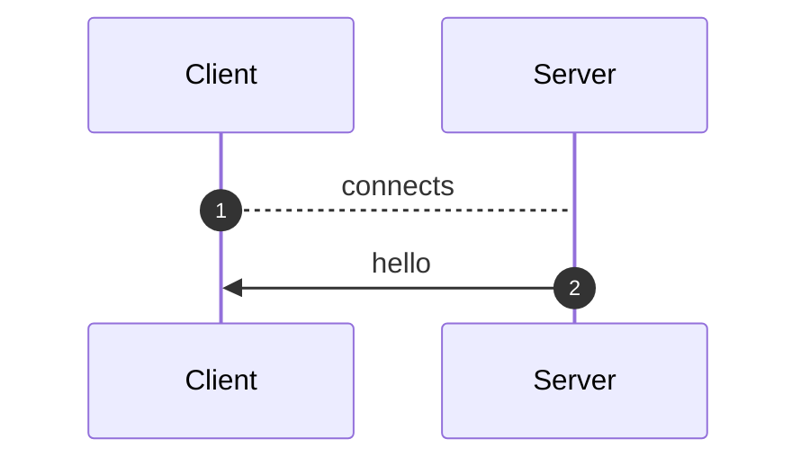
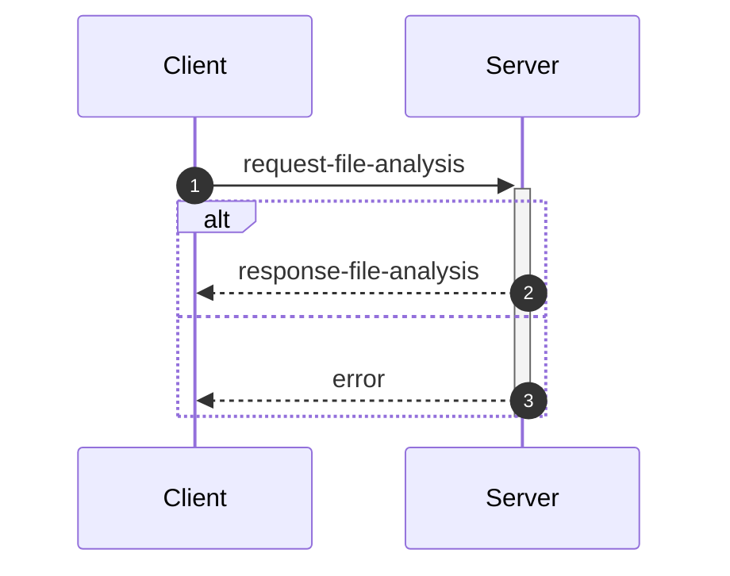
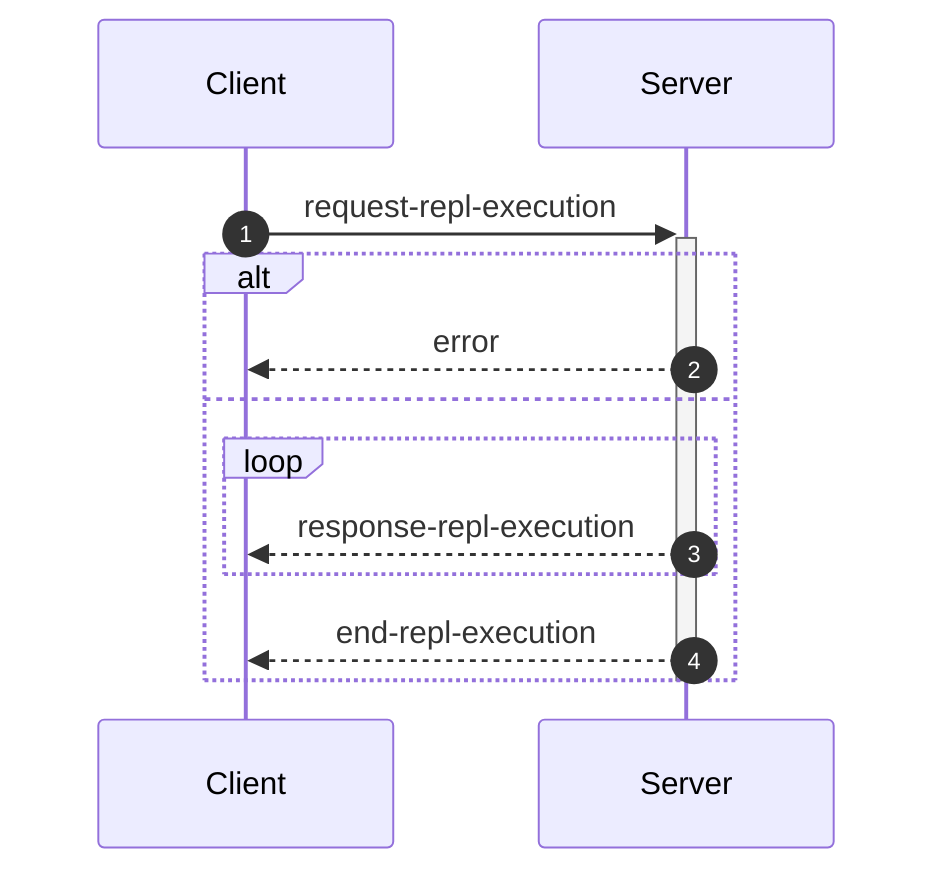
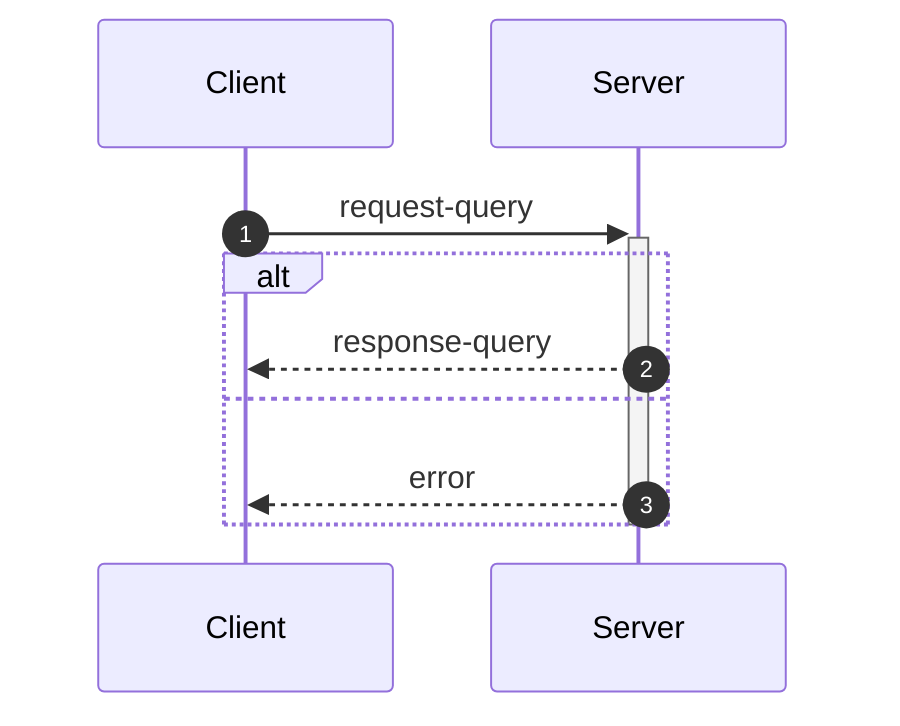

_<span title="an overview of flowR's interface">Generated</span> from '[wiki-interface.ts](https://github.com/flowr-analysis/flowr/tree/main/src/documentation/wiki-interface.ts "src/documentation/wiki-interface.ts")' on 2026-11-22, 10:07:46 UTC (v2.17.9, R v4.6.1), do not edit directly._

Although far from being as detailed as the in-depth explanation of [_flowR_](https://github.com/flowr-analysis/flowr/wiki/Core),
this wiki page explains how to interface with _flowR_ in more detail.
In general, command line arguments and other options provide short descriptions on hover over.

* [💻 Using the REPL](#using-the-repl)
* [⚙️ Configuring FlowR](#configuring-flowr)
* [⚒️ Writing Code](#writing-code)
* [💬 Communicating with the Server](#communicating-with-the-server)

<a id='using-the-repl'></a>
## 💻 Using the REPL

> [!NOTE]
> To execute arbitrary R commands with a repl request, _flowR_ has to be started explicitly with <span title="Description (Command Line Argument): Allow to access the underlying R session when using flowR (security warning: this allows the execution of arbitrary R code!)">`--r-session-access`</span>.
> Please be aware that this introduces a security risk and note that this relies on the [`r-shell` engine](https://github.com/flowr-analysis/flowr/wiki/Engines) .

Although primarily meant for users to explore,
there is nothing which forbids calling _flowR_ as a subprocess to use standard-in, -output, and -error
for communication (although you can access the REPL using the server as well,
with the [REPL Request](#message-request-repl-execution) message).

The read-eval-print loop&nbsp;(REPL) works relatively simple.
You can submit an expression (using <kbd>Enter</kbd>),
which is interpreted as an R&nbsp;expression by default but interpreted as a *command* if it starts with a colon (`:`).
The best command to get started with the REPL is <span title="Description (Repl Command): Show help information (aliases: :h, :?)">`:help`</span>.
Besides, you can leave the REPL either with the command <span title="Description (Repl Command): End the repl (aliases: :q, :exit)">`:quit`</span> or by pressing <kbd>Ctrl</kbd>+<kbd>C</kbd> twice.
When writing a *command*, you may press <kbd>Tab</kbd> to get a list of completions, if available.
Multiple commands can be entered in a single line by separating them with a semicolon (`;`), e.g. `:parse "x<-2"; :df*`.
If a command is given without R code, the REPL will re-use R code given in a previous command.
The prior example will hence return first the parsed AST of the program and then the dataflow graph for `"x <- 2"`.

> [!NOTE]
> If you develop flowR, you may want to launch the repl using the `npm run main-dev` command, this way, you get a non-minified version of flowR with debug information and hot-reloading of source files.

<details>
<summary>Available Commands</summary>

We currently offer the following commands (this with a `[*]` suffix are available with and without the star):

| Command | Description |
| ------- | ----------- |
| **<span title="Description (Repl Command): End the repl (aliases: :q, :exit)">:quit</span>** | End the repl (aliases: **:<span title="Alias of ':quit'. End the repl">q</span>**, **:<span title="Alias of ':quit'. End the repl">exit</span>**) |
| **<span title="Description (Repl Command): Execute the given code as R code. This requires the `--r-session-access` flag to be set and requires the r-shell engine. (aliases: :e, :r)">:execute</span>** | Execute the given code as R code. This requires the `--r-session-access` flag to be set and requires the r-shell engine. (aliases: **:<span title="Alias of ':execute'. Execute the given code as R code. This requires the `--r-session-access` flag to be set and requires the r-shell engine.">e</span>**, **:<span title="Alias of ':execute'. Execute the given code as R code. This requires the `--r-session-access` flag to be set and requires the r-shell engine.">r</span>**) |
| **<span title="Description (Repl Command): Get mermaid code for the control-flow graph of R code (aliases: :cfg, :cf)">:controlflow[*]</span>** | Get mermaid code for the control-flow graph of R code (star: Returns the URL to mermaid.live) (aliases: **:<span title="Alias of ':controlflow'. Get mermaid code for the control-flow graph of R code">cfg</span>**, **:<span title="Alias of ':controlflow'. Get mermaid code for the control-flow graph of R code">cf</span>**) |
| **<span title="Description (Repl Command): Get mermaid code for the control-flow graph with basic blocks (aliases: :cfgb, :cfb)">:controlflowbb[*]</span>** | Get mermaid code for the control-flow graph with basic blocks (star: Returns the URL to mermaid.live) (aliases: **:<span title="Alias of ':controlflowbb'. Get mermaid code for the control-flow graph with basic blocks">cfgb</span>**, **:<span title="Alias of ':controlflowbb'. Get mermaid code for the control-flow graph with basic blocks">cfb</span>**) |
| **<span title="Description (Repl Command): Get mermaid code for the dataflow graph (aliases: :d, :df)">:dataflow[*]</span>** | Get mermaid code for the dataflow graph (star: Returns the URL to mermaid.live) (aliases: **:<span title="Alias of ':dataflow'. Get mermaid code for the dataflow graph">d</span>**, **:<span title="Alias of ':dataflow'. Get mermaid code for the dataflow graph">df</span>**) |
| **<span title="Description (Repl Command): Get mermaid code for the normalized AST of R code (aliases: :n)">:normalize[*]</span>** | Get mermaid code for the normalized AST of R code (star: Returns the URL to mermaid.live) (alias: **:<span title="Alias of ':normalize'. Get mermaid code for the normalized AST of R code">n</span>**) |
| **<span title="Description (Repl Command): Get mermaid code for the simplified dataflow graph (aliases: :ds, :dfs)">:dataflowsimple[*]</span>** | Get mermaid code for the simplified dataflow graph (star: Returns the URL to mermaid.live) (aliases: **:<span title="Alias of ':dataflowsimple'. Get mermaid code for the simplified dataflow graph">ds</span>**, **:<span title="Alias of ':dataflowsimple'. Get mermaid code for the simplified dataflow graph">dfs</span>**) |
| **<span title="Description (Repl Command): Inspect and extend the signature database: `query` (identical to :query @signature), `info <name>` for where a function comes from (identical to :query @function-info), `add <path>` to mount another database/source, `download` to fetch the full-history database. (aliases: :sig)">:signature</span>** | Inspect and extend the signature database: `query` (identical to :query @signature), `info <name>` for where a function comes from (identical to :query @function-info), `add <path>` to mount another database/source, `download` to fetch the full-history database. (alias: **:<span title="Alias of ':signature'. Inspect and extend the signature database: `query` (identical to :query @signature), `info <name>` for where a function comes from (identical to :query @function-info), `add <path>` to mount another database/source, `download` to fetch the full-history database.">sig</span>**) |
| **<span title="Description (Repl Command): Just calculates the DFG, but only prints summary info (aliases: :d#, :df#)">:dataflowsilent</span>** | Just calculates the DFG, but only prints summary info (aliases: **:<span title="Alias of ':dataflowsilent'. Just calculates the DFG, but only prints summary info">d#</span>**, **:<span title="Alias of ':dataflowsilent'. Just calculates the DFG, but only prints summary info">df#</span>**) |
| **<span title="Description (Repl Command): Prints ASCII Art of the parsed, unmodified AST (aliases: :p)">:parse</span>** | Prints ASCII Art of the parsed, unmodified AST (alias: **:<span title="Alias of ':parse'. Prints ASCII Art of the parsed, unmodified AST">p</span>**) |
| **<span title="Description (Repl Command): Prints the version of flowR as well as the current version of R">:version</span>** | Prints the version of flowR as well as the current version of R
| **<span title="Description (Repl Command): Query the given R code (use 'help' for more information)">:query[*]</span>** | Query the given R code (use 'help' for more information) (star: Similar to query, but returns the output in json format.)
| **<span title="Description (Repl Command): Returns an ASCII representation of the dataflow graph (aliases: :df!)">:dataflowascii</span>** | Returns an ASCII representation of the dataflow graph (alias: **:<span title="Alias of ':dataflowascii'. Returns an ASCII representation of the dataflow graph">df!</span>**) |
| **<span title="Description (Repl Command): Returns summarization stats for the normalized AST (aliases: :n#)">:normalize#</span>** | Returns summarization stats for the normalized AST (alias: **:<span title="Alias of ':normalize#'. Returns summarization stats for the normalized AST">n#</span>**) |
| **<span title="Description (Repl Command): Show help information (aliases: :h, :?)">:help</span>** | Show help information (aliases: **:<span title="Alias of ':help'. Show help information">h</span>**, **:<span title="Alias of ':help'. Show help information">?</span>**) |

</details>

> [!TIP]
> 
> As indicated by the examples before, all REPL commands that operate on code keep track of the state.
> Hence, if you run a command like <span title="Description (Repl Command, starred version): Returns the URL to mermaid.live; Base Command: Get mermaid code for the dataflow graph (aliases: :d*, :df*)">`:dataflow*`</span> without providing R code,
> the REPL will re-use the R code provided in a previous command.
> Likewise, doing this will benefit from incrementality!
> If you request the dataflow graph with `:df* x <- 2 * y` and then want to see the parsed AST with `:parse`,
> the REPL will re-use previously obtained information and not re-parse the code again.
> 		

Generally, many commands offer shortcut versions in the REPL. Many queries, for example, offer a shortened format (see the example below).
Of special note, the [Config Query](https://github.com/flowr-analysis/flowr/wiki/%5BQuery%5D-Config)
can be used to also modify the currently active configuration of _flowR_ within the REPL (see the [wiki page](https://github.com/flowr-analysis/flowr/wiki/%5BQuery%5D-Config) for more information).

### Example: Retrieving the Dataflow Graph

To retrieve a URL to the [mermaid](https://mermaid.js.org/) diagram of the dataflow of a given expression,
use <span title="Description (Repl Command, starred version): Returns the URL to mermaid.live; Base Command: Get mermaid code for the dataflow graph (aliases: :d*, :df*)">`:dataflow*`</span> (or <span title="Description (Repl Command): Get mermaid code for the dataflow graph (aliases: :d, :df)">`:dataflow`</span> to get the mermaid code in the cli):

```shell
$ docker run -it --rm eagleoutice/flowr # or npm run flowr 
flowR repl v2.17.9, R grammar v14 (tree-sitter engine)
R> :dataflow* y <- 1 + x
```

<details>
<summary style='color:gray'>Output</summary>

```text
https://mermaid.live/view#base64:eyJjb2RlIjoiZmxvd2NoYXJ0IFREXG4gICAgMXt7XCJgKiM5MTtSTnVtYmVyIzkzOyogKioxKipcbiAgICAgICoxLjYqICgqKmlkOiAxKiopYFwifX1cbiAgICAyKFtcImAqIzkxO1JTeW1ib2wjOTM7KiAqKngqKlxuICAgICAgKjEuMTAqICgqKmlkOiAyKiopYFwiXSlcbiAgICAzW1tcImAqIzkxO1JCaW5hcnlPcCM5MzsqIGJhc2UjNTg7IzU4OyoqIzQzOyoqXG4gICAgICAqMS42LTEwKiAoKippZDogMyoqKVxuICAgIGFyZzogKDEsIDIpYFwiXV1cbiAgICBidWlsdC1pbjpfNDNfW1wiYEJ1aWx0LUluOlxuIzQzO2BcIl1cbiAgICBzdHlsZSBidWlsdC1pbjpfNDNfIHN0cm9rZTpncmF5LGZpbGw6Z3JheSxzdHJva2Utd2lkdGg6MnB4LG9wYWNpdHk6Ljg7XG4gICAgMFtcImAqIzkxO1JTeW1ib2wjOTM7KiAqKnkqKlxuICAgICAgKjEuMSogKCoqaWQ6IDAqKiwgdjogMylgXCJdXG4gICAgNFtbXCJgKiM5MTtSQmluYXJ5T3AjOTM7KiBiYXNlIzU4OyM1ODsqKiM2MDsjNDU7KipcbiAgICAgICoxLjEtMTAqICgqKmlkOiA0KiopXG4gICAgYXJnOiAoMCwgMylgXCJdXVxuICAgIGJ1aWx0LWluOl82MF8tW1wiYEJ1aWx0LUluOlxuIzYwOyM0NTtgXCJdXG4gICAgc3R5bGUgYnVpbHQtaW46XzYwXy0gc3Ryb2tlOmdyYXksZmlsbDpncmF5LHN0cm9rZS13aWR0aDoycHgsb3BhY2l0eTouODtcbiAgICAxIC0uLT58XCJmbG93XCJ8IDJcbiAgICBsaW5rU3R5bGUgMCBzdHJva2U6Z3JheSxjb2xvcjpncmF5O1xuICAgIDIgLS4tPnxcImZsb3dcInwgM1xuICAgIGxpbmtTdHlsZSAxIHN0cm9rZTpncmF5LGNvbG9yOmdyYXk7XG4gICAgMyAtLT58XCJyZWFkcywgYXJnXCJ8IDFcbiAgICAzIC0tPnxcInJlYWRzLCBhcmdcInwgMlxuICAgIDMgLS4tPnxcImZsb3dcInwgMFxuICAgIGxpbmtTdHlsZSA0IHN0cm9rZTpncmF5LGNvbG9yOmdyYXk7XG4gICAgMyAtLi0+fFwicmVhZHMsIGNhbGxzXCJ8IGJ1aWx0LWluOl80M19cbiAgICBsaW5rU3R5bGUgNSBzdHJva2U6Z3JheTtcbiAgICAwIC0tPnxcImRlZmluZWQtYnksIGZsb3dcInwgNFxuICAgIDAgLS0+fFwiZGVmaW5lZC1ieVwifCAzXG4gICAgNCAtLT58XCJyZWFkcywgYXJnXCJ8IDNcbiAgICA0IC0tPnxcInJldHVybnMsIGFyZ1wifCAwXG4gICAgNCAtLi0+fFwicmVhZHMsIGNhbGxzXCJ8IGJ1aWx0LWluOl82MF8tXG4gICAgbGlua1N0eWxlIDEwIHN0cm9rZTpncmF5OyIsIm1lcm1haWQiOnsiYXV0b1N5bmMiOnRydWV9fQ==
```

Retrieve the dataflow graph of the expression `y <- 1 + x`. It looks like this:


<details>

<summary style="color:gray">R Code of the Dataflow Graph</summary>

The analysis ran (parse and normalize with the [tree-sitter](https://github.com/flowr-analysis/flowr/wiki/Engines) engine) in the generation environment. No [signature database](https://github.com/flowr-analysis/flowr/wiki/Signature-Database) is mounted, so `library()` attaches no exports (base-R names are still qualified, e.g., `stats::acf`). 
We encountered no unknown side effects during the analysis.

```r
y <- 1 + x
```

</details>

</details>

For small graphs like this, <span title="Description (Repl Command): Returns an ASCII representation of the dataflow graph (aliases: :df!)">`:dataflowascii`</span> also provides an ASCII representation directly in the REPL:

```shell
$ docker run -it --rm eagleoutice/flowr # or npm run flowr 
flowR repl v2.17.9, R grammar v14 (tree-sitter engine)
R> :df! y <- 1 + x
```

<details open>
<summary style='color:gray'>Output</summary>

```text
                        v<0>v
 c<4>c──────────────────| y |
 |<- |     ┌────────────v---v
 c---c     │
    │   c<3>c   0<1>0
    └───| + |───| 1 |───u<2>u
        c---c   0---0   | x |
           └────────────u---u
Edges:
3 -> 1: reads, arg          3 -> 2: reads, arg
3 -> 0: flows-to            1 -> 2: flows-to
2 -> 3: flows-to            4 -> 3: reads, arg
4 -> 0: returns, arg        0 -> 4: defined-by, flows-to
0 -> 3: defined-by
```

Retrieve the dataflow graph of the expression `y <- 1 + x` as ASCII art.

</details>

For the slicing with <span title="Description (Repl Command): Static backwards executable slicer for R">`:slicer`</span>, you have access to the same [magic comments](#slice-magic-comments) as with the [slice request](#message-request-slice).
Pass `--inline` to splice resolvable `source()` calls into the reconstruction so the slice is a single self-contained R text (the same as the static slice query's `inlineSources` flag).
See `--help` for more flags!

### Example: Interfacing with the File System

Many commands that allow for an R-expression (like <span title="Description (Repl Command, starred version): Returns the URL to mermaid.live; Base Command: Get mermaid code for the dataflow graph (aliases: :d*, :df*)">`:dataflow*`</span>) allow for a file as well
if the argument starts with `file://`.
If you are working from the root directory of the _flowR_ repository, the following gives you the parsed AST of the example file using the <span title="Description (Repl Command): Prints ASCII Art of the parsed, unmodified AST (aliases: :p)">`:parse`</span> command:

> **Watch mode**: Replace `file://` with `watch://` to enter watch mode.
> flowR runs the command immediately and then re-runs it every time the file (or any file inside the folder) changes.
> Enter any other command to leave watch mode.
> For example: `:df watch://analysis.R`

```shell
$ docker run -it --rm eagleoutice/flowr # or npm run flowr 
flowR repl v2.17.9, R grammar v14 (tree-sitter engine)
R> :parse file://test/testfiles/example.R
```

<details>
<summary style='color:gray'>Output</summary>

```text
File: test/testfiles/example.R

program
├ binaryoperator
│ ├ identifier "sum" (1:1─4)
│ ├ <- "<-" (1:5─7)
│ ╰ float "0" (1:8─9)
├ binaryoperator
│ ├ identifier "product" (2:1─8)
│ ├ <- "<-" (2:9─11)
│ ╰ float "1" (2:12─13)
├ binaryoperator
│ ├ identifier "w" (3:1─2)
│ ├ <- "<-" (3:3─5)
│ ╰ float "7" (3:6─7)
├ binaryoperator
│ ├ identifier "N" (4:1─2)
│ ├ <- "<-" (4:3─5)
│ ╰ float "10" (4:6─8)
├ forstatement
│ ├ for "for" (6:1─4)
│ ├ ( "(" (6:5─6)
│ ├ identifier "i" (6:6─7)
│ ├ in "in" (6:8─10)
│ ├ binaryoperator
│ │ ├ float "1" (6:11─12)
│ │ ├ : ":" (6:12─13)
│ │ ╰ parenthesizedexpression
│ │   ├ ( "(" (6:13─14)
│ │   ├ binaryoperator
│ │   │ ├ identifier "N" (6:14─15)
│ │   │ ├ - "-" (6:15─16)
│ │   │ ╰ float "1" (6:16─17)
│ │   ╰ ) ")" (6:17─18)
│ ├ ) ")" (6:18─19)
│ ╰ bracedexpression
│   ├ { "{" (6:20─21)
│   ├ binaryoperator
│   │ ├ identifier "sum" (7:3─6)
│   │ ├ <- "<-" (7:7─9)
│   │ ╰ binaryoperator
│   │   ├ binaryoperator
│   │   │ ├ identifier "sum" (7:10─13)
│   │   │ ├ + "+" (7:14─15)
│   │   │ ╰ identifier "i" (7:16─17)
│   │   ├ + "+" (7:18─19)
│   │   ╰ identifier "w" (7:20─21)
│   ├ binaryoperator
│   │ ├ identifier "product" (8:3─10)
│   │ ├ <- "<-" (8:11─13)
│   │ ╰ binaryoperator
│   │   ├ identifier "product" (8:14─21)
│   │   ├  "" (8:22─23)
│   │   ╰ identifier "i" (8:24─25)
│   ╰ } "}" (9:1─2)
├ call
│ ├ identifier "cat" (11:1─4)
│ ╰ arguments
│   ├ ( "(" (11:4─5)
│   ├ argument
│   │ ╰ string
│   │   ├ stringopen "\"" (11:5─6)
│   │   ├ stringcontent "Sum:" (11:6─10)
│   │   ╰ stringclose "\"" (11:10─11)
│   ├ comma "," (11:11─12)
│   ├ argument
│   │ ╰ identifier "sum" (11:13─16)
│   ├ comma "," (11:16─17)
│   ├ argument
│   │ ╰ string
│   │   ├ stringopen "\"" (11:18─19)
│   │   ├ stringcontent
│   │   │ ╰ escapesequence "\\n" (11:19─21)
│   │   ╰ stringclose "\"" (11:21─22)
│   ╰ ) ")" (11:22─23)
╰ call
  ├ identifier "cat" (12:1─4)
  ╰ arguments
    ├ ( "(" (12:4─5)
    ├ argument
    │ ╰ string
    │   ├ stringopen "\"" (12:5─6)
    │   ├ stringcontent "Product:" (12:6─14)
    │   ╰ stringclose "\"" (12:14─15)
    ├ comma "," (12:15─16)
    ├ argument
    │ ╰ identifier "product" (12:17─24)
    ├ comma "," (12:24─25)
    ├ argument
    │ ╰ string
    │   ├ stringopen "\"" (12:26─27)
    │   ├ stringcontent
    │   │ ╰ escapesequence "\\n" (12:27─29)
    │   ╰ stringclose "\"" (12:29─30)
    ╰ ) ")" (12:30─31)
```

Retrieve the parsed AST of the example file.

<details>

<summary>File Content</summary>

```r
sum <- 0
product <- 1
w <- 7
N <- 10

for (i in 1:(N-1)) {
  sum <- sum + i + w
  product <- product * i
}

cat("Sum:", sum, "\n")
cat("Product:", product, "\n")
```

</details>

As _flowR_ directly transforms this AST the output focuses on being human-readable instead of being machine-readable.
		
</details>

### Example: Run a Query

You can run any query supported by _flowR_ using the <span title="Description (Repl Command): Query the given R code (use 'help' for more information)">`:query`</span> command.
For example, to obtain the shapes of all data frames in a given piece of code, you can run:

```shell
$ docker run -it --rm eagleoutice/flowr # or npm run flowr 
flowR repl v2.17.9, R grammar v14 (tree-sitter engine)
R> :query @absint df-shape "x <- data.frame(a = 1:10, b = 1:10)\ny <- x$a"
```

<details open>
<summary style='color:gray'>Output</summary>

```text
Query: absint (9 ms)
   ╰ $12: (colnames: [{"a", "b"}, {}], cols: [2, 2], rows: [10, 10])
   ╰ $0: (colnames: [{"a", "b"}, {}], cols: [2, 2], rows: [10, 10])
```

Retrieve the shapes of all data frames in the given code.

</details>

To run the linter on a file, you can use (in this example, we just issue the `dead-code` linter on a small piece of code):

```shell
$ docker run -it --rm eagleoutice/flowr # or npm run flowr 
flowR repl v2.17.9, R grammar v14 (tree-sitter engine)
R> :query @linter rules:dead-code "if(FALSE) x <- 2"
```

<details open>
<summary style='color:gray'>Output</summary>

```text
Query: linter (14 ms)
   ╰ Dead Code (dead-code):
       ╰ certain:
           ╰ Code at 1.11-16 (1 quick fix(es) available)
```

Run the linter on the given code, with only the `dead-code` rule enabled.

</details>

For more information on the available queries, please check out the [Query API](https://github.com/flowr-analysis/flowr/wiki/Query-API).

<a id='configuring-flowr'></a>
## ⚙️ Configuring FlowR

When running _flowR_, you may want to specify some behaviors with a dedicated configuration file.
By default, flowR looks for a file named `flowr.json` in the current working directory (or any higher directory).
You can also specify a different file with <span title="Description (Command Line Argument): The name of the configuration file to use">`--config-file`</span> or pass the configuration inline using <span title="Description (Command Line Argument): The flowR configuration to use, as a JSON string">`--config-json`</span>.
A `flowr.json` found this way belongs to the analyzed project, so flowR ignores its options that decide what flowR executes or loads
(`defaultPlugins.*.1`, `repl.plugins.*.1`, `engines.*.wasmPath`, `engines.*.treeSitterWasmPath`, `engines.*.rPath`, `solver.sigdb.additionalPaths`, `solver.sigdb.downloadRepo`, `solver.sigdb.autoSync`, `solver.sigdb.installedLibrary.paths`, `solver.sigdb.onDemand.enabled`, `solver.sigdb.onDemand.repositories`, `solver.sigdb.onDemand.cranMirror`, `solver.sigdb.onDemand.bioconductorMirror`, `solver.sigdb.onDemand.cacheDir`, `solver.instrument.dataflowExtractors`),
unless you pass <span title="Description (Command Line Argument): Keep the security-sensitive options (e.g., the R executable) of the flowr.json found in the working directory or a parent. Only use this for projects you trust.">`--trust-config`</span>.
To analyze code you do not trust, use the secure mode (<span title="Description (Command Line Argument): Run in secure mode for analyzing untrusted code: flowR does not start R (or any other process), does not access the network, does not search for project configs, and ignores security-sensitive options in every config. Cannot be disabled once enabled. Can also be enabled with the environment variable {italic FLOWR_SECURE_MODE=1}.">`--secure`</span>, see the [security policy](https://github.com/flowr-analysis/flowr/blob/main/.github/SECURITY.md)).
To inspect the current configuration, you can run flowr with the <span title="Description (Command Line Argument): Run with verbose logging (will be passed to the corresponding script)">`--verbose`</span> flag, or use the `config` [Query](https://github.com/flowr-analysis/flowr/wiki/Query-API).
Within the REPL this works by running the following:

```shell
:query @config
```

To work with the <a href="https://github.com/flowr-analysis/flowr/tree/main/src/config.ts#L131"><code><span title="The configuration file format for flowR.">FlowrConfig</span></code></a> you can use the provided helper objects alongside its methods like
<a href="https://github.com/flowr-analysis/flowr/tree/main/src/config.ts#L980"><code><span title="Creates a new flowr config that has the updated values.">FlowrConfig::<b>amend</b></span></code></a>.
The schema below documents every option; the ones you most likely want are:

- <a href="https://github.com/flowr-analysis/flowr/wiki/Interface#configuring-flowr" title="Configuration Option (boolean): Whether source calls should be ignored, causing {@link processSourceCall}&#39;s behavior to be skipped.">ignoreSourceCalls</a>: ignore source calls when analyzing the code, i.e., ignore the inclusion of other files.
- <a href="https://github.com/flowr-analysis/flowr/wiki/Interface#configuring-flowr" title="Configuration Option (boolean): Whether load calls should be ignored, causing {@link processLoadCall}&#39;s behavior to be skipped.">ignoreLoadCalls</a>: ignore load calls when analyzing the code, i.e., ignore the loading of r-data files.
- <a href="https://github.com/flowr-analysis/flowr/wiki/Interface#configuring-flowr" title="Configuration Option (object): Do you want to overwrite (parts) of the builtin definition?">semantics.environment.overwriteBuiltIns</a>: overwrite _flowR_'s handling of built-in functions, or clear the preset definitions entirely.
  See [Configure BuiltIn Semantics](#configure-builtin-semantics) for more information.
- <a href="https://github.com/flowr-analysis/flowr/wiki/Interface#configuring-flowr" title="Configuration Option (boolean): Whether calls drawing on a graphics device (e.g., `plot`) count as writing to it, which the ambient state queries then report.">semantics.ambient.drawingWritesDevice</a>: whether calls drawing on a graphics device (e.g., `plot`) count as writing the device in the ambient state queries.
- <a href="https://github.com/flowr-analysis/flowr/wiki/Interface#configuring-flowr" title="Configuration Option (string): How to resolve variables and their values. (one of &quot;disabled&quot;, &quot;alias&quot;, &quot;builtin&quot;)">solver.variables</a>: how to resolve variables and their values (`disabled`, `alias`, `builtin`).
- <a href="https://github.com/flowr-analysis/flowr/wiki/Interface#configuring-flowr" title="Configuration Option (array): The engine or set of engines to use for interacting with R code. An empty array means all available engines will be used.">engines</a> and <a href="https://github.com/flowr-analysis/flowr/wiki/Interface#configuring-flowr" title="Configuration Option (string): The default engine to use for interacting with R code. If this is undefined, an arbitrary engine from the specified list will be used. (one of &quot;tree-sitter&quot;, &quot;r-shell&quot;)">defaultEngine</a>: the engines used to interact with R code, see the [Engines wiki page](https://github.com/flowr-analysis/flowr/wiki/Engines).
- <a href="https://github.com/flowr-analysis/flowr/wiki/Interface#configuring-flowr" title="Configuration Option (array): Files a framework loads on its own, without any source() call (e.g. global.R in a shiny app), in the order they are loaded; flowR orders the matching project files accordingly and analyzes them as one program. Entries are case-insensitive globs matched against the file path, a plain name matches any file with that name, and entries matching no project file are warned about. Usually set per project kind via specializeConfig.">project.implicitSources</a>: the files a framework loads without any `source()` call, in the order in which they are
  loaded. Entries are globs (e.g. `R/*.R`) matched against the file path ignoring capitalization; one matching no file is reported.
- <a href="https://github.com/flowr-analysis/flowr/wiki/Interface#configuring-flowr" title="Configuration Option (object): Overwrite (parts of) the configuration depending on the project kind flowR detects, e.g. to give a shiny app its implicit sources.">specializeConfig</a>: overwrite (parts of) the configuration depending on the kind of project _flowR_ detects
  (e.g. `shiny-app`), which is how a shiny app gets its implicit sources by default. What you configure directly wins.
- <a href="https://github.com/flowr-analysis/flowr/wiki/Interface#configuring-flowr" title="Configuration Option (string): Overwrite the project kind flowR would otherwise infer from the analyzed files, e.g. when auto-detection guesses wrong. (one of &quot;package&quot;, &quot;script&quot;, &quot;shiny-app&quot;, &quot;notebook&quot;, &quot;project&quot;, &quot;unknown&quot;)">project.useProjectType</a>: skip that detection and force a project kind yourself, when auto-detection guesses wrong.
- <a href="https://github.com/flowr-analysis/flowr/wiki/Interface#configuring-flowr" title="Configuration Option (array): The default plugins to load when creating a new instance of FlowrAnalyzer">defaultPlugins</a> and <a href="https://github.com/flowr-analysis/flowr/wiki/Interface#configuring-flowr" title="Configuration Option (array): The plugins to load in REPL mode">repl.plugins</a>: the plugins to load for a new <a href="https://github.com/flowr-analysis/flowr/tree/main/src/project/flowr-analyzer.ts#L237"><code><span title="Central class for conducting analyses with FlowR. Use the FlowrAnalyzerBuilder to create a new instance. If you want the original pattern of creating a pipeline and running all steps, you can still do this with FlowrAnalyzer#runFull . To inspect the context of the analyzer, use FlowrAnalyzer#inspectContext (if you are a plugin and need to modify it, use FlowrAnalyzer#context instead).">FlowrAnalyzer</span></code></a> and in the REPL
  (use `flowr:default` to reference the former).

So you can configure _flowR_ by adding a file like the following:

<details>

<summary>Example Configuration File</summary>

```json
{
  "ignoreSourceCalls": true,
  "ignoreLoadCalls": true,
  "semantics": {
    "environment": {
      "overwriteBuiltIns": {
        "definitions": [
          {
            "type": "function",
            "names": [
              "foo"
            ],
            "processor": "builtin:assign",
            "config": {}
          }
        ]
      }
    }
  },
  "defaultPlugins": [
    "file:description",
    "versions:description"
  ],
  "repl": {
    "quickStats": false,
    "dfProcessorHeat": false,
    "hints": true,
    "plugins": [
      "flowr:default"
    ]
  },
  "project": {
    "resolveUnknownPathsOnDisk": true,
    "implicitSources": [
      "global.R",
      "app.R"
    ]
  },
  "linter": {
    "disabledRules": []
  },
  "specializeConfig": {
    "shiny-app": {
      "project": {
        "implicitSources": [
          "global.R",
          "ui.R",
          "server.R",
          "app.R"
        ]
      }
    }
  },
  "engines": [
    {
      "type": "r-shell"
    }
  ],
  "solver": {
    "variables": "alias",
    "evalStrings": true,
    "trackEnvironments": true,
    "sigdb": {
      "enabled": true,
      "loadProjectDependencies": true,
      "eagerlyLoad": false,
      "eagerlyLoadExports": false,
      "linkBaseR": false,
      "linkDescriptionDependencies": false
    },
    "resolveSource": {
      "dropPaths": "no",
      "ignoreCapitalization": true,
      "inferWorkingDirectory": "active-script",
      "searchPath": []
    },
    "instrument": {},
    "slicer": {
      "threshold": 50
    }
  },
  "abstractInterpretation": {
    "wideningThreshold": 4,
    "followCalls": true,
    "dataFrame": {
      "maxColNames": 20,
      "readLoadedData": {
        "readExternalFiles": true,
        "maxReadLines": 1000000
      }
    }
  },
  "incremental": {
    "alwaysIncremental": false,
    "parsing": {
      "activated": false,
      "heuristics": {
        "activated": true,
        "mtime": true,
        "linesFrom": 500,
        "bytesFrom": 50000,
        "alwaysWithEdits": false,
        "minFiles": 1
      }
    },
    "dataflow": {
      "reuse": true,
      "activated": false,
      "checkpoints": 2,
      "minStatements": 0
    }
  },
  "gas": {
    "thresholds": {
      "memory": {
        "problematic": 0.7,
        "critical": 0.9
      },
      "timeMs": {
        "problematic": 100000,
        "critical": 120000
      }
    },
    "features": {}
  }
}
```

</details>

<details>
<a id='configure-builtin-semantics'></a>
<summary>Configure Built-In Semantics</summary>

`semantics/environment/overwriteBuiltins` accepts two keys:

- `loadDefaults` (boolean, initially `true`): If set to `true`, the default built-in definitions are loaded before applying the custom definitions. Setting this flag to `false` explicitly disables the loading of the default definitions.
- `definitions` (array, initially empty): Allows to overwrite or define new built-in elements. Each object within must have a `type` which is one of the below. Furthermore, they may define a string array of `names` which specifies the identifiers to bind the definitions to. You may use `assumePrimitive` to specify whether _flowR_ should assume that this is a primitive non-library definition (so you probably just do not want to specify the key).

  | Type            | Description                                                                                                                                                                                                                                                                                              | Example                                                                                                    |
  | --------------- | -------------------------------------------------------------------------------------------------------------------------------------------------------------------------------------------------------------------------------------------------------------------------------------------------------- | ---------------------------------------------------------------------------------------------------------- |
  | `constant`    | Additionally allows for a `value` this should resolve to.                                                                                                                                                                                                                                                | `{ type: 'constant', names: ['NULL', 'NA'],  value: null }`                                                |
  | `function`    | Is a rather flexible way to define and bind built-in functions. For the time, we do not have extensive documentation to cover all the cases, so please either consult the sources with the `default-builtin-config/` folder or open a [new issue](https://github.com/flowr-analysis/flowr/issues/new/choose). | `{ type: 'function', names: ['next'], processor: 'builtin:d', config: { cfg: ExitPointType.Next } }` |
  | `replacement` | A comfortable way to specify replacement functions like `$<-` or `names<-`. `suffixes` describes the... suffixes to attach automatically. | `{ type: 'replacement', suffixes: ['<-', '<<-'], names: ['[', '[['] }` |

</details>

<details>

<summary style='color:gray'>Full Configuration-File Schema</summary>

- _The configuration file format for flowR._ (object)
    - **logLevel** [optional] _flowR's global minimum log level, applied when the config is loaded._ (string)
        Only allows: 'silly', 'trace', 'debug', 'info', 'warn', 'error', 'fatal'
    - **ignoreSourceCalls** [optional] _Whether source calls should be ignored, causing {@link processSourceCall}'s behavior to be skipped._ (boolean)
    - **ignoreLoadCalls** [optional] _Whether load calls should be ignored, causing {@link processLoadCall}'s behavior to be skipped._ (boolean)
    - **semantics** _Configure language semantics and how flowR handles them._ (object)
        - **environment** [optional] _Semantics regarding how to handle the R environment._ (object)
            - **overwriteBuiltIns** [optional] _Do you want to overwrite (parts) of the builtin definition?_ (object)
                - **loadDefaults** [optional] _Should the default configuration still be loaded?_ (boolean)
                - **definitions** [optional] _The definitions to load/overwrite._ (array)
                Valid item types:
                    - (object)
        - **ambient** [optional] _Semantics regarding the global state (options, devices, files, ...) calls access._ (object)
            - **drawingWritesDevice** [optional] _Whether calls drawing on a graphics device (e.g., `plot`) count as writing to it, which the ambient state queries then report._ (boolean)
    - **defaultPlugins** [optional] _The default plugins to load when creating a new instance of FlowrAnalyzer_ (array)
    Valid item types:
        - (alternatives)
            - (string)
            - (array)
    - **repl** _Configuration options for the REPL._ (object)
        - **quickStats** [optional] _Whether to show quick stats in the REPL after each evaluation._ (boolean)
        - **dfProcessorHeat** [optional] _This instruments the dataflow processors to count how often each processor is called._ (boolean)
        - **hints** [optional] _Whether to show dim inline hints on the empty prompt (automatically disabled on non-interactive terminals)._ (boolean)
        - **plugins** [optional] _The plugins to load in REPL mode_ (array)
        Valid item types:
            - (alternatives)
                - (string)
                - (array)
        - **autoUseFileProtocol** [optional] _Prepend the file protocol to a repl input that looks like a path, instead of only warning about it._ (boolean)
        - **queryStats** [optional] _Whether `:query` closes with the line stating how long the queries took (`:query*` never prints it)._ (boolean)
        - **showPlugins** [optional] _Whether `:version` grays out the plugins that did not activate during the last analysis._ (boolean)
    - **project** _Project specific configuration options._ (object)
        - **resolveUnknownPathsOnDisk** [optional] _Whether to resolve unknown paths loaded by the r project disk when trying to source/analyze files._ (boolean)
        - **failOnInaccessiblePath** [optional] _Whether a directory that cannot be traversed during file discovery (e.g. due to permissions) aborts the analysis; when false (the default) such paths are logged and skipped._ (boolean)
        - **basePackages** [optional] _The packages considered part of R itself (base and recommended); if unset, flowR uses its built-in list._ (array)
        Valid item types:
            - (string)
        - **implicitSources** [optional] _Files a framework loads on its own, without any source() call (e.g. global.R in a shiny app), in the order they are loaded; flowR orders the matching project files accordingly and analyzes them as one program. Entries are case-insensitive globs matched against the file path, a plain name matches any file with that name, and entries matching no project file are warned about. Usually set per project kind via specializeConfig._ (array)
        Valid item types:
            - (string)
        - **useProjectType** [optional] _Overwrite the project kind flowR would otherwise infer from the analyzed files, e.g. when auto-detection guesses wrong._ (string)
            Only allows: 'package', 'script', 'shiny-app', 'notebook', 'project', 'unknown'
        - **assumeImplicitEcho** [optional] _Whether the top level of the analyzed code is echoed, so that every visible result printed there is collected as an output by the dependencies query (default true, false for a package)._ (boolean)
        - **discovery** [optional] _Scoping options for the default project discovery._ (object)
            - **full** [optional] _Collect every file below the project root (greedy) instead of only the files the detected project kind needs (default false)._ (boolean)
            - **perKind** [optional] _Per-kind include/exclude glob overrides layered on the default scoping._ (object)
            - **ignore** [optional] _Case-insensitive globs that drop matching files from the intelligent discovery, regardless of kind (e.g. .Renviron to ignore environment files)._ (array)
            Valid item types:
                - (string)
        - **classification** [optional] _Overrides for the signals flowR uses to classify the project kind._ (object)
            - **shinyDescriptionTypes** [optional] _DESCRIPTION Type: values that mark a shiny app._ (array)
            Valid item types:
                - (string)
            - **shinyEntryFiles** [optional] _File names a shiny app is assembled from._ (array)
            Valid item types:
                - (string)
            - **shinyUsagePattern** [optional] _Regex source evidencing shiny usage in an entry file._ (string)
            - **notebookExtensions** [optional] _File extensions marking a notebook._ (array)
            Valid item types:
                - (string)
    - **linter** _Linter configuration options._ (object)
        - **disabledRules** _Linting rule names excluded from the default rule set (a rule requested explicitly via a linter query still runs). Usually set per project kind via specializeConfig._ (array)
        Valid item types:
            - (string)
        - **disabledTags** [optional] _Linting rule tags whose rules are excluded from the default rule set (a rule requested explicitly via a linter query still runs). By default the cmd-check rules are disabled for everything but a package; a configured list replaces that default._ (array)
        Valid item types:
            - (string)
    - **inputSources** [optional] _Further frameworks the input-sources analysis should know about; entries are added to flowR's defaults._ (object)
        - **pure** [optional] _Functions that only pass the constantness of their arguments on._ (array)
        Valid item types:
            - (string)
        - **param** [optional] _Functions whose result is a 'param' input._ (array)
        Valid item types:
            - (string)
        - **file** [optional] _Functions whose result is a 'file' input._ (array)
        Valid item types:
            - (string)
        - **tempfile** [optional] _Functions whose result is a 'tempfile' input._ (array)
        Valid item types:
            - (string)
        - **glob** [optional] _Functions whose result is a 'glob' input._ (array)
        Valid item types:
            - (string)
        - **net** [optional] _Functions whose result is a 'net' input._ (array)
        Valid item types:
            - (string)
        - **rand** [optional] _Functions whose result is a 'rand' input._ (array)
        Valid item types:
            - (string)
        - **system** [optional] _Functions whose result is a 'system' input._ (array)
        Valid item types:
            - (string)
        - **ffi** [optional] _Functions whose result is a 'ffi' input._ (array)
        Valid item types:
            - (string)
        - **lang** [optional] _Functions whose result is a 'lang' input._ (array)
        Valid item types:
            - (string)
        - **options** [optional] _Functions whose result is a 'options' input._ (array)
        Valid item types:
            - (string)
        - **cmdline** [optional] _Functions whose result is a 'cmdline' input._ (array)
        Valid item types:
            - (string)
        - **user** [optional] _Functions whose result is a 'user' input._ (array)
        Valid item types:
            - (string)
        - **const** [optional] _Functions whose result is a 'const' input._ (array)
        Valid item types:
            - (string)
        - **scope** [optional] _Functions whose result is a 'scope' input._ (array)
        Valid item types:
            - (string)
        - **dconst** [optional] _Functions whose result is a 'dconst' input._ (array)
        Valid item types:
            - (string)
        - **unknown** [optional] _Functions whose result is a 'unknown' input._ (array)
        Valid item types:
            - (string)
        - **linkedObjects** [optional] _Objects a framework provides without a definition in the code, e.g. shiny's input._ (array)
        Valid item types:
            - (object)
        - **linkedEntryPoints** [optional] _Calls that hand a function to a framework, which binds its objects to the parameters by position._ (array)
        Valid item types:
            - (object)
    - **specializeConfig** [optional] _Overwrite (parts of) the configuration depending on the project kind flowR detects, e.g. to give a shiny app its implicit sources._ (object)
    - **engines** _The engine or set of engines to use for interacting with R code. An empty array means all available engines will be used._ (array)
    Valid item types:
        - (alternatives)
            - _The configuration for the tree sitter engine._ (object)
                - **type** [required] _Use the tree sitter engine._ (string)
                    Only allows: 'tree-sitter'
                - **wasmPath** [optional] _The path to the tree-sitter-r WASM binary to use. If this is undefined, this uses the default path._ (string)
                - **treeSitterWasmPath** [optional] _The path to the tree-sitter WASM binary to use. If this is undefined, this uses the default path._ (string)
                - **lax** [optional] _Whether to use the lax parser for parsing R code (allowing for syntax errors). If this is undefined, the strict parser will be used._ (boolean)
            - _The configuration for the R shell engine._ (object)
                - **type** [required] _Use the R shell engine._ (string)
                    Only allows: 'r-shell'
                - **rPath** [optional] _The path to the R executable to use. If this is undefined, this uses the default path._ (string)
                - **pipeBind** [optional] _Whether to enable R's experimental pipe-bind operator "=>" by setting _R_USE_PIPEBIND_ for the R session (default false); R itself keeps this off by default, as it is experimental and has never shipped in a release version of R._ (boolean)
    - **defaultEngine** [optional] _The default engine to use for interacting with R code. If this is undefined, an arbitrary engine from the specified list will be used._ (string)
        Only allows: 'tree-sitter', 'r-shell'
    - **solver** _How to resolve constants, constraints, cells, ..._ (object)
        - **variables** _How to resolve variables and their values._ (string)
            Only allows: 'disabled', 'alias', 'builtin'
        - **evalStrings** _Should we include eval(parse(text="...")) calls in the dataflow graph?_ (boolean)
        - **trackEnvironments** [optional] _Track user-created environments (new.env, assign/get/local with envir=, dollar-assign, attach). When false, all envir-style calls fall through conservatively._ (boolean)
        - **sigdb** _Resolving library exports from a signature database._ (object)
            - **enabled** [optional] _Resolve library()/use() exports from a signature database (default true); when false no database is consulted._ (boolean)
            - **loadProjectDependencies** [optional] _Load the project's declared dependencies from its metadata files (DESCRIPTION Imports/Depends, rproject.toml, uvr.toml, rig rproj.toml and script blocks, renv.lock, rv.lock, uvr.lock, rig lockfiles) (default true); when false these files are not read for dependencies._ (boolean)
            - **eagerlyLoad** [optional] _Parse the database up front rather than on the first package load (default false, ignored if disabled)._ (boolean)
            - **eagerlyLoadExports** [optional] _Add a vertex for every export on load rather than on demand (default false); keeps the dataflow graph small._ (boolean)
            - **assumedRVersion** [optional] _R version assumed when resolving versioned (base-R) exports: a pin like "4.5" or "auto" to detect the installed R (default "auto")._ (string)
            - **linkBaseR** [optional] _Eagerly attach base-R namespaces so bare base calls resolve without library() (default false)._ (boolean)
            - **linkBaseRCalls** [optional] _Add a lightweight Reads edge from a bare base-R call to its signature-database function vertex (default false; base-R qualification is edge-free otherwise)._ (boolean)
            - **linkPackageCalls** [optional] _Add a lightweight Reads edge from a resolved package call to its signature-database function vertex (default false)._ (boolean)
            - **linkDescriptionDependencies** [optional] _Eagerly attach the namespaces of the project's declared DESCRIPTION dependencies (Imports/Depends) so their exports resolve without an explicit library() (default false)._ (boolean)
            - **warmInBackground** [optional] _Decompress the hot shards (base + most-downloaded) in a background task on startup so the first library() lookup is warm (default false; for long-running servers/REPLs)._ (boolean)
            - **additionalPaths** [optional] _Extra directories or bundle/manifest files searched for signature databases (alongside the shipped default and $FLOWR_SIGDB_DIR); a downloaded full-history bundle placed here is mounted automatically._ (array)
            Valid item types:
                - (string)
            - **downloadRepo** [optional] _GitHub owner/repo the full-history bundle is downloaded from via ":signature download" (default "flowr-analysis/flowr"; the release tag comes from the committed sigdb.remote.json unless a version is given)._ (string)
            - **autoSync** [optional] _On startup, re-download shards whose committed sigdb.remote.json hash no longer matches the cache, in the background (default false; opt-in network sync after a git pull)._ (boolean)
            - **installedLibrary** [optional] _Recovering packages no signature database knows from the copy installed on this machine._ (object)
                - **enabled** [required] _Recover packages no signature database knows from their installed copy (default false)._ (boolean)
                - **paths** [optional] _Library directories to search; when empty they are discovered from the environment and the project._ (array)
                Valid item types:
                    - (string)
                - **useEnvironment** [optional] _Search the libraries R_LIBS_USER/R_LIBS/R_LIBS_SITE name (default true)._ (boolean)
                - **useProjectLibrary** [optional] _Search a project-local renv/packrat library (default true)._ (boolean)
                - **maxDepth** [optional] _How far to descend into the nested layout of a project-local library (default 3)._ (number)
                - **packages** [optional] _Only recover packages whose name matches one of these regular expressions; empty means any._ (array)
                Valid item types:
                    - (string)
            - **onDemand** [optional] _Recovering packages no signature database knows from their sources on CRAN, Bioconductor, or GitHub._ (object)
                - **enabled** [required] _Fetch and recover the sources of packages no signature database knows when the analyzed code uses them (default false, accesses the network)._ (boolean)
                - **sources** [optional] _Where to look, in order: github, cran, bioconductor, or a source a plugin adds (default ["github", "cran", "bioconductor"])._ (array)
                Valid item types:
                    - (string)
                - **repositories** [optional] _GitHub repositories (owner/repo[/subdir][@ref]) to fetch packages from, by package name. The analyzed project may name more (DESCRIPTION Remotes, install_github calls)._ (object)
                - **packages** [optional] _Only recover packages whose name matches one of these regular expressions, empty means any._ (array)
                Valid item types:
                    - (string)
                - **cranMirror** [optional] _The CRAN src/contrib/ to fetch from, over https (default https://cloud.r-project.org/src/contrib/). It may be on the local network._ (string)
                - **bioconductorMirror** [optional] _The Bioconductor host, over https (default https://bioconductor.org). It may be on the local network._ (string)
                - **bioconductorRelease** [optional] _The Bioconductor release to fetch from: release, devel, or a number like 3.20 (default release)._ (string)
                - **githubMirrors** [optional] _Use the GitHub mirrors of CRAN (cran/<pkg>) and Bioconductor (bioc/<pkg>) (default true)._ (boolean)
                - **maxPackages** [optional] _The most packages to fetch for one analysis (default 25)._ (number)
                - **maxArchiveMb** [optional] _The most MiB a package archive may have (default 32). It may unpack to three times that, at most 128 MiB._ (number)
                - **offline** [optional] _Only use what was fetched before, never the network (default false)._ (boolean)
                - **retryAfterHours** [optional] _How many hours to wait before asking again for a package no source had (default 24)._ (number)
                - **cacheDir** [optional] _Where to cache what was fetched (default the on-demand directory of the signature cache)._ (string)
            - **blobCacheBudgetMb** [optional] _How many MiB of decoded package blobs every open bundle may hold together (default 16)._ (number)
            - **versionSelection** [optional] _When a project constrains a dependency, resolve to the newest (default), oldest, or system-installed version satisfying it; system needs R and falls back to newest. Base-R packages always resolve against the assumed R version._ (string)
                Only allows: 'newest', 'oldest', 'system'
            - **versionOverrides** [optional] _Force an exact version for specific packages (name -> version), overriding both the project constraint and the versionSelection policy (default {})._ (object)
        - **versionManagement** _Policies for reasoning about dependency versions._ (object)
            - **linkedVersionGroups** [optional] _Groups of packages that must resolve to the same version; version guessing intersects each group so its members stay mutually compatible (default [])._ (array)
            Valid item types:
                - (array)
                Valid item types:
                    - (string)
        - **assumeAttachedPackages** [optional] _Packages to treat as attached without a `library()` call, so what the built-in configuration states about them applies to the analyzed code. The base packages R attaches on startup already resolve without it._ (array)
        Valid item types:
            - (string)
        - **transitiveSideEffectRounds** [optional] _How many rounds the transitive side-effect fixpoint may run before it is cut off (default 32); the propagation stops on its own as soon as a round adds nothing._ (number)
        - **maxOverlayDepth** [optional] _How many binding overlays may stack on one environment frame before a write flattens them (default 4); a pure performance knob, trading lookup cost against copy cost without changing any result._ (number)
        - **instrument** (object)
            - **dataflowExtractors** [optional] _These keys are only intended for use within code, allowing to instrument the dataflow analyzer!_ (any)
        - **resolveSource** [optional] _If lax source calls are active, flowR searches for sourced files much more freely, based on the configurations you give it. This option is only in effect if `ignoreSourceCalls` is set to false._ (object)
            - **dropPaths** _Allow to drop the first or all parts of the sourced path, if it is relative._ (string)
                Only allows: 'no', 'once', 'all'
            - **ignoreCapitalization** _Search for filenames matching in the lowercase._ (boolean)
            - **inferWorkingDirectory** _Try to infer the working directory from the main or any script to analyze._ (string)
                Only allows: 'no', 'main-script', 'active-script', 'any-script'
            - **searchPath** _Additionally search in these paths._ (array)
            Valid item types:
                - (string)
            - **repeatedSourceLimit** [optional] _How often the same file can be sourced within a single run? Please be aware: in case of cyclic sources this may not reach a fixpoint so give this a sensible limit._ (number)
            - **applyReplacements** _Provide name replacements for loaded files_ (array)
            Valid item types:
                - (object)
            - **assumeFilesExist** [optional] _Assume a sourced file is always there, making what it defines certain instead of conditional on the source call._ (boolean)
        - **slicer** [optional] _The configuration for the slicer._ (object)
            - **threshold** [optional] _The maximum number of iterations to perform on a single function call during slicing._ (number)
            - **autoExtend** [optional] _If set, the slicer will gain an additional post-pass._ (boolean)
    - **abstractInterpretation** _The configuration options for abstract interpretation._ (object)
        - **wideningThreshold** _The threshold for the number of visitations of a node at which widening should be performed to ensure the termination of the fixpoint iteration._ (number)
        - **followCalls** _Whether the abstract interpretation is interprocedural, i.e. whether it steps into the functions a call may dispatch to._ (boolean)
        - **dataFrame** _The configuration of the shape inference for data frames._ (object)
            - **maxColNames** _The maximum number of columns names to infer for data frames before over-approximating the column names to top._ (number)
            - **readLoadedData** _Configuration options for reading data frame shapes from loaded external data files, such as CSV files._ (object)
                - **readExternalFiles** _Whether data frame shapes should be extracted from loaded external files, such as CSV files._ (boolean)
                - **maxReadLines** _The maximum number of lines to read when extracting data frame shapes from loaded files, such as CSV files._ (number)
    - **incremental** (object)
        - **alwaysIncremental** _Always take the incremental path, regardless of heuristics._ (boolean)
        - **parsing** (object)
            - **activated** _If set, incremental parsing will be used._ (boolean)
            - **heuristics** (object)
                - **activated** [optional] _If set, the heuristics for incremental parsing will be used._ (boolean)
                - **mtime** [optional] _Skip reparsing entirely if the file's modification time is unchanged since the last parse._ (boolean)
                - **linesFrom** [optional] _Only consider incremental parsing for files with at least this many lines._ (number)
                - **bytesFrom** [optional] _Only consider incremental parsing for files with at least this many bytes._ (number)
                - **alwaysWithEdits** [optional] _Always take the incremental path whenever there is a computed edit region, regardless of the other thresholds._ (boolean)
                - **minFiles** [optional] _Only apply these heuristics once the project has at least this many files loaded._ (number)
        - **dataflow** (object)
            - **reuse** [optional] _Hand out the last dataflow analysis again if the files did not change besides their comments._ (boolean)
            - **activated** _Resume the analysis of a file after its last unchanged top-level statement, from checkpoints the analysis before kept._ (boolean)
            - **checkpoints** [optional] _After how many of the last top-level statements to keep a checkpoint to resume from (each copies the graph)._ (number)
            - **minStatements** [optional] _Keep checkpoints only for files with at least this many top-level statements._ (number)
    - **gas** [optional] _Resource-usage guard (gas) configuration. All feature factors default to 0 (disabled). See https://github.com/flowr-analysis/flowr/wiki/Core#gas-resource-guard._ (object)
        - **thresholds** [optional] _Thresholds for all gas checks (scaled by per-feature factor), boundable per feature._ (object)
            - **memory** [optional] _Heap-usage fraction thresholds (0-1), either shared or given per feature key (with `default` covering the rest)._ (object)
                - **problematic** [optional] _Heap fraction (0-1) above which Problematic is returned, for every feature without an entry of its own._ (number)
                - **critical** [optional] _Heap fraction (0-1) above which Critical is returned, for every feature without an entry of its own._ (number)
            - **timeMs** [optional] _Elapsed analysis time thresholds in milliseconds, either shared or given per feature key (with `default` covering the rest)._ (object)
                - **problematic** [optional] _Elapsed ms above which Problematic is returned, for every feature without an entry of its own._ (number)
                - **critical** [optional] _Elapsed ms above which Critical is returned, for every feature without an entry of its own._ (number)
            - **steps** [optional] _Processed-AST-node thresholds, counted rather than sampled; only a key that arms a budget (`dataflow`) reads them._ (object)
                - **problematic** [optional] _Processed AST nodes above which Problematic is returned, for every feature without an entry of its own._ (number)
                - **critical** [optional] _Processed AST nodes above which the extraction is cut short, for every feature without an entry of its own._ (number)
            - **vertices** [optional] _Created-dataflow-vertex thresholds, counted like `steps`._ (object)
                - **problematic** [optional] _Created dataflow vertices above which Problematic is returned, for every feature without an entry of its own._ (number)
                - **critical** [optional] _Created dataflow vertices above which the extraction is cut short, for every feature without an entry of its own._ (number)
        - **features** [optional] _Per-feature sensitivity factors. 0 or absent disables gas checking for that feature. A factor of 2 makes the feature twice as sensitive. Recognised keys: `source`, `side-effect-linking`, `linter`, `slicer`, `dataflow`._ (object)
        - **countedCheckEvery** [optional] _How many counted steps pass between two accountings of an armed check, be it a dataflow budget or the slicer's traversal (default 128); trades overshoot against the cost of the check._ (number)
        - **heapProvider** [optional] _Custom heap statistics source (programmatic configs only), overriding the built-in v8/performance.memory detection._ (function)

</details>

<a id='writing-code'></a>
## ⚒️ Writing Code

_flowR_ can be used as a [module](https://www.npmjs.com/package/@eagleoutice/flowr) and offers several main classes and interfaces that are interesting for extension writers 
(see the [Visual Studio Code extension](https://marketplace.visualstudio.com/items?itemName=code-inspect.vscode-flowr) or the [Core](https://github.com/flowr-analysis/flowr/wiki/Core) wiki page for more information).

### Creating Analyses with _flowR_

Nowadays, instances of the <a href="https://github.com/flowr-analysis/flowr/tree/main/src/project/flowr-analyzer.ts#L237"><code><span title="Central class for conducting analyses with FlowR. Use the FlowrAnalyzerBuilder to create a new instance. If you want the original pattern of creating a pipeline and running all steps, you can still do this with FlowrAnalyzer#runFull . To inspect the context of the analyzer, use FlowrAnalyzer#inspectContext (if you are a plugin and need to modify it, use FlowrAnalyzer#context instead).">FlowrAnalyzer</span></code></a> should be used as central frontend to get analysis results from _flowR_.
The entry points an analysis is written against are re-exported from the package root (`import { FlowrAnalyzerBuilder } from '@eagleoutice/flowr'`);
everything else stays reachable under its own path, as in `@eagleoutice/flowr/dataflow/graph/graph`.
For example, a program slice can be created like this:

```ts
const analyzer = await new FlowrAnalyzerBuilder()
    .setEngine('tree-sitter')
    .build();
analyzer.addRequest('x <- 1\ny <- x\nx');
const { slice, reconstruct } = await analyzer.query({ type: 'static-slice', criteria: ['3@x'] });
```

For more information, please have a look at the [Analyzer](https://github.com/flowr-analysis/flowr/wiki/Analyzer) wiki page, which explains how to construct and use the <a href="https://github.com/flowr-analysis/flowr/tree/main/src/project/flowr-analyzer.ts#L237"><code><span title="Central class for conducting analyses with FlowR. Use the FlowrAnalyzerBuilder to create a new instance. If you want the original pattern of creating a pipeline and running all steps, you can still do this with FlowrAnalyzer#runFull . To inspect the context of the analyzer, use FlowrAnalyzer#inspectContext (if you are a plugin and need to modify it, use FlowrAnalyzer#context instead).">FlowrAnalyzer</span></code></a> in more detail.
To work with specific perspectives, you can also consult the respective pages like the [Dataflow Graph](https://github.com/flowr-analysis/flowr/wiki/Dataflow-Graph) or the [Abstract Interpretation](https://github.com/flowr-analysis/flowr/wiki/Abstract-Interpretation) wiki pages.
### The Pipeline Executor (Low-Level Interface)

Once, in the beginning, _flowR_ was meant to produce a dataflow graph merely to provide *program slices*. 
However, with continuous updates, the [Dataflow Graph](https://github.com/flowr-analysis/flowr/wiki/Dataflow-Graph) repeatedly proves to be the more interesting part.
With this, we restructured _flowR_'s originally *hardcoded* pipeline to be far more flexible. 
Now, it can be theoretically extended or replaced with arbitrary steps, optional steps, and what we call 'decorations' of these steps. 
In short, a slicing pipeline using the <a href="https://github.com/flowr-analysis/flowr/tree/main/src/core/pipeline-executor.ts#L97"><code><span title="**Please note:** The PipelineExecutor is now considered to be a rather low-level API for flowR. While it still works and is the basis for all other layers, we strongly recommend using the FlowrAnalyzer and its builder to create and use an analyzer instance that is pre-configured for your use-case. The pipeline executor allows to execute arbitrary pipelines in a step-by-step fashion. If you are not...">PipelineExecutor</span></code></a> looks like this:

```ts

const slicer = new PipelineExecutor(DEFAULT_SLICING_PIPELINE, {
  parser:    new RShell(),
  request:   requestFromInput('x <- 1\nx + 1'),
  criterion: ['2@x']
})
const slice = await slicer.allRemainingSteps()
// console.log(slice.reconstruct.code)
```

<details><summary>More Information</summary>

If you compare this, with what you would have done with the old (and removed) `SteppingSlicer`, 
this essentially just requires you to replace the `SteppingSlicer` with the <a href="https://github.com/flowr-analysis/flowr/tree/main/src/core/pipeline-executor.ts#L97"><code><span title="**Please note:** The PipelineExecutor is now considered to be a rather low-level API for flowR. While it still works and is the basis for all other layers, we strongly recommend using the FlowrAnalyzer and its builder to create and use an analyzer instance that is pre-configured for your use-case. The pipeline executor allows to execute arbitrary pipelines in a step-by-step fashion. If you are not...">PipelineExecutor</span></code></a>
and to pass the <a href="https://github.com/flowr-analysis/flowr/tree/main/src/core/steps/pipeline/default-pipelines.ts#L15"><code>DEFAULT_SLICING_PIPELINE</code></a> as the first argument.
The <a href="https://github.com/flowr-analysis/flowr/tree/main/src/core/pipeline-executor.ts#L97"><code><span title="**Please note:** The PipelineExecutor is now considered to be a rather low-level API for flowR. While it still works and is the basis for all other layers, we strongly recommend using the FlowrAnalyzer and its builder to create and use an analyzer instance that is pre-configured for your use-case. The pipeline executor allows to execute arbitrary pipelines in a step-by-step fashion. If you are not...">PipelineExecutor</span></code></a>...

1. Provides structures to investigate the results of all intermediate steps
2. Can be executed step-by-step
3. Can repeat steps (e.g., to calculate multiple slices on the same input)

See the in-code documentation for more information.

</details>

### Using the <a href="https://github.com/flowr-analysis/flowr/tree/main/src/r-bridge/shell.ts#L133"><code><span title="The RShell represents an interactive session with the R interpreter. You can configure it by RShellOptions . At the moment we are using a live R session (and not networking etc.) to communicate with R easily, which allows us to install packages etc. However, this might and probably will change in the future (leaving this as a legacy mode :D)">RShell</span></code></a> to Interact with R

The <a href="https://github.com/flowr-analysis/flowr/tree/main/src/r-bridge/shell.ts#L133"><code><span title="The RShell represents an interactive session with the R interpreter. You can configure it by RShellOptions . At the moment we are using a live R session (and not networking etc.) to communicate with R easily, which allows us to install packages etc. However, this might and probably will change in the future (leaving this as a legacy mode :D)">RShell</span></code></a> class allows interfacing with the `R`&nbsp;ecosystem installed on the host system.
Please have a look at [flowR's Engines](https://github.com/flowr-analysis/flowr/wiki/Engines) for more information on alternatives (for example, the <a href="https://github.com/flowr-analysis/flowr/tree/main/src/r-bridge/lang-4.x/tree-sitter/tree-sitter-executor.ts#L26"><code><span title="Synchronous and (way) faster alternative to the RShell using tree-sitter.">TreeSitterExecutor</span></code></a>).

> [!IMPORTANT]
> 
> Each <a href="https://github.com/flowr-analysis/flowr/tree/main/src/r-bridge/shell.ts#L133"><code><span title="The RShell represents an interactive session with the R interpreter. You can configure it by RShellOptions . At the moment we are using a live R session (and not networking etc.) to communicate with R easily, which allows us to install packages etc. However, this might and probably will change in the future (leaving this as a legacy mode :D)">RShell</span></code></a> controls a new instance of the R&nbsp;interpreter, 
> make sure to call <code><a href="https://github.com/flowr-analysis/flowr/tree/main/src/r-bridge/shell.ts#L328"><span title="Close the current R session, makes the object effectively invalid (can no longer be reopened etc.)">RShell::<i>close</i></span></a>()</code> when you are done.

You can start a new "session" by constructing a new object with <code>new <a href="https://github.com/flowr-analysis/flowr/tree/main/src/r-bridge/shell.ts#L133"><span title="The RShell represents an interactive session with the R interpreter. You can configure it by RShellOptions . At the moment we are using a live R session (and not networking etc.) to communicate with R easily, which allows us to install packages etc. However, this might and probably will change in the future (leaving this as a legacy mode :D)">RShell</span></a>()</code>.

However, there are several options that may be of interest 
(e.g., to automatically revive the shell in case of errors or to control the name location of the R process on the system).

With a shell object (let's call it `shell`), you can execute R code by using <a href="https://github.com/flowr-analysis/flowr/tree/main/src/r-bridge/shell.ts#L199"><code><span title="sends the given command directly to the current R session will not do anything to alter input markers!">RShell::<i>sendCommand</i></span></code></a>,
for example <code>shell.<a href="https://github.com/flowr-analysis/flowr/tree/main/src/r-bridge/shell.ts#L199"><span title="sends the given command directly to the current R session will not do anything to alter input markers!">sendCommand</span></a>("1 + 1")</code>.
However, this does not return anything, so if you want to collect the output of your command, use
<a href="https://github.com/flowr-analysis/flowr/tree/main/src/r-bridge/shell.ts#L279"><code><span title="Send a command and collect the output">RShell::<i>sendCommandWithOutput</i></span></code></a> instead.

<a id='communicating-with-the-server'></a>
## 💬 Communicating with the Server

As explained in the [Overview](https://github.com/flowr-analysis/flowr/wiki/Overview), you can run the [TCP](https://de.wikipedia.org/wiki/Transmission_Control_Protocol)&nbsp;server by adding the <span title="Description (Command Line Argument): Do not drop into a repl, but instead start a server on the given port (default: 1042) and listen for messages.">`--server`</span> flag (and, due to the interactive mode, exit with the conventional <kbd>CTRL</kbd>+<kbd>C</kbd>).
Currently, every connection is handled by the same underlying `RShell` - so the server is not designed to handle many clients at a time.
Additionally, the server is not well guarded against attacks (e.g., you can theoretically spawn an arbitrary number of&nbsp;RShell sessions on the target machine).

Every message has to be given in a single line (i.e., without a newline in-between) and end with a newline character. Nevertheless, we will pretty-print example given in the following segments for the ease of reading.

> [!NOTE]
> 
> The default <span title="Description (Command Line Argument): Do not drop into a repl, but instead start a server on the given port (default: 1042) and listen for messages.">`--server`</span> uses a simple [TCP](https://de.wikipedia.org/wiki/Transmission_Control_Protocol)
> connection. If you want _flowR_ to expose a [WebSocket](https://de.wikipedia.org/wiki/WebSocket) server instead, add the <span title="Description (Command Line Argument): If the server flag is set, use websocket for messaging">`--ws`</span> flag (i.e., <span title="Description (Command Line Argument): Do not drop into a repl, but instead start a server on the given port (default: 1042) and listen for messages.">`--server`</span> <span title="Description (Command Line Argument): If the server flag is set, use websocket for messaging">`--ws`</span>) when starting _flowR_ from the command line.

<ul><li>
<a id="message-hello"></a>
<b>Hello</b> Message (<code>hello</code>) 
<details>

<summary style="color:gray"> View Details. <i>The server informs the client about the successful connection and provides Meta-Information.</i> </summary>



After launching _flowR_, for example, with <code>docker run -it --rm eagleoutice/flowr <span title="Description (Command Line Argument): Do not drop into a repl, but instead start a server on the given port (default: 1042) and listen for messages.">-<span/>-server</span></code>&nbsp;(🐳️), connecting should present you with a `hello` message, that amongst others should reveal the versions of&nbsp;_flowR_ and&nbsp;R, using the [semver 2.0](https://semver.org/spec/v2.0.0.html) versioning scheme.
The message looks like this:

```json
{
  "type": "hello",
  "clientName": "client-0",
  "versions": {
    "flowr": "2.17.9",
    "r": "4.6.1",
    "engine": "r-shell"
  }
}
```

There are currently a few messages that you can send after the hello message.
If you want to _slice_ a piece of R code you first have to send an [analysis request](#message-request-file-analysis), so that you can send one or multiple slice requests afterward.
Requests for the [REPL](#message-request-repl-execution) are independent of that.
	
<hr>

<details>
<summary style="color:gray">Message schema (<code>hello</code>)</summary>

For the definition of the hello message, please see it's implementation at [`./src/cli/repl/server/messages/message-hello.ts`](https://github.com/flowr-analysis/flowr/tree/main/src/cli/repl/server/messages/message-hello.ts).

- [required] (object)
    - **type** [required] _The type of the hello message._ (string)
        Only allows: 'hello'
    - **id** [forbidden] _The id of the message is always undefined (as it is the initial message and not requested)._ (any)
    - **clientName** [required] _A unique name that is assigned to each client. It has no semantic meaning and is only used/useful for debugging._ (string)
    - **versions** [required] (object)
        - **flowr** [required] _The version of the flowr server running in semver format._ (string)
        - **r** [required] _The version of the underlying R shell running in semver format._ (string)
        - **engine** [required] _The parser backend that is used to parse the R code._ (string)

</details>

<hr>

</details>
	</li>

<li>
<a id="message-request-file-analysis"></a>
<b>Analysis</b> Message (<code>request-file-analysis</code>) 
<details>

<summary style="color:gray"> View Details. <i>The server builds the dataflow graph for a given input file (or a set of files).</i> </summary>



The request allows the server to analyze a file and prepare it for slicing.
The message can contain a `filetoken`, which is used to identify the file in later slice or query requests (if you do not add one, the request will not be stored and therefore, it is not available for subsequent requests).

> **Please note!**\
> If you want to send and process a lot of analysis requests, but do not want to slice them, please do not pass the `filetoken` field. This will save the server a lot of memory allocation.

Furthermore, the request must contain either a `content` field to directly pass the file's content or a `filepath` field which contains the path to the file (this path must be accessible for the server to be useful).
If you add the `id` field, the answer will use the same `id` so you can match requests and the corresponding answers.
See the implementation of the request-file-analysis message for more information.

You can drop one or more stored file tokens by adding the `invalidateToken` field (a single token or an array of tokens).
The server frees the corresponding analyses _after_ it has answered the request.

> **Tip!**\
> If you only want to drop tokens, you do not need a separate message: send a `request-file-analysis` that contains _just_ the `invalidateToken` field (and no `content` or `filepath`).
> Such a request behaves like an empty file analysis and the server replies with an empty `results` object.
> Because invalidation happens after the response, you may even pass the _current_ `filetoken` in `invalidateToken` to analyze a file once and have the server forget it right after you received the results.

<details>
<summary>Example of the <code>request-file-analysis</code> Message</summary>

_Note:_ even though we pretty-print these messages, they are sent as a single line, ending with a newline.

The following lists all messages that were sent and received in case you want to reproduce the scenario:

<ol>
<li> <code>hello</code> (response)
<details> 

<summary> Show Details </summary>

The first message is always a hello message.

```json
{"type":"hello","clientName":"client-0","versions":{"flowr":"2.17.9","r":"4.6.1","engine":"r-shell"}}
```

</details>
</li>

<li> <b><code>request-file-analysis</code> (request)</b>
<details open> 

<summary> Show Details </summary>

Let's suppose you simply want to analyze the following script:
 
```r
x <- 1
x + 1
```

 For this, you can send the following request:

```json
{"type":"request-file-analysis","id":"1","filetoken":"x","content":"x <- 1\nx + 1"}
```

</details>
</li>

<li> <code>response-file-analysis</code> (response)
<details> 

<summary> Show Details </summary>

The `results` field of the response effectively contains three keys of importance:

- `parse`: which contains 1:1 the parse result in CSV format that we received from the `RShell` (i.e., the AST produced by the parser of the R interpreter).
- `normalize`: which contains the normalized AST, including ids (see the `info` field and the [Normalized AST](https://github.com/flowr-analysis/flowr/wiki/Normalized-AST) wiki page).
- `dataflow`: especially important is the `graph` field which contains the dataflow graph as a set of root vertices (see the [Dataflow Graph](https://github.com/flowr-analysis/flowr/wiki/Dataflow-Graph) wiki page).
			
_As the code is pretty long, we inhibit pretty printing and syntax highlighting (JSON, hiding built-in):_

```text
{"type":"response-file-analysis","format":"json","id":"1","results":{"parse":{"files":[{"parsed":"[1,1,1,6,7,0,\"expr\",false,\"x <- 1\"],[1,1,1,1,1,3,\"SYMBOL\",true,\"x\"],[1,1,1,1,3,7,\"expr\",false,\"x\"],[1,3,1,4,2,7,\"LEFT_ASSIGN\",true,\"<-\"],[1,6,1,6,4,5,\"NUM_CONST\",true,\"1\"],[1,6,1,6,5,7,\"expr\",false,\"1\"],[2,1,2,5,16,0,\"expr\",false,\"x + 1\"],[2,1,2,1,10,12,\"SYMBOL\",true,\"x\"],[2,1,2,1,12,16,\"expr\",false,\"x\"],[2,3,2,3,11,16,\"'+'\",true,\"+\"],[2,5,2,5,13,14,\"NUM_CONST\",true,\"1\"],[2,5,2,5,14,16,\"expr\",false,\"1\"]","filePath":"/tmp/tmp-1675040-btUuJ5mz9Xeq-.R"}],".meta":{}},"normalize":{"ast":{"type":"RProject","files":[{"root":{"type":"RExpressionList","children":[{"type":"RBinaryOp","location":[1,3,1,4],"lhs":{"type":"RSymbol","location":[1,1,1,1],"content":"x","lexeme":"x","info":{"fullRange":[1,1,1,1],"adToks":[],"id":0,"parent":2,"role":"bin-l","index":0,"nest":0,"file":"/tmp/tmp-1675040-btUuJ5mz9Xeq-.R"}},"rhs":{"location":[1,6,1,6],"lexeme":"1","info":{"fullRange":[1,6,1,6],"adToks":[],"id":1,"parent":2,"role":"bin-r","index":1,"nest":0,"file":"/tmp/tmp-1675040-btUuJ5mz9Xeq-.R"},"type":"RNumber","content":{"num":1,"complexNumber":false,"markedAsInt":false}},"operator":"<-","lexeme":"<-","info":{"fullRange":[1,1,1,6],"adToks":[],"id":2,"parent":6,"nest":0,"file":"/tmp/tmp-1675040-btUuJ5mz9Xeq-.R","index":0,"role":"el-c"}},{"type":"RBinaryOp","location":[2,3,2,3],"lhs":{"type":"RSymbol","location":[2,1,2,1],"content":"x","lexeme":"x","info":{"fullRange":[2,1,2,1],"adToks":[],"id":3,"parent":5,"role":"bin-l","index":0,"nest":0,"file":"/tmp/tmp-1675040-btUuJ5mz9Xeq-.R"}},"rhs":{"location":[2,5,2,5],"lexeme":"1","info":{"fullRange":[2,5,2,5],"adToks":[],"id":4,"parent":5,"role":"bin-r","index":1,"nest":0,"file":"/tmp/tmp-1675040-btUuJ5mz9Xeq-.R"},"type":"RNumber","content":{"num":1,"complexNumber":false,"markedAsInt":false}},"operator":"+","lexeme":"+","info":{"fullRange":[2,1,2,5],"adToks":[],"id":5,"parent":6,"nest":0,"file":"/tmp/tmp-1675040-btUuJ5mz9Xeq-.R","index":1,"role":"el-c"}}],"info":{"adToks":[],"id":6,"nest":0,"file":"/tmp/tmp-1675040-btUuJ5mz9Xeq-.R","role":"root","index":0}},"filePath":"/tmp/tmp-1675040-btUuJ5mz9Xeq-.R"}],"info":{"id":7}},".meta":{}},"dataflow":{"unknownReferences":[],"in":[{"nodeId":2,"name":"<-","type":2},{"nodeId":5,"name":"+","type":2}],"out":[{"nodeId":0,"name":"x","type":4,"definedAt":2,"value":[1]}],"environment":{"level":0,"current":{"id":25,"parent":"<BuiltInEnvironment>","memory":[["x",[{"nodeId":0,"name":"x","type":4,"definedAt":2,"value":[1]}]],["#sink:output",[{"nodeId":5,"name":"#sink:output","type":4,"definedAt":5,"cds":[]}]]],"globalEnv":true}},"graph":{"rootVertices":[1,0,2,3,4,5],"vertexInformation":[[1,{"tag":"value","id":1}],[0,{"tag":"vdef","id":0,"source":[1]}],[2,{"tag":"fcall","id":2,"name":"<-","onlyBuiltin":true,"args":[{"nodeId":0,"type":32},{"nodeId":1,"type":32}],"origin":["builtin:assign"]}],[3,{"tag":"use","id":3}],[4,{"tag":"value","id":4}],[5,{"tag":"fcall","id":5,"name":"+","onlyBuiltin":true,"args":[{"nodeId":3,"type":32},{"nodeId":4,"type":32}],"origin":["builtin:d"]}]],"edgeInformation":[[2,[[1,{"types":65}],[0,{"types":72}],["built-in:<-",{"types":5}],[3,{"types":4096}]]],[1,[[0,{"types":4096}]]],[0,[[2,{"types":4098}],[1,{"types":2}]]],[5,[[3,{"types":65}],[4,{"types":65}],["built-in:+",{"types":5}]]],[3,[[0,{"types":1}],[4,{"types":4096}]]],[4,[[5,{"types":4096}]]]],"_unknownSideEffects":[],"_ambientAccess":[[5,{"reads":["#options","#sink"],"writes":["#sink:output"],"assumed":[],"local":[],"kills":[]}]]},"entryPoint":2,"cfgEntry":1,"exitPoints":[{"type":0,"nodeId":5}],"hooks":[],".meta":{}}}}
```

</details>
</li>
</ol>

The complete round-trip covers validating the messages as well as starting and stopping the internal mock server.

</details>

You receive an error if, for whatever reason, the analysis fails (e.g., the message or code you sent contained syntax errors).
It contains a human-readable description *why* the analysis failed (see the error message implementation for more details).

<details>
<summary>Example Error Message</summary>

_Note:_ even though we pretty-print these messages, they are sent as a single line, ending with a newline.

The following lists all messages that were sent and received in case you want to reproduce the scenario:

<ol>
<li> <code>hello</code> (response)
<details> 

<summary> Show Details </summary>

The first message is always a hello message.

```json
{"type":"hello","clientName":"client-0","versions":{"flowr":"2.17.9","r":"4.6.1","engine":"r-shell"}}
```

</details>
</li>

<li> <code>request-file-analysis</code> (request)
<details> 

<summary> Show Details </summary>

```json
{"type":"request-file-analysis","id":"1","filename":"sample.R","content":"x <-"}
```

</details>
</li>

<li> <b><code>error</code> (response)</b>
<details open> 

<summary> Show Details </summary>

```json
{"id":"1","type":"error","fatal":false,"reason":"Error while analyzing file sample.R: GuardError: unable to parse R code (see the log for more information) for request {\"request\":\"text\",\"content\":\"x <-\"}}\n Report a Bug: https://github.com/flowr-analysis/flowr/issues/new?body=%3C!%2D%2D%20Please%20describe%20your%20issue%20in%20more%20detail%20below!%20%2D%2D%3E%0A%0A%0A%3C!%2D%2D%20Automatically%20generated%20issue%20metadata%2C%20please%20do%20not%20edit%20or%20delete%20content%20below%20this%20line%20%2D%2D%3E%0A%2D%2D%2D%0A%0AflowR%20version%3A%202.17.9%0Anode%20version%3A%20v26.10.0%0Anode%20arch%3A%20x64%0Anode%20platform%3A%20linux%0Amessage%3A%20%60unable%20to%20parse%20R%20code%20%28see%20the%20log%20for%20more%20information%29%20for%20request%20%7B%22request%22%3A%22text%22%2C%22content%22%3A%22x%20%3C%2D%22%7D%7D%60%0Astack%20trace%3A%0A%60%60%60%0A%20%20%20%20at%20guard%20%28%3C%3E%2Fsrc%2Futil%2Fassert.ts%3A125%3A9%29%0A%20%20%20%20at%20guardRetrievedOutput%20%28%3C%3E%2Fsrc%2Fr%2Dbridge%2Fretriever.ts%3A137%3A7%29%0A%20%20%20%20at%20%2Fhome%2Fostwind%2Fgit%2Fphd%2Fflowr%2Dfield%2Fflowr%2Fsrc%2Fr%2Dbridge%2Fretriever.ts%3A106%3A4%0A%20%20%20%20at%20processTicksAndRejections%20%28node%3Ainternal%2Fprocess%2Ftask_queues%3A104%3A5%29%0A%20%20%20%20at%20async%20Object.parseRequests%20%5Bas%20processor%5D%20%28%3C%3E%2Fsrc%2Fr%2Dbridge%2Fparser.ts%3A110%3A19%29%0A%20%20%20%20at%20async%20PipelineExecutor.nextStep%20%28%3C%3E%2Fsrc%2Fcore%2Fpipeline%2Dexecutor.ts%3A189%3A25%29%0A%20%20%20%20at%20async%20FlowrAnalyzerCache.stepTapeUntil%20%28%3C%3E%2Fsrc%2Fproject%2Fcache%2Fflowr%2Danalyzer%2Dcache.ts%3A124%3A4%29%0A%60%60%60%0A%0A%2D%2D%2D%0A%09"}
```

</details>
</li>
</ol>

The complete round-trip covers validating the messages as well as starting and stopping the internal mock server.

</details>

&nbsp;

<a id="analysis-include-cfg"></a>
**Including the Control Flow Graph**

The control flow graph is a view on the dataflow graph: the dataflow analysis records the control flow while it walks
the program, and the graph projects those edges on demand. The server can expose that structure as well (please create
a [new issue](https://github.com/flowr-analysis/flowr/issues/new/choose) for any bug you may encounter).
For this, the analysis request may add `cfg: true` to its list of options.

<details>
<summary>Requesting a Control Flow Graph</summary>

_Note:_ even though we pretty-print these messages, they are sent as a single line, ending with a newline.

The following lists all messages that were sent and received in case you want to reproduce the scenario:

<ol>
<li> <code>hello</code> (response)
<details> 

<summary> Show Details </summary>

The first message is always a hello message.

```json
{"type":"hello","clientName":"client-0","versions":{"flowr":"2.17.9","r":"4.6.1","engine":"r-shell"}}
```

</details>
</li>

<li> <b><code>request-file-analysis</code> (request)</b>
<details open> 

<summary> Show Details </summary>

```json
{"type":"request-file-analysis","id":"1","filetoken":"x","content":"if(unknown > 0) { x <- 2 } else { x <- 5 }\nfor(i in 1:x) { print(x); print(i) }","cfg":true}
```

</details>
</li>

<li> <code>response-file-analysis</code> (response)
<details> 

<summary> Show Details </summary>

The response looks basically the same as a response sent without the `cfg` flag. However, additionally it contains a `cfg` field. 
If you are interested in a visual representation of the control flow graph, see the 
[visualization with mermaid](https://mermaid.live/view#base64:eyJjb2RlIjoiZmxvd2NoYXJ0IFREXG4gICAgbjAoW1wiYFJTeW1ib2wgKDApXG4qKnVua25vd24qKmBcIl0pXG4gICAgbjEoW1wiYFJOdW1iZXIgKDEpXG4qKjAqKmBcIl0pXG4gICAgbjIoW1wiYFJCaW5hcnlPcCAoMilcbioqdW5rbm93biAjNjI7IDAqKmBcIl0pXG4gICAgbjYoW1wiYFJOdW1iZXIgKDYpXG4qKjIqKmBcIl0pXG4gICAgbjUoW1wiYFJTeW1ib2wgKDUpXG4qKngqKmBcIl0pXG4gICAgbjdbXCJgUkJpbmFyeU9wICg3KVxuKip4ICM2MDsjNDU7IDIqKmBcIl1cbiAgICBuOChbXCJgUkV4cHJlc3Npb25MaXN0ICg4KWBcIl0pXG4gICAgbjEyKFtcImBSTnVtYmVyICgxMilcbioqNSoqYFwiXSlcbiAgICBuMTEoW1wiYFJTeW1ib2wgKDExKVxuKip4KipgXCJdKVxuICAgIG4xM1tcImBSQmluYXJ5T3AgKDEzKVxuKip4ICM2MDsjNDU7IDUqKmBcIl1cbiAgICBuMTQoW1wiYFJFeHByZXNzaW9uTGlzdCAoMTQpYFwiXSlcbiAgICBuMTVbXCJgUklmVGhlbkVsc2UgKDE1KVxuKippZih1bmtub3duICM2MjsgMCkgIzEyMzsgeCAjNjA7IzQ1OyAyICMxMjU7IGVsc2UgIzEyMzsgeCAjNjA7IzQ1OyA1ICMxMjU7KipgXCJdXG4gICAgbjE2KFtcImBSU3ltYm9sICgxNilcbioqaSoqYFwiXSlcbiAgICBuMTcoW1wiYFJOdW1iZXIgKDE3KVxuKioxKipgXCJdKVxuICAgIG4xOChbXCJgUlN5bWJvbCAoMTgpXG4qKngqKmBcIl0pXG4gICAgbjE5KFtcImBSQmluYXJ5T3AgKDE5KVxuKioxIzU4O3gqKmBcIl0pXG4gICAgbjIzKFtcImBSU3ltYm9sICgyMylcbioqeCoqYFwiXSlcbiAgICBuMjVbXCJgUkZ1bmN0aW9uQ2FsbCAoMjUpXG4qKnByaW50KHgpKipgXCJdXG4gICAgbjI3KFtcImBSU3ltYm9sICgyNylcbioqaSoqYFwiXSlcbiAgICBuMjlbXCJgUkZ1bmN0aW9uQ2FsbCAoMjkpXG4qKnByaW50KGkpKipgXCJdXG4gICAgbjMwKFtcImBSRXhwcmVzc2lvbkxpc3QgKDMwKWBcIl0pXG4gICAgbjMxW1wiYFJGb3JMb29wICgzMSlcbioqZm9yKGkgaW4gMSM1ODt4KSAjMTIzOyBwcmludCh4KTsgcHJpbnQoaSkgIzEyNTsqKmBcIl1cbiAgICBuMiAtLi0+fFwiYnJhbmNoIG9uIHVua25vd24gIzYyOyAwICgyKSBpZiBUXCJ8IG42XG4gICAgbjIgLS4tPnxcImJyYW5jaCBvbiB1bmtub3duICM2MjsgMCAoMikgaWYgRlwifCBuMTJcbiAgICBuMCAtLT58XCJmbG93cyB0b1wifCBuMVxuICAgIG4xIC0tPnxcImZsb3dzIHRvXCJ8IG4yXG4gICAgbjcgLS0+fFwiZmxvd3MgdG9cInwgbjhcbiAgICBuNiAtLT58XCJmbG93cyB0b1wifCBuNVxuICAgIG41IC0tPnxcImZsb3dzIHRvXCJ8IG43XG4gICAgbjggLS0+fFwiZmxvd3MgdG9cInwgbjE1XG4gICAgbjE1IC0tPnxcImZsb3dzIHRvXCJ8IG4xN1xuICAgIG4xMyAtLT58XCJmbG93cyB0b1wifCBuMTRcbiAgICBuMTIgLS0+fFwiZmxvd3MgdG9cInwgbjExXG4gICAgbjExIC0tPnxcImZsb3dzIHRvXCJ8IG4xM1xuICAgIG4xNCAtLT58XCJmbG93cyB0b1wifCBuMTVcbiAgICBuMTkgLS0+fFwiZmxvd3MgdG9cInwgbjE2XG4gICAgbjE4IC0tPnxcImZsb3dzIHRvXCJ8IG4xOVxuICAgIG4xNyAtLT58XCJmbG93cyB0b1wifCBuMThcbiAgICBuMjUgLS0+fFwiZmxvd3MgdG9cInwgbjI3XG4gICAgbjIzIC0tPnxcImZsb3dzIHRvXCJ8IG4yNVxuICAgIG4yOSAtLT58XCJmbG93cyB0b1wifCBuMzBcbiAgICBuMjcgLS0+fFwiZmxvd3MgdG9cInwgbjI5XG4gICAgbjMwIC0tPnxcImZsb3dzIHRvXCJ8IG4xNlxuICAgIG4xNiAtLi0+fFwiYnJhbmNoIG9uIGkgKDE2KSBpZiBUXCJ8IG4yM1xuICAgIG4xNiAtLi0+fFwiYnJhbmNoIG9uIGkgKDE2KSBpZiBGXCJ8IG4zMVxuICAgIHN0eWxlIG4wIHN0cm9rZTpjeWFuLHN0cm9rZS13aWR0aDo2LjVweDsgICAgc3R5bGUgbjMxIHN0cm9rZTpncmVlbixzdHJva2Utd2lkdGg6Ni41cHg7IiwibWVybWFpZCI6eyJhdXRvU3luYyI6dHJ1ZX19).
			
_As the code is pretty long, we inhibit pretty printing and syntax highlighting (JSON, hiding built-in):_

```text
{"type":"response-file-analysis","format":"json","id":"1","cfg":{"graph":{"roots":[0,1,2,6,5,7,8,12,11,13,14,15,16,17,18,19,23,25,27,29,30,31],"vtxInfos":[[0,[2,0]],[1,[2,1]],[2,[2,2]],[6,[2,6]],[5,[2,5]],[7,[1,7]],[8,[2,8]],[12,[2,12]],[11,[2,11]],[13,[1,13]],[14,[2,14]],[15,[1,15]],[16,[2,16]],[17,[2,17]],[18,[2,18]],[19,[2,19]],[23,[2,23]],[25,[1,25]],[27,[2,27]],[29,[1,29]],[30,[2,30]],[31,[1,31]]],"bbChildren":[],"edgeInfos":[[2,[[6,{"id":15,"when":true}],[12,{"id":15,"when":false}]]],[0,[[1,0]]],[1,[[2,0]]],[7,[[8,0]]],[6,[[5,0]]],[5,[[7,0]]],[8,[[15,0]]],[15,[[17,0]]],[13,[[14,0]]],[12,[[11,0]]],[11,[[13,0]]],[14,[[15,0]]],[19,[[16,0]]],[18,[[19,0]]],[17,[[18,0]]],[25,[[27,0]]],[23,[[25,0]]],[29,[[30,0]]],[27,[[29,0]]],[30,[[16,0]]],[16,[[23,{"id":31,"when":true}],[31,{"id":31,"when":false}]]]],"mayHaveBasicBlocks":false},"entryPoints":[0],"exitPoints":[31],"returns":[],"breaks":[],"nexts":[]},"results":{"parse":{"files":[{"parsed":"[1,1,1,42,38,0,\"expr\",false,\"if(unknown > 0) { x <- 2 } else { x <- 5 }\"],[1,1,1,2,1,38,\"IF\",true,\"if\"],[1,3,1,3,2,38,\"'('\",true,\"(\"],[1,4,1,14,9,38,\"expr\",false,\"unknown > 0\"],[1,4,1,10,3,5,\"SYMBOL\",true,\"unknown\"],[1,4,1,10,5,9,\"expr\",false,\"unknown\"],[1,12,1,12,4,9,\"GT\",true,\">\"],[1,14,1,14,6,7,\"NUM_CONST\",true,\"0\"],[1,14,1,14,7,9,\"expr\",false,\"0\"],[1,15,1,15,8,38,\"')'\",true,\")\"],[1,17,1,26,22,38,\"expr\",false,\"{ x <- 2 }\"],[1,17,1,17,12,22,\"'{'\",true,\"{\"],[1,19,1,24,19,22,\"expr\",false,\"x <- 2\"],[1,19,1,19,13,15,\"SYMBOL\",true,\"x\"],[1,19,1,19,15,19,\"expr\",false,\"x\"],[1,21,1,22,14,19,\"LEFT_ASSIGN\",true,\"<-\"],[1,24,1,24,16,17,\"NUM_CONST\",true,\"2\"],[1,24,1,24,17,19,\"expr\",false,\"2\"],[1,26,1,26,18,22,\"'}'\",true,\"}\"],[1,28,1,31,23,38,\"ELSE\",true,\"else\"],[1,33,1,42,35,38,\"expr\",false,\"{ x <- 5 }\"],[1,33,1,33,25,35,\"'{'\",true,\"{\"],[1,35,1,40,32,35,\"expr\",false,\"x <- 5\"],[1,35,1,35,26,28,\"SYMBOL\",true,\"x\"],[1,35,1,35,28,32,\"expr\",false,\"x\"],[1,37,1,38,27,32,\"LEFT_ASSIGN\",true,\"<-\"],[1,40,1,40,29,30,\"NUM_CONST\",true,\"5\"],[1,40,1,40,30,32,\"expr\",false,\"5\"],[1,42,1,42,31,35,\"'}'\",true,\"}\"],[2,1,2,36,84,0,\"expr\",false,\"for(i in 1:x) { print(x); print(i) }\"],[2,1,2,3,41,84,\"FOR\",true,\"for\"],[2,4,2,13,53,84,\"forcond\",false,\"(i in 1:x)\"],[2,4,2,4,42,53,\"'('\",true,\"(\"],[2,5,2,5,43,53,\"SYMBOL\",true,\"i\"],[2,7,2,8,44,53,\"IN\",true,\"in\"],[2,10,2,12,51,53,\"expr\",false,\"1:x\"],[2,10,2,10,45,46,\"NUM_CONST\",true,\"1\"],[2,10,2,10,46,51,\"expr\",false,\"1\"],[2,11,2,11,47,51,\"':'\",true,\":\"],[2,12,2,12,48,50,\"SYMBOL\",true,\"x\"],[2,12,2,12,50,51,\"expr\",false,\"x\"],[2,13,2,13,49,53,\"')'\",true,\")\"],[2,15,2,36,81,84,\"expr\",false,\"{ print(x); print(i) }\"],[2,15,2,15,54,81,\"'{'\",true,\"{\"],[2,17,2,24,64,81,\"expr\",false,\"print(x)\"],[2,17,2,21,55,57,\"SYMBOL_FUNCTION_CALL\",true,\"print\"],[2,17,2,21,57,64,\"expr\",false,\"print\"],[2,22,2,22,56,64,\"'('\",true,\"(\"],[2,23,2,23,58,60,\"SYMBOL\",true,\"x\"],[2,23,2,23,60,64,\"expr\",false,\"x\"],[2,24,2,24,59,64,\"')'\",true,\")\"],[2,25,2,25,65,81,\"';'\",true,\";\"],[2,27,2,34,77,81,\"expr\",false,\"print(i)\"],[2,27,2,31,68,70,\"SYMBOL_FUNCTION_CALL\",true,\"print\"],[2,27,2,31,70,77,\"expr\",false,\"print\"],[2,32,2,32,69,77,\"'('\",true,\"(\"],[2,33,2,33,71,73,\"SYMBOL\",true,\"i\"],[2,33,2,33,73,77,\"expr\",false,\"i\"],[2,34,2,34,72,77,\"')'\",true,\")\"],[2,36,2,36,78,81,\"'}'\",true,\"}\"]","filePath":"/tmp/tmp-1675040-VlLgdx8G6kbq-.R"}],".meta":{}},"normalize":{"ast":{"type":"RProject","files":[{"root":{"type":"RExpressionList","children":[{"type":"RIfThenElse","condition":{"type":"RBinaryOp","location":[1,12,1,12],"lhs":{"type":"RSymbol","location":[1,4,1,10],"content":"unknown","lexeme":"unknown","info":{"fullRange":[1,4,1,10],"adToks":[],"id":0,"parent":2,"role":"bin-l","index":0,"nest":1,"file":"/tmp/tmp-1675040-VlLgdx8G6kbq-.R"}},"rhs":{"location":[1,14,1,14],"lexeme":"0","info":{"fullRange":[1,14,1,14],"adToks":[],"id":1,"parent":2,"role":"bin-r","index":1,"nest":1,"file":"/tmp/tmp-1675040-VlLgdx8G6kbq-.R"},"type":"RNumber","content":{"num":0,"complexNumber":false,"markedAsInt":false}},"operator":">","lexeme":">","info":{"fullRange":[1,4,1,14],"adToks":[],"id":2,"parent":15,"nest":1,"file":"/tmp/tmp-1675040-VlLgdx8G6kbq-.R","role":"if-c"}},"then":{"type":"RExpressionList","children":[{"type":"RBinaryOp","location":[1,21,1,22],"lhs":{"type":"RSymbol","location":[1,19,1,19],"content":"x","lexeme":"x","info":{"fullRange":[1,19,1,19],"adToks":[],"id":5,"parent":7,"role":"bin-l","index":0,"nest":1,"file":"/tmp/tmp-1675040-VlLgdx8G6kbq-.R"}},"rhs":{"location":[1,24,1,24],"lexeme":"2","info":{"fullRange":[1,24,1,24],"adToks":[],"id":6,"parent":7,"role":"bin-r","index":1,"nest":1,"file":"/tmp/tmp-1675040-VlLgdx8G6kbq-.R"},"type":"RNumber","content":{"num":2,"complexNumber":false,"markedAsInt":false}},"operator":"<-","lexeme":"<-","info":{"fullRange":[1,19,1,24],"adToks":[],"id":7,"parent":8,"nest":1,"file":"/tmp/tmp-1675040-VlLgdx8G6kbq-.R","index":0,"role":"el-c"}}],"grouping":[{"type":"RSymbol","location":[1,17,1,17],"content":"{","lexeme":"{","info":{"fullRange":[1,17,1,26],"adToks":[],"id":3,"parent":8,"role":"el-g","index":0,"nest":1,"file":"/tmp/tmp-1675040-VlLgdx8G6kbq-.R"}},{"type":"RSymbol","location":[1,26,1,26],"content":"}","lexeme":"}","info":{"fullRange":[1,17,1,26],"adToks":[],"id":4,"parent":8,"role":"el-g","index":0,"nest":1,"file":"/tmp/tmp-1675040-VlLgdx8G6kbq-.R"}}],"info":{"adToks":[],"id":8,"parent":15,"nest":1,"file":"/tmp/tmp-1675040-VlLgdx8G6kbq-.R","index":1,"role":"if-then"}},"location":[1,1,1,2],"lexeme":"if","info":{"fullRange":[1,1,1,42],"adToks":[],"id":15,"parent":32,"nest":1,"file":"/tmp/tmp-1675040-VlLgdx8G6kbq-.R","index":0,"role":"el-c"},"otherwise":{"type":"RExpressionList","children":[{"type":"RBinaryOp","location":[1,37,1,38],"lhs":{"type":"RSymbol","location":[1,35,1,35],"content":"x","lexeme":"x","info":{"fullRange":[1,35,1,35],"adToks":[],"id":11,"parent":13,"role":"bin-l","index":0,"nest":1,"file":"/tmp/tmp-1675040-VlLgdx8G6kbq-.R"}},"rhs":{"location":[1,40,1,40],"lexeme":"5","info":{"fullRange":[1,40,1,40],"adToks":[],"id":12,"parent":13,"role":"bin-r","index":1,"nest":1,"file":"/tmp/tmp-1675040-VlLgdx8G6kbq-.R"},"type":"RNumber","content":{"num":5,"complexNumber":false,"markedAsInt":false}},"operator":"<-","lexeme":"<-","info":{"fullRange":[1,35,1,40],"adToks":[],"id":13,"parent":14,"nest":1,"file":"/tmp/tmp-1675040-VlLgdx8G6kbq-.R","index":0,"role":"el-c"}}],"grouping":[{"type":"RSymbol","location":[1,33,1,33],"content":"{","lexeme":"{","info":{"fullRange":[1,33,1,42],"adToks":[],"id":9,"parent":14,"role":"el-g","index":0,"nest":1,"file":"/tmp/tmp-1675040-VlLgdx8G6kbq-.R"}},{"type":"RSymbol","location":[1,42,1,42],"content":"}","lexeme":"}","info":{"fullRange":[1,33,1,42],"adToks":[],"id":10,"parent":14,"role":"el-g","index":0,"nest":1,"file":"/tmp/tmp-1675040-VlLgdx8G6kbq-.R"}}],"info":{"adToks":[],"id":14,"parent":15,"nest":1,"file":"/tmp/tmp-1675040-VlLgdx8G6kbq-.R","index":2,"role":"if-other"}}},{"type":"RForLoop","variable":{"type":"RSymbol","location":[2,5,2,5],"content":"i","lexeme":"i","info":{"adToks":[],"id":16,"parent":31,"role":"for-var","index":0,"nest":1,"file":"/tmp/tmp-1675040-VlLgdx8G6kbq-.R"}},"vector":{"type":"RBinaryOp","location":[2,11,2,11],"lhs":{"location":[2,10,2,10],"lexeme":"1","info":{"fullRange":[2,10,2,10],"adToks":[],"id":17,"parent":19,"role":"bin-l","index":0,"nest":1,"file":"/tmp/tmp-1675040-VlLgdx8G6kbq-.R"},"type":"RNumber","content":{"num":1,"complexNumber":false,"markedAsInt":false}},"rhs":{"type":"RSymbol","location":[2,12,2,12],"content":"x","lexeme":"x","info":{"fullRange":[2,12,2,12],"adToks":[],"id":18,"parent":19,"role":"bin-r","index":1,"nest":1,"file":"/tmp/tmp-1675040-VlLgdx8G6kbq-.R"}},"operator":":","lexeme":":","info":{"fullRange":[2,10,2,12],"adToks":[],"id":19,"parent":31,"nest":1,"file":"/tmp/tmp-1675040-VlLgdx8G6kbq-.R","index":1,"role":"for-vec"}},"body":{"type":"RExpressionList","children":[{"type":"RFunctionCall","named":true,"location":[2,17,2,21],"lexeme":"print","functionName":{"type":"RSymbol","location":[2,17,2,21],"content":"print","lexeme":"print","info":{"fullRange":[2,17,2,24],"adToks":[],"id":22,"parent":25,"role":"call-name","index":0,"nest":1,"file":"/tmp/tmp-1675040-VlLgdx8G6kbq-.R"}},"arguments":[{"type":"RArgument","location":[2,23,2,23],"lexeme":"x","value":{"type":"RSymbol","location":[2,23,2,23],"content":"x","lexeme":"x","info":{"fullRange":[2,23,2,23],"adToks":[],"id":23,"parent":24,"role":"arg-v","index":0,"nest":1,"file":"/tmp/tmp-1675040-VlLgdx8G6kbq-.R"}},"info":{"fullRange":[2,23,2,23],"adToks":[],"id":24,"parent":25,"nest":1,"file":"/tmp/tmp-1675040-VlLgdx8G6kbq-.R","index":1,"role":"call-arg"}}],"info":{"fullRange":[2,17,2,24],"adToks":[],"id":25,"parent":30,"nest":1,"file":"/tmp/tmp-1675040-VlLgdx8G6kbq-.R","index":0,"role":"el-c"}},{"type":"RFunctionCall","named":true,"location":[2,27,2,31],"lexeme":"print","functionName":{"type":"RSymbol","location":[2,27,2,31],"content":"print","lexeme":"print","info":{"fullRange":[2,27,2,34],"adToks":[],"id":26,"parent":29,"role":"call-name","index":0,"nest":1,"file":"/tmp/tmp-1675040-VlLgdx8G6kbq-.R"}},"arguments":[{"type":"RArgument","location":[2,33,2,33],"lexeme":"i","value":{"type":"RSymbol","location":[2,33,2,33],"content":"i","lexeme":"i","info":{"fullRange":[2,33,2,33],"adToks":[],"id":27,"parent":28,"role":"arg-v","index":0,"nest":1,"file":"/tmp/tmp-1675040-VlLgdx8G6kbq-.R"}},"info":{"fullRange":[2,33,2,33],"adToks":[],"id":28,"parent":29,"nest":1,"file":"/tmp/tmp-1675040-VlLgdx8G6kbq-.R","index":1,"role":"call-arg"}}],"info":{"fullRange":[2,27,2,34],"adToks":[],"id":29,"parent":30,"nest":1,"file":"/tmp/tmp-1675040-VlLgdx8G6kbq-.R","index":1,"role":"el-c"}}],"grouping":[{"type":"RSymbol","location":[2,15,2,15],"content":"{","lexeme":"{","info":{"fullRange":[2,15,2,36],"adToks":[],"id":20,"parent":30,"role":"el-g","index":0,"nest":1,"file":"/tmp/tmp-1675040-VlLgdx8G6kbq-.R"}},{"type":"RSymbol","location":[2,36,2,36],"content":"}","lexeme":"}","info":{"fullRange":[2,15,2,36],"adToks":[],"id":21,"parent":30,"role":"el-g","index":0,"nest":1,"file":"/tmp/tmp-1675040-VlLgdx8G6kbq-.R"}}],"info":{"adToks":[],"id":30,"parent":31,"nest":1,"file":"/tmp/tmp-1675040-VlLgdx8G6kbq-.R","index":2,"role":"for-b"}},"lexeme":"for","info":{"fullRange":[2,1,2,36],"adToks":[],"id":31,"parent":32,"nest":1,"file":"/tmp/tmp-1675040-VlLgdx8G6kbq-.R","index":1,"role":"el-c"},"location":[2,1,2,3]}],"info":{"adToks":[],"id":32,"nest":0,"file":"/tmp/tmp-1675040-VlLgdx8G6kbq-.R","role":"root","index":0}},"filePath":"/tmp/tmp-1675040-VlLgdx8G6kbq-.R"}],"info":{"id":33}},".meta":{}},"dataflow":{"unknownReferences":[],"in":[{"nodeId":15,"name":"if","type":2},{"nodeId":0,"name":"unknown","type":1024},{"nodeId":2,"name":">","type":2},{"nodeId":7,"name":"<-","cds":[{"id":15,"when":true}],"type":2},{"nodeId":13,"name":"<-","cds":[{"id":15,"when":false}],"type":2},{"nodeId":8,"name":"{","cds":[{"id":15,"when":true}],"type":2},{"nodeId":14,"name":"{","cds":[{"id":15,"when":false}],"type":2},{"nodeId":31,"name":"for","type":2},{"nodeId":19,"name":":","type":2},{"nodeId":25,"name":"print","type":2},{"nodeId":29,"name":"print","type":2}],"out":[{"nodeId":5,"name":"x","type":4,"definedAt":7,"cds":[{"id":15,"when":true}],"value":[6]},{"nodeId":11,"name":"x","type":4,"definedAt":13,"cds":[{"id":15,"when":false}],"value":[12]},{"nodeId":16,"name":"i","type":1}],"environment":{"level":0,"current":{"id":53,"parent":"<BuiltInEnvironment>","memory":[["x",[{"nodeId":5,"name":"x","type":4,"definedAt":7,"cds":[{"id":15,"when":true}],"value":[6]},{"nodeId":11,"name":"x","type":4,"definedAt":13,"cds":[{"id":15,"when":false}],"value":[12]}]],["#sink:output",[{"nodeId":15,"name":"#sink:output","type":4,"definedAt":15,"cds":[]},{"nodeId":25,"name":"#sink:output","type":4,"definedAt":25,"cds":[]},{"nodeId":29,"name":"#sink:output","type":4,"definedAt":29,"cds":[]}]],["i",[{"nodeId":16,"name":"i","type":1,"definedAt":31,"value":[19],"iterated":true}]]],"globalEnv":true}},"graph":{"rootVertices":[0,1,2,6,5,7,8,12,11,13,14,15,16,17,18,19,23,25,27,29,30,31],"vertexInformation":[[0,{"tag":"use","id":0}],[1,{"tag":"value","id":1}],[2,{"tag":"fcall","id":2,"name":">","onlyBuiltin":true,"args":[{"nodeId":0,"type":32},{"nodeId":1,"type":32}],"origin":["builtin:d"]}],[6,{"tag":"value","id":6}],[5,{"tag":"vdef","id":5,"cds":[{"id":15,"when":true}],"source":[6]}],[7,{"tag":"fcall","id":7,"name":"<-","onlyBuiltin":true,"cds":[{"id":15,"when":true}],"args":[{"nodeId":5,"type":32},{"nodeId":6,"type":32}],"origin":["builtin:assign"]}],[8,{"tag":"fcall","id":8,"name":"{","onlyBuiltin":true,"cds":[{"id":15,"when":true}],"args":[{"nodeId":7,"type":32}],"origin":["builtin:el"]}],[12,{"tag":"value","id":12}],[11,{"tag":"vdef","id":11,"cds":[{"id":15,"when":false}],"source":[12]}],[13,{"tag":"fcall","id":13,"name":"<-","onlyBuiltin":true,"cds":[{"id":15,"when":false}],"args":[{"nodeId":11,"type":32},{"nodeId":12,"type":32}],"origin":["builtin:assign"]}],[14,{"tag":"fcall","id":14,"name":"{","onlyBuiltin":true,"cds":[{"id":15,"when":false}],"args":[{"nodeId":13,"type":32}],"origin":["builtin:el"]}],[15,{"tag":"fcall","id":15,"name":"if","onlyBuiltin":true,"args":[{"nodeId":2,"type":32},{"nodeId":8,"type":32},{"nodeId":14,"type":32}],"origin":["builtin:ite"]}],[16,{"tag":"vdef","id":16,"source":[19]}],[17,{"tag":"value","id":17}],[18,{"tag":"use","id":18}],[19,{"tag":"fcall","id":19,"name":":","onlyBuiltin":true,"args":[{"nodeId":17,"type":32},{"nodeId":18,"type":32}],"origin":["builtin:d"]}],[23,{"tag":"use","id":23,"cds":[{"id":31,"when":true}]}],[25,{"tag":"fcall","id":25,"name":"print","onlyBuiltin":true,"cds":[{"id":31,"when":true}],"args":[{"nodeId":23,"type":32}],"origin":["builtin:d"]}],[27,{"tag":"use","id":27,"cds":[{"id":31,"when":true}]}],[29,{"tag":"fcall","id":29,"name":"print","onlyBuiltin":true,"cds":[{"id":31,"when":true}],"args":[{"nodeId":27,"type":32}],"origin":["builtin:d"]}],[30,{"tag":"fcall","id":30,"name":"{","onlyBuiltin":true,"cds":[{"id":31,"when":true}],"args":[{"nodeId":25,"type":32},{"nodeId":29,"type":32}],"origin":["builtin:el"]}],[31,{"tag":"fcall","id":31,"name":"for","onlyBuiltin":true,"args":[{"nodeId":16,"type":32},{"nodeId":19,"type":32},{"nodeId":30,"type":32}],"origin":["builtin:fl"]}]],"edgeInformation":[[2,[[0,{"types":65}],[1,{"types":65}],[6,{"types":8192,"cd":{"id":15,"when":true}}],[12,{"types":8192,"cd":{"id":15,"when":false}}],["built-in:>",{"types":5}]]],[0,[[1,{"types":4096}]]],[1,[[2,{"types":4096}]]],[7,[[6,{"types":65}],[5,{"types":72}],["built-in:<-",{"types":5}],[8,{"types":4096}]]],[6,[[5,{"types":4096}]]],[5,[[7,{"types":4098}],[6,{"types":2}]]],[8,[[7,{"types":72}],["built-in:{",{"types":5}],[15,{"types":4096}]]],[15,[[8,{"types":72}],[14,{"types":72}],[2,{"types":65}],["built-in:if",{"types":5}],[17,{"types":4096}]]],[13,[[12,{"types":65}],[11,{"types":72}],["built-in:<-",{"types":5}],[14,{"types":4096}]]],[12,[[11,{"types":4096}]]],[11,[[13,{"types":4098}],[12,{"types":2}]]],[14,[[13,{"types":72}],["built-in:{",{"types":5}],[15,{"types":4096}]]],[19,[[17,{"types":65}],[18,{"types":65}],[16,{"types":4096}],["built-in::",{"types":5}]]],[18,[[5,{"types":1}],[11,{"types":1}],[19,{"types":4096}]]],[17,[[18,{"types":4096}]]],[25,[[23,{"types":73}],["built-in:print",{"types":5}],[27,{"types":4096}]]],[23,[[5,{"types":1}],[11,{"types":1}],[25,{"types":4096}]]],[29,[[27,{"types":73}],["built-in:print",{"types":5}],[30,{"types":4096}]]],[27,[[16,{"types":1}],[29,{"types":4096}]]],[30,[[25,{"types":64}],[29,{"types":72}],["built-in:{",{"types":5}],[16,{"types":4096}]]],[16,[[19,{"types":2}],[23,{"types":8192,"cd":{"id":31,"when":true}}],[31,{"types":8192,"cd":{"id":31,"when":false}}]]],[31,[[16,{"types":64}],[19,{"types":65}],[30,{"types":320}],["built-in:for",{"types":5}]]]],"_unknownSideEffects":[],"_ambientAccess":[[15,{"reads":["#options","#sink"],"writes":["#sink:output"],"assumed":[],"local":[],"kills":[]}],[25,{"reads":["#option:digits","#option:width","#option:max.print","#option:digits.secs","#option:useFancyQuotes","#option:scipen","#option:OutDec","#option:*","#sink"],"writes":["#sink:output"],"assumed":[],"local":[],"kills":[]}],[29,{"reads":["#options","#sink"],"writes":["#sink:output"],"assumed":[],"local":[],"kills":[]}]]},"entryPoint":15,"cfgEntry":0,"exitPoints":[{"type":0,"nodeId":31}],"hooks":[],".meta":{}}}}
```

</details>
</li>
</ol>

The complete round-trip covers validating the messages as well as starting and stopping the internal mock server.

</details>

&nbsp;

<a id="analysis-format-n-quads"></a>
**Retrieve the Output as RDF N-Quads**

The default response is formatted as JSON.
However, by specifying `format: "n-quads"`, you can retrieve the individual results (e.g., the [Normalized AST](https://github.com/flowr-analysis/flowr/wiki/Normalized-AST)),
as [RDF N-Quads](https://www.w3.org/TR/n-quads/).
This works with and without the control flow graph as described [above](#analysis-include-cfg).

<details>
<summary>Requesting RDF N-Quads</summary>

_Note:_ even though we pretty-print these messages, they are sent as a single line, ending with a newline.

The following lists all messages that were sent and received in case you want to reproduce the scenario:

<ol>
<li> <code>hello</code> (response)
<details> 

<summary> Show Details </summary>

The first message is always a hello message.

```json
{"type":"hello","clientName":"client-0","versions":{"flowr":"2.17.9","r":"4.6.1","engine":"r-shell"}}
```

</details>
</li>

<li> <b><code>request-file-analysis</code> (request)</b>
<details open> 

<summary> Show Details </summary>

```json
{"type":"request-file-analysis","id":"1","filetoken":"x","content":"x <- 1\nx + 1","format":"n-quads","cfg":true}
```

</details>
</li>

<li> <code>response-file-analysis</code> (response)
<details> 

<summary> Show Details </summary>

The base message format is still JSON, only the individual results get converted.
While the context is derived from the `filename`, we currently offer no way to customize other parts of the quads 
(please open a [new issue](https://github.com/flowr-analysis/flowr/issues/new/choose) if you require this).

_As the code is pretty long, we inhibit pretty printing and syntax highlighting (JSON, hiding built-in):_

```text
{"type":"response-file-analysis","format":"n-quads","id":"1","cfg":"<https://uni-ulm.de/r-ast/unknown/0> <https://uni-ulm.de/r-ast/rootIds> \"1\"^^<http://www.w3.org/2001/XMLSchema#integer> <unknown> .\n<https://uni-ulm.de/r-ast/unknown/0> <https://uni-ulm.de/r-ast/rootIds> \"0\"^^<http://www.w3.org/2001/XMLSchema#integer> <unknown> .\n<https://uni-ulm.de/r-ast/unknown/0> <https://uni-ulm.de/r-ast/rootIds> \"2\"^^<http://www.w3.org/2001/XMLSchema#integer> <unknown> .\n<https://uni-ulm.de/r-ast/unknown/0> <https://uni-ulm.de/r-ast/rootIds> \"3\"^^<http://www.w3.org/2001/XMLSchema#integer> <unknown> .\n<https://uni-ulm.de/r-ast/unknown/0> <https://uni-ulm.de/r-ast/rootIds> \"4\"^^<http://www.w3.org/2001/XMLSchema#integer> <unknown> .\n<https://uni-ulm.de/r-ast/unknown/0> <https://uni-ulm.de/r-ast/rootIds> \"5\"^^<http://www.w3.org/2001/XMLSchema#integer> <unknown> .\n<https://uni-ulm.de/r-ast/unknown/0> <https://uni-ulm.de/r-ast/vertices> <https://uni-ulm.de/r-ast/unknown/1> <unknown> .\n<https://uni-ulm.de/r-ast/unknown/1> <https://uni-ulm.de/r-ast/next> <https://uni-ulm.de/r-ast/unknown/2> <unknown> .\n<https://uni-ulm.de/r-ast/unknown/1> <https://uni-ulm.de/r-ast/id> \"1\"^^<http://www.w3.org/2001/XMLSchema#integer> <unknown> .\n<https://uni-ulm.de/r-ast/unknown/0> <https://uni-ulm.de/r-ast/vertices> <https://uni-ulm.de/r-ast/unknown/2> <unknown> .\n<https://uni-ulm.de/r-ast/unknown/2> <https://uni-ulm.de/r-ast/next> <https://uni-ulm.de/r-ast/unknown/3> <unknown> .\n<https://uni-ulm.de/r-ast/unknown/2> <https://uni-ulm.de/r-ast/id> \"0\"^^<http://www.w3.org/2001/XMLSchema#integer> <unknown> .\n<https://uni-ulm.de/r-ast/unknown/0> <https://uni-ulm.de/r-ast/vertices> <https://uni-ulm.de/r-ast/unknown/3> <unknown> .\n<https://uni-ulm.de/r-ast/unknown/3> <https://uni-ulm.de/r-ast/next> <https://uni-ulm.de/r-ast/unknown/4> <unknown> .\n<https://uni-ulm.de/r-ast/unknown/3> <https://uni-ulm.de/r-ast/id> \"2\"^^<http://www.w3.org/2001/XMLSchema#integer> <unknown> .\n<https://uni-ulm.de/r-ast/unknown/0> <https://uni-ulm.de/r-ast/vertices> <https://uni-ulm.de/r-ast/unknown/4> <unknown> .\n<https://uni-ulm.de/r-ast/unknown/4> <https://uni-ulm.de/r-ast/next> <https://uni-ulm.de/r-ast/unknown/5> <unknown> .\n<https://uni-ulm.de/r-ast/unknown/4> <https://uni-ulm.de/r-ast/id> \"3\"^^<http://www.w3.org/2001/XMLSchema#integer> <unknown> .\n<https://uni-ulm.de/r-ast/unknown/0> <https://uni-ulm.de/r-ast/vertices> <https://uni-ulm.de/r-ast/unknown/5> <unknown> .\n<https://uni-ulm.de/r-ast/unknown/5> <https://uni-ulm.de/r-ast/next> <https://uni-ulm.de/r-ast/unknown/6> <unknown> .\n<https://uni-ulm.de/r-ast/unknown/5> <https://uni-ulm.de/r-ast/id> \"4\"^^<http://www.w3.org/2001/XMLSchema#integer> <unknown> .\n<https://uni-ulm.de/r-ast/unknown/0> <https://uni-ulm.de/r-ast/vertices> <https://uni-ulm.de/r-ast/unknown/6> <unknown> .\n<https://uni-ulm.de/r-ast/unknown/6> <https://uni-ulm.de/r-ast/id> \"5\"^^<http://www.w3.org/2001/XMLSchema#integer> <unknown> .\n<https://uni-ulm.de/r-ast/unknown/0> <https://uni-ulm.de/r-ast/edges> <https://uni-ulm.de/r-ast/unknown/7> <unknown> .\n<https://uni-ulm.de/r-ast/unknown/7> <https://uni-ulm.de/r-ast/next> <https://uni-ulm.de/r-ast/unknown/8> <unknown> .\n<https://uni-ulm.de/r-ast/unknown/7> <https://uni-ulm.de/r-ast/from> \"2\"^^<http://www.w3.org/2001/XMLSchema#integer> <unknown> .\n<https://uni-ulm.de/r-ast/unknown/7> <https://uni-ulm.de/r-ast/to> \"3\"^^<http://www.w3.org/2001/XMLSchema#integer> <unknown> .\n<https://uni-ulm.de/r-ast/unknown/7> <https://uni-ulm.de/r-ast/type> \"0\"^^<http://www.w3.org/2001/XMLSchema#integer> <unknown> .\n<https://uni-ulm.de/r-ast/unknown/0> <https://uni-ulm.de/r-ast/edges> <https://uni-ulm.de/r-ast/unknown/8> <unknown> .\n<https://uni-ulm.de/r-ast/unknown/8> <https://uni-ulm.de/r-ast/next> <https://uni-ulm.de/r-ast/unknown/9> <unknown> .\n<https://uni-ulm.de/r-ast/unknown/8> <https://uni-ulm.de/r-ast/from> \"1\"^^<http://www.w3.org/2001/XMLSchema#integer> <unknown> .\n<https://uni-ulm.de/r-ast/unknown/8> <https://uni-ulm.de/r-ast/to> \"0\"^^<http://www.w3.org/2001/XMLSchema#integer> <unknown> .\n<https://uni-ulm.de/r-ast/unknown/8> <https://uni-ulm.de/r-ast/type> \"0\"^^<http://www.w3.org/2001/XMLSchema#integer> <unknown> .\n<https://uni-ulm.de/r-ast/unknown/0> <https://uni-ulm.de/r-ast/edges> <https://uni-ulm.de/r-ast/unknown/9> <unknown> .\n<https://uni-ulm.de/r-ast/unknown/9> <https://uni-ulm.de/r-ast/next> <https://uni-ulm.de/r-ast/unknown/10> <unknown> .\n<https://uni-ulm.de/r-ast/unknown/9> <https://uni-ulm.de/r-ast/from> \"0\"^^<http://www.w3.org/2001/XMLSchema#integer> <unknown> .\n<https://uni-ulm.de/r-ast/unknown/9> <https://uni-ulm.de/r-ast/to> \"2\"^^<http://www.w3.org/2001/XMLSchema#integer> <unknown> .\n<https://uni-ulm.de/r-ast/unknown/9> <https://uni-ulm.de/r-ast/type> \"0\"^^<http://www.w3.org/2001/XMLSchema#integer> <unknown> .\n<https://uni-ulm.de/r-ast/unknown/0> <https://uni-ulm.de/r-ast/edges> <https://uni-ulm.de/r-ast/unknown/10> <unknown> .\n<https://uni-ulm.de/r-ast/unknown/10> <https://uni-ulm.de/r-ast/next> <https://uni-ulm.de/r-ast/unknown/11> <unknown> .\n<https://uni-ulm.de/r-ast/unknown/10> <https://uni-ulm.de/r-ast/from> \"3\"^^<http://www.w3.org/2001/XMLSchema#integer> <unknown> .\n<https://uni-ulm.de/r-ast/unknown/10> <https://uni-ulm.de/r-ast/to> \"4\"^^<http://www.w3.org/2001/XMLSchema#integer> <unknown> .\n<https://uni-ulm.de/r-ast/unknown/10> <https://uni-ulm.de/r-ast/type> \"0\"^^<http://www.w3.org/2001/XMLSchema#integer> <unknown> .\n<https://uni-ulm.de/r-ast/unknown/0> <https://uni-ulm.de/r-ast/edges> <https://uni-ulm.de/r-ast/unknown/11> <unknown> .\n<https://uni-ulm.de/r-ast/unknown/11> <https://uni-ulm.de/r-ast/from> \"4\"^^<http://www.w3.org/2001/XMLSchema#integer> <unknown> .\n<https://uni-ulm.de/r-ast/unknown/11> <https://uni-ulm.de/r-ast/to> \"5\"^^<http://www.w3.org/2001/XMLSchema#integer> <unknown> .\n<https://uni-ulm.de/r-ast/unknown/11> <https://uni-ulm.de/r-ast/type> \"0\"^^<http://www.w3.org/2001/XMLSchema#integer> <unknown> .\n<https://uni-ulm.de/r-ast/unknown/0> <https://uni-ulm.de/r-ast/entryPoints> \"1\"^^<http://www.w3.org/2001/XMLSchema#integer> <unknown> .\n<https://uni-ulm.de/r-ast/unknown/0> <https://uni-ulm.de/r-ast/exitPoints> \"5\"^^<http://www.w3.org/2001/XMLSchema#integer> <unknown> .\n","results":{"parse":"<https://uni-ulm.de/r-ast/unknown/0> <https://uni-ulm.de/r-ast/token> \"exprlist\" <unknown> .\n<https://uni-ulm.de/r-ast/unknown/0> <https://uni-ulm.de/r-ast/text> \"\" <unknown> .\n<https://uni-ulm.de/r-ast/unknown/0> <https://uni-ulm.de/r-ast/id> \"0\"^^<http://www.w3.org/2001/XMLSchema#integer> <unknown> .\n<https://uni-ulm.de/r-ast/unknown/0> <https://uni-ulm.de/r-ast/parent> \"0\"^^<http://www.w3.org/2001/XMLSchema#integer> <unknown> .\n<https://uni-ulm.de/r-ast/unknown/0> <https://uni-ulm.de/r-ast/line1> \"1\"^^<http://www.w3.org/2001/XMLSchema#integer> <unknown> .\n<https://uni-ulm.de/r-ast/unknown/0> <https://uni-ulm.de/r-ast/col1> \"1\"^^<http://www.w3.org/2001/XMLSchema#integer> <unknown> .\n<https://uni-ulm.de/r-ast/unknown/0> <https://uni-ulm.de/r-ast/line2> \"2\"^^<http://www.w3.org/2001/XMLSchema#integer> <unknown> .\n<https://uni-ulm.de/r-ast/unknown/0> <https://uni-ulm.de/r-ast/col2> \"5\"^^<http://www.w3.org/2001/XMLSchema#integer> <unknown> .\n<https://uni-ulm.de/r-ast/unknown/0> <https://uni-ulm.de/r-ast/children> <https://uni-ulm.de/r-ast/unknown/1> <unknown> .\n<https://uni-ulm.de/r-ast/unknown/1> <https://uni-ulm.de/r-ast/next> <https://uni-ulm.de/r-ast/unknown/2> <unknown> .\n<https://uni-ulm.de/r-ast/unknown/1> <https://uni-ulm.de/r-ast/line1> \"1\"^^<http://www.w3.org/2001/XMLSchema#integer> <unknown> .\n<https://uni-ulm.de/r-ast/unknown/1> <https://uni-ulm.de/r-ast/col1> \"1\"^^<http://www.w3.org/2001/XMLSchema#integer> <unknown> .\n<https://uni-ulm.de/r-ast/unknown/1> <https://uni-ulm.de/r-ast/line2> \"1\"^^<http://www.w3.org/2001/XMLSchema#integer> <unknown> .\n<https://uni-ulm.de/r-ast/unknown/1> <https://uni-ulm.de/r-ast/col2> \"6\"^^<http://www.w3.org/2001/XMLSchema#integer> <unknown> .\n<https://uni-ulm.de/r-ast/unknown/1> <https://uni-ulm.de/r-ast/id> \"7\"^^<http://www.w3.org/2001/XMLSchema#integer> <unknown> .\n<https://uni-ulm.de/r-ast/unknown/1> <https://uni-ulm.de/r-ast/parent> \"0\"^^<http://www.w3.org/2001/XMLSchema#integer> <unknown> .\n<https://uni-ulm.de/r-ast/unknown/1> <https://uni-ulm.de/r-ast/token> \"expr\" <unknown> .\n<https://uni-ulm.de/r-ast/unknown/1> <https://uni-ulm.de/r-ast/terminal> \"false\"^^<http://www.w3.org/2001/XMLSchema#boolean> <unknown> .\n<https://uni-ulm.de/r-ast/unknown/1> <https://uni-ulm.de/r-ast/text> \"x <- 1\" <unknown> .\n<https://uni-ulm.de/r-ast/unknown/1> <https://uni-ulm.de/r-ast/children> <https://uni-ulm.de/r-ast/unknown/3> <unknown> .\n<https://uni-ulm.de/r-ast/unknown/3> <https://uni-ulm.de/r-ast/next> <https://uni-ulm.de/r-ast/unknown/4> <unknown> .\n<https://uni-ulm.de/r-ast/unknown/3> <https://uni-ulm.de/r-ast/line1> \"1\"^^<http://www.w3.org/2001/XMLSchema#integer> <unknown> .\n<https://uni-ulm.de/r-ast/unknown/3> <https://uni-ulm.de/r-ast/col1> \"1\"^^<http://www.w3.org/2001/XMLSchema#integer> <unknown> .\n<https://uni-ulm.de/r-ast/unknown/3> <https://uni-ulm.de/r-ast/line2> \"1\"^^<http://www.w3.org/2001/XMLSchema#integer> <unknown> .\n<https://uni-ulm.de/r-ast/unknown/3> <https://uni-ulm.de/r-ast/col2> \"1\"^^<http://www.w3.org/2001/XMLSchema#integer> <unknown> .\n<https://uni-ulm.de/r-ast/unknown/3> <https://uni-ulm.de/r-ast/id> \"3\"^^<http://www.w3.org/2001/XMLSchema#integer> <unknown> .\n<https://uni-ulm.de/r-ast/unknown/3> <https://uni-ulm.de/r-ast/parent> \"7\"^^<http://www.w3.org/2001/XMLSchema#integer> <unknown> .\n<https://uni-ulm.de/r-ast/unknown/3> <https://uni-ulm.de/r-ast/token> \"expr\" <unknown> .\n<https://uni-ulm.de/r-ast/unknown/3> <https://uni-ulm.de/r-ast/terminal> \"false\"^^<http://www.w3.org/2001/XMLSchema#boolean> <unknown> .\n<https://uni-ulm.de/r-ast/unknown/3> <https://uni-ulm.de/r-ast/text> \"x\" <unknown> .\n<https://uni-ulm.de/r-ast/unknown/3> <https://uni-ulm.de/r-ast/children> <https://uni-ulm.de/r-ast/unknown/5> <unknown> .\n<https://uni-ulm.de/r-ast/unknown/5> <https://uni-ulm.de/r-ast/line1> \"1\"^^<http://www.w3.org/2001/XMLSchema#integer> <unknown> .\n<https://uni-ulm.de/r-ast/unknown/5> <https://uni-ulm.de/r-ast/col1> \"1\"^^<http://www.w3.org/2001/XMLSchema#integer> <unknown> .\n<https://uni-ulm.de/r-ast/unknown/5> <https://uni-ulm.de/r-ast/line2> \"1\"^^<http://www.w3.org/2001/XMLSchema#integer> <unknown> .\n<https://uni-ulm.de/r-ast/unknown/5> <https://uni-ulm.de/r-ast/col2> \"1\"^^<http://www.w3.org/2001/XMLSchema#integer> <unknown> .\n<https://uni-ulm.de/r-ast/unknown/5> <https://uni-ulm.de/r-ast/id> \"1\"^^<http://www.w3.org/2001/XMLSchema#integer> <unknown> .\n<https://uni-ulm.de/r-ast/unknown/5> <https://uni-ulm.de/r-ast/parent> \"3\"^^<http://www.w3.org/2001/XMLSchema#integer> <unknown> .\n<https://uni-ulm.de/r-ast/unknown/5> <https://uni-ulm.de/r-ast/token> \"SYMBOL\" <unknown> .\n<https://uni-ulm.de/r-ast/unknown/5> <https://uni-ulm.de/r-ast/terminal> \"true\"^^<http://www.w3.org/2001/XMLSchema#boolean> <unknown> .\n<https://uni-ulm.de/r-ast/unknown/5> <https://uni-ulm.de/r-ast/text> \"x\" <unknown> .\n<https://uni-ulm.de/r-ast/unknown/1> <https://uni-ulm.de/r-ast/children> <https://uni-ulm.de/r-ast/unknown/4> <unknown> .\n<https://uni-ulm.de/r-ast/unknown/4> <https://uni-ulm.de/r-ast/next> <https://uni-ulm.de/r-ast/unknown/6> <unknown> .\n<https://uni-ulm.de/r-ast/unknown/4> <https://uni-ulm.de/r-ast/line1> \"1\"^^<http://www.w3.org/2001/XMLSchema#integer> <unknown> .\n<https://uni-ulm.de/r-ast/unknown/4> <https://uni-ulm.de/r-ast/col1> \"3\"^^<http://www.w3.org/2001/XMLSchema#integer> <unknown> .\n<https://uni-ulm.de/r-ast/unknown/4> <https://uni-ulm.de/r-ast/line2> \"1\"^^<http://www.w3.org/2001/XMLSchema#integer> <unknown> .\n<https://uni-ulm.de/r-ast/unknown/4> <https://uni-ulm.de/r-ast/col2> \"4\"^^<http://www.w3.org/2001/XMLSchema#integer> <unknown> .\n<https://uni-ulm.de/r-ast/unknown/4> <https://uni-ulm.de/r-ast/id> \"2\"^^<http://www.w3.org/2001/XMLSchema#integer> <unknown> .\n<https://uni-ulm.de/r-ast/unknown/4> <https://uni-ulm.de/r-ast/parent> \"7\"^^<http://www.w3.org/2001/XMLSchema#integer> <unknown> .\n<https://uni-ulm.de/r-ast/unknown/4> <https://uni-ulm.de/r-ast/token> \"LEFT_ASSIGN\" <unknown> .\n<https://uni-ulm.de/r-ast/unknown/4> <https://uni-ulm.de/r-ast/terminal> \"true\"^^<http://www.w3.org/2001/XMLSchema#boolean> <unknown> .\n<https://uni-ulm.de/r-ast/unknown/4> <https://uni-ulm.de/r-ast/text> \"<-\" <unknown> .\n<https://uni-ulm.de/r-ast/unknown/1> <https://uni-ulm.de/r-ast/children> <https://uni-ulm.de/r-ast/unknown/6> <unknown> .\n<https://uni-ulm.de/r-ast/unknown/6> <https://uni-ulm.de/r-ast/line1> \"1\"^^<http://www.w3.org/2001/XMLSchema#integer> <unknown> .\n<https://uni-ulm.de/r-ast/unknown/6> <https://uni-ulm.de/r-ast/col1> \"6\"^^<http://www.w3.org/2001/XMLSchema#integer> <unknown> .\n<https://uni-ulm.de/r-ast/unknown/6> <https://uni-ulm.de/r-ast/line2> \"1\"^^<http://www.w3.org/2001/XMLSchema#integer> <unknown> .\n<https://uni-ulm.de/r-ast/unknown/6> <https://uni-ulm.de/r-ast/col2> \"6\"^^<http://www.w3.org/2001/XMLSchema#integer> <unknown> .\n<https://uni-ulm.de/r-ast/unknown/6> <https://uni-ulm.de/r-ast/id> \"5\"^^<http://www.w3.org/2001/XMLSchema#integer> <unknown> .\n<https://uni-ulm.de/r-ast/unknown/6> <https://uni-ulm.de/r-ast/parent> \"7\"^^<http://www.w3.org/2001/XMLSchema#integer> <unknown> .\n<https://uni-ulm.de/r-ast/unknown/6> <https://uni-ulm.de/r-ast/token> \"expr\" <unknown> .\n<https://uni-ulm.de/r-ast/unknown/6> <https://uni-ulm.de/r-ast/terminal> \"false\"^^<http://www.w3.org/2001/XMLSchema#boolean> <unknown> .\n<https://uni-ulm.de/r-ast/unknown/6> <https://uni-ulm.de/r-ast/text> \"1\" <unknown> .\n<https://uni-ulm.de/r-ast/unknown/6> <https://uni-ulm.de/r-ast/children> <https://uni-ulm.de/r-ast/unknown/7> <unknown> .\n<https://uni-ulm.de/r-ast/unknown/7> <https://uni-ulm.de/r-ast/line1> \"1\"^^<http://www.w3.org/2001/XMLSchema#integer> <unknown> .\n<https://uni-ulm.de/r-ast/unknown/7> <https://uni-ulm.de/r-ast/col1> \"6\"^^<http://www.w3.org/2001/XMLSchema#integer> <unknown> .\n<https://uni-ulm.de/r-ast/unknown/7> <https://uni-ulm.de/r-ast/line2> \"1\"^^<http://www.w3.org/2001/XMLSchema#integer> <unknown> .\n<https://uni-ulm.de/r-ast/unknown/7> <https://uni-ulm.de/r-ast/col2> \"6\"^^<http://www.w3.org/2001/XMLSchema#integer> <unknown> .\n<https://uni-ulm.de/r-ast/unknown/7> <https://uni-ulm.de/r-ast/id> \"4\"^^<http://www.w3.org/2001/XMLSchema#integer> <unknown> .\n<https://uni-ulm.de/r-ast/unknown/7> <https://uni-ulm.de/r-ast/parent> \"5\"^^<http://www.w3.org/2001/XMLSchema#integer> <unknown> .\n<https://uni-ulm.de/r-ast/unknown/7> <https://uni-ulm.de/r-ast/token> \"NUM_CONST\" <unknown> .\n<https://uni-ulm.de/r-ast/unknown/7> <https://uni-ulm.de/r-ast/terminal> \"true\"^^<http://www.w3.org/2001/XMLSchema#boolean> <unknown> .\n<https://uni-ulm.de/r-ast/unknown/7> <https://uni-ulm.de/r-ast/text> \"1\" <unknown> .\n<https://uni-ulm.de/r-ast/unknown/0> <https://uni-ulm.de/r-ast/children> <https://uni-ulm.de/r-ast/unknown/2> <unknown> .\n<https://uni-ulm.de/r-ast/unknown/2> <https://uni-ulm.de/r-ast/line1> \"2\"^^<http://www.w3.org/2001/XMLSchema#integer> <unknown> .\n<https://uni-ulm.de/r-ast/unknown/2> <https://uni-ulm.de/r-ast/col1> \"1\"^^<http://www.w3.org/2001/XMLSchema#integer> <unknown> .\n<https://uni-ulm.de/r-ast/unknown/2> <https://uni-ulm.de/r-ast/line2> \"2\"^^<http://www.w3.org/2001/XMLSchema#integer> <unknown> .\n<https://uni-ulm.de/r-ast/unknown/2> <https://uni-ulm.de/r-ast/col2> \"5\"^^<http://www.w3.org/2001/XMLSchema#integer> <unknown> .\n<https://uni-ulm.de/r-ast/unknown/2> <https://uni-ulm.de/r-ast/id> \"16\"^^<http://www.w3.org/2001/XMLSchema#integer> <unknown> .\n<https://uni-ulm.de/r-ast/unknown/2> <https://uni-ulm.de/r-ast/parent> \"0\"^^<http://www.w3.org/2001/XMLSchema#integer> <unknown> .\n<https://uni-ulm.de/r-ast/unknown/2> <https://uni-ulm.de/r-ast/token> \"expr\" <unknown> .\n<https://uni-ulm.de/r-ast/unknown/2> <https://uni-ulm.de/r-ast/terminal> \"false\"^^<http://www.w3.org/2001/XMLSchema#boolean> <unknown> .\n<https://uni-ulm.de/r-ast/unknown/2> <https://uni-ulm.de/r-ast/text> \"x + 1\" <unknown> .\n<https://uni-ulm.de/r-ast/unknown/2> <https://uni-ulm.de/r-ast/children> <https://uni-ulm.de/r-ast/unknown/8> <unknown> .\n<https://uni-ulm.de/r-ast/unknown/8> <https://uni-ulm.de/r-ast/next> <https://uni-ulm.de/r-ast/unknown/9> <unknown> .\n<https://uni-ulm.de/r-ast/unknown/8> <https://uni-ulm.de/r-ast/line1> \"2\"^^<http://www.w3.org/2001/XMLSchema#integer> <unknown> .\n<https://uni-ulm.de/r-ast/unknown/8> <https://uni-ulm.de/r-ast/col1> \"1\"^^<http://www.w3.org/2001/XMLSchema#integer> <unknown> .\n<https://uni-ulm.de/r-ast/unknown/8> <https://uni-ulm.de/r-ast/line2> \"2\"^^<http://www.w3.org/2001/XMLSchema#integer> <unknown> .\n<https://uni-ulm.de/r-ast/unknown/8> <https://uni-ulm.de/r-ast/col2> \"1\"^^<http://www.w3.org/2001/XMLSchema#integer> <unknown> .\n<https://uni-ulm.de/r-ast/unknown/8> <https://uni-ulm.de/r-ast/id> \"12\"^^<http://www.w3.org/2001/XMLSchema#integer> <unknown> .\n<https://uni-ulm.de/r-ast/unknown/8> <https://uni-ulm.de/r-ast/parent> \"16\"^^<http://www.w3.org/2001/XMLSchema#integer> <unknown> .\n<https://uni-ulm.de/r-ast/unknown/8> <https://uni-ulm.de/r-ast/token> \"expr\" <unknown> .\n<https://uni-ulm.de/r-ast/unknown/8> <https://uni-ulm.de/r-ast/terminal> \"false\"^^<http://www.w3.org/2001/XMLSchema#boolean> <unknown> .\n<https://uni-ulm.de/r-ast/unknown/8> <https://uni-ulm.de/r-ast/text> \"x\" <unknown> .\n<https://uni-ulm.de/r-ast/unknown/8> <https://uni-ulm.de/r-ast/children> <https://uni-ulm.de/r-ast/unknown/10> <unknown> .\n<https://uni-ulm.de/r-ast/unknown/10> <https://uni-ulm.de/r-ast/line1> \"2\"^^<http://www.w3.org/2001/XMLSchema#integer> <unknown> .\n<https://uni-ulm.de/r-ast/unknown/10> <https://uni-ulm.de/r-ast/col1> \"1\"^^<http://www.w3.org/2001/XMLSchema#integer> <unknown> .\n<https://uni-ulm.de/r-ast/unknown/10> <https://uni-ulm.de/r-ast/line2> \"2\"^^<http://www.w3.org/2001/XMLSchema#integer> <unknown> .\n<https://uni-ulm.de/r-ast/unknown/10> <https://uni-ulm.de/r-ast/col2> \"1\"^^<http://www.w3.org/2001/XMLSchema#integer> <unknown> .\n<https://uni-ulm.de/r-ast/unknown/10> <https://uni-ulm.de/r-ast/id> \"10\"^^<http://www.w3.org/2001/XMLSchema#integer> <unknown> .\n<https://uni-ulm.de/r-ast/unknown/10> <https://uni-ulm.de/r-ast/parent> \"12\"^^<http://www.w3.org/2001/XMLSchema#integer> <unknown> .\n<https://uni-ulm.de/r-ast/unknown/10> <https://uni-ulm.de/r-ast/token> \"SYMBOL\" <unknown> .\n<https://uni-ulm.de/r-ast/unknown/10> <https://uni-ulm.de/r-ast/terminal> \"true\"^^<http://www.w3.org/2001/XMLSchema#boolean> <unknown> .\n<https://uni-ulm.de/r-ast/unknown/10> <https://uni-ulm.de/r-ast/text> \"x\" <unknown> .\n<https://uni-ulm.de/r-ast/unknown/2> <https://uni-ulm.de/r-ast/children> <https://uni-ulm.de/r-ast/unknown/9> <unknown> .\n<https://uni-ulm.de/r-ast/unknown/9> <https://uni-ulm.de/r-ast/next> <https://uni-ulm.de/r-ast/unknown/11> <unknown> .\n<https://uni-ulm.de/r-ast/unknown/9> <https://uni-ulm.de/r-ast/line1> \"2\"^^<http://www.w3.org/2001/XMLSchema#integer> <unknown> .\n<https://uni-ulm.de/r-ast/unknown/9> <https://uni-ulm.de/r-ast/col1> \"3\"^^<http://www.w3.org/2001/XMLSchema#integer> <unknown> .\n<https://uni-ulm.de/r-ast/unknown/9> <https://uni-ulm.de/r-ast/line2> \"2\"^^<http://www.w3.org/2001/XMLSchema#integer> <unknown> .\n<https://uni-ulm.de/r-ast/unknown/9> <https://uni-ulm.de/r-ast/col2> \"3\"^^<http://www.w3.org/2001/XMLSchema#integer> <unknown> .\n<https://uni-ulm.de/r-ast/unknown/9> <https://uni-ulm.de/r-ast/id> \"11\"^^<http://www.w3.org/2001/XMLSchema#integer> <unknown> .\n<https://uni-ulm.de/r-ast/unknown/9> <https://uni-ulm.de/r-ast/parent> \"16\"^^<http://www.w3.org/2001/XMLSchema#integer> <unk
... [23500 more characters cut, run the example to see the whole response]
```

</details>
</li>
</ol>

The complete round-trip covers validating the messages as well as starting and stopping the internal mock server.

</details>

<a id="analysis-format-compact"></a>
**Retrieve the Output in a Compacted Form**

The default JSON response can get very big quickly.
By specifying `format: "compact"`, you can retrieve the results heavily compacted (using [lz-string](https://www.npmjs.com/package/lz-string)).
This works with and without the control flow graph as described [above](#analysis-include-cfg).

<details>
<summary>Requesting Compacted Results</summary>

_Note:_ even though we pretty-print these messages, they are sent as a single line, ending with a newline.

The following lists all messages that were sent and received in case you want to reproduce the scenario:

<ol>
<li> <code>hello</code> (response)
<details> 

<summary> Show Details </summary>

The first message is always a hello message.

```json
{"type":"hello","clientName":"client-0","versions":{"flowr":"2.17.9","r":"4.6.1","engine":"r-shell"}}
```

</details>
</li>

<li> <b><code>request-file-analysis</code> (request)</b>
<details open> 

<summary> Show Details </summary>

```json
{"type":"request-file-analysis","id":"1","filetoken":"x","content":"x <- 1\nx + 1","format":"compact","cfg":true}
```

</details>
</li>

<li> <code>response-file-analysis</code> (response)
<details> 

<summary> Show Details </summary>

The base message format is still JSON, only the individual results are printed as binary objects.
			
_As the code is pretty long, we inhibit pretty printing and syntax highlighting (JSON, hiding built-in):_

```text
{"type":"response-file-analysis","format":"compact","id":"1","cfg":"ᯡ࡙䂼ࢀܠ墠⹰ₛ⨢灓䤦栱䀭&℡ᤨ೨‶™堥樲Wؠ㰤䠧〬檧ᅎŢ尵礻ᬅᜲ╌⋈夥峴獊嗳䧊彬⢳ʰfጡ䊐ŌŒlဢ䲙獑җ㘱瞠傱▊祵ᄨ咸䕍ᖳ䮦嗵㢔ᤉ㛎άᜀג䀢㰠ተ噧0䨫րٔᓺ僪ö⅞ᐭ䬱怫熆㢀⃒*呋བ༲⻱拐挗笧䉬ᙇؠᗢϧ玑ᥙℋ⹌ṧܴ眱䋴  ","results":"ᯡࠣ䄬Ԁ朥ᢠ⹰ڀ■㚑䤦檲ⲐŒ≎ĸó⻀ᬵǸ吠拀ຨ㠠禥Ꮚᐰᨀ㢦瀠‣怫₱⧠ᝪ劭᫺⨡䲂ƴŔƄ¤Ȅ„Ƞ峀˙憮牲凃㮓✾㸢䉧溔㤦⫋㗈L⨠ጳ౬怪ဣࠠ吡稠䄽ຠበเβ嫹籡㉮唦㴵᱀૦ᗨˈ඲â፼仂⃎晀吮㥳䰚呕睎⽟аⱊᔁ甥⏈兕ਦᬧ䲛敔Ⲱͳ敫玱畖Դ㎿Ⲏ㔊瀍吮❔ٕ垤柺㹃㻲䒦椾†犍倅㦩嬻䛈声←厯⩔ⵖ䏁᭸崹䰸㥍憅䱩玭፿ᯄ偬ₔଠH₶\"晠ȉᘠ᛬φᥒ㋱䋈壁ଦ➨†⟌⦅䐠ⴠ᳢䃢ᢔಠπ´†៹℠昔尲悡Ⴠ▭߅倠᷈咠偸䖂啡-]䨯✨栠௡٠䀰ల更䂶ὌƔ䂒楊۔v㠠ಉ発┌༪̧囯㗳瘚摙㙆ᮀご᫰㖸栯⢾๳ᢂਧ:爏㟿痪䙣㨧撸恂⌭㞦ᒼ狘䌤橰䕱䉲㢄曖䴈級․㛔ネ箓巭灎ഥ⼮玶։ἲ孜᰽⭃㡤懅ە㵈ඣá攰ᇅ浰届䐸䑫ⴠ㗐管⫰剂ۧǀ䷩Ťးᦀ㈲㨺ᤶ㩺䍸䄐␯砺氩᨞᣶䡒♣ے㨽䪒湷䠪Ⅼ⡪⥶⡊獲楠⇫槖໷⩎Ợ台Ƿ㰎䐤p⏠梾㏢祾᯴⧾♟剞柭碞⿧筰翼堺⓸ڡ罢кᤪƑ㡐穀楉ض忺᪀罹䪁᙭䢒⹧䰒䅤⮪䥺⯪╲棆嫷ჸ⧮lj䭭㧩䁕栺坄檙歱䦀渥旙㕑˜笤Ϻ⠵碰咦ʄ㥉ť੄ͺ㽪r孬䋨᷻䈎罿ᓡ湔竚珲签審㯈ᅒ楞៽稀䥈ٺ䈧摐⭹с経ߑ⍈极屜搱⭘䛹㉝⟡㵄Ӯ置€᤼᥊୧⪮癎塖⠩壖䭶䑎滷Ɯ䎳‮橄㫆䷜㥮᧮㧱⻯<禵㯎Ὓ㰍噟樾勇䑵㹚嘩⟖烎ی❕ỵ噀洦┙᪮㠕္╡槓♁Ỗ㗁ǃԭ协ѹ䉚撱㭜䑺၂皠Ϟ䔽ࡱパ䋍䒑⹏盀€◾媈㊩⛂ⓡῼዣᓑϣ䕜١ངˡ᧛⒃呀柁䙷ഁ㍟ٹ≆暱筌䵙㓬᙮睈姝↔ș穠ᒠ㗸ᔐ㶀湥䶲櫥磘䉅擉ᧅ㊓៙᳂ᒠ涠唵㈯漝狕䵵皘ౌ⺌ഓᛏ䵀碃唫⻇Ⓛ㻐攃ⱏອ㖈乭答咉玔⿑䗙㛍⿬喚䛜⛧䦇筇妍᱋捌̭ᖀ侭඄䴲挎㙆咁߅᣼䥲有ⲭ喐䱭䶜䑷ᚎ嵀䘽ᗊ൫⭆㵰欺忽ᜰ੢À㛠ϙ㴻Š弻⢜൙✠傗ᅻ䍸椮䫊掉惬䐛£™ᦲ嵹⺨䛔嚺棿䠓憷穓႓缷‡ᕭ㑖ҹ砨ɠ㟉ⵗ箝ᅁ此6㡎䁨ⴍ牲栠෸ℌ঒ᑒ剺քეجͮ哦戠堰䌶䔧䌭䅠Ⲳ♰ܜ␧
怤ే䎆劐汆ɸ㉵䐣⑁␬䓱⻉璶椙༢瀨 ᾤ所昩ᰠĄ娼౔Ӆ层ᙂ㈰椰ᵦ˗ী᜕g㕨⠪ᑐࢴؽ梽䲣єࢠ㚂潼ű┺恡̵䁅䍂ᅠ唿ʅㄆⱭ۱Ɗᑖഡ䐸㥠ᵦ嵙㉸㬨᪄䪡懥搠১℆亴ᅁ粀آ济⇀砵ࢬ״ͨ䃤ૄ媲槠⼑呱ቮ㯀‵▞㠮绵ኂ晝⎵၅φ䒍ຫ梻灑簰᧕᪃畒˜崠沘̦ᠢ䓚̄楍燪ᗡᱲ六ૂɼdӥу䬩䭯঩ᶲ绵楼㭅恇ख㲃䀠ҕऒ曩ᯤ减᥍䎠અᓻ岺Í
ᙒLᥦ泂䘫䈡旘〷ↅ妠ࡴ⊠⪥ᠬ֜Ⓣ摁泓ȡǛࣺ઱ˈ̥भđὣᘢ⅌᫰⑒䩖Ҥ箌傅ঌ‥䤡ᘸ夿噦™㊜䴬㽰ؙ⫩،⴪繲碩᫰倹ƒ委¦ጀ㎹㒴䍘䥋楅⠴文䟪拋橵勀倪䔠♠7䦊狁⪛ᆤ⭈劯ી㋏╵去㖘Ċ䚹毭ἴ拁ᜲ倩⦅䷔筩ᱸժᱟ䢐ཧ㥥ሒ焀૳⤢ྵ秂圈گ猰⛱㢆ᕪ癏櫯⾂╲㕨喪㊣妅╷㬺唲⛈悍ⶔ嵽ᗘ妉ۄ宭⊪䁛埊䠠㛆泆䝺Ἄ╀㛑旪䊣㭥夥ݳ斑棪㭲典Ћ咥橣䍊歧埖匎竇⭽㽶✊䙲䓟梵☠⑑ɒ溈䢛★䩯▴䜠ሥ㰗㖴偋᙮ᢄ䙂⌅ᠣ斩千Ԣ䌋䀅֚㔜嚈䬄ⱍ坊؀劺ⷛ஁㸶朤ᓡ斍伔⽣૴ⷪ䒛ǟ楩♣䦅ᝲ尻䦚ⲅ晳嫌喵廷簃㼗禐ೆ砹૨ử狰ⵘ孊㯈段╗嵡栖囎擄ḃͷ㕀੻叜毫૴ᝧ㝎焋⺩殕ⷲᏪ㟛㻟ة┕Α຦巀䀨溝栭䪜䬺㊉䜠焣፻未矪坈’峳唸㑻粓宵✬磵㗁傼樚欳ཛ䎍壚ʌ字ⲣṨ⹖癭㺱湈׺畺❇㏂歧⥮睲ⷉ矀漁ṍᕚ嶡࢛窆ů⽵瑨ซ异撝柷䰏娛忊ᢌ耔፳畆瀿竴⾡ᙗや捀嗦A吡拸ෆ䜹㧎῭㵷̴傧岈ੰ櫔ㅤ仂瘼⇯ᷥ㵐ദ㑧㦤䚶沬ᱥෲ䍊㌍各㩕瘼壦嶙䞚碍壬潙䏭㧤ࢳ⽙୞ㆫ㷞ᜧ↎孿ဝ䶽禴澳罭㗥㏇禍᚛⮕箖丅奸ḃ泋䍒㯦㸻ᇂ暃⨌ïⴡ导㦨ᮻ᠏滭埗愃孁積㛧䘣䩞Бᯇ⥕௳吮᫔᝽ᴿ㋦ٮ䙼㉌奫碞䠋凇㆕ྒ畬㈟喃啹禺廝䓫㷽㓶⿕❺竱㽤ゕ怉Ꮑ宠ၑ痳㔆᧜Ⱎ㠍仪溣爾婘⣻㽔׻㼤漌໰楾ࣹ̱椿و槅䷥⍗㘝㒍䨸湗ỽ䱙檊寮ả烟⟲㭆䆖ᙤ悔㧪㶓䁝௙澂㢝獅㿛㴠嚅擙㔜庵礬揟㥅岛䱇䊆暊ᭌ端ท⺻惈縋㼛ᎃ⟋㸏䗑俇㦿⭦㵷筛־ᰛڛፕ妾㐀⸵桿唚⸠䱟仩㡷榚瑥㉾ऑ⸨椏⬅矋嵈㖧櫄曛堒囷ܘ俛瘍丟⻮惽㿒〠⩑墻綵Ⲗ᪝䱴Ј眼⯊ᦍᮁ䎕塂䯽壁督懠㉬磊㾌㬽䲵県ཫ妧䚬瞅ཧ壧䓼怎筤祳国ᴊᾔ筃噼Ⰼὸ᫇宼尉䬥ᤷ䝌廅ᜭ筰ⓘ猎惝箵儌栿睆禵ᗜԍോ᭟䘌攆㜲ٳ䰍玎獺㬇劢巄䂠嫓䚢紀䭹積䆣稄徎۰㤝氁⽭筣妣䕦愛⢐㓢尷ⵃ祫徣䬄ඓ桿仌ᬍ㾍㣕䈝笎歩ק俍ᑆ㥫㧨␣率㜨֢䨢ᗃà姰㌬囨䃽孈㻜栈漬٤⡝撋┼۽弍泋䩢ӟ婣㸊ℙ݇亜ᆀ彎楯䀢娲ݛ㨈Ⲝ䰶᜶Ҡᣝ羊⾇⪐♍吀烞ۄっ椼媆禦哬戱澟ڳ廭ⲁ❹宴ⷬ䐆ę秇啣䤿猶㠸⻃⊍僅ٴ⧃ఋ⣘寴ㅌ氁ᜭ祮䗃؎㣮䜿徜瘼㣻䙘も⬉ݕ㯘⬜嬋㼽㫎佼܃終䕨⚃䎎罦⊟䓃ᚣ⑟祜䘅ࡄĞ箤⾍᤽ࢾ᫤┳漅䍯㯌㝢㼊䃷䐧匣夺ྋ嬀㽃刉歂Ѣ⺃䀹䵤❈㯬搄㣞殇䝢␀擣䖺䋣ઋ彺礔㞼估᣿㧄㡔⌲ᄜ㮹屣ḋ㎉䟧帲䨈壜橔⽝䴽䒴⪌⦲䘴咵գ䈃䲿杁檵䓢榉㤓۔㋢㲶⾛䜔㻢ʻ⽇ї丂渿⭏䕞䠂濃焟䔻婲㸂含㧢⿝犳筄⟡崳僆䓕ڂ⥃焷䍁┬⑳ȅ䂼䒲⽃砸⢪✴㠲㈽⒤⑴✳媱僞䔌⇂ᐾ擕䚒ⳳ岿棾⛸㫳༶䝡☂✼⇊ᣱѪ㊃°ऒ㡇呃㒽❥Ⓐ∼Ჶĕ֌㈂ⲷ壜暶❳㖵依✸✃䚰⾑㦮䋳崳ⳣ竺㋳皼ᓷ۵姳矅焛碞埢倁油☕䲸΁岂Ҡ 竰䬔ᓻ経冁෬残ᅉȁ䵴簦⍔ᨔ෤䕻煄瘩䩄攻ፂẘ࿃ħ午৒䠬夥͞䦣䧈滆㕀㧵ຼ眚塕㦨瑋᭙⭋㥏ઌ棄导⨍片ᨄ篶∓ග䋆奟稙伿ظ䝃⥇࿂爥❚᜜似䇅䯨楂狘猅ⱋ凘ⳏ෇歎楤⭝ể幟㦭㜘瞧ན楳ਔ偦^ԫౢ敤㽛祐嚗⨹罁ᆈ勤璇盶ᥠ⣨簺ፘ䧴ㅬ吵卋廐ⶸ瞄棗娄੢䘴୛ㅜ⹸啦噓ռ仢䄵坉๓䧢䨚Ø䖘眸宄⣆ֽ䫬䮴楆湙剸囆㣉䔵冂䏦杗㇆⡘妅䋍䗋瑔䌄Ӕ槷ॼ灶䓀绡㛊䑴ѕ燛䳟⛘ཁ╧䲟G拜祀䳜䠛⽂ी ⤰樿ᬈ⟮暀㍬叅碪纜∰ᢅᣬ㚚ͮ榱歋ƍ䩀噩桌㥢⭪ᏹᓏ斒勈᭹㵫斏䨪倵૪ֆ牢垥䴭嵡瓄呁曫੬⯨允䩎ႄ樰塞绨禟䪹泥畭↑⪮壥凫ᵨᴥ晵።⹻⋊夕猕֟ቄ塥獉㡬䪽ሁᝫ忏扝᠁⿉ᒏ厢ᴙύd≣ᨙ絍㯎䨶咡◌䕪橠冖⓬浫ᕳ᧪潮絲⪓ἅ綮ᵪપ呹ᴐ୤ᩊ幎ຫ⍽櫤坹ᬗ⎒橾剥ㆫ㟁ᵞ巵⩉綆䬞廥ᖬぽᩡ屍὏▒ேᇙὉ䎂ᬷᡅҎॽ挙᝵⒋垦ᯄ彨奉捻⭽ᣅ今窌㲚圞㻋ɠ歓ᙬ⇉剈樾⹖ᡯ⥫狼嗅䗑䵸̆屙忨㍹䬵屑ᚉަ毣懭筊獿孕寭⧈嶀嬤樭ᆍ歿䰕幹殪䮜媅孵ߎ䭳橽响棍⮄剴叭㥭絰؞噍ೋ⢁寘坙ᎌ祯Ḑ好ዋ熌᫬᭽⅏յ危僽圈枃北ል祊筧⩯ᗵ巏箙嵩嗍婏䞛狉寅攊淊㮔壭䛎ᅶ㯐ḥ㴈㶣䯙啩挋瞘笡婙峎ᙠ᪋博每㑽媌ክ䞉㝣⮼ዕ༈䱼⨯命弎殟㫋妕₊敨笽岍瑉羏窬ᦍ哗ᕢ箍哝ގ⿝⮽廝曈粋⯗垭睪⦁ᩕ嘞偫Xባ屲惥ᓙⓀॲ䚆ᣍ⓬⣲泂ቋⓝ⤢亷䁙㶚⿲癀अ䀶⢠㾁ಪ䁠੖ᔧⴵ楆⍆榳惊€⍲Իᣚ䚇▂喰䒦摭גᘡ法䔖ⲑறけ整㷚䜾Ც傎┠႗岸哃夙塩ὼ㯆冝姉厌̉厝炎㶆㬩᫭᭍构㸓巽ည℉篡况噎侚❭崶ⱉĉ߷ᕝ䠼僳᯻勹㉋⭴匫叽ോ⓪هᛩ᲼敦捇慽永Ğ䍒ㆍ㎪孱ڠ㥵倻澹ܬᅣ淫䚕܄厞ḏ掃ݯ᳣抋⥨⍼墕彌❤䳏峥䢽ᝪͪ㌳㗍ŵ淹墳堈ចባ嵥擈卮ߙ撑䀍஄犺㎍墔ക㏠㹣➋೥䮵嫹࿊哹最嬽ᖼ⢖♇屝嚺᭸篎㧳᳏惯✨㜭➹澥ަ㷑押紆᫽嶭侬箝ۉࠑ☸⃫ܣ団愎⚺䛦奖¼羒݉夡檉㯘⠆嗓⵮䔜㎂㶽䎸┄੮㲳玼Ӫ柟厓㚼䋧♵ᱣ枸ᓻ晦㈓噺᧙⟾女幸̙ᨴᚵ⡻ଐ獐ㄕ皼ྃ曚㝙Ⱦ஢ᙅ剣摼ᔓ㭷唣ݨ䳶竆㮫߰፼朩ビ偓᎒曎㸶㖾䁸✂ኽ䒬⶚㮖㛫綻䓮㭩᧭╾㦊⚢㷓ಹ䋸ᮃ㟋煼噳婱㝍帬䥻㮦ᬣ壏⮓圙㵫㪾̂㝡ろ灿᭨垕㩻磺攜玚㲋擹ᢑ⛳㵾೸⭰㚍㶫㨻㩾᜽㿝砉ދ߸㙫怔䞟籆塻᣽勴␉ゅ࣯竺㯋▻惺奡枒ᗕࣺ፡㟃か畹ᶈ篮塋桿甄婾㦉㓹炕䈻ᐻ㥻㶇㯻ὓ淽哬㞫㒛൸俏嘯䀝⫽愞埮墋ய䎙勭㕋煌嫩⠏嬍瞊盽嚛ㄋ妿眕♽㠉繸笖䩢㒽ὼᦝᮏ堻䡚⮃竹嗫淋㽲຿㠫㑘㳤箎㚥兺๾⠋囻䜉固ច㱁剈⫷㫗㳋睽⫠竈簛秊欁㊕ぇ䀸土省㒋稉Ἁ坳㺋䋭㈒睛㭣塞签箝怓௬԰㫈删⡫༔㪶㦓㩯⇽ᝏ喧秾ᥴ㏖㛧䭎ⷚ歙㸻Ⓘ燴㞿㯛㩚୷砎㣳櫽䧤噠羕楺⨚箏㇧篿䃠皘犇㻭⃹㯰㋳俺侈侜硇反䌉Ⰻ㍇㲼⎓㘴瘧♛⽧㛑姝ᡜṬ暝夻ၬ⳻嚂翭Ԉ戚杌焳׽懲睢簥発㽱柙ぱ厸暔⼙嚝ً䛤ᜯ㟛䋈ㇹ瞸籍კ弛๵圣㳺䗻么矧㣟୰俫㖣䫻਑癄紭⥜Ȃᚻ㸧᛺⾚ᛀ疫啟ᗣ݊笇廉槩᜔羙䍟磬㩵㜙塒竬⎺瓫囚䔒瘩ሻ๿⻫笚畷䓉漅ི瑋瓘⛻砈砵粼،孏㉅⭾੸⼶箻㾸ช潞睥ڹෲ㝕㷗浽渌‖粷ͺḉ䉭᣻᮫昈࿗⍋教ᗫ⭜ỵ૘樄ắ列幚縘̺縋ٽ笕稡箇ₜ痨Ὶ籧䷼㼀湫墯⽙渘潜疕㬎䷭⩸縧䯛ᓽ皶瞯❊皔ῶ籯ํᏧ盜噙䪙᏿丮窑䳟䌖⾱箷㏟昚㛏㦻⨸班ۙ絓㯝珣渣唗懽㇐橃尃燺勹庥砾䍈泶⮹ㅡ㭝ⶊ督㔇㭉狨䀖塏竚吃Ꭵ㻏ῼô潅㐷˞簛㠐綻祸䘒滨瓏㼍㻤濇ᶏ䢍刉㿉煯䥞㰔丹耇⑿䧫῱瞑綝⯕渣羋籺㫪濊笋呝᧣⿬稳㆞懪㹲ᵏ筟᷈᾿岓࢝查暦爫 凢ỻ箳撜㈕㺆燙㧝埨劓㰓㺞Ῡ㭻燏ӟ㯐俜垏䮘㯺座㰗沗্䂑࿲彏㱑炣娦琒䬃㯗ṡ等⮿ᄍⓐ䟬ᵈ糽Б岊夛崃ߗ湂笝滟ᖼ㮄ϣ圽糒ᓯ䰾Л䥏䷓㹔婿槿؝‒ǥᮆ㱀ି娂減㺁⦷ສ砳澿⩵粔៨㤮紟㜝侎ൻ㴃∽Ỷ檠ᱟᬢ椐巵䬵᷇玣嚞䑙㔀循ຳ墙暇ഌᚒ၅型ᰣ㞋庎爦ᴅ₏⹔߯支⸣䰖ࡕ⾗䱲矗䵎猚刄滂亚秇洟⋌䠒⿶ᜫ㴕噝呡᫻᰿羺⺮筨ᰠ絜Ⱝᷰ垄㑀ඍ圞⋚ 傎᪊ؖ槇㹝ྗ瓼ᾁ奘㞌୐઱⩧ᇁ䙢ᥔ䩃ॢ⩁ᣲ⎎䡺☩ᙦ⒂ಈ凈汊ᣈ䰞ڬ偁ᨢၽ࢔㗡ფ㦱ಏ⤧⇆ᣌ䘈֭ᭆ沲桽䢛űǦ䮰岎唻䙷Ⴀਃ㞬ᓐx朳絶぀㔲㿙綌も瘠⩟氯ڜ簑痤䞞屭痐ⶎ礛⯏伸䅞㣘ᙿ㘝嬐⑑⃱䷜࿏䣾堛簴⟉纠ᢤἯⶌ⬓᭦佞綇勫傞᳙帼庱♾ߓ榫ᰣ⨯⧩Þ˔๞䝡㰧؊忆຦ࠝ梐孽䜩䁏㍓䌅皓䝞瑤游⟐漁ף椰恣眨櫭愐΅剨⨡ਙ‍碎ởւẏC䄮ͼ伱ᴟ爨㉡䀥ḉѫ廰䗛欨秽Ἤ≚ޘ̣瘍䄮ⲧ⸰㬵犚㪭䜗㘢̓嗶䢤綇㗆䂱ሥ☆ₚ㸮㧎濟ᖢ㭱塏ἣ∥੏報ゥ䔴䟐ٗ祠ᆛኢ尩硗䃺Иಔ㻆❤䐴ᑲ⻝箨ᄀ塂ᆬ䩙ᙈ⎂ઇ䏾刘紻瞲ᆼ範᪨䅍皩፿⤍䏇゗ৎ籤ึ㑫ᙼر漳Ճࠒ剁棜戸ཟ䐱ؤ伂䟋ᄾۂ您䗂纨㻠ᣳ㴌ࠨ⑑䋉İ撟ㇱ䒪ᄨ岃动♝澘䌁ྙ䈞ቤ㟎䱮ᘹ׊៯ਢ窕໺ὃᶊ痌㏶嶥囯塤庤䚰 旃㰗ቛὊ換ໄ⁡懤清ڳ憔䜾拨䊣ⶭ㏮㢧◑爙埡櫥怂澺囬֢游瓍⺪㉈㥉ʇ圼₞䧥改瞧Ƿ嫄᠏⓭㞕⩞瞊抓૸㥾惪焸ⱼ癦Ҷᪿᦂ嶒ᇲ夋ʻ琬➑漛ᴴᱩ㛎ۜᅿᭂ⦩ṓ壨峨䨌㜁群梸Ѹㅖ秼懗ᄕ疮瓺ჹ̹犼㥁瞦弾撘绪فᮋ㈳炕⅊磭␚右䃮䷧弁䉷穸⠈ᛟ⸳⚩᥼梳揫ଭ䌑剆㐽㱰㇀䗾ᗿң溪毾䓷挀䨗䦩湤怇灿ᆝ䚑ᡈ䘭䊩婤Ӕേ冬⩁⥥₴沈䥾䛡ᣤ䈲榯篣᣽瓱౲㴩淦セ岖ূ笉ᱸ纳▨婈擌籗㆓䠑㾦ഺʃ䇃䙦ᴐ吂瑯㡗⾉捙ജ➡⻧活粒ؿ穱ᨸ瞲䁭翤弻ጪ囂‮ᢦ䊳ɫẲ⚐᪸勂⢫䕋᣶፣痨㔡㟑潁塤皑砷澠橳Я═礜዗盪⢩૤䲷㑴楕䝅᫴䥳㹭੘哭㵯㟒⋚知㈀宷爞䙕ᡴ仕ಯ祐Ӌኸ๚⒑叅䜽⑟ਭ夯朰墲㎮׽夂巂䩢℡ᑇІ䉭⹯┌᫔廢䖨浓ᒢᏖ䶷墩㷆䤆㊁榺❐၄姳⽫䡆男揊䨦㛉㯇檲抖ᥭ┶瀘柲怓⩧擻㳚䪬⮪॥ʹɨł☭ᢰ摳玫⑉㣬指灚ⶑᯨ䛀婮Ȍ┵ᐗ≓歬泲⽌匬䧺㣩㳆⤸剭ᥳ姶᱿ᥳྮ㉒咶揎䴦━આ㤀橡椺攢杬睳渖煑䂦戠䲘⎹必柃ᒐځ⟻ℴ䋃⍪俶ᒾ㸂们㘹睇ᚳ䒖䦘䗫Ჿ˓⣪⭝೽卵䳜㈉℅િ犞᥌枵៌䟂㳨ㅋ洇ጭ爄ⷩ◆з扵廖擇Ꮜ寂㵯㍂ԇ㐃࠺⬉姙඿晬䦅㩣ὄ瑒८ዯႹ֦圮䉹峥າ忈㥘Ⓔᆴ䶽૮᭜愋≎ࡷ嵹㢆ⲷ㙿䨑㡆ᨈ䟓䦮杜㴎ͭ䫆㭁獇㘲檕夬柠␟⭜௬淥棺㲤䰉䘱㬄埃⪔䨀曩ዼ窣檫浱ᓹ狔䡌ⵉ戇ᆺṴ㨋攅ᦀ旣㲨᝖磜౞俾⦙䴄Ⓑ晧煆摗沏Ỵ᛭o㳶㎺㜟䦹幄庸庈ו娕᱄䁓ম乞⣖㷝乤㟹䐦⚽䚈奅࠴ᷣㅣ籓ᑞ劁ය╡ඨ皤㩥楔䘭ԞӰ惩䌫抰ቈ╚૱߁⦳稻᥉⇜ᙀࡂ棢癕㨢ニೆ଑ᙥ弱橌墂戇ቼ䈃ɨ幓岷岭ᐈ४゙倆ᦂṩ䇤䓠兜攢㚬ß᳾掣低㳚㐆去嚍䦷╵ᰨ䷲熳啓㳦緉䮦㤥㔅媸䯛樖柳ဴ瀳柮Ջ䴜௽䬡嶡栴睄溒兓窄᫘悓䁏䍈拕募侶⤑ͅ羼嚎⨀窹ᷜ乒ًӔ岧戼⫟䍙氄₀湥䔻无吢嶫׬惔糡捋䤡㬥䅅≿橱ᤤᔣᑢ枪䵲ⓜ㓟㉈ⵉ⪥玻䦋咅᚝會ៀ䠓奉ᣛ糓ખぉ♙ᖇ੿婿䖩撠夌筫籬㏹㳘䩞แ❙烘縻ㅴ姯➔噻ݳ䟨ፋˣ䮘唆㿅溅橱㗍禪䔛ᡌ䓳䋬僝ዶ䮢て㾑⒆特婸媉簟ᶂ甒২擎㳪䪫䰓娑ⓦ禶府燾᝔厒䵂睌祝笲獢ນ㔙廄搹㺌兿ᚘᐒ䤫ம盨ⲭˆ⤎㚉⼄㜹䁬㸫឴停狫㋩擂᳜䫧䫥♾㉤ㆷ๩┺䙀往恪❪㳙挊䩀⫅⫞๥㸻事䤥⠌尸䅊䅋⃑猛扱⢨㰱‥穷䅵税ᓿᙬ帒捫჊ട㉥严㜅䲴祾֘㨞㊏洪愲孊ᓚ䃽䭪ⲵ⼁攇ॷᖙ楕ᗹᚊ絪㓌峇ཕ⪇䣵⁅᜴ܴ╸溅朦帲杲䛏㳄櫪⫣ⶼ⇅䒷澼湪凍曺奢獊⩫棉ᓥ䯙Ɐ䄑䡴况媔㥂囧Ꮢ噓㻋㽏഍㋊⥭⧑厵ډ癥昋村ᰂ残㇊孅˗吇䥅㤅✷卽⹤燕枆刬䒊兪嫟犩䬡⪹㻵㱶ᵽⵤᘜ啢垹ోՈÞଓ㋻⣉さ擶ল㦄ׄ杊專䮳復䛃ዘ氅⼽㤵⎶䨆╥稟⚺傌綒䯌㝟ᬄ䮷ࡲ㭑勴潊箺䦚䠈坳㺂㯉㫃२琋⳹㇕涷㵲浤喇垠嬒囋᎗歄䲯ஓ⬑㘥殷啼綈痲哻Ỵ䡪⟪仜ӗ䮇⤪₅墶筺废㖠㓎彪䁋ೈ橕粭⬀湔㖅嫴羼䍰営ូ὏㹲俉˗ۧை䮾㯕᯷罱㖝痊噞傪䲺⿊盁犾Ꮜ䬽㸕ٗࠉ䵻奪㟿摦棪䂏೜䌕殘漣り熅晹塥㕼垿☪墄㗋滎嬗⫱䵣⯵孤ヰ䅶ൈᔁ僆䃪㷍㳾ዬ⬺ⰽ㸥䐉統抈⵻㬊埆攺泬Պ峃ᩉ⥓ㅵ㟧䳱䗇ඊ㮑崜戔粌⋝紘ᬙⶕ⤭潔᭵㑵䕳敩准䏊䣈廓嫋氐⼫㴖供ڿɸ䵭ᚱ嵆䏊媏㗓勇͇ⴝ⯅㫹杼掉丁哉孪䱳⯎姇䚷猌榹㴡狵˲婶◜唩娆䢺㖉⇎嚩ᩨ䨕㌭繕㖽ᵻⵏ᝾厶掲㘓痆ᚶ䪦棃㹕⩗ɱᵰ㘍㟱啖医Ὀ⻉⫉᎞ⵁ⦍᭶♻掆畗䞎塆磝䊏Ⳑ端⮯ⲋ㔕ௗ孴䶕淇旂塢睺ॎᇕ畋䬓䭃㍭埖彳卯☃㐠ᙖ俳ᦉ绋᫟櫬栣㫶ㆷ⵴⶘᷋㖧拪兩浢烨僾౪ਁて䘴⨲椵√㯐啃ཨ屌౑⍈⓺ྺ⡥র䑷桬攚᭫嚂㸅ᙃ౎⌕䥆৑媁攵昰㤺䖓Ռᧂ痩婏ⱑ曥劄栳⃡є兦畡甾圙咮嫒䶊滅囋尕⦘㛅–狸枍樘畦廆䩛撊ࡕᛴହ乫Ⱕ絔㭴癭᷎箅堎緻㪆ώ䫢嫷⥻Ⓧ䢔Ⲿ⭬ᴻ筵唎侻䞏Ṍ⫓嬢浧㴕璗㷱⪏帔痭垚䞂࿈㵔ἂ㯣殛ℙ䫱ྱ䆝旍㟧堔抚͑旇囇ᎷⰙ⮭䴗૳璺涄夊ᔦ糪れ歐拇⯼淽⫍Ŷ羷殌ᔭ㗛嫾獻ញ緑ᚮ宆漙㺍䣷溶㙾斁瓷塪画ᾌ廆盏㩒栿㗹∗ᏻ䝥䴥㗩ᔜ婫ఔ埊嬜箨ଓ⣝嫕伺ᖓ㕷ѷ噶婛犌㙌ᚳ築⭟ₕ朖⿼ᶕ紿嘙橖楲ᤋ凒㛼૒殟㻝᳴Ͼ᧓᷀盓历筚㍯⹓㜟筼槻㧵䫖ჱ很䶭ត奆漚堉寀绣⪐ᵇ䬽↵筲ᥴ⩈ඏẖ稧㸋ᏺỰ䯠⿟㙑䙗≻絡ฆ噗嘬堛࿭ⓙ¼穈䠠滽☬᷸⽨簨瓛圪牚尿濆ǩ媯栰籉⇄㿲ჺ䵍瞸㗚烻ည悍᫞݉滠翝ជ₼ᾝ䍷㢣兞狺吊ዣ仒櫍沶⏽㴕瑗定縛唸㴎䦛怿⇒ǘ嫖椏⹣ᰖ屶棇⶗篢ቡ埬侍拊໷ٚⱭㄝ㠭揼羏䐓唰㣚刦᲏࿃Ằ䞟滰㨣▴⫷ओ̩౑ⲁ牦䷍⒙眈䝌᫇∝䲗烾䕶㨌㝥婁儋戻㟛ᆤ欏桓㙭㓗㱓⣭㥓㠘㔶庋樼ᛇ缄ʇ梯刭癵㜱䣱凑໣忖籚䤻㈟᫲ᱡ宣冬≵箃絖೏ᤶ䳧ȏ痐仡婼᥇㭭ⓔ棱❡嘉㘹匞徧瀍沔䇫᩹汘昹䀔㩛僮䨚ഞ⢁彦眸偄盬㊾ᧉ䋣⬖恐皍涞璯儖泧฽₁ㆷ寻浇␳犗幚╾Є図咾給涬ᒟᜆ䟟泰洩掭暰玜絮㑼㾎ᝧ圿䒘Ǥ䞫濘洭䞯ٕއ嶵ಲ㲞巺ĸᯠ伈毽浈栳ᇔ⩛惲捿⛪博䊛「⽦ি䜁Ὸ故ᗥ㑜䓫掽ภ㞤哆墹䪇৲穀ᡴ睝垬㱘㓨㖎ᒒ㤠做上劌⇈ܶᣠ济眯ᦾᤎ΃࿨㪉瑇ƿንấ婁䡘澳眇䉖ᙯ㦱ຒ嬦䱦梾璀憶ܮ櫿⤕匮㡖䃣司㝴㥁柦杈㥝⧚絣Ᾰ籓婭絙ཱྀ祬昊夹碼ڼ沚㜟嬣᥯╁⚭ɒ棸ᶴ྇徉慇⢻ݝৃᖚṠ心奭糳ㅱᶓ伥埾徇㘍ۙᨆ曙ඌ癍枬㭛崍紿㛌㒞堋䛈ႜ榣极ᴟ➳മ浟攖㏴ᖳɲ⽚籒⤡䊦䦥榁ⷄඕᆡ憄巨ၨ归㫛籍⣼ⲥ㫔㉷㽤㴸ಉᆌ୒ី揎䊪笊⣇扣㩔⪑䔄厗烕再摾䄘暑窳予ᚙ㼑☫浌搣⏕坚瞜㦛璬㑩䄇疼䲛໖ᮤᦡ亃Ꮼक़ӽᏠ䵨㨩卆熻㲄槈✊Ṱ惃䚭᧿ԙΨ䱅᷁羓琹⿉湕窚ᦔ斓汬ⰹⴓ௮๊㏡粇ᶼ⧇㇫⚪ᰂ毳帆畖焞卆⾾㘤䭇忌࿞禹ឨ᮲澃柬㍚糶㏴೾❞礷傌冉㻧⛎᷂禓㰋䭘䞞䰂埖㫥涆倈熎弗ᘺᵰ礣揯Ⳟ翍䰅ೌ㝹嫧⧎᪁ᧉ៖ᣔ枫堧叻攏䬡曮サ媶㑺€眚ែ奐枝͏⭕峤㵷䵴㫉奇޾拀㜍⚣ୈ檕棬篰⬃Ꮂ⻴㩵䐆ᙾ犂㧊坠椶⁳噶桒䔝⭮三ᓵ瓇‿㪅ሙ♪ἔ涫࡬⛟ú厯䱘㧉䢛پඇᗱ堌墲珣灮ồ烶揣仅㠮䣲樾禆槅嚡ⷊ棫橎㛚ㅱ愻ᓕけ峆᮸ʐฃ噖Ṫ羓࿍͕竦⭷ⵘㇵ悷♻Ꮫ喵⚏ᣭ⼓㥚ᇒ䳸琒⽺㈦宒悏㺆㋵ኢ塿⑋崧杔ẑ㌸䷱㏕䌶筸㲊ශ嚔Ỽ楋収䥒ᴟ⭄㠜㗭癶䉻檏ᗾ㟏ᾂ砍䔭槸䜈玸祺㐕套䗈滀ස嘹幑≳ⵏ㛚甎殚ⷕ㜵穦琺疇㨘㘣᱆灻℔⿶഑嬲ณ㉅擶使皁旨⟆徚檃⠴⻘अ⭏丝㓪敖擕Ბ爪ᝥᦶㆣ⚍᝝勴⮌౶㢍禚盹嚇丅⛢⭒泋㳖磙䬁歖ⶫ㞅䓖⧽䢇ܜ۹᱀繻䏬ּࣴ獹盉⻍睗宏⦏╭ᙫᲪ漮炎ᣛૢ㯇䷵㪍疛๻懅ᗯ㞏⸬紝䪅存仹玲ත㊶晦份㶈㦸䨰ᴄ珫▌ᛗ眙ᯫ⸧㚠䘢⇾֌ᷝ捷濗㦻ᜎ䰶曡嬼࿕㍩瞗ׇ᤹喦杸漘糋ᛮ凝├⭚伇㮵昇祺䮄瘂睼塆炛䉕㥓眂涵汰㵽䬬⩼囃㘐场巘淳㐎仰஘筷濪嶭檖杻疛涭➣武猛㠎㇐擺ޥ涻㍍䟪௿ᦑ綥扠㲼氧傯ূ嬈㫙伪㶎杶⇨㞉Ὡ➕姲縧䨇俔㛷㭐湅ぽ沛㵸஋χ皐㦞礧簽篞筮嗂⻦ㅖ倗ⲻ羌Ò矤㫁絓忏域笛⍩濷ヵ珆屙䞗爖ܰ㿤敆紿⿒∕䎼⸨㞁䚮;அ䖹ཇ墚石夿噑燻宏⾰禣峷䁚椅ⷖ㩪梁暥濯秿ᇙ⅂᢫嫢撝挋呉ɞ䧘⾱兦熅旱孼୎䎈梥䃢ၺ౑l仰弸⌫ⵃⲋㆮொᑌ኎帷湗ᯄ䗷⃨姾皻㸍峱匁筱漸竽沖ㅿ䞉Ρ๕幮穻嬼ߕ拣笹澀玍外͙枀䏧㚏姦穻怍䵟绸标ᙰ煽䴮䩹喏⏶ཎᩌ筻朏⏝樉䞑渐秽䂷ɚക涧㜏墫㪃䨽Ვ哫䟗⿟㾕纖嘹疗ඥۨ㩰性ڗ។紊筞〛㮆朖獬֙厱♭宁烧ⷍ悟圏ࠆᶅ㔣侗䉘䟍᷑ย㲹璛繎ⲑợ寱伖㥁俻䭚⚝␌⽇瘥筧喌⇻⼊䬦ἣ㛒桗⮿㎒ඳ檎寎竧式䷛䤂筨漕奩琗㛹䴔ⷙ仇妯⌷喭䦝ጟ札眯㙞畏䅞亚㼐⽶寬熝窏ₐ㧤⯧Ჿ㛽孏殸猝෋仱㸹眛㬾汞᧰ݘ崘垫礼᣼礋姎窛Ế纳庌斓᫥᜻ᶰ㨣目盏匕௸⺹㮧▷嵍ᆗ䓪ᝎ㖺玓䣮ࣻ䬃昔圾櫒筛ㅽᶖ絭䝿Ὑ㮙䦖湸✑DŽ湩并憵㨾ހ戄ኋ⵸翓䌇ᇹ懸磳癃㭏㿇䮾ړ෫氉岀疫揮䋾㴓䯔滼㤙攋瀏宓爜箟᷌瓹䚯᭜ⶇ⏕㞖㥡汳ჼ湖෯ࠕ㞼系繎௘ۇ䯻位㬘戇়⒕᨝垔۳ᜓ熓ϛ䎁渏伳ᶵ抗∏ᇞᴏ孀廮瘫羷Ͷދ¶亁㻍熻䎽࿗嘙䗇ἔ绛䖮ໝᬛ䰔⺇崍篷䏽ཛྷᘔ杍廬燻愮忺朙⎷ᙶ㭱罗俎֕狲坅巔㦨竷೙䄈掤⸻㭽礷哽Κ䈆㝊䷼痶䎯ᓟ䈒⎱⺰耍炷眼捜盯㹷庚爍縏䪌ᜟࠇ溉㤩畷矿国廷矰岱簻夿烙⼑ொὃ㧃穗䡟䶐揾瞭主ᎋ刏㣚䜌簑⿘繅笗▼咕䐜䅘䀛堫糶択⬜Єᶨ竍熗䕜䇔⑸᭝ổ㨧冿ⅺओ琍ὦ㿑挵ᙝẝ㫩埏Ჹ禛瞯暙崀⟟྆娕慫㽾㍑⛴侄墍凋嵗墭缋ⷽ⻚㿵篯ࢍඖ㄄⽼己祍䗏䆚嬝㏘ῢ緡瘛⣜償᧺ྫᲁ玻檯嚚ਅ↥⺿㻁暗婼徹Ǧ侙㳌怛杮ᒘᬁϕὗ᫽熙∼䒘搞⎩帕瑋嬿࢜漕揎Ẃ稃溇᯼䫘Ꮸ⼧怉秃䐒⿚ดᏕ⻙歹Ⴡ㊱桻糸䓱ὐ噃㷈䕝呓䌐ᘥ桉掍㦗㿡梘攐⼔᮳碫徜⣿矣レㅉ牄፣ᠭ䌝䙦睴羁㋣绂纞矞㰈⪛桽ᢾÕ甤ᾶ䂝瘥牮欎౗繙㮫搧筇ю璇䧸ᾆ႔ⳒⲪХᔙづઆॱ㺁籏呸㤱కᴈ嘈᱙妟狶⨤婐杜ð䣢ậᴼ㕴ჰ䮸ⵉ旧⽾☢憓° ઋ⠠Ӏ䠠堩à۔ೄ㐡寫䰦—プ䕪͉窢摠梂⁌ଌ᫠侞≣ឺ㴮絷粎㶝䦄⟜㬞ḍ糏九࿴◻埢⺲禇祎㚘⮚Â渨穋⢯糭崢៻☑஫祏持匝㷖⿺࠵約㥿犰മ埶彚籾俏懟䜘ᨴ澩ǭ秪૿⩰渗㟧儔剛砇囎淝䘎᮫㚌穆煻䭍㏗ᰖ澡羑繕焏㆘☜㰃廝妃窗㘎⼙᏶兗䠠ࡣ㔰彚ه羪䒸⨞区ᘹ㻄⎷溤䁀琜悪怙緋磟盟㬙᠛ᡒ繋竏狿㉑民䁝徭縚ԏ嬳玜ㅡ㐔မ嶣甏۝⒚ᗿ爇嵐᪹瘯渖䋯☾焝Ἒ俶簄ס柁ཛ✓嶶㋏瓵⻟唘⪞䫡樛寴栏៿㿋ᙼ绊籯空䍟汿䃿☞䣰✙丕娡㟨ᐽ罻㸯簻祙Ɵ揜䗿╾扭‚䒔守燧室⽜໭㰧㪟ㇽ江侏℆㿕ঘ㠬個痫㎺⼭瘹㱃瀠Є圈֩|㔭繲素⎏盁ֿ䜠猌㰣䠚搪့埤䁱归ȅ籈ՠˀ፿䜐ⴡ䠜ద∄娪㸷⡌炖Ⴡ…͘ঀƪޖኡ埔⨥吓⠱俧㿆䂴倸ϸ僠¼൘ബ⾡眔⎲瀬 俽⾾䃂縦ͫ笸ໟ楠㫟ഡ笜༛―場兢⿟傇ǎϼۙ盽攧巷㋾ᶙY洔枀䏱䁹▃ṍ㲣穪皣澵咟᳖झ旸␬กᏢπ㜧䢾ϻ殘འᄰ㶪ᘡ㸝ħ∭㑤㿮႞䂫繦ο⎰೏檰㜟㗞⬣琥ᰑߧぎ⑆Ręʅǘ෈Ⴟ几办〨̥㠓砱偛x悴梑呢۽ܨᖐ㘍ᑡ洢ㄧ瀯䐾㿰恵罳Ȇϲװ೨ᬸᶀ乡ࠁ嬤尭永⡏㎪㕥干峟窗狖氏宠卾摜簧撕侂毠矛孱ǰ䋇㢔຿旰㺧㗾䭡㈥᠖ㄅࣱ惕纂絰ڏ爨ᆏҀ皞熣Т☫Ⰰ⑚゛愄䆿˲݌ࣨᔟ倀啂ජลĨᐿ塅么弪桇ˉߤ⇄Ꭰ㼀箚ᮢ愦丬䐹墮䢔&Ⅼ䈲ӬघაⳠ筁嬜⬦縬〿坷႟Ⴐ↢䎒箢஋曠Ⳁ碲㵝ᔦ涑拇濷䁮澞Ņɣ禠ഋ文倹⵾䧽戤匔䠽⫠ᮢĄ咝ϸ努ਸᵨ㿠䗡你࠘☭䐸摐䂊傶↓ɬҊଘᇨ⠀坁㵢‣氪水灘ࡾ悫㊡䉍猦઴᱐ⱐ棡࣢↧扁䨷㨬⢃孥ℴ凃ӊ஘ᒰ⅐䩡䵢䬧㔬爳た炖〣⇹䈥ߥ剮⃗庯㧁ᵝ矸伖娰㏮毓㽄ગⱏ㩚ఫ曠㔰澮㈜Ấᾓ戂延Œ㽃䚘䎪H࡚侸㥟Ձ唢䖦䌯᰺ⱑ⾰㘽Ȋ糄͒ઌ᫪ᅐ丞樢⦧Ⱛⰳ摃ᢆ惧ŀ–܆ื橨㤠祁ঝᒧ䬫aᑒ灹Ⴊ梵䌎֡छ⭸↰瘁㣣㞧昨㸱ぞ翓烌䅽䌭Ȣฌᒈ㿐䇪㍣䑛堫㐹恚淁侕ẕ̱է偱毧山ݾ㲍㧚嚗စ㑚伡廸䉵㮔နᶎᾐ燡䏢㸧༯ਲⱖ䡳惈战̀䙖ീ᳸ⶰ宁䬢ᶤ弪幋摋ᢇ炼懀䌗ܞ๰Ꮴむ弱恂ɦ┪䄴ԢѼ儖ᒯʵ筜๟橄㢠䈱篣ଦἯ㘺䱓墋焎憸⌴䘖ഴ汰㺐縱ୣ䃩្ㄵ⡃㞭₼ᆟ䉵ᡪ熰扃冐夎嚣ဤஓ⸊Ꮵ䑥漼ↅ巗ӎ♿戀㕨垡畂٤伭瀈ቘ撐䣳ᇑ䋤䛬௜ዸ㥐䶱呃岥撫㸷摋җ炵繉␚ׅ໌ᅆШ妁䵂ኃ璨㔻㙦Ҕパ桗䏤䘵ಲᶄ㩨涱奂㘫甬㤵籙⑤༶ź㶧ӵ矽樈㯗ㄱ䧣⑤征临W㞹佡Ɔ㱺ߒ㜟湘ⴏƊ煜汧ᴗ䠄ᑈ灪 ᅧ䎔䝢䊊ẘ㈞☁㖝嵧悭甸䉊撒ࢽ↉䏒چजṔば圱珂栧劯焺㱖䡫⢬ᢍ⊠䒗攊ቄ⽈禱柃ᙦ嬨ല䉕ぺछᄸ⌒Չ๔ᕊ嗿ᘎ眜糘⢗嘅恑埔䞛℣綖礯督濧䱟Ḏك䊙⊯⸳੐瑳侘兒Вઞ㈇⺯䠓⃢柝ᔩ抐瑨⟾傷潴伔粍⇫呿懂፦ᕞ悜㔚䈒ି⤬Ⲇ嵆㻗㵌ㆴ率悎䫇᝞᪼㴙檕ⱁ㝻ቀ彂ⅇ⌞䠞ࠦỴ⋔෱䣣璧⌬᠏䩝⡲ए䇅⌜䓙఼ᕷ䡏ߞ᪃㶚ᾗ⸌㷪㢟ᄧⅨ䉟簁യ渠㪸䬁ણ幤⫐㌸珴宠呲嬎㢭䒪࿊ᄬ⌬㧑⢃䠛ⶭ䌰⩅瑢ᣗ兒≱䝣㖍涬⷟㯞༜ᅥ㲫匳濺偯墯ዄ指ۦ烆቟䪸城ౢ度䧓䀶糥䱷㥑ㅩ⌃䛵ਬᢼ㐸姑浂挥Ҭ嬿䁔羳棬爐措䘭࢖ᕼ㻥⧁គ㍥嶭ܱ癍㡥㣿ᆓ拮䔕よᰴ㈰䟎䜂䞘垪簎⹙䑰❖燪Ⲛ֪䞮Ꮶა嗱汰⧤䞪⨽౜㱭壶Ⅹ䋕ӯ๦ᙴ⑻ⴾ؃Ⱗ岩฿㧢㾢棸Ⅴ搟筕ᕺᔹ傟ࠡ䠕Ⅴ䐮⸷ᩕ㢈綞庇捗ߗி桕Ṡ瞑䔣㷤ଯ眷㹆⠣礌凃掔ԕಾᑴ␘剑嵣ὧ弬ᨽ⩙ᒕ㤃ㆠ∧䔑䅮ዢ⽨桡⫢䧥濵✵ᡂ㲍壷刖拟䟆࢒Ậ㧨倎䀃卤m䴻召ᱩ碿ᇾ掶䙻ᐠᔢ㶈䰩晬㑤纖᧊⻰䑫㤂溈቏䒑ਙග⠴⸑Ãⱅޫᘸ繎填惒ढᏓ䔨仁‐Ⰸ崩ূƦ灨ḱ㩗䑡ӖतᏡ䟐䣂ᆌ⨘涩縲濥涪㸼ᅛႈ䓷স搝⭛သᓗ値匾僜⁇੓娰䑏沀⒨Ⅽʗ㮍ৱ᩼⁷㈩検ᮦ⟵⹎ⷤ!ჽ慄䌸⑇଑ᇄ⟤斩寃玫溨㘱乞抔磊ि⎼⛰䫊ᜂ㎨䞩湂畆ƪ椼ه⒙䒮ৗΦ♣໑᳈☸扡㢂ᑅ⒬璷㉜咔⓾䧑ᐇ䛙஗欌ⓘ篑搃Ủ繓Ⓙ乃ቭ㤟㆘≢䓚ෂᗷ巰戩㤲݇榭₺⥞k似ॕ኏䠀伹ᶔ㇄偩ᬳ㨥晫⨶ॐ≤Ⓡ৏䉼⟌䯬ၒ䀈猩ڳ⍆䂬粽䔿扡Ӄᄷ䉬䗤မἸ⿈簑△潤噩രь⊖ࣇ㈏粧ݨ乾ᮒ‷㢑ৣ㚧๨ࠍ幚ʃ℗⺐ᎅ复ຎᲷ嗘䆩瓜ᡄ晲䠥⥝扻擳िᏴڅ૰ᱢ㡄榱㬳Äᱮʵ楔੯Ⓡᆤ劊䠒亥ڂ⡴䁡曂繆㡬䄿Յ毘₹䥽≅⑩૥᢬✴烱⧅⍤९傴⡞ቴ䓤䥒፧߭ࡆᣔ㪴們࠲⩅㢳⢰教梆䓻湭截♧甄╟噈凱䇸⎙⾬䊴慒璖哂ै劒䕾ࡕᦪ㱄䥱䢳嵆⪯䪹㕕犐儗䥣፭䑸䶥Ị㭴扉浳䣅溭⊰穞᩶㢮䥆匓䘂䭹ᚺ⿄猡䤲痤癫挿燵ቪ㞔䧔匢䟲䷾Ꮂ⦴濮烂筆圗岳RᲙ磮⧪⒏ቅࡖ᧋䓤狉䅲朧ծ༺ᕗ牵焔⤶⌶✺䷮Ḝ⳴䕱Ղ㽤Ⅺ⪽䔥⩢瓕⥳ዡ䚊䭝Ꮲ⽴瑑狲另⡪嚽嵌擙咸䨞⊵᣺䯾ሄ㯱ᄱ倲耘㤐=௶屨睘幠㌒☆琕Ự㯰条惲㇦䍨᰸㵆⡑瓬ǿ᎘⑝୽გ㿈云⇃嗄睫ʷⵗ璘㓺䥆揘✆䱽Ὰ㬀䘉ᳲ䢤僬㴺繐檂㓯煀卶◃ঝᑪ㒎ɩ࿲䥄圔䔼ᵒ疦磅৳䋽▙ᐣᑼ㷏║愃㻆ݮ熶幔粙潦ㇱ揔炗৛暯䞦❑粽峦抓㒯ᙄ֤崡㇤縒㩈挶ᝎ幠噮溤勥䑵⯏卌扑䴂仺璁磋ૢ滯圫ᛑɍ㕘嘳ⱇ噐䡭᭙ṝ搀晁乌ឺ⧄䏄篃槧景Ⴑ䍑扬咺⧟拖┡䷦့ௗ⏉ῳ沙㜑ጷ╃橯㓦⦷ዔ⠃㛣渦㌰搹噂䳤惬強᩠͓唌槤㊡⍦䥍ᬺ⍿ᨹヒ䛆ロ伿捋౴棆楫掖┿਽ᵆⅤ䤱໳翇樮皻⍩⎸䳷ℰ̈́斷ਃᠳ噬咑㊳宥㮮亷⛶㩱甙楨㈢攜䢄ጜⷄ擉䫲密ᶨ䢳୛瓂䝴⪼㏪ۏ੉ᢒ㷔呹坲…乬⼸๋ᙯ哣爄吖┕䢮ᤒ㗃㏩䎂҅㍪ᆰफ़粒ഋ槧糖暥侉ᾚ⾌朑层ȧன㚴䯱ᙱ撷⦄⍒➖㒙⹬㑬䎑煓來摨势ᅝ癬泑槲˙▲拡ᣖ⠐澹嗓纆䣬ּᒥ劍璭業㎳⛪䵭ῚⲼ她㧲ᖇ绬Ⴜ䍓亁㓘櫥厺⚶䶘ᷖ⺬偉⓳಄歮ㆾՕ䙳☠燖勩➃䶛ᆖ⟿əូ❅勮঴⫿㟃泣弈䌒昈䦯攒⤳ᆩ⬁䮄შ厱䩔穦洚憔珢杪䷥Ꭶ⹴䭙䕲洄囨玳Պ亅ഈ⣜爾ъਧ២㚬䊉冒ಆ⋨䮳汏ڋ甃ᙘ抁查䬰᛺㟟㗹⒓❅㉩኱㥞ឡ磽㤳㌪⑲㚪ሖ⫛㲹Ფ䔅搬禵ץ䎪䤒㦎狃☣乽᭒⛼捹࣓眅Ὥ溽穃ౡ璷㦆牋曊伬ᦚ➬㟙祣嗀僭㒺݇㚘᳌᦯受䭞䪷႖㫴盩໓ㄆ皬劺揱⊟ⲻ妣㏲札䬐撖㣋ᩁвଅ‭掵◤劇泃㥏ያ旗䰓ᆎ⯜嗙ឣ疅䇮抱݅᩾璶秌狗䘱亥᥾㶌敹⾒ᒆ㿩⎽❎ᤫⒻ秣猏暯䤱᥎㱜瓙橘⨄㣫媴ʼnʖ㴅㥷㌱操ళᆙ伌笹廳姙⹫㨸ᥫ噴䳅㥃厓曰玻ᣆ㋰ཉ氳⠄忭綶罓幹烋稂卢⒫䪵ᙎ⑜䏙暒倇ᷬ偾⭏皛峫㥟犅̗䱒ᰎ㫜绉ثȅᡎް潜㺞ᒶᥳ玩⟽䮷᧶☌弙⧒㚦ە⮹浍䁮礕积ⵗ旯㞡ၚ㜢渾簪㊄ອ䶵筆㩯泎״੯♿仃᭾㺬狩即ฆ烪㮰慌纙峀ㄾ猘ᐨ⣗修⡌榉㍂䐆ᡍ液Êቸ˷ն匄ៀⵈ᪖㋰浑ᔪ哅呋眀᭜䒏約⅄嵐ច䯂᮶㍜垞⤜㨇燨犸❂㪀橉楾㍫杴侐凾⛢津橓7ɉྼ歉亃紑঎୘៓伀弞⯢余瀓ᴅ籉厰ࣞ典䊰䕭સ斧䢨嘨ㄌ曙ᛝ῅ї䎸䃝Ⅺ⌄㥚午䖋伕Ꮞ➜緉䙃簇皮ǀ❗⎩糪䘍୽暔⧀喴♔䤩嗳瘵Ϭ㡽䍙憃崖֍ਨ➿䴐寡⟂擩侒椵橎屾ზ煸紋䈳珠ᛨ⮃ᜄⅢ崙噳猷揪⁼兖皒㴈㨈犤ڮ矰勪⃄幥ò墥ͪᖰ卐庋ᤎ㪗㱴晤琜擢䞸孨歓糥ኔ㑋ᙑ\\䃃ᨃ光窹䴱⋎夫␶窱ᕄᖯↇ㍕侣䳕ㆼ綼㊋१柯䐼㻑犫䒥祪呺㣆写抺妷ଊ攜⤸壮⅜羾殽ㆇ⏭か兎ẅ㢶娐㏽㦈⬤挍䐬窙䶫〵湫㶰㽔㩱⊣䗿㏫摪⭻ᘁ⿼泅優ᗆᩈ⩽ӄ桴拔㧓犃摢⨟桬㠔䩹㖒巅䦯⢾ዣ๸沰煪ଐ០⡀塱ー徶ᱫᷧ௭䨁⣌⦑挖祖䭉朐⿔刮‴䍥怫⌶嵍㖸浅⦓㓏▚牕ᘑ乿ᢾ㵼娥矲ᠷ噎澰ヂᥱ䋈敆ଖᑺ⮽梑╒珥༪⍅济ࡶṈㅳ勜敎䬶ᚭ牌剆㏲嫅呪イ嗮⑲录ᅪ挔䗠㍣ᖀ⼻ᢁ⭜檆濌܅࿫䙲⣆㊩Ჱ╶䯥᝸ⷔ妹㿒椩䝪矇ݏ஺情兢哇䗺剾᜖⮘凊␂弥纫耆׫䩼瓆禃㳺椳૿碢⦿ᩪㅢ漙㓌㬶耖▾ϵ ㊭㤻␋䝬⩤峪㽄暙罳ᛋ瑭䙳姳妟┋╇䩓ᛸ⿔呎⡂烥Ὺⰷ湋ぺ棇暑狨榇૦➱䮜埱⡢䗥ㅳ缇שᅽ㳌䕴䌟斯ୂᔡ⪯ቹ⪒湥᧪ଵ杊噻ˆ妛ⲧ妉獑撇佼嚩㴪眅㴓䐷捋ጩ⥜䅱挎旵୯ᐱ⽜嚪㰒䜵䤪µᯩ䡰糍⑶䬜ᗕ௾ᛪഘ壙ₜ愅⯫ᯆ䉏ℾᣇ䖄按秥䭇ᜳ᝴天㍲斅搫サ前䮷幈ᱸ㊩ᨋ䫰嗇坔妥⿰瘵挳ᘴ㩋慱㽖冁ଛᘔ琋敘⪰匁㗪䔥䵋榵ዉ̺糚斛狆ᗲ䩸哦࿲夅㽒伉湋ᑵ峊䑺ӚƜ峍䘑୭ᙏ䰋ᣉ☲欙ඒẵⓍය峜᥸૩姍⬣◩乲埙Ⲷᤥ劒ᰶ狌╺磇▓વ榅协ᗅ⯗ᆵ⣪噵嫊㥶Ὁ癸橛亁⫎বⰛ柺Ⱘ厹㶪敵ᇪ羷䉎敹ᩜ㦂૽湐ல◵爔唊⥂翞▪䨆ˏ᲼૛⹣㊴◈⩀柒亪妉⋢渵ᩋኴ䕨⵻ɂ啣᳿方⨾ᚍ⣲巕㳪繵㩋⾈籈㊇ベ㖍崆֦⨲刢⠢厕㷲炅縭ㄶ㲨湼⛲癴ዱ斂⭔ᔭ䯴埧䖒噥殲㠵᭏፽濵奵䵅ᕻ䉨ᑫ䝲嗹⤺幵㧋䥶瓍↽۝ᕽ拘㔴Ⰿᕱ⵬唙㞊䠙⭊ݵᅩᕰ᝖噭ೖᕣ䯮団⩒卵㩺嵵㹋㨴晍፵経៏勈ᗇ帜喕⢲刅㟊懕⑋緅经հۃծ狌ᕧ䮅唍⹮ᕾ㈺坱哋壴⑋⵷䛘斄糳ᗉ⎱唫⡊偺㟂狕⏊⋷嗎ᅹ囆ඇઽ㕷⨱吷஋ῥ㏪玂夒㹴⭈異ፀᖂ猌䦹㏄嚥⫧ᳵ✼䉥嶫ᳵࡎ獲勜Ꭷᣢ╸縟ᤃ疛拂඲皹䒼㉐劖㑅㍄Ⱶ搵࡜剬斉ۇ溆㦲䅮∊㚇ᨔ牾⧿⻅❾╎㎼朱㠇欈ᡲ䦙兪㡷⣎碵棌祯嬜Ł㍮噇⼶怑㸰䎉⦫灴ӊ祶ⳗᵲ紜痞扞唷⬚坹⃲䲵⍫ུᵭḂᫌ憑紗㕓⫡垉⸶埝ⵘ忕㬓⭴◉瀱⯶畯⫐◅䪤垞䶼圕㺒狥泉炴ᜬ摴策▋ᬙᖱ⬨᠚煍⽖ㅒ䝊ႊ寷橩潿᫔喂欌攸劯喠楞屬㈦稕把➄Ị熼泓㥪᭜甥䯕ᜩ㗴噅䒌巕刽婅䃯絿䭐උ媸嗟樥园⺜幣㕺䳅⨻毇緋籿孞➦㪩敀⯡ᝮ⾡剅ㄦ䵕籂䅧㑏橸曃ͻ競ඌ氒ᑜ䦬幃㼦何ϫ毶⒋᥸ᛆ⎀ڪ෪䋥困潬ᇕ⽺囵䜻剗旎瑿嫋⩿Ჵ㘞ஊ攱ⱞ儅⥚湕羉磷⻏❻㫂絶㫜䚇㌵擖⸋ᓔ⿪杵ת⡕ᴭ?ⳉ㢃㋡嗖㰷斟⿸凹⇦墕✻繖矍㣽㝋ඈڼ㖡檂㜧⨤娽⻈碕朻ᇷ棊ᕸ㫗⩨嬐䷴ᭂ㜿ⴠ包ⵚ䌭睋橔悌ॷዘ╵᫱ᖶ毒㞗劁叁ㄲ悭᳓嶙悏殸㽋䶚ԑ啥玙⚏⤖凳㫆沭傺㊶ߨ䓲嫑厘ۀ畾᯳┘泉堃⯺䋕䂻帅⣩╾燚獽۳㣑᫦㖿⢹垕⹌瓭嚊ᅴ䍕祷㻛䎘存ᗫ᪬㗽ⴣὤ⧺梭ដ㭖౭䕲㝞ᕩ拇䶣扟撜濉儁∔枭碋幖ᇍ磿绂敷⛔㗱檫⒤核嘳␦繍簓⣦䚎ዿৈ䶇唖嫓ஸ箶ⷞ嗣ⷜ仅㪊籔㟭⳿ׇᅬ曄ⶪ⮋圌淳䥚℆屵傋寶棊⺴ǎ᩾ᚻ䔤媈╫⿙剫㈆奍ᒊ烇㪊⭽◖ᶒ囅唡犈㖜椹噔⹆磭立䁵⚊彲ᇔ浫欇༓᫒㝀橞⢳㛺屍䍫Ք⯍⓾懅ɵ䚴ⶎ殨㔼櫉崓⿒䧍Ꮛ͕⺈ݳ㧙卽朚樈尅㚰汵噦㊶䌵ᤊ絕⎌糷ෛ王籿䵌媍㐻⵹含⇶壍❺䦆㜖䅰ೖ䵰㌖ⷐᏰ㒌⸕岉㋚烵౫⍵毋泷ᩬ冝䛰涟樵㞣⩵孳✔櫍徫櫔΅㞷秙᭩ۗ䵿ቾ㕧Ⳮ咋㭖䤍峃㧗ᒋѼ旋⮋ᚠⶾ對㞇⼒崕⫖䪭࣭ୖ嶐㛱充絹㫬൥᭡㖎⻹奋㔶䕭皻懗ㆌ䛺巊煸眙◺殎㔲滽墓ₖ檍⇻槗┪勼৘歧盱㕿孨坤標嵁⑚漵ᦒ倴牬狲䥆綛⫾ⷉ䰙㟶棫ᘊ⿊单氪Ⲋ宏䬅⻔厛㋗漕櫹䠂⢛旬㬿௾冕᏷䥎睲⟱/ᓙ㩵⨉ᒯ⭓ᓩ▮扔䚜Ჷᖪ牱⧡࿋䴎㸢䪕䑔甠۝⥒䜕㥻㏔泎喷ᇌ啡窸浪ᩇ㚄殔寛☶弆偊绗ᑍ㕹˚孥嫗⴯檒㛶⥎喛㿊塵ၻ仴▋惾⧟孴䛽ⴱ橁噡楳壃⇆庍ᏻ竵ᄍ⃱凖ͥ㜎ⴸ㯉呌澕庢孮由籚♔宏㽷ÀᮑⓈ嗶ᨣ夓⡻ᢙ㇮楍䇺U╊⧹⇞䭺囦ⴰ孖▉棝啚售叵㷃ڗ㴌㬆㷚⇁䚦㗾孿哥歑垛ㅷЍ筚瓛෭琱䗍᥶ᚲᥕ᪒皍䯫幛⃎昽⢓儷ӓᗼŝݦ⛢嵸㪘㐪湛ዓ㲋࣍රƕ愓ᇴۙᝪ䬜⇒媇㖦渋啶㯺搽ƺẔᦊ㥼棊㭱㛙ḛ㮼皔浦娧⦖砽ᗺΕ檋᫴ᧃ掆盋ⷳ嫧ᙐ楋剭▦䩭絛䘷劎㪲௄枕㋘◙ᬻ㠄欪ᤍ⛮磍㛚刧NJⶽ毎ⵤ㜞嶇᫪咽潣ᨇ⎖攍ፊ㋶ċ仰݁㭡囀䵞牀瓝椩᜗㙖幝♺徕⼎䖰ך΃⫽ᷤ㯚朣浰匋㝦桽博䭕缊ૼ寇歼Ể䷸᫳ᤦ沝幚㩶昩䈻朻⛊㧹䯜䮋今㶟᏷㟉潊ᢻ㼬䪍抚崆䨈曳構᭿糷䐠૵璭滊媽ㆾ俽招㢔㦎᭷ᣈ筢ڨഺఔ㜠࠷勓⮈烝ᑋࣕ㚌◼ෂ⎚⺽ⶪ笕㕸倉呗㰖犕忻᫕ᎊ痽埁❾櫥洦箷㔻樭ʏ㨮䆵⚺炖痏绿秖殆㬟ᷠ孥盬漥婗㭴瘽滊ᆕ᳕᝵㏜嶛Ứ昑㨪ᚸ⭉內㯖垒䧊榔刍䟷惑➆ụ嗱孮砅潛减〖璝ンḖ㧭碰俐歳漄縞䈎䘗槧嚗⫊旵ⷺ␕ᕍ㠈ו⦙㜘㶵嬽皿⾚儯㐊粥濊ㄗᅊ篽忍䪒ᛩ㸞穛矩欏咗╾䫍᪚檕丏ᅷ㳛὾滂㶑笕瑝汯嵟⺢搝උ澔ⶌ緱㕕㽫㽢燅字琾櫱叟❦叝縛扶∈㕼绘掓㚱㶚㬋瑳ⳑ壿㲮唦淛㳵⛋㓷湘玚ỳ䷔媅៧ⳙ崟ゞ幉䶛⸄漊߲珟⮞廉紴箾甗涢ᘿ☮䚝˻炖媌⇹È罪໛㷼ⷆ皣涕偽⫺刣㭻䠖ⴈᇶ峜羚溮淿檿㐧榝傗㺖簍ࠚ傕‍揾埖䄐绍㷗篧矧歇叏␒燝䆫✔栿᯲心㉠烼綳᭹皈泹吷⚎䦝ᇍ㎧ⷊ㡒䂘⮇弁උ㭟坈᪏垠旞効皂Ҷ㈔ூ滞䝼❤㑬㫅橹俉˙͇㠘凉䏴犖䬱㍎保⑁咉݁禋嚾塇㚚籞妤ὡ牤ү焢儒窰㢙ڄ簟䓲η僒碖Ѝ஻槆⻧ᒮ噝尺
ॺ偲䜀ͨᦤ⒀咣ᨑ⬏码䌮穟⇏༞ᆋ㇦咸㚠ᄢˊ␐ጙ溤礳ᢛ☡傀惧恌㟏࿚⇫ۀ䫀科⩕崑欋ǵ䭇⇠硝݃ሔᡸ㡐烼ࣣ綧䐷慁縢儧琨E࣏⇅璐拃孢䌿⏾梧䒴㓪窧⢁Ꮗ潝ᥙܪ㰄ᣩ梈ᵁ朽䲦援夊ൣҀ儂夙੺ℇ嘌䈚Ű畦⛀㍐ጣ⨼੽䤩࣡倬̑䭈䂊ө඲۠戠倁ঢ爥␡糧烤❈䎕ႂಲ⸤㲨悿⠶嵓ᒶ篍摜䒎⻛ࠬ䏃檘畄ᱠш檚勑䶰ㅃ憤㦼␸ᠹ墇ᥘ䝯ŏⱄ㘈ᶨ⎺ᐠય搑䍡滑㤰㙕氯灺揟欼勰緇᭣䞔⣂⤦䀡2ᠡ塄Ӝ祹㏲ᧄॲᝀ⎼㱰ᰀ䋕橑ᱠ椅Ń⏚灭൱㌪檐粯᪤歧奡活⤠璙┳凴䁎䙀ǚᡙ䇒䲱檈ರ倡㉢稭⒄瀱⑆⎭橹࿉䷧澊ɱ䉣䆂粯䔾䆂儾㿘壎䉼㬹ᕁㆃ啸網瑞抧⫦⪑紮Ꮭ晷偊掮㔺෣ᜠ㙗垍Ӿ㫼怳㊦ἧ匭涧≔墆䆷㈺فğ囿㗂几巕㸽䢮⒍ᣦ㇫傯愈ƕх䊀ᛔ⋣܋ᄯ總㉘Ґ夅ㇰ⍤継๨勌㝎䀠㽕㈁ૼ㰋ඪ῜㓸痰᳃推ᄡ⨣倨廋磯燴㸱ڈ痉䯃廨维Ⰳೢฤ瀤幓滒⋝爖Ḋᤁಪẜㄨ砘㼽⽠ᶠഢᠧ:簺ᑻ⍥₥䋎᪴ヂ少䙃㊦㽠∤ҧᲔ䈳P䣙䚯໱池༈ᯤ▀⁧⏀䲆ㇶᒟᑙἧ措璿໳狄僚ഩ毀ె塬炸性䊁⿆㉜╍䙨亴ᥱ⹤犩䤨Р㑬¾凷碁䓳਋ࡌ✫࿔┱䢰戱羕䂰删䪤⅗抆ⱹ㈃ፆᢤ亠Ơ΀ୈ≰晇ቮࢹढ़䊎Nধ灮✪ͩᲸ⭄湱䊳唸呯ᒼ〫⊏এ懵᧿㳬⊉ᴴහ瘏ㅠ怀ᱬ傺煐ọ⍑䳳᎕䠘䶶ᦰආ㫩垨䐀အ䀡栧Ī#硴䁖紲Ͳ䃴ുᏨ฀兆湯䒸祓爰䓺ᇦà℅ลᢸఴ畦ʳ商慭ᯎ䑕આᔟᵌ厚❫๨嘺㝎䭉橳ংಷᗶ⅕ⓒ㓪ᇵ䣖⠌主皪㨄毀⹳糇կ塡ᕖ⪂哲ょፕ❼俙ῢゔ毩儳䐠⵮䢹⣎檆䓷⦩䀴⚚佒Ṝ㤴疉想䚀୬礹䅒擑\"槙㨠é罬確Ў䪜攄䕠㎫⚈䁠ҔࠒႩ尠㧦犡ܠ.劝෸৉䭞㨠㊯⺽㱞㤥䀾⒌⎞ᆑ丄䛱܆㝸埀ࢇ澮㞢怭㸶攍⑊叉䝉ຆ᪏捨突ᖈ校ͱ↕癓ף䏆宅滚⤽೮᪱Ĉ᛿ῠ渠缡㤩氏俴ⳤ䁠㌲ęȜտ噫䡖ῠᛑᛁ櫧୘㐢›炗ᄁ䃛Ƨ䅶㐋ൿԠ䶜૮抌栤㑐烩椌≜柕㢙瞨䁌続ⴃ憆ሡ縧䭑ᚓⴔ姹㐒暩ȿզ㜊ᩬᯣ朥ड攣含࠵㑞情㎯硵伋䍶よ͹纞涇䕭疾嶠㚌⼱妳㍤䇘垻ᮐᦈ៹䖀羆ޠ勶ݚຜ᳽㱣捠♂俴䆠̀᪐Ự㏦†↺牓卂䦗榢丰朅栠Ȑ睜ڒⲈᨌ䍴䫛乣ᠷബ瘹秳碇䈢ᆹ䀢䚟᳽墜‷⟂⎈䖴㛌㷑幓ʇ漭হፓ⢛ቀ秪㍦䇉侀Üڔ掉穨䚇ᮯܥ㕖暂ᐹ᙮㍶曑䓻ᵃ擇徹䲃䆆环㼡㭖᚝泴姩}朅䱋᢮㘿她櫓疇ይ㖾娣嚙ᴃᑴ珈ㇳ亻ᰀ㴀㭙䟃瘇᫛ⶸ秌ಎ泸ȧ㍡墽修ᦖ㜌槨ࠫ榆㿯㶽杗皀縠㦴嬑ŲƸǰؼ殽䤇玫⎽籫ພᴈؐொ米令↡㦼權䈫ሶ㏬筧კᗲ䌕׺஧凢෉Ἢ㔳䫙䶓䳁呤པ溋嶞䦡珽昡䴗ᦺ㈯忙妃₆澮⦡ཚ䨾汜禲䌿䜱磐Ԋ㿩㓰び⸇擮眍᩟廼植㝫⏸內൭炔価ௐ؈@৵➬ޥ‥稯噶⢆Κ໡氝ᖏ㇡䜝䰋倮ᶋ㡞ႇ侘ỤΧ竁百栱勗✄渍孛ख紮⏺槡䇋⇇ஸ䲅˘平椟ϥ満⼷斠籺ᔷ熀ዸ幀䯀ᜲၧ濁县ⓖ䭝愦ĕ手㛹柑ᆗἘͨᬙ瞥殗嬫⡾捽琧㘕ێ瓝⻁লọ嶁ݍΗᰆ夣⳱掖ຽ䎬ⓦᓙ珵䬹◌䡱冿ⅰᩬ፲療㵫Ⴖ㰯絉㓛珙ጉ⺱϶届疻⩓崏䄡嶍桺䍏欈篺ᦌ罦▤㷞竏甄墱᳒缙擾␨᭏殗乍如勾旵ᴧ᠍搘婙㥠┅粍瀲䆬̔䥿巙ᎇ▲ᴦ㬎ⶬᦢ唒篡搣Ѫ⍏⾍᣸ߓěᬉ奘ݖ睗楼㰦᳙窳恇ࠣ⮽坟ᆁ峥燏卌㪡亗ᣱ㭸皉䙳䤵巭瑼゠㆖㴈䂃்䙤甓烑㲯䫥楓䥚Ⳏᙸ㚿禕ˮ季ᓠ堒⪢媢䨂瞅啫侣ݎɻ䋝㢔ዹ旆㴱᜗㝘ᠫ壀懾尣㸛経ဌ㽴ႂ枊☟̨婍⸍ࣻ咷⏎婍笶浘噸婘⦕⬀喗଺埪ⶊ忹㺏坵嵫絷ൎ൹图㦐℘滻㴽ᛩ喫椾漀氾撣᫛㪈幼䗺䂗畧斬̳ᛲ㘃䣅㼊瑁畋㧄୎࠽㨈喉嶠ཎ༞块樦墛৊篥梋䨣懎僦᳐㖔独㘃⭅孭⿔媊幒磆䐵ⱷᄆ䰏䷶彞䶖㖦嵤嚺璲宁喠穒熋㾛㽏฾囚妙拱▨ƒ䝖⽎挥㈺爵墋桷㕌㭼䛝㎩匂ᗕ細ۺⳤⱭ㱒䱡毵㺶穔䒐ᣵᶒ彴⻔Ι嚧⽆嶋帒緎榋柘怂楺䣗糱䫼䗶ጪ᝹ⳗᦃ囂祉僴歡ク⚾狕农㵺✤᭣暪൤䛦㈠ ۞ᇠ䢚Ȑ浝ᯬ㌔搩䐻應梍ᑻɕ㲇甜෱吹ᷘɁ姌㼨瑱䑃⇉ಌヿ佝䎏۵U玤㞘沥ᷛ毴网夻笇沏刼睽⎕峺✮ᮒ疌乮ޠԸ൉佋ゆ㽯擼⧙掎戣䑇ࡐ|⎭䅀༂ጐඓ砰㈣倥䀡欭ࣥX㺺䄼↚䛐Θؠ⤴欇㯢㔧ឧ犂〩᧵౒䇜沙尳㳆⋙璫ڱ䳏哼啕⎚ӫະ嬱䎲俹嫩੥வ䬻㧆斬拼㧖ള✔w愖ᄼ⍘䖑†綨ި捖ੑ䳼ᘭ犖࿃䡂⠿䇝΅֫㘺᧭弐㝖櫧ሡ㧜椳曪䒏᭒䆜漱忂㽪璠㤻擖熍䋻㋖ᒏ圊ⷙ㨰ࢡ䌪᭒㷂牥᣻敇ኬ泸嗜ᮎ桍ⷷᰁၑ侁娚ˠ዁䓠䷖庌糸ҩ殀ᛱአᚍ樣⁘䖻㉸簱啅᧖ᖭ崥ਪᐼ塈倪⃪➴況妃呪Ἅ尠䟖ᮢ㣿䷗㎊囪ⷅ孒º澷䓓㗴ᷭ䁨巗涏盻兘㮙嶉熳小㘾浝峮㧈ዠᐳ䇖Ⴎᇼ緜䞎✆傐惏䈂流ḅ㛆漽䅛ŷ㾏浤ⷖ皨໽ⷵ孓毶澍尩۶熽䇻㩷ᗭ夿ᇑ琶棹ᶨᎸDZ潡嬴㗮缽䷻吀䌍䧹㷕䢕۹䑱㯄皞澵尛ㄆ槭䵛ᗖ▍䪐㏑ޕ图淭富癠淣幛㩎䙽睛≡灁秺䧒提漐巙ᮈ僰ʼn婣ザ碽䅮翰ဘ㫡救➅∵ḅ孺䄉漴ί㏖敤ˈඖ㊃噤㏙ޅ们ᷖ㮡㠁溫劗㎎樭䉳⩪㈍⋼ҭ示椊〩宝曅濴䅯㾴皍毛禗ᔏ绺⯜ޅ⠼刀㮡瞨ℍӾȾ敤ℨ恰桂捣篝琯⡘禯Ⴍ矟w廏㝼ǝ恨嵡䟂㯻ᘮΑ廷ᒒ怠挣流ўѲ竰ԛ嚱帎咇䀧娱异㷐篁➾䱑᪯㜳孝媛⼱⤏秿䟖ⲓ㻢Y㨰Ƹ∳岻㦾熩䨛犗稏巼៓⮙⻷巿㭬盕渤䞨ݰᝀ㌛⅗Ⰿ㫿毗৸缌淎㮈盭涪ᰟ㉎歄㗛宗䲍৽⧐⧴⼘ϙ㯖㘫湋察㱾笭淳䜖ȍ߾ߝޅ㻩෕筟盺⋠㺗㜾敥妃䈯㈍旴砩う⡝涾उ癴浭娚㥡替㔧ੰ㶍曾忙⮉Ȁᶴޒ❕浣岏〠᩶၌⁲⁒䁬ǴѨ͈ᕀ≠愆㨢㯸稡┨栮䷾⃣ހŸ怓ㄾ植殕冔䰿ࠡ゛ℒ✘ⷑ⏚နẰη↠ᅱ䓛Ѧ抬ⱜ燙㎌团εࠠဍ禢䠇㝈璪؀暰䐍櫼ߙஓ弁硘öᅉȠ㬿ㄠٰⷃ丝ȏ唢刬ij廢䑘ჰ℻沍嫻㠾縄⮛䂱嶧执ॕ&⠻灮签∌沚ֿ㋂Ṵਠൗȏ᧾悙羗ȗ縍ޑᶌὬᇿ㐡戱涧㦕⊠ᩚ墚掊䦛⏥⎲䠌ᾚĀ紁揰⮧竗ᕘ㱟ख़澈⁞偳㼝皜ṗ堨琱摃挛ᬠ઎䋼㟕縼ለ緥箺䃀Ŧҏ㫜஽滧㢮㘢๛沘ऴ则⏦笥འ䇤㸩ࢱ灄㑧䵰㶍ቜ矟焱㼆硯ݙ༒ḧ廘缈ঃ君縮纎¼梗垎击␾䝈癉̏奀祂䈳峚猝㇂㩜◙ᅡ৽䎶㸮๊洬㷴ุ෣嫑熮帾ɣ៝多9揵೷༎䈧帰ੈᛰෛ䩡મ᯿姘ї懪揫䞡ံẪب籱甤⛧䢯ฏ扙Ҩ澈簡塠箖⛒䊗峈緎籝滛g砽㵥⊘椊ਓ⏊◈伅槂䠎ݡ瘍壃㕮⼏ᯤ⬽縢Я䡤ࡳཐȜ䜠۸όⷃ游搣㹠樣䀰ɑ厹䠌ℨIJӔ疸᫳尠⟠皼占㪚㔒6kÿ㘺䎦˔绤᳐⟇䐶漍Ͼ滝⺞眞⦲恘佦ẂᢸŠՃ䪇儖⮣㷿὚ࠪ⧿⦳揬埕Ảᯤ༠ࣣ䑃ˮ猋䌦ဠⴃ⨄嶶ᴵ介Ṫῴ皠ჳ樠瀀⚽䠧嚚甌剛句᭾乻Ὤ㸔绬桓䢇哱憿浝㚘生硟叠枎䆣ᷚ㴬爉筴࠸䣮斣⍙䠫ഌ\\㏼➍䞳ᰢ㧼禹栨㚇ᰮ嶏姻を㮎娙参ℋ佗᳜Ӹɹ檲稇缀猉產喭ⴚ懤ሇ栃㜆润㳐ࢴṀǀ⚠䊤存㼩〹ိη䎢堕䉾Vညᇓ率扡掾絘应ᴎ㧻傂ú刘⾖ՠไ殘⨷㌮掿筟㚔䌆㨐玻❁໿ր̌煴ᬫ箨㑏冀絟㚘ᴘ䗪ௐ枫保᱁㢂留皍枇䁰ⱽ浙㪡愅㨁砸柹⁗Წ㥏㳜枓窇ᓯ箼椼ẝ⤘稄㸆⬿來浾㤸瑹渠ḇ㋧䩼滾丫怩ײᎧ㮪ᦔ忶㶗㸙砓耇䁏灿Ýƚ愝䅉䱥偸ô䃡㪼ӹ桸ᇇ癎亽ࣞ熓⌝ר\\玸⾩ͱ㯫㭥窔㴷住檽ᣜ冚䴧娑帒纓仐崲䈒睥揫䲰ᝯ㎽⋝熑䔬ᘄ玭⃳俜忮㴼翥燣咇ⅎ殼䓞庞ጛ㨈ᡞޛ併汤β燁穳庇牗䙽ࣝ⦐䴝☆䯩્⼿ὅ᷒㷤ࡳ吠⫮ٿ⁜⣯欀簴縗၆⾕Ọ䖢眅濓宇烎ᚿ務熝䀶槶⮴埮侰岅㡼篹縫䄷❯䈢狚熒嬝樁⮬❾儤弩㮬癅絽媇ᫎᦽ櫘㖜ԉ嗰䚀寇恆尤㨺盵糋媷⣀嵽哸綘ᬌ娒⦲惥㙦屐㡉昭杳呞ް⹽惞斑洔瘜玸堘⼶廅㻺竕璓嬷ώ㥼͙ᶒ⌗㗤㎡ៃ䟎庩㡬祵楓畷啠箏ⓚ㶓䴄⛰⸒ᯰ潏Ἕ㤊耕挽啅ᚏ斿圢ᕚ㾃Ἅ㏾㠌ᅘ淭㡡Õ抓剗䊏⣼營⎕嬒ᗶ᯶᠂渧ẑ㭪硭紋䃧拎坽䫙嶑✎瘎珧圷⠊屓㵃㓭给䅧㺏坁姝䚡最⻤ሓ㟢潵Ῑࠝ࿭纣稛ⳁ仼սகⰱ෷䰄㟱⿶巃㢶磥罋䤇䖏签旚ᶟ䜕⸓ூ㝫乩廎㾊痙檻緷᪎儍槜ᮜ笒⌎㏗堄㟽巷ᱮ玙矠Wʼ秼滸⢩⬬੐毛㭰ཁ幈李焠ዛ儷᳆廿繡箑଄ḉ௝垨澣帛㳪砽祻燷椎㭿嗞⺚✛⸙ᯄ瞄❄屝㽮皨棻切墖¯᥿垘漂ᗡ㯮垼滫೏㼬ȭ捃疠㐠怣ଡኒ眓⧤ᆥܧ溯崼㴖缭纋碗এ㻽◘ޓᜈᷤ堮矑澿尯㪮禭洋指⋎ᖍ㗘យ✊㸕ᯪ䟓潪㯯㾲磝秋經琏߿䌸疮弆淾緩ૐ὏嵇宿㘠äᖗ䠮栌⋼愔䈺㘌ᯑ⡗滥巿㱢绽矛嫷䀯緼ᣝ㾙∛ෲ宮ឣ濟尵㸞熕维/⮏ি™➚ȅゼ篬矢㙭庾㺯㾣滉嬗⸾᯾淘⟖ሗ㸊䙨Tᄱί㷡痉懛媧氎ھ濛㞜嬑縕ޯ矔ầ屋㬎秕牛幷稾汜㗟羖ἐϾ寉᠜ῠ㸨笟㊙罓媯歑࡞潜澙ᅡ⏺䏙㨰⇐㹞ᠶ癈濧厗᧎嗠䢞箙嬁緬㰉㞬Ἦ巰筶瘽篛䫗ᘿ⇽磟ㄒ儳䏮審砒⟇廇㷊熽磻嬛晷䅜⋘㜃搔䟒捅῰㵘㼬๸ᱧ䐧¿⻼⋻唗!叨尐俍潂㱰緱粃眻峗㠎ౝ䢚ㄕ缞ⷯ篔侶὎彸笁琣杇䠯媏癝注䄘欛ḃր寍Ὼ㱊㤨璣昳媻඾牜呤璭笝⧤ᰓ筧Ἠ㸴᳋㈉栓䰠㿮|䘒Ƒ否旰䒅椖⻀嵙㭆˽緫罯⢾兽ἥ禟猌砰⯼៩⺞㴔纩绕掀䔷沰ߢዞ֗䌟⏼⟣ဃṖ怔絑灭晛䤗礏╼沝炟洰ᇧᏈ惜Ḷ㳩㹹猕疇槗Ꮧ杜绚攘⼘娇䞿叴徚帤䛴簪ภ㈐埮崽䬽㌞ᾃ吆䟲࿺ᾱ㳃㪞笳挻壯嘾絜⏞┞ᘕᐑᯭ㟳ᾉ㻬禲緂Ⴧ睻糯暽妘猚塲⏮柱卟⚙㿒秛㉨ଠầ箎Ṣ亙ㇼ㘄䁆ౙံ渻Ẕ缙筍砇櫷ᢿ䍝ᆙ┗漑௾ᯓ༩Ṇ㺯㡮獓盧慓檏ຢ犞瀠翱⣪㯞‱徒㹚ƭ絭榤⋰声⧽拞ア့ᏺ灖恙༝ὐ祮离睇歏嵡ᘡ䂦厚昂A⢄澡ሂ䈒ƴѻ擗䪗櫿愼⮝攘渚㠷䚁❉濽ȍŮ締᳗斏唸粡箝攞ኟ寪䒒澟ɳ嶊᭡͈૓煏㔏ୟᖩ⬐弄৲簒᭶彭㴫㢶༃棛䍏ʽ毜涘㊠眙ᔗ8筨島㬴㊛竽娏ി⹼֞甓刂௾䟱⼣Ῥ㹪種絋炇䖯罾㣞Λ挓稪ᰎ➸É瞴䳇㴖ˤ敛禀〡ቃ僙➘጗ᏻ㟘ှℓ㱲㮽羳洱匏䠾⯟ₙᷕ㸁羭砍⿔廄㽀稚㞧惤෻噿碿供㺕ⓒ䟸㑯ޜ式㱤笥礛枋每漏煞㆜┒㈓篻矙⽶ḣ㹊绣㟣祷櫏朿㧼㖚则㜈䠎埫导彄翱碸繹綤☛୾抭塢䀩㾋稕栓᠗Ἴٜ礢瘥滫搷䝎斀᪠㬒縙毯䰋ᢠ廈巢礥稵戗像美摾侦䌔؞栟柰⼱潘缯㼃皫瞯濏繞卞Ԙ依戃侸恼佺䚢䌄綕൭戯恨⽟哼疦厝怬⍊】Ꮃ䆒㽦絓౛秼ᢏ磾梜ෘ或ᐑ☙තὺ㿗㿲糉祂䋏戛擆埃潦ᾙ昙৯槦很Ἰ籃㪓爋檧簏ǯ㺝ಝ⌕ᘙ䏬埞瞟湢缞稳耛碗寯凿嫝恤壭✔⠹㷐Ὀêấ崍炈ŏ坳狾䓞ɢ伞否㯲ழ矐偓㿡Ս禀ዔ㧿ᔎ灞犝ਫ㰚丄炃⃴潓㸴Ⅾ穈ᘏ爿䂰ᠢ㼘ᘜ㔺丝偣‥㾒罳㧫疷纇紏兟䯞廛ⴞ⎝堜߶㝒㹊㲱硉漯礛棻੡繞碼ԑҎ稥查ㇶ”综磒焓櫫可⍟嘱庝᨜猟䰓࿇　弞㷁㧓穢態丷⽟ຜ夞㨙漖ᘛ俛ᾌ繢峰羕穗縛䰏瑾崞揟ฑ戁⯸⿹佘条绥穼㊗柰ㄏ䐀㶌优嘦堅䰑〬濈㼢 #砲ਏ灟炞凞㌛縙ฒ儁』怙㹁缄穫犽禤ᐠ槠剓ଝᔉ䐅㐃᮱ྑᴑ糲笫籧瞇䅮ᾟ䳝柸⢨䰲䠮䁚ျ䇭㽈秧炾瑟啀ञᒡ␜瘕创堐怖὆Ḧ糂簷縋挷徿㽿壝䧘喔ฝ㴜々ဨ㽌ؿܜੜ؏䴀況ಢ犜江埰栨⏨Ἲ䈘ᙍїऔᓗ盟៟垝瘝氓䒖绩䱨䝗㸭穸Մຉ怠ӕ傏䝝廭纣硿罟耏槟ᘟł箙Ἕ䰈㰍忷㾖㏽羲紗簶繟碟䤟䊾छ簛ᐆ䜃布義耑嵦Ṫ㼒Ḅᙟႇ䵝䔼䀟䠖㗥俗⾆丹糚礵縟瘗䡏䝟䝗咇䰗䃟幷呏壟媏广哗䍷噝䍏䐿哿儠㽻䔯宨شḹ䑄ᔠ┠᱃孭崯䷿哏䢲妵帟䢫䳇亷䍫垗兦ᢠ㡟儇垠᪯䮷寋嚠㜗䯏县䟏䍟䴷䭟䉷䢏䐗䒏䰠㡏䩿删㜋伷呗幏児៟䕛䫟墠۟䇿娠ɠ⩠㴃帤Ἧ启偄᝔ᣐĬ䉑住娏䕛儯䏗䖷娠ຏ䄏丠ए嵳䕛却ʴᇰᶐĴ᪻䜐ᮏ䲗嚫䫠⾏亝却᪝廝䃗䜐ᆈĬ內䇠╤ሠन̠شဃ均䑯啽徟䭛償䗋冠㴟嬓忿佷䃇ነᚠ⤝式ޛ彫䙟嘟匽兀␟䱇嚿䯇䖠㵟怟䎯屿䢇䥇䞠⾯乛䈠㊏䙿䓟彗媻䯌঳䕛倿䛠㱠ট勿夠⨿䬯䘿劷命঩巐ồ䫏岠⛏䠉䯀⥀㪠㢰ࣉ䔐ᇔ᨟埙啀⪲䔐ᶤಀ㋓䑇䢧䷰ట偷喠⽀㍟䃀㿯墏吠Ⓚ㉿䍇婿䨠㰽䔯䭗䝿䴠ㅗ娨՛䏰፿啦ᙈิǀ⛀⥠㬀⇛䇀㺰ᩏ䎷什┠ીⰧ侟䂠⸽妵䚀⨠຀⟀❷夿䁟兦 〰⌓啳䍷宠ῤ൯哓娰⚁姛妀ⵟ丛䶠⟯䎀⿏䒇䟷䮯尠峀℀㦙忤՛䕏䜏䱠㰏奿囟崀ヿ占⽿忟啦̠ᕿ偀Ⓑ塀⠀㖗廙喷䘰ㄿ䌟䐰♀ㅦΰ⥤ਰㅐٰܤȠᄙ亠㗏䓛䍷䑰Ɒ⦠㕟䝀㔰ⶀ㶠⌰⮠㐛嬰㽟侠⾀⁠㝻娠〯奏兿嶟䫿䂗僰㦔ۿ䔏佰ᵴເ⨀⠯䖃壿孏䧀㕦᫠⻿姗媻䃠⣠⯠䀐០⏠㳭嗠㏰⒗巰⯗䱗刍䰠ৗ刴ᐿ䡐⑐⺏䡀⌉䑀⡧䣇䉯䡰㩰⺹婯宰➗忀㉰⅐✘ᑰ⺹偰㌏丨ᦩ屰ル䳤ᖷ佐⭩䕟弗幰㊧䴰☛奰㠠Ɀ䟏䬷䳀⣟偠㄀㕓徏唘ᝇ䖏䔠㋿䶟䯉廰⿤࿐♈૰⫠㲌౗垏䧰⊗嶟嬳䲽䰀㆗喰✯命ᣐ㬠ᓐ㥐⩀㌟婭䣐⩰⦐㩉䜍儃䥧䜧噟䳑垐Ⳑ⺿弛堟寓兰㴰㻐㎀㮠㮀⠠㞀Ⓥ䧐㭰◐㕦ወર⺝䫔Ȁ╤ᭈழԃ䚏别亏䪸Ꮵ凟䮁凟吀㰏彙媻凗嚨ח丠ۗ协䥗䘨⛗垠଀㘁声㸁䴨℘ě忠䀐⏐㒑䏟呰ᚴຏ南弨エ❿俠⤐㊰☴äຏ岗彠㻟僠㚗䈃䢐⌀⛰℠⓿姀㶨ⲳ亰㦔ᆰ⅗䊰⟗䰠ԨゐⰏ䇰⻠✏夏䯐㗀⏿塧塍䞃䷧堰㕐┿䲋乨✍䶐ʀ㍥䌗任午ƀ㌇䰇勯䴐㡷娗䀠⟛䠠⯷䐠⵰わ哀⼰㈐㭇忽兯姄ฯ䟣帏䴠ᦤðٰ၉亏䟠㌠㥝䪝䢨⚐ᗨ͑嫀⧠㪣䗨∨⤀⃗䲰㕦इ䙰ࣿ䶨⻰㤠⺝䖳仇䄛嗟兏屗嚏凟嗨ὸѨⓃ凿屩寗䃰⟐㿐⣈⽇垟嚐㨿䊷䯿䷄൨㟿喐➰⹯囏孨㢀◟䯸ഠ䷰⃐㒋䳤׈≑媸᷈㙰㳐㺿喯借䣨㽀⬐㌰ㄋ偏䜰⍰∐㲛䂰ⷑ䄬䉃丏䟝䉑僠⡠ᕣ均射὿ୄᐐ㢰᷐⽰ⵝ嵿偨ۿᙏ䖈㬨㯨☐ↁ䃭么㆟䅈㣈⋿庰㾨₟丐㯠㉈㘁偨㢗名䙈⚰㺰㐈㊐ለ⯉䪐㒐㮠῰㧰⣏䚐㢐ِ⧧䳏廙寈≃䯐࿈㮝关婀⇈⠉嘸ⷈℇ寰ᷨᡈԇ䕀㔛䪲䩟嬸☻坨㤰⋐㟇䕰⃧䲈㲸⊈㣀⼐㵇䚈㜷乱徳娈♬২┄ῠ嗠㞃䴠ᡠࣅ䦐⡨㛠ᰈ㷽䬸⺏䗿废哬ຏ䰿亏廀Ⲩ㛗䬸╿佣䂸㩸⑸㲰⛗䥸㺰㕿䏟婸㧬࿟䃿幧嘈⚔Შ㺰๠∈╸ヸ㪰ᫀ⟠㾢哸⻿䒐㪻䔃喈ㆈ❃䴀㡸㤟仰Ⓢㆨ⢟䮣庰ٰݸ⚛䆗䈸⺐❛廙䂸㻓咠㤸⬟兦ᡘ㈰㥉姟乨ྐ⧇伸㮷嫰ן嫬ᓫ䢿伇勫䶈㲿囫势䓯娫吇䒸よ㧯怇岈ⱷ垠㛐㊈㵰⫨⊏䛨㱏乿䰸⿸ℓ䁘㘿嶰⥘㙘⮰⻈ㅨ㐰⣐㗘㪧奉兠⹘㬿䪀ⳑ忘⠍䳫墿佯䴐༩僯存㘇坘␇峯䭀ㇷ唐⢈㫯䪸㓘Ⓚ⳨⻐㡿䇐㫨㚈㧐≫䞟尸㇘⋈ⱀ㻙䒘▐》廈㱘ⳤҘ⹽ΐᠸ⏈㛛䳤Ἐ⢸₿䲘㵘㒿単㪘☇䈫䇫佘↘⦯孀ヘ╇壘⶘〠⪈㳘⚸∤㼐㍇䋀❰㉨㺻䔘♨㟍䞠ħ䅨㫏䥨㨘㔤✍刟䛰໰መ㴝圤㕍岽帘Ⓙ彯䲿尘㰫帨㸇䳯䦀㆘㽨▘㸷䓘㰤㋘㎘⋘㋨☤㾀㾘㋇ࢰℤ⃇䤤⹐㻙䢤㼤⮇峇变㞰ⳤᡤ㥴ᩘ⍷䫟䛿ઝ䂤▮喷乤⬔୷啘⊰ᝯ䍘⪘㨇䪤⪿怘⺤〤⦘㲧冤㜫妤ⓨ∤ⶤ⨤㋘㎤⭰㛨㇀Ⓢ㩗䓈㔏墐⃈⻧䩨℟夤㶰㙤㘨Ť⌘㶻䬘㶐㻄ᥤ⟤ⲑ奉岂Ჯ䗏僐㻄᱄₯嵤✇䐘㲤Ⱈ❤㣯倘㺘⃤㦠㠤♷吤㛐⎠㙷判㜐㨤⺸㘤⺈⾄Ǩヿ均䳸⇿䎈㐍䝿䜘ᝇ廠䁝廘㷤㑀㏤ℽ䉔Ʉ㉀㌘㱤┸⃇ل㻏䈃䘘ㅤⱱ僸㬤⒤ⵘⲤ㊘㫫䊿嚘㕄㚤⽨†⫯䦤Ⱔ㳤㖤㑿嶤㭟䛤㼰㮤⾄ႄ㫀㰐ވㅠ㝇两ᥟ廠⻿墠ѐᗠ㴄ⴏ䟸㽸⩏嶐র㈿䖰⁤⵷岭䒄∘⿤Ɽ⌤⯘㻄ค⛇䇴ई⟍丰⪲䬠4㒘㲄⊘⋈᭤㪄㠘⚤⚿僤↤⣘⦿妄㝄㏷䶄⫤⎤⣄⮤⨐℘㝰ㄈ⍿䩏匠ᦸⰨ⩈㛰य増怈➨⡨∏厏巃䞈⸨ୄ۽垤⩈⊴⤸x⤸᫰ᮠشឨ⭠⎴☴ִ㝫匬ᦸⰠጏ噈⽗宨㰠ጏ彿䃗匏䆰⡨㮠ѐԃ巰⾰Ŵ㣍䟗䙰ᯈ⏻䩗嵴㯨ᘠᗤ㛠⌄㥏唤♰ᙠ㋄⟝䣴㢴へ㠸ℬ弄‿巨᲍墰█⃗䉨㕦ց妸㓠⧰ᙏ䛽廗偄ჰ᳃䁨⡨⻗僠⋴⧝壗僠⨐ô㢰⯴⡔㱴ご㫴╈ᫀ㐈▔༠㰀㨄㱯䴘㐍弴␄Ⲡ㣛兦д㼴⼘⩔⢄∱偔ⰴ⍤㲘⭤⪄⚘☴㪿彘㺤ↄ⃨㓤㤴⛐㋤⃄㫤㌴㛤㛘ゐ⠿嫀㖨㑸㎨㿐㜈ㆤɄⰯ傌݈㓈⤘ㄠሸ⛃䵔┍䓔⭔ⱘい㻬ე⤝宠ᑐ⠴ⳑ峗呐㭯䳔⅄㊄⭘⠘㪤⛔․⍄㦘ㄴ㬐㿏委ⴴ㗔⌴㊇徠⮄㬴㋇᭐ศ໿巰㪤⺏倸⅗墔▷䃿ऄ㒔⼄㹔⥿䦴㊴⹸㛗䰴ᧈኰ㩸⪐⺏嫱䬄㓗屔⼏彉䉐∄㥔㳈ⷀ㋈㦵厔㹨⤿寄㬘㩄㖔⾫尔㓿᪳䖩嶔⯧䚐ྰ᢬㓔㹄⊄㈴㋔℔⽤ⵄ㺄▀⭄⤴❄㌔㣨㶄㎠⫘⼔⛘㙿䐈᜴コ䋐᭐ִ⁨᯴⒴㷗䲔㡔㛄ࠬ㲔㾏傴ⓠഫ噀ᗨ┬㿸㕔㨸┍彿ࢬ㆐Ẕⶐ⥤㲬㊬㕳岬➴೸㒬㽷䣬⊰೸㮔㪬∴⃯奄❘㚄⸴└㣤ⴔⳤ┴⑿䎬㴴⎄㷔㼔⻤✄♬㭠㉬ゟ妔ִ㛠౬㟸㧄㙐☄◘㓿ᣬ㷘⯄Ⰴ≤⡄㳬㒘ᕳ䧓䣔㚯䵌Ⲅ➔⚬㛬㨴ㄔ㽤⦬┰⿻孄㎘ⷬダ➯召⮬㎄㞬ⓟ且㝇䒠ၨຏ尐ⴠ᠐☏嚨ᘐ૟啸╤ჰ۽屃侙亴⡬ㆴ⻿忌Ⲩℯ咴❠㣸㝇䩸ㄘ⇘㊔⧘⏀⹇ጧ䕫崤⿀㌤⡄ⵌ⹽ҝ凇傘⅘㉥஌⪬㍤㐘⨴⫔㽌ㆬ⃘㔔␤㖬㓌㶬⣀㬔⯬㜔㍰⟬㏔㱗䜘ॴ㪐S䙏問䊴Ⴗ孏䆴ུ❦ƴ⑬⒌∬㈏岌Ⲕ㩬⹸㤬Ⳉ㕬⴬㔘┍後❬⁄▮後⹭名咨㉄㏈⫙䴼㎐՘㑇奐ᒤ⛬⊤⻬⚄㘴㛔㸴㻔ⓤⓌ㑿䳌㴔⬰⽟䜔⠗䛌䀗䝙䩗䖼㶟䄄੗䎼⨈㲴♬㙴⨼⊔⪔Ⅻ傠㎽嬼ⷘㄼ✬㆔㸠¨✼✍䋬៨㵌⎔⎤Ṽ⭌㫬⋔㾔㝤⺘⺄㴌㧬㌌㚼⡿䳘◔⋨㼌ㆼ⾘∔㌱䶼ₗ䋼㘁䮼ₗ䛼⌾ૠ㠼┯娔␼〬㈼⚌≌⨸㡼㻙乼⡫乌㿤≼⸍䥼㟼⹭却䂘☟垌⵭呜ℌ㳔⤌⺬⍼⇬Ⲽ⧬カ䇔⪼㣨⚼ⳤ㎬⽄㫌㓼㟬㭏䍗䚤᱐ʫ䠯各(ৌーᑬ⊐⺝䕨㥏䨔໰ࡈͰ৻䲌⽫児ຏ䌨咼ૠⱨ㾏䶴㑴⃰ゔⰿ䪌㦨ト㼈⼈㾼㚌ぼ⨧偘┍䈨䬬═⅌⟄ⲋ䩜⹽ሟ億⌼⨘㻄ᦜ⏄⹄ㄌㅄ㤌㺬㍼㇬⹰㍄⑛啜㒈㮘⽼㝟䛐㭜↸⵸䙬⧍䜄〔ᾛ䑤ᒟ䖷塐ŭ均帄Ұ⾤Ⓩ䵬⯼┍䎜₯员㝬⸟帄ᄄ㎌〃巨ፀỰ᲍哬⃇ᭈϰȢ⨢㝝似❰¼⵼㊤╄㒼㤔ㄜ⌌▬㴜▤㋨ー㺼㣼ミ䝜㏔㭫䍏嘌㭏希㋿౗尌㡃堌㰭䚴ⱌ㉸ݴ㍬㤽巼⨄㘼㗄㑽ย⩟刢☓叄㿼⺜㜬ㄠអ™⫌ᎌ⛠ᨏ䘢ㅦᾸ㩜㞔㚬㵼⌢⤔㵄㬢❼㜢㗬✌⋌⼌⫌㯬⦼㨐㷽䰬㭐᧰࠯径ⷼ㱈㪻塴Ώ䰜㼠⠜㠀㲭乢㱼㡢㆔⹢ⷃ囫喜㴝䣯䕼㮜⾔㴢㻬㌢㕢₈✢㤜⬌㪼⭢⁏勌⭜⽢㒢⾬⃰܄⨬׼㥸㳢┄ᡴᘴຏ䃰ן䳠ᓰⲜ㺌⫈⯴௢ぢ㐄㖌㰄ㄠ࣯埧䎴ⅼ㯋䋂㯢♜➜⹜㥢⃌㭼㥜㊼㑂ⵜ㱂⮀⣼㝢∌㺸〗乱培䰴ᓴ㊌⎢㩐㝂㣇嫂ヂ㭔⊠ⳤᝫ啨∟ྈ٢ⳤნℛ幢❌⢼⽌↬⭼⻔㦬⑂⼢▄₢⬔㏂⩂㯂㣄㮄ⲩ仼㱠˰㋁崂⾰ጂ⏼㪔㵬㑽ং㽛䖌❔ㆂ⺂ⳛ匿䟘ⱜ㊀≜た吂㥘▂ゼ⥄㶂㾜ㅜⵢ㧂◬⧔㊸㽄㄂ⲏ婂㬜⫋䁬✱彰⢂┏宴⭿傂╤ᡔ⩐㰜⮢つ┍伿䰂⿼⣂㘂⠄䀂ⷘ⌿壗媨㋂⠉伔ᴘ⫬⟢ㅢ⿢Ⓖ╢ヌ㒸┫䔜㶀㨲ア㌜㸲㟂✴㗐㤲℈⥂⅗崲㝸㌲㜄㢂㜲㩨㼲㑽າ㪲⧢㣂ㅌㄠṲ❨܍䵿ڲ⃇Ͳ⁵幈෩卍匌ӠḤẹ吽䬹娠㭸发嗰Ͳ⟑䗈֋එ唙䷰፞᱙仢ⶰ㙉孲ⵐㅦͲ㎌⊱嵑卲㙢㯲㭩䝉屐Ԡ஘ᩨᝲⰠὲ㚴ჲ⤙婈໸ㅈࡐ൩䆩䔙䟲㕽䆙䦙勇ᜉ左ᒂ㖩䆹奒㷲ⳤ॒㴠奉劐౓屽圸㍨⪲壒⏳䞽䝉噒☠Ṓ㠁䆩勒∠᫒㡒ⷈᣥ䙄ᇧ异㠜㉇Ӓ⒉府㪂㟒㸳咄ↂ㻄नḄ㉱䡒⮘ظӲ㙄୒❩䲒⏌ඌㄠƒ✍吠Ϣ▮䶒⿃䌹哲⹱勃忐ݽ䊷䑄ݩ厒⦒㐠๽դᶒⱱ䌒⫬㥈ழᓄᅈݠᾛ䣰ქ亙吽䱵堧䶙勃厙䵱嗰դ᫲ⵡ墡嘖俎团兺嶡塲ͮᗌἥ䷍䅀䜔ቍ圱䓗䩶倭䐓᧲㖱勳吩岠࿒③╤ᴒ⌒⒒ⳁ䕼㜒ⰴᬠȒ⨒⮘ੈᲱ峄̠ᦤṀ৓凔ᣲ⌹帒⺇吒⾍尒≮䖚吠ե‒✞䆡䠮䠞䮤侕史ሪ⛐ɠᨪ㝿ᘪ△坋䙊ಊ䳕䳼ᠭ䊷䴪㭒╥ં㻄ե๽ ҷ楌戣╀䕆澨䕇⛱祑⇫㰰䓻爦㠺䕖䕇砽೦㵱䕎⿭㳽៯磦⫽䕄#╋䕈䩰ȴ瑾ᄤ㻽䈻ᠤ绯䅸᡼䈹㬭╒炡ၻ˭糱ᩨャ䨠烬Ꮎ㙁╇⓻╏ᥞ刣╎⺠ ⧅ὲʵᏅយᱥጠ…ᕾ敄洵檅ᜠͥᣔƅẔ捙ᚹᕭ殅ᕲरธ愅ሮʵ᱄昰杅ᣭ挵᬴溵ἵᢠʵᡈ摈枥Ṹ恊淴ᘜऀ⹥ឫ映ଘഗ慤挊ᕵᤔ抹᦬歙እᚂֲ̀ฅ涹᯵ỵṸ旵᷵ᙹ፧晸湈慈掴濵Ⴊ޵ᝈ払ᙕ᳀ᥕ᭖ნ槹ᑎ᳽⃕ᓕᏄ揕ᦥᣚᾕᔙ怾枥ᚠ>楈杈昄϶澲ۜ昄ྜ⤷樲Ĉ᭲ࡢ‭᷎浕ᇹᐙᷢފ౉䘕Ꮘ暑߈扎ఈ樯௏倈民ഈస࣌怢椟ฑؕᎎ柌消憚˶ୀ⽀Ϣ挅ℰএ⁢☜ʊट࿈࢏䒈ŀ࠴慀޼楲汼欰ͨɂ换杶۳朤ۡ淥⹭ᠸ挻จ浇\"৮╭᧨䭭ᦱ惭ᓄ擭᭾ᴚ૭ửᕢ槭ᒤɠ֔ዳⴀ⿭ኡł椶Ữ掎歖欴朕ᄕዧ₍᧼敔濘ᑜ៪涴没Ḡ朠य़枤恚༄ิ沰̉朔暀Ɣѕၹᜍ᱘ѕᝈ桘଺˶湬଺࿙᤭ሠǼ悙⥧❕Ỗᗞ欴昽ᢍᙈ欽ᝎ䊐⦙ᄨ撽ሕᛌ⵪А℔捵ጃ-ᘘ櫥ፙᦕᅞὲʠЮ杲ᶹ᪽ᓙᩈⲴ滠@ޥ፽᧦杈憽ᾏ䖽ᐘ掽០ֽ᧜潖ችᎢລώ᳅ᢠཽᢽᡱޥዾک捝⧀޲૴曌⇾浵ွἠ༒Őڔ۽ሄՕᛥሮ੝ᤆ䇾攜؂Ȓഛ⠥ᇀ扯″⥟⹯⟾☥᜹ȵᮏ䋾ۏ䷏䛸঴ŀཝកˆ⾦׍ᨎ᳽ₜລᩝ´ᩝᘉ᠈Ũવᩁᜄ涓晝ᱰ慝ᕝὝ‭ᚔ™ᣭ攠ਂ଴攧搣´ἣ᠝ᝎ俱ቻ枥᪣ᒡᣐ኉ᥝᶦ欭ᥰ૜抒஽᭵ᶲƣᇐ䬭ᣞ䑍ᠧҭᶡʭሚ˶ອ᪘လ渠␻έ᮸ת൬ŀmᛀ䱭ቆ߭ᅭ᩿◈ິམ䅍᧜Սᆠހ͍វŀཌྷᇭᬰ׭ውᯭᖕ⇍ᾀ服䂭ᐤߡ♍᫫ɃὭᣭ᳭ᝍሼ曭ᭃὃᏭᬵ曡ⳃᙼ潖ᢜଣ΅䩣´ᩣễኄ槕ὠᐔ曅᪤斍ዥ桥ᩲ̙ቊ憧栘Ɖᨠଃᤫ䭇䗬摠枢≠渤⸞⁅Ỷх᠈ɅḆ挥ᇎܥᕅᒑ亴T椹ᒳۤ愄ଵ᜽ᄨ栳᎖欃ᤃᚍᰑᣃsᖄ漃კ樃ᤜѕᰃሽឳጅ὏↷⯥ᰰ⤳ờĥᄞԥἳᙅᢳᅅ္河Ῡ䪳᜔溳Ꮻਗ਼פ涹᜵ᓙᩳ᎖撵ᡳἼṹᙸ浓ᙳᣐሃᯅᘃ᱊洴ͳᛝᶲݳ᱉䈳ᡯ⃏⓳ᆏฬ┳ᢎ̳ᴚ੅ᆚๅ᫑毳ឨ抳ᨓ桓᧘೸౓ᱰ૰䶹ᛵᓙდᕓᦄ瀝ᵓᜃᓓᅳዓᕳᒂ懓 ᔅᾴཱིᨳᨂ␥ᅒ⑵ⲓᤸઓᜳፈ³ᝪҳ᎓ῳនᤄ愓ᆳ᜴挓Ꮔ朓ቱᐓ᫰䲴怠„᪤䪴᪤▿纲▶▱▵㾉圆犂ᾄ箊‥Ƽላᔎ戥▾△䦵Ⓨ斱▷ᝯ⠦〦〥斅夠㰹ᅧ新ᖴℤ劄䀯售⎊ᖼℌ咳ᖻ新撌Ễᖾ㚳窏⒄␮檌䀦☢㮆喰ᮎ檶喰喼䠢樸ሥ,皴喽䄧ᦲᖺ䠨㖽爬㖺㖲!喼%喺ᝯ⒍㖱尫㖻ᖿ沿⤢疴㖾爬皰㖶ഁ䀪㖹揌喼⦶ㄢ疰භ㖰疴疷৮න甈න疲Ⴛ඼ဧ疼䪂疰䂤ප䎂න㖺喵㖾䶾喱ᖹ喽ᖻ䶹ಧ㖱㮈䶼ⶸ䢢䶸द䶾ಁऋ疸ᖾ㖵媹㖼䠩㼇ⶲ㖿䶾ᆲ琨疴ⶲ涻ⶹಊⶽ撇喻䶷涵စⶺ冪璀涼ᖺ喰䲁涺ℬ岷戭ᖳᶻ喴岱ᶷᝣᐭ䠦氩椡䀩ᄭᄦ㖵ᶰ⧮嶹嶼ဣ嶻ᶵ涽බ椨㶿圬㶵ᄠ䶸崹㶵嶲㶶嶴〥椣糯㠲㶷嶲喰㶼綿*綹 縮綿㖰ⶽ涿⺃ᐭ綷+綷䊀ζ⶷㶶αο綳㶴綵椮綼ම涼熵綴䎳㶾ᖹ涽吮㶵甪α䎻嶸ㄏ溿䎿(綼䪊暹ᶹ綸冡⎵䎷ᶸ⊂㮃⎴⎾檱⎷ᝨ䠩⎺඿⤦掻⎲琯⎺ᝥ掴掴岶掷ᝫᆾ掽䶰⧢Ꮍ掽熽ਢ㮁ᎰᎲ⢲ᎼᎺᎴ涳窏ࠪ㶵Ꮎ⎊厼嶿Ꮃ㮌䨢窹䶺䎱ᐸ冫厶县ᶹ㰮⎌㎵厼咼㎱᪁㎲䎿嶲桡㎸ν䎺㎱䀮⎃ဨ玽β揎玽戡␆䀤厶䎷搷玹Ꮍأᐡ‡㤥⠩ặ愩倥⠭儧䤨性䤣ء匴ஷᎼ咹䈃㮇ࠣᄋࠧᐧᄁ綱掸䀡䮸䠥䮳䮴玷ᶲ儨喲$〤␤栤␠\"ቄ̮㓔ӳ䤠ۨɄʿ牄ӨɄ ʲሠ࢒ሣ૩ ᠢሧ㿔娡ᠢሥሢሠ$⤲Jɺ̵树旴IJ ljडᆹठ磸䀣磸䀣ԣ⒂䗰ଅଆ澄変眇㌄滺㣛咙洅⤄澧໛咘䬅婣ᡳ䈘ⶢ罡ढ曻廇Ἓ筡༡ठ൤䀠秺㱢穛㒸唻䀡ठំ⢢㎸っ෻善綹ड常昺䎘穢䗲伇Ⳣ㴄汙⼄ࣧ⸧圢⤣䉚✣䈛伅猄ᑡ撣分䳣漄㖄呢㬄漡ण戡怣漄屠▢刣密ⴠ屠昺㬅皤䀢ᨆ㱢刡⑅ठ琡岹ठ䰡㫂爣ⴢऄ欄⌠眇㸙刄㈇漆ሆ爚䘄ਅ䯚䘇匛㈅䔅毚昅⫄漅㵠䨅粢ᬡ䨄⨆氠㘅樇•簘䀠樄⥢㱣樅㬆侢書娄昹娇扣૸䀢㨇ե眣㊧㨇غḆⴡ稇ᡣ䊢欄⌠ḇ⃚幥ᘇ眢ⴆ㶄啅縇穤焻翆徤ԉ≣⳸㡘㷻濻ụࣺ牆妇巸༅۸滺㘺籥烅吅呥⷇穚⍘⏡㘻⮻⥢珤栣ⱹ㞀㊛缘㶰䆆㐅㴣唣崣塢ᾡⴡ碡Ⓟ㖇玚崠氆沺㻠ᰆ⼡ᰆ帅攠䰢圆射㵛將氆㉙䂡䦢爠娠քࠆ氄㰄䠆࿹᫄妅䅙敘䂤Є䑅Ⰷ慙⨤㐅⨥㝆㥉榥理粦ᛆ瀥磤Ę䰆ᾁ䰆穘求Ⰴ䂥⠅ࠆţ畣㰅ⴠ将汢ࠅ氆瀆ᰅ焹䠆簇簅 ⠇ࠅ⦺࿺帄⠇Ⰷ 栅者ᵅ煆橚戹婢嵧ᐄ℻‶禆䀇翆爠ဴո琄㡙砆䫚అ搇ఄ嘳玁倄眣⭂〄ᑧ〄怇緡怆䠄婢 ͠耆怅㰇怄簅簅7⠵䠢栅㊇䠇䰢ᠴ瀇ᠶ䀴必㭆䅚‵㵡ဴᠴ堆ᝦж圆禆7Ꮕ⥉堷笄犺倷૛倴ఆစ滘倆瀶᧢㺠࠵䦺粡〇䀆㠴䥡䠷耄 溣࠴㰅瀅栴䀢䐴㠴䠷墠堵䠆7శ耄䛤砵⻄敚᠇浣␴怵␶7䱘ᗢ␷ޤ簷㠄嬹ヒ琄緦ᐶ泹ဇፘ倄䆆נ琵ⰴ爪楥㊆䭠᫄擅浇匹⤻ᦹ䁡椸᤹狅圣氫榺眻眻⧇Ⅳ昺㒣ᨐ䠣慣㻺崡礢ᾢ扢䈡㪢௥ᢸ䠠弣䪢㐠∡┡ឣ䤹ⷣ䃚༣絣櫓㗱䨵梡㮇帺ᾣ渡䵙ⴧ㈴䞛怡䒣ᨶ娴炡䦣ḹ㵣㨵ᰵ௄㧻卦䫣д夋凡旲䭢簶⑳㘴ȶ痳⒣ȵϦ䈵అ⳻ࢇ篰戴䀶ᰵ捡䶡ስჅ狄୅刵㈫֣樲Ⱑ喇㈵恠ࢻ亻父஻务਴⤡☹稵潇ᇺ⨷⨶䈢樶㲠☶ᨶ栙ဠ娵娵昵篡㨶桦稶䨷Ĵ⨶䀡⨵≣¢点ț䘴ᨵ☶愴昷娶私ᄵ䮺⏄嘴仹瘴★⥊擣ኻ縷矘红廇ㅣ਷„ึ砄䈴စ䈷ᐷ丷ῲ⸴᰷戵䦢ሶ毂㮰刴㜸▫ܠ㈵帵㈷Ჺ㸷⍅㻁眺縵䦣椶Ķ儷䨶ضㄵဠ樵樵ℴष↡ऴᄶ㨴ᘷᄴ಑ĵ唵㴠㔴䟋媣䒺焷Ჸ电ᨶष愴㨷卢䤵ᘷㄘସ任ᔴᘸ㰵㓛ᤴĵ㴵὘ಐ瘶冦̷瘶ヒี倴㤶〷䈷〴決礵⠶琵户䠶᧡渴䔴獅䔴牣探帷帴收爵狄縷墢ᘸ悢紴ᤴ䪓稴䄴ㄵ䄴ℴⶡ洴愵甶ᴴ䤵ഴ稴䴶唴ط䴷طㄷⴵ冻亻樵䩣ℷ☷欷昷浢ᘷ栅灚尷㫤䌷⤴紷Α箦哣㹄㒧ᔄઑ狢燥やᣅȴ⌷ึ㤶丶╹涥毹篹㐢₄ᐅ䜴ᇠሆޅᝅ᜴滹奁ᤶ⸂搷㝆ុ头㜵⌷㤶挵ᅣ၂䴶嬶䄵ヺ䘠≚ۂܴ熹ᬷ岧游⊠嬷䬵ش↧䄵㪠焵㬷爱ଶ⭠䞆涣·儶䂶श⡢箘罠晲缷㜣缵允弴䂴ⴷ 砣㼷傶ᄶᬵᔶㆊẠ炶Ⴔⴵ⨠䘴ࢵ傶຺样窡䦀ザᘴ悶㏄⢷唶ᾠ⇅㼵梴␃ᢷഷԥ恡焻墵嬴↤傶ࢵᢷࢵܷ碴綅µ噡䬶⢶ᾠ֢梵㜢倨电㊅碷缴ᛃҴ㼵ⲁ䒴碵暰㒶䢵㝻ྣ㒴⬷ܣᖇᒴ缶⒵缵಴堷䆆婳ឃ灺㠢栆㠠␢価産ೂ楠䠠䁺枠ഷᴴ䢴䜴‵ᓘ䨂✶⑲ቐ絧恁悷␙઄ᘅ㪦⊴洺⌺夵Ⲃ䵅ื理㜵〵丷ἵ獂䲵Ⴗ儻㢷⍅粴䕠崴悷䋆犠犴ⴵ㔵ⴵ䘴աಶ宆኷䪶㢷炶傴વᴵ઴䢶墵㄀᪷侹璴媴ᬵⒷ缴丩㪷掠梷᪷榸ˡⓅࢶഷ窵ವ墴Ⴔ㢷ܡ㢶Ⲷ⚷粷⚴悵⽠噛窡暴䒶㔴窵ⲵ⚴沴悴撶䬵儷暵အᒶ䚷墢咷焷咷Ⲷザ檶罁ڵ嗻犵皴嚴ີŢ屺ẴⲴ⺴Ⓑ皵溴悵沴皆澸浄墇ӇᲵ耆岷岵ⶡ㲶渒㖺粶媷䬠崶ʴ佚ᐇ巡⊷㴵䊷抴窧洹椶ᱻ₡⼵兀倶漷憢劷砆ἴ甦∶㐴張ୢặ⒡ᚴ纶庵纵Ţ䪶撵砣撶亶❧䂵⪴洴楸悵檷ᐚẴ娶皷ᚵ媶嚴⏓䡦妴亷㚴妻ặִᆷ媵ⱋ䢵㚴璷֠䚷䒷㬴㱠⚷榴䖵庵䍃ᯄֶ扡ֵ㖵斶䖷Ⅳ嚵ҵᖵ䲴皴斵බ狸疷ㅡຶặ亶ࢵ弨笶☴溶纴墷ᕸ榵㪡榶碶溶㶷Ⅰ㺴ⶶ犵㺵喴ಷ綷碴Ƶ㳪皅▲Ჶ䆶ጵ怠↴㉅↶㜣㲶憴㙲ವᆶ⏸冷牺㱢䊷̴絺恀熴笋㰙⼶叄漷䟅漷㩄ᐷ劷⌶㊴䏄䟠榶ඵ綴㶷碷ᦷີ䴷ᖶ⪶䘷㦷₶冴኷禷δⴶַⶴ宴ᦴζ熴㮷弶⶷▶綷䎶宴ڵ努ặ⢵᪵䎷⊣䚵Ҵ涷વ囡疵޶㢴බ䞷枷䞷碵䶶㚵撶▵㮷᮵ྷ㖶ᦷⅠᶵ瞶牡ִ嶵咶ષඵ涶✓㶵⾵㮲಴悵η侶㮴架䎷璷㾴⎷缵⎴澻ၻ㍡掶抅䆷童Ꮄ㲵〣↴粴㎶䁶崷娧培婠ዋ㰘匆Ѕふ吓ஶ㏅̴઒疴渄⮴䂅⮴䦴〵ᐷ䦴礵⦶煡᮶ྴ䁴឵ಷ家ặ㮶₷⡲禵冴ֶ垷v徶涶澶➶Ặ硶窴羴ᖴᢠᾷڴ䑵䚴㖶㞵䞴澴➵⢦璢⑷↠ྵ枵ᡷྷ缶侶ش▴v状稳呷硷㞵澴涇悷羷➶犵ᶵ傷ᾷ⺵౷斵ຐ䨷䱶炷ش綷㺷摵徶ѷವ➷ᱷ䲵ⱶ䑶偷纶䀷沶掷埁ᲴᎷ恴厷㲠憷琑憵窴沵㎵㑛砷浠䡴㫣玷ࡷუᯄ̴Ҵ㚷ỹᲆഅ抷㉶内䡷┸⡷圵劵䦶ฤ⦶敺᮴呶榵屷⾴㱶ᑶ塴呷塶㬶㡷箵ㆴ妴ᆵ瑷޷⑶斴Ѷᑷゴ呵穵㞷汵䢴⑵ᱴᒴ┶喷w⪸ᢴ礇屴ٷ碶暶♷妶ᚷ橴㑴ᑴ侶ҵ侶瑴ⱴ⪵㾵汴䶷涶䱵㩵妵▵籵䠡⺶笵䱛憵ᙶ㒴Ặ橶屵垵๷徵羵癴籶硢⹷穷౴ᅩɶƶ⁷Ʒ㇇掴岴䀡岷Ꮆ㲶厷≴␢扶㎶༵ቷ䜶ੴჅ剶ᒂ䶴癴䐆ᅵີࡶ兴乵嶅倛੷኶䩷搶⌷⡶⩶桷㊶橶๵湶繴·嚥塶㦴箵₶擅㡴޵䱴㹵♷Ⴖᡶ并㱵ٶ噵▴䙶ᙴ楶ڴ呴垵㾵晶㌚ᢶյ䙵ᑵ獣奵噵呴㙷㥶ᑷ㑷㱴㥶❥⥵扶㱷澵祷ᖷ㹴汴湷嶶㑷溷綂㾵㥷⥷╷幷㩷癵㜻㹶䙷๷硋繷⎵ƶ↢䉴䅷䆵䅶↶ⅵ≷ၴ໡慷䤴ふ㵠䱵煴■兴ੵີ㉴ᛃㅴ੶⍶䌵䪐劵䩶䦶䥴煥⩶᳄橴畴枵橴幷䵷海᩷卷瑴ᥴ㡴㢀奶㩶啵噴մ᩷湴暶㪷ٴ㕵䑵灴˙敵▶䕶ᡷ䕶㖵╷浴噶᭷ᖷ噵㍶㕷ᕷ其䭵▴౶ᕷ㍷德㕵㭴枵畷⹵嶵ᕷ碵㒵Ṷ歴ɷ康㝺ݷᖵw籷ᡶɴ䛧ɴ椳⁷ὢ恶楤≵㵴㜣ⅶ慶側
... [47466 more characters cut, run the example to see the whole response]
```

</details>
</li>
</ol>

The complete round-trip covers validating the messages as well as starting and stopping the internal mock server.

</details>

<hr>

<details>
<summary style="color:gray">Message schema (<code>request-file-analysis</code>)</summary>

For the definition of the hello message, please see it's implementation at [`./src/cli/repl/server/messages/message-analysis.ts`](https://github.com/flowr-analysis/flowr/tree/main/src/cli/repl/server/messages/message-analysis.ts).

- (object)
    - **type** [required] _The type of the message._ (string)
        Only allows: 'request-file-analysis'
    - **id** [optional] _You may pass an id to link requests with responses (they get the same id)._ (string)
    - **filetoken** [optional] _A unique token to identify the file for subsequent requests. Only use this if you plan to send more queries!_ (string)
    - **filename** [optional] _A human-readable name of the file, only for debugging purposes._ (string)
    - **content** [optional] _The content of the file or an R expression (either give this or the filepath)._ (string)
    - **filepath** [optional] _The path to the file(s) on the local machine (either give this or the content)._ (alternatives)
        - (string)
        - (array)
        Valid item types:
            - (string)
    - **cfg** [optional] _If you want to extract the control flow information of the file._ (boolean)
    - **format** [optional] _The format of the results, if missing we assume json._ (string)
        Only allows: 'json', 'n-quads', 'compact'
    - **invalidateToken** [optional] _One or more file tokens to drop from the server store after this request has been answered._ (alternatives)
        - (string)
        - (array)
        Valid item types:
            - (string)

</details>

<details>
<summary style="color:gray">Message schema (<code>response-file-analysis</code>)</summary>

For the definition of the hello message, please see it's implementation at [`./src/cli/repl/server/messages/message-analysis.ts`](https://github.com/flowr-analysis/flowr/tree/main/src/cli/repl/server/messages/message-analysis.ts).

- [required] _The response to a file analysis request (based on the `format` field)._ (alternatives)
    - _The response in JSON format._ (object)
        - **type** [required] _The type of the message._ (string)
            Only allows: 'response-file-analysis'
        - **id** [optional] _The id of the message, if you passed one in the request._ (string)
        - **format** [required] _The format of the results in json format._ (string)
            Only allows: 'json'
        - **results** [required] _The results of the analysis (one field per step)._ (object)
        - **cfg** [optional] _The control flow information of the file, only present if requested._ (object)
    - _The response as n-quads._ (object)
        - **type** [required] _The type of the message._ (string)
            Only allows: 'response-file-analysis'
        - **id** [optional] _The id of the message, if you passed one in the request._ (string)
        - **format** [required] _The format of the results in n-quads format._ (string)
            Only allows: 'n-quads'
        - **results** [required] _The results of the analysis (one field per step). Quads are presented as string._ (object)
        - **cfg** [optional] _The control flow information of the file, only present if requested._ (string)
    - (object)
        - **type** [required] _The type of the message._ (string)
            Only allows: 'response-file-analysis'
        - **id** [optional] _The id of the message, if you passed one in the request._ (string)
        - **format** [required] _The format of the results in compact format._ (string)
            Only allows: 'compact'
        - **results** [required] _The results of the analysis (one field per step)._ (string)
        - **cfg** [optional] _The control flow information of the file, only present if requested._ (string)

</details>

<hr>

</details>
	</li>

<li>
<a id="message-request-slice"></a>
<b>Slice</b> Message (<code>request-slice</code>) 
<details>

<summary style="color:gray"> View Details. <i>(<a href="https://github.com/flowr-analysis/flowr/wiki/Query%20API">deprecated</a>) The server slices a file based on the given criteria.</i> </summary>


**We deprecated the slice request in favor of the `static-slice` [Query](https://github.com/flowr-analysis/flowr/wiki/Query-API).**

To slice, you have to send a file analysis request first. The `filetoken` you assign is of use here as you can re-use it to repeatedly slice the same file.
Besides that, you only need to add an array of slicing criteria, using one of the formats described on the [terminology wiki page](https://github.com/flowr-analysis/flowr/wiki/Terminology#slicing-criterion) 
(however, instead of using `;`, you can pass separate array elements).
See the implementation of the request-slice message for more information.

Additionally, you may pass `"noMagicComments": true` to disable the automatic selection of elements based on magic comments (see below).

<details>
<summary>Example of the <code>request-slice</code> Message</summary>

_Note:_ even though we pretty-print these messages, they are sent as a single line, ending with a newline.

The following lists all messages that were sent and received in case you want to reproduce the scenario:

<ol>
<li> <code>hello</code> (response)
<details> 

<summary> Show Details </summary>

The first message is always a hello message.

```json
{"type":"hello","clientName":"client-0","versions":{"flowr":"2.17.9","r":"4.6.1","engine":"r-shell"}}
```

</details>
</li>

<li> <code>request-file-analysis</code> (request)
<details> 

<summary> Show Details </summary>

Let's assume you want to slice the following script:

```r
x <- 1
x + 1
```

For this we first request the analysis, using a `filetoken` of `x` to slice the file in the next request.

```json
{"type":"request-file-analysis","id":"1","filetoken":"x","content":"x <- 1\nx + 1"}
```

</details>
</li>

<li> <code>response-file-analysis</code> (response)
<details> 

<summary> Show Details </summary>

See [above](#message-request-file-analysis) for the general structure of the response.
			
_As the code is pretty long, we inhibit pretty printing and syntax highlighting (JSON, hiding built-in):_

```text
{"type":"response-file-analysis","format":"json","id":"1","results":{"parse":{"files":[{"parsed":"[1,1,1,6,7,0,\"expr\",false,\"x <- 1\"],[1,1,1,1,1,3,\"SYMBOL\",true,\"x\"],[1,1,1,1,3,7,\"expr\",false,\"x\"],[1,3,1,4,2,7,\"LEFT_ASSIGN\",true,\"<-\"],[1,6,1,6,4,5,\"NUM_CONST\",true,\"1\"],[1,6,1,6,5,7,\"expr\",false,\"1\"],[2,1,2,5,16,0,\"expr\",false,\"x + 1\"],[2,1,2,1,10,12,\"SYMBOL\",true,\"x\"],[2,1,2,1,12,16,\"expr\",false,\"x\"],[2,3,2,3,11,16,\"'+'\",true,\"+\"],[2,5,2,5,13,14,\"NUM_CONST\",true,\"1\"],[2,5,2,5,14,16,\"expr\",false,\"1\"]","filePath":"/tmp/tmp-1675040-oVkU0DFqr52N-.R"}],".meta":{}},"normalize":{"ast":{"type":"RProject","files":[{"root":{"type":"RExpressionList","children":[{"type":"RBinaryOp","location":[1,3,1,4],"lhs":{"type":"RSymbol","location":[1,1,1,1],"content":"x","lexeme":"x","info":{"fullRange":[1,1,1,1],"adToks":[],"id":0,"parent":2,"role":"bin-l","index":0,"nest":0,"file":"/tmp/tmp-1675040-oVkU0DFqr52N-.R"}},"rhs":{"location":[1,6,1,6],"lexeme":"1","info":{"fullRange":[1,6,1,6],"adToks":[],"id":1,"parent":2,"role":"bin-r","index":1,"nest":0,"file":"/tmp/tmp-1675040-oVkU0DFqr52N-.R"},"type":"RNumber","content":{"num":1,"complexNumber":false,"markedAsInt":false}},"operator":"<-","lexeme":"<-","info":{"fullRange":[1,1,1,6],"adToks":[],"id":2,"parent":6,"nest":0,"file":"/tmp/tmp-1675040-oVkU0DFqr52N-.R","index":0,"role":"el-c"}},{"type":"RBinaryOp","location":[2,3,2,3],"lhs":{"type":"RSymbol","location":[2,1,2,1],"content":"x","lexeme":"x","info":{"fullRange":[2,1,2,1],"adToks":[],"id":3,"parent":5,"role":"bin-l","index":0,"nest":0,"file":"/tmp/tmp-1675040-oVkU0DFqr52N-.R"}},"rhs":{"location":[2,5,2,5],"lexeme":"1","info":{"fullRange":[2,5,2,5],"adToks":[],"id":4,"parent":5,"role":"bin-r","index":1,"nest":0,"file":"/tmp/tmp-1675040-oVkU0DFqr52N-.R"},"type":"RNumber","content":{"num":1,"complexNumber":false,"markedAsInt":false}},"operator":"+","lexeme":"+","info":{"fullRange":[2,1,2,5],"adToks":[],"id":5,"parent":6,"nest":0,"file":"/tmp/tmp-1675040-oVkU0DFqr52N-.R","index":1,"role":"el-c"}}],"info":{"adToks":[],"id":6,"nest":0,"file":"/tmp/tmp-1675040-oVkU0DFqr52N-.R","role":"root","index":0}},"filePath":"/tmp/tmp-1675040-oVkU0DFqr52N-.R"}],"info":{"id":7}},".meta":{}},"dataflow":{"unknownReferences":[],"in":[{"nodeId":2,"name":"<-","type":2},{"nodeId":5,"name":"+","type":2}],"out":[{"nodeId":0,"name":"x","type":4,"definedAt":2,"value":[1]}],"environment":{"level":0,"current":{"id":70,"parent":"<BuiltInEnvironment>","memory":[["x",[{"nodeId":0,"name":"x","type":4,"definedAt":2,"value":[1]}]],["#sink:output",[{"nodeId":5,"name":"#sink:output","type":4,"definedAt":5,"cds":[]}]]],"globalEnv":true}},"graph":{"rootVertices":[1,0,2,3,4,5],"vertexInformation":[[1,{"tag":"value","id":1}],[0,{"tag":"vdef","id":0,"source":[1]}],[2,{"tag":"fcall","id":2,"name":"<-","onlyBuiltin":true,"args":[{"nodeId":0,"type":32},{"nodeId":1,"type":32}],"origin":["builtin:assign"]}],[3,{"tag":"use","id":3}],[4,{"tag":"value","id":4}],[5,{"tag":"fcall","id":5,"name":"+","onlyBuiltin":true,"args":[{"nodeId":3,"type":32},{"nodeId":4,"type":32}],"origin":["builtin:d"]}]],"edgeInformation":[[2,[[1,{"types":65}],[0,{"types":72}],["built-in:<-",{"types":5}],[3,{"types":4096}]]],[1,[[0,{"types":4096}]]],[0,[[2,{"types":4098}],[1,{"types":2}]]],[5,[[3,{"types":65}],[4,{"types":65}],["built-in:+",{"types":5}]]],[3,[[0,{"types":1}],[4,{"types":4096}]]],[4,[[5,{"types":4096}]]]],"_unknownSideEffects":[],"_ambientAccess":[[5,{"reads":["#options","#sink"],"writes":["#sink:output"],"assumed":[],"local":[],"kills":[]}]]},"entryPoint":2,"cfgEntry":1,"exitPoints":[{"type":0,"nodeId":5}],"hooks":[],".meta":{}}}}
```

</details>
</li>

<li> <b><code>request-slice</code> (request)</b>
<details open> 

<summary> Show Details </summary>

The second slice criterion `2:1` is redundant for the input, as they refer to the same variable. It is only for demonstration purposes.

```json
{"type":"request-slice","id":"2","filetoken":"x","criterion":["2@x","2:1"]}
```

</details>
</li>

<li> <code>response-slice</code> (response)
<details> 

<summary> Show Details </summary>

The `results` field of the response contains two keys of importance:

- `slice`: which contains the result of the slicing (e.g., the ids included in the slice in `result`).
- `reconstruct`: contains the reconstructed code, as well as additional meta information. 
                   The automatically selected lines correspond to additional filters (e.g., magic comments) which force the unconditional inclusion of certain elements.

```json
{"type":"response-slice","id":"2","results":{"slice":{"timesHitThreshold":0,"result":[3,0,2,1],"slicedFor":[3,3],"freeNames":[],".meta":{}},"reconstruct":{"code":"x <- 1\nx","files":[{"path":"/tmp/tmp-1675040-oVkU0DFqr52N-.R","code":"x <- 1\nx"}],"linesWithAutoSelected":0,".meta":{}}}}
```

</details>
</li>
</ol>

The complete round-trip covers validating the messages as well as starting and stopping the internal mock server.

</details>

The semantics of the error message are similar. If, for example, the slicing criterion is invalid or the `filetoken` is unknown, _flowR_ will respond with an error.

&nbsp;

<a id="slice-magic-comments"></a>
**Magic Comments**

Within a document that is to be sliced, you can use magic comments to influence the slicing process:

- `# flowr@include_next_line` will cause the next line to be included, independent of if it is important for the slice.
- `# flowr@include_this_line` will cause the current line to be included, independent of if it is important for the slice.
- `# flowr@include_start` and `# flowr@include_end` will cause the lines between them to be included, independent of if they are important for the slice. These magic comments can be nested but should appear on a separate line.

<hr>

<details>
<summary style="color:gray">Message schema (<code>request-slice</code>)</summary>

For the definition of the hello message, please see it's implementation at [`./src/cli/repl/server/messages/message-slice.ts`](https://github.com/flowr-analysis/flowr/tree/main/src/cli/repl/server/messages/message-slice.ts).

- (object)
    - **type** [required] _The type of the message._ (string)
        Only allows: 'request-slice'
    - **id** [optional] _The id of the message, if you passed one in the request._ (string)
    - **filetoken** [required] _The filetoken of the file to slice must be the same as with the analysis request._ (string)
    - **criterion** [required] _The slicing criteria to use._ (array)
    Valid item types:
        - (string)
    - **direction** _The direction to slice in. Defaults to backward slicing if unset._ (string)
        Only allows: 'backward', 'forward'

</details>

<details>
<summary style="color:gray">Message schema (<code>response-slice</code>)</summary>

For the definition of the hello message, please see it's implementation at [`./src/cli/repl/server/messages/message-slice.ts`](https://github.com/flowr-analysis/flowr/tree/main/src/cli/repl/server/messages/message-slice.ts).

- _The response to a slice request._ (object)
    - **type** [required] _The type of the message._ (string)
        Only allows: 'response-slice'
    - **id** [optional] _The id of the message, if you passed one in the request._ (string)
    - **results** [required] _The results of the slice (one field per step slicing step)._ (object)

</details>

<hr>

</details>
	</li>

<li>
<a id="message-request-repl-execution"></a>
<b>REPL</b> Message (<code>request-repl-execution</code>) 
<details>

<summary style="color:gray"> View Details. <i>Access the read evaluate print loop of flowR.</i> </summary>



> [!WARNING]
> To execute arbitrary R commands with a request, the server has to be started explicitly with <span title="Description (Command Line Argument): Allow to access the underlying R session when using flowR (security warning: this allows the execution of arbitrary R code!)">`--r-session-access`</span>.
> Please be aware that this introduces a security risk.

The REPL execution message allows to send a REPL command to receive its output. 
For more on the REPL, see the [introduction](https://github.com/flowr-analysis/flowr/wiki/Overview#the-read-eval-print-loop-repl), or the [description below](#using-the-repl).
You only have to pass the command you want to execute in the `expression` field. 
Furthermore, you can set the `ansi` field to `true` if you are interested in output formatted using [ANSI escape codes](https://en.wikipedia.org/wiki/ANSI_escape_code).
We strongly recommend you to make use of the `id` field to link answers with requests as you can theoretically request the execution of multiple scripts at the same time, which then happens in parallel.

> [!WARNING]
> There is currently no automatic sandboxing or safeguarding against such requests. They execute the respective&nbsp;R code on your machine.
> Please be very careful (and do not use <span title="Description (Command Line Argument): Allow to access the underlying R session when using flowR (security warning: this allows the execution of arbitrary R code!)">`--r-session-access`</span> if you are unsure).

The answer on such a request is different from the other messages as the `response-repl-execution` message may be sent multiple times. 
This allows to better handle requests that require more time but already output intermediate results.
You can detect the end of the execution by receiving the `end-repl-execution` message.

The semantics of the error message are similar to that of the other messages.

<details>
<summary>Example of the <code>request-slice</code> Message</summary>

_Note:_ even though we pretty-print these messages, they are sent as a single line, ending with a newline.

The following lists all messages that were sent and received in case you want to reproduce the scenario:

<ol>
<li> <code>hello</code> (response)
<details> 

<summary> Show Details </summary>

The first message is always a hello message.

```json
{"type":"hello","clientName":"client-0","versions":{"flowr":"2.17.9","r":"4.6.1","engine":"r-shell"}}
```

</details>
</li>

<li> <b><code>request-repl-execution</code> (request)</b>
<details open> 

<summary> Show Details </summary>

```json
{"type":"request-repl-execution","id":"1","expression":":help"}
```

</details>
</li>

<li> <code>response-repl-execution</code> (response)
<details> 

<summary> Show Details </summary>

The `stream` field (either `stdout` or `stderr`) informs you of the output's origin: either the standard output or the standard error channel. After this message follows the end marker.

<details>
<summary>Pretty-Printed Result</summary>

```text

If enabled ('--r-session-access' and if using the 'r-shell' engine), you can just enter R expressions which get evaluated right away:
R> 1 + 1
[1] 2

Besides that, you can use the following commands. The scripts can accept further arguments. In general, those ending with [*] may be called with and without the star. 
There are the following basic commands:
  :controlflow[*]     Get mermaid code for the control-flow graph of R code (star: Returns the URL to mermaid.live) (aliases: :cfg, :cf)
     variants: :controlflowbb[*] (:cfgb, :cfb)
  :dataflow[*]        Get mermaid code for the dataflow graph (star: Returns the URL to mermaid.live) (aliases: :d, :df)
     variants: :dataflowascii (:df!), :dataflowsilent (:d#, :df#), :dataflowsimple[*] (:ds, :dfs)
  :execute            Execute the given code as R code. This requires the `--r-session-access` flag to be set and requires the r-shell engine. (aliases: :e, :r)
  :help               Show help information (aliases: :h, :?)
  :normalize[*]       Get mermaid code for the normalized AST of R code (star: Returns the URL to mermaid.live) (alias: :n)
     variants: :normalize# (:n#)
  :parse              Prints ASCII Art of the parsed, unmodified AST (alias: :p)
  :query[*]           Query the given R code (use 'help' for more information) (star: Similar to query, but returns the output in json format.)
  :quit               End the repl (aliases: :q, :exit)
  :signature          Inspect and extend the signature database: `query` (identical to :query @signature), `info <name>` for where a function comes from (identical to :query @function-info), `add <path>` to mount another database/source, `download` to fetch the full-history database. (alias: :sig)
  :version            Prints the version of flowR as well as the current version of R

Furthermore, you can directly call the following scripts which accept arguments. If you are unsure, try to add --help after the command.
  :benchmark          Benchmark the static backwards slicer
  :slicer             Static backwards executable slicer for R
  :summarizer         Summarize the results of the benchmark

You can combine commands by separating them with a semicolon ;.

Commands that accept a file path support two path prefixes:
  file://<path>   run the command once on the given file or folder
  watch://<path>  re-run the command whenever the file (or any file in the folder) changes
                     Press Ctrl+C or enter any other command to leave watch mode.

You are running flowR v2.17.9 (use :version for details). Check for newer releases and per-install upgrade steps (Docker, npm, source) at:
  https://github.com/flowr-analysis/flowr/releases
```

</details>
				
```json
{"type":"response-repl-execution","id":"1","result":"\nIf enabled ('--r-session-access' and if using the 'r-shell' engine), you can just enter R expressions which get evaluated right away:\nR> 1 + 1\n[1] 2\n\nBesides that, you can use the following commands. The scripts can accept further arguments. In general, those ending with [*] may be called with and without the star. \nThere are the following basic commands:\n  :controlflow[*]     Get mermaid code for the control-flow graph of R code (star: Returns the URL to mermaid.live) (aliases: :cfg, :cf)\n     variants: :controlflowbb[*] (:cfgb, :cfb)\n  :dataflow[*]        Get mermaid code for the dataflow graph (star: Returns the URL to mermaid.live) (aliases: :d, :df)\n     variants: :dataflowascii (:df!), :dataflowsilent (:d#, :df#), :dataflowsimple[*] (:ds, :dfs)\n  :execute            Execute the given code as R code. This requires the `--r-session-access` flag to be set and requires the r-shell engine. (aliases: :e, :r)\n  :help               Show help information (aliases: :h, :?)\n  :normalize[*]       Get mermaid code for the normalized AST of R code (star: Returns the URL to mermaid.live) (alias: :n)\n     variants: :normalize# (:n#)\n  :parse              Prints ASCII Art of the parsed, unmodified AST (alias: :p)\n  :query[*]           Query the given R code (use 'help' for more information) (star: Similar to query, but returns the output in json format.)\n  :quit               End the repl (aliases: :q, :exit)\n  :signature          Inspect and extend the signature database: `query` (identical to :query @signature), `info <name>` for where a function comes from (identical to :query @function-info), `add <path>` to mount another database/source, `download` to fetch the full-history database. (alias: :sig)\n  :version            Prints the version of flowR as well as the current version of R\n\nFurthermore, you can directly call the following scripts which accept arguments. If you are unsure, try to add --help after the command.\n  :benchmark          Benchmark the static backwards slicer\n  :slicer             Static backwards executable slicer for R\n  :summarizer         Summarize the results of the benchmark\n\nYou can combine commands by separating them with a semicolon ;.\n\nCommands that accept a file path support two path prefixes:\n  file://<path>   run the command once on the given file or folder\n  watch://<path>  re-run the command whenever the file (or any file in the folder) changes\n                     Press Ctrl+C or enter any other command to leave watch mode.\n\nYou are running flowR v2.17.9 (use :version for details). Check for newer releases and per-install upgrade steps (Docker, npm, source) at:\n  https://github.com/flowr-analysis/flowr/releases\n","stream":"stdout"}
```

</details>
</li>

<li> <code>end-repl-execution</code> (response)
<details> 

<summary> Show Details </summary>

```json
{"type":"end-repl-execution","id":"1"}
```

</details>
</li>
</ol>

The complete round-trip covers validating the messages as well as starting and stopping the internal mock server.

</details>

<hr>

<details>
<summary style="color:gray">Message schema (<code>request-repl-execution</code>)</summary>

For the definition of the hello message, please see it's implementation at [`./src/cli/repl/server/messages/message-repl.ts`](https://github.com/flowr-analysis/flowr/tree/main/src/cli/repl/server/messages/message-repl.ts).

- (object)
    - **type** [required] _The type of the message._ (string)
        Only allows: 'request-repl-execution'
    - **id** [optional] _The id of the message, will be the same for the request._ (string)
    - **ansi** [optional] _Should ansi formatting be enabled for the response? Is `false` by default._ (boolean)
    - **expression** [required] _The expression to execute._ (string)

</details>

<details>
<summary style="color:gray">Message schema (<code>response-repl-execution</code>)</summary>

For the definition of the hello message, please see it's implementation at [`./src/cli/repl/server/messages/message-repl.ts`](https://github.com/flowr-analysis/flowr/tree/main/src/cli/repl/server/messages/message-repl.ts).

- (object)
    - **type** [required] _The type of the message._ (string)
        Only allows: 'response-repl-execution'
    - **id** [optional] _The id of the message, will be the same for the request._ (string)
    - **stream** [required] _The stream the message is from._ (string)
        Only allows: 'stdout', 'stderr'
    - **result** [required] _The output of the execution._ (string)

</details>

<details>
<summary style="color:gray">Message schema (<code>end-repl-execution</code>)</summary>

For the definition of the hello message, please see it's implementation at [`./src/cli/repl/server/messages/message-repl.ts`](https://github.com/flowr-analysis/flowr/tree/main/src/cli/repl/server/messages/message-repl.ts).

- (object)
    - **type** [required] _The type of the message._ (string)
        Only allows: 'end-repl-execution'
    - **id** [optional] _The id of the message, will be the same for the request._ (string)

</details>

<hr>

</details>
	</li>

<li>
<a id="message-request-query"></a>
<b>Query</b> Message (<code>request-query</code>) 
<details>

<summary style="color:gray"> View Details. <i>Query an analysis result for specific information.</i> </summary>



To send queries, you have to send an [analysis request](#message-request-file-analysis) first. The `filetoken` you assign is of use here as you can re-use it to repeatedly query the same file.
This message provides direct access to _flowR_'s Query API. Please consult the [Query API documentation](https://github.com/flowr-analysis/flowr/wiki/Query-API) for more information.

<details>
<summary>Example of the <code>request-query</code> Message</summary>

_Note:_ even though we pretty-print these messages, they are sent as a single line, ending with a newline.

The following lists all messages that were sent and received in case you want to reproduce the scenario:

<ol>
<li> <code>hello</code> (response)
<details> 

<summary> Show Details </summary>

The first message is always a hello message.

```json
{"type":"hello","clientName":"client-0","versions":{"flowr":"2.17.9","r":"4.6.1","engine":"r-shell"}}
```

</details>
</li>

<li> <code>request-file-analysis</code> (request)
<details> 

<summary> Show Details </summary>

Let's assume you want to query the following script:

```r
library(ggplot)
library(dplyr)
library(readr)

# read data with read_csv
data <- read_csv('data.csv')
data2 <- read_csv('data2.csv')

m <- mean(data$x) 
print(m)

data %>%
	ggplot(aes(x = x, y = y)) +
	geom_point()
	
plot(data2$x, data2$y)
points(data2$x, data2$y)
	
print(mean(data2$k))
```
.

For this we first request the analysis, using a dummy `filetoken` of `x` to slice the file in the next request.

```json
{"type":"request-file-analysis","id":"1","filetoken":"x","content":"library(ggplot)\nlibrary(dplyr)\nlibrary(readr)\n\n# read data with read_csv\ndata <- read_csv('data.csv')\ndata2 <- read_csv('data2.csv')\n\nm <- mean(data$x) \nprint(m)\n\ndata %>%\n\tggplot(aes(x = x, y = y)) +\n\tgeom_point()\n\t\nplot(data2$x, data2$y)\npoints(data2$x, data2$y)\n\t\nprint(mean(data2$k))"}
```

</details>
</li>

<li> <code>response-file-analysis</code> (response)
<details> 

<summary> Show Details </summary>

See [above](#message-request-file-analysis) for the general structure of the response.
			
_As the code is pretty long, we inhibit pretty printing and syntax highlighting (JSON, hiding built-in):_

```text
{"type":"response-file-analysis","format":"json","id":"1","results":{"parse":{"files":[{"parsed":"[1,1,1,15,10,0,\"expr\",false,\"library(ggplot)\"],[1,1,1,7,1,3,\"SYMBOL_FUNCTION_CALL\",true,\"library\"],[1,1,1,7,3,10,\"expr\",false,\"library\"],[1,8,1,8,2,10,\"'('\",true,\"(\"],[1,9,1,14,4,6,\"SYMBOL\",true,\"ggplot\"],[1,9,1,14,6,10,\"expr\",false,\"ggplot\"],[1,15,1,15,5,10,\"')'\",true,\")\"],[2,1,2,14,23,0,\"expr\",false,\"library(dplyr)\"],[2,1,2,7,14,16,\"SYMBOL_FUNCTION_CALL\",true,\"library\"],[2,1,2,7,16,23,\"expr\",false,\"library\"],[2,8,2,8,15,23,\"'('\",true,\"(\"],[2,9,2,13,17,19,\"SYMBOL\",true,\"dplyr\"],[2,9,2,13,19,23,\"expr\",false,\"dplyr\"],[2,14,2,14,18,23,\"')'\",true,\")\"],[3,1,3,14,36,0,\"expr\",false,\"library(readr)\"],[3,1,3,7,27,29,\"SYMBOL_FUNCTION_CALL\",true,\"library\"],[3,1,3,7,29,36,\"expr\",false,\"library\"],[3,8,3,8,28,36,\"'('\",true,\"(\"],[3,9,3,13,30,32,\"SYMBOL\",true,\"readr\"],[3,9,3,13,32,36,\"expr\",false,\"readr\"],[3,14,3,14,31,36,\"')'\",true,\")\"],[5,1,5,25,42,-59,\"COMMENT\",true,\"# read data with read_csv\"],[6,1,6,28,59,0,\"expr\",false,\"data <- read_csv('data.csv')\"],[6,1,6,4,45,47,\"SYMBOL\",true,\"data\"],[6,1,6,4,47,59,\"expr\",false,\"data\"],[6,6,6,7,46,59,\"LEFT_ASSIGN\",true,\"<-\"],[6,9,6,28,57,59,\"expr\",false,\"read_csv('data.csv')\"],[6,9,6,16,48,50,\"SYMBOL_FUNCTION_CALL\",true,\"read_csv\"],[6,9,6,16,50,57,\"expr\",false,\"read_csv\"],[6,17,6,17,49,57,\"'('\",true,\"(\"],[6,18,6,27,51,53,\"STR_CONST\",true,\"'data.csv'\"],[6,18,6,27,53,57,\"expr\",false,\"'data.csv'\"],[6,28,6,28,52,57,\"')'\",true,\")\"],[7,1,7,30,76,0,\"expr\",false,\"data2 <- read_csv('data2.csv')\"],[7,1,7,5,62,64,\"SYMBOL\",true,\"data2\"],[7,1,7,5,64,76,\"expr\",false,\"data2\"],[7,7,7,8,63,76,\"LEFT_ASSIGN\",true,\"<-\"],[7,10,7,30,74,76,\"expr\",false,\"read_csv('data2.csv')\"],[7,10,7,17,65,67,\"SYMBOL_FUNCTION_CALL\",true,\"read_csv\"],[7,10,7,17,67,74,\"expr\",false,\"read_csv\"],[7,18,7,18,66,74,\"'('\",true,\"(\"],[7,19,7,29,68,70,\"STR_CONST\",true,\"'data2.csv'\"],[7,19,7,29,70,74,\"expr\",false,\"'data2.csv'\"],[7,30,7,30,69,74,\"')'\",true,\")\"],[9,1,9,17,98,0,\"expr\",false,\"m <- mean(data$x)\"],[9,1,9,1,81,83,\"SYMBOL\",true,\"m\"],[9,1,9,1,83,98,\"expr\",false,\"m\"],[9,3,9,4,82,98,\"LEFT_ASSIGN\",true,\"<-\"],[9,6,9,17,96,98,\"expr\",false,\"mean(data$x)\"],[9,6,9,9,84,86,\"SYMBOL_FUNCTION_CALL\",true,\"mean\"],[9,6,9,9,86,96,\"expr\",false,\"mean\"],[9,10,9,10,85,96,\"'('\",true,\"(\"],[9,11,9,16,91,96,\"expr\",false,\"data$x\"],[9,11,9,14,87,89,\"SYMBOL\",true,\"data\"],[9,11,9,14,89,91,\"expr\",false,\"data\"],[9,15,9,15,88,91,\"'$'\",true,\"$\"],[9,16,9,16,90,91,\"SYMBOL\",true,\"x\"],[9,17,9,17,92,96,\"')'\",true,\")\"],[10,1,10,8,110,0,\"expr\",false,\"print(m)\"],[10,1,10,5,101,103,\"SYMBOL_FUNCTION_CALL\",true,\"print\"],[10,1,10,5,103,110,\"expr\",false,\"print\"],[10,6,10,6,102,110,\"'('\",true,\"(\"],[10,7,10,7,104,106,\"SYMBOL\",true,\"m\"],[10,7,10,7,106,110,\"expr\",false,\"m\"],[10,8,10,8,105,110,\"')'\",true,\")\"],[12,1,14,20,158,0,\"expr\",false,\"data %>%\\n\\tggplot(aes(x = x, y = y)) +\\n\\tgeom_point()\"],[12,1,13,33,149,158,\"expr\",false,\"data %>%\\n\\tggplot(aes(x = x, y = y))\"],[12,1,12,4,116,118,\"SYMBOL\",true,\"data\"],[12,1,12,4,118,149,\"expr\",false,\"data\"],[12,6,12,8,117,149,\"SPECIAL\",true,\"%>%\"],[13,9,13,33,147,149,\"expr\",false,\"ggplot(aes(x = x, y = y))\"],[13,9,13,14,120,122,\"SYMBOL_FUNCTION_CALL\",true,\"ggplot\"],[13,9,13,14,122,147,\"expr\",false,\"ggplot\"],[13,15,13,15,121,147,\"'('\",true,\"(\"],[13,16,13,32,142,147,\"expr\",false,\"aes(x = x, y = y)\"],[13,16,13,18,123,125,\"SYMBOL_FUNCTION_CALL\",true,\"aes\"],[13,16,13,18,125,142,\"expr\",false,\"aes\"],[13,19,13,19,124,142,\"'('\",true,\"(\"],[13,20,13,20,126,142,\"SYMBOL_SUB\",true,\"x\"],[13,22,13,22,127,142,\"EQ_SUB\",true,\"=\"],[13,24,13,24,128,130,\"SYMBOL\",true,\"x\"],[13,24,13,24,130,142,\"expr\",false,\"x\"],[13,25,13,25,129,142,\"','\",true,\",\"],[13,27,13,27,134,142,\"SYMBOL_SUB\",true,\"y\"],[13,29,13,29,135,142,\"EQ_SUB\",true,\"=\"],[13,31,13,31,136,138,\"SYMBOL\",true,\"y\"],[13,31,13,31,138,142,\"expr\",false,\"y\"],[13,32,13,32,137,142,\"')'\",true,\")\"],[13,33,13,33,143,147,\"')'\",true,\")\"],[13,35,13,35,148,158,\"'+'\",true,\"+\"],[14,9,14,20,156,158,\"expr\",false,\"geom_point()\"],[14,9,14,18,151,153,\"SYMBOL_FUNCTION_CALL\",true,\"geom_point\"],[14,9,14,18,153,156,\"expr\",false,\"geom_point\"],[14,19,14,19,152,156,\"'('\",true,\"(\"],[14,20,14,20,154,156,\"')'\",true,\")\"],[16,1,16,22,184,0,\"expr\",false,\"plot(data2$x, data2$y)\"],[16,1,16,4,163,165,\"SYMBOL_FUNCTION_CALL\",true,\"plot\"],[16,1,16,4,165,184,\"expr\",false,\"plot\"],[16,5,16,5,164,184,\"'('\",true,\"(\"],[16,6,16,12,170,184,\"expr\",false,\"data2$x\"],[16,6,16,10,166,168,\"SYMBOL\",true,\"data2\"],[16,6,16,10,168,170,\"expr\",false,\"data2\"],[16,11,16,11,167,170,\"'$'\",true,\"$\"],[16,12,16,12,169,170,\"SYMBOL\",true,\"x\"],[16,13,16,13,171,184,\"','\",true,\",\"],[16,15,16,21,179,184,\"expr\",false,\"data2$y\"],[16,15,16,19,175,177,\"SYMBOL\",true,\"data2\"],[16,15,16,19,177,179,\"expr\",false,\"data2\"],[16,20,16,20,176,179,\"'$'\",true,\"$\"],[16,21,16,21,178,179,\"SYMBOL\",true,\"y\"],[16,22,16,22,180,184,\"')'\",true,\")\"],[17,1,17,24,209,0,\"expr\",false,\"points(data2$x, data2$y)\"],[17,1,17,6,188,190,\"SYMBOL_FUNCTION_CALL\",true,\"points\"],[17,1,17,6,190,209,\"expr\",false,\"points\"],[17,7,17,7,189,209,\"'('\",true,\"(\"],[17,8,17,14,195,209,\"expr\",false,\"data2$x\"],[17,8,17,12,191,193,\"SYMBOL\",true,\"data2\"],[17,8,17,12,193,195,\"expr\",false,\"data2\"],[17,13,17,13,192,195,\"'$'\",true,\"$\"],[17,14,17,14,194,195,\"SYMBOL\",true,\"x\"],[17,15,17,15,196,209,\"','\",true,\",\"],[17,17,17,23,204,209,\"expr\",false,\"data2$y\"],[17,17,17,21,200,202,\"SYMBOL\",true,\"data2\"],[17,17,17,21,202,204,\"expr\",false,\"data2\"],[17,22,17,22,201,204,\"'$'\",true,\"$\"],[17,23,17,23,203,204,\"SYMBOL\",true,\"y\"],[17,24,17,24,205,209,\"')'\",true,\")\"],[19,1,19,20,235,0,\"expr\",false,\"print(mean(data2$k))\"],[19,1,19,5,215,217,\"SYMBOL_FUNCTION_CALL\",true,\"print\"],[19,1,19,5,217,235,\"expr\",false,\"print\"],[19,6,19,6,216,235,\"'('\",true,\"(\"],[19,7,19,19,230,235,\"expr\",false,\"mean(data2$k)\"],[19,7,19,10,218,220,\"SYMBOL_FUNCTION_CALL\",true,\"mean\"],[19,7,19,10,220,230,\"expr\",false,\"mean\"],[19,11,19,11,219,230,\"'('\",true,\"(\"],[19,12,19,18,225,230,\"expr\",false,\"data2$k\"],[19,12,19,16,221,223,\"SYMBOL\",true,\"data2\"],[19,12,19,16,223,225,\"expr\",false,\"data2\"],[19,17,19,17,222,225,\"'$'\",true,\"$\"],[19,18,19,18,224,225,\"SYMBOL\",true,\"k\"],[19,19,19,19,226,230,\"')'\",true,\")\"],[19,20,19,20,231,235,\"')'\",true,\")\"]","filePath":"/tmp/tmp-1675040-zqvexttN2iq8-.R"}],".meta":{}},"normalize":{"ast":{"type":"RProject","files":[{"root":{"type":"RExpressionList","children":[{"type":"RFunctionCall","named":true,"location":[1,1,1,7],"lexeme":"library","functionName":{"type":"RSymbol","location":[1,1,1,7],"content":"library","lexeme":"library","info":{"fullRange":[1,1,1,15],"adToks":[],"id":0,"parent":3,"role":"call-name","index":0,"nest":0,"file":"/tmp/tmp-1675040-zqvexttN2iq8-.R"}},"arguments":[{"type":"RArgument","location":[1,9,1,14],"lexeme":"ggplot","value":{"type":"RSymbol","location":[1,9,1,14],"content":"ggplot","lexeme":"ggplot","info":{"fullRange":[1,9,1,14],"adToks":[],"id":1,"parent":2,"role":"arg-v","index":0,"nest":0,"file":"/tmp/tmp-1675040-zqvexttN2iq8-.R"}},"info":{"fullRange":[1,9,1,14],"adToks":[],"id":2,"parent":3,"nest":0,"file":"/tmp/tmp-1675040-zqvexttN2iq8-.R","index":1,"role":"call-arg"}}],"info":{"fullRange":[1,1,1,15],"adToks":[],"id":3,"parent":90,"nest":0,"file":"/tmp/tmp-1675040-zqvexttN2iq8-.R","index":0,"role":"el-c"}},{"type":"RFunctionCall","named":true,"location":[2,1,2,7],"lexeme":"library","functionName":{"type":"RSymbol","location":[2,1,2,7],"content":"library","lexeme":"library","info":{"fullRange":[2,1,2,14],"adToks":[],"id":4,"parent":7,"role":"call-name","index":0,"nest":0,"file":"/tmp/tmp-1675040-zqvexttN2iq8-.R"}},"arguments":[{"type":"RArgument","location":[2,9,2,13],"lexeme":"dplyr","value":{"type":"RSymbol","location":[2,9,2,13],"content":"dplyr","lexeme":"dplyr","info":{"fullRange":[2,9,2,13],"adToks":[],"id":5,"parent":6,"role":"arg-v","index":0,"nest":0,"file":"/tmp/tmp-1675040-zqvexttN2iq8-.R"}},"info":{"fullRange":[2,9,2,13],"adToks":[],"id":6,"parent":7,"nest":0,"file":"/tmp/tmp-1675040-zqvexttN2iq8-.R","index":1,"role":"call-arg"}}],"info":{"fullRange":[2,1,2,14],"adToks":[],"id":7,"parent":90,"nest":0,"file":"/tmp/tmp-1675040-zqvexttN2iq8-.R","index":1,"role":"el-c"}},{"type":"RFunctionCall","named":true,"location":[3,1,3,7],"lexeme":"library","functionName":{"type":"RSymbol","location":[3,1,3,7],"content":"library","lexeme":"library","info":{"fullRange":[3,1,3,14],"adToks":[],"id":8,"parent":11,"role":"call-name","index":0,"nest":0,"file":"/tmp/tmp-1675040-zqvexttN2iq8-.R"}},"arguments":[{"type":"RArgument","location":[3,9,3,13],"lexeme":"readr","value":{"type":"RSymbol","location":[3,9,3,13],"content":"readr","lexeme":"readr","info":{"fullRange":[3,9,3,13],"adToks":[],"id":9,"parent":10,"role":"arg-v","index":0,"nest":0,"file":"/tmp/tmp-1675040-zqvexttN2iq8-.R"}},"info":{"fullRange":[3,9,3,13],"adToks":[],"id":10,"parent":11,"nest":0,"file":"/tmp/tmp-1675040-zqvexttN2iq8-.R","index":1,"role":"call-arg"}}],"info":{"fullRange":[3,1,3,14],"adToks":[],"id":11,"parent":90,"nest":0,"file":"/tmp/tmp-1675040-zqvexttN2iq8-.R","index":2,"role":"el-c"}},{"type":"RBinaryOp","location":[6,6,6,7],"lhs":{"type":"RSymbol","location":[6,1,6,4],"content":"data","lexeme":"data","info":{"fullRange":[6,1,6,4],"adToks":[],"id":12,"parent":17,"role":"bin-l","index":0,"nest":0,"file":"/tmp/tmp-1675040-zqvexttN2iq8-.R"}},"rhs":{"type":"RFunctionCall","named":true,"location":[6,9,6,16],"lexeme":"read_csv","functionName":{"type":"RSymbol","location":[6,9,6,16],"content":"read_csv","lexeme":"read_csv","info":{"fullRange":[6,9,6,28],"adToks":[],"id":13,"parent":16,"role":"call-name","index":0,"nest":0,"file":"/tmp/tmp-1675040-zqvexttN2iq8-.R"}},"arguments":[{"type":"RArgument","location":[6,18,6,27],"lexeme":"'data.csv'","value":{"type":"RString","location":[6,18,6,27],"content":{"str":"data.csv","quotes":"'"},"lexeme":"'data.csv'","info":{"fullRange":[6,18,6,27],"adToks":[],"id":14,"parent":15,"role":"arg-v","index":0,"nest":0,"file":"/tmp/tmp-1675040-zqvexttN2iq8-.R"}},"info":{"fullRange":[6,18,6,27],"adToks":[],"id":15,"parent":16,"nest":0,"file":"/tmp/tmp-1675040-zqvexttN2iq8-.R","index":1,"role":"call-arg"}}],"info":{"fullRange":[6,9,6,28],"adToks":[],"id":16,"parent":17,"nest":0,"file":"/tmp/tmp-1675040-zqvexttN2iq8-.R","index":1,"role":"bin-r"}},"operator":"<-","lexeme":"<-","info":{"fullRange":[6,1,6,28],"adToks":[{"type":"RComment","location":[5,1,5,25],"lexeme":"# read data with read_csv","info":{"fullRange":[6,1,6,28],"adToks":[]}}],"id":17,"parent":90,"nest":0,"file":"/tmp/tmp-1675040-zqvexttN2iq8-.R","index":3,"role":"el-c"}},{"type":"RBinaryOp","location":[7,7,7,8],"lhs":{"type":"RSymbol","location":[7,1,7,5],"content":"data2","lexeme":"data2","info":{"fullRange":[7,1,7,5],"adToks":[],"id":18,"parent":23,"role":"bin-l","index":0,"nest":0,"file":"/tmp/tmp-1675040-zqvexttN2iq8-.R"}},"rhs":{"type":"RFunctionCall","named":true,"location":[7,10,7,17],"lexeme":"read_csv","functionName":{"type":"RSymbol","location":[7,10,7,17],"content":"read_csv","lexeme":"read_csv","info":{"fullRange":[7,10,7,30],"adToks":[],"id":19,"parent":22,"role":"call-name","index":0,"nest":0,"file":"/tmp/tmp-1675040-zqvexttN2iq8-.R"}},"arguments":[{"type":"RArgument","location":[7,19,7,29],"lexeme":"'data2.csv'","value":{"type":"RString","location":[7,19,7,29],"content":{"str":"data2.csv","quotes":"'"},"lexeme":"'data2.csv'","info":{"fullRange":[7,19,7,29],"adToks":[],"id":20,"parent":21,"role":"arg-v","index":0,"nest":0,"file":"/tmp/tmp-1675040-zqvexttN2iq8-.R"}},"info":{"fullRange":[7,19,7,29],"adToks":[],"id":21,"parent":22,"nest":0,"file":"/tmp/tmp-1675040-zqvexttN2iq8-.R","index":1,"role":"call-arg"}}],"info":{"fullRange":[7,10,7,30],"adToks":[],"id":22,"parent":23,"nest":0,"file":"/tmp/tmp-1675040-zqvexttN2iq8-.R","index":1,"role":"bin-r"}},"operator":"<-","lexeme":"<-","info":{"fullRange":[7,1,7,30],"adToks":[],"id":23,"parent":90,"nest":0,"file":"/tmp/tmp-1675040-zqvexttN2iq8-.R","index":4,"role":"el-c"}},{"type":"RBinaryOp","location":[9,3,9,4],"lhs":{"type":"RSymbol","location":[9,1,9,1],"content":"m","lexeme":"m","info":{"fullRange":[9,1,9,1],"adToks":[],"id":24,"parent":32,"role":"bin-l","index":0,"nest":0,"file":"/tmp/tmp-1675040-zqvexttN2iq8-.R"}},"rhs":{"type":"RFunctionCall","named":true,"location":[9,6,9,9],"lexeme":"mean","functionName":{"type":"RSymbol","location":[9,6,9,9],"content":"mean","lexeme":"mean","info":{"fullRange":[9,6,9,17],"adToks":[],"id":25,"parent":31,"role":"call-name","index":0,"nest":0,"file":"/tmp/tmp-1675040-zqvexttN2iq8-.R"}},"arguments":[{"type":"RArgument","location":[9,11,9,16],"lexeme":"data$x","value":{"type":"RAccess","location":[9,15,9,15],"lexeme":"$","accessed":{"type":"RSymbol","location":[9,11,9,14],"content":"data","lexeme":"data","info":{"fullRange":[9,11,9,14],"adToks":[],"id":26,"parent":29,"role":"acc","index":0,"nest":0,"file":"/tmp/tmp-1675040-zqvexttN2iq8-.R"}},"operator":"$","access":[{"type":"RArgument","location":[9,16,9,16],"lexeme":"x","value":{"type":"RSymbol","location":[9,16,9,16],"content":"x","lexeme":"x","info":{"fullRange":[9,16,9,16],"adToks":[],"id":27,"parent":28,"role":"arg-v","index":0,"nest":0,"file":"/tmp/tmp-1675040-zqvexttN2iq8-.R"}},"info":{"fullRange":[9,16,9,16],"adToks":[],"id":28,"parent":29,"nest":0,"file":"/tmp/tmp-1675040-zqvexttN2iq8-.R","index":1,"role":"idx-acc"}}],"info":{"fullRange":[9,11,9,16],"adToks":[],"id":29,"parent":30,"nest":0,"file":"/tmp/tmp-1675040-zqvexttN2iq8-.R","index":0,"role":"arg-v"}},"info":{"fullRange":[9,11,9,16],"adToks":[],"id":30,"parent":31,"nest":0,"file":"/tmp/tmp-1675040-zqvexttN2iq8-.R","index":1,"role":"call-arg"}}],"info":{"fullRange":[9,6,9,17],"adToks":[],"id":31,"parent":32,"nest":0,"file":"/tmp/tmp-1675040-zqvexttN2iq8-.R","index":1,"role":"bin-r"}},"operator":"<-","lexeme":"<-","info":{"fullRange":[9,1,9,17],"adToks":[],"id":32,"parent":90,"nest":0,"file":"/tmp/tmp-1675040-zqvexttN2iq8-.R","index":5,"role":"el-c"}},{"type":"RFunctionCall","named":true,"location":[10,1,10,5],"lexeme":"print","functionName":{"type":"RSymbol","location":[10,1,10,5],"content":"print","lexeme":"print","info":{"fullRange":[10,1,10,8],"adToks":[],"id":33,"parent":36,"role":"call-name","index":0,"nest":0,"file":"/tmp/tmp-1675040-zqvexttN2iq8-.R"}},"arguments":[{"type":"RArgument","location":[10,7,10,7],"lexeme":"m","value":{"type":"RSymbol","location":[10,7,10,7],"content":"m","lexeme":"m","info":{"fullRange":[10,7,10,7],"adToks":[],"id":34,"parent":35,"role":"arg-v","index":0,"nest":0,"file":"/tmp/tmp-1675040-zqvexttN2iq8-.R"}},"info":{"fullRange":[10,7,10,7],"adToks":[],"id":35,"parent":36,"nest":0,"file":"/tmp/tmp-1675040-zqvexttN2iq8-.R","index":1,"role":"call-arg"}}],"info":{"fullRange":[10,1,10,8],"adToks":[],"id":36,"parent":90,"nest":0,"file":"/tmp/tmp-1675040-zqvexttN2iq8-.R","index":6,"role":"el-c"}},{"type":"RBinaryOp","location":[13,35,13,35],"lhs":{"type":"RFunctionCall","named":true,"infixSpecial":true,"lexeme":"data %>%\n\tggplot(aes(x = x, y = y))","location":[12,6,12,8],"functionName":{"type":"RSymbol","location":[12,6,12,8],"lexeme":"%>%","content":"%>%","info":{"id":37,"parent":52,"role":"call-name","index":0,"nest":0,"file":"/tmp/tmp-1675040-zqvexttN2iq8-.R"}},"arguments":[{"type":"RArgument","location":[12,1,12,4],"value":{"type":"RSymbol","location":[12,1,12,4],"content":"data","lexeme":"data","info":{"fullRange":[12,1,12,4],"adToks":[],"id":38,"parent":39,"role":"arg-v","index":0,"nest":0,"file":"/tmp/tmp-1675040-zqvexttN2iq8-.R"}},"lexeme":"data","info":{"id":39,"parent":52,"nest":0,"file":"/tmp/tmp-1675040-zqvexttN2iq8-.R","index":1,"role":"call-arg"}},{"type":"RArgument","location":[13,9,13,14],"value":{"type":"RFunctionCall","named":true,"location":[13,9,13,14],"lexeme":"ggplot","functionName":{"type":"RSymbol","location":[13,9,13,14],"content":"ggplot","lexeme":"ggplot","info":{"fullRange":[13,9,13,33],"adToks":[],"id":40,"parent":50,"role":"call-name","index":0,"nest":0,"file":"/tmp/tmp-1675040-zqvexttN2iq8-.R"}},"arguments":[{"type":"RArgument","location":[13,16,13,32],"lexeme":"aes(x = x, y = y)","value":{"type":"RFunctionCall","named":true,"location":[13,16,13,18],"lexeme":"aes","functionName":{"type":"RSymbol","location":[13,16,13,18],"content":"aes","lexeme":"aes","info":{"fullRange":[13,16,13,32],"adToks":[],"id":41,"parent":48,"role":"call-name","index":0,"nest":0,"file":"/tmp/tmp-1675040-zqvexttN2iq8-.R"}},"arguments":[{"type":"RArgument","location":[13,20,13,20],"lexeme":"x","name":{"type":"RSymbol","location":[13,20,13,20],"content":"x","lexeme":"x","info":{"fullRange":[13,20,13,20],"adToks":[],"id":42,"parent":44,"role":"arg-n","index":0,"nest":0,"file":"/tmp/tmp-1675040-zqvexttN2iq8-.R"}},"value":{"type":"RSymbol","location":[13,24,13,24],"content":"x","lexeme":"x","info":{"fullRange":[13,24,13,24],"adToks":[],"id":43,"parent":44,"role":"arg-v","index":1,"nest":0,"file":"/tmp/tmp-1675040-zqvexttN2iq8-.R"}},"info":{"fullRange":[13,20,13,20],"adToks":[],"id":44,"parent":48,"nest":0,"file":"/tmp/tmp-1675040-zqvexttN2iq8-.R","index":1,"role":"call-arg"}},{"type":"RArgument","location":[13,27,13,27],"lexeme":"y","name":{"type":"RSymbol","location":[13,27,13,27],"content":"y","lexeme":"y","info":{"fullRange":[13,27,13,27],"adToks":[],"id":45,"parent":47,"role":"arg-n","index":0,"nest":0,"file":"/tmp/tmp-1675040-zqvexttN2iq8-.R"}},"value":{"type":"RSymbol","location":[13,31,13,31],"content":"y","lexeme":"y","info":{"fullRange":[13,31,13,31],"adToks":[],"id":46,"parent":47,"role":"arg-v","index":1,"nest":0,"file":"/tmp/tmp-1675040-zqvexttN2iq8-.R"}},"info":{"fullRange":[13,27,13,27],"adToks":[],"id":47,"parent":48,"nest":0,"file":"/tmp/tmp-1675040-zqvexttN2iq8-.R","index":2,"role":"call-arg"}}],"info":{"fullRange":[13,16,13,32],"adToks":[],"id":48,"parent":49,"nest":0,"file":"/tmp/tmp-1675040-zqvexttN2iq8-.R","index":0,"role":"arg-v"}},"info":{"fullRange":[13,16,13,32],"adToks":[],"id":49,"parent":50,"nest":0,"file":"/tmp/tmp-1675040-zqvexttN2iq8-.R","index":1,"role":"call-arg"}}],"info":{"fullRange":[13,9,13,33],"adToks":[],"id":50,"parent":51,"nest":0,"file":"/tmp/tmp-1675040-zqvexttN2iq8-.R","index":0,"role":"arg-v"}},"lexeme":"ggplot","info":{"id":51,"parent":52,"nest":0,"file":"/tmp/tmp-1675040-zqvexttN2iq8-.R","index":2,"role":"call-arg"}}],"info":{"adToks":[],"id":52,"parent":55,"nest":0,"file":"/tmp/tmp-1675040-zqvexttN2iq8-.R","role":"bin-l"}},"rhs":{"type":"RFunctionCall","named":true,"location":[14,9,14,18],"lexeme":"geom_point","functionName":{"type":"RSymbol","location":[14,9,14,18],"content":"geom_point","lexeme":"geom_point","info":{"fullRange":[14,9,14,20],"adToks":[],"id":53,"parent":54,"role":"call-name","index":0,"nest":0,"file":"/tmp/tmp-1675040-zqvexttN2iq8-.R"}},"arguments":[],"info":{"fullRange":[14,9,14,20],"adToks":[],"id":54,"parent":55,"nest":0,"file":"/tmp/tmp-1675040-zqvexttN2iq8-.R","index":1,"role":"bin-r"}},"operator":"+","lexeme":"+","info":{"fullRange":[12,1,14,20],"adToks":[],"id":55,"parent":90,"nest":0,"file":"/tmp/tmp-1675040-zqvexttN2iq8-.R","index":7,"role":"el-c"}},{"type":"RFunctionCall","named":true,"location":[16,1,16,4],"lexeme":"plot","functionName":{"type":"RSymbol","location":[16,1,16,4],"content":"plot","lexeme":"plot","info":{"fullRange":[16,1,16,22],"adToks":[],"id":56,"parent":67,"role":"call-name","index":0,"nest":0,"file":"/tmp/tmp-1675040-zqvexttN2iq8-.R"}},"arguments":[{"type":"RArgument","location":[16,6,16,12],"lexeme":"data2$x","value":{"type":"RAccess","location":[16,11,16,11],"lexeme":"$","accessed":{"t
... [1010584 more characters cut, run the example to see the whole response]
```

</details>
</li>

<li> <b><code>request-query</code> (request)</b>
<details open> 

<summary> Show Details </summary>

```json
{"type":"request-query","id":"2","filetoken":"x","query":[{"type":"compound","query":"call-context","commonArguments":{"kind":"visualize","subkind":"text","callTargets":"global"},"arguments":[{"callName":"^mean$"},{"callName":"^print$","callTargets":"local"}]}]}
```

</details>
</li>

<li> <code>response-query</code> (response)
<details> 

<summary> Show Details </summary>

```json
{"type":"response-query","id":"2","results":{"call-context":{".meta":{},"kinds":{"visualize":{"subkinds":{"text":[{"id":31,"name":"mean","calls":["built-in"]},{"id":87,"name":"mean","calls":["built-in"]}]}}}},".meta":{}}}
```

</details>
</li>
</ol>

The complete round-trip covers validating the messages as well as starting and stopping the internal mock server.

</details>

<hr>

<details>
<summary style="color:gray">Message schema (<code>request-query</code>)</summary>

For the definition of the hello message, please see it's implementation at [`./src/cli/repl/server/messages/message-query.ts`](https://github.com/flowr-analysis/flowr/tree/main/src/cli/repl/server/messages/message-query.ts).

- _Request a query to be run on the file analysis information._ (object)
    - **type** [required] _The type of the message._ (string)
        Only allows: 'request-query'
    - **id** [optional] _If you give the id, the response will be sent to the client with the same id._ (string)
    - **filetoken** [required] _The filetoken of the file/data retrieved from the analysis request._ (string)
    - **query** [required] _The query to run on the file analysis information._ (array)
    Valid item types:
        - _A virtual or an active query!_ (alternatives)
            - _Supported queries_ (alternatives)
                - _Call context query used to find calls in the dataflow graph_ (object)
                    - **type** [required] _The type of the query._ (string)
                        Only allows: 'call-context'
                    - **callName** [required] _Regex regarding the function name!_ (string)
                    - **callNameExact** [optional] _Should we automatically add the `^` and `$` anchors to the regex to make it an exact match?_ (boolean)
                    - **kind** [optional] _The kind of the call, this can be used to group calls together (e.g., linking `plot` to `visualize`). Defaults to `.`_ (string)
                    - **subkind** [optional] _The subkind of the call, this can be used to uniquely identify the respective call type when grouping the output (e.g., the normalized name, linking `ggplot` to `plot`). Defaults to `.`_ (string)
                    - **callTargets** [optional] _Call targets the function may have. This defaults to `any`. Request this specifically to gain all call targets we can resolve._ (string)
                        Only allows: 'global', 'must-include-global', 'local', 'must-include-local', 'any'
                    - **callTargetNamespace** [optional] _Only keep calls that resolve to (or are explicitly qualified with) this package (e.g. `bar` to find `bar::foo`)._ (string)
                    - **ignoreParameterValues** [optional] _Should we ignore default values for parameters in the results?_ (boolean)
                    - **includeAliases** [optional] _Consider a case like `f <- function_of_interest`, do you want uses of `f` to be included in the results?_ (boolean)
                    - **fileFilter** [optional] _Filter that, when set, a node's file attribute must match to be considered_ (object)
                        - **fileFilter** [required] _Regex that a node's file attribute must match to be considered_ (string)
                        - **includeUndefinedFiles** [optional] _If `fileFilter` is set, but a nodes `file` attribute is `undefined`, should we include it in the results? Defaults to `true`._ (boolean)
                    - **linkTo** [optional] _Links the current call to the last call of the given kind. This way, you can link a call like `points` to the latest graphics plot etc._ (alternatives)
                        - (alternatives)
                            - _Links the current call to the last call of the given kind. This way, you can link a call like `points` to the latest graphics plot etc._ (object)
                                - **type** [required] _The type of the linkTo sub-query._ (string)
                                    Only allows: 'link-to-last-call'
                                - **callName** [required] _Test regarding the function name of the last call. Similar to `callName`, strings are interpreted as a regular expression, and string arrays are checked for containment._ (alternatives)
                                    - (string)
                                    - (array)
                                    Valid item types:
                                        - (string)
                                - **ignoreIf** [optional] _Should we ignore this (source) call? Currently, there is no well working serialization for this._ (function)
                                - **cascadeIf** [optional] _Should we continue searching after the link was created? Currently, there is no well working serialization for this._ (function)
                                - **attachLinkInfo** [optional] _Additional information to attach to the link._ (object)
                            - _Allows to link nested calls to their parent calls. This way, you can link an `assert_equal` call to the parent `test_that` call etc._ (object)
                                - **type** [required] _The type of the linkTo sub-query._ (string)
                                    Only allows: 'link-to-nested-call'
                                - **callName** [required] _Test regarding the function name of the last call. Similar to `callName`, strings are interpreted as a regular expression, and string arrays are checked for containment._ (alternatives)
                                    - (string)
                                    - (array)
                                    Valid item types:
                                        - (string)
                                - **ignoreIf** [optional] _Should we ignore this (source) call? Currently, there is no well working serialization for this._ (function)
                                - **attachLinkInfo** [optional] _Additional information to attach to the link._ (object)
                        - (array)
                        Valid item types:
                            - (alternatives)
                                - _Links the current call to the last call of the given kind. This way, you can link a call like `points` to the latest graphics plot etc._ (object)
                                    - **type** [required] _The type of the linkTo sub-query._ (string)
                                        Only allows: 'link-to-last-call'
                                    - **callName** [required] _Test regarding the function name of the last call. Similar to `callName`, strings are interpreted as a regular expression, and string arrays are checked for containment._ (alternatives)
                                        - (string)
                                        - (array)
                                        Valid item types:
                                            - (string)
                                    - **ignoreIf** [optional] _Should we ignore this (source) call? Currently, there is no well working serialization for this._ (function)
                                    - **cascadeIf** [optional] _Should we continue searching after the link was created? Currently, there is no well working serialization for this._ (function)
                                    - **attachLinkInfo** [optional] _Additional information to attach to the link._ (object)
                                - _Allows to link nested calls to their parent calls. This way, you can link an `assert_equal` call to the parent `test_that` call etc._ (object)
                                    - **type** [required] _The type of the linkTo sub-query._ (string)
                                        Only allows: 'link-to-nested-call'
                                    - **callName** [required] _Test regarding the function name of the last call. Similar to `callName`, strings are interpreted as a regular expression, and string arrays are checked for containment._ (alternatives)
                                        - (string)
                                        - (array)
                                        Valid item types:
                                            - (string)
                                    - **ignoreIf** [optional] _Should we ignore this (source) call? Currently, there is no well working serialization for this._ (function)
                                    - **attachLinkInfo** [optional] _Additional information to attach to the link._ (object)
                - _The config query retrieves the current configuration of the flowR instance and optionally also updates it._ (object)
                    - **type** [required] _The type of the query._ (string)
                        Only allows: 'config'
                    - **update** [optional] _An optional partial configuration to update the current configuration with before returning it. Only the provided fields will be updated, all other fields will remain unchanged._ (object)
                    - **inspect** [optional] _An optional `.`-separated path (as a string array) to read a single configuration value instead of returning the whole configuration._ (array)
                    Valid item types:
                        - (string)
                    - **reset** [optional] _If true, discard every prior update and revert to the config the analyzer was created with, before returning it._ (boolean)
                - _The control flow query provides the control flow graph of the analysis, optionally simplified._ (object)
                    - **type** [required] _The type of the query._ (string)
                        Only allows: 'control-flow'
                    - **config** [optional] _Optional configuration for the control flow query._ (object)
                        - **simplificationPasses** _The simplification passes to apply to the control flow graph. If unset, the default simplification order will be used._ (array)
                        Valid item types:
                            - (string)
                                Only allows: 'unique-cf-sets', 'analyze-dead-code', 'remove-dead-code', 'to-basic-blocks'
                - _A query to compute the Call Graph of the analyzed project._ (object)
                    - **type** [required] _The type of the query._ (string)
                        Only allows: 'call-graph'
                    - **expandLibraryInternals** [optional] _Expand library/built-in leaf calls into their internal callees via the signature database (default false)._ (boolean)
                    - **reportUnreachable** [optional] _Also report the calls that top-level execution never reaches (default false)._ (boolean)
                - _The dataflow query simply returns the dataflow graph, there is no need to pass it multiple times!_ (object)
                    - **type** [required] _The type of the query._ (string)
                        Only allows: 'dataflow'
                    - **environments** [optional] _Whether to include the environments of the vertices and function definitions (default: true). They make up most of the answer, so leave them out if only the graph itself is of interest._ (boolean)
                - _Either returns all function definitions alongside whether they are recursive, or just those matching the filters._ (object)
                    - **type** [required] _The type of the query._ (string)
                        Only allows: 'does-call'
                    - **queryId** [optional] _An optional unique identifier for this query, to identify it in the output._ (string)
                    - **call** _The function from which calls are being made. This is a slicing criterion that resolves to a function definition node._ (string)
                    - **calls** [required] _The constraints on which functions are being called. This can be a combination of name-based or id-based constraints, combined with logical operators (and, or, one-of)._ (object)
                    - **expandLibraryInternals** [optional] _Expand a reached library/built-in leaf call into its internal callees via the signature database and match constraints against those too (default false)._ (boolean)
                - _The dataflow-lens query returns a simplified view on the dataflow graph_ (object)
                    - **type** [required] _The type of the query._ (string)
                        Only allows: 'dataflow-lens'
                - _The abstract interpretation query retrieves inferred abstract values_ (object)
                    - **type** [required] _The type of the query._ (string)
                        Only allows: 'absint'
                    - **inference** [required] _The type of abstract interpretation inference._ (string)
                        Only allows: 'df-shape'
                    - **criteria** [optional] _The slicing criteria of the nodes to get the inferred abstract values for._ (array)
                    Valid item types:
                        - (string)
                - _The taint query conducts taint analyses and returns their results._ (object)
                    - **type** [required] _The type of the query._ (string)
                        Only allows: 'taint'
                    - **defs** _The taint analyses to run._ (array)
                - _The file query finds files in the project based on their roles and path patterns._ (object)
                    - **type** [required] _The type of the query._ (string)
                        Only allows: 'files'
                    - **roles** [optional] _Optional roles of the files to query. If not provided, all roles are considered._ (array)
                    Valid item types:
                        - (string)
                            Only allows: 'description', 'namespace', 'news', 'vignette', 'test', 'install', 'data', 'documentation', 'license', 'virtual-env', 'manifest', 'startup', 'environment', 'source', 'other'
                    - **matchesPathRegex** [optional] _An optional regular expression to match the file paths against._ (string)
                - _The id map query retrieves the id map from the normalized AST._ (object)
                    - **type** [required] _The type of the query._ (string)
                        Only allows: 'id-map'
                - _The normalized AST query simply returns the normalized AST, there is no need to pass it multiple times!_ (object)
                    - **type** [required] _The type of the query._ (string)
                        Only allows: 'normalized-ast'
                - _The cluster query calculates and returns all clusters in the dataflow graph._ (object)
                    - **type** [required] _The type of the query._ (string)
                        Only allows: 'dataflow-cluster'
                - _Slice query used to slice the dataflow graph_ (object)
                    - **type** [required] _The type of the query._ (string)
                        Only allows: 'static-slice'
                    - **criteria** [required] _The slicing criteria to use._ (array)
                    Valid item types:
                        - (string)
                    - **direction** [optional] _The direction to slice in. Defaults to backward slicing if unset._ (string)
                        Only allows: 'backward', 'forward'
                    - **removal** [optional] _Compute the removal slice instead: the code that only exists for the criteria, which can go while the rest keeps working. The result holds the removed statements, the reconstruction the program without them._ (boolean)
                    - **name** [optional] _What to call this slice: the results are keyed by it instead of by the serialized query._ (string)
                    - **noReconstruction** [optional] _Do not reconstruct the slice into readable code._ (boolean)
                    - **noMagicComments** [optional] _Should the magic comments (force-including lines within the slice) be ignored?_ (boolean)
                    - **inlineSources** [optional] _Inline resolvable source() calls into the reconstruction so the result is a single self-contained R text; "banner" marks where each spliced file begins and ends with a banner comment naming it._ (alternatives)
                        - (boolean)
                        - (string)
                            Only allows: 'banner'
                    - **inlineFull** [optional] _Inline all files into the reconstruction, in flowR's loading order and independent of whether they are sourced explicitly; "banner" precedes every file with a banner comment naming it._ (alternatives)
                        - (boolean)
                        - (string)
                            Only allows: 'banner'
                    - **includeCallees** [optional] _If set (and slicing backward), continue the slice past a function-definition boundary, also including the definition's binding and call sites._ (boolean)
                    - **perFile** [optional] _Reconstruct the slice as the project's files, reported in `reconstruct.files` in loading order with their paths, instead of only the entry file._ (boolean)
                    - **reportPackages** [optional] _Also report the packages the slice calls into, i.e. what this selection needs installed rather than what the whole program loads._ (boolean)
                - _Provenance query definition_ (object)
                    - **type** [required] _The type of the query._ (string)
                        Only allows: 'provenance'
                    - **criterion** [required] _The slicing criterion to use._ (string)
                    - **restrictFdef** [required] _Whether to stop on fdef boundaries._ (boolean)
                - _Input Sources query definition_ (object)
                    - **type** [required] _The type of the query._ (string)
                        Only allows: 'input-sources'
                    - **criterion** [required] _The slicing criterion or array of criteria to use._ (alternatives)
                        - (string)
                        - (array)
                        Valid item types:
                            - (string)
                    - **config** [optional] (object)
                        - **pure** [optional] _Deterministic/pure functions: functions that preserve constantness of their inputs (e.g., arithmetic, parse)._ (array)
                        Valid item types:
                            - (string)
                        - **file** [optional] _Functions that read from the filesystem and produce data (e.g., read.csv, readRDS)._ (array)
                        Valid item types:
                            - (string)
                        - **tempfile** [optional] _Functions that produce a temporary file path, which on its own touches no file system (e.g., tempfile, tempdir)._ (array)
                        Valid item types:
                            - (string)
                        - **glob** [optional] _Functions that answer with the paths they match at run time (e.g., list.files, Sys.glob)._ (array)
                        Valid item types:
                            - (string)
                        - **net** [optional] _Functions that fetch data from the network (e.g., download.file, url connections)._ (array)
                        Valid item types:
                            - (string)
                        - **rand** [optional] _Functions that produce randomness (e.g., runif, rnorm)._ (array)
                        Valid item types:
                            - (string)
                        - **system** [optional] _Functions that execute system commands (e.g., system, system2, shell, pipe)._ (array)
                        Valid item types:
                            - (string)
                        - **ffi** [optional] _Functions that call native code via the R FFI (.C, .Call, .Fortran, .External, dyn.load)._ (array)
                        Valid item types:
                            - (string)
                        - **lang** [optional] _Functions that produce language objects (e.g., substitute, quote, bquote, expression)._ (array)
                        Valid item types:
                            - (string)
                        - **options** [optional] _Functions that access or set global options (e.g., options, getOption)._ (array)
                        Valid item types:
                            - (string)
                        - **cmdline** [optional] _Functions that hand back what the program was invoked with (e.g., commandArgs)._ (array)
                        Valid item types:
                            - (string)
                        - **user** [optional] _Functions that read interactive user input (e.g., file.choose, readline, menu, askYesNo)._ (array)
                        Valid item types:
                            - (string)
                        - **sanitizers** [optional] _Functions whose result counts as a derived constant whatever flows in (e.g., an escaping function)._ (array)
                        Valid item types:
                            - (string)
                        - **evaluating** [optional] _Functions that evaluate code or look up names at run time, whose result is unknown (e.g., eval, do.call, exists)._ (array)
                        Valid item types:
                            - (string)
                        - **editing** [optional] _Functions that cut or replace parts of a string, undoing what a sanitizer escaped (e.g., gsub, substr)._ (array)
                        Valid item types:
                            - (string)
                        - **linkedObjects** [optional] _Objects a framework provides without a definition in the code, e.g. shiny's input._ (array)
                        Valid item types:
                            - (object)
                                - **name** [required] _Name of the object, e.g. input._ (string)
                                - **type** [required] _How reads of the object (or of its fields) are classified._ (string)
                                    Only allows: 'param', 'file', 'tempfile', 'glob', 'net', 'rand', 'system', 'ffi', 'lang', 'options', 'cmdline', 'user', 'const', 'scope', 'dconst', 'unknown'
                                - **withParams** [optional] _Only link the object if the function binding it declares all of these parameters as well._ (array)
                                Valid item types:
                                    - (string)
                        - **linkedEntryPoints** [optional] _Calls that hand a function to a framework, which binds its objects to the parameters by position._ (array)
                        Valid item types:
                            - (object)
                                - **call** [required] _The call taking the function, e.g. shiny::shinyApp._ (string)
                                - **argName** [required] _Name of the argument holding the function._ (string)
                                - **argIdx** [required] _Index of that argument when it is passed positionally._ (number)
                                - **params** [required] _Which linkedObject the framework binds to each parameter, by position._ (array)
                                Valid item types:
                                    - (string)
                                        Only allows: 'null'
                - _The dependencies query retrieves and returns the set of all dependencies in the dataflow graph, which includes libraries, sourced files, read data, and written data._ (object)
                    - **type** [required] _The type of the query._ (string)
                        Only allows: 'dependencies'
                    - **ignoreDefaultFunctions** [optional] _Should the set of functions that are detected by default be ignored/skipped? Defaults to false._ (boolean)
                    - **libraryFunctions** [optional] _The set of library functions to search for._ (array)
                    Valid item types:
                        - (object)
                            - **name** [required] _The name of the library function._ (string)
                            - **package** [optional] _The package name of the library function_ (string)
                            - **argIdx** [optional] _The index of the argument that contains the library name._ (number)
                            - **argName** [optional] _The name of the argument that contains the library name._ (string)
                    - **remoteFunctions** [optional] _The set of remote functions to search for._ (array)
                    Valid item types:
                        - (object)
                            - **name** [required] _The name of the library function._ (string)
                            - **package** [optional] _The package name of the library function_ (string)
                            - **argIdx** [optional] _The index of the argument that contains the library name._ (number)
                            - **argName** [optional] _The name of the argument that contains the library name._ (string)
                    - **sourceFunctions** [optional] _The set of source functions to search for._ (array)
                    Valid item types:
                        - (object)
                            - **name** [required] _The name of the library function._ (string)
                            - **package** [optional] _The package name of the library function_ (string)
                            - **argIdx** [optional] _The index of the argument that contains the library name._ (number)
                            - **argName** [optional] _The name of the argument that contains the library name._ (string)
                    - **readFunctions** [optional] _The set of read functions to search for._ (array)
                    Valid item types:
                        - (object)
                            - **name** [required] _The name of the library function._ (string)
                            - **package** [optional] _The package name of the library function_ (string)
                            - **argIdx** [optional] _The index of the argument that contains the library name._ (number)
                            - **argName** [optional] _The name of the argument that contains the library name._ (string)
                    - **writeFunctions** [optional] _The set of write functions to search for._ (array)
                    Valid item types:
                        - (object)
                            - **name** [required] _The name of the library function._ (string)
                            - **package** [optional] _The package name of the library function_ (string)
                            - **argIdx** [optional] _The index of the argument that contains the library name._ (number)
                            - **argName** [optional] _The name of the argument that contains the library name._ (string)
                    - **visualizeFunctions** [optional] _The set of visualize functions to search for._ (array)
                    Valid item types:
                        - (object)
                            - **name** [required] _The name of the library function._ (string)
                            - **package** [optional] _The package name of the library function_ (string)
                            - **argIdx** [optional] _The index of the argument that contains the library name._ (number)
                            - **argName** [optional] _The name of the argument that contains the library name._ (string)
                    - **transformFunctions** [optional] _The set of transform functions to search for._ (array)
                    Valid item types:
                        - (object)
                            - **name** [required] _The name of the library function._ (string)
                            - **package** [optional] _The package name of the library function_ (string)
                            - **argIdx** [optional] _The index of the argument that contains the library name._ (number)
                            - **argName** [optional] _The name of the argument that contains the library name._ (string)
                    - **testFunctions** [optional] _The set of test functions to search for._ (array)
                    Valid item types:
                        - (object)
                            - **name** [required] _The name of the library function._ (string)
                            - **package** [optional] _The package name of the library function_ (string)
                            - **argIdx** [optional] _The index of the argument that contains the library name._ (number)
                            - **argName** [optional] _The name of the argument that contains the library name._ (string)
                    - **statisticsFunctions** [optional] _The set of statistics functions to search for._ (array)
                    Valid item types:
                        - (object)
                            - **name** [required] _The name of the library function._ (string)
                            - **package** [optional] _The package name of the library function_ (string)
                            - **argIdx** [optional] _The index of the argument that contains the library name._ (number)
                            - **argName** [optional] _The name of the argument that contains the library name._ (string)
                    - **interactiveFunctions** [optional] _The set of interactive functions to search for._ (array)
                    Valid item types:
                        - (object)
                            - **name** [required] _The name of the library function._ (string)
                            - **package** [optional] _The package name of the library function_ (string)
                            - **argIdx** [optional] _The index of the argument that contains the library name._ (number)
                            - **argName** [optional] _The name of the argument that contains the library name._ (string)
                    - **enabledCategories** [optional] _A set of flags that determines what types of dependencies are searched for. If unset, all dependency types are searched for._ (array)
                    Valid item types:
                        - (string)
                    - **focus** [optional] _Focus on the dependencies at these slicing criteria: the result names every node taking part in them in `.meta.focus`._ (array)
                    Valid item types:
                        - (string)
                    - **assumedPackages** [optional] _Also report the base packages R attaches on startup (e.g. `stats` for a bare `sd()`) that the code uses but never asks for explicitly, as `library` entries marked `implicit`. `base` is reported too, additionally marked `alwaysAttached`. Defaults to false._ (boolean)
                    - **additionalCategories** [optional] _A set of additional, user-supplied dependency categories, whose results will be included in the query return value. Using the name of a built-in category extends it instead of replacing it._ (object)
                        Only allows: '[object Object]'
                - _The location map query retrieves the location of every id in the ast._ (object)
                    - **type** [required] _The type of the query._ (string)
                        Only allows: 'location-map'
                    - **ids** [optional] _Optional list of ids to filter the results by._ (array)
                    Valid item types:
                        - (string)
                    - **span** [optional] _How much of the source the reported range covers: the token itself (default), the whole subtree of the node, or the top-level statement it belongs to._ (string)
                        Only allows: 'token', 'full', 'statement'
                - _The search query searches the normalized AST and dataflow graph for nodes that match the given search query._ (object)
                    - **type** [required] _The type of the query._ (string)
                        Only allows: 'search'
                    - **search** [required] _The search query to execute._ (object)
                - _Happens-Before tracks whether a always happens before b._ (object)
                    - **type** [required] _The type of the query._ (string)
                        Only allows: 'happens-before'
                    - **a** [required] _The first slicing criterion._ (string)
                    - **b** [required] _The second slicing criterion._ (string)
                - _Query to inspect which functions throw exceptions._ (object)
                    - **type** [required] _The type of the query._ (string)
                        Only allows: 'inspect-exception'
                    - **filter** [optional] _If given, only function definitions that match one of the given slicing criteria are considered. Each criterion can be either `line:column`, `line@variable-name`, or `$id`, where the latter directly specifies the node id of the function definition to be considered._ (array)
                    Valid item types:
                        - [required] (string)
                - _Either returns all function definitions alongside whether they are higher-order functions, or just those matching the filters._ (object)
                    - **type** [required] _The type of the query._ (string)
                        Only allows: 'inspect-higher-order'
                    - **filter** [optional] _If given, only function definitions that match one of the given slicing criteria are considered. Each criterion can be either `line:column`, `line@variable-name`, or `$id`, where the latter directly specifies the node id of the function definition to be considered._ (array)
                    Valid item types:
                        - [required] (string)
                - _Either returns all function definitions alongside whether they are recursive, or just those matching the filters._ (object)
                    - **type** [required] _The type of the query._ (string)
                        Only allows: 'inspect-recursion'
                    - **filter** [optional] _If given, only function definitions that match one of the given slicing criteria are considered. Each criterion can be either `line:column`, `line@variable-name`, or `$id`, where the latter directly specifies the node id of the function definition to be considered._ (array)
                    Valid item types:
                        - [required] (string)
                - _Either returns all function definitions alongside what they and their formals do, or just those matching the filters._ (object)
                    - **type** [required] _The type of the query._ (string)
                        Only allows: 'inspect-fn-props'
                    - **filter** [optional] _If given, only function definitions that match one of the given slicing criteria are considered. Each criterion can be either `line:column`, `line@variable-name`, or `$id`, where the latter directly specifies the node id of the function definition to be considered._ (array)
                    Valid item types:
                        - [required] (string)
                    - **natives** [optional] _The native routines of the analyzed package (as the signature database records them), whose purity and concurrency the calls to them inherit._ (array)
                    Valid item types:
                        - (object)
                    - **maxDepth** [optional] _How far a value is followed back through names and calls when deciding what a formal stands for (default 6)._ (number)
                    - **only** [optional] _Infer only what the formals do, or only what the function itself does; both are inferred when this is left out._ (string)
                        Only allows: 'arguments', 'function'
                    - **formals** [optional] _Keep only the formals written as one of these names._ (array)
                    Valid item types:
                        - (string)
                    - **props** [optional] _Keep only these properties, named as the ArgProp/CallProp/SemanticCallTag members they are._ (array)
                    Valid item types:
                        - (string)
                            Only allows: 'Forced', 'NoDefault', 'Alias', 'Value', 'Shape', 'Flag', 'Resource', 'Written', 'Nse', 'Callee', 'Presence', 'Bounds', 'Atomic', 'Handle', 'Lazy', 'Injectable', 'Deparsed', 'Optional', 'Required', 'Guarded', 'Pure', 'MayPure', 'Throws', 'Invisible', 'Generic', 'Method', 'Scope', 'NonDet', 'Ambient', 'Configures', 'Ffi', 'Lang', 'Strict', 'Concurrent', 'Primitive', 'Random', 'File', 'TempFile', 'Network', 'Process', 'User', 'Interactive', 'CommandLine', 'Glob', 'Graphics', 'Console', 'Database', 'Opens', 'Closes', 'Reads', 'Writes', 'Prints', 'Narrows', 'Edits', 'Statistics', 'Transforms', 'Deprecated', 'Eval', 'Html', 'JavaScript', 'LoadsPackage', 'AttachesPackage', 'ChecksPackage', 'DetachesPackage', 'Declares', 'Frames'
                - _Returns what function definitions ask of the calls they return from, for all of them or just those matching the filter._ (object)
                    - **type** [required] _The type of the query._ (string)
                        Only allows: 'inspect-fn-guards'
                    - **filter** [optional] _If given, only function definitions that match one of the given slicing criteria are considered. Each criterion can be either `line:column`, `line@variable-name`, or `$id`, where the latter directly specifies the node id of the function definition to be considered._ (array)
                    Valid item types:
                        - [required] (string)
                    - **kind** [optional] _Keep only the conditions the function checks itself, or only those R checks for it._ (string)
                        Only allows: 'explicit', 'implicit'
                    - **onlyPure** [optional] _Keep only the conditions failing before any side effect._ (boolean)
                    - **formals** [optional] _Keep only what is said about the formals written as one of these names._ (array)
                    Valid item types:
                        - (string)
                    - **builtIns** [optional] _Also state what these functions of R ask for, written `name` or `pkg::name`._ (array)
                    Valid item types:
                        - (string)
                    - **natives** [optional] _The native routines of the analyzed package (as the signature database records them), whose contracts the calls to them inherit._ (array)
                    Valid item types:
                        - (object)
                - _What code reads and writes of the global state (options, environment variables, devices, ...)._ (object)
                    - **type** [required] _The type of the query._ (string)
                        Only allows: 'ambient-access'
                    - **criteria** [optional] _The code to ask for, each slicing criterion with all the code its node spans. Without, every file and the whole project._ (array)
                    Valid item types:
                        - (string)
                    - **functions** [optional] _Also answer for every function definition the code writes._ (boolean)
                    - **includeCallees** [optional] _Whether what the called functions access counts as well (default true)._ (boolean)
                - _The resolve value query used to get definitions of an identifier_ (object)
                    - **type** [required] _The type of the query._ (string)
                        Only allows: 'resolve-value'
                    - **criteria** [required] _The slicing criteria to use._ (array)
                    Valid item types:
                        - (string)
                - _The project query provides information on the analyzed project._ (object)
                    - **type** [required] _The type of the query._ (string)
                        Only allows: 'project'
                    - **withDf** [optional] _Whether to include Dataflow information in the result._ (boolean)
                    - **showFiles** [optional] _Whether to include the list of files in the result._ (boolean)
                - _Inspects the loaded signature database(s): loaded databases, a package, a function, or wildcard matches (optionally filtered by parameter name or required-parameter count). Names no database records are answered from flowR's own built-in configuration instead and marked as such._ (object)
                    - **type** [required] _The type of the query._ (string)
                        Only allows: 'signature'
                    - **package** [optional] _The package to inspect (glob wildcards allowed); omit for a summary of the loaded databases._ (string)
                    - **function** [optional] _A function/symbol to inspect (glob wildcards allowed)._ (string)
                    - **version** [optional] _A version spec: an exact version, a glob (3.*), a semver range (>=3.0.0, 3.x), or a release-date bound (<=2026, >=2021.05 in YYYY.MM.DD)._ (string)
                    - **parameters** [optional] _Keep only functions that have a parameter matching every one of these names (glob wildcards allowed, position-independent)._ (array)
                    Valid item types:
                        - (string)
                    - **requiredParameters** [optional] _Keep only functions with exactly this many required (no-default) parameters, excluding `...`._ (number)
                    - **flowr** [optional] _A spec over flowR's own built-in view: name(arg, [role], name[role], *) [prop], e.g. p*([alias]) [invisible]._ (string)
                    - **callGraph** [optional] _For a single function, also render its transitive call graph as a mermaid.live link (`--cg`)._ (boolean)
                    - **callGraphMaxNodes** [optional] _How many nodes the rendered call graph may hold before the expansion stops (default 300, `--cg-max <n>`)._ (number)
                - _The resolve value query used to get definitions of an identifier_ (object)
                    - **type** [required] _The type of the query._ (string)
                        Only allows: 'origin'
                    - **criterion** [required] _The slicing criteria to use_ (string)
                - _The linter query lints for the given set of rules and returns the result._ (object)
                    - **type** [required] _The type of the query._ (string)
                        Only allows: 'linter'
                    - **format** [optional] _Print the findings in a machine-readable format instead of the human-readable summary._ (string)
                        Only allows: 'text', 'sarif', 'github'
                    - **rules** _The rules to lint for. If unset, all rules will be included._ (array)
                    Valid item types:
                        - (string)
                            Only allows: 'deprecated-functions', 'file-path-validity', 'seeded-randomness', 'absolute-file-paths', 'unused-definitions', 'naming-convention', 'network-functions', 'dataframe-access-validation', 'dead-code', 'useless-loop', 'problematic-inputs', 'stop-call', 'roxygen-arguments', 'software-has-license', 'software-has-tests', 'no-leaked-credentials', 'undefined-symbol', 'unused-import', 'syntactically-valid', 'unclosed-connection', 'overwritten-file', 'unescaped-arguments', 'namespace-access', 'class-string-comparison', 'description-metadata', 'documentation-mismatch', 'non-ascii-code', 'true-false-abbreviation', 'bogus-return', 'package-hooks', 'global-environment-modification', 'namespace-tampering', 's3-method-consistency', 'foreign-function-calls', 'dependency-declaration', 'call-arguments', 'package-structure', 'compiled-code', 'package-metafiles', 'rd-files', 'package-data', 'package-runtime', 'secret-exfiltration', 'process-state-in-session', 'code-clones', 'call-contracts', 'interactive-functions', 'autoload-files'
                        - (object)
                            - **name** [required] (string)
                                Only allows: 'deprecated-functions', 'file-path-validity', 'seeded-randomness', 'absolute-file-paths', 'unused-definitions', 'naming-convention', 'network-functions', 'dataframe-access-validation', 'dead-code', 'useless-loop', 'problematic-inputs', 'stop-call', 'roxygen-arguments', 'software-has-license', 'software-has-tests', 'no-leaked-credentials', 'undefined-symbol', 'unused-import', 'syntactically-valid', 'unclosed-connection', 'overwritten-file', 'unescaped-arguments', 'namespace-access', 'class-string-comparison', 'description-metadata', 'documentation-mismatch', 'non-ascii-code', 'true-false-abbreviation', 'bogus-return', 'package-hooks', 'global-environment-modification', 'namespace-tampering', 's3-method-consistency', 'foreign-function-calls', 'dependency-declaration', 'call-arguments', 'package-structure', 'compiled-code', 'package-metafiles', 'rd-files', 'package-data', 'package-runtime', 'secret-exfiltration', 'process-state-in-session', 'code-clones', 'call-contracts', 'interactive-functions', 'autoload-files'
                            - **config** (object)
                    - **tags** [optional] _Lint for every rule carrying one of these tags, e.g. cmd-check for the R CMD check rules._ (array)
                    Valid item types:
                        - (string)
                            Only allows: 'bug', 'deprecated', 'documentation', 'experimental', 'performance', 'robustness', 'rver3', 'rver4', 'readability', 'reproducibility', 'security', 'shiny', 'smell', 'style', 'usability', 'cmd-check', 'quickfix'
                - _Dice query: selects only paths from the given start nodes that reach the given end nodes._ (object)
                    - **type** [required] _The type of the query._ (string)
                        Only allows: 'dice'
                    - **from** [required] _Slicing criteria for the start of the dice (forward slice seeds)._ (array)
                    Valid item types:
                        - (string)
                    - **to** [required] _Slicing criteria for the end of the dice (backward slice seeds)._ (array)
                    Valid item types:
                        - (string)
                    - **name** [optional] _What to call this slice: the results are keyed by it instead of by the serialized query._ (string)
                    - **noReconstruction** [optional] _Do not reconstruct the slice into readable code._ (boolean)
                    - **noMagicComments** [optional] _Should the magic comments (force-including lines within the slice) be ignored?_ (boolean)
                    - **inlineSources** [optional] _Inline resolvable source() calls into the reconstruction so the result is a single self-contained R text; "banner" marks where each spliced file begins and ends with a banner comment naming it._ (alternatives)
                        - (boolean)
                        - (string)
                            Only allows: 'banner'
                    - **inlineFull** [optional] _Inline all files into the reconstruction, in flowR's loading order and independent of whether they are sourced explicitly; "banner" precedes every file with a banner comment naming it._ (alternatives)
                        - (boolean)
                        - (string)
                            Only allows: 'banner'
                    - **includeCallees** [optional] _If set (and slicing backward), continue the slice past a function-definition boundary, also including the definition's binding and call sites._ (boolean)
                    - **perFile** [optional] _Reconstruct the slice as the project's files, reported in `reconstruct.files` in loading order with their paths, instead of only the entry file._ (boolean)
                    - **reportPackages** [optional] _Also report the packages the slice calls into, i.e. what this selection needs installed rather than what the whole program loads._ (boolean)
                - _Guesses the possible version range of every dependency from declared constraints and signature-database usage._ (object)
                    - **type** [required] _The type of the query._ (string)
                        Only allows: 'guess-dep-versions'
                    - **packages** [optional] _Restrict the guess to these packages; omit to guess for every declared and used dependency._ (array)
                    Valid item types:
                        - (string)
                    - **date** [optional] _Only consider versions released on or before this day, written YYYY.MM.DD (also YYYY or YYYY.MM)._ (string)
                    - **maxCandidates** [optional] _Cap the number of candidate versions listed per dependency._ (number)
                    - **maxIterations** [optional] _Bound both fixpoint loops (mutual transitive refinement and arc consistency)._ (number)
                    - **clean** [optional] _Ignore the project declared constraints (DESCRIPTION/lockfile/transitive); guess purely from code usage and the date/R bounds._ (boolean)
                    - **disabled** [optional] _Exclude these evidence sources from consideration entirely (repl: --disabled followed by their one-letter codes, e.g. --disabled ds for declared+signature)._ (array)
                    Valid item types:
                        - (string)
                            Only allows: 'declared', 'transitive', 'signature', 'date', 'base-r', 'available', 'indirect'
                    - **explode** [optional] _Also explode the guessed space into concrete per-dependency version assignments._ (object)
                        - **order** [optional] _Iterate each dependency newest-first (default) or oldest-first._ (string)
                            Only allows: 'newest', 'oldest'
                        - **prefer** [optional] _A version to prefer per dependency when it survives the constraints._ (object)
                        - **limit** [optional] _Cap the number of version combinations considered. Combinations whose versions cannot be loaded together are skipped, so fewer assignments may come out._ (number)
                - _Reports which packages export a function name, its signature/details in each, and whether flowR itself carries a built-in definition for it._ (object)
                    - **type** [required] _The type of the query._ (string)
                        Only allows: 'function-info'
                    - **name** [required] _The bare function/symbol name to look up._ (string)
                    - **packages** [optional] _Restrict the package list to these names; every exporting package is considered when omitted._ (array)
                    Valid item types:
                        - (string)
                - _Finds code clones with a configurable selection of algorithms (AST, token, and fingerprint based)._ (object)
                    - **type** [required] _The type of the query._ (string)
                        Only allows: 'code-clones'
                    - **algorithms** [optional] _The clone detection algorithms to run (default: gst)._ (array)
                    Valid item types:
                        - (string)
                            Only allows: 'baxter', 'gst', 'winnowing'
                    - **perspective** [optional] _How the code is presented to the algorithms: as written (syntax), with sugar and newer R features rewritten (canonical, default), or additionally with single-use temporaries inlined along the dataflow (dataflow)._ (string)
                        Only allows: 'syntax', 'canonical', 'dataflow'
                    - **config** [optional] _Thresholds and options of the algorithms, merged into the defaults._ (object)
                        - **scope** [optional] (string)
                            Only allows: 'all', 'cross-file'
                        - **maxPairs** [optional] (number)
                        - **gst** [optional] (object)
                            - **tokens** (string)
                                Only allows: 'normalized', 'exact'
                            - **minimumMatchLength** (number)
                            - **threshold** (number)
                            - **unit** (string)
                                Only allows: 'function', 'file'
                        - **winnowing** [optional] (object)
                            - **tokens** (string)
                                Only allows: 'normalized', 'exact'
                            - **k** (number)
                            - **t** (number)
                            - **threshold** (number)
                            - **maxDocumentFrequency** (number)
                            - **unit** (string)
                                Only allows: 'function', 'file'
                        - **baxter** [optional] (object)
                            - **massThreshold** (number)
                            - **similarityThreshold** (number)
                    - **exportIndex** [optional] _Also return the clone index of the analyzed files, to search against it later._ (boolean)
                    - **against** [optional] _Previously exported clone indices to search the analyzed files against. They must use the same perspective as the query._ (array)
                    Valid item types:
                        - (object)
                            - **format** [required] (string)
                                Only allows: 'flowr-clone-index'
                            - **version** [required] (number)
                                Only allows: '1'
                            - **perspective** [required] (string)
                                Only allows: 'syntax', 'canonical', 'dataflow'
                            - **files** [required] (array)
                            Valid item types:
                                - (object)
                - _The data columns query returns the columns of a data frame that can be written at a position, after `df$` or within the arguments a call evaluates within its data._ (object)
                    - **type** [required] _The type of the query._ (string)
                        Only allows: 'data-columns'
                    - **positions** [required] _The positions to ask about, as `line:column` of the cursor._ (array)
                    Valid item types:
                        - (string)
                    - **file** [optional] _The file the positions are in, if the analysis holds more than one._ (string)
            - _Virtual queries (used for structure)_ (alternatives)
                - _Compound query used to combine queries of the same type_ (object)
                    - **type** [required] _The type of the query._ (string)
                        Only allows: 'compound'
                    - **query** [required] _The query to run on the file analysis information._ (string)
                    - **commonArguments** [required] _Common arguments for all queries._ (object)
                    - **arguments** [required] _Arguments for each query._ (array)
                    Valid item types:
                        - (object)

</details>

<details>
<summary style="color:gray">Message schema (<code>response-query</code>)</summary>

For the definition of the hello message, please see it's implementation at [`./src/cli/repl/server/messages/message-query.ts`](https://github.com/flowr-analysis/flowr/tree/main/src/cli/repl/server/messages/message-query.ts).

- _The response to a query request._ (object)
    - **type** [required] (string)
        Only allows: 'response-query'
    - **id** [optional] _The id of the message, will be the same for the request._ (string)
    - **results** [required] _The results of the query._ (object)

</details>

<hr>

</details>
	</li>

</ul>

### 📡 Ways of Connecting

If you are interested in clients that communicate with _flowR_, please check out the [R adapter](https://github.com/flowr-analysis/flowr-r-adapter)
as well as the [Visual Studio Code extension](https://github.com/flowr-analysis/vscode-flowr).

<ol>

<li>
<a id="using-netcat-without-websocket"></a>Using Netcat

<details>

<summary>Without Websocket</summary>

Suppose, you want to launch the server using a docker container. Then, start the server by (forwarding the internal default port):

```shell
docker run -p1042:1042 -it --rm eagleoutice/flowr --server
```

Now, using a tool like [_netcat_](https://linux.die.net/man/1/nc) to connect:

```shell
nc 127.0.0.1 1042
```

Within the started session, type the following message (as a single line) and press enter to see the response:

```json
{"type":"request-file-analysis","content":"x <- 1","id":"1"}
```

</details>
</li>

<li> Using Python
<details>
<summary>Without Websocket</summary>

In Python, a similar process would look like this. After starting the server as with using [netcat](#using-netcat-without-websocket), you can use the following script to connect:

```python

import socket

with socket.socket(socket.AF_INET, socket.SOCK_STREAM) as s:
    s.connect(('127.0.0.1', 1042))
    print(s.recv(4096))  # for the hello message

    s.send(b'{"type":"request-file-analysis","content":"x <- 1","id":"1"}\n')

    print(s.recv(65536))  # for the response (please use a more sophisticated mechanism)
```

</details>
</li>

</ol>
