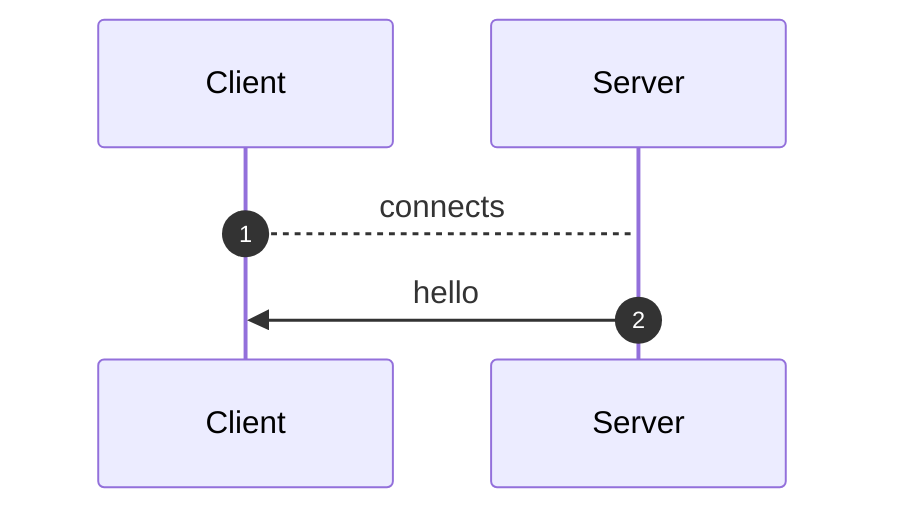
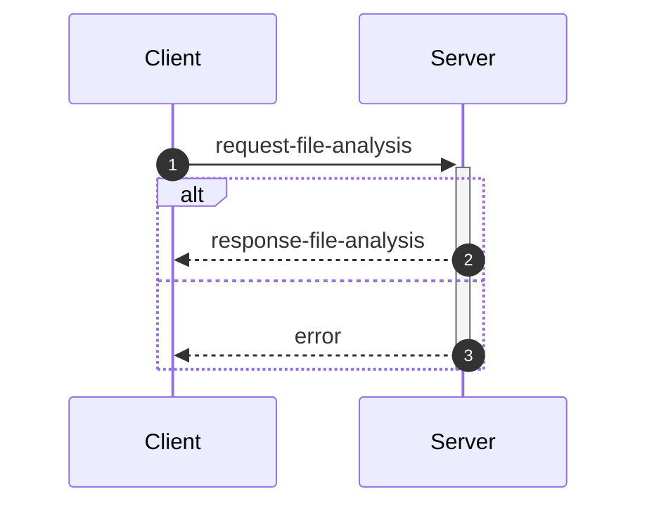
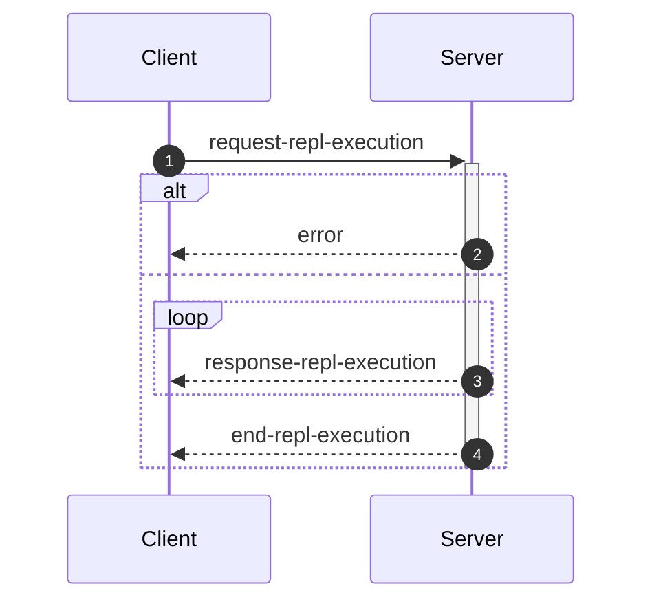
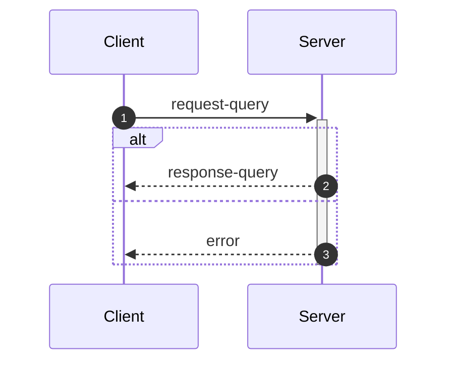

_<span title="an overview of flowR's interface">Generated</span> from '[wiki-interface.ts](https://github.com/flowr-analysis/flowr/tree/main/src/documentation/wiki-interface.ts "src/documentation/wiki-interface.ts")' on 2026-11-11, 22:09:15 UTC (v2.17.5, R v4.6.1), do not edit directly._

Although far from being as detailed as the in-depth explanation of [_flowR_](https://github.com/flowr-analysis/flowr/wiki/Core),
this wiki page explains how to interface with _flowR_ in more detail.
In general, command line arguments and other options provide short descriptions on hover over.

* [💻 Using the REPL](#using-the-repl)
* [⚙️ Configuring FlowR](#configuring-flowr)
* [⚒️ Writing Code](#writing-code)
* [💬 Communicating with the Server](#communicating-with-the-server)

<a id='using-the-repl'></a>
## 💻 Using the REPL

> [!NOTE]
> To execute arbitrary R commands with a repl request, _flowR_ has to be started explicitly with <span title="Description (Command Line Argument): Allow to access the underlying R session when using flowR (security warning: this allows the execution of arbitrary R code!)">`--r-session-access`</span>.
> Please be aware that this introduces a security risk and note that this relies on the [`r-shell` engine](https://github.com/flowr-analysis/flowr/wiki/Engines) .

Although primarily meant for users to explore,
there is nothing which forbids calling _flowR_ as a subprocess to use standard-in, -output, and -error
for communication (although you can access the REPL using the server as well,
with the [REPL Request](#message-request-repl-execution) message).

The read-eval-print loop&nbsp;(REPL) works relatively simple.
You can submit an expression (using <kbd>Enter</kbd>),
which is interpreted as an R&nbsp;expression by default but interpreted as a *command* if it starts with a colon (`:`).
The best command to get started with the REPL is <span title="Description (Repl Command): Show help information (aliases: :h, :?)">`:help`</span>.
Besides, you can leave the REPL either with the command <span title="Description (Repl Command): End the repl (aliases: :q, :exit)">`:quit`</span> or by pressing <kbd>Ctrl</kbd>+<kbd>C</kbd> twice.
When writing a *command*, you may press <kbd>Tab</kbd> to get a list of completions, if available.
Multiple commands can be entered in a single line by separating them with a semicolon (`;`), e.g. `:parse "x<-2"; :df*`.
If a command is given without R code, the REPL will re-use R code given in a previous command.
The prior example will hence return first the parsed AST of the program and then the dataflow graph for `"x <- 2"`.

> [!NOTE]
> If you develop flowR, you may want to launch the repl using the `npm run main-dev` command, this way, you get a non-minified version of flowR with debug information and hot-reloading of source files.

<details>
<summary>Available Commands</summary>

We currently offer the following commands (this with a `[*]` suffix are available with and without the star):

| Command | Description |
| ------- | ----------- |
| **<span title="Description (Repl Command): End the repl (aliases: :q, :exit)">:quit</span>** | End the repl (aliases: **:<span title="Alias of ':quit'. End the repl">q</span>**, **:<span title="Alias of ':quit'. End the repl">exit</span>**) |
| **<span title="Description (Repl Command): Execute the given code as R code. This requires the `--r-session-access` flag to be set and requires the r-shell engine. (aliases: :e, :r)">:execute</span>** | Execute the given code as R code. This requires the `--r-session-access` flag to be set and requires the r-shell engine. (aliases: **:<span title="Alias of ':execute'. Execute the given code as R code. This requires the `--r-session-access` flag to be set and requires the r-shell engine.">e</span>**, **:<span title="Alias of ':execute'. Execute the given code as R code. This requires the `--r-session-access` flag to be set and requires the r-shell engine.">r</span>**) |
| **<span title="Description (Repl Command): Get mermaid code for the control-flow graph of R code (aliases: :cfg, :cf)">:controlflow[*]</span>** | Get mermaid code for the control-flow graph of R code (star: Returns the URL to mermaid.live) (aliases: **:<span title="Alias of ':controlflow'. Get mermaid code for the control-flow graph of R code">cfg</span>**, **:<span title="Alias of ':controlflow'. Get mermaid code for the control-flow graph of R code">cf</span>**) |
| **<span title="Description (Repl Command): Get mermaid code for the control-flow graph with basic blocks (aliases: :cfgb, :cfb)">:controlflowbb[*]</span>** | Get mermaid code for the control-flow graph with basic blocks (star: Returns the URL to mermaid.live) (aliases: **:<span title="Alias of ':controlflowbb'. Get mermaid code for the control-flow graph with basic blocks">cfgb</span>**, **:<span title="Alias of ':controlflowbb'. Get mermaid code for the control-flow graph with basic blocks">cfb</span>**) |
| **<span title="Description (Repl Command): Get mermaid code for the dataflow graph (aliases: :d, :df)">:dataflow[*]</span>** | Get mermaid code for the dataflow graph (star: Returns the URL to mermaid.live) (aliases: **:<span title="Alias of ':dataflow'. Get mermaid code for the dataflow graph">d</span>**, **:<span title="Alias of ':dataflow'. Get mermaid code for the dataflow graph">df</span>**) |
| **<span title="Description (Repl Command): Get mermaid code for the normalized AST of R code (aliases: :n)">:normalize[*]</span>** | Get mermaid code for the normalized AST of R code (star: Returns the URL to mermaid.live) (alias: **:<span title="Alias of ':normalize'. Get mermaid code for the normalized AST of R code">n</span>**) |
| **<span title="Description (Repl Command): Get mermaid code for the simplified dataflow graph (aliases: :ds, :dfs)">:dataflowsimple[*]</span>** | Get mermaid code for the simplified dataflow graph (star: Returns the URL to mermaid.live) (aliases: **:<span title="Alias of ':dataflowsimple'. Get mermaid code for the simplified dataflow graph">ds</span>**, **:<span title="Alias of ':dataflowsimple'. Get mermaid code for the simplified dataflow graph">dfs</span>**) |
| **<span title="Description (Repl Command): Inspect and extend the signature database: `query` (identical to :query @signature), `info <name>` for where a function comes from (identical to :query @function-info), `add <path>` to mount another database/source, `download` to fetch the full-history database. (aliases: :sig)">:signature</span>** | Inspect and extend the signature database: `query` (identical to :query @signature), `info <name>` for where a function comes from (identical to :query @function-info), `add <path>` to mount another database/source, `download` to fetch the full-history database. (alias: **:<span title="Alias of ':signature'. Inspect and extend the signature database: `query` (identical to :query @signature), `info <name>` for where a function comes from (identical to :query @function-info), `add <path>` to mount another database/source, `download` to fetch the full-history database.">sig</span>**) |
| **<span title="Description (Repl Command): Just calculates the DFG, but only prints summary info (aliases: :d#, :df#)">:dataflowsilent</span>** | Just calculates the DFG, but only prints summary info (aliases: **:<span title="Alias of ':dataflowsilent'. Just calculates the DFG, but only prints summary info">d#</span>**, **:<span title="Alias of ':dataflowsilent'. Just calculates the DFG, but only prints summary info">df#</span>**) |
| **<span title="Description (Repl Command): Prints ASCII Art of the parsed, unmodified AST (aliases: :p)">:parse</span>** | Prints ASCII Art of the parsed, unmodified AST (alias: **:<span title="Alias of ':parse'. Prints ASCII Art of the parsed, unmodified AST">p</span>**) |
| **<span title="Description (Repl Command): Prints the version of flowR as well as the current version of R">:version</span>** | Prints the version of flowR as well as the current version of R
| **<span title="Description (Repl Command): Query the given R code (use 'help' for more information)">:query[*]</span>** | Query the given R code (use 'help' for more information) (star: Similar to query, but returns the output in json format.)
| **<span title="Description (Repl Command): Returns an ASCII representation of the dataflow graph (aliases: :df!)">:dataflowascii</span>** | Returns an ASCII representation of the dataflow graph (alias: **:<span title="Alias of ':dataflowascii'. Returns an ASCII representation of the dataflow graph">df!</span>**) |
| **<span title="Description (Repl Command): Returns summarization stats for the normalized AST (aliases: :n#)">:normalize#</span>** | Returns summarization stats for the normalized AST (alias: **:<span title="Alias of ':normalize#'. Returns summarization stats for the normalized AST">n#</span>**) |
| **<span title="Description (Repl Command): Show help information (aliases: :h, :?)">:help</span>** | Show help information (aliases: **:<span title="Alias of ':help'. Show help information">h</span>**, **:<span title="Alias of ':help'. Show help information">?</span>**) |

</details>

> [!TIP]
> 
> As indicated by the examples before, all REPL commands that operate on code keep track of the state.
> Hence, if you run a command like <span title="Description (Repl Command, starred version): Returns the URL to mermaid.live; Base Command: Get mermaid code for the dataflow graph (aliases: :d*, :df*)">`:dataflow*`</span> without providing R code,
> the REPL will re-use the R code provided in a previous command.
> Likewise, doing this will benefit from incrementality!
> If you request the dataflow graph with `:df* x <- 2 * y` and then want to see the parsed AST with `:parse`,
> the REPL will re-use previously obtained information and not re-parse the code again.
> 		

Generally, many commands offer shortcut versions in the REPL. Many queries, for example, offer a shortened format (see the example below).
Of special note, the [Config Query](https://github.com/flowr-analysis/flowr/wiki/%5BQuery%5D-Config)
can be used to also modify the currently active configuration of _flowR_ within the REPL (see the [wiki page](https://github.com/flowr-analysis/flowr/wiki/%5BQuery%5D-Config) for more information).

### Example: Retrieving the Dataflow Graph

To retrieve a URL to the [mermaid](https://mermaid.js.org/) diagram of the dataflow of a given expression,
use <span title="Description (Repl Command, starred version): Returns the URL to mermaid.live; Base Command: Get mermaid code for the dataflow graph (aliases: :d*, :df*)">`:dataflow*`</span> (or <span title="Description (Repl Command): Get mermaid code for the dataflow graph (aliases: :d, :df)">`:dataflow`</span> to get the mermaid code in the cli):

```shell
$ docker run -it --rm eagleoutice/flowr # or npm run flowr 
flowR repl v2.17.5, R grammar v14 (tree-sitter engine)
R> :dataflow* y <- 1 + x
```

<details>
<summary style='color:gray'>Output</summary>

```text
https://mermaid.live/view#base64:eyJjb2RlIjoiZmxvd2NoYXJ0IFREXG4gICAgMXt7XCJgKiM5MTtSTnVtYmVyIzkzOyogKioxKipcbiAgICAgICoxLjYqICgqKmlkOiAxKiopYFwifX1cbiAgICAyKFtcImAqIzkxO1JTeW1ib2wjOTM7KiAqKngqKlxuICAgICAgKjEuMTAqICgqKmlkOiAyKiopYFwiXSlcbiAgICAzW1tcImAqIzkxO1JCaW5hcnlPcCM5MzsqIGJhc2UjNTg7IzU4OyoqIzQzOyoqXG4gICAgICAqMS42LTEwKiAoKippZDogMyoqKVxuICAgIGFyZzogKDEsIDIpYFwiXV1cbiAgICBidWlsdC1pbjpfNDNfW1wiYEJ1aWx0LUluOlxuIzQzO2BcIl1cbiAgICBzdHlsZSBidWlsdC1pbjpfNDNfIHN0cm9rZTpncmF5LGZpbGw6Z3JheSxzdHJva2Utd2lkdGg6MnB4LG9wYWNpdHk6Ljg7XG4gICAgMFtcImAqIzkxO1JTeW1ib2wjOTM7KiAqKnkqKlxuICAgICAgKjEuMSogKCoqaWQ6IDAqKiwgdjogMylgXCJdXG4gICAgNFtbXCJgKiM5MTtSQmluYXJ5T3AjOTM7KiBiYXNlIzU4OyM1ODsqKiM2MDsjNDU7KipcbiAgICAgICoxLjEtMTAqICgqKmlkOiA0KiopXG4gICAgYXJnOiAoMCwgMylgXCJdXVxuICAgIGJ1aWx0LWluOl82MF8tW1wiYEJ1aWx0LUluOlxuIzYwOyM0NTtgXCJdXG4gICAgc3R5bGUgYnVpbHQtaW46XzYwXy0gc3Ryb2tlOmdyYXksZmlsbDpncmF5LHN0cm9rZS13aWR0aDoycHgsb3BhY2l0eTouODtcbiAgICAxIC0uLT58XCJmbG93XCJ8IDJcbiAgICBsaW5rU3R5bGUgMCBzdHJva2U6Z3JheSxjb2xvcjpncmF5O1xuICAgIDIgLS4tPnxcImZsb3dcInwgM1xuICAgIGxpbmtTdHlsZSAxIHN0cm9rZTpncmF5LGNvbG9yOmdyYXk7XG4gICAgMyAtLT58XCJyZWFkcywgYXJnXCJ8IDFcbiAgICAzIC0tPnxcInJlYWRzLCBhcmdcInwgMlxuICAgIDMgLS4tPnxcImZsb3dcInwgMFxuICAgIGxpbmtTdHlsZSA0IHN0cm9rZTpncmF5LGNvbG9yOmdyYXk7XG4gICAgMyAtLi0+fFwicmVhZHMsIGNhbGxzXCJ8IGJ1aWx0LWluOl80M19cbiAgICBsaW5rU3R5bGUgNSBzdHJva2U6Z3JheTtcbiAgICAwIC0tPnxcImRlZmluZWQtYnksIGZsb3dcInwgNFxuICAgIDAgLS0+fFwiZGVmaW5lZC1ieVwifCAzXG4gICAgNCAtLT58XCJyZWFkcywgYXJnXCJ8IDNcbiAgICA0IC0tPnxcInJldHVybnMsIGFyZ1wifCAwXG4gICAgNCAtLi0+fFwicmVhZHMsIGNhbGxzXCJ8IGJ1aWx0LWluOl82MF8tXG4gICAgbGlua1N0eWxlIDEwIHN0cm9rZTpncmF5OyIsIm1lcm1haWQiOnsiYXV0b1N5bmMiOnRydWV9fQ==
```

Retrieve the dataflow graph of the expression `y <- 1 + x`. It looks like this:


<details>

<summary style="color:gray">R Code of the Dataflow Graph</summary>

The analysis ran (parse and normalize with the [tree-sitter](https://github.com/flowr-analysis/flowr/wiki/Engines) engine) in the generation environment. No [signature database](https://github.com/flowr-analysis/flowr/wiki/Signature-Database) is mounted, so `library()` attaches no exports (base-R names are still qualified, e.g., `stats::acf`). 
We encountered no unknown side effects during the analysis.

```r
y <- 1 + x
```

</details>

</details>

For small graphs like this, <span title="Description (Repl Command): Returns an ASCII representation of the dataflow graph (aliases: :df!)">`:dataflowascii`</span> also provides an ASCII representation directly in the REPL:

```shell
$ docker run -it --rm eagleoutice/flowr # or npm run flowr 
flowR repl v2.17.5, R grammar v14 (tree-sitter engine)
R> :df! y <- 1 + x
```

<details open>
<summary style='color:gray'>Output</summary>

```text
                        v<0>v
 c<4>c──────────────────| y |
 |<- |     ┌────────────v---v
 c---c     │
    │   c<3>c   0<1>0
    └───| + |───| 1 |───u<2>u
        c---c   0---0   | x |
           └────────────u---u
Edges:
3 -> 1: reads, arg          3 -> 2: reads, arg
3 -> 0: flows-to            1 -> 2: flows-to
2 -> 3: flows-to            4 -> 3: reads, arg
4 -> 0: returns, arg        0 -> 4: defined-by, flows-to
0 -> 3: defined-by
```

Retrieve the dataflow graph of the expression `y <- 1 + x` as ASCII art.

</details>

For the slicing with <span title="Description (Repl Command): Static backwards executable slicer for R">`:slicer`</span>, you have access to the same [magic comments](#slice-magic-comments) as with the [slice request](#message-request-slice).
Pass `--inline` to splice resolvable `source()` calls into the reconstruction so the slice is a single self-contained R text (the same as the static slice query's `inlineSources` flag).
See `--help` for more flags!

### Example: Interfacing with the File System

Many commands that allow for an R-expression (like <span title="Description (Repl Command, starred version): Returns the URL to mermaid.live; Base Command: Get mermaid code for the dataflow graph (aliases: :d*, :df*)">`:dataflow*`</span>) allow for a file as well
if the argument starts with `file://`.
If you are working from the root directory of the _flowR_ repository, the following gives you the parsed AST of the example file using the <span title="Description (Repl Command): Prints ASCII Art of the parsed, unmodified AST (aliases: :p)">`:parse`</span> command:

> **Watch mode**: Replace `file://` with `watch://` to enter watch mode.
> flowR runs the command immediately and then re-runs it every time the file (or any file inside the folder) changes.
> Enter any other command to leave watch mode.
> For example: `:df watch://analysis.R`

```shell
$ docker run -it --rm eagleoutice/flowr # or npm run flowr 
flowR repl v2.17.5, R grammar v14 (tree-sitter engine)
R> :parse file://test/testfiles/example.R
```

<details>
<summary style='color:gray'>Output</summary>

```text
File: test/testfiles/example.R

program
├ binaryoperator
│ ├ identifier "sum" (1:1─4)
│ ├ <- "<-" (1:5─7)
│ ╰ float "0" (1:8─9)
├ binaryoperator
│ ├ identifier "product" (2:1─8)
│ ├ <- "<-" (2:9─11)
│ ╰ float "1" (2:12─13)
├ binaryoperator
│ ├ identifier "w" (3:1─2)
│ ├ <- "<-" (3:3─5)
│ ╰ float "7" (3:6─7)
├ binaryoperator
│ ├ identifier "N" (4:1─2)
│ ├ <- "<-" (4:3─5)
│ ╰ float "10" (4:6─8)
├ forstatement
│ ├ for "for" (6:1─4)
│ ├ ( "(" (6:5─6)
│ ├ identifier "i" (6:6─7)
│ ├ in "in" (6:8─10)
│ ├ binaryoperator
│ │ ├ float "1" (6:11─12)
│ │ ├ : ":" (6:12─13)
│ │ ╰ parenthesizedexpression
│ │   ├ ( "(" (6:13─14)
│ │   ├ binaryoperator
│ │   │ ├ identifier "N" (6:14─15)
│ │   │ ├ - "-" (6:15─16)
│ │   │ ╰ float "1" (6:16─17)
│ │   ╰ ) ")" (6:17─18)
│ ├ ) ")" (6:18─19)
│ ╰ bracedexpression
│   ├ { "{" (6:20─21)
│   ├ binaryoperator
│   │ ├ identifier "sum" (7:3─6)
│   │ ├ <- "<-" (7:7─9)
│   │ ╰ binaryoperator
│   │   ├ binaryoperator
│   │   │ ├ identifier "sum" (7:10─13)
│   │   │ ├ + "+" (7:14─15)
│   │   │ ╰ identifier "i" (7:16─17)
│   │   ├ + "+" (7:18─19)
│   │   ╰ identifier "w" (7:20─21)
│   ├ binaryoperator
│   │ ├ identifier "product" (8:3─10)
│   │ ├ <- "<-" (8:11─13)
│   │ ╰ binaryoperator
│   │   ├ identifier "product" (8:14─21)
│   │   ├  "" (8:22─23)
│   │   ╰ identifier "i" (8:24─25)
│   ╰ } "}" (9:1─2)
├ call
│ ├ identifier "cat" (11:1─4)
│ ╰ arguments
│   ├ ( "(" (11:4─5)
│   ├ argument
│   │ ╰ string
│   │   ├ stringopen "\"" (11:5─6)
│   │   ├ stringcontent "Sum:" (11:6─10)
│   │   ╰ stringclose "\"" (11:10─11)
│   ├ comma "," (11:11─12)
│   ├ argument
│   │ ╰ identifier "sum" (11:13─16)
│   ├ comma "," (11:16─17)
│   ├ argument
│   │ ╰ string
│   │   ├ stringopen "\"" (11:18─19)
│   │   ├ stringcontent
│   │   │ ╰ escapesequence "\\n" (11:19─21)
│   │   ╰ stringclose "\"" (11:21─22)
│   ╰ ) ")" (11:22─23)
╰ call
  ├ identifier "cat" (12:1─4)
  ╰ arguments
    ├ ( "(" (12:4─5)
    ├ argument
    │ ╰ string
    │   ├ stringopen "\"" (12:5─6)
    │   ├ stringcontent "Product:" (12:6─14)
    │   ╰ stringclose "\"" (12:14─15)
    ├ comma "," (12:15─16)
    ├ argument
    │ ╰ identifier "product" (12:17─24)
    ├ comma "," (12:24─25)
    ├ argument
    │ ╰ string
    │   ├ stringopen "\"" (12:26─27)
    │   ├ stringcontent
    │   │ ╰ escapesequence "\\n" (12:27─29)
    │   ╰ stringclose "\"" (12:29─30)
    ╰ ) ")" (12:30─31)
```

Retrieve the parsed AST of the example file.

<details>

<summary>File Content</summary>

```r
sum <- 0
product <- 1
w <- 7
N <- 10

for (i in 1:(N-1)) {
  sum <- sum + i + w
  product <- product * i
}

cat("Sum:", sum, "\n")
cat("Product:", product, "\n")
```

</details>

As _flowR_ directly transforms this AST the output focuses on being human-readable instead of being machine-readable.
		
</details>

### Example: Run a Query

You can run any query supported by _flowR_ using the <span title="Description (Repl Command): Query the given R code (use 'help' for more information)">`:query`</span> command.
For example, to obtain the shapes of all data frames in a given piece of code, you can run:

```shell
$ docker run -it --rm eagleoutice/flowr # or npm run flowr 
flowR repl v2.17.5, R grammar v14 (tree-sitter engine)
R> :query @absint df-shape "x <- data.frame(a = 1:10, b = 1:10)\ny <- x$a"
```

<details open>
<summary style='color:gray'>Output</summary>

```text
Query: absint (1 ms)
   ╰ $12: (colnames: [{"a", "b"}, {}], cols: [2, 2], rows: [10, 10])
   ╰ $0: (colnames: [{"a", "b"}, {}], cols: [2, 2], rows: [10, 10])
```

Retrieve the shapes of all data frames in the given code.

</details>

To run the linter on a file, you can use (in this example, we just issue the `dead-code` linter on a small piece of code):

```shell
$ docker run -it --rm eagleoutice/flowr # or npm run flowr 
flowR repl v2.17.5, R grammar v14 (tree-sitter engine)
R> :query @linter rules:dead-code "if(FALSE) x <- 2"
```

<details open>
<summary style='color:gray'>Output</summary>

```text
Query: linter (1 ms)
   ╰ Dead Code (dead-code):
       ╰ certain:
           ╰ Code at 1.11-16 (1 quick fix(es) available)
```

Run the linter on the given code, with only the `dead-code` rule enabled.

</details>

For more information on the available queries, please check out the [Query API](https://github.com/flowr-analysis/flowr/wiki/Query-API).

<a id='configuring-flowr'></a>
## ⚙️ Configuring FlowR

When running _flowR_, you may want to specify some behaviors with a dedicated configuration file.
By default, flowR looks for a file named `flowr.json` in the current working directory (or any higher directory).
You can also specify a different file with <span title="Description (Command Line Argument): The name of the configuration file to use">`--config-file`</span> or pass the configuration inline using <span title="Description (Command Line Argument): The flowR configuration to use, as a JSON string">`--config-json`</span>.
A `flowr.json` found this way belongs to the analyzed project, so flowR ignores its options that decide what flowR executes or loads
(`engines.*.wasmPath`, `engines.*.treeSitterWasmPath`, `engines.*.rPath`, `solver.sigdb.additionalPaths`, `solver.sigdb.downloadRepo`, `solver.sigdb.installedLibrary.paths`, `solver.sigdb.onDemand.enabled`, `solver.sigdb.onDemand.repositories`, `solver.sigdb.onDemand.cranMirror`, `solver.sigdb.onDemand.bioconductorMirror`, `solver.sigdb.onDemand.cacheDir`),
unless you pass <span title="Description (Command Line Argument): Keep the security-sensitive options (e.g., the R executable) of the flowr.json found in the working directory or a parent. Only use this for projects you trust.">`--trust-config`</span>.
To analyze code you do not trust, use the secure mode (<span title="Description (Command Line Argument): Run in secure mode for analyzing untrusted code: flowR does not start R (or any other process), does not access the network, does not search for project configs, and ignores security-sensitive options in every config. Cannot be disabled once enabled. Can also be enabled with the environment variable {italic FLOWR_SECURE_MODE=1}.">`--secure`</span>, see the [security policy](https://github.com/flowr-analysis/flowr/blob/main/.github/SECURITY.md)).
To inspect the current configuration, you can run flowr with the <span title="Description (Command Line Argument): Run with verbose logging (will be passed to the corresponding script)">`--verbose`</span> flag, or use the `config` [Query](https://github.com/flowr-analysis/flowr/wiki/Query-API).
Within the REPL this works by running the following:

```shell
:query @config
```

To work with the <a href="https://github.com/flowr-analysis/flowr/tree/main/src/config.ts#L125"><code><span title="The configuration file format for flowR.">FlowrConfig</span></code></a> you can use the provided helper objects alongside its methods like
<a href="https://github.com/flowr-analysis/flowr/tree/main/src/config.ts#L991"><code><span title="Creates a new flowr config that has the updated values.">FlowrConfig::<b>amend</b></span></code></a>.
The schema below documents every option; the ones you most likely want are:

- <a href="https://github.com/flowr-analysis/flowr/wiki/Interface#configuring-flowr" title="Configuration Option (boolean): Whether source calls should be ignored, causing {@link processSourceCall}&#39;s behavior to be skipped.">ignoreSourceCalls</a>: ignore source calls when analyzing the code, i.e., ignore the inclusion of other files.
- <a href="https://github.com/flowr-analysis/flowr/wiki/Interface#configuring-flowr" title="Configuration Option (boolean): Whether load calls should be ignored, causing {@link processLoadCall}&#39;s behavior to be skipped.">ignoreLoadCalls</a>: ignore load calls when analyzing the code, i.e., ignore the loading of r-data files.
- <a href="https://github.com/flowr-analysis/flowr/wiki/Interface#configuring-flowr" title="Configuration Option (object): Do you want to overwrite (parts) of the builtin definition?">semantics.environment.overwriteBuiltIns</a>: overwrite _flowR_'s handling of built-in functions, or clear the preset definitions entirely.
  See [Configure BuiltIn Semantics](#configure-builtin-semantics) for more information.
- <a href="https://github.com/flowr-analysis/flowr/wiki/Interface#configuring-flowr" title="Configuration Option (boolean): Whether calls drawing on a graphics device (e.g., `plot`) count as writing to it, which the ambient state queries then report.">semantics.ambient.drawingWritesDevice</a>: whether calls drawing on a graphics device (e.g., `plot`) count as writing the device in the ambient state queries.
- <a href="https://github.com/flowr-analysis/flowr/wiki/Interface#configuring-flowr" title="Configuration Option (string): How to resolve variables and their values. (one of &quot;disabled&quot;, &quot;alias&quot;, &quot;builtin&quot;)">solver.variables</a>: how to resolve variables and their values (`disabled`, `alias`, `builtin`).
- <a href="https://github.com/flowr-analysis/flowr/wiki/Interface#configuring-flowr" title="Configuration Option (array): The engine or set of engines to use for interacting with R code. An empty array means all available engines will be used.">engines</a> and <a href="https://github.com/flowr-analysis/flowr/wiki/Interface#configuring-flowr" title="Configuration Option (string): The default engine to use for interacting with R code. If this is undefined, an arbitrary engine from the specified list will be used. (one of &quot;tree-sitter&quot;, &quot;r-shell&quot;)">defaultEngine</a>: the engines used to interact with R code, see the [Engines wiki page](https://github.com/flowr-analysis/flowr/wiki/Engines).
- <a href="https://github.com/flowr-analysis/flowr/wiki/Interface#configuring-flowr" title="Configuration Option (array): Files a framework loads on its own, without any source() call (e.g. global.R in a shiny app), in the order they are loaded; flowR orders the matching project files accordingly and analyzes them as one program. Entries are case-insensitive globs matched against the file path, a plain name matches any file with that name, and entries matching no project file are warned about. Usually set per project kind via specializeConfig.">project.implicitSources</a>: the files a framework loads without any `source()` call, in the order in which they are
  loaded. Entries are globs (e.g. `R/*.R`) matched against the file path ignoring capitalization; one matching no file is reported.
- <a href="https://github.com/flowr-analysis/flowr/wiki/Interface#configuring-flowr" title="Configuration Option (object): Overwrite (parts of) the configuration depending on the project kind flowR detects, e.g. to give a shiny app its implicit sources.">specializeConfig</a>: overwrite (parts of) the configuration depending on the kind of project _flowR_ detects
  (e.g. `shiny-app`), which is how a shiny app gets its implicit sources by default. What you configure directly wins.
- <a href="https://github.com/flowr-analysis/flowr/wiki/Interface#configuring-flowr" title="Configuration Option (string): Overwrite the project kind flowR would otherwise infer from the analyzed files, e.g. when auto-detection guesses wrong. (one of &quot;package&quot;, &quot;script&quot;, &quot;shiny-app&quot;, &quot;notebook&quot;, &quot;project&quot;, &quot;unknown&quot;)">project.useProjectType</a>: skip that detection and force a project kind yourself, when auto-detection guesses wrong.
- <a href="https://github.com/flowr-analysis/flowr/wiki/Interface#configuring-flowr" title="Configuration Option (array): The default plugins to load when creating a new instance of FlowrAnalyzer">defaultPlugins</a> and <a href="https://github.com/flowr-analysis/flowr/wiki/Interface#configuring-flowr" title="Configuration Option (array): The plugins to load in REPL mode">repl.plugins</a>: the plugins to load for a new <a href="https://github.com/flowr-analysis/flowr/tree/main/src/project/flowr-analyzer.ts#L242"><code><span title="Central class for conducting analyses with FlowR. Use the FlowrAnalyzerBuilder to create a new instance. If you want the original pattern of creating a pipeline and running all steps, you can still do this with FlowrAnalyzer#runFull . To inspect the context of the analyzer, use FlowrAnalyzer#inspectContext (if you are a plugin and need to modify it, use FlowrAnalyzer#context instead).">FlowrAnalyzer</span></code></a> and in the REPL
  (use `flowr:default` to reference the former).

So you can configure _flowR_ by adding a file like the following:

<details>

<summary>Example Configuration File</summary>

```json
{
  "ignoreSourceCalls": true,
  "ignoreLoadCalls": true,
  "semantics": {
    "environment": {
      "overwriteBuiltIns": {
        "definitions": [
          {
            "type": "function",
            "names": [
              "foo"
            ],
            "processor": "builtin:assign",
            "config": {}
          }
        ]
      }
    }
  },
  "defaultPlugins": [
    "file:description",
    "versions:description"
  ],
  "repl": {
    "quickStats": false,
    "dfProcessorHeat": false,
    "hints": true,
    "plugins": [
      "flowr:default"
    ]
  },
  "project": {
    "resolveUnknownPathsOnDisk": true,
    "implicitSources": [
      "global.R",
      "app.R"
    ]
  },
  "linter": {
    "disabledRules": []
  },
  "specializeConfig": {
    "shiny-app": {
      "project": {
        "implicitSources": [
          "global.R",
          "ui.R",
          "server.R",
          "app.R"
        ]
      }
    }
  },
  "engines": [
    {
      "type": "r-shell"
    }
  ],
  "solver": {
    "variables": "alias",
    "evalStrings": true,
    "trackEnvironments": true,
    "sigdb": {
      "enabled": true,
      "loadProjectDependencies": true,
      "eagerlyLoad": false,
      "eagerlyLoadExports": false,
      "linkBaseR": false,
      "linkDescriptionDependencies": false
    },
    "resolveSource": {
      "dropPaths": "no",
      "ignoreCapitalization": true,
      "inferWorkingDirectory": "active-script",
      "searchPath": []
    },
    "instrument": {},
    "slicer": {
      "threshold": 50
    }
  },
  "abstractInterpretation": {
    "wideningThreshold": 4,
    "followCalls": true,
    "dataFrame": {
      "maxColNames": 20,
      "readLoadedData": {
        "readExternalFiles": true,
        "maxReadLines": 1000000
      }
    }
  },
  "incremental": {
    "alwaysIncremental": false,
    "parsing": {
      "activated": false,
      "heuristics": {
        "activated": true,
        "mtime": true,
        "linesFrom": 500,
        "bytesFrom": 50000,
        "alwaysWithEdits": false,
        "minFiles": 1
      }
    }
  },
  "gas": {
    "thresholds": {
      "memory": {
        "problematic": 0.7,
        "critical": 0.9
      },
      "timeMs": {
        "problematic": 100000,
        "critical": 120000
      }
    },
    "features": {}
  }
}
```

</details>

<details>
<a id='configure-builtin-semantics'></a>
<summary>Configure Built-In Semantics</summary>

`semantics/environment/overwriteBuiltins` accepts two keys:

- `loadDefaults` (boolean, initially `true`): If set to `true`, the default built-in definitions are loaded before applying the custom definitions. Setting this flag to `false` explicitly disables the loading of the default definitions.
- `definitions` (array, initially empty): Allows to overwrite or define new built-in elements. Each object within must have a `type` which is one of the below. Furthermore, they may define a string array of `names` which specifies the identifiers to bind the definitions to. You may use `assumePrimitive` to specify whether _flowR_ should assume that this is a primitive non-library definition (so you probably just do not want to specify the key).

  | Type            | Description                                                                                                                                                                                                                                                                                              | Example                                                                                                    |
  | --------------- | -------------------------------------------------------------------------------------------------------------------------------------------------------------------------------------------------------------------------------------------------------------------------------------------------------- | ---------------------------------------------------------------------------------------------------------- |
  | `constant`    | Additionally allows for a `value` this should resolve to.                                                                                                                                                                                                                                                | `{ type: 'constant', names: ['NULL', 'NA'],  value: null }`                                                |
  | `function`    | Is a rather flexible way to define and bind built-in functions. For the time, we do not have extensive documentation to cover all the cases, so please either consult the sources with the `default-builtin-config/` folder or open a [new issue](https://github.com/flowr-analysis/flowr/issues/new/choose). | `{ type: 'function', names: ['next'], processor: 'builtin:d', config: { cfg: ExitPointType.Next } }` |
  | `replacement` | A comfortable way to specify replacement functions like `$<-` or `names<-`. `suffixes` describes the... suffixes to attach automatically. | `{ type: 'replacement', suffixes: ['<-', '<<-'], names: ['[', '[['] }` |

</details>

<details>

<summary style='color:gray'>Full Configuration-File Schema</summary>

- _The configuration file format for flowR._ (object)
    - **logLevel** [optional] _flowR's global minimum log level, applied when the config is loaded._ (string)
        Only allows: 'silly', 'trace', 'debug', 'info', 'warn', 'error', 'fatal'
    - **ignoreSourceCalls** [optional] _Whether source calls should be ignored, causing {@link processSourceCall}'s behavior to be skipped._ (boolean)
    - **ignoreLoadCalls** [optional] _Whether load calls should be ignored, causing {@link processLoadCall}'s behavior to be skipped._ (boolean)
    - **semantics** _Configure language semantics and how flowR handles them._ (object)
        - **environment** [optional] _Semantics regarding how to handle the R environment._ (object)
            - **overwriteBuiltIns** [optional] _Do you want to overwrite (parts) of the builtin definition?_ (object)
                - **loadDefaults** [optional] _Should the default configuration still be loaded?_ (boolean)
                - **definitions** [optional] _The definitions to load/overwrite._ (array)
                Valid item types:
                    - (object)
        - **ambient** [optional] _Semantics regarding the global state (options, devices, files, ...) calls access._ (object)
            - **drawingWritesDevice** [optional] _Whether calls drawing on a graphics device (e.g., `plot`) count as writing to it, which the ambient state queries then report._ (boolean)
    - **defaultPlugins** [optional] _The default plugins to load when creating a new instance of FlowrAnalyzer_ (array)
    Valid item types:
        - (alternatives)
            - (string)
            - (array)
    - **repl** _Configuration options for the REPL._ (object)
        - **quickStats** [optional] _Whether to show quick stats in the REPL after each evaluation._ (boolean)
        - **dfProcessorHeat** [optional] _This instruments the dataflow processors to count how often each processor is called._ (boolean)
        - **hints** [optional] _Whether to show dim inline hints on the empty prompt (automatically disabled on non-interactive terminals)._ (boolean)
        - **plugins** [optional] _The plugins to load in REPL mode_ (array)
        Valid item types:
            - (alternatives)
                - (string)
                - (array)
        - **autoUseFileProtocol** [optional] _Prepend the file protocol to a repl input that looks like a path, instead of only warning about it._ (boolean)
        - **queryStats** [optional] _Whether `:query` closes with the line stating how long the queries took (`:query*` never prints it)._ (boolean)
        - **showPlugins** [optional] _Whether `:version` grays out the plugins that did not activate during the last analysis._ (boolean)
    - **project** _Project specific configuration options._ (object)
        - **resolveUnknownPathsOnDisk** [optional] _Whether to resolve unknown paths loaded by the r project disk when trying to source/analyze files._ (boolean)
        - **failOnInaccessiblePath** [optional] _Whether a directory that cannot be traversed during file discovery (e.g. due to permissions) aborts the analysis; when false (the default) such paths are logged and skipped._ (boolean)
        - **basePackages** [optional] _The packages considered part of R itself (base and recommended); if unset, flowR uses its built-in list._ (array)
        Valid item types:
            - (string)
        - **implicitSources** [optional] _Files a framework loads on its own, without any source() call (e.g. global.R in a shiny app), in the order they are loaded; flowR orders the matching project files accordingly and analyzes them as one program. Entries are case-insensitive globs matched against the file path, a plain name matches any file with that name, and entries matching no project file are warned about. Usually set per project kind via specializeConfig._ (array)
        Valid item types:
            - (string)
        - **useProjectType** [optional] _Overwrite the project kind flowR would otherwise infer from the analyzed files, e.g. when auto-detection guesses wrong._ (string)
            Only allows: 'package', 'script', 'shiny-app', 'notebook', 'project', 'unknown'
        - **assumeImplicitEcho** [optional] _Whether the top level of the analyzed code is echoed, so that every visible result printed there is collected as an output by the dependencies query (default true, false for a package)._ (boolean)
        - **discovery** [optional] _Scoping options for the default project discovery._ (object)
            - **full** [optional] _Collect every file below the project root (greedy) instead of only the files the detected project kind needs (default false)._ (boolean)
            - **perKind** [optional] _Per-kind include/exclude glob overrides layered on the default scoping._ (object)
            - **ignore** [optional] _Case-insensitive globs that drop matching files from the intelligent discovery, regardless of kind (e.g. .Renviron to ignore environment files)._ (array)
            Valid item types:
                - (string)
        - **classification** [optional] _Overrides for the signals flowR uses to classify the project kind._ (object)
            - **shinyDescriptionTypes** [optional] _DESCRIPTION Type: values that mark a shiny app._ (array)
            Valid item types:
                - (string)
            - **shinyEntryFiles** [optional] _File names a shiny app is assembled from._ (array)
            Valid item types:
                - (string)
            - **shinyUsagePattern** [optional] _Regex source evidencing shiny usage in an entry file._ (string)
            - **notebookExtensions** [optional] _File extensions marking a notebook._ (array)
            Valid item types:
                - (string)
    - **linter** _Linter configuration options._ (object)
        - **disabledRules** _Linting rule names excluded from the default rule set (a rule requested explicitly via a linter query still runs). Usually set per project kind via specializeConfig._ (array)
        Valid item types:
            - (string)
        - **disabledTags** [optional] _Linting rule tags whose rules are excluded from the default rule set (a rule requested explicitly via a linter query still runs). By default the cmd-check rules are disabled for everything but a package; a configured list replaces that default._ (array)
        Valid item types:
            - (string)
    - **inputSources** [optional] _Further frameworks the input-sources analysis should know about; entries are added to flowR's defaults._ (object)
        - **pure** [optional] _Functions that only pass the constantness of their arguments on._ (array)
        Valid item types:
            - (string)
        - **param** [optional] _Functions whose result is a 'param' input._ (array)
        Valid item types:
            - (string)
        - **file** [optional] _Functions whose result is a 'file' input._ (array)
        Valid item types:
            - (string)
        - **tempfile** [optional] _Functions whose result is a 'tempfile' input._ (array)
        Valid item types:
            - (string)
        - **glob** [optional] _Functions whose result is a 'glob' input._ (array)
        Valid item types:
            - (string)
        - **net** [optional] _Functions whose result is a 'net' input._ (array)
        Valid item types:
            - (string)
        - **rand** [optional] _Functions whose result is a 'rand' input._ (array)
        Valid item types:
            - (string)
        - **system** [optional] _Functions whose result is a 'system' input._ (array)
        Valid item types:
            - (string)
        - **ffi** [optional] _Functions whose result is a 'ffi' input._ (array)
        Valid item types:
            - (string)
        - **lang** [optional] _Functions whose result is a 'lang' input._ (array)
        Valid item types:
            - (string)
        - **options** [optional] _Functions whose result is a 'options' input._ (array)
        Valid item types:
            - (string)
        - **cmdline** [optional] _Functions whose result is a 'cmdline' input._ (array)
        Valid item types:
            - (string)
        - **user** [optional] _Functions whose result is a 'user' input._ (array)
        Valid item types:
            - (string)
        - **const** [optional] _Functions whose result is a 'const' input._ (array)
        Valid item types:
            - (string)
        - **scope** [optional] _Functions whose result is a 'scope' input._ (array)
        Valid item types:
            - (string)
        - **dconst** [optional] _Functions whose result is a 'dconst' input._ (array)
        Valid item types:
            - (string)
        - **unknown** [optional] _Functions whose result is a 'unknown' input._ (array)
        Valid item types:
            - (string)
        - **linkedObjects** [optional] _Objects a framework provides without a definition in the code, e.g. shiny's input._ (array)
        Valid item types:
            - (object)
        - **linkedEntryPoints** [optional] _Calls that hand a function to a framework, which binds its objects to the parameters by position._ (array)
        Valid item types:
            - (object)
    - **specializeConfig** [optional] _Overwrite (parts of) the configuration depending on the project kind flowR detects, e.g. to give a shiny app its implicit sources._ (object)
    - **engines** _The engine or set of engines to use for interacting with R code. An empty array means all available engines will be used._ (array)
    Valid item types:
        - (alternatives)
            - _The configuration for the tree sitter engine._ (object)
                - **type** [required] _Use the tree sitter engine._ (string)
                    Only allows: 'tree-sitter'
                - **wasmPath** [optional] _The path to the tree-sitter-r WASM binary to use. If this is undefined, this uses the default path._ (string)
                - **treeSitterWasmPath** [optional] _The path to the tree-sitter WASM binary to use. If this is undefined, this uses the default path._ (string)
                - **lax** [optional] _Whether to use the lax parser for parsing R code (allowing for syntax errors). If this is undefined, the strict parser will be used._ (boolean)
            - _The configuration for the R shell engine._ (object)
                - **type** [required] _Use the R shell engine._ (string)
                    Only allows: 'r-shell'
                - **rPath** [optional] _The path to the R executable to use. If this is undefined, this uses the default path._ (string)
                - **pipeBind** [optional] _Whether to enable R's experimental pipe-bind operator "=>" by setting _R_USE_PIPEBIND_ for the R session (default false); R itself keeps this off by default, as it is experimental and has never shipped in a release version of R._ (boolean)
    - **defaultEngine** [optional] _The default engine to use for interacting with R code. If this is undefined, an arbitrary engine from the specified list will be used._ (string)
        Only allows: 'tree-sitter', 'r-shell'
    - **solver** _How to resolve constants, constraints, cells, ..._ (object)
        - **variables** _How to resolve variables and their values._ (string)
            Only allows: 'disabled', 'alias', 'builtin'
        - **evalStrings** _Should we include eval(parse(text="...")) calls in the dataflow graph?_ (boolean)
        - **trackEnvironments** [optional] _Track user-created environments (new.env, assign/get/local with envir=, dollar-assign, attach). When false, all envir-style calls fall through conservatively._ (boolean)
        - **sigdb** _Resolving library exports from a signature database._ (object)
            - **enabled** [optional] _Resolve library()/use() exports from a signature database (default true); when false no database is consulted._ (boolean)
            - **loadProjectDependencies** [optional] _Load the project's declared dependencies from its metadata files (DESCRIPTION Imports/Depends, rproject.toml, uvr.toml, rig rproj.toml and script blocks, renv.lock, rv.lock, uvr.lock, rig lockfiles) (default true); when false these files are not read for dependencies._ (boolean)
            - **eagerlyLoad** [optional] _Parse the database up front rather than on the first package load (default false, ignored if disabled)._ (boolean)
            - **eagerlyLoadExports** [optional] _Add a vertex for every export on load rather than on demand (default false); keeps the dataflow graph small._ (boolean)
            - **assumedRVersion** [optional] _R version assumed when resolving versioned (base-R) exports: a pin like "4.5" or "auto" to detect the installed R (default "auto")._ (string)
            - **linkBaseR** [optional] _Eagerly attach base-R namespaces so bare base calls resolve without library() (default false)._ (boolean)
            - **linkBaseRCalls** [optional] _Add a lightweight Reads edge from a bare base-R call to its signature-database function vertex (default false; base-R qualification is edge-free otherwise)._ (boolean)
            - **linkPackageCalls** [optional] _Add a lightweight Reads edge from a resolved package call to its signature-database function vertex (default false)._ (boolean)
            - **linkDescriptionDependencies** [optional] _Eagerly attach the namespaces of the project's declared DESCRIPTION dependencies (Imports/Depends) so their exports resolve without an explicit library() (default false)._ (boolean)
            - **warmInBackground** [optional] _Decompress the hot shards (base + most-downloaded) in a background task on startup so the first library() lookup is warm (default false; for long-running servers/REPLs)._ (boolean)
            - **additionalPaths** [optional] _Extra directories or bundle/manifest files searched for signature databases (alongside the shipped default and $FLOWR_SIGDB_DIR); a downloaded full-history bundle placed here is mounted automatically._ (array)
            Valid item types:
                - (string)
            - **downloadRepo** [optional] _GitHub owner/repo the full-history bundle is downloaded from via ":signature download" (default "flowr-analysis/flowr"; the release tag comes from the committed sigdb.remote.json unless a version is given)._ (string)
            - **autoSync** [optional] _On startup, re-download shards whose committed sigdb.remote.json hash no longer matches the cache, in the background (default false; opt-in network sync after a git pull)._ (boolean)
            - **installedLibrary** [optional] _Recovering packages no signature database knows from the copy installed on this machine._ (object)
                - **enabled** [required] _Recover packages no signature database knows from their installed copy (default false)._ (boolean)
                - **paths** [optional] _Library directories to search; when empty they are discovered from the environment and the project._ (array)
                Valid item types:
                    - (string)
                - **useEnvironment** [optional] _Search the libraries R_LIBS_USER/R_LIBS/R_LIBS_SITE name (default true)._ (boolean)
                - **useProjectLibrary** [optional] _Search a project-local renv/packrat library (default true)._ (boolean)
                - **maxDepth** [optional] _How far to descend into the nested layout of a project-local library (default 3)._ (number)
                - **packages** [optional] _Only recover packages whose name matches one of these regular expressions; empty means any._ (array)
                Valid item types:
                    - (string)
            - **onDemand** [optional] _Recovering packages no signature database knows from their sources on CRAN, Bioconductor, or GitHub._ (object)
                - **enabled** [required] _Fetch and recover the sources of packages no signature database knows when the analyzed code uses them (default false, accesses the network)._ (boolean)
                - **sources** [optional] _Where to look, in order: github, cran, bioconductor, or a source a plugin adds (default ["github", "cran", "bioconductor"])._ (array)
                Valid item types:
                    - (string)
                - **repositories** [optional] _GitHub repositories (owner/repo[/subdir][@ref]) to fetch packages from, by package name. The analyzed project may name more (DESCRIPTION Remotes, install_github calls)._ (object)
                - **packages** [optional] _Only recover packages whose name matches one of these regular expressions, empty means any._ (array)
                Valid item types:
                    - (string)
                - **cranMirror** [optional] _The CRAN src/contrib/ to fetch from, over https (default https://cloud.r-project.org/src/contrib/). It may be on the local network._ (string)
                - **bioconductorMirror** [optional] _The Bioconductor host, over https (default https://bioconductor.org). It may be on the local network._ (string)
                - **bioconductorRelease** [optional] _The Bioconductor release to fetch from: release, devel, or a number like 3.20 (default release)._ (string)
                - **githubMirrors** [optional] _Use the GitHub mirrors of CRAN (cran/<pkg>) and Bioconductor (bioc/<pkg>) (default true)._ (boolean)
                - **maxPackages** [optional] _The most packages to fetch for one analysis (default 25)._ (number)
                - **maxArchiveMb** [optional] _The most MiB a package archive may have (default 32). It may unpack to three times that, at most 128 MiB._ (number)
                - **offline** [optional] _Only use what was fetched before, never the network (default false)._ (boolean)
                - **retryAfterHours** [optional] _How many hours to wait before asking again for a package no source had (default 24)._ (number)
                - **cacheDir** [optional] _Where to cache what was fetched (default the on-demand directory of the signature cache)._ (string)
            - **blobCacheBudgetMb** [optional] _How many MiB of decoded package blobs every open bundle may hold together (default 16)._ (number)
            - **versionSelection** [optional] _When a project constrains a dependency, resolve to the newest (default), oldest, or system-installed version satisfying it; system needs R and falls back to newest. Base-R packages always resolve against the assumed R version._ (string)
                Only allows: 'newest', 'oldest', 'system'
            - **versionOverrides** [optional] _Force an exact version for specific packages (name -> version), overriding both the project constraint and the versionSelection policy (default {})._ (object)
        - **versionManagement** _Policies for reasoning about dependency versions._ (object)
            - **linkedVersionGroups** [optional] _Groups of packages that must resolve to the same version; version guessing intersects each group so its members stay mutually compatible (default [])._ (array)
            Valid item types:
                - (array)
                Valid item types:
                    - (string)
        - **assumeAttachedPackages** [optional] _Packages to treat as attached without a `library()` call, so what the built-in configuration states about them applies to the analyzed code. The base packages R attaches on startup already resolve without it._ (array)
        Valid item types:
            - (string)
        - **transitiveSideEffectRounds** [optional] _How many rounds the transitive side-effect fixpoint may run before it is cut off (default 32); the propagation stops on its own as soon as a round adds nothing._ (number)
        - **maxOverlayDepth** [optional] _How many binding overlays may stack on one environment frame before a write flattens them (default 4); a pure performance knob, trading lookup cost against copy cost without changing any result._ (number)
        - **instrument** (object)
            - **dataflowExtractors** [optional] _These keys are only intended for use within code, allowing to instrument the dataflow analyzer!_ (any)
        - **resolveSource** [optional] _If lax source calls are active, flowR searches for sourced files much more freely, based on the configurations you give it. This option is only in effect if `ignoreSourceCalls` is set to false._ (object)
            - **dropPaths** _Allow to drop the first or all parts of the sourced path, if it is relative._ (string)
                Only allows: 'no', 'once', 'all'
            - **ignoreCapitalization** _Search for filenames matching in the lowercase._ (boolean)
            - **inferWorkingDirectory** _Try to infer the working directory from the main or any script to analyze._ (string)
                Only allows: 'no', 'main-script', 'active-script', 'any-script'
            - **searchPath** _Additionally search in these paths._ (array)
            Valid item types:
                - (string)
            - **repeatedSourceLimit** [optional] _How often the same file can be sourced within a single run? Please be aware: in case of cyclic sources this may not reach a fixpoint so give this a sensible limit._ (number)
            - **applyReplacements** _Provide name replacements for loaded files_ (array)
            Valid item types:
                - (object)
            - **assumeFilesExist** [optional] _Assume a sourced file is always there, making what it defines certain instead of conditional on the source call._ (boolean)
        - **slicer** [optional] _The configuration for the slicer._ (object)
            - **threshold** [optional] _The maximum number of iterations to perform on a single function call during slicing._ (number)
            - **autoExtend** [optional] _If set, the slicer will gain an additional post-pass._ (boolean)
    - **abstractInterpretation** _The configuration options for abstract interpretation._ (object)
        - **wideningThreshold** _The threshold for the number of visitations of a node at which widening should be performed to ensure the termination of the fixpoint iteration._ (number)
        - **followCalls** _Whether the abstract interpretation is interprocedural, i.e. whether it steps into the functions a call may dispatch to._ (boolean)
        - **dataFrame** _The configuration of the shape inference for data frames._ (object)
            - **maxColNames** _The maximum number of columns names to infer for data frames before over-approximating the column names to top._ (number)
            - **readLoadedData** _Configuration options for reading data frame shapes from loaded external data files, such as CSV files._ (object)
                - **readExternalFiles** _Whether data frame shapes should be extracted from loaded external files, such as CSV files._ (boolean)
                - **maxReadLines** _The maximum number of lines to read when extracting data frame shapes from loaded files, such as CSV files._ (number)
    - **incremental** (object)
        - **alwaysIncremental** _Always take the incremental path, regardless of heuristics._ (boolean)
        - **parsing** (object)
            - **activated** _If set, incremental parsing will be used._ (boolean)
            - **heuristics** (object)
                - **activated** [optional] _If set, the heuristics for incremental parsing will be used._ (boolean)
                - **mtime** [optional] _Skip reparsing entirely if the file's modification time is unchanged since the last parse._ (boolean)
                - **linesFrom** [optional] _Only consider incremental parsing for files with at least this many lines._ (number)
                - **bytesFrom** [optional] _Only consider incremental parsing for files with at least this many bytes._ (number)
                - **alwaysWithEdits** [optional] _Always take the incremental path whenever there is a computed edit region, regardless of the other thresholds._ (boolean)
                - **minFiles** [optional] _Only apply these heuristics once the project has at least this many files loaded._ (number)
    - **gas** [optional] _Resource-usage guard (gas) configuration. All feature factors default to 0 (disabled). See https://github.com/flowr-analysis/flowr/wiki/Core#gas-resource-guard._ (object)
        - **thresholds** [optional] _Thresholds for all gas checks (scaled by per-feature factor), boundable per feature._ (object)
            - **memory** [optional] _Heap-usage fraction thresholds (0-1), either shared or given per feature key (with `default` covering the rest)._ (object)
                - **problematic** [optional] _Heap fraction (0-1) above which Problematic is returned, for every feature without an entry of its own._ (number)
                - **critical** [optional] _Heap fraction (0-1) above which Critical is returned, for every feature without an entry of its own._ (number)
            - **timeMs** [optional] _Elapsed analysis time thresholds in milliseconds, either shared or given per feature key (with `default` covering the rest)._ (object)
                - **problematic** [optional] _Elapsed ms above which Problematic is returned, for every feature without an entry of its own._ (number)
                - **critical** [optional] _Elapsed ms above which Critical is returned, for every feature without an entry of its own._ (number)
            - **steps** [optional] _Processed-AST-node thresholds, counted rather than sampled; only a key that arms a budget (`dataflow`) reads them._ (object)
                - **problematic** [optional] _Processed AST nodes above which Problematic is returned, for every feature without an entry of its own._ (number)
                - **critical** [optional] _Processed AST nodes above which the extraction is cut short, for every feature without an entry of its own._ (number)
            - **vertices** [optional] _Created-dataflow-vertex thresholds, counted like `steps`._ (object)
                - **problematic** [optional] _Created dataflow vertices above which Problematic is returned, for every feature without an entry of its own._ (number)
                - **critical** [optional] _Created dataflow vertices above which the extraction is cut short, for every feature without an entry of its own._ (number)
        - **features** [optional] _Per-feature sensitivity factors. 0 or absent disables gas checking for that feature. A factor of 2 makes the feature twice as sensitive. Recognised keys: `source`, `side-effect-linking`, `linter`, `slicer`, `dataflow`._ (object)
        - **countedCheckEvery** [optional] _How many counted steps pass between two accountings of an armed check, be it a dataflow budget or the slicer's traversal (default 128); trades overshoot against the cost of the check._ (number)
        - **heapProvider** [optional] _Custom heap statistics source (programmatic configs only), overriding the built-in v8/performance.memory detection._ (function)

</details>

<a id='writing-code'></a>
## ⚒️ Writing Code

_flowR_ can be used as a [module](https://www.npmjs.com/package/@eagleoutice/flowr) and offers several main classes and interfaces that are interesting for extension writers 
(see the [Visual Studio Code extension](https://marketplace.visualstudio.com/items?itemName=code-inspect.vscode-flowr) or the [Core](https://github.com/flowr-analysis/flowr/wiki/Core) wiki page for more information).

### Creating Analyses with _flowR_

Nowadays, instances of the <a href="https://github.com/flowr-analysis/flowr/tree/main/src/project/flowr-analyzer.ts#L242"><code><span title="Central class for conducting analyses with FlowR. Use the FlowrAnalyzerBuilder to create a new instance. If you want the original pattern of creating a pipeline and running all steps, you can still do this with FlowrAnalyzer#runFull . To inspect the context of the analyzer, use FlowrAnalyzer#inspectContext (if you are a plugin and need to modify it, use FlowrAnalyzer#context instead).">FlowrAnalyzer</span></code></a> should be used as central frontend to get analysis results from _flowR_.
The entry points an analysis is written against are re-exported from the package root (`import { FlowrAnalyzerBuilder } from '@eagleoutice/flowr'`);
everything else stays reachable under its own path, as in `@eagleoutice/flowr/dataflow/graph/graph`.
For example, a program slice can be created like this:

```ts
const analyzer = await new FlowrAnalyzerBuilder()
    .setEngine('tree-sitter')
    .build();
analyzer.addRequest('x <- 1\ny <- x\nx');
const { slice, reconstruct } = await analyzer.query({
    type:     'static-slice',
    criteria: ['3@x']
});
```

For more information, please have a look at the [Analyzer](https://github.com/flowr-analysis/flowr/wiki/Analyzer) wiki page, which explains how to construct and use the <a href="https://github.com/flowr-analysis/flowr/tree/main/src/project/flowr-analyzer.ts#L242"><code><span title="Central class for conducting analyses with FlowR. Use the FlowrAnalyzerBuilder to create a new instance. If you want the original pattern of creating a pipeline and running all steps, you can still do this with FlowrAnalyzer#runFull . To inspect the context of the analyzer, use FlowrAnalyzer#inspectContext (if you are a plugin and need to modify it, use FlowrAnalyzer#context instead).">FlowrAnalyzer</span></code></a> in more detail.
To work with specific perspectives, you can also consult the respective pages like the [Dataflow Graph](https://github.com/flowr-analysis/flowr/wiki/Dataflow-Graph) or the [Abstract Interpretation](https://github.com/flowr-analysis/flowr/wiki/Abstract-Interpretation) wiki pages.
### The Pipeline Executor (Low-Level Interface)

Once, in the beginning, _flowR_ was meant to produce a dataflow graph merely to provide *program slices*. 
However, with continuous updates, the [Dataflow Graph](https://github.com/flowr-analysis/flowr/wiki/Dataflow-Graph) repeatedly proves to be the more interesting part.
With this, we restructured _flowR_'s originally *hardcoded* pipeline to be far more flexible. 
Now, it can be theoretically extended or replaced with arbitrary steps, optional steps, and what we call 'decorations' of these steps. 
In short, a slicing pipeline using the <a href="https://github.com/flowr-analysis/flowr/tree/main/src/core/pipeline-executor.ts#L97"><code><span title="**Please note:** The PipelineExecutor is now considered to be a rather low-level API for flowR. While it still works and is the basis for all other layers, we strongly recommend using the FlowrAnalyzer and its builder to create and use an analyzer instance that is pre-configured for your use-case. The pipeline executor allows to execute arbitrary pipelines in a step-by-step fashion. If you are not...">PipelineExecutor</span></code></a> looks like this:

```ts

const slicer = new PipelineExecutor(DEFAULT_SLICING_PIPELINE, {
  parser:    new RShell(),
  request:   requestFromInput('x <- 1\nx + 1'),
  criterion: ['2@x']
})
const slice = await slicer.allRemainingSteps()
// console.log(slice.reconstruct.code)
```

<details><summary>More Information</summary>

If you compare this, with what you would have done with the old (and removed) `SteppingSlicer`, 
this essentially just requires you to replace the `SteppingSlicer` with the <a href="https://github.com/flowr-analysis/flowr/tree/main/src/core/pipeline-executor.ts#L97"><code><span title="**Please note:** The PipelineExecutor is now considered to be a rather low-level API for flowR. While it still works and is the basis for all other layers, we strongly recommend using the FlowrAnalyzer and its builder to create and use an analyzer instance that is pre-configured for your use-case. The pipeline executor allows to execute arbitrary pipelines in a step-by-step fashion. If you are not...">PipelineExecutor</span></code></a>
and to pass the <a href="https://github.com/flowr-analysis/flowr/tree/main/src/core/steps/pipeline/default-pipelines.ts#L18"><code>DEFAULT_SLICING_PIPELINE</code></a> as the first argument.
The <a href="https://github.com/flowr-analysis/flowr/tree/main/src/core/pipeline-executor.ts#L97"><code><span title="**Please note:** The PipelineExecutor is now considered to be a rather low-level API for flowR. While it still works and is the basis for all other layers, we strongly recommend using the FlowrAnalyzer and its builder to create and use an analyzer instance that is pre-configured for your use-case. The pipeline executor allows to execute arbitrary pipelines in a step-by-step fashion. If you are not...">PipelineExecutor</span></code></a>...

1. Provides structures to investigate the results of all intermediate steps
2. Can be executed step-by-step
3. Can repeat steps (e.g., to calculate multiple slices on the same input)

See the in-code documentation for more information.

</details>

### Using the <a href="https://github.com/flowr-analysis/flowr/tree/main/src/r-bridge/shell.ts#L144"><code><span title="The RShell represents an interactive session with the R interpreter. You can configure it by RShellOptions . At the moment we are using a live R session (and not networking etc.) to communicate with R easily, which allows us to install packages etc. However, this might and probably will change in the future (leaving this as a legacy mode :D)">RShell</span></code></a> to Interact with R

The <a href="https://github.com/flowr-analysis/flowr/tree/main/src/r-bridge/shell.ts#L144"><code><span title="The RShell represents an interactive session with the R interpreter. You can configure it by RShellOptions . At the moment we are using a live R session (and not networking etc.) to communicate with R easily, which allows us to install packages etc. However, this might and probably will change in the future (leaving this as a legacy mode :D)">RShell</span></code></a> class allows interfacing with the `R`&nbsp;ecosystem installed on the host system.
Please have a look at [flowR's Engines](https://github.com/flowr-analysis/flowr/wiki/Engines) for more information on alternatives (for example, the <a href="https://github.com/flowr-analysis/flowr/tree/main/src/r-bridge/lang-4.x/tree-sitter/tree-sitter-executor.ts#L29"><code><span title="Synchronous and (way) faster alternative to the RShell using tree-sitter.">TreeSitterExecutor</span></code></a>).

> [!IMPORTANT]
> 
> Each <a href="https://github.com/flowr-analysis/flowr/tree/main/src/r-bridge/shell.ts#L144"><code><span title="The RShell represents an interactive session with the R interpreter. You can configure it by RShellOptions . At the moment we are using a live R session (and not networking etc.) to communicate with R easily, which allows us to install packages etc. However, this might and probably will change in the future (leaving this as a legacy mode :D)">RShell</span></code></a> controls a new instance of the R&nbsp;interpreter, 
> make sure to call <code><a href="https://github.com/flowr-analysis/flowr/tree/main/src/r-bridge/shell.ts#L350"><span title="Close the current R session, makes the object effectively invalid (can no longer be reopened etc.)">RShell::<i>close</i></span></a>()</code> when you are done.

You can start a new "session" by constructing a new object with <code>new <a href="https://github.com/flowr-analysis/flowr/tree/main/src/r-bridge/shell.ts#L144"><span title="The RShell represents an interactive session with the R interpreter. You can configure it by RShellOptions . At the moment we are using a live R session (and not networking etc.) to communicate with R easily, which allows us to install packages etc. However, this might and probably will change in the future (leaving this as a legacy mode :D)">RShell</span></a>()</code>.

However, there are several options that may be of interest 
(e.g., to automatically revive the shell in case of errors or to control the name location of the R process on the system).

With a shell object (let's call it `shell`), you can execute R code by using <a href="https://github.com/flowr-analysis/flowr/tree/main/src/r-bridge/shell.ts#L213"><code><span title="sends the given command directly to the current R session will not do anything to alter input markers!">RShell::<i>sendCommand</i></span></code></a>,
for example <code>shell.<a href="https://github.com/flowr-analysis/flowr/tree/main/src/r-bridge/shell.ts#L213"><span title="sends the given command directly to the current R session will not do anything to alter input markers!">sendCommand</span></a>("1 + 1")</code>.
However, this does not return anything, so if you want to collect the output of your command, use
<a href="https://github.com/flowr-analysis/flowr/tree/main/src/r-bridge/shell.ts#L296"><code><span title="Send a command and collect the output">RShell::<i>sendCommandWithOutput</i></span></code></a> instead.

<a id='communicating-with-the-server'></a>
## 💬 Communicating with the Server

As explained in the [Overview](https://github.com/flowr-analysis/flowr/wiki/Overview), you can run the [TCP](https://de.wikipedia.org/wiki/Transmission_Control_Protocol)&nbsp;server by adding the <span title="Description (Command Line Argument): Do not drop into a repl, but instead start a server on the given port (default: 1042) and listen for messages.">`--server`</span> flag (and, due to the interactive mode, exit with the conventional <kbd>CTRL</kbd>+<kbd>C</kbd>).
Currently, every connection is handled by the same underlying `RShell` - so the server is not designed to handle many clients at a time.
Additionally, the server is not well guarded against attacks (e.g., you can theoretically spawn an arbitrary number of&nbsp;RShell sessions on the target machine).

Every message has to be given in a single line (i.e., without a newline in-between) and end with a newline character. Nevertheless, we will pretty-print example given in the following segments for the ease of reading.

> [!NOTE]
> 
> The default <span title="Description (Command Line Argument): Do not drop into a repl, but instead start a server on the given port (default: 1042) and listen for messages.">`--server`</span> uses a simple [TCP](https://de.wikipedia.org/wiki/Transmission_Control_Protocol)
> connection. If you want _flowR_ to expose a [WebSocket](https://de.wikipedia.org/wiki/WebSocket) server instead, add the <span title="Description (Command Line Argument): If the server flag is set, use websocket for messaging">`--ws`</span> flag (i.e., <span title="Description (Command Line Argument): Do not drop into a repl, but instead start a server on the given port (default: 1042) and listen for messages.">`--server`</span> <span title="Description (Command Line Argument): If the server flag is set, use websocket for messaging">`--ws`</span>) when starting _flowR_ from the command line.

<ul><li>
<a id="message-hello"></a>
<b>Hello</b> Message (<code>hello</code>) 
<details>

<summary style="color:gray"> View Details. <i>The server informs the client about the successful connection and provides Meta-Information.</i> </summary>



After launching _flowR_, for example, with <code>docker run -it --rm eagleoutice/flowr <span title="Description (Command Line Argument): Do not drop into a repl, but instead start a server on the given port (default: 1042) and listen for messages.">-<span/>-server</span></code>&nbsp;(🐳️), connecting should present you with a `hello` message, that amongst others should reveal the versions of&nbsp;_flowR_ and&nbsp;R, using the [semver 2.0](https://semver.org/spec/v2.0.0.html) versioning scheme.
The message looks like this:

```json
{
  "type": "hello",
  "clientName": "client-0",
  "versions": {
    "flowr": "2.17.5",
    "r": "4.6.1",
    "engine": "r-shell"
  }
}
```

There are currently a few messages that you can send after the hello message.
If you want to _slice_ a piece of R code you first have to send an [analysis request](#message-request-file-analysis), so that you can send one or multiple slice requests afterward.
Requests for the [REPL](#message-request-repl-execution) are independent of that.
	
<hr>

<details>
<summary style="color:gray">Message schema (<code>hello</code>)</summary>

For the definition of the hello message, please see it's implementation at [`./src/cli/repl/server/messages/message-hello.ts`](https://github.com/flowr-analysis/flowr/tree/main/src/cli/repl/server/messages/message-hello.ts).

- [required] (object)
    - **type** [required] _The type of the hello message._ (string)
        Only allows: 'hello'
    - **id** [forbidden] _The id of the message is always undefined (as it is the initial message and not requested)._ (any)
    - **clientName** [required] _A unique name that is assigned to each client. It has no semantic meaning and is only used/useful for debugging._ (string)
    - **versions** [required] (object)
        - **flowr** [required] _The version of the flowr server running in semver format._ (string)
        - **r** [required] _The version of the underlying R shell running in semver format._ (string)
        - **engine** [required] _The parser backend that is used to parse the R code._ (string)

</details>

<hr>

</details>
	</li>

<li>
<a id="message-request-file-analysis"></a>
<b>Analysis</b> Message (<code>request-file-analysis</code>) 
<details>

<summary style="color:gray"> View Details. <i>The server builds the dataflow graph for a given input file (or a set of files).</i> </summary>



The request allows the server to analyze a file and prepare it for slicing.
The message can contain a `filetoken`, which is used to identify the file in later slice or query requests (if you do not add one, the request will not be stored and therefore, it is not available for subsequent requests).

> **Please note!**\
> If you want to send and process a lot of analysis requests, but do not want to slice them, please do not pass the `filetoken` field. This will save the server a lot of memory allocation.

Furthermore, the request must contain either a `content` field to directly pass the file's content or a `filepath` field which contains the path to the file (this path must be accessible for the server to be useful).
If you add the `id` field, the answer will use the same `id` so you can match requests and the corresponding answers.
See the implementation of the request-file-analysis message for more information.

You can drop one or more stored file tokens by adding the `invalidateToken` field (a single token or an array of tokens).
The server frees the corresponding analyses _after_ it has answered the request.

> **Tip!**\
> If you only want to drop tokens, you do not need a separate message: send a `request-file-analysis` that contains _just_ the `invalidateToken` field (and no `content` or `filepath`).
> Such a request behaves like an empty file analysis and the server replies with an empty `results` object.
> Because invalidation happens after the response, you may even pass the _current_ `filetoken` in `invalidateToken` to analyze a file once and have the server forget it right after you received the results.

<details>
<summary>Example of the <code>request-file-analysis</code> Message</summary>

_Note:_ even though we pretty-print these messages, they are sent as a single line, ending with a newline.

The following lists all messages that were sent and received in case you want to reproduce the scenario:

<ol>
<li> <code>hello</code> (response)
<details> 

<summary> Show Details </summary>

The first message is always a hello message.

```json
{"type":"hello","clientName":"client-0","versions":{"flowr":"2.17.5","r":"4.6.1","engine":"r-shell"}}
```

</details>
</li>

<li> <b><code>request-file-analysis</code> (request)</b>
<details open> 

<summary> Show Details </summary>

Let's suppose you simply want to analyze the following script:
 
```r
x <- 1
x + 1
```

 For this, you can send the following request:

```json
{"type":"request-file-analysis","id":"1","filetoken":"x","content":"x <- 1\nx + 1"}
```

</details>
</li>

<li> <code>response-file-analysis</code> (response)
<details> 

<summary> Show Details </summary>

The `results` field of the response effectively contains three keys of importance:

- `parse`: which contains 1:1 the parse result in CSV format that we received from the `RShell` (i.e., the AST produced by the parser of the R interpreter).
- `normalize`: which contains the normalized AST, including ids (see the `info` field and the [Normalized AST](https://github.com/flowr-analysis/flowr/wiki/Normalized-AST) wiki page).
- `dataflow`: especially important is the `graph` field which contains the dataflow graph as a set of root vertices (see the [Dataflow Graph](https://github.com/flowr-analysis/flowr/wiki/Dataflow-Graph) wiki page).
			
_As the code is pretty long, we inhibit pretty printing and syntax highlighting (JSON, hiding built-in):_

```text
{"type":"response-file-analysis","format":"json","id":"1","results":{"parse":{"files":[{"parsed":"[1,1,1,6,7,0,\"expr\",false,\"x <- 1\"],[1,1,1,1,1,3,\"SYMBOL\",true,\"x\"],[1,1,1,1,3,7,\"expr\",false,\"x\"],[1,3,1,4,2,7,\"LEFT_ASSIGN\",true,\"<-\"],[1,6,1,6,4,5,\"NUM_CONST\",true,\"1\"],[1,6,1,6,5,7,\"expr\",false,\"1\"],[2,1,2,5,16,0,\"expr\",false,\"x + 1\"],[2,1,2,1,10,12,\"SYMBOL\",true,\"x\"],[2,1,2,1,12,16,\"expr\",false,\"x\"],[2,3,2,3,11,16,\"'+'\",true,\"+\"],[2,5,2,5,13,14,\"NUM_CONST\",true,\"1\"],[2,5,2,5,14,16,\"expr\",false,\"1\"]","filePath":"/tmp/tmp-3962730-AIljUYXSvnMY-.R"}],".meta":{}},"normalize":{"ast":{"type":"RProject","files":[{"root":{"type":"RExpressionList","children":[{"type":"RBinaryOp","location":[1,3,1,4],"lhs":{"type":"RSymbol","location":[1,1,1,1],"content":"x","lexeme":"x","info":{"fullRange":[1,1,1,1],"adToks":[],"id":0,"parent":2,"role":"bin-l","index":0,"nest":0,"file":"/tmp/tmp-3962730-AIljUYXSvnMY-.R"}},"rhs":{"location":[1,6,1,6],"lexeme":"1","info":{"fullRange":[1,6,1,6],"adToks":[],"id":1,"parent":2,"role":"bin-r","index":1,"nest":0,"file":"/tmp/tmp-3962730-AIljUYXSvnMY-.R"},"type":"RNumber","content":{"num":1,"complexNumber":false,"markedAsInt":false}},"operator":"<-","lexeme":"<-","info":{"fullRange":[1,1,1,6],"adToks":[],"id":2,"parent":6,"nest":0,"file":"/tmp/tmp-3962730-AIljUYXSvnMY-.R","index":0,"role":"el-c"}},{"type":"RBinaryOp","location":[2,3,2,3],"lhs":{"type":"RSymbol","location":[2,1,2,1],"content":"x","lexeme":"x","info":{"fullRange":[2,1,2,1],"adToks":[],"id":3,"parent":5,"role":"bin-l","index":0,"nest":0,"file":"/tmp/tmp-3962730-AIljUYXSvnMY-.R"}},"rhs":{"location":[2,5,2,5],"lexeme":"1","info":{"fullRange":[2,5,2,5],"adToks":[],"id":4,"parent":5,"role":"bin-r","index":1,"nest":0,"file":"/tmp/tmp-3962730-AIljUYXSvnMY-.R"},"type":"RNumber","content":{"num":1,"complexNumber":false,"markedAsInt":false}},"operator":"+","lexeme":"+","info":{"fullRange":[2,1,2,5],"adToks":[],"id":5,"parent":6,"nest":0,"file":"/tmp/tmp-3962730-AIljUYXSvnMY-.R","index":1,"role":"el-c"}}],"info":{"adToks":[],"id":6,"nest":0,"file":"/tmp/tmp-3962730-AIljUYXSvnMY-.R","role":"root","index":0}},"filePath":"/tmp/tmp-3962730-AIljUYXSvnMY-.R"}],"info":{"id":7}},".meta":{}},"dataflow":{"unknownReferences":[],"in":[{"nodeId":2,"name":"<-","type":2},{"nodeId":5,"name":"+","type":2}],"out":[{"nodeId":0,"name":"x","type":4,"definedAt":2,"value":[1]}],"environment":{"level":0,"current":{"id":2230,"parent":"<BuiltInEnvironment>","memory":[["x",[{"nodeId":0,"name":"x","type":4,"definedAt":2,"value":[1]}]],["#sink:output",[{"nodeId":5,"name":"#sink:output","type":4,"definedAt":5,"cds":[]}]]],"globalEnv":true}},"graph":{"rootVertices":[1,0,2,3,4,5],"vertexInformation":[[1,{"tag":"value","id":1}],[0,{"tag":"vdef","id":0,"source":[1]}],[2,{"tag":"fcall","id":2,"name":"<-","onlyBuiltin":true,"args":[{"nodeId":0,"type":32},{"nodeId":1,"type":32}],"origin":["builtin:assign"]}],[3,{"tag":"use","id":3}],[4,{"tag":"value","id":4}],[5,{"tag":"fcall","id":5,"name":"+","onlyBuiltin":true,"args":[{"nodeId":3,"type":32},{"nodeId":4,"type":32}],"origin":["builtin:d"]}]],"edgeInformation":[[2,[[1,{"types":65}],[0,{"types":72}],["built-in:<-",{"types":5}],[3,{"types":4096}]]],[1,[[0,{"types":4096}]]],[0,[[2,{"types":4098}],[1,{"types":2}]]],[5,[[3,{"types":65}],[4,{"types":65}],["built-in:+",{"types":5}]]],[3,[[0,{"types":1}],[4,{"types":4096}]]],[4,[[5,{"types":4096}]]]],"_unknownSideEffects":[],"_ambientAccess":[[5,{"reads":["#options","#sink"],"writes":["#sink:output"],"assumed":[],"local":[],"kills":[]}]]},"entryPoint":2,"cfgEntry":1,"exitPoints":[{"type":0,"nodeId":5}],"hooks":[],".meta":{}}}}
```

</details>
</li>
</ol>

The complete round-trip covers validating the messages as well as starting and stopping the internal mock server.

</details>

You receive an error if, for whatever reason, the analysis fails (e.g., the message or code you sent contained syntax errors).
It contains a human-readable description *why* the analysis failed (see the error message implementation for more details).

<details>
<summary>Example Error Message</summary>

_Note:_ even though we pretty-print these messages, they are sent as a single line, ending with a newline.

The following lists all messages that were sent and received in case you want to reproduce the scenario:

<ol>
<li> <code>hello</code> (response)
<details> 

<summary> Show Details </summary>

The first message is always a hello message.

```json
{"type":"hello","clientName":"client-0","versions":{"flowr":"2.17.5","r":"4.6.1","engine":"r-shell"}}
```

</details>
</li>

<li> <code>request-file-analysis</code> (request)
<details> 

<summary> Show Details </summary>

```json
{"type":"request-file-analysis","id":"1","filename":"sample.R","content":"x <-"}
```

</details>
</li>

<li> <b><code>error</code> (response)</b>
<details open> 

<summary> Show Details </summary>

```json
{"id":"1","type":"error","fatal":false,"reason":"Error while analyzing file sample.R: GuardError: unable to parse R code (see the log for more information) for request {\"request\":\"text\",\"content\":\"x <-\"}}\n Report a Bug: https://github.com/flowr-analysis/flowr/issues/new?body=%3C!%2D%2D%20Please%20describe%20your%20issue%20in%20more%20detail%20below!%20%2D%2D%3E%0A%0A%0A%3C!%2D%2D%20Automatically%20generated%20issue%20metadata%2C%20please%20do%20not%20edit%20or%20delete%20content%20below%20this%20line%20%2D%2D%3E%0A%2D%2D%2D%0A%0AflowR%20version%3A%202.17.5%0Anode%20version%3A%20v26.10.0%0Anode%20arch%3A%20x64%0Anode%20platform%3A%20linux%0Amessage%3A%20%60unable%20to%20parse%20R%20code%20%28see%20the%20log%20for%20more%20information%29%20for%20request%20%7B%22request%22%3A%22text%22%2C%22content%22%3A%22x%20%3C%2D%22%7D%7D%60%0Astack%20trace%3A%0A%60%60%60%0A%20%20%20%20at%20guard%20%28%3C%3E%2Fsrc%2Futil%2Fassert.ts%3A128%3A9%29%0A%20%20%20%20at%20guardRetrievedOutput%20%28%3C%3E%2Fsrc%2Fr%2Dbridge%2Fretriever.ts%3A155%3A7%29%0A%20%20%20%20at%20%2Fhome%2Fostwind%2Fgit%2Fphd%2Fflowr%2Dfield%2Fflowr%2Fsrc%2Fr%2Dbridge%2Fretriever.ts%3A122%3A4%0A%20%20%20%20at%20processTicksAndRejections%20%28node%3Ainternal%2Fprocess%2Ftask_queues%3A104%3A5%29%0A%20%20%20%20at%20async%20Object.parseRequests%20%5Bas%20processor%5D%20%28%3C%3E%2Fsrc%2Fr%2Dbridge%2Fparser.ts%3A115%3A19%29%0A%20%20%20%20at%20async%20PipelineExecutor.nextStep%20%28%3C%3E%2Fsrc%2Fcore%2Fpipeline%2Dexecutor.ts%3A192%3A25%29%0A%20%20%20%20at%20async%20FlowrAnalyzerCache.stepTapeUntil%20%28%3C%3E%2Fsrc%2Fproject%2Fcache%2Fflowr%2Danalyzer%2Dcache.ts%3A127%3A4%29%0A%60%60%60%0A%0A%2D%2D%2D%0A%09"}
```

</details>
</li>
</ol>

The complete round-trip covers validating the messages as well as starting and stopping the internal mock server.

</details>

&nbsp;

<a id="analysis-include-cfg"></a>
**Including the Control Flow Graph**

The control flow graph is a view on the dataflow graph: the dataflow analysis records the control flow while it walks
the program, and the graph projects those edges on demand. The server can expose that structure as well (please create
a [new issue](https://github.com/flowr-analysis/flowr/issues/new/choose) for any bug you may encounter).
For this, the analysis request may add `cfg: true` to its list of options.

<details>
<summary>Requesting a Control Flow Graph</summary>

_Note:_ even though we pretty-print these messages, they are sent as a single line, ending with a newline.

The following lists all messages that were sent and received in case you want to reproduce the scenario:

<ol>
<li> <code>hello</code> (response)
<details> 

<summary> Show Details </summary>

The first message is always a hello message.

```json
{"type":"hello","clientName":"client-0","versions":{"flowr":"2.17.5","r":"4.6.1","engine":"r-shell"}}
```

</details>
</li>

<li> <b><code>request-file-analysis</code> (request)</b>
<details open> 

<summary> Show Details </summary>

```json
{"type":"request-file-analysis","id":"1","filetoken":"x","content":"if(unknown > 0) { x <- 2 } else { x <- 5 }\nfor(i in 1:x) { print(x); print(i) }","cfg":true}
```

</details>
</li>

<li> <code>response-file-analysis</code> (response)
<details> 

<summary> Show Details </summary>

The response looks basically the same as a response sent without the `cfg` flag. However, additionally it contains a `cfg` field. 
If you are interested in a visual representation of the control flow graph, see the 
[visualization with mermaid](https://mermaid.live/view#base64:eyJjb2RlIjoiZmxvd2NoYXJ0IFREXG4gICAgbjAoW1wiYFJTeW1ib2wgKDApXG4qKnVua25vd24qKmBcIl0pXG4gICAgbjEoW1wiYFJOdW1iZXIgKDEpXG4qKjAqKmBcIl0pXG4gICAgbjIoW1wiYFJCaW5hcnlPcCAoMilcbioqdW5rbm93biAjNjI7IDAqKmBcIl0pXG4gICAgbjYoW1wiYFJOdW1iZXIgKDYpXG4qKjIqKmBcIl0pXG4gICAgbjUoW1wiYFJTeW1ib2wgKDUpXG4qKngqKmBcIl0pXG4gICAgbjdbXCJgUkJpbmFyeU9wICg3KVxuKip4ICM2MDsjNDU7IDIqKmBcIl1cbiAgICBuOChbXCJgUkV4cHJlc3Npb25MaXN0ICg4KWBcIl0pXG4gICAgbjEyKFtcImBSTnVtYmVyICgxMilcbioqNSoqYFwiXSlcbiAgICBuMTEoW1wiYFJTeW1ib2wgKDExKVxuKip4KipgXCJdKVxuICAgIG4xM1tcImBSQmluYXJ5T3AgKDEzKVxuKip4ICM2MDsjNDU7IDUqKmBcIl1cbiAgICBuMTQoW1wiYFJFeHByZXNzaW9uTGlzdCAoMTQpYFwiXSlcbiAgICBuMTVbXCJgUklmVGhlbkVsc2UgKDE1KVxuKippZih1bmtub3duICM2MjsgMCkgIzEyMzsgeCAjNjA7IzQ1OyAyICMxMjU7IGVsc2UgIzEyMzsgeCAjNjA7IzQ1OyA1ICMxMjU7KipgXCJdXG4gICAgbjE2KFtcImBSU3ltYm9sICgxNilcbioqaSoqYFwiXSlcbiAgICBuMTcoW1wiYFJOdW1iZXIgKDE3KVxuKioxKipgXCJdKVxuICAgIG4xOChbXCJgUlN5bWJvbCAoMTgpXG4qKngqKmBcIl0pXG4gICAgbjE5KFtcImBSQmluYXJ5T3AgKDE5KVxuKioxIzU4O3gqKmBcIl0pXG4gICAgbjIzKFtcImBSU3ltYm9sICgyMylcbioqeCoqYFwiXSlcbiAgICBuMjVbXCJgUkZ1bmN0aW9uQ2FsbCAoMjUpXG4qKnByaW50KHgpKipgXCJdXG4gICAgbjI3KFtcImBSU3ltYm9sICgyNylcbioqaSoqYFwiXSlcbiAgICBuMjlbXCJgUkZ1bmN0aW9uQ2FsbCAoMjkpXG4qKnByaW50KGkpKipgXCJdXG4gICAgbjMwKFtcImBSRXhwcmVzc2lvbkxpc3QgKDMwKWBcIl0pXG4gICAgbjMxW1wiYFJGb3JMb29wICgzMSlcbioqZm9yKGkgaW4gMSM1ODt4KSAjMTIzOyBwcmludCh4KTsgcHJpbnQoaSkgIzEyNTsqKmBcIl1cbiAgICBuMiAtLi0+fFwiYnJhbmNoIG9uIHVua25vd24gIzYyOyAwICgyKSBpZiBUXCJ8IG42XG4gICAgbjIgLS4tPnxcImJyYW5jaCBvbiB1bmtub3duICM2MjsgMCAoMikgaWYgRlwifCBuMTJcbiAgICBuMCAtLT58XCJmbG93cyB0b1wifCBuMVxuICAgIG4xIC0tPnxcImZsb3dzIHRvXCJ8IG4yXG4gICAgbjcgLS0+fFwiZmxvd3MgdG9cInwgbjhcbiAgICBuNiAtLT58XCJmbG93cyB0b1wifCBuNVxuICAgIG41IC0tPnxcImZsb3dzIHRvXCJ8IG43XG4gICAgbjggLS0+fFwiZmxvd3MgdG9cInwgbjE1XG4gICAgbjE1IC0tPnxcImZsb3dzIHRvXCJ8IG4xN1xuICAgIG4xMyAtLT58XCJmbG93cyB0b1wifCBuMTRcbiAgICBuMTIgLS0+fFwiZmxvd3MgdG9cInwgbjExXG4gICAgbjExIC0tPnxcImZsb3dzIHRvXCJ8IG4xM1xuICAgIG4xNCAtLT58XCJmbG93cyB0b1wifCBuMTVcbiAgICBuMTkgLS0+fFwiZmxvd3MgdG9cInwgbjE2XG4gICAgbjE4IC0tPnxcImZsb3dzIHRvXCJ8IG4xOVxuICAgIG4xNyAtLT58XCJmbG93cyB0b1wifCBuMThcbiAgICBuMjUgLS0+fFwiZmxvd3MgdG9cInwgbjI3XG4gICAgbjIzIC0tPnxcImZsb3dzIHRvXCJ8IG4yNVxuICAgIG4yOSAtLT58XCJmbG93cyB0b1wifCBuMzBcbiAgICBuMjcgLS0+fFwiZmxvd3MgdG9cInwgbjI5XG4gICAgbjMwIC0tPnxcImZsb3dzIHRvXCJ8IG4xNlxuICAgIG4xNiAtLi0+fFwiYnJhbmNoIG9uIGkgKDE2KSBpZiBUXCJ8IG4yM1xuICAgIG4xNiAtLi0+fFwiYnJhbmNoIG9uIGkgKDE2KSBpZiBGXCJ8IG4zMVxuICAgIHN0eWxlIG4wIHN0cm9rZTpjeWFuLHN0cm9rZS13aWR0aDo2LjVweDsgICAgc3R5bGUgbjMxIHN0cm9rZTpncmVlbixzdHJva2Utd2lkdGg6Ni41cHg7IiwibWVybWFpZCI6eyJhdXRvU3luYyI6dHJ1ZX19).
			
_As the code is pretty long, we inhibit pretty printing and syntax highlighting (JSON, hiding built-in):_

```text
{"type":"response-file-analysis","format":"json","id":"1","cfg":{"graph":{"roots":[0,1,2,6,5,7,8,12,11,13,14,15,16,17,18,19,23,25,27,29,30,31],"vtxInfos":[[0,[2,0]],[1,[2,1]],[2,[2,2]],[6,[2,6]],[5,[2,5]],[7,[1,7]],[8,[2,8]],[12,[2,12]],[11,[2,11]],[13,[1,13]],[14,[2,14]],[15,[1,15]],[16,[2,16]],[17,[2,17]],[18,[2,18]],[19,[2,19]],[23,[2,23]],[25,[1,25]],[27,[2,27]],[29,[1,29]],[30,[2,30]],[31,[1,31]]],"bbChildren":[],"edgeInfos":[[2,[[6,{"id":15,"when":true}],[12,{"id":15,"when":false}]]],[0,[[1,0]]],[1,[[2,0]]],[7,[[8,0]]],[6,[[5,0]]],[5,[[7,0]]],[8,[[15,0]]],[15,[[17,0]]],[13,[[14,0]]],[12,[[11,0]]],[11,[[13,0]]],[14,[[15,0]]],[19,[[16,0]]],[18,[[19,0]]],[17,[[18,0]]],[25,[[27,0]]],[23,[[25,0]]],[29,[[30,0]]],[27,[[29,0]]],[30,[[16,0]]],[16,[[23,{"id":31,"when":true}],[31,{"id":31,"when":false}]]]],"mayHaveBasicBlocks":false},"entryPoints":[0],"exitPoints":[31],"returns":[],"breaks":[],"nexts":[]},"results":{"parse":{"files":[{"parsed":"[1,1,1,42,38,0,\"expr\",false,\"if(unknown > 0) { x <- 2 } else { x <- 5 }\"],[1,1,1,2,1,38,\"IF\",true,\"if\"],[1,3,1,3,2,38,\"'('\",true,\"(\"],[1,4,1,14,9,38,\"expr\",false,\"unknown > 0\"],[1,4,1,10,3,5,\"SYMBOL\",true,\"unknown\"],[1,4,1,10,5,9,\"expr\",false,\"unknown\"],[1,12,1,12,4,9,\"GT\",true,\">\"],[1,14,1,14,6,7,\"NUM_CONST\",true,\"0\"],[1,14,1,14,7,9,\"expr\",false,\"0\"],[1,15,1,15,8,38,\"')'\",true,\")\"],[1,17,1,26,22,38,\"expr\",false,\"{ x <- 2 }\"],[1,17,1,17,12,22,\"'{'\",true,\"{\"],[1,19,1,24,19,22,\"expr\",false,\"x <- 2\"],[1,19,1,19,13,15,\"SYMBOL\",true,\"x\"],[1,19,1,19,15,19,\"expr\",false,\"x\"],[1,21,1,22,14,19,\"LEFT_ASSIGN\",true,\"<-\"],[1,24,1,24,16,17,\"NUM_CONST\",true,\"2\"],[1,24,1,24,17,19,\"expr\",false,\"2\"],[1,26,1,26,18,22,\"'}'\",true,\"}\"],[1,28,1,31,23,38,\"ELSE\",true,\"else\"],[1,33,1,42,35,38,\"expr\",false,\"{ x <- 5 }\"],[1,33,1,33,25,35,\"'{'\",true,\"{\"],[1,35,1,40,32,35,\"expr\",false,\"x <- 5\"],[1,35,1,35,26,28,\"SYMBOL\",true,\"x\"],[1,35,1,35,28,32,\"expr\",false,\"x\"],[1,37,1,38,27,32,\"LEFT_ASSIGN\",true,\"<-\"],[1,40,1,40,29,30,\"NUM_CONST\",true,\"5\"],[1,40,1,40,30,32,\"expr\",false,\"5\"],[1,42,1,42,31,35,\"'}'\",true,\"}\"],[2,1,2,36,84,0,\"expr\",false,\"for(i in 1:x) { print(x); print(i) }\"],[2,1,2,3,41,84,\"FOR\",true,\"for\"],[2,4,2,13,53,84,\"forcond\",false,\"(i in 1:x)\"],[2,4,2,4,42,53,\"'('\",true,\"(\"],[2,5,2,5,43,53,\"SYMBOL\",true,\"i\"],[2,7,2,8,44,53,\"IN\",true,\"in\"],[2,10,2,12,51,53,\"expr\",false,\"1:x\"],[2,10,2,10,45,46,\"NUM_CONST\",true,\"1\"],[2,10,2,10,46,51,\"expr\",false,\"1\"],[2,11,2,11,47,51,\"':'\",true,\":\"],[2,12,2,12,48,50,\"SYMBOL\",true,\"x\"],[2,12,2,12,50,51,\"expr\",false,\"x\"],[2,13,2,13,49,53,\"')'\",true,\")\"],[2,15,2,36,81,84,\"expr\",false,\"{ print(x); print(i) }\"],[2,15,2,15,54,81,\"'{'\",true,\"{\"],[2,17,2,24,64,81,\"expr\",false,\"print(x)\"],[2,17,2,21,55,57,\"SYMBOL_FUNCTION_CALL\",true,\"print\"],[2,17,2,21,57,64,\"expr\",false,\"print\"],[2,22,2,22,56,64,\"'('\",true,\"(\"],[2,23,2,23,58,60,\"SYMBOL\",true,\"x\"],[2,23,2,23,60,64,\"expr\",false,\"x\"],[2,24,2,24,59,64,\"')'\",true,\")\"],[2,25,2,25,65,81,\"';'\",true,\";\"],[2,27,2,34,77,81,\"expr\",false,\"print(i)\"],[2,27,2,31,68,70,\"SYMBOL_FUNCTION_CALL\",true,\"print\"],[2,27,2,31,70,77,\"expr\",false,\"print\"],[2,32,2,32,69,77,\"'('\",true,\"(\"],[2,33,2,33,71,73,\"SYMBOL\",true,\"i\"],[2,33,2,33,73,77,\"expr\",false,\"i\"],[2,34,2,34,72,77,\"')'\",true,\")\"],[2,36,2,36,78,81,\"'}'\",true,\"}\"]","filePath":"/tmp/tmp-3962730-cDE6kjih2h1o-.R"}],".meta":{}},"normalize":{"ast":{"type":"RProject","files":[{"root":{"type":"RExpressionList","children":[{"type":"RIfThenElse","condition":{"type":"RBinaryOp","location":[1,12,1,12],"lhs":{"type":"RSymbol","location":[1,4,1,10],"content":"unknown","lexeme":"unknown","info":{"fullRange":[1,4,1,10],"adToks":[],"id":0,"parent":2,"role":"bin-l","index":0,"nest":1,"file":"/tmp/tmp-3962730-cDE6kjih2h1o-.R"}},"rhs":{"location":[1,14,1,14],"lexeme":"0","info":{"fullRange":[1,14,1,14],"adToks":[],"id":1,"parent":2,"role":"bin-r","index":1,"nest":1,"file":"/tmp/tmp-3962730-cDE6kjih2h1o-.R"},"type":"RNumber","content":{"num":0,"complexNumber":false,"markedAsInt":false}},"operator":">","lexeme":">","info":{"fullRange":[1,4,1,14],"adToks":[],"id":2,"parent":15,"nest":1,"file":"/tmp/tmp-3962730-cDE6kjih2h1o-.R","role":"if-c"}},"then":{"type":"RExpressionList","children":[{"type":"RBinaryOp","location":[1,21,1,22],"lhs":{"type":"RSymbol","location":[1,19,1,19],"content":"x","lexeme":"x","info":{"fullRange":[1,19,1,19],"adToks":[],"id":5,"parent":7,"role":"bin-l","index":0,"nest":1,"file":"/tmp/tmp-3962730-cDE6kjih2h1o-.R"}},"rhs":{"location":[1,24,1,24],"lexeme":"2","info":{"fullRange":[1,24,1,24],"adToks":[],"id":6,"parent":7,"role":"bin-r","index":1,"nest":1,"file":"/tmp/tmp-3962730-cDE6kjih2h1o-.R"},"type":"RNumber","content":{"num":2,"complexNumber":false,"markedAsInt":false}},"operator":"<-","lexeme":"<-","info":{"fullRange":[1,19,1,24],"adToks":[],"id":7,"parent":8,"nest":1,"file":"/tmp/tmp-3962730-cDE6kjih2h1o-.R","index":0,"role":"el-c"}}],"grouping":[{"type":"RSymbol","location":[1,17,1,17],"content":"{","lexeme":"{","info":{"fullRange":[1,17,1,26],"adToks":[],"id":3,"parent":8,"role":"el-g","index":0,"nest":1,"file":"/tmp/tmp-3962730-cDE6kjih2h1o-.R"}},{"type":"RSymbol","location":[1,26,1,26],"content":"}","lexeme":"}","info":{"fullRange":[1,17,1,26],"adToks":[],"id":4,"parent":8,"role":"el-g","index":0,"nest":1,"file":"/tmp/tmp-3962730-cDE6kjih2h1o-.R"}}],"info":{"adToks":[],"id":8,"parent":15,"nest":1,"file":"/tmp/tmp-3962730-cDE6kjih2h1o-.R","index":1,"role":"if-then"}},"location":[1,1,1,2],"lexeme":"if","info":{"fullRange":[1,1,1,42],"adToks":[],"id":15,"parent":32,"nest":1,"file":"/tmp/tmp-3962730-cDE6kjih2h1o-.R","index":0,"role":"el-c"},"otherwise":{"type":"RExpressionList","children":[{"type":"RBinaryOp","location":[1,37,1,38],"lhs":{"type":"RSymbol","location":[1,35,1,35],"content":"x","lexeme":"x","info":{"fullRange":[1,35,1,35],"adToks":[],"id":11,"parent":13,"role":"bin-l","index":0,"nest":1,"file":"/tmp/tmp-3962730-cDE6kjih2h1o-.R"}},"rhs":{"location":[1,40,1,40],"lexeme":"5","info":{"fullRange":[1,40,1,40],"adToks":[],"id":12,"parent":13,"role":"bin-r","index":1,"nest":1,"file":"/tmp/tmp-3962730-cDE6kjih2h1o-.R"},"type":"RNumber","content":{"num":5,"complexNumber":false,"markedAsInt":false}},"operator":"<-","lexeme":"<-","info":{"fullRange":[1,35,1,40],"adToks":[],"id":13,"parent":14,"nest":1,"file":"/tmp/tmp-3962730-cDE6kjih2h1o-.R","index":0,"role":"el-c"}}],"grouping":[{"type":"RSymbol","location":[1,33,1,33],"content":"{","lexeme":"{","info":{"fullRange":[1,33,1,42],"adToks":[],"id":9,"parent":14,"role":"el-g","index":0,"nest":1,"file":"/tmp/tmp-3962730-cDE6kjih2h1o-.R"}},{"type":"RSymbol","location":[1,42,1,42],"content":"}","lexeme":"}","info":{"fullRange":[1,33,1,42],"adToks":[],"id":10,"parent":14,"role":"el-g","index":0,"nest":1,"file":"/tmp/tmp-3962730-cDE6kjih2h1o-.R"}}],"info":{"adToks":[],"id":14,"parent":15,"nest":1,"file":"/tmp/tmp-3962730-cDE6kjih2h1o-.R","index":2,"role":"if-other"}}},{"type":"RForLoop","variable":{"type":"RSymbol","location":[2,5,2,5],"content":"i","lexeme":"i","info":{"adToks":[],"id":16,"parent":31,"role":"for-var","index":0,"nest":1,"file":"/tmp/tmp-3962730-cDE6kjih2h1o-.R"}},"vector":{"type":"RBinaryOp","location":[2,11,2,11],"lhs":{"location":[2,10,2,10],"lexeme":"1","info":{"fullRange":[2,10,2,10],"adToks":[],"id":17,"parent":19,"role":"bin-l","index":0,"nest":1,"file":"/tmp/tmp-3962730-cDE6kjih2h1o-.R"},"type":"RNumber","content":{"num":1,"complexNumber":false,"markedAsInt":false}},"rhs":{"type":"RSymbol","location":[2,12,2,12],"content":"x","lexeme":"x","info":{"fullRange":[2,12,2,12],"adToks":[],"id":18,"parent":19,"role":"bin-r","index":1,"nest":1,"file":"/tmp/tmp-3962730-cDE6kjih2h1o-.R"}},"operator":":","lexeme":":","info":{"fullRange":[2,10,2,12],"adToks":[],"id":19,"parent":31,"nest":1,"file":"/tmp/tmp-3962730-cDE6kjih2h1o-.R","index":1,"role":"for-vec"}},"body":{"type":"RExpressionList","children":[{"type":"RFunctionCall","named":true,"location":[2,17,2,21],"lexeme":"print","functionName":{"type":"RSymbol","location":[2,17,2,21],"content":"print","lexeme":"print","info":{"fullRange":[2,17,2,24],"adToks":[],"id":22,"parent":25,"role":"call-name","index":0,"nest":1,"file":"/tmp/tmp-3962730-cDE6kjih2h1o-.R"}},"arguments":[{"type":"RArgument","location":[2,23,2,23],"lexeme":"x","value":{"type":"RSymbol","location":[2,23,2,23],"content":"x","lexeme":"x","info":{"fullRange":[2,23,2,23],"adToks":[],"id":23,"parent":24,"role":"arg-v","index":0,"nest":1,"file":"/tmp/tmp-3962730-cDE6kjih2h1o-.R"}},"info":{"fullRange":[2,23,2,23],"adToks":[],"id":24,"parent":25,"nest":1,"file":"/tmp/tmp-3962730-cDE6kjih2h1o-.R","index":1,"role":"call-arg"}}],"info":{"fullRange":[2,17,2,24],"adToks":[],"id":25,"parent":30,"nest":1,"file":"/tmp/tmp-3962730-cDE6kjih2h1o-.R","index":0,"role":"el-c"}},{"type":"RFunctionCall","named":true,"location":[2,27,2,31],"lexeme":"print","functionName":{"type":"RSymbol","location":[2,27,2,31],"content":"print","lexeme":"print","info":{"fullRange":[2,27,2,34],"adToks":[],"id":26,"parent":29,"role":"call-name","index":0,"nest":1,"file":"/tmp/tmp-3962730-cDE6kjih2h1o-.R"}},"arguments":[{"type":"RArgument","location":[2,33,2,33],"lexeme":"i","value":{"type":"RSymbol","location":[2,33,2,33],"content":"i","lexeme":"i","info":{"fullRange":[2,33,2,33],"adToks":[],"id":27,"parent":28,"role":"arg-v","index":0,"nest":1,"file":"/tmp/tmp-3962730-cDE6kjih2h1o-.R"}},"info":{"fullRange":[2,33,2,33],"adToks":[],"id":28,"parent":29,"nest":1,"file":"/tmp/tmp-3962730-cDE6kjih2h1o-.R","index":1,"role":"call-arg"}}],"info":{"fullRange":[2,27,2,34],"adToks":[],"id":29,"parent":30,"nest":1,"file":"/tmp/tmp-3962730-cDE6kjih2h1o-.R","index":1,"role":"el-c"}}],"grouping":[{"type":"RSymbol","location":[2,15,2,15],"content":"{","lexeme":"{","info":{"fullRange":[2,15,2,36],"adToks":[],"id":20,"parent":30,"role":"el-g","index":0,"nest":1,"file":"/tmp/tmp-3962730-cDE6kjih2h1o-.R"}},{"type":"RSymbol","location":[2,36,2,36],"content":"}","lexeme":"}","info":{"fullRange":[2,15,2,36],"adToks":[],"id":21,"parent":30,"role":"el-g","index":0,"nest":1,"file":"/tmp/tmp-3962730-cDE6kjih2h1o-.R"}}],"info":{"adToks":[],"id":30,"parent":31,"nest":1,"file":"/tmp/tmp-3962730-cDE6kjih2h1o-.R","index":2,"role":"for-b"}},"lexeme":"for","info":{"fullRange":[2,1,2,36],"adToks":[],"id":31,"parent":32,"nest":1,"file":"/tmp/tmp-3962730-cDE6kjih2h1o-.R","index":1,"role":"el-c"},"location":[2,1,2,3]}],"info":{"adToks":[],"id":32,"nest":0,"file":"/tmp/tmp-3962730-cDE6kjih2h1o-.R","role":"root","index":0}},"filePath":"/tmp/tmp-3962730-cDE6kjih2h1o-.R"}],"info":{"id":33}},".meta":{}},"dataflow":{"unknownReferences":[],"in":[{"nodeId":15,"name":"if","type":2},{"nodeId":0,"name":"unknown","type":1024},{"nodeId":2,"name":">","type":2},{"nodeId":7,"name":"<-","cds":[{"id":15,"when":true}],"type":2},{"nodeId":13,"name":"<-","cds":[{"id":15,"when":false}],"type":2},{"nodeId":8,"name":"{","cds":[{"id":15,"when":true}],"type":2},{"nodeId":14,"name":"{","cds":[{"id":15,"when":false}],"type":2},{"nodeId":31,"name":"for","type":2},{"nodeId":19,"name":":","type":2},{"nodeId":25,"name":"print","type":2},{"nodeId":29,"name":"print","type":2}],"out":[{"nodeId":5,"name":"x","type":4,"definedAt":7,"cds":[{"id":15,"when":true}],"value":[6]},{"nodeId":11,"name":"x","type":4,"definedAt":13,"cds":[{"id":15,"when":false}],"value":[12]},{"nodeId":16,"name":"i","type":1}],"environment":{"level":0,"current":{"id":2271,"parent":"<BuiltInEnvironment>","memory":[["x",[{"nodeId":5,"name":"x","type":4,"definedAt":7,"cds":[{"id":15,"when":true}],"value":[6]},{"nodeId":11,"name":"x","type":4,"definedAt":13,"cds":[{"id":15,"when":false}],"value":[12]}]],["#sink:output",[{"nodeId":15,"name":"#sink:output","type":4,"definedAt":15,"cds":[]},{"nodeId":25,"name":"#sink:output","type":4,"definedAt":25,"cds":[]},{"nodeId":29,"name":"#sink:output","type":4,"definedAt":29,"cds":[]}]],["i",[{"nodeId":16,"name":"i","type":1,"definedAt":31,"value":[19],"iterated":true}]]],"globalEnv":true}},"graph":{"rootVertices":[0,1,2,6,5,7,8,12,11,13,14,15,16,17,18,19,23,25,27,29,30,31],"vertexInformation":[[0,{"tag":"use","id":0}],[1,{"tag":"value","id":1}],[2,{"tag":"fcall","id":2,"name":">","onlyBuiltin":true,"args":[{"nodeId":0,"type":32},{"nodeId":1,"type":32}],"origin":["builtin:d"]}],[6,{"tag":"value","id":6}],[5,{"tag":"vdef","id":5,"cds":[{"id":15,"when":true}],"source":[6]}],[7,{"tag":"fcall","id":7,"name":"<-","onlyBuiltin":true,"cds":[{"id":15,"when":true}],"args":[{"nodeId":5,"type":32},{"nodeId":6,"type":32}],"origin":["builtin:assign"]}],[8,{"tag":"fcall","id":8,"name":"{","onlyBuiltin":true,"cds":[{"id":15,"when":true}],"args":[{"nodeId":7,"type":32}],"origin":["builtin:el"]}],[12,{"tag":"value","id":12}],[11,{"tag":"vdef","id":11,"cds":[{"id":15,"when":false}],"source":[12]}],[13,{"tag":"fcall","id":13,"name":"<-","onlyBuiltin":true,"cds":[{"id":15,"when":false}],"args":[{"nodeId":11,"type":32},{"nodeId":12,"type":32}],"origin":["builtin:assign"]}],[14,{"tag":"fcall","id":14,"name":"{","onlyBuiltin":true,"cds":[{"id":15,"when":false}],"args":[{"nodeId":13,"type":32}],"origin":["builtin:el"]}],[15,{"tag":"fcall","id":15,"name":"if","onlyBuiltin":true,"args":[{"nodeId":2,"type":32},{"nodeId":8,"type":32},{"nodeId":14,"type":32}],"origin":["builtin:ite"]}],[16,{"tag":"vdef","id":16,"source":[19]}],[17,{"tag":"value","id":17}],[18,{"tag":"use","id":18}],[19,{"tag":"fcall","id":19,"name":":","onlyBuiltin":true,"args":[{"nodeId":17,"type":32},{"nodeId":18,"type":32}],"origin":["builtin:d"]}],[23,{"tag":"use","id":23,"cds":[{"id":31,"when":true}]}],[25,{"tag":"fcall","id":25,"name":"print","onlyBuiltin":true,"cds":[{"id":31,"when":true}],"args":[{"nodeId":23,"type":32}],"origin":["builtin:d"]}],[27,{"tag":"use","id":27,"cds":[{"id":31,"when":true}]}],[29,{"tag":"fcall","id":29,"name":"print","onlyBuiltin":true,"cds":[{"id":31,"when":true}],"args":[{"nodeId":27,"type":32}],"origin":["builtin:d"]}],[30,{"tag":"fcall","id":30,"name":"{","onlyBuiltin":true,"cds":[{"id":31,"when":true}],"args":[{"nodeId":25,"type":32},{"nodeId":29,"type":32}],"origin":["builtin:el"]}],[31,{"tag":"fcall","id":31,"name":"for","onlyBuiltin":true,"args":[{"nodeId":16,"type":32},{"nodeId":19,"type":32},{"nodeId":30,"type":32}],"origin":["builtin:fl"]}]],"edgeInformation":[[2,[[0,{"types":65}],[1,{"types":65}],[6,{"types":8192,"cd":{"id":15,"when":true}}],[12,{"types":8192,"cd":{"id":15,"when":false}}],["built-in:>",{"types":5}]]],[0,[[1,{"types":4096}]]],[1,[[2,{"types":4096}]]],[7,[[6,{"types":65}],[5,{"types":72}],["built-in:<-",{"types":5}],[8,{"types":4096}]]],[6,[[5,{"types":4096}]]],[5,[[7,{"types":4098}],[6,{"types":2}]]],[8,[[7,{"types":72}],["built-in:{",{"types":5}],[15,{"types":4096}]]],[15,[[8,{"types":72}],[14,{"types":72}],[2,{"types":65}],["built-in:if",{"types":5}],[17,{"types":4096}]]],[13,[[12,{"types":65}],[11,{"types":72}],["built-in:<-",{"types":5}],[14,{"types":4096}]]],[12,[[11,{"types":4096}]]],[11,[[13,{"types":4098}],[12,{"types":2}]]],[14,[[13,{"types":72}],["built-in:{",{"types":5}],[15,{"types":4096}]]],[19,[[17,{"types":65}],[18,{"types":65}],[16,{"types":4096}],["built-in::",{"types":5}]]],[18,[[5,{"types":1}],[11,{"types":1}],[19,{"types":4096}]]],[17,[[18,{"types":4096}]]],[25,[[23,{"types":73}],["built-in:print",{"types":5}],[27,{"types":4096}]]],[23,[[5,{"types":1}],[11,{"types":1}],[25,{"types":4096}]]],[29,[[27,{"types":73}],["built-in:print",{"types":5}],[30,{"types":4096}]]],[27,[[16,{"types":1}],[29,{"types":4096}]]],[30,[[25,{"types":64}],[29,{"types":72}],["built-in:{",{"types":5}],[16,{"types":4096}]]],[16,[[19,{"types":2}],[23,{"types":8192,"cd":{"id":31,"when":true}}],[31,{"types":8192,"cd":{"id":31,"when":false}}]]],[31,[[16,{"types":64}],[19,{"types":65}],[30,{"types":320}],["built-in:for",{"types":5}]]]],"_unknownSideEffects":[],"_ambientAccess":[[15,{"reads":["#options","#sink"],"writes":["#sink:output"],"assumed":[],"local":[],"kills":[]}],[25,{"reads":["#option:digits","#option:width","#option:max.print","#option:digits.secs","#option:useFancyQuotes","#option:scipen","#option:OutDec","#option:*","#sink"],"writes":["#sink:output"],"assumed":[],"local":[],"kills":[]}],[29,{"reads":["#options","#sink"],"writes":["#sink:output"],"assumed":[],"local":[],"kills":[]}]]},"entryPoint":15,"cfgEntry":0,"exitPoints":[{"type":0,"nodeId":31}],"hooks":[],".meta":{}}}}
```

</details>
</li>
</ol>

The complete round-trip covers validating the messages as well as starting and stopping the internal mock server.

</details>

&nbsp;

<a id="analysis-format-n-quads"></a>
**Retrieve the Output as RDF N-Quads**

The default response is formatted as JSON.
However, by specifying `format: "n-quads"`, you can retrieve the individual results (e.g., the [Normalized AST](https://github.com/flowr-analysis/flowr/wiki/Normalized-AST)),
as [RDF N-Quads](https://www.w3.org/TR/n-quads/).
This works with and without the control flow graph as described [above](#analysis-include-cfg).

<details>
<summary>Requesting RDF N-Quads</summary>

_Note:_ even though we pretty-print these messages, they are sent as a single line, ending with a newline.

The following lists all messages that were sent and received in case you want to reproduce the scenario:

<ol>
<li> <code>hello</code> (response)
<details> 

<summary> Show Details </summary>

The first message is always a hello message.

```json
{"type":"hello","clientName":"client-0","versions":{"flowr":"2.17.5","r":"4.6.1","engine":"r-shell"}}
```

</details>
</li>

<li> <b><code>request-file-analysis</code> (request)</b>
<details open> 

<summary> Show Details </summary>

```json
{"type":"request-file-analysis","id":"1","filetoken":"x","content":"x <- 1\nx + 1","format":"n-quads","cfg":true}
```

</details>
</li>

<li> <code>response-file-analysis</code> (response)
<details> 

<summary> Show Details </summary>

The base message format is still JSON, only the individual results get converted.
While the context is derived from the `filename`, we currently offer no way to customize other parts of the quads 
(please open a [new issue](https://github.com/flowr-analysis/flowr/issues/new/choose) if you require this).

_As the code is pretty long, we inhibit pretty printing and syntax highlighting (JSON, hiding built-in):_

```text
{"type":"response-file-analysis","format":"n-quads","id":"1","cfg":"<https://uni-ulm.de/r-ast/unknown/0> <https://uni-ulm.de/r-ast/rootIds> \"1\"^^<http://www.w3.org/2001/XMLSchema#integer> <unknown> .\n<https://uni-ulm.de/r-ast/unknown/0> <https://uni-ulm.de/r-ast/rootIds> \"0\"^^<http://www.w3.org/2001/XMLSchema#integer> <unknown> .\n<https://uni-ulm.de/r-ast/unknown/0> <https://uni-ulm.de/r-ast/rootIds> \"2\"^^<http://www.w3.org/2001/XMLSchema#integer> <unknown> .\n<https://uni-ulm.de/r-ast/unknown/0> <https://uni-ulm.de/r-ast/rootIds> \"3\"^^<http://www.w3.org/2001/XMLSchema#integer> <unknown> .\n<https://uni-ulm.de/r-ast/unknown/0> <https://uni-ulm.de/r-ast/rootIds> \"4\"^^<http://www.w3.org/2001/XMLSchema#integer> <unknown> .\n<https://uni-ulm.de/r-ast/unknown/0> <https://uni-ulm.de/r-ast/rootIds> \"5\"^^<http://www.w3.org/2001/XMLSchema#integer> <unknown> .\n<https://uni-ulm.de/r-ast/unknown/0> <https://uni-ulm.de/r-ast/vertices> <https://uni-ulm.de/r-ast/unknown/1> <unknown> .\n<https://uni-ulm.de/r-ast/unknown/1> <https://uni-ulm.de/r-ast/next> <https://uni-ulm.de/r-ast/unknown/2> <unknown> .\n<https://uni-ulm.de/r-ast/unknown/1> <https://uni-ulm.de/r-ast/id> \"1\"^^<http://www.w3.org/2001/XMLSchema#integer> <unknown> .\n<https://uni-ulm.de/r-ast/unknown/0> <https://uni-ulm.de/r-ast/vertices> <https://uni-ulm.de/r-ast/unknown/2> <unknown> .\n<https://uni-ulm.de/r-ast/unknown/2> <https://uni-ulm.de/r-ast/next> <https://uni-ulm.de/r-ast/unknown/3> <unknown> .\n<https://uni-ulm.de/r-ast/unknown/2> <https://uni-ulm.de/r-ast/id> \"0\"^^<http://www.w3.org/2001/XMLSchema#integer> <unknown> .\n<https://uni-ulm.de/r-ast/unknown/0> <https://uni-ulm.de/r-ast/vertices> <https://uni-ulm.de/r-ast/unknown/3> <unknown> .\n<https://uni-ulm.de/r-ast/unknown/3> <https://uni-ulm.de/r-ast/next> <https://uni-ulm.de/r-ast/unknown/4> <unknown> .\n<https://uni-ulm.de/r-ast/unknown/3> <https://uni-ulm.de/r-ast/id> \"2\"^^<http://www.w3.org/2001/XMLSchema#integer> <unknown> .\n<https://uni-ulm.de/r-ast/unknown/0> <https://uni-ulm.de/r-ast/vertices> <https://uni-ulm.de/r-ast/unknown/4> <unknown> .\n<https://uni-ulm.de/r-ast/unknown/4> <https://uni-ulm.de/r-ast/next> <https://uni-ulm.de/r-ast/unknown/5> <unknown> .\n<https://uni-ulm.de/r-ast/unknown/4> <https://uni-ulm.de/r-ast/id> \"3\"^^<http://www.w3.org/2001/XMLSchema#integer> <unknown> .\n<https://uni-ulm.de/r-ast/unknown/0> <https://uni-ulm.de/r-ast/vertices> <https://uni-ulm.de/r-ast/unknown/5> <unknown> .\n<https://uni-ulm.de/r-ast/unknown/5> <https://uni-ulm.de/r-ast/next> <https://uni-ulm.de/r-ast/unknown/6> <unknown> .\n<https://uni-ulm.de/r-ast/unknown/5> <https://uni-ulm.de/r-ast/id> \"4\"^^<http://www.w3.org/2001/XMLSchema#integer> <unknown> .\n<https://uni-ulm.de/r-ast/unknown/0> <https://uni-ulm.de/r-ast/vertices> <https://uni-ulm.de/r-ast/unknown/6> <unknown> .\n<https://uni-ulm.de/r-ast/unknown/6> <https://uni-ulm.de/r-ast/id> \"5\"^^<http://www.w3.org/2001/XMLSchema#integer> <unknown> .\n<https://uni-ulm.de/r-ast/unknown/0> <https://uni-ulm.de/r-ast/edges> <https://uni-ulm.de/r-ast/unknown/7> <unknown> .\n<https://uni-ulm.de/r-ast/unknown/7> <https://uni-ulm.de/r-ast/next> <https://uni-ulm.de/r-ast/unknown/8> <unknown> .\n<https://uni-ulm.de/r-ast/unknown/7> <https://uni-ulm.de/r-ast/from> \"2\"^^<http://www.w3.org/2001/XMLSchema#integer> <unknown> .\n<https://uni-ulm.de/r-ast/unknown/7> <https://uni-ulm.de/r-ast/to> \"3\"^^<http://www.w3.org/2001/XMLSchema#integer> <unknown> .\n<https://uni-ulm.de/r-ast/unknown/7> <https://uni-ulm.de/r-ast/type> \"0\"^^<http://www.w3.org/2001/XMLSchema#integer> <unknown> .\n<https://uni-ulm.de/r-ast/unknown/0> <https://uni-ulm.de/r-ast/edges> <https://uni-ulm.de/r-ast/unknown/8> <unknown> .\n<https://uni-ulm.de/r-ast/unknown/8> <https://uni-ulm.de/r-ast/next> <https://uni-ulm.de/r-ast/unknown/9> <unknown> .\n<https://uni-ulm.de/r-ast/unknown/8> <https://uni-ulm.de/r-ast/from> \"1\"^^<http://www.w3.org/2001/XMLSchema#integer> <unknown> .\n<https://uni-ulm.de/r-ast/unknown/8> <https://uni-ulm.de/r-ast/to> \"0\"^^<http://www.w3.org/2001/XMLSchema#integer> <unknown> .\n<https://uni-ulm.de/r-ast/unknown/8> <https://uni-ulm.de/r-ast/type> \"0\"^^<http://www.w3.org/2001/XMLSchema#integer> <unknown> .\n<https://uni-ulm.de/r-ast/unknown/0> <https://uni-ulm.de/r-ast/edges> <https://uni-ulm.de/r-ast/unknown/9> <unknown> .\n<https://uni-ulm.de/r-ast/unknown/9> <https://uni-ulm.de/r-ast/next> <https://uni-ulm.de/r-ast/unknown/10> <unknown> .\n<https://uni-ulm.de/r-ast/unknown/9> <https://uni-ulm.de/r-ast/from> \"0\"^^<http://www.w3.org/2001/XMLSchema#integer> <unknown> .\n<https://uni-ulm.de/r-ast/unknown/9> <https://uni-ulm.de/r-ast/to> \"2\"^^<http://www.w3.org/2001/XMLSchema#integer> <unknown> .\n<https://uni-ulm.de/r-ast/unknown/9> <https://uni-ulm.de/r-ast/type> \"0\"^^<http://www.w3.org/2001/XMLSchema#integer> <unknown> .\n<https://uni-ulm.de/r-ast/unknown/0> <https://uni-ulm.de/r-ast/edges> <https://uni-ulm.de/r-ast/unknown/10> <unknown> .\n<https://uni-ulm.de/r-ast/unknown/10> <https://uni-ulm.de/r-ast/next> <https://uni-ulm.de/r-ast/unknown/11> <unknown> .\n<https://uni-ulm.de/r-ast/unknown/10> <https://uni-ulm.de/r-ast/from> \"3\"^^<http://www.w3.org/2001/XMLSchema#integer> <unknown> .\n<https://uni-ulm.de/r-ast/unknown/10> <https://uni-ulm.de/r-ast/to> \"4\"^^<http://www.w3.org/2001/XMLSchema#integer> <unknown> .\n<https://uni-ulm.de/r-ast/unknown/10> <https://uni-ulm.de/r-ast/type> \"0\"^^<http://www.w3.org/2001/XMLSchema#integer> <unknown> .\n<https://uni-ulm.de/r-ast/unknown/0> <https://uni-ulm.de/r-ast/edges> <https://uni-ulm.de/r-ast/unknown/11> <unknown> .\n<https://uni-ulm.de/r-ast/unknown/11> <https://uni-ulm.de/r-ast/from> \"4\"^^<http://www.w3.org/2001/XMLSchema#integer> <unknown> .\n<https://uni-ulm.de/r-ast/unknown/11> <https://uni-ulm.de/r-ast/to> \"5\"^^<http://www.w3.org/2001/XMLSchema#integer> <unknown> .\n<https://uni-ulm.de/r-ast/unknown/11> <https://uni-ulm.de/r-ast/type> \"0\"^^<http://www.w3.org/2001/XMLSchema#integer> <unknown> .\n<https://uni-ulm.de/r-ast/unknown/0> <https://uni-ulm.de/r-ast/entryPoints> \"1\"^^<http://www.w3.org/2001/XMLSchema#integer> <unknown> .\n<https://uni-ulm.de/r-ast/unknown/0> <https://uni-ulm.de/r-ast/exitPoints> \"5\"^^<http://www.w3.org/2001/XMLSchema#integer> <unknown> .\n","results":{"parse":"<https://uni-ulm.de/r-ast/unknown/0> <https://uni-ulm.de/r-ast/token> \"exprlist\" <unknown> .\n<https://uni-ulm.de/r-ast/unknown/0> <https://uni-ulm.de/r-ast/text> \"\" <unknown> .\n<https://uni-ulm.de/r-ast/unknown/0> <https://uni-ulm.de/r-ast/id> \"0\"^^<http://www.w3.org/2001/XMLSchema#integer> <unknown> .\n<https://uni-ulm.de/r-ast/unknown/0> <https://uni-ulm.de/r-ast/parent> \"0\"^^<http://www.w3.org/2001/XMLSchema#integer> <unknown> .\n<https://uni-ulm.de/r-ast/unknown/0> <https://uni-ulm.de/r-ast/line1> \"1\"^^<http://www.w3.org/2001/XMLSchema#integer> <unknown> .\n<https://uni-ulm.de/r-ast/unknown/0> <https://uni-ulm.de/r-ast/col1> \"1\"^^<http://www.w3.org/2001/XMLSchema#integer> <unknown> .\n<https://uni-ulm.de/r-ast/unknown/0> <https://uni-ulm.de/r-ast/line2> \"2\"^^<http://www.w3.org/2001/XMLSchema#integer> <unknown> .\n<https://uni-ulm.de/r-ast/unknown/0> <https://uni-ulm.de/r-ast/col2> \"5\"^^<http://www.w3.org/2001/XMLSchema#integer> <unknown> .\n<https://uni-ulm.de/r-ast/unknown/0> <https://uni-ulm.de/r-ast/children> <https://uni-ulm.de/r-ast/unknown/1> <unknown> .\n<https://uni-ulm.de/r-ast/unknown/1> <https://uni-ulm.de/r-ast/next> <https://uni-ulm.de/r-ast/unknown/2> <unknown> .\n<https://uni-ulm.de/r-ast/unknown/1> <https://uni-ulm.de/r-ast/line1> \"1\"^^<http://www.w3.org/2001/XMLSchema#integer> <unknown> .\n<https://uni-ulm.de/r-ast/unknown/1> <https://uni-ulm.de/r-ast/col1> \"1\"^^<http://www.w3.org/2001/XMLSchema#integer> <unknown> .\n<https://uni-ulm.de/r-ast/unknown/1> <https://uni-ulm.de/r-ast/line2> \"1\"^^<http://www.w3.org/2001/XMLSchema#integer> <unknown> .\n<https://uni-ulm.de/r-ast/unknown/1> <https://uni-ulm.de/r-ast/col2> \"6\"^^<http://www.w3.org/2001/XMLSchema#integer> <unknown> .\n<https://uni-ulm.de/r-ast/unknown/1> <https://uni-ulm.de/r-ast/id> \"7\"^^<http://www.w3.org/2001/XMLSchema#integer> <unknown> .\n<https://uni-ulm.de/r-ast/unknown/1> <https://uni-ulm.de/r-ast/parent> \"0\"^^<http://www.w3.org/2001/XMLSchema#integer> <unknown> .\n<https://uni-ulm.de/r-ast/unknown/1> <https://uni-ulm.de/r-ast/token> \"expr\" <unknown> .\n<https://uni-ulm.de/r-ast/unknown/1> <https://uni-ulm.de/r-ast/terminal> \"false\"^^<http://www.w3.org/2001/XMLSchema#boolean> <unknown> .\n<https://uni-ulm.de/r-ast/unknown/1> <https://uni-ulm.de/r-ast/text> \"x <- 1\" <unknown> .\n<https://uni-ulm.de/r-ast/unknown/1> <https://uni-ulm.de/r-ast/children> <https://uni-ulm.de/r-ast/unknown/3> <unknown> .\n<https://uni-ulm.de/r-ast/unknown/3> <https://uni-ulm.de/r-ast/next> <https://uni-ulm.de/r-ast/unknown/4> <unknown> .\n<https://uni-ulm.de/r-ast/unknown/3> <https://uni-ulm.de/r-ast/line1> \"1\"^^<http://www.w3.org/2001/XMLSchema#integer> <unknown> .\n<https://uni-ulm.de/r-ast/unknown/3> <https://uni-ulm.de/r-ast/col1> \"1\"^^<http://www.w3.org/2001/XMLSchema#integer> <unknown> .\n<https://uni-ulm.de/r-ast/unknown/3> <https://uni-ulm.de/r-ast/line2> \"1\"^^<http://www.w3.org/2001/XMLSchema#integer> <unknown> .\n<https://uni-ulm.de/r-ast/unknown/3> <https://uni-ulm.de/r-ast/col2> \"1\"^^<http://www.w3.org/2001/XMLSchema#integer> <unknown> .\n<https://uni-ulm.de/r-ast/unknown/3> <https://uni-ulm.de/r-ast/id> \"3\"^^<http://www.w3.org/2001/XMLSchema#integer> <unknown> .\n<https://uni-ulm.de/r-ast/unknown/3> <https://uni-ulm.de/r-ast/parent> \"7\"^^<http://www.w3.org/2001/XMLSchema#integer> <unknown> .\n<https://uni-ulm.de/r-ast/unknown/3> <https://uni-ulm.de/r-ast/token> \"expr\" <unknown> .\n<https://uni-ulm.de/r-ast/unknown/3> <https://uni-ulm.de/r-ast/terminal> \"false\"^^<http://www.w3.org/2001/XMLSchema#boolean> <unknown> .\n<https://uni-ulm.de/r-ast/unknown/3> <https://uni-ulm.de/r-ast/text> \"x\" <unknown> .\n<https://uni-ulm.de/r-ast/unknown/3> <https://uni-ulm.de/r-ast/children> <https://uni-ulm.de/r-ast/unknown/5> <unknown> .\n<https://uni-ulm.de/r-ast/unknown/5> <https://uni-ulm.de/r-ast/line1> \"1\"^^<http://www.w3.org/2001/XMLSchema#integer> <unknown> .\n<https://uni-ulm.de/r-ast/unknown/5> <https://uni-ulm.de/r-ast/col1> \"1\"^^<http://www.w3.org/2001/XMLSchema#integer> <unknown> .\n<https://uni-ulm.de/r-ast/unknown/5> <https://uni-ulm.de/r-ast/line2> \"1\"^^<http://www.w3.org/2001/XMLSchema#integer> <unknown> .\n<https://uni-ulm.de/r-ast/unknown/5> <https://uni-ulm.de/r-ast/col2> \"1\"^^<http://www.w3.org/2001/XMLSchema#integer> <unknown> .\n<https://uni-ulm.de/r-ast/unknown/5> <https://uni-ulm.de/r-ast/id> \"1\"^^<http://www.w3.org/2001/XMLSchema#integer> <unknown> .\n<https://uni-ulm.de/r-ast/unknown/5> <https://uni-ulm.de/r-ast/parent> \"3\"^^<http://www.w3.org/2001/XMLSchema#integer> <unknown> .\n<https://uni-ulm.de/r-ast/unknown/5> <https://uni-ulm.de/r-ast/token> \"SYMBOL\" <unknown> .\n<https://uni-ulm.de/r-ast/unknown/5> <https://uni-ulm.de/r-ast/terminal> \"true\"^^<http://www.w3.org/2001/XMLSchema#boolean> <unknown> .\n<https://uni-ulm.de/r-ast/unknown/5> <https://uni-ulm.de/r-ast/text> \"x\" <unknown> .\n<https://uni-ulm.de/r-ast/unknown/1> <https://uni-ulm.de/r-ast/children> <https://uni-ulm.de/r-ast/unknown/4> <unknown> .\n<https://uni-ulm.de/r-ast/unknown/4> <https://uni-ulm.de/r-ast/next> <https://uni-ulm.de/r-ast/unknown/6> <unknown> .\n<https://uni-ulm.de/r-ast/unknown/4> <https://uni-ulm.de/r-ast/line1> \"1\"^^<http://www.w3.org/2001/XMLSchema#integer> <unknown> .\n<https://uni-ulm.de/r-ast/unknown/4> <https://uni-ulm.de/r-ast/col1> \"3\"^^<http://www.w3.org/2001/XMLSchema#integer> <unknown> .\n<https://uni-ulm.de/r-ast/unknown/4> <https://uni-ulm.de/r-ast/line2> \"1\"^^<http://www.w3.org/2001/XMLSchema#integer> <unknown> .\n<https://uni-ulm.de/r-ast/unknown/4> <https://uni-ulm.de/r-ast/col2> \"4\"^^<http://www.w3.org/2001/XMLSchema#integer> <unknown> .\n<https://uni-ulm.de/r-ast/unknown/4> <https://uni-ulm.de/r-ast/id> \"2\"^^<http://www.w3.org/2001/XMLSchema#integer> <unknown> .\n<https://uni-ulm.de/r-ast/unknown/4> <https://uni-ulm.de/r-ast/parent> \"7\"^^<http://www.w3.org/2001/XMLSchema#integer> <unknown> .\n<https://uni-ulm.de/r-ast/unknown/4> <https://uni-ulm.de/r-ast/token> \"LEFT_ASSIGN\" <unknown> .\n<https://uni-ulm.de/r-ast/unknown/4> <https://uni-ulm.de/r-ast/terminal> \"true\"^^<http://www.w3.org/2001/XMLSchema#boolean> <unknown> .\n<https://uni-ulm.de/r-ast/unknown/4> <https://uni-ulm.de/r-ast/text> \"<-\" <unknown> .\n<https://uni-ulm.de/r-ast/unknown/1> <https://uni-ulm.de/r-ast/children> <https://uni-ulm.de/r-ast/unknown/6> <unknown> .\n<https://uni-ulm.de/r-ast/unknown/6> <https://uni-ulm.de/r-ast/line1> \"1\"^^<http://www.w3.org/2001/XMLSchema#integer> <unknown> .\n<https://uni-ulm.de/r-ast/unknown/6> <https://uni-ulm.de/r-ast/col1> \"6\"^^<http://www.w3.org/2001/XMLSchema#integer> <unknown> .\n<https://uni-ulm.de/r-ast/unknown/6> <https://uni-ulm.de/r-ast/line2> \"1\"^^<http://www.w3.org/2001/XMLSchema#integer> <unknown> .\n<https://uni-ulm.de/r-ast/unknown/6> <https://uni-ulm.de/r-ast/col2> \"6\"^^<http://www.w3.org/2001/XMLSchema#integer> <unknown> .\n<https://uni-ulm.de/r-ast/unknown/6> <https://uni-ulm.de/r-ast/id> \"5\"^^<http://www.w3.org/2001/XMLSchema#integer> <unknown> .\n<https://uni-ulm.de/r-ast/unknown/6> <https://uni-ulm.de/r-ast/parent> \"7\"^^<http://www.w3.org/2001/XMLSchema#integer> <unknown> .\n<https://uni-ulm.de/r-ast/unknown/6> <https://uni-ulm.de/r-ast/token> \"expr\" <unknown> .\n<https://uni-ulm.de/r-ast/unknown/6> <https://uni-ulm.de/r-ast/terminal> \"false\"^^<http://www.w3.org/2001/XMLSchema#boolean> <unknown> .\n<https://uni-ulm.de/r-ast/unknown/6> <https://uni-ulm.de/r-ast/text> \"1\" <unknown> .\n<https://uni-ulm.de/r-ast/unknown/6> <https://uni-ulm.de/r-ast/children> <https://uni-ulm.de/r-ast/unknown/7> <unknown> .\n<https://uni-ulm.de/r-ast/unknown/7> <https://uni-ulm.de/r-ast/line1> \"1\"^^<http://www.w3.org/2001/XMLSchema#integer> <unknown> .\n<https://uni-ulm.de/r-ast/unknown/7> <https://uni-ulm.de/r-ast/col1> \"6\"^^<http://www.w3.org/2001/XMLSchema#integer> <unknown> .\n<https://uni-ulm.de/r-ast/unknown/7> <https://uni-ulm.de/r-ast/line2> \"1\"^^<http://www.w3.org/2001/XMLSchema#integer> <unknown> .\n<https://uni-ulm.de/r-ast/unknown/7> <https://uni-ulm.de/r-ast/col2> \"6\"^^<http://www.w3.org/2001/XMLSchema#integer> <unknown> .\n<https://uni-ulm.de/r-ast/unknown/7> <https://uni-ulm.de/r-ast/id> \"4\"^^<http://www.w3.org/2001/XMLSchema#integer> <unknown> .\n<https://uni-ulm.de/r-ast/unknown/7> <https://uni-ulm.de/r-ast/parent> \"5\"^^<http://www.w3.org/2001/XMLSchema#integer> <unknown> .\n<https://uni-ulm.de/r-ast/unknown/7> <https://uni-ulm.de/r-ast/token> \"NUM_CONST\" <unknown> .\n<https://uni-ulm.de/r-ast/unknown/7> <https://uni-ulm.de/r-ast/terminal> \"true\"^^<http://www.w3.org/2001/XMLSchema#boolean> <unknown> .\n<https://uni-ulm.de/r-ast/unknown/7> <https://uni-ulm.de/r-ast/text> \"1\" <unknown> .\n<https://uni-ulm.de/r-ast/unknown/0> <https://uni-ulm.de/r-ast/children> <https://uni-ulm.de/r-ast/unknown/2> <unknown> .\n<https://uni-ulm.de/r-ast/unknown/2> <https://uni-ulm.de/r-ast/line1> \"2\"^^<http://www.w3.org/2001/XMLSchema#integer> <unknown> .\n<https://uni-ulm.de/r-ast/unknown/2> <https://uni-ulm.de/r-ast/col1> \"1\"^^<http://www.w3.org/2001/XMLSchema#integer> <unknown> .\n<https://uni-ulm.de/r-ast/unknown/2> <https://uni-ulm.de/r-ast/line2> \"2\"^^<http://www.w3.org/2001/XMLSchema#integer> <unknown> .\n<https://uni-ulm.de/r-ast/unknown/2> <https://uni-ulm.de/r-ast/col2> \"5\"^^<http://www.w3.org/2001/XMLSchema#integer> <unknown> .\n<https://uni-ulm.de/r-ast/unknown/2> <https://uni-ulm.de/r-ast/id> \"16\"^^<http://www.w3.org/2001/XMLSchema#integer> <unknown> .\n<https://uni-ulm.de/r-ast/unknown/2> <https://uni-ulm.de/r-ast/parent> \"0\"^^<http://www.w3.org/2001/XMLSchema#integer> <unknown> .\n<https://uni-ulm.de/r-ast/unknown/2> <https://uni-ulm.de/r-ast/token> \"expr\" <unknown> .\n<https://uni-ulm.de/r-ast/unknown/2> <https://uni-ulm.de/r-ast/terminal> \"false\"^^<http://www.w3.org/2001/XMLSchema#boolean> <unknown> .\n<https://uni-ulm.de/r-ast/unknown/2> <https://uni-ulm.de/r-ast/text> \"x + 1\" <unknown> .\n<https://uni-ulm.de/r-ast/unknown/2> <https://uni-ulm.de/r-ast/children> <https://uni-ulm.de/r-ast/unknown/8> <unknown> .\n<https://uni-ulm.de/r-ast/unknown/8> <https://uni-ulm.de/r-ast/next> <https://uni-ulm.de/r-ast/unknown/9> <unknown> .\n<https://uni-ulm.de/r-ast/unknown/8> <https://uni-ulm.de/r-ast/line1> \"2\"^^<http://www.w3.org/2001/XMLSchema#integer> <unknown> .\n<https://uni-ulm.de/r-ast/unknown/8> <https://uni-ulm.de/r-ast/col1> \"1\"^^<http://www.w3.org/2001/XMLSchema#integer> <unknown> .\n<https://uni-ulm.de/r-ast/unknown/8> <https://uni-ulm.de/r-ast/line2> \"2\"^^<http://www.w3.org/2001/XMLSchema#integer> <unknown> .\n<https://uni-ulm.de/r-ast/unknown/8> <https://uni-ulm.de/r-ast/col2> \"1\"^^<http://www.w3.org/2001/XMLSchema#integer> <unknown> .\n<https://uni-ulm.de/r-ast/unknown/8> <https://uni-ulm.de/r-ast/id> \"12\"^^<http://www.w3.org/2001/XMLSchema#integer> <unknown> .\n<https://uni-ulm.de/r-ast/unknown/8> <https://uni-ulm.de/r-ast/parent> \"16\"^^<http://www.w3.org/2001/XMLSchema#integer> <unknown> .\n<https://uni-ulm.de/r-ast/unknown/8> <https://uni-ulm.de/r-ast/token> \"expr\" <unknown> .\n<https://uni-ulm.de/r-ast/unknown/8> <https://uni-ulm.de/r-ast/terminal> \"false\"^^<http://www.w3.org/2001/XMLSchema#boolean> <unknown> .\n<https://uni-ulm.de/r-ast/unknown/8> <https://uni-ulm.de/r-ast/text> \"x\" <unknown> .\n<https://uni-ulm.de/r-ast/unknown/8> <https://uni-ulm.de/r-ast/children> <https://uni-ulm.de/r-ast/unknown/10> <unknown> .\n<https://uni-ulm.de/r-ast/unknown/10> <https://uni-ulm.de/r-ast/line1> \"2\"^^<http://www.w3.org/2001/XMLSchema#integer> <unknown> .\n<https://uni-ulm.de/r-ast/unknown/10> <https://uni-ulm.de/r-ast/col1> \"1\"^^<http://www.w3.org/2001/XMLSchema#integer> <unknown> .\n<https://uni-ulm.de/r-ast/unknown/10> <https://uni-ulm.de/r-ast/line2> \"2\"^^<http://www.w3.org/2001/XMLSchema#integer> <unknown> .\n<https://uni-ulm.de/r-ast/unknown/10> <https://uni-ulm.de/r-ast/col2> \"1\"^^<http://www.w3.org/2001/XMLSchema#integer> <unknown> .\n<https://uni-ulm.de/r-ast/unknown/10> <https://uni-ulm.de/r-ast/id> \"10\"^^<http://www.w3.org/2001/XMLSchema#integer> <unknown> .\n<https://uni-ulm.de/r-ast/unknown/10> <https://uni-ulm.de/r-ast/parent> \"12\"^^<http://www.w3.org/2001/XMLSchema#integer> <unknown> .\n<https://uni-ulm.de/r-ast/unknown/10> <https://uni-ulm.de/r-ast/token> \"SYMBOL\" <unknown> .\n<https://uni-ulm.de/r-ast/unknown/10> <https://uni-ulm.de/r-ast/terminal> \"true\"^^<http://www.w3.org/2001/XMLSchema#boolean> <unknown> .\n<https://uni-ulm.de/r-ast/unknown/10> <https://uni-ulm.de/r-ast/text> \"x\" <unknown> .\n<https://uni-ulm.de/r-ast/unknown/2> <https://uni-ulm.de/r-ast/children> <https://uni-ulm.de/r-ast/unknown/9> <unknown> .\n<https://uni-ulm.de/r-ast/unknown/9> <https://uni-ulm.de/r-ast/next> <https://uni-ulm.de/r-ast/unknown/11> <unknown> .\n<https://uni-ulm.de/r-ast/unknown/9> <https://uni-ulm.de/r-ast/line1> \"2\"^^<http://www.w3.org/2001/XMLSchema#integer> <unknown> .\n<https://uni-ulm.de/r-ast/unknown/9> <https://uni-ulm.de/r-ast/col1> \"3\"^^<http://www.w3.org/2001/XMLSchema#integer> <unknown> .\n<https://uni-ulm.de/r-ast/unknown/9> <https://uni-ulm.de/r-ast/line2> \"2\"^^<http://www.w3.org/2001/XMLSchema#integer> <unknown> .\n<https://uni-ulm.de/r-ast/unknown/9> <https://uni-ulm.de/r-ast/col2> \"3\"^^<http://www.w3.org/2001/XMLSchema#integer> <unknown> .\n<https://uni-ulm.de/r-ast/unknown/9> <https://uni-ulm.de/r-ast/id> \"11\"^^<http://www.w3.org/2001/XMLSchema#integer> <unknown> .\n<https://uni-ulm.de/r-ast/unknown/9> <https://uni-ulm.de/r-ast/parent> \"16\"^^<http://www.w3.org/2001/XMLSchema#integer> <unk
... [23500 more characters cut, run the example to see the whole response]
```

</details>
</li>
</ol>

The complete round-trip covers validating the messages as well as starting and stopping the internal mock server.

</details>

<a id="analysis-format-compact"></a>
**Retrieve the Output in a Compacted Form**

The default JSON response can get very big quickly.
By specifying `format: "compact"`, you can retrieve the results heavily compacted (using [lz-string](https://www.npmjs.com/package/lz-string)).
This works with and without the control flow graph as described [above](#analysis-include-cfg).

<details>
<summary>Requesting Compacted Results</summary>

_Note:_ even though we pretty-print these messages, they are sent as a single line, ending with a newline.

The following lists all messages that were sent and received in case you want to reproduce the scenario:

<ol>
<li> <code>hello</code> (response)
<details> 

<summary> Show Details </summary>

The first message is always a hello message.

```json
{"type":"hello","clientName":"client-0","versions":{"flowr":"2.17.5","r":"4.6.1","engine":"r-shell"}}
```

</details>
</li>

<li> <b><code>request-file-analysis</code> (request)</b>
<details open> 

<summary> Show Details </summary>

```json
{"type":"request-file-analysis","id":"1","filetoken":"x","content":"x <- 1\nx + 1","format":"compact","cfg":true}
```

</details>
</li>

<li> <code>response-file-analysis</code> (response)
<details> 

<summary> Show Details </summary>

The base message format is still JSON, only the individual results are printed as binary objects.
			
_As the code is pretty long, we inhibit pretty printing and syntax highlighting (JSON, hiding built-in):_

```text
{"type":"response-file-analysis","format":"compact","id":"1","cfg":"ᯡ࡙䂼ࢀܠ墠⹰ₛ⨢灓䤦栱䀭&℡ᤨ೨‶™堥樲Wؠ㰤䠧〬檧ᅎŢ尵礻ᬅᜲ╌⋈夥峴獊嗳䧊彬⢳ʰfጡ䊐ŌŒlဢ䲙獑җ㘱瞠傱▊祵ᄨ咸䕍ᖳ䮦嗵㢔ᤉ㛎άᜀג䀢㰠ተ噧0䨫րٔᓺ僪ö⅞ᐭ䬱怫熆㢀⃒*呋བ༲⻱拐挗笧䉬ᙇؠᗢϧ玑ᥙℋ⹌ṧܴ眱䋴  ","results":"ᯡࠣ䄬Ԁ朥ᢠ⹰ڀ■㚑䤦檲ⲐŒ≎ĸó⻀ᬵǸ吠拀ຨ㠠禥Ꮚᐰᨀ㢦瀠‣怫₱⧠ᝪ劭᫺⨡䲂ƴŔƄ¤Ȅ„Ƞ峀˙憮牲凃㮓✾㸢䉧溔㤦⫋㗈L⨠ጳ౬怪ဣࠠ吡稠䄽ຠበเβ嫹籡㉮唦㴵᱀૦ᗨˈ඲â፼仂⃎晀吮㥳䰚呕睎⽟аⱊᔁ甥⏈兕ਦᬧ䲛敔Ⲱͳ敫玱畖Դ㎿Ⲏ㔊瀍吮❔ٕ垤柺㹃㻲䒦椾†犍倅㦩嬻䛈声←厯⩔ⵖ䏁᭸崹䰸㥍憅䱩玭፿ᯄ偬ₔଠH₶\"晠ȉᘠ᛬φᥒ⚠ԃ偂䙆䋥㎨ᴱ伴堠䔠ૠېÄ啘٠ǰjဠఌ傠猚⸩だ䡰ዦ䏲栠໠ݒ⅔斒啡­]䨯✨栠௡٠䀰ల旴䂶3昣㩠։ᔥ孥㠠಍睺┌༪Ƨ㜏㷿瘦搥㙆ᮀごᛴ㖸桏⢹๳ᢂਧĺ৿⁔ొ䚃㨧璸恂⌫㙦ᓜ竘䌤橰䵱䉲㡴滑䴈缚․㗔ㄍ枛忭灎ഭⲯ玶ᖅἳ孜ᰳ⭃㡤燅ה絈ඣàᔰ⧍浰岊䐸䑪渂椗͵僄∭䜣₍撡∰عげ൛ഹཛⶃⱠ硄မඌʻ罘歨᥆⦦央◨神⁉Ց╈料Ⓤⶋ┠䜿⇹㮝ⳙ笪佡ޝ梚ူŠ佃⚘⽋掙漳ℙᤞ䴚得樛㽿浠ê撈匰ᘥͨᒈ摈ק愃梣┄ᱹ罸榡Ά▤妖⧫㥾⧃祡≈▉⭊ᔵⶉ厚殰氹朡唋⇙擀Ἁൗᒣ⒭棩ゎଇ峕ᢢ庛Ȣᵈ่䡴䌢㉙ᒣ⊪ሢ浠攠⦛♢摝淠ཀ恶愎ẛ嵫涚澛招吱ᶈ彗戙灩ᰧⵢఄᠻ⊦ᄝḧ壃ᒄ烓ᾦⳢᎄ䤛ᓉ䪭៶䃙搹怬͂⌵▉疑滤ᭆ攠孖涊棅毺灏䢒㑁浥䞔淖✹杘᝚ᏹ瀣体坭氆督嫥΃晴磪埤櫡጖湕棵䒶培嫤ව擿፰ᚡ刣ᔈỄო᏶瓔ႄユⱖ䳜ᆅⳂᮆ䢧ᆵ⣱模༚ኔⅥ䋥૖ᇥ㢠㪡ơᄘᧁ䩇᪩ᬦ羐伮勤ࢮᒨᔦ㲰ܤ㈍᯶㈔ᡖア㮧䲢ᶇࣛᙦᳺ掗ΐ嵘㲲或䗰ဇ楠嘆洰叢ฃ㔶㚋✴ጂҴ労溵⵬嶶狨刣㙢屵䡠耔⪮㵵㧰ヒ禨㿮嫡㒢ᇮ婏㪽ᪧ竣ዏモ㻏䛭㙯✔㧇⒩㻧ᛵ廗㾒吉ᬑႼ旿暼ᖼ㲭ڼ盍䚲㥗㖧ᥦᛒҸ挹㒉曟憵排╩爃ᘠ䛂㇎䧉収啐琈罄࣠㊭◈畴悋൓⹟㸂Ũ‴Ǹ—࿃キ㣇㕏净唀ਡ狋⒏ශ女ⴍ㰹䦟࠲ᨨƆ勇嚎䄰᭦榍ယ罂ᤠ䭕ݐย嘉䩖ʹ砪ʀ㺋悏椲㎲₁㞢琬䊎潅嚠ý䈮恷ᅠ偵㎰娣ك⓴㎂x๣䭾㕃ۡ⁌䣆⠠潤¨ࢡ搽⠥ⱐ␟᪐汆ɸੵ䑃❁␬䑑⧉璾椝༢瀨 ᾤ悀縪椨䀠຋≁捨䩛䵃㉆↭ᄡ璕宑ᨢὰƖ咥F䌠䥠慝ᗹ䡐䃡ࠥ晃痠洹凌бㅺ͘㉂ᐺ刐ᙵ຅䓰挼ᙆ䎁倸䇉坤絅㉸༪᪌互凪ࡌǩᚣᐲ␘怬Ϻ⹦Åᆱయ呦䢡䐵⒕᫰灾Ą痆乯⁠㕫纐လၩ卌ᛦ婾䛊⑭ܣૺᎪㅀຂ⑕჌㲆⚂ɀ瞷‷༠ユiᝡ╚▢⭥㡇ੴԡお䒩㠡࠳਱坖狵ᵆ㊖☧㯅礌䮠乇沩䜠1捃ᖻጏ፧繬媮ᑋ䨫ㄒ㐦媰ᑸ搨夅ϐ䴢ᜨ⎰ईⵥ惆Áⶪ僅઀ᘵ碪勰珑昨Ħ癇㑊✪倡੄ᨣ剫ٸҤ塻₰敌氲ִṯ沩ᢡୄɸ⦄缵ಡ䫬֬᨝‼ઋᤷ壊᠙㘂ቻⅠ㈢ᖶ椢౫䀾㫲⤼熄笕拲⭵䂹嗺傉歪䅠ἶ¹ ⽓咊囋癖ૌ፭Ẋ䗪㺿Ⰾ㷴究ʺ⿌婪ⶪ橻╰ዄ㭞椽᪑〫ᜐ䐣稼͑共␲婘勞歠䠴䆜咚ᇀ䊬௔縼╊冋據槍㶨畽唂䥋䩎杵㵻氦呩䛃ŭ㷳ᕬᙺ炈㛻⣂倨ඦ删㷏媉寷⟛२ᯊ㤪僀ㇲ®她祩㭒䏷㒈㔚畃笐瓪仴ඕ寚廌ᬯ≗㷆僴䵊ؽ⦠ब⃼兺ሱ槥㊲㦅ᇠҧ滊⠅ᐯ旳䄹冸⫓Ⱆ▁⇰䏬䊹⩍ぺ⵪床擓⢹ㄷ獠盂穌挙扥呟䖤偦ⷈ㭵᜗⍰㏲䲤㌆ⶅ㝍岼巫㳏㘙㟹㦔墪䰣઼湱ᡟ䴨㝊䢌宻㫕䦚垾䷍欜氭䮵ᵆ嶳墆婄枕⓳㟎䷔男⻽竷嶓墛䯀᭯⹮甅琾恡廊⿝᣽␑儈ဩᬟ㨠狚㑡眾替淭繐ג娫㗹݁⋕䶉໶檹໽⥃ㅖ渘㍇䚛娴硍䓰癩硿⧹ᾫ廽䤠㵨௛㰝⭩坦璵ຸ弌师彬㸉㊶窊穌粭ⳬ^咾㻷械矹緅䐚翛ᚠ搭䄐禑似秞ᯐ竑厬䚣傔㟍٢殬ţ⠥粺搳㽕礡ㆢ䪍ࠁ㌮䓬ᜁ宊ይ婃щண幪掎笺曯猭౑䘹⛖ⲃ⹳旛⠈沐⩘淭۴淠㓌ᛁ–ᅕⶇ㋇痙㍧㙍䠹矩晼▰㫕ཾܱ㾺䖛➧⛏䳱甹呜仳ᭋ娱㮴㙡㚟ᣯỮᳪ㓙䚏З᪣⽝᭞㢧ć綳฾喈ⶣ掋⻃堩≱ᴹ㍛䄝佡焽㧧㔃䃚昝᫽㰲嶥㧆仗៱泮綁俚㽞喵㻝䊝㎯傈ⶍ箳Д㳷〞纽痻┣⣠᮰㯧ࠪ⫵ࡗ感滍䋏ⷽ徇瑐䖧㪧箋୮漶㔑ඁ樻ᇨ泛⛗╗㭧ᆡ瘸湩ᣫ洠欸઼唛䳻➖瞻ഀ໶栾㜒ⶥ剛珘婕ӟ淁燯⌔㭀㔿壋坋繛Ⱁ浏パ䠁収垊䚎滮᎒㝙媎叡夓ῗ篞㱻ૐ᝹拜䋨巉睜ᇾ㼷猇Ᏻ壇ᘎ㽲涕⫬ḫ奺⯕㵽嬐垻傞渋⿪罌寴Ჹ楾䮢㼯⊞ଦ盶䜃域⪳㬙床彾寏夿窕緄㘑⥖䀮笠È玀嬫䭍䗼ᐎ睁㣶䯼㮈䃔⫺̴ހི⬽夐堾᎜᩟坽䔍ཛ姱䏥爁文壑不⨄ᔬ箝䰢ʇāᣁ嚜एὨ㮷ኔ氆枅ᯐ⮝䠈摥㢠ǝᬄ漪它䮣ฏ㽫ᥦ䢢切൲㡆䇭縊䵷ᯰ•⎋筆ޯ䖢吉ⴢ祷府砽ଲ硫䳝㄃ὄ夸⁣ᰵ洫؏婼栏䭃磃䔝䖍ჺ妃嵽⟋䝛禘㙢ሃേ棞僼᳎罳㤕䠝ᜏ殟秳䭣るýݓ刵ؼ䂿㣖俼ㆁ瞌ԧ䔌∆悪⡱幣㇋㮄ק嶵਍℗姇佈ᨿछ㮙䃕䤷佶ݸ㎝䘌弸ј㶝Բ䭮䘨⭭瘂⬰毿姜⟃㽯ڃ偂倊⣾磈⧬樴ύ㬭凂ഌ棆㫔㽣㰿䄁栬⃂冄彛Ս䟂㬸⽮㣷夃Ⰾ⽹櫵姢猈ᤁَ䪃⬁Ⴟ٬Ɫ㈹潨祃䘝涂㝯离䬔ᜅ㞐᯴⭜れí᪠⅃嚣⑈Ԝ倄ᡂ官ࠇ勝椷䃌䒄⩌礻䂣䟣䣂ඃ礊ᣧ䋂侌捷壴⺢㔀惸┇嗼◆䓞䔷䮽䜽悻䛀㴃嘌䜧⯘ⴽἵ焑䒋崝礃ᢲ䒳峉攊僊㧤∳欲䓝޶媜㤻夞䖫弲磄㤋票㔂嘰ⓕ♼㭳瘻彉㧼㣀禀磗Ԩ㔝暲碣᧜⣳儇䝏䘰⯝䶊ࣷ箤″㿄ң梢㙃悺墧㭺৽䢼悴䒍崳宍䓝寀⼬ㆸཻ㈂╲戌⣗⑈ⳃ宆⒤祰㊳㐾伺⚈ⶃ娿⓴◔㽲ⲱݧ❼㋢⦳ㄝ䜒㫲䆪Ⴑ▬⇲ጲ彛◵嗳䒳潅ժㆂ㊸ೱ礈㎂漄݀娊㡽簰泴ڸ⯂✲㓓䟶㵳喹᜺ᅘ㛳ࠏᝆ擫䁳ᤄᓶ筚⁃弼झ㢚䀂忉ए笡䙂而᳐բ⊌宨悰 ཡफ़䉻㏘婜㨅䴗㒆ㅎᦸࣴ湥ፁᦜౄ岧協凄促╦獙Ṕྃᵦୁ凹烸溙罕ᄻ熼歆ᵝ䧕䴄䬆൜㙣र䣦㵼ⅷ焌燇ཚ㇇伏⊦╏庣䰿ⳅ͉優䢬秓ᕘ䔽ർ崅㕖䗰爀唆⃀楜䤲愶᱌槯໼揤浞◍䰴箇՞䔽爌娇椯熏眔堛Śᇀ䧗⚚㣔㚮玣ᢆ网䨟䩠怶䃍ĸဗδ灂כಂ焤ᥴ䇑瞢祅Ꮿ䬙䵢焛僋䘁䫸撇᥂燲㍼滅歀◄⯏Ե㭛慑⥲䌵㓉䗋⠌欶⧽䔯䯄昴ᥒ㹪䡐渵癐╜瞍ᗧ坜◊䳌咴矬◗ན㷦ʧ㨄⹲䚷浆䕛猊瞅升煁උ☆㫰ॱො熴㣔㹯䬠ే୛氠Հⶇ珽น⭋๭䪐制౨㥶ቬᮩ㝍♱Ꮞ昅犭祮㉉ᒥ⩨ᚐ⬅ቹ䋋ᙶ毺ឥ⫮䥭⬂匕⥌╫㌚劵㟏溆䨦劕ⳉㅢ排廁㑋嵸籖屵幍ᖄ⯙Ệ䫎撟檷᭵⹮᡻᏾冞囈ᗂ䩜ိ滌嗏䎲噉ᡊ൸⎭料㇉序糡᤭㍊h㍌婹䕫噮橵៕ᝈᵾʮ崥廭ᵶ㏮奡䯈ժ୘拑ᇭ㍯ఘ娕㌬皌⮅幵Ӌ犐掲墙ྫ▀ᮮ妵禨厠籁宕䚎䍶ୖ創旯䕴䮱彍溫⍧段僵園㕮᫗ᜑ圬㙧⭈廾⊌䢍实噭䇏Ẑ欔嵭Ὧൽᩬ孩秉䵼欓∠׉剒櫞⽖䑪⑬ᨰᚱ筌玐஼勉坍玙汒娅䳯巐嫊ឹ熊䶃υ帵箌䥭孤凩䌬定䷞嘍ఓ続䰜ẵ₍殖⫡傍断ᥴ娾园⠷䎓樽咭䘒啡௑峽㦎澩ᬵ忞垉㢛⪾ỽ橎᎙䋕巎⌎㾥牣婕ㄍ卽琉咍槎㍺㭭嬭扈玊˙垽Ẉ㥿᪢ᦵ㡏ၢ୥劾䬏斜歧ᮝഋᖝ㨷፹䆐⽴穗厉῎瞋抚咙㠿澏㮫埍楫散ᩧ工嬏ཥ嬷劁慌㕳㩠㽵㓒㭧፷峅瘏捾猗妞Ḉ⭽ؿ抣䐎ݷ卣傅㽪ᥠ㍐㤙澁k爲ᥲユ响Ⓚིᚆ壓┌⻲᳂቗╝⢢纷䁙ⶦ⩒療䣤攌⠼ᦱ⠨Ɔ拀䷁嵂擬⌜ଵႸ撌➂̸榳䔖₲䎴Ց摸઒朷Ჩ抾⎒㮴᫇䙾ⶈ㞲䁀嵞⃊ᔊ繲ኋ嶥࣎塣策攝㧩㾝婜冹倌㶥氜尝࿒ք寋婝ᦌ䄈ۑ壍粽ᄔ޻ᗝ㛨ℎ簝咳㦯瞞媶ᕽˎ愄✁垣⠸ᄌ筱崍抺䕹ޗ崍䨸婻⪈㚞忈歮劸〽浍榛ٯ姣䁖焝玘ケ୉影⮠㷕ⴌ㽮㩱咖Һ⭭♩ḅ泩ச➰妳঎཮➺㚍㬉ᔕ⪪㉣庽ᔟኸ㹓㾊℟⪕媣㪿℁寒㓳ド㔎߱剥⮉佪᪨㑥Ẽ⍲筕偓䷪儅剝姝疋⦂ݦኙЍ籱箆㈞同ᥤ檘㦝㸾孓牧ῃᗌⷘ➒㎣䴈憻䬂㟓灈ល㗑㒓㏊罿䯊ᠵ䮺䝦઎㞝ᡸ灼笾キ䲉⋬ߪ㫅䪸䴕⟹㟹傏哰玶〣ࢽ峨ᜎ㴓ຼ䌒笍响倸⹬䭭ድ㘎⋹ୱ㡭稽筳卞㳣澽ㄅᩂ፭䉸䞃⟃嶝`❳Ꮒ㗓墹泻䰓嬝䌉ㄌம㙽䑋୥柽か⁸欐囗愓絸✌狻嚫奸紆᚛儋媺⫿暧快僎好筇ᗋ塹櫣㯠㯱䨌᫲㘱㝅↻捵卝庻ؼ曵੽ᨻઌ穵ᬆ㰉ֺዲ晩㋓績䊀䘠㈠䠮➔˶廋ⅺ䙣ᚠ唅嶼ᇞ杀㢓ሬ猊❮㏫䀍⬌㞫㇓᫿崈垳㔓狾㜐䎀㖻砻㜍嚏㲣᳸䩹Გ塝᣺᜗噹慝૮櫫䬨㟋溿Ụ囚ㅣ䑼㜛婍㓅楸ẚᛊ㞋⦻殮䮑㯻籿䴗甶㆝x竷㓝㐣ύᶬ➝总緉㌐㛹㨻๺୷ᛲ㯛棿罡睟㔕´䋽㞨㹋嬬䫹❻㎋尐㻷栙尭㐻㆟曎㠫䏸乿ੳㅵࡼ圜窠燧ᅊ囦爻㭎憼廴࿘缑䘿䫷㚣唋絏眚༧㦧兞䞈矩㬙确伊㮐结籘Ƃ瞖屧溍ሂ☵㡍匎凮癋坧緸绾ྌ坵枼ᓹ矸窻喊╵坛埋ᵚ㼂噿そڿ刟伌瘛㚽图㰟㿳㙞Ἇ睯㽻卺⋺佘筣ㆽ䇼堀獳滹ඊ༬耉⇺成㊐绕Ú㇣保擛磩ᇡᘒᜇੜ滵࿗㹽⯍猛砅᜻移؞଴睇⧙⮎狵唷瞼⺌⸤矽㳾ৡ㚫ყ囟ᮈᙻ僞ᛷ事࿁㽇姪䌌䬪縧ួ೽垶篧໺挎亰監ᑞ庋埯夽淜䊙來幛㤈纕仢㛓䟊䓡༝㑧旼ۺ盪凛ཛၰ潃ㆳ媫猗濦繇䃘掂㠒玷晞Ǻ㚶繷㩌嘛乡傷數愐盵㭫恽ᛡ噪ㅻ⍽与⹏㎯≌ഊ亻㉷寛爔⼀篯џ㪋澽に⸾᧷湢庅佹㘊⻺瞅䝞杴Ὶ簾㻛䘜ẜ嘇懚䛪Ủ羕䅺Ỿῑ獗ㅹ㐞Ṃ綛䟙䇦㙶牯绞㆙–㯏ᎍ䯾滫㰧残ēἭ纗爿㏸ཙ焧䓌畽溩玏ƚ嗾些㉏㑟嗩伫㺅忝䞟ฃ咽Ⴙ仭᠕羇禘痳亵猇Ở♡杩犳ਪ氒Έᕯᷙ㯻庭籉䁛䷷毭紧对嫿䏣穯⅟Ͷ潅矏৘⁽Ễ穥ྙ؝㽭烇㬝Ǫ临廇ʋ㴈㻻福涋ⷰ怔燣㫘懤廁嫓孝Лᩁ禱杞㾋享瞏ገ␉㺱纓ᶞ☚Ἰ瘯槪䃩湀㚗䅈ᏼ翍焗澏爛窞㇗⼚㰀۵窊潯Ṽ䉴瓢瞊淝琲䈡教⼀ྭ滎榵戟⥔ሑ㷵㽞淣唛䧾ᤋ缌侢㫉碚ਲ਼⫴ᨓ矫Ὅ堵盹佞␘ఈ㪨㚊禿懏≜㿲忢彦屲痿䐡ᙙ娌羣㻍楗槇⨍⮑翣᥮糿㇟埞ಛ㙏寞ڟ宠ဧ⹜တ旤ݟ㳇玖䄡愚稌客繿篺泟⏌刐᧳é嗤౨䞞㈋榃係幽㰇拏ਝ琩៻絓䷎勩哮⬘㠸῔⫦窥晟㡼ஔ䗽罛浟焎偾ᄦ纉宠Ɠ尗楇జ䐑䧳漳㳀ൂ䘡睠㨍ῗẨҧ沠呼℩拸⽣˯噐⿮ԙ䦇篈糢᪖θᵨൄ壺⍶䦄㔉۰檦㵣㇒䚣ᆔ䴲㪬⣠沺挪⥂⒠僦␱౤太撶ჴᗃ⭩紭壷㈿‼㉙Ԅ歡乧汖䐾᭜七⏩⬭㲣በ䱞⋅䘢㌥犀巅䆴ݸᵠ涣毖៼᭭㵏皐㔾ἛḎ灬↾ѯ檗⼢ࠨ寧⃍ɰए䱁耘䰸gģ穜ᵝᇼ妐䳴㽤䌽囫䕡㠥刹ό繨׾淀灣⠩䳭眷⳥玕䓡渘昀碆昴ࠚ敠籭䠗᱔缧ϙ㈓嬞⊤␷㾭㺽य़椠抢഑俵猤⊘猘㔞儥ጅ⒝憃樢ᬐ捝璯◩䣴吪瞽೶拙愺⯆↡ߒᎻ㕽䟵嗨愂⳸่Ⲫ┛⛩▰Ụң満懢⠰ቄ烂⊈අ䂢剦⸴恳䇃㨜ᤰ夢夓剛䂦≄嘴㉱䗘Ⱥ濌冚܆意㡣嚩口⭞⊜ຳ䐱㤥ℳ悀ㅩߨᴨ壂䖒珥梬䍔྿䏱愦爾䂂儥݊ᬀ摅匑婓ྏᔹ㑟䣱㎦戁㡶瘷筐᎐䑢纬䷼ᣇ䎝猬∱㸥簾硧㬗㥆᭑㐍䨰古➘緉෻嗆椧媋ႎ圐塈ᔈ栣䤮㕺ᤋ屦㞬㆞ᾉ㔎涮䅙ߪឫ㯼ᢪ恋ࣤ綐ࣴ⪖㔘洃䒎冘䔼ႈ䠵✭痮惯⍈甓䋱婚⤹⿛Ƨ䓶ჽ㇌䊭M罶∷࿝云瀛嬿ேㆮ笚ᦿ᩼Ϊ⡘㼧⍿ඇ奡䯙✿l焺ޞ៯ս渖㷵ई緷眷嬡泥⬰㟛⼚䙣梈獍䚫ᇴ椛ϭୌ㋱㷻漻㾿ㆼҪ昀硃ಫ㹟䃢㳒ಹ举㊛缳璗ሟܒᴰ罂䎭䧡ღፀ䢼◺ᣦЁ௜िڧ搰棄⢮⇭Ӆ∺瓬㕱ĸ⦅㎾燠簌ᝫể禬ቐ䓂挪គⲱᩘ⤺恪䧝䔠ሀ琂弖ौ潆掻瞼ち宛根摪噴♹ဨ弲侬ᷰ焰拡഼⡎ᅆ⌽ɮⴂ䛦ᐿ⎳囔繉ࣙᏑㅼⴱ冘މ䒗ᇸ䔆ᝏ㤣䞯慔磢揯ॄ㒩勦᰻㲙䥝䔒႐毣ʩř椗揅஄㭁癅岹➪冾✑ḛᶲઓŞ䓠匍ຠ⻑፸悻҄⤢֘ᑀ泤६⥝ᤅ፪䧠⊶䂚㒽咖䧠塸ឤ䈝穭⻸䤂拭ొ㲱ᇚ⢼橹⥚⑵Ḥ啲䱨㥘㓎疰䶒⠁ㄧ㢾䪋廔⒕ᜰ䤝嵫˯匠勃ପ㱩甥⊸䊑ặ⚚Ṕ繢ᾔᑃ擳ȯཊ㟶籧㊻从⦥簅ᦘ䃽垯ᅘ咻嘖䨂∹ۧ戽炆ᥓ䝖ᷝᵲ汮籏缻卡佦✦ä熰ቶ᤬▮ᰴ䤂Ὥ僺䎆⊙灢㗑竇抹ྭ⺋䝅ᇘ橲宨勩㕽䎇㛢㛱㳦㬃䩡䦙⚍ၴ惽䣫ᥕಫሮ䩺⠱⚙һ⚝䨄⨃ᅳ≂涯੯碡斞ේ⑹恆椴౿䧣䟝ὸ筲㼕ٟ哯叇ຆ㚑楇⸋ઇ㚒䚓჈睒䚑╔೔厭䣪♜㵄ࢾ婱৊硃ỏ৬昑ぁⳲ勩乶⤉⻄帳犎ᥟ◓ᡬ䝃坪牔䳛君ൖ㙁惤ⶻ㚭ᥡ✡橄橢樫䅕Ჹ᎕但䏹嗧儳晨ᨛ⓭ᬙ㸢䋩ၒℛ緓煺ⱬ♸䎸㊄竦▱ᑴ糒⸭䝇Ყ名ઢㇱጄᔃ⩢ㅎ擷၍ܲ۩ፍ಩牉他⳹ᡳ༌㩾㦰䙻ឌ捓曒൅䒽㏹䥢Ⅹ₇圴溂妞攡ြ壓㨖݈眸㲬䥌㙹ሆ皻珖㨞斗᭜唓≮奍烊獸䴺⽹箚㢸㚏礯柽ᰢ䃂⊩㵀瞊㍇熤⋙䞅⒲沕㤷柛ᚠ䆢氒⥎ὔ㲠᠆Ⱒ犦䒅⢄䜃შ懲㲬䴮梲ヶ䍴ㄈ㠐⺥ⲁᢏ↚ᯢ⁐憨♖Ⲭ捵䧶➁ㄠ渵☶燛僓՘潐偩才һ兿೶૙௦䶧幣瑐⚤߇揈䙓㡪݂ⴞ狅侞⮉倄皽垩⧤ᕋἻ૓佪❒䴔䋕䦵崙甅⺼♶㨋星ᮼ攓寬橿攃▫䨊≑宆怰᪚؉ڀ徬䱲䯮䳪粢୆䩁⼁簆䠻䲁໋ⓟᎩ۳ى䭉೏獬⦮㳥㤆Ɒ买Պ擇Ẕ䙌ࡩ摃壵獼ⱶ㽅ዻ㲻ㅸƥ晎⠂毲烔ヴ⤛㎀䣡㐥ᥤ灰ٽ㦩ⓧ懟㘣⑍䉳⤙叉㋱ㄉ䢅㊲䥾䗏柄塜䠒奉ᣜ彼䬎෉✩疆氂੬稞ᙗ暔娓溫瓙ᣪ䭿㛉㲙眷?ŵ᧶ᕻ᷒䷓ߪӓ勡卄䨉㤅✷穷䅷᤭枛ᯬ濒塭䃏㽈㌆⦦㉹㢇▾๣Ʊ杼ᖈ凒䃌磕畂䰘䯑㸅俦撶癴ᖭ➖ឲ䜓畊潟ᴓ㌤仦₵Ѕ஺䆐╬暤嚪橵恍坛狯㎞⶯厞授家ᦎ焺᠎ᅜ狳㩋˟⊨⩒⪥ⓩ潛㾷㱻䔨圠垒廫ⵉᓈ犨䩮⸜㈥⪷岾ᖂ╲ࠏᰨ克⫩዁狾匢⥨㿾垵簶খ夿ᗲ堽͋痪╏狻珆䰥⵵耆ξᙿᔫᚧᆘ槫࣯Ώዕ䫧䷥⬅䥶ၳㆉᖭ䚋፪䣲⹪拓Ჵ⪊⯥ⷉ嵶ॳ庈ሄ唦强奋䵈勅犰䬃ॕ⇥ʇ䵵ॾ⅑ᜣᆸ瓳⍈代⓮⫔伦㪅炘䅻湡㈀困ṧ♪廍Ⳛ᳿⩖⼅⫥㸆ᅰ㦈㗅᠓湲䍲凊㕆᫋䭗䵭㍵䓴籸溪㔠ᘊ唒䇋⨪勛᫐橎䨽⎹䭶پ䉯姭柺姼灋㍏囍㓷⨧䡄䢙淆䲺ᕹ䖽堚巺抓睏仞㞞欅ⷅ≕ཱུᕾ㦔㖷ᑂ党吋惐᝘䪶䮰Ⳋ㊑䳴坺㹻刈噤墧⨳埬㝄嬓ૹ⢽争䫴ᚽ⶜㥓ᔗᬹਊ楋㫞ಯ毁⢭峑㡴恰畦嗺圡區橊ϊ⅃㪬牼⼝⿵忷煹ᶏ䧳啔匘䧲瓬⻌܃牅ಣ␑杇纼䲀ᥥ哿ᢦ籫築剞綝綯⵩➙㠅ᙴㅪ敷唄出呕᭍ୀ睰ᮛ⤭⬖㗵䩴岐疬㚮吚礻坎ᓖ狠欿⿹⸉擶䊿捤⦏ᛱ壘牃ᯋ䇜⚤᫆䩣ⳕ㤊ֵ咄斫␴喦潊⯕Ề挅᩻Ⲁ⹹毷噹卷㖥ᜌ儤䛒ڍ㧋礃᪩伔㨥啴ཹ㍪ᖭᓹᛌ耋皍仑曼㑄乕ロ䇶㋹㺁㔸ۤ勪嘕䶔◔ᜇ⯢毣ⴕ࠘⽼ㅺ䵞囼Ⴖ帊䦏卖暹⬽俑⫾庶㹸⎖ᗽ稭勦岊▏㇛拆䪴眃㓙㻇Ṵ玅ⵍ嫞帺䢺捨ೂ㔂檜澩⿭㰦Ꮞ湴斸㛶咚为ઌ♿ۨ⬨渵⩙૦±㍠㗳擅坜猲傎৞䜇௒歾ⲕה绻᳇⧯ڭ刦例旨䇅曝寷ⷋ㜥佔᫲㭼╻筩卤佋涎䏱㌓殶ⶍ⿍直ۼ㚶䷙䔉历瓊ㄋ䙂㚶緀桵∥ᘅ㽶㎓ശ㘞垆狻堲⛝᫙歙楡↹૗㺾䭦ᕯ㣃崲婚ኍ᷋㾓学杁㋁焹ᨶ憍↍ደ嗲㴪‥ࣉ䋁䡸⬸㎄硪璍儧牜ᑌ䊂⦭䑅ృ⎎䍺♗ⱥ笸๧ᡫ䘫ۨ峐旨ੋ棬稥ੴ⻸ⵥ⯗˽ⲍ淸㔁䃺罊䷉ᅈ⬁狻⾛㸵俗潵ޕᷴ㛳嵶崻䤌䛔暼⮏⬧㶍䟆ù⍲֩矧嗖僛ᗯ◕泑㫞ⵧⵑ璕᫸粶ᵶ✉ᮮ狝ᆈᏅ⛂㩥⽳㒽ⰺ揼ᮛ☙瘮፦扚䚏㧁䜀㩎⮇⽍ຕ䛹䮬疋㑱偎祻慩淒殟尖氧⋝ক⯵ᝦ᷌囫巁㣪梊׃ڰ嬣欫⼽⟖ղ箄㷤睧噦幺後៛ỿɿ⥿⤽戕ǵŨḆ㑯嫦勺ࡎ緑纥殜⣭㮍憖߳⭻縋矵姞瞻導㗔᥶婯沏⛡朗㫸❬ⷾ咳奸䓊爌淀ȇ櫲欠筮矶ᕼ枂⹬㚇廮倛紎姁窤簛淀棝䘖䁒罰綑◵媸埓䳉ೄ儕⌗椅㰄⫴ၓ兲·䐪唶䒛៏㟟囌ߛ樒⩵炖怇筰䷈氆廗⤛搿䷒䇥寈ế㎭孅壷侀嵬ಷ塡忲氍ৈ眘᪍ⲳ㌽ᛕ۶殓稓ᚕ务搴㶍⧊⇬ٞ毟✣ᇕ桔傜秌枀嵖䤧㎉䢛缍ۇ汋㺝㼯ᴶ⺁啹嘩孴䍛䄹ᑬ⛩㪀᧏⒖ḯ㜷彥㔢࿁呁瞓⠊㟌↶篂榥⒭㷆䇻ᄆᨒ฀㟺䄦ⰿ䈗箵ⶇ⊣炬ᑐ䵪浥㔊尞嵦粎៛勲窀楿弥璯ⱝឋᖕ眂ᄁ喢丼⧟໴ݻ潠橝剖狳᎝緘෯幖犚溉㒍ἕߺᳰ珃窭❳椔⍽ෆ孞墲໮勄⻱䠔ਙ㫵⸮㜽䤌榞甿倾炧ู㫙懲䞶Ὀ碭੄羱外ᵞ༑埆䠪⌼㏆Փ䫨Ṙ沽壵⹞㤗ᵓ喑发汛焿䏊嚸♲῅㋝丯ٵ䑬掯䙀㰑䝻ି῜⇫筄ᮛ㶃檯㱓潣䵑ຽᴞ犧㵶ႉ仰䛜ᦳ㊝᪖⇽壴Ꮇൎ嚢乇㮊㒈䆣孲᳐毭䦮恚►兙ํ⁠繧ࠌᒓᓀ筩␎≍n屖䃥⍀䶪壩曦Ⴚ仨䘢ẖ㇥售耄㣦㵇ฒ㕡摧ʿ櫓ਟ符Ṑ碃匬㋱å䍻圽嗞晧増䂞戒⠆ᰘ檳⻗畒夁午撉咩墇䇉ઝ構⛐⬡⮳㡯疲杣厩䶇弉毇㸈媆付䞷⥞ℽ䥯癙䖟厤䵒屩当漽㝒盠嬖ଘ殅䵯ੜ䃾后⠺㰩粇Ḏ峦刄昦Ḵ瞃㱮浚࢚㶓㘆㗁䩆崍㚧京❧᫤泓Ŕ⭑擬⺹䱺孹䯧疸ˎ戌گ૴燪ߕ䃍⓹⌲༕刁业悿埙䧾㯁汯ⵓ炵彽ᓶ㎿呂㮹垛✸ᚉ瓊㬇ᥬ眃⺷湓甈巹婠㇡嶆ᡫ㲉⧒䏝䋉Žऺᩫᄭ֒ᯋ囤ᇚ䒦毝僌࣍渱␒䎔吏儱䚎䈐剐䖬硾㒳㉡㌼⚸≥ޕ⑴睬䕁ዛ廐垬Ἁ磣ㄟೖ਩吃൭ᵱ⓹緱䴖㬹徇⏨ຌ❳⠏᩼朅Ȗ⭛瓡捓㒮嘙愆㾾⺊ᆱ构夔栫⍴║崓⏵丽倹喧⼽╔䨍પᤰ瘹ㄕ⃋⓵琔䵴㘞咶爿續爈❠岘毱ပ䟱棳匱ప㠙䌦湼Ǝ༒枑ᤒ瘳淬㟴└ଭ仡㬙⳸ⶾ୐秙䞮ࡸ爍慍忂ℋ淐噙㹞玷㔹盋☇杭⾵㼳昄祓ེ䭺⸶㺉搇琸㿓槏剬ᾲ泝灌歝૴௛嗿ẅ䶊㼸䚒䦬噼ᤲ栳⮦⩚ө吀俾㎑煶䨺⒕稓٢Ṳ窓濭糐˭Ϩ均ᯆ桶殿֞◐ᚷ焊樣ᣏ㫚ⶃ㐌嘑㒹斷ɹᒆ旗ۻ梒抋❍⛒猖䯓⸼嫵枷為癅㗵ᛶ帪掋擔ǒ峸厁⸉㽕䪦宸ᛒ׽枂忼瑓ᓏ䍖䬄㍣⾖㖵博㥿඘樇圏ᶚ王ڴ䫛䶒⌳䶙㛱䪷ቹ兟䧤箊墜疳Ṕ奘愓⯾倍㨅婧倿䪘ᦧ㦗漖གྷ∧啕㫧㍶⹖劈涷奺忚禦⚑嶸烋㟍⳷ጞ䭉瘚㓕唆愿綗秼答家筫᷏᳷嫢宆໇咕䱖䍋䎏㪣暧Ớ悋⅏۞䜛獤㖭㒉下ູ㶆⸜㞳ᶵ▻䣎Ԍ嬊宴潚〵䛗⹿㪔姰㞖弦憙⧔䧖曩氟᝗ᷭ痁⢋⪕娞ᚿ䫖看ᆏ滚夕網瀅㌍焆䕺殐䷩嫭⪦浣潌㑓ᴕ⭺泳㍅囗൹榁ሕ晁嶟ㅫ⍌睒㜉歨㜕㎖罷䣼ඌ秬圈೜緣䟏㇛伎ᯎ洪㼕筇䷽ゐ明⚝帄濻罏⧘ૻ嬦ྍ㶩塗䰏殌ὥ嚅Ṓ湳华綿໱୩ⲗၵ澖➩⎀㶻㚧寒撛峍Ởἔ尙滫ぶ冗甈ϐ清㠍Ḛ抻‥⧟⃭㰚န㈭敋寸槧槖圮宎珋墎㯕᎙孬仅㶝羗ⷂ⧂禧瘾媞沛彍珖掎䷳湔㯝䇷࿔Ნ巤❶幾綋崭÷潲䅁池瘽众㏼歪᷹♆Ṟ湛珌➆溙篷㜿喝瑓桚۬ᴌ໓墶潋簼⟖缝㯤ᵪ湙榖皼儜上㸓ὲ搧拔瑝囶筌ᵠ稕埗わ䄃巸皚幡猛䮍篝㛺ᰗ涫㝩渮仼垒揅媨㱎溋ऍ獼刄玟漛㠣翗⯼ވᘀ皥᧶榝̾䢚朇ࠌ澐瞜睗猉咲䌄ᙵ濈⺥్ࣗ椠擬ᜁ㳎磣ࠤ୐䗖牭湑䳽縴ⷱ⌎⟴⹽孥碪Рㆋ⒇ർㆂ繥喤㣖拿䙀$毥䂯缏㚀◔盛ᯚ矓ޏ筗爋箤᰷㈝䞯ļ⽈掵໩怞絧姯Ǒ匄杻⾠縦搯炫ㄑⷶ瘯徎枕㌽浱㇡ޢ泽㡓䚗䍙幜◑仩᮱檛眼㻙ৼ杞Ỉ磓宣⵭儕㐀俴媁率紿㚙爑᯾᳆ṑ䱮箹焞ᗑ䬲墹㥛Ə窝㈚㯤⚫ㆭ磗⏺㤚䏹ๆ㾞綇┕ᒖ糥⮫浵㛍暮毺΄Ꮧ☻弴疧ⁿ㿔圞杆Ḽ箊垖❚挌玡佤ᨹ瑫ᆼ溔廻ូ痘畓叮㭚嚜廅ᙵ尅毩ᘏ–☏䍿Ḝ爡䭷佟ᖚැ⺃庅洍帽描惿ᮐ幃㱃桋≜愐ਁ皐㫦挷㿎亐ᗺ朤潬綉䦖Ӟ箂Ⰲ⺈㥹歧㺬璟⻸⟬༏㌣礮䛻⬋嗃乹㡦拻百ᆑ㨒ឹ淦㯫䯏糝㓐⯼⽟媒㖝‌ៜ瘍組峵㭋冇畼ㄔᏝྕ弮暇䤌䆝໰㜺峫嗋犝㳼棗叱㎲⾳㵋導沜涉垲ῂ缶玮囘✆気㛧ạ氋泮㽞秣煒椠稤于畻厃㛪⿝㩵摷Տ某┃ឤᚓ㖸歏损܍λ໙㴺笇㣔ፙ䗶矶崜烃圼ᅹ⬌嶥侎㼽恇᥽ʞ廸ݟ΅糭狎ᱜᾋ䎨⼂㻍捱䔎疜䫸㜨崎璫碯癟妑揎澯㯙笷社ẓἍឰ湚綛亇⏞兟搉⽇㲝粷徼焚編஦ᵾ癑珧♜圚㇭満绽摧巾⺝旡眽盾矵氾ཚଁ޲滜㹣纇呞ᤛ⟝睸㶊墻䍪૚ಀ䠗滫㺩絷ᬬ矻緾紡㛢砧䨮䣹Ȓᯐά㢑糷⡞⶟ฅᵘ建籋戾ⷾ⼐䮬澏᪵氇睽⣰櫾ྥ徤砫笾數缀珕潐䣃拫⩞ඓ⏴㝷ụ僧擏ᒝἉ箽ླ㺪↋㓽淙⬆㟎忋ぇ傗㢛䬔⨆ຫ㧅绯僟榒帑欵嵩絕⨗籟䨂綾漻㿛㧗ఽᙓഞ睞㽨㠇宾ƙ戜箶⌷㰕树瓾粕Ⱉᦜ㽚ᆇ䌯ㄾ娕㧄幂㢋橇俿䆚㜙䟁幉炋厎㟹ᘜ禳⹄㦭焗्᚞ᰓထ㻆㞋窇◜爕玻潺縃猯ໝ➛✜圥引箇哂ڛ侌⯘๒硡硗䵽↟᪢➂᥁㙐樶ന⣻≂乱䋩杽Ჾ㒅⨒檤⾠⿰糨╞ీ⋫㭊㯑ᠿᎁ沃ᢝ✴͐೥箬漍㔙ヮ឴⾢摦䑍ᗹ冻澉ᱞज़〉㾙憄㉶ఞ级爢䉎䑊ࠉ௅ᾱ㛒Ớ癁㙧㉺倖⑩ᆫ⚼刞樂䕾瞑㫂節ก甋爕⧵ⵠ匐⍣⌬稺璟埰䣢㺁泂圴ᬭ梫߬ɠ ⥽†ኢ⁂恄̠ᛰ᪱倡❞〸ǝ䙮ୈ峄ᨧ敱爟≌ኢ㫡儒檕⿝弉翻糖Ι㴔与ᾖ耔㷏倦㬜ⳡ㵝㺧㟷嶿盘㨜⟁彄窸渣ᚉ⬺៼׈に畏猀㌙翎⿆व秨╿媱ഡ堖忚罞䂏凞✚ᨬ澩M緪᫿ᙲ渑䁝徼剛珧傮⮝朆㯿尔祫畗㓟ഒ毼㞆㷚碗䳶痹Ḕΐ幹䢯畏㶿匜㛳᝹㹊㛄氄$ᇚ䱏崍ਘ磓㘴缉䝳ᙿ䔳昜愰࡙粿䫏纟欙〇⿝㹫緬೟ଝⰕ㟽ಕ籗籲㎟弽㠚㯏侢縚⦗⯟ᬖ程罱ؖ砧瑛歽䃍៎᭜㻚㸒ሄ磱䫍潒ẑ紤㬓䌷旟團⪞櫡樚ᛴ栀埨羭♼纊緯筚䓟汿僿พ擱✛丗娩㟦汃羂–糝ɗ琬ԏ䋥ᰞ圽㆙欕㩆Ꮻ㟗弱渠Ʉ焠ಢ⍭墟ᠡ初ছ䠒㭁寣䟞笹纡崀߯狨愗乚 㹫嚢塗簅匳ෟ婿␨㸜ు㐑怿䴯窬I惓䈐授ਟ⽙ᜠ䨞㴜ᬚᐪဿ埤䂑归ȅ籈ՠˀ፿伐ⴡ笝琤怕簂恆埅ពȞ֝㤮焜搕垠䧒剽墘ȩဇᷢb眫带⶟筨ृ束噟⶚坜彁含绉偍Ᾱ䃬ț純ۅàᏑ࣠緰匢ا䰪⾩ず楉缻ƖϏ穘ఝ๠㋟┡欜㐥栨㰈恜ႃ礽ạ㵍ᯍ熜淿媟⾞耝㸦/ᨄῴχ圱ȟ᳣箽猏槩䮠禎夢椧搬〆ᥱ₊罜庨˒ԟ凨Ạ⽀令Ⱓ࠙ਬ᰻⪴偩䃽纵ϻ⍴ీ୰㵿⛡窢ฦ瀑㠶灝偷䃮䈑䃦މ呾䧍喯म⠢⓻㻐ŏ濳珀罈䆰䳔宠൛椠⅀滮⍝⫘刮㨂ⓣၢ命䆫㘖ռ࿨ᯀ㬠槡ણஈ⸨㴬⡖唥䄌Ⲙ˯穜੏澀㓟Ꭱ㰝ⴤ‑尉灙羳㾏䄴疞אྣ怨⸰棎盍㿺䘭ȷ㷿䂛幩䇺ᵂᬩ猔橇冗᤮⛝䤦怭ሇ၌本侏ひtѭ杤Ꮡጰ煁ᕩ䜧㐓ᰲ咰䢙⃭纑֎ݠߘᕀ਀䵁⚣两娭㠶桑䡧₦ſȥՑ疀ᜏ䎛ߞ湢䀚礫考对桾漩䄰䉟磌皤ᙟ嘰䋡䷬䬤└昊塄᧜㽵ȓ䆰݇畠Ꮯ䭰樤ᵣ稥ഩ㚠㑋࡮扲⇪糌ࠀཔᕨ⇀䯡᭢漧洨簸瑉䂙ᴾ䈌䋯㪒౱榛䠰焎ィⲦጨᗈ၊へ傹䆪峿㥪఻攇凍㜦ԣ䨓ṃ　信ᡲ㼶梺䌕׆ࡈᮨ㯰⪁䷑妥ᜮᨶ⑀塹罥栶䍨պ௄ᮈ↰涞♣帤夫稲濵桼ྟ䆭䌨策നረ㉏ؾâ㆙崮㼂౔⁸ラ繨㳄ե㇛潈♐卼㇜ン唭啣ᱟࡱ愙慇̷ۮ๼ᲀ⢰吱㗣禤樮堾埫㢑ㄇ䇔䍾׺౜ᄈ⟠樁㼣⼙稩叅翭Ჭ烲ۍ䎐䞬༤ᔘ₨炞嗜哙㚗䰱籑ぷ烤→䍲ъ㍸ᙛหݰ沝ग़ᗲ僂䋮傺嵦䌉ᱻᎁ㓡ٯ䦿⭨ܑѸ堖ᆈᡬ䖤Ἢ临絺⋩৉澎䎿ͮ椵଩摱ⱎ拽ྯᾏ㪢炥箌ဗ␤╲࠱䳢抃匭᰾屑Ҟâ繷糰䜎࣢႘⏠瘱Ꮳ瞤侗愻⯡塥瞋慀嶡֑ᔒᘨ㩏ܺ庭᚛玕䐳ў႘ヤ䇾䎅պ嘜Ụ㙐仡䧣ᙤ慠夾偆੕䣨ᇖ⌎Ձ࢒ᱠ㋰罈正砛⠨嘼摋偻ョ⫾⎈䘤ே⊻䦨塾ᆣ㺧ʬਸ籌ᒀୈ⅝䉤竎傘昏妀剱痽⩪㢮々塀纾坕↉⋒䛂䓪Ꮐ℟⻁㳃⚥Ⴈ怊䉘咓⃒刎ʿ笾૊Ṥ⠀搜㻽溥熔༅矰ᑮ⵩嘯䍈䚕ఘ᮫嘐泡ㄢ㧋௔䠉ౚ῔㄄刟䌃խࢨአ㉿ઁ㡂ⷀ犪Ⰳ䶼䡦彵冮⏶䚵࿄Ṵ⬨斁᱂浤崯砶濳羠惲噳簱Ӂ爀ᵴ㵈篞澽呥ⴕ儿䏯味ト纣䏋欮ླྀᅛᥠ礁磣彥ጭ紵偔ҍ⩠㇋䋓ӡ౔ፔⴳ⦡◂䳁Ⴍ堶婇㡩⣝戅䊁䙵ઔἬ⟛㰞㋕渙ῲ爻ਫ਼ࡲ₶兞紖䛳ऌሠ⯐䦆ᄜ澤抬ㄱౙ䒑䜿憌⎦䕓╤ለ೨磞擢೧ㆭኬ晟瑸䰵懖捚䒺ਆᾠ⾸硑Ƃ᭥↪洴㱓炕ゴ盝ɸ祆煦ᑭ䴸䋑❼縛䖫簄ᑇẵࢠ煢㲚䑪੆ᨍ娠桎③䎤惐匴停㑲㬥Ạ⏆䞄ࣖ᮰ㆸ盁灃㪥஭㙌屧幇㈗͉כಈᡌ◨瑑㝃ヤ㲭ᨏ珶咄ჿሕ㵝ٕ痰⹋屘宑盂坤⹑崷๊ᒈㄍㄲξ䘋ใ櫤㤰妶ᎂ䠥✨栰⹀炅㣴ᡖ揷䛓ୈᎸ⒰啡溂㗦࠯猿⹃沞烆燻⊝䞔৊‌⻈垑ร綦亩㘷㱐㱻⽈焰瑥Қ県ၬ⹀征佣劥箮帋῾㱩筅⇶䁵ݳଚỸ▘絑䌂囥攤漷ł屼Ӝ懠扗ҋ牌᝼㓐曱瞣⋦綯䌁湈᡺潮繚挂䛠爔ᓌ≘嵪㠂幊㦯Ե毼㣆夛刏䋇䗲瘸ዤㅈ懑᝜f濃ᬳ積Ž礂煘䉀䐨低᛬⑤喑Ђ䡤なᔾ癒౹磏㈎⎖䙰䰉恢⤏૮≂䄸䢨䘂繟梐磺ॽ⊂Ճ࡫擢㊘惡⛂㸛塮滌Œ஦㣱慹戠簅牊䯢⺸缩ᚂ噤䮨昱晎⠲ӏै፝ࢣ๢ᒜ㌤稱㋣ᡧᮭ悵㹂䛈碼ㄺᎆ㭇୚᨞䘛ࡱ䢢㇧∮࠾ṋⲏ磙ㄦ汌⠋ਡᚼ↘眩✲秥瘭⼾ᅃ㱧䓜↨ዤ◘䲖᥂バ偩ᤲ⟥摮ାे㑸墽ই䌱䑓㝱ᐼ⨈䢑磃૦ㆮ⬵Ł勇ヱ℺揟䝥૩ቢ⩳഑ᠢ᱇Ⱪ缂ᱎ⺶Ἢ䋜≾穱ㆉ૎䴫ケ䊝⩧㼑⣫篢⑶擭䣒⌨孈้杯尿㥮䚝❅汤岷㝾ྦ䤅䁺≽棔珲ᾁ྿❮ṍ奃ನ䴳乇䉩⒬ↅᎊ⛂䇖ὲⴟⅱ橣㉅֫ұ㹊墄Ⓢ⛱ኮ䛤䧔怴⨘偱亲呄㪩༸㩅碃Ӿ憲䊛䐮ൽ恲㸻⟱拹乇✭ʰ癜અ⓼儨␒䟹ಉጪ㧄屉坂ࣅ憮抲兆籱䓂ঌ㶆┒ୁḷ䢷㊩㸣㣇瑬ਃ䙜⡳ᮂ⧹጗孕೑ᠹ䍃㥑凂捊撨䂵╘੦僺⥻揼┨䱺ᓪ㦈縡も䵅ぬ笳䅝剾ԝ⺲捠اแዢ㐐勉ಂ摧䕩⬻䗰ι㞎帹ቬ⓬䪕ᢇ员幩ᤢ䍥㡬劻乃橦⣝⦐ቁ✺亖᚟䳴孉୳牅⵬張䙙੧ძ憞⍘߬伀ᜊ➴䓉㴲ஸ柷⬳≟䩽ࢠ⸬∣♽琹᳊⓫㠎㏌⭅矲匲㉄⾮唀ᇱ勜⑀䬑ᐂ〕ᾩ擤ņ嶯᪲ज़ɥ⤋⥨勖ᧄ䢕ᡊ㫔椩罼粦媨ᚹേ౷唉ㆠ೅䙓㏘梼㡀䃱⣢⬧庨漄⥂㹕ᔈৎጉ❻ࢅṲ㮘旡び穇⮭猽屝䪃㢥्抴╎䷌႔㻐嚉漂ે羨哉䕜瑴宄䧹崣׈䣅湺ジ扦䀃ⓄඪⲸ浖扦六䇊䏕❎䵅ݔ⍟☉寳幄橯Ẽⵋ䱼㓣熯厳⛔䬅᫼⌈垱㹳ч哓⊰痷ᩢⒿᛮ济䚥௥ᴘ㪀濉≳密ĩጶ╌䱪Ⴣ榀偯╦䦡ᛜ♔昹屓㷇ⸯ憺䅎摥ჶ⥅䉧♺䬽ᚺ⒄瘑㫢磧籓璵绨゚ᣎợᏽ⚬䥽ሜ≈俉ࡒ㿧敪સ啗ኌ磥䨄劌⟊䢽丢㗔笞盳晦㭯䴸⡒Ҟ咸⠲㌶氖䶸䀲㩤劉Ւ⧅ᓬ⊾䵒㪇㤏樗扩♟ොᖪ㲬瀹欌櫤♫ᚵ⍒ٳ㬸姩挦䚐䰃Ḻ⠴樹㥡梇ㄨⴹ煐恮೏ᤷฏ☶੃ᰶ⒬矑ヒ⪅≬暽ᵖⱥ䳟楆㐧䑅䨾᳦⩴獹㈃⚇♯ᦻᵎ㉫唋᥶ᎌ杌䡣៞䲐厹ৢօ૫ĸ㕔噯紿᧙䐗䐱䪱ᝆ⧨䎑傳᳇櫮犵歁ಊ䔛⦚㲇▸䷶ᩖ㮏ԩ石䯥䙮▹繒㊄᎔妚泘擝െᐹ䱔橱秒溄リⶵ⥇媙ⴄ਋㏄杒䳼ᗖ∸䝉球箅䣪Ʋ矲䙸ഊᦺ㌺䓶䤵ᑒ㽔懹崲㶅烯億࿿ౠ沩爞叮某眃ᬦ⊌簹筒勁ἒ┊篰⒎撯幀ľ▩ୱ乯嫽∠攢ᝅᝥ合ਾ係䣛䥰絺⅁䭲ᴒ㇦⚱♍婦壒⣋㤭叄峘䤜粝樫矑᝻䷔矹慒埄൩ᖳ㉃㙫ᒺ姮⎖散䱱ᇲ⌼坩揓◇桑冽Ṓ百㔇煦犑┶䷾⫦Ⱈ叹㍓ᲆ㋬㨃捃皎ⳏ夦㋰攝之ሆ⠸義㐳ᬛ䇭䊼絕ᩣⴝ᧊㍟⟉今⒮⑏㚹⃳㪇凭䎺繒⪖Უਉᐑ暄䨻ᑮ⒌喹ֳ掆磫䖅᭛汆哹奔揝昵丗ᣖ⍼捉႒⛄፩޴絏⹫璨䨁㋭ᢎ三ᤊ㝜乩㘳⻇ⷩ➹䝅ን検⦌㊽昭䦗჊㟘猂㷳⇆㷭ᤲ獜沊峌᧑吋柦䴦ᓾ㢬籉梒濄淭状卖ᱬⓘ秿緺斅堄᤾⸤亮熲྆勨⎼筘宻Ⲹᨙካ撠䪍Ḍה䁉䜳䟆៫炷穂噥瓟妾㏊┏ૣ᠆Ⓜ℉ᶒ㮆䝩ାᵝ应䭳㤺㏛曃ຕι⫼籹䈓ᇥ可宱㱖璁ᓾ兰㋇敟䤭Ꮆツ幹抲⬅佯羿Ō♵˵妛抎٢䯈Ნ⮜廹Β㛅ĕ⢴၅噵炼榶琈摷㚣淶㢜䬹ᤒ౅♨Ꮃ余ƙ䓞禃㉵⒓㍵ᆇ΀拙⹴玆⯨ⶴ晆䆐ʻ様㋠ᓡ␽᧞㛌眙㘪Ꮔ㯩ᶴ㽉Ɛ㢴Ւ૎昉䧛ᦞ◳㷹捒户䟨䡹ὂ暔紙ዄ牿斻㠃᭼ၬ泱欒ᨶK⮽獐ຏ䔀㦡犄擸ࡐ寎㨢孩敒᠄㍪纽惛ᩣ礘䤠㌲ⓨ瀿斮㬢戙⏃㋅㝨ၸ罗㪋椝楦拦悷䬡Ღ≔媥䂫Ɇ毩Ѻ䔮䅽ރ繱ர䙠ⵞ᝶㣢尥㲌㹥⋪к筎䙦⊦᧽岸木⸋ᄎ㈌婹枒䔷ۭ瞳區幼䋸仧ᶜᚄਟጂ〜梹悪墇ᩊ䒅⭓㡧⊶䥦୿☻䣠垤㸼圥叓ⶅ晌妽ネƀೄ䥢੠曄位ᷴ㱢皙㜪㜶俯れ⃎ڏ䵰৖䣕⓴ⷛေ㦜渹滲斄䁉桱ࣀ㩰㲴ᇡᎂᙉ䦠傱⻢剥ᰪ圴硌౷惘ㅠ䋍ỹ௦ះ䥥ၪ㶬縥೓д䩏㶺啞㺒峺䖀䫈ᑢ⥻ᘱ⿔䱅罒炴扊䁴䓞ᅤ㳴┱㊚␪付叾㜂䋥箫ᤶᣯ扼磄㺒⌞妜䩋◬ࢿ昑⢢檑漫ᎄ⧩䆥❏䒒➍䧉ᷰ娳琷ᢒⷁ㢱亥䩥姫㪨⋥⡵攎㥗Ꮼ㈓乔庉⨄紶ឳ൛᷶㔋削⺞䢹㦦⌞❈ⰰ櫁␲俙㩪嬴ᩍ㑺݀忛ዮ䗧ૻ晕䭤埱╂倉眪Ω䢨ྸ磕ṽ峥昨੬杬⢿᭑ひ䞥ཕ漅⥍ၵ睏極㲠敽勤晐ⸯᢑ㈼殙堪冶祈⎿⩏ㆰ勤祖ள杆⨿ᅉ③幥扪娅絬䡹ペ←匌妟ఎ穴⤠پ㐜内㠳樷橏箼ು幦糊斁獢搽䭘忞㩜䲅౫⤶巨抷ୁ煶⋤姊捠斸⿨垡⅘皅⤪ឆ偎๶❄᮹̏礴ୖᖶ⻸忑㆒猥䌫ⰴ乏ぼ导碗㋀廧玨䜎ⱬ庡㷒春哪◄勫掳ᓞ纒⾂䕹㎇撰⶟ᙙ␜皑〒ʇ噉劺ⳝ晢烦䗄冖ᑨ䫷ᅨ⦒䮙焓⮶䃏ᱰ㽊㩶狘敗ஓᒯ坟᪩⊗Ǿ揫榷᱌智烂祠狋斗એᝊ⥸徙㴪搅䮃侵͏঴擒♠㳸▍ધ┥䱤制㤲睅㸓筤ઃ疾ヌ皅猂㥼Иᕰ珤墙㏴冹稳瓹濩䱶Ⓨջ峏Ծ玫曊Ᵽḉ⃃⿅槪电朩㹻⃜▏䲶☀ણ曷฽ᝅ⯂堅ጫ瀶⃌⁾勋䕼璹ↈ犳ᐾ⪘咶▪恵೫ḅ᫔ᑺ㋖䖂務燗䪰㫌⭤ᆥ㔔吅汋䉄癍㥶孁䆁ଈ䗤⬂ᚱ䷿ᛙ㥪䨌⥪橴Ո楷低熖䫕฿᳂唾⦘卉⸂澅๓ᱷ穨➻ⵘᩲ勫ᕨ⯌坭仈徶㚲攥䃪玵䓊䉵⃗Ⅿ戠姅⭙឵ⵘ幥㶒䪵䦪侸Ì♋୘֞狑▚⬎擥⧟ᔥ㹊泅߂䶵棏ு㋀奥ᓉ敾ኇᕙⴲ包㚊偙⋊氅䴪⵿ዋ䥹૨啧㉎ᛑⲢ⺎₄橙㄂౵ᓈᖵ㽀斎᳨兽⭩ᓝ亣ᅩ㽒粥甂⍷ᔭ奿曢庑㋧喻〹ᐲࡊ彡⩬摥ძŅ㻍祹೑ᆝ㊳旯嶡啸⸴哵㰒嚎棋浵仌畾拃煯⫍ᦡ吚囨⿍቗循緵紂塶绮㵵僖Ѽ欗ᖚૹᖳ⢬孹㊺䞙䮫㕶ㅌ⍾䣏㦈勱䘂䮹噪ⴰ咅✃వ络⫷䳎㾴ᫎ暂䋧庋ቈ⢊⧇Ꮢ㸏ۚ㭪䴆痷岺椥⡹勮㥄ⵍុ囔呂䪫ᶨ敉ⴛ咩஺祌⺛擷◜糘夜䠷樠 樵䆋╇׋箳䋞㦚糪昏䪜囫⥤儭␔䛵瑪䫷㝏ቺ囏㖚嫡Չ䪒ᗆⶪ囥ⴊ绕焝䥵ᇉ嵲䛐奢糁ᗐቤ坭⣌崪㹬媕俪ᓴ祈⭸ەᛒ嫿椩䯔⚇⹌唭㐬拕叫漵筌籸ᓛ熕欃㗗⭭嚴ጺᙕ㲢䓵᳊⋶寎ᕰ⁆⵷㫙㕝樢咽⨪坵⑊糑ẋⶴ⋈ᵺ櫟░櫇զ⪷᥷⫍Ꮉ╊䶹㹊瞶揉ʿໆ并窯啋⋣ᔼ⯾冽㋊孁෫㟧穈㔿ཐ㥫㊱╃஫咖⫶嗹Ⱖ渥⨋嵵ው佲绐幩媵▆檴ۏ⢜廝㡪湵匂拷妮㉾竘䵢犧䇛氕昙⨈奝䪪溕ᩋ俶盎ོǒ幸窶㗴櫧染⺾姭㤼桵2೙毎Ȿ绑嵡܆畤᮶栃⶚帱㲦咵ኊ㉴㯈牽竅㖃᪾渠毫唣⻺冹䭪久ᵊZ㗋㕽囏禃崈ᕆ⨱嘯ⷎ僝㻚烵᰻䨑ცɾ᫛ඃ䫼㖺ਡ擨歁呭㹦攭⽋㉷ᒏ፿廄㵳Ⳮ喆珔㟂䷱囍㘦溵氊䝶㢋睾ᾬ祼咹瘕Ⰶᝠ渂喣⁺墭机念ɍ୾燛Ⅴ嫙෌䯄堟⻌婥☼嫵⫋䆒响⊶৒ₖየ䷘䨬㘽ⱓṝ㹆揪㌺妵傉⓼泜絪㣴喏歧ᗃ⫈夃⶚癭䧊ⷶᏉ䵰⧍畷䜂䵄欢效漬堣ㅪ嬭⤓姶㝌ヽୟᵶ䓑⦬Ⱍ砨ಐ墅㚗஥຋嵖俍⓷槝ᎂ竱帢⬜ᖅ⨳ᅓ㉦翹䡪㍖撋䳱狍冂服姫᪈㞗⨩崹⤦电涺晵Íヹ⧒ൣ䋖䶺ᩮ㚔椂库㟊吭⮺ࡴ䝊圆罌ɦ᫩先㏤㒩䲹垵㪆磕妻ቷ暌僿ӛ斟䜔痋ᩁ㖇⻊厽㛆䖥䑻屷構棼櫌㮩㪢◙ਸ㙯ⵙ寣ℶ坕♺楔冋╻ャᖉ墧䷀䪾㚏⪹匕⸆枭扻ὔᚍᓼ峁▏櫋瘟⭈囜⯞ၑヺ塍㶺Õᣎ=׈絼⫝㘆ᨿ摊⫑少㡶璾㠓檶㙭攏䟧⥯⒅ᐮ欞竓亘䡳尢㋴୪䌪㷌ࣉ቟Ꮇ囸㺔ⴊ㩚⮙ᳳ倈ᭀ䢱慁⎌穳琡㔰㚶暺⃻ᡖ玳⑷䪏㺔汸઱嫦祣␧ĵᩆ⣼‰䚬૰⯮᪭ㆫᮂ㽤᛿㍼቞噟櫵嫰̀➒溞ቿϰ忄痖䳢ᨦ఺籀䛱⥎ᗗㅐ୴Юᛴ箾䧜䛘如曼悧ᮒɜ淘䠫㕖湍嶎ೖ愍懢⢲缦梧稤F䒗傖᭶➑ཹᴗ圿㔪媓㛷劐⛽痟⦖✳䨜猣㘣疷ᨗ声㟍⺓㻕䪒筰ශ㔳眀涌組⦉ڔ庒ቖ摨浡຀☥䛷ᝐ⹇盃․ӆ晱˴rࣄ᎞ℱ洪Ⱕ搪䠨⌽圃洢⊍吳爉ध㌖母᯻䚵焌烍儽䐯嚥ᇗᏝ嘄獃徉㑖悕㨠⥂ᆧ஼␬ᡅ堹㦚᨝ₚ⼣嶲ᶨஆᐡⲖҕ⽧哝㴮㙒瑟炚惐Ʌਜ਼㠯㔾停玲⤦䀡:ᡑ塜ѸҊ㋁槄ིᝀ৬ੰ欁࿲৽㮴➆庑Ḇ煄睐ॱᡷ塝⸺⣭䍺䬤⧼反⑊仩唊㭲ʉ梠෇㡺ᐴᡚ׃牢䀨⤧栫罃࠵၍唃砂ኳ䡨絙ᩚҕ്㎾戦⑼䣾ੜ獈琦橿減⁚揚⺜䬩㺦粵槻ቊ⻄涨Ȱሁ೓巉䑝⻆㝈㥣⾧喩瓥奞ⰶU᦭ɰ䟏歠≖㤀咊篔抣撯πគ໚ý⁩ジԍ೻⌮塽⵪ᆔ㗵◹䧨犉Ἰ巢ᕲ瘱〠࿠䯔溵匟⵮欰ō樷Ἀ᦮䧤ࢠ唡栤⣇寀瞄㐤ᘻፐ瞥毇ᇎ厎䠠㐱ᠠ瀦᲻ᯇ涋⑅嶆䨬マ棃弛㶎栨羊㺡㬢ᨤ〮S砢⡪㮪䊫ű›㺮桠緛翕㌋紡࠲ሳ⼊࡬Ă₥歛婗⻤⟀悱喡ᶈ⺣ㆹ习㚢僴綶疣琕夯売眈Ί溡缈ϴ߃(ụ㻥䡁痬ᚧ岯嘾䓠碚穒ለ‬䟄睯ࣃ済筺⊃溑ද⾄䯈礹໶澍ᩰ緘偉⢗嵩㭞盾檰ท㒼᭞ᠠ㘣㊢┥䟁侘ἕ梗䂉痠ا刜᭾慠⚚剈娎ㇷ߁ཱུҎ㶬q琾泖律⼿⃝⎜⚠䘈⣣៏ཤ廻▤篅瓨әᝏ㖎奝嚒缕匉稣2簤PZƍĐ䄞રᒘ≠噰媡㑂礧埐ཡ廚㵦箜䄋渝壠Ш㌽⺚ጢ渋棩㟗侁眊㥻ቑ瓛殗哎䑞䳽ᚓ䉈䐌ᆇ矟澛嫷洬糈皌䆏娿㮎竝ཁᬗ؎᯵栨ሤ㻈絑竀ǧ桯咿═ໝ檛樖ญϳῄ澛ἱ㦙突痨呏岯ⓞ筝㮛洘ḏ᷽奈⾋庼Ḍ⇛矷栭巿カ ㉋緤篎⚳橲᫮✞依᪀ဣᴠ䊣城3⺥⁃䀠ϊ罥瘣俁ྣ༃࡬㯾☝Չۨ੖庬炱ု౥䮱ໞ⺈‡緻㬯䆀ڞۏ㧄ઝὛ嶗⺤缯俍婔Q䩩涳㒊ㇴ檣呝Ꮍ墨ඖᑢ㨫⁏灗_䂮䎕簇炀ㅀܞ䒠㽠缡┋䛭痧ᬿ怾壮僺慐Ṕŀΐް䣠㶢Ꮰࡓ妽⾥M㻼޽橫爬ਰ๰⚠㥠暗ތᗶ⁼䃲佪̮⣴瞂撋坠扠ῠ⸧䰮䐻け悋䃱ၫ瀠أ≃䋽卬兀ˀ㪡ㄣ嚠壇悓梠䈓㡢ڭ¨`湀択咣某㈯ឃ䡐傈䡎ゅ΄Ŵ࿈Ჳ嶈໡喀ܦ䞣瑑㡖炃惡ᰱ嶺䬌⃠ư୘Ĉ⣝佱倕✈᩿䟝㞓绢ᘠœ唭瀈筶緍㞍皺䍏竸⇟椟峟Ⱎ炠‚〣耎⑘瘿ࠪ练䢬㯷皎沙ٲᨡ塨ㆦ沣总䛾琹儊dz℈ߐžɿ屟⯎徽њ崥ᄊҨₒᐼ㨲Ϻܢ猈ᢻ掇㯓↣價䘯ᬍᡘ悂愋ǩUݘྐᴐㄠ㾡患愦Ⱝ䐽娡ႄᄗᑐ䎘あ่ᦱ⌰綨ᱣധ㪗㞌᱑䩸烵䞁㘦޼甸᷀㖐泡匣杀Ἥ堸㱓ゑᄝ䈕㢮ࠔᯤըڀݠ㮣઱祉㰾♃炘ि䆠䎿ߞ෋用㖱1呣捠ῢ戻⡖ҋࣿ∑棘䛵䰂᱄㱨朔ृ㸛↔爽㒧䢀僩缍࣭ݪཾ沛垳姁瘝㪧渖秬矷ㄶ罶滷縏竲䅛и㧯䒁䟩挛溶㲅寻ᢙþܖ煅㩯ᬵ猱檡ዎ弎佥禰符㺨ȯ掇⊸硴ȟℌ栅଀㽖櫍උ淧懪烿桁䮟ᚡฟ区㠈橻擭⣦戭䣓䡔禍⃱㇞ᦅ囡啗᭒㓆橩⚻⫮樆槝䉺洽刃䶡椞ぇ⎵䁽೔䮔㈈禖ៃ侦䦱⦋統ᙗ祰ᛍ䷺孌㐷⼥坸氪榕ࡋ䛔⯍᫵槑ᣥ團ᗅଇ敹⤋希ᛁ棭⽂ᚯℹ晜᫯᣷佰沥䜪⃆䐝ӓⳑ瞴睦失⬹穑⧝壥૰ෑ䞡㝖ᩬ㫸潶嫭笪ǹ抉䋰䧄䦙狞⸜᫯嚣⠺偓⍆梭瓧࿩✻ᗿ磢坤J帓䘫࿑䒔㳘瓑僑狧ᮮ⠮湑⫚䮚曺ⵆᬨ䗴渥愳ペ呭暺ㅖ媉㍱ệ奼ᛓ丝䟰㝆ẜ㪸耂淍咛純䔼…ᒋᐤ冰Š䛏㑝梏唗ㄠ⸝檧બ㼌㑜㓖儚凶䎺䠚ຨǴ㩎㍎亱咜Ⱐഺ粽㤸椗຿⃗穇ྺᳬ㩷㫮橖濧㾮唑䅨岘壪熿䶋䞰ႎᴔ㸤纖濃㠻䜄̿㓸僸ᤝ燫䶯䚳晿Ⱄ㪤椈欉揜㞭ኋ烹ǀ⮒ᛁ推⪜ᗼ橛መ湩䮎Ն皯ጱ⥔ʕ㣨ਕ挵䜐憎ᷲ㏘浶綃溲ඵ㖈䃲㽈㶉燈ᐇ䜢㯁ᩒ〲为渃᱆㵕柈䆅㗐㍺ᛑ昃䟫撐⬒㶸竱書㧦䩬繀՜璈ᔋ惰ᏺ⟝౥Ტ㯘綊䰳⹺㓷悽ゼ旜ᤋ᜔Ầ᪏噾Ἄ㾝㬺␕祫䱖ܼ剳㇝攄ᆺ内⛍༺畅մ緵ⳤ嫆▯檻ᘸ檒壮䦺掚⟂㟊濼ㇵ⹉厅峇緧䇋ṕ煃䎑䛦揼嫐伒滪㆓㟆禳䖪糶႔ᕖ䛛ᄕ嬒Ꭵࠉ柑ᧂ㺟㶎浣䊽㚣ᾋ㟲抈ᾐ䔥哀智༞瀂㷂 ۈ໨䢚Ʊ䶷濿偏㬮九俜ワ┽兑緆ഁ➎€栄䟫涂㫮↊ㅓ墆ङ町⍕•ヨt㐔林皽楂㶍㭲兣俜哭熼͛㷒䴝盨䢊篇ϠƬ?∞䷅嚒䋬䖹㑖焣户䐸^ሆ悰ࠑ඘ὁ娨ᤡ栢怦༧ډ࿖偯࡝ᇌǾƠ̛ཁ樐浡斀⸈䰯⌼偻㍶晹专棏儋⻁┳⦇䨔禼᩷⊏Ꮋ姥懲笭临䆝䳤油摓穇绯ම⚣ᚚX傗ࢾᇜ⌘䙶㻤D᫓঱᫯ଥ᯵刷Ⳮᑯ惞䂒䀧ᡭઌ洘ד瞳䤡䶼璭㚛≍姙№柱伪ᾆ㥤汙悓྇攮澈㝑ຐ䗚ర㄄㮣也渱⇼箾洽彠姬ල杞ກ校㨓㐑ᆠชᰚˠᩖ䓠娆㛭涸䒣⺍ྉম㐔猛䶁ㅇ樌恖朓䉌㓀䴤嘢㐢䡗ố㌭٣丄灞㒜攙䭣㶇姮宻ནဴ崙ⱘ㏽⅍䱤䑾㕼禙焳➆伕ㆼ獑琤桁秘ç曗ŤỴঀἎ潓捪埬䁹彘⋫栲休⁡朣甗ῂ㢢牐㈫ๆ矯޺᭒㚉紁㧩玮䯇俯Ჩॼ璥䬓㚇ᘖ侍㭝吳˱ၻ嵂…ඛ᳹Ƣ礥愶尀汌偿୒咕則ך୸ᘧ䴀崕Ĝ杪īਇ槭ㄥ㏷ᅦ㳹ׅ珓杈⼟ᥝ怜纼缫␶౏產ミ䚝㝺䘚ନᘩ⇀Զ㸬篙䓓愵岃氖༩⟏⠰禱ୃ栐⽟ᩁ㽧⒥䠓洰嫀屾Ⲡ㤴䌇禪ୟ曍坰奱㇎峥憫⸇厔瞿ⷴগ洄⑰⠪㯳Ɨᵡ㪂纩瑫䤛緭ⱼཟ嚖拾؜琂ᚕNJڃ崜緥攨㷁ߡ㱾梮ℶਣ␬栫柔␊Ӵࡲ擅掐㪷湌缤哔π样惊䬾ᙈ俘夵ॸᾤ箫摁១攡盾⦎穝☘'⁚Ɽ娑㾏㛙羫瘆ᬉች䓔ढ˴א䯗嬶ⱀ߾㇢ᮥ稓㐷៯㙾惓㆚勽䗌䬮ូⲔ彁㼂繀ᵠ岡卍Խ⽞暜㞚✨'ាⱲչ㳼春盫ืՀ౺ᣚ⚞ጏפ¼᜞⻿ᩙ㎼獅搓㎷剎䩾寿⦍拧▪恽ᘴ⼘岗峂纅穮ၶᙌ䉻ᑕ矕乶ᘀ䮤ⵜ˜ழ࢜掘ᱫḶǗॽ༪▉䩉c䰉ឮ⹢嬱㴪禮旫ຶ#▂ˤՄ݈Ӡᵠ䒠犢判␢炇‸昋§戅俤ɳ処ׅ披㼷们ɿ┍▘䁍ᘒ⬠曶⼺⥵㛊璠ℶఠ沕侸矰ෟ⬕ᦷ䥮⇡⹀忴؈Ĵ⫫晚⿑⼤璨䖐崛䖿㐕ᝏ䇠ڑ२ሥ絫‰犠敾㴮熓⠵ႈक៴⏡ƢDz癥䰣窷Â㲤䳘㸡櫴Yℏ䈊⾙і㘈ׅ庬䵰⠣▿㣞斁洙㺥⮟晑⸳煕バ䖅猫捷㫃☉ᨦⶐ欒冠淕囸琯ᮦ㺊熵寫⭷窢⌥嫞神櫽Ἐ⯠ᅐΤ䊕㺌緥篋佷廌嵹堬᚝泧◿Ⱎ垷Ú廴Ԡِݫ币ࡌ坽ۓ〣㬊痨䣹垓Ⲕ孭㘤ᑕ瑨ࣷᅁ;᪯▒ᬝ☁殢昳ⷳ橭㊺緥刋佡Ꮜ⹿䣐ⶃ೺秇䮤粻⾠徙㥺綎怋䉍昘㍧囜䯝㞈ෳ⮡櫻⾇᳕㾏䛵冓暼緎ᵼ䒯䦒㌒痽殚᢯ⱝޑ㱀Ӱ㷀䌷ᒡ夈瓘㚅䣴疹歸㟔⎮奔؊獕皨秶経㩻ۓण勵碃ㄎ៵瞅߉㾺繵婋ⱚ◌穢䇞ⶀܖ䗻浰㜨堲䖇Ū瞅䉫㲼劎ⱹ⯷夸ɄࡿးႤȺ͗晠ŭ兀╛≒ަ急吧DЭ᭣埔洰ᲊसὭ笰䫠⾣೿暪㎋✛ࡨxŌƠ峓㶆惔ᶻ灧䉏㑠嘣粏ᄁ秨綅䇛ⵁ堣児ʠᴓ炀ᗭូ䗘熔㠤⁰䃈嘯瓨擂㏆穱幀砠抏൉様⋲ᡑ”尀㘵眺⿫㺶悙䪻㐠檎値໔玜'め炚㚓9夶㾆竍暻ࡰ㉢瓺委殆曼ᭆ㚊沕妓㗈ᷭ䟀滖㕀೿痗甼ଟ䷫炡㚒䆠ī㏺扖䑻㤶忭拿❘䮙ᜆᨚ⬠ᝪ濵婄ж熍戻䳖瀣㋽㎿宕乁ଣや洺彻厖珙傫字ᘡኧ䐤㐩倲Ċ嬿慌̈́ͅ㇛㗁凐毡䛢⍠嗕⮘䡀渍ᬧ㙜洕夔ౠᓴ݃廡⠡樊ἧޗ⫠渖孰矄涭崓㨪࣭䌫猜㶏ᇹ劯焾༚䱧᭣㙌洃嶧㮆瓴ٛ㍗亏Сෟ溑囤淾孳㞀洔䖻㽖硍戻岷怮图磖尾ᜐࡄ孓ᘾⷬ峂㤖翙击◖⼢㘧ᷜᅺ⻩ິブ䆘ͣ婋㹬硥ⴀ疗夎剾堧殕盬—宿㝥箝嫴ࠖ溵䢈ݑ䭡〣⤪ކ㡅ⷱㄊ㝁潙座㵮涽婛檐䤭ᇾሢ䞔会ᶧᯎ眊澃嶇㴪༽攋ᯛԍ姾Ꮪ䞅础㷖嬬睚泣崗㭮痍䑛䲗എ峽ූྒ㛽ḉ對埙注ַ㟮秥摻↖ᮎ確淞ដ䌂嗽尔犕涵奏㨶甍招穇ฌ໸⃛㸢籍傗⭰Ī漸尥〻⵾眰癗縏巽ⓖޙ漂㷺宅㞓漕妋㑪ʽ离榁琍㳻叔ྒྷỠࢌ筌矦澧尋㾾玽柈⌗丏᛿ם஝⡌ⶤϟ寋濼巏㱺痹瞛㈖丌᛻䯚澚̄姇篝癜䌅康噸൙曛ఇᭃ翼⧗߫牃帐㯫盽溧寿㳶缽絛娖唍埻⟔徘ἐ淗ᯛ瞑氿幓ま筙䨛堗☌慺紮⾆᜚渋簕ᶏ滓ᩱう犩䠧䏖м対䔦澏ᎽϜ宻䇧甌忛㮛ⵕ䜧ๆ吏偡俔ᮝ漒ϣ᯾嘰ṳ嵿㬡綽䜛䄯暌矺痕䄃仺◜޵㪙漽崫㿮斍䘛䮷ᘌ濻ௗ㾚䇪❪፜ຘ⏰㸇㣡慽䠛愴☾ᴎ䯽䨻䙇Φ氋㰌ḴᲿㄡ窝䚛┖琍⑘ᚨ徜⇪綥ݔ矐Ề㫿㺡杝侧ᐮ⡂糸磐஘廣ϓ箌篔ᵿ夷㑂ὣ唧⋷棍勸礠焟捜␙㯞ƸẌ䆐狎絤⍸ѰЌż勞寔凤’䜳皴滷ސ灁珣洛愮ᄾ䑟⟕ęủ帝簝㝗涘㪇ㆡ灃檛悮儼曽⢗ज懢⎹஢睨ọ奨祡燹䙧ᨯ壭≣ᒙథ维搜䝹㛌῱ᧈ睱欍瓝⽠䳁䀣姹嶎盳䏻淧໰ʼ㡳庑糍卧᫠崿㱚悗焟刂ϩުຄ᳔㳇㽁敝潧䐗䨽㧸䲚㾌ᜂ⎲޷盨᱌㭨瓑羭冧喯圾湞䀬Ḵਛ緭⮲晅ⵂ㳽㿂拤է䓚䐏䉻+䔞凸Υ⢯ཁ⍜㮈笑縣篧य䌼Ŝ璖䄐㈘⏏䝘ຯ渙夤瞱獣稛࡮㨿䡘椸夐嫼Ꮝ◎暩ὁӸ绁捔ጧ嶯廭䕘柸㤒ቄfࢀ㜧浴㷝哉瘠ୣ縮伽做劔ऍ爌䏦㮿ຢḔ㱔緞禽絇㴖沽ŞῙ攋㈗ᐐ➋㠆ẍ妤瑉敍䯓單ᪿ⧥⊝ᔝਐ䕏❊着䈂㥻囉磲傇ቮ⇔㴧ኒ瞔ᇾ厱䜦亞ᰤ䀘疉摃䃧㾮㴼卛ಘ⾎樄叐❓າᵢ㦔緖涙攳烯夎⵺䪙ㄏ樛㶻䞽皮Ṧӌཉ者繇僯ዬ᭛䀤洋⨔㏓❏ပᳲ㨌璡緃槇䓮娌ⵞ⚝ᄚ樔␜ࠖ仫浚㸷㑹曝憧ᅮࢿ孜皒᎒㬏可䮍伻἟岩࿲Ო璻䀮筎㙧準⮟⻫淗嬿㛞汣娛㦎灤Ἀᮗ䄏淾笭唂䨎厸޾㠃澛廤㬾恝祛矮ඏ婜⿝㐶簶8箞癩湇ᭇ㛚ᨃ愇噯⦾ၟ⚒ᄉ⇴玼枒瘽ᷨ嘝Ś皃摇杮嘎嵚绗⺕㈉琗㭞介ᶎ㻷㴠ន庬՗チ怦弡㤂ܚ吚宔⸸屜㵳㈁犳䠇㻮戾楚⚑䴂㧢௿䞃两忏岼繑癃桇౎⤿౦ᚔ⌀̍஡䮆ྒྷ᷂㣂罤煫紷ᖖ⒡〥⫓ㄑ懳ః◺⹨€玲௡綫叛暮屾Þ力挀㨑厱䟣侀嵁㨼砩甫撷⹯㎿⍸応琧ؗš續㩁Ḛࠒ玥称ぷగ汃ᚠ暡Ԑ仧цଷ癗–ɭ㘱箾䑇ӎ㡾棟権〼Х緺ᜰª䅥㲩´࿰᳀䳏奼⅚ᖗ疟ᗮப埓䄢ゑ墤稈Ĉч渠祼૙䁚欇׽Ỗ基ᄒ嶜ࢤ翧⇄᳀瓗㲿቟❛጑㨒搘✠ᚬ弉㾀突睃囧啎磏ѱ䶒㌋䩉䏢᛼¢⽁߲籶疼囷̶㭽硞皒ᴄἕ䮾ឬ佢ᷡ㥔縑槫䢷摏⹼ⓛ䷙ᤗ᧦௱䌷矢⁢㦠̲敋弋䃡夔⅜嘦!∢ᶨ⟓㚐廵㾢਄ᕋ渻ᇏ־碿ඐㄒ㘒玠ଧ》礽㴉枱榋寍愴棼ⱡ⯛⌅܎母㰊⹸崳㹚燥狫䀷䭮ఏ筝ᶘ…䷸䯁ធဎ峙㼲綹緫䴇∮粼擛䦙ន槹ᮤ栮垴巟峼糕璻犀䋒䋿筻旓愠狱珙ᮻᇘⅠ֙㺙烽昇厖ধ䷽緟箚滰ᷛ㬶ㄺ䂽㫒磭氓涣΅ၽ揾䆟焚ș氘栘癠彧廩Ɯራ婛翮坿泘㊜朔㧰搑杬滓᳈㴆笕潱乀ᱏ粔涡憙揚ᗮఘ箱滺睕㼉ƞ濫䎸ᱎ䅼叟֞䂷旸⯘㞘⾟㙃㽨籉畍櫧斏⽍䣘ᒓᔉⷼ寭䯲筿↞䙤籭栣䲬擠朾䁜䚚紆᧷䏘栛瘳ỡ㴖禹澫俗᙮㝿姜ޜ笊☇䮧杠矚広㦯夃̝䧀粶Ⴟ睿㭐欈栠ᯨ䡍⿘æࠊ玴፰ჷ梖Ⴟ兡憑縯琤Ꮠ¶Ż⁁Ǫ穸ܫ䧀宮ჽ䴧䖗ᰮ儤Ꮃ
⹿幤䃠༝稻䜗洏柎機⾒⿎侔灴矠Ẑ崓㬺短滝攳嬎ⷼ䗙ᷖᜇฝ৸ྗག⸈攝హ撾治⁶ᡜ⍛㐀㞂䠦尋杢ƏἋ㫂䤙惻䏛䪎㪾捞熙瞌渂ᶫ愞盀屇忆痽渣撛偎䔎ⷛ纓̉䧿㯡᝖濭Ἓ㴲礱眣灇ℏ桼⟘䉑㾟ɘⰟ₽⽏䏲属畸ᥧ拇ᰎ俼悥▕㼂ਔ灧短⻠㲝㱑炃直ᆯ匿߾㏘ᚓ༌以綮ࡰƇÈ枼炭樧䐛喯㡟ㇻន多姾➗ྈ῔⃠ݱಸኰຠ㩀客㲠⮔րᐍ偀佁ṉƤ笌絣渓洯㮏巽槝瞘朒ᇠ簁ལ渼幝㤆癝揫儧后冏⋞⤡܃悅砿想慔㼏㪊礲ᯖ䇞捡Ꮞǚ樭煙㑕尠殇湔㾈繉綦瘻倽Ꮇ皀砑斘㟲恉ႚ嬠E兝へᤞ伐ᘑ䟿砆ῃ㘟㥏凵搋嫯ᴎ九珙㤙䤁਀⟊⃑ṐὫԑ皖招湣綿䅞䊙⧽័ੀᑬဗ篐㰦淙皙懃砧䒾᷾婛儚䨖昝ᰋ埙὎巆㶆缥恛䒯ʾ峿徼֞䬅䘐◄眫Ẁ෢箸甝箨ᩈ〚ㅀ懞⌚攠嘏ᮩ垥湝ᰠ庙缎拓盧县幞㙠ጐ唏⍔灾-澯᷸䋅笁瘇奇瞾㶿墝厓稝᏿寬伣侼弢缱箉牧愧晚㹼⿸嚭樒ቅ⠂õṁḴ墵畋澕娨璏㽽璅ଙ␰噮⡕倹瀔㸎㿔ԭ絋琠樎ͽ矞඙स樳ᒇ₻䃑ⁿ寜ࠣ柋䶯ۏ対־᪨ᦇɔ篨è⁐ȵ乴焋暫帀旀棂彿Ěᬙ揮᠗➍ᅫὲ硺狅焧愽嚓瓜嗼揹氾琝⇎ݐᜲ㢌㯡糆磻畗乾ᴿ㷞璐笀ంீ⿣溜浝㭰畃棇爗纾穓峧ᇑԑ桑偌瞓ᾶ㽖绥璭眷墏單য়厘礕䜚ᰌ凭䣽忈廘弿嚘។኏╦پ姫ḣ愬㯡ⶬ澭ྐྵ㷐笙燣烗嵇᳿๽ᥙ猒⸄ట័⿡潋㺈礞石礷䑷ⴿˮⰣ⤞䈕䩃㞫篕庵㾈䂍王癈㢗ُ痜倣▕娞叞㯸⟁怋沋冽甠ທ䓇冏摿䗛攈И߽㏥❌⿘Τ䂩瀻㚫尿Ҿᙼ梜瞒帍䯺砞ᜥ弓㽅㣩穑澷䝇žᨿ➼綔ϞḚ䠊ℒỨ縔罝祫歷瘻ᴿ´ᒜܟܛ㏨㞽安㞀緶楙硱滤ሿ䴱ኌ壚Ⴁ%ロ៥㠜㾤糟Գ疠抻樿Ⓙ梜劝⼛䐏珷寁྘㹗㸄紾繻灷䃛࿎燾批ᤐଙ㏲柝౧濢尺ѕཻ性丷ↆ䷜䂚ᤜ渏⍕垸睵⹏渺箠࿝穭娗彾Ở厾笝儭毿城圡㼨৴祏岜氠╷摰὾⌞䘝ἂА㠖澟廘繫㤳癇牗栿猏ⓞ┛☝ᐌ⟰俜彸篤索巂缤ᣏ岿䠯姞䒝朞吕⠟㰎⿥怞㺶翩珇撯戏䡿溞澡憘弎㨜柳Ά娱㾎樻甛晛糸彎祾䌝疝Ἃ㷢ᐹ倜乥攞箔秧恻兿憛灜ⱞ昖匞⛴倂弨ិⳊ㳈礓籅䇿ᑞ喟ኟ戓漟䐞࿭潷⿗㽕緽瑧羗䖏ࡿᅁ⪣刟爍娣矰၏䃰Ύ崊礙窛浐䝦㡿㮍矚ࠓ篪䠇漵⾈䍵㮠౵砧摷㢟䕾砢弘ᰀ㠐澬㼷悎‚窾珷狎孯፡泃⟘▘⠘俵㞯⼻噩緮ͥƂ᪛瓿ㄏ㯾㴞ᬝ㸖篷氉氖㽠㵙绱ʝ照婟㘰੝Ꮫ/栎ᑕ䠞㽌缱㼈㼝珓斃䀫⪞ᮞ⭚渞Е䌉濖ܳ幁仲綉ǘ؇楇⣮䯜䷙朕㰃淭濻坻庺緉籃猱稏溿摗勾㩣Μ疕緺.ࡦ䄅Ɠ涕簇末侍檞ᠡ岧秷㸉氉ᘇ㿩ݔ㿅㬵祫稠᳀㴿ᴞᴘ㨞栘ⳣ㎻䟭ὂ∅㱧眵穋宰⎀㿽㍻夗⟜᠚ ‐幑繅羃粷斏廻ⳁ⑽箛Ȕ䈏Ꮦ怈ᾚᢺ㸪䍠ᘇ秓䢇揟㟕ᰟ⬗☵忹濮៵㹤ᴻ砸灃翻噯൞㖜僛ᜒ笅砘Ǣ奒垯㵒夞ݟ瓖皟洱⃀ดᒭ簂⾡倏彸Ĥ䊯Ү绋珯媟ㄎ䷗ᖽ䌝栘㠅翀圸羺⃱稇絻灏碟䷻䌞㫙Õခ䟾䰳ⁱ缥罕㬍㽗疇䮛嗯俋俏䆏咐এ傫徻䀥䯟䆕嗿䳍䢷嬻䙗䥽䟨ᯟ䟐៟傫ే䑈ᄓ啳䏟売匠❿䷛䭗䌏僿䵇嬏卯䬯傛匣䞗勿媓䄗妮䖭䐏妄ᇿ伄À佷䖕䴠ᡠࢅ嬠Ჵ倻䛠ᐟ埰Ϩݪᛯ小奛塹䮿䱠⌝咏卧䓋偠⾿䙠⇰ʿ䷇友忰ॠ㱋䥧啠☻䏷俬ṋ䦯䚫娟䍬኿庰๷䳯䕠⁇壠㿧䷷寤䣠⪯䇋岏䌝宕可䒧䎬Է噋媛䩇䡇吧䌿䉿䈵余䇰๰ះ剿䰠⤠Ƞ㚅娧喃张シ䋕儠ₗ令ɀ⊷偏困ে儏䗓圠㖼凇乨᪼ൻ傧壽䬓䳽䜓䋽䲧力国䐽䘓䢠ㅯ哻帽䊠㽗䶻䕯式䋿嶳䫿䷏媃帋厇䩿䁳䂫呀㗧䅫兀⍀ⅿ墷侯嗄ᵀⱣ婾具奀㷟䕗喼咀㜙䌓䝀㍻䌐о䝻䫽岧彻䓀⣻彿䂟䟣䳻仏䒟䮷堇什㍓䚠⴫䛿䞳吠㨳䙿䪋庼䪀㍏䄧䛟䤠㺩䪀⌠➠ෟ䬧䊀㡥ஐࠠ㬥䚀⓽墧䆀⼓䀽䵟劧哀㶀㢠㑫䮀ⲟ廏偧尰㾀で儀㢯姀㢣唀↓䳟䓓局⨀⿀㩀▥噀ⴰカᜇ仰Šㆫ例塥ᜰ≙吀㵻嚀⠀㒧䦀⣀⨓僻使幯䐇䡣䌯䯽䕯䞀㒃䨰㳿䄀⇀㚠⚟姇἟圫䰗巀㴀┻庼墰㼰⏕兿䯧宏䲷倴༰㫕䘯剻勇咘᰿䂰Ⓕ䞏䅰⸨ᥰ㨍䲰㰀⽀⒧䃀⪰〽壀㨓䶀㺰▷䦰ⰰ⻫䓿䫀㲟䜯刏净㪟夀㘾䖇䱄᧰ⶤዧ因㽟徰ⷀ㆏䡰⣛䅫䖫兰㘔ණ垯䴇傀⁐⍰⫎婾䕢Ἳ䕰㇛偾䥔ِ⭰㭀❰⭻彀ㆀ㼓僰⚰⪧哰㦗䥯䖧嫰∰㒟减䑧困㘰㫿巏妮廿侓䜫䛠ℾ䯿䐥䫗䘘ܫ團ዠ෥嗀⡀ㄠр≽䱀‥婐⌻䑐❏幐ㅷ䓃帀㨀∇嘀⾃咐㪀㭰㝀㕐⽰㵐䀀⊧喀⺰㴏峀⿻䋰㠇喰㜏倷䓐⛀⻰㮰ㇰ⹥ઐ⼗䠐ស䙐⦛劌ᖟ䏰એ墠ᑰཷ圐㤛坠∟冠ⴐᕈ૧䁰⟰⎯䔰‥䣠ⴰ㬀㎏剰㥿令᠐⠠⽵䐥啧䓏壵尨℟咰㥐㚐㺀㊰⍐‰㦐㷛䳰⽐㦰㮀⫰㛀⎰☰⮰⤀⋐⽯叏䕧徟徿孫䊿䈻䝷廋君堟妯屿彠⁨ೋ䴭䫐ᝐڨ㊷喨㭤᩟䌝䝽䴴֯䮨⵽䴴ᶨ㕽宠̧ᆠ㴛䐟刐⁀㰠̛垿䝋䌛䌠ឨ㧋呰ᮕ呏俰२ⵙ始买௟䝃偋卨┠㭨╟䈐㙧䨀⹰ᙷ囐⎮壨㈿䠮壨㘐㑏厙噧䤟䨷寯廇勨⽦ᓷ䗰ቛ僥冨㇟原呏唿䏨⭋可䗨㫅叨㏯䘐༐㙧䑈㌛剨㓋几㎐ᡠ㰟呔᝛婿䰐㹫匀㨨㞍䂐⩰⻤ྟ䈨⌠⑈㈨㶎䙈㪐⸨⺀㋈᠀ダ㍐〰⓰㖐㐇崨⎐⎷䊟哿伏䜨㿻䳐⧀⽓列䛯众䎿䌟也䗗俈⳯崐㹷幇帐㯰㰠㟰⼷庼䣈䀐≰Ⓑ䭈㗄ࣈ㾙宠ُ䄯嶎佋䙏䥐⣽䕐ℨ㽰⤨⦐㣰▐㿟䐰⶝廈Ⲡ㇈⃐㨰㗈⼨⸰⏈♥Ḩٛ呏䵟媛怟友䢈⚫僿ܫ䙞䒈㿋么㪯便习䀟䟿兠〸⛐ⱈ㼐㱈㘛剞幏喯䥈⍨䯐㼝垇埐㦈㯳嫟䥿囟傗夸₻亐࿰­嬾喈㵳嬸㜸㣈⮈㸨Ⳉㄨ㆐▀℈㔨㝐⋀⧈㢟䬨⻏匈Ⱨ嬈㳐㸰㉨⾰㸨Ⴤქ侰↨㰏刻䪨㚯奠⾰⾳佦᭫䓠ḽ噀׿嘸㐐㤰㕈⍽ÿ೿ࢸ⚈㿀㑐ㄠŸ✸ⵟ໣嬸ⱴય弸❍學⊰ય厈⢧坰㳈⃰㤨⪸Ⳁ㛈㚸⃐⮐⺸⣗垐㞷䖸㷈⸋䄰⯫坧动⬐⡈ⁿ侰㛠௨぀⷗䃛䕏右䃸㫇医冋志匰む㑘㪰ቭ勍䃈㵳幘㘨Ⓒ㓈㭻倀⽻䣰㚰㪸⃿吰㋀▰↸㶰ㇸ㪠㧸⇰₨⭣儛倿䜫䒠ၨ᪛䝈Ѵ‏幋嚨ᱰ዇凧䈳声ქ俵冁小厸▨➸⯘㲨⾨⻋䬐⼟䜫䩠㷐じ㠗峟庼䢳䙽唸〨㴸㾯幘カៅ䲐㥗匃売䖘㢸⓸⺐⳸⾈㊸⭘⫸ㆰ⻈⽘㌨㲠㬨⣘∏䷈㓘ⶸ⬠Ԡը㚐෭䉛䥛䦴ᚭ䕨⮴Ᏸ⟘㮸♛忘㑟傘㝷倈ⵠ㾿䓟奈㙸⨠㺼厘㥸⌰⁖厘℥䐥岿噐㍿䲩两㮐ፀㆷ䝙䚐㕘ⵐ㵘㦀㍘㭐⛈⤘⛸㽘ⴘㆸ◈㦸⛳䨏䗸㪙䅁偋媤⎛匄။庤㉄᯸⒘〤☸␐㲈╈Ⱔぅ夤㟀㈤㉘㢝䞤㢀╟垤៝䲀☀㶘㖼姬ᑤ⮘㲰㓸㲸⍘⭐⠰❐❘┈┘㰰⻸⌈㒤₯䓘㲛䣇嚤☡彤㎖冤☡壤Ⱎ૷䠘☻弈㠘ㄛ偨㹨⠤⡗哟䡘⪘⍽੤⺍崰㾤ⶈ⑤ⷤ℥䶸䱤㲐≤⳥埤♤㮈Ⲹ㞈⊸㜤⥤㼤⬽夘㻸㶗崈㴘❇廀㲤㻰㝤㘏巸⦤ㆤቐఫ囯場ဨᛘ㫼ីⷠ㔏噧堔ǰ۸୰ᭃ䊨㝽奟寨㞬૷价丏徠㎨㚇䂈◰㌟䲘ㆇ僟䗰㣟䇤␤⧤㰐㺼䃰䔸≘㜀♀㑱䡄✰〴ᢐℤ≯嗄ᜇ媄㣸㙤➘㹤✤ㅤ㫈⤈ⶐ㝘㙄㬯侐ヘㅄ㎰㥄ℐⳘ㴄θⴘቨ⮬ɵ婤ᢇ䴛䱐ɠ∳倴๧岘㈧厤⟐⑰⪄ㅐ℠⏤㜖庄㼻妘㘕䏨ፀᇰᏙ佸㖼䝈௰4⠴╅䴤₧䕘⊰ⱄⅤ⫈ㄈ⪻夈㎀ⵤ㋰㢤⾄⪠㌘❤デ妮好嘷䘘Ἐ㥐૿៫䘘⯵啛帘㰘㛕小䯟䅸✙咈⏐㸸⦓俰㰤䀄⨠ဴ㜍屘⩗咄⩘ㄠఴⱇ䎴␸ᦘ⾠⅘⎘⑴㥘㮘➈←ℴ┨ㄘ㩄イ㔘㹄⒤⌘⥄ⷫ喸㜈㩈⺏坐ᗰᛯ唐䀈㫤㉄ᙴ֛儰⥏忄⹸㵇ᛠማ䮴⭏庘⼀⽇ዴ╽坻䚄⠵䧴ㆄ⑄ⵘ⋈⋸℘㠰㎄㕤㮄⣳䃘㣐㾄㜨㄄㼨㸰⣰ቨ㤬ôⓠ⾰⻤⫘㙴ᴴ᪛䣰ে䳠ᷰㆴ⊈㏗䀥嗴㍈⠨㗄᝻傫ݽ呴㙗䵽塄㒸⏴㳸㾈㯴㥤⎀㐓䴴㎐ご⾀⭤㊟嗏嬘㜈⻡䄴೨⾔ၨ㠤⸸⍔䀗嵇ე⾤➴⁖僔⽍廟Ĉд㫣岔㓔㌤㺐㬤㪰ㄴ㭘⛔㘽唈㣿䌴⡔⬴㕴⪟啄㰡哤㱠૯婖侔⿰Ĕ⊘㦏䂄⍽ୄ✃巤㢔㶎匔ⷐᷙ䊰ࢀ⿤⶘⪗埙刔⟀㉝䭀㘴⹤㸴㖄㆔⹴㛻䅴㵤⇔⼋䕴℄⵴㊤⏏䓇岯僯媨㙔Ⅸ㊯䂘⨄㓴㊘㴔㵇̧䐔㢄㮴ⴸ⻴㎄̬⥀Ⓝ䊰଀㊔⾃䢬⺿䚔⸴㩴〔㙴⟴㫸㶐⻔⇈㛰㌴↸⬘➔㳘㨬⎮䊯䙔㽴⯇叔⃠ⶤⲈ㡀⿔㊩吔଀㫴✀✬Ⲅㄠᑬ㲬カᵿࣔ㡥Ṭ⎩䅈þ䙙䊢Ӡതᬡ嘙墁儗䏇ᝎ䟰Ṭ⃎娸ឝᘮ埮忮兙䯮ϡ䘄⯀㷾䥬ゐㄠṬ㦘⸮修䅬ㅅ姬⑾啅剐ԠघᩨլⰠ൬㶴ͬ㖁䙈Ǡ⥈ᑐვ嫺嶁䑾孬㐡佱厞䘄ᡬ✾䜡䗬㕸⩌こ园䬥䒬⽇᪐͌◁呌☠᱌㋺嫺䝌⿍健䯬⤘Шٌ⏀㯐⛬㜿ᝌ㕸Ⓦ∠ᶥ婾夨Ѐ⭌㎄ᗌ㗛䶿᳌㳰ብ䐡嫌ℸ㙿巾双㱾䆘㗄Ҍカᐠ᧴⁖䪌◕堡䝬ⶵ䦙傐ྭ呗䙄ࣁ䐠ᚌ㺈㷰Ⴋ᭤᪌㶎垌㎈╈Ѵ᫄ैݠɵ哰ୱ䂁嘙屖崝䆹包䚁屩巰ᒮ嘷ᒡ廪䈊䗦䋄姪䒦并奩壪៌ᔱ務䪰帔߹堮孋䒑妚崮嫬㥥佭䔞岠ᒌ㜬⻤᭤ތ㞌㷌ㄼℌⰔ⤌ℴᬠᔌ㴌⤘ᩈᘮ囄̠ΤṀው埔୬㠡䜌ㅃ伌⦙䈌ㄡ偼๥࣬⚲岆䎚婦孢嬶ᐎ‌⻐ɠြ⽿ᠼ㪕䑹吼㿙囦䈼㳺䨼⬮䘼⥌⹥ᕸ⹥Ⴋ ҵ晏Ꮎ⹙᱓ไ癆,癉䨢癑佷懮㠸乔乗砨ì᭸ᵫ⇡䳱ᷨ睡ÿ♝栾⹑乏汥ഩ㱥⤷勧䈷ᠻ狪䅦㡶䈻ଶ⹆炪䡲烧砤䕶Ḥ孶⫡Ⅴ⹒乣ᩂ⹝㙉⹞晞⹐䖠 ⃎᧒̾᳎ᩜ֮Ὄ滎ᱲ旎ᨪώᜠɮ᳔࿎᳟⌶ᘠ沎έ浰䤰࿗⺎ᰒ␈̾ᕯ⨔戾ᖆ欮Ἶᾆጾᡥ䢠٧⪮᫲Ӿደ旿搢¸⾮ᑡ映่झ懯⃦摾Ἧ⊱沲લƺᡲ̀ா撶᛾ᫌ᛾᣾፞ዾᓾ፞ၜ懾ᖪ׎᳧⯾῾᡾ᢘଲɞῶṞឰ敞ỖᓞἮᕆኞᶖ朂棞ᚠ܂恜泧⸄ཪ椠惬渄ඌ♐ϟⴇ泲༢⬞᳜柶ኲڲپῺȊଫ侞ᡇ⧙ే❎҇⑗ߏ䊇ⰩଈظϠ涅٨歑ࠩྞᢂ敀惇ⴚ϶ࣀ⽀Ө氨戠ી愰ب憂䇮䏈ƴಸ䢈ҏ䪈ŀׯ⅀Ұ扸溰欰ͨ௨摨曶ǹ漤௖洰拨戨杈aᚇ⍸↢‡⧯Ģա␢Жᐑ๡ᴰ抈աᶏ⍡ᩲ᠚ཡᣡၨ泡Ფɠຟ放槂櫨握ᑱࡈ暊 梂濼漏⶞᪞ᯪᢁᵰ櫿⒗慘ᝈ椒⪲摩核๓戯ⵚȄྋⲰெ浿⚀֔෾ᔶᜁᩘ෾᳧ⱘƺ๼樤൤॰੾᤽∠հ戞≾☔瀂掁῁ᓎ丱ᒁျ⼱ᡥ䦨⟖ᮛ⊱ᮞἒ⫪Ȑ⻯≾ሎ䘞ៗ⭮ᕶᆺአԜ擸ᒶằᗖᧈⵏ⻠@ࣞ፱ደ楸ሂන᱾႗➱០αፐ汱ᩱ᎞Ἇ⽱ᫌάᲱ᝱ࣞ᙮ദ摐曨྿⼒⣲恱ᡌ搪ŐƔ۱ᨄ౞ᤖ᪠޴˹䝲昜в୑ᖳ℅⎳⭙ⵋ⸖ᨡ⥍␑ฎ᭠♮໏䏏䇸ִŀ༠ప༜ൽ氷♎ዎ䆜ମቑᫌቑᔆᠸŨାគЭ梎橑ᔃ໨őጉ☞ᆔ˖᦬攠࠲༏Ⱁᘑ᪶ႏ⠑ᡥ仺ᶵ棞ᢩᔪᯏ淆ṑៈ氡ᥰ๐枒ྱሱᒠ戠ʩᯐ䰡ᰶ䁁ᷙġ᩿ԡᰦ϶ଡẘഐ挨⎻ಡᾸɊݬŀມ᝷֡ᝆǡዀ淡ᡡᾲ䱡ដਈ乁ᢜՁᰏ栚ୡᝁᬀ惡ᓡᬰˡ዁ỡ᳨揩ᧁẇ␮٩ᜑсᦞ≡፳౉ᥡᵡᅉᅀཁፉᝉᛡၮ滁ᗡ᳉ᖰ憺ᦜऩᓎ䑩ᫌᑩᝎ᭏⎠ᆁ᧒୎᳏⯏歮拎᨜෾ួ瀘Ǝᨠ܉ጫ䅔⬖ᖭ⏑᥋⫮ᬤ⻮᠖ᐞ.ᮌ搮ᒎȮბɒ䆴ҟℤ⫸഻ய⯌༏⸾ᗖᠹዎ有ᔉẁဲὤ恹ᎃલ樉ᢾᵲখᏤ氉᳑ሠ޹ᶎ᜖ᑍ⸹ተ⎦┹ῶ৮ᠸ෮᜹ᯮႹ΅ቖ撹᧘䊹ᵿ⠶᥽Ú࡯ⒶᎹᮺᢠ੹ዎ放᡹ኰጉគཙᙹᚢᅹᲖḉ᷈歹ᝮᶲù጖ም⯊⯑ᩂ┩⻹ᶎ৹᠚Ϯᴚ߮ᥦ桎Ჹጙ扙ູᷘᏏহḌ༏❾ᗖዙ᝙ᓏ✗ⴉᱹឳ余Ἁ᤹滙ᒾᵹጴෙ όၴࣹᨹ἖ᒙᴤ⊙ი洹ᰦହᝈ༹ᇪࢹሧ⑙ᾙᗏ⤙ᙙሏ▹ᓎ伙ᵙဥ᭖ࡥ䀠€媥༰媦⊽確椡⊵⊳⊰文䄀㟋概㺊…ҽ綉㯂是⊽⊰䢾寃抳⊸⋯⠦〦〨和㤪洌ᅬኺ኱℧ֈ䀩㔪夅ኳ䖈΋㷈労኶䏃痎ኺ䠹ኾ劲(⿌䀪粱坪䏄劰ᠸ䀤㊶劼䠤瀈ሥ,炱劸℧粹太䏁㊳爥㊳㊻劻ኼ ㊾䧨犹㊱爪犽ோ攽犼犻犲垈犻㎁䀣㊲緉労岺椪ષ殎઴␧励犰劺䠬䠦ષ犽庅嬻઼ာ炾㊳䂡શ濅િ㊷ㄨ犷䪰䪾犹犸⟢⪻䒮䪺উ䪲䪺⪻䪷㤃ᖌ઻㊱኿⊂⪴檰珊犸䪱⪳椡檿㏆ਃ⪻䖆ᬺ㊿⪹檸᪲ા珆኷㊺紾檵᪳኶ᒴ䀯ኰƅ双㊺嘺媸⋧ᐭ䠡氯椡䀠儤優檵势⊅媳媼ု媶⪸媿劺夂㪹㜦㪸儦媿㌳㪻媾㪹媴〠ᤤ䋯㸎㪸㪽સ䀧ᐦ窿!窹!縥窶犹㪴䪰Ƈ窾窱⦄ڷ\"ڿ犰෉ڰڽڲ߂窽ៈ䚻ڿ㪽窴⪺椮䚲ڳ檽㪿窱䚰㪱喅嬻䚿㪸⋯₽᪶檷䧩⚰媽℥圿❋⚲⚽Ჹ⚱⚵⚴㪳⚱㪿⚳埈暰窵嬸䠢垃ᒾ暳窴ᚷ⚶琭漿❊ᚼ暲᪴ᚸ⋯ࠬᚽ䚸䀯ᚶᚺʺ夌嚽ᚰ䜺椯ᚸ⋢䨩㼰⪳᪸␿⊋嚵暶琬媿❌㚴溍᲼㚼濁㚹ર㚺吵濁㚺ڿ⚶㚱坣ဤ皿ھ寎皽戠✆䀠嚻ᪿᎇ皲嚻اᐡ․礥⠮ᢷ‥⠩倥⠬ㄦ搨怦搧حḴັ嚵ጴ│垇ࠢᖋࠠ否ᖅ䚰ູ天亸䠭亻亼皸⟣労〤␤栤␠\"ቄސ㛔ݶ仨Ʉ¹牄ӨɄҴɄą㉄ڲ䤠PɄי㛔ŐɄՄɄشɄƺĠŎ䠶仔ψɄ Ͳሥ翲ሣ協㍒ሠ\"櫈悋刷✷☓❮➏┇Ⓥ夏媊㨇☻☄焿❳䈉┕㦁ザ̪䄲З᣿䕺䔻Ӈ➥ҠȨ娤䍖墫殾•IJȢ䄲ͫͳ䌯øE⛸ᤲƎ槶椙㤬䂋县✏⒭❠柗᪎ˊ硙䁙移❳☁䑀昚孮Y窷└䉪ǾIJϤǠƀ攘䍫˄ϔ❺Ę䇶橪Ε筺Ű昤䋄Ϊ䙯␻椲¸ϳ⌄˺̳❷╦ʏ⟁䟀敀擠暋❩䜐暀撴㯀晇㣀撓◀早ˊ穇㮀暚䌀栙͖Ѐ昰書Ɉ枰杠ˆ碠ʰ敒䈤䁰柗⛿З᫰时毰柄䇇ᩐ枿㠾Ƈ筐暶橸杺ǐ撐䁥÷╦x撣姘窨攷䛇✒䟈䅨撬孷㤡櫱⟻䐜⒇ᡔڨ宯ᤄ存嫦樖䔞堻ᰐ敩䘘磺Ė氘斣科㭸⓳᭄䝇䎛穯䗫ᢊ䑥妩᫊戙媸禀偡╄攚ʊʚĐ䊟úȑņ⛞◅㯚ʴ旋櫍䉴松ʹ書摊¸ŏ◴昕塔摴摨➡Λ̄Ôʩ⚔斴晔朔暌奤◷奤暚䌴晻⒭✴撡媞穏䗖樤䃄斺姄曘䘿䖄曛ڿ㬄敳搄杖宨ℴ摄本枔杢䉺䃔擺˴曘䆔枴於整撡气旔撔杼撬攔旀᪌嫸昬撴擼暬柜敹䚠䙬斑☳獌擤朒䒢攩╜栘朄ɢ撑᫖富斘䚌栋ᮌ攄摀ᨌ朷䎝ˉℼ枣碼曼朳䏼昔斔䅼敦䋜旼杔摜曔柔果撲新Ƭ朋,枸Ų暼擲昜枈⛁䙜夢昕ⓢ撘搦止晲攩▜曄✺⯲攗⛌擡寢撄暂箄擰̌斁搌明ʂ栟䞻̼擜敒旲䐂撜晼摝Ă晔枼枲撠̒杜朲曊攢᭲䗲斜枊旜栗ے斾䟒斾橵␪枒柍欪昿❫䈪晬ۚ旭䘻䝩ͤ㯄暨䚄敂斷嬄摡⠏䃊朂柑˲撿˺䉷䒕檹䜀ᢱ㊮Ǡ䍆Ĺ▋䒎Öހᠭ椭横⛂䉖檉Ǵ炰ʂ䆠寚Țʟ˄䊤ΕƄ䚃械ǞuʈƒǰƏˡ殯䀣嬾ɦ䄈叱㐆旱ǚʠ̶敄䉵䗳橖磆斕㯠Ʃö时摖摝⍖旵䉤撒枞ዬ搨斵䈱㉖䇚木兎暚晣楑ㄚ撌栚旓ӂ撺ᤃ⊦朜敺暆䉻ͦ攧䝏楥䚌᪟Ɇ擁槁棆擧榣歏梆曄ᢅΆ摲ö毖朽䓿ᤶ撶暤ƶ料Į敶杤箺Ʈ枛ώ椔䃖枛ǖ昆暞昶枖暟ϼǵ壹種晶撮朡晐϶暡无≮斄ᩜ▭森旪旮敩䖓䍫櫞摪娝ſ䚲䄆昤攧⮚枢嬚杝㩪杂杪栂➵倾智暺晦撾撛⌐㋦撌ᤕ榌᭾杆曯毾朥䑞∭歞晡晱旞敖毣炖斞旡枠ܞ架搡曁曣¡晖收䎁晩撖ゞ搶斖枎毡昖敁曯棉杶旁撁撉旪䆉摬朶奬枈䊱擶樱朸╩斱擋夈华柱ᯙ旎撅桔߱時攎村明撦攺斦撺搲朷䊾攑杅䞹䟦敇́椩杏櫆摞术楞柑͖櫡Ù柞条昉攚Ė朤Չ栞擁方旉柁枮斡暚䁡撅攉枅暖朅昹撕Ж映ᩅ暹攡撵摹摮枡敮朁晚歠Դㅙ搦欨ガࠉ䍞䙮窿⚌䎅䋀䗂⑳䒎旱斎晑昦晤䁘Ԙ撆䊈ʢ❮旺摞捳䊛⛾桭旙摩ⁱ旵⊪攬᫥䞪昚柭撕礦晊搲⌉曵枞敄䂦⃕㮡䁮掵暬᫖暲䐛䛌⓵柩搹晉昞晁搮晳䥵於㭕♥Ɲ曡攝朡摝擪妬僝朎ǝ智᧏䖣栉昅枌ᤐͣ杝斁暕柣暂ࣽ枝擃整A旃敝曯栤䅆⒃敖斃枉构✃枣擃期䕣朳杇拣晵擢䋞䍮堭Ń旵枠ѓ朥䚁摳摵曲ۂ䄙⚣栌䇩曳暟̫ij攎ˀࣉ朋͓昫攙ᣳ权柡枕ū擣暃搫柣曺᥋斓敀ʉ○枳暉晳敵曲条⑚厂拂᪐Ƭ暐h˿:ĕ插䂰œ᮱ɦ䏫攁搢曹栁摶⎍机⫀㉤䈂䎭⒑堽朣摙歱撠ᩃʎ摂枎敪晃烑柏䌌ℋ旽敻ʬσ旧⇛枉撝撫昐ƫ杋朝枕̣栣旊⤣昧文晶á朇晣擇晓撊Ꮗ敵斂≇摉柕ŷ朓晹斷朻晜椏灗摣斫ȳ晝暩朋榲搭LJ撋曝敳査狩枷朋曣˄䄓柋栓暯敵旓撡榗擃敌䀻术柯旣枉末摯攅敇晀ɫ昗新ë擁旫撯斏攣搽⃏擋曯昻敹柗曂䎋暓栏栋政旿旗暋枉暻栎⟶狕ʦ扻斥无û旻曻ɛ曰નᣛ易攻暟擹柂姹攏Ⴗ暢搭枀≀᝽嫩᯦ₙ昄熆ᠽ䋢柭䒽晧摪斌摍明摟捿柽杗旯杠ᑏ擢䊇朏曽晗暖е栝敕旫匷搭⑛͟摐ᛶ替撏数ᑿ柆櫆އ景栏撡Ϗ敓枿擓摪檗暐ភ搳暨ᗟ撳是旚̐៿暟旷枯新ឺï摰៟摇᭰ᛂ䅏撓暫木ᑐᗏ摈ឨᚏ晨ᚲ䄏暈ᐿ替敧塶擴䍋ᥠᛈ᠈ᙋ擨ᓃ敨妨ᓷ摨ᑋ攬夞᧰ᘃ暟˟曇摸ᘐᕸម䨜斻暗ၻ斓䕻柜朠ᝆ䚠ណś摠ᕡ⏇曠ᐩ寠កᙺ穚暗節 ₱栚⨔堽柄┽搢⠀᛭敧枽摢穽暤⚰ᒘ១攐ᖤᛘ᠐ᛂ䋰ᛸᚶ标晕攨懐ភ碐᜸ᘏ斐៨ᚤᔘᙸᘘ៷晔ᑅ孔ᖬឤᘘᔃ敬ᕇ̗暬ᓥͥ䆳擈ᒟ旘ᛳ笉Ɍᝯ昿擌ᓘᚌᗔᚲ䈸᠉攨ᔬភ斸ᐼᛗ昈᜼ᜉ֎Ź☤ឫ撴䏸ᒿ敘ᜊ壼ᖉ晿枡⋸ᖘី᛬ᛔᑤᕟ昬៰ភ撤᝷昏勷枙䥤ᔟ旞ᦞП旤ᘠᙄ៻斀Ơ᝛柄᜘៛攈☢撍暚䅨ᐦ娄᜛朴ᓆऴឌᛏڭ摛◸䄁䎯最ᙚ⤉䐰ᖽ攰ᑽ旧斺䁇朌ᝩΘᙢᚂᒇ李檷攇敯斔ᑕ朹攷摀័ᘒᒸភ析ᔈᒌ᛼ᑤᙬᒢᔤᝬᝪᓔᔼᑤᑌᑊ᝜ᕌᒬᑢᛇ楈ᙰᘢᑬᒈᜌ៳杊ᐢᛊᘘᚼᕜᑷ暖Ӭᖒឬ៣擸ᜌ᠌ᕝ摘᛫昼ᛪᘘᛙ⌜ᛋ栜ᗺᗬᖋ搤ᛸអᓗ撕旈ᝢ᠗ݤᗿ拤ᖖ⟤ᖗ݂ᝄᔙΠ᠇牠᚜ᙳ暄ᑽ欂៹枊ヲᘲᛓ䭲᜶ǀᗪɺ ᚌ䀸ᓧ檁➙摴ᑧ整ᘰᐦ杒ᒰᙡ⌜᛺៚ᖜᓰᜒᕺᐪᕐᐷ擐᜝䎉撧柤竸ᕪᚒᓖᑟ搴ᙃ撊᝺ដᒦᕢ᠂ᑑ̌ᗨ᛺ᜊᜠ礯擊ᒚ៣杳机ឈᜮᛆᖦᖶ៓於ᖷ摼ᛏ杖ᔎᖌᙚᑮᕯ杚ᝫ晫燚ᚾᗼᖚ្ᔚ᝼ᚦᖌᜢូᚢᓃ朦᠊ឺ៣枟朦◭᭦ᘞ䋦ᝲ䟦ᑛ擄ᕆᑨÆᓞᖏ柆ᘁ暆ᛓ架ᖣ䔛昆ᒼᙁ᜘晗筸ᔥ➤笞⠇╲ᚁᑜᒑ婶ᑔ珲ᓶᙒᗶᛴᓒᑷ䇒ᑾ᠏撒᜚ᒮᜎ៝柖ᚔᖖᔔᙝ爔ᒣ撖᠏攮៱ᗾᗪᐦ拸ᕮឞᗎញ柊៞ᙊᖊᙎᐯ李ᝈᛎᛖ᠆ᙶ䎩ᚊᘌᒾᝡᑤᙺᚔᛉᓮ᠁ឡުᔾᑫ曜ᓾᚿ摑ᖌᑞᓱᑐᘜ᝞ញ᠘᝿Ħᕾᜩ៩ᘁ⣢᠞ᜟ朹䙒♂᝻撠˻敄ᖡᙆែᖭ䂄៍敫変ᙜ᠕摝墥᝼簛攙ᢶᘁᓮᦎ殴ᜱᙴ៖娙杧救曧摖᝱ᕉ᝺ᗱᕹធᕵ撔ᜌᘪᝐ᜔ᚪ᠔ᘉᒞ᚟đᜅ៺ᕳ搩ᜌᔩᜈᙙᒶⰐ䫸ᑎᚺᛌᚳ杏擪ᕕᒎឹᙪᖎᜑᗉᑺᗁᖑᚸᖉᘅᓢ䎾ᖅᙾᘹᙘᜮ斿擵វᓰ᎚ឭᙍᓢ䇞ᘾᑵᚮƞᙕᚮᙤᑦᛢᗽሡᑨ̡ᖀʡᛂឡ᠙ᛛ枒ᛡᔕ柳䯩ᦥ᠄ᗥᘍ擹᠘晟搤ᛲ៱梱ᝅᗭ敒ᑱᒅᔮ䅖៕ᒹᗼᐵᘕᛏ曑ᜪᛐᚵᚑᘮᑕផᘍ៪᝭ᒨᛍ᠚ᚩᖴ䫕ᝌᔊᝩ៌ᗩᙃᔺឣᙵᐭ᝵ᗃᙏ播ᚉᜣᘑᘘᕭᚍᑩᗸᔈᛚ᜹ᕳ៣方ᝃᑹᕞᑢᒣᔢᘦᜌᔍᑃᙑ᠍ᚺ晦ᜍ挽ᚽᔠᖙᒠ᜙ᖎaᕡᘥផ擰嫌㯝ᗑ㭁ᕋ孍ᠤᘶᛲ擥ᛔ䅔⨜暝᜽杶ᔝ᝴ᘝᘱ״ᐲ⑔ᘳឰណᔭ៣斣ᗓᙼᙣᘷ杣ᐧ斪ᚭᙪ៣ᘃᐫᕃᛳᝉ៛ᖺᒩᕵ斩ល᝺ᗕᚒᕎᜃᘛᔕᐳᗻᗳ朳ᚓᝓញ撉ᘵᛃᐺᑚᖁᛛᓃ柹៑ǜ៭ᖓᚚᕿ晞ᝇᔞញ撍᠒ᓟ暇᠓ᖌᘞᐼ᫙២៙ᓦᕂᑫᔙᑽᘙᗄᐥᓽᔥᙋᕙᔟ܆ᛋᘫᘔ暲ᛰᖋᙀϔ៖ᘋᕶ᜙朝ឱᒻើ孤䁰姶➻ᝧᕔᙳ᝻ᔒᓏ篇ᔞ昝枖ᒵ᝛ᖵ៏ᚮŵᗧᓏᗷ旵ᑻᕗ敻᝹ᘧᚷᑐᒧ᜚ᖧᖕᒛᖌ᜕ᙏ᠏ᛧᝮᑭᘎᝏ敇ᝏ᝹ᓳᕿភ暇ᙓៜᑍᚳᚼᨏᕘ户᠛៍ᔓᚿᙀȓᑟᗼᕷᜊ炦➻摂៷ᚙយᓂᙏ櫄ᝆᒂᓵ᛽ᑋ᜕旛窯ᔗᚙ救ᗏᘶᕘԬ━ᖭ曥ᙰ坫Eᛱ昻ᛶᐥ柅៯ᗁ䯯箵ᗳᜫǭᑇᨣ曓斿NJ祔Ꮢᚴ焐唇䕛ᚲ䊛чᥚᘵ攠垻⢗ᘰ嗰啀ឥᝏ窝䈶ᚷᨨ唏䐽柈咙筱摯ᔻᕯិڻ᝟惈嚝擠垐囫柑᠐垊ˆ吾ᘟᚘᒨ呸嘐囂䉨圞ͨ城䉘嗊Ⰰ啊娳瀸ᐨ唈噝ᔲᔶᘘ啓磝ᓘ嗝ᑨ唯ۈ⑐嘈坐哧攸埧晈囸ី嚿晸團坸唈圜ᑘ哄啘呤啣㥨喸哨埭ᗨ埫ម唔䍘噤圍壋ᚰ坆塴哋夊䃚簘柴呴妧晳䠆㫐唎┚Ŕ嚬婥攄㌑擥斠䌖旒Ʃ暆撅T唔唝䈔噾栏ᗣ˅朎\\⒛无ᖛ斔啚ॴ嘄獌唀㮏䖜ौ杔喯ᘑᬰᗶ⟌圝梭⩬堑昹攬圐掩旅昪▬垑朔坥敬垺ì垄扼嗬坺晠Ԃᙱᡔ吤囓䡔單䚃氘旭ᖧ摍䝯ᘎ昢垬嘠₼嘀ᰏᘠ䐆ˤɒH笴呌善ᖛ昢垜啮䠜坏ܗ妜噏䔖榜唱៣ᬰ㬩᫞䇪ɉ⟘宇柀˨墑⛺晱ᬂ唌咰基䖂坔嗐㢀΂坰噲ᖋ秮Ȃ坤坒ᘈ挲嚲咔宲哩枟ᢴ嘩媚䁅㨂囌啋㪒啒唼㭂ͦδ栘朼㣸Ϫ嚎䌌吲嗪ͷ❚孳䖟ᡤ撪埠ᕊ哊堗ᩪ圄᧪圙毁ᑑ妼㩄智嗊啚⪽摑朻ᘸ員䞓桓ᠤ䌗夹█Ϭ➈䈙䟚囍晱ុɺ呺杢䏔篒䃗ެ柨埳䩫燼㥈垩婺埗ᤶh⠘攊╺䑐垧斷壐Ʌ娚囥Ϧ囇䚠Ƭ撀ᦩ秇䟙䑜垌ᣠ̌ᮀᡶ䁅曌䮦咋兆坦场⫶喗堺姒嗦ֱᠥú囔噂碻䑠Ĭ姑榡梔圗榑摭ர壷ᘾ匾㍮ᡵ᭝勬₼⚸᭙Ő᤟䊙毕榾撊၄䋘售嗻᢮囩凶倨ᚙ獵ᣦ䍮嘜ˮ圕䁎垣䜐㋾䀮曢献
... [45503 more characters cut, run the example to see the whole response]
```

</details>
</li>
</ol>

The complete round-trip covers validating the messages as well as starting and stopping the internal mock server.

</details>

<hr>

<details>
<summary style="color:gray">Message schema (<code>request-file-analysis</code>)</summary>

For the definition of the hello message, please see it's implementation at [`./src/cli/repl/server/messages/message-analysis.ts`](https://github.com/flowr-analysis/flowr/tree/main/src/cli/repl/server/messages/message-analysis.ts).

- (object)
    - **type** [required] _The type of the message._ (string)
        Only allows: 'request-file-analysis'
    - **id** [optional] _You may pass an id to link requests with responses (they get the same id)._ (string)
    - **filetoken** [optional] _A unique token to identify the file for subsequent requests. Only use this if you plan to send more queries!_ (string)
    - **filename** [optional] _A human-readable name of the file, only for debugging purposes._ (string)
    - **content** [optional] _The content of the file or an R expression (either give this or the filepath)._ (string)
    - **filepath** [optional] _The path to the file(s) on the local machine (either give this or the content)._ (alternatives)
        - (string)
        - (array)
        Valid item types:
            - (string)
    - **cfg** [optional] _If you want to extract the control flow information of the file._ (boolean)
    - **format** [optional] _The format of the results, if missing we assume json._ (string)
        Only allows: 'json', 'n-quads', 'compact'
    - **invalidateToken** [optional] _One or more file tokens to drop from the server store after this request has been answered._ (alternatives)
        - (string)
        - (array)
        Valid item types:
            - (string)

</details>

<details>
<summary style="color:gray">Message schema (<code>response-file-analysis</code>)</summary>

For the definition of the hello message, please see it's implementation at [`./src/cli/repl/server/messages/message-analysis.ts`](https://github.com/flowr-analysis/flowr/tree/main/src/cli/repl/server/messages/message-analysis.ts).

- [required] _The response to a file analysis request (based on the `format` field)._ (alternatives)
    - _The response in JSON format._ (object)
        - **type** [required] _The type of the message._ (string)
            Only allows: 'response-file-analysis'
        - **id** [optional] _The id of the message, if you passed one in the request._ (string)
        - **format** [required] _The format of the results in json format._ (string)
            Only allows: 'json'
        - **results** [required] _The results of the analysis (one field per step)._ (object)
        - **cfg** [optional] _The control flow information of the file, only present if requested._ (object)
    - _The response as n-quads._ (object)
        - **type** [required] _The type of the message._ (string)
            Only allows: 'response-file-analysis'
        - **id** [optional] _The id of the message, if you passed one in the request._ (string)
        - **format** [required] _The format of the results in n-quads format._ (string)
            Only allows: 'n-quads'
        - **results** [required] _The results of the analysis (one field per step). Quads are presented as string._ (object)
        - **cfg** [optional] _The control flow information of the file, only present if requested._ (string)
    - (object)
        - **type** [required] _The type of the message._ (string)
            Only allows: 'response-file-analysis'
        - **id** [optional] _The id of the message, if you passed one in the request._ (string)
        - **format** [required] _The format of the results in compact format._ (string)
            Only allows: 'compact'
        - **results** [required] _The results of the analysis (one field per step)._ (string)
        - **cfg** [optional] _The control flow information of the file, only present if requested._ (string)

</details>

<hr>

</details>
	</li>

<li>
<a id="message-request-slice"></a>
<b>Slice</b> Message (<code>request-slice</code>) 
<details>

<summary style="color:gray"> View Details. <i>(<a href="https://github.com/flowr-analysis/flowr/wiki/Query%20API">deprecated</a>) The server slices a file based on the given criteria.</i> </summary>


**We deprecated the slice request in favor of the `static-slice` [Query](https://github.com/flowr-analysis/flowr/wiki/Query-API).**

To slice, you have to send a file analysis request first. The `filetoken` you assign is of use here as you can re-use it to repeatedly slice the same file.
Besides that, you only need to add an array of slicing criteria, using one of the formats described on the [terminology wiki page](https://github.com/flowr-analysis/flowr/wiki/Terminology#slicing-criterion) 
(however, instead of using `;`, you can pass separate array elements).
See the implementation of the request-slice message for more information.

Additionally, you may pass `"noMagicComments": true` to disable the automatic selection of elements based on magic comments (see below).

<details>
<summary>Example of the <code>request-slice</code> Message</summary>

_Note:_ even though we pretty-print these messages, they are sent as a single line, ending with a newline.

The following lists all messages that were sent and received in case you want to reproduce the scenario:

<ol>
<li> <code>hello</code> (response)
<details> 

<summary> Show Details </summary>

The first message is always a hello message.

```json
{"type":"hello","clientName":"client-0","versions":{"flowr":"2.17.5","r":"4.6.1","engine":"r-shell"}}
```

</details>
</li>

<li> <code>request-file-analysis</code> (request)
<details> 

<summary> Show Details </summary>

Let's assume you want to slice the following script:

```r
x <- 1
x + 1
```

For this we first request the analysis, using a `filetoken` of `x` to slice the file in the next request.

```json
{"type":"request-file-analysis","id":"1","filetoken":"x","content":"x <- 1\nx + 1"}
```

</details>
</li>

<li> <code>response-file-analysis</code> (response)
<details> 

<summary> Show Details </summary>

See [above](#message-request-file-analysis) for the general structure of the response.
			
_As the code is pretty long, we inhibit pretty printing and syntax highlighting (JSON, hiding built-in):_

```text
{"type":"response-file-analysis","format":"json","id":"1","results":{"parse":{"files":[{"parsed":"[1,1,1,6,7,0,\"expr\",false,\"x <- 1\"],[1,1,1,1,1,3,\"SYMBOL\",true,\"x\"],[1,1,1,1,3,7,\"expr\",false,\"x\"],[1,3,1,4,2,7,\"LEFT_ASSIGN\",true,\"<-\"],[1,6,1,6,4,5,\"NUM_CONST\",true,\"1\"],[1,6,1,6,5,7,\"expr\",false,\"1\"],[2,1,2,5,16,0,\"expr\",false,\"x + 1\"],[2,1,2,1,10,12,\"SYMBOL\",true,\"x\"],[2,1,2,1,12,16,\"expr\",false,\"x\"],[2,3,2,3,11,16,\"'+'\",true,\"+\"],[2,5,2,5,13,14,\"NUM_CONST\",true,\"1\"],[2,5,2,5,14,16,\"expr\",false,\"1\"]","filePath":"/tmp/tmp-3962730-0RPVIWJ3AHw1-.R"}],".meta":{}},"normalize":{"ast":{"type":"RProject","files":[{"root":{"type":"RExpressionList","children":[{"type":"RBinaryOp","location":[1,3,1,4],"lhs":{"type":"RSymbol","location":[1,1,1,1],"content":"x","lexeme":"x","info":{"fullRange":[1,1,1,1],"adToks":[],"id":0,"parent":2,"role":"bin-l","index":0,"nest":0,"file":"/tmp/tmp-3962730-0RPVIWJ3AHw1-.R"}},"rhs":{"location":[1,6,1,6],"lexeme":"1","info":{"fullRange":[1,6,1,6],"adToks":[],"id":1,"parent":2,"role":"bin-r","index":1,"nest":0,"file":"/tmp/tmp-3962730-0RPVIWJ3AHw1-.R"},"type":"RNumber","content":{"num":1,"complexNumber":false,"markedAsInt":false}},"operator":"<-","lexeme":"<-","info":{"fullRange":[1,1,1,6],"adToks":[],"id":2,"parent":6,"nest":0,"file":"/tmp/tmp-3962730-0RPVIWJ3AHw1-.R","index":0,"role":"el-c"}},{"type":"RBinaryOp","location":[2,3,2,3],"lhs":{"type":"RSymbol","location":[2,1,2,1],"content":"x","lexeme":"x","info":{"fullRange":[2,1,2,1],"adToks":[],"id":3,"parent":5,"role":"bin-l","index":0,"nest":0,"file":"/tmp/tmp-3962730-0RPVIWJ3AHw1-.R"}},"rhs":{"location":[2,5,2,5],"lexeme":"1","info":{"fullRange":[2,5,2,5],"adToks":[],"id":4,"parent":5,"role":"bin-r","index":1,"nest":0,"file":"/tmp/tmp-3962730-0RPVIWJ3AHw1-.R"},"type":"RNumber","content":{"num":1,"complexNumber":false,"markedAsInt":false}},"operator":"+","lexeme":"+","info":{"fullRange":[2,1,2,5],"adToks":[],"id":5,"parent":6,"nest":0,"file":"/tmp/tmp-3962730-0RPVIWJ3AHw1-.R","index":1,"role":"el-c"}}],"info":{"adToks":[],"id":6,"nest":0,"file":"/tmp/tmp-3962730-0RPVIWJ3AHw1-.R","role":"root","index":0}},"filePath":"/tmp/tmp-3962730-0RPVIWJ3AHw1-.R"}],"info":{"id":7}},".meta":{}},"dataflow":{"unknownReferences":[],"in":[{"nodeId":2,"name":"<-","type":2},{"nodeId":5,"name":"+","type":2}],"out":[{"nodeId":0,"name":"x","type":4,"definedAt":2,"value":[1]}],"environment":{"level":0,"current":{"id":2303,"parent":"<BuiltInEnvironment>","memory":[["x",[{"nodeId":0,"name":"x","type":4,"definedAt":2,"value":[1]}]],["#sink:output",[{"nodeId":5,"name":"#sink:output","type":4,"definedAt":5,"cds":[]}]]],"globalEnv":true}},"graph":{"rootVertices":[1,0,2,3,4,5],"vertexInformation":[[1,{"tag":"value","id":1}],[0,{"tag":"vdef","id":0,"source":[1]}],[2,{"tag":"fcall","id":2,"name":"<-","onlyBuiltin":true,"args":[{"nodeId":0,"type":32},{"nodeId":1,"type":32}],"origin":["builtin:assign"]}],[3,{"tag":"use","id":3}],[4,{"tag":"value","id":4}],[5,{"tag":"fcall","id":5,"name":"+","onlyBuiltin":true,"args":[{"nodeId":3,"type":32},{"nodeId":4,"type":32}],"origin":["builtin:d"]}]],"edgeInformation":[[2,[[1,{"types":65}],[0,{"types":72}],["built-in:<-",{"types":5}],[3,{"types":4096}]]],[1,[[0,{"types":4096}]]],[0,[[2,{"types":4098}],[1,{"types":2}]]],[5,[[3,{"types":65}],[4,{"types":65}],["built-in:+",{"types":5}]]],[3,[[0,{"types":1}],[4,{"types":4096}]]],[4,[[5,{"types":4096}]]]],"_unknownSideEffects":[],"_ambientAccess":[[5,{"reads":["#options","#sink"],"writes":["#sink:output"],"assumed":[],"local":[],"kills":[]}]]},"entryPoint":2,"cfgEntry":1,"exitPoints":[{"type":0,"nodeId":5}],"hooks":[],".meta":{}}}}
```

</details>
</li>

<li> <b><code>request-slice</code> (request)</b>
<details open> 

<summary> Show Details </summary>

The second slice criterion `2:1` is redundant for the input, as they refer to the same variable. It is only for demonstration purposes.

```json
{"type":"request-slice","id":"2","filetoken":"x","criterion":["2@x","2:1"]}
```

</details>
</li>

<li> <code>response-slice</code> (response)
<details> 

<summary> Show Details </summary>

The `results` field of the response contains two keys of importance:

- `slice`: which contains the result of the slicing (e.g., the ids included in the slice in `result`).
- `reconstruct`: contains the reconstructed code, as well as additional meta information. 
                   The automatically selected lines correspond to additional filters (e.g., magic comments) which force the unconditional inclusion of certain elements.

```json
{"type":"response-slice","id":"2","results":{"slice":{"timesHitThreshold":0,"result":[3,0,2,1],"slicedFor":[3,3],"freeNames":[],".meta":{}},"reconstruct":{"code":"x <- 1\nx","files":[{"path":"/tmp/tmp-3962730-0RPVIWJ3AHw1-.R","code":"x <- 1\nx"}],"linesWithAutoSelected":0,".meta":{}}}}
```

</details>
</li>
</ol>

The complete round-trip covers validating the messages as well as starting and stopping the internal mock server.

</details>

The semantics of the error message are similar. If, for example, the slicing criterion is invalid or the `filetoken` is unknown, _flowR_ will respond with an error.

&nbsp;

<a id="slice-magic-comments"></a>
**Magic Comments**

Within a document that is to be sliced, you can use magic comments to influence the slicing process:

- `# flowr@include_next_line` will cause the next line to be included, independent of if it is important for the slice.
- `# flowr@include_this_line` will cause the current line to be included, independent of if it is important for the slice.
- `# flowr@include_start` and `# flowr@include_end` will cause the lines between them to be included, independent of if they are important for the slice. These magic comments can be nested but should appear on a separate line.

<hr>

<details>
<summary style="color:gray">Message schema (<code>request-slice</code>)</summary>

For the definition of the hello message, please see it's implementation at [`./src/cli/repl/server/messages/message-slice.ts`](https://github.com/flowr-analysis/flowr/tree/main/src/cli/repl/server/messages/message-slice.ts).

- (object)
    - **type** [required] _The type of the message._ (string)
        Only allows: 'request-slice'
    - **id** [optional] _The id of the message, if you passed one in the request._ (string)
    - **filetoken** [required] _The filetoken of the file to slice must be the same as with the analysis request._ (string)
    - **criterion** [required] _The slicing criteria to use._ (array)
    Valid item types:
        - (string)
    - **direction** _The direction to slice in. Defaults to backward slicing if unset._ (string)
        Only allows: 'backward', 'forward'

</details>

<details>
<summary style="color:gray">Message schema (<code>response-slice</code>)</summary>

For the definition of the hello message, please see it's implementation at [`./src/cli/repl/server/messages/message-slice.ts`](https://github.com/flowr-analysis/flowr/tree/main/src/cli/repl/server/messages/message-slice.ts).

- _The response to a slice request._ (object)
    - **type** [required] _The type of the message._ (string)
        Only allows: 'response-slice'
    - **id** [optional] _The id of the message, if you passed one in the request._ (string)
    - **results** [required] _The results of the slice (one field per step slicing step)._ (object)

</details>

<hr>

</details>
	</li>

<li>
<a id="message-request-repl-execution"></a>
<b>REPL</b> Message (<code>request-repl-execution</code>) 
<details>

<summary style="color:gray"> View Details. <i>Access the read evaluate print loop of flowR.</i> </summary>



> [!WARNING]
> To execute arbitrary R commands with a request, the server has to be started explicitly with <span title="Description (Command Line Argument): Allow to access the underlying R session when using flowR (security warning: this allows the execution of arbitrary R code!)">`--r-session-access`</span>.
> Please be aware that this introduces a security risk.

The REPL execution message allows to send a REPL command to receive its output. 
For more on the REPL, see the [introduction](https://github.com/flowr-analysis/flowr/wiki/Overview#the-read-eval-print-loop-repl), or the [description below](#using-the-repl).
You only have to pass the command you want to execute in the `expression` field. 
Furthermore, you can set the `ansi` field to `true` if you are interested in output formatted using [ANSI escape codes](https://en.wikipedia.org/wiki/ANSI_escape_code).
We strongly recommend you to make use of the `id` field to link answers with requests as you can theoretically request the execution of multiple scripts at the same time, which then happens in parallel.

> [!WARNING]
> There is currently no automatic sandboxing or safeguarding against such requests. They execute the respective&nbsp;R code on your machine.
> Please be very careful (and do not use <span title="Description (Command Line Argument): Allow to access the underlying R session when using flowR (security warning: this allows the execution of arbitrary R code!)">`--r-session-access`</span> if you are unsure).

The answer on such a request is different from the other messages as the `response-repl-execution` message may be sent multiple times. 
This allows to better handle requests that require more time but already output intermediate results.
You can detect the end of the execution by receiving the `end-repl-execution` message.

The semantics of the error message are similar to that of the other messages.

<details>
<summary>Example of the <code>request-slice</code> Message</summary>

_Note:_ even though we pretty-print these messages, they are sent as a single line, ending with a newline.

The following lists all messages that were sent and received in case you want to reproduce the scenario:

<ol>
<li> <code>hello</code> (response)
<details> 

<summary> Show Details </summary>

The first message is always a hello message.

```json
{"type":"hello","clientName":"client-0","versions":{"flowr":"2.17.5","r":"4.6.1","engine":"r-shell"}}
```

</details>
</li>

<li> <b><code>request-repl-execution</code> (request)</b>
<details open> 

<summary> Show Details </summary>

```json
{"type":"request-repl-execution","id":"1","expression":":help"}
```

</details>
</li>

<li> <code>response-repl-execution</code> (response)
<details> 

<summary> Show Details </summary>

The `stream` field (either `stdout` or `stderr`) informs you of the output's origin: either the standard output or the standard error channel. After this message follows the end marker.

<details>
<summary>Pretty-Printed Result</summary>

```text

If enabled ('--r-session-access' and if using the 'r-shell' engine), you can just enter R expressions which get evaluated right away:
R> 1 + 1
[1] 2

Besides that, you can use the following commands. The scripts can accept further arguments. In general, those ending with [*] may be called with and without the star. 
There are the following basic commands:
  :controlflow[*]     Get mermaid code for the control-flow graph of R code (star: Returns the URL to mermaid.live) (aliases: :cfg, :cf)
     variants: :controlflowbb[*] (:cfgb, :cfb)
  :dataflow[*]        Get mermaid code for the dataflow graph (star: Returns the URL to mermaid.live) (aliases: :d, :df)
     variants: :dataflowascii (:df!), :dataflowsilent (:d#, :df#), :dataflowsimple[*] (:ds, :dfs)
  :execute            Execute the given code as R code. This requires the `--r-session-access` flag to be set and requires the r-shell engine. (aliases: :e, :r)
  :help               Show help information (aliases: :h, :?)
  :normalize[*]       Get mermaid code for the normalized AST of R code (star: Returns the URL to mermaid.live) (alias: :n)
     variants: :normalize# (:n#)
  :parse              Prints ASCII Art of the parsed, unmodified AST (alias: :p)
  :query[*]           Query the given R code (use 'help' for more information) (star: Similar to query, but returns the output in json format.)
  :quit               End the repl (aliases: :q, :exit)
  :signature          Inspect and extend the signature database: `query` (identical to :query @signature), `info <name>` for where a function comes from (identical to :query @function-info), `add <path>` to mount another database/source, `download` to fetch the full-history database. (alias: :sig)
  :version            Prints the version of flowR as well as the current version of R

Furthermore, you can directly call the following scripts which accept arguments. If you are unsure, try to add --help after the command.
  :benchmark          Benchmark the static backwards slicer
  :slicer             Static backwards executable slicer for R
  :summarizer         Summarize the results of the benchmark

You can combine commands by separating them with a semicolon ;.

Commands that accept a file path support two path prefixes:
  file://<path>   run the command once on the given file or folder
  watch://<path>  re-run the command whenever the file (or any file in the folder) changes
                     Press Ctrl+C or enter any other command to leave watch mode.

You are running flowR v2.17.5 (use :version for details). Check for newer releases and per-install upgrade steps (Docker, npm, source) at:
  https://github.com/flowr-analysis/flowr/releases
```

</details>
				
```json
{"type":"response-repl-execution","id":"1","result":"\nIf enabled ('--r-session-access' and if using the 'r-shell' engine), you can just enter R expressions which get evaluated right away:\nR> 1 + 1\n[1] 2\n\nBesides that, you can use the following commands. The scripts can accept further arguments. In general, those ending with [*] may be called with and without the star. \nThere are the following basic commands:\n  :controlflow[*]     Get mermaid code for the control-flow graph of R code (star: Returns the URL to mermaid.live) (aliases: :cfg, :cf)\n     variants: :controlflowbb[*] (:cfgb, :cfb)\n  :dataflow[*]        Get mermaid code for the dataflow graph (star: Returns the URL to mermaid.live) (aliases: :d, :df)\n     variants: :dataflowascii (:df!), :dataflowsilent (:d#, :df#), :dataflowsimple[*] (:ds, :dfs)\n  :execute            Execute the given code as R code. This requires the `--r-session-access` flag to be set and requires the r-shell engine. (aliases: :e, :r)\n  :help               Show help information (aliases: :h, :?)\n  :normalize[*]       Get mermaid code for the normalized AST of R code (star: Returns the URL to mermaid.live) (alias: :n)\n     variants: :normalize# (:n#)\n  :parse              Prints ASCII Art of the parsed, unmodified AST (alias: :p)\n  :query[*]           Query the given R code (use 'help' for more information) (star: Similar to query, but returns the output in json format.)\n  :quit               End the repl (aliases: :q, :exit)\n  :signature          Inspect and extend the signature database: `query` (identical to :query @signature), `info <name>` for where a function comes from (identical to :query @function-info), `add <path>` to mount another database/source, `download` to fetch the full-history database. (alias: :sig)\n  :version            Prints the version of flowR as well as the current version of R\n\nFurthermore, you can directly call the following scripts which accept arguments. If you are unsure, try to add --help after the command.\n  :benchmark          Benchmark the static backwards slicer\n  :slicer             Static backwards executable slicer for R\n  :summarizer         Summarize the results of the benchmark\n\nYou can combine commands by separating them with a semicolon ;.\n\nCommands that accept a file path support two path prefixes:\n  file://<path>   run the command once on the given file or folder\n  watch://<path>  re-run the command whenever the file (or any file in the folder) changes\n                     Press Ctrl+C or enter any other command to leave watch mode.\n\nYou are running flowR v2.17.5 (use :version for details). Check for newer releases and per-install upgrade steps (Docker, npm, source) at:\n  https://github.com/flowr-analysis/flowr/releases\n","stream":"stdout"}
```

</details>
</li>

<li> <code>end-repl-execution</code> (response)
<details> 

<summary> Show Details </summary>

```json
{"type":"end-repl-execution","id":"1"}
```

</details>
</li>
</ol>

The complete round-trip covers validating the messages as well as starting and stopping the internal mock server.

</details>

<hr>

<details>
<summary style="color:gray">Message schema (<code>request-repl-execution</code>)</summary>

For the definition of the hello message, please see it's implementation at [`./src/cli/repl/server/messages/message-repl.ts`](https://github.com/flowr-analysis/flowr/tree/main/src/cli/repl/server/messages/message-repl.ts).

- (object)
    - **type** [required] _The type of the message._ (string)
        Only allows: 'request-repl-execution'
    - **id** [optional] _The id of the message, will be the same for the request._ (string)
    - **ansi** [optional] _Should ansi formatting be enabled for the response? Is `false` by default._ (boolean)
    - **expression** [required] _The expression to execute._ (string)

</details>

<details>
<summary style="color:gray">Message schema (<code>response-repl-execution</code>)</summary>

For the definition of the hello message, please see it's implementation at [`./src/cli/repl/server/messages/message-repl.ts`](https://github.com/flowr-analysis/flowr/tree/main/src/cli/repl/server/messages/message-repl.ts).

- (object)
    - **type** [required] _The type of the message._ (string)
        Only allows: 'response-repl-execution'
    - **id** [optional] _The id of the message, will be the same for the request._ (string)
    - **stream** [required] _The stream the message is from._ (string)
        Only allows: 'stdout', 'stderr'
    - **result** [required] _The output of the execution._ (string)

</details>

<details>
<summary style="color:gray">Message schema (<code>end-repl-execution</code>)</summary>

For the definition of the hello message, please see it's implementation at [`./src/cli/repl/server/messages/message-repl.ts`](https://github.com/flowr-analysis/flowr/tree/main/src/cli/repl/server/messages/message-repl.ts).

- (object)
    - **type** [required] _The type of the message._ (string)
        Only allows: 'end-repl-execution'
    - **id** [optional] _The id of the message, will be the same for the request._ (string)

</details>

<hr>

</details>
	</li>

<li>
<a id="message-request-query"></a>
<b>Query</b> Message (<code>request-query</code>) 
<details>

<summary style="color:gray"> View Details. <i>Query an analysis result for specific information.</i> </summary>



To send queries, you have to send an [analysis request](#message-request-file-analysis) first. The `filetoken` you assign is of use here as you can re-use it to repeatedly query the same file.
This message provides direct access to _flowR_'s Query API. Please consult the [Query API documentation](https://github.com/flowr-analysis/flowr/wiki/Query-API) for more information.

<details>
<summary>Example of the <code>request-query</code> Message</summary>

_Note:_ even though we pretty-print these messages, they are sent as a single line, ending with a newline.

The following lists all messages that were sent and received in case you want to reproduce the scenario:

<ol>
<li> <code>hello</code> (response)
<details> 

<summary> Show Details </summary>

The first message is always a hello message.

```json
{"type":"hello","clientName":"client-0","versions":{"flowr":"2.17.5","r":"4.6.1","engine":"r-shell"}}
```

</details>
</li>

<li> <code>request-file-analysis</code> (request)
<details> 

<summary> Show Details </summary>

Let's assume you want to query the following script:

```r
library(ggplot)
library(dplyr)
library(readr)

# read data with read_csv
data <- read_csv('data.csv')
data2 <- read_csv('data2.csv')

m <- mean(data$x) 
print(m)

data %>%
	ggplot(aes(x = x, y = y)) +
	geom_point()
	
plot(data2$x, data2$y)
points(data2$x, data2$y)
	
print(mean(data2$k))
```
.

For this we first request the analysis, using a dummy `filetoken` of `x` to slice the file in the next request.

```json
{"type":"request-file-analysis","id":"1","filetoken":"x","content":"library(ggplot)\nlibrary(dplyr)\nlibrary(readr)\n\n# read data with read_csv\ndata <- read_csv('data.csv')\ndata2 <- read_csv('data2.csv')\n\nm <- mean(data$x) \nprint(m)\n\ndata %>%\n\tggplot(aes(x = x, y = y)) +\n\tgeom_point()\n\t\nplot(data2$x, data2$y)\npoints(data2$x, data2$y)\n\t\nprint(mean(data2$k))"}
```

</details>
</li>

<li> <code>response-file-analysis</code> (response)
<details> 

<summary> Show Details </summary>

See [above](#message-request-file-analysis) for the general structure of the response.
			
_As the code is pretty long, we inhibit pretty printing and syntax highlighting (JSON, hiding built-in):_

```text
{"type":"response-file-analysis","format":"json","id":"1","results":{"parse":{"files":[{"parsed":"[1,1,1,15,10,0,\"expr\",false,\"library(ggplot)\"],[1,1,1,7,1,3,\"SYMBOL_FUNCTION_CALL\",true,\"library\"],[1,1,1,7,3,10,\"expr\",false,\"library\"],[1,8,1,8,2,10,\"'('\",true,\"(\"],[1,9,1,14,4,6,\"SYMBOL\",true,\"ggplot\"],[1,9,1,14,6,10,\"expr\",false,\"ggplot\"],[1,15,1,15,5,10,\"')'\",true,\")\"],[2,1,2,14,23,0,\"expr\",false,\"library(dplyr)\"],[2,1,2,7,14,16,\"SYMBOL_FUNCTION_CALL\",true,\"library\"],[2,1,2,7,16,23,\"expr\",false,\"library\"],[2,8,2,8,15,23,\"'('\",true,\"(\"],[2,9,2,13,17,19,\"SYMBOL\",true,\"dplyr\"],[2,9,2,13,19,23,\"expr\",false,\"dplyr\"],[2,14,2,14,18,23,\"')'\",true,\")\"],[3,1,3,14,36,0,\"expr\",false,\"library(readr)\"],[3,1,3,7,27,29,\"SYMBOL_FUNCTION_CALL\",true,\"library\"],[3,1,3,7,29,36,\"expr\",false,\"library\"],[3,8,3,8,28,36,\"'('\",true,\"(\"],[3,9,3,13,30,32,\"SYMBOL\",true,\"readr\"],[3,9,3,13,32,36,\"expr\",false,\"readr\"],[3,14,3,14,31,36,\"')'\",true,\")\"],[5,1,5,25,42,-59,\"COMMENT\",true,\"# read data with read_csv\"],[6,1,6,28,59,0,\"expr\",false,\"data <- read_csv('data.csv')\"],[6,1,6,4,45,47,\"SYMBOL\",true,\"data\"],[6,1,6,4,47,59,\"expr\",false,\"data\"],[6,6,6,7,46,59,\"LEFT_ASSIGN\",true,\"<-\"],[6,9,6,28,57,59,\"expr\",false,\"read_csv('data.csv')\"],[6,9,6,16,48,50,\"SYMBOL_FUNCTION_CALL\",true,\"read_csv\"],[6,9,6,16,50,57,\"expr\",false,\"read_csv\"],[6,17,6,17,49,57,\"'('\",true,\"(\"],[6,18,6,27,51,53,\"STR_CONST\",true,\"'data.csv'\"],[6,18,6,27,53,57,\"expr\",false,\"'data.csv'\"],[6,28,6,28,52,57,\"')'\",true,\")\"],[7,1,7,30,76,0,\"expr\",false,\"data2 <- read_csv('data2.csv')\"],[7,1,7,5,62,64,\"SYMBOL\",true,\"data2\"],[7,1,7,5,64,76,\"expr\",false,\"data2\"],[7,7,7,8,63,76,\"LEFT_ASSIGN\",true,\"<-\"],[7,10,7,30,74,76,\"expr\",false,\"read_csv('data2.csv')\"],[7,10,7,17,65,67,\"SYMBOL_FUNCTION_CALL\",true,\"read_csv\"],[7,10,7,17,67,74,\"expr\",false,\"read_csv\"],[7,18,7,18,66,74,\"'('\",true,\"(\"],[7,19,7,29,68,70,\"STR_CONST\",true,\"'data2.csv'\"],[7,19,7,29,70,74,\"expr\",false,\"'data2.csv'\"],[7,30,7,30,69,74,\"')'\",true,\")\"],[9,1,9,17,98,0,\"expr\",false,\"m <- mean(data$x)\"],[9,1,9,1,81,83,\"SYMBOL\",true,\"m\"],[9,1,9,1,83,98,\"expr\",false,\"m\"],[9,3,9,4,82,98,\"LEFT_ASSIGN\",true,\"<-\"],[9,6,9,17,96,98,\"expr\",false,\"mean(data$x)\"],[9,6,9,9,84,86,\"SYMBOL_FUNCTION_CALL\",true,\"mean\"],[9,6,9,9,86,96,\"expr\",false,\"mean\"],[9,10,9,10,85,96,\"'('\",true,\"(\"],[9,11,9,16,91,96,\"expr\",false,\"data$x\"],[9,11,9,14,87,89,\"SYMBOL\",true,\"data\"],[9,11,9,14,89,91,\"expr\",false,\"data\"],[9,15,9,15,88,91,\"'$'\",true,\"$\"],[9,16,9,16,90,91,\"SYMBOL\",true,\"x\"],[9,17,9,17,92,96,\"')'\",true,\")\"],[10,1,10,8,110,0,\"expr\",false,\"print(m)\"],[10,1,10,5,101,103,\"SYMBOL_FUNCTION_CALL\",true,\"print\"],[10,1,10,5,103,110,\"expr\",false,\"print\"],[10,6,10,6,102,110,\"'('\",true,\"(\"],[10,7,10,7,104,106,\"SYMBOL\",true,\"m\"],[10,7,10,7,106,110,\"expr\",false,\"m\"],[10,8,10,8,105,110,\"')'\",true,\")\"],[12,1,14,20,158,0,\"expr\",false,\"data %>%\\n\\tggplot(aes(x = x, y = y)) +\\n\\tgeom_point()\"],[12,1,13,33,149,158,\"expr\",false,\"data %>%\\n\\tggplot(aes(x = x, y = y))\"],[12,1,12,4,116,118,\"SYMBOL\",true,\"data\"],[12,1,12,4,118,149,\"expr\",false,\"data\"],[12,6,12,8,117,149,\"SPECIAL\",true,\"%>%\"],[13,9,13,33,147,149,\"expr\",false,\"ggplot(aes(x = x, y = y))\"],[13,9,13,14,120,122,\"SYMBOL_FUNCTION_CALL\",true,\"ggplot\"],[13,9,13,14,122,147,\"expr\",false,\"ggplot\"],[13,15,13,15,121,147,\"'('\",true,\"(\"],[13,16,13,32,142,147,\"expr\",false,\"aes(x = x, y = y)\"],[13,16,13,18,123,125,\"SYMBOL_FUNCTION_CALL\",true,\"aes\"],[13,16,13,18,125,142,\"expr\",false,\"aes\"],[13,19,13,19,124,142,\"'('\",true,\"(\"],[13,20,13,20,126,142,\"SYMBOL_SUB\",true,\"x\"],[13,22,13,22,127,142,\"EQ_SUB\",true,\"=\"],[13,24,13,24,128,130,\"SYMBOL\",true,\"x\"],[13,24,13,24,130,142,\"expr\",false,\"x\"],[13,25,13,25,129,142,\"','\",true,\",\"],[13,27,13,27,134,142,\"SYMBOL_SUB\",true,\"y\"],[13,29,13,29,135,142,\"EQ_SUB\",true,\"=\"],[13,31,13,31,136,138,\"SYMBOL\",true,\"y\"],[13,31,13,31,138,142,\"expr\",false,\"y\"],[13,32,13,32,137,142,\"')'\",true,\")\"],[13,33,13,33,143,147,\"')'\",true,\")\"],[13,35,13,35,148,158,\"'+'\",true,\"+\"],[14,9,14,20,156,158,\"expr\",false,\"geom_point()\"],[14,9,14,18,151,153,\"SYMBOL_FUNCTION_CALL\",true,\"geom_point\"],[14,9,14,18,153,156,\"expr\",false,\"geom_point\"],[14,19,14,19,152,156,\"'('\",true,\"(\"],[14,20,14,20,154,156,\"')'\",true,\")\"],[16,1,16,22,184,0,\"expr\",false,\"plot(data2$x, data2$y)\"],[16,1,16,4,163,165,\"SYMBOL_FUNCTION_CALL\",true,\"plot\"],[16,1,16,4,165,184,\"expr\",false,\"plot\"],[16,5,16,5,164,184,\"'('\",true,\"(\"],[16,6,16,12,170,184,\"expr\",false,\"data2$x\"],[16,6,16,10,166,168,\"SYMBOL\",true,\"data2\"],[16,6,16,10,168,170,\"expr\",false,\"data2\"],[16,11,16,11,167,170,\"'$'\",true,\"$\"],[16,12,16,12,169,170,\"SYMBOL\",true,\"x\"],[16,13,16,13,171,184,\"','\",true,\",\"],[16,15,16,21,179,184,\"expr\",false,\"data2$y\"],[16,15,16,19,175,177,\"SYMBOL\",true,\"data2\"],[16,15,16,19,177,179,\"expr\",false,\"data2\"],[16,20,16,20,176,179,\"'$'\",true,\"$\"],[16,21,16,21,178,179,\"SYMBOL\",true,\"y\"],[16,22,16,22,180,184,\"')'\",true,\")\"],[17,1,17,24,209,0,\"expr\",false,\"points(data2$x, data2$y)\"],[17,1,17,6,188,190,\"SYMBOL_FUNCTION_CALL\",true,\"points\"],[17,1,17,6,190,209,\"expr\",false,\"points\"],[17,7,17,7,189,209,\"'('\",true,\"(\"],[17,8,17,14,195,209,\"expr\",false,\"data2$x\"],[17,8,17,12,191,193,\"SYMBOL\",true,\"data2\"],[17,8,17,12,193,195,\"expr\",false,\"data2\"],[17,13,17,13,192,195,\"'$'\",true,\"$\"],[17,14,17,14,194,195,\"SYMBOL\",true,\"x\"],[17,15,17,15,196,209,\"','\",true,\",\"],[17,17,17,23,204,209,\"expr\",false,\"data2$y\"],[17,17,17,21,200,202,\"SYMBOL\",true,\"data2\"],[17,17,17,21,202,204,\"expr\",false,\"data2\"],[17,22,17,22,201,204,\"'$'\",true,\"$\"],[17,23,17,23,203,204,\"SYMBOL\",true,\"y\"],[17,24,17,24,205,209,\"')'\",true,\")\"],[19,1,19,20,235,0,\"expr\",false,\"print(mean(data2$k))\"],[19,1,19,5,215,217,\"SYMBOL_FUNCTION_CALL\",true,\"print\"],[19,1,19,5,217,235,\"expr\",false,\"print\"],[19,6,19,6,216,235,\"'('\",true,\"(\"],[19,7,19,19,230,235,\"expr\",false,\"mean(data2$k)\"],[19,7,19,10,218,220,\"SYMBOL_FUNCTION_CALL\",true,\"mean\"],[19,7,19,10,220,230,\"expr\",false,\"mean\"],[19,11,19,11,219,230,\"'('\",true,\"(\"],[19,12,19,18,225,230,\"expr\",false,\"data2$k\"],[19,12,19,16,221,223,\"SYMBOL\",true,\"data2\"],[19,12,19,16,223,225,\"expr\",false,\"data2\"],[19,17,19,17,222,225,\"'$'\",true,\"$\"],[19,18,19,18,224,225,\"SYMBOL\",true,\"k\"],[19,19,19,19,226,230,\"')'\",true,\")\"],[19,20,19,20,231,235,\"')'\",true,\")\"]","filePath":"/tmp/tmp-3962730-9FopWBZdKNxW-.R"}],".meta":{}},"normalize":{"ast":{"type":"RProject","files":[{"root":{"type":"RExpressionList","children":[{"type":"RFunctionCall","named":true,"location":[1,1,1,7],"lexeme":"library","functionName":{"type":"RSymbol","location":[1,1,1,7],"content":"library","lexeme":"library","info":{"fullRange":[1,1,1,15],"adToks":[],"id":0,"parent":3,"role":"call-name","index":0,"nest":0,"file":"/tmp/tmp-3962730-9FopWBZdKNxW-.R"}},"arguments":[{"type":"RArgument","location":[1,9,1,14],"lexeme":"ggplot","value":{"type":"RSymbol","location":[1,9,1,14],"content":"ggplot","lexeme":"ggplot","info":{"fullRange":[1,9,1,14],"adToks":[],"id":1,"parent":2,"role":"arg-v","index":0,"nest":0,"file":"/tmp/tmp-3962730-9FopWBZdKNxW-.R"}},"info":{"fullRange":[1,9,1,14],"adToks":[],"id":2,"parent":3,"nest":0,"file":"/tmp/tmp-3962730-9FopWBZdKNxW-.R","index":1,"role":"call-arg"}}],"info":{"fullRange":[1,1,1,15],"adToks":[],"id":3,"parent":90,"nest":0,"file":"/tmp/tmp-3962730-9FopWBZdKNxW-.R","index":0,"role":"el-c"}},{"type":"RFunctionCall","named":true,"location":[2,1,2,7],"lexeme":"library","functionName":{"type":"RSymbol","location":[2,1,2,7],"content":"library","lexeme":"library","info":{"fullRange":[2,1,2,14],"adToks":[],"id":4,"parent":7,"role":"call-name","index":0,"nest":0,"file":"/tmp/tmp-3962730-9FopWBZdKNxW-.R"}},"arguments":[{"type":"RArgument","location":[2,9,2,13],"lexeme":"dplyr","value":{"type":"RSymbol","location":[2,9,2,13],"content":"dplyr","lexeme":"dplyr","info":{"fullRange":[2,9,2,13],"adToks":[],"id":5,"parent":6,"role":"arg-v","index":0,"nest":0,"file":"/tmp/tmp-3962730-9FopWBZdKNxW-.R"}},"info":{"fullRange":[2,9,2,13],"adToks":[],"id":6,"parent":7,"nest":0,"file":"/tmp/tmp-3962730-9FopWBZdKNxW-.R","index":1,"role":"call-arg"}}],"info":{"fullRange":[2,1,2,14],"adToks":[],"id":7,"parent":90,"nest":0,"file":"/tmp/tmp-3962730-9FopWBZdKNxW-.R","index":1,"role":"el-c"}},{"type":"RFunctionCall","named":true,"location":[3,1,3,7],"lexeme":"library","functionName":{"type":"RSymbol","location":[3,1,3,7],"content":"library","lexeme":"library","info":{"fullRange":[3,1,3,14],"adToks":[],"id":8,"parent":11,"role":"call-name","index":0,"nest":0,"file":"/tmp/tmp-3962730-9FopWBZdKNxW-.R"}},"arguments":[{"type":"RArgument","location":[3,9,3,13],"lexeme":"readr","value":{"type":"RSymbol","location":[3,9,3,13],"content":"readr","lexeme":"readr","info":{"fullRange":[3,9,3,13],"adToks":[],"id":9,"parent":10,"role":"arg-v","index":0,"nest":0,"file":"/tmp/tmp-3962730-9FopWBZdKNxW-.R"}},"info":{"fullRange":[3,9,3,13],"adToks":[],"id":10,"parent":11,"nest":0,"file":"/tmp/tmp-3962730-9FopWBZdKNxW-.R","index":1,"role":"call-arg"}}],"info":{"fullRange":[3,1,3,14],"adToks":[],"id":11,"parent":90,"nest":0,"file":"/tmp/tmp-3962730-9FopWBZdKNxW-.R","index":2,"role":"el-c"}},{"type":"RBinaryOp","location":[6,6,6,7],"lhs":{"type":"RSymbol","location":[6,1,6,4],"content":"data","lexeme":"data","info":{"fullRange":[6,1,6,4],"adToks":[],"id":12,"parent":17,"role":"bin-l","index":0,"nest":0,"file":"/tmp/tmp-3962730-9FopWBZdKNxW-.R"}},"rhs":{"type":"RFunctionCall","named":true,"location":[6,9,6,16],"lexeme":"read_csv","functionName":{"type":"RSymbol","location":[6,9,6,16],"content":"read_csv","lexeme":"read_csv","info":{"fullRange":[6,9,6,28],"adToks":[],"id":13,"parent":16,"role":"call-name","index":0,"nest":0,"file":"/tmp/tmp-3962730-9FopWBZdKNxW-.R"}},"arguments":[{"type":"RArgument","location":[6,18,6,27],"lexeme":"'data.csv'","value":{"type":"RString","location":[6,18,6,27],"content":{"str":"data.csv","quotes":"'"},"lexeme":"'data.csv'","info":{"fullRange":[6,18,6,27],"adToks":[],"id":14,"parent":15,"role":"arg-v","index":0,"nest":0,"file":"/tmp/tmp-3962730-9FopWBZdKNxW-.R"}},"info":{"fullRange":[6,18,6,27],"adToks":[],"id":15,"parent":16,"nest":0,"file":"/tmp/tmp-3962730-9FopWBZdKNxW-.R","index":1,"role":"call-arg"}}],"info":{"fullRange":[6,9,6,28],"adToks":[],"id":16,"parent":17,"nest":0,"file":"/tmp/tmp-3962730-9FopWBZdKNxW-.R","index":1,"role":"bin-r"}},"operator":"<-","lexeme":"<-","info":{"fullRange":[6,1,6,28],"adToks":[{"type":"RComment","location":[5,1,5,25],"lexeme":"# read data with read_csv","info":{"fullRange":[6,1,6,28],"adToks":[]}}],"id":17,"parent":90,"nest":0,"file":"/tmp/tmp-3962730-9FopWBZdKNxW-.R","index":3,"role":"el-c"}},{"type":"RBinaryOp","location":[7,7,7,8],"lhs":{"type":"RSymbol","location":[7,1,7,5],"content":"data2","lexeme":"data2","info":{"fullRange":[7,1,7,5],"adToks":[],"id":18,"parent":23,"role":"bin-l","index":0,"nest":0,"file":"/tmp/tmp-3962730-9FopWBZdKNxW-.R"}},"rhs":{"type":"RFunctionCall","named":true,"location":[7,10,7,17],"lexeme":"read_csv","functionName":{"type":"RSymbol","location":[7,10,7,17],"content":"read_csv","lexeme":"read_csv","info":{"fullRange":[7,10,7,30],"adToks":[],"id":19,"parent":22,"role":"call-name","index":0,"nest":0,"file":"/tmp/tmp-3962730-9FopWBZdKNxW-.R"}},"arguments":[{"type":"RArgument","location":[7,19,7,29],"lexeme":"'data2.csv'","value":{"type":"RString","location":[7,19,7,29],"content":{"str":"data2.csv","quotes":"'"},"lexeme":"'data2.csv'","info":{"fullRange":[7,19,7,29],"adToks":[],"id":20,"parent":21,"role":"arg-v","index":0,"nest":0,"file":"/tmp/tmp-3962730-9FopWBZdKNxW-.R"}},"info":{"fullRange":[7,19,7,29],"adToks":[],"id":21,"parent":22,"nest":0,"file":"/tmp/tmp-3962730-9FopWBZdKNxW-.R","index":1,"role":"call-arg"}}],"info":{"fullRange":[7,10,7,30],"adToks":[],"id":22,"parent":23,"nest":0,"file":"/tmp/tmp-3962730-9FopWBZdKNxW-.R","index":1,"role":"bin-r"}},"operator":"<-","lexeme":"<-","info":{"fullRange":[7,1,7,30],"adToks":[],"id":23,"parent":90,"nest":0,"file":"/tmp/tmp-3962730-9FopWBZdKNxW-.R","index":4,"role":"el-c"}},{"type":"RBinaryOp","location":[9,3,9,4],"lhs":{"type":"RSymbol","location":[9,1,9,1],"content":"m","lexeme":"m","info":{"fullRange":[9,1,9,1],"adToks":[],"id":24,"parent":32,"role":"bin-l","index":0,"nest":0,"file":"/tmp/tmp-3962730-9FopWBZdKNxW-.R"}},"rhs":{"type":"RFunctionCall","named":true,"location":[9,6,9,9],"lexeme":"mean","functionName":{"type":"RSymbol","location":[9,6,9,9],"content":"mean","lexeme":"mean","info":{"fullRange":[9,6,9,17],"adToks":[],"id":25,"parent":31,"role":"call-name","index":0,"nest":0,"file":"/tmp/tmp-3962730-9FopWBZdKNxW-.R"}},"arguments":[{"type":"RArgument","location":[9,11,9,16],"lexeme":"data$x","value":{"type":"RAccess","location":[9,15,9,15],"lexeme":"$","accessed":{"type":"RSymbol","location":[9,11,9,14],"content":"data","lexeme":"data","info":{"fullRange":[9,11,9,14],"adToks":[],"id":26,"parent":29,"role":"acc","index":0,"nest":0,"file":"/tmp/tmp-3962730-9FopWBZdKNxW-.R"}},"operator":"$","access":[{"type":"RArgument","location":[9,16,9,16],"lexeme":"x","value":{"type":"RSymbol","location":[9,16,9,16],"content":"x","lexeme":"x","info":{"fullRange":[9,16,9,16],"adToks":[],"id":27,"parent":28,"role":"arg-v","index":0,"nest":0,"file":"/tmp/tmp-3962730-9FopWBZdKNxW-.R"}},"info":{"fullRange":[9,16,9,16],"adToks":[],"id":28,"parent":29,"nest":0,"file":"/tmp/tmp-3962730-9FopWBZdKNxW-.R","index":1,"role":"idx-acc"}}],"info":{"fullRange":[9,11,9,16],"adToks":[],"id":29,"parent":30,"nest":0,"file":"/tmp/tmp-3962730-9FopWBZdKNxW-.R","index":0,"role":"arg-v"}},"info":{"fullRange":[9,11,9,16],"adToks":[],"id":30,"parent":31,"nest":0,"file":"/tmp/tmp-3962730-9FopWBZdKNxW-.R","index":1,"role":"call-arg"}}],"info":{"fullRange":[9,6,9,17],"adToks":[],"id":31,"parent":32,"nest":0,"file":"/tmp/tmp-3962730-9FopWBZdKNxW-.R","index":1,"role":"bin-r"}},"operator":"<-","lexeme":"<-","info":{"fullRange":[9,1,9,17],"adToks":[],"id":32,"parent":90,"nest":0,"file":"/tmp/tmp-3962730-9FopWBZdKNxW-.R","index":5,"role":"el-c"}},{"type":"RFunctionCall","named":true,"location":[10,1,10,5],"lexeme":"print","functionName":{"type":"RSymbol","location":[10,1,10,5],"content":"print","lexeme":"print","info":{"fullRange":[10,1,10,8],"adToks":[],"id":33,"parent":36,"role":"call-name","index":0,"nest":0,"file":"/tmp/tmp-3962730-9FopWBZdKNxW-.R"}},"arguments":[{"type":"RArgument","location":[10,7,10,7],"lexeme":"m","value":{"type":"RSymbol","location":[10,7,10,7],"content":"m","lexeme":"m","info":{"fullRange":[10,7,10,7],"adToks":[],"id":34,"parent":35,"role":"arg-v","index":0,"nest":0,"file":"/tmp/tmp-3962730-9FopWBZdKNxW-.R"}},"info":{"fullRange":[10,7,10,7],"adToks":[],"id":35,"parent":36,"nest":0,"file":"/tmp/tmp-3962730-9FopWBZdKNxW-.R","index":1,"role":"call-arg"}}],"info":{"fullRange":[10,1,10,8],"adToks":[],"id":36,"parent":90,"nest":0,"file":"/tmp/tmp-3962730-9FopWBZdKNxW-.R","index":6,"role":"el-c"}},{"type":"RBinaryOp","location":[13,35,13,35],"lhs":{"type":"RFunctionCall","named":true,"infixSpecial":true,"lexeme":"data %>%\n\tggplot(aes(x = x, y = y))","location":[12,6,12,8],"functionName":{"type":"RSymbol","location":[12,6,12,8],"lexeme":"%>%","content":"%>%","info":{"id":37,"parent":52,"role":"call-name","index":0,"nest":0,"file":"/tmp/tmp-3962730-9FopWBZdKNxW-.R"}},"arguments":[{"type":"RArgument","location":[12,1,12,4],"value":{"type":"RSymbol","location":[12,1,12,4],"content":"data","lexeme":"data","info":{"fullRange":[12,1,12,4],"adToks":[],"id":38,"parent":39,"role":"arg-v","index":0,"nest":0,"file":"/tmp/tmp-3962730-9FopWBZdKNxW-.R"}},"lexeme":"data","info":{"id":39,"parent":52,"nest":0,"file":"/tmp/tmp-3962730-9FopWBZdKNxW-.R","index":1,"role":"call-arg"}},{"type":"RArgument","location":[13,9,13,14],"value":{"type":"RFunctionCall","named":true,"location":[13,9,13,14],"lexeme":"ggplot","functionName":{"type":"RSymbol","location":[13,9,13,14],"content":"ggplot","lexeme":"ggplot","info":{"fullRange":[13,9,13,33],"adToks":[],"id":40,"parent":50,"role":"call-name","index":0,"nest":0,"file":"/tmp/tmp-3962730-9FopWBZdKNxW-.R"}},"arguments":[{"type":"RArgument","location":[13,16,13,32],"lexeme":"aes(x = x, y = y)","value":{"type":"RFunctionCall","named":true,"location":[13,16,13,18],"lexeme":"aes","functionName":{"type":"RSymbol","location":[13,16,13,18],"content":"aes","lexeme":"aes","info":{"fullRange":[13,16,13,32],"adToks":[],"id":41,"parent":48,"role":"call-name","index":0,"nest":0,"file":"/tmp/tmp-3962730-9FopWBZdKNxW-.R"}},"arguments":[{"type":"RArgument","location":[13,20,13,20],"lexeme":"x","name":{"type":"RSymbol","location":[13,20,13,20],"content":"x","lexeme":"x","info":{"fullRange":[13,20,13,20],"adToks":[],"id":42,"parent":44,"role":"arg-n","index":0,"nest":0,"file":"/tmp/tmp-3962730-9FopWBZdKNxW-.R"}},"value":{"type":"RSymbol","location":[13,24,13,24],"content":"x","lexeme":"x","info":{"fullRange":[13,24,13,24],"adToks":[],"id":43,"parent":44,"role":"arg-v","index":1,"nest":0,"file":"/tmp/tmp-3962730-9FopWBZdKNxW-.R"}},"info":{"fullRange":[13,20,13,20],"adToks":[],"id":44,"parent":48,"nest":0,"file":"/tmp/tmp-3962730-9FopWBZdKNxW-.R","index":1,"role":"call-arg"}},{"type":"RArgument","location":[13,27,13,27],"lexeme":"y","name":{"type":"RSymbol","location":[13,27,13,27],"content":"y","lexeme":"y","info":{"fullRange":[13,27,13,27],"adToks":[],"id":45,"parent":47,"role":"arg-n","index":0,"nest":0,"file":"/tmp/tmp-3962730-9FopWBZdKNxW-.R"}},"value":{"type":"RSymbol","location":[13,31,13,31],"content":"y","lexeme":"y","info":{"fullRange":[13,31,13,31],"adToks":[],"id":46,"parent":47,"role":"arg-v","index":1,"nest":0,"file":"/tmp/tmp-3962730-9FopWBZdKNxW-.R"}},"info":{"fullRange":[13,27,13,27],"adToks":[],"id":47,"parent":48,"nest":0,"file":"/tmp/tmp-3962730-9FopWBZdKNxW-.R","index":2,"role":"call-arg"}}],"info":{"fullRange":[13,16,13,32],"adToks":[],"id":48,"parent":49,"nest":0,"file":"/tmp/tmp-3962730-9FopWBZdKNxW-.R","index":0,"role":"arg-v"}},"info":{"fullRange":[13,16,13,32],"adToks":[],"id":49,"parent":50,"nest":0,"file":"/tmp/tmp-3962730-9FopWBZdKNxW-.R","index":1,"role":"call-arg"}}],"info":{"fullRange":[13,9,13,33],"adToks":[],"id":50,"parent":51,"nest":0,"file":"/tmp/tmp-3962730-9FopWBZdKNxW-.R","index":0,"role":"arg-v"}},"lexeme":"ggplot","info":{"id":51,"parent":52,"nest":0,"file":"/tmp/tmp-3962730-9FopWBZdKNxW-.R","index":2,"role":"call-arg"}}],"info":{"adToks":[],"id":52,"parent":55,"nest":0,"file":"/tmp/tmp-3962730-9FopWBZdKNxW-.R","role":"bin-l"}},"rhs":{"type":"RFunctionCall","named":true,"location":[14,9,14,18],"lexeme":"geom_point","functionName":{"type":"RSymbol","location":[14,9,14,18],"content":"geom_point","lexeme":"geom_point","info":{"fullRange":[14,9,14,20],"adToks":[],"id":53,"parent":54,"role":"call-name","index":0,"nest":0,"file":"/tmp/tmp-3962730-9FopWBZdKNxW-.R"}},"arguments":[],"info":{"fullRange":[14,9,14,20],"adToks":[],"id":54,"parent":55,"nest":0,"file":"/tmp/tmp-3962730-9FopWBZdKNxW-.R","index":1,"role":"bin-r"}},"operator":"+","lexeme":"+","info":{"fullRange":[12,1,14,20],"adToks":[],"id":55,"parent":90,"nest":0,"file":"/tmp/tmp-3962730-9FopWBZdKNxW-.R","index":7,"role":"el-c"}},{"type":"RFunctionCall","named":true,"location":[16,1,16,4],"lexeme":"plot","functionName":{"type":"RSymbol","location":[16,1,16,4],"content":"plot","lexeme":"plot","info":{"fullRange":[16,1,16,22],"adToks":[],"id":56,"parent":67,"role":"call-name","index":0,"nest":0,"file":"/tmp/tmp-3962730-9FopWBZdKNxW-.R"}},"arguments":[{"type":"RArgument","location":[16,6,16,12],"lexeme":"data2$x","value":{"type":"RAccess","location":[16,11,16,11],"lexeme":"$","accessed":{"t
... [1003916 more characters cut, run the example to see the whole response]
```

</details>
</li>

<li> <b><code>request-query</code> (request)</b>
<details open> 

<summary> Show Details </summary>

```json
{"type":"request-query","id":"2","filetoken":"x","query":[{"type":"compound","query":"call-context","commonArguments":{"kind":"visualize","subkind":"text","callTargets":"global"},"arguments":[{"callName":"^mean$"},{"callName":"^print$","callTargets":"local"}]}]}
```

</details>
</li>

<li> <code>response-query</code> (response)
<details> 

<summary> Show Details </summary>

```json
{"type":"response-query","id":"2","results":{"call-context":{".meta":{},"kinds":{"visualize":{"subkinds":{"text":[{"id":31,"name":"mean","calls":["built-in"]},{"id":87,"name":"mean","calls":["built-in"]}]}}}},".meta":{}}}
```

</details>
</li>
</ol>

The complete round-trip covers validating the messages as well as starting and stopping the internal mock server.

</details>

<hr>

<details>
<summary style="color:gray">Message schema (<code>request-query</code>)</summary>

For the definition of the hello message, please see it's implementation at [`./src/cli/repl/server/messages/message-query.ts`](https://github.com/flowr-analysis/flowr/tree/main/src/cli/repl/server/messages/message-query.ts).

- _Request a query to be run on the file analysis information._ (object)
    - **type** [required] _The type of the message._ (string)
        Only allows: 'request-query'
    - **id** [optional] _If you give the id, the response will be sent to the client with the same id._ (string)
    - **filetoken** [required] _The filetoken of the file/data retrieved from the analysis request._ (string)
    - **query** [required] _The query to run on the file analysis information._ (array)
    Valid item types:
        - _A virtual or an active query!_ (alternatives)
            - _Supported queries_ (alternatives)
                - _Call context query used to find calls in the dataflow graph_ (object)
                    - **type** [required] _The type of the query._ (string)
                        Only allows: 'call-context'
                    - **callName** [required] _Regex regarding the function name!_ (string)
                    - **callNameExact** [optional] _Should we automatically add the `^` and `$` anchors to the regex to make it an exact match?_ (boolean)
                    - **kind** [optional] _The kind of the call, this can be used to group calls together (e.g., linking `plot` to `visualize`). Defaults to `.`_ (string)
                    - **subkind** [optional] _The subkind of the call, this can be used to uniquely identify the respective call type when grouping the output (e.g., the normalized name, linking `ggplot` to `plot`). Defaults to `.`_ (string)
                    - **callTargets** [optional] _Call targets the function may have. This defaults to `any`. Request this specifically to gain all call targets we can resolve._ (string)
                        Only allows: 'global', 'must-include-global', 'local', 'must-include-local', 'any'
                    - **callTargetNamespace** [optional] _Only keep calls that resolve to (or are explicitly qualified with) this package (e.g. `bar` to find `bar::foo`)._ (string)
                    - **ignoreParameterValues** [optional] _Should we ignore default values for parameters in the results?_ (boolean)
                    - **includeAliases** [optional] _Consider a case like `f <- function_of_interest`, do you want uses of `f` to be included in the results?_ (boolean)
                    - **fileFilter** [optional] _Filter that, when set, a node's file attribute must match to be considered_ (object)
                        - **fileFilter** [required] _Regex that a node's file attribute must match to be considered_ (string)
                        - **includeUndefinedFiles** [optional] _If `fileFilter` is set, but a nodes `file` attribute is `undefined`, should we include it in the results? Defaults to `true`._ (boolean)
                    - **linkTo** [optional] _Links the current call to the last call of the given kind. This way, you can link a call like `points` to the latest graphics plot etc._ (alternatives)
                        - (alternatives)
                            - _Links the current call to the last call of the given kind. This way, you can link a call like `points` to the latest graphics plot etc._ (object)
                                - **type** [required] _The type of the linkTo sub-query._ (string)
                                    Only allows: 'link-to-last-call'
                                - **callName** [required] _Test regarding the function name of the last call. Similar to `callName`, strings are interpreted as a regular expression, and string arrays are checked for containment._ (alternatives)
                                    - (string)
                                    - (array)
                                    Valid item types:
                                        - (string)
                                - **ignoreIf** [optional] _Should we ignore this (source) call? Currently, there is no well working serialization for this._ (function)
                                - **cascadeIf** [optional] _Should we continue searching after the link was created? Currently, there is no well working serialization for this._ (function)
                                - **attachLinkInfo** [optional] _Additional information to attach to the link._ (object)
                            - _Allows to link nested calls to their parent calls. This way, you can link an `assert_equal` call to the parent `test_that` call etc._ (object)
                                - **type** [required] _The type of the linkTo sub-query._ (string)
                                    Only allows: 'link-to-nested-call'
                                - **callName** [required] _Test regarding the function name of the last call. Similar to `callName`, strings are interpreted as a regular expression, and string arrays are checked for containment._ (alternatives)
                                    - (string)
                                    - (array)
                                    Valid item types:
                                        - (string)
                                - **ignoreIf** [optional] _Should we ignore this (source) call? Currently, there is no well working serialization for this._ (function)
                                - **attachLinkInfo** [optional] _Additional information to attach to the link._ (object)
                        - (array)
                        Valid item types:
                            - (alternatives)
                                - _Links the current call to the last call of the given kind. This way, you can link a call like `points` to the latest graphics plot etc._ (object)
                                    - **type** [required] _The type of the linkTo sub-query._ (string)
                                        Only allows: 'link-to-last-call'
                                    - **callName** [required] _Test regarding the function name of the last call. Similar to `callName`, strings are interpreted as a regular expression, and string arrays are checked for containment._ (alternatives)
                                        - (string)
                                        - (array)
                                        Valid item types:
                                            - (string)
                                    - **ignoreIf** [optional] _Should we ignore this (source) call? Currently, there is no well working serialization for this._ (function)
                                    - **cascadeIf** [optional] _Should we continue searching after the link was created? Currently, there is no well working serialization for this._ (function)
                                    - **attachLinkInfo** [optional] _Additional information to attach to the link._ (object)
                                - _Allows to link nested calls to their parent calls. This way, you can link an `assert_equal` call to the parent `test_that` call etc._ (object)
                                    - **type** [required] _The type of the linkTo sub-query._ (string)
                                        Only allows: 'link-to-nested-call'
                                    - **callName** [required] _Test regarding the function name of the last call. Similar to `callName`, strings are interpreted as a regular expression, and string arrays are checked for containment._ (alternatives)
                                        - (string)
                                        - (array)
                                        Valid item types:
                                            - (string)
                                    - **ignoreIf** [optional] _Should we ignore this (source) call? Currently, there is no well working serialization for this._ (function)
                                    - **attachLinkInfo** [optional] _Additional information to attach to the link._ (object)
                - _The config query retrieves the current configuration of the flowR instance and optionally also updates it._ (object)
                    - **type** [required] _The type of the query._ (string)
                        Only allows: 'config'
                    - **update** [optional] _An optional partial configuration to update the current configuration with before returning it. Only the provided fields will be updated, all other fields will remain unchanged._ (object)
                    - **inspect** [optional] _An optional `.`-separated path (as a string array) to read a single configuration value instead of returning the whole configuration._ (array)
                    Valid item types:
                        - (string)
                    - **reset** [optional] _If true, discard every prior update and revert to the config the analyzer was created with, before returning it._ (boolean)
                - _The control flow query provides the control flow graph of the analysis, optionally simplified._ (object)
                    - **type** [required] _The type of the query._ (string)
                        Only allows: 'control-flow'
                    - **config** [optional] _Optional configuration for the control flow query._ (object)
                        - **simplificationPasses** _The simplification passes to apply to the control flow graph. If unset, the default simplification order will be used._ (array)
                        Valid item types:
                            - (string)
                                Only allows: 'unique-cf-sets', 'analyze-dead-code', 'remove-dead-code', 'to-basic-blocks'
                - _A query to compute the Call Graph of the analyzed project._ (object)
                    - **type** [required] _The type of the query._ (string)
                        Only allows: 'call-graph'
                    - **expandLibraryInternals** [optional] _Expand library/built-in leaf calls into their internal callees via the signature database (default false)._ (boolean)
                    - **reportUnreachable** [optional] _Also report the calls that top-level execution never reaches (default false)._ (boolean)
                - _The dataflow query simply returns the dataflow graph, there is no need to pass it multiple times!_ (object)
                    - **type** [required] _The type of the query._ (string)
                        Only allows: 'dataflow'
                    - **environments** [optional] _Whether to include the environments of the vertices and function definitions (default: true). They make up most of the answer, so leave them out if only the graph itself is of interest._ (boolean)
                - _Either returns all function definitions alongside whether they are recursive, or just those matching the filters._ (object)
                    - **type** [required] _The type of the query._ (string)
                        Only allows: 'does-call'
                    - **queryId** [optional] _An optional unique identifier for this query, to identify it in the output._ (string)
                    - **call** _The function from which calls are being made. This is a slicing criterion that resolves to a function definition node._ (string)
                    - **calls** [required] _The constraints on which functions are being called. This can be a combination of name-based or id-based constraints, combined with logical operators (and, or, one-of)._ (object)
                    - **expandLibraryInternals** [optional] _Expand a reached library/built-in leaf call into its internal callees via the signature database and match constraints against those too (default false)._ (boolean)
                - _The dataflow-lens query returns a simplified view on the dataflow graph_ (object)
                    - **type** [required] _The type of the query._ (string)
                        Only allows: 'dataflow-lens'
                - _The abstract interpretation query retrieves inferred abstract values_ (object)
                    - **type** [required] _The type of the query._ (string)
                        Only allows: 'absint'
                    - **inference** [required] _The type of abstract interpretation inference._ (string)
                        Only allows: 'df-shape'
                    - **criteria** [optional] _The slicing criteria of the nodes to get the inferred abstract values for._ (array)
                    Valid item types:
                        - (string)
                - _The taint query conducts taint analyses and returns their results._ (object)
                    - **type** [required] _The type of the query._ (string)
                        Only allows: 'taint'
                    - **defs** _The taint analyses to run._ (array)
                - _The file query finds files in the project based on their roles and path patterns._ (object)
                    - **type** [required] _The type of the query._ (string)
                        Only allows: 'files'
                    - **roles** [optional] _Optional roles of the files to query. If not provided, all roles are considered._ (array)
                    Valid item types:
                        - (string)
                            Only allows: 'description', 'namespace', 'news', 'vignette', 'test', 'install', 'data', 'documentation', 'license', 'virtual-env', 'manifest', 'startup', 'environment', 'source', 'other'
                    - **matchesPathRegex** [optional] _An optional regular expression to match the file paths against._ (string)
                - _The id map query retrieves the id map from the normalized AST._ (object)
                    - **type** [required] _The type of the query._ (string)
                        Only allows: 'id-map'
                - _The normalized AST query simply returns the normalized AST, there is no need to pass it multiple times!_ (object)
                    - **type** [required] _The type of the query._ (string)
                        Only allows: 'normalized-ast'
                - _The cluster query calculates and returns all clusters in the dataflow graph._ (object)
                    - **type** [required] _The type of the query._ (string)
                        Only allows: 'dataflow-cluster'
                - _Slice query used to slice the dataflow graph_ (object)
                    - **type** [required] _The type of the query._ (string)
                        Only allows: 'static-slice'
                    - **criteria** [required] _The slicing criteria to use._ (array)
                    Valid item types:
                        - (string)
                    - **direction** [optional] _The direction to slice in. Defaults to backward slicing if unset._ (string)
                        Only allows: 'backward', 'forward'
                    - **removal** [optional] _Compute the removal slice instead: the code that only exists for the criteria, which can go while the rest keeps working. The result holds the removed statements, the reconstruction the program without them._ (boolean)
                    - **name** [optional] _What to call this slice: the results are keyed by it instead of by the serialized query._ (string)
                    - **noReconstruction** [optional] _Do not reconstruct the slice into readable code._ (boolean)
                    - **noMagicComments** [optional] _Should the magic comments (force-including lines within the slice) be ignored?_ (boolean)
                    - **inlineSources** [optional] _Inline resolvable source() calls into the reconstruction so the result is a single self-contained R text; "banner" marks where each spliced file begins and ends with a banner comment naming it._ (alternatives)
                        - (boolean)
                        - (string)
                            Only allows: 'banner'
                    - **inlineFull** [optional] _Inline all files into the reconstruction, in flowR's loading order and independent of whether they are sourced explicitly; "banner" precedes every file with a banner comment naming it._ (alternatives)
                        - (boolean)
                        - (string)
                            Only allows: 'banner'
                    - **includeCallees** [optional] _If set (and slicing backward), continue the slice past a function-definition boundary, also including the definition's binding and call sites._ (boolean)
                    - **perFile** [optional] _Reconstruct the slice as the project's files, reported in `reconstruct.files` in loading order with their paths, instead of only the entry file._ (boolean)
                    - **reportPackages** [optional] _Also report the packages the slice calls into, i.e. what this selection needs installed rather than what the whole program loads._ (boolean)
                - _Provenance query definition_ (object)
                    - **type** [required] _The type of the query._ (string)
                        Only allows: 'provenance'
                    - **criterion** [required] _The slicing criterion to use._ (string)
                    - **restrictFdef** [required] _Whether to stop on fdef boundaries._ (boolean)
                - _Input Sources query definition_ (object)
                    - **type** [required] _The type of the query._ (string)
                        Only allows: 'input-sources'
                    - **criterion** [required] _The slicing criterion or array of criteria to use._ (alternatives)
                        - (string)
                        - (array)
                        Valid item types:
                            - (string)
                    - **config** [optional] (object)
                        - **pure** [optional] _Deterministic/pure functions: functions that preserve constantness of their inputs (e.g., arithmetic, parse)._ (array)
                        Valid item types:
                            - (string)
                        - **file** [optional] _Functions that read from the filesystem and produce data (e.g., read.csv, readRDS)._ (array)
                        Valid item types:
                            - (string)
                        - **tempfile** [optional] _Functions that produce a temporary file path, which on its own touches no file system (e.g., tempfile, tempdir)._ (array)
                        Valid item types:
                            - (string)
                        - **glob** [optional] _Functions that answer with the paths they match at run time (e.g., list.files, Sys.glob)._ (array)
                        Valid item types:
                            - (string)
                        - **net** [optional] _Functions that fetch data from the network (e.g., download.file, url connections)._ (array)
                        Valid item types:
                            - (string)
                        - **rand** [optional] _Functions that produce randomness (e.g., runif, rnorm)._ (array)
                        Valid item types:
                            - (string)
                        - **system** [optional] _Functions that execute system commands (e.g., system, system2, shell, pipe)._ (array)
                        Valid item types:
                            - (string)
                        - **ffi** [optional] _Functions that call native code via the R FFI (.C, .Call, .Fortran, .External, dyn.load)._ (array)
                        Valid item types:
                            - (string)
                        - **lang** [optional] _Functions that produce language objects (e.g., substitute, quote, bquote, expression)._ (array)
                        Valid item types:
                            - (string)
                        - **options** [optional] _Functions that access or set global options (e.g., options, getOption)._ (array)
                        Valid item types:
                            - (string)
                        - **cmdline** [optional] _Functions that hand back what the program was invoked with (e.g., commandArgs)._ (array)
                        Valid item types:
                            - (string)
                        - **user** [optional] _Functions that read interactive user input (e.g., file.choose, readline, menu, askYesNo)._ (array)
                        Valid item types:
                            - (string)
                        - **sanitizers** [optional] _Functions whose result counts as a derived constant whatever flows in (e.g., an escaping function)._ (array)
                        Valid item types:
                            - (string)
                        - **evaluating** [optional] _Functions that evaluate code or look up names at run time, whose result is unknown (e.g., eval, do.call, exists)._ (array)
                        Valid item types:
                            - (string)
                        - **editing** [optional] _Functions that cut or replace parts of a string, undoing what a sanitizer escaped (e.g., gsub, substr)._ (array)
                        Valid item types:
                            - (string)
                        - **linkedObjects** [optional] _Objects a framework provides without a definition in the code, e.g. shiny's input._ (array)
                        Valid item types:
                            - (object)
                                - **name** [required] _Name of the object, e.g. input._ (string)
                                - **type** [required] _How reads of the object (or of its fields) are classified._ (string)
                                    Only allows: 'param', 'file', 'tempfile', 'glob', 'net', 'rand', 'system', 'ffi', 'lang', 'options', 'cmdline', 'user', 'const', 'scope', 'dconst', 'unknown'
                                - **withParams** [optional] _Only link the object if the function binding it declares all of these parameters as well._ (array)
                                Valid item types:
                                    - (string)
                        - **linkedEntryPoints** [optional] _Calls that hand a function to a framework, which binds its objects to the parameters by position._ (array)
                        Valid item types:
                            - (object)
                                - **call** [required] _The call taking the function, e.g. shiny::shinyApp._ (string)
                                - **argName** [required] _Name of the argument holding the function._ (string)
                                - **argIdx** [required] _Index of that argument when it is passed positionally._ (number)
                                - **params** [required] _Which linkedObject the framework binds to each parameter, by position._ (array)
                                Valid item types:
                                    - (string)
                                        Only allows: 'null'
                - _The dependencies query retrieves and returns the set of all dependencies in the dataflow graph, which includes libraries, sourced files, read data, and written data._ (object)
                    - **type** [required] _The type of the query._ (string)
                        Only allows: 'dependencies'
                    - **ignoreDefaultFunctions** [optional] _Should the set of functions that are detected by default be ignored/skipped? Defaults to false._ (boolean)
                    - **libraryFunctions** [optional] _The set of library functions to search for._ (array)
                    Valid item types:
                        - (object)
                            - **name** [required] _The name of the library function._ (string)
                            - **package** [optional] _The package name of the library function_ (string)
                            - **argIdx** [optional] _The index of the argument that contains the library name._ (number)
                            - **argName** [optional] _The name of the argument that contains the library name._ (string)
                    - **remoteFunctions** [optional] _The set of remote functions to search for._ (array)
                    Valid item types:
                        - (object)
                            - **name** [required] _The name of the library function._ (string)
                            - **package** [optional] _The package name of the library function_ (string)
                            - **argIdx** [optional] _The index of the argument that contains the library name._ (number)
                            - **argName** [optional] _The name of the argument that contains the library name._ (string)
                    - **sourceFunctions** [optional] _The set of source functions to search for._ (array)
                    Valid item types:
                        - (object)
                            - **name** [required] _The name of the library function._ (string)
                            - **package** [optional] _The package name of the library function_ (string)
                            - **argIdx** [optional] _The index of the argument that contains the library name._ (number)
                            - **argName** [optional] _The name of the argument that contains the library name._ (string)
                    - **readFunctions** [optional] _The set of read functions to search for._ (array)
                    Valid item types:
                        - (object)
                            - **name** [required] _The name of the library function._ (string)
                            - **package** [optional] _The package name of the library function_ (string)
                            - **argIdx** [optional] _The index of the argument that contains the library name._ (number)
                            - **argName** [optional] _The name of the argument that contains the library name._ (string)
                    - **writeFunctions** [optional] _The set of write functions to search for._ (array)
                    Valid item types:
                        - (object)
                            - **name** [required] _The name of the library function._ (string)
                            - **package** [optional] _The package name of the library function_ (string)
                            - **argIdx** [optional] _The index of the argument that contains the library name._ (number)
                            - **argName** [optional] _The name of the argument that contains the library name._ (string)
                    - **visualizeFunctions** [optional] _The set of visualize functions to search for._ (array)
                    Valid item types:
                        - (object)
                            - **name** [required] _The name of the library function._ (string)
                            - **package** [optional] _The package name of the library function_ (string)
                            - **argIdx** [optional] _The index of the argument that contains the library name._ (number)
                            - **argName** [optional] _The name of the argument that contains the library name._ (string)
                    - **transformFunctions** [optional] _The set of transform functions to search for._ (array)
                    Valid item types:
                        - (object)
                            - **name** [required] _The name of the library function._ (string)
                            - **package** [optional] _The package name of the library function_ (string)
                            - **argIdx** [optional] _The index of the argument that contains the library name._ (number)
                            - **argName** [optional] _The name of the argument that contains the library name._ (string)
                    - **testFunctions** [optional] _The set of test functions to search for._ (array)
                    Valid item types:
                        - (object)
                            - **name** [required] _The name of the library function._ (string)
                            - **package** [optional] _The package name of the library function_ (string)
                            - **argIdx** [optional] _The index of the argument that contains the library name._ (number)
                            - **argName** [optional] _The name of the argument that contains the library name._ (string)
                    - **statisticsFunctions** [optional] _The set of statistics functions to search for._ (array)
                    Valid item types:
                        - (object)
                            - **name** [required] _The name of the library function._ (string)
                            - **package** [optional] _The package name of the library function_ (string)
                            - **argIdx** [optional] _The index of the argument that contains the library name._ (number)
                            - **argName** [optional] _The name of the argument that contains the library name._ (string)
                    - **interactiveFunctions** [optional] _The set of interactive functions to search for._ (array)
                    Valid item types:
                        - (object)
                            - **name** [required] _The name of the library function._ (string)
                            - **package** [optional] _The package name of the library function_ (string)
                            - **argIdx** [optional] _The index of the argument that contains the library name._ (number)
                            - **argName** [optional] _The name of the argument that contains the library name._ (string)
                    - **enabledCategories** [optional] _A set of flags that determines what types of dependencies are searched for. If unset, all dependency types are searched for._ (array)
                    Valid item types:
                        - (string)
                    - **focus** [optional] _Focus on the dependencies at these slicing criteria: the result names every node taking part in them in `.meta.focus`._ (array)
                    Valid item types:
                        - (string)
                    - **assumedPackages** [optional] _Also report the base packages R attaches on startup (e.g. `stats` for a bare `sd()`) that the code uses but never asks for explicitly, as `library` entries marked `implicit`. `base` is reported too, additionally marked `alwaysAttached`. Defaults to false._ (boolean)
                    - **additionalCategories** [optional] _A set of additional, user-supplied dependency categories, whose results will be included in the query return value. Using the name of a built-in category extends it instead of replacing it._ (object)
                        Only allows: '[object Object]'
                - _The location map query retrieves the location of every id in the ast._ (object)
                    - **type** [required] _The type of the query._ (string)
                        Only allows: 'location-map'
                    - **ids** [optional] _Optional list of ids to filter the results by._ (array)
                    Valid item types:
                        - (string)
                    - **span** [optional] _How much of the source the reported range covers: the token itself (default), the whole subtree of the node, or the top-level statement it belongs to._ (string)
                        Only allows: 'token', 'full', 'statement'
                - _The search query searches the normalized AST and dataflow graph for nodes that match the given search query._ (object)
                    - **type** [required] _The type of the query._ (string)
                        Only allows: 'search'
                    - **search** [required] _The search query to execute._ (object)
                - _Happens-Before tracks whether a always happens before b._ (object)
                    - **type** [required] _The type of the query._ (string)
                        Only allows: 'happens-before'
                    - **a** [required] _The first slicing criterion._ (string)
                    - **b** [required] _The second slicing criterion._ (string)
                - _Query to inspect which functions throw exceptions._ (object)
                    - **type** [required] _The type of the query._ (string)
                        Only allows: 'inspect-exception'
                    - **filter** [optional] _If given, only function definitions that match one of the given slicing criteria are considered. Each criterion can be either `line:column`, `line@variable-name`, or `$id`, where the latter directly specifies the node id of the function definition to be considered._ (array)
                    Valid item types:
                        - [required] (string)
                - _Either returns all function definitions alongside whether they are higher-order functions, or just those matching the filters._ (object)
                    - **type** [required] _The type of the query._ (string)
                        Only allows: 'inspect-higher-order'
                    - **filter** [optional] _If given, only function definitions that match one of the given slicing criteria are considered. Each criterion can be either `line:column`, `line@variable-name`, or `$id`, where the latter directly specifies the node id of the function definition to be considered._ (array)
                    Valid item types:
                        - [required] (string)
                - _Either returns all function definitions alongside whether they are recursive, or just those matching the filters._ (object)
                    - **type** [required] _The type of the query._ (string)
                        Only allows: 'inspect-recursion'
                    - **filter** [optional] _If given, only function definitions that match one of the given slicing criteria are considered. Each criterion can be either `line:column`, `line@variable-name`, or `$id`, where the latter directly specifies the node id of the function definition to be considered._ (array)
                    Valid item types:
                        - [required] (string)
                - _Either returns all function definitions alongside what they and their formals do, or just those matching the filters._ (object)
                    - **type** [required] _The type of the query._ (string)
                        Only allows: 'inspect-fn-props'
                    - **filter** [optional] _If given, only function definitions that match one of the given slicing criteria are considered. Each criterion can be either `line:column`, `line@variable-name`, or `$id`, where the latter directly specifies the node id of the function definition to be considered._ (array)
                    Valid item types:
                        - [required] (string)
                    - **maxDepth** [optional] _How far a value is followed back through names and calls when deciding what a formal stands for (default 6)._ (number)
                    - **only** [optional] _Infer only what the formals do, or only what the function itself does; both are inferred when this is left out._ (string)
                        Only allows: 'arguments', 'function'
                    - **formals** [optional] _Keep only the formals written as one of these names._ (array)
                    Valid item types:
                        - (string)
                    - **props** [optional] _Keep only these properties, named as the ArgProp/CallProp/SemanticCallTag members they are._ (array)
                    Valid item types:
                        - (string)
                            Only allows: 'Forced', 'NoDefault', 'Alias', 'Value', 'Shape', 'Flag', 'Resource', 'Written', 'Nse', 'Callee', 'Presence', 'Bounds', 'Atomic', 'Handle', 'Lazy', 'Injectable', 'Deparsed', 'Optional', 'Required', 'Guarded', 'Pure', 'MayPure', 'Throws', 'Invisible', 'Generic', 'Method', 'Scope', 'NonDet', 'Ambient', 'Configures', 'Ffi', 'Lang', 'Strict', 'Concurrent', 'Primitive', 'Random', 'File', 'TempFile', 'Network', 'Process', 'User', 'Interactive', 'CommandLine', 'Glob', 'Graphics', 'Console', 'Database', 'Opens', 'Closes', 'Reads', 'Writes', 'Prints', 'Narrows', 'Edits', 'Statistics', 'Transforms', 'Deprecated', 'Eval', 'Html', 'JavaScript', 'LoadsPackage', 'AttachesPackage', 'ChecksPackage', 'DetachesPackage', 'Declares', 'Frames'
                - _Returns what function definitions ask of the calls they return from, for all of them or just those matching the filter._ (object)
                    - **type** [required] _The type of the query._ (string)
                        Only allows: 'inspect-fn-guards'
                    - **filter** [optional] _If given, only function definitions that match one of the given slicing criteria are considered. Each criterion can be either `line:column`, `line@variable-name`, or `$id`, where the latter directly specifies the node id of the function definition to be considered._ (array)
                    Valid item types:
                        - [required] (string)
                    - **kind** [optional] _Keep only the conditions the function checks itself, or only those R checks for it._ (string)
                        Only allows: 'explicit', 'implicit'
                    - **onlyPure** [optional] _Keep only the conditions failing before any side effect._ (boolean)
                    - **formals** [optional] _Keep only what is said about the formals written as one of these names._ (array)
                    Valid item types:
                        - (string)
                    - **builtIns** [optional] _Also state what these functions of R ask for, written `name` or `pkg::name`._ (array)
                    Valid item types:
                        - (string)
                - _What code reads and writes of the global state (options, environment variables, devices, ...)._ (object)
                    - **type** [required] _The type of the query._ (string)
                        Only allows: 'ambient-access'
                    - **criteria** [optional] _The code to ask for, each slicing criterion with all the code its node spans. Without, every file and the whole project._ (array)
                    Valid item types:
                        - (string)
                    - **functions** [optional] _Also answer for every function definition the code writes._ (boolean)
                    - **includeCallees** [optional] _Whether what the called functions access counts as well (default true)._ (boolean)
                - _The resolve value query used to get definitions of an identifier_ (object)
                    - **type** [required] _The type of the query._ (string)
                        Only allows: 'resolve-value'
                    - **criteria** [required] _The slicing criteria to use._ (array)
                    Valid item types:
                        - (string)
                - _The project query provides information on the analyzed project._ (object)
                    - **type** [required] _The type of the query._ (string)
                        Only allows: 'project'
                    - **withDf** [optional] _Whether to include Dataflow information in the result._ (boolean)
                    - **showFiles** [optional] _Whether to include the list of files in the result._ (boolean)
                - _Inspects the loaded signature database(s): loaded databases, a package, a function, or wildcard matches (optionally filtered by parameter name or required-parameter count). Names no database records are answered from flowR's own built-in configuration instead and marked as such._ (object)
                    - **type** [required] _The type of the query._ (string)
                        Only allows: 'signature'
                    - **package** [optional] _The package to inspect (glob wildcards allowed); omit for a summary of the loaded databases._ (string)
                    - **function** [optional] _A function/symbol to inspect (glob wildcards allowed)._ (string)
                    - **version** [optional] _A version spec: an exact version, a glob (3.*), a semver range (>=3.0.0, 3.x), or a release-date bound (<=2026, >=2021.05 in YYYY.MM.DD)._ (string)
                    - **parameters** [optional] _Keep only functions that have a parameter matching every one of these names (glob wildcards allowed, position-independent)._ (array)
                    Valid item types:
                        - (string)
                    - **requiredParameters** [optional] _Keep only functions with exactly this many required (no-default) parameters, excluding `...`._ (number)
                    - **flowr** [optional] _A spec over flowR's own built-in view: name(arg, [role], name[role], *) [prop], e.g. p*([alias]) [invisible]._ (string)
                    - **callGraph** [optional] _For a single function, also render its transitive call graph as a mermaid.live link (`--cg`)._ (boolean)
                    - **callGraphMaxNodes** [optional] _How many nodes the rendered call graph may hold before the expansion stops (default 300, `--cg-max <n>`)._ (number)
                - _The resolve value query used to get definitions of an identifier_ (object)
                    - **type** [required] _The type of the query._ (string)
                        Only allows: 'origin'
                    - **criterion** [required] _The slicing criteria to use_ (string)
                - _The linter query lints for the given set of rules and returns the result._ (object)
                    - **type** [required] _The type of the query._ (string)
                        Only allows: 'linter'
                    - **format** [optional] _Print the findings in a machine-readable format instead of the human-readable summary._ (string)
                        Only allows: 'text', 'sarif', 'github'
                    - **rules** _The rules to lint for. If unset, all rules will be included._ (array)
                    Valid item types:
                        - (string)
                            Only allows: 'deprecated-functions', 'file-path-validity', 'seeded-randomness', 'absolute-file-paths', 'unused-definitions', 'naming-convention', 'network-functions', 'dataframe-access-validation', 'dead-code', 'useless-loop', 'problematic-inputs', 'stop-call', 'roxygen-arguments', 'software-has-license', 'software-has-tests', 'no-leaked-credentials', 'undefined-symbol', 'unused-import', 'syntactically-valid', 'unclosed-connection', 'overwritten-file', 'unescaped-arguments', 'namespace-access', 'class-string-comparison', 'description-metadata', 'documentation-mismatch', 'non-ascii-code', 'true-false-abbreviation', 'bogus-return', 'package-hooks', 'global-environment-modification', 'namespace-tampering', 's3-method-consistency', 'foreign-function-calls', 'dependency-declaration', 'call-arguments', 'package-structure', 'compiled-code', 'package-metafiles', 'rd-files', 'package-data', 'package-runtime', 'secret-exfiltration', 'process-state-in-session', 'code-clones', 'call-contracts', 'interactive-functions'
                        - (object)
                            - **name** [required] (string)
                                Only allows: 'deprecated-functions', 'file-path-validity', 'seeded-randomness', 'absolute-file-paths', 'unused-definitions', 'naming-convention', 'network-functions', 'dataframe-access-validation', 'dead-code', 'useless-loop', 'problematic-inputs', 'stop-call', 'roxygen-arguments', 'software-has-license', 'software-has-tests', 'no-leaked-credentials', 'undefined-symbol', 'unused-import', 'syntactically-valid', 'unclosed-connection', 'overwritten-file', 'unescaped-arguments', 'namespace-access', 'class-string-comparison', 'description-metadata', 'documentation-mismatch', 'non-ascii-code', 'true-false-abbreviation', 'bogus-return', 'package-hooks', 'global-environment-modification', 'namespace-tampering', 's3-method-consistency', 'foreign-function-calls', 'dependency-declaration', 'call-arguments', 'package-structure', 'compiled-code', 'package-metafiles', 'rd-files', 'package-data', 'package-runtime', 'secret-exfiltration', 'process-state-in-session', 'code-clones', 'call-contracts', 'interactive-functions'
                            - **config** (object)
                    - **tags** [optional] _Lint for every rule carrying one of these tags, e.g. cmd-check for the R CMD check rules._ (array)
                    Valid item types:
                        - (string)
                            Only allows: 'bug', 'deprecated', 'documentation', 'experimental', 'performance', 'robustness', 'rver3', 'rver4', 'readability', 'reproducibility', 'security', 'shiny', 'smell', 'style', 'usability', 'cmd-check', 'quickfix'
                - _Dice query: selects only paths from the given start nodes that reach the given end nodes._ (object)
                    - **type** [required] _The type of the query._ (string)
                        Only allows: 'dice'
                    - **from** [required] _Slicing criteria for the start of the dice (forward slice seeds)._ (array)
                    Valid item types:
                        - (string)
                    - **to** [required] _Slicing criteria for the end of the dice (backward slice seeds)._ (array)
                    Valid item types:
                        - (string)
                    - **name** [optional] _What to call this slice: the results are keyed by it instead of by the serialized query._ (string)
                    - **noReconstruction** [optional] _Do not reconstruct the slice into readable code._ (boolean)
                    - **noMagicComments** [optional] _Should the magic comments (force-including lines within the slice) be ignored?_ (boolean)
                    - **inlineSources** [optional] _Inline resolvable source() calls into the reconstruction so the result is a single self-contained R text; "banner" marks where each spliced file begins and ends with a banner comment naming it._ (alternatives)
                        - (boolean)
                        - (string)
                            Only allows: 'banner'
                    - **inlineFull** [optional] _Inline all files into the reconstruction, in flowR's loading order and independent of whether they are sourced explicitly; "banner" precedes every file with a banner comment naming it._ (alternatives)
                        - (boolean)
                        - (string)
                            Only allows: 'banner'
                    - **includeCallees** [optional] _If set (and slicing backward), continue the slice past a function-definition boundary, also including the definition's binding and call sites._ (boolean)
                    - **perFile** [optional] _Reconstruct the slice as the project's files, reported in `reconstruct.files` in loading order with their paths, instead of only the entry file._ (boolean)
                    - **reportPackages** [optional] _Also report the packages the slice calls into, i.e. what this selection needs installed rather than what the whole program loads._ (boolean)
                - _Guesses the possible version range of every dependency from declared constraints and signature-database usage._ (object)
                    - **type** [required] _The type of the query._ (string)
                        Only allows: 'guess-dep-versions'
                    - **packages** [optional] _Restrict the guess to these packages; omit to guess for every declared and used dependency._ (array)
                    Valid item types:
                        - (string)
                    - **date** [optional] _Only consider versions released on or before this day, written YYYY.MM.DD (also YYYY or YYYY.MM)._ (string)
                    - **maxCandidates** [optional] _Cap the number of candidate versions listed per dependency._ (number)
                    - **maxIterations** [optional] _Bound both fixpoint loops (mutual transitive refinement and arc consistency)._ (number)
                    - **clean** [optional] _Ignore the project declared constraints (DESCRIPTION/lockfile/transitive); guess purely from code usage and the date/R bounds._ (boolean)
                    - **disabled** [optional] _Exclude these evidence sources from consideration entirely (repl: --disabled followed by their one-letter codes, e.g. --disabled ds for declared+signature)._ (array)
                    Valid item types:
                        - (string)
                            Only allows: 'declared', 'transitive', 'signature', 'date', 'base-r', 'available', 'indirect'
                    - **explode** [optional] _Also explode the guessed space into concrete per-dependency version assignments._ (object)
                        - **order** [optional] _Iterate each dependency newest-first (default) or oldest-first._ (string)
                            Only allows: 'newest', 'oldest'
                        - **prefer** [optional] _A version to prefer per dependency when it survives the constraints._ (object)
                        - **limit** [optional] _Cap the number of version combinations considered. Combinations whose versions cannot be loaded together are skipped, so fewer assignments may come out._ (number)
                - _Reports which packages export a function name, its signature/details in each, and whether flowR itself carries a built-in definition for it._ (object)
                    - **type** [required] _The type of the query._ (string)
                        Only allows: 'function-info'
                    - **name** [required] _The bare function/symbol name to look up._ (string)
                    - **packages** [optional] _Restrict the package list to these names; every exporting package is considered when omitted._ (array)
                    Valid item types:
                        - (string)
                - _Finds code clones with a configurable selection of algorithms (AST, token, and fingerprint based)._ (object)
                    - **type** [required] _The type of the query._ (string)
                        Only allows: 'code-clones'
                    - **algorithms** [optional] _The clone detection algorithms to run (default: gst)._ (array)
                    Valid item types:
                        - (string)
                            Only allows: 'baxter', 'gst', 'winnowing'
                    - **perspective** [optional] _How the code is presented to the algorithms: as written (syntax), with sugar and newer R features rewritten (canonical, default), or additionally with single-use temporaries inlined along the dataflow (dataflow)._ (string)
                        Only allows: 'syntax', 'canonical', 'dataflow'
                    - **config** [optional] _Thresholds and options of the algorithms, merged into the defaults._ (object)
                        - **scope** [optional] (string)
                            Only allows: 'all', 'cross-file'
                        - **maxPairs** [optional] (number)
                        - **gst** [optional] (object)
                            - **tokens** (string)
                                Only allows: 'normalized', 'exact'
                            - **minimumMatchLength** (number)
                            - **threshold** (number)
                            - **unit** (string)
                                Only allows: 'function', 'file'
                        - **winnowing** [optional] (object)
                            - **tokens** (string)
                                Only allows: 'normalized', 'exact'
                            - **k** (number)
                            - **t** (number)
                            - **threshold** (number)
                            - **maxDocumentFrequency** (number)
                            - **unit** (string)
                                Only allows: 'function', 'file'
                        - **baxter** [optional] (object)
                            - **massThreshold** (number)
                            - **similarityThreshold** (number)
                    - **exportIndex** [optional] _Also return the clone index of the analyzed files, to search against it later._ (boolean)
                    - **against** [optional] _Previously exported clone indices to search the analyzed files against. They must use the same perspective as the query._ (array)
                    Valid item types:
                        - (object)
                            - **format** [required] (string)
                                Only allows: 'flowr-clone-index'
                            - **version** [required] (number)
                                Only allows: '1'
                            - **perspective** [required] (string)
                                Only allows: 'syntax', 'canonical', 'dataflow'
                            - **files** [required] (array)
                            Valid item types:
                                - (object)
                - _The data columns query returns the columns of a data frame that can be written at a position, after `df$` or within the arguments a call evaluates within its data._ (object)
                    - **type** [required] _The type of the query._ (string)
                        Only allows: 'data-columns'
                    - **positions** [required] _The positions to ask about, as `line:column` of the cursor._ (array)
                    Valid item types:
                        - (string)
                    - **file** [optional] _The file the positions are in, if the analysis holds more than one._ (string)
            - _Virtual queries (used for structure)_ (alternatives)
                - _Compound query used to combine queries of the same type_ (object)
                    - **type** [required] _The type of the query._ (string)
                        Only allows: 'compound'
                    - **query** [required] _The query to run on the file analysis information._ (string)
                    - **commonArguments** [required] _Common arguments for all queries._ (object)
                    - **arguments** [required] _Arguments for each query._ (array)
                    Valid item types:
                        - (object)

</details>

<details>
<summary style="color:gray">Message schema (<code>response-query</code>)</summary>

For the definition of the hello message, please see it's implementation at [`./src/cli/repl/server/messages/message-query.ts`](https://github.com/flowr-analysis/flowr/tree/main/src/cli/repl/server/messages/message-query.ts).

- _The response to a query request._ (object)
    - **type** [required] (string)
        Only allows: 'response-query'
    - **id** [optional] _The id of the message, will be the same for the request._ (string)
    - **results** [required] _The results of the query._ (object)

</details>

<hr>

</details>
	</li>

</ul>

### 📡 Ways of Connecting

If you are interested in clients that communicate with _flowR_, please check out the [R adapter](https://github.com/flowr-analysis/flowr-r-adapter)
as well as the [Visual Studio Code extension](https://github.com/flowr-analysis/vscode-flowr).

<ol>

<li>
<a id="using-netcat-without-websocket"></a>Using Netcat

<details>

<summary>Without Websocket</summary>

Suppose, you want to launch the server using a docker container. Then, start the server by (forwarding the internal default port):

```shell
docker run -p1042:1042 -it --rm eagleoutice/flowr --server
```

Now, using a tool like [_netcat_](https://linux.die.net/man/1/nc) to connect:

```shell
nc 127.0.0.1 1042
```

Within the started session, type the following message (as a single line) and press enter to see the response:

```json
{"type":"request-file-analysis","content":"x <- 1","id":"1"}
```

</details>
</li>

<li> Using Python
<details>
<summary>Without Websocket</summary>

In Python, a similar process would look like this. After starting the server as with using [netcat](#using-netcat-without-websocket), you can use the following script to connect:

```python

import socket

with socket.socket(socket.AF_INET, socket.SOCK_STREAM) as s:
    s.connect(('127.0.0.1', 1042))
    print(s.recv(4096))  # for the hello message

    s.send(b'{"type":"request-file-analysis","content":"x <- 1","id":"1"}\n')

    print(s.recv(65536))  # for the response (please use a more sophisticated mechanism)
```

</details>
</li>

</ol>
