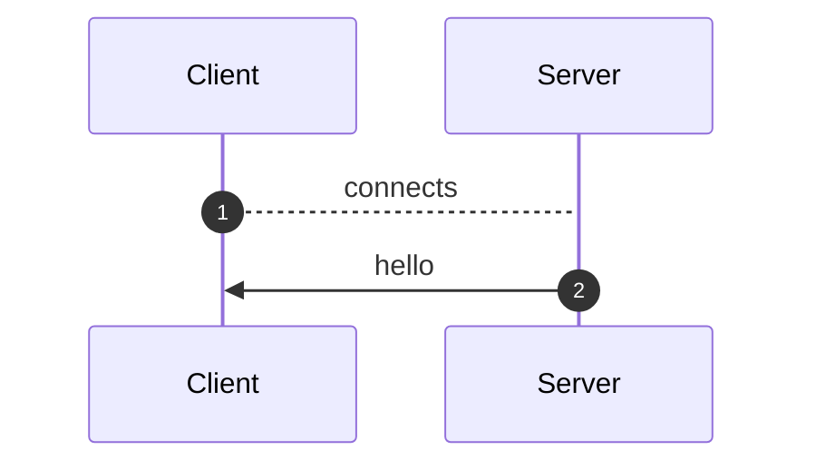
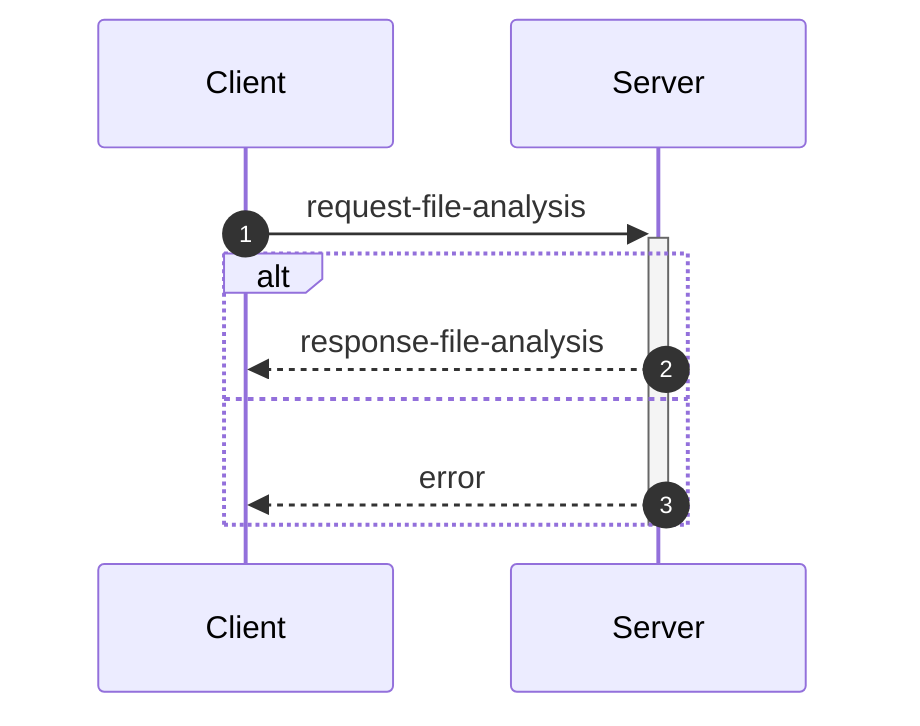
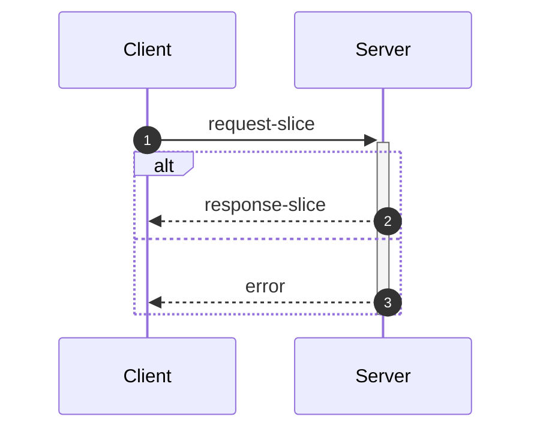
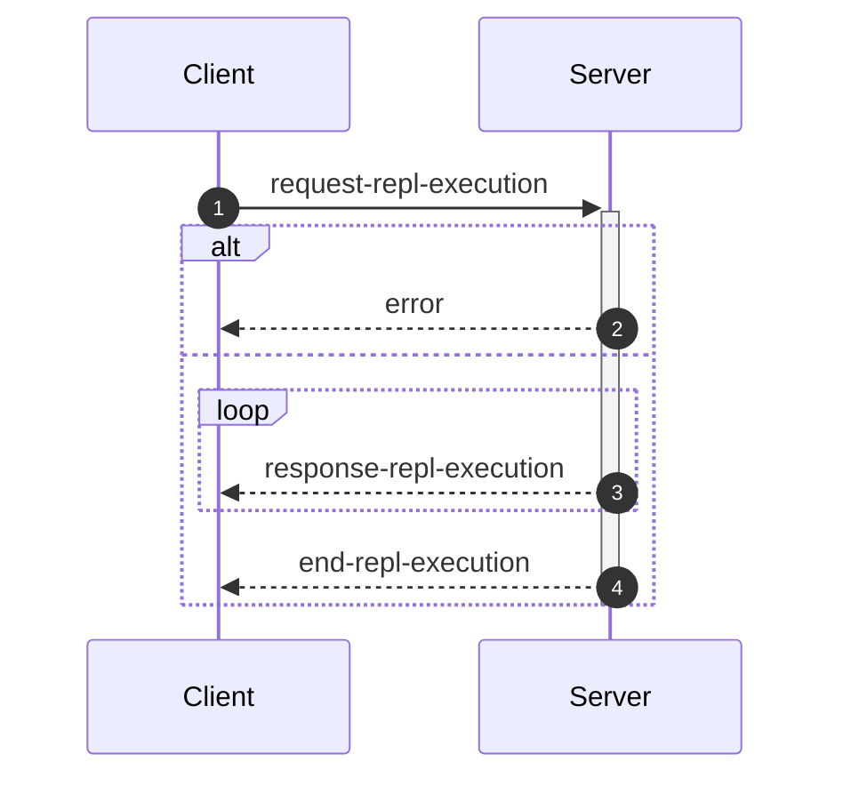

_<span title="an overview of flowR's interface">Generated</span> from '[wiki-interface.ts](https://github.com/flowr-analysis/flowr/tree/main/src/documentation/wiki-interface.ts "src/documentation/wiki-interface.ts")' on 2026-10-22, 19:05:58 UTC (v2.16.6, R v4.5.0), do not edit directly._

Although far from being as detailed as the in-depth explanation of [_flowR_](https://github.com/flowr-analysis/flowr/wiki/Core),
this wiki page explains how to interface with _flowR_ in more detail.
In general, command line arguments and other options provide short descriptions on hover over.

* [💻 Using the REPL](#using-the-repl)
* [⚙️ Configuring FlowR](#configuring-flowr)
* [⚒️ Writing Code](#writing-code)
* [💬 Communicating with the Server](#communicating-with-the-server)

<a id='using-the-repl'></a>
## 💻 Using the REPL

> [!NOTE]
> To execute arbitrary R commands with a repl request, _flowR_ has to be started explicitly with <span title="Description (Command Line Argument): Allow to access the underlying R session when using flowR (security warning: this allows the execution of arbitrary R code!)">`--r-session-access`</span>.
> Please be aware that this introduces a security risk and note that this relies on the [`r-shell` engine](https://github.com/flowr-analysis/flowr/wiki/Engines) .

Although primarily meant for users to explore,
there is nothing which forbids calling _flowR_ as a subprocess to use standard-in, -output, and -error
for communication (although you can access the REPL using the server as well,
with the [REPL Request](#message-request-repl-execution) message).

The read-eval-print loop&nbsp;(REPL) works relatively simple.
You can submit an expression (using <kbd>Enter</kbd>),
which is interpreted as an R&nbsp;expression by default but interpreted as a *command* if it starts with a colon (`:`).
The best command to get started with the REPL is <span title="Description (Repl Command): Show help information (aliases: :h, :?)">`:help`</span>.
Besides, you can leave the REPL either with the command <span title="Description (Repl Command): End the repl (aliases: :q, :exit)">`:quit`</span> or by pressing <kbd>Ctrl</kbd>+<kbd>C</kbd> twice.
When writing a *command*, you may press <kbd>Tab</kbd> to get a list of completions, if available.
Multiple commands can be entered in a single line by separating them with a semicolon (`;`), e.g. `:parse "x<-2"; :df*`.
If a command is given without R code, the REPL will re-use R code given in a previous command.
The prior example will hence return first the parsed AST of the program and then the dataflow graph for `"x <- 2"`.

> [!NOTE]
> If you develop flowR, you may want to launch the repl using the `npm run main-dev` command, this way, you get a non-minified version of flowR with debug information and hot-reloading of source files.

<details>
<summary>Available Commands</summary>

We currently offer the following commands (this with a `[*]` suffix are available with and without the star):

| Command | Description |
| ------- | ----------- |
| **<span title="Description (Repl Command): End the repl (aliases: :q, :exit)">:quit</span>** | End the repl (aliases: **:<span title="Alias of ':quit'. End the repl">q</span>**, **:<span title="Alias of ':quit'. End the repl">exit</span>**) |
| **<span title="Description (Repl Command): Execute the given code as R code. This requires the `--r-session-access` flag to be set and requires the r-shell engine. (aliases: :e, :r)">:execute</span>** | Execute the given code as R code. This requires the `--r-session-access` flag to be set and requires the r-shell engine. (aliases: **:<span title="Alias of ':execute'. Execute the given code as R code. This requires the `--r-session-access` flag to be set and requires the r-shell engine.">e</span>**, **:<span title="Alias of ':execute'. Execute the given code as R code. This requires the `--r-session-access` flag to be set and requires the r-shell engine.">r</span>**) |
| **<span title="Description (Repl Command): Get mermaid code for the control-flow graph of R code (aliases: :cfg, :cf)">:controlflow[*]</span>** | Get mermaid code for the control-flow graph of R code (star: Returns the URL to mermaid.live) (aliases: **:<span title="Alias of ':controlflow'. Get mermaid code for the control-flow graph of R code">cfg</span>**, **:<span title="Alias of ':controlflow'. Get mermaid code for the control-flow graph of R code">cf</span>**) |
| **<span title="Description (Repl Command): Get mermaid code for the control-flow graph with basic blocks (aliases: :cfgb, :cfb)">:controlflowbb[*]</span>** | Get mermaid code for the control-flow graph with basic blocks (star: Returns the URL to mermaid.live) (aliases: **:<span title="Alias of ':controlflowbb'. Get mermaid code for the control-flow graph with basic blocks">cfgb</span>**, **:<span title="Alias of ':controlflowbb'. Get mermaid code for the control-flow graph with basic blocks">cfb</span>**) |
| **<span title="Description (Repl Command): Get mermaid code for the dataflow graph (aliases: :d, :df)">:dataflow[*]</span>** | Get mermaid code for the dataflow graph (star: Returns the URL to mermaid.live) (aliases: **:<span title="Alias of ':dataflow'. Get mermaid code for the dataflow graph">d</span>**, **:<span title="Alias of ':dataflow'. Get mermaid code for the dataflow graph">df</span>**) |
| **<span title="Description (Repl Command): Get mermaid code for the normalized AST of R code (aliases: :n)">:normalize[*]</span>** | Get mermaid code for the normalized AST of R code (star: Returns the URL to mermaid.live) (alias: **:<span title="Alias of ':normalize'. Get mermaid code for the normalized AST of R code">n</span>**) |
| **<span title="Description (Repl Command): Get mermaid code for the simplified dataflow graph (aliases: :ds, :dfs)">:dataflowsimple[*]</span>** | Get mermaid code for the simplified dataflow graph (star: Returns the URL to mermaid.live) (aliases: **:<span title="Alias of ':dataflowsimple'. Get mermaid code for the simplified dataflow graph">ds</span>**, **:<span title="Alias of ':dataflowsimple'. Get mermaid code for the simplified dataflow graph">dfs</span>**) |
| **<span title="Description (Repl Command): Inspect and extend the signature database: `query` (identical to :query @signature), `info <name>` for where a function comes from (identical to :query @function-info), `add <path>` to mount another database/source, `download` to fetch the full-history database. (aliases: :sig)">:signature</span>** | Inspect and extend the signature database: `query` (identical to :query @signature), `info <name>` for where a function comes from (identical to :query @function-info), `add <path>` to mount another database/source, `download` to fetch the full-history database. (alias: **:<span title="Alias of ':signature'. Inspect and extend the signature database: `query` (identical to :query @signature), `info <name>` for where a function comes from (identical to :query @function-info), `add <path>` to mount another database/source, `download` to fetch the full-history database.">sig</span>**) |
| **<span title="Description (Repl Command): Just calculates the DFG, but only prints summary info (aliases: :d#, :df#)">:dataflowsilent</span>** | Just calculates the DFG, but only prints summary info (aliases: **:<span title="Alias of ':dataflowsilent'. Just calculates the DFG, but only prints summary info">d#</span>**, **:<span title="Alias of ':dataflowsilent'. Just calculates the DFG, but only prints summary info">df#</span>**) |
| **<span title="Description (Repl Command): Prints ASCII Art of the parsed, unmodified AST (aliases: :p)">:parse</span>** | Prints ASCII Art of the parsed, unmodified AST (alias: **:<span title="Alias of ':parse'. Prints ASCII Art of the parsed, unmodified AST">p</span>**) |
| **<span title="Description (Repl Command): Prints the version of flowR as well as the current version of R">:version</span>** | Prints the version of flowR as well as the current version of R
| **<span title="Description (Repl Command): Query the given R code (use 'help' for more information)">:query[*]</span>** | Query the given R code (use 'help' for more information) (star: Similar to query, but returns the output in json format.)
| **<span title="Description (Repl Command): Returns an ASCII representation of the dataflow graph (aliases: :df!)">:dataflowascii</span>** | Returns an ASCII representation of the dataflow graph (alias: **:<span title="Alias of ':dataflowascii'. Returns an ASCII representation of the dataflow graph">df!</span>**) |
| **<span title="Description (Repl Command): Returns summarization stats for the normalized AST (aliases: :n#)">:normalize#</span>** | Returns summarization stats for the normalized AST (alias: **:<span title="Alias of ':normalize#'. Returns summarization stats for the normalized AST">n#</span>**) |
| **<span title="Description (Repl Command): Show help information (aliases: :h, :?)">:help</span>** | Show help information (aliases: **:<span title="Alias of ':help'. Show help information">h</span>**, **:<span title="Alias of ':help'. Show help information">?</span>**) |

</details>

> [!TIP]
> 
> As indicated by the examples before, all REPL commands that operate on code keep track of the state.
> Hence, if you run a command like <span title="Description (Repl Command, starred version): Returns the URL to mermaid.live; Base Command: Get mermaid code for the dataflow graph (aliases: :d*, :df*)">`:dataflow*`</span> without providing R code,
> the REPL will re-use the R code provided in a previous command.
> Likewise, doing this will benefit from incrementality!
> If you request the dataflow graph with `:df* x <- 2 * y` and then want to see the parsed AST with `:parse`,
> the REPL will re-use previously obtained information and not re-parse the code again.
> 		

Generally, many commands offer shortcut versions in the REPL. Many queries, for example, offer a shortened format (see the example below).
Of special note, the [Config Query](https://github.com/flowr-analysis/flowr/wiki/%5BQuery%5D-Config)
can be used to also modify the currently active configuration of _flowR_ within the REPL (see the [wiki page](https://github.com/flowr-analysis/flowr/wiki/%5BQuery%5D-Config) for more information).

### Example: Retrieving the Dataflow Graph

To retrieve a URL to the [mermaid](https://mermaid.js.org/) diagram of the dataflow of a given expression,
use <span title="Description (Repl Command, starred version): Returns the URL to mermaid.live; Base Command: Get mermaid code for the dataflow graph (aliases: :d*, :df*)">`:dataflow*`</span> (or <span title="Description (Repl Command): Get mermaid code for the dataflow graph (aliases: :d, :df)">`:dataflow`</span> to get the mermaid code in the cli):

```shell
$ docker run -it --rm eagleoutice/flowr # or npm run flowr 
flowR repl v2.16.6, R grammar v14 (tree-sitter engine)
R> :dataflow* y <- 1 + x
```

<details>
<summary style='color:gray'>Output</summary>

```text
https://mermaid.live/view#base64:eyJjb2RlIjoiZmxvd2NoYXJ0IFREXG4gICAgMXt7XCJgKiM5MTtSTnVtYmVyIzkzOyogKioxKipcbiAgICAgICoxLjYqICgqKmlkOiAxKiopYFwifX1cbiAgICAyKFtcImAqIzkxO1JTeW1ib2wjOTM7KiAqKngqKlxuICAgICAgKjEuMTAqICgqKmlkOiAyKiopYFwiXSlcbiAgICAzW1tcImAqIzkxO1JCaW5hcnlPcCM5MzsqIGJhc2UjNTg7IzU4OyoqIzQzOyoqXG4gICAgICAqMS42LTEwKiAoKippZDogMyoqKVxuICAgIGFyZzogKDEsIDIpYFwiXV1cbiAgICBidWlsdC1pbjpfNDNfW1wiYEJ1aWx0LUluOlxuIzQzO2BcIl1cbiAgICBzdHlsZSBidWlsdC1pbjpfNDNfIHN0cm9rZTpncmF5LGZpbGw6Z3JheSxzdHJva2Utd2lkdGg6MnB4LG9wYWNpdHk6Ljg7XG4gICAgMFtcImAqIzkxO1JTeW1ib2wjOTM7KiAqKnkqKlxuICAgICAgKjEuMSogKCoqaWQ6IDAqKiwgdjogMylgXCJdXG4gICAgNFtbXCJgKiM5MTtSQmluYXJ5T3AjOTM7KiBiYXNlIzU4OyM1ODsqKiM2MDsjNDU7KipcbiAgICAgICoxLjEtMTAqICgqKmlkOiA0KiopXG4gICAgYXJnOiAoMCwgMylgXCJdXVxuICAgIGJ1aWx0LWluOl82MF8tW1wiYEJ1aWx0LUluOlxuIzYwOyM0NTtgXCJdXG4gICAgc3R5bGUgYnVpbHQtaW46XzYwXy0gc3Ryb2tlOmdyYXksZmlsbDpncmF5LHN0cm9rZS13aWR0aDoycHgsb3BhY2l0eTouODtcbiAgICAxIC0uLT58XCJmbG93XCJ8IDJcbiAgICBsaW5rU3R5bGUgMCBzdHJva2U6Z3JheSxjb2xvcjpncmF5O1xuICAgIDIgLS4tPnxcImZsb3dcInwgM1xuICAgIGxpbmtTdHlsZSAxIHN0cm9rZTpncmF5LGNvbG9yOmdyYXk7XG4gICAgMyAtLT58XCJyZWFkcywgYXJnXCJ8IDFcbiAgICAzIC0tPnxcInJlYWRzLCBhcmdcInwgMlxuICAgIDMgLS4tPnxcImZsb3dcInwgMFxuICAgIGxpbmtTdHlsZSA0IHN0cm9rZTpncmF5LGNvbG9yOmdyYXk7XG4gICAgMyAtLi0+fFwicmVhZHMsIGNhbGxzXCJ8IGJ1aWx0LWluOl80M19cbiAgICBsaW5rU3R5bGUgNSBzdHJva2U6Z3JheTtcbiAgICAwIC0tPnxcImRlZmluZWQtYnksIGZsb3dcInwgNFxuICAgIDAgLS0+fFwiZGVmaW5lZC1ieVwifCAzXG4gICAgNCAtLT58XCJyZWFkcywgYXJnXCJ8IDNcbiAgICA0IC0tPnxcInJldHVybnMsIGFyZ1wifCAwXG4gICAgNCAtLi0+fFwicmVhZHMsIGNhbGxzXCJ8IGJ1aWx0LWluOl82MF8tXG4gICAgbGlua1N0eWxlIDEwIHN0cm9rZTpncmF5OyIsIm1lcm1haWQiOnsiYXV0b1N5bmMiOnRydWV9fQ==
```

Retrieve the dataflow graph of the expression `y <- 1 + x`. It looks like this:


<details>

<summary style="color:gray">R Code of the Dataflow Graph</summary>

The analysis ran (including parse and normalize, using the [tree-sitter](https://github.com/flowr-analysis/flowr/wiki/Engines) engine) within the generation environment. No [signature database](https://github.com/flowr-analysis/flowr/wiki/Signature-Database) is mounted for these generated graphs, so `library()` calls attach no package exports; base-R names are still qualified via the generated base-package store (e.g. `acf` as `stats::acf`). 
We encountered no unknown side effects during the analysis.

```r
y <- 1 + x
```

</details>

</details>

For small graphs like this, <span title="Description (Repl Command): Returns an ASCII representation of the dataflow graph (aliases: :df!)">`:dataflowascii`</span> also provides an ASCII representation directly in the REPL:

```shell
$ docker run -it --rm eagleoutice/flowr # or npm run flowr 
flowR repl v2.16.6, R grammar v14 (tree-sitter engine)
R> :df! y <- 1 + x
```

<details open>
<summary style='color:gray'>Output</summary>

```text
                        v<0>v
 c<4>c──────────────────| y |
 |<- |     ┌────────────v---v
 c---c     │
    │   c<3>c   0<1>0
    └───| + |───| 1 |───u<2>u
        c---c   0---0   | x |
           └────────────u---u
Edges:
3 -> 1: reads, arg          3 -> 2: reads, arg
3 -> 0: flows-to            1 -> 2: flows-to
2 -> 3: flows-to            4 -> 3: reads, arg
4 -> 0: returns, arg        0 -> 4: defined-by, flows-to
0 -> 3: defined-by
```

Retrieve the dataflow graph of the expression `y <- 1 + x` as ASCII art.

</details>

For the slicing with <span title="Description (Repl Command): Static backwards executable slicer for R">`:slicer`</span>, you have access to the same [magic comments](#slice-magic-comments) as with the [slice request](#message-request-slice).
Pass `--inline` to splice resolvable `source()` calls into the reconstruction so the slice is a single self-contained R text (the same as the static slice query's `inlineSources` flag).
See `--help` for more flags!

### Example: Interfacing with the File System

Many commands that allow for an R-expression (like <span title="Description (Repl Command, starred version): Returns the URL to mermaid.live; Base Command: Get mermaid code for the dataflow graph (aliases: :d*, :df*)">`:dataflow*`</span>) allow for a file as well
if the argument starts with `file://`.
If you are working from the root directory of the _flowR_ repository, the following gives you the parsed AST of the example file using the <span title="Description (Repl Command): Prints ASCII Art of the parsed, unmodified AST (aliases: :p)">`:parse`</span> command:

> **Watch mode**: Replace `file://` with `watch://` to enter watch mode.
> flowR runs the command immediately and then re-runs it every time the file (or any file inside the folder) changes.
> Enter any other command to leave watch mode.
> For example: `:df watch://analysis.R`

```shell
$ docker run -it --rm eagleoutice/flowr # or npm run flowr 
flowR repl v2.16.6, R grammar v14 (tree-sitter engine)
R> :parse file://test/testfiles/example.R
```

<details>
<summary style='color:gray'>Output</summary>

```text
File: test/testfiles/example.R

program
├ binaryoperator
│ ├ identifier "sum" (1:1─4)
│ ├ <- "<-" (1:5─7)
│ ╰ float "0" (1:8─9)
├ binaryoperator
│ ├ identifier "product" (2:1─8)
│ ├ <- "<-" (2:9─11)
│ ╰ float "1" (2:12─13)
├ binaryoperator
│ ├ identifier "w" (3:1─2)
│ ├ <- "<-" (3:3─5)
│ ╰ float "7" (3:6─7)
├ binaryoperator
│ ├ identifier "N" (4:1─2)
│ ├ <- "<-" (4:3─5)
│ ╰ float "10" (4:6─8)
├ forstatement
│ ├ for "for" (6:1─4)
│ ├ ( "(" (6:5─6)
│ ├ identifier "i" (6:6─7)
│ ├ in "in" (6:8─10)
│ ├ binaryoperator
│ │ ├ float "1" (6:11─12)
│ │ ├ : ":" (6:12─13)
│ │ ╰ parenthesizedexpression
│ │   ├ ( "(" (6:13─14)
│ │   ├ binaryoperator
│ │   │ ├ identifier "N" (6:14─15)
│ │   │ ├ - "-" (6:15─16)
│ │   │ ╰ float "1" (6:16─17)
│ │   ╰ ) ")" (6:17─18)
│ ├ ) ")" (6:18─19)
│ ╰ bracedexpression
│   ├ { "{" (6:20─21)
│   ├ binaryoperator
│   │ ├ identifier "sum" (7:3─6)
│   │ ├ <- "<-" (7:7─9)
│   │ ╰ binaryoperator
│   │   ├ binaryoperator
│   │   │ ├ identifier "sum" (7:10─13)
│   │   │ ├ + "+" (7:14─15)
│   │   │ ╰ identifier "i" (7:16─17)
│   │   ├ + "+" (7:18─19)
│   │   ╰ identifier "w" (7:20─21)
│   ├ binaryoperator
│   │ ├ identifier "product" (8:3─10)
│   │ ├ <- "<-" (8:11─13)
│   │ ╰ binaryoperator
│   │   ├ identifier "product" (8:14─21)
│   │   ├  "" (8:22─23)
│   │   ╰ identifier "i" (8:24─25)
│   ╰ } "}" (9:1─2)
├ call
│ ├ identifier "cat" (11:1─4)
│ ╰ arguments
│   ├ ( "(" (11:4─5)
│   ├ argument
│   │ ╰ string
│   │   ├ " "\"" (11:5─6)
│   │   ├ stringcontent "Sum:" (11:6─10)
│   │   ╰ " "\"" (11:10─11)
│   ├ comma "," (11:11─12)
│   ├ argument
│   │ ╰ identifier "sum" (11:13─16)
│   ├ comma "," (11:16─17)
│   ├ argument
│   │ ╰ string
│   │   ├ " "\"" (11:18─19)
│   │   ├ stringcontent
│   │   │ ╰ escapesequence "\\n" (11:19─21)
│   │   ╰ " "\"" (11:21─22)
│   ╰ ) ")" (11:22─23)
╰ call
  ├ identifier "cat" (12:1─4)
  ╰ arguments
    ├ ( "(" (12:4─5)
    ├ argument
    │ ╰ string
    │   ├ " "\"" (12:5─6)
    │   ├ stringcontent "Product:" (12:6─14)
    │   ╰ " "\"" (12:14─15)
    ├ comma "," (12:15─16)
    ├ argument
    │ ╰ identifier "product" (12:17─24)
    ├ comma "," (12:24─25)
    ├ argument
    │ ╰ string
    │   ├ " "\"" (12:26─27)
    │   ├ stringcontent
    │   │ ╰ escapesequence "\\n" (12:27─29)
    │   ╰ " "\"" (12:29─30)
    ╰ ) ")" (12:30─31)
```

Retrieve the parsed AST of the example file.

<details>

<summary>File Content</summary>

```r
sum <- 0
product <- 1
w <- 7
N <- 10

for (i in 1:(N-1)) {
  sum <- sum + i + w
  product <- product * i
}

cat("Sum:", sum, "\n")
cat("Product:", product, "\n")
```

</details>

As _flowR_ directly transforms this AST the output focuses on being human-readable instead of being machine-readable.
		
</details>

### Example: Run a Query

You can run any query supported by _flowR_ using the <span title="Description (Repl Command): Query the given R code (use 'help' for more information)">`:query`</span> command.
For example, to obtain the shapes of all data frames in a given piece of code, you can run:

```shell
$ docker run -it --rm eagleoutice/flowr # or npm run flowr 
flowR repl v2.16.6, R grammar v14 (tree-sitter engine)
R> :query @absint df-shape "x <- data.frame(a = 1:10, b = 1:10)\ny <- x$a"
```

<details open>
<summary style='color:gray'>Output</summary>

```text
Query: absint (1 ms)
```

Retrieve the shapes of all data frames in the given code.

</details>

To run the linter on a file, you can use (in this example, we just issue the `dead-code` linter on a small piece of code):

```shell
$ docker run -it --rm eagleoutice/flowr # or npm run flowr 
flowR repl v2.16.6, R grammar v14 (tree-sitter engine)
R> :query @linter rules:dead-code "if(FALSE) x <- 2"
```

<details open>
<summary style='color:gray'>Output</summary>

```text
Query: linter (2 ms)
   ╰ Dead Code (dead-code):
       ╰ certain:
           ╰ Code at 1.11-16
```

Run the linter on the given code, with only the `dead-code` rule enabled.

</details>

For more information on the available queries, please check out the [Query API](https://github.com/flowr-analysis/flowr/wiki/Query-API).

<a id='configuring-flowr'></a>
## ⚙️ Configuring FlowR

When running _flowR_, you may want to specify some behaviors with a dedicated configuration file.
By default, flowR looks for a file named `flowr.json` in the current working directory (or any higher directory).
You can also specify a different file with <span title="Description (Command Line Argument): The name of the configuration file to use">`--config-file`</span> or pass the configuration inline using <span title="Description (Command Line Argument): The flowR configuration to use, as a JSON string">`--config-json`</span>.
A `flowr.json` found this way belongs to the analyzed project, so flowR ignores its options that decide what flowR executes or loads
(`engines.*.wasmPath`, `engines.*.treeSitterWasmPath`, `engines.*.rPath`, `solver.sigdb.additionalPaths`, `solver.sigdb.downloadRepo`, `solver.sigdb.installedLibrary.paths`),
unless you pass <span title="Description (Command Line Argument): Keep the security-sensitive options (e.g., the R executable) of the flowr.json found in the working directory or a parent. Only use this for projects you trust.">`--trust-config`</span>.
To analyze code you do not trust, use the secure mode (<span title="Description (Command Line Argument): Run in secure mode for analyzing untrusted code: flowR does not start R (or any other process), does not access the network, does not search for project configs, and ignores security-sensitive options in every config. Cannot be disabled once enabled. Can also be enabled with the environment variable {italic FLOWR_SECURE_MODE=1}.">`--secure`</span>, see the [security policy](https://github.com/flowr-analysis/flowr/blob/main/.github/SECURITY.md)).
To inspect the current configuration, you can run flowr with the <span title="Description (Command Line Argument): Run with verbose logging (will be passed to the corresponding script)">`--verbose`</span> flag, or use the `config` [Query](https://github.com/flowr-analysis/flowr/wiki/Query-API).
Within the REPL this works by running the following:

```shell
:query @config
```

To work with the <a href="https://github.com/flowr-analysis/flowr/tree/main/src/config.ts#L119"><code><span title="The configuration file format for flowR.">FlowrConfig</span></code></a> you can use the provided helper objects alongside its methods like
<a href="https://github.com/flowr-analysis/flowr/tree/main/src/config.ts#L914"><code><span title="Creates a new flowr config that has the updated values.">FlowrConfig::<b>amend</b></span></code></a>.
The schema below documents every option; the ones you most likely want are:

- <a href="https://github.com/flowr-analysis/flowr/wiki/Interface#configuring-flowr" title="Configuration Option (boolean): Whether source calls should be ignored, causing {@link processSourceCall}&#39;s behavior to be skipped.">ignoreSourceCalls</a>: ignore source calls when analyzing the code, i.e., ignore the inclusion of other files.
- <a href="https://github.com/flowr-analysis/flowr/wiki/Interface#configuring-flowr" title="Configuration Option (boolean): Whether load calls should be ignored, causing {@link processLoadCall}&#39;s behavior to be skipped.">ignoreLoadCalls</a>: ignore load calls when analyzing the code, i.e., ignore the loading of r-data files.
- <a href="https://github.com/flowr-analysis/flowr/wiki/Interface#configuring-flowr" title="Configuration Option (object): Do you want to overwrite (parts) of the builtin definition?">semantics.environment.overwriteBuiltIns</a>: overwrite _flowR_'s handling of built-in functions, or clear the preset definitions entirely.
  See [Configure BuiltIn Semantics](#configure-builtin-semantics) for more information.
- <a href="https://github.com/flowr-analysis/flowr/wiki/Interface#configuring-flowr" title="Configuration Option (string): How to resolve variables and their values. (one of &quot;disabled&quot;, &quot;alias&quot;, &quot;builtin&quot;)">solver.variables</a>: how to resolve variables and their values (`disabled`, `alias`, `builtin`).
- <a href="https://github.com/flowr-analysis/flowr/wiki/Interface#configuring-flowr" title="Configuration Option (array): The engine or set of engines to use for interacting with R code. An empty array means all available engines will be used.">engines</a> and <a href="https://github.com/flowr-analysis/flowr/wiki/Interface#configuring-flowr" title="Configuration Option (string): The default engine to use for interacting with R code. If this is undefined, an arbitrary engine from the specified list will be used. (one of &quot;tree-sitter&quot;, &quot;r-shell&quot;)">defaultEngine</a>: the engines used to interact with R code, see the [Engines wiki page](https://github.com/flowr-analysis/flowr/wiki/Engines).
- <a href="https://github.com/flowr-analysis/flowr/wiki/Interface#configuring-flowr" title="Configuration Option (array): Files a framework loads on its own, without any source() call (e.g. global.R in a shiny app), in the order they are loaded; flowR orders the matching project files accordingly and analyzes them as one program. Entries are case-insensitive globs matched against the file path, a plain name matches any file with that name, and entries matching no project file are warned about. Usually set per project kind via specializeConfig.">project.implicitSources</a>: the files a framework loads without any `source()` call, in the order in which they are
  loaded. Entries are globs (e.g. `R/*.R`) matched against the file path ignoring capitalization; one matching no file is reported.
- <a href="https://github.com/flowr-analysis/flowr/wiki/Interface#configuring-flowr" title="Configuration Option (object): Overwrite (parts of) the configuration depending on the project kind flowR detects, e.g. to give a shiny app its implicit sources.">specializeConfig</a>: overwrite (parts of) the configuration depending on the kind of project _flowR_ detects
  (e.g. `shiny-app`), which is how a shiny app gets its implicit sources by default. What you configure directly wins.
- <a href="https://github.com/flowr-analysis/flowr/wiki/Interface#configuring-flowr" title="Configuration Option (string): Overwrite the project kind flowR would otherwise infer from the analyzed files, e.g. when auto-detection guesses wrong. (one of &quot;package&quot;, &quot;script&quot;, &quot;shiny-app&quot;, &quot;notebook&quot;, &quot;project&quot;, &quot;unknown&quot;)">project.useProjectType</a>: skip that detection and force a project kind yourself, when auto-detection guesses wrong.
- <a href="https://github.com/flowr-analysis/flowr/wiki/Interface#configuring-flowr" title="Configuration Option (array): The default plugins to load when creating a new instance of FlowrAnalyzer">defaultPlugins</a> and <a href="https://github.com/flowr-analysis/flowr/wiki/Interface#configuring-flowr" title="Configuration Option (array): The plugins to load in REPL mode">repl.plugins</a>: the plugins to load for a new <a href="https://github.com/flowr-analysis/flowr/tree/main/src/project/flowr-analyzer.ts#L205"><code><span title="Central class for conducting analyses with FlowR. Use the FlowrAnalyzerBuilder to create a new instance. If you want the original pattern of creating a pipeline and running all steps, you can still do this with FlowrAnalyzer#runFull . To inspect the context of the analyzer, use FlowrAnalyzer#inspectContext (if you are a plugin and need to modify it, use FlowrAnalyzer#context instead).">FlowrAnalyzer</span></code></a> and in the REPL
  (use `flowr:default` to reference the former).

So you can configure _flowR_ by adding a file like the following:

<details>

<summary>Example Configuration File</summary>

```json
{
  "ignoreSourceCalls": true,
  "ignoreLoadCalls": true,
  "semantics": {
    "environment": {
      "overwriteBuiltIns": {
        "definitions": [
          {
            "type": "function",
            "names": [
              "foo"
            ],
            "processor": "builtin:assign",
            "config": {}
          }
        ]
      }
    }
  },
  "defaultPlugins": [
    "file:description",
    "versions:description"
  ],
  "repl": {
    "quickStats": false,
    "dfProcessorHeat": false,
    "hints": true,
    "plugins": [
      "flowr:default"
    ]
  },
  "project": {
    "resolveUnknownPathsOnDisk": true,
    "implicitSources": [
      "global.R",
      "app.R"
    ]
  },
  "linter": {
    "disabledRules": []
  },
  "specializeConfig": {
    "shiny-app": {
      "project": {
        "implicitSources": [
          "global.R",
          "ui.R",
          "server.R",
          "app.R"
        ]
      }
    }
  },
  "engines": [
    {
      "type": "r-shell"
    }
  ],
  "solver": {
    "variables": "alias",
    "evalStrings": true,
    "trackEnvironments": true,
    "sigdb": {
      "enabled": true,
      "loadProjectDependencies": true,
      "eagerlyLoad": false,
      "eagerlyLoadExports": false,
      "linkBaseR": false,
      "linkDescriptionDependencies": false
    },
    "resolveSource": {
      "dropPaths": "no",
      "ignoreCapitalization": true,
      "inferWorkingDirectory": "active-script",
      "searchPath": []
    },
    "instrument": {},
    "slicer": {
      "threshold": 50
    }
  },
  "abstractInterpretation": {
    "wideningThreshold": 4,
    "followCalls": true,
    "dataFrame": {
      "maxColNames": 20,
      "readLoadedData": {
        "readExternalFiles": true,
        "maxReadLines": 1000000
      }
    }
  },
  "incremental": {
    "alwaysIncremental": false,
    "parsing": {
      "activated": false,
      "heuristics": {
        "activated": true,
        "mtime": true,
        "linesFrom": 500,
        "bytesFrom": 50000,
        "alwaysWithEdits": false,
        "minFiles": 1
      }
    }
  },
  "gas": {
    "thresholds": {
      "memory": {
        "problematic": 0.7,
        "critical": 0.9
      },
      "timeMs": {
        "problematic": 100000,
        "critical": 120000
      }
    },
    "features": {}
  }
}
```

</details>

<details>
<a id='configure-builtin-semantics'></a>
<summary>Configure Built-In Semantics</summary>

`semantics/environment/overwriteBuiltins` accepts two keys:

- `loadDefaults` (boolean, initially `true`): If set to `true`, the default built-in definitions are loaded before applying the custom definitions. Setting this flag to `false` explicitly disables the loading of the default definitions.
- `definitions` (array, initially empty): Allows to overwrite or define new built-in elements. Each object within must have a `type` which is one of the below. Furthermore, they may define a string array of `names` which specifies the identifiers to bind the definitions to. You may use `assumePrimitive` to specify whether _flowR_ should assume that this is a primitive non-library definition (so you probably just do not want to specify the key).

  | Type            | Description                                                                                                                                                                                                                                                                                              | Example                                                                                                    |
  | --------------- | -------------------------------------------------------------------------------------------------------------------------------------------------------------------------------------------------------------------------------------------------------------------------------------------------------- | ---------------------------------------------------------------------------------------------------------- |
  | `constant`    | Additionally allows for a `value` this should resolve to.                                                                                                                                                                                                                                                | `{ type: 'constant', names: ['NULL', 'NA'],  value: null }`                                                |
  | `function`    | Is a rather flexible way to define and bind built-in functions. For the time, we do not have extensive documentation to cover all the cases, so please either consult the sources with the `default-builtin-config.ts` or open a [new issue](https://github.com/flowr-analysis/flowr/issues/new/choose). | `{ type: 'function', names: ['next'], processor: 'builtin:d', config: { cfg: ExitPointType.Next } }` |
  | `replacement` | A comfortable way to specify replacement functions like `$<-` or `names<-`. `suffixes` describes the... suffixes to attach automatically. | `{ type: 'replacement', suffixes: ['<-', '<<-'], names: ['[', '[['] }` |

</details>

<details>

<summary style='color:gray'>Full Configuration-File Schema</summary>

- _The configuration file format for flowR._ (object)
    - **logLevel** [optional] _flowR's global minimum log level, applied when the config is loaded._ (string)
        Only allows: 'silly', 'trace', 'debug', 'info', 'warn', 'error', 'fatal'
    - **ignoreSourceCalls** [optional] _Whether source calls should be ignored, causing {@link processSourceCall}'s behavior to be skipped._ (boolean)
    - **ignoreLoadCalls** [optional] _Whether load calls should be ignored, causing {@link processLoadCall}'s behavior to be skipped._ (boolean)
    - **semantics** _Configure language semantics and how flowR handles them._ (object)
        - **environment** [optional] _Semantics regarding how to handle the R environment._ (object)
            - **overwriteBuiltIns** [optional] _Do you want to overwrite (parts) of the builtin definition?_ (object)
                - **loadDefaults** [optional] _Should the default configuration still be loaded?_ (boolean)
                - **definitions** [optional] _The definitions to load/overwrite._ (array)
                Valid item types:
                    - (object)
    - **defaultPlugins** [optional] _The default plugins to load when creating a new instance of FlowrAnalyzer_ (array)
    Valid item types:
        - (alternatives)
            - (string)
            - (array)
    - **repl** _Configuration options for the REPL._ (object)
        - **quickStats** [optional] _Whether to show quick stats in the REPL after each evaluation._ (boolean)
        - **dfProcessorHeat** [optional] _This instruments the dataflow processors to count how often each processor is called._ (boolean)
        - **hints** [optional] _Whether to show dim inline hints on the empty prompt (automatically disabled on non-interactive terminals)._ (boolean)
        - **plugins** [optional] _The plugins to load in REPL mode_ (array)
        Valid item types:
            - (alternatives)
                - (string)
                - (array)
        - **autoUseFileProtocol** [optional] _Prepend the file protocol to a repl input that looks like a path, instead of only warning about it._ (boolean)
        - **queryStats** [optional] _Whether `:query` closes with the line stating how long the queries took (`:query*` never prints it)._ (boolean)
        - **showPlugins** [optional] _Whether `:version` grays out the plugins that did not activate during the last analysis._ (boolean)
    - **project** _Project specific configuration options._ (object)
        - **resolveUnknownPathsOnDisk** [optional] _Whether to resolve unknown paths loaded by the r project disk when trying to source/analyze files._ (boolean)
        - **failOnInaccessiblePath** [optional] _Whether a directory that cannot be traversed during file discovery (e.g. due to permissions) aborts the analysis; when false (the default) such paths are logged and skipped._ (boolean)
        - **basePackages** [optional] _The packages considered part of R itself (base and recommended); if unset, flowR uses its built-in list._ (array)
        Valid item types:
            - (string)
        - **implicitSources** [optional] _Files a framework loads on its own, without any source() call (e.g. global.R in a shiny app), in the order they are loaded; flowR orders the matching project files accordingly and analyzes them as one program. Entries are case-insensitive globs matched against the file path, a plain name matches any file with that name, and entries matching no project file are warned about. Usually set per project kind via specializeConfig._ (array)
        Valid item types:
            - (string)
        - **useProjectType** [optional] _Overwrite the project kind flowR would otherwise infer from the analyzed files, e.g. when auto-detection guesses wrong._ (string)
            Only allows: 'package', 'script', 'shiny-app', 'notebook', 'project', 'unknown'
        - **assumeImplicitEcho** [optional] _Whether the top level of the analyzed code is echoed, so that every visible result printed there is collected as an output by the dependencies query (default true, false for a package)._ (boolean)
        - **discovery** [optional] _Scoping options for the default project discovery._ (object)
            - **full** [optional] _Collect every file below the project root (greedy) instead of only the files the detected project kind needs (default false)._ (boolean)
            - **perKind** [optional] _Per-kind include/exclude glob overrides layered on the default scoping._ (object)
            - **ignore** [optional] _Case-insensitive globs that drop matching files from the intelligent discovery, regardless of kind (e.g. .Renviron to ignore environment files)._ (array)
            Valid item types:
                - (string)
        - **classification** [optional] _Overrides for the signals flowR uses to classify the project kind._ (object)
            - **shinyDescriptionTypes** [optional] _DESCRIPTION Type: values that mark a shiny app._ (array)
            Valid item types:
                - (string)
            - **shinyEntryFiles** [optional] _File names a shiny app is assembled from._ (array)
            Valid item types:
                - (string)
            - **shinyUsagePattern** [optional] _Regex source evidencing shiny usage in an entry file._ (string)
            - **notebookExtensions** [optional] _File extensions marking a notebook._ (array)
            Valid item types:
                - (string)
    - **linter** _Linter configuration options._ (object)
        - **disabledRules** _Linting rule names excluded from the default rule set (a rule requested explicitly via a linter query still runs). Usually set per project kind via specializeConfig._ (array)
        Valid item types:
            - (string)
        - **disabledTags** [optional] _Linting rule tags whose rules are excluded from the default rule set (a rule requested explicitly via a linter query still runs). By default the cmd-check rules are disabled for everything but a package; a configured list replaces that default._ (array)
        Valid item types:
            - (string)
    - **inputSources** [optional] _Further frameworks the input-sources analysis should know about; entries are added to flowR's defaults._ (object)
        - **pure** [optional] _Functions that only pass the constantness of their arguments on._ (array)
        Valid item types:
            - (string)
        - **param** [optional] _Functions whose result is a 'param' input._ (array)
        Valid item types:
            - (string)
        - **file** [optional] _Functions whose result is a 'file' input._ (array)
        Valid item types:
            - (string)
        - **tempfile** [optional] _Functions whose result is a 'tempfile' input._ (array)
        Valid item types:
            - (string)
        - **glob** [optional] _Functions whose result is a 'glob' input._ (array)
        Valid item types:
            - (string)
        - **net** [optional] _Functions whose result is a 'net' input._ (array)
        Valid item types:
            - (string)
        - **rand** [optional] _Functions whose result is a 'rand' input._ (array)
        Valid item types:
            - (string)
        - **system** [optional] _Functions whose result is a 'system' input._ (array)
        Valid item types:
            - (string)
        - **ffi** [optional] _Functions whose result is a 'ffi' input._ (array)
        Valid item types:
            - (string)
        - **lang** [optional] _Functions whose result is a 'lang' input._ (array)
        Valid item types:
            - (string)
        - **options** [optional] _Functions whose result is a 'options' input._ (array)
        Valid item types:
            - (string)
        - **cmdline** [optional] _Functions whose result is a 'cmdline' input._ (array)
        Valid item types:
            - (string)
        - **user** [optional] _Functions whose result is a 'user' input._ (array)
        Valid item types:
            - (string)
        - **const** [optional] _Functions whose result is a 'const' input._ (array)
        Valid item types:
            - (string)
        - **scope** [optional] _Functions whose result is a 'scope' input._ (array)
        Valid item types:
            - (string)
        - **dconst** [optional] _Functions whose result is a 'dconst' input._ (array)
        Valid item types:
            - (string)
        - **unknown** [optional] _Functions whose result is a 'unknown' input._ (array)
        Valid item types:
            - (string)
        - **linkedObjects** [optional] _Objects a framework provides without a definition in the code, e.g. shiny's input._ (array)
        Valid item types:
            - (object)
        - **linkedEntryPoints** [optional] _Calls that hand a function to a framework, which binds its objects to the parameters by position._ (array)
        Valid item types:
            - (object)
    - **specializeConfig** [optional] _Overwrite (parts of) the configuration depending on the project kind flowR detects, e.g. to give a shiny app its implicit sources._ (object)
    - **engines** _The engine or set of engines to use for interacting with R code. An empty array means all available engines will be used._ (array)
    Valid item types:
        - (alternatives)
            - _The configuration for the tree sitter engine._ (object)
                - **type** [required] _Use the tree sitter engine._ (string)
                    Only allows: 'tree-sitter'
                - **wasmPath** [optional] _The path to the tree-sitter-r WASM binary to use. If this is undefined, this uses the default path._ (string)
                - **treeSitterWasmPath** [optional] _The path to the tree-sitter WASM binary to use. If this is undefined, this uses the default path._ (string)
                - **lax** [optional] _Whether to use the lax parser for parsing R code (allowing for syntax errors). If this is undefined, the strict parser will be used._ (boolean)
            - _The configuration for the R shell engine._ (object)
                - **type** [required] _Use the R shell engine._ (string)
                    Only allows: 'r-shell'
                - **rPath** [optional] _The path to the R executable to use. If this is undefined, this uses the default path._ (string)
                - **pipeBind** [optional] _Whether to enable R's experimental pipe-bind operator "=>" by setting _R_USE_PIPEBIND_ for the R session (default false); R itself keeps this off by default, as it is experimental and has never shipped in a release version of R._ (boolean)
    - **defaultEngine** [optional] _The default engine to use for interacting with R code. If this is undefined, an arbitrary engine from the specified list will be used._ (string)
        Only allows: 'tree-sitter', 'r-shell'
    - **solver** _How to resolve constants, constraints, cells, ..._ (object)
        - **variables** _How to resolve variables and their values._ (string)
            Only allows: 'disabled', 'alias', 'builtin'
        - **evalStrings** _Should we include eval(parse(text="...")) calls in the dataflow graph?_ (boolean)
        - **trackEnvironments** [optional] _Track user-created environments (new.env, assign/get/local with envir=, dollar-assign, attach). When false, all envir-style calls fall through conservatively._ (boolean)
        - **sigdb** _Resolving library exports from a signature database._ (object)
            - **enabled** [optional] _Resolve library()/use() exports from a signature database (default true); when false no database is consulted._ (boolean)
            - **loadProjectDependencies** [optional] _Load the project's declared dependencies from its metadata files (DESCRIPTION Imports/Depends, rproject.toml, uvr.toml, renv.lock, rv.lock, uvr.lock) (default true); when false these files are not read for dependencies._ (boolean)
            - **eagerlyLoad** [optional] _Parse the database up front rather than on the first package load (default false, ignored if disabled)._ (boolean)
            - **eagerlyLoadExports** [optional] _Add a vertex for every export on load rather than on demand (default false); keeps the dataflow graph small._ (boolean)
            - **assumedRVersion** [optional] _R version assumed when resolving versioned (base-R) exports: a pin like "4.5" or "auto" to detect the installed R (default "auto")._ (string)
            - **linkBaseR** [optional] _Eagerly attach base-R namespaces so bare base calls resolve without library() (default false)._ (boolean)
            - **linkBaseRCalls** [optional] _Add a lightweight Reads edge from a bare base-R call to its signature-database function vertex (default false; base-R qualification is edge-free otherwise)._ (boolean)
            - **linkPackageCalls** [optional] _Add a lightweight Reads edge from a resolved package call to its signature-database function vertex (default false)._ (boolean)
            - **linkDescriptionDependencies** [optional] _Eagerly attach the namespaces of the project's declared DESCRIPTION dependencies (Imports/Depends) so their exports resolve without an explicit library() (default false)._ (boolean)
            - **warmInBackground** [optional] _Decompress the hot shards (base + most-downloaded) in a background task on startup so the first library() lookup is warm (default false; for long-running servers/REPLs)._ (boolean)
            - **additionalPaths** [optional] _Extra directories or bundle/manifest files searched for signature databases (alongside the shipped default and $FLOWR_SIGDB_DIR); a downloaded full-history bundle placed here is mounted automatically._ (array)
            Valid item types:
                - (string)
            - **downloadRepo** [optional] _GitHub owner/repo the full-history bundle is downloaded from via ":signature download" (default "flowr-analysis/flowr", release tag "sigdb-v<flowR-version>")._ (string)
            - **autoSync** [optional] _On startup, re-download shards whose committed sigdb.remote.json hash no longer matches the cache, in the background (default false; opt-in network sync after a git pull)._ (boolean)
            - **installedLibrary** [optional] _Recovering packages no signature database knows from the copy installed on this machine._ (object)
                - **enabled** [required] _Recover packages no signature database knows from their installed copy (default false)._ (boolean)
                - **paths** [optional] _Library directories to search; when empty they are discovered from the environment and the project._ (array)
                Valid item types:
                    - (string)
                - **useEnvironment** [optional] _Search the libraries R_LIBS_USER/R_LIBS/R_LIBS_SITE name (default true)._ (boolean)
                - **useProjectLibrary** [optional] _Search a project-local renv/packrat library (default true)._ (boolean)
                - **maxDepth** [optional] _How far to descend into the nested layout of a project-local library (default 3)._ (number)
                - **packages** [optional] _Only recover packages whose name matches one of these regular expressions; empty means any._ (array)
                Valid item types:
                    - (string)
            - **blobCacheBudgetMb** [optional] _How many MiB of decoded package blobs every open bundle may hold together (default 16)._ (number)
            - **versionSelection** [optional] _When a project constrains a dependency, resolve to the newest (default), oldest, or system-installed version satisfying it; system needs R and falls back to newest. Base-R packages always resolve against the assumed R version._ (string)
                Only allows: 'newest', 'oldest', 'system'
            - **versionOverrides** [optional] _Force an exact version for specific packages (name -> version), overriding both the project constraint and the versionSelection policy (default {})._ (object)
        - **versionManagement** _Policies for reasoning about dependency versions._ (object)
            - **linkedVersionGroups** [optional] _Groups of packages that must resolve to the same version; version guessing intersects each group so its members stay mutually compatible (default [])._ (array)
            Valid item types:
                - (array)
                Valid item types:
                    - (string)
        - **assumeAttachedPackages** [optional] _Packages to treat as attached without a `library()` call, so what the built-in configuration states about them applies to the analyzed code. The base packages R attaches on startup already resolve without it._ (array)
        Valid item types:
            - (string)
        - **transitiveSideEffectRounds** [optional] _How many rounds the transitive side-effect fixpoint may run before it is cut off (default 32); the propagation stops on its own as soon as a round adds nothing._ (number)
        - **maxOverlayDepth** [optional] _How many binding overlays may stack on one environment frame before a write flattens them (default 4); a pure performance knob, trading lookup cost against copy cost without changing any result._ (number)
        - **instrument** (object)
            - **dataflowExtractors** [optional] _These keys are only intended for use within code, allowing to instrument the dataflow analyzer!_ (any)
        - **resolveSource** [optional] _If lax source calls are active, flowR searches for sourced files much more freely, based on the configurations you give it. This option is only in effect if `ignoreSourceCalls` is set to false._ (object)
            - **dropPaths** _Allow to drop the first or all parts of the sourced path, if it is relative._ (string)
                Only allows: 'no', 'once', 'all'
            - **ignoreCapitalization** _Search for filenames matching in the lowercase._ (boolean)
            - **inferWorkingDirectory** _Try to infer the working directory from the main or any script to analyze._ (string)
                Only allows: 'no', 'main-script', 'active-script', 'any-script'
            - **searchPath** _Additionally search in these paths._ (array)
            Valid item types:
                - (string)
            - **repeatedSourceLimit** [optional] _How often the same file can be sourced within a single run? Please be aware: in case of cyclic sources this may not reach a fixpoint so give this a sensible limit._ (number)
            - **applyReplacements** _Provide name replacements for loaded files_ (array)
            Valid item types:
                - (object)
            - **assumeFilesExist** [optional] _Assume a sourced file is always there, making what it defines certain instead of conditional on the source call._ (boolean)
        - **slicer** [optional] _The configuration for the slicer._ (object)
            - **threshold** [optional] _The maximum number of iterations to perform on a single function call during slicing._ (number)
            - **autoExtend** [optional] _If set, the slicer will gain an additional post-pass._ (boolean)
    - **abstractInterpretation** _The configuration options for abstract interpretation._ (object)
        - **wideningThreshold** _The threshold for the number of visitations of a node at which widening should be performed to ensure the termination of the fixpoint iteration._ (number)
        - **followCalls** _Whether the abstract interpretation is interprocedural, i.e. whether it steps into the functions a call may dispatch to._ (boolean)
        - **dataFrame** _The configuration of the shape inference for data frames._ (object)
            - **maxColNames** _The maximum number of columns names to infer for data frames before over-approximating the column names to top._ (number)
            - **readLoadedData** _Configuration options for reading data frame shapes from loaded external data files, such as CSV files._ (object)
                - **readExternalFiles** _Whether data frame shapes should be extracted from loaded external files, such as CSV files._ (boolean)
                - **maxReadLines** _The maximum number of lines to read when extracting data frame shapes from loaded files, such as CSV files._ (number)
    - **incremental** (object)
        - **alwaysIncremental** _Always take the incremental path, regardless of heuristics._ (boolean)
        - **parsing** (object)
            - **activated** _If set, incremental parsing will be used._ (boolean)
            - **heuristics** (object)
                - **activated** [optional] _If set, the heuristics for incremental parsing will be used._ (boolean)
                - **mtime** [optional] _Skip reparsing entirely if the file's modification time is unchanged since the last parse._ (boolean)
                - **linesFrom** [optional] _Only consider incremental parsing for files with at least this many lines._ (number)
                - **bytesFrom** [optional] _Only consider incremental parsing for files with at least this many bytes._ (number)
                - **alwaysWithEdits** [optional] _Always take the incremental path whenever there is a computed edit region, regardless of the other thresholds._ (boolean)
                - **minFiles** [optional] _Only apply these heuristics once the project has at least this many files loaded._ (number)
    - **gas** [optional] _Resource-usage guard (gas) configuration. All feature factors default to 0 (disabled). See https://github.com/flowr-analysis/flowr/wiki/Core#gas-resource-guard._ (object)
        - **thresholds** [optional] _Thresholds for all gas checks (scaled by per-feature factor), boundable per feature._ (object)
            - **memory** [optional] _Heap-usage fraction thresholds (0-1), either shared or given per feature key (with `default` covering the rest)._ (object)
                - **problematic** [optional] _Heap fraction (0-1) above which Problematic is returned, for every feature without an entry of its own._ (number)
                - **critical** [optional] _Heap fraction (0-1) above which Critical is returned, for every feature without an entry of its own._ (number)
            - **timeMs** [optional] _Elapsed analysis time thresholds in milliseconds, either shared or given per feature key (with `default` covering the rest)._ (object)
                - **problematic** [optional] _Elapsed ms above which Problematic is returned, for every feature without an entry of its own._ (number)
                - **critical** [optional] _Elapsed ms above which Critical is returned, for every feature without an entry of its own._ (number)
            - **steps** [optional] _Processed-AST-node thresholds, counted rather than sampled; only a key that arms a budget (`dataflow`) reads them._ (object)
                - **problematic** [optional] _Processed AST nodes above which Problematic is returned, for every feature without an entry of its own._ (number)
                - **critical** [optional] _Processed AST nodes above which the extraction is cut short, for every feature without an entry of its own._ (number)
            - **vertices** [optional] _Created-dataflow-vertex thresholds, counted like `steps`._ (object)
                - **problematic** [optional] _Created dataflow vertices above which Problematic is returned, for every feature without an entry of its own._ (number)
                - **critical** [optional] _Created dataflow vertices above which the extraction is cut short, for every feature without an entry of its own._ (number)
        - **features** [optional] _Per-feature sensitivity factors. 0 or absent disables gas checking for that feature. A factor of 2 makes the feature twice as sensitive. Recognised keys: `source`, `side-effect-linking`, `linter`, `slicer`, `dataflow`._ (object)
        - **countedCheckEvery** [optional] _How many counted steps pass between two accountings of an armed check, be it a dataflow budget or the slicer's traversal (default 128); trades overshoot against the cost of the check._ (number)
        - **heapProvider** [optional] _Custom heap statistics source (programmatic configs only), overriding the built-in v8/performance.memory detection._ (function)

</details>

<a id='writing-code'></a>
## ⚒️ Writing Code

_flowR_ can be used as a [module](https://www.npmjs.com/package/@eagleoutice/flowr) and offers several main classes and interfaces that are interesting for extension writers 
(see the [Visual Studio Code extension](https://marketplace.visualstudio.com/items?itemName=code-inspect.vscode-flowr) or the [Core](https://github.com/flowr-analysis/flowr/wiki/Core) wiki page for more information).

### Creating Analyses with _flowR_

Nowadays, instances of the <a href="https://github.com/flowr-analysis/flowr/tree/main/src/project/flowr-analyzer.ts#L205"><code><span title="Central class for conducting analyses with FlowR. Use the FlowrAnalyzerBuilder to create a new instance. If you want the original pattern of creating a pipeline and running all steps, you can still do this with FlowrAnalyzer#runFull . To inspect the context of the analyzer, use FlowrAnalyzer#inspectContext (if you are a plugin and need to modify it, use FlowrAnalyzer#context instead).">FlowrAnalyzer</span></code></a> should be used as central frontend to get analysis results from _flowR_.
The entry points an analysis is written against are re-exported from the package root (`import { FlowrAnalyzerBuilder } from '@eagleoutice/flowr'`);
everything else stays reachable under its own path, as in `@eagleoutice/flowr/dataflow/graph/graph`.
For example, a program slice can be created like this:

```ts
const analyzer = await new FlowrAnalyzerBuilder()
    .setEngine('tree-sitter')
    .build();
analyzer.addRequest('x <- 1\ny <- x\nx');
const result = await analyzer.query([
    {
        type:     'static-slice',
        criteria: ['3@x']
    }
]);
```

For more information, please have a look at the [Analyzer](https://github.com/flowr-analysis/flowr/wiki/Analyzer) wiki page, which explains how to construct and use the <a href="https://github.com/flowr-analysis/flowr/tree/main/src/project/flowr-analyzer.ts#L205"><code><span title="Central class for conducting analyses with FlowR. Use the FlowrAnalyzerBuilder to create a new instance. If you want the original pattern of creating a pipeline and running all steps, you can still do this with FlowrAnalyzer#runFull . To inspect the context of the analyzer, use FlowrAnalyzer#inspectContext (if you are a plugin and need to modify it, use FlowrAnalyzer#context instead).">FlowrAnalyzer</span></code></a> in more detail.
To work with specific perspectives, you can also consult the respective pages like the [Dataflow Graph](https://github.com/flowr-analysis/flowr/wiki/Dataflow-Graph) or the [Abstract Interpretation](https://github.com/flowr-analysis/flowr/wiki/Abstract-Interpretation) wiki pages.
### The Pipeline Executor (Low-Level Interface)

Once, in the beginning, _flowR_ was meant to produce a dataflow graph merely to provide *program slices*. 
However, with continuous updates, the [Dataflow Graph](https://github.com/flowr-analysis/flowr/wiki/Dataflow-Graph) repeatedly proves to be the more interesting part.
With this, we restructured _flowR_'s originally *hardcoded* pipeline to be far more flexible. 
Now, it can be theoretically extended or replaced with arbitrary steps, optional steps, and what we call 'decorations' of these steps. 
In short, a slicing pipeline using the <a href="https://github.com/flowr-analysis/flowr/tree/main/src/core/pipeline-executor.ts#L97"><code><span title="**Please note:** The PipelineExecutor is now considered to be a rather low-level API for flowR. While it still works and is the basis for all other layers, we strongly recommend using the FlowrAnalyzer and its builder to create and use an analyzer instance that is pre-configured for your use-case. The pipeline executor allows to execute arbitrary pipelines in a step-by-step fashion. If you are not...">PipelineExecutor</span></code></a> looks like this:

```ts

const slicer = new PipelineExecutor(DEFAULT_SLICING_PIPELINE, {
  parser:    new RShell(),
  request:   requestFromInput('x <- 1\nx + 1'),
  criterion: ['2@x']
})
const slice = await slicer.allRemainingSteps()
// console.log(slice.reconstruct.code)
```

<details><summary>More Information</summary>

If you compare this, with what you would have done with the old (and removed) `SteppingSlicer`, 
this essentially just requires you to replace the `SteppingSlicer` with the <a href="https://github.com/flowr-analysis/flowr/tree/main/src/core/pipeline-executor.ts#L97"><code><span title="**Please note:** The PipelineExecutor is now considered to be a rather low-level API for flowR. While it still works and is the basis for all other layers, we strongly recommend using the FlowrAnalyzer and its builder to create and use an analyzer instance that is pre-configured for your use-case. The pipeline executor allows to execute arbitrary pipelines in a step-by-step fashion. If you are not...">PipelineExecutor</span></code></a>
and to pass the <a href="https://github.com/flowr-analysis/flowr/tree/main/src/core/steps/pipeline/default-pipelines.ts#L18"><code>DEFAULT_SLICING_PIPELINE</code></a> as the first argument.
The <a href="https://github.com/flowr-analysis/flowr/tree/main/src/core/pipeline-executor.ts#L97"><code><span title="**Please note:** The PipelineExecutor is now considered to be a rather low-level API for flowR. While it still works and is the basis for all other layers, we strongly recommend using the FlowrAnalyzer and its builder to create and use an analyzer instance that is pre-configured for your use-case. The pipeline executor allows to execute arbitrary pipelines in a step-by-step fashion. If you are not...">PipelineExecutor</span></code></a>...

1. Provides structures to investigate the results of all intermediate steps
2. Can be executed step-by-step
3. Can repeat steps (e.g., to calculate multiple slices on the same input)

See the in-code documentation for more information.

</details>

### Using the <a href="https://github.com/flowr-analysis/flowr/tree/main/src/r-bridge/shell.ts#L144"><code><span title="The RShell represents an interactive session with the R interpreter. You can configure it by RShellOptions . At the moment we are using a live R session (and not networking etc.) to communicate with R easily, which allows us to install packages etc. However, this might and probably will change in the future (leaving this as a legacy mode :D)">RShell</span></code></a> to Interact with R

The <a href="https://github.com/flowr-analysis/flowr/tree/main/src/r-bridge/shell.ts#L144"><code><span title="The RShell represents an interactive session with the R interpreter. You can configure it by RShellOptions . At the moment we are using a live R session (and not networking etc.) to communicate with R easily, which allows us to install packages etc. However, this might and probably will change in the future (leaving this as a legacy mode :D)">RShell</span></code></a> class allows interfacing with the `R`&nbsp;ecosystem installed on the host system.
Please have a look at [flowR's Engines](https://github.com/flowr-analysis/flowr/wiki/Engines) for more information on alternatives (for example, the <a href="https://github.com/flowr-analysis/flowr/tree/main/src/r-bridge/lang-4.x/tree-sitter/tree-sitter-executor.ts#L29"><code><span title="Synchronous and (way) faster alternative to the RShell using tree-sitter.">TreeSitterExecutor</span></code></a>).

> [!IMPORTANT]
> 
> Each <a href="https://github.com/flowr-analysis/flowr/tree/main/src/r-bridge/shell.ts#L144"><code><span title="The RShell represents an interactive session with the R interpreter. You can configure it by RShellOptions . At the moment we are using a live R session (and not networking etc.) to communicate with R easily, which allows us to install packages etc. However, this might and probably will change in the future (leaving this as a legacy mode :D)">RShell</span></code></a> controls a new instance of the R&nbsp;interpreter, 
> make sure to call <code><a href="https://github.com/flowr-analysis/flowr/tree/main/src/r-bridge/shell.ts#L350"><span title="Close the current R session, makes the object effectively invalid (can no longer be reopened etc.)">RShell::<i>close</i></span></a>()</code> when you are done.

You can start a new "session" by constructing a new object with <code>new <a href="https://github.com/flowr-analysis/flowr/tree/main/src/r-bridge/shell.ts#L144"><span title="The RShell represents an interactive session with the R interpreter. You can configure it by RShellOptions . At the moment we are using a live R session (and not networking etc.) to communicate with R easily, which allows us to install packages etc. However, this might and probably will change in the future (leaving this as a legacy mode :D)">RShell</span></a>()</code>.

However, there are several options that may be of interest 
(e.g., to automatically revive the shell in case of errors or to control the name location of the R process on the system).

With a shell object (let's call it `shell`), you can execute R code by using <a href="https://github.com/flowr-analysis/flowr/tree/main/src/r-bridge/shell.ts#L213"><code><span title="sends the given command directly to the current R session will not do anything to alter input markers!">RShell::<i>sendCommand</i></span></code></a>,
for example <code>shell.<a href="https://github.com/flowr-analysis/flowr/tree/main/src/r-bridge/shell.ts#L213"><span title="sends the given command directly to the current R session will not do anything to alter input markers!">sendCommand</span></a>("1 + 1")</code>.
However, this does not return anything, so if you want to collect the output of your command, use
<a href="https://github.com/flowr-analysis/flowr/tree/main/src/r-bridge/shell.ts#L296"><code><span title="Send a command and collect the output">RShell::<i>sendCommandWithOutput</i></span></code></a> instead.

<a id='communicating-with-the-server'></a>
## 💬 Communicating with the Server

As explained in the [Overview](https://github.com/flowr-analysis/flowr/wiki/Overview), you can run the [TCP](https://de.wikipedia.org/wiki/Transmission_Control_Protocol)&nbsp;server by adding the <span title="Description (Command Line Argument): Do not drop into a repl, but instead start a server on the given port (default: 1042) and listen for messages.">`--server`</span> flag (and, due to the interactive mode, exit with the conventional <kbd>CTRL</kbd>+<kbd>C</kbd>).
Currently, every connection is handled by the same underlying `RShell` - so the server is not designed to handle many clients at a time.
Additionally, the server is not well guarded against attacks (e.g., you can theoretically spawn an arbitrary number of&nbsp;RShell sessions on the target machine).

Every message has to be given in a single line (i.e., without a newline in-between) and end with a newline character. Nevertheless, we will pretty-print example given in the following segments for the ease of reading.

> [!NOTE]
> 
> The default <span title="Description (Command Line Argument): Do not drop into a repl, but instead start a server on the given port (default: 1042) and listen for messages.">`--server`</span> uses a simple [TCP](https://de.wikipedia.org/wiki/Transmission_Control_Protocol)
> connection. If you want _flowR_ to expose a [WebSocket](https://de.wikipedia.org/wiki/WebSocket) server instead, add the <span title="Description (Command Line Argument): If the server flag is set, use websocket for messaging">`--ws`</span> flag (i.e., <span title="Description (Command Line Argument): Do not drop into a repl, but instead start a server on the given port (default: 1042) and listen for messages.">`--server`</span> <span title="Description (Command Line Argument): If the server flag is set, use websocket for messaging">`--ws`</span>) when starting _flowR_ from the command line.

<ul><li>
<a id="message-hello"></a>
<b>Hello</b> Message (<code>hello</code>) 
<details>

<summary style="color:gray"> View Details. <i>The server informs the client about the successful connection and provides Meta-Information.</i> </summary>



After launching _flowR_, for example, with <code>docker run -it --rm eagleoutice/flowr <span title="Description (Command Line Argument): Do not drop into a repl, but instead start a server on the given port (default: 1042) and listen for messages.">-<span/>-server</span></code>&nbsp;(🐳️), connecting should present you with a `hello` message, that amongst others should reveal the versions of&nbsp;_flowR_ and&nbsp;R, using the [semver 2.0](https://semver.org/spec/v2.0.0.html) versioning scheme.
The message looks like this:

```json
{
  "type": "hello",
  "clientName": "client-0",
  "versions": {
    "flowr": "2.16.6",
    "r": "4.5.0",
    "engine": "r-shell"
  }
}
```

There are currently a few messages that you can send after the hello message.
If you want to _slice_ a piece of R code you first have to send an [analysis request](#message-request-file-analysis), so that you can send one or multiple slice requests afterward.
Requests for the [REPL](#message-request-repl-execution) are independent of that.
	
<hr>

<details>
<summary style="color:gray">Message schema (<code>hello</code>)</summary>

For the definition of the hello message, please see it's implementation at [`./src/cli/repl/server/messages/message-hello.ts`](https://github.com/flowr-analysis/flowr/tree/main/src/cli/repl/server/messages/message-hello.ts).

- [required] (object)
    - **type** [required] _The type of the hello message._ (string)
        Only allows: 'hello'
    - **id** [forbidden] _The id of the message is always undefined (as it is the initial message and not requested)._ (any)
    - **clientName** [required] _A unique name that is assigned to each client. It has no semantic meaning and is only used/useful for debugging._ (string)
    - **versions** [required] (object)
        - **flowr** [required] _The version of the flowr server running in semver format._ (string)
        - **r** [required] _The version of the underlying R shell running in semver format._ (string)
        - **engine** [required] _The parser backend that is used to parse the R code._ (string)

</details>

<hr>

</details>
	</li>

<li>
<a id="message-request-file-analysis"></a>
<b>Analysis</b> Message (<code>request-file-analysis</code>) 
<details>

<summary style="color:gray"> View Details. <i>The server builds the dataflow graph for a given input file (or a set of files).</i> </summary>



The request allows the server to analyze a file and prepare it for slicing.
The message can contain a `filetoken`, which is used to identify the file in later slice or query requests (if you do not add one, the request will not be stored and therefore, it is not available for subsequent requests).

> **Please note!**\
> If you want to send and process a lot of analysis requests, but do not want to slice them, please do not pass the `filetoken` field. This will save the server a lot of memory allocation.

Furthermore, the request must contain either a `content` field to directly pass the file's content or a `filepath` field which contains the path to the file (this path must be accessible for the server to be useful).
If you add the `id` field, the answer will use the same `id` so you can match requests and the corresponding answers.
See the implementation of the request-file-analysis message for more information.

You can drop one or more stored file tokens by adding the `invalidateToken` field (a single token or an array of tokens).
The server frees the corresponding analyses _after_ it has answered the request.

> **Tip!**\
> If you only want to drop tokens, you do not need a separate message: send a `request-file-analysis` that contains _just_ the `invalidateToken` field (and no `content` or `filepath`).
> Such a request behaves like an empty file analysis and the server replies with an empty `results` object.
> Because invalidation happens after the response, you may even pass the _current_ `filetoken` in `invalidateToken` to analyze a file once and have the server forget it right after you received the results.

<details>
<summary>Example of the <code>request-file-analysis</code> Message</summary>

_Note:_ even though we pretty-print these messages, they are sent as a single line, ending with a newline.

The following lists all messages that were sent and received in case you want to reproduce the scenario:

<ol>
<li> <code>hello</code> (response)
<details> 

<summary> Show Details </summary>

The first message is always a hello message.

```json
{"type":"hello","clientName":"client-0","versions":{"flowr":"2.16.6","r":"4.5.0","engine":"r-shell"}}
```

</details>
</li>

<li> <b><code>request-file-analysis</code> (request)</b>
<details open> 

<summary> Show Details </summary>

Let's suppose you simply want to analyze the following script:
 
```r
x <- 1
x + 1
```

 For this, you can send the following request:

```json
{"type":"request-file-analysis","id":"1","filetoken":"x","content":"x <- 1\nx + 1"}
```

</details>
</li>

<li> <code>response-file-analysis</code> (response)
<details> 

<summary> Show Details </summary>

The `results` field of the response effectively contains three keys of importance:

- `parse`: which contains 1:1 the parse result in CSV format that we received from the `RShell` (i.e., the AST produced by the parser of the R interpreter).
- `normalize`: which contains the normalized AST, including ids (see the `info` field and the [Normalized AST](https://github.com/flowr-analysis/flowr/wiki/Normalized-AST) wiki page).
- `dataflow`: especially important is the `graph` field which contains the dataflow graph as a set of root vertices (see the [Dataflow Graph](https://github.com/flowr-analysis/flowr/wiki/Dataflow-Graph) wiki page).
			
_As the code is pretty long, we inhibit pretty printing and syntax highlighting (JSON, hiding built-in):_

```text
{"type":"response-file-analysis","format":"json","id":"1","results":{"parse":{"files":[{"parsed":"[1,1,1,6,7,0,\"expr\",false,\"x <- 1\"],[1,1,1,1,1,3,\"SYMBOL\",true,\"x\"],[1,1,1,1,3,7,\"expr\",false,\"x\"],[1,3,1,4,2,7,\"LEFT_ASSIGN\",true,\"<-\"],[1,6,1,6,4,5,\"NUM_CONST\",true,\"1\"],[1,6,1,6,5,7,\"expr\",false,\"1\"],[2,1,2,5,16,0,\"expr\",false,\"x + 1\"],[2,1,2,1,10,12,\"SYMBOL\",true,\"x\"],[2,1,2,1,12,16,\"expr\",false,\"x\"],[2,3,2,3,11,16,\"'+'\",true,\"+\"],[2,5,2,5,13,14,\"NUM_CONST\",true,\"1\"],[2,5,2,5,14,16,\"expr\",false,\"1\"]","filePath":"/tmp/tmp-22964-J13l65tQ6d6T-.R"}],".meta":{}},"normalize":{"ast":{"type":"RProject","files":[{"root":{"type":"RExpressionList","children":[{"type":"RBinaryOp","location":[1,3,1,4],"lhs":{"type":"RSymbol","location":[1,1,1,1],"content":"x","lexeme":"x","info":{"fullRange":[1,1,1,1],"adToks":[],"id":0,"parent":2,"role":"bin-l","index":0,"nest":0,"file":"/tmp/tmp-22964-J13l65tQ6d6T-.R"}},"rhs":{"location":[1,6,1,6],"lexeme":"1","info":{"fullRange":[1,6,1,6],"adToks":[],"id":1,"parent":2,"role":"bin-r","index":1,"nest":0,"file":"/tmp/tmp-22964-J13l65tQ6d6T-.R"},"type":"RNumber","content":{"num":1,"complexNumber":false,"markedAsInt":false}},"operator":"<-","lexeme":"<-","info":{"fullRange":[1,1,1,6],"adToks":[],"id":2,"parent":6,"nest":0,"file":"/tmp/tmp-22964-J13l65tQ6d6T-.R","index":0,"role":"el-c"}},{"type":"RBinaryOp","location":[2,3,2,3],"lhs":{"type":"RSymbol","location":[2,1,2,1],"content":"x","lexeme":"x","info":{"fullRange":[2,1,2,1],"adToks":[],"id":3,"parent":5,"role":"bin-l","index":0,"nest":0,"file":"/tmp/tmp-22964-J13l65tQ6d6T-.R"}},"rhs":{"location":[2,5,2,5],"lexeme":"1","info":{"fullRange":[2,5,2,5],"adToks":[],"id":4,"parent":5,"role":"bin-r","index":1,"nest":0,"file":"/tmp/tmp-22964-J13l65tQ6d6T-.R"},"type":"RNumber","content":{"num":1,"complexNumber":false,"markedAsInt":false}},"operator":"+","lexeme":"+","info":{"fullRange":[2,1,2,5],"adToks":[],"id":5,"parent":6,"nest":0,"file":"/tmp/tmp-22964-J13l65tQ6d6T-.R","index":1,"role":"el-c"}}],"info":{"adToks":[],"id":6,"nest":0,"file":"/tmp/tmp-22964-J13l65tQ6d6T-.R","role":"root","index":0}},"filePath":"/tmp/tmp-22964-J13l65tQ6d6T-.R"}],"info":{"id":7}},".meta":{}},"dataflow":{"unknownReferences":[],"in":[{"nodeId":2,"name":"<-","type":2},{"nodeId":5,"name":"+","type":2}],"out":[{"nodeId":0,"name":"x","type":4,"definedAt":2,"value":[1]}],"environment":{"current":{"id":973,"parent":"<BuiltInEnvironment>","memory":[["x",[{"nodeId":0,"name":"x","type":4,"definedAt":2,"value":[1]}]]],"globalEnv":true},"level":0},"graph":{"rootVertices":[1,0,2,3,4,5],"vertexInformation":[[1,{"tag":"value","id":1}],[0,{"tag":"vdef","id":0,"source":[1]}],[2,{"tag":"fcall","id":2,"name":"<-","onlyBuiltin":true,"args":[{"nodeId":0,"type":32},{"nodeId":1,"type":32}],"origin":["builtin:assign"]}],[3,{"tag":"use","id":3}],[4,{"tag":"value","id":4}],[5,{"tag":"fcall","id":5,"name":"+","onlyBuiltin":true,"args":[{"nodeId":3,"type":32},{"nodeId":4,"type":32}],"origin":["builtin:d"]}]],"edgeInformation":[[2,[[1,{"types":65}],[0,{"types":72}],["built-in:<-",{"types":5}],[3,{"types":4096}]]],[1,[[0,{"types":4096}]]],[0,[[2,{"types":4098}],[1,{"types":2}]]],[5,[[3,{"types":65}],[4,{"types":65}],["built-in:+",{"types":5}]]],[3,[[0,{"types":1}],[4,{"types":4096}]]],[4,[[5,{"types":4096}]]]],"_unknownSideEffects":[]},"entryPoint":2,"cfgEntry":1,"exitPoints":[{"type":0,"nodeId":5}],"hooks":[],".meta":{}}}}
```

</details>
</li>
</ol>

The complete round-trip covers validating the messages as well as starting and stopping the internal mock server.

</details>

You receive an error if, for whatever reason, the analysis fails (e.g., the message or code you sent contained syntax errors).
It contains a human-readable description *why* the analysis failed (see the error message implementation for more details).

<details>
<summary>Example Error Message</summary>

_Note:_ even though we pretty-print these messages, they are sent as a single line, ending with a newline.

The following lists all messages that were sent and received in case you want to reproduce the scenario:

<ol>
<li> <code>hello</code> (response)
<details> 

<summary> Show Details </summary>

The first message is always a hello message.

```json
{"type":"hello","clientName":"client-0","versions":{"flowr":"2.16.6","r":"4.5.0","engine":"r-shell"}}
```

</details>
</li>

<li> <code>request-file-analysis</code> (request)
<details> 

<summary> Show Details </summary>

```json
{"type":"request-file-analysis","id":"1","filename":"sample.R","content":"x <-"}
```

</details>
</li>

<li> <b><code>error</code> (response)</b>
<details open> 

<summary> Show Details </summary>

```json
{
  "id": "1",
  "type": "error",
  "fatal": false,
  "reason": "Error while analyzing file sample.R: GuardError: unable to parse R code (see the log for more information) for request {\"request\":\"text\",\"content\":\"x <-\"}}\n Report a Bug: https://github.com/flowr-analysis/flowr/issues/new?body=%3C!%2D%2D%20Please%20describe%20your%20issue%20in%20more%20detail%20below!%20%2D%2D%3E%0A%0A%0A%3C!%2D%2D%20Automatically%20generated%20issue%20metadata%2C%20please%20do%20not%20edit%20or%20delete%20content%20below%20this%20line%20%2D%2D%3E%0A%2D%2D%2D%0A%0AflowR%20version%3A%202.16.6%0Anode%20version%3A%20v25.6.1%0Anode%20arch%3A%20x64%0Anode%20platform%3A%20linux%0Amessage%3A%20%60unable%20to%20parse%20R%20code%20%28see%20the%20log%20for%20more%20information%29%20for%20request%20%7B%22request%22%3A%22text%22%2C%22content%22%3A%22x%20%3C%2D%22%7D%7D%60%0Astack%20trace%3A%0A%60%60%60%0A%20%20%20%20at%20guard%20%28%3C%3E%2Fsrc%2Futil%2Fassert.ts%3A128%3A9%29%0A%20%20%20%20at%20guardRetrievedOutput%20%28%3C%3E%2Fsrc%2Fr%2Dbridge%2Fretriever.ts%3A155%3A7%29%0A%20%20%20%20at%20%2Fhome%2Frunner%2Fwork%2Fflowr%2Fflowr%2Fsrc%2Fr%2Dbridge%2Fretriever.ts%3A122%3A4%0A%20%20%20%20at%20processTicksAndRejections%20%28node%3Ainternal%2Fprocess%2Ftask_queues%3A104%3A5%29%0A%20%20%20%20at%20async%20Object.parseRequests%20%5Bas%20processor%5D%20%28%3C%3E%2Fsrc%2Fr%2Dbridge%2Fparser.ts%3A108%3A19%29%0A%20%20%20%20at%20async%20PipelineExecutor.nextStep%20%28%3C%3E%2Fsrc%2Fcore%2Fpipeline%2Dexecutor.ts%3A192%3A25%29%0A%20%20%20%20at%20async%20FlowrAnalyzerCache.stepTapeUntil%20%28%3C%3E%2Fsrc%2Fproject%2Fcache%2Fflowr%2Danalyzer%2Dcache.ts%3A117%3A4%29%0A%20%20%20%20at%20async%20FlowRServerConnection.sendFileAnalysisResponse%20%28%3C%3E%2Fsrc%2Fcli%2Frepl%2Fserver%2Fconnection.ts%3A206%3A53%29%0A%60%60%60%0A%0A%2D%2D%2D%0A%09"
}
```

</details>
</li>
</ol>

The complete round-trip covers validating the messages as well as starting and stopping the internal mock server.

</details>

&nbsp;

<a id="analysis-include-cfg"></a>
**Including the Control Flow Graph**

The control flow graph is a view on the dataflow graph: the dataflow analysis records the control flow while it walks
the program, and the graph projects those edges on demand. The server can expose that structure as well (please create
a [new issue](https://github.com/flowr-analysis/flowr/issues/new/choose) for any bug you may encounter).
For this, the analysis request may add `cfg: true` to its list of options.

<details>
<summary>Requesting a Control Flow Graph</summary>

_Note:_ even though we pretty-print these messages, they are sent as a single line, ending with a newline.

The following lists all messages that were sent and received in case you want to reproduce the scenario:

<ol>
<li> <code>hello</code> (response)
<details> 

<summary> Show Details </summary>

The first message is always a hello message.

```json
{"type":"hello","clientName":"client-0","versions":{"flowr":"2.16.6","r":"4.5.0","engine":"r-shell"}}
```

</details>
</li>

<li> <b><code>request-file-analysis</code> (request)</b>
<details open> 

<summary> Show Details </summary>

```json
{
  "type": "request-file-analysis",
  "id": "1",
  "filetoken": "x",
  "content": "if(unknown > 0) { x <- 2 } else { x <- 5 }\nfor(i in 1:x) { print(x); print(i) }",
  "cfg": true
}
```

</details>
</li>

<li> <code>response-file-analysis</code> (response)
<details> 

<summary> Show Details </summary>

The response looks basically the same as a response sent without the `cfg` flag. However, additionally it contains a `cfg` field. 
If you are interested in a visual representation of the control flow graph, see the 
[visualization with mermaid](https://mermaid.live/view#base64:eyJjb2RlIjoiZmxvd2NoYXJ0IFREXG4gICAgbjAoW1wiYFJTeW1ib2wgKDApXG4qKnVua25vd24qKmBcIl0pXG4gICAgbjEoW1wiYFJOdW1iZXIgKDEpXG4qKjAqKmBcIl0pXG4gICAgbjIoW1wiYFJCaW5hcnlPcCAoMilcbioqdW5rbm93biAjNjI7IDAqKmBcIl0pXG4gICAgbjYoW1wiYFJOdW1iZXIgKDYpXG4qKjIqKmBcIl0pXG4gICAgbjUoW1wiYFJTeW1ib2wgKDUpXG4qKngqKmBcIl0pXG4gICAgbjdbXCJgUkJpbmFyeU9wICg3KVxuKip4ICM2MDsjNDU7IDIqKmBcIl1cbiAgICBuOChbXCJgUkV4cHJlc3Npb25MaXN0ICg4KWBcIl0pXG4gICAgbjEyKFtcImBSTnVtYmVyICgxMilcbioqNSoqYFwiXSlcbiAgICBuMTEoW1wiYFJTeW1ib2wgKDExKVxuKip4KipgXCJdKVxuICAgIG4xM1tcImBSQmluYXJ5T3AgKDEzKVxuKip4ICM2MDsjNDU7IDUqKmBcIl1cbiAgICBuMTQoW1wiYFJFeHByZXNzaW9uTGlzdCAoMTQpYFwiXSlcbiAgICBuMTVbXCJgUklmVGhlbkVsc2UgKDE1KVxuKippZih1bmtub3duICM2MjsgMCkgIzEyMzsgeCAjNjA7IzQ1OyAyICMxMjU7IGVsc2UgIzEyMzsgeCAjNjA7IzQ1OyA1ICMxMjU7KipgXCJdXG4gICAgbjE2KFtcImBSU3ltYm9sICgxNilcbioqaSoqYFwiXSlcbiAgICBuMTcoW1wiYFJOdW1iZXIgKDE3KVxuKioxKipgXCJdKVxuICAgIG4xOChbXCJgUlN5bWJvbCAoMTgpXG4qKngqKmBcIl0pXG4gICAgbjE5KFtcImBSQmluYXJ5T3AgKDE5KVxuKioxIzU4O3gqKmBcIl0pXG4gICAgbjIzKFtcImBSU3ltYm9sICgyMylcbioqeCoqYFwiXSlcbiAgICBuMjVbXCJgUkZ1bmN0aW9uQ2FsbCAoMjUpXG4qKnByaW50KHgpKipgXCJdXG4gICAgbjI3KFtcImBSU3ltYm9sICgyNylcbioqaSoqYFwiXSlcbiAgICBuMjlbXCJgUkZ1bmN0aW9uQ2FsbCAoMjkpXG4qKnByaW50KGkpKipgXCJdXG4gICAgbjMwKFtcImBSRXhwcmVzc2lvbkxpc3QgKDMwKWBcIl0pXG4gICAgbjMxW1wiYFJGb3JMb29wICgzMSlcbioqZm9yKGkgaW4gMSM1ODt4KSAjMTIzOyBwcmludCh4KTsgcHJpbnQoaSkgIzEyNTsqKmBcIl1cbiAgICBuMiAtLi0+fFwiYnJhbmNoIG9uIHVua25vd24gIzYyOyAwICgyKSBpZiBUXCJ8IG42XG4gICAgbjIgLS4tPnxcImJyYW5jaCBvbiB1bmtub3duICM2MjsgMCAoMikgaWYgRlwifCBuMTJcbiAgICBuMCAtLT58XCJmbG93cyB0b1wifCBuMVxuICAgIG4xIC0tPnxcImZsb3dzIHRvXCJ8IG4yXG4gICAgbjcgLS0+fFwiZmxvd3MgdG9cInwgbjhcbiAgICBuNiAtLT58XCJmbG93cyB0b1wifCBuNVxuICAgIG41IC0tPnxcImZsb3dzIHRvXCJ8IG43XG4gICAgbjggLS0+fFwiZmxvd3MgdG9cInwgbjE1XG4gICAgbjE1IC0tPnxcImZsb3dzIHRvXCJ8IG4xN1xuICAgIG4xMyAtLT58XCJmbG93cyB0b1wifCBuMTRcbiAgICBuMTIgLS0+fFwiZmxvd3MgdG9cInwgbjExXG4gICAgbjExIC0tPnxcImZsb3dzIHRvXCJ8IG4xM1xuICAgIG4xNCAtLT58XCJmbG93cyB0b1wifCBuMTVcbiAgICBuMTkgLS0+fFwiZmxvd3MgdG9cInwgbjE2XG4gICAgbjE4IC0tPnxcImZsb3dzIHRvXCJ8IG4xOVxuICAgIG4xNyAtLT58XCJmbG93cyB0b1wifCBuMThcbiAgICBuMjUgLS0+fFwiZmxvd3MgdG9cInwgbjI3XG4gICAgbjIzIC0tPnxcImZsb3dzIHRvXCJ8IG4yNVxuICAgIG4yOSAtLT58XCJmbG93cyB0b1wifCBuMzBcbiAgICBuMjcgLS0+fFwiZmxvd3MgdG9cInwgbjI5XG4gICAgbjMwIC0tPnxcImZsb3dzIHRvXCJ8IG4xNlxuICAgIG4xNiAtLi0+fFwiYnJhbmNoIG9uIGkgKDE2KSBpZiBUXCJ8IG4yM1xuICAgIG4xNiAtLi0+fFwiYnJhbmNoIG9uIGkgKDE2KSBpZiBGXCJ8IG4zMVxuICAgIHN0eWxlIG4wIHN0cm9rZTpjeWFuLHN0cm9rZS13aWR0aDo2LjVweDsgICAgc3R5bGUgbjMxIHN0cm9rZTpncmVlbixzdHJva2Utd2lkdGg6Ni41cHg7IiwibWVybWFpZCI6eyJhdXRvU3luYyI6dHJ1ZX19).
			
_As the code is pretty long, we inhibit pretty printing and syntax highlighting (JSON, hiding built-in):_

```text
{"type":"response-file-analysis","format":"json","id":"1","cfg":{"graph":{"roots":[0,1,2,6,5,7,8,12,11,13,14,15,16,17,18,19,23,25,27,29,30,31],"vtxInfos":[[0,[2,0]],[1,[2,1]],[2,[2,2]],[6,[2,6]],[5,[2,5]],[7,[1,7]],[8,[2,8]],[12,[2,12]],[11,[2,11]],[13,[1,13]],[14,[2,14]],[15,[1,15]],[16,[2,16]],[17,[2,17]],[18,[2,18]],[19,[2,19]],[23,[2,23]],[25,[1,25]],[27,[2,27]],[29,[1,29]],[30,[2,30]],[31,[1,31]]],"bbChildren":[],"edgeInfos":[[2,[[6,{"id":15,"when":true}],[12,{"id":15,"when":false}]]],[0,[[1,0]]],[1,[[2,0]]],[7,[[8,0]]],[6,[[5,0]]],[5,[[7,0]]],[8,[[15,0]]],[15,[[17,0]]],[13,[[14,0]]],[12,[[11,0]]],[11,[[13,0]]],[14,[[15,0]]],[19,[[16,0]]],[18,[[19,0]]],[17,[[18,0]]],[25,[[27,0]]],[23,[[25,0]]],[29,[[30,0]]],[27,[[29,0]]],[30,[[16,0]]],[16,[[23,{"id":31,"when":true}],[31,{"id":31,"when":false}]]]],"mayHaveBasicBlocks":false},"entryPoints":[0],"exitPoints":[31],"returns":[],"breaks":[],"nexts":[]},"results":{"parse":{"files":[{"parsed":"[1,1,1,42,38,0,\"expr\",false,\"if(unknown > 0) { x <- 2 } else { x <- 5 }\"],[1,1,1,2,1,38,\"IF\",true,\"if\"],[1,3,1,3,2,38,\"'('\",true,\"(\"],[1,4,1,14,9,38,\"expr\",false,\"unknown > 0\"],[1,4,1,10,3,5,\"SYMBOL\",true,\"unknown\"],[1,4,1,10,5,9,\"expr\",false,\"unknown\"],[1,12,1,12,4,9,\"GT\",true,\">\"],[1,14,1,14,6,7,\"NUM_CONST\",true,\"0\"],[1,14,1,14,7,9,\"expr\",false,\"0\"],[1,15,1,15,8,38,\"')'\",true,\")\"],[1,17,1,26,22,38,\"expr\",false,\"{ x <- 2 }\"],[1,17,1,17,12,22,\"'{'\",true,\"{\"],[1,19,1,24,19,22,\"expr\",false,\"x <- 2\"],[1,19,1,19,13,15,\"SYMBOL\",true,\"x\"],[1,19,1,19,15,19,\"expr\",false,\"x\"],[1,21,1,22,14,19,\"LEFT_ASSIGN\",true,\"<-\"],[1,24,1,24,16,17,\"NUM_CONST\",true,\"2\"],[1,24,1,24,17,19,\"expr\",false,\"2\"],[1,26,1,26,18,22,\"'}'\",true,\"}\"],[1,28,1,31,23,38,\"ELSE\",true,\"else\"],[1,33,1,42,35,38,\"expr\",false,\"{ x <- 5 }\"],[1,33,1,33,25,35,\"'{'\",true,\"{\"],[1,35,1,40,32,35,\"expr\",false,\"x <- 5\"],[1,35,1,35,26,28,\"SYMBOL\",true,\"x\"],[1,35,1,35,28,32,\"expr\",false,\"x\"],[1,37,1,38,27,32,\"LEFT_ASSIGN\",true,\"<-\"],[1,40,1,40,29,30,\"NUM_CONST\",true,\"5\"],[1,40,1,40,30,32,\"expr\",false,\"5\"],[1,42,1,42,31,35,\"'}'\",true,\"}\"],[2,1,2,36,84,0,\"expr\",false,\"for(i in 1:x) { print(x); print(i) }\"],[2,1,2,3,41,84,\"FOR\",true,\"for\"],[2,4,2,13,53,84,\"forcond\",false,\"(i in 1:x)\"],[2,4,2,4,42,53,\"'('\",true,\"(\"],[2,5,2,5,43,53,\"SYMBOL\",true,\"i\"],[2,7,2,8,44,53,\"IN\",true,\"in\"],[2,10,2,12,51,53,\"expr\",false,\"1:x\"],[2,10,2,10,45,46,\"NUM_CONST\",true,\"1\"],[2,10,2,10,46,51,\"expr\",false,\"1\"],[2,11,2,11,47,51,\"':'\",true,\":\"],[2,12,2,12,48,50,\"SYMBOL\",true,\"x\"],[2,12,2,12,50,51,\"expr\",false,\"x\"],[2,13,2,13,49,53,\"')'\",true,\")\"],[2,15,2,36,81,84,\"expr\",false,\"{ print(x); print(i) }\"],[2,15,2,15,54,81,\"'{'\",true,\"{\"],[2,17,2,24,64,81,\"expr\",false,\"print(x)\"],[2,17,2,21,55,57,\"SYMBOL_FUNCTION_CALL\",true,\"print\"],[2,17,2,21,57,64,\"expr\",false,\"print\"],[2,22,2,22,56,64,\"'('\",true,\"(\"],[2,23,2,23,58,60,\"SYMBOL\",true,\"x\"],[2,23,2,23,60,64,\"expr\",false,\"x\"],[2,24,2,24,59,64,\"')'\",true,\")\"],[2,25,2,25,65,81,\"';'\",true,\";\"],[2,27,2,34,77,81,\"expr\",false,\"print(i)\"],[2,27,2,31,68,70,\"SYMBOL_FUNCTION_CALL\",true,\"print\"],[2,27,2,31,70,77,\"expr\",false,\"print\"],[2,32,2,32,69,77,\"'('\",true,\"(\"],[2,33,2,33,71,73,\"SYMBOL\",true,\"i\"],[2,33,2,33,73,77,\"expr\",false,\"i\"],[2,34,2,34,72,77,\"')'\",true,\")\"],[2,36,2,36,78,81,\"'}'\",true,\"}\"]","filePath":"/tmp/tmp-22964-ltpnkQsrJLcc-.R"}],".meta":{}},"normalize":{"ast":{"type":"RProject","files":[{"root":{"type":"RExpressionList","children":[{"type":"RIfThenElse","condition":{"type":"RBinaryOp","location":[1,12,1,12],"lhs":{"type":"RSymbol","location":[1,4,1,10],"content":"unknown","lexeme":"unknown","info":{"fullRange":[1,4,1,10],"adToks":[],"id":0,"parent":2,"role":"bin-l","index":0,"nest":1,"file":"/tmp/tmp-22964-ltpnkQsrJLcc-.R"}},"rhs":{"location":[1,14,1,14],"lexeme":"0","info":{"fullRange":[1,14,1,14],"adToks":[],"id":1,"parent":2,"role":"bin-r","index":1,"nest":1,"file":"/tmp/tmp-22964-ltpnkQsrJLcc-.R"},"type":"RNumber","content":{"num":0,"complexNumber":false,"markedAsInt":false}},"operator":">","lexeme":">","info":{"fullRange":[1,4,1,14],"adToks":[],"id":2,"parent":15,"nest":1,"file":"/tmp/tmp-22964-ltpnkQsrJLcc-.R","role":"if-c"}},"then":{"type":"RExpressionList","children":[{"type":"RBinaryOp","location":[1,21,1,22],"lhs":{"type":"RSymbol","location":[1,19,1,19],"content":"x","lexeme":"x","info":{"fullRange":[1,19,1,19],"adToks":[],"id":5,"parent":7,"role":"bin-l","index":0,"nest":1,"file":"/tmp/tmp-22964-ltpnkQsrJLcc-.R"}},"rhs":{"location":[1,24,1,24],"lexeme":"2","info":{"fullRange":[1,24,1,24],"adToks":[],"id":6,"parent":7,"role":"bin-r","index":1,"nest":1,"file":"/tmp/tmp-22964-ltpnkQsrJLcc-.R"},"type":"RNumber","content":{"num":2,"complexNumber":false,"markedAsInt":false}},"operator":"<-","lexeme":"<-","info":{"fullRange":[1,19,1,24],"adToks":[],"id":7,"parent":8,"nest":1,"file":"/tmp/tmp-22964-ltpnkQsrJLcc-.R","index":0,"role":"el-c"}}],"grouping":[{"type":"RSymbol","location":[1,17,1,17],"content":"{","lexeme":"{","info":{"fullRange":[1,17,1,26],"adToks":[],"id":3,"role":"el-g","index":0,"nest":1,"file":"/tmp/tmp-22964-ltpnkQsrJLcc-.R"}},{"type":"RSymbol","location":[1,26,1,26],"content":"}","lexeme":"}","info":{"fullRange":[1,17,1,26],"adToks":[],"id":4,"role":"el-g","index":0,"nest":1,"file":"/tmp/tmp-22964-ltpnkQsrJLcc-.R"}}],"info":{"adToks":[],"id":8,"parent":15,"nest":1,"file":"/tmp/tmp-22964-ltpnkQsrJLcc-.R","index":1,"role":"if-then"}},"location":[1,1,1,2],"lexeme":"if","info":{"fullRange":[1,1,1,42],"adToks":[],"id":15,"parent":32,"nest":1,"file":"/tmp/tmp-22964-ltpnkQsrJLcc-.R","index":0,"role":"el-c"},"otherwise":{"type":"RExpressionList","children":[{"type":"RBinaryOp","location":[1,37,1,38],"lhs":{"type":"RSymbol","location":[1,35,1,35],"content":"x","lexeme":"x","info":{"fullRange":[1,35,1,35],"adToks":[],"id":11,"parent":13,"role":"bin-l","index":0,"nest":1,"file":"/tmp/tmp-22964-ltpnkQsrJLcc-.R"}},"rhs":{"location":[1,40,1,40],"lexeme":"5","info":{"fullRange":[1,40,1,40],"adToks":[],"id":12,"parent":13,"role":"bin-r","index":1,"nest":1,"file":"/tmp/tmp-22964-ltpnkQsrJLcc-.R"},"type":"RNumber","content":{"num":5,"complexNumber":false,"markedAsInt":false}},"operator":"<-","lexeme":"<-","info":{"fullRange":[1,35,1,40],"adToks":[],"id":13,"parent":14,"nest":1,"file":"/tmp/tmp-22964-ltpnkQsrJLcc-.R","index":0,"role":"el-c"}}],"grouping":[{"type":"RSymbol","location":[1,33,1,33],"content":"{","lexeme":"{","info":{"fullRange":[1,33,1,42],"adToks":[],"id":9,"role":"el-g","index":0,"nest":1,"file":"/tmp/tmp-22964-ltpnkQsrJLcc-.R"}},{"type":"RSymbol","location":[1,42,1,42],"content":"}","lexeme":"}","info":{"fullRange":[1,33,1,42],"adToks":[],"id":10,"role":"el-g","index":0,"nest":1,"file":"/tmp/tmp-22964-ltpnkQsrJLcc-.R"}}],"info":{"adToks":[],"id":14,"parent":15,"nest":1,"file":"/tmp/tmp-22964-ltpnkQsrJLcc-.R","index":2,"role":"if-other"}}},{"type":"RForLoop","variable":{"type":"RSymbol","location":[2,5,2,5],"content":"i","lexeme":"i","info":{"adToks":[],"id":16,"parent":31,"role":"for-var","index":0,"nest":1,"file":"/tmp/tmp-22964-ltpnkQsrJLcc-.R"}},"vector":{"type":"RBinaryOp","location":[2,11,2,11],"lhs":{"location":[2,10,2,10],"lexeme":"1","info":{"fullRange":[2,10,2,10],"adToks":[],"id":17,"parent":19,"role":"bin-l","index":0,"nest":1,"file":"/tmp/tmp-22964-ltpnkQsrJLcc-.R"},"type":"RNumber","content":{"num":1,"complexNumber":false,"markedAsInt":false}},"rhs":{"type":"RSymbol","location":[2,12,2,12],"content":"x","lexeme":"x","info":{"fullRange":[2,12,2,12],"adToks":[],"id":18,"parent":19,"role":"bin-r","index":1,"nest":1,"file":"/tmp/tmp-22964-ltpnkQsrJLcc-.R"}},"operator":":","lexeme":":","info":{"fullRange":[2,10,2,12],"adToks":[],"id":19,"parent":31,"nest":1,"file":"/tmp/tmp-22964-ltpnkQsrJLcc-.R","index":1,"role":"for-vec"}},"body":{"type":"RExpressionList","children":[{"type":"RFunctionCall","named":true,"location":[2,17,2,21],"lexeme":"print","functionName":{"type":"RSymbol","location":[2,17,2,21],"content":"print","lexeme":"print","info":{"fullRange":[2,17,2,24],"adToks":[],"id":22,"parent":25,"role":"call-name","index":0,"nest":1,"file":"/tmp/tmp-22964-ltpnkQsrJLcc-.R"}},"arguments":[{"type":"RArgument","location":[2,23,2,23],"lexeme":"x","value":{"type":"RSymbol","location":[2,23,2,23],"content":"x","lexeme":"x","info":{"fullRange":[2,23,2,23],"adToks":[],"id":23,"parent":24,"role":"arg-v","index":0,"nest":1,"file":"/tmp/tmp-22964-ltpnkQsrJLcc-.R"}},"info":{"fullRange":[2,23,2,23],"adToks":[],"id":24,"parent":25,"nest":1,"file":"/tmp/tmp-22964-ltpnkQsrJLcc-.R","index":1,"role":"call-arg"}}],"info":{"fullRange":[2,17,2,24],"adToks":[],"id":25,"parent":30,"nest":1,"file":"/tmp/tmp-22964-ltpnkQsrJLcc-.R","index":0,"role":"el-c"}},{"type":"RFunctionCall","named":true,"location":[2,27,2,31],"lexeme":"print","functionName":{"type":"RSymbol","location":[2,27,2,31],"content":"print","lexeme":"print","info":{"fullRange":[2,27,2,34],"adToks":[],"id":26,"parent":29,"role":"call-name","index":0,"nest":1,"file":"/tmp/tmp-22964-ltpnkQsrJLcc-.R"}},"arguments":[{"type":"RArgument","location":[2,33,2,33],"lexeme":"i","value":{"type":"RSymbol","location":[2,33,2,33],"content":"i","lexeme":"i","info":{"fullRange":[2,33,2,33],"adToks":[],"id":27,"parent":28,"role":"arg-v","index":0,"nest":1,"file":"/tmp/tmp-22964-ltpnkQsrJLcc-.R"}},"info":{"fullRange":[2,33,2,33],"adToks":[],"id":28,"parent":29,"nest":1,"file":"/tmp/tmp-22964-ltpnkQsrJLcc-.R","index":1,"role":"call-arg"}}],"info":{"fullRange":[2,27,2,34],"adToks":[],"id":29,"parent":30,"nest":1,"file":"/tmp/tmp-22964-ltpnkQsrJLcc-.R","index":1,"role":"el-c"}}],"grouping":[{"type":"RSymbol","location":[2,15,2,15],"content":"{","lexeme":"{","info":{"fullRange":[2,15,2,36],"adToks":[],"id":20,"role":"el-g","index":0,"nest":1,"file":"/tmp/tmp-22964-ltpnkQsrJLcc-.R"}},{"type":"RSymbol","location":[2,36,2,36],"content":"}","lexeme":"}","info":{"fullRange":[2,15,2,36],"adToks":[],"id":21,"role":"el-g","index":0,"nest":1,"file":"/tmp/tmp-22964-ltpnkQsrJLcc-.R"}}],"info":{"adToks":[],"id":30,"parent":31,"nest":1,"file":"/tmp/tmp-22964-ltpnkQsrJLcc-.R","index":2,"role":"for-b"}},"lexeme":"for","info":{"fullRange":[2,1,2,36],"adToks":[],"id":31,"parent":32,"nest":1,"file":"/tmp/tmp-22964-ltpnkQsrJLcc-.R","index":1,"role":"el-c"},"location":[2,1,2,3]}],"info":{"adToks":[],"id":32,"nest":0,"file":"/tmp/tmp-22964-ltpnkQsrJLcc-.R","role":"root","index":0}},"filePath":"/tmp/tmp-22964-ltpnkQsrJLcc-.R"}],"info":{"id":33}},".meta":{}},"dataflow":{"unknownReferences":[],"in":[{"nodeId":15,"name":"if","type":2},{"nodeId":0,"name":"unknown","type":1024},{"nodeId":2,"name":">","type":2},{"nodeId":7,"name":"<-","cds":[{"id":15,"when":true}],"type":2},{"nodeId":13,"name":"<-","cds":[{"id":15,"when":false}],"type":2},{"nodeId":8,"name":"{","cds":[{"id":15,"when":true}],"type":2},{"nodeId":14,"name":"{","cds":[{"id":15,"when":false}],"type":2},{"nodeId":31,"name":"for","type":2},{"nodeId":19,"name":":","type":2},{"nodeId":25,"name":"print","type":2},{"nodeId":29,"name":"print","type":2}],"out":[{"nodeId":5,"name":"x","type":4,"definedAt":7,"cds":[{"id":15,"when":true}],"value":[6]},{"nodeId":11,"name":"x","type":4,"definedAt":13,"cds":[{"id":15,"when":false}],"value":[12]},{"nodeId":16,"name":"i","type":1}],"environment":{"current":{"id":995,"parent":"<BuiltInEnvironment>","memory":[["x",[{"nodeId":5,"name":"x","type":4,"definedAt":7,"cds":[{"id":15,"when":true}],"value":[6]},{"nodeId":11,"name":"x","type":4,"definedAt":13,"cds":[{"id":15,"when":false}],"value":[12]}]],["i",[{"nodeId":16,"name":"i","type":1,"definedAt":31,"value":[19],"iterated":true}]]],"globalEnv":true},"level":0},"graph":{"rootVertices":[0,1,2,6,5,7,8,12,11,13,14,15,16,17,18,19,23,25,27,29,30,31],"vertexInformation":[[0,{"tag":"use","id":0}],[1,{"tag":"value","id":1}],[2,{"tag":"fcall","id":2,"name":">","onlyBuiltin":true,"args":[{"nodeId":0,"type":32},{"nodeId":1,"type":32}],"origin":["builtin:d"]}],[6,{"tag":"value","id":6}],[5,{"tag":"vdef","id":5,"cds":[{"id":15,"when":true}],"source":[6]}],[7,{"tag":"fcall","id":7,"name":"<-","onlyBuiltin":true,"cds":[{"id":15,"when":true}],"args":[{"nodeId":5,"type":32},{"nodeId":6,"type":32}],"origin":["builtin:assign"]}],[8,{"tag":"fcall","id":8,"name":"{","onlyBuiltin":true,"cds":[{"id":15,"when":true}],"args":[{"nodeId":7,"type":32}],"origin":["builtin:el"]}],[12,{"tag":"value","id":12}],[11,{"tag":"vdef","id":11,"cds":[{"id":15,"when":false}],"source":[12]}],[13,{"tag":"fcall","id":13,"name":"<-","onlyBuiltin":true,"cds":[{"id":15,"when":false}],"args":[{"nodeId":11,"type":32},{"nodeId":12,"type":32}],"origin":["builtin:assign"]}],[14,{"tag":"fcall","id":14,"name":"{","onlyBuiltin":true,"cds":[{"id":15,"when":false}],"args":[{"nodeId":13,"type":32}],"origin":["builtin:el"]}],[15,{"tag":"fcall","id":15,"name":"if","onlyBuiltin":true,"args":[{"nodeId":2,"type":32},{"nodeId":8,"type":32},{"nodeId":14,"type":32}],"origin":["builtin:ite"]}],[16,{"tag":"vdef","id":16,"source":[19]}],[17,{"tag":"value","id":17}],[18,{"tag":"use","id":18}],[19,{"tag":"fcall","id":19,"name":":","onlyBuiltin":true,"args":[{"nodeId":17,"type":32},{"nodeId":18,"type":32}],"origin":["builtin:d"]}],[23,{"tag":"use","id":23,"cds":[{"id":31,"when":true}]}],[25,{"tag":"fcall","id":25,"name":"print","onlyBuiltin":true,"cds":[{"id":31,"when":true}],"args":[{"nodeId":23,"type":32}],"origin":["builtin:d"]}],[27,{"tag":"use","id":27,"cds":[{"id":31,"when":true}]}],[29,{"tag":"fcall","id":29,"name":"print","onlyBuiltin":true,"cds":[{"id":31,"when":true}],"args":[{"nodeId":27,"type":32}],"origin":["builtin:d"]}],[30,{"tag":"fcall","id":30,"name":"{","onlyBuiltin":true,"cds":[{"id":31,"when":true}],"args":[{"nodeId":25,"type":32},{"nodeId":29,"type":32}],"origin":["builtin:el"]}],[31,{"tag":"fcall","id":31,"name":"for","onlyBuiltin":true,"args":[{"nodeId":16,"type":32},{"nodeId":19,"type":32},{"nodeId":30,"type":32}],"origin":["builtin:fl"]}]],"edgeInformation":[[2,[[0,{"types":65}],[1,{"types":65}],[6,{"types":8192,"cd":{"id":15,"when":true}}],[12,{"types":8192,"cd":{"id":15,"when":false}}],["built-in:>",{"types":5}]]],[0,[[1,{"types":4096}]]],[1,[[2,{"types":4096}]]],[7,[[6,{"types":65}],[5,{"types":72}],["built-in:<-",{"types":5}],[8,{"types":4096}]]],[6,[[5,{"types":4096}]]],[5,[[7,{"types":4098}],[6,{"types":2}]]],[8,[[7,{"types":72}],["built-in:{",{"types":5}],[15,{"types":4096}]]],[15,[[8,{"types":72}],[14,{"types":72}],[2,{"types":65}],["built-in:if",{"types":5}],[17,{"types":4096}]]],[13,[[12,{"types":65}],[11,{"types":72}],["built-in:<-",{"types":5}],[14,{"types":4096}]]],[12,[[11,{"types":4096}]]],[11,[[13,{"types":4098}],[12,{"types":2}]]],[14,[[13,{"types":72}],["built-in:{",{"types":5}],[15,{"types":4096}]]],[19,[[17,{"types":65}],[18,{"types":65}],[16,{"types":4096}],["built-in::",{"types":5}]]],[18,[[5,{"types":1}],[11,{"types":1}],[19,{"types":4096}]]],[17,[[18,{"types":4096}]]],[25,[[23,{"types":73}],["built-in:print",{"types":5}],[27,{"types":4096}]]],[23,[[5,{"types":1}],[11,{"types":1}],[25,{"types":4096}]]],[29,[[27,{"types":73}],["built-in:print",{"types":5}],[30,{"types":4096}]]],[27,[[16,{"types":1}],[29,{"types":4096}]]],[30,[[25,{"types":64}],[29,{"types":72}],["built-in:{",{"types":5}],[16,{"types":4096}]]],[16,[[19,{"types":2}],[23,{"types":8192,"cd":{"id":31,"when":true}}],[31,{"types":8192,"cd":{"id":31,"when":false}}]]],[31,[[16,{"types":64}],[19,{"types":65}],[30,{"types":320}],["built-in:for",{"types":5}]]]],"_unknownSideEffects":[{"id":25,"linkTo":{"type":"link-to-last-call","callName":{}}},{"id":29,"linkTo":{"type":"link-to-last-call","callName":{}}}]},"entryPoint":15,"cfgEntry":0,"exitPoints":[{"type":0,"nodeId":31}],"hooks":[],".meta":{}}}}
```

</details>
</li>
</ol>

The complete round-trip covers validating the messages as well as starting and stopping the internal mock server.

</details>

&nbsp;

<a id="analysis-format-n-quads"></a>
**Retrieve the Output as RDF N-Quads**

The default response is formatted as JSON.
However, by specifying `format: "n-quads"`, you can retrieve the individual results (e.g., the [Normalized AST](https://github.com/flowr-analysis/flowr/wiki/Normalized-AST)),
as [RDF N-Quads](https://www.w3.org/TR/n-quads/).
This works with and without the control flow graph as described [above](#analysis-include-cfg).

<details>
<summary>Requesting RDF N-Quads</summary>

_Note:_ even though we pretty-print these messages, they are sent as a single line, ending with a newline.

The following lists all messages that were sent and received in case you want to reproduce the scenario:

<ol>
<li> <code>hello</code> (response)
<details> 

<summary> Show Details </summary>

The first message is always a hello message.

```json
{"type":"hello","clientName":"client-0","versions":{"flowr":"2.16.6","r":"4.5.0","engine":"r-shell"}}
```

</details>
</li>

<li> <b><code>request-file-analysis</code> (request)</b>
<details open> 

<summary> Show Details </summary>

```json
{"type":"request-file-analysis","id":"1","filetoken":"x","content":"x <- 1\nx + 1","format":"n-quads","cfg":true}
```

</details>
</li>

<li> <code>response-file-analysis</code> (response)
<details> 

<summary> Show Details </summary>

The base message format is still JSON, only the individual results get converted.
While the context is derived from the `filename`, we currently offer no way to customize other parts of the quads 
(please open a [new issue](https://github.com/flowr-analysis/flowr/issues/new/choose) if you require this).

_As the code is pretty long, we inhibit pretty printing and syntax highlighting (JSON, hiding built-in):_

```text
{"type":"response-file-analysis","format":"n-quads","id":"1","cfg":"<https://uni-ulm.de/r-ast/unknown/0> <https://uni-ulm.de/r-ast/rootIds> \"1\"^^<http://www.w3.org/2001/XMLSchema#integer> <unknown> .\n<https://uni-ulm.de/r-ast/unknown/0> <https://uni-ulm.de/r-ast/rootIds> \"0\"^^<http://www.w3.org/2001/XMLSchema#integer> <unknown> .\n<https://uni-ulm.de/r-ast/unknown/0> <https://uni-ulm.de/r-ast/rootIds> \"2\"^^<http://www.w3.org/2001/XMLSchema#integer> <unknown> .\n<https://uni-ulm.de/r-ast/unknown/0> <https://uni-ulm.de/r-ast/rootIds> \"3\"^^<http://www.w3.org/2001/XMLSchema#integer> <unknown> .\n<https://uni-ulm.de/r-ast/unknown/0> <https://uni-ulm.de/r-ast/rootIds> \"4\"^^<http://www.w3.org/2001/XMLSchema#integer> <unknown> .\n<https://uni-ulm.de/r-ast/unknown/0> <https://uni-ulm.de/r-ast/rootIds> \"5\"^^<http://www.w3.org/2001/XMLSchema#integer> <unknown> .\n<https://uni-ulm.de/r-ast/unknown/0> <https://uni-ulm.de/r-ast/vertices> <https://uni-ulm.de/r-ast/unknown/1> <unknown> .\n<https://uni-ulm.de/r-ast/unknown/1> <https://uni-ulm.de/r-ast/next> <https://uni-ulm.de/r-ast/unknown/2> <unknown> .\n<https://uni-ulm.de/r-ast/unknown/1> <https://uni-ulm.de/r-ast/id> \"1\"^^<http://www.w3.org/2001/XMLSchema#integer> <unknown> .\n<https://uni-ulm.de/r-ast/unknown/0> <https://uni-ulm.de/r-ast/vertices> <https://uni-ulm.de/r-ast/unknown/2> <unknown> .\n<https://uni-ulm.de/r-ast/unknown/2> <https://uni-ulm.de/r-ast/next> <https://uni-ulm.de/r-ast/unknown/3> <unknown> .\n<https://uni-ulm.de/r-ast/unknown/2> <https://uni-ulm.de/r-ast/id> \"0\"^^<http://www.w3.org/2001/XMLSchema#integer> <unknown> .\n<https://uni-ulm.de/r-ast/unknown/0> <https://uni-ulm.de/r-ast/vertices> <https://uni-ulm.de/r-ast/unknown/3> <unknown> .\n<https://uni-ulm.de/r-ast/unknown/3> <https://uni-ulm.de/r-ast/next> <https://uni-ulm.de/r-ast/unknown/4> <unknown> .\n<https://uni-ulm.de/r-ast/unknown/3> <https://uni-ulm.de/r-ast/id> \"2\"^^<http://www.w3.org/2001/XMLSchema#integer> <unknown> .\n<https://uni-ulm.de/r-ast/unknown/0> <https://uni-ulm.de/r-ast/vertices> <https://uni-ulm.de/r-ast/unknown/4> <unknown> .\n<https://uni-ulm.de/r-ast/unknown/4> <https://uni-ulm.de/r-ast/next> <https://uni-ulm.de/r-ast/unknown/5> <unknown> .\n<https://uni-ulm.de/r-ast/unknown/4> <https://uni-ulm.de/r-ast/id> \"3\"^^<http://www.w3.org/2001/XMLSchema#integer> <unknown> .\n<https://uni-ulm.de/r-ast/unknown/0> <https://uni-ulm.de/r-ast/vertices> <https://uni-ulm.de/r-ast/unknown/5> <unknown> .\n<https://uni-ulm.de/r-ast/unknown/5> <https://uni-ulm.de/r-ast/next> <https://uni-ulm.de/r-ast/unknown/6> <unknown> .\n<https://uni-ulm.de/r-ast/unknown/5> <https://uni-ulm.de/r-ast/id> \"4\"^^<http://www.w3.org/2001/XMLSchema#integer> <unknown> .\n<https://uni-ulm.de/r-ast/unknown/0> <https://uni-ulm.de/r-ast/vertices> <https://uni-ulm.de/r-ast/unknown/6> <unknown> .\n<https://uni-ulm.de/r-ast/unknown/6> <https://uni-ulm.de/r-ast/id> \"5\"^^<http://www.w3.org/2001/XMLSchema#integer> <unknown> .\n<https://uni-ulm.de/r-ast/unknown/0> <https://uni-ulm.de/r-ast/edges> <https://uni-ulm.de/r-ast/unknown/7> <unknown> .\n<https://uni-ulm.de/r-ast/unknown/7> <https://uni-ulm.de/r-ast/next> <https://uni-ulm.de/r-ast/unknown/8> <unknown> .\n<https://uni-ulm.de/r-ast/unknown/7> <https://uni-ulm.de/r-ast/from> \"2\"^^<http://www.w3.org/2001/XMLSchema#integer> <unknown> .\n<https://uni-ulm.de/r-ast/unknown/7> <https://uni-ulm.de/r-ast/to> \"3\"^^<http://www.w3.org/2001/XMLSchema#integer> <unknown> .\n<https://uni-ulm.de/r-ast/unknown/7> <https://uni-ulm.de/r-ast/type> \"0\"^^<http://www.w3.org/2001/XMLSchema#integer> <unknown> .\n<https://uni-ulm.de/r-ast/unknown/0> <https://uni-ulm.de/r-ast/edges> <https://uni-ulm.de/r-ast/unknown/8> <unknown> .\n<https://uni-ulm.de/r-ast/unknown/8> <https://uni-ulm.de/r-ast/next> <https://uni-ulm.de/r-ast/unknown/9> <unknown> .\n<https://uni-ulm.de/r-ast/unknown/8> <https://uni-ulm.de/r-ast/from> \"1\"^^<http://www.w3.org/2001/XMLSchema#integer> <unknown> .\n<https://uni-ulm.de/r-ast/unknown/8> <https://uni-ulm.de/r-ast/to> \"0\"^^<http://www.w3.org/2001/XMLSchema#integer> <unknown> .\n<https://uni-ulm.de/r-ast/unknown/8> <https://uni-ulm.de/r-ast/type> \"0\"^^<http://www.w3.org/2001/XMLSchema#integer> <unknown> .\n<https://uni-ulm.de/r-ast/unknown/0> <https://uni-ulm.de/r-ast/edges> <https://uni-ulm.de/r-ast/unknown/9> <unknown> .\n<https://uni-ulm.de/r-ast/unknown/9> <https://uni-ulm.de/r-ast/next> <https://uni-ulm.de/r-ast/unknown/10> <unknown> .\n<https://uni-ulm.de/r-ast/unknown/9> <https://uni-ulm.de/r-ast/from> \"0\"^^<http://www.w3.org/2001/XMLSchema#integer> <unknown> .\n<https://uni-ulm.de/r-ast/unknown/9> <https://uni-ulm.de/r-ast/to> \"2\"^^<http://www.w3.org/2001/XMLSchema#integer> <unknown> .\n<https://uni-ulm.de/r-ast/unknown/9> <https://uni-ulm.de/r-ast/type> \"0\"^^<http://www.w3.org/2001/XMLSchema#integer> <unknown> .\n<https://uni-ulm.de/r-ast/unknown/0> <https://uni-ulm.de/r-ast/edges> <https://uni-ulm.de/r-ast/unknown/10> <unknown> .\n<https://uni-ulm.de/r-ast/unknown/10> <https://uni-ulm.de/r-ast/next> <https://uni-ulm.de/r-ast/unknown/11> <unknown> .\n<https://uni-ulm.de/r-ast/unknown/10> <https://uni-ulm.de/r-ast/from> \"3\"^^<http://www.w3.org/2001/XMLSchema#integer> <unknown> .\n<https://uni-ulm.de/r-ast/unknown/10> <https://uni-ulm.de/r-ast/to> \"4\"^^<http://www.w3.org/2001/XMLSchema#integer> <unknown> .\n<https://uni-ulm.de/r-ast/unknown/10> <https://uni-ulm.de/r-ast/type> \"0\"^^<http://www.w3.org/2001/XMLSchema#integer> <unknown> .\n<https://uni-ulm.de/r-ast/unknown/0> <https://uni-ulm.de/r-ast/edges> <https://uni-ulm.de/r-ast/unknown/11> <unknown> .\n<https://uni-ulm.de/r-ast/unknown/11> <https://uni-ulm.de/r-ast/from> \"4\"^^<http://www.w3.org/2001/XMLSchema#integer> <unknown> .\n<https://uni-ulm.de/r-ast/unknown/11> <https://uni-ulm.de/r-ast/to> \"5\"^^<http://www.w3.org/2001/XMLSchema#integer> <unknown> .\n<https://uni-ulm.de/r-ast/unknown/11> <https://uni-ulm.de/r-ast/type> \"0\"^^<http://www.w3.org/2001/XMLSchema#integer> <unknown> .\n<https://uni-ulm.de/r-ast/unknown/0> <https://uni-ulm.de/r-ast/entryPoints> \"1\"^^<http://www.w3.org/2001/XMLSchema#integer> <unknown> .\n<https://uni-ulm.de/r-ast/unknown/0> <https://uni-ulm.de/r-ast/exitPoints> \"5\"^^<http://www.w3.org/2001/XMLSchema#integer> <unknown> .\n","results":{"parse":"<https://uni-ulm.de/r-ast/unknown/0> <https://uni-ulm.de/r-ast/token> \"exprlist\" <unknown> .\n<https://uni-ulm.de/r-ast/unknown/0> <https://uni-ulm.de/r-ast/text> \"\" <unknown> .\n<https://uni-ulm.de/r-ast/unknown/0> <https://uni-ulm.de/r-ast/id> \"0\"^^<http://www.w3.org/2001/XMLSchema#integer> <unknown> .\n<https://uni-ulm.de/r-ast/unknown/0> <https://uni-ulm.de/r-ast/parent> \"0\"^^<http://www.w3.org/2001/XMLSchema#integer> <unknown> .\n<https://uni-ulm.de/r-ast/unknown/0> <https://uni-ulm.de/r-ast/line1> \"1\"^^<http://www.w3.org/2001/XMLSchema#integer> <unknown> .\n<https://uni-ulm.de/r-ast/unknown/0> <https://uni-ulm.de/r-ast/col1> \"1\"^^<http://www.w3.org/2001/XMLSchema#integer> <unknown> .\n<https://uni-ulm.de/r-ast/unknown/0> <https://uni-ulm.de/r-ast/line2> \"2\"^^<http://www.w3.org/2001/XMLSchema#integer> <unknown> .\n<https://uni-ulm.de/r-ast/unknown/0> <https://uni-ulm.de/r-ast/col2> \"5\"^^<http://www.w3.org/2001/XMLSchema#integer> <unknown> .\n<https://uni-ulm.de/r-ast/unknown/0> <https://uni-ulm.de/r-ast/children> <https://uni-ulm.de/r-ast/unknown/1> <unknown> .\n<https://uni-ulm.de/r-ast/unknown/1> <https://uni-ulm.de/r-ast/next> <https://uni-ulm.de/r-ast/unknown/2> <unknown> .\n<https://uni-ulm.de/r-ast/unknown/1> <https://uni-ulm.de/r-ast/line1> \"1\"^^<http://www.w3.org/2001/XMLSchema#integer> <unknown> .\n<https://uni-ulm.de/r-ast/unknown/1> <https://uni-ulm.de/r-ast/col1> \"1\"^^<http://www.w3.org/2001/XMLSchema#integer> <unknown> .\n<https://uni-ulm.de/r-ast/unknown/1> <https://uni-ulm.de/r-ast/line2> \"1\"^^<http://www.w3.org/2001/XMLSchema#integer> <unknown> .\n<https://uni-ulm.de/r-ast/unknown/1> <https://uni-ulm.de/r-ast/col2> \"6\"^^<http://www.w3.org/2001/XMLSchema#integer> <unknown> .\n<https://uni-ulm.de/r-ast/unknown/1> <https://uni-ulm.de/r-ast/id> \"7\"^^<http://www.w3.org/2001/XMLSchema#integer> <unknown> .\n<https://uni-ulm.de/r-ast/unknown/1> <https://uni-ulm.de/r-ast/parent> \"0\"^^<http://www.w3.org/2001/XMLSchema#integer> <unknown> .\n<https://uni-ulm.de/r-ast/unknown/1> <https://uni-ulm.de/r-ast/token> \"expr\" <unknown> .\n<https://uni-ulm.de/r-ast/unknown/1> <https://uni-ulm.de/r-ast/terminal> \"false\"^^<http://www.w3.org/2001/XMLSchema#boolean> <unknown> .\n<https://uni-ulm.de/r-ast/unknown/1> <https://uni-ulm.de/r-ast/text> \"x <- 1\" <unknown> .\n<https://uni-ulm.de/r-ast/unknown/1> <https://uni-ulm.de/r-ast/children> <https://uni-ulm.de/r-ast/unknown/3> <unknown> .\n<https://uni-ulm.de/r-ast/unknown/3> <https://uni-ulm.de/r-ast/next> <https://uni-ulm.de/r-ast/unknown/4> <unknown> .\n<https://uni-ulm.de/r-ast/unknown/3> <https://uni-ulm.de/r-ast/line1> \"1\"^^<http://www.w3.org/2001/XMLSchema#integer> <unknown> .\n<https://uni-ulm.de/r-ast/unknown/3> <https://uni-ulm.de/r-ast/col1> \"1\"^^<http://www.w3.org/2001/XMLSchema#integer> <unknown> .\n<https://uni-ulm.de/r-ast/unknown/3> <https://uni-ulm.de/r-ast/line2> \"1\"^^<http://www.w3.org/2001/XMLSchema#integer> <unknown> .\n<https://uni-ulm.de/r-ast/unknown/3> <https://uni-ulm.de/r-ast/col2> \"1\"^^<http://www.w3.org/2001/XMLSchema#integer> <unknown> .\n<https://uni-ulm.de/r-ast/unknown/3> <https://uni-ulm.de/r-ast/id> \"3\"^^<http://www.w3.org/2001/XMLSchema#integer> <unknown> .\n<https://uni-ulm.de/r-ast/unknown/3> <https://uni-ulm.de/r-ast/parent> \"7\"^^<http://www.w3.org/2001/XMLSchema#integer> <unknown> .\n<https://uni-ulm.de/r-ast/unknown/3> <https://uni-ulm.de/r-ast/token> \"expr\" <unknown> .\n<https://uni-ulm.de/r-ast/unknown/3> <https://uni-ulm.de/r-ast/terminal> \"false\"^^<http://www.w3.org/2001/XMLSchema#boolean> <unknown> .\n<https://uni-ulm.de/r-ast/unknown/3> <https://uni-ulm.de/r-ast/text> \"x\" <unknown> .\n<https://uni-ulm.de/r-ast/unknown/3> <https://uni-ulm.de/r-ast/children> <https://uni-ulm.de/r-ast/unknown/5> <unknown> .\n<https://uni-ulm.de/r-ast/unknown/5> <https://uni-ulm.de/r-ast/line1> \"1\"^^<http://www.w3.org/2001/XMLSchema#integer> <unknown> .\n<https://uni-ulm.de/r-ast/unknown/5> <https://uni-ulm.de/r-ast/col1> \"1\"^^<http://www.w3.org/2001/XMLSchema#integer> <unknown> .\n<https://uni-ulm.de/r-ast/unknown/5> <https://uni-ulm.de/r-ast/line2> \"1\"^^<http://www.w3.org/2001/XMLSchema#integer> <unknown> .\n<https://uni-ulm.de/r-ast/unknown/5> <https://uni-ulm.de/r-ast/col2> \"1\"^^<http://www.w3.org/2001/XMLSchema#integer> <unknown> .\n<https://uni-ulm.de/r-ast/unknown/5> <https://uni-ulm.de/r-ast/id> \"1\"^^<http://www.w3.org/2001/XMLSchema#integer> <unknown> .\n<https://uni-ulm.de/r-ast/unknown/5> <https://uni-ulm.de/r-ast/parent> \"3\"^^<http://www.w3.org/2001/XMLSchema#integer> <unknown> .\n<https://uni-ulm.de/r-ast/unknown/5> <https://uni-ulm.de/r-ast/token> \"SYMBOL\" <unknown> .\n<https://uni-ulm.de/r-ast/unknown/5> <https://uni-ulm.de/r-ast/terminal> \"true\"^^<http://www.w3.org/2001/XMLSchema#boolean> <unknown> .\n<https://uni-ulm.de/r-ast/unknown/5> <https://uni-ulm.de/r-ast/text> \"x\" <unknown> .\n<https://uni-ulm.de/r-ast/unknown/1> <https://uni-ulm.de/r-ast/children> <https://uni-ulm.de/r-ast/unknown/4> <unknown> .\n<https://uni-ulm.de/r-ast/unknown/4> <https://uni-ulm.de/r-ast/next> <https://uni-ulm.de/r-ast/unknown/6> <unknown> .\n<https://uni-ulm.de/r-ast/unknown/4> <https://uni-ulm.de/r-ast/line1> \"1\"^^<http://www.w3.org/2001/XMLSchema#integer> <unknown> .\n<https://uni-ulm.de/r-ast/unknown/4> <https://uni-ulm.de/r-ast/col1> \"3\"^^<http://www.w3.org/2001/XMLSchema#integer> <unknown> .\n<https://uni-ulm.de/r-ast/unknown/4> <https://uni-ulm.de/r-ast/line2> \"1\"^^<http://www.w3.org/2001/XMLSchema#integer> <unknown> .\n<https://uni-ulm.de/r-ast/unknown/4> <https://uni-ulm.de/r-ast/col2> \"4\"^^<http://www.w3.org/2001/XMLSchema#integer> <unknown> .\n<https://uni-ulm.de/r-ast/unknown/4> <https://uni-ulm.de/r-ast/id> \"2\"^^<http://www.w3.org/2001/XMLSchema#integer> <unknown> .\n<https://uni-ulm.de/r-ast/unknown/4> <https://uni-ulm.de/r-ast/parent> \"7\"^^<http://www.w3.org/2001/XMLSchema#integer> <unknown> .\n<https://uni-ulm.de/r-ast/unknown/4> <https://uni-ulm.de/r-ast/token> \"LEFT_ASSIGN\" <unknown> .\n<https://uni-ulm.de/r-ast/unknown/4> <https://uni-ulm.de/r-ast/terminal> \"true\"^^<http://www.w3.org/2001/XMLSchema#boolean> <unknown> .\n<https://uni-ulm.de/r-ast/unknown/4> <https://uni-ulm.de/r-ast/text> \"<-\" <unknown> .\n<https://uni-ulm.de/r-ast/unknown/1> <https://uni-ulm.de/r-ast/children> <https://uni-ulm.de/r-ast/unknown/6> <unknown> .\n<https://uni-ulm.de/r-ast/unknown/6> <https://uni-ulm.de/r-ast/line1> \"1\"^^<http://www.w3.org/2001/XMLSchema#integer> <unknown> .\n<https://uni-ulm.de/r-ast/unknown/6> <https://uni-ulm.de/r-ast/col1> \"6\"^^<http://www.w3.org/2001/XMLSchema#integer> <unknown> .\n<https://uni-ulm.de/r-ast/unknown/6> <https://uni-ulm.de/r-ast/line2> \"1\"^^<http://www.w3.org/2001/XMLSchema#integer> <unknown> .\n<https://uni-ulm.de/r-ast/unknown/6> <https://uni-ulm.de/r-ast/col2> \"6\"^^<http://www.w3.org/2001/XMLSchema#integer> <unknown> .\n<https://uni-ulm.de/r-ast/unknown/6> <https://uni-ulm.de/r-ast/id> \"5\"^^<http://www.w3.org/2001/XMLSchema#integer> <unknown> .\n<https://uni-ulm.de/r-ast/unknown/6> <https://uni-ulm.de/r-ast/parent> \"7\"^^<http://www.w3.org/2001/XMLSchema#integer> <unknown> .\n<https://uni-ulm.de/r-ast/unknown/6> <https://uni-ulm.de/r-ast/token> \"expr\" <unknown> .\n<https://uni-ulm.de/r-ast/unknown/6> <https://uni-ulm.de/r-ast/terminal> \"false\"^^<http://www.w3.org/2001/XMLSchema#boolean> <unknown> .\n<https://uni-ulm.de/r-ast/unknown/6> <https://uni-ulm.de/r-ast/text> \"1\" <unknown> .\n<https://uni-ulm.de/r-ast/unknown/6> <https://uni-ulm.de/r-ast/children> <https://uni-ulm.de/r-ast/unknown/7> <unknown> .\n<https://uni-ulm.de/r-ast/unknown/7> <https://uni-ulm.de/r-ast/line1> \"1\"^^<http://www.w3.org/2001/XMLSchema#integer> <unknown> .\n<https://uni-ulm.de/r-ast/unknown/7> <https://uni-ulm.de/r-ast/col1> \"6\"^^<http://www.w3.org/2001/XMLSchema#integer> <unknown> .\n<https://uni-ulm.de/r-ast/unknown/7> <https://uni-ulm.de/r-ast/line2> \"1\"^^<http://www.w3.org/2001/XMLSchema#integer> <unknown> .\n<https://uni-ulm.de/r-ast/unknown/7> <https://uni-ulm.de/r-ast/col2> \"6\"^^<http://www.w3.org/2001/XMLSchema#integer> <unknown> .\n<https://uni-ulm.de/r-ast/unknown/7> <https://uni-ulm.de/r-ast/id> \"4\"^^<http://www.w3.org/2001/XMLSchema#integer> <unknown> .\n<https://uni-ulm.de/r-ast/unknown/7> <https://uni-ulm.de/r-ast/parent> \"5\"^^<http://www.w3.org/2001/XMLSchema#integer> <unknown> .\n<https://uni-ulm.de/r-ast/unknown/7> <https://uni-ulm.de/r-ast/token> \"NUM_CONST\" <unknown> .\n<https://uni-ulm.de/r-ast/unknown/7> <https://uni-ulm.de/r-ast/terminal> \"true\"^^<http://www.w3.org/2001/XMLSchema#boolean> <unknown> .\n<https://uni-ulm.de/r-ast/unknown/7> <https://uni-ulm.de/r-ast/text> \"1\" <unknown> .\n<https://uni-ulm.de/r-ast/unknown/0> <https://uni-ulm.de/r-ast/children> <https://uni-ulm.de/r-ast/unknown/2> <unknown> .\n<https://uni-ulm.de/r-ast/unknown/2> <https://uni-ulm.de/r-ast/line1> \"2\"^^<http://www.w3.org/2001/XMLSchema#integer> <unknown> .\n<https://uni-ulm.de/r-ast/unknown/2> <https://uni-ulm.de/r-ast/col1> \"1\"^^<http://www.w3.org/2001/XMLSchema#integer> <unknown> .\n<https://uni-ulm.de/r-ast/unknown/2> <https://uni-ulm.de/r-ast/line2> \"2\"^^<http://www.w3.org/2001/XMLSchema#integer> <unknown> .\n<https://uni-ulm.de/r-ast/unknown/2> <https://uni-ulm.de/r-ast/col2> \"5\"^^<http://www.w3.org/2001/XMLSchema#integer> <unknown> .\n<https://uni-ulm.de/r-ast/unknown/2> <https://uni-ulm.de/r-ast/id> \"16\"^^<http://www.w3.org/2001/XMLSchema#integer> <unknown> .\n<https://uni-ulm.de/r-ast/unknown/2> <https://uni-ulm.de/r-ast/parent> \"0\"^^<http://www.w3.org/2001/XMLSchema#integer> <unknown> .\n<https://uni-ulm.de/r-ast/unknown/2> <https://uni-ulm.de/r-ast/token> \"expr\" <unknown> .\n<https://uni-ulm.de/r-ast/unknown/2> <https://uni-ulm.de/r-ast/terminal> \"false\"^^<http://www.w3.org/2001/XMLSchema#boolean> <unknown> .\n<https://uni-ulm.de/r-ast/unknown/2> <https://uni-ulm.de/r-ast/text> \"x + 1\" <unknown> .\n<https://uni-ulm.de/r-ast/unknown/2> <https://uni-ulm.de/r-ast/children> <https://uni-ulm.de/r-ast/unknown/8> <unknown> .\n<https://uni-ulm.de/r-ast/unknown/8> <https://uni-ulm.de/r-ast/next> <https://uni-ulm.de/r-ast/unknown/9> <unknown> .\n<https://uni-ulm.de/r-ast/unknown/8> <https://uni-ulm.de/r-ast/line1> \"2\"^^<http://www.w3.org/2001/XMLSchema#integer> <unknown> .\n<https://uni-ulm.de/r-ast/unknown/8> <https://uni-ulm.de/r-ast/col1> \"1\"^^<http://www.w3.org/2001/XMLSchema#integer> <unknown> .\n<https://uni-ulm.de/r-ast/unknown/8> <https://uni-ulm.de/r-ast/line2> \"2\"^^<http://www.w3.org/2001/XMLSchema#integer> <unknown> .\n<https://uni-ulm.de/r-ast/unknown/8> <https://uni-ulm.de/r-ast/col2> \"1\"^^<http://www.w3.org/2001/XMLSchema#integer> <unknown> .\n<https://uni-ulm.de/r-ast/unknown/8> <https://uni-ulm.de/r-ast/id> \"12\"^^<http://www.w3.org/2001/XMLSchema#integer> <unknown> .\n<https://uni-ulm.de/r-ast/unknown/8> <https://uni-ulm.de/r-ast/parent> \"16\"^^<http://www.w3.org/2001/XMLSchema#integer> <unknown> .\n<https://uni-ulm.de/r-ast/unknown/8> <https://uni-ulm.de/r-ast/token> \"expr\" <unknown> .\n<https://uni-ulm.de/r-ast/unknown/8> <https://uni-ulm.de/r-ast/terminal> \"false\"^^<http://www.w3.org/2001/XMLSchema#boolean> <unknown> .\n<https://uni-ulm.de/r-ast/unknown/8> <https://uni-ulm.de/r-ast/text> \"x\" <unknown> .\n<https://uni-ulm.de/r-ast/unknown/8> <https://uni-ulm.de/r-ast/children> <https://uni-ulm.de/r-ast/unknown/10> <unknown> .\n<https://uni-ulm.de/r-ast/unknown/10> <https://uni-ulm.de/r-ast/line1> \"2\"^^<http://www.w3.org/2001/XMLSchema#integer> <unknown> .\n<https://uni-ulm.de/r-ast/unknown/10> <https://uni-ulm.de/r-ast/col1> \"1\"^^<http://www.w3.org/2001/XMLSchema#integer> <unknown> .\n<https://uni-ulm.de/r-ast/unknown/10> <https://uni-ulm.de/r-ast/line2> \"2\"^^<http://www.w3.org/2001/XMLSchema#integer> <unknown> .\n<https://uni-ulm.de/r-ast/unknown/10> <https://uni-ulm.de/r-ast/col2> \"1\"^^<http://www.w3.org/2001/XMLSchema#integer> <unknown> .\n<https://uni-ulm.de/r-ast/unknown/10> <https://uni-ulm.de/r-ast/id> \"10\"^^<http://www.w3.org/2001/XMLSchema#integer> <unknown> .\n<https://uni-ulm.de/r-ast/unknown/10> <https://uni-ulm.de/r-ast/parent> \"12\"^^<http://www.w3.org/2001/XMLSchema#integer> <unknown> .\n<https://uni-ulm.de/r-ast/unknown/10> <https://uni-ulm.de/r-ast/token> \"SYMBOL\" <unknown> .\n<https://uni-ulm.de/r-ast/unknown/10> <https://uni-ulm.de/r-ast/terminal> \"true\"^^<http://www.w3.org/2001/XMLSchema#boolean> <unknown> .\n<https://uni-ulm.de/r-ast/unknown/10> <https://uni-ulm.de/r-ast/text> \"x\" <unknown> .\n<https://uni-ulm.de/r-ast/unknown/2> <https://uni-ulm.de/r-ast/children> <https://uni-ulm.de/r-ast/unknown/9> <unknown> .\n<https://uni-ulm.de/r-ast/unknown/9> <https://uni-ulm.de/r-ast/next> <https://uni-ulm.de/r-ast/unknown/11> <unknown> .\n<https://uni-ulm.de/r-ast/unknown/9> <https://uni-ulm.de/r-ast/line1> \"2\"^^<http://www.w3.org/2001/XMLSchema#integer> <unknown> .\n<https://uni-ulm.de/r-ast/unknown/9> <https://uni-ulm.de/r-ast/col1> \"3\"^^<http://www.w3.org/2001/XMLSchema#integer> <unknown> .\n<https://uni-ulm.de/r-ast/unknown/9> <https://uni-ulm.de/r-ast/line2> \"2\"^^<http://www.w3.org/2001/XMLSchema#integer> <unknown> .\n<https://uni-ulm.de/r-ast/unknown/9> <https://uni-ulm.de/r-ast/col2> \"3\"^^<http://www.w3.org/2001/XMLSchema#integer> <unknown> .\n<https://uni-ulm.de/r-ast/unknown/9> <https://uni-ulm.de/r-ast/id> \"11\"^^<http://www.w3.org/2001/XMLSchema#integer> <unknown> .\n<https://uni-ulm.de/r-ast/unknown/9> <https://uni-ulm.de/r-ast/parent> \"16\"^^<http://www.w3.org/2001/XMLSchema#integer> <unk
... [23500 more characters cut, run the example to see the whole response]
```

</details>
</li>
</ol>

The complete round-trip covers validating the messages as well as starting and stopping the internal mock server.

</details>

<a id="analysis-format-compact"></a>
**Retrieve the Output in a Compacted Form**

The default JSON response can get very big quickly.
By specifying `format: "compact"`, you can retrieve the results heavily compacted (using [lz-string](https://www.npmjs.com/package/lz-string)).
This works with and without the control flow graph as described [above](#analysis-include-cfg).

<details>
<summary>Requesting Compacted Results</summary>

_Note:_ even though we pretty-print these messages, they are sent as a single line, ending with a newline.

The following lists all messages that were sent and received in case you want to reproduce the scenario:

<ol>
<li> <code>hello</code> (response)
<details> 

<summary> Show Details </summary>

The first message is always a hello message.

```json
{"type":"hello","clientName":"client-0","versions":{"flowr":"2.16.6","r":"4.5.0","engine":"r-shell"}}
```

</details>
</li>

<li> <b><code>request-file-analysis</code> (request)</b>
<details open> 

<summary> Show Details </summary>

```json
{"type":"request-file-analysis","id":"1","filetoken":"x","content":"x <- 1\nx + 1","format":"compact","cfg":true}
```

</details>
</li>

<li> <code>response-file-analysis</code> (response)
<details> 

<summary> Show Details </summary>

The base message format is still JSON, only the individual results are printed as binary objects.
			
_As the code is pretty long, we inhibit pretty printing and syntax highlighting (JSON, hiding built-in):_

```text
{"type":"response-file-analysis","format":"compact","id":"1","cfg":"ᯡ࡙䂼ࢀܠ墠⹰ₛ⨢灓䤦栱䀭&℡ᤨ೨‶™堥樲Wؠ㰤䠧〬檧ᅎŢ尵礻ᬅᜲ╌⋈夥峴獊嗳䧊彬⢳ʰfጡ䊐ŌŒlဢ䲙獑җ㘱瞠傱▊祵ᄨ咸䕍ᖳ䮦嗵㢔ᤉ㛎άᜀג䀢㰠ተ噧0䨫րٔᓺ僪ö⅞ᐭ䬱怫熆㢀⃒*呋བ༲⻱拐挗笧䉬ᙇؠᗢϧ玑ᥙℋ⹌ṧܴ眱䋴  ","results":"ᯡࠣ䄬Ԁ朥ᢠ⹰ڀ■㚑䤦檲ⲐŒ≎ĸó⻀ᬵǸ吠拀ຨ㠠禥Ꮚᐰᨀ㢦瀠‣怫₱⧠ᝪ劭᫺⨡䲂ƴŔƄ¤Ȅ„Ƞ峀˙憮牲凃㮓✾㸢䉧溔㤦⫋㗈L⨠ጳ౬怪ဣࠠ吡稠䄽ຠበเβ嫹籡㉮唦㴵᱀૦ᗨˈ඲â፼仂⃎晀吮㥳䰚呕睎⽟аⱊᔁ甥⏈兕ਦᬧ䲛敔Ⲱͳ敫玱畖Դ㎿Ⲏ㔊瀍吮❔ٕ垤柺㹃㻲䒦椾†犍倅㦩嬻䛈声←厯⩔ⵖ䏁᭸崹䰸㥍憅䱩玭፿ᯄ偬ₔଠH₶\"晠ȉᘠ᛬φᥒѢဢ㤈催䀤穒ƒ1揅ሠ㝰䊣搠噒.䀢⢠㊤ַ榐▢ɢ䂶ᨾ䭠–Y䤡ॊ䫊Ш㐡癰㵘⍠~ђȠ䂀䬮判墙か刧䭩⠭啋䈙⽵剮愐倨㎊竽徟噧䮂㇖̣₍䍹䚤窩纅ᦦჀ㡁嬹笝Ĝ咂ᯀṩ䘢ቐᮟᅮ晋䑐⛅յ౅Ꭲ⟋哮䟨¬㚬ז沖㧜ף⋋粼狮⹇戶枧Š撎ࢴ㓀㜏┣むᢙ∢㛛⨷ᕱ̱ऻ‭㈾烊娴䑡夀㐽㭕ⴰ斡䢑撈撉斉ංϡဿ梋つ搛⍺⃩ᥴ᫨㥎⯨ց♈▉❊ᔫ⠦ޏ⫻孝⽛㬪佣箍毚ူŠལ⒘体憙⾃⎘椞侚ἷ朘㽏浢罒梊ፈ䈡 樦ഹԠ夈Ὶၱἤஏ攺〠泩傶⛪㦎⟩䁁≋䕩⍈ᖅ▋ጺ殰沚⹙恥ᖈ圩’嵣℅ၱዚ᥌෣泧ᴅၷ侀䀧┣ἲર恬䅆䋭䱤䀻〉‪➉䡹כ㠽总㋨᫧བྷ⪛佫涘ផߥⴧ攚彜ౄÑሄᢋ₦惍ᰦ᣽ᯄャᶤ䳼Ẅ࣋ᡷᒮ嵅✠朠〹࿫ᕫ⯈䝦᭻歈ࣻᭋ⹥李殡㹣䧃筲᱘匵噚᳉捘⣮枠ນ䳚圯᧙㜚ျ睢囤䪮ṷ㣻宑᜺假欎棶ႍ೴ዤͲ⛎刡攐ᓄ惭ᛴ㓄᷄僦⯴ೌᲆ䳜ᆆࢥ剥ݰූ⣽優ᙚ᮴ᣆዦ㻴ต㢻業ڞ᝵Өᘛ䈨㢻↹ሥ䂷ሡ⃄㛇嬄㲧㫴ᖮッᎥ䴜ᦅࢻ᳖̀唇חᛚ⇰؇椿ᬄ涟Ꮰ㖰墡䋋⤷⌂ଷ拤昷ዴ崄㋥ᣧ㘼垵䠯㈗૦㙷᧟僑姠㇬ᫎ㒣⇢˵ⶕᢦ㪽ፏ儌㽎ۥの䚱㢋䛵ᠥ⛒͕暥则ଏ⭶Ԑ牍㽶圼⛉㈠笄睌ۜ㱗ᗂ⁎ᤘ椹㎼狣ገ湩⤬㟅䁞厬ᘜ㉕ࢲ热⯄ࣣጕ⧋㕄濉൳⸛ጂŨ‴૸—㟃ㄭ㐋㐯懏ᔀਬ珫㽃ౡ慹ⶍ㐹䣟ᒸ㑀ⵐ⫋⧾㓈ố婷猜梉绔損㿵槭ᕰ洭䉆㸦婀஠㠁᪀᜔䒶撰޻⃚ϡⷔ䥋┴愧〫䣀⪪槫ᑱ倨㈺ۅ欰ࠄᬥĂ⢹″碜䖠場㨞㴯㄄㜼ᬩ䂶༵㄰楥णᅘ⢊㵃娾⏠尢ĕڀ昢〰㌦့ᅺสᨸ僼Ĵᅒ҉ࠩ≴ェࢋ写㨅䝏燜䔷⣪ᑩ掣栰ᕰ忒֞᱔ࢬӐ䌸㓦ᾂ⩅⢢ᅦ削䕍⧴械۱㰺䢚ᘂ㹈排ᑅ䱦°爤媋⇑㰢মᴃ㴱Π␫抏䜸桪ҵĩ撤㒋䷤倹ტ㈥၄❤溪ᒣ౩咥⨎⭳畅ዲ㠠㉺ބ剪璺互康ڙᬂ䡅̸彧㱩⒬畫䀾乴䔬ृᙹ䈷勴㦋᪕礈縫㒥䤉撥夸Œ䑕፽‡Ᵽࡈ曫䂍䷩砯䦎᭓ṝ匜㈇ẙ⑜杫祐*ᶾৎ俓㡕匆㣆亀ᜢ兂崞䰹ⲽ沵ᬪ㰢㊼㘇⚁╢埭ᔄ䍥港⦟᪫ᒺ@ɓ䙣⟈硌᳸乙ҽ礠噫楲䬊㸷䱮兂緭ጒ⮅౵᧑捒Ṟ㌹㼵ିᗎ㭉ዼ䂠岭▛ᶢ݆ጂ⼶斜嘔䖨煛䷑畲祎ᑊ㣓牮㰅敺朤泆摶抑పሂ዁⃉劵∵ຎᒺ戤嬋⸰㭱旷ᗪ㫛፝⛰浯啺♈᪢侑ٲ⥡刺扜橊㙱౓䛪䛁䁨ߞ僻失ᴊ瓕⯽⥔卭䟆䕋䁰椠ѳ㧼它מų㬠㍹㟦墌૨椙关෩坻䗑媝Ⓐ歳㟺皋˼極棴ㄣ幻ᗟ歒➶➓㙬噌᫈殕ㅿḂቫा⤊ᙀᕮ㖈狌䌃⬵ⷳ州嚳ቀᩱ㔖睫㕎安ଈⰑᯰ䴪ᢰ範㨯◷榊璴簌檩ై⯶縚圓䋜㮿㘔䁜⋄ᦡ桻渽❵継儧ࠦ܀眔⮇ᑻ⛦Ȉᶣ硚ϸ勛䟄台炬䦜₞刺䓣涕剔ㅴ〦㢟ই㛥ᤂ瑦篬㻜⫃ቿੈ൦ᩔ㪯⏕ౠ侾囊壖ứॗ㵼㸧㿜❸䨬搼乁炾⇑橳㼶半㳧ᙃĐ潮Ԝ䶡凋৽ᢳቶˆч㓛☸濦洄䵀⚥䨪´⪮搱ݠ唳⃊ 㧹ᆣ奘᤬䩉㧓ṃ直綨̆Ⓨᄲᅂ扜儈㶹ਚ᳓䐤䭉㚷⺅ல␡ఱᅔᅀ1ᅄ憮Ứ≠2≩䡤䀠剤䀡剤䪂†悩ʹ䀩䄲⥂ሠѲብ⋔瓕㔟删用䠠൨䠠ᵨ䠠ͨ䤔ࢰ6万ᅢ䜅橼䷮ὓቝ䰛㾶ⓋŌੴ瀣噔暽刏濭ㅹ㯷ぶਜ਼⣣パॉp充ᦰՔ⭭⒰⑨动䦿בड嫧ᅆṋ⓺ဨᐽ摨㞇梩ۣ慱ᄿᗇ㴰α⭤瑛㏪⾙敱籗༌⸂䥝䁈ᦱॉⓒ䄡掼㡒歮䓼ⷳ啄㐆㮛ာ歷䑩焮y櫰౔IJ⩣灂⌷粗杇拶枢⺌ြ䀮䇠əᠨ昋᭯㕀๷憨侌㎼᧳Ძ凹䖾ᾕ掝杌牫圈㎎暶㋯留戧富亃Կ松⃹̘⾌៾䘔Ķӛ灬ڷࠫ៭㊜ࠪ槃挢昊⍋䶠ᘩ彷㗬ૢ槏ᘸᩢ䫲爮崎⛐嘐扏჊燛ㄵ⮡丽糿ចᵻ疝䩁䥅'爳Ꭸ஌疶熝庭喩偆窠㗕⑈ٔᠫં猠㛬䆤Ȩ䀶㊏⸠⤜㦀悳ᇰℤᄽ㐁摑䀰獌⚤װ䃩㸦油䞉痁䪬㢠ᒧ泩䩋矚碝呞潄匠㘼㨀ቐ㔇㾗䯞斧糟槈䋡晚§愴栦㹈緧楞ཡ促इ捀ı磚ƀϼ㐗澯䦸Јࠧ࿖◌֘ᠢṝ傀̀Ḃ橞┷潂柄֥喅ୈণ偹֗溞ᠡ䁅綱Ⲛᰒሤⰴ␡瀒ᇝ㵍晊ĩiᔨᢈ戫婔ᶟ愰⼐㶪ಔ梠䤮䢝兠ၞࠩྸ籇挠⨐ₛ凯ಡ㠱䠺ͳ渠㸐ᾮ˕ྡᑵ⡩Љ١ਮ橊凈᷸Է㴽̳⃡☯ⳉ籣ྜ瘬炍ᥥ⏡㱗塬䊤ጞ攨䒚䌍洄忄㯒椟棁䝖斦僧款س€緝΁㟡穚⣄ᄁ✭潞═႞㨧硻ɘᔠⰕ⺭紏毡䬐撂⎿淦呕㑢i➡捣ᙑ偉ା㤨⡫⒛枪庯璀扔ḡ㲫恡⎂ᤁ爫ᒊ偊ᐄ⪭む⎊ά渫磍緲䳱Ṱ䱪擆ᖈ你刮M檦⎨౺烀晸ᠣኪゲ᪔ᒭౠ̂澑䞪摻䢆ᒸ㦨ၱ⋴ᣑ本ѕ⍖ᰱ奇䓃␖ឦ侨䀳户旈䬠岐䍰朩ᓡኯ妦„⟑ᒤҞ᮱㝥Ⲋ䣙ˠ元㢒糘೤䪠倷֢✠ࢠ䰤儉ዡ଩呤Ꮟ毑⚫憤ש榑攨笩ᒄǾ礩把ඥ῾徨၅䋶ᨰ㉭ᲁፉᜠ橮㉵∉ᣩᩩ㉸቏東⸭ѷኁᄞ԰䪛⌴欎慩አÈ⊲ᣚᯜ⼵嚹ᓢ❪㕉ᔷᔒ♊Ⅵ䪴擺◊⋄ಳ瓍⒌❳嬿哤Ȍ㼜簲g⚺⋬熍㒲⣲۲押僄敚∣䒼増⑊⦜庲哿⟊げ檺擓箢㝲ℵң♦㋜榻ಳ姥䥒Ⓚ]㊆剝亘册窇㴳ᧄ䤔溅⥈妥䳴熇㕈ህ䲤傫⅚奜唌嶄ᯬ⩍䥅\"䢷᫹㞭扱䑷ᵑ杫㉶ɩᶹؔ穠玧ᑙ啫碐㋧ᨹ䫯ڗክሠⷮ䗊Ꮄᗙ早削玾ᬈ垫婦猜ⓙ㟮湦㊅Ῑ祬ẟ㏝ኙ罨橹牫ေძ檕牃႑嬳纛猇ቁ኱ⅴ്ᤉ汫㙸揽ⶥN癰ଛ፡灋Ẅଧጥ癯ງ኏ᢉ⣬ᆃ珂ᬎ䉉አƙ汶崏曁厪䑴⒲᜖❒摿䳚♱┓呶ⳋ普⫒䡽䥞ᝑ⏃䨷抲⠠Ⴋ䔿䨒⣅烞樎坲缴嵏㥹䤢䕅獐㨂⺢椅㙞Ւ⿂甆汿▪⭔登瓄䨠І熃浰戅⻨ঋ厅ኅ⏯ᅡ㉌偹䥋䅥㎌墥㱑祺௜唦⤤祲䍽梵彌᥻匢嘥克穷勀嘵⭈牣⎄垦哋䖒䌲弅്憚珜凅沬梑జ尥剏㢑版宵⩈ᖍપ垅㥉⊻䬊埩⟭㮠樲啵䝵⥖䪊幵㫈ኀ઺岅ᛊ⪖⭯᾵௮妄⯜╙㻈⢴䄦嫺╉╷ஷᦉ矮啯ி᪕͍溅⊯洬华㵛ᆢ⾮⟏օ犌嗕拋干狎唅㣫抯歷᳙⍣ᵤ櫟ᘅ柩Ε歓᱅囏㴳橊◈燦ĵž嗵楌綏⬐擙⢋綝㈡唭ቴㅆ䭆安ࢍ㯑ᰊ啉ᯋⱽ殁奩ᐡ᷺ٔ合㢔妚欪发ⲋ庅᪦勥泔ㄺ䪲嚱㣕⦔ᬤ備ߏ㵛᫹ᕅ࿋樷櫃ᙍ㲏乩ⓥ剪'猫㷓滅囔嚡⑪ጡࡊ䇰࢓䛺㛗咍⊓᣽૛昋␠灉䀴⠓⹌嫱㮒挺ᢘ⓾܄垅䬠⚥益㔎⟒޿䤌䪟ᦤ㚠㹒ݠἣ⸴㴗偰ᆡ枻ᚨ坻ⅻ峵ട㚛㠼敺瞌眯ҵ䐯咍㠁Ⱶ䗽݀短⣪䉻䃻ш䉚↭ູ˧㧺勱ᡄ瓇㓒槷⋻㕦⋚儸㬌堯⒵禮吪Ⅰഡ潮㬒㞅䲚ອぉ瞫↋㗶ິ⩗⩚ㇳ僊ч⏛䧹㛮㖦⿛ᘏẩ畏╻桴ㅳ癏㾑⏳†硙᧨栯᪏㕭⌋⼆Ἕㅟ☚嗸檺皧䀃毽F疏⹛瓱烝疗㘫潹媬眿➵Ὸ绩生⾺䏷୤಄㨚傀⻲ዟⲻ㻷଼ໃ亊翻㫠季ක෼ǭ瓗㮛燿泤睇⋄⨇†笶䊁ᨨ㨣瞕⮻灛ㅂฯ㧫ё益℀༚࿾㱲眉Ⱶ࡙ም㔖⺺痰⢭睗㗚㯰懨ྐ挺灛㳈曨纝⡔ᇜⰈ樬揺ᒐ愇䗨㏰∃࿿㳦ᆩ䪙ษㅧᑙ䥨盈溧恜穮疈繻孷䍓౸燦秷ớത煩扑ᕶ⥪䩦㾸䁑畤抴ㅔ熵瓘瀦呞燰෗㞚㐯弔㘘煺⟿㻤䷒偧罾甤䳒䥆Ⅾᇶ挺ᨛ䈫৴᦯⻆ൟἲน⛚楟⻗ಠ皦恐㛘㚈罇た燛擔曱畞氣ఽ⣦ᕟ㻶佬瓧矺㱣⁦܈硒䲯瓌攙歟ᰴ䶔粦㙮䧾䳰浧瑓⃦ൠ暫婖᧝ഌ涇擦⨜㟬癱⭗妪拴罐䀆ۗ盯㴦ଢ଼稅瘼抦❒凌俈猇䍑暾ി㝦䕛ᐬĢ挛䵘֢推碡が䛁䜜缦⋻ㇹ⊂琜⣻绮䶰琶㵞؞侄捧㥝㧙㚬烆࡟㻂⾂稇⫵㺶ⶂ砩扜奺䥔祢揷旜窲絋㓴㧅ྦྷ㪦Ṑᨖ痲矧೙交⼪硹ٞ⦹࿿╷䭛ᑢ⠪箆㫜㙀⣡ć擜㧪⽪戶᝔ᨙⲬ絚睐䗽Ⳃ灷䕘㖠厊絉复㈜⻜揷䃚㗩ⴠ獇哙؋ⴘ盷㷿؆⻪៶仟嗿⾨歐⚢䛏ⴋ⍷㊨七₲揆拒┎佈拷䇕㗪╼慶盔旻য⍖ⓖ喷䷆櫗崳弦畗⽷妈㒆沺烸Ǒ䧞侼毦◞඾嘐籛淒৘姖橚傆姫劌杪煕Ḗ䴄㫚ࠆ㘜洦矗͜⸈⻇☦旔喾⯮綷៷焣泪幰☬嬹潭㗽㤦㶫溪暻㧥淳䳪暶僓㖸⻼糗䍋㷣滁䜗柕ͼ䃔ᓤ⧖⻥䬡濷ᷚ燊⿎湶懑綢与睴ႛฌ夡糡嫔ဧ൸眶孚ৗ䵄硇姐緱፡惗ん䨘ᾎ櫺ᇐ护ⶁ狧㿜疢ᾁ筷丶稔匎጗濿䐖ṓ⏽矓ۇ泡珦ᯑȗ潱焚ࡹඪ泒瞘ᲐᎺ沒濤揷揮᱖硄揷㒈ᆶࠍ₝ᆲ䦉樠㪒⁨Ṟ沮毚ᏘḄ愯૔ᶴ⤹擮㾊ᶢ⾉眙␤⼝⇀䜍窗প瞙泯୷淍澗➗㒟㌌䰙綧⢗ୈ巆劗军珴ᠥ揗䵼னấ暯ϓᏉ⿥晎磀லⰒ̠ả珼Ữ甭䖚⯠巰ᅧ嚟▾瞅溮㳅ⰖՑ痽ⶖᇦ湭̙ঞ⯋澅䧚⦘Ꮂៅ檯ᦕᏈ唅攴䎝ஷῚ嚏熔⯉情楏䨲尬̭碮䊟⯲澥枋夹寙嵉椗ࠡ寢徕珱㘡ెं漌㻽痱݂܎斨௏໪᳌攺䜚ِ㰎箔殨峂䬎㘢篌䒽甭䄚ߩ浤旖揓ߴ帿䉶ᚓ淋ṱ榦੉䆏屴亜凴䤮฽˅兮坜㶈஦ϛ戉屗㸿玖ᕕ䳒嚽禡䷸㸂䃱氱帺巵犮Ⱑ࡞搝抿䶔㝦㿓罎圄ឳⅡ䲴ᐆᾆ㿚剾〶篑ᳩ䚡崛栒㷢恿奇᠉㵻፱ᒤƇ㗀漴嬚㒗箙ᮯ罗䔯穷㮎ዹ䪺ѐ㠎棻㏽濹羢朓➲䥻樬标吞崑湌㼓⯩㔾⇾ጤ矩Ợ穮ᬙର捙簿䨸࿛㤺پ拀㐪恃盚ེ࿟巋機Đ兔翕絃䨗㜨ͯ⿾᜕㝒紧滿⵽倐籭牞厝ྡྷ罷摿⨝⾲⤴ㅂ殚瞎羜㆗⑐ૅ呈廞ඖ஠㰽翞䘑磠烹僟朓㈗⦠ƞ⎚䦩ⶇ柢㨜砝币䖟䨞澲䰏琇嶒忖缗筌栛䜻㿏缊∕徦罠歏紟倐Z᜽爚睋絡䷮㢟㯟䵏晊〜ᴐ濾罧㷧皟嵾堛8㾱䓠Ԕ⢈㹘᠓䖪硹㢏焥帎࠘‹ᮭ媴篚ࢠ䴝挰၈嶙Ḙ猃夡㱱唀Ꮪǫ婋晟὜倨ᷪ䃎ᱝ營ᒡ留⃯搼䣞簟枫⪌╂灊к絨煙䆂努⡄ⷈ繸ѐឿǽȮ朰䄗⨄ओ寎⠣㠲侩⒊Ԩᆿ,㵓ࡉㄩ͐༠♡朚怅偢䇐ؘ亀䪣䅄䀳桛巴ₛ御⌱氻㢦㺼簖♟թ瀤洱缻䴰疗堐符ᐶᕋ䄺㡴䘰䬠ᨩ㡃桕惂ྐ㐡伥〽炚岁简ᓿ⸢⸒юႰ䊯疨⸠⢤䥭ౌ傰ƛⅠ築䔭ᑗᴺϥ㏟䥁瀤⩢䀯䆉Ҹᦰ氝ᔨ刷ᵯ緒愈ペ滚ᡨ点弅֪䁐埜㨭埳㭌㳄๐㝞匥搰爸懌ؘ䩐瞰䖐㤰ὥ紾瀰㶁夛о䮢᫳Ӕ᭐季猬㈷ルˮ燸⠤两Ხ翔⇫ۼ᛿ᬝ翰䱜✣䋵ڰ㤁ᴹ㈰᡽愷ܜ᧿㽣㜨Ὸㄍ䐉տ䛁㓚ᘏگ湧ԏ楟ḹ㼨Ῡル䏡ॏ寎འ疅⧉⚻ݘ᠂♂╖⓹炬呧璚嘱渘␉網໹ဲᶨ元崩⁘博⊊ヤ㼚᣺䄴ㅆᅑ嬲ᱟ㻣撫硁䬷㴐଄∠沐儲ᑱ礑ࠫ䮨堼䙀樺⢾⍴䇠乶瞧栵碝噜只ếੂ媪䆸崴Ŭ愄㞂㐠സ௒兙᫊ᨐ籂〒い椟堹ೀ⻱⡒橃秏Ƙ㧥䌈姂粨咺Ҟ⃖⊇咾繧刵⒀↾䑼ᨈ垜瀢ຢ彠͔બ⯱桥刽炬懶䙐ᬩ㲂ᜫᘣ㪎屯䍠ၰሰ攰㎱䓙䠆ၟʹ擖恻梥ࢭХᲴ汸滩㑪ㆴ䐤ហ䦂֩≍夐䈴♀۠⁰᪆尯ƮРᗐ丙㶪⋢䑳ᰱ睔㚶瞤欸㖽ㅸVᐸ正弭㿧壞扇ய嚆畸䩮岘熣ࣸ᢭㷢⨰♅⤅揵ଝ仢岥౥琯⌗桏⥝㦜溨嗹Ⅼ∿ཞ共┉⬱硳ㆭ碦᱈縂柰翻㣺汪⎜⠩⡒ㄼ恣䇩ମឨ戠偯ず䃡籋ੴ㰑✉墇䯛應⎳ࣳ₃䦫䉙壛ᰠ䱅䤩ᘤᴾ畂ॺ䁉毘ḃࣖ⋨梤ዱ㈎ሱ⿦ጵᡯ熤☞ዸ噣ᢪ⋼愪ዥ␂⠶㩇‰ད熸䖩ᚠ䨲㧓ㅌ碢቉༂㢩幇濅ን爘䛉᳢㢲Ⓞ利牡掀䰀㙱㼲環籉然䞾᪸沢碁ᥙ杧㑤Çᔎᭅ⃥员㲥䗤挄䌍断䥚㣗活ଂ⨞ᰦ地㮧䨈爊྄罅⼁՞ᆂ病ಂ⍰ᣇ㔺扯䧶寜᨜㒍億烢擂እ૨㹉㐠ᔶ㣒ሮ⚔≠㹲⠖ҿᣋ惢䦢☂㡅ಸ䁅⤲⏃՘砂檬奎ボ᤺今┼⑨งᦸ命⟃ݤ䌽๔ㅓࢱ動䆲⒮囅ⴽ䪎纗䮭ᡧ⫌⧩䒶ᴸ版⦉揤⚰埜䦧ىဴ䙢䅫憧㒫䊖䯂㠞䧥䚿㻅槮㫑ፔ瀃ݯ繅⓹↎佲ⶉ㟄䥤ℿ繣䘹ᑸ復彭浜撥ሥಋ䛱㱒ƺ㣏⧥❈⠬簙穭問瓘䲀Ϛ⪉ᷛƿ媈ᤳ箣យ੒㵯ᱦ೷㤑䯂⭶㝅⹉嗗⑂嫑᫝ᡍ撕⏦㣌労䧪㘞䱦䦾ᑥᦃၤ櫨才ፓ㓢⒥䶙䩹岁ᄧ䶉㏌嘸暑႔羣䩩㍀ⳉ䴐來➹禇✧≷竨ᰓᄝ☬㿶南⃵汱眶↹ႇ̳抌妺枟⼔時櫪惮䓶ⶳㆬ⒑െ঍方ㇴ梧∥㉜杗南擦㊾䥖ℎ⡇ᶱ㙷ᛤ妖Ἀௌ⛢㹗甗⏦ᜮ⣶氙冻㞨妚暛ႌ矒䛩⹃⣻ࠩඕ壶䖆疇⊝㘺昷ዴ炼瓭❅ᒿ㏅了㿹簋ஸ嚁㨂᪟ಘ栕码歝泺㋥䶝䋙ആ⼽ⲝ穭摼ዼ昼䚣‭惦ዧ嗡ᒙជψ乪癲媗ሻⓢ壬䁊攑䱶ㄾⷡᑤ➱庈㥢堯䢈ᔓ䷨卒㳭狻䩮㺙綅㮴庑奒搽柜䨒愑ⵔ瞛犗仵吘甛䞿湢冇旯ᠻ☓௫㱆紊爢㌞㭱䅆ഊƄ癮䏣棤懁偏叡Ⴊⶳ䦝䀥㉤箽⒚笐ឫ䆐尪ㄗ㾰⡈Žમ☑⊄ࡲ扢㥋欧惬稫↫ო璸Ĉ⨈䰜े᡼ᙿᅔᜪ᫢磃䱊ᑕ塱名侢㾘᭡ँⅫ懄䓢ᇢ噢䉎Ӽ˃ৄ⬆㡄簂〬ៃ४ᕂ湏ᬫ汮⽐ᓬ珒⍱㡾ᑧ瑾ឤ䋖nj沘牀晌棌磩୿烑┦⠆僧ㅴಾ̾ጂ喫晩壀睗ੱ঑⌌䦸㕈扽☺䪞ᦿުឨ惁≀䯾䪩⿥换楌㱽✑៘嵢硫ĬⓞႴ⏲⺔゜ငѿ⪂粩⚨怋㖫⥋恀匚઒⺑㞠穣⥈抇䁕ᒠᝰ矓ṋ憾匊⒜⻉㦨墴⠩婀△ᤔ売笫╊摑ኤ㦄Ⱁᒅ沶牼籠渾䝂ᵬ䞣䵎ೕ罤汊⽊⋄ᗡ䬃ᦟ庘劌塒嚪䁏䵊ᥝ䰞৔௎悱㔭ᦑדᘂ䦒绪╏㕄焐䐵༹╢Ƒ漲Ѿ☟║ὒ八㔪೑猃制䵹⌁ལ儼थᒇᑩኒ䡫୎睙㌟㊁⶙㈵玷㈇㥹᧏䟂嬪扢䭌˗⊴⦗䌡⇥䱷幹㮱僠牑ᢻ㕢罍曧ଘ⬑⸎ㄒ䍡㨼╱ᨄ嚐ᚒ䕊彋䓳㌊⫝̸䥃囎㩷⾲楽狜埝ᙊ䒤垢狛㋪糥ⓙ⾵垇ᲄᖀՂ啦⽊篳櫈糙䬞㏹ⱡ‵㧄ᄼ֎嘌柒叱ᣊᣍ㮥થ⪇䷟彵⚅๹⼵唶摪冨竊ᛎ新䬋⪷㠙℅啶ᵶ疘冺囈ᬢ֣౩ؤ籴㐙⮖㱥ⓧ㬸Ὀ祫䘚只㢊ᘩ≅᫣搘ᇩ⓱揤੽䶒▉旦彳ᅲ勬ੁ檾⦓⿔㖵䀩㍸ፌ┩ᙬ某䇪ᕇᎤ嫐㋳௜仆梴᭱Ⴔ灱樇䣤亙ߢ卆䫤㲺⿅⃵ᲅ啻浡硂嫜塚徊ੌ⍶ɐò䝑㦕嗵畻畢ᘁ௎孚喊熁枷壵橬⿴ᩚ猶⟏␹用笟ᘉ㆕䢱䠪瞖㵄ୄ⋄Ѓଢཞपᇞ啜䦉矧祊峒殌⑾匕㊓睻㥥疇咲为ϙ౮䇙ӈ檵⬽㊲⪧罺ⶁ啱䧡幤堻滄懔ᴂ瓀ƣ㮵呓烻⼢旪圞؍㚪䝯拎᪢᬴監㳚樰寭段磧䛑姚䏵ԅ㛛ഖ櫃ឃ┱噗磫Ⴑ෪઄ඏऋˊ⇁≎᫈溚㘞ㅗ庰卩ᐦͼἊ屸⪌䛑⫻⬵熳ㄅ瑖⯡厛榦㒲住᪺磅᧛ૉ᩠׳⥕嬰⳺禜幄兔θᡘ暏㪹曣ⅼ泓⯦᭗㝷㲧䵾㛜倶攌䡒惭曺㵢滶≭㡶⥃䇊ඍ囏ᔹᗓ癏庰澗⦲洀㦱ῄಽ๲䅹㟼咙ᱻ岉⽃哱Ⱂ瀘㽍墵禾୩⒫ᡋᙦ喺䖍䧏泜ᤊ榹啍细櫸ᚃ⛃橳ᶶ打㦉䣯嚢尛ኋ⽭䧴俌ᮀ秣㔷⠼䵺㠃䷛曥㳦淓㉎䗖幻㚈㨌䒩埿⣂⎉健㛟᫃ᜄ㘅磹䥴䶭⦿䧵Ḓ嶓睮ⷄ⎀㦺淞⼬㬆幰溗⼖ᩑ潖䁓慗淕唭禃擪⋄䏔ᥱ॥㓟㑼ᨖ晱☔堵瓈ƅߑ夑؉懰䝡峷噋曻ⲋ嚡㽩眀ଏᙧ⻰咔勰匮熒䑲ʮ扚瑪䏟囋媱但⢽⿕ᛷ婵㳰␃湖漻໋ӵ䝰⫙棺㕡疓ሯ监熅䆠ࡎ禀美彘ວ孾䮡ṍṖዹ⼨嶂甲凶楚嘨ை⺲⣲乖ᒙ揧㗰㑙Ԩ㑍ⶁ⢣±ᑠ悷Ӝ㘭౐ⶐ㢶橤甼砎愠⯲܏捈咨卻㚗❽寧稲౛Ȼۈ堎窉未㏂ⲷ嗹桷◎℔㘸㆔㷛Ѩ⠈姫䈍⧀㫤簝椯⇍濧䏺孽䊉睇嗘櫛⁩幏Ụ線眀ᾥ᥶挴ㅙ㶳┻咅ᚚ猉ᗉ狛撋澚㗝廗⻡㇓㨎ℰஎ栂ฎᗇ⋦⮶☏⟘垴䟿6屄匆ΐ⌲㐌ᓎ建ι滯⤍䬓柾窚縏犊࿈懂㮌{㻇⏱湿㇝∕䇽缮縔ᐿ媈䱚Ή䕂䠯檶椖┥柴愸䚳᱈櫅᲌㸛ྌ槪㭦‷বႝ橖ᥰ庣総ᚠ㵨㴝怎Ṍ罫?泯㓙؄念䝲ᨿ瑧婶咅〻䛃籀ᳫ㨠㰯㻶㮫ᒤ๟凼耓䠸煕Ǹ禑氣⽥ሯ⁑⭡ϰྨ捔Ṱॢႌ㵖܈⑗⭭笖ၑ⃷䙓Ↄ塁ဦ犋彞綎ࠟо㉣Ⱐ硛❗綬王枞尦✆毿庡ٳ䫞㸌涛帴Ⱝ僯樠㄰ଡ℥傟⛭⌴ᶮ帉࠭ᑒ㟋啷䀤埞䨣ᝎӁƧ嗣棉ɥ嘖โ烥姞ൡ婜䈑⤥ۉ懜⥠䓐ࡃ哵屔㲧洏ҫ䚁䓺㳇Ғᆢ穩橏⿤撯ɑ䵼ᢡಸͮ嚴甎⡹ᇜ䙅澛ଽ碯停潦ෙཌྷ᡾櫳䔼⻁⊄䙶惏㬅ᶴ烸࣫⏕瘐㱲䱧改Ῐǐ㮺ᦱ✣⌳٘森⌱ഈ౸ਡᘡǴᆮ䛆ᦸ溃劯崥䞚㸩๛宂㉧匹ᩅㆫ䊖Ṹ灄滚๗夘泐㘤㯑泧掅ߟ奸䞢⃸狃⁷⩔壹搏⚼㶑吹䤸ឨ䊼婨⻫ᰃӢ噟㣮㵭ฤ㐑篧悺ʄ䩞䗵悢ᆩ塭ů女綶妘橰哉༼碋ຼ䬍ց巐垲㽾S䠰℣僂㨡㥡綴䦧㘀ɐް㗠滩䪈ጠ炫延婧⭬⊅Ⳬ峕с☠䗒䞽ᕻ⏒嚛淩牄粼ݡƴ✫㜜⾠α㱚ވㅂ伒㿩紫઻઒Ȏ巫ـॳ㊤ᙖᕆ叺䶚呟ⵊ䡈彋⇴୿殗䃱琊㙙ྍ䔚䷊㼔緇䪼䙗勽✃ࡧങ漮汢ល楞䶏塈ⳁ啁曎 暣Ḷ⯳河怪೧͈䕦㠹䉱瀂丼挼檳Ế㯵╤⍔ߊ㐔ឆ㏱ᩱ䊌埁沤ᐓ᭔㍓矐䭚թ㍥ӨⅨ㛲㖽炇㥏煠䄒ʊ楁璳ီঽ䋃䴴ཀԶᝨ嫴㠯䔜ၚ砘䨹Ậ㐝䱆庻㢁⤁ヾ။戙Ȅᢌᬠጣొ僥梶䫁䦠嶧眵䅃ᖲ䲷㌹➬棼⑝㐏⑘⭹䯇熽粀㜟䙞᝷ᬓ䚵䭖泸¯了ᄙ傇䮐䝘磧ⵌ溜砓垷玽毛熱昜㎒喜㟵ⲄमᏧ㛧ᕉෛ䩓摛㙴䷥校䷆ᠹ㑢ҫ䉠岢⭩␥嵙摾୯俪㱈儷⃊ᆙ㜬”x⠓⧣⣘烑ମ盺㟂崶㑽᳊䖺ᛛ犮庫ⶶՕ⽵䇼ⷑ㠙䤶太㝧䗿✤墂犫̡ṥჍସé㑡⌷盏ᢖ戭崴宲綫ൎ兰儳㫺⼫唽㺷ࡎ㺏◹ᝠ毈甎卍ᓒ┼£玫呡涷屠⿇出䎿Გ绫ἵ泞奢䒨伾ᰅ䜺䞷⊙摬✠⣉ܳ㋠疇䥁ᎉ₲はʩ叄ኜ䧩拉ᦁ嚳穭姶૸䓮≦ࣩ琇繹≗旳㱥擅㐜摬亊⪝疯垫洚偶Ҋ揅䧲樄ᤂ⋳ᆃഫ㐤Ⱈ丣圵兆倥䖘ቄ坉Ἂ畋㩮[䫨䭋ᚵ㸸楶ズo旹块ⶑ䋋㈩⫚㐭⬴䂂㽵屇ൾ䢝炶埢寤橋⩬拑䫹፳歅㑕䵆⍸㊌侑嘮眿ኋˎ曔⫵湙嚟䌕䋷敻廙㗥痊弜ⴂ䈴䑓住䇧乒偁㖡瑋㶜ง嚞尧Ӌ【懖⫯♫ⱞ傭琊殦瀲ᢗ䋬ᓦ硄ዚ叮䋵⎵熣㹙䫘澌䎄万⏌ݭशᯮ槸ᮐ叐Ȗჹ窇⏉廋䁏噱壆犣瞧⧛坧णⲽ㏵彷䱔嶝ᗠ抹᫛垻㈖䙗煄孬湳㳢⩢䐺巧樃ណ妛㫠喎捙圊Ⅵ㣒中儦児ᮌ䇄㙙奺琲疍䫽Q宠》ㅑ嗼㨃妹⸋Ľ嵸旋ᛴড়磱᭎永㋉愫㻼䙛䑑䆥楹ܰ敎綼筽猝ধ㼙傖匁䊚Ḁ皨ᶤ湛溬浲־⮩浫䆐䪖懼ޛ㠷瓣⴮睈⣖៺猅寧㜷㚮媊嗿䴺娛⁉͋ࢣ௮Ⱔ漐䭬ⲁ㏪஖淽㳛巨ቷ⳴扩ȍ≒ᶓ琐䰚઺牋䏾撚䈓௿歬棳ਣὛụ懓泹䟞Ⳁ⯼ㅓŭ砇尫娓Ḍ埒䒁箛洷∡ᄧ偦㎑㸇杏徚㜛砒⤬崊獙噟㋙樓⏸垈䷷瞿弬㰛宪ϑĀͥ漺ࠣ焬⏋㎙ณ㚹 吧彬噫Ȓ漙ຳ⽭冨⮣➅丟枢㑊⿉㖕伍ޟ⅚狱㯎⬳ᡝ殻Ϣ㏒慼᭑悰㇔杏஀⿔㙊⴮屉ᄓ綾⦸㵧Ყྕ拡戄৖䄰䅄缯ⷩໄ溾䴪伙娚ன䟔ᇻ嵘ῄイ䲮ࠩ䀺Tŗ徊ࢣ∨咖则䉩◓㹃柁ቘ它巢㜮ኰ䭧穬箥成樾喸祝㚮㼎ҩ扢੾柑礑✾Ⱒ燥䜩䛘濃廁粢䤍䐍䟍崑絧䑨ঽ懸⏡Ẋମ垯࡝㤐淢㫜㥎⟧⑨⒟燱䝊⹄㛅扯⅚夅浽䪒㽥寎縀牼牜➬⒴盵奮䥜織⎢䖜㱑榳䪿悯ݭ➙᷅噊㍯啟㔨僩瑨”ჰ犼ࣗ煃᪈Д疘㱯㕛椕Ꭳ࿲㪉濇戠ڙᨛ➽㗨僓勯ㅞ痹硻LJ昰ࢇ䋯悽姪㳯䈌獳溮俐㔎㐇暮㷹挠斿↱ਛ呗᲼瞓曯䅅㸿㏞ᚫᤙ洇ᄿ⚑汌朡Ἰ瘍佈㽝攁琋༂挥棇瘐•߅ဩ犜烣僆攏䌑௿仫孢⌇ᦽ粔؆❻྄䄈ᩎ㲧崜Ꮸ⹹玥棐瑼窜̐䗤ł箙砷⨓匒㐓乲㠥眷಼⏗䝴㉒ᄠ䩫篛擜㞿䯗乊Ⓤ㨨ٽ槗㳾ᔂ廐憫䮶壟㌏⡠⻙㠣㕫沲斐ᗼ䟋⚊穋䙝ዘᒅϟࢂ㴩涷Ꮊ⺗䘗ប෸○䔮ߍ㤓㨻›ᯋݠ䫑ࡘ䠳垐Ē̋寎卞挃䯦便ᤕ秷坾撗㗾ᓡ嶚琋吹彨ᬙЉ⿽▭繷甍ⱏ稒垼嵒㒻硎擟攑ᰈ=㼋䢓ఠ圭怼㝮ߵᑻ䦏ⳛ紟气漣㰩筄䫼洪ⷻ✰弆癊ᎎⷙ匂ૢ๔㸍捣╽劙㗺坹ᳲΏ䫯㡘䀰䎠䞍߄೗毕抇ቑ壵庂纜停㣟團ள暷㮽痗᳼㪒⤮眥弤䒀㎏珜ᒕ湳滛㧱簧嫽ޚ嗺ස峂䖛淏ཛથ篝⸸♌ƥ珽ග℞〡但狭媏矚㊈堠὿㨵撁濾ĝ渃∙䌉᫳窮ᕘ∛去潷㤣敷⚾儔䐙䈳忨纠Ϥ梘㤂刡井愛༝᤿凸᷶࿯䶱灃呓篝ⴏ抚῕Տ巨Ǡ‮ⱏ眩岗懧奉岚ȑ㷬ṓ㯃櫉ᧀԘ᧾瞢忖牲î殤爐⟘ḫ砄Ḩ䣀礔旼俊㴎ྻ傿⡫⼟䄭滎㢍攴穣㔞吔俺庽暇媿㪞⨅ᒘု䒯ͯ䘼䩣䰼n㲲矇沲⊜漟ఆᙱ➓珯䡞攗ƒ修㺞礠㔨䎿䀬㧴偼祥秬ࠣ⌟䱋ڧ溺箛䴿⊙ᨁ≈廀ƫ浏ฎⴞฒ绩䀅窷屿⾼䘌垢彗填羫磐欑⯩堈㱊炇塮痞ᨋ㯦⬒緋族䬽宐㷬ⅉ㻥翷矜䶝䘓尚庫ḋ拏⧟㴝᩽矔㴅簘ࣿⱗ丛᮹Ầ穫涏奠㜓פΩത╇爿䍟䖨瞮Ѯ綋敗⡛䶔㐐瞯尲礶׾㦡؛㠓弹疛琗剢䤭ᰜय़㳎盷澾嶟稓巻ࠡ繋渗ኰ∟㐚⿉玏㑷䙾ᢚ⸛᠎廡殧悏♞炑䠗幥㾩ཫ剮ट䘚恭✡秛糮㯜Βߵ堊峧汯繞澞㈞ᙜ㽩紝戂硫⡣㐿瀙ᙜ⧯奟䂙␏枺㺿䀀垿ტᨛ䈛ῖ㎫稛砋㠋Ḏ⿣⠔粳ⶻᅙ揌紂怏⚋牪⋟揵Ƒ䯷Ậ◷瀁ᎏၹ㖦怏呓䊏毫䜜ɘኃ㽞⡙拗䮟唫禊睊纈㴞䗟俲尙ࢻ㹽籏忳斗͘ᑐ㼿⺫ᅡ理冻ࠖᦰ枣稯硠᳢懖㰔㾩粈媏槆弙⸕ῶ懳箛⹟㔝汜ऴ㍁綹ὰ䃧戹㷄᧫窱懓ͥ渏吜⎳㎃ṣdžੰ᏿ၪᣣߌ䖌愘䨉圪ブ䢼ᴾⴸϘ纇尘㦿穊◲゜䩠燞二㠮⊋ઇથԧႡ筊䆬ᮆ瓐入䡇棜ጏ囃䲤ᗀ縙绕˱繝朿瘕䨝ㇳ‑傓綃徎桞♝墬”缚៷ત䂨䬚࢑䗽㥪ဈᥟᏞ澴$噦嵬濣搻㾇ㄒ⇀䆟眈䀢༌ࠠ吜Л⌦ဏ沢羷๋繿咏碑Ꮯ感份㒢䘝ᨀ堔䢮忸䥆缿惎ᢗ筗⟿映ᄟῸ曄䠧簓⺅熣Œ㱌ŨʐߜᏠὟ䤓ፆ倢⬀䀒砍翪ྱ䐡ſഹǘ環῍Ƞ殞园倦㰓䀳濱’Ø£紷ࣃ䄿淄ಟ๴丣䐢⣶ң恑翁ċ緼爡䏐٠⠪ԡ渜ố砗┧⁐探㡌㣬ϔᬲ۰ᦟ坠儆索吘ᑢᠰ⁑璨睇幭හݒ㔟梁䫯⨸燡ሤ⑄῀ᵰ绝癹Ȑሄҗ疠᷿冈ડ昣樦T⯦恂〧ďĦχ穙㟠᠄倎ᄡ昜徢䠩Ɑか㾳皊Ȗȯ祘ྐቫᕠ审㲣紡㰪瀸い傏é㊾汯ᨊՔ█ࡠ尡䢢ㄱᴷ㾪ᐨw枘ቐdžޠಒ˿奀戡Ԣ椥罰搾儩䁴禌䆈ʈ႔ࡈᷰ㣀洞㺣琨⨯ᠺ忲恭⃆呖Њ׸রୠ㺠玡ᐝ⸧倐砹䁋偯䃻绝άؤಛ怷徢ˡᆢ倣䈩࠵ϳ漢惂岅㲍̠̈́ౠឝ〡ṵ傦愯䈸塙妼䃵䇉Τߠฏ新㔠暡琣漧堬簴⡏息悠䅍׮܉惐ᜠૠ䷡㪢吧測㰼桘翖愔囯吮Ҳฐሠῠ奡ƣೋ嬤琂䑟癈您䅟簤ୂத᭺唞⩁∬劥儮ⰹⰫぺ愌⇪˖ۈ෸ၨ㾀獲รᤓ㠯ሾ硰傗დ䇆Ψմ୿涐⾒ⷡ䙣㰘Ḩ㠴硅偶≖䆏ɱ匊़஠⃰䔞⾢ᒥ䑑㗇㲾⢐ჰ⅌͢筙䕤ᎆഅ㉄㽤校䀥厈㗷䞱縨慐ÃӦࡴᤠ╀禀䔣椤ု⨷䑈㾶僶哧糽՜⟴ነ⬽ᇁ徣ᒦ䴬吳⑎䡵傦ⅇᠺ׺ઈẳ娀孁惢ིଭ样呇傉ギጅ䊝ࠒཧ梸㥐侐兢悤䌯ḉ琩ᢄ稴慄凘ì≀潘㝂ಡ▢榦ㄨ显塇ࢆ₽䈘䍸ԊଌἈⓐ縞㺣綥礩澥ⱂ炕⃝晣䇍і઄ᾈ▰挡杢Ყ眨峈㱇墑烒慧̘ݞ㉼ᡀ␰癁熣⼁缪粊ṡ桋卤ⅱˠ䟢╬ᆨ㥰噁┣ᬥ喠樻屗ႋ烤㔏䎮ڞఌḘ㿀稁綁喦⸭刹㑆碝ゾ䲭䎹Ӗಔጀⴟఁ坢ާନ縺⡋梉ნᅬ䷢ᮡ੄٘㡐篾โつ泦㽮䛦ǀ䣼牭絷ס୶ˈㄨ皁摃㦤㐫渿≍碃࣌ᇬ⏏箚ଡ଼ᬂೠ畁≃㖦䢬倷㱖梅ࣃ繯䍾ױไᓄ⚣ጱᏣ㡥‖ఌ࡜(䣼㣼⊠䙿撒ៈ䩑㎘ཝ䞪怬礶ᑲ࣍惄䆙ॄ䑁૬ថヨ䐁檜䄤ĭ冪ᐷ摷ࢠᆃϥӿ䄒ᤇ䨬૸ਡ㕉众┾楿摽⃠兇‣ũപᎈ⚠䑱咑偠敔湀緡ᚸᾌ䣹␂䔦঒᜶Ỉ崁ೃ䞫㠣㔺䮠ᒘ䣶ऋ䊀ۊࣩɴ㇀採⩂ᕥ䬢唴擣咛▇ᅩ⌜Ⅽણљ存✔揥୦ㆂ廈呻咚ჾ刐≗ЭැḴ㧐祱疑捤༶唿᝶呪ᑵ凫⌣ءයᢠଈ携滙ᕪࡲ燈批璅䁎ᨻ⌒䔕ਪ᪔ᷟ⻱楂慦䪬ᴽ笸璘び公䷾䚝঺ᩀ⿤ᑑׂ䚢攤㰲婑ಒᣎ凿⋖䜝ొሴ⎀绱悂⍥ຬ唱ك⿊ᤛℭ⎎䛣࿚ᩬ℟ɑ䆼᪡㔦 扱㒒砦ㆬΒ䔞ߪẸ㿈恑⇂䶤ভ̴♀㢹棆穀嶌⍓࿆ៜᆠ䱑灢䜚ᆨ䬼䈧⿂ᣐ砼ಹ䕋༼斝唩⛱䕢ե䠢ᔻ䙈ಐ梧Ↄ⏡䔫઄泬㥸椁ӂ抦⦯ᬾ噎焾䤽ⴓɣ塞Җᱣ䪉⮬噢孁㕑㨾㉘偣灜硴䶺࢑៬␝币⿂Ⲕ⒣א⢧爧䆶ᆌ਺⊊䄝༌ૹ䯸曁Ճ㻥䤯笲爰ᱲ宗䉁拼ধ୧▭匠ᒑ沩悫圣䜲爡ᱥ焍ᆮ懀㡛ထ毎໩፱㱰廦嶮㩎氪狒ᜦ幩䏟䯛ख़䨌⽩⩘砨搰墄⤦㉟႑㊋戂墙䐅ஏ檼㔨䞁埣ᩥ䴬┫瀥⠴㽮爔ᓗ䙦ᆖᱠᾰɁ妣畩宯漿笸䜧壦ž揺߁ఀᵜ㚵ⴑ┃珧孔⼵偑③缺煋紋䒹ゖ᪜⸧ἑЃ盤嶩†㸰粗㣂暍掠▿ဎᏳ႘䐀氂濦澯㨨繅Დ磜戉捇䝎ዄ᨜⥈㶑′⁆䊲㭧㩂ʞӽ燤Ï䆨䔇旼⃿≾䐠廧䡪傣℣伯䱖㛐Ꮭ䗍㌖䇠⓰崑ᐲྡ厬⯢䍳傆ү煿䃟䓍珁ᥢኤ怑㈲ቆᡭႶ禫㶹漨१淯䐯ೞᑜ⟸䘩砃屆ဨ⼶䅍ѢӖᅸቤ─伞ᐢ⤛㸾嗄䩆俖痣決₃ॻा䷀␴▄ᴘ⯦㼲㺣ᶥѨ⣬㼱ᲆᤄ燻䉰؈䢚伂≘丑䌳䉅垯䀡幅㞣䓛看Ӏ打୛櫨╤佬栢搱䥦朢▵䊀獳ᅾᧀ䍮ຬᔓၤ䤱ᨃ㹇㖫㠂䉈ቱ犜䥃䉖㎯煾ᡤ㑤婞䂥Ⲧ篒്殸栳偤䦰⎴ኔ乩ᔂ㭄ᩩᤠ᥇ࠢ撶兎ɭख↙Ꮠ˴俹佲⼘扜ࠂ繄⩫䤳䡁甭Ⓓ慥ᐆ⑤䦃Բ⦳Ὡ䘣⽈๩狢㣫劓⥸᪇ዓ〬䰫慝嵄嘀冲夳㉬䲾汚剬擭䦕዇䐪剟Ӓ㳄湁ᷢ啇筀沸⥃犞࣍ᇸ᏷䟑೙ᤜ䋫ᑡ⡲傃㠣䊸屑ઝ癷ౣቦ▬䥅䖜㨄审⁲ㆤ䅩ᒿ㹌剺炼戟ᐄ䙋日ᗒ㐄䄱஢䵇―ଽ䤡ઋⒹ㚨Ĺ⟔丩ʜᘈ姾๳坲六岼ᥞ牦ᓌ䑸剾۱ູၲ⼴峩侳幄繮ኻቔ䩺擷䨂卉⚢䵾ᯒ㢨理湲ᜫ㥪ᑂ㑮สབᄚ榙➶ϙᦲ㈄磩澂⋅♯኶祘઄唓懲助⑩చᥲⲴ竩᭲዇吆沽╖屩䒵弈-Ⓜ᠕Ი᪝⽶揤䱂㲶卤㕊⅟ᓳ⧜ॕ?ϔĮဨ㪩柴ᓇ煨Ⲹᕤ縪澐椻畣♆㠄ഴᗛ຀础ὐ卐ᚹ吣暩㓂䥈剮㇂䠵ᖱḨѦ䓲ᷠ卪磧垵Ṗ攉⥱系ȶ䳍ᆃΆⲆỲᗇ୯皿ᰫ㺴“౰”Į䶬Ἳ卯ᆨ砠ᏇᲦ亾ⵃⲎ偺榜叱⑖侭ᳺ㥔䓩柵淆⌤皴啫᪓ⓒ䫮ⅇⓎ䱍ᦞ䦔唉᧲眲䔳皺ⵈ䆧噇槵割␴⏍ᬺ㨕㗚⼕攥㹮ᾢ㋱穨甇榉喠昺ˍ᎔ɢ༠⋲ႆ䝪債ᗾ㪑圸ᦏ刧▩఑ᗬ♠㩖ἰ湢⃫ຶ曫穣擴૟厍櫝⃭Ḓ㦛ਹၓ嗅杲冷͔婱⹶怤䵴⥑䡾檤䞾⏉淂狆ɨ核ᩄ獑⹓䫸ƒ┱亝✄ঢԠパᗫ縨崽๕䚘啙᦬㌤携柃ᑲ▬効屓炅ᡪ䤩晀ቺ䄜↜㊚〩侠ʊ⑬垬ㅒ吢ˠ䦽櫳༵፻ᅱ⊄摐䖃᳆⼬䫚㙭➑೫抍⍊ڑ❴䠯৖䬙䩷掻ά利౓㪆㔨撠窼暅䳩ᥭᰢ枾㎫ᣆ㸠⩠珡⢄猧儍⅁垧䴄夸Ų暉㑴⃁ᗦ޹ፓ䁡䄕ㆽ䭗ᚙ䭗ᦵ㣪擅䬓ᚶ〤焠㳡橣ᶬ㖳儬ϟᔫ熸卻♋杓ᇠ⑋ੰ⓲咹ᴓ喈⓮簰ҁ㱜涿ͦ࿒ߵ䂴择乒䪥喥梺畈祏⳽ȝ㉿ȫ㘻ếળ᣹挈ᩊ⛮䶸圼ⶱ䓨䨊勤☉ኋᎰ㔍◹㛒අ欠↷౉ڍӝሯ㊙⛈䬋Ὶⳬ巉㧓ᧄᛯ碵塙㙢唞撋㉵♔丕ᚚ㑫⯹㾝䳅㶫㶺ⅉ倢Ղ瘯䄱枀凍ጢ㳴审傓㾇㹯綴繗䉫碰㥟㍮旊亩᤮ⳡẲ咓㔹⫮⡥癊乣ⴙ℅ㅆ捃䭁ᓮ㸌䙙俒汇偮ᒾ⍇扨⳿䥚፰Ⓧ䱄ᣄ⇄䵉࢒瓄体傶杝禣灦㨉カ厑ֽṻ尅ㄠ▓洇ᱬ掱兇亟᳹⦟⊡昌ࡌ᳜Ⓖ浉㭃入嗯ᾂ䑢湩ཏ櫬ˎ柅䱣ᢏ俤⪡箒媄塩ᤶ㿷㹕⑗Ǹ㋑檣䥨Ⱝ䑻ᰠ㓍⍹㢃掷祇䚐ᲺӞ牘䰛倀䮼㶴棖儒愇䗨䊱埮湽沫䉎猎攋皀᜖⢣⪡紓ニᡪ㻢煗ኂ帲ᦝϑ枧䬫ᡮ⚢▙㾓䔄癭ᮿ㍅翃㝜祐犁❈⑏Ḫ嘕㌡窒؇篨⃌⽊⑇ⳇ∅爾偗䶯ᓾ㭤䥉䤓܆⥂侷僩店唐⦛Ᏻ敯ဿከ啠絙砐ဣ䲇䮳䵿㹼c税ѫ斯以ᱦ㲐ේ༳䜆痪㪰థ橴㳶呫琚姿䵿ᲂⵜ皞搓⠆捑羶杏㺒㎅㛧狽暷䤗ᖊ㎞͢䢵䣓஭ள⽎㹾䲠⨖禲ୠ⿦朞⸢玙঒朄ᳮ⤄Ï纒㍠׌ᨕȀⓛ┖⧼戠尪䐴ᴣ㑩Ѡ噧洑秂吔➹࿜ಢ㛜別⎒ᠴ㿫ᶶ❒⺈ᮃ禡䷈ᝢ䧇ᑬ徢焥忀傤挭巣ᝲ怸y㪦渁ቸʰ嬢٢岥璓ᬆ娨侶tቡ䔑皣洩᣹伊敍䶽ଥ斲ሆ၎஼䃊ƕ࣡৸秇娫ぐ屿幻৹䰪怇䧫䡀僉ⅼѹ՝憻䗽ྌु≋㊥漪े㒥䨣总猣峒ՔᎪத⪼ᇎ㭄Ꮹ柵娓཯⿣ᕁ繹#㨙䍉ፄ⫅ᘪ㐜笙㽳ℶ扎ᛈൈ冗(䕁ૐϦさኧ䫂戀㢐樴ቊ殴䣋㼪⋣䲉੶أ䨷ᴞ㭂步岫⫄寮䦶潅ੑ↚䘇䵢ᖬ⧵ᕱ⭐ீ淅ℴ晋ㆾ嵃买唎妰੐Ⓒ⠷ᗱ₼笥庫㾑㵫摽惛ߔ指⁢଎䜴ၸ奱㖦㵀㵡搩ቭѽ㣟⡂拐ּ狼Ԅ⽜᭞⦌睥ؓ筫癈౵䃕庝ᒱ䘗઎ᚼⳆᱰ䈂洲ᬳ䄴⿖䉲Ὕ湦䋯㤶ঢ়枺㛰峡㸢眹猪㴶䋕ᶉ惀熉᳆⛤Ɓᒍ嘨宾ㄙℙ㉫禇慈ぶᛩ।䡗ōⵜ⒌⯷ᤞ㖄知៴㢵光㡰⣍慾౵ź綸э຀ᡫ$祅㗡䊵指⃙ㆅ紎㜈୙ᒜ⺕᫩⭂癅欫㼷䇭㡻惌໊䄑☜䫇䤊ⵄ噉Ⅴ佩垑媷ᑩ勅ᓝ↕኷䦦摙ᚈ佌慝傋ղ㠌嵻ఐ➴擝ᆃࡇ禌䨹ᖤ䷰冀䪳㺑ᝪȆ⬪灿䓃㺁勝癶䆜ᓻ਴囝僗Ⴥ䜂⭤ፊ㬺䮢楳⊤┰੅䩒⽤壉㹴矅呫欴䷯籴ᣐ঍峝▩䫃ᖥᆎἊ᭲抅ͪ碻昬㢌㓛ᙍ㋦斆㣳ᔢ⣬嶉⃕⫅侲઴奋晼哝䦏㊴神剕ក⸸噹Ⱳ掑悵冴斮㮼䳔⡃቙०䪯䞜厎ᚉ⏌紥ᛲ待ᡌᙿ㽓冇挍䔶੘ᚒ⴬塑⛈攅㛬⻥࿓乱᱃㦕䔀䡇抆䂷↝ᐜ☒確ⷫ劵睪玷峇⺟㊬䕿ધឆ⬄庖➲咖矪䣒⯃幾篹祴દ姎抻ᗎ⮩䛼⚒籥仪⬶睊⼱䃀շ㡀ᗼ狵ᛇ伄姉ぁ⨵㛫ᖶ࡬匶⋉㥢૭礚䂰喠侢✥㺪稵孪㾷息䩺惋ㆍ籚秇䰗ើ⹌妙㓒瘅穼瑷椥乵Ⳉ䊄શᗓ㑏䋖ȡẒⴏ᫱䍡牷榗璹ᓕ⾮瓈倬˛ᗘ৭ᎁ㯑Ȱ伳⒚瘅⧇乐≙筊☠甝摲䗲⊀ό⣹ಌコ甪朴屫≷બ▜ሾ吉⤀ᾲ㋠ㆵ̙♴继᥶᧧ᗗ⮋ᗑ玌嗠ߒ塍䘬玵ả⹴⬯纰ዜ㥠ኳ曪⭴嗜撀ጥ⦿ٵ᭠ੴ乮ҥᐴ㳒♦ዥ⫎挮堅⏆⮀甡Ձ䙉姒ᑩ䖠汅΍碭Ӗ䫐¥⍂Ԙ⒀㘑簤䫋滅潕湙⪸䴏爕ƾŘ䥪䲊䥼砌啵Ꭽ㚋⫀䚩带嘗Ꭽ䎴␲䔿䪊䧤ໝ営䑄浿绲眷硃ⲏ䵉⨽⯈匹崬监秊ố櫊⵴綱喊檼㦠㏟撻Μ栞☊栆ϊ⛡࿪絲屔᙭⬋喫⯌䇽⥺峵⩟⧵偫玴⡏ͷ㢷ᣈҬ娀ᎁ囡ଃ᠔↊絵悊䭦䇋ࢸ䛑䞶潆㻆ᗓ⦗枊恹太婄⊊䣵ㆫဪ䛖疋䚛喸毠圽卆厭➊暢㊊帐瞖௎曗疅櫤Ŵ檡哳⤦屌㔝⤵事孵࡯㍵澬1澁㪲氓γ⧶ᣤឺ䆹ʩ㓶׌ಊ⋆ⶇݡ庘橕埻฀Ƚ佺坕᛬㳴Nj⍿曃ඊ嫪縰⨭嚫⫂専啡ä灤ᒚᑨ㭰琮⵵櫱≗⬙咼慶崣䗺縘ଳᙹ緋層爲䄫環痢ᶆ嘝⭶࣍㦊秕栽懵䎒兰介彛゘⼘ⶻᒜ╮呸ᩩ⒕溋罴㷌ʹ四ሯ媳ᙹ歉˫䀮嚩೚岨ᔊ゛׷Ȁ慭涑媢痆毝含⺡惽⤼ፕ∳᷵湆焪嫅窟㫯旴槊坧⥖嵭ⷚ岕ፌ䏶Ꮜ䍹䢵㕷㺒画哣⥏Ⳋ剝⺊玕Ёỵ௉䷮滄旊笁サ殉搿⯘䧗ቂఉ㐋樲ා傯介㶁㫸畭⩍嘚๛⦝㋚ሕ㼙⿶俍獉࣎㪙˾囿檻囿⻾儝∊䦶嚹᫵㈗䤏绞匮䮉ᄔ䃯K‾嘺带柴ȋत㟊ÿ㻝ඃ笈่ᬰ㗟⫶宣廰ȭ⍠௶吴ᨩ曌᪥۲෣欻ᢀ款勽⊚佬ጊ扇⢍伋Ở祻ے൯䨪⤴≭ᘺ垦嘀⓳桕⏉⍾ị涓۝疂ጤ㚿ā嬥♦䑘⼙䬄ន≦嵀祥᪥㘂᪗圉㊱彭ㅽ♞岊䑔淮䤧ۑ湭ӈ2䯷嚨栬̽㬦栭ㄳ羃忌෭ᑉ祬畔\"ᄄㆦ厑刃≔崭欻ᓵ㒉÷⛄䕾Ɯ廖Ⲝ㗨毦布⎨ᷤ份䌉抎彼䛆掀⛛෡ᩇᜩ⽋汻姗⑭∺煔穀廌睫ᡑ᫦ᘕ⑴㡚ݭ䬙⑦底غ矶富䣵ễ㞹⛢䶵᪼㓀၉关⃸ै柠媨翉⮷঻卹䭠ൕᮠ㛄檞夽䩒í╍巶⦬䳷ዦ斦ざ㳓瓮礂Ӭڦ⒕㈘䴠剡噈畴擥㎂曷ᦗ⌖㖆̽΅声ᙵ倀䣐崢ℇ槍प撓䶮䃎㔬濷ዒᰆ㎰䈜᝔么䓤უ嵟⬿䴵ᇼ箴⬪徊└橪⨘睖灠㳰᫘ↀ源⸕䅎㓒ᘩಈმ᧾⑺佔̥ᣎ秒୭ᰨ奧䥇♮D敩异▵滍╢曭玺㵄䕽殂㪗⍱㖗晉弭⦪洭ᚌ岠䷂ᡁᠭ㹐ᶄⰼ宒祢儊怉ʤ䮰湺姢ᄐ⛎旄෍Ӫ瓧㕋劽唉巷Ꮣ㵹∭狕狨嵴㛋゗簮显勤が䲀೐ࠐ㛭ਡ拗ᴂ䙤嗒噽梳⵰ョ˷ᓴॢᤑ◍槬㫡嶯狉ឮ偉碓炦䂔ʞ͍ˆ䋦ᄀ䯰ˋ夡ᢆ旉㠭ԣ岖察惺棘☻㫶粈ተ盔侧ۼ洱䒼㛉ӱ嬽㝳⚕嬋⩚㯍佻ㄣ㶈䘫痈ٟ因涔ӗ瀺椭垦ᥖ䊍嶑⽊⮍⛱㗗姝圍傖摓嘂䊭刃嚐ᗩ❺Ạ嶋ἥ䷃殔ࡼ浗戓㓲࣭ျ➸㻍䍻⇔ᮎ群淂൤烖淓尋㟿✐儻⥖䎍ᗺ௃ऀ曻淂籟㛏ⵣ媪䤱௞ᮐ⊖禍㯨盔㞎囼敂筼лⷑ寇㚊͐פ۠थ孺࿕晖㻺緟ⵖ盗⶛嬧㔚椽凟什樍偺ᗗ徊㻲㐥筻∺渀㭟㞨⸢湝䅜ቚ䑚㧷⧅ଭ怤怪˜䃛ᢾ㍃͡ধ㬮揬仠〲ῄ䌭̮倿ⰳ炡䬨皶䩝倦㗈ϴ碠ᒔ☢吢㠼䣓ʐ䬃氮玡ਥ୎ᰣ਽永ʕࡑᗢ嵩ޞ媔ᴤ㪐瓽ҝ侧⬮咽᳠⒗摔ㄤ插䞁傊Ḓ㫛Ț漑ყ⤒᫸୓䅀唉ㇶ揁⒧໰㩼㭺椩泩⁇ⰉႽ䙄䑂䔍⇳岢❼仂ᵴ⃴䃸䒳嬇ヰ⊽⟁ڕ⍋⧼瓆䞎ໍᵪ咔砖⏳嘁Ť᾽噛⵵⌈击ᐮ㙌౓栯Ǹ瞪潓垙Ữ漽矅ᦕᄋ澰珈纞⼑᷹悘ʙ淃弇⍰⥽犀㺕䤋称皠ដ獀已㩢畕⋹寇㟢ը棛䚗皵᧶䟽᝴㊅ລ㬟栅毬斷⍧⃽扙亖ᬊ儡縣杫亯䳵㩗˵櫃堷⍮怽扩⶗䌊᭮⑷喇ີ欞攦畯㋫奊僎䄊䭚᎗ଈ懷ᯗݬ溪嵷㮨疯䕃壗㦮羽畚底圊š密䄾仸嶲撖疹毻崒䄎獉ⵡ䎗㬃஡Ʉ䶒䊐㷷⥆盍毣字⪎瞽ߚ䪗ध⎯⯍㡂἗嵍㭸Թ樛嶿ߎ曅㻚ڈ您屍߄䩒䌞檇㱉矀眔ଯ⸎戠ᯛ兵漈⧼䟗枓滚巏㮈睕毼䨗㗊ѽ悰ᮃ甈痼篆ដ⼔੤窙⍳澚╏㊬Ⴈ䪚⷗嵧䐧ំ佻做㷔㬀䁃棳僗Ⲡ㿸旚ඕ戎珴᰷佣᩼㵔ᶜᎫ栧垙ॾ瞨⡺睧⸉ൽ殩⽨⌥㶂傽皉劓冗㋎璽ඛ㞖ሎ毸户⾚Ộ¸笈矍槧呐௎洤⟫㶦㚈㲅罵⇙廽崨烃ᇛ澚⪿⒴⥀㎵⏨㚄ㅉ俋ᡛ瓉劊箐甛檇堏㖾夽䄛ᴗ̌ᛶ࿗ႉ廌♢箔壧樛孛冣ŝ璻Ც⸊䙧俛ᾞ昴≝窾ペ㟼♜兤屆绤伶氈㵯歆᷄⻣攞ః䖯嚛㋛܂ⷊ㞆堏浼प簯ㅟ橤෗璣折呿㯾仈⾚ⴗത㷳埍ཱུ㻆嵕穞瞧洷冏㥞斘縛㰔ӱဠ㿁穩滥ই㬫皛溇嗸᳎榝⶛昔㜤埲寞侁弑ⲁ㰋板䰝ᐗ㓬࿽仙9։悭焬⮔缩沜尖䨝渋嗿ㅽ▽叕嚖倃嬷ᑄ䄝療㲀6璸ַ❧⠖徍ᳺ秖ྍ㚎兹砶಻℀ↂ৭οࡸຜ㵤ư᥂䟎㳻慜歵倾暝七⢴「ᤡᓗב濐ርⶊ儷᳡㦲率◮桗᪴ቌෙ嘨㕤ẚ㳢岀嬿Ⓟ䝴䳁ᖁਝְᶙ⭀板㐠Ѕ瘘ᘖ塐ㅸ䜥NJ͔ܝ㗰᷽僠愖䥐䐢Ⱝ堸灙琫䃼䘦ࣜޱ␐ὃẞ┆ƣ吵娐䝇䪀㮻㙡䔻㼖ܟ篏䓬؛⹉⩣ᨪ卩᰹]ₑᡋ䈎涹导మ沀㘀殀侣ᴐ縬烮灚爸უࡰ䌯塛ᜅ睶ᬑ⮞ౣ暳岔㈻仾篭ᩒ䞘ᷟ瓈ↆ΅䧡䊤惣任哳㈿ῳ惷ჶỎ䲁ㇲ燔᳅倳ҁ箭櫹䳅ഠ౒墔Ჩɽ紵ᴍ˟沐㜠ᵼ㎣㲧㠔ᛇ䱙᷄璾懎䍬緖༏ᚢӴ埰㎒箦窢ḿ歡ᢑ瞔懰緃㧸䡌ᤏ寑༙㏣刄粕嘼ɘ碆晋ゅഷ嵏灢Ớ䜀策煣伦ᩔ䀧ᑞ悏ඵ⇠䏳ᡐȐṪ௬⣨呣勻䃔嬈瑴䒕᱾ሄ傫ࠝӢ᭓ިḠ║ⁱ傻㬃ࡺ⃗絭ӆ⍜勖≸֪༰ჰ፠渦╢䭤堬䠯儿Ѩ䩬炆䆀ܾᆲั怍ኦ䢬儼呐࢝卍⇊棺᫂⏾दዱ㠎ᦍ㰃䆆п⋾泬䤈༑䲢ం䒣ৄ㜠ኸ孃⡕䷛椼䉗緲㡏J⍈剙ඒᨄ㟨甠ÃⅧᏱ㼥੔爼硙㱉⌥ڗ㟢´倧㹺牃⍡Ⱜ⨻≘咇䄙炌⏊䙈䖵࿤㗈炱溣習㱆濤ᩛ࢏أ击⏆䠙䞺᳆ី昱槜噀䏉‧晜囤簰䔹檵䚽ඎ樬㰛⏡境昧ᆮ簹䙙䒎᣶ᆰ䍘䘬䠃࿀ᧈ栆䅉嵧瑕к晜䲜䣿成搧㡟掶᡽╸禳ᧃチᓥ朽噜爿ᣴඈu䞀殎ᢌ㼌◱䰠湧㲮⒇牟㸰⤐冿⏨䛥ယᲴ㐮৑紣ѧ⶯㰿㙝ಓ䃷ㆺ䐑䞛ๆὴ㿬⢑炍ᵧ䒯䌽቙ᲈ棦൝捠䶡ݎ᳸౸戩熭濼皯挪ᢠ䊖ࣣ燂䏁䞧㞦ᾴ㧸竁偣⿦甭笿ᄻ粐㣰㜍⌯奧ဘ毢寢㭑筣歅䣑᜼ᙒ岒൪ਅ尲ↀ⍼楱廗ᖐ㬳呆〠箎㙔粓ӻㇳ瀽䟿༁᳤ジ漸懑䚽⑭区᯴ʓ᣿ᤚų䛲堜ᱤⷤ榤ƃ➢䱬✮欣抆晉ᰨ㵅ᯞ⧅ݭ௤義搃ె䰬弹ॖ粟惧燜፝䘨䴞ᡚ᠘癩䤃Շ̇⢽œ䲟梁䧍፮ʔ保畒㳸໼᧪擝粠眻ḃᄹ⏓穥掭䜘临᤬䀛⡩䶳⣧⢭䒸扜咋䨫䦡捒♫㛆ᤒㆸ毩䔃ႂ⩬䭍ᡛ旼ᓼ⧇⎘䚫๣⦪ㄴ玑坆᧢䛸獴⽢㈿ⷙ䧄卒䜱ඁᶜㆴ绩碳泇楂犾䥗᧽攀ਂ叼⪴丸睊㊀浩湒ໆ浭₼ㅓʒඃ畮叶涽ૹ䞢Դ旾柜巆為₿廭ᒅ夊⧒䌣☵ౙᢲ㸘橩泳৆կܺ䵞凘ӡ冿Ꮤ➑䤽ᱼ㝴桉卞瓰㩃᪽塆⯷厇৏籀柚伦Ḋ㴘猉涳䇇梭ᔿ慒咞瓾ሟ掄⟶皙ᦺ㍤抱昦ࢇ⭯㒿ⵑᱏ៌ۻ⎑⌅Ѣᭆ㪔洩牳奧絭憾嵜᪉೮⦴㏩䛱䷩᩠Áཱ怵潆敭䂼垪⚕ᒞ᧠厤枢䱳ᵪ᝘㞻㰰盃ይṋᵘኚ攌ᨔ匬曒䵓ᴺ㋬捱擳ڧ卭ཌྷᕟ晞㔙梻㐧㧘ëᠪ㋸〉渮掆綩▻ⱄ嵇禳ќ؇振༾ᾔ㱨Ᏹ昃沰░紸䩔㇮⳵䧲䎊懐亅ᱦ㔄礹䇑߆⴮઻弹暌㤞冾㎚朙䳕柖㖱᠉䣓⚝ూ涽䷊僻㓥笤恋⛉久᪦㺔慹䂓⯆㡬喹ݜ暌ᴊ᧭㏤䧃乱ᤲ帼梸⟳缉㧭㪺ୖ㚕ᴎݬⱹ昡壣基㤯㗼̔磆ޭṤ牔㲍椉熯␇䛝ಪỜ㘌恑縃̆ɭ綻䩚⺈ᴗ㇩፵杹䳷ᨢ䝼竆礃䜇竬䖬啙䋦↍⨄搕♇ԯᵌ㦗ྷᕀᴠᑢ䫉⠇㺒䠣稕嚋檗ጛᥪ㱼瀈悓⇇旮㞽扝庉瓠্㏏✴侃Ẽ㒋⢻ఓ㠆ᕷ֡❛瀵㤌ק猨嫥㨪ࠎ㲄湆⃀ష箭㮊⽙㊛紟姿王栟伧ᰡ㿸粉䒓柆恍㦺兛嚙ⓢ㧻ࡘ᜷ྰ瓞㼗䖥专䜼۶惶孰䪂攚ূோ栉䶷ὁ㞔殙䛓့森瞾歐㺒̊䦹揙䟍噀巄㤭㲐ổ㯤ᰲ⊺剝㩫⌐稜ଢᚉ丕Ḳ㓌瑥䜓然䁎⑽ỵຖ⌌㦦ஓ⚸Ⳳረ䷂攉䪫୧ჶ䬃㘤ڑ僛ৃ怸ĩᔈ婩ᰂ檐kᏇ籌窺᝜ↀᠿ禤㐆ូ俋ᮒ㕂綹戠㸇⫔疼὘熄㆐☟ୟ♏侻ᡃ液瑅熭劇尣又ཝҁᡌ偲䮰枷䴨密㪂継栃ଆ櫬⑼ⓝ㆖䋬㨎㐖៲㤿ᨶ傗Ӆ泘㜶璬⦾哞Ғ勣䊑啐౉䱬奋䍲炥浓ጷ≭䡻䓚ຒ拻◍׀ឋ仸嬉ㆲ矩昦榶㈲♿㝓㬿ጊ楲㍓ᛸ窿惆㎢ืᨣ犇ᕌ湸⃷ᦐ⋢旔卫គⵔ壁㑤痩䤳Ⓐӆ剹彾䦞⋥⧥君ᘾ⽿י㦌㨩别䢋⓮ṻ⁖ᦖໞ⓪䬗ᚱ⾀ť㾼烥瑓ெ◬䑼㓘犋狿㎂ᐙ⟺ⶌ弡㉴瞅玓纇坏养㖊㚄猇㨙ຐ垉⾙㌩据᧻㐠盓槗⦾拓纚ጉ֯䬤噌⹰岎㛬者盫稷ᓌ熾箉斞䫫恦⯋☞嫠楼ঢ憶絲ᕶ硏㥸გ禘拻旛Ꭲ垎俤嶉㰒璵䲫牶壬㺾䫒段ᑙ稈⯊ប䳺墄㮀䃣ᵅᠬ⻌䩌㭚ẕ棩爉悇䝕ï᫜㨌籱䌓Ṣ㳎≾࣐榙㌇昁⯿ᜒ九ᵕ㑨扵䎓恶୮ᑿ稾疕ะ旸⬹埐㊇䰩⦾㧱埋爆㻌伣㭝璃泭爏㏌䣟仜屶㼒癑璋⍶歌䵸泝ᆑᬙ嗀⮶囀ⰽ東⎰⭕䔁廷ご揨ໃ͝䣱㘇㎳杽佯ᾖ㊪ࡕ渃ᾆ懏斺䓖…ዣ㗁⭭噥⽷ᰙ㌔溥犋⻶੏⁹犣ཁ䓡ᦸ⬳䎝撲䇡㣭⸈惀䚋׌⤦竒皋ݟ喹毞䞣ⷾᴭ㷊棥䱓屷ᇌ൹ൟ⢙嫩ᗶ毩ᙈ倏ᯑ㕊篕杲寷柶䗏ピ柪笄≆૝噸⣁展ᔌ抙濋⨆⿏䭽仙ⶄ᫭㗽⮕堕ⷎ展㫒玕瀫Ӷ箰ź⓳妅᫡姘ഞ斱儈䎵㼦犗㌻殇䁻ݾ䕜㶓櫣瘂歯囫⻯ᮽ㕺灑堋幷䯎ᢥ⻓㪀܁ূ⭟ហ澷瓹㚊瞕䠳庆筌婆ở涛僥瘎屸¼塃ፑ僷彭庥篶揬❺懕ᶇܐ东ᬿ在洞奁㞪橕笋牗㇍⡹♓↌䬊丗吊㛉⼳䔮檺孭卞ፖਪ戨礌撆獤愐它堘汹嵍㵚眭尋秷嗎᝹⽟⦞嫬䷵㎠㙈浸夣㹊揕岫緶⃍卻⫊Ṥ䬰ⷼ๏ܪ垃杈娬樱䨢嫖㆏䳼懟ச最㗻ᬫ埤澦彫㉦獍獫泖溎䕹潔檦䛩ᆿᰑ晔渼⒋㲒繵娋矜昒族ذ伸栲暣华ӇĒŻ㴅䞒फ़壖ⶍ絸幘䮎㴛痮學埚湌帋㣬翍岻䣙䓏捻旓ㆀ囤บᯧ条〓᣻㗖疭槫叙ዷ᛹᳼疁Ḡ䔍瘻㘤▹岝㥚稕懻᭗班泽◗⦂眜᧲ᯒ㛦䴭廽ㇲ给媻৖纎怑ϙ桫盢喿寘眚૸ጹ汄⨂滻曖◌໸ۑⶆ༉涨䭫噃ⲅ嫛㡪眍䊻篖䪍孾凔䶓༃ש寏絩泭它㓪璽撂宔䗹篳燙➐⛢⸈㭇㙲涕岇㏶焽彻嚖⣁ጽ旙枙ገ淗厑朙澃幎堚┕烓㧖磵㯲濂ǽ㠽⷟漐ō滚彣㹚羍瘻⢗涍槸⯖㮉⻢ḅ㎂ᙗ⸭嫽㕦梐໛࠶䖎卼ớㄶ滯ͬ殙ᘩ汣枡斎眫ࠬॅᥑ᫿ϙ㎒໭ᷜᮎ盤沛孫㘎泥掋块犍捾僜厄㛯ḑ尚盍ⶇᙯ㑎簍嗤攗瀀✢中㞉Ԍ孆簖␽渍嫇㴎捝剻兗௬珿䏗喅⻫ᶸ步矼涪岛㸆潽䎫纗ᆻ寺䟗㖝拤炸+盀愀季㎚洭塛Ŗᄍӽ㯟លợ᷼篣矝泌峎㐦掽斥佖⪎㩼䫒箏匔ญ箌ᜋ潈⃿㋦毞㹢⠠抉刾翿ほ绩凮篲眗滫塟㲶椝憓侗⠏珹㧑㾇᜚旍㰙㟇澔嬱䦲杦耛‖洰⫺䃵羓Ƕ涅㣢琨ᴠ㵯㫶旽浛䐖Џ࿺࿜⎄㻠ב箌瞫沙嵏㷮樍崻ᄖಌ侾⛄℘滧㧳㭤ᨨ᱇㞁ಽ峕焧帖樏矿႞Ē䈄γ答໯氷宠砎犭䏻璗悍塝秕⾛ቛ姺筑瞚➶廔㿏䣭円ݦ⨍䑝ႛ澘直䏯殣瞋⼞庇㝡矽礛咖Ȍ㦿៓ᾇ勺Ϙヹ᪔Ḑ㾱抁熬璁Ῥ䣒ᱨ疱䎛廵䷒޹癈ὸ㫀箁燭怋⒖妌滿⯗㮄廷ᷠ箎๰ᵗᳰ犪ᣎ⁧Ἧ盏弓撚ઁݬ䊼此ಧ侴㧿㜶窽氋䬯縌扙䢝ℎ戅涧ޥ瘸ᱯ帻㋡礣搻Ϸ岔⤡䭿㞇䇣ᗿߋ╊ὂ⦧⡚礮䞮˶匌䡝咔㮄⛡ෘ㮑မⵙ思㒱攽翛ᔮ庍濻滑儊ܞᴪ⁳ส὏弈㲑杜䶩གྷ縶ᑍ㷡㻺燧䋛䠗墱㎮܄㠧㻭之碯瘼緿㒒䤝仺⎫䎗䢜䓼㷛乬ㅈ救息༽烰礳㐸ゝ䒸⟣ɖ䟼¬㬑獮憍巶Ẇ㌯欱礏䫪疡⮩࿎涌㣞㤆ぬ煹㍳㩵ᡛ᛹焇撌Ꮁⅶ揧ߝ燄綞䏄奱埄炼再㊛┌杍悷䞏༈璂㶃ᖩ歂ὃ刣刾橽ⲗ䔝㇡Ꮥ㯽䕲Ḷփᙩ杪嗅o䰖⯢ᤶ攎䨃⢺ⶼ侹ἤ䈒ᩁ帳汱儬䢽⒥犖䔋偋Ϧၐ§᫈㈴煃⧣盧绩ᬛΎ劑牘樔墩戚俤ᅼ㶪ἤ̻㞱ᓃ⏍㪮⊖㔐ގ瘋⟃撫Ǻ㩄秎暢㏇⩮琏嗼ڟ甆璘Ꮸ㕞⌝Ἰ樒ፉ婑᫻嶨Ṥ獞犒ഝ捿Ꮯ⸁亍ᵦ㳼ᾉ揃玧⏩熾ş睠ⴋᢸᐋ㈉亻ῦᅅ ʸ磗㏗䎧݈ഄᦐ㪐挡࿣ۮ尲筘丽洋㺤⍣᭱છ䟦侗儡᱓曀ᤠ৅⊠漮₺䉘☺痺宕㘄仁ſ䁁ⴃׯ᠈杞㩉吺㦵椴縷倀ɮዉ嚲瀈竍ⰺ㶱䞊Ӻ䅶稐⬗仺՟桗㏙敖⋡བ炋㊣罜纚唜媭珣䏉എ䞟䓜綱幰⹠沠⁽声↔䌑፲ᇇ栉籠忤ʆ䷀捔灸囀更炊磪䌇秣偟柿侫礡㥂癙枴㰷䑏娨ӱ↔ၺ椑R䭸ᛂԠ䒓儡ܳ䆍୯ᦰ㚎᯶⓾⹏僛ᰧ㥇ˑ㾘槥慄䶆༗㬮罚狙纅ㇿ⧨ϊ․廐า硘ⱝ䉥᥏⛕䅉榜牵䨤ⷐ㏹ㄨᐌ᪺⏥瀮拶⮱⡉彵嚈濐光㒌焱ĸɐՖ倉ံ䜬杏⹼ⅴ䘫ῖ⃶䀿崥ᑉʢ㿒眚團㭽寴糹᠌碚㌚焅ⷣ៮ᐥ㔆ʊ杲䥋洨椭ᣎ扞⦘ⷌ䃋倥н䎤彥䬯ဦ⊶懧⣨㉇ዘ斚祢嘚⮤曽㦅¶婀惵籩禷╎憭綊柤䤠恍瑒ᦰࣂ䃠◰俁֟㮡琨ᡁ䉙㭜欔礈繎埛兵˪ݬƩ准ੈ奠㍿牠㖘വ㗼氘䂖䅄ႍ㵨෵涋䋷惍䈢᥆⶙嬊桄毛亘䛮怍㶺熕椋崺⯏䦬滘ᶝ⊿㦼剠墾ཎ忝᜚翺ȋ䗭揥獼㇖ᶛ燛䗻⯬ጽ⹣狍䀝᷁ᘢẤ砩䍿㇓඘瞜ሗ殷垗⻵Н㩺絕看嫷㋑棽回涘Ⅸ儾毷堗⾡幝㵚玭治嫀ὶ䣧Ở厑䜈ข毇址戩川㫐䈕氋噗噬睧᧙Ε̽㗳⯖省ᚺỳᲦ稀娻潷墏ͼᇘ碤䜆摘毩殈漹帽㣆瀭綻䗷粏⫽㛙涒✓⸆ᰕ㝇⽩嵓㯆綕杻祗ᚏ瓽姙殓傓䷫o垩佧焗㚅ổ翔ᅗ巎䵼㷙᎝緜ก皩㠖磅徾শ眡᪜≗樱昰⧿䲚%ⷺ傓垦湹岻㯦璽睻煗Ɛۿ秜厒伋ⷼ粋㠜打崓㯮罠㶻巗氨峽ᷛ⨭眅狋寊矌坓屼梂囊簅㶗掏㻾ᗻ◐༎弰㯵⁁瀁嶧㾶焽柘ᒗ㌮溢揙⶛䜎㗯ᰌ矔濇廪׎筝枻啗㤎ᏼ珟Ḥ⼐採㯃㟌瀓廻㻵幽惽狷䘎㽽࿟皦㜂紃५堋滈䚫㼴綵拳杷岎ヽ⁀කༀ愢寢䑈湆嵳壖炽恻䚗涏䯼槛侗圝ᷯ箶眸·徯㨡皝曻怯⚏׿䷛䄚嗽痣寏坐Ἣೂᓞ癨绋䈯琎枛䂚徐匌ป㯚䮽濒ភ㫖ഝ杢Ⱇ焏⍾ᗜ羜圛緲ߩ睻澇尠窡瓭纛朗ᚏၟ揚愐朙䐅宰㞤ṳ康㩴⿝权検尾暮ゞ䤗嚃⧕䮧ᚪ‏ヶᕩതᄾ啛໎䟈盘椗撒氨*Ζ先╉氕喅燆㐊ᤍ᭔峟⏥怠⭶ᵛ灬㍋֖䴧┸䅹㥷政啿Ⳛ䈸䊙癥ࢇ䯿坞᷌㡨竎籥渵܆∬ಚ笎ႀ㦶᰼Dzۧᦦ㊩ཀ窓⊣砡玹嚁⡚峠Ꮉ䋏ᔻកᖾ⯤坼ⱁ椙淫ᛄ爬䑟粟ᐚ拯ޞ„੾㓛䅹恳㬷攨ᆼᐉ䠳㟎䚾傓ణ⿐廍ⲝ䋣ᙈむᩈ瑲媘㿍煊曌‵壄䇦抉㶼㣳纥㳯䣥㜾ứ㉐毬塒栋吧捗䊩ޘ㕐梓䗇ƾ〡ڛᙧ⊽㏳ҍ⌃Ờぅ㘘㟱欔ᮆ඾珶㔧ᴙ⛵ᑛ⧷倚椮㼼秴䉓栻ↀᐡᯠ禦碿䬏ᜇ䏯ℏ῕嫜祑⛥槛箲痁坳ᇁ皰⸩᷈㗳⥔燲ℨ㉮毵秧婞次㌁啳䌚廮௴៾⎍ḧ⯍Ņ缡䪉ɏ˲䣟㏑⌐祍ఈ‡၁䃽䆐Ү䱌ȶ稀㤰ȕ憍旱䘛ᶹ⃱㸐㱎㖩潖䲲熄硪屿䅫䦜も䑷௥᠕☳糉Ě壾ݶỔ筋喃䫝查⬞嘈䐗傊⼰焸䃧㞔क़޳᧹篧⣜䦡拶ʳఙᄧ縄孅㰲篜䎉犰૏፠櫞⶚氏擭民倯⼬往㟌ᦜʞℨ㚓爄扁Κ弯竭⍣橊煾ቡ㑷㰭紴቗䣆矅য়Κ䜒稖昪{⁞Ῠᖢ竭玻灎₷忛璱䘡嶣篇ࠩ䁸ϖ璞畖欵庢彗䧂䋾᫺劢㜒㪍皰᭖濦ᯧƌ䠁嚗䟗叨愻䒒㺜ᵇ⊠㯤A瀟Ẻ䎂秨眬ៗ漤⚝揞ᒎ痩䴏⺰㐛汻Ỽ恚籬直Փ䔁嗾Ⓜ䀢ႄ㸖燕綽丁ᖤ᧼祝缗吠⊆☰㬬吗ㅖ㌟䫊䞻ĊṔ皈秪疐箋稀৸櫇ચ剳峂橷‹ᜳ戢帥䋄杻璌约䆌ᛥ䉌⤛࿝旿&♾⹍儆⢣㯥↺㍲䶺႟㫒䈛孆ࠔ⮕㈐㼐䩁笔䙻珫䮷㑟⁴硎乑悾篣㓂㙯异忨矃甠΀旼槻䲜獲爐搟揤䶹䌹྾ᚁ⸣笃窐ᠿᱟ㮅沙倡搽照䪣玸㻸噩缊捂⏚ⲿ㆒掷࣋ᖔ⛷䠛ྶᾪ垔粑縩Âࢣি㍗煣௄ѫਧ•ᮟ漢哈⤖⿧嚷㾰န࣑搠ឝ愀儤䩅ታᾆ㻅汹碨ᶇ盯纯箩⦹ᘉ䴮㑏䘌祆櫽㮼给笀䐇抐敄ተ 䦯৅稠瀷櫯䰠᭞ᓹ植ؑ䀼捘〟஢㾙ࣥ穷䙋籾䮿㻈†㌘丶䰄䨠!㈂曟ᦟ㎤ؓ䰖柿嚢彥㻦㢵笘㷆妽Ϙ䫟Თ⬛崚氂㢓⿂㓤椸䩀ӆ亗ㅛ嶿߈怣ἤ΢濃湖籧嗅⸴⽦䣅৑ۏ峿ཟ牚༞专ᰌ瞼瀙忟笶綰緫櫗殎䕨懟拞㍯Ӌ尅栆〣徧㽁命絑䪃⺓円㳵矒⋩昣笮⥛ႅ祲࣢ᕇ㈛局ᘽಖ廋寝刐剶琀ရ漢㖬䚏䌘ڎ↯悳≡済溡岠碣⧧䠣硜㡙΍ư݇癃璱ቮΊ䔟䮛䟵寝ʲᾳ瓸耔罟ᖇ甦ᵼ犖䮒ኻ䫕Ȟ䮪揫䰇⭈䀉፩羘ℵ⪳㥊⠉䗉䛓␅栎祜心䧾伱㚊ި₩啿扖ʨ抜先֝㈔⿣ӌ㨲翚奫耏涕卮㚏Ӡ䞠⍴ẘ喾⿴㉅㤹ᒵ繸ш⟆旝珹༖ⅈ挊磠眽烄媱䀜娭粑ᗮ犷ಯ䔺෍發崶▉専篸䑙傯₦ᶇ◲礭㻩㥝櫿䗊ᢴ垷嘙⾷徬㨾熝缒洯竇桟嬗ᄞ㾖櫗⟫ῒ ᎈ罎ᾃ羋ޯ㞦፟瓝㔟し屨䐪巌瞻㾨流ᕢʤإ玉㛧悟休拕㰘⺥亻獛㾥棏ᕧ罰畃旯湉㳟庞䣻稟ㅈ᠆揱䀑㽨ᄥ妖竗瀥砝࣍ᦞ㝹昜宻旱〓ᔚℊ理㑴⢒歶揵哲㎾҈怣䶭䌿␅柇泺罈᧏翗梧倽֏㆟絸㠰˛埡㠚ॐ业䖋䗓䉱渚⯣੉ᐘ✨怤ᑒ呑広Ә呑ଡဧ㛸ؑ䲛䔙㲁紉䀘細晩瑋⋚䇱․ⱒဦ嚃ⱒᑑ䠤⻣岋加ছ獸箚Ϣᔲᠠ䪘窂哉䡀㍠云婃囑⋉堤⥠㠤⍣᜚砥㾉爉㠀瀺㕈幘筻⠤ᠧ⠚␥ছ秳猱㝘䏓搥Ṙ疲妉ᾂ堤搣堥㾋崡⻣㠤㐦Ф桊環୨砤୪徉囐䰦ቃЦ缂䐧✻䐧匱ᐥ娚溋氦₰琥ଣ止罱೛櫻䙀尦⤡尦᭢㚙㋳㝑ᄈܛ翂否岃否㐦㠧㰥Ө∧砥ག㓑䰚禈倻嗣畓倻䤛ଁ徚揠缊徘▐猢䖘䠛岋綳㰦簦䭡籑㔢尤筠䨦⌳氧ਤᾙ獘廫⨤⨧ᾛ⧃㴂᭢ȧ㦙綊ळᲡ娦䬛睂䈤亃䈧琧㹂ద弡琧䰦戧筀戧漛〻爥䷢⯐ᨥ卡簧当昤᭢⨥瓻狋ࠠ樤㰥羒哊㘧⻀娦䭣㨥椊㨥•ฤ哙㍁簙姐إ䘦偲☦∣㜈昤筻嘦瘤⸰瘦ᨥ㘹₠䨲إ晋㎢㸧⸦匃䷁姑ଣ䌠䘦☥䕺㱚灣榒渦䩈縦☦竱乃紺Ωإ帛䡉ണ愥〢ᄥ䘥㐙˩稦೫اథ砦⥘棘⮁⑁㔠ᄦ縥砦杒Ⓤⴸ䤥柠䠣䤤䡈䦺إ曢䧠琉伐戧ᤦ怡嚊㆐ĥᾁĥద䘤थ䄤⯛夤夥簈狋㈑ᤦ䔦奸戧痡ᕪ夥樤攧嵨ఋ㤤焤ੁ礤䄥㸥Ԥ࿚猒ئ攦晫㔳䔥᥺甥ᔧ㳪Ꮹ㘦寺ဠ境憛ᮑ樢幣ȥܡᠦ⸧嘧焥㐥㠥Ĥ崦纡䰤थ渦㋓判爤哋燠氙划氥潁ⴥ㕪幠䥠ઢᢰ羣ं㮩ణΙţ㛒↡两妋※ⶀ缈ዐ洂笉威楹溘羣弓㊠㣃༲曁⚱挤ጤ䬃澠䲛ݙ嵂吥斀㌦㥡ᠡ匈猧㔱崙櫃弓ໂ夳䩰㒓ᬧ廪㉂Ⱓ‚⟁矑椈ᴣ㶓࿨哱䬠ۚĈ櫘硓昁ඛ┛洚欤犂栈ዑ糘ఙ耙ࠛ摃砛☘䘛䘈笥烢䬀ㅻᅰ笧❛’ᆁ潳↙ౙ昪㔢伦㼡Ļ䀫ᬥᔋ坩笤ܧ犱妃ܦ⏡喛䲃䜥怢✥椋✧圢朦࠘མ㉢㬃痣ଃ㴢埻氰ඡⵚ䈡Ⴢ朥塣ࠠ咠䰉䠡ᨡ燑㖉孓⛋┉メ伥漥䒚ᴦᘂ傧⬀紦ˉ⤢哰缉䋙湛Ⱔᑺ㬀ᒠ暠皣ཛ符ᴣ伥⇡ˋᧈᝫ⼥ᢦ炦⼂㔢㈣ᄤ桫㿢碦㚙傥䂦⳺₤㏡䠠怢悤畣悥⮡Ⴅ溚㬁㩳篠岱⑀撦㼠咢9䠢㬃ᝋ፪ゥ⢠䖣傧ृ炦⋩傧⥂္傤㕀缉ኑֈ圣Ტ砉ֈ᫑沦Გ埣䀛䋙〺ᳪ䬃痢䳡ֈ惫൪㬡⮘濪別≠洣ᳰ䶡就⢧૸梥䬢璤嬥৐碦凣榩瘂罋弐Ҧ悋㿠擒䢦杚嚙୑劥ˋ漤ੰ硑猣⊢晃ἤ咑ܤ㨥⼣挥⾢ጦ⬤㲣璛㥓嗪嘊Ⴆ偡㡂歲乃㤚᪤咢ᨊ⧋ᕢ簊㺁ⶡၡ༹洡祛硂悦奁᳓㿂咥ᪧ戊榢媧岧塂缤ၡ咦㮁崙˚湘ᮃ䐊˘牳˚⢥畘窥੫䢤耚ʦ⭢ࢥ嬁岧怣Т✳䊦卺⊥梧⭫笊㔣劦ኤ墤㊥墦旐Ầ犧❙⪤⬥怢Ấ右⽚Ⱑ㺦䭢约᝙䮠ἧ圢ત湢灀䪦ܥ弧䪦ഢ⪥㛐檦↡檦揂㔣⣑ⵐ咣ਠ䵃檤䁀㪧᪤暥lj夙罱熤ᨉ溛≢窥LjDzڥ‣ڤ២䚤㉣䚧ႂ⚥撤ῢ刈ᦧ䬣㿃冧䥑㊠䵂㬀ᚤႧ咥溚嚦䅛堐㬩☦䃂㾡嚦ʧ䦧皤岤皤⩣ລ傦ʧ产儧殛䉰溧⊤ᢦƧ澣ƧẦኦ庤⡊㔣㖤纤㺤ᄋ⊢刣嚃䲀ừ盨昫᪚޸➘缦⶧ϩ₠᰻箫↦弥㪡綈䜦㼤约煒缧䪧传猛媥綋缤⒢§㰘䏂ᜧ筂埻⇢栉䠤␋圥唛專ᑸ༦猥๛䶥ᶧⶤሻ倘ᶤⶥ㪛ᶧ嬛ሹ瀤䬃ਚ涡眧慘䮤抡眧䠻筙ಘ桡⬤ⵚ͋❩礙椈熦ᢤ憦㶦஋㶥䜥綥爘䎥勘朧☂၃ᬥ䉈ᝢ⎥匦☳欥絢∡ˣ楁⹢䞧浣帲厦ڐ⎈丢ܫឥᠱ梦䮦抡㬥ⷩ㞥⮧䩲⌥⌥休␠挥⚰㿡加瞤牰ᮧ䊡䬧ඤ澤㍪䈡⎥征➤଱㌦਋⮥崚侤䵀ଦଧ㬀搠糂ᢰg⻃ⵛ慃ᮥ甙㉒ሢ冤丸ⵙ澦ᆧ塐恧䊢ಧச㌥三渦眦瞥崛f⇋eՁ峂e伐f拃ऀ⾧Ს⾥嫐ᾤ១ᴑ䀣䁧澢⁧⁦ĉ恧⪤ၤ稥ದ熈ᬤ沛庡̤㾦づ㡁ࡥ༚嚳硤䠲䏋汩㼂⥈២笱䡥䆧ጦ஋㚉ֈ䉫泚渧摧岈禰忁։熊Ӫʥఙ֊௣猐Ջ供敒ལ突ᠱ䑦ദ嚰䅀䥠!䥌⎯ৌ⏎偪炽Ǻ̫㓤縅ħĶ憔䧭Ჰ⌰槲煡緾਑慡綳䎪注ᅇ¿璙ℌ≎ऌ≩†œ元䞨ㅃ療အโ厢坁⹃㲸ṃ曜„嚉勰Ⱐ愝佰䲰㥃Ń⧍䅃惜冱煂ᜩ煂噃㙂ू䥂皝凈䈹≱氜祰Ⱑ濢璝䠰╃ᘀ㙂ᅂ傁ㅂ䐸㵃伽ृ峝〝农ཱ䅱䵃⭰捂ො浃⅃㙀絃⽉ㅃ兂т產元䑂棩冤瀡⒡形笑繍乡嬰ፁ䯢昡䝠↜作҈݂䎡穝䅅㡑㐔倡㡑⬑℉㚀ࢰ溝䭂Ƀ➐佃䮱⩰湱⃰產䮱潃⡱宐歂ᭃ◀孂㪑嬱㾐懨Չ❂᥂ဝ㦡݃㢁剡Πؠ✥熣条Ꭱ㻌㞝䢭ᝂ侴㝃拕睃ಝ㓡彂ὃ佃⢁磂䃱䕙⮕䷸擃Ĝㄸ搀ੂ拜䢜⹡䛱䰰झ᪴⠡ḙ羀溝潐睢㜭⮔Ⓛ氠ȡ౩㳂⁂哃᧑䣑㓃撝姸ೃ拔Ⳃ㡀㖜˃ჴ˃៍亵䞩Ƶ坱ƴஔڸ᚜䣠㾡ٜϢṠ朢橽ଐㇸ⎝℉䫃ᵩૂᜩ䫂傈⛃よ⛃矑⫂‭櫂ប፠笕㜰獀㛃嫂౅ᕼ㉂农ⶔ☹縜摰儜⛱拔㛂ᢈ㛃⽉掠ᛃទჹ⏩㟕⽹烹凂㍵哰盃ጬ圌檸᫂ⳣᑀ〰槃᷑滃䙝㫃喢㹡竂⍂ǂ湼庱䷁Ղ᰼烤曃㣨凃ਵᯨ擸燃㗃⇨傜絈䋩㤝㘰䳝燀玣ȝ⌠匀䛝䇹囝练姹㨤䘝䐝案傜᷈ᷔ巈䭑૤㪸產⻝˃Ä徐ᐡᨡ幢儝眣㾅慉珃㲵䪸娅亹י粹༙敌熀⻜漙ᇅ✈䐱月₱⧄䯂⯃◝拃毂ᧅᯂ㯃仜߂ݔ㛥⿃Ꮠẘ௢毜ߡ心竰ཱ጑䄀䋕几᰸䋔᜴㭔䳃厭灠搝ᘁຘ翂⢨炂矕屢ã埠❢籣玼⢂⠠梂䉢ṣ憡≣㶹扢巡熜᪡䳣磢ơ墂⁣⮡䦘⩢䏢ˢ䵠溝嫡咃档剁᫡糣㉣䭢ⵢ綝䂝㙡ᆝ㒤ࠤ䭢惠睜ॣ笐竢⊂㩥Ⲱཱ境䑣渤ᆜ㞁噢咃⢣ţ䊂ᛄ䋔ᑣ㈀䋔怣ᘡ撠缢䋕娐坢ᗂ析桢༤ṹ督ᢂ劂ᅡⱣ偼䛣⢂䫢ジ廁绱㦼䟂磁᧑䇀ᝣᯕ冈佴椘朰ׄ㈡帝眝皃帜䝄Ƃ㇔✹乀Ḝ産懁帜撉宜䅂攣Ⱜ纃ᘁᆂ吝䳄䦃㐜庱ಡ㺡憂亃滀㮠ㆥ䔝溃漘ᒅ℉広熂も㳁㦃ᦃ䦃͵妀ᖃ禂概懨௣㧂⫤枙ᢩ⇢橔滩㮹媢ං涂䇩ඃ痣羠㚀㱁ㄝ৔沢䎃炃冃Ḽ₃䎂埕喂Ȑ掂䢃䃬ⱀ㑩暣侄厃䮂
ㆃ∍経掃㥽潨殃㮂㙸㫂በ堀๸䞃ᘠ➃壉ᮂڂ婼⣀涂ឃ啼枂堁憥矰㨀翃䄌⾂崘冂Ẃ垃⾌▍澌ᾃ炂ᘬ杉᯹ᾂↂᝉ倥ຂ盢♼ᄂᮂㅼ㄃⯸㄃ฌ⭑#ᓈ෕㮃竱㮂⥍ႃ㝝㣨椃#ㆸ礂奀䤃䮃梃奣Ԃ禑矑ᤂਰ㏝媝旉攃垅䳅ၢ┃塑欣痉♨㨩⪣榴⊜ᱵ礥㴑梜㭍ઝ⪴紂㒜揃ⴃⶈ挃᥉ⴂ㴱帢ቨ㌂栅䗝㙽ᆠढ犂༸ἁ⪃嘭䪄╙䏔ك㶔猂୨笃䣈㌃痸疸⬕†ཱშዂ⤨巴⪜毂宝慉篠㖜␱Ӄ䨰伂⺹⏬⇹纠白ᓂ㛝姹䕼㔂੍⇄睜⌉漃ཝἃ䙕忉䷕如ᷙ䖠挬㮰䄜ᘩ㹂矃瓂侜䖂椘ߡ琀溜ሂහ䴘娂窨崘ᾭ癅稂⵼⿜耔∔㾡仃䈔ܕ秃㓈Ѽ紝晜幑ଃ礑爰ە夑寰≽㯐ጕ㙁ᣑᅹĬᮈ䘃ቐⓁ㚢⛢ᥣ䞨䐃㫢㈤礝‡ೢ塑ౡ吂㿰ฅౠค唝⒰竔䞰球拢吅层璝ᨡ搱千奀搃㥢ᜨࠂ␂㋀ゅ搃౩㤠栃ࠂ淂席氃㐂᳣櫨嚠ం⥠樜䃵ޡ乡㵝璡⡢杉₽皢űⰃ綱氂湢吅㪂∣拔〠㰃Ҵޑ᠂᣹搂⢨〳ᘡ㫣厽夠ဂ憉ᓉ᪠⠲ⵘ憈㠃庠溝㘀搢ȕ猀᥁尩㱽慠吔ᮝ㭢幣ࣕ應᭡橃晀劃⪃ݢ湢䩃䘘孢勢湣ݝṣჍŢ球ᤔ杣窠䛑煠ࠜஹ兴ƣ痝࿃䖃ఠ㈡ນ䚂堳䒃戌ᠳ⠲㿱䪂ۣ态ᠳ曨嬈幤䐹ˬᯜ桢沂ʃ䡣ౠᒃ俈劃ᘢ櫣䖃岠憢瞰㨲⨲睥括ᵄᗄ䫣崝ⷸ丳㨳░稲卣ز‡䘳慉ቢ㈠嘳眝า䑢ᚂ⽢㓔䄲涐ス愲〡Ṣ繸儲ㄳ竰糢礝ୣḲ睜㸲ᘳ縲㤝IJ⸳㢃羁㘳ᓤ䬄梂ㄳᄳᘠ㨠Ⴍ┃灨䬅┲ঠ墢獢匑痰璃卣撃㚂ෝᘳᤲ檼棢攳⊂䥢䴙ᔳᴳ瀀Ⴌ渢㧈̲玑ㆢ稲䤲ല帲椲広ⴳ㣃戍䌲ᔂ礲᭭猲ㆠ矰玁呁ਵ䈠劃Ῠ欳ш⿔㦅⸳⌳渳挳沃ല⡣䴳㸲㌲ሸ㬲ᬳ笳䄳ଲᎥ禡圲笳䘲侴㮡؀嬳␔㉁晑暃ܳ獣䜲س⤳朳椲ijଈ漳弳⸳眳ぴ悲瀠⼲ᕀ䓕夳❢䗹怀㼳▢挳甲✳ጲ䂳匲ᤳ㌳܍䢲Ⴓᚃ㛵碳喑䔲㞣䱣串撲瞢ल梲澠ጳ²⒲ⴲ㢲睸ᱢ㡣⼬ℳ竢愳ౣⲲ㗵ⲩ糨㢂缳梲ʂᩢ䘳䴲圉〃劃☳䘙௱㜉⯂㵵怳ᜳ箣煣ҲṌǝ攳畩㋵咲䜳ʲ卣䊳㔳䮴㿅抲晣▐ᙣ犲䲲⁈崲ۣ஍䢃ㅡ䆸揭粲申㒲ᢲ睝೰摕䧄さ垁⒂㊔尰㨁Ӣ␘㡽劂㺳劃勃劂๣檂狢憳ಲ₳恼皲㬑ℳ⮭᪠㚲堜厥栃䭕㠜稱堃䒐球Ẳ帳㍣ळ媳ˣⳣ䋣⾑⋢␙拢䖲憲੩窃㾂縲冲皸榲瀳Ⴒ䴘〢䠳嶑ጐ⦲產液ᦲ卨妳㒂亳ⳣ㦲㒳ᖠ䊲䋢氲⋢Ფ斳⎳狣匣ᆲ洲㳁ᶲ␃ㆲᲳᓥ玲佣䔳液刂╀䬄瀳ᦲ䨳妳亲䃴禳ຳ䎳ֳᎳ止瘕劃斳Ţ窃⚳㖲娽潢ள沲⊃礳瞳⮳屢堠ᆡ殲儂Ẩ永ᾲ嶳糈㶲ူ³網޳γ繅䞲⭣➲歀᭣ⰲ浹孢ᖳ厲ᜲ暳㣨㾳࠳堃ඳጘ⡲ⶳ⼲弳䐂佢澴㡳害嶳㮳㶲䁳泂⁲媲䞲㪲⎳ひ勢△栤Ꮂ㑲ⅽ′嘢㞳㎳庹傲ඳ䪳瞴ᱳ⛣⺴ࢲ檲㞈儳坱噴䄑⍣⹡䉢碂ၢ҂㮠ቢ剢沀箳Ⳣᒂ䩢䲂㉢ಂં獔㬑ᨀḲֲ溜⌈䓔ቡ瑣⫡纡㲂ᤤ⭣ᴲ䙲␤ᚥⰰ㨁㙡Ẳ嵣ౠ栀㙲⎡䥡ኂ串㾔穳堡殡ٳ䂂↠乲伱犂ٳં湢坁㞣⼬䋔箝澜湢檂䝢劣䫢佁⫣䰲弢湢㨡ᨡ㘲杣晲専ੌ〠刲ມ兠爜⒣垑ഉ⚃暃桳Ⲝ䉳厼梂⻕犢᮳汣籲啲縕䒐≲⍣祁⁣ቲ溠扢㉲ぢ灢⑲⤳Ⳣ⸁纕瞕r味Ⳣⲃ─䷭搲岐㾕⍳泍ళ⹢喳⠉奲㈡㥲樤湡ᄐ䕳ㅢ畲ߨ縕╳ૌ儳畳ⳍ᠂㜰⮃搵ݲ孵䒐縙炰姃䣡棩瑲ৣ怲㥲໣祲歳䅐冱❲痃䳄潳⇩䲣墐✵䞩彳ᙑ㽳竰ᝲ怠坲㾠㝲㐱ᶕᥲ䅂ི祳⭳侑歲㳁署皡ò⢨䣳Ᏹ㌵緁䆡毡秣ü売܈栠໭䀕䩡⠔㮸⾕怬崕ה㶝䡁ڠ痣Ểᮠ⺂㛀䒡缃䖍ḃǀ磳娔砵⽉㊡泲㣳緁盠˼䵽糳ོㄕ☂焕昂䈔∕嶝堡⦸≀枂搠ೲ૩䳳⧍ⳳ䭼䋲üᜩ㊠櫲㶈窌౩ḝ瑭儸䪍旃㾂ੂ᷉瑭刢ޘੀ埠؂枘図䘃哱↼璔牂⨃ẃ᪴❥Ĭ粉惥㸃䳅㛲ЃᲜད俅⤃绳䪣盲▽ṃ纕䆭宸؁ڡᮁ习㚡㎢竃℡᭔冠ᰨക俣⵱亽獳̸滲ᨂ㪜䇲τ澈椃峃紨㾹෉孔䛳⠉唈爩拉枽枂綐産态̲䠈䞱〄ྜྷ儁㍜嘙㗲ᔃⵕᜑ᪡̳䔃⾙愵㧝籢ුϲṼ淼㘼矼幃⤵⃜⏲⯢揲Ԃ㝨珳㬈瞩伣坩伣᥼拽ᏳḼạ毲䞣㬣合ႄἀ琉߲Ⱘ㟽獌寲ᗼ⟡㘁⽈埲䔂㙅呀㫐Ჭ䝲㑅碉࿳⏭㋬绽␳œ敝仰໅⽬⭅δ䖵⥵䖌㞃㒈濲氕䳅⿲纩濲䯔墨ᰀ濔䲩灓揲好浽ה᠄㿲歵⤵紃Ẵ䪴䁒媜㤂冰盔䖠䡒⢨䑓ᒡ灒߲Ⱜ懄⩵ᆭ粝嶍♝╜涥㿲⟅塒涤籄⥵硒⁒ސ⟠呒嫄㑓㉔匵ⱐ斠㡲猴唵䉓؀瑒䬌౓徴䱓ᡓ洵ⱒ庵㰱՝ɵ垂ޑ䔩打ᳳ䳅橓傳᜵凑斠䟲眴打穓⟳⵼⑝拼桓౓⹄╼੓㡒⌃患ℵ扡璉㎂磁婓䲈犴ې怠អ羝ɉℴ⫌屽庠ᙽⷣᙓ昄翲慝੒硒恵ቝ຤ṓ䂭乒ᔩ㹓⥠㲳湓㱓㔵ⱑ㱒᯳㟽⡒ᚽ桓㉒宜㙓R癒ᗽ䔩楒浄唴呓ɓഀ瘵䷹ℴ纴⃢溡œ剓ᚴ㊵擕祓琄䩒缵䁒宂❨㕒啓┴唵㕓げ加擂毕矰䍒澕䡓᯲奓慠㥒噒慓㙒᱓ᅓ㔃㙀盔捓₄ゕ⍒䗳ⰳ㉕䫹㑒ፓᥒჽ嘃ࠁ愬㉒噓塵氥䌂獒Ւ杓㴃⎴氅୒ђ䓹㭓ㆹ㑓΂ᱭḣ▙✂䂔᳤笽櫔畭ऀ瘡歡宸⻔桁䐡㦜ᯠ忳罓习㲠䶅⾠侠䴍ⴼ㼼㥬ㆼ࠼柜䋕㚠穒ྡ㤣乢恽〘椄寍䅭挀ខሁ䨴ॉ䓓⨵泤䧍㽓Ꭼौⷍ࠽Ḽ◢ⓒ㎍ᓤ೓㌉瀁偓癹ᓉ泓栢䚸嫤ྼƠ哒敬㓓ઌ柜়嶃厥ܭ媩磓罬峓ᰨ亅拒᳒枘ẅ槐㋓棥当痬˒竬䋒堌瘐Ҭ㣒穈狒⫓䌼縴ے斡按瀀䳹䫓⛒⭝ᆌ䓨ᛓ狓峓᫥䢽䮼㹀撬嫒⪽⃜盓ے勓ጙỒ囓掘─〸ᝢᕵ岼ᣤ樼嚼⮽ဠǓ䣓㓒㐰ॹ⋒兓ᇓ兙䧭璼㱤䴙৓䇒吣琣歡Ӑ㲠恀ै㈢ⓙⱼ秒筓柲卒孡⇳•ᆅᒡྜᄨ䥳㗜⩃摡拢ᩂҸ䋔ㄴ⦽䱳昲嶂⼼㐣ד㧒忡先ג㧒秒炣⒢睘ㄢɲ煑⢣⏓璣屠㔲൓ה໲⩽ബ浠䷅婵ⶥ㍓犜δ浒ᅓ㒜དྷࡐ㒢毽插х慩ჴ叓㧼䟓攔䯲䏲඙⏲糹❭䉉۝䒡牡ϲ䒠橐溠懸ⓢ帲秹à徠ള㪲ྡ云烌໠䥠㕡㌹曠ള癳溠悓䋠䂒㖤σ⵰焜჉䐠㾁慳傓戲╽慈倡䍄࿒ޑ㟓勸煒䀨埓掘䐡ǒ⒒Ÿ瓓䊣᳌ยਐ咒૸ᄠ░㘭痳嘡璒屡⬹娑燒䭓ᆹ䲒ಓ⓹ഃ岓ⲓ瀁䲒䝕啲徳ᜐ䊒୕䝔໓㉨Ἐₔᗼ垑渜ና秲粒倠઒㊹筕㧍Ạ奵牥种᪓⡤ῄ崂䂝᧍囀㜢礌㬅⅓ᯒ̂穄୓㯒屓ⶉ彐媒ംғ㖉皓窅矲潒翙碉Ⱶ嘴≴䚓䇀⚒᱄勄ⱓ翳੭⡥嚒竓欌޼ᜩẒ吣᪓碈Ꮣ⢁湅Ӑᇼ庒佄⌥䚓汅䄀洴摐䁭礄㱴嚓䩓ᵓ⩒皓㆓䦒⼣皒熓げೲࡒ䣥䚓ۅ౓䋄ā榒梹ᴨ㞀妓╅䆒ᓍ→֓᱒嵓柔ු喓ᇕ經䚒瑩囲產Ҩ盳攘ᐡ䠀ᜢ罍寳䕑㡬䞢㸃Ჸ჉ሹઓ⮌㕳໩䊒൲㓉䘹ᅁ㊒嶃ⶂ殒濂⪳ᄜ檓ናᰩ唭⩈᎒⳹ׂ⃜ᗼ๭y尭⫨ْ排忨♓⯙㞒ᒒޒ澓咓ᛈ㾓ၩ㗩渌䗨䄒ऑᾒ⋒䒢乍槐ℓ痨䄓祕砰ᩘ渃ᾨ愒㫓խ寳ओ䣉寰柹С䲄䩵欁㒓ℓ৳䗝沒ᄒ䦽夓㾓䏰礒⒓ނ囃䭔䈔暑䘸㎓箒兓斡⇃䳄ⴓૂ夒咓ᥤ產ᕤ崓甓㻃湭⺼攓浈ᮉᔓ瀠嵉┽⠣⎒ᮒ漁ਸ㝭歔⛰䡠⧲㲢䴓Დ⚘猒ஒ㧣ࠢ嶭䔃匓⊓滀䴃猒ᾓଓ䧳䣀⬒瞒拒ුྒྷം園侒绲䮓熒ⵝ㜓ǣƑ摐琠䬒朒槳㬵䎬㏳玒⼓憩伒⨜⯜橑娲−䤒✓䒠⧳㒱䆅⬒篓㙀ᇱ焒ࢂ橑䔃Ⱡ⤂⨘෕⨓炈涘漒ἒౡ刓揔ᜒ兒䴃ᨒ墈互௄ᨒނᢨੂ捨⛳Ⴈഒ绂⤒䛱ǃ憓澀⛳䣈⅄㙸址巴畈帒棔נࣁ̰㈡ƴẐ୅竃ᠣ⡉ᙜ⯂㴑笝ᆓ淲瞰抜巴㹉㸓Ḓ筘厃⹉珢氒䖔纣ᘂ底῝矽婝щ㩝➭穜㧃綃䣣ッР㙀勁̳㞃䣜ᖠ⬰䎃塽䣀⩽瘒ၘⰜ䗃㼂幼㙝༹桉嬝ⵈᰒ䎃ຸ*ⱀ窩㧒㳩洃癄怫⩴暨ώ̒ᗼ䗓怪偼Ⴜ倪匂ำ㗳秣䣂厠ʀ竄⣕㷲ᶡ晑ᠪᠡ堪〪໼瀪嶂䬅㋀ᠫ渍䐪㧸砪吪ᝠ䐫◡矕矰䬄妃笒拀盕Ⱚւ涘琡⒰搪兓ᰪ痕ΒⰪ痕䰫唴㠪產盔挴ᨐ簫㎒ᗼ别◡䈫戫ᖓ᪡㚁ᥢ㛓妁Ȫ㈴䈼ⅉ㈫㈓㚒綒∫娪䠫ჴ娪横傁犠কㅲ簔嘫Უ宓漘稫ؒ欓ᛳ㘫枒ᜩᘪᲣ枒截₵喒㸪㈪犱簫丫⬀ු縫⑒Å༵げ₴亡溙㸫༵優勭縪3愒⸓䄪⾂焪ㄪ䨪優ㄫ䉃俲඘ᐰᐕɱส徒兓礪矸匱毸涡᯸ᄫ␭ᔫÅ哨䔫䤫ᎂİ唫☓僔ȑ䴪㸪Ḉ⻠代师勀䥐ӲԪ⯰ഫฒ⺼ড়㸉紫ᩒ昒⪑挪㴫䔳犡Ꮔ渫欜âପ岢૙朓䔪䄪䬅猫嘪ո䛢⬫羌ᕀ盕ᾐ␕ሪ෕䜫̪㴔弓筨Გ爓奀䜪ၒ匫ࠡ眫ᰔᕀ䬄ߡ樫䙼熀漪畓‡㯌䬅⮽ৄᮽ碉宼䃴㶱䌫弓⌫搪➽㐪枽䔲䶡⪅㠫ᘡ炫⬪織懒Ā⮼䫕₫ԪĪ爪傪䢪ễ潨䬅䢪ܫ凥䛠͙㛠渃⩈撫睅Ꭳफ£咫姡恠Ⲍ媢兒㇤㒫椓䳄沫姡Ꭲ䤃扣䫹割䳕㌰㵑ᦑ⡈岫嘜笝᥹戝ጜ浹㢹槑ᘠ䓐䃔慸㊪ᅹẠ㪑姥嵸亘兽䜝ڡ傴㳸笑㿂䄴灁⽩͙⭳秠䀣⒘⏨ڠ⺡嘝紭禡ᬭṼᝉ༵೒壝燝ᜒ偣瑈ʫ亨ʫ෽ឣ祉庪庒⊫⊄ಫ抪䌝⸃焓㠣ژફø檫冪ࠑ㐔䚡㪫笝ᒝ↪忉䦙પؑᚪ✴㚫᥸ᬬ䌭∜₵享仲㾃ဍ㤂偣䅈ײ斫亩㩩Ṕ⨙喫⃼䊪Աƪ暅璠↪㙜䒘牐壸░ā㎨㸈㮄᪪榫瘵±却䆴ؐ⨁ᘡ஁㯅∜的ث綔疫瑈玪࿹抭ᄜ椉ᓈ疫䮫◸柃䊪們嬅䪜┓⌘䮪׹玪ު◹弐歃䉤ࢱ窒㝅䛅䊄ⓐ䶫囄犣筑㮫罔ᏹㅴ叐㛢九⺪৒枪ᜨ㣂අᰍ␔ྡ對ឫ澁吁⏥௅Ң眂ᗼ廥尌㞅j‍䕙㹒笑ᩃ啒唵稹䡫ഴӉ㢳揤崽妓癓⡪䡪㤝╒碹ѫ⇩瀰稡堠؁糩侠ᑪ〠呪疒㵐⏥塪ၪ玒㑫ᑪഴ晃➑摫汫ᦉ䉉㆙㮥⩉⑪ຒ㔳⹐䱪揤Ⱬ瞒䉫⡥ᱫᖐ剪禤竸籫ⱑẓ۸䉫䩪ᡪ⌣扪Ⲫ䄪桫㆘橪㉫殑⩫䁣䁹斠ᤀᔽ♪庒扫恫婫㜫⚘ᙪᑴ⟒埬ᙪ尉澳ㄉ嘓垽⹫瑩垘ေ≪塪婫ī㙫爅Ṫ⛲٪䓨⡲幫戂䚡斁票畐惓ಒ㌓୥八ਙ䚠煪⬁䁪懩ᩫ噪Ū㎫ᘁ४ㅫፑ⥫䟒ۢ祫䥫ի૥ڠ䥫᷈؄八祪楫坄ᩪ恫昁奫㶒冰╪啪໰咣ჴ浫巉嶐ᨀ怡嵄㌒絫橵᮫猱㦃夤ၫ夂㥪䟍㦂䳅༪䍪泅ࣱ㦃䩪⏍ಠ橫楪絫捫ᐌᢒᗼ絪橫㒅⭫䙫䚝䟢産㠠柣糈廤妜࿠⩽ᅁ䯢匬楡⻠㳢儀໢㌀习㖤睜暝澙❪ᚱ嶑❫䝪㌓㽫㳣砜穩ᝪდ䒰㝫剃碪⻡಑ౡ忢佫兠⽫⺡⊽ⳢὪ䴘ê傁䰀罫氪╀ᣫë杫䃫涝怘考瞁㝫殠䶠僫ᥠリ⚱䭲࣪潫䣪⣫ẜ彫棪棫㺝ル竰ᝪӪ坫嘃惫祣⓫睫僫䔠㿡哫ሁ⽪㩥潫瓫牘ᣪ翣⬂槁ᣪポ䦑䗀杫哱泫᚝ᳫ廂箱峫埣㳫擫ⳝ˫佫䋫࣪氘碁䎑⽉庐勪ྜ૫㋫㺫彉⛫૪㮱䫪护䓪᫪ᑂ嫫楡糫Ⳬေ烫竫㓪䦉䞑䳄㛫彪窼庐૪኱癄䇪㋫㣪䫫磪⫫⃪䁰仫㕽ძ⻪ᓪ壢烪㽢廫⋪䂼懫ຒ洫ຩ璡⛪Ǫ㺩᧪〡Ⳬ⇫㧪ᛪᇪ盪凪໫坫㏤ც擫৪㫫㫫Ừ㲠⋪䣫緱ת矹׫ル匃௰⠱堡᛫幓╔垁Ᏹ㷪䗫旪ေ盫ӫ嗪㕡㗪糪䧫෫⧫䷪۫ᘥ箢䏫湕㟕〣玍⯪⏪曫澀寫毫䗪ⶂ篫璹滫䒐Ꮻ⫪右櫪㗪㳪በ痪ཪル珪㓫槪冱歹䏫毫┣⿫䟪㯫娣嘡緪奣灨⿫㛫揫ᗫᏪ峪埫᫪㟫㏪㫪哪竫௫廫终㛹䳄K秫㯪㿫㿪ᨫ丹⡊揫庠柪㇪䵰燪睫嫪奠࿪槫ⷫ灋唄睤J快ᶐ桋Ἣ㭈档K塋䁋柪知硊⻪矫䧫ᑜ䷪ⷫ۫⋉⸳y瑋䡋㔲ߪ産告ొ溠㡊㴣ⱊ။ы矫偊届䯪粃㱋䄳籋▐巪窌冨㍡⏪ैᩊ∠扊熠䱋㡋៫叫埪৫汋䑋お俫ᘀ堡晐Ἕ吜㩊婋滰㙊䗪㑋潓侁癊⟪䃪ྠ⃫ቊ恋仫剋痪䑊牊௫屋䯪᷉癋光湊快ஐ緪⇫੄姕䇫坰ቋ໫㹋燫㟪滪䅋࿫⑋䧉煊ᔃ➈㥊ㅊ眱祋之ㅊ産克䕋ॊي㹋䙋恋♊滫晊⅋ੋ䞈䕊ቹ㶐㋪告⮐ॊक़䞑懪ᕊ幊ᳫي䎠剋㕊珪᥊⑊㱋䝈ᵋ㥋ᲫፊՋᑹ绫特獊泫ᕋ䥋啊繋䍊෫⍊ᙊ奋奙嵊姪縴㍋敋ނể燪⹊翘涂穊≵幊⭊惂㕊楊⍊⧫᥋捋倢狲ᜩ杋ɋ杋❊ᚢὊ塋手䭊只㝊歊睊ᭊཊ捋⅋敼⽊㹈枂橋㣸ྉὋ漝ナ㽋穊絋凪啊Ë⥋။ཫ᱋䅊ੋ嗀ỬྈᅊDZᒠ忪㡑䉊㌒Ⓤᝊ䥋罊⓫繊晋畊㣋ⶉ磊⼣ナ忪ᗰ烋搵ⳋ࣋ᝋ絋⣋哋歋ᣊừ壊灊㳀ϰ冓窠Ⳋ拊泊⿲ዋ᳋ᓋ⁋⭋棊㉊˫ᭊോ㣊ᆓ動ၓ勊弹ᱽዊ඙扼㲠ᓊ罋嘂ᄠᥥ䗝燣䮢ඣ̝咝㳊䃋糊䋪孊佊䤸剼ܹ嫋Ɋ立Ⓤ壪挹嫊ۋ䣊嗪䛊⛋橼ᘝ䅀ॹᛋ漴㏫ો滪益⫋㦬今⢨滊忪ឹ㩊╊㌒৊婊䭊㻊⁊櫪䜕绋㤥ռ䇊ᛋ⢝⇊♊㛋ᓪ⃋益惋ᘀ⧋枸㩽燋嗊㫊䖸⧊Ṋ磫構䱋摭姊սNJૣ秊咝׋㝊ᣋ㉋◊凊瞱ᗊ杩㗋Ɋ⦜痋灩揊㋋䭊䍂硊⥊ъŊ◊壋ཋ旋㓠疝澘及傁揊Ꮛ畩寋友䷊杂᠓㇫珊汊畋䫋瓋
... [970 more characters cut, run the example to see the whole response]
```

</details>
</li>
</ol>

The complete round-trip covers validating the messages as well as starting and stopping the internal mock server.

</details>

<hr>

<details>
<summary style="color:gray">Message schema (<code>request-file-analysis</code>)</summary>

For the definition of the hello message, please see it's implementation at [`./src/cli/repl/server/messages/message-analysis.ts`](https://github.com/flowr-analysis/flowr/tree/main/src/cli/repl/server/messages/message-analysis.ts).

- (object)
    - **type** [required] _The type of the message._ (string)
        Only allows: 'request-file-analysis'
    - **id** [optional] _You may pass an id to link requests with responses (they get the same id)._ (string)
    - **filetoken** [optional] _A unique token to identify the file for subsequent requests. Only use this if you plan to send more queries!_ (string)
    - **filename** [optional] _A human-readable name of the file, only for debugging purposes._ (string)
    - **content** [optional] _The content of the file or an R expression (either give this or the filepath)._ (string)
    - **filepath** [optional] _The path to the file(s) on the local machine (either give this or the content)._ (alternatives)
        - (string)
        - (array)
        Valid item types:
            - (string)
    - **cfg** [optional] _If you want to extract the control flow information of the file._ (boolean)
    - **format** [optional] _The format of the results, if missing we assume json._ (string)
        Only allows: 'json', 'n-quads', 'compact'
    - **invalidateToken** [optional] _One or more file tokens to drop from the server store after this request has been answered._ (alternatives)
        - (string)
        - (array)
        Valid item types:
            - (string)

</details>

<details>
<summary style="color:gray">Message schema (<code>response-file-analysis</code>)</summary>

For the definition of the hello message, please see it's implementation at [`./src/cli/repl/server/messages/message-analysis.ts`](https://github.com/flowr-analysis/flowr/tree/main/src/cli/repl/server/messages/message-analysis.ts).

- [required] _The response to a file analysis request (based on the `format` field)._ (alternatives)
    - _The response in JSON format._ (object)
        - **type** [required] _The type of the message._ (string)
            Only allows: 'response-file-analysis'
        - **id** [optional] _The id of the message, if you passed one in the request._ (string)
        - **format** [required] _The format of the results in json format._ (string)
            Only allows: 'json'
        - **results** [required] _The results of the analysis (one field per step)._ (object)
        - **cfg** [optional] _The control flow information of the file, only present if requested._ (object)
    - _The response as n-quads._ (object)
        - **type** [required] _The type of the message._ (string)
            Only allows: 'response-file-analysis'
        - **id** [optional] _The id of the message, if you passed one in the request._ (string)
        - **format** [required] _The format of the results in n-quads format._ (string)
            Only allows: 'n-quads'
        - **results** [required] _The results of the analysis (one field per step). Quads are presented as string._ (object)
        - **cfg** [optional] _The control flow information of the file, only present if requested._ (string)
    - (object)
        - **type** [required] _The type of the message._ (string)
            Only allows: 'response-file-analysis'
        - **id** [optional] _The id of the message, if you passed one in the request._ (string)
        - **format** [required] _The format of the results in compact format._ (string)
            Only allows: 'compact'
        - **results** [required] _The results of the analysis (one field per step)._ (string)
        - **cfg** [optional] _The control flow information of the file, only present if requested._ (string)

</details>

<hr>

</details>
	</li>

<li>
<a id="message-request-slice"></a>
<b>Slice</b> Message (<code>request-slice</code>) 
<details>

<summary style="color:gray"> View Details. <i>(<a href="https://github.com/flowr-analysis/flowr/wiki/Query%20API">deprecated</a>) The server slices a file based on the given criteria.</i> </summary>



**We deprecated the slice request in favor of the `static-slice` [Query](https://github.com/flowr-analysis/flowr/wiki/Query-API).**

To slice, you have to send a file analysis request first. The `filetoken` you assign is of use here as you can re-use it to repeatedly slice the same file.
Besides that, you only need to add an array of slicing criteria, using one of the formats described on the [terminology wiki page](https://github.com/flowr-analysis/flowr/wiki/Terminology#slicing-criterion) 
(however, instead of using `;`, you can pass separate array elements).
See the implementation of the request-slice message for more information.

Additionally, you may pass `"noMagicComments": true` to disable the automatic selection of elements based on magic comments (see below).

<details>
<summary>Example of the <code>request-slice</code> Message</summary>

_Note:_ even though we pretty-print these messages, they are sent as a single line, ending with a newline.

The following lists all messages that were sent and received in case you want to reproduce the scenario:

<ol>
<li> <code>hello</code> (response)
<details> 

<summary> Show Details </summary>

The first message is always a hello message.

```json
{"type":"hello","clientName":"client-0","versions":{"flowr":"2.16.6","r":"4.5.0","engine":"r-shell"}}
```

</details>
</li>

<li> <code>request-file-analysis</code> (request)
<details> 

<summary> Show Details </summary>

Let's assume you want to slice the following script:

```r
x <- 1
x + 1
```

For this we first request the analysis, using a `filetoken` of `x` to slice the file in the next request.

```json
{"type":"request-file-analysis","id":"1","filetoken":"x","content":"x <- 1\nx + 1"}
```

</details>
</li>

<li> <code>response-file-analysis</code> (response)
<details> 

<summary> Show Details </summary>

See [above](#message-request-file-analysis) for the general structure of the response.
			
_As the code is pretty long, we inhibit pretty printing and syntax highlighting (JSON, hiding built-in):_

```text
{"type":"response-file-analysis","format":"json","id":"1","results":{"parse":{"files":[{"parsed":"[1,1,1,6,7,0,\"expr\",false,\"x <- 1\"],[1,1,1,1,1,3,\"SYMBOL\",true,\"x\"],[1,1,1,1,3,7,\"expr\",false,\"x\"],[1,3,1,4,2,7,\"LEFT_ASSIGN\",true,\"<-\"],[1,6,1,6,4,5,\"NUM_CONST\",true,\"1\"],[1,6,1,6,5,7,\"expr\",false,\"1\"],[2,1,2,5,16,0,\"expr\",false,\"x + 1\"],[2,1,2,1,10,12,\"SYMBOL\",true,\"x\"],[2,1,2,1,12,16,\"expr\",false,\"x\"],[2,3,2,3,11,16,\"'+'\",true,\"+\"],[2,5,2,5,13,14,\"NUM_CONST\",true,\"1\"],[2,5,2,5,14,16,\"expr\",false,\"1\"]","filePath":"/tmp/tmp-22964-GxKyL97dOxHR-.R"}],".meta":{}},"normalize":{"ast":{"type":"RProject","files":[{"root":{"type":"RExpressionList","children":[{"type":"RBinaryOp","location":[1,3,1,4],"lhs":{"type":"RSymbol","location":[1,1,1,1],"content":"x","lexeme":"x","info":{"fullRange":[1,1,1,1],"adToks":[],"id":0,"parent":2,"role":"bin-l","index":0,"nest":0,"file":"/tmp/tmp-22964-GxKyL97dOxHR-.R"}},"rhs":{"location":[1,6,1,6],"lexeme":"1","info":{"fullRange":[1,6,1,6],"adToks":[],"id":1,"parent":2,"role":"bin-r","index":1,"nest":0,"file":"/tmp/tmp-22964-GxKyL97dOxHR-.R"},"type":"RNumber","content":{"num":1,"complexNumber":false,"markedAsInt":false}},"operator":"<-","lexeme":"<-","info":{"fullRange":[1,1,1,6],"adToks":[],"id":2,"parent":6,"nest":0,"file":"/tmp/tmp-22964-GxKyL97dOxHR-.R","index":0,"role":"el-c"}},{"type":"RBinaryOp","location":[2,3,2,3],"lhs":{"type":"RSymbol","location":[2,1,2,1],"content":"x","lexeme":"x","info":{"fullRange":[2,1,2,1],"adToks":[],"id":3,"parent":5,"role":"bin-l","index":0,"nest":0,"file":"/tmp/tmp-22964-GxKyL97dOxHR-.R"}},"rhs":{"location":[2,5,2,5],"lexeme":"1","info":{"fullRange":[2,5,2,5],"adToks":[],"id":4,"parent":5,"role":"bin-r","index":1,"nest":0,"file":"/tmp/tmp-22964-GxKyL97dOxHR-.R"},"type":"RNumber","content":{"num":1,"complexNumber":false,"markedAsInt":false}},"operator":"+","lexeme":"+","info":{"fullRange":[2,1,2,5],"adToks":[],"id":5,"parent":6,"nest":0,"file":"/tmp/tmp-22964-GxKyL97dOxHR-.R","index":1,"role":"el-c"}}],"info":{"adToks":[],"id":6,"nest":0,"file":"/tmp/tmp-22964-GxKyL97dOxHR-.R","role":"root","index":0}},"filePath":"/tmp/tmp-22964-GxKyL97dOxHR-.R"}],"info":{"id":7}},".meta":{}},"dataflow":{"unknownReferences":[],"in":[{"nodeId":2,"name":"<-","type":2},{"nodeId":5,"name":"+","type":2}],"out":[{"nodeId":0,"name":"x","type":4,"definedAt":2,"value":[1]}],"environment":{"current":{"id":1009,"parent":"<BuiltInEnvironment>","memory":[["x",[{"nodeId":0,"name":"x","type":4,"definedAt":2,"value":[1]}]]],"globalEnv":true},"level":0},"graph":{"rootVertices":[1,0,2,3,4,5],"vertexInformation":[[1,{"tag":"value","id":1}],[0,{"tag":"vdef","id":0,"source":[1]}],[2,{"tag":"fcall","id":2,"name":"<-","onlyBuiltin":true,"args":[{"nodeId":0,"type":32},{"nodeId":1,"type":32}],"origin":["builtin:assign"]}],[3,{"tag":"use","id":3}],[4,{"tag":"value","id":4}],[5,{"tag":"fcall","id":5,"name":"+","onlyBuiltin":true,"args":[{"nodeId":3,"type":32},{"nodeId":4,"type":32}],"origin":["builtin:d"]}]],"edgeInformation":[[2,[[1,{"types":65}],[0,{"types":72}],["built-in:<-",{"types":5}],[3,{"types":4096}]]],[1,[[0,{"types":4096}]]],[0,[[2,{"types":4098}],[1,{"types":2}]]],[5,[[3,{"types":65}],[4,{"types":65}],["built-in:+",{"types":5}]]],[3,[[0,{"types":1}],[4,{"types":4096}]]],[4,[[5,{"types":4096}]]]],"_unknownSideEffects":[]},"entryPoint":2,"cfgEntry":1,"exitPoints":[{"type":0,"nodeId":5}],"hooks":[],".meta":{}}}}
```

</details>
</li>

<li> <b><code>request-slice</code> (request)</b>
<details open> 

<summary> Show Details </summary>

The second slice criterion `2:1` is redundant for the input, as they refer to the same variable. It is only for demonstration purposes.

```json
{"type":"request-slice","id":"2","filetoken":"x","criterion":["2@x","2:1"]}
```

</details>
</li>

<li> <code>response-slice</code> (response)
<details> 

<summary> Show Details </summary>

The `results` field of the response contains two keys of importance:

- `slice`: which contains the result of the slicing (e.g., the ids included in the slice in `result`).
- `reconstruct`: contains the reconstructed code, as well as additional meta information. 
                   The automatically selected lines correspond to additional filters (e.g., magic comments) which force the unconditional inclusion of certain elements.

```json
{"type":"response-slice","id":"2","results":{}}
```

</details>
</li>
</ol>

The complete round-trip covers validating the messages as well as starting and stopping the internal mock server.

</details>

The semantics of the error message are similar. If, for example, the slicing criterion is invalid or the `filetoken` is unknown, _flowR_ will respond with an error.

&nbsp;

<a id="slice-magic-comments"></a>
**Magic Comments**

Within a document that is to be sliced, you can use magic comments to influence the slicing process:

- `# flowr@include_next_line` will cause the next line to be included, independent of if it is important for the slice.
- `# flowr@include_this_line` will cause the current line to be included, independent of if it is important for the slice.
- `# flowr@include_start` and `# flowr@include_end` will cause the lines between them to be included, independent of if they are important for the slice. These magic comments can be nested but should appear on a separate line.

<hr>

<details>
<summary style="color:gray">Message schema (<code>request-slice</code>)</summary>

For the definition of the hello message, please see it's implementation at [`./src/cli/repl/server/messages/message-slice.ts`](https://github.com/flowr-analysis/flowr/tree/main/src/cli/repl/server/messages/message-slice.ts).

- (object)
    - **type** [required] _The type of the message._ (string)
        Only allows: 'request-slice'
    - **id** [optional] _The id of the message, if you passed one in the request._ (string)
    - **filetoken** [required] _The filetoken of the file to slice must be the same as with the analysis request._ (string)
    - **criterion** [required] _The slicing criteria to use._ (array)
    Valid item types:
        - (string)
    - **direction** _The direction to slice in. Defaults to backward slicing if unset._ (string)
        Only allows: 'backward', 'forward'

</details>

<details>
<summary style="color:gray">Message schema (<code>response-slice</code>)</summary>

For the definition of the hello message, please see it's implementation at [`./src/cli/repl/server/messages/message-slice.ts`](https://github.com/flowr-analysis/flowr/tree/main/src/cli/repl/server/messages/message-slice.ts).

- _The response to a slice request._ (object)
    - **type** [required] _The type of the message._ (string)
        Only allows: 'response-slice'
    - **id** [optional] _The id of the message, if you passed one in the request._ (string)
    - **results** [required] _The results of the slice (one field per step slicing step)._ (object)

</details>

<hr>

</details>
	</li>

<li>
<a id="message-request-repl-execution"></a>
<b>REPL</b> Message (<code>request-repl-execution</code>) 
<details>

<summary style="color:gray"> View Details. <i>Access the read evaluate print loop of flowR.</i> </summary>



> [!WARNING]
> To execute arbitrary R commands with a request, the server has to be started explicitly with <span title="Description (Command Line Argument): Allow to access the underlying R session when using flowR (security warning: this allows the execution of arbitrary R code!)">`--r-session-access`</span>.
> Please be aware that this introduces a security risk.

The REPL execution message allows to send a REPL command to receive its output. 
For more on the REPL, see the [introduction](https://github.com/flowr-analysis/flowr/wiki/Overview#the-read-eval-print-loop-repl), or the [description below](#using-the-repl).
You only have to pass the command you want to execute in the `expression` field. 
Furthermore, you can set the `ansi` field to `true` if you are interested in output formatted using [ANSI escape codes](https://en.wikipedia.org/wiki/ANSI_escape_code).
We strongly recommend you to make use of the `id` field to link answers with requests as you can theoretically request the execution of multiple scripts at the same time, which then happens in parallel.

> [!WARNING]
> There is currently no automatic sandboxing or safeguarding against such requests. They execute the respective&nbsp;R code on your machine.
> Please be very careful (and do not use <span title="Description (Command Line Argument): Allow to access the underlying R session when using flowR (security warning: this allows the execution of arbitrary R code!)">`--r-session-access`</span> if you are unsure).

The answer on such a request is different from the other messages as the `response-repl-execution` message may be sent multiple times. 
This allows to better handle requests that require more time but already output intermediate results.
You can detect the end of the execution by receiving the `end-repl-execution` message.

The semantics of the error message are similar to that of the other messages.

<details>
<summary>Example of the <code>request-slice</code> Message</summary>

_Note:_ even though we pretty-print these messages, they are sent as a single line, ending with a newline.

The following lists all messages that were sent and received in case you want to reproduce the scenario:

<ol>
<li> <code>hello</code> (response)
<details> 

<summary> Show Details </summary>

The first message is always a hello message.

```json
{"type":"hello","clientName":"client-0","versions":{"flowr":"2.16.6","r":"4.5.0","engine":"r-shell"}}
```

</details>
</li>

<li> <b><code>request-repl-execution</code> (request)</b>
<details open> 

<summary> Show Details </summary>

```json
{"type":"request-repl-execution","id":"1","expression":":help"}
```

</details>
</li>

<li> <code>response-repl-execution</code> (response)
<details> 

<summary> Show Details </summary>

The `stream` field (either `stdout` or `stderr`) informs you of the output's origin: either the standard output or the standard error channel. After this message follows the end marker.

<details>
<summary>Pretty-Printed Result</summary>

```text

If enabled ('--r-session-access' and if using the 'r-shell' engine), you can just enter R expressions which get evaluated right away:
R> 1 + 1
[1] 2

Besides that, you can use the following commands. The scripts can accept further arguments. In general, those ending with [*] may be called with and without the star. 
There are the following basic commands:
  :controlflow[*]     Get mermaid code for the control-flow graph of R code (star: Returns the URL to mermaid.live) (aliases: :cfg, :cf)
     variants: :controlflowbb[*] (:cfgb, :cfb)
  :dataflow[*]        Get mermaid code for the dataflow graph (star: Returns the URL to mermaid.live) (aliases: :d, :df)
     variants: :dataflowascii (:df!), :dataflowsilent (:d#, :df#), :dataflowsimple[*] (:ds, :dfs)
  :execute            Execute the given code as R code. This requires the `--r-session-access` flag to be set and requires the r-shell engine. (aliases: :e, :r)
  :help               Show help information (aliases: :h, :?)
  :normalize[*]       Get mermaid code for the normalized AST of R code (star: Returns the URL to mermaid.live) (alias: :n)
     variants: :normalize# (:n#)
  :parse              Prints ASCII Art of the parsed, unmodified AST (alias: :p)
  :query[*]           Query the given R code (use 'help' for more information) (star: Similar to query, but returns the output in json format.)
  :quit               End the repl (aliases: :q, :exit)
  :signature          Inspect and extend the signature database: `query` (identical to :query @signature), `info <name>` for where a function comes from (identical to :query @function-info), `add <path>` to mount another database/source, `download` to fetch the full-history database. (alias: :sig)
  :version            Prints the version of flowR as well as the current version of R

Furthermore, you can directly call the following scripts which accept arguments. If you are unsure, try to add --help after the command.
  :benchmark          Benchmark the static backwards slicer
  :slicer             Static backwards executable slicer for R
  :summarizer         Summarize the results of the benchmark

You can combine commands by separating them with a semicolon ;.

Commands that accept a file path support two path prefixes:
  file://<path>   run the command once on the given file or folder
  watch://<path>  re-run the command whenever the file (or any file in the folder) changes
                     Press Ctrl+C or enter any other command to leave watch mode.

You are running flowR v2.16.6 (use :version for details). Check for newer releases and per-install upgrade steps (Docker, npm, source) at:
  https://github.com/flowr-analysis/flowr/releases
```

</details>
				
```json
{
  "type": "response-repl-execution",
  "id": "1",
  "result": "\nIf enabled ('--r-session-access' and if using the 'r-shell' engine), you can just enter R expressions which get evaluated right away:\nR> 1 + 1\n[1] 2\n\nBesides that, you can use the following commands. The scripts can accept further arguments. In general, those ending with [*] may be called with and without the star. \nThere are the following basic commands:\n  :controlflow[*]     Get mermaid code for the control-flow graph of R code (star: Returns the URL to mermaid.live) (aliases: :cfg, :cf)\n     variants: :controlflowbb[*] (:cfgb, :cfb)\n  :dataflow[*]        Get mermaid code for the dataflow graph (star: Returns the URL to mermaid.live) (aliases: :d, :df)\n     variants: :dataflowascii (:df!), :dataflowsilent (:d#, :df#), :dataflowsimple[*] (:ds, :dfs)\n  :execute            Execute the given code as R code. This requires the `--r-session-access` flag to be set and requires the r-shell engine. (aliases: :e, :r)\n  :help               Show help information (aliases: :h, :?)\n  :normalize[*]       Get mermaid code for the normalized AST of R code (star: Returns the URL to mermaid.live) (alias: :n)\n     variants: :normalize# (:n#)\n  :parse              Prints ASCII Art of the parsed, unmodified AST (alias: :p)\n  :query[*]           Query the given R code (use 'help' for more information) (star: Similar to query, but returns the output in json format.)\n  :quit               End the repl (aliases: :q, :exit)\n  :signature          Inspect and extend the signature database: `query` (identical to :query @signature), `info <name>` for where a function comes from (identical to :query @function-info), `add <path>` to mount another database/source, `download` to fetch the full-history database. (alias: :sig)\n  :version            Prints the version of flowR as well as the current version of R\n\nFurthermore, you can directly call the following scripts which accept arguments. If you are unsure, try to add --help after the command.\n  :benchmark          Benchmark the static backwards slicer\n  :slicer             Static backwards executable slicer for R\n  :summarizer         Summarize the results of the benchmark\n\nYou can combine commands by separating them with a semicolon ;.\n\nCommands that accept a file path support two path prefixes:\n  file://<path>   run the command once on the given file or folder\n  watch://<path>  re-run the command whenever the file (or any file in the folder) changes\n                     Press Ctrl+C or enter any other command to leave watch mode.\n\nYou are running flowR v2.16.6 (use :version for details). Check for newer releases and per-install upgrade steps (Docker, npm, source) at:\n  https://github.com/flowr-analysis/flowr/releases\n",
  "stream": "stdout"
}
```

</details>
</li>

<li> <code>end-repl-execution</code> (response)
<details> 

<summary> Show Details </summary>

```json
{"type":"end-repl-execution","id":"1"}
```

</details>
</li>
</ol>

The complete round-trip covers validating the messages as well as starting and stopping the internal mock server.

</details>

<hr>

<details>
<summary style="color:gray">Message schema (<code>request-repl-execution</code>)</summary>

For the definition of the hello message, please see it's implementation at [`./src/cli/repl/server/messages/message-repl.ts`](https://github.com/flowr-analysis/flowr/tree/main/src/cli/repl/server/messages/message-repl.ts).

- (object)
    - **type** [required] _The type of the message._ (string)
        Only allows: 'request-repl-execution'
    - **id** [optional] _The id of the message, will be the same for the request._ (string)
    - **ansi** [optional] _Should ansi formatting be enabled for the response? Is `false` by default._ (boolean)
    - **expression** [required] _The expression to execute._ (string)

</details>

<details>
<summary style="color:gray">Message schema (<code>response-repl-execution</code>)</summary>

For the definition of the hello message, please see it's implementation at [`./src/cli/repl/server/messages/message-repl.ts`](https://github.com/flowr-analysis/flowr/tree/main/src/cli/repl/server/messages/message-repl.ts).

- (object)
    - **type** [required] _The type of the message._ (string)
        Only allows: 'response-repl-execution'
    - **id** [optional] _The id of the message, will be the same for the request._ (string)
    - **stream** [required] _The stream the message is from._ (string)
        Only allows: 'stdout', 'stderr'
    - **result** [required] _The output of the execution._ (string)

</details>

<details>
<summary style="color:gray">Message schema (<code>end-repl-execution</code>)</summary>

For the definition of the hello message, please see it's implementation at [`./src/cli/repl/server/messages/message-repl.ts`](https://github.com/flowr-analysis/flowr/tree/main/src/cli/repl/server/messages/message-repl.ts).

- (object)
    - **type** [required] _The type of the message._ (string)
        Only allows: 'end-repl-execution'
    - **id** [optional] _The id of the message, will be the same for the request._ (string)

</details>

<hr>

</details>
	</li>

<li>
<a id="message-request-query"></a>
<b>Query</b> Message (<code>request-query</code>) 
<details>

<summary style="color:gray"> View Details. <i>Query an analysis result for specific information.</i> </summary>


To send queries, you have to send an [analysis request](#message-request-file-analysis) first. The `filetoken` you assign is of use here as you can re-use it to repeatedly query the same file.
This message provides direct access to _flowR_'s Query API. Please consult the [Query API documentation](https://github.com/flowr-analysis/flowr/wiki/Query-API) for more information.

<details>
<summary>Example of the <code>request-query</code> Message</summary>

_Note:_ even though we pretty-print these messages, they are sent as a single line, ending with a newline.

The following lists all messages that were sent and received in case you want to reproduce the scenario:

<ol>
<li> <code>hello</code> (response)
<details> 

<summary> Show Details </summary>

The first message is always a hello message.

```json
{"type":"hello","clientName":"client-0","versions":{"flowr":"2.16.6","r":"4.5.0","engine":"r-shell"}}
```

</details>
</li>

<li> <code>request-file-analysis</code> (request)
<details> 

<summary> Show Details </summary>

Let's assume you want to query the following script:

```r
library(ggplot)
library(dplyr)
library(readr)

# read data with read_csv
data <- read_csv('data.csv')
data2 <- read_csv('data2.csv')

m <- mean(data$x) 
print(m)

data %>%
	ggplot(aes(x = x, y = y)) +
	geom_point()
	
plot(data2$x, data2$y)
points(data2$x, data2$y)
	
print(mean(data2$k))
```
.

For this we first request the analysis, using a dummy `filetoken` of `x` to slice the file in the next request.

```json
{
  "type": "request-file-analysis",
  "id": "1",
  "filetoken": "x",
  "content": "library(ggplot)\nlibrary(dplyr)\nlibrary(readr)\n\n# read data with read_csv\ndata <- read_csv('data.csv')\ndata2 <- read_csv('data2.csv')\n\nm <- mean(data$x) \nprint(m)\n\ndata %>%\n\tggplot(aes(x = x, y = y)) +\n\tgeom_point()\n\t\nplot(data2$x, data2$y)\npoints(data2$x, data2$y)\n\t\nprint(mean(data2$k))"
}
```

</details>
</li>

<li> <code>response-file-analysis</code> (response)
<details> 

<summary> Show Details </summary>

See [above](#message-request-file-analysis) for the general structure of the response.
			
_As the code is pretty long, we inhibit pretty printing and syntax highlighting (JSON, hiding built-in):_

```text
{"type":"response-file-analysis","format":"json","id":"1","results":{"parse":{"files":[{"parsed":"[1,1,1,15,10,0,\"expr\",false,\"library(ggplot)\"],[1,1,1,7,1,3,\"SYMBOL_FUNCTION_CALL\",true,\"library\"],[1,1,1,7,3,10,\"expr\",false,\"library\"],[1,8,1,8,2,10,\"'('\",true,\"(\"],[1,9,1,14,4,6,\"SYMBOL\",true,\"ggplot\"],[1,9,1,14,6,10,\"expr\",false,\"ggplot\"],[1,15,1,15,5,10,\"')'\",true,\")\"],[2,1,2,14,23,0,\"expr\",false,\"library(dplyr)\"],[2,1,2,7,14,16,\"SYMBOL_FUNCTION_CALL\",true,\"library\"],[2,1,2,7,16,23,\"expr\",false,\"library\"],[2,8,2,8,15,23,\"'('\",true,\"(\"],[2,9,2,13,17,19,\"SYMBOL\",true,\"dplyr\"],[2,9,2,13,19,23,\"expr\",false,\"dplyr\"],[2,14,2,14,18,23,\"')'\",true,\")\"],[3,1,3,14,36,0,\"expr\",false,\"library(readr)\"],[3,1,3,7,27,29,\"SYMBOL_FUNCTION_CALL\",true,\"library\"],[3,1,3,7,29,36,\"expr\",false,\"library\"],[3,8,3,8,28,36,\"'('\",true,\"(\"],[3,9,3,13,30,32,\"SYMBOL\",true,\"readr\"],[3,9,3,13,32,36,\"expr\",false,\"readr\"],[3,14,3,14,31,36,\"')'\",true,\")\"],[5,1,5,25,42,-59,\"COMMENT\",true,\"# read data with read_csv\"],[6,1,6,28,59,0,\"expr\",false,\"data <- read_csv('data.csv')\"],[6,1,6,4,45,47,\"SYMBOL\",true,\"data\"],[6,1,6,4,47,59,\"expr\",false,\"data\"],[6,6,6,7,46,59,\"LEFT_ASSIGN\",true,\"<-\"],[6,9,6,28,57,59,\"expr\",false,\"read_csv('data.csv')\"],[6,9,6,16,48,50,\"SYMBOL_FUNCTION_CALL\",true,\"read_csv\"],[6,9,6,16,50,57,\"expr\",false,\"read_csv\"],[6,17,6,17,49,57,\"'('\",true,\"(\"],[6,18,6,27,51,53,\"STR_CONST\",true,\"'data.csv'\"],[6,18,6,27,53,57,\"expr\",false,\"'data.csv'\"],[6,28,6,28,52,57,\"')'\",true,\")\"],[7,1,7,30,76,0,\"expr\",false,\"data2 <- read_csv('data2.csv')\"],[7,1,7,5,62,64,\"SYMBOL\",true,\"data2\"],[7,1,7,5,64,76,\"expr\",false,\"data2\"],[7,7,7,8,63,76,\"LEFT_ASSIGN\",true,\"<-\"],[7,10,7,30,74,76,\"expr\",false,\"read_csv('data2.csv')\"],[7,10,7,17,65,67,\"SYMBOL_FUNCTION_CALL\",true,\"read_csv\"],[7,10,7,17,67,74,\"expr\",false,\"read_csv\"],[7,18,7,18,66,74,\"'('\",true,\"(\"],[7,19,7,29,68,70,\"STR_CONST\",true,\"'data2.csv'\"],[7,19,7,29,70,74,\"expr\",false,\"'data2.csv'\"],[7,30,7,30,69,74,\"')'\",true,\")\"],[9,1,9,17,98,0,\"expr\",false,\"m <- mean(data$x)\"],[9,1,9,1,81,83,\"SYMBOL\",true,\"m\"],[9,1,9,1,83,98,\"expr\",false,\"m\"],[9,3,9,4,82,98,\"LEFT_ASSIGN\",true,\"<-\"],[9,6,9,17,96,98,\"expr\",false,\"mean(data$x)\"],[9,6,9,9,84,86,\"SYMBOL_FUNCTION_CALL\",true,\"mean\"],[9,6,9,9,86,96,\"expr\",false,\"mean\"],[9,10,9,10,85,96,\"'('\",true,\"(\"],[9,11,9,16,91,96,\"expr\",false,\"data$x\"],[9,11,9,14,87,89,\"SYMBOL\",true,\"data\"],[9,11,9,14,89,91,\"expr\",false,\"data\"],[9,15,9,15,88,91,\"'$'\",true,\"$\"],[9,16,9,16,90,91,\"SYMBOL\",true,\"x\"],[9,17,9,17,92,96,\"')'\",true,\")\"],[10,1,10,8,110,0,\"expr\",false,\"print(m)\"],[10,1,10,5,101,103,\"SYMBOL_FUNCTION_CALL\",true,\"print\"],[10,1,10,5,103,110,\"expr\",false,\"print\"],[10,6,10,6,102,110,\"'('\",true,\"(\"],[10,7,10,7,104,106,\"SYMBOL\",true,\"m\"],[10,7,10,7,106,110,\"expr\",false,\"m\"],[10,8,10,8,105,110,\"')'\",true,\")\"],[12,1,14,20,158,0,\"expr\",false,\"data %>%\\n\\tggplot(aes(x = x, y = y)) +\\n\\tgeom_point()\"],[12,1,13,33,149,158,\"expr\",false,\"data %>%\\n\\tggplot(aes(x = x, y = y))\"],[12,1,12,4,116,118,\"SYMBOL\",true,\"data\"],[12,1,12,4,118,149,\"expr\",false,\"data\"],[12,6,12,8,117,149,\"SPECIAL\",true,\"%>%\"],[13,9,13,33,147,149,\"expr\",false,\"ggplot(aes(x = x, y = y))\"],[13,9,13,14,120,122,\"SYMBOL_FUNCTION_CALL\",true,\"ggplot\"],[13,9,13,14,122,147,\"expr\",false,\"ggplot\"],[13,15,13,15,121,147,\"'('\",true,\"(\"],[13,16,13,32,142,147,\"expr\",false,\"aes(x = x, y = y)\"],[13,16,13,18,123,125,\"SYMBOL_FUNCTION_CALL\",true,\"aes\"],[13,16,13,18,125,142,\"expr\",false,\"aes\"],[13,19,13,19,124,142,\"'('\",true,\"(\"],[13,20,13,20,126,142,\"SYMBOL_SUB\",true,\"x\"],[13,22,13,22,127,142,\"EQ_SUB\",true,\"=\"],[13,24,13,24,128,130,\"SYMBOL\",true,\"x\"],[13,24,13,24,130,142,\"expr\",false,\"x\"],[13,25,13,25,129,142,\"','\",true,\",\"],[13,27,13,27,134,142,\"SYMBOL_SUB\",true,\"y\"],[13,29,13,29,135,142,\"EQ_SUB\",true,\"=\"],[13,31,13,31,136,138,\"SYMBOL\",true,\"y\"],[13,31,13,31,138,142,\"expr\",false,\"y\"],[13,32,13,32,137,142,\"')'\",true,\")\"],[13,33,13,33,143,147,\"')'\",true,\")\"],[13,35,13,35,148,158,\"'+'\",true,\"+\"],[14,9,14,20,156,158,\"expr\",false,\"geom_point()\"],[14,9,14,18,151,153,\"SYMBOL_FUNCTION_CALL\",true,\"geom_point\"],[14,9,14,18,153,156,\"expr\",false,\"geom_point\"],[14,19,14,19,152,156,\"'('\",true,\"(\"],[14,20,14,20,154,156,\"')'\",true,\")\"],[16,1,16,22,184,0,\"expr\",false,\"plot(data2$x, data2$y)\"],[16,1,16,4,163,165,\"SYMBOL_FUNCTION_CALL\",true,\"plot\"],[16,1,16,4,165,184,\"expr\",false,\"plot\"],[16,5,16,5,164,184,\"'('\",true,\"(\"],[16,6,16,12,170,184,\"expr\",false,\"data2$x\"],[16,6,16,10,166,168,\"SYMBOL\",true,\"data2\"],[16,6,16,10,168,170,\"expr\",false,\"data2\"],[16,11,16,11,167,170,\"'$'\",true,\"$\"],[16,12,16,12,169,170,\"SYMBOL\",true,\"x\"],[16,13,16,13,171,184,\"','\",true,\",\"],[16,15,16,21,179,184,\"expr\",false,\"data2$y\"],[16,15,16,19,175,177,\"SYMBOL\",true,\"data2\"],[16,15,16,19,177,179,\"expr\",false,\"data2\"],[16,20,16,20,176,179,\"'$'\",true,\"$\"],[16,21,16,21,178,179,\"SYMBOL\",true,\"y\"],[16,22,16,22,180,184,\"')'\",true,\")\"],[17,1,17,24,209,0,\"expr\",false,\"points(data2$x, data2$y)\"],[17,1,17,6,188,190,\"SYMBOL_FUNCTION_CALL\",true,\"points\"],[17,1,17,6,190,209,\"expr\",false,\"points\"],[17,7,17,7,189,209,\"'('\",true,\"(\"],[17,8,17,14,195,209,\"expr\",false,\"data2$x\"],[17,8,17,12,191,193,\"SYMBOL\",true,\"data2\"],[17,8,17,12,193,195,\"expr\",false,\"data2\"],[17,13,17,13,192,195,\"'$'\",true,\"$\"],[17,14,17,14,194,195,\"SYMBOL\",true,\"x\"],[17,15,17,15,196,209,\"','\",true,\",\"],[17,17,17,23,204,209,\"expr\",false,\"data2$y\"],[17,17,17,21,200,202,\"SYMBOL\",true,\"data2\"],[17,17,17,21,202,204,\"expr\",false,\"data2\"],[17,22,17,22,201,204,\"'$'\",true,\"$\"],[17,23,17,23,203,204,\"SYMBOL\",true,\"y\"],[17,24,17,24,205,209,\"')'\",true,\")\"],[19,1,19,20,235,0,\"expr\",false,\"print(mean(data2$k))\"],[19,1,19,5,215,217,\"SYMBOL_FUNCTION_CALL\",true,\"print\"],[19,1,19,5,217,235,\"expr\",false,\"print\"],[19,6,19,6,216,235,\"'('\",true,\"(\"],[19,7,19,19,230,235,\"expr\",false,\"mean(data2$k)\"],[19,7,19,10,218,220,\"SYMBOL_FUNCTION_CALL\",true,\"mean\"],[19,7,19,10,220,230,\"expr\",false,\"mean\"],[19,11,19,11,219,230,\"'('\",true,\"(\"],[19,12,19,18,225,230,\"expr\",false,\"data2$k\"],[19,12,19,16,221,223,\"SYMBOL\",true,\"data2\"],[19,12,19,16,223,225,\"expr\",false,\"data2\"],[19,17,19,17,222,225,\"'$'\",true,\"$\"],[19,18,19,18,224,225,\"SYMBOL\",true,\"k\"],[19,19,19,19,226,230,\"')'\",true,\")\"],[19,20,19,20,231,235,\"')'\",true,\")\"]","filePath":"/tmp/tmp-22964-XkzEj64GEPCR-.R"}],".meta":{}},"normalize":{"ast":{"type":"RProject","files":[{"root":{"type":"RExpressionList","children":[{"type":"RFunctionCall","named":true,"location":[1,1,1,7],"lexeme":"library","functionName":{"type":"RSymbol","location":[1,1,1,7],"content":"library","lexeme":"library","info":{"fullRange":[1,1,1,15],"adToks":[],"id":0,"parent":3,"role":"call-name","index":0,"nest":0,"file":"/tmp/tmp-22964-XkzEj64GEPCR-.R"}},"arguments":[{"type":"RArgument","location":[1,9,1,14],"lexeme":"ggplot","value":{"type":"RSymbol","location":[1,9,1,14],"content":"ggplot","lexeme":"ggplot","info":{"fullRange":[1,9,1,14],"adToks":[],"id":1,"parent":2,"role":"arg-v","index":0,"nest":0,"file":"/tmp/tmp-22964-XkzEj64GEPCR-.R"}},"info":{"fullRange":[1,9,1,14],"adToks":[],"id":2,"parent":3,"nest":0,"file":"/tmp/tmp-22964-XkzEj64GEPCR-.R","index":1,"role":"call-arg"}}],"info":{"fullRange":[1,1,1,15],"adToks":[],"id":3,"parent":90,"nest":0,"file":"/tmp/tmp-22964-XkzEj64GEPCR-.R","index":0,"role":"el-c"}},{"type":"RFunctionCall","named":true,"location":[2,1,2,7],"lexeme":"library","functionName":{"type":"RSymbol","location":[2,1,2,7],"content":"library","lexeme":"library","info":{"fullRange":[2,1,2,14],"adToks":[],"id":4,"parent":7,"role":"call-name","index":0,"nest":0,"file":"/tmp/tmp-22964-XkzEj64GEPCR-.R"}},"arguments":[{"type":"RArgument","location":[2,9,2,13],"lexeme":"dplyr","value":{"type":"RSymbol","location":[2,9,2,13],"content":"dplyr","lexeme":"dplyr","info":{"fullRange":[2,9,2,13],"adToks":[],"id":5,"parent":6,"role":"arg-v","index":0,"nest":0,"file":"/tmp/tmp-22964-XkzEj64GEPCR-.R"}},"info":{"fullRange":[2,9,2,13],"adToks":[],"id":6,"parent":7,"nest":0,"file":"/tmp/tmp-22964-XkzEj64GEPCR-.R","index":1,"role":"call-arg"}}],"info":{"fullRange":[2,1,2,14],"adToks":[],"id":7,"parent":90,"nest":0,"file":"/tmp/tmp-22964-XkzEj64GEPCR-.R","index":1,"role":"el-c"}},{"type":"RFunctionCall","named":true,"location":[3,1,3,7],"lexeme":"library","functionName":{"type":"RSymbol","location":[3,1,3,7],"content":"library","lexeme":"library","info":{"fullRange":[3,1,3,14],"adToks":[],"id":8,"parent":11,"role":"call-name","index":0,"nest":0,"file":"/tmp/tmp-22964-XkzEj64GEPCR-.R"}},"arguments":[{"type":"RArgument","location":[3,9,3,13],"lexeme":"readr","value":{"type":"RSymbol","location":[3,9,3,13],"content":"readr","lexeme":"readr","info":{"fullRange":[3,9,3,13],"adToks":[],"id":9,"parent":10,"role":"arg-v","index":0,"nest":0,"file":"/tmp/tmp-22964-XkzEj64GEPCR-.R"}},"info":{"fullRange":[3,9,3,13],"adToks":[],"id":10,"parent":11,"nest":0,"file":"/tmp/tmp-22964-XkzEj64GEPCR-.R","index":1,"role":"call-arg"}}],"info":{"fullRange":[3,1,3,14],"adToks":[],"id":11,"parent":90,"nest":0,"file":"/tmp/tmp-22964-XkzEj64GEPCR-.R","index":2,"role":"el-c"}},{"type":"RBinaryOp","location":[6,6,6,7],"lhs":{"type":"RSymbol","location":[6,1,6,4],"content":"data","lexeme":"data","info":{"fullRange":[6,1,6,4],"adToks":[],"id":12,"parent":17,"role":"bin-l","index":0,"nest":0,"file":"/tmp/tmp-22964-XkzEj64GEPCR-.R"}},"rhs":{"type":"RFunctionCall","named":true,"location":[6,9,6,16],"lexeme":"read_csv","functionName":{"type":"RSymbol","location":[6,9,6,16],"content":"read_csv","lexeme":"read_csv","info":{"fullRange":[6,9,6,28],"adToks":[],"id":13,"parent":16,"role":"call-name","index":0,"nest":0,"file":"/tmp/tmp-22964-XkzEj64GEPCR-.R"}},"arguments":[{"type":"RArgument","location":[6,18,6,27],"lexeme":"'data.csv'","value":{"type":"RString","location":[6,18,6,27],"content":{"str":"data.csv","quotes":"'"},"lexeme":"'data.csv'","info":{"fullRange":[6,18,6,27],"adToks":[],"id":14,"parent":15,"role":"arg-v","index":0,"nest":0,"file":"/tmp/tmp-22964-XkzEj64GEPCR-.R"}},"info":{"fullRange":[6,18,6,27],"adToks":[],"id":15,"parent":16,"nest":0,"file":"/tmp/tmp-22964-XkzEj64GEPCR-.R","index":1,"role":"call-arg"}}],"info":{"fullRange":[6,9,6,28],"adToks":[],"id":16,"parent":17,"nest":0,"file":"/tmp/tmp-22964-XkzEj64GEPCR-.R","index":1,"role":"bin-r"}},"operator":"<-","lexeme":"<-","info":{"fullRange":[6,1,6,28],"adToks":[{"type":"RComment","location":[5,1,5,25],"lexeme":"# read data with read_csv","info":{"fullRange":[6,1,6,28],"adToks":[]}}],"id":17,"parent":90,"nest":0,"file":"/tmp/tmp-22964-XkzEj64GEPCR-.R","index":3,"role":"el-c"}},{"type":"RBinaryOp","location":[7,7,7,8],"lhs":{"type":"RSymbol","location":[7,1,7,5],"content":"data2","lexeme":"data2","info":{"fullRange":[7,1,7,5],"adToks":[],"id":18,"parent":23,"role":"bin-l","index":0,"nest":0,"file":"/tmp/tmp-22964-XkzEj64GEPCR-.R"}},"rhs":{"type":"RFunctionCall","named":true,"location":[7,10,7,17],"lexeme":"read_csv","functionName":{"type":"RSymbol","location":[7,10,7,17],"content":"read_csv","lexeme":"read_csv","info":{"fullRange":[7,10,7,30],"adToks":[],"id":19,"parent":22,"role":"call-name","index":0,"nest":0,"file":"/tmp/tmp-22964-XkzEj64GEPCR-.R"}},"arguments":[{"type":"RArgument","location":[7,19,7,29],"lexeme":"'data2.csv'","value":{"type":"RString","location":[7,19,7,29],"content":{"str":"data2.csv","quotes":"'"},"lexeme":"'data2.csv'","info":{"fullRange":[7,19,7,29],"adToks":[],"id":20,"parent":21,"role":"arg-v","index":0,"nest":0,"file":"/tmp/tmp-22964-XkzEj64GEPCR-.R"}},"info":{"fullRange":[7,19,7,29],"adToks":[],"id":21,"parent":22,"nest":0,"file":"/tmp/tmp-22964-XkzEj64GEPCR-.R","index":1,"role":"call-arg"}}],"info":{"fullRange":[7,10,7,30],"adToks":[],"id":22,"parent":23,"nest":0,"file":"/tmp/tmp-22964-XkzEj64GEPCR-.R","index":1,"role":"bin-r"}},"operator":"<-","lexeme":"<-","info":{"fullRange":[7,1,7,30],"adToks":[],"id":23,"parent":90,"nest":0,"file":"/tmp/tmp-22964-XkzEj64GEPCR-.R","index":4,"role":"el-c"}},{"type":"RBinaryOp","location":[9,3,9,4],"lhs":{"type":"RSymbol","location":[9,1,9,1],"content":"m","lexeme":"m","info":{"fullRange":[9,1,9,1],"adToks":[],"id":24,"parent":32,"role":"bin-l","index":0,"nest":0,"file":"/tmp/tmp-22964-XkzEj64GEPCR-.R"}},"rhs":{"type":"RFunctionCall","named":true,"location":[9,6,9,9],"lexeme":"mean","functionName":{"type":"RSymbol","location":[9,6,9,9],"content":"mean","lexeme":"mean","info":{"fullRange":[9,6,9,17],"adToks":[],"id":25,"parent":31,"role":"call-name","index":0,"nest":0,"file":"/tmp/tmp-22964-XkzEj64GEPCR-.R"}},"arguments":[{"type":"RArgument","location":[9,11,9,16],"lexeme":"data$x","value":{"type":"RAccess","location":[9,15,9,15],"lexeme":"$","accessed":{"type":"RSymbol","location":[9,11,9,14],"content":"data","lexeme":"data","info":{"fullRange":[9,11,9,14],"adToks":[],"id":26,"parent":29,"role":"acc","index":0,"nest":0,"file":"/tmp/tmp-22964-XkzEj64GEPCR-.R"}},"operator":"$","access":[{"type":"RArgument","location":[9,16,9,16],"lexeme":"x","value":{"type":"RSymbol","location":[9,16,9,16],"content":"x","lexeme":"x","info":{"fullRange":[9,16,9,16],"adToks":[],"id":27,"parent":28,"role":"arg-v","index":0,"nest":0,"file":"/tmp/tmp-22964-XkzEj64GEPCR-.R"}},"info":{"fullRange":[9,16,9,16],"adToks":[],"id":28,"parent":29,"nest":0,"file":"/tmp/tmp-22964-XkzEj64GEPCR-.R","index":1,"role":"idx-acc"}}],"info":{"fullRange":[9,11,9,16],"adToks":[],"id":29,"parent":30,"nest":0,"file":"/tmp/tmp-22964-XkzEj64GEPCR-.R","index":0,"role":"arg-v"}},"info":{"fullRange":[9,11,9,16],"adToks":[],"id":30,"parent":31,"nest":0,"file":"/tmp/tmp-22964-XkzEj64GEPCR-.R","index":1,"role":"call-arg"}}],"info":{"fullRange":[9,6,9,17],"adToks":[],"id":31,"parent":32,"nest":0,"file":"/tmp/tmp-22964-XkzEj64GEPCR-.R","index":1,"role":"bin-r"}},"operator":"<-","lexeme":"<-","info":{"fullRange":[9,1,9,17],"adToks":[],"id":32,"parent":90,"nest":0,"file":"/tmp/tmp-22964-XkzEj64GEPCR-.R","index":5,"role":"el-c"}},{"type":"RFunctionCall","named":true,"location":[10,1,10,5],"lexeme":"print","functionName":{"type":"RSymbol","location":[10,1,10,5],"content":"print","lexeme":"print","info":{"fullRange":[10,1,10,8],"adToks":[],"id":33,"parent":36,"role":"call-name","index":0,"nest":0,"file":"/tmp/tmp-22964-XkzEj64GEPCR-.R"}},"arguments":[{"type":"RArgument","location":[10,7,10,7],"lexeme":"m","value":{"type":"RSymbol","location":[10,7,10,7],"content":"m","lexeme":"m","info":{"fullRange":[10,7,10,7],"adToks":[],"id":34,"parent":35,"role":"arg-v","index":0,"nest":0,"file":"/tmp/tmp-22964-XkzEj64GEPCR-.R"}},"info":{"fullRange":[10,7,10,7],"adToks":[],"id":35,"parent":36,"nest":0,"file":"/tmp/tmp-22964-XkzEj64GEPCR-.R","index":1,"role":"call-arg"}}],"info":{"fullRange":[10,1,10,8],"adToks":[],"id":36,"parent":90,"nest":0,"file":"/tmp/tmp-22964-XkzEj64GEPCR-.R","index":6,"role":"el-c"}},{"type":"RBinaryOp","location":[13,35,13,35],"lhs":{"type":"RFunctionCall","named":true,"infixSpecial":true,"lexeme":"data %>%\n\tggplot(aes(x = x, y = y))","location":[12,6,12,8],"functionName":{"type":"RSymbol","location":[12,6,12,8],"lexeme":"%>%","content":"%>%","info":{"id":37,"parent":52,"role":"call-name","index":0,"nest":0,"file":"/tmp/tmp-22964-XkzEj64GEPCR-.R"}},"arguments":[{"type":"RArgument","location":[12,1,12,4],"value":{"type":"RSymbol","location":[12,1,12,4],"content":"data","lexeme":"data","info":{"fullRange":[12,1,12,4],"adToks":[],"id":38,"parent":39,"role":"arg-v","index":0,"nest":0,"file":"/tmp/tmp-22964-XkzEj64GEPCR-.R"}},"lexeme":"data","info":{"id":39,"parent":52,"nest":0,"file":"/tmp/tmp-22964-XkzEj64GEPCR-.R","index":1,"role":"call-arg"}},{"type":"RArgument","location":[13,9,13,14],"value":{"type":"RFunctionCall","named":true,"location":[13,9,13,14],"lexeme":"ggplot","functionName":{"type":"RSymbol","location":[13,9,13,14],"content":"ggplot","lexeme":"ggplot","info":{"fullRange":[13,9,13,33],"adToks":[],"id":40,"parent":50,"role":"call-name","index":0,"nest":0,"file":"/tmp/tmp-22964-XkzEj64GEPCR-.R"}},"arguments":[{"type":"RArgument","location":[13,16,13,32],"lexeme":"aes(x = x, y = y)","value":{"type":"RFunctionCall","named":true,"location":[13,16,13,18],"lexeme":"aes","functionName":{"type":"RSymbol","location":[13,16,13,18],"content":"aes","lexeme":"aes","info":{"fullRange":[13,16,13,32],"adToks":[],"id":41,"parent":48,"role":"call-name","index":0,"nest":0,"file":"/tmp/tmp-22964-XkzEj64GEPCR-.R"}},"arguments":[{"type":"RArgument","location":[13,20,13,20],"lexeme":"x","name":{"type":"RSymbol","location":[13,20,13,20],"content":"x","lexeme":"x","info":{"fullRange":[13,20,13,20],"adToks":[],"id":42,"parent":44,"role":"arg-n","index":0,"nest":0,"file":"/tmp/tmp-22964-XkzEj64GEPCR-.R"}},"value":{"type":"RSymbol","location":[13,24,13,24],"content":"x","lexeme":"x","info":{"fullRange":[13,24,13,24],"adToks":[],"id":43,"parent":44,"role":"arg-v","index":1,"nest":0,"file":"/tmp/tmp-22964-XkzEj64GEPCR-.R"}},"info":{"fullRange":[13,20,13,20],"adToks":[],"id":44,"parent":48,"nest":0,"file":"/tmp/tmp-22964-XkzEj64GEPCR-.R","index":1,"role":"call-arg"}},{"type":"RArgument","location":[13,27,13,27],"lexeme":"y","name":{"type":"RSymbol","location":[13,27,13,27],"content":"y","lexeme":"y","info":{"fullRange":[13,27,13,27],"adToks":[],"id":45,"parent":47,"role":"arg-n","index":0,"nest":0,"file":"/tmp/tmp-22964-XkzEj64GEPCR-.R"}},"value":{"type":"RSymbol","location":[13,31,13,31],"content":"y","lexeme":"y","info":{"fullRange":[13,31,13,31],"adToks":[],"id":46,"parent":47,"role":"arg-v","index":1,"nest":0,"file":"/tmp/tmp-22964-XkzEj64GEPCR-.R"}},"info":{"fullRange":[13,27,13,27],"adToks":[],"id":47,"parent":48,"nest":0,"file":"/tmp/tmp-22964-XkzEj64GEPCR-.R","index":2,"role":"call-arg"}}],"info":{"fullRange":[13,16,13,32],"adToks":[],"id":48,"parent":49,"nest":0,"file":"/tmp/tmp-22964-XkzEj64GEPCR-.R","index":0,"role":"arg-v"}},"info":{"fullRange":[13,16,13,32],"adToks":[],"id":49,"parent":50,"nest":0,"file":"/tmp/tmp-22964-XkzEj64GEPCR-.R","index":1,"role":"call-arg"}}],"info":{"fullRange":[13,9,13,33],"adToks":[],"id":50,"parent":51,"nest":0,"file":"/tmp/tmp-22964-XkzEj64GEPCR-.R","index":0,"role":"arg-v"}},"lexeme":"ggplot","info":{"id":51,"parent":52,"nest":0,"file":"/tmp/tmp-22964-XkzEj64GEPCR-.R","index":2,"role":"call-arg"}}],"info":{"adToks":[],"id":52,"parent":55,"nest":0,"file":"/tmp/tmp-22964-XkzEj64GEPCR-.R","role":"bin-l"}},"rhs":{"type":"RFunctionCall","named":true,"location":[14,9,14,18],"lexeme":"geom_point","functionName":{"type":"RSymbol","location":[14,9,14,18],"content":"geom_point","lexeme":"geom_point","info":{"fullRange":[14,9,14,20],"adToks":[],"id":53,"parent":54,"role":"call-name","index":0,"nest":0,"file":"/tmp/tmp-22964-XkzEj64GEPCR-.R"}},"arguments":[],"info":{"fullRange":[14,9,14,20],"adToks":[],"id":54,"parent":55,"nest":0,"file":"/tmp/tmp-22964-XkzEj64GEPCR-.R","index":1,"role":"bin-r"}},"operator":"+","lexeme":"+","info":{"fullRange":[12,1,14,20],"adToks":[],"id":55,"parent":90,"nest":0,"file":"/tmp/tmp-22964-XkzEj64GEPCR-.R","index":7,"role":"el-c"}},{"type":"RFunctionCall","named":true,"location":[16,1,16,4],"lexeme":"plot","functionName":{"type":"RSymbol","location":[16,1,16,4],"content":"plot","lexeme":"plot","info":{"fullRange":[16,1,16,22],"adToks":[],"id":56,"parent":67,"role":"call-name","index":0,"nest":0,"file":"/tmp/tmp-22964-XkzEj64GEPCR-.R"}},"arguments":[{"type":"RArgument","location":[16,6,16,12],"lexeme":"data2$x","value":{"type":"RAccess","location":[16,11,16,11],"lexeme":"$","accessed":{"type":"RSymbol","location":[16,6,16,10],"content":"data2","lexeme":"data2","info":{"fullRange":[16,6,16,10],"adToks":
... [763225 more characters cut, run the example to see the whole response]
```

</details>
</li>

<li> <b><code>request-query</code> (request)</b>
<details open> 

<summary> Show Details </summary>

```json
{
  "type": "request-query",
  "id": "2",
  "filetoken": "x",
  "query": [
    {
      "type": "compound",
      "query": "call-context",
      "commonArguments": {"kind":"visualize","subkind":"text","callTargets":"global"},
      "arguments": [{"callName":"^mean$"},{"callName":"^print$","callTargets":"local"}]
    }
  ]
}
```

</details>
</li>

<li> <code>response-query</code> (response)
<details> 

<summary> Show Details </summary>

```json
{
  "type": "response-query",
  "id": "2",
  "results": {
    "call-context": {".meta":{},"kinds":{"visualize":{"subkinds":{"text":[{"id":31,"name":"mean","calls":["built-in"]},{"id":87,"name":"mean","calls":["built-in"]}]}}}},
    ".meta": {}
  }
}
```

</details>
</li>
</ol>

The complete round-trip covers validating the messages as well as starting and stopping the internal mock server.

</details>

<hr>

<details>
<summary style="color:gray">Message schema (<code>request-query</code>)</summary>

For the definition of the hello message, please see it's implementation at [`./src/cli/repl/server/messages/message-query.ts`](https://github.com/flowr-analysis/flowr/tree/main/src/cli/repl/server/messages/message-query.ts).

- _Request a query to be run on the file analysis information._ (object)
    - **type** [required] _The type of the message._ (string)
        Only allows: 'request-query'
    - **id** [optional] _If you give the id, the response will be sent to the client with the same id._ (string)
    - **filetoken** [required] _The filetoken of the file/data retrieved from the analysis request._ (string)
    - **query** [required] _The query to run on the file analysis information._ (array)
    Valid item types:
        - _A virtual or an active query!_ (alternatives)
            - _Supported queries_ (alternatives)
                - _Call context query used to find calls in the dataflow graph_ (object)
                    - **type** [required] _The type of the query._ (string)
                        Only allows: 'call-context'
                    - **callName** [required] _Regex regarding the function name!_ (string)
                    - **callNameExact** [optional] _Should we automatically add the `^` and `$` anchors to the regex to make it an exact match?_ (boolean)
                    - **kind** [optional] _The kind of the call, this can be used to group calls together (e.g., linking `plot` to `visualize`). Defaults to `.`_ (string)
                    - **subkind** [optional] _The subkind of the call, this can be used to uniquely identify the respective call type when grouping the output (e.g., the normalized name, linking `ggplot` to `plot`). Defaults to `.`_ (string)
                    - **callTargets** [optional] _Call targets the function may have. This defaults to `any`. Request this specifically to gain all call targets we can resolve._ (string)
                        Only allows: 'global', 'must-include-global', 'local', 'must-include-local', 'any'
                    - **callTargetNamespace** [optional] _Only keep calls that resolve to (or are explicitly qualified with) this package (e.g. `bar` to find `bar::foo`)._ (string)
                    - **ignoreParameterValues** [optional] _Should we ignore default values for parameters in the results?_ (boolean)
                    - **includeAliases** [optional] _Consider a case like `f <- function_of_interest`, do you want uses of `f` to be included in the results?_ (boolean)
                    - **fileFilter** [optional] _Filter that, when set, a node's file attribute must match to be considered_ (object)
                        - **fileFilter** [required] _Regex that a node's file attribute must match to be considered_ (string)
                        - **includeUndefinedFiles** [optional] _If `fileFilter` is set, but a nodes `file` attribute is `undefined`, should we include it in the results? Defaults to `true`._ (boolean)
                    - **linkTo** [optional] _Links the current call to the last call of the given kind. This way, you can link a call like `points` to the latest graphics plot etc._ (alternatives)
                        - (alternatives)
                            - _Links the current call to the last call of the given kind. This way, you can link a call like `points` to the latest graphics plot etc._ (object)
                                - **type** [required] _The type of the linkTo sub-query._ (string)
                                    Only allows: 'link-to-last-call'
                                - **callName** [required] _Test regarding the function name of the last call. Similar to `callName`, strings are interpreted as a regular expression, and string arrays are checked for containment._ (alternatives)
                                    - (string)
                                    - (array)
                                    Valid item types:
                                        - (string)
                                - **ignoreIf** [optional] _Should we ignore this (source) call? Currently, there is no well working serialization for this._ (function)
                                - **cascadeIf** [optional] _Should we continue searching after the link was created? Currently, there is no well working serialization for this._ (function)
                                - **attachLinkInfo** [optional] _Additional information to attach to the link._ (object)
                            - _Allows to link nested calls to their parent calls. This way, you can link an `assert_equal` call to the parent `test_that` call etc._ (object)
                                - **type** [required] _The type of the linkTo sub-query._ (string)
                                    Only allows: 'link-to-nested-call'
                                - **callName** [required] _Test regarding the function name of the last call. Similar to `callName`, strings are interpreted as a regular expression, and string arrays are checked for containment._ (alternatives)
                                    - (string)
                                    - (array)
                                    Valid item types:
                                        - (string)
                                - **ignoreIf** [optional] _Should we ignore this (source) call? Currently, there is no well working serialization for this._ (function)
                                - **attachLinkInfo** [optional] _Additional information to attach to the link._ (object)
                        - (array)
                        Valid item types:
                            - (alternatives)
                                - _Links the current call to the last call of the given kind. This way, you can link a call like `points` to the latest graphics plot etc._ (object)
                                    - **type** [required] _The type of the linkTo sub-query._ (string)
                                        Only allows: 'link-to-last-call'
                                    - **callName** [required] _Test regarding the function name of the last call. Similar to `callName`, strings are interpreted as a regular expression, and string arrays are checked for containment._ (alternatives)
                                        - (string)
                                        - (array)
                                        Valid item types:
                                            - (string)
                                    - **ignoreIf** [optional] _Should we ignore this (source) call? Currently, there is no well working serialization for this._ (function)
                                    - **cascadeIf** [optional] _Should we continue searching after the link was created? Currently, there is no well working serialization for this._ (function)
                                    - **attachLinkInfo** [optional] _Additional information to attach to the link._ (object)
                                - _Allows to link nested calls to their parent calls. This way, you can link an `assert_equal` call to the parent `test_that` call etc._ (object)
                                    - **type** [required] _The type of the linkTo sub-query._ (string)
                                        Only allows: 'link-to-nested-call'
                                    - **callName** [required] _Test regarding the function name of the last call. Similar to `callName`, strings are interpreted as a regular expression, and string arrays are checked for containment._ (alternatives)
                                        - (string)
                                        - (array)
                                        Valid item types:
                                            - (string)
                                    - **ignoreIf** [optional] _Should we ignore this (source) call? Currently, there is no well working serialization for this._ (function)
                                    - **attachLinkInfo** [optional] _Additional information to attach to the link._ (object)
                - _The config query retrieves the current configuration of the flowR instance and optionally also updates it._ (object)
                    - **type** [required] _The type of the query._ (string)
                        Only allows: 'config'
                    - **update** [optional] _An optional partial configuration to update the current configuration with before returning it. Only the provided fields will be updated, all other fields will remain unchanged._ (object)
                    - **inspect** [optional] _An optional `.`-separated path (as a string array) to read a single configuration value instead of returning the whole configuration._ (array)
                    Valid item types:
                        - (string)
                    - **reset** [optional] _If true, discard every prior update and revert to the config the analyzer was created with, before returning it._ (boolean)
                - _The control flow query provides the control flow graph of the analysis, optionally simplified._ (object)
                    - **type** [required] _The type of the query._ (string)
                        Only allows: 'control-flow'
                    - **config** [optional] _Optional configuration for the control flow query._ (object)
                        - **simplificationPasses** _The simplification passes to apply to the control flow graph. If unset, the default simplification order will be used._ (array)
                        Valid item types:
                            - (string)
                                Only allows: 'unique-cf-sets', 'analyze-dead-code', 'remove-dead-code', 'to-basic-blocks'
                - _A query to compute the Call Graph of the analyzed project._ (object)
                    - **type** [required] _The type of the query._ (string)
                        Only allows: 'call-graph'
                    - **expandLibraryInternals** [optional] _Expand library/built-in leaf calls into their internal callees via the signature database (default false)._ (boolean)
                    - **reportUnreachable** [optional] _Also report the calls that top-level execution never reaches (default false)._ (boolean)
                - _The dataflow query simply returns the dataflow graph, there is no need to pass it multiple times!_ (object)
                    - **type** [required] _The type of the query._ (string)
                        Only allows: 'dataflow'
                    - **environments** [optional] _Whether to include the environments of the vertices and function definitions (default: true). They make up most of the answer, so leave them out if only the graph itself is of interest._ (boolean)
                - _Either returns all function definitions alongside whether they are recursive, or just those matching the filters._ (object)
                    - **type** [required] _The type of the query._ (string)
                        Only allows: 'does-call'
                    - **queryId** [optional] _An optional unique identifier for this query, to identify it in the output._ (string)
                    - **call** _The function from which calls are being made. This is a slicing criterion that resolves to a function definition node._ (string)
                    - **calls** [required] _The constraints on which functions are being called. This can be a combination of name-based or id-based constraints, combined with logical operators (and, or, one-of)._ (object)
                    - **expandLibraryInternals** [optional] _Expand a reached library/built-in leaf call into its internal callees via the signature database and match constraints against those too (default false)._ (boolean)
                - _The dataflow-lens query returns a simplified view on the dataflow graph_ (object)
                    - **type** [required] _The type of the query._ (string)
                        Only allows: 'dataflow-lens'
                - _The abstract interpretation query retrieves inferred abstract values_ (object)
                    - **type** [required] _The type of the query._ (string)
                        Only allows: 'absint'
                    - **inference** [required] _The type of abstract interpretation inference._ (string)
                        Only allows: 'df-shape'
                    - **criteria** [optional] _The slicing criteria of the nodes to get the inferred abstract values for._ (array)
                    Valid item types:
                        - (string)
                - _The file query finds files in the project based on their roles and path patterns._ (object)
                    - **type** [required] _The type of the query._ (string)
                        Only allows: 'files'
                    - **roles** [optional] _Optional roles of the files to query. If not provided, all roles are considered._ (array)
                    Valid item types:
                        - (string)
                            Only allows: 'description', 'namespace', 'news', 'vignette', 'test', 'install', 'data', 'documentation', 'license', 'virtual-env', 'manifest', 'startup', 'environment', 'source', 'other'
                    - **matchesPathRegex** [optional] _An optional regular expression to match the file paths against._ (string)
                - _The id map query retrieves the id map from the normalized AST._ (object)
                    - **type** [required] _The type of the query._ (string)
                        Only allows: 'id-map'
                - _The normalized AST query simply returns the normalized AST, there is no need to pass it multiple times!_ (object)
                    - **type** [required] _The type of the query._ (string)
                        Only allows: 'normalized-ast'
                - _The cluster query calculates and returns all clusters in the dataflow graph._ (object)
                    - **type** [required] _The type of the query._ (string)
                        Only allows: 'dataflow-cluster'
                - _Slice query used to slice the dataflow graph_ (object)
                    - **type** [required] _The type of the query._ (string)
                        Only allows: 'static-slice'
                    - **criteria** [required] _The slicing criteria to use._ (array)
                    Valid item types:
                        - (string)
                    - **direction** [optional] _The direction to slice in. Defaults to backward slicing if unset._ (string)
                        Only allows: 'backward', 'forward'
                    - **removal** [optional] _Compute the removal slice instead: the code that only exists for the criteria, which can go while the rest keeps working. The result holds the removed statements, the reconstruction the program without them._ (boolean)
                    - **name** [optional] _What to call this slice: the results are keyed by it instead of by the serialized query._ (string)
                    - **noReconstruction** [optional] _Do not reconstruct the slice into readable code._ (boolean)
                    - **noMagicComments** [optional] _Should the magic comments (force-including lines within the slice) be ignored?_ (boolean)
                    - **inlineSources** [optional] _Inline resolvable source() calls into the reconstruction so the result is a single self-contained R text; "banner" marks where each spliced file begins and ends with a banner comment naming it._ (alternatives)
                        - (boolean)
                        - (string)
                            Only allows: 'banner'
                    - **inlineFull** [optional] _Inline all files into the reconstruction, in flowR's loading order and independent of whether they are sourced explicitly; "banner" precedes every file with a banner comment naming it._ (alternatives)
                        - (boolean)
                        - (string)
                            Only allows: 'banner'
                    - **includeCallees** [optional] _If set (and slicing backward), continue the slice past a function-definition boundary, also including the definition's binding and call sites._ (boolean)
                    - **perFile** [optional] _Reconstruct the slice as the project's files, reported in `reconstruct.files` in loading order with their paths, instead of only the entry file._ (boolean)
                    - **reportPackages** [optional] _Also report the packages the slice calls into, i.e. what this selection needs installed rather than what the whole program loads._ (boolean)
                - _Provenance query definition_ (object)
                    - **type** [required] _The type of the query._ (string)
                        Only allows: 'provenance'
                    - **criterion** [required] _The slicing criterion to use._ (string)
                    - **restrictFdef** [required] _Whether to stop on fdef boundaries._ (boolean)
                - _Input Sources query definition_ (object)
                    - **type** [required] _The type of the query._ (string)
                        Only allows: 'input-sources'
                    - **criterion** [required] _The slicing criterion or array of criteria to use._ (alternatives)
                        - (string)
                        - (array)
                        Valid item types:
                            - (string)
                    - **config** [optional] (object)
                        - **pure** [optional] _Deterministic/pure functions: functions that preserve constantness of their inputs (e.g., arithmetic, parse)._ (array)
                        Valid item types:
                            - (string)
                        - **file** [optional] _Functions that read from the filesystem and produce data (e.g., read.csv, readRDS)._ (array)
                        Valid item types:
                            - (string)
                        - **tempfile** [optional] _Functions that produce a temporary file path, which on its own touches no file system (e.g., tempfile, tempdir)._ (array)
                        Valid item types:
                            - (string)
                        - **glob** [optional] _Functions that answer with the paths they match at run time (e.g., list.files, Sys.glob)._ (array)
                        Valid item types:
                            - (string)
                        - **net** [optional] _Functions that fetch data from the network (e.g., download.file, url connections)._ (array)
                        Valid item types:
                            - (string)
                        - **rand** [optional] _Functions that produce randomness (e.g., runif, rnorm)._ (array)
                        Valid item types:
                            - (string)
                        - **system** [optional] _Functions that execute system commands (e.g., system, system2, shell, pipe)._ (array)
                        Valid item types:
                            - (string)
                        - **ffi** [optional] _Functions that call native code via the R FFI (.C, .Call, .Fortran, .External, dyn.load)._ (array)
                        Valid item types:
                            - (string)
                        - **lang** [optional] _Functions that produce language objects (e.g., substitute, quote, bquote, expression)._ (array)
                        Valid item types:
                            - (string)
                        - **options** [optional] _Functions that access or set global options (e.g., options, getOption)._ (array)
                        Valid item types:
                            - (string)
                        - **cmdline** [optional] _Functions that hand back what the program was invoked with (e.g., commandArgs)._ (array)
                        Valid item types:
                            - (string)
                        - **user** [optional] _Functions that read interactive user input (e.g., file.choose, readline, menu, askYesNo)._ (array)
                        Valid item types:
                            - (string)
                        - **sanitizers** [optional] _Functions whose result counts as a derived constant whatever flows in (e.g., an escaping function)._ (array)
                        Valid item types:
                            - (string)
                        - **evaluating** [optional] _Functions that evaluate code or look up names at run time, whose result is unknown (e.g., eval, do.call, exists)._ (array)
                        Valid item types:
                            - (string)
                        - **editing** [optional] _Functions that cut or replace parts of a string, undoing what a sanitizer escaped (e.g., gsub, substr)._ (array)
                        Valid item types:
                            - (string)
                        - **linkedObjects** [optional] _Objects a framework provides without a definition in the code, e.g. shiny's input._ (array)
                        Valid item types:
                            - (object)
                                - **name** [required] _Name of the object, e.g. input._ (string)
                                - **type** [required] _How reads of the object (or of its fields) are classified._ (string)
                                    Only allows: 'param', 'file', 'tempfile', 'glob', 'net', 'rand', 'system', 'ffi', 'lang', 'options', 'cmdline', 'user', 'const', 'scope', 'dconst', 'unknown'
                                - **withParams** [optional] _Only link the object if the function binding it declares all of these parameters as well._ (array)
                                Valid item types:
                                    - (string)
                        - **linkedEntryPoints** [optional] _Calls that hand a function to a framework, which binds its objects to the parameters by position._ (array)
                        Valid item types:
                            - (object)
                                - **call** [required] _The call taking the function, e.g. shiny::shinyApp._ (string)
                                - **argName** [required] _Name of the argument holding the function._ (string)
                                - **argIdx** [required] _Index of that argument when it is passed positionally._ (number)
                                - **params** [required] _Which linkedObject the framework binds to each parameter, by position._ (array)
                                Valid item types:
                                    - (string)
                                        Only allows: 'null'
                - _The dependencies query retrieves and returns the set of all dependencies in the dataflow graph, which includes libraries, sourced files, read data, and written data._ (object)
                    - **type** [required] _The type of the query._ (string)
                        Only allows: 'dependencies'
                    - **ignoreDefaultFunctions** [optional] _Should the set of functions that are detected by default be ignored/skipped? Defaults to false._ (boolean)
                    - **libraryFunctions** [optional] _The set of library functions to search for._ (array)
                    Valid item types:
                        - (object)
                            - **name** [required] _The name of the library function._ (string)
                            - **package** [optional] _The package name of the library function_ (string)
                            - **argIdx** [optional] _The index of the argument that contains the library name._ (number)
                            - **argName** [optional] _The name of the argument that contains the library name._ (string)
                    - **remoteFunctions** [optional] _The set of remote functions to search for._ (array)
                    Valid item types:
                        - (object)
                            - **name** [required] _The name of the library function._ (string)
                            - **package** [optional] _The package name of the library function_ (string)
                            - **argIdx** [optional] _The index of the argument that contains the library name._ (number)
                            - **argName** [optional] _The name of the argument that contains the library name._ (string)
                    - **sourceFunctions** [optional] _The set of source functions to search for._ (array)
                    Valid item types:
                        - (object)
                            - **name** [required] _The name of the library function._ (string)
                            - **package** [optional] _The package name of the library function_ (string)
                            - **argIdx** [optional] _The index of the argument that contains the library name._ (number)
                            - **argName** [optional] _The name of the argument that contains the library name._ (string)
                    - **readFunctions** [optional] _The set of read functions to search for._ (array)
                    Valid item types:
                        - (object)
                            - **name** [required] _The name of the library function._ (string)
                            - **package** [optional] _The package name of the library function_ (string)
                            - **argIdx** [optional] _The index of the argument that contains the library name._ (number)
                            - **argName** [optional] _The name of the argument that contains the library name._ (string)
                    - **writeFunctions** [optional] _The set of write functions to search for._ (array)
                    Valid item types:
                        - (object)
                            - **name** [required] _The name of the library function._ (string)
                            - **package** [optional] _The package name of the library function_ (string)
                            - **argIdx** [optional] _The index of the argument that contains the library name._ (number)
                            - **argName** [optional] _The name of the argument that contains the library name._ (string)
                    - **visualizeFunctions** [optional] _The set of visualize functions to search for._ (array)
                    Valid item types:
                        - (object)
                            - **name** [required] _The name of the library function._ (string)
                            - **package** [optional] _The package name of the library function_ (string)
                            - **argIdx** [optional] _The index of the argument that contains the library name._ (number)
                            - **argName** [optional] _The name of the argument that contains the library name._ (string)
                    - **transformFunctions** [optional] _The set of transform functions to search for._ (array)
                    Valid item types:
                        - (object)
                            - **name** [required] _The name of the library function._ (string)
                            - **package** [optional] _The package name of the library function_ (string)
                            - **argIdx** [optional] _The index of the argument that contains the library name._ (number)
                            - **argName** [optional] _The name of the argument that contains the library name._ (string)
                    - **testFunctions** [optional] _The set of test functions to search for._ (array)
                    Valid item types:
                        - (object)
                            - **name** [required] _The name of the library function._ (string)
                            - **package** [optional] _The package name of the library function_ (string)
                            - **argIdx** [optional] _The index of the argument that contains the library name._ (number)
                            - **argName** [optional] _The name of the argument that contains the library name._ (string)
                    - **statisticsFunctions** [optional] _The set of statistics functions to search for._ (array)
                    Valid item types:
                        - (object)
                            - **name** [required] _The name of the library function._ (string)
                            - **package** [optional] _The package name of the library function_ (string)
                            - **argIdx** [optional] _The index of the argument that contains the library name._ (number)
                            - **argName** [optional] _The name of the argument that contains the library name._ (string)
                    - **enabledCategories** [optional] _A set of flags that determines what types of dependencies are searched for. If unset, all dependency types are searched for._ (array)
                    Valid item types:
                        - (string)
                    - **assumedPackages** [optional] _Also report the base packages R attaches on startup (e.g. `stats` for a bare `sd()`) that the code uses but never asks for explicitly, as `library` entries marked `implicit`. `base` is reported too, additionally marked `alwaysAttached`. Defaults to false._ (boolean)
                    - **additionalCategories** [optional] _A set of additional, user-supplied dependency categories, whose results will be included in the query return value. Using the name of a built-in category extends it instead of replacing it._ (object)
                        Only allows: '[object Object]'
                - _The location map query retrieves the location of every id in the ast._ (object)
                    - **type** [required] _The type of the query._ (string)
                        Only allows: 'location-map'
                    - **ids** [optional] _Optional list of ids to filter the results by._ (array)
                    Valid item types:
                        - (string)
                    - **span** [optional] _How much of the source the reported range covers: the token itself (default), the whole subtree of the node, or the top-level statement it belongs to._ (string)
                        Only allows: 'token', 'full', 'statement'
                - _The search query searches the normalized AST and dataflow graph for nodes that match the given search query._ (object)
                    - **type** [required] _The type of the query._ (string)
                        Only allows: 'search'
                    - **search** [required] _The search query to execute._ (object)
                - _Happens-Before tracks whether a always happens before b._ (object)
                    - **type** [required] _The type of the query._ (string)
                        Only allows: 'happens-before'
                    - **a** [required] _The first slicing criterion._ (string)
                    - **b** [required] _The second slicing criterion._ (string)
                - _Query to inspect which functions throw exceptions._ (object)
                    - **type** [required] _The type of the query._ (string)
                        Only allows: 'inspect-exception'
                    - **filter** [optional] _If given, only function definitions that match one of the given slicing criteria are considered. Each criterion can be either `line:column`, `line@variable-name`, or `$id`, where the latter directly specifies the node id of the function definition to be considered._ (array)
                    Valid item types:
                        - [required] (string)
                - _Either returns all function definitions alongside whether they are higher-order functions, or just those matching the filters._ (object)
                    - **type** [required] _The type of the query._ (string)
                        Only allows: 'inspect-higher-order'
                    - **filter** [optional] _If given, only function definitions that match one of the given slicing criteria are considered. Each criterion can be either `line:column`, `line@variable-name`, or `$id`, where the latter directly specifies the node id of the function definition to be considered._ (array)
                    Valid item types:
                        - [required] (string)
                - _Either returns all function definitions alongside whether they are recursive, or just those matching the filters._ (object)
                    - **type** [required] _The type of the query._ (string)
                        Only allows: 'inspect-recursion'
                    - **filter** [optional] _If given, only function definitions that match one of the given slicing criteria are considered. Each criterion can be either `line:column`, `line@variable-name`, or `$id`, where the latter directly specifies the node id of the function definition to be considered._ (array)
                    Valid item types:
                        - [required] (string)
                - _Either returns all function definitions alongside what they and their formals do, or just those matching the filters._ (object)
                    - **type** [required] _The type of the query._ (string)
                        Only allows: 'inspect-fn-props'
                    - **filter** [optional] _If given, only function definitions that match one of the given slicing criteria are considered. Each criterion can be either `line:column`, `line@variable-name`, or `$id`, where the latter directly specifies the node id of the function definition to be considered._ (array)
                    Valid item types:
                        - [required] (string)
                    - **maxDepth** [optional] _How far a value is followed back through names and calls when deciding what a formal stands for (default 6)._ (number)
                    - **only** [optional] _Infer only what the formals do, or only what the function itself does; both are inferred when this is left out._ (string)
                        Only allows: 'arguments', 'function'
                    - **formals** [optional] _Keep only the formals written as one of these names._ (array)
                    Valid item types:
                        - (string)
                    - **props** [optional] _Keep only these properties, named as the ArgProp/CallProp/SemanticCallTag members they are._ (array)
                    Valid item types:
                        - (string)
                            Only allows: 'Forced', 'NoDefault', 'Alias', 'Value', 'Shape', 'Flag', 'Resource', 'Written', 'Nse', 'Callee', 'Presence', 'Bounds', 'Atomic', 'Handle', 'Lazy', 'Injectable', 'Pure', 'MayPure', 'Throws', 'Invisible', 'Generic', 'Method', 'Scope', 'NonDet', 'Ambient', 'Configures', 'Ffi', 'Lang', 'Strict', 'Concurrent', 'Primitive', 'Random', 'File', 'TempFile', 'Network', 'Process', 'User', 'CommandLine', 'Glob', 'Graphics', 'Database', 'Opens', 'Closes', 'Reads', 'Writes', 'Prints', 'Narrows', 'Edits', 'Statistics', 'Transforms', 'Deprecated', 'Eval', 'Html', 'JavaScript', 'LoadsPackage', 'AttachesPackage', 'ChecksPackage'
                - _The resolve value query used to get definitions of an identifier_ (object)
                    - **type** [required] _The type of the query._ (string)
                        Only allows: 'resolve-value'
                    - **criteria** [required] _The slicing criteria to use._ (array)
                    Valid item types:
                        - (string)
                - _The project query provides information on the analyzed project._ (object)
                    - **type** [required] _The type of the query._ (string)
                        Only allows: 'project'
                    - **withDf** [optional] _Whether to include Dataflow information in the result._ (boolean)
                - _Inspects the loaded signature database(s): loaded databases, a package, a function, or wildcard matches (optionally filtered by parameter name or required-parameter count). Names no database records are answered from flowR's own built-in configuration instead and marked as such._ (object)
                    - **type** [required] _The type of the query._ (string)
                        Only allows: 'signature'
                    - **package** [optional] _The package to inspect (glob wildcards allowed); omit for a summary of the loaded databases._ (string)
                    - **function** [optional] _A function/symbol to inspect (glob wildcards allowed)._ (string)
                    - **version** [optional] _A version spec: an exact version, a glob (3.*), a semver range (>=3.0.0, 3.x), or a release-date bound (<=2026, >=2021.05 in YYYY.MM.DD)._ (string)
                    - **parameters** [optional] _Keep only functions that have a parameter matching every one of these names (glob wildcards allowed, position-independent)._ (array)
                    Valid item types:
                        - (string)
                    - **requiredParameters** [optional] _Keep only functions with exactly this many required (no-default) parameters, excluding `...`._ (number)
                    - **callGraph** [optional] _For a single function, also render its transitive call graph as a mermaid.live link (`--cg`)._ (boolean)
                    - **callGraphMaxNodes** [optional] _How many nodes the rendered call graph may hold before the expansion stops (default 300, `--cg-max <n>`)._ (number)
                - _The resolve value query used to get definitions of an identifier_ (object)
                    - **type** [required] _The type of the query._ (string)
                        Only allows: 'origin'
                    - **criterion** [required] _The slicing criteria to use_ (string)
                - _The linter query lints for the given set of rules and returns the result._ (object)
                    - **type** [required] _The type of the query._ (string)
                        Only allows: 'linter'
                    - **format** [optional] _Print the findings in a machine-readable format instead of the human-readable summary._ (string)
                        Only allows: 'text', 'sarif', 'github'
                    - **rules** _The rules to lint for. If unset, all rules will be included._ (array)
                    Valid item types:
                        - (string)
                            Only allows: 'deprecated-functions', 'file-path-validity', 'seeded-randomness', 'absolute-file-paths', 'unused-definitions', 'naming-convention', 'network-functions', 'dataframe-access-validation', 'dead-code', 'useless-loop', 'problematic-inputs', 'stop-call', 'roxygen-arguments', 'software-has-license', 'software-has-tests', 'no-leaked-credentials', 'undefined-symbol', 'unused-import', 'syntactically-valid', 'unclosed-connection', 'unescaped-arguments', 'namespace-access', 'class-string-comparison', 'description-metadata', 'documentation-mismatch', 'non-ascii-code', 'true-false-abbreviation', 'bogus-return', 'package-hooks', 'global-environment-modification', 'namespace-tampering', 's3-method-consistency', 'foreign-function-calls', 'dependency-declaration', 'call-arguments', 'package-structure', 'compiled-code', 'package-metafiles', 'rd-files', 'package-data', 'package-runtime'
                        - (object)
                            - **name** [required] (string)
                                Only allows: 'deprecated-functions', 'file-path-validity', 'seeded-randomness', 'absolute-file-paths', 'unused-definitions', 'naming-convention', 'network-functions', 'dataframe-access-validation', 'dead-code', 'useless-loop', 'problematic-inputs', 'stop-call', 'roxygen-arguments', 'software-has-license', 'software-has-tests', 'no-leaked-credentials', 'undefined-symbol', 'unused-import', 'syntactically-valid', 'unclosed-connection', 'unescaped-arguments', 'namespace-access', 'class-string-comparison', 'description-metadata', 'documentation-mismatch', 'non-ascii-code', 'true-false-abbreviation', 'bogus-return', 'package-hooks', 'global-environment-modification', 'namespace-tampering', 's3-method-consistency', 'foreign-function-calls', 'dependency-declaration', 'call-arguments', 'package-structure', 'compiled-code', 'package-metafiles', 'rd-files', 'package-data', 'package-runtime'
                            - **config** (object)
                    - **tags** [optional] _Lint for every rule carrying one of these tags, e.g. cmd-check for the R CMD check rules._ (array)
                    Valid item types:
                        - (string)
                            Only allows: 'bug', 'deprecated', 'documentation', 'experimental', 'performance', 'robustness', 'rver3', 'rver4', 'readability', 'reproducibility', 'security', 'shiny', 'smell', 'style', 'usability', 'cmd-check', 'quickfix'
                - _Dice query: selects only paths from the given start nodes that reach the given end nodes._ (object)
                    - **type** [required] _The type of the query._ (string)
                        Only allows: 'dice'
                    - **from** [required] _Slicing criteria for the start of the dice (forward slice seeds)._ (array)
                    Valid item types:
                        - (string)
                    - **to** [required] _Slicing criteria for the end of the dice (backward slice seeds)._ (array)
                    Valid item types:
                        - (string)
                    - **name** [optional] _What to call this slice: the results are keyed by it instead of by the serialized query._ (string)
                    - **noReconstruction** [optional] _Do not reconstruct the slice into readable code._ (boolean)
                    - **noMagicComments** [optional] _Should the magic comments (force-including lines within the slice) be ignored?_ (boolean)
                    - **inlineSources** [optional] _Inline resolvable source() calls into the reconstruction so the result is a single self-contained R text; "banner" marks where each spliced file begins and ends with a banner comment naming it._ (alternatives)
                        - (boolean)
                        - (string)
                            Only allows: 'banner'
                    - **inlineFull** [optional] _Inline all files into the reconstruction, in flowR's loading order and independent of whether they are sourced explicitly; "banner" precedes every file with a banner comment naming it._ (alternatives)
                        - (boolean)
                        - (string)
                            Only allows: 'banner'
                    - **includeCallees** [optional] _If set (and slicing backward), continue the slice past a function-definition boundary, also including the definition's binding and call sites._ (boolean)
                    - **perFile** [optional] _Reconstruct the slice as the project's files, reported in `reconstruct.files` in loading order with their paths, instead of only the entry file._ (boolean)
                    - **reportPackages** [optional] _Also report the packages the slice calls into, i.e. what this selection needs installed rather than what the whole program loads._ (boolean)
                - _Guesses the possible version range of every dependency from declared constraints and signature-database usage._ (object)
                    - **type** [required] _The type of the query._ (string)
                        Only allows: 'guess-dep-versions'
                    - **packages** [optional] _Restrict the guess to these packages; omit to guess for every declared and used dependency._ (array)
                    Valid item types:
                        - (string)
                    - **date** [optional] _Only consider versions released on or before this day, written YYYY.MM.DD (also YYYY or YYYY.MM)._ (string)
                    - **maxCandidates** [optional] _Cap the number of candidate versions listed per dependency._ (number)
                    - **maxIterations** [optional] _Bound both fixpoint loops (mutual transitive refinement and arc consistency)._ (number)
                    - **clean** [optional] _Ignore the project declared constraints (DESCRIPTION/lockfile/transitive); guess purely from code usage and the date/R bounds._ (boolean)
                    - **disabled** [optional] _Exclude these evidence sources from consideration entirely (repl: --disabled followed by their one-letter codes, e.g. --disabled ds for declared+signature)._ (array)
                    Valid item types:
                        - (string)
                            Only allows: 'declared', 'transitive', 'signature', 'date', 'base-r', 'available', 'indirect'
                    - **explode** [optional] _Also explode the guessed space into concrete per-dependency version assignments._ (object)
                        - **order** [optional] _Iterate each dependency newest-first (default) or oldest-first._ (string)
                            Only allows: 'newest', 'oldest'
                        - **prefer** [optional] _A version to prefer per dependency when it survives the constraints._ (object)
                        - **limit** [optional] _Cap the number of version combinations considered. Combinations whose versions cannot be loaded together are skipped, so fewer assignments may come out._ (number)
                - _Reports which packages export a function name, its signature/details in each, and whether flowR itself carries a built-in definition for it._ (object)
                    - **type** [required] _The type of the query._ (string)
                        Only allows: 'function-info'
                    - **name** [required] _The bare function/symbol name to look up._ (string)
                    - **packages** [optional] _Restrict the package list to these names; every exporting package is considered when omitted._ (array)
                    Valid item types:
                        - (string)
            - _Virtual queries (used for structure)_ (alternatives)
                - _Compound query used to combine queries of the same type_ (object)
                    - **type** [required] _The type of the query._ (string)
                        Only allows: 'compound'
                    - **query** [required] _The query to run on the file analysis information._ (string)
                    - **commonArguments** [required] _Common arguments for all queries._ (object)
                    - **arguments** [required] _Arguments for each query._ (array)
                    Valid item types:
                        - (object)

</details>

<details>
<summary style="color:gray">Message schema (<code>response-query</code>)</summary>

For the definition of the hello message, please see it's implementation at [`./src/cli/repl/server/messages/message-query.ts`](https://github.com/flowr-analysis/flowr/tree/main/src/cli/repl/server/messages/message-query.ts).

- _The response to a query request._ (object)
    - **type** [required] (string)
        Only allows: 'response-query'
    - **id** [optional] _The id of the message, will be the same for the request._ (string)
    - **results** [required] _The results of the query._ (object)

</details>

<hr>

</details>
	</li>

</ul>

### 📡 Ways of Connecting

If you are interested in clients that communicate with _flowR_, please check out the [R adapter](https://github.com/flowr-analysis/flowr-r-adapter)
as well as the [Visual Studio Code extension](https://github.com/flowr-analysis/vscode-flowr).

<ol>

<li>
<a id="using-netcat-without-websocket"></a>Using Netcat

<details>

<summary>Without Websocket</summary>

Suppose, you want to launch the server using a docker container. Then, start the server by (forwarding the internal default port):

```shell
docker run -p1042:1042 -it --rm eagleoutice/flowr --server
```

Now, using a tool like [_netcat_](https://linux.die.net/man/1/nc) to connect:

```shell
nc 127.0.0.1 1042
```

Within the started session, type the following message (as a single line) and press enter to see the response:

```json
{"type":"request-file-analysis","content":"x <- 1","id":"1"}
```

</details>
</li>

<li> Using Python
<details>
<summary>Without Websocket</summary>

In Python, a similar process would look like this. After starting the server as with using [netcat](#using-netcat-without-websocket), you can use the following script to connect:

```python

import socket

with socket.socket(socket.AF_INET, socket.SOCK_STREAM) as s:
    s.connect(('127.0.0.1', 1042))
    print(s.recv(4096))  # for the hello message

    s.send(b'{"type":"request-file-analysis","content":"x <- 1","id":"1"}\n')

    print(s.recv(65536))  # for the response (please use a more sophisticated mechanism)
```

</details>
</li>

</ol>
