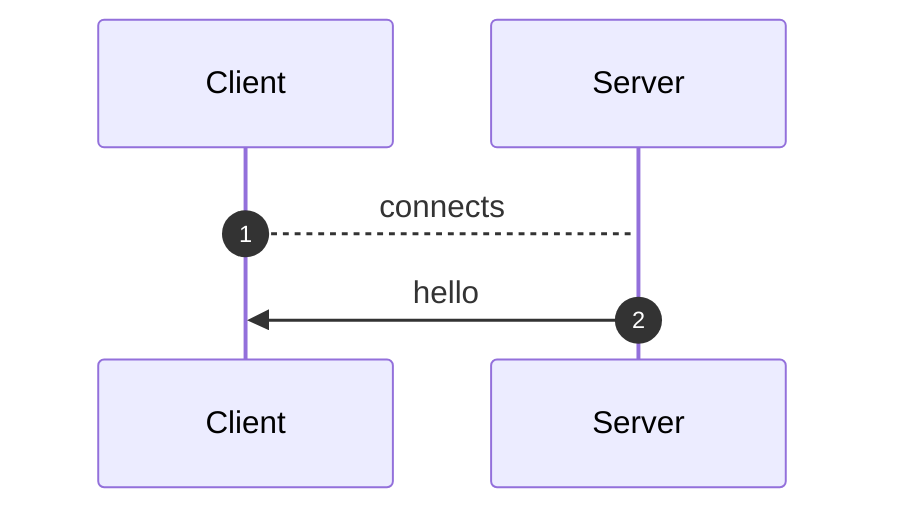
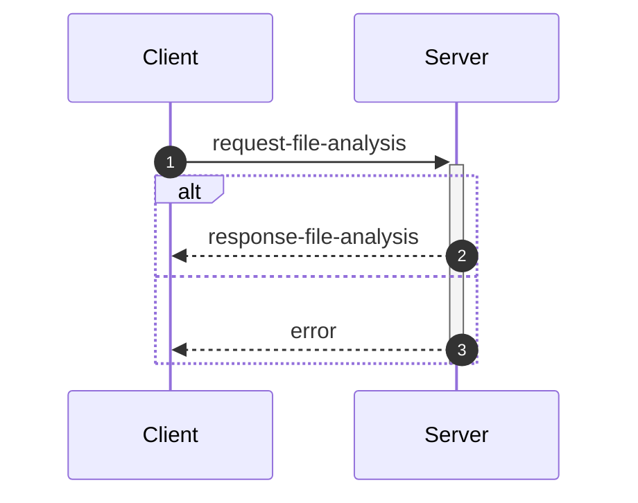
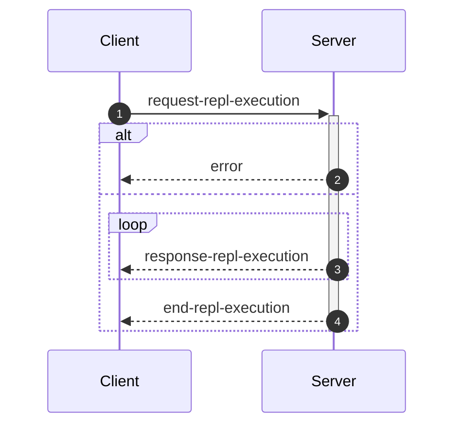
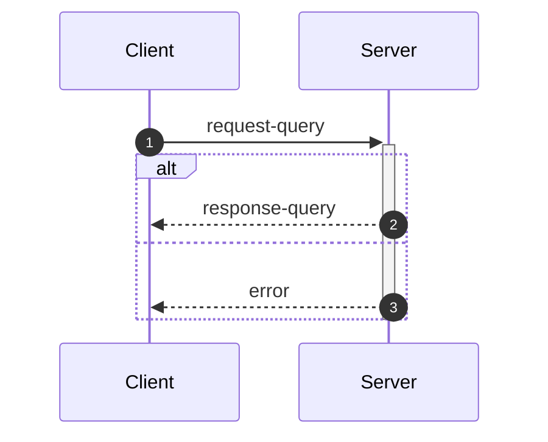

_<span title="an overview of flowR's interface">Generated</span> from '[wiki-interface.ts](https://github.com/flowr-analysis/flowr/tree/main/src/documentation/wiki-interface.ts "src/documentation/wiki-interface.ts")' on 2026-11-24, 11:51:26 UTC (v2.17.11, R v4.5.0), do not edit directly._

Although far from being as detailed as the in-depth explanation of [_flowR_](https://github.com/flowr-analysis/flowr/wiki/Core),
this wiki page explains how to interface with _flowR_ in more detail.
In general, command line arguments and other options provide short descriptions on hover over.

* [💻 Using the REPL](#using-the-repl)
* [⚙️ Configuring FlowR](#configuring-flowr)
* [⚒️ Writing Code](#writing-code)
* [💬 Communicating with the Server](#communicating-with-the-server)

<a id='using-the-repl'></a>
## 💻 Using the REPL

> [!NOTE]
> To execute arbitrary R commands with a repl request, _flowR_ has to be started explicitly with <span title="Description (Command Line Argument): Allow to access the underlying R session when using flowR (security warning: this allows the execution of arbitrary R code!)">`--r-session-access`</span>.
> Please be aware that this introduces a security risk and note that this relies on the [`r-shell` engine](https://github.com/flowr-analysis/flowr/wiki/Engines) .

Although primarily meant for users to explore,
there is nothing which forbids calling _flowR_ as a subprocess to use standard-in, -output, and -error
for communication (although you can access the REPL using the server as well,
with the [REPL Request](#message-request-repl-execution) message).

The read-eval-print loop&nbsp;(REPL) works relatively simple.
You can submit an expression (using <kbd>Enter</kbd>),
which is interpreted as an R&nbsp;expression by default but interpreted as a *command* if it starts with a colon (`:`).
The best command to get started with the REPL is <span title="Description (Repl Command): Show help information (aliases: :h, :?)">`:help`</span>.
Besides, you can leave the REPL either with the command <span title="Description (Repl Command): End the repl (aliases: :q, :exit)">`:quit`</span> or by pressing <kbd>Ctrl</kbd>+<kbd>C</kbd> twice.
When writing a *command*, you may press <kbd>Tab</kbd> to get a list of completions, if available.
Multiple commands can be entered in a single line by separating them with a semicolon (`;`), e.g. `:parse "x<-2"; :df*`.
If a command is given without R code, the REPL will re-use R code given in a previous command.
The prior example will hence return first the parsed AST of the program and then the dataflow graph for `"x <- 2"`.

> [!NOTE]
> If you develop flowR, you may want to launch the repl using the `npm run main-dev` command, this way, you get a non-minified version of flowR with debug information and hot-reloading of source files.

<details>
<summary>Available Commands</summary>

We currently offer the following commands (this with a `[*]` suffix are available with and without the star):

| Command | Description |
| ------- | ----------- |
| **<span title="Description (Repl Command): End the repl (aliases: :q, :exit)">:quit</span>** | End the repl (aliases: **:<span title="Alias of ':quit'. End the repl">q</span>**, **:<span title="Alias of ':quit'. End the repl">exit</span>**) |
| **<span title="Description (Repl Command): Execute the given code as R code. This requires the `--r-session-access` flag to be set and requires the r-shell engine. (aliases: :e, :r)">:execute</span>** | Execute the given code as R code. This requires the `--r-session-access` flag to be set and requires the r-shell engine. (aliases: **:<span title="Alias of ':execute'. Execute the given code as R code. This requires the `--r-session-access` flag to be set and requires the r-shell engine.">e</span>**, **:<span title="Alias of ':execute'. Execute the given code as R code. This requires the `--r-session-access` flag to be set and requires the r-shell engine.">r</span>**) |
| **<span title="Description (Repl Command): Get mermaid code for the control-flow graph of R code (aliases: :cfg, :cf)">:controlflow[*]</span>** | Get mermaid code for the control-flow graph of R code (star: Returns the URL to mermaid.live) (aliases: **:<span title="Alias of ':controlflow'. Get mermaid code for the control-flow graph of R code">cfg</span>**, **:<span title="Alias of ':controlflow'. Get mermaid code for the control-flow graph of R code">cf</span>**) |
| **<span title="Description (Repl Command): Get mermaid code for the control-flow graph with basic blocks (aliases: :cfgb, :cfb)">:controlflowbb[*]</span>** | Get mermaid code for the control-flow graph with basic blocks (star: Returns the URL to mermaid.live) (aliases: **:<span title="Alias of ':controlflowbb'. Get mermaid code for the control-flow graph with basic blocks">cfgb</span>**, **:<span title="Alias of ':controlflowbb'. Get mermaid code for the control-flow graph with basic blocks">cfb</span>**) |
| **<span title="Description (Repl Command): Get mermaid code for the dataflow graph (aliases: :d, :df)">:dataflow[*]</span>** | Get mermaid code for the dataflow graph (star: Returns the URL to mermaid.live) (aliases: **:<span title="Alias of ':dataflow'. Get mermaid code for the dataflow graph">d</span>**, **:<span title="Alias of ':dataflow'. Get mermaid code for the dataflow graph">df</span>**) |
| **<span title="Description (Repl Command): Get mermaid code for the normalized AST of R code (aliases: :n)">:normalize[*]</span>** | Get mermaid code for the normalized AST of R code (star: Returns the URL to mermaid.live) (alias: **:<span title="Alias of ':normalize'. Get mermaid code for the normalized AST of R code">n</span>**) |
| **<span title="Description (Repl Command): Get mermaid code for the simplified dataflow graph (aliases: :ds, :dfs)">:dataflowsimple[*]</span>** | Get mermaid code for the simplified dataflow graph (star: Returns the URL to mermaid.live) (aliases: **:<span title="Alias of ':dataflowsimple'. Get mermaid code for the simplified dataflow graph">ds</span>**, **:<span title="Alias of ':dataflowsimple'. Get mermaid code for the simplified dataflow graph">dfs</span>**) |
| **<span title="Description (Repl Command): Inspect and extend the signature database: `query` (identical to :query @signature), `info <name>` for where a function comes from (identical to :query @function-info), `add <path>` to mount another database/source, `download` to fetch the full-history database. (aliases: :sig)">:signature</span>** | Inspect and extend the signature database: `query` (identical to :query @signature), `info <name>` for where a function comes from (identical to :query @function-info), `add <path>` to mount another database/source, `download` to fetch the full-history database. (alias: **:<span title="Alias of ':signature'. Inspect and extend the signature database: `query` (identical to :query @signature), `info <name>` for where a function comes from (identical to :query @function-info), `add <path>` to mount another database/source, `download` to fetch the full-history database.">sig</span>**) |
| **<span title="Description (Repl Command): Just calculates the DFG, but only prints summary info (aliases: :d#, :df#)">:dataflowsilent</span>** | Just calculates the DFG, but only prints summary info (aliases: **:<span title="Alias of ':dataflowsilent'. Just calculates the DFG, but only prints summary info">d#</span>**, **:<span title="Alias of ':dataflowsilent'. Just calculates the DFG, but only prints summary info">df#</span>**) |
| **<span title="Description (Repl Command): Prints ASCII Art of the parsed, unmodified AST (aliases: :p)">:parse</span>** | Prints ASCII Art of the parsed, unmodified AST (alias: **:<span title="Alias of ':parse'. Prints ASCII Art of the parsed, unmodified AST">p</span>**) |
| **<span title="Description (Repl Command): Prints the version of flowR as well as the current version of R">:version</span>** | Prints the version of flowR as well as the current version of R
| **<span title="Description (Repl Command): Query the given R code (use 'help' for more information)">:query[*]</span>** | Query the given R code (use 'help' for more information) (star: Similar to query, but returns the output in json format.)
| **<span title="Description (Repl Command): Returns an ASCII representation of the dataflow graph (aliases: :df!)">:dataflowascii</span>** | Returns an ASCII representation of the dataflow graph (alias: **:<span title="Alias of ':dataflowascii'. Returns an ASCII representation of the dataflow graph">df!</span>**) |
| **<span title="Description (Repl Command): Returns summarization stats for the normalized AST (aliases: :n#)">:normalize#</span>** | Returns summarization stats for the normalized AST (alias: **:<span title="Alias of ':normalize#'. Returns summarization stats for the normalized AST">n#</span>**) |
| **<span title="Description (Repl Command): Show help information (aliases: :h, :?)">:help</span>** | Show help information (aliases: **:<span title="Alias of ':help'. Show help information">h</span>**, **:<span title="Alias of ':help'. Show help information">?</span>**) |

</details>

> [!TIP]
> 
> As indicated by the examples before, all REPL commands that operate on code keep track of the state.
> Hence, if you run a command like <span title="Description (Repl Command, starred version): Returns the URL to mermaid.live; Base Command: Get mermaid code for the dataflow graph (aliases: :d*, :df*)">`:dataflow*`</span> without providing R code,
> the REPL will re-use the R code provided in a previous command.
> Likewise, doing this will benefit from incrementality!
> If you request the dataflow graph with `:df* x <- 2 * y` and then want to see the parsed AST with `:parse`,
> the REPL will re-use previously obtained information and not re-parse the code again.
> 		

Generally, many commands offer shortcut versions in the REPL. Many queries, for example, offer a shortened format (see the example below).
Of special note, the [Config Query](https://github.com/flowr-analysis/flowr/wiki/%5BQuery%5D-Config)
can be used to also modify the currently active configuration of _flowR_ within the REPL (see the [wiki page](https://github.com/flowr-analysis/flowr/wiki/%5BQuery%5D-Config) for more information).

### Example: Retrieving the Dataflow Graph

To retrieve a URL to the [mermaid](https://mermaid.js.org/) diagram of the dataflow of a given expression,
use <span title="Description (Repl Command, starred version): Returns the URL to mermaid.live; Base Command: Get mermaid code for the dataflow graph (aliases: :d*, :df*)">`:dataflow*`</span> (or <span title="Description (Repl Command): Get mermaid code for the dataflow graph (aliases: :d, :df)">`:dataflow`</span> to get the mermaid code in the cli):

```shell
$ docker run -it --rm eagleoutice/flowr # or npm run flowr 
flowR repl v2.17.11, R grammar v14 (tree-sitter engine)
R> :dataflow* y <- 1 + x
```

<details>
<summary style='color:gray'>Output</summary>

```text
https://mermaid.live/view#base64:eyJjb2RlIjoiZmxvd2NoYXJ0IFREXG4gICAgMXt7XCJgKiM5MTtSTnVtYmVyIzkzOyogKioxKipcbiAgICAgICoxLjYqICgqKmlkOiAxKiopYFwifX1cbiAgICAyKFtcImAqIzkxO1JTeW1ib2wjOTM7KiAqKngqKlxuICAgICAgKjEuMTAqICgqKmlkOiAyKiopYFwiXSlcbiAgICAzW1tcImAqIzkxO1JCaW5hcnlPcCM5MzsqIGJhc2UjNTg7IzU4OyoqIzQzOyoqXG4gICAgICAqMS42LTEwKiAoKippZDogMyoqKVxuICAgIGFyZzogKDEsIDIpYFwiXV1cbiAgICBidWlsdC1pbjpfNDNfW1wiYEJ1aWx0LUluOlxuIzQzO2BcIl1cbiAgICBzdHlsZSBidWlsdC1pbjpfNDNfIHN0cm9rZTpncmF5LGZpbGw6Z3JheSxzdHJva2Utd2lkdGg6MnB4LG9wYWNpdHk6Ljg7XG4gICAgMFtcImAqIzkxO1JTeW1ib2wjOTM7KiAqKnkqKlxuICAgICAgKjEuMSogKCoqaWQ6IDAqKiwgdjogMylgXCJdXG4gICAgNFtbXCJgKiM5MTtSQmluYXJ5T3AjOTM7KiBiYXNlIzU4OyM1ODsqKiM2MDsjNDU7KipcbiAgICAgICoxLjEtMTAqICgqKmlkOiA0KiopXG4gICAgYXJnOiAoMCwgMylgXCJdXVxuICAgIGJ1aWx0LWluOl82MF8tW1wiYEJ1aWx0LUluOlxuIzYwOyM0NTtgXCJdXG4gICAgc3R5bGUgYnVpbHQtaW46XzYwXy0gc3Ryb2tlOmdyYXksZmlsbDpncmF5LHN0cm9rZS13aWR0aDoycHgsb3BhY2l0eTouODtcbiAgICAxIC0uLT58XCJmbG93XCJ8IDJcbiAgICBsaW5rU3R5bGUgMCBzdHJva2U6Z3JheSxjb2xvcjpncmF5O1xuICAgIDIgLS4tPnxcImZsb3dcInwgM1xuICAgIGxpbmtTdHlsZSAxIHN0cm9rZTpncmF5LGNvbG9yOmdyYXk7XG4gICAgMyAtLT58XCJyZWFkcywgYXJnXCJ8IDFcbiAgICAzIC0tPnxcInJlYWRzLCBhcmdcInwgMlxuICAgIDMgLS4tPnxcImZsb3dcInwgMFxuICAgIGxpbmtTdHlsZSA0IHN0cm9rZTpncmF5LGNvbG9yOmdyYXk7XG4gICAgMyAtLi0+fFwicmVhZHMsIGNhbGxzXCJ8IGJ1aWx0LWluOl80M19cbiAgICBsaW5rU3R5bGUgNSBzdHJva2U6Z3JheTtcbiAgICAwIC0tPnxcImRlZmluZWQtYnksIGZsb3dcInwgNFxuICAgIDAgLS0+fFwiZGVmaW5lZC1ieVwifCAzXG4gICAgNCAtLT58XCJyZWFkcywgYXJnXCJ8IDNcbiAgICA0IC0tPnxcInJldHVybnMsIGFyZ1wifCAwXG4gICAgNCAtLi0+fFwicmVhZHMsIGNhbGxzXCJ8IGJ1aWx0LWluOl82MF8tXG4gICAgbGlua1N0eWxlIDEwIHN0cm9rZTpncmF5OyIsIm1lcm1haWQiOiJ7XCJhdXRvU3luY1wiOnRydWV9In0=
```

Retrieve the dataflow graph of the expression `y <- 1 + x`. It looks like this:


<details>

<summary style="color:gray">R Code of the Dataflow Graph</summary>

The analysis ran (parse and normalize with the [tree-sitter](https://github.com/flowr-analysis/flowr/wiki/Engines) engine) in the generation environment. No [signature database](https://github.com/flowr-analysis/flowr/wiki/Signature-Database) is mounted, so `library()` attaches no exports (base-R names are still qualified, e.g., `stats::acf`). 
We encountered no unknown side effects during the analysis.

```r
y <- 1 + x
```

</details>

</details>

For small graphs like this, <span title="Description (Repl Command): Returns an ASCII representation of the dataflow graph (aliases: :df!)">`:dataflowascii`</span> also provides an ASCII representation directly in the REPL:

```shell
$ docker run -it --rm eagleoutice/flowr # or npm run flowr 
flowR repl v2.17.11, R grammar v14 (tree-sitter engine)
R> :df! y <- 1 + x
```

<details open>
<summary style='color:gray'>Output</summary>

```text
                        v<0>v
 c<4>c──────────────────| y |
 |<- |     ┌────────────v---v
 c---c     │
    │   c<3>c   0<1>0
    └───| + |───| 1 |───u<2>u
        c---c   0---0   | x |
           └────────────u---u
Edges:
3 -> 1: reads, arg          3 -> 2: reads, arg
3 -> 0: flows-to            1 -> 2: flows-to
2 -> 3: flows-to            4 -> 3: reads, arg
4 -> 0: returns, arg        0 -> 4: defined-by, flows-to
0 -> 3: defined-by
```

Retrieve the dataflow graph of the expression `y <- 1 + x` as ASCII art.

</details>

For the slicing with <span title="Description (Repl Command): Static backwards executable slicer for R">`:slicer`</span>, you have access to the same [magic comments](#slice-magic-comments) as with the [slice request](#message-request-slice).
Pass `--inline` to splice resolvable `source()` calls into the reconstruction so the slice is a single self-contained R text (the same as the static slice query's `inlineSources` flag).
See `--help` for more flags!

### Example: Interfacing with the File System

Many commands that allow for an R-expression (like <span title="Description (Repl Command, starred version): Returns the URL to mermaid.live; Base Command: Get mermaid code for the dataflow graph (aliases: :d*, :df*)">`:dataflow*`</span>) allow for a file as well
if the argument starts with `file://`.
If you are working from the root directory of the _flowR_ repository, the following gives you the parsed AST of the example file using the <span title="Description (Repl Command): Prints ASCII Art of the parsed, unmodified AST (aliases: :p)">`:parse`</span> command:

> **Watch mode**: Replace `file://` with `watch://` to enter watch mode.
> flowR runs the command immediately and then re-runs it every time the file (or any file inside the folder) changes.
> Enter any other command to leave watch mode.
> For example: `:df watch://analysis.R`

```shell
$ docker run -it --rm eagleoutice/flowr # or npm run flowr 
flowR repl v2.17.11, R grammar v14 (tree-sitter engine)
R> :parse file://test/testfiles/example.R
```

<details>
<summary style='color:gray'>Output</summary>

```text
File: test/testfiles/example.R

program
├ binaryoperator
│ ├ identifier "sum" (1:1─4)
│ ├ <- "<-" (1:5─7)
│ ╰ float "0" (1:8─9)
├ binaryoperator
│ ├ identifier "product" (2:1─8)
│ ├ <- "<-" (2:9─11)
│ ╰ float "1" (2:12─13)
├ binaryoperator
│ ├ identifier "w" (3:1─2)
│ ├ <- "<-" (3:3─5)
│ ╰ float "7" (3:6─7)
├ binaryoperator
│ ├ identifier "N" (4:1─2)
│ ├ <- "<-" (4:3─5)
│ ╰ float "10" (4:6─8)
├ forstatement
│ ├ for "for" (6:1─4)
│ ├ ( "(" (6:5─6)
│ ├ identifier "i" (6:6─7)
│ ├ in "in" (6:8─10)
│ ├ binaryoperator
│ │ ├ float "1" (6:11─12)
│ │ ├ : ":" (6:12─13)
│ │ ╰ parenthesizedexpression
│ │   ├ ( "(" (6:13─14)
│ │   ├ binaryoperator
│ │   │ ├ identifier "N" (6:14─15)
│ │   │ ├ - "-" (6:15─16)
│ │   │ ╰ float "1" (6:16─17)
│ │   ╰ ) ")" (6:17─18)
│ ├ ) ")" (6:18─19)
│ ╰ bracedexpression
│   ├ { "{" (6:20─21)
│   ├ binaryoperator
│   │ ├ identifier "sum" (7:3─6)
│   │ ├ <- "<-" (7:7─9)
│   │ ╰ binaryoperator
│   │   ├ binaryoperator
│   │   │ ├ identifier "sum" (7:10─13)
│   │   │ ├ + "+" (7:14─15)
│   │   │ ╰ identifier "i" (7:16─17)
│   │   ├ + "+" (7:18─19)
│   │   ╰ identifier "w" (7:20─21)
│   ├ binaryoperator
│   │ ├ identifier "product" (8:3─10)
│   │ ├ <- "<-" (8:11─13)
│   │ ╰ binaryoperator
│   │   ├ identifier "product" (8:14─21)
│   │   ├  "" (8:22─23)
│   │   ╰ identifier "i" (8:24─25)
│   ╰ } "}" (9:1─2)
├ call
│ ├ identifier "cat" (11:1─4)
│ ╰ arguments
│   ├ ( "(" (11:4─5)
│   ├ argument
│   │ ╰ string
│   │   ├ stringopen "\"" (11:5─6)
│   │   ├ stringcontent "Sum:" (11:6─10)
│   │   ╰ stringclose "\"" (11:10─11)
│   ├ comma "," (11:11─12)
│   ├ argument
│   │ ╰ identifier "sum" (11:13─16)
│   ├ comma "," (11:16─17)
│   ├ argument
│   │ ╰ string
│   │   ├ stringopen "\"" (11:18─19)
│   │   ├ stringcontent
│   │   │ ╰ escapesequence "\\n" (11:19─21)
│   │   ╰ stringclose "\"" (11:21─22)
│   ╰ ) ")" (11:22─23)
╰ call
  ├ identifier "cat" (12:1─4)
  ╰ arguments
    ├ ( "(" (12:4─5)
    ├ argument
    │ ╰ string
    │   ├ stringopen "\"" (12:5─6)
    │   ├ stringcontent "Product:" (12:6─14)
    │   ╰ stringclose "\"" (12:14─15)
    ├ comma "," (12:15─16)
    ├ argument
    │ ╰ identifier "product" (12:17─24)
    ├ comma "," (12:24─25)
    ├ argument
    │ ╰ string
    │   ├ stringopen "\"" (12:26─27)
    │   ├ stringcontent
    │   │ ╰ escapesequence "\\n" (12:27─29)
    │   ╰ stringclose "\"" (12:29─30)
    ╰ ) ")" (12:30─31)
```

Retrieve the parsed AST of the example file.

<details>

<summary>File Content</summary>

```r
sum <- 0
product <- 1
w <- 7
N <- 10

for (i in 1:(N-1)) {
  sum <- sum + i + w
  product <- product * i
}

cat("Sum:", sum, "\n")
cat("Product:", product, "\n")
```

</details>

As _flowR_ directly transforms this AST the output focuses on being human-readable instead of being machine-readable.
		
</details>

### Example: Run a Query

You can run any query supported by _flowR_ using the <span title="Description (Repl Command): Query the given R code (use 'help' for more information)">`:query`</span> command.
For example, to obtain the shapes of all data frames in a given piece of code, you can run:

```shell
$ docker run -it --rm eagleoutice/flowr # or npm run flowr 
flowR repl v2.17.11, R grammar v14 (tree-sitter engine)
R> :query @absint df-shape "x <- data.frame(a = 1:10, b = 1:10)\ny <- x$a"
```

<details open>
<summary style='color:gray'>Output</summary>

```text
Query: absint (3 ms)
   ╰ $12: (colnames: [{"a", "b"}, {}], cols: [2, 2], rows: [10, 10])
   ╰ $0: (colnames: [{"a", "b"}, {}], cols: [2, 2], rows: [10, 10])
```

Retrieve the shapes of all data frames in the given code.

</details>

To run the linter on a file, you can use (in this example, we just issue the `dead-code` linter on a small piece of code):

```shell
$ docker run -it --rm eagleoutice/flowr # or npm run flowr 
flowR repl v2.17.11, R grammar v14 (tree-sitter engine)
R> :query @linter rules:dead-code "if(FALSE) x <- 2"
```

<details open>
<summary style='color:gray'>Output</summary>

```text
Query: linter (5 ms)
   ╰ Dead Code (dead-code):
       ╰ certain:
           ╰ Code at 1.11-16 (1 quick fix(es) available)
```

Run the linter on the given code, with only the `dead-code` rule enabled.

</details>

For more information on the available queries, please check out the [Query API](https://github.com/flowr-analysis/flowr/wiki/Query-API).

<a id='configuring-flowr'></a>
## ⚙️ Configuring FlowR

When running _flowR_, you may want to specify some behaviors with a dedicated configuration file.
By default, flowR looks for a file named `flowr.json` in the current working directory (or any higher directory).
You can also specify a different file with <span title="Description (Command Line Argument): The name of the configuration file to use">`--config-file`</span> or pass the configuration inline using <span title="Description (Command Line Argument): The flowR configuration to use, as a JSON string">`--config-json`</span>.
A `flowr.json` found this way belongs to the analyzed project, so flowR ignores its options that decide what flowR executes or loads
(`defaultPlugins.*.1`, `repl.plugins.*.1`, `engines.*.wasmPath`, `engines.*.treeSitterWasmPath`, `engines.*.rPath`, `solver.sigdb.additionalPaths`, `solver.sigdb.downloadRepo`, `solver.sigdb.autoSync`, `solver.sigdb.installedLibrary.paths`, `solver.sigdb.onDemand.enabled`, `solver.sigdb.onDemand.repositories`, `solver.sigdb.onDemand.cranMirror`, `solver.sigdb.onDemand.bioconductorMirror`, `solver.sigdb.onDemand.cacheDir`, `solver.instrument.dataflowExtractors`),
unless you pass <span title="Description (Command Line Argument): Keep the security-sensitive options (e.g., the R executable) of the flowr.json found in the working directory or a parent. Only use this for projects you trust.">`--trust-config`</span>.
To analyze code you do not trust, use the secure mode (<span title="Description (Command Line Argument): Run in secure mode for analyzing untrusted code: flowR does not start R (or any other process), does not access the network, does not search for project configs, and ignores security-sensitive options in every config. Cannot be disabled once enabled. Can also be enabled with the environment variable {italic FLOWR_SECURE_MODE=1}.">`--secure`</span>, see the [security policy](https://github.com/flowr-analysis/flowr/blob/main/.github/SECURITY.md)).
To inspect the current configuration, you can run flowr with the <span title="Description (Command Line Argument): Run with verbose logging (will be passed to the corresponding script)">`--verbose`</span> flag, or use the `config` [Query](https://github.com/flowr-analysis/flowr/wiki/Query-API).
Within the REPL this works by running the following:

```shell
:query @config
```

To work with the <a href="https://github.com/flowr-analysis/flowr/tree/main/src/config.ts#L131"><code><span title="The configuration file format for flowR.">FlowrConfig</span></code></a> you can use the provided helper objects alongside its methods like
<a href="https://github.com/flowr-analysis/flowr/tree/main/src/config.ts#L980"><code><span title="Creates a new flowr config that has the updated values.">FlowrConfig::<b>amend</b></span></code></a>.
The schema below documents every option; the ones you most likely want are:

- <a href="https://github.com/flowr-analysis/flowr/wiki/Interface#configuring-flowr" title="Configuration Option (boolean): Whether source calls should be ignored, causing {@link processSourceCall}&#39;s behavior to be skipped.">ignoreSourceCalls</a>: ignore source calls when analyzing the code, i.e., ignore the inclusion of other files.
- <a href="https://github.com/flowr-analysis/flowr/wiki/Interface#configuring-flowr" title="Configuration Option (boolean): Whether load calls should be ignored, causing {@link processLoadCall}&#39;s behavior to be skipped.">ignoreLoadCalls</a>: ignore load calls when analyzing the code, i.e., ignore the loading of r-data files.
- <a href="https://github.com/flowr-analysis/flowr/wiki/Interface#configuring-flowr" title="Configuration Option (object): Do you want to overwrite (parts) of the builtin definition?">semantics.environment.overwriteBuiltIns</a>: overwrite _flowR_'s handling of built-in functions, or clear the preset definitions entirely.
  See [Configure BuiltIn Semantics](#configure-builtin-semantics) for more information.
- <a href="https://github.com/flowr-analysis/flowr/wiki/Interface#configuring-flowr" title="Configuration Option (boolean): Whether calls drawing on a graphics device (e.g., `plot`) count as writing to it, which the ambient state queries then report.">semantics.ambient.drawingWritesDevice</a>: whether calls drawing on a graphics device (e.g., `plot`) count as writing the device in the ambient state queries.
- <a href="https://github.com/flowr-analysis/flowr/wiki/Interface#configuring-flowr" title="Configuration Option (string): How to resolve variables and their values. (one of &quot;disabled&quot;, &quot;alias&quot;, &quot;builtin&quot;)">solver.variables</a>: how to resolve variables and their values (`disabled`, `alias`, `builtin`).
- <a href="https://github.com/flowr-analysis/flowr/wiki/Interface#configuring-flowr" title="Configuration Option (array): The engine or set of engines to use for interacting with R code. An empty array means all available engines will be used.">engines</a> and <a href="https://github.com/flowr-analysis/flowr/wiki/Interface#configuring-flowr" title="Configuration Option (string): The default engine to use for interacting with R code. If this is undefined, an arbitrary engine from the specified list will be used. (one of &quot;tree-sitter&quot;, &quot;r-shell&quot;)">defaultEngine</a>: the engines used to interact with R code, see the [Engines wiki page](https://github.com/flowr-analysis/flowr/wiki/Engines).
- <a href="https://github.com/flowr-analysis/flowr/wiki/Interface#configuring-flowr" title="Configuration Option (array): Files a framework loads on its own, without any source() call (e.g. global.R in a shiny app), in the order they are loaded; flowR orders the matching project files accordingly and analyzes them as one program. Entries are case-insensitive globs matched against the file path, a plain name matches any file with that name, and entries matching no project file are warned about. Usually set per project kind via specializeConfig.">project.implicitSources</a>: the files a framework loads without any `source()` call, in the order in which they are
  loaded. Entries are globs (e.g. `R/*.R`) matched against the file path ignoring capitalization; one matching no file is reported.
- <a href="https://github.com/flowr-analysis/flowr/wiki/Interface#configuring-flowr" title="Configuration Option (object): Overwrite (parts of) the configuration depending on the project kind flowR detects, e.g. to give a shiny app its implicit sources.">specializeConfig</a>: overwrite (parts of) the configuration depending on the kind of project _flowR_ detects
  (e.g. `shiny-app`), which is how a shiny app gets its implicit sources by default. What you configure directly wins.
- <a href="https://github.com/flowr-analysis/flowr/wiki/Interface#configuring-flowr" title="Configuration Option (string): Overwrite the project kind flowR would otherwise infer from the analyzed files, e.g. when auto-detection guesses wrong. (one of &quot;package&quot;, &quot;script&quot;, &quot;shiny-app&quot;, &quot;notebook&quot;, &quot;project&quot;, &quot;unknown&quot;)">project.useProjectType</a>: skip that detection and force a project kind yourself, when auto-detection guesses wrong.
- <a href="https://github.com/flowr-analysis/flowr/wiki/Interface#configuring-flowr" title="Configuration Option (array): The default plugins to load when creating a new instance of FlowrAnalyzer">defaultPlugins</a> and <a href="https://github.com/flowr-analysis/flowr/wiki/Interface#configuring-flowr" title="Configuration Option (array): The plugins to load in REPL mode">repl.plugins</a>: the plugins to load for a new <a href="https://github.com/flowr-analysis/flowr/tree/main/src/project/flowr-analyzer.ts#L237"><code><span title="Central class for conducting analyses with FlowR. Use the FlowrAnalyzerBuilder to create a new instance. If you want the original pattern of creating a pipeline and running all steps, you can still do this with FlowrAnalyzer#runFull . To inspect the context of the analyzer, use FlowrAnalyzer#inspectContext (if you are a plugin and need to modify it, use FlowrAnalyzer#context instead).">FlowrAnalyzer</span></code></a> and in the REPL
  (use `flowr:default` to reference the former).

So you can configure _flowR_ by adding a file like the following:

<details>

<summary>Example Configuration File</summary>

```json
{
  "ignoreSourceCalls": true,
  "ignoreLoadCalls": true,
  "semantics": {
    "environment": {
      "overwriteBuiltIns": {
        "definitions": [
          {
            "type": "function",
            "names": [
              "foo"
            ],
            "processor": "builtin:assign",
            "config": {}
          }
        ]
      }
    }
  },
  "defaultPlugins": [
    "file:description",
    "versions:description"
  ],
  "repl": {
    "quickStats": false,
    "dfProcessorHeat": false,
    "hints": true,
    "plugins": [
      "flowr:default"
    ]
  },
  "project": {
    "resolveUnknownPathsOnDisk": true,
    "implicitSources": [
      "global.R",
      "app.R"
    ]
  },
  "linter": {
    "disabledRules": []
  },
  "specializeConfig": {
    "shiny-app": {
      "project": {
        "implicitSources": [
          "global.R",
          "ui.R",
          "server.R",
          "app.R"
        ]
      }
    }
  },
  "engines": [
    {
      "type": "r-shell"
    }
  ],
  "solver": {
    "variables": "alias",
    "evalStrings": true,
    "trackEnvironments": true,
    "sigdb": {
      "enabled": true,
      "loadProjectDependencies": true,
      "eagerlyLoad": false,
      "eagerlyLoadExports": false,
      "linkBaseR": false,
      "linkDescriptionDependencies": false
    },
    "resolveSource": {
      "dropPaths": "no",
      "ignoreCapitalization": true,
      "inferWorkingDirectory": "active-script",
      "searchPath": []
    },
    "instrument": {},
    "slicer": {
      "threshold": 50
    }
  },
  "abstractInterpretation": {
    "wideningThreshold": 4,
    "followCalls": true,
    "dataFrame": {
      "maxColNames": 20,
      "readLoadedData": {
        "readExternalFiles": true,
        "maxReadLines": 1000000
      }
    }
  },
  "incremental": {
    "alwaysIncremental": false,
    "parsing": {
      "activated": false,
      "heuristics": {
        "activated": true,
        "mtime": true,
        "linesFrom": 500,
        "bytesFrom": 50000,
        "alwaysWithEdits": false,
        "minFiles": 1
      }
    },
    "dataflow": {
      "reuse": true,
      "activated": false,
      "checkpoints": 2,
      "minStatements": 0
    }
  },
  "gas": {
    "thresholds": {
      "memory": {
        "problematic": 0.7,
        "critical": 0.9
      },
      "timeMs": {
        "problematic": 100000,
        "critical": 120000
      }
    },
    "features": {}
  }
}
```

</details>

<details>
<a id='configure-builtin-semantics'></a>
<summary>Configure Built-In Semantics</summary>

`semantics/environment/overwriteBuiltins` accepts two keys:

- `loadDefaults` (boolean, initially `true`): If set to `true`, the default built-in definitions are loaded before applying the custom definitions. Setting this flag to `false` explicitly disables the loading of the default definitions.
- `definitions` (array, initially empty): Allows to overwrite or define new built-in elements. Each object within must have a `type` which is one of the below. Furthermore, they may define a string array of `names` which specifies the identifiers to bind the definitions to. You may use `assumePrimitive` to specify whether _flowR_ should assume that this is a primitive non-library definition (so you probably just do not want to specify the key).

  | Type            | Description                                                                                                                                                                                                                                                                                              | Example                                                                                                    |
  | --------------- | -------------------------------------------------------------------------------------------------------------------------------------------------------------------------------------------------------------------------------------------------------------------------------------------------------- | ---------------------------------------------------------------------------------------------------------- |
  | `constant`    | Additionally allows for a `value` this should resolve to.                                                                                                                                                                                                                                                | `{ type: 'constant', names: ['NULL', 'NA'],  value: null }`                                                |
  | `function`    | Is a rather flexible way to define and bind built-in functions. For the time, we do not have extensive documentation to cover all the cases, so please either consult the sources with the `default-builtin-config/` folder or open a [new issue](https://github.com/flowr-analysis/flowr/issues/new/choose). | `{ type: 'function', names: ['next'], processor: 'builtin:d', config: { cfg: ExitPointType.Next } }` |
  | `replacement` | A comfortable way to specify replacement functions like `$<-` or `names<-`. `suffixes` describes the... suffixes to attach automatically. | `{ type: 'replacement', suffixes: ['<-', '<<-'], names: ['[', '[['] }` |

</details>

<details>

<summary style='color:gray'>Full Configuration-File Schema</summary>

- _The configuration file format for flowR._ (object)
    - **logLevel** [optional] _flowR's global minimum log level, applied when the config is loaded._ (string)
        Only allows: 'silly', 'trace', 'debug', 'info', 'warn', 'error', 'fatal'
    - **ignoreSourceCalls** [optional] _Whether source calls should be ignored, causing {@link processSourceCall}'s behavior to be skipped._ (boolean)
    - **ignoreLoadCalls** [optional] _Whether load calls should be ignored, causing {@link processLoadCall}'s behavior to be skipped._ (boolean)
    - **semantics** _Configure language semantics and how flowR handles them._ (object)
        - **environment** [optional] _Semantics regarding how to handle the R environment._ (object)
            - **overwriteBuiltIns** [optional] _Do you want to overwrite (parts) of the builtin definition?_ (object)
                - **loadDefaults** [optional] _Should the default configuration still be loaded?_ (boolean)
                - **definitions** [optional] _The definitions to load/overwrite._ (array)
                Valid item types:
                    - (object)
        - **ambient** [optional] _Semantics regarding the global state (options, devices, files, ...) calls access._ (object)
            - **drawingWritesDevice** [optional] _Whether calls drawing on a graphics device (e.g., `plot`) count as writing to it, which the ambient state queries then report._ (boolean)
    - **defaultPlugins** [optional] _The default plugins to load when creating a new instance of FlowrAnalyzer_ (array)
    Valid item types:
        - (alternatives)
            - (string)
            - (array)
    - **repl** _Configuration options for the REPL._ (object)
        - **quickStats** [optional] _Whether to show quick stats in the REPL after each evaluation._ (boolean)
        - **dfProcessorHeat** [optional] _This instruments the dataflow processors to count how often each processor is called._ (boolean)
        - **hints** [optional] _Whether to show dim inline hints on the empty prompt (automatically disabled on non-interactive terminals)._ (boolean)
        - **plugins** [optional] _The plugins to load in REPL mode_ (array)
        Valid item types:
            - (alternatives)
                - (string)
                - (array)
        - **autoUseFileProtocol** [optional] _Prepend the file protocol to a repl input that looks like a path, instead of only warning about it._ (boolean)
        - **queryStats** [optional] _Whether `:query` closes with the line stating how long the queries took (`:query*` never prints it)._ (boolean)
        - **showPlugins** [optional] _Whether `:version` grays out the plugins that did not activate during the last analysis._ (boolean)
    - **project** _Project specific configuration options._ (object)
        - **resolveUnknownPathsOnDisk** [optional] _Whether to resolve unknown paths loaded by the r project disk when trying to source/analyze files._ (boolean)
        - **failOnInaccessiblePath** [optional] _Whether a directory that cannot be traversed during file discovery (e.g. due to permissions) aborts the analysis; when false (the default) such paths are logged and skipped._ (boolean)
        - **basePackages** [optional] _The packages considered part of R itself (base and recommended); if unset, flowR uses its built-in list._ (array)
        Valid item types:
            - (string)
        - **implicitSources** [optional] _Files a framework loads on its own, without any source() call (e.g. global.R in a shiny app), in the order they are loaded; flowR orders the matching project files accordingly and analyzes them as one program. Entries are case-insensitive globs matched against the file path, a plain name matches any file with that name, and entries matching no project file are warned about. Usually set per project kind via specializeConfig._ (array)
        Valid item types:
            - (string)
        - **useProjectType** [optional] _Overwrite the project kind flowR would otherwise infer from the analyzed files, e.g. when auto-detection guesses wrong._ (string)
            Only allows: 'package', 'script', 'shiny-app', 'notebook', 'project', 'unknown'
        - **assumeImplicitEcho** [optional] _Whether the top level of the analyzed code is echoed, so that every visible result printed there is collected as an output by the dependencies query (default true, false for a package)._ (boolean)
        - **discovery** [optional] _Scoping options for the default project discovery._ (object)
            - **full** [optional] _Collect every file below the project root (greedy) instead of only the files the detected project kind needs (default false)._ (boolean)
            - **perKind** [optional] _Per-kind include/exclude glob overrides layered on the default scoping._ (object)
            - **ignore** [optional] _Case-insensitive globs that drop matching files from the intelligent discovery, regardless of kind (e.g. .Renviron to ignore environment files)._ (array)
            Valid item types:
                - (string)
        - **classification** [optional] _Overrides for the signals flowR uses to classify the project kind._ (object)
            - **shinyDescriptionTypes** [optional] _DESCRIPTION Type: values that mark a shiny app._ (array)
            Valid item types:
                - (string)
            - **shinyEntryFiles** [optional] _File names a shiny app is assembled from._ (array)
            Valid item types:
                - (string)
            - **shinyUsagePattern** [optional] _Regex source evidencing shiny usage in an entry file._ (string)
            - **notebookExtensions** [optional] _File extensions marking a notebook._ (array)
            Valid item types:
                - (string)
    - **linter** _Linter configuration options._ (object)
        - **disabledRules** _Linting rule names excluded from the default rule set (a rule requested explicitly via a linter query still runs). Usually set per project kind via specializeConfig._ (array)
        Valid item types:
            - (string)
        - **disabledTags** [optional] _Linting rule tags whose rules are excluded from the default rule set (a rule requested explicitly via a linter query still runs). By default the cmd-check rules are disabled for everything but a package; a configured list replaces that default._ (array)
        Valid item types:
            - (string)
    - **inputSources** [optional] _Further frameworks the input-sources analysis should know about; entries are added to flowR's defaults._ (object)
        - **pure** [optional] _Functions that only pass the constantness of their arguments on._ (array)
        Valid item types:
            - (string)
        - **param** [optional] _Functions whose result is a 'param' input._ (array)
        Valid item types:
            - (string)
        - **file** [optional] _Functions whose result is a 'file' input._ (array)
        Valid item types:
            - (string)
        - **tempfile** [optional] _Functions whose result is a 'tempfile' input._ (array)
        Valid item types:
            - (string)
        - **glob** [optional] _Functions whose result is a 'glob' input._ (array)
        Valid item types:
            - (string)
        - **net** [optional] _Functions whose result is a 'net' input._ (array)
        Valid item types:
            - (string)
        - **rand** [optional] _Functions whose result is a 'rand' input._ (array)
        Valid item types:
            - (string)
        - **system** [optional] _Functions whose result is a 'system' input._ (array)
        Valid item types:
            - (string)
        - **ffi** [optional] _Functions whose result is a 'ffi' input._ (array)
        Valid item types:
            - (string)
        - **lang** [optional] _Functions whose result is a 'lang' input._ (array)
        Valid item types:
            - (string)
        - **options** [optional] _Functions whose result is a 'options' input._ (array)
        Valid item types:
            - (string)
        - **cmdline** [optional] _Functions whose result is a 'cmdline' input._ (array)
        Valid item types:
            - (string)
        - **user** [optional] _Functions whose result is a 'user' input._ (array)
        Valid item types:
            - (string)
        - **const** [optional] _Functions whose result is a 'const' input._ (array)
        Valid item types:
            - (string)
        - **scope** [optional] _Functions whose result is a 'scope' input._ (array)
        Valid item types:
            - (string)
        - **dconst** [optional] _Functions whose result is a 'dconst' input._ (array)
        Valid item types:
            - (string)
        - **unknown** [optional] _Functions whose result is a 'unknown' input._ (array)
        Valid item types:
            - (string)
        - **linkedObjects** [optional] _Objects a framework provides without a definition in the code, e.g. shiny's input._ (array)
        Valid item types:
            - (object)
        - **linkedEntryPoints** [optional] _Calls that hand a function to a framework, which binds its objects to the parameters by position._ (array)
        Valid item types:
            - (object)
    - **specializeConfig** [optional] _Overwrite (parts of) the configuration depending on the project kind flowR detects, e.g. to give a shiny app its implicit sources._ (object)
    - **engines** _The engine or set of engines to use for interacting with R code. An empty array means all available engines will be used._ (array)
    Valid item types:
        - (alternatives)
            - _The configuration for the tree sitter engine._ (object)
                - **type** [required] _Use the tree sitter engine._ (string)
                    Only allows: 'tree-sitter'
                - **wasmPath** [optional] _The path to the tree-sitter-r WASM binary to use. If this is undefined, this uses the default path._ (string)
                - **treeSitterWasmPath** [optional] _The path to the tree-sitter WASM binary to use. If this is undefined, this uses the default path._ (string)
                - **lax** [optional] _Whether to use the lax parser for parsing R code (allowing for syntax errors). If this is undefined, the strict parser will be used._ (boolean)
            - _The configuration for the R shell engine._ (object)
                - **type** [required] _Use the R shell engine._ (string)
                    Only allows: 'r-shell'
                - **rPath** [optional] _The path to the R executable to use. If this is undefined, this uses the default path._ (string)
                - **pipeBind** [optional] _Whether to enable R's experimental pipe-bind operator "=>" by setting _R_USE_PIPEBIND_ for the R session (default false); R itself keeps this off by default, as it is experimental and has never shipped in a release version of R._ (boolean)
    - **defaultEngine** [optional] _The default engine to use for interacting with R code. If this is undefined, an arbitrary engine from the specified list will be used._ (string)
        Only allows: 'tree-sitter', 'r-shell'
    - **solver** _How to resolve constants, constraints, cells, ..._ (object)
        - **variables** _How to resolve variables and their values._ (string)
            Only allows: 'disabled', 'alias', 'builtin'
        - **evalStrings** _Should we include eval(parse(text="...")) calls in the dataflow graph?_ (boolean)
        - **trackEnvironments** [optional] _Track user-created environments (new.env, assign/get/local with envir=, dollar-assign, attach). When false, all envir-style calls fall through conservatively._ (boolean)
        - **sigdb** _Resolving library exports from a signature database._ (object)
            - **enabled** [optional] _Resolve library()/use() exports from a signature database (default true); when false no database is consulted._ (boolean)
            - **loadProjectDependencies** [optional] _Load the project's declared dependencies from its metadata files (DESCRIPTION Imports/Depends, rproject.toml, uvr.toml, rig rproj.toml and script blocks, renv.lock, rv.lock, uvr.lock, rig lockfiles) (default true); when false these files are not read for dependencies._ (boolean)
            - **eagerlyLoad** [optional] _Parse the database up front rather than on the first package load (default false, ignored if disabled)._ (boolean)
            - **eagerlyLoadExports** [optional] _Add a vertex for every export on load rather than on demand (default false); keeps the dataflow graph small._ (boolean)
            - **assumedRVersion** [optional] _R version assumed when resolving versioned (base-R) exports: a pin like "4.5" or "auto" to detect the installed R (default "auto")._ (string)
            - **linkBaseR** [optional] _Eagerly attach base-R namespaces so bare base calls resolve without library() (default false)._ (boolean)
            - **linkBaseRCalls** [optional] _Add a lightweight Reads edge from a bare base-R call to its signature-database function vertex (default false; base-R qualification is edge-free otherwise)._ (boolean)
            - **linkPackageCalls** [optional] _Add a lightweight Reads edge from a resolved package call to its signature-database function vertex (default false)._ (boolean)
            - **linkDescriptionDependencies** [optional] _Eagerly attach the namespaces of the project's declared DESCRIPTION dependencies (Imports/Depends) so their exports resolve without an explicit library() (default false)._ (boolean)
            - **warmInBackground** [optional] _Decompress the hot shards (base + most-downloaded) in a background task on startup so the first library() lookup is warm (default false; for long-running servers/REPLs)._ (boolean)
            - **additionalPaths** [optional] _Extra directories or bundle/manifest files searched for signature databases (alongside the shipped default and $FLOWR_SIGDB_DIR); a downloaded full-history bundle placed here is mounted automatically._ (array)
            Valid item types:
                - (string)
            - **downloadRepo** [optional] _GitHub owner/repo the full-history bundle is downloaded from via ":signature download" (default "flowr-analysis/flowr"; the release tag comes from the committed sigdb.remote.json unless a version is given)._ (string)
            - **autoSync** [optional] _On startup, re-download shards whose committed sigdb.remote.json hash no longer matches the cache, in the background (default false; opt-in network sync after a git pull)._ (boolean)
            - **installedLibrary** [optional] _Recovering packages no signature database knows from the copy installed on this machine._ (object)
                - **enabled** [required] _Recover packages no signature database knows from their installed copy (default false)._ (boolean)
                - **paths** [optional] _Library directories to search; when empty they are discovered from the environment and the project._ (array)
                Valid item types:
                    - (string)
                - **useEnvironment** [optional] _Search the libraries R_LIBS_USER/R_LIBS/R_LIBS_SITE name (default true)._ (boolean)
                - **useProjectLibrary** [optional] _Search a project-local renv/packrat library (default true)._ (boolean)
                - **maxDepth** [optional] _How far to descend into the nested layout of a project-local library (default 3)._ (number)
                - **packages** [optional] _Only recover packages whose name matches one of these regular expressions; empty means any._ (array)
                Valid item types:
                    - (string)
            - **onDemand** [optional] _Recovering packages no signature database knows from their sources on CRAN, Bioconductor, or GitHub._ (object)
                - **enabled** [required] _Fetch and recover the sources of packages no signature database knows when the analyzed code uses them (default false, accesses the network)._ (boolean)
                - **sources** [optional] _Where to look, in order: github, cran, bioconductor, or a source a plugin adds (default ["github", "cran", "bioconductor"])._ (array)
                Valid item types:
                    - (string)
                - **repositories** [optional] _GitHub repositories (owner/repo[/subdir][@ref]) to fetch packages from, by package name. The analyzed project may name more (DESCRIPTION Remotes, install_github calls)._ (object)
                - **packages** [optional] _Only recover packages whose name matches one of these regular expressions, empty means any._ (array)
                Valid item types:
                    - (string)
                - **cranMirror** [optional] _The CRAN src/contrib/ to fetch from, over https (default https://cloud.r-project.org/src/contrib/). It may be on the local network._ (string)
                - **bioconductorMirror** [optional] _The Bioconductor host, over https (default https://bioconductor.org). It may be on the local network._ (string)
                - **bioconductorRelease** [optional] _The Bioconductor release to fetch from: release, devel, or a number like 3.20 (default release)._ (string)
                - **githubMirrors** [optional] _Use the GitHub mirrors of CRAN (cran/<pkg>) and Bioconductor (bioc/<pkg>) (default true)._ (boolean)
                - **maxPackages** [optional] _The most packages to fetch for one analysis (default 25)._ (number)
                - **maxArchiveMb** [optional] _The most MiB a package archive may have (default 32). It may unpack to three times that, at most 128 MiB._ (number)
                - **offline** [optional] _Only use what was fetched before, never the network (default false)._ (boolean)
                - **retryAfterHours** [optional] _How many hours to wait before asking again for a package no source had (default 24)._ (number)
                - **cacheDir** [optional] _Where to cache what was fetched (default the on-demand directory of the signature cache)._ (string)
            - **blobCacheBudgetMb** [optional] _How many MiB of decoded package blobs every open bundle may hold together (default 16)._ (number)
            - **versionSelection** [optional] _When a project constrains a dependency, resolve to the newest (default), oldest, or system-installed version satisfying it; system needs R and falls back to newest. Base-R packages always resolve against the assumed R version._ (string)
                Only allows: 'newest', 'oldest', 'system'
            - **versionOverrides** [optional] _Force an exact version for specific packages (name -> version), overriding both the project constraint and the versionSelection policy (default {})._ (object)
        - **versionManagement** _Policies for reasoning about dependency versions._ (object)
            - **linkedVersionGroups** [optional] _Groups of packages that must resolve to the same version; version guessing intersects each group so its members stay mutually compatible (default [])._ (array)
            Valid item types:
                - (array)
                Valid item types:
                    - (string)
        - **assumeAttachedPackages** [optional] _Packages to treat as attached without a `library()` call, so what the built-in configuration states about them applies to the analyzed code. The base packages R attaches on startup already resolve without it._ (array)
        Valid item types:
            - (string)
        - **transitiveSideEffectRounds** [optional] _How many rounds the transitive side-effect fixpoint may run before it is cut off (default 32); the propagation stops on its own as soon as a round adds nothing._ (number)
        - **maxOverlayDepth** [optional] _How many binding overlays may stack on one environment frame before a write flattens them (default 4); a pure performance knob, trading lookup cost against copy cost without changing any result._ (number)
        - **instrument** (object)
            - **dataflowExtractors** [optional] _These keys are only intended for use within code, allowing to instrument the dataflow analyzer!_ (any)
        - **resolveSource** [optional] _If lax source calls are active, flowR searches for sourced files much more freely, based on the configurations you give it. This option is only in effect if `ignoreSourceCalls` is set to false._ (object)
            - **dropPaths** _Allow to drop the first or all parts of the sourced path, if it is relative._ (string)
                Only allows: 'no', 'once', 'all'
            - **ignoreCapitalization** _Search for filenames matching in the lowercase._ (boolean)
            - **inferWorkingDirectory** _Try to infer the working directory from the main or any script to analyze._ (string)
                Only allows: 'no', 'main-script', 'active-script', 'any-script'
            - **searchPath** _Additionally search in these paths._ (array)
            Valid item types:
                - (string)
            - **repeatedSourceLimit** [optional] _How often the same file can be sourced within a single run? Please be aware: in case of cyclic sources this may not reach a fixpoint so give this a sensible limit._ (number)
            - **applyReplacements** _Provide name replacements for loaded files_ (array)
            Valid item types:
                - (object)
            - **assumeFilesExist** [optional] _Assume a sourced file is always there, making what it defines certain instead of conditional on the source call._ (boolean)
        - **slicer** [optional] _The configuration for the slicer._ (object)
            - **threshold** [optional] _The maximum number of iterations to perform on a single function call during slicing._ (number)
            - **autoExtend** [optional] _If set, the slicer will gain an additional post-pass._ (boolean)
    - **abstractInterpretation** _The configuration options for abstract interpretation._ (object)
        - **wideningThreshold** _The threshold for the number of visitations of a node at which widening should be performed to ensure the termination of the fixpoint iteration._ (number)
        - **followCalls** _Whether the abstract interpretation is interprocedural, i.e. whether it steps into the functions a call may dispatch to._ (boolean)
        - **dataFrame** _The configuration of the shape inference for data frames._ (object)
            - **maxColNames** _The maximum number of columns names to infer for data frames before over-approximating the column names to top._ (number)
            - **readLoadedData** _Configuration options for reading data frame shapes from loaded external data files, such as CSV files._ (object)
                - **readExternalFiles** _Whether data frame shapes should be extracted from loaded external files, such as CSV files._ (boolean)
                - **maxReadLines** _The maximum number of lines to read when extracting data frame shapes from loaded files, such as CSV files._ (number)
    - **incremental** (object)
        - **alwaysIncremental** _Always take the incremental path, regardless of heuristics._ (boolean)
        - **parsing** (object)
            - **activated** _If set, incremental parsing will be used._ (boolean)
            - **heuristics** (object)
                - **activated** [optional] _If set, the heuristics for incremental parsing will be used._ (boolean)
                - **mtime** [optional] _Skip reparsing entirely if the file's modification time is unchanged since the last parse._ (boolean)
                - **linesFrom** [optional] _Only consider incremental parsing for files with at least this many lines._ (number)
                - **bytesFrom** [optional] _Only consider incremental parsing for files with at least this many bytes._ (number)
                - **alwaysWithEdits** [optional] _Always take the incremental path whenever there is a computed edit region, regardless of the other thresholds._ (boolean)
                - **minFiles** [optional] _Only apply these heuristics once the project has at least this many files loaded._ (number)
        - **dataflow** (object)
            - **reuse** [optional] _Hand out the last dataflow analysis again if the files did not change besides their comments._ (boolean)
            - **activated** _Resume the analysis of a file after its last unchanged top-level statement, from checkpoints the analysis before kept._ (boolean)
            - **checkpoints** [optional] _After how many of the last top-level statements to keep a checkpoint to resume from (each copies the graph)._ (number)
            - **minStatements** [optional] _Keep checkpoints only for files with at least this many top-level statements._ (number)
    - **gas** [optional] _Resource-usage guard (gas) configuration. All feature factors default to 0 (disabled). See https://github.com/flowr-analysis/flowr/wiki/Core#gas-resource-guard._ (object)
        - **thresholds** [optional] _Thresholds for all gas checks (scaled by per-feature factor), boundable per feature._ (object)
            - **memory** [optional] _Heap-usage fraction thresholds (0-1), either shared or given per feature key (with `default` covering the rest)._ (object)
                - **problematic** [optional] _Heap fraction (0-1) above which Problematic is returned, for every feature without an entry of its own._ (number)
                - **critical** [optional] _Heap fraction (0-1) above which Critical is returned, for every feature without an entry of its own._ (number)
            - **timeMs** [optional] _Elapsed analysis time thresholds in milliseconds, either shared or given per feature key (with `default` covering the rest)._ (object)
                - **problematic** [optional] _Elapsed ms above which Problematic is returned, for every feature without an entry of its own._ (number)
                - **critical** [optional] _Elapsed ms above which Critical is returned, for every feature without an entry of its own._ (number)
            - **steps** [optional] _Processed-AST-node thresholds, counted rather than sampled; only a key that arms a budget (`dataflow`) reads them._ (object)
                - **problematic** [optional] _Processed AST nodes above which Problematic is returned, for every feature without an entry of its own._ (number)
                - **critical** [optional] _Processed AST nodes above which the extraction is cut short, for every feature without an entry of its own._ (number)
            - **vertices** [optional] _Created-dataflow-vertex thresholds, counted like `steps`._ (object)
                - **problematic** [optional] _Created dataflow vertices above which Problematic is returned, for every feature without an entry of its own._ (number)
                - **critical** [optional] _Created dataflow vertices above which the extraction is cut short, for every feature without an entry of its own._ (number)
        - **features** [optional] _Per-feature sensitivity factors. 0 or absent disables gas checking for that feature. A factor of 2 makes the feature twice as sensitive. Recognised keys: `source`, `side-effect-linking`, `linter`, `slicer`, `dataflow`._ (object)
        - **countedCheckEvery** [optional] _How many counted steps pass between two accountings of an armed check, be it a dataflow budget or the slicer's traversal (default 128); trades overshoot against the cost of the check._ (number)
        - **heapProvider** [optional] _Custom heap statistics source (programmatic configs only), overriding the built-in v8/performance.memory detection._ (function)

</details>

<a id='writing-code'></a>
## ⚒️ Writing Code

_flowR_ can be used as a [module](https://www.npmjs.com/package/@eagleoutice/flowr) and offers several main classes and interfaces that are interesting for extension writers 
(see the [Visual Studio Code extension](https://marketplace.visualstudio.com/items?itemName=code-inspect.vscode-flowr) or the [Core](https://github.com/flowr-analysis/flowr/wiki/Core) wiki page for more information).

### Creating Analyses with _flowR_

Nowadays, instances of the <a href="https://github.com/flowr-analysis/flowr/tree/main/src/project/flowr-analyzer.ts#L237"><code><span title="Central class for conducting analyses with FlowR. Use the FlowrAnalyzerBuilder to create a new instance. If you want the original pattern of creating a pipeline and running all steps, you can still do this with FlowrAnalyzer#runFull . To inspect the context of the analyzer, use FlowrAnalyzer#inspectContext (if you are a plugin and need to modify it, use FlowrAnalyzer#context instead).">FlowrAnalyzer</span></code></a> should be used as central frontend to get analysis results from _flowR_.
The entry points an analysis is written against are re-exported from the package root (`import { FlowrAnalyzerBuilder } from '@eagleoutice/flowr'`);
everything else stays reachable under its own path, as in `@eagleoutice/flowr/dataflow/graph/graph`.
For example, a program slice can be created like this:

```ts
const analyzer = await new FlowrAnalyzerBuilder()
    .setEngine('tree-sitter')
    .build();
analyzer.addRequest('x <- 1\ny <- x\nx');
const { slice, reconstruct } = await analyzer.query({ type: 'static-slice', criteria: ['3@x'] });
```

For more information, please have a look at the [Analyzer](https://github.com/flowr-analysis/flowr/wiki/Analyzer) wiki page, which explains how to construct and use the <a href="https://github.com/flowr-analysis/flowr/tree/main/src/project/flowr-analyzer.ts#L237"><code><span title="Central class for conducting analyses with FlowR. Use the FlowrAnalyzerBuilder to create a new instance. If you want the original pattern of creating a pipeline and running all steps, you can still do this with FlowrAnalyzer#runFull . To inspect the context of the analyzer, use FlowrAnalyzer#inspectContext (if you are a plugin and need to modify it, use FlowrAnalyzer#context instead).">FlowrAnalyzer</span></code></a> in more detail.
To work with specific perspectives, you can also consult the respective pages like the [Dataflow Graph](https://github.com/flowr-analysis/flowr/wiki/Dataflow-Graph) or the [Abstract Interpretation](https://github.com/flowr-analysis/flowr/wiki/Abstract-Interpretation) wiki pages.
### The Pipeline Executor (Low-Level Interface)

Once, in the beginning, _flowR_ was meant to produce a dataflow graph merely to provide *program slices*. 
However, with continuous updates, the [Dataflow Graph](https://github.com/flowr-analysis/flowr/wiki/Dataflow-Graph) repeatedly proves to be the more interesting part.
With this, we restructured _flowR_'s originally *hardcoded* pipeline to be far more flexible. 
Now, it can be theoretically extended or replaced with arbitrary steps, optional steps, and what we call 'decorations' of these steps. 
In short, a slicing pipeline using the <a href="https://github.com/flowr-analysis/flowr/tree/main/src/core/pipeline-executor.ts#L97"><code><span title="**Please note:** The PipelineExecutor is now considered to be a rather low-level API for flowR. While it still works and is the basis for all other layers, we strongly recommend using the FlowrAnalyzer and its builder to create and use an analyzer instance that is pre-configured for your use-case. The pipeline executor allows to execute arbitrary pipelines in a step-by-step fashion. If you are not...">PipelineExecutor</span></code></a> looks like this:

```ts

const slicer = new PipelineExecutor(DEFAULT_SLICING_PIPELINE, {
  parser:    new RShell(),
  request:   requestFromInput('x <- 1\nx + 1'),
  criterion: ['2@x']
})
const slice = await slicer.allRemainingSteps()
// console.log(slice.reconstruct.code)
```

<details><summary>More Information</summary>

If you compare this, with what you would have done with the old (and removed) `SteppingSlicer`, 
this essentially just requires you to replace the `SteppingSlicer` with the <a href="https://github.com/flowr-analysis/flowr/tree/main/src/core/pipeline-executor.ts#L97"><code><span title="**Please note:** The PipelineExecutor is now considered to be a rather low-level API for flowR. While it still works and is the basis for all other layers, we strongly recommend using the FlowrAnalyzer and its builder to create and use an analyzer instance that is pre-configured for your use-case. The pipeline executor allows to execute arbitrary pipelines in a step-by-step fashion. If you are not...">PipelineExecutor</span></code></a>
and to pass the <a href="https://github.com/flowr-analysis/flowr/tree/main/src/core/steps/pipeline/default-pipelines.ts#L15"><code>DEFAULT_SLICING_PIPELINE</code></a> as the first argument.
The <a href="https://github.com/flowr-analysis/flowr/tree/main/src/core/pipeline-executor.ts#L97"><code><span title="**Please note:** The PipelineExecutor is now considered to be a rather low-level API for flowR. While it still works and is the basis for all other layers, we strongly recommend using the FlowrAnalyzer and its builder to create and use an analyzer instance that is pre-configured for your use-case. The pipeline executor allows to execute arbitrary pipelines in a step-by-step fashion. If you are not...">PipelineExecutor</span></code></a>...

1. Provides structures to investigate the results of all intermediate steps
2. Can be executed step-by-step
3. Can repeat steps (e.g., to calculate multiple slices on the same input)

See the in-code documentation for more information.

</details>

### Using the <a href="https://github.com/flowr-analysis/flowr/tree/main/src/r-bridge/shell.ts#L133"><code><span title="The RShell represents an interactive session with the R interpreter. You can configure it by RShellOptions . At the moment we are using a live R session (and not networking etc.) to communicate with R easily, which allows us to install packages etc. However, this might and probably will change in the future (leaving this as a legacy mode :D)">RShell</span></code></a> to Interact with R

The <a href="https://github.com/flowr-analysis/flowr/tree/main/src/r-bridge/shell.ts#L133"><code><span title="The RShell represents an interactive session with the R interpreter. You can configure it by RShellOptions . At the moment we are using a live R session (and not networking etc.) to communicate with R easily, which allows us to install packages etc. However, this might and probably will change in the future (leaving this as a legacy mode :D)">RShell</span></code></a> class allows interfacing with the `R`&nbsp;ecosystem installed on the host system.
Please have a look at [flowR's Engines](https://github.com/flowr-analysis/flowr/wiki/Engines) for more information on alternatives (for example, the <a href="https://github.com/flowr-analysis/flowr/tree/main/src/r-bridge/lang-4.x/tree-sitter/tree-sitter-executor.ts#L26"><code><span title="Synchronous and (way) faster alternative to the RShell using tree-sitter.">TreeSitterExecutor</span></code></a>).

> [!IMPORTANT]
> 
> Each <a href="https://github.com/flowr-analysis/flowr/tree/main/src/r-bridge/shell.ts#L133"><code><span title="The RShell represents an interactive session with the R interpreter. You can configure it by RShellOptions . At the moment we are using a live R session (and not networking etc.) to communicate with R easily, which allows us to install packages etc. However, this might and probably will change in the future (leaving this as a legacy mode :D)">RShell</span></code></a> controls a new instance of the R&nbsp;interpreter, 
> make sure to call <code><a href="https://github.com/flowr-analysis/flowr/tree/main/src/r-bridge/shell.ts#L328"><span title="Close the current R session, makes the object effectively invalid (can no longer be reopened etc.)">RShell::<i>close</i></span></a>()</code> when you are done.

You can start a new "session" by constructing a new object with <code>new <a href="https://github.com/flowr-analysis/flowr/tree/main/src/r-bridge/shell.ts#L133"><span title="The RShell represents an interactive session with the R interpreter. You can configure it by RShellOptions . At the moment we are using a live R session (and not networking etc.) to communicate with R easily, which allows us to install packages etc. However, this might and probably will change in the future (leaving this as a legacy mode :D)">RShell</span></a>()</code>.

However, there are several options that may be of interest 
(e.g., to automatically revive the shell in case of errors or to control the name location of the R process on the system).

With a shell object (let's call it `shell`), you can execute R code by using <a href="https://github.com/flowr-analysis/flowr/tree/main/src/r-bridge/shell.ts#L199"><code><span title="sends the given command directly to the current R session will not do anything to alter input markers!">RShell::<i>sendCommand</i></span></code></a>,
for example <code>shell.<a href="https://github.com/flowr-analysis/flowr/tree/main/src/r-bridge/shell.ts#L199"><span title="sends the given command directly to the current R session will not do anything to alter input markers!">sendCommand</span></a>("1 + 1")</code>.
However, this does not return anything, so if you want to collect the output of your command, use
<a href="https://github.com/flowr-analysis/flowr/tree/main/src/r-bridge/shell.ts#L279"><code><span title="Send a command and collect the output">RShell::<i>sendCommandWithOutput</i></span></code></a> instead.

<a id='communicating-with-the-server'></a>
## 💬 Communicating with the Server

As explained in the [Overview](https://github.com/flowr-analysis/flowr/wiki/Overview), you can run the [TCP](https://de.wikipedia.org/wiki/Transmission_Control_Protocol)&nbsp;server by adding the <span title="Description (Command Line Argument): Do not drop into a repl, but instead start a server on the given port (default: 1042) and listen for messages.">`--server`</span> flag (and, due to the interactive mode, exit with the conventional <kbd>CTRL</kbd>+<kbd>C</kbd>).
Currently, every connection is handled by the same underlying `RShell` - so the server is not designed to handle many clients at a time.
Additionally, the server is not well guarded against attacks (e.g., you can theoretically spawn an arbitrary number of&nbsp;RShell sessions on the target machine).

Every message has to be given in a single line (i.e., without a newline in-between) and end with a newline character. Nevertheless, we will pretty-print example given in the following segments for the ease of reading.

> [!NOTE]
> 
> The default <span title="Description (Command Line Argument): Do not drop into a repl, but instead start a server on the given port (default: 1042) and listen for messages.">`--server`</span> uses a simple [TCP](https://de.wikipedia.org/wiki/Transmission_Control_Protocol)
> connection. If you want _flowR_ to expose a [WebSocket](https://de.wikipedia.org/wiki/WebSocket) server instead, add the <span title="Description (Command Line Argument): If the server flag is set, use websocket for messaging">`--ws`</span> flag (i.e., <span title="Description (Command Line Argument): Do not drop into a repl, but instead start a server on the given port (default: 1042) and listen for messages.">`--server`</span> <span title="Description (Command Line Argument): If the server flag is set, use websocket for messaging">`--ws`</span>) when starting _flowR_ from the command line.

<ul><li>
<a id="message-hello"></a>
<b>Hello</b> Message (<code>hello</code>) 
<details>

<summary style="color:gray"> View Details. <i>The server informs the client about the successful connection and provides Meta-Information.</i> </summary>



After launching _flowR_, for example, with <code>docker run -it --rm eagleoutice/flowr <span title="Description (Command Line Argument): Do not drop into a repl, but instead start a server on the given port (default: 1042) and listen for messages.">-<span/>-server</span></code>&nbsp;(🐳️), connecting should present you with a `hello` message, that amongst others should reveal the versions of&nbsp;_flowR_ and&nbsp;R, using the [semver 2.0](https://semver.org/spec/v2.0.0.html) versioning scheme.
The message looks like this:

```json
{
  "type": "hello",
  "clientName": "client-0",
  "versions": {
    "flowr": "2.17.11",
    "r": "4.5.0",
    "engine": "r-shell"
  }
}
```

There are currently a few messages that you can send after the hello message.
If you want to _slice_ a piece of R code you first have to send an [analysis request](#message-request-file-analysis), so that you can send one or multiple slice requests afterward.
Requests for the [REPL](#message-request-repl-execution) are independent of that.
	
<hr>

<details>
<summary style="color:gray">Message schema (<code>hello</code>)</summary>

For the definition of the hello message, please see it's implementation at [`./src/cli/repl/server/messages/message-hello.ts`](https://github.com/flowr-analysis/flowr/tree/main/src/cli/repl/server/messages/message-hello.ts).

- [required] (object)
    - **type** [required] _The type of the hello message._ (string)
        Only allows: 'hello'
    - **id** [forbidden] _The id of the message is always undefined (as it is the initial message and not requested)._ (any)
    - **clientName** [required] _A unique name that is assigned to each client. It has no semantic meaning and is only used/useful for debugging._ (string)
    - **versions** [required] (object)
        - **flowr** [required] _The version of the flowr server running in semver format._ (string)
        - **r** [required] _The version of the underlying R shell running in semver format._ (string)
        - **engine** [required] _The parser backend that is used to parse the R code._ (string)

</details>

<hr>

</details>
	</li>

<li>
<a id="message-request-file-analysis"></a>
<b>Analysis</b> Message (<code>request-file-analysis</code>) 
<details>

<summary style="color:gray"> View Details. <i>The server builds the dataflow graph for a given input file (or a set of files).</i> </summary>



The request allows the server to analyze a file and prepare it for slicing.
The message can contain a `filetoken`, which is used to identify the file in later slice or query requests (if you do not add one, the request will not be stored and therefore, it is not available for subsequent requests).

> **Please note!**\
> If you want to send and process a lot of analysis requests, but do not want to slice them, please do not pass the `filetoken` field. This will save the server a lot of memory allocation.

Furthermore, the request must contain either a `content` field to directly pass the file's content or a `filepath` field which contains the path to the file (this path must be accessible for the server to be useful).
If you add the `id` field, the answer will use the same `id` so you can match requests and the corresponding answers.
See the implementation of the request-file-analysis message for more information.

You can drop one or more stored file tokens by adding the `invalidateToken` field (a single token or an array of tokens).
The server frees the corresponding analyses _after_ it has answered the request.

> **Tip!**\
> If you only want to drop tokens, you do not need a separate message: send a `request-file-analysis` that contains _just_ the `invalidateToken` field (and no `content` or `filepath`).
> Such a request behaves like an empty file analysis and the server replies with an empty `results` object.
> Because invalidation happens after the response, you may even pass the _current_ `filetoken` in `invalidateToken` to analyze a file once and have the server forget it right after you received the results.

<details>
<summary>Example of the <code>request-file-analysis</code> Message</summary>

_Note:_ even though we pretty-print these messages, they are sent as a single line, ending with a newline.

The following lists all messages that were sent and received in case you want to reproduce the scenario:

<ol>
<li> <code>hello</code> (response)
<details> 

<summary> Show Details </summary>

The first message is always a hello message.

```json
{"type":"hello","clientName":"client-0","versions":{"flowr":"2.17.11","r":"4.5.0","engine":"r-shell"}}
```

</details>
</li>

<li> <b><code>request-file-analysis</code> (request)</b>
<details open> 

<summary> Show Details </summary>

Let's suppose you simply want to analyze the following script:
 
```r
x <- 1
x + 1
```

 For this, you can send the following request:

```json
{"type":"request-file-analysis","id":"1","filetoken":"x","content":"x <- 1\nx + 1"}
```

</details>
</li>

<li> <code>response-file-analysis</code> (response)
<details> 

<summary> Show Details </summary>

The `results` field of the response effectively contains three keys of importance:

- `parse`: which contains 1:1 the parse result in CSV format that we received from the `RShell` (i.e., the AST produced by the parser of the R interpreter).
- `normalize`: which contains the normalized AST, including ids (see the `info` field and the [Normalized AST](https://github.com/flowr-analysis/flowr/wiki/Normalized-AST) wiki page).
- `dataflow`: especially important is the `graph` field which contains the dataflow graph as a set of root vertices (see the [Dataflow Graph](https://github.com/flowr-analysis/flowr/wiki/Dataflow-Graph) wiki page).
			
_As the code is pretty long, we inhibit pretty printing and syntax highlighting (JSON, hiding built-in):_

```text
{"type":"response-file-analysis","format":"json","id":"1","results":{"parse":{"files":[{"parsed":"[1,1,1,6,7,0,\"expr\",false,\"x <- 1\"],[1,1,1,1,1,3,\"SYMBOL\",true,\"x\"],[1,1,1,1,3,7,\"expr\",false,\"x\"],[1,3,1,4,2,7,\"LEFT_ASSIGN\",true,\"<-\"],[1,6,1,6,4,5,\"NUM_CONST\",true,\"1\"],[1,6,1,6,5,7,\"expr\",false,\"1\"],[2,1,2,5,16,0,\"expr\",false,\"x + 1\"],[2,1,2,1,10,12,\"SYMBOL\",true,\"x\"],[2,1,2,1,12,16,\"expr\",false,\"x\"],[2,3,2,3,11,16,\"'+'\",true,\"+\"],[2,5,2,5,13,14,\"NUM_CONST\",true,\"1\"],[2,5,2,5,14,16,\"expr\",false,\"1\"]","filePath":"/tmp/tmp-5307-JhTLGxEQERYi-.R"}],".meta":{}},"normalize":{"ast":{"type":"RProject","files":[{"root":{"type":"RExpressionList","children":[{"type":"RBinaryOp","location":[1,3,1,4],"lhs":{"type":"RSymbol","location":[1,1,1,1],"content":"x","lexeme":"x","info":{"fullRange":[1,1,1,1],"adToks":[],"id":0,"parent":2,"role":"bin-l","index":0,"nest":0,"file":"/tmp/tmp-5307-JhTLGxEQERYi-.R"}},"rhs":{"location":[1,6,1,6],"lexeme":"1","info":{"fullRange":[1,6,1,6],"adToks":[],"id":1,"parent":2,"role":"bin-r","index":1,"nest":0,"file":"/tmp/tmp-5307-JhTLGxEQERYi-.R"},"type":"RNumber","content":{"num":1,"complexNumber":false,"markedAsInt":false}},"operator":"<-","lexeme":"<-","info":{"fullRange":[1,1,1,6],"adToks":[],"id":2,"parent":6,"nest":0,"file":"/tmp/tmp-5307-JhTLGxEQERYi-.R","index":0,"role":"el-c"}},{"type":"RBinaryOp","location":[2,3,2,3],"lhs":{"type":"RSymbol","location":[2,1,2,1],"content":"x","lexeme":"x","info":{"fullRange":[2,1,2,1],"adToks":[],"id":3,"parent":5,"role":"bin-l","index":0,"nest":0,"file":"/tmp/tmp-5307-JhTLGxEQERYi-.R"}},"rhs":{"location":[2,5,2,5],"lexeme":"1","info":{"fullRange":[2,5,2,5],"adToks":[],"id":4,"parent":5,"role":"bin-r","index":1,"nest":0,"file":"/tmp/tmp-5307-JhTLGxEQERYi-.R"},"type":"RNumber","content":{"num":1,"complexNumber":false,"markedAsInt":false}},"operator":"+","lexeme":"+","info":{"fullRange":[2,1,2,5],"adToks":[],"id":5,"parent":6,"nest":0,"file":"/tmp/tmp-5307-JhTLGxEQERYi-.R","index":1,"role":"el-c"}}],"info":{"adToks":[],"id":6,"nest":0,"file":"/tmp/tmp-5307-JhTLGxEQERYi-.R","role":"root","index":0}},"filePath":"/tmp/tmp-5307-JhTLGxEQERYi-.R"}],"info":{"id":7}},".meta":{}},"dataflow":{"unknownReferences":[],"in":[{"nodeId":2,"name":"<-","type":2},{"nodeId":5,"name":"+","type":2}],"out":[{"nodeId":0,"name":"x","type":4,"definedAt":2,"value":[1]}],"environment":{"level":0,"current":{"id":1153,"parent":"<BuiltInEnvironment>","memory":[["x",[{"nodeId":0,"name":"x","type":4,"definedAt":2,"value":[1]}]],["#sink:output",[{"nodeId":5,"name":"#sink:output","type":4,"definedAt":5,"cds":[]}]]],"globalEnv":true}},"graph":{"rootVertices":[1,0,2,3,4,5],"vertexInformation":[[1,{"tag":"value","id":1}],[0,{"tag":"vdef","id":0,"source":[1]}],[2,{"tag":"fcall","id":2,"name":"<-","onlyBuiltin":true,"args":[{"nodeId":0,"type":32},{"nodeId":1,"type":32}],"origin":["builtin:assign"]}],[3,{"tag":"use","id":3}],[4,{"tag":"value","id":4}],[5,{"tag":"fcall","id":5,"name":"+","onlyBuiltin":true,"args":[{"nodeId":3,"type":32},{"nodeId":4,"type":32}],"origin":["builtin:d"]}]],"edgeInformation":[[2,[[1,{"types":65}],[0,{"types":72}],["built-in:<-",{"types":5}],[3,{"types":4096}]]],[1,[[0,{"types":4096}]]],[0,[[2,{"types":4098}],[1,{"types":2}]]],[5,[[3,{"types":65}],[4,{"types":65}],["built-in:+",{"types":5}]]],[3,[[0,{"types":1}],[4,{"types":4096}]]],[4,[[5,{"types":4096}]]]],"_unknownSideEffects":[],"_ambientAccess":[[5,{"reads":["#options","#sink"],"writes":["#sink:output"],"assumed":[],"local":[],"kills":[]}]]},"entryPoint":2,"cfgEntry":1,"exitPoints":[{"type":0,"nodeId":5}],"hooks":[],".meta":{}}}}
```

</details>
</li>
</ol>

The complete round-trip covers validating the messages as well as starting and stopping the internal mock server.

</details>

You receive an error if, for whatever reason, the analysis fails (e.g., the message or code you sent contained syntax errors).
It contains a human-readable description *why* the analysis failed (see the error message implementation for more details).

<details>
<summary>Example Error Message</summary>

_Note:_ even though we pretty-print these messages, they are sent as a single line, ending with a newline.

The following lists all messages that were sent and received in case you want to reproduce the scenario:

<ol>
<li> <code>hello</code> (response)
<details> 

<summary> Show Details </summary>

The first message is always a hello message.

```json
{"type":"hello","clientName":"client-0","versions":{"flowr":"2.17.11","r":"4.5.0","engine":"r-shell"}}
```

</details>
</li>

<li> <code>request-file-analysis</code> (request)
<details> 

<summary> Show Details </summary>

```json
{"type":"request-file-analysis","id":"1","filename":"sample.R","content":"x <-"}
```

</details>
</li>

<li> <b><code>error</code> (response)</b>
<details open> 

<summary> Show Details </summary>

```json
{"id":"1","type":"error","fatal":false,"reason":"Error while analyzing file sample.R: GuardError: unable to parse R code (see the log for more information) for request {\"request\":\"text\",\"content\":\"x <-\"}}\n Report a Bug: https://github.com/flowr-analysis/flowr/issues/new?body=%3C!%2D%2D%20Please%20describe%20your%20issue%20in%20more%20detail%20below!%20%2D%2D%3E%0A%0A%0A%3C!%2D%2D%20Automatically%20generated%20issue%20metadata%2C%20please%20do%20not%20edit%20or%20delete%20content%20below%20this%20line%20%2D%2D%3E%0A%2D%2D%2D%0A%0AflowR%20version%3A%202.17.11%0Anode%20version%3A%20v25.6.1%0Anode%20arch%3A%20x64%0Anode%20platform%3A%20linux%0Amessage%3A%20%60unable%20to%20parse%20R%20code%20%28see%20the%20log%20for%20more%20information%29%20for%20request%20%7B%22request%22%3A%22text%22%2C%22content%22%3A%22x%20%3C%2D%22%7D%7D%60%0Astack%20trace%3A%0A%60%60%60%0A%20%20%20%20at%20guard%20%28%3C%3E%2Fsrc%2Futil%2Fassert.ts%3A125%3A9%29%0A%20%20%20%20at%20guardRetrievedOutput%20%28%3C%3E%2Fsrc%2Fr%2Dbridge%2Fretriever.ts%3A137%3A7%29%0A%20%20%20%20at%20%2Fhome%2Frunner%2Fwork%2Fflowr%2Fflowr%2Fsrc%2Fr%2Dbridge%2Fretriever.ts%3A106%3A4%0A%20%20%20%20at%20processTicksAndRejections%20%28node%3Ainternal%2Fprocess%2Ftask_queues%3A104%3A5%29%0A%20%20%20%20at%20async%20Object.parseRequests%20%5Bas%20processor%5D%20%28%3C%3E%2Fsrc%2Fr%2Dbridge%2Fparser.ts%3A110%3A19%29%0A%20%20%20%20at%20async%20PipelineExecutor.nextStep%20%28%3C%3E%2Fsrc%2Fcore%2Fpipeline%2Dexecutor.ts%3A189%3A25%29%0A%20%20%20%20at%20async%20FlowrAnalyzerCache.stepTapeUntil%20%28%3C%3E%2Fsrc%2Fproject%2Fcache%2Fflowr%2Danalyzer%2Dcache.ts%3A124%3A4%29%0A%60%60%60%0A%0A%2D%2D%2D%0A%09"}
```

</details>
</li>
</ol>

The complete round-trip covers validating the messages as well as starting and stopping the internal mock server.

</details>

&nbsp;

<a id="analysis-include-cfg"></a>
**Including the Control Flow Graph**

The control flow graph is a view on the dataflow graph: the dataflow analysis records the control flow while it walks
the program, and the graph projects those edges on demand. The server can expose that structure as well (please create
a [new issue](https://github.com/flowr-analysis/flowr/issues/new/choose) for any bug you may encounter).
For this, the analysis request may add `cfg: true` to its list of options.

<details>
<summary>Requesting a Control Flow Graph</summary>

_Note:_ even though we pretty-print these messages, they are sent as a single line, ending with a newline.

The following lists all messages that were sent and received in case you want to reproduce the scenario:

<ol>
<li> <code>hello</code> (response)
<details> 

<summary> Show Details </summary>

The first message is always a hello message.

```json
{"type":"hello","clientName":"client-0","versions":{"flowr":"2.17.11","r":"4.5.0","engine":"r-shell"}}
```

</details>
</li>

<li> <b><code>request-file-analysis</code> (request)</b>
<details open> 

<summary> Show Details </summary>

```json
{"type":"request-file-analysis","id":"1","filetoken":"x","content":"if(unknown > 0) { x <- 2 } else { x <- 5 }\nfor(i in 1:x) { print(x); print(i) }","cfg":true}
```

</details>
</li>

<li> <code>response-file-analysis</code> (response)
<details> 

<summary> Show Details </summary>

The response looks basically the same as a response sent without the `cfg` flag. However, additionally it contains a `cfg` field. 
If you are interested in a visual representation of the control flow graph, see the 
[visualization with mermaid](https://mermaid.live/view#base64:eyJjb2RlIjoiZmxvd2NoYXJ0IFREXG4gICAgbjAoW1wiYFJTeW1ib2wgKDApXG4qKnVua25vd24qKmBcIl0pXG4gICAgbjEoW1wiYFJOdW1iZXIgKDEpXG4qKjAqKmBcIl0pXG4gICAgbjIoW1wiYFJCaW5hcnlPcCAoMilcbioqdW5rbm93biAjNjI7IDAqKmBcIl0pXG4gICAgbjYoW1wiYFJOdW1iZXIgKDYpXG4qKjIqKmBcIl0pXG4gICAgbjUoW1wiYFJTeW1ib2wgKDUpXG4qKngqKmBcIl0pXG4gICAgbjdbXCJgUkJpbmFyeU9wICg3KVxuKip4ICM2MDsjNDU7IDIqKmBcIl1cbiAgICBuOChbXCJgUkV4cHJlc3Npb25MaXN0ICg4KWBcIl0pXG4gICAgbjEyKFtcImBSTnVtYmVyICgxMilcbioqNSoqYFwiXSlcbiAgICBuMTEoW1wiYFJTeW1ib2wgKDExKVxuKip4KipgXCJdKVxuICAgIG4xM1tcImBSQmluYXJ5T3AgKDEzKVxuKip4ICM2MDsjNDU7IDUqKmBcIl1cbiAgICBuMTQoW1wiYFJFeHByZXNzaW9uTGlzdCAoMTQpYFwiXSlcbiAgICBuMTVbXCJgUklmVGhlbkVsc2UgKDE1KVxuKippZih1bmtub3duICM2MjsgMCkgIzEyMzsgeCAjNjA7IzQ1OyAyICMxMjU7IGVsc2UgIzEyMzsgeCAjNjA7IzQ1OyA1ICMxMjU7KipgXCJdXG4gICAgbjE2KFtcImBSU3ltYm9sICgxNilcbioqaSoqYFwiXSlcbiAgICBuMTcoW1wiYFJOdW1iZXIgKDE3KVxuKioxKipgXCJdKVxuICAgIG4xOChbXCJgUlN5bWJvbCAoMTgpXG4qKngqKmBcIl0pXG4gICAgbjE5KFtcImBSQmluYXJ5T3AgKDE5KVxuKioxIzU4O3gqKmBcIl0pXG4gICAgbjIzKFtcImBSU3ltYm9sICgyMylcbioqeCoqYFwiXSlcbiAgICBuMjVbXCJgUkZ1bmN0aW9uQ2FsbCAoMjUpXG4qKnByaW50KHgpKipgXCJdXG4gICAgbjI3KFtcImBSU3ltYm9sICgyNylcbioqaSoqYFwiXSlcbiAgICBuMjlbXCJgUkZ1bmN0aW9uQ2FsbCAoMjkpXG4qKnByaW50KGkpKipgXCJdXG4gICAgbjMwKFtcImBSRXhwcmVzc2lvbkxpc3QgKDMwKWBcIl0pXG4gICAgbjMxW1wiYFJGb3JMb29wICgzMSlcbioqZm9yKGkgaW4gMSM1ODt4KSAjMTIzOyBwcmludCh4KTsgcHJpbnQoaSkgIzEyNTsqKmBcIl1cbiAgICBuMiAtLi0+fFwiYnJhbmNoIG9uIHVua25vd24gIzYyOyAwICgyKSBpZiBUXCJ8IG42XG4gICAgbjIgLS4tPnxcImJyYW5jaCBvbiB1bmtub3duICM2MjsgMCAoMikgaWYgRlwifCBuMTJcbiAgICBuMCAtLT58XCJmbG93cyB0b1wifCBuMVxuICAgIG4xIC0tPnxcImZsb3dzIHRvXCJ8IG4yXG4gICAgbjcgLS0+fFwiZmxvd3MgdG9cInwgbjhcbiAgICBuNiAtLT58XCJmbG93cyB0b1wifCBuNVxuICAgIG41IC0tPnxcImZsb3dzIHRvXCJ8IG43XG4gICAgbjggLS0+fFwiZmxvd3MgdG9cInwgbjE1XG4gICAgbjE1IC0tPnxcImZsb3dzIHRvXCJ8IG4xN1xuICAgIG4xMyAtLT58XCJmbG93cyB0b1wifCBuMTRcbiAgICBuMTIgLS0+fFwiZmxvd3MgdG9cInwgbjExXG4gICAgbjExIC0tPnxcImZsb3dzIHRvXCJ8IG4xM1xuICAgIG4xNCAtLT58XCJmbG93cyB0b1wifCBuMTVcbiAgICBuMTkgLS0+fFwiZmxvd3MgdG9cInwgbjE2XG4gICAgbjE4IC0tPnxcImZsb3dzIHRvXCJ8IG4xOVxuICAgIG4xNyAtLT58XCJmbG93cyB0b1wifCBuMThcbiAgICBuMjUgLS0+fFwiZmxvd3MgdG9cInwgbjI3XG4gICAgbjIzIC0tPnxcImZsb3dzIHRvXCJ8IG4yNVxuICAgIG4yOSAtLT58XCJmbG93cyB0b1wifCBuMzBcbiAgICBuMjcgLS0+fFwiZmxvd3MgdG9cInwgbjI5XG4gICAgbjMwIC0tPnxcImZsb3dzIHRvXCJ8IG4xNlxuICAgIG4xNiAtLi0+fFwiYnJhbmNoIG9uIGkgKDE2KSBpZiBUXCJ8IG4yM1xuICAgIG4xNiAtLi0+fFwiYnJhbmNoIG9uIGkgKDE2KSBpZiBGXCJ8IG4zMVxuICAgIHN0eWxlIG4wIHN0cm9rZTpjeWFuLHN0cm9rZS13aWR0aDo2LjVweDsgICAgc3R5bGUgbjMxIHN0cm9rZTpncmVlbixzdHJva2Utd2lkdGg6Ni41cHg7IiwibWVybWFpZCI6IntcImF1dG9TeW5jXCI6dHJ1ZX0ifQ==).
			
_As the code is pretty long, we inhibit pretty printing and syntax highlighting (JSON, hiding built-in):_

```text
{"type":"response-file-analysis","format":"json","id":"1","cfg":{"graph":{"roots":[0,1,2,6,5,7,8,12,11,13,14,15,16,17,18,19,23,25,27,29,30,31],"vtxInfos":[[0,[2,0]],[1,[2,1]],[2,[2,2]],[6,[2,6]],[5,[2,5]],[7,[1,7]],[8,[2,8]],[12,[2,12]],[11,[2,11]],[13,[1,13]],[14,[2,14]],[15,[1,15]],[16,[2,16]],[17,[2,17]],[18,[2,18]],[19,[2,19]],[23,[2,23]],[25,[1,25]],[27,[2,27]],[29,[1,29]],[30,[2,30]],[31,[1,31]]],"bbChildren":[],"edgeInfos":[[2,[[6,{"id":15,"when":true}],[12,{"id":15,"when":false}]]],[0,[[1,0]]],[1,[[2,0]]],[7,[[8,0]]],[6,[[5,0]]],[5,[[7,0]]],[8,[[15,0]]],[15,[[17,0]]],[13,[[14,0]]],[12,[[11,0]]],[11,[[13,0]]],[14,[[15,0]]],[19,[[16,0]]],[18,[[19,0]]],[17,[[18,0]]],[25,[[27,0]]],[23,[[25,0]]],[29,[[30,0]]],[27,[[29,0]]],[30,[[16,0]]],[16,[[23,{"id":31,"when":true}],[31,{"id":31,"when":false}]]]],"mayHaveBasicBlocks":false},"entryPoints":[0],"exitPoints":[31],"returns":[],"breaks":[],"nexts":[]},"results":{"parse":{"files":[{"parsed":"[1,1,1,42,38,0,\"expr\",false,\"if(unknown > 0) { x <- 2 } else { x <- 5 }\"],[1,1,1,2,1,38,\"IF\",true,\"if\"],[1,3,1,3,2,38,\"'('\",true,\"(\"],[1,4,1,14,9,38,\"expr\",false,\"unknown > 0\"],[1,4,1,10,3,5,\"SYMBOL\",true,\"unknown\"],[1,4,1,10,5,9,\"expr\",false,\"unknown\"],[1,12,1,12,4,9,\"GT\",true,\">\"],[1,14,1,14,6,7,\"NUM_CONST\",true,\"0\"],[1,14,1,14,7,9,\"expr\",false,\"0\"],[1,15,1,15,8,38,\"')'\",true,\")\"],[1,17,1,26,22,38,\"expr\",false,\"{ x <- 2 }\"],[1,17,1,17,12,22,\"'{'\",true,\"{\"],[1,19,1,24,19,22,\"expr\",false,\"x <- 2\"],[1,19,1,19,13,15,\"SYMBOL\",true,\"x\"],[1,19,1,19,15,19,\"expr\",false,\"x\"],[1,21,1,22,14,19,\"LEFT_ASSIGN\",true,\"<-\"],[1,24,1,24,16,17,\"NUM_CONST\",true,\"2\"],[1,24,1,24,17,19,\"expr\",false,\"2\"],[1,26,1,26,18,22,\"'}'\",true,\"}\"],[1,28,1,31,23,38,\"ELSE\",true,\"else\"],[1,33,1,42,35,38,\"expr\",false,\"{ x <- 5 }\"],[1,33,1,33,25,35,\"'{'\",true,\"{\"],[1,35,1,40,32,35,\"expr\",false,\"x <- 5\"],[1,35,1,35,26,28,\"SYMBOL\",true,\"x\"],[1,35,1,35,28,32,\"expr\",false,\"x\"],[1,37,1,38,27,32,\"LEFT_ASSIGN\",true,\"<-\"],[1,40,1,40,29,30,\"NUM_CONST\",true,\"5\"],[1,40,1,40,30,32,\"expr\",false,\"5\"],[1,42,1,42,31,35,\"'}'\",true,\"}\"],[2,1,2,36,84,0,\"expr\",false,\"for(i in 1:x) { print(x); print(i) }\"],[2,1,2,3,41,84,\"FOR\",true,\"for\"],[2,4,2,13,53,84,\"forcond\",false,\"(i in 1:x)\"],[2,4,2,4,42,53,\"'('\",true,\"(\"],[2,5,2,5,43,53,\"SYMBOL\",true,\"i\"],[2,7,2,8,44,53,\"IN\",true,\"in\"],[2,10,2,12,51,53,\"expr\",false,\"1:x\"],[2,10,2,10,45,46,\"NUM_CONST\",true,\"1\"],[2,10,2,10,46,51,\"expr\",false,\"1\"],[2,11,2,11,47,51,\"':'\",true,\":\"],[2,12,2,12,48,50,\"SYMBOL\",true,\"x\"],[2,12,2,12,50,51,\"expr\",false,\"x\"],[2,13,2,13,49,53,\"')'\",true,\")\"],[2,15,2,36,81,84,\"expr\",false,\"{ print(x); print(i) }\"],[2,15,2,15,54,81,\"'{'\",true,\"{\"],[2,17,2,24,64,81,\"expr\",false,\"print(x)\"],[2,17,2,21,55,57,\"SYMBOL_FUNCTION_CALL\",true,\"print\"],[2,17,2,21,57,64,\"expr\",false,\"print\"],[2,22,2,22,56,64,\"'('\",true,\"(\"],[2,23,2,23,58,60,\"SYMBOL\",true,\"x\"],[2,23,2,23,60,64,\"expr\",false,\"x\"],[2,24,2,24,59,64,\"')'\",true,\")\"],[2,25,2,25,65,81,\"';'\",true,\";\"],[2,27,2,34,77,81,\"expr\",false,\"print(i)\"],[2,27,2,31,68,70,\"SYMBOL_FUNCTION_CALL\",true,\"print\"],[2,27,2,31,70,77,\"expr\",false,\"print\"],[2,32,2,32,69,77,\"'('\",true,\"(\"],[2,33,2,33,71,73,\"SYMBOL\",true,\"i\"],[2,33,2,33,73,77,\"expr\",false,\"i\"],[2,34,2,34,72,77,\"')'\",true,\")\"],[2,36,2,36,78,81,\"'}'\",true,\"}\"]","filePath":"/tmp/tmp-5307-nSd43bQcJBXF-.R"}],".meta":{}},"normalize":{"ast":{"type":"RProject","files":[{"root":{"type":"RExpressionList","children":[{"type":"RIfThenElse","condition":{"type":"RBinaryOp","location":[1,12,1,12],"lhs":{"type":"RSymbol","location":[1,4,1,10],"content":"unknown","lexeme":"unknown","info":{"fullRange":[1,4,1,10],"adToks":[],"id":0,"parent":2,"role":"bin-l","index":0,"nest":1,"file":"/tmp/tmp-5307-nSd43bQcJBXF-.R"}},"rhs":{"location":[1,14,1,14],"lexeme":"0","info":{"fullRange":[1,14,1,14],"adToks":[],"id":1,"parent":2,"role":"bin-r","index":1,"nest":1,"file":"/tmp/tmp-5307-nSd43bQcJBXF-.R"},"type":"RNumber","content":{"num":0,"complexNumber":false,"markedAsInt":false}},"operator":">","lexeme":">","info":{"fullRange":[1,4,1,14],"adToks":[],"id":2,"parent":15,"nest":1,"file":"/tmp/tmp-5307-nSd43bQcJBXF-.R","role":"if-c"}},"then":{"type":"RExpressionList","children":[{"type":"RBinaryOp","location":[1,21,1,22],"lhs":{"type":"RSymbol","location":[1,19,1,19],"content":"x","lexeme":"x","info":{"fullRange":[1,19,1,19],"adToks":[],"id":5,"parent":7,"role":"bin-l","index":0,"nest":1,"file":"/tmp/tmp-5307-nSd43bQcJBXF-.R"}},"rhs":{"location":[1,24,1,24],"lexeme":"2","info":{"fullRange":[1,24,1,24],"adToks":[],"id":6,"parent":7,"role":"bin-r","index":1,"nest":1,"file":"/tmp/tmp-5307-nSd43bQcJBXF-.R"},"type":"RNumber","content":{"num":2,"complexNumber":false,"markedAsInt":false}},"operator":"<-","lexeme":"<-","info":{"fullRange":[1,19,1,24],"adToks":[],"id":7,"parent":8,"nest":1,"file":"/tmp/tmp-5307-nSd43bQcJBXF-.R","index":0,"role":"el-c"}}],"grouping":[{"type":"RSymbol","location":[1,17,1,17],"content":"{","lexeme":"{","info":{"fullRange":[1,17,1,26],"adToks":[],"id":3,"parent":8,"role":"el-g","index":0,"nest":1,"file":"/tmp/tmp-5307-nSd43bQcJBXF-.R"}},{"type":"RSymbol","location":[1,26,1,26],"content":"}","lexeme":"}","info":{"fullRange":[1,17,1,26],"adToks":[],"id":4,"parent":8,"role":"el-g","index":0,"nest":1,"file":"/tmp/tmp-5307-nSd43bQcJBXF-.R"}}],"info":{"adToks":[],"id":8,"parent":15,"nest":1,"file":"/tmp/tmp-5307-nSd43bQcJBXF-.R","index":1,"role":"if-then"}},"location":[1,1,1,2],"lexeme":"if","info":{"fullRange":[1,1,1,42],"adToks":[],"id":15,"parent":32,"nest":1,"file":"/tmp/tmp-5307-nSd43bQcJBXF-.R","index":0,"role":"el-c"},"otherwise":{"type":"RExpressionList","children":[{"type":"RBinaryOp","location":[1,37,1,38],"lhs":{"type":"RSymbol","location":[1,35,1,35],"content":"x","lexeme":"x","info":{"fullRange":[1,35,1,35],"adToks":[],"id":11,"parent":13,"role":"bin-l","index":0,"nest":1,"file":"/tmp/tmp-5307-nSd43bQcJBXF-.R"}},"rhs":{"location":[1,40,1,40],"lexeme":"5","info":{"fullRange":[1,40,1,40],"adToks":[],"id":12,"parent":13,"role":"bin-r","index":1,"nest":1,"file":"/tmp/tmp-5307-nSd43bQcJBXF-.R"},"type":"RNumber","content":{"num":5,"complexNumber":false,"markedAsInt":false}},"operator":"<-","lexeme":"<-","info":{"fullRange":[1,35,1,40],"adToks":[],"id":13,"parent":14,"nest":1,"file":"/tmp/tmp-5307-nSd43bQcJBXF-.R","index":0,"role":"el-c"}}],"grouping":[{"type":"RSymbol","location":[1,33,1,33],"content":"{","lexeme":"{","info":{"fullRange":[1,33,1,42],"adToks":[],"id":9,"parent":14,"role":"el-g","index":0,"nest":1,"file":"/tmp/tmp-5307-nSd43bQcJBXF-.R"}},{"type":"RSymbol","location":[1,42,1,42],"content":"}","lexeme":"}","info":{"fullRange":[1,33,1,42],"adToks":[],"id":10,"parent":14,"role":"el-g","index":0,"nest":1,"file":"/tmp/tmp-5307-nSd43bQcJBXF-.R"}}],"info":{"adToks":[],"id":14,"parent":15,"nest":1,"file":"/tmp/tmp-5307-nSd43bQcJBXF-.R","index":2,"role":"if-other"}}},{"type":"RForLoop","variable":{"type":"RSymbol","location":[2,5,2,5],"content":"i","lexeme":"i","info":{"adToks":[],"id":16,"parent":31,"role":"for-var","index":0,"nest":1,"file":"/tmp/tmp-5307-nSd43bQcJBXF-.R"}},"vector":{"type":"RBinaryOp","location":[2,11,2,11],"lhs":{"location":[2,10,2,10],"lexeme":"1","info":{"fullRange":[2,10,2,10],"adToks":[],"id":17,"parent":19,"role":"bin-l","index":0,"nest":1,"file":"/tmp/tmp-5307-nSd43bQcJBXF-.R"},"type":"RNumber","content":{"num":1,"complexNumber":false,"markedAsInt":false}},"rhs":{"type":"RSymbol","location":[2,12,2,12],"content":"x","lexeme":"x","info":{"fullRange":[2,12,2,12],"adToks":[],"id":18,"parent":19,"role":"bin-r","index":1,"nest":1,"file":"/tmp/tmp-5307-nSd43bQcJBXF-.R"}},"operator":":","lexeme":":","info":{"fullRange":[2,10,2,12],"adToks":[],"id":19,"parent":31,"nest":1,"file":"/tmp/tmp-5307-nSd43bQcJBXF-.R","index":1,"role":"for-vec"}},"body":{"type":"RExpressionList","children":[{"type":"RFunctionCall","named":true,"location":[2,17,2,21],"lexeme":"print","functionName":{"type":"RSymbol","location":[2,17,2,21],"content":"print","lexeme":"print","info":{"fullRange":[2,17,2,24],"adToks":[],"id":22,"parent":25,"role":"call-name","index":0,"nest":1,"file":"/tmp/tmp-5307-nSd43bQcJBXF-.R"}},"arguments":[{"type":"RArgument","location":[2,23,2,23],"lexeme":"x","value":{"type":"RSymbol","location":[2,23,2,23],"content":"x","lexeme":"x","info":{"fullRange":[2,23,2,23],"adToks":[],"id":23,"parent":24,"role":"arg-v","index":0,"nest":1,"file":"/tmp/tmp-5307-nSd43bQcJBXF-.R"}},"info":{"fullRange":[2,23,2,23],"adToks":[],"id":24,"parent":25,"nest":1,"file":"/tmp/tmp-5307-nSd43bQcJBXF-.R","index":1,"role":"call-arg"}}],"info":{"fullRange":[2,17,2,24],"adToks":[],"id":25,"parent":30,"nest":1,"file":"/tmp/tmp-5307-nSd43bQcJBXF-.R","index":0,"role":"el-c"}},{"type":"RFunctionCall","named":true,"location":[2,27,2,31],"lexeme":"print","functionName":{"type":"RSymbol","location":[2,27,2,31],"content":"print","lexeme":"print","info":{"fullRange":[2,27,2,34],"adToks":[],"id":26,"parent":29,"role":"call-name","index":0,"nest":1,"file":"/tmp/tmp-5307-nSd43bQcJBXF-.R"}},"arguments":[{"type":"RArgument","location":[2,33,2,33],"lexeme":"i","value":{"type":"RSymbol","location":[2,33,2,33],"content":"i","lexeme":"i","info":{"fullRange":[2,33,2,33],"adToks":[],"id":27,"parent":28,"role":"arg-v","index":0,"nest":1,"file":"/tmp/tmp-5307-nSd43bQcJBXF-.R"}},"info":{"fullRange":[2,33,2,33],"adToks":[],"id":28,"parent":29,"nest":1,"file":"/tmp/tmp-5307-nSd43bQcJBXF-.R","index":1,"role":"call-arg"}}],"info":{"fullRange":[2,27,2,34],"adToks":[],"id":29,"parent":30,"nest":1,"file":"/tmp/tmp-5307-nSd43bQcJBXF-.R","index":1,"role":"el-c"}}],"grouping":[{"type":"RSymbol","location":[2,15,2,15],"content":"{","lexeme":"{","info":{"fullRange":[2,15,2,36],"adToks":[],"id":20,"parent":30,"role":"el-g","index":0,"nest":1,"file":"/tmp/tmp-5307-nSd43bQcJBXF-.R"}},{"type":"RSymbol","location":[2,36,2,36],"content":"}","lexeme":"}","info":{"fullRange":[2,15,2,36],"adToks":[],"id":21,"parent":30,"role":"el-g","index":0,"nest":1,"file":"/tmp/tmp-5307-nSd43bQcJBXF-.R"}}],"info":{"adToks":[],"id":30,"parent":31,"nest":1,"file":"/tmp/tmp-5307-nSd43bQcJBXF-.R","index":2,"role":"for-b"}},"lexeme":"for","info":{"fullRange":[2,1,2,36],"adToks":[],"id":31,"parent":32,"nest":1,"file":"/tmp/tmp-5307-nSd43bQcJBXF-.R","index":1,"role":"el-c"},"location":[2,1,2,3]}],"info":{"adToks":[],"id":32,"nest":0,"file":"/tmp/tmp-5307-nSd43bQcJBXF-.R","role":"root","index":0}},"filePath":"/tmp/tmp-5307-nSd43bQcJBXF-.R"}],"info":{"id":33}},".meta":{}},"dataflow":{"unknownReferences":[],"in":[{"nodeId":15,"name":"if","type":2},{"nodeId":0,"name":"unknown","type":1024},{"nodeId":2,"name":">","type":2},{"nodeId":7,"name":"<-","cds":[{"id":15,"when":true}],"type":2},{"nodeId":13,"name":"<-","cds":[{"id":15,"when":false}],"type":2},{"nodeId":8,"name":"{","cds":[{"id":15,"when":true}],"type":2},{"nodeId":14,"name":"{","cds":[{"id":15,"when":false}],"type":2},{"nodeId":31,"name":"for","type":2},{"nodeId":19,"name":":","type":2},{"nodeId":25,"name":"print","type":2},{"nodeId":29,"name":"print","type":2}],"out":[{"nodeId":5,"name":"x","type":4,"definedAt":7,"cds":[{"id":15,"when":true}],"value":[6]},{"nodeId":11,"name":"x","type":4,"definedAt":13,"cds":[{"id":15,"when":false}],"value":[12]},{"nodeId":16,"name":"i","type":1}],"environment":{"level":0,"current":{"id":1181,"parent":"<BuiltInEnvironment>","memory":[["x",[{"nodeId":5,"name":"x","type":4,"definedAt":7,"cds":[{"id":15,"when":true}],"value":[6]},{"nodeId":11,"name":"x","type":4,"definedAt":13,"cds":[{"id":15,"when":false}],"value":[12]}]],["#sink:output",[{"nodeId":15,"name":"#sink:output","type":4,"definedAt":15,"cds":[]},{"nodeId":25,"name":"#sink:output","type":4,"definedAt":25,"cds":[]},{"nodeId":29,"name":"#sink:output","type":4,"definedAt":29,"cds":[]}]],["i",[{"nodeId":16,"name":"i","type":1,"definedAt":31,"value":[19],"iterated":true}]]],"globalEnv":true}},"graph":{"rootVertices":[0,1,2,6,5,7,8,12,11,13,14,15,16,17,18,19,23,25,27,29,30,31],"vertexInformation":[[0,{"tag":"use","id":0}],[1,{"tag":"value","id":1}],[2,{"tag":"fcall","id":2,"name":">","onlyBuiltin":true,"args":[{"nodeId":0,"type":32},{"nodeId":1,"type":32}],"origin":["builtin:d"]}],[6,{"tag":"value","id":6}],[5,{"tag":"vdef","id":5,"cds":[{"id":15,"when":true}],"source":[6]}],[7,{"tag":"fcall","id":7,"name":"<-","onlyBuiltin":true,"cds":[{"id":15,"when":true}],"args":[{"nodeId":5,"type":32},{"nodeId":6,"type":32}],"origin":["builtin:assign"]}],[8,{"tag":"fcall","id":8,"name":"{","onlyBuiltin":true,"cds":[{"id":15,"when":true}],"args":[{"nodeId":7,"type":32}],"origin":["builtin:el"]}],[12,{"tag":"value","id":12}],[11,{"tag":"vdef","id":11,"cds":[{"id":15,"when":false}],"source":[12]}],[13,{"tag":"fcall","id":13,"name":"<-","onlyBuiltin":true,"cds":[{"id":15,"when":false}],"args":[{"nodeId":11,"type":32},{"nodeId":12,"type":32}],"origin":["builtin:assign"]}],[14,{"tag":"fcall","id":14,"name":"{","onlyBuiltin":true,"cds":[{"id":15,"when":false}],"args":[{"nodeId":13,"type":32}],"origin":["builtin:el"]}],[15,{"tag":"fcall","id":15,"name":"if","onlyBuiltin":true,"args":[{"nodeId":2,"type":32},{"nodeId":8,"type":32},{"nodeId":14,"type":32}],"origin":["builtin:ite"]}],[16,{"tag":"vdef","id":16,"source":[19]}],[17,{"tag":"value","id":17}],[18,{"tag":"use","id":18}],[19,{"tag":"fcall","id":19,"name":":","onlyBuiltin":true,"args":[{"nodeId":17,"type":32},{"nodeId":18,"type":32}],"origin":["builtin:d"]}],[23,{"tag":"use","id":23,"cds":[{"id":31,"when":true}]}],[25,{"tag":"fcall","id":25,"name":"print","onlyBuiltin":true,"cds":[{"id":31,"when":true}],"args":[{"nodeId":23,"type":32}],"origin":["builtin:d"]}],[27,{"tag":"use","id":27,"cds":[{"id":31,"when":true}]}],[29,{"tag":"fcall","id":29,"name":"print","onlyBuiltin":true,"cds":[{"id":31,"when":true}],"args":[{"nodeId":27,"type":32}],"origin":["builtin:d"]}],[30,{"tag":"fcall","id":30,"name":"{","onlyBuiltin":true,"cds":[{"id":31,"when":true}],"args":[{"nodeId":25,"type":32},{"nodeId":29,"type":32}],"origin":["builtin:el"]}],[31,{"tag":"fcall","id":31,"name":"for","onlyBuiltin":true,"args":[{"nodeId":16,"type":32},{"nodeId":19,"type":32},{"nodeId":30,"type":32}],"origin":["builtin:fl"]}]],"edgeInformation":[[2,[[0,{"types":65}],[1,{"types":65}],[6,{"types":8192,"cd":{"id":15,"when":true}}],[12,{"types":8192,"cd":{"id":15,"when":false}}],["built-in:>",{"types":5}]]],[0,[[1,{"types":4096}]]],[1,[[2,{"types":4096}]]],[7,[[6,{"types":65}],[5,{"types":72}],["built-in:<-",{"types":5}],[8,{"types":4096}]]],[6,[[5,{"types":4096}]]],[5,[[7,{"types":4098}],[6,{"types":2}]]],[8,[[7,{"types":72}],["built-in:{",{"types":5}],[15,{"types":4096}]]],[15,[[8,{"types":72}],[14,{"types":72}],[2,{"types":65}],["built-in:if",{"types":5}],[17,{"types":4096}]]],[13,[[12,{"types":65}],[11,{"types":72}],["built-in:<-",{"types":5}],[14,{"types":4096}]]],[12,[[11,{"types":4096}]]],[11,[[13,{"types":4098}],[12,{"types":2}]]],[14,[[13,{"types":72}],["built-in:{",{"types":5}],[15,{"types":4096}]]],[19,[[17,{"types":65}],[18,{"types":65}],[16,{"types":4096}],["built-in::",{"types":5}]]],[18,[[5,{"types":1}],[11,{"types":1}],[19,{"types":4096}]]],[17,[[18,{"types":4096}]]],[25,[[23,{"types":73}],["built-in:print",{"types":5}],[27,{"types":4096}]]],[23,[[5,{"types":1}],[11,{"types":1}],[25,{"types":4096}]]],[29,[[27,{"types":73}],["built-in:print",{"types":5}],[30,{"types":4096}]]],[27,[[16,{"types":1}],[29,{"types":4096}]]],[30,[[25,{"types":64}],[29,{"types":72}],["built-in:{",{"types":5}],[16,{"types":4096}]]],[16,[[19,{"types":2}],[23,{"types":8192,"cd":{"id":31,"when":true}}],[31,{"types":8192,"cd":{"id":31,"when":false}}]]],[31,[[16,{"types":64}],[19,{"types":65}],[30,{"types":320}],["built-in:for",{"types":5}]]]],"_unknownSideEffects":[],"_ambientAccess":[[15,{"reads":["#options","#sink"],"writes":["#sink:output"],"assumed":[],"local":[],"kills":[]}],[25,{"reads":["#option:digits","#option:width","#option:max.print","#option:digits.secs","#option:useFancyQuotes","#option:scipen","#option:OutDec","#option:*","#sink"],"writes":["#sink:output"],"assumed":[],"local":[],"kills":[]}],[29,{"reads":["#options","#sink"],"writes":["#sink:output"],"assumed":[],"local":[],"kills":[]}]]},"entryPoint":15,"cfgEntry":0,"exitPoints":[{"type":0,"nodeId":31}],"hooks":[],".meta":{}}}}
```

</details>
</li>
</ol>

The complete round-trip covers validating the messages as well as starting and stopping the internal mock server.

</details>

&nbsp;

<a id="analysis-format-n-quads"></a>
**Retrieve the Output as RDF N-Quads**

The default response is formatted as JSON.
However, by specifying `format: "n-quads"`, you can retrieve the individual results (e.g., the [Normalized AST](https://github.com/flowr-analysis/flowr/wiki/Normalized-AST)),
as [RDF N-Quads](https://www.w3.org/TR/n-quads/).
This works with and without the control flow graph as described [above](#analysis-include-cfg).

<details>
<summary>Requesting RDF N-Quads</summary>

_Note:_ even though we pretty-print these messages, they are sent as a single line, ending with a newline.

The following lists all messages that were sent and received in case you want to reproduce the scenario:

<ol>
<li> <code>hello</code> (response)
<details> 

<summary> Show Details </summary>

The first message is always a hello message.

```json
{"type":"hello","clientName":"client-0","versions":{"flowr":"2.17.11","r":"4.5.0","engine":"r-shell"}}
```

</details>
</li>

<li> <b><code>request-file-analysis</code> (request)</b>
<details open> 

<summary> Show Details </summary>

```json
{"type":"request-file-analysis","id":"1","filetoken":"x","content":"x <- 1\nx + 1","format":"n-quads","cfg":true}
```

</details>
</li>

<li> <code>response-file-analysis</code> (response)
<details> 

<summary> Show Details </summary>

The base message format is still JSON, only the individual results get converted.
While the context is derived from the `filename`, we currently offer no way to customize other parts of the quads 
(please open a [new issue](https://github.com/flowr-analysis/flowr/issues/new/choose) if you require this).

_As the code is pretty long, we inhibit pretty printing and syntax highlighting (JSON, hiding built-in):_

```text
{"type":"response-file-analysis","format":"n-quads","id":"1","cfg":"<https://uni-ulm.de/r-ast/unknown/0> <https://uni-ulm.de/r-ast/rootIds> \"1\"^^<http://www.w3.org/2001/XMLSchema#integer> <unknown> .\n<https://uni-ulm.de/r-ast/unknown/0> <https://uni-ulm.de/r-ast/rootIds> \"0\"^^<http://www.w3.org/2001/XMLSchema#integer> <unknown> .\n<https://uni-ulm.de/r-ast/unknown/0> <https://uni-ulm.de/r-ast/rootIds> \"2\"^^<http://www.w3.org/2001/XMLSchema#integer> <unknown> .\n<https://uni-ulm.de/r-ast/unknown/0> <https://uni-ulm.de/r-ast/rootIds> \"3\"^^<http://www.w3.org/2001/XMLSchema#integer> <unknown> .\n<https://uni-ulm.de/r-ast/unknown/0> <https://uni-ulm.de/r-ast/rootIds> \"4\"^^<http://www.w3.org/2001/XMLSchema#integer> <unknown> .\n<https://uni-ulm.de/r-ast/unknown/0> <https://uni-ulm.de/r-ast/rootIds> \"5\"^^<http://www.w3.org/2001/XMLSchema#integer> <unknown> .\n<https://uni-ulm.de/r-ast/unknown/0> <https://uni-ulm.de/r-ast/vertices> <https://uni-ulm.de/r-ast/unknown/1> <unknown> .\n<https://uni-ulm.de/r-ast/unknown/1> <https://uni-ulm.de/r-ast/next> <https://uni-ulm.de/r-ast/unknown/2> <unknown> .\n<https://uni-ulm.de/r-ast/unknown/1> <https://uni-ulm.de/r-ast/id> \"1\"^^<http://www.w3.org/2001/XMLSchema#integer> <unknown> .\n<https://uni-ulm.de/r-ast/unknown/0> <https://uni-ulm.de/r-ast/vertices> <https://uni-ulm.de/r-ast/unknown/2> <unknown> .\n<https://uni-ulm.de/r-ast/unknown/2> <https://uni-ulm.de/r-ast/next> <https://uni-ulm.de/r-ast/unknown/3> <unknown> .\n<https://uni-ulm.de/r-ast/unknown/2> <https://uni-ulm.de/r-ast/id> \"0\"^^<http://www.w3.org/2001/XMLSchema#integer> <unknown> .\n<https://uni-ulm.de/r-ast/unknown/0> <https://uni-ulm.de/r-ast/vertices> <https://uni-ulm.de/r-ast/unknown/3> <unknown> .\n<https://uni-ulm.de/r-ast/unknown/3> <https://uni-ulm.de/r-ast/next> <https://uni-ulm.de/r-ast/unknown/4> <unknown> .\n<https://uni-ulm.de/r-ast/unknown/3> <https://uni-ulm.de/r-ast/id> \"2\"^^<http://www.w3.org/2001/XMLSchema#integer> <unknown> .\n<https://uni-ulm.de/r-ast/unknown/0> <https://uni-ulm.de/r-ast/vertices> <https://uni-ulm.de/r-ast/unknown/4> <unknown> .\n<https://uni-ulm.de/r-ast/unknown/4> <https://uni-ulm.de/r-ast/next> <https://uni-ulm.de/r-ast/unknown/5> <unknown> .\n<https://uni-ulm.de/r-ast/unknown/4> <https://uni-ulm.de/r-ast/id> \"3\"^^<http://www.w3.org/2001/XMLSchema#integer> <unknown> .\n<https://uni-ulm.de/r-ast/unknown/0> <https://uni-ulm.de/r-ast/vertices> <https://uni-ulm.de/r-ast/unknown/5> <unknown> .\n<https://uni-ulm.de/r-ast/unknown/5> <https://uni-ulm.de/r-ast/next> <https://uni-ulm.de/r-ast/unknown/6> <unknown> .\n<https://uni-ulm.de/r-ast/unknown/5> <https://uni-ulm.de/r-ast/id> \"4\"^^<http://www.w3.org/2001/XMLSchema#integer> <unknown> .\n<https://uni-ulm.de/r-ast/unknown/0> <https://uni-ulm.de/r-ast/vertices> <https://uni-ulm.de/r-ast/unknown/6> <unknown> .\n<https://uni-ulm.de/r-ast/unknown/6> <https://uni-ulm.de/r-ast/id> \"5\"^^<http://www.w3.org/2001/XMLSchema#integer> <unknown> .\n<https://uni-ulm.de/r-ast/unknown/0> <https://uni-ulm.de/r-ast/edges> <https://uni-ulm.de/r-ast/unknown/7> <unknown> .\n<https://uni-ulm.de/r-ast/unknown/7> <https://uni-ulm.de/r-ast/next> <https://uni-ulm.de/r-ast/unknown/8> <unknown> .\n<https://uni-ulm.de/r-ast/unknown/7> <https://uni-ulm.de/r-ast/from> \"2\"^^<http://www.w3.org/2001/XMLSchema#integer> <unknown> .\n<https://uni-ulm.de/r-ast/unknown/7> <https://uni-ulm.de/r-ast/to> \"3\"^^<http://www.w3.org/2001/XMLSchema#integer> <unknown> .\n<https://uni-ulm.de/r-ast/unknown/7> <https://uni-ulm.de/r-ast/type> \"0\"^^<http://www.w3.org/2001/XMLSchema#integer> <unknown> .\n<https://uni-ulm.de/r-ast/unknown/0> <https://uni-ulm.de/r-ast/edges> <https://uni-ulm.de/r-ast/unknown/8> <unknown> .\n<https://uni-ulm.de/r-ast/unknown/8> <https://uni-ulm.de/r-ast/next> <https://uni-ulm.de/r-ast/unknown/9> <unknown> .\n<https://uni-ulm.de/r-ast/unknown/8> <https://uni-ulm.de/r-ast/from> \"1\"^^<http://www.w3.org/2001/XMLSchema#integer> <unknown> .\n<https://uni-ulm.de/r-ast/unknown/8> <https://uni-ulm.de/r-ast/to> \"0\"^^<http://www.w3.org/2001/XMLSchema#integer> <unknown> .\n<https://uni-ulm.de/r-ast/unknown/8> <https://uni-ulm.de/r-ast/type> \"0\"^^<http://www.w3.org/2001/XMLSchema#integer> <unknown> .\n<https://uni-ulm.de/r-ast/unknown/0> <https://uni-ulm.de/r-ast/edges> <https://uni-ulm.de/r-ast/unknown/9> <unknown> .\n<https://uni-ulm.de/r-ast/unknown/9> <https://uni-ulm.de/r-ast/next> <https://uni-ulm.de/r-ast/unknown/10> <unknown> .\n<https://uni-ulm.de/r-ast/unknown/9> <https://uni-ulm.de/r-ast/from> \"0\"^^<http://www.w3.org/2001/XMLSchema#integer> <unknown> .\n<https://uni-ulm.de/r-ast/unknown/9> <https://uni-ulm.de/r-ast/to> \"2\"^^<http://www.w3.org/2001/XMLSchema#integer> <unknown> .\n<https://uni-ulm.de/r-ast/unknown/9> <https://uni-ulm.de/r-ast/type> \"0\"^^<http://www.w3.org/2001/XMLSchema#integer> <unknown> .\n<https://uni-ulm.de/r-ast/unknown/0> <https://uni-ulm.de/r-ast/edges> <https://uni-ulm.de/r-ast/unknown/10> <unknown> .\n<https://uni-ulm.de/r-ast/unknown/10> <https://uni-ulm.de/r-ast/next> <https://uni-ulm.de/r-ast/unknown/11> <unknown> .\n<https://uni-ulm.de/r-ast/unknown/10> <https://uni-ulm.de/r-ast/from> \"3\"^^<http://www.w3.org/2001/XMLSchema#integer> <unknown> .\n<https://uni-ulm.de/r-ast/unknown/10> <https://uni-ulm.de/r-ast/to> \"4\"^^<http://www.w3.org/2001/XMLSchema#integer> <unknown> .\n<https://uni-ulm.de/r-ast/unknown/10> <https://uni-ulm.de/r-ast/type> \"0\"^^<http://www.w3.org/2001/XMLSchema#integer> <unknown> .\n<https://uni-ulm.de/r-ast/unknown/0> <https://uni-ulm.de/r-ast/edges> <https://uni-ulm.de/r-ast/unknown/11> <unknown> .\n<https://uni-ulm.de/r-ast/unknown/11> <https://uni-ulm.de/r-ast/from> \"4\"^^<http://www.w3.org/2001/XMLSchema#integer> <unknown> .\n<https://uni-ulm.de/r-ast/unknown/11> <https://uni-ulm.de/r-ast/to> \"5\"^^<http://www.w3.org/2001/XMLSchema#integer> <unknown> .\n<https://uni-ulm.de/r-ast/unknown/11> <https://uni-ulm.de/r-ast/type> \"0\"^^<http://www.w3.org/2001/XMLSchema#integer> <unknown> .\n<https://uni-ulm.de/r-ast/unknown/0> <https://uni-ulm.de/r-ast/entryPoints> \"1\"^^<http://www.w3.org/2001/XMLSchema#integer> <unknown> .\n<https://uni-ulm.de/r-ast/unknown/0> <https://uni-ulm.de/r-ast/exitPoints> \"5\"^^<http://www.w3.org/2001/XMLSchema#integer> <unknown> .\n","results":{"parse":"<https://uni-ulm.de/r-ast/unknown/0> <https://uni-ulm.de/r-ast/token> \"exprlist\" <unknown> .\n<https://uni-ulm.de/r-ast/unknown/0> <https://uni-ulm.de/r-ast/text> \"\" <unknown> .\n<https://uni-ulm.de/r-ast/unknown/0> <https://uni-ulm.de/r-ast/id> \"0\"^^<http://www.w3.org/2001/XMLSchema#integer> <unknown> .\n<https://uni-ulm.de/r-ast/unknown/0> <https://uni-ulm.de/r-ast/parent> \"0\"^^<http://www.w3.org/2001/XMLSchema#integer> <unknown> .\n<https://uni-ulm.de/r-ast/unknown/0> <https://uni-ulm.de/r-ast/line1> \"1\"^^<http://www.w3.org/2001/XMLSchema#integer> <unknown> .\n<https://uni-ulm.de/r-ast/unknown/0> <https://uni-ulm.de/r-ast/col1> \"1\"^^<http://www.w3.org/2001/XMLSchema#integer> <unknown> .\n<https://uni-ulm.de/r-ast/unknown/0> <https://uni-ulm.de/r-ast/line2> \"2\"^^<http://www.w3.org/2001/XMLSchema#integer> <unknown> .\n<https://uni-ulm.de/r-ast/unknown/0> <https://uni-ulm.de/r-ast/col2> \"5\"^^<http://www.w3.org/2001/XMLSchema#integer> <unknown> .\n<https://uni-ulm.de/r-ast/unknown/0> <https://uni-ulm.de/r-ast/children> <https://uni-ulm.de/r-ast/unknown/1> <unknown> .\n<https://uni-ulm.de/r-ast/unknown/1> <https://uni-ulm.de/r-ast/next> <https://uni-ulm.de/r-ast/unknown/2> <unknown> .\n<https://uni-ulm.de/r-ast/unknown/1> <https://uni-ulm.de/r-ast/line1> \"1\"^^<http://www.w3.org/2001/XMLSchema#integer> <unknown> .\n<https://uni-ulm.de/r-ast/unknown/1> <https://uni-ulm.de/r-ast/col1> \"1\"^^<http://www.w3.org/2001/XMLSchema#integer> <unknown> .\n<https://uni-ulm.de/r-ast/unknown/1> <https://uni-ulm.de/r-ast/line2> \"1\"^^<http://www.w3.org/2001/XMLSchema#integer> <unknown> .\n<https://uni-ulm.de/r-ast/unknown/1> <https://uni-ulm.de/r-ast/col2> \"6\"^^<http://www.w3.org/2001/XMLSchema#integer> <unknown> .\n<https://uni-ulm.de/r-ast/unknown/1> <https://uni-ulm.de/r-ast/id> \"7\"^^<http://www.w3.org/2001/XMLSchema#integer> <unknown> .\n<https://uni-ulm.de/r-ast/unknown/1> <https://uni-ulm.de/r-ast/parent> \"0\"^^<http://www.w3.org/2001/XMLSchema#integer> <unknown> .\n<https://uni-ulm.de/r-ast/unknown/1> <https://uni-ulm.de/r-ast/token> \"expr\" <unknown> .\n<https://uni-ulm.de/r-ast/unknown/1> <https://uni-ulm.de/r-ast/terminal> \"false\"^^<http://www.w3.org/2001/XMLSchema#boolean> <unknown> .\n<https://uni-ulm.de/r-ast/unknown/1> <https://uni-ulm.de/r-ast/text> \"x <- 1\" <unknown> .\n<https://uni-ulm.de/r-ast/unknown/1> <https://uni-ulm.de/r-ast/children> <https://uni-ulm.de/r-ast/unknown/3> <unknown> .\n<https://uni-ulm.de/r-ast/unknown/3> <https://uni-ulm.de/r-ast/next> <https://uni-ulm.de/r-ast/unknown/4> <unknown> .\n<https://uni-ulm.de/r-ast/unknown/3> <https://uni-ulm.de/r-ast/line1> \"1\"^^<http://www.w3.org/2001/XMLSchema#integer> <unknown> .\n<https://uni-ulm.de/r-ast/unknown/3> <https://uni-ulm.de/r-ast/col1> \"1\"^^<http://www.w3.org/2001/XMLSchema#integer> <unknown> .\n<https://uni-ulm.de/r-ast/unknown/3> <https://uni-ulm.de/r-ast/line2> \"1\"^^<http://www.w3.org/2001/XMLSchema#integer> <unknown> .\n<https://uni-ulm.de/r-ast/unknown/3> <https://uni-ulm.de/r-ast/col2> \"1\"^^<http://www.w3.org/2001/XMLSchema#integer> <unknown> .\n<https://uni-ulm.de/r-ast/unknown/3> <https://uni-ulm.de/r-ast/id> \"3\"^^<http://www.w3.org/2001/XMLSchema#integer> <unknown> .\n<https://uni-ulm.de/r-ast/unknown/3> <https://uni-ulm.de/r-ast/parent> \"7\"^^<http://www.w3.org/2001/XMLSchema#integer> <unknown> .\n<https://uni-ulm.de/r-ast/unknown/3> <https://uni-ulm.de/r-ast/token> \"expr\" <unknown> .\n<https://uni-ulm.de/r-ast/unknown/3> <https://uni-ulm.de/r-ast/terminal> \"false\"^^<http://www.w3.org/2001/XMLSchema#boolean> <unknown> .\n<https://uni-ulm.de/r-ast/unknown/3> <https://uni-ulm.de/r-ast/text> \"x\" <unknown> .\n<https://uni-ulm.de/r-ast/unknown/3> <https://uni-ulm.de/r-ast/children> <https://uni-ulm.de/r-ast/unknown/5> <unknown> .\n<https://uni-ulm.de/r-ast/unknown/5> <https://uni-ulm.de/r-ast/line1> \"1\"^^<http://www.w3.org/2001/XMLSchema#integer> <unknown> .\n<https://uni-ulm.de/r-ast/unknown/5> <https://uni-ulm.de/r-ast/col1> \"1\"^^<http://www.w3.org/2001/XMLSchema#integer> <unknown> .\n<https://uni-ulm.de/r-ast/unknown/5> <https://uni-ulm.de/r-ast/line2> \"1\"^^<http://www.w3.org/2001/XMLSchema#integer> <unknown> .\n<https://uni-ulm.de/r-ast/unknown/5> <https://uni-ulm.de/r-ast/col2> \"1\"^^<http://www.w3.org/2001/XMLSchema#integer> <unknown> .\n<https://uni-ulm.de/r-ast/unknown/5> <https://uni-ulm.de/r-ast/id> \"1\"^^<http://www.w3.org/2001/XMLSchema#integer> <unknown> .\n<https://uni-ulm.de/r-ast/unknown/5> <https://uni-ulm.de/r-ast/parent> \"3\"^^<http://www.w3.org/2001/XMLSchema#integer> <unknown> .\n<https://uni-ulm.de/r-ast/unknown/5> <https://uni-ulm.de/r-ast/token> \"SYMBOL\" <unknown> .\n<https://uni-ulm.de/r-ast/unknown/5> <https://uni-ulm.de/r-ast/terminal> \"true\"^^<http://www.w3.org/2001/XMLSchema#boolean> <unknown> .\n<https://uni-ulm.de/r-ast/unknown/5> <https://uni-ulm.de/r-ast/text> \"x\" <unknown> .\n<https://uni-ulm.de/r-ast/unknown/1> <https://uni-ulm.de/r-ast/children> <https://uni-ulm.de/r-ast/unknown/4> <unknown> .\n<https://uni-ulm.de/r-ast/unknown/4> <https://uni-ulm.de/r-ast/next> <https://uni-ulm.de/r-ast/unknown/6> <unknown> .\n<https://uni-ulm.de/r-ast/unknown/4> <https://uni-ulm.de/r-ast/line1> \"1\"^^<http://www.w3.org/2001/XMLSchema#integer> <unknown> .\n<https://uni-ulm.de/r-ast/unknown/4> <https://uni-ulm.de/r-ast/col1> \"3\"^^<http://www.w3.org/2001/XMLSchema#integer> <unknown> .\n<https://uni-ulm.de/r-ast/unknown/4> <https://uni-ulm.de/r-ast/line2> \"1\"^^<http://www.w3.org/2001/XMLSchema#integer> <unknown> .\n<https://uni-ulm.de/r-ast/unknown/4> <https://uni-ulm.de/r-ast/col2> \"4\"^^<http://www.w3.org/2001/XMLSchema#integer> <unknown> .\n<https://uni-ulm.de/r-ast/unknown/4> <https://uni-ulm.de/r-ast/id> \"2\"^^<http://www.w3.org/2001/XMLSchema#integer> <unknown> .\n<https://uni-ulm.de/r-ast/unknown/4> <https://uni-ulm.de/r-ast/parent> \"7\"^^<http://www.w3.org/2001/XMLSchema#integer> <unknown> .\n<https://uni-ulm.de/r-ast/unknown/4> <https://uni-ulm.de/r-ast/token> \"LEFT_ASSIGN\" <unknown> .\n<https://uni-ulm.de/r-ast/unknown/4> <https://uni-ulm.de/r-ast/terminal> \"true\"^^<http://www.w3.org/2001/XMLSchema#boolean> <unknown> .\n<https://uni-ulm.de/r-ast/unknown/4> <https://uni-ulm.de/r-ast/text> \"<-\" <unknown> .\n<https://uni-ulm.de/r-ast/unknown/1> <https://uni-ulm.de/r-ast/children> <https://uni-ulm.de/r-ast/unknown/6> <unknown> .\n<https://uni-ulm.de/r-ast/unknown/6> <https://uni-ulm.de/r-ast/line1> \"1\"^^<http://www.w3.org/2001/XMLSchema#integer> <unknown> .\n<https://uni-ulm.de/r-ast/unknown/6> <https://uni-ulm.de/r-ast/col1> \"6\"^^<http://www.w3.org/2001/XMLSchema#integer> <unknown> .\n<https://uni-ulm.de/r-ast/unknown/6> <https://uni-ulm.de/r-ast/line2> \"1\"^^<http://www.w3.org/2001/XMLSchema#integer> <unknown> .\n<https://uni-ulm.de/r-ast/unknown/6> <https://uni-ulm.de/r-ast/col2> \"6\"^^<http://www.w3.org/2001/XMLSchema#integer> <unknown> .\n<https://uni-ulm.de/r-ast/unknown/6> <https://uni-ulm.de/r-ast/id> \"5\"^^<http://www.w3.org/2001/XMLSchema#integer> <unknown> .\n<https://uni-ulm.de/r-ast/unknown/6> <https://uni-ulm.de/r-ast/parent> \"7\"^^<http://www.w3.org/2001/XMLSchema#integer> <unknown> .\n<https://uni-ulm.de/r-ast/unknown/6> <https://uni-ulm.de/r-ast/token> \"expr\" <unknown> .\n<https://uni-ulm.de/r-ast/unknown/6> <https://uni-ulm.de/r-ast/terminal> \"false\"^^<http://www.w3.org/2001/XMLSchema#boolean> <unknown> .\n<https://uni-ulm.de/r-ast/unknown/6> <https://uni-ulm.de/r-ast/text> \"1\" <unknown> .\n<https://uni-ulm.de/r-ast/unknown/6> <https://uni-ulm.de/r-ast/children> <https://uni-ulm.de/r-ast/unknown/7> <unknown> .\n<https://uni-ulm.de/r-ast/unknown/7> <https://uni-ulm.de/r-ast/line1> \"1\"^^<http://www.w3.org/2001/XMLSchema#integer> <unknown> .\n<https://uni-ulm.de/r-ast/unknown/7> <https://uni-ulm.de/r-ast/col1> \"6\"^^<http://www.w3.org/2001/XMLSchema#integer> <unknown> .\n<https://uni-ulm.de/r-ast/unknown/7> <https://uni-ulm.de/r-ast/line2> \"1\"^^<http://www.w3.org/2001/XMLSchema#integer> <unknown> .\n<https://uni-ulm.de/r-ast/unknown/7> <https://uni-ulm.de/r-ast/col2> \"6\"^^<http://www.w3.org/2001/XMLSchema#integer> <unknown> .\n<https://uni-ulm.de/r-ast/unknown/7> <https://uni-ulm.de/r-ast/id> \"4\"^^<http://www.w3.org/2001/XMLSchema#integer> <unknown> .\n<https://uni-ulm.de/r-ast/unknown/7> <https://uni-ulm.de/r-ast/parent> \"5\"^^<http://www.w3.org/2001/XMLSchema#integer> <unknown> .\n<https://uni-ulm.de/r-ast/unknown/7> <https://uni-ulm.de/r-ast/token> \"NUM_CONST\" <unknown> .\n<https://uni-ulm.de/r-ast/unknown/7> <https://uni-ulm.de/r-ast/terminal> \"true\"^^<http://www.w3.org/2001/XMLSchema#boolean> <unknown> .\n<https://uni-ulm.de/r-ast/unknown/7> <https://uni-ulm.de/r-ast/text> \"1\" <unknown> .\n<https://uni-ulm.de/r-ast/unknown/0> <https://uni-ulm.de/r-ast/children> <https://uni-ulm.de/r-ast/unknown/2> <unknown> .\n<https://uni-ulm.de/r-ast/unknown/2> <https://uni-ulm.de/r-ast/line1> \"2\"^^<http://www.w3.org/2001/XMLSchema#integer> <unknown> .\n<https://uni-ulm.de/r-ast/unknown/2> <https://uni-ulm.de/r-ast/col1> \"1\"^^<http://www.w3.org/2001/XMLSchema#integer> <unknown> .\n<https://uni-ulm.de/r-ast/unknown/2> <https://uni-ulm.de/r-ast/line2> \"2\"^^<http://www.w3.org/2001/XMLSchema#integer> <unknown> .\n<https://uni-ulm.de/r-ast/unknown/2> <https://uni-ulm.de/r-ast/col2> \"5\"^^<http://www.w3.org/2001/XMLSchema#integer> <unknown> .\n<https://uni-ulm.de/r-ast/unknown/2> <https://uni-ulm.de/r-ast/id> \"16\"^^<http://www.w3.org/2001/XMLSchema#integer> <unknown> .\n<https://uni-ulm.de/r-ast/unknown/2> <https://uni-ulm.de/r-ast/parent> \"0\"^^<http://www.w3.org/2001/XMLSchema#integer> <unknown> .\n<https://uni-ulm.de/r-ast/unknown/2> <https://uni-ulm.de/r-ast/token> \"expr\" <unknown> .\n<https://uni-ulm.de/r-ast/unknown/2> <https://uni-ulm.de/r-ast/terminal> \"false\"^^<http://www.w3.org/2001/XMLSchema#boolean> <unknown> .\n<https://uni-ulm.de/r-ast/unknown/2> <https://uni-ulm.de/r-ast/text> \"x + 1\" <unknown> .\n<https://uni-ulm.de/r-ast/unknown/2> <https://uni-ulm.de/r-ast/children> <https://uni-ulm.de/r-ast/unknown/8> <unknown> .\n<https://uni-ulm.de/r-ast/unknown/8> <https://uni-ulm.de/r-ast/next> <https://uni-ulm.de/r-ast/unknown/9> <unknown> .\n<https://uni-ulm.de/r-ast/unknown/8> <https://uni-ulm.de/r-ast/line1> \"2\"^^<http://www.w3.org/2001/XMLSchema#integer> <unknown> .\n<https://uni-ulm.de/r-ast/unknown/8> <https://uni-ulm.de/r-ast/col1> \"1\"^^<http://www.w3.org/2001/XMLSchema#integer> <unknown> .\n<https://uni-ulm.de/r-ast/unknown/8> <https://uni-ulm.de/r-ast/line2> \"2\"^^<http://www.w3.org/2001/XMLSchema#integer> <unknown> .\n<https://uni-ulm.de/r-ast/unknown/8> <https://uni-ulm.de/r-ast/col2> \"1\"^^<http://www.w3.org/2001/XMLSchema#integer> <unknown> .\n<https://uni-ulm.de/r-ast/unknown/8> <https://uni-ulm.de/r-ast/id> \"12\"^^<http://www.w3.org/2001/XMLSchema#integer> <unknown> .\n<https://uni-ulm.de/r-ast/unknown/8> <https://uni-ulm.de/r-ast/parent> \"16\"^^<http://www.w3.org/2001/XMLSchema#integer> <unknown> .\n<https://uni-ulm.de/r-ast/unknown/8> <https://uni-ulm.de/r-ast/token> \"expr\" <unknown> .\n<https://uni-ulm.de/r-ast/unknown/8> <https://uni-ulm.de/r-ast/terminal> \"false\"^^<http://www.w3.org/2001/XMLSchema#boolean> <unknown> .\n<https://uni-ulm.de/r-ast/unknown/8> <https://uni-ulm.de/r-ast/text> \"x\" <unknown> .\n<https://uni-ulm.de/r-ast/unknown/8> <https://uni-ulm.de/r-ast/children> <https://uni-ulm.de/r-ast/unknown/10> <unknown> .\n<https://uni-ulm.de/r-ast/unknown/10> <https://uni-ulm.de/r-ast/line1> \"2\"^^<http://www.w3.org/2001/XMLSchema#integer> <unknown> .\n<https://uni-ulm.de/r-ast/unknown/10> <https://uni-ulm.de/r-ast/col1> \"1\"^^<http://www.w3.org/2001/XMLSchema#integer> <unknown> .\n<https://uni-ulm.de/r-ast/unknown/10> <https://uni-ulm.de/r-ast/line2> \"2\"^^<http://www.w3.org/2001/XMLSchema#integer> <unknown> .\n<https://uni-ulm.de/r-ast/unknown/10> <https://uni-ulm.de/r-ast/col2> \"1\"^^<http://www.w3.org/2001/XMLSchema#integer> <unknown> .\n<https://uni-ulm.de/r-ast/unknown/10> <https://uni-ulm.de/r-ast/id> \"10\"^^<http://www.w3.org/2001/XMLSchema#integer> <unknown> .\n<https://uni-ulm.de/r-ast/unknown/10> <https://uni-ulm.de/r-ast/parent> \"12\"^^<http://www.w3.org/2001/XMLSchema#integer> <unknown> .\n<https://uni-ulm.de/r-ast/unknown/10> <https://uni-ulm.de/r-ast/token> \"SYMBOL\" <unknown> .\n<https://uni-ulm.de/r-ast/unknown/10> <https://uni-ulm.de/r-ast/terminal> \"true\"^^<http://www.w3.org/2001/XMLSchema#boolean> <unknown> .\n<https://uni-ulm.de/r-ast/unknown/10> <https://uni-ulm.de/r-ast/text> \"x\" <unknown> .\n<https://uni-ulm.de/r-ast/unknown/2> <https://uni-ulm.de/r-ast/children> <https://uni-ulm.de/r-ast/unknown/9> <unknown> .\n<https://uni-ulm.de/r-ast/unknown/9> <https://uni-ulm.de/r-ast/next> <https://uni-ulm.de/r-ast/unknown/11> <unknown> .\n<https://uni-ulm.de/r-ast/unknown/9> <https://uni-ulm.de/r-ast/line1> \"2\"^^<http://www.w3.org/2001/XMLSchema#integer> <unknown> .\n<https://uni-ulm.de/r-ast/unknown/9> <https://uni-ulm.de/r-ast/col1> \"3\"^^<http://www.w3.org/2001/XMLSchema#integer> <unknown> .\n<https://uni-ulm.de/r-ast/unknown/9> <https://uni-ulm.de/r-ast/line2> \"2\"^^<http://www.w3.org/2001/XMLSchema#integer> <unknown> .\n<https://uni-ulm.de/r-ast/unknown/9> <https://uni-ulm.de/r-ast/col2> \"3\"^^<http://www.w3.org/2001/XMLSchema#integer> <unknown> .\n<https://uni-ulm.de/r-ast/unknown/9> <https://uni-ulm.de/r-ast/id> \"11\"^^<http://www.w3.org/2001/XMLSchema#integer> <unknown> .\n<https://uni-ulm.de/r-ast/unknown/9> <https://uni-ulm.de/r-ast/parent> \"16\"^^<http://www.w3.org/2001/XMLSchema#integer> <unk
... [23500 more characters cut, run the example to see the whole response]
```

</details>
</li>
</ol>

The complete round-trip covers validating the messages as well as starting and stopping the internal mock server.

</details>

<a id="analysis-format-compact"></a>
**Retrieve the Output in a Compacted Form**

The default JSON response can get very big quickly.
By specifying `format: "compact"`, you can retrieve the results heavily compacted (using [lz-string](https://www.npmjs.com/package/lz-string)).
This works with and without the control flow graph as described [above](#analysis-include-cfg).

<details>
<summary>Requesting Compacted Results</summary>

_Note:_ even though we pretty-print these messages, they are sent as a single line, ending with a newline.

The following lists all messages that were sent and received in case you want to reproduce the scenario:

<ol>
<li> <code>hello</code> (response)
<details> 

<summary> Show Details </summary>

The first message is always a hello message.

```json
{"type":"hello","clientName":"client-0","versions":{"flowr":"2.17.11","r":"4.5.0","engine":"r-shell"}}
```

</details>
</li>

<li> <b><code>request-file-analysis</code> (request)</b>
<details open> 

<summary> Show Details </summary>

```json
{"type":"request-file-analysis","id":"1","filetoken":"x","content":"x <- 1\nx + 1","format":"compact","cfg":true}
```

</details>
</li>

<li> <code>response-file-analysis</code> (response)
<details> 

<summary> Show Details </summary>

The base message format is still JSON, only the individual results are printed as binary objects.
			
_As the code is pretty long, we inhibit pretty printing and syntax highlighting (JSON, hiding built-in):_

```text
{"type":"response-file-analysis","format":"compact","id":"1","cfg":"ᯡ࡙䂼ࢀܠ墠⹰ₛ⨢灓䤦栱䀭&℡ᤨ೨‶™堥樲Wؠ㰤䠧〬檧ᅎŢ尵礻ᬅᜲ╌⋈夥峴獊嗳䧊彬⢳ʰfጡ䊐ŌŒlဢ䲙獑җ㘱瞠傱▊祵ᄨ咸䕍ᖳ䮦嗵㢔ᤉ㛎άᜀג䀢㰠ተ噧0䨫րٔᓺ僪ö⅞ᐭ䬱怫熆㢀⃒*呋བ༲⻱拐挗笧䉬ᙇؠᗢϧ玑ᥙℋ⹌ṧܴ眱䋴  ","results":"ᯡࠣ䄬Ԁ朥ᢠ⹰ڀ■㚑䤦檲ⲐŒ≎ĸó⻀ᬵǸ吠拀ຨ㠠禥Ꮚᐰᨀ㢦瀠‣怫₱⧠ᝪ劭᫺⨡䲂ƴŔƄ¤Ȅ„Ƞ峀˙憮牲凃㮓✾㸢䉧溔㤦⫋㗈L⨠ጳ౬怪ဣࠠ吡稠䄽ຠበเβ嫹籡㉮唦㴵᱀૦ᗨˈ඲â፼仂⃎晀吮㥳䰚呕睎⽟аⱊᔁ甥⏈兕ਦᬧ䲛敔Ⲱͳ敫玱畖Դ㎿Ⲏ㔊瀍吮❔ٕ垤柺㹃㻲䒦椾†犍倅㦩嬻䛈声←厯⩔ⵖ䏁᭸崹䰸㥍憅䱩玭፿ᯄ偬ₔଠH₶\"晠ȉᘠ᛬φᥒᕳↂᡒ≲䠣ⶨ⚠Ǡϸ~䓃५咄=$儠Þ攨൏匀䬤ҥŌ㑝ᚠȓሢၴᕴ࠿⨵℔炭ĴშࠢƢⱺ䠲怢㳠䝨୍ዀⅠև!䚎䗄仡烀₈⮕ᵾ俌䖶抃㘦ؚ͡妭֕ু敓فₐ㻆ᤗ㷞泈恗₾䦬Ʉぢ梂䫯䮨ね┫ᔸ╇ѭ⭉亳濄fⅦ೽㟻泾́况儖㦃ᘳ煓㏣䃵㉗Ѩᩰ↛务塐ౌ儢ᬽ唫䳈䆨䒰召ྐ敺੤⃸灔໙ᩍ䃫ư燠棨槢栺戧䅀濿⮀ӻ祦婡䥒ᑕ䯒乻䨒䅴⮪䥦⯪㍠Ю睥姖ᵾ㦖ા䈖混㩀ဢ䀾絨碾㏢祾䍦筱纾穞柵篞俺䄞勿⡆⢤ȡ彤ࠊᤪ͑⡟㩀ᅎࠆ⿲᪀役䫁᙭䢒⹷䰒慬⡪⥮⩊୩᭶岦恮㠡⑺ᗼ☞❿⧹␤Ⓨ䙫ΐ孞摉䐵珸ံ楠Ṥ䋄ᠳᎩ␸ᔱဨ⤚⠢䭺㈶↎渧㬚ೂӑ揩檾珲签׽⌑ୡ神៯ĩ翴⛙ز毡ᡓ┡ه┉瑀斁捗ֹɑ❡ൊ╮彮€ᤴᩊ獻⬮ن姶⠡奖୬䗮价Ɯ䎳∖ቈ㭆ה㡮⧦㮱໯<禹㫎坓㧍㩗氎㳕䘵癄喑䯖煎䫟䓵⻮噀洡囥䐦劭盄˩え㝉塅咭⑃品⻟⚁⍇ڹ籂摅⠿㚠痂䚍ࡱ㋱Ⳟ䙑晕盀矓䓾ኈ㈑櫐②俼ႣӼཀྵ恔ٙဲܭ啁แⵙْ咃ع汄昁獐䕹秏氙燡搶寔ຠ睞䪙❈⤙ḹ⻋⃓ぺヂᜰ⣆ᑆ磜橅擕ᘥျ㊅泌䍛ៀ哳拎䶝ֱ伝暖囓␼ะ䛂槉э垉ᒍ׃⦏喃㦖ഋ࢜㙭槌毞糝極ň–俩噧囘䪫撜ⷧ䦗嚃妐㐡㇌䇦ࣿ倊╆х⣼䥲㆗■滝ཫ绛ั洚丷␱䁅啽⪊䓷⠺捫硅戢䡠ᐥ堠瞗⎃甾▊㠝⭉怴ą䭰洸ǜ兹ⵈᦲ㽩Ὲ‪㮶⭣媉⡭㑉濯渭ᾪ㼌濱業ᥱԭ䁆㸤媏玠簊⼟攔䒺撰ᶹ⃚ǡא䤫†㞁ϐר偪䆈斫˰ၓ町傋ࠢ恌ࢺ匊ౖԠ扡ᥠВ㲥 ❐ᦧ┭ケ圼ᬩ䂶̵ㄿ⣐⤣ᄨ⧊㵆婯⏠尢 ࠁᢰᒢ⩢ဥ˲偡剥܇烡রͨ䁪ᯌⱭ·吡䷊Ⅰ⇁䁈偐ᝮ㚄ు恤œচ灜䛨欢Ѱ嚡灁ࢪೈ簩ᔧᦂ㐠叓⇁墈ـ䇪jᔉ▲怸㽱扰خ⡡ゖீ㍠䫡ᆜ〦Ǎᝃᾬ䠨䘡檝①戯ኺ䄽╏Ĵ⢳䜫偀㋅弸ജ⢎⦶‚啉⊵ߧ嶪䟭ৠ械˱琺䣚Ᏺ絑Ġ㧫偙䞠₃p䯀䲲኎ᝂ尩䕊ʠ堵℘尠䐩䔨δ㧪䔲ㅍᎽ䧰ᱺ◠ጲ癸掠(瀱勦䥷䭂⽟䴧 ┶塙ᨤ杯砙㈧䳲䋹ڴதየ塠ᕢ瞳ၥࡰ扰弅枱⠨㓸㌤ʝ̲婙ᘥ⠪Բഠ兂䍌ɢⰰ偨ⲷ嘩ɪ݀癤䱠禲Ōგ⾤䛭ᒷ㳯䳞倣礵䞹჆¡㶩र僀ᤤ猍〵䩅惇ᆉᒪ㦂㷰▆ᕪ癉㣙⡵嵣ᬀ劫㾬䀠អ殅㹵㬵ֶ⇁瞅⟅睢啇ᎋോ­৵㏍姊Ⅼዿⅅ⧍䱧䎈ြ㣐኶ᡤʚฤ棎⣄幸ᴜ師▣獨⑷ᵞ匜搪媆ࣥ䁿唾僥ૄ欱㉷┻㄂狌癵⩄൱䁺唈㫈媅⋲ඉ㜺儵W⭵ဨ淭偬໇尸䩣⵵䠵ԡ皰͕勮䨳墵㛞⋝ㇷ⥓嚛≳圗⤍旿㗾廛㻟ਣ⢴⚎僠Ҧဦ⿭फ㑜奨瓒䤀ɢ坵გ䨡㌑愬烡斩徚糐儨㻕纚㜪矩朑⩥㵷㉀嘪ᗗ⯁⡲憕㟂殎⋝㕥桀ᖈ㴦㗏ୢ䂶侐㖲䕊劸ἲ㩰敬峔Ⳟ渉⾺㥬Β犏࣠᭭ⅹ一㮻炍媑㞕൲垢寋没泵㒳䏲埦䯀⟫㚔ㄙ呑ᗉᚵ椽痹᷎巚⊓婴愖ȱ琱䨊܌愭糎න崛倥ᔃ㠕ᣲ㕞䪋ㇷ䣭⾻丰㠓秛⫀牬ඍ喾勎懏ọ槫ⶄԒ෌❜狗டඖ羺৭Ἣ⛶䧏嵨揑㩽╨杼甅⌎樝歽庡璻屇䪟᚝⥱綁༚⋈廋械᯷㶥䤛俅៿㐗㽫㩑猿姶ᯐ૛嚬丢噍٢玬Н⠣ְᤃ᝟㦎㤢ኄ䜀烕Ⅼᗢ灿ʩᥥ㑰ୱ㍋綀暀ၕ䡑ೡ祍ڈ滅痩⎬哕Ặ䛹㺬洗⼭尠૰ᴃ坝揋㮦㺆♢憨瞈䵅摸∈庳壛ᏹ㦋㦏㩲烌㌏㞎羋斤㡁䏟痧㑧䚑㏍ᛳ䴔㕹粋ỻ”ݒ᭮㘧徆縃ా礟浣䴎渇ཥ㻸䭣尗庄嬜癯娚呥叀⏔屡⧵䰒㽚⌆ᚔ惌㝦亥機䏵᯳䲕⬢㭷埞ᦏ⻯᫫盉孺੏欬仗経㢡糙⧽⚏ᳶ㖪忪⸓崥呕琋㊦箁ږ欭㛷伶櫜᧳幓旕㰄㭫瓎皿䚮奪⭝䊋Ꮣ㵭⪕簓㐖༊❛㞾Ȏ撓碹簖沧ഐᕐ磆焓段湽ᴩ⽫奼ở㻧⍗ኘ皆凒枃Ⓗ㫽䷝䟽䷻㡻　ⷉ磮؛潋⡍姢Ⱛ桙㛼筯彖ⵓ奾ℓ侥磃勸帷䓙旲彧畑〃礮㌜堐欼伌ⲋ絺毦墝⩢氚睋涘湾揜⨛瀁䩊ง緖%✻䧕俶絯䨉Ν姊̍伉⵷㯢巽É瞝慠⬴ބ㽕㬲偝༉㭒ᣲ圍咀筈篒噝⾁羖᣻䮬䀾ݜ篇亝熀垌篳帢㐀ޕ穒Ŭ․半箏䣍猄ݥ㪷坬ᤈ䄟㭀⇝⇏䜨歗䙕嚇䃇笕帍аñ⬗䨥縍ὡ积丢勊Ὤ笣傔㨏孚Փ䍣緅僲ፋ䩽氹䬦֧Ɣ将⼽筃䪣ⰶ⾝ᬿ唔㖉㵭㫲匝㬊歛稻䏍ဎ❉ԡ䫽၉筙姨╝㨂Ç㫈ㄭ䢉ā碛䌭㮏ࢦ㬂勍簵Ų⫀㡜ᠶཌٝ婜楡ᄟ޻凭˄₺㯻䥢㴁⃻ԣ䑭صἽ݈㯕昴悶ࠏ嫝ऌ⭝秃䇣㘂㼬䒹䱔Ԋᄂ㨘㹝┲ࢾ礝䏭ഺ⃽ԯ䞭䣊札ߴぼ䬷箊䓔㊢甽⃁㬸▝⌉犑㩐㉽ܿゾӸ⮕ↅ卅㤐㇢䠷獓硕䝽堇圣栻䣼㿄⢩䘕嘜ᢎ缠䑺ڰ䀈禇䬤㯝䐹⤀ۡ䰢ࢁí墌⫕व睄✛侢瘀ཬ䙤ⴣ噂ཬ߽彃㠺➜Ԣㅝℽ䶐䕔⮃ʋ⤚桯厼Ѓ┈㢏嘼嘹㣳ײ㠽㴿㤞䔃偣⚂᢫ᦨⷝ✃欲䙳䳃㈹⓺㩈㪲ㆈ壎㯈➃璸徍߬㧂熅撣ߌ㏂☱䮉櫔ⴃ揎擹㥼㾼ᴾ䜧䟄◢疂礛檘㜜ῃ炧礜㱲ᜄⅳ䰟䥜愲⃖椂⸳À䓠柁役〼䣺ܥ䌲̶㬼➄✍㤸Ⓖӧ䒳ሱᔉ޲㪂纹ആ⛌⾂梶⃹箌㐠䘌悲秺䶢䤍㣽䑼㙽嚹䒡Ԭ㡣Ԃ澑ۆ㣂ਅᒿ⓪㷬甇ᢴ䑊╢ᆶ債䓊ⱌಾ咡标䢒岶壩笮坭窶彳⫒ⓢ㲶㓮❶⭝㖸㽔䑖⨃⸾㾗ۜ⨕漶嵯䜘ⷳḏ磡姎¢†]⡇崺㘰佈性⅔䄡亨炇≆Ł䳸彇毦⁡睠䊅⣩ᦔ㑈箆繃᥽䣄巚ᛪ冣伍ᤄ畞㥼炧㤧୎⛇ด㭧坉欆䥧⧆睘笛中⎙Ո仍眸篆♒व௭ᾄୁㅓ䩴椇㕟ᦸⱌ紥僛䗫煔会൅㦘Ⳑ伅哳㤶䱂䶛⍙戇呜緅᫭煾ດ埤䷮ἔⰘ柄⬪ㅰ䩢䱆䁇票・7ᅌᦆ⽤弄捅Ƒ䬢䔺ፂỸઢ䌹䕓幒༌戶壓⦃燘眵᥅պ䷢䖧௴䖲⫌䌘擅⺒⸢唴䑘⦃૜䄦㍟▝燀曦˖♌燍ᤅ村䧨⺼临១儫䡋ጇ่榻炲坤㡛㦶䰈䱷嗱┷煜丘㹛戊⯂瘆涭纗䨤䠠4䁕柪㩋牲哥ˮ纐犂᪅㿩⊘㏜媱牉妖ᎀ漹݈䅳䪩ኹ眐癣௿ᰉ俪亖உᗙ䴭橠⬪吵勨ᅽ扗ᄵ቎喏ό忩⛪㞢⮈咵㉯䅶㎛ᝉ൭晿獘嚕瑏斜勎埮䟋⩱䌷ẑ匩३㍷ᜭ⣏ិા役ƭ婻䏕愉ᕊ㪝緞ጥⵉ㾮䯝Ⴅ礨㮴檱ᰙ槏纔⋌峕埍žኒ᧕晶⚔஖嬥⼐ᵯ㈬倭䳋晤珲差䆌啻ኾ履㽏⍰૑᜕橍㚈協弅燈纓ఞ岕⋪֖⬱ᚕ㳌乮㋥宵ňᱰ䰁劑჎⍽檨啅Ắ完䩾嵶Ջ婫⮑媙啈፦䭩ẹ䏕疛䬦卨懏岤泡ᯅ䙋⮄殁ᲅ墭殖渆妅Ь㭼容嶖ාߛ᩼嗵擉綊⪘囥呋⎔ᰛᢍ࢈孻⏫႞烎瑽䐊審䛌㙼⩻቉ⴎ絾䩆僁ᆊ慶嫒堶悈婩⬓吅稒䍠笤嫞્অ嫭劭⦌灸⯂咽吖㖑狽囵珨疅犩嶙劋㺔勜句⪊玭᪱᝭槈㍱汶別ⲯ妈㳹夾䴊絯婜幭⩨உ㮭屍挈斉㯥娵䦍宔宋坹妈㝰䏾卥㛪玑᪙埝礭䲂檭劝㼋澠筎劕䢌Ĉ筭幝㌬佳χ徍ᫍ激ٱ冭祏剓捽峅瞏捫匩唣滈මġᐍ㲴ء⒪┠ኰ匾䑊⢂᪱┱ሀ⣲䀱㓜Ī懲堰ㅏޚ⢂构ಪ䁠ٖᔣ䵁棦⧂ᐆ梦֠䭒䌶⣼䵬Ⳓ悳ⳇ䡖⋠ⶳ᢮旧Ẓ䎶Ჺ和㦒୦岴ř枒共ݫ珡ᫍ䏏玟勃嵕搊⪜㰉墽䚎Ū㰑ᤅഊ㷇᫼嶽㜈䞀箓ῥ倈⃯笐㚑寎炝毋坝ᦏ垀挻婑俊澜⟣吃㓊羈寲㒣᳌ដت庣戉坶ށ嚍ͫទ剋姱咉Μ箾嘳⛉㭪篈㛝㟰澋卪〱䮒窎筜六ࢯ礕ᩬ圎媎ӹ筢㆝⚎彫ᯠ庽簉䔋䮵噳序潺ߛ呍⌋⓳➟噹纽佽⭨㈣䊻â宻夝仨ⓥ♛啳⼋熍➕屵ௌ㓥李㫳㋋䍧➎っ油季橨㡣ƺ泳婈㳝᲍೹珦㛅丈ョ粏᳣㻊㽲䙦啖⼹枛㭉哓␉⳼≯廓䗎㴌㋶厝ɪ浧᪮㸍便ᓿᯎ㆓ᒺ峲✰㰵猏峠ܒ㐣㉎⋼媪㈕䠻䔋㯙㿝砼૭♘坳㺽⓪嚎㿫災ໄិ᢭ㅋ⺂ᘾ㷩䑻ცᝈ㉓Ⱁ儛⯑㥓屾䳮篜㏫Њ勤䴢㜽୉Ӿഷ塑ࢽ㎞枼墓ᜊ㽫囮㈫罠埮䀓慼攗❋᮳䞿ᬃទ欓磈䃲孙㿕堹䱫૕㨫媎℆ޡ㸭浽乩嫺㎣ҏ䛵⩅㕽嫏๣㘷塓☎ചᚍ㙓߰䴝ࠅ㐍籹ㄊ㑠พ愍羸毩㢳䩺ᥠ⚉㬽䃗勲⛳㫕ௗⶍ窣㷕墾᳢坮ビ狻猝⛫㜝ૻ囤婻㯳楍⛡❈冻✌╴曣㥛澾⬌㜔ᱻ畿睱睕圻俸慸窮ᮣ䍺侂㟌ᙋ啪㳡⛑咙仼㩽坝娻཮Ƽ晿嶹桔ὧ圇㚅合㌕瞌峫嶻❾⏹ェ峿䴋篟㓮棸㔞眃㎕ၘ犜ᚋẛ୾䬍瞪㝋淼㻷杽㌛䣻㻠វ哧橞ự㝋㧋翾ই⠋㍝ぞ㛤༝㔧╊眆᚛㾋㻼燥岚倩䉾໨ዧ㨽㊍綏䠀ầប懼毝㇓彻㜟嚖㪽痺ᇣ稿㗫巿ᇩ㪺㏋⿿㨈佯㠝珽᫷ɋჵ㽹开卓㣍ቜ䪗ີほ埼⩮嬤竉慘刂原㓞永ȍ㝫ጫ⃘㈒㛭㬫މ娂仈㳇ྋ僷嫳ᢧ₯۾盟Ἃ㍙䝶༷㓩旺彽䨨焇䡉ۧ杨犧⏎秴㛤猻㹜⩽ཥ㣧ᓼᘋ㛅㨣ホ廩✽㗧䕻䄌⽦绥ӛ˷俟力⁻绦⽄紫穙擳㞎ᵗ⑺㢅囱㈁㲋䇥⽂猞ⵝ废媿ῇ伻ދ佰絊卟™件㦇᱙׾ཷ㋫⢸᳡≙㕷㻚ᨏᚦ燋ᇙ刟ྜ瞓而䷡⾒簣屘ઐ揢缓杞䐎㮘碯磝睧癧巗檽渙‖絻䳚䨘䰜筇䃜坬潎瑓沉帍執囇䫛涖䪰筷㝛⇣⾞瓷ଡ଼憢檷㖯盟戝佹㴳࢘㷬ۨ瘗㾼刐澲硗⒟ช‒皗ಜ䫻ἆ环ט燮㛂狗糸歶幩牞ዺ৥ỵ窷ᐽ橤俭咗৛氟♸绻ຝ㕪乏ᄋ综槳ڧ㛦䇊ޛ䟧㙫棛嗿䚇㳓㆟緤帳嶇姝姧⼅瘯惼Ⰿ⹍稗Ǚ淡码秏⌝凲᫒わ䛾ᄘ堄率僙ᰛ࿓㔯紛朌卛寥⒜渇乐圷癋☒Ⱞ缏ಾ䧩嚹縏枹ᘕ垀緯硛柩ᨥ甛坾仴⎇㒿㩸ϴ庡狛剔瘜忡籩◙㧻㼫祯挛淸ᩤ繿⍹␃ự翏ᚘ布戻糹✚Ⱃ突琓墚砉ἡ㌏弟ⷨ喟緲症儎መᨃᏝ縳穡洍῝⯰߷孾㷙吽䝮焘ۈຩ᚟獁樟ଜ⮀懽㽀䵗疋婾ù皈环⼘竗拏⨜休呤彧㵛猻䋞揙憏䯓ṝᤛ挓㳼瀗俹⾞巵儏彚涊耈䯙樠ܳ濿㕜
䋽匣ⶱ燫刞Û‰双ǰ㪓添₝檗ᯡ㼺岷炭僪嘚ᐋ᫒㹩ਣ潿そ㰒柮紼累瘯䂾੺:㪥縦榷淏㌣ἕ᷹ℓϑ疟噶朙稇ˌ㹶稨ᑝၔ攕᛼⃋粱皐☺ᤤ殏⟑圇㪺感ܣᐕ⡉✹糑㎿务䟚䐊䁿Ⲍ᫖Ƹㅨെ䣧办ඊ∱品礳璆ᆻ␱捠䕃㝩穃棷ਿয়慱䠤佃呡冺њᄈ拰啨ᴨᣩ㊗↬㝹ᎄୣ㙥汜䓶᡼䞃᧩猪岺ሷඎⓠ⊖₦嘊䂹䪾塎摠啤涕ၐ䞎嶓燨⾡ᰦ᰺ႈᩎֿ涟◕ᘔ⡜㾜䷗瞶圾篹ဏも♤祤ᮏߙ眒◡䃁ɐ㜵坶哓疁Ằ༘ᣐᵿ↔瘗⟪㼸ᶎ疿弎帤暁箩绦㬫悿㕌Ъ童Ἷⳃᆘ⤁⻙妄玧慴ࠐḟژ咔ɔᄐ̜璠⯾枧㰺碉弞ޓ∟⅜殐䡇֎籕痄〺ᩤ樇ࡽḾ笋樀獃炯⑔坬䍴盨㲱岧ˆྨ泤姝橕ಝᜒ汇瞘┞烿弱⭚ल撑ማ磸Ꮥᶢᒨ屇䣇˄৘㚡᱈瘇㾻ž߇挟㠬ᆕ灓䤖痞५䎎ᄧ瑏狅懭ᢢᬏᄜ僗削浄䊾຃䵁呸㮎偢Ŝ祋暨憽㧵恇ヽ⌨࿴ⳡᝤⰻ䒵䄻嬱戈惜嬪ɋ㝨䊝࿔㷡煤氅᮵㻌筟溻㜢縯㿸壟呢ఴ㋦、Ɒ⩑ࠌ⨠焝Ⴊ瓣悺挄狝䕡壥怱䗙⺽⫂ᔗō绵໪ἣ᷐൬ㆆ汧瀼ま准֏撈嶽ᅖ塓㭨㰢མⶑ⭥⸰ಙ焩ۿ棨厍氪婭圹ⳓㆌ⽡嗛⸊炏懰జᙀ瞂㜔䡅匰戧ବ⢑刚⌶䟝燡㬵浈甜䢪摅࣓䎳ർ⇡̥瀸殶熹䔎ᱠ元箬ۼ䃳䈵൜㤩ᾥ样汵ሌ⡚ᮘ椂⤨㹚⽇揽୘㏱⾧㤼⊏ᆞ䔪ᰘ䠃羨㯸⣝ⶄࢤ㹡桥ࢌᮼᅦ砾✸翜㎩拼棥⌝埜佮旧异䱱਑稸Ꭸ稲碬慀炲ʐ䭀━嬤㔉碗暝砷⽠禂羬噆缧䊚㉰㉱兆崶秛懲☱ᓤ簃㜩翮澐䎣୒㎩․³扸ᆜ☡恄䤃ク๊ө拴ࢲ㚦姤Ⴜ痋煢箝扏ໃ㢫汋᣽抓৿佑Ϥଶ⑳䦬┹ᠸ笳㚬ぜ䓊挽ࢴ㩑婅夌汱㈑⟗氓ॳⱨ祏缨䉘䮒㧾囆ࠄɼ䇹㨩ᆛᷕ枔灁घ捄䨯䃩㾫朼咔䊯䯌ᇈ䆝᢬╃㣔፶㛼㔲瓅治䱺癆䔾ጘ曢㐬㕚棟ዺ䯔㬊㋆⢺઀榯䝵ᴘ浲筨ࡁ哲拢ঊ⯩揄ຼѠሞ⑓氤灳喨嵎壇粍ᚢㄱ⺙悳੡ন⛖ე狹榩╄㸶峔仢㍞泅炿劖䇮␵ᖘ关涪ૢ䓑糀ි⇑ἥ崷䞡ਙ┑泤侂㷶㕔ℝ㗑䵵咩㵫䄴એ⥁☋ⴈ梳䍪䕎睐㊼䥠㿺⇊暾䒕Ű枌ᴽ㪳⥬楚䥣䊔乘㒱ਦ䦹ٹॆ␯杬䨍㣫ʼn梢㏲្⸁䗙犸噷纥姦柨榳⽬㵇徉Θ侨ⱱ狆䜱ɽ㨳䕺氬䚣ࠪ♎ᓛ千剺㑾熅憿塴姺╃ᮤ庲暯൐ჭ␖䵌⬹߅椲ɹ眇◓ᗌ䔵ඬ㟦咦ር伔㳩愧⦵沑⨆栒ᨔ祵䳪⍡ℋᎄ盂㈩⥤⊱䢌঒䟡Ḭ擳礮䵝è綽đ嵱ↆ⤶疷姩┛Ⴑῒö䭐᳽ጅ俢㽹㫄⎴ấ姙擧Ჯᖲ䧓幝䳢㍹਀ⵙ爇溴噶㦟ڙሔ姒㏩⭟墱⋠ථㅁ翄油⪃姷㦓Შ体⇬Ѷ㌣㋳ଶ▉౅嚵䉾煣曫჏⩒⸓ݞ㒭犉䳜▩叆ⲷ檒↫枋᲼澢㝭⽃泣㎬䳾Ⱁ渇ᮊ⿛⥼◵⨨埲㵮᝔˒珠⿼厹砦䚵偯秞殉槾Ⅲ᱑ᑇ䎒䋊‱仄䭣⨲ᷓⓍၨ棰坨㉓䲻縥คℤ叁唳咁᥆䙳წ䡐戡㱉౒捇⇦൑劁圲⑱煖爮ᡌῒⶭ䬩岽桗ൻ亯䏙䭧欍湰㈹䒉ᬜ䉓濭䯹ഀ狗㍦ⲹ紥q㲆圐ᓒ∢歓។嵊哆揀⡶⶙䪻羼朻ধ宙᪢澲⽪畐糡択䷖〉䠙ڴ٨槱╩ᮜ䑒幊睕⓭掿䩑㉾㠄㊳ឨẛ箇揔淳懩୒ᴜ玗䤌㚙᰷熾㹫ᆔ⒳ᙜ氪᧩祁̅䒰ⷆ㩙㊴ᦶ矗楌朝Ⴜ啫ᗪ㭖ጎ㐂⭦⾹篩䛦咉ᙚᖾែ䩫䭭勥粬䩬⫩㣱㲶ଳƁ╞ᕯᫌ侽櫭Ὂᢱ኷䧉㇩將ⱶ粖旦昘媌甓浉婖჋㍥༬ⓙ稅涷䆆ᩑᕿᨬ烪⑌ⓖ˧狷瘎㨢碇綸䙹䕡撯Ḝ䨃❈╄璠ఌⰬ㜆㨆䄉⥡攰ᔳᄄ廒❏❂䳬狉䫾㨉琴Դᖧ◁䖀原Ꮺ䣊㉏劮㏾ⱁ⹅㇄䙰溂熢敉ᕛ㬃㍎筍ኩ㎬⸥㓥Ჷ猲䙨㥶ᑟᡴ羫╉捌瓜㍕䫅ㄅ毇梹熝◸噔宪戫磉繚狂⮎⡞㼅␇䉿๫䘟❤啼䳂㗬桉Ĉಞ⣹㥅呄㥿ᦚ◉稺᳒䳒⒪罐⪲ુ⥌㊙኷啺嗎斯݂嘴噪䝈拈⫄䨺Ⱙ⧅ᇨ婸ƅᥡ䐲偼卒妖惙抡刭⦬₅ྶ殳㹣ᖙࠛ⽄嚪⮮ૅҸ㈡⴬䵉䲴㚹䩶構ᜅᦪ剪๏穎ો戱⣉⩵ᑵᎶ䖎妆秚喪殲ネ磛᳍䫺⣵⤉Ⴗ㕶গ┱៣曺寪䛉䅄೬櫞⥜⋵䀅⵼ⶇᗞ斶哒䖋奌塜挐⭽ⲥフ嬴玾㥻䅮ᔔ夵‹寊ۋ嫣正Ⱶ㱕敷᩺喋╞ᒾ嗊䁳囬㳅媪叇⽁嵕婵ٿ▗斬埾⬗ʳ淩㋃ಹ䯍⨎㶕㼆㝳斃唿杚傟ȊᲪỆ᫡櫿⼬ㄵ㳘ី亅穗埒ᴣ㯊涪໕⬳㐗䧣㑵凶㽰禑礱䘌帤毫翌彐܋猷⹠㷹䭵繴゜ච堗኱ℓ⃎ཅ櫫௛⯍⑵庴偷涓㗩呂欂䯣䒍浒櫐欄澝䘕棴煻ඒ֠⚤嗲劊៉⛊ዔ毸溼⺵戵᝺Ο⨢摬喠昺⚒╀拸㈰沶ₙĆ䓹繺ല㗾尒璻咊ᭌ笛䊟⦙キ埈哰⥪瘊㗝Ὼ幊癈⏸窦樥㔉㒵恘ᓻ⾵疯࠰円债嚎燑㾟᪫⪞㛵⹶ᙴ䎖畋ᘾᛒ糋㲈טď⫵䢵⍹念㋺䖒秉曵崶䐊᪌癊Ჺ᪄濳ⲕ䍕䥺ஐ䦍㠀卪湻᲎ǚ暼氏ᚎ㦵⑆奼⮟攢㚶弆炻ẋ狏㬑ᮯࣣ⩭䲆棺㵳ȇ噮忊榺湉❃拚䫴樋㙍⟄ዻ፣淸㙓ᠴ抋⎈旜ܩ媇⠣㪍侶曰⮎䅥㓡囚楺ᯌ淇ᤱ᪖欥⾍啔坿⶟ⵡ㚽制基措⧚勹⮊ⷍⅵ廴廷歷啇㗀埆粋澎幜䬜᫈䶃⬎煄㣰ޞ⸆哹嫣ⷑ祆ᑋ䍲䎺ఁ嚥䪧橯∯׬ឨ滲ᬪ̨咮㈰◘⦺⾥冰稸ᅿ⇺ᦴᩂ各♅ొ⋵䡆ད䪁礶昷夲䖪ᤎ䓂媫⬨棉㛧᫑྅⸭炕峽敧䵀哣噆侻箍ᇔ滧殲溛⽙犵凿㚆Ừ㖃岒䢋㤊Ꮙ唘孽汅㺹䵶䫌᭺⵰䚛嵮筝ᅫ叁㫠㯭⨃ℽ㙶惲獩㖊ढ厎潋㯍䏁漘㩑೹ソ੕᫶㭾商㛄ᖖ吪狍巛囜㯽櫃⇍䄖笼潧疸᠑ᅚ䖛ઍ⛆ù殽䡬㹱庅᧼ᷘ攰㙬唦猜樋Ϟ㬨㯍櫻㛽㴗淺㒏䴧㒣喦燻☉泙圆᭻⨛≍得͹፠㵻瑼做朚Όוᛮ窬潛⨺㿴槵ᱹ⺶㖺川ⅺ疍⷟䛫㬤汣❝摕㳺䍪綮瓋⢖爊䤏回✃᪛泛⟽眶毳䝽洭瓯ᓾ杲⸏㵄仫㐈槵⯝䥶嫱䞟☆㝟垶氚磑࿜ὅ搓Ⱳ㦍桔咾佺沦ᖵ徊勵耋寛曀ܫ渶㣝⮵偝㱾േ㦥嵊筻ᆏⳞ庾ܾ椯⁅廗㡞澁㤿㟅唡晻砾募廡䪆梇⸝悔㿺ݩⷓ畻并怛ᖊ㫛㒺嬋橏㤽ቅ寰ᮏ嗅栚品䳊瀾揟滤ۤᳳ㘵䓔捾絤㵸ྮ实瞚䲐㿎Ἂ琇ⵕ⥑㈬唷䵣摴ཛ崬产䶒৊།媷殀罅ᄭ䱘䝥縆౹᪮䊧律墈⇣箏⭿㧣吗岼ྋ洰ໝ嶞冓ᾉ撝༸ߢ䰛⢣㔬䡔痛緉皟囄竺娏䒐դ䛒俯㶣⣕剟⮊ͅೃ剋ⵧ旨㭓ວܝ湟㣃ǔ偝扸喁皬㘁䞛唿䢎缈ۋ棞㚽翖᏾儉Г㠕⸦攧ႎ傊㺮䝲⼟⎍稔ቘ徟⏫瓄㗶烦䞎䢊憽笝⯿⽃直㫳㭢ςඬ㰈稚Ἴ撕庱欎⼐撍ⶭ籛䤏㶛ൟ孈䡧⢩⟍爍۶淘篃怔៻佳揩ಸ㠩穆ᰌි∜㩝沸癝掘毸焜捠乌㦒䍒ᔹ៝ㇹߩ欻㟅®縏ཡ捈䱁ᘱ厒ⷬ䒂爈䝥䳤督‖⇻椃捵坵卺厧活ƒሆ♉Ỹ煣Ѭ晝㮜̪䶸㌶掛ಿߜਔߎત掃㤯⏻⣷嶦箅啖卧甉㒀㭔❘ᵽ㙃熙╝杔ᵩภ㌑榧亿⒔䦵䛫滨浳嫧橘ൡ⍄㒠㊞䍇₺㊞ૄ㫊ὔ碑䩯䋸罯᎖丼ㄉ䢜䪬㝖汥尌棸⭣娬柷࣮ጯข㭉乳狭窓崟✢楴竣架≻夆協䷬㠆䋦䚻䗅⫇季櫇刳᤬፾擬㷉两㲊灧⻭⊍刂⚼濱㺣坖╟㤔匵亣杉疆䒻窄㈅䜺滿㳝尭⧺ᴕᏤ柖㑱絆嶿࢜Ș晹ᮛⰕ䙔⧿愘淟༝塡片Ꮏ犄爆㩍ևツ⨵䩨ᄥ↢ᬓ厘ⓚ僡ト⺿灥涱䫄⟨◰ᙴ嶊ᣫ奒㽢଍ௐ托ᙄ⩑䵽ᤴ㗷ᆛ䓺癌ᮃớ癒ⱉ挵䍼ㅗ㐣拮嵒ひ猾且㥹䃋Ⰺ㯒䖽ᯪ᫜畳㡭橒洘㏓ി凹娆⪺ⲇ㲽暟㑔煓懮ⵕ⓸䥨䲺圙硒亽嚚㼊᝶俰眳ᘭ㵜ㄜ厔䳮㓊枧枽懃䧫檿ᡟ㞫䊯ᣝഞ䬤琦㉅瑣ᘹ庁䛽ⰗᲜ捳ȯ癑䳿ᐕ撞㩞䔷氍亜溬竚ὒ䳓旯哟䔗厤䴊㧙篧疿㆑妪⨨氰瀃愮幜瓾叨఺す昚批዆纺䙣ᬂ暩䑯博紂ㅳ予㣉唷抽᚝樓甬ᥣ㍫痮⋘匔⮖ⱖ㘑䶧ᓊ犋䃍➉ 睳篗畛ഋⰌ⼲巴湷ズ㦓䨝竳ᨨ旹勏当䳳ᔥ䷭Ꮕ拳繿亓Ề嚊峹介,᫚Ṧ班ⵊ㘩孶箹㗀⇎嚕䮄⎣伅勖⥰䮊哘ㆱ碶㛬熊槂嵼妲抓秏擝᳴⬸䶟光巧⩿ᚔᖦᙌ⸠攆嗍筹㳳㔦ⷃ啑矛ⶾẏ䗳栚婠缋೏㝔笕䯆䷒㬕擶䙹㦙⇦䙪娿ⅅŮ涡ࣻ㤳發㎂敷þ喖䗺嚷䫋⫓ύ᫛兩ፑⷣ㣦弧Ⱘ▒痨ੱ孒橓仮ӕ䜐䭘浿厵曦ᚿ斝瘚挡䥰捕ཎ禰勷ᮞⷰ㕊⻢琉΄ᗽ坸Ἢ歫㻏绝朐毜沑㡭斛վ⎝૱㛁嵪悋瓍ۖ夅䯘渮㙮䅗松㦌ᦲ㙿ᶲ栋戕㳞ྐྵ揢仳㩉盂ź抋㘆㚖嶆棣櫶᫝勹富⽊㬵筶䶺仚㗶ᵬ岬燻寏ᷙ䜋寡ᝫ㶵壶狾⚁ⷉᚒ澒湫疍绔㫣ᮽ೧㶧㫲৿喉ᶮ㙳媎浛ྎ㹖㬎綘༳㾁佶➿ᦜ⸖ᘾ嶝㷻凌೵ཱུ㮼⹃㶉狗⓼ޜ丌欶塻⡳᪌ᳲ拹巺泭⠵宗旈瞏㗎癁⭦畛嵍壙㛼⮴睖㮍伶揽⎂㶡ᛇ岶爋恭ɵᜇ寗乙㐍皗䙹䶜㧙噗弙⍻榷ᯓ㣰᯸侍㚿⇖᩸徝ۗ矁嶫㘻ⓗ懒䴂⭤㑦㎕栜睺ૺ㸍ᮔ寲昋濴ᇓ⼍厄混᰽圗㚈恙㗉䮴䫶擓㝭提䇹筦瀍㦝樯培㯖緬༙屒缝ᴍཟ㜞㭛寃㎭䏶⚾羂৲真墒朣䀼⻽挟宎⳰疺䐯෼殀緖ຈ忶溫᥮坞朏ނ汵㟽岆矼枞ᖣ暐㥒昛ލ⒔盦᭤ẟ㍝䫆珼䟜㘙㚷嫁敻ԕ嗑⛨㬥ӓ廣᭛屓纋伊䢙梁⾽घ׿⡴аⳁ㔥戠˭䆃Ę᜽1⤫禖㧾䨂淪癨偠ᘶ⩣ᣢ捜᜴⾸⢫ɎᲂS䜄ⵐ神絗ⱞ⦁㋆ݝᬪ枧ᐼⲖ䈑╇ⲇ㡝矧˻छ嗖板怉痧᤾㿗ᇶ⮹⿹㶡澧囹坫嗺盔㬃㥝崽₞槵Ⰼᴸ狭筺泼㆒භྛ姞笓叏͟爁猳Ძ㥃狽濼官䏦檤䀎榇Ἥ狛㧣䝀ᷮ嘣洮⅟儈䭑篮᢮羛㗎࿛图䍽῱㪃槯硝洒珁二㤹揋ㆿ›仳䞯Ἷ捓粮俌䛕⬙侇彎纛弾៚娚厞泺㠳潇痸ⓒζန㤉滵ɧᡘ䇯⟨ᵑ㵓䗮ɚ崘㎻佉㴬絧刎⚜燳柲 緹琊渻㯏㳛៨㯜摧ᶭῑ凷欠很睖灏䏐傜ᷝ瞜庅羇䌾憒㈎▋侗㪍潎ヿ➕௡⽴㴱猷焾㭳䘁䨄旘祦峮⑙㯂⇬ۭᢲ竛㮼㚞开ᝃᙒ狖䁖ⷽ䄖ᷣ倃幙煛獿䲐⻾䞜岜經䓧祾⾃瘋欐㨸漷ᣭ䩟昅対ὢポ栲䏿夝㐊ྣ㳵礡䪏Ń狱㎛ṓん䧎⮻ᬌ揞亳㩥敗ẏ废㻣獠Ჯ㾱店ࣚ穈帗๫帞憇䔾奔ᴗ尅幟ㅼ嫏䕾國㎭ࠏ䢥晃⍼哚淸ᰐ屣㩛碏曻㮍ᮤ浈㯙欋ᘄ勘⼛均嫜缁人摝䮉᧒潦㣍粇⃿㻞Ƕ埒⚼・斯۞㜘毖⿚㼦羕湽㮔旯㞦亾羥㋎哙ଘ㰌⼯㺝岗ཾ➕缔睳府猩微䋘ᖉ㮺⻷嬝摗ᴿ䫖䇴㬻⼿㶾媶᳛Ȏ໼滍㽡烗㻾沐维殮忼煃䨾滝䴃߯๦塵稗罼纙⸍ផ洧㐫瀎䓓姜㼝⼻㰣牗⚌掙懼㞽汆移积䧞嬅௶ự㫮浧啾䖐积ད㫾琇Ⲯ廚䢆ⶪ癿㢠㼯䖌ƹᮘ侻ᵇ廛献䟚㜉➶湠箥緗Ѿᤝ吓࿉尪纻梿捜弓嚺昨㭣漗༽ⴞ┑㞞忮眛濗࢞㨘䞭⻷㹘筷㐦ᢗᐁ㌠㹢炃伏㺝ᬟ䪣漢缍杯廼㱕䇠㟟ᶂ癋䯎ᚪ牜染稫㷳滏柏Ԓ䰚᜷Ⲟ畻䤾㗞洜䠞໗㨣瓏ͧ妕懲ܺ㱡症畿䆞夏⟛⸷㤃梗Ⓦ玚䣾㠎濾睋䷪滼⬀Е庩廅疛ďܝ䰔暴汰夳䝚㉐ƞ䌁഍♉琫䆔ᨺ䨁➓ቍ兎栘ᴩಡؑ䨒㺹ራ丷ظ奉❋Ⴄ䨄㌡㡺壧⻺來โ略炽ਲ਼紛ᷴ᠞㷮怷煞Ɵ矄佸⬛接䌰਑ᝫʠ缄碥傫䡾縐抖䕁糢昿ા摽ᡢ䖓ر㲯絯Ņᆝ⋇₴憉溻ᱳ䣴䓉焚䎦Ɣഈ懎Ⴔ䊌悉↺Æ㧱猭䰤䀠qⵠEɠ㳠␦0傥ᇀ࡮㚀ᠠ㶬ᩪ⨉⏴ഢ㜀彧䱈㱵䃕簜䃯Ị瘑簚廾媲牏n㧖毿྽㻵笏使㚙ਁ枠佒簿㒯◵䎚ᕐ怋斓䙏䓟玢䰁窹㻨➷玡▝੯吺徺羋熚Ởܚᰟ⠳㹄͗畈䮞⥭㟦Ö緲侏榾爒夂淵廢翣獗▍㜒᷵⾃忕穱來空礈⟀缚硓曻䉜⼙刊瞎㴅絇焌$፺䡏碌㈞磎´瀳罌य़坄吗៿焉籫䳏嚟⬛個⾽䀓糬ჟ挞䰑㠉ವ罷綄ϟ棪岘瘟㽨㮗摟௿ם搇㽎✛篿悯嶛ʘ瞪䝳帮嵖筞㜿斗功⭦㇜ࡱ᠓䃅猾ᾱ᡹ᣲ絤⋫睁ϟ娆ڞᖝ࠘ⵦ 俿⾹罈棦絭筺ݗ柌ᬟㄠᮝ⺠民稯㿬䚱▇㹋㸟簖瀶漛厯⟞浬㷸挖砉籦⮿㽡ṧ㶚硰盡晇䱟ᄪⳭ‚䙷畠/倛侚Ⱑヴࠦ☐બ䁄䉊㾔ƪ紗窇獷敀㜠滞簣ܚࠪ᠌⁊IĒ繷䁈շ狀ស䈎׀帀㪣✠ㄪ࠺⠳䂶Ĉ凂珨࢝⣀ㅟ㊡攜⠥吭䔡忤⴬Q悳䆢愘ඒ⻁̠暡Ⱒ㨦琓栰⿰恥缲ƅ編ٰௗ捠⛠岪熝㺡ᰩ㠶灁⟔ཥ仐㴃䧟璋攋嬋᠞呝尤䅓簃Ͽ䁬眼ễ希篺獹桗䗯Ԟ⎬値㞗㠰灖ᾤ䱏ȋ緢ҫ⋿暠⁀呡厩簛㐭栺㿠悓瑂Ņ網տ狗憀㜟⶞稙㘧䒤怦‷႔偷į絹悫煿湏儠恡⪸⌥吒వ⦸ၩ桐䈀僣⩤ࣰᅐ⭠櫞墢⠛琯‌ご悊⃫ȉσό૨ᆜᮀ玡嶣礥଑嘈濩䁻༡溇㷲笀焏揗䜗သ帢ᡛ耒☏䛨⁦㝰纷㳒穠࠽䝻䐠ᒡ稜֘囔祡灕撠惄Ǟʹޏ猸ᤐ゠ⓡអ㠥戩䰱硁ど䂴䇫˲ݰఘᎰ䎀綡⁢礧瘫ሲᚢ䢉惄┇ϰ׼࢝ⶐ㑀敁ࢢ⬳䘯刼硐䢔愗䆩͞Ғ࣏拐⫠嫡幢¤爮ȷ塎䁷·绾嵿磔ࡣ撇䤯㍾㬝䄩▐広㗽玭佒⺵浿㰕瑽浑吋଎ࠣᴦᵑ洋丸⡵♱↷ϥؘৄᜈសᏡᢢ䲥帨␷ᡈ恻჏䆼䊞ޒࢗ柨⮀採䍣₥搭琼忿傊缳䅁䋙恪ସᕈ㗩ು叀报喃з⑚#Ⴕ⇬䋵ߦ੨Ứ⦀囁⹣嘧縬昭䡀⡨ᄝ䈕綱㩐࠯斍䋰烎⭣減ᄔ吻揾梋䍞ť尧磚௓抜問۾珜ᦛㄯࠂᯱ䍎⼵≲Ƅڲ෬ᜠ㋔め㋣䌥䌭ఱ౑⡽ㄇ䅲ŵצঅ¸㌟ᤡ擣⬤㈯簷ぃᡨ=䅦䌷稾ࡰၸ⥠樁㎣枤⸪Ĵ䒢墍惜憞䓏޲䇜ម₠玁ൢ涧䰨瘻呁⣆崾憹䌥ܺଌ栟墐猡ᡥϙ圫䈹᱁ࡷÄ↤嶛ᦲ㞗ⴈ⟧⯁暣䀦娬爉緧࢏儊峽̵㈦ഷ怤㯠報拢⁧含竩䁀翍烦戗䐆՞୐᎟䝰封㵢ᾤᰪ縵䱈⡿烯Ŝ⌦ؑࢳɸ㌐䚱⽐ၥ攩ୠ硈⒔₱ሐ⎆ўঌᒸ㷐䪁仢窧㬬ȵ䉏塮ࣚ昰䐐䕢ঀᚷ岐䤱᭢厥䴐儵ⴻ碠侙愢̧碂༫泤⢏⬱焢፪䊖䵂㒡㾾䅎ᅧ˷簉ยᵨ⌐䋞⍂冤䒩䘷䁜⒃烥䇯䋌䛞਄Ấ␠㲱廢㾤ኩ⤾⑍⑪⣰憉⍠䕡್߄⫐曼ᡂಧ䝥᤺摒⒗愂冉䐕ѵ໬ṗ妏ᵡ孽业䜨ሉ瑛ᯜᄋ漄⊇չ㕔ᶇ咷ᴱ◢䲈圬ᨊ´㢘è冎昝߼䑪Ᾰ㤀怱⛂ࢁ㒨攳㎸⑺彮冂∰䞹੢ᡴ┨疱㑃剫匨⤽籈㑬Ċ兂䎊䛕ଓڔ㠈獱Ⴃᖥଫ㔻ⱖѶċ凑䎎䑩ࡊᕄ㭰濡绂癤മ愺ᓰ㎰炷绢ᷯ㦴ଃ洋困絲糽䀘夕∰居㒐㼩凍粼禠ཱུ様㬏ṁᣃ㥁㽐䔁䟪Ꮔେ幵в㯔⏈⑯叄ᡞ窝囀◳倌儵⌵ᾀ㹔簪㢳狉ࡌⓇ፞ጸⴘ烓㐏䋥⊱摚乪抙穔獂暲ㅁཝ则㺪س穄౿梡ᇔ䍒䕊ૠᎿ䨸妱ᢃⶤẮ䤰䙏౤禄䲮䍁ࠉ珑戈⤻㐖潂摤縗䴽ⱊ䒀㌿᳔≫㮲玔ᱟ䦨校㙕孤榭戾扇ⲓ倣刐ȭ䔉್န㷈珡ஃ㥧↯攳㙎ಊࣹᇓ⊶秃঒ᆬ⒐挱缬ᆘ䀕挳牌狏夝庝䴣䒳ฮὤ㦐篁嗣ウ⎮匶ၔᇝ᢫₢搂䔔࿦ᒴバ犑參䛦⼫̰摈羭棋ㇹ捌䙝ఊᄌ㺠发វ◤ࢪॄ≝岌⪍帥招稙๴䴌㢐傑擝Ⅶ䨩࠱屋屹⬮ᇇᠳ䜾੮ኔ〴⪑ਃ伥➬嬽橖ಏ⢹ᅅ⏂稷ࢀᱼ⳰晑愢ᗤ㭰吽癗㲍㤘序ᶩ䜥౼ᙬⳘ夁䷂哧㴩洷ᱧ屡ᄝ憿⌧䘽๪ာ㒘䍱䅂ᝧಪ䰽ṍ籮㢯爖揿ڌசᓄ㫥ฑѐ➧澪䊪乄㲀ᐶ冦揓䧇নᗴ㵰抁䵣珦㾬⌰㐾撂䢴ㆻ屦䔴ഫ暛剫㰞怲埛㾫°♙ࡡ碲照揱Պ焼涬▨璑㙂ሥ␗䜷噛䑱棾ᄬዅ≟ൖᶘ㎤焩渲㵤弯点䡜呣䣪儣挮ր举ᲂ㩰ጩ㜳ⱇᡭ瀱慀翋惬煓扌䜐䯖᪸㍀剑䇃綧ⅳࢽ䛷決礞削尰♘猖Ꮬ㰟㠩繜ঘ梬㜼㹍⊀Ԑ刍ʝեল♢弒⅁琳㜂桬ʯⅈ碎Ӵķʿ䝦ଁᢤ➤爱Ⴒ㙦䪯墼ᅑ撏烬঩挬⟉஑ሂ㫄䬩₃ၥ٩碿⥏扮⤘䅹抢ⓔ侦ᨲ⯐悩撂嵆䑪᜾ᅌ㒄䒦幢沄╥瑚杔Ⅴ攱ὼ㙸㪰㐸E㎤棧Ầ啤ӟ嗺ᴠ㳄纩∃䝥䙩ᢶṜ璚㹫冬䌺◽ຉᮌ㺄孩ែ敦⡨䒳⅁牫䓇䥊Ί♪഑ቒ⻈忑䣢曦♪粽㙎㲋┇凁摐䔨侚ᤲ⏵㌑璃翦䮯ⴲῪ㒑佯绀፲␼倒ᔺ判我ⲳ⩄伔ኰ䥘䩸置煗ተ┎ඪᙲ㰄թ⡰啄Ⅿ砾Ṍ折ᢳᆶኺ❸䩊ᮂ⊤罁ܲὧ湩璻㹏劌ᓭᇏነ✬䧘ᣊ㨨䓩⯂䣆枮ҷ祍ખ䄬⧫ጼ␴༤Ồ⧟⛩瞝則繐瀹㗿㉾潯⻴厴❍઎᫔㼓㮱ฃṤ㮪₵児剽祘焧̚ܔ仡ᛢ⛄罉㞳≨㹭ऺ繊抛碻਄ጄ䔢亵᳄⹴崩㰃佇屮⪲ൕ⪌債⨃ጥ⒕໵᭒㠄庑〃棄ڪ⚴牋㦼㔠熗צ䗠佧ℼ⮘䳱㤳擇浯Ⓒ畟੺კ湇揩䖂મᆜ↋㔞焘照㖭㔍敊⩏ᓊ↰剭䐰䫪ᖔ⪄䭁ᣳ⑅捨Ⲱ䵊⪇┃⧷捡┦䶑Ẻや墊⼲湆ಭ亰䕞㪁㔛凙抾䠇ࠥḲ⋔橑怂曄嶫⸀敒梂Ⓠ槄≲╴௾Ḙ墷㾞䖼杇㺕ἶ桚犑ͻ䥷抓ӆ䳉ᚺ⾴碁烳༲⍨⺴汛牸哞਑叺♆䣽ፊ⮴眉祳䇇㱩㲷䅔墔ᓕ⧙匮✘䭝ቊ㤬沉煲梄潪Ⲽ՞窎ᓟ煲ം■動Ჵ䗔堉㒳㔤侗吽ⵎ䛖┚⧍抁ښ䰙恞䂔架癲೧∔僉䟺Ꮕ⑸付籾篨䊶἗奇⒬瘵㩒▯猳柾∬䂼份ե䗫唧暳亄㺹ౌ挫䪖Ⱚ柫⺭❮㼔䠭欓牗⿯䢰塎祜密⃩犽͊㩸㔘⨆ሯ碇ູᠲ⌔天嗳ῆ‖ἀ桘偣ᅀᦌ͋䒠伫ᰄ㮬慑ᘃ᷇ᵬ঴E窜ᎂᅾ历多䬣 㲔瓀䧳ᰚ㍬檾埱پ⣂榷刷䝷઩ᛒ♄䄖柳䊅२笽ᩃ窇ഉ愴吗䒥爪᣶㇀䢑ق妄᭩斶ፕ⇝厎煲㎛䛙䯵桷䈬玩ᷳ惄糭䆷獈⩺強無ቨⓂ䯵ᶚ⾄們♓࿆岭㬾揣㑳ᒩ懩ፚ故伋ᐚ⍄糎翳Ȥ牪沼͜粋ᓸ力⎕䚙䢽Ḇ㓌愹Ų⟇糯ⶹ⭆㉨ⲵ樟጖敡畕ῶ㩌丂᜜Ἓ拭䢾ݕ婤宖椯岽❠䵆ᑟ䷸宑兒掻纗斶效㩪儹ȝ捘䔁䵭჊㒬䚉忒炇剀粿煈ᙶ泽⥅吚䒔䫥ሪ㐌煹濒枧⧬厸㵝᪑甗䦤ቾ޾䨙፶≴涱穒矆器㺵ୂ≼ྕ৻Ꮝ✕㋞梨㥌抩哒䭧滩Ը筒橦䒨刘狾旼代ᇮⓌ睙槲羆׫亼ᝒ䚒ᓆ㥷卫␺䰥Ớⶼ睩ד㢆睩䆾䩗乬ᓪ㤢牃┫俇ᣚ㑴甹呒憅棬愹䍛ઃ壡㑈䊮杕䬮Ṽ⹌仩⾝ᰤ綮嶵╕๺ⴔ㥎厀✭䣆ᖒ☌根ʓ䕇␩䶻廮㙡炳㥼獲䞻䧇Ῑຼ偙惓⌆䋫θ睕井ӷ㦡叽敍䨛᭾㯼䤹Ⳳ秇绫ⶹ祆湮哙䧬狢♫䲯᥺○⇹嘂湦ࢭᶶ歄䩵㣒⥼㏳攲痛ᢗ唄䏹⅒ਇ㋬漻䝜⚋泿噦爣ֳ䪣ᅮ゜䄹㼓撆䟮䚼ཙ㩭೐禅叻撨䪑ᗾ㲼帹Ƴᧇ烮䨧杞灢儒夭䌿敱亟ᨾ㗜倒䍲ಇ◨ᶵݎ⹩⃾樌㏗䙽䧎᧞㙷㶑免娄㋯Ჿⵟṹ䶞槇猈㨳䤅ቮ⏬寙瀒ἇᛪ箿㽊᪆泅槻㍇晪䴜ጎ⫈喙氓耇睮䨳睆纅ᒺ戙匀䖯介ዾ㽴琥狲㐆ᣩ䞴兟ઋഝ䩠ኵ枯㈅枊㤼伹妒綇ㄐƱ᫢牿㒶⥥猭枡䳏ᥡ⬜候㷲斆ш䌲ᝅڊᓽ妍牐旐ⴟᜂ㓼䶙归簶H㻇睞ٰ崚Ԭ猸ᗻ䷋ᅎ≜䎥፳兇磩掇ზ懃㓆幆㴊撓䪰杼㪨巹绒娵焖⁷坟ኒӡ楅犩ギ䮓ᅾ⌤熥⽓ᰶ翩玷⃑広Ჩ稖特柸⤏ỡヂ培抪昶䩏羾烞⡭㑒䕶੣擸⢗ṁ㜔撥㠫刴㗯ኁࣇ熴⌒䄨珝篨䮍ᛁ㬯 帓嬇矪掼彅㶶棝׭ప斮䳟ᑱ㓢柙㪲ᘷ㊬瑱Û冕⌇㧕଼ំ亐彴⼜䭥師耆㱍厽烜兿䋪䔡୪䘔⸨嘨㑂䘦掳╫໮䈺歅ㅷ䢸䘋狚杬⥫ឪ㍼牥㸓ᦄ嫬㊲彙䪗咩᥄௒᠒䏛泬∏പ䕓侚ᡷᦵ晜֯ᣳᦦႄѫ啉ႆⵤᆹⴸ⚅樒咪Ⓜ暊嶆㻶㐅䛹䤇泌⮿⫑䎕ᴁ㖫摲⑀具粳״஛曘⽋ᠶ⡜砥☪唶ឩᨺᩜ檜峉৸揸݋䰁櫎⌢凩㌌嬄恬掲㭄ˆ洃稃㍓ᢌ⨷旑⇂以ᨪ笷ߨ㈲ᓉڍ岷䘂猲搮ైႡ⎄泅䱢⠷᭬⎱彌চ岨▩㶉➖䧷ᬮし㻙⑪劘兏ߧ湔㪁劮Ն䬥ᓍ俟ᇖ㟢吙煫⼵偏喳᝖ㆂʸ奚୽ᒕ侔娩㕢硅楪假晈橳浞媅擢֋੆晿ోᒉ㎼捥嶫硆ⷭẽ䁐煲㋻╉䪑☬⼔弎䒂焖ᵫ挶癬䱴䝃綪Უ廣品ᑌ⦤傞⒌则湬禇͌澊⃖汑Შ施犼᝷䫘呉㾂儩〫嚷୨䩲惊䉧糲㥱䨥ᖻ䶐厑ₜ工怫宷ⷭ湾Ὗ㦒㋒樏૮ᒤ⢋ẹ⧲別㋪焇Ꮹ媲坅Ⅸ犹䖸㱩㯊⣧᩹㢌禅㼔₇噎噹壔祯㴓旑䩠ᛖ【廹⸜䵥揪ᐵ祎汶㳅憌㋫教匘៼⿏ှ┪䷅婓侷⟨籴矾Ÿ⋸䦫珷䒩䮝ᴱ㒴巅㭢⪶揫⎱᳄妟勔䖇抨᠈ⲳᓙ⋰⥩爫率ノ᩻䋓㥲ૻ旀ਸᙆⵢ入⻢槥䱋扷坏噺㓊ચ㓶䔦⊏ឺ⹴ᔑⅪ礵堓༄彍⥼ᩝ禐ଈ㨜沷枊ⶼ厬⅌䞅窫磆ⴐ皹ӓ↔ዜ԰⮔ᙂ⹀僫希庩硊䙅ᩋ徲Ð數勥ᕆ⯤៟䥹ẑ䀐䚵ᣫ㐴࣎̽㳝典⫒ᖯ䫰嚹⫂嬙㐂斵䃂㊵㽋枳糑ⅴ杨ợ䩾㡠䳯ἅ㰂幖㽫ଵ㕋䉸ӗᚈܣ㥢⭣ᜎഅᆞ⡊罩჊宷瓌塼Ⴤ๫糈ԡվ䛠⮪嫄⅊戵Ⓥ䒆࣍╰Ⴠ㖐唛敂ୡ斨⬺允㪪䖵㓪噴㍉䎵䳞⦜᳡旉狆᠆⬔塹⚴栵ᴓ᪷繏ܿ泚●䫡ᔭ淯栍෌妑㾨楥狒㸶䕋湶ᝉ▔⪬ᗑ⩯᝙⾚哊㧂峵ᓊ䟅瓊㙰ݕ⿗櫋┯䬞啥⣺嚅⠺幵᷊յὫ嚼⫛ᥥ泼敷㍝ᘼ䴂喾㮪堵幋破糏乷狑㥧⫸内珔⧡⤦凙␊桵寫ყ擈䕼㋔㖌ઑ啲獆哵຺垥㚊皵宪僵勋㍾૗疈䋻ם઒垹⪃榅㠔廵ᭋ౵泉掰᳅ẍ哔禤氘᠛ਘ吝堪䩥੼ݷ磌噿哖ք㋆㖢毄困⬚奍ㄺ瓕Ẫ᭴拌溶勂熓᫐㗷ੁ嚬䨠幍⦊䔹ᗋ䍶⁏⵳曓㖎⪺ᕽ䮸本⢂弲ㅜ壥݊ጴ仈啾秡ᅭ㓻ᙘଉ╮⩸倩⭗ᄾ䌒ふ㉎㷡缭ইضㆉ᳹䔡㒉୩⼲柾ɫ咶ဥᒱᝯ㡹ዜ亂拉ᑫౠ೽⺲奮٫ᕚ㗶唂擙⋃䴕㆜絠ƒⶻᏩ㙴嗕棪㍵䵉䍲ὒ極Ⳁ痧୅ᜁর勦♚娒䖒ᲇ燏⁳囇嚂梿╷⮐ᘡ䥖崖䆕㐓ض祏⥳Ỉ⵼笟㥶猷圣亏ᛕ♺囕࢒弶㇋䞽䛖ॼ㬛唪䪴឵⤔嚕⢺兑䯋⓷⻏ŷ绞ɹ泤ॴ檾咦⩎念᱒睅᫪㵷啩✾ミ浫㋁嗏橦咧⩴吷兺眙煴缷嵮ⱻ仚梐ዖᖑ௩᫙⻊咝㣒奕ۋ㝶彫䃲櫏๢狒ỷ櫇呩⯌垝⛺䐕⼪圇捉絰盍絳嬟昛㍃圑䴜妹⊺湕ᨺ乷碏䑵⫌㦊捨േ比ᙈ潨崥⫒憕פ╅㫍㵱䇒争䒼ඡ爱囍⡁弝㑚䯕ⱓ嵷⟊䥲曂禗嫬෡瘏數橾徣㡚嶭抈〵秋㹳嫉⶜䜝嗿䪴㛑⥱圂ⵦ䘾傺产勬杵狆΄椘○ା噿⺚寣㣼玭ы矶ᭌ㽼泛捫笋՛㋄㐤檗᫡㱚冥縻⃵දͲᛊ祸嫥嘓氋҅⩦巭⋆橕型孶棍啿⋜䎍䫆啴ᯮ杈淾廥㾚䁱刻ᩕ棍伅盺Δ犢հⰓ吸澊岣⢶⢵嗪甶檈筿⧕䶅䜛㕖ᬜ㞴殛௭㿂罕濃囶岏慾燗溔᫢䷐欄呆ⴆ妵䀊䩕㦊棴⏏㽮廚ᶀ曵㖗Ⰼ嘠歊壗唊怵˫琄䧈祹᳙᎔狨ᕥⰰ㚄瀒匕␌湭惊ප杭㓰㋝厃媳䕵ᰅ嘐淞匃㏺宭䚻獷᪋垰ᢡ庖ᛩഢኢ᝴桶冭㪆傆怋୔䫉潴᳄͸ᜓ喒ᨲ㒇⿊喽㇊耕筋ᩇ㢉缋⛖氾烑ᕕᬩ㘄樱偳⑦玅碊㹖䪎ぶ嵏இ有⸎櫎㜲槙婫㈺罙箺૖懊⫲⧋兹⛺ⶸ吉㜰椩哫㞓㲙洊×嗈❼㫃綒㬟縬ᩔ㠖㚁唣㲺瞵䃪ᤵ嫊擾䇕ஏ⬔ⴶ爾㒯䥕哾╶䈅㕺䞴㖉彵嗐⎕朁㔧卥吺氖妫り悕强⯶ᙫ勿䗆⎗曾妥⨴㔃ⱚ尙ㅲ犥涋⁖痋主旋⍲⛳痚᭭咄浹岩㶆焌岪᏷Ή泽嗏㎟⫌洧ଐ㓦檜峅㵶佭䓻煷ᎉ櫺䷇䅳⚬浍ᩃ㒕ౙ峝㳶唙˺ৗⶋ瓿ো൥哸娑檡㞪痥泉㊆刪巺ၕ↉煺懂䍺嬆ᖓ䭺嚪樧ⶳ⧦徍᧺ϔ擉惾曙獴媺ⶖጡ噮桅咻⢶䠍㧻斧厍筴巈殄㛵淙寷㠆法塻㐚繵孻㗇瞋煰僝䭲㫮ⶵ⭧ᖀ⽮壻㾶䱍ݺ䋕ᶉ૽⛄۝ᢲ痟䵹䔃盤傳䯚䶕ᒼ痴㯋渴滂㩅ὣ᧝Չᒨ啢敲೺⍞䭓㷴注ླྀ䟾暞崲ᙃ殼斯⿆偺宆䳍㑻ᩴㆎ⻾乖ވ盌嗸㩂摗炥凝〆沕䐒仕ྍ倳浻窙直ᴤ㫏㓐栵団⃮縍ߊࣗ宊⋲緔捨㚯യ提㔮滯曇⳶櫍娻切எ癳ṷ妋ã浧⭕坨津宧⠪砕⹋㍔ۮ㜶婅፲朘⶯婈疪洍嘹㙮呦祛䂖斉⛼ᇁ熈䜏ᵧఀ璢⮉桘⌊䌙㵚寶ㄍ⁾᧎䎀歀ᔷ宂瘻ⴒ峻⿶庭ᖻ更్盰叔᭲伐淰㭇䜵殌圓≎枾૚㳕瞎㩶੔ច㛀ീ嫽㜮൮忍Ⅷᱽ⎋⇤䤍䃶䧞Ί⻤ൔ橒申䥑劫⸖䠽ⰻὶ擎勻㇄玓籓䵻⫇㕭⾝店⯺廍ᾊḶඌᗴ⧊瞑暫ⵦ匼㑭梔则㓖硭໛寵欈狷䳋䭸ہ䖹Ꭿ啖槱娯㴚姕悽⇘ˈڷ母枃үᵊ㩌┆潳噗⋆䎭擳⺗䲋羻㧈䕧溲ᕶ玪㝦樓嬻⸂䟭䁚䗔㴇õ⯞殀圍巭⯿☃⢧偭㛖䈕⤋ㄖए䳻痉ច᫝嶨娮甸浏Თお䥝㸪ᙖ㴈㾱曗箕滼⸑媹盞棧婯⇆媍׻႔⦍ấ◄㭽ố淒歗㚋栧央⠾瓽⋊⥕憋宆彏枊䜚മ匸㔫泓吋✖僭瘺㮖㢉᾿寇䎏⻼嶪㬲吵櫇味⒎摵亻❖⪈毿範瞖庥㶄签皃歃ẵ⓾䥽彛戆ᄊ滼柜罀廀嶻殐⩤檗崳㵔汭棛暔乯ⷶ毁ླྀ弟⸚ᯚ痌溷厱㙾穝ᄛ綕䐏䫹篘殗滜涑婆圣ⵛ垷㚖捱唚睖㎉揼嫅⽤䛕㴻宓登槀淇㵢灝ᖋ窖劊珲拌徝⼇ᖵ篡㛏橌娏㭦橥ࢻᶔ⿌㧺䟙୼庱緁箇唗梯埿㍞棽撋癔Ĉ⟳㿉ίʴ続竩㙎汗專ቔ羝勚ഔ⸈翾⯐ྟ⛆奌嫖瓮ⱓ嘷〒儭᫺儕殎፳⫆㶦滁夭篯睃濅敏⪉ӍⳚ⊸猎件㯔᪇盅㷿寤㔼栿度╪庝⶛ḕ吊厲篗羞嚣㷋㉷㜠ữ奥Ⱑ咙☃㉖ဉ罾䏌罸ỗ◜笗堓槛ᜅ⦦爝碛⠖ላ撴濅཰㻦㗗竛矿湳呗✐咝⺋і搊᏾杞⾗绽㸓嬟璐ᤈ崟㩞纣寚懵ᄊ寵绚徏挖㵖㬀෹橓嫝ェ㨾⬚㈬㸊䁟௕檜཮㵃ᮖ疐歫孻䪮婞奒时ઐ坷䟱刹婆ᴺ㎙䠑槳ᐂŠ⠘懈ⷷ⨖ᦻ揈叆⇕ウᢤ盫಄啳䞄㏰瘰㹁㱤呑操ሦ↽盟熴䇳㟔兗寯〾ʸ穳櫥⁣␦Į᪒⣼‰ð䜬ರ㏎ㆽ篵⹩潧瑞穫戠噐檳۰ˠ☀淳᱿⧰絚㌭狧樨఻㱅ᣄ䧤昌珿癴Ж÷ㅾᙽ఻Ẅ瑜嬧儜橞䌫ܦ༻䄸㿐犌哤信牃ạ+ᄦ瑁漗壴㬄曱櫤廬㠫㵣䊝碵ᨰ睴Җ֡偌䎼㯩ទ渱⊰捇⑃䊦⬈築ᑟ滜僤恪䎪ᡕι䃤㛌⧇ᵣ䑦亢䡈Į吥ሺ⒋ƨĿ䏦רરB㒹濭◴ㅎ搏碒嶋潤⌶䂲༫呄啲Š≃ঔౣ㈸剷қ䤂!⏽毁碴ᯀา᰸ˑ扡ƣ㖥⬵䒘硛዇ᦼ瀸䏹兠཈湘猘婪ᵐ洁㋧㼵嘲绍ᶪ㲀㭉狣䥨ᨠР烡⫣≇巬禦䣭ဲ䣙÷㌂䇿঑䝱籢給簒ി殬㒂ċ⇓⍞㶉剺ᥪΈ慨᷃仈ຮ刢㩑%棭窆ۤ䜥⍄䊠લᷰՃᎡ㥁∿帅䟦ᎽԠ⎭ქຒṇ旆㑱孢䔸㐙֪瑃Җ⺯༘⎵䟅䜴ί♰暁㷰戋碯崤噟㍩僡夠掂䵆窔皨䊴ᮘ㽸姽洰㋡〬禠栮ъ縴͡献ُᘐ撱䪃㓦ݢ⾣値樷଩䁚梫ڞ೤Მ杧⃑巈ۦ檇㦭ɚⲒ壤崠Ĝ⫧籈爻噒ᒆ礃㇇⃒䟧ၤˈݠᥥ㰃俧碀᤹凾⻐礋ሙ࡯䛪䟸ৠȨ獬梪᯦䷷ᒆ䉚滗ᄜᇷ炢㪩ൾɐܠᤘ⩈歧奢䆠䢨晘❧燔⏍䞾䀤䑱䍘漤ጠ䂱妯免晐卅栻䒒惌䞪Ј晨㉈捈㥞寧匉Խ吁滑㩒ল擈⟰䷠Ӣ㆜ṿ㪄㱇ኮ䈠ᅟߨ䓤怲ᐒშ䱀Â㰘榸捃ᩇف梻ᢠ択ᄂ䱁౼䠋嗄ᱱ䕀ᝈᰳ篧䊯毊ᥟ冯䔋䐻é⃂䏱ᴲ㮤皔³ెᠡジ㥘⠼ⓤ慉Ꮢ䞨䴘䁲ㅐᆠ┳㱇儭᤹䔁劐栶䦷廥ſ䃑ὒ㛤睬劬絒♭㢿଺Ⲇ⁙䳋ፐŗ䁠̠πతᐠఁ⤡室␥┽⠴䉇ხ⚤仙ᤲ㬄ᇩ璪䐡ఢ⒥䩟犂䔂䙿Ꮺ⟱竉ᾳỄ惿ѳ⏧८璹ᙚᅽᔙㆺ䉲ʲ伫ଃ學泩䞕瓆᥮䍢䐃&擣䡛Ꮊ⟼䶔֑ප睉繳䋇䕮䪸☨犍塞偔ፎ⛼仵ᤒㅈ炐⍳䉆ੈ媼Ֆ檖⓰⦹ᥙ䟚䵴䜪㤴掽ᳳ䇆ⲕ势൚᪄ RSๆ䄚愾煚Ⲉೲᇈ㻎♥̜䒒㜠ڑ泀Ǡ#咿⊖ϊ㖆⩱䃀ᥧ㚇Ấ撮愳इ䑓䡹ဥȂ᣶Ἀሹ䰃䘀堣ྡྷⵑ⤼唒㇒␉䞋穲᪸⵺ᨠ㽴㵼㶬↖䌍Ǭ焔檛⌥ᧇ෺À᠐ᮠῠ湣嬙㐓୑ဨ೤䁯₟_瞩㇓䠐ᗌ׈竐ዬഠ䠢尡摈〮惗ㅵ䷮敷慠Ϳ⋓䂻੦㐣瘸㢟檝勾㍾㵹㠫᪬㑌瑤࣓ठ缠ᖼ䭕嚆⳼妥㍤䅗䇃ᶕఆก榜䒡㊡樥䐣ᨡ習娔糊栕揋ῴৌ歟໓ˇ竭䏤᭓ຸ洉姂⁏䭍付ࣔဌ泐ₓ㷠⑚䎿ݙ຃฾燰匪㊀èҼ૔᭩粨䢆Ჭ䃕坾㲔⋄ᦩ㨠ᷬ䆹ଶڕᔈ䖎獰架⃣ᮦ㆔愹炠⒆〢冼᝜㘿ࡅ槳ೲ䚎仜Ṇぬ櫁欓劇㔯崢ཕ⚈栭ᨌ‡䀮䱽ᩩӬ涑愀⛇泮ʦ໥暆波⥛㏆䠙䵂␶㠋᡹洃㞇拮㶾䭙ျ崜姥㍱枤磋᭶㇌橹盓Ⅱ㫮厸㊮亃㙆㧓㎁殓䷚ᾘ㮜氎㸓Ꭷ䂚ᶽ硥ᲅ泻稗㌲柌䂠妶㐜矹纓Ćᘁιᄏ࠵္䀽1昹䓚暮㩄噙䟤礇৮䁿Ò埭᳢ሸ௹暒埠幁㭜矔ᤫ䝲ᑍ⡹僛甾䣪䨟揑ۊ⃷ᯎ㒘繤ᄓ朆ᾛᤋ㝗揑0禩㫠朥ဗᾎ儬碙椰ࠡロ抡ᬠ庎Ⱬ㈖㺂㰎䷒⧑䠴殙叀悆動ᤔ刃囡䆾孓ᓣ䞗㪩ᙬ䇸̔　Ώ㏧ᛢ倢紮㬫ᐳǝڃ眠楔㤠秎沥挚Ⲋ䰌㥻必澃⺣絖筏㛕溥廷㻾磝ェȖ␓⏲梟壻⇉幨䧼ⶵ燓䘂筐ྫ勠繌ⲨӔআᴨ◰஁䥿畀ṣ士㟡冝櫚☔⮍ᕼ㷕殿Ẵ̢竆痄壠㝿Ⅱ瘣固ທᰈ盺濘㬯㦧ୡ㲼ⴿ㖎捧䨴⥫槝佐⩽⒭ഹ穕ǯ䆕ᘱቔ嬩㎀熎猝䧚䈭娉䁑染㽨⇽䍱ᬲⳤ涗圳⧡䇕扽ᠬ宭䋽䦀ᾄ廵ϭۂ╌奡㊝䯬㫫泥ṍ棦磓妆匞旴ҡᜮⲰ๙䀃㫖孫㺺㆔扺瓙ࣀ͢NJ洱ᘦⵥ楩䀀溂涝ಷ瘖妌㟵毅ℚ⻹䮠ㅋ䷉ằ㭼楈Ძ䂇䂮宼䅚冘೷㧾獳♡稄᮹ϼ稑䅐̷㽃ʤ祝䋬挂夋ୣ樮⃸嵴㚲ụ园控ƭ晲䜄֒娨ᘖ眉ࣖ⵴巹㶃㨵乄塷䅏慾属ঔ猄☋㷛⫢㟏構咾㟅壣ୌ刭䴈瓓彎⃱໬䮿ᛩⱿ溹㔇⤥绲v⹌憒๑$㣦斢䲺坁⸌屬႒惵桫⍶❌▕瓸ႎផ䫀䎎٘㞓欹兀抆緋ⵕ໏䝊ዝ㷚枍省䶍絢ྜ峟奧⪌䠠禷狌䉍竐峸ර䗠款᜾ኦ帑㸺泿⒋ڷۏ᩾᫗ඁ䭮皷䯠ᑼึ帗嗟⍺戣⑶䮔䮨竿䏆徚☜毤㯎ⱛ欔ᕒ抵琍潶⋪歼涂喁غ嗳瘺埡⹴嬭㏊払䱋窶ᮁ๹䛘䖇ૡ▴ᵙ嚝⫤崊歷㱡暽屶⧷咉仜❴㌑ᘑ䯄嚐ූ洕㾠睓ോ埇ࠠ摸㋔ʒ嬓ᘅௌ埲㤗ᶢ摈਱擳᫧峏愸ൠ䎏⌝ዴ⏲☴⠠õ托冯⁎ᆮ十➉Ⳓᢎ㡕ᴭ披畒穭䄿⇛˻䁂ช搐☿࿷⠺䃦挭䩃傱䯬䀣懕‰䳨bᮜ㚾丞Ḙ〤沭犹䇉沍⣻ṓ·矛ඩ㩫⟧Ϡ¬಴筥佋䌱એᓸ燚਺/။ࡖᄌ⁘䅀Ԃᴐⶓ瀰㈣倥䀢渾哥X㸺䂌≔䛐֘ؠヤᬇ⯠㔤ᖣ犂ぉ᧥ೲ䄜澙帳ㅂ瑭咫檱೎㓻ᕝᎂԜሐ嬱䈲䵙嵩౑Ꮅ爻㜋檍⩧䗒玟๖䷫ࣶᆌ⃠ߑŖᣭ䌰朰暎穤姟䰤⫪䡛ᮤ兿šŪ¶缼ᮻ㘁Ẏ泮␮玎刯丙࢞㟅%幃㌔瀁椠ࡗ榎ዼ䗒斞ࣰ淬嬲瑠ኝ˱㵔簹梪⧗੯䔿姓⮜㛭偦嬾㚢⊃ἃ㴔֠㬓漱㺏糾碫殚䓨ผ挰㘶浡嶪ㇽ⌍䓚䉱ڢ䬤ᨡ␱┊䷹嬣杴ⷽ墛㔖筭狻䝖疌㋻ⷓိ圁ⰻ᭭⃜瀍崋㢖瞍燻⻇綍抐䧑箎C淕惹晕ɸܢ㩖摱䉛⒖ࠠᓸ横ధ䠲⸆᭓❫໚۔の羵䟀櫗㾏᳽㧘މ圆淾痻㙆̍塛㷶植唳ᢖ抍仿ᇚ➟໱႐ࢸDZ潡庫㞮悽䓚币㴏䧹㷒䎄⣤己㯿㛉淺䕻ㅣຽ䛻૖墣ヹ⽞ޅ⡄ᷠ宽❄ⰾἳ㣢乽奛纖恬擿䉒㞏仢䷴⢈t流婇㝖略匸⬜ⷡⲹ緔垏眍᷀㬬睅൓廷㽊᭽䦀灖ⴌ⇻㏕ރ仡巬◼癄泛寗㦖暭䥛宗ㆌ籢粩㒙ᠬ涹㰕櫳洅ᱻ㼎煽粨斗殎㔦⨫ᒈ༖嶼࣫ℷ䍓尒㐪ᓄ㲈儖Ả甠佘爱廧灪筕眴ゞ㐂ݰ㿈众牃Ͻ⴨澓䩉や出眀䊏ڴא滝羛涗瀣߹碧ྂᠤ㸀厝㛙淣岁⎾捝殨咖䌍⻽ᙝ徇໢⦨Tᄩ溹᪗㺳唝庛ׇ䭀㷼៕瞁圊嶲簞眻涕堿㈠Ṁᵠ岠㘏⇺䟜撆ἃ֋筈癉Џ屯㩂堣磛咱䨏俹╓冔⊤嶸ܴ砏滵姇㔞柽眻ᛇฎϹ࿚夷缄㸀宦眠᱄瑠笎慝僳唷␿揸䯉瀼悔傛富ᅓ泅徤㭡淘㴧牰΍ᛸ៚䄞因ᶬ޺皕澧娑 ᩶၌⁲⃲䁬ǴѨൈᕀ≠儆㨠㿽㨮┨桎⸘䃶䠈愗尟㡡穝望ҽⰿࠧ゘愔磴ⶱ⌦ຬẰ·↠ű瓛昮⊯ⱞ槓㎊摗ϲ㭚䅽ʢ䈷㭈碂ᨀ㪰␍᫿俓〩⛤ⷦ箻愀Ƹ䓄ڮ搝吐楠ᨼ⺦毖吪䡗砯篲Ⴠ䎡ҏ㏖澍掛㞱⸍៼⼣焊T傇怿瞼䅙嶔Ͼ煦᳈ᐠ媏㗿㿞枍㻩淸㭪㌸⡘㪸⟞拽綧╰८ഡ㒛㄁Ө刎䜪䟥൘㳇ㄆ滴⮧宜ḿ᫾唍焕擧緁š䁭碟彏㈱汃懀ࢯ政摡䗕ं,␑箭睩浠ſ㲒Ͱǧ⎯੓椡堪㤃缅␊䞭癪ḡ٨砂᥃竀൰Ώ剘翕焿ㇾ⏷ጥສᾋ忘猈ቃ䵧嶗娿眽梔椁Ꭰ掰ޱཬῷ⪤煎䣟㲈庮Ⲍ㯌⊘焊暓䏱䞻ཱ汬㴬ਁ盬䳧弮㹃ᙚ⿑吰爑⏵怯࿕漨єඈ໽敀էญ᳼Ȱईᇹ搙ࣁ࿢ᴢ㲏㴱癃紀碮伿㗺漪嘻⻭䨄倿瞊ỏ庚ヱ掝䑇恌梾婝ž椞嵺Ꭹ㫈儉慐㰈罽㵳寛尗㧠✣‪爲ɜ揬ßᇠÖƎඈ掦᎐氡檠瀠ઢ㔑㇣ࡢd䃍ᲆǔ焘ỳ硈䝮暾•怩〹༅⡰惶丸䊶Ԕ炢攣䦀䃶㗯滹敔Ⱟ৴搔⍟₩但㰰煐ʠ᫑竆ᄢ䈠႖Ԁȃᖽ➤紑Ϡ֤燽ビ䓚僡䐢ଡ଼檒䔔夅㐊栂䞿䂡ɔ窠ᨘ⧇㈠ල嵜ᒣ㔙⛷叶末ྜྷᲓᨬ爹灴㢇ݮ涽ᵙ縯甐ᨓ傀栎佣̼ᷠ紊ᮣ咇一ㆼ劣/ടਕ➇倹佹濆㳬繳孓溇⬇籒᥿嚑㔈䡌㏭枳ྫᷠՌ睹櫓昇ক㪠仡嚜➔⋋琉孫㛣Ṹʪ༰ὰ፠Σⶼ⾤堬䠡䇫懊࠱偆䆀rྦ৓懇傁䚼❝窙㴘㨜琇⃤Õ∐崌ઠᗩ匐䱏ᘿ䝘ຑ洍،玱板ᄍ–婏潙漫慈✰塾擡窑洈㨙஬ខ仕⌱㾌紉硠㫀᧮嶼Š熟㔙㧶Ꭹ䣣䟷ᷦ㲸穾眹䈇緮䮢緿ὓ䴞切ᶰ宼ไ涞㱻㶙殓䯠䶠྾㽝娩稢⻄灾ˆ⾱Პ㵱㲅懓篛忯羾ÞƜ␫Ӹநើ净徾ն༥想䮇ݎ⑿ᵛᆐጁ䘖ர%析弲ߢ瀵榫䨷剎᪽壞皐崗娕ௌÑ⼈就㢜ѥ篳摷Ṏ糣糘⺖ᴝᗯ䯉果⼶澅㴼秥摫䵻嗮ቼ潘⚝ጇ㨌䯐笧临岺ɲ絉敫儧䙷ᙽ䣚榛㴘ᐾ䮫ᝢ䁬巳䁳㯜ΘჀ傮倣⭛ᦙ㾎㈲榶ტ俦嶱㫒ゥ毫猷彏兿૜写ऋ䘄玷⠈⾂岵㰌縅箫䅷î䕽杛涔ጂ᧪琑ᝒÚ彵䀗㟙绋粷૗䞿ᓟ翗䲌ᜐ毙圭侎忦䈊熮绚䳷ᇎ捿䭘╔ⰼ圄毗尉᳡弊㩈㾒Ꮻ刷绮䝾㭛ᶘ጖樆毜坨潸忍㱼秥挻盷幎❾嵙⎑甔嘆ᐒ執⺞幆㦲㪹盃䚇䛏ᒯ᫙ৗ䴝痤จ㝷乗ᾉ㯜篵樻淞翆┿犽䂖厞टᮦࣺ㚶屃㱚緕濫煗㣎命㛜ຕ䬆⸞气⡋⾮怑㩶熕栬⒇઎᳽ⓟ嶓然丁理㹏⹺川㡳ᛅ熥ࣗ㺁ᓽ㧟綑滊渟樄偬ㄥ廝徠竂槻經䗏烼⁤⎕ᜍ㗦寔㜧⽵崍㦪窭睋濗䇯厾付冓䜘◹᯦䠵⺎弋㯚灁瞓䇗䏖瓿Ờ㎔ங丙客朮↽嵘普簕睫巗勦ỿ纾䢬㬴ਤ殧㬷睁巬䋎焠ۛ䋷㵮烿᭘䮜༚ⷬ㰘堒湸幋㦮總牻撗䋎䓾ߝ᎒ᤜ且㏄瞲⹳嶣墚皹樋䦫ᎎ䳾佝僈斉巫㰈坖漞弫头㧝瑐ࡗ副擁䀤ᘭ>滳บ瞎濲㭈㭠ઝ瑑䱗摧亣㷘嘥漟淯㯙㞘渵嶯㾂笽敻䙷㖏凾翚⺟༎橂㯪㝕⺳ᱏ㱖罭斛亗㘏↌⃽徟㼜縛᯹睅澜Γ㺺綀༛娗牮㜏㑥垙㼎ȊⷰᮀĨ㻗㶦穊؛忨㠏ᚼϝ瞕缟巯簓垟漛崑㪮狣汛䔗涏叼₟殗ጓḒ簌砚皔 㩡繣渨㟷挎㩾゛រᅩ䘥ߡ圩❀ʰ䉤睽撧籃唿〡䗙儜䌟ᘒᮯ砈湃彐緺緣桛䀯㽯⏽䲙᎗༒㷢㮽㠈ỉ屈卮硃棻泑㠿≞珛ẑΛ⏩᰽矅漗徊㺎珃棫帗华ᩝי੒Ȫ旻㰊༽溝弯㪪罣棧䖯̾壼Ϛྜༀ业少瞖ᾘ㷎㦾畵箓启甎洍Қ暒ሄ䜉渖堁ῂ廘㣡特繧䖷㪾⨎ᒁ䀪ఴ堵⦭✰濏彭㴉眠ᯇ搗⢝拾ኛ儕戇娇箳ྐྵ⹆㴅㷦絓瀧泯斎嫽⻛焓ሒЕᰈ༹濼㹉㥜穦拻䉮຾嵜᭘㔛ሉ台➮畧ἦ㴿㱱䋲ẋ佯䢿⻾䢛崛ਊ䐍ⷥ枟亀!㨢籏䐫竀灎᰼峙⬦猎؍塱俏潌㾗㣢窵撼ぷᏠ慽ૼ㆓ᴼ㏭䟹㝠伡♅㭩ǜẫ扏㓎ଡ଼䏞掕䨒揮⟀࿌Ṡ㿸笡礃磇环礰俁㥛喘异叱珊個睴忕㺠ൃ槧淗ி▬庞㺒刂槰ᑘû懿ᵭ㱑ω桷䣏䛮穟熚䌚我䐞ឬ侙‟忄紁窫禇奷ܾ歝Ი洖簢因偝何ᾜ㸪粿㚣窷睏З≈▝ᬑᝤ䠶cܮ潥㱗㱑ދ撠㉄煀˼⧿̛−ఛ篿眪庲㳬罵种榧䜯欿⇾沜嶚ጜК枡ཉ丷岪…締૟˃؏Ạ厘㌒ᐣᰊ㐊࠳∃⁏㧂獢Ѡ͏ᗠⶠਗ਼夘✕ᨉ㞦⼲底ɸȢહ扷䐠ⳁ秜籠䔩琺⠽㞦漫濻㳤㦍烫矗攀᜸⊼៙㨪娡㸗†濍弴㊚ʽ烫痩甏礱䷝縨⾙咔剔傊杻Ὺ㴌穠‹瘋墯ᚏ撎嶘㬚尳氃✹༶忠Ỉ幝缋纴⣗ক尡揻䄢看ủ㫧濖瞿㶚禵砻糳忏祾卜羘ጙ䨞㐀ྲ⽫ὕ床糅緋窷滏ⶖ槜ᦙ䀮侑ⓢ篶⠬☷庶̠ɂᬫ䌗嗮ೝޚ䄨爡㸕㞺㟻 帎絖炛潛䐻矾嘚㾟ἕ昗㸅埵୔㿔≛㰵硩昗嶧浯沟燡碛刁Ꮴឣྒ影尦绩灝砧䠿沾櫜⎛䴟䨕㐁⠞༢຀䀊籕翶惓伿᭠粝௘㈘ਉ䠚✩⼼㹋᱐䍟㔋濇憨稰倠䴙纑稖旯枧ƟẼ帢磌䬅瘫庸䫁応写䨘⌖௩؄堁⾱㼚祩耋檫䛡䱿烜熜ᆑଝᐘ俒⾲㾩㽩籅珣繯敷浏ゞ䘣瀠易⣾堦⽎关᷁稑વ杏䌃৿䉒卞✑ഡ䰚㞪彙庰慆续痛懋䪿緿幟埘䇑㐊柠⟙ཛྷ彤⯕繟㱩繐ḯఎ瞮㒙੕㴾穊ߏ漢㺝㴩簝片怯墿灞汞䎜ⴜญ䐄࿡筴彲緦窢簫熗稏〰♒卜ᨮ⾅ߪJ䜱㝧䀊߫直秗䒀嗾⥡唠漖䌁㷬ᐲ濰℻㹸ˍ༗憛縗ٿڢ缝⚞᰸栵㟉悥࠷帺Ս瘯柤ؠ䢟Ҝ籦✜㔵ᨍ倣ₕ㿊緆綒㹘Ʒ犿ጷ撞域洘斌㠀濓⾼漸絾罩桯戛斗੠䑟ܚ䔟⻎穋柇矶Œ綜篒簓懫样㱀坡㨞猌௧俠彫ẁ㸛ḓ稵扏慿Þ㎝̟缞䘗㰸⿢倨彂繫糦猷糧䫏䲎টě䨝ณ㟾寴瞵㺪粇妛瘈ẗ朐ǖ⾝䬧ᰓ焠࿱࿳偵忞紘䈧窯猿檇⫞⼜➟嘕⢓瀂䙷彄㿗㹈摋窹暤ᐠ䧡扑៟啛䠞О–寴罚屾絇煡絇͟繾䰏⑧䘩␧⁙ࡕ悮↚㺰禠ڿ檰⚟੡娟礜↖ᨐ《濱ῤ彵繦羁狗毯䐿倾ᮟℚ渟堕濣᠝⃒ℐ羸೾Șߘ࡟ఠྟ䞙碩墏⾡偀⠈㿵 ⢺ಎใ俿䋠澞岟䢬␁㸒嶭偕怕穸ՄƉ怠Ұ偟䜾绱綛穟直篿枨㐟戡枝㰕䀁堘䀒亱络㱀硙簥彟缟䌞娜䕟刞㘁`榥༥繓粟硦ᡅ᧜䇜䃳窑᧳碗⢠ٓ碬砫祫積祷筥積礲竊箦穅箋祯㡉竦秗篡穖稪篧妵碃穵稰؛碶窦䍢䁃᫰䂣磑ä㤅婕礃竉禓婒奠ֱ㪼穾穇秬䍐݈穛笐ʑ禊㢗⮮Đ٭禷稩祃㬩穬笸窡磷竩篋簃㪋筊磌礋磗程竪ᩆ稅砭筲ˆ㬗笰З硏㩷妈ԈԘ䆠䏶竑秈߾䌵䦦ᯮ竵稣筺1磶筠ȍ秎穝窎礘䂊䎲䂪ˎϢ䋆㥾ͽ祎穑㦘׽祏墊䅯寠䈍穠ǡ€̵䧈砤و憤ѭ͢䈢㦃窱祕硱磕穀箱堨߷᪕箼稉秬䂄ࠝ᧱᫖Ơڣᥜ篢ᠴؿ㩰祟㮚簈窨ۭ箨ׄ磋祀ץ磀ٶ硗种祗禩㥈ׯ㣩㠯硁穠Ò㡏㭃礘ި̰߃礿禱硐ג硡妴ڒ箟笉禳秬䍬Ӈ穈愾P䄾Ŗ䄴ؗᢴҪᣌՠnj՞㭥㦛㥭筴؛㭫秭硨э竍筀ҋ竀֋祦碀Ӆ筈ޔۻ禶窰ݰ܆管O㫚Ż箼㥲䃃竆㫹䐔Ԙ䈬ђ篲ƅ碪砬ӀÏ礎穀_筴秉硡夌،Ӭҳ秬ߐӚ簅᥂Ռߨ䁪箐Ƙ䌇禈稪笂ڷ筍㡷竔рєټՔݼӔ׀׼֊窀Ԋ箍妘䋏笵筻硏礆碻礔أ笣礱硛礛离穄ގ箬ݕ祟築篦ͪIJމ竬֕礄ު稲ۨ䇊㨪竀䁠ȿᬐ۶㥺祊ҿÊ߳ᤨҲנٷ篭筷穔ߴۨӼߨߍ碔ђӡ箍筒ܗ嫒ڿ穃篃穚ݣ祸ӝ笊NJ䀬ݗ㤬ى孛礰ҿ祎祽硒筎硘ѝ秠ŝ碊㤝祾Ǥֵ孤ނզѤю竦ۗጯ秕ᩝ妠Ȗ硪䋛秆҆؍箃硧硬ו㬺箪݊ۊժӂӪ߬תܶ֊ۊيݶ߱᧊޹㰉窊і܊ڗ㪲ރ㮲ࠃ㥨݌筍硶笄硩節߲ќ֔۵㯗竆㦫灒碽禴礰ݚڿ簚ߜ᢬Ԣ֚Ԧѭ䅆竽礦ࠖ禵礊ȓ姿筓狢ے稶ޱ塪祡˖֟箶ބٶմ䂾ހʉᰝᠼ㯈笰硠ҳ妲㢳䈼ܨݭ磴ڼ״Өޟ㩲Һү㣲ۼш߼Դ竗篯㤘䄵œՏ孶䍁竇塞ǀɼ㯮站㨍稳Θ増禌ᢗ祢ԛ稷᫆㬖禱.秠–碃稆稱Җ笐Μۜ᡿篆秮ߨ䂏ǿ㯤܍祮ܮ᭯稺ò䈍窶竑ߑڰѤўԑݢ䎈䈍符څ窦ަՆܢࠜؤ㬚ۛ祎و恿ŏ祰䀪Ғۺוᦠɱԉ姣砧稘ԝ筝磮؎۫࠾Ӫ㩬ԓ嫞ܳ箕㫂ܟ筛媹Ѷ㥅d神֌߷⣎͠݌䅴۪竴ׂ砡ڸ竔ռںԡ޺ߔӦ穒Ш㢑竆㭮و拢䃰䐊ͪI᪤ߦђ禌ᢑծǹdžᰜԤ߰㧀ɥԑӶ篒я㧼筪ś砰юכ硁稤㤼秿㡯砵箵祑؅秹Ëʉߨ䄪̧站ᣆձ۱َו؆߿砶ݧ宾㫹ޏ㯧硹ӈ寄煙ւۗ·稒㥥Ҍ֒妑碗⮯秒䇏熩ܲߖࠊֲغـࠞܞӑ㧨خײա祺ޡ܃ᬵ䢈㥣禂ᦦᦦԨ̬᯵ت䅑䉴姡݌܏Ȼ秽Ӊ䆑Ǘą禽ّٰێ硌ᬹ娵ߛ笿稝Ӯ硿硴䃉ݏ移篯碈Ѯ秉߮穃尅Ԓݣ磣ޮʒѮ礎޳塮碎֘֎ۿ祒簎ޕި箱姭֦ᤳɍي㤢㤟礭׬䀳ѭٍѫ厇礙\\篹۞窶᫳ݙࠊ㤼יޞҙڍԦ箙ղܙЮۥ礮؍ҮҴ竖ᣄ㪝ܲ㰘㡏㣇燸ؼ㧀̨ͯ嫾߉۸ǣւᡙp恁祝ܬѦ䈍秛稍硩ݜږ秋ڻ稸㫳ࠑ֧笻碖箻ݣ离筯簑ә䏻硉ӻ礘䊑ࠇ砸ԛ禚 ⯲Ǜڌ㦤ڛޛֈ偒穼㮽ܽд㯜؍竟篇竮ۆ筻笉ڽ׀㣺jتװࠆҪݧ箱孓Ӑה㧐ٹ߄炇֐ӤԪί穞۳硙ֶ㨷ީǞפ篜硲˹篹㡽ࠜ筙㭙笢站碙㧓ء禨܂窙ޓ۲׷簖ڲ秋碡ܮٜ֮֡փݢژ秢ِܘ箷߂禄߾㭔簉磯ܩ㭣稩ٖ֪祴䋱礒୹㣓箜秷ٙ㦓穡㢱Ң秙筟㧗ڙ笵㬫笗Պ礍տލЫ܍ݗ簍үڴ秘章磒礹Ծѩ媏࠘砭ѶׂҏۏӳԐĭ箠ڷՓܠ䞝壹㫓秹碾Џٗԓ筗ؓ篙禿ҖՋ㩿ؖݿ߿ۿֺӿѺإݺހ؉ރҘ篟ە㤕ح塠䖶޹؟ԇ׬䇎ΐǔ篨䂠պúǏݚ祴䍐䚅孀㥠䜏ߓ篷ٙ箓礍磡㥀䚿Ҟܼہ㯙ޙ禓ک̺ݨ䘗ۨ䘯ԫܯڮԌ䂣ْ箯ڰ䖻㤘箱媐䛐䒳ٔ篯ޕ竈嬈䚔㣧ުܗ秗ʭ㧐䖹签ت硸䕾䅪箏ӷݠ䘏ړ篠䔨䜿ۗ֨䟓ԫ禁㦗Ө䒍ހ䘙܀䐥܋磈䔱᭱ԣۚе稷㦯ܪӄڪԶڝ篸䕸䕰䑆㮇޳ն݄䙡Ÿ䛽婦䂸ࠂڃ射䗱祘䚜笐䟹碓硗ՙ础䜨䚢筀䞘䟗٨䟀䙊礖Ҧ穊秿Я؀䖤䒫ш凴䌅ђ硣ؙᯥك媰ҿȧީȧ姤䝄؃示箱墨₸޾ݰ䙾ࠟـϬ䝞穭寰䒠䜴ٓ߭媌䙠䔏ד硴䠐䐿Ԣ竴䒿ۙٔ䒓ը䕿۔䕍篔䔀䖀䖔䚔Ԕ䘷婰䚜Ҟʋڏђ礸Ү砵祆ўĦǸܰȢ䑛օѮێŇࠉخȹְ䘃ѩ妛ٰ䙌䟄䖳۩娸䁂䑐䠝ᦀÝЭ娴䟷⦂䙻簌䝘䞴䛠䗘䝴䒘䓗ࠓ磀䓍ѿؘ䗨䚀䐯Ҁ䒔䛷祜䕟ޤ䓘砻礆穃堲䑮ڀ͡ש֣ٛ磸ܜ䟛׈䒀ʼnޣԦ؏᪋ա˄䇻姈䙃ߪ䓋ߨ䌹㭢䎪䘪䞐͢䅃ߊ䝂−䞂ڝ砵ܒٛڝ篩Ӷ窝禪䟉ސĦɼ㥆ښź䞵塮筪3ۤ䕴ᩚ䓙ˠÕځ㢢䛏笠䝪Јج䛋ѐ䔊䔅礚䔾˥Ń硙ͭ嫏禽Ӷ竧ߨ䃌ᬊ䚩䇘ԅ移宖礘䀺ʹ㩣߉֖禦ށط壆䖦Т䝆䟶礆䘒؆䜶䜵䡢䠜ӣ֚䍇֕ۇ۬䖟֒䛝ׄ䐸䖀稸䐂䛝ӳࠆ䝸䚰箆䘲䖴䘼䒲䕴䘨䔿Ѳ䟴䘊֞ܘ䜓؞ԓ࠘䟨䘤䓒䜫Ӳ礉娜ڜթܝؚУӎ䂸Ӂ礭䅽ڕԃ߶䟢߇ޖ䓖䖼稸䛪ׅ宖䛽宐ʆ܂䒗⭖窆ݹ礲䘮䘵Ǡ䖲䚮䒨䑼䞿׀䛲䓼䑈䙒䑜䚔䚤䝜䝎䚆šĦՆԿ؍磃߮礎䝻簋玜䘎䚅究䑻ܻܻږ窢䃵ƒлӃ؍空ᬢ䔢䖚䔘䎆ٞ䜆Մ߰Ծ䕯׬䛾䔟ԉ磰䚄䗝᫱䙛㥮ʚ˲㡑᯾䞷㫑䟑䠖䛷ؐ䟞䒮䜓秴䚨䑮䒼ծ䗮䟲䛷稡䜤䙜䒡䛒䓜䟽Āԁ禶ʆƊ䐧祪䘁礪䕽܆䕰䇉䙝㦝޾¸Ɓ㫤ʅբ䜎笃ؾ硩娋炻焑䖾䒄䛂䝾ޑ䙇烈竑䞒䂈ڑ䕺站䑲ˆݞ䐮䓠䗞䚲䘩䙀䜩䞞䛀䒮㭔䙨С䟼䓩䜡䑲穟Վ䗅硉ߪ䖉䖢䗁䛆㫸ˆ䛟ݬ䕧硖䙐卹䞚Ι䖹݂䘭љ䙀Ѕ䗙䙛㨺㤖䖈祵䞐䐼䠙䑙碼䕗ּ䖘䚩䑨䕼䑥䑼ۮ䗲䕒䝨و䟥䝈䑉䑉ݡ䑒碰Ƒȍ磅ʒ䅁ն禱Ē̗祻֗尊ǻ壤㢉䚥Ӊ䗪䙪䞔㪋ԉ䠁笪䓎䈉䓎䔬о䐹ѹ䕱笾۵䕂䛖䑏׬䎰稕穈憯妌䚌Ԍ䛈塝䜑䓘䠑䘥䘿ԩ䞼䛠ٮ䟊窕䔺ؤ䝩䠓ۥ䐴硅䞍妀Àú䙮&㮅禵箲䇌㣺䟲䂚䓪䛉䗈䚑ʅ䚣ц䜍䕽ܣ߁䒰ֹ䓢ڽ䞈䑩嫝䗹䓂䟢᫝䑉婃宑ڹ稇磳䟎ɷל筓磞䑕䙴䐨䖝䜥䔝䕲䘝䖙砣䟍ޕ䔤䒣䝒䗩䞣䛇㨇ᧆ硫䟣稌䇆磫䝛Ъ䒪䠃䕬䙱䑄䗇ۧ塓䑷Ե䕽䔸䓿㢋䚍㢿婐䊭㬷ڠ䝝䕿娻䗎㧝䜲䐥䜮䚓䓕䙲䑔䔞䞥䘞䒀䛼䔙ءܫ䘕䙎䘭䝎䞐ū䓮稛䛜᧫䓮礧䓓憘ۍ䛻硡䔁䝣砽䞺䙢䜰䝢䜳䛕秬䞻䗱䝪݌䛰䟉ᣇ䟾Ҭ䬻䞌䓭ҳ备䙻䛞䙕䟘䚞䒥䜝䖩䠝䝛䓔䕥䚡笕䒊窫䞛䙅䒒䔱窰䊦Ʌ㡁碜䌞m䜻䂃䓎窲㯸ԅ神䃺ȋϊ7㪉䐭㡵ٍ䓑䆘މ١Պ䕣O䕵ڎ䒢ӎаוӱݧօ䓋䓬䜾䛧娷䞳䒵䝥娷䑫傠֜䗳䟢ᦿ䑌䚴䘑䔼䐩䛻䚘䟻䗕䝄箩䗲䛛䝮䖍ԡ䒫䗥䙺֫䛪ᧈ䗕塉ّ䄀簐䉀੖稦ʼn塒秜䅀䀳䟧䞹䕱䜹ѩ奿䗱竐ѳ䒪ᭀ◽䟨䃅˚Yʄ9㭝婜窻䗬䎀➇稀◞㬙䛿䔮䒓䚼䙟䞮䝍ܓ䓲䒟䞗ܡܣ䠗ޟ䖣䕗䞑墉㧵碿ͣ䟦{煆硃䑤㩵筃䚍䚃䖭љ͹䖝嫠❢Ӣ䖈䕇䚳䘢㬀⠀▋䞾䗖䕴䂰❈Ⓗ䁫卋ݵ䒪ᬈ◵䛓䛘䓻䓰▮䒩䟰♷䘓䝷䙥䔣䝥䒛䑗䔟䠀䐽گܗ妁䚆ZA碜䕋䟫䑆䒆䁽礰䛨♇䗄ڳ䓸̣穽䗈❽䘸䌈⑫卙㡿䠔㨢稸☙䜸❰❕䛰➸➷筲䜞䕐␤䘫䛐⑈䖛䙉竪ᰊIѡ䅧䙋䔆秊䘋傆䃢䈍祍䞩Ƹͤ䟤䜏䝱䑩嫤➤⟹䟢᭙㤹㰕㨈⟷⬹㤷䗓䜼䚷䞝䛕䑸⟕䛟䠞䛸◷䖟䚛䙗䘴⛹䰛᪢䐚䠍䗈䜽䑇䑀⚟ِ吔☿䑑䚵䠔⑶㥷狍™䛈寗䗿㠬❄╕䓴䗄⚥䚄╛䞄┡篨؄⑎䗬▀ԙᢧ䞨šմᯜ⚚ʜ╔┅䘏䙻㨼⛈⒔⒪᪼╖ɭ孳祏ܔ❽婢┷޼⒝䒸⛄▸⓼⑐▄⑩䟟䑩䟷䙗穘➔䔛䓗䗺Ի筧䚪䙴➂ԅԘ◧䘤⒌➰䞱塓祢┌⟇䙑䙀˲◢③✸׉͢⚶᧾䎟ߢ◿䚝䚸▞䑷䞬╷䟼♩䘕䕜☫䐴⛜╜؍壒ز➴ⓝ碲➠Ʋ⠒䑆䗌⟠⛋䜅䑄熒⛏߲⑾䕾Ւ⑲Β⑫勋炒⚨傺⑳塥ĩᰉ墧䂸Π䁓ᢣ奏᧗硔炖ᥚº➖᫵*㍎ᪿ᭚ʕ执ᥲ◢䒓厺┋䗬䂺┈⚲᪺᫆ⓝ䞦▉᥹᪦Àŏ©ɺ■ͺ⓲䋺┿ᢍᤧե&ʨ稜ᢿᡦ⟋妃ᤃ᭴烕᩼䄤❟磺㣎ᮝᩒ☆⟏灅ᮮƦ㥫娰⠇䚨叶♎㮳宪᪆ⓠΆ⛩䨜᫖①ϖ◦╏ɩZ⑤䆶⠕ᨖ⟖♾䙀n⠝᧡‚䗤Ⓤ㩂䛦⟦╀Ɛ䊃ᮤ䊈䙱碳䒓凮ⓗŮ✎⠝᪠N⒗⤾┬㯎➃ᮑ嫴㬖ʢ㡀穰މᢠʾ╮⚠k叨䌾⚶᫞✙䓥ʒ䀴䅥ĈĀ示ĸ寯ᢣ墩楆㰑嫴㪏ᣪ寚Ϩ䏚◈ᦟ梴⫐ᦸᬣࢦ寉⇕䈀妕姤ࣾ䃥宂ᡖ稸栰ᬡ娜᥺㰕ᢞ╮⟨䃞⛞✼⟄灈剄▞⚢䎀̞⠞╏̪孽ծð䏤Ⱥ㥖䏺⚃ᢡ❳㦡☽塡╩檓䁈僡♻⯈᭐᫐䭁⒕䋁╶hρ┋犁⚵ؑ㯥≭䥎Ⰱ▩娱♑ᥱ✦☸䁈偫倠²⍇劓瓇⣅客棆狹罄呙អᲹ㹠壅怡壄⚢㼠ㆻԉ᥉䜧磺䬛㼹䦺䟈䀣瓇ӆᣨՠ㰈ⓡ䟸ᡢ㌡俹硋̨ࡠં瓅༱截徸㼣炉غ㑛ᓇ䖊哄䋻哇潅೅㓅⩣瓄◰ Ь匆→厬叟ገ劀Ǭ友泤䶸剐Ÿ司刼剎䱧ካ፠剧簺⅂_౜叄瑠ƒ助ಲ劢፲勂䰪剒匰ƒ吙థై匆⃫౉氩䊿䀼Ҹ厅ೠ™ơ約丂ൂǁˢⅧᐝኂ㥲₄Ȝ崸䳦吚勫ದ厦劻ጘͫ൥೥ೌ䱆吁⇪劆匆匾䴴ー厶勑䵗፲ɖ勖吏ቮ勋፪拾剿ᴣ汦匬⃰ģ淥අ඼䀦渑丘涼䁬ⓦŽ劷㱊⇼⑁劮氫቗ፀ剻↍℄碡叕మᆕ೥懝അ炕禝౞ွģµ䰠ⷳ烾Ⴁ匍渕䵍౏ⅺ惄؄ǘⴉ㑂8೼䂚楕2䅤䤕-碭D4䱄+䷊⵫䶂‰Ƥⷈ⸊愦㳀䅘᱿ᘉ吝คᅝఠ灟䂂㖹厾ヹ叛ԭř厐↿ₙ县ℙ別午ⲥ匀䁨ž䌃璡х卲ᇤⴿ絨洍洶泂䴞叾吁್勛䱆䰹䎻፴ⵛ丆䳾㷨㲝Ǘ糐䴧‼䂂඲Žᶚ䲓Ȗ䂸劋ዬģ厬ⶅปȃ⁚泄䁨䅊ź卙憽叽t劢ዽ前剙栳卂ዊ″厍㶊䓿፤⡉щ涅೉₞ք䱺匕榁叿ธ剧ጾ到㱰ġ泦⌸专吚卥в䷸$ž勊ⅻ叔洫双↫厺卟೫剒綺南䲢ᎋ印√䵛剓匰ś厍㴪ᇻ劢䇀僌䰽ᏸ₺䶌摛沧劷淾⁆Ɩ䀧匼䀢↌⵰ò䈌桛泏䅼⅗厀劸ಕ琰叠瘕痾瓇甾ႂ剈ӣⅵ磕硻²䁄Ȁ^⇯䆯泓೶刴摗䈚䳣⇍取˲䃣ኝIĒ勂ኤ䱞㷱ᶛ啔Ʒ变沑×匕浇䉢泀|⃂䱐緀㍇卐㏠㉅椶ሻ㴇吐㊏浽号᐀㈤ᵱ半Ò∘洰㊶吗劢岫Ǻ䁱叓~ഈⷱ勝ෳ灹ゑ剟ⅺ我厯ȟ䲣碌灩厸㋩創硉刣燉剤懥刹包剭⇳焵匷䁵剐ČǙ厧払勣丙匥厂ƥ匕勥劒咭吘ඇ㡑剭Ęᒿ䀠೨Ȅ㉙務叵剄ŕ協㏔㍥又嵮ᘔ㉋䲢ፗ䇰㉙梨㊠㐋啜㌔厬䴮叵ʹⶔ劰䳋䉘岈刪℠卤‘緟}፠¢㍡㢏䷯卨൧疔䖘ᑄ厭惄劝„匜汐動惐労匇࠲䇾䵳ፓ僧⃦憍䃂䷲勇ጂ㐞䲢㌜㈽劮卤⦊㍌䱢㊑峢㍏䂸剃緂㏩䲽NJ㊜剨ാ瓨ී⒰匝お灒㎿ↄ剏∄勹᷐匶渋䤪㐝厪㉣ョ⃸䴸䵊㐕ኺ㐞䷒匊㉫䊨ጬ⃖㎺㋾㵢㉬叢㌇䵂㍚㌱厂㉒䄚㉎㘕䘛㔡䐧擲㏣æ㋒㏅’㎉ℒ㊑ప㋡㰶㏷Ļ¶㊸䵌䈏ጚ勇ᐖ㍖㉌䱀㋊⃖㎢㌮㍺㎮㏺㎬ⷮ㈤勲↚㌄秙䲎㈬Ⓘ琰懤剦㉰匏惰叒㌄厒㈴刣Ḓ㐙ᨆ㐌䶞㉪㏂䳪㌸䶡㐕዁㋪㈲䰠,ͱ奲Ͱ䳒დࠠⳒ泒᳓䠼⮼䉬搌侍␠㞳筜稽㺡峓泒幒ᷴዒ᳒ጉ甠映映䦌ᭁ侣≉狓૓塁⫲䠡竀ႌ櫓搼ᨂ啁㫒狓㒬撵䫒恃⫓䛒‡繭䠡敓ై㒬竓ಲ盒䛓䤠獢屠倡㻲⛒⡁໳楘㒭仒⹡⻓滓ᛓ᫓囒㫓⤡㻒殡结盓▂㻒⻒๡㻲仒憼ᠡ滓傭⛓㭒ۓ⇒৒ǒ囓䀠㛒क़㻒᧓ᇓ炬秓஽৓罬㻒〰䧒䢌⧒廒獀旓獱᧒䇓姒⇓䤡旒ג⊭㗒憰燒६旓↬ᨽ㇒䫓Ồ൓⩍巒嚭憭痒䩓ມී撍䏓Ӣ緒⎍絳叓㷒滓◒熭緒⫒䏒⯒᫓插嫓池㫒ᯒ☽Ᏻ亭罭务夠ⶠⵀᠠ≀所Ồ毓楙䟓⟓䈠្䒠姒㧓䁹㟓܁矓≁ⷓ痵⿒柒࿒ጉ加䘡ⵀ兘¢瀠࿒埒曓⩍翓“瘌索ₒΐᯒ硁䇓撍႓瀠䂒んₓ篓絳䢒瀡⢒塭㿒६墓ₓ䧒ϒŒ㟒“瀡梒俒ႌҒ炒ᢒ厳咒所ገ糳⯓悓楘䲓炓ມ๬ኌ沓㒓窲䲓ಓ䲓⧓ࠡड࿒䇓Დ౉䊒珒厳䊒ጉᩒʓ嗓ف㊓沒ᅒⅠኍ઒㲒⭃㊒㊒犓ϓ楙焠⊒寓❒⪓ై窓ና窲窒ገㅡ彳ᗓ䒒䶢獁ᚓ窒࢓嫓撍皓⚒⭃皒ገ㈠⺒䒓埒獁ẒⱠຓຠ互ኌ纓罳䖭竓ࠠ↓ᖃ媒⒒㞂栠Ɠ⮳加ᐡ杀唡䯲琠沠唠ʡ汁డ᱁㹜熓⺓憓摝罬無爽ㄡ㊡਼悓ʓ䖓ड▓斓ǒړ牀ᛒ䘠䒠䴠䒠 ≤䀱昶䁆㥀ùd䁛繤䂹d䀠r≠愮≠畹ဠ̠≠‖ୠጠ≠剠≠ 䕂ₙ‫⁺岩ᲰZ䁂†Uᅀ㉓ᅀ⼻»ᅀ ᚤ䙃Ե⹭⺇癧㪥湹⺆ᒁ⮮䞥⺜书碝湩ᰵ噲矓␡〧ᐱ၂淟橸≯䱾⹨(ᑨ[㉫䑀掶䧒凘1ျ搱ဿᠩᰫ㠭䁃癿妱ျ憬懂㟛⑓⎫湵溉ㆴ㯈➢⧔䑘䡅ာ⏘瀫志乫຃㯊灁Ṥ㐫徽⹢ຜ䐰湵瀱ၜ‼Uẝ䐿ᡊ⁀窄溌㑐湣桥倰湹瀱၊⁈≱ီ䀰䦱ဩ䁁ᩎ⁃⡻⹸〹湶剥ṱẕṸ⺃ኞṵဢ庅㯜庉⿉Ẁ乪庁ẉ⾭Ẑଢ଼ẛ䡝ぃẓẍ䁑幥偋ẛၨ[ẙᐫ䑝䐬憿ṽ྿Ẃ接偀年⑙ⶨ(幸:瀠⠸庐憽⢔溃⡮瀠㹥偋⹸ぐ㺛䯙润平⪚亘⹮庌緆ɧ假ᚐ枬壈␵ⷈ䮱㷓綾ተ䶨嚉涸嚃䶶Ẉ䕃҅偆ࢎ㪊䗆懊⑹牣ዛ⁤㰢⢆檍“㱭T喣癀緂Έ㤬♩㹵䑳债倫倣х硅偛࠲䪙⚕㟗㺂玲榼氠纙瀰繥偎⁌倩䁞溈纏㹤繲婰ࡍ塎‫⁂嚂纘纟㹪繮᷒⩱Ϟ㹽吥㹴垲庉ⲑ續犑ྼ窜㑬ٶඪύ㹱岝㹣䷃㺍䶺墲湋㺀掻ȧ㺙繶繿㹠ᑞ呔纅倨繥䐸纏纉汀繮ᆺ繼繢纐Ų繮纕᦮ᶬ繦纛倯㺖繠ᑎ繿剦劃⏝ໜ发࿌㺃ን繼噴Ƈᚌ纜繭繷ද粝纁➵ᐰ沚㏓㹻纏ᰣ栧ሷ纆࡯繤纟繤Ť㠰šౌſ纘Ɗ繬繱ƋżŦ䱺繲Ű䅺ƜŦƓ⊊䯁纜䐩ƞ溞⹣噱ż噲Ź㺗嚊䅵㺍纗υŭ㧕Ɩ㹫纒偝Ź㑃Ŧ牓ŷ㹬ƊŸŴ繧ƀƉ桘䅵䅦῟Ũ\\䆒Ũƒ纄䆈䆙䁋䅯ŹZũ婪١繼參⑚繷䆂䅴㙲ŵ䏒尺䅼搢ᰥ᷐੮ଽ纅䰣繾䆓纓㹧㺐尥䆈ţ࠿䅢㑖塇⩲燃᧊㇙ᆫᦿ硕ᇍᇙ⩪瀽䂣ᦶ熮燌䙴ᑜ懒䠹✩<ᑒᶳ假偅砤⑈″⡛㱽঩3瀡⡆䀤⁃=4砩ᆭ屄௞灞ో݊嵓↙ࠤ皛懅硝恙厪灥Ⅲ矜_ࠠ慰慨憍塓懃⑄憟䆁炘ᏖƔ游↜ᆢᰤ嵑䅼窑䆆䆓ㆭ㹲ⅵţ㺝殺↗⚋ፆ↛䅨䆎ↂ㪍᪷剱↓ᦦ₸ᠣⅅ䀽噥ⅸЮথ榭↑㦢⡝Ⅵဴ憬憗牷涻Ⅷↈ‷ⅳ䠺慿↞翊牶憈慯樤慩碔慳↜ᆋↈ[ↈ⑐犋䦪Ὴ憏Ⅶ憆ᆐ憖ᆎ慽呞憞繱慡Ά㺉纜ᆼ簢⧔ᅮߓ格穷ᅴ憼ⅷ੢↖䆝憎䆃憖“憇䩦↗ƅ䆖Ⅷ䆇憞ⅵᖦ榭㊑↟憉ⅰᆙↁ槈ᆚ㉨⠤ᅣࡂ憤࠴吣ↅ䳌慢ᆑᅲᅪᆌ琺ᆕᅰᠶᅮ憗㱎ᅴ憞䜼ᅫ↜慩ᆗℷ獙ᆚᦥ榯ↁ⑚ᆆ憍ᅽ冘慾慪尹㊌䆀ᐱ冉慨冿ᅢ懟構ݔ↏檞䜠关䩨䡂Ⅺ㲃繭ų㹼㩠䳝䆌內憏ᰢ兴椯憊燐壀瀺冐ᆆ兵↙⪎円瀴ᆁ公ᅬ㆓兼憛倻公႒ᆗⅵ冟Ⅽᆖ慸憐吣再塞ᅪ搩共ᅢ憉ᅧ兪憁榧ㅦᅭ兠ㅯㆆ㐿ㅳᅠθㅼㅾƉⲛ✢⦪ⱎ㱳汳溂&煹ƈ喽慺ㅪⅳ慯䐰㡢㺜㑆䁎桎㹶ƃᗎ熄ㅾᒊ䱒硷㶦⩏ᆗ穂窙犘ᡊㅽ㹱熘其ㆇ䱗᱃ㆉ全熊㠯&䏟⩝ᅪ秃冔⢝懀⠡ᅫ冓㆙关⡆থᆊኡ兵㐯㚘㇑冁ᆋ内础慱ф瞯琱ᙘআ灄ঐ㈠ঐ煫ㆄ䠨ॡঐ瘱ঞ憊॥Ⴙখউㅲ慵খ入⧕䆛⠭ঝ冐ㅩএᯃজঀ瀢᪈恈ঁগॣᅾᅴ吵瑀⏃ڀ煶ॠ䦎瞾२䥷॰㆘䦄६㙬ঌ䥼ংᅦ⑂䥡ঀᒯ冚憀ᚍ।䦔㝆ॶ䥹冚摎䦖冀㆏ㅯটㅴ呛䗟খ䥲I嚋ॸॸ䥤ঝ䥠˄䆕暁┡☾ׇN纇$䁎硎偆భᐩ(׈砭䥼煽䥢煾ㆲ熗稻ᅴ㆏⌺㑺䉚३㿜ㅵ⑒ᐦ⦇羻熌٥牥Ũ冚㆞䅤养⩮㈳䥥䦐ঞক䦌熉〿ㆊজ⪁窌ॳ㆓䦋ㅥ兲ॷ兡⅊ॾ߂癹䦋⥵⥭兵䦛䥪䦇䦊উ५⦀॥ঐ榈䦈榑ॷ䥣঄榙অ砵‫७⥣ᦰⰲ䪌榍䦊䥷䦑㪅⥰॰ᠤ␬榒䥮楸榀ᐴ䥮ᆡ楫㆘搻䦖榌⦎榊চ䦟⥴榅硛ᠽ榞䥵共䥧䦜楯⦜㩕概慳⠽榉楣榙楺旃㖠ᦀ灋䦚榝榝⥽䦊চƏ䦜楟䦔䪀⦜Ɛ⦈⦞堤⥥¶委⥽⦁⷇䦜⦙寂⥺२皆⥪煭媚⥹ᦍ凇ᆓ䖳⸶⦂5ཇ䁭憂私⦇熒ⅸ农箹⦞⩟煲楳ক⥲䦘㹑䦄ॳ⥦䥿0熟ᦛ⦂ই兽ᆯ⦎⥸妝⦙䦁榎ঐ䦕॰奯楽ঔ㬥⒘奼䥻⦅६ᥨ᥼ᦃ榟እ桄ᥨ㠺榀奦槆極榁奡ᦏ楰㈿ॿᦜ䥱榛楡妚奼榆奴ᑅ楬䥮奲奭楩榛她榝奴ᑓ楹如K奨䦇極ᆗ楧奩䦟爸㥦巐ᦀ㦈ᦐ㥣䥤ᥳ奻⦔ᦅ妔楐奷䦂ᦊᚚ疪ᦆ♺ᥴ呦ᥲ汶ᦚ灄⦎ᦓ͎㥱᥼⇚䮽ᦉ䨽熌梃㥻屍ᥠ䚸ɫ照㥼⎫ᥥ❃力ᥣ慳纑煽٥⥦㦀楨䠲㥪兎㦃⦔५榒榔ᑻㅸ熒কᖼ妕ᥢ奤妓奪妄祮㥦奩䥤榆䥠榁榞妖㥬⥱奸ᦄ䫉奸禁榊榑祺奵妓䐶榍奣⥣妚䠵祫ㅰ䦖禉祽妇妄䥸е楻祧Ⅰ㥴禎祺䥿噱堠ծ䦊奦灊缷楷禓禝㖢㥰᥻妐֌㦄ঃ䥤ի䥤㥽祮禊վ㥯䥡㦋✢氱㦓琩㥶汹㥸⥶Vᥴ⥭㥨ա慧碓ᅤථય㦒⦝㪳֓䱺⥠䢘ᯟ䚍乢ㆇժ㹳㇋ᥧ熐冁熇ᥳ悗᥮㱏ᥡ禋榙Ƈ禞ᦜմ呈奼禄妇↔妘煪禔ɜ奲䖆禍禍⥮ᆜ᥶奶䕾奰ծհ㥯禗㦅ࠦոᠥ妖֛ঃ䅧ຒ㥹禊㥿ց䖀楧禒թ䕪㥹䖗妜憏妁禟奴ը榉䕩䦈㦅䕶֔֘彌ռ䖞䕢օ䖂㦛䕼֔╺㦖砸㥶㦖բ░奴ᑞ㥻䲺ᙿ䥿嘠⥶₹ը(⦙㦘⦅㥮᥶㼾᥾䖎楽㦀৞ᡮ孏ᯓ㦉ㆺ汏᮫珏禔䥡ʝ♬⺏֗䕾煿㥻ᦐ䕷熈䖈碘䕿熑㐢㦑䖚▙祴অ桫䖁楪䕲祷⦗懊祬皚禎妋䕮䖀▇䕾禆ุ㥦斌ᦗ祩䦂楴䖜禙奾斁榣祭奣䕡斏ঋ禑斄奻䕩祴╦╻▟祽斓妍榜╳整敨╻敻⥸╹,֔㦄敳䖜㦌╲փ敵╴斚֏斀榊▎䖔祫Ӟ֖▁㥾▊ᥡ╶Yե㥫䡙╤䁅▍㦈ㅰⅽ吷奿祮੫ի㦔倯▋▋咘㙨厷㦓楲ㆄ凟㥠敧ᥰ祯煨禆托敠▞斜䖔斓永㦜斒憒禗⥦䕺禌斛祹敵敯ᖞ福䖔䖝⡌䖄ᕳ䕱敬啩敵䕤喝祧ঝ䕪հ╭敡㑒喝斑楷ᕳ禂╥ᕩᕯ䖂奿䖀ց善喑啯敾喓妟散ࡀᖏ内䎷敨ᖟ楸ᕤ斋啹䖔ᕽ喆㥣啱喓斗䥦䱲ᥦᅑդ䁉զᕱ▆ᦉ▖ᖕց汞ᖏ窝㦃Ԩ㥸տᠹᕳ╴呓極ᖟ爣ᦝ㖣ᖚ搳ᖈ䮮䅩⦊↏煴籄䖏喘禇啢啹䖂䖟ᖂ禀喂斍ㆉᥪ數啮ॺ啧䖃䕹䖔喙喌喋ᦵ啶啶斄ॲ喏㕪啭禑䖍䖃禕喀㖞榅䕣敺╷啩䥯▟ᖕ㕢ᕪ㕭ᖊ敿奻楬楴㦓啬㦖啷䦈ᕬᖁ楼╤ᕺ畲╻㕴ᦟ喔
... [47543 more characters cut, run the example to see the whole response]
```

</details>
</li>
</ol>

The complete round-trip covers validating the messages as well as starting and stopping the internal mock server.

</details>

<hr>

<details>
<summary style="color:gray">Message schema (<code>request-file-analysis</code>)</summary>

For the definition of the hello message, please see it's implementation at [`./src/cli/repl/server/messages/message-analysis.ts`](https://github.com/flowr-analysis/flowr/tree/main/src/cli/repl/server/messages/message-analysis.ts).

- (object)
    - **type** [required] _The type of the message._ (string)
        Only allows: 'request-file-analysis'
    - **id** [optional] _You may pass an id to link requests with responses (they get the same id)._ (string)
    - **filetoken** [optional] _A unique token to identify the file for subsequent requests. Only use this if you plan to send more queries!_ (string)
    - **filename** [optional] _A human-readable name of the file, only for debugging purposes._ (string)
    - **content** [optional] _The content of the file or an R expression (either give this or the filepath)._ (string)
    - **filepath** [optional] _The path to the file(s) on the local machine (either give this or the content)._ (alternatives)
        - (string)
        - (array)
        Valid item types:
            - (string)
    - **cfg** [optional] _If you want to extract the control flow information of the file._ (boolean)
    - **format** [optional] _The format of the results, if missing we assume json._ (string)
        Only allows: 'json', 'n-quads', 'compact'
    - **invalidateToken** [optional] _One or more file tokens to drop from the server store after this request has been answered._ (alternatives)
        - (string)
        - (array)
        Valid item types:
            - (string)

</details>

<details>
<summary style="color:gray">Message schema (<code>response-file-analysis</code>)</summary>

For the definition of the hello message, please see it's implementation at [`./src/cli/repl/server/messages/message-analysis.ts`](https://github.com/flowr-analysis/flowr/tree/main/src/cli/repl/server/messages/message-analysis.ts).

- [required] _The response to a file analysis request (based on the `format` field)._ (alternatives)
    - _The response in JSON format._ (object)
        - **type** [required] _The type of the message._ (string)
            Only allows: 'response-file-analysis'
        - **id** [optional] _The id of the message, if you passed one in the request._ (string)
        - **format** [required] _The format of the results in json format._ (string)
            Only allows: 'json'
        - **results** [required] _The results of the analysis (one field per step)._ (object)
        - **cfg** [optional] _The control flow information of the file, only present if requested._ (object)
    - _The response as n-quads._ (object)
        - **type** [required] _The type of the message._ (string)
            Only allows: 'response-file-analysis'
        - **id** [optional] _The id of the message, if you passed one in the request._ (string)
        - **format** [required] _The format of the results in n-quads format._ (string)
            Only allows: 'n-quads'
        - **results** [required] _The results of the analysis (one field per step). Quads are presented as string._ (object)
        - **cfg** [optional] _The control flow information of the file, only present if requested._ (string)
    - (object)
        - **type** [required] _The type of the message._ (string)
            Only allows: 'response-file-analysis'
        - **id** [optional] _The id of the message, if you passed one in the request._ (string)
        - **format** [required] _The format of the results in compact format._ (string)
            Only allows: 'compact'
        - **results** [required] _The results of the analysis (one field per step)._ (string)
        - **cfg** [optional] _The control flow information of the file, only present if requested._ (string)

</details>

<hr>

</details>
	</li>

<li>
<a id="message-request-slice"></a>
<b>Slice</b> Message (<code>request-slice</code>) 
<details>

<summary style="color:gray"> View Details. <i>(<a href="https://github.com/flowr-analysis/flowr/wiki/Query%20API">deprecated</a>) The server slices a file based on the given criteria.</i> </summary>


**We deprecated the slice request in favor of the `static-slice` [Query](https://github.com/flowr-analysis/flowr/wiki/Query-API).**

To slice, you have to send a file analysis request first. The `filetoken` you assign is of use here as you can re-use it to repeatedly slice the same file.
Besides that, you only need to add an array of slicing criteria, using one of the formats described on the [terminology wiki page](https://github.com/flowr-analysis/flowr/wiki/Terminology#slicing-criterion) 
(however, instead of using `;`, you can pass separate array elements).
See the implementation of the request-slice message for more information.

Additionally, you may pass `"noMagicComments": true` to disable the automatic selection of elements based on magic comments (see below).

<details>
<summary>Example of the <code>request-slice</code> Message</summary>

_Note:_ even though we pretty-print these messages, they are sent as a single line, ending with a newline.

The following lists all messages that were sent and received in case you want to reproduce the scenario:

<ol>
<li> <code>hello</code> (response)
<details> 

<summary> Show Details </summary>

The first message is always a hello message.

```json
{"type":"hello","clientName":"client-0","versions":{"flowr":"2.17.11","r":"4.5.0","engine":"r-shell"}}
```

</details>
</li>

<li> <code>request-file-analysis</code> (request)
<details> 

<summary> Show Details </summary>

Let's assume you want to slice the following script:

```r
x <- 1
x + 1
```

For this we first request the analysis, using a `filetoken` of `x` to slice the file in the next request.

```json
{"type":"request-file-analysis","id":"1","filetoken":"x","content":"x <- 1\nx + 1"}
```

</details>
</li>

<li> <code>response-file-analysis</code> (response)
<details> 

<summary> Show Details </summary>

See [above](#message-request-file-analysis) for the general structure of the response.
			
_As the code is pretty long, we inhibit pretty printing and syntax highlighting (JSON, hiding built-in):_

```text
{"type":"response-file-analysis","format":"json","id":"1","results":{"parse":{"files":[{"parsed":"[1,1,1,6,7,0,\"expr\",false,\"x <- 1\"],[1,1,1,1,1,3,\"SYMBOL\",true,\"x\"],[1,1,1,1,3,7,\"expr\",false,\"x\"],[1,3,1,4,2,7,\"LEFT_ASSIGN\",true,\"<-\"],[1,6,1,6,4,5,\"NUM_CONST\",true,\"1\"],[1,6,1,6,5,7,\"expr\",false,\"1\"],[2,1,2,5,16,0,\"expr\",false,\"x + 1\"],[2,1,2,1,10,12,\"SYMBOL\",true,\"x\"],[2,1,2,1,12,16,\"expr\",false,\"x\"],[2,3,2,3,11,16,\"'+'\",true,\"+\"],[2,5,2,5,13,14,\"NUM_CONST\",true,\"1\"],[2,5,2,5,14,16,\"expr\",false,\"1\"]","filePath":"/tmp/tmp-5307-16CyTG4CvJ2b-.R"}],".meta":{}},"normalize":{"ast":{"type":"RProject","files":[{"root":{"type":"RExpressionList","children":[{"type":"RBinaryOp","location":[1,3,1,4],"lhs":{"type":"RSymbol","location":[1,1,1,1],"content":"x","lexeme":"x","info":{"fullRange":[1,1,1,1],"adToks":[],"id":0,"parent":2,"role":"bin-l","index":0,"nest":0,"file":"/tmp/tmp-5307-16CyTG4CvJ2b-.R"}},"rhs":{"location":[1,6,1,6],"lexeme":"1","info":{"fullRange":[1,6,1,6],"adToks":[],"id":1,"parent":2,"role":"bin-r","index":1,"nest":0,"file":"/tmp/tmp-5307-16CyTG4CvJ2b-.R"},"type":"RNumber","content":{"num":1,"complexNumber":false,"markedAsInt":false}},"operator":"<-","lexeme":"<-","info":{"fullRange":[1,1,1,6],"adToks":[],"id":2,"parent":6,"nest":0,"file":"/tmp/tmp-5307-16CyTG4CvJ2b-.R","index":0,"role":"el-c"}},{"type":"RBinaryOp","location":[2,3,2,3],"lhs":{"type":"RSymbol","location":[2,1,2,1],"content":"x","lexeme":"x","info":{"fullRange":[2,1,2,1],"adToks":[],"id":3,"parent":5,"role":"bin-l","index":0,"nest":0,"file":"/tmp/tmp-5307-16CyTG4CvJ2b-.R"}},"rhs":{"location":[2,5,2,5],"lexeme":"1","info":{"fullRange":[2,5,2,5],"adToks":[],"id":4,"parent":5,"role":"bin-r","index":1,"nest":0,"file":"/tmp/tmp-5307-16CyTG4CvJ2b-.R"},"type":"RNumber","content":{"num":1,"complexNumber":false,"markedAsInt":false}},"operator":"+","lexeme":"+","info":{"fullRange":[2,1,2,5],"adToks":[],"id":5,"parent":6,"nest":0,"file":"/tmp/tmp-5307-16CyTG4CvJ2b-.R","index":1,"role":"el-c"}}],"info":{"adToks":[],"id":6,"nest":0,"file":"/tmp/tmp-5307-16CyTG4CvJ2b-.R","role":"root","index":0}},"filePath":"/tmp/tmp-5307-16CyTG4CvJ2b-.R"}],"info":{"id":7}},".meta":{}},"dataflow":{"unknownReferences":[],"in":[{"nodeId":2,"name":"<-","type":2},{"nodeId":5,"name":"+","type":2}],"out":[{"nodeId":0,"name":"x","type":4,"definedAt":2,"value":[1]}],"environment":{"level":0,"current":{"id":1198,"parent":"<BuiltInEnvironment>","memory":[["x",[{"nodeId":0,"name":"x","type":4,"definedAt":2,"value":[1]}]],["#sink:output",[{"nodeId":5,"name":"#sink:output","type":4,"definedAt":5,"cds":[]}]]],"globalEnv":true}},"graph":{"rootVertices":[1,0,2,3,4,5],"vertexInformation":[[1,{"tag":"value","id":1}],[0,{"tag":"vdef","id":0,"source":[1]}],[2,{"tag":"fcall","id":2,"name":"<-","onlyBuiltin":true,"args":[{"nodeId":0,"type":32},{"nodeId":1,"type":32}],"origin":["builtin:assign"]}],[3,{"tag":"use","id":3}],[4,{"tag":"value","id":4}],[5,{"tag":"fcall","id":5,"name":"+","onlyBuiltin":true,"args":[{"nodeId":3,"type":32},{"nodeId":4,"type":32}],"origin":["builtin:d"]}]],"edgeInformation":[[2,[[1,{"types":65}],[0,{"types":72}],["built-in:<-",{"types":5}],[3,{"types":4096}]]],[1,[[0,{"types":4096}]]],[0,[[2,{"types":4098}],[1,{"types":2}]]],[5,[[3,{"types":65}],[4,{"types":65}],["built-in:+",{"types":5}]]],[3,[[0,{"types":1}],[4,{"types":4096}]]],[4,[[5,{"types":4096}]]]],"_unknownSideEffects":[],"_ambientAccess":[[5,{"reads":["#options","#sink"],"writes":["#sink:output"],"assumed":[],"local":[],"kills":[]}]]},"entryPoint":2,"cfgEntry":1,"exitPoints":[{"type":0,"nodeId":5}],"hooks":[],".meta":{}}}}
```

</details>
</li>

<li> <b><code>request-slice</code> (request)</b>
<details open> 

<summary> Show Details </summary>

The second slice criterion `2:1` is redundant for the input, as they refer to the same variable. It is only for demonstration purposes.

```json
{"type":"request-slice","id":"2","filetoken":"x","criterion":["2@x","2:1"]}
```

</details>
</li>

<li> <code>response-slice</code> (response)
<details> 

<summary> Show Details </summary>

The `results` field of the response contains two keys of importance:

- `slice`: which contains the result of the slicing (e.g., the ids included in the slice in `result`).
- `reconstruct`: contains the reconstructed code, as well as additional meta information. 
                   The automatically selected lines correspond to additional filters (e.g., magic comments) which force the unconditional inclusion of certain elements.

```json
{"type":"response-slice","id":"2","results":{"slice":{"timesHitThreshold":0,"result":[3,0,2,1],"slicedFor":[3,3],"freeNames":[],".meta":{}},"reconstruct":{"code":"x <- 1\nx","files":[{"path":"/tmp/tmp-5307-16CyTG4CvJ2b-.R","code":"x <- 1\nx"}],"linesWithAutoSelected":0,".meta":{}}}}
```

</details>
</li>
</ol>

The complete round-trip covers validating the messages as well as starting and stopping the internal mock server.

</details>

The semantics of the error message are similar. If, for example, the slicing criterion is invalid or the `filetoken` is unknown, _flowR_ will respond with an error.

&nbsp;

<a id="slice-magic-comments"></a>
**Magic Comments**

Within a document that is to be sliced, you can use magic comments to influence the slicing process:

- `# flowr@include_next_line` will cause the next line to be included, independent of if it is important for the slice.
- `# flowr@include_this_line` will cause the current line to be included, independent of if it is important for the slice.
- `# flowr@include_start` and `# flowr@include_end` will cause the lines between them to be included, independent of if they are important for the slice. These magic comments can be nested but should appear on a separate line.

<hr>

<details>
<summary style="color:gray">Message schema (<code>request-slice</code>)</summary>

For the definition of the hello message, please see it's implementation at [`./src/cli/repl/server/messages/message-slice.ts`](https://github.com/flowr-analysis/flowr/tree/main/src/cli/repl/server/messages/message-slice.ts).

- (object)
    - **type** [required] _The type of the message._ (string)
        Only allows: 'request-slice'
    - **id** [optional] _The id of the message, if you passed one in the request._ (string)
    - **filetoken** [required] _The filetoken of the file to slice must be the same as with the analysis request._ (string)
    - **criterion** [required] _The slicing criteria to use._ (array)
    Valid item types:
        - (string)
    - **direction** _The direction to slice in. Defaults to backward slicing if unset._ (string)
        Only allows: 'backward', 'forward'

</details>

<details>
<summary style="color:gray">Message schema (<code>response-slice</code>)</summary>

For the definition of the hello message, please see it's implementation at [`./src/cli/repl/server/messages/message-slice.ts`](https://github.com/flowr-analysis/flowr/tree/main/src/cli/repl/server/messages/message-slice.ts).

- _The response to a slice request._ (object)
    - **type** [required] _The type of the message._ (string)
        Only allows: 'response-slice'
    - **id** [optional] _The id of the message, if you passed one in the request._ (string)
    - **results** [required] _The results of the slice (one field per step slicing step)._ (object)

</details>

<hr>

</details>
	</li>

<li>
<a id="message-request-repl-execution"></a>
<b>REPL</b> Message (<code>request-repl-execution</code>) 
<details>

<summary style="color:gray"> View Details. <i>Access the read evaluate print loop of flowR.</i> </summary>



> [!WARNING]
> To execute arbitrary R commands with a request, the server has to be started explicitly with <span title="Description (Command Line Argument): Allow to access the underlying R session when using flowR (security warning: this allows the execution of arbitrary R code!)">`--r-session-access`</span>.
> Please be aware that this introduces a security risk.

The REPL execution message allows to send a REPL command to receive its output. 
For more on the REPL, see the [introduction](https://github.com/flowr-analysis/flowr/wiki/Overview#the-read-eval-print-loop-repl), or the [description below](#using-the-repl).
You only have to pass the command you want to execute in the `expression` field. 
Furthermore, you can set the `ansi` field to `true` if you are interested in output formatted using [ANSI escape codes](https://en.wikipedia.org/wiki/ANSI_escape_code).
We strongly recommend you to make use of the `id` field to link answers with requests as you can theoretically request the execution of multiple scripts at the same time, which then happens in parallel.

> [!WARNING]
> There is currently no automatic sandboxing or safeguarding against such requests. They execute the respective&nbsp;R code on your machine.
> Please be very careful (and do not use <span title="Description (Command Line Argument): Allow to access the underlying R session when using flowR (security warning: this allows the execution of arbitrary R code!)">`--r-session-access`</span> if you are unsure).

The answer on such a request is different from the other messages as the `response-repl-execution` message may be sent multiple times. 
This allows to better handle requests that require more time but already output intermediate results.
You can detect the end of the execution by receiving the `end-repl-execution` message.

The semantics of the error message are similar to that of the other messages.

<details>
<summary>Example of the <code>request-slice</code> Message</summary>

_Note:_ even though we pretty-print these messages, they are sent as a single line, ending with a newline.

The following lists all messages that were sent and received in case you want to reproduce the scenario:

<ol>
<li> <code>hello</code> (response)
<details> 

<summary> Show Details </summary>

The first message is always a hello message.

```json
{"type":"hello","clientName":"client-0","versions":{"flowr":"2.17.11","r":"4.5.0","engine":"r-shell"}}
```

</details>
</li>

<li> <b><code>request-repl-execution</code> (request)</b>
<details open> 

<summary> Show Details </summary>

```json
{"type":"request-repl-execution","id":"1","expression":":help"}
```

</details>
</li>

<li> <code>response-repl-execution</code> (response)
<details> 

<summary> Show Details </summary>

The `stream` field (either `stdout` or `stderr`) informs you of the output's origin: either the standard output or the standard error channel. After this message follows the end marker.

<details>
<summary>Pretty-Printed Result</summary>

```text

If enabled ('--r-session-access' and if using the 'r-shell' engine), you can just enter R expressions which get evaluated right away:
R> 1 + 1
[1] 2

Besides that, you can use the following commands. The scripts can accept further arguments. In general, those ending with [*] may be called with and without the star. 
There are the following basic commands:
  :controlflow[*]     Get mermaid code for the control-flow graph of R code (star: Returns the URL to mermaid.live) (aliases: :cfg, :cf)
     variants: :controlflowbb[*] (:cfgb, :cfb)
  :dataflow[*]        Get mermaid code for the dataflow graph (star: Returns the URL to mermaid.live) (aliases: :d, :df)
     variants: :dataflowascii (:df!), :dataflowsilent (:d#, :df#), :dataflowsimple[*] (:ds, :dfs)
  :execute            Execute the given code as R code. This requires the `--r-session-access` flag to be set and requires the r-shell engine. (aliases: :e, :r)
  :help               Show help information (aliases: :h, :?)
  :normalize[*]       Get mermaid code for the normalized AST of R code (star: Returns the URL to mermaid.live) (alias: :n)
     variants: :normalize# (:n#)
  :parse              Prints ASCII Art of the parsed, unmodified AST (alias: :p)
  :query[*]           Query the given R code (use 'help' for more information) (star: Similar to query, but returns the output in json format.)
  :quit               End the repl (aliases: :q, :exit)
  :signature          Inspect and extend the signature database: `query` (identical to :query @signature), `info <name>` for where a function comes from (identical to :query @function-info), `add <path>` to mount another database/source, `download` to fetch the full-history database. (alias: :sig)
  :version            Prints the version of flowR as well as the current version of R

Furthermore, you can directly call the following scripts which accept arguments. If you are unsure, try to add --help after the command.
  :benchmark          Benchmark the static backwards slicer
  :slicer             Static backwards executable slicer for R
  :summarizer         Summarize the results of the benchmark

You can combine commands by separating them with a semicolon ;.

Commands that accept a file path support two path prefixes:
  file://<path>   run the command once on the given file or folder
  watch://<path>  re-run the command whenever the file (or any file in the folder) changes
                     Press Ctrl+C or enter any other command to leave watch mode.

You are running flowR v2.17.11 (use :version for details). Check for newer releases and per-install upgrade steps (Docker, npm, source) at:
  https://github.com/flowr-analysis/flowr/releases
```

</details>
				
```json
{"type":"response-repl-execution","id":"1","result":"\nIf enabled ('--r-session-access' and if using the 'r-shell' engine), you can just enter R expressions which get evaluated right away:\nR> 1 + 1\n[1] 2\n\nBesides that, you can use the following commands. The scripts can accept further arguments. In general, those ending with [*] may be called with and without the star. \nThere are the following basic commands:\n  :controlflow[*]     Get mermaid code for the control-flow graph of R code (star: Returns the URL to mermaid.live) (aliases: :cfg, :cf)\n     variants: :controlflowbb[*] (:cfgb, :cfb)\n  :dataflow[*]        Get mermaid code for the dataflow graph (star: Returns the URL to mermaid.live) (aliases: :d, :df)\n     variants: :dataflowascii (:df!), :dataflowsilent (:d#, :df#), :dataflowsimple[*] (:ds, :dfs)\n  :execute            Execute the given code as R code. This requires the `--r-session-access` flag to be set and requires the r-shell engine. (aliases: :e, :r)\n  :help               Show help information (aliases: :h, :?)\n  :normalize[*]       Get mermaid code for the normalized AST of R code (star: Returns the URL to mermaid.live) (alias: :n)\n     variants: :normalize# (:n#)\n  :parse              Prints ASCII Art of the parsed, unmodified AST (alias: :p)\n  :query[*]           Query the given R code (use 'help' for more information) (star: Similar to query, but returns the output in json format.)\n  :quit               End the repl (aliases: :q, :exit)\n  :signature          Inspect and extend the signature database: `query` (identical to :query @signature), `info <name>` for where a function comes from (identical to :query @function-info), `add <path>` to mount another database/source, `download` to fetch the full-history database. (alias: :sig)\n  :version            Prints the version of flowR as well as the current version of R\n\nFurthermore, you can directly call the following scripts which accept arguments. If you are unsure, try to add --help after the command.\n  :benchmark          Benchmark the static backwards slicer\n  :slicer             Static backwards executable slicer for R\n  :summarizer         Summarize the results of the benchmark\n\nYou can combine commands by separating them with a semicolon ;.\n\nCommands that accept a file path support two path prefixes:\n  file://<path>   run the command once on the given file or folder\n  watch://<path>  re-run the command whenever the file (or any file in the folder) changes\n                     Press Ctrl+C or enter any other command to leave watch mode.\n\nYou are running flowR v2.17.11 (use :version for details). Check for newer releases and per-install upgrade steps (Docker, npm, source) at:\n  https://github.com/flowr-analysis/flowr/releases\n","stream":"stdout"}
```

</details>
</li>

<li> <code>end-repl-execution</code> (response)
<details> 

<summary> Show Details </summary>

```json
{"type":"end-repl-execution","id":"1"}
```

</details>
</li>
</ol>

The complete round-trip covers validating the messages as well as starting and stopping the internal mock server.

</details>

<hr>

<details>
<summary style="color:gray">Message schema (<code>request-repl-execution</code>)</summary>

For the definition of the hello message, please see it's implementation at [`./src/cli/repl/server/messages/message-repl.ts`](https://github.com/flowr-analysis/flowr/tree/main/src/cli/repl/server/messages/message-repl.ts).

- (object)
    - **type** [required] _The type of the message._ (string)
        Only allows: 'request-repl-execution'
    - **id** [optional] _The id of the message, will be the same for the request._ (string)
    - **ansi** [optional] _Should ansi formatting be enabled for the response? Is `false` by default._ (boolean)
    - **expression** [required] _The expression to execute._ (string)

</details>

<details>
<summary style="color:gray">Message schema (<code>response-repl-execution</code>)</summary>

For the definition of the hello message, please see it's implementation at [`./src/cli/repl/server/messages/message-repl.ts`](https://github.com/flowr-analysis/flowr/tree/main/src/cli/repl/server/messages/message-repl.ts).

- (object)
    - **type** [required] _The type of the message._ (string)
        Only allows: 'response-repl-execution'
    - **id** [optional] _The id of the message, will be the same for the request._ (string)
    - **stream** [required] _The stream the message is from._ (string)
        Only allows: 'stdout', 'stderr'
    - **result** [required] _The output of the execution._ (string)

</details>

<details>
<summary style="color:gray">Message schema (<code>end-repl-execution</code>)</summary>

For the definition of the hello message, please see it's implementation at [`./src/cli/repl/server/messages/message-repl.ts`](https://github.com/flowr-analysis/flowr/tree/main/src/cli/repl/server/messages/message-repl.ts).

- (object)
    - **type** [required] _The type of the message._ (string)
        Only allows: 'end-repl-execution'
    - **id** [optional] _The id of the message, will be the same for the request._ (string)

</details>

<hr>

</details>
	</li>

<li>
<a id="message-request-query"></a>
<b>Query</b> Message (<code>request-query</code>) 
<details>

<summary style="color:gray"> View Details. <i>Query an analysis result for specific information.</i> </summary>



To send queries, you have to send an [analysis request](#message-request-file-analysis) first. The `filetoken` you assign is of use here as you can re-use it to repeatedly query the same file.
This message provides direct access to _flowR_'s Query API. Please consult the [Query API documentation](https://github.com/flowr-analysis/flowr/wiki/Query-API) for more information.

<details>
<summary>Example of the <code>request-query</code> Message</summary>

_Note:_ even though we pretty-print these messages, they are sent as a single line, ending with a newline.

The following lists all messages that were sent and received in case you want to reproduce the scenario:

<ol>
<li> <code>hello</code> (response)
<details> 

<summary> Show Details </summary>

The first message is always a hello message.

```json
{"type":"hello","clientName":"client-0","versions":{"flowr":"2.17.11","r":"4.5.0","engine":"r-shell"}}
```

</details>
</li>

<li> <code>request-file-analysis</code> (request)
<details> 

<summary> Show Details </summary>

Let's assume you want to query the following script:

```r
library(ggplot)
library(dplyr)
library(readr)

# read data with read_csv
data <- read_csv('data.csv')
data2 <- read_csv('data2.csv')

m <- mean(data$x) 
print(m)

data %>%
	ggplot(aes(x = x, y = y)) +
	geom_point()
	
plot(data2$x, data2$y)
points(data2$x, data2$y)
	
print(mean(data2$k))
```
.

For this we first request the analysis, using a dummy `filetoken` of `x` to slice the file in the next request.

```json
{"type":"request-file-analysis","id":"1","filetoken":"x","content":"library(ggplot)\nlibrary(dplyr)\nlibrary(readr)\n\n# read data with read_csv\ndata <- read_csv('data.csv')\ndata2 <- read_csv('data2.csv')\n\nm <- mean(data$x) \nprint(m)\n\ndata %>%\n\tggplot(aes(x = x, y = y)) +\n\tgeom_point()\n\t\nplot(data2$x, data2$y)\npoints(data2$x, data2$y)\n\t\nprint(mean(data2$k))"}
```

</details>
</li>

<li> <code>response-file-analysis</code> (response)
<details> 

<summary> Show Details </summary>

See [above](#message-request-file-analysis) for the general structure of the response.
			
_As the code is pretty long, we inhibit pretty printing and syntax highlighting (JSON, hiding built-in):_

```text
{"type":"response-file-analysis","format":"json","id":"1","results":{"parse":{"files":[{"parsed":"[1,1,1,15,10,0,\"expr\",false,\"library(ggplot)\"],[1,1,1,7,1,3,\"SYMBOL_FUNCTION_CALL\",true,\"library\"],[1,1,1,7,3,10,\"expr\",false,\"library\"],[1,8,1,8,2,10,\"'('\",true,\"(\"],[1,9,1,14,4,6,\"SYMBOL\",true,\"ggplot\"],[1,9,1,14,6,10,\"expr\",false,\"ggplot\"],[1,15,1,15,5,10,\"')'\",true,\")\"],[2,1,2,14,23,0,\"expr\",false,\"library(dplyr)\"],[2,1,2,7,14,16,\"SYMBOL_FUNCTION_CALL\",true,\"library\"],[2,1,2,7,16,23,\"expr\",false,\"library\"],[2,8,2,8,15,23,\"'('\",true,\"(\"],[2,9,2,13,17,19,\"SYMBOL\",true,\"dplyr\"],[2,9,2,13,19,23,\"expr\",false,\"dplyr\"],[2,14,2,14,18,23,\"')'\",true,\")\"],[3,1,3,14,36,0,\"expr\",false,\"library(readr)\"],[3,1,3,7,27,29,\"SYMBOL_FUNCTION_CALL\",true,\"library\"],[3,1,3,7,29,36,\"expr\",false,\"library\"],[3,8,3,8,28,36,\"'('\",true,\"(\"],[3,9,3,13,30,32,\"SYMBOL\",true,\"readr\"],[3,9,3,13,32,36,\"expr\",false,\"readr\"],[3,14,3,14,31,36,\"')'\",true,\")\"],[5,1,5,25,42,-59,\"COMMENT\",true,\"# read data with read_csv\"],[6,1,6,28,59,0,\"expr\",false,\"data <- read_csv('data.csv')\"],[6,1,6,4,45,47,\"SYMBOL\",true,\"data\"],[6,1,6,4,47,59,\"expr\",false,\"data\"],[6,6,6,7,46,59,\"LEFT_ASSIGN\",true,\"<-\"],[6,9,6,28,57,59,\"expr\",false,\"read_csv('data.csv')\"],[6,9,6,16,48,50,\"SYMBOL_FUNCTION_CALL\",true,\"read_csv\"],[6,9,6,16,50,57,\"expr\",false,\"read_csv\"],[6,17,6,17,49,57,\"'('\",true,\"(\"],[6,18,6,27,51,53,\"STR_CONST\",true,\"'data.csv'\"],[6,18,6,27,53,57,\"expr\",false,\"'data.csv'\"],[6,28,6,28,52,57,\"')'\",true,\")\"],[7,1,7,30,76,0,\"expr\",false,\"data2 <- read_csv('data2.csv')\"],[7,1,7,5,62,64,\"SYMBOL\",true,\"data2\"],[7,1,7,5,64,76,\"expr\",false,\"data2\"],[7,7,7,8,63,76,\"LEFT_ASSIGN\",true,\"<-\"],[7,10,7,30,74,76,\"expr\",false,\"read_csv('data2.csv')\"],[7,10,7,17,65,67,\"SYMBOL_FUNCTION_CALL\",true,\"read_csv\"],[7,10,7,17,67,74,\"expr\",false,\"read_csv\"],[7,18,7,18,66,74,\"'('\",true,\"(\"],[7,19,7,29,68,70,\"STR_CONST\",true,\"'data2.csv'\"],[7,19,7,29,70,74,\"expr\",false,\"'data2.csv'\"],[7,30,7,30,69,74,\"')'\",true,\")\"],[9,1,9,17,98,0,\"expr\",false,\"m <- mean(data$x)\"],[9,1,9,1,81,83,\"SYMBOL\",true,\"m\"],[9,1,9,1,83,98,\"expr\",false,\"m\"],[9,3,9,4,82,98,\"LEFT_ASSIGN\",true,\"<-\"],[9,6,9,17,96,98,\"expr\",false,\"mean(data$x)\"],[9,6,9,9,84,86,\"SYMBOL_FUNCTION_CALL\",true,\"mean\"],[9,6,9,9,86,96,\"expr\",false,\"mean\"],[9,10,9,10,85,96,\"'('\",true,\"(\"],[9,11,9,16,91,96,\"expr\",false,\"data$x\"],[9,11,9,14,87,89,\"SYMBOL\",true,\"data\"],[9,11,9,14,89,91,\"expr\",false,\"data\"],[9,15,9,15,88,91,\"'$'\",true,\"$\"],[9,16,9,16,90,91,\"SYMBOL\",true,\"x\"],[9,17,9,17,92,96,\"')'\",true,\")\"],[10,1,10,8,110,0,\"expr\",false,\"print(m)\"],[10,1,10,5,101,103,\"SYMBOL_FUNCTION_CALL\",true,\"print\"],[10,1,10,5,103,110,\"expr\",false,\"print\"],[10,6,10,6,102,110,\"'('\",true,\"(\"],[10,7,10,7,104,106,\"SYMBOL\",true,\"m\"],[10,7,10,7,106,110,\"expr\",false,\"m\"],[10,8,10,8,105,110,\"')'\",true,\")\"],[12,1,14,20,158,0,\"expr\",false,\"data %>%\\n\\tggplot(aes(x = x, y = y)) +\\n\\tgeom_point()\"],[12,1,13,33,149,158,\"expr\",false,\"data %>%\\n\\tggplot(aes(x = x, y = y))\"],[12,1,12,4,116,118,\"SYMBOL\",true,\"data\"],[12,1,12,4,118,149,\"expr\",false,\"data\"],[12,6,12,8,117,149,\"SPECIAL\",true,\"%>%\"],[13,9,13,33,147,149,\"expr\",false,\"ggplot(aes(x = x, y = y))\"],[13,9,13,14,120,122,\"SYMBOL_FUNCTION_CALL\",true,\"ggplot\"],[13,9,13,14,122,147,\"expr\",false,\"ggplot\"],[13,15,13,15,121,147,\"'('\",true,\"(\"],[13,16,13,32,142,147,\"expr\",false,\"aes(x = x, y = y)\"],[13,16,13,18,123,125,\"SYMBOL_FUNCTION_CALL\",true,\"aes\"],[13,16,13,18,125,142,\"expr\",false,\"aes\"],[13,19,13,19,124,142,\"'('\",true,\"(\"],[13,20,13,20,126,142,\"SYMBOL_SUB\",true,\"x\"],[13,22,13,22,127,142,\"EQ_SUB\",true,\"=\"],[13,24,13,24,128,130,\"SYMBOL\",true,\"x\"],[13,24,13,24,130,142,\"expr\",false,\"x\"],[13,25,13,25,129,142,\"','\",true,\",\"],[13,27,13,27,134,142,\"SYMBOL_SUB\",true,\"y\"],[13,29,13,29,135,142,\"EQ_SUB\",true,\"=\"],[13,31,13,31,136,138,\"SYMBOL\",true,\"y\"],[13,31,13,31,138,142,\"expr\",false,\"y\"],[13,32,13,32,137,142,\"')'\",true,\")\"],[13,33,13,33,143,147,\"')'\",true,\")\"],[13,35,13,35,148,158,\"'+'\",true,\"+\"],[14,9,14,20,156,158,\"expr\",false,\"geom_point()\"],[14,9,14,18,151,153,\"SYMBOL_FUNCTION_CALL\",true,\"geom_point\"],[14,9,14,18,153,156,\"expr\",false,\"geom_point\"],[14,19,14,19,152,156,\"'('\",true,\"(\"],[14,20,14,20,154,156,\"')'\",true,\")\"],[16,1,16,22,184,0,\"expr\",false,\"plot(data2$x, data2$y)\"],[16,1,16,4,163,165,\"SYMBOL_FUNCTION_CALL\",true,\"plot\"],[16,1,16,4,165,184,\"expr\",false,\"plot\"],[16,5,16,5,164,184,\"'('\",true,\"(\"],[16,6,16,12,170,184,\"expr\",false,\"data2$x\"],[16,6,16,10,166,168,\"SYMBOL\",true,\"data2\"],[16,6,16,10,168,170,\"expr\",false,\"data2\"],[16,11,16,11,167,170,\"'$'\",true,\"$\"],[16,12,16,12,169,170,\"SYMBOL\",true,\"x\"],[16,13,16,13,171,184,\"','\",true,\",\"],[16,15,16,21,179,184,\"expr\",false,\"data2$y\"],[16,15,16,19,175,177,\"SYMBOL\",true,\"data2\"],[16,15,16,19,177,179,\"expr\",false,\"data2\"],[16,20,16,20,176,179,\"'$'\",true,\"$\"],[16,21,16,21,178,179,\"SYMBOL\",true,\"y\"],[16,22,16,22,180,184,\"')'\",true,\")\"],[17,1,17,24,209,0,\"expr\",false,\"points(data2$x, data2$y)\"],[17,1,17,6,188,190,\"SYMBOL_FUNCTION_CALL\",true,\"points\"],[17,1,17,6,190,209,\"expr\",false,\"points\"],[17,7,17,7,189,209,\"'('\",true,\"(\"],[17,8,17,14,195,209,\"expr\",false,\"data2$x\"],[17,8,17,12,191,193,\"SYMBOL\",true,\"data2\"],[17,8,17,12,193,195,\"expr\",false,\"data2\"],[17,13,17,13,192,195,\"'$'\",true,\"$\"],[17,14,17,14,194,195,\"SYMBOL\",true,\"x\"],[17,15,17,15,196,209,\"','\",true,\",\"],[17,17,17,23,204,209,\"expr\",false,\"data2$y\"],[17,17,17,21,200,202,\"SYMBOL\",true,\"data2\"],[17,17,17,21,202,204,\"expr\",false,\"data2\"],[17,22,17,22,201,204,\"'$'\",true,\"$\"],[17,23,17,23,203,204,\"SYMBOL\",true,\"y\"],[17,24,17,24,205,209,\"')'\",true,\")\"],[19,1,19,20,235,0,\"expr\",false,\"print(mean(data2$k))\"],[19,1,19,5,215,217,\"SYMBOL_FUNCTION_CALL\",true,\"print\"],[19,1,19,5,217,235,\"expr\",false,\"print\"],[19,6,19,6,216,235,\"'('\",true,\"(\"],[19,7,19,19,230,235,\"expr\",false,\"mean(data2$k)\"],[19,7,19,10,218,220,\"SYMBOL_FUNCTION_CALL\",true,\"mean\"],[19,7,19,10,220,230,\"expr\",false,\"mean\"],[19,11,19,11,219,230,\"'('\",true,\"(\"],[19,12,19,18,225,230,\"expr\",false,\"data2$k\"],[19,12,19,16,221,223,\"SYMBOL\",true,\"data2\"],[19,12,19,16,223,225,\"expr\",false,\"data2\"],[19,17,19,17,222,225,\"'$'\",true,\"$\"],[19,18,19,18,224,225,\"SYMBOL\",true,\"k\"],[19,19,19,19,226,230,\"')'\",true,\")\"],[19,20,19,20,231,235,\"')'\",true,\")\"]","filePath":"/tmp/tmp-5307-E4DIWIUqZmDR-.R"}],".meta":{}},"normalize":{"ast":{"type":"RProject","files":[{"root":{"type":"RExpressionList","children":[{"type":"RFunctionCall","named":true,"location":[1,1,1,7],"lexeme":"library","functionName":{"type":"RSymbol","location":[1,1,1,7],"content":"library","lexeme":"library","info":{"fullRange":[1,1,1,15],"adToks":[],"id":0,"parent":3,"role":"call-name","index":0,"nest":0,"file":"/tmp/tmp-5307-E4DIWIUqZmDR-.R"}},"arguments":[{"type":"RArgument","location":[1,9,1,14],"lexeme":"ggplot","value":{"type":"RSymbol","location":[1,9,1,14],"content":"ggplot","lexeme":"ggplot","info":{"fullRange":[1,9,1,14],"adToks":[],"id":1,"parent":2,"role":"arg-v","index":0,"nest":0,"file":"/tmp/tmp-5307-E4DIWIUqZmDR-.R"}},"info":{"fullRange":[1,9,1,14],"adToks":[],"id":2,"parent":3,"nest":0,"file":"/tmp/tmp-5307-E4DIWIUqZmDR-.R","index":1,"role":"call-arg"}}],"info":{"fullRange":[1,1,1,15],"adToks":[],"id":3,"parent":90,"nest":0,"file":"/tmp/tmp-5307-E4DIWIUqZmDR-.R","index":0,"role":"el-c"}},{"type":"RFunctionCall","named":true,"location":[2,1,2,7],"lexeme":"library","functionName":{"type":"RSymbol","location":[2,1,2,7],"content":"library","lexeme":"library","info":{"fullRange":[2,1,2,14],"adToks":[],"id":4,"parent":7,"role":"call-name","index":0,"nest":0,"file":"/tmp/tmp-5307-E4DIWIUqZmDR-.R"}},"arguments":[{"type":"RArgument","location":[2,9,2,13],"lexeme":"dplyr","value":{"type":"RSymbol","location":[2,9,2,13],"content":"dplyr","lexeme":"dplyr","info":{"fullRange":[2,9,2,13],"adToks":[],"id":5,"parent":6,"role":"arg-v","index":0,"nest":0,"file":"/tmp/tmp-5307-E4DIWIUqZmDR-.R"}},"info":{"fullRange":[2,9,2,13],"adToks":[],"id":6,"parent":7,"nest":0,"file":"/tmp/tmp-5307-E4DIWIUqZmDR-.R","index":1,"role":"call-arg"}}],"info":{"fullRange":[2,1,2,14],"adToks":[],"id":7,"parent":90,"nest":0,"file":"/tmp/tmp-5307-E4DIWIUqZmDR-.R","index":1,"role":"el-c"}},{"type":"RFunctionCall","named":true,"location":[3,1,3,7],"lexeme":"library","functionName":{"type":"RSymbol","location":[3,1,3,7],"content":"library","lexeme":"library","info":{"fullRange":[3,1,3,14],"adToks":[],"id":8,"parent":11,"role":"call-name","index":0,"nest":0,"file":"/tmp/tmp-5307-E4DIWIUqZmDR-.R"}},"arguments":[{"type":"RArgument","location":[3,9,3,13],"lexeme":"readr","value":{"type":"RSymbol","location":[3,9,3,13],"content":"readr","lexeme":"readr","info":{"fullRange":[3,9,3,13],"adToks":[],"id":9,"parent":10,"role":"arg-v","index":0,"nest":0,"file":"/tmp/tmp-5307-E4DIWIUqZmDR-.R"}},"info":{"fullRange":[3,9,3,13],"adToks":[],"id":10,"parent":11,"nest":0,"file":"/tmp/tmp-5307-E4DIWIUqZmDR-.R","index":1,"role":"call-arg"}}],"info":{"fullRange":[3,1,3,14],"adToks":[],"id":11,"parent":90,"nest":0,"file":"/tmp/tmp-5307-E4DIWIUqZmDR-.R","index":2,"role":"el-c"}},{"type":"RBinaryOp","location":[6,6,6,7],"lhs":{"type":"RSymbol","location":[6,1,6,4],"content":"data","lexeme":"data","info":{"fullRange":[6,1,6,4],"adToks":[],"id":12,"parent":17,"role":"bin-l","index":0,"nest":0,"file":"/tmp/tmp-5307-E4DIWIUqZmDR-.R"}},"rhs":{"type":"RFunctionCall","named":true,"location":[6,9,6,16],"lexeme":"read_csv","functionName":{"type":"RSymbol","location":[6,9,6,16],"content":"read_csv","lexeme":"read_csv","info":{"fullRange":[6,9,6,28],"adToks":[],"id":13,"parent":16,"role":"call-name","index":0,"nest":0,"file":"/tmp/tmp-5307-E4DIWIUqZmDR-.R"}},"arguments":[{"type":"RArgument","location":[6,18,6,27],"lexeme":"'data.csv'","value":{"type":"RString","location":[6,18,6,27],"content":{"str":"data.csv","quotes":"'"},"lexeme":"'data.csv'","info":{"fullRange":[6,18,6,27],"adToks":[],"id":14,"parent":15,"role":"arg-v","index":0,"nest":0,"file":"/tmp/tmp-5307-E4DIWIUqZmDR-.R"}},"info":{"fullRange":[6,18,6,27],"adToks":[],"id":15,"parent":16,"nest":0,"file":"/tmp/tmp-5307-E4DIWIUqZmDR-.R","index":1,"role":"call-arg"}}],"info":{"fullRange":[6,9,6,28],"adToks":[],"id":16,"parent":17,"nest":0,"file":"/tmp/tmp-5307-E4DIWIUqZmDR-.R","index":1,"role":"bin-r"}},"operator":"<-","lexeme":"<-","info":{"fullRange":[6,1,6,28],"adToks":[{"type":"RComment","location":[5,1,5,25],"lexeme":"# read data with read_csv","info":{"fullRange":[6,1,6,28],"adToks":[]}}],"id":17,"parent":90,"nest":0,"file":"/tmp/tmp-5307-E4DIWIUqZmDR-.R","index":3,"role":"el-c"}},{"type":"RBinaryOp","location":[7,7,7,8],"lhs":{"type":"RSymbol","location":[7,1,7,5],"content":"data2","lexeme":"data2","info":{"fullRange":[7,1,7,5],"adToks":[],"id":18,"parent":23,"role":"bin-l","index":0,"nest":0,"file":"/tmp/tmp-5307-E4DIWIUqZmDR-.R"}},"rhs":{"type":"RFunctionCall","named":true,"location":[7,10,7,17],"lexeme":"read_csv","functionName":{"type":"RSymbol","location":[7,10,7,17],"content":"read_csv","lexeme":"read_csv","info":{"fullRange":[7,10,7,30],"adToks":[],"id":19,"parent":22,"role":"call-name","index":0,"nest":0,"file":"/tmp/tmp-5307-E4DIWIUqZmDR-.R"}},"arguments":[{"type":"RArgument","location":[7,19,7,29],"lexeme":"'data2.csv'","value":{"type":"RString","location":[7,19,7,29],"content":{"str":"data2.csv","quotes":"'"},"lexeme":"'data2.csv'","info":{"fullRange":[7,19,7,29],"adToks":[],"id":20,"parent":21,"role":"arg-v","index":0,"nest":0,"file":"/tmp/tmp-5307-E4DIWIUqZmDR-.R"}},"info":{"fullRange":[7,19,7,29],"adToks":[],"id":21,"parent":22,"nest":0,"file":"/tmp/tmp-5307-E4DIWIUqZmDR-.R","index":1,"role":"call-arg"}}],"info":{"fullRange":[7,10,7,30],"adToks":[],"id":22,"parent":23,"nest":0,"file":"/tmp/tmp-5307-E4DIWIUqZmDR-.R","index":1,"role":"bin-r"}},"operator":"<-","lexeme":"<-","info":{"fullRange":[7,1,7,30],"adToks":[],"id":23,"parent":90,"nest":0,"file":"/tmp/tmp-5307-E4DIWIUqZmDR-.R","index":4,"role":"el-c"}},{"type":"RBinaryOp","location":[9,3,9,4],"lhs":{"type":"RSymbol","location":[9,1,9,1],"content":"m","lexeme":"m","info":{"fullRange":[9,1,9,1],"adToks":[],"id":24,"parent":32,"role":"bin-l","index":0,"nest":0,"file":"/tmp/tmp-5307-E4DIWIUqZmDR-.R"}},"rhs":{"type":"RFunctionCall","named":true,"location":[9,6,9,9],"lexeme":"mean","functionName":{"type":"RSymbol","location":[9,6,9,9],"content":"mean","lexeme":"mean","info":{"fullRange":[9,6,9,17],"adToks":[],"id":25,"parent":31,"role":"call-name","index":0,"nest":0,"file":"/tmp/tmp-5307-E4DIWIUqZmDR-.R"}},"arguments":[{"type":"RArgument","location":[9,11,9,16],"lexeme":"data$x","value":{"type":"RAccess","location":[9,15,9,15],"lexeme":"$","accessed":{"type":"RSymbol","location":[9,11,9,14],"content":"data","lexeme":"data","info":{"fullRange":[9,11,9,14],"adToks":[],"id":26,"parent":29,"role":"acc","index":0,"nest":0,"file":"/tmp/tmp-5307-E4DIWIUqZmDR-.R"}},"operator":"$","access":[{"type":"RArgument","location":[9,16,9,16],"lexeme":"x","value":{"type":"RSymbol","location":[9,16,9,16],"content":"x","lexeme":"x","info":{"fullRange":[9,16,9,16],"adToks":[],"id":27,"parent":28,"role":"arg-v","index":0,"nest":0,"file":"/tmp/tmp-5307-E4DIWIUqZmDR-.R"}},"info":{"fullRange":[9,16,9,16],"adToks":[],"id":28,"parent":29,"nest":0,"file":"/tmp/tmp-5307-E4DIWIUqZmDR-.R","index":1,"role":"idx-acc"}}],"info":{"fullRange":[9,11,9,16],"adToks":[],"id":29,"parent":30,"nest":0,"file":"/tmp/tmp-5307-E4DIWIUqZmDR-.R","index":0,"role":"arg-v"}},"info":{"fullRange":[9,11,9,16],"adToks":[],"id":30,"parent":31,"nest":0,"file":"/tmp/tmp-5307-E4DIWIUqZmDR-.R","index":1,"role":"call-arg"}}],"info":{"fullRange":[9,6,9,17],"adToks":[],"id":31,"parent":32,"nest":0,"file":"/tmp/tmp-5307-E4DIWIUqZmDR-.R","index":1,"role":"bin-r"}},"operator":"<-","lexeme":"<-","info":{"fullRange":[9,1,9,17],"adToks":[],"id":32,"parent":90,"nest":0,"file":"/tmp/tmp-5307-E4DIWIUqZmDR-.R","index":5,"role":"el-c"}},{"type":"RFunctionCall","named":true,"location":[10,1,10,5],"lexeme":"print","functionName":{"type":"RSymbol","location":[10,1,10,5],"content":"print","lexeme":"print","info":{"fullRange":[10,1,10,8],"adToks":[],"id":33,"parent":36,"role":"call-name","index":0,"nest":0,"file":"/tmp/tmp-5307-E4DIWIUqZmDR-.R"}},"arguments":[{"type":"RArgument","location":[10,7,10,7],"lexeme":"m","value":{"type":"RSymbol","location":[10,7,10,7],"content":"m","lexeme":"m","info":{"fullRange":[10,7,10,7],"adToks":[],"id":34,"parent":35,"role":"arg-v","index":0,"nest":0,"file":"/tmp/tmp-5307-E4DIWIUqZmDR-.R"}},"info":{"fullRange":[10,7,10,7],"adToks":[],"id":35,"parent":36,"nest":0,"file":"/tmp/tmp-5307-E4DIWIUqZmDR-.R","index":1,"role":"call-arg"}}],"info":{"fullRange":[10,1,10,8],"adToks":[],"id":36,"parent":90,"nest":0,"file":"/tmp/tmp-5307-E4DIWIUqZmDR-.R","index":6,"role":"el-c"}},{"type":"RBinaryOp","location":[13,35,13,35],"lhs":{"type":"RFunctionCall","named":true,"infixSpecial":true,"lexeme":"data %>%\n\tggplot(aes(x = x, y = y))","location":[12,6,12,8],"functionName":{"type":"RSymbol","location":[12,6,12,8],"lexeme":"%>%","content":"%>%","info":{"id":37,"parent":52,"role":"call-name","index":0,"nest":0,"file":"/tmp/tmp-5307-E4DIWIUqZmDR-.R"}},"arguments":[{"type":"RArgument","location":[12,1,12,4],"value":{"type":"RSymbol","location":[12,1,12,4],"content":"data","lexeme":"data","info":{"fullRange":[12,1,12,4],"adToks":[],"id":38,"parent":39,"role":"arg-v","index":0,"nest":0,"file":"/tmp/tmp-5307-E4DIWIUqZmDR-.R"}},"lexeme":"data","info":{"id":39,"parent":52,"nest":0,"file":"/tmp/tmp-5307-E4DIWIUqZmDR-.R","index":1,"role":"call-arg"}},{"type":"RArgument","location":[13,9,13,14],"value":{"type":"RFunctionCall","named":true,"location":[13,9,13,14],"lexeme":"ggplot","functionName":{"type":"RSymbol","location":[13,9,13,14],"content":"ggplot","lexeme":"ggplot","info":{"fullRange":[13,9,13,33],"adToks":[],"id":40,"parent":50,"role":"call-name","index":0,"nest":0,"file":"/tmp/tmp-5307-E4DIWIUqZmDR-.R"}},"arguments":[{"type":"RArgument","location":[13,16,13,32],"lexeme":"aes(x = x, y = y)","value":{"type":"RFunctionCall","named":true,"location":[13,16,13,18],"lexeme":"aes","functionName":{"type":"RSymbol","location":[13,16,13,18],"content":"aes","lexeme":"aes","info":{"fullRange":[13,16,13,32],"adToks":[],"id":41,"parent":48,"role":"call-name","index":0,"nest":0,"file":"/tmp/tmp-5307-E4DIWIUqZmDR-.R"}},"arguments":[{"type":"RArgument","location":[13,20,13,20],"lexeme":"x","name":{"type":"RSymbol","location":[13,20,13,20],"content":"x","lexeme":"x","info":{"fullRange":[13,20,13,20],"adToks":[],"id":42,"parent":44,"role":"arg-n","index":0,"nest":0,"file":"/tmp/tmp-5307-E4DIWIUqZmDR-.R"}},"value":{"type":"RSymbol","location":[13,24,13,24],"content":"x","lexeme":"x","info":{"fullRange":[13,24,13,24],"adToks":[],"id":43,"parent":44,"role":"arg-v","index":1,"nest":0,"file":"/tmp/tmp-5307-E4DIWIUqZmDR-.R"}},"info":{"fullRange":[13,20,13,20],"adToks":[],"id":44,"parent":48,"nest":0,"file":"/tmp/tmp-5307-E4DIWIUqZmDR-.R","index":1,"role":"call-arg"}},{"type":"RArgument","location":[13,27,13,27],"lexeme":"y","name":{"type":"RSymbol","location":[13,27,13,27],"content":"y","lexeme":"y","info":{"fullRange":[13,27,13,27],"adToks":[],"id":45,"parent":47,"role":"arg-n","index":0,"nest":0,"file":"/tmp/tmp-5307-E4DIWIUqZmDR-.R"}},"value":{"type":"RSymbol","location":[13,31,13,31],"content":"y","lexeme":"y","info":{"fullRange":[13,31,13,31],"adToks":[],"id":46,"parent":47,"role":"arg-v","index":1,"nest":0,"file":"/tmp/tmp-5307-E4DIWIUqZmDR-.R"}},"info":{"fullRange":[13,27,13,27],"adToks":[],"id":47,"parent":48,"nest":0,"file":"/tmp/tmp-5307-E4DIWIUqZmDR-.R","index":2,"role":"call-arg"}}],"info":{"fullRange":[13,16,13,32],"adToks":[],"id":48,"parent":49,"nest":0,"file":"/tmp/tmp-5307-E4DIWIUqZmDR-.R","index":0,"role":"arg-v"}},"info":{"fullRange":[13,16,13,32],"adToks":[],"id":49,"parent":50,"nest":0,"file":"/tmp/tmp-5307-E4DIWIUqZmDR-.R","index":1,"role":"call-arg"}}],"info":{"fullRange":[13,9,13,33],"adToks":[],"id":50,"parent":51,"nest":0,"file":"/tmp/tmp-5307-E4DIWIUqZmDR-.R","index":0,"role":"arg-v"}},"lexeme":"ggplot","info":{"id":51,"parent":52,"nest":0,"file":"/tmp/tmp-5307-E4DIWIUqZmDR-.R","index":2,"role":"call-arg"}}],"info":{"adToks":[],"id":52,"parent":55,"nest":0,"file":"/tmp/tmp-5307-E4DIWIUqZmDR-.R","role":"bin-l"}},"rhs":{"type":"RFunctionCall","named":true,"location":[14,9,14,18],"lexeme":"geom_point","functionName":{"type":"RSymbol","location":[14,9,14,18],"content":"geom_point","lexeme":"geom_point","info":{"fullRange":[14,9,14,20],"adToks":[],"id":53,"parent":54,"role":"call-name","index":0,"nest":0,"file":"/tmp/tmp-5307-E4DIWIUqZmDR-.R"}},"arguments":[],"info":{"fullRange":[14,9,14,20],"adToks":[],"id":54,"parent":55,"nest":0,"file":"/tmp/tmp-5307-E4DIWIUqZmDR-.R","index":1,"role":"bin-r"}},"operator":"+","lexeme":"+","info":{"fullRange":[12,1,14,20],"adToks":[],"id":55,"parent":90,"nest":0,"file":"/tmp/tmp-5307-E4DIWIUqZmDR-.R","index":7,"role":"el-c"}},{"type":"RFunctionCall","named":true,"location":[16,1,16,4],"lexeme":"plot","functionName":{"type":"RSymbol","location":[16,1,16,4],"content":"plot","lexeme":"plot","info":{"fullRange":[16,1,16,22],"adToks":[],"id":56,"parent":67,"role":"call-name","index":0,"nest":0,"file":"/tmp/tmp-5307-E4DIWIUqZmDR-.R"}},"arguments":[{"type":"RArgument","location":[16,6,16,12],"lexeme":"data2$x","value":{"type":"RAccess","location":[16,11,16,11],"lexeme":"$","accessed":{"type":"RSymbol","location":[16,6,16,10],"content":"data2","lexeme":"data2","info":{"fullRange":[16,6,16,10],"adToks":[],"id":57,"parent":60,"role":"acc","index":0,"nest":0,"fi
... [1010409 more characters cut, run the example to see the whole response]
```

</details>
</li>

<li> <b><code>request-query</code> (request)</b>
<details open> 

<summary> Show Details </summary>

```json
{"type":"request-query","id":"2","filetoken":"x","query":[{"type":"compound","query":"call-context","commonArguments":{"kind":"visualize","subkind":"text","callTargets":"global"},"arguments":[{"callName":"^mean$"},{"callName":"^print$","callTargets":"local"}]}]}
```

</details>
</li>

<li> <code>response-query</code> (response)
<details> 

<summary> Show Details </summary>

```json
{"type":"response-query","id":"2","results":{"call-context":{".meta":{},"kinds":{"visualize":{"subkinds":{"text":[{"id":31,"name":"mean","calls":["built-in"]},{"id":87,"name":"mean","calls":["built-in"]}]}}}},".meta":{}}}
```

</details>
</li>
</ol>

The complete round-trip covers validating the messages as well as starting and stopping the internal mock server.

</details>

<hr>

<details>
<summary style="color:gray">Message schema (<code>request-query</code>)</summary>

For the definition of the hello message, please see it's implementation at [`./src/cli/repl/server/messages/message-query.ts`](https://github.com/flowr-analysis/flowr/tree/main/src/cli/repl/server/messages/message-query.ts).

- _Request a query to be run on the file analysis information._ (object)
    - **type** [required] _The type of the message._ (string)
        Only allows: 'request-query'
    - **id** [optional] _If you give the id, the response will be sent to the client with the same id._ (string)
    - **filetoken** [required] _The filetoken of the file/data retrieved from the analysis request._ (string)
    - **query** [required] _The query to run on the file analysis information._ (array)
    Valid item types:
        - _A virtual or an active query!_ (alternatives)
            - _Supported queries_ (alternatives)
                - _Call context query used to find calls in the dataflow graph_ (object)
                    - **type** [required] _The type of the query._ (string)
                        Only allows: 'call-context'
                    - **callName** [required] _Regex regarding the function name!_ (string)
                    - **callNameExact** [optional] _Should we automatically add the `^` and `$` anchors to the regex to make it an exact match?_ (boolean)
                    - **kind** [optional] _The kind of the call, this can be used to group calls together (e.g., linking `plot` to `visualize`). Defaults to `.`_ (string)
                    - **subkind** [optional] _The subkind of the call, this can be used to uniquely identify the respective call type when grouping the output (e.g., the normalized name, linking `ggplot` to `plot`). Defaults to `.`_ (string)
                    - **callTargets** [optional] _Call targets the function may have. This defaults to `any`. Request this specifically to gain all call targets we can resolve._ (string)
                        Only allows: 'global', 'must-include-global', 'local', 'must-include-local', 'any'
                    - **callTargetNamespace** [optional] _Only keep calls that resolve to (or are explicitly qualified with) this package (e.g. `bar` to find `bar::foo`)._ (string)
                    - **ignoreParameterValues** [optional] _Should we ignore default values for parameters in the results?_ (boolean)
                    - **includeAliases** [optional] _Consider a case like `f <- function_of_interest`, do you want uses of `f` to be included in the results?_ (boolean)
                    - **fileFilter** [optional] _Filter that, when set, a node's file attribute must match to be considered_ (object)
                        - **fileFilter** [required] _Regex that a node's file attribute must match to be considered_ (string)
                        - **includeUndefinedFiles** [optional] _If `fileFilter` is set, but a nodes `file` attribute is `undefined`, should we include it in the results? Defaults to `true`._ (boolean)
                    - **linkTo** [optional] _Links the current call to the last call of the given kind. This way, you can link a call like `points` to the latest graphics plot etc._ (alternatives)
                        - (alternatives)
                            - _Links the current call to the last call of the given kind. This way, you can link a call like `points` to the latest graphics plot etc._ (object)
                                - **type** [required] _The type of the linkTo sub-query._ (string)
                                    Only allows: 'link-to-last-call'
                                - **callName** [required] _Test regarding the function name of the last call. Similar to `callName`, strings are interpreted as a regular expression, and string arrays are checked for containment._ (alternatives)
                                    - (string)
                                    - (array)
                                    Valid item types:
                                        - (string)
                                - **ignoreIf** [optional] _Should we ignore this (source) call? Currently, there is no well working serialization for this._ (function)
                                - **cascadeIf** [optional] _Should we continue searching after the link was created? Currently, there is no well working serialization for this._ (function)
                                - **attachLinkInfo** [optional] _Additional information to attach to the link._ (object)
                            - _Allows to link nested calls to their parent calls. This way, you can link an `assert_equal` call to the parent `test_that` call etc._ (object)
                                - **type** [required] _The type of the linkTo sub-query._ (string)
                                    Only allows: 'link-to-nested-call'
                                - **callName** [required] _Test regarding the function name of the last call. Similar to `callName`, strings are interpreted as a regular expression, and string arrays are checked for containment._ (alternatives)
                                    - (string)
                                    - (array)
                                    Valid item types:
                                        - (string)
                                - **ignoreIf** [optional] _Should we ignore this (source) call? Currently, there is no well working serialization for this._ (function)
                                - **attachLinkInfo** [optional] _Additional information to attach to the link._ (object)
                        - (array)
                        Valid item types:
                            - (alternatives)
                                - _Links the current call to the last call of the given kind. This way, you can link a call like `points` to the latest graphics plot etc._ (object)
                                    - **type** [required] _The type of the linkTo sub-query._ (string)
                                        Only allows: 'link-to-last-call'
                                    - **callName** [required] _Test regarding the function name of the last call. Similar to `callName`, strings are interpreted as a regular expression, and string arrays are checked for containment._ (alternatives)
                                        - (string)
                                        - (array)
                                        Valid item types:
                                            - (string)
                                    - **ignoreIf** [optional] _Should we ignore this (source) call? Currently, there is no well working serialization for this._ (function)
                                    - **cascadeIf** [optional] _Should we continue searching after the link was created? Currently, there is no well working serialization for this._ (function)
                                    - **attachLinkInfo** [optional] _Additional information to attach to the link._ (object)
                                - _Allows to link nested calls to their parent calls. This way, you can link an `assert_equal` call to the parent `test_that` call etc._ (object)
                                    - **type** [required] _The type of the linkTo sub-query._ (string)
                                        Only allows: 'link-to-nested-call'
                                    - **callName** [required] _Test regarding the function name of the last call. Similar to `callName`, strings are interpreted as a regular expression, and string arrays are checked for containment._ (alternatives)
                                        - (string)
                                        - (array)
                                        Valid item types:
                                            - (string)
                                    - **ignoreIf** [optional] _Should we ignore this (source) call? Currently, there is no well working serialization for this._ (function)
                                    - **attachLinkInfo** [optional] _Additional information to attach to the link._ (object)
                - _The config query retrieves the current configuration of the flowR instance and optionally also updates it._ (object)
                    - **type** [required] _The type of the query._ (string)
                        Only allows: 'config'
                    - **update** [optional] _An optional partial configuration to update the current configuration with before returning it. Only the provided fields will be updated, all other fields will remain unchanged._ (object)
                    - **inspect** [optional] _An optional `.`-separated path (as a string array) to read a single configuration value instead of returning the whole configuration._ (array)
                    Valid item types:
                        - (string)
                    - **reset** [optional] _If true, discard every prior update and revert to the config the analyzer was created with, before returning it._ (boolean)
                - _The control flow query provides the control flow graph of the analysis, optionally simplified._ (object)
                    - **type** [required] _The type of the query._ (string)
                        Only allows: 'control-flow'
                    - **config** [optional] _Optional configuration for the control flow query._ (object)
                        - **simplificationPasses** _The simplification passes to apply to the control flow graph. If unset, the default simplification order will be used._ (array)
                        Valid item types:
                            - (string)
                                Only allows: 'unique-cf-sets', 'analyze-dead-code', 'remove-dead-code', 'to-basic-blocks'
                - _A query to compute the Call Graph of the analyzed project._ (object)
                    - **type** [required] _The type of the query._ (string)
                        Only allows: 'call-graph'
                    - **expandLibraryInternals** [optional] _Expand library/built-in leaf calls into their internal callees via the signature database (default false)._ (boolean)
                    - **reportUnreachable** [optional] _Also report the calls that top-level execution never reaches (default false)._ (boolean)
                - _The dataflow query simply returns the dataflow graph, there is no need to pass it multiple times!_ (object)
                    - **type** [required] _The type of the query._ (string)
                        Only allows: 'dataflow'
                    - **environments** [optional] _Whether to include the environments of the vertices and function definitions (default: true). They make up most of the answer, so leave them out if only the graph itself is of interest._ (boolean)
                - _Either returns all function definitions alongside whether they are recursive, or just those matching the filters._ (object)
                    - **type** [required] _The type of the query._ (string)
                        Only allows: 'does-call'
                    - **queryId** [optional] _An optional unique identifier for this query, to identify it in the output._ (string)
                    - **call** _The function from which calls are being made. This is a slicing criterion that resolves to a function definition node._ (string)
                    - **calls** [required] _The constraints on which functions are being called. This can be a combination of name-based or id-based constraints, combined with logical operators (and, or, one-of)._ (object)
                    - **expandLibraryInternals** [optional] _Expand a reached library/built-in leaf call into its internal callees via the signature database and match constraints against those too (default false)._ (boolean)
                - _The dataflow-lens query returns a simplified view on the dataflow graph_ (object)
                    - **type** [required] _The type of the query._ (string)
                        Only allows: 'dataflow-lens'
                - _The abstract interpretation query retrieves inferred abstract values_ (object)
                    - **type** [required] _The type of the query._ (string)
                        Only allows: 'absint'
                    - **inference** [required] _The type of abstract interpretation inference._ (string)
                        Only allows: 'df-shape'
                    - **criteria** [optional] _The slicing criteria of the nodes to get the inferred abstract values for._ (array)
                    Valid item types:
                        - (string)
                - _The taint query conducts taint analyses and returns their results._ (object)
                    - **type** [required] _The type of the query._ (string)
                        Only allows: 'taint'
                    - **defs** _The taint analyses to run._ (array)
                - _The file query finds files in the project based on their roles and path patterns._ (object)
                    - **type** [required] _The type of the query._ (string)
                        Only allows: 'files'
                    - **roles** [optional] _Optional roles of the files to query. If not provided, all roles are considered._ (array)
                    Valid item types:
                        - (string)
                            Only allows: 'description', 'namespace', 'news', 'vignette', 'test', 'install', 'data', 'documentation', 'license', 'virtual-env', 'manifest', 'startup', 'environment', 'source', 'other'
                    - **matchesPathRegex** [optional] _An optional regular expression to match the file paths against._ (string)
                - _The id map query retrieves the id map from the normalized AST._ (object)
                    - **type** [required] _The type of the query._ (string)
                        Only allows: 'id-map'
                - _The normalized AST query simply returns the normalized AST, there is no need to pass it multiple times!_ (object)
                    - **type** [required] _The type of the query._ (string)
                        Only allows: 'normalized-ast'
                - _The cluster query calculates and returns all clusters in the dataflow graph._ (object)
                    - **type** [required] _The type of the query._ (string)
                        Only allows: 'dataflow-cluster'
                - _Slice query used to slice the dataflow graph_ (object)
                    - **type** [required] _The type of the query._ (string)
                        Only allows: 'static-slice'
                    - **criteria** [required] _The slicing criteria to use._ (array)
                    Valid item types:
                        - (string)
                    - **direction** [optional] _The direction to slice in. Defaults to backward slicing if unset._ (string)
                        Only allows: 'backward', 'forward'
                    - **removal** [optional] _Compute the removal slice instead: the code that only exists for the criteria, which can go while the rest keeps working. The result holds the removed statements, the reconstruction the program without them._ (boolean)
                    - **name** [optional] _What to call this slice: the results are keyed by it instead of by the serialized query._ (string)
                    - **noReconstruction** [optional] _Do not reconstruct the slice into readable code._ (boolean)
                    - **noMagicComments** [optional] _Should the magic comments (force-including lines within the slice) be ignored?_ (boolean)
                    - **inlineSources** [optional] _Inline resolvable source() calls into the reconstruction so the result is a single self-contained R text; "banner" marks where each spliced file begins and ends with a banner comment naming it._ (alternatives)
                        - (boolean)
                        - (string)
                            Only allows: 'banner'
                    - **inlineFull** [optional] _Inline all files into the reconstruction, in flowR's loading order and independent of whether they are sourced explicitly; "banner" precedes every file with a banner comment naming it._ (alternatives)
                        - (boolean)
                        - (string)
                            Only allows: 'banner'
                    - **includeCallees** [optional] _If set (and slicing backward), continue the slice past a function-definition boundary, also including the definition's binding and call sites._ (boolean)
                    - **perFile** [optional] _Reconstruct the slice as the project's files, reported in `reconstruct.files` in loading order with their paths, instead of only the entry file._ (boolean)
                    - **reportPackages** [optional] _Also report the packages the slice calls into, i.e. what this selection needs installed rather than what the whole program loads._ (boolean)
                - _Provenance query definition_ (object)
                    - **type** [required] _The type of the query._ (string)
                        Only allows: 'provenance'
                    - **criterion** [required] _The slicing criterion to use._ (string)
                    - **restrictFdef** [required] _Whether to stop on fdef boundaries._ (boolean)
                - _Input Sources query definition_ (object)
                    - **type** [required] _The type of the query._ (string)
                        Only allows: 'input-sources'
                    - **criterion** [required] _The slicing criterion or array of criteria to use._ (alternatives)
                        - (string)
                        - (array)
                        Valid item types:
                            - (string)
                    - **config** [optional] (object)
                        - **pure** [optional] _Deterministic/pure functions: functions that preserve constantness of their inputs (e.g., arithmetic, parse)._ (array)
                        Valid item types:
                            - (string)
                        - **file** [optional] _Functions that read from the filesystem and produce data (e.g., read.csv, readRDS)._ (array)
                        Valid item types:
                            - (string)
                        - **tempfile** [optional] _Functions that produce a temporary file path, which on its own touches no file system (e.g., tempfile, tempdir)._ (array)
                        Valid item types:
                            - (string)
                        - **glob** [optional] _Functions that answer with the paths they match at run time (e.g., list.files, Sys.glob)._ (array)
                        Valid item types:
                            - (string)
                        - **net** [optional] _Functions that fetch data from the network (e.g., download.file, url connections)._ (array)
                        Valid item types:
                            - (string)
                        - **rand** [optional] _Functions that produce randomness (e.g., runif, rnorm)._ (array)
                        Valid item types:
                            - (string)
                        - **system** [optional] _Functions that execute system commands (e.g., system, system2, shell, pipe)._ (array)
                        Valid item types:
                            - (string)
                        - **ffi** [optional] _Functions that call native code via the R FFI (.C, .Call, .Fortran, .External, dyn.load)._ (array)
                        Valid item types:
                            - (string)
                        - **lang** [optional] _Functions that produce language objects (e.g., substitute, quote, bquote, expression)._ (array)
                        Valid item types:
                            - (string)
                        - **options** [optional] _Functions that access or set global options (e.g., options, getOption)._ (array)
                        Valid item types:
                            - (string)
                        - **cmdline** [optional] _Functions that hand back what the program was invoked with (e.g., commandArgs)._ (array)
                        Valid item types:
                            - (string)
                        - **user** [optional] _Functions that read interactive user input (e.g., file.choose, readline, menu, askYesNo)._ (array)
                        Valid item types:
                            - (string)
                        - **sanitizers** [optional] _Functions whose result counts as a derived constant whatever flows in (e.g., an escaping function)._ (array)
                        Valid item types:
                            - (string)
                        - **evaluating** [optional] _Functions that evaluate code or look up names at run time, whose result is unknown (e.g., eval, do.call, exists)._ (array)
                        Valid item types:
                            - (string)
                        - **editing** [optional] _Functions that cut or replace parts of a string, undoing what a sanitizer escaped (e.g., gsub, substr)._ (array)
                        Valid item types:
                            - (string)
                        - **linkedObjects** [optional] _Objects a framework provides without a definition in the code, e.g. shiny's input._ (array)
                        Valid item types:
                            - (object)
                                - **name** [required] _Name of the object, e.g. input._ (string)
                                - **type** [required] _How reads of the object (or of its fields) are classified._ (string)
                                    Only allows: 'param', 'file', 'tempfile', 'glob', 'net', 'rand', 'system', 'ffi', 'lang', 'options', 'cmdline', 'user', 'const', 'scope', 'dconst', 'unknown'
                                - **withParams** [optional] _Only link the object if the function binding it declares all of these parameters as well._ (array)
                                Valid item types:
                                    - (string)
                        - **linkedEntryPoints** [optional] _Calls that hand a function to a framework, which binds its objects to the parameters by position._ (array)
                        Valid item types:
                            - (object)
                                - **call** [required] _The call taking the function, e.g. shiny::shinyApp._ (string)
                                - **argName** [required] _Name of the argument holding the function._ (string)
                                - **argIdx** [required] _Index of that argument when it is passed positionally._ (number)
                                - **params** [required] _Which linkedObject the framework binds to each parameter, by position._ (array)
                                Valid item types:
                                    - (string)
                                        Only allows: 'null'
                - _The dependencies query retrieves and returns the set of all dependencies in the dataflow graph, which includes libraries, sourced files, read data, and written data._ (object)
                    - **type** [required] _The type of the query._ (string)
                        Only allows: 'dependencies'
                    - **ignoreDefaultFunctions** [optional] _Should the set of functions that are detected by default be ignored/skipped? Defaults to false._ (boolean)
                    - **libraryFunctions** [optional] _The set of library functions to search for._ (array)
                    Valid item types:
                        - (object)
                            - **name** [required] _The name of the library function._ (string)
                            - **package** [optional] _The package name of the library function_ (string)
                            - **argIdx** [optional] _The index of the argument that contains the library name._ (number)
                            - **argName** [optional] _The name of the argument that contains the library name._ (string)
                    - **remoteFunctions** [optional] _The set of remote functions to search for._ (array)
                    Valid item types:
                        - (object)
                            - **name** [required] _The name of the library function._ (string)
                            - **package** [optional] _The package name of the library function_ (string)
                            - **argIdx** [optional] _The index of the argument that contains the library name._ (number)
                            - **argName** [optional] _The name of the argument that contains the library name._ (string)
                    - **sourceFunctions** [optional] _The set of source functions to search for._ (array)
                    Valid item types:
                        - (object)
                            - **name** [required] _The name of the library function._ (string)
                            - **package** [optional] _The package name of the library function_ (string)
                            - **argIdx** [optional] _The index of the argument that contains the library name._ (number)
                            - **argName** [optional] _The name of the argument that contains the library name._ (string)
                    - **readFunctions** [optional] _The set of read functions to search for._ (array)
                    Valid item types:
                        - (object)
                            - **name** [required] _The name of the library function._ (string)
                            - **package** [optional] _The package name of the library function_ (string)
                            - **argIdx** [optional] _The index of the argument that contains the library name._ (number)
                            - **argName** [optional] _The name of the argument that contains the library name._ (string)
                    - **writeFunctions** [optional] _The set of write functions to search for._ (array)
                    Valid item types:
                        - (object)
                            - **name** [required] _The name of the library function._ (string)
                            - **package** [optional] _The package name of the library function_ (string)
                            - **argIdx** [optional] _The index of the argument that contains the library name._ (number)
                            - **argName** [optional] _The name of the argument that contains the library name._ (string)
                    - **visualizeFunctions** [optional] _The set of visualize functions to search for._ (array)
                    Valid item types:
                        - (object)
                            - **name** [required] _The name of the library function._ (string)
                            - **package** [optional] _The package name of the library function_ (string)
                            - **argIdx** [optional] _The index of the argument that contains the library name._ (number)
                            - **argName** [optional] _The name of the argument that contains the library name._ (string)
                    - **transformFunctions** [optional] _The set of transform functions to search for._ (array)
                    Valid item types:
                        - (object)
                            - **name** [required] _The name of the library function._ (string)
                            - **package** [optional] _The package name of the library function_ (string)
                            - **argIdx** [optional] _The index of the argument that contains the library name._ (number)
                            - **argName** [optional] _The name of the argument that contains the library name._ (string)
                    - **testFunctions** [optional] _The set of test functions to search for._ (array)
                    Valid item types:
                        - (object)
                            - **name** [required] _The name of the library function._ (string)
                            - **package** [optional] _The package name of the library function_ (string)
                            - **argIdx** [optional] _The index of the argument that contains the library name._ (number)
                            - **argName** [optional] _The name of the argument that contains the library name._ (string)
                    - **statisticsFunctions** [optional] _The set of statistics functions to search for._ (array)
                    Valid item types:
                        - (object)
                            - **name** [required] _The name of the library function._ (string)
                            - **package** [optional] _The package name of the library function_ (string)
                            - **argIdx** [optional] _The index of the argument that contains the library name._ (number)
                            - **argName** [optional] _The name of the argument that contains the library name._ (string)
                    - **interactiveFunctions** [optional] _The set of interactive functions to search for._ (array)
                    Valid item types:
                        - (object)
                            - **name** [required] _The name of the library function._ (string)
                            - **package** [optional] _The package name of the library function_ (string)
                            - **argIdx** [optional] _The index of the argument that contains the library name._ (number)
                            - **argName** [optional] _The name of the argument that contains the library name._ (string)
                    - **enabledCategories** [optional] _A set of flags that determines what types of dependencies are searched for. If unset, all dependency types are searched for._ (array)
                    Valid item types:
                        - (string)
                    - **focus** [optional] _Focus on the dependencies at these slicing criteria: the result names every node taking part in them in `.meta.focus`._ (array)
                    Valid item types:
                        - (string)
                    - **assumedPackages** [optional] _Also report the base packages R attaches on startup (e.g. `stats` for a bare `sd()`) that the code uses but never asks for explicitly, as `library` entries marked `implicit`. `base` is reported too, additionally marked `alwaysAttached`. Defaults to false._ (boolean)
                    - **additionalCategories** [optional] _A set of additional, user-supplied dependency categories, whose results will be included in the query return value. Using the name of a built-in category extends it instead of replacing it._ (object)
                        Only allows: '[object Object]'
                - _The location map query retrieves the location of every id in the ast._ (object)
                    - **type** [required] _The type of the query._ (string)
                        Only allows: 'location-map'
                    - **ids** [optional] _Optional list of ids to filter the results by._ (array)
                    Valid item types:
                        - (string)
                    - **span** [optional] _How much of the source the reported range covers: the token itself (default), the whole subtree of the node, or the top-level statement it belongs to._ (string)
                        Only allows: 'token', 'full', 'statement'
                - _The search query searches the normalized AST and dataflow graph for nodes that match the given search query._ (object)
                    - **type** [required] _The type of the query._ (string)
                        Only allows: 'search'
                    - **search** [required] _The search query to execute._ (object)
                - _Happens-Before tracks whether a always happens before b._ (object)
                    - **type** [required] _The type of the query._ (string)
                        Only allows: 'happens-before'
                    - **a** [required] _The first slicing criterion._ (string)
                    - **b** [required] _The second slicing criterion._ (string)
                - _Query to inspect which functions throw exceptions._ (object)
                    - **type** [required] _The type of the query._ (string)
                        Only allows: 'inspect-exception'
                    - **filter** [optional] _If given, only function definitions that match one of the given slicing criteria are considered. Each criterion can be either `line:column`, `line@variable-name`, or `$id`, where the latter directly specifies the node id of the function definition to be considered._ (array)
                    Valid item types:
                        - [required] (string)
                - _Either returns all function definitions alongside whether they are higher-order functions, or just those matching the filters._ (object)
                    - **type** [required] _The type of the query._ (string)
                        Only allows: 'inspect-higher-order'
                    - **filter** [optional] _If given, only function definitions that match one of the given slicing criteria are considered. Each criterion can be either `line:column`, `line@variable-name`, or `$id`, where the latter directly specifies the node id of the function definition to be considered._ (array)
                    Valid item types:
                        - [required] (string)
                - _Either returns all function definitions alongside whether they are recursive, or just those matching the filters._ (object)
                    - **type** [required] _The type of the query._ (string)
                        Only allows: 'inspect-recursion'
                    - **filter** [optional] _If given, only function definitions that match one of the given slicing criteria are considered. Each criterion can be either `line:column`, `line@variable-name`, or `$id`, where the latter directly specifies the node id of the function definition to be considered._ (array)
                    Valid item types:
                        - [required] (string)
                - _Either returns all function definitions alongside what they and their formals do, or just those matching the filters._ (object)
                    - **type** [required] _The type of the query._ (string)
                        Only allows: 'inspect-fn-props'
                    - **filter** [optional] _If given, only function definitions that match one of the given slicing criteria are considered. Each criterion can be either `line:column`, `line@variable-name`, or `$id`, where the latter directly specifies the node id of the function definition to be considered._ (array)
                    Valid item types:
                        - [required] (string)
                    - **natives** [optional] _The native routines of the analyzed package (as the signature database records them), whose purity and concurrency the calls to them inherit._ (array)
                    Valid item types:
                        - (object)
                    - **maxDepth** [optional] _How far a value is followed back through names and calls when deciding what a formal stands for (default 6)._ (number)
                    - **only** [optional] _Infer only what the formals do, or only what the function itself does; both are inferred when this is left out._ (string)
                        Only allows: 'arguments', 'function'
                    - **formals** [optional] _Keep only the formals written as one of these names._ (array)
                    Valid item types:
                        - (string)
                    - **props** [optional] _Keep only these properties, named as the ArgProp/CallProp/SemanticCallTag members they are._ (array)
                    Valid item types:
                        - (string)
                            Only allows: 'Forced', 'NoDefault', 'Alias', 'Value', 'Shape', 'Flag', 'Resource', 'Written', 'Nse', 'Callee', 'Presence', 'Bounds', 'Atomic', 'Handle', 'Lazy', 'Injectable', 'Deparsed', 'Optional', 'Required', 'Guarded', 'Pure', 'MayPure', 'Throws', 'Invisible', 'Generic', 'Method', 'Scope', 'NonDet', 'Ambient', 'Configures', 'Ffi', 'Lang', 'Strict', 'Concurrent', 'Primitive', 'Random', 'File', 'TempFile', 'Network', 'Process', 'User', 'Interactive', 'CommandLine', 'Glob', 'Graphics', 'Console', 'Database', 'Opens', 'Closes', 'Reads', 'Writes', 'Prints', 'Narrows', 'Edits', 'Statistics', 'Transforms', 'Deprecated', 'Eval', 'Html', 'JavaScript', 'LoadsPackage', 'AttachesPackage', 'ChecksPackage', 'DetachesPackage', 'Declares', 'Frames'
                - _Returns what function definitions ask of the calls they return from, for all of them or just those matching the filter._ (object)
                    - **type** [required] _The type of the query._ (string)
                        Only allows: 'inspect-fn-guards'
                    - **filter** [optional] _If given, only function definitions that match one of the given slicing criteria are considered. Each criterion can be either `line:column`, `line@variable-name`, or `$id`, where the latter directly specifies the node id of the function definition to be considered._ (array)
                    Valid item types:
                        - [required] (string)
                    - **kind** [optional] _Keep only the conditions the function checks itself, or only those R checks for it._ (string)
                        Only allows: 'explicit', 'implicit'
                    - **onlyPure** [optional] _Keep only the conditions failing before any side effect._ (boolean)
                    - **formals** [optional] _Keep only what is said about the formals written as one of these names._ (array)
                    Valid item types:
                        - (string)
                    - **builtIns** [optional] _Also state what these functions of R ask for, written `name` or `pkg::name`._ (array)
                    Valid item types:
                        - (string)
                    - **natives** [optional] _The native routines of the analyzed package (as the signature database records them), whose contracts the calls to them inherit._ (array)
                    Valid item types:
                        - (object)
                - _What code reads and writes of the global state (options, environment variables, devices, ...)._ (object)
                    - **type** [required] _The type of the query._ (string)
                        Only allows: 'ambient-access'
                    - **criteria** [optional] _The code to ask for, each slicing criterion with all the code its node spans. Without, every file and the whole project._ (array)
                    Valid item types:
                        - (string)
                    - **functions** [optional] _Also answer for every function definition the code writes._ (boolean)
                    - **includeCallees** [optional] _Whether what the called functions access counts as well (default true)._ (boolean)
                - _The resolve value query used to get definitions of an identifier_ (object)
                    - **type** [required] _The type of the query._ (string)
                        Only allows: 'resolve-value'
                    - **criteria** [required] _The slicing criteria to use._ (array)
                    Valid item types:
                        - (string)
                - _The project query provides information on the analyzed project._ (object)
                    - **type** [required] _The type of the query._ (string)
                        Only allows: 'project'
                    - **withDf** [optional] _Whether to include Dataflow information in the result._ (boolean)
                    - **showFiles** [optional] _Whether to include the list of files in the result._ (boolean)
                - _Inspects the loaded signature database(s): loaded databases, a package, a function, or wildcard matches (optionally filtered by parameter name or required-parameter count). Names no database records are answered from flowR's own built-in configuration instead and marked as such._ (object)
                    - **type** [required] _The type of the query._ (string)
                        Only allows: 'signature'
                    - **package** [optional] _The package to inspect (glob wildcards allowed); omit for a summary of the loaded databases._ (string)
                    - **function** [optional] _A function/symbol to inspect (glob wildcards allowed)._ (string)
                    - **version** [optional] _A version spec: an exact version, a glob (3.*), a semver range (>=3.0.0, 3.x), or a release-date bound (<=2026, >=2021.05 in YYYY.MM.DD)._ (string)
                    - **parameters** [optional] _Keep only functions that have a parameter matching every one of these names (glob wildcards allowed, position-independent)._ (array)
                    Valid item types:
                        - (string)
                    - **requiredParameters** [optional] _Keep only functions with exactly this many required (no-default) parameters, excluding `...`._ (number)
                    - **flowr** [optional] _A spec over flowR's own built-in view: name(arg, [role], name[role], *) [prop], e.g. p*([alias]) [invisible]._ (string)
                    - **callGraph** [optional] _For a single function, also render its transitive call graph as a mermaid.live link (`--cg`)._ (boolean)
                    - **callGraphMaxNodes** [optional] _How many nodes the rendered call graph may hold before the expansion stops (default 300, `--cg-max <n>`)._ (number)
                - _The resolve value query used to get definitions of an identifier_ (object)
                    - **type** [required] _The type of the query._ (string)
                        Only allows: 'origin'
                    - **criterion** [required] _The slicing criteria to use_ (string)
                - _The linter query lints for the given set of rules and returns the result._ (object)
                    - **type** [required] _The type of the query._ (string)
                        Only allows: 'linter'
                    - **format** [optional] _Print the findings in a machine-readable format instead of the human-readable summary._ (string)
                        Only allows: 'text', 'sarif', 'github'
                    - **rules** _The rules to lint for. If unset, all rules will be included._ (array)
                    Valid item types:
                        - (string)
                            Only allows: 'deprecated-functions', 'file-path-validity', 'seeded-randomness', 'absolute-file-paths', 'unused-definitions', 'naming-convention', 'network-functions', 'dataframe-access-validation', 'dead-code', 'useless-loop', 'problematic-inputs', 'stop-call', 'roxygen-arguments', 'software-has-license', 'software-has-tests', 'no-leaked-credentials', 'undefined-symbol', 'unused-import', 'syntactically-valid', 'unclosed-connection', 'overwritten-file', 'unescaped-arguments', 'namespace-access', 'class-string-comparison', 'description-metadata', 'documentation-mismatch', 'non-ascii-code', 'true-false-abbreviation', 'bogus-return', 'package-hooks', 'global-environment-modification', 'namespace-tampering', 's3-method-consistency', 'foreign-function-calls', 'dependency-declaration', 'call-arguments', 'package-structure', 'compiled-code', 'package-metafiles', 'rd-files', 'package-data', 'package-runtime', 'secret-exfiltration', 'process-state-in-session', 'code-clones', 'call-contracts', 'interactive-functions', 'autoload-files'
                        - (object)
                            - **name** [required] (string)
                                Only allows: 'deprecated-functions', 'file-path-validity', 'seeded-randomness', 'absolute-file-paths', 'unused-definitions', 'naming-convention', 'network-functions', 'dataframe-access-validation', 'dead-code', 'useless-loop', 'problematic-inputs', 'stop-call', 'roxygen-arguments', 'software-has-license', 'software-has-tests', 'no-leaked-credentials', 'undefined-symbol', 'unused-import', 'syntactically-valid', 'unclosed-connection', 'overwritten-file', 'unescaped-arguments', 'namespace-access', 'class-string-comparison', 'description-metadata', 'documentation-mismatch', 'non-ascii-code', 'true-false-abbreviation', 'bogus-return', 'package-hooks', 'global-environment-modification', 'namespace-tampering', 's3-method-consistency', 'foreign-function-calls', 'dependency-declaration', 'call-arguments', 'package-structure', 'compiled-code', 'package-metafiles', 'rd-files', 'package-data', 'package-runtime', 'secret-exfiltration', 'process-state-in-session', 'code-clones', 'call-contracts', 'interactive-functions', 'autoload-files'
                            - **config** (object)
                    - **tags** [optional] _Lint for every rule carrying one of these tags, e.g. cmd-check for the R CMD check rules._ (array)
                    Valid item types:
                        - (string)
                            Only allows: 'bug', 'deprecated', 'documentation', 'experimental', 'performance', 'robustness', 'rver3', 'rver4', 'readability', 'reproducibility', 'security', 'shiny', 'smell', 'style', 'usability', 'cmd-check', 'quickfix'
                - _Dice query: selects only paths from the given start nodes that reach the given end nodes._ (object)
                    - **type** [required] _The type of the query._ (string)
                        Only allows: 'dice'
                    - **from** [required] _Slicing criteria for the start of the dice (forward slice seeds)._ (array)
                    Valid item types:
                        - (string)
                    - **to** [required] _Slicing criteria for the end of the dice (backward slice seeds)._ (array)
                    Valid item types:
                        - (string)
                    - **name** [optional] _What to call this slice: the results are keyed by it instead of by the serialized query._ (string)
                    - **noReconstruction** [optional] _Do not reconstruct the slice into readable code._ (boolean)
                    - **noMagicComments** [optional] _Should the magic comments (force-including lines within the slice) be ignored?_ (boolean)
                    - **inlineSources** [optional] _Inline resolvable source() calls into the reconstruction so the result is a single self-contained R text; "banner" marks where each spliced file begins and ends with a banner comment naming it._ (alternatives)
                        - (boolean)
                        - (string)
                            Only allows: 'banner'
                    - **inlineFull** [optional] _Inline all files into the reconstruction, in flowR's loading order and independent of whether they are sourced explicitly; "banner" precedes every file with a banner comment naming it._ (alternatives)
                        - (boolean)
                        - (string)
                            Only allows: 'banner'
                    - **includeCallees** [optional] _If set (and slicing backward), continue the slice past a function-definition boundary, also including the definition's binding and call sites._ (boolean)
                    - **perFile** [optional] _Reconstruct the slice as the project's files, reported in `reconstruct.files` in loading order with their paths, instead of only the entry file._ (boolean)
                    - **reportPackages** [optional] _Also report the packages the slice calls into, i.e. what this selection needs installed rather than what the whole program loads._ (boolean)
                - _Guesses the possible version range of every dependency from declared constraints and signature-database usage._ (object)
                    - **type** [required] _The type of the query._ (string)
                        Only allows: 'guess-dep-versions'
                    - **packages** [optional] _Restrict the guess to these packages; omit to guess for every declared and used dependency._ (array)
                    Valid item types:
                        - (string)
                    - **date** [optional] _Only consider versions released on or before this day, written YYYY.MM.DD (also YYYY or YYYY.MM)._ (string)
                    - **maxCandidates** [optional] _Cap the number of candidate versions listed per dependency._ (number)
                    - **maxIterations** [optional] _Bound both fixpoint loops (mutual transitive refinement and arc consistency)._ (number)
                    - **clean** [optional] _Ignore the project declared constraints (DESCRIPTION/lockfile/transitive); guess purely from code usage and the date/R bounds._ (boolean)
                    - **disabled** [optional] _Exclude these evidence sources from consideration entirely (repl: --disabled followed by their one-letter codes, e.g. --disabled ds for declared+signature)._ (array)
                    Valid item types:
                        - (string)
                            Only allows: 'declared', 'transitive', 'signature', 'date', 'base-r', 'available', 'indirect'
                    - **explode** [optional] _Also explode the guessed space into concrete per-dependency version assignments._ (object)
                        - **order** [optional] _Iterate each dependency newest-first (default) or oldest-first._ (string)
                            Only allows: 'newest', 'oldest'
                        - **prefer** [optional] _A version to prefer per dependency when it survives the constraints._ (object)
                        - **limit** [optional] _Cap the number of version combinations considered. Combinations whose versions cannot be loaded together are skipped, so fewer assignments may come out._ (number)
                - _Reports which packages export a function name, its signature/details in each, and whether flowR itself carries a built-in definition for it._ (object)
                    - **type** [required] _The type of the query._ (string)
                        Only allows: 'function-info'
                    - **name** [required] _The bare function/symbol name to look up._ (string)
                    - **packages** [optional] _Restrict the package list to these names; every exporting package is considered when omitted._ (array)
                    Valid item types:
                        - (string)
                - _Finds code clones with a configurable selection of algorithms (AST, token, and fingerprint based)._ (object)
                    - **type** [required] _The type of the query._ (string)
                        Only allows: 'code-clones'
                    - **algorithms** [optional] _The clone detection algorithms to run (default: gst)._ (array)
                    Valid item types:
                        - (string)
                            Only allows: 'baxter', 'gst', 'winnowing'
                    - **perspective** [optional] _How the code is presented to the algorithms: as written (syntax), with sugar and newer R features rewritten (canonical, default), or additionally with single-use temporaries inlined along the dataflow (dataflow)._ (string)
                        Only allows: 'syntax', 'canonical', 'dataflow'
                    - **config** [optional] _Thresholds and options of the algorithms, merged into the defaults._ (object)
                        - **scope** [optional] (string)
                            Only allows: 'all', 'cross-file'
                        - **maxPairs** [optional] (number)
                        - **gst** [optional] (object)
                            - **tokens** (string)
                                Only allows: 'normalized', 'exact'
                            - **minimumMatchLength** (number)
                            - **threshold** (number)
                            - **unit** (string)
                                Only allows: 'function', 'file'
                        - **winnowing** [optional] (object)
                            - **tokens** (string)
                                Only allows: 'normalized', 'exact'
                            - **k** (number)
                            - **t** (number)
                            - **threshold** (number)
                            - **maxDocumentFrequency** (number)
                            - **unit** (string)
                                Only allows: 'function', 'file'
                        - **baxter** [optional] (object)
                            - **massThreshold** (number)
                            - **similarityThreshold** (number)
                    - **exportIndex** [optional] _Also return the clone index of the analyzed files, to search against it later._ (boolean)
                    - **against** [optional] _Previously exported clone indices to search the analyzed files against. They must use the same perspective as the query._ (array)
                    Valid item types:
                        - (object)
                            - **format** [required] (string)
                                Only allows: 'flowr-clone-index'
                            - **version** [required] (number)
                                Only allows: '1'
                            - **perspective** [required] (string)
                                Only allows: 'syntax', 'canonical', 'dataflow'
                            - **files** [required] (array)
                            Valid item types:
                                - (object)
                - _The data columns query returns the columns of a data frame that can be written at a position, after `df$` or within the arguments a call evaluates within its data._ (object)
                    - **type** [required] _The type of the query._ (string)
                        Only allows: 'data-columns'
                    - **positions** [required] _The positions to ask about, as `line:column` of the cursor._ (array)
                    Valid item types:
                        - (string)
                    - **file** [optional] _The file the positions are in, if the analysis holds more than one._ (string)
            - _Virtual queries (used for structure)_ (alternatives)
                - _Compound query used to combine queries of the same type_ (object)
                    - **type** [required] _The type of the query._ (string)
                        Only allows: 'compound'
                    - **query** [required] _The query to run on the file analysis information._ (string)
                    - **commonArguments** [required] _Common arguments for all queries._ (object)
                    - **arguments** [required] _Arguments for each query._ (array)
                    Valid item types:
                        - (object)

</details>

<details>
<summary style="color:gray">Message schema (<code>response-query</code>)</summary>

For the definition of the hello message, please see it's implementation at [`./src/cli/repl/server/messages/message-query.ts`](https://github.com/flowr-analysis/flowr/tree/main/src/cli/repl/server/messages/message-query.ts).

- _The response to a query request._ (object)
    - **type** [required] (string)
        Only allows: 'response-query'
    - **id** [optional] _The id of the message, will be the same for the request._ (string)
    - **results** [required] _The results of the query._ (object)

</details>

<hr>

</details>
	</li>

</ul>

### 📡 Ways of Connecting

If you are interested in clients that communicate with _flowR_, please check out the [R adapter](https://github.com/flowr-analysis/flowr-r-adapter)
as well as the [Visual Studio Code extension](https://github.com/flowr-analysis/vscode-flowr).

<ol>

<li>
<a id="using-netcat-without-websocket"></a>Using Netcat

<details>

<summary>Without Websocket</summary>

Suppose, you want to launch the server using a docker container. Then, start the server by (forwarding the internal default port):

```shell
docker run -p1042:1042 -it --rm eagleoutice/flowr --server
```

Now, using a tool like [_netcat_](https://linux.die.net/man/1/nc) to connect:

```shell
nc 127.0.0.1 1042
```

Within the started session, type the following message (as a single line) and press enter to see the response:

```json
{"type":"request-file-analysis","content":"x <- 1","id":"1"}
```

</details>
</li>

<li> Using Python
<details>
<summary>Without Websocket</summary>

In Python, a similar process would look like this. After starting the server as with using [netcat](#using-netcat-without-websocket), you can use the following script to connect:

```python

import socket

with socket.socket(socket.AF_INET, socket.SOCK_STREAM) as s:
    s.connect(('127.0.0.1', 1042))
    print(s.recv(4096))  # for the hello message

    s.send(b'{"type":"request-file-analysis","content":"x <- 1","id":"1"}\n')

    print(s.recv(65536))  # for the response (please use a more sophisticated mechanism)
```

</details>
</li>

</ol>
