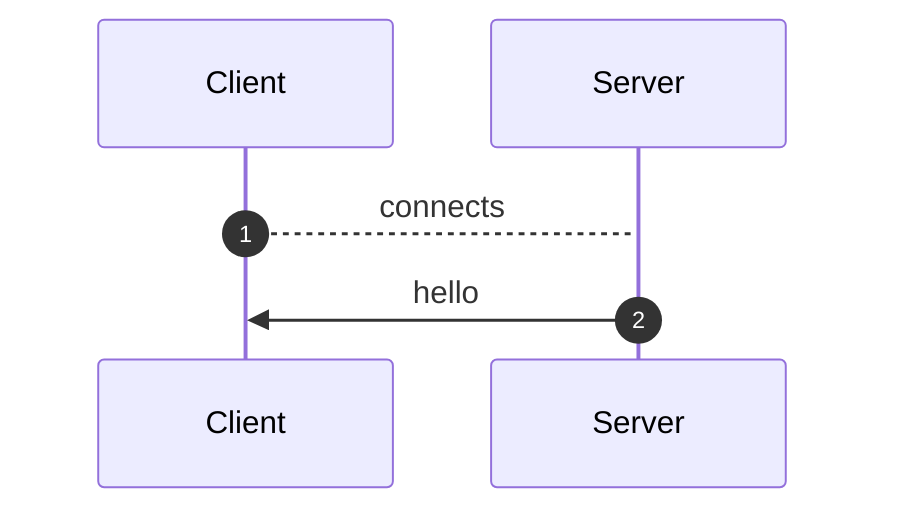
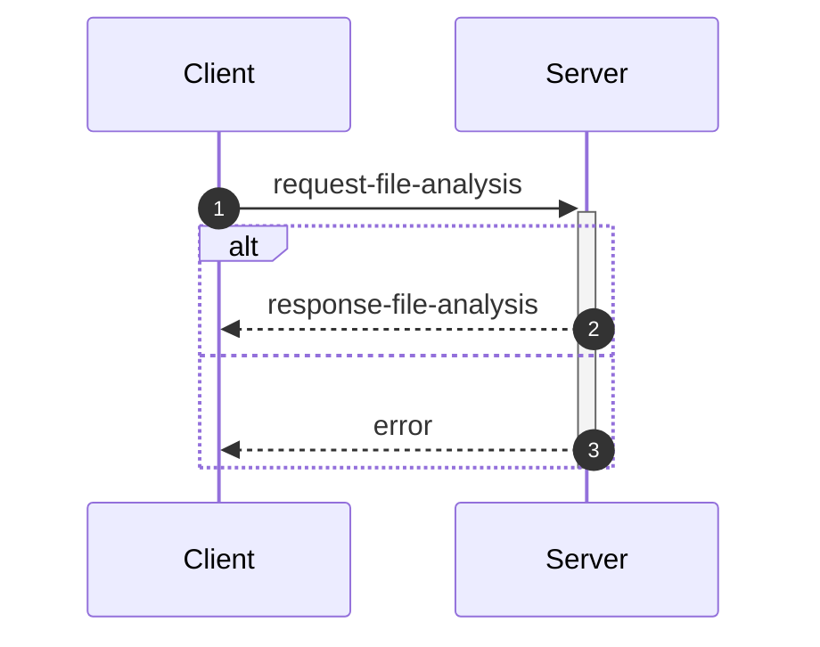
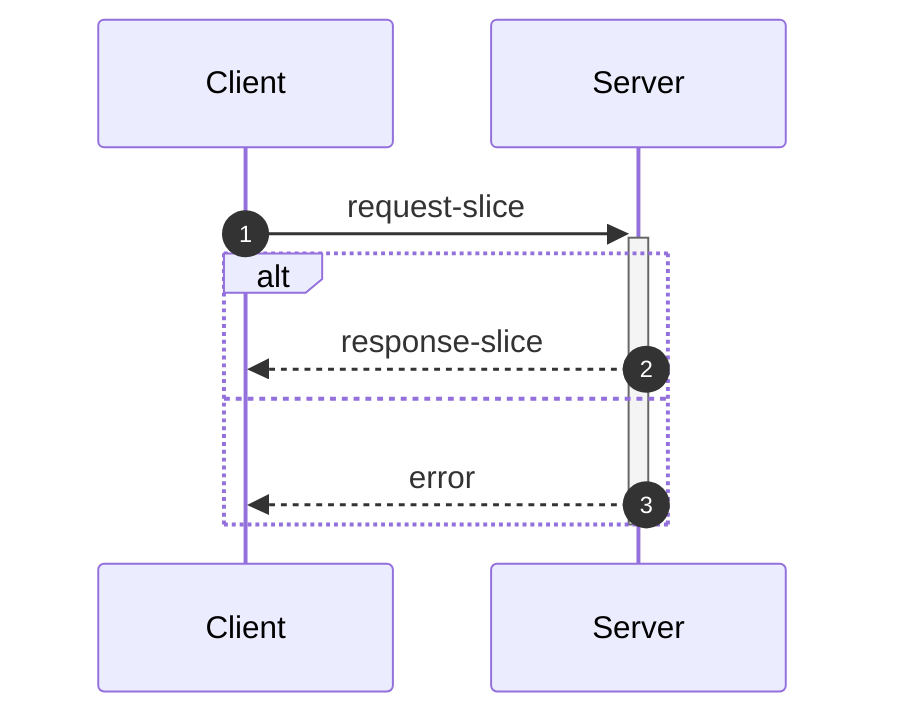
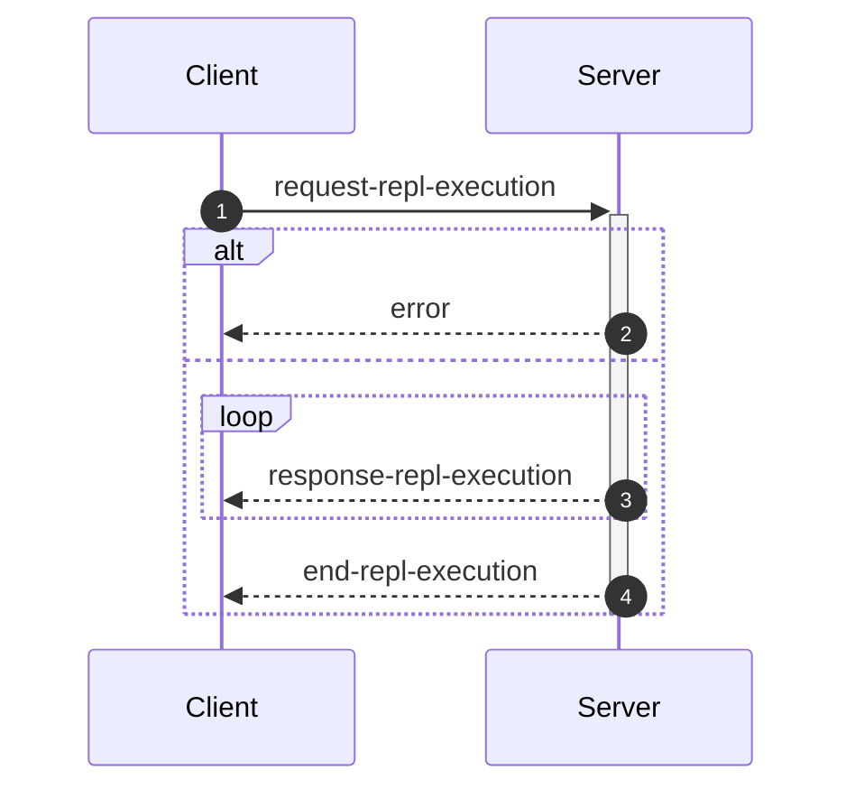

_<span title="an overview of flowR's interface">Generated</span> from '[wiki-interface.ts](https://github.com/flowr-analysis/flowr/tree/main/src/documentation/wiki-interface.ts "src/documentation/wiki-interface.ts")' on 2026-10-20, 14:35:49 UTC (v2.16.4, R v4.6.1), do not edit directly._

Although far from being as detailed as the in-depth explanation of [_flowR_](https://github.com/flowr-analysis/flowr/wiki/Core),
this wiki page explains how to interface with _flowR_ in more detail.
In general, command line arguments and other options provide short descriptions on hover over.

* [💻 Using the REPL](#using-the-repl)
* [⚙️ Configuring FlowR](#configuring-flowr)
* [⚒️ Writing Code](#writing-code)
* [💬 Communicating with the Server](#communicating-with-the-server)

<a id='using-the-repl'></a>
## 💻 Using the REPL

> [!NOTE]
> To execute arbitrary R commands with a repl request, _flowR_ has to be started explicitly with <span title="Description (Command Line Argument): Allow to access the underlying R session when using flowR (security warning: this allows the execution of arbitrary R code!)">`--r-session-access`</span>.
> Please be aware that this introduces a security risk and note that this relies on the [`r-shell` engine](https://github.com/flowr-analysis/flowr/wiki/Engines) .

Although primarily meant for users to explore,
there is nothing which forbids calling _flowR_ as a subprocess to use standard-in, -output, and -error
for communication (although you can access the REPL using the server as well,
with the [REPL Request](#message-request-repl-execution) message).

The read-eval-print loop&nbsp;(REPL) works relatively simple.
You can submit an expression (using <kbd>Enter</kbd>),
which is interpreted as an R&nbsp;expression by default but interpreted as a *command* if it starts with a colon (`:`).
The best command to get started with the REPL is <span title="Description (Repl Command): Show help information (aliases: :h, :?)">`:help`</span>.
Besides, you can leave the REPL either with the command <span title="Description (Repl Command): End the repl (aliases: :q, :exit)">`:quit`</span> or by pressing <kbd>Ctrl</kbd>+<kbd>C</kbd> twice.
When writing a *command*, you may press <kbd>Tab</kbd> to get a list of completions, if available.
Multiple commands can be entered in a single line by separating them with a semicolon (`;`), e.g. `:parse "x<-2"; :df*`.
If a command is given without R code, the REPL will re-use R code given in a previous command.
The prior example will hence return first the parsed AST of the program and then the dataflow graph for `"x <- 2"`.

> [!NOTE]
> If you develop flowR, you may want to launch the repl using the `npm run main-dev` command, this way, you get a non-minified version of flowR with debug information and hot-reloading of source files.

<details>
<summary>Available Commands</summary>

We currently offer the following commands (this with a `[*]` suffix are available with and without the star):

| Command | Description |
| ------- | ----------- |
| **<span title="Description (Repl Command): End the repl (aliases: :q, :exit)">:quit</span>** | End the repl (aliases: **:<span title="Alias of ':quit'. End the repl">q</span>**, **:<span title="Alias of ':quit'. End the repl">exit</span>**) |
| **<span title="Description (Repl Command): Execute the given code as R code. This requires the `--r-session-access` flag to be set and requires the r-shell engine. (aliases: :e, :r)">:execute</span>** | Execute the given code as R code. This requires the `--r-session-access` flag to be set and requires the r-shell engine. (aliases: **:<span title="Alias of ':execute'. Execute the given code as R code. This requires the `--r-session-access` flag to be set and requires the r-shell engine.">e</span>**, **:<span title="Alias of ':execute'. Execute the given code as R code. This requires the `--r-session-access` flag to be set and requires the r-shell engine.">r</span>**) |
| **<span title="Description (Repl Command): Get mermaid code for the control-flow graph of R code (aliases: :cfg, :cf)">:controlflow[*]</span>** | Get mermaid code for the control-flow graph of R code (star: Returns the URL to mermaid.live) (aliases: **:<span title="Alias of ':controlflow'. Get mermaid code for the control-flow graph of R code">cfg</span>**, **:<span title="Alias of ':controlflow'. Get mermaid code for the control-flow graph of R code">cf</span>**) |
| **<span title="Description (Repl Command): Get mermaid code for the control-flow graph with basic blocks (aliases: :cfgb, :cfb)">:controlflowbb[*]</span>** | Get mermaid code for the control-flow graph with basic blocks (star: Returns the URL to mermaid.live) (aliases: **:<span title="Alias of ':controlflowbb'. Get mermaid code for the control-flow graph with basic blocks">cfgb</span>**, **:<span title="Alias of ':controlflowbb'. Get mermaid code for the control-flow graph with basic blocks">cfb</span>**) |
| **<span title="Description (Repl Command): Get mermaid code for the dataflow graph (aliases: :d, :df)">:dataflow[*]</span>** | Get mermaid code for the dataflow graph (star: Returns the URL to mermaid.live) (aliases: **:<span title="Alias of ':dataflow'. Get mermaid code for the dataflow graph">d</span>**, **:<span title="Alias of ':dataflow'. Get mermaid code for the dataflow graph">df</span>**) |
| **<span title="Description (Repl Command): Get mermaid code for the normalized AST of R code (aliases: :n)">:normalize[*]</span>** | Get mermaid code for the normalized AST of R code (star: Returns the URL to mermaid.live) (alias: **:<span title="Alias of ':normalize'. Get mermaid code for the normalized AST of R code">n</span>**) |
| **<span title="Description (Repl Command): Get mermaid code for the simplified dataflow graph (aliases: :ds, :dfs)">:dataflowsimple[*]</span>** | Get mermaid code for the simplified dataflow graph (star: Returns the URL to mermaid.live) (aliases: **:<span title="Alias of ':dataflowsimple'. Get mermaid code for the simplified dataflow graph">ds</span>**, **:<span title="Alias of ':dataflowsimple'. Get mermaid code for the simplified dataflow graph">dfs</span>**) |
| **<span title="Description (Repl Command): Inspect and extend the signature database: `query` (identical to :query @signature), `info <name>` for where a function comes from (identical to :query @function-info), `add <path>` to mount another database/source, `download` to fetch the full-history database. (aliases: :sig)">:signature</span>** | Inspect and extend the signature database: `query` (identical to :query @signature), `info <name>` for where a function comes from (identical to :query @function-info), `add <path>` to mount another database/source, `download` to fetch the full-history database. (alias: **:<span title="Alias of ':signature'. Inspect and extend the signature database: `query` (identical to :query @signature), `info <name>` for where a function comes from (identical to :query @function-info), `add <path>` to mount another database/source, `download` to fetch the full-history database.">sig</span>**) |
| **<span title="Description (Repl Command): Just calculates the DFG, but only prints summary info (aliases: :d#, :df#)">:dataflowsilent</span>** | Just calculates the DFG, but only prints summary info (aliases: **:<span title="Alias of ':dataflowsilent'. Just calculates the DFG, but only prints summary info">d#</span>**, **:<span title="Alias of ':dataflowsilent'. Just calculates the DFG, but only prints summary info">df#</span>**) |
| **<span title="Description (Repl Command): Prints ASCII Art of the parsed, unmodified AST (aliases: :p)">:parse</span>** | Prints ASCII Art of the parsed, unmodified AST (alias: **:<span title="Alias of ':parse'. Prints ASCII Art of the parsed, unmodified AST">p</span>**) |
| **<span title="Description (Repl Command): Prints the version of flowR as well as the current version of R">:version</span>** | Prints the version of flowR as well as the current version of R
| **<span title="Description (Repl Command): Query the given R code (use 'help' for more information)">:query[*]</span>** | Query the given R code (use 'help' for more information) (star: Similar to query, but returns the output in json format.)
| **<span title="Description (Repl Command): Returns an ASCII representation of the dataflow graph (aliases: :df!)">:dataflowascii</span>** | Returns an ASCII representation of the dataflow graph (alias: **:<span title="Alias of ':dataflowascii'. Returns an ASCII representation of the dataflow graph">df!</span>**) |
| **<span title="Description (Repl Command): Returns summarization stats for the normalized AST (aliases: :n#)">:normalize#</span>** | Returns summarization stats for the normalized AST (alias: **:<span title="Alias of ':normalize#'. Returns summarization stats for the normalized AST">n#</span>**) |
| **<span title="Description (Repl Command): Show help information (aliases: :h, :?)">:help</span>** | Show help information (aliases: **:<span title="Alias of ':help'. Show help information">h</span>**, **:<span title="Alias of ':help'. Show help information">?</span>**) |

</details>

> [!TIP]
> 
> As indicated by the examples before, all REPL commands that operate on code keep track of the state.
> Hence, if you run a command like <span title="Description (Repl Command, starred version): Returns the URL to mermaid.live; Base Command: Get mermaid code for the dataflow graph (aliases: :d*, :df*)">`:dataflow*`</span> without providing R code,
> the REPL will re-use the R code provided in a previous command.
> Likewise, doing this will benefit from incrementality!
> If you request the dataflow graph with `:df* x <- 2 * y` and then want to see the parsed AST with `:parse`,
> the REPL will re-use previously obtained information and not re-parse the code again.
> 		

Generally, many commands offer shortcut versions in the REPL. Many queries, for example, offer a shortened format (see the example below).
Of special note, the [Config Query](https://github.com/flowr-analysis/flowr/wiki/%5BQuery%5D-Config)
can be used to also modify the currently active configuration of _flowR_ within the REPL (see the [wiki page](https://github.com/flowr-analysis/flowr/wiki/%5BQuery%5D-Config) for more information).

### Example: Retrieving the Dataflow Graph

To retrieve a URL to the [mermaid](https://mermaid.js.org/) diagram of the dataflow of a given expression,
use <span title="Description (Repl Command, starred version): Returns the URL to mermaid.live; Base Command: Get mermaid code for the dataflow graph (aliases: :d*, :df*)">`:dataflow*`</span> (or <span title="Description (Repl Command): Get mermaid code for the dataflow graph (aliases: :d, :df)">`:dataflow`</span> to get the mermaid code in the cli):

```shell
$ docker run -it --rm eagleoutice/flowr # or npm run flowr 
flowR repl v2.16.4, R grammar v14 (tree-sitter engine)
R> :dataflow* y <- 1 + x
```

<details>
<summary style='color:gray'>Output</summary>

```text
https://mermaid.live/view#base64:eyJjb2RlIjoiZmxvd2NoYXJ0IFREXG4gICAgMXt7XCJgKiM5MTtSTnVtYmVyIzkzOyogKioxKipcbiAgICAgICoxLjYqICgqKmlkOiAxKiopYFwifX1cbiAgICAyKFtcImAqIzkxO1JTeW1ib2wjOTM7KiAqKngqKlxuICAgICAgKjEuMTAqICgqKmlkOiAyKiopYFwiXSlcbiAgICAzW1tcImAqIzkxO1JCaW5hcnlPcCM5MzsqIGJhc2UjNTg7IzU4OyoqIzQzOyoqXG4gICAgICAqMS42LTEwKiAoKippZDogMyoqKVxuICAgIGFyZzogKDEsIDIpYFwiXV1cbiAgICBidWlsdC1pbjpfNDNfW1wiYEJ1aWx0LUluOlxuIzQzO2BcIl1cbiAgICBzdHlsZSBidWlsdC1pbjpfNDNfIHN0cm9rZTpncmF5LGZpbGw6Z3JheSxzdHJva2Utd2lkdGg6MnB4LG9wYWNpdHk6Ljg7XG4gICAgMFtcImAqIzkxO1JTeW1ib2wjOTM7KiAqKnkqKlxuICAgICAgKjEuMSogKCoqaWQ6IDAqKiwgdjogMylgXCJdXG4gICAgNFtbXCJgKiM5MTtSQmluYXJ5T3AjOTM7KiBiYXNlIzU4OyM1ODsqKiM2MDsjNDU7KipcbiAgICAgICoxLjEtMTAqICgqKmlkOiA0KiopXG4gICAgYXJnOiAoMCwgMylgXCJdXVxuICAgIGJ1aWx0LWluOl82MF8tW1wiYEJ1aWx0LUluOlxuIzYwOyM0NTtgXCJdXG4gICAgc3R5bGUgYnVpbHQtaW46XzYwXy0gc3Ryb2tlOmdyYXksZmlsbDpncmF5LHN0cm9rZS13aWR0aDoycHgsb3BhY2l0eTouODtcbiAgICAxIC0uLT58XCJmbG93XCJ8IDJcbiAgICBsaW5rU3R5bGUgMCBzdHJva2U6Z3JheSxjb2xvcjpncmF5O1xuICAgIDIgLS4tPnxcImZsb3dcInwgM1xuICAgIGxpbmtTdHlsZSAxIHN0cm9rZTpncmF5LGNvbG9yOmdyYXk7XG4gICAgMyAtLT58XCJyZWFkcywgYXJnXCJ8IDFcbiAgICAzIC0tPnxcInJlYWRzLCBhcmdcInwgMlxuICAgIDMgLS4tPnxcImZsb3dcInwgMFxuICAgIGxpbmtTdHlsZSA0IHN0cm9rZTpncmF5LGNvbG9yOmdyYXk7XG4gICAgMyAtLi0+fFwicmVhZHMsIGNhbGxzXCJ8IGJ1aWx0LWluOl80M19cbiAgICBsaW5rU3R5bGUgNSBzdHJva2U6Z3JheTtcbiAgICAwIC0tPnxcImRlZmluZWQtYnksIGZsb3dcInwgNFxuICAgIDAgLS0+fFwiZGVmaW5lZC1ieVwifCAzXG4gICAgNCAtLT58XCJyZWFkcywgYXJnXCJ8IDNcbiAgICA0IC0tPnxcInJldHVybnMsIGFyZ1wifCAwXG4gICAgNCAtLi0+fFwicmVhZHMsIGNhbGxzXCJ8IGJ1aWx0LWluOl82MF8tXG4gICAgbGlua1N0eWxlIDEwIHN0cm9rZTpncmF5OyIsIm1lcm1haWQiOnsiYXV0b1N5bmMiOnRydWV9fQ==
```

Retrieve the dataflow graph of the expression `y <- 1 + x`. It looks like this:


<details>

<summary style="color:gray">R Code of the Dataflow Graph</summary>

The analysis ran (including parse and normalize, using the [tree-sitter](https://github.com/flowr-analysis/flowr/wiki/Engines) engine) within the generation environment. No [signature database](https://github.com/flowr-analysis/flowr/wiki/Signature-Database) is mounted for these generated graphs, so `library()` calls attach no package exports; base-R names are still qualified via the generated base-package store (e.g. `acf` as `stats::acf`). 
We encountered no unknown side effects during the analysis.

```r
y <- 1 + x
```

</details>

</details>

For small graphs like this, <span title="Description (Repl Command): Returns an ASCII representation of the dataflow graph (aliases: :df!)">`:dataflowascii`</span> also provides an ASCII representation directly in the REPL:

```shell
$ docker run -it --rm eagleoutice/flowr # or npm run flowr 
flowR repl v2.16.4, R grammar v14 (tree-sitter engine)
R> :df! y <- 1 + x
```

<details open>
<summary style='color:gray'>Output</summary>

```text
                        v<0>v
 c<4>c──────────────────| y |
 |<- |     ┌────────────v---v
 c---c     │
    │   c<3>c   0<1>0
    └───| + |───| 1 |───u<2>u
        c---c   0---0   | x |
           └────────────u---u
Edges:
3 -> 1: reads, arg          3 -> 2: reads, arg
3 -> 0: flows-to            1 -> 2: flows-to
2 -> 3: flows-to            4 -> 3: reads, arg
4 -> 0: returns, arg        0 -> 4: defined-by, flows-to
0 -> 3: defined-by
```

Retrieve the dataflow graph of the expression `y <- 1 + x` as ASCII art.

</details>

For the slicing with <span title="Description (Repl Command): Static backwards executable slicer for R">`:slicer`</span>, you have access to the same [magic comments](#slice-magic-comments) as with the [slice request](#message-request-slice).
Pass `--inline` to splice resolvable `source()` calls into the reconstruction so the slice is a single self-contained R text (the same as the static slice query's `inlineSources` flag).
See `--help` for more flags!

### Example: Interfacing with the File System

Many commands that allow for an R-expression (like <span title="Description (Repl Command, starred version): Returns the URL to mermaid.live; Base Command: Get mermaid code for the dataflow graph (aliases: :d*, :df*)">`:dataflow*`</span>) allow for a file as well
if the argument starts with `file://`.
If you are working from the root directory of the _flowR_ repository, the following gives you the parsed AST of the example file using the <span title="Description (Repl Command): Prints ASCII Art of the parsed, unmodified AST (aliases: :p)">`:parse`</span> command:

> **Watch mode**: Replace `file://` with `watch://` to enter watch mode.
> flowR runs the command immediately and then re-runs it every time the file (or any file inside the folder) changes.
> Enter any other command to leave watch mode.
> For example: `:df watch://analysis.R`

```shell
$ docker run -it --rm eagleoutice/flowr # or npm run flowr 
flowR repl v2.16.4, R grammar v14 (tree-sitter engine)
R> :parse file://test/testfiles/example.R
```

<details>
<summary style='color:gray'>Output</summary>

```text
File: test/testfiles/example.R

program
├ binaryoperator
│ ├ identifier "sum" (1:1─4)
│ ├ <- "<-" (1:5─7)
│ ╰ float "0" (1:8─9)
├ binaryoperator
│ ├ identifier "product" (2:1─8)
│ ├ <- "<-" (2:9─11)
│ ╰ float "1" (2:12─13)
├ binaryoperator
│ ├ identifier "w" (3:1─2)
│ ├ <- "<-" (3:3─5)
│ ╰ float "7" (3:6─7)
├ binaryoperator
│ ├ identifier "N" (4:1─2)
│ ├ <- "<-" (4:3─5)
│ ╰ float "10" (4:6─8)
├ forstatement
│ ├ for "for" (6:1─4)
│ ├ ( "(" (6:5─6)
│ ├ identifier "i" (6:6─7)
│ ├ in "in" (6:8─10)
│ ├ binaryoperator
│ │ ├ float "1" (6:11─12)
│ │ ├ : ":" (6:12─13)
│ │ ╰ parenthesizedexpression
│ │   ├ ( "(" (6:13─14)
│ │   ├ binaryoperator
│ │   │ ├ identifier "N" (6:14─15)
│ │   │ ├ - "-" (6:15─16)
│ │   │ ╰ float "1" (6:16─17)
│ │   ╰ ) ")" (6:17─18)
│ ├ ) ")" (6:18─19)
│ ╰ bracedexpression
│   ├ { "{" (6:20─21)
│   ├ binaryoperator
│   │ ├ identifier "sum" (7:3─6)
│   │ ├ <- "<-" (7:7─9)
│   │ ╰ binaryoperator
│   │   ├ binaryoperator
│   │   │ ├ identifier "sum" (7:10─13)
│   │   │ ├ + "+" (7:14─15)
│   │   │ ╰ identifier "i" (7:16─17)
│   │   ├ + "+" (7:18─19)
│   │   ╰ identifier "w" (7:20─21)
│   ├ binaryoperator
│   │ ├ identifier "product" (8:3─10)
│   │ ├ <- "<-" (8:11─13)
│   │ ╰ binaryoperator
│   │   ├ identifier "product" (8:14─21)
│   │   ├  "" (8:22─23)
│   │   ╰ identifier "i" (8:24─25)
│   ╰ } "}" (9:1─2)
├ call
│ ├ identifier "cat" (11:1─4)
│ ╰ arguments
│   ├ ( "(" (11:4─5)
│   ├ argument
│   │ ╰ string
│   │   ├ " "\"" (11:5─6)
│   │   ├ stringcontent "Sum:" (11:6─10)
│   │   ╰ " "\"" (11:10─11)
│   ├ comma "," (11:11─12)
│   ├ argument
│   │ ╰ identifier "sum" (11:13─16)
│   ├ comma "," (11:16─17)
│   ├ argument
│   │ ╰ string
│   │   ├ " "\"" (11:18─19)
│   │   ├ stringcontent
│   │   │ ╰ escapesequence "\\n" (11:19─21)
│   │   ╰ " "\"" (11:21─22)
│   ╰ ) ")" (11:22─23)
╰ call
  ├ identifier "cat" (12:1─4)
  ╰ arguments
    ├ ( "(" (12:4─5)
    ├ argument
    │ ╰ string
    │   ├ " "\"" (12:5─6)
    │   ├ stringcontent "Product:" (12:6─14)
    │   ╰ " "\"" (12:14─15)
    ├ comma "," (12:15─16)
    ├ argument
    │ ╰ identifier "product" (12:17─24)
    ├ comma "," (12:24─25)
    ├ argument
    │ ╰ string
    │   ├ " "\"" (12:26─27)
    │   ├ stringcontent
    │   │ ╰ escapesequence "\\n" (12:27─29)
    │   ╰ " "\"" (12:29─30)
    ╰ ) ")" (12:30─31)
```

Retrieve the parsed AST of the example file.

<details>

<summary>File Content</summary>

```r
sum <- 0
product <- 1
w <- 7
N <- 10

for (i in 1:(N-1)) {
  sum <- sum + i + w
  product <- product * i
}

cat("Sum:", sum, "\n")
cat("Product:", product, "\n")
```

</details>

As _flowR_ directly transforms this AST the output focuses on being human-readable instead of being machine-readable.
		
</details>

### Example: Run a Query

You can run any query supported by _flowR_ using the <span title="Description (Repl Command): Query the given R code (use 'help' for more information)">`:query`</span> command.
For example, to obtain the shapes of all data frames in a given piece of code, you can run:

```shell
$ docker run -it --rm eagleoutice/flowr # or npm run flowr 
flowR repl v2.16.4, R grammar v14 (tree-sitter engine)
R> :query @absint df-shape "x <- data.frame(a = 1:10, b = 1:10)\ny <- x$a"
```

<details open>
<summary style='color:gray'>Output</summary>

```text
Query: absint (0 ms)
```

Retrieve the shapes of all data frames in the given code.

</details>

To run the linter on a file, you can use (in this example, we just issue the `dead-code` linter on a small piece of code):

```shell
$ docker run -it --rm eagleoutice/flowr # or npm run flowr 
flowR repl v2.16.4, R grammar v14 (tree-sitter engine)
R> :query @linter rules:dead-code "if(FALSE) x <- 2"
```

<details open>
<summary style='color:gray'>Output</summary>

```text
Query: linter (1 ms)
   ╰ Dead Code (dead-code):
       ╰ certain:
           ╰ Code at 1.11-16
```

Run the linter on the given code, with only the `dead-code` rule enabled.

</details>

For more information on the available queries, please check out the [Query API](https://github.com/flowr-analysis/flowr/wiki/Query-API).

<a id='configuring-flowr'></a>
## ⚙️ Configuring FlowR

When running _flowR_, you may want to specify some behaviors with a dedicated configuration file.
By default, flowR looks for a file named `flowr.json` in the current working directory (or any higher directory).
You can also specify a different file with <span title="Description (Command Line Argument): The name of the configuration file to use">`--config-file`</span> or pass the configuration inline using <span title="Description (Command Line Argument): The flowR configuration to use, as a JSON string">`--config-json`</span>.
A `flowr.json` found this way belongs to the analyzed project, so flowR ignores its options that decide what flowR executes or loads
(`engines.*.wasmPath`, `engines.*.treeSitterWasmPath`, `engines.*.rPath`, `solver.sigdb.additionalPaths`, `solver.sigdb.downloadRepo`, `solver.sigdb.installedLibrary.paths`),
unless you pass <span title="Description (Command Line Argument): Keep the security-sensitive options (e.g., the R executable) of the flowr.json found in the working directory or a parent. Only use this for projects you trust.">`--trust-config`</span>.
To analyze code you do not trust, use the secure mode (<span title="Description (Command Line Argument): Run in secure mode for analyzing untrusted code: flowR does not start R (or any other process), does not access the network, does not search for project configs, and ignores security-sensitive options in every config. Cannot be disabled once enabled. Can also be enabled with the environment variable {italic FLOWR_SECURE_MODE=1}.">`--secure`</span>, see the [security policy](https://github.com/flowr-analysis/flowr/blob/main/.github/SECURITY.md)).
To inspect the current configuration, you can run flowr with the <span title="Description (Command Line Argument): Run with verbose logging (will be passed to the corresponding script)">`--verbose`</span> flag, or use the `config` [Query](https://github.com/flowr-analysis/flowr/wiki/Query-API).
Within the REPL this works by running the following:

```shell
:query @config
```

To work with the <a href="https://github.com/flowr-analysis/flowr/tree/main/src/config.ts#L119"><code><span title="The configuration file format for flowR.">FlowrConfig</span></code></a> you can use the provided helper objects alongside its methods like
<a href="https://github.com/flowr-analysis/flowr/tree/main/src/config.ts#L914"><code><span title="Creates a new flowr config that has the updated values.">FlowrConfig::<b>amend</b></span></code></a>.
The schema below documents every option; the ones you most likely want are:

- <a href="https://github.com/flowr-analysis/flowr/wiki/Interface#configuring-flowr" title="Configuration Option (boolean): Whether source calls should be ignored, causing {@link processSourceCall}&#39;s behavior to be skipped.">ignoreSourceCalls</a>: ignore source calls when analyzing the code, i.e., ignore the inclusion of other files.
- <a href="https://github.com/flowr-analysis/flowr/wiki/Interface#configuring-flowr" title="Configuration Option (boolean): Whether load calls should be ignored, causing {@link processLoadCall}&#39;s behavior to be skipped.">ignoreLoadCalls</a>: ignore load calls when analyzing the code, i.e., ignore the loading of r-data files.
- <a href="https://github.com/flowr-analysis/flowr/wiki/Interface#configuring-flowr" title="Configuration Option (object): Do you want to overwrite (parts) of the builtin definition?">semantics.environment.overwriteBuiltIns</a>: overwrite _flowR_'s handling of built-in functions, or clear the preset definitions entirely.
  See [Configure BuiltIn Semantics](#configure-builtin-semantics) for more information.
- <a href="https://github.com/flowr-analysis/flowr/wiki/Interface#configuring-flowr" title="Configuration Option (string): How to resolve variables and their values. (one of &quot;disabled&quot;, &quot;alias&quot;, &quot;builtin&quot;)">solver.variables</a>: how to resolve variables and their values (`disabled`, `alias`, `builtin`).
- <a href="https://github.com/flowr-analysis/flowr/wiki/Interface#configuring-flowr" title="Configuration Option (array): The engine or set of engines to use for interacting with R code. An empty array means all available engines will be used.">engines</a> and <a href="https://github.com/flowr-analysis/flowr/wiki/Interface#configuring-flowr" title="Configuration Option (string): The default engine to use for interacting with R code. If this is undefined, an arbitrary engine from the specified list will be used. (one of &quot;tree-sitter&quot;, &quot;r-shell&quot;)">defaultEngine</a>: the engines used to interact with R code, see the [Engines wiki page](https://github.com/flowr-analysis/flowr/wiki/Engines).
- <a href="https://github.com/flowr-analysis/flowr/wiki/Interface#configuring-flowr" title="Configuration Option (array): Files a framework loads on its own, without any source() call (e.g. global.R in a shiny app), in the order they are loaded; flowR orders the matching project files accordingly and analyzes them as one program. Entries are case-insensitive globs matched against the file path, a plain name matches any file with that name, and entries matching no project file are warned about. Usually set per project kind via specializeConfig.">project.implicitSources</a>: the files a framework loads without any `source()` call, in the order in which they are
  loaded. Entries are globs (e.g. `R/*.R`) matched against the file path ignoring capitalization; one matching no file is reported.
- <a href="https://github.com/flowr-analysis/flowr/wiki/Interface#configuring-flowr" title="Configuration Option (object): Overwrite (parts of) the configuration depending on the project kind flowR detects, e.g. to give a shiny app its implicit sources.">specializeConfig</a>: overwrite (parts of) the configuration depending on the kind of project _flowR_ detects
  (e.g. `shiny-app`), which is how a shiny app gets its implicit sources by default. What you configure directly wins.
- <a href="https://github.com/flowr-analysis/flowr/wiki/Interface#configuring-flowr" title="Configuration Option (string): Overwrite the project kind flowR would otherwise infer from the analyzed files, e.g. when auto-detection guesses wrong. (one of &quot;package&quot;, &quot;script&quot;, &quot;shiny-app&quot;, &quot;notebook&quot;, &quot;project&quot;, &quot;unknown&quot;)">project.useProjectType</a>: skip that detection and force a project kind yourself, when auto-detection guesses wrong.
- <a href="https://github.com/flowr-analysis/flowr/wiki/Interface#configuring-flowr" title="Configuration Option (array): The default plugins to load when creating a new instance of FlowrAnalyzer">defaultPlugins</a> and <a href="https://github.com/flowr-analysis/flowr/wiki/Interface#configuring-flowr" title="Configuration Option (array): The plugins to load in REPL mode">repl.plugins</a>: the plugins to load for a new <a href="https://github.com/flowr-analysis/flowr/tree/main/src/project/flowr-analyzer.ts#L205"><code><span title="Central class for conducting analyses with FlowR. Use the FlowrAnalyzerBuilder to create a new instance. If you want the original pattern of creating a pipeline and running all steps, you can still do this with FlowrAnalyzer#runFull . To inspect the context of the analyzer, use FlowrAnalyzer#inspectContext (if you are a plugin and need to modify it, use FlowrAnalyzer#context instead).">FlowrAnalyzer</span></code></a> and in the REPL
  (use `flowr:default` to reference the former).

So you can configure _flowR_ by adding a file like the following:

<details>

<summary>Example Configuration File</summary>

```json
{
  "ignoreSourceCalls": true,
  "ignoreLoadCalls": true,
  "semantics": {
    "environment": {
      "overwriteBuiltIns": {
        "definitions": [
          {
            "type": "function",
            "names": [
              "foo"
            ],
            "processor": "builtin:assign",
            "config": {}
          }
        ]
      }
    }
  },
  "defaultPlugins": [
    "file:description",
    "versions:description"
  ],
  "repl": {
    "quickStats": false,
    "dfProcessorHeat": false,
    "hints": true,
    "plugins": [
      "flowr:default"
    ]
  },
  "project": {
    "resolveUnknownPathsOnDisk": true,
    "implicitSources": [
      "global.R",
      "app.R"
    ]
  },
  "linter": {
    "disabledRules": []
  },
  "specializeConfig": {
    "shiny-app": {
      "project": {
        "implicitSources": [
          "global.R",
          "ui.R",
          "server.R",
          "app.R"
        ]
      }
    }
  },
  "engines": [
    {
      "type": "r-shell"
    }
  ],
  "solver": {
    "variables": "alias",
    "evalStrings": true,
    "trackEnvironments": true,
    "sigdb": {
      "enabled": true,
      "loadProjectDependencies": true,
      "eagerlyLoad": false,
      "eagerlyLoadExports": false,
      "linkBaseR": false,
      "linkDescriptionDependencies": false
    },
    "resolveSource": {
      "dropPaths": "no",
      "ignoreCapitalization": true,
      "inferWorkingDirectory": "active-script",
      "searchPath": []
    },
    "instrument": {},
    "slicer": {
      "threshold": 50
    }
  },
  "abstractInterpretation": {
    "wideningThreshold": 4,
    "followCalls": true,
    "dataFrame": {
      "maxColNames": 20,
      "readLoadedData": {
        "readExternalFiles": true,
        "maxReadLines": 1000000
      }
    }
  },
  "incremental": {
    "alwaysIncremental": false,
    "parsing": {
      "activated": false,
      "heuristics": {
        "activated": true,
        "mtime": true,
        "linesFrom": 500,
        "bytesFrom": 50000,
        "alwaysWithEdits": false,
        "minFiles": 1
      }
    }
  },
  "gas": {
    "thresholds": {
      "memory": {
        "problematic": 0.7,
        "critical": 0.9
      },
      "timeMs": {
        "problematic": 100000,
        "critical": 120000
      }
    },
    "features": {}
  }
}
```

</details>

<details>
<a id='configure-builtin-semantics'></a>
<summary>Configure Built-In Semantics</summary>

`semantics/environment/overwriteBuiltins` accepts two keys:

- `loadDefaults` (boolean, initially `true`): If set to `true`, the default built-in definitions are loaded before applying the custom definitions. Setting this flag to `false` explicitly disables the loading of the default definitions.
- `definitions` (array, initially empty): Allows to overwrite or define new built-in elements. Each object within must have a `type` which is one of the below. Furthermore, they may define a string array of `names` which specifies the identifiers to bind the definitions to. You may use `assumePrimitive` to specify whether _flowR_ should assume that this is a primitive non-library definition (so you probably just do not want to specify the key).

  | Type            | Description                                                                                                                                                                                                                                                                                              | Example                                                                                                    |
  | --------------- | -------------------------------------------------------------------------------------------------------------------------------------------------------------------------------------------------------------------------------------------------------------------------------------------------------- | ---------------------------------------------------------------------------------------------------------- |
  | `constant`    | Additionally allows for a `value` this should resolve to.                                                                                                                                                                                                                                                | `{ type: 'constant', names: ['NULL', 'NA'],  value: null }`                                                |
  | `function`    | Is a rather flexible way to define and bind built-in functions. For the time, we do not have extensive documentation to cover all the cases, so please either consult the sources with the `default-builtin-config.ts` or open a [new issue](https://github.com/flowr-analysis/flowr/issues/new/choose). | `{ type: 'function', names: ['next'], processor: 'builtin:d', config: { cfg: ExitPointType.Next } }` |
  | `replacement` | A comfortable way to specify replacement functions like `$<-` or `names<-`. `suffixes` describes the... suffixes to attach automatically. | `{ type: 'replacement', suffixes: ['<-', '<<-'], names: ['[', '[['] }` |

</details>

<details>

<summary style='color:gray'>Full Configuration-File Schema</summary>

- _The configuration file format for flowR._ (object)
    - **logLevel** [optional] _flowR's global minimum log level, applied when the config is loaded._ (string)
        Only allows: 'silly', 'trace', 'debug', 'info', 'warn', 'error', 'fatal'
    - **ignoreSourceCalls** [optional] _Whether source calls should be ignored, causing {@link processSourceCall}'s behavior to be skipped._ (boolean)
    - **ignoreLoadCalls** [optional] _Whether load calls should be ignored, causing {@link processLoadCall}'s behavior to be skipped._ (boolean)
    - **semantics** _Configure language semantics and how flowR handles them._ (object)
        - **environment** [optional] _Semantics regarding how to handle the R environment._ (object)
            - **overwriteBuiltIns** [optional] _Do you want to overwrite (parts) of the builtin definition?_ (object)
                - **loadDefaults** [optional] _Should the default configuration still be loaded?_ (boolean)
                - **definitions** [optional] _The definitions to load/overwrite._ (array)
                Valid item types:
                    - (object)
    - **defaultPlugins** [optional] _The default plugins to load when creating a new instance of FlowrAnalyzer_ (array)
    Valid item types:
        - (alternatives)
            - (string)
            - (array)
    - **repl** _Configuration options for the REPL._ (object)
        - **quickStats** [optional] _Whether to show quick stats in the REPL after each evaluation._ (boolean)
        - **dfProcessorHeat** [optional] _This instruments the dataflow processors to count how often each processor is called._ (boolean)
        - **hints** [optional] _Whether to show dim inline hints on the empty prompt (automatically disabled on non-interactive terminals)._ (boolean)
        - **plugins** [optional] _The plugins to load in REPL mode_ (array)
        Valid item types:
            - (alternatives)
                - (string)
                - (array)
        - **autoUseFileProtocol** [optional] _Prepend the file protocol to a repl input that looks like a path, instead of only warning about it._ (boolean)
        - **queryStats** [optional] _Whether `:query` closes with the line stating how long the queries took (`:query*` never prints it)._ (boolean)
        - **showPlugins** [optional] _Whether `:version` grays out the plugins that did not activate during the last analysis._ (boolean)
    - **project** _Project specific configuration options._ (object)
        - **resolveUnknownPathsOnDisk** [optional] _Whether to resolve unknown paths loaded by the r project disk when trying to source/analyze files._ (boolean)
        - **failOnInaccessiblePath** [optional] _Whether a directory that cannot be traversed during file discovery (e.g. due to permissions) aborts the analysis; when false (the default) such paths are logged and skipped._ (boolean)
        - **basePackages** [optional] _The packages considered part of R itself (base and recommended); if unset, flowR uses its built-in list._ (array)
        Valid item types:
            - (string)
        - **implicitSources** [optional] _Files a framework loads on its own, without any source() call (e.g. global.R in a shiny app), in the order they are loaded; flowR orders the matching project files accordingly and analyzes them as one program. Entries are case-insensitive globs matched against the file path, a plain name matches any file with that name, and entries matching no project file are warned about. Usually set per project kind via specializeConfig._ (array)
        Valid item types:
            - (string)
        - **useProjectType** [optional] _Overwrite the project kind flowR would otherwise infer from the analyzed files, e.g. when auto-detection guesses wrong._ (string)
            Only allows: 'package', 'script', 'shiny-app', 'notebook', 'project', 'unknown'
        - **assumeImplicitEcho** [optional] _Whether the top level of the analyzed code is echoed, so that every visible result printed there is collected as an output by the dependencies query (default true, false for a package)._ (boolean)
        - **discovery** [optional] _Scoping options for the default project discovery._ (object)
            - **full** [optional] _Collect every file below the project root (greedy) instead of only the files the detected project kind needs (default false)._ (boolean)
            - **perKind** [optional] _Per-kind include/exclude glob overrides layered on the default scoping._ (object)
            - **ignore** [optional] _Case-insensitive globs that drop matching files from the intelligent discovery, regardless of kind (e.g. .Renviron to ignore environment files)._ (array)
            Valid item types:
                - (string)
        - **classification** [optional] _Overrides for the signals flowR uses to classify the project kind._ (object)
            - **shinyDescriptionTypes** [optional] _DESCRIPTION Type: values that mark a shiny app._ (array)
            Valid item types:
                - (string)
            - **shinyEntryFiles** [optional] _File names a shiny app is assembled from._ (array)
            Valid item types:
                - (string)
            - **shinyUsagePattern** [optional] _Regex source evidencing shiny usage in an entry file._ (string)
            - **notebookExtensions** [optional] _File extensions marking a notebook._ (array)
            Valid item types:
                - (string)
    - **linter** _Linter configuration options._ (object)
        - **disabledRules** _Linting rule names excluded from the default rule set (a rule requested explicitly via a linter query still runs). Usually set per project kind via specializeConfig._ (array)
        Valid item types:
            - (string)
        - **disabledTags** [optional] _Linting rule tags whose rules are excluded from the default rule set (a rule requested explicitly via a linter query still runs). By default the cmd-check rules are disabled for everything but a package; a configured list replaces that default._ (array)
        Valid item types:
            - (string)
    - **inputSources** [optional] _Further frameworks the input-sources analysis should know about; entries are added to flowR's defaults._ (object)
        - **pure** [optional] _Functions that only pass the constantness of their arguments on._ (array)
        Valid item types:
            - (string)
        - **param** [optional] _Functions whose result is a 'param' input._ (array)
        Valid item types:
            - (string)
        - **file** [optional] _Functions whose result is a 'file' input._ (array)
        Valid item types:
            - (string)
        - **tempfile** [optional] _Functions whose result is a 'tempfile' input._ (array)
        Valid item types:
            - (string)
        - **glob** [optional] _Functions whose result is a 'glob' input._ (array)
        Valid item types:
            - (string)
        - **net** [optional] _Functions whose result is a 'net' input._ (array)
        Valid item types:
            - (string)
        - **rand** [optional] _Functions whose result is a 'rand' input._ (array)
        Valid item types:
            - (string)
        - **system** [optional] _Functions whose result is a 'system' input._ (array)
        Valid item types:
            - (string)
        - **ffi** [optional] _Functions whose result is a 'ffi' input._ (array)
        Valid item types:
            - (string)
        - **lang** [optional] _Functions whose result is a 'lang' input._ (array)
        Valid item types:
            - (string)
        - **options** [optional] _Functions whose result is a 'options' input._ (array)
        Valid item types:
            - (string)
        - **cmdline** [optional] _Functions whose result is a 'cmdline' input._ (array)
        Valid item types:
            - (string)
        - **user** [optional] _Functions whose result is a 'user' input._ (array)
        Valid item types:
            - (string)
        - **const** [optional] _Functions whose result is a 'const' input._ (array)
        Valid item types:
            - (string)
        - **scope** [optional] _Functions whose result is a 'scope' input._ (array)
        Valid item types:
            - (string)
        - **dconst** [optional] _Functions whose result is a 'dconst' input._ (array)
        Valid item types:
            - (string)
        - **unknown** [optional] _Functions whose result is a 'unknown' input._ (array)
        Valid item types:
            - (string)
        - **linkedObjects** [optional] _Objects a framework provides without a definition in the code, e.g. shiny's input._ (array)
        Valid item types:
            - (object)
        - **linkedEntryPoints** [optional] _Calls that hand a function to a framework, which binds its objects to the parameters by position._ (array)
        Valid item types:
            - (object)
    - **specializeConfig** [optional] _Overwrite (parts of) the configuration depending on the project kind flowR detects, e.g. to give a shiny app its implicit sources._ (object)
    - **engines** _The engine or set of engines to use for interacting with R code. An empty array means all available engines will be used._ (array)
    Valid item types:
        - (alternatives)
            - _The configuration for the tree sitter engine._ (object)
                - **type** [required] _Use the tree sitter engine._ (string)
                    Only allows: 'tree-sitter'
                - **wasmPath** [optional] _The path to the tree-sitter-r WASM binary to use. If this is undefined, this uses the default path._ (string)
                - **treeSitterWasmPath** [optional] _The path to the tree-sitter WASM binary to use. If this is undefined, this uses the default path._ (string)
                - **lax** [optional] _Whether to use the lax parser for parsing R code (allowing for syntax errors). If this is undefined, the strict parser will be used._ (boolean)
            - _The configuration for the R shell engine._ (object)
                - **type** [required] _Use the R shell engine._ (string)
                    Only allows: 'r-shell'
                - **rPath** [optional] _The path to the R executable to use. If this is undefined, this uses the default path._ (string)
                - **pipeBind** [optional] _Whether to enable R's experimental pipe-bind operator "=>" by setting _R_USE_PIPEBIND_ for the R session (default false); R itself keeps this off by default, as it is experimental and has never shipped in a release version of R._ (boolean)
    - **defaultEngine** [optional] _The default engine to use for interacting with R code. If this is undefined, an arbitrary engine from the specified list will be used._ (string)
        Only allows: 'tree-sitter', 'r-shell'
    - **solver** _How to resolve constants, constraints, cells, ..._ (object)
        - **variables** _How to resolve variables and their values._ (string)
            Only allows: 'disabled', 'alias', 'builtin'
        - **evalStrings** _Should we include eval(parse(text="...")) calls in the dataflow graph?_ (boolean)
        - **trackEnvironments** [optional] _Track user-created environments (new.env, assign/get/local with envir=, dollar-assign, attach). When false, all envir-style calls fall through conservatively._ (boolean)
        - **sigdb** _Resolving library exports from a signature database._ (object)
            - **enabled** [optional] _Resolve library()/use() exports from a signature database (default true); when false no database is consulted._ (boolean)
            - **loadProjectDependencies** [optional] _Load the project's declared dependencies from its metadata files (DESCRIPTION Imports/Depends, rproject.toml, uvr.toml, renv.lock, rv.lock, uvr.lock) (default true); when false these files are not read for dependencies._ (boolean)
            - **eagerlyLoad** [optional] _Parse the database up front rather than on the first package load (default false, ignored if disabled)._ (boolean)
            - **eagerlyLoadExports** [optional] _Add a vertex for every export on load rather than on demand (default false); keeps the dataflow graph small._ (boolean)
            - **assumedRVersion** [optional] _R version assumed when resolving versioned (base-R) exports: a pin like "4.5" or "auto" to detect the installed R (default "auto")._ (string)
            - **linkBaseR** [optional] _Eagerly attach base-R namespaces so bare base calls resolve without library() (default false)._ (boolean)
            - **linkBaseRCalls** [optional] _Add a lightweight Reads edge from a bare base-R call to its signature-database function vertex (default false; base-R qualification is edge-free otherwise)._ (boolean)
            - **linkPackageCalls** [optional] _Add a lightweight Reads edge from a resolved package call to its signature-database function vertex (default false)._ (boolean)
            - **linkDescriptionDependencies** [optional] _Eagerly attach the namespaces of the project's declared DESCRIPTION dependencies (Imports/Depends) so their exports resolve without an explicit library() (default false)._ (boolean)
            - **warmInBackground** [optional] _Decompress the hot shards (base + most-downloaded) in a background task on startup so the first library() lookup is warm (default false; for long-running servers/REPLs)._ (boolean)
            - **additionalPaths** [optional] _Extra directories or bundle/manifest files searched for signature databases (alongside the shipped default and $FLOWR_SIGDB_DIR); a downloaded full-history bundle placed here is mounted automatically._ (array)
            Valid item types:
                - (string)
            - **downloadRepo** [optional] _GitHub owner/repo the full-history bundle is downloaded from via ":signature download" (default "flowr-analysis/flowr", release tag "sigdb-v<flowR-version>")._ (string)
            - **autoSync** [optional] _On startup, re-download shards whose committed sigdb.remote.json hash no longer matches the cache, in the background (default false; opt-in network sync after a git pull)._ (boolean)
            - **installedLibrary** [optional] _Recovering packages no signature database knows from the copy installed on this machine._ (object)
                - **enabled** [required] _Recover packages no signature database knows from their installed copy (default false)._ (boolean)
                - **paths** [optional] _Library directories to search; when empty they are discovered from the environment and the project._ (array)
                Valid item types:
                    - (string)
                - **useEnvironment** [optional] _Search the libraries R_LIBS_USER/R_LIBS/R_LIBS_SITE name (default true)._ (boolean)
                - **useProjectLibrary** [optional] _Search a project-local renv/packrat library (default true)._ (boolean)
                - **maxDepth** [optional] _How far to descend into the nested layout of a project-local library (default 3)._ (number)
                - **packages** [optional] _Only recover packages whose name matches one of these regular expressions; empty means any._ (array)
                Valid item types:
                    - (string)
            - **blobCacheBudgetMb** [optional] _How many MiB of decoded package blobs every open bundle may hold together (default 16)._ (number)
            - **versionSelection** [optional] _When a project constrains a dependency, resolve to the newest (default), oldest, or system-installed version satisfying it; system needs R and falls back to newest. Base-R packages always resolve against the assumed R version._ (string)
                Only allows: 'newest', 'oldest', 'system'
            - **versionOverrides** [optional] _Force an exact version for specific packages (name -> version), overriding both the project constraint and the versionSelection policy (default {})._ (object)
        - **versionManagement** _Policies for reasoning about dependency versions._ (object)
            - **linkedVersionGroups** [optional] _Groups of packages that must resolve to the same version; version guessing intersects each group so its members stay mutually compatible (default [])._ (array)
            Valid item types:
                - (array)
                Valid item types:
                    - (string)
        - **assumeAttachedPackages** [optional] _Packages to treat as attached without a `library()` call, so what the built-in configuration states about them applies to the analyzed code. The base packages R attaches on startup already resolve without it._ (array)
        Valid item types:
            - (string)
        - **transitiveSideEffectRounds** [optional] _How many rounds the transitive side-effect fixpoint may run before it is cut off (default 32); the propagation stops on its own as soon as a round adds nothing._ (number)
        - **maxOverlayDepth** [optional] _How many binding overlays may stack on one environment frame before a write flattens them (default 4); a pure performance knob, trading lookup cost against copy cost without changing any result._ (number)
        - **instrument** (object)
            - **dataflowExtractors** [optional] _These keys are only intended for use within code, allowing to instrument the dataflow analyzer!_ (any)
        - **resolveSource** [optional] _If lax source calls are active, flowR searches for sourced files much more freely, based on the configurations you give it. This option is only in effect if `ignoreSourceCalls` is set to false._ (object)
            - **dropPaths** _Allow to drop the first or all parts of the sourced path, if it is relative._ (string)
                Only allows: 'no', 'once', 'all'
            - **ignoreCapitalization** _Search for filenames matching in the lowercase._ (boolean)
            - **inferWorkingDirectory** _Try to infer the working directory from the main or any script to analyze._ (string)
                Only allows: 'no', 'main-script', 'active-script', 'any-script'
            - **searchPath** _Additionally search in these paths._ (array)
            Valid item types:
                - (string)
            - **repeatedSourceLimit** [optional] _How often the same file can be sourced within a single run? Please be aware: in case of cyclic sources this may not reach a fixpoint so give this a sensible limit._ (number)
            - **applyReplacements** _Provide name replacements for loaded files_ (array)
            Valid item types:
                - (object)
            - **assumeFilesExist** [optional] _Assume a sourced file is always there, making what it defines certain instead of conditional on the source call._ (boolean)
        - **slicer** [optional] _The configuration for the slicer._ (object)
            - **threshold** [optional] _The maximum number of iterations to perform on a single function call during slicing._ (number)
            - **autoExtend** [optional] _If set, the slicer will gain an additional post-pass._ (boolean)
    - **abstractInterpretation** _The configuration options for abstract interpretation._ (object)
        - **wideningThreshold** _The threshold for the number of visitations of a node at which widening should be performed to ensure the termination of the fixpoint iteration._ (number)
        - **followCalls** _Whether the abstract interpretation is interprocedural, i.e. whether it steps into the functions a call may dispatch to._ (boolean)
        - **dataFrame** _The configuration of the shape inference for data frames._ (object)
            - **maxColNames** _The maximum number of columns names to infer for data frames before over-approximating the column names to top._ (number)
            - **readLoadedData** _Configuration options for reading data frame shapes from loaded external data files, such as CSV files._ (object)
                - **readExternalFiles** _Whether data frame shapes should be extracted from loaded external files, such as CSV files._ (boolean)
                - **maxReadLines** _The maximum number of lines to read when extracting data frame shapes from loaded files, such as CSV files._ (number)
    - **incremental** (object)
        - **alwaysIncremental** _Always take the incremental path, regardless of heuristics._ (boolean)
        - **parsing** (object)
            - **activated** _If set, incremental parsing will be used._ (boolean)
            - **heuristics** (object)
                - **activated** [optional] _If set, the heuristics for incremental parsing will be used._ (boolean)
                - **mtime** [optional] _Skip reparsing entirely if the file's modification time is unchanged since the last parse._ (boolean)
                - **linesFrom** [optional] _Only consider incremental parsing for files with at least this many lines._ (number)
                - **bytesFrom** [optional] _Only consider incremental parsing for files with at least this many bytes._ (number)
                - **alwaysWithEdits** [optional] _Always take the incremental path whenever there is a computed edit region, regardless of the other thresholds._ (boolean)
                - **minFiles** [optional] _Only apply these heuristics once the project has at least this many files loaded._ (number)
    - **gas** [optional] _Resource-usage guard (gas) configuration. All feature factors default to 0 (disabled). See https://github.com/flowr-analysis/flowr/wiki/Core#gas-resource-guard._ (object)
        - **thresholds** [optional] _Thresholds for all gas checks (scaled by per-feature factor), boundable per feature._ (object)
            - **memory** [optional] _Heap-usage fraction thresholds (0-1), either shared or given per feature key (with `default` covering the rest)._ (object)
                - **problematic** [optional] _Heap fraction (0-1) above which Problematic is returned, for every feature without an entry of its own._ (number)
                - **critical** [optional] _Heap fraction (0-1) above which Critical is returned, for every feature without an entry of its own._ (number)
            - **timeMs** [optional] _Elapsed analysis time thresholds in milliseconds, either shared or given per feature key (with `default` covering the rest)._ (object)
                - **problematic** [optional] _Elapsed ms above which Problematic is returned, for every feature without an entry of its own._ (number)
                - **critical** [optional] _Elapsed ms above which Critical is returned, for every feature without an entry of its own._ (number)
            - **steps** [optional] _Processed-AST-node thresholds, counted rather than sampled; only a key that arms a budget (`dataflow`) reads them._ (object)
                - **problematic** [optional] _Processed AST nodes above which Problematic is returned, for every feature without an entry of its own._ (number)
                - **critical** [optional] _Processed AST nodes above which the extraction is cut short, for every feature without an entry of its own._ (number)
            - **vertices** [optional] _Created-dataflow-vertex thresholds, counted like `steps`._ (object)
                - **problematic** [optional] _Created dataflow vertices above which Problematic is returned, for every feature without an entry of its own._ (number)
                - **critical** [optional] _Created dataflow vertices above which the extraction is cut short, for every feature without an entry of its own._ (number)
        - **features** [optional] _Per-feature sensitivity factors. 0 or absent disables gas checking for that feature. A factor of 2 makes the feature twice as sensitive. Recognised keys: `source`, `side-effect-linking`, `linter`, `slicer`, `dataflow`._ (object)
        - **countedCheckEvery** [optional] _How many counted steps pass between two accountings of an armed check, be it a dataflow budget or the slicer's traversal (default 128); trades overshoot against the cost of the check._ (number)
        - **heapProvider** [optional] _Custom heap statistics source (programmatic configs only), overriding the built-in v8/performance.memory detection._ (function)

</details>

<a id='writing-code'></a>
## ⚒️ Writing Code

_flowR_ can be used as a [module](https://www.npmjs.com/package/@eagleoutice/flowr) and offers several main classes and interfaces that are interesting for extension writers 
(see the [Visual Studio Code extension](https://marketplace.visualstudio.com/items?itemName=code-inspect.vscode-flowr) or the [Core](https://github.com/flowr-analysis/flowr/wiki/Core) wiki page for more information).

### Creating Analyses with _flowR_

Nowadays, instances of the <a href="https://github.com/flowr-analysis/flowr/tree/main/src/project/flowr-analyzer.ts#L205"><code><span title="Central class for conducting analyses with FlowR. Use the FlowrAnalyzerBuilder to create a new instance. If you want the original pattern of creating a pipeline and running all steps, you can still do this with FlowrAnalyzer#runFull . To inspect the context of the analyzer, use FlowrAnalyzer#inspectContext (if you are a plugin and need to modify it, use FlowrAnalyzer#context instead).">FlowrAnalyzer</span></code></a> should be used as central frontend to get analysis results from _flowR_.
The entry points an analysis is written against are re-exported from the package root (`import { FlowrAnalyzerBuilder } from '@eagleoutice/flowr'`);
everything else stays reachable under its own path, as in `@eagleoutice/flowr/dataflow/graph/graph`.
For example, a program slice can be created like this:

```ts
const analyzer = await new FlowrAnalyzerBuilder()
    .setEngine('tree-sitter')
    .build();
analyzer.addRequest('x <- 1\ny <- x\nx');
const result = await analyzer.query([
    {
        type:     'static-slice',
        criteria: ['3@x']
    }
]);
```

For more information, please have a look at the [Analyzer](https://github.com/flowr-analysis/flowr/wiki/Analyzer) wiki page, which explains how to construct and use the <a href="https://github.com/flowr-analysis/flowr/tree/main/src/project/flowr-analyzer.ts#L205"><code><span title="Central class for conducting analyses with FlowR. Use the FlowrAnalyzerBuilder to create a new instance. If you want the original pattern of creating a pipeline and running all steps, you can still do this with FlowrAnalyzer#runFull . To inspect the context of the analyzer, use FlowrAnalyzer#inspectContext (if you are a plugin and need to modify it, use FlowrAnalyzer#context instead).">FlowrAnalyzer</span></code></a> in more detail.
To work with specific perspectives, you can also consult the respective pages like the [Dataflow Graph](https://github.com/flowr-analysis/flowr/wiki/Dataflow-Graph) or the [Abstract Interpretation](https://github.com/flowr-analysis/flowr/wiki/Abstract-Interpretation) wiki pages.
### The Pipeline Executor (Low-Level Interface)

Once, in the beginning, _flowR_ was meant to produce a dataflow graph merely to provide *program slices*. 
However, with continuous updates, the [Dataflow Graph](https://github.com/flowr-analysis/flowr/wiki/Dataflow-Graph) repeatedly proves to be the more interesting part.
With this, we restructured _flowR_'s originally *hardcoded* pipeline to be far more flexible. 
Now, it can be theoretically extended or replaced with arbitrary steps, optional steps, and what we call 'decorations' of these steps. 
In short, a slicing pipeline using the <a href="https://github.com/flowr-analysis/flowr/tree/main/src/core/pipeline-executor.ts#L97"><code><span title="**Please note:** The PipelineExecutor is now considered to be a rather low-level API for flowR. While it still works and is the basis for all other layers, we strongly recommend using the FlowrAnalyzer and its builder to create and use an analyzer instance that is pre-configured for your use-case. The pipeline executor allows to execute arbitrary pipelines in a step-by-step fashion. If you are not...">PipelineExecutor</span></code></a> looks like this:

```ts

const slicer = new PipelineExecutor(DEFAULT_SLICING_PIPELINE, {
  parser:    new RShell(),
  request:   requestFromInput('x <- 1\nx + 1'),
  criterion: ['2@x']
})
const slice = await slicer.allRemainingSteps()
// console.log(slice.reconstruct.code)
```

<details><summary>More Information</summary>

If you compare this, with what you would have done with the old (and removed) `SteppingSlicer`, 
this essentially just requires you to replace the `SteppingSlicer` with the <a href="https://github.com/flowr-analysis/flowr/tree/main/src/core/pipeline-executor.ts#L97"><code><span title="**Please note:** The PipelineExecutor is now considered to be a rather low-level API for flowR. While it still works and is the basis for all other layers, we strongly recommend using the FlowrAnalyzer and its builder to create and use an analyzer instance that is pre-configured for your use-case. The pipeline executor allows to execute arbitrary pipelines in a step-by-step fashion. If you are not...">PipelineExecutor</span></code></a>
and to pass the <a href="https://github.com/flowr-analysis/flowr/tree/main/src/core/steps/pipeline/default-pipelines.ts#L18"><code>DEFAULT_SLICING_PIPELINE</code></a> as the first argument.
The <a href="https://github.com/flowr-analysis/flowr/tree/main/src/core/pipeline-executor.ts#L97"><code><span title="**Please note:** The PipelineExecutor is now considered to be a rather low-level API for flowR. While it still works and is the basis for all other layers, we strongly recommend using the FlowrAnalyzer and its builder to create and use an analyzer instance that is pre-configured for your use-case. The pipeline executor allows to execute arbitrary pipelines in a step-by-step fashion. If you are not...">PipelineExecutor</span></code></a>...

1. Provides structures to investigate the results of all intermediate steps
2. Can be executed step-by-step
3. Can repeat steps (e.g., to calculate multiple slices on the same input)

See the in-code documentation for more information.

</details>

### Using the <a href="https://github.com/flowr-analysis/flowr/tree/main/src/r-bridge/shell.ts#L144"><code><span title="The RShell represents an interactive session with the R interpreter. You can configure it by RShellOptions . At the moment we are using a live R session (and not networking etc.) to communicate with R easily, which allows us to install packages etc. However, this might and probably will change in the future (leaving this as a legacy mode :D)">RShell</span></code></a> to Interact with R

The <a href="https://github.com/flowr-analysis/flowr/tree/main/src/r-bridge/shell.ts#L144"><code><span title="The RShell represents an interactive session with the R interpreter. You can configure it by RShellOptions . At the moment we are using a live R session (and not networking etc.) to communicate with R easily, which allows us to install packages etc. However, this might and probably will change in the future (leaving this as a legacy mode :D)">RShell</span></code></a> class allows interfacing with the `R`&nbsp;ecosystem installed on the host system.
Please have a look at [flowR's Engines](https://github.com/flowr-analysis/flowr/wiki/Engines) for more information on alternatives (for example, the <a href="https://github.com/flowr-analysis/flowr/tree/main/src/r-bridge/lang-4.x/tree-sitter/tree-sitter-executor.ts#L29"><code><span title="Synchronous and (way) faster alternative to the RShell using tree-sitter.">TreeSitterExecutor</span></code></a>).

> [!IMPORTANT]
> 
> Each <a href="https://github.com/flowr-analysis/flowr/tree/main/src/r-bridge/shell.ts#L144"><code><span title="The RShell represents an interactive session with the R interpreter. You can configure it by RShellOptions . At the moment we are using a live R session (and not networking etc.) to communicate with R easily, which allows us to install packages etc. However, this might and probably will change in the future (leaving this as a legacy mode :D)">RShell</span></code></a> controls a new instance of the R&nbsp;interpreter, 
> make sure to call <code><a href="https://github.com/flowr-analysis/flowr/tree/main/src/r-bridge/shell.ts#L350"><span title="Close the current R session, makes the object effectively invalid (can no longer be reopened etc.)">RShell::<i>close</i></span></a>()</code> when you are done.

You can start a new "session" by constructing a new object with <code>new <a href="https://github.com/flowr-analysis/flowr/tree/main/src/r-bridge/shell.ts#L144"><span title="The RShell represents an interactive session with the R interpreter. You can configure it by RShellOptions . At the moment we are using a live R session (and not networking etc.) to communicate with R easily, which allows us to install packages etc. However, this might and probably will change in the future (leaving this as a legacy mode :D)">RShell</span></a>()</code>.

However, there are several options that may be of interest 
(e.g., to automatically revive the shell in case of errors or to control the name location of the R process on the system).

With a shell object (let's call it `shell`), you can execute R code by using <a href="https://github.com/flowr-analysis/flowr/tree/main/src/r-bridge/shell.ts#L213"><code><span title="sends the given command directly to the current R session will not do anything to alter input markers!">RShell::<i>sendCommand</i></span></code></a>,
for example <code>shell.<a href="https://github.com/flowr-analysis/flowr/tree/main/src/r-bridge/shell.ts#L213"><span title="sends the given command directly to the current R session will not do anything to alter input markers!">sendCommand</span></a>("1 + 1")</code>.
However, this does not return anything, so if you want to collect the output of your command, use
<a href="https://github.com/flowr-analysis/flowr/tree/main/src/r-bridge/shell.ts#L296"><code><span title="Send a command and collect the output">RShell::<i>sendCommandWithOutput</i></span></code></a> instead.

<a id='communicating-with-the-server'></a>
## 💬 Communicating with the Server

As explained in the [Overview](https://github.com/flowr-analysis/flowr/wiki/Overview), you can run the [TCP](https://de.wikipedia.org/wiki/Transmission_Control_Protocol)&nbsp;server by adding the <span title="Description (Command Line Argument): Do not drop into a repl, but instead start a server on the given port (default: 1042) and listen for messages.">`--server`</span> flag (and, due to the interactive mode, exit with the conventional <kbd>CTRL</kbd>+<kbd>C</kbd>).
Currently, every connection is handled by the same underlying `RShell` - so the server is not designed to handle many clients at a time.
Additionally, the server is not well guarded against attacks (e.g., you can theoretically spawn an arbitrary number of&nbsp;RShell sessions on the target machine).

Every message has to be given in a single line (i.e., without a newline in-between) and end with a newline character. Nevertheless, we will pretty-print example given in the following segments for the ease of reading.

> [!NOTE]
> 
> The default <span title="Description (Command Line Argument): Do not drop into a repl, but instead start a server on the given port (default: 1042) and listen for messages.">`--server`</span> uses a simple [TCP](https://de.wikipedia.org/wiki/Transmission_Control_Protocol)
> connection. If you want _flowR_ to expose a [WebSocket](https://de.wikipedia.org/wiki/WebSocket) server instead, add the <span title="Description (Command Line Argument): If the server flag is set, use websocket for messaging">`--ws`</span> flag (i.e., <span title="Description (Command Line Argument): Do not drop into a repl, but instead start a server on the given port (default: 1042) and listen for messages.">`--server`</span> <span title="Description (Command Line Argument): If the server flag is set, use websocket for messaging">`--ws`</span>) when starting _flowR_ from the command line.

<ul><li>
<a id="message-hello"></a>
<b>Hello</b> Message (<code>hello</code>) 
<details>

<summary style="color:gray"> View Details. <i>The server informs the client about the successful connection and provides Meta-Information.</i> </summary>



After launching _flowR_, for example, with <code>docker run -it --rm eagleoutice/flowr <span title="Description (Command Line Argument): Do not drop into a repl, but instead start a server on the given port (default: 1042) and listen for messages.">-<span/>-server</span></code>&nbsp;(🐳️), connecting should present you with a `hello` message, that amongst others should reveal the versions of&nbsp;_flowR_ and&nbsp;R, using the [semver 2.0](https://semver.org/spec/v2.0.0.html) versioning scheme.
The message looks like this:

```json
{
  "type": "hello",
  "clientName": "client-0",
  "versions": {
    "flowr": "2.16.4",
    "r": "4.6.1",
    "engine": "r-shell"
  }
}
```

There are currently a few messages that you can send after the hello message.
If you want to _slice_ a piece of R code you first have to send an [analysis request](#message-request-file-analysis), so that you can send one or multiple slice requests afterward.
Requests for the [REPL](#message-request-repl-execution) are independent of that.
	
<hr>

<details>
<summary style="color:gray">Message schema (<code>hello</code>)</summary>

For the definition of the hello message, please see it's implementation at [`./src/cli/repl/server/messages/message-hello.ts`](https://github.com/flowr-analysis/flowr/tree/main/src/cli/repl/server/messages/message-hello.ts).

- [required] (object)
    - **type** [required] _The type of the hello message._ (string)
        Only allows: 'hello'
    - **id** [forbidden] _The id of the message is always undefined (as it is the initial message and not requested)._ (any)
    - **clientName** [required] _A unique name that is assigned to each client. It has no semantic meaning and is only used/useful for debugging._ (string)
    - **versions** [required] (object)
        - **flowr** [required] _The version of the flowr server running in semver format._ (string)
        - **r** [required] _The version of the underlying R shell running in semver format._ (string)
        - **engine** [required] _The parser backend that is used to parse the R code._ (string)

</details>

<hr>

</details>
	</li>

<li>
<a id="message-request-file-analysis"></a>
<b>Analysis</b> Message (<code>request-file-analysis</code>) 
<details>

<summary style="color:gray"> View Details. <i>The server builds the dataflow graph for a given input file (or a set of files).</i> </summary>



The request allows the server to analyze a file and prepare it for slicing.
The message can contain a `filetoken`, which is used to identify the file in later slice or query requests (if you do not add one, the request will not be stored and therefore, it is not available for subsequent requests).

> **Please note!**\
> If you want to send and process a lot of analysis requests, but do not want to slice them, please do not pass the `filetoken` field. This will save the server a lot of memory allocation.

Furthermore, the request must contain either a `content` field to directly pass the file's content or a `filepath` field which contains the path to the file (this path must be accessible for the server to be useful).
If you add the `id` field, the answer will use the same `id` so you can match requests and the corresponding answers.
See the implementation of the request-file-analysis message for more information.

You can drop one or more stored file tokens by adding the `invalidateToken` field (a single token or an array of tokens).
The server frees the corresponding analyses _after_ it has answered the request.

> **Tip!**\
> If you only want to drop tokens, you do not need a separate message: send a `request-file-analysis` that contains _just_ the `invalidateToken` field (and no `content` or `filepath`).
> Such a request behaves like an empty file analysis and the server replies with an empty `results` object.
> Because invalidation happens after the response, you may even pass the _current_ `filetoken` in `invalidateToken` to analyze a file once and have the server forget it right after you received the results.

<details>
<summary>Example of the <code>request-file-analysis</code> Message</summary>

_Note:_ even though we pretty-print these messages, they are sent as a single line, ending with a newline.

The following lists all messages that were sent and received in case you want to reproduce the scenario:

<ol>
<li> <code>hello</code> (response)
<details> 

<summary> Show Details </summary>

The first message is always a hello message.

```json
{"type":"hello","clientName":"client-0","versions":{"flowr":"2.16.4","r":"4.6.1","engine":"r-shell"}}
```

</details>
</li>

<li> <b><code>request-file-analysis</code> (request)</b>
<details open> 

<summary> Show Details </summary>

Let's suppose you simply want to analyze the following script:
 
```r
x <- 1
x + 1
```

 For this, you can send the following request:

```json
{"type":"request-file-analysis","id":"1","filetoken":"x","content":"x <- 1\nx + 1"}
```

</details>
</li>

<li> <code>response-file-analysis</code> (response)
<details> 

<summary> Show Details </summary>

The `results` field of the response effectively contains three keys of importance:

- `parse`: which contains 1:1 the parse result in CSV format that we received from the `RShell` (i.e., the AST produced by the parser of the R interpreter).
- `normalize`: which contains the normalized AST, including ids (see the `info` field and the [Normalized AST](https://github.com/flowr-analysis/flowr/wiki/Normalized-AST) wiki page).
- `dataflow`: especially important is the `graph` field which contains the dataflow graph as a set of root vertices (see the [Dataflow Graph](https://github.com/flowr-analysis/flowr/wiki/Dataflow-Graph) wiki page).
			
_As the code is pretty long, we inhibit pretty printing and syntax highlighting (JSON, hiding built-in):_

```text
{"type":"response-file-analysis","format":"json","id":"1","results":{"parse":{"files":[{"parsed":"[1,1,1,6,7,0,\"expr\",false,\"x <- 1\"],[1,1,1,1,1,3,\"SYMBOL\",true,\"x\"],[1,1,1,1,3,7,\"expr\",false,\"x\"],[1,3,1,4,2,7,\"LEFT_ASSIGN\",true,\"<-\"],[1,6,1,6,4,5,\"NUM_CONST\",true,\"1\"],[1,6,1,6,5,7,\"expr\",false,\"1\"],[2,1,2,5,16,0,\"expr\",false,\"x + 1\"],[2,1,2,1,10,12,\"SYMBOL\",true,\"x\"],[2,1,2,1,12,16,\"expr\",false,\"x\"],[2,3,2,3,11,16,\"'+'\",true,\"+\"],[2,5,2,5,13,14,\"NUM_CONST\",true,\"1\"],[2,5,2,5,14,16,\"expr\",false,\"1\"]","filePath":"/tmp/tmp-1347381-8iLFbP6iJn1Z-.R"}],".meta":{}},"normalize":{"ast":{"type":"RProject","files":[{"root":{"type":"RExpressionList","children":[{"type":"RBinaryOp","location":[1,3,1,4],"lhs":{"type":"RSymbol","location":[1,1,1,1],"content":"x","lexeme":"x","info":{"fullRange":[1,1,1,1],"adToks":[],"id":0,"parent":2,"role":"bin-l","index":0,"nest":0,"file":"/tmp/tmp-1347381-8iLFbP6iJn1Z-.R"}},"rhs":{"location":[1,6,1,6],"lexeme":"1","info":{"fullRange":[1,6,1,6],"adToks":[],"id":1,"parent":2,"role":"bin-r","index":1,"nest":0,"file":"/tmp/tmp-1347381-8iLFbP6iJn1Z-.R"},"type":"RNumber","content":{"num":1,"complexNumber":false,"markedAsInt":false}},"operator":"<-","lexeme":"<-","info":{"fullRange":[1,1,1,6],"adToks":[],"id":2,"parent":6,"nest":0,"file":"/tmp/tmp-1347381-8iLFbP6iJn1Z-.R","index":0,"role":"el-c"}},{"type":"RBinaryOp","location":[2,3,2,3],"lhs":{"type":"RSymbol","location":[2,1,2,1],"content":"x","lexeme":"x","info":{"fullRange":[2,1,2,1],"adToks":[],"id":3,"parent":5,"role":"bin-l","index":0,"nest":0,"file":"/tmp/tmp-1347381-8iLFbP6iJn1Z-.R"}},"rhs":{"location":[2,5,2,5],"lexeme":"1","info":{"fullRange":[2,5,2,5],"adToks":[],"id":4,"parent":5,"role":"bin-r","index":1,"nest":0,"file":"/tmp/tmp-1347381-8iLFbP6iJn1Z-.R"},"type":"RNumber","content":{"num":1,"complexNumber":false,"markedAsInt":false}},"operator":"+","lexeme":"+","info":{"fullRange":[2,1,2,5],"adToks":[],"id":5,"parent":6,"nest":0,"file":"/tmp/tmp-1347381-8iLFbP6iJn1Z-.R","index":1,"role":"el-c"}}],"info":{"adToks":[],"id":6,"nest":0,"file":"/tmp/tmp-1347381-8iLFbP6iJn1Z-.R","role":"root","index":0}},"filePath":"/tmp/tmp-1347381-8iLFbP6iJn1Z-.R"}],"info":{"id":7}},".meta":{}},"dataflow":{"unknownReferences":[],"in":[{"nodeId":2,"name":"<-","type":2},{"nodeId":5,"name":"+","type":2}],"out":[{"nodeId":0,"name":"x","type":4,"definedAt":2,"value":[1]}],"environment":{"current":{"id":1501,"parent":"<BuiltInEnvironment>","memory":[["x",[{"nodeId":0,"name":"x","type":4,"definedAt":2,"value":[1]}]]],"globalEnv":true},"level":0},"graph":{"rootVertices":[1,0,2,3,4,5],"vertexInformation":[[1,{"tag":"value","id":1}],[0,{"tag":"vdef","id":0,"source":[1]}],[2,{"tag":"fcall","id":2,"name":"<-","onlyBuiltin":true,"args":[{"nodeId":0,"type":32},{"nodeId":1,"type":32}],"origin":["builtin:assign"]}],[3,{"tag":"use","id":3}],[4,{"tag":"value","id":4}],[5,{"tag":"fcall","id":5,"name":"+","onlyBuiltin":true,"args":[{"nodeId":3,"type":32},{"nodeId":4,"type":32}],"origin":["builtin:d"]}]],"edgeInformation":[[2,[[1,{"types":65}],[0,{"types":72}],["built-in:<-",{"types":5}],[3,{"types":4096}]]],[1,[[0,{"types":4096}]]],[0,[[2,{"types":4098}],[1,{"types":2}]]],[5,[[3,{"types":65}],[4,{"types":65}],["built-in:+",{"types":5}]]],[3,[[0,{"types":1}],[4,{"types":4096}]]],[4,[[5,{"types":4096}]]]],"_unknownSideEffects":[]},"entryPoint":2,"cfgEntry":1,"exitPoints":[{"type":0,"nodeId":5}],"hooks":[],".meta":{}}}}
```

</details>
</li>
</ol>

The complete round-trip covers validating the messages as well as starting and stopping the internal mock server.

</details>

You receive an error if, for whatever reason, the analysis fails (e.g., the message or code you sent contained syntax errors).
It contains a human-readable description *why* the analysis failed (see the error message implementation for more details).

<details>
<summary>Example Error Message</summary>

_Note:_ even though we pretty-print these messages, they are sent as a single line, ending with a newline.

The following lists all messages that were sent and received in case you want to reproduce the scenario:

<ol>
<li> <code>hello</code> (response)
<details> 

<summary> Show Details </summary>

The first message is always a hello message.

```json
{"type":"hello","clientName":"client-0","versions":{"flowr":"2.16.4","r":"4.6.1","engine":"r-shell"}}
```

</details>
</li>

<li> <code>request-file-analysis</code> (request)
<details> 

<summary> Show Details </summary>

```json
{"type":"request-file-analysis","id":"1","filename":"sample.R","content":"x <-"}
```

</details>
</li>

<li> <b><code>error</code> (response)</b>
<details open> 

<summary> Show Details </summary>

```json
{
  "id": "1",
  "type": "error",
  "fatal": false,
  "reason": "Error while analyzing file sample.R: GuardError: unable to parse R code (see the log for more information) for request {\"request\":\"text\",\"content\":\"x <-\"}}\n Report a Bug: https://github.com/flowr-analysis/flowr/issues/new?body=%3C!%2D%2D%20Please%20describe%20your%20issue%20in%20more%20detail%20below!%20%2D%2D%3E%0A%0A%0A%3C!%2D%2D%20Automatically%20generated%20issue%20metadata%2C%20please%20do%20not%20edit%20or%20delete%20content%20below%20this%20line%20%2D%2D%3E%0A%2D%2D%2D%0A%0AflowR%20version%3A%202.16.4%0Anode%20version%3A%20v26.8.1%0Anode%20arch%3A%20x64%0Anode%20platform%3A%20linux%0Amessage%3A%20%60unable%20to%20parse%20R%20code%20%28see%20the%20log%20for%20more%20information%29%20for%20request%20%7B%22request%22%3A%22text%22%2C%22content%22%3A%22x%20%3C%2D%22%7D%7D%60%0Astack%20trace%3A%0A%60%60%60%0A%20%20%20%20at%20guard%20%28%3C%3E%2Fsrc%2Futil%2Fassert.ts%3A128%3A9%29%0A%20%20%20%20at%20guardRetrievedOutput%20%28%3C%3E%2Fsrc%2Fr%2Dbridge%2Fretriever.ts%3A155%3A7%29%0A%20%20%20%20at%20%2Fhome%2Fostwind%2Fgit%2Fphd%2Fflowr%2Dfield%2Fflowr%2Fsrc%2Fr%2Dbridge%2Fretriever.ts%3A122%3A4%0A%20%20%20%20at%20processTicksAndRejections%20%28node%3Ainternal%2Fprocess%2Ftask_queues%3A104%3A5%29%0A%20%20%20%20at%20async%20Object.parseRequests%20%5Bas%20processor%5D%20%28%3C%3E%2Fsrc%2Fr%2Dbridge%2Fparser.ts%3A108%3A19%29%0A%20%20%20%20at%20async%20PipelineExecutor.nextStep%20%28%3C%3E%2Fsrc%2Fcore%2Fpipeline%2Dexecutor.ts%3A192%3A25%29%0A%20%20%20%20at%20async%20FlowrAnalyzerCache.stepTapeUntil%20%28%3C%3E%2Fsrc%2Fproject%2Fcache%2Fflowr%2Danalyzer%2Dcache.ts%3A117%3A4%29%0A%20%20%20%20at%20async%20FlowRServerConnection.sendFileAnalysisResponse%20%28%3C%3E%2Fsrc%2Fcli%2Frepl%2Fserver%2Fconnection.ts%3A206%3A53%29%0A%60%60%60%0A%0A%2D%2D%2D%0A%09"
}
```

</details>
</li>
</ol>

The complete round-trip covers validating the messages as well as starting and stopping the internal mock server.

</details>

&nbsp;

<a id="analysis-include-cfg"></a>
**Including the Control Flow Graph**

The control flow graph is a view on the dataflow graph: the dataflow analysis records the control flow while it walks
the program, and the graph projects those edges on demand. The server can expose that structure as well (please create
a [new issue](https://github.com/flowr-analysis/flowr/issues/new/choose) for any bug you may encounter).
For this, the analysis request may add `cfg: true` to its list of options.

<details>
<summary>Requesting a Control Flow Graph</summary>

_Note:_ even though we pretty-print these messages, they are sent as a single line, ending with a newline.

The following lists all messages that were sent and received in case you want to reproduce the scenario:

<ol>
<li> <code>hello</code> (response)
<details> 

<summary> Show Details </summary>

The first message is always a hello message.

```json
{"type":"hello","clientName":"client-0","versions":{"flowr":"2.16.4","r":"4.6.1","engine":"r-shell"}}
```

</details>
</li>

<li> <b><code>request-file-analysis</code> (request)</b>
<details open> 

<summary> Show Details </summary>

```json
{
  "type": "request-file-analysis",
  "id": "1",
  "filetoken": "x",
  "content": "if(unknown > 0) { x <- 2 } else { x <- 5 }\nfor(i in 1:x) { print(x); print(i) }",
  "cfg": true
}
```

</details>
</li>

<li> <code>response-file-analysis</code> (response)
<details> 

<summary> Show Details </summary>

The response looks basically the same as a response sent without the `cfg` flag. However, additionally it contains a `cfg` field. 
If you are interested in a visual representation of the control flow graph, see the 
[visualization with mermaid](https://mermaid.live/view#base64:eyJjb2RlIjoiZmxvd2NoYXJ0IFREXG4gICAgbjAoW1wiYFJTeW1ib2wgKDApXG4qKnVua25vd24qKmBcIl0pXG4gICAgbjEoW1wiYFJOdW1iZXIgKDEpXG4qKjAqKmBcIl0pXG4gICAgbjIoW1wiYFJCaW5hcnlPcCAoMilcbioqdW5rbm93biAjNjI7IDAqKmBcIl0pXG4gICAgbjYoW1wiYFJOdW1iZXIgKDYpXG4qKjIqKmBcIl0pXG4gICAgbjUoW1wiYFJTeW1ib2wgKDUpXG4qKngqKmBcIl0pXG4gICAgbjdbXCJgUkJpbmFyeU9wICg3KVxuKip4ICM2MDsjNDU7IDIqKmBcIl1cbiAgICBuOChbXCJgUkV4cHJlc3Npb25MaXN0ICg4KWBcIl0pXG4gICAgbjEyKFtcImBSTnVtYmVyICgxMilcbioqNSoqYFwiXSlcbiAgICBuMTEoW1wiYFJTeW1ib2wgKDExKVxuKip4KipgXCJdKVxuICAgIG4xM1tcImBSQmluYXJ5T3AgKDEzKVxuKip4ICM2MDsjNDU7IDUqKmBcIl1cbiAgICBuMTQoW1wiYFJFeHByZXNzaW9uTGlzdCAoMTQpYFwiXSlcbiAgICBuMTVbXCJgUklmVGhlbkVsc2UgKDE1KVxuKippZih1bmtub3duICM2MjsgMCkgIzEyMzsgeCAjNjA7IzQ1OyAyICMxMjU7IGVsc2UgIzEyMzsgeCAjNjA7IzQ1OyA1ICMxMjU7KipgXCJdXG4gICAgbjE2KFtcImBSU3ltYm9sICgxNilcbioqaSoqYFwiXSlcbiAgICBuMTcoW1wiYFJOdW1iZXIgKDE3KVxuKioxKipgXCJdKVxuICAgIG4xOChbXCJgUlN5bWJvbCAoMTgpXG4qKngqKmBcIl0pXG4gICAgbjE5KFtcImBSQmluYXJ5T3AgKDE5KVxuKioxIzU4O3gqKmBcIl0pXG4gICAgbjIzKFtcImBSU3ltYm9sICgyMylcbioqeCoqYFwiXSlcbiAgICBuMjVbXCJgUkZ1bmN0aW9uQ2FsbCAoMjUpXG4qKnByaW50KHgpKipgXCJdXG4gICAgbjI3KFtcImBSU3ltYm9sICgyNylcbioqaSoqYFwiXSlcbiAgICBuMjlbXCJgUkZ1bmN0aW9uQ2FsbCAoMjkpXG4qKnByaW50KGkpKipgXCJdXG4gICAgbjMwKFtcImBSRXhwcmVzc2lvbkxpc3QgKDMwKWBcIl0pXG4gICAgbjMxW1wiYFJGb3JMb29wICgzMSlcbioqZm9yKGkgaW4gMSM1ODt4KSAjMTIzOyBwcmludCh4KTsgcHJpbnQoaSkgIzEyNTsqKmBcIl1cbiAgICBuMiAtLi0+fFwiYnJhbmNoIG9uIHVua25vd24gIzYyOyAwICgyKSBpZiBUXCJ8IG42XG4gICAgbjIgLS4tPnxcImJyYW5jaCBvbiB1bmtub3duICM2MjsgMCAoMikgaWYgRlwifCBuMTJcbiAgICBuMCAtLT58XCJmbG93cyB0b1wifCBuMVxuICAgIG4xIC0tPnxcImZsb3dzIHRvXCJ8IG4yXG4gICAgbjcgLS0+fFwiZmxvd3MgdG9cInwgbjhcbiAgICBuNiAtLT58XCJmbG93cyB0b1wifCBuNVxuICAgIG41IC0tPnxcImZsb3dzIHRvXCJ8IG43XG4gICAgbjggLS0+fFwiZmxvd3MgdG9cInwgbjE1XG4gICAgbjE1IC0tPnxcImZsb3dzIHRvXCJ8IG4xN1xuICAgIG4xMyAtLT58XCJmbG93cyB0b1wifCBuMTRcbiAgICBuMTIgLS0+fFwiZmxvd3MgdG9cInwgbjExXG4gICAgbjExIC0tPnxcImZsb3dzIHRvXCJ8IG4xM1xuICAgIG4xNCAtLT58XCJmbG93cyB0b1wifCBuMTVcbiAgICBuMTkgLS0+fFwiZmxvd3MgdG9cInwgbjE2XG4gICAgbjE4IC0tPnxcImZsb3dzIHRvXCJ8IG4xOVxuICAgIG4xNyAtLT58XCJmbG93cyB0b1wifCBuMThcbiAgICBuMjUgLS0+fFwiZmxvd3MgdG9cInwgbjI3XG4gICAgbjIzIC0tPnxcImZsb3dzIHRvXCJ8IG4yNVxuICAgIG4yOSAtLT58XCJmbG93cyB0b1wifCBuMzBcbiAgICBuMjcgLS0+fFwiZmxvd3MgdG9cInwgbjI5XG4gICAgbjMwIC0tPnxcImZsb3dzIHRvXCJ8IG4xNlxuICAgIG4xNiAtLi0+fFwiYnJhbmNoIG9uIGkgKDE2KSBpZiBUXCJ8IG4yM1xuICAgIG4xNiAtLi0+fFwiYnJhbmNoIG9uIGkgKDE2KSBpZiBGXCJ8IG4zMVxuICAgIHN0eWxlIG4wIHN0cm9rZTpjeWFuLHN0cm9rZS13aWR0aDo2LjVweDsgICAgc3R5bGUgbjMxIHN0cm9rZTpncmVlbixzdHJva2Utd2lkdGg6Ni41cHg7IiwibWVybWFpZCI6eyJhdXRvU3luYyI6dHJ1ZX19).
			
_As the code is pretty long, we inhibit pretty printing and syntax highlighting (JSON, hiding built-in):_

```text
{"type":"response-file-analysis","format":"json","id":"1","cfg":{"graph":{"roots":[0,1,2,6,5,7,8,12,11,13,14,15,16,17,18,19,23,25,27,29,30,31],"vtxInfos":[[0,[2,0]],[1,[2,1]],[2,[2,2]],[6,[2,6]],[5,[2,5]],[7,[1,7]],[8,[2,8]],[12,[2,12]],[11,[2,11]],[13,[1,13]],[14,[2,14]],[15,[1,15]],[16,[2,16]],[17,[2,17]],[18,[2,18]],[19,[2,19]],[23,[2,23]],[25,[1,25]],[27,[2,27]],[29,[1,29]],[30,[2,30]],[31,[1,31]]],"bbChildren":[],"edgeInfos":[[2,[[6,{"id":15,"when":true}],[12,{"id":15,"when":false}]]],[0,[[1,0]]],[1,[[2,0]]],[7,[[8,0]]],[6,[[5,0]]],[5,[[7,0]]],[8,[[15,0]]],[15,[[17,0]]],[13,[[14,0]]],[12,[[11,0]]],[11,[[13,0]]],[14,[[15,0]]],[19,[[16,0]]],[18,[[19,0]]],[17,[[18,0]]],[25,[[27,0]]],[23,[[25,0]]],[29,[[30,0]]],[27,[[29,0]]],[30,[[16,0]]],[16,[[23,{"id":31,"when":true}],[31,{"id":31,"when":false}]]]],"mayHaveBasicBlocks":false},"entryPoints":[0],"exitPoints":[31],"returns":[],"breaks":[],"nexts":[]},"results":{"parse":{"files":[{"parsed":"[1,1,1,42,38,0,\"expr\",false,\"if(unknown > 0) { x <- 2 } else { x <- 5 }\"],[1,1,1,2,1,38,\"IF\",true,\"if\"],[1,3,1,3,2,38,\"'('\",true,\"(\"],[1,4,1,14,9,38,\"expr\",false,\"unknown > 0\"],[1,4,1,10,3,5,\"SYMBOL\",true,\"unknown\"],[1,4,1,10,5,9,\"expr\",false,\"unknown\"],[1,12,1,12,4,9,\"GT\",true,\">\"],[1,14,1,14,6,7,\"NUM_CONST\",true,\"0\"],[1,14,1,14,7,9,\"expr\",false,\"0\"],[1,15,1,15,8,38,\"')'\",true,\")\"],[1,17,1,26,22,38,\"expr\",false,\"{ x <- 2 }\"],[1,17,1,17,12,22,\"'{'\",true,\"{\"],[1,19,1,24,19,22,\"expr\",false,\"x <- 2\"],[1,19,1,19,13,15,\"SYMBOL\",true,\"x\"],[1,19,1,19,15,19,\"expr\",false,\"x\"],[1,21,1,22,14,19,\"LEFT_ASSIGN\",true,\"<-\"],[1,24,1,24,16,17,\"NUM_CONST\",true,\"2\"],[1,24,1,24,17,19,\"expr\",false,\"2\"],[1,26,1,26,18,22,\"'}'\",true,\"}\"],[1,28,1,31,23,38,\"ELSE\",true,\"else\"],[1,33,1,42,35,38,\"expr\",false,\"{ x <- 5 }\"],[1,33,1,33,25,35,\"'{'\",true,\"{\"],[1,35,1,40,32,35,\"expr\",false,\"x <- 5\"],[1,35,1,35,26,28,\"SYMBOL\",true,\"x\"],[1,35,1,35,28,32,\"expr\",false,\"x\"],[1,37,1,38,27,32,\"LEFT_ASSIGN\",true,\"<-\"],[1,40,1,40,29,30,\"NUM_CONST\",true,\"5\"],[1,40,1,40,30,32,\"expr\",false,\"5\"],[1,42,1,42,31,35,\"'}'\",true,\"}\"],[2,1,2,36,84,0,\"expr\",false,\"for(i in 1:x) { print(x); print(i) }\"],[2,1,2,3,41,84,\"FOR\",true,\"for\"],[2,4,2,13,53,84,\"forcond\",false,\"(i in 1:x)\"],[2,4,2,4,42,53,\"'('\",true,\"(\"],[2,5,2,5,43,53,\"SYMBOL\",true,\"i\"],[2,7,2,8,44,53,\"IN\",true,\"in\"],[2,10,2,12,51,53,\"expr\",false,\"1:x\"],[2,10,2,10,45,46,\"NUM_CONST\",true,\"1\"],[2,10,2,10,46,51,\"expr\",false,\"1\"],[2,11,2,11,47,51,\"':'\",true,\":\"],[2,12,2,12,48,50,\"SYMBOL\",true,\"x\"],[2,12,2,12,50,51,\"expr\",false,\"x\"],[2,13,2,13,49,53,\"')'\",true,\")\"],[2,15,2,36,81,84,\"expr\",false,\"{ print(x); print(i) }\"],[2,15,2,15,54,81,\"'{'\",true,\"{\"],[2,17,2,24,64,81,\"expr\",false,\"print(x)\"],[2,17,2,21,55,57,\"SYMBOL_FUNCTION_CALL\",true,\"print\"],[2,17,2,21,57,64,\"expr\",false,\"print\"],[2,22,2,22,56,64,\"'('\",true,\"(\"],[2,23,2,23,58,60,\"SYMBOL\",true,\"x\"],[2,23,2,23,60,64,\"expr\",false,\"x\"],[2,24,2,24,59,64,\"')'\",true,\")\"],[2,25,2,25,65,81,\"';'\",true,\";\"],[2,27,2,34,77,81,\"expr\",false,\"print(i)\"],[2,27,2,31,68,70,\"SYMBOL_FUNCTION_CALL\",true,\"print\"],[2,27,2,31,70,77,\"expr\",false,\"print\"],[2,32,2,32,69,77,\"'('\",true,\"(\"],[2,33,2,33,71,73,\"SYMBOL\",true,\"i\"],[2,33,2,33,73,77,\"expr\",false,\"i\"],[2,34,2,34,72,77,\"')'\",true,\")\"],[2,36,2,36,78,81,\"'}'\",true,\"}\"]","filePath":"/tmp/tmp-1347381-aRnKnirWQvWW-.R"}],".meta":{}},"normalize":{"ast":{"type":"RProject","files":[{"root":{"type":"RExpressionList","children":[{"type":"RIfThenElse","condition":{"type":"RBinaryOp","location":[1,12,1,12],"lhs":{"type":"RSymbol","location":[1,4,1,10],"content":"unknown","lexeme":"unknown","info":{"fullRange":[1,4,1,10],"adToks":[],"id":0,"parent":2,"role":"bin-l","index":0,"nest":1,"file":"/tmp/tmp-1347381-aRnKnirWQvWW-.R"}},"rhs":{"location":[1,14,1,14],"lexeme":"0","info":{"fullRange":[1,14,1,14],"adToks":[],"id":1,"parent":2,"role":"bin-r","index":1,"nest":1,"file":"/tmp/tmp-1347381-aRnKnirWQvWW-.R"},"type":"RNumber","content":{"num":0,"complexNumber":false,"markedAsInt":false}},"operator":">","lexeme":">","info":{"fullRange":[1,4,1,14],"adToks":[],"id":2,"parent":15,"nest":1,"file":"/tmp/tmp-1347381-aRnKnirWQvWW-.R","role":"if-c"}},"then":{"type":"RExpressionList","children":[{"type":"RBinaryOp","location":[1,21,1,22],"lhs":{"type":"RSymbol","location":[1,19,1,19],"content":"x","lexeme":"x","info":{"fullRange":[1,19,1,19],"adToks":[],"id":5,"parent":7,"role":"bin-l","index":0,"nest":1,"file":"/tmp/tmp-1347381-aRnKnirWQvWW-.R"}},"rhs":{"location":[1,24,1,24],"lexeme":"2","info":{"fullRange":[1,24,1,24],"adToks":[],"id":6,"parent":7,"role":"bin-r","index":1,"nest":1,"file":"/tmp/tmp-1347381-aRnKnirWQvWW-.R"},"type":"RNumber","content":{"num":2,"complexNumber":false,"markedAsInt":false}},"operator":"<-","lexeme":"<-","info":{"fullRange":[1,19,1,24],"adToks":[],"id":7,"parent":8,"nest":1,"file":"/tmp/tmp-1347381-aRnKnirWQvWW-.R","index":0,"role":"el-c"}}],"grouping":[{"type":"RSymbol","location":[1,17,1,17],"content":"{","lexeme":"{","info":{"fullRange":[1,17,1,26],"adToks":[],"id":3,"role":"el-g","index":0,"nest":1,"file":"/tmp/tmp-1347381-aRnKnirWQvWW-.R"}},{"type":"RSymbol","location":[1,26,1,26],"content":"}","lexeme":"}","info":{"fullRange":[1,17,1,26],"adToks":[],"id":4,"role":"el-g","index":0,"nest":1,"file":"/tmp/tmp-1347381-aRnKnirWQvWW-.R"}}],"info":{"adToks":[],"id":8,"parent":15,"nest":1,"file":"/tmp/tmp-1347381-aRnKnirWQvWW-.R","index":1,"role":"if-then"}},"location":[1,1,1,2],"lexeme":"if","info":{"fullRange":[1,1,1,42],"adToks":[],"id":15,"parent":32,"nest":1,"file":"/tmp/tmp-1347381-aRnKnirWQvWW-.R","index":0,"role":"el-c"},"otherwise":{"type":"RExpressionList","children":[{"type":"RBinaryOp","location":[1,37,1,38],"lhs":{"type":"RSymbol","location":[1,35,1,35],"content":"x","lexeme":"x","info":{"fullRange":[1,35,1,35],"adToks":[],"id":11,"parent":13,"role":"bin-l","index":0,"nest":1,"file":"/tmp/tmp-1347381-aRnKnirWQvWW-.R"}},"rhs":{"location":[1,40,1,40],"lexeme":"5","info":{"fullRange":[1,40,1,40],"adToks":[],"id":12,"parent":13,"role":"bin-r","index":1,"nest":1,"file":"/tmp/tmp-1347381-aRnKnirWQvWW-.R"},"type":"RNumber","content":{"num":5,"complexNumber":false,"markedAsInt":false}},"operator":"<-","lexeme":"<-","info":{"fullRange":[1,35,1,40],"adToks":[],"id":13,"parent":14,"nest":1,"file":"/tmp/tmp-1347381-aRnKnirWQvWW-.R","index":0,"role":"el-c"}}],"grouping":[{"type":"RSymbol","location":[1,33,1,33],"content":"{","lexeme":"{","info":{"fullRange":[1,33,1,42],"adToks":[],"id":9,"role":"el-g","index":0,"nest":1,"file":"/tmp/tmp-1347381-aRnKnirWQvWW-.R"}},{"type":"RSymbol","location":[1,42,1,42],"content":"}","lexeme":"}","info":{"fullRange":[1,33,1,42],"adToks":[],"id":10,"role":"el-g","index":0,"nest":1,"file":"/tmp/tmp-1347381-aRnKnirWQvWW-.R"}}],"info":{"adToks":[],"id":14,"parent":15,"nest":1,"file":"/tmp/tmp-1347381-aRnKnirWQvWW-.R","index":2,"role":"if-other"}}},{"type":"RForLoop","variable":{"type":"RSymbol","location":[2,5,2,5],"content":"i","lexeme":"i","info":{"adToks":[],"id":16,"parent":31,"role":"for-var","index":0,"nest":1,"file":"/tmp/tmp-1347381-aRnKnirWQvWW-.R"}},"vector":{"type":"RBinaryOp","location":[2,11,2,11],"lhs":{"location":[2,10,2,10],"lexeme":"1","info":{"fullRange":[2,10,2,10],"adToks":[],"id":17,"parent":19,"role":"bin-l","index":0,"nest":1,"file":"/tmp/tmp-1347381-aRnKnirWQvWW-.R"},"type":"RNumber","content":{"num":1,"complexNumber":false,"markedAsInt":false}},"rhs":{"type":"RSymbol","location":[2,12,2,12],"content":"x","lexeme":"x","info":{"fullRange":[2,12,2,12],"adToks":[],"id":18,"parent":19,"role":"bin-r","index":1,"nest":1,"file":"/tmp/tmp-1347381-aRnKnirWQvWW-.R"}},"operator":":","lexeme":":","info":{"fullRange":[2,10,2,12],"adToks":[],"id":19,"parent":31,"nest":1,"file":"/tmp/tmp-1347381-aRnKnirWQvWW-.R","index":1,"role":"for-vec"}},"body":{"type":"RExpressionList","children":[{"type":"RFunctionCall","named":true,"location":[2,17,2,21],"lexeme":"print","functionName":{"type":"RSymbol","location":[2,17,2,21],"content":"print","lexeme":"print","info":{"fullRange":[2,17,2,24],"adToks":[],"id":22,"parent":25,"role":"call-name","index":0,"nest":1,"file":"/tmp/tmp-1347381-aRnKnirWQvWW-.R"}},"arguments":[{"type":"RArgument","location":[2,23,2,23],"lexeme":"x","value":{"type":"RSymbol","location":[2,23,2,23],"content":"x","lexeme":"x","info":{"fullRange":[2,23,2,23],"adToks":[],"id":23,"parent":24,"role":"arg-v","index":0,"nest":1,"file":"/tmp/tmp-1347381-aRnKnirWQvWW-.R"}},"info":{"fullRange":[2,23,2,23],"adToks":[],"id":24,"parent":25,"nest":1,"file":"/tmp/tmp-1347381-aRnKnirWQvWW-.R","index":1,"role":"call-arg"}}],"info":{"fullRange":[2,17,2,24],"adToks":[],"id":25,"parent":30,"nest":1,"file":"/tmp/tmp-1347381-aRnKnirWQvWW-.R","index":0,"role":"el-c"}},{"type":"RFunctionCall","named":true,"location":[2,27,2,31],"lexeme":"print","functionName":{"type":"RSymbol","location":[2,27,2,31],"content":"print","lexeme":"print","info":{"fullRange":[2,27,2,34],"adToks":[],"id":26,"parent":29,"role":"call-name","index":0,"nest":1,"file":"/tmp/tmp-1347381-aRnKnirWQvWW-.R"}},"arguments":[{"type":"RArgument","location":[2,33,2,33],"lexeme":"i","value":{"type":"RSymbol","location":[2,33,2,33],"content":"i","lexeme":"i","info":{"fullRange":[2,33,2,33],"adToks":[],"id":27,"parent":28,"role":"arg-v","index":0,"nest":1,"file":"/tmp/tmp-1347381-aRnKnirWQvWW-.R"}},"info":{"fullRange":[2,33,2,33],"adToks":[],"id":28,"parent":29,"nest":1,"file":"/tmp/tmp-1347381-aRnKnirWQvWW-.R","index":1,"role":"call-arg"}}],"info":{"fullRange":[2,27,2,34],"adToks":[],"id":29,"parent":30,"nest":1,"file":"/tmp/tmp-1347381-aRnKnirWQvWW-.R","index":1,"role":"el-c"}}],"grouping":[{"type":"RSymbol","location":[2,15,2,15],"content":"{","lexeme":"{","info":{"fullRange":[2,15,2,36],"adToks":[],"id":20,"role":"el-g","index":0,"nest":1,"file":"/tmp/tmp-1347381-aRnKnirWQvWW-.R"}},{"type":"RSymbol","location":[2,36,2,36],"content":"}","lexeme":"}","info":{"fullRange":[2,15,2,36],"adToks":[],"id":21,"role":"el-g","index":0,"nest":1,"file":"/tmp/tmp-1347381-aRnKnirWQvWW-.R"}}],"info":{"adToks":[],"id":30,"parent":31,"nest":1,"file":"/tmp/tmp-1347381-aRnKnirWQvWW-.R","index":2,"role":"for-b"}},"lexeme":"for","info":{"fullRange":[2,1,2,36],"adToks":[],"id":31,"parent":32,"nest":1,"file":"/tmp/tmp-1347381-aRnKnirWQvWW-.R","index":1,"role":"el-c"},"location":[2,1,2,3]}],"info":{"adToks":[],"id":32,"nest":0,"file":"/tmp/tmp-1347381-aRnKnirWQvWW-.R","role":"root","index":0}},"filePath":"/tmp/tmp-1347381-aRnKnirWQvWW-.R"}],"info":{"id":33}},".meta":{}},"dataflow":{"unknownReferences":[],"in":[{"nodeId":15,"name":"if","type":2},{"nodeId":0,"name":"unknown","type":1024},{"nodeId":2,"name":">","type":2},{"nodeId":7,"name":"<-","cds":[{"id":15,"when":true}],"type":2},{"nodeId":13,"name":"<-","cds":[{"id":15,"when":false}],"type":2},{"nodeId":8,"name":"{","cds":[{"id":15,"when":true}],"type":2},{"nodeId":14,"name":"{","cds":[{"id":15,"when":false}],"type":2},{"nodeId":31,"name":"for","type":2},{"nodeId":19,"name":":","type":2},{"nodeId":25,"name":"print","type":2},{"nodeId":29,"name":"print","type":2}],"out":[{"nodeId":5,"name":"x","type":4,"definedAt":7,"cds":[{"id":15,"when":true}],"value":[6]},{"nodeId":11,"name":"x","type":4,"definedAt":13,"cds":[{"id":15,"when":false}],"value":[12]},{"nodeId":16,"name":"i","type":1}],"environment":{"current":{"id":1523,"parent":"<BuiltInEnvironment>","memory":[["x",[{"nodeId":5,"name":"x","type":4,"definedAt":7,"cds":[{"id":15,"when":true}],"value":[6]},{"nodeId":11,"name":"x","type":4,"definedAt":13,"cds":[{"id":15,"when":false}],"value":[12]}]],["i",[{"nodeId":16,"name":"i","type":1,"definedAt":31,"value":[19],"iterated":true}]]],"globalEnv":true},"level":0},"graph":{"rootVertices":[0,1,2,6,5,7,8,12,11,13,14,15,16,17,18,19,23,25,27,29,30,31],"vertexInformation":[[0,{"tag":"use","id":0}],[1,{"tag":"value","id":1}],[2,{"tag":"fcall","id":2,"name":">","onlyBuiltin":true,"args":[{"nodeId":0,"type":32},{"nodeId":1,"type":32}],"origin":["builtin:d"]}],[6,{"tag":"value","id":6}],[5,{"tag":"vdef","id":5,"cds":[{"id":15,"when":true}],"source":[6]}],[7,{"tag":"fcall","id":7,"name":"<-","onlyBuiltin":true,"cds":[{"id":15,"when":true}],"args":[{"nodeId":5,"type":32},{"nodeId":6,"type":32}],"origin":["builtin:assign"]}],[8,{"tag":"fcall","id":8,"name":"{","onlyBuiltin":true,"cds":[{"id":15,"when":true}],"args":[{"nodeId":7,"type":32}],"origin":["builtin:el"]}],[12,{"tag":"value","id":12}],[11,{"tag":"vdef","id":11,"cds":[{"id":15,"when":false}],"source":[12]}],[13,{"tag":"fcall","id":13,"name":"<-","onlyBuiltin":true,"cds":[{"id":15,"when":false}],"args":[{"nodeId":11,"type":32},{"nodeId":12,"type":32}],"origin":["builtin:assign"]}],[14,{"tag":"fcall","id":14,"name":"{","onlyBuiltin":true,"cds":[{"id":15,"when":false}],"args":[{"nodeId":13,"type":32}],"origin":["builtin:el"]}],[15,{"tag":"fcall","id":15,"name":"if","onlyBuiltin":true,"args":[{"nodeId":2,"type":32},{"nodeId":8,"type":32},{"nodeId":14,"type":32}],"origin":["builtin:ite"]}],[16,{"tag":"vdef","id":16,"source":[19]}],[17,{"tag":"value","id":17}],[18,{"tag":"use","id":18}],[19,{"tag":"fcall","id":19,"name":":","onlyBuiltin":true,"args":[{"nodeId":17,"type":32},{"nodeId":18,"type":32}],"origin":["builtin:d"]}],[23,{"tag":"use","id":23,"cds":[{"id":31,"when":true}]}],[25,{"tag":"fcall","id":25,"name":"print","onlyBuiltin":true,"cds":[{"id":31,"when":true}],"args":[{"nodeId":23,"type":32}],"origin":["builtin:d"]}],[27,{"tag":"use","id":27,"cds":[{"id":31,"when":true}]}],[29,{"tag":"fcall","id":29,"name":"print","onlyBuiltin":true,"cds":[{"id":31,"when":true}],"args":[{"nodeId":27,"type":32}],"origin":["builtin:d"]}],[30,{"tag":"fcall","id":30,"name":"{","onlyBuiltin":true,"cds":[{"id":31,"when":true}],"args":[{"nodeId":25,"type":32},{"nodeId":29,"type":32}],"origin":["builtin:el"]}],[31,{"tag":"fcall","id":31,"name":"for","onlyBuiltin":true,"args":[{"nodeId":16,"type":32},{"nodeId":19,"type":32},{"nodeId":30,"type":32}],"origin":["builtin:fl"]}]],"edgeInformation":[[2,[[0,{"types":65}],[1,{"types":65}],[6,{"types":8192,"cd":{"id":15,"when":true}}],[12,{"types":8192,"cd":{"id":15,"when":false}}],["built-in:>",{"types":5}]]],[0,[[1,{"types":4096}]]],[1,[[2,{"types":4096}]]],[7,[[6,{"types":65}],[5,{"types":72}],["built-in:<-",{"types":5}],[8,{"types":4096}]]],[6,[[5,{"types":4096}]]],[5,[[7,{"types":4098}],[6,{"types":2}]]],[8,[[7,{"types":72}],["built-in:{",{"types":5}],[15,{"types":4096}]]],[15,[[8,{"types":72}],[14,{"types":72}],[2,{"types":65}],["built-in:if",{"types":5}],[17,{"types":4096}]]],[13,[[12,{"types":65}],[11,{"types":72}],["built-in:<-",{"types":5}],[14,{"types":4096}]]],[12,[[11,{"types":4096}]]],[11,[[13,{"types":4098}],[12,{"types":2}]]],[14,[[13,{"types":72}],["built-in:{",{"types":5}],[15,{"types":4096}]]],[19,[[17,{"types":65}],[18,{"types":65}],[16,{"types":4096}],["built-in::",{"types":5}]]],[18,[[5,{"types":1}],[11,{"types":1}],[19,{"types":4096}]]],[17,[[18,{"types":4096}]]],[25,[[23,{"types":73}],["built-in:print",{"types":5}],[27,{"types":4096}]]],[23,[[5,{"types":1}],[11,{"types":1}],[25,{"types":4096}]]],[29,[[27,{"types":73}],["built-in:print",{"types":5}],[30,{"types":4096}]]],[27,[[16,{"types":1}],[29,{"types":4096}]]],[30,[[25,{"types":64}],[29,{"types":72}],["built-in:{",{"types":5}],[16,{"types":4096}]]],[16,[[19,{"types":2}],[23,{"types":8192,"cd":{"id":31,"when":true}}],[31,{"types":8192,"cd":{"id":31,"when":false}}]]],[31,[[16,{"types":64}],[19,{"types":65}],[30,{"types":320}],["built-in:for",{"types":5}]]]],"_unknownSideEffects":[{"id":25,"linkTo":{"type":"link-to-last-call","callName":{}}},{"id":29,"linkTo":{"type":"link-to-last-call","callName":{}}}]},"entryPoint":15,"cfgEntry":0,"exitPoints":[{"type":0,"nodeId":31}],"hooks":[],".meta":{}}}}
```

</details>
</li>
</ol>

The complete round-trip covers validating the messages as well as starting and stopping the internal mock server.

</details>

&nbsp;

<a id="analysis-format-n-quads"></a>
**Retrieve the Output as RDF N-Quads**

The default response is formatted as JSON.
However, by specifying `format: "n-quads"`, you can retrieve the individual results (e.g., the [Normalized AST](https://github.com/flowr-analysis/flowr/wiki/Normalized-AST)),
as [RDF N-Quads](https://www.w3.org/TR/n-quads/).
This works with and without the control flow graph as described [above](#analysis-include-cfg).

<details>
<summary>Requesting RDF N-Quads</summary>

_Note:_ even though we pretty-print these messages, they are sent as a single line, ending with a newline.

The following lists all messages that were sent and received in case you want to reproduce the scenario:

<ol>
<li> <code>hello</code> (response)
<details> 

<summary> Show Details </summary>

The first message is always a hello message.

```json
{"type":"hello","clientName":"client-0","versions":{"flowr":"2.16.4","r":"4.6.1","engine":"r-shell"}}
```

</details>
</li>

<li> <b><code>request-file-analysis</code> (request)</b>
<details open> 

<summary> Show Details </summary>

```json
{"type":"request-file-analysis","id":"1","filetoken":"x","content":"x <- 1\nx + 1","format":"n-quads","cfg":true}
```

</details>
</li>

<li> <code>response-file-analysis</code> (response)
<details> 

<summary> Show Details </summary>

The base message format is still JSON, only the individual results get converted.
While the context is derived from the `filename`, we currently offer no way to customize other parts of the quads 
(please open a [new issue](https://github.com/flowr-analysis/flowr/issues/new/choose) if you require this).

_As the code is pretty long, we inhibit pretty printing and syntax highlighting (JSON, hiding built-in):_

```text
{"type":"response-file-analysis","format":"n-quads","id":"1","cfg":"<https://uni-ulm.de/r-ast/unknown/0> <https://uni-ulm.de/r-ast/rootIds> \"1\"^^<http://www.w3.org/2001/XMLSchema#integer> <unknown> .\n<https://uni-ulm.de/r-ast/unknown/0> <https://uni-ulm.de/r-ast/rootIds> \"0\"^^<http://www.w3.org/2001/XMLSchema#integer> <unknown> .\n<https://uni-ulm.de/r-ast/unknown/0> <https://uni-ulm.de/r-ast/rootIds> \"2\"^^<http://www.w3.org/2001/XMLSchema#integer> <unknown> .\n<https://uni-ulm.de/r-ast/unknown/0> <https://uni-ulm.de/r-ast/rootIds> \"3\"^^<http://www.w3.org/2001/XMLSchema#integer> <unknown> .\n<https://uni-ulm.de/r-ast/unknown/0> <https://uni-ulm.de/r-ast/rootIds> \"4\"^^<http://www.w3.org/2001/XMLSchema#integer> <unknown> .\n<https://uni-ulm.de/r-ast/unknown/0> <https://uni-ulm.de/r-ast/rootIds> \"5\"^^<http://www.w3.org/2001/XMLSchema#integer> <unknown> .\n<https://uni-ulm.de/r-ast/unknown/0> <https://uni-ulm.de/r-ast/vertices> <https://uni-ulm.de/r-ast/unknown/1> <unknown> .\n<https://uni-ulm.de/r-ast/unknown/1> <https://uni-ulm.de/r-ast/next> <https://uni-ulm.de/r-ast/unknown/2> <unknown> .\n<https://uni-ulm.de/r-ast/unknown/1> <https://uni-ulm.de/r-ast/id> \"1\"^^<http://www.w3.org/2001/XMLSchema#integer> <unknown> .\n<https://uni-ulm.de/r-ast/unknown/0> <https://uni-ulm.de/r-ast/vertices> <https://uni-ulm.de/r-ast/unknown/2> <unknown> .\n<https://uni-ulm.de/r-ast/unknown/2> <https://uni-ulm.de/r-ast/next> <https://uni-ulm.de/r-ast/unknown/3> <unknown> .\n<https://uni-ulm.de/r-ast/unknown/2> <https://uni-ulm.de/r-ast/id> \"0\"^^<http://www.w3.org/2001/XMLSchema#integer> <unknown> .\n<https://uni-ulm.de/r-ast/unknown/0> <https://uni-ulm.de/r-ast/vertices> <https://uni-ulm.de/r-ast/unknown/3> <unknown> .\n<https://uni-ulm.de/r-ast/unknown/3> <https://uni-ulm.de/r-ast/next> <https://uni-ulm.de/r-ast/unknown/4> <unknown> .\n<https://uni-ulm.de/r-ast/unknown/3> <https://uni-ulm.de/r-ast/id> \"2\"^^<http://www.w3.org/2001/XMLSchema#integer> <unknown> .\n<https://uni-ulm.de/r-ast/unknown/0> <https://uni-ulm.de/r-ast/vertices> <https://uni-ulm.de/r-ast/unknown/4> <unknown> .\n<https://uni-ulm.de/r-ast/unknown/4> <https://uni-ulm.de/r-ast/next> <https://uni-ulm.de/r-ast/unknown/5> <unknown> .\n<https://uni-ulm.de/r-ast/unknown/4> <https://uni-ulm.de/r-ast/id> \"3\"^^<http://www.w3.org/2001/XMLSchema#integer> <unknown> .\n<https://uni-ulm.de/r-ast/unknown/0> <https://uni-ulm.de/r-ast/vertices> <https://uni-ulm.de/r-ast/unknown/5> <unknown> .\n<https://uni-ulm.de/r-ast/unknown/5> <https://uni-ulm.de/r-ast/next> <https://uni-ulm.de/r-ast/unknown/6> <unknown> .\n<https://uni-ulm.de/r-ast/unknown/5> <https://uni-ulm.de/r-ast/id> \"4\"^^<http://www.w3.org/2001/XMLSchema#integer> <unknown> .\n<https://uni-ulm.de/r-ast/unknown/0> <https://uni-ulm.de/r-ast/vertices> <https://uni-ulm.de/r-ast/unknown/6> <unknown> .\n<https://uni-ulm.de/r-ast/unknown/6> <https://uni-ulm.de/r-ast/id> \"5\"^^<http://www.w3.org/2001/XMLSchema#integer> <unknown> .\n<https://uni-ulm.de/r-ast/unknown/0> <https://uni-ulm.de/r-ast/edges> <https://uni-ulm.de/r-ast/unknown/7> <unknown> .\n<https://uni-ulm.de/r-ast/unknown/7> <https://uni-ulm.de/r-ast/next> <https://uni-ulm.de/r-ast/unknown/8> <unknown> .\n<https://uni-ulm.de/r-ast/unknown/7> <https://uni-ulm.de/r-ast/from> \"2\"^^<http://www.w3.org/2001/XMLSchema#integer> <unknown> .\n<https://uni-ulm.de/r-ast/unknown/7> <https://uni-ulm.de/r-ast/to> \"3\"^^<http://www.w3.org/2001/XMLSchema#integer> <unknown> .\n<https://uni-ulm.de/r-ast/unknown/7> <https://uni-ulm.de/r-ast/type> \"0\"^^<http://www.w3.org/2001/XMLSchema#integer> <unknown> .\n<https://uni-ulm.de/r-ast/unknown/0> <https://uni-ulm.de/r-ast/edges> <https://uni-ulm.de/r-ast/unknown/8> <unknown> .\n<https://uni-ulm.de/r-ast/unknown/8> <https://uni-ulm.de/r-ast/next> <https://uni-ulm.de/r-ast/unknown/9> <unknown> .\n<https://uni-ulm.de/r-ast/unknown/8> <https://uni-ulm.de/r-ast/from> \"1\"^^<http://www.w3.org/2001/XMLSchema#integer> <unknown> .\n<https://uni-ulm.de/r-ast/unknown/8> <https://uni-ulm.de/r-ast/to> \"0\"^^<http://www.w3.org/2001/XMLSchema#integer> <unknown> .\n<https://uni-ulm.de/r-ast/unknown/8> <https://uni-ulm.de/r-ast/type> \"0\"^^<http://www.w3.org/2001/XMLSchema#integer> <unknown> .\n<https://uni-ulm.de/r-ast/unknown/0> <https://uni-ulm.de/r-ast/edges> <https://uni-ulm.de/r-ast/unknown/9> <unknown> .\n<https://uni-ulm.de/r-ast/unknown/9> <https://uni-ulm.de/r-ast/next> <https://uni-ulm.de/r-ast/unknown/10> <unknown> .\n<https://uni-ulm.de/r-ast/unknown/9> <https://uni-ulm.de/r-ast/from> \"0\"^^<http://www.w3.org/2001/XMLSchema#integer> <unknown> .\n<https://uni-ulm.de/r-ast/unknown/9> <https://uni-ulm.de/r-ast/to> \"2\"^^<http://www.w3.org/2001/XMLSchema#integer> <unknown> .\n<https://uni-ulm.de/r-ast/unknown/9> <https://uni-ulm.de/r-ast/type> \"0\"^^<http://www.w3.org/2001/XMLSchema#integer> <unknown> .\n<https://uni-ulm.de/r-ast/unknown/0> <https://uni-ulm.de/r-ast/edges> <https://uni-ulm.de/r-ast/unknown/10> <unknown> .\n<https://uni-ulm.de/r-ast/unknown/10> <https://uni-ulm.de/r-ast/next> <https://uni-ulm.de/r-ast/unknown/11> <unknown> .\n<https://uni-ulm.de/r-ast/unknown/10> <https://uni-ulm.de/r-ast/from> \"3\"^^<http://www.w3.org/2001/XMLSchema#integer> <unknown> .\n<https://uni-ulm.de/r-ast/unknown/10> <https://uni-ulm.de/r-ast/to> \"4\"^^<http://www.w3.org/2001/XMLSchema#integer> <unknown> .\n<https://uni-ulm.de/r-ast/unknown/10> <https://uni-ulm.de/r-ast/type> \"0\"^^<http://www.w3.org/2001/XMLSchema#integer> <unknown> .\n<https://uni-ulm.de/r-ast/unknown/0> <https://uni-ulm.de/r-ast/edges> <https://uni-ulm.de/r-ast/unknown/11> <unknown> .\n<https://uni-ulm.de/r-ast/unknown/11> <https://uni-ulm.de/r-ast/from> \"4\"^^<http://www.w3.org/2001/XMLSchema#integer> <unknown> .\n<https://uni-ulm.de/r-ast/unknown/11> <https://uni-ulm.de/r-ast/to> \"5\"^^<http://www.w3.org/2001/XMLSchema#integer> <unknown> .\n<https://uni-ulm.de/r-ast/unknown/11> <https://uni-ulm.de/r-ast/type> \"0\"^^<http://www.w3.org/2001/XMLSchema#integer> <unknown> .\n<https://uni-ulm.de/r-ast/unknown/0> <https://uni-ulm.de/r-ast/entryPoints> \"1\"^^<http://www.w3.org/2001/XMLSchema#integer> <unknown> .\n<https://uni-ulm.de/r-ast/unknown/0> <https://uni-ulm.de/r-ast/exitPoints> \"5\"^^<http://www.w3.org/2001/XMLSchema#integer> <unknown> .\n","results":{"parse":"<https://uni-ulm.de/r-ast/unknown/0> <https://uni-ulm.de/r-ast/token> \"exprlist\" <unknown> .\n<https://uni-ulm.de/r-ast/unknown/0> <https://uni-ulm.de/r-ast/text> \"\" <unknown> .\n<https://uni-ulm.de/r-ast/unknown/0> <https://uni-ulm.de/r-ast/id> \"0\"^^<http://www.w3.org/2001/XMLSchema#integer> <unknown> .\n<https://uni-ulm.de/r-ast/unknown/0> <https://uni-ulm.de/r-ast/parent> \"0\"^^<http://www.w3.org/2001/XMLSchema#integer> <unknown> .\n<https://uni-ulm.de/r-ast/unknown/0> <https://uni-ulm.de/r-ast/line1> \"1\"^^<http://www.w3.org/2001/XMLSchema#integer> <unknown> .\n<https://uni-ulm.de/r-ast/unknown/0> <https://uni-ulm.de/r-ast/col1> \"1\"^^<http://www.w3.org/2001/XMLSchema#integer> <unknown> .\n<https://uni-ulm.de/r-ast/unknown/0> <https://uni-ulm.de/r-ast/line2> \"2\"^^<http://www.w3.org/2001/XMLSchema#integer> <unknown> .\n<https://uni-ulm.de/r-ast/unknown/0> <https://uni-ulm.de/r-ast/col2> \"5\"^^<http://www.w3.org/2001/XMLSchema#integer> <unknown> .\n<https://uni-ulm.de/r-ast/unknown/0> <https://uni-ulm.de/r-ast/children> <https://uni-ulm.de/r-ast/unknown/1> <unknown> .\n<https://uni-ulm.de/r-ast/unknown/1> <https://uni-ulm.de/r-ast/next> <https://uni-ulm.de/r-ast/unknown/2> <unknown> .\n<https://uni-ulm.de/r-ast/unknown/1> <https://uni-ulm.de/r-ast/line1> \"1\"^^<http://www.w3.org/2001/XMLSchema#integer> <unknown> .\n<https://uni-ulm.de/r-ast/unknown/1> <https://uni-ulm.de/r-ast/col1> \"1\"^^<http://www.w3.org/2001/XMLSchema#integer> <unknown> .\n<https://uni-ulm.de/r-ast/unknown/1> <https://uni-ulm.de/r-ast/line2> \"1\"^^<http://www.w3.org/2001/XMLSchema#integer> <unknown> .\n<https://uni-ulm.de/r-ast/unknown/1> <https://uni-ulm.de/r-ast/col2> \"6\"^^<http://www.w3.org/2001/XMLSchema#integer> <unknown> .\n<https://uni-ulm.de/r-ast/unknown/1> <https://uni-ulm.de/r-ast/id> \"7\"^^<http://www.w3.org/2001/XMLSchema#integer> <unknown> .\n<https://uni-ulm.de/r-ast/unknown/1> <https://uni-ulm.de/r-ast/parent> \"0\"^^<http://www.w3.org/2001/XMLSchema#integer> <unknown> .\n<https://uni-ulm.de/r-ast/unknown/1> <https://uni-ulm.de/r-ast/token> \"expr\" <unknown> .\n<https://uni-ulm.de/r-ast/unknown/1> <https://uni-ulm.de/r-ast/terminal> \"false\"^^<http://www.w3.org/2001/XMLSchema#boolean> <unknown> .\n<https://uni-ulm.de/r-ast/unknown/1> <https://uni-ulm.de/r-ast/text> \"x <- 1\" <unknown> .\n<https://uni-ulm.de/r-ast/unknown/1> <https://uni-ulm.de/r-ast/children> <https://uni-ulm.de/r-ast/unknown/3> <unknown> .\n<https://uni-ulm.de/r-ast/unknown/3> <https://uni-ulm.de/r-ast/next> <https://uni-ulm.de/r-ast/unknown/4> <unknown> .\n<https://uni-ulm.de/r-ast/unknown/3> <https://uni-ulm.de/r-ast/line1> \"1\"^^<http://www.w3.org/2001/XMLSchema#integer> <unknown> .\n<https://uni-ulm.de/r-ast/unknown/3> <https://uni-ulm.de/r-ast/col1> \"1\"^^<http://www.w3.org/2001/XMLSchema#integer> <unknown> .\n<https://uni-ulm.de/r-ast/unknown/3> <https://uni-ulm.de/r-ast/line2> \"1\"^^<http://www.w3.org/2001/XMLSchema#integer> <unknown> .\n<https://uni-ulm.de/r-ast/unknown/3> <https://uni-ulm.de/r-ast/col2> \"1\"^^<http://www.w3.org/2001/XMLSchema#integer> <unknown> .\n<https://uni-ulm.de/r-ast/unknown/3> <https://uni-ulm.de/r-ast/id> \"3\"^^<http://www.w3.org/2001/XMLSchema#integer> <unknown> .\n<https://uni-ulm.de/r-ast/unknown/3> <https://uni-ulm.de/r-ast/parent> \"7\"^^<http://www.w3.org/2001/XMLSchema#integer> <unknown> .\n<https://uni-ulm.de/r-ast/unknown/3> <https://uni-ulm.de/r-ast/token> \"expr\" <unknown> .\n<https://uni-ulm.de/r-ast/unknown/3> <https://uni-ulm.de/r-ast/terminal> \"false\"^^<http://www.w3.org/2001/XMLSchema#boolean> <unknown> .\n<https://uni-ulm.de/r-ast/unknown/3> <https://uni-ulm.de/r-ast/text> \"x\" <unknown> .\n<https://uni-ulm.de/r-ast/unknown/3> <https://uni-ulm.de/r-ast/children> <https://uni-ulm.de/r-ast/unknown/5> <unknown> .\n<https://uni-ulm.de/r-ast/unknown/5> <https://uni-ulm.de/r-ast/line1> \"1\"^^<http://www.w3.org/2001/XMLSchema#integer> <unknown> .\n<https://uni-ulm.de/r-ast/unknown/5> <https://uni-ulm.de/r-ast/col1> \"1\"^^<http://www.w3.org/2001/XMLSchema#integer> <unknown> .\n<https://uni-ulm.de/r-ast/unknown/5> <https://uni-ulm.de/r-ast/line2> \"1\"^^<http://www.w3.org/2001/XMLSchema#integer> <unknown> .\n<https://uni-ulm.de/r-ast/unknown/5> <https://uni-ulm.de/r-ast/col2> \"1\"^^<http://www.w3.org/2001/XMLSchema#integer> <unknown> .\n<https://uni-ulm.de/r-ast/unknown/5> <https://uni-ulm.de/r-ast/id> \"1\"^^<http://www.w3.org/2001/XMLSchema#integer> <unknown> .\n<https://uni-ulm.de/r-ast/unknown/5> <https://uni-ulm.de/r-ast/parent> \"3\"^^<http://www.w3.org/2001/XMLSchema#integer> <unknown> .\n<https://uni-ulm.de/r-ast/unknown/5> <https://uni-ulm.de/r-ast/token> \"SYMBOL\" <unknown> .\n<https://uni-ulm.de/r-ast/unknown/5> <https://uni-ulm.de/r-ast/terminal> \"true\"^^<http://www.w3.org/2001/XMLSchema#boolean> <unknown> .\n<https://uni-ulm.de/r-ast/unknown/5> <https://uni-ulm.de/r-ast/text> \"x\" <unknown> .\n<https://uni-ulm.de/r-ast/unknown/1> <https://uni-ulm.de/r-ast/children> <https://uni-ulm.de/r-ast/unknown/4> <unknown> .\n<https://uni-ulm.de/r-ast/unknown/4> <https://uni-ulm.de/r-ast/next> <https://uni-ulm.de/r-ast/unknown/6> <unknown> .\n<https://uni-ulm.de/r-ast/unknown/4> <https://uni-ulm.de/r-ast/line1> \"1\"^^<http://www.w3.org/2001/XMLSchema#integer> <unknown> .\n<https://uni-ulm.de/r-ast/unknown/4> <https://uni-ulm.de/r-ast/col1> \"3\"^^<http://www.w3.org/2001/XMLSchema#integer> <unknown> .\n<https://uni-ulm.de/r-ast/unknown/4> <https://uni-ulm.de/r-ast/line2> \"1\"^^<http://www.w3.org/2001/XMLSchema#integer> <unknown> .\n<https://uni-ulm.de/r-ast/unknown/4> <https://uni-ulm.de/r-ast/col2> \"4\"^^<http://www.w3.org/2001/XMLSchema#integer> <unknown> .\n<https://uni-ulm.de/r-ast/unknown/4> <https://uni-ulm.de/r-ast/id> \"2\"^^<http://www.w3.org/2001/XMLSchema#integer> <unknown> .\n<https://uni-ulm.de/r-ast/unknown/4> <https://uni-ulm.de/r-ast/parent> \"7\"^^<http://www.w3.org/2001/XMLSchema#integer> <unknown> .\n<https://uni-ulm.de/r-ast/unknown/4> <https://uni-ulm.de/r-ast/token> \"LEFT_ASSIGN\" <unknown> .\n<https://uni-ulm.de/r-ast/unknown/4> <https://uni-ulm.de/r-ast/terminal> \"true\"^^<http://www.w3.org/2001/XMLSchema#boolean> <unknown> .\n<https://uni-ulm.de/r-ast/unknown/4> <https://uni-ulm.de/r-ast/text> \"<-\" <unknown> .\n<https://uni-ulm.de/r-ast/unknown/1> <https://uni-ulm.de/r-ast/children> <https://uni-ulm.de/r-ast/unknown/6> <unknown> .\n<https://uni-ulm.de/r-ast/unknown/6> <https://uni-ulm.de/r-ast/line1> \"1\"^^<http://www.w3.org/2001/XMLSchema#integer> <unknown> .\n<https://uni-ulm.de/r-ast/unknown/6> <https://uni-ulm.de/r-ast/col1> \"6\"^^<http://www.w3.org/2001/XMLSchema#integer> <unknown> .\n<https://uni-ulm.de/r-ast/unknown/6> <https://uni-ulm.de/r-ast/line2> \"1\"^^<http://www.w3.org/2001/XMLSchema#integer> <unknown> .\n<https://uni-ulm.de/r-ast/unknown/6> <https://uni-ulm.de/r-ast/col2> \"6\"^^<http://www.w3.org/2001/XMLSchema#integer> <unknown> .\n<https://uni-ulm.de/r-ast/unknown/6> <https://uni-ulm.de/r-ast/id> \"5\"^^<http://www.w3.org/2001/XMLSchema#integer> <unknown> .\n<https://uni-ulm.de/r-ast/unknown/6> <https://uni-ulm.de/r-ast/parent> \"7\"^^<http://www.w3.org/2001/XMLSchema#integer> <unknown> .\n<https://uni-ulm.de/r-ast/unknown/6> <https://uni-ulm.de/r-ast/token> \"expr\" <unknown> .\n<https://uni-ulm.de/r-ast/unknown/6> <https://uni-ulm.de/r-ast/terminal> \"false\"^^<http://www.w3.org/2001/XMLSchema#boolean> <unknown> .\n<https://uni-ulm.de/r-ast/unknown/6> <https://uni-ulm.de/r-ast/text> \"1\" <unknown> .\n<https://uni-ulm.de/r-ast/unknown/6> <https://uni-ulm.de/r-ast/children> <https://uni-ulm.de/r-ast/unknown/7> <unknown> .\n<https://uni-ulm.de/r-ast/unknown/7> <https://uni-ulm.de/r-ast/line1> \"1\"^^<http://www.w3.org/2001/XMLSchema#integer> <unknown> .\n<https://uni-ulm.de/r-ast/unknown/7> <https://uni-ulm.de/r-ast/col1> \"6\"^^<http://www.w3.org/2001/XMLSchema#integer> <unknown> .\n<https://uni-ulm.de/r-ast/unknown/7> <https://uni-ulm.de/r-ast/line2> \"1\"^^<http://www.w3.org/2001/XMLSchema#integer> <unknown> .\n<https://uni-ulm.de/r-ast/unknown/7> <https://uni-ulm.de/r-ast/col2> \"6\"^^<http://www.w3.org/2001/XMLSchema#integer> <unknown> .\n<https://uni-ulm.de/r-ast/unknown/7> <https://uni-ulm.de/r-ast/id> \"4\"^^<http://www.w3.org/2001/XMLSchema#integer> <unknown> .\n<https://uni-ulm.de/r-ast/unknown/7> <https://uni-ulm.de/r-ast/parent> \"5\"^^<http://www.w3.org/2001/XMLSchema#integer> <unknown> .\n<https://uni-ulm.de/r-ast/unknown/7> <https://uni-ulm.de/r-ast/token> \"NUM_CONST\" <unknown> .\n<https://uni-ulm.de/r-ast/unknown/7> <https://uni-ulm.de/r-ast/terminal> \"true\"^^<http://www.w3.org/2001/XMLSchema#boolean> <unknown> .\n<https://uni-ulm.de/r-ast/unknown/7> <https://uni-ulm.de/r-ast/text> \"1\" <unknown> .\n<https://uni-ulm.de/r-ast/unknown/0> <https://uni-ulm.de/r-ast/children> <https://uni-ulm.de/r-ast/unknown/2> <unknown> .\n<https://uni-ulm.de/r-ast/unknown/2> <https://uni-ulm.de/r-ast/line1> \"2\"^^<http://www.w3.org/2001/XMLSchema#integer> <unknown> .\n<https://uni-ulm.de/r-ast/unknown/2> <https://uni-ulm.de/r-ast/col1> \"1\"^^<http://www.w3.org/2001/XMLSchema#integer> <unknown> .\n<https://uni-ulm.de/r-ast/unknown/2> <https://uni-ulm.de/r-ast/line2> \"2\"^^<http://www.w3.org/2001/XMLSchema#integer> <unknown> .\n<https://uni-ulm.de/r-ast/unknown/2> <https://uni-ulm.de/r-ast/col2> \"5\"^^<http://www.w3.org/2001/XMLSchema#integer> <unknown> .\n<https://uni-ulm.de/r-ast/unknown/2> <https://uni-ulm.de/r-ast/id> \"16\"^^<http://www.w3.org/2001/XMLSchema#integer> <unknown> .\n<https://uni-ulm.de/r-ast/unknown/2> <https://uni-ulm.de/r-ast/parent> \"0\"^^<http://www.w3.org/2001/XMLSchema#integer> <unknown> .\n<https://uni-ulm.de/r-ast/unknown/2> <https://uni-ulm.de/r-ast/token> \"expr\" <unknown> .\n<https://uni-ulm.de/r-ast/unknown/2> <https://uni-ulm.de/r-ast/terminal> \"false\"^^<http://www.w3.org/2001/XMLSchema#boolean> <unknown> .\n<https://uni-ulm.de/r-ast/unknown/2> <https://uni-ulm.de/r-ast/text> \"x + 1\" <unknown> .\n<https://uni-ulm.de/r-ast/unknown/2> <https://uni-ulm.de/r-ast/children> <https://uni-ulm.de/r-ast/unknown/8> <unknown> .\n<https://uni-ulm.de/r-ast/unknown/8> <https://uni-ulm.de/r-ast/next> <https://uni-ulm.de/r-ast/unknown/9> <unknown> .\n<https://uni-ulm.de/r-ast/unknown/8> <https://uni-ulm.de/r-ast/line1> \"2\"^^<http://www.w3.org/2001/XMLSchema#integer> <unknown> .\n<https://uni-ulm.de/r-ast/unknown/8> <https://uni-ulm.de/r-ast/col1> \"1\"^^<http://www.w3.org/2001/XMLSchema#integer> <unknown> .\n<https://uni-ulm.de/r-ast/unknown/8> <https://uni-ulm.de/r-ast/line2> \"2\"^^<http://www.w3.org/2001/XMLSchema#integer> <unknown> .\n<https://uni-ulm.de/r-ast/unknown/8> <https://uni-ulm.de/r-ast/col2> \"1\"^^<http://www.w3.org/2001/XMLSchema#integer> <unknown> .\n<https://uni-ulm.de/r-ast/unknown/8> <https://uni-ulm.de/r-ast/id> \"12\"^^<http://www.w3.org/2001/XMLSchema#integer> <unknown> .\n<https://uni-ulm.de/r-ast/unknown/8> <https://uni-ulm.de/r-ast/parent> \"16\"^^<http://www.w3.org/2001/XMLSchema#integer> <unknown> .\n<https://uni-ulm.de/r-ast/unknown/8> <https://uni-ulm.de/r-ast/token> \"expr\" <unknown> .\n<https://uni-ulm.de/r-ast/unknown/8> <https://uni-ulm.de/r-ast/terminal> \"false\"^^<http://www.w3.org/2001/XMLSchema#boolean> <unknown> .\n<https://uni-ulm.de/r-ast/unknown/8> <https://uni-ulm.de/r-ast/text> \"x\" <unknown> .\n<https://uni-ulm.de/r-ast/unknown/8> <https://uni-ulm.de/r-ast/children> <https://uni-ulm.de/r-ast/unknown/10> <unknown> .\n<https://uni-ulm.de/r-ast/unknown/10> <https://uni-ulm.de/r-ast/line1> \"2\"^^<http://www.w3.org/2001/XMLSchema#integer> <unknown> .\n<https://uni-ulm.de/r-ast/unknown/10> <https://uni-ulm.de/r-ast/col1> \"1\"^^<http://www.w3.org/2001/XMLSchema#integer> <unknown> .\n<https://uni-ulm.de/r-ast/unknown/10> <https://uni-ulm.de/r-ast/line2> \"2\"^^<http://www.w3.org/2001/XMLSchema#integer> <unknown> .\n<https://uni-ulm.de/r-ast/unknown/10> <https://uni-ulm.de/r-ast/col2> \"1\"^^<http://www.w3.org/2001/XMLSchema#integer> <unknown> .\n<https://uni-ulm.de/r-ast/unknown/10> <https://uni-ulm.de/r-ast/id> \"10\"^^<http://www.w3.org/2001/XMLSchema#integer> <unknown> .\n<https://uni-ulm.de/r-ast/unknown/10> <https://uni-ulm.de/r-ast/parent> \"12\"^^<http://www.w3.org/2001/XMLSchema#integer> <unknown> .\n<https://uni-ulm.de/r-ast/unknown/10> <https://uni-ulm.de/r-ast/token> \"SYMBOL\" <unknown> .\n<https://uni-ulm.de/r-ast/unknown/10> <https://uni-ulm.de/r-ast/terminal> \"true\"^^<http://www.w3.org/2001/XMLSchema#boolean> <unknown> .\n<https://uni-ulm.de/r-ast/unknown/10> <https://uni-ulm.de/r-ast/text> \"x\" <unknown> .\n<https://uni-ulm.de/r-ast/unknown/2> <https://uni-ulm.de/r-ast/children> <https://uni-ulm.de/r-ast/unknown/9> <unknown> .\n<https://uni-ulm.de/r-ast/unknown/9> <https://uni-ulm.de/r-ast/next> <https://uni-ulm.de/r-ast/unknown/11> <unknown> .\n<https://uni-ulm.de/r-ast/unknown/9> <https://uni-ulm.de/r-ast/line1> \"2\"^^<http://www.w3.org/2001/XMLSchema#integer> <unknown> .\n<https://uni-ulm.de/r-ast/unknown/9> <https://uni-ulm.de/r-ast/col1> \"3\"^^<http://www.w3.org/2001/XMLSchema#integer> <unknown> .\n<https://uni-ulm.de/r-ast/unknown/9> <https://uni-ulm.de/r-ast/line2> \"2\"^^<http://www.w3.org/2001/XMLSchema#integer> <unknown> .\n<https://uni-ulm.de/r-ast/unknown/9> <https://uni-ulm.de/r-ast/col2> \"3\"^^<http://www.w3.org/2001/XMLSchema#integer> <unknown> .\n<https://uni-ulm.de/r-ast/unknown/9> <https://uni-ulm.de/r-ast/id> \"11\"^^<http://www.w3.org/2001/XMLSchema#integer> <unknown> .\n<https://uni-ulm.de/r-ast/unknown/9> <https://uni-ulm.de/r-ast/parent> \"16\"^^<http://www.w3.org/2001/XMLSchema#integer> <unk
... [23500 more characters cut, run the example to see the whole response]
```

</details>
</li>
</ol>

The complete round-trip covers validating the messages as well as starting and stopping the internal mock server.

</details>

<a id="analysis-format-compact"></a>
**Retrieve the Output in a Compacted Form**

The default JSON response can get very big quickly.
By specifying `format: "compact"`, you can retrieve the results heavily compacted (using [lz-string](https://www.npmjs.com/package/lz-string)).
This works with and without the control flow graph as described [above](#analysis-include-cfg).

<details>
<summary>Requesting Compacted Results</summary>

_Note:_ even though we pretty-print these messages, they are sent as a single line, ending with a newline.

The following lists all messages that were sent and received in case you want to reproduce the scenario:

<ol>
<li> <code>hello</code> (response)
<details> 

<summary> Show Details </summary>

The first message is always a hello message.

```json
{"type":"hello","clientName":"client-0","versions":{"flowr":"2.16.4","r":"4.6.1","engine":"r-shell"}}
```

</details>
</li>

<li> <b><code>request-file-analysis</code> (request)</b>
<details open> 

<summary> Show Details </summary>

```json
{"type":"request-file-analysis","id":"1","filetoken":"x","content":"x <- 1\nx + 1","format":"compact","cfg":true}
```

</details>
</li>

<li> <code>response-file-analysis</code> (response)
<details> 

<summary> Show Details </summary>

The base message format is still JSON, only the individual results are printed as binary objects.
			
_As the code is pretty long, we inhibit pretty printing and syntax highlighting (JSON, hiding built-in):_

```text
{"type":"response-file-analysis","format":"compact","id":"1","cfg":"ᯡ࡙䂼ࢀܠ墠⹰ₛ⨢灓䤦栱䀭&℡ᤨ೨‶™堥樲Wؠ㰤䠧〬檧ᅎŢ尵礻ᬅᜲ╌⋈夥峴獊嗳䧊彬⢳ʰfጡ䊐ŌŒlဢ䲙獑җ㘱瞠傱▊祵ᄨ咸䕍ᖳ䮦嗵㢔ᤉ㛎άᜀג䀢㰠ተ噧0䨫րٔᓺ僪ö⅞ᐭ䬱怫熆㢀⃒*呋བ༲⻱拐挗笧䉬ᙇؠᗢϧ玑ᥙℋ⹌ṧܴ眱䋴  ","results":"ᯡࠣ䄬Ԁ朥ᢠ⹰ڀ■㚑䤦檲ⲐŒ≎ĸó⻀ᬵǸ吠拀ຨ㠠禥Ꮚᐰᨀ㢦瀠‣怫₱⧠ᝪ劭᫺⨡䲂ƴŔƄ¤Ȅ„Ƞ峀˙憮牲凃㮓✾㸢䉧溔㤦⫋㗈L⨠ጳ౬怪ဣࠠ吡稠䄽ຠበเβ嫹籡㉮唦㴵᱀૦ᗨˈ඲â፼仂⃎晀吮㥳䰚呕睎⽟аⱊᔁ甥⏈兕ਦᬧ䲛敔Ⲱͳ敫玱畖Դ㎿Ⲏ㔊瀍吮❔ٕ垤柺㹃㻲䒦椾†犍倅㦩嬻䛈声←厯⩔ⵖ䏁᭸崹䰸㥍憅䱩玭፿ᯄ偬ₔଠH₶\"晠ȉᘠ᛬φᥒԳ┪ᢺ#䅡䤔:䀦瓪䨔䀫怦䬅ᩭ,ㆰ”2䐠̛ᑀ˞䮢ⰰሴӑ儔娠ϐǬ䡭ᕺ啰″ ㊣槢ᨬ⡣၀Цӓ畀■ԓǽဲ婪䈍5丫ᔛ㚲㬧䊡戛⟱琦䇒ॻভ堸യ㒺晔᯴⛫ᓬᢥǠ⛤濸༦䫃ᓽК♐ࢱ䏻㊪㽓⹁䅕ᑁ咁ᒼൟ⺆㪟㺰Ļ洸ދ娌஘஦䃶攥斺嵯䐽伮۵䣼ᅔ楣淞䨦惠な䐼澖呎ۂق጖䀺晝恕㑉ࢣ㄀ᨡ湨ੁā䬣ၓ哱䠫囵᫤ޢ₠⓶惉倯䛔䆲㋸㖷㊼䞳牢䑷ੲ䙷䫪䵱嬀㒕窽寔ᩋ忐唔ᢐṧ儡4ᔑᬇ化廗弓᪯䖯瑏且绿堗维ࠪ噆啓İ㡖䅆䙢䁜ㄩẨ᙭ⅅ䀫䚸ᡖ㉘△㈼宵爢塵લ婳䪪䕶刉䇕摖ᚓ䀺㛴渪␨穆巪⃒㎔㉸ᮣ㤾⍬⃏ỡî䨠繄ᕁ䂹Ū⁑㫵嬖䡒䀴凳გᾖ炧塔ᘐ㞨帾䬑店䈕⼊౭嫏帒纘ᩭǖ傣礬໳⇨レ䆼ⓩᦘ⋬ᇶ⒫娄㇬楨⃯ȓ塓䀸٥䩴⪠ᨳ厬㛭䨥㜍囷凫俕恿ᄄ棣嚯ู宊仓应⸬㟓性Ẁ湻俫溧㶮ه峋煵嗢☍崋䧈䧍㿗㖨᭣䦞⛀ⶣ␥⧐㚎楈⿏䶸⢎慃㳨ᅶ㢭妄⇬冹⚫ເऌㅇ∴Ⲍ㣈煼➨ψ࠺য庺ം◊䨐䀗Ԑ浌₨祪䅐⯩(⺍楸挪᥸ㆷ搘㋪ᅖ㒯头⧭婎㍐䕓叭ᘿ⑽!㺲׾㻵՜úᯱ㎅嬑ㅎჩ㕍☹㪮斾⽊䕀ᮂᕅⲠࠟ㋏㍕㎽̫޸䎜淈୨ᄺ畂柋樈₎ᦘ眨ᎊ抉፺暏ᕺ㋺⍫▋ⷶ堐嗞姌䨑穿绉繸杪瓫Ãタ⮳㒾此屼燩噖䭆壘Ĵ繗ቴ嗙⮃⢸歳Ⲻ㥵涸㝨ᆠ卺䝳檉䣵ᨶ䲞凤ʰ䁈ᏐĎ彦悺࿡榿፩⧠ᐳ杶奡᭣狖塚䑓ᐞい桠暆⪕䎔ᄦ棭廳㿟牃䀖㌰瘡睪ĺ侈㘵ᨐ໰⁼ğ㽳娠บ≧嚨эࡽŰ嗺ᓍ刪ィ塵摰畫㓵䡈格ᡭ᭲䶨˪ජ䂙ᕬ倧籡╰㊳喠䶥碜森ඤ恫ժ墢㒢䒡䢶ᗕẲᵟ刀⸡š䍐㌡ᢈၢ琨䌿哱ዎ玨撩䡳①䴽儴ᕣ溠ᒏᛰ悃炈嵢棂↼⽠䀺䘝ᡟ硱䉤ぅ䎸䧄壷໱畤࠺᪰㩓㒎彦浑Ը太䄠䨩଻䣱ᎂᠺ䎰᪩᱾Ť箬磾䝡䠲䦆ẳ兂ቴੇ቉厎ゲ䂄䆩破䄑ሡ॔䍲Ӧ劐♸橣哿ᒉ暵䥙ᰠ祗Ȫ⍆٣⚙ࣩ⎂休వ䆼⪃ŏ叆㻅恐旊⊤䔉䫌愢᧚ᗕ浓厬㳇嚅❄⇨悙䳁沾甃ᤃ፟妊㜇晧䟠३碵們લधᜠ䝗㐖₄䊸ƥ㇭䔗⍙䌵楝ါ絙၁⨵ण斬䓨熕ູ味悿ᣓ๙㌜ⶅ劀អ痔䌜ⴥ᪻䖴䴠ဦᤆ◅瑡䒰䗭⳾仙㋠敬哳棖搕ଷᱽᜒ眇狻⌙⼴▅᧪䣔⮒侷᪕│䐥搶ⵙ㙴䧽ᦒ擒拵⁶Ṳϸ䘡㴌⣱͹ᖤ婳㹗⩖⃴喆厄➀碬Ʊ㤲偐囲嫁଍⋤ᕓ基⯏㫣⳥㍼無匋䈤ᫍ㰅ᚌ堜嗩Ө樭棻ᅔ廂ન慜㝂灬ɠⰑ䚳䮩ά斩埊姇ᬓ⃕怬㒠ي㴁⡉䫿Ù巉科䮋㵖掔哺忭ዞ䦍㠦淸ͺ⇑檧⣕㶂Ǣ筎ⓙ⩭䐩᷽彻˗Ꮳ㧗㎜Ƕ哉紂Ⱅ擵嵽坃໑Ⴕໂ戦咶䉯䋒栽ଶ㴷娻溡≗⸆ᾅ甖弈✛椩࿱䵀ࢰ埖୫㺗䭿┡棩㻢䎝甹̫᜺㋖樷⽵ă埤⩣ᠽԝ拲͗坚㫅ܚ⌭ㄇ盎凈㮜⇡獲⏸㑳࢏婩⮴䊍๾稾ȏ⿣浸䖫弱保ᔽ媯᱿ඞ粎∐ᣑ㹘痉⊠ᲆ㭠炬ⓨⓩ缼″ⶣဢ参㒧緙䜰ծᵬ䆉渼熮䷝せ綨҇㱵⟴桬ક仩皼ㆣ櫓͗奕ᘠ栮➇㮮峷仉暠⨪Ԩਥ⠠ৡ࢔B唫䧢熣䋼ᰄ寨؇ḙ♔䔡㤊焱ᄲᙁᔮ䄙䊹燝⧫㳐⯊㻃᥄¬ࢱᨱဠࢱᆱ䢹Œ䉄!ቄ䲤␠Մ␲䑩噄,ࢳ喍傸ᅅቂ†䕂ⅴ孨⯖伦用䨙ࢰZ䢰&䢱琱ဠᚯ曜窫ᘜ婻ћ渉㬆枂圽⬢ⱘ唀⟍㔙ᬃ彴⌶ᄖ侒坝ᷦ䬱ኰ㴪ቇᤠ୫㓴伤䒢ᢩА㬱ၻ⎪ራ攊≠®㼄⓯㠈䒦懱⢰⿍初ࠥ⣻⌴揞㗿㨅夗㫤睭ᅵỠ>⢥ᓄաS䍘䖝眏⽬姵Ꮣ杝緾応≯࢐ׯ㚠懀ࢲ刿IJ㓝Ꮀ؋Ⰷ毷䭎㘼๠ݡ怡梠ড䙑忔ི-㴸ᔙ搙涼㨄幽砏৫᫗䆕枮唏祅睹➼⳿ᶎ᭟㰒᧩甲ᜡ⋸挂⾌ᑝ☔ƶⳛ灬wࠤ坊窤欃µ畂㗭䂶⋽氍撪≠㞶к䛶榒᣾ཁ奫᧝㾜缑Ꮧ૞烉编五捎᝻幬揈_Ჹᱎ⌗䕙㍝疍㱭ȗ吣᷊Ⅰᧁ䂄嚷ᠢ的ీ灤ēᾚ灚䚳䬤䔅ౢ㡁࠾㸡憬çᦃ㥈⍱ἢ發撔ᇻ唶ᱡ橯⡔碝淽ᷗ廉矧⦠ᬣᴐସ⚃刨䐗䳬҂⭞䤟倜㪬㙱箯义倡籉磯亜庨彮ፏ䙡扄ঔˠ࢘堂㽀卐࿰ဣἢ䭸ἐ〮㱇⃠٠䟫吲䧏䵤彥摨䡊ජጢ惺ક᱑⿣8˿嘅旀罂⍅嵥ဿ羚᥽徕ᾂ঑ݠㇵ搲㑪ٚᄽ7漡箠⋥਼僇⃠㴠瀹ᾉ端䘡理䃯⃾ጢ⡃ြއ䤝奪㽂܊ᒢ潍僊߲ڢ琷吭≐㿑橇稶Ӵ䶢ડ惝䩿䞢㠅[磁塢᪊炵٨㻽甈嵘䜈㗽Ṣد㦍ᵣ‷猹ـ᭱吀䀱簈㟰丽籟⌅ॢ渱焃炴弣⠇⁐䝿侢ȼ晲⡟䨜∿⼢䒄⸝⸊猾䑀ᇴ␶㑊憺ʰ䔶儀҈㗬⌶ᢩ䘈ⲝ┲ℒ䓄㷣㐻⢭⏴⡉ഽ愆䠐㉃Ⱦ械䩟坈崾㕙䞌䆃㚭琪℀ḝ㌶㑱䕼㮐…ⰸϲ䍑ᤳ㪌䞼导䣎磯䔴㶤֢⣔惌ⲣᔳ儕䚘぀䴻患䕤⡢✹梭ᨢ∠强彽≸ἃ紷䤔⒆ᇴ⇥ᢰ؜゜窇Ŀᆢ₡䠀棰䃐ᙨ㸱彎Αዀᐢ恊䉤丠ᄡᡰ墒㑂笰䓶䓉ᕄᴶ㢭᧠䗜⺇䢠爹埝匳䢯奉䫭ଷč䔉ὤಳ㣅䜘△㲾擮⓴害窿擎׸⡳ܶ棱Ⓜ㱳皆礹D∂礰瓧⠠ા⧄体㥅ᅽ槥৴䵇汇㈔䲄仇᥎Ì䰄懇呸榌䵔籄≉১ౠ⧧΅樊ᘔ彧╙⨎䲕ീ㵆㆙௬必啖䥡䫴欚䍚ᤱ䡔坄祖ᦼ䭔嘘ⵑ᧶乬橅卄e䳬痺ୀؠϷ暂厙撪Ǯᚏ凵᳐惮檚糋኉⣪瀽㍃၉獨♱捻ኹ玮㣈珛ᵁ敨຃吠੠㳡斲㍢⅄㳵➮㓒᪵Ც擮⽳疻ⳙ李⧓⮵㓩প㕓∲+旅垓ᚁ㳣擲ᤓ弾瑿䖚ⴓࠠ㴀ᙾ⏰Ꮉ咰柾㱓侴㓥擶㇓愲棫⒪␒㚵級筡␪㮳絝ᨱ‭⺻璲␶㭒ᦵ┟◸₢㩭᳆݁㈓⡼粬᠌㡳砇䋭搴䊫ື䒺ᐡ䀡㱂⥜䐶峬◐⠬挶❜奬䶼嬷⍍֑䰴射烐኿䰂寫Ⓩ祄⩥㒶ᵠ¤煍Ű⠵᪙坕ᥬ䨸坩Ռ噣犷ụ䟬熓㋷ᮥ㛭媗犌必ޓ榭䬽†㸩ᖠ㗬ⅶ᳘᝾㹫ࡲ挊栒◪䮶犭ᔑ⯫硾㔨圱㿪䣂૧⥨ᑋ㤼唜噥㙫登૽⛑㧪⩱挘斁◓ṱ岭ᬵ⭊䤷喜圥⳪呴ᴟ䙎䡊晲Ӹվげ㞰狄៥㺒ㆴ䫺噂⏪婻抭ᨕな妹㍥嘅㏋収ː嘄⩡絷⊲札♋䱱⬑啞㗫卽挈䟭⏒㭴媾攵㱫޺環ᖕ⫪礰㳇囹㸫岨䙥ᖝᱍᅊ➟坅⻋㍸㑋垞㸊䑵ᓛ吡␋޺㒇咍㋫ቶ窤㚝㩊䝼擟吝⛅㪣ᱨᅰ࠻杽䋴噕⏒޶䛟ᛕ⿄ᓲ㒃晚厩晴ï▍㥳೰ᬊ◹➃役䜕ࣀ᱑अ⫟⃃䪋橲ܗ旭ⵊ㩾冖㝣䀒窉戳ᐵ⥳ᚌ㌔㐽Å㳵穱㓎㱻᩶ۉ㒉䵺哱罞䧋ㇴ/晶焆ᝪ浅⯜屴☢ၵπ⧷ᷕ淠榺䓔෌䷿䯖䠠偳Ø乺庹ⷞ盵䍔ᔑ᧓㖥ⳓᘣ䴪ᴼ濂簶潌儥᠞ᜫ洬籔ຠ⤧㱑斟⃀⌠当վ濶皴㓾ᶱ沧୶䷋瘱檾⏋ࠨ棶樊廋ᯑ๩濺岶㗘䇮ཱڗ䌻ᵒ׮炖绐工洖䗷ᅐ洽䤎混旉ଓ沕ㆁ㔢䡰͠῰廅෪䵾珃ⰳ㸊樎檔⅍犣櫮井ు䄥梸ᆔ䯋䕄泚洗㽏㸋汞䧖峵紧楜ଔ怩弎┒ᨡ嚺ᷨ涆斺埜沠ḡ垕ۘ縅䭮娗
㶷毮囔⟞縎⼖䖔㭂̠᣾琭旀斫嗡䅥€ٵ櫄㏻㟌Κチ洳淋畼䑦Ȭ߉̷椾嘗珞稈ᧉᚙ怩庙傸ೀゅᕯ渖継梆件冦洬ᯖ䓟瀞丂寛槤ᰞ䧉࿁兜氎祧俘㷃滞眮濒㷤濊擗䒜櫘ᩱ䠕牒挫䁱惃⌨幾⛁沕瓵㴮᦬㹰ᢚᖔ˱䬬灳ᶚᴁ娭಄⎚浆箄忏紾᪑䌕࢏⬎Ბ繰ᒇ䪪圵㊮⃕㷉ᲅ㩯㲃⶞ᵞ欮ʅ΃槞䴣ಌⶅ梩瞷毫ᐔ卩䦚毓綟滩彈õ㶽䍔ုУᏭᡴ❯㪅㺛ⶡ暭ᢗⲥᠩ爬㢕̮淴稭⟑絓潑玨㪞桽Ἄଚ࢛ᗊ 嫮ڝ原櫜ী挹瑀ᦆ殭ᅵ㵧ᥙ䬁犇崥‎擯墟⍼᪀糬䲔෸᪩䋃⺖䲑ỹ䉮ຊ籗᧌ʬ〸堠੦秬嗍掟漥涧ڊᘙᬹ皯反䍡ᦹ礖䊁㏆ᨖ摮檎ର怙畔Ᵽ卤塱焣ၿඳથ男䂏綴帟Ŕ悉గᥥ羮璄匦ᮙ癌㺋Ѐ桅䋂ᦚ䯤寎䡪埘⮰ⁱ囪᩷卖ᰞ䳎᪑௅⼆筌⚓䯳ᵉ憯䪌፵ᬱ繌ⲁ⭣ᒉ囬䦜⭦嶹ڰ劒䪁⎵演媆歨⏙棯ᢝⰈ嬅毭暗䮵Ế劇 剹Ვ煚䶌⮨Э䷐翃朊ᕾ湲৥捐峙怖掃⏊嶕揬㖅獁᧵乎㺀⮦塴㊏Ⲟ欥墠ؐᒏᤆ䁆粌淐ପ䃍姃ᦙ⭼棴䏬璝殺弅埏㎏䰅毭䫭翞寬夭彮ވㅱ寔ᄕ涒晆䒽珌䮣䰍峭泭㇛毚毵勬඙打嫮棎峻㮅弽燬Ậ玔寳ልڔ৩棦橎႘匽崕䬏㮇殫ᰕ朏叓㢻ằ挖᝼笠㗨ዀ䰫㙇弊䪭畿箠㥭匴澈即᩽噍ᾍ㯞彼對幼ݠ㪉幥儏筍ۑ㖍寃㉘㲣沰ណ箐㭉帔玟䯯濏⹢ई家㗃禠ງ獙ᬑ帾䄏剷ᶃ哑ᮂ㨃Ὥ挏ʙ㮞ൽ氇䊟⭕῭傢㲊ⳣ徵䬼攙䞾ਙ湱༸ߏ⹍犿秒㊓媣䤾愈⠐㣃侏⪝ᘝ娵爐唇✸㳳斿㔈砪Ე∱⬨༌㳩怕ᴙ籠熅䫍甍毄㱓礼⪑ݏ幣撿䴓李㷽精⌄䀠ㄎ厩⢖䭀㲢䉾җ➧⸳埳ങ篘嬙継匝嫱㹴慼ጱ檩㪽娏匇柭峫冿̌⠋嶝硽冈堔㫋兾ᵶ⠸̔ቾ廦ᴩ屽㝾笈䟞ᥥ絾疉ܭ⥣窫܏䇥㳓᳼瀱橣棋窼矒曋㻋漿⾂㞴㸍甿䵫㞍㧓曽㏂坽㾼᫽崕昿孻䵽礋᠏ᷫ溎༙抗㻋岿ᕃ瞽㼽矂氦ᢼᇅ罾䂂玫堛䶢Ȋ塤㫶䋀᫶冤涀符ሟ㟆㺶噄Ȓ恠硻庸∊ྃ岩㇯檒坨則䳘㌌㞉宍䁾ㆈឱ᏶≜橹㹹棩Ⴌ⺦助◷⭝㐢瓈碳妿徘倍㵇橯᧸夕奇箛䘏㳃㫱冼堢ၣ䐇䜌嬍狦䐀䳟؊⼺罔;楶㻳璷廋瘉Ő竫篛契⾳㴫瓾嘝≆籗叐甲䠰ᘮ䲭ᅡ漶䜟⁳圆䍨刟➔眃⷗业偤☨䵏㫃翍幠὘耗恲ᵪ绎㹫䚾⳩ῃ㤯掵䐅ཆ䀇穟吋⾚坯毚䴨澝ᙔ඀⨓‗仯䒜䌏ឝ塉֝搊⿀弽珁㟅Ἳ㰇У২ᾐὊ獆氚漭箛厞簅徚儏實⎷澀篵╦穟待⶧牝民坳㭑䳿䂶㿇㯳⌜ਓ曭箿惽ఘ缯㨑峝㐍㽃綛璟呬ć笛媟ᰑῳ祟䶍穱缳磇嘜氆翪筕恏੹瀓濳ᚉ紽⒫䳞଱※翘滷笤⎿⒜ޗ忤xˠ౽ਡ憨䴪✭溙௾ӎ㌝⧕⿱ĕ絫哿伶㮚㴣䂄纝ူἷᶽ⪖Ϡ䈡嵟炟ᆡ歙࠵ψ㸠܇拏〣橂槩䃺ϸ෴૮ݛ䞋ᑊ䣩碣洫ᬢ⅂䡁Ь縀ス䶂᪫桀緆㓜݀ᚯڹ਩༤₥τ஘壡ရ焁ㄴÆѿ氿ણན⡃ㄭɨ༯圞⤛㠉ひ䆥稔伀䆣਒稵煓ɘ烑ሠ潣Ņ恹紐ࠟ橠摩瀠ᴬ䂧畧畠㡁缤〴⾿䆧硟暰䬡倩ҩიÒ஠⠊Чᰳ⤬⇮ؠᘷ¢䁡џႴ䋟瓨‬磠ᔩ4㪘݊⣰獢㗳ђ佇̹理品␧氇㿖缍Ѳͽ㐜突౑嵩ϼ䖯䁁䡈㡮炯延Я斻๔娪䑜僻㵊ࡸ㚁媤Ᵽ塢㻳ْุಢⰭϴ罞䠶ࡏ妁ᘙἌ⢚憅ؐᐠ穜圩᱐惤žࢡ,֧怊梂漎⊠ᗰ疜㳕瑓⢍̦ඐ⪡ᾤ耇塢䄠䑯旷C☓䱖睄⍋燘Ⳓ䈘䔊Ґ纻֏攨婃漩籔征䑺㟉䝆጑縷匷倪䋔殳ق⍲扏畄㱖ઘ⋁璘椷⑩噿寤杠奂拂᬴䢲洃㌏俾䗰椸ⶣᆕ㦴曐塃ⲩ桏Ἥᡅ്币敤ྃ彐ᒵ祲ᒪ㛁⌀旨䆘ᶅ෤ⶱ⶧刋咚ሃԊᧈ籼校
暍⌷⚎仱≘ളᑫᆯъῠ穜亭β棧⎍ඳᰜ䝢↋ႉ眞符ገ櫣ᅄℶ⡣䡅爇己Ƥ㠃㟞ᆵм⑜ῂ竇♍煘]ₔ↞峦⌷㡮ሀ䝆Ⴐ宣֬硂惢挽⋞ഠ㒓⡢䑾⊕䑖ᨰ昍巰㡪ᢺ䥭¥ƴ橻Ụ㒉㈄ӆᥠ敢ⶬ㙖ࣤǧཨ⏄ᬢⅭ槖烇ք⺐粣䦳乜ଦᄂ矴⯑棹ྈ搿ㅸ.ᢸ屣ᡑ⁛㾂Ƿࡼ⮑䧤⼿ᲆ燄Hⶰ戠䏣ѕ植ⴧྴ∱㏥⠱䱯ᄠ娔䐈Ⴣ篰潳彰扲疸倚恇必ᑻ煀䒞ለ堃㨨癦䣈Ꭳ㐜⳶䐠傶组㚱ჲᑀ亽禫牂村Ќ玌り噺㬼Ⲍ兣栨曷ⳃ奥匧匤挢ሼ㹁↥⠷䉧Ɗ㩮᧤䤳䈪ਫ਼ର拮ர㳡Ⴐ椸ቱㆦ䜾ጀ砃ᔯै䭊拤䱅䓐Ⅵႈ伳煔䗉ᡠ箂⍔ၧ㣙∰䭌㶩㥅翅劊准▐仄揉ᒦʩ㢿䑷ലㄠᭆ弩ቻ兌⚞ᒄ摃ᔮ㥛杠瑤Ѩ呖ὄë呜㱭䝊∴䘍摭秨嶝Ꭽഔ㨁墨‪੠㪦䐙ᔉ㡲䥫壽弲ðϴォଳ㔬溾児⠉“ƍआࣽ擣Ꭷཌ⪡䋆犾䒍托䠥ၑ๳⌄㪡夛慲亀㦑ᅆȲे⤪≋ෘ唳剫扔㤔㴦伊⬼汩帍綾味♋ш璽ㅓՒ昺≶䬑䩱壆墺㱲৿䢍ᷧ㦲ક䓱橭厼㔴㺞㺳亶㞴䥵╆፴熳椑嵑⒧ㄴ爴㙎㭅䃀犟⦸⒙攠㎽垫ч㒯ጾ䬒⎱翆ƽ珆ㅤ⚝ဦ┨ᝫŕὝᠱ䷚ⷩޤẶ折᤺㋃᎑Ⳳ⵫摵ഏ磞䣒俉䡈怭珐ᧃ⟽ኘ梬庨榢䲹匎၆㥲䚅Ը嗂᧢▦Ṉ䗍孂⫧⒪ፑဃ媾͚樎籸楆䛆ᄬ䋀ᳮᵖⲡ጖ヹ䍩㡺ᖴ扴凝氉洓⁽择卆┝吋朲㕹俸ᣮ瞯᧛ᯌ揳Ⴣၗ惹ⴟ畨㚡䠱嬤䖵噸妐⑫ἴ筂䪫⣯͒ൾ䧄㫹㈹Թᖯ⨖△ᄤ僌哔㛠ⴈ剕倓呹⵹嶻嚘標㡼⃫⒓䂱䍂扜Ᏻ䠣Ꮁ⃺涷䔿㻱曵欼䂼㔐❋官ፑ䯺ㅱ摄ᶁෑ榥朇ၛἐ嗔嵂烌牻䳍䲩予❈炼㥎摷ᤛᖓ㓯৾䳚猋㖎⍙瑆䎃⒈盬㰟Ԙ䐭⦴㭘䜡牑㈾㬱刅ᬉ癮ڊ᫆⦼秌ɖ㇤䉔Ȝ࿪⤙吇ሺ庐妈宷᧻ㄒ竭坛獋珇䥖㺉乚ຊ㐹祓䛏⚘㠓柯㝕㣟獧慔࠙攥垶⺜㤯斏ᔜ礓彗罌̄䌯䬭䣶堄ិ䩰֮❏Ẩ专傒㳣㲸ஹ๮㇞㞰灾碙؅㦪੏᫲柖僈⾕㍻㏞㨥䴧ࡹᙤ椺ズར祝Ꭺ烔⾏磱抠ࡩ廇㦵䲀䕏䜷ኽ⣴滩჌㼸緤⾘☠Էه缦䧊ᕷ浂斒灈╙ԕઘ䵱ⴉ仡夅䆏槇揺ה帪剭䣕Ó૖䥡㛥⭺␷Fº硿ሐ玫惕毣⋆⏑囱㞙濪徢煷䖳䘤娂埝揖∸獇捂⢖㉥Ἳĵ冕䗻磤弐䩫ໄ砩碬䯜⪬⥅⨥㉹ᱦ☗㇌杹᮫ᵓ噽Ⲥ䬿䷩㋁㊷帻⥱▆䏒┘杬䵎擔㔊䯱熉⛁ᐵ㩰̺籺䒸幬夙㡋䓙ୢ䏥䤉↹憶ᑽᦚ◜ϲ૩᮫ḠⳖ⼨䊄⾁╙朳ᙺ撡☓ទò䔠ݥᓍ㍣䭶⼹㶅྆䴹⺩斚焔厒彫䢫㣂孓䪒⣹㒥ㄫᄹᲓ斷㨕旬砲礴渻๎䌟烙ㄩ标毨ձሖ䍍愲昪䣮矩੽⁦⪪ⓙၶቶ祼䘊ᅂ媲筳插稱狡䩀䴙㠵㖷兹㥴奾暜劢繊渕慒ૺ઱⒅ᨵិ婱䖊Ŭ啨漜潂姬䋘ㆌ⨹⼴㾵䘶䥵⥻ᗻ笿ƈ䴓㌶招繳⅁抙⹵ᙵⱶᕵĵ妬ᕊ幤櫎籚ଙ⬩⠥❵╵崹ᥧ㊠埊嗪考笨᫁↛憕⾥ⱱ㵱ᅹ梈斌宼噪塋灏垱檼⩭ۄᒱ䕴շ唭ᕮ哂壣⯋⋏ዃ䋚琝⨂⭵憪䵱劜㔥ۜ儺曪Հ狌櫉י⬲㹕㹴浱剷啩囒劺篫Ạᛇ䓏⩶癡áõ㰵ⶅ᧮囼ប悢搃Ὀ礃⯟ᜬଘ梄㕼哇㕞؝汒淂侯瓈㫖䪻⤉ו曇⮷♮䗿䢮專例ᚇ仜䍕䶺⵽ⲕ璅淭ᵸ秓周滚攃ᵖ՞㡌畉௵㱉揵侯晨㖷碪嬢箋Ỉ廛䤓⩐䩏ᴘ䅤≼䄸Y⍤娚砋׎⫘嫬⮥厼〕䧥௢Λ瘔碏⽨㚕兎䇖ڬ嶏䮙݉ᱨ搯箬廌᜘卲ᨑ斡䞹䔕࢐樞⏔堃⪵䚌䨈砿⌦杋ᧈ嫄ቪᮀ沕ੴ瞑屴掇ĭ地ᖷݣ⒉坃欓⥸漂┥織朼溴ì㖾妆ࢻ缁ዌ᪬䋃图⊡哵幩᎕么ᝉ兀摨࿢㹓✟欼均ᮕḅ⹱泖䶳䚉嵆⪥抋榳ၠ緸榍圕အ瓿፨熪㟈䖆篣⺌㪠恏䊋⣑Ꮽ竷⽶᥶娮㘘墆砅㺏㱌ᛧ⥭眓⑄⣗ճ᎝䷼㓮怂継ㆉ⃔潧⢺Lؼ棖ဩ䭩價㗥堶扺㯎◜橜娪楡㳍Pμƻ䕕㘺徙ᴭ䖈ᧂ䪮昊涚㻍⻛䤶榮⵼䔑掆硣熊㗟⚥ᩫⰋ⢱滗劀榞晙㐬擌亻උ䣹囱媠殻⵹㮴ⶵ䪄ⓒ攅取慺妖ෑ曺半௻┥禇䞌๳熷㑍員⇻䆍㗛禋媏৮▎ᕤ狹ᒔ䵺槽徚凼澌乙᭹⯛丽⪙㒆ᛰ仄ᱧ㕝ᕒ偛⽯佑樸䶬⯕⬉ରᇿ殟䵎喋⯞ᅥᕯ⢻皵⭊൧㸁䊖巡␢傮䁊ȃᐃ篳Ꮚ*㯭摣㳾⽂攵२浮㒶嵮祛ᔍ㵃仺㭉樴ソ᳔椰ឞ渃喃囯㷻ᇈᵚፄ䶄瑽㪱榗庾ᶵむ̈́༽ᐃ䬍⯚堦嬳䷧⹦㊔偬孻ᵠ㒋囎毲✊毜在é湔ᡥ儆䑷椹⧶憿ᑸ羭瘭䉵䋀棃їӑ傅䣿嚙咮瓻哬獳楮仪滇㬠䲰㱐㸨ఆ熌ㇰ堆䜐䷺婉咰ഩ㮼澁ᩝ䔕㳲ॶ㷥硤弾䲚䨋㣒恢篓氓㟙᯷拵䎆粦眽兦妛圩⃔廜竾ಕᮠ䒕繼䙲ᐽ痃奾䇵穫⟇眇ছ澘㒝ᘊ粤⁗嶎ᖌ䕞䒫植ᾰ㻚竁槡劝砣㷹᲌縋癧夲ᶃ㝓㣏㼄Ⱋ殲䦝嚗毱十縏ٿ帞ເ㺮໖纠捡槷Ⓖ昗ㆱ泟粗監儞珂┍៖櫎稱⾏ʰ㱗盹嚁ָ㟼ᱡ࣍₨㨿㵜ᮅ਌㊴Ϥጦ㽪緿䧠ㆺ䭓༆—欑淟琟⨑簬䁙箞Թ宋ᴞ幔Ӵ䏍缏撨᳠瑝㵑桝碝☸൞᪳⬧׋ƒ殝ፈᩈ媣牕琲惮̳㝠ૡ䊭䭡ᔭᑽ嬟傰疤稗࿸徉΢㫛ᅵᰱ㊨䡵ƺܥ㖰搨埆埃僺⣟疶໮⏜湈悄懍㣉䬀编ⶊ珉ùㄖ䄠抡䑠Ⱕп䈟㭍懠拣瞧䱗ㄎ㕆䂴円捊䣏ᓄ䇿哳槉៥戕卲ऊ凑๑嚜娑⤦囅䛤䞲ᣏ⬖Õ㌌罌冲珘㸪强椾囒㤈ᅌɨ翕䢲䩖㸩䂼撨怒狄唹咛⻽⒒᳈瘝Ĭ㭈椌巯嚦旱䀸唾涳廚䟛汽ƒ଴۽梖⎰ค㺾䦊挾璆䚬ᐆ 煃ᴣ䬢䁅䃘㤤㩑櫧欼沙分╺ᧉዞ粮磼焵⎋໺ῑ毲᜻沜ኑ涎᫘憌咭䩙㣦挫カ夅ᇦϷ㒃憢䤾ᾘ縁nⰤ幅⎩භ䮎矲懫摪冨☮άᗃ梭幫Ӫだ侢㪩揉伴䊩磌❂䡰掭欭䤏㳓∂傼㤲ඛ勣ᨡ桊憉้Ἥ瀢㲧Ȯᷤ䊏◘獆籒ᠿ梍憾昱䤳甲煞硠叿猊т䰠ᮃὟ缁䜠᫬⑳ᱫ䕘亩Τ侰㊾䐜喧‪ሜ㯱痘味祯桔ኲ痒䶪ㅉ䀹喦ဨ榶䏖᯵ᓳ獯Ϳ䔍䵴筐塜優ᒹ羮椗畮᷽㳴歮畞碗另䳍毎㫛ƾ磓⧔▣‛こᰕ凣ᙴ䍯ᗠഹ絨၍ڝ缘暃Ḝ⟃坓怠䴁䎟㯮ăㄊ禹睓ᇙᗷ䐣㔡縨〯䴌ᶥ伇Ꮄ㦺䤈睌ⓚ晽๬愉曭綼泹楊ࡲԘ室㶿孠ʈᄜ䚽ᰨ孄搠抏ヸ牅ဈ㥥䷲瓪㪰ï䐜ᅚ༙ᨱ庴䌳埮せ㒁夃烾ႛ憅ࠔڌᬠ匠䰦僭梖䠞䦠綡〩儲晡丘惃朱筞䴂揁壞㎸堠榺ڋ秤昪ඌ络斗㽖㞎峿乽惼潻积續娍粻䶚⧙怔䂵➖ਐ䲔䂯㍛㏖㏃箉䠝ֽ妳務孰̙哈┘㊥烥᙭恒槚Ɉ孙⢫朱䲷癭ஷ㢀πೢ氿丵䘗ֈ妢樱ํ壟˿୼⹶嚜✷㽊䪞櫺橤怂湍㩌੤Ỉ䰏ߩ㛥猶ؤ橌◛㰊ᱻ庐啌⡍挛喾保淅媶僈性◅Ӿዮ䳫畍⅟㝥䆶⼹㴥纷▎㢨㵋᜴忒睫璵䟥坮ⷮᜩҞ熆⻕䦙܏ᝅ⣬潂㽌ⷾᶶፘ佋媥䥇ṣኒᇨަⲔᾦ滣㹯⓮⡬俓滂Ή按咽⧖➒堮帠乯㥐⬎焮ᤨ幎彆愃䖕璸埝璷ਅ怐奿熪ൔு寏⬪ॽ৒ȅ㪚燏ᝣ奤⥚䫭ጹ⾃創癷ᕹ㊘呀㧹ᭊ殳ᐮ祜૸䊍⻣囵晇ေ抇㗮ن㔊洭Ј竕嚿⭩⿈䡕枈爼䂌㗊⛲巄獋晬曟⓱⬫ⲵ㇩狶㲽班㗐㤖岼⚜ⷍ缋罟滣圣㶀㭶ݾ㝵܎噍 琱浮挮僱㳑۬㐦碥惼涏纐㞺妦琻ⲏ坙ヤ捬ᝁ唭坷䝽䎋ⶍ懘Ѧ牄ᬨ槓⤯⻹炚㴅䅩棸᎑⋐㟹帴瘠秦⅚⚍䯒୸ྺ㡍爼ր䧨㝻⩚綻㢏呛朄Ϗ⻭㴕拶瀧ᖅ㘏嚘孬⡻㦎懵囨宝᝸õ只ۿښ⚿堞炊氅掏嬥殔8淧彳ٗ‸䮚ฒ㜁ჶ昁ތᙕ䃾䳉ᮃ㠗㖠䘆禧ᜟ崣嵢抳已㑑棼甡湘㣂䲗庀ژ⑑䂣ᩮ繼䝎㲵ༀஜ杇㈥檗์䒹煜瞂廮浛᥏巑十㭘䈪㙑ᖗ৸Ḷ囊់੮纽㌍᳒୶㯭氰李䁅姿᮫姇⁉ߋݍ៭ߚ滦㮟ො䉝篢叾౫竳♔䮾磃イ绑䒰ュི壝䐃ノ䂄庮㣃䡿⡈῎硓䕨嚩笿䃈㈖㦏恢緝皫ᤌㄛ猌㭍㼅箳䝟㮝籽倱旑ѱ㠏姲ࠋ瀏帰ȗ粴䌾㪙焊⁙ẚ粡嫭墡氧墖悚磂㬸ೀ㜂壥䡚ˀ㛄ᯃᕆ橻౔绖䇮͈౦㚈㨯嫍咃▱䜕⓼࿝ㆍ翘绠╻╕᝔嚊Ἦ⓲℃㧸套ᦛ稼ⅱ懾᧬摐㒪✀⟇໺䶮㧌怆獫㵑䒗冗ލ汝彾ಯ夂ㄛ涾笑冥㜩ݢ⡡剶䝋搭忼揬䵨䋨Λ䑷己硝显棹䊙䟸Ӡഠᨠ៻田⻅،㲑愶紽ゕ䒯ヾ䂸眍粯ገᭅ掭瓼㨾է䄿䔴ৣ䟼䴏卲ި䉎綤Ꮗ挂㳐Ň梼己ᦱ䝞Ừઃ伮粍宕Ꮗໜ㤯㽳㵓ነ⧪䨌ỳ嚳搶啜ᔕ磯དྷ㱔ᭇ㼿䟔糡⓴Ṅ翣煮⇲ज仔伬⸹㏨亽屺㹀柕Ῐ炝亰ٟᑱ叿༊崹檳↿⪔⨅䜸⑌窤㣮ㅛ獣㴲ƽŔᢇ䜌䉯暺Û῾৳䥳硍䴙吙亖㹀྇玽䊒⧲ᓧẼ翓罯提縶急禤Y懓嗦㺕伧灟Ὄ罳旯墶ᤚ玿嘡㼙挠޿熾৾哰崢笫篯ᅂ縷玠ل壑ᴷၼ㲖ؗ䝭ᴄ考䚚㣜ᔑ玾伷╅拇Ḑ
߅ႉ炂繅牚ⅆ㨮䮦⾑㲹晉籾ഥ䧱៍ᶼ㹟᭏纣䌀⏇亠ᨵ煇垓䱼⁃᜴Ὢ㹿㓏杝̟捋伙㬦㍛扎ᖜ娙ំ敯旋彰ᵩ堵碞්㮑㏉䑁ᖗ䗪堀弒狳竎᏿⢼殳⻩㾥汷ׅඑ㘊៘櫪玅咯࣌嬓䰉佹姕炷㭽緶槫䉂徔篋䀳ዟ໱ျLJᤋݠ⛐狰䷲㝉忄碃䢎獙綝ᯘȝ٭畗ᖾ咘嵞㞥庆缮琠㻜䤒䏞䠱䠭滳⹿ⶐ☎㟙὘䃻盏⻘匏⩮渭㼽䦓ఢ㜭怭㟬栫㢠ℏ䏜㜖䐆湒㧭爷盼੩ḝ偃嶖穋侎絆⼕㰞澐䰁淥ࠡ碝媗ᜰ巊縻䃎潀ἄ渽⹟䫮⎧Ү恚ḋƮ⛉ඌ㔏㿼䃆㐙潯㨃⃫羮䴪緺矱峾爲ఏ璣䜒ቃw㲝栉䡊ℝ巤杭屔瘛墎㿙㎍牘ể㵹瑖ౝ㶛ᯙなᝡ紩矽碞䚃䯤ᾯ㷕滋㋣ପ⏫堋峦翐䤿悜ᖘ堻ፖ㸌疯▽檙䇥࿁忬秧笾嵚戕暔^ጃ窷᪱皜㝓粆࿾േ姜ⷙ猏䞿囄绱桯勽⠇ᐖ䝄眙ɘС喤ሜ㯝俗ϳ惯㉜枔䐋㜫弲绮坳䭧劬柚Ạ禁磯筟甖秮瞲㻪ત㱱ڛ笝序Ἧۍ糯矾ⴔ叻㝖㴡彨ⁿ㺜Ș⟜䗂稓硏佟呠ⰼ‡扇䠇嶎〭℣᠁⹢緲⿮泽ⴝ緲⸍澺䚷广ᢘ樏剪归緣栨☱᝟:珹ↅ罋偢䥪䀹堞඿弃玷ボ侒䏹⼪Ὰ䤠፿䖥瘜緘床紋抏ᛝ笑Ꮶ∓㲺绷噎㤪瘇垫盿㱋搗惼䬜ᯩ⸅㽘乗睿᎞渆㞤⼊ॻ挏ᓞᬖ㯫⽻巍糫戡➚渉瞢弥䩋琗ϝ櫖簙漿㵙缷狅羜㸓I渺笠ᇣᚨ㴝伻䕰羫恸໾徛渆ᾄ἞级羢增䊝淣ཙڃ璯䍿⒥ሹ矦朰ه礿棆ܙ⏯欴繽看彨甛帑㟞㛧䀓棞槟笞␂佣㸝积涥埙ㄅ侠ᦿ徲ٷ卾ບ簔澂繳筷㕟䪜⼅ᚉ㽭ị欏₧ᘒṓྂજⓢ㷁┝⹃焬▕綷爎ẜ樘堖彦羦૏䍞ᙄᰋ暋㸺籃⼭㜷ḛ㓬瞳ൊ㞽࿶漟㱗濧⣽签吩䱼弘ကᅤ淊攢叆畻ࠆࢴஃ秢㬭展姬㿋忩綊౪䒞ຽ廥䊿㿳窟寛䗱䐒⑿漑事偒忯๪暜徨㛃缠泻㌞䷵禃㽱⽤ᙿ炠֧ή᧔㦲ď硅䕯垱疣㽝縗痎ਫ嘝ဏ匘栏棧҉Ḧ緺䐑濌潯瘞䙙਒磞သ羫䰼攇ᆂF䁺篔ଆᔁ嫀᭥㶱㦭痗ې䣨放᳏౛峱㉤䓙焠犌䒦擑祉߆挹₊ᱮ牅㲑㭞ᑈݢ᧖ᕠᜭṚ⬥ᛣ₴ㄦቼ᫸煐䋺͞ট䴓ᛔ簜㪒‖懌峢ົ罟ᚿ絀᧥ᒫ械塅⣤㎑ూ硅七䡷⽃吨恡䃛穫盀᷒ᛪ༞㽁簛㶣⤨䈴䁰打縤၏礟ᛟ梘䬼Ḟ⍀ရ杆䀊翦剛罓⃘ʝ榴ᘟ椴 䊨怣檲䀬į熢窈ƀƀң䘺⏠⋋⬪吢檓倨ᇉ䁒Ƥ䃉Ń敱嫀ៀᗎᢠ爞㈢欘䉦堿棱䠲✷ģ䶇̏畡ə喠刞ร⠘䝔※恞ᡍ羛搦ʪᄸ౼技㐱ᦡ〜٨刅䠿翿砢䃍䓷䦴ޠත䔠㝈⚡弼ⷠဪ‹幥䧜㩔ł˂۪ᆨហ㞉ࣾ¼粉尯喂⁉懐Ὣᡓ䁼ш⒟⎶僰㏂眢䎹砖砸㿽䁩罐इ索տ瘨၀㑀傡抢倚䨮怱翶ႎᄤ䅾㨄℠२᱕ീ縪㔣ᤤ怩搸⡘ॐ愄Ź㣢Ѭ¨ᩀ⬠碡ᰢ猦⨪Ḋ᯹戧⃰㣖ɘٔ௳ஐ⿅⃀娣ᘚ纱䀪硑䁧䄆ǝϋ̘࠸ᗠ⮈⺡㠠簥࢕絨㡟倩₷织Ѝ玼ࣈᇐ䆀呼䀢瘢ᐭ␶]て₹:˔܄तၰ㈰燡榢朦昨∸糼箸䉏䇖䈎єཀᢠ᐀硪䢱嶢瘖␦8䁝兩㻬䏣˒྄Ḑ㯀垡琜㸧稩ᇈᡛ䁾惐⅁ʸሲ຤ᙀ⸰楁椣焥洣耈塅ࡼT⇋ɑۈ૤Ꭸ㮀簡籢䑋┪䰳є悜Ⴅ⇬沷秜䌄ᾈް巡⠡甧氭尀偫埕僖↡䔐ᬒ૞戈⛎ጡảʥ稫堹恀ၲ©Ↄ˅ܭႨჯೀ槁奤✥䤬⨾㘱ၲ惴⅋̸凌૴ᤠ㬰噡屢㬤১搰㑜ᢜ牨慓̈́ۤඬᚈ㋠眜坢䒠椨㨱巨჏ფ糰咑ዦ፠ؠᖿᐎ忄儛㴡䀢汍塿ჯǕ䇘Ԫࠬ ⢀炁冢⠤ଯ叡᰺႔ッ⇒䌂ԟ牴ᝀ⥀狡㶩⦦㔨䳡塓ᡶ愆亘䌖в઼ᮭڐ咁祢ㆧम老ⱊ䂷ㄆ愻椛ݲ௔း㈀晸⛢㶥漪洎ဤ儮ⶎ䏝Ԝดᑘ㿰御兣䂧䔨丰㡈硶ᔳ懥䏬߮ඤᣘㄜʁᕣ䤧圫ฦ䱋㢖僌懚䊔о࿬ၭɐ琱ቢ▦⁓ᘱぎ喯烅䐯䐍ࠌ௧梠ʨ捁墼柫ᴢ᳉៴凓ञ懟̝ࠜิᠸⲐ偡ᰝ↦畇䀰≋煉焂ᇀ䕨䖭ቤὀⶐ䠡䷣ན㜩樷屇᡾⃂᪘⏢ضూᝈ㱨稁捣斥櫓ㄱ䒺境炧䆔䌬䝻㏠搣઻Ω⭂仑缯爸᱘࢐焀ᅠ䊎䂢बᥘ㼨暱兂て䬨帰䉛扒億ⅈ⌄䓈࣢ᆸ⥨尡᱂禧琬䄺椶㡹烘ᆑ䏭ݼࡉ؆঴ㅘ᫢㑧ĕ㸋㉑῀䅼扭燲祽告᮷刮᫡ὢ㱁㢫〲᱙摘⤕Ÿ⏌簒瘝擆哈煱⩂侥椯〴⩝⢭⒍場Ķ⩫砊Ꮢ䮡ձ翢啦®焻⩝ၤ⣦凸焰䈐ڬőᒠᵶ懃䙧⢮㸸崭㒛㴡兯䗘̍ෳ䙔⇨痰惡书Ĭ戻ᩗ㢜棽㡵䈏਽熋⵰⒝DZ㪣ᵤᰫ儻婀ᾢࠫ瑯䒷᢯ܚᢔ⌰敱动乥¯ᴾ䱁呵棠㡗⊶䙎៚ዖ唡⿱䩸࢈庭ᤶ穑ಗ棣⻖洔榺牕摂佭͂⏂Τ享ဦ㩄⡬梨ㇹδ䑍ේ᳔⸸凚吥ᵩ熯ⴺ穑梂fㆶǩ抝࿹推⠈槀ՠ㳤ƬĤ٘䲇ࡲㆼɎ䑳໬ᵬ☸屼ᤜ糤֩⌻⑍ಜ壌愠㆞䚏״༠㗿ὑ浡᫤琭സٜ㒐ᣗᆂ捯硫೸ᥬ㬈拱㯂狧皕欲㸧⁶⣭冚凵䟻ೢ׬ⶓ 涃筙揠満㙈ⱱ墱ㄧ糆䓙བᏘ㋸呑殃㓦涬笱峩汽ᄕ㇞扟ؼ䆵涳佑ⓞᔃ㒪㸭奯熯⡪㣣慾⏐ܺ猒೩忁Ⳃۤ灚攱䙏ᛳ.⭆⇶愄᫲ሷ䙤⧈ₑ縜⧤㲨䄸⹌炑㣹嚅捂⁷တ╼㺽Ⳃበ痤橡Ԩ湆䊫㤅憩䍈揠ݴྣ囩ᚑ᎐繫ᶪ硌幍᱿▎怵籣禳爌ᱴ䧖⺑ᴣ秥थ⁣₯䌦䡸冥扳ڬ戶ౌ㷘夆灂Ⴅ✬Բ局♏䁥然絷意౱Ⱌ⁓Ⰰⅹ㊠㤯㰹ʳᲑ€ख़扆㈇ි⁼⍨咱呴岣澫㜲᳣岓磡ǽ捏ןாᆴ໋㠩䠲⁺h䂶瑒ቆ㢴‡恠☏ർ♢⊤吩䞸う弣䂴㡞㥜惯⁈Ꮿ秀䠲ᨄ㸤劒楃羢灪⼸Ŝ䊈᱕熔䊈⒰䧉ʼ∘Ⲩ嶝㯥ᦓᐅᅁ䉌䓹㲱ㅜ㡐䭔摢䮭ᑁв࿦偪㼵慓䛈憆नኰ䝂࠱Ḝㅤ䲩昱੺沶䢸愺扠ҹ⸻෿寝噾ᴂ㨣ർ搃䳒侮弳態ʋ㤃冯捿ʗঞᦢ⁈弩ဂ௥火㢲绰⾵䝒১治叙Ƃᨢ㗬؂媢䟧䔶剕䊤䥰⋢≸␠ᕢ᫋ᤤ恩⃣籧砪緀剴㱼⣶৆ሠ޸䡀ẘ奄怮ᚲ杫ڱഏ噘峟䙶Ŕਉ₯څ仂㬼⸱嘵ࡡ弭㘷离⊍碲䤡ኩ䠏猢ႂ㠊ᣩ廣ፆ‖悲呑劓⣔ẜ梔߸剺ⴵ䱰ᛑ䦜暢๪璲䕧剺筞䨗䆨Ȭ䥞ᬢ㝐乩ⶉ䭇弭᳦奘劍䵲䦓Ꮺ⒬౹ᤅᨄ䓩垲ධ≯伶呎喩擝ⅈᗡ⠌䳈檒ⷙ⩩ᡭヅ濖ⱨ禷剬䂞䥗Ꭱᄬ䢙ៀ⨄瘠ᖳÆ࿤ラ祓䑸儑懟ᐏᐜ䮌ၪ㶄妩䶠忥ᩪ偃ᰱੰᎆ⨍疹➞྅ᨂ⊆⩉瑳㝇㱯岺則੶⹪⧋ኡ♀久ဤ㐨奉䪳䋅煩㲻㦭犌碭䦔叨䚒䥡ⷠᖴ礌Ⰱ壦☖檷⅜儯ᔋ䦜厡኿వῐ⦄峉rૅ䕪ኻ᥄䩴咪䨀䌞♺䫅ᶊㄨ偱ڲ⫄结檺穯⪛ⓞუ涍ࣃ䌅ኪ㌄婉⍳ᣅ湬ソ䕜檓唑䧎卋牊䷕ᛢⳄ弱ᾲ㋄ⵯ䚺ᕝ檛碰⨔勖⑺৹်㊑㨠㹁㖩‣䄠㽢媞咢䢦刦✢╢ٱ凰᱘孠㹆煪暽╝犘Å磿捘⌻᎜欆࿔彪⻡ॢⰣ旊䈤ଡ㍹⃃叧♘教䈺⃴墉干හ産Ἤ浏屝擶੎秓慆䧝⏺↴媂ᇲ㪢杬亽⳺㪑璢怳匞ヿ加൵䝠ሉ盢゚㍔礧㵁穭㓗䢕剑⒨╽Ớ㗔有ⶉ密挥溼䖿㩡㓴兑硿⚙ߝẚ㘓ᵁ砡㟅⃫㺺筬簩瓩䧈ᵫ㋁侽ᦲ㑔疀⮳病ࡴ篈熦ₘ唜ุ㍏◮䷙倖䲬䧀⯳你ᑁ瀦ᵜ䚉璲稬㍐晱䪍䱌　媰⪌䅀粥冲尮呮೅ԁ吐撛冼؎䚻㓩ྲ䟺壪ㆹ᥌ی䲺ᤴ㎉⡯ഌ঵九᪹⑲徚ᘃ媶愴䪃唅岾ᷚ獢因ɆⰔ欪ὀᰰ⠤▮癠穫慭ᥤ䐼斕擳᭨乬槬൒⚆峪⦺㵑䋊䒴楤揞⚢സᡆ㳂ㆹ砠碇䳪歩㍊䀯ျ᧧䋞ፒ㟠ᘦ㈈筮ᝒ粇ᓬ㦹獝ᚄ瓣੹煅᧪睻洴᭄ߤ䡘㪇糮ຆ䵈ᙠ䤊ჟ⧂曥佶枆⍬⨐㳓叻૭悄摓⚊※悌㏬嬕唋ⷬ᷶䆀ఽፘ䁇磦୔暒瓚㈇瑭Ⱅ䣠϶㪭ᵁ燒嶅曬඾㋱扱そၡ䵿䩁润㳂ᙉ୒滇๔䂉簶㖦⾞圔䱿䁠䓷仁䐐⮁㝀痥⓮皻區⢗îह匼卥䢨ẕ䴡உ晭枆Ⰶ㊅㭙崷䕻娗㏵恆ᇅᨊ㐘瑩淒䙀᛫㴲乇㙦䝩৖ⒻǨ䡋጗䕘穙矲㭇祮䚸㭑ᩭ哝楏㌼䗙ྛᔊ㼒៹ㅳ畇硪窱ㅍ๵ᕢ縥䕿ă䲑ᓰࡾ⨮孄ᴄ硳涰⤠癴ⳗ⥯㋦灪䶛ᰨ⊼擁嵩唄獩悿❑噧㈴煜狝婃伇ᱯᇤ勀ې䮁㧭㸡坂瘿ᳩ癱剔✘乑ᱎ㴜⥙绠穇ɯ₾ᡆ粐ᓭ䨖屃㡽㗑᧎⛤仙ធ䷳Ҥ㺴⏢⛇峼㥊⍧ᠳ企኎㳼偩䠑圅䌭宴啖䩬ᴟ盞獾䬰ؗဿ䤠牙ῃ䨇懩⢶ȫ抎惜懼ਊ‴ਃᾁ䤌墤惭㊨㻐喉݄ẀⲰ䦮⠫暢ᚷተ䓜漚◍昆祓宷᝙ᙦ㵝䅉獾䦗佯ᒾ⠙๙᳔符߭禹佋ናᘱ䥺椨枛喴ⵎ☐㬩絓槆⧪ねὖၼ糖祑珟䜯䪇ḵ奲㜙ᕒ҉ဪ⮺佇糑糿粞㋓擦䡈᫞ボ兙䐑㩆⫮垿㲦繽㳁㤻狂┛牟ტ幟᠙ᦑ怀†㣫坘㪠˘`௯斯俁ᶲ⡴濴᠒㕆⏨㾸彊噧洇稂㊨栄䶞἞㐴姖ဪ怵㹱恾睏眨̀յ䵧旈䪠嬺㉁␦㲲瀷息侺䵑ų糆ӣ砹孴䷆憡⩜瑙ဓ忥沑ၾῨ䆟粧౒施„⊙∡⡢䤤ⵓ㺒䛯྽佑牷㣺ֵ猿枧䨲ỡ㚼摩Ⱛ尵䑊ᨡბ⊶䌁Փ䗛ǖਧ俎勠ᠠΕ㶈ㅂ揣⓹ɉ䌓ԫ吙枰⡈᳡⼼復佡᯺曐㏪⹛ⷋ㴒妲勼䑌习員✞ାコ⯻柗劉烄嗐宇㨵牘ᗳ䳿὎⁅▥挪㘵䱊༪ᅍ璁䋋؜ᥲᐻ垉ᖠŰ༠ࡸ቙娖昄㧨摁⌎åଝ搫䫫䶿ᠬ孌冒攇̠䮸ቈ㽒ṥ⦊ଓ⠑灈呱㯐甖પ紷᪷摿憬砪ᱮ䤥૦ᓴⱗᔁ⏂煙ၓਵ廯梸ࣗ⥝⊺㤾吂ᖐⱨ彾ᇁᓥ埅㬷⮡౹ṭ栧༢䖙䁮៻ⓟ᠚ぜ嵥㦫砄៯஼壙㺊招䕰獖ᒈ⻸床ᇁ㧥㠄υ牆籺琦㣃↚₦䃴灬、䈩⣰⒥簵㔷栖޻烌⺙᳇䖲珺ᙀᔈ凑㵢纉ޒᒤ瘪横ӗ煽ᄀ☘䰂燄⫛⩩㰢夥਒㨅࿣枼瓦岜ʧ䘞௅❜Ⲟ∱Ⅲ履䱪畻ࠧታ㱴䦟㳠ଐ北敀ಣ䵁㈢啅㕃㨄ᒠᐱⓠ劝挚Ԯ劷擂ⶡ⛩㸲坥箒柘媬ιŧ庐匞☜ᦨⒿ仼Т㐼ᜢ八箆᱋剾䃁䦜勆┦㋺ᝊ⦐嫉⌲睥倒㿫ോ簄䁝楾劻癛浅稌ਔ忝仳ᧅܫ抷⁌滋ᓉ佛䌚⚣拆姗煦条Ⰴ劥牳倈⍈⊅೙䦬㋞熭狾ᚒⶔ咉☛٥嚃纶ቨ༉瓋㱰糒旹掔猦⡗ᨹ⊢䪅瘪࠴ᕊ⁲擁楪䤔◙叵ᙏ眣ᗉ⣲禅ᓄ䇰Ꭼ噲ᇩ翐狠䚢䭌搚⭮ᨱ䛭අ䝪曇╏剾擉妍勥☖䮹࣊⪹ᦡ⬲䛅液₤垯ᓈⳎ塨⑉斿ʙቘ䠬刼執ᥥ䐡᧤志殿᳀ṱ峀祻䨱᝔⭀૱☒䞅妒ऴ㯩ᛇ㳅扠狔勌戠嚿㉷Ⳝ⾜ஔ圲䑇ᚢ䅿ブ奩唟樒ఁᓎ⦈岩㶒泅ᳪ⺴᧩䅾ֳ崱狺ሀᎀ呻Ü嵙⮌檑㏫匷燮㹼䋕禊ય昈⫟៌ⴌ廾㬲曅⟪޶燥╎幚壀Ӓᔷ䭀埲ܼ啢㇩ᄵ㱊㎷乩䡱嵆熈┅斬䫰啻乬勁㉜嫅噋㮶୨煸ዐ禗૑र⮨垾⣛⺗ᏐႩຳጙᆩᨬ㋉批擀斾ᴻ◎䡪ව⻒䅡⇳婄橣ಹ〵᥼⢇㱾㗫䑨䔞泩䱽ᶙ䙰㙨䰤ඩ㭚䷘剈懥抯ଐ䮜冎⥒䫥晨⹴∯㥹狗Ⱬ幀㣞⩮㫦*冢ợふ㠡ⅶ曐ㆹૈ岓丸嘞቙ខⴘ崂ᳪ斵Ᾰ㨤ࣉ攷⫞栩䫉ⴃ塃ƿᗩ䜂及揸⯵ᳲ㣯 偝⑅ïີॉほΦ悞჋ᇲ嘡㡫ᑢ弫఻㸽⭾嘔䑰⫍ⲣ≰䣰㘀殨ો椡浵ǥી欎ǣ⭤榛挺嶒㫸ᵤἸ曻㛉痬䡮ቦड़愛Ⰾ哮Ꮡ掌ᠫ⢥࿊羻沨ִ᫖ᬨ欓嘘ᗦ啽ⵗᒢ㬢矵෬簶⇈績竊䩐ʻ〼⌔朢൚婕㠺旵䧊ჷ懍䏀ľ൪湚抴ᐄ❰䡆咭⊈䩕Š杵䶯磢ۓ൥䒲㘊㴱撳⥻䵩廓ࢵ必⊋扂琷竄略᫔㗴橑啭䭠栥䖺䖮ㄲ⋴圅Ȏ坲⵷᪪奜歫㈣⫆兓ں惕⴬䞓◉ᜈ䝒⵪渤㹅ਜ਼֠䧶婭㣸炀咊䃷秋紻⛆啼䬣㔬橠吻⠬毠ࡓϕᦋ䣵岩᭸囑獒嬈䥮橕咡ⱉⓎ岂㵀条欈ϊݼ盌䶋嫾㗆檵含⯡ሽ㕒⏵價吀bݱᛋ㰴嫔疁檭喰Ζ制⹫ಕ簽ۣ桁孼㳖禁㫝⁋㧛Dz瓂慙㾞▕㋡婩໌᳧ܲᵥ欓㕊橕㣙㏎奨ॼʕ坐倡㯍⢡⻄䟚嶊Ṫᔭ唧঎庭ⷚ帩刋㐘緉᝿滘㵪溁ၷ⯾棏⻓⣽㤈玕䤋滷䩄筿䇽㶈嫤㦧橶玗Ⱍ⪣䴚罵穉䝷䧏䭹⛗ᵻ撝甶ፏ啫؎復ؚ寤ఠ⋷廲罹曗疌嫻疇怵呟⣚澽⋤瀕崩䗶ࣈ䃲⋉⺠晽㕯向Ꮰ漾川⼚录椋号炖⃵LJᑥ㓝䱈牎壝⬦䫝㔧ᄭ翼᯴ۊ㝿竍ʹ㪯㖀᭍噟⭁嬡䤚䠵☺坷᧎䭺䇤桚媮ᥴᬅ唠濞嫽⊊箕ݽ恣㢏ჲ懁㶘䜆ോ㨚⩴↍᪣书縀ᛳ翴巎᭳廄ͮ繬ശኴ㝿ұ塥㝦屘ᗘ弇䞑喉仂㵦䛁ව氐㤃矃殣㥘慕䲒੄䵎瀇懐ΐۋശ欟᜻唧ܝ㟕ҩ்៉倧ࢥㆵΰ⚰䶘䷏嗘梮卣㞚底洺ౖʎ㣁য়⎎ܐ䴢⃾ᆎ睷△㳦樭Ļ桕梈⓽燕¹潁湋嵲㓐畉屛坙㐺⮕佴㒵哹Ṣ䍴⛍痴ᰒ㛰毾彣㣆磊䚻畔炉ㄏㇹ栳⚠ᠿ䇭ࡀ漗ំᒆ䎶唻懷咍䓹凉綂⚰sᮔ尔櫑拓ⶌ礌ᱡ㦣峬䰍姃⽛ಡ婨ፔơΤ坕⻋㻭㳡ᒄ側峷⍜չ倦嘟懡㇚݁涙⏏ࡨㆩཔ崡㳲䇃䊖搨Ⲿ⇏祜氤喋୺ᅤਡ㓺濄䒦䯪兮⫾㱽剥旒坧䨓⒤㟭⟴缶筶沥秙玆欞☭沋啂䍔ଲ厚睕熒埡Ƌ⋴朦嚃䪊嚓䄾墵㞘倅Ⓥ㕰䟒ࣗ俢⋱⻫巎糫ᡤ嫾ዓ⩆婅㧆簎細⻰稶澢惛Ṙ嚧糬唆唺⋑ᅐ੶焐㙝ⷈᖍ⎉ǁ⺇㨴ૉ১の㈻ᔘ坶潹ᦺ姶㢧羮᳡᪁䳺岬ƶȡ͙儫㫥㩜ͺआ妬㫰̪㡖玍惽僼⧚母䏈Ƥⶴ綘産⾥弢㐧‿灺梖䔼ㆮ֝ɼ屌⮦Ấ盔㦈癭痟縿囷勩宝㟆䒕ซ⬘ઍ佻ጛ㎊⡡䷋䏑㤠浡寮犦汢ରɖ䲀⣺む掋䛻㣑¢㛒月砫㜆楗ʢ䷖再坺㎸綉┄尮੻᫨ᔉ尛㒌暤婻✘㦍ヺ嗕ᾡ围䱖ᑜ੸浢憍㙸ඍ寻䀜ᇰ⇹䴅穡໹巆㣗囔䗉嫝㜖汝勚৖ԍ惺ᗗ䎍仼橵⢛擕䅋對㒉䁝劢ᕖ攂៺Ổ䝉咢᷌怰䡃⹂ఓ㟎槴ఛ㳰䀍燺庢Ό价㸪筬盨渓小㒂ಝ墻㰒ဍ㿺㨵厊ǹ壭ݨᠲ㩿哳捁㏣僽㎺೐渠☠倧䐬֯獜桇ࢄ㩈眼旆ҡ&࣐အ無樧ච຤栬㋚ᶳ匏㙀䨊కᖮ磸⪠✢ጴ灡䕵㶹兵眘㯙楩氾幛ߎℽ暵㊖況ᇻ⏒䞓案᱔㯨矉桌ࣧ㬋✰䅛㤂㤌䄇;䝵༈涬ᨘ癙◻̶㉄↽↠⊗溳৸͢➅㪅᷏␴癢䎳夲ኤ⊽᳕㺕㴉⧲ḧ䀺会ᴺ㮔䌀䔫别཮柰筚Ვ㤉槷氢杭畋ḗ䢌琤❱྇㡮瓵䳚沔ᔧ爩䌩稣恱᷈浼璖‫嵇㊑ս潚┫崍ࡷ珆坊伍ᶁ㪸䁥滴Է↮甘♛㮡挊张䯅坲⻚渊䥮㝹椨䍲୎掽ಅ亖⌓ᗷᵽ松˥ᷓ洢瘫傋哻ৎ妽൚翢⌎㗽ோ垞亶ᶌ㪬砕樃岷㢊ࣽ㓚仲ጶ⵾Ꮛ窧ᄦ崻洢睺吓寝喎熒痛ঔ㪢ড毗堬⼆ᷝ㮬皾・哤ᔎ挴珚䰰洉旷࡚睫任嶩☎瞎櫰䳇⏭ᆱ᳕匁痣ⷼ௔䝮滊ᵈ⇖産楔గ㞐ࢩ›宣爏䇼涬཰䢩䃹㩪盨喻彾ാ硺⍃ဪ徍㳻ⷽ玂;շ欀Ꮭ栻娗⭮繝䊚搣缎᷾㏈㞕牪㷬䧲癤䟻இ㲎懽ݛᄗ㐆䷽燞佥⽶㸏ә砇㜻奂ᔕō幑㬔梑珹䟛睳ࡼ㸍㯑甝毻娔ᢾ棝൚ℕ䜤䯷暺侄漆Ӆ㮁璖➨࢏㸁៝䂱㣔夈硆煫潲筗嵆筍疻漭એ₾痝晛㜔䴋ᏻ揘㝪·㶰簜ኰ侴ናゾ㗐愭㚕樈篽粸ᾗ㖎⶚ㄫ琡䕄പ䴙⻭続竃䰋是ፃྲྀ䡈緸ဥ癅樷姤๞恝࿛ਔ☎⟸埜䦸溫嘹筁盠㇯勏ⶪ殄㖛乂氌埽㧁ཨ⒉緷叠嗾ᗺ冼㝼܂殨಩ḋ娩ê嶼庯䫁↍ળ䓯唛ⅼ嬝⯤㙇᠌ℎᶡ簥焲ᩙ㒏癣暤寯➮秝䋋戗␋ᨭ毌䀧㻲㵽稽皝梤኿㷾廘濨ပ瀉ᧂ‱罬纇崹搆瑗椫弟ⓘ஝ǚ渗ढ᷿࿏羘弄ⳉ㩷曀⼗⤯⧬⑝◘⠺ᖎႨव⮘䂽泒婑䭣榻徿〫㳽⵺䤕灗⺂㇝侷繶ϖ⥙熠ч劀ý⼽௺取⮎囻㷄㧇䔯恒«拡А⫔ᦜ⦀昐儳䙦儣㻉ঐⒷⷖ䇇᫮㒽ⱒ⩀簤ᇼ䧦Ǧ桓痙⑾猣晧䱬眧⃜泰䳐㘆摀瞺Ḋଯ熩ᲂ犸灸Ꮀ矷䁐㬔䃡䂞栠恈㠓穻炓⼭⺎Ϝ࠘ས氰㴧㪖䢣⪁栛䐼䡟㐺℗偹Ͷ᧸⁈ᶙӀ涶䘙হ中ࡶ柠沽愙吠㥡ࠃ稤᳀ᶴ侢㨽㌭㦣儎ї7⹈⇴愁ـ疶沨㱀朖䱣渢焭␼㎋捎℗䡔䌼⁒བ掼卩⩲湣撙礬守榮洮描∴੓ڔᑯ咁޸៲疝乘㉄嘼ٿ⊤წ㻫œܺ඀Ῑ䢶ୖⓣȣ椒䴦ⱜো㮑㻫䰻ێഢⲔޟ⒇⏣桪㬮䀋䢏墜侃溘᳇ު㝝ᆘ㵝䀱䬔䑀䍨̢⽂Ґ核ማ㒏ߚ皜Ἇ偞壑⿣爚൳丸䉖㹩⸹浔⎀䜳犖΀㎙㈴⩆箈ᄬ䎊䑞梘歨N䌩ښངᨹ䁐燔⚭䕂獧䘺㛸╂⽳⋀焽捂䟍͘㇆±氹㱡瀡庫牞榿ⅲ祱⎷ମ≸٪༰Ӱ፠㤦啢㭤堬䠴ㅈ䑼㨼熶䆀˞ᵤᢱ䰽梧撮⤼⑛梅ღ昬ªى䎣ࣖᗀ㖥㚜㭻潅䫩⡐勑縷ᆪゟٔ授⸈䗨恱尠㟃溬朳丫怷ࣲ✵滢䙅༢䊴㌠ٱ峃┸મ徢⩒咟砺凣し䂭䆺⇴㩨渮傑ͧ咬䴿䡓㰬棣ᇬᆰ揍གྷ旔ㅯ㶱旙❦䲬崾≖ㆽཟ冰搕ⵁ䖚ᮚὸ灑矜幀濉‡ٚ櫣壩畎採䚩པ᪣剨淁䚃ㄧ⚠␾瑓ႇ᤟⇜搉߭࿵೔㝓幖歃㏛断纎Ҽ璀儓䐿磝䝏Ⱆ᱄㣸托玃嚃㮭䱷湜ᒑ䛔Ž揌⏏మᴑ᥈穱泃祧⠢ᔾ⩑庡ᣥሕ⏩䛕ౣ䈼㦛㵑崍䳦Ꭿ戼ᩓ⒗ᤉ则挥䝎䑧์㋨橬緃梻ຯ䎪栽ⲝ▍ㆭᢑ᰻ບᦪ˸漑䙆燹碙焸珴⊟殟燁Ϸ嫧໤ᤢ㕘楁䴃咦玮ظ⹐剐夌঵挨⟷ൌ⳼㕸箑䅨剆ྥᬽ慚晔䔅渥შჹ皴⤇各ᰭᇝ彠榮䜺ŞᲚ籈਌掝ظ乡᪂㴤牸猃䛺僔㢿᮱ⲅԏ䝔ᏽ䪝僜ዼไ磨悳䶡ᤴⲼ炢៺个Ⓛ渞ㄼ䶱ᦠध
䊳儧呯ᒽ兔㒖䤃ਚ␄抷ོ瞂㞈玩揥湇ფ䲺吳ࢩ緋䦡Ꮷ䚤䲷⧪ྺᦼ㑊Ⓟ㊠漻ⱐ⩣ᓰئ搇寨仔᳂㣄柩攃⩧厭咹᩟䲘ᓱ䧰叚⟷Љ᮪墄殑哣໩䩁沗敟㲇ӭ䧶ㄽ❒乾‖枘㟻ㄊЈ怠䚼๞犅僨熲叾❚ೱᣊ㝤櫉嵃ⅰ婬䊽䱿ʜᓡ䦭掵䟂休᭧汔懻ᖳⓇ㵬䯏⇎᪈甗籏ᣈ⇒余ᳵⶔ涞戃䋆卯ܽ橖⒘ԏ䧥吞♀䳵ᬮᗨ温庳⷇䵬皻啜宿㓸䈧司⚹ಾ᭚㤬淑带⻝捗䞕Ḍ᭓䵜䧹匽ޡֆ᳊㲈斉湨㗇⃯᤼͖ⲛ㓷৽匱抂䵼୒㯨焹燳屣䥮梩⍒៷࣯⣢ٌ曪䙭ᤒㅤ瘮楳秇Ὥ䂿兝⪊ԍ⨟厁➦ຳᲪ㹬甩硓瀡泯媪ṟ⚔甃᧙㏝⌜፤⥯ธ㵹砽ះṬㆿ橐媀ⴒ槠友♥䵒ᠦ㣴縄䠤ݦ౵⊸卓᚛䀶姚㍙ȹ䴅࢖㽘䕜≂ђ氺㡡ၴ㹑磤㈇揱䝿໦ᾜ㫈民劃䵦繛冹獗᪋ೡ姵Ꮨ枭倃ᵖ㑸汹竄⮆䡬涺䭜㊆⳧я㎩✵优Ө同硭઀৆湊⦃翋㛭擷ᨂ卑村䷙໦㓔煙䚳⃆罭䶻❝㲣ᴋ⛒㎤杉䱝ப㤖䳙凳̇仭ᖾ㕼ẚ崏絻匢实䰏⁊㷲㿹撃៧䒡弿䙐⤧圤㦴揺䚪䳭῎㿌羹䊓Çⷬ䶿㝚亁唉㈔猲杴྇ẉ濼縸撽匫嵯↹㭒珢䡀樈䋪ၳɲǰäᯊ擞ᠠ忭⤥网␾䣓槺玛朕ಝὊ㢌旙濳୧ӯ䶼录溚紒৶卜䟿椠娞㠜燆ཱི⌇➭べ×櫛⾃坔㡓暼㛎፧٢缑砫槆潭⢻獓ƈ糯樁㎇書䱿ᵼ㣥ᯙ楍ᰆ緬斺僐沅⎬᧺ᄢ᠁乴㊖勦寺洫埇n掼㝟ງ഑稘஫䜰⺗Ḻ䷢怦漫琷⺮㩖筷䆐⤋ᢹ怮歩ఐ⋪じ羗୤㌶佬䮍潟↗䳼㧣玪ᙸ⺉᥮㻢爖旓吶姭硻㕕᝴拴ᨋᐘᙫ圕挌Ȝ烋㢳珠ᠣ㥏ᣙ៼硇Ш䭱៌Ⳃ嚮㔢楩匫✷㎬侾❖憊棺䗎ாᘧ䆮㛱㍸窹䞄墶倣承磒㪐ግ࣒䬵ᛤ⺙䆆㷠᫚巳ႝ്ए公䦝甊▵ᐉ៴佈如㌤杅䜫⥒ᩍ咊磔⦝ө◺ڍᚽ与ඞ㖃侱䋀⚷䳬匡糢傧㕻᧵䮎ࡖ⺓ᯁ㭂懙炀✇彬㉿瓛ᳵ䓰昗ం枡众ᢹ㪄炙䞣ᚇ孌笅䳜笾㋦॥䭯៫嘀ㆆ㱢ᚷ㤣Ⰼ㽎ᾣ糓绮┍䘝䬧曲⽗ᩱ㫢愥棓憶ṏ⹼䭝熃̔旵䯟៏į߱㸈疸拫瑷搬焻⋝䀺㊠ᗢⰝᒋ丌嬒を沠ᇫ灆❌慹⣗֒狵秤⭺ᚘ䴘墙㩪碵䋓㈇啌犭拔▊䧞守h柸෻焴檬揅塋䩶჌空䋜熍崌ᖮ琐囎⽻ᡉ㮌穹筋獱媻㇢拖穛⬖喒ஏᬪ暎~㒲橵廓样㋏๻瓟▀㌖䨚卬噰Ⳓ孡㛪攵漮䪷׬౹ᝲ㖞匔固╷洼᦬ᴬㅨ਑咃נㆬ甥ݙ粓㳦刍玟䚕侓ᥩ㙴櫵测᭶⹏㉹楘疍㤞◇旨嚔⻰㐭ベ坵之䋶є⤿➻᭢嫣燐揁噷佩播㻜渄ಋῦ凯䵿潙㖏攊㗁㐉圵⾿᫭㨯≉歋㷇᫏ᱤ磄⇸嫩㫑殅型擑仆掼⦙悓烷䇬᭸繑庛礄㧴掍嚳⹐奭㡌漹僣延湍ਰ孒⚙欘旷Ⱉ坝⡑䦙㌐Კ䬮̒ᵩ処罶㗩竿竟㍕嘣䶦峜ۜ疕压痶燌䀤瓐憁挄ᘋ⯽嘵ⱒ婵㿺懡事书៏੿峞㔪䌗窲滢ᚒ䝁徨䋂䲕媪汗䇏䌾⽔ຕ㳨㧦殩䞃⼞ᰣ㗚毅犋件篍ᎸộΏ嬑瘄ఊក渴徣㥒焭紶粈䙀潻⇐᧛䛧娖籓坅碢⻝㞦盕愻競熮罽ᇒ涓㫢㗚珻噠漎婖㦲纭巋痆䓬佾㋚喗ᬍ旸升࣭૷伅㝒漕單兖珏䏇禂♲━Ⳍö㠇Ⲟ塃㓚梭䬋ㄇ䷌㝹潐厒˵ල歔㝴溼塉ࣨ熭攥浖从瓻䇜ᶍ欅ᱞ㋥ే⻱࿓㽝嗀䩮⯫洖૬䉕墎ŕ䁇᮫域⼱妳㸼沭残潖癍摼᳐冎⫽ᖾ欬㚯⺥広㞲洕嫋将惬䝻ၦ㹹䭜ⶼ儹㚇ଗ晌DŽ䫂䓋Ⳗ்㽸䛝᎝期瘒᭠㠌⿨岑㥶浕䐻ൗ⩏ᕹ槙争图㖤ᮦ㚵࠭布㜒皙㛻䛢樁䴧濉៪࿁淣万Ꭶ淶娝㹖殙擻䩗䂌曽Ǖ涟㬓৓䮣ᝓⵑ崁㙘ᒅ泭珶冎⽻ฏ᰿栱渔⊽㚥礣大㉏䠽嚩碝儍౯৙綊眞ⶻ孥㠄池嵋㕪玨ോ婖檎建מ㦃盽⷏孨ž澲Ძ㞌痍䩸㢗ৱ䇸ⳝ➝嚇䰳乖⏁ច夭㢮牭痻棶ᎏ૿⏞փ嫷樇宔㜑浉假ㄊ琍䣫噗櫌玼叐義伈秳ᯜ嚥祓堬浞喞䜚矶洏᳻旖王伍涾㬴噍⾔怓㜢盵寻筶᭯হⷓ溉ଞ䷊㎼㜄姀⥓㬒泭䘲寃ヷ㙣䢂ᖆ禜2๛䄦溴ⓛ㇮礽滛咖庎秾䫟枖̔ᘊ宫㜹⾫塥ㄶ涭翻෗䦱㕐篗瞇㛫巰汞睝泴湡䃳㽝䉛⶗⎍⍻⻗垍໡帖武瘥洃尫㉎縍壛⊖ጎ᫻槞掎猆渄ዥᥓ湋嫑漋࿅㔀㧡繫ϐ࿟᰿滺だ筎㛄溷尝㹾汝斛╗ྌ哹ᯓྌ漆䷄௤眰ʳ处㒾抽瑻ᷦ␍ߺ㯛㶇廳檣箅囈⼁妝㮦竕曛峖☌䣼ᗗᎎ㻬䖨篵盃濪嵞㢚挅粛ᕷ⮎対⟑掃弗爫筜㟴稑嫑戡灭椩㒤倡⳴呛„჌Б⍗砐淿幽㙖摝君磷戎෾凓⾀ᜉ帜㬭癍涥妃㋾粽䛋㸖秶ၛ䂑璅糶㷞畐ྈᳮᗐܐ◅曼䶑ຎ濹ෞ䄚㼌䷯᯸ဇ漙平㲎穝䋻嘖䮏⃹Ꮩយ圗ᆠ㭎ⵘΎ店㊞煚朧䱭⯌狷⽔⾍ȋ䶬ޅ督渨㦟㮡濭縧昗戽࡟ᯕ厞圗涹ࠋ㜠ệ壎懁椝砧౅毮᣷ᓳ䭿棷ϴݜྔḐ㲟ぁ抭䥻㺖瀏᡺嗞ㄞ弅䐕篭眳浫寞㍌毣劧搖廎梪碜獕塻ΐⴈ笷䴅帐畞戝䞻V厍䫾勑⮌۫涢㎑皻汇尟ㅡ穽唧䭢夿㯹⒓䩛圦␉珅垰媸ⴈ緁潃杛紮堽ə悕⾏ț縐䞿皊澟廈簞竽儋帗爿䠆璟疙戎涡䔏杚἟劽㗱殃潧⒖㬌ٜҜ⤓༙㗹尅ລ湴㪣㐞櫽伫᝶?寸㢞檂䠮掵䜬า祜㰏ᆖ僈噥沘忹㹞⑽޾浘ᘹ恒䟩甼㦵㩁搝噫〗ԍɏ䅓᚛咗掠➪掋۱ࡤ耑硭ⅱ筡ᴤ⮼抙桀䲝悒毠伦疔Ə㹖‰契↮䈼ỿᗚ㤐⼎ᶫ䝭䟸⊉䢫ᲊ⬜喧嗺᪃㪪抛㑃㑷⣼✡᪽涳囤粒⺈僇᜻ፙ嘪ʒԗ䞎䷒❜⋯䝦ᡰᢁ睹䣧ጮ挿書䲛ྚೳᎳ᥌佃╙⾄犟㰒⑱ㅯ䳦冭㌲㔛䧧筡₝婪䓺㣰澩氨ᓇ扯ㅢ瓹䀤峯给ᐑㇰ伻浐☗棴縳慱ݯ燥庮由Ⴉ崻⣙毟ຍềʬ礉焈ね楯凕嵘窖Ⱛ槼⛨䞋盕吚㺍僱惈䲇ㅗ䢿㊩ㄍ橖᧧焎冫⏳䔅ᥘ䡴㋓祱ɯ亿䨉⚖㹭᨜厦⟕㜝὇珲㠹曳嶇ໃ暼䯈嚕Ⱛ箚䐠4⟥掿℻呓悗ーሟ縖䱮ಒ㯔䈠ና䦕燮㠉䩑姗囙窆珿䷼ͭ㟹⯛Ẉᚢጨᦕϵ㭪嫷…歿擆ऄ䌝㇇巼瘞垓䜇ὺ宩捔堪紃ᆼɗ❚䁜㟶沐ㆣ㡦欪砠宪攲ẙ䫋ὠ筸⼀⽀᧣⡈匥牛⥔߯ιᑱ樢䌑樲偼䃹0巘哢綥握ᇍ℃⛖⧈桐䈾ဠ婛̨嬂愕͖吥歺ȷ暕嶻⃘硎僷ගஶᝫ你ඁ㡢犆宫劢眯䐣᩽余ʮ㡀䰒⭦࿻⿮㣀ಓ⮞凬㯯殱欸䂡䒎㾂q᝕㬙兑㬗㇯⿓∛椶⪽⁺䦓ጅŠ層គ᨞ൡ㪕剽❫甋䕱⦎泹㸎₼þ䯤氏⟃㒕゙Ѣ䜭㾆೚ᔲ㭡ᜱ࠱䁃w㑦䦁㔨怪琵眩Ⲁ὏Ḯ㐊浵ⓢ䠯掿᝘㖿䀯欀ԭ䱋朷併㙾剶斞䥪扡る回⸒峐䗰捷ళ漽剅刼ษᦟ⭃㼗㒹㍪Ꮈ∵㡉Ⱶ笋Ԉ⿶㦈ᔠ疖⬞盰ਈ淁硒‸ԝӘモ㈤ጩ⠰)㊋䂿Ȥ緿⁽々ຆ䐺禚Ͱˀ泡Ⓒ窃㲠吩㗩⑎埭凖峍㾨స勂ỷ咠䍼盛⶘䫸 ቭ堛⾍ϭ㧜࿬⦱䷷叏䭽滘嶚፧玷ሇ垇⽘傶㟄䗨ٹ緷绲璥ǘƪ嬚䷅毪榲緡忍㲩圡᳋罷ⴙ孾ᔭගゴ慄毚㙓⾒᳏ᴦ縕瘋曀矎佔仙綗㬞嘾ᮽ垧⺤⬽㽆狕炻嗷抏磽ǜ㶙ن䷻殨㜿⾁㦝㱺猕汗ῷᘠü旸᎞月下椸㞰满崯㎑⯕瞅䒷͎痔ۙ玒䜁IJɔ㜳⼜⊃㷶୕揰⹗溎⓽ם䎐朇㗹᯽㞬潉幈⑖筭硻絗嚏᪡䍾㎑ๆ淸宮㠖滔ӳ㿐㡡​恗刌⡊盘亦㜘瘇Ⱏ㞧抌⼤㢯㢭曞㉗ᇏ䫽ు⁠弣ෳѻӌ皜ᴃ㤻㊍紋嗗烶槼回ᮙ吶瘆偀睇↓崓㳖笭笋嚗劏䰀川礈眎万ᯇ坹濽嵬甖硍慰Ɨ瞥ⷽໝ拊悶帐䬁៎ソ嵜梲嚬矋渍焎䰶⏜ᾪ䜖᷹䈭㜵৑帱姶瑽潻䄗ා旾淘宗㬍巭㮬瞅溷幓㯖痭澛窗墎嗿᪓㮑㴙巾㐝㞰濪⤛㨎煍狛柃⦎߿㕞㦘厕昜寄㞪滃居Ŷ絝繛瓷䶏珼峼⾕嬘巻ᮣ㞮溓嶠繾痝涛䬗డ㯼悟澘缞己箲瞰潯徴♡篭懢☗֯᭼応㊓眈䏥ᨑ氨Ố㵞Ⴡ稈柋梗୶揾噈侑吪㸘毘砊渳崯ɮ煆搧檗琾ၟ䗚䄑弟ḇ㯢睘Ṑ㲓㩡瞽榻戗ㄿ籟ᷙ䤟嬑己㪜ཉ矜玞⛁緉漛䚗䨿楈㳝禇刑垑暌䢨∑璭怊爦塑⦯祦ㅠ㐾亞甶⊞仗ᜧⱜ廐嗿劓か熔㥻癄砊ᤓᗉ㡱ᒬ⫙䓵䮞∩簭済桯澥綹揷皋∘㇢綺❯㞋滐忂囖絡狭˼娭㝐Ꭻ傕㧇䇭曍喬༎㞠࿙夆㦣召㥙⯮⡺䓉㥳劶ᕐ獒ౠ⽔傉牲睮㎺㐴䷭杓ਅʣ࡞䫉倒攺妛漉旓篞濮缔㻜ᨠ熥⸙ோ啰㤘㍅̬ĝᕊჯȬ法泵䐭嬴䠢水关᠋捌礠湟俇亂⬪ᤄژ⢳吳䈠⭘Ӡᐗ䋩Ƥ㈐汁嶍㦾〠ᚘ婪䪪塑柂⃁哕吅㈆҉灢㯯ா∲炏ᴟ櫸⧖⡱吀怍兜禙焱ই牖勠⠣瞢ନ憤IJ໡㟾䅁㹻㜥烁ྈ᰺皶瀳燁ຶ‷㽥บ楬燷ↅ旿怃澔䙊欠䬃㽃匓䬝◥⊟ₒ䙶㲷叺۫碣㆒䉿叇ঙ枊☃ઙ៰¾⇣țԵ痔唶一唱渗ᬦ䬖㙗电៤扔穸祜溳弍໋才䁕ೞ扄猓俌ھ垢ڿ⋉Ʀ対Ƕɔ単−ኺ䶟ᨮ㘌䯸緰Ü弁抑Ņ燮ᡑᤀᬿ˞㔺匭◉Ԯ㭊牔竡嚡䥯㏋插߇䩠㛝䴣嬔ᘒ昍ऐ澱心㾚羉䭂ᐐ⠥㑁嗮盱✘䨡簢᭻ᓟ⢹桀䠩硍持檏᳿㊸⡲朖丗᯸៏ᡈ=̱᱋ᆫ盗綏≘尗㐄⫳䐹癄Ẽ⁆Đ໦ҧ姛㕶沪⛿㚨官㍌䛴㰁爑縳弋㰱᳈梒Ŧ欱׿㙳↞๊䪦㡒砏Ⴈ彞甶碈犬᎗䦕෿䃁ಌỦᎎ囁㏆泷Ὅˌ縭羁浧悤㋮䃜墔㼘甴.ⵗ澿ൢ滰ἑ峔ݪࠠ࿿㑦䀢ى愩烠ؑ፮⽣瞕懐ʃ煎妯㫺吲徤ᶓ㰧㬨ᒦ侴䬰坦俁̃昒䧭⹡䲺ޜ嶰烱ⷋǢ䖚ᾂ彦⌸ϩ屋䟔䖪䣍⪟乻䐟ߠ眂啤㻒墱碩痀ᯗ政ハż椚啵泀朝ᄐἭ厖㼩籱♇簜㬍ㅟ䐌ކ䨛ਊ䧿⯣䍖ກᓬ⩄ij磼朿㱞╺᫝彡ࠩ㡪⟼气㹴䙑绳罋⚠ếᦓ䫆罍⤕哪⟨ྡྷ▚圌耗⦼⻂ݍ⮿ᐯ⥣ᯅ灬䨧⁋孴ὅ敊⧖⹷婷㙰㐬擑搡ᾚ夎儱橓቗‎㹕浨䄾ð⟯徿使漲୒篼娵㡩Ꮙਫ਼ᔃ֯濐磪౏悤壞◷᥄㪠$䔘䫏帻佟䦜急稞曷䞚⿪曆㩮㩤嬘㼲卥⭅嘸檐㖛叺ఏ篭⾲畵㼽†2㹁ᰖ埲』Ἥ㼜罦榋焃ፏ䝿硦ᤋ⦵瘔⢿堘仡徏偠ŭ祎兗憺⍔㜵ࠣ姀揹ȓ氏橐?䇡振槳䂞ࡗ䙊慒䖞猣缚㰒៦গ彧㾮繫畛皗瑞搯ؿ䲳⼝帘➾砆堖ⶠ㖾纥綛篗瀏䟿價焜埄㣺㨘˘叮㓕㈫ģ䟄丶᚜價䪪槺∎ࠡ紗㾒檻漸嗕ᝎ㴽≽⢕㉟旁檆☕婏⠚ঞ䘯⁞ℜ⍌研ܜҼᄮݠ搡稚⤙⛩揄Ỏ㽽廓白涱⥯昚ᐐ张ᑈ昞粩䓳綻䕘祮派㏉竭伃灋摨⻢᥽㲝庚Ѱᖓፙ⪠ᣇ⫍㐣⋏磳栖翍爳⋑樯䡹⿽忺缅৵缶ᓷ稃穒ᦿ奥ܜ䫖ᰙ㿫痖浹漾⬋⯩㴒䆏络⟙溴⩼␟ქ匎曣垲狹㫕叛䖴⏏环坄侟㡨ớⷮ␈ёת籞⿳৒゛砳癤⫰ᎀ஻㽄ΐ楬嬊糸罏㶋纭摯纏ݮટ᥺㨜甝ɉ⼛ ồ囉⼫籍㙏砦䆤ᦟ彀䇌㭀㠚穡思氨ⰱ¯㙫琲⭟洖䓦傡™农滁瀏幊ᬥ羏孋糯箝史侟暍眘爅䱑Ⱀ῭〖࿷䀁⿽綐ï祇佊絆䧾䈝㭱▃畤瀟忹ઁ羨壋羸㢾⮆䃻⧴▴!礞~兔ᠠ繠㗰佾⾾簴ឞ硘㞞⠜㙜沔滾㰞涼ᵘᴞ澞淔㠞㾞嫌౴〞ⶴ怡彬ȡ⌬㚐㥎᳔猬刡⏼睎Ẹ嘴筚砡㝊㱲炪搚尡⮞琬⼬ਡ禦㘡喐樞෾䤐労悺峀屾嵘䘠䚾ฆ囊㍬ᤠ˰⁼庨倶ˊᨨ䤡ᴪ廌䙰⤡䷞⯚⸞悺亴縡䤐ϴ䴡屾ìۤ叮⃬紡⑮⁤兺簴䭊㤡┡᪦ᤡ㋠卒礡☘᭄槲ଡ槲ԡ双䬡ನ▚撘濾ᔖ摺磬र⑮⵺㼡̡㹴嵠㋠ᇰ扔㭎淮簤䟐惊炡᫰孈㻔毬籚嗞㩨匡缸猡ड㜡恨次᭄✡攡∴廒἞᥺刦嶐歬ਦਫ਼⡞䑀䯚滤⌾桞Ც୊劐䈞䣜ἡ╤ᢡァ櫰仰㢬傡䩠㢡亡㴡缡懰ມ偞櫮寪₡⫠庡࡞ᑴ䓘᫰⒡᥾棺䒡ڡ仞愘㒡সಡ㬡傤ܡ⿠䲡朡ႀ䔡ᶡᔡ範⼡笮ᚡ吚⌡䆡盰碡၌㎡ড᧤䭊ᮡ㗴埠管箈榡仰妡犚֡撡⥎細嘞似㖡ⲡ䴲羡䢠唡头Ꭱ䬞ㄡ➡ϴ灡↡р⚤䁡亲䶜疡勒ᖡ䞸ᬡ䜡涡粡梮ᦆሰ᥼②綪塡②ਔ宨擦屡ⲡ㬞㊜占扡Ⱐ剡綡礞懚ᑡ僒䶡㲡ᜡ憶ᦆ䩡嵠ቡ㡡婡⹊䇪ὦ┨๡橡⹡攡㋶疡繠檐⬚瘮䘬ⲡㅡ堠ⱒ᭔瞈⍒♡ౡᙡ㑾Ⰾ兡煡䩒⛊↜楡ൡВ⁀綡㎐໲揖ᆡ疡䍡籲珖㭬ա簴㑡ⶡ②ⱡ䆎卡ᝲ祒ⵡֶⲡ㍡祲㵡㸸⟤⽡箈罦㪠澰ᒡ㘀ᄡ⛶ㄡ晡椡㚡岡敡嶡圡綡檡巤䪡窡畾㔡宐濨ὡ䧤⽡㳈ݨ᳔‰䯾篠⌠㓾䡰⯌㽀⾡傠匡硘䢚ιۘᔖ廘⹶烞‰婂䋀䝰痈ᆡ巈挄Ḃ糡ࠀ䋡懌ᆀዡ㋡㊸ૡ䅰☠勚඘䅶州终婂߈㱴ᇡᎾ㓖ៜ᫡凡⹲䊨䬠ࠡจ砌幚杠䋼ဪ佔⫠ᖎ犚䛎ˎᷠ厘᝾㍞Þ㻡浸὎ι棎㜞搡漾獞὎從ᕺ㔞㪚槡ࢄ㉶㾄១෮ࠡ灸⢌ⅎਸ਼⬜ᵠ⿡㿠瑦䘢槡絚͠崈A笼㗡棺෡獾ܸ淡㠠巡幚緡ዎՀ⏡尞漾橀◘欐᝖ᠠ᧬㴐㈠ᠠ傠䷨⏡帰戠ಀ州⚠䚌୺⫠篊൚牐⁁汦瞲愡ⶈ⩁ᇘ⁡䥜潊ₐ䢚擎n⎡箮◘畀旀揀߮䁁ῡҐ⹁Ṋ夨䡁濡恁෮䲠牡ΜᵠՁҡ橁᱁彠㱁Ⴄ஀፺扁烰剁܀ੁ旮◘綴ሐჄ┨絁㿠浀㛚惠◘珪㿲㩁♀榀୺畨ᙁⳘ捁㣡♮廘㫨䢚檼䕺䷠佀㰚䕺䯌䃁䪬⸐Сᓎ樦佁㸨㎐❐໾ࢎ┨廠廾॒犡ະ筠䳔ᮀ缤繁䅞䅁婁ᅁڄ敁沐瓊垘㡒ˁ⨜䬠啌⩠⽔矮ુೊ၁纴㤬⋠䓀斨◡ᗡ峄ᅸ幚盡ˡ⇌䤬ྀ䅐ᅬ徒འ䭁朚䄨䃤ᮨㅞ䇁牁纚䄨亰ᨚ偸➀రࣦ䝠楮ㄨ扁㍨罌⠸ୁ䧁橚ᇁ㎂◘⑁㐰⇁䵚䄨纴ӎ梘怢䀦แྴ磎沪ᓁᧁ䦲ṁ䐡ᓁ۰㙁秘䣁砠愠ⷤⳁ㮖Ԥ橁⅁݁瑤㧴ᵠ᫁ᴔ⋁ᩊ婂耐悁⸌㜜ၬ㘚仰䢁簔ᢁ⻡㠠碁Ǭ偁ᷠ䛁➰戨ᛁ⡁盁禡㳡⻁⋡ᆀ佾绁ᵠ噌㝬浀抠ⳡⲁǁ㉁䍁烞凁嘐燁媁⧁暀㯁㩒私ㆲ䪎旁嘐嗁橀痁簸䷁㪁᷁㺁櫠⠸㊁畬ˀ⪁㷁Ⰸ磊䏁歁䉁憴叁ㇸ弚䢚Ꮑᯁ䣁㚁宸߁ࣁ䕺柁橁ᓁ矁橡⇾౴᳁慁祒䂁䒁滁ᒁ⽊䫁め᳂耐仡⮁⹁暐ࠠ䓀咠Ꮈܸ璒႒㘮㼎㞮㞁ཱྀᖌр₦䲲沁嗡岁㫺塁ⷡ㓌⑁㲁ᯠ۞燁棺ᑁ㤬瑁㟺ᔈ㏡☨㱁䒐὎刡ᕾྞ཰丞柡㟡䞮羁া䄁ⓞ悴มጁ㐠侁℁㊦棤慁⺞垀១微Ộ䜁擀⌁⛸渦笾⛎拡㫺ᣪ篲筞犚ኁ旡ᲁ䇀ᡁ䔐㡁撁椁ᦁ䔁囎䏡䎘琨槡䊪ᗰ㔁ᰦ⻸ǡ⍰䢠壐⹨ް昁཰奤秡綼哺Ꭰ涾伄⌁䟔܁Ⓚ朁ᯤ䰁✁㉶㳈㋀㜴⤠᳡挄‐᳀省憴䜾㫺仁䞁䊁Φ᳞碴甁瘁὚䇡⫡䋞氁㫡竡᳂栁ᝨ燸ᤠࣈ㜴砱㳾೜〠ȁ杞璬䒠ࡁ老壀 墁满氱晁⸚䫡缚⁡䌁嫡䄨␱嚂␱䍐⃈б䦜砱䳈⛸㠁佀ခ⩬、ቮ睮౨㐱堀ఱⰱ瞡粁态簱□䙈坁忈戱擌刱煚࠱਱娱Ҟ坐رؤ⌊ଆҘ٤呾㧤ᘱ㒁ỡ倎⿾䢰㲲棎䁡䕺嶸怸嶁佀㩺⊨໾㍞䕺猐滜慪玺㙴寰榸潤ᔱᝡౄ塨䝰 ㈯ࣇ扏ࣻᐾ屑⁙䃚浰佅ⁱ怭堻ሷ❵侊穾␶|㼠㒈䤐堢徛䜺љ怰Κ硿ࣷ剿ࣧ⠠?ᙨ吂๨徨䐠h开䏨ࡨ壆㡨窥⑨嚌๟Ⳃ⥘๟≨悿㉨晏㠄㹨毲㹨枨侨䅨全羿⹿ᡍ㱴ฟ⓴㭄ᠨ剨昤፨婨篢㞨癨幨杨䳏ᐠ坿ፂ╴⃨槴ὄშ䍨䣨橨秈⹨歨䀸ᙨ崨䣠仨柴⮁ᰠ⥀㝰䯜⑫➰ቄ㳨∐妠ᗰ᩿ࡏↀ෨悸⿴ऀ㏸ྷᐠ㴬ዜيី♄㡿㻨歑㻨戄ㆴၴ≔࣠䈄⁈儴⼼⇨燨枈⧨玼ቄ∢⟀㔀痨䟏₸⠠編版唸ᯨ䦤ⳡ㺀巰ℛ㥝Ꮸ紬⯨篨橖៨䢿㍐⡈偈岨寴ᡈ䍢߽ㄖᵈ䵼⿴⺔ṩۏࡷ⅟㜐揿›ਠሞ⡘㵐䍈䵫߽⏈㬠 ᮪ト序៦㔘ୈ䯔ᝄຖ㏔㵨矰瑰཈怏ᣈ歑ᣈ懎ᰮ๑ᰮർಅ⅝ෆ➿ᳰ‰ថ崐嚨䀨䇴ᆷ╏Ⳉ瓈沪⚅ڸ෈攂⚅⌺෈䬺᷈厌່滣Ỉ晝㘨ώঽᐰ᷈凈綩Ȁ䧈䌍ӝ⮦ᬟ῏㭈䟔ي᷈砄ഀ᷈悺ψ偖ᙖᨒⰍṖྮᙜ⇵❔ᯈ篣Ί⻆㻈憰䌨ሤẈ䦐㿈䎯⾐槈岴㧈拏◈灷Ẑ䡤㗈俈䍒ᡖ㊈爪ષ㩖㎈淠猿⳺➈矁೐䣏㪈㈀渀棠㳘௏㊖⿏଴ຖӴᦿƐ䙊Ŀބⴈ巪ዒ㇏㽯ⴀ奞㢏㣈䕉ɜᭀᱰ慟぀䉍يᬈ䚸Ȉ攂ᬈ匈䅊࣠碏⚞⒵ᶢᑄ㕤΢ឤᏩ✈暠㜈垰ޠ戢ᥟ঒㼈燆∈䓆ٍ༙┅ဈ廀湾ἐ吂း對ጨ掴㻜⑘⋍㊐ድ㑢⁅ᄏ㥟ᑟ༟㶘⠸䬈ਪ⨸䤇⬘ເАਠ௰抰耀䱐游绐緔㘰璀⸰縰戀ࠅㅿ㛀⃐烰獐Ḹ滰圀ቲ㦰䌐獐戠᛽㍐㒳㌸䗍ከ▘㻰嬸糐泏ᙿ㙘ர㙿᫁᨞⇰剸₤⡐慰撰納㵉⿴̸旰䭆ジ䩰圸敀䩰䲸䩰漰䖨映狍■㥀Ⲁ摰箏⩖₰羶Їุ劸䷐䙵ᒰ絁㘸搐̸晆ᒈ㲔ᖇⓀ慍㎸堸䒞⸏ቨ桠䒣㈸秈Ό⪈ஸ惆޸刟╦➨ᴟ࣠哈➸李ᛏ⑾ⷤ㔉ಠ㾸秦Ѹ娸䪷㑸塸凄⍀€⑸宸挈∀ᮁ᝟ጟⱸ摟㱸澸剸䬈࡯㙸典䞍ષŸ乸晸䉆ದ㇈䎏ᴀ獸䂈樰䡋ਫ਼⛄⸆⃗ൂነ楷㕊㭸榈了㛟エय़ẍী磸瀸尢㞸悿㸏᣾㓸缟ષస瀸澢㜨㢢①戭࡞㓸敷⳸䳓⫸廸氖⻸缲᛭୸帘ᅷݸ岦׸烊᳸䋈䋸囪㧸䪺ᵸ司窺➸㑊ؖỞ⹸濐䡞߸冘೸淸䇸忸埸婸䷣⌈ខ⟸嫸䠊ᬖ⮸俸斸㉖౸厎ᱸ䄯ᙊ⬡⵸塘䏊ᩘ羛⇬アಿ⛸涴╷✛∸嘗⚰繘汚⾍╷Ⓙ๘穼Ꮺ՘匢㲟⅘䠤⼏੘欘ᵘ柼⮈存濼⺨墠䏠堇⻾࣍ഷᒵ㗥വⲵᇡዜⴿ⼫ᆿケ㣘缿᪵㷧▵❪མ䞽མ䡠灵㺊㝠䚙㚇㵈㾏㛟ㅠ塟᪼⋍Yឹ⣮ᴍ㶨䮽Ҁ䝂ט忒ט羖⾆㣦੊ᢨ祜᳈实ⴞ㚿Ⳉ䑟㡕ᝈ䬘㵐囲൫ᬮ⤩⥠呯⬝ႀ౯㠸碈䦑ߘ巸䄓߭㟘翯ₘ儐ℵ㲘嫑㦀ℍ᱘庸℺♻ڰ柹ᙟ㱨泂⼝Ͽㅘ瞭ᨐⲘ獐ژ䎉๱ᦘ籼Ởഃ֓㖘啳⢝⎝∣㳰㟈枝Ὕ₀涺⃘䘟㔠囘羆ೀ〤э፜ᘔ⦷ഔ┝ၻᶘ䩣⪺㤘固൨㿀牐珐乺ⴘ痐䜹⾈塘⣐䷒✰㽐濒ᨢᾏ༘॑劯ླྀ囔✘瀬⑝ఙ፠瞭ఠ⚠ⴤ㫨玨⌘紘攂⸘淐怌̹੐宪⹠㐘帘猘玤⠠መ夠ဘ噰༘棑Ἐ翰➰㓯㵀ᔰ瑊㙜㮘粴㘇㸄‘疨优熸枠橖ؘ嘘穜ᰘ畖㗐䨪㨤祰珐䜇㙠ᬘ濒㰇㸤䛮᜘栘䱣㡿㿘Ჷ㮝ᜠ擈Ȱⶍܨ掴㯘⑝ㄨੰ棤⠊Ᏸ涨ኸ懘揰摰幀拍᫐俧⋍Ꮿ౰灋⬤䄤泀ᥝᯰ净ᕈ⩰㺸䈆ⅵ⋠秭Ἀ怺ఠ⌠ಠ⹾㙁㢤䐇ㄤ听Ұ淐涸耘຤䷒㥼㭱㨏⅘ർ㓐羔ᬸ氝ᤠ⎸欪ኸ氈燐䪤桠ಠ᪀砄ݓ㖸煰寱ᥱ⋟ᤉㄸ䏟ᾤ笰䖤田缸䆰崸炀ᶤ䙊ᄰ殤晶ބ⟙ᖸ嚸寱㱤绐澤常䱰乆㈉᪰搐⪰潼⡤懰䶤朰⑤玤䱤奈玨㉤潼㩤叜㺤嵁㥤瑰癤澤亠⹃㸸濲⟙⍤䪀㲟▤砀㖤攰䩤焏த室碟⥐卤庤䶸䵤僤筤彪⹃㡠焊ᓤ盼ᮀ䡤䳐䇰困䅤䠠ᅤ籸罤汤崊ⳤ䧼≤樃㛤奼㤌ㆀ㽀ጨᙜ゠ኸ䴚㠠䧤凎᳹ㄸ灤湤拤睤猇᫤稘䛤楤䂌◤傪㗤䉤岸促ߤ槤䷤䣼†㊨ά㧤欝い尠ᖸ昏ˤ喤塤盰紸潤呤毤澠硄矤畤䫙੄潤䂘耘⡄䣠捍⁤毰巤弤Ṥ狤佤恄彤䥤澠癄淤滤䌕㘠♤奄䆖ರ挰瀀機⎲⟙ᢰ瀰䤸瑄坤汄䫤珤䪛㑤䃤䁸卄碰啤棤剤䣄岰唀狒๤兄䏤汄悸櫤潤唙Ȥ摝Τ瑢Ȕ㟚ᱰ永祄僄紶Ⲹ婄歑ៀǬጒݤ睄涀᳐滿ⶰ滨ૄ牰犸痄撨煤廄篤䣤垤歑ύ܇㉰ɐ埄坄緤䱄繤滿㽔㬭ۀᣤMⰠⴸ凰獐ᆘˏḞԷ㊸璄犸䬤犸灰溸办໐爤剄繰碃⯄巐䬮䀘ោ峪ㅥఘ廭〠匘熒መ䒄䫤䍐杤䗄困拄䂤姰纡ް䎄檄䴣ڄ䕄䚸ქতḘ䵄洱ង籐疲ៀㆄ䣠络ᦄ䩊ք欸潄悄滰秄泐嶄滿஄䷄䇡㎄拐竐拍স滄曤綘⤄侄俤炳ᄄ渤淟ฤ搘暧ၐ䠘禄碤斄甄嘰洄勤喰䌄欄癜㧰帞଄痰悤灀扄䞄層娄䨄枤溄單⟙Ą榞ᘠಀ㄄幸嚂Ҧ⠴稄礄昄攄䂄猇㖄渄䂸䐄射掄䫐尸樴殄呝㮄珄䐹࠴爄浰壄寄姳␴䄴埢၄禘ᠴ媘侖㡄处杔Ԅ佝ॄ䈴䴄忄佄旄猇⌄琄桡Ⰴ耐ᬄ䠄叄圄凼∀┴漄懄浄洴戄瑐乄破䐤㵄䅄厌ᣚಜ⫰瞰ᙤ睼ڰ䔸皰佐䤰尴匴硿⎸榰眸纰硿㪸嫹Ꮬ⑰ㅄ縄猇㋚⍍ʰṰ簨ᢸ惡㡿ఠヤ滐㶀δ䫡ᆘர҄䜸炀ᘘ➴䔀Ր⊸焸摝㖴嵄涴擩㐸碀㾴埤ᾰ匸䚸摰䏨㍄䩰䯿⯰眤窄䵨㕶ᗭ▜㼤灈ᇐ漤䆨摨ຠ⚠ᚸ寰䮴娘䃄媤珀≰टṜ⫲આ㹄䇄磄樃Ჴ妋ᕄ潼₍Ӏ甴硜୴䝴䗀紴⊴䫰䥨⤸媴䟀⚰䄰亰皴挴僐獐㹨㔰√҄拄漸畘㝃⿴ጤ䛂⑰㏸ᩴ弰爤整毐桁ྰ⵴濘滯ུ堪┹⾄緐䧴巭㻨௤ᛸ䓭㳈෴涴∡لᆈ糰㟣ఄ徝ㄏ⻴畴䇴牀⊼ڸᰘ磤ஈ䙘䛨ϴ揈ᣀ䲼㰸乺㡔厬⑔䵼Ᏼ堠௴怰᯴縄ӽ㥴綧⪤䲠ᕴ维價⿴嵴砄㑔揀ⱔ䨪Ŕ䜔৥Ԉᢀ⼐⦐唯Ք䷚㖐吝ᢝʝ‰஘瀝ᮘ䋿㘠ↆ㒨୸瀘玸柯൏ౝ㘘玈ൔ斝⼥ષˀე啔䔈㯐㣗❷ᓔ䝗ၽ⎘捔淀㍔榽☣े⋿☨ী㞐悈漀⁸毈⽔䠹෽Ô曷Ⳕ䣗│ˀ৔旒㲽ʲἠ䈾ߞᩊ㕯⺝ഈ䊲ᴈ珔䈟ዾࢀዱ⡭ⓞА⃓㆒⎇⼽᧭㰈獘䪛൑੣⠣⟔塯⭑࿔岣ᕘ俬ᵈ浘偌Ὕ⁇⊇Ѩ䜽㄃㘆ᦘীǸ➰㷀ሀ憷⡠৭ᲀア㬸倨獄㿇៰璘棠紳ᴊ՘䍈礞ⶔ彝᝼ᬦЪར㳈斔烚jᅂᥰ瓤炖ເྔ刎థȤ獚≘⨐倧ㇴ斠㾔徭ጊᾔ悬Ⲕ剞ᅥ⭸缑⾍㴔桷೗㺷ࠗ㦈帑೓⥘䬔䱥៪㌔刐桷⥂Ꮰ䖫р尗ྻڃ዇ᘗៀр僸締涂ഹIJ⻉␔眲㨔䙛㲸惗ᘐ㎘ષ᠔枘׺ጨⵂⓃⷴ礎ࢺ‬境㛓ᱯܔ汰ᗥ㻁ႏӘ炀e⽟㏅¿㷸矂,沂㠬怮㨬倬侍᥂⼘ᐂ㟍ᦀ㸬嬔䮷☔嶍బ攙㣉㰬夠∬癘⪵㖿ḏᬍḬ亚➍⾍ᄬ礴囉ֵԃ㟀圬庭ब簗᤬䥇Ԭ䱱ฏ㔬朰⴬䢤㈬峘糸穜ᘐ㢣ᘚ⼬䨏ᬥťᖀ㡄槥㼬⪬禘㢷㬔悬琬僘氬梬屵㳩㍅ᴬ咬䌬緧ϸ䢅ڬ炴䣔灔䖨⍢⚬纆ᇥ㲰ᐔ䣠䎬疀ᬺ᧋ᴯⒷ㤬纬攬犉ƿҬ眅`៥ե஬䂺ષ㮬泴礌⍢োୄ䬈欂ⱬ癰㹏⡋㞬峗Ⴌ徬䢬唬冬敯Ʃ㴬囥୘剬堠㊷ᶬ祥ťᱬ䍢ե㲬悉ť㕬粿ⳗᐬ稿ᭇᰬ乬䉵ሬ嵯Ŭ䶿፹ᕬ眬繀浬眬凥ᡥ੦౫եწ彘䟀ɗ⾬壅ⲥ჉l粵ബ䦬撬䝬䟥Ⅼ棬咅উ᫬嬖ᑐ砍⾍Ҁ㲔怽—Ử劔絬京抿٬瓬獬墬箱㠱㹬䫬坬劍⻬嶔䪷㟍ᇬ乹ĊἬ䋊Ἤ䧬椬姬炈繬ᙣ׬䌅㪱ᣘ峅⊅̥ᓘ碁೘淬伅֬囆⽬埪ì䉓ҳᑠ仸河៾⅑⚫む⧍യ⮂Ự㘆₍Ꭸㄠ⍿ἐ㴤汰⹌翀۹᠀㰀㡇⦧ᢧ⫳㮇ᓧⱇੰ䏀ƌⶲƀ㒽֔䐓൓ᓐ᱋⍓’㲽⊘ඥኽ㿀჌惑຋㙌喃⮫⍌䯥᱇⃗⮐棌创ᯱ㳌幥ῼج侶Ꮺᫌ旯ⅾٌ士্〇㏃ᓌ䱇ೌ瞇㩏⛌下ị᧌玹➹ᰁᵣഀ綷ᥞ㣹ᶌ᧌壌䮛ӌ瑳⇌濇㇌䂇⃗⏌䷌侶⋌歑⿌旌忼⽖Ꮜ喀㫌䀫⢌忌囌穌䅇ဇၨnj䚋⟌䏔溇୘瑥ࠇ㒌秌樃ᒌ炌壸啘Ω߰彵㥱⇑⳧ᙌ瀇␠㺌䍌凌獄࿯⪌緬洦↌牢ࢇ๋⎌淠亠烎₷న㍪㮌僌㿀ឌ缬䘔濬䊇ᅇ㹈柹╀᫴枸⁀䄏ねㆨ䞰浍হੰ换ᢻ㬄判䡬椋ྌ枌䀨ᵪ܌後圌兀䃀僀䒥㍤晬㽀斗㫠粟⓬䥇㿔紇ࣣᶵ〉㿙┬恬括灬孀樌䏷㨌佀瀵ൟᰌ汎ࠌ搢∔䱥᮪⼔坸栠௜⧹㮝᪰̔娑ଘ喖Ӱ瓴勰⤈䑐䀀㈴猇Ⰰ㞼ṋ⽰树፰ۦ㷐ᬸ侴匘฼哐ؼ粸夈䕴ຖ⋍ᨼ牴愼䈸䤹›ᐠᩉ㦪ભ㠄〼曝<䠁℠͟ᓸ儠⨶ස♷⋸眼垣ニ᯵㖠Ѡོ㾣࣠翼⢼傰༼䦃Ἴ伃ࢼ墼夞⮈䊼璼睖ⴟ຀ǭ᷌䩌䇆ᐠ㪼拱⚼䲼泌䥘䢼淭ⴝ⥬絁়䚼噴礬ь͵╩ු䠇㠱Ѕ㿙⧉ᡘை@咔ͥḑᗬ栅Ⳙ禬䲬斔ⶼ砱ᯔ掼畹䀔牌相䒺㻟㰵␅⮼滔䞼摘ូ䳩⭬澓෬妬杬挬杇㑼檺⸇㔟㟀჌ʗ㞌繼䢺㲟బ屼箼抠枼糥⍥ྼ挵ᾼ䙼汌恼煼慼䞽ⶼ䥼測网㮼乺㟍㱼日㺬祼傈ɼ珸ቼ䟩⵼抵೉㑌嬌䅨ོ坼簍⾍㱼僂඘擞❂㶘李ሩ࿠歀彸䭬᪳ჸ浆ኬჂ⦼嚼摼糚ş㯤㖼溼஦㭨⫀䭘罸喼紉⻼懼摯។䣠濔嫼䆔宏Ⲽ哼旁໼䪷຃ᗒ⮬䲴枒ⴲ㑅Ԅ█磛೓㿒㏸禼摜寸卸嶌țⷒ⚐幈䙼ᡜ厛ќ䄌ɜ簀籜緰㔘䉆ᄘ缎ᄘ哂⩜卌矌瘔慜畊ᘔܼ҇瀬棋ඇ㕜儼ㅜ埌嶌晼崔⻘Ⴜ怮᭜眼幷Ꮘ廭ढ़࡜䢈䛼痼綌綘㖀ᲈ䯸䊈綐畜惱࣠䋱Ⴜ䣱㳀梈笳₇ᓜ䝜䫜焠廼呗࣠禦⯼厎ጬᘇᆔ毨ᗀ僜䭜欠怚ۜ椶᧜忼忼ᬬ彣ʔ秜䩜䯔ذ㆔凜硜穏ො䔘䝘盼综痜埜儛ᷜ䧃ᵀ瑴Ờ叜懜榔䙒㍜捼簚㯜喟⟜䛜妋ڔ⤤๺ʜ悜姈揜䇜䜰◜㌍⯜嘗㊜篢⺜沔漰⹘巜憜枬滜媜煀㆔暜勜寜媬ᇸ綔涜槸暟㗔狼幩✝⋜䍳᛿ὸ殜畊Ҳ⺯゠ⴞዪϨᴕ⼭⦌煏وӤಠಅЂញ㧈唠䌀⮯ຖೀ˜ᄀởƏ៼璄ᄜ濆✜徜瀌磸晪⼐䰸偽ʀ喯⋇㳗֯Ⴊਜ碋⟏ঈ侐児悸℠⸨㣈㓤爺Ï඀ᛤ㣸礷⯨㴇஦ۼ崜優ᮯ㘟⅜࢟ⓔܿބ⡯᱀眨᜜修∜厔ᾌ滬ல᠖ᰢ䋘绂㿷㖜嘗➌簢冝 庸آ䋘澤溈⦐湈紀ಸ㣥㇩ഔ愢䈛ढ䯂⨢曼嘗⟙Ģ嵔儢䘠ᔢ捶㤢挢攢懥㤌ོ瞍㝼糼伢竒⛄ᨢ䭘眢栍㯢ࢢ忍ᚍ⾍ụ㈍ᨪらᝢ₢洢炢咢疐ؽⲢ䝼柙ីᜇㇼ剈ࢢ暢棼ʢ燜撜䨽ἢ榥Ἠ⪢网ເẢ䘷㹽⻀嚺ජ泀彴烍Ƣ皜䭘勀㶢秼䦺㮢嗴们怔ㅅ⼢澢呅㺢組Ⴂ烜秈㟍ᾢ峼䁢汜盘⾍㹅ᣀ᩾Ĭ汢呅㱢䛓¢灢抢桢玨㡢牢䉢禢屢䉢厔ଝ೜䜝㲢穢憢䁼崔ܝ⪺ˤᨖកؖ⁢嘖༤㵢气䓦㎢婜䏀卢䑢䨪ᎄ㍢瀒┚๬ᵔ匒㽢䂐偢䰤䥜䒜䕢䰔モ啔度㓢惢澤勀♴杴怀䭤瘸勢探慾௜筢崢嫢涢欢䡆㫢廀矍㱜Å⁜䡨㇢䥢糀墜屡Ӣ樬琍⾍ৢ䎿⭑ע嘝⍄搇d娐㣬栠⺻⟙ಠ∇ἐਇᯛન᧑㰴᭢磢岼䅨⟙⟢惆⬉㛬罆ເᮀᨹᤢ廣ʉἇぁ⿢䇍ࡂ侬ᡂ卜䑂寨⟙≂緼咟ɂ橂砶Ữ⯐㹜杁Α㗩⼀䕜ʢ壹㕂䤐ⰰ༻㷀嘗┑ൂ祜濼捂䕂椤ᕘ䄰䲿㽂䱼嬌ᄪ㭂疊ᴠ漂⥆⳶㣶㼬㟀⍌ᱍ㛺᷶െⳂ棏᧹ቲ㳂䵠祅㪦௜ᨐথᩥᥚ㻮Ǵ拰⻟㪨֜⼐ᯀğ☠旣㐦ຟ㹅⣌畏ǔ䶜惂綜䄰彂戀⾗ૢ祒ڴ儗㴴Ꭳ⦔ࣂ睂伿ᛟ℘抜磂噄᳂氷■㎼Əॢ⒂牂㸀䧀⛂窟߈⢂䙾౥u㠒㇀㧂燂焐ᗂ䅔ෂ呅᷂撘眔埂抪ং瀮ۃ㠮ւ彼揬⍼ࣂ絀ğޯ㑢඲ᖬ⤑ོ㡘Ȧ┚⁙ॶ⪂竂噊ᑄ⯵⳶㻵㟀۸〉ຟቹ♢歖㎂撔姳ᔂ彪ᔂ敥㵚Ꮺ㴂綖Ῑⶂ䚿িṂ盞ۃ̂坍㘢翜㌂煰֐▱៤㱞⇨忙⠉㍌ᬂ箉㧀恙〤㍆⬡ㅵሌ㟐焹ゔ䧜䞣ᨂ垣ᨂ掩☛⬝Ⰰ㘛㎼稑।嘑⹫᜔惗ઑ㘛⁠怂伻ᇥΦ̌䵬究ᠼ汤䀲䌘ؑ㰹⇇↘䔂䈵᎑㦪Ɽ廩㥬戲佻̘Ạ㘠ᦘ㋒ࠀㄲ䰠⤲疂祤′昑⇇㩜礲䤲炉⮨洒ᄲ匲猦า缬ԁ㷖✲嶼滹㝩Ӭⴲ娲歂䭘氲䭾㠱ଲ淼IJ弲妋ᢲ绅㻟༲枹ࢺῙႲ䪃ࡢ専秈Ჲ䅼哐⒲䁊㒲犲婤pᕚ㖀Ṙ㔲媊ਲ倲紲惗⬨⦲倵ⶸ䶲唞㸴罬㎜䒼椴玲淔噻₲䖲崲䢲昲熙Ꮂ殜溲歒᮲澜䄎⧀͸⹲❬ㅌ碼姢䔎㡲摲嫬㑲慖ᘈ䴲瞲炲窲冢綘⿱Ѳ䞞ᧀቲ栌涸癲䉲干毖ᝑ๲戊ᗏী㥲缊㈲因侲䙲擢噲籲湲䅲䊑㍲戊㴹⍀ᇩ࣠庘ᠠề㎼潲塁㨲洼嘗⽲䑉ષᣲ瑉⹔Ÿ犲筡ೲ瑼䃲䅸僲瑧ز䚲䷡㳲狙⭑⽲䆲礌⸠␐擞Ỳ哐熒ઑᵿᤡ㮘筨∐䟣๰⿐ⓐ䉘Ỵ拘⇐ࠔ猇㮿ⴱ⇲䀸Ỳ绲䣠䟲凲䩊৲䳿ᰐ㴇ײ暨䩂俐ⱬ✰న已扰ϲ琸⩁⻿௲乱㟲篲寲屿ఐ濲液⧲䁒势⦸◲伀ᮀ⡒繰㡒啐噔瑒史硿⥿⯲寲䱿≒䩒橒杔ῲ垿♒朔癒灒幒湰ᡒ煠ဨㅒ折⏲櫁ᎈ✰㥒䉒扒旚㮈⟲汲扼ⵒ紴㵒流㧲縑୒痲筒杒緲睒䱒碸孺㭘禼磒氨绘瘠ђ劜庈⻒䵼ᓒ姲恒泒絰湒糒䅒䝒兒勒翀དྷ嘔箤竒异倌㻒掀耔絀⛒嗺ᇀߒ緔ᇒ捒忬挴ၒ姒䊰⭒䷲慒摒牐狒楒䅼្插坱ಒ䣒囒宵㲒仒棒坴箔㊒䰠ǒ厌⿒楌篩ₒ栐秒繒忐ǒ坒淒䫒归玊㯒沒梇ڒ䑒䡠䜔ᘤ໒嚀缎⏸Β氍⚒俲嵒穒翲溒玌㺒嬨憒孒旒拒呒撒潒歠䈔⎒沏๱⠫ᮒ睆⯒摷┒箒滒䮒匒紒䓒尤ຒ炨夀㾒杸䢒䋒䤒䒒妒咒䗤⮒灭㮒坠崒䪒抒䉆⮒檒䟂瓊㖠ܒ激ᜒ䳒印᳒冒淲叐ි巒倡Ԓ曲偫Ḓ丒榊ᐒ縒歄濲ⴒ嚒燲瞒䍒澒竄⼒嗲栒硒戒䥒礒爲⮒昒嶒撢㔰堪䉬掲ዼ㐒䟀Ⱂ䧒簒傒䡒儒熒痒椒爒娪䁪ⷤ睯ส瀪䄪渪緌欂㌪枒擒䰪瓒䤪䉈太缒焒䨪夒緒䑊㴪濼个䌒䍖⺂㵟ପ皼沬άࢠK劀ᜪ燒噒寸⼪䆒炒䗒攪碒横炪䱻㲪甒䬮ᘠƪ䒪滚প䲪皢挈ㆪ璪抪吅ْ尪瘄Ȫ愒梒嗒亪傪怒崈咪䲜禼疪䊪榪䋰Ḑ㻒玒䚑㧼ၪ涴ㄪ檪厪暪刪敐宪䴪庪䮶⡪䧼ᛍቪ厒䖶䣒䖪巴挈ㇼ㘒硪犪忒庒槒䚪礪䮪䦒倒禒婄⩪憪籩㕪嘪綑᠕ᡪ搶⍪䊒繪氀㶪眒獒弪嚪堒簤㔪瀒汒䧊ᗼ㖒悌烪歪猶㣒噪礎࿼Ṫ俒䅪䎪烴ᑪ楪䈒唪划䃪櫒䌮୪儮㝯ᣪ幪幷ᗸ伀ᓪ浜戠ø䊰ⶪ䑪卒媪乒瑪䔪潪榒竪䖒䘰䣸氹㡯୸羪槪斠଒潜䇪姪秪糪杪嗪䠒淪爪櫪溪䞪䡯᝔毲ߪ絪撪硚ᇪ丅ᴬῪ筪侒䁊勪缪皪砒罪敪枪硚ᵪᲬ㾪扊籊䝝⅊䜪朒翪尒窪䄒䷪奪悪籪硊䒬ዺ޽㹊羪䞔ᅊ慹⭊楊䰒祊伪痪狪焒桊箪惪揺ᰵ๼絀୊净៪䳜䓊削焠ݪ䕊潊穊䅰ⵊ䏪噼曍ષ⭊羪媷ᭊ䯾ᛊ杊優睊檪䑠ñⲷ൷ࠨ朐曟Ἷˊ佪墒晊嫪癊䲈劷၆኷⛊珊益奞ᛊ䳊峊砜燊熷㺟᧊掂׊縙၊䵊䃊嵊僊綘᪷Ꮚ悷ొ䚷ַᯊ扬暷⟊䩊箘凊䅇с⧊䙴愀悊䰀り䋒梊䫊楫⚷⁃ᲊ瀪疷Ⓤ汲妊劊氪䁊檊䧊忊暊秊甿ႊ睪䱪祪噊䨒理ᆊ绥⊊羪䕿㲊掲ᾊ廊努牊疊睨措煪啊彊䙊彪巊䞊夠ヿⴱℊ䀸ᾊ羊濲ଊ儊嶪犊注拪䔊弒痊殪淊塊碊獐̊乱㬊䀸᣿⬊
... [970 more characters cut, run the example to see the whole response]
```

</details>
</li>
</ol>

The complete round-trip covers validating the messages as well as starting and stopping the internal mock server.

</details>

<hr>

<details>
<summary style="color:gray">Message schema (<code>request-file-analysis</code>)</summary>

For the definition of the hello message, please see it's implementation at [`./src/cli/repl/server/messages/message-analysis.ts`](https://github.com/flowr-analysis/flowr/tree/main/src/cli/repl/server/messages/message-analysis.ts).

- (object)
    - **type** [required] _The type of the message._ (string)
        Only allows: 'request-file-analysis'
    - **id** [optional] _You may pass an id to link requests with responses (they get the same id)._ (string)
    - **filetoken** [optional] _A unique token to identify the file for subsequent requests. Only use this if you plan to send more queries!_ (string)
    - **filename** [optional] _A human-readable name of the file, only for debugging purposes._ (string)
    - **content** [optional] _The content of the file or an R expression (either give this or the filepath)._ (string)
    - **filepath** [optional] _The path to the file(s) on the local machine (either give this or the content)._ (alternatives)
        - (string)
        - (array)
        Valid item types:
            - (string)
    - **cfg** [optional] _If you want to extract the control flow information of the file._ (boolean)
    - **format** [optional] _The format of the results, if missing we assume json._ (string)
        Only allows: 'json', 'n-quads', 'compact'
    - **invalidateToken** [optional] _One or more file tokens to drop from the server store after this request has been answered._ (alternatives)
        - (string)
        - (array)
        Valid item types:
            - (string)

</details>

<details>
<summary style="color:gray">Message schema (<code>response-file-analysis</code>)</summary>

For the definition of the hello message, please see it's implementation at [`./src/cli/repl/server/messages/message-analysis.ts`](https://github.com/flowr-analysis/flowr/tree/main/src/cli/repl/server/messages/message-analysis.ts).

- [required] _The response to a file analysis request (based on the `format` field)._ (alternatives)
    - _The response in JSON format._ (object)
        - **type** [required] _The type of the message._ (string)
            Only allows: 'response-file-analysis'
        - **id** [optional] _The id of the message, if you passed one in the request._ (string)
        - **format** [required] _The format of the results in json format._ (string)
            Only allows: 'json'
        - **results** [required] _The results of the analysis (one field per step)._ (object)
        - **cfg** [optional] _The control flow information of the file, only present if requested._ (object)
    - _The response as n-quads._ (object)
        - **type** [required] _The type of the message._ (string)
            Only allows: 'response-file-analysis'
        - **id** [optional] _The id of the message, if you passed one in the request._ (string)
        - **format** [required] _The format of the results in n-quads format._ (string)
            Only allows: 'n-quads'
        - **results** [required] _The results of the analysis (one field per step). Quads are presented as string._ (object)
        - **cfg** [optional] _The control flow information of the file, only present if requested._ (string)
    - (object)
        - **type** [required] _The type of the message._ (string)
            Only allows: 'response-file-analysis'
        - **id** [optional] _The id of the message, if you passed one in the request._ (string)
        - **format** [required] _The format of the results in compact format._ (string)
            Only allows: 'compact'
        - **results** [required] _The results of the analysis (one field per step)._ (string)
        - **cfg** [optional] _The control flow information of the file, only present if requested._ (string)

</details>

<hr>

</details>
	</li>

<li>
<a id="message-request-slice"></a>
<b>Slice</b> Message (<code>request-slice</code>) 
<details>

<summary style="color:gray"> View Details. <i>(<a href="https://github.com/flowr-analysis/flowr/wiki/Query%20API">deprecated</a>) The server slices a file based on the given criteria.</i> </summary>



**We deprecated the slice request in favor of the `static-slice` [Query](https://github.com/flowr-analysis/flowr/wiki/Query-API).**

To slice, you have to send a file analysis request first. The `filetoken` you assign is of use here as you can re-use it to repeatedly slice the same file.
Besides that, you only need to add an array of slicing criteria, using one of the formats described on the [terminology wiki page](https://github.com/flowr-analysis/flowr/wiki/Terminology#slicing-criterion) 
(however, instead of using `;`, you can pass separate array elements).
See the implementation of the request-slice message for more information.

Additionally, you may pass `"noMagicComments": true` to disable the automatic selection of elements based on magic comments (see below).

<details>
<summary>Example of the <code>request-slice</code> Message</summary>

_Note:_ even though we pretty-print these messages, they are sent as a single line, ending with a newline.

The following lists all messages that were sent and received in case you want to reproduce the scenario:

<ol>
<li> <code>hello</code> (response)
<details> 

<summary> Show Details </summary>

The first message is always a hello message.

```json
{"type":"hello","clientName":"client-0","versions":{"flowr":"2.16.4","r":"4.6.1","engine":"r-shell"}}
```

</details>
</li>

<li> <code>request-file-analysis</code> (request)
<details> 

<summary> Show Details </summary>

Let's assume you want to slice the following script:

```r
x <- 1
x + 1
```

For this we first request the analysis, using a `filetoken` of `x` to slice the file in the next request.

```json
{"type":"request-file-analysis","id":"1","filetoken":"x","content":"x <- 1\nx + 1"}
```

</details>
</li>

<li> <code>response-file-analysis</code> (response)
<details> 

<summary> Show Details </summary>

See [above](#message-request-file-analysis) for the general structure of the response.
			
_As the code is pretty long, we inhibit pretty printing and syntax highlighting (JSON, hiding built-in):_

```text
{"type":"response-file-analysis","format":"json","id":"1","results":{"parse":{"files":[{"parsed":"[1,1,1,6,7,0,\"expr\",false,\"x <- 1\"],[1,1,1,1,1,3,\"SYMBOL\",true,\"x\"],[1,1,1,1,3,7,\"expr\",false,\"x\"],[1,3,1,4,2,7,\"LEFT_ASSIGN\",true,\"<-\"],[1,6,1,6,4,5,\"NUM_CONST\",true,\"1\"],[1,6,1,6,5,7,\"expr\",false,\"1\"],[2,1,2,5,16,0,\"expr\",false,\"x + 1\"],[2,1,2,1,10,12,\"SYMBOL\",true,\"x\"],[2,1,2,1,12,16,\"expr\",false,\"x\"],[2,3,2,3,11,16,\"'+'\",true,\"+\"],[2,5,2,5,13,14,\"NUM_CONST\",true,\"1\"],[2,5,2,5,14,16,\"expr\",false,\"1\"]","filePath":"/tmp/tmp-1347381-Wxflg3C17ACc-.R"}],".meta":{}},"normalize":{"ast":{"type":"RProject","files":[{"root":{"type":"RExpressionList","children":[{"type":"RBinaryOp","location":[1,3,1,4],"lhs":{"type":"RSymbol","location":[1,1,1,1],"content":"x","lexeme":"x","info":{"fullRange":[1,1,1,1],"adToks":[],"id":0,"parent":2,"role":"bin-l","index":0,"nest":0,"file":"/tmp/tmp-1347381-Wxflg3C17ACc-.R"}},"rhs":{"location":[1,6,1,6],"lexeme":"1","info":{"fullRange":[1,6,1,6],"adToks":[],"id":1,"parent":2,"role":"bin-r","index":1,"nest":0,"file":"/tmp/tmp-1347381-Wxflg3C17ACc-.R"},"type":"RNumber","content":{"num":1,"complexNumber":false,"markedAsInt":false}},"operator":"<-","lexeme":"<-","info":{"fullRange":[1,1,1,6],"adToks":[],"id":2,"parent":6,"nest":0,"file":"/tmp/tmp-1347381-Wxflg3C17ACc-.R","index":0,"role":"el-c"}},{"type":"RBinaryOp","location":[2,3,2,3],"lhs":{"type":"RSymbol","location":[2,1,2,1],"content":"x","lexeme":"x","info":{"fullRange":[2,1,2,1],"adToks":[],"id":3,"parent":5,"role":"bin-l","index":0,"nest":0,"file":"/tmp/tmp-1347381-Wxflg3C17ACc-.R"}},"rhs":{"location":[2,5,2,5],"lexeme":"1","info":{"fullRange":[2,5,2,5],"adToks":[],"id":4,"parent":5,"role":"bin-r","index":1,"nest":0,"file":"/tmp/tmp-1347381-Wxflg3C17ACc-.R"},"type":"RNumber","content":{"num":1,"complexNumber":false,"markedAsInt":false}},"operator":"+","lexeme":"+","info":{"fullRange":[2,1,2,5],"adToks":[],"id":5,"parent":6,"nest":0,"file":"/tmp/tmp-1347381-Wxflg3C17ACc-.R","index":1,"role":"el-c"}}],"info":{"adToks":[],"id":6,"nest":0,"file":"/tmp/tmp-1347381-Wxflg3C17ACc-.R","role":"root","index":0}},"filePath":"/tmp/tmp-1347381-Wxflg3C17ACc-.R"}],"info":{"id":7}},".meta":{}},"dataflow":{"unknownReferences":[],"in":[{"nodeId":2,"name":"<-","type":2},{"nodeId":5,"name":"+","type":2}],"out":[{"nodeId":0,"name":"x","type":4,"definedAt":2,"value":[1]}],"environment":{"current":{"id":1537,"parent":"<BuiltInEnvironment>","memory":[["x",[{"nodeId":0,"name":"x","type":4,"definedAt":2,"value":[1]}]]],"globalEnv":true},"level":0},"graph":{"rootVertices":[1,0,2,3,4,5],"vertexInformation":[[1,{"tag":"value","id":1}],[0,{"tag":"vdef","id":0,"source":[1]}],[2,{"tag":"fcall","id":2,"name":"<-","onlyBuiltin":true,"args":[{"nodeId":0,"type":32},{"nodeId":1,"type":32}],"origin":["builtin:assign"]}],[3,{"tag":"use","id":3}],[4,{"tag":"value","id":4}],[5,{"tag":"fcall","id":5,"name":"+","onlyBuiltin":true,"args":[{"nodeId":3,"type":32},{"nodeId":4,"type":32}],"origin":["builtin:d"]}]],"edgeInformation":[[2,[[1,{"types":65}],[0,{"types":72}],["built-in:<-",{"types":5}],[3,{"types":4096}]]],[1,[[0,{"types":4096}]]],[0,[[2,{"types":4098}],[1,{"types":2}]]],[5,[[3,{"types":65}],[4,{"types":65}],["built-in:+",{"types":5}]]],[3,[[0,{"types":1}],[4,{"types":4096}]]],[4,[[5,{"types":4096}]]]],"_unknownSideEffects":[]},"entryPoint":2,"cfgEntry":1,"exitPoints":[{"type":0,"nodeId":5}],"hooks":[],".meta":{}}}}
```

</details>
</li>

<li> <b><code>request-slice</code> (request)</b>
<details open> 

<summary> Show Details </summary>

The second slice criterion `2:1` is redundant for the input, as they refer to the same variable. It is only for demonstration purposes.

```json
{"type":"request-slice","id":"2","filetoken":"x","criterion":["2@x","2:1"]}
```

</details>
</li>

<li> <code>response-slice</code> (response)
<details> 

<summary> Show Details </summary>

The `results` field of the response contains two keys of importance:

- `slice`: which contains the result of the slicing (e.g., the ids included in the slice in `result`).
- `reconstruct`: contains the reconstructed code, as well as additional meta information. 
                   The automatically selected lines correspond to additional filters (e.g., magic comments) which force the unconditional inclusion of certain elements.

```json
{"type":"response-slice","id":"2","results":{}}
```

</details>
</li>
</ol>

The complete round-trip covers validating the messages as well as starting and stopping the internal mock server.

</details>

The semantics of the error message are similar. If, for example, the slicing criterion is invalid or the `filetoken` is unknown, _flowR_ will respond with an error.

&nbsp;

<a id="slice-magic-comments"></a>
**Magic Comments**

Within a document that is to be sliced, you can use magic comments to influence the slicing process:

- `# flowr@include_next_line` will cause the next line to be included, independent of if it is important for the slice.
- `# flowr@include_this_line` will cause the current line to be included, independent of if it is important for the slice.
- `# flowr@include_start` and `# flowr@include_end` will cause the lines between them to be included, independent of if they are important for the slice. These magic comments can be nested but should appear on a separate line.

<hr>

<details>
<summary style="color:gray">Message schema (<code>request-slice</code>)</summary>

For the definition of the hello message, please see it's implementation at [`./src/cli/repl/server/messages/message-slice.ts`](https://github.com/flowr-analysis/flowr/tree/main/src/cli/repl/server/messages/message-slice.ts).

- (object)
    - **type** [required] _The type of the message._ (string)
        Only allows: 'request-slice'
    - **id** [optional] _The id of the message, if you passed one in the request._ (string)
    - **filetoken** [required] _The filetoken of the file to slice must be the same as with the analysis request._ (string)
    - **criterion** [required] _The slicing criteria to use._ (array)
    Valid item types:
        - (string)
    - **direction** _The direction to slice in. Defaults to backward slicing if unset._ (string)
        Only allows: 'backward', 'forward'

</details>

<details>
<summary style="color:gray">Message schema (<code>response-slice</code>)</summary>

For the definition of the hello message, please see it's implementation at [`./src/cli/repl/server/messages/message-slice.ts`](https://github.com/flowr-analysis/flowr/tree/main/src/cli/repl/server/messages/message-slice.ts).

- _The response to a slice request._ (object)
    - **type** [required] _The type of the message._ (string)
        Only allows: 'response-slice'
    - **id** [optional] _The id of the message, if you passed one in the request._ (string)
    - **results** [required] _The results of the slice (one field per step slicing step)._ (object)

</details>

<hr>

</details>
	</li>

<li>
<a id="message-request-repl-execution"></a>
<b>REPL</b> Message (<code>request-repl-execution</code>) 
<details>

<summary style="color:gray"> View Details. <i>Access the read evaluate print loop of flowR.</i> </summary>



> [!WARNING]
> To execute arbitrary R commands with a request, the server has to be started explicitly with <span title="Description (Command Line Argument): Allow to access the underlying R session when using flowR (security warning: this allows the execution of arbitrary R code!)">`--r-session-access`</span>.
> Please be aware that this introduces a security risk.

The REPL execution message allows to send a REPL command to receive its output. 
For more on the REPL, see the [introduction](https://github.com/flowr-analysis/flowr/wiki/Overview#the-read-eval-print-loop-repl), or the [description below](#using-the-repl).
You only have to pass the command you want to execute in the `expression` field. 
Furthermore, you can set the `ansi` field to `true` if you are interested in output formatted using [ANSI escape codes](https://en.wikipedia.org/wiki/ANSI_escape_code).
We strongly recommend you to make use of the `id` field to link answers with requests as you can theoretically request the execution of multiple scripts at the same time, which then happens in parallel.

> [!WARNING]
> There is currently no automatic sandboxing or safeguarding against such requests. They execute the respective&nbsp;R code on your machine.
> Please be very careful (and do not use <span title="Description (Command Line Argument): Allow to access the underlying R session when using flowR (security warning: this allows the execution of arbitrary R code!)">`--r-session-access`</span> if you are unsure).

The answer on such a request is different from the other messages as the `response-repl-execution` message may be sent multiple times. 
This allows to better handle requests that require more time but already output intermediate results.
You can detect the end of the execution by receiving the `end-repl-execution` message.

The semantics of the error message are similar to that of the other messages.

<details>
<summary>Example of the <code>request-slice</code> Message</summary>

_Note:_ even though we pretty-print these messages, they are sent as a single line, ending with a newline.

The following lists all messages that were sent and received in case you want to reproduce the scenario:

<ol>
<li> <code>hello</code> (response)
<details> 

<summary> Show Details </summary>

The first message is always a hello message.

```json
{"type":"hello","clientName":"client-0","versions":{"flowr":"2.16.4","r":"4.6.1","engine":"r-shell"}}
```

</details>
</li>

<li> <b><code>request-repl-execution</code> (request)</b>
<details open> 

<summary> Show Details </summary>

```json
{"type":"request-repl-execution","id":"1","expression":":help"}
```

</details>
</li>

<li> <code>response-repl-execution</code> (response)
<details> 

<summary> Show Details </summary>

The `stream` field (either `stdout` or `stderr`) informs you of the output's origin: either the standard output or the standard error channel. After this message follows the end marker.

<details>
<summary>Pretty-Printed Result</summary>

```text

If enabled ('--r-session-access' and if using the 'r-shell' engine), you can just enter R expressions which get evaluated right away:
R> 1 + 1
[1] 2

Besides that, you can use the following commands. The scripts can accept further arguments. In general, those ending with [*] may be called with and without the star. 
There are the following basic commands:
  :controlflow[*]     Get mermaid code for the control-flow graph of R code (star: Returns the URL to mermaid.live) (aliases: :cfg, :cf)
     variants: :controlflowbb[*] (:cfgb, :cfb)
  :dataflow[*]        Get mermaid code for the dataflow graph (star: Returns the URL to mermaid.live) (aliases: :d, :df)
     variants: :dataflowascii (:df!), :dataflowsilent (:d#, :df#), :dataflowsimple[*] (:ds, :dfs)
  :execute            Execute the given code as R code. This requires the `--r-session-access` flag to be set and requires the r-shell engine. (aliases: :e, :r)
  :help               Show help information (aliases: :h, :?)
  :normalize[*]       Get mermaid code for the normalized AST of R code (star: Returns the URL to mermaid.live) (alias: :n)
     variants: :normalize# (:n#)
  :parse              Prints ASCII Art of the parsed, unmodified AST (alias: :p)
  :query[*]           Query the given R code (use 'help' for more information) (star: Similar to query, but returns the output in json format.)
  :quit               End the repl (aliases: :q, :exit)
  :signature          Inspect and extend the signature database: `query` (identical to :query @signature), `info <name>` for where a function comes from (identical to :query @function-info), `add <path>` to mount another database/source, `download` to fetch the full-history database. (alias: :sig)
  :version            Prints the version of flowR as well as the current version of R

Furthermore, you can directly call the following scripts which accept arguments. If you are unsure, try to add --help after the command.
  :benchmark          Benchmark the static backwards slicer
  :slicer             Static backwards executable slicer for R
  :summarizer         Summarize the results of the benchmark

You can combine commands by separating them with a semicolon ;.

Commands that accept a file path support two path prefixes:
  file://<path>   run the command once on the given file or folder
  watch://<path>  re-run the command whenever the file (or any file in the folder) changes
                     Press Ctrl+C or enter any other command to leave watch mode.

You are running flowR v2.16.4 (use :version for details). Check for newer releases and per-install upgrade steps (Docker, npm, source) at:
  https://github.com/flowr-analysis/flowr/releases
```

</details>
				
```json
{
  "type": "response-repl-execution",
  "id": "1",
  "result": "\nIf enabled ('--r-session-access' and if using the 'r-shell' engine), you can just enter R expressions which get evaluated right away:\nR> 1 + 1\n[1] 2\n\nBesides that, you can use the following commands. The scripts can accept further arguments. In general, those ending with [*] may be called with and without the star. \nThere are the following basic commands:\n  :controlflow[*]     Get mermaid code for the control-flow graph of R code (star: Returns the URL to mermaid.live) (aliases: :cfg, :cf)\n     variants: :controlflowbb[*] (:cfgb, :cfb)\n  :dataflow[*]        Get mermaid code for the dataflow graph (star: Returns the URL to mermaid.live) (aliases: :d, :df)\n     variants: :dataflowascii (:df!), :dataflowsilent (:d#, :df#), :dataflowsimple[*] (:ds, :dfs)\n  :execute            Execute the given code as R code. This requires the `--r-session-access` flag to be set and requires the r-shell engine. (aliases: :e, :r)\n  :help               Show help information (aliases: :h, :?)\n  :normalize[*]       Get mermaid code for the normalized AST of R code (star: Returns the URL to mermaid.live) (alias: :n)\n     variants: :normalize# (:n#)\n  :parse              Prints ASCII Art of the parsed, unmodified AST (alias: :p)\n  :query[*]           Query the given R code (use 'help' for more information) (star: Similar to query, but returns the output in json format.)\n  :quit               End the repl (aliases: :q, :exit)\n  :signature          Inspect and extend the signature database: `query` (identical to :query @signature), `info <name>` for where a function comes from (identical to :query @function-info), `add <path>` to mount another database/source, `download` to fetch the full-history database. (alias: :sig)\n  :version            Prints the version of flowR as well as the current version of R\n\nFurthermore, you can directly call the following scripts which accept arguments. If you are unsure, try to add --help after the command.\n  :benchmark          Benchmark the static backwards slicer\n  :slicer             Static backwards executable slicer for R\n  :summarizer         Summarize the results of the benchmark\n\nYou can combine commands by separating them with a semicolon ;.\n\nCommands that accept a file path support two path prefixes:\n  file://<path>   run the command once on the given file or folder\n  watch://<path>  re-run the command whenever the file (or any file in the folder) changes\n                     Press Ctrl+C or enter any other command to leave watch mode.\n\nYou are running flowR v2.16.4 (use :version for details). Check for newer releases and per-install upgrade steps (Docker, npm, source) at:\n  https://github.com/flowr-analysis/flowr/releases\n",
  "stream": "stdout"
}
```

</details>
</li>

<li> <code>end-repl-execution</code> (response)
<details> 

<summary> Show Details </summary>

```json
{"type":"end-repl-execution","id":"1"}
```

</details>
</li>
</ol>

The complete round-trip covers validating the messages as well as starting and stopping the internal mock server.

</details>

<hr>

<details>
<summary style="color:gray">Message schema (<code>request-repl-execution</code>)</summary>

For the definition of the hello message, please see it's implementation at [`./src/cli/repl/server/messages/message-repl.ts`](https://github.com/flowr-analysis/flowr/tree/main/src/cli/repl/server/messages/message-repl.ts).

- (object)
    - **type** [required] _The type of the message._ (string)
        Only allows: 'request-repl-execution'
    - **id** [optional] _The id of the message, will be the same for the request._ (string)
    - **ansi** [optional] _Should ansi formatting be enabled for the response? Is `false` by default._ (boolean)
    - **expression** [required] _The expression to execute._ (string)

</details>

<details>
<summary style="color:gray">Message schema (<code>response-repl-execution</code>)</summary>

For the definition of the hello message, please see it's implementation at [`./src/cli/repl/server/messages/message-repl.ts`](https://github.com/flowr-analysis/flowr/tree/main/src/cli/repl/server/messages/message-repl.ts).

- (object)
    - **type** [required] _The type of the message._ (string)
        Only allows: 'response-repl-execution'
    - **id** [optional] _The id of the message, will be the same for the request._ (string)
    - **stream** [required] _The stream the message is from._ (string)
        Only allows: 'stdout', 'stderr'
    - **result** [required] _The output of the execution._ (string)

</details>

<details>
<summary style="color:gray">Message schema (<code>end-repl-execution</code>)</summary>

For the definition of the hello message, please see it's implementation at [`./src/cli/repl/server/messages/message-repl.ts`](https://github.com/flowr-analysis/flowr/tree/main/src/cli/repl/server/messages/message-repl.ts).

- (object)
    - **type** [required] _The type of the message._ (string)
        Only allows: 'end-repl-execution'
    - **id** [optional] _The id of the message, will be the same for the request._ (string)

</details>

<hr>

</details>
	</li>

<li>
<a id="message-request-query"></a>
<b>Query</b> Message (<code>request-query</code>) 
<details>

<summary style="color:gray"> View Details. <i>Query an analysis result for specific information.</i> </summary>


To send queries, you have to send an [analysis request](#message-request-file-analysis) first. The `filetoken` you assign is of use here as you can re-use it to repeatedly query the same file.
This message provides direct access to _flowR_'s Query API. Please consult the [Query API documentation](https://github.com/flowr-analysis/flowr/wiki/Query-API) for more information.

<details>
<summary>Example of the <code>request-query</code> Message</summary>

_Note:_ even though we pretty-print these messages, they are sent as a single line, ending with a newline.

The following lists all messages that were sent and received in case you want to reproduce the scenario:

<ol>
<li> <code>hello</code> (response)
<details> 

<summary> Show Details </summary>

The first message is always a hello message.

```json
{"type":"hello","clientName":"client-0","versions":{"flowr":"2.16.4","r":"4.6.1","engine":"r-shell"}}
```

</details>
</li>

<li> <code>request-file-analysis</code> (request)
<details> 

<summary> Show Details </summary>

Let's assume you want to query the following script:

```r
library(ggplot)
library(dplyr)
library(readr)

# read data with read_csv
data <- read_csv('data.csv')
data2 <- read_csv('data2.csv')

m <- mean(data$x) 
print(m)

data %>%
	ggplot(aes(x = x, y = y)) +
	geom_point()
	
plot(data2$x, data2$y)
points(data2$x, data2$y)
	
print(mean(data2$k))
```
.

For this we first request the analysis, using a dummy `filetoken` of `x` to slice the file in the next request.

```json
{
  "type": "request-file-analysis",
  "id": "1",
  "filetoken": "x",
  "content": "library(ggplot)\nlibrary(dplyr)\nlibrary(readr)\n\n# read data with read_csv\ndata <- read_csv('data.csv')\ndata2 <- read_csv('data2.csv')\n\nm <- mean(data$x) \nprint(m)\n\ndata %>%\n\tggplot(aes(x = x, y = y)) +\n\tgeom_point()\n\t\nplot(data2$x, data2$y)\npoints(data2$x, data2$y)\n\t\nprint(mean(data2$k))"
}
```

</details>
</li>

<li> <code>response-file-analysis</code> (response)
<details> 

<summary> Show Details </summary>

See [above](#message-request-file-analysis) for the general structure of the response.
			
_As the code is pretty long, we inhibit pretty printing and syntax highlighting (JSON, hiding built-in):_

```text
{"type":"response-file-analysis","format":"json","id":"1","results":{"parse":{"files":[{"parsed":"[1,1,1,15,10,0,\"expr\",false,\"library(ggplot)\"],[1,1,1,7,1,3,\"SYMBOL_FUNCTION_CALL\",true,\"library\"],[1,1,1,7,3,10,\"expr\",false,\"library\"],[1,8,1,8,2,10,\"'('\",true,\"(\"],[1,9,1,14,4,6,\"SYMBOL\",true,\"ggplot\"],[1,9,1,14,6,10,\"expr\",false,\"ggplot\"],[1,15,1,15,5,10,\"')'\",true,\")\"],[2,1,2,14,23,0,\"expr\",false,\"library(dplyr)\"],[2,1,2,7,14,16,\"SYMBOL_FUNCTION_CALL\",true,\"library\"],[2,1,2,7,16,23,\"expr\",false,\"library\"],[2,8,2,8,15,23,\"'('\",true,\"(\"],[2,9,2,13,17,19,\"SYMBOL\",true,\"dplyr\"],[2,9,2,13,19,23,\"expr\",false,\"dplyr\"],[2,14,2,14,18,23,\"')'\",true,\")\"],[3,1,3,14,36,0,\"expr\",false,\"library(readr)\"],[3,1,3,7,27,29,\"SYMBOL_FUNCTION_CALL\",true,\"library\"],[3,1,3,7,29,36,\"expr\",false,\"library\"],[3,8,3,8,28,36,\"'('\",true,\"(\"],[3,9,3,13,30,32,\"SYMBOL\",true,\"readr\"],[3,9,3,13,32,36,\"expr\",false,\"readr\"],[3,14,3,14,31,36,\"')'\",true,\")\"],[5,1,5,25,42,-59,\"COMMENT\",true,\"# read data with read_csv\"],[6,1,6,28,59,0,\"expr\",false,\"data <- read_csv('data.csv')\"],[6,1,6,4,45,47,\"SYMBOL\",true,\"data\"],[6,1,6,4,47,59,\"expr\",false,\"data\"],[6,6,6,7,46,59,\"LEFT_ASSIGN\",true,\"<-\"],[6,9,6,28,57,59,\"expr\",false,\"read_csv('data.csv')\"],[6,9,6,16,48,50,\"SYMBOL_FUNCTION_CALL\",true,\"read_csv\"],[6,9,6,16,50,57,\"expr\",false,\"read_csv\"],[6,17,6,17,49,57,\"'('\",true,\"(\"],[6,18,6,27,51,53,\"STR_CONST\",true,\"'data.csv'\"],[6,18,6,27,53,57,\"expr\",false,\"'data.csv'\"],[6,28,6,28,52,57,\"')'\",true,\")\"],[7,1,7,30,76,0,\"expr\",false,\"data2 <- read_csv('data2.csv')\"],[7,1,7,5,62,64,\"SYMBOL\",true,\"data2\"],[7,1,7,5,64,76,\"expr\",false,\"data2\"],[7,7,7,8,63,76,\"LEFT_ASSIGN\",true,\"<-\"],[7,10,7,30,74,76,\"expr\",false,\"read_csv('data2.csv')\"],[7,10,7,17,65,67,\"SYMBOL_FUNCTION_CALL\",true,\"read_csv\"],[7,10,7,17,67,74,\"expr\",false,\"read_csv\"],[7,18,7,18,66,74,\"'('\",true,\"(\"],[7,19,7,29,68,70,\"STR_CONST\",true,\"'data2.csv'\"],[7,19,7,29,70,74,\"expr\",false,\"'data2.csv'\"],[7,30,7,30,69,74,\"')'\",true,\")\"],[9,1,9,17,98,0,\"expr\",false,\"m <- mean(data$x)\"],[9,1,9,1,81,83,\"SYMBOL\",true,\"m\"],[9,1,9,1,83,98,\"expr\",false,\"m\"],[9,3,9,4,82,98,\"LEFT_ASSIGN\",true,\"<-\"],[9,6,9,17,96,98,\"expr\",false,\"mean(data$x)\"],[9,6,9,9,84,86,\"SYMBOL_FUNCTION_CALL\",true,\"mean\"],[9,6,9,9,86,96,\"expr\",false,\"mean\"],[9,10,9,10,85,96,\"'('\",true,\"(\"],[9,11,9,16,91,96,\"expr\",false,\"data$x\"],[9,11,9,14,87,89,\"SYMBOL\",true,\"data\"],[9,11,9,14,89,91,\"expr\",false,\"data\"],[9,15,9,15,88,91,\"'$'\",true,\"$\"],[9,16,9,16,90,91,\"SYMBOL\",true,\"x\"],[9,17,9,17,92,96,\"')'\",true,\")\"],[10,1,10,8,110,0,\"expr\",false,\"print(m)\"],[10,1,10,5,101,103,\"SYMBOL_FUNCTION_CALL\",true,\"print\"],[10,1,10,5,103,110,\"expr\",false,\"print\"],[10,6,10,6,102,110,\"'('\",true,\"(\"],[10,7,10,7,104,106,\"SYMBOL\",true,\"m\"],[10,7,10,7,106,110,\"expr\",false,\"m\"],[10,8,10,8,105,110,\"')'\",true,\")\"],[12,1,14,20,158,0,\"expr\",false,\"data %>%\\n\\tggplot(aes(x = x, y = y)) +\\n\\tgeom_point()\"],[12,1,13,33,149,158,\"expr\",false,\"data %>%\\n\\tggplot(aes(x = x, y = y))\"],[12,1,12,4,116,118,\"SYMBOL\",true,\"data\"],[12,1,12,4,118,149,\"expr\",false,\"data\"],[12,6,12,8,117,149,\"SPECIAL\",true,\"%>%\"],[13,9,13,33,147,149,\"expr\",false,\"ggplot(aes(x = x, y = y))\"],[13,9,13,14,120,122,\"SYMBOL_FUNCTION_CALL\",true,\"ggplot\"],[13,9,13,14,122,147,\"expr\",false,\"ggplot\"],[13,15,13,15,121,147,\"'('\",true,\"(\"],[13,16,13,32,142,147,\"expr\",false,\"aes(x = x, y = y)\"],[13,16,13,18,123,125,\"SYMBOL_FUNCTION_CALL\",true,\"aes\"],[13,16,13,18,125,142,\"expr\",false,\"aes\"],[13,19,13,19,124,142,\"'('\",true,\"(\"],[13,20,13,20,126,142,\"SYMBOL_SUB\",true,\"x\"],[13,22,13,22,127,142,\"EQ_SUB\",true,\"=\"],[13,24,13,24,128,130,\"SYMBOL\",true,\"x\"],[13,24,13,24,130,142,\"expr\",false,\"x\"],[13,25,13,25,129,142,\"','\",true,\",\"],[13,27,13,27,134,142,\"SYMBOL_SUB\",true,\"y\"],[13,29,13,29,135,142,\"EQ_SUB\",true,\"=\"],[13,31,13,31,136,138,\"SYMBOL\",true,\"y\"],[13,31,13,31,138,142,\"expr\",false,\"y\"],[13,32,13,32,137,142,\"')'\",true,\")\"],[13,33,13,33,143,147,\"')'\",true,\")\"],[13,35,13,35,148,158,\"'+'\",true,\"+\"],[14,9,14,20,156,158,\"expr\",false,\"geom_point()\"],[14,9,14,18,151,153,\"SYMBOL_FUNCTION_CALL\",true,\"geom_point\"],[14,9,14,18,153,156,\"expr\",false,\"geom_point\"],[14,19,14,19,152,156,\"'('\",true,\"(\"],[14,20,14,20,154,156,\"')'\",true,\")\"],[16,1,16,22,184,0,\"expr\",false,\"plot(data2$x, data2$y)\"],[16,1,16,4,163,165,\"SYMBOL_FUNCTION_CALL\",true,\"plot\"],[16,1,16,4,165,184,\"expr\",false,\"plot\"],[16,5,16,5,164,184,\"'('\",true,\"(\"],[16,6,16,12,170,184,\"expr\",false,\"data2$x\"],[16,6,16,10,166,168,\"SYMBOL\",true,\"data2\"],[16,6,16,10,168,170,\"expr\",false,\"data2\"],[16,11,16,11,167,170,\"'$'\",true,\"$\"],[16,12,16,12,169,170,\"SYMBOL\",true,\"x\"],[16,13,16,13,171,184,\"','\",true,\",\"],[16,15,16,21,179,184,\"expr\",false,\"data2$y\"],[16,15,16,19,175,177,\"SYMBOL\",true,\"data2\"],[16,15,16,19,177,179,\"expr\",false,\"data2\"],[16,20,16,20,176,179,\"'$'\",true,\"$\"],[16,21,16,21,178,179,\"SYMBOL\",true,\"y\"],[16,22,16,22,180,184,\"')'\",true,\")\"],[17,1,17,24,209,0,\"expr\",false,\"points(data2$x, data2$y)\"],[17,1,17,6,188,190,\"SYMBOL_FUNCTION_CALL\",true,\"points\"],[17,1,17,6,190,209,\"expr\",false,\"points\"],[17,7,17,7,189,209,\"'('\",true,\"(\"],[17,8,17,14,195,209,\"expr\",false,\"data2$x\"],[17,8,17,12,191,193,\"SYMBOL\",true,\"data2\"],[17,8,17,12,193,195,\"expr\",false,\"data2\"],[17,13,17,13,192,195,\"'$'\",true,\"$\"],[17,14,17,14,194,195,\"SYMBOL\",true,\"x\"],[17,15,17,15,196,209,\"','\",true,\",\"],[17,17,17,23,204,209,\"expr\",false,\"data2$y\"],[17,17,17,21,200,202,\"SYMBOL\",true,\"data2\"],[17,17,17,21,202,204,\"expr\",false,\"data2\"],[17,22,17,22,201,204,\"'$'\",true,\"$\"],[17,23,17,23,203,204,\"SYMBOL\",true,\"y\"],[17,24,17,24,205,209,\"')'\",true,\")\"],[19,1,19,20,235,0,\"expr\",false,\"print(mean(data2$k))\"],[19,1,19,5,215,217,\"SYMBOL_FUNCTION_CALL\",true,\"print\"],[19,1,19,5,217,235,\"expr\",false,\"print\"],[19,6,19,6,216,235,\"'('\",true,\"(\"],[19,7,19,19,230,235,\"expr\",false,\"mean(data2$k)\"],[19,7,19,10,218,220,\"SYMBOL_FUNCTION_CALL\",true,\"mean\"],[19,7,19,10,220,230,\"expr\",false,\"mean\"],[19,11,19,11,219,230,\"'('\",true,\"(\"],[19,12,19,18,225,230,\"expr\",false,\"data2$k\"],[19,12,19,16,221,223,\"SYMBOL\",true,\"data2\"],[19,12,19,16,223,225,\"expr\",false,\"data2\"],[19,17,19,17,222,225,\"'$'\",true,\"$\"],[19,18,19,18,224,225,\"SYMBOL\",true,\"k\"],[19,19,19,19,226,230,\"')'\",true,\")\"],[19,20,19,20,231,235,\"')'\",true,\")\"]","filePath":"/tmp/tmp-1347381-NGhNidyAjZ5S-.R"}],".meta":{}},"normalize":{"ast":{"type":"RProject","files":[{"root":{"type":"RExpressionList","children":[{"type":"RFunctionCall","named":true,"location":[1,1,1,7],"lexeme":"library","functionName":{"type":"RSymbol","location":[1,1,1,7],"content":"library","lexeme":"library","info":{"fullRange":[1,1,1,15],"adToks":[],"id":0,"parent":3,"role":"call-name","index":0,"nest":0,"file":"/tmp/tmp-1347381-NGhNidyAjZ5S-.R"}},"arguments":[{"type":"RArgument","location":[1,9,1,14],"lexeme":"ggplot","value":{"type":"RSymbol","location":[1,9,1,14],"content":"ggplot","lexeme":"ggplot","info":{"fullRange":[1,9,1,14],"adToks":[],"id":1,"parent":2,"role":"arg-v","index":0,"nest":0,"file":"/tmp/tmp-1347381-NGhNidyAjZ5S-.R"}},"info":{"fullRange":[1,9,1,14],"adToks":[],"id":2,"parent":3,"nest":0,"file":"/tmp/tmp-1347381-NGhNidyAjZ5S-.R","index":1,"role":"call-arg"}}],"info":{"fullRange":[1,1,1,15],"adToks":[],"id":3,"parent":90,"nest":0,"file":"/tmp/tmp-1347381-NGhNidyAjZ5S-.R","index":0,"role":"el-c"}},{"type":"RFunctionCall","named":true,"location":[2,1,2,7],"lexeme":"library","functionName":{"type":"RSymbol","location":[2,1,2,7],"content":"library","lexeme":"library","info":{"fullRange":[2,1,2,14],"adToks":[],"id":4,"parent":7,"role":"call-name","index":0,"nest":0,"file":"/tmp/tmp-1347381-NGhNidyAjZ5S-.R"}},"arguments":[{"type":"RArgument","location":[2,9,2,13],"lexeme":"dplyr","value":{"type":"RSymbol","location":[2,9,2,13],"content":"dplyr","lexeme":"dplyr","info":{"fullRange":[2,9,2,13],"adToks":[],"id":5,"parent":6,"role":"arg-v","index":0,"nest":0,"file":"/tmp/tmp-1347381-NGhNidyAjZ5S-.R"}},"info":{"fullRange":[2,9,2,13],"adToks":[],"id":6,"parent":7,"nest":0,"file":"/tmp/tmp-1347381-NGhNidyAjZ5S-.R","index":1,"role":"call-arg"}}],"info":{"fullRange":[2,1,2,14],"adToks":[],"id":7,"parent":90,"nest":0,"file":"/tmp/tmp-1347381-NGhNidyAjZ5S-.R","index":1,"role":"el-c"}},{"type":"RFunctionCall","named":true,"location":[3,1,3,7],"lexeme":"library","functionName":{"type":"RSymbol","location":[3,1,3,7],"content":"library","lexeme":"library","info":{"fullRange":[3,1,3,14],"adToks":[],"id":8,"parent":11,"role":"call-name","index":0,"nest":0,"file":"/tmp/tmp-1347381-NGhNidyAjZ5S-.R"}},"arguments":[{"type":"RArgument","location":[3,9,3,13],"lexeme":"readr","value":{"type":"RSymbol","location":[3,9,3,13],"content":"readr","lexeme":"readr","info":{"fullRange":[3,9,3,13],"adToks":[],"id":9,"parent":10,"role":"arg-v","index":0,"nest":0,"file":"/tmp/tmp-1347381-NGhNidyAjZ5S-.R"}},"info":{"fullRange":[3,9,3,13],"adToks":[],"id":10,"parent":11,"nest":0,"file":"/tmp/tmp-1347381-NGhNidyAjZ5S-.R","index":1,"role":"call-arg"}}],"info":{"fullRange":[3,1,3,14],"adToks":[],"id":11,"parent":90,"nest":0,"file":"/tmp/tmp-1347381-NGhNidyAjZ5S-.R","index":2,"role":"el-c"}},{"type":"RBinaryOp","location":[6,6,6,7],"lhs":{"type":"RSymbol","location":[6,1,6,4],"content":"data","lexeme":"data","info":{"fullRange":[6,1,6,4],"adToks":[],"id":12,"parent":17,"role":"bin-l","index":0,"nest":0,"file":"/tmp/tmp-1347381-NGhNidyAjZ5S-.R"}},"rhs":{"type":"RFunctionCall","named":true,"location":[6,9,6,16],"lexeme":"read_csv","functionName":{"type":"RSymbol","location":[6,9,6,16],"content":"read_csv","lexeme":"read_csv","info":{"fullRange":[6,9,6,28],"adToks":[],"id":13,"parent":16,"role":"call-name","index":0,"nest":0,"file":"/tmp/tmp-1347381-NGhNidyAjZ5S-.R"}},"arguments":[{"type":"RArgument","location":[6,18,6,27],"lexeme":"'data.csv'","value":{"type":"RString","location":[6,18,6,27],"content":{"str":"data.csv","quotes":"'"},"lexeme":"'data.csv'","info":{"fullRange":[6,18,6,27],"adToks":[],"id":14,"parent":15,"role":"arg-v","index":0,"nest":0,"file":"/tmp/tmp-1347381-NGhNidyAjZ5S-.R"}},"info":{"fullRange":[6,18,6,27],"adToks":[],"id":15,"parent":16,"nest":0,"file":"/tmp/tmp-1347381-NGhNidyAjZ5S-.R","index":1,"role":"call-arg"}}],"info":{"fullRange":[6,9,6,28],"adToks":[],"id":16,"parent":17,"nest":0,"file":"/tmp/tmp-1347381-NGhNidyAjZ5S-.R","index":1,"role":"bin-r"}},"operator":"<-","lexeme":"<-","info":{"fullRange":[6,1,6,28],"adToks":[{"type":"RComment","location":[5,1,5,25],"lexeme":"# read data with read_csv","info":{"fullRange":[6,1,6,28],"adToks":[]}}],"id":17,"parent":90,"nest":0,"file":"/tmp/tmp-1347381-NGhNidyAjZ5S-.R","index":3,"role":"el-c"}},{"type":"RBinaryOp","location":[7,7,7,8],"lhs":{"type":"RSymbol","location":[7,1,7,5],"content":"data2","lexeme":"data2","info":{"fullRange":[7,1,7,5],"adToks":[],"id":18,"parent":23,"role":"bin-l","index":0,"nest":0,"file":"/tmp/tmp-1347381-NGhNidyAjZ5S-.R"}},"rhs":{"type":"RFunctionCall","named":true,"location":[7,10,7,17],"lexeme":"read_csv","functionName":{"type":"RSymbol","location":[7,10,7,17],"content":"read_csv","lexeme":"read_csv","info":{"fullRange":[7,10,7,30],"adToks":[],"id":19,"parent":22,"role":"call-name","index":0,"nest":0,"file":"/tmp/tmp-1347381-NGhNidyAjZ5S-.R"}},"arguments":[{"type":"RArgument","location":[7,19,7,29],"lexeme":"'data2.csv'","value":{"type":"RString","location":[7,19,7,29],"content":{"str":"data2.csv","quotes":"'"},"lexeme":"'data2.csv'","info":{"fullRange":[7,19,7,29],"adToks":[],"id":20,"parent":21,"role":"arg-v","index":0,"nest":0,"file":"/tmp/tmp-1347381-NGhNidyAjZ5S-.R"}},"info":{"fullRange":[7,19,7,29],"adToks":[],"id":21,"parent":22,"nest":0,"file":"/tmp/tmp-1347381-NGhNidyAjZ5S-.R","index":1,"role":"call-arg"}}],"info":{"fullRange":[7,10,7,30],"adToks":[],"id":22,"parent":23,"nest":0,"file":"/tmp/tmp-1347381-NGhNidyAjZ5S-.R","index":1,"role":"bin-r"}},"operator":"<-","lexeme":"<-","info":{"fullRange":[7,1,7,30],"adToks":[],"id":23,"parent":90,"nest":0,"file":"/tmp/tmp-1347381-NGhNidyAjZ5S-.R","index":4,"role":"el-c"}},{"type":"RBinaryOp","location":[9,3,9,4],"lhs":{"type":"RSymbol","location":[9,1,9,1],"content":"m","lexeme":"m","info":{"fullRange":[9,1,9,1],"adToks":[],"id":24,"parent":32,"role":"bin-l","index":0,"nest":0,"file":"/tmp/tmp-1347381-NGhNidyAjZ5S-.R"}},"rhs":{"type":"RFunctionCall","named":true,"location":[9,6,9,9],"lexeme":"mean","functionName":{"type":"RSymbol","location":[9,6,9,9],"content":"mean","lexeme":"mean","info":{"fullRange":[9,6,9,17],"adToks":[],"id":25,"parent":31,"role":"call-name","index":0,"nest":0,"file":"/tmp/tmp-1347381-NGhNidyAjZ5S-.R"}},"arguments":[{"type":"RArgument","location":[9,11,9,16],"lexeme":"data$x","value":{"type":"RAccess","location":[9,15,9,15],"lexeme":"$","accessed":{"type":"RSymbol","location":[9,11,9,14],"content":"data","lexeme":"data","info":{"fullRange":[9,11,9,14],"adToks":[],"id":26,"parent":29,"role":"acc","index":0,"nest":0,"file":"/tmp/tmp-1347381-NGhNidyAjZ5S-.R"}},"operator":"$","access":[{"type":"RArgument","location":[9,16,9,16],"lexeme":"x","value":{"type":"RSymbol","location":[9,16,9,16],"content":"x","lexeme":"x","info":{"fullRange":[9,16,9,16],"adToks":[],"id":27,"parent":28,"role":"arg-v","index":0,"nest":0,"file":"/tmp/tmp-1347381-NGhNidyAjZ5S-.R"}},"info":{"fullRange":[9,16,9,16],"adToks":[],"id":28,"parent":29,"nest":0,"file":"/tmp/tmp-1347381-NGhNidyAjZ5S-.R","index":1,"role":"idx-acc"}}],"info":{"fullRange":[9,11,9,16],"adToks":[],"id":29,"parent":30,"nest":0,"file":"/tmp/tmp-1347381-NGhNidyAjZ5S-.R","index":0,"role":"arg-v"}},"info":{"fullRange":[9,11,9,16],"adToks":[],"id":30,"parent":31,"nest":0,"file":"/tmp/tmp-1347381-NGhNidyAjZ5S-.R","index":1,"role":"call-arg"}}],"info":{"fullRange":[9,6,9,17],"adToks":[],"id":31,"parent":32,"nest":0,"file":"/tmp/tmp-1347381-NGhNidyAjZ5S-.R","index":1,"role":"bin-r"}},"operator":"<-","lexeme":"<-","info":{"fullRange":[9,1,9,17],"adToks":[],"id":32,"parent":90,"nest":0,"file":"/tmp/tmp-1347381-NGhNidyAjZ5S-.R","index":5,"role":"el-c"}},{"type":"RFunctionCall","named":true,"location":[10,1,10,5],"lexeme":"print","functionName":{"type":"RSymbol","location":[10,1,10,5],"content":"print","lexeme":"print","info":{"fullRange":[10,1,10,8],"adToks":[],"id":33,"parent":36,"role":"call-name","index":0,"nest":0,"file":"/tmp/tmp-1347381-NGhNidyAjZ5S-.R"}},"arguments":[{"type":"RArgument","location":[10,7,10,7],"lexeme":"m","value":{"type":"RSymbol","location":[10,7,10,7],"content":"m","lexeme":"m","info":{"fullRange":[10,7,10,7],"adToks":[],"id":34,"parent":35,"role":"arg-v","index":0,"nest":0,"file":"/tmp/tmp-1347381-NGhNidyAjZ5S-.R"}},"info":{"fullRange":[10,7,10,7],"adToks":[],"id":35,"parent":36,"nest":0,"file":"/tmp/tmp-1347381-NGhNidyAjZ5S-.R","index":1,"role":"call-arg"}}],"info":{"fullRange":[10,1,10,8],"adToks":[],"id":36,"parent":90,"nest":0,"file":"/tmp/tmp-1347381-NGhNidyAjZ5S-.R","index":6,"role":"el-c"}},{"type":"RBinaryOp","location":[13,35,13,35],"lhs":{"type":"RFunctionCall","named":true,"infixSpecial":true,"lexeme":"data %>%\n\tggplot(aes(x = x, y = y))","location":[12,6,12,8],"functionName":{"type":"RSymbol","location":[12,6,12,8],"lexeme":"%>%","content":"%>%","info":{"id":37,"parent":52,"role":"call-name","index":0,"nest":0,"file":"/tmp/tmp-1347381-NGhNidyAjZ5S-.R"}},"arguments":[{"type":"RArgument","location":[12,1,12,4],"value":{"type":"RSymbol","location":[12,1,12,4],"content":"data","lexeme":"data","info":{"fullRange":[12,1,12,4],"adToks":[],"id":38,"parent":39,"role":"arg-v","index":0,"nest":0,"file":"/tmp/tmp-1347381-NGhNidyAjZ5S-.R"}},"lexeme":"data","info":{"id":39,"parent":52,"nest":0,"file":"/tmp/tmp-1347381-NGhNidyAjZ5S-.R","index":1,"role":"call-arg"}},{"type":"RArgument","location":[13,9,13,14],"value":{"type":"RFunctionCall","named":true,"location":[13,9,13,14],"lexeme":"ggplot","functionName":{"type":"RSymbol","location":[13,9,13,14],"content":"ggplot","lexeme":"ggplot","info":{"fullRange":[13,9,13,33],"adToks":[],"id":40,"parent":50,"role":"call-name","index":0,"nest":0,"file":"/tmp/tmp-1347381-NGhNidyAjZ5S-.R"}},"arguments":[{"type":"RArgument","location":[13,16,13,32],"lexeme":"aes(x = x, y = y)","value":{"type":"RFunctionCall","named":true,"location":[13,16,13,18],"lexeme":"aes","functionName":{"type":"RSymbol","location":[13,16,13,18],"content":"aes","lexeme":"aes","info":{"fullRange":[13,16,13,32],"adToks":[],"id":41,"parent":48,"role":"call-name","index":0,"nest":0,"file":"/tmp/tmp-1347381-NGhNidyAjZ5S-.R"}},"arguments":[{"type":"RArgument","location":[13,20,13,20],"lexeme":"x","name":{"type":"RSymbol","location":[13,20,13,20],"content":"x","lexeme":"x","info":{"fullRange":[13,20,13,20],"adToks":[],"id":42,"parent":44,"role":"arg-n","index":0,"nest":0,"file":"/tmp/tmp-1347381-NGhNidyAjZ5S-.R"}},"value":{"type":"RSymbol","location":[13,24,13,24],"content":"x","lexeme":"x","info":{"fullRange":[13,24,13,24],"adToks":[],"id":43,"parent":44,"role":"arg-v","index":1,"nest":0,"file":"/tmp/tmp-1347381-NGhNidyAjZ5S-.R"}},"info":{"fullRange":[13,20,13,20],"adToks":[],"id":44,"parent":48,"nest":0,"file":"/tmp/tmp-1347381-NGhNidyAjZ5S-.R","index":1,"role":"call-arg"}},{"type":"RArgument","location":[13,27,13,27],"lexeme":"y","name":{"type":"RSymbol","location":[13,27,13,27],"content":"y","lexeme":"y","info":{"fullRange":[13,27,13,27],"adToks":[],"id":45,"parent":47,"role":"arg-n","index":0,"nest":0,"file":"/tmp/tmp-1347381-NGhNidyAjZ5S-.R"}},"value":{"type":"RSymbol","location":[13,31,13,31],"content":"y","lexeme":"y","info":{"fullRange":[13,31,13,31],"adToks":[],"id":46,"parent":47,"role":"arg-v","index":1,"nest":0,"file":"/tmp/tmp-1347381-NGhNidyAjZ5S-.R"}},"info":{"fullRange":[13,27,13,27],"adToks":[],"id":47,"parent":48,"nest":0,"file":"/tmp/tmp-1347381-NGhNidyAjZ5S-.R","index":2,"role":"call-arg"}}],"info":{"fullRange":[13,16,13,32],"adToks":[],"id":48,"parent":49,"nest":0,"file":"/tmp/tmp-1347381-NGhNidyAjZ5S-.R","index":0,"role":"arg-v"}},"info":{"fullRange":[13,16,13,32],"adToks":[],"id":49,"parent":50,"nest":0,"file":"/tmp/tmp-1347381-NGhNidyAjZ5S-.R","index":1,"role":"call-arg"}}],"info":{"fullRange":[13,9,13,33],"adToks":[],"id":50,"parent":51,"nest":0,"file":"/tmp/tmp-1347381-NGhNidyAjZ5S-.R","index":0,"role":"arg-v"}},"lexeme":"ggplot","info":{"id":51,"parent":52,"nest":0,"file":"/tmp/tmp-1347381-NGhNidyAjZ5S-.R","index":2,"role":"call-arg"}}],"info":{"adToks":[],"id":52,"parent":55,"nest":0,"file":"/tmp/tmp-1347381-NGhNidyAjZ5S-.R","role":"bin-l"}},"rhs":{"type":"RFunctionCall","named":true,"location":[14,9,14,18],"lexeme":"geom_point","functionName":{"type":"RSymbol","location":[14,9,14,18],"content":"geom_point","lexeme":"geom_point","info":{"fullRange":[14,9,14,20],"adToks":[],"id":53,"parent":54,"role":"call-name","index":0,"nest":0,"file":"/tmp/tmp-1347381-NGhNidyAjZ5S-.R"}},"arguments":[],"info":{"fullRange":[14,9,14,20],"adToks":[],"id":54,"parent":55,"nest":0,"file":"/tmp/tmp-1347381-NGhNidyAjZ5S-.R","index":1,"role":"bin-r"}},"operator":"+","lexeme":"+","info":{"fullRange":[12,1,14,20],"adToks":[],"id":55,"parent":90,"nest":0,"file":"/tmp/tmp-1347381-NGhNidyAjZ5S-.R","index":7,"role":"el-c"}},{"type":"RFunctionCall","named":true,"location":[16,1,16,4],"lexeme":"plot","functionName":{"type":"RSymbol","location":[16,1,16,4],"content":"plot","lexeme":"plot","info":{"fullRange":[16,1,16,22],"adToks":[],"id":56,"parent":67,"role":"call-name","index":0,"nest":0,"file":"/tmp/tmp-1347381-NGhNidyAjZ5S-.R"}},"arguments":[{"type":"RArgument","location":[16,6,16,12],"lexeme":"data2$x","value":{"type":"RAccess","location":[16,11,16,11],"lexeme":"$","accessed":{"t
... [763411 more characters cut, run the example to see the whole response]
```

</details>
</li>

<li> <b><code>request-query</code> (request)</b>
<details open> 

<summary> Show Details </summary>

```json
{
  "type": "request-query",
  "id": "2",
  "filetoken": "x",
  "query": [
    {
      "type": "compound",
      "query": "call-context",
      "commonArguments": {"kind":"visualize","subkind":"text","callTargets":"global"},
      "arguments": [{"callName":"^mean$"},{"callName":"^print$","callTargets":"local"}]
    }
  ]
}
```

</details>
</li>

<li> <code>response-query</code> (response)
<details> 

<summary> Show Details </summary>

```json
{
  "type": "response-query",
  "id": "2",
  "results": {
    "call-context": {".meta":{},"kinds":{"visualize":{"subkinds":{"text":[{"id":31,"name":"mean","calls":["built-in"]},{"id":87,"name":"mean","calls":["built-in"]}]}}}},
    ".meta": {}
  }
}
```

</details>
</li>
</ol>

The complete round-trip covers validating the messages as well as starting and stopping the internal mock server.

</details>

<hr>

<details>
<summary style="color:gray">Message schema (<code>request-query</code>)</summary>

For the definition of the hello message, please see it's implementation at [`./src/cli/repl/server/messages/message-query.ts`](https://github.com/flowr-analysis/flowr/tree/main/src/cli/repl/server/messages/message-query.ts).

- _Request a query to be run on the file analysis information._ (object)
    - **type** [required] _The type of the message._ (string)
        Only allows: 'request-query'
    - **id** [optional] _If you give the id, the response will be sent to the client with the same id._ (string)
    - **filetoken** [required] _The filetoken of the file/data retrieved from the analysis request._ (string)
    - **query** [required] _The query to run on the file analysis information._ (array)
    Valid item types:
        - _A virtual or an active query!_ (alternatives)
            - _Supported queries_ (alternatives)
                - _Call context query used to find calls in the dataflow graph_ (object)
                    - **type** [required] _The type of the query._ (string)
                        Only allows: 'call-context'
                    - **callName** [required] _Regex regarding the function name!_ (string)
                    - **callNameExact** [optional] _Should we automatically add the `^` and `$` anchors to the regex to make it an exact match?_ (boolean)
                    - **kind** [optional] _The kind of the call, this can be used to group calls together (e.g., linking `plot` to `visualize`). Defaults to `.`_ (string)
                    - **subkind** [optional] _The subkind of the call, this can be used to uniquely identify the respective call type when grouping the output (e.g., the normalized name, linking `ggplot` to `plot`). Defaults to `.`_ (string)
                    - **callTargets** [optional] _Call targets the function may have. This defaults to `any`. Request this specifically to gain all call targets we can resolve._ (string)
                        Only allows: 'global', 'must-include-global', 'local', 'must-include-local', 'any'
                    - **callTargetNamespace** [optional] _Only keep calls that resolve to (or are explicitly qualified with) this package (e.g. `bar` to find `bar::foo`)._ (string)
                    - **ignoreParameterValues** [optional] _Should we ignore default values for parameters in the results?_ (boolean)
                    - **includeAliases** [optional] _Consider a case like `f <- function_of_interest`, do you want uses of `f` to be included in the results?_ (boolean)
                    - **fileFilter** [optional] _Filter that, when set, a node's file attribute must match to be considered_ (object)
                        - **fileFilter** [required] _Regex that a node's file attribute must match to be considered_ (string)
                        - **includeUndefinedFiles** [optional] _If `fileFilter` is set, but a nodes `file` attribute is `undefined`, should we include it in the results? Defaults to `true`._ (boolean)
                    - **linkTo** [optional] _Links the current call to the last call of the given kind. This way, you can link a call like `points` to the latest graphics plot etc._ (alternatives)
                        - (alternatives)
                            - _Links the current call to the last call of the given kind. This way, you can link a call like `points` to the latest graphics plot etc._ (object)
                                - **type** [required] _The type of the linkTo sub-query._ (string)
                                    Only allows: 'link-to-last-call'
                                - **callName** [required] _Test regarding the function name of the last call. Similar to `callName`, strings are interpreted as a regular expression, and string arrays are checked for containment._ (alternatives)
                                    - (string)
                                    - (array)
                                    Valid item types:
                                        - (string)
                                - **ignoreIf** [optional] _Should we ignore this (source) call? Currently, there is no well working serialization for this._ (function)
                                - **cascadeIf** [optional] _Should we continue searching after the link was created? Currently, there is no well working serialization for this._ (function)
                                - **attachLinkInfo** [optional] _Additional information to attach to the link._ (object)
                            - _Allows to link nested calls to their parent calls. This way, you can link an `assert_equal` call to the parent `test_that` call etc._ (object)
                                - **type** [required] _The type of the linkTo sub-query._ (string)
                                    Only allows: 'link-to-nested-call'
                                - **callName** [required] _Test regarding the function name of the last call. Similar to `callName`, strings are interpreted as a regular expression, and string arrays are checked for containment._ (alternatives)
                                    - (string)
                                    - (array)
                                    Valid item types:
                                        - (string)
                                - **ignoreIf** [optional] _Should we ignore this (source) call? Currently, there is no well working serialization for this._ (function)
                                - **attachLinkInfo** [optional] _Additional information to attach to the link._ (object)
                        - (array)
                        Valid item types:
                            - (alternatives)
                                - _Links the current call to the last call of the given kind. This way, you can link a call like `points` to the latest graphics plot etc._ (object)
                                    - **type** [required] _The type of the linkTo sub-query._ (string)
                                        Only allows: 'link-to-last-call'
                                    - **callName** [required] _Test regarding the function name of the last call. Similar to `callName`, strings are interpreted as a regular expression, and string arrays are checked for containment._ (alternatives)
                                        - (string)
                                        - (array)
                                        Valid item types:
                                            - (string)
                                    - **ignoreIf** [optional] _Should we ignore this (source) call? Currently, there is no well working serialization for this._ (function)
                                    - **cascadeIf** [optional] _Should we continue searching after the link was created? Currently, there is no well working serialization for this._ (function)
                                    - **attachLinkInfo** [optional] _Additional information to attach to the link._ (object)
                                - _Allows to link nested calls to their parent calls. This way, you can link an `assert_equal` call to the parent `test_that` call etc._ (object)
                                    - **type** [required] _The type of the linkTo sub-query._ (string)
                                        Only allows: 'link-to-nested-call'
                                    - **callName** [required] _Test regarding the function name of the last call. Similar to `callName`, strings are interpreted as a regular expression, and string arrays are checked for containment._ (alternatives)
                                        - (string)
                                        - (array)
                                        Valid item types:
                                            - (string)
                                    - **ignoreIf** [optional] _Should we ignore this (source) call? Currently, there is no well working serialization for this._ (function)
                                    - **attachLinkInfo** [optional] _Additional information to attach to the link._ (object)
                - _The config query retrieves the current configuration of the flowR instance and optionally also updates it._ (object)
                    - **type** [required] _The type of the query._ (string)
                        Only allows: 'config'
                    - **update** [optional] _An optional partial configuration to update the current configuration with before returning it. Only the provided fields will be updated, all other fields will remain unchanged._ (object)
                    - **inspect** [optional] _An optional `.`-separated path (as a string array) to read a single configuration value instead of returning the whole configuration._ (array)
                    Valid item types:
                        - (string)
                    - **reset** [optional] _If true, discard every prior update and revert to the config the analyzer was created with, before returning it._ (boolean)
                - _The control flow query provides the control flow graph of the analysis, optionally simplified._ (object)
                    - **type** [required] _The type of the query._ (string)
                        Only allows: 'control-flow'
                    - **config** [optional] _Optional configuration for the control flow query._ (object)
                        - **simplificationPasses** _The simplification passes to apply to the control flow graph. If unset, the default simplification order will be used._ (array)
                        Valid item types:
                            - (string)
                                Only allows: 'unique-cf-sets', 'analyze-dead-code', 'remove-dead-code', 'to-basic-blocks'
                - _A query to compute the Call Graph of the analyzed project._ (object)
                    - **type** [required] _The type of the query._ (string)
                        Only allows: 'call-graph'
                    - **expandLibraryInternals** [optional] _Expand library/built-in leaf calls into their internal callees via the signature database (default false)._ (boolean)
                    - **reportUnreachable** [optional] _Also report the calls that top-level execution never reaches (default false)._ (boolean)
                - _The dataflow query simply returns the dataflow graph, there is no need to pass it multiple times!_ (object)
                    - **type** [required] _The type of the query._ (string)
                        Only allows: 'dataflow'
                    - **environments** [optional] _Whether to include the environments of the vertices and function definitions (default: true). They make up most of the answer, so leave them out if only the graph itself is of interest._ (boolean)
                - _Either returns all function definitions alongside whether they are recursive, or just those matching the filters._ (object)
                    - **type** [required] _The type of the query._ (string)
                        Only allows: 'does-call'
                    - **queryId** [optional] _An optional unique identifier for this query, to identify it in the output._ (string)
                    - **call** _The function from which calls are being made. This is a slicing criterion that resolves to a function definition node._ (string)
                    - **calls** [required] _The constraints on which functions are being called. This can be a combination of name-based or id-based constraints, combined with logical operators (and, or, one-of)._ (object)
                    - **expandLibraryInternals** [optional] _Expand a reached library/built-in leaf call into its internal callees via the signature database and match constraints against those too (default false)._ (boolean)
                - _The dataflow-lens query returns a simplified view on the dataflow graph_ (object)
                    - **type** [required] _The type of the query._ (string)
                        Only allows: 'dataflow-lens'
                - _The abstract interpretation query retrieves inferred abstract values_ (object)
                    - **type** [required] _The type of the query._ (string)
                        Only allows: 'absint'
                    - **inference** [required] _The type of abstract interpretation inference._ (string)
                        Only allows: 'df-shape'
                    - **criteria** [optional] _The slicing criteria of the nodes to get the inferred abstract values for._ (array)
                    Valid item types:
                        - (string)
                - _The file query finds files in the project based on their roles and path patterns._ (object)
                    - **type** [required] _The type of the query._ (string)
                        Only allows: 'files'
                    - **roles** [optional] _Optional roles of the files to query. If not provided, all roles are considered._ (array)
                    Valid item types:
                        - (string)
                            Only allows: 'description', 'namespace', 'news', 'vignette', 'test', 'install', 'data', 'documentation', 'license', 'virtual-env', 'manifest', 'startup', 'environment', 'source', 'other'
                    - **matchesPathRegex** [optional] _An optional regular expression to match the file paths against._ (string)
                - _The id map query retrieves the id map from the normalized AST._ (object)
                    - **type** [required] _The type of the query._ (string)
                        Only allows: 'id-map'
                - _The normalized AST query simply returns the normalized AST, there is no need to pass it multiple times!_ (object)
                    - **type** [required] _The type of the query._ (string)
                        Only allows: 'normalized-ast'
                - _The cluster query calculates and returns all clusters in the dataflow graph._ (object)
                    - **type** [required] _The type of the query._ (string)
                        Only allows: 'dataflow-cluster'
                - _Slice query used to slice the dataflow graph_ (object)
                    - **type** [required] _The type of the query._ (string)
                        Only allows: 'static-slice'
                    - **criteria** [required] _The slicing criteria to use._ (array)
                    Valid item types:
                        - (string)
                    - **direction** [optional] _The direction to slice in. Defaults to backward slicing if unset._ (string)
                        Only allows: 'backward', 'forward'
                    - **removal** [optional] _Compute the removal slice instead: the code that only exists for the criteria, which can go while the rest keeps working. The result holds the removed statements, the reconstruction the program without them._ (boolean)
                    - **name** [optional] _What to call this slice: the results are keyed by it instead of by the serialized query._ (string)
                    - **noReconstruction** [optional] _Do not reconstruct the slice into readable code._ (boolean)
                    - **noMagicComments** [optional] _Should the magic comments (force-including lines within the slice) be ignored?_ (boolean)
                    - **inlineSources** [optional] _Inline resolvable source() calls into the reconstruction so the result is a single self-contained R text; "banner" marks where each spliced file begins and ends with a banner comment naming it._ (alternatives)
                        - (boolean)
                        - (string)
                            Only allows: 'banner'
                    - **inlineFull** [optional] _Inline all files into the reconstruction, in flowR's loading order and independent of whether they are sourced explicitly; "banner" precedes every file with a banner comment naming it._ (alternatives)
                        - (boolean)
                        - (string)
                            Only allows: 'banner'
                    - **includeCallees** [optional] _If set (and slicing backward), continue the slice past a function-definition boundary, also including the definition's binding and call sites._ (boolean)
                    - **perFile** [optional] _Reconstruct the slice as the project's files, reported in `reconstruct.files` in loading order with their paths, instead of only the entry file._ (boolean)
                    - **reportPackages** [optional] _Also report the packages the slice calls into, i.e. what this selection needs installed rather than what the whole program loads._ (boolean)
                - _Provenance query definition_ (object)
                    - **type** [required] _The type of the query._ (string)
                        Only allows: 'provenance'
                    - **criterion** [required] _The slicing criterion to use._ (string)
                    - **restrictFdef** [required] _Whether to stop on fdef boundaries._ (boolean)
                - _Input Sources query definition_ (object)
                    - **type** [required] _The type of the query._ (string)
                        Only allows: 'input-sources'
                    - **criterion** [required] _The slicing criterion or array of criteria to use._ (alternatives)
                        - (string)
                        - (array)
                        Valid item types:
                            - (string)
                    - **config** [optional] (object)
                        - **pure** [optional] _Deterministic/pure functions: functions that preserve constantness of their inputs (e.g., arithmetic, parse)._ (array)
                        Valid item types:
                            - (string)
                        - **file** [optional] _Functions that read from the filesystem and produce data (e.g., read.csv, readRDS)._ (array)
                        Valid item types:
                            - (string)
                        - **tempfile** [optional] _Functions that produce a temporary file path, which on its own touches no file system (e.g., tempfile, tempdir)._ (array)
                        Valid item types:
                            - (string)
                        - **glob** [optional] _Functions that answer with the paths they match at run time (e.g., list.files, Sys.glob)._ (array)
                        Valid item types:
                            - (string)
                        - **net** [optional] _Functions that fetch data from the network (e.g., download.file, url connections)._ (array)
                        Valid item types:
                            - (string)
                        - **rand** [optional] _Functions that produce randomness (e.g., runif, rnorm)._ (array)
                        Valid item types:
                            - (string)
                        - **system** [optional] _Functions that execute system commands (e.g., system, system2, shell, pipe)._ (array)
                        Valid item types:
                            - (string)
                        - **ffi** [optional] _Functions that call native code via the R FFI (.C, .Call, .Fortran, .External, dyn.load)._ (array)
                        Valid item types:
                            - (string)
                        - **lang** [optional] _Functions that produce language objects (e.g., substitute, quote, bquote, expression)._ (array)
                        Valid item types:
                            - (string)
                        - **options** [optional] _Functions that access or set global options (e.g., options, getOption)._ (array)
                        Valid item types:
                            - (string)
                        - **cmdline** [optional] _Functions that hand back what the program was invoked with (e.g., commandArgs)._ (array)
                        Valid item types:
                            - (string)
                        - **user** [optional] _Functions that read interactive user input (e.g., file.choose, readline, menu, askYesNo)._ (array)
                        Valid item types:
                            - (string)
                        - **sanitizers** [optional] _Functions whose result counts as a derived constant whatever flows in (e.g., an escaping function)._ (array)
                        Valid item types:
                            - (string)
                        - **evaluating** [optional] _Functions that evaluate code or look up names at run time, whose result is unknown (e.g., eval, do.call, exists)._ (array)
                        Valid item types:
                            - (string)
                        - **editing** [optional] _Functions that cut or replace parts of a string, undoing what a sanitizer escaped (e.g., gsub, substr)._ (array)
                        Valid item types:
                            - (string)
                        - **linkedObjects** [optional] _Objects a framework provides without a definition in the code, e.g. shiny's input._ (array)
                        Valid item types:
                            - (object)
                                - **name** [required] _Name of the object, e.g. input._ (string)
                                - **type** [required] _How reads of the object (or of its fields) are classified._ (string)
                                    Only allows: 'param', 'file', 'tempfile', 'glob', 'net', 'rand', 'system', 'ffi', 'lang', 'options', 'cmdline', 'user', 'const', 'scope', 'dconst', 'unknown'
                                - **withParams** [optional] _Only link the object if the function binding it declares all of these parameters as well._ (array)
                                Valid item types:
                                    - (string)
                        - **linkedEntryPoints** [optional] _Calls that hand a function to a framework, which binds its objects to the parameters by position._ (array)
                        Valid item types:
                            - (object)
                                - **call** [required] _The call taking the function, e.g. shiny::shinyApp._ (string)
                                - **argName** [required] _Name of the argument holding the function._ (string)
                                - **argIdx** [required] _Index of that argument when it is passed positionally._ (number)
                                - **params** [required] _Which linkedObject the framework binds to each parameter, by position._ (array)
                                Valid item types:
                                    - (string)
                                        Only allows: 'null'
                - _The dependencies query retrieves and returns the set of all dependencies in the dataflow graph, which includes libraries, sourced files, read data, and written data._ (object)
                    - **type** [required] _The type of the query._ (string)
                        Only allows: 'dependencies'
                    - **ignoreDefaultFunctions** [optional] _Should the set of functions that are detected by default be ignored/skipped? Defaults to false._ (boolean)
                    - **libraryFunctions** [optional] _The set of library functions to search for._ (array)
                    Valid item types:
                        - (object)
                            - **name** [required] _The name of the library function._ (string)
                            - **package** [optional] _The package name of the library function_ (string)
                            - **argIdx** [optional] _The index of the argument that contains the library name._ (number)
                            - **argName** [optional] _The name of the argument that contains the library name._ (string)
                    - **remoteFunctions** [optional] _The set of remote functions to search for._ (array)
                    Valid item types:
                        - (object)
                            - **name** [required] _The name of the library function._ (string)
                            - **package** [optional] _The package name of the library function_ (string)
                            - **argIdx** [optional] _The index of the argument that contains the library name._ (number)
                            - **argName** [optional] _The name of the argument that contains the library name._ (string)
                    - **sourceFunctions** [optional] _The set of source functions to search for._ (array)
                    Valid item types:
                        - (object)
                            - **name** [required] _The name of the library function._ (string)
                            - **package** [optional] _The package name of the library function_ (string)
                            - **argIdx** [optional] _The index of the argument that contains the library name._ (number)
                            - **argName** [optional] _The name of the argument that contains the library name._ (string)
                    - **readFunctions** [optional] _The set of read functions to search for._ (array)
                    Valid item types:
                        - (object)
                            - **name** [required] _The name of the library function._ (string)
                            - **package** [optional] _The package name of the library function_ (string)
                            - **argIdx** [optional] _The index of the argument that contains the library name._ (number)
                            - **argName** [optional] _The name of the argument that contains the library name._ (string)
                    - **writeFunctions** [optional] _The set of write functions to search for._ (array)
                    Valid item types:
                        - (object)
                            - **name** [required] _The name of the library function._ (string)
                            - **package** [optional] _The package name of the library function_ (string)
                            - **argIdx** [optional] _The index of the argument that contains the library name._ (number)
                            - **argName** [optional] _The name of the argument that contains the library name._ (string)
                    - **visualizeFunctions** [optional] _The set of visualize functions to search for._ (array)
                    Valid item types:
                        - (object)
                            - **name** [required] _The name of the library function._ (string)
                            - **package** [optional] _The package name of the library function_ (string)
                            - **argIdx** [optional] _The index of the argument that contains the library name._ (number)
                            - **argName** [optional] _The name of the argument that contains the library name._ (string)
                    - **transformFunctions** [optional] _The set of transform functions to search for._ (array)
                    Valid item types:
                        - (object)
                            - **name** [required] _The name of the library function._ (string)
                            - **package** [optional] _The package name of the library function_ (string)
                            - **argIdx** [optional] _The index of the argument that contains the library name._ (number)
                            - **argName** [optional] _The name of the argument that contains the library name._ (string)
                    - **testFunctions** [optional] _The set of test functions to search for._ (array)
                    Valid item types:
                        - (object)
                            - **name** [required] _The name of the library function._ (string)
                            - **package** [optional] _The package name of the library function_ (string)
                            - **argIdx** [optional] _The index of the argument that contains the library name._ (number)
                            - **argName** [optional] _The name of the argument that contains the library name._ (string)
                    - **statisticsFunctions** [optional] _The set of statistics functions to search for._ (array)
                    Valid item types:
                        - (object)
                            - **name** [required] _The name of the library function._ (string)
                            - **package** [optional] _The package name of the library function_ (string)
                            - **argIdx** [optional] _The index of the argument that contains the library name._ (number)
                            - **argName** [optional] _The name of the argument that contains the library name._ (string)
                    - **enabledCategories** [optional] _A set of flags that determines what types of dependencies are searched for. If unset, all dependency types are searched for._ (array)
                    Valid item types:
                        - (string)
                    - **assumedPackages** [optional] _Also report the base packages R attaches on startup (e.g. `stats` for a bare `sd()`) that the code uses but never asks for explicitly, as `library` entries marked `implicit`. `base` is reported too, additionally marked `alwaysAttached`. Defaults to false._ (boolean)
                    - **additionalCategories** [optional] _A set of additional, user-supplied dependency categories, whose results will be included in the query return value. Using the name of a built-in category extends it instead of replacing it._ (object)
                        Only allows: '[object Object]'
                - _The location map query retrieves the location of every id in the ast._ (object)
                    - **type** [required] _The type of the query._ (string)
                        Only allows: 'location-map'
                    - **ids** [optional] _Optional list of ids to filter the results by._ (array)
                    Valid item types:
                        - (string)
                    - **span** [optional] _How much of the source the reported range covers: the token itself (default), the whole subtree of the node, or the top-level statement it belongs to._ (string)
                        Only allows: 'token', 'full', 'statement'
                - _The search query searches the normalized AST and dataflow graph for nodes that match the given search query._ (object)
                    - **type** [required] _The type of the query._ (string)
                        Only allows: 'search'
                    - **search** [required] _The search query to execute._ (object)
                - _Happens-Before tracks whether a always happens before b._ (object)
                    - **type** [required] _The type of the query._ (string)
                        Only allows: 'happens-before'
                    - **a** [required] _The first slicing criterion._ (string)
                    - **b** [required] _The second slicing criterion._ (string)
                - _Query to inspect which functions throw exceptions._ (object)
                    - **type** [required] _The type of the query._ (string)
                        Only allows: 'inspect-exception'
                    - **filter** [optional] _If given, only function definitions that match one of the given slicing criteria are considered. Each criterion can be either `line:column`, `line@variable-name`, or `$id`, where the latter directly specifies the node id of the function definition to be considered._ (array)
                    Valid item types:
                        - [required] (string)
                - _Either returns all function definitions alongside whether they are higher-order functions, or just those matching the filters._ (object)
                    - **type** [required] _The type of the query._ (string)
                        Only allows: 'inspect-higher-order'
                    - **filter** [optional] _If given, only function definitions that match one of the given slicing criteria are considered. Each criterion can be either `line:column`, `line@variable-name`, or `$id`, where the latter directly specifies the node id of the function definition to be considered._ (array)
                    Valid item types:
                        - [required] (string)
                - _Either returns all function definitions alongside whether they are recursive, or just those matching the filters._ (object)
                    - **type** [required] _The type of the query._ (string)
                        Only allows: 'inspect-recursion'
                    - **filter** [optional] _If given, only function definitions that match one of the given slicing criteria are considered. Each criterion can be either `line:column`, `line@variable-name`, or `$id`, where the latter directly specifies the node id of the function definition to be considered._ (array)
                    Valid item types:
                        - [required] (string)
                - _Either returns all function definitions alongside what they and their formals do, or just those matching the filters._ (object)
                    - **type** [required] _The type of the query._ (string)
                        Only allows: 'inspect-fn-props'
                    - **filter** [optional] _If given, only function definitions that match one of the given slicing criteria are considered. Each criterion can be either `line:column`, `line@variable-name`, or `$id`, where the latter directly specifies the node id of the function definition to be considered._ (array)
                    Valid item types:
                        - [required] (string)
                    - **maxDepth** [optional] _How far a value is followed back through names and calls when deciding what a formal stands for (default 6)._ (number)
                    - **only** [optional] _Infer only what the formals do, or only what the function itself does; both are inferred when this is left out._ (string)
                        Only allows: 'arguments', 'function'
                    - **formals** [optional] _Keep only the formals written as one of these names._ (array)
                    Valid item types:
                        - (string)
                    - **props** [optional] _Keep only these properties, named as the ArgProp/CallProp/SemanticCallTag members they are._ (array)
                    Valid item types:
                        - (string)
                            Only allows: 'Forced', 'NoDefault', 'Alias', 'Value', 'Shape', 'Flag', 'Resource', 'Written', 'Nse', 'Callee', 'Presence', 'Bounds', 'Atomic', 'Handle', 'Lazy', 'Injectable', 'Pure', 'MayPure', 'Throws', 'Invisible', 'Generic', 'Method', 'Scope', 'NonDet', 'Ambient', 'Configures', 'Ffi', 'Lang', 'Strict', 'Concurrent', 'Primitive', 'Random', 'File', 'TempFile', 'Network', 'Process', 'User', 'CommandLine', 'Glob', 'Graphics', 'Database', 'Opens', 'Closes', 'Reads', 'Writes', 'Prints', 'Narrows', 'Edits', 'Statistics', 'Transforms', 'Deprecated', 'Eval', 'Html', 'JavaScript', 'LoadsPackage', 'AttachesPackage', 'ChecksPackage'
                - _The resolve value query used to get definitions of an identifier_ (object)
                    - **type** [required] _The type of the query._ (string)
                        Only allows: 'resolve-value'
                    - **criteria** [required] _The slicing criteria to use._ (array)
                    Valid item types:
                        - (string)
                - _The project query provides information on the analyzed project._ (object)
                    - **type** [required] _The type of the query._ (string)
                        Only allows: 'project'
                    - **withDf** [optional] _Whether to include Dataflow information in the result._ (boolean)
                - _Inspects the loaded signature database(s): loaded databases, a package, a function, or wildcard matches (optionally filtered by parameter name or required-parameter count). Names no database records are answered from flowR's own built-in configuration instead and marked as such._ (object)
                    - **type** [required] _The type of the query._ (string)
                        Only allows: 'signature'
                    - **package** [optional] _The package to inspect (glob wildcards allowed); omit for a summary of the loaded databases._ (string)
                    - **function** [optional] _A function/symbol to inspect (glob wildcards allowed)._ (string)
                    - **version** [optional] _A version spec: an exact version, a glob (3.*), a semver range (>=3.0.0, 3.x), or a release-date bound (<=2026, >=2021.05 in YYYY.MM.DD)._ (string)
                    - **parameters** [optional] _Keep only functions that have a parameter matching every one of these names (glob wildcards allowed, position-independent)._ (array)
                    Valid item types:
                        - (string)
                    - **requiredParameters** [optional] _Keep only functions with exactly this many required (no-default) parameters, excluding `...`._ (number)
                    - **callGraph** [optional] _For a single function, also render its transitive call graph as a mermaid.live link (`--cg`)._ (boolean)
                    - **callGraphMaxNodes** [optional] _How many nodes the rendered call graph may hold before the expansion stops (default 300, `--cg-max <n>`)._ (number)
                - _The resolve value query used to get definitions of an identifier_ (object)
                    - **type** [required] _The type of the query._ (string)
                        Only allows: 'origin'
                    - **criterion** [required] _The slicing criteria to use_ (string)
                - _The linter query lints for the given set of rules and returns the result._ (object)
                    - **type** [required] _The type of the query._ (string)
                        Only allows: 'linter'
                    - **format** [optional] _Print the findings in a machine-readable format instead of the human-readable summary._ (string)
                        Only allows: 'text', 'sarif', 'github'
                    - **rules** _The rules to lint for. If unset, all rules will be included._ (array)
                    Valid item types:
                        - (string)
                            Only allows: 'deprecated-functions', 'file-path-validity', 'seeded-randomness', 'absolute-file-paths', 'unused-definitions', 'naming-convention', 'network-functions', 'dataframe-access-validation', 'dead-code', 'useless-loop', 'problematic-inputs', 'stop-call', 'roxygen-arguments', 'software-has-license', 'software-has-tests', 'no-leaked-credentials', 'undefined-symbol', 'unused-import', 'syntactically-valid', 'unclosed-connection', 'unescaped-arguments', 'namespace-access', 'class-string-comparison', 'description-metadata', 'documentation-mismatch', 'non-ascii-code', 'true-false-abbreviation', 'bogus-return', 'package-hooks', 'global-environment-modification', 'namespace-tampering', 's3-method-consistency', 'foreign-function-calls', 'dependency-declaration', 'call-arguments', 'package-structure', 'compiled-code', 'package-metafiles', 'rd-files', 'package-data', 'package-runtime'
                        - (object)
                            - **name** [required] (string)
                                Only allows: 'deprecated-functions', 'file-path-validity', 'seeded-randomness', 'absolute-file-paths', 'unused-definitions', 'naming-convention', 'network-functions', 'dataframe-access-validation', 'dead-code', 'useless-loop', 'problematic-inputs', 'stop-call', 'roxygen-arguments', 'software-has-license', 'software-has-tests', 'no-leaked-credentials', 'undefined-symbol', 'unused-import', 'syntactically-valid', 'unclosed-connection', 'unescaped-arguments', 'namespace-access', 'class-string-comparison', 'description-metadata', 'documentation-mismatch', 'non-ascii-code', 'true-false-abbreviation', 'bogus-return', 'package-hooks', 'global-environment-modification', 'namespace-tampering', 's3-method-consistency', 'foreign-function-calls', 'dependency-declaration', 'call-arguments', 'package-structure', 'compiled-code', 'package-metafiles', 'rd-files', 'package-data', 'package-runtime'
                            - **config** (object)
                    - **tags** [optional] _Lint for every rule carrying one of these tags, e.g. cmd-check for the R CMD check rules._ (array)
                    Valid item types:
                        - (string)
                            Only allows: 'bug', 'deprecated', 'documentation', 'experimental', 'performance', 'robustness', 'rver3', 'rver4', 'readability', 'reproducibility', 'security', 'shiny', 'smell', 'style', 'usability', 'cmd-check', 'quickfix'
                - _Dice query: selects only paths from the given start nodes that reach the given end nodes._ (object)
                    - **type** [required] _The type of the query._ (string)
                        Only allows: 'dice'
                    - **from** [required] _Slicing criteria for the start of the dice (forward slice seeds)._ (array)
                    Valid item types:
                        - (string)
                    - **to** [required] _Slicing criteria for the end of the dice (backward slice seeds)._ (array)
                    Valid item types:
                        - (string)
                    - **name** [optional] _What to call this slice: the results are keyed by it instead of by the serialized query._ (string)
                    - **noReconstruction** [optional] _Do not reconstruct the slice into readable code._ (boolean)
                    - **noMagicComments** [optional] _Should the magic comments (force-including lines within the slice) be ignored?_ (boolean)
                    - **inlineSources** [optional] _Inline resolvable source() calls into the reconstruction so the result is a single self-contained R text; "banner" marks where each spliced file begins and ends with a banner comment naming it._ (alternatives)
                        - (boolean)
                        - (string)
                            Only allows: 'banner'
                    - **inlineFull** [optional] _Inline all files into the reconstruction, in flowR's loading order and independent of whether they are sourced explicitly; "banner" precedes every file with a banner comment naming it._ (alternatives)
                        - (boolean)
                        - (string)
                            Only allows: 'banner'
                    - **includeCallees** [optional] _If set (and slicing backward), continue the slice past a function-definition boundary, also including the definition's binding and call sites._ (boolean)
                    - **perFile** [optional] _Reconstruct the slice as the project's files, reported in `reconstruct.files` in loading order with their paths, instead of only the entry file._ (boolean)
                    - **reportPackages** [optional] _Also report the packages the slice calls into, i.e. what this selection needs installed rather than what the whole program loads._ (boolean)
                - _Guesses the possible version range of every dependency from declared constraints and signature-database usage._ (object)
                    - **type** [required] _The type of the query._ (string)
                        Only allows: 'guess-dep-versions'
                    - **packages** [optional] _Restrict the guess to these packages; omit to guess for every declared and used dependency._ (array)
                    Valid item types:
                        - (string)
                    - **date** [optional] _Only consider versions released on or before this day, written YYYY.MM.DD (also YYYY or YYYY.MM)._ (string)
                    - **maxCandidates** [optional] _Cap the number of candidate versions listed per dependency._ (number)
                    - **maxIterations** [optional] _Bound both fixpoint loops (mutual transitive refinement and arc consistency)._ (number)
                    - **clean** [optional] _Ignore the project declared constraints (DESCRIPTION/lockfile/transitive); guess purely from code usage and the date/R bounds._ (boolean)
                    - **disabled** [optional] _Exclude these evidence sources from consideration entirely (repl: --disabled followed by their one-letter codes, e.g. --disabled ds for declared+signature)._ (array)
                    Valid item types:
                        - (string)
                            Only allows: 'declared', 'transitive', 'signature', 'date', 'base-r', 'available', 'indirect'
                    - **explode** [optional] _Also explode the guessed space into concrete per-dependency version assignments._ (object)
                        - **order** [optional] _Iterate each dependency newest-first (default) or oldest-first._ (string)
                            Only allows: 'newest', 'oldest'
                        - **prefer** [optional] _A version to prefer per dependency when it survives the constraints._ (object)
                        - **limit** [optional] _Cap the number of version combinations considered. Combinations whose versions cannot be loaded together are skipped, so fewer assignments may come out._ (number)
                - _Reports which packages export a function name, its signature/details in each, and whether flowR itself carries a built-in definition for it._ (object)
                    - **type** [required] _The type of the query._ (string)
                        Only allows: 'function-info'
                    - **name** [required] _The bare function/symbol name to look up._ (string)
                    - **packages** [optional] _Restrict the package list to these names; every exporting package is considered when omitted._ (array)
                    Valid item types:
                        - (string)
            - _Virtual queries (used for structure)_ (alternatives)
                - _Compound query used to combine queries of the same type_ (object)
                    - **type** [required] _The type of the query._ (string)
                        Only allows: 'compound'
                    - **query** [required] _The query to run on the file analysis information._ (string)
                    - **commonArguments** [required] _Common arguments for all queries._ (object)
                    - **arguments** [required] _Arguments for each query._ (array)
                    Valid item types:
                        - (object)

</details>

<details>
<summary style="color:gray">Message schema (<code>response-query</code>)</summary>

For the definition of the hello message, please see it's implementation at [`./src/cli/repl/server/messages/message-query.ts`](https://github.com/flowr-analysis/flowr/tree/main/src/cli/repl/server/messages/message-query.ts).

- _The response to a query request._ (object)
    - **type** [required] (string)
        Only allows: 'response-query'
    - **id** [optional] _The id of the message, will be the same for the request._ (string)
    - **results** [required] _The results of the query._ (object)

</details>

<hr>

</details>
	</li>

</ul>

### 📡 Ways of Connecting

If you are interested in clients that communicate with _flowR_, please check out the [R adapter](https://github.com/flowr-analysis/flowr-r-adapter)
as well as the [Visual Studio Code extension](https://github.com/flowr-analysis/vscode-flowr).

<ol>

<li>
<a id="using-netcat-without-websocket"></a>Using Netcat

<details>

<summary>Without Websocket</summary>

Suppose, you want to launch the server using a docker container. Then, start the server by (forwarding the internal default port):

```shell
docker run -p1042:1042 -it --rm eagleoutice/flowr --server
```

Now, using a tool like [_netcat_](https://linux.die.net/man/1/nc) to connect:

```shell
nc 127.0.0.1 1042
```

Within the started session, type the following message (as a single line) and press enter to see the response:

```json
{"type":"request-file-analysis","content":"x <- 1","id":"1"}
```

</details>
</li>

<li> Using Python
<details>
<summary>Without Websocket</summary>

In Python, a similar process would look like this. After starting the server as with using [netcat](#using-netcat-without-websocket), you can use the following script to connect:

```python

import socket

with socket.socket(socket.AF_INET, socket.SOCK_STREAM) as s:
    s.connect(('127.0.0.1', 1042))
    print(s.recv(4096))  # for the hello message

    s.send(b'{"type":"request-file-analysis","content":"x <- 1","id":"1"}\n')

    print(s.recv(65536))  # for the response (please use a more sophisticated mechanism)
```

</details>
</li>

</ol>
