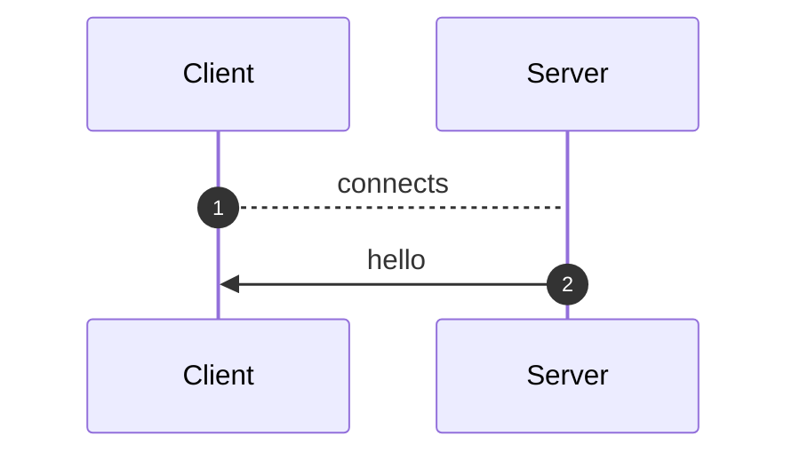
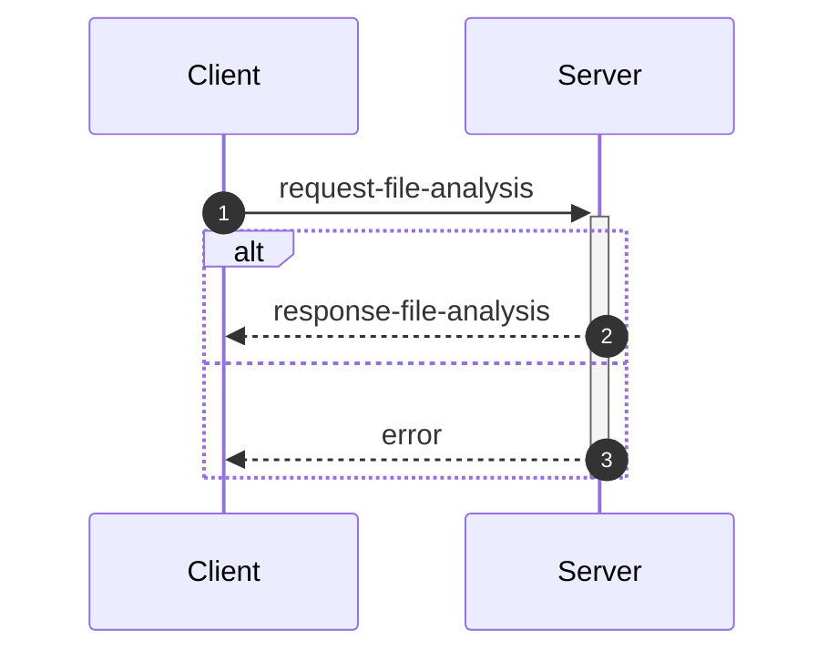
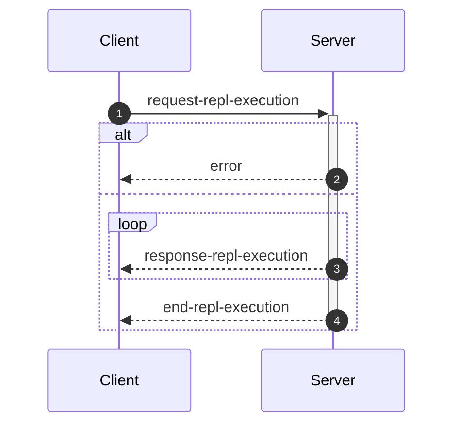
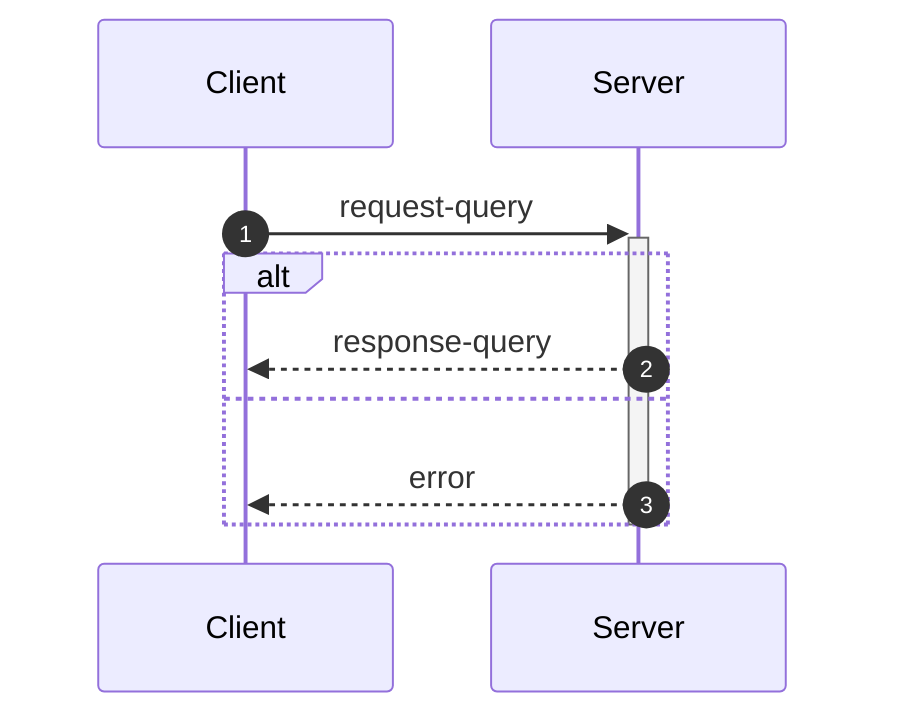

_<span title="an overview of flowR's interface">Generated</span> from '[wiki-interface.ts](https://github.com/flowr-analysis/flowr/tree/main/src/documentation/wiki-interface.ts "src/documentation/wiki-interface.ts")' on 2026-11-03, 15:57:54 UTC (v2.17.0, R v4.6.1), do not edit directly._

Although far from being as detailed as the in-depth explanation of [_flowR_](https://github.com/flowr-analysis/flowr/wiki/Core),
this wiki page explains how to interface with _flowR_ in more detail.
In general, command line arguments and other options provide short descriptions on hover over.

* [💻 Using the REPL](#using-the-repl)
* [⚙️ Configuring FlowR](#configuring-flowr)
* [⚒️ Writing Code](#writing-code)
* [💬 Communicating with the Server](#communicating-with-the-server)

<a id='using-the-repl'></a>
## 💻 Using the REPL

> [!NOTE]
> To execute arbitrary R commands with a repl request, _flowR_ has to be started explicitly with <span title="Description (Command Line Argument): Allow to access the underlying R session when using flowR (security warning: this allows the execution of arbitrary R code!)">`--r-session-access`</span>.
> Please be aware that this introduces a security risk and note that this relies on the [`r-shell` engine](https://github.com/flowr-analysis/flowr/wiki/Engines) .

Although primarily meant for users to explore,
there is nothing which forbids calling _flowR_ as a subprocess to use standard-in, -output, and -error
for communication (although you can access the REPL using the server as well,
with the [REPL Request](#message-request-repl-execution) message).

The read-eval-print loop&nbsp;(REPL) works relatively simple.
You can submit an expression (using <kbd>Enter</kbd>),
which is interpreted as an R&nbsp;expression by default but interpreted as a *command* if it starts with a colon (`:`).
The best command to get started with the REPL is <span title="Description (Repl Command): Show help information (aliases: :h, :?)">`:help`</span>.
Besides, you can leave the REPL either with the command <span title="Description (Repl Command): End the repl (aliases: :q, :exit)">`:quit`</span> or by pressing <kbd>Ctrl</kbd>+<kbd>C</kbd> twice.
When writing a *command*, you may press <kbd>Tab</kbd> to get a list of completions, if available.
Multiple commands can be entered in a single line by separating them with a semicolon (`;`), e.g. `:parse "x<-2"; :df*`.
If a command is given without R code, the REPL will re-use R code given in a previous command.
The prior example will hence return first the parsed AST of the program and then the dataflow graph for `"x <- 2"`.

> [!NOTE]
> If you develop flowR, you may want to launch the repl using the `npm run main-dev` command, this way, you get a non-minified version of flowR with debug information and hot-reloading of source files.

<details>
<summary>Available Commands</summary>

We currently offer the following commands (this with a `[*]` suffix are available with and without the star):

| Command | Description |
| ------- | ----------- |
| **<span title="Description (Repl Command): End the repl (aliases: :q, :exit)">:quit</span>** | End the repl (aliases: **:<span title="Alias of ':quit'. End the repl">q</span>**, **:<span title="Alias of ':quit'. End the repl">exit</span>**) |
| **<span title="Description (Repl Command): Execute the given code as R code. This requires the `--r-session-access` flag to be set and requires the r-shell engine. (aliases: :e, :r)">:execute</span>** | Execute the given code as R code. This requires the `--r-session-access` flag to be set and requires the r-shell engine. (aliases: **:<span title="Alias of ':execute'. Execute the given code as R code. This requires the `--r-session-access` flag to be set and requires the r-shell engine.">e</span>**, **:<span title="Alias of ':execute'. Execute the given code as R code. This requires the `--r-session-access` flag to be set and requires the r-shell engine.">r</span>**) |
| **<span title="Description (Repl Command): Get mermaid code for the control-flow graph of R code (aliases: :cfg, :cf)">:controlflow[*]</span>** | Get mermaid code for the control-flow graph of R code (star: Returns the URL to mermaid.live) (aliases: **:<span title="Alias of ':controlflow'. Get mermaid code for the control-flow graph of R code">cfg</span>**, **:<span title="Alias of ':controlflow'. Get mermaid code for the control-flow graph of R code">cf</span>**) |
| **<span title="Description (Repl Command): Get mermaid code for the control-flow graph with basic blocks (aliases: :cfgb, :cfb)">:controlflowbb[*]</span>** | Get mermaid code for the control-flow graph with basic blocks (star: Returns the URL to mermaid.live) (aliases: **:<span title="Alias of ':controlflowbb'. Get mermaid code for the control-flow graph with basic blocks">cfgb</span>**, **:<span title="Alias of ':controlflowbb'. Get mermaid code for the control-flow graph with basic blocks">cfb</span>**) |
| **<span title="Description (Repl Command): Get mermaid code for the dataflow graph (aliases: :d, :df)">:dataflow[*]</span>** | Get mermaid code for the dataflow graph (star: Returns the URL to mermaid.live) (aliases: **:<span title="Alias of ':dataflow'. Get mermaid code for the dataflow graph">d</span>**, **:<span title="Alias of ':dataflow'. Get mermaid code for the dataflow graph">df</span>**) |
| **<span title="Description (Repl Command): Get mermaid code for the normalized AST of R code (aliases: :n)">:normalize[*]</span>** | Get mermaid code for the normalized AST of R code (star: Returns the URL to mermaid.live) (alias: **:<span title="Alias of ':normalize'. Get mermaid code for the normalized AST of R code">n</span>**) |
| **<span title="Description (Repl Command): Get mermaid code for the simplified dataflow graph (aliases: :ds, :dfs)">:dataflowsimple[*]</span>** | Get mermaid code for the simplified dataflow graph (star: Returns the URL to mermaid.live) (aliases: **:<span title="Alias of ':dataflowsimple'. Get mermaid code for the simplified dataflow graph">ds</span>**, **:<span title="Alias of ':dataflowsimple'. Get mermaid code for the simplified dataflow graph">dfs</span>**) |
| **<span title="Description (Repl Command): Inspect and extend the signature database: `query` (identical to :query @signature), `info <name>` for where a function comes from (identical to :query @function-info), `add <path>` to mount another database/source, `download` to fetch the full-history database. (aliases: :sig)">:signature</span>** | Inspect and extend the signature database: `query` (identical to :query @signature), `info <name>` for where a function comes from (identical to :query @function-info), `add <path>` to mount another database/source, `download` to fetch the full-history database. (alias: **:<span title="Alias of ':signature'. Inspect and extend the signature database: `query` (identical to :query @signature), `info <name>` for where a function comes from (identical to :query @function-info), `add <path>` to mount another database/source, `download` to fetch the full-history database.">sig</span>**) |
| **<span title="Description (Repl Command): Just calculates the DFG, but only prints summary info (aliases: :d#, :df#)">:dataflowsilent</span>** | Just calculates the DFG, but only prints summary info (aliases: **:<span title="Alias of ':dataflowsilent'. Just calculates the DFG, but only prints summary info">d#</span>**, **:<span title="Alias of ':dataflowsilent'. Just calculates the DFG, but only prints summary info">df#</span>**) |
| **<span title="Description (Repl Command): Prints ASCII Art of the parsed, unmodified AST (aliases: :p)">:parse</span>** | Prints ASCII Art of the parsed, unmodified AST (alias: **:<span title="Alias of ':parse'. Prints ASCII Art of the parsed, unmodified AST">p</span>**) |
| **<span title="Description (Repl Command): Prints the version of flowR as well as the current version of R">:version</span>** | Prints the version of flowR as well as the current version of R
| **<span title="Description (Repl Command): Query the given R code (use 'help' for more information)">:query[*]</span>** | Query the given R code (use 'help' for more information) (star: Similar to query, but returns the output in json format.)
| **<span title="Description (Repl Command): Returns an ASCII representation of the dataflow graph (aliases: :df!)">:dataflowascii</span>** | Returns an ASCII representation of the dataflow graph (alias: **:<span title="Alias of ':dataflowascii'. Returns an ASCII representation of the dataflow graph">df!</span>**) |
| **<span title="Description (Repl Command): Returns summarization stats for the normalized AST (aliases: :n#)">:normalize#</span>** | Returns summarization stats for the normalized AST (alias: **:<span title="Alias of ':normalize#'. Returns summarization stats for the normalized AST">n#</span>**) |
| **<span title="Description (Repl Command): Show help information (aliases: :h, :?)">:help</span>** | Show help information (aliases: **:<span title="Alias of ':help'. Show help information">h</span>**, **:<span title="Alias of ':help'. Show help information">?</span>**) |

</details>

> [!TIP]
> 
> As indicated by the examples before, all REPL commands that operate on code keep track of the state.
> Hence, if you run a command like <span title="Description (Repl Command, starred version): Returns the URL to mermaid.live; Base Command: Get mermaid code for the dataflow graph (aliases: :d*, :df*)">`:dataflow*`</span> without providing R code,
> the REPL will re-use the R code provided in a previous command.
> Likewise, doing this will benefit from incrementality!
> If you request the dataflow graph with `:df* x <- 2 * y` and then want to see the parsed AST with `:parse`,
> the REPL will re-use previously obtained information and not re-parse the code again.
> 		

Generally, many commands offer shortcut versions in the REPL. Many queries, for example, offer a shortened format (see the example below).
Of special note, the [Config Query](https://github.com/flowr-analysis/flowr/wiki/%5BQuery%5D-Config)
can be used to also modify the currently active configuration of _flowR_ within the REPL (see the [wiki page](https://github.com/flowr-analysis/flowr/wiki/%5BQuery%5D-Config) for more information).

### Example: Retrieving the Dataflow Graph

To retrieve a URL to the [mermaid](https://mermaid.js.org/) diagram of the dataflow of a given expression,
use <span title="Description (Repl Command, starred version): Returns the URL to mermaid.live; Base Command: Get mermaid code for the dataflow graph (aliases: :d*, :df*)">`:dataflow*`</span> (or <span title="Description (Repl Command): Get mermaid code for the dataflow graph (aliases: :d, :df)">`:dataflow`</span> to get the mermaid code in the cli):

```shell
$ docker run -it --rm eagleoutice/flowr # or npm run flowr 
flowR repl v2.17.0, R grammar v14 (tree-sitter engine)
R> :dataflow* y <- 1 + x
```

<details>
<summary style='color:gray'>Output</summary>

```text
https://mermaid.live/view#base64:eyJjb2RlIjoiZmxvd2NoYXJ0IFREXG4gICAgMXt7XCJgKiM5MTtSTnVtYmVyIzkzOyogKioxKipcbiAgICAgICoxLjYqICgqKmlkOiAxKiopYFwifX1cbiAgICAyKFtcImAqIzkxO1JTeW1ib2wjOTM7KiAqKngqKlxuICAgICAgKjEuMTAqICgqKmlkOiAyKiopYFwiXSlcbiAgICAzW1tcImAqIzkxO1JCaW5hcnlPcCM5MzsqIGJhc2UjNTg7IzU4OyoqIzQzOyoqXG4gICAgICAqMS42LTEwKiAoKippZDogMyoqKVxuICAgIGFyZzogKDEsIDIpYFwiXV1cbiAgICBidWlsdC1pbjpfNDNfW1wiYEJ1aWx0LUluOlxuIzQzO2BcIl1cbiAgICBzdHlsZSBidWlsdC1pbjpfNDNfIHN0cm9rZTpncmF5LGZpbGw6Z3JheSxzdHJva2Utd2lkdGg6MnB4LG9wYWNpdHk6Ljg7XG4gICAgMFtcImAqIzkxO1JTeW1ib2wjOTM7KiAqKnkqKlxuICAgICAgKjEuMSogKCoqaWQ6IDAqKiwgdjogMylgXCJdXG4gICAgNFtbXCJgKiM5MTtSQmluYXJ5T3AjOTM7KiBiYXNlIzU4OyM1ODsqKiM2MDsjNDU7KipcbiAgICAgICoxLjEtMTAqICgqKmlkOiA0KiopXG4gICAgYXJnOiAoMCwgMylgXCJdXVxuICAgIGJ1aWx0LWluOl82MF8tW1wiYEJ1aWx0LUluOlxuIzYwOyM0NTtgXCJdXG4gICAgc3R5bGUgYnVpbHQtaW46XzYwXy0gc3Ryb2tlOmdyYXksZmlsbDpncmF5LHN0cm9rZS13aWR0aDoycHgsb3BhY2l0eTouODtcbiAgICAxIC0uLT58XCJmbG93XCJ8IDJcbiAgICBsaW5rU3R5bGUgMCBzdHJva2U6Z3JheSxjb2xvcjpncmF5O1xuICAgIDIgLS4tPnxcImZsb3dcInwgM1xuICAgIGxpbmtTdHlsZSAxIHN0cm9rZTpncmF5LGNvbG9yOmdyYXk7XG4gICAgMyAtLT58XCJyZWFkcywgYXJnXCJ8IDFcbiAgICAzIC0tPnxcInJlYWRzLCBhcmdcInwgMlxuICAgIDMgLS4tPnxcImZsb3dcInwgMFxuICAgIGxpbmtTdHlsZSA0IHN0cm9rZTpncmF5LGNvbG9yOmdyYXk7XG4gICAgMyAtLi0+fFwicmVhZHMsIGNhbGxzXCJ8IGJ1aWx0LWluOl80M19cbiAgICBsaW5rU3R5bGUgNSBzdHJva2U6Z3JheTtcbiAgICAwIC0tPnxcImRlZmluZWQtYnksIGZsb3dcInwgNFxuICAgIDAgLS0+fFwiZGVmaW5lZC1ieVwifCAzXG4gICAgNCAtLT58XCJyZWFkcywgYXJnXCJ8IDNcbiAgICA0IC0tPnxcInJldHVybnMsIGFyZ1wifCAwXG4gICAgNCAtLi0+fFwicmVhZHMsIGNhbGxzXCJ8IGJ1aWx0LWluOl82MF8tXG4gICAgbGlua1N0eWxlIDEwIHN0cm9rZTpncmF5OyIsIm1lcm1haWQiOnsiYXV0b1N5bmMiOnRydWV9fQ==
```

Retrieve the dataflow graph of the expression `y <- 1 + x`. It looks like this:


<details>

<summary style="color:gray">R Code of the Dataflow Graph</summary>

The analysis ran (parse and normalize with the [tree-sitter](https://github.com/flowr-analysis/flowr/wiki/Engines) engine) in the generation environment. No [signature database](https://github.com/flowr-analysis/flowr/wiki/Signature-Database) is mounted, so `library()` attaches no exports (base-R names are still qualified, e.g., `stats::acf`). 
We encountered no unknown side effects during the analysis.

```r
y <- 1 + x
```

</details>

</details>

For small graphs like this, <span title="Description (Repl Command): Returns an ASCII representation of the dataflow graph (aliases: :df!)">`:dataflowascii`</span> also provides an ASCII representation directly in the REPL:

```shell
$ docker run -it --rm eagleoutice/flowr # or npm run flowr 
flowR repl v2.17.0, R grammar v14 (tree-sitter engine)
R> :df! y <- 1 + x
```

<details open>
<summary style='color:gray'>Output</summary>

```text
                        v<0>v
 c<4>c──────────────────| y |
 |<- |     ┌────────────v---v
 c---c     │
    │   c<3>c   0<1>0
    └───| + |───| 1 |───u<2>u
        c---c   0---0   | x |
           └────────────u---u
Edges:
3 -> 1: reads, arg          3 -> 2: reads, arg
3 -> 0: flows-to            1 -> 2: flows-to
2 -> 3: flows-to            4 -> 3: reads, arg
4 -> 0: returns, arg        0 -> 4: defined-by, flows-to
0 -> 3: defined-by
```

Retrieve the dataflow graph of the expression `y <- 1 + x` as ASCII art.

</details>

For the slicing with <span title="Description (Repl Command): Static backwards executable slicer for R">`:slicer`</span>, you have access to the same [magic comments](#slice-magic-comments) as with the [slice request](#message-request-slice).
Pass `--inline` to splice resolvable `source()` calls into the reconstruction so the slice is a single self-contained R text (the same as the static slice query's `inlineSources` flag).
See `--help` for more flags!

### Example: Interfacing with the File System

Many commands that allow for an R-expression (like <span title="Description (Repl Command, starred version): Returns the URL to mermaid.live; Base Command: Get mermaid code for the dataflow graph (aliases: :d*, :df*)">`:dataflow*`</span>) allow for a file as well
if the argument starts with `file://`.
If you are working from the root directory of the _flowR_ repository, the following gives you the parsed AST of the example file using the <span title="Description (Repl Command): Prints ASCII Art of the parsed, unmodified AST (aliases: :p)">`:parse`</span> command:

> **Watch mode**: Replace `file://` with `watch://` to enter watch mode.
> flowR runs the command immediately and then re-runs it every time the file (or any file inside the folder) changes.
> Enter any other command to leave watch mode.
> For example: `:df watch://analysis.R`

```shell
$ docker run -it --rm eagleoutice/flowr # or npm run flowr 
flowR repl v2.17.0, R grammar v14 (tree-sitter engine)
R> :parse file://test/testfiles/example.R
```

<details>
<summary style='color:gray'>Output</summary>

```text
File: test/testfiles/example.R

program
├ binaryoperator
│ ├ identifier "sum" (1:1─4)
│ ├ <- "<-" (1:5─7)
│ ╰ float "0" (1:8─9)
├ binaryoperator
│ ├ identifier "product" (2:1─8)
│ ├ <- "<-" (2:9─11)
│ ╰ float "1" (2:12─13)
├ binaryoperator
│ ├ identifier "w" (3:1─2)
│ ├ <- "<-" (3:3─5)
│ ╰ float "7" (3:6─7)
├ binaryoperator
│ ├ identifier "N" (4:1─2)
│ ├ <- "<-" (4:3─5)
│ ╰ float "10" (4:6─8)
├ forstatement
│ ├ for "for" (6:1─4)
│ ├ ( "(" (6:5─6)
│ ├ identifier "i" (6:6─7)
│ ├ in "in" (6:8─10)
│ ├ binaryoperator
│ │ ├ float "1" (6:11─12)
│ │ ├ : ":" (6:12─13)
│ │ ╰ parenthesizedexpression
│ │   ├ ( "(" (6:13─14)
│ │   ├ binaryoperator
│ │   │ ├ identifier "N" (6:14─15)
│ │   │ ├ - "-" (6:15─16)
│ │   │ ╰ float "1" (6:16─17)
│ │   ╰ ) ")" (6:17─18)
│ ├ ) ")" (6:18─19)
│ ╰ bracedexpression
│   ├ { "{" (6:20─21)
│   ├ binaryoperator
│   │ ├ identifier "sum" (7:3─6)
│   │ ├ <- "<-" (7:7─9)
│   │ ╰ binaryoperator
│   │   ├ binaryoperator
│   │   │ ├ identifier "sum" (7:10─13)
│   │   │ ├ + "+" (7:14─15)
│   │   │ ╰ identifier "i" (7:16─17)
│   │   ├ + "+" (7:18─19)
│   │   ╰ identifier "w" (7:20─21)
│   ├ binaryoperator
│   │ ├ identifier "product" (8:3─10)
│   │ ├ <- "<-" (8:11─13)
│   │ ╰ binaryoperator
│   │   ├ identifier "product" (8:14─21)
│   │   ├  "" (8:22─23)
│   │   ╰ identifier "i" (8:24─25)
│   ╰ } "}" (9:1─2)
├ call
│ ├ identifier "cat" (11:1─4)
│ ╰ arguments
│   ├ ( "(" (11:4─5)
│   ├ argument
│   │ ╰ string
│   │   ├ stringopen "\"" (11:5─6)
│   │   ├ stringcontent "Sum:" (11:6─10)
│   │   ╰ stringclose "\"" (11:10─11)
│   ├ comma "," (11:11─12)
│   ├ argument
│   │ ╰ identifier "sum" (11:13─16)
│   ├ comma "," (11:16─17)
│   ├ argument
│   │ ╰ string
│   │   ├ stringopen "\"" (11:18─19)
│   │   ├ stringcontent
│   │   │ ╰ escapesequence "\\n" (11:19─21)
│   │   ╰ stringclose "\"" (11:21─22)
│   ╰ ) ")" (11:22─23)
╰ call
  ├ identifier "cat" (12:1─4)
  ╰ arguments
    ├ ( "(" (12:4─5)
    ├ argument
    │ ╰ string
    │   ├ stringopen "\"" (12:5─6)
    │   ├ stringcontent "Product:" (12:6─14)
    │   ╰ stringclose "\"" (12:14─15)
    ├ comma "," (12:15─16)
    ├ argument
    │ ╰ identifier "product" (12:17─24)
    ├ comma "," (12:24─25)
    ├ argument
    │ ╰ string
    │   ├ stringopen "\"" (12:26─27)
    │   ├ stringcontent
    │   │ ╰ escapesequence "\\n" (12:27─29)
    │   ╰ stringclose "\"" (12:29─30)
    ╰ ) ")" (12:30─31)
```

Retrieve the parsed AST of the example file.

<details>

<summary>File Content</summary>

```r
sum <- 0
product <- 1
w <- 7
N <- 10

for (i in 1:(N-1)) {
  sum <- sum + i + w
  product <- product * i
}

cat("Sum:", sum, "\n")
cat("Product:", product, "\n")
```

</details>

As _flowR_ directly transforms this AST the output focuses on being human-readable instead of being machine-readable.
		
</details>

### Example: Run a Query

You can run any query supported by _flowR_ using the <span title="Description (Repl Command): Query the given R code (use 'help' for more information)">`:query`</span> command.
For example, to obtain the shapes of all data frames in a given piece of code, you can run:

```shell
$ docker run -it --rm eagleoutice/flowr # or npm run flowr 
flowR repl v2.17.0, R grammar v14 (tree-sitter engine)
R> :query @absint df-shape "x <- data.frame(a = 1:10, b = 1:10)\ny <- x$a"
```

<details open>
<summary style='color:gray'>Output</summary>

```text
Query: absint (4 ms)
   ╰ $12: (colnames: [{"a", "b"}, {}], cols: [2, 2], rows: [10, 10])
   ╰ $0: (colnames: [{"a", "b"}, {}], cols: [2, 2], rows: [10, 10])
```

Retrieve the shapes of all data frames in the given code.

</details>

To run the linter on a file, you can use (in this example, we just issue the `dead-code` linter on a small piece of code):

```shell
$ docker run -it --rm eagleoutice/flowr # or npm run flowr 
flowR repl v2.17.0, R grammar v14 (tree-sitter engine)
R> :query @linter rules:dead-code "if(FALSE) x <- 2"
```

<details open>
<summary style='color:gray'>Output</summary>

```text
Query: linter (3 ms)
   ╰ Dead Code (dead-code):
       ╰ certain:
           ╰ Code at 1.11-16 (1 quick fix(es) available)
```

Run the linter on the given code, with only the `dead-code` rule enabled.

</details>

For more information on the available queries, please check out the [Query API](https://github.com/flowr-analysis/flowr/wiki/Query-API).

<a id='configuring-flowr'></a>
## ⚙️ Configuring FlowR

When running _flowR_, you may want to specify some behaviors with a dedicated configuration file.
By default, flowR looks for a file named `flowr.json` in the current working directory (or any higher directory).
You can also specify a different file with <span title="Description (Command Line Argument): The name of the configuration file to use">`--config-file`</span> or pass the configuration inline using <span title="Description (Command Line Argument): The flowR configuration to use, as a JSON string">`--config-json`</span>.
A `flowr.json` found this way belongs to the analyzed project, so flowR ignores its options that decide what flowR executes or loads
(`engines.*.wasmPath`, `engines.*.treeSitterWasmPath`, `engines.*.rPath`, `solver.sigdb.additionalPaths`, `solver.sigdb.downloadRepo`, `solver.sigdb.installedLibrary.paths`, `solver.sigdb.onDemand.enabled`, `solver.sigdb.onDemand.repositories`, `solver.sigdb.onDemand.cranMirror`, `solver.sigdb.onDemand.bioconductorMirror`, `solver.sigdb.onDemand.cacheDir`),
unless you pass <span title="Description (Command Line Argument): Keep the security-sensitive options (e.g., the R executable) of the flowr.json found in the working directory or a parent. Only use this for projects you trust.">`--trust-config`</span>.
To analyze code you do not trust, use the secure mode (<span title="Description (Command Line Argument): Run in secure mode for analyzing untrusted code: flowR does not start R (or any other process), does not access the network, does not search for project configs, and ignores security-sensitive options in every config. Cannot be disabled once enabled. Can also be enabled with the environment variable {italic FLOWR_SECURE_MODE=1}.">`--secure`</span>, see the [security policy](https://github.com/flowr-analysis/flowr/blob/main/.github/SECURITY.md)).
To inspect the current configuration, you can run flowr with the <span title="Description (Command Line Argument): Run with verbose logging (will be passed to the corresponding script)">`--verbose`</span> flag, or use the `config` [Query](https://github.com/flowr-analysis/flowr/wiki/Query-API).
Within the REPL this works by running the following:

```shell
:query @config
```

To work with the <a href="https://github.com/flowr-analysis/flowr/tree/main/src/config.ts#L119"><code><span title="The configuration file format for flowR.">FlowrConfig</span></code></a> you can use the provided helper objects alongside its methods like
<a href="https://github.com/flowr-analysis/flowr/tree/main/src/config.ts#L966"><code><span title="Creates a new flowr config that has the updated values.">FlowrConfig::<b>amend</b></span></code></a>.
The schema below documents every option; the ones you most likely want are:

- <a href="https://github.com/flowr-analysis/flowr/wiki/Interface#configuring-flowr" title="Configuration Option (boolean): Whether source calls should be ignored, causing {@link processSourceCall}&#39;s behavior to be skipped.">ignoreSourceCalls</a>: ignore source calls when analyzing the code, i.e., ignore the inclusion of other files.
- <a href="https://github.com/flowr-analysis/flowr/wiki/Interface#configuring-flowr" title="Configuration Option (boolean): Whether load calls should be ignored, causing {@link processLoadCall}&#39;s behavior to be skipped.">ignoreLoadCalls</a>: ignore load calls when analyzing the code, i.e., ignore the loading of r-data files.
- <a href="https://github.com/flowr-analysis/flowr/wiki/Interface#configuring-flowr" title="Configuration Option (object): Do you want to overwrite (parts) of the builtin definition?">semantics.environment.overwriteBuiltIns</a>: overwrite _flowR_'s handling of built-in functions, or clear the preset definitions entirely.
  See [Configure BuiltIn Semantics](#configure-builtin-semantics) for more information.
- <a href="https://github.com/flowr-analysis/flowr/wiki/Interface#configuring-flowr" title="Configuration Option (string): How to resolve variables and their values. (one of &quot;disabled&quot;, &quot;alias&quot;, &quot;builtin&quot;)">solver.variables</a>: how to resolve variables and their values (`disabled`, `alias`, `builtin`).
- <a href="https://github.com/flowr-analysis/flowr/wiki/Interface#configuring-flowr" title="Configuration Option (array): The engine or set of engines to use for interacting with R code. An empty array means all available engines will be used.">engines</a> and <a href="https://github.com/flowr-analysis/flowr/wiki/Interface#configuring-flowr" title="Configuration Option (string): The default engine to use for interacting with R code. If this is undefined, an arbitrary engine from the specified list will be used. (one of &quot;tree-sitter&quot;, &quot;r-shell&quot;)">defaultEngine</a>: the engines used to interact with R code, see the [Engines wiki page](https://github.com/flowr-analysis/flowr/wiki/Engines).
- <a href="https://github.com/flowr-analysis/flowr/wiki/Interface#configuring-flowr" title="Configuration Option (array): Files a framework loads on its own, without any source() call (e.g. global.R in a shiny app), in the order they are loaded; flowR orders the matching project files accordingly and analyzes them as one program. Entries are case-insensitive globs matched against the file path, a plain name matches any file with that name, and entries matching no project file are warned about. Usually set per project kind via specializeConfig.">project.implicitSources</a>: the files a framework loads without any `source()` call, in the order in which they are
  loaded. Entries are globs (e.g. `R/*.R`) matched against the file path ignoring capitalization; one matching no file is reported.
- <a href="https://github.com/flowr-analysis/flowr/wiki/Interface#configuring-flowr" title="Configuration Option (object): Overwrite (parts of) the configuration depending on the project kind flowR detects, e.g. to give a shiny app its implicit sources.">specializeConfig</a>: overwrite (parts of) the configuration depending on the kind of project _flowR_ detects
  (e.g. `shiny-app`), which is how a shiny app gets its implicit sources by default. What you configure directly wins.
- <a href="https://github.com/flowr-analysis/flowr/wiki/Interface#configuring-flowr" title="Configuration Option (string): Overwrite the project kind flowR would otherwise infer from the analyzed files, e.g. when auto-detection guesses wrong. (one of &quot;package&quot;, &quot;script&quot;, &quot;shiny-app&quot;, &quot;notebook&quot;, &quot;project&quot;, &quot;unknown&quot;)">project.useProjectType</a>: skip that detection and force a project kind yourself, when auto-detection guesses wrong.
- <a href="https://github.com/flowr-analysis/flowr/wiki/Interface#configuring-flowr" title="Configuration Option (array): The default plugins to load when creating a new instance of FlowrAnalyzer">defaultPlugins</a> and <a href="https://github.com/flowr-analysis/flowr/wiki/Interface#configuring-flowr" title="Configuration Option (array): The plugins to load in REPL mode">repl.plugins</a>: the plugins to load for a new <a href="https://github.com/flowr-analysis/flowr/tree/main/src/project/flowr-analyzer.ts#L210"><code><span title="Central class for conducting analyses with FlowR. Use the FlowrAnalyzerBuilder to create a new instance. If you want the original pattern of creating a pipeline and running all steps, you can still do this with FlowrAnalyzer#runFull . To inspect the context of the analyzer, use FlowrAnalyzer#inspectContext (if you are a plugin and need to modify it, use FlowrAnalyzer#context instead).">FlowrAnalyzer</span></code></a> and in the REPL
  (use `flowr:default` to reference the former).

So you can configure _flowR_ by adding a file like the following:

<details>

<summary>Example Configuration File</summary>

```json
{
  "ignoreSourceCalls": true,
  "ignoreLoadCalls": true,
  "semantics": {
    "environment": {
      "overwriteBuiltIns": {
        "definitions": [
          {
            "type": "function",
            "names": [
              "foo"
            ],
            "processor": "builtin:assign",
            "config": {}
          }
        ]
      }
    }
  },
  "defaultPlugins": [
    "file:description",
    "versions:description"
  ],
  "repl": {
    "quickStats": false,
    "dfProcessorHeat": false,
    "hints": true,
    "plugins": [
      "flowr:default"
    ]
  },
  "project": {
    "resolveUnknownPathsOnDisk": true,
    "implicitSources": [
      "global.R",
      "app.R"
    ]
  },
  "linter": {
    "disabledRules": []
  },
  "specializeConfig": {
    "shiny-app": {
      "project": {
        "implicitSources": [
          "global.R",
          "ui.R",
          "server.R",
          "app.R"
        ]
      }
    }
  },
  "engines": [
    {
      "type": "r-shell"
    }
  ],
  "solver": {
    "variables": "alias",
    "evalStrings": true,
    "trackEnvironments": true,
    "sigdb": {
      "enabled": true,
      "loadProjectDependencies": true,
      "eagerlyLoad": false,
      "eagerlyLoadExports": false,
      "linkBaseR": false,
      "linkDescriptionDependencies": false
    },
    "resolveSource": {
      "dropPaths": "no",
      "ignoreCapitalization": true,
      "inferWorkingDirectory": "active-script",
      "searchPath": []
    },
    "instrument": {},
    "slicer": {
      "threshold": 50
    }
  },
  "abstractInterpretation": {
    "wideningThreshold": 4,
    "followCalls": true,
    "dataFrame": {
      "maxColNames": 20,
      "readLoadedData": {
        "readExternalFiles": true,
        "maxReadLines": 1000000
      }
    }
  },
  "incremental": {
    "alwaysIncremental": false,
    "parsing": {
      "activated": false,
      "heuristics": {
        "activated": true,
        "mtime": true,
        "linesFrom": 500,
        "bytesFrom": 50000,
        "alwaysWithEdits": false,
        "minFiles": 1
      }
    }
  },
  "gas": {
    "thresholds": {
      "memory": {
        "problematic": 0.7,
        "critical": 0.9
      },
      "timeMs": {
        "problematic": 100000,
        "critical": 120000
      }
    },
    "features": {}
  }
}
```

</details>

<details>
<a id='configure-builtin-semantics'></a>
<summary>Configure Built-In Semantics</summary>

`semantics/environment/overwriteBuiltins` accepts two keys:

- `loadDefaults` (boolean, initially `true`): If set to `true`, the default built-in definitions are loaded before applying the custom definitions. Setting this flag to `false` explicitly disables the loading of the default definitions.
- `definitions` (array, initially empty): Allows to overwrite or define new built-in elements. Each object within must have a `type` which is one of the below. Furthermore, they may define a string array of `names` which specifies the identifiers to bind the definitions to. You may use `assumePrimitive` to specify whether _flowR_ should assume that this is a primitive non-library definition (so you probably just do not want to specify the key).

  | Type            | Description                                                                                                                                                                                                                                                                                              | Example                                                                                                    |
  | --------------- | -------------------------------------------------------------------------------------------------------------------------------------------------------------------------------------------------------------------------------------------------------------------------------------------------------- | ---------------------------------------------------------------------------------------------------------- |
  | `constant`    | Additionally allows for a `value` this should resolve to.                                                                                                                                                                                                                                                | `{ type: 'constant', names: ['NULL', 'NA'],  value: null }`                                                |
  | `function`    | Is a rather flexible way to define and bind built-in functions. For the time, we do not have extensive documentation to cover all the cases, so please either consult the sources with the `default-builtin-config.ts` or open a [new issue](https://github.com/flowr-analysis/flowr/issues/new/choose). | `{ type: 'function', names: ['next'], processor: 'builtin:d', config: { cfg: ExitPointType.Next } }` |
  | `replacement` | A comfortable way to specify replacement functions like `$<-` or `names<-`. `suffixes` describes the... suffixes to attach automatically. | `{ type: 'replacement', suffixes: ['<-', '<<-'], names: ['[', '[['] }` |

</details>

<details>

<summary style='color:gray'>Full Configuration-File Schema</summary>

- _The configuration file format for flowR._ (object)
    - **logLevel** [optional] _flowR's global minimum log level, applied when the config is loaded._ (string)
        Only allows: 'silly', 'trace', 'debug', 'info', 'warn', 'error', 'fatal'
    - **ignoreSourceCalls** [optional] _Whether source calls should be ignored, causing {@link processSourceCall}'s behavior to be skipped._ (boolean)
    - **ignoreLoadCalls** [optional] _Whether load calls should be ignored, causing {@link processLoadCall}'s behavior to be skipped._ (boolean)
    - **semantics** _Configure language semantics and how flowR handles them._ (object)
        - **environment** [optional] _Semantics regarding how to handle the R environment._ (object)
            - **overwriteBuiltIns** [optional] _Do you want to overwrite (parts) of the builtin definition?_ (object)
                - **loadDefaults** [optional] _Should the default configuration still be loaded?_ (boolean)
                - **definitions** [optional] _The definitions to load/overwrite._ (array)
                Valid item types:
                    - (object)
    - **defaultPlugins** [optional] _The default plugins to load when creating a new instance of FlowrAnalyzer_ (array)
    Valid item types:
        - (alternatives)
            - (string)
            - (array)
    - **repl** _Configuration options for the REPL._ (object)
        - **quickStats** [optional] _Whether to show quick stats in the REPL after each evaluation._ (boolean)
        - **dfProcessorHeat** [optional] _This instruments the dataflow processors to count how often each processor is called._ (boolean)
        - **hints** [optional] _Whether to show dim inline hints on the empty prompt (automatically disabled on non-interactive terminals)._ (boolean)
        - **plugins** [optional] _The plugins to load in REPL mode_ (array)
        Valid item types:
            - (alternatives)
                - (string)
                - (array)
        - **autoUseFileProtocol** [optional] _Prepend the file protocol to a repl input that looks like a path, instead of only warning about it._ (boolean)
        - **queryStats** [optional] _Whether `:query` closes with the line stating how long the queries took (`:query*` never prints it)._ (boolean)
        - **showPlugins** [optional] _Whether `:version` grays out the plugins that did not activate during the last analysis._ (boolean)
    - **project** _Project specific configuration options._ (object)
        - **resolveUnknownPathsOnDisk** [optional] _Whether to resolve unknown paths loaded by the r project disk when trying to source/analyze files._ (boolean)
        - **failOnInaccessiblePath** [optional] _Whether a directory that cannot be traversed during file discovery (e.g. due to permissions) aborts the analysis; when false (the default) such paths are logged and skipped._ (boolean)
        - **basePackages** [optional] _The packages considered part of R itself (base and recommended); if unset, flowR uses its built-in list._ (array)
        Valid item types:
            - (string)
        - **implicitSources** [optional] _Files a framework loads on its own, without any source() call (e.g. global.R in a shiny app), in the order they are loaded; flowR orders the matching project files accordingly and analyzes them as one program. Entries are case-insensitive globs matched against the file path, a plain name matches any file with that name, and entries matching no project file are warned about. Usually set per project kind via specializeConfig._ (array)
        Valid item types:
            - (string)
        - **useProjectType** [optional] _Overwrite the project kind flowR would otherwise infer from the analyzed files, e.g. when auto-detection guesses wrong._ (string)
            Only allows: 'package', 'script', 'shiny-app', 'notebook', 'project', 'unknown'
        - **assumeImplicitEcho** [optional] _Whether the top level of the analyzed code is echoed, so that every visible result printed there is collected as an output by the dependencies query (default true, false for a package)._ (boolean)
        - **discovery** [optional] _Scoping options for the default project discovery._ (object)
            - **full** [optional] _Collect every file below the project root (greedy) instead of only the files the detected project kind needs (default false)._ (boolean)
            - **perKind** [optional] _Per-kind include/exclude glob overrides layered on the default scoping._ (object)
            - **ignore** [optional] _Case-insensitive globs that drop matching files from the intelligent discovery, regardless of kind (e.g. .Renviron to ignore environment files)._ (array)
            Valid item types:
                - (string)
        - **classification** [optional] _Overrides for the signals flowR uses to classify the project kind._ (object)
            - **shinyDescriptionTypes** [optional] _DESCRIPTION Type: values that mark a shiny app._ (array)
            Valid item types:
                - (string)
            - **shinyEntryFiles** [optional] _File names a shiny app is assembled from._ (array)
            Valid item types:
                - (string)
            - **shinyUsagePattern** [optional] _Regex source evidencing shiny usage in an entry file._ (string)
            - **notebookExtensions** [optional] _File extensions marking a notebook._ (array)
            Valid item types:
                - (string)
    - **linter** _Linter configuration options._ (object)
        - **disabledRules** _Linting rule names excluded from the default rule set (a rule requested explicitly via a linter query still runs). Usually set per project kind via specializeConfig._ (array)
        Valid item types:
            - (string)
        - **disabledTags** [optional] _Linting rule tags whose rules are excluded from the default rule set (a rule requested explicitly via a linter query still runs). By default the cmd-check rules are disabled for everything but a package; a configured list replaces that default._ (array)
        Valid item types:
            - (string)
    - **inputSources** [optional] _Further frameworks the input-sources analysis should know about; entries are added to flowR's defaults._ (object)
        - **pure** [optional] _Functions that only pass the constantness of their arguments on._ (array)
        Valid item types:
            - (string)
        - **param** [optional] _Functions whose result is a 'param' input._ (array)
        Valid item types:
            - (string)
        - **file** [optional] _Functions whose result is a 'file' input._ (array)
        Valid item types:
            - (string)
        - **tempfile** [optional] _Functions whose result is a 'tempfile' input._ (array)
        Valid item types:
            - (string)
        - **glob** [optional] _Functions whose result is a 'glob' input._ (array)
        Valid item types:
            - (string)
        - **net** [optional] _Functions whose result is a 'net' input._ (array)
        Valid item types:
            - (string)
        - **rand** [optional] _Functions whose result is a 'rand' input._ (array)
        Valid item types:
            - (string)
        - **system** [optional] _Functions whose result is a 'system' input._ (array)
        Valid item types:
            - (string)
        - **ffi** [optional] _Functions whose result is a 'ffi' input._ (array)
        Valid item types:
            - (string)
        - **lang** [optional] _Functions whose result is a 'lang' input._ (array)
        Valid item types:
            - (string)
        - **options** [optional] _Functions whose result is a 'options' input._ (array)
        Valid item types:
            - (string)
        - **cmdline** [optional] _Functions whose result is a 'cmdline' input._ (array)
        Valid item types:
            - (string)
        - **user** [optional] _Functions whose result is a 'user' input._ (array)
        Valid item types:
            - (string)
        - **const** [optional] _Functions whose result is a 'const' input._ (array)
        Valid item types:
            - (string)
        - **scope** [optional] _Functions whose result is a 'scope' input._ (array)
        Valid item types:
            - (string)
        - **dconst** [optional] _Functions whose result is a 'dconst' input._ (array)
        Valid item types:
            - (string)
        - **unknown** [optional] _Functions whose result is a 'unknown' input._ (array)
        Valid item types:
            - (string)
        - **linkedObjects** [optional] _Objects a framework provides without a definition in the code, e.g. shiny's input._ (array)
        Valid item types:
            - (object)
        - **linkedEntryPoints** [optional] _Calls that hand a function to a framework, which binds its objects to the parameters by position._ (array)
        Valid item types:
            - (object)
    - **specializeConfig** [optional] _Overwrite (parts of) the configuration depending on the project kind flowR detects, e.g. to give a shiny app its implicit sources._ (object)
    - **engines** _The engine or set of engines to use for interacting with R code. An empty array means all available engines will be used._ (array)
    Valid item types:
        - (alternatives)
            - _The configuration for the tree sitter engine._ (object)
                - **type** [required] _Use the tree sitter engine._ (string)
                    Only allows: 'tree-sitter'
                - **wasmPath** [optional] _The path to the tree-sitter-r WASM binary to use. If this is undefined, this uses the default path._ (string)
                - **treeSitterWasmPath** [optional] _The path to the tree-sitter WASM binary to use. If this is undefined, this uses the default path._ (string)
                - **lax** [optional] _Whether to use the lax parser for parsing R code (allowing for syntax errors). If this is undefined, the strict parser will be used._ (boolean)
            - _The configuration for the R shell engine._ (object)
                - **type** [required] _Use the R shell engine._ (string)
                    Only allows: 'r-shell'
                - **rPath** [optional] _The path to the R executable to use. If this is undefined, this uses the default path._ (string)
                - **pipeBind** [optional] _Whether to enable R's experimental pipe-bind operator "=>" by setting _R_USE_PIPEBIND_ for the R session (default false); R itself keeps this off by default, as it is experimental and has never shipped in a release version of R._ (boolean)
    - **defaultEngine** [optional] _The default engine to use for interacting with R code. If this is undefined, an arbitrary engine from the specified list will be used._ (string)
        Only allows: 'tree-sitter', 'r-shell'
    - **solver** _How to resolve constants, constraints, cells, ..._ (object)
        - **variables** _How to resolve variables and their values._ (string)
            Only allows: 'disabled', 'alias', 'builtin'
        - **evalStrings** _Should we include eval(parse(text="...")) calls in the dataflow graph?_ (boolean)
        - **trackEnvironments** [optional] _Track user-created environments (new.env, assign/get/local with envir=, dollar-assign, attach). When false, all envir-style calls fall through conservatively._ (boolean)
        - **sigdb** _Resolving library exports from a signature database._ (object)
            - **enabled** [optional] _Resolve library()/use() exports from a signature database (default true); when false no database is consulted._ (boolean)
            - **loadProjectDependencies** [optional] _Load the project's declared dependencies from its metadata files (DESCRIPTION Imports/Depends, rproject.toml, uvr.toml, rig rproj.toml and script blocks, renv.lock, rv.lock, uvr.lock, rig lockfiles) (default true); when false these files are not read for dependencies._ (boolean)
            - **eagerlyLoad** [optional] _Parse the database up front rather than on the first package load (default false, ignored if disabled)._ (boolean)
            - **eagerlyLoadExports** [optional] _Add a vertex for every export on load rather than on demand (default false); keeps the dataflow graph small._ (boolean)
            - **assumedRVersion** [optional] _R version assumed when resolving versioned (base-R) exports: a pin like "4.5" or "auto" to detect the installed R (default "auto")._ (string)
            - **linkBaseR** [optional] _Eagerly attach base-R namespaces so bare base calls resolve without library() (default false)._ (boolean)
            - **linkBaseRCalls** [optional] _Add a lightweight Reads edge from a bare base-R call to its signature-database function vertex (default false; base-R qualification is edge-free otherwise)._ (boolean)
            - **linkPackageCalls** [optional] _Add a lightweight Reads edge from a resolved package call to its signature-database function vertex (default false)._ (boolean)
            - **linkDescriptionDependencies** [optional] _Eagerly attach the namespaces of the project's declared DESCRIPTION dependencies (Imports/Depends) so their exports resolve without an explicit library() (default false)._ (boolean)
            - **warmInBackground** [optional] _Decompress the hot shards (base + most-downloaded) in a background task on startup so the first library() lookup is warm (default false; for long-running servers/REPLs)._ (boolean)
            - **additionalPaths** [optional] _Extra directories or bundle/manifest files searched for signature databases (alongside the shipped default and $FLOWR_SIGDB_DIR); a downloaded full-history bundle placed here is mounted automatically._ (array)
            Valid item types:
                - (string)
            - **downloadRepo** [optional] _GitHub owner/repo the full-history bundle is downloaded from via ":signature download" (default "flowr-analysis/flowr"; the release tag comes from the committed sigdb.remote.json unless a version is given)._ (string)
            - **autoSync** [optional] _On startup, re-download shards whose committed sigdb.remote.json hash no longer matches the cache, in the background (default false; opt-in network sync after a git pull)._ (boolean)
            - **installedLibrary** [optional] _Recovering packages no signature database knows from the copy installed on this machine._ (object)
                - **enabled** [required] _Recover packages no signature database knows from their installed copy (default false)._ (boolean)
                - **paths** [optional] _Library directories to search; when empty they are discovered from the environment and the project._ (array)
                Valid item types:
                    - (string)
                - **useEnvironment** [optional] _Search the libraries R_LIBS_USER/R_LIBS/R_LIBS_SITE name (default true)._ (boolean)
                - **useProjectLibrary** [optional] _Search a project-local renv/packrat library (default true)._ (boolean)
                - **maxDepth** [optional] _How far to descend into the nested layout of a project-local library (default 3)._ (number)
                - **packages** [optional] _Only recover packages whose name matches one of these regular expressions; empty means any._ (array)
                Valid item types:
                    - (string)
            - **onDemand** [optional] _Recovering packages no signature database knows from their sources on CRAN, Bioconductor, or GitHub._ (object)
                - **enabled** [required] _Fetch and recover the sources of packages no signature database knows when the analyzed code uses them (default false, accesses the network)._ (boolean)
                - **sources** [optional] _Where to look, in order: github, cran, bioconductor, or a source a plugin adds (default ["github", "cran", "bioconductor"])._ (array)
                Valid item types:
                    - (string)
                - **repositories** [optional] _GitHub repositories (owner/repo[/subdir][@ref]) to fetch packages from, by package name. The analyzed project may name more (DESCRIPTION Remotes, install_github calls)._ (object)
                - **packages** [optional] _Only recover packages whose name matches one of these regular expressions, empty means any._ (array)
                Valid item types:
                    - (string)
                - **cranMirror** [optional] _The CRAN src/contrib/ to fetch from, over https (default https://cloud.r-project.org/src/contrib/). It may be on the local network._ (string)
                - **bioconductorMirror** [optional] _The Bioconductor host, over https (default https://bioconductor.org). It may be on the local network._ (string)
                - **bioconductorRelease** [optional] _The Bioconductor release to fetch from: release, devel, or a number like 3.20 (default release)._ (string)
                - **githubMirrors** [optional] _Use the GitHub mirrors of CRAN (cran/<pkg>) and Bioconductor (bioc/<pkg>) (default true)._ (boolean)
                - **maxPackages** [optional] _The most packages to fetch for one analysis (default 25)._ (number)
                - **maxArchiveMb** [optional] _The most MiB a package archive may have (default 32). It may unpack to three times that, at most 128 MiB._ (number)
                - **offline** [optional] _Only use what was fetched before, never the network (default false)._ (boolean)
                - **retryAfterHours** [optional] _How many hours to wait before asking again for a package no source had (default 24)._ (number)
                - **cacheDir** [optional] _Where to cache what was fetched (default the on-demand directory of the signature cache)._ (string)
            - **blobCacheBudgetMb** [optional] _How many MiB of decoded package blobs every open bundle may hold together (default 16)._ (number)
            - **versionSelection** [optional] _When a project constrains a dependency, resolve to the newest (default), oldest, or system-installed version satisfying it; system needs R and falls back to newest. Base-R packages always resolve against the assumed R version._ (string)
                Only allows: 'newest', 'oldest', 'system'
            - **versionOverrides** [optional] _Force an exact version for specific packages (name -> version), overriding both the project constraint and the versionSelection policy (default {})._ (object)
        - **versionManagement** _Policies for reasoning about dependency versions._ (object)
            - **linkedVersionGroups** [optional] _Groups of packages that must resolve to the same version; version guessing intersects each group so its members stay mutually compatible (default [])._ (array)
            Valid item types:
                - (array)
                Valid item types:
                    - (string)
        - **assumeAttachedPackages** [optional] _Packages to treat as attached without a `library()` call, so what the built-in configuration states about them applies to the analyzed code. The base packages R attaches on startup already resolve without it._ (array)
        Valid item types:
            - (string)
        - **transitiveSideEffectRounds** [optional] _How many rounds the transitive side-effect fixpoint may run before it is cut off (default 32); the propagation stops on its own as soon as a round adds nothing._ (number)
        - **maxOverlayDepth** [optional] _How many binding overlays may stack on one environment frame before a write flattens them (default 4); a pure performance knob, trading lookup cost against copy cost without changing any result._ (number)
        - **instrument** (object)
            - **dataflowExtractors** [optional] _These keys are only intended for use within code, allowing to instrument the dataflow analyzer!_ (any)
        - **resolveSource** [optional] _If lax source calls are active, flowR searches for sourced files much more freely, based on the configurations you give it. This option is only in effect if `ignoreSourceCalls` is set to false._ (object)
            - **dropPaths** _Allow to drop the first or all parts of the sourced path, if it is relative._ (string)
                Only allows: 'no', 'once', 'all'
            - **ignoreCapitalization** _Search for filenames matching in the lowercase._ (boolean)
            - **inferWorkingDirectory** _Try to infer the working directory from the main or any script to analyze._ (string)
                Only allows: 'no', 'main-script', 'active-script', 'any-script'
            - **searchPath** _Additionally search in these paths._ (array)
            Valid item types:
                - (string)
            - **repeatedSourceLimit** [optional] _How often the same file can be sourced within a single run? Please be aware: in case of cyclic sources this may not reach a fixpoint so give this a sensible limit._ (number)
            - **applyReplacements** _Provide name replacements for loaded files_ (array)
            Valid item types:
                - (object)
            - **assumeFilesExist** [optional] _Assume a sourced file is always there, making what it defines certain instead of conditional on the source call._ (boolean)
        - **slicer** [optional] _The configuration for the slicer._ (object)
            - **threshold** [optional] _The maximum number of iterations to perform on a single function call during slicing._ (number)
            - **autoExtend** [optional] _If set, the slicer will gain an additional post-pass._ (boolean)
    - **abstractInterpretation** _The configuration options for abstract interpretation._ (object)
        - **wideningThreshold** _The threshold for the number of visitations of a node at which widening should be performed to ensure the termination of the fixpoint iteration._ (number)
        - **followCalls** _Whether the abstract interpretation is interprocedural, i.e. whether it steps into the functions a call may dispatch to._ (boolean)
        - **dataFrame** _The configuration of the shape inference for data frames._ (object)
            - **maxColNames** _The maximum number of columns names to infer for data frames before over-approximating the column names to top._ (number)
            - **readLoadedData** _Configuration options for reading data frame shapes from loaded external data files, such as CSV files._ (object)
                - **readExternalFiles** _Whether data frame shapes should be extracted from loaded external files, such as CSV files._ (boolean)
                - **maxReadLines** _The maximum number of lines to read when extracting data frame shapes from loaded files, such as CSV files._ (number)
    - **incremental** (object)
        - **alwaysIncremental** _Always take the incremental path, regardless of heuristics._ (boolean)
        - **parsing** (object)
            - **activated** _If set, incremental parsing will be used._ (boolean)
            - **heuristics** (object)
                - **activated** [optional] _If set, the heuristics for incremental parsing will be used._ (boolean)
                - **mtime** [optional] _Skip reparsing entirely if the file's modification time is unchanged since the last parse._ (boolean)
                - **linesFrom** [optional] _Only consider incremental parsing for files with at least this many lines._ (number)
                - **bytesFrom** [optional] _Only consider incremental parsing for files with at least this many bytes._ (number)
                - **alwaysWithEdits** [optional] _Always take the incremental path whenever there is a computed edit region, regardless of the other thresholds._ (boolean)
                - **minFiles** [optional] _Only apply these heuristics once the project has at least this many files loaded._ (number)
    - **gas** [optional] _Resource-usage guard (gas) configuration. All feature factors default to 0 (disabled). See https://github.com/flowr-analysis/flowr/wiki/Core#gas-resource-guard._ (object)
        - **thresholds** [optional] _Thresholds for all gas checks (scaled by per-feature factor), boundable per feature._ (object)
            - **memory** [optional] _Heap-usage fraction thresholds (0-1), either shared or given per feature key (with `default` covering the rest)._ (object)
                - **problematic** [optional] _Heap fraction (0-1) above which Problematic is returned, for every feature without an entry of its own._ (number)
                - **critical** [optional] _Heap fraction (0-1) above which Critical is returned, for every feature without an entry of its own._ (number)
            - **timeMs** [optional] _Elapsed analysis time thresholds in milliseconds, either shared or given per feature key (with `default` covering the rest)._ (object)
                - **problematic** [optional] _Elapsed ms above which Problematic is returned, for every feature without an entry of its own._ (number)
                - **critical** [optional] _Elapsed ms above which Critical is returned, for every feature without an entry of its own._ (number)
            - **steps** [optional] _Processed-AST-node thresholds, counted rather than sampled; only a key that arms a budget (`dataflow`) reads them._ (object)
                - **problematic** [optional] _Processed AST nodes above which Problematic is returned, for every feature without an entry of its own._ (number)
                - **critical** [optional] _Processed AST nodes above which the extraction is cut short, for every feature without an entry of its own._ (number)
            - **vertices** [optional] _Created-dataflow-vertex thresholds, counted like `steps`._ (object)
                - **problematic** [optional] _Created dataflow vertices above which Problematic is returned, for every feature without an entry of its own._ (number)
                - **critical** [optional] _Created dataflow vertices above which the extraction is cut short, for every feature without an entry of its own._ (number)
        - **features** [optional] _Per-feature sensitivity factors. 0 or absent disables gas checking for that feature. A factor of 2 makes the feature twice as sensitive. Recognised keys: `source`, `side-effect-linking`, `linter`, `slicer`, `dataflow`._ (object)
        - **countedCheckEvery** [optional] _How many counted steps pass between two accountings of an armed check, be it a dataflow budget or the slicer's traversal (default 128); trades overshoot against the cost of the check._ (number)
        - **heapProvider** [optional] _Custom heap statistics source (programmatic configs only), overriding the built-in v8/performance.memory detection._ (function)

</details>

<a id='writing-code'></a>
## ⚒️ Writing Code

_flowR_ can be used as a [module](https://www.npmjs.com/package/@eagleoutice/flowr) and offers several main classes and interfaces that are interesting for extension writers 
(see the [Visual Studio Code extension](https://marketplace.visualstudio.com/items?itemName=code-inspect.vscode-flowr) or the [Core](https://github.com/flowr-analysis/flowr/wiki/Core) wiki page for more information).

### Creating Analyses with _flowR_

Nowadays, instances of the <a href="https://github.com/flowr-analysis/flowr/tree/main/src/project/flowr-analyzer.ts#L210"><code><span title="Central class for conducting analyses with FlowR. Use the FlowrAnalyzerBuilder to create a new instance. If you want the original pattern of creating a pipeline and running all steps, you can still do this with FlowrAnalyzer#runFull . To inspect the context of the analyzer, use FlowrAnalyzer#inspectContext (if you are a plugin and need to modify it, use FlowrAnalyzer#context instead).">FlowrAnalyzer</span></code></a> should be used as central frontend to get analysis results from _flowR_.
The entry points an analysis is written against are re-exported from the package root (`import { FlowrAnalyzerBuilder } from '@eagleoutice/flowr'`);
everything else stays reachable under its own path, as in `@eagleoutice/flowr/dataflow/graph/graph`.
For example, a program slice can be created like this:

```ts
const analyzer = await new FlowrAnalyzerBuilder()
    .setEngine('tree-sitter')
    .build();
analyzer.addRequest('x <- 1\ny <- x\nx');
const result = await analyzer.query([
    {
        type:     'static-slice',
        criteria: ['3@x']
    }
]);
```

For more information, please have a look at the [Analyzer](https://github.com/flowr-analysis/flowr/wiki/Analyzer) wiki page, which explains how to construct and use the <a href="https://github.com/flowr-analysis/flowr/tree/main/src/project/flowr-analyzer.ts#L210"><code><span title="Central class for conducting analyses with FlowR. Use the FlowrAnalyzerBuilder to create a new instance. If you want the original pattern of creating a pipeline and running all steps, you can still do this with FlowrAnalyzer#runFull . To inspect the context of the analyzer, use FlowrAnalyzer#inspectContext (if you are a plugin and need to modify it, use FlowrAnalyzer#context instead).">FlowrAnalyzer</span></code></a> in more detail.
To work with specific perspectives, you can also consult the respective pages like the [Dataflow Graph](https://github.com/flowr-analysis/flowr/wiki/Dataflow-Graph) or the [Abstract Interpretation](https://github.com/flowr-analysis/flowr/wiki/Abstract-Interpretation) wiki pages.
### The Pipeline Executor (Low-Level Interface)

Once, in the beginning, _flowR_ was meant to produce a dataflow graph merely to provide *program slices*. 
However, with continuous updates, the [Dataflow Graph](https://github.com/flowr-analysis/flowr/wiki/Dataflow-Graph) repeatedly proves to be the more interesting part.
With this, we restructured _flowR_'s originally *hardcoded* pipeline to be far more flexible. 
Now, it can be theoretically extended or replaced with arbitrary steps, optional steps, and what we call 'decorations' of these steps. 
In short, a slicing pipeline using the <a href="https://github.com/flowr-analysis/flowr/tree/main/src/core/pipeline-executor.ts#L97"><code><span title="**Please note:** The PipelineExecutor is now considered to be a rather low-level API for flowR. While it still works and is the basis for all other layers, we strongly recommend using the FlowrAnalyzer and its builder to create and use an analyzer instance that is pre-configured for your use-case. The pipeline executor allows to execute arbitrary pipelines in a step-by-step fashion. If you are not...">PipelineExecutor</span></code></a> looks like this:

```ts

const slicer = new PipelineExecutor(DEFAULT_SLICING_PIPELINE, {
  parser:    new RShell(),
  request:   requestFromInput('x <- 1\nx + 1'),
  criterion: ['2@x']
})
const slice = await slicer.allRemainingSteps()
// console.log(slice.reconstruct.code)
```

<details><summary>More Information</summary>

If you compare this, with what you would have done with the old (and removed) `SteppingSlicer`, 
this essentially just requires you to replace the `SteppingSlicer` with the <a href="https://github.com/flowr-analysis/flowr/tree/main/src/core/pipeline-executor.ts#L97"><code><span title="**Please note:** The PipelineExecutor is now considered to be a rather low-level API for flowR. While it still works and is the basis for all other layers, we strongly recommend using the FlowrAnalyzer and its builder to create and use an analyzer instance that is pre-configured for your use-case. The pipeline executor allows to execute arbitrary pipelines in a step-by-step fashion. If you are not...">PipelineExecutor</span></code></a>
and to pass the <a href="https://github.com/flowr-analysis/flowr/tree/main/src/core/steps/pipeline/default-pipelines.ts#L18"><code>DEFAULT_SLICING_PIPELINE</code></a> as the first argument.
The <a href="https://github.com/flowr-analysis/flowr/tree/main/src/core/pipeline-executor.ts#L97"><code><span title="**Please note:** The PipelineExecutor is now considered to be a rather low-level API for flowR. While it still works and is the basis for all other layers, we strongly recommend using the FlowrAnalyzer and its builder to create and use an analyzer instance that is pre-configured for your use-case. The pipeline executor allows to execute arbitrary pipelines in a step-by-step fashion. If you are not...">PipelineExecutor</span></code></a>...

1. Provides structures to investigate the results of all intermediate steps
2. Can be executed step-by-step
3. Can repeat steps (e.g., to calculate multiple slices on the same input)

See the in-code documentation for more information.

</details>

### Using the <a href="https://github.com/flowr-analysis/flowr/tree/main/src/r-bridge/shell.ts#L144"><code><span title="The RShell represents an interactive session with the R interpreter. You can configure it by RShellOptions . At the moment we are using a live R session (and not networking etc.) to communicate with R easily, which allows us to install packages etc. However, this might and probably will change in the future (leaving this as a legacy mode :D)">RShell</span></code></a> to Interact with R

The <a href="https://github.com/flowr-analysis/flowr/tree/main/src/r-bridge/shell.ts#L144"><code><span title="The RShell represents an interactive session with the R interpreter. You can configure it by RShellOptions . At the moment we are using a live R session (and not networking etc.) to communicate with R easily, which allows us to install packages etc. However, this might and probably will change in the future (leaving this as a legacy mode :D)">RShell</span></code></a> class allows interfacing with the `R`&nbsp;ecosystem installed on the host system.
Please have a look at [flowR's Engines](https://github.com/flowr-analysis/flowr/wiki/Engines) for more information on alternatives (for example, the <a href="https://github.com/flowr-analysis/flowr/tree/main/src/r-bridge/lang-4.x/tree-sitter/tree-sitter-executor.ts#L29"><code><span title="Synchronous and (way) faster alternative to the RShell using tree-sitter.">TreeSitterExecutor</span></code></a>).

> [!IMPORTANT]
> 
> Each <a href="https://github.com/flowr-analysis/flowr/tree/main/src/r-bridge/shell.ts#L144"><code><span title="The RShell represents an interactive session with the R interpreter. You can configure it by RShellOptions . At the moment we are using a live R session (and not networking etc.) to communicate with R easily, which allows us to install packages etc. However, this might and probably will change in the future (leaving this as a legacy mode :D)">RShell</span></code></a> controls a new instance of the R&nbsp;interpreter, 
> make sure to call <code><a href="https://github.com/flowr-analysis/flowr/tree/main/src/r-bridge/shell.ts#L350"><span title="Close the current R session, makes the object effectively invalid (can no longer be reopened etc.)">RShell::<i>close</i></span></a>()</code> when you are done.

You can start a new "session" by constructing a new object with <code>new <a href="https://github.com/flowr-analysis/flowr/tree/main/src/r-bridge/shell.ts#L144"><span title="The RShell represents an interactive session with the R interpreter. You can configure it by RShellOptions . At the moment we are using a live R session (and not networking etc.) to communicate with R easily, which allows us to install packages etc. However, this might and probably will change in the future (leaving this as a legacy mode :D)">RShell</span></a>()</code>.

However, there are several options that may be of interest 
(e.g., to automatically revive the shell in case of errors or to control the name location of the R process on the system).

With a shell object (let's call it `shell`), you can execute R code by using <a href="https://github.com/flowr-analysis/flowr/tree/main/src/r-bridge/shell.ts#L213"><code><span title="sends the given command directly to the current R session will not do anything to alter input markers!">RShell::<i>sendCommand</i></span></code></a>,
for example <code>shell.<a href="https://github.com/flowr-analysis/flowr/tree/main/src/r-bridge/shell.ts#L213"><span title="sends the given command directly to the current R session will not do anything to alter input markers!">sendCommand</span></a>("1 + 1")</code>.
However, this does not return anything, so if you want to collect the output of your command, use
<a href="https://github.com/flowr-analysis/flowr/tree/main/src/r-bridge/shell.ts#L296"><code><span title="Send a command and collect the output">RShell::<i>sendCommandWithOutput</i></span></code></a> instead.

<a id='communicating-with-the-server'></a>
## 💬 Communicating with the Server

As explained in the [Overview](https://github.com/flowr-analysis/flowr/wiki/Overview), you can run the [TCP](https://de.wikipedia.org/wiki/Transmission_Control_Protocol)&nbsp;server by adding the <span title="Description (Command Line Argument): Do not drop into a repl, but instead start a server on the given port (default: 1042) and listen for messages.">`--server`</span> flag (and, due to the interactive mode, exit with the conventional <kbd>CTRL</kbd>+<kbd>C</kbd>).
Currently, every connection is handled by the same underlying `RShell` - so the server is not designed to handle many clients at a time.
Additionally, the server is not well guarded against attacks (e.g., you can theoretically spawn an arbitrary number of&nbsp;RShell sessions on the target machine).

Every message has to be given in a single line (i.e., without a newline in-between) and end with a newline character. Nevertheless, we will pretty-print example given in the following segments for the ease of reading.

> [!NOTE]
> 
> The default <span title="Description (Command Line Argument): Do not drop into a repl, but instead start a server on the given port (default: 1042) and listen for messages.">`--server`</span> uses a simple [TCP](https://de.wikipedia.org/wiki/Transmission_Control_Protocol)
> connection. If you want _flowR_ to expose a [WebSocket](https://de.wikipedia.org/wiki/WebSocket) server instead, add the <span title="Description (Command Line Argument): If the server flag is set, use websocket for messaging">`--ws`</span> flag (i.e., <span title="Description (Command Line Argument): Do not drop into a repl, but instead start a server on the given port (default: 1042) and listen for messages.">`--server`</span> <span title="Description (Command Line Argument): If the server flag is set, use websocket for messaging">`--ws`</span>) when starting _flowR_ from the command line.

<ul><li>
<a id="message-hello"></a>
<b>Hello</b> Message (<code>hello</code>) 
<details>

<summary style="color:gray"> View Details. <i>The server informs the client about the successful connection and provides Meta-Information.</i> </summary>



After launching _flowR_, for example, with <code>docker run -it --rm eagleoutice/flowr <span title="Description (Command Line Argument): Do not drop into a repl, but instead start a server on the given port (default: 1042) and listen for messages.">-<span/>-server</span></code>&nbsp;(🐳️), connecting should present you with a `hello` message, that amongst others should reveal the versions of&nbsp;_flowR_ and&nbsp;R, using the [semver 2.0](https://semver.org/spec/v2.0.0.html) versioning scheme.
The message looks like this:

```json
{
  "type": "hello",
  "clientName": "client-0",
  "versions": {
    "flowr": "2.17.0",
    "r": "4.6.1",
    "engine": "r-shell"
  }
}
```

There are currently a few messages that you can send after the hello message.
If you want to _slice_ a piece of R code you first have to send an [analysis request](#message-request-file-analysis), so that you can send one or multiple slice requests afterward.
Requests for the [REPL](#message-request-repl-execution) are independent of that.
	
<hr>

<details>
<summary style="color:gray">Message schema (<code>hello</code>)</summary>

For the definition of the hello message, please see it's implementation at [`./src/cli/repl/server/messages/message-hello.ts`](https://github.com/flowr-analysis/flowr/tree/main/src/cli/repl/server/messages/message-hello.ts).

- [required] (object)
    - **type** [required] _The type of the hello message._ (string)
        Only allows: 'hello'
    - **id** [forbidden] _The id of the message is always undefined (as it is the initial message and not requested)._ (any)
    - **clientName** [required] _A unique name that is assigned to each client. It has no semantic meaning and is only used/useful for debugging._ (string)
    - **versions** [required] (object)
        - **flowr** [required] _The version of the flowr server running in semver format._ (string)
        - **r** [required] _The version of the underlying R shell running in semver format._ (string)
        - **engine** [required] _The parser backend that is used to parse the R code._ (string)

</details>

<hr>

</details>
	</li>

<li>
<a id="message-request-file-analysis"></a>
<b>Analysis</b> Message (<code>request-file-analysis</code>) 
<details>

<summary style="color:gray"> View Details. <i>The server builds the dataflow graph for a given input file (or a set of files).</i> </summary>



The request allows the server to analyze a file and prepare it for slicing.
The message can contain a `filetoken`, which is used to identify the file in later slice or query requests (if you do not add one, the request will not be stored and therefore, it is not available for subsequent requests).

> **Please note!**\
> If you want to send and process a lot of analysis requests, but do not want to slice them, please do not pass the `filetoken` field. This will save the server a lot of memory allocation.

Furthermore, the request must contain either a `content` field to directly pass the file's content or a `filepath` field which contains the path to the file (this path must be accessible for the server to be useful).
If you add the `id` field, the answer will use the same `id` so you can match requests and the corresponding answers.
See the implementation of the request-file-analysis message for more information.

You can drop one or more stored file tokens by adding the `invalidateToken` field (a single token or an array of tokens).
The server frees the corresponding analyses _after_ it has answered the request.

> **Tip!**\
> If you only want to drop tokens, you do not need a separate message: send a `request-file-analysis` that contains _just_ the `invalidateToken` field (and no `content` or `filepath`).
> Such a request behaves like an empty file analysis and the server replies with an empty `results` object.
> Because invalidation happens after the response, you may even pass the _current_ `filetoken` in `invalidateToken` to analyze a file once and have the server forget it right after you received the results.

<details>
<summary>Example of the <code>request-file-analysis</code> Message</summary>

_Note:_ even though we pretty-print these messages, they are sent as a single line, ending with a newline.

The following lists all messages that were sent and received in case you want to reproduce the scenario:

<ol>
<li> <code>hello</code> (response)
<details> 

<summary> Show Details </summary>

The first message is always a hello message.

```json
{"type":"hello","clientName":"client-0","versions":{"flowr":"2.17.0","r":"4.6.1","engine":"r-shell"}}
```

</details>
</li>

<li> <b><code>request-file-analysis</code> (request)</b>
<details open> 

<summary> Show Details </summary>

Let's suppose you simply want to analyze the following script:
 
```r
x <- 1
x + 1
```

 For this, you can send the following request:

```json
{"type":"request-file-analysis","id":"1","filetoken":"x","content":"x <- 1\nx + 1"}
```

</details>
</li>

<li> <code>response-file-analysis</code> (response)
<details> 

<summary> Show Details </summary>

The `results` field of the response effectively contains three keys of importance:

- `parse`: which contains 1:1 the parse result in CSV format that we received from the `RShell` (i.e., the AST produced by the parser of the R interpreter).
- `normalize`: which contains the normalized AST, including ids (see the `info` field and the [Normalized AST](https://github.com/flowr-analysis/flowr/wiki/Normalized-AST) wiki page).
- `dataflow`: especially important is the `graph` field which contains the dataflow graph as a set of root vertices (see the [Dataflow Graph](https://github.com/flowr-analysis/flowr/wiki/Dataflow-Graph) wiki page).
			
_As the code is pretty long, we inhibit pretty printing and syntax highlighting (JSON, hiding built-in):_

```text
{"type":"response-file-analysis","format":"json","id":"1","results":{"parse":{"files":[{"parsed":"[1,1,1,6,7,0,\"expr\",false,\"x <- 1\"],[1,1,1,1,1,3,\"SYMBOL\",true,\"x\"],[1,1,1,1,3,7,\"expr\",false,\"x\"],[1,3,1,4,2,7,\"LEFT_ASSIGN\",true,\"<-\"],[1,6,1,6,4,5,\"NUM_CONST\",true,\"1\"],[1,6,1,6,5,7,\"expr\",false,\"1\"],[2,1,2,5,16,0,\"expr\",false,\"x + 1\"],[2,1,2,1,10,12,\"SYMBOL\",true,\"x\"],[2,1,2,1,12,16,\"expr\",false,\"x\"],[2,3,2,3,11,16,\"'+'\",true,\"+\"],[2,5,2,5,13,14,\"NUM_CONST\",true,\"1\"],[2,5,2,5,14,16,\"expr\",false,\"1\"]","filePath":"/tmp/tmp-1278795-LdK3ewmJMJPG-.R"}],".meta":{}},"normalize":{"ast":{"type":"RProject","files":[{"root":{"type":"RExpressionList","children":[{"type":"RBinaryOp","location":[1,3,1,4],"lhs":{"type":"RSymbol","location":[1,1,1,1],"content":"x","lexeme":"x","info":{"fullRange":[1,1,1,1],"adToks":[],"id":0,"parent":2,"role":"bin-l","index":0,"nest":0,"file":"/tmp/tmp-1278795-LdK3ewmJMJPG-.R"}},"rhs":{"location":[1,6,1,6],"lexeme":"1","info":{"fullRange":[1,6,1,6],"adToks":[],"id":1,"parent":2,"role":"bin-r","index":1,"nest":0,"file":"/tmp/tmp-1278795-LdK3ewmJMJPG-.R"},"type":"RNumber","content":{"num":1,"complexNumber":false,"markedAsInt":false}},"operator":"<-","lexeme":"<-","info":{"fullRange":[1,1,1,6],"adToks":[],"id":2,"parent":6,"nest":0,"file":"/tmp/tmp-1278795-LdK3ewmJMJPG-.R","index":0,"role":"el-c"}},{"type":"RBinaryOp","location":[2,3,2,3],"lhs":{"type":"RSymbol","location":[2,1,2,1],"content":"x","lexeme":"x","info":{"fullRange":[2,1,2,1],"adToks":[],"id":3,"parent":5,"role":"bin-l","index":0,"nest":0,"file":"/tmp/tmp-1278795-LdK3ewmJMJPG-.R"}},"rhs":{"location":[2,5,2,5],"lexeme":"1","info":{"fullRange":[2,5,2,5],"adToks":[],"id":4,"parent":5,"role":"bin-r","index":1,"nest":0,"file":"/tmp/tmp-1278795-LdK3ewmJMJPG-.R"},"type":"RNumber","content":{"num":1,"complexNumber":false,"markedAsInt":false}},"operator":"+","lexeme":"+","info":{"fullRange":[2,1,2,5],"adToks":[],"id":5,"parent":6,"nest":0,"file":"/tmp/tmp-1278795-LdK3ewmJMJPG-.R","index":1,"role":"el-c"}}],"info":{"adToks":[],"id":6,"nest":0,"file":"/tmp/tmp-1278795-LdK3ewmJMJPG-.R","role":"root","index":0}},"filePath":"/tmp/tmp-1278795-LdK3ewmJMJPG-.R"}],"info":{"id":7}},".meta":{}},"dataflow":{"unknownReferences":[],"in":[{"nodeId":2,"name":"<-","type":2},{"nodeId":5,"name":"+","type":2}],"out":[{"nodeId":0,"name":"x","type":4,"definedAt":2,"value":[1]}],"environment":{"current":{"id":1535,"parent":"<BuiltInEnvironment>","memory":[["x",[{"nodeId":0,"name":"x","type":4,"definedAt":2,"value":[1]}]]],"globalEnv":true},"level":0},"graph":{"rootVertices":[1,0,2,3,4,5],"vertexInformation":[[1,{"tag":"value","id":1}],[0,{"tag":"vdef","id":0,"source":[1]}],[2,{"tag":"fcall","id":2,"name":"<-","onlyBuiltin":true,"args":[{"nodeId":0,"type":32},{"nodeId":1,"type":32}],"origin":["builtin:assign"]}],[3,{"tag":"use","id":3}],[4,{"tag":"value","id":4}],[5,{"tag":"fcall","id":5,"name":"+","onlyBuiltin":true,"args":[{"nodeId":3,"type":32},{"nodeId":4,"type":32}],"origin":["builtin:d"]}]],"edgeInformation":[[2,[[1,{"types":65}],[0,{"types":72}],["built-in:<-",{"types":5}],[3,{"types":4096}]]],[1,[[0,{"types":4096}]]],[0,[[2,{"types":4098}],[1,{"types":2}]]],[5,[[3,{"types":65}],[4,{"types":65}],["built-in:+",{"types":5}]]],[3,[[0,{"types":1}],[4,{"types":4096}]]],[4,[[5,{"types":4096}]]]],"_unknownSideEffects":[]},"entryPoint":2,"cfgEntry":1,"exitPoints":[{"type":0,"nodeId":5}],"hooks":[],".meta":{}}}}
```

</details>
</li>
</ol>

The complete round-trip covers validating the messages as well as starting and stopping the internal mock server.

</details>

You receive an error if, for whatever reason, the analysis fails (e.g., the message or code you sent contained syntax errors).
It contains a human-readable description *why* the analysis failed (see the error message implementation for more details).

<details>
<summary>Example Error Message</summary>

_Note:_ even though we pretty-print these messages, they are sent as a single line, ending with a newline.

The following lists all messages that were sent and received in case you want to reproduce the scenario:

<ol>
<li> <code>hello</code> (response)
<details> 

<summary> Show Details </summary>

The first message is always a hello message.

```json
{"type":"hello","clientName":"client-0","versions":{"flowr":"2.17.0","r":"4.6.1","engine":"r-shell"}}
```

</details>
</li>

<li> <code>request-file-analysis</code> (request)
<details> 

<summary> Show Details </summary>

```json
{"type":"request-file-analysis","id":"1","filename":"sample.R","content":"x <-"}
```

</details>
</li>

<li> <b><code>error</code> (response)</b>
<details open> 

<summary> Show Details </summary>

```json
{
  "id": "1",
  "type": "error",
  "fatal": false,
  "reason": "Error while analyzing file sample.R: GuardError: unable to parse R code (see the log for more information) for request {\"request\":\"text\",\"content\":\"x <-\"}}\n Report a Bug: https://github.com/flowr-analysis/flowr/issues/new?body=%3C!%2D%2D%20Please%20describe%20your%20issue%20in%20more%20detail%20below!%20%2D%2D%3E%0A%0A%0A%3C!%2D%2D%20Automatically%20generated%20issue%20metadata%2C%20please%20do%20not%20edit%20or%20delete%20content%20below%20this%20line%20%2D%2D%3E%0A%2D%2D%2D%0A%0AflowR%20version%3A%202.17.0%0Anode%20version%3A%20v26.10.0%0Anode%20arch%3A%20x64%0Anode%20platform%3A%20linux%0Amessage%3A%20%60unable%20to%20parse%20R%20code%20%28see%20the%20log%20for%20more%20information%29%20for%20request%20%7B%22request%22%3A%22text%22%2C%22content%22%3A%22x%20%3C%2D%22%7D%7D%60%0Astack%20trace%3A%0A%60%60%60%0A%20%20%20%20at%20guard%20%28%3C%3E%2Fsrc%2Futil%2Fassert.ts%3A128%3A9%29%0A%20%20%20%20at%20guardRetrievedOutput%20%28%3C%3E%2Fsrc%2Fr%2Dbridge%2Fretriever.ts%3A155%3A7%29%0A%20%20%20%20at%20%2Fhome%2Fostwind%2Fgit%2Fphd%2Fflowr%2Dfield%2Fflowr%2Fsrc%2Fr%2Dbridge%2Fretriever.ts%3A122%3A4%0A%20%20%20%20at%20processTicksAndRejections%20%28node%3Ainternal%2Fprocess%2Ftask_queues%3A104%3A5%29%0A%20%20%20%20at%20async%20Object.parseRequests%20%5Bas%20processor%5D%20%28%3C%3E%2Fsrc%2Fr%2Dbridge%2Fparser.ts%3A108%3A19%29%0A%20%20%20%20at%20async%20PipelineExecutor.nextStep%20%28%3C%3E%2Fsrc%2Fcore%2Fpipeline%2Dexecutor.ts%3A192%3A25%29%0A%20%20%20%20at%20async%20FlowrAnalyzerCache.stepTapeUntil%20%28%3C%3E%2Fsrc%2Fproject%2Fcache%2Fflowr%2Danalyzer%2Dcache.ts%3A125%3A4%29%0A%60%60%60%0A%0A%2D%2D%2D%0A%09"
}
```

</details>
</li>
</ol>

The complete round-trip covers validating the messages as well as starting and stopping the internal mock server.

</details>

&nbsp;

<a id="analysis-include-cfg"></a>
**Including the Control Flow Graph**

The control flow graph is a view on the dataflow graph: the dataflow analysis records the control flow while it walks
the program, and the graph projects those edges on demand. The server can expose that structure as well (please create
a [new issue](https://github.com/flowr-analysis/flowr/issues/new/choose) for any bug you may encounter).
For this, the analysis request may add `cfg: true` to its list of options.

<details>
<summary>Requesting a Control Flow Graph</summary>

_Note:_ even though we pretty-print these messages, they are sent as a single line, ending with a newline.

The following lists all messages that were sent and received in case you want to reproduce the scenario:

<ol>
<li> <code>hello</code> (response)
<details> 

<summary> Show Details </summary>

The first message is always a hello message.

```json
{"type":"hello","clientName":"client-0","versions":{"flowr":"2.17.0","r":"4.6.1","engine":"r-shell"}}
```

</details>
</li>

<li> <b><code>request-file-analysis</code> (request)</b>
<details open> 

<summary> Show Details </summary>

```json
{
  "type": "request-file-analysis",
  "id": "1",
  "filetoken": "x",
  "content": "if(unknown > 0) { x <- 2 } else { x <- 5 }\nfor(i in 1:x) { print(x); print(i) }",
  "cfg": true
}
```

</details>
</li>

<li> <code>response-file-analysis</code> (response)
<details> 

<summary> Show Details </summary>

The response looks basically the same as a response sent without the `cfg` flag. However, additionally it contains a `cfg` field. 
If you are interested in a visual representation of the control flow graph, see the 
[visualization with mermaid](https://mermaid.live/view#base64:eyJjb2RlIjoiZmxvd2NoYXJ0IFREXG4gICAgbjAoW1wiYFJTeW1ib2wgKDApXG4qKnVua25vd24qKmBcIl0pXG4gICAgbjEoW1wiYFJOdW1iZXIgKDEpXG4qKjAqKmBcIl0pXG4gICAgbjIoW1wiYFJCaW5hcnlPcCAoMilcbioqdW5rbm93biAjNjI7IDAqKmBcIl0pXG4gICAgbjYoW1wiYFJOdW1iZXIgKDYpXG4qKjIqKmBcIl0pXG4gICAgbjUoW1wiYFJTeW1ib2wgKDUpXG4qKngqKmBcIl0pXG4gICAgbjdbXCJgUkJpbmFyeU9wICg3KVxuKip4ICM2MDsjNDU7IDIqKmBcIl1cbiAgICBuOChbXCJgUkV4cHJlc3Npb25MaXN0ICg4KWBcIl0pXG4gICAgbjEyKFtcImBSTnVtYmVyICgxMilcbioqNSoqYFwiXSlcbiAgICBuMTEoW1wiYFJTeW1ib2wgKDExKVxuKip4KipgXCJdKVxuICAgIG4xM1tcImBSQmluYXJ5T3AgKDEzKVxuKip4ICM2MDsjNDU7IDUqKmBcIl1cbiAgICBuMTQoW1wiYFJFeHByZXNzaW9uTGlzdCAoMTQpYFwiXSlcbiAgICBuMTVbXCJgUklmVGhlbkVsc2UgKDE1KVxuKippZih1bmtub3duICM2MjsgMCkgIzEyMzsgeCAjNjA7IzQ1OyAyICMxMjU7IGVsc2UgIzEyMzsgeCAjNjA7IzQ1OyA1ICMxMjU7KipgXCJdXG4gICAgbjE2KFtcImBSU3ltYm9sICgxNilcbioqaSoqYFwiXSlcbiAgICBuMTcoW1wiYFJOdW1iZXIgKDE3KVxuKioxKipgXCJdKVxuICAgIG4xOChbXCJgUlN5bWJvbCAoMTgpXG4qKngqKmBcIl0pXG4gICAgbjE5KFtcImBSQmluYXJ5T3AgKDE5KVxuKioxIzU4O3gqKmBcIl0pXG4gICAgbjIzKFtcImBSU3ltYm9sICgyMylcbioqeCoqYFwiXSlcbiAgICBuMjVbXCJgUkZ1bmN0aW9uQ2FsbCAoMjUpXG4qKnByaW50KHgpKipgXCJdXG4gICAgbjI3KFtcImBSU3ltYm9sICgyNylcbioqaSoqYFwiXSlcbiAgICBuMjlbXCJgUkZ1bmN0aW9uQ2FsbCAoMjkpXG4qKnByaW50KGkpKipgXCJdXG4gICAgbjMwKFtcImBSRXhwcmVzc2lvbkxpc3QgKDMwKWBcIl0pXG4gICAgbjMxW1wiYFJGb3JMb29wICgzMSlcbioqZm9yKGkgaW4gMSM1ODt4KSAjMTIzOyBwcmludCh4KTsgcHJpbnQoaSkgIzEyNTsqKmBcIl1cbiAgICBuMiAtLi0+fFwiYnJhbmNoIG9uIHVua25vd24gIzYyOyAwICgyKSBpZiBUXCJ8IG42XG4gICAgbjIgLS4tPnxcImJyYW5jaCBvbiB1bmtub3duICM2MjsgMCAoMikgaWYgRlwifCBuMTJcbiAgICBuMCAtLT58XCJmbG93cyB0b1wifCBuMVxuICAgIG4xIC0tPnxcImZsb3dzIHRvXCJ8IG4yXG4gICAgbjcgLS0+fFwiZmxvd3MgdG9cInwgbjhcbiAgICBuNiAtLT58XCJmbG93cyB0b1wifCBuNVxuICAgIG41IC0tPnxcImZsb3dzIHRvXCJ8IG43XG4gICAgbjggLS0+fFwiZmxvd3MgdG9cInwgbjE1XG4gICAgbjE1IC0tPnxcImZsb3dzIHRvXCJ8IG4xN1xuICAgIG4xMyAtLT58XCJmbG93cyB0b1wifCBuMTRcbiAgICBuMTIgLS0+fFwiZmxvd3MgdG9cInwgbjExXG4gICAgbjExIC0tPnxcImZsb3dzIHRvXCJ8IG4xM1xuICAgIG4xNCAtLT58XCJmbG93cyB0b1wifCBuMTVcbiAgICBuMTkgLS0+fFwiZmxvd3MgdG9cInwgbjE2XG4gICAgbjE4IC0tPnxcImZsb3dzIHRvXCJ8IG4xOVxuICAgIG4xNyAtLT58XCJmbG93cyB0b1wifCBuMThcbiAgICBuMjUgLS0+fFwiZmxvd3MgdG9cInwgbjI3XG4gICAgbjIzIC0tPnxcImZsb3dzIHRvXCJ8IG4yNVxuICAgIG4yOSAtLT58XCJmbG93cyB0b1wifCBuMzBcbiAgICBuMjcgLS0+fFwiZmxvd3MgdG9cInwgbjI5XG4gICAgbjMwIC0tPnxcImZsb3dzIHRvXCJ8IG4xNlxuICAgIG4xNiAtLi0+fFwiYnJhbmNoIG9uIGkgKDE2KSBpZiBUXCJ8IG4yM1xuICAgIG4xNiAtLi0+fFwiYnJhbmNoIG9uIGkgKDE2KSBpZiBGXCJ8IG4zMVxuICAgIHN0eWxlIG4wIHN0cm9rZTpjeWFuLHN0cm9rZS13aWR0aDo2LjVweDsgICAgc3R5bGUgbjMxIHN0cm9rZTpncmVlbixzdHJva2Utd2lkdGg6Ni41cHg7IiwibWVybWFpZCI6eyJhdXRvU3luYyI6dHJ1ZX19).
			
_As the code is pretty long, we inhibit pretty printing and syntax highlighting (JSON, hiding built-in):_

```text
{"type":"response-file-analysis","format":"json","id":"1","cfg":{"graph":{"roots":[0,1,2,6,5,7,8,12,11,13,14,15,16,17,18,19,23,25,27,29,30,31],"vtxInfos":[[0,[2,0]],[1,[2,1]],[2,[2,2]],[6,[2,6]],[5,[2,5]],[7,[1,7]],[8,[2,8]],[12,[2,12]],[11,[2,11]],[13,[1,13]],[14,[2,14]],[15,[1,15]],[16,[2,16]],[17,[2,17]],[18,[2,18]],[19,[2,19]],[23,[2,23]],[25,[1,25]],[27,[2,27]],[29,[1,29]],[30,[2,30]],[31,[1,31]]],"bbChildren":[],"edgeInfos":[[2,[[6,{"id":15,"when":true}],[12,{"id":15,"when":false}]]],[0,[[1,0]]],[1,[[2,0]]],[7,[[8,0]]],[6,[[5,0]]],[5,[[7,0]]],[8,[[15,0]]],[15,[[17,0]]],[13,[[14,0]]],[12,[[11,0]]],[11,[[13,0]]],[14,[[15,0]]],[19,[[16,0]]],[18,[[19,0]]],[17,[[18,0]]],[25,[[27,0]]],[23,[[25,0]]],[29,[[30,0]]],[27,[[29,0]]],[30,[[16,0]]],[16,[[23,{"id":31,"when":true}],[31,{"id":31,"when":false}]]]],"mayHaveBasicBlocks":false},"entryPoints":[0],"exitPoints":[31],"returns":[],"breaks":[],"nexts":[]},"results":{"parse":{"files":[{"parsed":"[1,1,1,42,38,0,\"expr\",false,\"if(unknown > 0) { x <- 2 } else { x <- 5 }\"],[1,1,1,2,1,38,\"IF\",true,\"if\"],[1,3,1,3,2,38,\"'('\",true,\"(\"],[1,4,1,14,9,38,\"expr\",false,\"unknown > 0\"],[1,4,1,10,3,5,\"SYMBOL\",true,\"unknown\"],[1,4,1,10,5,9,\"expr\",false,\"unknown\"],[1,12,1,12,4,9,\"GT\",true,\">\"],[1,14,1,14,6,7,\"NUM_CONST\",true,\"0\"],[1,14,1,14,7,9,\"expr\",false,\"0\"],[1,15,1,15,8,38,\"')'\",true,\")\"],[1,17,1,26,22,38,\"expr\",false,\"{ x <- 2 }\"],[1,17,1,17,12,22,\"'{'\",true,\"{\"],[1,19,1,24,19,22,\"expr\",false,\"x <- 2\"],[1,19,1,19,13,15,\"SYMBOL\",true,\"x\"],[1,19,1,19,15,19,\"expr\",false,\"x\"],[1,21,1,22,14,19,\"LEFT_ASSIGN\",true,\"<-\"],[1,24,1,24,16,17,\"NUM_CONST\",true,\"2\"],[1,24,1,24,17,19,\"expr\",false,\"2\"],[1,26,1,26,18,22,\"'}'\",true,\"}\"],[1,28,1,31,23,38,\"ELSE\",true,\"else\"],[1,33,1,42,35,38,\"expr\",false,\"{ x <- 5 }\"],[1,33,1,33,25,35,\"'{'\",true,\"{\"],[1,35,1,40,32,35,\"expr\",false,\"x <- 5\"],[1,35,1,35,26,28,\"SYMBOL\",true,\"x\"],[1,35,1,35,28,32,\"expr\",false,\"x\"],[1,37,1,38,27,32,\"LEFT_ASSIGN\",true,\"<-\"],[1,40,1,40,29,30,\"NUM_CONST\",true,\"5\"],[1,40,1,40,30,32,\"expr\",false,\"5\"],[1,42,1,42,31,35,\"'}'\",true,\"}\"],[2,1,2,36,84,0,\"expr\",false,\"for(i in 1:x) { print(x); print(i) }\"],[2,1,2,3,41,84,\"FOR\",true,\"for\"],[2,4,2,13,53,84,\"forcond\",false,\"(i in 1:x)\"],[2,4,2,4,42,53,\"'('\",true,\"(\"],[2,5,2,5,43,53,\"SYMBOL\",true,\"i\"],[2,7,2,8,44,53,\"IN\",true,\"in\"],[2,10,2,12,51,53,\"expr\",false,\"1:x\"],[2,10,2,10,45,46,\"NUM_CONST\",true,\"1\"],[2,10,2,10,46,51,\"expr\",false,\"1\"],[2,11,2,11,47,51,\"':'\",true,\":\"],[2,12,2,12,48,50,\"SYMBOL\",true,\"x\"],[2,12,2,12,50,51,\"expr\",false,\"x\"],[2,13,2,13,49,53,\"')'\",true,\")\"],[2,15,2,36,81,84,\"expr\",false,\"{ print(x); print(i) }\"],[2,15,2,15,54,81,\"'{'\",true,\"{\"],[2,17,2,24,64,81,\"expr\",false,\"print(x)\"],[2,17,2,21,55,57,\"SYMBOL_FUNCTION_CALL\",true,\"print\"],[2,17,2,21,57,64,\"expr\",false,\"print\"],[2,22,2,22,56,64,\"'('\",true,\"(\"],[2,23,2,23,58,60,\"SYMBOL\",true,\"x\"],[2,23,2,23,60,64,\"expr\",false,\"x\"],[2,24,2,24,59,64,\"')'\",true,\")\"],[2,25,2,25,65,81,\"';'\",true,\";\"],[2,27,2,34,77,81,\"expr\",false,\"print(i)\"],[2,27,2,31,68,70,\"SYMBOL_FUNCTION_CALL\",true,\"print\"],[2,27,2,31,70,77,\"expr\",false,\"print\"],[2,32,2,32,69,77,\"'('\",true,\"(\"],[2,33,2,33,71,73,\"SYMBOL\",true,\"i\"],[2,33,2,33,73,77,\"expr\",false,\"i\"],[2,34,2,34,72,77,\"')'\",true,\")\"],[2,36,2,36,78,81,\"'}'\",true,\"}\"]","filePath":"/tmp/tmp-1278795-o61eo90TEW9w-.R"}],".meta":{}},"normalize":{"ast":{"type":"RProject","files":[{"root":{"type":"RExpressionList","children":[{"type":"RIfThenElse","condition":{"type":"RBinaryOp","location":[1,12,1,12],"lhs":{"type":"RSymbol","location":[1,4,1,10],"content":"unknown","lexeme":"unknown","info":{"fullRange":[1,4,1,10],"adToks":[],"id":0,"parent":2,"role":"bin-l","index":0,"nest":1,"file":"/tmp/tmp-1278795-o61eo90TEW9w-.R"}},"rhs":{"location":[1,14,1,14],"lexeme":"0","info":{"fullRange":[1,14,1,14],"adToks":[],"id":1,"parent":2,"role":"bin-r","index":1,"nest":1,"file":"/tmp/tmp-1278795-o61eo90TEW9w-.R"},"type":"RNumber","content":{"num":0,"complexNumber":false,"markedAsInt":false}},"operator":">","lexeme":">","info":{"fullRange":[1,4,1,14],"adToks":[],"id":2,"parent":15,"nest":1,"file":"/tmp/tmp-1278795-o61eo90TEW9w-.R","role":"if-c"}},"then":{"type":"RExpressionList","children":[{"type":"RBinaryOp","location":[1,21,1,22],"lhs":{"type":"RSymbol","location":[1,19,1,19],"content":"x","lexeme":"x","info":{"fullRange":[1,19,1,19],"adToks":[],"id":5,"parent":7,"role":"bin-l","index":0,"nest":1,"file":"/tmp/tmp-1278795-o61eo90TEW9w-.R"}},"rhs":{"location":[1,24,1,24],"lexeme":"2","info":{"fullRange":[1,24,1,24],"adToks":[],"id":6,"parent":7,"role":"bin-r","index":1,"nest":1,"file":"/tmp/tmp-1278795-o61eo90TEW9w-.R"},"type":"RNumber","content":{"num":2,"complexNumber":false,"markedAsInt":false}},"operator":"<-","lexeme":"<-","info":{"fullRange":[1,19,1,24],"adToks":[],"id":7,"parent":8,"nest":1,"file":"/tmp/tmp-1278795-o61eo90TEW9w-.R","index":0,"role":"el-c"}}],"grouping":[{"type":"RSymbol","location":[1,17,1,17],"content":"{","lexeme":"{","info":{"fullRange":[1,17,1,26],"adToks":[],"id":3,"role":"el-g","index":0,"nest":1,"file":"/tmp/tmp-1278795-o61eo90TEW9w-.R"}},{"type":"RSymbol","location":[1,26,1,26],"content":"}","lexeme":"}","info":{"fullRange":[1,17,1,26],"adToks":[],"id":4,"role":"el-g","index":0,"nest":1,"file":"/tmp/tmp-1278795-o61eo90TEW9w-.R"}}],"info":{"adToks":[],"id":8,"parent":15,"nest":1,"file":"/tmp/tmp-1278795-o61eo90TEW9w-.R","index":1,"role":"if-then"}},"location":[1,1,1,2],"lexeme":"if","info":{"fullRange":[1,1,1,42],"adToks":[],"id":15,"parent":32,"nest":1,"file":"/tmp/tmp-1278795-o61eo90TEW9w-.R","index":0,"role":"el-c"},"otherwise":{"type":"RExpressionList","children":[{"type":"RBinaryOp","location":[1,37,1,38],"lhs":{"type":"RSymbol","location":[1,35,1,35],"content":"x","lexeme":"x","info":{"fullRange":[1,35,1,35],"adToks":[],"id":11,"parent":13,"role":"bin-l","index":0,"nest":1,"file":"/tmp/tmp-1278795-o61eo90TEW9w-.R"}},"rhs":{"location":[1,40,1,40],"lexeme":"5","info":{"fullRange":[1,40,1,40],"adToks":[],"id":12,"parent":13,"role":"bin-r","index":1,"nest":1,"file":"/tmp/tmp-1278795-o61eo90TEW9w-.R"},"type":"RNumber","content":{"num":5,"complexNumber":false,"markedAsInt":false}},"operator":"<-","lexeme":"<-","info":{"fullRange":[1,35,1,40],"adToks":[],"id":13,"parent":14,"nest":1,"file":"/tmp/tmp-1278795-o61eo90TEW9w-.R","index":0,"role":"el-c"}}],"grouping":[{"type":"RSymbol","location":[1,33,1,33],"content":"{","lexeme":"{","info":{"fullRange":[1,33,1,42],"adToks":[],"id":9,"role":"el-g","index":0,"nest":1,"file":"/tmp/tmp-1278795-o61eo90TEW9w-.R"}},{"type":"RSymbol","location":[1,42,1,42],"content":"}","lexeme":"}","info":{"fullRange":[1,33,1,42],"adToks":[],"id":10,"role":"el-g","index":0,"nest":1,"file":"/tmp/tmp-1278795-o61eo90TEW9w-.R"}}],"info":{"adToks":[],"id":14,"parent":15,"nest":1,"file":"/tmp/tmp-1278795-o61eo90TEW9w-.R","index":2,"role":"if-other"}}},{"type":"RForLoop","variable":{"type":"RSymbol","location":[2,5,2,5],"content":"i","lexeme":"i","info":{"adToks":[],"id":16,"parent":31,"role":"for-var","index":0,"nest":1,"file":"/tmp/tmp-1278795-o61eo90TEW9w-.R"}},"vector":{"type":"RBinaryOp","location":[2,11,2,11],"lhs":{"location":[2,10,2,10],"lexeme":"1","info":{"fullRange":[2,10,2,10],"adToks":[],"id":17,"parent":19,"role":"bin-l","index":0,"nest":1,"file":"/tmp/tmp-1278795-o61eo90TEW9w-.R"},"type":"RNumber","content":{"num":1,"complexNumber":false,"markedAsInt":false}},"rhs":{"type":"RSymbol","location":[2,12,2,12],"content":"x","lexeme":"x","info":{"fullRange":[2,12,2,12],"adToks":[],"id":18,"parent":19,"role":"bin-r","index":1,"nest":1,"file":"/tmp/tmp-1278795-o61eo90TEW9w-.R"}},"operator":":","lexeme":":","info":{"fullRange":[2,10,2,12],"adToks":[],"id":19,"parent":31,"nest":1,"file":"/tmp/tmp-1278795-o61eo90TEW9w-.R","index":1,"role":"for-vec"}},"body":{"type":"RExpressionList","children":[{"type":"RFunctionCall","named":true,"location":[2,17,2,21],"lexeme":"print","functionName":{"type":"RSymbol","location":[2,17,2,21],"content":"print","lexeme":"print","info":{"fullRange":[2,17,2,24],"adToks":[],"id":22,"parent":25,"role":"call-name","index":0,"nest":1,"file":"/tmp/tmp-1278795-o61eo90TEW9w-.R"}},"arguments":[{"type":"RArgument","location":[2,23,2,23],"lexeme":"x","value":{"type":"RSymbol","location":[2,23,2,23],"content":"x","lexeme":"x","info":{"fullRange":[2,23,2,23],"adToks":[],"id":23,"parent":24,"role":"arg-v","index":0,"nest":1,"file":"/tmp/tmp-1278795-o61eo90TEW9w-.R"}},"info":{"fullRange":[2,23,2,23],"adToks":[],"id":24,"parent":25,"nest":1,"file":"/tmp/tmp-1278795-o61eo90TEW9w-.R","index":1,"role":"call-arg"}}],"info":{"fullRange":[2,17,2,24],"adToks":[],"id":25,"parent":30,"nest":1,"file":"/tmp/tmp-1278795-o61eo90TEW9w-.R","index":0,"role":"el-c"}},{"type":"RFunctionCall","named":true,"location":[2,27,2,31],"lexeme":"print","functionName":{"type":"RSymbol","location":[2,27,2,31],"content":"print","lexeme":"print","info":{"fullRange":[2,27,2,34],"adToks":[],"id":26,"parent":29,"role":"call-name","index":0,"nest":1,"file":"/tmp/tmp-1278795-o61eo90TEW9w-.R"}},"arguments":[{"type":"RArgument","location":[2,33,2,33],"lexeme":"i","value":{"type":"RSymbol","location":[2,33,2,33],"content":"i","lexeme":"i","info":{"fullRange":[2,33,2,33],"adToks":[],"id":27,"parent":28,"role":"arg-v","index":0,"nest":1,"file":"/tmp/tmp-1278795-o61eo90TEW9w-.R"}},"info":{"fullRange":[2,33,2,33],"adToks":[],"id":28,"parent":29,"nest":1,"file":"/tmp/tmp-1278795-o61eo90TEW9w-.R","index":1,"role":"call-arg"}}],"info":{"fullRange":[2,27,2,34],"adToks":[],"id":29,"parent":30,"nest":1,"file":"/tmp/tmp-1278795-o61eo90TEW9w-.R","index":1,"role":"el-c"}}],"grouping":[{"type":"RSymbol","location":[2,15,2,15],"content":"{","lexeme":"{","info":{"fullRange":[2,15,2,36],"adToks":[],"id":20,"role":"el-g","index":0,"nest":1,"file":"/tmp/tmp-1278795-o61eo90TEW9w-.R"}},{"type":"RSymbol","location":[2,36,2,36],"content":"}","lexeme":"}","info":{"fullRange":[2,15,2,36],"adToks":[],"id":21,"role":"el-g","index":0,"nest":1,"file":"/tmp/tmp-1278795-o61eo90TEW9w-.R"}}],"info":{"adToks":[],"id":30,"parent":31,"nest":1,"file":"/tmp/tmp-1278795-o61eo90TEW9w-.R","index":2,"role":"for-b"}},"lexeme":"for","info":{"fullRange":[2,1,2,36],"adToks":[],"id":31,"parent":32,"nest":1,"file":"/tmp/tmp-1278795-o61eo90TEW9w-.R","index":1,"role":"el-c"},"location":[2,1,2,3]}],"info":{"adToks":[],"id":32,"nest":0,"file":"/tmp/tmp-1278795-o61eo90TEW9w-.R","role":"root","index":0}},"filePath":"/tmp/tmp-1278795-o61eo90TEW9w-.R"}],"info":{"id":33}},".meta":{}},"dataflow":{"unknownReferences":[],"in":[{"nodeId":15,"name":"if","type":2},{"nodeId":0,"name":"unknown","type":1024},{"nodeId":2,"name":">","type":2},{"nodeId":7,"name":"<-","cds":[{"id":15,"when":true}],"type":2},{"nodeId":13,"name":"<-","cds":[{"id":15,"when":false}],"type":2},{"nodeId":8,"name":"{","cds":[{"id":15,"when":true}],"type":2},{"nodeId":14,"name":"{","cds":[{"id":15,"when":false}],"type":2},{"nodeId":31,"name":"for","type":2},{"nodeId":19,"name":":","type":2},{"nodeId":25,"name":"print","type":2},{"nodeId":29,"name":"print","type":2}],"out":[{"nodeId":5,"name":"x","type":4,"definedAt":7,"cds":[{"id":15,"when":true}],"value":[6]},{"nodeId":11,"name":"x","type":4,"definedAt":13,"cds":[{"id":15,"when":false}],"value":[12]},{"nodeId":16,"name":"i","type":1}],"environment":{"current":{"id":1557,"parent":"<BuiltInEnvironment>","memory":[["x",[{"nodeId":5,"name":"x","type":4,"definedAt":7,"cds":[{"id":15,"when":true}],"value":[6]},{"nodeId":11,"name":"x","type":4,"definedAt":13,"cds":[{"id":15,"when":false}],"value":[12]}]],["i",[{"nodeId":16,"name":"i","type":1,"definedAt":31,"value":[19],"iterated":true}]]],"globalEnv":true},"level":0},"graph":{"rootVertices":[0,1,2,6,5,7,8,12,11,13,14,15,16,17,18,19,23,25,27,29,30,31],"vertexInformation":[[0,{"tag":"use","id":0}],[1,{"tag":"value","id":1}],[2,{"tag":"fcall","id":2,"name":">","onlyBuiltin":true,"args":[{"nodeId":0,"type":32},{"nodeId":1,"type":32}],"origin":["builtin:d"]}],[6,{"tag":"value","id":6}],[5,{"tag":"vdef","id":5,"cds":[{"id":15,"when":true}],"source":[6]}],[7,{"tag":"fcall","id":7,"name":"<-","onlyBuiltin":true,"cds":[{"id":15,"when":true}],"args":[{"nodeId":5,"type":32},{"nodeId":6,"type":32}],"origin":["builtin:assign"]}],[8,{"tag":"fcall","id":8,"name":"{","onlyBuiltin":true,"cds":[{"id":15,"when":true}],"args":[{"nodeId":7,"type":32}],"origin":["builtin:el"]}],[12,{"tag":"value","id":12}],[11,{"tag":"vdef","id":11,"cds":[{"id":15,"when":false}],"source":[12]}],[13,{"tag":"fcall","id":13,"name":"<-","onlyBuiltin":true,"cds":[{"id":15,"when":false}],"args":[{"nodeId":11,"type":32},{"nodeId":12,"type":32}],"origin":["builtin:assign"]}],[14,{"tag":"fcall","id":14,"name":"{","onlyBuiltin":true,"cds":[{"id":15,"when":false}],"args":[{"nodeId":13,"type":32}],"origin":["builtin:el"]}],[15,{"tag":"fcall","id":15,"name":"if","onlyBuiltin":true,"args":[{"nodeId":2,"type":32},{"nodeId":8,"type":32},{"nodeId":14,"type":32}],"origin":["builtin:ite"]}],[16,{"tag":"vdef","id":16,"source":[19]}],[17,{"tag":"value","id":17}],[18,{"tag":"use","id":18}],[19,{"tag":"fcall","id":19,"name":":","onlyBuiltin":true,"args":[{"nodeId":17,"type":32},{"nodeId":18,"type":32}],"origin":["builtin:d"]}],[23,{"tag":"use","id":23,"cds":[{"id":31,"when":true}]}],[25,{"tag":"fcall","id":25,"name":"print","onlyBuiltin":true,"cds":[{"id":31,"when":true}],"args":[{"nodeId":23,"type":32}],"origin":["builtin:d"]}],[27,{"tag":"use","id":27,"cds":[{"id":31,"when":true}]}],[29,{"tag":"fcall","id":29,"name":"print","onlyBuiltin":true,"cds":[{"id":31,"when":true}],"args":[{"nodeId":27,"type":32}],"origin":["builtin:d"]}],[30,{"tag":"fcall","id":30,"name":"{","onlyBuiltin":true,"cds":[{"id":31,"when":true}],"args":[{"nodeId":25,"type":32},{"nodeId":29,"type":32}],"origin":["builtin:el"]}],[31,{"tag":"fcall","id":31,"name":"for","onlyBuiltin":true,"args":[{"nodeId":16,"type":32},{"nodeId":19,"type":32},{"nodeId":30,"type":32}],"origin":["builtin:fl"]}]],"edgeInformation":[[2,[[0,{"types":65}],[1,{"types":65}],[6,{"types":8192,"cd":{"id":15,"when":true}}],[12,{"types":8192,"cd":{"id":15,"when":false}}],["built-in:>",{"types":5}]]],[0,[[1,{"types":4096}]]],[1,[[2,{"types":4096}]]],[7,[[6,{"types":65}],[5,{"types":72}],["built-in:<-",{"types":5}],[8,{"types":4096}]]],[6,[[5,{"types":4096}]]],[5,[[7,{"types":4098}],[6,{"types":2}]]],[8,[[7,{"types":72}],["built-in:{",{"types":5}],[15,{"types":4096}]]],[15,[[8,{"types":72}],[14,{"types":72}],[2,{"types":65}],["built-in:if",{"types":5}],[17,{"types":4096}]]],[13,[[12,{"types":65}],[11,{"types":72}],["built-in:<-",{"types":5}],[14,{"types":4096}]]],[12,[[11,{"types":4096}]]],[11,[[13,{"types":4098}],[12,{"types":2}]]],[14,[[13,{"types":72}],["built-in:{",{"types":5}],[15,{"types":4096}]]],[19,[[17,{"types":65}],[18,{"types":65}],[16,{"types":4096}],["built-in::",{"types":5}]]],[18,[[5,{"types":1}],[11,{"types":1}],[19,{"types":4096}]]],[17,[[18,{"types":4096}]]],[25,[[23,{"types":73}],["built-in:print",{"types":5}],[27,{"types":4096}]]],[23,[[5,{"types":1}],[11,{"types":1}],[25,{"types":4096}]]],[29,[[27,{"types":73}],["built-in:print",{"types":5}],[30,{"types":4096}]]],[27,[[16,{"types":1}],[29,{"types":4096}]]],[30,[[25,{"types":64}],[29,{"types":72}],["built-in:{",{"types":5}],[16,{"types":4096}]]],[16,[[19,{"types":2}],[23,{"types":8192,"cd":{"id":31,"when":true}}],[31,{"types":8192,"cd":{"id":31,"when":false}}]]],[31,[[16,{"types":64}],[19,{"types":65}],[30,{"types":320}],["built-in:for",{"types":5}]]]],"_unknownSideEffects":[{"id":25,"linkTo":{"type":"link-to-last-call","callName":{}}},{"id":29,"linkTo":{"type":"link-to-last-call","callName":{}}}]},"entryPoint":15,"cfgEntry":0,"exitPoints":[{"type":0,"nodeId":31}],"hooks":[],".meta":{}}}}
```

</details>
</li>
</ol>

The complete round-trip covers validating the messages as well as starting and stopping the internal mock server.

</details>

&nbsp;

<a id="analysis-format-n-quads"></a>
**Retrieve the Output as RDF N-Quads**

The default response is formatted as JSON.
However, by specifying `format: "n-quads"`, you can retrieve the individual results (e.g., the [Normalized AST](https://github.com/flowr-analysis/flowr/wiki/Normalized-AST)),
as [RDF N-Quads](https://www.w3.org/TR/n-quads/).
This works with and without the control flow graph as described [above](#analysis-include-cfg).

<details>
<summary>Requesting RDF N-Quads</summary>

_Note:_ even though we pretty-print these messages, they are sent as a single line, ending with a newline.

The following lists all messages that were sent and received in case you want to reproduce the scenario:

<ol>
<li> <code>hello</code> (response)
<details> 

<summary> Show Details </summary>

The first message is always a hello message.

```json
{"type":"hello","clientName":"client-0","versions":{"flowr":"2.17.0","r":"4.6.1","engine":"r-shell"}}
```

</details>
</li>

<li> <b><code>request-file-analysis</code> (request)</b>
<details open> 

<summary> Show Details </summary>

```json
{"type":"request-file-analysis","id":"1","filetoken":"x","content":"x <- 1\nx + 1","format":"n-quads","cfg":true}
```

</details>
</li>

<li> <code>response-file-analysis</code> (response)
<details> 

<summary> Show Details </summary>

The base message format is still JSON, only the individual results get converted.
While the context is derived from the `filename`, we currently offer no way to customize other parts of the quads 
(please open a [new issue](https://github.com/flowr-analysis/flowr/issues/new/choose) if you require this).

_As the code is pretty long, we inhibit pretty printing and syntax highlighting (JSON, hiding built-in):_

```text
{"type":"response-file-analysis","format":"n-quads","id":"1","cfg":"<https://uni-ulm.de/r-ast/unknown/0> <https://uni-ulm.de/r-ast/rootIds> \"1\"^^<http://www.w3.org/2001/XMLSchema#integer> <unknown> .\n<https://uni-ulm.de/r-ast/unknown/0> <https://uni-ulm.de/r-ast/rootIds> \"0\"^^<http://www.w3.org/2001/XMLSchema#integer> <unknown> .\n<https://uni-ulm.de/r-ast/unknown/0> <https://uni-ulm.de/r-ast/rootIds> \"2\"^^<http://www.w3.org/2001/XMLSchema#integer> <unknown> .\n<https://uni-ulm.de/r-ast/unknown/0> <https://uni-ulm.de/r-ast/rootIds> \"3\"^^<http://www.w3.org/2001/XMLSchema#integer> <unknown> .\n<https://uni-ulm.de/r-ast/unknown/0> <https://uni-ulm.de/r-ast/rootIds> \"4\"^^<http://www.w3.org/2001/XMLSchema#integer> <unknown> .\n<https://uni-ulm.de/r-ast/unknown/0> <https://uni-ulm.de/r-ast/rootIds> \"5\"^^<http://www.w3.org/2001/XMLSchema#integer> <unknown> .\n<https://uni-ulm.de/r-ast/unknown/0> <https://uni-ulm.de/r-ast/vertices> <https://uni-ulm.de/r-ast/unknown/1> <unknown> .\n<https://uni-ulm.de/r-ast/unknown/1> <https://uni-ulm.de/r-ast/next> <https://uni-ulm.de/r-ast/unknown/2> <unknown> .\n<https://uni-ulm.de/r-ast/unknown/1> <https://uni-ulm.de/r-ast/id> \"1\"^^<http://www.w3.org/2001/XMLSchema#integer> <unknown> .\n<https://uni-ulm.de/r-ast/unknown/0> <https://uni-ulm.de/r-ast/vertices> <https://uni-ulm.de/r-ast/unknown/2> <unknown> .\n<https://uni-ulm.de/r-ast/unknown/2> <https://uni-ulm.de/r-ast/next> <https://uni-ulm.de/r-ast/unknown/3> <unknown> .\n<https://uni-ulm.de/r-ast/unknown/2> <https://uni-ulm.de/r-ast/id> \"0\"^^<http://www.w3.org/2001/XMLSchema#integer> <unknown> .\n<https://uni-ulm.de/r-ast/unknown/0> <https://uni-ulm.de/r-ast/vertices> <https://uni-ulm.de/r-ast/unknown/3> <unknown> .\n<https://uni-ulm.de/r-ast/unknown/3> <https://uni-ulm.de/r-ast/next> <https://uni-ulm.de/r-ast/unknown/4> <unknown> .\n<https://uni-ulm.de/r-ast/unknown/3> <https://uni-ulm.de/r-ast/id> \"2\"^^<http://www.w3.org/2001/XMLSchema#integer> <unknown> .\n<https://uni-ulm.de/r-ast/unknown/0> <https://uni-ulm.de/r-ast/vertices> <https://uni-ulm.de/r-ast/unknown/4> <unknown> .\n<https://uni-ulm.de/r-ast/unknown/4> <https://uni-ulm.de/r-ast/next> <https://uni-ulm.de/r-ast/unknown/5> <unknown> .\n<https://uni-ulm.de/r-ast/unknown/4> <https://uni-ulm.de/r-ast/id> \"3\"^^<http://www.w3.org/2001/XMLSchema#integer> <unknown> .\n<https://uni-ulm.de/r-ast/unknown/0> <https://uni-ulm.de/r-ast/vertices> <https://uni-ulm.de/r-ast/unknown/5> <unknown> .\n<https://uni-ulm.de/r-ast/unknown/5> <https://uni-ulm.de/r-ast/next> <https://uni-ulm.de/r-ast/unknown/6> <unknown> .\n<https://uni-ulm.de/r-ast/unknown/5> <https://uni-ulm.de/r-ast/id> \"4\"^^<http://www.w3.org/2001/XMLSchema#integer> <unknown> .\n<https://uni-ulm.de/r-ast/unknown/0> <https://uni-ulm.de/r-ast/vertices> <https://uni-ulm.de/r-ast/unknown/6> <unknown> .\n<https://uni-ulm.de/r-ast/unknown/6> <https://uni-ulm.de/r-ast/id> \"5\"^^<http://www.w3.org/2001/XMLSchema#integer> <unknown> .\n<https://uni-ulm.de/r-ast/unknown/0> <https://uni-ulm.de/r-ast/edges> <https://uni-ulm.de/r-ast/unknown/7> <unknown> .\n<https://uni-ulm.de/r-ast/unknown/7> <https://uni-ulm.de/r-ast/next> <https://uni-ulm.de/r-ast/unknown/8> <unknown> .\n<https://uni-ulm.de/r-ast/unknown/7> <https://uni-ulm.de/r-ast/from> \"2\"^^<http://www.w3.org/2001/XMLSchema#integer> <unknown> .\n<https://uni-ulm.de/r-ast/unknown/7> <https://uni-ulm.de/r-ast/to> \"3\"^^<http://www.w3.org/2001/XMLSchema#integer> <unknown> .\n<https://uni-ulm.de/r-ast/unknown/7> <https://uni-ulm.de/r-ast/type> \"0\"^^<http://www.w3.org/2001/XMLSchema#integer> <unknown> .\n<https://uni-ulm.de/r-ast/unknown/0> <https://uni-ulm.de/r-ast/edges> <https://uni-ulm.de/r-ast/unknown/8> <unknown> .\n<https://uni-ulm.de/r-ast/unknown/8> <https://uni-ulm.de/r-ast/next> <https://uni-ulm.de/r-ast/unknown/9> <unknown> .\n<https://uni-ulm.de/r-ast/unknown/8> <https://uni-ulm.de/r-ast/from> \"1\"^^<http://www.w3.org/2001/XMLSchema#integer> <unknown> .\n<https://uni-ulm.de/r-ast/unknown/8> <https://uni-ulm.de/r-ast/to> \"0\"^^<http://www.w3.org/2001/XMLSchema#integer> <unknown> .\n<https://uni-ulm.de/r-ast/unknown/8> <https://uni-ulm.de/r-ast/type> \"0\"^^<http://www.w3.org/2001/XMLSchema#integer> <unknown> .\n<https://uni-ulm.de/r-ast/unknown/0> <https://uni-ulm.de/r-ast/edges> <https://uni-ulm.de/r-ast/unknown/9> <unknown> .\n<https://uni-ulm.de/r-ast/unknown/9> <https://uni-ulm.de/r-ast/next> <https://uni-ulm.de/r-ast/unknown/10> <unknown> .\n<https://uni-ulm.de/r-ast/unknown/9> <https://uni-ulm.de/r-ast/from> \"0\"^^<http://www.w3.org/2001/XMLSchema#integer> <unknown> .\n<https://uni-ulm.de/r-ast/unknown/9> <https://uni-ulm.de/r-ast/to> \"2\"^^<http://www.w3.org/2001/XMLSchema#integer> <unknown> .\n<https://uni-ulm.de/r-ast/unknown/9> <https://uni-ulm.de/r-ast/type> \"0\"^^<http://www.w3.org/2001/XMLSchema#integer> <unknown> .\n<https://uni-ulm.de/r-ast/unknown/0> <https://uni-ulm.de/r-ast/edges> <https://uni-ulm.de/r-ast/unknown/10> <unknown> .\n<https://uni-ulm.de/r-ast/unknown/10> <https://uni-ulm.de/r-ast/next> <https://uni-ulm.de/r-ast/unknown/11> <unknown> .\n<https://uni-ulm.de/r-ast/unknown/10> <https://uni-ulm.de/r-ast/from> \"3\"^^<http://www.w3.org/2001/XMLSchema#integer> <unknown> .\n<https://uni-ulm.de/r-ast/unknown/10> <https://uni-ulm.de/r-ast/to> \"4\"^^<http://www.w3.org/2001/XMLSchema#integer> <unknown> .\n<https://uni-ulm.de/r-ast/unknown/10> <https://uni-ulm.de/r-ast/type> \"0\"^^<http://www.w3.org/2001/XMLSchema#integer> <unknown> .\n<https://uni-ulm.de/r-ast/unknown/0> <https://uni-ulm.de/r-ast/edges> <https://uni-ulm.de/r-ast/unknown/11> <unknown> .\n<https://uni-ulm.de/r-ast/unknown/11> <https://uni-ulm.de/r-ast/from> \"4\"^^<http://www.w3.org/2001/XMLSchema#integer> <unknown> .\n<https://uni-ulm.de/r-ast/unknown/11> <https://uni-ulm.de/r-ast/to> \"5\"^^<http://www.w3.org/2001/XMLSchema#integer> <unknown> .\n<https://uni-ulm.de/r-ast/unknown/11> <https://uni-ulm.de/r-ast/type> \"0\"^^<http://www.w3.org/2001/XMLSchema#integer> <unknown> .\n<https://uni-ulm.de/r-ast/unknown/0> <https://uni-ulm.de/r-ast/entryPoints> \"1\"^^<http://www.w3.org/2001/XMLSchema#integer> <unknown> .\n<https://uni-ulm.de/r-ast/unknown/0> <https://uni-ulm.de/r-ast/exitPoints> \"5\"^^<http://www.w3.org/2001/XMLSchema#integer> <unknown> .\n","results":{"parse":"<https://uni-ulm.de/r-ast/unknown/0> <https://uni-ulm.de/r-ast/token> \"exprlist\" <unknown> .\n<https://uni-ulm.de/r-ast/unknown/0> <https://uni-ulm.de/r-ast/text> \"\" <unknown> .\n<https://uni-ulm.de/r-ast/unknown/0> <https://uni-ulm.de/r-ast/id> \"0\"^^<http://www.w3.org/2001/XMLSchema#integer> <unknown> .\n<https://uni-ulm.de/r-ast/unknown/0> <https://uni-ulm.de/r-ast/parent> \"0\"^^<http://www.w3.org/2001/XMLSchema#integer> <unknown> .\n<https://uni-ulm.de/r-ast/unknown/0> <https://uni-ulm.de/r-ast/line1> \"1\"^^<http://www.w3.org/2001/XMLSchema#integer> <unknown> .\n<https://uni-ulm.de/r-ast/unknown/0> <https://uni-ulm.de/r-ast/col1> \"1\"^^<http://www.w3.org/2001/XMLSchema#integer> <unknown> .\n<https://uni-ulm.de/r-ast/unknown/0> <https://uni-ulm.de/r-ast/line2> \"2\"^^<http://www.w3.org/2001/XMLSchema#integer> <unknown> .\n<https://uni-ulm.de/r-ast/unknown/0> <https://uni-ulm.de/r-ast/col2> \"5\"^^<http://www.w3.org/2001/XMLSchema#integer> <unknown> .\n<https://uni-ulm.de/r-ast/unknown/0> <https://uni-ulm.de/r-ast/children> <https://uni-ulm.de/r-ast/unknown/1> <unknown> .\n<https://uni-ulm.de/r-ast/unknown/1> <https://uni-ulm.de/r-ast/next> <https://uni-ulm.de/r-ast/unknown/2> <unknown> .\n<https://uni-ulm.de/r-ast/unknown/1> <https://uni-ulm.de/r-ast/line1> \"1\"^^<http://www.w3.org/2001/XMLSchema#integer> <unknown> .\n<https://uni-ulm.de/r-ast/unknown/1> <https://uni-ulm.de/r-ast/col1> \"1\"^^<http://www.w3.org/2001/XMLSchema#integer> <unknown> .\n<https://uni-ulm.de/r-ast/unknown/1> <https://uni-ulm.de/r-ast/line2> \"1\"^^<http://www.w3.org/2001/XMLSchema#integer> <unknown> .\n<https://uni-ulm.de/r-ast/unknown/1> <https://uni-ulm.de/r-ast/col2> \"6\"^^<http://www.w3.org/2001/XMLSchema#integer> <unknown> .\n<https://uni-ulm.de/r-ast/unknown/1> <https://uni-ulm.de/r-ast/id> \"7\"^^<http://www.w3.org/2001/XMLSchema#integer> <unknown> .\n<https://uni-ulm.de/r-ast/unknown/1> <https://uni-ulm.de/r-ast/parent> \"0\"^^<http://www.w3.org/2001/XMLSchema#integer> <unknown> .\n<https://uni-ulm.de/r-ast/unknown/1> <https://uni-ulm.de/r-ast/token> \"expr\" <unknown> .\n<https://uni-ulm.de/r-ast/unknown/1> <https://uni-ulm.de/r-ast/terminal> \"false\"^^<http://www.w3.org/2001/XMLSchema#boolean> <unknown> .\n<https://uni-ulm.de/r-ast/unknown/1> <https://uni-ulm.de/r-ast/text> \"x <- 1\" <unknown> .\n<https://uni-ulm.de/r-ast/unknown/1> <https://uni-ulm.de/r-ast/children> <https://uni-ulm.de/r-ast/unknown/3> <unknown> .\n<https://uni-ulm.de/r-ast/unknown/3> <https://uni-ulm.de/r-ast/next> <https://uni-ulm.de/r-ast/unknown/4> <unknown> .\n<https://uni-ulm.de/r-ast/unknown/3> <https://uni-ulm.de/r-ast/line1> \"1\"^^<http://www.w3.org/2001/XMLSchema#integer> <unknown> .\n<https://uni-ulm.de/r-ast/unknown/3> <https://uni-ulm.de/r-ast/col1> \"1\"^^<http://www.w3.org/2001/XMLSchema#integer> <unknown> .\n<https://uni-ulm.de/r-ast/unknown/3> <https://uni-ulm.de/r-ast/line2> \"1\"^^<http://www.w3.org/2001/XMLSchema#integer> <unknown> .\n<https://uni-ulm.de/r-ast/unknown/3> <https://uni-ulm.de/r-ast/col2> \"1\"^^<http://www.w3.org/2001/XMLSchema#integer> <unknown> .\n<https://uni-ulm.de/r-ast/unknown/3> <https://uni-ulm.de/r-ast/id> \"3\"^^<http://www.w3.org/2001/XMLSchema#integer> <unknown> .\n<https://uni-ulm.de/r-ast/unknown/3> <https://uni-ulm.de/r-ast/parent> \"7\"^^<http://www.w3.org/2001/XMLSchema#integer> <unknown> .\n<https://uni-ulm.de/r-ast/unknown/3> <https://uni-ulm.de/r-ast/token> \"expr\" <unknown> .\n<https://uni-ulm.de/r-ast/unknown/3> <https://uni-ulm.de/r-ast/terminal> \"false\"^^<http://www.w3.org/2001/XMLSchema#boolean> <unknown> .\n<https://uni-ulm.de/r-ast/unknown/3> <https://uni-ulm.de/r-ast/text> \"x\" <unknown> .\n<https://uni-ulm.de/r-ast/unknown/3> <https://uni-ulm.de/r-ast/children> <https://uni-ulm.de/r-ast/unknown/5> <unknown> .\n<https://uni-ulm.de/r-ast/unknown/5> <https://uni-ulm.de/r-ast/line1> \"1\"^^<http://www.w3.org/2001/XMLSchema#integer> <unknown> .\n<https://uni-ulm.de/r-ast/unknown/5> <https://uni-ulm.de/r-ast/col1> \"1\"^^<http://www.w3.org/2001/XMLSchema#integer> <unknown> .\n<https://uni-ulm.de/r-ast/unknown/5> <https://uni-ulm.de/r-ast/line2> \"1\"^^<http://www.w3.org/2001/XMLSchema#integer> <unknown> .\n<https://uni-ulm.de/r-ast/unknown/5> <https://uni-ulm.de/r-ast/col2> \"1\"^^<http://www.w3.org/2001/XMLSchema#integer> <unknown> .\n<https://uni-ulm.de/r-ast/unknown/5> <https://uni-ulm.de/r-ast/id> \"1\"^^<http://www.w3.org/2001/XMLSchema#integer> <unknown> .\n<https://uni-ulm.de/r-ast/unknown/5> <https://uni-ulm.de/r-ast/parent> \"3\"^^<http://www.w3.org/2001/XMLSchema#integer> <unknown> .\n<https://uni-ulm.de/r-ast/unknown/5> <https://uni-ulm.de/r-ast/token> \"SYMBOL\" <unknown> .\n<https://uni-ulm.de/r-ast/unknown/5> <https://uni-ulm.de/r-ast/terminal> \"true\"^^<http://www.w3.org/2001/XMLSchema#boolean> <unknown> .\n<https://uni-ulm.de/r-ast/unknown/5> <https://uni-ulm.de/r-ast/text> \"x\" <unknown> .\n<https://uni-ulm.de/r-ast/unknown/1> <https://uni-ulm.de/r-ast/children> <https://uni-ulm.de/r-ast/unknown/4> <unknown> .\n<https://uni-ulm.de/r-ast/unknown/4> <https://uni-ulm.de/r-ast/next> <https://uni-ulm.de/r-ast/unknown/6> <unknown> .\n<https://uni-ulm.de/r-ast/unknown/4> <https://uni-ulm.de/r-ast/line1> \"1\"^^<http://www.w3.org/2001/XMLSchema#integer> <unknown> .\n<https://uni-ulm.de/r-ast/unknown/4> <https://uni-ulm.de/r-ast/col1> \"3\"^^<http://www.w3.org/2001/XMLSchema#integer> <unknown> .\n<https://uni-ulm.de/r-ast/unknown/4> <https://uni-ulm.de/r-ast/line2> \"1\"^^<http://www.w3.org/2001/XMLSchema#integer> <unknown> .\n<https://uni-ulm.de/r-ast/unknown/4> <https://uni-ulm.de/r-ast/col2> \"4\"^^<http://www.w3.org/2001/XMLSchema#integer> <unknown> .\n<https://uni-ulm.de/r-ast/unknown/4> <https://uni-ulm.de/r-ast/id> \"2\"^^<http://www.w3.org/2001/XMLSchema#integer> <unknown> .\n<https://uni-ulm.de/r-ast/unknown/4> <https://uni-ulm.de/r-ast/parent> \"7\"^^<http://www.w3.org/2001/XMLSchema#integer> <unknown> .\n<https://uni-ulm.de/r-ast/unknown/4> <https://uni-ulm.de/r-ast/token> \"LEFT_ASSIGN\" <unknown> .\n<https://uni-ulm.de/r-ast/unknown/4> <https://uni-ulm.de/r-ast/terminal> \"true\"^^<http://www.w3.org/2001/XMLSchema#boolean> <unknown> .\n<https://uni-ulm.de/r-ast/unknown/4> <https://uni-ulm.de/r-ast/text> \"<-\" <unknown> .\n<https://uni-ulm.de/r-ast/unknown/1> <https://uni-ulm.de/r-ast/children> <https://uni-ulm.de/r-ast/unknown/6> <unknown> .\n<https://uni-ulm.de/r-ast/unknown/6> <https://uni-ulm.de/r-ast/line1> \"1\"^^<http://www.w3.org/2001/XMLSchema#integer> <unknown> .\n<https://uni-ulm.de/r-ast/unknown/6> <https://uni-ulm.de/r-ast/col1> \"6\"^^<http://www.w3.org/2001/XMLSchema#integer> <unknown> .\n<https://uni-ulm.de/r-ast/unknown/6> <https://uni-ulm.de/r-ast/line2> \"1\"^^<http://www.w3.org/2001/XMLSchema#integer> <unknown> .\n<https://uni-ulm.de/r-ast/unknown/6> <https://uni-ulm.de/r-ast/col2> \"6\"^^<http://www.w3.org/2001/XMLSchema#integer> <unknown> .\n<https://uni-ulm.de/r-ast/unknown/6> <https://uni-ulm.de/r-ast/id> \"5\"^^<http://www.w3.org/2001/XMLSchema#integer> <unknown> .\n<https://uni-ulm.de/r-ast/unknown/6> <https://uni-ulm.de/r-ast/parent> \"7\"^^<http://www.w3.org/2001/XMLSchema#integer> <unknown> .\n<https://uni-ulm.de/r-ast/unknown/6> <https://uni-ulm.de/r-ast/token> \"expr\" <unknown> .\n<https://uni-ulm.de/r-ast/unknown/6> <https://uni-ulm.de/r-ast/terminal> \"false\"^^<http://www.w3.org/2001/XMLSchema#boolean> <unknown> .\n<https://uni-ulm.de/r-ast/unknown/6> <https://uni-ulm.de/r-ast/text> \"1\" <unknown> .\n<https://uni-ulm.de/r-ast/unknown/6> <https://uni-ulm.de/r-ast/children> <https://uni-ulm.de/r-ast/unknown/7> <unknown> .\n<https://uni-ulm.de/r-ast/unknown/7> <https://uni-ulm.de/r-ast/line1> \"1\"^^<http://www.w3.org/2001/XMLSchema#integer> <unknown> .\n<https://uni-ulm.de/r-ast/unknown/7> <https://uni-ulm.de/r-ast/col1> \"6\"^^<http://www.w3.org/2001/XMLSchema#integer> <unknown> .\n<https://uni-ulm.de/r-ast/unknown/7> <https://uni-ulm.de/r-ast/line2> \"1\"^^<http://www.w3.org/2001/XMLSchema#integer> <unknown> .\n<https://uni-ulm.de/r-ast/unknown/7> <https://uni-ulm.de/r-ast/col2> \"6\"^^<http://www.w3.org/2001/XMLSchema#integer> <unknown> .\n<https://uni-ulm.de/r-ast/unknown/7> <https://uni-ulm.de/r-ast/id> \"4\"^^<http://www.w3.org/2001/XMLSchema#integer> <unknown> .\n<https://uni-ulm.de/r-ast/unknown/7> <https://uni-ulm.de/r-ast/parent> \"5\"^^<http://www.w3.org/2001/XMLSchema#integer> <unknown> .\n<https://uni-ulm.de/r-ast/unknown/7> <https://uni-ulm.de/r-ast/token> \"NUM_CONST\" <unknown> .\n<https://uni-ulm.de/r-ast/unknown/7> <https://uni-ulm.de/r-ast/terminal> \"true\"^^<http://www.w3.org/2001/XMLSchema#boolean> <unknown> .\n<https://uni-ulm.de/r-ast/unknown/7> <https://uni-ulm.de/r-ast/text> \"1\" <unknown> .\n<https://uni-ulm.de/r-ast/unknown/0> <https://uni-ulm.de/r-ast/children> <https://uni-ulm.de/r-ast/unknown/2> <unknown> .\n<https://uni-ulm.de/r-ast/unknown/2> <https://uni-ulm.de/r-ast/line1> \"2\"^^<http://www.w3.org/2001/XMLSchema#integer> <unknown> .\n<https://uni-ulm.de/r-ast/unknown/2> <https://uni-ulm.de/r-ast/col1> \"1\"^^<http://www.w3.org/2001/XMLSchema#integer> <unknown> .\n<https://uni-ulm.de/r-ast/unknown/2> <https://uni-ulm.de/r-ast/line2> \"2\"^^<http://www.w3.org/2001/XMLSchema#integer> <unknown> .\n<https://uni-ulm.de/r-ast/unknown/2> <https://uni-ulm.de/r-ast/col2> \"5\"^^<http://www.w3.org/2001/XMLSchema#integer> <unknown> .\n<https://uni-ulm.de/r-ast/unknown/2> <https://uni-ulm.de/r-ast/id> \"16\"^^<http://www.w3.org/2001/XMLSchema#integer> <unknown> .\n<https://uni-ulm.de/r-ast/unknown/2> <https://uni-ulm.de/r-ast/parent> \"0\"^^<http://www.w3.org/2001/XMLSchema#integer> <unknown> .\n<https://uni-ulm.de/r-ast/unknown/2> <https://uni-ulm.de/r-ast/token> \"expr\" <unknown> .\n<https://uni-ulm.de/r-ast/unknown/2> <https://uni-ulm.de/r-ast/terminal> \"false\"^^<http://www.w3.org/2001/XMLSchema#boolean> <unknown> .\n<https://uni-ulm.de/r-ast/unknown/2> <https://uni-ulm.de/r-ast/text> \"x + 1\" <unknown> .\n<https://uni-ulm.de/r-ast/unknown/2> <https://uni-ulm.de/r-ast/children> <https://uni-ulm.de/r-ast/unknown/8> <unknown> .\n<https://uni-ulm.de/r-ast/unknown/8> <https://uni-ulm.de/r-ast/next> <https://uni-ulm.de/r-ast/unknown/9> <unknown> .\n<https://uni-ulm.de/r-ast/unknown/8> <https://uni-ulm.de/r-ast/line1> \"2\"^^<http://www.w3.org/2001/XMLSchema#integer> <unknown> .\n<https://uni-ulm.de/r-ast/unknown/8> <https://uni-ulm.de/r-ast/col1> \"1\"^^<http://www.w3.org/2001/XMLSchema#integer> <unknown> .\n<https://uni-ulm.de/r-ast/unknown/8> <https://uni-ulm.de/r-ast/line2> \"2\"^^<http://www.w3.org/2001/XMLSchema#integer> <unknown> .\n<https://uni-ulm.de/r-ast/unknown/8> <https://uni-ulm.de/r-ast/col2> \"1\"^^<http://www.w3.org/2001/XMLSchema#integer> <unknown> .\n<https://uni-ulm.de/r-ast/unknown/8> <https://uni-ulm.de/r-ast/id> \"12\"^^<http://www.w3.org/2001/XMLSchema#integer> <unknown> .\n<https://uni-ulm.de/r-ast/unknown/8> <https://uni-ulm.de/r-ast/parent> \"16\"^^<http://www.w3.org/2001/XMLSchema#integer> <unknown> .\n<https://uni-ulm.de/r-ast/unknown/8> <https://uni-ulm.de/r-ast/token> \"expr\" <unknown> .\n<https://uni-ulm.de/r-ast/unknown/8> <https://uni-ulm.de/r-ast/terminal> \"false\"^^<http://www.w3.org/2001/XMLSchema#boolean> <unknown> .\n<https://uni-ulm.de/r-ast/unknown/8> <https://uni-ulm.de/r-ast/text> \"x\" <unknown> .\n<https://uni-ulm.de/r-ast/unknown/8> <https://uni-ulm.de/r-ast/children> <https://uni-ulm.de/r-ast/unknown/10> <unknown> .\n<https://uni-ulm.de/r-ast/unknown/10> <https://uni-ulm.de/r-ast/line1> \"2\"^^<http://www.w3.org/2001/XMLSchema#integer> <unknown> .\n<https://uni-ulm.de/r-ast/unknown/10> <https://uni-ulm.de/r-ast/col1> \"1\"^^<http://www.w3.org/2001/XMLSchema#integer> <unknown> .\n<https://uni-ulm.de/r-ast/unknown/10> <https://uni-ulm.de/r-ast/line2> \"2\"^^<http://www.w3.org/2001/XMLSchema#integer> <unknown> .\n<https://uni-ulm.de/r-ast/unknown/10> <https://uni-ulm.de/r-ast/col2> \"1\"^^<http://www.w3.org/2001/XMLSchema#integer> <unknown> .\n<https://uni-ulm.de/r-ast/unknown/10> <https://uni-ulm.de/r-ast/id> \"10\"^^<http://www.w3.org/2001/XMLSchema#integer> <unknown> .\n<https://uni-ulm.de/r-ast/unknown/10> <https://uni-ulm.de/r-ast/parent> \"12\"^^<http://www.w3.org/2001/XMLSchema#integer> <unknown> .\n<https://uni-ulm.de/r-ast/unknown/10> <https://uni-ulm.de/r-ast/token> \"SYMBOL\" <unknown> .\n<https://uni-ulm.de/r-ast/unknown/10> <https://uni-ulm.de/r-ast/terminal> \"true\"^^<http://www.w3.org/2001/XMLSchema#boolean> <unknown> .\n<https://uni-ulm.de/r-ast/unknown/10> <https://uni-ulm.de/r-ast/text> \"x\" <unknown> .\n<https://uni-ulm.de/r-ast/unknown/2> <https://uni-ulm.de/r-ast/children> <https://uni-ulm.de/r-ast/unknown/9> <unknown> .\n<https://uni-ulm.de/r-ast/unknown/9> <https://uni-ulm.de/r-ast/next> <https://uni-ulm.de/r-ast/unknown/11> <unknown> .\n<https://uni-ulm.de/r-ast/unknown/9> <https://uni-ulm.de/r-ast/line1> \"2\"^^<http://www.w3.org/2001/XMLSchema#integer> <unknown> .\n<https://uni-ulm.de/r-ast/unknown/9> <https://uni-ulm.de/r-ast/col1> \"3\"^^<http://www.w3.org/2001/XMLSchema#integer> <unknown> .\n<https://uni-ulm.de/r-ast/unknown/9> <https://uni-ulm.de/r-ast/line2> \"2\"^^<http://www.w3.org/2001/XMLSchema#integer> <unknown> .\n<https://uni-ulm.de/r-ast/unknown/9> <https://uni-ulm.de/r-ast/col2> \"3\"^^<http://www.w3.org/2001/XMLSchema#integer> <unknown> .\n<https://uni-ulm.de/r-ast/unknown/9> <https://uni-ulm.de/r-ast/id> \"11\"^^<http://www.w3.org/2001/XMLSchema#integer> <unknown> .\n<https://uni-ulm.de/r-ast/unknown/9> <https://uni-ulm.de/r-ast/parent> \"16\"^^<http://www.w3.org/2001/XMLSchema#integer> <unk
... [23500 more characters cut, run the example to see the whole response]
```

</details>
</li>
</ol>

The complete round-trip covers validating the messages as well as starting and stopping the internal mock server.

</details>

<a id="analysis-format-compact"></a>
**Retrieve the Output in a Compacted Form**

The default JSON response can get very big quickly.
By specifying `format: "compact"`, you can retrieve the results heavily compacted (using [lz-string](https://www.npmjs.com/package/lz-string)).
This works with and without the control flow graph as described [above](#analysis-include-cfg).

<details>
<summary>Requesting Compacted Results</summary>

_Note:_ even though we pretty-print these messages, they are sent as a single line, ending with a newline.

The following lists all messages that were sent and received in case you want to reproduce the scenario:

<ol>
<li> <code>hello</code> (response)
<details> 

<summary> Show Details </summary>

The first message is always a hello message.

```json
{"type":"hello","clientName":"client-0","versions":{"flowr":"2.17.0","r":"4.6.1","engine":"r-shell"}}
```

</details>
</li>

<li> <b><code>request-file-analysis</code> (request)</b>
<details open> 

<summary> Show Details </summary>

```json
{"type":"request-file-analysis","id":"1","filetoken":"x","content":"x <- 1\nx + 1","format":"compact","cfg":true}
```

</details>
</li>

<li> <code>response-file-analysis</code> (response)
<details> 

<summary> Show Details </summary>

The base message format is still JSON, only the individual results are printed as binary objects.
			
_As the code is pretty long, we inhibit pretty printing and syntax highlighting (JSON, hiding built-in):_

```text
{"type":"response-file-analysis","format":"compact","id":"1","cfg":"ᯡ࡙䂼ࢀܠ墠⹰ₛ⨢灓䤦栱䀭&℡ᤨ೨‶™堥樲Wؠ㰤䠧〬檧ᅎŢ尵礻ᬅᜲ╌⋈夥峴獊嗳䧊彬⢳ʰfጡ䊐ŌŒlဢ䲙獑җ㘱瞠傱▊祵ᄨ咸䕍ᖳ䮦嗵㢔ᤉ㛎άᜀג䀢㰠ተ噧0䨫րٔᓺ僪ö⅞ᐭ䬱怫熆㢀⃒*呋བ༲⻱拐挗笧䉬ᙇؠᗢϧ玑ᥙℋ⹌ṧܴ眱䋴  ","results":"ᯡࠣ䄬Ԁ朥ᢠ⹰ڀ■㚑䤦檲ⲐŒ≎ĸó⻀ᬵǸ吠拀ຨ㠠禥Ꮚᐰᨀ㢦瀠‣怫₱⧠ᝪ劭᫺⨡䲂ƴŔƄ¤Ȅ„Ƞ峀˙憮牲凃㮓✾㸢䉧溔㤦⫋㗈L⨠ጳ౬怪ဣࠠ吡稠䄽ຠበเβ嫹籡㉮唦㴵᱀૦ᗨˈ඲â፼仂⃎晀吮㥳䰚呕睎⽟аⱊᔁ甥⏈兕ਦᬧ䲛敔Ⲱͳ敫玱畖Դ㎿Ⲏ㔊瀍吮❔ٕ垤柺㹃㻲䒦椾†犍倅㦩嬻䛈声←厯⩔ⵖ䏁᭸崹䰸㥍憅䱩玭፿ᯄ偬ₔଠH₶\"晠ȉᘠ᛬φᥒৱ䀠㤸GૃჀM(挠Ä啔ၰぱ洂٠ǰjဠఌ傠猚⸩だ䡰ዦ䏲栠໠ݒ⃊斒啡­]䨯✨栠௡٠䀰ల旴䂶3昣㩠։ᔥ娠⭘,㜗ⵄ瘯ԡ䏖矝瀖΄˖ጻぐᨶ橕䲈ៈ䪮⦸ㄪΡඩ激ᨬᕦ㇚Д䲀ᅃו⌴纆屣ʊ⡭⣢⥘᪞峬璞結ⷔ〽垇塍灎ഭ⪬ஶ㖕ἰ㭜ᰳ⭃㡤燅ה絈ඣàᔰ⧍浰岊䐸䑪洠㖸箣⫰剂ۧðᮒⁱУٸತ૦䙧件壶ၜठŦ嬥☠㹕刬䦲懌䉀狼垰ૢ䱰䩲䙷䩪勶婰ᒑ窽寗櫫忐唔ᢗ溧儡4Ԓ᪇䌒幗休ᨯ䖯瓯嘐繿䠓维ဪ噦啕Ȁ⡒䅦䙢䁜℮Ẩᙩⅅ怓䚸ࡖ㋸△㊼䞳牢呷લ婵䪪䕶嬉䇕摖ړ䀺㫰渪㠯㩦巪⃒⎔㉸ᮣ㤾⍬⃏ỡ®䨧㹄ᕁ䂹Ū⁑⪩Ö偒䀴廳გྖ瀧䡔ᖐ㞯Ἆ化廗弑⼊౮婏且纘ᩩǶ傣礬۵Ⅸヨ䆼ⓩ᧘㼬奤⛭ሖ⊬榨⃫Ɠ䡓䀸٢䙊䫳樳厬㛭䨥㜍嫷八俕恿ᄄ棣嚯ู宊乓亐⸬㟓性ẇ⺻俭溧㶪ۧ峋煵嗢☍岋䧈䧍㿗㖨᭣䦞⛀ⶣ␥⥐㚎槨⿏䴸⢊慃㳨ᅶ㢭妄⇬其䰪巀ऌㅇ∴Ⲍ㣈煼➨ψ࠺य庺ം◊䦐〗Ԑ浌₨祬䇰⯩Đ⺍楸紪ᦸㆷ掘⋬ᇶ⒫娄㇨华㍐䖢叭ᘿ⑽!㺲׾㛵՜úᯱ㎆嬑ㅎჩ㕍☹⊾斾⽊䕀ᮂᕅⲠࠟ㋏㍕㎽̫޸䎜淈ఆ及ł柋榈₎ᦘ木ᐃ⍹Ᏻ㇯ᕺ㋺⍫▋ⶶ䠐啞姌䨑穻绉繸杪瓫Ã⵺Ꮃ⭻፤屼燩噖䭦壟纹㹗ቴ嗙⮃㵾፳㭼兵涸㝨ᆤ攺䭱檉䃶᪆䲘古ʰ䁈ᏐĎὦ愺矮榿⍡⧠ᐳ杶⣡᭣狖姺ѓሞ偈桠暆⪕䎔ᄣ㒍ᛳ㾿牃䀖㌰瘡㝪Ɗ䮈㘵ᨐᰦ₟⣺-終⏶䐤ᘨ⺠⡵洴嫰;塡氪版⫆媊捁㐦౦䧉⛤Ãۡ⁜䫆⠥繀勈㨬惢淣⯾㔥ۢぅ䋅Ɫᩒ੠摫઺佩皯椐ᜠ䁝↸ᦠ䱔௡㨠↯沈䥧㣤≤摑剀ڪ椒ು㝠૷䶈ぁ秴⻂㑱ሪ⟀⁕⌞㠣纰⹂ᠲ惬⣰Ⱬ䖈櫂ҕ൨洹婗⟃嚰䌬⒥粉䞸湢䔋࣠⨼䀴椂砲ዼ⏦穚Ԙ态⎟఩咵ਁ዁ᅙᆭஓҴ̈́㑯䃄Ωဠ䧤᪱䙜劢⋦刽✙⍮㒬䫩怣䧸ឲ楐㈺㏨䙪ᨴ垨䂲乩·槳ὲ瀸㉵ᅠ⊔敶ァಽૺ皹楦᫒ᕘᐖ⸢๱ၰ晫㪑䢑䦿法႒ᠾ㏼㸡ગ䜘朱ᣕ䳉撮秭ᵲ橚㉢䰡䊱擤寅ᲣଉẲ䥷ၓლ଎⛦甤撑㡍⌋㊥ḩ禫ᄃ䭏狪㤷窒⇂慉泝䵥䩭0̸獅厔㽥࢙栜潪˒撅晴椸儒壙犑㛆禎Ⱂ兎糅䣡⹱┰僪ዋ㠥ⰷ呤̄⭉ᴖⱩ溱㨋ịˋጌ⌠䕳䜄ǎ婏䴑ቻᘄ堪址歵⹳㉇㏘䘦䣹॰塶槺墪竜掽㗷Ч嘺揮拇భ学畁妋䓘勩‶⺂ɦ璉䣺⧉㥤〾ẋ᪦ŀᘘ掑曤濌狛⩭䳽䷸ឺ䳎ƒ␣湸枦幨團ǭ氯䷕嚻㇚⪍▅斝坆嚍㛊植ჴ畣姻Ỉ嬁ⓕኟ㞶䔋嚦欭卼涫嗺େ尃㓆፿ⓖ攏⛕౨է⣑ো䗞ሱ㓖瞙䜾樍ۙై嗺禗嚛巚毗㿷ʋ瘾䠤⒓榽䯱斓噺絟筦ⷳ撓甾䅪滿䧽湽緟弱⤬悔ท❯唡今⊡楣㑖縕妪໿࣐㑷焚໡䠏䇏池੖㷊弰‹ٚ⬔䃭眤匸䈔咖㉔煼㧛咔䨰抵ᤊ囅ਦ㇤ޥ恛嘓埲ኁ笰᣷⃨ɉ簉紁᷃䕚啒໇ᢚ➇⹮䄙䘉漲⦵ᰃ㲶㎲㇆㋏婬硄洏疠ᨢ䦹᧣婚獪㧀犢䅢ʡ⨷ၤᴢ呭ˈ癥擼䜭㥕珜滮筢㙁戦秵⮨䒨䣑È㨽暬眭᎚⺅発⧕ཀྵဤつ䓰䒠d䒰䘤筁ठiॆℲࣂሠڲቋठ̤␺嶈☨䥩ࢰB䢱ᕕ儅症ưψ≠Š≠Ċ≠:≧偤俨㽅狴ネ㋬温暽媮ᱠ䏜⯊喡ᘹ⪐௶媁侁忏䨓৛㯒⬾䜃▨䥨ລ्䲠ᧆ媊⎢≮౤优ᶨ䡍䇥ख़犕ᅀgᾒኛ帔≣゗ᑨ៺椞䐠咕博ỽଗ崒璕㗇ㄇ枌侀᠕ᑢ䩲᳀䁡␴峜篷岶ഊ䦹疾㻨凾ᅇ䑘·歠ヰѩ⤯䂩᱾২ªᘗ㗋撷ᬬ݀π瀠瑠Ӡ挠滺⟉Š庬ኔ燼瓮ⴔ⹮续ዥᖻ潛㏵⯗岰箌凯沋佗িᷱപ毨஠册→៖࠾挚ëች硆ë䐣䮥㥢░䂒窱⬆恫᪎㗶牥ᅁ毫ʭ⎍㓙࿎ް泅䣾忖㶘绻䕯㮴澙⟶牆ω潆㕴?䩬乛ᇛ熿ᶮ竖幆䄛模仵ჀӰ恒⮫䰡㭒ذ塂™保㠭〈斠≲䑁ⰰ䑽䴊ユƒ䳑ᨽ䥢ʹ砷㌆㷃㚫佑奫䩤䬶機廍煍᯲㒗櫉䀻ش⵩漱෿ⲋ᎜娔䰜䀄ḿᏀᢜ煭—憯䊜吉瑹窑ẜ㈦ᅠ䯀ᘠ䏮㼣礥ၥ媡὜䭸༐〦㰧⃠٠䟭呂䥏啤彮搨䧪ᆢጯ₺ਏ䌜〣K磜䳕㠀羊窠㸠䏠潷竱䁣䀊啂Ժң皫ܣᦗ䟝䀾ㅩݨ⇱䛨Ὀگ岝ᐃ‰祀⏱垪䂴਒ᆥ樎稿伢ဠ⃷䭈㒣璮⃪Ԋ൰㐿汕ਝẢᧄ惊Ðⴜ憪縮֐㦹ো惵᫸♢咅✻㠮䱃⨱ჟ砠ⴅ漁▐жሢ㺭䂫ݙૢ徫瑼全⻢฼㺊ԯ嚢罥搦֘㳃ⰶㄖڐ⨡堏ᵻ築ݱℱࣦ竱寱༉爰ホ䮉爸ï᫝塅᪮ἤ/䵂榭䣢؄╣瘱⃂䗊͂䅧ⁿ۴あ⩮⥆䟿啬⌳梷窞䢃ࠫ墤ˊ䫢⚥ⰳ⁲ಂ爿缥۱䴂᜵㣕Ѭ⽰匳ス䐴㺂吸夓݌㖃縷⢦䔐㡄砂棋᫜䈂孄礋↚ʰ㠮棣䙢㌂宫絜梀ഡㆣ㢤䗑埝䦆䒬❜Ⓝጽフࣤ⺃ิ⥅䔉ւ氰ԕ䓿䐳䴷惱Ⰲ⡢燃⍣䛒㔳媥ై㬔✉紸䣼⑲嘳㲸Ⓢࠀ❂撸⤏䗐✣咿磫篴㮣䄸攍䞢ⵥ⊷撰À匡炲ხ┒⨽⫅㹍⟤⼃ܺ㓃➪⟱ኽᤂڜ⊲㼽䩣磲⛂璼哀䚌⵲悸缽╨㫳嚫咱ɤ⸜絅㓆⬺㞜橅ⰸR䍑粶瑡│ㅣ䅋ഘ斬ⶥ⤴⓷䒲㝂ຳႹ╘ㅲĹ璭䑨䮃㺽⾔摠œ఍呫Њ℃ຈ䀺撆ᔂ摍㤏⤉ᜂ̲笶摠Ꮢ㚼Ⓣ⒜ヒ弼⳺╊⠳⪸䁰❒⧥ι䳸♖㑓眴Ჳ╨⨴Ҹ䳀化⡳⦸䁳➎╃樻㓗䚲Ⲓ搱᳠䂶〲⪽瓙敒㕭䞾䓖◡䭭ᚵ峗朞叠瞬⁙⎼㞥㮳洌┠㚬羲Ṡᕠᠪ妶㲱柺㽃掴瓛柲㇂㺰峜䩡‪䁷箝䒒◓塽˾୽噣嶼䴐ᘼ⌡ㄇʷ䓴㹳㉧㓷䣎㣑窥ಘ⛁Ⳓ಴紕☚㪪椀泆搱⚼ᛪ唳␑␪ᑸᢶ枩⚪ဳ䴚ᘿ䭂禲拏⇀ᶫ㞵ᳲ擮㈓玺卹ᐩ⸲殸㢣ᛊ䣰↹ጝ擆㚭晾䞙ᕠ⪳౱㴚攖൪᩽⤓碚❪ᖱ䋵᫹ル⮰䒶栙㕴⇥䒫ⓖ⸥百䣿䝲㑀Ⱛሷӏ䮡屩⠪Ðીᅇ(䁬L᥻奮យ⁅ᖹ䋷䧠塣䶾㬠猉峲綹未⣨ᢒЫଅ䏥ㅊ䒼䫘˅⽋ᥳ⦌圅㵋ᥱ狟ݮ−㹳拊暪凊উ⬄婕㕴%◊䈆棩㘃ࡲ掵瑡ᕐ䤊媩㫀㘙Ⰺ乵募ᗣ⭸圷僂㗅⭱᫷烓祍䩺櫈椹㗶ⱘ珷囁敍⫺筷៯㗽ⰺ噷໇唥⫲縅㵜㖚⣴䠣廎疇㙫㏶啠š៌八㎱刕ᣉ㪒拺叕忉╡殚埕₈͹櫜噕拍祴ᯱ嬭檖◒᭵†刦㓃㩫构曆噉㬻學彽堃┋ӵ悂㚽ニ擿呪㘚㶺㍼ጄ寓ㆺ㒬曫ᖡ㖺㋿ᚮ㚍✺㳷䜝堓〺Ӳܗ⚭㰺ᓵ㫵ᡓ㕺勿㫖㛋ㆊ歾૚啄ₔ୻㬈埚ᇫ㣻ℍ㜣⤊竺⛣㞶㣻ჷ瓇㗔⃲ླྀ笈撠!㲱榆羇仺ᶊ欚䛕ዏ疚漖他緛◂楊檸Ꮒ涐棅ʖ啠¤ᤌ⭤⯮橽䔊捼⯙劽㺊筱᪝前⎋୩嫁啽納卥ᓋ嫊#狧㻊πẬ㛛⥚痻曯㐣㵛䃹仐㠛ⷛǽ⼱瓳⩂䧀ỵ⥨ႚ໴䵍皯㧊㗺檩疋䀋ݴ溬瓗↚㧵۝盏ⱓ晅弞疷⻺⭸㣞疷㚪᭾ế咛㔚˿檫皣⴫䂾滟⟟⑛㍱▐ຏ㨛摵㋴㞽䩠ῲ皣瑑㰋滺炦睯㴛㏹㼎ᕏ㑴䡑ȉ㑲䢧೰媥㓟㘊ⶰ暪ཷⴧ䠈䚚疴≅ԅ⣜๽₦之↥㗿㚬㱛紦㜺ኦ灔囘瓫㡧瑔勭㚴⊁攳⦍∪Ȩ吮懀౽␦屗䥁ഺឦᕲ↡殈离⫉抒矻㡲ς㇯皝ㄚ琨憬ཅ┠憫ݦ眚Ľ㡖凂噏㨒價㇝๻㥍ᱢ⼍瞸楕䗵ᇎ㔟㌦置熣㖇㗛執瓐䶗⶚絆৵⠠ᾸᎧ䳩缔撓Ϻ梨㼪痒ၥᮾ瀮杓⏏ᇩ仇甤ᥡ⽛♯⻺塆䊾⦮必奸Ք⭭ⲓඈ᣶匵呿粼ᗔᨓ䡚$ຐ潕红䂬߶枵緟Ͼᰂ獯㪏挥栽❬媚䣊噀ǁ㊖䛛᮲皇ⲏ叼根嘫ڔ㍒ܹ厇ᢂこ᮹䣵把縂滏⇯࢟挴垙櫋ଣ⠴䆢忱⢁ϩ㘙揃ⰭĘ煡杖毉料䨹墁⺆珥௦瓮暌吊ᣉ勯⯴టᢥ䟯嚉ᩘ弥爀纆•瞒➳哟㎧น秒⦍㓙ὶ姯᳞ୃᬹ嚧ᆖ⍔ͥ䜬㒋ூ嗅䕌惁䮜ᧅ奍榘⯟哹啃滨௪棅㓎梱䭿⯑激妚(待䓯沍戗ᶹ䵩叮•狍Ӣ㐢甈崑䉯⯱⬴瞄柬㚅㏔╅祏⼺䭍䰵每ᖆ揊彙歎ᆃ䮳ᥥ廎ẜ疶嶙䃏䖀┘弎䄈㶞㣮崌䲃犭叴Ὓ⿮ᎏṲ报更綝⮷᫵淭⚘ᬶ廮碍ᱽᯱ䓭璌劜戵婭䚳ᶜ⩬噵ᯍ厌䭭怅㡯⥗ᮐ壵孏⺀᭚嬚Ϭ䮞ᎅ審⿬㮅審῞灪➑⫭婖㏎㬤椊⸰⮌䆌䭋孽䌛㎅Ⰼ䑦⿍箟毺審牶冄ᮄ欽栯ㆋ㯖䕽瞀៭㍑居希ᾝ㯮峜ᇀ挹瑉帥䕊纋筟幼៌ᢀ篪⧨忌ஓ䭱ṍ潎㆗䗗宴ှ榺寓屠‽⾸ݕ䙽欴㞀ݻ寣栾嵇宰㹝琾΋䭃徣溷禜室㵐琌殎㬬㴈䒖纘䃨ቱ垆Ừ☂ᡃ峂㤛绪ᨉ夗㶜ފ帍續ޔ算ἅ昌ᚓ䎔㢽奍ԛ䞈㷃ܽ㤂Ӯ峹⍫焖ᮄ寳䆚䔕̈́㢳刏┉ழ㶣精䞅獗墭峃ഊⱬ㽣濬崗窳忥ᡰക箒䛅⑏ທ吆㱝庎㖆➥娭嶼椂෪㶙㞼涿ຎ㳳箌紑Ӯ巪⹙斟䞦㮴ᙽ㮈縶㼫羏ⴈ㬷忓拮ᄉ朥㦽橿猂7暕庂䴹⍙㨾羼嬜▹䯽碽䌊✱㭋娎疆᜾ᵍ掿椎⡽㤳䩽䖊㞛懳䒕ഡஞ㰉㋼䚐地㯩ᐾ⌆ࠇ宣壿⾒厣᥻嵾๝㝭㩻䜂悽坛死痾㜒➄㫓意ܘ㭜屛䎿༆栯㭛灴ἕ⫙tড囯簒堽ၜ䈑瞶㰻毽攚䞿㫋擵䵸࿀紵䮆∍㚠禈ᖪ漄ᐋᇧ瑜䬄筱㫃䟾択㵨绚窪ਏ砇㗨⅞㾙審寧戆ę佹師墼ᣋ㟏ᇻ僿戜倓ẙ啞哽倕壳峽Т⿮岐爾犰碀緫羽昑掳ᙃ䦐戔垐積棼⨜叔㻋擾嘁⾹䶻篎唘紒綏㬽䦞栨⋌Ὼ娞堖纞Ḷ笇佯㻻社眆栛㯷烞⨉❦祳峂帑澲磗墝‡潄؝⇮ᱶ⯂ᣎ牸ᐄ欺禥祼༟⼸屗牝牭Ῑ咯秺ఁᢆ⽯珟伝ῆ㺥刖⊟漨积墌✛潥篇牺ᐗ穱䃠⟁ᐗ䠐ἧ劋㰗徥㷑䒾؁❂縯纞幸㼼๏特标Ê健枝ᘃ垝ᕿ疜㸚⌳糋生⨋㾍罧秹ဌ弱滛嬞Ⰵ妷绿坝䴄岛綫䂗挍⋗繟租份耇碩ែ氦ᠼᄑ枢Ἴᰗ᢯缻 ૌሎ笉攭⬱≊ᡴ❈Ჭᐒ߯䬰綸噤ሡ㎙涀▨ʸٸࠠ瀉忔⪵㞓নࢷ͞⋛笌篌Ồ㬋愓ʬᎠ⁆劙硦㍩ᓶீ橨䩆崌ֈ຋㐜幗⁐㎑⠷烅Ს۸⏈㐧ʛ抰᱑ㆀ嶕࿵⮘㱸¨࢐縙倳Ὰ䑲шỿⷙ爩䡕⨦⥇朿ᙡ䐡షÔǜ歛亵⪢⠨ᯮᝁɠݐⓡ➁㔩␤Ѣ⯺撺㎢暤羰ᒕ紎猠㿡ᬙᦏ⾺䒬ीႠ窢࢔桑㺀䍟珤偈啳俤矒㺆ᨾ⊰椝䧵獢ᄄς௯媾䲦琰ᵆ↮猺઀懀㖤偝͗嶒ન⁡⭺䕩⢈䇭玴ᤎСÓ⑝厓夽ȫ帪ࠚ㐋⢅⊖܇愀汣㴩㑉ᨩ䉷璮A粛䱧䢾扛硤摛ᵣ⩒㟼㞏崶໠␒尤ᘹ๒⇭׬ᆰ凢ℯ滩䌼䎦࿨ⲁ䊦丰䡥ᒀ͔ᢐ䝣☬㱅焊䊴೘㉁疦Џに纮לᲷย⿓環ࣿ槣畐∱ྦྷ䠅硾ℭޮ欒ᑂ⠖▢ࣳ䒭чᬞ珑漧ᝒ懽壢ឭ᫢⌮㟻瞌⍆ఉᒱᶹ⸆埂庸䛇敨槝ᘨቋ慰壊Ԩࢊ硤尊礩弊筂ᘓ㵂㜐䒱⍖峚൭奌Ⅴ笏㿍㻋ݒᕰ⭃沬⏠罰䑹憻報晚ီᑷ㻊⋄῿᢭‮Ҫᡍ⋒຅佒楨潇矘⅒䗪ᑨ曣〓グ椂䊧瑔▞筦椱┴Ė䖼ᎃ㽭乵ᩉ榉⍂঄ⶱ步་㒛刐↲ა参ᇴ䀫桀̚ဿ奾偦㴢䓔ᄷՒḐ瀝ᬃ䉁⢭̪๬➁⅑瘼बㅈ䭄Ᾰ䬡⼯ᙑℜ⎈ᑄ⛄砠ຣ硳曈Ӥី沂ᖨ㩉ᤖ掟➬๰䠢媊瑠瓝䠖ᨮ⟂悓♖夁䊊ⅠǑ泤㘲ಃ䇣䑲੘緢䎪᤯夅招瞒జ㉈甲侥ᔌᏸⰰ湂瘒柹䂫≓໘䀁墦༳層㈚䞎ᒰ䘝湢ᑐ㣁籿ବ᷾䥦䈶㲜䘷䗮ᰐ棣垮台磂䎙࠽ᐩ俥㜿␤懧۱䢘氲掭㩻ᄈ崟ུଁ๧㼀䊛戀⟞ጤ䯣⫀⅜僘ጮቂ⫁⑄嘶箫ھ੾ᦤ淂摯幑&፮ឍ䆖仸䢰᳋জ卮慤惢犓⅐䣋挤ඨ㏰Ù墳把煩助ᕛጌᇵॖ块揩୅囎幆伵⊒Ŕ␡᳸忣䉮叾ⓦ崸俲㌎ฐ湥⢂䨆ኊࡎ┣ɇ煑Í፣㇔㇡䭇䢹ቿ⓮⟧暠ਡ㚇᥄९ጡ慜⛩嶘ұ䉮㇍䛉䯓ឳ౨䕒♯稍Ӥ䑱翸ݧ⣉犔⩙⦁ূ垷ቡㅿ扂⁢੐ΰ琶㖽䨕ڥၰ檹䥬ㅂ咵紀ʽʼn䈚㠃⪁⺡⛁ᱴ厂๨⹖჊怭斒ↁ䛆㝆䀲ᱴ႑ẖᘐͪൕ└卧၌嬒㽧咾㲐碰剒䷧㷹䅭兔咻䉿ቔಉ˧ೂ泈榣Ⓖℽㄠ㘦湡䑘綦䵯䔉瑩亵粟⇕筕ᗫᨳ䚤ⵗᒅ剔倜Ⓣ秥㼋㒑槇╼➥ི₲嵍㭍慨Ƃ〆扺䰺ቸᘠ奕Ꮄ暳ὬŘ䣻⏁䷥䠱嶤䄾ㅊᦰ枣ᷨ䵂畬♋೫㷕ۗ兾ে憳ನ曦姗暤癱㓧⻯䃶厣༚㇡充熳媝⛩㇓Ῠ戁惯≽ḿጰԲ㾹ᓅ㿈㺣槖㫍ᾄ嘌⳩ॕ䝣ᐅ伦⍶夑↶◒奘䞞ድӓ缒䭑഍አ䷲㕬兇喰嚓᲼჋ᢀ䷩媮Aᣝ⋬૖⸹㧆疶橬姂祣⥨ϒ䆵哳惂損䦜᠔浣⏡㪒∰ħṬ叒䳪॑僇ण䡿ᡒᾆㆼौ㨔炰ڠᖳˬ樷㍋Ꮳ䷒⛄考猋ܱ⤨擛ᣇ⺂㬵❛Ჵ搳䭴㍙㔄焁ເ榗䋴朸䃅㛬јቦ爴䑶᫩ઇ傶婷榎昚⧼玒Ŷ坝ށ猵䜦㩾⫻ΰᵈ䧳杆櫄澓ɫ兕䳒ⰷ䶓啱瑛枱枯㇛曯ᒺܓಬ㵒ᳵ玂ਫ਼㏑猱྾ژ㼇☫ᩄ渓㝭╅喅牢䠾ㅱ⢈ᾳྻ廆晟ᰚԨ幤ୀ̃獅䵞㶉恆哬Ŭኢ⬍ẖ〫 孞᣽⏻䱠ؠ⠅䖹矎㤿Ⓑᕟᦒ僳⃔㳸଑ጦ⹩⍙٠⽝禄᛬䧯ᷲ㾪篯伿㰥爪Ⱕ砅灷瓈䦾㩿ᰲܫ摈䡂ኁ㐏ㇽ啹㥣㞈綱凐声᷏ᴢ⵮᝙䳡珋怱㸖⟹㞿㢻癢ឣᅋᕌߪ⥜䬱䓔⵲⛁⶘䨇宨滮旨刜笫ᇓ棄⭠㊥䫑㺶忱妽厫㥩䧗ὐ眫⪖㣜⋾㴦㒁❾ᤷまㅻԪᚘ屇ݓ⇲扔ጕᷡ䰫塥墷⨽瑠湲ᚳ樢沪凨≍⊉Ᏺ睦パ䔅汰௖▮ᖲ浗ப箶⃝挜䩪Ⲗ⣥ਗ਼徿湲᦮◫ὗ⭽慌䃮㴂䨶瑚≄婸婈ᙯ◾៰専䯽剉Ὕዮ⋴⠉⮥౛䖃呇盦䂂⩲栵箫旨䈥䨦⧉㟾᳅䙽節༓ᓆᮤ彩㭊浔壻㶼琿ᤅ䖴䀲䅧伇ᗌ傲燃቎ᣜ棏傐⦌ⳉ⢈湺妞旖᚜埒坪㕁瓌撢㌍䰥㶅抚橱ຖ旖䚢啒桊晶㨤ℍ૨ࡥ⒡哤籱㧍ʼnᔋᐲ塲僲ᨥપȮ⹥②們ᇥ\\⦛䟄ᩁ᥋⋩᳹ԃ畦⭞㪾ᠠ楹⪋ᗇପԬ杋睋х犼⯾⾁㮵≷㡹斊哇拺˯お⡏૑㲳把ි⨵䗦㬨庍䕒嘐卲Ⱁᠡ䡉ଝ⌀˵㓰ƴᕴ斊䲺埂₊哫⛈ᡂᶄ⇟㕐⛵ᅹ敲䊃ᘀᘻᔭ㷋౯㫕⩯Ŭ༕➵⶷൵ۏ嗢噀ช痹矖ᵰⲵ涮偑⧵倶ᕻࡴ㖬♆嘺䧁極ᡅ㭔欝ⲥ⁕㹋澉䶐㔹呶᨞ᄘ䃌勛僜⑫⻌⊑㣴獿情㕳ᕏ佼噵㰧刵ᕡ㍜֍⫕罴嵽๶੍囅ⰺ䞋屡⛂䀣元⯭⭼㥶㸲檜㗴碆嗎ⶫ珍≸䓡㉺猍㭕Ỵ㉳暫䥊ᚒ⛰䘝㚣矦洒䬯ჼ໪䶅笍涋ט嘚⚚挲矈䡽᳉⩊⻴Ჩ⧴欳ⶆ瘃ᗊ揚䙒檭㻈劵殿ⱜ台扄౽ᶓ嗷吪刲堻㙍lj媶̏⧵⡹⑗䃱綖ᗓ唻᪦尺࿋䥀܄ᮯ䎝⌕燥⽰楧⦚⠁尺愻䯊ᨴ๵殭Լ㸕櫴・⵫ሬ㙵Ủ愳ߋ凘ܘᏘ潽⣵⿵タ捥嘜㙞学巊瞤㇘䛰嵨濶㤹䜦彲岎畍䥉堦䒺҉㗺⛺௮ள㷉妅璵卢妼㗩ᚚ伺旍ੂ䩆⡤正㦭匷祱媇禆㘹ᴆ槤檈ᇝ曻ᬔ涖⋥Զ㳷ͺ䵋筀䉜⦢憢弽˚⭈䫡⏄∐ㅂ婣䴰ᕣ☶䡺华◄䋿籫ⴒ㓡䛵㋵䶔ⷛᫎ櫙ồ窏䣍䚳⃖䰧ᛥ᳔抱ສ眉埾梊猪㕄厸嚿ᮢⵇǍ⦵櫱Ⴜ灃ᡰ實懤稇ἤ杆ᯜ济✕欑۷殆禟埁敖娑㉬ਖ਼ɐ’䏕㦍嗕共嵴ථ㘚➾৲ᮎۏ㚵嬶桱䘪穢䚇㕹洷㙰Ẫ檓න䠯缹ξ⻂ⵤ㐃䬡གྷᥕᇝ僒疉⿦䭜㜈᭥✥崍孺曱梵淫硧▊㏙ˮ䏇䣱嫾焼䀍尴⛺ᔼᶄ書庮翪橅泪8㨦榌圽澐ᇿ⺲᷍㐣取寭ే垥⚲緉栴⛄ࠂ䰴枆渕欳乮䩛Ċ㢥伀檹漳ទ揷ᙴ䵆⁧ᤉ妚寽洍㳇⓾歾ℷㆩ㦖啠〤ӆՋ儶䡽䬰䇓ͩ㨲涕⿲喖ᢿ垊吶݁岎垺ጎ⏍狪㭥╗㛥ଦ啤校〰獁儎净伋ᯍ享㯅櫽◽㞖汳睱Ţ妈塌暪້䧃⼔᫴⑵叽΄旸ᧀ㵖ᛳ凿㲚帗य़嚫ᬲ䨿啝ᨷιឝ㩱璓妎扻㟊柞窲穳⨱㤭儴ᦾ瞏ᬙ畫匾圊嘎⣌໊ᔤ⬱⠆帶䰹慭㶘槷収沛䏦僑䓯Ზ㌑㤭㕘䔂➍㶮孧僆汢ᐍ㓟⍄样渝ũʖ倀㊋ᷳ疔樮㶚琌ῳ㼀横癍◅泖㩲ƒ⪝皁徢稚ා῕⨬浅⽯㻉猲´佦ג㗝槞ᣤ䗬䟆㺢竝漝⸝䙇^梅䃱秪ࢻբᒠ䂊ƻ嫾登帉Ὶ柸榕Ẁ嫠㲎ᓫ栿娲ȃ㧡丠獭尬★彠╕灁Ǡ羚寍ी䇊᫩㔠扚⫡䀬䡇⛁㚋䳡疀ʊ㗏纽竣煡ԣ牖哨愛ϟ圄囈傦ⰿ៬ὣ⁉ⰷ⪵⬙⑓峘㨇ᬚᶴ导凄䘷⺙剷䨳㛱紇ⶨ僵㥤ᖨᄠʦ沐䒿ᓣ欓⊢㤭ବ㡆ɴ緄ැ楡砋㘺墙⺫⫣ϐ権प屚粚綂䜘㶁侚⟩咩戋箖氨緣䏖≞䭭⓼ş孁禊ᓇ䒝绨媔䘎ⱃ噕ᱢ䤃ख़ಗ垖▌帍礨䁭ڷ䢮㑃縬೶៑␐ʴ㐒䵧Կ畄ݡ㍦䤣䳃棖㉓儃䇍ನ㒁䄈㴽≫⢈叒樸濩గ泱⣠̭瞞塁ユ෍ಒᓐٞ森⊰࿕䷱女ׄಊὔ巀惐緉甏渑≺⬠磗䉝⼾揪㓗勹צ⺁岙ۗ䍌͸愽ද籲उዪ䖬⟞樧⪀㲍ㇻஞỹ䌞䕱湘ᚘ咗࿌㸪曫政㲝❉䠗楕㠳單⹚ᄚ຀䵂㘇᥍䭡ᔭᒄᮞ㋤斤婷嗾䤀攸坄劂圡っ⅐Ⅺ䝪治弳恂慹䓶$俳䒩姓䄁ⲑ爓㡼ୈ昃ᆶゎᦲ΅䋺໅ʁᄡ〴၏䘤᪦䌃癮ᢻᔀ厎㗾ĺ羦嚍㻚ᪧވነ湃ᩮ糺ᕁ෱吥峉瀈偤堬籴䁲涧⌲獬勼࣠卨ຫ䕉啦僵᪆榠㌳棅ᗳ୮扖克卆Ƞ嫉䄈纽⒈䧊ʧㆈ䴩䝯ᱝ篐㎬⛦㫊⯇殀⒉ˁ㬚⑬癵ㄕ焷㍷洓╦㚑婛嚺⚆㚴➈杬絵彯ⵓ偙えɸய₆䧅㪊姯ᎋᴀ漺࣬≥⡳叔丄䣹疆ⶺ䳗娆曢⊧㋓㻭⛥㓹卭䳶㕖᷇䥷㚏᳽⟺檑႓槭捚ᴓ㍫恤䬉冘㈹⚎↶旗ᥬᗓ娫孟䴒珶䴎㛙姇ុॱ䆻帋ᰉᴂ䶒瞉䳸㍄倓欑昭綮⪳妨䡾溶᳍筡ඍ汗撿㗈䎴ⰱ䀎ሢஓ勀展䣠㽡㜯㬱⦇丄䔙呉౯↞ᬨ疁ᝅ☠ᗐㅎ㎂⎶㕅᷈ḶѾ瓹燨❖ᮘ波̰墊䋦ǰɖⅥ牆紺⚷ֶᜨ帜䒘籏㣜䎕ヤȑ㥥氆搖偛澁䫑⢸獲ᬡ㲷䖼᏿ฦ寥欷౬ঘ◠♂⒀疣䧶䓖檶⎙ᆉ㪶嚃 䀩๓䮗ᶎ┕優䳞㌘䘚⽑⎅絩ᕬ㦍ᑸ剐ȼ夭丫峑ᑸ崬⯏ױ汢幸禘ᫀ埑椔݈ƕ睔䣼礱ⵕᾅ晫ㅺ䳖奯ᅤ傮仢੢䰾䬁ᐎ䀠䔤ᾱ嶳Ī油ĉ丌ᴼ䓁紣䢡ⶑ㔃䰘㝭㴫癆Լ⚂汋㣅棣凨㗜ₗ䅦ࠈ᣸㘡☡ᡕ↖㛍ளጡ笢恊択ⷴ壙橚乂斑䓙埊䬠᛫摖ᡜ嬍丑⸵㓕厶䙺涕斣檲畐㹅痌˒ʁ◂㐽㘡汓䢉䍞◹暑澠⴩௙ၘ㤅፻业ગᐷ☕ᲃ㖻嚒⾂淩㒆᱾㙦ᄯ䶃ᰭ喊᭹ᭉᘐ㛘棠ݠ淦໗ᱜᰖࡣ㊕䧊䣸⎔⛘㘱娫ⴘ撍ཱུ૩୩偂澭橗宊៚失䵩嵫⪻᲌ཱ䀡䃆␳㦅檇晆己丂ө孃㧳寵朡更䌗嘓㓭欚⍗玙䷷ૌ屘䄶ㆍ㧟ᎂ䮞䭫㱍䵖柡䮋櫁硘ᠲ絻≖糚஦殚圩௱杒ᓇ殃䇻曓๣㴫揭㽑␯獨သ㉺倶ƔᒬؐŜ䒢玡㔳ᝡ℔煐⸝䜥簠ࡺ↛涩䪄┒ᙐᑌ㛙㛴斶渘ᩎ⬋怇⻜獛寨ᒛ⃵枷㽙牏獕ᇾ㍺େ獯宐׊悽崢樫ࡏϝ̑⢞沛㏉—ࡻંᷔ㠐⡮懕ԍ䓊É䄳獗ㄩ庅䧸㷜୔皧ヮ漽␬珑⼣ᎈ␷㞈ᆖ⁹翚巒白彠ዛ猏惗⼒జٗ㠉➗ᜅ壋㷴◟搟孍縏Ⱘ伓䫝滇㚈㏺䠼熊緜礻ຬ盱ī࿒漐僧滧㺝或⿼㖍⹊᚛巹弍砏ṵ屗Ñ䇁ᆡ㪘桩矼Л眼ಞ氛䫅࿗ȇ糶ƒ⨅爮➱ᾗ緘嬛审猛秄傚ȏ尅濯䀍尡ǿ垝㸒㞕瀀䴧Ῠ᭳⇡ቨẐ亍欋嘤ᦘ痪ว氟䶧⫖墜㋰ᏬⰦ㴞慓窬⪩縎皒፞翛ఌ㛞ᔸ䟖ᛨ繹綅擉છᜋē掓ң婌嫵泾卮ሟ滃敲橙⤚唁ღր瓧榒匱嫥托䉑ᎃ妮書夐␂ᙓ沜继䬿墝朗㏏ᅞ㔃昷湜⤞揬ܥ䨩瑝ᶏ䏱㐦篵䦌俘ʚ圽ῦᐂ偋䍪晢੡⫬䍶Ⰹẘ睍瓆纴攞㗴佌ˋᔂ揖ⵚܗׅ᷋巯∙ჼ唐據侲࿿๰涮ֽ䃓✿ี懕孯嬾ۛ厮亖㘟Ო䆾咱嫢ए䢶㢑ᣯ⢴刷嘞埒榹濋綴伱嫼㋓ᾜ刉割୛䴄掫䛥ᤩ殄嶿佾਑፩渟㊽咯ᩰ焋㪫䔮㯑愇⑬老喒㍌瀎㘟ڇ䝘倦⏥猬ᩖ戩糁㣻⩰䞖撎Ž㋮兝ત௢ஞ㨿彼忳’杘宅ᛓ㰲㱎䋋̊琏歱㽧ࠇࢷዥ䘃䖖䁰䔬慎悰՝૵ᓸ儂尷䗨䦕؎᝶㛲皨䰡倣‹叞倨檰䖷㙾䱆◩ጴ忉╫䙎⒬猆֎⺧䇥淅⥄䖚旲ஆཕ峥篸拝ᡝ抒⬵㶵竅杋禞犦歊幸ۋ筎⹴վ䯀昵㫴ᰣ畽㣵2坖ഀ㻋侒糘㙵䔡⽎㬑睧㲰㜥㗽垦嶯៦柎絣૝঒孜䛕灹吀䭼෷埜徼旋惏⻚⺏ቐ溣㰕瓢ॽ៷楂㝈⍆睋媩๓․䁧₭ĭ糇检惏䷽烶嵈㧋揎湵䜇Ꮎ㟋旭泗䋽㶚䷷䈉庶籠Ǝ䫝⪽硻‡昰ࣗ⁼偻淺㴏䀮礻氇፫撦᮷⼋㼑浤ᇿ箑䀥㟍弛ᣛ夏䯘嬂ᵯ愧㦑昝悰瞑ᷧ杳嵑㿈ඏ㏙ᗍ毷䤯㡕疗㲴澒ⱛℰٲҾ⼏ӽ㤂撨ƿ㶝椗ᴖ⛐瘋䪴屾盶䳶祄㨻篟⁷㦡㨷Œℝ渄䄲吡➋䚓࢘圊ᯊ漠纕熫⴦儒渔࿦嵬ᮧ翎෩堥硃ⶰ繍燙с儙ḙ៵崡綧䠠咟ሖ簜ὅ㰉᦯硞Զ緫柱ⵆ事䇏梙⥾䟌Ṗ堳敗㙝厔傷ཕቄ΀㥶䶁栶嚄ᬄ硳楯ൿԙ䐖埴帄䫇尠纤⨙⠏〞川ṯ絞ട纔\\㱫㲫戠I刘篚Ổ緍猗磾幯㏾ས⣡笞喾寘䒬籬W܀᫯⑾府䬠⼸ĥ焇怏ᤰȌ箦Ṗ墫橏佝ඞ搙䑩㻺ష徾Ⱝ䌀䛼徙ᣣ繏兜甑Ӟ⾗巊ᄠⱎাᨺ氰庶⬫珳᫟椭௧綺稵甋皾䋝婕⑺干稕焂ởᬝ䯺䑦ʅ睷嗪ᕍซ១὿᪓棏仝掚Ћ摳㵡瘇䄾絁⸘㟖৫ƅ㲏㜶佳对䯟廕犓筿柜㈌墂悮綃涏㓜䒕㯬余弶Ȍ嚏᥾㸂᮹幞㮻描᝜䄕杢㠏㻝索淾办ҽX摞粝牡㯣痫榑㜥廣瑯⚿玝縂亪㚺ধ梷悞匚߱抸绬崯澰⎠䀺塝彅廘槙旀ᥪ⠑澉౨嵛䢾஛伊篍͉繇暿ᯜ爖渇睤罳系焾ᰂ䘥Ҙ僩緓纰↜༫琇潑㷕粯俿䂛␊䏆䉅礷濏፟ق埴彰籤䁸ᰠ查䞴⾦帧◷罿䡞樚ഗ瀇㲍㊏䇞欞稘ሻ㻭砷曄䠢ᡠజ-⾅࢏弾䦫㰘塃ⷚ㺷攏窞侟᠃࿎絠༏䂞䵛尝㠓ࡃ窯珿◍㜐借忭ᾛ瑭濟ማ⠜⠌嘦य獲䚞则杵嵮዇爏溞瓛帅ᙰ珓磏爏䁁縑矦⿳㰫ᱻ禞䛑㠅埚㽍硫擏灎氘俷㿑罷燿峁䐞㰜ֱ☢᠇淟⇼⩶T羼૯瞿哂熛ࠋ叅縫ջ殿徆᠟႖罻㺲੨ڞ῞Ҹ耎繍罿櫿缜䀡㿨翘翿祟紵⠟漅ᘸ纣稏笟㼝㬐ѧ缲㲣眇汸怟㚎᠝嘢ӕ䀌ᇽ羷徐Ű⧭筴疷掱ڗ㢞ᤝ牡ᄔ琏毥套❔ĭ紃ዶ⒁ஈሠ巒㰣⺁䌤怀䁔瞼弻统索實⁀Ꮯ匠秸ሣ琥㜖緌壸宻čᩒ糓ᯂ儜慓ᅏ㯺㙍眚ဤ瀻紳䁿普䌓累Ꭸౢ␝刅Լģ橱᧤⅋ㅦ⁡न瑒ʠ楨සী㭻㜡㟬粻ఔោ埩扎䃦ኆɬ奃䘰扑䫠䬦䷕ؤᘑ᠎䟯⏉䮋ȓඌڻ㇢欀㡠ƀ๭䗛怢堳灜櫘䜩ᚸ唼ܸഁ渀㏐ち⫔儦簬ಂ䜳旉䭧㉐ӿ䩍砛愅兀䡶撣䤫䵵㔌ࡊ୎⭜湂怬憅ЬۄĮ̃㿔恁灡&㸦Զ炃чి揙Տܿᵱᐈ㟙熣ᷥ֯珶嗎紨䠾撧扲ġ檜姲㳄⪠ᄠ§ᳩⰱ坙ʓ䓕䧾毃䃢ඈỀ俺牭崧嘅琵筿偲́䅆䁦Հ㛰捠チち玨䜁⨨ඇ࿸墡啵⤁䄣Ș໰ᢑἀ囨ຈ䔥粥ᐽ瘢偭⥱♮‪姌ಈἸᴼ㧐㚢羡⃢琴㈧偠娠廤ź㇁៸ᢐ⭣ز熢探☮䰼状ふ春䆀¶У䜎❰⇀嗡ࡣᵑ㘮䈻塞㒢ჱ䆉ᑖ壜୷ຐ⠀群疝ࠢ椩᪈搹⮻ჼ䴏ɪе㌘ᅡư䧤⨡缦प㐶ᓦ桋₿爽˚̲໌੨⿀汁Ƣ㕂⤪᰼䑎⥊჉䈈啑߬෪Ψ㧷ஐ喣ҥⓖ䆂⑑⽖惷嬄䐁ࠋ㑤ᚂ冯⃀๢䄁†尺ᓱ䂒ⱻ∍䁄ᆬ㙣⿈቉❁᧡䔦偡爾⡏䢅惟䆯〩ь儴ᰨ㱰䒜䥣ㅣ毄氲㑌䢜僝䆶䋉ؤ凁ʨ㳰㫁ቭ᪤搦戻䑏⡸ダ盯ᘃ֬╔ᝰ㳰惡ᓣ䪧橶㐆珴䤧儛↮䌹ܨଔ፶堞ᤨ䞢篙
䀡汍炏傯䄡䏋Ħธ፰⮈ↁ㠠ᆤ娬䔮桜ࡼヨ⇒䊖Նࣄᕸ⤰洲ೣ⋡㌩䰵䮫⢂惽Ⅶ䍓ဢ੄᝘㣰榁䓢炦⬮఺䱏峔欬䆺䦛ݺ߄ᦐ㧰䣄廣Ѫ氕娬䠬Qዥ巛0ജḘ⿐并湣↦礬吲᱐⢈ャ憳䈼Ⅶ়᧰㤐䳁Ӣ犧伬⨲屚梍҈Ⲉ䉕ގ෬᷈㽐缁Აڤ㘯丼䉑㢊ࣕࡪ䍷Ӿ൏漋帐䀱䂑ྥᴪ㈷籌ᠣࢷᢠ␎᪑৏䗨㿰栱䃣恧⨬䄻⡚Ѱ჉懀䌿Ⅺౢᅐ೐廐旣ឥၑ䈱≚碝↕懸⏓܁௬៘▀礁䍢⬦撪ぁ㑁⒜楅ᄪ䋳֔眂ᓤ㧐痡ᓑgሴỈ沿ᒺP6Ⲍ礻牭ࣟ䯰ఠ❂⹥«稻ⰶ偸ञ⅁䉤䜪ଲᬤ㪐塁у㳳璨୧ቈ摡惋懆⏋ע፲᧘⌰暱籃婧焬ḷ剛岡䢤搩⋍Ӂ୒ዄ❧ᶁ瀠๧㲩䅫牁硣儞⇯䉪ॵ਒ᨠ㮠ᩤ摔浤䩁稼ɏ䒀⢡ᇡ⍧ӽܼጤⱰ摱䥃ㆤ抯攷੐摥烤冪≋ݲ୪Ẩ⽒ກⵂᩰଭ攲≙⌡⣯䛓⎪䞱ൊᲐ㵀洱垱ᵥ椯唴籉䡹梳☸䤽Ʈ噍檉伈徱ǣ籥ܬरᑈ⢘ㄐ凃≄䓦਽䬴ぱೱ㑃䙥傶┽≕⒊僬懫⍊媅෼Ổエ绁疣䖥⚬̸⩏㑲⢥分⎏穝෌䑨૨允岜㣥崮䙎动ϋ慲ㆨ⇚䠙ဌࡘ㰀炁䇂䆢䒪ᤩౌ㑿椉⅒⏆䗃ฦ᝔ⓨ晑㋂ձᚩ愷ᡏѼᤅ䅙⎨䝃໺᧬㞈睑緂暥ᜨ愻㿵晓ᒜ㤘挺䒙ࣆቫउ൲㬐笚䰴吻噗๏কᇜ⎍ᆮਪὬ⡸噁Ⳃ䴚崒⸃䝧ⱪࡃㆊ抹лખᰚᶌԠ㛵䗚㶨໋䑤沟ヶ࢝⋾䐭૖Ꮨ❰籑р簣⌧絎ࡐǗ湿㆘扎䝑ะᢼ㕴㜠⾃☨㎫笹䳠ᱯ⣓ㅣ≍䑡ࣲ᱌ⶈ穘⤂喠溳䜽᣻睖㣄煭䈩䔠ౠݼ㕴~ሀ泒䰳㜹掺监壌懆揎䄦Ɏᑄⓘ痑冃㾂㗤圻๑䞷㢮熕∻䟋ఉ͜⌍⫈䜅擋姴୊幒恛ᵾ焠∛䛳฼ᱜ⮐榑ᮃ旤➩䜺ٺ岜ፈ㒻揗䓛ะ᎜Ⱡ燀桉ଦ㮪㼷䱋嬾㤊㈛揾䕙ľḼ₨䖑琂爓➫㼿䉞屣⣆↍掿䔂ಞ᡻印㛀ᖣ˩䂲㸿࢟壞熡掤⌧ெᱼ⤘椑ः⟧⎪圲Ŏɶ砽ᆗ抌䝀䭁ᥜ䍠向⤐㢹ၫ傸櫵㾵ቯ爙⵾䔀䱞ᆴ㤘夑䯰䑅➬☄慛㗃エৢˀ⟰䴠႒*㬴䁼嶥液䢰஧塧᪓䱚⋄★શ᥸ⲯឰ⡍㎫暴േ᧾㒾⥄ل䇽宸㛖i䱩Ԣ止䵢とԶ᱊≨械Ⅎ䊂䐝०ᚤ⭤禖崲桫瑩♆䉨抜椳ਅ汢䁸䱥↤ㆯʩᤳᤃ㶲㈱ॉ⊇粎情唄Ⓚ園ᶼ䨶઩籢橅त₰欦䡩㇇䎗拷挿䑌Ῐ楡ܳ彥ᱮ䘲煝䲟ₖ⊬㱲☻㇒ჲ㖝ᗒ䅘冠缪㰲没⊑–䧪Ꮌ勈䫖⻂⃄婪䢂碨䩭墳♔ᢙ┆㈂⎼✑䚲᭲Ⲁ疮嚲㵆⫰洌⛥㊏┊剏䆰熿ĉᒲ⋅ʩᐠ筅穫晠᥅砰撮ㆱ撌⠇ಹ᭰㪄獡ࣃ㽧⩨Ⲷⱅ㳘⓶䧧ጡ揧ᆩᨒ┄盩戠࿠摠း䥝箻罉ॠ券⅐䑰ⰶᴵ㧩⅍撹䧳㲵㡦犕ᣒ䥥ⱊ◡జ̒㞺቉Ɖ潇ᙩ㸩Մ੽杂⨔ၩ␢乣䋳壗ᇩẼ楇穨撸᥋㒐擔懈剾䟼䣥ፒ⨄峩剑⽇煮∸╀ԭ㌮仸簷䜕ᇹ᱊㩅ᇲ៥竤敨籋Մ䦮䣭凯ᑥ䬸䮑᫪⏰ө劢䳦ṩ紳敔※湵⤡Ᏽ⠓ཬᩓ乴炊揄沥䕶睊෭ʄ冓䱿Ϩၒ䄾ɇḴ穘敲䏐Ⴆ唼牕݂攕慥㧦⛼仵ᘴ⮴廉⪳獆秆窲橗筏⃓⧗粔䛊凁ᄲӰ㏀䐳䗚卩椿╏ᤳ咹N厨ǚ䲅ᆒ⢨剑⽳堠捩ǧൔ㊀㓖⥀⍢䖝ଭᥲ㷀义㲉凄檫窷ൕ⡄㭔樘䊗外䱻䗙忔旪緝▹ݭᲳ䢷᪞㓢楂㥒♃ੌᙺ⟴䮱売䍳⭮ᒻⵗ呸炽⧂䊻➂䲭᫺㳔箉旲ˤ疓ະᳬ㪚㣳榢旘ʾ䧏䤊㳀珉翩叆㍅亻剜䦻㓿⥧刣◎䳵᰺㐈恁䛲壄磥犵ീ穧瓪榕ቖ孾䱭Ồ⿄ᐹ擲ۓ煵ᡅ㸻㲖㒩樗匓♞䳬伊ⓔ紉㟙濅ᝯƸ⥇ᬩ粕榖ኦ䖎䦆ᴒ⾔洤籒⃭᷄怌䍑䓃಻⦜⁒㪙ၧச㧪┉䱒碤杪㊷ᵈ硨೥榔㊨栎戭ᚪ〔䔁䱳ⳤ孩冺̀䙵Ⅾ榬㷰ˑ中⋆㴐ৄ⠡瞺㩩൅卜㩾⒎᧎卓Ⴡ͔澈᭲♩枵㒆㽭⺼㼴縣ೝᥳᑘ⎁㘟䗸ᅈᅮˠ⡣ㄆ旊獋⠫嵯ᦞ単攆佣ᕚ㣬囀㐀暅箢㊼祽惚㱊楥ᎌ擌爓ἆ⣰㾹忸ⅹያ禹ⶹ琩䭈½䣀Ĉɫቑ坌枰˓㲳ڕ↰㍘ᙯಧࢁ㉂東ʫᑛٌ沀㣓䒅泩᰾⩳搾Ⳳ妎㎼嬵俫ᡶ⚁ᨐ䳒庄囔㗬ᭀᙥⳤ≵㊬枲㝰桱䩁ඹᐑ噙䛨禵䭍凍䕌崃㏒杺刀ಶ㕌獦拼䁙盫⶷偁┾碮॒®曍ջᘆ㝸᜹槒ׄ㽧坧᭓↵≥妍㎮䝘ీ䯖⮌竹ᡒ䨰绩嶺䎴㺽确恛ᐓ↮瘲ࢫ廏࿞尐⍓䳅娮ݒᤵ䉱ⅰ姱ሪި߸ᰰ濌嫒ॢ磨ḱᙐ㷛瀢Ҧ፰䌃務ቒ⠔䒹⡃⇆畩溴̀檉ᶂ㨑㒊⎚䳐๮ㆄ拱䱅唓㮨⎴䝗䤪ᴖ囱Ꭴܓ䬧ဥȼ惙⼙ᶢ䃕ʍᝇ旗õ˄㈧䖰Ãᰜ㴆㞜䏵堠ラ䶼祧摓Ȫ|䇋夽෌ᾌⶤ᳙篵朆ࢳ䮰⥥ᙩ泣囶犜䐍䵛ᝯ囦ˉ珓症置㐷㭏ᤦ崘/劕攮揷ḁü疖㥂偻෫嬻㱌溆岻㥮牍擧䲗ណ⁗᪘≌情‭ἢ佋孂峊㨌ቝ敩䦹ᅬỚ႙癠∇ₗὉ䤮ᥜ欪示ⱕ⧫䵨඘᠌䃖ᬬ瘄ᯪκ⫫嬠ʕ㦒琝晝䳞Ὅ嫜⿙㠡瘄〤㞺ݢ㎭縶祃狻搶ҧ⧅䫹ᆀ㵁ⰸ张⾺䝁橣ᓞ᧥厕昱䡼潔䐐㦖綝䏸巑㼡Ļ⪵᎗惮⋼䊸䬝ᮆ⥼穉១ๆéᆨ杗䴰㳒慹泴∏䦖悞⫁ᐶ搓㭓䵳ᾱ㽙⹃ᦘ樍㊲毯䱑ٞ㠄猙䠪ⵄ弢㘪՗䟆㾑⧤0᠉䶙ඦ⮜抹ᗳ熄䣩枷ⵞ抇ᓚ㦯玄暀斟ὦⰢ䋖⮄栵೗䁿嵮㹫灆䃈嘖㩐ⵥ⠶❂☥䄓҇⿫恺⥀喣攍楄ை新⼀嗺㜟ᒩ☫ӈ㛪孉აᎵ夥⃵ゆ惐Ⱕᣁ㴢叾ฒࣇ牪岳惜⚛ᓢؗ珄敱丣ឭ8栥俒☤೗䡺僖䅪䊼塛ᦤ䋙ഫ欮␲Υ㔪ࣦ૔澺煃⊓灍⨜નᘨ⦳᱁⇦ੑ㌪✅⏮ဪ烊㊤⌑к̩ӏ产ᅗ婠履堫狆䂧⒲Ꮃ㑾粚䢦䊮攪㛿ᧉ᳻ᨲᘌ䇸䁍徹ፁ纀⌃ה঒៭ᝀ妸伛nj嬌┴⏖似䣑㹴散我૤زী咢⟂堺⧴ે剈Ꮊⵍ⇀倭ٷ䌊ᔘ⸝፮⇔焥䪫倅燁㶹ᣔ↋⊥䩔ண⨾ୠ嫼グ沥伃㬵塌౶䣝㹨拼᧯㏦៭䭢║Ⳃ泥侒ĵౌⱻ₹ㅾ⌌ק厏稾௸凱ℂ䓘倐䮰ᑊ⡿灏熕䌐ᩣ੮ᔁ䰳ᓑ⌂毹ࢱ☴湋枱⣁煤棨┳૵➘⬰奡㾢၅提喉ㅍ≤岻ᛞዴ䖐句䚬⵨ᆸ䛄ᇉȽ帵慌溻❞熞哄△䗩ᙧ剃䕩⃄桥䤒❦㕄ቲ૿এ拮擮㤽Ĕ╽ⓙၲ䩙༓䒴㉌Ꮃ⥎ᙿ˻䘙理ᙂ⬐廩㴲禥丽⊴ധੰ浣⥰勐国䁼䘠ᘀ榀ఠἦᬭ㖰࠲ឌ䄸榉化Ԡ糅ᚲⶤⲊ⍤䬢㪼⻹䏮垂䇥֭ጒᦔ䭈摒〔⪩▴硶犢嗺冭例羽Ψ˵▁૙ᗐ䝔墉⫲䧅∀㽇Я橱㓈歂㋞ٖ勐ǪȀ૥ł䤉䎩㶩獊礶烓䅰愠托୺枚⨬A⿲䒉⪫ᡑ樲⦱嫸妗œ易ⷷࢶ⵼䶹⣶⨀Ґ盄獏癶Ⳉ媆䊠昞叾擶⭀ݹ㚄䎅䞪䶴攳㱱䓔⩏ㆁ敳ᕷ᝷،彗ᗰ᯾ᳪ禠睍擬ᣒᚇ䊪旺ેᐯࠐ役㧔健࿄ⶴ፯⹏峑㺳㣾抯䪛௎ោ࿈Ἱູ擑㶨㽈ᨯᝁ┱猚奇䫩ᖾ⿠凚⢈䴅湲玶᥈⹹ⳉ㥺勍櫟䭟ᕞ⸖ⲥ䀒粜⓫童ナቸ啄䥩⋓ӹ௩ᰞ㖤帥Ⲭ捑彫㎷⽌㙽䕧涺ዦỤ噺䫢发⼅ὥ㮵㱪㯫ɰ፝ฤ䓣⅄⩢ើ⸺ᢁ㿲瑆҂瞷ᝍᠸ⑜悔䫶ᕻ䃺⠌䭯ឌ儐䊵४硷测ᱵ惼╮˙☐䩤員⸎⪁㩒杅⿓⽀响ⲳ዁㋊䫙ᘄ㱥⟑⾲坪㍓᜵㎳硴⅍冀م楨㌒癞Ꮳ៶ᑈ塲㝪浅㦫璴ೋॱ狁ᖷ䪷㙞⭜⠙⤄堗噒䪵Ẽ⦶⡬ሾ槪⪟佴喱Ꮀ棉⫪姥㉲槥㝋⥋呏㉴ዕ⺔ଊᘓ䮈圵⻰岅㹊榵埕᥵ᑪ筇咲ʃ⫹ࡖ⬴▰䅴渙⊴๵Ợ᪹᳏敾ӟ䖀㋐ᖡ⪝ᜥ⫝̸寚⚪璶浊ࡴ捏啾᱓喔㖄嗵級喕⮠咧仪䵉嚳๵溲ű烌㥬劽ᗞ૆♾⫂嵕㋊畵罳㕶ᘐ࿀光ᖐ岻ᄯⰚ㡐ㅹ᳔྆૶矋梲䗳兠㫂暒勑嗇⩙␸⠣ბ㘪灥穋ˆԀ絳⊵㖎ᾎ䧐歖坍⩿ᵂ㿊䤅ഫᝄ❋ᅷ㥟↌傝ᔵ⩁坽⢲墥㰕Ⱪ෋䵵檆㵺楆≮⩪⥻瀭Ε⡙ᢙᄺ俵Nj筷㣌ᵵ䛖⦐᫜㔨䭤嘒侺劅⋢毨嚋೵≩㕼၌⶝ၚ㕧☁斫乣䮊㣗⣙䒒䋇浮ᴌ狒ݎᴍ⓸㊘垲㊓ᅮ⇸埀ᖣ☄橧䂾灯癗䔑ࢣ᳀実刴擪Ϲঠ滐䠇–污㑋≫Ჭ⨃⮋ួ⽊妕⢺仄ݒ斥姩᭱࠭ә嬗ٶ欓㮧㛎枍㛂䏕㠠价䯕涶盓≣幯㗆刹䓋䳂堍↼䂕΋惡෌堢㛐湩䥊₱橂∭ᚮ幽乚嗥Ԋ䧴巊ၬ䱃浪⣵ᇃḅ囋ⱶ則Ḻ厑ᖊ዇惫⢮ణ॔癡㉣殎悭咴⼎Ⲑ晁畁㜧关摩探汎ܽ磳䘗䯏䆀ⓂଘⲀ瘑ಙ䟈䥏筘ሾ窳媺䠭žڤ佦庰ᨕ▽Ᏼ♨ᖃỏ໏䆙瘟䧍䉲⌚䋓唚侜綵斛儃昩㻓絸⮆⹖憶墪⨡层ダ渕僣矵柉ኀ廅絮䊵丠ဩ⇍㇤娣⾋〜䐻䊨竊╁䇀մɉ畣⋀㙟⦡崝⦚䈭ᮁᕨ炍⿊ᩱ╲˓绍䧈㝝ਮᵝ⭎ⴕ∻杒悍ჾჁ䎈咸䤬᩷煯㒪正㰴䂭䘺塇ᢌ㗪懍⺓䨮ඝ玒㭶ℱ口⩺䢭杤䶚䋴ชᇀ屰ぢ൲ᬓშ漩ểㅦ珵町Ⱃ砐ᙾ⟴罉䚭෪獘䎈漗Ꮁས疮䬻ٗⰒ䀩㇚哏vؾ᫉䜇伱嚜ቦ嶭͌⑖撏圊ᔪ堷䜃Ṳ正⡐㓘侤呍౭䝠噕濉ヰ织⎝䛀丁ᐂ㖢✞学Ნ(һ亩㞣⣸⧛捳ڢ෩ᯀ㟐潩嶃僸ᔤ机ࣴ檈ᐉ勻塓眰㙸ᮩ孔歌nj伉㸭ⴻ敕墎䣵⧜Ⅷ⛪ₒ燒㕫㘹勂֞◾ᙵ↋⚊搾ǖ牲⚩൉ᨢ㚫ⰹ奅⃫᳭⬜ࣵ㚉⿬ሥ絪殝䷟⫮摠淈ᮃ⨚箑为᭖䗊᳽姉岈户畋硦㒍儩洓⊚睭去㹗粈峸廘᎜睪ㄕ䃅䆬欉ᜓぇؠԺ⅛䆏Ѣ⧌⍹✅䴵ᨦ㙼氙勯䰨ᑍ唨畗溋⋺䫳◖癓ූ㳔昨剙来߆夠玻䑕ᆏһ䗎玏夢ⷋ妇枇㐞噍Ć䡮䙻⩔憌棺●厊⛠䴴富㫒淸浫⽅π⯠䳗ㆎ构㐠捨✩ⶌ媘䚜殥堃▆俭㠻噛█૱䗆䮊囧䴬഻⨄␄䈳䝶帀浨୕㾬䃵旕㍬㊕䷄櫖࠺滞ࡋⱣ෍⣩᩺᱉䎼䃍᥊缲ⵖ᫭㕊櫙喋㑑㣎䥝睖⑩僶牙憋㊟቗欶㚺澥忳㝦旍׊⋴捄άה缻ㄌ瘫㑅Ŧ慺溻Ɽ⟌奻ᇕ亊竾◗玘┌涹婂㝝ⵍ嬋֞ஞ僔㗗妎壱椰宅⛾⸂ଋ㞶榑卻㔂᧺ጭ㿵↶盿᮸獾ۙⷝᯃ㞒歹勻㬆晪绻㷗喋擂旱栠盿椏䆼䨂澒៲ᦖ勖㳺⛔஍໾㗌м㜁㔣瑗㚓㖽囈外䃖⽴㦣␰ᶶ槏刮ၼ悉㉯ࢿ䓰ਤᐪ欠㌓唓澎廸楚德盜惫䁬㩋〞ຩᗰ㎮╊⡈⹂Ǵ琴ނ⛓喔宵⌸☣匈খᄌㆨᐠ慏峣埥ћ㊸痂㏤炝侭刱ᰢ䧀⡚ₔ䴆䡲⏈䉔༃畠瀹㈫ᅔس墶焍槪埢ᄎ凷✰序ᩜ姓䁫孷㖬䎍㫛㕰Ⱃ澇㧯楧ৼ㺙氦᷋甤㒦涕嫹႖梆㴱籃䝏⽲擝Ṋ仪列ご瞲䬒LJ↭╌⋔㯴㤷⋴䭦䔦泑ⴿ爴曎洭創䚜氽媣ȳ૒姻繍ᓒ怠ႏ寰瞌囇䮇⧜炊Ὓ瓕呢个櫫㠷㑡㉡㫆熊߁྇Ⲑ掽狍杪ඒⴡ崼喸灴nᤇ掯䃅䃄٠➜䳀䘩樦弫㸨栮䁿惕僜䩶挼ศ㎊ᝀ७掶㴍৵ڼក䉈嵳ᔺ癥歭૊ᱎ劅曚憔⫓療䄹坶皿ൣ⎂砉瞫務ᅎ䇘據ឡ匎⁡䯀䧖⺳ⳙ㭝Ѕ槞༮㣎䈰墠斔挠嗹桕䉶クᷱ䷉犕瀋凚ᛥㇽმ浴⏇׺㒭垌䔐ᴵᗎ畨◛崷㢎囀ᤠ熕烇෶†㝴滊偓㬄䎀䈂⣺䊰™参✀牆ḣ™䰾⺢嶋㩪皍檞෗㲈欉櫚䋠༊秺匱睳⻳崧欰ƃ溛凷㟎悤⏁ᡗ᧍冪每⯂灩稱寗㓥殛列⁊ႀኛᦲ缍◲结䑁`㵆㦡矆⯂ჲᥤ⏰愡咀䶅俥㢤栠廕⁞PϘ䌴䧤ೠ፠㒡⹁ᜉ䀢寐垚滲嶨筷ᇓો卷㔒嬀ಚඕਊ樬柑䒥ẳ㶤箢疸Ȳ੧塲熎ચ圖䴡寻䇆屏᫷嶡္瞃犇啯▾纾ᓛ䒣缉礫ҩ嗙⭒†Ų̄ۨݰᕀ㙠ِ姶㢡෷琬㝣㈩嶰熝睭澇圥࡞儐ᄚ猗䐌䟽࿖ὺ倸㷋㬏䏋桧幷㤾嘱緛ີ權ৄ㯈澍㎋㵺䮣⯻檏刬᷁ૺ┑债㰊瓷⊦ⱗ3HȂƁ散佔ᇤℝ戛忒榣䁩䯇㡜⁚䂣㈝ᄙⲿ嘆㭾缌ề痳栌ඥ⠤灑⤿ѿ喋ᆋ䐔䞔⨴᳘嬴⠕㰎嶨㿋待㶋緝稴吗梿剟㨈ㅆ爚䐗 ᘣ῅䧇ࡍ綸炭͏椟單㞎笝⇹ᮃ㱀䒫翈ぎ纤㌛穑㨿殽➟⥕∣ࠕ࠯ჰ傣濃䵃缗絳穿眉ۡԟ✡栝㧛ὢ›⿸姮*绱綵㩠ෝ挠㈁൤␣Ḛ⯴ᠸ⿷ᐱ㙊ಛ栯ė睘㞠㤢唡炊琧⠕煈恙狿䃴ᙌδސ຺䁀㶧ఞ䤣ؚ耔<ၔŠ⡵ቷ淜椈ౠᡰ㔠禡䪱堧⓶砿惏悇०Ʋ乢ب梨᧏䅀瀡䝰㹐㈯⠎ၒᘤINj灪ݷ睰᧎䲑⍉㓲ⳅ㊲核䰫傎傱亣絋㔔䩸ᮣ⪀竵⨣䆅媢ⰿࡒḧ䁝䆷綟成ྀᶰ㤀溞皣㈧絺␺ㄡ炞⤷䇉剨⢆䫈㟎䘠灁垤悦瀮䈺⩎ࢗྌ⇁Ϊ疑䝁圷υ伉㖣攧ᡁ怍摔㐮⃳䈏䨟篨ഔ᳏囀耈䓠☧尭䙴ᡗ坹儐㕶䐀䘚疡樱唠⫲篭㼚बࠋ⑚῅ᄆ偄䍤٭˯歀̀炁乣ᬦ氖㰽\\悢ቖ沐͕ᄸའᤚ⿀炮䕮␛嘂嘾ᚄ摝焒఩ࢉ瓩瘼➨А摓㯀ວⰗႥ⑓梏僮瀡䎎ۈ༠ᣘ㗰㲁䏣㨨㰬樺䍠Ҁ቙໼㸈䙻㉑䜬Ⲧ䀱淆碦婡瘻ඍႋㄏと⎄ǁബ᭘㾰沐㪣ጫࢮ琿㡩勸摫皮曶懱ᮠ᪸㪨濲Ń睭煛ዧ牛紴䡁甬ⓟ夥䪪ᯬŖ㉱ࡃ刚悮瘿቟墐焇ࢊ⏇ݚྼᡈ㙐条怆⮧姹夽桛士䣳懣浏߉煪ἴ㠖ぱ䕈୧䄅廋終䱿㎣切㴴ȹ໰➟ᩐዧ㴣ẉⅢ㲴Ꭾ撀潵̇⎗ᶣ໊䂞ಔ倍㈺烦ဨ崹炡墄䣷∐⎠໊݉ᱰ㍨捱嵃嬦熥᤹≚碔⩔㇨揜瑨æᵿⴰ暴墣奧熭ᔻ瘧䂑⣤ᆬ䍴䛳࿊ᾐ㜨氮ܝ庉伶∠懵沖序㹑☺㬨․䂸LJ㷡⹘൚䄮猸ῇ⢚棠璍↭߃୐䶘⣘睆㜢〡Ⴌ䰣炆晘彺弘㵻㫕琵㍕⼘ጌ淀ᡁ䦪嚧侪ⰾ㸣⊑䠴恝㘽⪓孬ೋ᪝⹥ㆉ૷ᘴ屚Ő⼩য়ㅿ໕㞦ᇵ䯋ྲྀ爦䶱ۗ癆ⰴ㖲ࠩ圔䚥䎼搂履㲁䬪⭻ԫ᜽甈岕岔M劙ɘҁỵ⍿ᖑ笃䷧悧㜻䏱寏㣿建䆧䞯຾ᬔຘ睖搌డ垮㊡曪ӏ᤼ਇ䪕؅प盇丞㜩檡᱇㜦␵春哃Ჰ䧅䊲䘐䲄᣼㪸ࢩ狽墛☖眼毾⊌㢅ড়磴✢⏱᳜㶘ᆩ吳␡᫵牣ㅞ᳓䓲਒爼঻瞿洲㘵声̨㳡ス究ʳ㊚佽椩ጧةᥩᤸ㋋ჼ娂⍇伭杆句㊘堤倵≓䜩㏹ᰪ㘵咢⒃僽皢଺䋬犖㽻䧭⏛禕玙ᵔ㰄畬ѳ告祈㊺秠䈫峟偎站⠕Ѕ᥼㜠፼ij楇ⶭኾ䗢䪎喂穟Ꭵ♑ᆿ淧剷⽉擭ई涃ჰ畗䊔哺燩Ꭴ❊也暁⠸竜ᝳ嬴涁簱ⷋಿןল㨑浆伆Ż͔梶䊴㣇⹯窺䤹Ậ掬㡗粰ᴝ敼Ḻ㋩ᾍᓳ䗆礉瞢䁼။繜榮ч❐䰰₺㴼⎢⍖卆儆࿒嵓傢攒槈Ӌ⟗Eᶼ᧔狧Ô☘抸䴽啔⏏楅榧吏➾亪ો⒔睐Ᏻ晼⽯溺䵞␠⺐䠽„Ⱘঠf㥎㏫᱓ษ⣮⇫䀡䚙䖩椼㍏♪䶵ᰊㅴ掉囔⷇î皾͘㯜哞ᦸ¤晱撳ὅ♬搉簮㟇泯冼捝暚ೠ⼐½䆽㙄⬓ٌ掺ㄳ祇⑮ᒸ狹戥ⓩ燨༊♏ྙ˜㌒ܑ墑ᆂч䥓呉珔㊖㳛挮ያ䟍Ϗ向䩹䚸㱡瀣Ъ䊤㳧獎勎窮术ᐼ䓐಴ጼ占௦啠此堬䠷Ծ␾粦懏Ļۈ䍌棎䊳ଚ෕ᖻ⥛⊗㬦妮ၺ期䔋ᷤỤ毢Ǔ桸䛯ᤈ广㽔泳ি᎘⤝ኊ⯸䪌竹尠愢䗭䋕丫怲洌ᵬ庖杷箠ࣄ༌棰⟓坹廮徥筟皕牀㨅偸Ē❣液㉿㱙峓䤆ޯഢṚ劅ⴌ㧭ጬ❕亅ϡ“⬯⵽㱚Ԯ瑍ᓳ盇ᳩ磓㍼❴慷῎㒼㞤䱰愢篭▻硋戸㛋䚺琞ˏ䎪偻⦜椓⹬ㄆ昕䢸⭒:᳴禭ᐊ曔䷯᯽嫔⮙檓䢥槭吻⽛׃㴌偼琕㯡䳿ᣞ㿜滈戓䶠ᝯ⁾䷏庁᧔xௐ瓰⹻ᷝᬌ秙殓秡淭㔣筓ʯ硄㴶㣝晣䰯᥷坄碙䛝切↧徻ṙ纎ᦗ禤琓柘⠀䥮㳜綐暓糺糴ⁿ᭒瓳ˣ稛∐វ̿ᨱ㨠➏㣓䋪ⶱ⑾䭘ẇ㣨秄㵱柧䵱ᤞ㛌禥洓嘷㿮憭歐Ɠޗְ௏晭䶏ᯮ㪴惙疘㤶灎疽᝜၎⋷ഥშႶ໩毁各ྍ၃倠俬⎾⣖ẚ簺䗦଺᠈侉Ỷ㪌罥绝䎆䙌ᮉᣖṌ挈ᦰⓇⴼⲐ䁞㎂椙䶱㜶乌峧Ꭿ㩖箜㽌䰒ᛈ⴯ẞ㽌敥徫䨆ō梿䝖ധ⋯ӝ୼ᙂⵋ䰐姜晅搫欐㥡獦ⓟ䱕ገ罜䮮焯⪧ኬຢ縿Ὣ畉が氂磔冟㤝׵அᚈ䵐娩㐜摅耓㪶᧮≼㓞Ɣ拫◆䋣ᘦⶀ奎㗲眿ከ晼⍎侹憎֬L䝵๕≎⹟ᡱ㉤皥侫⦷╏ᖿᓗ຅䋵◥䮃拢ⴠ嶪䏢皾搵⋍籌瞿惆㦚狨䖴䬨ᚺ⒢崱檩ᗬਰ䆶㥏ɣ暨ㄴ㋴ᚑ䰗ᝆⱱẹ㴒皅恫䪶壃⩸烔序⾗旯ϋᛮ啔巶㬲漊籫狅ハὖࣗ如କ㽄⮐噮Ɽ䂯涇⹮䝋粷⬕湿៰禓૳斸玓ᜑ⾄䁅㣜緪㋫怶൏䥿Ⳝ榀⋿劎⯶᝚ⵒ巧淪竏㱋㾦޻Ც惚䖖猌娔⭪⚦䑐姥ㅲ清繋ྷ㕏ॹ⽝ʆ⫨᫙⮴坖⾾㔹㢁囥䶱⡀⡌烗敃檊糢ᗴ૾堉⻏獥㿪挵犳ⱷ䋎煿᫖ᖒ欇؋⮦ᜍ⸐壹ナ羢‹᝶ぉ嵾㋚䶍䫫彑㎦捾ଆ徖᎒情披䍷⿬䵽⭖㖋⌛旄珁ᛅ⻥†䲌怵劋⁷ૌ୻欼喗⢞旆爕朓⿇࿤䂾ψ羋壦丫畹僒ඈ櫳ἐ氊ᝋ⼤姍㓒湕棩۶姯漼˜㊊ൗA欽᝛⻊媎ᇚ箒ʘ䉄᱀㳕ʄ㶘㬃㧗㍐]䶛ᵠЌ梥漨漆摏ο睒ܴ㫱◚஢噇侂壍㬒櫕䗋㧷Ὅ歹坤嶗䌟斪⯘䋉ⵘொ㊊唕國痂巎綷ガ⭞Ἢる䮢敘熒㚂揪窥尋Ŷ懍վ仓綖㫢稄獤埱癎塭㨦懵砻❶ؐ僾䋑涎ۮ痿㌈㙎ⶠ㓵㾗ㄒᡌᑶໄ灼廒溚笑ၻ歽杨ⴧᰎ㦓塕䰓኷ῌ⍹仐妟竵嗒ᯰ妠渜嬡㉦捪лࢢ㓌敐刪ᦑ䫸䖻ᅼ㟓⺊≱ʸኰຠـ⏷簩᧕␼曭孕䌪⡄漴帑㵆悭䴓≗汌╼ᨿ嚆欎䦪ᯊ㝷〇ẅⶆ泭䖻ፘ窌涺㒼஖朘童๨炱揑幸㞌乍眻㯅ຏ彻懒玅狻䷙ᯤ㞋ⱎ婳㠆窒压祶⷏⯦◕䆕欜ො䬅㠍䵣匑嬮屆廋拶糎⓾㧟熔欁඼嬾㛴涙孮㐆焠㊻⇛纏᭻⻗環⡘✐宅柽Ⲙ概⧡ޅ䐓䨴玌勻兦䮗ܑ嗉歹㛟伞庭㽆癕抻⩩Ώ垺ᗖΙ殦丘熦㒶漌嫾ㆺ眿⾜⻡Ọ慊㣖㰣C૿⭺埮憾āഖ瘍炫⛗㳌ൿ໖ⶃ㛧⸌寺ᚃ⺱姏忶焍栫揖咎仹凑䃉盼瀿季慆漨ഛ㔠ᰍ䏻ᳶ⦡攦瀪槝眒ⰾ氘盐渴弑㨺綍縻䷗ᩏ峹ⴻ冏㜄ḕ懰瞬⼵岕㲺瑴ㅛ㦐椌沬珒猷᫽䉓瘙垑氫娏䩮擕恛⥗涏㽽ϝ⶗᜜瘝尕圪澇ᮧ㻆愽砶纖㈲׸㇟㬪固儾歂眺㔃张桢గᄃ箭㧌䷹૶ច図䷧䮹㙡涍巇㌬⛅䍛瓤ُ䣹捶妇圖秱寍ᙍ湟՗㪮笍滛瑘㷎ⷺ๜䡿漃㕁㯦矐϶匹㬚粽䔋㈡族➼㯕殎仫嶨㮎矢ⰵ崗㭊篽姻ᬃԩ⏿䟝枔㿉㸒嫼䧀ʒ寁宥吉俀嗖ᔎ❺叐瞆仦㸇㮤坅々塛㓎斕䣻䃗敩䣗⎮⾗࿝㷎糹⃾沑尃Ⳗ懭抛ষ䨎ᖾϝឝỸ᷽对皹៛寯㣺攍櫛皖乀㜥槜ྉ䛾╣筦㚡扼❖❴˻☛涥圌ǽ㗗㞊⻺㸖箋眅氡娏㣎罝緋䌖ऌ⿾⭍㾚復偻笧у匠㥞ブ捔䧀࠮䇏柽ᛙឆ㋪緷篒矚清塷㐦濝瑫㚗▏ᦧ—⺋̎὜ߵ枊泆䢿ਸ਼秥厥㥛䀼剩䗟㾌㬃綯毯癥ⵦ屮㼞慭捛ྖ㰌嗾⿧羚䈙Χ硭挘᷹山戋弙璫猻ఓ洣ࢗℇܓ㶴篫癿濬実㪡繽䜧渗䯍ぞ凟後䁈䏱䯘綔᾿忎㞚焥≻ᐴ䘿綺ᛟ箞䈍左ި༴Ẫ嶀狁搝稧祩䴍≽㏕儇ǰんߤᘤḏ猶㲁篂涄俢拮毻䀏⡘ም㦦簎䂻湏实チ禣盻䜯ᨍ㯽痘Ɗ༆ίࠐ矔ẑ¨瓡䩃徧㲴礼䉙☢ᚋG㈬)㙼⷟睈糔᚝吤墮䄎寺ₔ儅Ǫ⏯ᮚ朚浓峨篞枣乧㠆㕩橘႔湖刅␓笵望९嵐煲䊃絧䜖瀼◻㗗ㄑᇳ嶢純癗淡⫿㯾簝抋዗㼏ᦥ䲜ᤗ況掲ܠ喪᭖昌॑爣忋䶰䫂⹛䲓ँ㇣ά孬གྷⵄ㮁㻱篽埫ಮ㬾⣽翓䤄᷒含䟻糳ⴹ⇛㓼㜃灇䋽夎䥁▅⤒䇽܅⣁↞湪ᒈ炡氕綧ᘮἾ㯸璝礛刏搁宛༧淚厤煶絕䢛ຩⒾ也⯒䰹ၗ綍ᦤ瘾ࠤ㿄獁楝卧箖ⴼᱞ抖夋἗㶷ރ䃼ᶛ堫㺂瓊⣓婮Ⲽ秾㊜夹晿⨸ዮ⊝⧪㮈㋖樃䶧ឯ䬽幝ⲕ摽ㇿᏕ߻໘“㬐縗ㅳ慧㕤ޢദጾ斄⦢䡐䝰З筺㹱᯦欕宓᯶ᷮɘ㻚ᎂ䋫瘆嬯睵ṳ处禩縃磋⾯Ž垹璝愇漑Ꮵ⭶仿ຯ弍㴹泃䩥䣴⤷べ岡㶉樞ַ➤ឤ淟Ო㙆瑙䫇瓖纾幝䧜儓燺Ͻ❟ᛩⴟ帴眲浉呔㍵⊦捝筀洄Ⳮ⊸䏛㈽Ệ㷡う穾ᚇ弯溿䡾㻒ᶛ樕䏢杍砝᳌㤏㏩畃杧璯燌ढ़䏐㔟㇬㤮柺百¿思⇹斘剘ࡻᒘ睞䋲䴉峿ොଷ䂤瀖㤳㡙籭䆇㗗掿ଡ଼痚ⴇਐ㏯範団ᵎ㲬癶羓䦽䫖ᮿ䞴纑㏃栲䙣ࡼ吻ẖ㩜纹甓毇泮㷭ὺ庒ᴖ⇼⏴箳丿Ὦ㷤爹恳氇᫯响歜ૂ̍㨘᏿㋪䒠幛䎌缯䛂戇㓯粏ᵜ৙̜秮㎯❣仱ᵌ㣤璥淃搇狮㨌䥽㢑䌀㻨厽䒄⺻Ḅ儜嗙盍౮㊼绍〠ᮅ⧯⡃只᜹俈帖㿝㆙昫纇㡎沿兙䧟㴕䗪ே栜侜汎㹷㜙瞫綇兎硰ӛ⩁ጐ■㤬Ⓞ篇渭囒皚晫䨇ȷᷮ棞䆗䴒䋵䐘᠌伏ᳫ尝㛡痽望崖窼㑚撗徐槭䊛័㚕洞㤈䤵甂㮅᭮盨㨶ᘪ̂䗳䯬李⼴己㳜狅珫媷♎᩾糙淟猃㈒⪏ᰘ倕ẁ㲣㘬慥ɷ⣏殿瓾堌䬄ⴂ罄礂笰᝴㷔睘࿰㭷哏嶽⣝皙䬄䌖Ⰵ᜾⿐瀅㪟㻉擓嚷ⵯ㲽剚沕羒嗯௺朶ᙙ澕㸊瞥抳懤囎㵼Ď䙍欌介✣垻䑽䶖㹜珹洓噷㝏ếݛ斐徛旴毭ឞ⺼ῐ㤂琑榋兇⍎冽ᏣᏆօ⬃⯕⯧⻇䍄Ꮽ湬⇫姷灏乽嵚⦞猋槽氘ܥ⽼滏妺玮孳糷⃏୼䋝璑ഋ瘋◰㞻⺂徍㴦絴卣㻮劬楆᳘嶓⌊瘎㎻垬⽆彑㣴留皋䴇㱯᰽㇟ڔ⾘䣁纙妟⿗Ⱓ㿙壱䯠䧀ɭॿቨᴍ尺ሔ䮨㟒⹀屉㸺綕憫瘇㤮䰏ᩘڙ唕෼毹末⹐ 䀏㨕斋獊এ皼৘஛百(審㝠浕㈖槖窕氫泗⢎偾槚⮚匞瘚䯄㟨྾嶶㵰眕拋䝗䍏۽භ曯⬟׼皰瞿燇ˮÒ䫚䩛崀⦏㤰旟▟ገ㗠㦷㟐、幌㢆硵礻矗㙏㻾˜熞䌏⸆䐌䠁⽕ᇧ㣒䟭熭姗㲴〢⯙ୗ஗צ磄㣘⿨怕㮲硕稻䣷墏㝿䛟㮘䜚伋⏜矺⿸帷㾚瀽櫋暻汎᾽寞纛⼍⢳㯂ᜬณॠķⱄ糑沂㘏仯察ᶐᬒ痢尔矙〛屃㻮稍碛煷៎ž㙘掛圃瘖Ѕ枡᫗忏㹎㲞憛稼峁俾ᶹ⿪圴ᛏ簛㞉⻉快㭮罥捛䨗ⴏ㘾᧞䶒ἅ上ఇ杼⹫庥㰈繽氨䀗欏兿忙擻编秐ચᷞภ㲗㮶窽悓棷㢏恟Ṛᚘ笈嘒␜矮๋᷿㲾糕欫櫷✰ᘿ傘㖑ஈȏ䎤暹㶵㬐硁矝珛䈗ှ㥽䛛ᏐἌ緰篎❡仧峿㩎矅缛枧䠏⽁⮽ޕ嬀秏ߋ㨒侻枈緾礭捋瞗䖎恟䒝ᾙȇ᷷寫睞漈㸛㾆爦炳䐗矮მ兂殦㌕৓䟶⛦䰃ὠ㔑瑥⁧纯ᔏٝ࿛ञគ䐍珊࿙潌㻰続繝翻嶯䗮叿仹汣压搉寮༧ឲ㴱⬠拹篧癯㼿໼ಞ㮚Ș緩䞨ྊ什㵝㲩穝惛岯਎煜೘├⾉᏾垄柎ᾈ憢曩灓䲤Ꮦͪ倩ڒ甖䳐䃎⚔㦸獋石㭑纝穧硛ᵮ绽嗽ㆯ樞ᦏ➱ষ≥攋࠹甠叇墜潢梌疭娭瑘沝悘䜸牴໥Ϝ㡞℘䃁㼎╞䊟䢖圅䗬߭㝓俜䎗价᯾⎈瓅璛㍜ත洘扙Ვ䤊繿ἶᦠ㥞᧓硖䉇㠜旤䆘缵䱘㐑柞箇ẟ䕕Ύ㽂ᡇ䷛㇮㝜❚㎜䌖З巇侺犛敞为巍罾泯ࡿ彟䁮ⴓ㉔䰀៼剚揉ᨔ碫勢㙊ጣ䏀አ䚛㌷㲆 ⽎✇ủ㑜管罽ᑠ煏n獜ᦟጒ乆摡夊☻ῐ瞨㷓朌㖓绯偀マⰈ猕昌堯ឹ࿵ᾲ刪総劣繷瀮ㅾ罞爗欚@沔㣛巳༯ᆺ笊∜ℇ狏癿䯎㦘扮嘇粆堋࿔࢕㽓᪦䶋燉ᴑ儲ዜ疯ᬛ素%ᓡ⢏䪇㵬岹絞媖ᑑഌ暟₊佐紴縻竟⢏ፌ暸䱜疜⁌ᙴ䯝㞮㯢摅Ͼšᆤ▌ƚ㩬璤〦珋檃кᄡ梭岆纒惻拾峀睁࠲䰶巸琦㸫滀悮㫞皛歀 ᢵ寷㠋‧┖䋑㋔夨枎嶠狿䬢刊໫⻋毿刮澍幺眕渽礋⿪砦砠矫簪模௞ទ囁宄ļ癊橉Ὓ棖尭⇸㯞ⷈ䒮㽅ᛃ歴仫帏㻾翌⎣⹰ఏ嫾傏灷漓㸑寡瞿⛡䁃皞窬㰧漱惽⏗爕弉⓽㐥簜‹布⵷♥䈊೻㣖儌ၟ࿜ᴠ༁䐝Ͱڼἧ⟙榡緔殂䅰ᄿ䁟㎣ࠠᏛ㌃␅࿶⠎潓ഉڝ圈猦᠌⿾㕽凰䂤檘ᓺ㍮Ὕ䒿㶫㣉⺵䫛忻爿䕌ᤞ䨪ࠥ箟棥㠪Ⲯ獳戳纔曨䊿Ąዃݨ䢜䢵⟽ဘ߸獯导䝄朖䍋ⷣ䯨㗃㑫愨怮䁓㔽摏嬸ι老⬸ᯱ砃ⴡ㨬稌ഝ璍盓硝⎛⤟媺懿g绲Ↄ嬴䐳⨨䝣叀堾㮖櫠劸∇は㜍筯条㔳炜幧Ƚ⑭栾䧱㖯惐΍氄è壐䲿ጓ◷悎ଚఙ䈣፡檱㻢缡ʕʙ礭᳀櫞㆞㏜䧗窀䢺␣僾杠ܡ᭢⺤皣偺ぅ悩✊䘍⿏㐁Ѻ綾䍴݈᭐ဆ痹⽁攣ด⤶堓㒙弳䀂ǥᏨ䓗畀⭿מ厞㏖ࠣ䪶㠒瀋⃣㿏͠䷤႗玏磿⏞㮝燰༊㚜矶濓咞⸂叒ֹ粗秝ҽ擐澞罤东Ƿ㟣ᐊ ゞ罭禜檶祻甏Ċ玜⼛摄瘦ķ⾤ѓ熚綠爾ບ炧節⿟瞞⼟⨭㰘ݦ澧彧㻊悃硻竗粵㫿䊞᎟㈛減䠓࿻濳忮峩絽縛玗禗᷿凞儞Ἐ塬簕知‗彬䊡縝缛纳偹⋿䬯⊞⎺㘛Ȿ㟢沮忐ࣔᏣ篰䒯悏劗ŗ椞娛搕䠑修‚䀊䀩绋织籯牢ᕟ淞ᬞ⨚氓⠅倚偣怊羡绳磲䙯皗挠亟䋟؞ۈ尉橞怕录㿽组䵤瘯狞䰢䦟涞㑇䁣傱łᾳӨ缦緩㥷熏涿䍟悟ܜ✙氓ဍ⿼偏㽇↳罳缇翗睿䋿㰶㜜牄䐒倛倞㾤耖缽糀絯盗筙ⶪ䬞┞ע㪥倔悿ῆ䀌段ụ碷㹏槒䂟䊲䈟㬝ࠚ⤡〓䡨罞䇃縷糯粏缥亟䔞ਝ༛⠓ 濿瀌缹羓翯䅏窏磟租㈞៙Ἑ〢簉瀃㿉䫭羠盫⢀䞿擙僟㐟垏欝జ冓忹Ⰾ羊䆛緫笯翷梟募⇞乽⠛䠟栔濲㿍罋㻋緳縟緟类縇糭糗䷷籇糷糇糫綗絾絏綘⑽簰͉ⱃ傯綎緎沥籗糏籤糎㳤緂䖺糁糅粿籣簱簧緣紵簽嶳嵧絍糰͇綷緇絭紇絀Ρ粷綠ϕ絷絗粈ː˧䔍緋␽紀З糀ɫ䱽緘ɰ˒儔簤塄ˌෟㅒ‰䂚಼嶇ؖ椂䨄˝䷊╷ౝ⁡◟璔粛夔綾⦌㢼粌縕ㄖ兂粰᡿䇅旁綐ᐨ畲䲊䧋椝ႌʙ綤،˛焬絡᤬総綐˱㵵屑㷀㲖淝唷Ḝ畳瑊堫熟ಊ塟ช夼綺夂桂瘟฀Ś姟゠业壉㧪ᐩ嘝嗧ᓹᒊ嗏摸䱘ᕼ喘喸◱已ʎ喥㰸䈏⡒奟惵㵳敍㵤ᇪ˾ёಎ縕śლ縀緹疄䄭ㆲ䅣Ǯ凘傽㳙ᢩă㲧ㆂǶ慩Æ懪䑊ㆹ⧊Ȼ⧊ϊ䡍ᑚ峡㳀ӋÆə出☗䆄䇞䰴䆞䵚պ˹丕䧘儆ɘ⇨䦚˾烝墙䄜籏ᘆω嘆ʰ㧒䅴㥎ΒざϺɝᅚΏ奫pȗ䂥䆨搠ၞ㶥㳝ǎɢ夾Ʉᄖ䅎樏瓀Ⴔㅼ旞瓖䱧Ⲭ攉懒ⅰ瓖䷺絺摙ৌą憖樞ˆ⠱ɴ紝ŝ䷚͝Ԗ䁑ʾ᥅ড΅畝೅䁢敁͠Ŝ䃣ĝ䃩̷䣈痏tⅵර‰Ο䘋刔Ε䡆ಝ妠璏甪が紪籑㥱͢ᇑ˙മ標Ϛͻ䔨夐ⴗ䂺慐攉懒啥Ї懥ͅȳ帑ˁ慘䈔Ƞ崂䣧NJ▩ɲ畘甉䵌㡹Η痙ͩ喙ˁ僙㵉åͭEɁ̴糶咅Ϗą͍˜炄 Ā?䇏妑᤽̲䁽͑䱙刋僜䇌╌Ά㳌䲽͐͝涁⧽νͰ䅐汎ͼ恰čƅ㳷㓠এ奜䦃̪熸糪嵊ර⤘Ȏ憔಑lÁᖃƔ౩疧඼ᣞσγʧ淒䂳ΤⲘ㡋ʃωᱱ䀮ℕ㐾䐻ə冎˖͎儥ƻϜ䆾ΌഁКᱛʎ⇕ᄩ䖻ˬ具ᶣ栵㳁ㄶʰā䆛Ϣ嶚䀭㲌䒅㶟Ⅰư榷̎塴䓴࡙শ䅥ᵷΑ祠Ƃ䡘⅂东ҼⲂ䵋ෛ炌Ą̠ఴ͚ђ䵶総V炿斃㱜䴪഍ᖿ☘擘Ɣ̡咼緹À夫ʯ斥ᢨ㦸▓ᑄϹച僦ư壬糙ʤ哀嗣┩啟ɿ㗟ϋ妟Ο星ɽ塄⒠䈹䡠䌖僠䊜粌糙Ύ嗊崱⶯ά昘Ⴈ䍊䥨䍃嶪⥨䍜墩瓈䏼ɢ㴐ʹ೟渞哿ʼ˔ᓟΟ摬ʈã吢啽畴汲̓唀䐟恘䋁☎㇘䌂咳㷪䢈䈯͒䳵਋嵈䏄䎟⃴↰梴䏨嵲䆖㈜ᆲ䁑䴀㠿ͷ▃⣊唔ಘೃeㆂ懨mᷰ烴ⅵ↲冴䉴䉉嵳᳴䊽Ք䉎㢔䌪奢堡බ䃂䔸䋝࠹⢪听䋆ಬ䍥᳌䏋禲兵†i☨慢]癢ᩢ〠婢㈨泥ㆰ玡ᶰ湢⾍湬幣㳉羹企Უ٣䙣尰ᅣ嘘慣⫀ ˆӥ↱⅃怮⅑Ⅾ∀䈩⇾⳩ℾ↯䇙瑺⪹⇅ᠼ䑬偙⇬情⇵糥⇦ᡆᢢ撨¶ᤑܑ绮Ⅼ狠炦䜊磞㹂㩿呲ࣷᡦ⇙䃂伝ↆ⇔〫⅝⇝⇥崝℣↵䙣↗缀ⳤ爡ؽ䴃∝㚡刼䓳↍↓⇯偨+⅖⌋ⅾ㣀幎媔᫙㑕硥爥䂟ㄑ⡼䁷੓狙䩻⛚ۢĀചś檳ℸ尼⩆ℯ⇘籹㑟ᡯ惞}琰懀ⱜ∼夎䁞⃅ၾ岩窃䀤烻劵℀၎㩏撏㢖峚ۨ憛↙搨烞㸼䑠懸声慒∎㢄懟傱ଔ㬅㋂Ⳅ㡸⠿䆓⓶㹖㺶伀ⅹ⢼∁櫫ᄅ洚㨭ʋ泮ಱੰ栢慛汑੉剺䀽䑔憶=䑁ˏ჌ↇ䓬慦ż<愻灼慎汜懵Ⳋ懕䇥櫡㓗広ᐢ憻沂憸Ⱖ懷〢㺧䣢㻂ⳬ帨ഊ碈Ⓘ≞㼌慂∓Ⓥ纋碸↠⁑㙵Ӿ䛩ⓐⱤ慿唔ჷ㋞⁆漕乶䇘籁䣊僫੆懔チ懃砶戕森烶憧哖憝⡪慌ч㹮懚٣沎慎㌄咾懮౞憎ᙶ滊〱慳ᐱ懷ヌ⠱ý㫥层擅愻傮品ďź⩚㫂⅀晸⸵愣㪜⡅愣㪫咍戍㪲Ӵ成簢憒Ȭ戋壘ᴒ憖慕弓⒑橰ⲵ䅺戁㑨ಊ慥㐭永岚戇ౢ懘笔䃎ષ娽䨢Ⱙ⺏䙰塛Ƙ瑐«ヤヵጛũ沬憒㣣慿㑏㱟瓹䆩慙尬䑮㻪戄ೊ懔㐦㪜懚懣ᲖŻ憡慭拽䩂曒䳌㻷Ⲍ䴟愥㱚ƣ慣墰۶㹅牔廾⊶⼗憏慣惧窠ᅒ㻡咟憪烥愽䇁灩伈ᇨ䄰㹐癰㼎竃㪿㫩穇幗ၰĊ廟⻌笞稹窼笐ዼ穅呀穰ґヨ犛࠾撵๝Ƒ慌庢䁂ᑽ䃅䁹璁礆⡊ၵ灥碬ᆈ昿偞⫅ၒ⑶尥䂷笅庬ï䇽曊欄࠲犛ࡖ氩檪ᅬᅯ㋘匊መ愿⑵ۄ欈犓吲䃙⃸ᄽ慸ᆍ⚓牵櫝Ἓᰶᇣ嘼弔稤ᆬ竤ሁ炴䁒Ąᇯ䚌稶怼窬偔ᅠ媔ᇜ竢ᅤ晤䁌ᅺ灖愼ᅼᄮ哜ᅲᄢᇆ偙ࡪᇂሄ܂ᄱሜᅘ溝ᣪ㩄䲂犊ᅂᅹ዗ナᅎᅺᇾ‾擜䠹ᄡሉ沙ᄵڱӚᅞ✚ᆢೆⴂႫỲ૶ᆮᓹᆅ䂍僟㒊㻖㱊ᇭᅃ偕僽廤መᆩ窤ᅯࡰ㹮ᇙᇽᠴᆮᡴᅾᆱ㩞ህ㔔ᅮპ㩁ᇌぁ䬈灜‡䆯愫ⓒĹ䩩ᆢᆏ患ᠼ⠴怲ᇃⱽ窩⛸棉ሇᤉᇙᆹᅭᄾ摥ሂ䫯ᑭ狉戌ᄣ䚺炊ⱥ䇀⇋ᆃࣚۯ␻ᆜᄼ䇮౵ᆿ擷ᅍᄽ傦①兽ᇡ㼆ᇕᆐà函ᅿ⫶ᅐ兇䆗⒩砽傧ᇔ䈀䈧ᅩᇧᆑ⣇ᇮ⤇ᇑᅜᇱ䂿䀷ᇥᆣ泅ᇥ␵ᇉ☠兴ଐ刀刄慙ᩕᅅ帨冁Ⲃ牬刕㑏䃌凙ᣨ兕僈况稸內ሂ㺚ၕ戈咘兺ᅅᆷᆅᅥ䆃ᑴ凶壊樼儥哒凔冏䩰⤘册㋪写ᇜⒼ䈈咅䂤凗ᅀ悘仓Ṥᄂ猊兩劊冹ᄽ瓐䣡晦兂ᆁ慔堡䤓灄;䓶兹牘兞爥ᅤ刘刚凢廦䀶典v兤晢犲橖⋾出䂶冮刞兎ㄊᆫ㄄瀲䜍粱凱再೘䒺兄䳺冥ᇤ冗ᅼᛓốᅱ凐‰㉝檛粑兙军⼌圊ᅦ烢㉑冞囑ᇅ儵勮牤䱩刊犎凚儺ᅓỢ庵划㈡㊙写ᓍ内入冭ઍሑ䇡Ⴆ堼桵暕ÿၸ凒ᇢ優ᆉ凪ᇷᅺ爾凄刂函ᑒȇ䆻ᆟᅲ儲䃴碣冮㋿Ⴛ棳⢢摠ဳ䆗䁦ā䅰僙沞•册䔍䛱㣚ڧŢ硞⛝礑癆Ⅰი粥⃊僐ᢞ囨ᢲ䐩ቧ儯恇冃求愇凉ᆒ㣷冸偬\\۲ѵ眇ℿ棘籑棓㜕咫㜑眔勃ࢶ'慐⠽᲌抮䀦㱫䡪瑵䁽㺵童㸤䰶Ӫ䆼Ⅵሷ冇䓾䚧Į㼌ᇮ戕慼⇾䛓憌慳܀㈄Ⓐᓱ癩ⱬㆣ೨ㅮ䂟汴㺵Ƽ䡺䀧戈䣼ㆎઙ⑝磑䡥ᄗ刅㓿竏ࡨㅈㆉ攊㤈㇑瀲䆽䣸ㅣ犐戀䌘ㇻ䂤ㆪ慂∛ᇛ✅炒⺒ⅹ灇廁+䢤ㅜფ8愇ⅭÛ⛟扵䂿橏穞烟䂭⚸慕椃冏㣶ㅃ硝䙺ҎԎ೚܎㻝Ḵ凕乫礊⃫⃧ℕ帢ㅮ㇥⚑⁞ㅧ⪃眜ㅼ㇮㈉庹V免䢢ࣩ㇢ㇱ䃂ㅤ䉫礚ㅞ䂦ㄧ䃦㇆ㅆӠ䘶ㆩ䛬恫磣吣炡摲ࢆㄭ惺⃕䙡䁫碔欕㌖ㅬ⃲惫磃኎ㅥ狛⛉⣚٭ㇺᇞ䄌尺㨻䂾₱䘺㫃沃࠺㪢䂋焞㲷憏ᅛ⛝硦烖ヺ㫟㹲ࣝ䃙䅈䬏嫌狖䀮瑖恉䒡ㅸ⻡㆖ㆁㄽ㊲ᄈ瀱櫑ㅭ抉ㅂ暢ࢬ洅檹幓ǹ庶—ㄶ檊⩓ʹㅠ䠲ㅅ㸪⁥䂩ℇ䡒ㅌ岈㈈冧凧兝碟儾惜やⳎ੅ㆶ㈀䣤䂬䇄⇐燖ن↽Ⴖ䙘㡮惫Ⴗ圖䂌庺䡆ㇵࠦ洔壕㇟䂐煆⅑⑯ờ磘ㆳቄ煅恆ⅎ㼋ụ䈣㈔熳ㅔ广ᓟ增㆓ㅻㆾ汖ှ㈓硼熫灗პ冲儼䑧㇁ㄡ㌀智䁏ㅱషㆂ动嚲煑ㄼㅟ刀熐r焯㆗↏粢ࡪ煕僊熏ㄸ䈿ㆂ㇯䁬ㄤ䲟ㆯႊ墠燈㈒ㅀ煦䃿凯䳇兂惵ደ煺䄐沒⳺⃥ó⢆煐爆㇄燼ऄ熫灨煾煈燼࢈燠犸燾勤绘熫焘焴悤燢壤燅ㆃ穞營扑爊⣮熫氥ℎ煫硴熈ၔ燏竼࣬煛ჺ䛮㻞ᆣữᆌ煀㠼焾㼜燫僜煺㪹䑢窟〧ㄤⅬⓛ♁㇍㇬㈜ࡺ䁺燏恚燎ԗ㇒燈ᒽ燖燽焪爍ҩ⃉_墽䠨ଟ犽䈠繼瀰ƒ焳燄ᴐ⃘⚨ㄮ૒㇠熽ȸㅪㅊ煠ⱴ煀燷䁑Ⅸ爊㈅㹟ㆎ曥ㇺㅝũ梠㇜椕滐烾䜟懌䇦ƾ偽炀㇌ㇺ㘫爕ū爅⅑ɋ戓煣犫煳煶呔幝礝ᇩ⃌ㇻṀ३ℌㄱ帺ű㺇冽ɞ⨥㈪↌抮熼ㄶ熣℀䉻煸㇛熊ㆽȺㄪ⁺ㇿ㇙䨻儊棷煷儱Ⴇƥ᣾䜖Ǥা傈⑤৭㩇ãƯ䣿ㅜ狁㇀ৰশ匌॰ৱ皻梅ₛ创冲䒷⚾₀ॅ呺ƽɿ冀熖煔昭ⅉᆷ兼壠ㅢ僀ㆬ㆏熯兯六扲O儱桒C梢摚৾䈚粀hৄᅣ牃悩ăᣟ炌抲ॽ燸䱒ঽ㇉䇼煪प憟⁾憐ڼॆ√ॖ⌚৚ゝ棚৥屚ो桰壢॰Âল㈐ॲ⊦০৏惾䴆२㇜净煖ਂা−䡽ㅼ㩀㇮ছ⅊य凼ࠡফ↧ࣙ঴䓕᪈㜐Ӝ⑽ㅇ⑂०爁र缉䄴䩤㠮㺙ᄺ㬈犁ሓ㈕傾⁜㩌焩或愺㫥炱糲⬏嫻ᑷ偒㡜牅ऽ冊䐴䣊倠„঩匤⦩ຈἘ杠㑱㰩箰ՠ几ᗐ྄塾尪磾峈ᘠ㟁嘸涩⹠䜁✑爨姠㳦✰妩⦴妩啰 Ὃ䓳Ȼ䓙䒨%䓜ᤅ䓵䔕䒡ჭ䓓扷僔ቢ㡷僣䔉瞃䔏䃟⒛䓉䪛䓩䒹䒧䓇䔇ლ੆⃳琥゠౜呻棴匠⓳䓜䢉䒫䓿桻䔄ᩬⒺ粙䓺⃃焏瑴ᵸ│䰤│惴Ѡ┊碌⓻੻䔋䓟ӟ⭋䓠䔏抇ᅘr₅㤗ȷ孯၀⒙䢏壓K傊䥽烢恾Ⓕ敗獅ⲏ⌺ႛ堭惏橷ᡚ搳ᄚⓜ䒶摹ⓦ㒂瑞琱౟⬦㑅⓾ಌ汆ⒶⒺ桖⒧㱀⑨䈯⁆ᢾ┕⃾ᢞ┃┗䓑⒣k慃棛傈睟㽺稱⓭ᙅⰩ⒬⹉│ᄆさ┅ⓙⓖ㒕Ⓘ戻̬亟ⓧ僾㒑䱃⥌僰ძ๊ӣ儂䤮∴^Ⅰ㡒㣠擼㸴᲍夨䢖!a㉔攏℀攑硰擂䲐擏ၨ擑䩸擢ࡱ❬撻ᅬ撵熒ͳʈ啼䰿ᕉ潶ᙕკ倠႕³磄䓹ӣ硆ᾈ₨撶像樺攋煊擉䪈唤昺擸㩞擈ⱚ撬䎕ᙦ擘㣷͊攟䡞撶擈⤪徟梡卤I䅁⣗岝Ì僑䩞擑孞擬㩁撼ᙃ瘬⒞崯癕ᐢʋ畛利擈澋✦播䍬࢚ࡘ҉撲灥擭Ê䔊楮擭擏僜擇礝匮≽攞҃撫據⣮⑀ᓳ擐橑੪穊㵗䅘ヲ⃔桂ᤛモ⃰℉㢍₯㒚㌱烏့磉⤈ᓵ᡿愙⤖空ड戮ƞᙀ擶榘Ȫm5墨攒⣈撮∳ℎጲᓵƎᘱ⃊⁍Ŧ✡栳₡䕕福΂䍿͇я⦒ᓪᒬ悢撺ᓏ楚ᒲᓟ⑮ᒿ浼㹉ᓂɝ㹺ӳɇㄥᓼ䲚瑃ɰ㠭ᵎ值☭ᵷ斞䒠ヲ㔴ိ桟⑅ᔖ烼㶃ᓎ烬扫'瀴:碱䙫ᓧ瀻ᒬ籔弧ㆁ簣㢪㢮Ѽ夗ₜ墯࣐႖僵ᣈм碥⍀总ᔝ䣭恰爺夂墠磕攓僗୐咮夈壨偌磨咦壊⍜渷宔㠷ႚ僐࠼碸墎й㢸㠸夐㾔▚琧ᓽΔ—ჺ磇严ၸ咶䓜唞㤟᢮䒰瘷帬⒞㌦咵ᅦ礉瞀墣㚚潋ᒧᔈ壞磆Ⅽ㤛ᒻᣑᑀ桮䰫⽌漴ઑᑈ桁㵊烚ヅ奏橍␹6焊硉哗⠳ᔎᾓࡵ咹哫嵍是ࡒ烟⭋⠡嶗橋ú来唅哔㩝咼㴭唀䡣唓ᓹ✷ᅤ絰嶂渣性哃哙咳哌ᝓ哣ᔊ砷唟ₕ咯徃㙦 哛哬䩬♶撦♪੺ӗ擆噧⨶dἴཱኜԑ乆Ⅴ㔐㓔ഷ㺄灿僇咪棬㔅ᓔᨯ哆碶ྜྷ፼㔟哆Ⅽᓌ㒽哮䔈㓫‹砡ᙔ㒺㔘㪗哹佄㓺㓒彅擳礋碛ᅒⱜ碅ᓃ垎㓢ŗ咯予撶棣檆両㓋咠㓆冞㒥ᓒ扎ࡲ㉞棰涒㔙㓗Պ恳炒嶌彩䠣⃧དྷ繼㒴彦ቅ㓝㒾媒䆑哧墴੻癡㓟喉ബ徕㓝㓍㓼㝀㩏䆎劚䍧㓴⑾嵝㔊ᄕ牛為籝㒡宙疋㓌彻㓝ᔍ㔉湗㓏㓊婰璦㨪睯㒪粟Ĩ甃籈ⰿ㓇ᓢ噕㒠璼彀甛㓝๘璸㍼㵙ᄙ㓒䝵㕖⣼潲ҴὮ㔠㔹╕Ɉჿ㔸ჴ䄒瓁㕺村㥙樢瓎娢璱唉咬•磗别㙱咮瓽⤼Ěბ㽵擄璱ᣯ夒♕籴炦䔞ં&磅漵唎瓀㣮璺䱠检ݙ甔ӧ乬䪋䣈㈭甚洢嘤組絡䢡㤁䣷ࣀ䃟崩䣳㱀㶂碦ࣷ娦⡌Җ࣋ᡵ䄬ጻ㥐湄㶍䣒᱒㈣ᾏ⁕⁑ऑ兓୙Ӂ沗璡墰䢭ᶇ㠭ᶏ祧甋剣ᴾ͍瓠⢾⑁Ļᄮ䢺礧ㄸഝㅍ灼₯䵚伡㣞䣝璴⑁䣲इࣃ瓟㶑䤏ᔊࣉ䣔㠫瓙䢾∥䣋瀦甜䤎ኀ湨䢠㢈厁㵁ࣿ੣息甘䢽ݤ䤉ࢴ㵽㶈焕㰭ᓇ䢨䡊ೆ甇ォࣿ䤟⍲哦೻㄃䃤ಧ㕈刴ತം₇丩員ᾗ亝ŷ㤧ӂᠢ撨塬扤䆊癍攇ٳ灱❲ҏⒿ斟些⍴枍ᘫ೼ᕆ⃍匪๲㔧ᦘ㣦ًಷഷ䣲䂭ƒ总᝾ᢶ撏婧ፕ೭%⥇傴婏䔁ᓬ䓚ᒥ砳Ⴟഃ᥆煨䴄ᭇ㙯ⱔ᭢ř䭪掂⎊捬ࡹ攆捸⍉ↂ恤䀯㉋愄䔓ᰲ環ङ悇䪟瓞ʟ碔ᴶȮⱹἧᲉ䍗䱤䲭୻੮᱘䲹❕࠱梵㢥㤄ᩖ䲾磸ㄋѰ„磕偮႞䴘㡜惒‡䕹潍咗ᵾ㑁䳏ᣌ倱䳎捑䨸m*д⓷䡎䲮䴀橕䴛壿桼䁽夾磡㈽䴀ຎ䳢䅸ᓀ㢊性੡䳓䳩ⲋ₇䕮ၑ䴟偯၆䄚₋ᣣ橰㶓棘㓁沉䴎䓙䴑掔悥䳅䳦ᖊ㰣䴇夕䳻ੀⲽ㤔澌䁫䳀穝潫hⳬ溝੩妇ᓌ壏墳䲳ᄏ㡶ή⍴࣫⢘႐㽁汬僶㢶䔓䒅娶䔊碻ᣚ哮㢭ᒩ甚扒ಶ䒭䃅壠筢ⳈⳈ悁䎞㣿產⡴偆哷橷瀾⣽ᓂ䤮∸fŒ嵝㹼慆ⴚ潘ⲧ੾碫㖞磡ґ⳩ⰱ愌岂湢欺籬磘ㄌ礘磠哒€唇䨲哱ᔞ⳰䀹m棜⪖歞哉Ⳇ↗ㅑᑿᥒⲩヾ咩惽卤哚壒壀唁咥䴝ⳣⴝヂ乒ⲳⲯɆ℧Ս⳱ク⳥壧瀮癫Ⳡ洐浛刵Ⲳ⑨咭ⳮ၍ⳝⲣⲸㄗⲺ磅夜唞唁ſⳝᣀ沫Ⳬ=p䞀洌泼泼䰨泏恈泋ᤇⳘ泗ⲵ哇㢢泏Ⳬ壿㈧Լ泲䝴⑑㌶䤌媆泛粐泛⳵Ⲳ洘㣸沥哷Ⲥ洞і洃籜咫十法甖壥塦ࠢʁ'ᓞ䪝烉泲ḱ祯⳻⳪㣎沧Ⲥ礆ま沬⸸ž洗┚ᱩ泎㌹泯ⲱ泀椙泣泅沱粊剅࡮摹沽喋泘;⳯森注洕洈沰M泲㔽洘泝泫֛泾咳沷೟洇ⳙ祡ѻ泟⮞ᴠ泞㤅ⴇ洂泷泲泫沷ⴏ沾㝰ᴃ沢哿䤴ᲤᴟⲨ壁᢫㚘壡ᤇᣢ沸ᳺ怠唘ᴙ粜ᄟ䓽洊㱕碤壈墠᳢ݜ᳨壓ࢶȴ壨䨥䃂ᴊ㤘礄咸洇ⳁ汮捽̽ⴚ抐Ɑص复疂惪᳃㊓壔ᴁů‬♎稤睂洂ᳮᴈ哽卹㕾᳙䳞墵ᳰ䳞泄᳑㱩᳴泳沮ᤄ偻ᓃ᳧ᒭ↝㤌外᳕ⴏ㤆ぢಢ磢嚘ᶒ㡘礚夓僜硦₸兔崹䳷Ჹ䲲撹䲩墶䔚唁㤍Ც沶⑍″Ჺ洉⳰岱㌿烝䴇哯烃䳩⊞䳇᳧⳦捽ᣵ沷沼磎᳭㒟灾㵬ᆌ挹䴜礞㢩捤ᴀ峇࢈崕䳚ᴏ烘岱碨瑃ȸ峟⭺崕䳈Ɽ岨哘ᴘ㣿㢥Ხᴇᴘ㤜磼岸兆㢺Ⳣ峿䴒没泱⠦峍䳩ⴏⳛ୯ₐⳐޙ㤑岩ㄘ峛劆崟ᔕⴓ儖峫᳄唓傾峦㤜岡岿䴒䣑Ჽ᳡ベ峷墩峺泜䨧Թ峬扬往ⴙ峝漻峥峚ᒅ岿′᳖峿焮峋ᳺ㣜確⳾峦⍽岹䣾㵡岣崂岱岷ħ崒峉᳆䥌☸恋崌瘣悂硚崖ᒭ䦛泧岥ᒇ崄㢭泀悕峔峸Წ峍岿岽峂碠㲲磽Ⳁ峰㳿沤㲨㴝᳠ᳪ㳍䴔潐᳄㲰а泈᳼≁甓᳆摛㖆ᒜ㣗ᒸ/ᓰOᓢ壳⡄峬㳭ⴁ哊壸哺墳Ⴘ唏⣿煥ࡲ碛Ⳝ㳧೓熘J咠夬唏瓨ᅚ㤊洕㲸慬ᆓ硜砷ႁ㲽䎏ݐ怣㲩恬傂哒⳽ͦڞᵵ㳿氭ᓳ㲴恆ʁ声咹㳊確Ჹ壤ᨠ⒟ᲪⲪԘ棊䊍ᓡ㤓剪Ⳬ䢭ᴽmz唍ᒢ泷ӯ泡⳧⁤偿ㄐʂؿ潨᳝ᳳⲫ历㲻壬紜嶒棦㳐ʌ糍判棡喌憖㳂䡮㳜㣂䠼壬壜墪噃ᤘ紳ᣁ㲶峷峔⳶础摢糾䍆糅ᴘ㣙㴒㢍獾೥㱽̾糉₰೿㲥䳘糟磤紜ɥ爩㣴粼糖䘪崓㜢粴撺䠽䴄␥㓙ᵵ紈␺籜䞇攙偗㐤⌽⍑粹˜粩慠絉糉た⑭紕事咫ࡈ␳䨨䡈椚沄ᵳɧ糬沇糼䰽紛擝糌ロ綍̩䍃粳糩紟簹版㑷紛ₗ紀橐ʸᐽ敇⡰恽灯磆罘̉ٔ€噂⍤䍴䴙傔䳍悁䎘儌d傿ࡃ⁸ԅ撽恍咥砹患;⎊硙⁄̑⎀嘺缺ʤˇ⢗ゞ㼺徆ˆ㽬͊挼ʠ၌ʪͺ⎘彜̏ᙉ࢚㓒r˫礜ᵶ僪˱⡙⁖ʼ㽣缹ʯ決婂᱄朾⹙唌晚䉟䓠ك⦚杂ᰢ橜᱐挸熘䴂渧灄䳛力⾍僖哈撤奏橩煼浟⒃ʦ䳼㶛ˊ洼ᙗ㔟⓸瞕牠擔㥶⼭䓋灁獱噂硃₞ၻ⁢ᤑὯ撿㓚棋㒴甛婠瓗屡⾖哠ػ̐䴞ѷˮ䌦橴䋻夫籣噦娼笭̉䘺ٻ檛樮ᢶ泄䄦㔘瓹幑䕭壧噸㢆Ҩ㒚漲䌖浘壒䌑泼甍繜敘惰浶䋢準䋍Ἦ罵擃僯䃾嵖䊼ᵪ剁䌎䊱䊶ሮ⣪ਖ਼⣞瓴⽻罢䁹佯⁙⣘ᨸv⣭撜㩟⭋炂㨿㾖罦弥䌁⽍䊾≻੣䋾㉃剦ࠠ屷㎕糚ർ㨫䋴极歔✡⤟೙ऋ啷榉䖊㥝ᕐ㕤▒᳤侏⾓䌏⭍糦䳟䋫䋿梐嵒恭碖潾嵐⋈䙹䊿✡甜䲭㩌䂷惢⽗䋝ԩ啛䕉啜疏䋦佣㵶ነ⋕潼⌅㩭摣捄ᦓᒑ獾䋝䌘⌎汤⊬Լ䄑᣾ᄌ畩唫啬⌉ട⒂⋧ᥲ⋻ⵍ敊悛泽敃Ⲏ⌂碒⊦ჸ倣啯⥫ò唼疊甆⊣⤕択⋚˼㵾批⋐嚐嶐恗˛㵾崵⋔䋚კ䋍㶍Č䂭ᕂ⅟ü䜩⌚㤧惌⌎㝬㶕⋠擓嵫⋮䍍散笾ᤅೣ摾抛⊬㕷愂楝㖂愯᳹ᄤ㡳㔯祜奣憘炸撈怮࡜怯ᘱഌ偨ẑ烞墨拡ᲈ␠捩攼㕛禜㕯䊡㖗Უ䶏⋱ჺ㊟⋞䔇リ焰抴ˋ烓ॐh抵ㄐ挂拸抴戠捘綁ᔴ拰啘愯Ც䳲␿⋲町䠾䒠挛烘㳤᭰拢拇互拈拂拨ṪѢ挑ტ㔙ᾕ户⌕斑抨拗攼敖⋡敃ⱖ⋻┺⋬㖄⌟兏⋘円挊癖押挋㴀押棐挈拞拲拣拡拘抩僑⋤拏㮞ᄁ僔拸㠬拎჌拯႖拼拝挎拠拌摃拧烒拳拪拏㄄䃺拸჎䄦担媛䰶拟⋇抽拙祎抢挗挛⊭₃抡抪持拓⋭䉑拹拒⋩挔ዮ⋔嘧斉恙挂渷敜ኬዅ抷䊷楱⌚挔抭拰ው挌招䨷挈ኣ拤ጞ拾抿持护拣⌛掋拲ԧಕ抰ኧ抽㹺ዿ拈ጜ拦኶ጘዏ抳拄ዉഊ拒啩⊻抳րእ౭抡ከዚዽ抦ኾ拗簸挆ውጒ拁按኶⋢ጚ⁥拄楝敂ጌኸ┹⋄ᅋ䋗縥⌋ዡ⋘⌁⋲瓗愒ዻ拣㕷ಊያ˾֚⊣ᝎ዁⓻ᳮ㥆括抰㒟拥╴报ኣ䵦抯ኺ\"弴ዙᾔ卋ኺ㨻糛ዼ䡍散紸ङ挆㡷┲጗Ւ጗佩兌t呿⌝憃吶契ᥪ瓰㕐勚抢匍㑆ӫዌr匙≰劰啠ዤᅂ勐ኲ劣୘勏屔ዃⲔ匂ᾙ⌕択勠ᾄᦍ༶䚜⩽ྲྀ㳁喀ᔤ⤯⋁沇₇ᆐ喝憛墏⍃⦇ㄍ拕ከ䠭⌗怱扖ヰႮ㦂勱劣傗ネ⁤䂟攦ᢪ匄拊勶勾㐥勐E匐兵勂Ვ勡ይኰ勽北抾#匎Ⴄᥛ勯Ἤ೓勖籊持ᅀ喔⋆⌙ዺћ劳㖚勆㍺䔔砷勵዁ኺ䠯包扝勌Ⴃ劮勃加㋡р㌚療ザ⌌㋪㖞礌㋭摒ᘲ⌒㋳ᴕᕗ⋹勷䋁汒ᘧ勎⥇劤㌌愎l㌊癨⡉卌烰Ⴢе募㴗≭㦗拸摬汘„䀴ᖔ㋘䈵婘劄䂄㭑㊺算拪㊶ѫ匞㖊勜㐦㊳⥧动䡕勶㊿北僦⁎㋟㙶㋾㊠㌎ᵡ㊮拀拏䃊恑㌓北抨㎉㋹㌁笥㊪ʝ綆劬⋨㋬ಕ㌅ై勭㌘㌐瘽㋱焂勮㋼悎㋌ᄃ㋃ὶ䒡㊲白拫㋱㌑㋻㋅Ē⨹㊷孙㋉ℇュ㋚璩჈㑍畢⩱䔔᲌狥ຟ匄ᩢ狜喊㌃敺㋷ዜ㒈㌎犂匐兒慳灉䒓㋱䁐猏⍢狅㋫抢筟ኹ唰J狏㋿匂喛塚犾簲㦊᣷㔹ᴐ狶犰匙┵㊻勪狥匊犮匐冏㋁犩㊴畑状猍༿ж⌂狼狺ᢟ勧横ޕ㣈Ū㊲猆ᄗ⋚㌌ㄈ2畡ᵎ⥝ࡓঝ㊧洰Ა挛猏涖ت䜠㌔犾㋼傄䂚犲㥖犮ገႳ⌎጗䙬㮊狞猅効ᅁ恇亇猟洿禈挈૾恷狍愐犯狰狏犿狞㋶ѷ㊨㋀૓㣋狸㊪响ጘ૧狘૨㌤૱䞗猇㌆橂ҏ猅狟撶⌃犽狡娿䔼ᘬጚ᩻⶚浲䅾潂ञ潮အ漶岃⑰㋔⊥┶劺瓷䤭惬䄇䌗Ԫ狺ҝᄷ┅༳疖ર噒⋹㓪戯୊絽照⽗嶁Ñ潶恃ₜ嵧ࢂx僳⁼Ⳇṛ]倥祯恗性垒侊ཬ偑䤟嶑䱹紥嶃簧㙫甐࢜屋㊚ೈ㵉侔㝀ೢʼnচഞ䓬棢⩜孕⮆્㋸硋▔橨䪻▔भଔ೧ᵼ猿ૂ⽽⾙઼束⁈䫕极İӈ䬘䥊怭㙵樠欺梪Ŗ२Ἤೢ箄䫯⢴ྊ兲厒ተ䫋壂䫉㤸示䪢䫿憋㤶䬂䪡䉲䫼ऒ䫄䬕箉伸佹佡祉屦䫌䫔䮖䫦䫯砳搱䬜䬉䃣猂Ɖ䪮䫻⽰ၻ࣠䡞䪲圡䪺伶⋶␹䫺䬚圫卥䫩䬈扁㶑番扒㡈⾘䪵᭾䣼䤓䫗⾈佬ౣ䃴䬀瓦ओ䫟⼪⽱縳䬛糺䓳࣡ᱟ‸࢔橣ࢶ恿䬟䪱㼯ę䋉⅓ˡ瓠祪ₜⲬ㒥椏䬆䒹䳳㋰ᘭᵖ敱Ფ㈤䌌⋶炿䫪ἰ⫽ʼ⫟䪠ࠧ₿⣐棼㍛ጲ⫸䢤眧䋮䅨⫪⋄璳ᤢ漽㕺⊴⊢Ձଉ猟㖎匜౟፛⢳彪⪩㕊㖊纀棵罞⪰焑䊽摡㊁䋥ك䔰㠩⩅ℂ⁕ှ䋆倳䳻ฬ㳗泻๻捉璷峎粳Ⴗ恜ᒐ筨㣿{挺暛と唃㳙碃⫉ゝ⬏瓴ᔜ䱍匭ᵽ⪶䒳炉汬⬆籈\\楹⬏ᵑ⬄㔁ũ⫰Ţ9㥸棂K㙔惙枀䫀櫉䪟⪠උ(䀾籌፟⭟簸櫁ႀ檯則䪬璦㹈d檿碻粤櫸櫿ɳ䬬櫟浼糹碱⒈櫢櫂糁㓭㨰櫎勯䃲櫋洸ૣย櫚欅糕ᶐڐ内˶櫐楤⳼勗惵哤⤳坒匜ᶅ㋮猘n⫮ణ࣏⁎疌璻粱㉩檱㌮㥔᭱炼勽㕀㡷⡞櫶䰡櫐ᱨ䭄挖⫉⌁⼮㥫⤺澂炩櫼㨶
... [2830 more characters cut, run the example to see the whole response]
```

</details>
</li>
</ol>

The complete round-trip covers validating the messages as well as starting and stopping the internal mock server.

</details>

<hr>

<details>
<summary style="color:gray">Message schema (<code>request-file-analysis</code>)</summary>

For the definition of the hello message, please see it's implementation at [`./src/cli/repl/server/messages/message-analysis.ts`](https://github.com/flowr-analysis/flowr/tree/main/src/cli/repl/server/messages/message-analysis.ts).

- (object)
    - **type** [required] _The type of the message._ (string)
        Only allows: 'request-file-analysis'
    - **id** [optional] _You may pass an id to link requests with responses (they get the same id)._ (string)
    - **filetoken** [optional] _A unique token to identify the file for subsequent requests. Only use this if you plan to send more queries!_ (string)
    - **filename** [optional] _A human-readable name of the file, only for debugging purposes._ (string)
    - **content** [optional] _The content of the file or an R expression (either give this or the filepath)._ (string)
    - **filepath** [optional] _The path to the file(s) on the local machine (either give this or the content)._ (alternatives)
        - (string)
        - (array)
        Valid item types:
            - (string)
    - **cfg** [optional] _If you want to extract the control flow information of the file._ (boolean)
    - **format** [optional] _The format of the results, if missing we assume json._ (string)
        Only allows: 'json', 'n-quads', 'compact'
    - **invalidateToken** [optional] _One or more file tokens to drop from the server store after this request has been answered._ (alternatives)
        - (string)
        - (array)
        Valid item types:
            - (string)

</details>

<details>
<summary style="color:gray">Message schema (<code>response-file-analysis</code>)</summary>

For the definition of the hello message, please see it's implementation at [`./src/cli/repl/server/messages/message-analysis.ts`](https://github.com/flowr-analysis/flowr/tree/main/src/cli/repl/server/messages/message-analysis.ts).

- [required] _The response to a file analysis request (based on the `format` field)._ (alternatives)
    - _The response in JSON format._ (object)
        - **type** [required] _The type of the message._ (string)
            Only allows: 'response-file-analysis'
        - **id** [optional] _The id of the message, if you passed one in the request._ (string)
        - **format** [required] _The format of the results in json format._ (string)
            Only allows: 'json'
        - **results** [required] _The results of the analysis (one field per step)._ (object)
        - **cfg** [optional] _The control flow information of the file, only present if requested._ (object)
    - _The response as n-quads._ (object)
        - **type** [required] _The type of the message._ (string)
            Only allows: 'response-file-analysis'
        - **id** [optional] _The id of the message, if you passed one in the request._ (string)
        - **format** [required] _The format of the results in n-quads format._ (string)
            Only allows: 'n-quads'
        - **results** [required] _The results of the analysis (one field per step). Quads are presented as string._ (object)
        - **cfg** [optional] _The control flow information of the file, only present if requested._ (string)
    - (object)
        - **type** [required] _The type of the message._ (string)
            Only allows: 'response-file-analysis'
        - **id** [optional] _The id of the message, if you passed one in the request._ (string)
        - **format** [required] _The format of the results in compact format._ (string)
            Only allows: 'compact'
        - **results** [required] _The results of the analysis (one field per step)._ (string)
        - **cfg** [optional] _The control flow information of the file, only present if requested._ (string)

</details>

<hr>

</details>
	</li>

<li>
<a id="message-request-slice"></a>
<b>Slice</b> Message (<code>request-slice</code>) 
<details>

<summary style="color:gray"> View Details. <i>(<a href="https://github.com/flowr-analysis/flowr/wiki/Query%20API">deprecated</a>) The server slices a file based on the given criteria.</i> </summary>


**We deprecated the slice request in favor of the `static-slice` [Query](https://github.com/flowr-analysis/flowr/wiki/Query-API).**

To slice, you have to send a file analysis request first. The `filetoken` you assign is of use here as you can re-use it to repeatedly slice the same file.
Besides that, you only need to add an array of slicing criteria, using one of the formats described on the [terminology wiki page](https://github.com/flowr-analysis/flowr/wiki/Terminology#slicing-criterion) 
(however, instead of using `;`, you can pass separate array elements).
See the implementation of the request-slice message for more information.

Additionally, you may pass `"noMagicComments": true` to disable the automatic selection of elements based on magic comments (see below).

<details>
<summary>Example of the <code>request-slice</code> Message</summary>

_Note:_ even though we pretty-print these messages, they are sent as a single line, ending with a newline.

The following lists all messages that were sent and received in case you want to reproduce the scenario:

<ol>
<li> <code>hello</code> (response)
<details> 

<summary> Show Details </summary>

The first message is always a hello message.

```json
{"type":"hello","clientName":"client-0","versions":{"flowr":"2.17.0","r":"4.6.1","engine":"r-shell"}}
```

</details>
</li>

<li> <code>request-file-analysis</code> (request)
<details> 

<summary> Show Details </summary>

Let's assume you want to slice the following script:

```r
x <- 1
x + 1
```

For this we first request the analysis, using a `filetoken` of `x` to slice the file in the next request.

```json
{"type":"request-file-analysis","id":"1","filetoken":"x","content":"x <- 1\nx + 1"}
```

</details>
</li>

<li> <code>response-file-analysis</code> (response)
<details> 

<summary> Show Details </summary>

See [above](#message-request-file-analysis) for the general structure of the response.
			
_As the code is pretty long, we inhibit pretty printing and syntax highlighting (JSON, hiding built-in):_

```text
{"type":"response-file-analysis","format":"json","id":"1","results":{"parse":{"files":[{"parsed":"[1,1,1,6,7,0,\"expr\",false,\"x <- 1\"],[1,1,1,1,1,3,\"SYMBOL\",true,\"x\"],[1,1,1,1,3,7,\"expr\",false,\"x\"],[1,3,1,4,2,7,\"LEFT_ASSIGN\",true,\"<-\"],[1,6,1,6,4,5,\"NUM_CONST\",true,\"1\"],[1,6,1,6,5,7,\"expr\",false,\"1\"],[2,1,2,5,16,0,\"expr\",false,\"x + 1\"],[2,1,2,1,10,12,\"SYMBOL\",true,\"x\"],[2,1,2,1,12,16,\"expr\",false,\"x\"],[2,3,2,3,11,16,\"'+'\",true,\"+\"],[2,5,2,5,13,14,\"NUM_CONST\",true,\"1\"],[2,5,2,5,14,16,\"expr\",false,\"1\"]","filePath":"/tmp/tmp-1278795-N0Zpla7xv4AS-.R"}],".meta":{}},"normalize":{"ast":{"type":"RProject","files":[{"root":{"type":"RExpressionList","children":[{"type":"RBinaryOp","location":[1,3,1,4],"lhs":{"type":"RSymbol","location":[1,1,1,1],"content":"x","lexeme":"x","info":{"fullRange":[1,1,1,1],"adToks":[],"id":0,"parent":2,"role":"bin-l","index":0,"nest":0,"file":"/tmp/tmp-1278795-N0Zpla7xv4AS-.R"}},"rhs":{"location":[1,6,1,6],"lexeme":"1","info":{"fullRange":[1,6,1,6],"adToks":[],"id":1,"parent":2,"role":"bin-r","index":1,"nest":0,"file":"/tmp/tmp-1278795-N0Zpla7xv4AS-.R"},"type":"RNumber","content":{"num":1,"complexNumber":false,"markedAsInt":false}},"operator":"<-","lexeme":"<-","info":{"fullRange":[1,1,1,6],"adToks":[],"id":2,"parent":6,"nest":0,"file":"/tmp/tmp-1278795-N0Zpla7xv4AS-.R","index":0,"role":"el-c"}},{"type":"RBinaryOp","location":[2,3,2,3],"lhs":{"type":"RSymbol","location":[2,1,2,1],"content":"x","lexeme":"x","info":{"fullRange":[2,1,2,1],"adToks":[],"id":3,"parent":5,"role":"bin-l","index":0,"nest":0,"file":"/tmp/tmp-1278795-N0Zpla7xv4AS-.R"}},"rhs":{"location":[2,5,2,5],"lexeme":"1","info":{"fullRange":[2,5,2,5],"adToks":[],"id":4,"parent":5,"role":"bin-r","index":1,"nest":0,"file":"/tmp/tmp-1278795-N0Zpla7xv4AS-.R"},"type":"RNumber","content":{"num":1,"complexNumber":false,"markedAsInt":false}},"operator":"+","lexeme":"+","info":{"fullRange":[2,1,2,5],"adToks":[],"id":5,"parent":6,"nest":0,"file":"/tmp/tmp-1278795-N0Zpla7xv4AS-.R","index":1,"role":"el-c"}}],"info":{"adToks":[],"id":6,"nest":0,"file":"/tmp/tmp-1278795-N0Zpla7xv4AS-.R","role":"root","index":0}},"filePath":"/tmp/tmp-1278795-N0Zpla7xv4AS-.R"}],"info":{"id":7}},".meta":{}},"dataflow":{"unknownReferences":[],"in":[{"nodeId":2,"name":"<-","type":2},{"nodeId":5,"name":"+","type":2}],"out":[{"nodeId":0,"name":"x","type":4,"definedAt":2,"value":[1]}],"environment":{"current":{"id":1571,"parent":"<BuiltInEnvironment>","memory":[["x",[{"nodeId":0,"name":"x","type":4,"definedAt":2,"value":[1]}]]],"globalEnv":true},"level":0},"graph":{"rootVertices":[1,0,2,3,4,5],"vertexInformation":[[1,{"tag":"value","id":1}],[0,{"tag":"vdef","id":0,"source":[1]}],[2,{"tag":"fcall","id":2,"name":"<-","onlyBuiltin":true,"args":[{"nodeId":0,"type":32},{"nodeId":1,"type":32}],"origin":["builtin:assign"]}],[3,{"tag":"use","id":3}],[4,{"tag":"value","id":4}],[5,{"tag":"fcall","id":5,"name":"+","onlyBuiltin":true,"args":[{"nodeId":3,"type":32},{"nodeId":4,"type":32}],"origin":["builtin:d"]}]],"edgeInformation":[[2,[[1,{"types":65}],[0,{"types":72}],["built-in:<-",{"types":5}],[3,{"types":4096}]]],[1,[[0,{"types":4096}]]],[0,[[2,{"types":4098}],[1,{"types":2}]]],[5,[[3,{"types":65}],[4,{"types":65}],["built-in:+",{"types":5}]]],[3,[[0,{"types":1}],[4,{"types":4096}]]],[4,[[5,{"types":4096}]]]],"_unknownSideEffects":[]},"entryPoint":2,"cfgEntry":1,"exitPoints":[{"type":0,"nodeId":5}],"hooks":[],".meta":{}}}}
```

</details>
</li>

<li> <b><code>request-slice</code> (request)</b>
<details open> 

<summary> Show Details </summary>

The second slice criterion `2:1` is redundant for the input, as they refer to the same variable. It is only for demonstration purposes.

```json
{"type":"request-slice","id":"2","filetoken":"x","criterion":["2@x","2:1"]}
```

</details>
</li>

<li> <code>response-slice</code> (response)
<details> 

<summary> Show Details </summary>

The `results` field of the response contains two keys of importance:

- `slice`: which contains the result of the slicing (e.g., the ids included in the slice in `result`).
- `reconstruct`: contains the reconstructed code, as well as additional meta information. 
                   The automatically selected lines correspond to additional filters (e.g., magic comments) which force the unconditional inclusion of certain elements.

```json
{"type":"response-slice","id":"2","results":{}}
```

</details>
</li>
</ol>

The complete round-trip covers validating the messages as well as starting and stopping the internal mock server.

</details>

The semantics of the error message are similar. If, for example, the slicing criterion is invalid or the `filetoken` is unknown, _flowR_ will respond with an error.

&nbsp;

<a id="slice-magic-comments"></a>
**Magic Comments**

Within a document that is to be sliced, you can use magic comments to influence the slicing process:

- `# flowr@include_next_line` will cause the next line to be included, independent of if it is important for the slice.
- `# flowr@include_this_line` will cause the current line to be included, independent of if it is important for the slice.
- `# flowr@include_start` and `# flowr@include_end` will cause the lines between them to be included, independent of if they are important for the slice. These magic comments can be nested but should appear on a separate line.

<hr>

<details>
<summary style="color:gray">Message schema (<code>request-slice</code>)</summary>

For the definition of the hello message, please see it's implementation at [`./src/cli/repl/server/messages/message-slice.ts`](https://github.com/flowr-analysis/flowr/tree/main/src/cli/repl/server/messages/message-slice.ts).

- (object)
    - **type** [required] _The type of the message._ (string)
        Only allows: 'request-slice'
    - **id** [optional] _The id of the message, if you passed one in the request._ (string)
    - **filetoken** [required] _The filetoken of the file to slice must be the same as with the analysis request._ (string)
    - **criterion** [required] _The slicing criteria to use._ (array)
    Valid item types:
        - (string)
    - **direction** _The direction to slice in. Defaults to backward slicing if unset._ (string)
        Only allows: 'backward', 'forward'

</details>

<details>
<summary style="color:gray">Message schema (<code>response-slice</code>)</summary>

For the definition of the hello message, please see it's implementation at [`./src/cli/repl/server/messages/message-slice.ts`](https://github.com/flowr-analysis/flowr/tree/main/src/cli/repl/server/messages/message-slice.ts).

- _The response to a slice request._ (object)
    - **type** [required] _The type of the message._ (string)
        Only allows: 'response-slice'
    - **id** [optional] _The id of the message, if you passed one in the request._ (string)
    - **results** [required] _The results of the slice (one field per step slicing step)._ (object)

</details>

<hr>

</details>
	</li>

<li>
<a id="message-request-repl-execution"></a>
<b>REPL</b> Message (<code>request-repl-execution</code>) 
<details>

<summary style="color:gray"> View Details. <i>Access the read evaluate print loop of flowR.</i> </summary>



> [!WARNING]
> To execute arbitrary R commands with a request, the server has to be started explicitly with <span title="Description (Command Line Argument): Allow to access the underlying R session when using flowR (security warning: this allows the execution of arbitrary R code!)">`--r-session-access`</span>.
> Please be aware that this introduces a security risk.

The REPL execution message allows to send a REPL command to receive its output. 
For more on the REPL, see the [introduction](https://github.com/flowr-analysis/flowr/wiki/Overview#the-read-eval-print-loop-repl), or the [description below](#using-the-repl).
You only have to pass the command you want to execute in the `expression` field. 
Furthermore, you can set the `ansi` field to `true` if you are interested in output formatted using [ANSI escape codes](https://en.wikipedia.org/wiki/ANSI_escape_code).
We strongly recommend you to make use of the `id` field to link answers with requests as you can theoretically request the execution of multiple scripts at the same time, which then happens in parallel.

> [!WARNING]
> There is currently no automatic sandboxing or safeguarding against such requests. They execute the respective&nbsp;R code on your machine.
> Please be very careful (and do not use <span title="Description (Command Line Argument): Allow to access the underlying R session when using flowR (security warning: this allows the execution of arbitrary R code!)">`--r-session-access`</span> if you are unsure).

The answer on such a request is different from the other messages as the `response-repl-execution` message may be sent multiple times. 
This allows to better handle requests that require more time but already output intermediate results.
You can detect the end of the execution by receiving the `end-repl-execution` message.

The semantics of the error message are similar to that of the other messages.

<details>
<summary>Example of the <code>request-slice</code> Message</summary>

_Note:_ even though we pretty-print these messages, they are sent as a single line, ending with a newline.

The following lists all messages that were sent and received in case you want to reproduce the scenario:

<ol>
<li> <code>hello</code> (response)
<details> 

<summary> Show Details </summary>

The first message is always a hello message.

```json
{"type":"hello","clientName":"client-0","versions":{"flowr":"2.17.0","r":"4.6.1","engine":"r-shell"}}
```

</details>
</li>

<li> <b><code>request-repl-execution</code> (request)</b>
<details open> 

<summary> Show Details </summary>

```json
{"type":"request-repl-execution","id":"1","expression":":help"}
```

</details>
</li>

<li> <code>response-repl-execution</code> (response)
<details> 

<summary> Show Details </summary>

The `stream` field (either `stdout` or `stderr`) informs you of the output's origin: either the standard output or the standard error channel. After this message follows the end marker.

<details>
<summary>Pretty-Printed Result</summary>

```text

If enabled ('--r-session-access' and if using the 'r-shell' engine), you can just enter R expressions which get evaluated right away:
R> 1 + 1
[1] 2

Besides that, you can use the following commands. The scripts can accept further arguments. In general, those ending with [*] may be called with and without the star. 
There are the following basic commands:
  :controlflow[*]     Get mermaid code for the control-flow graph of R code (star: Returns the URL to mermaid.live) (aliases: :cfg, :cf)
     variants: :controlflowbb[*] (:cfgb, :cfb)
  :dataflow[*]        Get mermaid code for the dataflow graph (star: Returns the URL to mermaid.live) (aliases: :d, :df)
     variants: :dataflowascii (:df!), :dataflowsilent (:d#, :df#), :dataflowsimple[*] (:ds, :dfs)
  :execute            Execute the given code as R code. This requires the `--r-session-access` flag to be set and requires the r-shell engine. (aliases: :e, :r)
  :help               Show help information (aliases: :h, :?)
  :normalize[*]       Get mermaid code for the normalized AST of R code (star: Returns the URL to mermaid.live) (alias: :n)
     variants: :normalize# (:n#)
  :parse              Prints ASCII Art of the parsed, unmodified AST (alias: :p)
  :query[*]           Query the given R code (use 'help' for more information) (star: Similar to query, but returns the output in json format.)
  :quit               End the repl (aliases: :q, :exit)
  :signature          Inspect and extend the signature database: `query` (identical to :query @signature), `info <name>` for where a function comes from (identical to :query @function-info), `add <path>` to mount another database/source, `download` to fetch the full-history database. (alias: :sig)
  :version            Prints the version of flowR as well as the current version of R

Furthermore, you can directly call the following scripts which accept arguments. If you are unsure, try to add --help after the command.
  :benchmark          Benchmark the static backwards slicer
  :slicer             Static backwards executable slicer for R
  :summarizer         Summarize the results of the benchmark

You can combine commands by separating them with a semicolon ;.

Commands that accept a file path support two path prefixes:
  file://<path>   run the command once on the given file or folder
  watch://<path>  re-run the command whenever the file (or any file in the folder) changes
                     Press Ctrl+C or enter any other command to leave watch mode.

You are running flowR v2.17.0 (use :version for details). Check for newer releases and per-install upgrade steps (Docker, npm, source) at:
  https://github.com/flowr-analysis/flowr/releases
```

</details>
				
```json
{
  "type": "response-repl-execution",
  "id": "1",
  "result": "\nIf enabled ('--r-session-access' and if using the 'r-shell' engine), you can just enter R expressions which get evaluated right away:\nR> 1 + 1\n[1] 2\n\nBesides that, you can use the following commands. The scripts can accept further arguments. In general, those ending with [*] may be called with and without the star. \nThere are the following basic commands:\n  :controlflow[*]     Get mermaid code for the control-flow graph of R code (star: Returns the URL to mermaid.live) (aliases: :cfg, :cf)\n     variants: :controlflowbb[*] (:cfgb, :cfb)\n  :dataflow[*]        Get mermaid code for the dataflow graph (star: Returns the URL to mermaid.live) (aliases: :d, :df)\n     variants: :dataflowascii (:df!), :dataflowsilent (:d#, :df#), :dataflowsimple[*] (:ds, :dfs)\n  :execute            Execute the given code as R code. This requires the `--r-session-access` flag to be set and requires the r-shell engine. (aliases: :e, :r)\n  :help               Show help information (aliases: :h, :?)\n  :normalize[*]       Get mermaid code for the normalized AST of R code (star: Returns the URL to mermaid.live) (alias: :n)\n     variants: :normalize# (:n#)\n  :parse              Prints ASCII Art of the parsed, unmodified AST (alias: :p)\n  :query[*]           Query the given R code (use 'help' for more information) (star: Similar to query, but returns the output in json format.)\n  :quit               End the repl (aliases: :q, :exit)\n  :signature          Inspect and extend the signature database: `query` (identical to :query @signature), `info <name>` for where a function comes from (identical to :query @function-info), `add <path>` to mount another database/source, `download` to fetch the full-history database. (alias: :sig)\n  :version            Prints the version of flowR as well as the current version of R\n\nFurthermore, you can directly call the following scripts which accept arguments. If you are unsure, try to add --help after the command.\n  :benchmark          Benchmark the static backwards slicer\n  :slicer             Static backwards executable slicer for R\n  :summarizer         Summarize the results of the benchmark\n\nYou can combine commands by separating them with a semicolon ;.\n\nCommands that accept a file path support two path prefixes:\n  file://<path>   run the command once on the given file or folder\n  watch://<path>  re-run the command whenever the file (or any file in the folder) changes\n                     Press Ctrl+C or enter any other command to leave watch mode.\n\nYou are running flowR v2.17.0 (use :version for details). Check for newer releases and per-install upgrade steps (Docker, npm, source) at:\n  https://github.com/flowr-analysis/flowr/releases\n",
  "stream": "stdout"
}
```

</details>
</li>

<li> <code>end-repl-execution</code> (response)
<details> 

<summary> Show Details </summary>

```json
{"type":"end-repl-execution","id":"1"}
```

</details>
</li>
</ol>

The complete round-trip covers validating the messages as well as starting and stopping the internal mock server.

</details>

<hr>

<details>
<summary style="color:gray">Message schema (<code>request-repl-execution</code>)</summary>

For the definition of the hello message, please see it's implementation at [`./src/cli/repl/server/messages/message-repl.ts`](https://github.com/flowr-analysis/flowr/tree/main/src/cli/repl/server/messages/message-repl.ts).

- (object)
    - **type** [required] _The type of the message._ (string)
        Only allows: 'request-repl-execution'
    - **id** [optional] _The id of the message, will be the same for the request._ (string)
    - **ansi** [optional] _Should ansi formatting be enabled for the response? Is `false` by default._ (boolean)
    - **expression** [required] _The expression to execute._ (string)

</details>

<details>
<summary style="color:gray">Message schema (<code>response-repl-execution</code>)</summary>

For the definition of the hello message, please see it's implementation at [`./src/cli/repl/server/messages/message-repl.ts`](https://github.com/flowr-analysis/flowr/tree/main/src/cli/repl/server/messages/message-repl.ts).

- (object)
    - **type** [required] _The type of the message._ (string)
        Only allows: 'response-repl-execution'
    - **id** [optional] _The id of the message, will be the same for the request._ (string)
    - **stream** [required] _The stream the message is from._ (string)
        Only allows: 'stdout', 'stderr'
    - **result** [required] _The output of the execution._ (string)

</details>

<details>
<summary style="color:gray">Message schema (<code>end-repl-execution</code>)</summary>

For the definition of the hello message, please see it's implementation at [`./src/cli/repl/server/messages/message-repl.ts`](https://github.com/flowr-analysis/flowr/tree/main/src/cli/repl/server/messages/message-repl.ts).

- (object)
    - **type** [required] _The type of the message._ (string)
        Only allows: 'end-repl-execution'
    - **id** [optional] _The id of the message, will be the same for the request._ (string)

</details>

<hr>

</details>
	</li>

<li>
<a id="message-request-query"></a>
<b>Query</b> Message (<code>request-query</code>) 
<details>

<summary style="color:gray"> View Details. <i>Query an analysis result for specific information.</i> </summary>



To send queries, you have to send an [analysis request](#message-request-file-analysis) first. The `filetoken` you assign is of use here as you can re-use it to repeatedly query the same file.
This message provides direct access to _flowR_'s Query API. Please consult the [Query API documentation](https://github.com/flowr-analysis/flowr/wiki/Query-API) for more information.

<details>
<summary>Example of the <code>request-query</code> Message</summary>

_Note:_ even though we pretty-print these messages, they are sent as a single line, ending with a newline.

The following lists all messages that were sent and received in case you want to reproduce the scenario:

<ol>
<li> <code>hello</code> (response)
<details> 

<summary> Show Details </summary>

The first message is always a hello message.

```json
{"type":"hello","clientName":"client-0","versions":{"flowr":"2.17.0","r":"4.6.1","engine":"r-shell"}}
```

</details>
</li>

<li> <code>request-file-analysis</code> (request)
<details> 

<summary> Show Details </summary>

Let's assume you want to query the following script:

```r
library(ggplot)
library(dplyr)
library(readr)

# read data with read_csv
data <- read_csv('data.csv')
data2 <- read_csv('data2.csv')

m <- mean(data$x) 
print(m)

data %>%
	ggplot(aes(x = x, y = y)) +
	geom_point()
	
plot(data2$x, data2$y)
points(data2$x, data2$y)
	
print(mean(data2$k))
```
.

For this we first request the analysis, using a dummy `filetoken` of `x` to slice the file in the next request.

```json
{
  "type": "request-file-analysis",
  "id": "1",
  "filetoken": "x",
  "content": "library(ggplot)\nlibrary(dplyr)\nlibrary(readr)\n\n# read data with read_csv\ndata <- read_csv('data.csv')\ndata2 <- read_csv('data2.csv')\n\nm <- mean(data$x) \nprint(m)\n\ndata %>%\n\tggplot(aes(x = x, y = y)) +\n\tgeom_point()\n\t\nplot(data2$x, data2$y)\npoints(data2$x, data2$y)\n\t\nprint(mean(data2$k))"
}
```

</details>
</li>

<li> <code>response-file-analysis</code> (response)
<details> 

<summary> Show Details </summary>

See [above](#message-request-file-analysis) for the general structure of the response.
			
_As the code is pretty long, we inhibit pretty printing and syntax highlighting (JSON, hiding built-in):_

```text
{"type":"response-file-analysis","format":"json","id":"1","results":{"parse":{"files":[{"parsed":"[1,1,1,15,10,0,\"expr\",false,\"library(ggplot)\"],[1,1,1,7,1,3,\"SYMBOL_FUNCTION_CALL\",true,\"library\"],[1,1,1,7,3,10,\"expr\",false,\"library\"],[1,8,1,8,2,10,\"'('\",true,\"(\"],[1,9,1,14,4,6,\"SYMBOL\",true,\"ggplot\"],[1,9,1,14,6,10,\"expr\",false,\"ggplot\"],[1,15,1,15,5,10,\"')'\",true,\")\"],[2,1,2,14,23,0,\"expr\",false,\"library(dplyr)\"],[2,1,2,7,14,16,\"SYMBOL_FUNCTION_CALL\",true,\"library\"],[2,1,2,7,16,23,\"expr\",false,\"library\"],[2,8,2,8,15,23,\"'('\",true,\"(\"],[2,9,2,13,17,19,\"SYMBOL\",true,\"dplyr\"],[2,9,2,13,19,23,\"expr\",false,\"dplyr\"],[2,14,2,14,18,23,\"')'\",true,\")\"],[3,1,3,14,36,0,\"expr\",false,\"library(readr)\"],[3,1,3,7,27,29,\"SYMBOL_FUNCTION_CALL\",true,\"library\"],[3,1,3,7,29,36,\"expr\",false,\"library\"],[3,8,3,8,28,36,\"'('\",true,\"(\"],[3,9,3,13,30,32,\"SYMBOL\",true,\"readr\"],[3,9,3,13,32,36,\"expr\",false,\"readr\"],[3,14,3,14,31,36,\"')'\",true,\")\"],[5,1,5,25,42,-59,\"COMMENT\",true,\"# read data with read_csv\"],[6,1,6,28,59,0,\"expr\",false,\"data <- read_csv('data.csv')\"],[6,1,6,4,45,47,\"SYMBOL\",true,\"data\"],[6,1,6,4,47,59,\"expr\",false,\"data\"],[6,6,6,7,46,59,\"LEFT_ASSIGN\",true,\"<-\"],[6,9,6,28,57,59,\"expr\",false,\"read_csv('data.csv')\"],[6,9,6,16,48,50,\"SYMBOL_FUNCTION_CALL\",true,\"read_csv\"],[6,9,6,16,50,57,\"expr\",false,\"read_csv\"],[6,17,6,17,49,57,\"'('\",true,\"(\"],[6,18,6,27,51,53,\"STR_CONST\",true,\"'data.csv'\"],[6,18,6,27,53,57,\"expr\",false,\"'data.csv'\"],[6,28,6,28,52,57,\"')'\",true,\")\"],[7,1,7,30,76,0,\"expr\",false,\"data2 <- read_csv('data2.csv')\"],[7,1,7,5,62,64,\"SYMBOL\",true,\"data2\"],[7,1,7,5,64,76,\"expr\",false,\"data2\"],[7,7,7,8,63,76,\"LEFT_ASSIGN\",true,\"<-\"],[7,10,7,30,74,76,\"expr\",false,\"read_csv('data2.csv')\"],[7,10,7,17,65,67,\"SYMBOL_FUNCTION_CALL\",true,\"read_csv\"],[7,10,7,17,67,74,\"expr\",false,\"read_csv\"],[7,18,7,18,66,74,\"'('\",true,\"(\"],[7,19,7,29,68,70,\"STR_CONST\",true,\"'data2.csv'\"],[7,19,7,29,70,74,\"expr\",false,\"'data2.csv'\"],[7,30,7,30,69,74,\"')'\",true,\")\"],[9,1,9,17,98,0,\"expr\",false,\"m <- mean(data$x)\"],[9,1,9,1,81,83,\"SYMBOL\",true,\"m\"],[9,1,9,1,83,98,\"expr\",false,\"m\"],[9,3,9,4,82,98,\"LEFT_ASSIGN\",true,\"<-\"],[9,6,9,17,96,98,\"expr\",false,\"mean(data$x)\"],[9,6,9,9,84,86,\"SYMBOL_FUNCTION_CALL\",true,\"mean\"],[9,6,9,9,86,96,\"expr\",false,\"mean\"],[9,10,9,10,85,96,\"'('\",true,\"(\"],[9,11,9,16,91,96,\"expr\",false,\"data$x\"],[9,11,9,14,87,89,\"SYMBOL\",true,\"data\"],[9,11,9,14,89,91,\"expr\",false,\"data\"],[9,15,9,15,88,91,\"'$'\",true,\"$\"],[9,16,9,16,90,91,\"SYMBOL\",true,\"x\"],[9,17,9,17,92,96,\"')'\",true,\")\"],[10,1,10,8,110,0,\"expr\",false,\"print(m)\"],[10,1,10,5,101,103,\"SYMBOL_FUNCTION_CALL\",true,\"print\"],[10,1,10,5,103,110,\"expr\",false,\"print\"],[10,6,10,6,102,110,\"'('\",true,\"(\"],[10,7,10,7,104,106,\"SYMBOL\",true,\"m\"],[10,7,10,7,106,110,\"expr\",false,\"m\"],[10,8,10,8,105,110,\"')'\",true,\")\"],[12,1,14,20,158,0,\"expr\",false,\"data %>%\\n\\tggplot(aes(x = x, y = y)) +\\n\\tgeom_point()\"],[12,1,13,33,149,158,\"expr\",false,\"data %>%\\n\\tggplot(aes(x = x, y = y))\"],[12,1,12,4,116,118,\"SYMBOL\",true,\"data\"],[12,1,12,4,118,149,\"expr\",false,\"data\"],[12,6,12,8,117,149,\"SPECIAL\",true,\"%>%\"],[13,9,13,33,147,149,\"expr\",false,\"ggplot(aes(x = x, y = y))\"],[13,9,13,14,120,122,\"SYMBOL_FUNCTION_CALL\",true,\"ggplot\"],[13,9,13,14,122,147,\"expr\",false,\"ggplot\"],[13,15,13,15,121,147,\"'('\",true,\"(\"],[13,16,13,32,142,147,\"expr\",false,\"aes(x = x, y = y)\"],[13,16,13,18,123,125,\"SYMBOL_FUNCTION_CALL\",true,\"aes\"],[13,16,13,18,125,142,\"expr\",false,\"aes\"],[13,19,13,19,124,142,\"'('\",true,\"(\"],[13,20,13,20,126,142,\"SYMBOL_SUB\",true,\"x\"],[13,22,13,22,127,142,\"EQ_SUB\",true,\"=\"],[13,24,13,24,128,130,\"SYMBOL\",true,\"x\"],[13,24,13,24,130,142,\"expr\",false,\"x\"],[13,25,13,25,129,142,\"','\",true,\",\"],[13,27,13,27,134,142,\"SYMBOL_SUB\",true,\"y\"],[13,29,13,29,135,142,\"EQ_SUB\",true,\"=\"],[13,31,13,31,136,138,\"SYMBOL\",true,\"y\"],[13,31,13,31,138,142,\"expr\",false,\"y\"],[13,32,13,32,137,142,\"')'\",true,\")\"],[13,33,13,33,143,147,\"')'\",true,\")\"],[13,35,13,35,148,158,\"'+'\",true,\"+\"],[14,9,14,20,156,158,\"expr\",false,\"geom_point()\"],[14,9,14,18,151,153,\"SYMBOL_FUNCTION_CALL\",true,\"geom_point\"],[14,9,14,18,153,156,\"expr\",false,\"geom_point\"],[14,19,14,19,152,156,\"'('\",true,\"(\"],[14,20,14,20,154,156,\"')'\",true,\")\"],[16,1,16,22,184,0,\"expr\",false,\"plot(data2$x, data2$y)\"],[16,1,16,4,163,165,\"SYMBOL_FUNCTION_CALL\",true,\"plot\"],[16,1,16,4,165,184,\"expr\",false,\"plot\"],[16,5,16,5,164,184,\"'('\",true,\"(\"],[16,6,16,12,170,184,\"expr\",false,\"data2$x\"],[16,6,16,10,166,168,\"SYMBOL\",true,\"data2\"],[16,6,16,10,168,170,\"expr\",false,\"data2\"],[16,11,16,11,167,170,\"'$'\",true,\"$\"],[16,12,16,12,169,170,\"SYMBOL\",true,\"x\"],[16,13,16,13,171,184,\"','\",true,\",\"],[16,15,16,21,179,184,\"expr\",false,\"data2$y\"],[16,15,16,19,175,177,\"SYMBOL\",true,\"data2\"],[16,15,16,19,177,179,\"expr\",false,\"data2\"],[16,20,16,20,176,179,\"'$'\",true,\"$\"],[16,21,16,21,178,179,\"SYMBOL\",true,\"y\"],[16,22,16,22,180,184,\"')'\",true,\")\"],[17,1,17,24,209,0,\"expr\",false,\"points(data2$x, data2$y)\"],[17,1,17,6,188,190,\"SYMBOL_FUNCTION_CALL\",true,\"points\"],[17,1,17,6,190,209,\"expr\",false,\"points\"],[17,7,17,7,189,209,\"'('\",true,\"(\"],[17,8,17,14,195,209,\"expr\",false,\"data2$x\"],[17,8,17,12,191,193,\"SYMBOL\",true,\"data2\"],[17,8,17,12,193,195,\"expr\",false,\"data2\"],[17,13,17,13,192,195,\"'$'\",true,\"$\"],[17,14,17,14,194,195,\"SYMBOL\",true,\"x\"],[17,15,17,15,196,209,\"','\",true,\",\"],[17,17,17,23,204,209,\"expr\",false,\"data2$y\"],[17,17,17,21,200,202,\"SYMBOL\",true,\"data2\"],[17,17,17,21,202,204,\"expr\",false,\"data2\"],[17,22,17,22,201,204,\"'$'\",true,\"$\"],[17,23,17,23,203,204,\"SYMBOL\",true,\"y\"],[17,24,17,24,205,209,\"')'\",true,\")\"],[19,1,19,20,235,0,\"expr\",false,\"print(mean(data2$k))\"],[19,1,19,5,215,217,\"SYMBOL_FUNCTION_CALL\",true,\"print\"],[19,1,19,5,217,235,\"expr\",false,\"print\"],[19,6,19,6,216,235,\"'('\",true,\"(\"],[19,7,19,19,230,235,\"expr\",false,\"mean(data2$k)\"],[19,7,19,10,218,220,\"SYMBOL_FUNCTION_CALL\",true,\"mean\"],[19,7,19,10,220,230,\"expr\",false,\"mean\"],[19,11,19,11,219,230,\"'('\",true,\"(\"],[19,12,19,18,225,230,\"expr\",false,\"data2$k\"],[19,12,19,16,221,223,\"SYMBOL\",true,\"data2\"],[19,12,19,16,223,225,\"expr\",false,\"data2\"],[19,17,19,17,222,225,\"'$'\",true,\"$\"],[19,18,19,18,224,225,\"SYMBOL\",true,\"k\"],[19,19,19,19,226,230,\"')'\",true,\")\"],[19,20,19,20,231,235,\"')'\",true,\")\"]","filePath":"/tmp/tmp-1278795-ivWdv1ilrfQs-.R"}],".meta":{}},"normalize":{"ast":{"type":"RProject","files":[{"root":{"type":"RExpressionList","children":[{"type":"RFunctionCall","named":true,"location":[1,1,1,7],"lexeme":"library","functionName":{"type":"RSymbol","location":[1,1,1,7],"content":"library","lexeme":"library","info":{"fullRange":[1,1,1,15],"adToks":[],"id":0,"parent":3,"role":"call-name","index":0,"nest":0,"file":"/tmp/tmp-1278795-ivWdv1ilrfQs-.R"}},"arguments":[{"type":"RArgument","location":[1,9,1,14],"lexeme":"ggplot","value":{"type":"RSymbol","location":[1,9,1,14],"content":"ggplot","lexeme":"ggplot","info":{"fullRange":[1,9,1,14],"adToks":[],"id":1,"parent":2,"role":"arg-v","index":0,"nest":0,"file":"/tmp/tmp-1278795-ivWdv1ilrfQs-.R"}},"info":{"fullRange":[1,9,1,14],"adToks":[],"id":2,"parent":3,"nest":0,"file":"/tmp/tmp-1278795-ivWdv1ilrfQs-.R","index":1,"role":"call-arg"}}],"info":{"fullRange":[1,1,1,15],"adToks":[],"id":3,"parent":90,"nest":0,"file":"/tmp/tmp-1278795-ivWdv1ilrfQs-.R","index":0,"role":"el-c"}},{"type":"RFunctionCall","named":true,"location":[2,1,2,7],"lexeme":"library","functionName":{"type":"RSymbol","location":[2,1,2,7],"content":"library","lexeme":"library","info":{"fullRange":[2,1,2,14],"adToks":[],"id":4,"parent":7,"role":"call-name","index":0,"nest":0,"file":"/tmp/tmp-1278795-ivWdv1ilrfQs-.R"}},"arguments":[{"type":"RArgument","location":[2,9,2,13],"lexeme":"dplyr","value":{"type":"RSymbol","location":[2,9,2,13],"content":"dplyr","lexeme":"dplyr","info":{"fullRange":[2,9,2,13],"adToks":[],"id":5,"parent":6,"role":"arg-v","index":0,"nest":0,"file":"/tmp/tmp-1278795-ivWdv1ilrfQs-.R"}},"info":{"fullRange":[2,9,2,13],"adToks":[],"id":6,"parent":7,"nest":0,"file":"/tmp/tmp-1278795-ivWdv1ilrfQs-.R","index":1,"role":"call-arg"}}],"info":{"fullRange":[2,1,2,14],"adToks":[],"id":7,"parent":90,"nest":0,"file":"/tmp/tmp-1278795-ivWdv1ilrfQs-.R","index":1,"role":"el-c"}},{"type":"RFunctionCall","named":true,"location":[3,1,3,7],"lexeme":"library","functionName":{"type":"RSymbol","location":[3,1,3,7],"content":"library","lexeme":"library","info":{"fullRange":[3,1,3,14],"adToks":[],"id":8,"parent":11,"role":"call-name","index":0,"nest":0,"file":"/tmp/tmp-1278795-ivWdv1ilrfQs-.R"}},"arguments":[{"type":"RArgument","location":[3,9,3,13],"lexeme":"readr","value":{"type":"RSymbol","location":[3,9,3,13],"content":"readr","lexeme":"readr","info":{"fullRange":[3,9,3,13],"adToks":[],"id":9,"parent":10,"role":"arg-v","index":0,"nest":0,"file":"/tmp/tmp-1278795-ivWdv1ilrfQs-.R"}},"info":{"fullRange":[3,9,3,13],"adToks":[],"id":10,"parent":11,"nest":0,"file":"/tmp/tmp-1278795-ivWdv1ilrfQs-.R","index":1,"role":"call-arg"}}],"info":{"fullRange":[3,1,3,14],"adToks":[],"id":11,"parent":90,"nest":0,"file":"/tmp/tmp-1278795-ivWdv1ilrfQs-.R","index":2,"role":"el-c"}},{"type":"RBinaryOp","location":[6,6,6,7],"lhs":{"type":"RSymbol","location":[6,1,6,4],"content":"data","lexeme":"data","info":{"fullRange":[6,1,6,4],"adToks":[],"id":12,"parent":17,"role":"bin-l","index":0,"nest":0,"file":"/tmp/tmp-1278795-ivWdv1ilrfQs-.R"}},"rhs":{"type":"RFunctionCall","named":true,"location":[6,9,6,16],"lexeme":"read_csv","functionName":{"type":"RSymbol","location":[6,9,6,16],"content":"read_csv","lexeme":"read_csv","info":{"fullRange":[6,9,6,28],"adToks":[],"id":13,"parent":16,"role":"call-name","index":0,"nest":0,"file":"/tmp/tmp-1278795-ivWdv1ilrfQs-.R"}},"arguments":[{"type":"RArgument","location":[6,18,6,27],"lexeme":"'data.csv'","value":{"type":"RString","location":[6,18,6,27],"content":{"str":"data.csv","quotes":"'"},"lexeme":"'data.csv'","info":{"fullRange":[6,18,6,27],"adToks":[],"id":14,"parent":15,"role":"arg-v","index":0,"nest":0,"file":"/tmp/tmp-1278795-ivWdv1ilrfQs-.R"}},"info":{"fullRange":[6,18,6,27],"adToks":[],"id":15,"parent":16,"nest":0,"file":"/tmp/tmp-1278795-ivWdv1ilrfQs-.R","index":1,"role":"call-arg"}}],"info":{"fullRange":[6,9,6,28],"adToks":[],"id":16,"parent":17,"nest":0,"file":"/tmp/tmp-1278795-ivWdv1ilrfQs-.R","index":1,"role":"bin-r"}},"operator":"<-","lexeme":"<-","info":{"fullRange":[6,1,6,28],"adToks":[{"type":"RComment","location":[5,1,5,25],"lexeme":"# read data with read_csv","info":{"fullRange":[6,1,6,28],"adToks":[]}}],"id":17,"parent":90,"nest":0,"file":"/tmp/tmp-1278795-ivWdv1ilrfQs-.R","index":3,"role":"el-c"}},{"type":"RBinaryOp","location":[7,7,7,8],"lhs":{"type":"RSymbol","location":[7,1,7,5],"content":"data2","lexeme":"data2","info":{"fullRange":[7,1,7,5],"adToks":[],"id":18,"parent":23,"role":"bin-l","index":0,"nest":0,"file":"/tmp/tmp-1278795-ivWdv1ilrfQs-.R"}},"rhs":{"type":"RFunctionCall","named":true,"location":[7,10,7,17],"lexeme":"read_csv","functionName":{"type":"RSymbol","location":[7,10,7,17],"content":"read_csv","lexeme":"read_csv","info":{"fullRange":[7,10,7,30],"adToks":[],"id":19,"parent":22,"role":"call-name","index":0,"nest":0,"file":"/tmp/tmp-1278795-ivWdv1ilrfQs-.R"}},"arguments":[{"type":"RArgument","location":[7,19,7,29],"lexeme":"'data2.csv'","value":{"type":"RString","location":[7,19,7,29],"content":{"str":"data2.csv","quotes":"'"},"lexeme":"'data2.csv'","info":{"fullRange":[7,19,7,29],"adToks":[],"id":20,"parent":21,"role":"arg-v","index":0,"nest":0,"file":"/tmp/tmp-1278795-ivWdv1ilrfQs-.R"}},"info":{"fullRange":[7,19,7,29],"adToks":[],"id":21,"parent":22,"nest":0,"file":"/tmp/tmp-1278795-ivWdv1ilrfQs-.R","index":1,"role":"call-arg"}}],"info":{"fullRange":[7,10,7,30],"adToks":[],"id":22,"parent":23,"nest":0,"file":"/tmp/tmp-1278795-ivWdv1ilrfQs-.R","index":1,"role":"bin-r"}},"operator":"<-","lexeme":"<-","info":{"fullRange":[7,1,7,30],"adToks":[],"id":23,"parent":90,"nest":0,"file":"/tmp/tmp-1278795-ivWdv1ilrfQs-.R","index":4,"role":"el-c"}},{"type":"RBinaryOp","location":[9,3,9,4],"lhs":{"type":"RSymbol","location":[9,1,9,1],"content":"m","lexeme":"m","info":{"fullRange":[9,1,9,1],"adToks":[],"id":24,"parent":32,"role":"bin-l","index":0,"nest":0,"file":"/tmp/tmp-1278795-ivWdv1ilrfQs-.R"}},"rhs":{"type":"RFunctionCall","named":true,"location":[9,6,9,9],"lexeme":"mean","functionName":{"type":"RSymbol","location":[9,6,9,9],"content":"mean","lexeme":"mean","info":{"fullRange":[9,6,9,17],"adToks":[],"id":25,"parent":31,"role":"call-name","index":0,"nest":0,"file":"/tmp/tmp-1278795-ivWdv1ilrfQs-.R"}},"arguments":[{"type":"RArgument","location":[9,11,9,16],"lexeme":"data$x","value":{"type":"RAccess","location":[9,15,9,15],"lexeme":"$","accessed":{"type":"RSymbol","location":[9,11,9,14],"content":"data","lexeme":"data","info":{"fullRange":[9,11,9,14],"adToks":[],"id":26,"parent":29,"role":"acc","index":0,"nest":0,"file":"/tmp/tmp-1278795-ivWdv1ilrfQs-.R"}},"operator":"$","access":[{"type":"RArgument","location":[9,16,9,16],"lexeme":"x","value":{"type":"RSymbol","location":[9,16,9,16],"content":"x","lexeme":"x","info":{"fullRange":[9,16,9,16],"adToks":[],"id":27,"parent":28,"role":"arg-v","index":0,"nest":0,"file":"/tmp/tmp-1278795-ivWdv1ilrfQs-.R"}},"info":{"fullRange":[9,16,9,16],"adToks":[],"id":28,"parent":29,"nest":0,"file":"/tmp/tmp-1278795-ivWdv1ilrfQs-.R","index":1,"role":"idx-acc"}}],"info":{"fullRange":[9,11,9,16],"adToks":[],"id":29,"parent":30,"nest":0,"file":"/tmp/tmp-1278795-ivWdv1ilrfQs-.R","index":0,"role":"arg-v"}},"info":{"fullRange":[9,11,9,16],"adToks":[],"id":30,"parent":31,"nest":0,"file":"/tmp/tmp-1278795-ivWdv1ilrfQs-.R","index":1,"role":"call-arg"}}],"info":{"fullRange":[9,6,9,17],"adToks":[],"id":31,"parent":32,"nest":0,"file":"/tmp/tmp-1278795-ivWdv1ilrfQs-.R","index":1,"role":"bin-r"}},"operator":"<-","lexeme":"<-","info":{"fullRange":[9,1,9,17],"adToks":[],"id":32,"parent":90,"nest":0,"file":"/tmp/tmp-1278795-ivWdv1ilrfQs-.R","index":5,"role":"el-c"}},{"type":"RFunctionCall","named":true,"location":[10,1,10,5],"lexeme":"print","functionName":{"type":"RSymbol","location":[10,1,10,5],"content":"print","lexeme":"print","info":{"fullRange":[10,1,10,8],"adToks":[],"id":33,"parent":36,"role":"call-name","index":0,"nest":0,"file":"/tmp/tmp-1278795-ivWdv1ilrfQs-.R"}},"arguments":[{"type":"RArgument","location":[10,7,10,7],"lexeme":"m","value":{"type":"RSymbol","location":[10,7,10,7],"content":"m","lexeme":"m","info":{"fullRange":[10,7,10,7],"adToks":[],"id":34,"parent":35,"role":"arg-v","index":0,"nest":0,"file":"/tmp/tmp-1278795-ivWdv1ilrfQs-.R"}},"info":{"fullRange":[10,7,10,7],"adToks":[],"id":35,"parent":36,"nest":0,"file":"/tmp/tmp-1278795-ivWdv1ilrfQs-.R","index":1,"role":"call-arg"}}],"info":{"fullRange":[10,1,10,8],"adToks":[],"id":36,"parent":90,"nest":0,"file":"/tmp/tmp-1278795-ivWdv1ilrfQs-.R","index":6,"role":"el-c"}},{"type":"RBinaryOp","location":[13,35,13,35],"lhs":{"type":"RFunctionCall","named":true,"infixSpecial":true,"lexeme":"data %>%\n\tggplot(aes(x = x, y = y))","location":[12,6,12,8],"functionName":{"type":"RSymbol","location":[12,6,12,8],"lexeme":"%>%","content":"%>%","info":{"id":37,"parent":52,"role":"call-name","index":0,"nest":0,"file":"/tmp/tmp-1278795-ivWdv1ilrfQs-.R"}},"arguments":[{"type":"RArgument","location":[12,1,12,4],"value":{"type":"RSymbol","location":[12,1,12,4],"content":"data","lexeme":"data","info":{"fullRange":[12,1,12,4],"adToks":[],"id":38,"parent":39,"role":"arg-v","index":0,"nest":0,"file":"/tmp/tmp-1278795-ivWdv1ilrfQs-.R"}},"lexeme":"data","info":{"id":39,"parent":52,"nest":0,"file":"/tmp/tmp-1278795-ivWdv1ilrfQs-.R","index":1,"role":"call-arg"}},{"type":"RArgument","location":[13,9,13,14],"value":{"type":"RFunctionCall","named":true,"location":[13,9,13,14],"lexeme":"ggplot","functionName":{"type":"RSymbol","location":[13,9,13,14],"content":"ggplot","lexeme":"ggplot","info":{"fullRange":[13,9,13,33],"adToks":[],"id":40,"parent":50,"role":"call-name","index":0,"nest":0,"file":"/tmp/tmp-1278795-ivWdv1ilrfQs-.R"}},"arguments":[{"type":"RArgument","location":[13,16,13,32],"lexeme":"aes(x = x, y = y)","value":{"type":"RFunctionCall","named":true,"location":[13,16,13,18],"lexeme":"aes","functionName":{"type":"RSymbol","location":[13,16,13,18],"content":"aes","lexeme":"aes","info":{"fullRange":[13,16,13,32],"adToks":[],"id":41,"parent":48,"role":"call-name","index":0,"nest":0,"file":"/tmp/tmp-1278795-ivWdv1ilrfQs-.R"}},"arguments":[{"type":"RArgument","location":[13,20,13,20],"lexeme":"x","name":{"type":"RSymbol","location":[13,20,13,20],"content":"x","lexeme":"x","info":{"fullRange":[13,20,13,20],"adToks":[],"id":42,"parent":44,"role":"arg-n","index":0,"nest":0,"file":"/tmp/tmp-1278795-ivWdv1ilrfQs-.R"}},"value":{"type":"RSymbol","location":[13,24,13,24],"content":"x","lexeme":"x","info":{"fullRange":[13,24,13,24],"adToks":[],"id":43,"parent":44,"role":"arg-v","index":1,"nest":0,"file":"/tmp/tmp-1278795-ivWdv1ilrfQs-.R"}},"info":{"fullRange":[13,20,13,20],"adToks":[],"id":44,"parent":48,"nest":0,"file":"/tmp/tmp-1278795-ivWdv1ilrfQs-.R","index":1,"role":"call-arg"}},{"type":"RArgument","location":[13,27,13,27],"lexeme":"y","name":{"type":"RSymbol","location":[13,27,13,27],"content":"y","lexeme":"y","info":{"fullRange":[13,27,13,27],"adToks":[],"id":45,"parent":47,"role":"arg-n","index":0,"nest":0,"file":"/tmp/tmp-1278795-ivWdv1ilrfQs-.R"}},"value":{"type":"RSymbol","location":[13,31,13,31],"content":"y","lexeme":"y","info":{"fullRange":[13,31,13,31],"adToks":[],"id":46,"parent":47,"role":"arg-v","index":1,"nest":0,"file":"/tmp/tmp-1278795-ivWdv1ilrfQs-.R"}},"info":{"fullRange":[13,27,13,27],"adToks":[],"id":47,"parent":48,"nest":0,"file":"/tmp/tmp-1278795-ivWdv1ilrfQs-.R","index":2,"role":"call-arg"}}],"info":{"fullRange":[13,16,13,32],"adToks":[],"id":48,"parent":49,"nest":0,"file":"/tmp/tmp-1278795-ivWdv1ilrfQs-.R","index":0,"role":"arg-v"}},"info":{"fullRange":[13,16,13,32],"adToks":[],"id":49,"parent":50,"nest":0,"file":"/tmp/tmp-1278795-ivWdv1ilrfQs-.R","index":1,"role":"call-arg"}}],"info":{"fullRange":[13,9,13,33],"adToks":[],"id":50,"parent":51,"nest":0,"file":"/tmp/tmp-1278795-ivWdv1ilrfQs-.R","index":0,"role":"arg-v"}},"lexeme":"ggplot","info":{"id":51,"parent":52,"nest":0,"file":"/tmp/tmp-1278795-ivWdv1ilrfQs-.R","index":2,"role":"call-arg"}}],"info":{"adToks":[],"id":52,"parent":55,"nest":0,"file":"/tmp/tmp-1278795-ivWdv1ilrfQs-.R","role":"bin-l"}},"rhs":{"type":"RFunctionCall","named":true,"location":[14,9,14,18],"lexeme":"geom_point","functionName":{"type":"RSymbol","location":[14,9,14,18],"content":"geom_point","lexeme":"geom_point","info":{"fullRange":[14,9,14,20],"adToks":[],"id":53,"parent":54,"role":"call-name","index":0,"nest":0,"file":"/tmp/tmp-1278795-ivWdv1ilrfQs-.R"}},"arguments":[],"info":{"fullRange":[14,9,14,20],"adToks":[],"id":54,"parent":55,"nest":0,"file":"/tmp/tmp-1278795-ivWdv1ilrfQs-.R","index":1,"role":"bin-r"}},"operator":"+","lexeme":"+","info":{"fullRange":[12,1,14,20],"adToks":[],"id":55,"parent":90,"nest":0,"file":"/tmp/tmp-1278795-ivWdv1ilrfQs-.R","index":7,"role":"el-c"}},{"type":"RFunctionCall","named":true,"location":[16,1,16,4],"lexeme":"plot","functionName":{"type":"RSymbol","location":[16,1,16,4],"content":"plot","lexeme":"plot","info":{"fullRange":[16,1,16,22],"adToks":[],"id":56,"parent":67,"role":"call-name","index":0,"nest":0,"file":"/tmp/tmp-1278795-ivWdv1ilrfQs-.R"}},"arguments":[{"type":"RArgument","location":[16,6,16,12],"lexeme":"data2$x","value":{"type":"RAccess","location":[16,11,16,11],"lexeme":"$","accessed":{"t
... [769610 more characters cut, run the example to see the whole response]
```

</details>
</li>

<li> <b><code>request-query</code> (request)</b>
<details open> 

<summary> Show Details </summary>

```json
{
  "type": "request-query",
  "id": "2",
  "filetoken": "x",
  "query": [
    {
      "type": "compound",
      "query": "call-context",
      "commonArguments": {"kind":"visualize","subkind":"text","callTargets":"global"},
      "arguments": [{"callName":"^mean$"},{"callName":"^print$","callTargets":"local"}]
    }
  ]
}
```

</details>
</li>

<li> <code>response-query</code> (response)
<details> 

<summary> Show Details </summary>

```json
{
  "type": "response-query",
  "id": "2",
  "results": {
    "call-context": {".meta":{},"kinds":{"visualize":{"subkinds":{"text":[{"id":31,"name":"mean","calls":["built-in"]},{"id":87,"name":"mean","calls":["built-in"]}]}}}},
    ".meta": {}
  }
}
```

</details>
</li>
</ol>

The complete round-trip covers validating the messages as well as starting and stopping the internal mock server.

</details>

<hr>

<details>
<summary style="color:gray">Message schema (<code>request-query</code>)</summary>

For the definition of the hello message, please see it's implementation at [`./src/cli/repl/server/messages/message-query.ts`](https://github.com/flowr-analysis/flowr/tree/main/src/cli/repl/server/messages/message-query.ts).

- _Request a query to be run on the file analysis information._ (object)
    - **type** [required] _The type of the message._ (string)
        Only allows: 'request-query'
    - **id** [optional] _If you give the id, the response will be sent to the client with the same id._ (string)
    - **filetoken** [required] _The filetoken of the file/data retrieved from the analysis request._ (string)
    - **query** [required] _The query to run on the file analysis information._ (array)
    Valid item types:
        - _A virtual or an active query!_ (alternatives)
            - _Supported queries_ (alternatives)
                - _Call context query used to find calls in the dataflow graph_ (object)
                    - **type** [required] _The type of the query._ (string)
                        Only allows: 'call-context'
                    - **callName** [required] _Regex regarding the function name!_ (string)
                    - **callNameExact** [optional] _Should we automatically add the `^` and `$` anchors to the regex to make it an exact match?_ (boolean)
                    - **kind** [optional] _The kind of the call, this can be used to group calls together (e.g., linking `plot` to `visualize`). Defaults to `.`_ (string)
                    - **subkind** [optional] _The subkind of the call, this can be used to uniquely identify the respective call type when grouping the output (e.g., the normalized name, linking `ggplot` to `plot`). Defaults to `.`_ (string)
                    - **callTargets** [optional] _Call targets the function may have. This defaults to `any`. Request this specifically to gain all call targets we can resolve._ (string)
                        Only allows: 'global', 'must-include-global', 'local', 'must-include-local', 'any'
                    - **callTargetNamespace** [optional] _Only keep calls that resolve to (or are explicitly qualified with) this package (e.g. `bar` to find `bar::foo`)._ (string)
                    - **ignoreParameterValues** [optional] _Should we ignore default values for parameters in the results?_ (boolean)
                    - **includeAliases** [optional] _Consider a case like `f <- function_of_interest`, do you want uses of `f` to be included in the results?_ (boolean)
                    - **fileFilter** [optional] _Filter that, when set, a node's file attribute must match to be considered_ (object)
                        - **fileFilter** [required] _Regex that a node's file attribute must match to be considered_ (string)
                        - **includeUndefinedFiles** [optional] _If `fileFilter` is set, but a nodes `file` attribute is `undefined`, should we include it in the results? Defaults to `true`._ (boolean)
                    - **linkTo** [optional] _Links the current call to the last call of the given kind. This way, you can link a call like `points` to the latest graphics plot etc._ (alternatives)
                        - (alternatives)
                            - _Links the current call to the last call of the given kind. This way, you can link a call like `points` to the latest graphics plot etc._ (object)
                                - **type** [required] _The type of the linkTo sub-query._ (string)
                                    Only allows: 'link-to-last-call'
                                - **callName** [required] _Test regarding the function name of the last call. Similar to `callName`, strings are interpreted as a regular expression, and string arrays are checked for containment._ (alternatives)
                                    - (string)
                                    - (array)
                                    Valid item types:
                                        - (string)
                                - **ignoreIf** [optional] _Should we ignore this (source) call? Currently, there is no well working serialization for this._ (function)
                                - **cascadeIf** [optional] _Should we continue searching after the link was created? Currently, there is no well working serialization for this._ (function)
                                - **attachLinkInfo** [optional] _Additional information to attach to the link._ (object)
                            - _Allows to link nested calls to their parent calls. This way, you can link an `assert_equal` call to the parent `test_that` call etc._ (object)
                                - **type** [required] _The type of the linkTo sub-query._ (string)
                                    Only allows: 'link-to-nested-call'
                                - **callName** [required] _Test regarding the function name of the last call. Similar to `callName`, strings are interpreted as a regular expression, and string arrays are checked for containment._ (alternatives)
                                    - (string)
                                    - (array)
                                    Valid item types:
                                        - (string)
                                - **ignoreIf** [optional] _Should we ignore this (source) call? Currently, there is no well working serialization for this._ (function)
                                - **attachLinkInfo** [optional] _Additional information to attach to the link._ (object)
                        - (array)
                        Valid item types:
                            - (alternatives)
                                - _Links the current call to the last call of the given kind. This way, you can link a call like `points` to the latest graphics plot etc._ (object)
                                    - **type** [required] _The type of the linkTo sub-query._ (string)
                                        Only allows: 'link-to-last-call'
                                    - **callName** [required] _Test regarding the function name of the last call. Similar to `callName`, strings are interpreted as a regular expression, and string arrays are checked for containment._ (alternatives)
                                        - (string)
                                        - (array)
                                        Valid item types:
                                            - (string)
                                    - **ignoreIf** [optional] _Should we ignore this (source) call? Currently, there is no well working serialization for this._ (function)
                                    - **cascadeIf** [optional] _Should we continue searching after the link was created? Currently, there is no well working serialization for this._ (function)
                                    - **attachLinkInfo** [optional] _Additional information to attach to the link._ (object)
                                - _Allows to link nested calls to their parent calls. This way, you can link an `assert_equal` call to the parent `test_that` call etc._ (object)
                                    - **type** [required] _The type of the linkTo sub-query._ (string)
                                        Only allows: 'link-to-nested-call'
                                    - **callName** [required] _Test regarding the function name of the last call. Similar to `callName`, strings are interpreted as a regular expression, and string arrays are checked for containment._ (alternatives)
                                        - (string)
                                        - (array)
                                        Valid item types:
                                            - (string)
                                    - **ignoreIf** [optional] _Should we ignore this (source) call? Currently, there is no well working serialization for this._ (function)
                                    - **attachLinkInfo** [optional] _Additional information to attach to the link._ (object)
                - _The config query retrieves the current configuration of the flowR instance and optionally also updates it._ (object)
                    - **type** [required] _The type of the query._ (string)
                        Only allows: 'config'
                    - **update** [optional] _An optional partial configuration to update the current configuration with before returning it. Only the provided fields will be updated, all other fields will remain unchanged._ (object)
                    - **inspect** [optional] _An optional `.`-separated path (as a string array) to read a single configuration value instead of returning the whole configuration._ (array)
                    Valid item types:
                        - (string)
                    - **reset** [optional] _If true, discard every prior update and revert to the config the analyzer was created with, before returning it._ (boolean)
                - _The control flow query provides the control flow graph of the analysis, optionally simplified._ (object)
                    - **type** [required] _The type of the query._ (string)
                        Only allows: 'control-flow'
                    - **config** [optional] _Optional configuration for the control flow query._ (object)
                        - **simplificationPasses** _The simplification passes to apply to the control flow graph. If unset, the default simplification order will be used._ (array)
                        Valid item types:
                            - (string)
                                Only allows: 'unique-cf-sets', 'analyze-dead-code', 'remove-dead-code', 'to-basic-blocks'
                - _A query to compute the Call Graph of the analyzed project._ (object)
                    - **type** [required] _The type of the query._ (string)
                        Only allows: 'call-graph'
                    - **expandLibraryInternals** [optional] _Expand library/built-in leaf calls into their internal callees via the signature database (default false)._ (boolean)
                    - **reportUnreachable** [optional] _Also report the calls that top-level execution never reaches (default false)._ (boolean)
                - _The dataflow query simply returns the dataflow graph, there is no need to pass it multiple times!_ (object)
                    - **type** [required] _The type of the query._ (string)
                        Only allows: 'dataflow'
                    - **environments** [optional] _Whether to include the environments of the vertices and function definitions (default: true). They make up most of the answer, so leave them out if only the graph itself is of interest._ (boolean)
                - _Either returns all function definitions alongside whether they are recursive, or just those matching the filters._ (object)
                    - **type** [required] _The type of the query._ (string)
                        Only allows: 'does-call'
                    - **queryId** [optional] _An optional unique identifier for this query, to identify it in the output._ (string)
                    - **call** _The function from which calls are being made. This is a slicing criterion that resolves to a function definition node._ (string)
                    - **calls** [required] _The constraints on which functions are being called. This can be a combination of name-based or id-based constraints, combined with logical operators (and, or, one-of)._ (object)
                    - **expandLibraryInternals** [optional] _Expand a reached library/built-in leaf call into its internal callees via the signature database and match constraints against those too (default false)._ (boolean)
                - _The dataflow-lens query returns a simplified view on the dataflow graph_ (object)
                    - **type** [required] _The type of the query._ (string)
                        Only allows: 'dataflow-lens'
                - _The abstract interpretation query retrieves inferred abstract values_ (object)
                    - **type** [required] _The type of the query._ (string)
                        Only allows: 'absint'
                    - **inference** [required] _The type of abstract interpretation inference._ (string)
                        Only allows: 'df-shape'
                    - **criteria** [optional] _The slicing criteria of the nodes to get the inferred abstract values for._ (array)
                    Valid item types:
                        - (string)
                - _The taint query conducts taint analyses and returns their results._ (object)
                    - **type** [required] _The type of the query._ (string)
                        Only allows: 'taint'
                    - **defs** _The taint analyses to run._ (array)
                - _The file query finds files in the project based on their roles and path patterns._ (object)
                    - **type** [required] _The type of the query._ (string)
                        Only allows: 'files'
                    - **roles** [optional] _Optional roles of the files to query. If not provided, all roles are considered._ (array)
                    Valid item types:
                        - (string)
                            Only allows: 'description', 'namespace', 'news', 'vignette', 'test', 'install', 'data', 'documentation', 'license', 'virtual-env', 'manifest', 'startup', 'environment', 'source', 'other'
                    - **matchesPathRegex** [optional] _An optional regular expression to match the file paths against._ (string)
                - _The id map query retrieves the id map from the normalized AST._ (object)
                    - **type** [required] _The type of the query._ (string)
                        Only allows: 'id-map'
                - _The normalized AST query simply returns the normalized AST, there is no need to pass it multiple times!_ (object)
                    - **type** [required] _The type of the query._ (string)
                        Only allows: 'normalized-ast'
                - _The cluster query calculates and returns all clusters in the dataflow graph._ (object)
                    - **type** [required] _The type of the query._ (string)
                        Only allows: 'dataflow-cluster'
                - _Slice query used to slice the dataflow graph_ (object)
                    - **type** [required] _The type of the query._ (string)
                        Only allows: 'static-slice'
                    - **criteria** [required] _The slicing criteria to use._ (array)
                    Valid item types:
                        - (string)
                    - **direction** [optional] _The direction to slice in. Defaults to backward slicing if unset._ (string)
                        Only allows: 'backward', 'forward'
                    - **removal** [optional] _Compute the removal slice instead: the code that only exists for the criteria, which can go while the rest keeps working. The result holds the removed statements, the reconstruction the program without them._ (boolean)
                    - **name** [optional] _What to call this slice: the results are keyed by it instead of by the serialized query._ (string)
                    - **noReconstruction** [optional] _Do not reconstruct the slice into readable code._ (boolean)
                    - **noMagicComments** [optional] _Should the magic comments (force-including lines within the slice) be ignored?_ (boolean)
                    - **inlineSources** [optional] _Inline resolvable source() calls into the reconstruction so the result is a single self-contained R text; "banner" marks where each spliced file begins and ends with a banner comment naming it._ (alternatives)
                        - (boolean)
                        - (string)
                            Only allows: 'banner'
                    - **inlineFull** [optional] _Inline all files into the reconstruction, in flowR's loading order and independent of whether they are sourced explicitly; "banner" precedes every file with a banner comment naming it._ (alternatives)
                        - (boolean)
                        - (string)
                            Only allows: 'banner'
                    - **includeCallees** [optional] _If set (and slicing backward), continue the slice past a function-definition boundary, also including the definition's binding and call sites._ (boolean)
                    - **perFile** [optional] _Reconstruct the slice as the project's files, reported in `reconstruct.files` in loading order with their paths, instead of only the entry file._ (boolean)
                    - **reportPackages** [optional] _Also report the packages the slice calls into, i.e. what this selection needs installed rather than what the whole program loads._ (boolean)
                - _Provenance query definition_ (object)
                    - **type** [required] _The type of the query._ (string)
                        Only allows: 'provenance'
                    - **criterion** [required] _The slicing criterion to use._ (string)
                    - **restrictFdef** [required] _Whether to stop on fdef boundaries._ (boolean)
                - _Input Sources query definition_ (object)
                    - **type** [required] _The type of the query._ (string)
                        Only allows: 'input-sources'
                    - **criterion** [required] _The slicing criterion or array of criteria to use._ (alternatives)
                        - (string)
                        - (array)
                        Valid item types:
                            - (string)
                    - **config** [optional] (object)
                        - **pure** [optional] _Deterministic/pure functions: functions that preserve constantness of their inputs (e.g., arithmetic, parse)._ (array)
                        Valid item types:
                            - (string)
                        - **file** [optional] _Functions that read from the filesystem and produce data (e.g., read.csv, readRDS)._ (array)
                        Valid item types:
                            - (string)
                        - **tempfile** [optional] _Functions that produce a temporary file path, which on its own touches no file system (e.g., tempfile, tempdir)._ (array)
                        Valid item types:
                            - (string)
                        - **glob** [optional] _Functions that answer with the paths they match at run time (e.g., list.files, Sys.glob)._ (array)
                        Valid item types:
                            - (string)
                        - **net** [optional] _Functions that fetch data from the network (e.g., download.file, url connections)._ (array)
                        Valid item types:
                            - (string)
                        - **rand** [optional] _Functions that produce randomness (e.g., runif, rnorm)._ (array)
                        Valid item types:
                            - (string)
                        - **system** [optional] _Functions that execute system commands (e.g., system, system2, shell, pipe)._ (array)
                        Valid item types:
                            - (string)
                        - **ffi** [optional] _Functions that call native code via the R FFI (.C, .Call, .Fortran, .External, dyn.load)._ (array)
                        Valid item types:
                            - (string)
                        - **lang** [optional] _Functions that produce language objects (e.g., substitute, quote, bquote, expression)._ (array)
                        Valid item types:
                            - (string)
                        - **options** [optional] _Functions that access or set global options (e.g., options, getOption)._ (array)
                        Valid item types:
                            - (string)
                        - **cmdline** [optional] _Functions that hand back what the program was invoked with (e.g., commandArgs)._ (array)
                        Valid item types:
                            - (string)
                        - **user** [optional] _Functions that read interactive user input (e.g., file.choose, readline, menu, askYesNo)._ (array)
                        Valid item types:
                            - (string)
                        - **sanitizers** [optional] _Functions whose result counts as a derived constant whatever flows in (e.g., an escaping function)._ (array)
                        Valid item types:
                            - (string)
                        - **evaluating** [optional] _Functions that evaluate code or look up names at run time, whose result is unknown (e.g., eval, do.call, exists)._ (array)
                        Valid item types:
                            - (string)
                        - **editing** [optional] _Functions that cut or replace parts of a string, undoing what a sanitizer escaped (e.g., gsub, substr)._ (array)
                        Valid item types:
                            - (string)
                        - **linkedObjects** [optional] _Objects a framework provides without a definition in the code, e.g. shiny's input._ (array)
                        Valid item types:
                            - (object)
                                - **name** [required] _Name of the object, e.g. input._ (string)
                                - **type** [required] _How reads of the object (or of its fields) are classified._ (string)
                                    Only allows: 'param', 'file', 'tempfile', 'glob', 'net', 'rand', 'system', 'ffi', 'lang', 'options', 'cmdline', 'user', 'const', 'scope', 'dconst', 'unknown'
                                - **withParams** [optional] _Only link the object if the function binding it declares all of these parameters as well._ (array)
                                Valid item types:
                                    - (string)
                        - **linkedEntryPoints** [optional] _Calls that hand a function to a framework, which binds its objects to the parameters by position._ (array)
                        Valid item types:
                            - (object)
                                - **call** [required] _The call taking the function, e.g. shiny::shinyApp._ (string)
                                - **argName** [required] _Name of the argument holding the function._ (string)
                                - **argIdx** [required] _Index of that argument when it is passed positionally._ (number)
                                - **params** [required] _Which linkedObject the framework binds to each parameter, by position._ (array)
                                Valid item types:
                                    - (string)
                                        Only allows: 'null'
                - _The dependencies query retrieves and returns the set of all dependencies in the dataflow graph, which includes libraries, sourced files, read data, and written data._ (object)
                    - **type** [required] _The type of the query._ (string)
                        Only allows: 'dependencies'
                    - **ignoreDefaultFunctions** [optional] _Should the set of functions that are detected by default be ignored/skipped? Defaults to false._ (boolean)
                    - **libraryFunctions** [optional] _The set of library functions to search for._ (array)
                    Valid item types:
                        - (object)
                            - **name** [required] _The name of the library function._ (string)
                            - **package** [optional] _The package name of the library function_ (string)
                            - **argIdx** [optional] _The index of the argument that contains the library name._ (number)
                            - **argName** [optional] _The name of the argument that contains the library name._ (string)
                    - **remoteFunctions** [optional] _The set of remote functions to search for._ (array)
                    Valid item types:
                        - (object)
                            - **name** [required] _The name of the library function._ (string)
                            - **package** [optional] _The package name of the library function_ (string)
                            - **argIdx** [optional] _The index of the argument that contains the library name._ (number)
                            - **argName** [optional] _The name of the argument that contains the library name._ (string)
                    - **sourceFunctions** [optional] _The set of source functions to search for._ (array)
                    Valid item types:
                        - (object)
                            - **name** [required] _The name of the library function._ (string)
                            - **package** [optional] _The package name of the library function_ (string)
                            - **argIdx** [optional] _The index of the argument that contains the library name._ (number)
                            - **argName** [optional] _The name of the argument that contains the library name._ (string)
                    - **readFunctions** [optional] _The set of read functions to search for._ (array)
                    Valid item types:
                        - (object)
                            - **name** [required] _The name of the library function._ (string)
                            - **package** [optional] _The package name of the library function_ (string)
                            - **argIdx** [optional] _The index of the argument that contains the library name._ (number)
                            - **argName** [optional] _The name of the argument that contains the library name._ (string)
                    - **writeFunctions** [optional] _The set of write functions to search for._ (array)
                    Valid item types:
                        - (object)
                            - **name** [required] _The name of the library function._ (string)
                            - **package** [optional] _The package name of the library function_ (string)
                            - **argIdx** [optional] _The index of the argument that contains the library name._ (number)
                            - **argName** [optional] _The name of the argument that contains the library name._ (string)
                    - **visualizeFunctions** [optional] _The set of visualize functions to search for._ (array)
                    Valid item types:
                        - (object)
                            - **name** [required] _The name of the library function._ (string)
                            - **package** [optional] _The package name of the library function_ (string)
                            - **argIdx** [optional] _The index of the argument that contains the library name._ (number)
                            - **argName** [optional] _The name of the argument that contains the library name._ (string)
                    - **transformFunctions** [optional] _The set of transform functions to search for._ (array)
                    Valid item types:
                        - (object)
                            - **name** [required] _The name of the library function._ (string)
                            - **package** [optional] _The package name of the library function_ (string)
                            - **argIdx** [optional] _The index of the argument that contains the library name._ (number)
                            - **argName** [optional] _The name of the argument that contains the library name._ (string)
                    - **testFunctions** [optional] _The set of test functions to search for._ (array)
                    Valid item types:
                        - (object)
                            - **name** [required] _The name of the library function._ (string)
                            - **package** [optional] _The package name of the library function_ (string)
                            - **argIdx** [optional] _The index of the argument that contains the library name._ (number)
                            - **argName** [optional] _The name of the argument that contains the library name._ (string)
                    - **statisticsFunctions** [optional] _The set of statistics functions to search for._ (array)
                    Valid item types:
                        - (object)
                            - **name** [required] _The name of the library function._ (string)
                            - **package** [optional] _The package name of the library function_ (string)
                            - **argIdx** [optional] _The index of the argument that contains the library name._ (number)
                            - **argName** [optional] _The name of the argument that contains the library name._ (string)
                    - **enabledCategories** [optional] _A set of flags that determines what types of dependencies are searched for. If unset, all dependency types are searched for._ (array)
                    Valid item types:
                        - (string)
                    - **focus** [optional] _Focus on the dependencies at these slicing criteria: the result names every node taking part in them in `.meta.focus`._ (array)
                    Valid item types:
                        - (string)
                    - **assumedPackages** [optional] _Also report the base packages R attaches on startup (e.g. `stats` for a bare `sd()`) that the code uses but never asks for explicitly, as `library` entries marked `implicit`. `base` is reported too, additionally marked `alwaysAttached`. Defaults to false._ (boolean)
                    - **additionalCategories** [optional] _A set of additional, user-supplied dependency categories, whose results will be included in the query return value. Using the name of a built-in category extends it instead of replacing it._ (object)
                        Only allows: '[object Object]'
                - _The location map query retrieves the location of every id in the ast._ (object)
                    - **type** [required] _The type of the query._ (string)
                        Only allows: 'location-map'
                    - **ids** [optional] _Optional list of ids to filter the results by._ (array)
                    Valid item types:
                        - (string)
                    - **span** [optional] _How much of the source the reported range covers: the token itself (default), the whole subtree of the node, or the top-level statement it belongs to._ (string)
                        Only allows: 'token', 'full', 'statement'
                - _The search query searches the normalized AST and dataflow graph for nodes that match the given search query._ (object)
                    - **type** [required] _The type of the query._ (string)
                        Only allows: 'search'
                    - **search** [required] _The search query to execute._ (object)
                - _Happens-Before tracks whether a always happens before b._ (object)
                    - **type** [required] _The type of the query._ (string)
                        Only allows: 'happens-before'
                    - **a** [required] _The first slicing criterion._ (string)
                    - **b** [required] _The second slicing criterion._ (string)
                - _Query to inspect which functions throw exceptions._ (object)
                    - **type** [required] _The type of the query._ (string)
                        Only allows: 'inspect-exception'
                    - **filter** [optional] _If given, only function definitions that match one of the given slicing criteria are considered. Each criterion can be either `line:column`, `line@variable-name`, or `$id`, where the latter directly specifies the node id of the function definition to be considered._ (array)
                    Valid item types:
                        - [required] (string)
                - _Either returns all function definitions alongside whether they are higher-order functions, or just those matching the filters._ (object)
                    - **type** [required] _The type of the query._ (string)
                        Only allows: 'inspect-higher-order'
                    - **filter** [optional] _If given, only function definitions that match one of the given slicing criteria are considered. Each criterion can be either `line:column`, `line@variable-name`, or `$id`, where the latter directly specifies the node id of the function definition to be considered._ (array)
                    Valid item types:
                        - [required] (string)
                - _Either returns all function definitions alongside whether they are recursive, or just those matching the filters._ (object)
                    - **type** [required] _The type of the query._ (string)
                        Only allows: 'inspect-recursion'
                    - **filter** [optional] _If given, only function definitions that match one of the given slicing criteria are considered. Each criterion can be either `line:column`, `line@variable-name`, or `$id`, where the latter directly specifies the node id of the function definition to be considered._ (array)
                    Valid item types:
                        - [required] (string)
                - _Either returns all function definitions alongside what they and their formals do, or just those matching the filters._ (object)
                    - **type** [required] _The type of the query._ (string)
                        Only allows: 'inspect-fn-props'
                    - **filter** [optional] _If given, only function definitions that match one of the given slicing criteria are considered. Each criterion can be either `line:column`, `line@variable-name`, or `$id`, where the latter directly specifies the node id of the function definition to be considered._ (array)
                    Valid item types:
                        - [required] (string)
                    - **maxDepth** [optional] _How far a value is followed back through names and calls when deciding what a formal stands for (default 6)._ (number)
                    - **only** [optional] _Infer only what the formals do, or only what the function itself does; both are inferred when this is left out._ (string)
                        Only allows: 'arguments', 'function'
                    - **formals** [optional] _Keep only the formals written as one of these names._ (array)
                    Valid item types:
                        - (string)
                    - **props** [optional] _Keep only these properties, named as the ArgProp/CallProp/SemanticCallTag members they are._ (array)
                    Valid item types:
                        - (string)
                            Only allows: 'Forced', 'NoDefault', 'Alias', 'Value', 'Shape', 'Flag', 'Resource', 'Written', 'Nse', 'Callee', 'Presence', 'Bounds', 'Atomic', 'Handle', 'Lazy', 'Injectable', 'Deparsed', 'Pure', 'MayPure', 'Throws', 'Invisible', 'Generic', 'Method', 'Scope', 'NonDet', 'Ambient', 'Configures', 'Ffi', 'Lang', 'Strict', 'Concurrent', 'Primitive', 'Random', 'File', 'TempFile', 'Network', 'Process', 'User', 'CommandLine', 'Glob', 'Graphics', 'Database', 'Opens', 'Closes', 'Reads', 'Writes', 'Prints', 'Narrows', 'Edits', 'Statistics', 'Transforms', 'Deprecated', 'Eval', 'Html', 'JavaScript', 'LoadsPackage', 'AttachesPackage', 'ChecksPackage', 'Declares', 'Frames'
                - _The resolve value query used to get definitions of an identifier_ (object)
                    - **type** [required] _The type of the query._ (string)
                        Only allows: 'resolve-value'
                    - **criteria** [required] _The slicing criteria to use._ (array)
                    Valid item types:
                        - (string)
                - _The project query provides information on the analyzed project._ (object)
                    - **type** [required] _The type of the query._ (string)
                        Only allows: 'project'
                    - **withDf** [optional] _Whether to include Dataflow information in the result._ (boolean)
                    - **showFiles** [optional] _Whether to include the list of files in the result._ (boolean)
                - _Inspects the loaded signature database(s): loaded databases, a package, a function, or wildcard matches (optionally filtered by parameter name or required-parameter count). Names no database records are answered from flowR's own built-in configuration instead and marked as such._ (object)
                    - **type** [required] _The type of the query._ (string)
                        Only allows: 'signature'
                    - **package** [optional] _The package to inspect (glob wildcards allowed); omit for a summary of the loaded databases._ (string)
                    - **function** [optional] _A function/symbol to inspect (glob wildcards allowed)._ (string)
                    - **version** [optional] _A version spec: an exact version, a glob (3.*), a semver range (>=3.0.0, 3.x), or a release-date bound (<=2026, >=2021.05 in YYYY.MM.DD)._ (string)
                    - **parameters** [optional] _Keep only functions that have a parameter matching every one of these names (glob wildcards allowed, position-independent)._ (array)
                    Valid item types:
                        - (string)
                    - **requiredParameters** [optional] _Keep only functions with exactly this many required (no-default) parameters, excluding `...`._ (number)
                    - **flowr** [optional] _A spec over flowR's own built-in view: name(arg, [role], name[role], *) [prop], e.g. p*([alias]) [invisible]._ (string)
                    - **callGraph** [optional] _For a single function, also render its transitive call graph as a mermaid.live link (`--cg`)._ (boolean)
                    - **callGraphMaxNodes** [optional] _How many nodes the rendered call graph may hold before the expansion stops (default 300, `--cg-max <n>`)._ (number)
                - _The resolve value query used to get definitions of an identifier_ (object)
                    - **type** [required] _The type of the query._ (string)
                        Only allows: 'origin'
                    - **criterion** [required] _The slicing criteria to use_ (string)
                - _The linter query lints for the given set of rules and returns the result._ (object)
                    - **type** [required] _The type of the query._ (string)
                        Only allows: 'linter'
                    - **format** [optional] _Print the findings in a machine-readable format instead of the human-readable summary._ (string)
                        Only allows: 'text', 'sarif', 'github'
                    - **rules** _The rules to lint for. If unset, all rules will be included._ (array)
                    Valid item types:
                        - (string)
                            Only allows: 'deprecated-functions', 'file-path-validity', 'seeded-randomness', 'absolute-file-paths', 'unused-definitions', 'naming-convention', 'network-functions', 'dataframe-access-validation', 'dead-code', 'useless-loop', 'problematic-inputs', 'stop-call', 'roxygen-arguments', 'software-has-license', 'software-has-tests', 'no-leaked-credentials', 'undefined-symbol', 'unused-import', 'syntactically-valid', 'unclosed-connection', 'overwritten-file', 'unescaped-arguments', 'namespace-access', 'class-string-comparison', 'description-metadata', 'documentation-mismatch', 'non-ascii-code', 'true-false-abbreviation', 'bogus-return', 'package-hooks', 'global-environment-modification', 'namespace-tampering', 's3-method-consistency', 'foreign-function-calls', 'dependency-declaration', 'call-arguments', 'package-structure', 'compiled-code', 'package-metafiles', 'rd-files', 'package-data', 'package-runtime', 'secret-exfiltration', 'process-state-in-session'
                        - (object)
                            - **name** [required] (string)
                                Only allows: 'deprecated-functions', 'file-path-validity', 'seeded-randomness', 'absolute-file-paths', 'unused-definitions', 'naming-convention', 'network-functions', 'dataframe-access-validation', 'dead-code', 'useless-loop', 'problematic-inputs', 'stop-call', 'roxygen-arguments', 'software-has-license', 'software-has-tests', 'no-leaked-credentials', 'undefined-symbol', 'unused-import', 'syntactically-valid', 'unclosed-connection', 'overwritten-file', 'unescaped-arguments', 'namespace-access', 'class-string-comparison', 'description-metadata', 'documentation-mismatch', 'non-ascii-code', 'true-false-abbreviation', 'bogus-return', 'package-hooks', 'global-environment-modification', 'namespace-tampering', 's3-method-consistency', 'foreign-function-calls', 'dependency-declaration', 'call-arguments', 'package-structure', 'compiled-code', 'package-metafiles', 'rd-files', 'package-data', 'package-runtime', 'secret-exfiltration', 'process-state-in-session'
                            - **config** (object)
                    - **tags** [optional] _Lint for every rule carrying one of these tags, e.g. cmd-check for the R CMD check rules._ (array)
                    Valid item types:
                        - (string)
                            Only allows: 'bug', 'deprecated', 'documentation', 'experimental', 'performance', 'robustness', 'rver3', 'rver4', 'readability', 'reproducibility', 'security', 'shiny', 'smell', 'style', 'usability', 'cmd-check', 'quickfix'
                - _Dice query: selects only paths from the given start nodes that reach the given end nodes._ (object)
                    - **type** [required] _The type of the query._ (string)
                        Only allows: 'dice'
                    - **from** [required] _Slicing criteria for the start of the dice (forward slice seeds)._ (array)
                    Valid item types:
                        - (string)
                    - **to** [required] _Slicing criteria for the end of the dice (backward slice seeds)._ (array)
                    Valid item types:
                        - (string)
                    - **name** [optional] _What to call this slice: the results are keyed by it instead of by the serialized query._ (string)
                    - **noReconstruction** [optional] _Do not reconstruct the slice into readable code._ (boolean)
                    - **noMagicComments** [optional] _Should the magic comments (force-including lines within the slice) be ignored?_ (boolean)
                    - **inlineSources** [optional] _Inline resolvable source() calls into the reconstruction so the result is a single self-contained R text; "banner" marks where each spliced file begins and ends with a banner comment naming it._ (alternatives)
                        - (boolean)
                        - (string)
                            Only allows: 'banner'
                    - **inlineFull** [optional] _Inline all files into the reconstruction, in flowR's loading order and independent of whether they are sourced explicitly; "banner" precedes every file with a banner comment naming it._ (alternatives)
                        - (boolean)
                        - (string)
                            Only allows: 'banner'
                    - **includeCallees** [optional] _If set (and slicing backward), continue the slice past a function-definition boundary, also including the definition's binding and call sites._ (boolean)
                    - **perFile** [optional] _Reconstruct the slice as the project's files, reported in `reconstruct.files` in loading order with their paths, instead of only the entry file._ (boolean)
                    - **reportPackages** [optional] _Also report the packages the slice calls into, i.e. what this selection needs installed rather than what the whole program loads._ (boolean)
                - _Guesses the possible version range of every dependency from declared constraints and signature-database usage._ (object)
                    - **type** [required] _The type of the query._ (string)
                        Only allows: 'guess-dep-versions'
                    - **packages** [optional] _Restrict the guess to these packages; omit to guess for every declared and used dependency._ (array)
                    Valid item types:
                        - (string)
                    - **date** [optional] _Only consider versions released on or before this day, written YYYY.MM.DD (also YYYY or YYYY.MM)._ (string)
                    - **maxCandidates** [optional] _Cap the number of candidate versions listed per dependency._ (number)
                    - **maxIterations** [optional] _Bound both fixpoint loops (mutual transitive refinement and arc consistency)._ (number)
                    - **clean** [optional] _Ignore the project declared constraints (DESCRIPTION/lockfile/transitive); guess purely from code usage and the date/R bounds._ (boolean)
                    - **disabled** [optional] _Exclude these evidence sources from consideration entirely (repl: --disabled followed by their one-letter codes, e.g. --disabled ds for declared+signature)._ (array)
                    Valid item types:
                        - (string)
                            Only allows: 'declared', 'transitive', 'signature', 'date', 'base-r', 'available', 'indirect'
                    - **explode** [optional] _Also explode the guessed space into concrete per-dependency version assignments._ (object)
                        - **order** [optional] _Iterate each dependency newest-first (default) or oldest-first._ (string)
                            Only allows: 'newest', 'oldest'
                        - **prefer** [optional] _A version to prefer per dependency when it survives the constraints._ (object)
                        - **limit** [optional] _Cap the number of version combinations considered. Combinations whose versions cannot be loaded together are skipped, so fewer assignments may come out._ (number)
                - _Reports which packages export a function name, its signature/details in each, and whether flowR itself carries a built-in definition for it._ (object)
                    - **type** [required] _The type of the query._ (string)
                        Only allows: 'function-info'
                    - **name** [required] _The bare function/symbol name to look up._ (string)
                    - **packages** [optional] _Restrict the package list to these names; every exporting package is considered when omitted._ (array)
                    Valid item types:
                        - (string)
            - _Virtual queries (used for structure)_ (alternatives)
                - _Compound query used to combine queries of the same type_ (object)
                    - **type** [required] _The type of the query._ (string)
                        Only allows: 'compound'
                    - **query** [required] _The query to run on the file analysis information._ (string)
                    - **commonArguments** [required] _Common arguments for all queries._ (object)
                    - **arguments** [required] _Arguments for each query._ (array)
                    Valid item types:
                        - (object)

</details>

<details>
<summary style="color:gray">Message schema (<code>response-query</code>)</summary>

For the definition of the hello message, please see it's implementation at [`./src/cli/repl/server/messages/message-query.ts`](https://github.com/flowr-analysis/flowr/tree/main/src/cli/repl/server/messages/message-query.ts).

- _The response to a query request._ (object)
    - **type** [required] (string)
        Only allows: 'response-query'
    - **id** [optional] _The id of the message, will be the same for the request._ (string)
    - **results** [required] _The results of the query._ (object)

</details>

<hr>

</details>
	</li>

</ul>

### 📡 Ways of Connecting

If you are interested in clients that communicate with _flowR_, please check out the [R adapter](https://github.com/flowr-analysis/flowr-r-adapter)
as well as the [Visual Studio Code extension](https://github.com/flowr-analysis/vscode-flowr).

<ol>

<li>
<a id="using-netcat-without-websocket"></a>Using Netcat

<details>

<summary>Without Websocket</summary>

Suppose, you want to launch the server using a docker container. Then, start the server by (forwarding the internal default port):

```shell
docker run -p1042:1042 -it --rm eagleoutice/flowr --server
```

Now, using a tool like [_netcat_](https://linux.die.net/man/1/nc) to connect:

```shell
nc 127.0.0.1 1042
```

Within the started session, type the following message (as a single line) and press enter to see the response:

```json
{"type":"request-file-analysis","content":"x <- 1","id":"1"}
```

</details>
</li>

<li> Using Python
<details>
<summary>Without Websocket</summary>

In Python, a similar process would look like this. After starting the server as with using [netcat](#using-netcat-without-websocket), you can use the following script to connect:

```python

import socket

with socket.socket(socket.AF_INET, socket.SOCK_STREAM) as s:
    s.connect(('127.0.0.1', 1042))
    print(s.recv(4096))  # for the hello message

    s.send(b'{"type":"request-file-analysis","content":"x <- 1","id":"1"}\n')

    print(s.recv(65536))  # for the response (please use a more sophisticated mechanism)
```

</details>
</li>

</ol>
