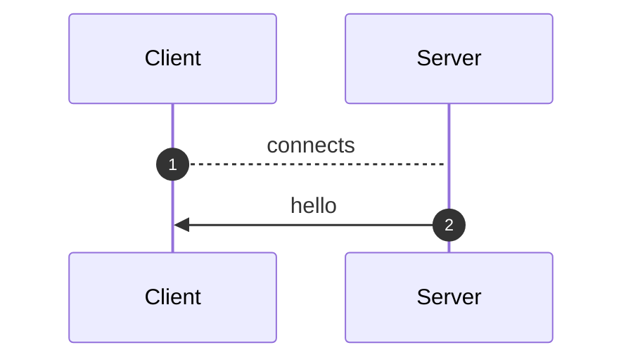
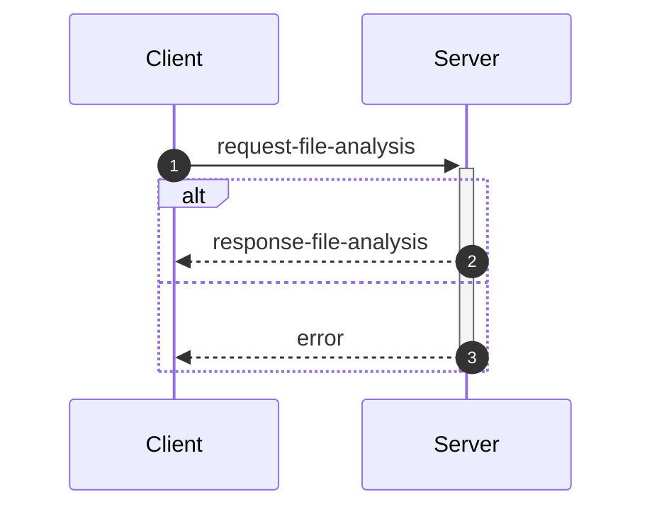
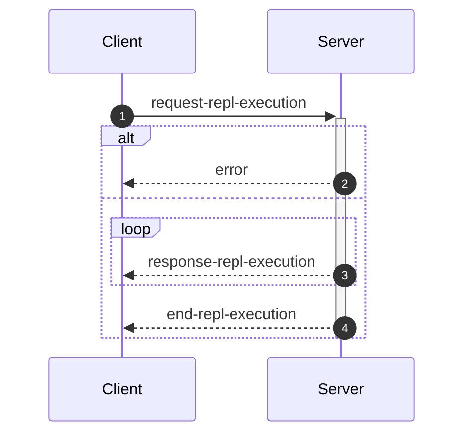
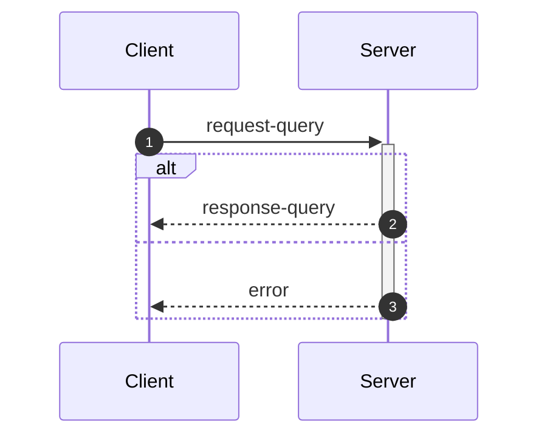

_<span title="an overview of flowR's interface">Generated</span> from '[wiki-interface.ts](https://github.com/flowr-analysis/flowr/tree/main/src/documentation/wiki-interface.ts "src/documentation/wiki-interface.ts")' on 2026-11-09, 06:01:56 UTC (v2.17.5, R v4.6.1), do not edit directly._

Although far from being as detailed as the in-depth explanation of [_flowR_](https://github.com/flowr-analysis/flowr/wiki/Core),
this wiki page explains how to interface with _flowR_ in more detail.
In general, command line arguments and other options provide short descriptions on hover over.

* [💻 Using the REPL](#using-the-repl)
* [⚙️ Configuring FlowR](#configuring-flowr)
* [⚒️ Writing Code](#writing-code)
* [💬 Communicating with the Server](#communicating-with-the-server)

<a id='using-the-repl'></a>
## 💻 Using the REPL

> [!NOTE]
> To execute arbitrary R commands with a repl request, _flowR_ has to be started explicitly with <span title="Description (Command Line Argument): Allow to access the underlying R session when using flowR (security warning: this allows the execution of arbitrary R code!)">`--r-session-access`</span>.
> Please be aware that this introduces a security risk and note that this relies on the [`r-shell` engine](https://github.com/flowr-analysis/flowr/wiki/Engines) .

Although primarily meant for users to explore,
there is nothing which forbids calling _flowR_ as a subprocess to use standard-in, -output, and -error
for communication (although you can access the REPL using the server as well,
with the [REPL Request](#message-request-repl-execution) message).

The read-eval-print loop&nbsp;(REPL) works relatively simple.
You can submit an expression (using <kbd>Enter</kbd>),
which is interpreted as an R&nbsp;expression by default but interpreted as a *command* if it starts with a colon (`:`).
The best command to get started with the REPL is <span title="Description (Repl Command): Show help information (aliases: :h, :?)">`:help`</span>.
Besides, you can leave the REPL either with the command <span title="Description (Repl Command): End the repl (aliases: :q, :exit)">`:quit`</span> or by pressing <kbd>Ctrl</kbd>+<kbd>C</kbd> twice.
When writing a *command*, you may press <kbd>Tab</kbd> to get a list of completions, if available.
Multiple commands can be entered in a single line by separating them with a semicolon (`;`), e.g. `:parse "x<-2"; :df*`.
If a command is given without R code, the REPL will re-use R code given in a previous command.
The prior example will hence return first the parsed AST of the program and then the dataflow graph for `"x <- 2"`.

> [!NOTE]
> If you develop flowR, you may want to launch the repl using the `npm run main-dev` command, this way, you get a non-minified version of flowR with debug information and hot-reloading of source files.

<details>
<summary>Available Commands</summary>

We currently offer the following commands (this with a `[*]` suffix are available with and without the star):

| Command | Description |
| ------- | ----------- |
| **<span title="Description (Repl Command): End the repl (aliases: :q, :exit)">:quit</span>** | End the repl (aliases: **:<span title="Alias of ':quit'. End the repl">q</span>**, **:<span title="Alias of ':quit'. End the repl">exit</span>**) |
| **<span title="Description (Repl Command): Execute the given code as R code. This requires the `--r-session-access` flag to be set and requires the r-shell engine. (aliases: :e, :r)">:execute</span>** | Execute the given code as R code. This requires the `--r-session-access` flag to be set and requires the r-shell engine. (aliases: **:<span title="Alias of ':execute'. Execute the given code as R code. This requires the `--r-session-access` flag to be set and requires the r-shell engine.">e</span>**, **:<span title="Alias of ':execute'. Execute the given code as R code. This requires the `--r-session-access` flag to be set and requires the r-shell engine.">r</span>**) |
| **<span title="Description (Repl Command): Get mermaid code for the control-flow graph of R code (aliases: :cfg, :cf)">:controlflow[*]</span>** | Get mermaid code for the control-flow graph of R code (star: Returns the URL to mermaid.live) (aliases: **:<span title="Alias of ':controlflow'. Get mermaid code for the control-flow graph of R code">cfg</span>**, **:<span title="Alias of ':controlflow'. Get mermaid code for the control-flow graph of R code">cf</span>**) |
| **<span title="Description (Repl Command): Get mermaid code for the control-flow graph with basic blocks (aliases: :cfgb, :cfb)">:controlflowbb[*]</span>** | Get mermaid code for the control-flow graph with basic blocks (star: Returns the URL to mermaid.live) (aliases: **:<span title="Alias of ':controlflowbb'. Get mermaid code for the control-flow graph with basic blocks">cfgb</span>**, **:<span title="Alias of ':controlflowbb'. Get mermaid code for the control-flow graph with basic blocks">cfb</span>**) |
| **<span title="Description (Repl Command): Get mermaid code for the dataflow graph (aliases: :d, :df)">:dataflow[*]</span>** | Get mermaid code for the dataflow graph (star: Returns the URL to mermaid.live) (aliases: **:<span title="Alias of ':dataflow'. Get mermaid code for the dataflow graph">d</span>**, **:<span title="Alias of ':dataflow'. Get mermaid code for the dataflow graph">df</span>**) |
| **<span title="Description (Repl Command): Get mermaid code for the normalized AST of R code (aliases: :n)">:normalize[*]</span>** | Get mermaid code for the normalized AST of R code (star: Returns the URL to mermaid.live) (alias: **:<span title="Alias of ':normalize'. Get mermaid code for the normalized AST of R code">n</span>**) |
| **<span title="Description (Repl Command): Get mermaid code for the simplified dataflow graph (aliases: :ds, :dfs)">:dataflowsimple[*]</span>** | Get mermaid code for the simplified dataflow graph (star: Returns the URL to mermaid.live) (aliases: **:<span title="Alias of ':dataflowsimple'. Get mermaid code for the simplified dataflow graph">ds</span>**, **:<span title="Alias of ':dataflowsimple'. Get mermaid code for the simplified dataflow graph">dfs</span>**) |
| **<span title="Description (Repl Command): Inspect and extend the signature database: `query` (identical to :query @signature), `info <name>` for where a function comes from (identical to :query @function-info), `add <path>` to mount another database/source, `download` to fetch the full-history database. (aliases: :sig)">:signature</span>** | Inspect and extend the signature database: `query` (identical to :query @signature), `info <name>` for where a function comes from (identical to :query @function-info), `add <path>` to mount another database/source, `download` to fetch the full-history database. (alias: **:<span title="Alias of ':signature'. Inspect and extend the signature database: `query` (identical to :query @signature), `info <name>` for where a function comes from (identical to :query @function-info), `add <path>` to mount another database/source, `download` to fetch the full-history database.">sig</span>**) |
| **<span title="Description (Repl Command): Just calculates the DFG, but only prints summary info (aliases: :d#, :df#)">:dataflowsilent</span>** | Just calculates the DFG, but only prints summary info (aliases: **:<span title="Alias of ':dataflowsilent'. Just calculates the DFG, but only prints summary info">d#</span>**, **:<span title="Alias of ':dataflowsilent'. Just calculates the DFG, but only prints summary info">df#</span>**) |
| **<span title="Description (Repl Command): Prints ASCII Art of the parsed, unmodified AST (aliases: :p)">:parse</span>** | Prints ASCII Art of the parsed, unmodified AST (alias: **:<span title="Alias of ':parse'. Prints ASCII Art of the parsed, unmodified AST">p</span>**) |
| **<span title="Description (Repl Command): Prints the version of flowR as well as the current version of R">:version</span>** | Prints the version of flowR as well as the current version of R
| **<span title="Description (Repl Command): Query the given R code (use 'help' for more information)">:query[*]</span>** | Query the given R code (use 'help' for more information) (star: Similar to query, but returns the output in json format.)
| **<span title="Description (Repl Command): Returns an ASCII representation of the dataflow graph (aliases: :df!)">:dataflowascii</span>** | Returns an ASCII representation of the dataflow graph (alias: **:<span title="Alias of ':dataflowascii'. Returns an ASCII representation of the dataflow graph">df!</span>**) |
| **<span title="Description (Repl Command): Returns summarization stats for the normalized AST (aliases: :n#)">:normalize#</span>** | Returns summarization stats for the normalized AST (alias: **:<span title="Alias of ':normalize#'. Returns summarization stats for the normalized AST">n#</span>**) |
| **<span title="Description (Repl Command): Show help information (aliases: :h, :?)">:help</span>** | Show help information (aliases: **:<span title="Alias of ':help'. Show help information">h</span>**, **:<span title="Alias of ':help'. Show help information">?</span>**) |

</details>

> [!TIP]
> 
> As indicated by the examples before, all REPL commands that operate on code keep track of the state.
> Hence, if you run a command like <span title="Description (Repl Command, starred version): Returns the URL to mermaid.live; Base Command: Get mermaid code for the dataflow graph (aliases: :d*, :df*)">`:dataflow*`</span> without providing R code,
> the REPL will re-use the R code provided in a previous command.
> Likewise, doing this will benefit from incrementality!
> If you request the dataflow graph with `:df* x <- 2 * y` and then want to see the parsed AST with `:parse`,
> the REPL will re-use previously obtained information and not re-parse the code again.
> 		

Generally, many commands offer shortcut versions in the REPL. Many queries, for example, offer a shortened format (see the example below).
Of special note, the [Config Query](https://github.com/flowr-analysis/flowr/wiki/%5BQuery%5D-Config)
can be used to also modify the currently active configuration of _flowR_ within the REPL (see the [wiki page](https://github.com/flowr-analysis/flowr/wiki/%5BQuery%5D-Config) for more information).

### Example: Retrieving the Dataflow Graph

To retrieve a URL to the [mermaid](https://mermaid.js.org/) diagram of the dataflow of a given expression,
use <span title="Description (Repl Command, starred version): Returns the URL to mermaid.live; Base Command: Get mermaid code for the dataflow graph (aliases: :d*, :df*)">`:dataflow*`</span> (or <span title="Description (Repl Command): Get mermaid code for the dataflow graph (aliases: :d, :df)">`:dataflow`</span> to get the mermaid code in the cli):

```shell
$ docker run -it --rm eagleoutice/flowr # or npm run flowr 
flowR repl v2.17.5, R grammar v14 (tree-sitter engine)
R> :dataflow* y <- 1 + x
```

<details>
<summary style='color:gray'>Output</summary>

```text
https://mermaid.live/view#base64:eyJjb2RlIjoiZmxvd2NoYXJ0IFREXG4gICAgMXt7XCJgKiM5MTtSTnVtYmVyIzkzOyogKioxKipcbiAgICAgICoxLjYqICgqKmlkOiAxKiopYFwifX1cbiAgICAyKFtcImAqIzkxO1JTeW1ib2wjOTM7KiAqKngqKlxuICAgICAgKjEuMTAqICgqKmlkOiAyKiopYFwiXSlcbiAgICAzW1tcImAqIzkxO1JCaW5hcnlPcCM5MzsqIGJhc2UjNTg7IzU4OyoqIzQzOyoqXG4gICAgICAqMS42LTEwKiAoKippZDogMyoqKVxuICAgIGFyZzogKDEsIDIpYFwiXV1cbiAgICBidWlsdC1pbjpfNDNfW1wiYEJ1aWx0LUluOlxuIzQzO2BcIl1cbiAgICBzdHlsZSBidWlsdC1pbjpfNDNfIHN0cm9rZTpncmF5LGZpbGw6Z3JheSxzdHJva2Utd2lkdGg6MnB4LG9wYWNpdHk6Ljg7XG4gICAgMFtcImAqIzkxO1JTeW1ib2wjOTM7KiAqKnkqKlxuICAgICAgKjEuMSogKCoqaWQ6IDAqKiwgdjogMylgXCJdXG4gICAgNFtbXCJgKiM5MTtSQmluYXJ5T3AjOTM7KiBiYXNlIzU4OyM1ODsqKiM2MDsjNDU7KipcbiAgICAgICoxLjEtMTAqICgqKmlkOiA0KiopXG4gICAgYXJnOiAoMCwgMylgXCJdXVxuICAgIGJ1aWx0LWluOl82MF8tW1wiYEJ1aWx0LUluOlxuIzYwOyM0NTtgXCJdXG4gICAgc3R5bGUgYnVpbHQtaW46XzYwXy0gc3Ryb2tlOmdyYXksZmlsbDpncmF5LHN0cm9rZS13aWR0aDoycHgsb3BhY2l0eTouODtcbiAgICAxIC0uLT58XCJmbG93XCJ8IDJcbiAgICBsaW5rU3R5bGUgMCBzdHJva2U6Z3JheSxjb2xvcjpncmF5O1xuICAgIDIgLS4tPnxcImZsb3dcInwgM1xuICAgIGxpbmtTdHlsZSAxIHN0cm9rZTpncmF5LGNvbG9yOmdyYXk7XG4gICAgMyAtLT58XCJyZWFkcywgYXJnXCJ8IDFcbiAgICAzIC0tPnxcInJlYWRzLCBhcmdcInwgMlxuICAgIDMgLS4tPnxcImZsb3dcInwgMFxuICAgIGxpbmtTdHlsZSA0IHN0cm9rZTpncmF5LGNvbG9yOmdyYXk7XG4gICAgMyAtLi0+fFwicmVhZHMsIGNhbGxzXCJ8IGJ1aWx0LWluOl80M19cbiAgICBsaW5rU3R5bGUgNSBzdHJva2U6Z3JheTtcbiAgICAwIC0tPnxcImRlZmluZWQtYnksIGZsb3dcInwgNFxuICAgIDAgLS0+fFwiZGVmaW5lZC1ieVwifCAzXG4gICAgNCAtLT58XCJyZWFkcywgYXJnXCJ8IDNcbiAgICA0IC0tPnxcInJldHVybnMsIGFyZ1wifCAwXG4gICAgNCAtLi0+fFwicmVhZHMsIGNhbGxzXCJ8IGJ1aWx0LWluOl82MF8tXG4gICAgbGlua1N0eWxlIDEwIHN0cm9rZTpncmF5OyIsIm1lcm1haWQiOnsiYXV0b1N5bmMiOnRydWV9fQ==
```

Retrieve the dataflow graph of the expression `y <- 1 + x`. It looks like this:


<details>

<summary style="color:gray">R Code of the Dataflow Graph</summary>

The analysis ran (parse and normalize with the [tree-sitter](https://github.com/flowr-analysis/flowr/wiki/Engines) engine) in the generation environment. No [signature database](https://github.com/flowr-analysis/flowr/wiki/Signature-Database) is mounted, so `library()` attaches no exports (base-R names are still qualified, e.g., `stats::acf`). 
We encountered no unknown side effects during the analysis.

```r
y <- 1 + x
```

</details>

</details>

For small graphs like this, <span title="Description (Repl Command): Returns an ASCII representation of the dataflow graph (aliases: :df!)">`:dataflowascii`</span> also provides an ASCII representation directly in the REPL:

```shell
$ docker run -it --rm eagleoutice/flowr # or npm run flowr 
flowR repl v2.17.5, R grammar v14 (tree-sitter engine)
R> :df! y <- 1 + x
```

<details open>
<summary style='color:gray'>Output</summary>

```text
                        v<0>v
 c<4>c──────────────────| y |
 |<- |     ┌────────────v---v
 c---c     │
    │   c<3>c   0<1>0
    └───| + |───| 1 |───u<2>u
        c---c   0---0   | x |
           └────────────u---u
Edges:
3 -> 1: reads, arg          3 -> 2: reads, arg
3 -> 0: flows-to            1 -> 2: flows-to
2 -> 3: flows-to            4 -> 3: reads, arg
4 -> 0: returns, arg        0 -> 4: defined-by, flows-to
0 -> 3: defined-by
```

Retrieve the dataflow graph of the expression `y <- 1 + x` as ASCII art.

</details>

For the slicing with <span title="Description (Repl Command): Static backwards executable slicer for R">`:slicer`</span>, you have access to the same [magic comments](#slice-magic-comments) as with the [slice request](#message-request-slice).
Pass `--inline` to splice resolvable `source()` calls into the reconstruction so the slice is a single self-contained R text (the same as the static slice query's `inlineSources` flag).
See `--help` for more flags!

### Example: Interfacing with the File System

Many commands that allow for an R-expression (like <span title="Description (Repl Command, starred version): Returns the URL to mermaid.live; Base Command: Get mermaid code for the dataflow graph (aliases: :d*, :df*)">`:dataflow*`</span>) allow for a file as well
if the argument starts with `file://`.
If you are working from the root directory of the _flowR_ repository, the following gives you the parsed AST of the example file using the <span title="Description (Repl Command): Prints ASCII Art of the parsed, unmodified AST (aliases: :p)">`:parse`</span> command:

> **Watch mode**: Replace `file://` with `watch://` to enter watch mode.
> flowR runs the command immediately and then re-runs it every time the file (or any file inside the folder) changes.
> Enter any other command to leave watch mode.
> For example: `:df watch://analysis.R`

```shell
$ docker run -it --rm eagleoutice/flowr # or npm run flowr 
flowR repl v2.17.5, R grammar v14 (tree-sitter engine)
R> :parse file://test/testfiles/example.R
```

<details>
<summary style='color:gray'>Output</summary>

```text
File: test/testfiles/example.R

program
├ binaryoperator
│ ├ identifier "sum" (1:1─4)
│ ├ <- "<-" (1:5─7)
│ ╰ float "0" (1:8─9)
├ binaryoperator
│ ├ identifier "product" (2:1─8)
│ ├ <- "<-" (2:9─11)
│ ╰ float "1" (2:12─13)
├ binaryoperator
│ ├ identifier "w" (3:1─2)
│ ├ <- "<-" (3:3─5)
│ ╰ float "7" (3:6─7)
├ binaryoperator
│ ├ identifier "N" (4:1─2)
│ ├ <- "<-" (4:3─5)
│ ╰ float "10" (4:6─8)
├ forstatement
│ ├ for "for" (6:1─4)
│ ├ ( "(" (6:5─6)
│ ├ identifier "i" (6:6─7)
│ ├ in "in" (6:8─10)
│ ├ binaryoperator
│ │ ├ float "1" (6:11─12)
│ │ ├ : ":" (6:12─13)
│ │ ╰ parenthesizedexpression
│ │   ├ ( "(" (6:13─14)
│ │   ├ binaryoperator
│ │   │ ├ identifier "N" (6:14─15)
│ │   │ ├ - "-" (6:15─16)
│ │   │ ╰ float "1" (6:16─17)
│ │   ╰ ) ")" (6:17─18)
│ ├ ) ")" (6:18─19)
│ ╰ bracedexpression
│   ├ { "{" (6:20─21)
│   ├ binaryoperator
│   │ ├ identifier "sum" (7:3─6)
│   │ ├ <- "<-" (7:7─9)
│   │ ╰ binaryoperator
│   │   ├ binaryoperator
│   │   │ ├ identifier "sum" (7:10─13)
│   │   │ ├ + "+" (7:14─15)
│   │   │ ╰ identifier "i" (7:16─17)
│   │   ├ + "+" (7:18─19)
│   │   ╰ identifier "w" (7:20─21)
│   ├ binaryoperator
│   │ ├ identifier "product" (8:3─10)
│   │ ├ <- "<-" (8:11─13)
│   │ ╰ binaryoperator
│   │   ├ identifier "product" (8:14─21)
│   │   ├  "" (8:22─23)
│   │   ╰ identifier "i" (8:24─25)
│   ╰ } "}" (9:1─2)
├ call
│ ├ identifier "cat" (11:1─4)
│ ╰ arguments
│   ├ ( "(" (11:4─5)
│   ├ argument
│   │ ╰ string
│   │   ├ stringopen "\"" (11:5─6)
│   │   ├ stringcontent "Sum:" (11:6─10)
│   │   ╰ stringclose "\"" (11:10─11)
│   ├ comma "," (11:11─12)
│   ├ argument
│   │ ╰ identifier "sum" (11:13─16)
│   ├ comma "," (11:16─17)
│   ├ argument
│   │ ╰ string
│   │   ├ stringopen "\"" (11:18─19)
│   │   ├ stringcontent
│   │   │ ╰ escapesequence "\\n" (11:19─21)
│   │   ╰ stringclose "\"" (11:21─22)
│   ╰ ) ")" (11:22─23)
╰ call
  ├ identifier "cat" (12:1─4)
  ╰ arguments
    ├ ( "(" (12:4─5)
    ├ argument
    │ ╰ string
    │   ├ stringopen "\"" (12:5─6)
    │   ├ stringcontent "Product:" (12:6─14)
    │   ╰ stringclose "\"" (12:14─15)
    ├ comma "," (12:15─16)
    ├ argument
    │ ╰ identifier "product" (12:17─24)
    ├ comma "," (12:24─25)
    ├ argument
    │ ╰ string
    │   ├ stringopen "\"" (12:26─27)
    │   ├ stringcontent
    │   │ ╰ escapesequence "\\n" (12:27─29)
    │   ╰ stringclose "\"" (12:29─30)
    ╰ ) ")" (12:30─31)
```

Retrieve the parsed AST of the example file.

<details>

<summary>File Content</summary>

```r
sum <- 0
product <- 1
w <- 7
N <- 10

for (i in 1:(N-1)) {
  sum <- sum + i + w
  product <- product * i
}

cat("Sum:", sum, "\n")
cat("Product:", product, "\n")
```

</details>

As _flowR_ directly transforms this AST the output focuses on being human-readable instead of being machine-readable.
		
</details>

### Example: Run a Query

You can run any query supported by _flowR_ using the <span title="Description (Repl Command): Query the given R code (use 'help' for more information)">`:query`</span> command.
For example, to obtain the shapes of all data frames in a given piece of code, you can run:

```shell
$ docker run -it --rm eagleoutice/flowr # or npm run flowr 
flowR repl v2.17.5, R grammar v14 (tree-sitter engine)
R> :query @absint df-shape "x <- data.frame(a = 1:10, b = 1:10)\ny <- x$a"
```

<details open>
<summary style='color:gray'>Output</summary>

```text
Query: absint (2 ms)
   ╰ $12: (colnames: [{"a", "b"}, {}], cols: [2, 2], rows: [10, 10])
   ╰ $0: (colnames: [{"a", "b"}, {}], cols: [2, 2], rows: [10, 10])
```

Retrieve the shapes of all data frames in the given code.

</details>

To run the linter on a file, you can use (in this example, we just issue the `dead-code` linter on a small piece of code):

```shell
$ docker run -it --rm eagleoutice/flowr # or npm run flowr 
flowR repl v2.17.5, R grammar v14 (tree-sitter engine)
R> :query @linter rules:dead-code "if(FALSE) x <- 2"
```

<details open>
<summary style='color:gray'>Output</summary>

```text
Query: linter (3 ms)
   ╰ Dead Code (dead-code):
       ╰ certain:
           ╰ Code at 1.11-16 (1 quick fix(es) available)
```

Run the linter on the given code, with only the `dead-code` rule enabled.

</details>

For more information on the available queries, please check out the [Query API](https://github.com/flowr-analysis/flowr/wiki/Query-API).

<a id='configuring-flowr'></a>
## ⚙️ Configuring FlowR

When running _flowR_, you may want to specify some behaviors with a dedicated configuration file.
By default, flowR looks for a file named `flowr.json` in the current working directory (or any higher directory).
You can also specify a different file with <span title="Description (Command Line Argument): The name of the configuration file to use">`--config-file`</span> or pass the configuration inline using <span title="Description (Command Line Argument): The flowR configuration to use, as a JSON string">`--config-json`</span>.
A `flowr.json` found this way belongs to the analyzed project, so flowR ignores its options that decide what flowR executes or loads
(`engines.*.wasmPath`, `engines.*.treeSitterWasmPath`, `engines.*.rPath`, `solver.sigdb.additionalPaths`, `solver.sigdb.downloadRepo`, `solver.sigdb.installedLibrary.paths`, `solver.sigdb.onDemand.enabled`, `solver.sigdb.onDemand.repositories`, `solver.sigdb.onDemand.cranMirror`, `solver.sigdb.onDemand.bioconductorMirror`, `solver.sigdb.onDemand.cacheDir`),
unless you pass <span title="Description (Command Line Argument): Keep the security-sensitive options (e.g., the R executable) of the flowr.json found in the working directory or a parent. Only use this for projects you trust.">`--trust-config`</span>.
To analyze code you do not trust, use the secure mode (<span title="Description (Command Line Argument): Run in secure mode for analyzing untrusted code: flowR does not start R (or any other process), does not access the network, does not search for project configs, and ignores security-sensitive options in every config. Cannot be disabled once enabled. Can also be enabled with the environment variable {italic FLOWR_SECURE_MODE=1}.">`--secure`</span>, see the [security policy](https://github.com/flowr-analysis/flowr/blob/main/.github/SECURITY.md)).
To inspect the current configuration, you can run flowr with the <span title="Description (Command Line Argument): Run with verbose logging (will be passed to the corresponding script)">`--verbose`</span> flag, or use the `config` [Query](https://github.com/flowr-analysis/flowr/wiki/Query-API).
Within the REPL this works by running the following:

```shell
:query @config
```

To work with the <a href="https://github.com/flowr-analysis/flowr/tree/main/src/config.ts#L125"><code><span title="The configuration file format for flowR.">FlowrConfig</span></code></a> you can use the provided helper objects alongside its methods like
<a href="https://github.com/flowr-analysis/flowr/tree/main/src/config.ts#L991"><code><span title="Creates a new flowr config that has the updated values.">FlowrConfig::<b>amend</b></span></code></a>.
The schema below documents every option; the ones you most likely want are:

- <a href="https://github.com/flowr-analysis/flowr/wiki/Interface#configuring-flowr" title="Configuration Option (boolean): Whether source calls should be ignored, causing {@link processSourceCall}&#39;s behavior to be skipped.">ignoreSourceCalls</a>: ignore source calls when analyzing the code, i.e., ignore the inclusion of other files.
- <a href="https://github.com/flowr-analysis/flowr/wiki/Interface#configuring-flowr" title="Configuration Option (boolean): Whether load calls should be ignored, causing {@link processLoadCall}&#39;s behavior to be skipped.">ignoreLoadCalls</a>: ignore load calls when analyzing the code, i.e., ignore the loading of r-data files.
- <a href="https://github.com/flowr-analysis/flowr/wiki/Interface#configuring-flowr" title="Configuration Option (object): Do you want to overwrite (parts) of the builtin definition?">semantics.environment.overwriteBuiltIns</a>: overwrite _flowR_'s handling of built-in functions, or clear the preset definitions entirely.
  See [Configure BuiltIn Semantics](#configure-builtin-semantics) for more information.
- <a href="https://github.com/flowr-analysis/flowr/wiki/Interface#configuring-flowr" title="Configuration Option (boolean): Whether calls drawing on a graphics device (e.g., `plot`) count as writing to it, which the ambient state queries then report.">semantics.ambient.drawingWritesDevice</a>: whether calls drawing on a graphics device (e.g., `plot`) count as writing the device in the ambient state queries.
- <a href="https://github.com/flowr-analysis/flowr/wiki/Interface#configuring-flowr" title="Configuration Option (string): How to resolve variables and their values. (one of &quot;disabled&quot;, &quot;alias&quot;, &quot;builtin&quot;)">solver.variables</a>: how to resolve variables and their values (`disabled`, `alias`, `builtin`).
- <a href="https://github.com/flowr-analysis/flowr/wiki/Interface#configuring-flowr" title="Configuration Option (array): The engine or set of engines to use for interacting with R code. An empty array means all available engines will be used.">engines</a> and <a href="https://github.com/flowr-analysis/flowr/wiki/Interface#configuring-flowr" title="Configuration Option (string): The default engine to use for interacting with R code. If this is undefined, an arbitrary engine from the specified list will be used. (one of &quot;tree-sitter&quot;, &quot;r-shell&quot;)">defaultEngine</a>: the engines used to interact with R code, see the [Engines wiki page](https://github.com/flowr-analysis/flowr/wiki/Engines).
- <a href="https://github.com/flowr-analysis/flowr/wiki/Interface#configuring-flowr" title="Configuration Option (array): Files a framework loads on its own, without any source() call (e.g. global.R in a shiny app), in the order they are loaded; flowR orders the matching project files accordingly and analyzes them as one program. Entries are case-insensitive globs matched against the file path, a plain name matches any file with that name, and entries matching no project file are warned about. Usually set per project kind via specializeConfig.">project.implicitSources</a>: the files a framework loads without any `source()` call, in the order in which they are
  loaded. Entries are globs (e.g. `R/*.R`) matched against the file path ignoring capitalization; one matching no file is reported.
- <a href="https://github.com/flowr-analysis/flowr/wiki/Interface#configuring-flowr" title="Configuration Option (object): Overwrite (parts of) the configuration depending on the project kind flowR detects, e.g. to give a shiny app its implicit sources.">specializeConfig</a>: overwrite (parts of) the configuration depending on the kind of project _flowR_ detects
  (e.g. `shiny-app`), which is how a shiny app gets its implicit sources by default. What you configure directly wins.
- <a href="https://github.com/flowr-analysis/flowr/wiki/Interface#configuring-flowr" title="Configuration Option (string): Overwrite the project kind flowR would otherwise infer from the analyzed files, e.g. when auto-detection guesses wrong. (one of &quot;package&quot;, &quot;script&quot;, &quot;shiny-app&quot;, &quot;notebook&quot;, &quot;project&quot;, &quot;unknown&quot;)">project.useProjectType</a>: skip that detection and force a project kind yourself, when auto-detection guesses wrong.
- <a href="https://github.com/flowr-analysis/flowr/wiki/Interface#configuring-flowr" title="Configuration Option (array): The default plugins to load when creating a new instance of FlowrAnalyzer">defaultPlugins</a> and <a href="https://github.com/flowr-analysis/flowr/wiki/Interface#configuring-flowr" title="Configuration Option (array): The plugins to load in REPL mode">repl.plugins</a>: the plugins to load for a new <a href="https://github.com/flowr-analysis/flowr/tree/main/src/project/flowr-analyzer.ts#L240"><code><span title="Central class for conducting analyses with FlowR. Use the FlowrAnalyzerBuilder to create a new instance. If you want the original pattern of creating a pipeline and running all steps, you can still do this with FlowrAnalyzer#runFull . To inspect the context of the analyzer, use FlowrAnalyzer#inspectContext (if you are a plugin and need to modify it, use FlowrAnalyzer#context instead).">FlowrAnalyzer</span></code></a> and in the REPL
  (use `flowr:default` to reference the former).

So you can configure _flowR_ by adding a file like the following:

<details>

<summary>Example Configuration File</summary>

```json
{
  "ignoreSourceCalls": true,
  "ignoreLoadCalls": true,
  "semantics": {
    "environment": {
      "overwriteBuiltIns": {
        "definitions": [
          {
            "type": "function",
            "names": [
              "foo"
            ],
            "processor": "builtin:assign",
            "config": {}
          }
        ]
      }
    }
  },
  "defaultPlugins": [
    "file:description",
    "versions:description"
  ],
  "repl": {
    "quickStats": false,
    "dfProcessorHeat": false,
    "hints": true,
    "plugins": [
      "flowr:default"
    ]
  },
  "project": {
    "resolveUnknownPathsOnDisk": true,
    "implicitSources": [
      "global.R",
      "app.R"
    ]
  },
  "linter": {
    "disabledRules": []
  },
  "specializeConfig": {
    "shiny-app": {
      "project": {
        "implicitSources": [
          "global.R",
          "ui.R",
          "server.R",
          "app.R"
        ]
      }
    }
  },
  "engines": [
    {
      "type": "r-shell"
    }
  ],
  "solver": {
    "variables": "alias",
    "evalStrings": true,
    "trackEnvironments": true,
    "sigdb": {
      "enabled": true,
      "loadProjectDependencies": true,
      "eagerlyLoad": false,
      "eagerlyLoadExports": false,
      "linkBaseR": false,
      "linkDescriptionDependencies": false
    },
    "resolveSource": {
      "dropPaths": "no",
      "ignoreCapitalization": true,
      "inferWorkingDirectory": "active-script",
      "searchPath": []
    },
    "instrument": {},
    "slicer": {
      "threshold": 50
    }
  },
  "abstractInterpretation": {
    "wideningThreshold": 4,
    "followCalls": true,
    "dataFrame": {
      "maxColNames": 20,
      "readLoadedData": {
        "readExternalFiles": true,
        "maxReadLines": 1000000
      }
    }
  },
  "incremental": {
    "alwaysIncremental": false,
    "parsing": {
      "activated": false,
      "heuristics": {
        "activated": true,
        "mtime": true,
        "linesFrom": 500,
        "bytesFrom": 50000,
        "alwaysWithEdits": false,
        "minFiles": 1
      }
    }
  },
  "gas": {
    "thresholds": {
      "memory": {
        "problematic": 0.7,
        "critical": 0.9
      },
      "timeMs": {
        "problematic": 100000,
        "critical": 120000
      }
    },
    "features": {}
  }
}
```

</details>

<details>
<a id='configure-builtin-semantics'></a>
<summary>Configure Built-In Semantics</summary>

`semantics/environment/overwriteBuiltins` accepts two keys:

- `loadDefaults` (boolean, initially `true`): If set to `true`, the default built-in definitions are loaded before applying the custom definitions. Setting this flag to `false` explicitly disables the loading of the default definitions.
- `definitions` (array, initially empty): Allows to overwrite or define new built-in elements. Each object within must have a `type` which is one of the below. Furthermore, they may define a string array of `names` which specifies the identifiers to bind the definitions to. You may use `assumePrimitive` to specify whether _flowR_ should assume that this is a primitive non-library definition (so you probably just do not want to specify the key).

  | Type            | Description                                                                                                                                                                                                                                                                                              | Example                                                                                                    |
  | --------------- | -------------------------------------------------------------------------------------------------------------------------------------------------------------------------------------------------------------------------------------------------------------------------------------------------------- | ---------------------------------------------------------------------------------------------------------- |
  | `constant`    | Additionally allows for a `value` this should resolve to.                                                                                                                                                                                                                                                | `{ type: 'constant', names: ['NULL', 'NA'],  value: null }`                                                |
  | `function`    | Is a rather flexible way to define and bind built-in functions. For the time, we do not have extensive documentation to cover all the cases, so please either consult the sources with the `default-builtin-config/` folder or open a [new issue](https://github.com/flowr-analysis/flowr/issues/new/choose). | `{ type: 'function', names: ['next'], processor: 'builtin:d', config: { cfg: ExitPointType.Next } }` |
  | `replacement` | A comfortable way to specify replacement functions like `$<-` or `names<-`. `suffixes` describes the... suffixes to attach automatically. | `{ type: 'replacement', suffixes: ['<-', '<<-'], names: ['[', '[['] }` |

</details>

<details>

<summary style='color:gray'>Full Configuration-File Schema</summary>

- _The configuration file format for flowR._ (object)
    - **logLevel** [optional] _flowR's global minimum log level, applied when the config is loaded._ (string)
        Only allows: 'silly', 'trace', 'debug', 'info', 'warn', 'error', 'fatal'
    - **ignoreSourceCalls** [optional] _Whether source calls should be ignored, causing {@link processSourceCall}'s behavior to be skipped._ (boolean)
    - **ignoreLoadCalls** [optional] _Whether load calls should be ignored, causing {@link processLoadCall}'s behavior to be skipped._ (boolean)
    - **semantics** _Configure language semantics and how flowR handles them._ (object)
        - **environment** [optional] _Semantics regarding how to handle the R environment._ (object)
            - **overwriteBuiltIns** [optional] _Do you want to overwrite (parts) of the builtin definition?_ (object)
                - **loadDefaults** [optional] _Should the default configuration still be loaded?_ (boolean)
                - **definitions** [optional] _The definitions to load/overwrite._ (array)
                Valid item types:
                    - (object)
        - **ambient** [optional] _Semantics regarding the global state (options, devices, files, ...) calls access._ (object)
            - **drawingWritesDevice** [optional] _Whether calls drawing on a graphics device (e.g., `plot`) count as writing to it, which the ambient state queries then report._ (boolean)
    - **defaultPlugins** [optional] _The default plugins to load when creating a new instance of FlowrAnalyzer_ (array)
    Valid item types:
        - (alternatives)
            - (string)
            - (array)
    - **repl** _Configuration options for the REPL._ (object)
        - **quickStats** [optional] _Whether to show quick stats in the REPL after each evaluation._ (boolean)
        - **dfProcessorHeat** [optional] _This instruments the dataflow processors to count how often each processor is called._ (boolean)
        - **hints** [optional] _Whether to show dim inline hints on the empty prompt (automatically disabled on non-interactive terminals)._ (boolean)
        - **plugins** [optional] _The plugins to load in REPL mode_ (array)
        Valid item types:
            - (alternatives)
                - (string)
                - (array)
        - **autoUseFileProtocol** [optional] _Prepend the file protocol to a repl input that looks like a path, instead of only warning about it._ (boolean)
        - **queryStats** [optional] _Whether `:query` closes with the line stating how long the queries took (`:query*` never prints it)._ (boolean)
        - **showPlugins** [optional] _Whether `:version` grays out the plugins that did not activate during the last analysis._ (boolean)
    - **project** _Project specific configuration options._ (object)
        - **resolveUnknownPathsOnDisk** [optional] _Whether to resolve unknown paths loaded by the r project disk when trying to source/analyze files._ (boolean)
        - **failOnInaccessiblePath** [optional] _Whether a directory that cannot be traversed during file discovery (e.g. due to permissions) aborts the analysis; when false (the default) such paths are logged and skipped._ (boolean)
        - **basePackages** [optional] _The packages considered part of R itself (base and recommended); if unset, flowR uses its built-in list._ (array)
        Valid item types:
            - (string)
        - **implicitSources** [optional] _Files a framework loads on its own, without any source() call (e.g. global.R in a shiny app), in the order they are loaded; flowR orders the matching project files accordingly and analyzes them as one program. Entries are case-insensitive globs matched against the file path, a plain name matches any file with that name, and entries matching no project file are warned about. Usually set per project kind via specializeConfig._ (array)
        Valid item types:
            - (string)
        - **useProjectType** [optional] _Overwrite the project kind flowR would otherwise infer from the analyzed files, e.g. when auto-detection guesses wrong._ (string)
            Only allows: 'package', 'script', 'shiny-app', 'notebook', 'project', 'unknown'
        - **assumeImplicitEcho** [optional] _Whether the top level of the analyzed code is echoed, so that every visible result printed there is collected as an output by the dependencies query (default true, false for a package)._ (boolean)
        - **discovery** [optional] _Scoping options for the default project discovery._ (object)
            - **full** [optional] _Collect every file below the project root (greedy) instead of only the files the detected project kind needs (default false)._ (boolean)
            - **perKind** [optional] _Per-kind include/exclude glob overrides layered on the default scoping._ (object)
            - **ignore** [optional] _Case-insensitive globs that drop matching files from the intelligent discovery, regardless of kind (e.g. .Renviron to ignore environment files)._ (array)
            Valid item types:
                - (string)
        - **classification** [optional] _Overrides for the signals flowR uses to classify the project kind._ (object)
            - **shinyDescriptionTypes** [optional] _DESCRIPTION Type: values that mark a shiny app._ (array)
            Valid item types:
                - (string)
            - **shinyEntryFiles** [optional] _File names a shiny app is assembled from._ (array)
            Valid item types:
                - (string)
            - **shinyUsagePattern** [optional] _Regex source evidencing shiny usage in an entry file._ (string)
            - **notebookExtensions** [optional] _File extensions marking a notebook._ (array)
            Valid item types:
                - (string)
    - **linter** _Linter configuration options._ (object)
        - **disabledRules** _Linting rule names excluded from the default rule set (a rule requested explicitly via a linter query still runs). Usually set per project kind via specializeConfig._ (array)
        Valid item types:
            - (string)
        - **disabledTags** [optional] _Linting rule tags whose rules are excluded from the default rule set (a rule requested explicitly via a linter query still runs). By default the cmd-check rules are disabled for everything but a package; a configured list replaces that default._ (array)
        Valid item types:
            - (string)
    - **inputSources** [optional] _Further frameworks the input-sources analysis should know about; entries are added to flowR's defaults._ (object)
        - **pure** [optional] _Functions that only pass the constantness of their arguments on._ (array)
        Valid item types:
            - (string)
        - **param** [optional] _Functions whose result is a 'param' input._ (array)
        Valid item types:
            - (string)
        - **file** [optional] _Functions whose result is a 'file' input._ (array)
        Valid item types:
            - (string)
        - **tempfile** [optional] _Functions whose result is a 'tempfile' input._ (array)
        Valid item types:
            - (string)
        - **glob** [optional] _Functions whose result is a 'glob' input._ (array)
        Valid item types:
            - (string)
        - **net** [optional] _Functions whose result is a 'net' input._ (array)
        Valid item types:
            - (string)
        - **rand** [optional] _Functions whose result is a 'rand' input._ (array)
        Valid item types:
            - (string)
        - **system** [optional] _Functions whose result is a 'system' input._ (array)
        Valid item types:
            - (string)
        - **ffi** [optional] _Functions whose result is a 'ffi' input._ (array)
        Valid item types:
            - (string)
        - **lang** [optional] _Functions whose result is a 'lang' input._ (array)
        Valid item types:
            - (string)
        - **options** [optional] _Functions whose result is a 'options' input._ (array)
        Valid item types:
            - (string)
        - **cmdline** [optional] _Functions whose result is a 'cmdline' input._ (array)
        Valid item types:
            - (string)
        - **user** [optional] _Functions whose result is a 'user' input._ (array)
        Valid item types:
            - (string)
        - **const** [optional] _Functions whose result is a 'const' input._ (array)
        Valid item types:
            - (string)
        - **scope** [optional] _Functions whose result is a 'scope' input._ (array)
        Valid item types:
            - (string)
        - **dconst** [optional] _Functions whose result is a 'dconst' input._ (array)
        Valid item types:
            - (string)
        - **unknown** [optional] _Functions whose result is a 'unknown' input._ (array)
        Valid item types:
            - (string)
        - **linkedObjects** [optional] _Objects a framework provides without a definition in the code, e.g. shiny's input._ (array)
        Valid item types:
            - (object)
        - **linkedEntryPoints** [optional] _Calls that hand a function to a framework, which binds its objects to the parameters by position._ (array)
        Valid item types:
            - (object)
    - **specializeConfig** [optional] _Overwrite (parts of) the configuration depending on the project kind flowR detects, e.g. to give a shiny app its implicit sources._ (object)
    - **engines** _The engine or set of engines to use for interacting with R code. An empty array means all available engines will be used._ (array)
    Valid item types:
        - (alternatives)
            - _The configuration for the tree sitter engine._ (object)
                - **type** [required] _Use the tree sitter engine._ (string)
                    Only allows: 'tree-sitter'
                - **wasmPath** [optional] _The path to the tree-sitter-r WASM binary to use. If this is undefined, this uses the default path._ (string)
                - **treeSitterWasmPath** [optional] _The path to the tree-sitter WASM binary to use. If this is undefined, this uses the default path._ (string)
                - **lax** [optional] _Whether to use the lax parser for parsing R code (allowing for syntax errors). If this is undefined, the strict parser will be used._ (boolean)
            - _The configuration for the R shell engine._ (object)
                - **type** [required] _Use the R shell engine._ (string)
                    Only allows: 'r-shell'
                - **rPath** [optional] _The path to the R executable to use. If this is undefined, this uses the default path._ (string)
                - **pipeBind** [optional] _Whether to enable R's experimental pipe-bind operator "=>" by setting _R_USE_PIPEBIND_ for the R session (default false); R itself keeps this off by default, as it is experimental and has never shipped in a release version of R._ (boolean)
    - **defaultEngine** [optional] _The default engine to use for interacting with R code. If this is undefined, an arbitrary engine from the specified list will be used._ (string)
        Only allows: 'tree-sitter', 'r-shell'
    - **solver** _How to resolve constants, constraints, cells, ..._ (object)
        - **variables** _How to resolve variables and their values._ (string)
            Only allows: 'disabled', 'alias', 'builtin'
        - **evalStrings** _Should we include eval(parse(text="...")) calls in the dataflow graph?_ (boolean)
        - **trackEnvironments** [optional] _Track user-created environments (new.env, assign/get/local with envir=, dollar-assign, attach). When false, all envir-style calls fall through conservatively._ (boolean)
        - **sigdb** _Resolving library exports from a signature database._ (object)
            - **enabled** [optional] _Resolve library()/use() exports from a signature database (default true); when false no database is consulted._ (boolean)
            - **loadProjectDependencies** [optional] _Load the project's declared dependencies from its metadata files (DESCRIPTION Imports/Depends, rproject.toml, uvr.toml, rig rproj.toml and script blocks, renv.lock, rv.lock, uvr.lock, rig lockfiles) (default true); when false these files are not read for dependencies._ (boolean)
            - **eagerlyLoad** [optional] _Parse the database up front rather than on the first package load (default false, ignored if disabled)._ (boolean)
            - **eagerlyLoadExports** [optional] _Add a vertex for every export on load rather than on demand (default false); keeps the dataflow graph small._ (boolean)
            - **assumedRVersion** [optional] _R version assumed when resolving versioned (base-R) exports: a pin like "4.5" or "auto" to detect the installed R (default "auto")._ (string)
            - **linkBaseR** [optional] _Eagerly attach base-R namespaces so bare base calls resolve without library() (default false)._ (boolean)
            - **linkBaseRCalls** [optional] _Add a lightweight Reads edge from a bare base-R call to its signature-database function vertex (default false; base-R qualification is edge-free otherwise)._ (boolean)
            - **linkPackageCalls** [optional] _Add a lightweight Reads edge from a resolved package call to its signature-database function vertex (default false)._ (boolean)
            - **linkDescriptionDependencies** [optional] _Eagerly attach the namespaces of the project's declared DESCRIPTION dependencies (Imports/Depends) so their exports resolve without an explicit library() (default false)._ (boolean)
            - **warmInBackground** [optional] _Decompress the hot shards (base + most-downloaded) in a background task on startup so the first library() lookup is warm (default false; for long-running servers/REPLs)._ (boolean)
            - **additionalPaths** [optional] _Extra directories or bundle/manifest files searched for signature databases (alongside the shipped default and $FLOWR_SIGDB_DIR); a downloaded full-history bundle placed here is mounted automatically._ (array)
            Valid item types:
                - (string)
            - **downloadRepo** [optional] _GitHub owner/repo the full-history bundle is downloaded from via ":signature download" (default "flowr-analysis/flowr"; the release tag comes from the committed sigdb.remote.json unless a version is given)._ (string)
            - **autoSync** [optional] _On startup, re-download shards whose committed sigdb.remote.json hash no longer matches the cache, in the background (default false; opt-in network sync after a git pull)._ (boolean)
            - **installedLibrary** [optional] _Recovering packages no signature database knows from the copy installed on this machine._ (object)
                - **enabled** [required] _Recover packages no signature database knows from their installed copy (default false)._ (boolean)
                - **paths** [optional] _Library directories to search; when empty they are discovered from the environment and the project._ (array)
                Valid item types:
                    - (string)
                - **useEnvironment** [optional] _Search the libraries R_LIBS_USER/R_LIBS/R_LIBS_SITE name (default true)._ (boolean)
                - **useProjectLibrary** [optional] _Search a project-local renv/packrat library (default true)._ (boolean)
                - **maxDepth** [optional] _How far to descend into the nested layout of a project-local library (default 3)._ (number)
                - **packages** [optional] _Only recover packages whose name matches one of these regular expressions; empty means any._ (array)
                Valid item types:
                    - (string)
            - **onDemand** [optional] _Recovering packages no signature database knows from their sources on CRAN, Bioconductor, or GitHub._ (object)
                - **enabled** [required] _Fetch and recover the sources of packages no signature database knows when the analyzed code uses them (default false, accesses the network)._ (boolean)
                - **sources** [optional] _Where to look, in order: github, cran, bioconductor, or a source a plugin adds (default ["github", "cran", "bioconductor"])._ (array)
                Valid item types:
                    - (string)
                - **repositories** [optional] _GitHub repositories (owner/repo[/subdir][@ref]) to fetch packages from, by package name. The analyzed project may name more (DESCRIPTION Remotes, install_github calls)._ (object)
                - **packages** [optional] _Only recover packages whose name matches one of these regular expressions, empty means any._ (array)
                Valid item types:
                    - (string)
                - **cranMirror** [optional] _The CRAN src/contrib/ to fetch from, over https (default https://cloud.r-project.org/src/contrib/). It may be on the local network._ (string)
                - **bioconductorMirror** [optional] _The Bioconductor host, over https (default https://bioconductor.org). It may be on the local network._ (string)
                - **bioconductorRelease** [optional] _The Bioconductor release to fetch from: release, devel, or a number like 3.20 (default release)._ (string)
                - **githubMirrors** [optional] _Use the GitHub mirrors of CRAN (cran/<pkg>) and Bioconductor (bioc/<pkg>) (default true)._ (boolean)
                - **maxPackages** [optional] _The most packages to fetch for one analysis (default 25)._ (number)
                - **maxArchiveMb** [optional] _The most MiB a package archive may have (default 32). It may unpack to three times that, at most 128 MiB._ (number)
                - **offline** [optional] _Only use what was fetched before, never the network (default false)._ (boolean)
                - **retryAfterHours** [optional] _How many hours to wait before asking again for a package no source had (default 24)._ (number)
                - **cacheDir** [optional] _Where to cache what was fetched (default the on-demand directory of the signature cache)._ (string)
            - **blobCacheBudgetMb** [optional] _How many MiB of decoded package blobs every open bundle may hold together (default 16)._ (number)
            - **versionSelection** [optional] _When a project constrains a dependency, resolve to the newest (default), oldest, or system-installed version satisfying it; system needs R and falls back to newest. Base-R packages always resolve against the assumed R version._ (string)
                Only allows: 'newest', 'oldest', 'system'
            - **versionOverrides** [optional] _Force an exact version for specific packages (name -> version), overriding both the project constraint and the versionSelection policy (default {})._ (object)
        - **versionManagement** _Policies for reasoning about dependency versions._ (object)
            - **linkedVersionGroups** [optional] _Groups of packages that must resolve to the same version; version guessing intersects each group so its members stay mutually compatible (default [])._ (array)
            Valid item types:
                - (array)
                Valid item types:
                    - (string)
        - **assumeAttachedPackages** [optional] _Packages to treat as attached without a `library()` call, so what the built-in configuration states about them applies to the analyzed code. The base packages R attaches on startup already resolve without it._ (array)
        Valid item types:
            - (string)
        - **transitiveSideEffectRounds** [optional] _How many rounds the transitive side-effect fixpoint may run before it is cut off (default 32); the propagation stops on its own as soon as a round adds nothing._ (number)
        - **maxOverlayDepth** [optional] _How many binding overlays may stack on one environment frame before a write flattens them (default 4); a pure performance knob, trading lookup cost against copy cost without changing any result._ (number)
        - **instrument** (object)
            - **dataflowExtractors** [optional] _These keys are only intended for use within code, allowing to instrument the dataflow analyzer!_ (any)
        - **resolveSource** [optional] _If lax source calls are active, flowR searches for sourced files much more freely, based on the configurations you give it. This option is only in effect if `ignoreSourceCalls` is set to false._ (object)
            - **dropPaths** _Allow to drop the first or all parts of the sourced path, if it is relative._ (string)
                Only allows: 'no', 'once', 'all'
            - **ignoreCapitalization** _Search for filenames matching in the lowercase._ (boolean)
            - **inferWorkingDirectory** _Try to infer the working directory from the main or any script to analyze._ (string)
                Only allows: 'no', 'main-script', 'active-script', 'any-script'
            - **searchPath** _Additionally search in these paths._ (array)
            Valid item types:
                - (string)
            - **repeatedSourceLimit** [optional] _How often the same file can be sourced within a single run? Please be aware: in case of cyclic sources this may not reach a fixpoint so give this a sensible limit._ (number)
            - **applyReplacements** _Provide name replacements for loaded files_ (array)
            Valid item types:
                - (object)
            - **assumeFilesExist** [optional] _Assume a sourced file is always there, making what it defines certain instead of conditional on the source call._ (boolean)
        - **slicer** [optional] _The configuration for the slicer._ (object)
            - **threshold** [optional] _The maximum number of iterations to perform on a single function call during slicing._ (number)
            - **autoExtend** [optional] _If set, the slicer will gain an additional post-pass._ (boolean)
    - **abstractInterpretation** _The configuration options for abstract interpretation._ (object)
        - **wideningThreshold** _The threshold for the number of visitations of a node at which widening should be performed to ensure the termination of the fixpoint iteration._ (number)
        - **followCalls** _Whether the abstract interpretation is interprocedural, i.e. whether it steps into the functions a call may dispatch to._ (boolean)
        - **dataFrame** _The configuration of the shape inference for data frames._ (object)
            - **maxColNames** _The maximum number of columns names to infer for data frames before over-approximating the column names to top._ (number)
            - **readLoadedData** _Configuration options for reading data frame shapes from loaded external data files, such as CSV files._ (object)
                - **readExternalFiles** _Whether data frame shapes should be extracted from loaded external files, such as CSV files._ (boolean)
                - **maxReadLines** _The maximum number of lines to read when extracting data frame shapes from loaded files, such as CSV files._ (number)
    - **incremental** (object)
        - **alwaysIncremental** _Always take the incremental path, regardless of heuristics._ (boolean)
        - **parsing** (object)
            - **activated** _If set, incremental parsing will be used._ (boolean)
            - **heuristics** (object)
                - **activated** [optional] _If set, the heuristics for incremental parsing will be used._ (boolean)
                - **mtime** [optional] _Skip reparsing entirely if the file's modification time is unchanged since the last parse._ (boolean)
                - **linesFrom** [optional] _Only consider incremental parsing for files with at least this many lines._ (number)
                - **bytesFrom** [optional] _Only consider incremental parsing for files with at least this many bytes._ (number)
                - **alwaysWithEdits** [optional] _Always take the incremental path whenever there is a computed edit region, regardless of the other thresholds._ (boolean)
                - **minFiles** [optional] _Only apply these heuristics once the project has at least this many files loaded._ (number)
    - **gas** [optional] _Resource-usage guard (gas) configuration. All feature factors default to 0 (disabled). See https://github.com/flowr-analysis/flowr/wiki/Core#gas-resource-guard._ (object)
        - **thresholds** [optional] _Thresholds for all gas checks (scaled by per-feature factor), boundable per feature._ (object)
            - **memory** [optional] _Heap-usage fraction thresholds (0-1), either shared or given per feature key (with `default` covering the rest)._ (object)
                - **problematic** [optional] _Heap fraction (0-1) above which Problematic is returned, for every feature without an entry of its own._ (number)
                - **critical** [optional] _Heap fraction (0-1) above which Critical is returned, for every feature without an entry of its own._ (number)
            - **timeMs** [optional] _Elapsed analysis time thresholds in milliseconds, either shared or given per feature key (with `default` covering the rest)._ (object)
                - **problematic** [optional] _Elapsed ms above which Problematic is returned, for every feature without an entry of its own._ (number)
                - **critical** [optional] _Elapsed ms above which Critical is returned, for every feature without an entry of its own._ (number)
            - **steps** [optional] _Processed-AST-node thresholds, counted rather than sampled; only a key that arms a budget (`dataflow`) reads them._ (object)
                - **problematic** [optional] _Processed AST nodes above which Problematic is returned, for every feature without an entry of its own._ (number)
                - **critical** [optional] _Processed AST nodes above which the extraction is cut short, for every feature without an entry of its own._ (number)
            - **vertices** [optional] _Created-dataflow-vertex thresholds, counted like `steps`._ (object)
                - **problematic** [optional] _Created dataflow vertices above which Problematic is returned, for every feature without an entry of its own._ (number)
                - **critical** [optional] _Created dataflow vertices above which the extraction is cut short, for every feature without an entry of its own._ (number)
        - **features** [optional] _Per-feature sensitivity factors. 0 or absent disables gas checking for that feature. A factor of 2 makes the feature twice as sensitive. Recognised keys: `source`, `side-effect-linking`, `linter`, `slicer`, `dataflow`._ (object)
        - **countedCheckEvery** [optional] _How many counted steps pass between two accountings of an armed check, be it a dataflow budget or the slicer's traversal (default 128); trades overshoot against the cost of the check._ (number)
        - **heapProvider** [optional] _Custom heap statistics source (programmatic configs only), overriding the built-in v8/performance.memory detection._ (function)

</details>

<a id='writing-code'></a>
## ⚒️ Writing Code

_flowR_ can be used as a [module](https://www.npmjs.com/package/@eagleoutice/flowr) and offers several main classes and interfaces that are interesting for extension writers 
(see the [Visual Studio Code extension](https://marketplace.visualstudio.com/items?itemName=code-inspect.vscode-flowr) or the [Core](https://github.com/flowr-analysis/flowr/wiki/Core) wiki page for more information).

### Creating Analyses with _flowR_

Nowadays, instances of the <a href="https://github.com/flowr-analysis/flowr/tree/main/src/project/flowr-analyzer.ts#L240"><code><span title="Central class for conducting analyses with FlowR. Use the FlowrAnalyzerBuilder to create a new instance. If you want the original pattern of creating a pipeline and running all steps, you can still do this with FlowrAnalyzer#runFull . To inspect the context of the analyzer, use FlowrAnalyzer#inspectContext (if you are a plugin and need to modify it, use FlowrAnalyzer#context instead).">FlowrAnalyzer</span></code></a> should be used as central frontend to get analysis results from _flowR_.
The entry points an analysis is written against are re-exported from the package root (`import { FlowrAnalyzerBuilder } from '@eagleoutice/flowr'`);
everything else stays reachable under its own path, as in `@eagleoutice/flowr/dataflow/graph/graph`.
For example, a program slice can be created like this:

```ts
const analyzer = await new FlowrAnalyzerBuilder()
    .setEngine('tree-sitter')
    .build();
analyzer.addRequest('x <- 1\ny <- x\nx');
const { slice, reconstruct } = await analyzer.query({
    type:     'static-slice',
    criteria: ['3@x']
});
```

For more information, please have a look at the [Analyzer](https://github.com/flowr-analysis/flowr/wiki/Analyzer) wiki page, which explains how to construct and use the <a href="https://github.com/flowr-analysis/flowr/tree/main/src/project/flowr-analyzer.ts#L240"><code><span title="Central class for conducting analyses with FlowR. Use the FlowrAnalyzerBuilder to create a new instance. If you want the original pattern of creating a pipeline and running all steps, you can still do this with FlowrAnalyzer#runFull . To inspect the context of the analyzer, use FlowrAnalyzer#inspectContext (if you are a plugin and need to modify it, use FlowrAnalyzer#context instead).">FlowrAnalyzer</span></code></a> in more detail.
To work with specific perspectives, you can also consult the respective pages like the [Dataflow Graph](https://github.com/flowr-analysis/flowr/wiki/Dataflow-Graph) or the [Abstract Interpretation](https://github.com/flowr-analysis/flowr/wiki/Abstract-Interpretation) wiki pages.
### The Pipeline Executor (Low-Level Interface)

Once, in the beginning, _flowR_ was meant to produce a dataflow graph merely to provide *program slices*. 
However, with continuous updates, the [Dataflow Graph](https://github.com/flowr-analysis/flowr/wiki/Dataflow-Graph) repeatedly proves to be the more interesting part.
With this, we restructured _flowR_'s originally *hardcoded* pipeline to be far more flexible. 
Now, it can be theoretically extended or replaced with arbitrary steps, optional steps, and what we call 'decorations' of these steps. 
In short, a slicing pipeline using the <a href="https://github.com/flowr-analysis/flowr/tree/main/src/core/pipeline-executor.ts#L97"><code><span title="**Please note:** The PipelineExecutor is now considered to be a rather low-level API for flowR. While it still works and is the basis for all other layers, we strongly recommend using the FlowrAnalyzer and its builder to create and use an analyzer instance that is pre-configured for your use-case. The pipeline executor allows to execute arbitrary pipelines in a step-by-step fashion. If you are not...">PipelineExecutor</span></code></a> looks like this:

```ts

const slicer = new PipelineExecutor(DEFAULT_SLICING_PIPELINE, {
  parser:    new RShell(),
  request:   requestFromInput('x <- 1\nx + 1'),
  criterion: ['2@x']
})
const slice = await slicer.allRemainingSteps()
// console.log(slice.reconstruct.code)
```

<details><summary>More Information</summary>

If you compare this, with what you would have done with the old (and removed) `SteppingSlicer`, 
this essentially just requires you to replace the `SteppingSlicer` with the <a href="https://github.com/flowr-analysis/flowr/tree/main/src/core/pipeline-executor.ts#L97"><code><span title="**Please note:** The PipelineExecutor is now considered to be a rather low-level API for flowR. While it still works and is the basis for all other layers, we strongly recommend using the FlowrAnalyzer and its builder to create and use an analyzer instance that is pre-configured for your use-case. The pipeline executor allows to execute arbitrary pipelines in a step-by-step fashion. If you are not...">PipelineExecutor</span></code></a>
and to pass the <a href="https://github.com/flowr-analysis/flowr/tree/main/src/core/steps/pipeline/default-pipelines.ts#L18"><code>DEFAULT_SLICING_PIPELINE</code></a> as the first argument.
The <a href="https://github.com/flowr-analysis/flowr/tree/main/src/core/pipeline-executor.ts#L97"><code><span title="**Please note:** The PipelineExecutor is now considered to be a rather low-level API for flowR. While it still works and is the basis for all other layers, we strongly recommend using the FlowrAnalyzer and its builder to create and use an analyzer instance that is pre-configured for your use-case. The pipeline executor allows to execute arbitrary pipelines in a step-by-step fashion. If you are not...">PipelineExecutor</span></code></a>...

1. Provides structures to investigate the results of all intermediate steps
2. Can be executed step-by-step
3. Can repeat steps (e.g., to calculate multiple slices on the same input)

See the in-code documentation for more information.

</details>

### Using the <a href="https://github.com/flowr-analysis/flowr/tree/main/src/r-bridge/shell.ts#L144"><code><span title="The RShell represents an interactive session with the R interpreter. You can configure it by RShellOptions . At the moment we are using a live R session (and not networking etc.) to communicate with R easily, which allows us to install packages etc. However, this might and probably will change in the future (leaving this as a legacy mode :D)">RShell</span></code></a> to Interact with R

The <a href="https://github.com/flowr-analysis/flowr/tree/main/src/r-bridge/shell.ts#L144"><code><span title="The RShell represents an interactive session with the R interpreter. You can configure it by RShellOptions . At the moment we are using a live R session (and not networking etc.) to communicate with R easily, which allows us to install packages etc. However, this might and probably will change in the future (leaving this as a legacy mode :D)">RShell</span></code></a> class allows interfacing with the `R`&nbsp;ecosystem installed on the host system.
Please have a look at [flowR's Engines](https://github.com/flowr-analysis/flowr/wiki/Engines) for more information on alternatives (for example, the <a href="https://github.com/flowr-analysis/flowr/tree/main/src/r-bridge/lang-4.x/tree-sitter/tree-sitter-executor.ts#L29"><code><span title="Synchronous and (way) faster alternative to the RShell using tree-sitter.">TreeSitterExecutor</span></code></a>).

> [!IMPORTANT]
> 
> Each <a href="https://github.com/flowr-analysis/flowr/tree/main/src/r-bridge/shell.ts#L144"><code><span title="The RShell represents an interactive session with the R interpreter. You can configure it by RShellOptions . At the moment we are using a live R session (and not networking etc.) to communicate with R easily, which allows us to install packages etc. However, this might and probably will change in the future (leaving this as a legacy mode :D)">RShell</span></code></a> controls a new instance of the R&nbsp;interpreter, 
> make sure to call <code><a href="https://github.com/flowr-analysis/flowr/tree/main/src/r-bridge/shell.ts#L350"><span title="Close the current R session, makes the object effectively invalid (can no longer be reopened etc.)">RShell::<i>close</i></span></a>()</code> when you are done.

You can start a new "session" by constructing a new object with <code>new <a href="https://github.com/flowr-analysis/flowr/tree/main/src/r-bridge/shell.ts#L144"><span title="The RShell represents an interactive session with the R interpreter. You can configure it by RShellOptions . At the moment we are using a live R session (and not networking etc.) to communicate with R easily, which allows us to install packages etc. However, this might and probably will change in the future (leaving this as a legacy mode :D)">RShell</span></a>()</code>.

However, there are several options that may be of interest 
(e.g., to automatically revive the shell in case of errors or to control the name location of the R process on the system).

With a shell object (let's call it `shell`), you can execute R code by using <a href="https://github.com/flowr-analysis/flowr/tree/main/src/r-bridge/shell.ts#L213"><code><span title="sends the given command directly to the current R session will not do anything to alter input markers!">RShell::<i>sendCommand</i></span></code></a>,
for example <code>shell.<a href="https://github.com/flowr-analysis/flowr/tree/main/src/r-bridge/shell.ts#L213"><span title="sends the given command directly to the current R session will not do anything to alter input markers!">sendCommand</span></a>("1 + 1")</code>.
However, this does not return anything, so if you want to collect the output of your command, use
<a href="https://github.com/flowr-analysis/flowr/tree/main/src/r-bridge/shell.ts#L296"><code><span title="Send a command and collect the output">RShell::<i>sendCommandWithOutput</i></span></code></a> instead.

<a id='communicating-with-the-server'></a>
## 💬 Communicating with the Server

As explained in the [Overview](https://github.com/flowr-analysis/flowr/wiki/Overview), you can run the [TCP](https://de.wikipedia.org/wiki/Transmission_Control_Protocol)&nbsp;server by adding the <span title="Description (Command Line Argument): Do not drop into a repl, but instead start a server on the given port (default: 1042) and listen for messages.">`--server`</span> flag (and, due to the interactive mode, exit with the conventional <kbd>CTRL</kbd>+<kbd>C</kbd>).
Currently, every connection is handled by the same underlying `RShell` - so the server is not designed to handle many clients at a time.
Additionally, the server is not well guarded against attacks (e.g., you can theoretically spawn an arbitrary number of&nbsp;RShell sessions on the target machine).

Every message has to be given in a single line (i.e., without a newline in-between) and end with a newline character. Nevertheless, we will pretty-print example given in the following segments for the ease of reading.

> [!NOTE]
> 
> The default <span title="Description (Command Line Argument): Do not drop into a repl, but instead start a server on the given port (default: 1042) and listen for messages.">`--server`</span> uses a simple [TCP](https://de.wikipedia.org/wiki/Transmission_Control_Protocol)
> connection. If you want _flowR_ to expose a [WebSocket](https://de.wikipedia.org/wiki/WebSocket) server instead, add the <span title="Description (Command Line Argument): If the server flag is set, use websocket for messaging">`--ws`</span> flag (i.e., <span title="Description (Command Line Argument): Do not drop into a repl, but instead start a server on the given port (default: 1042) and listen for messages.">`--server`</span> <span title="Description (Command Line Argument): If the server flag is set, use websocket for messaging">`--ws`</span>) when starting _flowR_ from the command line.

<ul><li>
<a id="message-hello"></a>
<b>Hello</b> Message (<code>hello</code>) 
<details>

<summary style="color:gray"> View Details. <i>The server informs the client about the successful connection and provides Meta-Information.</i> </summary>



After launching _flowR_, for example, with <code>docker run -it --rm eagleoutice/flowr <span title="Description (Command Line Argument): Do not drop into a repl, but instead start a server on the given port (default: 1042) and listen for messages.">-<span/>-server</span></code>&nbsp;(🐳️), connecting should present you with a `hello` message, that amongst others should reveal the versions of&nbsp;_flowR_ and&nbsp;R, using the [semver 2.0](https://semver.org/spec/v2.0.0.html) versioning scheme.
The message looks like this:

```json
{
  "type": "hello",
  "clientName": "client-0",
  "versions": {
    "flowr": "2.17.5",
    "r": "4.6.1",
    "engine": "r-shell"
  }
}
```

There are currently a few messages that you can send after the hello message.
If you want to _slice_ a piece of R code you first have to send an [analysis request](#message-request-file-analysis), so that you can send one or multiple slice requests afterward.
Requests for the [REPL](#message-request-repl-execution) are independent of that.
	
<hr>

<details>
<summary style="color:gray">Message schema (<code>hello</code>)</summary>

For the definition of the hello message, please see it's implementation at [`./src/cli/repl/server/messages/message-hello.ts`](https://github.com/flowr-analysis/flowr/tree/main/src/cli/repl/server/messages/message-hello.ts).

- [required] (object)
    - **type** [required] _The type of the hello message._ (string)
        Only allows: 'hello'
    - **id** [forbidden] _The id of the message is always undefined (as it is the initial message and not requested)._ (any)
    - **clientName** [required] _A unique name that is assigned to each client. It has no semantic meaning and is only used/useful for debugging._ (string)
    - **versions** [required] (object)
        - **flowr** [required] _The version of the flowr server running in semver format._ (string)
        - **r** [required] _The version of the underlying R shell running in semver format._ (string)
        - **engine** [required] _The parser backend that is used to parse the R code._ (string)

</details>

<hr>

</details>
	</li>

<li>
<a id="message-request-file-analysis"></a>
<b>Analysis</b> Message (<code>request-file-analysis</code>) 
<details>

<summary style="color:gray"> View Details. <i>The server builds the dataflow graph for a given input file (or a set of files).</i> </summary>



The request allows the server to analyze a file and prepare it for slicing.
The message can contain a `filetoken`, which is used to identify the file in later slice or query requests (if you do not add one, the request will not be stored and therefore, it is not available for subsequent requests).

> **Please note!**\
> If you want to send and process a lot of analysis requests, but do not want to slice them, please do not pass the `filetoken` field. This will save the server a lot of memory allocation.

Furthermore, the request must contain either a `content` field to directly pass the file's content or a `filepath` field which contains the path to the file (this path must be accessible for the server to be useful).
If you add the `id` field, the answer will use the same `id` so you can match requests and the corresponding answers.
See the implementation of the request-file-analysis message for more information.

You can drop one or more stored file tokens by adding the `invalidateToken` field (a single token or an array of tokens).
The server frees the corresponding analyses _after_ it has answered the request.

> **Tip!**\
> If you only want to drop tokens, you do not need a separate message: send a `request-file-analysis` that contains _just_ the `invalidateToken` field (and no `content` or `filepath`).
> Such a request behaves like an empty file analysis and the server replies with an empty `results` object.
> Because invalidation happens after the response, you may even pass the _current_ `filetoken` in `invalidateToken` to analyze a file once and have the server forget it right after you received the results.

<details>
<summary>Example of the <code>request-file-analysis</code> Message</summary>

_Note:_ even though we pretty-print these messages, they are sent as a single line, ending with a newline.

The following lists all messages that were sent and received in case you want to reproduce the scenario:

<ol>
<li> <code>hello</code> (response)
<details> 

<summary> Show Details </summary>

The first message is always a hello message.

```json
{"type":"hello","clientName":"client-0","versions":{"flowr":"2.17.5","r":"4.6.1","engine":"r-shell"}}
```

</details>
</li>

<li> <b><code>request-file-analysis</code> (request)</b>
<details open> 

<summary> Show Details </summary>

Let's suppose you simply want to analyze the following script:
 
```r
x <- 1
x + 1
```

 For this, you can send the following request:

```json
{"type":"request-file-analysis","id":"1","filetoken":"x","content":"x <- 1\nx + 1"}
```

</details>
</li>

<li> <code>response-file-analysis</code> (response)
<details> 

<summary> Show Details </summary>

The `results` field of the response effectively contains three keys of importance:

- `parse`: which contains 1:1 the parse result in CSV format that we received from the `RShell` (i.e., the AST produced by the parser of the R interpreter).
- `normalize`: which contains the normalized AST, including ids (see the `info` field and the [Normalized AST](https://github.com/flowr-analysis/flowr/wiki/Normalized-AST) wiki page).
- `dataflow`: especially important is the `graph` field which contains the dataflow graph as a set of root vertices (see the [Dataflow Graph](https://github.com/flowr-analysis/flowr/wiki/Dataflow-Graph) wiki page).
			
_As the code is pretty long, we inhibit pretty printing and syntax highlighting (JSON, hiding built-in):_

```text
{"type":"response-file-analysis","format":"json","id":"1","results":{"parse":{"files":[{"parsed":"[1,1,1,6,7,0,\"expr\",false,\"x <- 1\"],[1,1,1,1,1,3,\"SYMBOL\",true,\"x\"],[1,1,1,1,3,7,\"expr\",false,\"x\"],[1,3,1,4,2,7,\"LEFT_ASSIGN\",true,\"<-\"],[1,6,1,6,4,5,\"NUM_CONST\",true,\"1\"],[1,6,1,6,5,7,\"expr\",false,\"1\"],[2,1,2,5,16,0,\"expr\",false,\"x + 1\"],[2,1,2,1,10,12,\"SYMBOL\",true,\"x\"],[2,1,2,1,12,16,\"expr\",false,\"x\"],[2,3,2,3,11,16,\"'+'\",true,\"+\"],[2,5,2,5,13,14,\"NUM_CONST\",true,\"1\"],[2,5,2,5,14,16,\"expr\",false,\"1\"]","filePath":"/tmp/tmp-2857184-inQO3DafU600-.R"}],".meta":{}},"normalize":{"ast":{"type":"RProject","files":[{"root":{"type":"RExpressionList","children":[{"type":"RBinaryOp","location":[1,3,1,4],"lhs":{"type":"RSymbol","location":[1,1,1,1],"content":"x","lexeme":"x","info":{"fullRange":[1,1,1,1],"adToks":[],"id":0,"parent":2,"role":"bin-l","index":0,"nest":0,"file":"/tmp/tmp-2857184-inQO3DafU600-.R"}},"rhs":{"location":[1,6,1,6],"lexeme":"1","info":{"fullRange":[1,6,1,6],"adToks":[],"id":1,"parent":2,"role":"bin-r","index":1,"nest":0,"file":"/tmp/tmp-2857184-inQO3DafU600-.R"},"type":"RNumber","content":{"num":1,"complexNumber":false,"markedAsInt":false}},"operator":"<-","lexeme":"<-","info":{"fullRange":[1,1,1,6],"adToks":[],"id":2,"parent":6,"nest":0,"file":"/tmp/tmp-2857184-inQO3DafU600-.R","index":0,"role":"el-c"}},{"type":"RBinaryOp","location":[2,3,2,3],"lhs":{"type":"RSymbol","location":[2,1,2,1],"content":"x","lexeme":"x","info":{"fullRange":[2,1,2,1],"adToks":[],"id":3,"parent":5,"role":"bin-l","index":0,"nest":0,"file":"/tmp/tmp-2857184-inQO3DafU600-.R"}},"rhs":{"location":[2,5,2,5],"lexeme":"1","info":{"fullRange":[2,5,2,5],"adToks":[],"id":4,"parent":5,"role":"bin-r","index":1,"nest":0,"file":"/tmp/tmp-2857184-inQO3DafU600-.R"},"type":"RNumber","content":{"num":1,"complexNumber":false,"markedAsInt":false}},"operator":"+","lexeme":"+","info":{"fullRange":[2,1,2,5],"adToks":[],"id":5,"parent":6,"nest":0,"file":"/tmp/tmp-2857184-inQO3DafU600-.R","index":1,"role":"el-c"}}],"info":{"adToks":[],"id":6,"nest":0,"file":"/tmp/tmp-2857184-inQO3DafU600-.R","role":"root","index":0}},"filePath":"/tmp/tmp-2857184-inQO3DafU600-.R"}],"info":{"id":7}},".meta":{}},"dataflow":{"unknownReferences":[],"in":[{"nodeId":2,"name":"<-","type":2},{"nodeId":5,"name":"+","type":2}],"out":[{"nodeId":0,"name":"x","type":4,"definedAt":2,"value":[1]}],"environment":{"current":{"id":2309,"parent":"<BuiltInEnvironment>","memory":[["x",[{"nodeId":0,"name":"x","type":4,"definedAt":2,"value":[1]}]]],"globalEnv":true},"level":0},"graph":{"rootVertices":[1,0,2,3,4,5],"vertexInformation":[[1,{"tag":"value","id":1}],[0,{"tag":"vdef","id":0,"source":[1]}],[2,{"tag":"fcall","id":2,"name":"<-","onlyBuiltin":true,"args":[{"nodeId":0,"type":32},{"nodeId":1,"type":32}],"origin":["builtin:assign"]}],[3,{"tag":"use","id":3}],[4,{"tag":"value","id":4}],[5,{"tag":"fcall","id":5,"name":"+","onlyBuiltin":true,"args":[{"nodeId":3,"type":32},{"nodeId":4,"type":32}],"origin":["builtin:d"]}]],"edgeInformation":[[2,[[1,{"types":65}],[0,{"types":72}],["built-in:<-",{"types":5}],[3,{"types":4096}]]],[1,[[0,{"types":4096}]]],[0,[[2,{"types":4098}],[1,{"types":2}]]],[5,[[3,{"types":65}],[4,{"types":65}],["built-in:+",{"types":5}]]],[3,[[0,{"types":1}],[4,{"types":4096}]]],[4,[[5,{"types":4096}]]]],"_unknownSideEffects":[],"_ambientAccess":[[5,{"reads":["#options"],"writes":[],"assumed":[],"local":[]}]]},"entryPoint":2,"cfgEntry":1,"exitPoints":[{"type":0,"nodeId":5}],"hooks":[],".meta":{}}}}
```

</details>
</li>
</ol>

The complete round-trip covers validating the messages as well as starting and stopping the internal mock server.

</details>

You receive an error if, for whatever reason, the analysis fails (e.g., the message or code you sent contained syntax errors).
It contains a human-readable description *why* the analysis failed (see the error message implementation for more details).

<details>
<summary>Example Error Message</summary>

_Note:_ even though we pretty-print these messages, they are sent as a single line, ending with a newline.

The following lists all messages that were sent and received in case you want to reproduce the scenario:

<ol>
<li> <code>hello</code> (response)
<details> 

<summary> Show Details </summary>

The first message is always a hello message.

```json
{"type":"hello","clientName":"client-0","versions":{"flowr":"2.17.5","r":"4.6.1","engine":"r-shell"}}
```

</details>
</li>

<li> <code>request-file-analysis</code> (request)
<details> 

<summary> Show Details </summary>

```json
{"type":"request-file-analysis","id":"1","filename":"sample.R","content":"x <-"}
```

</details>
</li>

<li> <b><code>error</code> (response)</b>
<details open> 

<summary> Show Details </summary>

```json
{"id":"1","type":"error","fatal":false,"reason":"Error while analyzing file sample.R: GuardError: unable to parse R code (see the log for more information) for request {\"request\":\"text\",\"content\":\"x <-\"}}\n Report a Bug: https://github.com/flowr-analysis/flowr/issues/new?body=%3C!%2D%2D%20Please%20describe%20your%20issue%20in%20more%20detail%20below!%20%2D%2D%3E%0A%0A%0A%3C!%2D%2D%20Automatically%20generated%20issue%20metadata%2C%20please%20do%20not%20edit%20or%20delete%20content%20below%20this%20line%20%2D%2D%3E%0A%2D%2D%2D%0A%0AflowR%20version%3A%202.17.5%0Anode%20version%3A%20v26.10.0%0Anode%20arch%3A%20x64%0Anode%20platform%3A%20linux%0Amessage%3A%20%60unable%20to%20parse%20R%20code%20%28see%20the%20log%20for%20more%20information%29%20for%20request%20%7B%22request%22%3A%22text%22%2C%22content%22%3A%22x%20%3C%2D%22%7D%7D%60%0Astack%20trace%3A%0A%60%60%60%0A%20%20%20%20at%20guard%20%28%3C%3E%2Fsrc%2Futil%2Fassert.ts%3A128%3A9%29%0A%20%20%20%20at%20guardRetrievedOutput%20%28%3C%3E%2Fsrc%2Fr%2Dbridge%2Fretriever.ts%3A155%3A7%29%0A%20%20%20%20at%20%2Fhome%2Fostwind%2Fgit%2Fphd%2Fflowr%2Dfield%2Fflowr%2Fsrc%2Fr%2Dbridge%2Fretriever.ts%3A122%3A4%0A%20%20%20%20at%20processTicksAndRejections%20%28node%3Ainternal%2Fprocess%2Ftask_queues%3A104%3A5%29%0A%20%20%20%20at%20async%20Object.parseRequests%20%5Bas%20processor%5D%20%28%3C%3E%2Fsrc%2Fr%2Dbridge%2Fparser.ts%3A115%3A19%29%0A%20%20%20%20at%20async%20PipelineExecutor.nextStep%20%28%3C%3E%2Fsrc%2Fcore%2Fpipeline%2Dexecutor.ts%3A192%3A25%29%0A%20%20%20%20at%20async%20FlowrAnalyzerCache.stepTapeUntil%20%28%3C%3E%2Fsrc%2Fproject%2Fcache%2Fflowr%2Danalyzer%2Dcache.ts%3A127%3A4%29%0A%60%60%60%0A%0A%2D%2D%2D%0A%09"}
```

</details>
</li>
</ol>

The complete round-trip covers validating the messages as well as starting and stopping the internal mock server.

</details>

&nbsp;

<a id="analysis-include-cfg"></a>
**Including the Control Flow Graph**

The control flow graph is a view on the dataflow graph: the dataflow analysis records the control flow while it walks
the program, and the graph projects those edges on demand. The server can expose that structure as well (please create
a [new issue](https://github.com/flowr-analysis/flowr/issues/new/choose) for any bug you may encounter).
For this, the analysis request may add `cfg: true` to its list of options.

<details>
<summary>Requesting a Control Flow Graph</summary>

_Note:_ even though we pretty-print these messages, they are sent as a single line, ending with a newline.

The following lists all messages that were sent and received in case you want to reproduce the scenario:

<ol>
<li> <code>hello</code> (response)
<details> 

<summary> Show Details </summary>

The first message is always a hello message.

```json
{"type":"hello","clientName":"client-0","versions":{"flowr":"2.17.5","r":"4.6.1","engine":"r-shell"}}
```

</details>
</li>

<li> <b><code>request-file-analysis</code> (request)</b>
<details open> 

<summary> Show Details </summary>

```json
{"type":"request-file-analysis","id":"1","filetoken":"x","content":"if(unknown > 0) { x <- 2 } else { x <- 5 }\nfor(i in 1:x) { print(x); print(i) }","cfg":true}
```

</details>
</li>

<li> <code>response-file-analysis</code> (response)
<details> 

<summary> Show Details </summary>

The response looks basically the same as a response sent without the `cfg` flag. However, additionally it contains a `cfg` field. 
If you are interested in a visual representation of the control flow graph, see the 
[visualization with mermaid](https://mermaid.live/view#base64:eyJjb2RlIjoiZmxvd2NoYXJ0IFREXG4gICAgbjAoW1wiYFJTeW1ib2wgKDApXG4qKnVua25vd24qKmBcIl0pXG4gICAgbjEoW1wiYFJOdW1iZXIgKDEpXG4qKjAqKmBcIl0pXG4gICAgbjIoW1wiYFJCaW5hcnlPcCAoMilcbioqdW5rbm93biAjNjI7IDAqKmBcIl0pXG4gICAgbjYoW1wiYFJOdW1iZXIgKDYpXG4qKjIqKmBcIl0pXG4gICAgbjUoW1wiYFJTeW1ib2wgKDUpXG4qKngqKmBcIl0pXG4gICAgbjdbXCJgUkJpbmFyeU9wICg3KVxuKip4ICM2MDsjNDU7IDIqKmBcIl1cbiAgICBuOChbXCJgUkV4cHJlc3Npb25MaXN0ICg4KWBcIl0pXG4gICAgbjEyKFtcImBSTnVtYmVyICgxMilcbioqNSoqYFwiXSlcbiAgICBuMTEoW1wiYFJTeW1ib2wgKDExKVxuKip4KipgXCJdKVxuICAgIG4xM1tcImBSQmluYXJ5T3AgKDEzKVxuKip4ICM2MDsjNDU7IDUqKmBcIl1cbiAgICBuMTQoW1wiYFJFeHByZXNzaW9uTGlzdCAoMTQpYFwiXSlcbiAgICBuMTVbXCJgUklmVGhlbkVsc2UgKDE1KVxuKippZih1bmtub3duICM2MjsgMCkgIzEyMzsgeCAjNjA7IzQ1OyAyICMxMjU7IGVsc2UgIzEyMzsgeCAjNjA7IzQ1OyA1ICMxMjU7KipgXCJdXG4gICAgbjE2KFtcImBSU3ltYm9sICgxNilcbioqaSoqYFwiXSlcbiAgICBuMTcoW1wiYFJOdW1iZXIgKDE3KVxuKioxKipgXCJdKVxuICAgIG4xOChbXCJgUlN5bWJvbCAoMTgpXG4qKngqKmBcIl0pXG4gICAgbjE5KFtcImBSQmluYXJ5T3AgKDE5KVxuKioxIzU4O3gqKmBcIl0pXG4gICAgbjIzKFtcImBSU3ltYm9sICgyMylcbioqeCoqYFwiXSlcbiAgICBuMjVbXCJgUkZ1bmN0aW9uQ2FsbCAoMjUpXG4qKnByaW50KHgpKipgXCJdXG4gICAgbjI3KFtcImBSU3ltYm9sICgyNylcbioqaSoqYFwiXSlcbiAgICBuMjlbXCJgUkZ1bmN0aW9uQ2FsbCAoMjkpXG4qKnByaW50KGkpKipgXCJdXG4gICAgbjMwKFtcImBSRXhwcmVzc2lvbkxpc3QgKDMwKWBcIl0pXG4gICAgbjMxW1wiYFJGb3JMb29wICgzMSlcbioqZm9yKGkgaW4gMSM1ODt4KSAjMTIzOyBwcmludCh4KTsgcHJpbnQoaSkgIzEyNTsqKmBcIl1cbiAgICBuMiAtLi0+fFwiYnJhbmNoIG9uIHVua25vd24gIzYyOyAwICgyKSBpZiBUXCJ8IG42XG4gICAgbjIgLS4tPnxcImJyYW5jaCBvbiB1bmtub3duICM2MjsgMCAoMikgaWYgRlwifCBuMTJcbiAgICBuMCAtLT58XCJmbG93cyB0b1wifCBuMVxuICAgIG4xIC0tPnxcImZsb3dzIHRvXCJ8IG4yXG4gICAgbjcgLS0+fFwiZmxvd3MgdG9cInwgbjhcbiAgICBuNiAtLT58XCJmbG93cyB0b1wifCBuNVxuICAgIG41IC0tPnxcImZsb3dzIHRvXCJ8IG43XG4gICAgbjggLS0+fFwiZmxvd3MgdG9cInwgbjE1XG4gICAgbjE1IC0tPnxcImZsb3dzIHRvXCJ8IG4xN1xuICAgIG4xMyAtLT58XCJmbG93cyB0b1wifCBuMTRcbiAgICBuMTIgLS0+fFwiZmxvd3MgdG9cInwgbjExXG4gICAgbjExIC0tPnxcImZsb3dzIHRvXCJ8IG4xM1xuICAgIG4xNCAtLT58XCJmbG93cyB0b1wifCBuMTVcbiAgICBuMTkgLS0+fFwiZmxvd3MgdG9cInwgbjE2XG4gICAgbjE4IC0tPnxcImZsb3dzIHRvXCJ8IG4xOVxuICAgIG4xNyAtLT58XCJmbG93cyB0b1wifCBuMThcbiAgICBuMjUgLS0+fFwiZmxvd3MgdG9cInwgbjI3XG4gICAgbjIzIC0tPnxcImZsb3dzIHRvXCJ8IG4yNVxuICAgIG4yOSAtLT58XCJmbG93cyB0b1wifCBuMzBcbiAgICBuMjcgLS0+fFwiZmxvd3MgdG9cInwgbjI5XG4gICAgbjMwIC0tPnxcImZsb3dzIHRvXCJ8IG4xNlxuICAgIG4xNiAtLi0+fFwiYnJhbmNoIG9uIGkgKDE2KSBpZiBUXCJ8IG4yM1xuICAgIG4xNiAtLi0+fFwiYnJhbmNoIG9uIGkgKDE2KSBpZiBGXCJ8IG4zMVxuICAgIHN0eWxlIG4wIHN0cm9rZTpjeWFuLHN0cm9rZS13aWR0aDo2LjVweDsgICAgc3R5bGUgbjMxIHN0cm9rZTpncmVlbixzdHJva2Utd2lkdGg6Ni41cHg7IiwibWVybWFpZCI6eyJhdXRvU3luYyI6dHJ1ZX19).
			
_As the code is pretty long, we inhibit pretty printing and syntax highlighting (JSON, hiding built-in):_

```text
{"type":"response-file-analysis","format":"json","id":"1","cfg":{"graph":{"roots":[0,1,2,6,5,7,8,12,11,13,14,15,16,17,18,19,23,25,27,29,30,31],"vtxInfos":[[0,[2,0]],[1,[2,1]],[2,[2,2]],[6,[2,6]],[5,[2,5]],[7,[1,7]],[8,[2,8]],[12,[2,12]],[11,[2,11]],[13,[1,13]],[14,[2,14]],[15,[1,15]],[16,[2,16]],[17,[2,17]],[18,[2,18]],[19,[2,19]],[23,[2,23]],[25,[1,25]],[27,[2,27]],[29,[1,29]],[30,[2,30]],[31,[1,31]]],"bbChildren":[],"edgeInfos":[[2,[[6,{"id":15,"when":true}],[12,{"id":15,"when":false}]]],[0,[[1,0]]],[1,[[2,0]]],[7,[[8,0]]],[6,[[5,0]]],[5,[[7,0]]],[8,[[15,0]]],[15,[[17,0]]],[13,[[14,0]]],[12,[[11,0]]],[11,[[13,0]]],[14,[[15,0]]],[19,[[16,0]]],[18,[[19,0]]],[17,[[18,0]]],[25,[[27,0]]],[23,[[25,0]]],[29,[[30,0]]],[27,[[29,0]]],[30,[[16,0]]],[16,[[23,{"id":31,"when":true}],[31,{"id":31,"when":false}]]]],"mayHaveBasicBlocks":false},"entryPoints":[0],"exitPoints":[31],"returns":[],"breaks":[],"nexts":[]},"results":{"parse":{"files":[{"parsed":"[1,1,1,42,38,0,\"expr\",false,\"if(unknown > 0) { x <- 2 } else { x <- 5 }\"],[1,1,1,2,1,38,\"IF\",true,\"if\"],[1,3,1,3,2,38,\"'('\",true,\"(\"],[1,4,1,14,9,38,\"expr\",false,\"unknown > 0\"],[1,4,1,10,3,5,\"SYMBOL\",true,\"unknown\"],[1,4,1,10,5,9,\"expr\",false,\"unknown\"],[1,12,1,12,4,9,\"GT\",true,\">\"],[1,14,1,14,6,7,\"NUM_CONST\",true,\"0\"],[1,14,1,14,7,9,\"expr\",false,\"0\"],[1,15,1,15,8,38,\"')'\",true,\")\"],[1,17,1,26,22,38,\"expr\",false,\"{ x <- 2 }\"],[1,17,1,17,12,22,\"'{'\",true,\"{\"],[1,19,1,24,19,22,\"expr\",false,\"x <- 2\"],[1,19,1,19,13,15,\"SYMBOL\",true,\"x\"],[1,19,1,19,15,19,\"expr\",false,\"x\"],[1,21,1,22,14,19,\"LEFT_ASSIGN\",true,\"<-\"],[1,24,1,24,16,17,\"NUM_CONST\",true,\"2\"],[1,24,1,24,17,19,\"expr\",false,\"2\"],[1,26,1,26,18,22,\"'}'\",true,\"}\"],[1,28,1,31,23,38,\"ELSE\",true,\"else\"],[1,33,1,42,35,38,\"expr\",false,\"{ x <- 5 }\"],[1,33,1,33,25,35,\"'{'\",true,\"{\"],[1,35,1,40,32,35,\"expr\",false,\"x <- 5\"],[1,35,1,35,26,28,\"SYMBOL\",true,\"x\"],[1,35,1,35,28,32,\"expr\",false,\"x\"],[1,37,1,38,27,32,\"LEFT_ASSIGN\",true,\"<-\"],[1,40,1,40,29,30,\"NUM_CONST\",true,\"5\"],[1,40,1,40,30,32,\"expr\",false,\"5\"],[1,42,1,42,31,35,\"'}'\",true,\"}\"],[2,1,2,36,84,0,\"expr\",false,\"for(i in 1:x) { print(x); print(i) }\"],[2,1,2,3,41,84,\"FOR\",true,\"for\"],[2,4,2,13,53,84,\"forcond\",false,\"(i in 1:x)\"],[2,4,2,4,42,53,\"'('\",true,\"(\"],[2,5,2,5,43,53,\"SYMBOL\",true,\"i\"],[2,7,2,8,44,53,\"IN\",true,\"in\"],[2,10,2,12,51,53,\"expr\",false,\"1:x\"],[2,10,2,10,45,46,\"NUM_CONST\",true,\"1\"],[2,10,2,10,46,51,\"expr\",false,\"1\"],[2,11,2,11,47,51,\"':'\",true,\":\"],[2,12,2,12,48,50,\"SYMBOL\",true,\"x\"],[2,12,2,12,50,51,\"expr\",false,\"x\"],[2,13,2,13,49,53,\"')'\",true,\")\"],[2,15,2,36,81,84,\"expr\",false,\"{ print(x); print(i) }\"],[2,15,2,15,54,81,\"'{'\",true,\"{\"],[2,17,2,24,64,81,\"expr\",false,\"print(x)\"],[2,17,2,21,55,57,\"SYMBOL_FUNCTION_CALL\",true,\"print\"],[2,17,2,21,57,64,\"expr\",false,\"print\"],[2,22,2,22,56,64,\"'('\",true,\"(\"],[2,23,2,23,58,60,\"SYMBOL\",true,\"x\"],[2,23,2,23,60,64,\"expr\",false,\"x\"],[2,24,2,24,59,64,\"')'\",true,\")\"],[2,25,2,25,65,81,\"';'\",true,\";\"],[2,27,2,34,77,81,\"expr\",false,\"print(i)\"],[2,27,2,31,68,70,\"SYMBOL_FUNCTION_CALL\",true,\"print\"],[2,27,2,31,70,77,\"expr\",false,\"print\"],[2,32,2,32,69,77,\"'('\",true,\"(\"],[2,33,2,33,71,73,\"SYMBOL\",true,\"i\"],[2,33,2,33,73,77,\"expr\",false,\"i\"],[2,34,2,34,72,77,\"')'\",true,\")\"],[2,36,2,36,78,81,\"'}'\",true,\"}\"]","filePath":"/tmp/tmp-2857184-MYiHukpkb2pS-.R"}],".meta":{}},"normalize":{"ast":{"type":"RProject","files":[{"root":{"type":"RExpressionList","children":[{"type":"RIfThenElse","condition":{"type":"RBinaryOp","location":[1,12,1,12],"lhs":{"type":"RSymbol","location":[1,4,1,10],"content":"unknown","lexeme":"unknown","info":{"fullRange":[1,4,1,10],"adToks":[],"id":0,"parent":2,"role":"bin-l","index":0,"nest":1,"file":"/tmp/tmp-2857184-MYiHukpkb2pS-.R"}},"rhs":{"location":[1,14,1,14],"lexeme":"0","info":{"fullRange":[1,14,1,14],"adToks":[],"id":1,"parent":2,"role":"bin-r","index":1,"nest":1,"file":"/tmp/tmp-2857184-MYiHukpkb2pS-.R"},"type":"RNumber","content":{"num":0,"complexNumber":false,"markedAsInt":false}},"operator":">","lexeme":">","info":{"fullRange":[1,4,1,14],"adToks":[],"id":2,"parent":15,"nest":1,"file":"/tmp/tmp-2857184-MYiHukpkb2pS-.R","role":"if-c"}},"then":{"type":"RExpressionList","children":[{"type":"RBinaryOp","location":[1,21,1,22],"lhs":{"type":"RSymbol","location":[1,19,1,19],"content":"x","lexeme":"x","info":{"fullRange":[1,19,1,19],"adToks":[],"id":5,"parent":7,"role":"bin-l","index":0,"nest":1,"file":"/tmp/tmp-2857184-MYiHukpkb2pS-.R"}},"rhs":{"location":[1,24,1,24],"lexeme":"2","info":{"fullRange":[1,24,1,24],"adToks":[],"id":6,"parent":7,"role":"bin-r","index":1,"nest":1,"file":"/tmp/tmp-2857184-MYiHukpkb2pS-.R"},"type":"RNumber","content":{"num":2,"complexNumber":false,"markedAsInt":false}},"operator":"<-","lexeme":"<-","info":{"fullRange":[1,19,1,24],"adToks":[],"id":7,"parent":8,"nest":1,"file":"/tmp/tmp-2857184-MYiHukpkb2pS-.R","index":0,"role":"el-c"}}],"grouping":[{"type":"RSymbol","location":[1,17,1,17],"content":"{","lexeme":"{","info":{"fullRange":[1,17,1,26],"adToks":[],"id":3,"parent":8,"role":"el-g","index":0,"nest":1,"file":"/tmp/tmp-2857184-MYiHukpkb2pS-.R"}},{"type":"RSymbol","location":[1,26,1,26],"content":"}","lexeme":"}","info":{"fullRange":[1,17,1,26],"adToks":[],"id":4,"parent":8,"role":"el-g","index":0,"nest":1,"file":"/tmp/tmp-2857184-MYiHukpkb2pS-.R"}}],"info":{"adToks":[],"id":8,"parent":15,"nest":1,"file":"/tmp/tmp-2857184-MYiHukpkb2pS-.R","index":1,"role":"if-then"}},"location":[1,1,1,2],"lexeme":"if","info":{"fullRange":[1,1,1,42],"adToks":[],"id":15,"parent":32,"nest":1,"file":"/tmp/tmp-2857184-MYiHukpkb2pS-.R","index":0,"role":"el-c"},"otherwise":{"type":"RExpressionList","children":[{"type":"RBinaryOp","location":[1,37,1,38],"lhs":{"type":"RSymbol","location":[1,35,1,35],"content":"x","lexeme":"x","info":{"fullRange":[1,35,1,35],"adToks":[],"id":11,"parent":13,"role":"bin-l","index":0,"nest":1,"file":"/tmp/tmp-2857184-MYiHukpkb2pS-.R"}},"rhs":{"location":[1,40,1,40],"lexeme":"5","info":{"fullRange":[1,40,1,40],"adToks":[],"id":12,"parent":13,"role":"bin-r","index":1,"nest":1,"file":"/tmp/tmp-2857184-MYiHukpkb2pS-.R"},"type":"RNumber","content":{"num":5,"complexNumber":false,"markedAsInt":false}},"operator":"<-","lexeme":"<-","info":{"fullRange":[1,35,1,40],"adToks":[],"id":13,"parent":14,"nest":1,"file":"/tmp/tmp-2857184-MYiHukpkb2pS-.R","index":0,"role":"el-c"}}],"grouping":[{"type":"RSymbol","location":[1,33,1,33],"content":"{","lexeme":"{","info":{"fullRange":[1,33,1,42],"adToks":[],"id":9,"parent":14,"role":"el-g","index":0,"nest":1,"file":"/tmp/tmp-2857184-MYiHukpkb2pS-.R"}},{"type":"RSymbol","location":[1,42,1,42],"content":"}","lexeme":"}","info":{"fullRange":[1,33,1,42],"adToks":[],"id":10,"parent":14,"role":"el-g","index":0,"nest":1,"file":"/tmp/tmp-2857184-MYiHukpkb2pS-.R"}}],"info":{"adToks":[],"id":14,"parent":15,"nest":1,"file":"/tmp/tmp-2857184-MYiHukpkb2pS-.R","index":2,"role":"if-other"}}},{"type":"RForLoop","variable":{"type":"RSymbol","location":[2,5,2,5],"content":"i","lexeme":"i","info":{"adToks":[],"id":16,"parent":31,"role":"for-var","index":0,"nest":1,"file":"/tmp/tmp-2857184-MYiHukpkb2pS-.R"}},"vector":{"type":"RBinaryOp","location":[2,11,2,11],"lhs":{"location":[2,10,2,10],"lexeme":"1","info":{"fullRange":[2,10,2,10],"adToks":[],"id":17,"parent":19,"role":"bin-l","index":0,"nest":1,"file":"/tmp/tmp-2857184-MYiHukpkb2pS-.R"},"type":"RNumber","content":{"num":1,"complexNumber":false,"markedAsInt":false}},"rhs":{"type":"RSymbol","location":[2,12,2,12],"content":"x","lexeme":"x","info":{"fullRange":[2,12,2,12],"adToks":[],"id":18,"parent":19,"role":"bin-r","index":1,"nest":1,"file":"/tmp/tmp-2857184-MYiHukpkb2pS-.R"}},"operator":":","lexeme":":","info":{"fullRange":[2,10,2,12],"adToks":[],"id":19,"parent":31,"nest":1,"file":"/tmp/tmp-2857184-MYiHukpkb2pS-.R","index":1,"role":"for-vec"}},"body":{"type":"RExpressionList","children":[{"type":"RFunctionCall","named":true,"location":[2,17,2,21],"lexeme":"print","functionName":{"type":"RSymbol","location":[2,17,2,21],"content":"print","lexeme":"print","info":{"fullRange":[2,17,2,24],"adToks":[],"id":22,"parent":25,"role":"call-name","index":0,"nest":1,"file":"/tmp/tmp-2857184-MYiHukpkb2pS-.R"}},"arguments":[{"type":"RArgument","location":[2,23,2,23],"lexeme":"x","value":{"type":"RSymbol","location":[2,23,2,23],"content":"x","lexeme":"x","info":{"fullRange":[2,23,2,23],"adToks":[],"id":23,"parent":24,"role":"arg-v","index":0,"nest":1,"file":"/tmp/tmp-2857184-MYiHukpkb2pS-.R"}},"info":{"fullRange":[2,23,2,23],"adToks":[],"id":24,"parent":25,"nest":1,"file":"/tmp/tmp-2857184-MYiHukpkb2pS-.R","index":1,"role":"call-arg"}}],"info":{"fullRange":[2,17,2,24],"adToks":[],"id":25,"parent":30,"nest":1,"file":"/tmp/tmp-2857184-MYiHukpkb2pS-.R","index":0,"role":"el-c"}},{"type":"RFunctionCall","named":true,"location":[2,27,2,31],"lexeme":"print","functionName":{"type":"RSymbol","location":[2,27,2,31],"content":"print","lexeme":"print","info":{"fullRange":[2,27,2,34],"adToks":[],"id":26,"parent":29,"role":"call-name","index":0,"nest":1,"file":"/tmp/tmp-2857184-MYiHukpkb2pS-.R"}},"arguments":[{"type":"RArgument","location":[2,33,2,33],"lexeme":"i","value":{"type":"RSymbol","location":[2,33,2,33],"content":"i","lexeme":"i","info":{"fullRange":[2,33,2,33],"adToks":[],"id":27,"parent":28,"role":"arg-v","index":0,"nest":1,"file":"/tmp/tmp-2857184-MYiHukpkb2pS-.R"}},"info":{"fullRange":[2,33,2,33],"adToks":[],"id":28,"parent":29,"nest":1,"file":"/tmp/tmp-2857184-MYiHukpkb2pS-.R","index":1,"role":"call-arg"}}],"info":{"fullRange":[2,27,2,34],"adToks":[],"id":29,"parent":30,"nest":1,"file":"/tmp/tmp-2857184-MYiHukpkb2pS-.R","index":1,"role":"el-c"}}],"grouping":[{"type":"RSymbol","location":[2,15,2,15],"content":"{","lexeme":"{","info":{"fullRange":[2,15,2,36],"adToks":[],"id":20,"parent":30,"role":"el-g","index":0,"nest":1,"file":"/tmp/tmp-2857184-MYiHukpkb2pS-.R"}},{"type":"RSymbol","location":[2,36,2,36],"content":"}","lexeme":"}","info":{"fullRange":[2,15,2,36],"adToks":[],"id":21,"parent":30,"role":"el-g","index":0,"nest":1,"file":"/tmp/tmp-2857184-MYiHukpkb2pS-.R"}}],"info":{"adToks":[],"id":30,"parent":31,"nest":1,"file":"/tmp/tmp-2857184-MYiHukpkb2pS-.R","index":2,"role":"for-b"}},"lexeme":"for","info":{"fullRange":[2,1,2,36],"adToks":[],"id":31,"parent":32,"nest":1,"file":"/tmp/tmp-2857184-MYiHukpkb2pS-.R","index":1,"role":"el-c"},"location":[2,1,2,3]}],"info":{"adToks":[],"id":32,"nest":0,"file":"/tmp/tmp-2857184-MYiHukpkb2pS-.R","role":"root","index":0}},"filePath":"/tmp/tmp-2857184-MYiHukpkb2pS-.R"}],"info":{"id":33}},".meta":{}},"dataflow":{"unknownReferences":[],"in":[{"nodeId":15,"name":"if","type":2},{"nodeId":0,"name":"unknown","type":1024},{"nodeId":2,"name":">","type":2},{"nodeId":7,"name":"<-","cds":[{"id":15,"when":true}],"type":2},{"nodeId":13,"name":"<-","cds":[{"id":15,"when":false}],"type":2},{"nodeId":8,"name":"{","cds":[{"id":15,"when":true}],"type":2},{"nodeId":14,"name":"{","cds":[{"id":15,"when":false}],"type":2},{"nodeId":31,"name":"for","type":2},{"nodeId":19,"name":":","type":2},{"nodeId":25,"name":"print","type":2},{"nodeId":29,"name":"print","type":2}],"out":[{"nodeId":5,"name":"x","type":4,"definedAt":7,"cds":[{"id":15,"when":true}],"value":[6]},{"nodeId":11,"name":"x","type":4,"definedAt":13,"cds":[{"id":15,"when":false}],"value":[12]},{"nodeId":16,"name":"i","type":1}],"environment":{"current":{"id":2344,"parent":"<BuiltInEnvironment>","memory":[["x",[{"nodeId":5,"name":"x","type":4,"definedAt":7,"cds":[{"id":15,"when":true}],"value":[6]},{"nodeId":11,"name":"x","type":4,"definedAt":13,"cds":[{"id":15,"when":false}],"value":[12]}]],["i",[{"nodeId":16,"name":"i","type":1,"definedAt":31,"value":[19],"iterated":true}]]],"globalEnv":true},"level":0},"graph":{"rootVertices":[0,1,2,6,5,7,8,12,11,13,14,15,16,17,18,19,23,25,27,29,30,31],"vertexInformation":[[0,{"tag":"use","id":0}],[1,{"tag":"value","id":1}],[2,{"tag":"fcall","id":2,"name":">","onlyBuiltin":true,"args":[{"nodeId":0,"type":32},{"nodeId":1,"type":32}],"origin":["builtin:d"]}],[6,{"tag":"value","id":6}],[5,{"tag":"vdef","id":5,"cds":[{"id":15,"when":true}],"source":[6]}],[7,{"tag":"fcall","id":7,"name":"<-","onlyBuiltin":true,"cds":[{"id":15,"when":true}],"args":[{"nodeId":5,"type":32},{"nodeId":6,"type":32}],"origin":["builtin:assign"]}],[8,{"tag":"fcall","id":8,"name":"{","onlyBuiltin":true,"cds":[{"id":15,"when":true}],"args":[{"nodeId":7,"type":32}],"origin":["builtin:el"]}],[12,{"tag":"value","id":12}],[11,{"tag":"vdef","id":11,"cds":[{"id":15,"when":false}],"source":[12]}],[13,{"tag":"fcall","id":13,"name":"<-","onlyBuiltin":true,"cds":[{"id":15,"when":false}],"args":[{"nodeId":11,"type":32},{"nodeId":12,"type":32}],"origin":["builtin:assign"]}],[14,{"tag":"fcall","id":14,"name":"{","onlyBuiltin":true,"cds":[{"id":15,"when":false}],"args":[{"nodeId":13,"type":32}],"origin":["builtin:el"]}],[15,{"tag":"fcall","id":15,"name":"if","onlyBuiltin":true,"args":[{"nodeId":2,"type":32},{"nodeId":8,"type":32},{"nodeId":14,"type":32}],"origin":["builtin:ite"]}],[16,{"tag":"vdef","id":16,"source":[19]}],[17,{"tag":"value","id":17}],[18,{"tag":"use","id":18}],[19,{"tag":"fcall","id":19,"name":":","onlyBuiltin":true,"args":[{"nodeId":17,"type":32},{"nodeId":18,"type":32}],"origin":["builtin:d"]}],[23,{"tag":"use","id":23,"cds":[{"id":31,"when":true}]}],[25,{"tag":"fcall","id":25,"name":"print","onlyBuiltin":true,"cds":[{"id":31,"when":true}],"args":[{"nodeId":23,"type":32}],"origin":["builtin:d"]}],[27,{"tag":"use","id":27,"cds":[{"id":31,"when":true}]}],[29,{"tag":"fcall","id":29,"name":"print","onlyBuiltin":true,"cds":[{"id":31,"when":true}],"args":[{"nodeId":27,"type":32}],"origin":["builtin:d"]}],[30,{"tag":"fcall","id":30,"name":"{","onlyBuiltin":true,"cds":[{"id":31,"when":true}],"args":[{"nodeId":25,"type":32},{"nodeId":29,"type":32}],"origin":["builtin:el"]}],[31,{"tag":"fcall","id":31,"name":"for","onlyBuiltin":true,"args":[{"nodeId":16,"type":32},{"nodeId":19,"type":32},{"nodeId":30,"type":32}],"origin":["builtin:fl"]}]],"edgeInformation":[[2,[[0,{"types":65}],[1,{"types":65}],[6,{"types":8192,"cd":{"id":15,"when":true}}],[12,{"types":8192,"cd":{"id":15,"when":false}}],["built-in:>",{"types":5}]]],[0,[[1,{"types":4096}]]],[1,[[2,{"types":4096}]]],[7,[[6,{"types":65}],[5,{"types":72}],["built-in:<-",{"types":5}],[8,{"types":4096}]]],[6,[[5,{"types":4096}]]],[5,[[7,{"types":4098}],[6,{"types":2}]]],[8,[[7,{"types":72}],["built-in:{",{"types":5}],[15,{"types":4096}]]],[15,[[8,{"types":72}],[14,{"types":72}],[2,{"types":65}],["built-in:if",{"types":5}],[17,{"types":4096}]]],[13,[[12,{"types":65}],[11,{"types":72}],["built-in:<-",{"types":5}],[14,{"types":4096}]]],[12,[[11,{"types":4096}]]],[11,[[13,{"types":4098}],[12,{"types":2}]]],[14,[[13,{"types":72}],["built-in:{",{"types":5}],[15,{"types":4096}]]],[19,[[17,{"types":65}],[18,{"types":65}],[16,{"types":4096}],["built-in::",{"types":5}]]],[18,[[5,{"types":1}],[11,{"types":1}],[19,{"types":4096}]]],[17,[[18,{"types":4096}]]],[25,[[23,{"types":73}],["built-in:print",{"types":5}],[27,{"types":4096}]]],[23,[[5,{"types":1}],[11,{"types":1}],[25,{"types":4096}]]],[29,[[27,{"types":73}],["built-in:print",{"types":5}],[30,{"types":4096}]]],[27,[[16,{"types":1}],[29,{"types":4096}]]],[30,[[25,{"types":64}],[29,{"types":72}],["built-in:{",{"types":5}],[16,{"types":4096}]]],[16,[[19,{"types":2}],[23,{"types":8192,"cd":{"id":31,"when":true}}],[31,{"types":8192,"cd":{"id":31,"when":false}}]]],[31,[[16,{"types":64}],[19,{"types":65}],[30,{"types":320}],["built-in:for",{"types":5}]]]],"_unknownSideEffects":[{"id":25,"linkTo":{"type":"link-to-last-call","callName":{}}},{"id":29,"linkTo":{"type":"link-to-last-call","callName":{}}}],"_ambientAccess":[[15,{"reads":["#options"],"writes":[],"assumed":[],"local":[]}],[25,{"reads":["#option:digits","#option:width","#option:max.print","#option:digits.secs","#option:useFancyQuotes","#option:*"],"writes":[],"assumed":[],"local":[]}],[29,{"reads":["#options"],"writes":[],"assumed":[],"local":[]}]]},"entryPoint":15,"cfgEntry":0,"exitPoints":[{"type":0,"nodeId":31}],"hooks":[],".meta":{}}}}
```

</details>
</li>
</ol>

The complete round-trip covers validating the messages as well as starting and stopping the internal mock server.

</details>

&nbsp;

<a id="analysis-format-n-quads"></a>
**Retrieve the Output as RDF N-Quads**

The default response is formatted as JSON.
However, by specifying `format: "n-quads"`, you can retrieve the individual results (e.g., the [Normalized AST](https://github.com/flowr-analysis/flowr/wiki/Normalized-AST)),
as [RDF N-Quads](https://www.w3.org/TR/n-quads/).
This works with and without the control flow graph as described [above](#analysis-include-cfg).

<details>
<summary>Requesting RDF N-Quads</summary>

_Note:_ even though we pretty-print these messages, they are sent as a single line, ending with a newline.

The following lists all messages that were sent and received in case you want to reproduce the scenario:

<ol>
<li> <code>hello</code> (response)
<details> 

<summary> Show Details </summary>

The first message is always a hello message.

```json
{"type":"hello","clientName":"client-0","versions":{"flowr":"2.17.5","r":"4.6.1","engine":"r-shell"}}
```

</details>
</li>

<li> <b><code>request-file-analysis</code> (request)</b>
<details open> 

<summary> Show Details </summary>

```json
{"type":"request-file-analysis","id":"1","filetoken":"x","content":"x <- 1\nx + 1","format":"n-quads","cfg":true}
```

</details>
</li>

<li> <code>response-file-analysis</code> (response)
<details> 

<summary> Show Details </summary>

The base message format is still JSON, only the individual results get converted.
While the context is derived from the `filename`, we currently offer no way to customize other parts of the quads 
(please open a [new issue](https://github.com/flowr-analysis/flowr/issues/new/choose) if you require this).

_As the code is pretty long, we inhibit pretty printing and syntax highlighting (JSON, hiding built-in):_

```text
{"type":"response-file-analysis","format":"n-quads","id":"1","cfg":"<https://uni-ulm.de/r-ast/unknown/0> <https://uni-ulm.de/r-ast/rootIds> \"1\"^^<http://www.w3.org/2001/XMLSchema#integer> <unknown> .\n<https://uni-ulm.de/r-ast/unknown/0> <https://uni-ulm.de/r-ast/rootIds> \"0\"^^<http://www.w3.org/2001/XMLSchema#integer> <unknown> .\n<https://uni-ulm.de/r-ast/unknown/0> <https://uni-ulm.de/r-ast/rootIds> \"2\"^^<http://www.w3.org/2001/XMLSchema#integer> <unknown> .\n<https://uni-ulm.de/r-ast/unknown/0> <https://uni-ulm.de/r-ast/rootIds> \"3\"^^<http://www.w3.org/2001/XMLSchema#integer> <unknown> .\n<https://uni-ulm.de/r-ast/unknown/0> <https://uni-ulm.de/r-ast/rootIds> \"4\"^^<http://www.w3.org/2001/XMLSchema#integer> <unknown> .\n<https://uni-ulm.de/r-ast/unknown/0> <https://uni-ulm.de/r-ast/rootIds> \"5\"^^<http://www.w3.org/2001/XMLSchema#integer> <unknown> .\n<https://uni-ulm.de/r-ast/unknown/0> <https://uni-ulm.de/r-ast/vertices> <https://uni-ulm.de/r-ast/unknown/1> <unknown> .\n<https://uni-ulm.de/r-ast/unknown/1> <https://uni-ulm.de/r-ast/next> <https://uni-ulm.de/r-ast/unknown/2> <unknown> .\n<https://uni-ulm.de/r-ast/unknown/1> <https://uni-ulm.de/r-ast/id> \"1\"^^<http://www.w3.org/2001/XMLSchema#integer> <unknown> .\n<https://uni-ulm.de/r-ast/unknown/0> <https://uni-ulm.de/r-ast/vertices> <https://uni-ulm.de/r-ast/unknown/2> <unknown> .\n<https://uni-ulm.de/r-ast/unknown/2> <https://uni-ulm.de/r-ast/next> <https://uni-ulm.de/r-ast/unknown/3> <unknown> .\n<https://uni-ulm.de/r-ast/unknown/2> <https://uni-ulm.de/r-ast/id> \"0\"^^<http://www.w3.org/2001/XMLSchema#integer> <unknown> .\n<https://uni-ulm.de/r-ast/unknown/0> <https://uni-ulm.de/r-ast/vertices> <https://uni-ulm.de/r-ast/unknown/3> <unknown> .\n<https://uni-ulm.de/r-ast/unknown/3> <https://uni-ulm.de/r-ast/next> <https://uni-ulm.de/r-ast/unknown/4> <unknown> .\n<https://uni-ulm.de/r-ast/unknown/3> <https://uni-ulm.de/r-ast/id> \"2\"^^<http://www.w3.org/2001/XMLSchema#integer> <unknown> .\n<https://uni-ulm.de/r-ast/unknown/0> <https://uni-ulm.de/r-ast/vertices> <https://uni-ulm.de/r-ast/unknown/4> <unknown> .\n<https://uni-ulm.de/r-ast/unknown/4> <https://uni-ulm.de/r-ast/next> <https://uni-ulm.de/r-ast/unknown/5> <unknown> .\n<https://uni-ulm.de/r-ast/unknown/4> <https://uni-ulm.de/r-ast/id> \"3\"^^<http://www.w3.org/2001/XMLSchema#integer> <unknown> .\n<https://uni-ulm.de/r-ast/unknown/0> <https://uni-ulm.de/r-ast/vertices> <https://uni-ulm.de/r-ast/unknown/5> <unknown> .\n<https://uni-ulm.de/r-ast/unknown/5> <https://uni-ulm.de/r-ast/next> <https://uni-ulm.de/r-ast/unknown/6> <unknown> .\n<https://uni-ulm.de/r-ast/unknown/5> <https://uni-ulm.de/r-ast/id> \"4\"^^<http://www.w3.org/2001/XMLSchema#integer> <unknown> .\n<https://uni-ulm.de/r-ast/unknown/0> <https://uni-ulm.de/r-ast/vertices> <https://uni-ulm.de/r-ast/unknown/6> <unknown> .\n<https://uni-ulm.de/r-ast/unknown/6> <https://uni-ulm.de/r-ast/id> \"5\"^^<http://www.w3.org/2001/XMLSchema#integer> <unknown> .\n<https://uni-ulm.de/r-ast/unknown/0> <https://uni-ulm.de/r-ast/edges> <https://uni-ulm.de/r-ast/unknown/7> <unknown> .\n<https://uni-ulm.de/r-ast/unknown/7> <https://uni-ulm.de/r-ast/next> <https://uni-ulm.de/r-ast/unknown/8> <unknown> .\n<https://uni-ulm.de/r-ast/unknown/7> <https://uni-ulm.de/r-ast/from> \"2\"^^<http://www.w3.org/2001/XMLSchema#integer> <unknown> .\n<https://uni-ulm.de/r-ast/unknown/7> <https://uni-ulm.de/r-ast/to> \"3\"^^<http://www.w3.org/2001/XMLSchema#integer> <unknown> .\n<https://uni-ulm.de/r-ast/unknown/7> <https://uni-ulm.de/r-ast/type> \"0\"^^<http://www.w3.org/2001/XMLSchema#integer> <unknown> .\n<https://uni-ulm.de/r-ast/unknown/0> <https://uni-ulm.de/r-ast/edges> <https://uni-ulm.de/r-ast/unknown/8> <unknown> .\n<https://uni-ulm.de/r-ast/unknown/8> <https://uni-ulm.de/r-ast/next> <https://uni-ulm.de/r-ast/unknown/9> <unknown> .\n<https://uni-ulm.de/r-ast/unknown/8> <https://uni-ulm.de/r-ast/from> \"1\"^^<http://www.w3.org/2001/XMLSchema#integer> <unknown> .\n<https://uni-ulm.de/r-ast/unknown/8> <https://uni-ulm.de/r-ast/to> \"0\"^^<http://www.w3.org/2001/XMLSchema#integer> <unknown> .\n<https://uni-ulm.de/r-ast/unknown/8> <https://uni-ulm.de/r-ast/type> \"0\"^^<http://www.w3.org/2001/XMLSchema#integer> <unknown> .\n<https://uni-ulm.de/r-ast/unknown/0> <https://uni-ulm.de/r-ast/edges> <https://uni-ulm.de/r-ast/unknown/9> <unknown> .\n<https://uni-ulm.de/r-ast/unknown/9> <https://uni-ulm.de/r-ast/next> <https://uni-ulm.de/r-ast/unknown/10> <unknown> .\n<https://uni-ulm.de/r-ast/unknown/9> <https://uni-ulm.de/r-ast/from> \"0\"^^<http://www.w3.org/2001/XMLSchema#integer> <unknown> .\n<https://uni-ulm.de/r-ast/unknown/9> <https://uni-ulm.de/r-ast/to> \"2\"^^<http://www.w3.org/2001/XMLSchema#integer> <unknown> .\n<https://uni-ulm.de/r-ast/unknown/9> <https://uni-ulm.de/r-ast/type> \"0\"^^<http://www.w3.org/2001/XMLSchema#integer> <unknown> .\n<https://uni-ulm.de/r-ast/unknown/0> <https://uni-ulm.de/r-ast/edges> <https://uni-ulm.de/r-ast/unknown/10> <unknown> .\n<https://uni-ulm.de/r-ast/unknown/10> <https://uni-ulm.de/r-ast/next> <https://uni-ulm.de/r-ast/unknown/11> <unknown> .\n<https://uni-ulm.de/r-ast/unknown/10> <https://uni-ulm.de/r-ast/from> \"3\"^^<http://www.w3.org/2001/XMLSchema#integer> <unknown> .\n<https://uni-ulm.de/r-ast/unknown/10> <https://uni-ulm.de/r-ast/to> \"4\"^^<http://www.w3.org/2001/XMLSchema#integer> <unknown> .\n<https://uni-ulm.de/r-ast/unknown/10> <https://uni-ulm.de/r-ast/type> \"0\"^^<http://www.w3.org/2001/XMLSchema#integer> <unknown> .\n<https://uni-ulm.de/r-ast/unknown/0> <https://uni-ulm.de/r-ast/edges> <https://uni-ulm.de/r-ast/unknown/11> <unknown> .\n<https://uni-ulm.de/r-ast/unknown/11> <https://uni-ulm.de/r-ast/from> \"4\"^^<http://www.w3.org/2001/XMLSchema#integer> <unknown> .\n<https://uni-ulm.de/r-ast/unknown/11> <https://uni-ulm.de/r-ast/to> \"5\"^^<http://www.w3.org/2001/XMLSchema#integer> <unknown> .\n<https://uni-ulm.de/r-ast/unknown/11> <https://uni-ulm.de/r-ast/type> \"0\"^^<http://www.w3.org/2001/XMLSchema#integer> <unknown> .\n<https://uni-ulm.de/r-ast/unknown/0> <https://uni-ulm.de/r-ast/entryPoints> \"1\"^^<http://www.w3.org/2001/XMLSchema#integer> <unknown> .\n<https://uni-ulm.de/r-ast/unknown/0> <https://uni-ulm.de/r-ast/exitPoints> \"5\"^^<http://www.w3.org/2001/XMLSchema#integer> <unknown> .\n","results":{"parse":"<https://uni-ulm.de/r-ast/unknown/0> <https://uni-ulm.de/r-ast/token> \"exprlist\" <unknown> .\n<https://uni-ulm.de/r-ast/unknown/0> <https://uni-ulm.de/r-ast/text> \"\" <unknown> .\n<https://uni-ulm.de/r-ast/unknown/0> <https://uni-ulm.de/r-ast/id> \"0\"^^<http://www.w3.org/2001/XMLSchema#integer> <unknown> .\n<https://uni-ulm.de/r-ast/unknown/0> <https://uni-ulm.de/r-ast/parent> \"0\"^^<http://www.w3.org/2001/XMLSchema#integer> <unknown> .\n<https://uni-ulm.de/r-ast/unknown/0> <https://uni-ulm.de/r-ast/line1> \"1\"^^<http://www.w3.org/2001/XMLSchema#integer> <unknown> .\n<https://uni-ulm.de/r-ast/unknown/0> <https://uni-ulm.de/r-ast/col1> \"1\"^^<http://www.w3.org/2001/XMLSchema#integer> <unknown> .\n<https://uni-ulm.de/r-ast/unknown/0> <https://uni-ulm.de/r-ast/line2> \"2\"^^<http://www.w3.org/2001/XMLSchema#integer> <unknown> .\n<https://uni-ulm.de/r-ast/unknown/0> <https://uni-ulm.de/r-ast/col2> \"5\"^^<http://www.w3.org/2001/XMLSchema#integer> <unknown> .\n<https://uni-ulm.de/r-ast/unknown/0> <https://uni-ulm.de/r-ast/children> <https://uni-ulm.de/r-ast/unknown/1> <unknown> .\n<https://uni-ulm.de/r-ast/unknown/1> <https://uni-ulm.de/r-ast/next> <https://uni-ulm.de/r-ast/unknown/2> <unknown> .\n<https://uni-ulm.de/r-ast/unknown/1> <https://uni-ulm.de/r-ast/line1> \"1\"^^<http://www.w3.org/2001/XMLSchema#integer> <unknown> .\n<https://uni-ulm.de/r-ast/unknown/1> <https://uni-ulm.de/r-ast/col1> \"1\"^^<http://www.w3.org/2001/XMLSchema#integer> <unknown> .\n<https://uni-ulm.de/r-ast/unknown/1> <https://uni-ulm.de/r-ast/line2> \"1\"^^<http://www.w3.org/2001/XMLSchema#integer> <unknown> .\n<https://uni-ulm.de/r-ast/unknown/1> <https://uni-ulm.de/r-ast/col2> \"6\"^^<http://www.w3.org/2001/XMLSchema#integer> <unknown> .\n<https://uni-ulm.de/r-ast/unknown/1> <https://uni-ulm.de/r-ast/id> \"7\"^^<http://www.w3.org/2001/XMLSchema#integer> <unknown> .\n<https://uni-ulm.de/r-ast/unknown/1> <https://uni-ulm.de/r-ast/parent> \"0\"^^<http://www.w3.org/2001/XMLSchema#integer> <unknown> .\n<https://uni-ulm.de/r-ast/unknown/1> <https://uni-ulm.de/r-ast/token> \"expr\" <unknown> .\n<https://uni-ulm.de/r-ast/unknown/1> <https://uni-ulm.de/r-ast/terminal> \"false\"^^<http://www.w3.org/2001/XMLSchema#boolean> <unknown> .\n<https://uni-ulm.de/r-ast/unknown/1> <https://uni-ulm.de/r-ast/text> \"x <- 1\" <unknown> .\n<https://uni-ulm.de/r-ast/unknown/1> <https://uni-ulm.de/r-ast/children> <https://uni-ulm.de/r-ast/unknown/3> <unknown> .\n<https://uni-ulm.de/r-ast/unknown/3> <https://uni-ulm.de/r-ast/next> <https://uni-ulm.de/r-ast/unknown/4> <unknown> .\n<https://uni-ulm.de/r-ast/unknown/3> <https://uni-ulm.de/r-ast/line1> \"1\"^^<http://www.w3.org/2001/XMLSchema#integer> <unknown> .\n<https://uni-ulm.de/r-ast/unknown/3> <https://uni-ulm.de/r-ast/col1> \"1\"^^<http://www.w3.org/2001/XMLSchema#integer> <unknown> .\n<https://uni-ulm.de/r-ast/unknown/3> <https://uni-ulm.de/r-ast/line2> \"1\"^^<http://www.w3.org/2001/XMLSchema#integer> <unknown> .\n<https://uni-ulm.de/r-ast/unknown/3> <https://uni-ulm.de/r-ast/col2> \"1\"^^<http://www.w3.org/2001/XMLSchema#integer> <unknown> .\n<https://uni-ulm.de/r-ast/unknown/3> <https://uni-ulm.de/r-ast/id> \"3\"^^<http://www.w3.org/2001/XMLSchema#integer> <unknown> .\n<https://uni-ulm.de/r-ast/unknown/3> <https://uni-ulm.de/r-ast/parent> \"7\"^^<http://www.w3.org/2001/XMLSchema#integer> <unknown> .\n<https://uni-ulm.de/r-ast/unknown/3> <https://uni-ulm.de/r-ast/token> \"expr\" <unknown> .\n<https://uni-ulm.de/r-ast/unknown/3> <https://uni-ulm.de/r-ast/terminal> \"false\"^^<http://www.w3.org/2001/XMLSchema#boolean> <unknown> .\n<https://uni-ulm.de/r-ast/unknown/3> <https://uni-ulm.de/r-ast/text> \"x\" <unknown> .\n<https://uni-ulm.de/r-ast/unknown/3> <https://uni-ulm.de/r-ast/children> <https://uni-ulm.de/r-ast/unknown/5> <unknown> .\n<https://uni-ulm.de/r-ast/unknown/5> <https://uni-ulm.de/r-ast/line1> \"1\"^^<http://www.w3.org/2001/XMLSchema#integer> <unknown> .\n<https://uni-ulm.de/r-ast/unknown/5> <https://uni-ulm.de/r-ast/col1> \"1\"^^<http://www.w3.org/2001/XMLSchema#integer> <unknown> .\n<https://uni-ulm.de/r-ast/unknown/5> <https://uni-ulm.de/r-ast/line2> \"1\"^^<http://www.w3.org/2001/XMLSchema#integer> <unknown> .\n<https://uni-ulm.de/r-ast/unknown/5> <https://uni-ulm.de/r-ast/col2> \"1\"^^<http://www.w3.org/2001/XMLSchema#integer> <unknown> .\n<https://uni-ulm.de/r-ast/unknown/5> <https://uni-ulm.de/r-ast/id> \"1\"^^<http://www.w3.org/2001/XMLSchema#integer> <unknown> .\n<https://uni-ulm.de/r-ast/unknown/5> <https://uni-ulm.de/r-ast/parent> \"3\"^^<http://www.w3.org/2001/XMLSchema#integer> <unknown> .\n<https://uni-ulm.de/r-ast/unknown/5> <https://uni-ulm.de/r-ast/token> \"SYMBOL\" <unknown> .\n<https://uni-ulm.de/r-ast/unknown/5> <https://uni-ulm.de/r-ast/terminal> \"true\"^^<http://www.w3.org/2001/XMLSchema#boolean> <unknown> .\n<https://uni-ulm.de/r-ast/unknown/5> <https://uni-ulm.de/r-ast/text> \"x\" <unknown> .\n<https://uni-ulm.de/r-ast/unknown/1> <https://uni-ulm.de/r-ast/children> <https://uni-ulm.de/r-ast/unknown/4> <unknown> .\n<https://uni-ulm.de/r-ast/unknown/4> <https://uni-ulm.de/r-ast/next> <https://uni-ulm.de/r-ast/unknown/6> <unknown> .\n<https://uni-ulm.de/r-ast/unknown/4> <https://uni-ulm.de/r-ast/line1> \"1\"^^<http://www.w3.org/2001/XMLSchema#integer> <unknown> .\n<https://uni-ulm.de/r-ast/unknown/4> <https://uni-ulm.de/r-ast/col1> \"3\"^^<http://www.w3.org/2001/XMLSchema#integer> <unknown> .\n<https://uni-ulm.de/r-ast/unknown/4> <https://uni-ulm.de/r-ast/line2> \"1\"^^<http://www.w3.org/2001/XMLSchema#integer> <unknown> .\n<https://uni-ulm.de/r-ast/unknown/4> <https://uni-ulm.de/r-ast/col2> \"4\"^^<http://www.w3.org/2001/XMLSchema#integer> <unknown> .\n<https://uni-ulm.de/r-ast/unknown/4> <https://uni-ulm.de/r-ast/id> \"2\"^^<http://www.w3.org/2001/XMLSchema#integer> <unknown> .\n<https://uni-ulm.de/r-ast/unknown/4> <https://uni-ulm.de/r-ast/parent> \"7\"^^<http://www.w3.org/2001/XMLSchema#integer> <unknown> .\n<https://uni-ulm.de/r-ast/unknown/4> <https://uni-ulm.de/r-ast/token> \"LEFT_ASSIGN\" <unknown> .\n<https://uni-ulm.de/r-ast/unknown/4> <https://uni-ulm.de/r-ast/terminal> \"true\"^^<http://www.w3.org/2001/XMLSchema#boolean> <unknown> .\n<https://uni-ulm.de/r-ast/unknown/4> <https://uni-ulm.de/r-ast/text> \"<-\" <unknown> .\n<https://uni-ulm.de/r-ast/unknown/1> <https://uni-ulm.de/r-ast/children> <https://uni-ulm.de/r-ast/unknown/6> <unknown> .\n<https://uni-ulm.de/r-ast/unknown/6> <https://uni-ulm.de/r-ast/line1> \"1\"^^<http://www.w3.org/2001/XMLSchema#integer> <unknown> .\n<https://uni-ulm.de/r-ast/unknown/6> <https://uni-ulm.de/r-ast/col1> \"6\"^^<http://www.w3.org/2001/XMLSchema#integer> <unknown> .\n<https://uni-ulm.de/r-ast/unknown/6> <https://uni-ulm.de/r-ast/line2> \"1\"^^<http://www.w3.org/2001/XMLSchema#integer> <unknown> .\n<https://uni-ulm.de/r-ast/unknown/6> <https://uni-ulm.de/r-ast/col2> \"6\"^^<http://www.w3.org/2001/XMLSchema#integer> <unknown> .\n<https://uni-ulm.de/r-ast/unknown/6> <https://uni-ulm.de/r-ast/id> \"5\"^^<http://www.w3.org/2001/XMLSchema#integer> <unknown> .\n<https://uni-ulm.de/r-ast/unknown/6> <https://uni-ulm.de/r-ast/parent> \"7\"^^<http://www.w3.org/2001/XMLSchema#integer> <unknown> .\n<https://uni-ulm.de/r-ast/unknown/6> <https://uni-ulm.de/r-ast/token> \"expr\" <unknown> .\n<https://uni-ulm.de/r-ast/unknown/6> <https://uni-ulm.de/r-ast/terminal> \"false\"^^<http://www.w3.org/2001/XMLSchema#boolean> <unknown> .\n<https://uni-ulm.de/r-ast/unknown/6> <https://uni-ulm.de/r-ast/text> \"1\" <unknown> .\n<https://uni-ulm.de/r-ast/unknown/6> <https://uni-ulm.de/r-ast/children> <https://uni-ulm.de/r-ast/unknown/7> <unknown> .\n<https://uni-ulm.de/r-ast/unknown/7> <https://uni-ulm.de/r-ast/line1> \"1\"^^<http://www.w3.org/2001/XMLSchema#integer> <unknown> .\n<https://uni-ulm.de/r-ast/unknown/7> <https://uni-ulm.de/r-ast/col1> \"6\"^^<http://www.w3.org/2001/XMLSchema#integer> <unknown> .\n<https://uni-ulm.de/r-ast/unknown/7> <https://uni-ulm.de/r-ast/line2> \"1\"^^<http://www.w3.org/2001/XMLSchema#integer> <unknown> .\n<https://uni-ulm.de/r-ast/unknown/7> <https://uni-ulm.de/r-ast/col2> \"6\"^^<http://www.w3.org/2001/XMLSchema#integer> <unknown> .\n<https://uni-ulm.de/r-ast/unknown/7> <https://uni-ulm.de/r-ast/id> \"4\"^^<http://www.w3.org/2001/XMLSchema#integer> <unknown> .\n<https://uni-ulm.de/r-ast/unknown/7> <https://uni-ulm.de/r-ast/parent> \"5\"^^<http://www.w3.org/2001/XMLSchema#integer> <unknown> .\n<https://uni-ulm.de/r-ast/unknown/7> <https://uni-ulm.de/r-ast/token> \"NUM_CONST\" <unknown> .\n<https://uni-ulm.de/r-ast/unknown/7> <https://uni-ulm.de/r-ast/terminal> \"true\"^^<http://www.w3.org/2001/XMLSchema#boolean> <unknown> .\n<https://uni-ulm.de/r-ast/unknown/7> <https://uni-ulm.de/r-ast/text> \"1\" <unknown> .\n<https://uni-ulm.de/r-ast/unknown/0> <https://uni-ulm.de/r-ast/children> <https://uni-ulm.de/r-ast/unknown/2> <unknown> .\n<https://uni-ulm.de/r-ast/unknown/2> <https://uni-ulm.de/r-ast/line1> \"2\"^^<http://www.w3.org/2001/XMLSchema#integer> <unknown> .\n<https://uni-ulm.de/r-ast/unknown/2> <https://uni-ulm.de/r-ast/col1> \"1\"^^<http://www.w3.org/2001/XMLSchema#integer> <unknown> .\n<https://uni-ulm.de/r-ast/unknown/2> <https://uni-ulm.de/r-ast/line2> \"2\"^^<http://www.w3.org/2001/XMLSchema#integer> <unknown> .\n<https://uni-ulm.de/r-ast/unknown/2> <https://uni-ulm.de/r-ast/col2> \"5\"^^<http://www.w3.org/2001/XMLSchema#integer> <unknown> .\n<https://uni-ulm.de/r-ast/unknown/2> <https://uni-ulm.de/r-ast/id> \"16\"^^<http://www.w3.org/2001/XMLSchema#integer> <unknown> .\n<https://uni-ulm.de/r-ast/unknown/2> <https://uni-ulm.de/r-ast/parent> \"0\"^^<http://www.w3.org/2001/XMLSchema#integer> <unknown> .\n<https://uni-ulm.de/r-ast/unknown/2> <https://uni-ulm.de/r-ast/token> \"expr\" <unknown> .\n<https://uni-ulm.de/r-ast/unknown/2> <https://uni-ulm.de/r-ast/terminal> \"false\"^^<http://www.w3.org/2001/XMLSchema#boolean> <unknown> .\n<https://uni-ulm.de/r-ast/unknown/2> <https://uni-ulm.de/r-ast/text> \"x + 1\" <unknown> .\n<https://uni-ulm.de/r-ast/unknown/2> <https://uni-ulm.de/r-ast/children> <https://uni-ulm.de/r-ast/unknown/8> <unknown> .\n<https://uni-ulm.de/r-ast/unknown/8> <https://uni-ulm.de/r-ast/next> <https://uni-ulm.de/r-ast/unknown/9> <unknown> .\n<https://uni-ulm.de/r-ast/unknown/8> <https://uni-ulm.de/r-ast/line1> \"2\"^^<http://www.w3.org/2001/XMLSchema#integer> <unknown> .\n<https://uni-ulm.de/r-ast/unknown/8> <https://uni-ulm.de/r-ast/col1> \"1\"^^<http://www.w3.org/2001/XMLSchema#integer> <unknown> .\n<https://uni-ulm.de/r-ast/unknown/8> <https://uni-ulm.de/r-ast/line2> \"2\"^^<http://www.w3.org/2001/XMLSchema#integer> <unknown> .\n<https://uni-ulm.de/r-ast/unknown/8> <https://uni-ulm.de/r-ast/col2> \"1\"^^<http://www.w3.org/2001/XMLSchema#integer> <unknown> .\n<https://uni-ulm.de/r-ast/unknown/8> <https://uni-ulm.de/r-ast/id> \"12\"^^<http://www.w3.org/2001/XMLSchema#integer> <unknown> .\n<https://uni-ulm.de/r-ast/unknown/8> <https://uni-ulm.de/r-ast/parent> \"16\"^^<http://www.w3.org/2001/XMLSchema#integer> <unknown> .\n<https://uni-ulm.de/r-ast/unknown/8> <https://uni-ulm.de/r-ast/token> \"expr\" <unknown> .\n<https://uni-ulm.de/r-ast/unknown/8> <https://uni-ulm.de/r-ast/terminal> \"false\"^^<http://www.w3.org/2001/XMLSchema#boolean> <unknown> .\n<https://uni-ulm.de/r-ast/unknown/8> <https://uni-ulm.de/r-ast/text> \"x\" <unknown> .\n<https://uni-ulm.de/r-ast/unknown/8> <https://uni-ulm.de/r-ast/children> <https://uni-ulm.de/r-ast/unknown/10> <unknown> .\n<https://uni-ulm.de/r-ast/unknown/10> <https://uni-ulm.de/r-ast/line1> \"2\"^^<http://www.w3.org/2001/XMLSchema#integer> <unknown> .\n<https://uni-ulm.de/r-ast/unknown/10> <https://uni-ulm.de/r-ast/col1> \"1\"^^<http://www.w3.org/2001/XMLSchema#integer> <unknown> .\n<https://uni-ulm.de/r-ast/unknown/10> <https://uni-ulm.de/r-ast/line2> \"2\"^^<http://www.w3.org/2001/XMLSchema#integer> <unknown> .\n<https://uni-ulm.de/r-ast/unknown/10> <https://uni-ulm.de/r-ast/col2> \"1\"^^<http://www.w3.org/2001/XMLSchema#integer> <unknown> .\n<https://uni-ulm.de/r-ast/unknown/10> <https://uni-ulm.de/r-ast/id> \"10\"^^<http://www.w3.org/2001/XMLSchema#integer> <unknown> .\n<https://uni-ulm.de/r-ast/unknown/10> <https://uni-ulm.de/r-ast/parent> \"12\"^^<http://www.w3.org/2001/XMLSchema#integer> <unknown> .\n<https://uni-ulm.de/r-ast/unknown/10> <https://uni-ulm.de/r-ast/token> \"SYMBOL\" <unknown> .\n<https://uni-ulm.de/r-ast/unknown/10> <https://uni-ulm.de/r-ast/terminal> \"true\"^^<http://www.w3.org/2001/XMLSchema#boolean> <unknown> .\n<https://uni-ulm.de/r-ast/unknown/10> <https://uni-ulm.de/r-ast/text> \"x\" <unknown> .\n<https://uni-ulm.de/r-ast/unknown/2> <https://uni-ulm.de/r-ast/children> <https://uni-ulm.de/r-ast/unknown/9> <unknown> .\n<https://uni-ulm.de/r-ast/unknown/9> <https://uni-ulm.de/r-ast/next> <https://uni-ulm.de/r-ast/unknown/11> <unknown> .\n<https://uni-ulm.de/r-ast/unknown/9> <https://uni-ulm.de/r-ast/line1> \"2\"^^<http://www.w3.org/2001/XMLSchema#integer> <unknown> .\n<https://uni-ulm.de/r-ast/unknown/9> <https://uni-ulm.de/r-ast/col1> \"3\"^^<http://www.w3.org/2001/XMLSchema#integer> <unknown> .\n<https://uni-ulm.de/r-ast/unknown/9> <https://uni-ulm.de/r-ast/line2> \"2\"^^<http://www.w3.org/2001/XMLSchema#integer> <unknown> .\n<https://uni-ulm.de/r-ast/unknown/9> <https://uni-ulm.de/r-ast/col2> \"3\"^^<http://www.w3.org/2001/XMLSchema#integer> <unknown> .\n<https://uni-ulm.de/r-ast/unknown/9> <https://uni-ulm.de/r-ast/id> \"11\"^^<http://www.w3.org/2001/XMLSchema#integer> <unknown> .\n<https://uni-ulm.de/r-ast/unknown/9> <https://uni-ulm.de/r-ast/parent> \"16\"^^<http://www.w3.org/2001/XMLSchema#integer> <unk
... [23500 more characters cut, run the example to see the whole response]
```

</details>
</li>
</ol>

The complete round-trip covers validating the messages as well as starting and stopping the internal mock server.

</details>

<a id="analysis-format-compact"></a>
**Retrieve the Output in a Compacted Form**

The default JSON response can get very big quickly.
By specifying `format: "compact"`, you can retrieve the results heavily compacted (using [lz-string](https://www.npmjs.com/package/lz-string)).
This works with and without the control flow graph as described [above](#analysis-include-cfg).

<details>
<summary>Requesting Compacted Results</summary>

_Note:_ even though we pretty-print these messages, they are sent as a single line, ending with a newline.

The following lists all messages that were sent and received in case you want to reproduce the scenario:

<ol>
<li> <code>hello</code> (response)
<details> 

<summary> Show Details </summary>

The first message is always a hello message.

```json
{"type":"hello","clientName":"client-0","versions":{"flowr":"2.17.5","r":"4.6.1","engine":"r-shell"}}
```

</details>
</li>

<li> <b><code>request-file-analysis</code> (request)</b>
<details open> 

<summary> Show Details </summary>

```json
{"type":"request-file-analysis","id":"1","filetoken":"x","content":"x <- 1\nx + 1","format":"compact","cfg":true}
```

</details>
</li>

<li> <code>response-file-analysis</code> (response)
<details> 

<summary> Show Details </summary>

The base message format is still JSON, only the individual results are printed as binary objects.
			
_As the code is pretty long, we inhibit pretty printing and syntax highlighting (JSON, hiding built-in):_

```text
{"type":"response-file-analysis","format":"compact","id":"1","cfg":"ᯡ࡙䂼ࢀܠ墠⹰ₛ⨢灓䤦栱䀭&℡ᤨ೨‶™堥樲Wؠ㰤䠧〬檧ᅎŢ尵礻ᬅᜲ╌⋈夥峴獊嗳䧊彬⢳ʰfጡ䊐ŌŒlဢ䲙獑җ㘱瞠傱▊祵ᄨ咸䕍ᖳ䮦嗵㢔ᤉ㛎άᜀג䀢㰠ተ噧0䨫րٔᓺ僪ö⅞ᐭ䬱怫熆㢀⃒*呋བ༲⻱拐挗笧䉬ᙇؠᗢϧ玑ᥙℋ⹌ṧܴ眱䋴  ","results":"ᯡࠣ䄬Ԁ朥ᢠ⹰ڀ■㚑䤦檲ⲐŒ≎ĸó⻀ᬵǸ吠拀ຨ㠠禥Ꮚᐰᨀ㢦瀠‣怫₱⧠ᝪ劭᫺⨡䲂ƴŔƄ¤Ȅ„Ƞ峀˙憮牲凃㮓✾㸢䉧溔㤦⫋㗈L⨠ጳ౬怪ဣࠠ吡稠䄽ຠበเβ嫹籡㉮唦㴵᱀૦ᗨˈ඲â፼仂⃎晀吮㥳䰚呕睎⽟аⱊᔁ甥⏈兕ਦᬧ䲛敔Ⲱͳ敫玱畖Դ㎿Ⲏ㔊瀍吮❔ٕ垤柺㹃㻲䒦椾†犍倅㦩嬻䛈声←厯⩔ⵖ䏁᭸崹䰸㥍憅䱩玭፿ᯄ偬ₔଠH₶\"晠ȉᘠ᛬φᥒѠĂ唸਻ᨱ䢺㨠आd甸(嗐Ԡㆬ䀣倠䩀7況ƅ穼ঀ䂰偅䚧勰=䀮㉠⡪勊䄢ഠ㶴཮ࣰ7䄬䂠းዣ咡ᘠᏬ֔䄒楊ǔv㠴嘊婩氾ਥڍ⽻堈ۨ禌♖悀㐭墋ᣰ佱ᕌ卐戴ܤᰃᾟ堿䪬⎔ఉᣠ≦Ί䩉峵㢦Ӵ僊冤劐ᔍ㺹榝穠҃㒀涮毗一⸺ᕵᘇᙪ神ᇖ㱘Ͷ⎐䓃┣㞚⠻̡䏪ဳ㗺僙⪨ᢨ䣺‹गյ僄∭䜣⁍撡∰ਹげՙഹݙⵃⱠ硄ယඌ಻罸歨᥆⦦央◨神⡋ձⅈ沉❊ᔫ▉₁渋孮柉᝾慳桡柘ཤȠ⢃梊侓榛⽻沋澆῱ἷ漚㾏氛⠠ᅺ඄戥䃠椦ഹԣ㤘ᒚ္Ქୟ挺だ泩ザ⻪㦎⯫祁≋䕩⍈ᖅ▊博殰沉朣哋⻛擀ᜊൗᚉ㲻⣩ゎଇ崕ᢢ庛Ƞᵈܘ䡴䌢㊙ᒣ⋪ሠ洠攠⥛♢摽淣睠恶悾ᚙ崫斘潛泛呱ᖋί戙灉ᰥⵢఄᢋ⊦ႣḤ㤃ᲄ焓ᾥⳂᮆ䤛ᣉ䫭៶䃹根怬́▅⦊畑懧武攣᭶斉棥揺灏䢒㑡捦䝔淔➉歛枚᷹瀣佑圭氄督囦̓晶磪忤櫁጖湵棷䒶对嫤ෂ擿፰ᚡ删唈ᇄᄝᏵ瓔ᢄユⱕ䳜ᦆࢻብ䢧ᆷ⢱模຦ኔⅥ䫥ଖ᧧㢠㪡ǡᾘᧁ䙇᫩ᬦ羐伮勤ࢭᒨᔦ㲰ܤㆽ᯶㈔ᡖア㮤ⲢᶇࣛṦᲺ掕ΐ啘㴂或䗰ဇ楠刣地叢ฃ㔶㙋✴ጂҴ匄溶⵬嶶狨刣㙢屵䡠耔⪮㵵㧰ヒ禨㿮嫡㒢ᇮ婏㫽ᪧ竃ዏモ㻏䛲㷌᳹坍⣥噣ᛵ廗㾒帉᪩Ⴜ旿暼ᖼ㲭ڼ盍䚲㗍⚽㩿ᇤ洸旣❕缬嬻䥊➬䳐ɕভㅕ䨉峋Ⱆ㣽ၦƷ啭ⷈ厝⒊䵑縏ࠪ℠傖怣川ඨ㓿ⷁ㼭㳇p޹ⳅ᲍۪疋㘀晫籠懀䀶㕊㶊琱Ǖ嚦榟堒ᇀӓ⢕Āᅴ⭣㑖ಹ砲π㺉悏椲㎲₁㞢琬䊎惄嚠ý䈮憷ᅣၷȺ㤫⁰摔൦㛶掀倮△ᐠ罐ઈᴦ〱㜁瘉䙳䎁ᠲ恲噀ᡲ͂౰檚⏔彧䃘Ƞ/慐ᡟϔ嶱ⴱԺ≶湑ࢱᤤ㒨ǂ䅧䓰ᄚ䀫嫄ᐦᨸɪ̡瓎晡䈦Ѡݒ࿎ˈ犭぀䖪⠼娳ıਵ⤘ୈ䝒抈ཆ筨侞ᠣ–䮰䁙◤⌡畁剀ㄣ⦍⋔᰷䄊ᑨ厣栰ᕰ羼ȟа擫Ց沱兊䠳⇫⋖䔁夾䝟ƭႺ䥑㌰䇾⺠㙜ţణ≽ʤଡ䦏ॱ⸥抵ŠⰪ儢⸠∤护⋮⳺ऊ僨䧩ᔡ⥅䶬㍅䲎┅ᅄᓾ怮኶⧝ঢ啗硱囇檂ȧ፩⠰ư䴹婗⻳ᵘ䌬㟆㉫斜斪ഏ⒩ㆶ㐳ᕒ嚦㎛ᕥ恜撌勩ⳕ䡹命奃ᇹ妥ዲ⠵㉮☄䗯拋䴥ᒋ㤵ᰳ啃䖮⻅䱷柜檨J㟬₽उု兄᪰䙙独㖵䆕䑢棯೩亹慰䖓ồ᭍અ㌷抎朂䇭዇䢱厼┥ᩪⳆ琀༆⩭ᗊ灈વ琩ᩦ旺᠒峋劙⾵窖➺僎೨⬵塵熲尃勃ஶ␆嚜喌拉拄䯥⎻⤺庒嫝䕴ㇴ⥾啲嘭匞⢕危礠߁㖍ᯃ囀ચㅗ涂φ叉ૈ亥煷Ծ墫䣖⮝㴴兠㔌傏泣佩畽䦇ᾳ嚻⩠ზ掙␴界㳚⦙瓴敀!⒃冻㽋ᯙ〵玑垄䔉ᭋຕ兺ⶎ弫ỉఝ⹷㶘☦廩ڶ楙㛹喽唻插㫍ᓅ掟㑆减勥沽凶ᵔ䖛ⵚ㭙㚖獣瓜氊弋㏬灶瑎廚዇捋➔歮疂䉮⬆桅烱涷᫃翗⬛㼆൰疸娽༆ⰵ࿺瑶帛㳀䩾㼯ថరᬎ榒梣⽷ⷛ壧ら⮣╶䎋㔲䒏Ἓ愠੝㶴垚ཌ䘥㖶䝠̓䓴由䴉嫙渝㌹Ꮄ㥋咄寔䘷䄌枎弎䇝榃䛴㶨㪛岅٠६ԍ皁愊⛤ɳ凰¤⥒偟ፆ忎⚟㬯㊃佉欋⨅䍍睿⏺㣧㪙䘯㸮啽ᕁ䥈式ᣓ౐㗶㾻应㨠ྺ⛭ᙬ玉࿮搌ₔ婍ၓ␞㇚ᗁ䟋ㄶ殌堉戏㈃汅盳௜ぷ㷟⨧⑯㊚ⷅ厼ᇬ宓泗㔫徶亐ٷ㣕↚䰥朌䆽᳋ᡞ஌ェ㦚ᝃ㧌䛭瑅筽斷䵫⥚ᵲƶ᳟珚❌ᔖ␽慽⦩奋䵕ᗡㅶ尪嘵⇖櫲汞䫹燂䣛囟෢㷖晀砖柌峿⼽淈痤ʰᇘ᥊㶫垃✈歭⮊ᚥ畸ⷆ沫ー㏨㗺儝ۺ编㴄ḍ硨糑溅矲ݧ㶺➐㜒粼ìἙ籝䓤㚻⿀¼䂿煼獶ᆃ䙯⮬燥瑓繝緌᧓冒給䥯泘䟼甍৸瓫便จ䱧⥷穼爒媪㧠䪢稚ḹ狾揆婉斘㐠㇖ԏ目焠⸓皳檨熇᮷ⳛ✰猏⎊䜁粆姦庚䨥٫㖻ὦ㲚㒎疈暥泽⹷彻磚◁夂ݘ㰒灖ᄞ杵棍糢ḥ泫結妛纟⬿㪆娞ᚍ承ዪ㛈䀧燇篟П廩ܙ㰙瞗獂჊ຢ瞗㼗彜ⷬ㴃䛚孥᛾‭͐ܢᏤ᱗绽˾廇቗❏ሢ䴛楛ჱ఼şᠠ怨ޞ嘼䲒჻焔ႛ恞呿榤䟬催ہ☯工瑞̐䩝ᯥ⬸粑ࠬ▨㡊॔㟟ⱝ拾孖柈×揞㸐ᾱ綜䪞徕ᛅ籛樊ᰔӝ紿棠栖拋涧桎ဖ墷絞懤ᇓ翈ɩ栲⤥ᔲ緳戡㮔備ᑗ月ᠡ塖⢲䨞搕䣁⃜䮘⠫䁞累汴冇䂈െ撡皕⁽糈₠⠔ྦ᳿暂簮ᩁ͎Ɒ怒涽Ƞᔎ侰ᗕʻ潆⊑䠫ⴸᨠᠠ弤àπ吲䁛祲ɜ䒦䀰䡯旡殁炎紘ጡ䄪㡷‰ᢠ䘡śᷰᵁ䰨糊΄᲎矖擂䎴᫊䌨峚䈬ᗶ⴬ᡮ䋉捡朓寒⏠ᘂᘨ礻Ȩᇡ䐧䂉䏬ᦁั塽䈼ᧈ丮碄˼ῡ堪࢓䉤᠁Ⱁ@≆ఱ氕Ҷ̀欞匔䑲␨ᬾ洩㗉ɒ᪶䒬Ҡè匴Ð㰈⛬㌵䢣祚ᥥԼ烘Ͽ幱䎠•╂⬺兑ℰ䱨㤵冥熀ݛ㗯挋ი孀穕䚒ဈ戠怦⁓䁚ᄦ呩ㆵ疿⠥ᙔ㨠ȗ籼抉溱⊔ʒ所૑䎪婆掤ෑᠣ污挽侨Ἡᱻᳪ溑䮮玭扙枑オ䞩嶾ᬑⳅ䟊䗡ḑ⅖垰淡ᩚ妭㯅唔ሆ䖨䉴Ꮁᩀ呫柛Ḏ拠京㷜啐ᾩ㟒䗖⑾ᜑ剩=ኞ楩┓旌戡ᰩᘐ䎰ᏻ拑㖮䔹絽⮖ⷶ⏏ጝ↪Ŭ䞰勑摩ㅮ羹ዥ浉╭埘璍୎ٮˆፅ殉Ⲯ᲋∠ǁᡋ䒠ཡế㢣ᠲ≂㈆㒻╻偬嚁ݑ歚☕尧㓬桚Ↄ秆ᴸ據㣍溻璯䤚⃼纳䄙ڻ塒䦺೫᦬⥽䦺ᶆծḡ冫儘敒㽕方Ⳍ䗸䇤乃7࣠෤ᱡ煷䗀䙡栫A猼つ媨煂䭸ᜐ〪㲛⃜┘媧㦑Ѭ༂Ὃᒅ摎㭒☍ི̦㻒唱┐暠㮒庪ᵑ昺ʒ皢ྊ柬㛒䎌㳳柺ᇓ倦粛੘姥⹂ₗॾᯒ畇泂悊⳰䎱1敼䜓Ꮏ⒉暿ຒᢺ峅擎⪠碸㓼ѕ屳䁶㲫☎⻽䡷㳱梊ǥ刱㲰⑆⢍塲ږ笮㐐㺣䨳撡Ⱛ㎱ং姰ḫ㦴ಯ䛥ϩ䑵ᓔᔳ䢪ࠪᴠ᜺ˑ䚡⑼ᛄㆳଃ㍾᠑な夺⋱摱㜓⁳္枊ᚫ㨀拇䚯妫扷!ᚎࢱạ␹空㐣᩽匎ᖈ☡簆䁊朩⛓≷ⲫᔯᣢ㺠˒ᒁ㹫੷㦃䟱☝༱峓檹峪ᠩ㋴᜶⛬Ŵ૒斊ੰ澠咥㫏䳤穵ૉ᝙♫掵⊥ឡ㥫焊勿ᒹ䯔ॽોⅯ䑠嘃ᒷ䰅㫲㟮⬚◦㌓㙴᭪噥⃋弋މᔡ㙪楾独垬孋Ҿ勳ᡕㄜ䵴⪣ᒑ⛬͸䫱桶ءᒮチᗛ䛪煽䥉哭ⵐ⑼䫖囅ⴓ呴劾嘦⿊巌嫹圉⭱ᘢ᪰堆儊榣挒৭㻳㕸嫤`܊䥸˵૙㮋ī嬁║㓬佽჏ࢽⴋ然ጇ嚮勋癳બ窠㰻Ű狀ᣕ㶊潾櫍埅⚪彼㔝呾䘺䅻崓埵┒ჺᵯ˾ᢡ㊧拾୵㐕睱ނ㒯಺倡✆圬嗊䣹嫉曃➋幾ए嚃㞭㓺✒㚎㶪磷䮞㟳㞥⏁䂓杹㪻‵ᚴ昙䧩ࣰێ抚ഠ劣ᾔ㒯俪巏ᛘ⨣Ⓤᄏᛱ欺ེ硸哰ڻ⑜䳶坋ビ╺窦嚭㚝⮺Ƴ暽㑾䫻䝿勣㙻㣺娸㒂噳㗭㋷㝠甀ᷝ⺴狷呛バ窬盡⑁Ⳝ巎༏㚽㟺懼⫱氏䥑჻⃂㤇⸺掆琹哠ແ㟯㹣℈ࠐ瀫࠴ßੑ哮攰ȥ㜘㈩〻⍡ϰ畉汋挶Ϥ䮌,叻㳐အ㸷䘑㳣■件䝎㙰ጡ⁲㤘≁䋤Ũጙઽ⁧‡惨ኚ怭Ẽ…ែ㹻欑☷㼼碯?䗻崛⏏吠᛽⛋硵㳜寿ⶫ๽ろ癸ॉ焨㑆䂘崐ȹや䈫⣄ࠄ㙋挻ଵ◾⻛烺ș嗿ɚ瑗㵛坨౶痞ᷛᷰ㽯⋍'尵㱡眯㥻⏾ỽ甅ᾛ櫲ᬖ㧯↚䯲Ⴕ癕᪐校弆瑶ޚ篰㼕勛⣲␎ᓗ砝㎦呒硭䍿⢼ɝ㒹挐᷐噿᫰申䩧柲⌖ྟ☡㿿绞癵ࠦ⁐替拈尧䭥䂕፠揱す⻤໷㻛ᆪ䇭璀欦巻䇾皘䧦䑝瘱甅ದ䉓ἄۈ嚧⮥欀ዏ㦧ⱝ免璐抦屔㺧䞓⌻抸冹ല௦ᇽੑ೹幇㧶ⲻ玿ḦṤ刓㛥∽䰳扫猄慇渃ƪ矠櫚㗼䈋ൗ㑆癑溧ഗ㼦⸸⇲⤯ⷦ⑑熩瑤硧⪣↸ᙏ⁇ࠨ戗⌤涥⅞懼䥄箧堾峳疎⭆╕Eಠᚇ៷t䷶㦆㥚妤亮哅筛伀皣娚畷䭃䷌搚⩓统琠歧濬ǰർ䃧ၜ㈏ぴ渦ࡓ⧋๗㯰ൔ㑬ൔ朦ⵗ溢ಀᗦ䫳໲༔檛絛ề俰暬捖庶๬殈慓᧞佛⩇纻懡㤫㓬坖⨕䴂祇≘㋛㢲捆娺ⰿ栄樺眏◂甛䰇晛禴࿴猷൝䈎瘀簶浙֮估昶㵞∘⾘炇珿燿暬桇毱䘝㍬扷ᑛ䗍㘲籲Ⳙ䨒Ⲩ矡孔ᮍ⺮寨ᷱ慜癚㽔⛕ヌ䟒櫆ᙛ⨟䷀没㳜榡⽘悚⋕槑⶯⸶櫝⇒娘碆狚䖩伨䪇寽䗩⸿⍷ࡼೋⶺ櫰᭒䧊ⴳ幗橭亯Ꮉ㳶ѷ䮌円糇♙⦿䵀瀆㙜溷⺢混緾樖ኔ稶摻׵ⶐ悆ǔ䖱䲦煶懙䖵⻬漶㦶勓皆縂䧙◱堆佗ⶥ䊻⃠ȡ櫷䦹㞼戋੃ᷙ溲燫㛜ⷫඒ怶㳔؛๶槧嗜ᗺ溪懗招ᦶ濱偗䣖匮濂毗䫑ෆ漨濖ୗ嬑❎皖劦妱瀊敖㚉緵滲灅Ạ曐¶ᨡ㉗㫥渴章栮ι啠ᖷ㄁帊䲶箖仑截瀒焖ვ؈疾柷俕ᗶ泪桗䯰嘛洎爗慕ෙ伿♆籕峘᱁爮㫗⏭䰺潍₟Ψᵁ竳晰㆙淨是箶A᷎縻䍊䐛⺶箷竭䏧໔旧ởⷂ䩖挗ࣖ⎻汭伖⅝淇漖晗❎ᓡὁࠗ㫙搟淹≯䂑票Ő䉛೟亻ᡙ瘠㛘⸏䷁殖畝␔ฎ搶㢜厯Ⲿ毷ҙ燽⹾皅埞淪 暯ᇗ瘚ὤ添ㅜ೗ᱧⲶᲜ䷑洭䍏቟ϒ余拶䎉ʋ䵩篰㊙旿ẁ旚Ɨ旅Ḫ敯↖友䢉牎媗⇸嵐珖纖‾漊瘖紱峘丵攆໱◟漅猆掘㳓ᕪˑ渲㨂崆泊஗E彁穯ẑ昔ᳵ盧疚痼ᴪ缯湔⏭ᴘ浰淜ෘ嵊灐Η⏁岿㸖宾寭巇㊎埽㏁壠ฏ㟵僢盪ᤨ埪㨅破琣Ĝޯᶷ⣗庐痒渢淛Ƙ気⳶痰痐␕ι描ន௙⺒䴷熟㯣ḭ磮淆㺹ണ渠ℕ䯄嵹窎⽉ࠊ㽺㮠慼䊌泟★ⴑ㌖㰶显庛Ꭼ᰽椾ඖ״㼾紿⟕䠓崃究嶟䞾嵱盎ྔ䯇幑獷䆽柶瘨狮㦒ᛎ㷓瓫Ņᐮଢ଼㐾椺寓ࢻ樠朓㚴拼浧睙凴Έ昇穑(സ旺‥⯝幚硿䃚៊渁畯ᤖ氌㷱橎勇䞿г瑖綑戵㹤沾㥎ᔋ㻻砖徐柋㺻棾Ὄ⁄我樮俱㛛㠷狠䘝ߓ෺竏缞ⷣ尾硎椓呉㾧晿ሙ毹⻧煾䔟殲㹝敞䓕涒繷煗㬚ḝ㺼僟ࢗᯠ䡚ዡ䊝ϲ纑⊱斜⻽⁛給དྷ矇䴈瞥⽑矣ൠ理㮓⿟㱃瞖⌔㯆籫旞憝ឨ岗眿垝瀑伕祿縚埡粞疟ⓙ俍依架㴝羑DZ≄慉ǰẨ䷢㲢寇ἑ⦠ᕨ␢ᒦ䁊彸㴥矻廞Ⱊᰄ殨⺲篿替␜䦒䟳樸籤Ꭿ帞三ᐂ緗繻䡀ᄠ吣䛣࿻ᜩ綡双亡␦Ⱒ䂈琢䄪ѷ̍䰑妧䃕糹㕟厖碛攏玶š㤀᳿㈡⸕⢽均紅猏䲡Ἑ漇濍๿礐撽㥝䆲ࡔ䭝ᗳ埇办河琷㏊䑳䌐ǯ׬⽄塝熕浤஧乮ԙ欅ၪṧ媽淳㮜䐬矼䝵˿牷务倛ᐍ傃੣硾䞀笼甓毵䃲峌ਂ塔濹砲Ꭰ䈙傟䇸ア⢔㡝Ú紱琯嬞ᤦ瀇႞Īѧ搀琝媑೼䃠䋸㘨㪡傤ތ೚Ⅹޭ瀟᜼⽆㑄¯䥯āᔐణࠨ復㼀移䏰吠紨౒➕粝盨㛞ఘᔀ濔䈂窘ḋ℣䷕硇✱懊ฏ兞㪧喀桨满䪬Ṑ䖽䰪䷤惈僌ᙘ℆š⨍恟䓐Ӹᚂ⁜眭⁀⽹䉄ຕ䆁眤䐂殸㻅ޘᛐ䕣猕㿰侕ʖ೰⑁离܈姓૯࠘䭯ᜭ䘭䑗᭻䎴⛮劾၊⼯䤣愯⨣榨䈙⼭淧杼䍏矨㬡▦䐆㯊愨夢ዀ䴸嬫ɋஂ᷃㟸☱卑然㲶ᅱقጰ慙⺐打䢢⏱੬ᙰ∰
㱑㹴檩掝╜抨䩐䣓綩ஸ㉡㉦ᘱ炅ᅾݲቧᘌ〗硔ࢧ涩炤㻁⡧ἃ暥Ṃ䗪ᦲ㝃䉒≏䤑涅ພᱱ⭧Թえ凸Ĭ⺏ࢵ㢨㩓縥⋤ຐ㛎䕙䘎咏慴䜚栨犢縯前₣≔౫刱ٚ匄揌ᅞ䒚Ⴈ䷃㲭宠嵴抴ဳ䭰睚㴰嫌໰ʅ愀罜䒯ࡅ惀掣煛䍱ᖧ䌳⒄ㄻՀè沃悯䙘棤戩㖭妪㵈ା䲓嫖䖆ᨵ㺃߲桽㡡䋅൨⢌০☲႙ㆪ䙶ᠸ埣䆩籏ö帞૴㿶ᵦ⨰垠⇻Ւᒇ⭂⾖ㅶ㣶䏧獘㤱ឱ伻ᾧ擦䀩⧢ᒑ֯䣦暛揀Â帚૘䯃ᢙ縿ց拘䶃䶗⹏烎⣪ࢬ㒮恥甿ྦྷ繦䘌ኈ竜㶩⡭磧掊䐠☄摄㼷俊䔗䟄楈䢕努Ꭷһ⇄㜻䳑欛紴ំNJ䞜᭸梃᪨㙛⤈嶕ຬ㾑䙥⠷ɷㅚۇ渞㫭䚥慎ᅛ⊦扂⒩寧ジ焣Őࠐ᱐愳扮⁑䃛㵠ؗ䥱㿦尽⊊燔✡ᘸ獂ၱ湒Ҷᐕঐ㶩ᙧ悴䱦幤଑ᰗᲳ勧ᱞ磫ፘ๖᣶㭣ງ䉹曳䘅付✩᤮淡㢪ቐ௨㾖㕥圷㾦燀␢᣸䐲璫⦵壣᎖๒㎩ェف犓䤢✮ᦋᎲ崭⢰嵝絗ᇤ∼Ⳇ䂇柙८ٱ 牝橪Řᒰጴ཈⧑⪤挳ઌ঑Ⓟ淸䦼㱯敗⌴勉ᅤ⥐泇ⵁ㸥۩ȷ┇ᒲ䳒Ꮏ唓Ԧ䦱哑⿦ᒳ粒䥵䐡Თճ䔩՚唐᎔䲪⊌棄悱汧৭░Ḱ悁捫2㓄慒睘㤉叇叉ᛆ拫≮ᾤ宲⽂怦甬Ü䳋争◤Ѐ੭৫⒃旄䗽㕫湀撽叔䭷哩䑆啬穽槄宼ᔬ毳圬Ҡ⍹∎䶒㩩᭑ᆶ窗煞✵᠄楃彯ᕗê吞䶷䉉⣥⊿⩨ᥧ䒹ዴ溣晨捆ೋ括⟆㳡戃‸㼽ᣨ杄ᓟᩓ秂ᨭ䳈懛Ԇ㒩ᧇ☽䙮⇪䚜ᜀ䅓㈫絞䔍Ꭸฑ妩犆墶沁燄笾ᚈ炄糨礽䳡㋶㑐㐎'㐍䥖奙‫ីდ≩稣搰冶焺◮糳※㙶漏▫ἐ䋲勬Ő䲵勊䬢㱉ළ䦵婥ᥡٕᲷ㹌ݪⅦ洝㈭刼⯉ឱᶱ䪘R᭄ࣂ㰰づ敂྄獳䤩჉㐧嶼岇奫➛ᭌ綃狯ⱎ咵㈺䷺⧉焄኶橶㧡ኘ亐噳姫丨䶚‭Z͙㮓眩湿兘撲ὐ憒㠖ⱜᜦᏗં㞑ၧ₲ຕ㦁栖悐禳㷯䇳哲哬♾㊖˜洧暐楉ԓិ㜓牦䵊ワ瑉ϙ䍦㧢ẉ呏⤧窛沟ᗀ䩬絊䔜㋝䦶㹡僅㜳劄禚⛾殗⫒䙯位筭㎁౞⣡Ǧ඾桳懀ᖮᠲ㛝㯮獔㒻ᤀ⪲厞➚⾳忕禎磗⢟㯭弔㽀ᣏ勪䶞⣁ጅ䞶⺍ᆡ撮߇ᬳㅬÚࢳ捬晡⦡梤堸ቾ⳨ᔾ⏠ல愔⃑泎ੰ⬞崙減प瞧⧗政戓ВὨკ糂ફ䮞Ⓛဇ䞵纔㹪有栜喓⃩偙䕭懘Ⱦශ㑅䱫兵奜ۺޙ㐂Ѭࡀ⡓்凙健䞘⾸ǎ繸ᗜ昏ব滭繃法Ꭸⴾ∞攴ᖵ㮴礬ᢈ奬竓哨䝏ℋੰ埶䟺夅垺ぴ▸⦈∏㛝嘨㵥ኣࠤ⭞⇥愵Ь煸䘎秿᥂棒䕯୅┊搄⥁㸙㗇綽纆榻ܧ᭰梒惩卛䒭ᔕ擩㦥Ṧ塺䩰氹៓斥ㆪ楈䎾䡁䮴㟑⮞枘䑿䦞纥ᑨ垢璪╫捎⊱猋ୁ‹劇ᬸ䁖槓斈凌婽䱵೟䋎䩓ਉ⹙㌱๷冕剸ĩɜリ狲楲塁㔌⻩㊅琷♹䅡◸ᔴ僒䞫獨᝛拪䮜⡀㿥猅Ƴṳ▓擔儲猴㝊㳚棡捓ཙ㭄㡵湴㳅䬚玗ᑮềᘧ殡┒ᑆ⭡⧥侶晽禜明ᚴ徼愪䈒ˍ㋟௨Ⱖ㪙ਦⅷ妘▕攈冪仝✪柼炼⯠䈂宠䋣湷㜤¢圿ᐎ⨓⩓㳘䬇䳞ⶑ㼙ኵ玹煠ᕏ曲坤榒ᭈ݋㊽䩹⫆㹉䚤㓆ᕢᔰᘸ失ᇋ姵丷梃₷Ñ㈉⠴〥㕭嘘噪呂哪祉ዏ⍒⮐⣅⥵羷⥰⡥ሊ埌剬囊ᗮ͗㋝Ⱆ侅㶱䭷⵸₡䗦晀ؠⲊ䮠嫁櫨Ç䗕㾙峺⵱䶕ᄃᛜ呪嘓㋍ዞ⬂䰐⩹⢙䁶噴ඝᖺ嗴奢䮃൏۹匍ઃ⽭⊰糷䁷喯ᖬ构䲺䞊另来䎁⨫儽⃕⥵ୱ䅩㖾営尒敋䫏竜䢰捔䮶㻕唵ɿ剤ᕍ啢固垉抒狅䋫拸ⲇ䒕䧋Ⲋᵭ䰵䅦ֲ攋๎ᛆ糙䯝⥟倅⠆䪳╭㗋咊刺䎋嫎㛀杶氖⹬㓬毷瑱㲏㕇喸䨦䂼婶ιˁ䎘⨛嘭ⷣ䕲櫊ؗ坮多埊湉㻁㫟⮄⤝チ恶㜺ե֟噷ᨲ䄜䂋ᥟ斄᪯乕⟕⎇丿Q傐㝺⼘簭炊乛᪮䍘┃㜕坷幾畬疀ᤀ厦咫⿉䣝窠橷⩆ⶕῴ㝳繰㤴㑦嘲绋௭絯䜑琸殩∼๗㓶Ⳅ灓䄧▪桴䚍丵܆㗰淩㑥勵䓰啥㗘敶嫊栊犎绉⃭䫣⻽‭巷⣱٥瑐ι吽㞋㪏湨ᚸਫ਼∀㕅⳶ჷ䬴ⶽ᝚嶆寋㚍仞朒欶⪓╱᝕ࣷ╨ᔬ嚙帪獊㯍㋝⛖⋛➫㞾৚᣹Ţ◉᙭ⷽޱᤠ㨸䕳ᩎ傋⨠⛔῀፮◩㓬媶俪㻋㱑㪢᪄横⟹抄㳺ඁⵕܵ夺涒ۉǝ囮嫸偭㴁᳂㴨殓⵸⚡΀⧀ㆈ㭈㙻Ė汫サ౔㹲᎘䗯呩垦尋䭌ᇐ᫏殣ⲻ㠕⽕૳獩⵱呍傕⻺㪊⋞ዤ®滔䃉囕ұ橤疢㓪喦崋Έ噊⛛学棲ⷭ⟔檰⭳ᕓ㟝坖䌒斌筬ະ嬞梧ᐦ䎻ࢹ㶞㑲ᮕ嵊䐊⹋◞㫿⮎溓▅᳖歷䮚畄׈僲䪻㫋⧓皭᫛⍇┅䑵乿筹ᷦ娥◼緒▗㥔⼒㫇⽛⨽檔懸屼Ḕ矽孆磻犎㷑✚䪻⤇㚍⺗曳来瑲䅫忮䧋৊ᯅ㳌ᕷ皡Ⓗ䉉ⷳ应嶇㜩坎䃻㢍叉⻌娹梛⤽㫴ᓺ枆痪枦姮唺泊緂窀ύ楗㫍卶ီྜྷ嶶眂傂᜺ཀྵ燂犪₸⥛フ䞔勺፫巷㗛奺䟚⬋ු䊿㩕気⥭皖ϻ垐㷅㑐嗺㴝樍⷏媸竳汯㫲 ⢍毫Ꮭ眐ኧ悳犎↎ʀᨩ傰牿湫崞䟍ѝΖ̣澂㖽瞾妀ܨ态Ϗᘪ悷檠Ⴂ䝉┢䁁硒∗嘠ě䠆࿋愸傌ޠैუ絍ཚ緫甲ਅ㤚IJ䡢ぉ箋渡╢尖㟺幤Ჿ當࢓㬬յ⿖悠ے᝟⸠䰔匍༴灀඙௞筰搋䒯曶召亠箚⛋为䃤ñ⪮䲤ᗫ箈䯅牼ٽ䮔ޝ䐁憠羂ϳ瞃堸ᄧ怍v䇱楠ߠ狾沱ᡟ䕥Ј䢍ၘ⊕౱杜擖߮ഠᒔ唳ᡗ–⑂ಇ奂ऑ櫶怩ᐽĀ煔ൈ➀㥅᭄੹䭡⍋ᰴ䠼䑪⡕傘䢰紁唳ђჰΆኚ䅚䩱䐡䢅妙ع呰液ᣁ⛋ᰭ欑Ð濰椛ṵ⢞䙍㤢␑䭣⨮͈㼾䐆➸㢺柉⏀$䗾䯨儸墚⇤䤄ᡰ焘砩᱑䀫䎎༞ుᴴ常ួ᥵प⒨ߜ㗫桽窰⏣૤㢺呧⏀ ⴱ妩㔻䒊憤䚀א愘刖剞䤒梹ൔ❥␚樺穠刞禪ᵔ㣲㊬碰椂㗕ຮ䢠௙☾撦㇌䕭䰡ጙ番⼆;炛㛿侱繉ᄢ泄煰䁳煜䙠₯㌬ᢢ揱瑌㵑秦猹䲜爜⪶Ḱᒝ皓噙夀⒣ฌ㝠ⱨܾ梑C䙮ᩩഃ㮯主㤕劈Àݱ䧓悿㞽亏ᅗᒹଲླ㲣L偘䎔−ァ⺭⊀ሱ世᥯勪翈呆ӽΖ焲〩੤篭䗅犟䒬ᄶ㱮â䤡烅დ䏡9㉠䒢䑬恋其ḟ㎳ᇢ噞朰瀱橎⫂ᕑ歆ಁӇ䐀灄畴橯ॖӄ抄珹䪶ⲅ岌劇م✹旄橳٬ф攟ℾ⇝䍋㯁̲⡷䧅ٱሄ殳攭⦠さ䒴䉸Ϟᷱ䚊㲌噡⛀儴暨䪣䕞ڄ友⮹ᙚۆ犼䮰᧱桏є᳹ᘗ䗲惴⡗恦㖱㭘ิէ祁䞝⌸ᑄ⪡煇ᗎ፟ೀÅ㐑䌳ڎᨈ笫ᯆ᫲瘠У㤙㐑䶵䢹岕榽瞵᧞dz‐渝捪獔⅐扵佧啹梆祥࢑焌䥇ၶ䖼ຓ籆⭅Ҿ⎗䱉垨瀠ਢ〫儻᲼篳嚷侠⳿㎩售㺚䂀ᒠ䊀ໞӟ嘼濼凮婅䓥桜൜┠᎓⫀嘻㧁烶濼枓凰⾪ⱆᕱ䶨㢠㐇㣤䝷刃李疤朲⽩ㅖख़珱灿֙䭑Ά拂璷柖梨檢㟬ݘ䀼ବࢫᵓ▧嘿᪝䥒Пʨ夝往㯏瘠ɜ⑴㺐爷嚳䆞֪☮毫ʫᑍ☶䌜⌿拌㶥捰⚹エ㼜ᜒ䈟ࢫ獄䣜澍௶䭴㥥䈫呹㲨◚᚝悂槃♏ᑒ挑同࢑㏌䄷祤㊼㇀栓✲火稪睔ጚ糈ⱦ溥扩᡺᱾䢼ᛸ寢楫⹎告匙䤳ྼᯅ捈娰 晚㕦揂㦗㦷᛼夒涊᡹硍㶀䫄¡㯵ߕƢ禝昕ᚦ未揫凳樦〹䂧ぬ䌘纈煸▂䊇箞 ᡒ哏ˌ潮⯑⻄ࢵ愨⨎撷ၢ埲墟ቾ泏䫜ᚾ⮥ⰵ㲰㛒䉢䀭䧰㲲峑╋咢᫓牓⯍ⷔ↵儕啾疓㡾垒岣㓋⻍᫑爻ጭ⿐憠⭶䰇㖎檩垲κ濋皩搴᫺殃⼔垶᥷⭾潾㘋☖姖ᾜḠᛕ✲歅⹀ʕ灰松瀽㖡埝䕓ᜋ宀ồ嬒ᕗⶕ㪕桰㍺桤痤᷹人棋操۠ܔ`法㑨۷;ㅼී㏀ఊ慜椗懙ۿ殡ዄ䮰ࡖᵻ΂L㙊廁ፋ⯣㋗䛧氟㚃㶉ⳁ大㘴刬DŽ❁ᬻ旎ဥ⛭ᯢϳ㴭号䆱㎆桺㟹左姝溎秓ᅈ瓒䄸ٲ㎉晰࡯䷥垪孴筄冏䗖䥄小戓㿵敶⸒玌⸘E岠ջᤳ秞ᬓ᭺淠ύ哗䋺桡⸘Dž峚登免䱩㜍㬚淋㡭汗⚀㮕⸄㜳⾖系䂲ሯᐽ⃑ɓ㶕忖Ǹ玝⸕䗜ᕓћ䄌ෛ嫫擱潺⢰႖狼
ᶢ㝽ޠ䩛㊌⇤伈甑˄ڀຠㇹ䮔ො娓屎晛枎崪変䴅洷㶽栤痼ޏḄ眍廩Ṁㄎ৓⻷㐽滧㨕䞗⏁┪ল皑寫࢛伎崯牑ᯬ⮯㟽翻揽຦⁹癧媆榛Ṁ⟔䀴笸̦⛝呇㕼ᮗ㸋◤疎患䥬㟛ٌ倴Œ䕰⤆琢吳‬晙撀μ㢃夶䀣㭗毟㩚ᱡत␶႙ₔŞ穓‍翐ș篊ჵ㒀ᅀ䴢ሠ1ᅁᗽ瞄Œ䂩 ɨ䡬䂩 ੨䠠DŽ䒣▄#©ߦ搠ጡप␱ႂ䄲͔ࠡZ娭ᶰĊɄ 㕂ₖቄϲ⭢㍂ z統㭢ȟ簔‏㜽妨䉛Ć甛ራॾ笋Ⱓ⒙䮦毊႖䕘ㆀ䒢୿畝瞮欍㸛⭡䌤␳⪾፻⡡㢙怢ሮ㧊ᆔ叡ࢰᬣ⇔␭ẟ₠༨叀ɘ庾␈͒甖瘹䵠㲝㓂䔒≲ୈߝ⩛㖖淳矒⠑檰₽✢৵㭥ᆀ箘ᅁ焣䀶Ꮇ৅䕨৓⭠屯Ѷݗ掀禘ᅁ⤡緊栽ĘቄӠ᯵⴫䠭倬浺ଣ撁⹝熲Ꮰ侢㤞玪෠媓৿䜽ᴣ揑沮⧾㔗厣懳復眐ᬡᬤ䧪⟖l疳琠▤ᔏ䁬©۩罇䫖犐疁⟛㞿呜⥮怤渢ᒒ仃Ȇ繩檼滀㧽➱䐎Ҍㆭ䆴ഀ凱ཞ寙缴⏪睜⃵泱ᐞ⌽㯴ᳱ⣅Ŝ䜢⸔塋㷊䋚᲻❖ㅻᖠুᧉ岒ః⅓⾀筃㝳淈Ķ䵏ࡘ⅜曘௰ᩧ燾㓠㓌ื⻵㲜澌ᝣ喈▁瓔呿ԇኝℯᬣщᑾ䌦⇚៟ᶔ⍠㙎Ŀ㭷ᔫ槩㬥罔ṽ濌䔜縬樝Α憁檠券⯺⽆扥祺پ㣼㤓㉌嶝Š㭏ⶾ歫䯾ᣥ㨵洠䜽ঘ㛶圲崊稩牆ᛠ礽⵽曥㵕憺悮᳉烬坑槪瓫拎ŋ紥Ⰵ昮䤥欄䭾߽㘏ᝣ㎚綥㧎㝪䌓榸】㫄ይ宋哮ᾒ᠚㗂紋姤壜Ҭǁ伃˰ഓ䈚㶟凘㞾䱜耖䥎㑠ଈྞ၍㥕擗濮珣ฌ垑届牙௎䧚̓䰁㥕㭍灶㵽䒒㚋㞍斈♋䷴䝜䥒䰈枛㻑嶓孾穚㢨ম忦睻抎泟㬌჌溅䙤濗敍柑ݐ砝强筈Ἵჽ᜛㯠㛃޲ⲗ䫼➛ช៕岂砓崏ෘ捱㯑⺗㱝穸盾㻟㷡睼Ԗ粩箁䚧⭱爞显匵気῿᲋┘瞨憾磫甏៝㌍殻濵㺍棄\\洭縏㪞廟⨛刾䂚漄娇償㽽礳汝ᵼ㷫᳇彶纛獏痞弓ᮭ⸰翣癓勭垚¸圤㸟创泀䦾烂澗映篌拗扝䄚⏤༷嵊笋櫏崉֚䟏⽟㨃潗㱝夗⳱㜥磸ߎ␕⪻㞑Q⼴繳橷㑫榓⸙࿓峡畧簿ኝ੕ɍḸ祄礳䵟祺援欣岩㕫壎皞樓熲ḽ㯳慗ਔᮔ㐟ۨ余熇碬纙疁擶ẞ塢ᜯ䙟ᅖః䝤㸛䜇头叚ਂ䟣ẑ㯝橏㯎䊪䏫攗岅炤ᆎṓ漀埾ἂ考緯㉞㴟᳅࿉㱩竂ᣎ䖙䨒៹‪積材።彘᷷࿨仕窍㿵㆞䊪寒弤翳毯⫝̸㦛㷭⽫廪෷幋俟緌Ⰹ忖汔ᆷ巭ᜟǖ俚㾵獛䣾⦛ฎࠑ╶秇嚏࢐༝㓘㌯⁥瘽㬁䂚䱊ᶐ 㸻狏ᷝ喘◂瞇㺘䒗紦垞ᶞ⠳X㣛梼岠缗篢ឪ橮爇囿ྜྷਟ⼑ᾬ統ဿ忝㌖ㅜἼụ㋰᩶㜽搭ပ廡系樯敽∕䞐ᜳ㺃纀≟╺搈寜䭷㴵缯皆䞒Јᾗ㵚焯媦供ਈ俸㽆竇經࿞ⴛᑗ 嫑磅㽞㥦ആ俱⍯䄷枃႟⻡寰漵㻓灯倫掜球⟩㺣暷瞿䃜☕吴弧䄶瞈୆澷縝ഄ✭綞ᨅڞ易䠜彌羘㸇畿⬛ᰊC㺥勷瓿奣丑ⱉÃ厲玢ኛ⣩➏濅㙼秨猷凟ἐ歂矡粊ਃ墅朩䠎ᠼ٣祗罔羞䐚⭝弱翓瓻绾⨘㘌ᴰ繥椟ន⎔䰜Ⱏ⼳幣罛媵௛᠀ঠ庌柏才ᅭ⪂俭掬忇煿洹定Ⰴ况㿥ᔏ罟瞜⻆瀌㿶䥽痿䷧ᐟ栏垾翋綣昏ড়栞 㾉⒀຿䑵㘢䘣䈵ᾳ楮琮ᬠ砑ⱖὔ᫠縥㪧૩䫰湧㽬癤᤟翈䠓篝缻癍矧૿瀞砇➻䀎硷歟㝼痣ษ㿽栵炘ಅ⸇ᡎ㕱ž尠窎ᬜ㥲㨗ڈ䎬俏掗繸⤫Ε痼悈ႂ⊦〝⺚㡕撃‥䀪穘Ő籟㏀ஈ曟傪㤡䔭ᥐ⦐㨍೹䅍䕋㺺䥛烿痻擟县⌡搢尧㏅أ䩡׎ᅞĹ糕ᅿ琥搇嵎Ⴁ䨣㧑Ы‹ೣ埂ଣ⁻疸ײ痄⛠㉟㊔ㄔ䚣ာ⠷燴⫆Ýǘˣ箷勬䣟䩟Ӿݡ㫛搖㟁ず楆ॽ暖̬ڇ珉⛀❟Ğ惨ฤఒᎧせᴮ䃴纙㦜ӫ煋櫠⒠䝞㐈ĥ―曣假恡䂻䚀Œ܀ఈ懔䗠瑞傣榓戬砺玦悈瑏㻛䲒ф૏愴奀慞崝䆱爨搿䴧ၯ੣℗Ф؉囈ጇ兀玡Ⴂ┤㓇吵၃僝⃿㼊絥稏琯曇塿۞憽ĥⶦ⡇㻪倥粆䆎θ倬ਈᲠ⚀珮⴩㬃嬗倾糩わ⾅ȓ籂䦬ࢸ᪀⍠漸㖣䠤ฮ᫢刿䂜䂧呲䁮ܨप⸓及➜涣《尫渇඲炛⃋㲷͆僜ए挐㢀瓎᥁盰渨敧㡊偘悧䅉ɺҡ團ᄰ☄ᐠ瞢Đ᫵溉#㚣₢䅩ɠ熴煐ែაڊዠΰᒒ䘆緡⫚䃜擐䘁ۜဍ⼨㭚ͺᘠࢥ⤮∿䁓⺷劘'↙抂ಶ慿ᾂᤴཡ篘⇔㼍瞨䡯檝櫔䋩Ն嗄ᨹ僨㉒仵㮺挠䨿׮㿗羅ɾ䡰Œథ櫨㬰䝁⊰岤ᾑ⁋塘䢉䲉↙喰ࠊ಴᲋෨ᜡ㼣湪䴨Ԩ灄₇᱿ِ⢪݋犘᪘勰痔⡢㨒䃀Ԣ㑑䡄䄉纎⅂≻燛梫䛰侦ബ戦瀓䛧瑒ₙ₹抱䋀玒༰㟰䞒̢㼤滥伅璯挣儞繮䍬悻晬ᦀ⣒㎚㳢大䜰☵停梕煒慪̣܇䉐᫫䍐緁䦢㦥㭦ᘾⱚᡥ傮牺Ȳஒࡦ棠䜃⛁ɣ勡攬牯森梕罆愼ϥီ਄አ塰甁廣̚ɢ爴⯿墒᎚廣䌋ۺബኀ㱠䚴㗢揳ီ⸰㱋Ֆ穙ŋȴھ໳桂ዏ΁燢㪤ԫ߉㱘⡦偤仞糡ᬯ㗈ᨡૣ㶔⯣榥䜫ؾ恌悇ᾏ憛泽ז䞜၇໰ܾ⽥Ց₭縲ɠ࡭੟戙祃ϐ惠ᬠ㮐嚁ᆭ䶤˳䄼ᑟ㈵太惕ᱛ窌➢᎘䀐企烣䱱ࢮ″≌ു偔\"䄿惼㇞ࣤ㈜⪁侼⹳ᇇ㍫㡄㞷剃⃇ⱁ孉炮䮘
罁屼坂墪ㄸ翪悁孉ᇴᆝ磐␪佤᣿෦戠䩤羔渠ే湀犄ᇕ㳮穒ȲᖠѨ䔱ⱂኺ甮࿡剅⑻役ᄽ岒ⅹప滦偷⇎ᅽᾤ䕶㤷Φឦ悵⺚∡㩱ఢ័⍰䞱䥼玧ʪᬍ汞へ彗ᅤ烙٥ླྀ፸㬌㘁凢ὂᦕ✂㉃父⡚ミ嵔ɠఒᚄ⟳ֱ௱ㅧ㨬氋㉓痑⣽㺣ϖ榒ྃ毙䛈璾㥢䥥㐕ि牜⒂瞚兟䧻Ҕኳ摸ᯐ簂ࠠ㔥丫槌䓿咜ᅦ凞⍓Ѯਢᕘ⒈搂硤恦ễ䴳䨭ࢽᘨ泛世፞͂Ჴ㑠歱䞣Ꭷ̀洴ᚸ㔦㩂㢧⏍ᆊɹ慸⣥ⴌ毜㩧ૢ㔰⁅咞⣶䨲⋾僽৑柈ᣊൺ䊩潤伪墈䧪瑤✲ˆ!䒑ฒᠢ৏࢘᳃♥⚬Ե㤣⡟棢Ц摮䐡昦ᬘ⭢ጱ寡ὦ稩烆右ಜ䡏暀挘䓣࿜ᬔ␠㹑沂ᾐ冯暡♗౗ァ㺕⎉窎猟慔㇐楑盂䳦垒田傳䱾⡰暔縌硁即惬▸煑䱃ユભ熢ᙛ䲀猡ㅮ⍝磛烗棬ⅸ毞吝孥犨䬰籗䘷჏㻦粅䙍ॶᓌ㒔Ԇ巬⛦䖯ᄾᙝ䱤潓ㅵ㗞䒻ୌ䪐㴐䏴ᠡ婦懢䝡㙇㒓梯⸳㱽䕳༚ᰌ㯐羾嗣㊣紕☷伩俄ཱྀ἟ᵆ䕻ഇ旨㑘䋱礃䆚ᜯ⊎䏹ߏ瞀熠㱰筺ஷ氟仿⏱ኃ㮦练✹䏴ᑻ༬Ṉ㷛պ睕栬⃸疑᭽幧䎨ਇ乏ྨワㆺ择䖒࿎ᢘⳗ₎㗀ᅥ䴖ⰴᙊ䯌⣡爑⌎䛶࿕悷尿⮑椂泥ப皪ṉ➬潒刟㒷䖉県ᴷ奸圑ᴂ䀛ᨕ似Fᱢ磂刉㳾夗໽殷䤐㞁ם䫤澪耉扈剂⼧弊抯䕱๎ᕗ䄘଑䋣۹㤩弴ⷰȾ眠৛扃䕅琜ᬼ㟯⽮搣ᛛ㔤各㐿া瞂ऐᎠ❗࿾ᔼ㞈塁⦣⚁ᤓ䂳劸⢖Ҧᅚ⢫㢾ǡᎬ㎯∶❜噀࡯༶癈ᢎ㣴ऴ㳝䑎炻慢ㄤ温綂ⱄ䡪漈Ĭ碐磁湆嵡䒎ાᤜ⚘娩䘳㘛ᡯ炸₡㒔Ҷẏಽʟ燘梈Ṥ刡粣▛➭搊ᅃ岋澅ৰưՈ䵠ᚅp㼼嬂〡౫㴂僩悘㽑ਐͬ熸伀គ➪ք㫂乆瞯ᄾʼn傫䔝ㄾ硻笲ތ߹䜃㙬窜।堮ጾ煙䕀Ⓡ滋扁恤䢿朠ጠԡ樜煆密᷈ᅘᡸ䣝凳⌃ㅄ䣀ῌ㸘㱩ᨣଦ氧ڊ秨剣㤀䥊˼✿࿸ᩲ㄀䵩⊈嘪殬砥㡔ትⓂ䡭ᎥՔ䲶䒧崴౎溳䵆⩫㼻嚯劐像溋ლ✺ѹ௙䰗ⓩ圳⎥䉬ツ䏦㊞変䧴䋫ႚᇘ氈啤堩嚲坂㙯欻瑾剼ℙ䡗൜ϲ޹ؼ㇀喩ⴲ᎚乯Ჰ婖犕敥䦂璦䗫⊙ᝨ㮄惩㜼潄䙫㲶奇䊊佊⻍㷾ⓔ䴙᯦࠴縱⻣掫➅᠍Ջ㉨ᒠ冲抪⏎ί渜⻨牉珂ä湒樭ⱂ㱿༯䤨動䚮┦ე㬴厱狣⮥嬮ู㥊篕䓲ŭס▘䨥Ꮵᴴ涑䐑ツ⹩∰⹞㊂碶⥾Ᏹ┑╅᫪ぴ䝉穢㓇⹫䜼ᕑᲉᓟ䨙呖┺̍╪㎴嗩湲Ƌ敮瀶啑擔樸⥺匁␬䡅ᙬ㤴慎⢳′൨抸㐶⪔⤐⻗䀵♗໅ὸ㱴刴歳ܥᵨ⑆啕䪋⼻⨅Ꮓ㥊䬵ዊ㭸䟉ἂ᫇ት᪺敄ᩨ唜⦍≆秒䧵៪㪖㕀Ų仅լ⚾൞઄㒩⧩勅ⓚ䫰䨸ܘ⏑帳澸獫峋ᥙ咀⑋ۿ岬૲䵨ᵤ㔤ᆉ綃ׄ縓ᥠ₨䦩䓆榛浲✙୍ᦅӨ忉⊱ ᭯沺浑牾浾䥉ጻ䚎எ᫶ᴤ煡䰲䍇໰ⴵ緼璌灝䳏Ჷ⑿ɝ殊⟴緉Ỳ䁲坯䥂╗㩪㣗哈რ΅Žዡᔔ滉㦲㭅཯ặ嵘檚ઃ槇劯ၓ⟄ෆ囘尼埳ᇘ珦小㚸ಉ樹\\㤴ᡐ䰩ਙ庇ر唱Ὰ㜦⮍Ⴒ媘჎栿勿⠋ࡣᐂ⎌Ŧᮭ⢇☔⪺ᕓᓄ僉榮䐖䝑⃣ᑐↈ儹淔嘺㟳甉㕏䮳қ乸㍺်௣ᶸ€榸牓睘ᚭㆰ塐ሳ硽曼㍏⟱䆑棦㬨猹⻱㲇疮熸Ữ䂞㓤᙭㖡⟓䀳ᬦ⚔䘈ᥓ䊤擭ຠ〮ᢍ㤕᧎掹愤೛但⇴炄ⵓ䠥೭຤粷㦹䳞᧓ሔ枎䢡愂ᤠ妹凰䴡猧椋⹉暁倷᥉匄柄䣡Ꭴ㞬᮹དྷ୧糭ḃ痦岂䒰妅᎑✉䠴掻寬甉当࿧䋫梸䭘歀烲绉㍌敪䁍欶㼬晩句榆牭▾ᥔ屨瓲熾㍽ᣥ䰳Ẅゴ毬ଃ㿛᙭喽深೒㢫⻭㉒暚䋫᥶⃈畹終⍹潭⊲緹嚏彑燛䷌筰䧳᥿嬬䮔૒ઇ拫㗬᭘⢈泻ħ䎋䟎ࣽᥖ⏌䳹慒ៃ欐ⴼ毱婻⽲ॐ␗ኟ଻ᔻ䛰䛹͓㶨仯⪰㭚椪瞟ॴ㊦揽䨼ᛖ㗂㚒ࠣか⛬嶺㌹皒ÿ娑琵䛪Ѝ激㗱᷀ₒ൛䶫ᖤ寿珑⓮奏⌷㯯搧ᰮ㨐䕀⒒൛㬭綾畜ຓᣒ奅剞⏝䶠ᎆ㣳㙙⺃১ទ༈㵋㴩楨⼖̘ፄLJᛶ㻴䟨˽Ἐ䟳䎽癓侭玚㤧থ֓䧇᲋ᑐቨ罣☚ׯᥥ౎䙸夋䔌犸⚓灻䵛౼䚹岳⌇תṧᝈ⹯僧妙か獋伷ᬖ㉼厮泒䲆狭᦭坞⺐崁⇆珵旦ഽ෠Ȍ䯩㮑㜄廪窶䥘o᲏好儽杀ഗឝߨᄠ䪽⋚緯䀩⧵ᢏ䣗㥤獭䤧䨾ൂぜ䘊穂㢘墨ㄸ⏻撈㳣㥢㎭斖䖂ᔊ䆈暙夲ὂ⭁Ļ峿Ṥࣨ㦘狅暍佯ံ印ƙ籂嘄₯䟆͆燜繐᥉剠❟൏ᔅᳯæ惀ᒡ䃯焰㉐䀪╔漅猁䛈䊏ᒊ㿌翺㈒䟹⟭圷ࡇ庇哨夳㌈♧รᏎႜ檙⫒擥柯㈼䁛㺜朴姰‡杯瑣䍞◜䨩ᘓ㹤ฮ䮾ᅖ⹩紙秨̘煯䩍泔ᏢἎ᠒ᰲ䖭㞷翫☬ࡦ⅛䦧時䥓漞⠨ḩ摭䀶劧垲槮暍㣑祡᷀ᒧ䯾ᆞ㌎Τ羼▣㞲ᦉࠥ䁈†׽㎂䏯䮠坚㼔䬜癢з壶抳楓⹧→ג㋪懛䤨䇞⯌枑横玧⡌ᳩ㊢籍䉜椠參ᩡӐǡ㛔䓙ӭ罘䊑恶♗䆟ʻᄳ牁推ⴀ偷ྡྷ䦠䆃尷彗ࡰ僆䆝ಜ䡾䡤៛䢨⻡㕢烁ᔫᔇ䑋㩧㝉沔䌖צઽ晏伕ᥖ⍢恨⴪䔅౉琄⃍ፙ䋞ㅺ৤ᔈՌʠዠ㩞䨪晀㱊硳烍↌摻Կჟ抨ⱽ怱ⰳၥ紫氶㱎䑰䫭䅿̘䗾આ䏁䮨報㚧₥᫬㄄ᡏ䎱ᯪᆊ⌄ƥୌqސ廡㫇㐱⋥″䑌呼࣊⩍䊧Ե௦炱予喌侪㮤巬ᴷ矦ʵ罟ᱴ听櫰עᘤ䂽ၡ໰ᰠ淽㝃䃯!爦єᤎ䉚嶭篬⵱ء䣠⿀⡒ᾅ৮瑾篹憞㒍䖙䕀灂ⓒ䆊㻼兘㻥❰癆ᱻ棜纈ԝ㦜Ú℘㉇ẑ⤂籎׃伶⹍ጂ夤㰫抳䗆ୠᅜ刘嶑わ஑䴲稄氧坤㗺繭䔀搠䩞ឯ䳻ࢍ嘲嗥ⷭ㔇氳ີ᤺穵ᳺᆅᳫዮㄮ᪴Ӥ幅㺅䈦ㅏ䀠ᐿॴ㳽䕨㗩ᜲ⭌䴁儌略㮑䥁剕ᶽ絃珉ጚ◼͙ᔑ⛪ॆ⥢戶姉晈㢬扸ᓕ桵ዜ壂䯍Ⴁ⇼歼㩲禩⬕澊㊮瘩䮡ᑏ倦泶მ⟸爜༫䋠牒㬬䏢㭭ᵥ᯲ᡆ⹐ܑƏŪؔو۠ኀ㣡⪡ⱓ㈲Ⱔ怯〶¡儲䛓௜ᦩ⹲懁㏩ྻ㍫灡ⓕঀ㋵স䪏ᬦ⯍္㚲呉㐃㗤瞩હ䓎ᥢ棍爑瑢䙗䦒ά㏴㮴怢➛㍊縌J㡏傅廳ଳ箖䳤巋䃐䉅㭃斷壳䴷⩖奨㋰⤺䐋ᖘ䷌处䌠ຠ卢デ孌癰泟⩽㽹怽䭠偟䠼姹㊊㰬䇪Ț熪匈既㥽ჰ昃䪛ᗶ䡼呙ⷒ䆠口Ꮅ䡯᰻ᰭ㦘牙断䫎ⅽ燼劙ᢒ䘠⏪㹆ᦓṿぞͅ狾斉匧签⽼孤−漅⊉噀秩Ჶ糇੭ҳ湵őᗤ䷙Ⲡ䀒䇤ᎈ㞹㩍Ÿ杀є䞁䘔஠֬⣌॑⽴㓥泀猶犯㑭ᣝ1⡭擫େ揠͸凑㪂净ᯉ䙇↪汾˟ⲗ⊡ᱪ㴫敱⮥ᰚ⫣䀉䁓⚠ɴ౱爺ը厗Т࡟斚┸品ᲂ䈵椩塷჈綰壓֐䪵䗘⯶ᗆ煂婩⚪绩⩊⛳䭂瑸勖䖒婟楏स啊熂嘞堠丆༨屴䙏紇˂ㆇつᖢ⮆ᖩ⹄࣑⬪湱喫ቴ⏆䥿峛Ӓ䬒ᖪ⭒ぶ⛐൥㷪斥濪磄䂳⥰͉ᇈድइఞ㪚ń䔩⺴澂╝ₓ㠮䕱狍敦䪳঑⬌᪮亗ហ⑉㾵ൊʼn䙴⨸玺ᠷ剰ⲙਖ਼暹晪厲⸂極ʲₓⰣե⣔嶹⪊唰桴哧⓪堵㖜灵䛋㥶䓊ⅾ㋚ㆍ䬜ᔮ⬛ᔛࢊ嬭ᮠ烵烈晳Ⱗű奒㖚ᄘ斮⨡劐䖺圑⚊朒掘㐒ᑏ瀆叨彗䬑姶੒埱⽲嫵⅒竵ࠒ❵㠐睫出㕲ຍ爹䪹摸ኸ儱⢊痵崽筇Ⱐ嵻け犺㌵妿⭒㧭ⰺ姮⠊摩⤫″磅⊂ː൸ન㗗䩒⒯䭅䔭㲪桕㓭柉Ңᔧ僤䑪᪨㦟⬏៘ച妭㞌湕缂娱敉䄋ᓗ榅䀲㕸檁嘠⵱౭⟲緀੠じ祈ؤⵟ塩甘⩿籥ᗓⷍᢼ⮺䎉䂱Ⴢ攢徻ࡔ㉀嬕礼氆含⫟ῌ㉺笙徜㮱咩湪䱓জࡪ◠櫫煴⍌䥨᫲淅䌒嫴测シᑔ䥾媽㘘⎭嘰倔嫦府媎璊搅厐⁷⋋婠⪴喜䋉圀。䮍┴斅俍滵ⷉ碱牦੮櫓天䯷ᭃ༚‍㇩ㄱ㼫奃圥唄回㕬㫟ㇱ琳哻䷷Ǚ⤌䏙唋媚ㅋ棍煑ᶂ㔼畮኿᭯☘商∊⠹ؒ㹶瓫瑹嚾㖙㬄ƕ檫埋␩梸⩚䠆挋拙㲫╰᯽⊍强瘟⯥Ꮇ⤎彽㷚䦁ၒ⏷䥭㝸Ềၤ崊畎檜斍七՝ⷐ䋱☋㨇ˍ亍束犆櫠⤻樹斿两形㒲漕ẓ筇࿋⽳᳠⡒₁™䆧⛗⭄喝㷐ม縊㷴䅊㱱廚絳竗䘏欿嚺פ冃䎄洆ⷃ⢥忈夊㻎㦹㉍碥獀㜙㍂交નҌ䳙⹀幃ƒ㧲眼ڪºH€栴䖹嗯ࡪ☐䲪挧ᵆ爺玻爧ۍৰ㚀满忚ਂ琭綳ၗ佶㸪ᑧ㻍᳆෤x㓠橉ܣ⬶Ṟ㠺矸䦭惵磢䲡ڵⱤᩎ₰橶ṣ⴦堆縻ᛤ唥ٱඹ䎈ऑ◰䌴㟐漤棣㢠ᐐذ䱀浱ᄼ簻⎃҆ࡹ৆㋄˜Ҟ䔭⤚䝕໑㉕枡末Ɛ䛭璵䠢噩↩⏅Ψ 扪愄ᄰƩ䋀ԃ㍰஭㘳ت̢磼᛿捫ᕑഥ၄㞛癒潦㜬沭眃㑂唧孭懚㌾ἦᦩᩕ䚳ి愻ღ溭⤲⩕⃳擽燀厕劕ᆬ䁦昚॑姈ᦝఠᘼ᥻ᣑ纂ȵᎁᤞ匘䴑竵ภ៣⟴ቭ䜻䷳媌渫沰摑ڨ傄ᰙ᫚㈃段㽼᙭␃瞦᱇੡⧝煛ഊ䶂䊧䠒⢚䷣␚㋔ⳁᖠ幁䵢ḯ઺⚤ถ᰹傌⠩⼤᠎ᠼ穝籔煓惿槔ፀ曘ãᮬ䞨欹尘ʆ紸䮺ஓ愁峰ന亗ڥ刈党Ρ厑声⡍䊃孔揅泴㣠玑C䶤揲㚼椉哋将痭ᱝ㝖҉爠秓ଳ暷䶖橍䊰椙峁嶼㩍徻ᣗ續扱אୱ✌䡔嬉䟘ⲥ廓㮚伥晻Ⲷ甡泼曟㍩ᩤ⶘喱㕺ʙ垯岶廮䩺Ἱ҈净⇟୴✋⁑᯦㚲歋ɋ〆䴭䱪厣妎ᑾ嗆溚固燼Ǖ㝚包埓♠㱍㹻罰։$ᗍ஖?䷂媍⦂桠澣㎚㓍ᆺ潗ঋ䓹㮩⭸圄䷹欕㑍෵尫⭢ฐŒ਄ӯ櫳כ䭱图ⶺᲱ㒼氵嚓⻲此ཻ㛕㙦拰痀㍼㚢ⷃ᭽㕨歅喋⌶劍ᕻ獶Ύ‴ⷌ⢏ࡹ▀䵬㭢歂䬫➶懭⣻糔掏᫷ෘ⮎㚪⸙嬎㑪渦╋㵖䳍≻ቖ㺍䲨䷋繍朙ณ⯰ƶ濶ṛⴐᡔ䯭㮸㡥崰䚬ᮁ圃ⴤ䵕ϔӵᤶ䗭固㛗ގ⛿㗓জ眂淓嬉ᕥ⓴܆㤨ᆆ඲ᶠኧ፷䰲箝཰淵寣㓎棙ۛ⎖兀ⷻⴱᥑ繧㗂䇗掞畻䢏㞾濝嶃ܯ㻩恚矖ഠ㻼稷७帯Ⴖ࣯㛵ⴾ晵Ϩᄵ䑛㟔廆㻼巒᭻盞Կ尀㝞ϧ搛㩐‍燼—㇍癆䏁ބ༎Ǵ㫀棶嶺Ⲛ؍ず穖寈磪揈妳盂䡕婃㗶橵揭䉐╮ᙢߗ曌燺ϛ䞎沶ᶲ㭫ᡥ⑳沧⦻⟀՚墕ᅫ昬擃ٟ盝模㕌É濢ᯇ㔤ᗒ敚Ṡ㛋琸՗❩仵ᴧ䯴疷č奡屨帞ᙬ䃵㷏緌㏓䈾ㅋٻ櫬瑐ෳ奪⑹㷔⑭㚔厎槶՗极⛕㖇ૢ瞽ଁ◧㺯ᙉᣛ㊗䄌㥠哟ⱌ᜖瑼ᕶ䉅浭∴侮氍´䊔⽰戶Ꮠݮ䔤巰㫸瞥榓儮ᣥⱽ塚娲憍搼曊⮸晶䶘呍㐤園Ùᯜ⽄ᤃ㣗疢㫺秚᎛曗ⵐ䲍⧒܋塼⢼䍽慢ඖ煋䀨î給湆咓籺睋✁廷㗂❽塈᎖ⶫ痴㩧宓囁嵹娧㕪䋻幗㎰⓽␋玕椎巽䡙䵥礒嵷孻团梛匧⥜垕忭⶗绀混糬㝮滞䶲嬽㐽氻孋㢎皍㋐林缎擺᷄垉䰷巾⃾癵滆ᑖḾ噽琊䜋➀㉷⫊潛つᕟψ⫋ျ咿䑉ٝ砡㗔ᆈ憪ᯋ縻ဪO洫䟧ⷧ卄≎厞䚚ᐚᨍ㷱⯔忛Ấ㶼稲ܞㅫ志㼳ڍ嶀Ɩᨏ᏾ȣ坸滺㷙␐⍬⶞ᬯ◐睝㒚စᘌ㷷Ꮘ䵣簽⤡ፕ瑷ⷺ偯◡ᅝ䐉ᮕ☋台ׇ⾁儓㵂畑疸棠୷㵮坝殚垡渎ṽ濳䩈廬㸂篪⁆ⲇ厏㧾柕撛ጊḍ寶䟜祤㘢惚ⅸ㜰ܯ垍⫖圭棺䒕ᖒ深䇋Ά䁾⒌⭒䀵⛢嚁᭪瘵㠀偀⠬㈶簾݋䠴ᘂ媑㘣沩増㐾燽ջ璁ᐊ僺俍營林怶⯓疟䗯嚗叮建䌛䘔ઔᎳߒ䝨൐綍疙术梯姃⇐ួ⧫冻⚄俵㏆䶜㼂˜糖疱楝檻㣍⾍㥺ⓔ兂叱ᠤ㭱᳹緫欉㘎㚜ݟ㍦占ᔳ穗ࠠ忻兓䍵撃䴩筅瘎歏廟㸍✝゚➖㵡⿵◜❤㘻緮㨣盈溜ဟ␊䆭堽瑙』䨮ž㾅䪦涯穈㓨濽怛⾎岂憚䞗箍埻ᤧ卡㚥㷻㌒㝠ᴿ嘠瀧⿞ֻ㗧ࠥၓ揞羂绾ඨڷ冖淹⼟⛞伝㋑堭㶏䵾ₑ⶛ಥ䵯䴃㝧歮壩ⲉ⼣ሚᝆ㼋ⷶ槙宝綝▘粒圻懕ⲿ㪦庙瑢庱竊䥶㳥çࡣ㵎婐ཐῂ焳Უܛ㲳ᔮ2傞敦㝂㥯ᬘ࿷⨰㹟⭢Ꮽ㨛㗧氻秱篅卸䇖崲ࠒ畮س徵㙡琝⟡偫㮊௸悛ℛኖ㠥㩤眘᯿吟㜡挕㣺ฯ疪㡞㻉獨ǧΑ婲ನᶐ㌽ᶎ䞣嚩愬簿桗炝⃳㛀䍵笛㛤漧彦ཁ樥盺Ж巋ጼ䢅≢⇔䍨˫ም⊠ㄠ漚季Ȧ᤬䊶摚䗓愗䈟亴ᩳ甀棏夓㠾慍⸚⎕䫢呝構秜䇦綌ڂ༖䬈㉃丂櫣Ř署௪汞漿澪⡂䢞ᤊ然č婀歁碣级䄧᧪䳸व䃱⇭Јߪຟ澎ᖐ栒㓭椩簖䥉江奋ㄋ↻呁拖殌ᰘㅃᗾ潣玧杔္䳿州䃺㚲䍀竪࿪槰㖠皡勣繣幖㌉礯⍫㤿檟䍽㘐䞂ᢱ䜘⨠੆ㅴ䘩咪ガ⒎ᴷ瓮ⶇ܀൏泲傳⤡礽⊧≖䨺䱑⢖㉆✈䎣箧玲ᨀ२満潃ቦ㹇┯粏悛ྀ玑⇂䚀౟毄〲䯟᙭ʒ⑴厎㉔綸ᄃ懬Ͳ刅༔権༤ᎂ浣稊ᘅ▬䩛僴燐傱⍆䘡ᤀ㘔堵װ┐ጊ᭗༖婜琮=凌䐢竨ɘ↰໛㹈ȐՈ䱀⧫≋䇆ੜ⛬橾䡏䄺ƠΣὕ㘵穡存癀ᇰ᫛䣥琻મ䆍༁俶ኸ曱䯃换擙䀣㎶剏ᤙ䒧竇ހ㖢ᯖ壓庭᭵堧到ᘽౝҜㄌᇩ䌿穕ඪ䡸忎ᛑ丣ⓧ㲀س㎿噇壵奇䷛䴧ಢᤢ⟰缪䣨箔單渻౗䗂ㄆ㚰䍑⁝䝶᪨㧸滁挎懦䴯恩灟䓩⍰燘淛䙧ඝ楥帨罼烣樻縯怄є᧍⣢ᇰ䐊拯์ῴ㜶↚全➺ޮ㜼渫岔㨸にᓓ䊎ᤞằ月篭㻐券橠栩Ձ⊠彅堪ṻෆ⫎熀Әㅤฐ棠࡭২śᱟⲚর幀㨕Ƃᗡᝊ㙑䈘Ί⋫崸焪ʓ㻏窨ፄ榢䂙⏂䩩㜩儳翉⇷⏱昨⊒╋⇻メ䩖┠䍚渹㥎瀳䃡摯䂹ʼnʆ䓽亪ᶋ䚝䔑᫠ู㶁朳⣪ₓⒺ揲䏞ᔲ䧀ᎏ㑠䲘挢㥤摩申桇Ἦ润瀶劒㕋ࢯ懇૏⪹ὲ㺮卩夔浆⌗ᗅय़劜➅䧗ൠ椭头䵄涺⛥㶡潇渂䢸罇㊑⋃䧙痯䜭ഴ䓿ⴲ囸璚ࣆ䥊ɡ䈴㐦䓪沵Ⴉ⠑Ⱉᨲ㏄绺びЛ䥯ⷆㅘ䵾ᔍ偫コ⦳⤪养ቴ檱仚䱹楯油䝥䪔ᦙ⧜疋㐺侾傉ቤ⇄橳ņ搣⪺՗劄ᓮ⳸㔵䇺丅῜漰孔䂴擣瘧䚸㨥㊀磗⧊ፃ惤亦⪺ㇺᢉ玚ܰ䁃⚸簳帾恱塹撞❚䶱᫲ㅤ曉头㫇抖皹ⵐ㚻瑬ᄍ厳⥛Ŀ瓄ࡔ。巘欩抨䬣ല⊀瓠⨃卝☶䵙Ṹ㖒ᘉ䏳硥⭯岿嵞窖恩ぢ感橘畣ᵑፔ熱ᳳ嵆罭窺᮰᪎ഈ۰㎖⏌Ᏺ朡噔渠≳༜䉠势煑劐⓱樁Ꮉ➚䰿湆㮴欉瑳媇㘦Ẹ庱濹䴚瓉䊉♉䲅ᢒ㵬瑒孓榀壯㷏獛ぃ㿔┮绂暥ᚳỒ㹬盩俳秆偮冻➰᪂⳽ᦿ㓷♵䲫ᣣ晈敩勴䁜ᕮ㦽䭙⚇䳪ᦣ続机䷍᭖㥕Ⴉ器䊆Თⶸ╔恃䳷槄㍴晭亦⿖㡴糹箳྆㑮⛄ᨣ䪇擠㨝厄曚䶓ᥚ㸴瞹碽羆໭㶾捝ຓ洄橯破⠶瞹ᣚ䒼眐㋽俆⇮ຼ᭝暖唄㦠㍂䷳仿֮㸍㣙瘦泳ગ⻖ᢱ檛ᴗ槃㐙曽侩樾ࡌ耍㼼䧈景Ẻ砶测ᴔ姰珙柣丣ᡎ㗸籉弖圆䀈㒎暶嵍8䒐ⰽ緇仯᡽屒ù䘐䃇狮ᚿৰ府宴⨜卻望剭✬ㆠᶐ⮱唇ފ྾ὐ䚕ⲫ娃㌪是瞿ṇ⬄瀡吺簆埧ቱ㺱#籿ዶ⸏䷀Ͽ┞㦜旡㘓䜇㟬䕏㽟纑紗棿献䈟亮䎜̘◾䷦㠷ྷλ睓井㳼娄㍀᠆啀巼儢穝ห揫݅⛁昮揔紈婌患৾畸⣒ীಓ۲↬㥔慈僒↉ྗ梼⃹䄊痥᫲俯凐ᚃ卛吔୮烜ℵᤛᦿ㤞⠘凧ℒ౓㦃㏃瓸➹梆瑀冕∾ぞ⏱䂵༵梓厭㣰༫ᤶ⺠>嵔ᆗ䌌䗀㪈死场«ᬮᱥ丐椶≏崆笠ࢣ搬灳ᗙ⋆儎⛢啴ᓞ碳ლ䕃䱾※熊洝䃧㏴ᙆ↨₪₤昁璀䘉皒慯Ә䔧⎇䡈䰚␖ᆼ梮䱓՞Ⴥၔ抷ᨈ嵤⪞垎眍㍬沵៻楡゘姦八䈶妹㤣倯簶哗䗋䤅᠝瞝ࢉ㶉ʐ᝾䵡幖睕㓜㓓㠳孉㏅ᜢ㛊⯶ሳ㳘Ꮦ啪䷱ϡ兙没所継ၒŗ秚⼹ྃ㡸⵫ᱽ抱㩼噡榘⢚昖䭞汞↔屌㧒會㻫㐱᭎殽⃓ᳮ剀旁㓣ᙘ䊼嬹㺘ᡜ㮨榷䠁智᠀妉ᰤ›䮾㔊⻈䙙㏲癚䋱㾶ᵎ䝢瓙⪧㌄㫒୏ᅡⲾ✥〢盎㎭⮶槱ᚥ೗-⥣早䯒⃲₁ᴟŨសᅨ⏠ᕀ䐒岠▏ଡ଼᱅䰅撞ⷰ獴孈వ翫搣僌㙽泛禚䬅㉃偌寜矞㛹㮪䆐Ṋ㺷ನᅽ⋔ᦄ畚ؾⰟ⨎⹵ҙ㇤œ䛀汶в煹 㳐╕啝傯↤E䉅㫂ը狋攱⪠簠怪⤱ᔧࡓmòϥ㎹䶃㔦ⶭ㉶๕䣴ボ披䫻ᗆ㵵㭠ၚ崵㋲斵曀㌡ɣ䚑㗊滋䫷喳⁞噙㓮ῶJ矰჋䥈墑嵺娮ᖕD嗱墚⠩ᒠմ噠ೠ⩠岡夡樥␭䠹嶤Ѱ䲁噃⿘濁ଽ㙕煀磶䢻ㅪ༢䶈欚㗬毹垓⻊Õ㉘૵䤀⪡Ὄ⥽Ⳝಿ欗嗼␚換⸦嬋⦎䔔䛮ᠫ昳矠絕ᡶⱗ3HȂDZ皚বܤഋ㧷憹榠壺ᘤ\\⁚䃄᲏䅑ු勚湓Җፌ⟛㪧㎥嶟ඵ″䀴≻᫛⬽㐟ᢕ糱搚ຠ὾峆ᶄ㫬᝗欳嚝慮幽㽚熨ະ㒱㿎坾瘮嶛㡙疻຦䄗⺎]㩹䤕癍叶斁㢖于Έ〵瘍慗嘭ై⅝ṉĜఋᆳ῍滨ᇛ⹒䈾ป䙃悘ġ屝〦捰┻㗷低㺡⇙ἲܞ嫘P㘷Ⳗ峏悦纬ሻ䂰⢎⽽䅞㶖⠫ܢ盁氾;島រ硒ऻ燶羄ࣽ㑗䎛䔉෧ᑟ垇⸞娌൦渠ⴻၗ璌㝼㇛嶅䛻෦ြ㝦㇆▢䯦箕䰚㑖㭤ヽՕ䎝煟䩂᯿ٿⵓ⾝㫽㇭犻牗収哾ǘ戠ɀฏᬱ䵠涰ϳ㳦羕媻༬⣓⸮然犰ࢅ湎໐✜㋁᥯䥆捪⤻Ẋ㊍གᇕ䕝曨夵ᮦ㚛ș姃〶溭燀ᦶ悌⳼ᕪசܘⷘᯫ棂淓↫㒤⹍婆᷂䦌繑◒㝑曩ᓙ᭺ࡼ⍜䬎㎆࿍拦佖媎ᢢℯ玟ᛰⶮႛ渔涥娓㏸ᣭ崫Ⱗᚌዹ䅣㎟唄⊌ᮦ㏬ጹ䧻㶰┅缫䷪ᄂ഍ࣛܯ᛭ⷢ宺㞪澉嵋ぱ᎕䕻♖傎壹嗘宔朔獬擨㙊瀑弳㾘⏍垈Ꮧ穏⏰ϝ㒵懆⑞懍歡沁ᤓ㧄ᒍ䯅嗑ㄍ⛾ሡΉ眞ⶨ寗塈㓍塒嚆砍囻晉ᄍ竮㫗㜿༅᳷ٌ橁淡ػ㌮笍壻碗唎ത⏓ᮊ圓渙守瞔炃嵣㬤瀈㔆ډ䚣浗事ʐ唝紌㯩㞑滷デ㱈㒽录ྱ⒣➄奯ཕ嵬嶼悯寁汱寇㶢ʍ媻ڗ䤌೹㷓棽໺۬㭐⯙淺㍱ぎ篜伙憗涎䗺皨垎⻶㴃緖矵疐壒䋄㔲犱圻礖婇⟵䓺㧋ফᑈȜ⋰夎᮳◽䟛粋∏䷊熲
習䧆㙯懴䟟Ӈ㫎甽挋඗玍㗼嗒䞗⼗䊑䊄⤼㤀䷂㿎綼ᑆ濖䜍᫩捬㞗伉巅懚೼䈁ᠲ嬤濽恴ė紌⓾寑㴾Ử㸄ƽ眳濵偳㇧❍攋ᇖ欌簒⻗➃ἃ涽㭌瞊汰㌃㭒ᚁ氳⡭はᰓ✈䦛ᨵ冐ナႹᢣ捿㢶淝綻ψ嶏ဈ僡䮀ཞ劤∇瞛梍摟⏆狠ਚ⬺ᦊ޴ៀ䝷璦⢑୯妺⳦嵥㻉㳔晼烧䐠畍ે哘䦆ჿ篦䬧ँⶃㆉ⫲䬻ᇈີ售㩸䈽猜嘰刵䟳偱直㯷⮴ᙁ律㷇㟺ር瓎欛ᅫ篲毯沾੩ந燜皀廷๰࿵ǟ㾖図㗏ૹ㓝椛᠐⾍ണ幞㼹篔煾ᕫ奟⠹歕攴໸勧熽䨘婣⦆∯瘋⡛ㅠ婔∀痛ϰ8䔀৘替❄洧気琼䟴゘羂ⳟ熁犬疠䬶᳨㙥Ꭳ勎渮䯲硛ᅤ澎.扅ݙዴᵟⶤ枎櫐ᒧ௱฾ࡎ擔ᬣ戈ጽ൙䇬砧䲁ခ瞵䣒㨯㠌ᡞ᧓थ緌睰⇖㞉䦀䰐獜氘慛焹़㞪፷㐱Ἁᬋӡ团ỽ娿ⷁ牃䱧愗ܪ㉚㫔纐㦹⏰✐
䘚Õ捱朵᠋墐礽䫸䒗垚濅⽸䜻㛺⦀䢈禅ሕ垧堈紽橜ྋ峳ε縞笁༪῔㽷઺⻁磄熯竦ゔ擢㵘䋽䏭稧怪⽽㚀䫑筐㫧攮⎰♙忟䤞␻␏Ѽ䣞垊᥿㑉䓃呵嶮䥃癜沛૞燢ኛ݆䂜┌㿘咲ࡣ墧殊矷佮დ礁紥⦶䟧痆ᾼ㭋֩䬃丬㊛⮱屛ʰԛᠰᏁႭᙸ乂㼘獁楟ᦴ瑮〣䤢䕠纾⇄ึӨ伞Ṣ循䎩漳尀ɯ禩៳\"┄ਆ䏉䟇瑯᩼㹗䌩浗㫻㒇焽狀劘᪺䧱Ꮪ➸佱Ṇ唘籢犳罇⑙䒽ՙ䇇惋䆗秤ᚵ䡏䎉䷎0恆嵨潦䘔䴣穚ͩ≃䠦ό䞻โ᪵๦⏂㦣䪷䬣缢Ṙ⏖⣢㛆ࣆ侎ự喴睧⧳䡋橶湢層瓖甁桛㉘⮊亢㕑ḵ㙠Ϧ篇Ὦ嚣⒫洧Ӑ枈ฆ殥ưὌ݅㦗¼梥㖶庼㵚泚䴇樎ዷ⌐Ŵ䙍滬燗ᥳ寀罇乔ぼ祠䴕洍秶䑙佗ᆚ⓴獹渃㗃奠疾䋊⥔洜⼒㏍撺䆭ᘋଞ徹渒⤈祠᧍ࣉビ捈㨆㙄川栚ⷴ䙚㌺渨㱠䥷⺵斃㛙㔆糸䧶䔄ႂ呥⯏⇾沓氠灚୦ݞ搬ᴓ䋧摣柭例䖾㼷㚒檓嶳姮⏣杜䳘崃䤻ီ㣽⁋᷎㳛亙毜絕ఠ涽୬㈺洋秣厱᤹埯ᶩ䴢煮梽ㄠ⟇◷⑊䂤椛播洠抱ນ˰壁垳䮓簚底灿੉憛泧秶掴盲䮢榱៯⍷ԫ桠㑎桔ヘ皞ग़椐吓䋤⺜◩犼ވ炫媾ᙎ汽▗營絴ᬀ✁䮎᭢㘥⊼̀ཕ♼烯㺢⍛₭ഐ煝䗈㧬禀垦ゟ༤И温䓧猽㧖ক挘⢇௮橞ᎿÞ֑Ɯ䃵䪓ǖ椫ࠤᦞ沸昀檞犅ᕹ滖忘Ž甭湱⳪̸癕军窢昝䉋᜾ၬ帾଒璅矫䶷⳯⡘洡㟸ⓒ恈Ⱀ堘咸ᳯ姃ϥ猎ፆ矠ࢃ+ⅹ㶗ᒎ夻⬊⽐澒㳏ᤵ汋却廮兼⮼ҦᲫᇶᓓ㋡垂忠☝ᾞॷ㐆ᥫ厹䫜か↑䁃&暨儥⪻宊燵緰㒀槬栾寻枷ᖕ翛厓ⷩោ፮㐝᫾縳䩴Ⲯ䢆⫞婪⧙䈧粳䨑ᜓŸ䦪篁晓瞤璻玾䥧䁥⩛⻆⨇灸Ļ化▸ဲ䱓̄榚〖⥾ⶑ嬄ƞ墧堌ⱀᑻ㒑⭼㙰߷⷏ኈ㄂ᑠඬ喡䀸盂㪻፞▌䬙ሄ㠄∀⻈竷㳅笁獏䙠㞡浵˪Ӭё㈃ᗨ奠䣽湢綐㢛෪ᰘ䁰≈刃㵨Э朻婗噋䈡噤掟䜊桜ᯋ愔椈烳㵆粭溻䕗੓㾾暆㎖✟♂⣩䢌䅉⿳㧸塑昄თ䪍泿ᙕ溊䜏⋅ᯅ珎撰帝㺐䍣ᬻ兽傎ⶱ孀癩㋟夾ф媐瀏⩃㦆繭晻䝗኎㳽槙䄍朕䷺偢㝨㦩幻㩖纭挠㕗Ύ曽唠彈有᝝宴㜲澤›㬁䘍湓挠纏˼緞ஒ䤆晔寧㞴汩哼㗦箼䢍㿪翎埐嗙ΐ粩祚宨㞄Á崋㵛ⱂ䱻埗㚏䛾◘ព眔淵对⁖澯ᆷ㢖筍移嫀媎滼㱣箜ᆤ帄㯹㟭澽倧㳉㰽珕猴㤏竦燙உ⼘万氁眢ብ䭵㩶瀭烻櫗㔏䶰彇㙦⇋⸇⢸㜴畠Ї㦖繽瑛疗ᒎ᛾㟙掖ἄ瑝㯣㟾溫嵳㧾纍槛块縏⟾ᷘ瞖⊫෩篠睝瀕➪⃎瑭碴爝砏㛿冭碊༂䅹ᐙ㜟澌怇ቮ紷՛匔㖎௾㗞枔爷⸗倭矧潽巗㥖竽澛刯猏߼⿛⨬ȍϵ篽ⳍ潣忿㧾紝斠×弎滻™榜Ȅⷛ宭䳑漈㹹戚烍粫唗攎㏾叟䔮会ϲ篸༤啓樇㿶熣曛樯ᰏ替ゞ羕⼐䏹篇㜲Ἰ㵓㬱玣晧焯⼏⢱ϛᄘ᜞⏽ḡ睺ὂほ㉁罣痚䨯断䑟揝䏈圂ਛߒ㟓滘㿯㼦磝爻幵ᴎɝ♴℘缙Ж篔༲Ố㽨粖睽緧禗崾ⷾᒞᤛ眚縐䟾㜿᱿庈導炃榧䋱傿᳾܂桫ҽ᳋㫴俣㚭棸ޢྶ缕ᅤ珲偦犘㳪壠绝ᬢ䴥ࢊ廉⯊瀲唓Ѡ㛏㪳承紆縷ཪ傭௎橒㳢⯊燲⻋燌ᥫ吘敎ㄖ⌉缄妊檦ཊ䯶ᱴ徲惧㠛畘᪵䁷翘ě䁐τ殦䫺Ⱡ㭔崡筺秭㳷㎮ᬿ乞咈樑䃗䌫椬೰氱剸湞箣呺㭂✼屐忝変柹垪坵垧㳕䠉␮㢃஖ᭆ㺞㞼䯌໥ೝ⁗⧳属㳖Ͽ䰣Ц氕Ҳ䱄奬潃䇋≸䂎䥩íĒ瞵ࠇ籅ય伱军晎૚㖘⬜⬀徑Ṡ㊥燽ỡᰦ䐡䋠⡔犨敪戏㒡ݸƂȑ嚶ʇ⡄紵柀佟ˉጚ᫄䥓璸ᜮ䝠፸b縈ོญ猀彷☳图玳㗅湌⛂㫔甜〵璥յ䗙ᕶ㳟翂級滀⯺埿佂斥㸺崸క▖擏倡䳟綡ᬐ℗䋦枉嬶弣ཪ笚勴㓝䌝斬⏌᡾׿ᘉ⯮䕝偺忱㾝೵羞⨓㇥ఄߢ傔䛳ᇲ㵠㞯ࡡ幣㱵᷵紵ᜅ壏྘健祖⢈㘚䰼䯀墖幈䞝嬑㜋縱⦸便ᒢΙᨬข⯣ఆ笙弫㼺ٍ煯⻥嚤厈㳻Р圕⸈捛ொ⺕徉婖窭眈暐ሼ⓾⢰厘残⑫ᰋ垢⤪徣ᇖ碍焻棗枏慣揞渌伙⸓寯崒ए䃼Ⴅⷎᡥ▗吐㗿磋姤礤穎痥ߎ栻帲䆎秄產↤✏ᑀ沐⋂攦Ӷ栵㦣繄式㼫ᚗᓖ獽Ⱬ絾֪悹戢〫愁⻸ᎌ噆Ǖ塅ᘵ㱮ਠ篾砚澟Ȓ棘羈ဇ潦㫌Ꮅ㯞墧硕䂱敏䴌⍓攜炲㥛硢㟀ˏ䅨湐稨皱晼ಾ坽㽕僖搻րဉ䖱䂹᡹⭠犩䯇傛䗭癵檟㖗ₕ⨅㻘⎌䚾ཎ᫰໨᪯佋୊璟䏤ॿ哉䠖⤏澃ø紕㵼㎵稂ਿ単䪟炪⨘㍫垪侭䥌噴綱嫩玳浭嘿漩幗瘽峘樏㢵厾൤䃨籢ᢏ㕧睈狷؈ᄢ䔈䴐䮭ĕ㺥捖䀙淹笘咃㇯懘篣䥁䩆䪀୻⟰『ǁ㺒Ả㆞ఀ˷㑿㲛䦖ᖑႇ䰱爴ು焁噧Ř瑅兴ሤ⻐瞂斂匙㗙䰂ᴹ帎䔗䊰❑⌤泔༾璩㣟宊䠿˸囃⇿ɒ佋⼀წ㩿᠅㫇洎囎浿种䊲搎ጏ倀ƪ䞒䟪䭕撀孋屧䐠ᐮ䳠偐婛䄍㟭⃴䎋䙘♻羪哇竷埏䲼ၓ⢶楋埨漾弭Ầ続℻瓶㥅曅ɋ傞Ⱑ瑏紓ⱬ濎棋㼜ⵍ给⋻穓ष䜂ॿ姠ᒅ璹᪻྿ᾖ侠՗㬏恗爪僥㇎ѥᙎƂ侭ࣩ噫෡䦢毮䨑ឰ瘏簆撞⺚㼚䎾猏埿濿⢆㻝ᄣ祯戯歪畝ၘ偦∜欳ࠔ永՘㶟怞ロ淇綔䭢㬾ࢡݎ寎㐚㦃㢈⁊《戼糰ބৌ㶿取䘴燰娚㮏ᵄ【ᗍԔ䈊绗⺷磷瑃瘛ᛟཾᩆ硧ؓ堃挪ầ䀞縎箿䰲˪簿ᯟ疼㹣ฒ䦏⣯掛征甆絞塻狒ࡱ漆㹧Ạ⪽翏⧑厌䭰ḹⰖ繵狷爒ᨓⰐ⇏ΜȜ⨻ᡀ⠎忽⌤⯭➭筐㞗煺榸ޞ恋湫尙ß侦௔敄௎崼㩷痗绫巔⪾ᬞ婁⇚欆侉㓋⸌檣濬榯罾弢窟綃〷⻜䭣ẇᐲ垸⸭纆㭾㴶c⃕痫䃮ᱣ怣䴉␴☚ㇲ欳ᝡ㺂妵㽄䜵棷⮱㫹⥛ㅯ墵瓝綖⧢⿫䓺琼ᨏ做໋嗑☽祙̪吩眃摍ℾ⃷粌瓂௒䁫䏔ⅎ㏬࠘䜂帮⬫∰ግ䂨琯翤盥ᤡ∘๢倜栜叶⬺䀎ᇵ孒妠耒଩㤁壗篚箫筠ぬ玾兑చ᫳䥠ҿ炴寗稚㩂娩㦰̗礃᥿禖儯篦孪寔堫᢭㨂奯箏簝⇯篜⌝秖ï᭏笶ˏ稆Œ爲宯瀰ݟ碁䈏禰?礲ׂ᭰ᄌ站禿磼墠˜欩㯀֮ጀ桿䇞㭋 祏梟笖嫟礂ࣜ℟篟␌Ⅵ⍨ذ߲ᡐص稏対ठԃ⫠޴㠸媈ְ⩥≲ʻㅁ稠穝⊐ᇟ砸ܦ壙稦ʗ祂壀ޏ⇀ё䭆壬硪墂宀۪奈⏪嬑䃛殠ϒ䯡͓⧲ᣢ⎐ȉ簝⇁箄硬⧐ٔ灅犋ₐغጄ䆐ޗ礐ؐ֩㣿筻Ȯ୚⩺穤㢤嬨ӧ⊨ш݈ٕ¸ըިԏ禛嬵箃礡笷笘ѧ₞礐Ȥص笤Ӊ㦤܌㇈ӯ᥮ఄࠈՋ㌋ㆈݧ剨הۧ炔ҝ⪈ָӠި䁶Ȭ܌ᯔШ⋄׌⏠⃐٬އ窨⊄ֱ⎄شܕ燨Ҟ͌Ոڟ磈ӡ⋁ᣊᤏ⋤٦寤ٿ穄՞ᮔ㯈ݱ૮㌬һ㎬߭㰃⠬ݼލ动ڬܔ䭞ʬࠂ君炔۬۵壬ߏ秬࠙䆓碥ᅌӨ֟篱䄢֌ࠟ窑穾ᪿ稦㭀ژ桄؉㣏Ç憼ь䣜߼݀ੜۂ֪৳⊢޶概وޗ琗䂳櫌ԄڌФ僥扲嬰䊳⎂ٮ槡jୈԛ䨉≠扲ذӃ箰䢾↊ɒ۲ڟ硵ᡐ慀‥椲ߌڲז扲塦ᯒրŒѐں⪝৙᧹ࢪҘ䂰ʒܢ㤿㈰Ӑ玮㪰妹㨅捊ۊ֞⨋欒݋ℂ௨ЪҖ嫟㯅把؎㥚匽஝ढӊֺ޿⤢ߴ煼槖楯椽塣戰ߺݺ歋墌࠲ҡᐊ׌ڢتٴቲ姺Ԏ橞桺ݧ儦њ܎楙ઌ䫎਌䮌椁≸T桓⏏䫵塚̦̚磽⏉䡶χ㪯僝㬿䆹䪹礭磈㊤妇獮㇁⠭㰕箞禹篔䆽穧磭㭅姑ロ਌䦳䠼䥫禀㎠〫ჽ≯榗氈ࡅ˄–נƖ߈㰙橴⁆ܟᭆߠ⋆߆נʆޠ㉅筬Ҙ䃔ㅉ竵嬆֎Іܶ婨᫶ଶ۬䈥傧䍮㏇硚篎ؓ窒㥋ᠬ∌䪹䁚̖ࠖخڟ⥞姖ؖآ砮סǔ㇫⠿䎦姛Vְ᭍-੅žߍ穋窍硴筘⅝媴≥竵将ቘ≆ңউ烆Э८ӮކݎСێ׹䪖⇑ヂㅛ㊘ㆎާ狡ᧁ⥮ヌ䏿䏁۴球私ڌ墼Ā⥤≌榞מ؄⌆၍䥱ԞӖܘㄈʈê奒㇪㢒婁㋪͑ۑً䧦ѡ֮ݡѮזބ焻ϔㆉ≨婪穴篦ޚĞƉέ壓˼冺琗ो⏦Քâ㣩ܰƉ‰子߉߸奎Ԑ䊉ߠトℑԛ狿秞窚䉉ܚ熹婂㏉ݹگ䪊Ǒע㯶ڟ䇃Ɠ㎑љً䡄篙ղͻ䡻⡩ޙٙޝ⮞炍偑棑ҙض㪒毦١ޮݘ⁾ݮЭ઩۵塨墥ԍ㣥Ρմ⇚˩ߋ塉ٶȴ䆔拉߉څعگ嫊䍗猋ȥ窡й։ɽ妰¹܅磱䇿篓䋼倴㍮ㆵ׹ӑℙڎⅭ㥶ࠓ笝姑㋙޼ܥݠဥڙܿ宩ҥҭի嫈䅝嬎ロߗ䅝学㧢⩸ゃО礸歋箍笼⋁㮹ڕ㪄灐壇懭ݑ∽э࣭ؼ懭߁䨽ٙ⁍ۿ夜⭍שڇ壑塡Ƚ׍޴秕立磂憀⮓篆稍Դ㏾਽ܲ挽ܿ楮ʽނ㯙⩹₼媙⧋⅏匱ᥬ፽Ҽ㡼⬼⧽߭Θ楞⅃ԗ烝ە磋笾孽䎍Ӓ㤝ܕ㪌嬾յ䰝Ԓ㦣ݣڔҪ㧥⮣٧孓䬩竷ࣱ竅ᩅ笺磨䀶У窞窪祖㇆禉䋒㬃礭筶׈׳ۢ别߮䬩簚筢熦竪ࢫᆲ桿炀楴֝⨁ގऌҒ⃇搆砯⥼⬪ો֫ڶŚ߇⦭ጼ⭘ᡪ卋≁ॉ⁆棫ڈǫԝݮ㋈܀棋ߋݑ␆礿梫㦸䁛޿⬣戱Ӎ獳換ݢㆵ䊷␆减壇ɤ夁ᣚw剷灩ᡉ筁ī磇⊛ڼ塍৛٫稤䋮竓礸هܔ墎䦧խ簅⃨ʼ嫭竓㉢瀢嬿棇ѓ㈼憴䅇ߊټ悷ۇ֗⯹櫛⪇އܓ偷ࠇ՛ބ䂍䏧ܚ䉒Țʷۡ㰜⯗ަ婷ܤ妜デ拷٧Ѿ䐎Ȍ猗ٗۜ礭䊯җՒ嬳䣎в⬧௯Զᩂ煞㣤篟ॏ޿࢏ٲঐ䆛ۤਡϩƛҒ䯇ޔ㨽ᄴ䀧ؿэிۗЧ窃ٸÅ㧍㯍֍磅㤿߽㥁ߩ͟߼䧟׿ڑ䭤孂゗⌏ۗ⬝稫⣺ȿي䬿֒㤔㰎卮挠䑿ܿ椠䠟ݿԨ䈋狧孽㎿Խ㧿毑⮿Ǵ恽㰂䎆笺Ҳए߀䝫Ⰿۚᄽ㤾⋢桢妷ߧၰ䓠ᡶƀ䞽㤽㨀䗏ߡ䣰䑻䣰䟉筀䘷䭲夰䙙ℽ㮌偡᪽㮀䙐䜮筐䒥簁猧簌䮐䛬࢐䕵࣒ݛ२䛯炫ሐ䗛桙ᨨ䑐䙽㢨䒉㬖၈䛏牨䞨䔷煓磺ʍ௳Ը䑥Զьټ窺梼殱磬殐㌌܄䃾ᮏ槾ᯱ䈐殐ゼѠ䚨ԁ媸䗂ޘ䐪䨈׵૔ܚ㭗ⅸӢӮ㈗節ݬ秂奘ү磘ޯ稀ъ塡䣭‮⏒䯼燗桝殿ϋ⏀㪏笨䤬ࡕ㦚̏磑宔ㇸʲ妪䆁ښ䈄䘵窰ڏ媝䍴䗄䘬䍉सᇄ寕娤䕔ე䖘䨤䟱ூܔШ⇮樧⊸䛜ؒ嫋Ⴄ䞿磸ޤ䟸ڀݘѣㆯ笀טٯ簄ㆽ₊孺ɤ܀殶㢰意4ؚܴ֕戯揌䖖吕∔䓂ޔ䓼ܿ棿Ɣ䞀Ȕ׫Ⱈ䚞ռ䗗節䉀ت妗砼ۀҶd䖟奤䗦婬䔔૘ؠ䇬䓴䖘ں⠼䝜兰ԜӦŴ㫰܂ઝ䀴䛺Ⰿ笢䜿祤ۀᰌԶ墘歜䠗砺ৰ䆶㣺墯⌌䞀Ⱥٽ怴ゞ祴䒞窼䞘䒧穂㋢䘧婏奴㢧窳ଌ䙱Ӽ䟑䫲䔭䩬⧯᫗⠷捒䗫㪅ܯ壇尞˭孵孯寠∶ɄЌ∹箃ץ灸䕼䍹穽恴䟆珒Ǐ孒犁㪬㏗宖ᢠ䜽揑䣊䐠抮䊪ͮޥ܎ㆊ䗎⪕ךᥓߌ扶ʼnҚᢺ䕹څS禰Ŵ᧦㣢䆜寱䉹ӷૡᡏ媋࣠ʈI‿塾䈊䔊䜪ச䐺䑥₳⍠̰΄κ䚥䧿⮂䢿Û炦䝁z䙙∍㯱㬜׺䟓婏墖㐘戯ߚ䐬ᇿ爦䕦䚦䜤㍍⮆䜦䜆䜽㆐吊䘥҃炶䔚䗜ࠐ凥㩯௺䛬䉚䘈ゞ竬ᢞ竈߆䒚䞪⌄v䐺䜪ખ䘈劶䜙҃ㆉ⋘殶䒹ↄ⌽ᇃࠞȅ磘䚃堥穐èǥ߂ᨿ焃䣝ㄮ䗐䡍ખ䚮䚮䃊ࠖ獚ᬎ㎎䐱㌎䟗䎮䚙寭Ů䛬䈑奾嫮䟮䗖َ䓟珎㊹䐎䗺Ⱦ䠋ਫ਼䑓⌧ҫウЏ^ի㪞䐺Ξ䟗䎽孯夒䕓壇壄㎀ϲ⥨䆟ҚᬇҎܱ玠䒾ٝ⅊䐼ᬞ䗫嫻恄磁䞞䒫゛˫㥫㮁䒻㠡䖒䓵嬡䖇尒䝘ₔㅴ䈺ʇ秽嫮竡䗥珡䕵䨝塾䋪ȁ䙫㤉㣑䙜㏷硒懓硕਋䭈ᄳ֕䦔櫢卩玫笕ঈ⅟́惼㎩䝉悫ጩ㬟⃚ろᅋת砲䠥㈪抹䅩䗖猿毉䙕䨇䮐䞥墸䬉䓓壊⃯᧩䛵壿ƙ捚⭴爺̐炙úІѱ㥱㨐䖚ҽ㯰䠞䬨䕪䜷⮌䔜ド䞡ㆢ䠹䕩櫡稙䕛婂㊷琔䡥ᐑ䛔劃䪾ၟ䠩捲塻ወ妐䖻爺r᮸䩯㯝׏橲娥剅䝅䞥禅䟥䑄ᅜי壠,䑯㮍㫩㨾碿૜ֳ䨬߱ু䫗⣿˱䢵䜝㫐笴䞵䜑䏵䚵ॗـϕ䠋熲玲ᯍ挮䛒䘕䓈挦失窮ᦶᢄ桒ᡱষ秼᧮ᦈᠼ筘䒒ᩭ䞎ষ篘䑁䖳ற䮎猭䐪ᤲᰕ䓳ӌ⨧™挔䒀恔ࡼ祰᥼碾᩵熄歾傐䄆ƻ患礁硗嫻穠Ķ䭭䒦娫歾ᠺ㥐ᡍ䞧煽䙦ý䗀ǽ䙲䙥窲䜍ҳ⇶Գ䪼䘽䜪੣䒷᫚㰂ેኚ㯣䜑ۺ䪽䟼箝椄᧌㏢ࠔΊᩊ᫡ᦠ㍄¦㪇次ロ䘌秭䛾ᩎᮟ禃䑊ᨋ碣䙠㠳䞚㤳䟩祭禳ঔ墶C䟆㥃䕭ݶ᪍䖟⃀䔱㮪଍䜦塹礝檬ஊ᭭⏠扜㯜㣭㭊᧝䖰ϼᯙ篭䑳䒍ᆄ殫䑿ɫ䘼㣍䐢栫䖍䖺ᮋ䜓䕪⮪ࡶɈ䆻怤䨻䠎ô煵㪵䖡טᯃ䑼᯺梳䒝䔑稺㯠ˍ䚏䮪⍪ऻ䑻䘺঻䜻䞍冔妦ȉ䔼孲堧䘹䘬硇㥎ቴ磲᫻䒾ᡸ׫䛭䑜᮳䛛䙐⣆㭂ェ䠙䚕䠛䞥姌欹⦅̒篪㪌栫䜇䝪᭰ᬾ᯦槀橜它䚵㮧䋽㢅ऱ⬮ᢣ筽䘎㨣䛨ᦠ̚ϊó䒣确ᇗ䓮≝䞩᯸䗙篢ᥘ䕋䖀ᡷ䖄梗∙稤䁻䕠Ϸ䛡ᩗ䛽䙝䠈᫗䟗䖧窗䜇䔋猗䟢䒈ᯧ䑋䞳䑰桷䗏宯䓰dz櫷䒙ï䖐孻揯䠛稡䅏䜃䓗䞗䛘檋䞲ط䛗䞛䓩ᦗ䐻䓩ᬽ䞶檟䕣䙰ᧃ䚞橖梫䓐᪯䞊ᨿ䓷䝈姷䗦楿䗯䐣䑏䚊姏䛿䙏䟿䗉㬳䟻䛫䟖ု䜑磖ᣳ⢠╷䑯䒿䝯䕠⛳䓠❗䕀❏䗠❿䝀⒏䑤桖ᩛ䕖ᦝ䜯䕪䌯祈妧䁏⌿䑠⚿䔰⑗䘝䕗䑰▗䞰╿䠐┗䞣䕟䔟䒷ᬋ䖨⒵㧖ᡬ⤎֟䚻䓩᫨✟䛧榽䕸䑇櫦槻䜷嬀┋䍷䟐⚅ɠ╀䮐⑿䛠☨⑀⒗䝏姏䜨❲䓫䛧䒀♘䝬ᣘ䖈┾䰀⒐☰␸⛯䔐♿䛳䠐♀⟠╏䙸Ⓧ䓰✌称⠌笏䞷䙅ᠿ䔈✅९䖿䓅࢘✸▘⚸Ⓩ䞸☘⑟䕣篒箓䙈➨❲ш♮̽䞇䕕牶ɱ䤸қ䘴┬઱㮧䝁㭘⁹禺椠⑘♅᦯䙤ⓟ気䗸⟒ᥐ♘⛐☓磿焣檳䑇䔯䘏䞤☀┿䞸᪨⑬⧩•䙯؅䂴★Գ⩪ᬓ⥪૬✘ܷ䒱窷䓰ᦀϬ䎠❶ᯂ䋏槡䝔⚝䒙筨槌❘⚌Ⓨᮌ䎔✤△䘔␼➉䂌⛦ς䇄寄⒪᧬⑨⑬⦮寢刜䪹㦗Ւ⥈♮㡀ܤ䠑㭢Ҭ䚘櫕玀㈤⠕殏䘯䟸╂᫸䖼禯勃䠑笴᡽䓐ᣨ様䛕䛲禄◜⨽䞄ॅ䟥䛷৥䖕㢽䒡Ņ㫦笲ˉĂ⟚ĺ䛂ㄵ߽Տᅃ⡣̞ŵջÈ‹㯈牚Ꮺၘ㎛ƿÀᅲ┹ۊ䊒⟩ቺ኿傅|㰃Վࡹ㣐☒⑄媋ॠĺ栵㮪∂┃␋௪╻ሰɁ⨏԰˽⨙॔䠀䟒Ⴖၳݗጊ☆ᅠd?䃈㮦䔺Ⓔ⛅Ⱇڎ䪊✡㤉殺☩ʭ⯺♵⨇䭸Ó筐寫夸ڡ懚▜㢮㡡⦲ۂ✌䫚⟐婰嫐壑ᤦ⟚⛆兓秧ℐ娭歗窚æⓧ欮է䐠◈⟌想㏲᪆厌◱䜌╛䑐╇䓝ଠߦ⓪梩䚰䝚樲᢭䧓݈⠟䝺㪅懖碆⠆円⚧Ԇ⟰⑎ᰆⓢ僑䧓ߑ䧺㪑䛚Ꮁ䧨䔻⍦☖╌⛈☘׆┓㏶Ⓖ❸░碏樌♋䗖❦匋∮♙懂Վ⓶稤䆔姶⛷ࢎ⟆⒀䟢►槶❑⥳䙒᧏歖⒤┯䟮⚧匑䎎➮⒓䖳⏆⚏ఀ挧्᎙ऒМۺ婲媊૔憳䯒䟫ଦ✚♏Ѧ➊զ犜寕ヌ宊♏ঠ⨡⚏ա✔磒䔸ݞ❛䬃ߞ␦⚊妞✿樾慷ऴ╰䔓૆玉煁□⚨䠚䬁▷୬╎ক焥勿ࡱ▟琁➜壁✳䤎ݚㆷࡑ⑝đ≊狒䧑⛆ࣱ⚦傞⒑♇੊燫⣊☓䠔ਐ›❱♱㤍Ӻ⟄┘ک☖ᢩ⟊┳⅓寻穉⠂ڝԺر◔䭉❝㩉␩✊✼䫒䗩⟠μ䣍櫉❁➡➒瀹➉䋩☩░Ň硩䛫簀⡁❰墒ʹ壦ˬબ憴䔍ঊ⟉⟣࡙◁⚕䛠⢁▹⍲姹⚚✥❩䙁┗䇁Ǚ▚б█䠙↥⒉䚕䚅䔞⒐䕘搖▥入灎؁♥⛙⚲䃥⛱▹✙䚅╾ʶ稻㍅◅⚽珪䙈䯪䚑┅▶媲䉌䆬拥⑉窿ռ䃂爼㢆᭒炐䔑̧禉確焐䓞◵☐䙕❌堵➙✥⭲夕➬⒂筅╭┕䖮୍^碑㭎≍✢䯄櫠熽Ꮹ䛬䂳範◯⋍┉㣍❚ၻ㍎ₕ䫧㢽⑵䣆䯍⚍⛵妝祙ױ◯ₕ䠯㮽⒦牳㍎Ⅿ焸秝♈䕷ޫ@梍♺姐箍◽☵␼᪝✈䑄窣▂㥎ঔ氖਩䜹◞❈ᐍױ♚ʕੇ૵ळ⏿䃣ᤸۄ窠桅稡⌺秆㇦笝⢔嫓ר嬯ၛϹ䒸㨍稇竺窄焕篹稃砫稫ۧ碃☡⫓⟃✛㠧߻砱֓␱䘤Դ窈搄碾䨴砹笴筈ゃҍך櫤䗵䆱ↂ㍺™₰䠍㯑ɍ墹⛵㣳✪⚙Λ簄ㄵ⬐㆔筑⋄硪ঐ䇓⚓⒰䞴欚Ņ䚘䖰ᮻ➷ସ䒑ࢌ䇯媋写◥✯捻♻☖᫛✘䙍箟ў՚㋮į㎧䁕箛⛠✛⒀Л╾ఓ㧉❛⚛⊊˄䄛┥冧⓮磧▖ý₧▧◣䖳⋢妎❲婘ₓ穗ଦ᩵᫙祀آ☾јߜ䖶媜䖂姤䛬䠀ے煑塖⎄䙕Ё竤ėޤࠂ媝↓ٛ⛺╾➇⚇☖夗◲寇Ⓘ'☚孲夯ⓙ琇❕❓䓇䠂⡮樢媯⓷χ♘⎩揑Ш婁ゎ⚊͏➯♬䉧ⓕ❯╏♓⇯❂㐏▓䟪ĩ妊ԑ䦿⓺֏◶䚗⟄⚿❺ܚ▩䩿⒮㯇☊ťस֔姟⒭䗱▭╧➗☟ࠊȊ❗功┠柚娠撊ŚÈ婃䘫⤠敠晵匮ଟ➑◱⚠晠杠曾▟⟠斱䠭䔸ٸ▧ी擝割娀柑䯑ᦿ墖ˠ柟➁⠖匌䁰枟✇䀰替☦Ӱ斟✏䭐斠攛䰓ᐞ䐧䪐柤⠀枏⚹➭⛓ᄋᐖ޾礐暣↛⟪̾㧊ڜ☱ኊɨ枿⠂ҙ♩♲婘⏨敿♇⚴⥨枿⦔宿琁᢯❂㌈旰有慈栚✣╼䄈斧嬿桸昍䜺䕚㣍秎榸䠙᪚ᢊ㬚᮱䠦᯵߰栐景Ⓙު≘⅊㥝磚㦹⋸ї䩍樗礤䜵剂䚤棂䑤䛺䑐朸ज़✏⚖㦤擷䦤朂⨗穄ز⯄斃䛼䚈剤攦㭤旂䜦悸攪ױⓂ䒄暿⦄板窂ӏ❚Ҭᅾ㨬䜄搢➐݂䜤曂䜺ऴ摛⟤斗◧櫶䪦Ҏ㉡㭄剢䋢䫓⪬䏒䡔撣ሄ攢⛔擤撔攏╯╔ᄬ晪ݯ䂂箸⊬攘䩘⃖ǥ榸媊ʌ摮㥛᧷᪚᮴墘柣䇤暙➔敼䂌晦҈朌晦⛨ᭆࢯΆۦ⬥Z\\撑♀栐搥歜撳⍡ʄ吚ڙ䖸柠⟼旛̑⟁▜曜撮⏉簌灅䕢朎✿≇榢斁⯑笒⅌㐋笑⯡⭉樹櫂斸僨⑹毙歬⦸℃⎁⤺ȶ᪥⮏嫓䡏懀䇏硝梉楿䙈ఏÚɂ敕䤤㥄㡰▟⚂攵歀ᯀ╒ቬ攐٫碅䗊⣢昈䕢晢栎 祰杜‪暪擠᧢晫椢栓寴祎৑▋␣∉橒ଂ攋磚⚙榭㬲旓䨡㐋㍊搲旈嬅৲携R敿䘱⨶Ò敿䗒朊敔▒擊愒斤椷߄⚅䠌珂䄪敪暋⨸挋⮚曢摜≇毲ɂ摊昇䧯笟䣼ᠿ䎗楕䦣簂曮愺暵㫩≑᡹⫦᪚Ϧᯥſ䖀㣸➒敔旤՚摂ڴ暦析࠶斚摓㨎ʸ媚⚦朲᪃⧯烈䓧⃪暙砩箙硾᥋您楞扚昒栆昸扶昆䛡硶暶政ㅪあ࠮朎✅欁殙≺桦߱牱箁⭭梗毎ΖҒ敒᯺曖枆搼܆摾⓯冿Ԯ杫⠮暈步兿步刟䜺㇌Ӏ殸㧓劧ٲ孬怾栃⭞ǵ僬◟䕅㫊⛗⭪ী⪃棠᥀棨¾昜斋厚䯱䝇䘼ါ䑞朠昻㍞昡教৞Ȉ΀ʹ牓஡晡晶楆⚒௖⍀毠ˀ殘摠䛕☂࣡攵䚸爔枼ዘ䁡斁摯爡摆⟅◻䃞柠̱旞晁撞杁暾搦ױ▱摬⣪椁收ऱ斨棅䦥㮱撺㫦⤱斑显柞暞旬攘旦愑旓ݑ昻け暪᎖╫究˸烠⣩晱朾擱斞摄柬昼叩昵Ⅺ҂竐䋸猂⦽㫚፣♍樉早犕ॶ┾敁敠戩旁暹惟䥦̹支Ʃ旹௠Ĺ旃◸᤺ˠ炣ঞ狔㊺┸ަᨺϙ板⬺ƙ智♎桁晉摹搨栟⛞᧙撙敁焥撝ୌ枝ଙ栙暙春Ⱊ稙擥替⤙来搥摉枹擁星♄査ޅ摎䢉摅杧充撅来橒Ƣ梊窯֌毡暮⊯в櫱撧Ԟ晲尌熠˲檕䒕栚檵㪯֑查橒̑暹撕杕杉搾砢杻ᄭ暖✿梕撺㬨㌩ヨ擹䌀ȉ㏱〹㉑㋅ࠃ憹ぉ㊼㪑㈱ヹト‸㍗働晙㈤䃍晍昒移䎽摩㋣䅩めヶ䖍ᎍ栄≉ㄅ͉㎑〽曊䄽昻㍽杺⌘䁽标䑣䈝擽本䇽改そ暌ᅝ效⁹㋝敹ㄑ㈽斝旹ण朝攝曷ਝ曍晩㏍杩㊍曧扣斍磖ɹ㈱㇣暝摃暝㇃暽斤⥋㐝撑ѝ␛珃曽暃柽朹姒̃杣昛É㌋ʹ䆗犕⛧犈⇜㉳敳曏⓳栓朣枚ʣ撟œ擓擝旓柝撓擇⌯猿櫳朓标搊˳晏䈭䟲ˋ擴歞ȹ㎫柕箌剫服搳染杝ㄒᢋ柫暕䒶⥋摈჋末摶▻攓旳撣摓斣摫曑ㄍ旿娍栅ij枒烻斣✿橻敻敭䣝რ+更攳䇣Ⴇ撫旚ƫ枃早㌁ㅫ旝朴旘狽၃笿桧昧撇暧朋Հ勇撧晛暫杛朋旅䙝旛杝昻擣昳杇朑䁧旂؇枉㌦瀲率搨ᬇ撦瀷杧攷曧暹ㆷ散摇曣杷昂烝⒬䤆犇撯杗枪ᩀ6玉㏗䃧旬ݓ攗昃暛擫撻擇支杌䦯枳杻柲ί攋᭲玏敧摆ʗ旯搻撛攻攟䀯旕惲灍䰊ȧ枲獯斲ᮏ柗昿枋撍朿摏曓晇摗朦ℒ獿晟暏昕㧡憨䅡䤏敓㍀ၓ℠កş斂愋斗旉䏕㏧摷杫敇曫攵ઐᎠᒼ媵◹ঠᓯᢀᘧ枀ᑠ᠇旋攸ࠀᜀᕠᛯ枣敀Ϡឹ㈗敷擀ឋীᔀឮᥪ䨠ᚰ᠟斠ᒠ᝽㏐ᐿ杠ᛟ摰ᙀŰ៛栃晷朻曔䒙⣐⭸Ȁᗀ៿旙奨ᖰᔿ昐ᐨិ暿木ᝏ暨ᘣ婆叐ᘧ杗炐ᓇ㎈ថឰ᜹婈᜗晀᚟摿暊嫹܄䣢㦈ᕸᔈᖍ⣸᠈៨ᘸᛏ⍰ᒸᛣ枛朑䇕ٸᒟ䁗枆䦯牠ᔰឪ支焓摘ᓟ斃旬Ըᙏ斿杀ᓏ朑䄤ᗻ⬍䨘ᙧ書੄ᝨᔸפᘰᖋ朰àឤ᝘ᘨᕏ杹ㇰឥᩄᕞ⡟˻旖⪋敜撏牳撤ᖄᜐᕘ៟擰ᒨᚾዮƓ敆⣔᝴ᑯ珔ᑛ搤ᕍ柏牋擴ងᑈᜄᕈᔨᕀᖟ杔ᕴᘛ暕䓏牠ᘧ敏۸ᕲ珬ᐬᗴᘋ摤ᒟ栗昴ᑪ䕡䒔䦟׬ᜌᑌᝦ㏬ᗨᚤᙓ曌ᜬ᜸ᝈᖬ៘ᒉ♟ڍ㪟ۼᖎĘᗸ⯡㠼ᝈ⣜ᝌᖤᘐᑤƀ桩⟇窶ݟ倩秩神Øᙼᚸᚌᑸᄁ㰈⯜ᙨ惜ᛜᙁヮ͡㭯栂倸ᘋ果ᙙ㬷墁㰜់㈢ᒑ笢ᘄᕤឬᜲ扢᠋ࡂ᜚ŜបᏱ㧢ᚌ橲ᒜᚼᒷ数儜េ㢳穨⎂ᔕ砯䁔ᛘ᠍枢ᜲF䖺ᣲᕪ⩲ᕲᝤ䨪ᛲᓛ曂ᙒ᝱㭒ᛈ䇁⧒ᗰᢢᚬ᚟杼៿欒᙮梪ᐩ懀㪗ᬔᔝ悊ᒊⓀʬ凯৾૊଀㥼䏮଎煜⤊᠁ऊែᆄ禑䔸ࠏ䃺ី䦂䟼⭹ੋ᪏䩎珺ᚋ棜碂碚ឌ獺↚壂㊞⬎㐚ᔡ⤡Ⓠnj䝚ᙙळ䬦ᘦᜪ୦ᐡ⪐冮⍍᫜犊ąņᜎ┘Хㆉ૚ᙐ⩎犎Ɇᒍᣈ狭擆ᐡ‶ᔿㆎ¶ᑭ᫯䮶ᗆᘾ撆ᙦɦᚂ⭓⬮⊶ᜪॖᑶᚍ᧢ࡐךၮ撚➪攢ޖ៚،昻ؙてᖆᔳ䰖ᔮ欏䨰Юᘆ殿⭍ᥙ䭡㦔⠶ᑎᘪ禦ᒮᚆᗞ↌⭎ᜲ៭箎ᙎᙻ倽䮪㤩Ͽ߹☾ᘰݟڹ时ᓚᔳ䣜攕焾ᕼܱ䫾־ᑐс䂫㍬揔ᥫ㯞ប᩾᠙㏶ᖮᚂ⠴┰ᭀਡᖈ歠᢫ヮ惽₞᚝㡡ᜏ䎞ᑕ旕挞᝾ᐡᓡᕡᐯ㣁ᖡᝩ柲ǩ爞䒱暑␎΁ᑽ競ᙁᑖ៭⡈䀱៧神封ᘥ℁ួ਍ͷ≢煍╲瀪篱ᕝ㤞ᚮᚎᚂ⭑ᘹņ墲䧱ទᕻፕ㩀㯞䩵㤩ᔱ៑ᔥ㊑ᒩᚦ♆利ឿ⨩ᔞ଩ᑬщᖩᒎᑩ៭⯩ᝈ殕撩ᔞଐਓၿୟϯ恿娉៎9ᐬ科ᛉឆ᠄⪓牑碹ᘊᐬ穿ѩ竹ᘹᕴࣴ獃⠉斟᭳旴૙៑燑焤墥柉挱᠞៭⫾Ιᝦ☋↘䫺Ͽ䆥ᜄ嫠冁ៀ˚ᆏㅬ䧥ᙹ⌶煕握ᑈሥᒑ៭⥫ℐ塅តᯮ䭅ᘅ᠏ᥓ禁ᑿϥᛅᗄ礸ԅᖵᓅᙅំᚅᗉᘷᣗ⊵឵ᗵᝌ䣕ᛵᒶ炻℅ᛕា玢椕ᚕᗅᒿᎦᑹᖌ⠭ᔵᖧ㢂祻⌅ᑵួ৞ŪȦ曜班ᙍ៵ឩᙹ᜵⬦≸͍ᙨ⡬⟧ᎍᗭᝪࡽੵឪ斍ᘽ્៝ᚭᚑᗞƽᙽु䭽ឪऽᐽឪ࠭撊篽ᓩᬭ柅᝺䇍ᔳ䪽᝝ᓭ枕旝ᑬ⯭晌৞ͭ概䪣ᕕ桽ᘞᖅᕕᖍ᝭槽᛭梣ᚳ椩║៭ᛓ楣ᕁ៉ᗃᛞ摻䮃ᘊ䄾⇞ȶᬁអ爳ᗀ䁵ᥚᙽᖃᔳᘼળᙓ窵㧞ͬ慍ᙓᒃᒱᛣᑓᗍଃᙓᐮ㬰ȭኩ♩䔓ᘩⓠ᥾ᛓᒯ᥼䏪+ᓩ␾㡫៩█⅔Ϫφ塊ӂ㬎㇫ᑋᔢ޳ᒭᝣᙕᚫᛈ䃋ᜄɋ៤᜿欋᠋ᔘ䥚ϡ恆✲ᦵ㩑ᝦ㊻ᖠλᖐ偃ㄫᑕ៍ᓫ䮪⃻ᗻᘈ偛ᜪ৛ᝪ௻៓አᬽᖊᗏ刽㉛ឝᑈ槵䭾枉䘂ਡᐧᙽ擥ৎଧᓓᔥᕕᝎࡇᙒ䭧ᖎ燭㈵狇ឹᚋ᝛ᓿ䡠䪇ᚠ⯇ᒫひࠋᕫ㪷ᕲԇᚃᕕᔈ宪ڌԉ㡷ᙈҫ㈆冷᚝㣗ᙷ᚝ᜫᕇឋᗊϗᘂЯ㨗ᗲУ掙昖ᕘ㤜◼䝗⇅毡ɐ䌗媢⟝䝜棔■祐➑ᔌㆄ桌簆冚␌₻堺ᖨࢬ捎㫍ማၠ㦮ᦷ䜷壏ᜬ燏ដ⢏ᘤ䆏ᕷ夏ᑊ䛭䪅ᅟ⨑⏴烯ᖷ䝗ፚ⛈䆦&ʅ枪斟ᖉ⇢堰楯ᚌ⃨㈊㣢ᮼ✔▍❏ᙢ狏ដᯏ᠜烿ᘓ娿௯ਏ៖嬛ᆥᄿឭ䕊狦4みᐠ㥿ᒜ䁀堄᥄檂⨟᜽卟ᜠ唹㎝ર器扴櫷८˰唄朖ʏ℠囟ᚠ困⑏ᛮ▰楏ᘧ䆿ៜ᫠噿០堞⩀堎筄楎㫀呭厈笿ᛌ⚴☐咡䠨圠ਰ嗿ᙝ⪓珰圮慠ßᒁ㎝ૈ垽ଷ䦂䬷䩐嘠坓⨆㋐嚏䑂⒐圆♨殐嗃䔀堐嘀嘨垏ᕀ嚚⣀哎㯙剨嚀哸䓨哎ᤛ篨嚏ᔨ唰坣毉᠈垰囟ᝪڝ㈊ĉᖹ⎰䄟ᘧᖵⅤ吠坐唸坯ᒠ嚸埫䑢⓽╂❠垿ᛸ嚦᭿ᘘ啈哢⒨␏ᗀ嚟ኇÌ▀圐喘呡䤘圄员咨嚲⧤喯悈噰哑᧤圔笈樭ጰʊᛧᕗ狮抦”唗ᰌ杖摄噶̸坄嗯ᗧ䔔┏䔴䙐┐嚄囨垘嗸呈嘄噘圏ᖨ哘坃剂Ꮲ⛴╢⚘噷䑌唄吰坌嗴埧⬔哺Д唊慔嗟ᔶ઼垼垇⊔呂௼埠ѯᚤ惐喬喼➸哖➴᥸堑禯䔠ଘ围嗨噌嗴坘吿ៀ嚅慨垴噢᪵㨜哴囿ᜠৠ哌埿ᓞ᥯穜喲扼嚤堝冠ϼ呺剛篚т୮抽∂啜坶Ü噄呰垑⎬喏䙬嗄垜垀ᨠ્␜嗢喦᭴嗨梢圴坈労埈♂ⓘ䛰᯲員䫢在嘢吼地呫⠲呮摼垲咂嘅ᆪ嘂哻䮢䄊毪吸圬囉ń囯ៜ嚀▣櫲園嗝⃢嘼吢堌堀地嗒周嚌呢咘噴噀䅌堊啴唢埳楕ថɊ圤嚈坧做圪䅄⭞嬎㌐⢚圲啐噯ᖲ咸噲喸咊喆榊啢嘒埸啒唪嘺坣欺埋凘垽䒿ᒄ埬唊呒吪堘呂圼啕ᖚ唍婔噪咂箆囍⯹抄䞥狤ଶ嚗⦨孮⚂拜嗊喠咜喾♠囬坆噺噒嘪吺堄嚨唘ℴ咺哺ᆌ咃䚿ᖦ哆堒嘊噦嗖噂坈喿↶呪咤垚᙮嗫⮰䅳患恋⯮啣掗焴堙᭶呲埒埫ፋ⪌⁎啮坚噆卯ᘎ嚮䇚
... [4202 more characters cut, run the example to see the whole response]
```

</details>
</li>
</ol>

The complete round-trip covers validating the messages as well as starting and stopping the internal mock server.

</details>

<hr>

<details>
<summary style="color:gray">Message schema (<code>request-file-analysis</code>)</summary>

For the definition of the hello message, please see it's implementation at [`./src/cli/repl/server/messages/message-analysis.ts`](https://github.com/flowr-analysis/flowr/tree/main/src/cli/repl/server/messages/message-analysis.ts).

- (object)
    - **type** [required] _The type of the message._ (string)
        Only allows: 'request-file-analysis'
    - **id** [optional] _You may pass an id to link requests with responses (they get the same id)._ (string)
    - **filetoken** [optional] _A unique token to identify the file for subsequent requests. Only use this if you plan to send more queries!_ (string)
    - **filename** [optional] _A human-readable name of the file, only for debugging purposes._ (string)
    - **content** [optional] _The content of the file or an R expression (either give this or the filepath)._ (string)
    - **filepath** [optional] _The path to the file(s) on the local machine (either give this or the content)._ (alternatives)
        - (string)
        - (array)
        Valid item types:
            - (string)
    - **cfg** [optional] _If you want to extract the control flow information of the file._ (boolean)
    - **format** [optional] _The format of the results, if missing we assume json._ (string)
        Only allows: 'json', 'n-quads', 'compact'
    - **invalidateToken** [optional] _One or more file tokens to drop from the server store after this request has been answered._ (alternatives)
        - (string)
        - (array)
        Valid item types:
            - (string)

</details>

<details>
<summary style="color:gray">Message schema (<code>response-file-analysis</code>)</summary>

For the definition of the hello message, please see it's implementation at [`./src/cli/repl/server/messages/message-analysis.ts`](https://github.com/flowr-analysis/flowr/tree/main/src/cli/repl/server/messages/message-analysis.ts).

- [required] _The response to a file analysis request (based on the `format` field)._ (alternatives)
    - _The response in JSON format._ (object)
        - **type** [required] _The type of the message._ (string)
            Only allows: 'response-file-analysis'
        - **id** [optional] _The id of the message, if you passed one in the request._ (string)
        - **format** [required] _The format of the results in json format._ (string)
            Only allows: 'json'
        - **results** [required] _The results of the analysis (one field per step)._ (object)
        - **cfg** [optional] _The control flow information of the file, only present if requested._ (object)
    - _The response as n-quads._ (object)
        - **type** [required] _The type of the message._ (string)
            Only allows: 'response-file-analysis'
        - **id** [optional] _The id of the message, if you passed one in the request._ (string)
        - **format** [required] _The format of the results in n-quads format._ (string)
            Only allows: 'n-quads'
        - **results** [required] _The results of the analysis (one field per step). Quads are presented as string._ (object)
        - **cfg** [optional] _The control flow information of the file, only present if requested._ (string)
    - (object)
        - **type** [required] _The type of the message._ (string)
            Only allows: 'response-file-analysis'
        - **id** [optional] _The id of the message, if you passed one in the request._ (string)
        - **format** [required] _The format of the results in compact format._ (string)
            Only allows: 'compact'
        - **results** [required] _The results of the analysis (one field per step)._ (string)
        - **cfg** [optional] _The control flow information of the file, only present if requested._ (string)

</details>

<hr>

</details>
	</li>

<li>
<a id="message-request-slice"></a>
<b>Slice</b> Message (<code>request-slice</code>) 
<details>

<summary style="color:gray"> View Details. <i>(<a href="https://github.com/flowr-analysis/flowr/wiki/Query%20API">deprecated</a>) The server slices a file based on the given criteria.</i> </summary>


**We deprecated the slice request in favor of the `static-slice` [Query](https://github.com/flowr-analysis/flowr/wiki/Query-API).**

To slice, you have to send a file analysis request first. The `filetoken` you assign is of use here as you can re-use it to repeatedly slice the same file.
Besides that, you only need to add an array of slicing criteria, using one of the formats described on the [terminology wiki page](https://github.com/flowr-analysis/flowr/wiki/Terminology#slicing-criterion) 
(however, instead of using `;`, you can pass separate array elements).
See the implementation of the request-slice message for more information.

Additionally, you may pass `"noMagicComments": true` to disable the automatic selection of elements based on magic comments (see below).

<details>
<summary>Example of the <code>request-slice</code> Message</summary>

_Note:_ even though we pretty-print these messages, they are sent as a single line, ending with a newline.

The following lists all messages that were sent and received in case you want to reproduce the scenario:

<ol>
<li> <code>hello</code> (response)
<details> 

<summary> Show Details </summary>

The first message is always a hello message.

```json
{"type":"hello","clientName":"client-0","versions":{"flowr":"2.17.5","r":"4.6.1","engine":"r-shell"}}
```

</details>
</li>

<li> <code>request-file-analysis</code> (request)
<details> 

<summary> Show Details </summary>

Let's assume you want to slice the following script:

```r
x <- 1
x + 1
```

For this we first request the analysis, using a `filetoken` of `x` to slice the file in the next request.

```json
{"type":"request-file-analysis","id":"1","filetoken":"x","content":"x <- 1\nx + 1"}
```

</details>
</li>

<li> <code>response-file-analysis</code> (response)
<details> 

<summary> Show Details </summary>

See [above](#message-request-file-analysis) for the general structure of the response.
			
_As the code is pretty long, we inhibit pretty printing and syntax highlighting (JSON, hiding built-in):_

```text
{"type":"response-file-analysis","format":"json","id":"1","results":{"parse":{"files":[{"parsed":"[1,1,1,6,7,0,\"expr\",false,\"x <- 1\"],[1,1,1,1,1,3,\"SYMBOL\",true,\"x\"],[1,1,1,1,3,7,\"expr\",false,\"x\"],[1,3,1,4,2,7,\"LEFT_ASSIGN\",true,\"<-\"],[1,6,1,6,4,5,\"NUM_CONST\",true,\"1\"],[1,6,1,6,5,7,\"expr\",false,\"1\"],[2,1,2,5,16,0,\"expr\",false,\"x + 1\"],[2,1,2,1,10,12,\"SYMBOL\",true,\"x\"],[2,1,2,1,12,16,\"expr\",false,\"x\"],[2,3,2,3,11,16,\"'+'\",true,\"+\"],[2,5,2,5,13,14,\"NUM_CONST\",true,\"1\"],[2,5,2,5,14,16,\"expr\",false,\"1\"]","filePath":"/tmp/tmp-2857184-q2aXPlJSPTsk-.R"}],".meta":{}},"normalize":{"ast":{"type":"RProject","files":[{"root":{"type":"RExpressionList","children":[{"type":"RBinaryOp","location":[1,3,1,4],"lhs":{"type":"RSymbol","location":[1,1,1,1],"content":"x","lexeme":"x","info":{"fullRange":[1,1,1,1],"adToks":[],"id":0,"parent":2,"role":"bin-l","index":0,"nest":0,"file":"/tmp/tmp-2857184-q2aXPlJSPTsk-.R"}},"rhs":{"location":[1,6,1,6],"lexeme":"1","info":{"fullRange":[1,6,1,6],"adToks":[],"id":1,"parent":2,"role":"bin-r","index":1,"nest":0,"file":"/tmp/tmp-2857184-q2aXPlJSPTsk-.R"},"type":"RNumber","content":{"num":1,"complexNumber":false,"markedAsInt":false}},"operator":"<-","lexeme":"<-","info":{"fullRange":[1,1,1,6],"adToks":[],"id":2,"parent":6,"nest":0,"file":"/tmp/tmp-2857184-q2aXPlJSPTsk-.R","index":0,"role":"el-c"}},{"type":"RBinaryOp","location":[2,3,2,3],"lhs":{"type":"RSymbol","location":[2,1,2,1],"content":"x","lexeme":"x","info":{"fullRange":[2,1,2,1],"adToks":[],"id":3,"parent":5,"role":"bin-l","index":0,"nest":0,"file":"/tmp/tmp-2857184-q2aXPlJSPTsk-.R"}},"rhs":{"location":[2,5,2,5],"lexeme":"1","info":{"fullRange":[2,5,2,5],"adToks":[],"id":4,"parent":5,"role":"bin-r","index":1,"nest":0,"file":"/tmp/tmp-2857184-q2aXPlJSPTsk-.R"},"type":"RNumber","content":{"num":1,"complexNumber":false,"markedAsInt":false}},"operator":"+","lexeme":"+","info":{"fullRange":[2,1,2,5],"adToks":[],"id":5,"parent":6,"nest":0,"file":"/tmp/tmp-2857184-q2aXPlJSPTsk-.R","index":1,"role":"el-c"}}],"info":{"adToks":[],"id":6,"nest":0,"file":"/tmp/tmp-2857184-q2aXPlJSPTsk-.R","role":"root","index":0}},"filePath":"/tmp/tmp-2857184-q2aXPlJSPTsk-.R"}],"info":{"id":7}},".meta":{}},"dataflow":{"unknownReferences":[],"in":[{"nodeId":2,"name":"<-","type":2},{"nodeId":5,"name":"+","type":2}],"out":[{"nodeId":0,"name":"x","type":4,"definedAt":2,"value":[1]}],"environment":{"current":{"id":2373,"parent":"<BuiltInEnvironment>","memory":[["x",[{"nodeId":0,"name":"x","type":4,"definedAt":2,"value":[1]}]]],"globalEnv":true},"level":0},"graph":{"rootVertices":[1,0,2,3,4,5],"vertexInformation":[[1,{"tag":"value","id":1}],[0,{"tag":"vdef","id":0,"source":[1]}],[2,{"tag":"fcall","id":2,"name":"<-","onlyBuiltin":true,"args":[{"nodeId":0,"type":32},{"nodeId":1,"type":32}],"origin":["builtin:assign"]}],[3,{"tag":"use","id":3}],[4,{"tag":"value","id":4}],[5,{"tag":"fcall","id":5,"name":"+","onlyBuiltin":true,"args":[{"nodeId":3,"type":32},{"nodeId":4,"type":32}],"origin":["builtin:d"]}]],"edgeInformation":[[2,[[1,{"types":65}],[0,{"types":72}],["built-in:<-",{"types":5}],[3,{"types":4096}]]],[1,[[0,{"types":4096}]]],[0,[[2,{"types":4098}],[1,{"types":2}]]],[5,[[3,{"types":65}],[4,{"types":65}],["built-in:+",{"types":5}]]],[3,[[0,{"types":1}],[4,{"types":4096}]]],[4,[[5,{"types":4096}]]]],"_unknownSideEffects":[],"_ambientAccess":[[5,{"reads":["#options"],"writes":[],"assumed":[],"local":[]}]]},"entryPoint":2,"cfgEntry":1,"exitPoints":[{"type":0,"nodeId":5}],"hooks":[],".meta":{}}}}
```

</details>
</li>

<li> <b><code>request-slice</code> (request)</b>
<details open> 

<summary> Show Details </summary>

The second slice criterion `2:1` is redundant for the input, as they refer to the same variable. It is only for demonstration purposes.

```json
{"type":"request-slice","id":"2","filetoken":"x","criterion":["2@x","2:1"]}
```

</details>
</li>

<li> <code>response-slice</code> (response)
<details> 

<summary> Show Details </summary>

The `results` field of the response contains two keys of importance:

- `slice`: which contains the result of the slicing (e.g., the ids included in the slice in `result`).
- `reconstruct`: contains the reconstructed code, as well as additional meta information. 
                   The automatically selected lines correspond to additional filters (e.g., magic comments) which force the unconditional inclusion of certain elements.

```json
{"type":"response-slice","id":"2","results":{"slice":{"timesHitThreshold":0,"result":[3,0,2,1],"slicedFor":[3,3],"freeNames":[],".meta":{}},"reconstruct":{"code":"x <- 1\nx","files":[{"path":"/tmp/tmp-2857184-q2aXPlJSPTsk-.R","code":"x <- 1\nx"}],"linesWithAutoSelected":0,".meta":{}}}}
```

</details>
</li>
</ol>

The complete round-trip covers validating the messages as well as starting and stopping the internal mock server.

</details>

The semantics of the error message are similar. If, for example, the slicing criterion is invalid or the `filetoken` is unknown, _flowR_ will respond with an error.

&nbsp;

<a id="slice-magic-comments"></a>
**Magic Comments**

Within a document that is to be sliced, you can use magic comments to influence the slicing process:

- `# flowr@include_next_line` will cause the next line to be included, independent of if it is important for the slice.
- `# flowr@include_this_line` will cause the current line to be included, independent of if it is important for the slice.
- `# flowr@include_start` and `# flowr@include_end` will cause the lines between them to be included, independent of if they are important for the slice. These magic comments can be nested but should appear on a separate line.

<hr>

<details>
<summary style="color:gray">Message schema (<code>request-slice</code>)</summary>

For the definition of the hello message, please see it's implementation at [`./src/cli/repl/server/messages/message-slice.ts`](https://github.com/flowr-analysis/flowr/tree/main/src/cli/repl/server/messages/message-slice.ts).

- (object)
    - **type** [required] _The type of the message._ (string)
        Only allows: 'request-slice'
    - **id** [optional] _The id of the message, if you passed one in the request._ (string)
    - **filetoken** [required] _The filetoken of the file to slice must be the same as with the analysis request._ (string)
    - **criterion** [required] _The slicing criteria to use._ (array)
    Valid item types:
        - (string)
    - **direction** _The direction to slice in. Defaults to backward slicing if unset._ (string)
        Only allows: 'backward', 'forward'

</details>

<details>
<summary style="color:gray">Message schema (<code>response-slice</code>)</summary>

For the definition of the hello message, please see it's implementation at [`./src/cli/repl/server/messages/message-slice.ts`](https://github.com/flowr-analysis/flowr/tree/main/src/cli/repl/server/messages/message-slice.ts).

- _The response to a slice request._ (object)
    - **type** [required] _The type of the message._ (string)
        Only allows: 'response-slice'
    - **id** [optional] _The id of the message, if you passed one in the request._ (string)
    - **results** [required] _The results of the slice (one field per step slicing step)._ (object)

</details>

<hr>

</details>
	</li>

<li>
<a id="message-request-repl-execution"></a>
<b>REPL</b> Message (<code>request-repl-execution</code>) 
<details>

<summary style="color:gray"> View Details. <i>Access the read evaluate print loop of flowR.</i> </summary>



> [!WARNING]
> To execute arbitrary R commands with a request, the server has to be started explicitly with <span title="Description (Command Line Argument): Allow to access the underlying R session when using flowR (security warning: this allows the execution of arbitrary R code!)">`--r-session-access`</span>.
> Please be aware that this introduces a security risk.

The REPL execution message allows to send a REPL command to receive its output. 
For more on the REPL, see the [introduction](https://github.com/flowr-analysis/flowr/wiki/Overview#the-read-eval-print-loop-repl), or the [description below](#using-the-repl).
You only have to pass the command you want to execute in the `expression` field. 
Furthermore, you can set the `ansi` field to `true` if you are interested in output formatted using [ANSI escape codes](https://en.wikipedia.org/wiki/ANSI_escape_code).
We strongly recommend you to make use of the `id` field to link answers with requests as you can theoretically request the execution of multiple scripts at the same time, which then happens in parallel.

> [!WARNING]
> There is currently no automatic sandboxing or safeguarding against such requests. They execute the respective&nbsp;R code on your machine.
> Please be very careful (and do not use <span title="Description (Command Line Argument): Allow to access the underlying R session when using flowR (security warning: this allows the execution of arbitrary R code!)">`--r-session-access`</span> if you are unsure).

The answer on such a request is different from the other messages as the `response-repl-execution` message may be sent multiple times. 
This allows to better handle requests that require more time but already output intermediate results.
You can detect the end of the execution by receiving the `end-repl-execution` message.

The semantics of the error message are similar to that of the other messages.

<details>
<summary>Example of the <code>request-slice</code> Message</summary>

_Note:_ even though we pretty-print these messages, they are sent as a single line, ending with a newline.

The following lists all messages that were sent and received in case you want to reproduce the scenario:

<ol>
<li> <code>hello</code> (response)
<details> 

<summary> Show Details </summary>

The first message is always a hello message.

```json
{"type":"hello","clientName":"client-0","versions":{"flowr":"2.17.5","r":"4.6.1","engine":"r-shell"}}
```

</details>
</li>

<li> <b><code>request-repl-execution</code> (request)</b>
<details open> 

<summary> Show Details </summary>

```json
{"type":"request-repl-execution","id":"1","expression":":help"}
```

</details>
</li>

<li> <code>response-repl-execution</code> (response)
<details> 

<summary> Show Details </summary>

The `stream` field (either `stdout` or `stderr`) informs you of the output's origin: either the standard output or the standard error channel. After this message follows the end marker.

<details>
<summary>Pretty-Printed Result</summary>

```text

If enabled ('--r-session-access' and if using the 'r-shell' engine), you can just enter R expressions which get evaluated right away:
R> 1 + 1
[1] 2

Besides that, you can use the following commands. The scripts can accept further arguments. In general, those ending with [*] may be called with and without the star. 
There are the following basic commands:
  :controlflow[*]     Get mermaid code for the control-flow graph of R code (star: Returns the URL to mermaid.live) (aliases: :cfg, :cf)
     variants: :controlflowbb[*] (:cfgb, :cfb)
  :dataflow[*]        Get mermaid code for the dataflow graph (star: Returns the URL to mermaid.live) (aliases: :d, :df)
     variants: :dataflowascii (:df!), :dataflowsilent (:d#, :df#), :dataflowsimple[*] (:ds, :dfs)
  :execute            Execute the given code as R code. This requires the `--r-session-access` flag to be set and requires the r-shell engine. (aliases: :e, :r)
  :help               Show help information (aliases: :h, :?)
  :normalize[*]       Get mermaid code for the normalized AST of R code (star: Returns the URL to mermaid.live) (alias: :n)
     variants: :normalize# (:n#)
  :parse              Prints ASCII Art of the parsed, unmodified AST (alias: :p)
  :query[*]           Query the given R code (use 'help' for more information) (star: Similar to query, but returns the output in json format.)
  :quit               End the repl (aliases: :q, :exit)
  :signature          Inspect and extend the signature database: `query` (identical to :query @signature), `info <name>` for where a function comes from (identical to :query @function-info), `add <path>` to mount another database/source, `download` to fetch the full-history database. (alias: :sig)
  :version            Prints the version of flowR as well as the current version of R

Furthermore, you can directly call the following scripts which accept arguments. If you are unsure, try to add --help after the command.
  :benchmark          Benchmark the static backwards slicer
  :slicer             Static backwards executable slicer for R
  :summarizer         Summarize the results of the benchmark

You can combine commands by separating them with a semicolon ;.

Commands that accept a file path support two path prefixes:
  file://<path>   run the command once on the given file or folder
  watch://<path>  re-run the command whenever the file (or any file in the folder) changes
                     Press Ctrl+C or enter any other command to leave watch mode.

You are running flowR v2.17.5 (use :version for details). Check for newer releases and per-install upgrade steps (Docker, npm, source) at:
  https://github.com/flowr-analysis/flowr/releases
```

</details>
				
```json
{"type":"response-repl-execution","id":"1","result":"\nIf enabled ('--r-session-access' and if using the 'r-shell' engine), you can just enter R expressions which get evaluated right away:\nR> 1 + 1\n[1] 2\n\nBesides that, you can use the following commands. The scripts can accept further arguments. In general, those ending with [*] may be called with and without the star. \nThere are the following basic commands:\n  :controlflow[*]     Get mermaid code for the control-flow graph of R code (star: Returns the URL to mermaid.live) (aliases: :cfg, :cf)\n     variants: :controlflowbb[*] (:cfgb, :cfb)\n  :dataflow[*]        Get mermaid code for the dataflow graph (star: Returns the URL to mermaid.live) (aliases: :d, :df)\n     variants: :dataflowascii (:df!), :dataflowsilent (:d#, :df#), :dataflowsimple[*] (:ds, :dfs)\n  :execute            Execute the given code as R code. This requires the `--r-session-access` flag to be set and requires the r-shell engine. (aliases: :e, :r)\n  :help               Show help information (aliases: :h, :?)\n  :normalize[*]       Get mermaid code for the normalized AST of R code (star: Returns the URL to mermaid.live) (alias: :n)\n     variants: :normalize# (:n#)\n  :parse              Prints ASCII Art of the parsed, unmodified AST (alias: :p)\n  :query[*]           Query the given R code (use 'help' for more information) (star: Similar to query, but returns the output in json format.)\n  :quit               End the repl (aliases: :q, :exit)\n  :signature          Inspect and extend the signature database: `query` (identical to :query @signature), `info <name>` for where a function comes from (identical to :query @function-info), `add <path>` to mount another database/source, `download` to fetch the full-history database. (alias: :sig)\n  :version            Prints the version of flowR as well as the current version of R\n\nFurthermore, you can directly call the following scripts which accept arguments. If you are unsure, try to add --help after the command.\n  :benchmark          Benchmark the static backwards slicer\n  :slicer             Static backwards executable slicer for R\n  :summarizer         Summarize the results of the benchmark\n\nYou can combine commands by separating them with a semicolon ;.\n\nCommands that accept a file path support two path prefixes:\n  file://<path>   run the command once on the given file or folder\n  watch://<path>  re-run the command whenever the file (or any file in the folder) changes\n                     Press Ctrl+C or enter any other command to leave watch mode.\n\nYou are running flowR v2.17.5 (use :version for details). Check for newer releases and per-install upgrade steps (Docker, npm, source) at:\n  https://github.com/flowr-analysis/flowr/releases\n","stream":"stdout"}
```

</details>
</li>

<li> <code>end-repl-execution</code> (response)
<details> 

<summary> Show Details </summary>

```json
{"type":"end-repl-execution","id":"1"}
```

</details>
</li>
</ol>

The complete round-trip covers validating the messages as well as starting and stopping the internal mock server.

</details>

<hr>

<details>
<summary style="color:gray">Message schema (<code>request-repl-execution</code>)</summary>

For the definition of the hello message, please see it's implementation at [`./src/cli/repl/server/messages/message-repl.ts`](https://github.com/flowr-analysis/flowr/tree/main/src/cli/repl/server/messages/message-repl.ts).

- (object)
    - **type** [required] _The type of the message._ (string)
        Only allows: 'request-repl-execution'
    - **id** [optional] _The id of the message, will be the same for the request._ (string)
    - **ansi** [optional] _Should ansi formatting be enabled for the response? Is `false` by default._ (boolean)
    - **expression** [required] _The expression to execute._ (string)

</details>

<details>
<summary style="color:gray">Message schema (<code>response-repl-execution</code>)</summary>

For the definition of the hello message, please see it's implementation at [`./src/cli/repl/server/messages/message-repl.ts`](https://github.com/flowr-analysis/flowr/tree/main/src/cli/repl/server/messages/message-repl.ts).

- (object)
    - **type** [required] _The type of the message._ (string)
        Only allows: 'response-repl-execution'
    - **id** [optional] _The id of the message, will be the same for the request._ (string)
    - **stream** [required] _The stream the message is from._ (string)
        Only allows: 'stdout', 'stderr'
    - **result** [required] _The output of the execution._ (string)

</details>

<details>
<summary style="color:gray">Message schema (<code>end-repl-execution</code>)</summary>

For the definition of the hello message, please see it's implementation at [`./src/cli/repl/server/messages/message-repl.ts`](https://github.com/flowr-analysis/flowr/tree/main/src/cli/repl/server/messages/message-repl.ts).

- (object)
    - **type** [required] _The type of the message._ (string)
        Only allows: 'end-repl-execution'
    - **id** [optional] _The id of the message, will be the same for the request._ (string)

</details>

<hr>

</details>
	</li>

<li>
<a id="message-request-query"></a>
<b>Query</b> Message (<code>request-query</code>) 
<details>

<summary style="color:gray"> View Details. <i>Query an analysis result for specific information.</i> </summary>



To send queries, you have to send an [analysis request](#message-request-file-analysis) first. The `filetoken` you assign is of use here as you can re-use it to repeatedly query the same file.
This message provides direct access to _flowR_'s Query API. Please consult the [Query API documentation](https://github.com/flowr-analysis/flowr/wiki/Query-API) for more information.

<details>
<summary>Example of the <code>request-query</code> Message</summary>

_Note:_ even though we pretty-print these messages, they are sent as a single line, ending with a newline.

The following lists all messages that were sent and received in case you want to reproduce the scenario:

<ol>
<li> <code>hello</code> (response)
<details> 

<summary> Show Details </summary>

The first message is always a hello message.

```json
{"type":"hello","clientName":"client-0","versions":{"flowr":"2.17.5","r":"4.6.1","engine":"r-shell"}}
```

</details>
</li>

<li> <code>request-file-analysis</code> (request)
<details> 

<summary> Show Details </summary>

Let's assume you want to query the following script:

```r
library(ggplot)
library(dplyr)
library(readr)

# read data with read_csv
data <- read_csv('data.csv')
data2 <- read_csv('data2.csv')

m <- mean(data$x) 
print(m)

data %>%
	ggplot(aes(x = x, y = y)) +
	geom_point()
	
plot(data2$x, data2$y)
points(data2$x, data2$y)
	
print(mean(data2$k))
```
.

For this we first request the analysis, using a dummy `filetoken` of `x` to slice the file in the next request.

```json
{"type":"request-file-analysis","id":"1","filetoken":"x","content":"library(ggplot)\nlibrary(dplyr)\nlibrary(readr)\n\n# read data with read_csv\ndata <- read_csv('data.csv')\ndata2 <- read_csv('data2.csv')\n\nm <- mean(data$x) \nprint(m)\n\ndata %>%\n\tggplot(aes(x = x, y = y)) +\n\tgeom_point()\n\t\nplot(data2$x, data2$y)\npoints(data2$x, data2$y)\n\t\nprint(mean(data2$k))"}
```

</details>
</li>

<li> <code>response-file-analysis</code> (response)
<details> 

<summary> Show Details </summary>

See [above](#message-request-file-analysis) for the general structure of the response.
			
_As the code is pretty long, we inhibit pretty printing and syntax highlighting (JSON, hiding built-in):_

```text
{"type":"response-file-analysis","format":"json","id":"1","results":{"parse":{"files":[{"parsed":"[1,1,1,15,10,0,\"expr\",false,\"library(ggplot)\"],[1,1,1,7,1,3,\"SYMBOL_FUNCTION_CALL\",true,\"library\"],[1,1,1,7,3,10,\"expr\",false,\"library\"],[1,8,1,8,2,10,\"'('\",true,\"(\"],[1,9,1,14,4,6,\"SYMBOL\",true,\"ggplot\"],[1,9,1,14,6,10,\"expr\",false,\"ggplot\"],[1,15,1,15,5,10,\"')'\",true,\")\"],[2,1,2,14,23,0,\"expr\",false,\"library(dplyr)\"],[2,1,2,7,14,16,\"SYMBOL_FUNCTION_CALL\",true,\"library\"],[2,1,2,7,16,23,\"expr\",false,\"library\"],[2,8,2,8,15,23,\"'('\",true,\"(\"],[2,9,2,13,17,19,\"SYMBOL\",true,\"dplyr\"],[2,9,2,13,19,23,\"expr\",false,\"dplyr\"],[2,14,2,14,18,23,\"')'\",true,\")\"],[3,1,3,14,36,0,\"expr\",false,\"library(readr)\"],[3,1,3,7,27,29,\"SYMBOL_FUNCTION_CALL\",true,\"library\"],[3,1,3,7,29,36,\"expr\",false,\"library\"],[3,8,3,8,28,36,\"'('\",true,\"(\"],[3,9,3,13,30,32,\"SYMBOL\",true,\"readr\"],[3,9,3,13,32,36,\"expr\",false,\"readr\"],[3,14,3,14,31,36,\"')'\",true,\")\"],[5,1,5,25,42,-59,\"COMMENT\",true,\"# read data with read_csv\"],[6,1,6,28,59,0,\"expr\",false,\"data <- read_csv('data.csv')\"],[6,1,6,4,45,47,\"SYMBOL\",true,\"data\"],[6,1,6,4,47,59,\"expr\",false,\"data\"],[6,6,6,7,46,59,\"LEFT_ASSIGN\",true,\"<-\"],[6,9,6,28,57,59,\"expr\",false,\"read_csv('data.csv')\"],[6,9,6,16,48,50,\"SYMBOL_FUNCTION_CALL\",true,\"read_csv\"],[6,9,6,16,50,57,\"expr\",false,\"read_csv\"],[6,17,6,17,49,57,\"'('\",true,\"(\"],[6,18,6,27,51,53,\"STR_CONST\",true,\"'data.csv'\"],[6,18,6,27,53,57,\"expr\",false,\"'data.csv'\"],[6,28,6,28,52,57,\"')'\",true,\")\"],[7,1,7,30,76,0,\"expr\",false,\"data2 <- read_csv('data2.csv')\"],[7,1,7,5,62,64,\"SYMBOL\",true,\"data2\"],[7,1,7,5,64,76,\"expr\",false,\"data2\"],[7,7,7,8,63,76,\"LEFT_ASSIGN\",true,\"<-\"],[7,10,7,30,74,76,\"expr\",false,\"read_csv('data2.csv')\"],[7,10,7,17,65,67,\"SYMBOL_FUNCTION_CALL\",true,\"read_csv\"],[7,10,7,17,67,74,\"expr\",false,\"read_csv\"],[7,18,7,18,66,74,\"'('\",true,\"(\"],[7,19,7,29,68,70,\"STR_CONST\",true,\"'data2.csv'\"],[7,19,7,29,70,74,\"expr\",false,\"'data2.csv'\"],[7,30,7,30,69,74,\"')'\",true,\")\"],[9,1,9,17,98,0,\"expr\",false,\"m <- mean(data$x)\"],[9,1,9,1,81,83,\"SYMBOL\",true,\"m\"],[9,1,9,1,83,98,\"expr\",false,\"m\"],[9,3,9,4,82,98,\"LEFT_ASSIGN\",true,\"<-\"],[9,6,9,17,96,98,\"expr\",false,\"mean(data$x)\"],[9,6,9,9,84,86,\"SYMBOL_FUNCTION_CALL\",true,\"mean\"],[9,6,9,9,86,96,\"expr\",false,\"mean\"],[9,10,9,10,85,96,\"'('\",true,\"(\"],[9,11,9,16,91,96,\"expr\",false,\"data$x\"],[9,11,9,14,87,89,\"SYMBOL\",true,\"data\"],[9,11,9,14,89,91,\"expr\",false,\"data\"],[9,15,9,15,88,91,\"'$'\",true,\"$\"],[9,16,9,16,90,91,\"SYMBOL\",true,\"x\"],[9,17,9,17,92,96,\"')'\",true,\")\"],[10,1,10,8,110,0,\"expr\",false,\"print(m)\"],[10,1,10,5,101,103,\"SYMBOL_FUNCTION_CALL\",true,\"print\"],[10,1,10,5,103,110,\"expr\",false,\"print\"],[10,6,10,6,102,110,\"'('\",true,\"(\"],[10,7,10,7,104,106,\"SYMBOL\",true,\"m\"],[10,7,10,7,106,110,\"expr\",false,\"m\"],[10,8,10,8,105,110,\"')'\",true,\")\"],[12,1,14,20,158,0,\"expr\",false,\"data %>%\\n\\tggplot(aes(x = x, y = y)) +\\n\\tgeom_point()\"],[12,1,13,33,149,158,\"expr\",false,\"data %>%\\n\\tggplot(aes(x = x, y = y))\"],[12,1,12,4,116,118,\"SYMBOL\",true,\"data\"],[12,1,12,4,118,149,\"expr\",false,\"data\"],[12,6,12,8,117,149,\"SPECIAL\",true,\"%>%\"],[13,9,13,33,147,149,\"expr\",false,\"ggplot(aes(x = x, y = y))\"],[13,9,13,14,120,122,\"SYMBOL_FUNCTION_CALL\",true,\"ggplot\"],[13,9,13,14,122,147,\"expr\",false,\"ggplot\"],[13,15,13,15,121,147,\"'('\",true,\"(\"],[13,16,13,32,142,147,\"expr\",false,\"aes(x = x, y = y)\"],[13,16,13,18,123,125,\"SYMBOL_FUNCTION_CALL\",true,\"aes\"],[13,16,13,18,125,142,\"expr\",false,\"aes\"],[13,19,13,19,124,142,\"'('\",true,\"(\"],[13,20,13,20,126,142,\"SYMBOL_SUB\",true,\"x\"],[13,22,13,22,127,142,\"EQ_SUB\",true,\"=\"],[13,24,13,24,128,130,\"SYMBOL\",true,\"x\"],[13,24,13,24,130,142,\"expr\",false,\"x\"],[13,25,13,25,129,142,\"','\",true,\",\"],[13,27,13,27,134,142,\"SYMBOL_SUB\",true,\"y\"],[13,29,13,29,135,142,\"EQ_SUB\",true,\"=\"],[13,31,13,31,136,138,\"SYMBOL\",true,\"y\"],[13,31,13,31,138,142,\"expr\",false,\"y\"],[13,32,13,32,137,142,\"')'\",true,\")\"],[13,33,13,33,143,147,\"')'\",true,\")\"],[13,35,13,35,148,158,\"'+'\",true,\"+\"],[14,9,14,20,156,158,\"expr\",false,\"geom_point()\"],[14,9,14,18,151,153,\"SYMBOL_FUNCTION_CALL\",true,\"geom_point\"],[14,9,14,18,153,156,\"expr\",false,\"geom_point\"],[14,19,14,19,152,156,\"'('\",true,\"(\"],[14,20,14,20,154,156,\"')'\",true,\")\"],[16,1,16,22,184,0,\"expr\",false,\"plot(data2$x, data2$y)\"],[16,1,16,4,163,165,\"SYMBOL_FUNCTION_CALL\",true,\"plot\"],[16,1,16,4,165,184,\"expr\",false,\"plot\"],[16,5,16,5,164,184,\"'('\",true,\"(\"],[16,6,16,12,170,184,\"expr\",false,\"data2$x\"],[16,6,16,10,166,168,\"SYMBOL\",true,\"data2\"],[16,6,16,10,168,170,\"expr\",false,\"data2\"],[16,11,16,11,167,170,\"'$'\",true,\"$\"],[16,12,16,12,169,170,\"SYMBOL\",true,\"x\"],[16,13,16,13,171,184,\"','\",true,\",\"],[16,15,16,21,179,184,\"expr\",false,\"data2$y\"],[16,15,16,19,175,177,\"SYMBOL\",true,\"data2\"],[16,15,16,19,177,179,\"expr\",false,\"data2\"],[16,20,16,20,176,179,\"'$'\",true,\"$\"],[16,21,16,21,178,179,\"SYMBOL\",true,\"y\"],[16,22,16,22,180,184,\"')'\",true,\")\"],[17,1,17,24,209,0,\"expr\",false,\"points(data2$x, data2$y)\"],[17,1,17,6,188,190,\"SYMBOL_FUNCTION_CALL\",true,\"points\"],[17,1,17,6,190,209,\"expr\",false,\"points\"],[17,7,17,7,189,209,\"'('\",true,\"(\"],[17,8,17,14,195,209,\"expr\",false,\"data2$x\"],[17,8,17,12,191,193,\"SYMBOL\",true,\"data2\"],[17,8,17,12,193,195,\"expr\",false,\"data2\"],[17,13,17,13,192,195,\"'$'\",true,\"$\"],[17,14,17,14,194,195,\"SYMBOL\",true,\"x\"],[17,15,17,15,196,209,\"','\",true,\",\"],[17,17,17,23,204,209,\"expr\",false,\"data2$y\"],[17,17,17,21,200,202,\"SYMBOL\",true,\"data2\"],[17,17,17,21,202,204,\"expr\",false,\"data2\"],[17,22,17,22,201,204,\"'$'\",true,\"$\"],[17,23,17,23,203,204,\"SYMBOL\",true,\"y\"],[17,24,17,24,205,209,\"')'\",true,\")\"],[19,1,19,20,235,0,\"expr\",false,\"print(mean(data2$k))\"],[19,1,19,5,215,217,\"SYMBOL_FUNCTION_CALL\",true,\"print\"],[19,1,19,5,217,235,\"expr\",false,\"print\"],[19,6,19,6,216,235,\"'('\",true,\"(\"],[19,7,19,19,230,235,\"expr\",false,\"mean(data2$k)\"],[19,7,19,10,218,220,\"SYMBOL_FUNCTION_CALL\",true,\"mean\"],[19,7,19,10,220,230,\"expr\",false,\"mean\"],[19,11,19,11,219,230,\"'('\",true,\"(\"],[19,12,19,18,225,230,\"expr\",false,\"data2$k\"],[19,12,19,16,221,223,\"SYMBOL\",true,\"data2\"],[19,12,19,16,223,225,\"expr\",false,\"data2\"],[19,17,19,17,222,225,\"'$'\",true,\"$\"],[19,18,19,18,224,225,\"SYMBOL\",true,\"k\"],[19,19,19,19,226,230,\"')'\",true,\")\"],[19,20,19,20,231,235,\"')'\",true,\")\"]","filePath":"/tmp/tmp-2857184-kimBJB5xSwCR-.R"}],".meta":{}},"normalize":{"ast":{"type":"RProject","files":[{"root":{"type":"RExpressionList","children":[{"type":"RFunctionCall","named":true,"location":[1,1,1,7],"lexeme":"library","functionName":{"type":"RSymbol","location":[1,1,1,7],"content":"library","lexeme":"library","info":{"fullRange":[1,1,1,15],"adToks":[],"id":0,"parent":3,"role":"call-name","index":0,"nest":0,"file":"/tmp/tmp-2857184-kimBJB5xSwCR-.R"}},"arguments":[{"type":"RArgument","location":[1,9,1,14],"lexeme":"ggplot","value":{"type":"RSymbol","location":[1,9,1,14],"content":"ggplot","lexeme":"ggplot","info":{"fullRange":[1,9,1,14],"adToks":[],"id":1,"parent":2,"role":"arg-v","index":0,"nest":0,"file":"/tmp/tmp-2857184-kimBJB5xSwCR-.R"}},"info":{"fullRange":[1,9,1,14],"adToks":[],"id":2,"parent":3,"nest":0,"file":"/tmp/tmp-2857184-kimBJB5xSwCR-.R","index":1,"role":"call-arg"}}],"info":{"fullRange":[1,1,1,15],"adToks":[],"id":3,"parent":90,"nest":0,"file":"/tmp/tmp-2857184-kimBJB5xSwCR-.R","index":0,"role":"el-c"}},{"type":"RFunctionCall","named":true,"location":[2,1,2,7],"lexeme":"library","functionName":{"type":"RSymbol","location":[2,1,2,7],"content":"library","lexeme":"library","info":{"fullRange":[2,1,2,14],"adToks":[],"id":4,"parent":7,"role":"call-name","index":0,"nest":0,"file":"/tmp/tmp-2857184-kimBJB5xSwCR-.R"}},"arguments":[{"type":"RArgument","location":[2,9,2,13],"lexeme":"dplyr","value":{"type":"RSymbol","location":[2,9,2,13],"content":"dplyr","lexeme":"dplyr","info":{"fullRange":[2,9,2,13],"adToks":[],"id":5,"parent":6,"role":"arg-v","index":0,"nest":0,"file":"/tmp/tmp-2857184-kimBJB5xSwCR-.R"}},"info":{"fullRange":[2,9,2,13],"adToks":[],"id":6,"parent":7,"nest":0,"file":"/tmp/tmp-2857184-kimBJB5xSwCR-.R","index":1,"role":"call-arg"}}],"info":{"fullRange":[2,1,2,14],"adToks":[],"id":7,"parent":90,"nest":0,"file":"/tmp/tmp-2857184-kimBJB5xSwCR-.R","index":1,"role":"el-c"}},{"type":"RFunctionCall","named":true,"location":[3,1,3,7],"lexeme":"library","functionName":{"type":"RSymbol","location":[3,1,3,7],"content":"library","lexeme":"library","info":{"fullRange":[3,1,3,14],"adToks":[],"id":8,"parent":11,"role":"call-name","index":0,"nest":0,"file":"/tmp/tmp-2857184-kimBJB5xSwCR-.R"}},"arguments":[{"type":"RArgument","location":[3,9,3,13],"lexeme":"readr","value":{"type":"RSymbol","location":[3,9,3,13],"content":"readr","lexeme":"readr","info":{"fullRange":[3,9,3,13],"adToks":[],"id":9,"parent":10,"role":"arg-v","index":0,"nest":0,"file":"/tmp/tmp-2857184-kimBJB5xSwCR-.R"}},"info":{"fullRange":[3,9,3,13],"adToks":[],"id":10,"parent":11,"nest":0,"file":"/tmp/tmp-2857184-kimBJB5xSwCR-.R","index":1,"role":"call-arg"}}],"info":{"fullRange":[3,1,3,14],"adToks":[],"id":11,"parent":90,"nest":0,"file":"/tmp/tmp-2857184-kimBJB5xSwCR-.R","index":2,"role":"el-c"}},{"type":"RBinaryOp","location":[6,6,6,7],"lhs":{"type":"RSymbol","location":[6,1,6,4],"content":"data","lexeme":"data","info":{"fullRange":[6,1,6,4],"adToks":[],"id":12,"parent":17,"role":"bin-l","index":0,"nest":0,"file":"/tmp/tmp-2857184-kimBJB5xSwCR-.R"}},"rhs":{"type":"RFunctionCall","named":true,"location":[6,9,6,16],"lexeme":"read_csv","functionName":{"type":"RSymbol","location":[6,9,6,16],"content":"read_csv","lexeme":"read_csv","info":{"fullRange":[6,9,6,28],"adToks":[],"id":13,"parent":16,"role":"call-name","index":0,"nest":0,"file":"/tmp/tmp-2857184-kimBJB5xSwCR-.R"}},"arguments":[{"type":"RArgument","location":[6,18,6,27],"lexeme":"'data.csv'","value":{"type":"RString","location":[6,18,6,27],"content":{"str":"data.csv","quotes":"'"},"lexeme":"'data.csv'","info":{"fullRange":[6,18,6,27],"adToks":[],"id":14,"parent":15,"role":"arg-v","index":0,"nest":0,"file":"/tmp/tmp-2857184-kimBJB5xSwCR-.R"}},"info":{"fullRange":[6,18,6,27],"adToks":[],"id":15,"parent":16,"nest":0,"file":"/tmp/tmp-2857184-kimBJB5xSwCR-.R","index":1,"role":"call-arg"}}],"info":{"fullRange":[6,9,6,28],"adToks":[],"id":16,"parent":17,"nest":0,"file":"/tmp/tmp-2857184-kimBJB5xSwCR-.R","index":1,"role":"bin-r"}},"operator":"<-","lexeme":"<-","info":{"fullRange":[6,1,6,28],"adToks":[{"type":"RComment","location":[5,1,5,25],"lexeme":"# read data with read_csv","info":{"fullRange":[6,1,6,28],"adToks":[]}}],"id":17,"parent":90,"nest":0,"file":"/tmp/tmp-2857184-kimBJB5xSwCR-.R","index":3,"role":"el-c"}},{"type":"RBinaryOp","location":[7,7,7,8],"lhs":{"type":"RSymbol","location":[7,1,7,5],"content":"data2","lexeme":"data2","info":{"fullRange":[7,1,7,5],"adToks":[],"id":18,"parent":23,"role":"bin-l","index":0,"nest":0,"file":"/tmp/tmp-2857184-kimBJB5xSwCR-.R"}},"rhs":{"type":"RFunctionCall","named":true,"location":[7,10,7,17],"lexeme":"read_csv","functionName":{"type":"RSymbol","location":[7,10,7,17],"content":"read_csv","lexeme":"read_csv","info":{"fullRange":[7,10,7,30],"adToks":[],"id":19,"parent":22,"role":"call-name","index":0,"nest":0,"file":"/tmp/tmp-2857184-kimBJB5xSwCR-.R"}},"arguments":[{"type":"RArgument","location":[7,19,7,29],"lexeme":"'data2.csv'","value":{"type":"RString","location":[7,19,7,29],"content":{"str":"data2.csv","quotes":"'"},"lexeme":"'data2.csv'","info":{"fullRange":[7,19,7,29],"adToks":[],"id":20,"parent":21,"role":"arg-v","index":0,"nest":0,"file":"/tmp/tmp-2857184-kimBJB5xSwCR-.R"}},"info":{"fullRange":[7,19,7,29],"adToks":[],"id":21,"parent":22,"nest":0,"file":"/tmp/tmp-2857184-kimBJB5xSwCR-.R","index":1,"role":"call-arg"}}],"info":{"fullRange":[7,10,7,30],"adToks":[],"id":22,"parent":23,"nest":0,"file":"/tmp/tmp-2857184-kimBJB5xSwCR-.R","index":1,"role":"bin-r"}},"operator":"<-","lexeme":"<-","info":{"fullRange":[7,1,7,30],"adToks":[],"id":23,"parent":90,"nest":0,"file":"/tmp/tmp-2857184-kimBJB5xSwCR-.R","index":4,"role":"el-c"}},{"type":"RBinaryOp","location":[9,3,9,4],"lhs":{"type":"RSymbol","location":[9,1,9,1],"content":"m","lexeme":"m","info":{"fullRange":[9,1,9,1],"adToks":[],"id":24,"parent":32,"role":"bin-l","index":0,"nest":0,"file":"/tmp/tmp-2857184-kimBJB5xSwCR-.R"}},"rhs":{"type":"RFunctionCall","named":true,"location":[9,6,9,9],"lexeme":"mean","functionName":{"type":"RSymbol","location":[9,6,9,9],"content":"mean","lexeme":"mean","info":{"fullRange":[9,6,9,17],"adToks":[],"id":25,"parent":31,"role":"call-name","index":0,"nest":0,"file":"/tmp/tmp-2857184-kimBJB5xSwCR-.R"}},"arguments":[{"type":"RArgument","location":[9,11,9,16],"lexeme":"data$x","value":{"type":"RAccess","location":[9,15,9,15],"lexeme":"$","accessed":{"type":"RSymbol","location":[9,11,9,14],"content":"data","lexeme":"data","info":{"fullRange":[9,11,9,14],"adToks":[],"id":26,"parent":29,"role":"acc","index":0,"nest":0,"file":"/tmp/tmp-2857184-kimBJB5xSwCR-.R"}},"operator":"$","access":[{"type":"RArgument","location":[9,16,9,16],"lexeme":"x","value":{"type":"RSymbol","location":[9,16,9,16],"content":"x","lexeme":"x","info":{"fullRange":[9,16,9,16],"adToks":[],"id":27,"parent":28,"role":"arg-v","index":0,"nest":0,"file":"/tmp/tmp-2857184-kimBJB5xSwCR-.R"}},"info":{"fullRange":[9,16,9,16],"adToks":[],"id":28,"parent":29,"nest":0,"file":"/tmp/tmp-2857184-kimBJB5xSwCR-.R","index":1,"role":"idx-acc"}}],"info":{"fullRange":[9,11,9,16],"adToks":[],"id":29,"parent":30,"nest":0,"file":"/tmp/tmp-2857184-kimBJB5xSwCR-.R","index":0,"role":"arg-v"}},"info":{"fullRange":[9,11,9,16],"adToks":[],"id":30,"parent":31,"nest":0,"file":"/tmp/tmp-2857184-kimBJB5xSwCR-.R","index":1,"role":"call-arg"}}],"info":{"fullRange":[9,6,9,17],"adToks":[],"id":31,"parent":32,"nest":0,"file":"/tmp/tmp-2857184-kimBJB5xSwCR-.R","index":1,"role":"bin-r"}},"operator":"<-","lexeme":"<-","info":{"fullRange":[9,1,9,17],"adToks":[],"id":32,"parent":90,"nest":0,"file":"/tmp/tmp-2857184-kimBJB5xSwCR-.R","index":5,"role":"el-c"}},{"type":"RFunctionCall","named":true,"location":[10,1,10,5],"lexeme":"print","functionName":{"type":"RSymbol","location":[10,1,10,5],"content":"print","lexeme":"print","info":{"fullRange":[10,1,10,8],"adToks":[],"id":33,"parent":36,"role":"call-name","index":0,"nest":0,"file":"/tmp/tmp-2857184-kimBJB5xSwCR-.R"}},"arguments":[{"type":"RArgument","location":[10,7,10,7],"lexeme":"m","value":{"type":"RSymbol","location":[10,7,10,7],"content":"m","lexeme":"m","info":{"fullRange":[10,7,10,7],"adToks":[],"id":34,"parent":35,"role":"arg-v","index":0,"nest":0,"file":"/tmp/tmp-2857184-kimBJB5xSwCR-.R"}},"info":{"fullRange":[10,7,10,7],"adToks":[],"id":35,"parent":36,"nest":0,"file":"/tmp/tmp-2857184-kimBJB5xSwCR-.R","index":1,"role":"call-arg"}}],"info":{"fullRange":[10,1,10,8],"adToks":[],"id":36,"parent":90,"nest":0,"file":"/tmp/tmp-2857184-kimBJB5xSwCR-.R","index":6,"role":"el-c"}},{"type":"RBinaryOp","location":[13,35,13,35],"lhs":{"type":"RFunctionCall","named":true,"infixSpecial":true,"lexeme":"data %>%\n\tggplot(aes(x = x, y = y))","location":[12,6,12,8],"functionName":{"type":"RSymbol","location":[12,6,12,8],"lexeme":"%>%","content":"%>%","info":{"id":37,"parent":52,"role":"call-name","index":0,"nest":0,"file":"/tmp/tmp-2857184-kimBJB5xSwCR-.R"}},"arguments":[{"type":"RArgument","location":[12,1,12,4],"value":{"type":"RSymbol","location":[12,1,12,4],"content":"data","lexeme":"data","info":{"fullRange":[12,1,12,4],"adToks":[],"id":38,"parent":39,"role":"arg-v","index":0,"nest":0,"file":"/tmp/tmp-2857184-kimBJB5xSwCR-.R"}},"lexeme":"data","info":{"id":39,"parent":52,"nest":0,"file":"/tmp/tmp-2857184-kimBJB5xSwCR-.R","index":1,"role":"call-arg"}},{"type":"RArgument","location":[13,9,13,14],"value":{"type":"RFunctionCall","named":true,"location":[13,9,13,14],"lexeme":"ggplot","functionName":{"type":"RSymbol","location":[13,9,13,14],"content":"ggplot","lexeme":"ggplot","info":{"fullRange":[13,9,13,33],"adToks":[],"id":40,"parent":50,"role":"call-name","index":0,"nest":0,"file":"/tmp/tmp-2857184-kimBJB5xSwCR-.R"}},"arguments":[{"type":"RArgument","location":[13,16,13,32],"lexeme":"aes(x = x, y = y)","value":{"type":"RFunctionCall","named":true,"location":[13,16,13,18],"lexeme":"aes","functionName":{"type":"RSymbol","location":[13,16,13,18],"content":"aes","lexeme":"aes","info":{"fullRange":[13,16,13,32],"adToks":[],"id":41,"parent":48,"role":"call-name","index":0,"nest":0,"file":"/tmp/tmp-2857184-kimBJB5xSwCR-.R"}},"arguments":[{"type":"RArgument","location":[13,20,13,20],"lexeme":"x","name":{"type":"RSymbol","location":[13,20,13,20],"content":"x","lexeme":"x","info":{"fullRange":[13,20,13,20],"adToks":[],"id":42,"parent":44,"role":"arg-n","index":0,"nest":0,"file":"/tmp/tmp-2857184-kimBJB5xSwCR-.R"}},"value":{"type":"RSymbol","location":[13,24,13,24],"content":"x","lexeme":"x","info":{"fullRange":[13,24,13,24],"adToks":[],"id":43,"parent":44,"role":"arg-v","index":1,"nest":0,"file":"/tmp/tmp-2857184-kimBJB5xSwCR-.R"}},"info":{"fullRange":[13,20,13,20],"adToks":[],"id":44,"parent":48,"nest":0,"file":"/tmp/tmp-2857184-kimBJB5xSwCR-.R","index":1,"role":"call-arg"}},{"type":"RArgument","location":[13,27,13,27],"lexeme":"y","name":{"type":"RSymbol","location":[13,27,13,27],"content":"y","lexeme":"y","info":{"fullRange":[13,27,13,27],"adToks":[],"id":45,"parent":47,"role":"arg-n","index":0,"nest":0,"file":"/tmp/tmp-2857184-kimBJB5xSwCR-.R"}},"value":{"type":"RSymbol","location":[13,31,13,31],"content":"y","lexeme":"y","info":{"fullRange":[13,31,13,31],"adToks":[],"id":46,"parent":47,"role":"arg-v","index":1,"nest":0,"file":"/tmp/tmp-2857184-kimBJB5xSwCR-.R"}},"info":{"fullRange":[13,27,13,27],"adToks":[],"id":47,"parent":48,"nest":0,"file":"/tmp/tmp-2857184-kimBJB5xSwCR-.R","index":2,"role":"call-arg"}}],"info":{"fullRange":[13,16,13,32],"adToks":[],"id":48,"parent":49,"nest":0,"file":"/tmp/tmp-2857184-kimBJB5xSwCR-.R","index":0,"role":"arg-v"}},"info":{"fullRange":[13,16,13,32],"adToks":[],"id":49,"parent":50,"nest":0,"file":"/tmp/tmp-2857184-kimBJB5xSwCR-.R","index":1,"role":"call-arg"}}],"info":{"fullRange":[13,9,13,33],"adToks":[],"id":50,"parent":51,"nest":0,"file":"/tmp/tmp-2857184-kimBJB5xSwCR-.R","index":0,"role":"arg-v"}},"lexeme":"ggplot","info":{"id":51,"parent":52,"nest":0,"file":"/tmp/tmp-2857184-kimBJB5xSwCR-.R","index":2,"role":"call-arg"}}],"info":{"adToks":[],"id":52,"parent":55,"nest":0,"file":"/tmp/tmp-2857184-kimBJB5xSwCR-.R","role":"bin-l"}},"rhs":{"type":"RFunctionCall","named":true,"location":[14,9,14,18],"lexeme":"geom_point","functionName":{"type":"RSymbol","location":[14,9,14,18],"content":"geom_point","lexeme":"geom_point","info":{"fullRange":[14,9,14,20],"adToks":[],"id":53,"parent":54,"role":"call-name","index":0,"nest":0,"file":"/tmp/tmp-2857184-kimBJB5xSwCR-.R"}},"arguments":[],"info":{"fullRange":[14,9,14,20],"adToks":[],"id":54,"parent":55,"nest":0,"file":"/tmp/tmp-2857184-kimBJB5xSwCR-.R","index":1,"role":"bin-r"}},"operator":"+","lexeme":"+","info":{"fullRange":[12,1,14,20],"adToks":[],"id":55,"parent":90,"nest":0,"file":"/tmp/tmp-2857184-kimBJB5xSwCR-.R","index":7,"role":"el-c"}},{"type":"RFunctionCall","named":true,"location":[16,1,16,4],"lexeme":"plot","functionName":{"type":"RSymbol","location":[16,1,16,4],"content":"plot","lexeme":"plot","info":{"fullRange":[16,1,16,22],"adToks":[],"id":56,"parent":67,"role":"call-name","index":0,"nest":0,"file":"/tmp/tmp-2857184-kimBJB5xSwCR-.R"}},"arguments":[{"type":"RArgument","location":[16,6,16,12],"lexeme":"data2$x","value":{"type":"RAccess","location":[16,11,16,11],"lexeme":"$","accessed":{"t
... [889147 more characters cut, run the example to see the whole response]
```

</details>
</li>

<li> <b><code>request-query</code> (request)</b>
<details open> 

<summary> Show Details </summary>

```json
{"type":"request-query","id":"2","filetoken":"x","query":[{"type":"compound","query":"call-context","commonArguments":{"kind":"visualize","subkind":"text","callTargets":"global"},"arguments":[{"callName":"^mean$"},{"callName":"^print$","callTargets":"local"}]}]}
```

</details>
</li>

<li> <code>response-query</code> (response)
<details> 

<summary> Show Details </summary>

```json
{"type":"response-query","id":"2","results":{"call-context":{".meta":{},"kinds":{"visualize":{"subkinds":{"text":[{"id":31,"name":"mean","calls":["built-in"]},{"id":87,"name":"mean","calls":["built-in"]}]}}}},".meta":{}}}
```

</details>
</li>
</ol>

The complete round-trip covers validating the messages as well as starting and stopping the internal mock server.

</details>

<hr>

<details>
<summary style="color:gray">Message schema (<code>request-query</code>)</summary>

For the definition of the hello message, please see it's implementation at [`./src/cli/repl/server/messages/message-query.ts`](https://github.com/flowr-analysis/flowr/tree/main/src/cli/repl/server/messages/message-query.ts).

- _Request a query to be run on the file analysis information._ (object)
    - **type** [required] _The type of the message._ (string)
        Only allows: 'request-query'
    - **id** [optional] _If you give the id, the response will be sent to the client with the same id._ (string)
    - **filetoken** [required] _The filetoken of the file/data retrieved from the analysis request._ (string)
    - **query** [required] _The query to run on the file analysis information._ (array)
    Valid item types:
        - _A virtual or an active query!_ (alternatives)
            - _Supported queries_ (alternatives)
                - _Call context query used to find calls in the dataflow graph_ (object)
                    - **type** [required] _The type of the query._ (string)
                        Only allows: 'call-context'
                    - **callName** [required] _Regex regarding the function name!_ (string)
                    - **callNameExact** [optional] _Should we automatically add the `^` and `$` anchors to the regex to make it an exact match?_ (boolean)
                    - **kind** [optional] _The kind of the call, this can be used to group calls together (e.g., linking `plot` to `visualize`). Defaults to `.`_ (string)
                    - **subkind** [optional] _The subkind of the call, this can be used to uniquely identify the respective call type when grouping the output (e.g., the normalized name, linking `ggplot` to `plot`). Defaults to `.`_ (string)
                    - **callTargets** [optional] _Call targets the function may have. This defaults to `any`. Request this specifically to gain all call targets we can resolve._ (string)
                        Only allows: 'global', 'must-include-global', 'local', 'must-include-local', 'any'
                    - **callTargetNamespace** [optional] _Only keep calls that resolve to (or are explicitly qualified with) this package (e.g. `bar` to find `bar::foo`)._ (string)
                    - **ignoreParameterValues** [optional] _Should we ignore default values for parameters in the results?_ (boolean)
                    - **includeAliases** [optional] _Consider a case like `f <- function_of_interest`, do you want uses of `f` to be included in the results?_ (boolean)
                    - **fileFilter** [optional] _Filter that, when set, a node's file attribute must match to be considered_ (object)
                        - **fileFilter** [required] _Regex that a node's file attribute must match to be considered_ (string)
                        - **includeUndefinedFiles** [optional] _If `fileFilter` is set, but a nodes `file` attribute is `undefined`, should we include it in the results? Defaults to `true`._ (boolean)
                    - **linkTo** [optional] _Links the current call to the last call of the given kind. This way, you can link a call like `points` to the latest graphics plot etc._ (alternatives)
                        - (alternatives)
                            - _Links the current call to the last call of the given kind. This way, you can link a call like `points` to the latest graphics plot etc._ (object)
                                - **type** [required] _The type of the linkTo sub-query._ (string)
                                    Only allows: 'link-to-last-call'
                                - **callName** [required] _Test regarding the function name of the last call. Similar to `callName`, strings are interpreted as a regular expression, and string arrays are checked for containment._ (alternatives)
                                    - (string)
                                    - (array)
                                    Valid item types:
                                        - (string)
                                - **ignoreIf** [optional] _Should we ignore this (source) call? Currently, there is no well working serialization for this._ (function)
                                - **cascadeIf** [optional] _Should we continue searching after the link was created? Currently, there is no well working serialization for this._ (function)
                                - **attachLinkInfo** [optional] _Additional information to attach to the link._ (object)
                            - _Allows to link nested calls to their parent calls. This way, you can link an `assert_equal` call to the parent `test_that` call etc._ (object)
                                - **type** [required] _The type of the linkTo sub-query._ (string)
                                    Only allows: 'link-to-nested-call'
                                - **callName** [required] _Test regarding the function name of the last call. Similar to `callName`, strings are interpreted as a regular expression, and string arrays are checked for containment._ (alternatives)
                                    - (string)
                                    - (array)
                                    Valid item types:
                                        - (string)
                                - **ignoreIf** [optional] _Should we ignore this (source) call? Currently, there is no well working serialization for this._ (function)
                                - **attachLinkInfo** [optional] _Additional information to attach to the link._ (object)
                        - (array)
                        Valid item types:
                            - (alternatives)
                                - _Links the current call to the last call of the given kind. This way, you can link a call like `points` to the latest graphics plot etc._ (object)
                                    - **type** [required] _The type of the linkTo sub-query._ (string)
                                        Only allows: 'link-to-last-call'
                                    - **callName** [required] _Test regarding the function name of the last call. Similar to `callName`, strings are interpreted as a regular expression, and string arrays are checked for containment._ (alternatives)
                                        - (string)
                                        - (array)
                                        Valid item types:
                                            - (string)
                                    - **ignoreIf** [optional] _Should we ignore this (source) call? Currently, there is no well working serialization for this._ (function)
                                    - **cascadeIf** [optional] _Should we continue searching after the link was created? Currently, there is no well working serialization for this._ (function)
                                    - **attachLinkInfo** [optional] _Additional information to attach to the link._ (object)
                                - _Allows to link nested calls to their parent calls. This way, you can link an `assert_equal` call to the parent `test_that` call etc._ (object)
                                    - **type** [required] _The type of the linkTo sub-query._ (string)
                                        Only allows: 'link-to-nested-call'
                                    - **callName** [required] _Test regarding the function name of the last call. Similar to `callName`, strings are interpreted as a regular expression, and string arrays are checked for containment._ (alternatives)
                                        - (string)
                                        - (array)
                                        Valid item types:
                                            - (string)
                                    - **ignoreIf** [optional] _Should we ignore this (source) call? Currently, there is no well working serialization for this._ (function)
                                    - **attachLinkInfo** [optional] _Additional information to attach to the link._ (object)
                - _The config query retrieves the current configuration of the flowR instance and optionally also updates it._ (object)
                    - **type** [required] _The type of the query._ (string)
                        Only allows: 'config'
                    - **update** [optional] _An optional partial configuration to update the current configuration with before returning it. Only the provided fields will be updated, all other fields will remain unchanged._ (object)
                    - **inspect** [optional] _An optional `.`-separated path (as a string array) to read a single configuration value instead of returning the whole configuration._ (array)
                    Valid item types:
                        - (string)
                    - **reset** [optional] _If true, discard every prior update and revert to the config the analyzer was created with, before returning it._ (boolean)
                - _The control flow query provides the control flow graph of the analysis, optionally simplified._ (object)
                    - **type** [required] _The type of the query._ (string)
                        Only allows: 'control-flow'
                    - **config** [optional] _Optional configuration for the control flow query._ (object)
                        - **simplificationPasses** _The simplification passes to apply to the control flow graph. If unset, the default simplification order will be used._ (array)
                        Valid item types:
                            - (string)
                                Only allows: 'unique-cf-sets', 'analyze-dead-code', 'remove-dead-code', 'to-basic-blocks'
                - _A query to compute the Call Graph of the analyzed project._ (object)
                    - **type** [required] _The type of the query._ (string)
                        Only allows: 'call-graph'
                    - **expandLibraryInternals** [optional] _Expand library/built-in leaf calls into their internal callees via the signature database (default false)._ (boolean)
                    - **reportUnreachable** [optional] _Also report the calls that top-level execution never reaches (default false)._ (boolean)
                - _The dataflow query simply returns the dataflow graph, there is no need to pass it multiple times!_ (object)
                    - **type** [required] _The type of the query._ (string)
                        Only allows: 'dataflow'
                    - **environments** [optional] _Whether to include the environments of the vertices and function definitions (default: true). They make up most of the answer, so leave them out if only the graph itself is of interest._ (boolean)
                - _Either returns all function definitions alongside whether they are recursive, or just those matching the filters._ (object)
                    - **type** [required] _The type of the query._ (string)
                        Only allows: 'does-call'
                    - **queryId** [optional] _An optional unique identifier for this query, to identify it in the output._ (string)
                    - **call** _The function from which calls are being made. This is a slicing criterion that resolves to a function definition node._ (string)
                    - **calls** [required] _The constraints on which functions are being called. This can be a combination of name-based or id-based constraints, combined with logical operators (and, or, one-of)._ (object)
                    - **expandLibraryInternals** [optional] _Expand a reached library/built-in leaf call into its internal callees via the signature database and match constraints against those too (default false)._ (boolean)
                - _The dataflow-lens query returns a simplified view on the dataflow graph_ (object)
                    - **type** [required] _The type of the query._ (string)
                        Only allows: 'dataflow-lens'
                - _The abstract interpretation query retrieves inferred abstract values_ (object)
                    - **type** [required] _The type of the query._ (string)
                        Only allows: 'absint'
                    - **inference** [required] _The type of abstract interpretation inference._ (string)
                        Only allows: 'df-shape'
                    - **criteria** [optional] _The slicing criteria of the nodes to get the inferred abstract values for._ (array)
                    Valid item types:
                        - (string)
                - _The taint query conducts taint analyses and returns their results._ (object)
                    - **type** [required] _The type of the query._ (string)
                        Only allows: 'taint'
                    - **defs** _The taint analyses to run._ (array)
                - _The file query finds files in the project based on their roles and path patterns._ (object)
                    - **type** [required] _The type of the query._ (string)
                        Only allows: 'files'
                    - **roles** [optional] _Optional roles of the files to query. If not provided, all roles are considered._ (array)
                    Valid item types:
                        - (string)
                            Only allows: 'description', 'namespace', 'news', 'vignette', 'test', 'install', 'data', 'documentation', 'license', 'virtual-env', 'manifest', 'startup', 'environment', 'source', 'other'
                    - **matchesPathRegex** [optional] _An optional regular expression to match the file paths against._ (string)
                - _The id map query retrieves the id map from the normalized AST._ (object)
                    - **type** [required] _The type of the query._ (string)
                        Only allows: 'id-map'
                - _The normalized AST query simply returns the normalized AST, there is no need to pass it multiple times!_ (object)
                    - **type** [required] _The type of the query._ (string)
                        Only allows: 'normalized-ast'
                - _The cluster query calculates and returns all clusters in the dataflow graph._ (object)
                    - **type** [required] _The type of the query._ (string)
                        Only allows: 'dataflow-cluster'
                - _Slice query used to slice the dataflow graph_ (object)
                    - **type** [required] _The type of the query._ (string)
                        Only allows: 'static-slice'
                    - **criteria** [required] _The slicing criteria to use._ (array)
                    Valid item types:
                        - (string)
                    - **direction** [optional] _The direction to slice in. Defaults to backward slicing if unset._ (string)
                        Only allows: 'backward', 'forward'
                    - **removal** [optional] _Compute the removal slice instead: the code that only exists for the criteria, which can go while the rest keeps working. The result holds the removed statements, the reconstruction the program without them._ (boolean)
                    - **name** [optional] _What to call this slice: the results are keyed by it instead of by the serialized query._ (string)
                    - **noReconstruction** [optional] _Do not reconstruct the slice into readable code._ (boolean)
                    - **noMagicComments** [optional] _Should the magic comments (force-including lines within the slice) be ignored?_ (boolean)
                    - **inlineSources** [optional] _Inline resolvable source() calls into the reconstruction so the result is a single self-contained R text; "banner" marks where each spliced file begins and ends with a banner comment naming it._ (alternatives)
                        - (boolean)
                        - (string)
                            Only allows: 'banner'
                    - **inlineFull** [optional] _Inline all files into the reconstruction, in flowR's loading order and independent of whether they are sourced explicitly; "banner" precedes every file with a banner comment naming it._ (alternatives)
                        - (boolean)
                        - (string)
                            Only allows: 'banner'
                    - **includeCallees** [optional] _If set (and slicing backward), continue the slice past a function-definition boundary, also including the definition's binding and call sites._ (boolean)
                    - **perFile** [optional] _Reconstruct the slice as the project's files, reported in `reconstruct.files` in loading order with their paths, instead of only the entry file._ (boolean)
                    - **reportPackages** [optional] _Also report the packages the slice calls into, i.e. what this selection needs installed rather than what the whole program loads._ (boolean)
                - _Provenance query definition_ (object)
                    - **type** [required] _The type of the query._ (string)
                        Only allows: 'provenance'
                    - **criterion** [required] _The slicing criterion to use._ (string)
                    - **restrictFdef** [required] _Whether to stop on fdef boundaries._ (boolean)
                - _Input Sources query definition_ (object)
                    - **type** [required] _The type of the query._ (string)
                        Only allows: 'input-sources'
                    - **criterion** [required] _The slicing criterion or array of criteria to use._ (alternatives)
                        - (string)
                        - (array)
                        Valid item types:
                            - (string)
                    - **config** [optional] (object)
                        - **pure** [optional] _Deterministic/pure functions: functions that preserve constantness of their inputs (e.g., arithmetic, parse)._ (array)
                        Valid item types:
                            - (string)
                        - **file** [optional] _Functions that read from the filesystem and produce data (e.g., read.csv, readRDS)._ (array)
                        Valid item types:
                            - (string)
                        - **tempfile** [optional] _Functions that produce a temporary file path, which on its own touches no file system (e.g., tempfile, tempdir)._ (array)
                        Valid item types:
                            - (string)
                        - **glob** [optional] _Functions that answer with the paths they match at run time (e.g., list.files, Sys.glob)._ (array)
                        Valid item types:
                            - (string)
                        - **net** [optional] _Functions that fetch data from the network (e.g., download.file, url connections)._ (array)
                        Valid item types:
                            - (string)
                        - **rand** [optional] _Functions that produce randomness (e.g., runif, rnorm)._ (array)
                        Valid item types:
                            - (string)
                        - **system** [optional] _Functions that execute system commands (e.g., system, system2, shell, pipe)._ (array)
                        Valid item types:
                            - (string)
                        - **ffi** [optional] _Functions that call native code via the R FFI (.C, .Call, .Fortran, .External, dyn.load)._ (array)
                        Valid item types:
                            - (string)
                        - **lang** [optional] _Functions that produce language objects (e.g., substitute, quote, bquote, expression)._ (array)
                        Valid item types:
                            - (string)
                        - **options** [optional] _Functions that access or set global options (e.g., options, getOption)._ (array)
                        Valid item types:
                            - (string)
                        - **cmdline** [optional] _Functions that hand back what the program was invoked with (e.g., commandArgs)._ (array)
                        Valid item types:
                            - (string)
                        - **user** [optional] _Functions that read interactive user input (e.g., file.choose, readline, menu, askYesNo)._ (array)
                        Valid item types:
                            - (string)
                        - **sanitizers** [optional] _Functions whose result counts as a derived constant whatever flows in (e.g., an escaping function)._ (array)
                        Valid item types:
                            - (string)
                        - **evaluating** [optional] _Functions that evaluate code or look up names at run time, whose result is unknown (e.g., eval, do.call, exists)._ (array)
                        Valid item types:
                            - (string)
                        - **editing** [optional] _Functions that cut or replace parts of a string, undoing what a sanitizer escaped (e.g., gsub, substr)._ (array)
                        Valid item types:
                            - (string)
                        - **linkedObjects** [optional] _Objects a framework provides without a definition in the code, e.g. shiny's input._ (array)
                        Valid item types:
                            - (object)
                                - **name** [required] _Name of the object, e.g. input._ (string)
                                - **type** [required] _How reads of the object (or of its fields) are classified._ (string)
                                    Only allows: 'param', 'file', 'tempfile', 'glob', 'net', 'rand', 'system', 'ffi', 'lang', 'options', 'cmdline', 'user', 'const', 'scope', 'dconst', 'unknown'
                                - **withParams** [optional] _Only link the object if the function binding it declares all of these parameters as well._ (array)
                                Valid item types:
                                    - (string)
                        - **linkedEntryPoints** [optional] _Calls that hand a function to a framework, which binds its objects to the parameters by position._ (array)
                        Valid item types:
                            - (object)
                                - **call** [required] _The call taking the function, e.g. shiny::shinyApp._ (string)
                                - **argName** [required] _Name of the argument holding the function._ (string)
                                - **argIdx** [required] _Index of that argument when it is passed positionally._ (number)
                                - **params** [required] _Which linkedObject the framework binds to each parameter, by position._ (array)
                                Valid item types:
                                    - (string)
                                        Only allows: 'null'
                - _The dependencies query retrieves and returns the set of all dependencies in the dataflow graph, which includes libraries, sourced files, read data, and written data._ (object)
                    - **type** [required] _The type of the query._ (string)
                        Only allows: 'dependencies'
                    - **ignoreDefaultFunctions** [optional] _Should the set of functions that are detected by default be ignored/skipped? Defaults to false._ (boolean)
                    - **libraryFunctions** [optional] _The set of library functions to search for._ (array)
                    Valid item types:
                        - (object)
                            - **name** [required] _The name of the library function._ (string)
                            - **package** [optional] _The package name of the library function_ (string)
                            - **argIdx** [optional] _The index of the argument that contains the library name._ (number)
                            - **argName** [optional] _The name of the argument that contains the library name._ (string)
                    - **remoteFunctions** [optional] _The set of remote functions to search for._ (array)
                    Valid item types:
                        - (object)
                            - **name** [required] _The name of the library function._ (string)
                            - **package** [optional] _The package name of the library function_ (string)
                            - **argIdx** [optional] _The index of the argument that contains the library name._ (number)
                            - **argName** [optional] _The name of the argument that contains the library name._ (string)
                    - **sourceFunctions** [optional] _The set of source functions to search for._ (array)
                    Valid item types:
                        - (object)
                            - **name** [required] _The name of the library function._ (string)
                            - **package** [optional] _The package name of the library function_ (string)
                            - **argIdx** [optional] _The index of the argument that contains the library name._ (number)
                            - **argName** [optional] _The name of the argument that contains the library name._ (string)
                    - **readFunctions** [optional] _The set of read functions to search for._ (array)
                    Valid item types:
                        - (object)
                            - **name** [required] _The name of the library function._ (string)
                            - **package** [optional] _The package name of the library function_ (string)
                            - **argIdx** [optional] _The index of the argument that contains the library name._ (number)
                            - **argName** [optional] _The name of the argument that contains the library name._ (string)
                    - **writeFunctions** [optional] _The set of write functions to search for._ (array)
                    Valid item types:
                        - (object)
                            - **name** [required] _The name of the library function._ (string)
                            - **package** [optional] _The package name of the library function_ (string)
                            - **argIdx** [optional] _The index of the argument that contains the library name._ (number)
                            - **argName** [optional] _The name of the argument that contains the library name._ (string)
                    - **visualizeFunctions** [optional] _The set of visualize functions to search for._ (array)
                    Valid item types:
                        - (object)
                            - **name** [required] _The name of the library function._ (string)
                            - **package** [optional] _The package name of the library function_ (string)
                            - **argIdx** [optional] _The index of the argument that contains the library name._ (number)
                            - **argName** [optional] _The name of the argument that contains the library name._ (string)
                    - **transformFunctions** [optional] _The set of transform functions to search for._ (array)
                    Valid item types:
                        - (object)
                            - **name** [required] _The name of the library function._ (string)
                            - **package** [optional] _The package name of the library function_ (string)
                            - **argIdx** [optional] _The index of the argument that contains the library name._ (number)
                            - **argName** [optional] _The name of the argument that contains the library name._ (string)
                    - **testFunctions** [optional] _The set of test functions to search for._ (array)
                    Valid item types:
                        - (object)
                            - **name** [required] _The name of the library function._ (string)
                            - **package** [optional] _The package name of the library function_ (string)
                            - **argIdx** [optional] _The index of the argument that contains the library name._ (number)
                            - **argName** [optional] _The name of the argument that contains the library name._ (string)
                    - **statisticsFunctions** [optional] _The set of statistics functions to search for._ (array)
                    Valid item types:
                        - (object)
                            - **name** [required] _The name of the library function._ (string)
                            - **package** [optional] _The package name of the library function_ (string)
                            - **argIdx** [optional] _The index of the argument that contains the library name._ (number)
                            - **argName** [optional] _The name of the argument that contains the library name._ (string)
                    - **enabledCategories** [optional] _A set of flags that determines what types of dependencies are searched for. If unset, all dependency types are searched for._ (array)
                    Valid item types:
                        - (string)
                    - **focus** [optional] _Focus on the dependencies at these slicing criteria: the result names every node taking part in them in `.meta.focus`._ (array)
                    Valid item types:
                        - (string)
                    - **assumedPackages** [optional] _Also report the base packages R attaches on startup (e.g. `stats` for a bare `sd()`) that the code uses but never asks for explicitly, as `library` entries marked `implicit`. `base` is reported too, additionally marked `alwaysAttached`. Defaults to false._ (boolean)
                    - **additionalCategories** [optional] _A set of additional, user-supplied dependency categories, whose results will be included in the query return value. Using the name of a built-in category extends it instead of replacing it._ (object)
                        Only allows: '[object Object]'
                - _The location map query retrieves the location of every id in the ast._ (object)
                    - **type** [required] _The type of the query._ (string)
                        Only allows: 'location-map'
                    - **ids** [optional] _Optional list of ids to filter the results by._ (array)
                    Valid item types:
                        - (string)
                    - **span** [optional] _How much of the source the reported range covers: the token itself (default), the whole subtree of the node, or the top-level statement it belongs to._ (string)
                        Only allows: 'token', 'full', 'statement'
                - _The search query searches the normalized AST and dataflow graph for nodes that match the given search query._ (object)
                    - **type** [required] _The type of the query._ (string)
                        Only allows: 'search'
                    - **search** [required] _The search query to execute._ (object)
                - _Happens-Before tracks whether a always happens before b._ (object)
                    - **type** [required] _The type of the query._ (string)
                        Only allows: 'happens-before'
                    - **a** [required] _The first slicing criterion._ (string)
                    - **b** [required] _The second slicing criterion._ (string)
                - _Query to inspect which functions throw exceptions._ (object)
                    - **type** [required] _The type of the query._ (string)
                        Only allows: 'inspect-exception'
                    - **filter** [optional] _If given, only function definitions that match one of the given slicing criteria are considered. Each criterion can be either `line:column`, `line@variable-name`, or `$id`, where the latter directly specifies the node id of the function definition to be considered._ (array)
                    Valid item types:
                        - [required] (string)
                - _Either returns all function definitions alongside whether they are higher-order functions, or just those matching the filters._ (object)
                    - **type** [required] _The type of the query._ (string)
                        Only allows: 'inspect-higher-order'
                    - **filter** [optional] _If given, only function definitions that match one of the given slicing criteria are considered. Each criterion can be either `line:column`, `line@variable-name`, or `$id`, where the latter directly specifies the node id of the function definition to be considered._ (array)
                    Valid item types:
                        - [required] (string)
                - _Either returns all function definitions alongside whether they are recursive, or just those matching the filters._ (object)
                    - **type** [required] _The type of the query._ (string)
                        Only allows: 'inspect-recursion'
                    - **filter** [optional] _If given, only function definitions that match one of the given slicing criteria are considered. Each criterion can be either `line:column`, `line@variable-name`, or `$id`, where the latter directly specifies the node id of the function definition to be considered._ (array)
                    Valid item types:
                        - [required] (string)
                - _Either returns all function definitions alongside what they and their formals do, or just those matching the filters._ (object)
                    - **type** [required] _The type of the query._ (string)
                        Only allows: 'inspect-fn-props'
                    - **filter** [optional] _If given, only function definitions that match one of the given slicing criteria are considered. Each criterion can be either `line:column`, `line@variable-name`, or `$id`, where the latter directly specifies the node id of the function definition to be considered._ (array)
                    Valid item types:
                        - [required] (string)
                    - **maxDepth** [optional] _How far a value is followed back through names and calls when deciding what a formal stands for (default 6)._ (number)
                    - **only** [optional] _Infer only what the formals do, or only what the function itself does; both are inferred when this is left out._ (string)
                        Only allows: 'arguments', 'function'
                    - **formals** [optional] _Keep only the formals written as one of these names._ (array)
                    Valid item types:
                        - (string)
                    - **props** [optional] _Keep only these properties, named as the ArgProp/CallProp/SemanticCallTag members they are._ (array)
                    Valid item types:
                        - (string)
                            Only allows: 'Forced', 'NoDefault', 'Alias', 'Value', 'Shape', 'Flag', 'Resource', 'Written', 'Nse', 'Callee', 'Presence', 'Bounds', 'Atomic', 'Handle', 'Lazy', 'Injectable', 'Deparsed', 'Optional', 'Required', 'Guarded', 'Pure', 'MayPure', 'Throws', 'Invisible', 'Generic', 'Method', 'Scope', 'NonDet', 'Ambient', 'Configures', 'Ffi', 'Lang', 'Strict', 'Concurrent', 'Primitive', 'Random', 'File', 'TempFile', 'Network', 'Process', 'User', 'CommandLine', 'Glob', 'Graphics', 'Console', 'Database', 'Opens', 'Closes', 'Reads', 'Writes', 'Prints', 'Narrows', 'Edits', 'Statistics', 'Transforms', 'Deprecated', 'Eval', 'Html', 'JavaScript', 'LoadsPackage', 'AttachesPackage', 'ChecksPackage', 'DetachesPackage', 'Declares', 'Frames'
                - _Returns what function definitions ask of the calls they return from, for all of them or just those matching the filter._ (object)
                    - **type** [required] _The type of the query._ (string)
                        Only allows: 'inspect-fn-guards'
                    - **filter** [optional] _If given, only function definitions that match one of the given slicing criteria are considered. Each criterion can be either `line:column`, `line@variable-name`, or `$id`, where the latter directly specifies the node id of the function definition to be considered._ (array)
                    Valid item types:
                        - [required] (string)
                    - **kind** [optional] _Keep only the conditions the function checks itself, or only those R checks for it._ (string)
                        Only allows: 'explicit', 'implicit'
                    - **onlyPure** [optional] _Keep only the conditions failing before any side effect._ (boolean)
                    - **formals** [optional] _Keep only what is said about the formals written as one of these names._ (array)
                    Valid item types:
                        - (string)
                    - **builtIns** [optional] _Also state what these functions of R ask for, written `name` or `pkg::name`._ (array)
                    Valid item types:
                        - (string)
                - _What code reads and writes of the global state (options, environment variables, devices, ...)._ (object)
                    - **type** [required] _The type of the query._ (string)
                        Only allows: 'ambient-access'
                    - **criteria** [optional] _The code to ask for, each slicing criterion with all the code its node spans. Without, every file and the whole project._ (array)
                    Valid item types:
                        - (string)
                    - **functions** [optional] _Also answer for every function definition the code writes._ (boolean)
                    - **includeCallees** [optional] _Whether what the called functions access counts as well (default true)._ (boolean)
                - _The resolve value query used to get definitions of an identifier_ (object)
                    - **type** [required] _The type of the query._ (string)
                        Only allows: 'resolve-value'
                    - **criteria** [required] _The slicing criteria to use._ (array)
                    Valid item types:
                        - (string)
                - _The project query provides information on the analyzed project._ (object)
                    - **type** [required] _The type of the query._ (string)
                        Only allows: 'project'
                    - **withDf** [optional] _Whether to include Dataflow information in the result._ (boolean)
                    - **showFiles** [optional] _Whether to include the list of files in the result._ (boolean)
                - _Inspects the loaded signature database(s): loaded databases, a package, a function, or wildcard matches (optionally filtered by parameter name or required-parameter count). Names no database records are answered from flowR's own built-in configuration instead and marked as such._ (object)
                    - **type** [required] _The type of the query._ (string)
                        Only allows: 'signature'
                    - **package** [optional] _The package to inspect (glob wildcards allowed); omit for a summary of the loaded databases._ (string)
                    - **function** [optional] _A function/symbol to inspect (glob wildcards allowed)._ (string)
                    - **version** [optional] _A version spec: an exact version, a glob (3.*), a semver range (>=3.0.0, 3.x), or a release-date bound (<=2026, >=2021.05 in YYYY.MM.DD)._ (string)
                    - **parameters** [optional] _Keep only functions that have a parameter matching every one of these names (glob wildcards allowed, position-independent)._ (array)
                    Valid item types:
                        - (string)
                    - **requiredParameters** [optional] _Keep only functions with exactly this many required (no-default) parameters, excluding `...`._ (number)
                    - **flowr** [optional] _A spec over flowR's own built-in view: name(arg, [role], name[role], *) [prop], e.g. p*([alias]) [invisible]._ (string)
                    - **callGraph** [optional] _For a single function, also render its transitive call graph as a mermaid.live link (`--cg`)._ (boolean)
                    - **callGraphMaxNodes** [optional] _How many nodes the rendered call graph may hold before the expansion stops (default 300, `--cg-max <n>`)._ (number)
                - _The resolve value query used to get definitions of an identifier_ (object)
                    - **type** [required] _The type of the query._ (string)
                        Only allows: 'origin'
                    - **criterion** [required] _The slicing criteria to use_ (string)
                - _The linter query lints for the given set of rules and returns the result._ (object)
                    - **type** [required] _The type of the query._ (string)
                        Only allows: 'linter'
                    - **format** [optional] _Print the findings in a machine-readable format instead of the human-readable summary._ (string)
                        Only allows: 'text', 'sarif', 'github'
                    - **rules** _The rules to lint for. If unset, all rules will be included._ (array)
                    Valid item types:
                        - (string)
                            Only allows: 'deprecated-functions', 'file-path-validity', 'seeded-randomness', 'absolute-file-paths', 'unused-definitions', 'naming-convention', 'network-functions', 'dataframe-access-validation', 'dead-code', 'useless-loop', 'problematic-inputs', 'stop-call', 'roxygen-arguments', 'software-has-license', 'software-has-tests', 'no-leaked-credentials', 'undefined-symbol', 'unused-import', 'syntactically-valid', 'unclosed-connection', 'overwritten-file', 'unescaped-arguments', 'namespace-access', 'class-string-comparison', 'description-metadata', 'documentation-mismatch', 'non-ascii-code', 'true-false-abbreviation', 'bogus-return', 'package-hooks', 'global-environment-modification', 'namespace-tampering', 's3-method-consistency', 'foreign-function-calls', 'dependency-declaration', 'call-arguments', 'package-structure', 'compiled-code', 'package-metafiles', 'rd-files', 'package-data', 'package-runtime', 'secret-exfiltration', 'process-state-in-session', 'code-clones'
                        - (object)
                            - **name** [required] (string)
                                Only allows: 'deprecated-functions', 'file-path-validity', 'seeded-randomness', 'absolute-file-paths', 'unused-definitions', 'naming-convention', 'network-functions', 'dataframe-access-validation', 'dead-code', 'useless-loop', 'problematic-inputs', 'stop-call', 'roxygen-arguments', 'software-has-license', 'software-has-tests', 'no-leaked-credentials', 'undefined-symbol', 'unused-import', 'syntactically-valid', 'unclosed-connection', 'overwritten-file', 'unescaped-arguments', 'namespace-access', 'class-string-comparison', 'description-metadata', 'documentation-mismatch', 'non-ascii-code', 'true-false-abbreviation', 'bogus-return', 'package-hooks', 'global-environment-modification', 'namespace-tampering', 's3-method-consistency', 'foreign-function-calls', 'dependency-declaration', 'call-arguments', 'package-structure', 'compiled-code', 'package-metafiles', 'rd-files', 'package-data', 'package-runtime', 'secret-exfiltration', 'process-state-in-session', 'code-clones'
                            - **config** (object)
                    - **tags** [optional] _Lint for every rule carrying one of these tags, e.g. cmd-check for the R CMD check rules._ (array)
                    Valid item types:
                        - (string)
                            Only allows: 'bug', 'deprecated', 'documentation', 'experimental', 'performance', 'robustness', 'rver3', 'rver4', 'readability', 'reproducibility', 'security', 'shiny', 'smell', 'style', 'usability', 'cmd-check', 'quickfix'
                - _Dice query: selects only paths from the given start nodes that reach the given end nodes._ (object)
                    - **type** [required] _The type of the query._ (string)
                        Only allows: 'dice'
                    - **from** [required] _Slicing criteria for the start of the dice (forward slice seeds)._ (array)
                    Valid item types:
                        - (string)
                    - **to** [required] _Slicing criteria for the end of the dice (backward slice seeds)._ (array)
                    Valid item types:
                        - (string)
                    - **name** [optional] _What to call this slice: the results are keyed by it instead of by the serialized query._ (string)
                    - **noReconstruction** [optional] _Do not reconstruct the slice into readable code._ (boolean)
                    - **noMagicComments** [optional] _Should the magic comments (force-including lines within the slice) be ignored?_ (boolean)
                    - **inlineSources** [optional] _Inline resolvable source() calls into the reconstruction so the result is a single self-contained R text; "banner" marks where each spliced file begins and ends with a banner comment naming it._ (alternatives)
                        - (boolean)
                        - (string)
                            Only allows: 'banner'
                    - **inlineFull** [optional] _Inline all files into the reconstruction, in flowR's loading order and independent of whether they are sourced explicitly; "banner" precedes every file with a banner comment naming it._ (alternatives)
                        - (boolean)
                        - (string)
                            Only allows: 'banner'
                    - **includeCallees** [optional] _If set (and slicing backward), continue the slice past a function-definition boundary, also including the definition's binding and call sites._ (boolean)
                    - **perFile** [optional] _Reconstruct the slice as the project's files, reported in `reconstruct.files` in loading order with their paths, instead of only the entry file._ (boolean)
                    - **reportPackages** [optional] _Also report the packages the slice calls into, i.e. what this selection needs installed rather than what the whole program loads._ (boolean)
                - _Guesses the possible version range of every dependency from declared constraints and signature-database usage._ (object)
                    - **type** [required] _The type of the query._ (string)
                        Only allows: 'guess-dep-versions'
                    - **packages** [optional] _Restrict the guess to these packages; omit to guess for every declared and used dependency._ (array)
                    Valid item types:
                        - (string)
                    - **date** [optional] _Only consider versions released on or before this day, written YYYY.MM.DD (also YYYY or YYYY.MM)._ (string)
                    - **maxCandidates** [optional] _Cap the number of candidate versions listed per dependency._ (number)
                    - **maxIterations** [optional] _Bound both fixpoint loops (mutual transitive refinement and arc consistency)._ (number)
                    - **clean** [optional] _Ignore the project declared constraints (DESCRIPTION/lockfile/transitive); guess purely from code usage and the date/R bounds._ (boolean)
                    - **disabled** [optional] _Exclude these evidence sources from consideration entirely (repl: --disabled followed by their one-letter codes, e.g. --disabled ds for declared+signature)._ (array)
                    Valid item types:
                        - (string)
                            Only allows: 'declared', 'transitive', 'signature', 'date', 'base-r', 'available', 'indirect'
                    - **explode** [optional] _Also explode the guessed space into concrete per-dependency version assignments._ (object)
                        - **order** [optional] _Iterate each dependency newest-first (default) or oldest-first._ (string)
                            Only allows: 'newest', 'oldest'
                        - **prefer** [optional] _A version to prefer per dependency when it survives the constraints._ (object)
                        - **limit** [optional] _Cap the number of version combinations considered. Combinations whose versions cannot be loaded together are skipped, so fewer assignments may come out._ (number)
                - _Reports which packages export a function name, its signature/details in each, and whether flowR itself carries a built-in definition for it._ (object)
                    - **type** [required] _The type of the query._ (string)
                        Only allows: 'function-info'
                    - **name** [required] _The bare function/symbol name to look up._ (string)
                    - **packages** [optional] _Restrict the package list to these names; every exporting package is considered when omitted._ (array)
                    Valid item types:
                        - (string)
                - _Finds code clones with a configurable selection of algorithms (AST, token, and fingerprint based)._ (object)
                    - **type** [required] _The type of the query._ (string)
                        Only allows: 'code-clones'
                    - **algorithms** [optional] _The clone detection algorithms to run (default: gst)._ (array)
                    Valid item types:
                        - (string)
                            Only allows: 'baxter', 'gst', 'winnowing'
                    - **perspective** [optional] _How the code is presented to the algorithms: as written (syntax), with sugar and newer R features rewritten (canonical, default), or additionally with single-use temporaries inlined along the dataflow (dataflow)._ (string)
                        Only allows: 'syntax', 'canonical', 'dataflow'
                    - **config** [optional] _Thresholds and options of the algorithms, merged into the defaults._ (object)
                        - **scope** [optional] (string)
                            Only allows: 'all', 'cross-file'
                        - **maxPairs** [optional] (number)
                        - **gst** [optional] (object)
                            - **tokens** (string)
                                Only allows: 'normalized', 'exact'
                            - **minimumMatchLength** (number)
                            - **threshold** (number)
                            - **unit** (string)
                                Only allows: 'function', 'file'
                        - **winnowing** [optional] (object)
                            - **tokens** (string)
                                Only allows: 'normalized', 'exact'
                            - **k** (number)
                            - **t** (number)
                            - **threshold** (number)
                            - **maxDocumentFrequency** (number)
                            - **unit** (string)
                                Only allows: 'function', 'file'
                        - **baxter** [optional] (object)
                            - **massThreshold** (number)
                            - **similarityThreshold** (number)
                    - **exportIndex** [optional] _Also return the clone index of the analyzed files, to search against it later._ (boolean)
                    - **against** [optional] _Previously exported clone indices to search the analyzed files against. They must use the same perspective as the query._ (array)
                    Valid item types:
                        - (object)
                            - **format** [required] (string)
                                Only allows: 'flowr-clone-index'
                            - **version** [required] (number)
                                Only allows: '1'
                            - **perspective** [required] (string)
                                Only allows: 'syntax', 'canonical', 'dataflow'
                            - **files** [required] (array)
                            Valid item types:
                                - (object)
            - _Virtual queries (used for structure)_ (alternatives)
                - _Compound query used to combine queries of the same type_ (object)
                    - **type** [required] _The type of the query._ (string)
                        Only allows: 'compound'
                    - **query** [required] _The query to run on the file analysis information._ (string)
                    - **commonArguments** [required] _Common arguments for all queries._ (object)
                    - **arguments** [required] _Arguments for each query._ (array)
                    Valid item types:
                        - (object)

</details>

<details>
<summary style="color:gray">Message schema (<code>response-query</code>)</summary>

For the definition of the hello message, please see it's implementation at [`./src/cli/repl/server/messages/message-query.ts`](https://github.com/flowr-analysis/flowr/tree/main/src/cli/repl/server/messages/message-query.ts).

- _The response to a query request._ (object)
    - **type** [required] (string)
        Only allows: 'response-query'
    - **id** [optional] _The id of the message, will be the same for the request._ (string)
    - **results** [required] _The results of the query._ (object)

</details>

<hr>

</details>
	</li>

</ul>

### 📡 Ways of Connecting

If you are interested in clients that communicate with _flowR_, please check out the [R adapter](https://github.com/flowr-analysis/flowr-r-adapter)
as well as the [Visual Studio Code extension](https://github.com/flowr-analysis/vscode-flowr).

<ol>

<li>
<a id="using-netcat-without-websocket"></a>Using Netcat

<details>

<summary>Without Websocket</summary>

Suppose, you want to launch the server using a docker container. Then, start the server by (forwarding the internal default port):

```shell
docker run -p1042:1042 -it --rm eagleoutice/flowr --server
```

Now, using a tool like [_netcat_](https://linux.die.net/man/1/nc) to connect:

```shell
nc 127.0.0.1 1042
```

Within the started session, type the following message (as a single line) and press enter to see the response:

```json
{"type":"request-file-analysis","content":"x <- 1","id":"1"}
```

</details>
</li>

<li> Using Python
<details>
<summary>Without Websocket</summary>

In Python, a similar process would look like this. After starting the server as with using [netcat](#using-netcat-without-websocket), you can use the following script to connect:

```python

import socket

with socket.socket(socket.AF_INET, socket.SOCK_STREAM) as s:
    s.connect(('127.0.0.1', 1042))
    print(s.recv(4096))  # for the hello message

    s.send(b'{"type":"request-file-analysis","content":"x <- 1","id":"1"}\n')

    print(s.recv(65536))  # for the response (please use a more sophisticated mechanism)
```

</details>
</li>

</ol>
