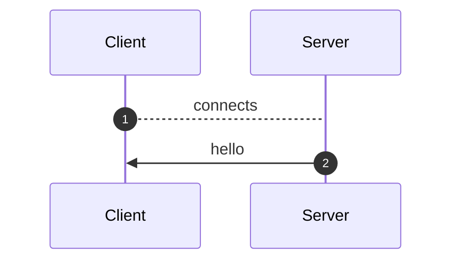
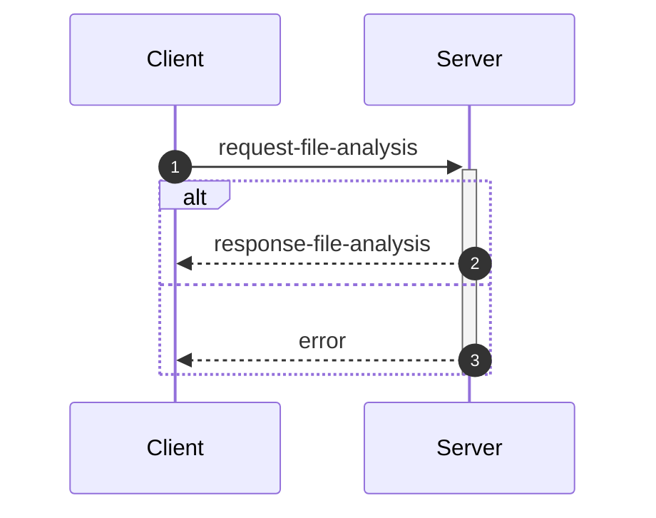
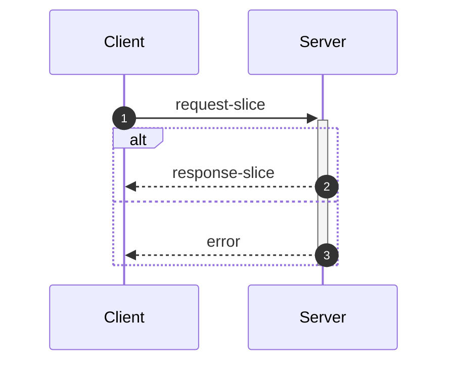
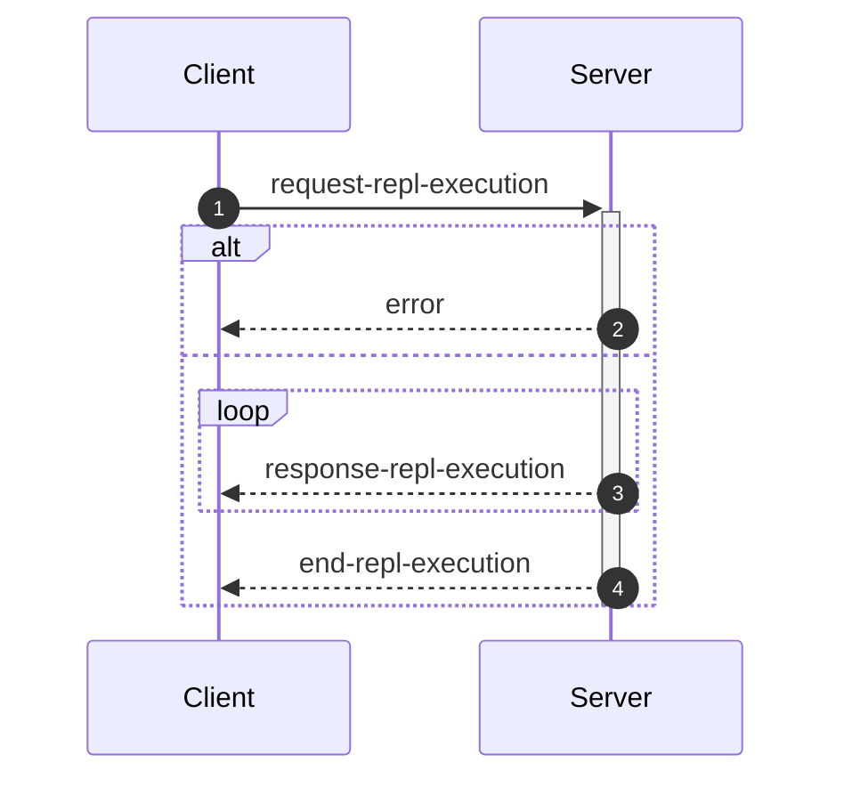

_<span title="an overview of flowR's interface">Generated</span> from '[wiki-interface.ts](https://github.com/flowr-analysis/flowr/tree/main/src/documentation/wiki-interface.ts "src/documentation/wiki-interface.ts")' on 2026-10-23, 10:40:52 UTC (v2.16.6, R v4.5.0), do not edit directly._

Although far from being as detailed as the in-depth explanation of [_flowR_](https://github.com/flowr-analysis/flowr/wiki/Core),
this wiki page explains how to interface with _flowR_ in more detail.
In general, command line arguments and other options provide short descriptions on hover over.

* [💻 Using the REPL](#using-the-repl)
* [⚙️ Configuring FlowR](#configuring-flowr)
* [⚒️ Writing Code](#writing-code)
* [💬 Communicating with the Server](#communicating-with-the-server)

<a id='using-the-repl'></a>
## 💻 Using the REPL

> [!NOTE]
> To execute arbitrary R commands with a repl request, _flowR_ has to be started explicitly with <span title="Description (Command Line Argument): Allow to access the underlying R session when using flowR (security warning: this allows the execution of arbitrary R code!)">`--r-session-access`</span>.
> Please be aware that this introduces a security risk and note that this relies on the [`r-shell` engine](https://github.com/flowr-analysis/flowr/wiki/Engines) .

Although primarily meant for users to explore,
there is nothing which forbids calling _flowR_ as a subprocess to use standard-in, -output, and -error
for communication (although you can access the REPL using the server as well,
with the [REPL Request](#message-request-repl-execution) message).

The read-eval-print loop&nbsp;(REPL) works relatively simple.
You can submit an expression (using <kbd>Enter</kbd>),
which is interpreted as an R&nbsp;expression by default but interpreted as a *command* if it starts with a colon (`:`).
The best command to get started with the REPL is <span title="Description (Repl Command): Show help information (aliases: :h, :?)">`:help`</span>.
Besides, you can leave the REPL either with the command <span title="Description (Repl Command): End the repl (aliases: :q, :exit)">`:quit`</span> or by pressing <kbd>Ctrl</kbd>+<kbd>C</kbd> twice.
When writing a *command*, you may press <kbd>Tab</kbd> to get a list of completions, if available.
Multiple commands can be entered in a single line by separating them with a semicolon (`;`), e.g. `:parse "x<-2"; :df*`.
If a command is given without R code, the REPL will re-use R code given in a previous command.
The prior example will hence return first the parsed AST of the program and then the dataflow graph for `"x <- 2"`.

> [!NOTE]
> If you develop flowR, you may want to launch the repl using the `npm run main-dev` command, this way, you get a non-minified version of flowR with debug information and hot-reloading of source files.

<details>
<summary>Available Commands</summary>

We currently offer the following commands (this with a `[*]` suffix are available with and without the star):

| Command | Description |
| ------- | ----------- |
| **<span title="Description (Repl Command): End the repl (aliases: :q, :exit)">:quit</span>** | End the repl (aliases: **:<span title="Alias of ':quit'. End the repl">q</span>**, **:<span title="Alias of ':quit'. End the repl">exit</span>**) |
| **<span title="Description (Repl Command): Execute the given code as R code. This requires the `--r-session-access` flag to be set and requires the r-shell engine. (aliases: :e, :r)">:execute</span>** | Execute the given code as R code. This requires the `--r-session-access` flag to be set and requires the r-shell engine. (aliases: **:<span title="Alias of ':execute'. Execute the given code as R code. This requires the `--r-session-access` flag to be set and requires the r-shell engine.">e</span>**, **:<span title="Alias of ':execute'. Execute the given code as R code. This requires the `--r-session-access` flag to be set and requires the r-shell engine.">r</span>**) |
| **<span title="Description (Repl Command): Get mermaid code for the control-flow graph of R code (aliases: :cfg, :cf)">:controlflow[*]</span>** | Get mermaid code for the control-flow graph of R code (star: Returns the URL to mermaid.live) (aliases: **:<span title="Alias of ':controlflow'. Get mermaid code for the control-flow graph of R code">cfg</span>**, **:<span title="Alias of ':controlflow'. Get mermaid code for the control-flow graph of R code">cf</span>**) |
| **<span title="Description (Repl Command): Get mermaid code for the control-flow graph with basic blocks (aliases: :cfgb, :cfb)">:controlflowbb[*]</span>** | Get mermaid code for the control-flow graph with basic blocks (star: Returns the URL to mermaid.live) (aliases: **:<span title="Alias of ':controlflowbb'. Get mermaid code for the control-flow graph with basic blocks">cfgb</span>**, **:<span title="Alias of ':controlflowbb'. Get mermaid code for the control-flow graph with basic blocks">cfb</span>**) |
| **<span title="Description (Repl Command): Get mermaid code for the dataflow graph (aliases: :d, :df)">:dataflow[*]</span>** | Get mermaid code for the dataflow graph (star: Returns the URL to mermaid.live) (aliases: **:<span title="Alias of ':dataflow'. Get mermaid code for the dataflow graph">d</span>**, **:<span title="Alias of ':dataflow'. Get mermaid code for the dataflow graph">df</span>**) |
| **<span title="Description (Repl Command): Get mermaid code for the normalized AST of R code (aliases: :n)">:normalize[*]</span>** | Get mermaid code for the normalized AST of R code (star: Returns the URL to mermaid.live) (alias: **:<span title="Alias of ':normalize'. Get mermaid code for the normalized AST of R code">n</span>**) |
| **<span title="Description (Repl Command): Get mermaid code for the simplified dataflow graph (aliases: :ds, :dfs)">:dataflowsimple[*]</span>** | Get mermaid code for the simplified dataflow graph (star: Returns the URL to mermaid.live) (aliases: **:<span title="Alias of ':dataflowsimple'. Get mermaid code for the simplified dataflow graph">ds</span>**, **:<span title="Alias of ':dataflowsimple'. Get mermaid code for the simplified dataflow graph">dfs</span>**) |
| **<span title="Description (Repl Command): Inspect and extend the signature database: `query` (identical to :query @signature), `info <name>` for where a function comes from (identical to :query @function-info), `add <path>` to mount another database/source, `download` to fetch the full-history database. (aliases: :sig)">:signature</span>** | Inspect and extend the signature database: `query` (identical to :query @signature), `info <name>` for where a function comes from (identical to :query @function-info), `add <path>` to mount another database/source, `download` to fetch the full-history database. (alias: **:<span title="Alias of ':signature'. Inspect and extend the signature database: `query` (identical to :query @signature), `info <name>` for where a function comes from (identical to :query @function-info), `add <path>` to mount another database/source, `download` to fetch the full-history database.">sig</span>**) |
| **<span title="Description (Repl Command): Just calculates the DFG, but only prints summary info (aliases: :d#, :df#)">:dataflowsilent</span>** | Just calculates the DFG, but only prints summary info (aliases: **:<span title="Alias of ':dataflowsilent'. Just calculates the DFG, but only prints summary info">d#</span>**, **:<span title="Alias of ':dataflowsilent'. Just calculates the DFG, but only prints summary info">df#</span>**) |
| **<span title="Description (Repl Command): Prints ASCII Art of the parsed, unmodified AST (aliases: :p)">:parse</span>** | Prints ASCII Art of the parsed, unmodified AST (alias: **:<span title="Alias of ':parse'. Prints ASCII Art of the parsed, unmodified AST">p</span>**) |
| **<span title="Description (Repl Command): Prints the version of flowR as well as the current version of R">:version</span>** | Prints the version of flowR as well as the current version of R
| **<span title="Description (Repl Command): Query the given R code (use 'help' for more information)">:query[*]</span>** | Query the given R code (use 'help' for more information) (star: Similar to query, but returns the output in json format.)
| **<span title="Description (Repl Command): Returns an ASCII representation of the dataflow graph (aliases: :df!)">:dataflowascii</span>** | Returns an ASCII representation of the dataflow graph (alias: **:<span title="Alias of ':dataflowascii'. Returns an ASCII representation of the dataflow graph">df!</span>**) |
| **<span title="Description (Repl Command): Returns summarization stats for the normalized AST (aliases: :n#)">:normalize#</span>** | Returns summarization stats for the normalized AST (alias: **:<span title="Alias of ':normalize#'. Returns summarization stats for the normalized AST">n#</span>**) |
| **<span title="Description (Repl Command): Show help information (aliases: :h, :?)">:help</span>** | Show help information (aliases: **:<span title="Alias of ':help'. Show help information">h</span>**, **:<span title="Alias of ':help'. Show help information">?</span>**) |

</details>

> [!TIP]
> 
> As indicated by the examples before, all REPL commands that operate on code keep track of the state.
> Hence, if you run a command like <span title="Description (Repl Command, starred version): Returns the URL to mermaid.live; Base Command: Get mermaid code for the dataflow graph (aliases: :d*, :df*)">`:dataflow*`</span> without providing R code,
> the REPL will re-use the R code provided in a previous command.
> Likewise, doing this will benefit from incrementality!
> If you request the dataflow graph with `:df* x <- 2 * y` and then want to see the parsed AST with `:parse`,
> the REPL will re-use previously obtained information and not re-parse the code again.
> 		

Generally, many commands offer shortcut versions in the REPL. Many queries, for example, offer a shortened format (see the example below).
Of special note, the [Config Query](https://github.com/flowr-analysis/flowr/wiki/%5BQuery%5D-Config)
can be used to also modify the currently active configuration of _flowR_ within the REPL (see the [wiki page](https://github.com/flowr-analysis/flowr/wiki/%5BQuery%5D-Config) for more information).

### Example: Retrieving the Dataflow Graph

To retrieve a URL to the [mermaid](https://mermaid.js.org/) diagram of the dataflow of a given expression,
use <span title="Description (Repl Command, starred version): Returns the URL to mermaid.live; Base Command: Get mermaid code for the dataflow graph (aliases: :d*, :df*)">`:dataflow*`</span> (or <span title="Description (Repl Command): Get mermaid code for the dataflow graph (aliases: :d, :df)">`:dataflow`</span> to get the mermaid code in the cli):

```shell
$ docker run -it --rm eagleoutice/flowr # or npm run flowr 
flowR repl v2.16.6, R grammar v14 (tree-sitter engine)
R> :dataflow* y <- 1 + x
```

<details>
<summary style='color:gray'>Output</summary>

```text
https://mermaid.live/view#base64:eyJjb2RlIjoiZmxvd2NoYXJ0IFREXG4gICAgMXt7XCJgKiM5MTtSTnVtYmVyIzkzOyogKioxKipcbiAgICAgICoxLjYqICgqKmlkOiAxKiopYFwifX1cbiAgICAyKFtcImAqIzkxO1JTeW1ib2wjOTM7KiAqKngqKlxuICAgICAgKjEuMTAqICgqKmlkOiAyKiopYFwiXSlcbiAgICAzW1tcImAqIzkxO1JCaW5hcnlPcCM5MzsqIGJhc2UjNTg7IzU4OyoqIzQzOyoqXG4gICAgICAqMS42LTEwKiAoKippZDogMyoqKVxuICAgIGFyZzogKDEsIDIpYFwiXV1cbiAgICBidWlsdC1pbjpfNDNfW1wiYEJ1aWx0LUluOlxuIzQzO2BcIl1cbiAgICBzdHlsZSBidWlsdC1pbjpfNDNfIHN0cm9rZTpncmF5LGZpbGw6Z3JheSxzdHJva2Utd2lkdGg6MnB4LG9wYWNpdHk6Ljg7XG4gICAgMFtcImAqIzkxO1JTeW1ib2wjOTM7KiAqKnkqKlxuICAgICAgKjEuMSogKCoqaWQ6IDAqKiwgdjogMylgXCJdXG4gICAgNFtbXCJgKiM5MTtSQmluYXJ5T3AjOTM7KiBiYXNlIzU4OyM1ODsqKiM2MDsjNDU7KipcbiAgICAgICoxLjEtMTAqICgqKmlkOiA0KiopXG4gICAgYXJnOiAoMCwgMylgXCJdXVxuICAgIGJ1aWx0LWluOl82MF8tW1wiYEJ1aWx0LUluOlxuIzYwOyM0NTtgXCJdXG4gICAgc3R5bGUgYnVpbHQtaW46XzYwXy0gc3Ryb2tlOmdyYXksZmlsbDpncmF5LHN0cm9rZS13aWR0aDoycHgsb3BhY2l0eTouODtcbiAgICAxIC0uLT58XCJmbG93XCJ8IDJcbiAgICBsaW5rU3R5bGUgMCBzdHJva2U6Z3JheSxjb2xvcjpncmF5O1xuICAgIDIgLS4tPnxcImZsb3dcInwgM1xuICAgIGxpbmtTdHlsZSAxIHN0cm9rZTpncmF5LGNvbG9yOmdyYXk7XG4gICAgMyAtLT58XCJyZWFkcywgYXJnXCJ8IDFcbiAgICAzIC0tPnxcInJlYWRzLCBhcmdcInwgMlxuICAgIDMgLS4tPnxcImZsb3dcInwgMFxuICAgIGxpbmtTdHlsZSA0IHN0cm9rZTpncmF5LGNvbG9yOmdyYXk7XG4gICAgMyAtLi0+fFwicmVhZHMsIGNhbGxzXCJ8IGJ1aWx0LWluOl80M19cbiAgICBsaW5rU3R5bGUgNSBzdHJva2U6Z3JheTtcbiAgICAwIC0tPnxcImRlZmluZWQtYnksIGZsb3dcInwgNFxuICAgIDAgLS0+fFwiZGVmaW5lZC1ieVwifCAzXG4gICAgNCAtLT58XCJyZWFkcywgYXJnXCJ8IDNcbiAgICA0IC0tPnxcInJldHVybnMsIGFyZ1wifCAwXG4gICAgNCAtLi0+fFwicmVhZHMsIGNhbGxzXCJ8IGJ1aWx0LWluOl82MF8tXG4gICAgbGlua1N0eWxlIDEwIHN0cm9rZTpncmF5OyIsIm1lcm1haWQiOnsiYXV0b1N5bmMiOnRydWV9fQ==
```

Retrieve the dataflow graph of the expression `y <- 1 + x`. It looks like this:


<details>

<summary style="color:gray">R Code of the Dataflow Graph</summary>

The analysis ran (including parse and normalize, using the [tree-sitter](https://github.com/flowr-analysis/flowr/wiki/Engines) engine) within the generation environment. No [signature database](https://github.com/flowr-analysis/flowr/wiki/Signature-Database) is mounted for these generated graphs, so `library()` calls attach no package exports; base-R names are still qualified via the generated base-package store (e.g. `acf` as `stats::acf`). 
We encountered no unknown side effects during the analysis.

```r
y <- 1 + x
```

</details>

</details>

For small graphs like this, <span title="Description (Repl Command): Returns an ASCII representation of the dataflow graph (aliases: :df!)">`:dataflowascii`</span> also provides an ASCII representation directly in the REPL:

```shell
$ docker run -it --rm eagleoutice/flowr # or npm run flowr 
flowR repl v2.16.6, R grammar v14 (tree-sitter engine)
R> :df! y <- 1 + x
```

<details open>
<summary style='color:gray'>Output</summary>

```text
                        v<0>v
 c<4>c──────────────────| y |
 |<- |     ┌────────────v---v
 c---c     │
    │   c<3>c   0<1>0
    └───| + |───| 1 |───u<2>u
        c---c   0---0   | x |
           └────────────u---u
Edges:
3 -> 1: reads, arg          3 -> 2: reads, arg
3 -> 0: flows-to            1 -> 2: flows-to
2 -> 3: flows-to            4 -> 3: reads, arg
4 -> 0: returns, arg        0 -> 4: defined-by, flows-to
0 -> 3: defined-by
```

Retrieve the dataflow graph of the expression `y <- 1 + x` as ASCII art.

</details>

For the slicing with <span title="Description (Repl Command): Static backwards executable slicer for R">`:slicer`</span>, you have access to the same [magic comments](#slice-magic-comments) as with the [slice request](#message-request-slice).
Pass `--inline` to splice resolvable `source()` calls into the reconstruction so the slice is a single self-contained R text (the same as the static slice query's `inlineSources` flag).
See `--help` for more flags!

### Example: Interfacing with the File System

Many commands that allow for an R-expression (like <span title="Description (Repl Command, starred version): Returns the URL to mermaid.live; Base Command: Get mermaid code for the dataflow graph (aliases: :d*, :df*)">`:dataflow*`</span>) allow for a file as well
if the argument starts with `file://`.
If you are working from the root directory of the _flowR_ repository, the following gives you the parsed AST of the example file using the <span title="Description (Repl Command): Prints ASCII Art of the parsed, unmodified AST (aliases: :p)">`:parse`</span> command:

> **Watch mode**: Replace `file://` with `watch://` to enter watch mode.
> flowR runs the command immediately and then re-runs it every time the file (or any file inside the folder) changes.
> Enter any other command to leave watch mode.
> For example: `:df watch://analysis.R`

```shell
$ docker run -it --rm eagleoutice/flowr # or npm run flowr 
flowR repl v2.16.6, R grammar v14 (tree-sitter engine)
R> :parse file://test/testfiles/example.R
```

<details>
<summary style='color:gray'>Output</summary>

```text
File: test/testfiles/example.R

program
├ binaryoperator
│ ├ identifier "sum" (1:1─4)
│ ├ <- "<-" (1:5─7)
│ ╰ float "0" (1:8─9)
├ binaryoperator
│ ├ identifier "product" (2:1─8)
│ ├ <- "<-" (2:9─11)
│ ╰ float "1" (2:12─13)
├ binaryoperator
│ ├ identifier "w" (3:1─2)
│ ├ <- "<-" (3:3─5)
│ ╰ float "7" (3:6─7)
├ binaryoperator
│ ├ identifier "N" (4:1─2)
│ ├ <- "<-" (4:3─5)
│ ╰ float "10" (4:6─8)
├ forstatement
│ ├ for "for" (6:1─4)
│ ├ ( "(" (6:5─6)
│ ├ identifier "i" (6:6─7)
│ ├ in "in" (6:8─10)
│ ├ binaryoperator
│ │ ├ float "1" (6:11─12)
│ │ ├ : ":" (6:12─13)
│ │ ╰ parenthesizedexpression
│ │   ├ ( "(" (6:13─14)
│ │   ├ binaryoperator
│ │   │ ├ identifier "N" (6:14─15)
│ │   │ ├ - "-" (6:15─16)
│ │   │ ╰ float "1" (6:16─17)
│ │   ╰ ) ")" (6:17─18)
│ ├ ) ")" (6:18─19)
│ ╰ bracedexpression
│   ├ { "{" (6:20─21)
│   ├ binaryoperator
│   │ ├ identifier "sum" (7:3─6)
│   │ ├ <- "<-" (7:7─9)
│   │ ╰ binaryoperator
│   │   ├ binaryoperator
│   │   │ ├ identifier "sum" (7:10─13)
│   │   │ ├ + "+" (7:14─15)
│   │   │ ╰ identifier "i" (7:16─17)
│   │   ├ + "+" (7:18─19)
│   │   ╰ identifier "w" (7:20─21)
│   ├ binaryoperator
│   │ ├ identifier "product" (8:3─10)
│   │ ├ <- "<-" (8:11─13)
│   │ ╰ binaryoperator
│   │   ├ identifier "product" (8:14─21)
│   │   ├  "" (8:22─23)
│   │   ╰ identifier "i" (8:24─25)
│   ╰ } "}" (9:1─2)
├ call
│ ├ identifier "cat" (11:1─4)
│ ╰ arguments
│   ├ ( "(" (11:4─5)
│   ├ argument
│   │ ╰ string
│   │   ├ " "\"" (11:5─6)
│   │   ├ stringcontent "Sum:" (11:6─10)
│   │   ╰ " "\"" (11:10─11)
│   ├ comma "," (11:11─12)
│   ├ argument
│   │ ╰ identifier "sum" (11:13─16)
│   ├ comma "," (11:16─17)
│   ├ argument
│   │ ╰ string
│   │   ├ " "\"" (11:18─19)
│   │   ├ stringcontent
│   │   │ ╰ escapesequence "\\n" (11:19─21)
│   │   ╰ " "\"" (11:21─22)
│   ╰ ) ")" (11:22─23)
╰ call
  ├ identifier "cat" (12:1─4)
  ╰ arguments
    ├ ( "(" (12:4─5)
    ├ argument
    │ ╰ string
    │   ├ " "\"" (12:5─6)
    │   ├ stringcontent "Product:" (12:6─14)
    │   ╰ " "\"" (12:14─15)
    ├ comma "," (12:15─16)
    ├ argument
    │ ╰ identifier "product" (12:17─24)
    ├ comma "," (12:24─25)
    ├ argument
    │ ╰ string
    │   ├ " "\"" (12:26─27)
    │   ├ stringcontent
    │   │ ╰ escapesequence "\\n" (12:27─29)
    │   ╰ " "\"" (12:29─30)
    ╰ ) ")" (12:30─31)
```

Retrieve the parsed AST of the example file.

<details>

<summary>File Content</summary>

```r
sum <- 0
product <- 1
w <- 7
N <- 10

for (i in 1:(N-1)) {
  sum <- sum + i + w
  product <- product * i
}

cat("Sum:", sum, "\n")
cat("Product:", product, "\n")
```

</details>

As _flowR_ directly transforms this AST the output focuses on being human-readable instead of being machine-readable.
		
</details>

### Example: Run a Query

You can run any query supported by _flowR_ using the <span title="Description (Repl Command): Query the given R code (use 'help' for more information)">`:query`</span> command.
For example, to obtain the shapes of all data frames in a given piece of code, you can run:

```shell
$ docker run -it --rm eagleoutice/flowr # or npm run flowr 
flowR repl v2.16.6, R grammar v14 (tree-sitter engine)
R> :query @absint df-shape "x <- data.frame(a = 1:10, b = 1:10)\ny <- x$a"
```

<details open>
<summary style='color:gray'>Output</summary>

```text
Query: absint (1 ms)
```

Retrieve the shapes of all data frames in the given code.

</details>

To run the linter on a file, you can use (in this example, we just issue the `dead-code` linter on a small piece of code):

```shell
$ docker run -it --rm eagleoutice/flowr # or npm run flowr 
flowR repl v2.16.6, R grammar v14 (tree-sitter engine)
R> :query @linter rules:dead-code "if(FALSE) x <- 2"
```

<details open>
<summary style='color:gray'>Output</summary>

```text
Query: linter (2 ms)
   ╰ Dead Code (dead-code):
       ╰ certain:
           ╰ Code at 1.11-16
```

Run the linter on the given code, with only the `dead-code` rule enabled.

</details>

For more information on the available queries, please check out the [Query API](https://github.com/flowr-analysis/flowr/wiki/Query-API).

<a id='configuring-flowr'></a>
## ⚙️ Configuring FlowR

When running _flowR_, you may want to specify some behaviors with a dedicated configuration file.
By default, flowR looks for a file named `flowr.json` in the current working directory (or any higher directory).
You can also specify a different file with <span title="Description (Command Line Argument): The name of the configuration file to use">`--config-file`</span> or pass the configuration inline using <span title="Description (Command Line Argument): The flowR configuration to use, as a JSON string">`--config-json`</span>.
A `flowr.json` found this way belongs to the analyzed project, so flowR ignores its options that decide what flowR executes or loads
(`engines.*.wasmPath`, `engines.*.treeSitterWasmPath`, `engines.*.rPath`, `solver.sigdb.additionalPaths`, `solver.sigdb.downloadRepo`, `solver.sigdb.installedLibrary.paths`),
unless you pass <span title="Description (Command Line Argument): Keep the security-sensitive options (e.g., the R executable) of the flowr.json found in the working directory or a parent. Only use this for projects you trust.">`--trust-config`</span>.
To analyze code you do not trust, use the secure mode (<span title="Description (Command Line Argument): Run in secure mode for analyzing untrusted code: flowR does not start R (or any other process), does not access the network, does not search for project configs, and ignores security-sensitive options in every config. Cannot be disabled once enabled. Can also be enabled with the environment variable {italic FLOWR_SECURE_MODE=1}.">`--secure`</span>, see the [security policy](https://github.com/flowr-analysis/flowr/blob/main/.github/SECURITY.md)).
To inspect the current configuration, you can run flowr with the <span title="Description (Command Line Argument): Run with verbose logging (will be passed to the corresponding script)">`--verbose`</span> flag, or use the `config` [Query](https://github.com/flowr-analysis/flowr/wiki/Query-API).
Within the REPL this works by running the following:

```shell
:query @config
```

To work with the <a href="https://github.com/flowr-analysis/flowr/tree/main/src/config.ts#L119"><code><span title="The configuration file format for flowR.">FlowrConfig</span></code></a> you can use the provided helper objects alongside its methods like
<a href="https://github.com/flowr-analysis/flowr/tree/main/src/config.ts#L914"><code><span title="Creates a new flowr config that has the updated values.">FlowrConfig::<b>amend</b></span></code></a>.
The schema below documents every option; the ones you most likely want are:

- <a href="https://github.com/flowr-analysis/flowr/wiki/Interface#configuring-flowr" title="Configuration Option (boolean): Whether source calls should be ignored, causing {@link processSourceCall}&#39;s behavior to be skipped.">ignoreSourceCalls</a>: ignore source calls when analyzing the code, i.e., ignore the inclusion of other files.
- <a href="https://github.com/flowr-analysis/flowr/wiki/Interface#configuring-flowr" title="Configuration Option (boolean): Whether load calls should be ignored, causing {@link processLoadCall}&#39;s behavior to be skipped.">ignoreLoadCalls</a>: ignore load calls when analyzing the code, i.e., ignore the loading of r-data files.
- <a href="https://github.com/flowr-analysis/flowr/wiki/Interface#configuring-flowr" title="Configuration Option (object): Do you want to overwrite (parts) of the builtin definition?">semantics.environment.overwriteBuiltIns</a>: overwrite _flowR_'s handling of built-in functions, or clear the preset definitions entirely.
  See [Configure BuiltIn Semantics](#configure-builtin-semantics) for more information.
- <a href="https://github.com/flowr-analysis/flowr/wiki/Interface#configuring-flowr" title="Configuration Option (string): How to resolve variables and their values. (one of &quot;disabled&quot;, &quot;alias&quot;, &quot;builtin&quot;)">solver.variables</a>: how to resolve variables and their values (`disabled`, `alias`, `builtin`).
- <a href="https://github.com/flowr-analysis/flowr/wiki/Interface#configuring-flowr" title="Configuration Option (array): The engine or set of engines to use for interacting with R code. An empty array means all available engines will be used.">engines</a> and <a href="https://github.com/flowr-analysis/flowr/wiki/Interface#configuring-flowr" title="Configuration Option (string): The default engine to use for interacting with R code. If this is undefined, an arbitrary engine from the specified list will be used. (one of &quot;tree-sitter&quot;, &quot;r-shell&quot;)">defaultEngine</a>: the engines used to interact with R code, see the [Engines wiki page](https://github.com/flowr-analysis/flowr/wiki/Engines).
- <a href="https://github.com/flowr-analysis/flowr/wiki/Interface#configuring-flowr" title="Configuration Option (array): Files a framework loads on its own, without any source() call (e.g. global.R in a shiny app), in the order they are loaded; flowR orders the matching project files accordingly and analyzes them as one program. Entries are case-insensitive globs matched against the file path, a plain name matches any file with that name, and entries matching no project file are warned about. Usually set per project kind via specializeConfig.">project.implicitSources</a>: the files a framework loads without any `source()` call, in the order in which they are
  loaded. Entries are globs (e.g. `R/*.R`) matched against the file path ignoring capitalization; one matching no file is reported.
- <a href="https://github.com/flowr-analysis/flowr/wiki/Interface#configuring-flowr" title="Configuration Option (object): Overwrite (parts of) the configuration depending on the project kind flowR detects, e.g. to give a shiny app its implicit sources.">specializeConfig</a>: overwrite (parts of) the configuration depending on the kind of project _flowR_ detects
  (e.g. `shiny-app`), which is how a shiny app gets its implicit sources by default. What you configure directly wins.
- <a href="https://github.com/flowr-analysis/flowr/wiki/Interface#configuring-flowr" title="Configuration Option (string): Overwrite the project kind flowR would otherwise infer from the analyzed files, e.g. when auto-detection guesses wrong. (one of &quot;package&quot;, &quot;script&quot;, &quot;shiny-app&quot;, &quot;notebook&quot;, &quot;project&quot;, &quot;unknown&quot;)">project.useProjectType</a>: skip that detection and force a project kind yourself, when auto-detection guesses wrong.
- <a href="https://github.com/flowr-analysis/flowr/wiki/Interface#configuring-flowr" title="Configuration Option (array): The default plugins to load when creating a new instance of FlowrAnalyzer">defaultPlugins</a> and <a href="https://github.com/flowr-analysis/flowr/wiki/Interface#configuring-flowr" title="Configuration Option (array): The plugins to load in REPL mode">repl.plugins</a>: the plugins to load for a new <a href="https://github.com/flowr-analysis/flowr/tree/main/src/project/flowr-analyzer.ts#L205"><code><span title="Central class for conducting analyses with FlowR. Use the FlowrAnalyzerBuilder to create a new instance. If you want the original pattern of creating a pipeline and running all steps, you can still do this with FlowrAnalyzer#runFull . To inspect the context of the analyzer, use FlowrAnalyzer#inspectContext (if you are a plugin and need to modify it, use FlowrAnalyzer#context instead).">FlowrAnalyzer</span></code></a> and in the REPL
  (use `flowr:default` to reference the former).

So you can configure _flowR_ by adding a file like the following:

<details>

<summary>Example Configuration File</summary>

```json
{
  "ignoreSourceCalls": true,
  "ignoreLoadCalls": true,
  "semantics": {
    "environment": {
      "overwriteBuiltIns": {
        "definitions": [
          {
            "type": "function",
            "names": [
              "foo"
            ],
            "processor": "builtin:assign",
            "config": {}
          }
        ]
      }
    }
  },
  "defaultPlugins": [
    "file:description",
    "versions:description"
  ],
  "repl": {
    "quickStats": false,
    "dfProcessorHeat": false,
    "hints": true,
    "plugins": [
      "flowr:default"
    ]
  },
  "project": {
    "resolveUnknownPathsOnDisk": true,
    "implicitSources": [
      "global.R",
      "app.R"
    ]
  },
  "linter": {
    "disabledRules": []
  },
  "specializeConfig": {
    "shiny-app": {
      "project": {
        "implicitSources": [
          "global.R",
          "ui.R",
          "server.R",
          "app.R"
        ]
      }
    }
  },
  "engines": [
    {
      "type": "r-shell"
    }
  ],
  "solver": {
    "variables": "alias",
    "evalStrings": true,
    "trackEnvironments": true,
    "sigdb": {
      "enabled": true,
      "loadProjectDependencies": true,
      "eagerlyLoad": false,
      "eagerlyLoadExports": false,
      "linkBaseR": false,
      "linkDescriptionDependencies": false
    },
    "resolveSource": {
      "dropPaths": "no",
      "ignoreCapitalization": true,
      "inferWorkingDirectory": "active-script",
      "searchPath": []
    },
    "instrument": {},
    "slicer": {
      "threshold": 50
    }
  },
  "abstractInterpretation": {
    "wideningThreshold": 4,
    "followCalls": true,
    "dataFrame": {
      "maxColNames": 20,
      "readLoadedData": {
        "readExternalFiles": true,
        "maxReadLines": 1000000
      }
    }
  },
  "incremental": {
    "alwaysIncremental": false,
    "parsing": {
      "activated": false,
      "heuristics": {
        "activated": true,
        "mtime": true,
        "linesFrom": 500,
        "bytesFrom": 50000,
        "alwaysWithEdits": false,
        "minFiles": 1
      }
    }
  },
  "gas": {
    "thresholds": {
      "memory": {
        "problematic": 0.7,
        "critical": 0.9
      },
      "timeMs": {
        "problematic": 100000,
        "critical": 120000
      }
    },
    "features": {}
  }
}
```

</details>

<details>
<a id='configure-builtin-semantics'></a>
<summary>Configure Built-In Semantics</summary>

`semantics/environment/overwriteBuiltins` accepts two keys:

- `loadDefaults` (boolean, initially `true`): If set to `true`, the default built-in definitions are loaded before applying the custom definitions. Setting this flag to `false` explicitly disables the loading of the default definitions.
- `definitions` (array, initially empty): Allows to overwrite or define new built-in elements. Each object within must have a `type` which is one of the below. Furthermore, they may define a string array of `names` which specifies the identifiers to bind the definitions to. You may use `assumePrimitive` to specify whether _flowR_ should assume that this is a primitive non-library definition (so you probably just do not want to specify the key).

  | Type            | Description                                                                                                                                                                                                                                                                                              | Example                                                                                                    |
  | --------------- | -------------------------------------------------------------------------------------------------------------------------------------------------------------------------------------------------------------------------------------------------------------------------------------------------------- | ---------------------------------------------------------------------------------------------------------- |
  | `constant`    | Additionally allows for a `value` this should resolve to.                                                                                                                                                                                                                                                | `{ type: 'constant', names: ['NULL', 'NA'],  value: null }`                                                |
  | `function`    | Is a rather flexible way to define and bind built-in functions. For the time, we do not have extensive documentation to cover all the cases, so please either consult the sources with the `default-builtin-config.ts` or open a [new issue](https://github.com/flowr-analysis/flowr/issues/new/choose). | `{ type: 'function', names: ['next'], processor: 'builtin:d', config: { cfg: ExitPointType.Next } }` |
  | `replacement` | A comfortable way to specify replacement functions like `$<-` or `names<-`. `suffixes` describes the... suffixes to attach automatically. | `{ type: 'replacement', suffixes: ['<-', '<<-'], names: ['[', '[['] }` |

</details>

<details>

<summary style='color:gray'>Full Configuration-File Schema</summary>

- _The configuration file format for flowR._ (object)
    - **logLevel** [optional] _flowR's global minimum log level, applied when the config is loaded._ (string)
        Only allows: 'silly', 'trace', 'debug', 'info', 'warn', 'error', 'fatal'
    - **ignoreSourceCalls** [optional] _Whether source calls should be ignored, causing {@link processSourceCall}'s behavior to be skipped._ (boolean)
    - **ignoreLoadCalls** [optional] _Whether load calls should be ignored, causing {@link processLoadCall}'s behavior to be skipped._ (boolean)
    - **semantics** _Configure language semantics and how flowR handles them._ (object)
        - **environment** [optional] _Semantics regarding how to handle the R environment._ (object)
            - **overwriteBuiltIns** [optional] _Do you want to overwrite (parts) of the builtin definition?_ (object)
                - **loadDefaults** [optional] _Should the default configuration still be loaded?_ (boolean)
                - **definitions** [optional] _The definitions to load/overwrite._ (array)
                Valid item types:
                    - (object)
    - **defaultPlugins** [optional] _The default plugins to load when creating a new instance of FlowrAnalyzer_ (array)
    Valid item types:
        - (alternatives)
            - (string)
            - (array)
    - **repl** _Configuration options for the REPL._ (object)
        - **quickStats** [optional] _Whether to show quick stats in the REPL after each evaluation._ (boolean)
        - **dfProcessorHeat** [optional] _This instruments the dataflow processors to count how often each processor is called._ (boolean)
        - **hints** [optional] _Whether to show dim inline hints on the empty prompt (automatically disabled on non-interactive terminals)._ (boolean)
        - **plugins** [optional] _The plugins to load in REPL mode_ (array)
        Valid item types:
            - (alternatives)
                - (string)
                - (array)
        - **autoUseFileProtocol** [optional] _Prepend the file protocol to a repl input that looks like a path, instead of only warning about it._ (boolean)
        - **queryStats** [optional] _Whether `:query` closes with the line stating how long the queries took (`:query*` never prints it)._ (boolean)
        - **showPlugins** [optional] _Whether `:version` grays out the plugins that did not activate during the last analysis._ (boolean)
    - **project** _Project specific configuration options._ (object)
        - **resolveUnknownPathsOnDisk** [optional] _Whether to resolve unknown paths loaded by the r project disk when trying to source/analyze files._ (boolean)
        - **failOnInaccessiblePath** [optional] _Whether a directory that cannot be traversed during file discovery (e.g. due to permissions) aborts the analysis; when false (the default) such paths are logged and skipped._ (boolean)
        - **basePackages** [optional] _The packages considered part of R itself (base and recommended); if unset, flowR uses its built-in list._ (array)
        Valid item types:
            - (string)
        - **implicitSources** [optional] _Files a framework loads on its own, without any source() call (e.g. global.R in a shiny app), in the order they are loaded; flowR orders the matching project files accordingly and analyzes them as one program. Entries are case-insensitive globs matched against the file path, a plain name matches any file with that name, and entries matching no project file are warned about. Usually set per project kind via specializeConfig._ (array)
        Valid item types:
            - (string)
        - **useProjectType** [optional] _Overwrite the project kind flowR would otherwise infer from the analyzed files, e.g. when auto-detection guesses wrong._ (string)
            Only allows: 'package', 'script', 'shiny-app', 'notebook', 'project', 'unknown'
        - **assumeImplicitEcho** [optional] _Whether the top level of the analyzed code is echoed, so that every visible result printed there is collected as an output by the dependencies query (default true, false for a package)._ (boolean)
        - **discovery** [optional] _Scoping options for the default project discovery._ (object)
            - **full** [optional] _Collect every file below the project root (greedy) instead of only the files the detected project kind needs (default false)._ (boolean)
            - **perKind** [optional] _Per-kind include/exclude glob overrides layered on the default scoping._ (object)
            - **ignore** [optional] _Case-insensitive globs that drop matching files from the intelligent discovery, regardless of kind (e.g. .Renviron to ignore environment files)._ (array)
            Valid item types:
                - (string)
        - **classification** [optional] _Overrides for the signals flowR uses to classify the project kind._ (object)
            - **shinyDescriptionTypes** [optional] _DESCRIPTION Type: values that mark a shiny app._ (array)
            Valid item types:
                - (string)
            - **shinyEntryFiles** [optional] _File names a shiny app is assembled from._ (array)
            Valid item types:
                - (string)
            - **shinyUsagePattern** [optional] _Regex source evidencing shiny usage in an entry file._ (string)
            - **notebookExtensions** [optional] _File extensions marking a notebook._ (array)
            Valid item types:
                - (string)
    - **linter** _Linter configuration options._ (object)
        - **disabledRules** _Linting rule names excluded from the default rule set (a rule requested explicitly via a linter query still runs). Usually set per project kind via specializeConfig._ (array)
        Valid item types:
            - (string)
        - **disabledTags** [optional] _Linting rule tags whose rules are excluded from the default rule set (a rule requested explicitly via a linter query still runs). By default the cmd-check rules are disabled for everything but a package; a configured list replaces that default._ (array)
        Valid item types:
            - (string)
    - **inputSources** [optional] _Further frameworks the input-sources analysis should know about; entries are added to flowR's defaults._ (object)
        - **pure** [optional] _Functions that only pass the constantness of their arguments on._ (array)
        Valid item types:
            - (string)
        - **param** [optional] _Functions whose result is a 'param' input._ (array)
        Valid item types:
            - (string)
        - **file** [optional] _Functions whose result is a 'file' input._ (array)
        Valid item types:
            - (string)
        - **tempfile** [optional] _Functions whose result is a 'tempfile' input._ (array)
        Valid item types:
            - (string)
        - **glob** [optional] _Functions whose result is a 'glob' input._ (array)
        Valid item types:
            - (string)
        - **net** [optional] _Functions whose result is a 'net' input._ (array)
        Valid item types:
            - (string)
        - **rand** [optional] _Functions whose result is a 'rand' input._ (array)
        Valid item types:
            - (string)
        - **system** [optional] _Functions whose result is a 'system' input._ (array)
        Valid item types:
            - (string)
        - **ffi** [optional] _Functions whose result is a 'ffi' input._ (array)
        Valid item types:
            - (string)
        - **lang** [optional] _Functions whose result is a 'lang' input._ (array)
        Valid item types:
            - (string)
        - **options** [optional] _Functions whose result is a 'options' input._ (array)
        Valid item types:
            - (string)
        - **cmdline** [optional] _Functions whose result is a 'cmdline' input._ (array)
        Valid item types:
            - (string)
        - **user** [optional] _Functions whose result is a 'user' input._ (array)
        Valid item types:
            - (string)
        - **const** [optional] _Functions whose result is a 'const' input._ (array)
        Valid item types:
            - (string)
        - **scope** [optional] _Functions whose result is a 'scope' input._ (array)
        Valid item types:
            - (string)
        - **dconst** [optional] _Functions whose result is a 'dconst' input._ (array)
        Valid item types:
            - (string)
        - **unknown** [optional] _Functions whose result is a 'unknown' input._ (array)
        Valid item types:
            - (string)
        - **linkedObjects** [optional] _Objects a framework provides without a definition in the code, e.g. shiny's input._ (array)
        Valid item types:
            - (object)
        - **linkedEntryPoints** [optional] _Calls that hand a function to a framework, which binds its objects to the parameters by position._ (array)
        Valid item types:
            - (object)
    - **specializeConfig** [optional] _Overwrite (parts of) the configuration depending on the project kind flowR detects, e.g. to give a shiny app its implicit sources._ (object)
    - **engines** _The engine or set of engines to use for interacting with R code. An empty array means all available engines will be used._ (array)
    Valid item types:
        - (alternatives)
            - _The configuration for the tree sitter engine._ (object)
                - **type** [required] _Use the tree sitter engine._ (string)
                    Only allows: 'tree-sitter'
                - **wasmPath** [optional] _The path to the tree-sitter-r WASM binary to use. If this is undefined, this uses the default path._ (string)
                - **treeSitterWasmPath** [optional] _The path to the tree-sitter WASM binary to use. If this is undefined, this uses the default path._ (string)
                - **lax** [optional] _Whether to use the lax parser for parsing R code (allowing for syntax errors). If this is undefined, the strict parser will be used._ (boolean)
            - _The configuration for the R shell engine._ (object)
                - **type** [required] _Use the R shell engine._ (string)
                    Only allows: 'r-shell'
                - **rPath** [optional] _The path to the R executable to use. If this is undefined, this uses the default path._ (string)
                - **pipeBind** [optional] _Whether to enable R's experimental pipe-bind operator "=>" by setting _R_USE_PIPEBIND_ for the R session (default false); R itself keeps this off by default, as it is experimental and has never shipped in a release version of R._ (boolean)
    - **defaultEngine** [optional] _The default engine to use for interacting with R code. If this is undefined, an arbitrary engine from the specified list will be used._ (string)
        Only allows: 'tree-sitter', 'r-shell'
    - **solver** _How to resolve constants, constraints, cells, ..._ (object)
        - **variables** _How to resolve variables and their values._ (string)
            Only allows: 'disabled', 'alias', 'builtin'
        - **evalStrings** _Should we include eval(parse(text="...")) calls in the dataflow graph?_ (boolean)
        - **trackEnvironments** [optional] _Track user-created environments (new.env, assign/get/local with envir=, dollar-assign, attach). When false, all envir-style calls fall through conservatively._ (boolean)
        - **sigdb** _Resolving library exports from a signature database._ (object)
            - **enabled** [optional] _Resolve library()/use() exports from a signature database (default true); when false no database is consulted._ (boolean)
            - **loadProjectDependencies** [optional] _Load the project's declared dependencies from its metadata files (DESCRIPTION Imports/Depends, rproject.toml, uvr.toml, renv.lock, rv.lock, uvr.lock) (default true); when false these files are not read for dependencies._ (boolean)
            - **eagerlyLoad** [optional] _Parse the database up front rather than on the first package load (default false, ignored if disabled)._ (boolean)
            - **eagerlyLoadExports** [optional] _Add a vertex for every export on load rather than on demand (default false); keeps the dataflow graph small._ (boolean)
            - **assumedRVersion** [optional] _R version assumed when resolving versioned (base-R) exports: a pin like "4.5" or "auto" to detect the installed R (default "auto")._ (string)
            - **linkBaseR** [optional] _Eagerly attach base-R namespaces so bare base calls resolve without library() (default false)._ (boolean)
            - **linkBaseRCalls** [optional] _Add a lightweight Reads edge from a bare base-R call to its signature-database function vertex (default false; base-R qualification is edge-free otherwise)._ (boolean)
            - **linkPackageCalls** [optional] _Add a lightweight Reads edge from a resolved package call to its signature-database function vertex (default false)._ (boolean)
            - **linkDescriptionDependencies** [optional] _Eagerly attach the namespaces of the project's declared DESCRIPTION dependencies (Imports/Depends) so their exports resolve without an explicit library() (default false)._ (boolean)
            - **warmInBackground** [optional] _Decompress the hot shards (base + most-downloaded) in a background task on startup so the first library() lookup is warm (default false; for long-running servers/REPLs)._ (boolean)
            - **additionalPaths** [optional] _Extra directories or bundle/manifest files searched for signature databases (alongside the shipped default and $FLOWR_SIGDB_DIR); a downloaded full-history bundle placed here is mounted automatically._ (array)
            Valid item types:
                - (string)
            - **downloadRepo** [optional] _GitHub owner/repo the full-history bundle is downloaded from via ":signature download" (default "flowr-analysis/flowr", release tag "sigdb-v<flowR-version>")._ (string)
            - **autoSync** [optional] _On startup, re-download shards whose committed sigdb.remote.json hash no longer matches the cache, in the background (default false; opt-in network sync after a git pull)._ (boolean)
            - **installedLibrary** [optional] _Recovering packages no signature database knows from the copy installed on this machine._ (object)
                - **enabled** [required] _Recover packages no signature database knows from their installed copy (default false)._ (boolean)
                - **paths** [optional] _Library directories to search; when empty they are discovered from the environment and the project._ (array)
                Valid item types:
                    - (string)
                - **useEnvironment** [optional] _Search the libraries R_LIBS_USER/R_LIBS/R_LIBS_SITE name (default true)._ (boolean)
                - **useProjectLibrary** [optional] _Search a project-local renv/packrat library (default true)._ (boolean)
                - **maxDepth** [optional] _How far to descend into the nested layout of a project-local library (default 3)._ (number)
                - **packages** [optional] _Only recover packages whose name matches one of these regular expressions; empty means any._ (array)
                Valid item types:
                    - (string)
            - **blobCacheBudgetMb** [optional] _How many MiB of decoded package blobs every open bundle may hold together (default 16)._ (number)
            - **versionSelection** [optional] _When a project constrains a dependency, resolve to the newest (default), oldest, or system-installed version satisfying it; system needs R and falls back to newest. Base-R packages always resolve against the assumed R version._ (string)
                Only allows: 'newest', 'oldest', 'system'
            - **versionOverrides** [optional] _Force an exact version for specific packages (name -> version), overriding both the project constraint and the versionSelection policy (default {})._ (object)
        - **versionManagement** _Policies for reasoning about dependency versions._ (object)
            - **linkedVersionGroups** [optional] _Groups of packages that must resolve to the same version; version guessing intersects each group so its members stay mutually compatible (default [])._ (array)
            Valid item types:
                - (array)
                Valid item types:
                    - (string)
        - **assumeAttachedPackages** [optional] _Packages to treat as attached without a `library()` call, so what the built-in configuration states about them applies to the analyzed code. The base packages R attaches on startup already resolve without it._ (array)
        Valid item types:
            - (string)
        - **transitiveSideEffectRounds** [optional] _How many rounds the transitive side-effect fixpoint may run before it is cut off (default 32); the propagation stops on its own as soon as a round adds nothing._ (number)
        - **maxOverlayDepth** [optional] _How many binding overlays may stack on one environment frame before a write flattens them (default 4); a pure performance knob, trading lookup cost against copy cost without changing any result._ (number)
        - **instrument** (object)
            - **dataflowExtractors** [optional] _These keys are only intended for use within code, allowing to instrument the dataflow analyzer!_ (any)
        - **resolveSource** [optional] _If lax source calls are active, flowR searches for sourced files much more freely, based on the configurations you give it. This option is only in effect if `ignoreSourceCalls` is set to false._ (object)
            - **dropPaths** _Allow to drop the first or all parts of the sourced path, if it is relative._ (string)
                Only allows: 'no', 'once', 'all'
            - **ignoreCapitalization** _Search for filenames matching in the lowercase._ (boolean)
            - **inferWorkingDirectory** _Try to infer the working directory from the main or any script to analyze._ (string)
                Only allows: 'no', 'main-script', 'active-script', 'any-script'
            - **searchPath** _Additionally search in these paths._ (array)
            Valid item types:
                - (string)
            - **repeatedSourceLimit** [optional] _How often the same file can be sourced within a single run? Please be aware: in case of cyclic sources this may not reach a fixpoint so give this a sensible limit._ (number)
            - **applyReplacements** _Provide name replacements for loaded files_ (array)
            Valid item types:
                - (object)
            - **assumeFilesExist** [optional] _Assume a sourced file is always there, making what it defines certain instead of conditional on the source call._ (boolean)
        - **slicer** [optional] _The configuration for the slicer._ (object)
            - **threshold** [optional] _The maximum number of iterations to perform on a single function call during slicing._ (number)
            - **autoExtend** [optional] _If set, the slicer will gain an additional post-pass._ (boolean)
    - **abstractInterpretation** _The configuration options for abstract interpretation._ (object)
        - **wideningThreshold** _The threshold for the number of visitations of a node at which widening should be performed to ensure the termination of the fixpoint iteration._ (number)
        - **followCalls** _Whether the abstract interpretation is interprocedural, i.e. whether it steps into the functions a call may dispatch to._ (boolean)
        - **dataFrame** _The configuration of the shape inference for data frames._ (object)
            - **maxColNames** _The maximum number of columns names to infer for data frames before over-approximating the column names to top._ (number)
            - **readLoadedData** _Configuration options for reading data frame shapes from loaded external data files, such as CSV files._ (object)
                - **readExternalFiles** _Whether data frame shapes should be extracted from loaded external files, such as CSV files._ (boolean)
                - **maxReadLines** _The maximum number of lines to read when extracting data frame shapes from loaded files, such as CSV files._ (number)
    - **incremental** (object)
        - **alwaysIncremental** _Always take the incremental path, regardless of heuristics._ (boolean)
        - **parsing** (object)
            - **activated** _If set, incremental parsing will be used._ (boolean)
            - **heuristics** (object)
                - **activated** [optional] _If set, the heuristics for incremental parsing will be used._ (boolean)
                - **mtime** [optional] _Skip reparsing entirely if the file's modification time is unchanged since the last parse._ (boolean)
                - **linesFrom** [optional] _Only consider incremental parsing for files with at least this many lines._ (number)
                - **bytesFrom** [optional] _Only consider incremental parsing for files with at least this many bytes._ (number)
                - **alwaysWithEdits** [optional] _Always take the incremental path whenever there is a computed edit region, regardless of the other thresholds._ (boolean)
                - **minFiles** [optional] _Only apply these heuristics once the project has at least this many files loaded._ (number)
    - **gas** [optional] _Resource-usage guard (gas) configuration. All feature factors default to 0 (disabled). See https://github.com/flowr-analysis/flowr/wiki/Core#gas-resource-guard._ (object)
        - **thresholds** [optional] _Thresholds for all gas checks (scaled by per-feature factor), boundable per feature._ (object)
            - **memory** [optional] _Heap-usage fraction thresholds (0-1), either shared or given per feature key (with `default` covering the rest)._ (object)
                - **problematic** [optional] _Heap fraction (0-1) above which Problematic is returned, for every feature without an entry of its own._ (number)
                - **critical** [optional] _Heap fraction (0-1) above which Critical is returned, for every feature without an entry of its own._ (number)
            - **timeMs** [optional] _Elapsed analysis time thresholds in milliseconds, either shared or given per feature key (with `default` covering the rest)._ (object)
                - **problematic** [optional] _Elapsed ms above which Problematic is returned, for every feature without an entry of its own._ (number)
                - **critical** [optional] _Elapsed ms above which Critical is returned, for every feature without an entry of its own._ (number)
            - **steps** [optional] _Processed-AST-node thresholds, counted rather than sampled; only a key that arms a budget (`dataflow`) reads them._ (object)
                - **problematic** [optional] _Processed AST nodes above which Problematic is returned, for every feature without an entry of its own._ (number)
                - **critical** [optional] _Processed AST nodes above which the extraction is cut short, for every feature without an entry of its own._ (number)
            - **vertices** [optional] _Created-dataflow-vertex thresholds, counted like `steps`._ (object)
                - **problematic** [optional] _Created dataflow vertices above which Problematic is returned, for every feature without an entry of its own._ (number)
                - **critical** [optional] _Created dataflow vertices above which the extraction is cut short, for every feature without an entry of its own._ (number)
        - **features** [optional] _Per-feature sensitivity factors. 0 or absent disables gas checking for that feature. A factor of 2 makes the feature twice as sensitive. Recognised keys: `source`, `side-effect-linking`, `linter`, `slicer`, `dataflow`._ (object)
        - **countedCheckEvery** [optional] _How many counted steps pass between two accountings of an armed check, be it a dataflow budget or the slicer's traversal (default 128); trades overshoot against the cost of the check._ (number)
        - **heapProvider** [optional] _Custom heap statistics source (programmatic configs only), overriding the built-in v8/performance.memory detection._ (function)

</details>

<a id='writing-code'></a>
## ⚒️ Writing Code

_flowR_ can be used as a [module](https://www.npmjs.com/package/@eagleoutice/flowr) and offers several main classes and interfaces that are interesting for extension writers 
(see the [Visual Studio Code extension](https://marketplace.visualstudio.com/items?itemName=code-inspect.vscode-flowr) or the [Core](https://github.com/flowr-analysis/flowr/wiki/Core) wiki page for more information).

### Creating Analyses with _flowR_

Nowadays, instances of the <a href="https://github.com/flowr-analysis/flowr/tree/main/src/project/flowr-analyzer.ts#L205"><code><span title="Central class for conducting analyses with FlowR. Use the FlowrAnalyzerBuilder to create a new instance. If you want the original pattern of creating a pipeline and running all steps, you can still do this with FlowrAnalyzer#runFull . To inspect the context of the analyzer, use FlowrAnalyzer#inspectContext (if you are a plugin and need to modify it, use FlowrAnalyzer#context instead).">FlowrAnalyzer</span></code></a> should be used as central frontend to get analysis results from _flowR_.
The entry points an analysis is written against are re-exported from the package root (`import { FlowrAnalyzerBuilder } from '@eagleoutice/flowr'`);
everything else stays reachable under its own path, as in `@eagleoutice/flowr/dataflow/graph/graph`.
For example, a program slice can be created like this:

```ts
const analyzer = await new FlowrAnalyzerBuilder()
    .setEngine('tree-sitter')
    .build();
analyzer.addRequest('x <- 1\ny <- x\nx');
const result = await analyzer.query([
    {
        type:     'static-slice',
        criteria: ['3@x']
    }
]);
```

For more information, please have a look at the [Analyzer](https://github.com/flowr-analysis/flowr/wiki/Analyzer) wiki page, which explains how to construct and use the <a href="https://github.com/flowr-analysis/flowr/tree/main/src/project/flowr-analyzer.ts#L205"><code><span title="Central class for conducting analyses with FlowR. Use the FlowrAnalyzerBuilder to create a new instance. If you want the original pattern of creating a pipeline and running all steps, you can still do this with FlowrAnalyzer#runFull . To inspect the context of the analyzer, use FlowrAnalyzer#inspectContext (if you are a plugin and need to modify it, use FlowrAnalyzer#context instead).">FlowrAnalyzer</span></code></a> in more detail.
To work with specific perspectives, you can also consult the respective pages like the [Dataflow Graph](https://github.com/flowr-analysis/flowr/wiki/Dataflow-Graph) or the [Abstract Interpretation](https://github.com/flowr-analysis/flowr/wiki/Abstract-Interpretation) wiki pages.
### The Pipeline Executor (Low-Level Interface)

Once, in the beginning, _flowR_ was meant to produce a dataflow graph merely to provide *program slices*. 
However, with continuous updates, the [Dataflow Graph](https://github.com/flowr-analysis/flowr/wiki/Dataflow-Graph) repeatedly proves to be the more interesting part.
With this, we restructured _flowR_'s originally *hardcoded* pipeline to be far more flexible. 
Now, it can be theoretically extended or replaced with arbitrary steps, optional steps, and what we call 'decorations' of these steps. 
In short, a slicing pipeline using the <a href="https://github.com/flowr-analysis/flowr/tree/main/src/core/pipeline-executor.ts#L97"><code><span title="**Please note:** The PipelineExecutor is now considered to be a rather low-level API for flowR. While it still works and is the basis for all other layers, we strongly recommend using the FlowrAnalyzer and its builder to create and use an analyzer instance that is pre-configured for your use-case. The pipeline executor allows to execute arbitrary pipelines in a step-by-step fashion. If you are not...">PipelineExecutor</span></code></a> looks like this:

```ts

const slicer = new PipelineExecutor(DEFAULT_SLICING_PIPELINE, {
  parser:    new RShell(),
  request:   requestFromInput('x <- 1\nx + 1'),
  criterion: ['2@x']
})
const slice = await slicer.allRemainingSteps()
// console.log(slice.reconstruct.code)
```

<details><summary>More Information</summary>

If you compare this, with what you would have done with the old (and removed) `SteppingSlicer`, 
this essentially just requires you to replace the `SteppingSlicer` with the <a href="https://github.com/flowr-analysis/flowr/tree/main/src/core/pipeline-executor.ts#L97"><code><span title="**Please note:** The PipelineExecutor is now considered to be a rather low-level API for flowR. While it still works and is the basis for all other layers, we strongly recommend using the FlowrAnalyzer and its builder to create and use an analyzer instance that is pre-configured for your use-case. The pipeline executor allows to execute arbitrary pipelines in a step-by-step fashion. If you are not...">PipelineExecutor</span></code></a>
and to pass the <a href="https://github.com/flowr-analysis/flowr/tree/main/src/core/steps/pipeline/default-pipelines.ts#L18"><code>DEFAULT_SLICING_PIPELINE</code></a> as the first argument.
The <a href="https://github.com/flowr-analysis/flowr/tree/main/src/core/pipeline-executor.ts#L97"><code><span title="**Please note:** The PipelineExecutor is now considered to be a rather low-level API for flowR. While it still works and is the basis for all other layers, we strongly recommend using the FlowrAnalyzer and its builder to create and use an analyzer instance that is pre-configured for your use-case. The pipeline executor allows to execute arbitrary pipelines in a step-by-step fashion. If you are not...">PipelineExecutor</span></code></a>...

1. Provides structures to investigate the results of all intermediate steps
2. Can be executed step-by-step
3. Can repeat steps (e.g., to calculate multiple slices on the same input)

See the in-code documentation for more information.

</details>

### Using the <a href="https://github.com/flowr-analysis/flowr/tree/main/src/r-bridge/shell.ts#L144"><code><span title="The RShell represents an interactive session with the R interpreter. You can configure it by RShellOptions . At the moment we are using a live R session (and not networking etc.) to communicate with R easily, which allows us to install packages etc. However, this might and probably will change in the future (leaving this as a legacy mode :D)">RShell</span></code></a> to Interact with R

The <a href="https://github.com/flowr-analysis/flowr/tree/main/src/r-bridge/shell.ts#L144"><code><span title="The RShell represents an interactive session with the R interpreter. You can configure it by RShellOptions . At the moment we are using a live R session (and not networking etc.) to communicate with R easily, which allows us to install packages etc. However, this might and probably will change in the future (leaving this as a legacy mode :D)">RShell</span></code></a> class allows interfacing with the `R`&nbsp;ecosystem installed on the host system.
Please have a look at [flowR's Engines](https://github.com/flowr-analysis/flowr/wiki/Engines) for more information on alternatives (for example, the <a href="https://github.com/flowr-analysis/flowr/tree/main/src/r-bridge/lang-4.x/tree-sitter/tree-sitter-executor.ts#L29"><code><span title="Synchronous and (way) faster alternative to the RShell using tree-sitter.">TreeSitterExecutor</span></code></a>).

> [!IMPORTANT]
> 
> Each <a href="https://github.com/flowr-analysis/flowr/tree/main/src/r-bridge/shell.ts#L144"><code><span title="The RShell represents an interactive session with the R interpreter. You can configure it by RShellOptions . At the moment we are using a live R session (and not networking etc.) to communicate with R easily, which allows us to install packages etc. However, this might and probably will change in the future (leaving this as a legacy mode :D)">RShell</span></code></a> controls a new instance of the R&nbsp;interpreter, 
> make sure to call <code><a href="https://github.com/flowr-analysis/flowr/tree/main/src/r-bridge/shell.ts#L350"><span title="Close the current R session, makes the object effectively invalid (can no longer be reopened etc.)">RShell::<i>close</i></span></a>()</code> when you are done.

You can start a new "session" by constructing a new object with <code>new <a href="https://github.com/flowr-analysis/flowr/tree/main/src/r-bridge/shell.ts#L144"><span title="The RShell represents an interactive session with the R interpreter. You can configure it by RShellOptions . At the moment we are using a live R session (and not networking etc.) to communicate with R easily, which allows us to install packages etc. However, this might and probably will change in the future (leaving this as a legacy mode :D)">RShell</span></a>()</code>.

However, there are several options that may be of interest 
(e.g., to automatically revive the shell in case of errors or to control the name location of the R process on the system).

With a shell object (let's call it `shell`), you can execute R code by using <a href="https://github.com/flowr-analysis/flowr/tree/main/src/r-bridge/shell.ts#L213"><code><span title="sends the given command directly to the current R session will not do anything to alter input markers!">RShell::<i>sendCommand</i></span></code></a>,
for example <code>shell.<a href="https://github.com/flowr-analysis/flowr/tree/main/src/r-bridge/shell.ts#L213"><span title="sends the given command directly to the current R session will not do anything to alter input markers!">sendCommand</span></a>("1 + 1")</code>.
However, this does not return anything, so if you want to collect the output of your command, use
<a href="https://github.com/flowr-analysis/flowr/tree/main/src/r-bridge/shell.ts#L296"><code><span title="Send a command and collect the output">RShell::<i>sendCommandWithOutput</i></span></code></a> instead.

<a id='communicating-with-the-server'></a>
## 💬 Communicating with the Server

As explained in the [Overview](https://github.com/flowr-analysis/flowr/wiki/Overview), you can run the [TCP](https://de.wikipedia.org/wiki/Transmission_Control_Protocol)&nbsp;server by adding the <span title="Description (Command Line Argument): Do not drop into a repl, but instead start a server on the given port (default: 1042) and listen for messages.">`--server`</span> flag (and, due to the interactive mode, exit with the conventional <kbd>CTRL</kbd>+<kbd>C</kbd>).
Currently, every connection is handled by the same underlying `RShell` - so the server is not designed to handle many clients at a time.
Additionally, the server is not well guarded against attacks (e.g., you can theoretically spawn an arbitrary number of&nbsp;RShell sessions on the target machine).

Every message has to be given in a single line (i.e., without a newline in-between) and end with a newline character. Nevertheless, we will pretty-print example given in the following segments for the ease of reading.

> [!NOTE]
> 
> The default <span title="Description (Command Line Argument): Do not drop into a repl, but instead start a server on the given port (default: 1042) and listen for messages.">`--server`</span> uses a simple [TCP](https://de.wikipedia.org/wiki/Transmission_Control_Protocol)
> connection. If you want _flowR_ to expose a [WebSocket](https://de.wikipedia.org/wiki/WebSocket) server instead, add the <span title="Description (Command Line Argument): If the server flag is set, use websocket for messaging">`--ws`</span> flag (i.e., <span title="Description (Command Line Argument): Do not drop into a repl, but instead start a server on the given port (default: 1042) and listen for messages.">`--server`</span> <span title="Description (Command Line Argument): If the server flag is set, use websocket for messaging">`--ws`</span>) when starting _flowR_ from the command line.

<ul><li>
<a id="message-hello"></a>
<b>Hello</b> Message (<code>hello</code>) 
<details>

<summary style="color:gray"> View Details. <i>The server informs the client about the successful connection and provides Meta-Information.</i> </summary>



After launching _flowR_, for example, with <code>docker run -it --rm eagleoutice/flowr <span title="Description (Command Line Argument): Do not drop into a repl, but instead start a server on the given port (default: 1042) and listen for messages.">-<span/>-server</span></code>&nbsp;(🐳️), connecting should present you with a `hello` message, that amongst others should reveal the versions of&nbsp;_flowR_ and&nbsp;R, using the [semver 2.0](https://semver.org/spec/v2.0.0.html) versioning scheme.
The message looks like this:

```json
{
  "type": "hello",
  "clientName": "client-0",
  "versions": {
    "flowr": "2.16.6",
    "r": "4.5.0",
    "engine": "r-shell"
  }
}
```

There are currently a few messages that you can send after the hello message.
If you want to _slice_ a piece of R code you first have to send an [analysis request](#message-request-file-analysis), so that you can send one or multiple slice requests afterward.
Requests for the [REPL](#message-request-repl-execution) are independent of that.
	
<hr>

<details>
<summary style="color:gray">Message schema (<code>hello</code>)</summary>

For the definition of the hello message, please see it's implementation at [`./src/cli/repl/server/messages/message-hello.ts`](https://github.com/flowr-analysis/flowr/tree/main/src/cli/repl/server/messages/message-hello.ts).

- [required] (object)
    - **type** [required] _The type of the hello message._ (string)
        Only allows: 'hello'
    - **id** [forbidden] _The id of the message is always undefined (as it is the initial message and not requested)._ (any)
    - **clientName** [required] _A unique name that is assigned to each client. It has no semantic meaning and is only used/useful for debugging._ (string)
    - **versions** [required] (object)
        - **flowr** [required] _The version of the flowr server running in semver format._ (string)
        - **r** [required] _The version of the underlying R shell running in semver format._ (string)
        - **engine** [required] _The parser backend that is used to parse the R code._ (string)

</details>

<hr>

</details>
	</li>

<li>
<a id="message-request-file-analysis"></a>
<b>Analysis</b> Message (<code>request-file-analysis</code>) 
<details>

<summary style="color:gray"> View Details. <i>The server builds the dataflow graph for a given input file (or a set of files).</i> </summary>



The request allows the server to analyze a file and prepare it for slicing.
The message can contain a `filetoken`, which is used to identify the file in later slice or query requests (if you do not add one, the request will not be stored and therefore, it is not available for subsequent requests).

> **Please note!**\
> If you want to send and process a lot of analysis requests, but do not want to slice them, please do not pass the `filetoken` field. This will save the server a lot of memory allocation.

Furthermore, the request must contain either a `content` field to directly pass the file's content or a `filepath` field which contains the path to the file (this path must be accessible for the server to be useful).
If you add the `id` field, the answer will use the same `id` so you can match requests and the corresponding answers.
See the implementation of the request-file-analysis message for more information.

You can drop one or more stored file tokens by adding the `invalidateToken` field (a single token or an array of tokens).
The server frees the corresponding analyses _after_ it has answered the request.

> **Tip!**\
> If you only want to drop tokens, you do not need a separate message: send a `request-file-analysis` that contains _just_ the `invalidateToken` field (and no `content` or `filepath`).
> Such a request behaves like an empty file analysis and the server replies with an empty `results` object.
> Because invalidation happens after the response, you may even pass the _current_ `filetoken` in `invalidateToken` to analyze a file once and have the server forget it right after you received the results.

<details>
<summary>Example of the <code>request-file-analysis</code> Message</summary>

_Note:_ even though we pretty-print these messages, they are sent as a single line, ending with a newline.

The following lists all messages that were sent and received in case you want to reproduce the scenario:

<ol>
<li> <code>hello</code> (response)
<details> 

<summary> Show Details </summary>

The first message is always a hello message.

```json
{"type":"hello","clientName":"client-0","versions":{"flowr":"2.16.6","r":"4.5.0","engine":"r-shell"}}
```

</details>
</li>

<li> <b><code>request-file-analysis</code> (request)</b>
<details open> 

<summary> Show Details </summary>

Let's suppose you simply want to analyze the following script:
 
```r
x <- 1
x + 1
```

 For this, you can send the following request:

```json
{"type":"request-file-analysis","id":"1","filetoken":"x","content":"x <- 1\nx + 1"}
```

</details>
</li>

<li> <code>response-file-analysis</code> (response)
<details> 

<summary> Show Details </summary>

The `results` field of the response effectively contains three keys of importance:

- `parse`: which contains 1:1 the parse result in CSV format that we received from the `RShell` (i.e., the AST produced by the parser of the R interpreter).
- `normalize`: which contains the normalized AST, including ids (see the `info` field and the [Normalized AST](https://github.com/flowr-analysis/flowr/wiki/Normalized-AST) wiki page).
- `dataflow`: especially important is the `graph` field which contains the dataflow graph as a set of root vertices (see the [Dataflow Graph](https://github.com/flowr-analysis/flowr/wiki/Dataflow-Graph) wiki page).
			
_As the code is pretty long, we inhibit pretty printing and syntax highlighting (JSON, hiding built-in):_

```text
{"type":"response-file-analysis","format":"json","id":"1","results":{"parse":{"files":[{"parsed":"[1,1,1,6,7,0,\"expr\",false,\"x <- 1\"],[1,1,1,1,1,3,\"SYMBOL\",true,\"x\"],[1,1,1,1,3,7,\"expr\",false,\"x\"],[1,3,1,4,2,7,\"LEFT_ASSIGN\",true,\"<-\"],[1,6,1,6,4,5,\"NUM_CONST\",true,\"1\"],[1,6,1,6,5,7,\"expr\",false,\"1\"],[2,1,2,5,16,0,\"expr\",false,\"x + 1\"],[2,1,2,1,10,12,\"SYMBOL\",true,\"x\"],[2,1,2,1,12,16,\"expr\",false,\"x\"],[2,3,2,3,11,16,\"'+'\",true,\"+\"],[2,5,2,5,13,14,\"NUM_CONST\",true,\"1\"],[2,5,2,5,14,16,\"expr\",false,\"1\"]","filePath":"/tmp/tmp-23373-C3wtjZG8jjR6-.R"}],".meta":{}},"normalize":{"ast":{"type":"RProject","files":[{"root":{"type":"RExpressionList","children":[{"type":"RBinaryOp","location":[1,3,1,4],"lhs":{"type":"RSymbol","location":[1,1,1,1],"content":"x","lexeme":"x","info":{"fullRange":[1,1,1,1],"adToks":[],"id":0,"parent":2,"role":"bin-l","index":0,"nest":0,"file":"/tmp/tmp-23373-C3wtjZG8jjR6-.R"}},"rhs":{"location":[1,6,1,6],"lexeme":"1","info":{"fullRange":[1,6,1,6],"adToks":[],"id":1,"parent":2,"role":"bin-r","index":1,"nest":0,"file":"/tmp/tmp-23373-C3wtjZG8jjR6-.R"},"type":"RNumber","content":{"num":1,"complexNumber":false,"markedAsInt":false}},"operator":"<-","lexeme":"<-","info":{"fullRange":[1,1,1,6],"adToks":[],"id":2,"parent":6,"nest":0,"file":"/tmp/tmp-23373-C3wtjZG8jjR6-.R","index":0,"role":"el-c"}},{"type":"RBinaryOp","location":[2,3,2,3],"lhs":{"type":"RSymbol","location":[2,1,2,1],"content":"x","lexeme":"x","info":{"fullRange":[2,1,2,1],"adToks":[],"id":3,"parent":5,"role":"bin-l","index":0,"nest":0,"file":"/tmp/tmp-23373-C3wtjZG8jjR6-.R"}},"rhs":{"location":[2,5,2,5],"lexeme":"1","info":{"fullRange":[2,5,2,5],"adToks":[],"id":4,"parent":5,"role":"bin-r","index":1,"nest":0,"file":"/tmp/tmp-23373-C3wtjZG8jjR6-.R"},"type":"RNumber","content":{"num":1,"complexNumber":false,"markedAsInt":false}},"operator":"+","lexeme":"+","info":{"fullRange":[2,1,2,5],"adToks":[],"id":5,"parent":6,"nest":0,"file":"/tmp/tmp-23373-C3wtjZG8jjR6-.R","index":1,"role":"el-c"}}],"info":{"adToks":[],"id":6,"nest":0,"file":"/tmp/tmp-23373-C3wtjZG8jjR6-.R","role":"root","index":0}},"filePath":"/tmp/tmp-23373-C3wtjZG8jjR6-.R"}],"info":{"id":7}},".meta":{}},"dataflow":{"unknownReferences":[],"in":[{"nodeId":2,"name":"<-","type":2},{"nodeId":5,"name":"+","type":2}],"out":[{"nodeId":0,"name":"x","type":4,"definedAt":2,"value":[1]}],"environment":{"current":{"id":973,"parent":"<BuiltInEnvironment>","memory":[["x",[{"nodeId":0,"name":"x","type":4,"definedAt":2,"value":[1]}]]],"globalEnv":true},"level":0},"graph":{"rootVertices":[1,0,2,3,4,5],"vertexInformation":[[1,{"tag":"value","id":1}],[0,{"tag":"vdef","id":0,"source":[1]}],[2,{"tag":"fcall","id":2,"name":"<-","onlyBuiltin":true,"args":[{"nodeId":0,"type":32},{"nodeId":1,"type":32}],"origin":["builtin:assign"]}],[3,{"tag":"use","id":3}],[4,{"tag":"value","id":4}],[5,{"tag":"fcall","id":5,"name":"+","onlyBuiltin":true,"args":[{"nodeId":3,"type":32},{"nodeId":4,"type":32}],"origin":["builtin:d"]}]],"edgeInformation":[[2,[[1,{"types":65}],[0,{"types":72}],["built-in:<-",{"types":5}],[3,{"types":4096}]]],[1,[[0,{"types":4096}]]],[0,[[2,{"types":4098}],[1,{"types":2}]]],[5,[[3,{"types":65}],[4,{"types":65}],["built-in:+",{"types":5}]]],[3,[[0,{"types":1}],[4,{"types":4096}]]],[4,[[5,{"types":4096}]]]],"_unknownSideEffects":[]},"entryPoint":2,"cfgEntry":1,"exitPoints":[{"type":0,"nodeId":5}],"hooks":[],".meta":{}}}}
```

</details>
</li>
</ol>

The complete round-trip covers validating the messages as well as starting and stopping the internal mock server.

</details>

You receive an error if, for whatever reason, the analysis fails (e.g., the message or code you sent contained syntax errors).
It contains a human-readable description *why* the analysis failed (see the error message implementation for more details).

<details>
<summary>Example Error Message</summary>

_Note:_ even though we pretty-print these messages, they are sent as a single line, ending with a newline.

The following lists all messages that were sent and received in case you want to reproduce the scenario:

<ol>
<li> <code>hello</code> (response)
<details> 

<summary> Show Details </summary>

The first message is always a hello message.

```json
{"type":"hello","clientName":"client-0","versions":{"flowr":"2.16.6","r":"4.5.0","engine":"r-shell"}}
```

</details>
</li>

<li> <code>request-file-analysis</code> (request)
<details> 

<summary> Show Details </summary>

```json
{"type":"request-file-analysis","id":"1","filename":"sample.R","content":"x <-"}
```

</details>
</li>

<li> <b><code>error</code> (response)</b>
<details open> 

<summary> Show Details </summary>

```json
{
  "id": "1",
  "type": "error",
  "fatal": false,
  "reason": "Error while analyzing file sample.R: GuardError: unable to parse R code (see the log for more information) for request {\"request\":\"text\",\"content\":\"x <-\"}}\n Report a Bug: https://github.com/flowr-analysis/flowr/issues/new?body=%3C!%2D%2D%20Please%20describe%20your%20issue%20in%20more%20detail%20below!%20%2D%2D%3E%0A%0A%0A%3C!%2D%2D%20Automatically%20generated%20issue%20metadata%2C%20please%20do%20not%20edit%20or%20delete%20content%20below%20this%20line%20%2D%2D%3E%0A%2D%2D%2D%0A%0AflowR%20version%3A%202.16.6%0Anode%20version%3A%20v25.6.1%0Anode%20arch%3A%20x64%0Anode%20platform%3A%20linux%0Amessage%3A%20%60unable%20to%20parse%20R%20code%20%28see%20the%20log%20for%20more%20information%29%20for%20request%20%7B%22request%22%3A%22text%22%2C%22content%22%3A%22x%20%3C%2D%22%7D%7D%60%0Astack%20trace%3A%0A%60%60%60%0A%20%20%20%20at%20guard%20%28%3C%3E%2Fsrc%2Futil%2Fassert.ts%3A128%3A9%29%0A%20%20%20%20at%20guardRetrievedOutput%20%28%3C%3E%2Fsrc%2Fr%2Dbridge%2Fretriever.ts%3A155%3A7%29%0A%20%20%20%20at%20%2Fhome%2Frunner%2Fwork%2Fflowr%2Fflowr%2Fsrc%2Fr%2Dbridge%2Fretriever.ts%3A122%3A4%0A%20%20%20%20at%20processTicksAndRejections%20%28node%3Ainternal%2Fprocess%2Ftask_queues%3A104%3A5%29%0A%20%20%20%20at%20async%20Object.parseRequests%20%5Bas%20processor%5D%20%28%3C%3E%2Fsrc%2Fr%2Dbridge%2Fparser.ts%3A108%3A19%29%0A%20%20%20%20at%20async%20PipelineExecutor.nextStep%20%28%3C%3E%2Fsrc%2Fcore%2Fpipeline%2Dexecutor.ts%3A192%3A25%29%0A%20%20%20%20at%20async%20FlowrAnalyzerCache.stepTapeUntil%20%28%3C%3E%2Fsrc%2Fproject%2Fcache%2Fflowr%2Danalyzer%2Dcache.ts%3A117%3A4%29%0A%20%20%20%20at%20async%20FlowRServerConnection.sendFileAnalysisResponse%20%28%3C%3E%2Fsrc%2Fcli%2Frepl%2Fserver%2Fconnection.ts%3A206%3A53%29%0A%60%60%60%0A%0A%2D%2D%2D%0A%09"
}
```

</details>
</li>
</ol>

The complete round-trip covers validating the messages as well as starting and stopping the internal mock server.

</details>

&nbsp;

<a id="analysis-include-cfg"></a>
**Including the Control Flow Graph**

The control flow graph is a view on the dataflow graph: the dataflow analysis records the control flow while it walks
the program, and the graph projects those edges on demand. The server can expose that structure as well (please create
a [new issue](https://github.com/flowr-analysis/flowr/issues/new/choose) for any bug you may encounter).
For this, the analysis request may add `cfg: true` to its list of options.

<details>
<summary>Requesting a Control Flow Graph</summary>

_Note:_ even though we pretty-print these messages, they are sent as a single line, ending with a newline.

The following lists all messages that were sent and received in case you want to reproduce the scenario:

<ol>
<li> <code>hello</code> (response)
<details> 

<summary> Show Details </summary>

The first message is always a hello message.

```json
{"type":"hello","clientName":"client-0","versions":{"flowr":"2.16.6","r":"4.5.0","engine":"r-shell"}}
```

</details>
</li>

<li> <b><code>request-file-analysis</code> (request)</b>
<details open> 

<summary> Show Details </summary>

```json
{
  "type": "request-file-analysis",
  "id": "1",
  "filetoken": "x",
  "content": "if(unknown > 0) { x <- 2 } else { x <- 5 }\nfor(i in 1:x) { print(x); print(i) }",
  "cfg": true
}
```

</details>
</li>

<li> <code>response-file-analysis</code> (response)
<details> 

<summary> Show Details </summary>

The response looks basically the same as a response sent without the `cfg` flag. However, additionally it contains a `cfg` field. 
If you are interested in a visual representation of the control flow graph, see the 
[visualization with mermaid](https://mermaid.live/view#base64:eyJjb2RlIjoiZmxvd2NoYXJ0IFREXG4gICAgbjAoW1wiYFJTeW1ib2wgKDApXG4qKnVua25vd24qKmBcIl0pXG4gICAgbjEoW1wiYFJOdW1iZXIgKDEpXG4qKjAqKmBcIl0pXG4gICAgbjIoW1wiYFJCaW5hcnlPcCAoMilcbioqdW5rbm93biAjNjI7IDAqKmBcIl0pXG4gICAgbjYoW1wiYFJOdW1iZXIgKDYpXG4qKjIqKmBcIl0pXG4gICAgbjUoW1wiYFJTeW1ib2wgKDUpXG4qKngqKmBcIl0pXG4gICAgbjdbXCJgUkJpbmFyeU9wICg3KVxuKip4ICM2MDsjNDU7IDIqKmBcIl1cbiAgICBuOChbXCJgUkV4cHJlc3Npb25MaXN0ICg4KWBcIl0pXG4gICAgbjEyKFtcImBSTnVtYmVyICgxMilcbioqNSoqYFwiXSlcbiAgICBuMTEoW1wiYFJTeW1ib2wgKDExKVxuKip4KipgXCJdKVxuICAgIG4xM1tcImBSQmluYXJ5T3AgKDEzKVxuKip4ICM2MDsjNDU7IDUqKmBcIl1cbiAgICBuMTQoW1wiYFJFeHByZXNzaW9uTGlzdCAoMTQpYFwiXSlcbiAgICBuMTVbXCJgUklmVGhlbkVsc2UgKDE1KVxuKippZih1bmtub3duICM2MjsgMCkgIzEyMzsgeCAjNjA7IzQ1OyAyICMxMjU7IGVsc2UgIzEyMzsgeCAjNjA7IzQ1OyA1ICMxMjU7KipgXCJdXG4gICAgbjE2KFtcImBSU3ltYm9sICgxNilcbioqaSoqYFwiXSlcbiAgICBuMTcoW1wiYFJOdW1iZXIgKDE3KVxuKioxKipgXCJdKVxuICAgIG4xOChbXCJgUlN5bWJvbCAoMTgpXG4qKngqKmBcIl0pXG4gICAgbjE5KFtcImBSQmluYXJ5T3AgKDE5KVxuKioxIzU4O3gqKmBcIl0pXG4gICAgbjIzKFtcImBSU3ltYm9sICgyMylcbioqeCoqYFwiXSlcbiAgICBuMjVbXCJgUkZ1bmN0aW9uQ2FsbCAoMjUpXG4qKnByaW50KHgpKipgXCJdXG4gICAgbjI3KFtcImBSU3ltYm9sICgyNylcbioqaSoqYFwiXSlcbiAgICBuMjlbXCJgUkZ1bmN0aW9uQ2FsbCAoMjkpXG4qKnByaW50KGkpKipgXCJdXG4gICAgbjMwKFtcImBSRXhwcmVzc2lvbkxpc3QgKDMwKWBcIl0pXG4gICAgbjMxW1wiYFJGb3JMb29wICgzMSlcbioqZm9yKGkgaW4gMSM1ODt4KSAjMTIzOyBwcmludCh4KTsgcHJpbnQoaSkgIzEyNTsqKmBcIl1cbiAgICBuMiAtLi0+fFwiYnJhbmNoIG9uIHVua25vd24gIzYyOyAwICgyKSBpZiBUXCJ8IG42XG4gICAgbjIgLS4tPnxcImJyYW5jaCBvbiB1bmtub3duICM2MjsgMCAoMikgaWYgRlwifCBuMTJcbiAgICBuMCAtLT58XCJmbG93cyB0b1wifCBuMVxuICAgIG4xIC0tPnxcImZsb3dzIHRvXCJ8IG4yXG4gICAgbjcgLS0+fFwiZmxvd3MgdG9cInwgbjhcbiAgICBuNiAtLT58XCJmbG93cyB0b1wifCBuNVxuICAgIG41IC0tPnxcImZsb3dzIHRvXCJ8IG43XG4gICAgbjggLS0+fFwiZmxvd3MgdG9cInwgbjE1XG4gICAgbjE1IC0tPnxcImZsb3dzIHRvXCJ8IG4xN1xuICAgIG4xMyAtLT58XCJmbG93cyB0b1wifCBuMTRcbiAgICBuMTIgLS0+fFwiZmxvd3MgdG9cInwgbjExXG4gICAgbjExIC0tPnxcImZsb3dzIHRvXCJ8IG4xM1xuICAgIG4xNCAtLT58XCJmbG93cyB0b1wifCBuMTVcbiAgICBuMTkgLS0+fFwiZmxvd3MgdG9cInwgbjE2XG4gICAgbjE4IC0tPnxcImZsb3dzIHRvXCJ8IG4xOVxuICAgIG4xNyAtLT58XCJmbG93cyB0b1wifCBuMThcbiAgICBuMjUgLS0+fFwiZmxvd3MgdG9cInwgbjI3XG4gICAgbjIzIC0tPnxcImZsb3dzIHRvXCJ8IG4yNVxuICAgIG4yOSAtLT58XCJmbG93cyB0b1wifCBuMzBcbiAgICBuMjcgLS0+fFwiZmxvd3MgdG9cInwgbjI5XG4gICAgbjMwIC0tPnxcImZsb3dzIHRvXCJ8IG4xNlxuICAgIG4xNiAtLi0+fFwiYnJhbmNoIG9uIGkgKDE2KSBpZiBUXCJ8IG4yM1xuICAgIG4xNiAtLi0+fFwiYnJhbmNoIG9uIGkgKDE2KSBpZiBGXCJ8IG4zMVxuICAgIHN0eWxlIG4wIHN0cm9rZTpjeWFuLHN0cm9rZS13aWR0aDo2LjVweDsgICAgc3R5bGUgbjMxIHN0cm9rZTpncmVlbixzdHJva2Utd2lkdGg6Ni41cHg7IiwibWVybWFpZCI6eyJhdXRvU3luYyI6dHJ1ZX19).
			
_As the code is pretty long, we inhibit pretty printing and syntax highlighting (JSON, hiding built-in):_

```text
{"type":"response-file-analysis","format":"json","id":"1","cfg":{"graph":{"roots":[0,1,2,6,5,7,8,12,11,13,14,15,16,17,18,19,23,25,27,29,30,31],"vtxInfos":[[0,[2,0]],[1,[2,1]],[2,[2,2]],[6,[2,6]],[5,[2,5]],[7,[1,7]],[8,[2,8]],[12,[2,12]],[11,[2,11]],[13,[1,13]],[14,[2,14]],[15,[1,15]],[16,[2,16]],[17,[2,17]],[18,[2,18]],[19,[2,19]],[23,[2,23]],[25,[1,25]],[27,[2,27]],[29,[1,29]],[30,[2,30]],[31,[1,31]]],"bbChildren":[],"edgeInfos":[[2,[[6,{"id":15,"when":true}],[12,{"id":15,"when":false}]]],[0,[[1,0]]],[1,[[2,0]]],[7,[[8,0]]],[6,[[5,0]]],[5,[[7,0]]],[8,[[15,0]]],[15,[[17,0]]],[13,[[14,0]]],[12,[[11,0]]],[11,[[13,0]]],[14,[[15,0]]],[19,[[16,0]]],[18,[[19,0]]],[17,[[18,0]]],[25,[[27,0]]],[23,[[25,0]]],[29,[[30,0]]],[27,[[29,0]]],[30,[[16,0]]],[16,[[23,{"id":31,"when":true}],[31,{"id":31,"when":false}]]]],"mayHaveBasicBlocks":false},"entryPoints":[0],"exitPoints":[31],"returns":[],"breaks":[],"nexts":[]},"results":{"parse":{"files":[{"parsed":"[1,1,1,42,38,0,\"expr\",false,\"if(unknown > 0) { x <- 2 } else { x <- 5 }\"],[1,1,1,2,1,38,\"IF\",true,\"if\"],[1,3,1,3,2,38,\"'('\",true,\"(\"],[1,4,1,14,9,38,\"expr\",false,\"unknown > 0\"],[1,4,1,10,3,5,\"SYMBOL\",true,\"unknown\"],[1,4,1,10,5,9,\"expr\",false,\"unknown\"],[1,12,1,12,4,9,\"GT\",true,\">\"],[1,14,1,14,6,7,\"NUM_CONST\",true,\"0\"],[1,14,1,14,7,9,\"expr\",false,\"0\"],[1,15,1,15,8,38,\"')'\",true,\")\"],[1,17,1,26,22,38,\"expr\",false,\"{ x <- 2 }\"],[1,17,1,17,12,22,\"'{'\",true,\"{\"],[1,19,1,24,19,22,\"expr\",false,\"x <- 2\"],[1,19,1,19,13,15,\"SYMBOL\",true,\"x\"],[1,19,1,19,15,19,\"expr\",false,\"x\"],[1,21,1,22,14,19,\"LEFT_ASSIGN\",true,\"<-\"],[1,24,1,24,16,17,\"NUM_CONST\",true,\"2\"],[1,24,1,24,17,19,\"expr\",false,\"2\"],[1,26,1,26,18,22,\"'}'\",true,\"}\"],[1,28,1,31,23,38,\"ELSE\",true,\"else\"],[1,33,1,42,35,38,\"expr\",false,\"{ x <- 5 }\"],[1,33,1,33,25,35,\"'{'\",true,\"{\"],[1,35,1,40,32,35,\"expr\",false,\"x <- 5\"],[1,35,1,35,26,28,\"SYMBOL\",true,\"x\"],[1,35,1,35,28,32,\"expr\",false,\"x\"],[1,37,1,38,27,32,\"LEFT_ASSIGN\",true,\"<-\"],[1,40,1,40,29,30,\"NUM_CONST\",true,\"5\"],[1,40,1,40,30,32,\"expr\",false,\"5\"],[1,42,1,42,31,35,\"'}'\",true,\"}\"],[2,1,2,36,84,0,\"expr\",false,\"for(i in 1:x) { print(x); print(i) }\"],[2,1,2,3,41,84,\"FOR\",true,\"for\"],[2,4,2,13,53,84,\"forcond\",false,\"(i in 1:x)\"],[2,4,2,4,42,53,\"'('\",true,\"(\"],[2,5,2,5,43,53,\"SYMBOL\",true,\"i\"],[2,7,2,8,44,53,\"IN\",true,\"in\"],[2,10,2,12,51,53,\"expr\",false,\"1:x\"],[2,10,2,10,45,46,\"NUM_CONST\",true,\"1\"],[2,10,2,10,46,51,\"expr\",false,\"1\"],[2,11,2,11,47,51,\"':'\",true,\":\"],[2,12,2,12,48,50,\"SYMBOL\",true,\"x\"],[2,12,2,12,50,51,\"expr\",false,\"x\"],[2,13,2,13,49,53,\"')'\",true,\")\"],[2,15,2,36,81,84,\"expr\",false,\"{ print(x); print(i) }\"],[2,15,2,15,54,81,\"'{'\",true,\"{\"],[2,17,2,24,64,81,\"expr\",false,\"print(x)\"],[2,17,2,21,55,57,\"SYMBOL_FUNCTION_CALL\",true,\"print\"],[2,17,2,21,57,64,\"expr\",false,\"print\"],[2,22,2,22,56,64,\"'('\",true,\"(\"],[2,23,2,23,58,60,\"SYMBOL\",true,\"x\"],[2,23,2,23,60,64,\"expr\",false,\"x\"],[2,24,2,24,59,64,\"')'\",true,\")\"],[2,25,2,25,65,81,\"';'\",true,\";\"],[2,27,2,34,77,81,\"expr\",false,\"print(i)\"],[2,27,2,31,68,70,\"SYMBOL_FUNCTION_CALL\",true,\"print\"],[2,27,2,31,70,77,\"expr\",false,\"print\"],[2,32,2,32,69,77,\"'('\",true,\"(\"],[2,33,2,33,71,73,\"SYMBOL\",true,\"i\"],[2,33,2,33,73,77,\"expr\",false,\"i\"],[2,34,2,34,72,77,\"')'\",true,\")\"],[2,36,2,36,78,81,\"'}'\",true,\"}\"]","filePath":"/tmp/tmp-23373-mFJl3YoRB1uW-.R"}],".meta":{}},"normalize":{"ast":{"type":"RProject","files":[{"root":{"type":"RExpressionList","children":[{"type":"RIfThenElse","condition":{"type":"RBinaryOp","location":[1,12,1,12],"lhs":{"type":"RSymbol","location":[1,4,1,10],"content":"unknown","lexeme":"unknown","info":{"fullRange":[1,4,1,10],"adToks":[],"id":0,"parent":2,"role":"bin-l","index":0,"nest":1,"file":"/tmp/tmp-23373-mFJl3YoRB1uW-.R"}},"rhs":{"location":[1,14,1,14],"lexeme":"0","info":{"fullRange":[1,14,1,14],"adToks":[],"id":1,"parent":2,"role":"bin-r","index":1,"nest":1,"file":"/tmp/tmp-23373-mFJl3YoRB1uW-.R"},"type":"RNumber","content":{"num":0,"complexNumber":false,"markedAsInt":false}},"operator":">","lexeme":">","info":{"fullRange":[1,4,1,14],"adToks":[],"id":2,"parent":15,"nest":1,"file":"/tmp/tmp-23373-mFJl3YoRB1uW-.R","role":"if-c"}},"then":{"type":"RExpressionList","children":[{"type":"RBinaryOp","location":[1,21,1,22],"lhs":{"type":"RSymbol","location":[1,19,1,19],"content":"x","lexeme":"x","info":{"fullRange":[1,19,1,19],"adToks":[],"id":5,"parent":7,"role":"bin-l","index":0,"nest":1,"file":"/tmp/tmp-23373-mFJl3YoRB1uW-.R"}},"rhs":{"location":[1,24,1,24],"lexeme":"2","info":{"fullRange":[1,24,1,24],"adToks":[],"id":6,"parent":7,"role":"bin-r","index":1,"nest":1,"file":"/tmp/tmp-23373-mFJl3YoRB1uW-.R"},"type":"RNumber","content":{"num":2,"complexNumber":false,"markedAsInt":false}},"operator":"<-","lexeme":"<-","info":{"fullRange":[1,19,1,24],"adToks":[],"id":7,"parent":8,"nest":1,"file":"/tmp/tmp-23373-mFJl3YoRB1uW-.R","index":0,"role":"el-c"}}],"grouping":[{"type":"RSymbol","location":[1,17,1,17],"content":"{","lexeme":"{","info":{"fullRange":[1,17,1,26],"adToks":[],"id":3,"role":"el-g","index":0,"nest":1,"file":"/tmp/tmp-23373-mFJl3YoRB1uW-.R"}},{"type":"RSymbol","location":[1,26,1,26],"content":"}","lexeme":"}","info":{"fullRange":[1,17,1,26],"adToks":[],"id":4,"role":"el-g","index":0,"nest":1,"file":"/tmp/tmp-23373-mFJl3YoRB1uW-.R"}}],"info":{"adToks":[],"id":8,"parent":15,"nest":1,"file":"/tmp/tmp-23373-mFJl3YoRB1uW-.R","index":1,"role":"if-then"}},"location":[1,1,1,2],"lexeme":"if","info":{"fullRange":[1,1,1,42],"adToks":[],"id":15,"parent":32,"nest":1,"file":"/tmp/tmp-23373-mFJl3YoRB1uW-.R","index":0,"role":"el-c"},"otherwise":{"type":"RExpressionList","children":[{"type":"RBinaryOp","location":[1,37,1,38],"lhs":{"type":"RSymbol","location":[1,35,1,35],"content":"x","lexeme":"x","info":{"fullRange":[1,35,1,35],"adToks":[],"id":11,"parent":13,"role":"bin-l","index":0,"nest":1,"file":"/tmp/tmp-23373-mFJl3YoRB1uW-.R"}},"rhs":{"location":[1,40,1,40],"lexeme":"5","info":{"fullRange":[1,40,1,40],"adToks":[],"id":12,"parent":13,"role":"bin-r","index":1,"nest":1,"file":"/tmp/tmp-23373-mFJl3YoRB1uW-.R"},"type":"RNumber","content":{"num":5,"complexNumber":false,"markedAsInt":false}},"operator":"<-","lexeme":"<-","info":{"fullRange":[1,35,1,40],"adToks":[],"id":13,"parent":14,"nest":1,"file":"/tmp/tmp-23373-mFJl3YoRB1uW-.R","index":0,"role":"el-c"}}],"grouping":[{"type":"RSymbol","location":[1,33,1,33],"content":"{","lexeme":"{","info":{"fullRange":[1,33,1,42],"adToks":[],"id":9,"role":"el-g","index":0,"nest":1,"file":"/tmp/tmp-23373-mFJl3YoRB1uW-.R"}},{"type":"RSymbol","location":[1,42,1,42],"content":"}","lexeme":"}","info":{"fullRange":[1,33,1,42],"adToks":[],"id":10,"role":"el-g","index":0,"nest":1,"file":"/tmp/tmp-23373-mFJl3YoRB1uW-.R"}}],"info":{"adToks":[],"id":14,"parent":15,"nest":1,"file":"/tmp/tmp-23373-mFJl3YoRB1uW-.R","index":2,"role":"if-other"}}},{"type":"RForLoop","variable":{"type":"RSymbol","location":[2,5,2,5],"content":"i","lexeme":"i","info":{"adToks":[],"id":16,"parent":31,"role":"for-var","index":0,"nest":1,"file":"/tmp/tmp-23373-mFJl3YoRB1uW-.R"}},"vector":{"type":"RBinaryOp","location":[2,11,2,11],"lhs":{"location":[2,10,2,10],"lexeme":"1","info":{"fullRange":[2,10,2,10],"adToks":[],"id":17,"parent":19,"role":"bin-l","index":0,"nest":1,"file":"/tmp/tmp-23373-mFJl3YoRB1uW-.R"},"type":"RNumber","content":{"num":1,"complexNumber":false,"markedAsInt":false}},"rhs":{"type":"RSymbol","location":[2,12,2,12],"content":"x","lexeme":"x","info":{"fullRange":[2,12,2,12],"adToks":[],"id":18,"parent":19,"role":"bin-r","index":1,"nest":1,"file":"/tmp/tmp-23373-mFJl3YoRB1uW-.R"}},"operator":":","lexeme":":","info":{"fullRange":[2,10,2,12],"adToks":[],"id":19,"parent":31,"nest":1,"file":"/tmp/tmp-23373-mFJl3YoRB1uW-.R","index":1,"role":"for-vec"}},"body":{"type":"RExpressionList","children":[{"type":"RFunctionCall","named":true,"location":[2,17,2,21],"lexeme":"print","functionName":{"type":"RSymbol","location":[2,17,2,21],"content":"print","lexeme":"print","info":{"fullRange":[2,17,2,24],"adToks":[],"id":22,"parent":25,"role":"call-name","index":0,"nest":1,"file":"/tmp/tmp-23373-mFJl3YoRB1uW-.R"}},"arguments":[{"type":"RArgument","location":[2,23,2,23],"lexeme":"x","value":{"type":"RSymbol","location":[2,23,2,23],"content":"x","lexeme":"x","info":{"fullRange":[2,23,2,23],"adToks":[],"id":23,"parent":24,"role":"arg-v","index":0,"nest":1,"file":"/tmp/tmp-23373-mFJl3YoRB1uW-.R"}},"info":{"fullRange":[2,23,2,23],"adToks":[],"id":24,"parent":25,"nest":1,"file":"/tmp/tmp-23373-mFJl3YoRB1uW-.R","index":1,"role":"call-arg"}}],"info":{"fullRange":[2,17,2,24],"adToks":[],"id":25,"parent":30,"nest":1,"file":"/tmp/tmp-23373-mFJl3YoRB1uW-.R","index":0,"role":"el-c"}},{"type":"RFunctionCall","named":true,"location":[2,27,2,31],"lexeme":"print","functionName":{"type":"RSymbol","location":[2,27,2,31],"content":"print","lexeme":"print","info":{"fullRange":[2,27,2,34],"adToks":[],"id":26,"parent":29,"role":"call-name","index":0,"nest":1,"file":"/tmp/tmp-23373-mFJl3YoRB1uW-.R"}},"arguments":[{"type":"RArgument","location":[2,33,2,33],"lexeme":"i","value":{"type":"RSymbol","location":[2,33,2,33],"content":"i","lexeme":"i","info":{"fullRange":[2,33,2,33],"adToks":[],"id":27,"parent":28,"role":"arg-v","index":0,"nest":1,"file":"/tmp/tmp-23373-mFJl3YoRB1uW-.R"}},"info":{"fullRange":[2,33,2,33],"adToks":[],"id":28,"parent":29,"nest":1,"file":"/tmp/tmp-23373-mFJl3YoRB1uW-.R","index":1,"role":"call-arg"}}],"info":{"fullRange":[2,27,2,34],"adToks":[],"id":29,"parent":30,"nest":1,"file":"/tmp/tmp-23373-mFJl3YoRB1uW-.R","index":1,"role":"el-c"}}],"grouping":[{"type":"RSymbol","location":[2,15,2,15],"content":"{","lexeme":"{","info":{"fullRange":[2,15,2,36],"adToks":[],"id":20,"role":"el-g","index":0,"nest":1,"file":"/tmp/tmp-23373-mFJl3YoRB1uW-.R"}},{"type":"RSymbol","location":[2,36,2,36],"content":"}","lexeme":"}","info":{"fullRange":[2,15,2,36],"adToks":[],"id":21,"role":"el-g","index":0,"nest":1,"file":"/tmp/tmp-23373-mFJl3YoRB1uW-.R"}}],"info":{"adToks":[],"id":30,"parent":31,"nest":1,"file":"/tmp/tmp-23373-mFJl3YoRB1uW-.R","index":2,"role":"for-b"}},"lexeme":"for","info":{"fullRange":[2,1,2,36],"adToks":[],"id":31,"parent":32,"nest":1,"file":"/tmp/tmp-23373-mFJl3YoRB1uW-.R","index":1,"role":"el-c"},"location":[2,1,2,3]}],"info":{"adToks":[],"id":32,"nest":0,"file":"/tmp/tmp-23373-mFJl3YoRB1uW-.R","role":"root","index":0}},"filePath":"/tmp/tmp-23373-mFJl3YoRB1uW-.R"}],"info":{"id":33}},".meta":{}},"dataflow":{"unknownReferences":[],"in":[{"nodeId":15,"name":"if","type":2},{"nodeId":0,"name":"unknown","type":1024},{"nodeId":2,"name":">","type":2},{"nodeId":7,"name":"<-","cds":[{"id":15,"when":true}],"type":2},{"nodeId":13,"name":"<-","cds":[{"id":15,"when":false}],"type":2},{"nodeId":8,"name":"{","cds":[{"id":15,"when":true}],"type":2},{"nodeId":14,"name":"{","cds":[{"id":15,"when":false}],"type":2},{"nodeId":31,"name":"for","type":2},{"nodeId":19,"name":":","type":2},{"nodeId":25,"name":"print","type":2},{"nodeId":29,"name":"print","type":2}],"out":[{"nodeId":5,"name":"x","type":4,"definedAt":7,"cds":[{"id":15,"when":true}],"value":[6]},{"nodeId":11,"name":"x","type":4,"definedAt":13,"cds":[{"id":15,"when":false}],"value":[12]},{"nodeId":16,"name":"i","type":1}],"environment":{"current":{"id":995,"parent":"<BuiltInEnvironment>","memory":[["x",[{"nodeId":5,"name":"x","type":4,"definedAt":7,"cds":[{"id":15,"when":true}],"value":[6]},{"nodeId":11,"name":"x","type":4,"definedAt":13,"cds":[{"id":15,"when":false}],"value":[12]}]],["i",[{"nodeId":16,"name":"i","type":1,"definedAt":31,"value":[19],"iterated":true}]]],"globalEnv":true},"level":0},"graph":{"rootVertices":[0,1,2,6,5,7,8,12,11,13,14,15,16,17,18,19,23,25,27,29,30,31],"vertexInformation":[[0,{"tag":"use","id":0}],[1,{"tag":"value","id":1}],[2,{"tag":"fcall","id":2,"name":">","onlyBuiltin":true,"args":[{"nodeId":0,"type":32},{"nodeId":1,"type":32}],"origin":["builtin:d"]}],[6,{"tag":"value","id":6}],[5,{"tag":"vdef","id":5,"cds":[{"id":15,"when":true}],"source":[6]}],[7,{"tag":"fcall","id":7,"name":"<-","onlyBuiltin":true,"cds":[{"id":15,"when":true}],"args":[{"nodeId":5,"type":32},{"nodeId":6,"type":32}],"origin":["builtin:assign"]}],[8,{"tag":"fcall","id":8,"name":"{","onlyBuiltin":true,"cds":[{"id":15,"when":true}],"args":[{"nodeId":7,"type":32}],"origin":["builtin:el"]}],[12,{"tag":"value","id":12}],[11,{"tag":"vdef","id":11,"cds":[{"id":15,"when":false}],"source":[12]}],[13,{"tag":"fcall","id":13,"name":"<-","onlyBuiltin":true,"cds":[{"id":15,"when":false}],"args":[{"nodeId":11,"type":32},{"nodeId":12,"type":32}],"origin":["builtin:assign"]}],[14,{"tag":"fcall","id":14,"name":"{","onlyBuiltin":true,"cds":[{"id":15,"when":false}],"args":[{"nodeId":13,"type":32}],"origin":["builtin:el"]}],[15,{"tag":"fcall","id":15,"name":"if","onlyBuiltin":true,"args":[{"nodeId":2,"type":32},{"nodeId":8,"type":32},{"nodeId":14,"type":32}],"origin":["builtin:ite"]}],[16,{"tag":"vdef","id":16,"source":[19]}],[17,{"tag":"value","id":17}],[18,{"tag":"use","id":18}],[19,{"tag":"fcall","id":19,"name":":","onlyBuiltin":true,"args":[{"nodeId":17,"type":32},{"nodeId":18,"type":32}],"origin":["builtin:d"]}],[23,{"tag":"use","id":23,"cds":[{"id":31,"when":true}]}],[25,{"tag":"fcall","id":25,"name":"print","onlyBuiltin":true,"cds":[{"id":31,"when":true}],"args":[{"nodeId":23,"type":32}],"origin":["builtin:d"]}],[27,{"tag":"use","id":27,"cds":[{"id":31,"when":true}]}],[29,{"tag":"fcall","id":29,"name":"print","onlyBuiltin":true,"cds":[{"id":31,"when":true}],"args":[{"nodeId":27,"type":32}],"origin":["builtin:d"]}],[30,{"tag":"fcall","id":30,"name":"{","onlyBuiltin":true,"cds":[{"id":31,"when":true}],"args":[{"nodeId":25,"type":32},{"nodeId":29,"type":32}],"origin":["builtin:el"]}],[31,{"tag":"fcall","id":31,"name":"for","onlyBuiltin":true,"args":[{"nodeId":16,"type":32},{"nodeId":19,"type":32},{"nodeId":30,"type":32}],"origin":["builtin:fl"]}]],"edgeInformation":[[2,[[0,{"types":65}],[1,{"types":65}],[6,{"types":8192,"cd":{"id":15,"when":true}}],[12,{"types":8192,"cd":{"id":15,"when":false}}],["built-in:>",{"types":5}]]],[0,[[1,{"types":4096}]]],[1,[[2,{"types":4096}]]],[7,[[6,{"types":65}],[5,{"types":72}],["built-in:<-",{"types":5}],[8,{"types":4096}]]],[6,[[5,{"types":4096}]]],[5,[[7,{"types":4098}],[6,{"types":2}]]],[8,[[7,{"types":72}],["built-in:{",{"types":5}],[15,{"types":4096}]]],[15,[[8,{"types":72}],[14,{"types":72}],[2,{"types":65}],["built-in:if",{"types":5}],[17,{"types":4096}]]],[13,[[12,{"types":65}],[11,{"types":72}],["built-in:<-",{"types":5}],[14,{"types":4096}]]],[12,[[11,{"types":4096}]]],[11,[[13,{"types":4098}],[12,{"types":2}]]],[14,[[13,{"types":72}],["built-in:{",{"types":5}],[15,{"types":4096}]]],[19,[[17,{"types":65}],[18,{"types":65}],[16,{"types":4096}],["built-in::",{"types":5}]]],[18,[[5,{"types":1}],[11,{"types":1}],[19,{"types":4096}]]],[17,[[18,{"types":4096}]]],[25,[[23,{"types":73}],["built-in:print",{"types":5}],[27,{"types":4096}]]],[23,[[5,{"types":1}],[11,{"types":1}],[25,{"types":4096}]]],[29,[[27,{"types":73}],["built-in:print",{"types":5}],[30,{"types":4096}]]],[27,[[16,{"types":1}],[29,{"types":4096}]]],[30,[[25,{"types":64}],[29,{"types":72}],["built-in:{",{"types":5}],[16,{"types":4096}]]],[16,[[19,{"types":2}],[23,{"types":8192,"cd":{"id":31,"when":true}}],[31,{"types":8192,"cd":{"id":31,"when":false}}]]],[31,[[16,{"types":64}],[19,{"types":65}],[30,{"types":320}],["built-in:for",{"types":5}]]]],"_unknownSideEffects":[{"id":25,"linkTo":{"type":"link-to-last-call","callName":{}}},{"id":29,"linkTo":{"type":"link-to-last-call","callName":{}}}]},"entryPoint":15,"cfgEntry":0,"exitPoints":[{"type":0,"nodeId":31}],"hooks":[],".meta":{}}}}
```

</details>
</li>
</ol>

The complete round-trip covers validating the messages as well as starting and stopping the internal mock server.

</details>

&nbsp;

<a id="analysis-format-n-quads"></a>
**Retrieve the Output as RDF N-Quads**

The default response is formatted as JSON.
However, by specifying `format: "n-quads"`, you can retrieve the individual results (e.g., the [Normalized AST](https://github.com/flowr-analysis/flowr/wiki/Normalized-AST)),
as [RDF N-Quads](https://www.w3.org/TR/n-quads/).
This works with and without the control flow graph as described [above](#analysis-include-cfg).

<details>
<summary>Requesting RDF N-Quads</summary>

_Note:_ even though we pretty-print these messages, they are sent as a single line, ending with a newline.

The following lists all messages that were sent and received in case you want to reproduce the scenario:

<ol>
<li> <code>hello</code> (response)
<details> 

<summary> Show Details </summary>

The first message is always a hello message.

```json
{"type":"hello","clientName":"client-0","versions":{"flowr":"2.16.6","r":"4.5.0","engine":"r-shell"}}
```

</details>
</li>

<li> <b><code>request-file-analysis</code> (request)</b>
<details open> 

<summary> Show Details </summary>

```json
{"type":"request-file-analysis","id":"1","filetoken":"x","content":"x <- 1\nx + 1","format":"n-quads","cfg":true}
```

</details>
</li>

<li> <code>response-file-analysis</code> (response)
<details> 

<summary> Show Details </summary>

The base message format is still JSON, only the individual results get converted.
While the context is derived from the `filename`, we currently offer no way to customize other parts of the quads 
(please open a [new issue](https://github.com/flowr-analysis/flowr/issues/new/choose) if you require this).

_As the code is pretty long, we inhibit pretty printing and syntax highlighting (JSON, hiding built-in):_

```text
{"type":"response-file-analysis","format":"n-quads","id":"1","cfg":"<https://uni-ulm.de/r-ast/unknown/0> <https://uni-ulm.de/r-ast/rootIds> \"1\"^^<http://www.w3.org/2001/XMLSchema#integer> <unknown> .\n<https://uni-ulm.de/r-ast/unknown/0> <https://uni-ulm.de/r-ast/rootIds> \"0\"^^<http://www.w3.org/2001/XMLSchema#integer> <unknown> .\n<https://uni-ulm.de/r-ast/unknown/0> <https://uni-ulm.de/r-ast/rootIds> \"2\"^^<http://www.w3.org/2001/XMLSchema#integer> <unknown> .\n<https://uni-ulm.de/r-ast/unknown/0> <https://uni-ulm.de/r-ast/rootIds> \"3\"^^<http://www.w3.org/2001/XMLSchema#integer> <unknown> .\n<https://uni-ulm.de/r-ast/unknown/0> <https://uni-ulm.de/r-ast/rootIds> \"4\"^^<http://www.w3.org/2001/XMLSchema#integer> <unknown> .\n<https://uni-ulm.de/r-ast/unknown/0> <https://uni-ulm.de/r-ast/rootIds> \"5\"^^<http://www.w3.org/2001/XMLSchema#integer> <unknown> .\n<https://uni-ulm.de/r-ast/unknown/0> <https://uni-ulm.de/r-ast/vertices> <https://uni-ulm.de/r-ast/unknown/1> <unknown> .\n<https://uni-ulm.de/r-ast/unknown/1> <https://uni-ulm.de/r-ast/next> <https://uni-ulm.de/r-ast/unknown/2> <unknown> .\n<https://uni-ulm.de/r-ast/unknown/1> <https://uni-ulm.de/r-ast/id> \"1\"^^<http://www.w3.org/2001/XMLSchema#integer> <unknown> .\n<https://uni-ulm.de/r-ast/unknown/0> <https://uni-ulm.de/r-ast/vertices> <https://uni-ulm.de/r-ast/unknown/2> <unknown> .\n<https://uni-ulm.de/r-ast/unknown/2> <https://uni-ulm.de/r-ast/next> <https://uni-ulm.de/r-ast/unknown/3> <unknown> .\n<https://uni-ulm.de/r-ast/unknown/2> <https://uni-ulm.de/r-ast/id> \"0\"^^<http://www.w3.org/2001/XMLSchema#integer> <unknown> .\n<https://uni-ulm.de/r-ast/unknown/0> <https://uni-ulm.de/r-ast/vertices> <https://uni-ulm.de/r-ast/unknown/3> <unknown> .\n<https://uni-ulm.de/r-ast/unknown/3> <https://uni-ulm.de/r-ast/next> <https://uni-ulm.de/r-ast/unknown/4> <unknown> .\n<https://uni-ulm.de/r-ast/unknown/3> <https://uni-ulm.de/r-ast/id> \"2\"^^<http://www.w3.org/2001/XMLSchema#integer> <unknown> .\n<https://uni-ulm.de/r-ast/unknown/0> <https://uni-ulm.de/r-ast/vertices> <https://uni-ulm.de/r-ast/unknown/4> <unknown> .\n<https://uni-ulm.de/r-ast/unknown/4> <https://uni-ulm.de/r-ast/next> <https://uni-ulm.de/r-ast/unknown/5> <unknown> .\n<https://uni-ulm.de/r-ast/unknown/4> <https://uni-ulm.de/r-ast/id> \"3\"^^<http://www.w3.org/2001/XMLSchema#integer> <unknown> .\n<https://uni-ulm.de/r-ast/unknown/0> <https://uni-ulm.de/r-ast/vertices> <https://uni-ulm.de/r-ast/unknown/5> <unknown> .\n<https://uni-ulm.de/r-ast/unknown/5> <https://uni-ulm.de/r-ast/next> <https://uni-ulm.de/r-ast/unknown/6> <unknown> .\n<https://uni-ulm.de/r-ast/unknown/5> <https://uni-ulm.de/r-ast/id> \"4\"^^<http://www.w3.org/2001/XMLSchema#integer> <unknown> .\n<https://uni-ulm.de/r-ast/unknown/0> <https://uni-ulm.de/r-ast/vertices> <https://uni-ulm.de/r-ast/unknown/6> <unknown> .\n<https://uni-ulm.de/r-ast/unknown/6> <https://uni-ulm.de/r-ast/id> \"5\"^^<http://www.w3.org/2001/XMLSchema#integer> <unknown> .\n<https://uni-ulm.de/r-ast/unknown/0> <https://uni-ulm.de/r-ast/edges> <https://uni-ulm.de/r-ast/unknown/7> <unknown> .\n<https://uni-ulm.de/r-ast/unknown/7> <https://uni-ulm.de/r-ast/next> <https://uni-ulm.de/r-ast/unknown/8> <unknown> .\n<https://uni-ulm.de/r-ast/unknown/7> <https://uni-ulm.de/r-ast/from> \"2\"^^<http://www.w3.org/2001/XMLSchema#integer> <unknown> .\n<https://uni-ulm.de/r-ast/unknown/7> <https://uni-ulm.de/r-ast/to> \"3\"^^<http://www.w3.org/2001/XMLSchema#integer> <unknown> .\n<https://uni-ulm.de/r-ast/unknown/7> <https://uni-ulm.de/r-ast/type> \"0\"^^<http://www.w3.org/2001/XMLSchema#integer> <unknown> .\n<https://uni-ulm.de/r-ast/unknown/0> <https://uni-ulm.de/r-ast/edges> <https://uni-ulm.de/r-ast/unknown/8> <unknown> .\n<https://uni-ulm.de/r-ast/unknown/8> <https://uni-ulm.de/r-ast/next> <https://uni-ulm.de/r-ast/unknown/9> <unknown> .\n<https://uni-ulm.de/r-ast/unknown/8> <https://uni-ulm.de/r-ast/from> \"1\"^^<http://www.w3.org/2001/XMLSchema#integer> <unknown> .\n<https://uni-ulm.de/r-ast/unknown/8> <https://uni-ulm.de/r-ast/to> \"0\"^^<http://www.w3.org/2001/XMLSchema#integer> <unknown> .\n<https://uni-ulm.de/r-ast/unknown/8> <https://uni-ulm.de/r-ast/type> \"0\"^^<http://www.w3.org/2001/XMLSchema#integer> <unknown> .\n<https://uni-ulm.de/r-ast/unknown/0> <https://uni-ulm.de/r-ast/edges> <https://uni-ulm.de/r-ast/unknown/9> <unknown> .\n<https://uni-ulm.de/r-ast/unknown/9> <https://uni-ulm.de/r-ast/next> <https://uni-ulm.de/r-ast/unknown/10> <unknown> .\n<https://uni-ulm.de/r-ast/unknown/9> <https://uni-ulm.de/r-ast/from> \"0\"^^<http://www.w3.org/2001/XMLSchema#integer> <unknown> .\n<https://uni-ulm.de/r-ast/unknown/9> <https://uni-ulm.de/r-ast/to> \"2\"^^<http://www.w3.org/2001/XMLSchema#integer> <unknown> .\n<https://uni-ulm.de/r-ast/unknown/9> <https://uni-ulm.de/r-ast/type> \"0\"^^<http://www.w3.org/2001/XMLSchema#integer> <unknown> .\n<https://uni-ulm.de/r-ast/unknown/0> <https://uni-ulm.de/r-ast/edges> <https://uni-ulm.de/r-ast/unknown/10> <unknown> .\n<https://uni-ulm.de/r-ast/unknown/10> <https://uni-ulm.de/r-ast/next> <https://uni-ulm.de/r-ast/unknown/11> <unknown> .\n<https://uni-ulm.de/r-ast/unknown/10> <https://uni-ulm.de/r-ast/from> \"3\"^^<http://www.w3.org/2001/XMLSchema#integer> <unknown> .\n<https://uni-ulm.de/r-ast/unknown/10> <https://uni-ulm.de/r-ast/to> \"4\"^^<http://www.w3.org/2001/XMLSchema#integer> <unknown> .\n<https://uni-ulm.de/r-ast/unknown/10> <https://uni-ulm.de/r-ast/type> \"0\"^^<http://www.w3.org/2001/XMLSchema#integer> <unknown> .\n<https://uni-ulm.de/r-ast/unknown/0> <https://uni-ulm.de/r-ast/edges> <https://uni-ulm.de/r-ast/unknown/11> <unknown> .\n<https://uni-ulm.de/r-ast/unknown/11> <https://uni-ulm.de/r-ast/from> \"4\"^^<http://www.w3.org/2001/XMLSchema#integer> <unknown> .\n<https://uni-ulm.de/r-ast/unknown/11> <https://uni-ulm.de/r-ast/to> \"5\"^^<http://www.w3.org/2001/XMLSchema#integer> <unknown> .\n<https://uni-ulm.de/r-ast/unknown/11> <https://uni-ulm.de/r-ast/type> \"0\"^^<http://www.w3.org/2001/XMLSchema#integer> <unknown> .\n<https://uni-ulm.de/r-ast/unknown/0> <https://uni-ulm.de/r-ast/entryPoints> \"1\"^^<http://www.w3.org/2001/XMLSchema#integer> <unknown> .\n<https://uni-ulm.de/r-ast/unknown/0> <https://uni-ulm.de/r-ast/exitPoints> \"5\"^^<http://www.w3.org/2001/XMLSchema#integer> <unknown> .\n","results":{"parse":"<https://uni-ulm.de/r-ast/unknown/0> <https://uni-ulm.de/r-ast/token> \"exprlist\" <unknown> .\n<https://uni-ulm.de/r-ast/unknown/0> <https://uni-ulm.de/r-ast/text> \"\" <unknown> .\n<https://uni-ulm.de/r-ast/unknown/0> <https://uni-ulm.de/r-ast/id> \"0\"^^<http://www.w3.org/2001/XMLSchema#integer> <unknown> .\n<https://uni-ulm.de/r-ast/unknown/0> <https://uni-ulm.de/r-ast/parent> \"0\"^^<http://www.w3.org/2001/XMLSchema#integer> <unknown> .\n<https://uni-ulm.de/r-ast/unknown/0> <https://uni-ulm.de/r-ast/line1> \"1\"^^<http://www.w3.org/2001/XMLSchema#integer> <unknown> .\n<https://uni-ulm.de/r-ast/unknown/0> <https://uni-ulm.de/r-ast/col1> \"1\"^^<http://www.w3.org/2001/XMLSchema#integer> <unknown> .\n<https://uni-ulm.de/r-ast/unknown/0> <https://uni-ulm.de/r-ast/line2> \"2\"^^<http://www.w3.org/2001/XMLSchema#integer> <unknown> .\n<https://uni-ulm.de/r-ast/unknown/0> <https://uni-ulm.de/r-ast/col2> \"5\"^^<http://www.w3.org/2001/XMLSchema#integer> <unknown> .\n<https://uni-ulm.de/r-ast/unknown/0> <https://uni-ulm.de/r-ast/children> <https://uni-ulm.de/r-ast/unknown/1> <unknown> .\n<https://uni-ulm.de/r-ast/unknown/1> <https://uni-ulm.de/r-ast/next> <https://uni-ulm.de/r-ast/unknown/2> <unknown> .\n<https://uni-ulm.de/r-ast/unknown/1> <https://uni-ulm.de/r-ast/line1> \"1\"^^<http://www.w3.org/2001/XMLSchema#integer> <unknown> .\n<https://uni-ulm.de/r-ast/unknown/1> <https://uni-ulm.de/r-ast/col1> \"1\"^^<http://www.w3.org/2001/XMLSchema#integer> <unknown> .\n<https://uni-ulm.de/r-ast/unknown/1> <https://uni-ulm.de/r-ast/line2> \"1\"^^<http://www.w3.org/2001/XMLSchema#integer> <unknown> .\n<https://uni-ulm.de/r-ast/unknown/1> <https://uni-ulm.de/r-ast/col2> \"6\"^^<http://www.w3.org/2001/XMLSchema#integer> <unknown> .\n<https://uni-ulm.de/r-ast/unknown/1> <https://uni-ulm.de/r-ast/id> \"7\"^^<http://www.w3.org/2001/XMLSchema#integer> <unknown> .\n<https://uni-ulm.de/r-ast/unknown/1> <https://uni-ulm.de/r-ast/parent> \"0\"^^<http://www.w3.org/2001/XMLSchema#integer> <unknown> .\n<https://uni-ulm.de/r-ast/unknown/1> <https://uni-ulm.de/r-ast/token> \"expr\" <unknown> .\n<https://uni-ulm.de/r-ast/unknown/1> <https://uni-ulm.de/r-ast/terminal> \"false\"^^<http://www.w3.org/2001/XMLSchema#boolean> <unknown> .\n<https://uni-ulm.de/r-ast/unknown/1> <https://uni-ulm.de/r-ast/text> \"x <- 1\" <unknown> .\n<https://uni-ulm.de/r-ast/unknown/1> <https://uni-ulm.de/r-ast/children> <https://uni-ulm.de/r-ast/unknown/3> <unknown> .\n<https://uni-ulm.de/r-ast/unknown/3> <https://uni-ulm.de/r-ast/next> <https://uni-ulm.de/r-ast/unknown/4> <unknown> .\n<https://uni-ulm.de/r-ast/unknown/3> <https://uni-ulm.de/r-ast/line1> \"1\"^^<http://www.w3.org/2001/XMLSchema#integer> <unknown> .\n<https://uni-ulm.de/r-ast/unknown/3> <https://uni-ulm.de/r-ast/col1> \"1\"^^<http://www.w3.org/2001/XMLSchema#integer> <unknown> .\n<https://uni-ulm.de/r-ast/unknown/3> <https://uni-ulm.de/r-ast/line2> \"1\"^^<http://www.w3.org/2001/XMLSchema#integer> <unknown> .\n<https://uni-ulm.de/r-ast/unknown/3> <https://uni-ulm.de/r-ast/col2> \"1\"^^<http://www.w3.org/2001/XMLSchema#integer> <unknown> .\n<https://uni-ulm.de/r-ast/unknown/3> <https://uni-ulm.de/r-ast/id> \"3\"^^<http://www.w3.org/2001/XMLSchema#integer> <unknown> .\n<https://uni-ulm.de/r-ast/unknown/3> <https://uni-ulm.de/r-ast/parent> \"7\"^^<http://www.w3.org/2001/XMLSchema#integer> <unknown> .\n<https://uni-ulm.de/r-ast/unknown/3> <https://uni-ulm.de/r-ast/token> \"expr\" <unknown> .\n<https://uni-ulm.de/r-ast/unknown/3> <https://uni-ulm.de/r-ast/terminal> \"false\"^^<http://www.w3.org/2001/XMLSchema#boolean> <unknown> .\n<https://uni-ulm.de/r-ast/unknown/3> <https://uni-ulm.de/r-ast/text> \"x\" <unknown> .\n<https://uni-ulm.de/r-ast/unknown/3> <https://uni-ulm.de/r-ast/children> <https://uni-ulm.de/r-ast/unknown/5> <unknown> .\n<https://uni-ulm.de/r-ast/unknown/5> <https://uni-ulm.de/r-ast/line1> \"1\"^^<http://www.w3.org/2001/XMLSchema#integer> <unknown> .\n<https://uni-ulm.de/r-ast/unknown/5> <https://uni-ulm.de/r-ast/col1> \"1\"^^<http://www.w3.org/2001/XMLSchema#integer> <unknown> .\n<https://uni-ulm.de/r-ast/unknown/5> <https://uni-ulm.de/r-ast/line2> \"1\"^^<http://www.w3.org/2001/XMLSchema#integer> <unknown> .\n<https://uni-ulm.de/r-ast/unknown/5> <https://uni-ulm.de/r-ast/col2> \"1\"^^<http://www.w3.org/2001/XMLSchema#integer> <unknown> .\n<https://uni-ulm.de/r-ast/unknown/5> <https://uni-ulm.de/r-ast/id> \"1\"^^<http://www.w3.org/2001/XMLSchema#integer> <unknown> .\n<https://uni-ulm.de/r-ast/unknown/5> <https://uni-ulm.de/r-ast/parent> \"3\"^^<http://www.w3.org/2001/XMLSchema#integer> <unknown> .\n<https://uni-ulm.de/r-ast/unknown/5> <https://uni-ulm.de/r-ast/token> \"SYMBOL\" <unknown> .\n<https://uni-ulm.de/r-ast/unknown/5> <https://uni-ulm.de/r-ast/terminal> \"true\"^^<http://www.w3.org/2001/XMLSchema#boolean> <unknown> .\n<https://uni-ulm.de/r-ast/unknown/5> <https://uni-ulm.de/r-ast/text> \"x\" <unknown> .\n<https://uni-ulm.de/r-ast/unknown/1> <https://uni-ulm.de/r-ast/children> <https://uni-ulm.de/r-ast/unknown/4> <unknown> .\n<https://uni-ulm.de/r-ast/unknown/4> <https://uni-ulm.de/r-ast/next> <https://uni-ulm.de/r-ast/unknown/6> <unknown> .\n<https://uni-ulm.de/r-ast/unknown/4> <https://uni-ulm.de/r-ast/line1> \"1\"^^<http://www.w3.org/2001/XMLSchema#integer> <unknown> .\n<https://uni-ulm.de/r-ast/unknown/4> <https://uni-ulm.de/r-ast/col1> \"3\"^^<http://www.w3.org/2001/XMLSchema#integer> <unknown> .\n<https://uni-ulm.de/r-ast/unknown/4> <https://uni-ulm.de/r-ast/line2> \"1\"^^<http://www.w3.org/2001/XMLSchema#integer> <unknown> .\n<https://uni-ulm.de/r-ast/unknown/4> <https://uni-ulm.de/r-ast/col2> \"4\"^^<http://www.w3.org/2001/XMLSchema#integer> <unknown> .\n<https://uni-ulm.de/r-ast/unknown/4> <https://uni-ulm.de/r-ast/id> \"2\"^^<http://www.w3.org/2001/XMLSchema#integer> <unknown> .\n<https://uni-ulm.de/r-ast/unknown/4> <https://uni-ulm.de/r-ast/parent> \"7\"^^<http://www.w3.org/2001/XMLSchema#integer> <unknown> .\n<https://uni-ulm.de/r-ast/unknown/4> <https://uni-ulm.de/r-ast/token> \"LEFT_ASSIGN\" <unknown> .\n<https://uni-ulm.de/r-ast/unknown/4> <https://uni-ulm.de/r-ast/terminal> \"true\"^^<http://www.w3.org/2001/XMLSchema#boolean> <unknown> .\n<https://uni-ulm.de/r-ast/unknown/4> <https://uni-ulm.de/r-ast/text> \"<-\" <unknown> .\n<https://uni-ulm.de/r-ast/unknown/1> <https://uni-ulm.de/r-ast/children> <https://uni-ulm.de/r-ast/unknown/6> <unknown> .\n<https://uni-ulm.de/r-ast/unknown/6> <https://uni-ulm.de/r-ast/line1> \"1\"^^<http://www.w3.org/2001/XMLSchema#integer> <unknown> .\n<https://uni-ulm.de/r-ast/unknown/6> <https://uni-ulm.de/r-ast/col1> \"6\"^^<http://www.w3.org/2001/XMLSchema#integer> <unknown> .\n<https://uni-ulm.de/r-ast/unknown/6> <https://uni-ulm.de/r-ast/line2> \"1\"^^<http://www.w3.org/2001/XMLSchema#integer> <unknown> .\n<https://uni-ulm.de/r-ast/unknown/6> <https://uni-ulm.de/r-ast/col2> \"6\"^^<http://www.w3.org/2001/XMLSchema#integer> <unknown> .\n<https://uni-ulm.de/r-ast/unknown/6> <https://uni-ulm.de/r-ast/id> \"5\"^^<http://www.w3.org/2001/XMLSchema#integer> <unknown> .\n<https://uni-ulm.de/r-ast/unknown/6> <https://uni-ulm.de/r-ast/parent> \"7\"^^<http://www.w3.org/2001/XMLSchema#integer> <unknown> .\n<https://uni-ulm.de/r-ast/unknown/6> <https://uni-ulm.de/r-ast/token> \"expr\" <unknown> .\n<https://uni-ulm.de/r-ast/unknown/6> <https://uni-ulm.de/r-ast/terminal> \"false\"^^<http://www.w3.org/2001/XMLSchema#boolean> <unknown> .\n<https://uni-ulm.de/r-ast/unknown/6> <https://uni-ulm.de/r-ast/text> \"1\" <unknown> .\n<https://uni-ulm.de/r-ast/unknown/6> <https://uni-ulm.de/r-ast/children> <https://uni-ulm.de/r-ast/unknown/7> <unknown> .\n<https://uni-ulm.de/r-ast/unknown/7> <https://uni-ulm.de/r-ast/line1> \"1\"^^<http://www.w3.org/2001/XMLSchema#integer> <unknown> .\n<https://uni-ulm.de/r-ast/unknown/7> <https://uni-ulm.de/r-ast/col1> \"6\"^^<http://www.w3.org/2001/XMLSchema#integer> <unknown> .\n<https://uni-ulm.de/r-ast/unknown/7> <https://uni-ulm.de/r-ast/line2> \"1\"^^<http://www.w3.org/2001/XMLSchema#integer> <unknown> .\n<https://uni-ulm.de/r-ast/unknown/7> <https://uni-ulm.de/r-ast/col2> \"6\"^^<http://www.w3.org/2001/XMLSchema#integer> <unknown> .\n<https://uni-ulm.de/r-ast/unknown/7> <https://uni-ulm.de/r-ast/id> \"4\"^^<http://www.w3.org/2001/XMLSchema#integer> <unknown> .\n<https://uni-ulm.de/r-ast/unknown/7> <https://uni-ulm.de/r-ast/parent> \"5\"^^<http://www.w3.org/2001/XMLSchema#integer> <unknown> .\n<https://uni-ulm.de/r-ast/unknown/7> <https://uni-ulm.de/r-ast/token> \"NUM_CONST\" <unknown> .\n<https://uni-ulm.de/r-ast/unknown/7> <https://uni-ulm.de/r-ast/terminal> \"true\"^^<http://www.w3.org/2001/XMLSchema#boolean> <unknown> .\n<https://uni-ulm.de/r-ast/unknown/7> <https://uni-ulm.de/r-ast/text> \"1\" <unknown> .\n<https://uni-ulm.de/r-ast/unknown/0> <https://uni-ulm.de/r-ast/children> <https://uni-ulm.de/r-ast/unknown/2> <unknown> .\n<https://uni-ulm.de/r-ast/unknown/2> <https://uni-ulm.de/r-ast/line1> \"2\"^^<http://www.w3.org/2001/XMLSchema#integer> <unknown> .\n<https://uni-ulm.de/r-ast/unknown/2> <https://uni-ulm.de/r-ast/col1> \"1\"^^<http://www.w3.org/2001/XMLSchema#integer> <unknown> .\n<https://uni-ulm.de/r-ast/unknown/2> <https://uni-ulm.de/r-ast/line2> \"2\"^^<http://www.w3.org/2001/XMLSchema#integer> <unknown> .\n<https://uni-ulm.de/r-ast/unknown/2> <https://uni-ulm.de/r-ast/col2> \"5\"^^<http://www.w3.org/2001/XMLSchema#integer> <unknown> .\n<https://uni-ulm.de/r-ast/unknown/2> <https://uni-ulm.de/r-ast/id> \"16\"^^<http://www.w3.org/2001/XMLSchema#integer> <unknown> .\n<https://uni-ulm.de/r-ast/unknown/2> <https://uni-ulm.de/r-ast/parent> \"0\"^^<http://www.w3.org/2001/XMLSchema#integer> <unknown> .\n<https://uni-ulm.de/r-ast/unknown/2> <https://uni-ulm.de/r-ast/token> \"expr\" <unknown> .\n<https://uni-ulm.de/r-ast/unknown/2> <https://uni-ulm.de/r-ast/terminal> \"false\"^^<http://www.w3.org/2001/XMLSchema#boolean> <unknown> .\n<https://uni-ulm.de/r-ast/unknown/2> <https://uni-ulm.de/r-ast/text> \"x + 1\" <unknown> .\n<https://uni-ulm.de/r-ast/unknown/2> <https://uni-ulm.de/r-ast/children> <https://uni-ulm.de/r-ast/unknown/8> <unknown> .\n<https://uni-ulm.de/r-ast/unknown/8> <https://uni-ulm.de/r-ast/next> <https://uni-ulm.de/r-ast/unknown/9> <unknown> .\n<https://uni-ulm.de/r-ast/unknown/8> <https://uni-ulm.de/r-ast/line1> \"2\"^^<http://www.w3.org/2001/XMLSchema#integer> <unknown> .\n<https://uni-ulm.de/r-ast/unknown/8> <https://uni-ulm.de/r-ast/col1> \"1\"^^<http://www.w3.org/2001/XMLSchema#integer> <unknown> .\n<https://uni-ulm.de/r-ast/unknown/8> <https://uni-ulm.de/r-ast/line2> \"2\"^^<http://www.w3.org/2001/XMLSchema#integer> <unknown> .\n<https://uni-ulm.de/r-ast/unknown/8> <https://uni-ulm.de/r-ast/col2> \"1\"^^<http://www.w3.org/2001/XMLSchema#integer> <unknown> .\n<https://uni-ulm.de/r-ast/unknown/8> <https://uni-ulm.de/r-ast/id> \"12\"^^<http://www.w3.org/2001/XMLSchema#integer> <unknown> .\n<https://uni-ulm.de/r-ast/unknown/8> <https://uni-ulm.de/r-ast/parent> \"16\"^^<http://www.w3.org/2001/XMLSchema#integer> <unknown> .\n<https://uni-ulm.de/r-ast/unknown/8> <https://uni-ulm.de/r-ast/token> \"expr\" <unknown> .\n<https://uni-ulm.de/r-ast/unknown/8> <https://uni-ulm.de/r-ast/terminal> \"false\"^^<http://www.w3.org/2001/XMLSchema#boolean> <unknown> .\n<https://uni-ulm.de/r-ast/unknown/8> <https://uni-ulm.de/r-ast/text> \"x\" <unknown> .\n<https://uni-ulm.de/r-ast/unknown/8> <https://uni-ulm.de/r-ast/children> <https://uni-ulm.de/r-ast/unknown/10> <unknown> .\n<https://uni-ulm.de/r-ast/unknown/10> <https://uni-ulm.de/r-ast/line1> \"2\"^^<http://www.w3.org/2001/XMLSchema#integer> <unknown> .\n<https://uni-ulm.de/r-ast/unknown/10> <https://uni-ulm.de/r-ast/col1> \"1\"^^<http://www.w3.org/2001/XMLSchema#integer> <unknown> .\n<https://uni-ulm.de/r-ast/unknown/10> <https://uni-ulm.de/r-ast/line2> \"2\"^^<http://www.w3.org/2001/XMLSchema#integer> <unknown> .\n<https://uni-ulm.de/r-ast/unknown/10> <https://uni-ulm.de/r-ast/col2> \"1\"^^<http://www.w3.org/2001/XMLSchema#integer> <unknown> .\n<https://uni-ulm.de/r-ast/unknown/10> <https://uni-ulm.de/r-ast/id> \"10\"^^<http://www.w3.org/2001/XMLSchema#integer> <unknown> .\n<https://uni-ulm.de/r-ast/unknown/10> <https://uni-ulm.de/r-ast/parent> \"12\"^^<http://www.w3.org/2001/XMLSchema#integer> <unknown> .\n<https://uni-ulm.de/r-ast/unknown/10> <https://uni-ulm.de/r-ast/token> \"SYMBOL\" <unknown> .\n<https://uni-ulm.de/r-ast/unknown/10> <https://uni-ulm.de/r-ast/terminal> \"true\"^^<http://www.w3.org/2001/XMLSchema#boolean> <unknown> .\n<https://uni-ulm.de/r-ast/unknown/10> <https://uni-ulm.de/r-ast/text> \"x\" <unknown> .\n<https://uni-ulm.de/r-ast/unknown/2> <https://uni-ulm.de/r-ast/children> <https://uni-ulm.de/r-ast/unknown/9> <unknown> .\n<https://uni-ulm.de/r-ast/unknown/9> <https://uni-ulm.de/r-ast/next> <https://uni-ulm.de/r-ast/unknown/11> <unknown> .\n<https://uni-ulm.de/r-ast/unknown/9> <https://uni-ulm.de/r-ast/line1> \"2\"^^<http://www.w3.org/2001/XMLSchema#integer> <unknown> .\n<https://uni-ulm.de/r-ast/unknown/9> <https://uni-ulm.de/r-ast/col1> \"3\"^^<http://www.w3.org/2001/XMLSchema#integer> <unknown> .\n<https://uni-ulm.de/r-ast/unknown/9> <https://uni-ulm.de/r-ast/line2> \"2\"^^<http://www.w3.org/2001/XMLSchema#integer> <unknown> .\n<https://uni-ulm.de/r-ast/unknown/9> <https://uni-ulm.de/r-ast/col2> \"3\"^^<http://www.w3.org/2001/XMLSchema#integer> <unknown> .\n<https://uni-ulm.de/r-ast/unknown/9> <https://uni-ulm.de/r-ast/id> \"11\"^^<http://www.w3.org/2001/XMLSchema#integer> <unknown> .\n<https://uni-ulm.de/r-ast/unknown/9> <https://uni-ulm.de/r-ast/parent> \"16\"^^<http://www.w3.org/2001/XMLSchema#integer> <unk
... [23500 more characters cut, run the example to see the whole response]
```

</details>
</li>
</ol>

The complete round-trip covers validating the messages as well as starting and stopping the internal mock server.

</details>

<a id="analysis-format-compact"></a>
**Retrieve the Output in a Compacted Form**

The default JSON response can get very big quickly.
By specifying `format: "compact"`, you can retrieve the results heavily compacted (using [lz-string](https://www.npmjs.com/package/lz-string)).
This works with and without the control flow graph as described [above](#analysis-include-cfg).

<details>
<summary>Requesting Compacted Results</summary>

_Note:_ even though we pretty-print these messages, they are sent as a single line, ending with a newline.

The following lists all messages that were sent and received in case you want to reproduce the scenario:

<ol>
<li> <code>hello</code> (response)
<details> 

<summary> Show Details </summary>

The first message is always a hello message.

```json
{"type":"hello","clientName":"client-0","versions":{"flowr":"2.16.6","r":"4.5.0","engine":"r-shell"}}
```

</details>
</li>

<li> <b><code>request-file-analysis</code> (request)</b>
<details open> 

<summary> Show Details </summary>

```json
{"type":"request-file-analysis","id":"1","filetoken":"x","content":"x <- 1\nx + 1","format":"compact","cfg":true}
```

</details>
</li>

<li> <code>response-file-analysis</code> (response)
<details> 

<summary> Show Details </summary>

The base message format is still JSON, only the individual results are printed as binary objects.
			
_As the code is pretty long, we inhibit pretty printing and syntax highlighting (JSON, hiding built-in):_

```text
{"type":"response-file-analysis","format":"compact","id":"1","cfg":"ᯡ࡙䂼ࢀܠ墠⹰ₛ⨢灓䤦栱䀭&℡ᤨ೨‶™堥樲Wؠ㰤䠧〬檧ᅎŢ尵礻ᬅᜲ╌⋈夥峴獊嗳䧊彬⢳ʰfጡ䊐ŌŒlဢ䲙獑җ㘱瞠傱▊祵ᄨ咸䕍ᖳ䮦嗵㢔ᤉ㛎άᜀג䀢㰠ተ噧0䨫րٔᓺ僪ö⅞ᐭ䬱怫熆㢀⃒*呋བ༲⻱拐挗笧䉬ᙇؠᗢϧ玑ᥙℋ⹌ṧܴ眱䋴  ","results":"ᯡࠣ䄬Ԁ朥ᢠ⹰ڀ■㚑䤦檲ⲐŒ≎ĸó⻀ᬵǸ吠拀ຨ㠠禥Ꮚᐰᨀ㢦瀠‣怫₱⧠ᝪ劭᫺⨡䲂ƴŔƄ¤Ȅ„Ƞ峀˙憮牲凃㮓✾㸢䉧溔㤦⫋㗈L⨠ጳ౬怪ဣࠠ吡稠䄽ຠበเβ嫹籡㉮唦㴵᱀૦ᗨˈ඲â፼仂⃎晀吮㥳䰚呕睎⽟аⱊᔁ甥⏈兕ਦᬧ䲛敔Ⲱͳ敫玱畖Դ㎿Ⲏ㔊瀍吮❔ٕ垤柺㹃㻲䒦椾†犍倅㦩嬻䛈声←厯⩔ⵖ䏁᭸崹䰸㥍憅䱩玭፿ᯄ偬ₔଠH₶\"晠ȉᘠ᛬φᥒѳ⓲ᢺ⭀ڳ 丨冡˄ƒ>攥҄=$儠Þ攨൏匀䬤ҥŌ㑝ᚠȓሢ䁴ᕴ࠿⢷槢ᨠ̐↰ဤ̤壕၅䀤禡ະᙺ╠抠૮ĵ崶䥛Ϣ䂡壍檕㵞夶ⶩ䛸భ̷疆ᨵ橄䖴昸䊡愚璃漖緒冠溢㵆ᠨ䣡䕂䕓᭎ს᪴ᙴゴ両᳏ፚ⟞䠡೥ళ㋻㛓㰫䍦⯥綅䩿䟤⛯ܣ⫨渱ႉ⃥睪΀恐奤Ҍ㭴ᝒ儦ᄲㅠ඀ἁ䫔ᒨ䇑悈ඔ䅤⁀㋠搸灔㈴烔ۑȀ䡗矵塜㜝ᇍႄ䳊අ泇ህ糀嘵拄况犹僔偟㞕䷋ㇴ珇ド瑏㋼㯂Ġᑞ矵ߑ畝柅瑕埍ဈ瞣皝⿛甝启煌⯟煃Ꮟ唣窬䊡Ⲕ௽࠸侢禷炭ᡏ嚄桫ᎄᲷႩ㲠刵⊤労狂僕঵㗨㙘玡੥噽⯄䪕窣䥔⹸咄塗ߓຂ䱡⽝䄠㚴ʜ⑊↡ᥛ䴫䑨̴㺴Äኹֱᯗ۽㻆Ⲣ汱犔➹烜埜睱籥埝ྫ珠≴伲翂ᚢජ媐ઃ㪎䣣ږ൒硥䱂䩬ೳl䭀瀦ư⋂坕媰犃嗍㊡痃ピᒌ焍㠷摙ᩏ㍃β㉺⏘璽叅ྌ砡枸䮶㎓殾烺ಏ劚‡瑋⡇ൊ㲕淙வⰳ㖇㟋ࡖ䒋湭✻ᵨγ恨楲灻⬻䡷ⵢ㵡䫣䙮୓碅䩃曀౛⁆櫃孤ᑹ璖ⲃ䲋ྂ䖗漃垥ᨸɭ⸳ႇ眨ᄜ㊦䂌䬣些濵䪗䶊ᩲ໲⢃ყᡱ䥓㢙䡂嚁ᷓ䧀⬼亞㟚䶈ԓ璸弴繯ö嫨⳸ᚤ⪫䐬⮫熢ⱇ䥳䭫䅨۸奮⭁漞⿆彩⪆罢文ěᯋᳲʧг⦋檂ऊ㪚ὣᤜ姧Β徵禈嵳剬᪺㍼澜֛囊䉸㾛ᾬ㹧ዬἊ䧼怋૾Ḻ㨏喭懐嫮ⱂⲭ撵ᚶ穸؊壢左䍪屏㼙㩡ూ⵵櫆偭㪡噕⪂⹀ᒤš䶠ޗ㩖ὲ㹶実櫒両㓑ੱ䐿昅䫶䆹ᐐȚ䈡厙⋖ᴱẌ媂䈜繰昘槗墟⏂羅⌴ᬯഘМ翽啍ᘚ庱ᇋ∦玈ᝠ硃㜑䀤-汀瘾㤴॰ⵉ㎀娤ڝ⍴睊B䎀倢☃ᐠ㼩僐ତ䝿拁⨆᪃䎁ᠲ愂噃畖Հ㉃Օ⟄३璘஠‾僬ೠ♔݀崥⃓灔棎峼ᯢ㈠椰ᙧ摥匀䘧惤Ԓ㏡㒠ᶘ㉎億⢱䜫偀㋇彘Ҟ၃愸ঁ婟⦔㫧摲儤ಭ␥ࡺ揌儶䚢橓ͼ⭤璎∤䆫惧☠䊁㆘3㙞掚اᲇ狣ᮨ碸䰩㼲倡Ჰڵ㢘䨣ሰ⒠別Ұܩ఺䠺ឳṗ⍲ᓄ圼t啯䓃౩撰䇉ᬲᵜ劼䟆憦♘瀖擈侑嚼ᦅᗲ捑⤴ῧ٩㌨ཬ⣥叉ھ凓ᾲ幝㌀ᎅु䜸副ᣡ䴌኱夸๒癞Œ⧤屳ઈ峨ᔄ䏙⪴⧲᱒䛬Ȝ䮇ʃ匌檬㔆亩⎾椠吪杁ዕ†ᢿ擢澴ʾ™䦾ㇳᬓ㥊ૺ㥂慦ᓌ嫩䋪⚠ࠦ೫ዀ⃖剴㴧登擔柨ᘪ⫅䪿֝ᢪ坙੪㖶勛ᚂ只䳸અ籿稄偋⮣䮞♤⁎⍴劯动䪉οᨒ姫䙔扐޶Ⲏ₊䗄㲧໥具䔿ᒒ᫖⯅ᭃᬽ䒀ªࢺ⧉曌唰囊㩚殍㡠ᶆ堔滍⓯⬴㭳疦喪套௾ㄆ၀㜦悩ጂ亴⌯㈚囈〲Ï䑗㙨⛚捋᫈汭擰䆉奪瀤᩠ᴅ綜ܒ䆏䀴滠瓺ⶑ娻䋄檆ⱷ䶔㕆涊ᚦ樕⭵涭夊委ઓ㉇实㐮妈圎⫍䬳ⶣ庲ⷜ᪒㉖媜瘖櫮ᓤ䖴㪫ࢪ叓⏕⯧㗇㞎眚炬ᒟ⧙号巭岋䯝櫜✗掔䙄㼎曐伥峺嵚᜛㵘扤⬖徂矾䯩⼆⪝៲đર昧↏㢕榇瑒夋曶䦣㡛㸅傫替ই㕄ㄜಡ珩挐ῥ䉗巒弱濄㮰敶Ⅷ㝱而㩰刣桜⍂固梇⏈癵抪ñ刿哏浣῵爜㺚♓䓸扭潩຺墼
ᶵᤫᎨ㌊璍殯❦哻੩盋ㇽᠳ㥙挱儧ࠨ曀氡偀䲉点⇃漃⼽㎲㧁劢䅢ʡ⨠凰ᕤ桊䀠๞⒀㹮ى᎒⺄杻⳯煫仪層⑤䖨奣僖㘪ກ䛃⅍ዪ⹩璫䒰ɐ≤桤䀠≤䖦䲄ǒࢰ$䢲㈱ဠᒱ᎒ᅇ械P≠唶䊀䒴䢩\"ᒩ͘䁊ⱺ Z䉄&剄.剄!剄㴤␠׌秷ᵃ妙៦抅᝸๞戥淼嶵Ⱙヲ厠仉⭔簗䳥浽幾㩻࿬≪⃤ᑩ䚄ƭ˳⥄लႂቇ抌≠㜆ᑨ䞢槶䐠C䢱ו沚ᅁ塓䩄币㒏⥂ᚮ棖瞶ỳ䥃减䧎ᱳʛp㹂⮲䧅ȡ䜸燅戌时䫇⩫⠔紖䶒碩ṁ怣ᱺƦ䁂╨㸤⒢綮
堗姎佐峸⿻ෘƧጦ೽㙉ໄŪ瑑爅䛓䵛吞㡛做⏧㟏洁侅⳼剭氾巽ਓ᫗䆼揉ᗯṮ墙澾汛尫琠ᚁ㰀䰦ᜰŎ匞҅挠☊⏫䶣昫⇰▚屡⑨⬒患⭸ⵎ⏋眄歁㋷Ⰴ侮ᷗ慾璉竽෩᳥䞌㮽斵'痓Ꭰ஖礇ઞ府䶩倪窠ᗕ⑈єᠣઢ猡囬䆤Ȩ䀦ハ⸦䤌㦀缾ᇰℤᄳ㯠ၑ䀠獌⚠װ䑆㸢洉䅈痀犔㢠ᓆ凑実៳ᭃ໿⿒匠㘬㨀᱓唃㽗獙梧窟畭嘽痿慺o䘏㾚ߥ桃犂ᤘ搻䈾ᝠⰣ宯㼋煔㌠㴢ĝ畩㖢⼦§䊠㵀怦ℋ惴♪⟪∻䋀{籺⢴ࢸ㤦ࡺມ䋞ఠ怰绷Ꮽਙ़ᛲጟ㐘㣺ᙗ犭ᜤ翶⨸࿴ᘧⴡ帱ʏ㶻棸盢ര並翽ğ爏ᾘߦc眠珁伪ưᆰⰦ揵㻩⃿㈤㔭ŗᖰ瘦灟Ļ所枘䡉甄࡭ᔥ䡕㋛矀䈙
缃厀嬻䱌ⅱゝ㚹㱷戒೗Ꮂ约滧⎟ᒥ㓩暨ʹᾘွ庪ྔদ弣棉ℰ䖥灀䆺䙴Ȥ㟮䃎࿿⌧ᡆ䲱兟ᨛ塈弑༨嘚硔溁ࡠⳊ偐桅䑔Ղቕ縲ྟㇸ婍儽ࡰ涤ጵƉศ斤牓ጙ॔Ⅵ桘公ऐ䬧䩋拇番ᕦ祯兽း䗂崢䡘۟⽦വ冻ർᐸ䬦Ą剬Ѧᴪᆛៗ㹉乂熩ठ㌃ቘ㇆ັᣧ㉚懔ࡐ䌧晓懌๸敥壡焰Ә䔘㔲悛࿈恦ဴ३䖵㟑㩒⇗এ㦻e煣ࡀᬘ੔၌̲ㄦ㬺⊐Ƃ╠⠵䌞ᎠѠ☳昴䨘弙織凒⏩զ噍䛠ᙇ㻦慝汊㜰䩄䓭ਘ冰⃧翪㇊♱㹇㙈ㇳ猀⥆楊傴仄奅楈冬䡸奤奈ঌ俣෫՟慧㖤烆敠t㹩璌፭ᒱⱨᢂϥឩɮ䪑ጅṩծᒵ኉ጉᜭ䱺刡ᓑ䐡ⲙ粕ᵂ䭫呠⎂᪉奱刹参ᾖ籲䙵卥Ꭹ榯婴勇攉ཨ剻劵Ὁ⽭粛䎝ᧉ置ɰ㉠༹僨᪌⋃ᭊ#武㔲 煺摆㷰押場摯凳㊱䳷✲㭓ếⓗҴ㵳䲻慶☦⎢․洒撻嘳㖻ᔠʳ李夢䢌戢ᝄ⥍䩬巆╃妉䬌狄筋䂝䥴矇獑ㆥ䠬嫦ⱽ㨚䦼汧坁㥔䉼嗤䴻兑䯘䞋杉礻䪔⮄╁榛䥄瞆ᕘԣ䮸升࿫⨃䩏᠇὚㤪㝓ⰵ⃸榶乤秇䍄ᦸ䱬憥䖰䥒䨢䈄䃐䖀⨔稆䝊շ䵩਴硌ᦪ㛂泈7䃥旨旑沸吙汩憖爠剡ɉ晶㍠嫉㏨檙ફ᷉৯ㆍ爰循癍䪠ĩ䱲糵ᇞ㻓䞀劮ᓺ㜲㮷䌔昱䑴዁搶㑫ា掕ᕩ㒽暎勹⠠ྥ䗲ඤ嶷᭗祻䮌皶㭏䖾俲亄䣘╃侑ᤆ⣆牮⾢斷煮旒劰㶴扑♱⺒朶浍敜⩄缇磗妢ⵜ况䣀ᔴ⮃ᱶ䋒幱努涶ᓍ؏䰴䞈泑◯૬⯤ዋ◩⿢珆㍝ᔦ⳪翧㋇⣙⥌啴棂妪㘊摶䫖䫪〄欶慊⃵⫢朅㣉ᗉ丂獶ཝ榍⯬噴䓇ᖂ⺢潊⛏喗䶪猴᝘槯䭊檶慞㥧⣲怅㟪ౚⵀ彃类༗⸒嫷糋喻⨪璫从ּ䦤縄⻁㤦䙚䣴湅㧧㞼恖⻕易⥪右滘刺䌼〱⠩疦⤊竵廔故伦练㻌ᬝⱢ䑖敩䑪⤦磶托䵕Ⱏ೶ዎ䃷⺦䳄倰ᤀ獪䟁⇧旈梢垧㫂㤴樚洷䳩䔒⺪沄㭮▰涺耇槚≯➆筶㧐ਏ⭒滷ⓔ⵰〠㽐婟ᔺඏ䖎父児ࢢ吽¨墍掎㵺᭾堵㙑歨ŀ⦠桯玞ᑕ庖勤ᨿ㡩勅傍䉶­།䪋喆䮳Ꮩ咭⒫礈♈渃悔ð᳈寊㴥ĸஹ٫禄ଵ剹ᾋ㮟氪埡嚰板㦅Ⱡ嵤步⫃⡽炗箕匟ỹᄉ岸㬣ऽᤦ䝣嬃児Ԋ➀牍媽䲈乹㮵嘵໵瞌喓ૈ੢䀺¾䊕⾍䒐窍඀爏୭ᯋ剑儎䁝㫃勁ᬫ溜㬳庍禋窗㪫捝刏佥䬪嫲␋佾炧匠楧欳䣰୔ྋൣ䯇厝㰋ྃ穋嶥䘎ޒ箋嫝ए⽬㫅婡㜍澐狛屹৮ྛ稿埽㐉梬ؼ依姁㮏嫨䔝瑋Ꮛ嫉Ү槉㥤嬉务瞯䃘㨻哽下墋㬳屲ᤓ䁍窫⅐癧㞘ੀ㗭㔈乾㩐㶽插烮Ǐ宝乆ដ犰㚘؈ᑱڋ嵂㬌ă㩗嬽仮潫ݨ庭⮉ᚈ䟧柭粏抦䛀汝氵ي㶼䥝㊌⧞䜬㺴嶊嵠ⳁ䕃刻⽼䞠㟍ᢎ儒䙳廣Ѝ狙䛣ঃḽ䊗䚬㟃ᰏ狅ᗅⱃ揖ཨ⟹⹃榬䣿範〣爿䣨ڴ㸣捈涇䝌⤳䥵Ԛ㴜㬝楢䓸☤㳸䍠㾐䇢䀃ᰍᔙ⟧澣竍䓭䚌伳笽䣥ش㗝圻┇⫴㴣檻ਹ❻ৃ㲋涙䶧即↺Ԕ偯࿈モ嵆ߪ剃ᰉ䳼朇փ坍即➨㚱᤺⓳䙻占Ḉ獻ص妳咶ཪ曩伣ᴌℒ栗䫓㋡ᔎみ氭侍᣸柊㴓ᢿ੼♨㯓‾㞂䛚㲓璸捴ܯ娓紪椈暔㤫㝠ऑ@⢭亭㴓窂刓楤⌃粱嘝檈䣶朌䀓䜼̇✮㜃៌䄘䩁㦫⑹挔ᙵ唺戊挒ᛆ㣒઴員⛹㞳窼ݯ昩㋳≿㓪➡㝍Ꮏ澘ᛜ㎝⹺ଢ଼᠛士⥼瓛ᘤ㑪਍⋶ّ㋋澼濟᜞㢳|僫䛩㷳唾玕᝕㪝ᮺ磄⛱〄⦽┦ᱬ㌝㌹徝囕㧓嬸૾垩るᥭⓨᚚ㪋䥾䩋噍ㄳ᝸䁎砤ㆸ⍢⎃埱㬫楦䜁傑㏫欸笎囨㿋຺僱堝㊋฾勲㜉㉓ٿὭ窫㓱䷶䤝㩙㣆絡圚枆峳೸㣰垼㰋ᅽⶇ㩜ㅋ䬷囤㯎㲖综䛵㝍่ࡃ䛨嫃⭓珄㜂⮻㏓⽻㛡曠㞻䮌ۿ㟧㡛塩仴熅⮰奡ᡂ氶㪕墨ự盕ホᘌ朗埓㢋嗽ଈរ㑾現἞✴欛⡕搫∔⥛ⶏ䲯睏㷓毽㜒⟻㵍仾❥᚛㕫并缙䇗㚛䁘ࣰ䂜㲃㕼⳸㟆㨳弽⛴ᮠ耝᯾⻰ន㤛øᛰ㝰砳僺唖໰畓Ხ䴊⢗ʛ⨎㬆ᙗ䓧➕拡ࠇでҺᇸ๷㒓㉟曹暎⓫乜㎗྅ィ⭹徃࿄獾凾ཤ净䉸࿓绩㫫㵈㕘弧沘烳洇爋✖㉫᳸㻷㜗写廿᳭笔燇䑟㇣乨Ԧ㌈壕泔站睜ー瘺屋剚姸嚌笧䬱稊㒼纆烚䙌呜筻獓䗿亣壵࡜״࿛㪓孟罤⺈笱㣝䪨偐̈佘戉眴桷招㫱ޤ繫೟ଈ⽲ⅷ䘬䘞ᒺ翣凿垂⻜粖仝稁侙㊷倹ৰ⺿㇛咵痮⿿㺆৙䘈矧㗷勛㈙丆矷㱚㜘຦筷歙᥶⿄⋗䧝䨅地࿗姟磋册ظ娱⌓啩唋獗ᷭ䅎牸⁝嶔兪涁撈偳䉱婇痸刅䐾甗➬ḑ洡禀⯚䇌杅⼷籲䏰岲矫瓼⼀倖㉧㜏䍰煞籲㈐䞌Ⓒ㿔抲䔲崑痀緆᫿濤絃繱㗧㔁磄䮕昲㚁畾䚞⼵⻖㋛ᘠ䐯㇩祫ⷍ毋ậͯ⣳橃˹筊牰྿㶹町䦞k潛ᶎ牮珶澢珗ۙ岼必禌畤剏砽巃໲民刏昄噟㴞ᐿ湽㗙羀潈ᵈড編濨祯ਓ᯴潍瘄女濆伶熏໱篻埻ᬗ濝Ⰸ瀞窲䄝昂䴣烯㋧᯽瀑⟈礟痵㯼埙箜㯸㹽篗烀ᩐ幹澿䮐䁊嚎眓䔚垩㺣线ሬ标澙猧纝⒭僾䈯塩㠉戣䂿磸皦⎊ᎏ罘淽㺽纷淘攎㼛簯ዻ䬋╇疆攙䰋ⓠßҞ櫭歛ᱟ洛਎㾷羿椟᧎缾㩛昚堗㻇㓟༝〛噠㧟ܜ旦忄⊟圞俼估ԟ⡐㨂纔⨟Ⱎ嗦罣瞟㵼丑岧缯㱛┟姂絣㇭毌኷䁫䁟⍭氐柠Õ洙焚姰⠤ః儼Ǝ㥩泧㗽䡅巧彲甐༃䄡捘䐀矝㻈ٗ溠抽砪恙ㅲδ砑Ѱ㥂縆⾺ᜇ礈䛠吱嘓म捯䓌ᑀ伖ᥪ瀃₝绠؍滠挣䞑䡖⩈„ୟ怖ᴲᐷ恵繫械摀䓥∮䢼⃿峰त䥡〥⍦偨塶ペʑ㊣媑梲w₾ᝀ⶞ᰚ䐌⥜ċ₯懽ᤜ惐㿧碛΄ௐ│澚ⰷ+筙䰰档䀐珿罊́唀䥼ⴚ2ழ䇞ێर䦢䰐䑊٨懅Ҡ᷺ᠦ扃䡾ⅹ橘ᶟᄜ⸮䢥W̲ࢰ⠡琥਱␶㪍稴᷄⹣പ䆦䉼ӭ灈㳎݁⸏恠⺑ӊʠ䆣㐫ㆳ儞䐗疋俁⾙最爴㹝ݍ潐悀ڕᑘἲᲦ࿰㧾渘簹桴㸹Ԑ᳐瀐ᴨ㤲罥䏆࿄ጞ唘㚎墉ᚻҬ᷐䕝㨔瑊焆䎚೘⫞˚丷忙愽僜៟㗢ድ屇ᮛ䎂૿䨁嶧㸲侻慫ټᑿ⤌⺤ᓧᎈ䷌ർ儱⊻㦋⫅㩗ӷ梋⡂㔭౒℔ϱ๤ⱆ⦤㭢⑻ᓥᡂḻό缐埪ᩤ≣㐤㛾䆥㼆Ѳ∊磄ᓨ䒍㈩牄㮙确➯堁ᆙԵ嗒ȧᰂᵠ慂甫ㆭ⢎㧩ഴ㮼̉倢䁑䱂䛔䡽᫃披㉑愮⎊๨⺡啧㻣Ҟᑺ䐩侞Ӏ⽔灝⭫㳍৴⎎墋籭Ȩ倻ᅓ橯㭂Ҭ㱐悲昆ណᓱ໱紺㢼c史ᱠ洜↨㩒⣯⏅༔ⲁየ䬡圠㇆٦ᭊ㼐栥䎿ɴ⎮杬㍑ܥㄽ纱䋚䝨䂈Hᓆ⋺癉≜ඁ属垚猵䱡慾᏶᥻㏂㘤ʼ卵恘ీ㳞烤俦汦=䛙櫟ӂᬯ碴壔⧫ૠዑᣧ⬲冤ᅉܰ࿸愂ږ♓⣅捈䖓䡢ウီ湃䅃䗼ፘ硂㺨乿梷粮瞥䚱ሊ⿍岂ᇓ榯✔ἃ䖮౟⢹⌭ஃᜑ搋 㬬ᘴ䓿➘紕䴰⧹䂢̶䉀㮡⼲ᄿ⁹ĥ䘂撡ᐃ痰ョᝁ䎲䍆ˆཥ电璈纊箯搀搳䁫版ҭ⃘熀㬾㡸漶⊐煯䖌ᖤ涃㨔≀㣈⳯จ䲩䁆槧⅐㴄◑᪴㰢ね燨壧⋓烢㙑ᩄ琋䉭立梑ᣈ歩ࢨ䥒∩㱮⌌㐩ủ䂸䁅ဪ╦ᩘ傳㎯㣨䣖ᣴ俜Լᵠ䐡⼱漚⚰сСȆ晖भ⃌䦄㾩棥㒴㲜ㅇ䙹Ṟᷕ䙪牶ᅻ጗㔽䵰䌈ᔱ呮䔞◀È網灨ो༤䶣㜧ᦦ❆㤳䉪⅁▥Ꮡᑄ♨㑠ᓃ縜⓬㌐⍄䂹࣒䥊֘䎴䬀勤兒ᓊ掼䷲ⓒዅ犴⑊⤦礞ᔺ⵲勥ㅊ䝫ಢ䢢㦆᱙֨灵यҩᏐ睃嵯凪┌ɦ䰩噴盇儃㒆໐䭭჏ȃ煨ᩋ䤚䊚䶰↉噄崈剡⥼Եᢠ≃孬ⵄࣣ戲伐㢉嵙‮厰熭䐽ᾇᗳ窒䆷ȹ叛௺⛡⼳Ẽ㩾ᇇⓍᢴ稣Ὦ汲०卫ㇱᐉ簐皽㣁⨏♀̠⫣㱪᧰㝇⎶䶜㖉㙒憿⩰ᨉ⛢⺬欳勔煏ಭΟ再䷆⅚㒷偠榾ށẔ煂૕ದ⭆ᎀෆ⦄窚⼱ᦺঽ◽ᵈ᭒畗䍀㝩㑬琵咹◇䦲籼ㇵ⑮⽤䃭㕐ᅋ䳉㍆㖂㘦䠈㦸䒂夣Ыᓛგ❮⍌⳹≫ᅶ㤦ဈ斺嚋৬嫦昸䪳ၭ勿ᣊ㔘乫䬖䉚䄊䟐姯䚁ᥬ洲扩勻୉緟द⯉侄妊抙囪朤掋ఱӨࡓ欴㷬眚㭹䇇朳⚁⛁斞᲎⿓ᳬ櫵䒪浘䳮㳉䉸㖴癶奂曛፸梲ᝮ杖瓤⍓䠱䘘淤悈಺慤权椌璒्ᷖ沲珰෎㙡伄儀㐺vғᆓ⾒嘯՛䖛㈤犎⟶哛㒽Ϙ姴寀䟼矒⧩俶玉䲧䦌㣄戈༦幭㤪寯ᱜ綒ᇮፌ杩猎勊㝹㺻┥庞倫斗ᯜ眒嗬՜洝压䥯䄙㈆䴅䶻ᆇ❞搻఑储㍀卟獁珔᪾歅猂ƔṱՃ戧॓秮絛糑嶋傡㸾寇甬䅫ᦇ㫣䔠㗃⽭婐ᣌ஗ฆⵞ䒅ஷᲑ煥烠b沣ᑎ惊ٚ㡪疺Ⳏ獓桶嚔ㄨᑧ排ପ捨䅉續䎻Ċ⨙梅㞦ᑎ๤ᔂቢ殓䗪൞儞ఉ䨖㦙⼳Ѿ䨡⺐ʀۯᠫ斕⣀㣁㷣䬞㠉檇䘵冚䗗╿ۂ僜䈵堶㎍掱ˑ㝥ૅ侶籩㉖᚟⫘亩乊䆳悍捜⯑ⶥ紴羹ㅗ䗗⚘庖ì䪰獔卅⑧䮺廥瘶币ঌ䈑ᒤ墈㥅宭ᓥ኿୧ඩ㝞㒷刺煷䑙ᕡ䥞ッɍ⹨化㲰ग़⭅ἥ䩽慬ᦽ熅ᜉ⼡璥ባ䳯ƺ⽉⽥ᒅ纶挻◄䤤哲䬰䥈倽㒐䨦㘹⏅ᢵ籸䆔䒉ᓣ䞲戡㍌ᓇ炲䭡瀤㓁䀘༵⥪⇱孰弨欢抠プ˙厂᜴༦ㄶࢍࢆ敳ᒐ埗ǫ㈭᳊ح↪ⲁ⦎籱ṱᦏ䕽ᐸ唂塳獏㳐ԅ䩾〗冱ᶵ⁹楮妮ᑫᨪ禒㭎㑡犭ஸ⾥⩅㊦㹱֊ᦚ敂归效睎㑽犤Ⱁ⃾ᘙ玴槁妅◷ᛛ桪彃罍໺ᮟ塙䷅␅䲷䥻侣ᗕᑒ偷Ǫ瓉Ⳗॳ䩪ๅ㼶ષ恼斎憼埼婊䖳窢狈દ⍺⊙⾵ᮄᆲ䕳ᕿ᠘庡☀䴨Ñ♙⬈ⶅ㡙ͣ数຺㜀嗧Ṣ童ⳉ䋟⫚ங⧜㫵ぶ♲喔旮䋺幼痋㣏⫆礍⬍ⵥ⓵ᝅ௨╦嘒ᛟ瀊槤၇ᡟ૾絣⮦ⅵ㺇ijດ䒥榴暴撪摍竗䩠戗䅼㍵槚⍴妁僷柊ᷪ汤䕍⩕䋒㐊┏࿙槥㙾䂑㕆䖆妏㵪◊ⓕኡ䵫⺖㢼擴璾㹱㳅ᡄ嫺傥Ꭰ䝽Ḯ㍳懾ጱ棵ൿ㕺ᗽᕘ塚眐祓糎㫍〧⮌╈欴⁦:畾坊嵚矪➨滋㫻即敽㦕凹柏⑄㫶ᖯ↚姪Ꮟ懮挲ŋ⦰ᴎ㚚琺㺑⓻戶ࠎ㨳剄绁㴂棏䕁⯕䡵௮㶅痕ᖡ廷㾨䛆宣䲸ᯀ䯝⌅䅴敌⡰൓枖寪㰺ⲕ嵋ܕ球⭁ᘭ䋶ᓨ⺴…珌妒䤥⢌盝ڰᮙ⅃Ⳝ禷棸᥌哇掎᫦眊箵掺䛚嶈泑ᶭ密壷捘᰼暄ඏ㽋ࠩë䜉犘潥⊒兖搿ᎌ否̼Ḻ咉䪊䛐檭䵩⥪䩭ܶ擴⽚䷒ع孊㳝⪍㒴朄⯔榴坭櫵壡㎜昒竪䓰 䄃ᧇ⊇ᰕ֓㋭੔瓶䍬䵓呮∆垻獊ג༣㌀㎓⯤善㣲₷ڞ㖘᫊涕憉㣞嫺㶲椈㒱懵ࣼ密ⷝ➩墯ࠬ熎燁ᛧ⩑ற⦙堙䫵͗᥍嘬暤瞻䢉䳇Ο姄楋✅ဠ櫻⥭ⵣ橊斶瓋㶪嫷囜嬰楅⟭ᥩૺ歵ᦩ㒶ᑖ垓㎈ᝪ洍捭他㍭⑖ૼ殜⵳㙚峖沢㮈⡗䣨嬁ၛ⇍痗傉宛奉ݒὒ母砆⼬洞婴䭎⿉ෘ⛷占ⴴᗽ壜噒䗌緉璫౾䩲⸉嗨ಊᩩ活㡏䢱ᱲ䶋ᷘ囍寺椧㪮寄ᇼ兿䤴䉽ᵈ࡛宭佽໬㭷無廖䅅⨎㮛㦒䗃先ٛ嬅哛༒㭑涂㤽–皷䅨ᔴ皣幦捻濎䢢༜㳾毽⿵ᰋ槳ᙠ崪Ջ䲰࿕宩ᘬq㭫҅㧹⸺甉őᷲᒢ≎壛㕈䯊⺦䯂丒࿙淤徫厾傤ᒭ忤悢ᤳ䡼㆏䑠㈭ѐ喑⊲皌ᴷ㟀៎盛淠㕛盚汀߷❽˚̨悢懹㛕搎媈⬩䯀岰ľ切㪍枪Ͽ墜旎䐼吾燢䈳䟗漀笮泐ᥝԔ㓽䑺渖᜴举涺么柆Ỵ嫃❯㩝愖敭怠䔯㠍ᕾ烻⮋燱撹礵澮ⶬ㬖搾潯⵷㈸捼杨䐡寊዇搓渵╁䖳篺㲀㕧㦯张⫘榮彍㌮㏳୹傝崗᯿㝩ᵅ䥏怜攚㦯俓⺩秵ݔ㮑树࿷䞊綁瓗媊䁝ࠎᩚ䊻篕๏嵝⥵๴慲㸴䎞嘮溒凩Ὁಯ䔉扦䢁⭢柍絰戃䙒क़咁氊⯄妀أ⣋⤎堯栎羓綠畓冟㈦ፊ翂㳗殟楠䖶⠮寲ⲩ繯砘ᢡ䅽ዄₐ眞⥈ᴟ㉙氭ἰ䚠̱皵兡䘧㕎傃ơೆ䇪ቨ䏗ߍ愅Ҧ瑗凞㰓˫䃟ԨႦༀ䂣Ⱅ洍ᐠ䎟䋴忡嘡ȼ厹ǖ᎞愆㘣ഭą䄌׭杨䴽⅛伳毡絨قƀᑀ䧔᷺❳絚൳廁冦滏樬ጟ㩉ઙ㉅㚔䂎ྑ⑮䐷兌䞦哌帺䥹⥠䓐ᮘ咡䍷Ϳ㤱ඦ嘮淵栂౟事ٗ梼䱃墮㍳後ጉ๤㺄植椹ᠡ仨㊡湛Ã笗㏺ᮛᶩཡ妞檋ᙃᒖ₦䝢ᦨ榌欔忺祧㔉໔㹱憂ኈ淺刂䦲Ẁ緍⺮粏ᦈ挸ᘬ㌱亡֡′恿泼᪭ᵃ᦮唿ᣨ㵉⠬㵃ⵧ㏬懚ㇹ䛶᷉㦃綮籯䣾揋ಇറ硦⬻䲔㙏ࠚṐ繞ᒯ⁖䣹捗๔㬑斠䑥Ნᇬ碐ⵠ礅䕓剛礚捒䭴䀁冘䂻䘽熿䛁ᶵं䁳㜿ӯᥦ瘔㟁爒濋摚⩧䠜◠绅ॣ梊氳摟垠Ԅа儎ሼ㵁揩ᯁ䣠佢圭㭓܀伒䒩沢ⲿ徣⢌઀޻࿙ᐮ᧰ԝ渼䵢ⷩ忔眻⊓紓笘ձ࿣ሔ歸ᓷ፜佰坉烇咥䪴墂ȅῨㆃ嚱啑員唵ప婁庒ظ珍潕≯劘炣২畜唌䇶䱊㱎䣪媽⡁ᄐ犅ṷ⺅ጔ⌸汝粐ˣ䦜漧瓍窟槁ࠕṫ䷳彥͖⤽綞䵦㦈䘠ٖῒ㠤枧༬抒☫捕筷䦪㏆ス獤⥦৉榨ᐓἴ㕓㽷୛⥸ቮ※Ք痀ᒦ湂慚枕喞ᐨ嶃ᵨȢ䥒ÁỸቘ兤稭ᄤ歋⽧А㾈尋䡸竜ྶ墺禍↢⎮䎘䅏ĴᏰ䇐氧ఴリ䈷ⱺᐚ☠瘫屹䔲埼㑝橅宼磱㰭䱯弡燸枾ٌ€查橷ᜓ⠶䭖䶝獱䷋匙撰᳎᬴徖䞡ⶉᳶەὙㅟ珑畇ᛁ瘃ޏ繁礜媼ࣻ䊂宗ހ磶盖疮ਈ΍撾䗪嫠ុ甜㙡䡍桾抔ƥ䰽ၥ祪塼烄䖪晨夅⌠ᴡ稽岘盔⼀⩥䏋消ㆎ䘖݇҂樭抳毅挘崱樑㤙䬷⼕熝䗻卤媂窫̡Ը㦟描瘜ᥘ㒷ᠶ㆗㫨篧㉲摢ㅴ〡北௲᏷⏅缷寠ᦈ◵᜽⿲晫大䳜匊厽獫墖檪㱢ዅ৤㳨幄囫渔⽛ң䯲痢ㅎ扆繹䗅ᕬ⚼䛤矣挭煒ⱁ☹ጲ㊴᥆Ԗ䢺㪂⟰۪Ќ橯怫┝ᏼ璏ᡂᎱ憤㊕斿堢巚㸳䊶Ῥ㽹⮖呞塽ᑅ俋佨⼬♉ˤ磣কଏ佂䍣܂㞺繆兺ኜ䧸囒峈㊳哏招㛚⮔习㾵炶Ⳉ喖瓏磀栏ˋຄᛘ㝈卍ᩞ卵䰋畹øᗲᮺ婷ᗋḯ䌡欘⭽⹥㡩摚⍿疉ᗁ嘦崺渠ೌ⛖➡⯫⻒㝕槜倆堼喯嚚ᶢ⃍፛囗䃆毦䄀㲁以㑍寕梄凖ᣣ‾䠓伍ⅼᮿ⿝㐭埶⣼喍㘊圡寊砻်圭怱氞ለ煨䖕䞢槹ڎ⌀嬻ҏ㻞ឭᗶdž䁘忦粿䦟䄦㟻ब矃㿍⫔絪ᭀ汣㇭熧䥺劒痲➎姄粋٭ổᬕ☌浓㣉氡˿㊎䈷⠉⻐࣋㚔૞㮱Ⱃឋグ礧値綊䇩⢭巀撦Ž櫞ᴐᬥ〒䪍沚⛼䲓䆋ų懓ᄍ珘巒Ӵ称㝥㹭嵧⥇㮌⡷㞆庖灛惤碦ᠽ琁溫䊅俊㬼墭儼⅌婹ɛ彏Ꮭ໲欩汧㌽爇ᚺឨ煈矪殗㳬紎Ꮬម㮴璓ᦽ敚y䮒眄矋廛㻛吺䞆㳩ⲧ㛗㋅沖ヽ⒣巺䩛寬柰⢭ࣖӀ筹疓㪈⶗䒬滍⧞⏇彐⋩簬䝿罪淁仏ढ़侥䯽䡑䇜᪍ᚴᮛ淤၇弆篋砵㢝缗㕋ᾓ㶢璟摛㨨于绑Ἁ䰍㗿㯖悤㓌刹㧵枯椞斓縇⃕囯筿淒堣恢ᶒ璶Ǩ݋弡礣䠬埳曦毴浒㼽琮倍䄑巣⁀㷲曊⊮彂⣯ᗂ᝙㤝垗㲌㗷捷㫓ṻ䔽綶䌳⾔ᨂ䂋䤀䷗欀捗ㅂ睺皁狝Ҋ擒曧⍱吃㗢呪տ焗䋠㍸㣁缴愽゙㱚崇獋ᖈ⸨ຫ壵ᔇ䰿司䃋椼ᒚᇺ⨂ᱲὃ曁ဩ䀺Tė宊ᄍ䰩ಒ㈞䊯䒹泃毁⩜н⎱ь㿄旽䲄璘摳䞃橸熘矗塌㶻損挌␑絰䬠ʓ乫⛖ᴊɈ᪯毹ᙨᏫȜ㦑斧派终ԁ宩ᷕǪ吠慘獟ѐ仂⹐䉇䡨咝ৣ䟑ᱮ➳剮婞́⌃巩橩檉ǥ獴爮❤ⶏི䭮啘ᔝ糨倌㩡柛⚿悭䧷⠄Ễ纆㭯䵞ഓᎶ盧兀۰絢媛∊犬槀ݓ昁神変␂伌㵉翇᮰嚖姢权ᷘ癓繈ݞှ㎠侅⊜ᛠ戓Ш姯獒唈䎓䲘侧崋叭亪㮌އᢽῚ瞫林ᲀླ棯໰皠ௗ亡㢉璖០ẗጏߍტ爓琷ՙჷ叽个履瓧ࡩ䒚㧸᝗楢罞Сྔ刢Ṹ⺘㸜硉≼ପ◲ឤ᳂皱ᩏ㽞ᄟ⛾⢍م暷ⱼ䆘㞨年岲稈ᗮ繩ࣘ䁒⾪᭠硉ⅼ㚜䗯⟻ᵤ瓫亖ᓼ珂Ⰳ云㴥摾╿⚝䩭䄗䏰敳䝒㥮䄲⯚⿅㼙癷㊽纛俞坚庒犓櫏ⵄ嬀Ⱏॢ㷵梫❽㆙稊ᝒ帔灵每稲猉哹⨽㫽۠廮櫣偙ⲧ㙄఻尡ấܜᰎ二㴕紷犽௩෨㞁彄獳氝⧞䜖ᯇ叀ĵ眧ㅼ㺿不២౥ᗓ䧎廞✗䪇厡㧕箷嚲殐◧疸Ϊ෠Ə⍲ᜑ煻㬴ᷗ勾埐仑坚䄜皋獏澍犧宬û㯍敷ۼ瑥ᷬ短常㳣妯⯛䄋玱潭㯹斗එ続乤<Ẽ㐡䞎息济⑿ᄭ㭍磮૽㞕⸙坞Ѿ罨ⴎ⥝嬇≇漣㺱࣠㻾侕ڊ狿怖看琷䏙ᔎ⯉ஓ帅/៾㎔㮴࿫岸㮸ῇ仚ⴘ瘢愰竝炗ၞ䞓巢ྴᝡ監忣֣戞ࠔǮᔉ瓧ຆ䤖剴杶ἡ炻斎䧘㼅჊Ῠ縕绗罼瑢揭ཞἴ体䲮夈椎峚ᾏ㴣沗祽緓㤿ྺᾂ笛紎幂䨟⏴㭚␌Ƞ勢羗䈌⌓Ỏˇ媾ϟྋࠍ渪嫳檈牲甝㗼眼㿩箴䦿⪚ᴃ⯾ṥޢɈ畝㮟⑃俻䂶琧愮ڟ弜㯾㭹㾓积敾攙㏼⊡㺙瞸Ⳉ妣䀻㲀硼耄缴棞挟旾伯洙磧徿ሊ☎᠀庀繛᭏ᓟ洘翅䥰Ė缠ᤇ䥧䘕䷬䋨⍋约㐍㴝㸁礬幆瘧䪊燼䟤埚幊秜睏ɝ⍩M⿙䏵盞⠎㾢ผ垿⾹崵慏ę㬜᯾笸䀉罧帎ᦟਃ垨娆粻缯眼欚⯢潳㱸ᅗ紭௙缙ߧ並殟䮏Ꮮ箘Ѝ࿾㳍穇丿Ο渜埳弎綑拯唄弝氛澃㶠࠽䥤皝䞣䲠㼹独এ㓞Ἕ䐉箠結Ⱟ柾↞縎ྨ䀀組ᒰ⫟憓党ᾰ绻᎛朎侘ᖇ࿞徖继挿硜ᬒ߱ழ翿㞯獿绽㘌⠐ḵ㷾撿屼ܚᯥᾼ籩ో秾烘匙暎㻵ᷧ愹瓝嬜ͫាᆿ㏯仿洚⿨⾱ユ罘䰲㈱䔩䟠彐摼⫏䣞Γఉ倖忛峆歿䃢昖緷䓪罹䊏簾翎练䲻㼕Ἶ況ㅮ澀⬝忒כ筊㷞⏶纟俇仜⌗欁嗍ྵ䷋彿哳䬐柆௛ࠛ濈ᠣ簥⌏ᕅ搔狳⽮緰㿁绞ጘ伒扄翽纯憞Ὦ懡垑緞䴷纭炞⼞圚绢罵涺擟㆔జ䡐䁹䊈㑥簡ؚ㠇⋓㜻佯术㜞ᰜ汇㿚沷燿䧜㓍窘怘㧪䳀㨻ሾ⧞Ώᘃ羛揂桟ḙ狹姵俼䝳ै䈏灂౹䏶₭∠㜐揵⸷↍Ⴑ旚剐殒糯焯㟤ϛ⑐媳Ḅ券䷢琋睑Ǩᴒ崃岁⁤ጒ数֦砅䖠⎃恪梬ष畄㣨⁍̿砝⊜䬟Ꮨᰜⷛ瀑㗏焩翁倷绦ಯ᭓炳椟Ꮯ⭤ⶑ⑀ᡇ瘄徼拈癀恞䁻磁疤习⯄ڴ瘜䵡㠒㬯ሺсÆ䑴į磠ൟ椸̟➄砢Ⲓိ绌᳥‘⑔ĸ΍櫿感搴ᰟࢨ䀜抰.縧ㆸc㩐ƀ@֝䍊⒟䔟ᬆး簦ቀ࠴㿨ₑ䍱Ǐ納欛・浂ڠ䋘簢簙࠭ᐅ焲恴౑悬䄢㭘ઌ湘Οᐨ䐜䰦砕〰㿭姇؇糇௵ᘀ᷄ᬟ∄㰜ယ倨㦆ၒ哃䑯纯⒟秸ְᗙṠ倡筹…劥⠿ㇾᱚᱍǦ䶔Ѭ߰ᤰ㡠璨挣ᠤ⦶怾ざో䃢嘤ˬᨅ盨洀⡢⸚㔕ⴧ笇倹快恮缶ț緟䍀䓰ნ䡀氮䰜愤ဨ䐸ざ滙ℑĠՄ֟甜̀⽂⩡䀢⚑ᐬ搾GၥጼⰡȪ֬ကᅐ㤠冡ᢢ☥〨ᰋΰ煛ℋnj̺ޙᗟ⾞ᬤ┡ԝ筨怠㰷⁝恣Ď䇅䂜ྀؔ ⭠烡Ḣ箲ਯ琠㡊ၨ䄃䄵ə৬౨ᣐ⾓Ā㒣⬤㈩䠢偍₎℈ș̀،௰ᨨ㓀䠠榢焥㗕㰱㐪灣ℂƿ煾е態晈᥀ᠠ戠׉⠩᳅⑆䡽თ䅍䳚ז㜐ᯰ〭㽡䗁̥㠯 ࡈࡶჂ䅘䊮ݟ煘᭐㋰ɡ䝘䤥怡␵抡ࢂ䃄ⅈ䍖ՠఄ᷀⎎ぁ抣ጦ‐䈳ᡔⳆ⽲婬䎉ޝ䅄ᮀ⹿༢换ⲧ㸁㈸㭤梋Ⴏȅ䀦ڒ৐ᛠ⎠翡渣ʤ䡂䀿偍ⰴ惝ⅣѪ٢౨⴨♰汁耜⬥ᔩ<䑋ႊჍ䅯࢖ڂ੦䰈㌾⻁煣䘹̯樳ῲ⿄㹻↕ͽӼয䶈㤞Ǫ⡩⺩倣-ᯰ富漡廅䊀ζೌᄈ␀䝁ả⺥簨రࡀࡷ傴呞䌯ሚ୬Ạⓠ暁㢣↧␭耄塁⢄ザ䲋ʃҌ൉暨㵰满擢綦匮䐾䱖滐炿劵絃燶ࢌỼ೰䛁㥜瀒眫ཨ汒廒≣嫼OҔ྘Ứ㧰殁弢㲧ວ⨵汇⁹⤴憷ࠧۤෟ揈㔉⤁֣接愨䜥᱄䌬炵∓䐃؄ච᜚埐揎嗣悧圬ػ籖᳚潣㻲槏оౌẆଐ涤暬ಡ䅄ԇ湦栬᱕绗䍜Ӗଘᗨⷰ忡↣ấ弮⸷ɓ硺烡愹䎰䗟犚倘⌔㉡ৣ㚲ᔮ丼呖ᢊ傭Ʃ䊀䟞ॼᓤℨ䬱෢汦䰮ಊ瞬ᇑࣂ₸⋩֘䁲ၤ㯾Д㲌ߺ㒫݃㱍䢙छ憴⋻՞ด৸⺨曁ㅃ౦ቂ縴᱆⑤䃉ⅲȠ䞑ਢᢠྨ栱ł玦‮ऱ䑔④ࢬ㰲⋪Цਜᢐ⭐䲦ᰣ怠璫㴬剎恻繨冎㡣૿↫擖䅈簰ಐ⏨ᄬ琰愢䒓ăሉσޡ༷捦䝐䷨ᘣ॥劮䔱㑙ㄪ⣄凒傶恰Ɖ⑥仈彪爤ᥥ䢩⑫摅梃烜凪̤䑡ຢॉ䎑⤠ᱜ䵥ᒪ䀯⡜桹彤C⍋毵໼ⷠᚈ䉜囃穧媮㸹橇炂ᄜ凝⊱搕ौࡔ⍟ᅱⴝ⥃暫瓁⩒㒑棸繰℠㎎ል扌ଈ拱ᖣᥤ嚭稦婛䢗⤕䇹̚䕋䗺ᇱ࢈毞䯃悋献尲剛察棌๙◐⦑叵旋䈸矬◃ລ຦㴰籝㑴ゾ冾⏾憝ബД㾈羺罝ᙃ䆬堥捰ಉႸ刘掑抛灔ൈ԰痱ં哧溮縨穁౹7册ɖ䛃चᷔ⌸廱ᱜ㝦⦭䘺ᩜ㒁烰幜拉䞳ࡹ曈Ͱᐡ㮜ᓧ䖬漡偅呣棖冬抸䍓໒૬㸈岁᷃ᣦ㬶挶歵漯ᢹㆊ䍮䔾࿶὜ᤨ⣑㇭⾹▨ⴀ༢㧜多ㆪ捞ԅଊᛌ㚐筑璂ͥㆮ猱♆沞烑儥䎡䔓ਖ᰸弐Ⅼអ瞸䎮䔀懷䲽䙕℻ᇵ᥆໤ᴰ㭷㎰牭唪淴晄Ǩカ允㚸Ă尌哘⛘ऱ㱜ᇣ亢ᖪ瀇๕硥䣟ᆡ⎳䛽㍮ᑐ䍘喢ⴃᔉرሧ乘刱塡٥掼䂷࿶ཐ⤠ɰᱜ燦䎨殡牫ҝ戥ቃ挪⫖ڙ┐㨹㶁ツ㳐推样ุ้ɜҔᤴ䌙౮Ꮴ㼶㝐ڃ旤㭗᤺ᡁ䒜⃧ᄣ捖Ŋ˶捜㪥ฑ憔⇧ࠡਯ⑎㲊犁熯揞慏উ䬼Ⅹጁ䔃煨岮櫯幌岁缪燧换ݷ඲᚜㿘游砠埧㜩岦繉籲㬧煨ᐏ䜪煠ොᨘ濞䯝䏤と缽๋籪碿焩扥؞ൎ᳔㏐ࠩ␂ʧ梫缾扅㸿㣤䆣截嬀䳡ᢄ建け嘲ᚩ䂗帪㸰≊役燸ቴ䧧ఁᩢᲤᕼš濫㾯帬㓪䛞䄛ᄧ拈⟾ӎᮕ๤戄筃ౄ攮タŏ▢䥱ढᎰ✰߱Ṃⴤ瓬琌偘䎫䲌㻿坒碼ⳋ扨⒢ୁᣂⷓ⠩ᨲ嗥桬䂹扆ɼ僁熳拌⠀ㆳ湜㟞ᾩ縌׳昲ⷎॗⵍ䒤慞〉榜旗⬤䀘归⸐䁄⡪瀆㉍抍樦ቆ̲⟰䪡ᓢ㌘举䗥㔦᣷ҵᩬ哅ཙㄤቨㅐ௠乪Ѹ์椳燧儮䄲ƺѝン慷᤼✏ಉ䪲㸸穩ལ᥆㭇㒷属㌭羜䥺ጪ␵㍴ὒ䳸椌䍠皢▪ᆀ奍⢇確䦣洊♾ـࣲ⢤䲩⡃᥹影ಹ楌㉢刾䦜多❖ऌᡒ㡀孩氡⍅嚇ವ煛≳ྔɋቔ߬厙ᰤᑃ⋩લ䑹䜡粲䶺剺≺䥒Ȋ➌䪘䓲⤼ࢱ宲ᵄ⬪璸祙ኖ籊僠ኈ䠒৙ᬥ伄燩޳❅Ṫ䲳兖ఠᓬ暵⌰М䮹Ꭹ傴峱ੲ兄媁ʶՇ㉽䔂्ሮⓢ俙ἿĴ疬ல瞦礨撾䕖由擘⥇ሸ❪༟洒ヰ筺渠哆溰䪶╖䌺֍挛愩䗌严ᇒ㐴囩穲伳汪㊱呏䪆ᒡ⧸剷悒乥ᚲ㷰洱↲箳祬嘸ᕂ㉨哜⥏ዸ恊䶰ℊ㳄笰眍⪩⇡墳╅⩽ᒨ⧛Ꮊ♎फ़↊㸴义䑳᳄ಮ犽㥄ゐ擽⦶吕❺䴜੊㔨秡੬⻆溷‮戭ᢴ)汤ⶈ⍂〮䞃ᚴ嫉➩灣䉐䨢ܤ䑑ӣ䧱劣␺䫳ⷞËຉ䝳ᧆੱ㘥ਲ性䶘ုᤳᢪ֍Ỻユ㳬ཱི歆䬤沰楈媚傍烅刱恶䤡䟏ᙜ㭉嫲㰃煪ね浝⡏㓮榌呻Ⓨ䫬Ǻ⬆࿆⠠ّ‡校嵊墇㜺懍ሀȎ䪒࢚㦔浞浡ễݭ⪲ᵝ䄸璩樅化◞冽Ḹດ䗪ײ盄⍐庰㵈穽綟楷卻⚗曾૚⯄斖ࣸႇ筪⪺䤠媃瓗橶璛毟焭ዢ㨬圉㻳䰋⻰憿吻㩵桁ќû⚁䭽ቚ䢬䰹昕⑤⡬㬳ုට䒅愘㌇ˋϝቁȔ硉ᐅ䢄淰然䍟੽ಪ᤾ⶡ䘑䥃Ꮪ⺎㎀≭㥙䓩⾅曻伱唘ㅆ勱ⓥ枞⡷ą㘠㙓䁡彶⸭₢䁈ⱍ懟削㩩俙₆⃎Ⓓ䔄碅レࢾ◯濑渳᤬㏬摨䠢ì㹬恡佣䲄䢆⦿8㪛ಭᦋᠢ掉䤺栈㲳⧡䴝㣦ᬁ妼፟媌㵐妆㍛♔熯௩䚏㕾乜䙃乆糣፜䉼䳴⧮㈥سך䧆ⲢᾹ㥃㨑㞣䖱婹ᙪ危᥊㍲ƾࠃᷣ䅌噞⼱溅怢喱䀦嚗晩Җ᤺暙佳ᎍ剬獹囓氺竮喾ୋᠶݘ煙䇴䎧เ๖㘧᰹綽㻇൓斿偔ᗔ䒇惗ⶂ笍㙄榜᠘㪪⤬侠⬯大乌犀ӹᦷ᎙ۘ丅᧹ᆌ戄旒䥡䭯኎孞Ὑፍ妥梔⬍俻᭎ϱᲉః㸡恫榴⼬㙺䑂㢱糜‣䢻ᚢ⛐ֹ㫒ᬙ推䎱劺ኄ瓗楀ᣎ擶伝ኖ⮴琁珓ᇅ睆⎵筛抏泑⥂ⰴ䫣䮜澘ᘼ娩⚡၈Ɱအ❅ˌ泡嘬匱撍懧ဢ㎆⢉❢枇⡨嶽䝖᪎ᒿ姞ᐏó䱎挴⹘惙愂䙆䫧ඥ❖⠤峘㦤ሹ柧໾ᩢ⤌歙㒒懄㇬玵䝛梅䣼㤩勊ׁྌ毢♼䥙熓⦀ு焬㵌篔ᦂĆ玅撰撥ᄂℴ玩ƣᤆĪ殺㹗二ӂ䥖玊⭻䮞殟䭠瓹嫓喦ዯ簀ཐຝ䳉৾⎀װ⍉ಉ京熦撓⸨嵒ుᛳᗇ泵㨌玿Ԓ䳷ኵṜ淚䔓焫尷碪佑疰唓熘珙䖧䢻᭲䁀悙夜娧৫尀潍㋔୺㒲ቬ燊ລᇗᎬ䦡暓榆仪枱ൕ湪⨾礩犙摙ມᯎⴀ煱念丄ө䔰ࡌ予瘠䇂献棏䲡⦆巜籙⵳䚺䟯枾Ὁ溘㓳⥼牨ሏ䨸⟾㍤䷉㺓⼙㐭⾻㩽㹰岛砰,㍫䲷᫿娜尠堒ሄ㯪䞼敛幸炋㩙Ꮥ撇䳁ᦶ╤构㐓ӻH侰⥚纂璯祿狹⡀⦷ᔞ㥓㵊ဓ怇㟯窶絳㼩ᮘ䧍揀ᘿ䰿Პ❜墢તᶋ灊䁾睆Ƅ擘֟㎙∸癬歕䌢樥稹㪢假故݊暃˖Ֆ䈛琅型ᝎ♄歩眲䬄䁈ಲ⃘㹣᪈ַ球⛺䡇ዪ䐜昒㸪䓆⚩灼僃䅧⅐─祂塠䓐ؠŽᔦ洪垓旷桸ダ㩺≮科Ꮺঢᙉல㧰ᴖ懌噥殬எ佟庚ᳳᅣ珛ְⷐ彮⏤䤖ᨍ䒸˩ඈ曧⺻䋹׿㍝擻㙐寁㈤ƥ眀揧ƭ㘩ⱄ慾䌘䗹պऐڙ䐾└䢙Ⴡᤷ㠦摻㝒憜河犕磟⚭厇ᨡ㧼䛙⤪瀘ᅨ䑱⽚㉡⋂䖝決ᛚˡ掰䐈㶆嚥崷⥫宺⣇ų䈪䖛揤ᕈ䵟آ㤡ᔢګ䋅摋偰僇悷⋂炍ૐК㝭ዽ嗁ڀݠ㴶噊汵ፅᄰ䊤㤪玼୬⸭ᑡ㗘ⵥ漫男ͬ㑵὘ᚄ㴼䊛੖䪌⿔ϝ䝁㵀ᵠⲒ⩭ⱱ磗⡞拗䑅అ机㝈嚑┴䵥攳ጶ氆౳㣖ㆄ⊿৭ઞ᚜⵰咘㸂剅㝙椶濐批彀жˤ慑牷̺㗠欤⼐ᡅ␒અ橉᪌Ⓝ溜ጜ⧤Ñᙑ坨娏䭠痱晪ऒш౽塃࢞ዷ湭畀䞔䬸嘡㈲岊㹪㌷䯫屰㩄᙭搠䈎綹ᕒ⡾⦫त嬙ⴢષ灮㦎擐ঐ䋟秜䫉៘⭷ᨁ㉢嗥䩪㈶慊㑿䕀ၪ効☒䯿䟷侴庂⢫㧅琌⏫啉瞋罛⩹㖛ԡૣ⮲㒎ᆕ䴎㊙ᘑ朵䠦枱Ⓢ䦅䤌㲮எ多⯎ ❼粥䓲㐇唪ᾀ॑ᅢ紅◁Ꮇ杊Ⲯዩ㹲嚅㙫ሆ㥉ࡽ哐䆉ጂ؄䬭ᚦ⻀宑⹒廙⓳暶獍孤㉨ቴ㑚斁挅ᛎľᬁ䆰抸᛫塂㱐ࡿ䳓⥻匇㉚䬣ᕑج幹❘斅፫抴熬䟃泒ኪ㌂⨓䫥敆⿛⌜⟎┑䝪甅祈ᮼ㣔↟ዽ▹牎ᑢ⭕ᜎ➘畅粓熶ຨ₹峚抂狩凣揳᠘䎞ᕔࣚ⇺៪Ω䓶䛅䃞抂岣旃䮗ហ⨴ᕙⱲ疅樓垶瑨㼺糜嵝狃愿䪫劸䲮᧹㶒汄戂䡷੉㩴Ӂ溈ጃ⥎ፎᛰ䬰卡⬜呥籲桴帨⹸泓䊄礔ᗆጷ挊٢呂㾉㰵穠綷㽌ᱺ絏㥩礓斧䯊ᒓ䥜办⟐燅偋猵⽌䩹˘⮽શᘌ፜䬲亂刱咖≌搁䶢Ɑ粵泊ᜤ㪝⃪⯰╴䭴婁娔摰產ֵ㕌癠浑抑⒖䦶Ȍឫ௷䈖ǘ伨ᰍ撹㧷枹┭⒩䁖墻㐑姒◴᲼㪑ቩK掴䂅᥿偂敵䫽㱊㔌囌珪払䧪稙ᝊ瀡峍嶄⍋敲㤕᳞⬒⑾⩉ᇅ⭪欒ᱹぶ䌔⥹勌⠪䫏䦄̛䦲ᄆ␸ೊ礊ĉ຅孒⠰刼招礬䒨堭䐓㙿ށ㶉⬠缱⿢䍷اἧ߅⫫堫喡晀к嵨䴎⻀叠嬳楴䵴⮯緔㕺唣Њ嚱兗䓵⮄澰䦨᭑㗕䵵墰ነ᢬愔䃆嚠獛䬜ᴴІ琫䛠ὓ椱䭉㖝嘦嗋⩬獕⣺峎╄囖友⬶彖べ㫖᦭ᖗ喼ண柵䦦⠕⧐䜨寊ᇓ滍⬷ㆩ疋⫗嗦懈⬣⡰⺸䬤方ᰲ䣴䇊收ۛ㰤᫷ᦉু唋஧≅䴺畮串棴ᐲ娯Ⴝ禙᫏敕⨽䗵⯚動㈺䭬㲊䏥⧈有慕䵢䅇漂瓙嗘ໃ᝭㰺䍕᲋掓囉䍺⋇䵾欁㥼樴ণ燨妎㘘䳕璊佥䠦⵸櫑畨嬜㕖ళࡋ⹆屎ⅺ烚帠瞸෍獳㫗䡪媧啰毵團䩖免㙪灪໙洰㸷ீ盆桂嫅㈕ሉ囋⣖宔㑺紥礍件͇漋⧯幋砷㖼氇䎓⼮岍㗓♕沊歷㷈歺䣿皆塢њ殄均ⱳ洙㗐ㅎ䉌橷湂杰Ⱗ䒢櫺㕑欥嗧⦊傽┓᪊紋ᒠ◤ݺ羪U㫙ሽ㣰穰圷⋽㊟㗵椋⛴㷏᭴曒浫Ԗ疌殥是⡰⏤Ί簅㈋哷ⵄ⵽滀ⶇ嫞瘑檧䙯⨾孅㦚䊢ᬊ寊⯐潽⫚㶑㫹畸歫嗋Ȿ勢㮚托癝⧪䢤嘨盰Цv㘏䮏嘘┎娭㾚沕␋旵ި㽱⛆浣狯痵䱚烴斶堛䟎-型࠙䷌㍲↹䵫Ұ෉檟啫ᔻᢕ❊㤕䬍ࡕ㫇ུ练൫竣畾毿哐䵡傈ᴦ嶕⏘㠲伣⃷给禞倾㖵浈㐰檾怞ښ琁瀺䋴ၯ睺⋆䍰̵甯䯸㒍⡰⑲䍂ᦉ䬌籖⼣ᚱ䇉⵳ࡆඅ殾哐䨱傜Ꭶ尵᤺℀ᐰ宴Ǖխ璾ᖀ᪛呠淦嫣㟺磼䒜䶶栁爇勹൷ʼ৊䪉嘓⥎彝㈦亭֫ឋ㻢ჳ殻䊓猙檈ǘ↨果嬃㷦溉帋ᙕゎ壽凘綉૏ൢᦀ㗡⤩噃š㯾熕兕⏎㽸懓⎓۝ᛖ᭤噧埻浛俗Ჭ僝楕宗憎惑ᬻ猅㋷呝栽ⴡ忭ℚ䁭憊䅖璏ᆏ䧔卸⛰幦᲍4潁塯ṱ⚶䏔侣媍廁㇄浢⛙痝檌㝴毑庠䯆䖶ڻ⧩䚎妊ᶧ゙࡚䳍ᓳƫ擃ᴥ宜⚠A吙㫉戋ᧉ㎜紂⧻ᩓő䬡梈ᖙఐǤຠ炕摸ۍ儩曻ℇ᫪㓴⭉侀䨠᨞去⼷樁è䢢䁁᭶甞ᇂ稴⪪劮㋂祊琥块健峼᫋ᇌ≰ⷕ䃮㚾堑࢈ॹ㋩倈咅窍㜯帥玘ᚪ㡙㍛ᐎ䢼௵䒋᧤݊⍻તᶲ杕疐䭷䥉㕁㙉䁥媑Ó⺕弘瑔ῖ⢤㚤煤恙碘ஃ悒沟䞒䯊寄縳乣㦎ଭ⏰㧆朋䩿橇ᆟ⻛⫳▌䲉຺ᳩ㭑඿㧗䢓籮暒尘〠䲀೐ᰐۭ⾻ㅋ倴⫱槖瓁囌ใ䇇᧙ǁ报㙂᧍䓹檠䡠楩ឮ倡硃焚䂔žՍۈ僦Ā䁐糩礤墆旑㡞囖ᡖ宿揺淉∻⻶岈奰㛗瞥۴洣䲬㚱ұ嫃䝦咕崋⍪寍桁ㄢ㶋ح痒穏土ⵖઞ㔦楌䢻⹖劂ᇊ旗ᎊ䆡ශᎬ灕斬⯁䫶泺ࠪ㕖䯀❻ߠ㎏㫽䷜籎㛎ᆁ℟ሚ漆ோ⹨稢曻痗ᅍ؎᷈㌮笻⸑ૣ㑆氌殰判ᢍ绘槖㮎Ἡ䷃殏㛔勒䉼䑂ऽ剻⊒ᴍᗺ䷂溱ự㗆孲眇碆ǘ䆊眨䣛㳶渍⍡矗繍.巅歶皾浾尛㠎楸ᢛ㠶炍毻檣ᾌᨪ緖⃍㛰Ḁ㮫犎傯G嘮憕Ĉ偠砡ᠢ䀾ၝ晋䲃⁌⋁潣孓ಸ〤搹湣⃣吣欶浞倿◘㭛☎汥ዴᜊ㱠ቚጡ⨡ᰣ౦䅕攱眈֨䘢䂷དྷ厮尽珐⏹愌᷄⮡ݦ䪄᷼璁櫚ಇᬮ娽䥚妠ऍ⢄戾䞉༝瀴㬄璖ȕ嶃ᚮ构ᗑ丳੦⧸揙䝰䥶ᵌⷸ痑䘳嗧ⅅ½✋繂灡৸㭮枅份㒂㩄瘁檳囄Ĥ⮽޸ક᪦ᇲ叜䞏筘´㭐皉淍᷇⾒⺽ܩ剀ഊత㏚ᝩ༉⁓ㆀ憾䂘˧㢃ᦽዩຖԊ⏍㏐勎⻗㜙㰚烙涳圇㪨޽㕠店焋瞨⏝㠬⻒ᶊ㭪璉濭噉ᶆ亽権繀挊ㇾ櫍義仇瘹㫳ᨵ淶殷ₛ₽斅皕ଉଢ䏄坵༇炾㯆畵欣壇⿮䩘Û⮻̊䧺ோ䕋⺨崦梃క⮃姚䪛Ꮍ猄⊔ⲷ姴廼㝯ᚂ帋㯈䋭棋彗㷐྽≚疖唌׳㯉坷⁾⳻㩨ጉ漋垎徎榽䏚᯻䜋糌ᯔ㭀屧☬嫴栱ຓ套㱮䏽橀灡朏㷴篝㡗汷嶋㯴眞欛叀ヮ忽㬙㶕䕯痰㍦ྍ椨㴿硷㑼殶德劾梽㢛ᖕ┋巿ુྞ側㶄~盍浼༗㬾䭽္ᆗ籣⶧叞ᝯⱎ嶉㯸⬳清߁∶架墨北⿏䐫愯嚵囥ᠪ篼ℏ〟඗⬾嘽撛檕娊ㄮ䟓佰⻍㶻㮍᎝樌ឯ✳㭽熚䄔䭅⯶⑶璽廘⸚㯴࢓ၷ圱䬎絝ᚚ灀攉⏽⯉㝡度嵴㩭琮͗僭˾塶↛c圫⳿焨ƻ͢㷉᪫ᣣ䂼䜏㍃ೝᖚ簪敥ሠ㥯峜曂᛹穓Ɣ䢻峄ƾ扝嵱☖娋篻珀ύ漃㷭㫗ኧ泈⸿㕎ᑽ⤚剤搎ᒧ࿄䇓䊋㷩窫怷淯嶦⒊䄝ᅓ侷盔็㳽墦煴娘疬ᩇ㒯傕㷑ਠ沐㈕ྏ綾Ὶ㽻獉紣ࡸ械қ倕㌆䛞吁பõ䏲⿋澖弛州笶睷楻堿⑎綝ⷛ㤖挎⾫濝Ñ缝緒џ瞒ऋ侷⨬旽庅ᬖᬋଣ矗⽵㻂ᵕ筑眠ể嗇㋽%ᑒ羗ೣ緶殲ư囔ऎᇹ㛀࠽䟫⸟]㻚㜖▌ෲ᫋ႅ伏㴃䶴㒉熯习捪ᅜ〡⤔䰠⯍⏃筷㛌浙宗㘿盱┘ᚬ壀灁ᘨ暣ྯ䰬㹇䉄䢤怸㜾ⵟʋ㠼㒎绬ᗉ፰ᠲੀś㝀熁ᆄ཮ア᝙䆓ጆ䃚໰㝓摀ⰻ㧌ࡂ䓆篙䇸或ᡩㆮ溹ʓ栫ᐽ嵄๓濔‹狫縍ᑘṑ⏫ᚡ紣䘦㻗ᠼ滽淍䃠瀮̦䃘໇䘀㬈ᾡ䞭枨䈯⹡ࡖ○㹫♓΅઼ኼ䰣剹Ȍ熪禵⤮䠬ੈ悳Ⅴஔ恙ࠚ珘ἠ㦀ơ粀⼧淗厉硚悇㮟䇖暼ߘತῃ၀旨④䙁儮禆㩱଼䄐ዤ䏃嬅਄᷈䏧㿁伖͡⑀㌤⾄⋤ㄎし෍娣刴᧟勘Ӂ佝ⵕↀ̂⑑◍䙄懑䏥姉㖬栁ᗐ渂䓀君ᒚ฻㻲.ロ⻥䍐ࠐ瀼捸㠓廁ৣහ༭߆䄪⩫栭㤷䍚䃾་❘㡁匁炝屈⒒渺塑境烿㦎ᵃ⯽㛜᧓屲ᇌ⇺塦ԭ怢⮡炔儃绦穛喡ಶ➤㽒凌⧜䷴朱㥑㡔㐰΅ț峋嘑࿭䑄㚡ᰁ扃㨦䔭縿曻㪾㾁爴Ϸ〳瓶⥒䍺䲱窀੧⒋អγ墓漾ሎ⎴䛐㡟䈴㣡ᩫ㙣ṁ䒭㮓ਖ਼ᓢ⣰憾䷶䢞෎߄㨗ㆱ嚖晧⓸㳪导䢍ᦷᆥ⍲䛰㢭⮴㾨牱憮楧╻䔹䀮␻婧ʽ¢䳻஺ᤀ午甔栘ͦ㚮⥣㴃戡椁孇⎪䚈ೲṤ㶯⍱璖ⵧ䖒⁓㉞˃േላ⏖䟝෠ؔ㶢忱凃繧樖䤻䙕璞椃凐î䝍ྛ暌Š毗⁈⡭㫳㰽㫻炚僸䚪ԧ戊ຳ㒈㸰梆ؠ愧ॠ冯⬷槠᭾嚷ᆉ㋤ධÎၴ⺈㫣∭ࣣ֯戯&ᑩ㇃ฏ⁴ᓷᆼ㔲⎄■ᣁ焣產㐠ႈ吩㑫éźᅐ䇙ѷ፸ᨀⶀ㼳䬺绷炚壽∀䐕䛢෴憈㿲ॆ篕䷂棥ي偅沋睵⌑䗎拴مä㴣ຑ慶㒂掭怡䔾惗瑈⍞溳䜢㦡᤼㽘攄⌃ᠡ䮮圻࣮岊籆爍掿䂆⧳䊺֠஘慐揧ᖬ羋㭾㲇䄅燆探ۯÖᯜ㘤⮈䉣柧Ô䐋㹗䋙≠燏掩簝ᏀႼ௠਩怃㞂l抯ㅞʔ漻ࡑ橰Ǡ䷛㟾ూ底コ乆㳒為呟䊀ᄍㆫ掜٨佔ᭂ㔰痑缱ߦ滥Ἶ᛽沞䔘ዳ硬✕౰匲㑄摩圳呣Ⅰ抨㾨ኈ㫄䧸✙ව©ᮣ⤄橩璑צ䮬圻⹚䀣㣶燑璈♚梁ᡜ㶤瀌㥣෺ᖮ撻盰⊐ჽ㇅፭ق້ᶈ㻄編暳㔣婮΍楒Ý礁䧁掉౼亶ὒ㎰㋩煉₽籮䞂ሄⲍ棷䒒匮孢亞毢㤴繩偣≇ㅮᬹ幘䔢䓧䣍Ꮍ䞈倞ϲ㟥⃩唳晇沬㊇⁍⪘䡵াᏤ及䲒兼Ģા䪭Ꮅ睡暹啓#孽⦨同ފཥᱲ㨰祩米曦橬㪹║沈定⧷掹☸䰭᭦ᑔ穑瞤ዩ⹣ᚿൟ粈唄梧叔჌戳䒧峏℞⟳ᗆ歬堾滷ኋ㓢䨆叛✂䵖ὂ㜔␑䧳䏺᥯和嵝ڔ厭樛䗫ৌ༝᪚㷤昉刁ᓀ槂⧠᳉㉤⠳䧂ᜂᄬ㡟⍒㵄盉䁓濺൯ƺ㕐梊礉ণ厩⚮䷓൪㷴洄侃㸋欆ᢼൔ㊕䯞᧒㎼☧๭Ჺቬ悹楳㏘珱䀥完㽪ⳬ姒掴杊รᧆぐォ絓㷆ხ຺䍐᲍ᓫ熶嶝⟙䵽ᮖᲬ扲巳㓬独䷕഼窓〵䦫㎦洪⭹䞢Ѭ樾娉䞇筻犸博媂儘⨅㎻❵侍ᴦヸ笑䉳寧嫭⢽歓檑G᧟ඦ朱倐搆〯෹妳憆壮䌓⚦儢ⴑ␷廎䜒ជᰚ㸌攑喃⣆⃯喿͖檙2⨞暽⛹亽᯶ヿ⃹碣㤇έ渻ㆧ亃೥䦻㏤匓䰶ᮬٴℛↃ㼆૭㶻՘⺈ട妲珤⛫䲧ᾊ㘼爑筓ᝃሲ笺ㄯ沗䳮⧂碳䜧䰵ᾼ᪼簏ē哂傃㠥Ѷ༲硱秳䍒➝䳴Ἶ㝬犙歳樆ᗬ妿㙛姾㴛↫吚⚻䲻ᶼ媬淝⨓⮇ᣮ㮻ᴳ纋炥甚ᛔႸᕏྒ㜤珩戳潇䡮粹湞䊟㣶৓⼇柉丛Ḅᛌ朙炓⚇⇬嶩歜續⥂秎㎭柒䳗Ὶ㨢樂ઓ耆䞤桦Ð孩绝姻皑䈅䷎汶㐌甥易琶Ǯ䮽彝䆆㴎ؐ琘ᛗሰ妮㱢疙椫Ἀ䱎⶿㝘⪊䌞⫩ఖ朿歛Ἒ㜞形殳濪၏悺祜␧攊৴䢛䝐举᧢㫢璙䫓丶Ꮼ媺惙ڟ䋼秺玱枤⻂氌ㇹ䒥砃檨ᒣᎸ䵓庖双穬玼৤⇦ӄπከ㥵圜繍⤤Ә櫽⾛倴ே䞫使ᣑ㣬櫥它✆ᇭ乯壕滖ᴓ䖶ጦ㣳᪤堩㐲潆┫张噮牿Ӕ᫚綌ᱸ㡪᜻㛎⃉㹬瞹㑫⌇൬抻͓憑ዦ䧶㍐暂उᦞ㼬渙晫懆ㆭ壥哙投溨姃懣᠌佡剖圦嫺染翆䫯塻ṕ憓ˢ◍㏶ᛚ仸嵩㬜翉簓ԇ⥁䜦學⦜㤑⦣㖠Ⓑ╴奦册䓂⅓㔶ǰ᩻བㆎያ◫஋ᚲ⸀峹ボ箅䙫ㄶ⹍䵷᳔ᚃ挌䖣滷᚜⼲κ㢘̠ᵅ⡇䜮桠䋕փ洝☃క⛰⽞࣡㼲敩漫簇㏬㙽䍓榉㴀ଞ䯗⛟䲶⑜ପ犐㱋徃园੾ኺ▊<ᗰ⬻柘ć⹱〿™卋紆⏯ᅸ烚䖙㌚ᘝ厍ឲ䲔媞㈒漵儫䜶㳯⺻泑ଭ䫤屃䮠⛛䳪嫓\\拢ᓵ缇㷬啺ᗡ斝㓥秅䰆ើ⻌庆㶪曙湋ȶ彎䑼䫖店䨦禭⮡䤅Ɱṵ㶈ᕵ侓傼桁ঐ恗㑀㴋嗲ൺ囉䳤媉㏔桙䇋ᰶ潌ѹ૚㖗勮既⭈杸仗ᴕ㚜෵敋䀇哎⚨潕疃ē嗬⳸Ȋ⧊妕㖺潕࿋ֶ绎榾㓘ඃૠ嗊珧➥Ⲻ娱㚊籵凓俦勎 䛓⥫㴕汯௏祳⸆忿☭䝙恕Ỷ׍塺ᛕ㺄嫣᧒每៺⹟Ἀ㍤殅䒋澶ᛏ䑸僁擩฽嘂⨝噙⡼嵑勄屰ᵫ㛻䏯㕼ⳛ঄㫦娒玍٣⳸廍㗥൅籭獷䛮᭹啮熊䬑旷叩⁧ྛ搮恩ℛ㰋㤧恌悸祐䊊㠲ਕₐ᠜倈娪㲢椵䛳湷㺡兿櫖ᶐ欚昃⭽ᛮ個᷍㳜槥俫ⲷ嘭㽾⻘֙ᬖᨌ᯵㗣攩橃㎂⍥含Vきý棛岐ᓲ׃挰㚕⸾堭㩚羵礋䅷Ꮟ⢾瓒䎖㫭疦殶坌⎈喡拚犈悻ⰼ稅䣯掇݌䜟瘃恚᜜丈巃㢂摉弋彷൏୾㇜㶎紉疩毩ᜤⶍ梎㝺瞅缻琨䒆羸睗䎔ៜ㳹⠵ᜏ嘊疧ޝ㒭瀋䠶㊎ù⅟ᎆ䜂ׅᮘ䈸氾怕㠼断曓硖柌煺⇗⺟✊ජ⬸㘦ⶻᩏΆ爚棫盶䞑拹Ѡ䑱ഺ䐻抉㞯乙壄ࠚ步樼⩗溌ၸᣜછ曪䷢殊㞧ⲉ媾㦪筭笻嵖懌歹燘㎊ᬉ娂⬲敒汰巣㔚椐耚瓗ᜃ䓾ፗ佛ᜌ৭௰។⻠廃㑶氭紻㋗ό⫼㳔㶚圙㗴䢴⟯⺥寑ㄶ料紋德㬁۾৔㱃熉䶷㒮ⱁ䠣⣷斠ԍ咻❗⎌⣿ැ⮞ˠ⧯ᭅ㠎⺸娅㟊瓕欻⃖㪏幸廛㒪笆ۙ毗垬漎ܱ᩹徍桾௖㏸娨─㿚佭䥞牓ߍ፸ۛ㹦癭䓻䋗ྏ૿Ǜᮄ拪ᘈᯜ垀溝席㸖瑕濻ǡ羏⬺淔ށ㬏ᑯ䍘姡滇Ꮗ㏝䓞⺀ᯥԵᔿ羬䞇ᜓ䷜宒㘾溡寃㒂朽坋嵶佌㻼ל➎囯渕孓堑⵳尃㍮狤୛᱗࿏敼䴼垊晄灯₦䀷歳狷㏎祟ቛ楗㴏凿珘厙盯䷁欫㛊滔它ㅺ桵唋⹗ඍ旿⇝宓܋㨝㯫琹滴瀧愾ý曛ऐ咊䈒毕⍸㜎ⷑ尙㛼涻媛㶮纅峻޶澍䗸ג㶒峪渊玽ᛆᕛ峝㧖痽畛ᷖ㮦Ͽ㑍ᆛ㳰ᖿ㭁矺ࢉටピ晞⫮⯗崌滻⏟㮄ܙ巸笥晥浑怓㧆曍檛ዃ樍⭹䯙禉固ඩ⮙矽洰㗏㱾淕榛໷㘏ױ寅Ǡ㺯瘚篈睼漡塳㌾暍岛岖傍䠡䇞ចợ稚宄皰s宖彎继ࠓ嶂⃔僭㛒砺㼑ھ穞䱐㧎؍㇏帠㐛࿷偯៹㧙⎊ἓ㶭筢盗濗尓㷢昅埻⦗┌߽૒ᆙ围ⷂ⭑噃ᢟ宰㸎瘞㰛䄬剚㎁幉䄋绨涵篟盷沙嫧㧞淝搻冗எ淿Ÿ㞃䛪◡筎癧汋忯㹥䶚ᦻᤶᚌྔ悟㼴㠤炃኎泘Ṯć㊱᣽䒛㺗耍࡜’ℑ䛨ε䮐㝅浰㩟㔡籕崧競᠍潹䀧愇䈍緑䮉柴ᶣටࡆ箑ի紮㠿䏽巙ྀ䇴淡㯪㚠Ằ㤏㨡桕弫惗ࢎ㏾⇜瞌⬐縅ݨ朏⸸㽫㱭⭣檒漮戃盲㳺፧ჴഀ䟟䚷漀㨟㞖瀝笛ㄮ嘼⑝秞厓廲淛㮉睋⹛妐綾條摻㞗再嫿綼ࡪ(⏺䑈ྨ㔴㥈珝因⏡檶㶓旣埕ऄ滳㷘䟳㟤Ẓ姐畁澵䓛ܮ┍图㢖ஏ目㸚݊ྡ渉㟈神漝嬧ℋ甾糒エ㭷⌑䎾㯢཭溨㶈炱緃撧撮瘼摙璑ď凴ጉ比໼ἄ㴿㾱愣䔄֯ᨾዾᶫ冔ӯ彫䰇嵒㙌㢏㫞犍晛㖯▏ⱜ沙⮅ᇥϹࠉ฽溑嫨硑权稛伯⌾憢㲕㤞缉⍬䷦㉋߱〼≤ⷩ䩛梮昽幘௕玅盾᷽笤砗涉娏㼺保晧Ư攍٘碟ຂਁ⸤✳༜Ỵ盄縉唽㺥ɖၹ屹㊖ྉ㈉䎱ݍཌẜ㱨疎煝礧〯缾篸撔Ԕ䧩縒❦㜵澁㚄笾▣䦛⦯〓㱸ᇘ罴⛠伤乄㝂Ჸ㲏㬱炣䟧汮㰍ᢣ濜侀䨁縉㰝๖溢㷯メ沝䔄娉檾楞岞澢䡚吋相Ⴢ壄⺛䮝䅈牥ᴫ✬ܳฬ岛ཱྀ叒ݖ瞥Ἄ㮰熉愃熍㯷╥絘䏮᪀ⱡ䚳磞亂ᔏ㕊ᙈ᭱࿇཮妿䲍⾅毃㐻䜀柴㰑⹕优ᬔ⾳䛧⒮㼿㙚Ꮩഀ১භႲ㋚攚䩒呙♓悍㣮॥獟猿癆ᒆ㎧笓ዖ䜉曬熽叨椇糮峸ᄬڒⴇ歹㏩ᤵ亾ᇎᦰố羕䃇粗澎䵞矞㔂㔓戶枊㋻Ḯ⥄篰擒ű䧮綽Ʃ䔾㴗娛叻ⴵ✒ᚵະ溴㼀ԥ⃮ᾕ䊧拓'害絅杺ᬻῨ㯼䜏䯓䑇⟮㟹ন䴴㱌״燲刐⅄洆㱪ἥ易䀰姮ᾼ⋾纗湠堿珽栛๲匡㯵巹揳尷徃䦿ƭ䆔㮁╢⣩⚶宊Ợ╊ᵥ瘸氇呏夕㽙纕䌊䒟珱➠仿Ⰱ㵜珽ફ抂䯯䓧९冘጖⨠*㜂䥏咭ᄻ剙炕࣡卨剠䜍᳐⚲祔㉫俆炭➎ဎ灶ᵌ㷑㢃䟊寧♥پྡತ㿺㥅᫗㖋㒶℻ᡨ槔㊚⼏榉㱉⻈ᛶ儂䃭⅛怡嵂䗝ጏ偵⶧欧㘶槡崕␦ិ孋繁盫ۈö妰ᝨ堁⽼ਝ⺴ܵ滫惫࣭Ṿᄻ⟿嫕旸⯈ᣒ䆒΄٪碖佋䅷甥≕巏禙濮ᘜ⁆㒦ٹ攥䆊వ痊䠬䋏兼灇崂欄疅檮型箙⌵㱊灆彋牷假䐣᥽军ࢢ㠨殡毻皶໭╹壿㢰㓘ッ❑墽缮Ҁ⤇⍵培҂廟嫓ჹ䍣峫繮䗯總⤧ᬇ₂毓ț樎෕㣰筒㮋揪Ű嘌䤻㳀笊㘛㶿⴯唬₿ᔝ⣹嗞䘤Ⰰ⧦Ԥ〬㚱劸⋕䶬¡徕⼬૿㥡䞝丩畈⤤⚚濓窥碖嶎䧊奐斟垚瀋攍䚖⽾啐૵䰵⇝䬢㜴ᄴᣐ帷㎁柶劼䝡ሲ〔⶛獇♫櫚椰乨
䩆琲䒻檦⭰㊎໶䨣朜䷷掣歞孾狤䁐சᮬ犤ဨ樱䁆老⓮IJсߗ㜙巎ᯰ⩍澔㋀楡⦡ㅐ哣㤺⠺寬䢜渣␋㣶缰૱٤⎏⤡䗘ᮕ圄ᗐ䂊ⓚ澭屺ٶ皘ី婑ޏ᛿嗚㮓㜔䛝朡搎滍嶡⟼枩Lḋ枏䍓囟暣ᎊ橗寳䷻䕕怃㗖球䀜⢇橚⋼㷙ذ²ᑐɵԊঅ崳ぶ窩步増எǽ㷘➓眀܊尔眺湪搛㴖狈ᓻ瘪玎痿⷟រ㧞淵㯲睊䈟⻛㮖ዽ捻䲗徎呯篚ᡔジḈ㯡码濳ဂ䞮緍矩Ԥ㜌ᳪේམᜆጐ宭級潰晫㧮獍杄㺗ᭁ૿崦ស漌巼箲砕漭岿㢎皍箼ᘗ娏ৼ㯙⨨眛巸籾瞊̏幯㮞羃䒛曍爎Ⴟ៝嵈㜊橃㰁ґ湠㾻㥾碕缩笗ങ᯼◜m伔Ő籜瞄ሔᆓ岈癖礛林ఏ᏿俘ᮛ⼛ϡ尐࿗漨㰯㮎瞍漧䶗堎绾䢝ᾘ伋縉✿眣㤸ȟ㦴篍碧滭䧃加㢚䆯㼂巣ધ䟰攘㿗㶚祭憱䜗甎导႙⡤䈃⅞簔䒥潐㳙巁狈ᜧ帗Ⱦ俿⯚㮓戃縙ެ¯漕嶈禞猍暧暯⼏䉝ߛ㮚∔㷲ɶྫྷ༔੯㲩⽒䋧纯帾㷿ֺ⾞爏㧡氊枋濤㻠粱缣歛䲯榏䡝矝℞渽Ϯ叇⁸Ử㴀篱祣槻䚯䌿晜璙⤒爀搓篐眬ỲჄ義睝杇支ᬿ⩠墙〢༟緷䠟掠Ὂ㼻ᴽ䌃烇潗倏䋬ך䄙આЍ㹘ཋ燗廨祡罍愛抯▏䩝抝㞖㼝␂⠋睭湨㼬筁睝獇冯沿♝犙ട∑㐑専伩椌㳉㻍ӳ澓环ᶿ坬暌綟㋨珤滢屖ǀ䏝榓㱍疕ᗂ䮾殮壣᱓⒁樻ᯆ儏⻶媝㮝⽟ⰻ硗䩨˕栍䳦ፃᷧᔋ䩁䘊楺ㅙ罒吷紗༃ය犔㚂樗搜淡⠁倌ᶂ娂墜㥤撣ୡ㶸携亄᳡℈猻̣䳁ዺ潰㼠ẓⳬⴧ⮸抒㦴˓姡ʰᖳ猪ⓤ᧤廥㿴睅䲮೜瞫廙∾犽㎛碌。施开塋溠嫝ᾎ㪠ಆ枝⬃㖑乚౑‣ː敮䆥篞扉皕ㄡᛥሡ丢痥爺櫂廹⪪縷⏁㈼烏ᰳ檢桤ᯟ缩籪硑၊䘶࿩㴛彋曱敒唈▣කሩᵶ畂⮅ជ࿒Ⳑ⎕熋綢㙭獿㭻奒䎆盵Ṓᐈ橮張㷊♵礻罐ਠᘁ峣ⲅ厓ផ⇢㟖⨩幌⪭㰱站᫠∽歩ࣰ孬䴥任曨璪㠵晞㖇㜃ᰫ斫Ə琤ො⃵⴯㬓桊爎絃啶䏖礟⏫ᣗ瞉勿击䮟ʹ⸔3䡠惎惧㼘挥嚘ቤ㻝᡺粗⮞䞅ᑴ⽽䌙濸煭剧ᰡᶒ䧗厪⻾氹ཱི漒⃼䱵႟毫憊戶䣇۞➳⨏⍡柜⮘࢔琯寨᱆ᄓ箽nԄ朩⑉縏᧱↬箩䙊៉䷯瓑⥛幇ᄞ㳄Λ烰ḏ懾榬ή弖Ἤ篥矌ใ޿ʟ䡢â悙₨ᑟ⟡䇓⣻㪯篲ⓚ澌Ẇ殀䋣皧簻ⷲ摞兣ㄜઈ⥲ᰊ克 伛ⷱ祠ç歶㳷㬘䋔焦嶧篇ࠩ䂘͖甞瓖泠㻢刻㖸ᙟ祯䶾┯␟ᔎ宆ῌ㽢ᢌ䀱堒ㅯ䚴᣾⻟境ย吅搲㞦傤㼸ợ˳祔㍯䧨䔻⏓ࣝ毊㎗ⵕ埄Ā愔綌縔ງ碴禿奱•໵㨟ࣩۯḰ〃燢悠ޓ璘㐠◂娰䜮尓䵚㿔珱䐫倊㫎䀆滠䖜ᓻ娀ǹ幄妘๴㣉ิឧঋᨢ掲㈳秖⃐ᑘ㻍搯摒ᴛܔ〿&⚠滭倪⮞㑉㩢剔Ⳟ㦟殌╿䰖疯夂很╪綑磦縭櫏儵㦪⑵ῒぬఈ婥Ր彘澊㤭碎叝䵣禌㇟䠋⾋丙ȑఔޥឲ亟斁⹁ȓ悪嚠न侅纙倡࠻䙠ષ㦦䫀ѕ示櫭秨ৠ湒喴䓍笓ⵡ㠐瀊ય㻆絡䚱࢖帏烻㣁װᡁ䔠璊淇瞸櫘䑻䥪ኬ㴺犴⠔彟ᾝ༮䢫ᔦ⤧濯徱࿞籔ఛ絭奏箆ᳬ䆖嚔䋓ᬕ䣙索㸉㩥ɣ禀伯犈䳄奰 䧗ॳ秠粯砏䰠翞洓⤋ᱤ䳫࿴桇ᄣ寤⥞ᛗǛ籾兟⃈†樜䴵⠖⨠!㜂熟㔜䖡␐栍࿯嚶㼹䰵矓緧磅瞲佟⎉ԟਙ匩᠒㒘忂㓤桙䩀Æ䈏㒇䏯唲侢绣緳栓㰋ᴋ䫌㉁翆7璏桗檒枟笜บᆄ㠘瀀Ǟ竑潳庖⌠Ə瞎枝➑〕䦎㎔绾濱ῧ㽷傰͛繅ᘏ潦ভ卾⩨䭵歫䭋ᠧ汜⒜䇯播侰施倎炠傽琗竏ࠔЅ䓭祸羉罆䕖关亜០ඒ笞䒸㨨潤琹㠮⑎亾䇏䆧喡斈ಠᾟ疿㣺䲓緵瀛䠌㻈㢸湸婷罱䓿粏氜啤卡ṣ䊃㻩㗘ீ纉ࡒ耓㜙獣޶䕿徾扇౒㥾⓿⫝穄檳ⲿ宛䭜縥搄忙抱朆∵〙〽ლ翴䢻縢玏翿箅盽ሟᇌ⠜倒䮆ᱮᐉ㋃䵤嬇璩䀁㤎含䥢᫏䀍⭣嬉㯯嬊潈ⴁ宭㜤ᡠߧ怏旀䀋㝪缈䮪Ⰳ嫯ྪ濇瑥ⓩ 绢℣ᨣ嘩美亣Ѓੌ㉥௯搄䵠嗇‰縈啤䀻㪢䀿焦䀱䜉耏䐈モ眃䀷篇䀺䜉悥㑤‼ᣪ›爢羀㗈总ၣ潅䇭䥁ࠠ巄⋧်巆塪ࠦ丌癩㰊溡Ⴌᣤ倶㷉憬禯ံ㷏ᥣ倴ᄩ㜭睅僩䀂考㤦耉੡老䀵耄ᡣ耈0搊▅ଆᱩᕪ䀀>慮=⢩䀃揃㝊哮枏‴⋥䣁棁加ช⍣#ᬣ䌠稉ᵡ笁⦥怈܃怄㿭⏩ݣ搏尊湀恣小Ἥᤫ㫧耊ᗎ䀆ᕍ瀻攢࠷ႉ؈࠵䇭僣ᦡ唀Ⱝᦨ嬁差㛥封宣ோ〿൧㥈࣊忍㥤⠻圮僥⠰烧ュ⠾㬦燊䨢渌⎉名眢Ṩ怪昂↥勇䂮䴠䲄␨櫧ોᠵ䲋稠櫧㒎ࢯ䟄炧䂆ᕈഎ䁨ഌᠶ嬍ἁ洯堾眬ᝩ䱮㌇㳮㠽甌䕪ࠪ旂㎣ᠳဧᠿ䢈堰Ⱚ卄砿澦剭浌堾堿㴪兂堸䢩堵堲抋堼坥㠷 美зⅩ㬢狇ⴠͨ笅淢砹␧а洡劦⭭峧υ㢄ѧ㠷ㆠ砾砼崃к砽砿ᠶ絡槏总旆䂄圣哩䂈楦㨍Ȭဃ᭧␿↥䰨Ꮜ″堶燌⑨␼䐳洢ⴥ╡吠Ⱒ䐻搶㠳愢Ⱘᐲం皌瓮жᐺ㢁玠洡䐻ḃ痎䐹勀吺將㒣䐲榧䐿砿䰩砲簨砵吶堿ᠹࠧ寍倱搶вᐷ-ᐴ以ᐳ搳翏焥勉㐴Ꮔ⫌†琿殫ᐲ⴯ᐽ䟄吹䐼㬆沪倾繩吳砲㹯䐰搿篂㐸㜩憤琲琴〹ళ㐶磅Ȧ桨఺畈埬ర䞪㚤千吼␹僂䦇㶎䄬ᗢ䰺䵏఼ళ正墠㲇䰿砷:倂Ⴁ吪ⰰ䰰䲄怵篎吶獁䰷吸ఽ䰱Ԁ㐢ⰵ䀦ⰳ砻ᳩ⋄ʅⰶἢ‫ⰲ璁っ砳ᬨ✧俁ᐾࡦᰱ᰼姌狦䰲㎪砵砲氲␾暇㶏䐾᰻/浇䫍篯砹尰㧏彯䐵圫Շᗀ㻯砼㰺敊䭈氶䢤尻吼శ水␃簣砱㰵䕂侣尳瞎㰵ⵀ⍊ᶧ↯ᕌ瀋渇淧⠤礥䐻㒩ᠿ琴琹䰻⢤䐶砿吽嫥吴㐽䫤搻厬吻寎慪й彬瀏ᥫ簹ધ咡普縣斣Ṅ〪䐈Ԣ⴨參琲旎௃䶧篈䫬ᮤ⟆ឯ䶋ဎ縤㱉䨨抭履᪫晨∼∰㫦∺吶沧㠰㦭∰䔤怮䯏∲侫琍⪤㱀㪣④⥬๢涉繀䢩〥࠶ẩ廭⏃㐣෡罌卢Ⱝ伍䟉㰈✆尯អ縏尃൯戲⎪濈䫭܋旉氏專漦瀲ᗆ䀆搲抌⮭䶎籪ሰ≦⥩包࠰ᱭ⫫三嶌硎吩爱簦҇⁊ሸ友㵀刴刺੢斪刼༮㸀ㆩ刴歊瀃痋刺✂尠㈵性稈☦殧伫㮃ᰈ伦‣*ࠥ㲠㈸愬
䘫င栭咊噂Ⱗ᫅Ꮝ䌥爴਼⨆ȱ审⨹⮠䈹杦ુ笧篌䜍甌ж㤆殠別ᨥ娣ⵯ爻㐭父ܡ樲䴎㟢ᨿ⨶碉匉䠡ⰷ爷愯ⰵ䨺ణ䨷泧䨴戠⨴⨽ឤ琡簦⨳咯崌⮨᥮漫㉢Ⴌ⨾⸢刮⯋琦殢࣮ⵃ⨽∮稡嗋斤樻䭍咊⒬䂍咄咧篅⧤ᗎᐤ爪㿄ᗂ櫫搳䂋ثἫ㿢䠳␷宭咅圬㌩搀伂Ⴎ氧搈Éؿ⤦ᐬ獬㘥に樿ď樽⨴ᨰ猄娾ᨵ␯垥䬀☹匍ዤ☽匇ބ⵮吮☳㋌਴⥨უ䰥ਠ㣎਴㇢券吹㰤∺㸢∶櫯ਡ㘢䂠刾琧娽矂悡㑭墧ᰋ娺⨰樫琀椨Ὲ禩㘭ᤧʁᐢⴉ您⨳碨狢䆮㨼ᘹ㿋琦ᘸ㨸悭刺Í嘵㨿䨿܏甂夬翇範⥠䜃樼瑮ԧᘲఽ樸䢤ᗁⴢ樼殢ؿ,ဤᱥ䘽ඃ䘸ᨴ⿆䳣☱樸☳㋉ᨳ٤ั☲猉磯嫢⴫☲卡猍昰㫧฿匄琤爷䵨昶䀬昼ᢪ昼刵਱昿吥昳฻昿㘯昱擮㝋⋦㓢刬⠧咠ᘳ㝉ᘿ娻琇嘹ᰈͯ⸽ᘲ悫ᘳ嵀嘾楈漂嘱ἦ嘸☡嘱纥嘵ᘳ嘶‧嘸Ḱ纡⸼䫡䨣⸶殨㘽Ĭ㘻ဍ㘾㘷翩㿢఼常䴉␷幯ᦥ樱زغ瘹⨱瘲㤥氼ᐍ㥧瘿㨶ሱⅮ吨主฼ำ垡☶฼缣㸵㸬丶僥ਪᐩᘏ㫥Ȯ入僡.縷ᦠㆡ݂筀圯ሾ㝁ਾ昿䷆刻਷/ਸ㘱昶㰠栁ᘴ䨹朏刳娾䨱圥⺢㈷岦儎ܪ濋栲希⒤洣㈾៊爺❯縹縴Ķ䢂᫃㐮ℶ䀨Ľ縹䢎㋈ᨵ瀃㘪ℱ晨弬༭ਪℰ䒄圬税℣戹篃瓈㵄簍⏆⸲ᨻ丹樣病ı刿䓧Ŀ䷌䨸ღ䨶丰姪巉䄹∸㖨ስ攩ࠨ଩⒨ㄯფ洤ᡬ儿儸甭㰂ሲ涏挄⮢愳ਢ消捬愵愾爺ᶥဧ䨧䈿䈻晦ᒄ爭ㄿ⥠ᄶ਩戼縸㫢堌䲥䄵∻㏄ሻ∸爽愻琄焳⸼戲戺ᶣဤ犡景ऱ劭紆Ҭᄵᰋ䣨䠭ຣ缭⏋焴⸿焲Ȱᰢ稳䗊ह㟄㐲ℾㄲ悤䤼╄䤲匣㊠䤴⋯लણ斮焵)焾为稀撋௦&䤵㸡䤵䤲䒉篋䤳昿䤼㬄⤷岣∺⤰父㤌儰᠈椲砋⧧ᤰ⺡箮愱箤瓍墦污焲਱椾咄䎄ᗍ䥈ဴ簸㐷夶燋ᙨ红瘴爧䗌瘵怲䘵伪⯪擃瘺殏璥紨熧夾簺羡᢫ᔠ&⌙໼∙ࣲ䉋䏔Ŵഛ劥疴ࠌ޻Ͳ⍢獵瀫䛯爸⛧ۯ猧璙௠䂼Џ嘅࠙෉⠙ඵ Ȓ抮湁抨ʨ䀢ʩ椬ᢣʪ犄䊬Д笑ᇥ䊨㵡剡〣爤⊬网䍂䁧ܑᙧ抭哇抮粫粨ኪኯ␖Ⴠ糶㕢␮ⵥ剣ҫᲖ⊩㊨乥粨抪䆥抬᷁䪯痤ʭ休䐪琐淤祡〤મṡય䂓ભ⊬墣䪯䳅抮抯咪丬•抪㒪Ⴠ嘳䀥ሠᶃ毤䋒㤠ɧದ⢫ᠤᴠ㴗Ю昦㪯猪撰惥㟵ᄦ嶢稑ㆆ妧ɥ稕᪯䲭㿦ڨ⹣䥡奢ͦ᪯习䚫䅥⛠媪媩ᚡ媯⧠ɢ偆㨥प㪨ม㪩ܓ㪪暯猩窨ᠧਲᄭᴦ炑ٔ癣瘥㉖㹰惣窪㾀کฑ匡䚬䚩ڪᷤ㚪⹢䵂揷㞀皯痠⒃瞧沮梮Ζበ᠑梬Ȗ峁‥瀆綤㜪皩≲揵䪧〠ࠠ獃亮⒬癦䝣皨演㓆䞄᭠㊫㗃ຫ₠ఔ⺮ኴ⺮委װᢖậ歡穵⏵檆縕ദ縥偓炫椯㤡稭ᶑ⪪ຫ᭦峂䙲ೕậ嵂䙵҇㺫䇇㺯痧Ẫᑔ庫䏳䂠揱ᱣ㲧纭庩₨㺭⨨境種㺨溨気デ纫⒇纯ಆ纩勄⎃睁⻵⎄籑憫Ậװ庮⪂庯洩Ⴆaᆫଢ䆫ࢷ庨ಬ琕䶕У⳴⼖㤣⺬Ⴌ㪢溫䏁↮ᥐ綆憮ཅ殂憯Ϧᵱᎂ㘔㨬䳢㚅㠕༓䚤᤬怫ᘐ休➂ㆨ塓堪帒栫℮য❥⦮䘯䭆⾰⪂弑ઃ㢮ರ締値栣䌨溮ᨮ⮶峃ȗ⁀妩垷媂榪刧䠃ඖ癱犁㞳ㅲ桅ᯂ摦ࡅ摣㒰ᦪ᦬剠᠕ᦩ㎷᦮榩⑒㦬焖ᬱ֬䏡䘆ᢨ娖漢䖯⠔癤䯧綢૲䜥炂૲㱴泳᠓尕⻰乥┵䖭⃄䖯嫴榕ἡ‣㬨⴯伶弫ἡᖫ∮䌭⴯㨥攮渣癒氐┨毱༪⏱匤喬支崤奃ᴩ洩ᔩ⤢㏳ဥ㤢疪㴫ࢡ枧伭疩Uମ搓窵夠琖缦欫֡て奶ጯ弭ܯ盵綵嵤喫㔨劇㐖嶥紬疨瘩〉ⶮ㒲૲㬩⌫搬堧䙑摒૰爖ಇ甬㦆മ䜮ᖬἯԠ䴩ጪᖯ㖯䲲窡筡冓朑岒綮⠭㞷ዴท爪灒斫枇綬ᠮ䀨䎩ᠨ㥒禗䛳粷墠άᄅ少ㆁ汦皱䠣ά懄⎬䎨䞕㒢᪠ᖩ䳴㈢稠⠮᪮渤嘲砓ỷᇇ᠕઩Ψ掭株ឣᎮᎩ措ᰪ䚤㎨厩䎮畱彠⢬⢆݆ᢩ㴕嬵㞳扥溄㸬≆玨亂拂玮䆪乖▮᠗䎮᪩䮭斪厯ⸯゥ䮨囵掭塁⮪䖪ч傦ᅀ∬啒币殮厗㏦厯䂓笒嫔殪ᮨ往宨ぇ掖冩┬堢ᾦ᎓宬ࢄ㮮私ᮮ䛓ᮨӂ䮭㮬䌖箮㇁ᘷ挃ⰁᎩ㋕嘴ެ⮬Ψ䠗夗 ᳃澂ޮ㎮̳‭䞪殫Ể〱維礮䍄䜒⎩⠂Ϊ䞬枯䞩䔳枨玭㡂⻴宯勁ឬ搯痢ᮬ․䡣娗帓⍇ឩ䧡ᩐ㞩ᅄ灦㞬䄅㠃㞯嘪垩垯亵⢔瞮㸖⳧恅䠪㨩㛀᥀框帬慰檲亷湶⢠ٱᙴ㝕嘓硲ᐱ珠敶峂楳氩ྪ痁ྭ拇爪଑榔市∮羵嵦綗اር涭䟲㮡ᶨ㡕ᦷ㔃盳૵᧲爬爭澫爩㥲涗䵒㶐皦恢⺯ಯ䏤溫穴倀帓禩ຩㆂ漠ఒ義勒儁熂刭䌒ᆀ䯁䅖羭煢枃Ꮰ斩ㆂ㚵䠓䁯䌓䅶䁪乓绀㛵維䉥恭᱐栓ۆ劯⺮ㆩ少枩ㅖ漡稑つၮ㚮ᶣ偨ⷂ䖀磷カⰀ歑簗ῶ珳ണƪ᯶䁗ᄪ澠㖗㴗䐩áᾯ揠䡢糶揠潥,ᙠ䯳ףに䕔㇇䡬䓵໢ĩ䂫弨獅⡭㼫ভᡥ 伭䴢ㄣ桬䎣倪㌶ᡯⴐ䩡櫴癤ᡪ涫澲䲪檪爣剷⁄桫弭嵂㡬䜯滢ᆲ桨獅搠确㡫〇঩綥ᘡ⃣ဢ塪┦ᡮ⬵ᡩ笢㤡䬗删唨᳀䏠ᒪݠ填湢塪૳澶嶪氮ಁ䀧塩檪ಡ硬䜭哆硯掅㼬榖搤Ѭᭃ㮇⨥ᑪഀ䗁㠑桨ᴫអ启毶䮤ጧぃ曱沫湦尒キ䌯䋷⛇ⴡ㬨⒤涩ᶫ漪▯䄭▫ᬬ漮ិ䀡䔡䌨⛑⌫桮珰笭樧⊣䔣夨⺇䕱ℯ▫獆峁䀤〡䠥┶∳ᑩ呬ܬ堢呪ѩⶮጪ奔呬ᱮ㞅䟲┴᷇潒娖橓ඨ崩ଫ㖬唭⼬癤涬ȭἭ⎪䨥縫ㆠ㱩㶨㼮̷潖〓㚴Ἤ䀔涯痣伭㠐⼩㖯ᔯ㱩ਓ籮㠐䀯ɭ㔪ɭⶮ庑⺴≯䋶扮ᗡ䌬⊃扬だቬ㱮ᗦ㱮欭㖭稠綮汮≯嚬墧᮱ᖩቨ扨屮ኰ㉮單㣳怗⨡栤ᙕᖭ⹧ᜩ牪喫ቭ䉯ත༪ㄦ剭籩䠧籪怔堦牫䘢⎢ᶫܯ牫䩬ᓄᙓ䈮῅⩭ⷠ焪㱮੩㱭੩'੬ต剩囀橬䷠⩯浱ᩭᷠ潄䐫ႧϦࠤ涨ཆ婮♓婮㶨ᄮ橯㱡੬剫ဠᩫરᔬ䩩≨䋡䶡婪欁㖶㶫ᩪŔ㩭婩٬嗦ேࢠᣧ婭䁮渢枢䉭㩪੯㩭橬穫੬≩剫穫副෤♫䙭٭㶮ஷ晫䀠綫࿶㾧䙮᪬ዳ≯㬮䉫㩭㸠穨≮䙪≩普忐噬᙮ɮᙯ㙮㙭扬⤭പԯ䲖䴬Ԫ籓噭♨㙯♪㙮㗤幵પᩫㆣ¯癩๫٭㉪๫ബŇᅄ੨ᬩ橬⼨ᴨ綫䁖〉涪籬䭐罣畵禩ṩ㙪䩪䋁ܩ㉯⯒∕牫۠湪䯣♮湭稑崨嬯羷湨紮ᗢ紬摭乯⣧䩪᙮ኵ㏔榑䔦᠅䅐㹯ቯ䉨ᴬ㍡烶⨣㑦㳤Ꭶ༬崭䠕➥⬴态喒涩Ⅺ涭溪涪̨̯̩⎗徬ᩭ㙯挩ůᱫ湲Ḷ㾡ŨЮ摴确Яᐪ桯痣桬Ⅽ㱭欭⬱䉪㹩༩ᬬ洯౮㷠籪ȷ⼩煪岪ी㲬㊭穨幨㎯兮㡪⹬䴱ᐫ⡦ܨ䯡㨥兮᪬䯠ㅩ狢ㅩ疨乪䅫ㅯ噯ᘦ㹩だ漭煩䄰५曁嬪७恑繮ᅩᙡ⥪䥨Ŭ䴶奫㡯䲰䜫匬๬堥⥭獇⥮㖨㜭ମ楫๭楬煪⼬५㹫⼪涨ᥫᥭدṯ穮㊂㥩⧆㉯ᅭ؇᮶ᑫဂ怣آ⥩ޫẶ炁╭硯㥮屮ㅫ橫欯ㅯ๫楩匥ժխ瀶ᥩ㼧ᬩ̩嶨䕭晫倆╭㥩奬癭⻐敨㕨㥫࿵䙫⡯摪䄀畫㥮䛀祪ବ䅬㜩祬湨煪Ⅸᴩᕫ煮稷ᕭᥩ⌮啮景८㺁畬㕬扭孲⵫㕪➱噫幮捂ቯ嘪珄厃⬮㚗扩喪㨣喨ᬤ洬ᔭ檥敨景橯㱩ᴪදᴩ㹯涬榄ጡඨ碪湯票ᴨ䯄ዱ⸣挩¥䶭簵稑䀠੩夤嘥䶨丵➥夥敯疪ㄣ澠䍪ฤ┠涬Ἣ緲絮怣⸣挪▬أ䍬屣涩絨ᶯ漨⹫̮揦䠗㬪౨ᅯᲪ渫⳥▮Ἦ笯〭౯碡栤栣ᩨ笮ͭ塮䛑汩䠡催ж⸣ϥ磦ᱪ䉮䥨兩浪䜩ᖪ㫴丫╬羡浭୫丨ݣ浭⬬撡⴬ᗥ喯⴯喯ᵮ洬祩ㅯ砖㇀娢濅敪煩㶪Ԥ劖‭ࠔੀ᭩⌭ᶬᅩ穭汬獫ဪ嘨巤⏃獮橒䭩⟠୫❔䭫濂绦ᱣ殫摶硯㑧䵰ݦ ɠ冫ഥ㙦㿰Ȗ汪孫缪獩බ∥π乡筭海䳇䝬ম䢧ห⇥㱶湅❪ᣧ❭歠ݫ\"ݮ縡ݪ㐨ㇱ㿴摨䝪䔡孩獪ଠ乤杨䨦杭嵁坫ས汲媠آ⼤缫䞑㝨ᯃ傭᱒R凶縡灪灯䰖急㐗炢䮮Ѫ綨笕瞬ϱ摭殐睭柲ぶ㤕佫㝪媣嬤➓䞑⽨垓叴灪毳睬ᯰ཯曰Ⱀᣡ཮㮭秶⛢ڧ嗅垯䂕䡨ڧ⽭䞕哆䨡彨哤ప吆᪫皨稖㢗ㆯߥ㽫栬ㅇ⮯擂糥濶⥐獅ἧの䛆㆗簖㢕᠑熲㾆紷ѐ书è⡩൷䃮⡫ᷡឨ皫ឫ峦U正é竷漣Ֆ溄枧樧ⶢ㤣ਠ᤬㺨ㆨĢ垨⸮ᾫࠁ籮䃬挵䃨僅⃬惭䶂ラ䖳䷧冃㛄皐罯ᇠேే峂䜫⩨周㮬橨㸅嵤䁴矷Ρ欐牗挬࣮罴୮ࣨ䗤炗姡⢯糷世⣯栓Ѱ⌗⺒ᶕ焩⎬㸩世ℨ棯ẇ浲⻰䐂摲乑㨠㨮݁㨩礖棩⸖␰䊔壭䘨ᅄ娫俄ᇆ᪯漣ᇄ⋐厔㇕⺔㸬磬㞭罬†ө㞯ᛆ攅㩁䅒筬ͱᇄᓠ⹓ὔ寑棬緵扶塴᪷⌕北ᤵ帐ฒ䞩䓨䓨❩൱擫䓪延Ӥ删⾦湁嫰ᘥᓪ⸓士㔗曶ⓩࡵ⓯祲硵⾨䊗ᓩᓩ䕯䳅㓭ᓫ俄灗䪴楴ѕक磭哫㌒瞰㓯侪ٲ㓫瘓䉶乭ᮯ⁇漡瓭哃䳯瓯ᒵⱱᘠ畩汷僥⳪枠೪ஒ೨牶Ẕ浵⎳⓬ੳ㢴擩剴㸩摄泯佩൰峩ᙨ摱Ⳮᘢ㮦籰注㳮懅壭⧗士ԣ哫羵೭慲岰᩶㓯᳭㑀䤤ө㎭㒡峩⒦⳨ኆ┡礩⠗流摆滔᜖➐ⓨ糭☑澰ᳬ呶嘓ቲ斷⊵ᳮ䳨箯呅㑀⋮㱵Ⱳዬ䋪獇瓭㪵ⱷ䳪棯㳩哪⓮೩⓯亴拭ᙶ拭砖乳ŷ拫ㆡ摆勭䲵㑁瓫ዬ穴匮埗അ㑄૮泫礗勫泯沰樱糯璷ⓩᳯ㋫帑䳪狭૨䙱ⱷ僣૮䛲⻲أ⃪ᆁ嫱櫮ル㳯ᗑ⋯⸗泩ት糪括圵择疔墧櫪皨瓮櫩亩勀勩䵵䣲哭勭滷灭䑒䫫⋫繵侯᫫䫮᳨ॳ嘓栱⾬䳭᩷棨勭䶂ⳮῧ䏥Ѕ厷旃䌵禗支⨢㝐娣晅⴦溂㫰墦ဤ㐒ቖ揰曬稧න㸤㸣ڕ粐䚗彑憑א䃯ဖ۠⥁㈫̩嫬瘂ଧ㳖捔㾵໤墫桵Ⓠޢ盫匷↕⛪ㅒ᫐柔皐ᆐ䊔盯ᡵ㛨䏑盨⯇徠䓫妇勃们嬕綂⛮廑⛨碤໨⇖໩╣埥໯棬⻨⪔㼯滮ᦱ⦴⛧滪傁ᦰ璴≒⻫搁⻨ϓ禐໬൒໯矔媒㛩岤㖵ứᘣ妅忑䔷㻬廩禁勀玀绪廮ῄǫ绮廪᧢‪纐㻮嵒㻩ẕ㻬灥ǫỮ续⻔⇬绬Ḫ笪൳ḨᎥ䌰⬱䂔洭⛬䀦懪囪㢑ၤ▅滪䞬ᇩԄ痕ᆐ乐懮❫㺐ᰬ拤稤¥Ⓜఫ嘢㇩㇯㫮᫫勫Ԧ惯礑ၠᘤ瑮ᘄ☬਑Შ儡ح拱⦱〈摄娗⑪ȫ熑盃㇭ⴠ燭㼠Ⓜ⧯猁එ㇮ᘮ嘪̇截浮你ษ㮓槯૬⓭燮ᚒ䊯۔ዧ楱ࣲ塱ࡴ㓯糯۩乲忐汔᧭槯ᘮ䥳ܨ瘩槮ฯ晕໣ᣭ⣬᷇秬森䥑ࣆ㼖ሧ䤧ᣨⰯ硬➅㜫橭ង̤縡੫歯帠᧣⛑ᜩ網唣䲃ᬡ੮䍮㨢旪ଣ◫ⶮ拴Ţ枂૱◩⌬漣ቄ䃨彮䛖㳳毥ⶳㆢ׮ᣩ䔲㗨塂ဣḯ㗬ց硵䚐䊔ဤ愩൳痮世堠䐢ᗢ㡖᪯ᷡ෮焤箃寇ᇯ娐㐂䀤䷬ခᩖ෭෭ဂṯ䠬⳰ḭ䭐ⷯ泵䆰䞯㏁滨⧨ぶ෭淪࿲Ө䷭ᷯ濆撱敷㞩㽮㳡巯嘩繴㊱綥媢ت៑౵璶㋨⾨⫮ॲ擫䷭湗巯ᤲᠬϮ新⥲耗オ耐塴侫☒⤵㷨㖇㭠緯Ჲ緬᧐擬⫫緫垩ᙡᇅ淅妒㽩㫕ℕ㇭㨤拧揯瑰橱䏮ሳ䏫䄨⏮ڵ䫨ྶ緩拫⏫ᳪ䞮巩ᇂ倮኶㏯揪櫩彥Ὧ玤㻴匵㷩Ꮾ䏨煶⻐叨淦ᑆ嶤⏮ᶲᳩ嘑緪㌒⫬狭ᛲ⻶珨䇴⯭㷬݂㑕玩ê㘆澧䆨Ǵ㣮Ӡ⃪ӯ≀ࡕㅄ巬煅ᯭ☩〣咥毩ப玬淨䖱൵஫寬ᳵぇ⯪ᆄ毬༂㺮寪䞫浕䟆ᯬ幇㣯୫筂磬ᄄ篯✓毬⅀䈮ㅀ䟩櫄⛧⢒权䟭⿥ߩ㻫廐址⟩䋅䟫ᴦ䌔ᢂ䡪ᓲ剒䓂⟩໪ᷪ⯒䡯ᝀ潦径෮┰埬⟯ძ⸭ƒ⮦䀧痪ӯ田㟩澅ᘥ纮Ь᯵▴境⠬៯䇯┫↩൳㟮ắ៩㟨㔶᪮㟪ဦ㔷旃䆩矮滪㡥䷨揯熔෫瓅墮⿫Ɓ听îፗ⢇㯯ཱྀ壣倢℠あ䝒ҫ修仓廖梁篮傮濫篩⃯毩と瞭忪➐㾃濨΅岢僫߯棪⻰忯ᷬ翮忮ឨ㿯槮暁翨₪櫦㿨䘤Ύ㿮⟨䊐ᣪ㙕㏫⡲I倫ᨐ僧屪⁏柪᭡㿬ㄦ⯦໷㿪䞫ݣ柯䳅恍੒⻳ㄤ搯⃭彤宭⁏濫N岤恍埨翫㽧၍殂၊ᮮ㑣皮⭅㽯၁俨۵琑⟭㽪拇沭⪄ᢤ倅㓄ࡎ⫶㸲䌒欅 穷᥀²㺫䐪两紒ᦩ⯤⦩░䗖ᐩࡍ哂䌗䎠ࡏ崁䮪磃梫桍䏲㈫崔⅖崔滅崖䘗崗猪冯环◭ࠧठ₦䪣⩪堫ᜓᘣ摡⮮喖岦ᶔ灏綄㐭编瘑純矵⡊碠昑瓀ᡉ⮭媇я傣㧦㇭䭃ྯキ䑏⾮ๆޕ偎擬⑌澭嵄槫䑋撅癯檤缩ᚬ丧熢䎤䀓摊睨ᑈ怢ᑏੁ⑌泓廗᮵ᑈᣧᑌ呍哃呋㘠㑏⢔呌珬匶围᷁嫷᮲枬༃倠䩥⑏緮䢥瑎瑏Ỵ⯮围瑋瑵珫瑶⋂౉呉㓪⻳䱈㫭潂Ḥ瑏᮶妢૨羪䚣౏桳䲗䱋扦ౌ⿪ឣ汊汎⯪珯⨧᱉㇄◵丩ᬗ澩⥅䨥屈卯ǫ獀ⱊ篩ో稦㱊淭哂㱏渮縯卪⻳≱瑊ɋ米㫧㱎恌籉嫶Ɉ䱏挃Ɍ瑊≳娦䘃ᓭɋ⨢≊旕ᑀ䉌䁌㸮䉋籷≌䟭䉥手≎≊ⲯ睂ᆀၥ᱓繢才矫䚓擪㟩濶ῧ偣澃ɋ娲㉉䉌扊᱌ⱌ㸨㉦㉎懇䳁牋≲矆㬠ª䓨氃࿅Ӣ睯Ɍ版籉᱊磣矀䩊峪ӯ੉੏䶆弯溱籌䀕䨧⩋淯丮΅痩Ɣ㸯᮲橋屍㊃⩉ᩌ瑏㷣቎᪩嫴婌剈㟳橋䀀⿮⫨⯩彥婈屋㷠㉍癮漦汊眇᮶積ࡍ稧᮱䠦ᦔ䖔ᨣᦕ洲ᣤ妓㱎䩌䉍䩏剬㦖㑌㦓ɨ㘤䆶ⲷ⨡♉橍瓶⛨ᡭ⛬᫵⬲剉䙎扊䞯᮰晋ᷭ˩梡ᙍḬ纇䴁嬡柫㯭礡噎椪忠ⱈ疰㙊沷ħ◐㸮篫㙉ଢ㙉ᣁ癍噋⁢⣫攭炗塂㋰ɴ䟠睡ὄ眲沰ъ␫࿄㶵耕ᶇ僥㨢拠˰潆⹌⛤堧⧡✱අ䘅Ε耗樠扲䢃毡䖫⑴䂤ᣮ獨䴢搭爅睃樠㨥▃練汖䱕␬㬃籵盭圔佫偉้ル์ᓆ⭪䥵์➥ㅳ暳䑒乎禰籂穴␮畲䡩㐨䉣⹍Ά湋༔ⅉ㶰Შᨦṏ瀓乍怄奇⹌珃幍㱴㹋㠭౑㹌瀯䍧㹌ᡴ繎纳瞫๊㤒㞩兌ᓃ⥃忯෬ㅌ㿨乌瑓䱦乏判㹏Β␫ሀ磵㜲ᗥ綥…簓ⶱ慍嶅䡣䵵穵爁䞤堧䶡㺵ᘒִ㲬箯箁ㅎ僅⥏御ㅏ栐垅㠄楊渦⋲ʴ么煋繷Ḓ៩⥌慒楊勷ᙏᰅ楎攡屪材媮椷ɦ湰↷ㆷ㕠ڲ縫ⳡ᥎ᒢ〴╱仦ª̒繈凨㥈往㥋₲ᢒ厲ᢒ䏬烆ྠ漷ặઐ偬䞬籋䜴䕌㞇帧梓ዯ昒䧬勨ኇ嗯縨᥎䕍樬漷䕎l˩ይ效቉㑃ᕉࣂ】剂㸣栦怤枧ᅃ啈㕏㪶湷⼱晪漶ᱎ㩊䋆㕉䀤㕎歫瘮ኳg啋畏ⱋ䷧ᕈ㷯冀䵏ᤳ㕉䕈畎ᕉ猖䵋㢷㲪ᷤ敏ᘁ㦷ൎ問僢揮ᮂ浊Ꮹ綃ㅌᢃ䵊ᕊ癌籋ⵎ浌䏩ⵍ∀䵊揭Ѥ礢揅ᘥ⎠௨ᕍ䕌Ṓ畏䯯媔㵈秮̴傥⎡窇啯ዮ㽬߯ܨ͏く敊ᵌᕋ䕍ᵋ䙏箁㕬͈⑴ോ⡳䍏灊榯樥ᖥՅᓣ曩咗恭䑡崷⍊㠄ᨢ捈慱㵏䵎䍎畊ឣ捈捈ೢፈൈ炰⾰ᨧ捌捎厅଴㍍㛂弓⍊卉¯͏⚬䍋㵊牊䞬午ፎ絏午獊ୌᆴ㈢Ⲷ᪬➣%Ⲷ獎䭎శᕉ㸮䭉䲱൱⭍㕃ểᎩ测ᆴ㈡浊䕈籣Ꭸ⭉傒䃭枪歌䏫糃᭎彵怦㢪ᆆ孍伭獃䜳吖弦ᶓ咦⢭籑┡㬡伫Τ䝯த欣ⶭ䠖䐕؃孋㸒䒮湆孍㢮䛄㭎䰒ူ⑫妣㭍⩐筌Ӣㄥ݌嬡筎ޣ筍䨲⊥稤ݍ❇݊ᩥ໦価孎᪬ᝏ孌䝈⥂㭋㑫冭婥㭊沨ⱔ❏┦❉圬獭筌㨣磪䐑杍唁ᝋ㸓杋݉睍止䝉縖㭍⨩坈㌨❎㬢❎ᐧ㼦㝏❍㝍耀݈睍㿤ᝍ䒨徭⚢ᝎ͈秠䝈ݠཌྷስ䝉ཊ碫ཌྷ┠佊佋❌稠杋㝊ឤ◥⃂ᚦ⽉ࠕ⽋⽈㦨◦彌潎婦潉䝉㭏漵坎ᑗ坍㬡❈b䔡㝏等ᙤ彏恊㽏李㩅樠潍愯ቈ䃎彍ᝊ潏ᝎ䝊ཌ緳੣潏㒫坏཈㝎圮筏罉佌É睡䃈ᷧ擨჎怡彏懇删潏彉捎ᇆ჉䀥罉狥㽊⃊坈ล⃏宨㘠惉罎Ὁ惍Ὅ佈㣬揩僎揯ჍÎ䈫佦䁡჊䃎᪬㖃ཥ࣍僋䃉㽈⃌ཌ坉㤱ハ㭏ナ筍❊烋Ὃ佋歄嶢䣉⻵䁉痑棋㣳棍჎㨤ᣎ䣉❎⭃ᣎᣎ㽏羠ヌ⣍狦⣈Ὄ筎❌烉䂭惌杏㹂壋➷ᝂ磉჉ᣌ䣌像➫≁棉壏㨣壈ҫ䝌罋ヌὌ惍㣈È磎棋宀㯩ӋÎ握ӌӍ䋮䍀Ӎӊ㨧Ӎ潈罍ཏ⃉䓈烊㝉Ὄ棍烈҂ⓌᯯⓍⓊ䌮ᗠ擈㱏浃㗡擉䘧䣉潏㽊唢䓎罋⣋罋㣎烋惊ឣ㗤ᦷ响哏欭僈㓊匯ᗦ橓僈㭋㓋㽎཈ᓏ潊ᓎ㣌位ᓈ棉烋䨷ె㶬䖷哉ᣊ怠ᣡࠠ䳎૯抧泌】㓍湰坈䓌㣎ⳊὋⳋ瓏ᓌ泏❡ل【Ⓠ㳌᳍್᳌᳊᳉汍杣㳏್䣍壋䳌ナ⣌ⳋ⃊罍⣉㣋峏䓏὏掣糍㳈᳏糉ۆἥ䃌ᦄ䃋Ъˏ壉⃍ˍノ瓌㝎惏峈泊杏෠楳痦巁ው⽍೉䷤⋏㹷ዋ磈ˋӈ拊峎拉⣎ᓈ攣䓏㣉䋏䞅勏棎擶狍ݎ冃⋊傄两૏痣擈瓏⚬ᓏˍ㋋拏⣈ወ್犡ᷡ狍❄⫉ᣉ⫎糊眃⫏勍擌㋏擌瓌䫎䓉ⳍ罎住瓈Ⓢ唆્ዉ൴櫈磂䮯⫏殫஬堧᳋ૈⳋ櫊Ⳋ䫌᫊䋈狊棊媅ཬ桉嫍೏嫈壈矮Ὡ⸡䳋ᝏ帤峍櫈䫍㫈᫊὏㋉ᫌ狍䀑竈玖ۈ㫋泎㗅嫋摲烤㫉櫏૏䝉峍䓈竏䛊竉盀淂症⛈糏⛈曌Ͳ曎曏ی⃌拊湦峋㫍䛌ᛈ㳊ዉϑ䏅嵁囍ೋᝢ囈氅益櫍㓋囈⣊㋉㫋ˉ䛈ᛏ拎䋎ᛋ凃㹴摍模ᣍ盋益妲⻌່峏囍໊䛏ໍ拍Ⳋ仌竈哊ឥ睡箰⻉ᣈ䶔稦
... [1099 more characters cut, run the example to see the whole response]
```

</details>
</li>
</ol>

The complete round-trip covers validating the messages as well as starting and stopping the internal mock server.

</details>

<hr>

<details>
<summary style="color:gray">Message schema (<code>request-file-analysis</code>)</summary>

For the definition of the hello message, please see it's implementation at [`./src/cli/repl/server/messages/message-analysis.ts`](https://github.com/flowr-analysis/flowr/tree/main/src/cli/repl/server/messages/message-analysis.ts).

- (object)
    - **type** [required] _The type of the message._ (string)
        Only allows: 'request-file-analysis'
    - **id** [optional] _You may pass an id to link requests with responses (they get the same id)._ (string)
    - **filetoken** [optional] _A unique token to identify the file for subsequent requests. Only use this if you plan to send more queries!_ (string)
    - **filename** [optional] _A human-readable name of the file, only for debugging purposes._ (string)
    - **content** [optional] _The content of the file or an R expression (either give this or the filepath)._ (string)
    - **filepath** [optional] _The path to the file(s) on the local machine (either give this or the content)._ (alternatives)
        - (string)
        - (array)
        Valid item types:
            - (string)
    - **cfg** [optional] _If you want to extract the control flow information of the file._ (boolean)
    - **format** [optional] _The format of the results, if missing we assume json._ (string)
        Only allows: 'json', 'n-quads', 'compact'
    - **invalidateToken** [optional] _One or more file tokens to drop from the server store after this request has been answered._ (alternatives)
        - (string)
        - (array)
        Valid item types:
            - (string)

</details>

<details>
<summary style="color:gray">Message schema (<code>response-file-analysis</code>)</summary>

For the definition of the hello message, please see it's implementation at [`./src/cli/repl/server/messages/message-analysis.ts`](https://github.com/flowr-analysis/flowr/tree/main/src/cli/repl/server/messages/message-analysis.ts).

- [required] _The response to a file analysis request (based on the `format` field)._ (alternatives)
    - _The response in JSON format._ (object)
        - **type** [required] _The type of the message._ (string)
            Only allows: 'response-file-analysis'
        - **id** [optional] _The id of the message, if you passed one in the request._ (string)
        - **format** [required] _The format of the results in json format._ (string)
            Only allows: 'json'
        - **results** [required] _The results of the analysis (one field per step)._ (object)
        - **cfg** [optional] _The control flow information of the file, only present if requested._ (object)
    - _The response as n-quads._ (object)
        - **type** [required] _The type of the message._ (string)
            Only allows: 'response-file-analysis'
        - **id** [optional] _The id of the message, if you passed one in the request._ (string)
        - **format** [required] _The format of the results in n-quads format._ (string)
            Only allows: 'n-quads'
        - **results** [required] _The results of the analysis (one field per step). Quads are presented as string._ (object)
        - **cfg** [optional] _The control flow information of the file, only present if requested._ (string)
    - (object)
        - **type** [required] _The type of the message._ (string)
            Only allows: 'response-file-analysis'
        - **id** [optional] _The id of the message, if you passed one in the request._ (string)
        - **format** [required] _The format of the results in compact format._ (string)
            Only allows: 'compact'
        - **results** [required] _The results of the analysis (one field per step)._ (string)
        - **cfg** [optional] _The control flow information of the file, only present if requested._ (string)

</details>

<hr>

</details>
	</li>

<li>
<a id="message-request-slice"></a>
<b>Slice</b> Message (<code>request-slice</code>) 
<details>

<summary style="color:gray"> View Details. <i>(<a href="https://github.com/flowr-analysis/flowr/wiki/Query%20API">deprecated</a>) The server slices a file based on the given criteria.</i> </summary>



**We deprecated the slice request in favor of the `static-slice` [Query](https://github.com/flowr-analysis/flowr/wiki/Query-API).**

To slice, you have to send a file analysis request first. The `filetoken` you assign is of use here as you can re-use it to repeatedly slice the same file.
Besides that, you only need to add an array of slicing criteria, using one of the formats described on the [terminology wiki page](https://github.com/flowr-analysis/flowr/wiki/Terminology#slicing-criterion) 
(however, instead of using `;`, you can pass separate array elements).
See the implementation of the request-slice message for more information.

Additionally, you may pass `"noMagicComments": true` to disable the automatic selection of elements based on magic comments (see below).

<details>
<summary>Example of the <code>request-slice</code> Message</summary>

_Note:_ even though we pretty-print these messages, they are sent as a single line, ending with a newline.

The following lists all messages that were sent and received in case you want to reproduce the scenario:

<ol>
<li> <code>hello</code> (response)
<details> 

<summary> Show Details </summary>

The first message is always a hello message.

```json
{"type":"hello","clientName":"client-0","versions":{"flowr":"2.16.6","r":"4.5.0","engine":"r-shell"}}
```

</details>
</li>

<li> <code>request-file-analysis</code> (request)
<details> 

<summary> Show Details </summary>

Let's assume you want to slice the following script:

```r
x <- 1
x + 1
```

For this we first request the analysis, using a `filetoken` of `x` to slice the file in the next request.

```json
{"type":"request-file-analysis","id":"1","filetoken":"x","content":"x <- 1\nx + 1"}
```

</details>
</li>

<li> <code>response-file-analysis</code> (response)
<details> 

<summary> Show Details </summary>

See [above](#message-request-file-analysis) for the general structure of the response.
			
_As the code is pretty long, we inhibit pretty printing and syntax highlighting (JSON, hiding built-in):_

```text
{"type":"response-file-analysis","format":"json","id":"1","results":{"parse":{"files":[{"parsed":"[1,1,1,6,7,0,\"expr\",false,\"x <- 1\"],[1,1,1,1,1,3,\"SYMBOL\",true,\"x\"],[1,1,1,1,3,7,\"expr\",false,\"x\"],[1,3,1,4,2,7,\"LEFT_ASSIGN\",true,\"<-\"],[1,6,1,6,4,5,\"NUM_CONST\",true,\"1\"],[1,6,1,6,5,7,\"expr\",false,\"1\"],[2,1,2,5,16,0,\"expr\",false,\"x + 1\"],[2,1,2,1,10,12,\"SYMBOL\",true,\"x\"],[2,1,2,1,12,16,\"expr\",false,\"x\"],[2,3,2,3,11,16,\"'+'\",true,\"+\"],[2,5,2,5,13,14,\"NUM_CONST\",true,\"1\"],[2,5,2,5,14,16,\"expr\",false,\"1\"]","filePath":"/tmp/tmp-23373-2uboKDcTpSgx-.R"}],".meta":{}},"normalize":{"ast":{"type":"RProject","files":[{"root":{"type":"RExpressionList","children":[{"type":"RBinaryOp","location":[1,3,1,4],"lhs":{"type":"RSymbol","location":[1,1,1,1],"content":"x","lexeme":"x","info":{"fullRange":[1,1,1,1],"adToks":[],"id":0,"parent":2,"role":"bin-l","index":0,"nest":0,"file":"/tmp/tmp-23373-2uboKDcTpSgx-.R"}},"rhs":{"location":[1,6,1,6],"lexeme":"1","info":{"fullRange":[1,6,1,6],"adToks":[],"id":1,"parent":2,"role":"bin-r","index":1,"nest":0,"file":"/tmp/tmp-23373-2uboKDcTpSgx-.R"},"type":"RNumber","content":{"num":1,"complexNumber":false,"markedAsInt":false}},"operator":"<-","lexeme":"<-","info":{"fullRange":[1,1,1,6],"adToks":[],"id":2,"parent":6,"nest":0,"file":"/tmp/tmp-23373-2uboKDcTpSgx-.R","index":0,"role":"el-c"}},{"type":"RBinaryOp","location":[2,3,2,3],"lhs":{"type":"RSymbol","location":[2,1,2,1],"content":"x","lexeme":"x","info":{"fullRange":[2,1,2,1],"adToks":[],"id":3,"parent":5,"role":"bin-l","index":0,"nest":0,"file":"/tmp/tmp-23373-2uboKDcTpSgx-.R"}},"rhs":{"location":[2,5,2,5],"lexeme":"1","info":{"fullRange":[2,5,2,5],"adToks":[],"id":4,"parent":5,"role":"bin-r","index":1,"nest":0,"file":"/tmp/tmp-23373-2uboKDcTpSgx-.R"},"type":"RNumber","content":{"num":1,"complexNumber":false,"markedAsInt":false}},"operator":"+","lexeme":"+","info":{"fullRange":[2,1,2,5],"adToks":[],"id":5,"parent":6,"nest":0,"file":"/tmp/tmp-23373-2uboKDcTpSgx-.R","index":1,"role":"el-c"}}],"info":{"adToks":[],"id":6,"nest":0,"file":"/tmp/tmp-23373-2uboKDcTpSgx-.R","role":"root","index":0}},"filePath":"/tmp/tmp-23373-2uboKDcTpSgx-.R"}],"info":{"id":7}},".meta":{}},"dataflow":{"unknownReferences":[],"in":[{"nodeId":2,"name":"<-","type":2},{"nodeId":5,"name":"+","type":2}],"out":[{"nodeId":0,"name":"x","type":4,"definedAt":2,"value":[1]}],"environment":{"current":{"id":1009,"parent":"<BuiltInEnvironment>","memory":[["x",[{"nodeId":0,"name":"x","type":4,"definedAt":2,"value":[1]}]]],"globalEnv":true},"level":0},"graph":{"rootVertices":[1,0,2,3,4,5],"vertexInformation":[[1,{"tag":"value","id":1}],[0,{"tag":"vdef","id":0,"source":[1]}],[2,{"tag":"fcall","id":2,"name":"<-","onlyBuiltin":true,"args":[{"nodeId":0,"type":32},{"nodeId":1,"type":32}],"origin":["builtin:assign"]}],[3,{"tag":"use","id":3}],[4,{"tag":"value","id":4}],[5,{"tag":"fcall","id":5,"name":"+","onlyBuiltin":true,"args":[{"nodeId":3,"type":32},{"nodeId":4,"type":32}],"origin":["builtin:d"]}]],"edgeInformation":[[2,[[1,{"types":65}],[0,{"types":72}],["built-in:<-",{"types":5}],[3,{"types":4096}]]],[1,[[0,{"types":4096}]]],[0,[[2,{"types":4098}],[1,{"types":2}]]],[5,[[3,{"types":65}],[4,{"types":65}],["built-in:+",{"types":5}]]],[3,[[0,{"types":1}],[4,{"types":4096}]]],[4,[[5,{"types":4096}]]]],"_unknownSideEffects":[]},"entryPoint":2,"cfgEntry":1,"exitPoints":[{"type":0,"nodeId":5}],"hooks":[],".meta":{}}}}
```

</details>
</li>

<li> <b><code>request-slice</code> (request)</b>
<details open> 

<summary> Show Details </summary>

The second slice criterion `2:1` is redundant for the input, as they refer to the same variable. It is only for demonstration purposes.

```json
{"type":"request-slice","id":"2","filetoken":"x","criterion":["2@x","2:1"]}
```

</details>
</li>

<li> <code>response-slice</code> (response)
<details> 

<summary> Show Details </summary>

The `results` field of the response contains two keys of importance:

- `slice`: which contains the result of the slicing (e.g., the ids included in the slice in `result`).
- `reconstruct`: contains the reconstructed code, as well as additional meta information. 
                   The automatically selected lines correspond to additional filters (e.g., magic comments) which force the unconditional inclusion of certain elements.

```json
{"type":"response-slice","id":"2","results":{}}
```

</details>
</li>
</ol>

The complete round-trip covers validating the messages as well as starting and stopping the internal mock server.

</details>

The semantics of the error message are similar. If, for example, the slicing criterion is invalid or the `filetoken` is unknown, _flowR_ will respond with an error.

&nbsp;

<a id="slice-magic-comments"></a>
**Magic Comments**

Within a document that is to be sliced, you can use magic comments to influence the slicing process:

- `# flowr@include_next_line` will cause the next line to be included, independent of if it is important for the slice.
- `# flowr@include_this_line` will cause the current line to be included, independent of if it is important for the slice.
- `# flowr@include_start` and `# flowr@include_end` will cause the lines between them to be included, independent of if they are important for the slice. These magic comments can be nested but should appear on a separate line.

<hr>

<details>
<summary style="color:gray">Message schema (<code>request-slice</code>)</summary>

For the definition of the hello message, please see it's implementation at [`./src/cli/repl/server/messages/message-slice.ts`](https://github.com/flowr-analysis/flowr/tree/main/src/cli/repl/server/messages/message-slice.ts).

- (object)
    - **type** [required] _The type of the message._ (string)
        Only allows: 'request-slice'
    - **id** [optional] _The id of the message, if you passed one in the request._ (string)
    - **filetoken** [required] _The filetoken of the file to slice must be the same as with the analysis request._ (string)
    - **criterion** [required] _The slicing criteria to use._ (array)
    Valid item types:
        - (string)
    - **direction** _The direction to slice in. Defaults to backward slicing if unset._ (string)
        Only allows: 'backward', 'forward'

</details>

<details>
<summary style="color:gray">Message schema (<code>response-slice</code>)</summary>

For the definition of the hello message, please see it's implementation at [`./src/cli/repl/server/messages/message-slice.ts`](https://github.com/flowr-analysis/flowr/tree/main/src/cli/repl/server/messages/message-slice.ts).

- _The response to a slice request._ (object)
    - **type** [required] _The type of the message._ (string)
        Only allows: 'response-slice'
    - **id** [optional] _The id of the message, if you passed one in the request._ (string)
    - **results** [required] _The results of the slice (one field per step slicing step)._ (object)

</details>

<hr>

</details>
	</li>

<li>
<a id="message-request-repl-execution"></a>
<b>REPL</b> Message (<code>request-repl-execution</code>) 
<details>

<summary style="color:gray"> View Details. <i>Access the read evaluate print loop of flowR.</i> </summary>



> [!WARNING]
> To execute arbitrary R commands with a request, the server has to be started explicitly with <span title="Description (Command Line Argument): Allow to access the underlying R session when using flowR (security warning: this allows the execution of arbitrary R code!)">`--r-session-access`</span>.
> Please be aware that this introduces a security risk.

The REPL execution message allows to send a REPL command to receive its output. 
For more on the REPL, see the [introduction](https://github.com/flowr-analysis/flowr/wiki/Overview#the-read-eval-print-loop-repl), or the [description below](#using-the-repl).
You only have to pass the command you want to execute in the `expression` field. 
Furthermore, you can set the `ansi` field to `true` if you are interested in output formatted using [ANSI escape codes](https://en.wikipedia.org/wiki/ANSI_escape_code).
We strongly recommend you to make use of the `id` field to link answers with requests as you can theoretically request the execution of multiple scripts at the same time, which then happens in parallel.

> [!WARNING]
> There is currently no automatic sandboxing or safeguarding against such requests. They execute the respective&nbsp;R code on your machine.
> Please be very careful (and do not use <span title="Description (Command Line Argument): Allow to access the underlying R session when using flowR (security warning: this allows the execution of arbitrary R code!)">`--r-session-access`</span> if you are unsure).

The answer on such a request is different from the other messages as the `response-repl-execution` message may be sent multiple times. 
This allows to better handle requests that require more time but already output intermediate results.
You can detect the end of the execution by receiving the `end-repl-execution` message.

The semantics of the error message are similar to that of the other messages.

<details>
<summary>Example of the <code>request-slice</code> Message</summary>

_Note:_ even though we pretty-print these messages, they are sent as a single line, ending with a newline.

The following lists all messages that were sent and received in case you want to reproduce the scenario:

<ol>
<li> <code>hello</code> (response)
<details> 

<summary> Show Details </summary>

The first message is always a hello message.

```json
{"type":"hello","clientName":"client-0","versions":{"flowr":"2.16.6","r":"4.5.0","engine":"r-shell"}}
```

</details>
</li>

<li> <b><code>request-repl-execution</code> (request)</b>
<details open> 

<summary> Show Details </summary>

```json
{"type":"request-repl-execution","id":"1","expression":":help"}
```

</details>
</li>

<li> <code>response-repl-execution</code> (response)
<details> 

<summary> Show Details </summary>

The `stream` field (either `stdout` or `stderr`) informs you of the output's origin: either the standard output or the standard error channel. After this message follows the end marker.

<details>
<summary>Pretty-Printed Result</summary>

```text

If enabled ('--r-session-access' and if using the 'r-shell' engine), you can just enter R expressions which get evaluated right away:
R> 1 + 1
[1] 2

Besides that, you can use the following commands. The scripts can accept further arguments. In general, those ending with [*] may be called with and without the star. 
There are the following basic commands:
  :controlflow[*]     Get mermaid code for the control-flow graph of R code (star: Returns the URL to mermaid.live) (aliases: :cfg, :cf)
     variants: :controlflowbb[*] (:cfgb, :cfb)
  :dataflow[*]        Get mermaid code for the dataflow graph (star: Returns the URL to mermaid.live) (aliases: :d, :df)
     variants: :dataflowascii (:df!), :dataflowsilent (:d#, :df#), :dataflowsimple[*] (:ds, :dfs)
  :execute            Execute the given code as R code. This requires the `--r-session-access` flag to be set and requires the r-shell engine. (aliases: :e, :r)
  :help               Show help information (aliases: :h, :?)
  :normalize[*]       Get mermaid code for the normalized AST of R code (star: Returns the URL to mermaid.live) (alias: :n)
     variants: :normalize# (:n#)
  :parse              Prints ASCII Art of the parsed, unmodified AST (alias: :p)
  :query[*]           Query the given R code (use 'help' for more information) (star: Similar to query, but returns the output in json format.)
  :quit               End the repl (aliases: :q, :exit)
  :signature          Inspect and extend the signature database: `query` (identical to :query @signature), `info <name>` for where a function comes from (identical to :query @function-info), `add <path>` to mount another database/source, `download` to fetch the full-history database. (alias: :sig)
  :version            Prints the version of flowR as well as the current version of R

Furthermore, you can directly call the following scripts which accept arguments. If you are unsure, try to add --help after the command.
  :benchmark          Benchmark the static backwards slicer
  :slicer             Static backwards executable slicer for R
  :summarizer         Summarize the results of the benchmark

You can combine commands by separating them with a semicolon ;.

Commands that accept a file path support two path prefixes:
  file://<path>   run the command once on the given file or folder
  watch://<path>  re-run the command whenever the file (or any file in the folder) changes
                     Press Ctrl+C or enter any other command to leave watch mode.

You are running flowR v2.16.6 (use :version for details). Check for newer releases and per-install upgrade steps (Docker, npm, source) at:
  https://github.com/flowr-analysis/flowr/releases
```

</details>
				
```json
{
  "type": "response-repl-execution",
  "id": "1",
  "result": "\nIf enabled ('--r-session-access' and if using the 'r-shell' engine), you can just enter R expressions which get evaluated right away:\nR> 1 + 1\n[1] 2\n\nBesides that, you can use the following commands. The scripts can accept further arguments. In general, those ending with [*] may be called with and without the star. \nThere are the following basic commands:\n  :controlflow[*]     Get mermaid code for the control-flow graph of R code (star: Returns the URL to mermaid.live) (aliases: :cfg, :cf)\n     variants: :controlflowbb[*] (:cfgb, :cfb)\n  :dataflow[*]        Get mermaid code for the dataflow graph (star: Returns the URL to mermaid.live) (aliases: :d, :df)\n     variants: :dataflowascii (:df!), :dataflowsilent (:d#, :df#), :dataflowsimple[*] (:ds, :dfs)\n  :execute            Execute the given code as R code. This requires the `--r-session-access` flag to be set and requires the r-shell engine. (aliases: :e, :r)\n  :help               Show help information (aliases: :h, :?)\n  :normalize[*]       Get mermaid code for the normalized AST of R code (star: Returns the URL to mermaid.live) (alias: :n)\n     variants: :normalize# (:n#)\n  :parse              Prints ASCII Art of the parsed, unmodified AST (alias: :p)\n  :query[*]           Query the given R code (use 'help' for more information) (star: Similar to query, but returns the output in json format.)\n  :quit               End the repl (aliases: :q, :exit)\n  :signature          Inspect and extend the signature database: `query` (identical to :query @signature), `info <name>` for where a function comes from (identical to :query @function-info), `add <path>` to mount another database/source, `download` to fetch the full-history database. (alias: :sig)\n  :version            Prints the version of flowR as well as the current version of R\n\nFurthermore, you can directly call the following scripts which accept arguments. If you are unsure, try to add --help after the command.\n  :benchmark          Benchmark the static backwards slicer\n  :slicer             Static backwards executable slicer for R\n  :summarizer         Summarize the results of the benchmark\n\nYou can combine commands by separating them with a semicolon ;.\n\nCommands that accept a file path support two path prefixes:\n  file://<path>   run the command once on the given file or folder\n  watch://<path>  re-run the command whenever the file (or any file in the folder) changes\n                     Press Ctrl+C or enter any other command to leave watch mode.\n\nYou are running flowR v2.16.6 (use :version for details). Check for newer releases and per-install upgrade steps (Docker, npm, source) at:\n  https://github.com/flowr-analysis/flowr/releases\n",
  "stream": "stdout"
}
```

</details>
</li>

<li> <code>end-repl-execution</code> (response)
<details> 

<summary> Show Details </summary>

```json
{"type":"end-repl-execution","id":"1"}
```

</details>
</li>
</ol>

The complete round-trip covers validating the messages as well as starting and stopping the internal mock server.

</details>

<hr>

<details>
<summary style="color:gray">Message schema (<code>request-repl-execution</code>)</summary>

For the definition of the hello message, please see it's implementation at [`./src/cli/repl/server/messages/message-repl.ts`](https://github.com/flowr-analysis/flowr/tree/main/src/cli/repl/server/messages/message-repl.ts).

- (object)
    - **type** [required] _The type of the message._ (string)
        Only allows: 'request-repl-execution'
    - **id** [optional] _The id of the message, will be the same for the request._ (string)
    - **ansi** [optional] _Should ansi formatting be enabled for the response? Is `false` by default._ (boolean)
    - **expression** [required] _The expression to execute._ (string)

</details>

<details>
<summary style="color:gray">Message schema (<code>response-repl-execution</code>)</summary>

For the definition of the hello message, please see it's implementation at [`./src/cli/repl/server/messages/message-repl.ts`](https://github.com/flowr-analysis/flowr/tree/main/src/cli/repl/server/messages/message-repl.ts).

- (object)
    - **type** [required] _The type of the message._ (string)
        Only allows: 'response-repl-execution'
    - **id** [optional] _The id of the message, will be the same for the request._ (string)
    - **stream** [required] _The stream the message is from._ (string)
        Only allows: 'stdout', 'stderr'
    - **result** [required] _The output of the execution._ (string)

</details>

<details>
<summary style="color:gray">Message schema (<code>end-repl-execution</code>)</summary>

For the definition of the hello message, please see it's implementation at [`./src/cli/repl/server/messages/message-repl.ts`](https://github.com/flowr-analysis/flowr/tree/main/src/cli/repl/server/messages/message-repl.ts).

- (object)
    - **type** [required] _The type of the message._ (string)
        Only allows: 'end-repl-execution'
    - **id** [optional] _The id of the message, will be the same for the request._ (string)

</details>

<hr>

</details>
	</li>

<li>
<a id="message-request-query"></a>
<b>Query</b> Message (<code>request-query</code>) 
<details>

<summary style="color:gray"> View Details. <i>Query an analysis result for specific information.</i> </summary>


To send queries, you have to send an [analysis request](#message-request-file-analysis) first. The `filetoken` you assign is of use here as you can re-use it to repeatedly query the same file.
This message provides direct access to _flowR_'s Query API. Please consult the [Query API documentation](https://github.com/flowr-analysis/flowr/wiki/Query-API) for more information.

<details>
<summary>Example of the <code>request-query</code> Message</summary>

_Note:_ even though we pretty-print these messages, they are sent as a single line, ending with a newline.

The following lists all messages that were sent and received in case you want to reproduce the scenario:

<ol>
<li> <code>hello</code> (response)
<details> 

<summary> Show Details </summary>

The first message is always a hello message.

```json
{"type":"hello","clientName":"client-0","versions":{"flowr":"2.16.6","r":"4.5.0","engine":"r-shell"}}
```

</details>
</li>

<li> <code>request-file-analysis</code> (request)
<details> 

<summary> Show Details </summary>

Let's assume you want to query the following script:

```r
library(ggplot)
library(dplyr)
library(readr)

# read data with read_csv
data <- read_csv('data.csv')
data2 <- read_csv('data2.csv')

m <- mean(data$x) 
print(m)

data %>%
	ggplot(aes(x = x, y = y)) +
	geom_point()
	
plot(data2$x, data2$y)
points(data2$x, data2$y)
	
print(mean(data2$k))
```
.

For this we first request the analysis, using a dummy `filetoken` of `x` to slice the file in the next request.

```json
{
  "type": "request-file-analysis",
  "id": "1",
  "filetoken": "x",
  "content": "library(ggplot)\nlibrary(dplyr)\nlibrary(readr)\n\n# read data with read_csv\ndata <- read_csv('data.csv')\ndata2 <- read_csv('data2.csv')\n\nm <- mean(data$x) \nprint(m)\n\ndata %>%\n\tggplot(aes(x = x, y = y)) +\n\tgeom_point()\n\t\nplot(data2$x, data2$y)\npoints(data2$x, data2$y)\n\t\nprint(mean(data2$k))"
}
```

</details>
</li>

<li> <code>response-file-analysis</code> (response)
<details> 

<summary> Show Details </summary>

See [above](#message-request-file-analysis) for the general structure of the response.
			
_As the code is pretty long, we inhibit pretty printing and syntax highlighting (JSON, hiding built-in):_

```text
{"type":"response-file-analysis","format":"json","id":"1","results":{"parse":{"files":[{"parsed":"[1,1,1,15,10,0,\"expr\",false,\"library(ggplot)\"],[1,1,1,7,1,3,\"SYMBOL_FUNCTION_CALL\",true,\"library\"],[1,1,1,7,3,10,\"expr\",false,\"library\"],[1,8,1,8,2,10,\"'('\",true,\"(\"],[1,9,1,14,4,6,\"SYMBOL\",true,\"ggplot\"],[1,9,1,14,6,10,\"expr\",false,\"ggplot\"],[1,15,1,15,5,10,\"')'\",true,\")\"],[2,1,2,14,23,0,\"expr\",false,\"library(dplyr)\"],[2,1,2,7,14,16,\"SYMBOL_FUNCTION_CALL\",true,\"library\"],[2,1,2,7,16,23,\"expr\",false,\"library\"],[2,8,2,8,15,23,\"'('\",true,\"(\"],[2,9,2,13,17,19,\"SYMBOL\",true,\"dplyr\"],[2,9,2,13,19,23,\"expr\",false,\"dplyr\"],[2,14,2,14,18,23,\"')'\",true,\")\"],[3,1,3,14,36,0,\"expr\",false,\"library(readr)\"],[3,1,3,7,27,29,\"SYMBOL_FUNCTION_CALL\",true,\"library\"],[3,1,3,7,29,36,\"expr\",false,\"library\"],[3,8,3,8,28,36,\"'('\",true,\"(\"],[3,9,3,13,30,32,\"SYMBOL\",true,\"readr\"],[3,9,3,13,32,36,\"expr\",false,\"readr\"],[3,14,3,14,31,36,\"')'\",true,\")\"],[5,1,5,25,42,-59,\"COMMENT\",true,\"# read data with read_csv\"],[6,1,6,28,59,0,\"expr\",false,\"data <- read_csv('data.csv')\"],[6,1,6,4,45,47,\"SYMBOL\",true,\"data\"],[6,1,6,4,47,59,\"expr\",false,\"data\"],[6,6,6,7,46,59,\"LEFT_ASSIGN\",true,\"<-\"],[6,9,6,28,57,59,\"expr\",false,\"read_csv('data.csv')\"],[6,9,6,16,48,50,\"SYMBOL_FUNCTION_CALL\",true,\"read_csv\"],[6,9,6,16,50,57,\"expr\",false,\"read_csv\"],[6,17,6,17,49,57,\"'('\",true,\"(\"],[6,18,6,27,51,53,\"STR_CONST\",true,\"'data.csv'\"],[6,18,6,27,53,57,\"expr\",false,\"'data.csv'\"],[6,28,6,28,52,57,\"')'\",true,\")\"],[7,1,7,30,76,0,\"expr\",false,\"data2 <- read_csv('data2.csv')\"],[7,1,7,5,62,64,\"SYMBOL\",true,\"data2\"],[7,1,7,5,64,76,\"expr\",false,\"data2\"],[7,7,7,8,63,76,\"LEFT_ASSIGN\",true,\"<-\"],[7,10,7,30,74,76,\"expr\",false,\"read_csv('data2.csv')\"],[7,10,7,17,65,67,\"SYMBOL_FUNCTION_CALL\",true,\"read_csv\"],[7,10,7,17,67,74,\"expr\",false,\"read_csv\"],[7,18,7,18,66,74,\"'('\",true,\"(\"],[7,19,7,29,68,70,\"STR_CONST\",true,\"'data2.csv'\"],[7,19,7,29,70,74,\"expr\",false,\"'data2.csv'\"],[7,30,7,30,69,74,\"')'\",true,\")\"],[9,1,9,17,98,0,\"expr\",false,\"m <- mean(data$x)\"],[9,1,9,1,81,83,\"SYMBOL\",true,\"m\"],[9,1,9,1,83,98,\"expr\",false,\"m\"],[9,3,9,4,82,98,\"LEFT_ASSIGN\",true,\"<-\"],[9,6,9,17,96,98,\"expr\",false,\"mean(data$x)\"],[9,6,9,9,84,86,\"SYMBOL_FUNCTION_CALL\",true,\"mean\"],[9,6,9,9,86,96,\"expr\",false,\"mean\"],[9,10,9,10,85,96,\"'('\",true,\"(\"],[9,11,9,16,91,96,\"expr\",false,\"data$x\"],[9,11,9,14,87,89,\"SYMBOL\",true,\"data\"],[9,11,9,14,89,91,\"expr\",false,\"data\"],[9,15,9,15,88,91,\"'$'\",true,\"$\"],[9,16,9,16,90,91,\"SYMBOL\",true,\"x\"],[9,17,9,17,92,96,\"')'\",true,\")\"],[10,1,10,8,110,0,\"expr\",false,\"print(m)\"],[10,1,10,5,101,103,\"SYMBOL_FUNCTION_CALL\",true,\"print\"],[10,1,10,5,103,110,\"expr\",false,\"print\"],[10,6,10,6,102,110,\"'('\",true,\"(\"],[10,7,10,7,104,106,\"SYMBOL\",true,\"m\"],[10,7,10,7,106,110,\"expr\",false,\"m\"],[10,8,10,8,105,110,\"')'\",true,\")\"],[12,1,14,20,158,0,\"expr\",false,\"data %>%\\n\\tggplot(aes(x = x, y = y)) +\\n\\tgeom_point()\"],[12,1,13,33,149,158,\"expr\",false,\"data %>%\\n\\tggplot(aes(x = x, y = y))\"],[12,1,12,4,116,118,\"SYMBOL\",true,\"data\"],[12,1,12,4,118,149,\"expr\",false,\"data\"],[12,6,12,8,117,149,\"SPECIAL\",true,\"%>%\"],[13,9,13,33,147,149,\"expr\",false,\"ggplot(aes(x = x, y = y))\"],[13,9,13,14,120,122,\"SYMBOL_FUNCTION_CALL\",true,\"ggplot\"],[13,9,13,14,122,147,\"expr\",false,\"ggplot\"],[13,15,13,15,121,147,\"'('\",true,\"(\"],[13,16,13,32,142,147,\"expr\",false,\"aes(x = x, y = y)\"],[13,16,13,18,123,125,\"SYMBOL_FUNCTION_CALL\",true,\"aes\"],[13,16,13,18,125,142,\"expr\",false,\"aes\"],[13,19,13,19,124,142,\"'('\",true,\"(\"],[13,20,13,20,126,142,\"SYMBOL_SUB\",true,\"x\"],[13,22,13,22,127,142,\"EQ_SUB\",true,\"=\"],[13,24,13,24,128,130,\"SYMBOL\",true,\"x\"],[13,24,13,24,130,142,\"expr\",false,\"x\"],[13,25,13,25,129,142,\"','\",true,\",\"],[13,27,13,27,134,142,\"SYMBOL_SUB\",true,\"y\"],[13,29,13,29,135,142,\"EQ_SUB\",true,\"=\"],[13,31,13,31,136,138,\"SYMBOL\",true,\"y\"],[13,31,13,31,138,142,\"expr\",false,\"y\"],[13,32,13,32,137,142,\"')'\",true,\")\"],[13,33,13,33,143,147,\"')'\",true,\")\"],[13,35,13,35,148,158,\"'+'\",true,\"+\"],[14,9,14,20,156,158,\"expr\",false,\"geom_point()\"],[14,9,14,18,151,153,\"SYMBOL_FUNCTION_CALL\",true,\"geom_point\"],[14,9,14,18,153,156,\"expr\",false,\"geom_point\"],[14,19,14,19,152,156,\"'('\",true,\"(\"],[14,20,14,20,154,156,\"')'\",true,\")\"],[16,1,16,22,184,0,\"expr\",false,\"plot(data2$x, data2$y)\"],[16,1,16,4,163,165,\"SYMBOL_FUNCTION_CALL\",true,\"plot\"],[16,1,16,4,165,184,\"expr\",false,\"plot\"],[16,5,16,5,164,184,\"'('\",true,\"(\"],[16,6,16,12,170,184,\"expr\",false,\"data2$x\"],[16,6,16,10,166,168,\"SYMBOL\",true,\"data2\"],[16,6,16,10,168,170,\"expr\",false,\"data2\"],[16,11,16,11,167,170,\"'$'\",true,\"$\"],[16,12,16,12,169,170,\"SYMBOL\",true,\"x\"],[16,13,16,13,171,184,\"','\",true,\",\"],[16,15,16,21,179,184,\"expr\",false,\"data2$y\"],[16,15,16,19,175,177,\"SYMBOL\",true,\"data2\"],[16,15,16,19,177,179,\"expr\",false,\"data2\"],[16,20,16,20,176,179,\"'$'\",true,\"$\"],[16,21,16,21,178,179,\"SYMBOL\",true,\"y\"],[16,22,16,22,180,184,\"')'\",true,\")\"],[17,1,17,24,209,0,\"expr\",false,\"points(data2$x, data2$y)\"],[17,1,17,6,188,190,\"SYMBOL_FUNCTION_CALL\",true,\"points\"],[17,1,17,6,190,209,\"expr\",false,\"points\"],[17,7,17,7,189,209,\"'('\",true,\"(\"],[17,8,17,14,195,209,\"expr\",false,\"data2$x\"],[17,8,17,12,191,193,\"SYMBOL\",true,\"data2\"],[17,8,17,12,193,195,\"expr\",false,\"data2\"],[17,13,17,13,192,195,\"'$'\",true,\"$\"],[17,14,17,14,194,195,\"SYMBOL\",true,\"x\"],[17,15,17,15,196,209,\"','\",true,\",\"],[17,17,17,23,204,209,\"expr\",false,\"data2$y\"],[17,17,17,21,200,202,\"SYMBOL\",true,\"data2\"],[17,17,17,21,202,204,\"expr\",false,\"data2\"],[17,22,17,22,201,204,\"'$'\",true,\"$\"],[17,23,17,23,203,204,\"SYMBOL\",true,\"y\"],[17,24,17,24,205,209,\"')'\",true,\")\"],[19,1,19,20,235,0,\"expr\",false,\"print(mean(data2$k))\"],[19,1,19,5,215,217,\"SYMBOL_FUNCTION_CALL\",true,\"print\"],[19,1,19,5,217,235,\"expr\",false,\"print\"],[19,6,19,6,216,235,\"'('\",true,\"(\"],[19,7,19,19,230,235,\"expr\",false,\"mean(data2$k)\"],[19,7,19,10,218,220,\"SYMBOL_FUNCTION_CALL\",true,\"mean\"],[19,7,19,10,220,230,\"expr\",false,\"mean\"],[19,11,19,11,219,230,\"'('\",true,\"(\"],[19,12,19,18,225,230,\"expr\",false,\"data2$k\"],[19,12,19,16,221,223,\"SYMBOL\",true,\"data2\"],[19,12,19,16,223,225,\"expr\",false,\"data2\"],[19,17,19,17,222,225,\"'$'\",true,\"$\"],[19,18,19,18,224,225,\"SYMBOL\",true,\"k\"],[19,19,19,19,226,230,\"')'\",true,\")\"],[19,20,19,20,231,235,\"')'\",true,\")\"]","filePath":"/tmp/tmp-23373-CZzBJ3xbjhMt-.R"}],".meta":{}},"normalize":{"ast":{"type":"RProject","files":[{"root":{"type":"RExpressionList","children":[{"type":"RFunctionCall","named":true,"location":[1,1,1,7],"lexeme":"library","functionName":{"type":"RSymbol","location":[1,1,1,7],"content":"library","lexeme":"library","info":{"fullRange":[1,1,1,15],"adToks":[],"id":0,"parent":3,"role":"call-name","index":0,"nest":0,"file":"/tmp/tmp-23373-CZzBJ3xbjhMt-.R"}},"arguments":[{"type":"RArgument","location":[1,9,1,14],"lexeme":"ggplot","value":{"type":"RSymbol","location":[1,9,1,14],"content":"ggplot","lexeme":"ggplot","info":{"fullRange":[1,9,1,14],"adToks":[],"id":1,"parent":2,"role":"arg-v","index":0,"nest":0,"file":"/tmp/tmp-23373-CZzBJ3xbjhMt-.R"}},"info":{"fullRange":[1,9,1,14],"adToks":[],"id":2,"parent":3,"nest":0,"file":"/tmp/tmp-23373-CZzBJ3xbjhMt-.R","index":1,"role":"call-arg"}}],"info":{"fullRange":[1,1,1,15],"adToks":[],"id":3,"parent":90,"nest":0,"file":"/tmp/tmp-23373-CZzBJ3xbjhMt-.R","index":0,"role":"el-c"}},{"type":"RFunctionCall","named":true,"location":[2,1,2,7],"lexeme":"library","functionName":{"type":"RSymbol","location":[2,1,2,7],"content":"library","lexeme":"library","info":{"fullRange":[2,1,2,14],"adToks":[],"id":4,"parent":7,"role":"call-name","index":0,"nest":0,"file":"/tmp/tmp-23373-CZzBJ3xbjhMt-.R"}},"arguments":[{"type":"RArgument","location":[2,9,2,13],"lexeme":"dplyr","value":{"type":"RSymbol","location":[2,9,2,13],"content":"dplyr","lexeme":"dplyr","info":{"fullRange":[2,9,2,13],"adToks":[],"id":5,"parent":6,"role":"arg-v","index":0,"nest":0,"file":"/tmp/tmp-23373-CZzBJ3xbjhMt-.R"}},"info":{"fullRange":[2,9,2,13],"adToks":[],"id":6,"parent":7,"nest":0,"file":"/tmp/tmp-23373-CZzBJ3xbjhMt-.R","index":1,"role":"call-arg"}}],"info":{"fullRange":[2,1,2,14],"adToks":[],"id":7,"parent":90,"nest":0,"file":"/tmp/tmp-23373-CZzBJ3xbjhMt-.R","index":1,"role":"el-c"}},{"type":"RFunctionCall","named":true,"location":[3,1,3,7],"lexeme":"library","functionName":{"type":"RSymbol","location":[3,1,3,7],"content":"library","lexeme":"library","info":{"fullRange":[3,1,3,14],"adToks":[],"id":8,"parent":11,"role":"call-name","index":0,"nest":0,"file":"/tmp/tmp-23373-CZzBJ3xbjhMt-.R"}},"arguments":[{"type":"RArgument","location":[3,9,3,13],"lexeme":"readr","value":{"type":"RSymbol","location":[3,9,3,13],"content":"readr","lexeme":"readr","info":{"fullRange":[3,9,3,13],"adToks":[],"id":9,"parent":10,"role":"arg-v","index":0,"nest":0,"file":"/tmp/tmp-23373-CZzBJ3xbjhMt-.R"}},"info":{"fullRange":[3,9,3,13],"adToks":[],"id":10,"parent":11,"nest":0,"file":"/tmp/tmp-23373-CZzBJ3xbjhMt-.R","index":1,"role":"call-arg"}}],"info":{"fullRange":[3,1,3,14],"adToks":[],"id":11,"parent":90,"nest":0,"file":"/tmp/tmp-23373-CZzBJ3xbjhMt-.R","index":2,"role":"el-c"}},{"type":"RBinaryOp","location":[6,6,6,7],"lhs":{"type":"RSymbol","location":[6,1,6,4],"content":"data","lexeme":"data","info":{"fullRange":[6,1,6,4],"adToks":[],"id":12,"parent":17,"role":"bin-l","index":0,"nest":0,"file":"/tmp/tmp-23373-CZzBJ3xbjhMt-.R"}},"rhs":{"type":"RFunctionCall","named":true,"location":[6,9,6,16],"lexeme":"read_csv","functionName":{"type":"RSymbol","location":[6,9,6,16],"content":"read_csv","lexeme":"read_csv","info":{"fullRange":[6,9,6,28],"adToks":[],"id":13,"parent":16,"role":"call-name","index":0,"nest":0,"file":"/tmp/tmp-23373-CZzBJ3xbjhMt-.R"}},"arguments":[{"type":"RArgument","location":[6,18,6,27],"lexeme":"'data.csv'","value":{"type":"RString","location":[6,18,6,27],"content":{"str":"data.csv","quotes":"'"},"lexeme":"'data.csv'","info":{"fullRange":[6,18,6,27],"adToks":[],"id":14,"parent":15,"role":"arg-v","index":0,"nest":0,"file":"/tmp/tmp-23373-CZzBJ3xbjhMt-.R"}},"info":{"fullRange":[6,18,6,27],"adToks":[],"id":15,"parent":16,"nest":0,"file":"/tmp/tmp-23373-CZzBJ3xbjhMt-.R","index":1,"role":"call-arg"}}],"info":{"fullRange":[6,9,6,28],"adToks":[],"id":16,"parent":17,"nest":0,"file":"/tmp/tmp-23373-CZzBJ3xbjhMt-.R","index":1,"role":"bin-r"}},"operator":"<-","lexeme":"<-","info":{"fullRange":[6,1,6,28],"adToks":[{"type":"RComment","location":[5,1,5,25],"lexeme":"# read data with read_csv","info":{"fullRange":[6,1,6,28],"adToks":[]}}],"id":17,"parent":90,"nest":0,"file":"/tmp/tmp-23373-CZzBJ3xbjhMt-.R","index":3,"role":"el-c"}},{"type":"RBinaryOp","location":[7,7,7,8],"lhs":{"type":"RSymbol","location":[7,1,7,5],"content":"data2","lexeme":"data2","info":{"fullRange":[7,1,7,5],"adToks":[],"id":18,"parent":23,"role":"bin-l","index":0,"nest":0,"file":"/tmp/tmp-23373-CZzBJ3xbjhMt-.R"}},"rhs":{"type":"RFunctionCall","named":true,"location":[7,10,7,17],"lexeme":"read_csv","functionName":{"type":"RSymbol","location":[7,10,7,17],"content":"read_csv","lexeme":"read_csv","info":{"fullRange":[7,10,7,30],"adToks":[],"id":19,"parent":22,"role":"call-name","index":0,"nest":0,"file":"/tmp/tmp-23373-CZzBJ3xbjhMt-.R"}},"arguments":[{"type":"RArgument","location":[7,19,7,29],"lexeme":"'data2.csv'","value":{"type":"RString","location":[7,19,7,29],"content":{"str":"data2.csv","quotes":"'"},"lexeme":"'data2.csv'","info":{"fullRange":[7,19,7,29],"adToks":[],"id":20,"parent":21,"role":"arg-v","index":0,"nest":0,"file":"/tmp/tmp-23373-CZzBJ3xbjhMt-.R"}},"info":{"fullRange":[7,19,7,29],"adToks":[],"id":21,"parent":22,"nest":0,"file":"/tmp/tmp-23373-CZzBJ3xbjhMt-.R","index":1,"role":"call-arg"}}],"info":{"fullRange":[7,10,7,30],"adToks":[],"id":22,"parent":23,"nest":0,"file":"/tmp/tmp-23373-CZzBJ3xbjhMt-.R","index":1,"role":"bin-r"}},"operator":"<-","lexeme":"<-","info":{"fullRange":[7,1,7,30],"adToks":[],"id":23,"parent":90,"nest":0,"file":"/tmp/tmp-23373-CZzBJ3xbjhMt-.R","index":4,"role":"el-c"}},{"type":"RBinaryOp","location":[9,3,9,4],"lhs":{"type":"RSymbol","location":[9,1,9,1],"content":"m","lexeme":"m","info":{"fullRange":[9,1,9,1],"adToks":[],"id":24,"parent":32,"role":"bin-l","index":0,"nest":0,"file":"/tmp/tmp-23373-CZzBJ3xbjhMt-.R"}},"rhs":{"type":"RFunctionCall","named":true,"location":[9,6,9,9],"lexeme":"mean","functionName":{"type":"RSymbol","location":[9,6,9,9],"content":"mean","lexeme":"mean","info":{"fullRange":[9,6,9,17],"adToks":[],"id":25,"parent":31,"role":"call-name","index":0,"nest":0,"file":"/tmp/tmp-23373-CZzBJ3xbjhMt-.R"}},"arguments":[{"type":"RArgument","location":[9,11,9,16],"lexeme":"data$x","value":{"type":"RAccess","location":[9,15,9,15],"lexeme":"$","accessed":{"type":"RSymbol","location":[9,11,9,14],"content":"data","lexeme":"data","info":{"fullRange":[9,11,9,14],"adToks":[],"id":26,"parent":29,"role":"acc","index":0,"nest":0,"file":"/tmp/tmp-23373-CZzBJ3xbjhMt-.R"}},"operator":"$","access":[{"type":"RArgument","location":[9,16,9,16],"lexeme":"x","value":{"type":"RSymbol","location":[9,16,9,16],"content":"x","lexeme":"x","info":{"fullRange":[9,16,9,16],"adToks":[],"id":27,"parent":28,"role":"arg-v","index":0,"nest":0,"file":"/tmp/tmp-23373-CZzBJ3xbjhMt-.R"}},"info":{"fullRange":[9,16,9,16],"adToks":[],"id":28,"parent":29,"nest":0,"file":"/tmp/tmp-23373-CZzBJ3xbjhMt-.R","index":1,"role":"idx-acc"}}],"info":{"fullRange":[9,11,9,16],"adToks":[],"id":29,"parent":30,"nest":0,"file":"/tmp/tmp-23373-CZzBJ3xbjhMt-.R","index":0,"role":"arg-v"}},"info":{"fullRange":[9,11,9,16],"adToks":[],"id":30,"parent":31,"nest":0,"file":"/tmp/tmp-23373-CZzBJ3xbjhMt-.R","index":1,"role":"call-arg"}}],"info":{"fullRange":[9,6,9,17],"adToks":[],"id":31,"parent":32,"nest":0,"file":"/tmp/tmp-23373-CZzBJ3xbjhMt-.R","index":1,"role":"bin-r"}},"operator":"<-","lexeme":"<-","info":{"fullRange":[9,1,9,17],"adToks":[],"id":32,"parent":90,"nest":0,"file":"/tmp/tmp-23373-CZzBJ3xbjhMt-.R","index":5,"role":"el-c"}},{"type":"RFunctionCall","named":true,"location":[10,1,10,5],"lexeme":"print","functionName":{"type":"RSymbol","location":[10,1,10,5],"content":"print","lexeme":"print","info":{"fullRange":[10,1,10,8],"adToks":[],"id":33,"parent":36,"role":"call-name","index":0,"nest":0,"file":"/tmp/tmp-23373-CZzBJ3xbjhMt-.R"}},"arguments":[{"type":"RArgument","location":[10,7,10,7],"lexeme":"m","value":{"type":"RSymbol","location":[10,7,10,7],"content":"m","lexeme":"m","info":{"fullRange":[10,7,10,7],"adToks":[],"id":34,"parent":35,"role":"arg-v","index":0,"nest":0,"file":"/tmp/tmp-23373-CZzBJ3xbjhMt-.R"}},"info":{"fullRange":[10,7,10,7],"adToks":[],"id":35,"parent":36,"nest":0,"file":"/tmp/tmp-23373-CZzBJ3xbjhMt-.R","index":1,"role":"call-arg"}}],"info":{"fullRange":[10,1,10,8],"adToks":[],"id":36,"parent":90,"nest":0,"file":"/tmp/tmp-23373-CZzBJ3xbjhMt-.R","index":6,"role":"el-c"}},{"type":"RBinaryOp","location":[13,35,13,35],"lhs":{"type":"RFunctionCall","named":true,"infixSpecial":true,"lexeme":"data %>%\n\tggplot(aes(x = x, y = y))","location":[12,6,12,8],"functionName":{"type":"RSymbol","location":[12,6,12,8],"lexeme":"%>%","content":"%>%","info":{"id":37,"parent":52,"role":"call-name","index":0,"nest":0,"file":"/tmp/tmp-23373-CZzBJ3xbjhMt-.R"}},"arguments":[{"type":"RArgument","location":[12,1,12,4],"value":{"type":"RSymbol","location":[12,1,12,4],"content":"data","lexeme":"data","info":{"fullRange":[12,1,12,4],"adToks":[],"id":38,"parent":39,"role":"arg-v","index":0,"nest":0,"file":"/tmp/tmp-23373-CZzBJ3xbjhMt-.R"}},"lexeme":"data","info":{"id":39,"parent":52,"nest":0,"file":"/tmp/tmp-23373-CZzBJ3xbjhMt-.R","index":1,"role":"call-arg"}},{"type":"RArgument","location":[13,9,13,14],"value":{"type":"RFunctionCall","named":true,"location":[13,9,13,14],"lexeme":"ggplot","functionName":{"type":"RSymbol","location":[13,9,13,14],"content":"ggplot","lexeme":"ggplot","info":{"fullRange":[13,9,13,33],"adToks":[],"id":40,"parent":50,"role":"call-name","index":0,"nest":0,"file":"/tmp/tmp-23373-CZzBJ3xbjhMt-.R"}},"arguments":[{"type":"RArgument","location":[13,16,13,32],"lexeme":"aes(x = x, y = y)","value":{"type":"RFunctionCall","named":true,"location":[13,16,13,18],"lexeme":"aes","functionName":{"type":"RSymbol","location":[13,16,13,18],"content":"aes","lexeme":"aes","info":{"fullRange":[13,16,13,32],"adToks":[],"id":41,"parent":48,"role":"call-name","index":0,"nest":0,"file":"/tmp/tmp-23373-CZzBJ3xbjhMt-.R"}},"arguments":[{"type":"RArgument","location":[13,20,13,20],"lexeme":"x","name":{"type":"RSymbol","location":[13,20,13,20],"content":"x","lexeme":"x","info":{"fullRange":[13,20,13,20],"adToks":[],"id":42,"parent":44,"role":"arg-n","index":0,"nest":0,"file":"/tmp/tmp-23373-CZzBJ3xbjhMt-.R"}},"value":{"type":"RSymbol","location":[13,24,13,24],"content":"x","lexeme":"x","info":{"fullRange":[13,24,13,24],"adToks":[],"id":43,"parent":44,"role":"arg-v","index":1,"nest":0,"file":"/tmp/tmp-23373-CZzBJ3xbjhMt-.R"}},"info":{"fullRange":[13,20,13,20],"adToks":[],"id":44,"parent":48,"nest":0,"file":"/tmp/tmp-23373-CZzBJ3xbjhMt-.R","index":1,"role":"call-arg"}},{"type":"RArgument","location":[13,27,13,27],"lexeme":"y","name":{"type":"RSymbol","location":[13,27,13,27],"content":"y","lexeme":"y","info":{"fullRange":[13,27,13,27],"adToks":[],"id":45,"parent":47,"role":"arg-n","index":0,"nest":0,"file":"/tmp/tmp-23373-CZzBJ3xbjhMt-.R"}},"value":{"type":"RSymbol","location":[13,31,13,31],"content":"y","lexeme":"y","info":{"fullRange":[13,31,13,31],"adToks":[],"id":46,"parent":47,"role":"arg-v","index":1,"nest":0,"file":"/tmp/tmp-23373-CZzBJ3xbjhMt-.R"}},"info":{"fullRange":[13,27,13,27],"adToks":[],"id":47,"parent":48,"nest":0,"file":"/tmp/tmp-23373-CZzBJ3xbjhMt-.R","index":2,"role":"call-arg"}}],"info":{"fullRange":[13,16,13,32],"adToks":[],"id":48,"parent":49,"nest":0,"file":"/tmp/tmp-23373-CZzBJ3xbjhMt-.R","index":0,"role":"arg-v"}},"info":{"fullRange":[13,16,13,32],"adToks":[],"id":49,"parent":50,"nest":0,"file":"/tmp/tmp-23373-CZzBJ3xbjhMt-.R","index":1,"role":"call-arg"}}],"info":{"fullRange":[13,9,13,33],"adToks":[],"id":50,"parent":51,"nest":0,"file":"/tmp/tmp-23373-CZzBJ3xbjhMt-.R","index":0,"role":"arg-v"}},"lexeme":"ggplot","info":{"id":51,"parent":52,"nest":0,"file":"/tmp/tmp-23373-CZzBJ3xbjhMt-.R","index":2,"role":"call-arg"}}],"info":{"adToks":[],"id":52,"parent":55,"nest":0,"file":"/tmp/tmp-23373-CZzBJ3xbjhMt-.R","role":"bin-l"}},"rhs":{"type":"RFunctionCall","named":true,"location":[14,9,14,18],"lexeme":"geom_point","functionName":{"type":"RSymbol","location":[14,9,14,18],"content":"geom_point","lexeme":"geom_point","info":{"fullRange":[14,9,14,20],"adToks":[],"id":53,"parent":54,"role":"call-name","index":0,"nest":0,"file":"/tmp/tmp-23373-CZzBJ3xbjhMt-.R"}},"arguments":[],"info":{"fullRange":[14,9,14,20],"adToks":[],"id":54,"parent":55,"nest":0,"file":"/tmp/tmp-23373-CZzBJ3xbjhMt-.R","index":1,"role":"bin-r"}},"operator":"+","lexeme":"+","info":{"fullRange":[12,1,14,20],"adToks":[],"id":55,"parent":90,"nest":0,"file":"/tmp/tmp-23373-CZzBJ3xbjhMt-.R","index":7,"role":"el-c"}},{"type":"RFunctionCall","named":true,"location":[16,1,16,4],"lexeme":"plot","functionName":{"type":"RSymbol","location":[16,1,16,4],"content":"plot","lexeme":"plot","info":{"fullRange":[16,1,16,22],"adToks":[],"id":56,"parent":67,"role":"call-name","index":0,"nest":0,"file":"/tmp/tmp-23373-CZzBJ3xbjhMt-.R"}},"arguments":[{"type":"RArgument","location":[16,6,16,12],"lexeme":"data2$x","value":{"type":"RAccess","location":[16,11,16,11],"lexeme":"$","accessed":{"type":"RSymbol","location":[16,6,16,10],"content":"data2","lexeme":"data2","info":{"fullRange":[16,6,16,10],"adToks":
... [763225 more characters cut, run the example to see the whole response]
```

</details>
</li>

<li> <b><code>request-query</code> (request)</b>
<details open> 

<summary> Show Details </summary>

```json
{
  "type": "request-query",
  "id": "2",
  "filetoken": "x",
  "query": [
    {
      "type": "compound",
      "query": "call-context",
      "commonArguments": {"kind":"visualize","subkind":"text","callTargets":"global"},
      "arguments": [{"callName":"^mean$"},{"callName":"^print$","callTargets":"local"}]
    }
  ]
}
```

</details>
</li>

<li> <code>response-query</code> (response)
<details> 

<summary> Show Details </summary>

```json
{
  "type": "response-query",
  "id": "2",
  "results": {
    "call-context": {".meta":{},"kinds":{"visualize":{"subkinds":{"text":[{"id":31,"name":"mean","calls":["built-in"]},{"id":87,"name":"mean","calls":["built-in"]}]}}}},
    ".meta": {}
  }
}
```

</details>
</li>
</ol>

The complete round-trip covers validating the messages as well as starting and stopping the internal mock server.

</details>

<hr>

<details>
<summary style="color:gray">Message schema (<code>request-query</code>)</summary>

For the definition of the hello message, please see it's implementation at [`./src/cli/repl/server/messages/message-query.ts`](https://github.com/flowr-analysis/flowr/tree/main/src/cli/repl/server/messages/message-query.ts).

- _Request a query to be run on the file analysis information._ (object)
    - **type** [required] _The type of the message._ (string)
        Only allows: 'request-query'
    - **id** [optional] _If you give the id, the response will be sent to the client with the same id._ (string)
    - **filetoken** [required] _The filetoken of the file/data retrieved from the analysis request._ (string)
    - **query** [required] _The query to run on the file analysis information._ (array)
    Valid item types:
        - _A virtual or an active query!_ (alternatives)
            - _Supported queries_ (alternatives)
                - _Call context query used to find calls in the dataflow graph_ (object)
                    - **type** [required] _The type of the query._ (string)
                        Only allows: 'call-context'
                    - **callName** [required] _Regex regarding the function name!_ (string)
                    - **callNameExact** [optional] _Should we automatically add the `^` and `$` anchors to the regex to make it an exact match?_ (boolean)
                    - **kind** [optional] _The kind of the call, this can be used to group calls together (e.g., linking `plot` to `visualize`). Defaults to `.`_ (string)
                    - **subkind** [optional] _The subkind of the call, this can be used to uniquely identify the respective call type when grouping the output (e.g., the normalized name, linking `ggplot` to `plot`). Defaults to `.`_ (string)
                    - **callTargets** [optional] _Call targets the function may have. This defaults to `any`. Request this specifically to gain all call targets we can resolve._ (string)
                        Only allows: 'global', 'must-include-global', 'local', 'must-include-local', 'any'
                    - **callTargetNamespace** [optional] _Only keep calls that resolve to (or are explicitly qualified with) this package (e.g. `bar` to find `bar::foo`)._ (string)
                    - **ignoreParameterValues** [optional] _Should we ignore default values for parameters in the results?_ (boolean)
                    - **includeAliases** [optional] _Consider a case like `f <- function_of_interest`, do you want uses of `f` to be included in the results?_ (boolean)
                    - **fileFilter** [optional] _Filter that, when set, a node's file attribute must match to be considered_ (object)
                        - **fileFilter** [required] _Regex that a node's file attribute must match to be considered_ (string)
                        - **includeUndefinedFiles** [optional] _If `fileFilter` is set, but a nodes `file` attribute is `undefined`, should we include it in the results? Defaults to `true`._ (boolean)
                    - **linkTo** [optional] _Links the current call to the last call of the given kind. This way, you can link a call like `points` to the latest graphics plot etc._ (alternatives)
                        - (alternatives)
                            - _Links the current call to the last call of the given kind. This way, you can link a call like `points` to the latest graphics plot etc._ (object)
                                - **type** [required] _The type of the linkTo sub-query._ (string)
                                    Only allows: 'link-to-last-call'
                                - **callName** [required] _Test regarding the function name of the last call. Similar to `callName`, strings are interpreted as a regular expression, and string arrays are checked for containment._ (alternatives)
                                    - (string)
                                    - (array)
                                    Valid item types:
                                        - (string)
                                - **ignoreIf** [optional] _Should we ignore this (source) call? Currently, there is no well working serialization for this._ (function)
                                - **cascadeIf** [optional] _Should we continue searching after the link was created? Currently, there is no well working serialization for this._ (function)
                                - **attachLinkInfo** [optional] _Additional information to attach to the link._ (object)
                            - _Allows to link nested calls to their parent calls. This way, you can link an `assert_equal` call to the parent `test_that` call etc._ (object)
                                - **type** [required] _The type of the linkTo sub-query._ (string)
                                    Only allows: 'link-to-nested-call'
                                - **callName** [required] _Test regarding the function name of the last call. Similar to `callName`, strings are interpreted as a regular expression, and string arrays are checked for containment._ (alternatives)
                                    - (string)
                                    - (array)
                                    Valid item types:
                                        - (string)
                                - **ignoreIf** [optional] _Should we ignore this (source) call? Currently, there is no well working serialization for this._ (function)
                                - **attachLinkInfo** [optional] _Additional information to attach to the link._ (object)
                        - (array)
                        Valid item types:
                            - (alternatives)
                                - _Links the current call to the last call of the given kind. This way, you can link a call like `points` to the latest graphics plot etc._ (object)
                                    - **type** [required] _The type of the linkTo sub-query._ (string)
                                        Only allows: 'link-to-last-call'
                                    - **callName** [required] _Test regarding the function name of the last call. Similar to `callName`, strings are interpreted as a regular expression, and string arrays are checked for containment._ (alternatives)
                                        - (string)
                                        - (array)
                                        Valid item types:
                                            - (string)
                                    - **ignoreIf** [optional] _Should we ignore this (source) call? Currently, there is no well working serialization for this._ (function)
                                    - **cascadeIf** [optional] _Should we continue searching after the link was created? Currently, there is no well working serialization for this._ (function)
                                    - **attachLinkInfo** [optional] _Additional information to attach to the link._ (object)
                                - _Allows to link nested calls to their parent calls. This way, you can link an `assert_equal` call to the parent `test_that` call etc._ (object)
                                    - **type** [required] _The type of the linkTo sub-query._ (string)
                                        Only allows: 'link-to-nested-call'
                                    - **callName** [required] _Test regarding the function name of the last call. Similar to `callName`, strings are interpreted as a regular expression, and string arrays are checked for containment._ (alternatives)
                                        - (string)
                                        - (array)
                                        Valid item types:
                                            - (string)
                                    - **ignoreIf** [optional] _Should we ignore this (source) call? Currently, there is no well working serialization for this._ (function)
                                    - **attachLinkInfo** [optional] _Additional information to attach to the link._ (object)
                - _The config query retrieves the current configuration of the flowR instance and optionally also updates it._ (object)
                    - **type** [required] _The type of the query._ (string)
                        Only allows: 'config'
                    - **update** [optional] _An optional partial configuration to update the current configuration with before returning it. Only the provided fields will be updated, all other fields will remain unchanged._ (object)
                    - **inspect** [optional] _An optional `.`-separated path (as a string array) to read a single configuration value instead of returning the whole configuration._ (array)
                    Valid item types:
                        - (string)
                    - **reset** [optional] _If true, discard every prior update and revert to the config the analyzer was created with, before returning it._ (boolean)
                - _The control flow query provides the control flow graph of the analysis, optionally simplified._ (object)
                    - **type** [required] _The type of the query._ (string)
                        Only allows: 'control-flow'
                    - **config** [optional] _Optional configuration for the control flow query._ (object)
                        - **simplificationPasses** _The simplification passes to apply to the control flow graph. If unset, the default simplification order will be used._ (array)
                        Valid item types:
                            - (string)
                                Only allows: 'unique-cf-sets', 'analyze-dead-code', 'remove-dead-code', 'to-basic-blocks'
                - _A query to compute the Call Graph of the analyzed project._ (object)
                    - **type** [required] _The type of the query._ (string)
                        Only allows: 'call-graph'
                    - **expandLibraryInternals** [optional] _Expand library/built-in leaf calls into their internal callees via the signature database (default false)._ (boolean)
                    - **reportUnreachable** [optional] _Also report the calls that top-level execution never reaches (default false)._ (boolean)
                - _The dataflow query simply returns the dataflow graph, there is no need to pass it multiple times!_ (object)
                    - **type** [required] _The type of the query._ (string)
                        Only allows: 'dataflow'
                    - **environments** [optional] _Whether to include the environments of the vertices and function definitions (default: true). They make up most of the answer, so leave them out if only the graph itself is of interest._ (boolean)
                - _Either returns all function definitions alongside whether they are recursive, or just those matching the filters._ (object)
                    - **type** [required] _The type of the query._ (string)
                        Only allows: 'does-call'
                    - **queryId** [optional] _An optional unique identifier for this query, to identify it in the output._ (string)
                    - **call** _The function from which calls are being made. This is a slicing criterion that resolves to a function definition node._ (string)
                    - **calls** [required] _The constraints on which functions are being called. This can be a combination of name-based or id-based constraints, combined with logical operators (and, or, one-of)._ (object)
                    - **expandLibraryInternals** [optional] _Expand a reached library/built-in leaf call into its internal callees via the signature database and match constraints against those too (default false)._ (boolean)
                - _The dataflow-lens query returns a simplified view on the dataflow graph_ (object)
                    - **type** [required] _The type of the query._ (string)
                        Only allows: 'dataflow-lens'
                - _The abstract interpretation query retrieves inferred abstract values_ (object)
                    - **type** [required] _The type of the query._ (string)
                        Only allows: 'absint'
                    - **inference** [required] _The type of abstract interpretation inference._ (string)
                        Only allows: 'df-shape'
                    - **criteria** [optional] _The slicing criteria of the nodes to get the inferred abstract values for._ (array)
                    Valid item types:
                        - (string)
                - _The file query finds files in the project based on their roles and path patterns._ (object)
                    - **type** [required] _The type of the query._ (string)
                        Only allows: 'files'
                    - **roles** [optional] _Optional roles of the files to query. If not provided, all roles are considered._ (array)
                    Valid item types:
                        - (string)
                            Only allows: 'description', 'namespace', 'news', 'vignette', 'test', 'install', 'data', 'documentation', 'license', 'virtual-env', 'manifest', 'startup', 'environment', 'source', 'other'
                    - **matchesPathRegex** [optional] _An optional regular expression to match the file paths against._ (string)
                - _The id map query retrieves the id map from the normalized AST._ (object)
                    - **type** [required] _The type of the query._ (string)
                        Only allows: 'id-map'
                - _The normalized AST query simply returns the normalized AST, there is no need to pass it multiple times!_ (object)
                    - **type** [required] _The type of the query._ (string)
                        Only allows: 'normalized-ast'
                - _The cluster query calculates and returns all clusters in the dataflow graph._ (object)
                    - **type** [required] _The type of the query._ (string)
                        Only allows: 'dataflow-cluster'
                - _Slice query used to slice the dataflow graph_ (object)
                    - **type** [required] _The type of the query._ (string)
                        Only allows: 'static-slice'
                    - **criteria** [required] _The slicing criteria to use._ (array)
                    Valid item types:
                        - (string)
                    - **direction** [optional] _The direction to slice in. Defaults to backward slicing if unset._ (string)
                        Only allows: 'backward', 'forward'
                    - **removal** [optional] _Compute the removal slice instead: the code that only exists for the criteria, which can go while the rest keeps working. The result holds the removed statements, the reconstruction the program without them._ (boolean)
                    - **name** [optional] _What to call this slice: the results are keyed by it instead of by the serialized query._ (string)
                    - **noReconstruction** [optional] _Do not reconstruct the slice into readable code._ (boolean)
                    - **noMagicComments** [optional] _Should the magic comments (force-including lines within the slice) be ignored?_ (boolean)
                    - **inlineSources** [optional] _Inline resolvable source() calls into the reconstruction so the result is a single self-contained R text; "banner" marks where each spliced file begins and ends with a banner comment naming it._ (alternatives)
                        - (boolean)
                        - (string)
                            Only allows: 'banner'
                    - **inlineFull** [optional] _Inline all files into the reconstruction, in flowR's loading order and independent of whether they are sourced explicitly; "banner" precedes every file with a banner comment naming it._ (alternatives)
                        - (boolean)
                        - (string)
                            Only allows: 'banner'
                    - **includeCallees** [optional] _If set (and slicing backward), continue the slice past a function-definition boundary, also including the definition's binding and call sites._ (boolean)
                    - **perFile** [optional] _Reconstruct the slice as the project's files, reported in `reconstruct.files` in loading order with their paths, instead of only the entry file._ (boolean)
                    - **reportPackages** [optional] _Also report the packages the slice calls into, i.e. what this selection needs installed rather than what the whole program loads._ (boolean)
                - _Provenance query definition_ (object)
                    - **type** [required] _The type of the query._ (string)
                        Only allows: 'provenance'
                    - **criterion** [required] _The slicing criterion to use._ (string)
                    - **restrictFdef** [required] _Whether to stop on fdef boundaries._ (boolean)
                - _Input Sources query definition_ (object)
                    - **type** [required] _The type of the query._ (string)
                        Only allows: 'input-sources'
                    - **criterion** [required] _The slicing criterion or array of criteria to use._ (alternatives)
                        - (string)
                        - (array)
                        Valid item types:
                            - (string)
                    - **config** [optional] (object)
                        - **pure** [optional] _Deterministic/pure functions: functions that preserve constantness of their inputs (e.g., arithmetic, parse)._ (array)
                        Valid item types:
                            - (string)
                        - **file** [optional] _Functions that read from the filesystem and produce data (e.g., read.csv, readRDS)._ (array)
                        Valid item types:
                            - (string)
                        - **tempfile** [optional] _Functions that produce a temporary file path, which on its own touches no file system (e.g., tempfile, tempdir)._ (array)
                        Valid item types:
                            - (string)
                        - **glob** [optional] _Functions that answer with the paths they match at run time (e.g., list.files, Sys.glob)._ (array)
                        Valid item types:
                            - (string)
                        - **net** [optional] _Functions that fetch data from the network (e.g., download.file, url connections)._ (array)
                        Valid item types:
                            - (string)
                        - **rand** [optional] _Functions that produce randomness (e.g., runif, rnorm)._ (array)
                        Valid item types:
                            - (string)
                        - **system** [optional] _Functions that execute system commands (e.g., system, system2, shell, pipe)._ (array)
                        Valid item types:
                            - (string)
                        - **ffi** [optional] _Functions that call native code via the R FFI (.C, .Call, .Fortran, .External, dyn.load)._ (array)
                        Valid item types:
                            - (string)
                        - **lang** [optional] _Functions that produce language objects (e.g., substitute, quote, bquote, expression)._ (array)
                        Valid item types:
                            - (string)
                        - **options** [optional] _Functions that access or set global options (e.g., options, getOption)._ (array)
                        Valid item types:
                            - (string)
                        - **cmdline** [optional] _Functions that hand back what the program was invoked with (e.g., commandArgs)._ (array)
                        Valid item types:
                            - (string)
                        - **user** [optional] _Functions that read interactive user input (e.g., file.choose, readline, menu, askYesNo)._ (array)
                        Valid item types:
                            - (string)
                        - **sanitizers** [optional] _Functions whose result counts as a derived constant whatever flows in (e.g., an escaping function)._ (array)
                        Valid item types:
                            - (string)
                        - **evaluating** [optional] _Functions that evaluate code or look up names at run time, whose result is unknown (e.g., eval, do.call, exists)._ (array)
                        Valid item types:
                            - (string)
                        - **editing** [optional] _Functions that cut or replace parts of a string, undoing what a sanitizer escaped (e.g., gsub, substr)._ (array)
                        Valid item types:
                            - (string)
                        - **linkedObjects** [optional] _Objects a framework provides without a definition in the code, e.g. shiny's input._ (array)
                        Valid item types:
                            - (object)
                                - **name** [required] _Name of the object, e.g. input._ (string)
                                - **type** [required] _How reads of the object (or of its fields) are classified._ (string)
                                    Only allows: 'param', 'file', 'tempfile', 'glob', 'net', 'rand', 'system', 'ffi', 'lang', 'options', 'cmdline', 'user', 'const', 'scope', 'dconst', 'unknown'
                                - **withParams** [optional] _Only link the object if the function binding it declares all of these parameters as well._ (array)
                                Valid item types:
                                    - (string)
                        - **linkedEntryPoints** [optional] _Calls that hand a function to a framework, which binds its objects to the parameters by position._ (array)
                        Valid item types:
                            - (object)
                                - **call** [required] _The call taking the function, e.g. shiny::shinyApp._ (string)
                                - **argName** [required] _Name of the argument holding the function._ (string)
                                - **argIdx** [required] _Index of that argument when it is passed positionally._ (number)
                                - **params** [required] _Which linkedObject the framework binds to each parameter, by position._ (array)
                                Valid item types:
                                    - (string)
                                        Only allows: 'null'
                - _The dependencies query retrieves and returns the set of all dependencies in the dataflow graph, which includes libraries, sourced files, read data, and written data._ (object)
                    - **type** [required] _The type of the query._ (string)
                        Only allows: 'dependencies'
                    - **ignoreDefaultFunctions** [optional] _Should the set of functions that are detected by default be ignored/skipped? Defaults to false._ (boolean)
                    - **libraryFunctions** [optional] _The set of library functions to search for._ (array)
                    Valid item types:
                        - (object)
                            - **name** [required] _The name of the library function._ (string)
                            - **package** [optional] _The package name of the library function_ (string)
                            - **argIdx** [optional] _The index of the argument that contains the library name._ (number)
                            - **argName** [optional] _The name of the argument that contains the library name._ (string)
                    - **remoteFunctions** [optional] _The set of remote functions to search for._ (array)
                    Valid item types:
                        - (object)
                            - **name** [required] _The name of the library function._ (string)
                            - **package** [optional] _The package name of the library function_ (string)
                            - **argIdx** [optional] _The index of the argument that contains the library name._ (number)
                            - **argName** [optional] _The name of the argument that contains the library name._ (string)
                    - **sourceFunctions** [optional] _The set of source functions to search for._ (array)
                    Valid item types:
                        - (object)
                            - **name** [required] _The name of the library function._ (string)
                            - **package** [optional] _The package name of the library function_ (string)
                            - **argIdx** [optional] _The index of the argument that contains the library name._ (number)
                            - **argName** [optional] _The name of the argument that contains the library name._ (string)
                    - **readFunctions** [optional] _The set of read functions to search for._ (array)
                    Valid item types:
                        - (object)
                            - **name** [required] _The name of the library function._ (string)
                            - **package** [optional] _The package name of the library function_ (string)
                            - **argIdx** [optional] _The index of the argument that contains the library name._ (number)
                            - **argName** [optional] _The name of the argument that contains the library name._ (string)
                    - **writeFunctions** [optional] _The set of write functions to search for._ (array)
                    Valid item types:
                        - (object)
                            - **name** [required] _The name of the library function._ (string)
                            - **package** [optional] _The package name of the library function_ (string)
                            - **argIdx** [optional] _The index of the argument that contains the library name._ (number)
                            - **argName** [optional] _The name of the argument that contains the library name._ (string)
                    - **visualizeFunctions** [optional] _The set of visualize functions to search for._ (array)
                    Valid item types:
                        - (object)
                            - **name** [required] _The name of the library function._ (string)
                            - **package** [optional] _The package name of the library function_ (string)
                            - **argIdx** [optional] _The index of the argument that contains the library name._ (number)
                            - **argName** [optional] _The name of the argument that contains the library name._ (string)
                    - **transformFunctions** [optional] _The set of transform functions to search for._ (array)
                    Valid item types:
                        - (object)
                            - **name** [required] _The name of the library function._ (string)
                            - **package** [optional] _The package name of the library function_ (string)
                            - **argIdx** [optional] _The index of the argument that contains the library name._ (number)
                            - **argName** [optional] _The name of the argument that contains the library name._ (string)
                    - **testFunctions** [optional] _The set of test functions to search for._ (array)
                    Valid item types:
                        - (object)
                            - **name** [required] _The name of the library function._ (string)
                            - **package** [optional] _The package name of the library function_ (string)
                            - **argIdx** [optional] _The index of the argument that contains the library name._ (number)
                            - **argName** [optional] _The name of the argument that contains the library name._ (string)
                    - **statisticsFunctions** [optional] _The set of statistics functions to search for._ (array)
                    Valid item types:
                        - (object)
                            - **name** [required] _The name of the library function._ (string)
                            - **package** [optional] _The package name of the library function_ (string)
                            - **argIdx** [optional] _The index of the argument that contains the library name._ (number)
                            - **argName** [optional] _The name of the argument that contains the library name._ (string)
                    - **enabledCategories** [optional] _A set of flags that determines what types of dependencies are searched for. If unset, all dependency types are searched for._ (array)
                    Valid item types:
                        - (string)
                    - **assumedPackages** [optional] _Also report the base packages R attaches on startup (e.g. `stats` for a bare `sd()`) that the code uses but never asks for explicitly, as `library` entries marked `implicit`. `base` is reported too, additionally marked `alwaysAttached`. Defaults to false._ (boolean)
                    - **additionalCategories** [optional] _A set of additional, user-supplied dependency categories, whose results will be included in the query return value. Using the name of a built-in category extends it instead of replacing it._ (object)
                        Only allows: '[object Object]'
                - _The location map query retrieves the location of every id in the ast._ (object)
                    - **type** [required] _The type of the query._ (string)
                        Only allows: 'location-map'
                    - **ids** [optional] _Optional list of ids to filter the results by._ (array)
                    Valid item types:
                        - (string)
                    - **span** [optional] _How much of the source the reported range covers: the token itself (default), the whole subtree of the node, or the top-level statement it belongs to._ (string)
                        Only allows: 'token', 'full', 'statement'
                - _The search query searches the normalized AST and dataflow graph for nodes that match the given search query._ (object)
                    - **type** [required] _The type of the query._ (string)
                        Only allows: 'search'
                    - **search** [required] _The search query to execute._ (object)
                - _Happens-Before tracks whether a always happens before b._ (object)
                    - **type** [required] _The type of the query._ (string)
                        Only allows: 'happens-before'
                    - **a** [required] _The first slicing criterion._ (string)
                    - **b** [required] _The second slicing criterion._ (string)
                - _Query to inspect which functions throw exceptions._ (object)
                    - **type** [required] _The type of the query._ (string)
                        Only allows: 'inspect-exception'
                    - **filter** [optional] _If given, only function definitions that match one of the given slicing criteria are considered. Each criterion can be either `line:column`, `line@variable-name`, or `$id`, where the latter directly specifies the node id of the function definition to be considered._ (array)
                    Valid item types:
                        - [required] (string)
                - _Either returns all function definitions alongside whether they are higher-order functions, or just those matching the filters._ (object)
                    - **type** [required] _The type of the query._ (string)
                        Only allows: 'inspect-higher-order'
                    - **filter** [optional] _If given, only function definitions that match one of the given slicing criteria are considered. Each criterion can be either `line:column`, `line@variable-name`, or `$id`, where the latter directly specifies the node id of the function definition to be considered._ (array)
                    Valid item types:
                        - [required] (string)
                - _Either returns all function definitions alongside whether they are recursive, or just those matching the filters._ (object)
                    - **type** [required] _The type of the query._ (string)
                        Only allows: 'inspect-recursion'
                    - **filter** [optional] _If given, only function definitions that match one of the given slicing criteria are considered. Each criterion can be either `line:column`, `line@variable-name`, or `$id`, where the latter directly specifies the node id of the function definition to be considered._ (array)
                    Valid item types:
                        - [required] (string)
                - _Either returns all function definitions alongside what they and their formals do, or just those matching the filters._ (object)
                    - **type** [required] _The type of the query._ (string)
                        Only allows: 'inspect-fn-props'
                    - **filter** [optional] _If given, only function definitions that match one of the given slicing criteria are considered. Each criterion can be either `line:column`, `line@variable-name`, or `$id`, where the latter directly specifies the node id of the function definition to be considered._ (array)
                    Valid item types:
                        - [required] (string)
                    - **maxDepth** [optional] _How far a value is followed back through names and calls when deciding what a formal stands for (default 6)._ (number)
                    - **only** [optional] _Infer only what the formals do, or only what the function itself does; both are inferred when this is left out._ (string)
                        Only allows: 'arguments', 'function'
                    - **formals** [optional] _Keep only the formals written as one of these names._ (array)
                    Valid item types:
                        - (string)
                    - **props** [optional] _Keep only these properties, named as the ArgProp/CallProp/SemanticCallTag members they are._ (array)
                    Valid item types:
                        - (string)
                            Only allows: 'Forced', 'NoDefault', 'Alias', 'Value', 'Shape', 'Flag', 'Resource', 'Written', 'Nse', 'Callee', 'Presence', 'Bounds', 'Atomic', 'Handle', 'Lazy', 'Injectable', 'Pure', 'MayPure', 'Throws', 'Invisible', 'Generic', 'Method', 'Scope', 'NonDet', 'Ambient', 'Configures', 'Ffi', 'Lang', 'Strict', 'Concurrent', 'Primitive', 'Random', 'File', 'TempFile', 'Network', 'Process', 'User', 'CommandLine', 'Glob', 'Graphics', 'Database', 'Opens', 'Closes', 'Reads', 'Writes', 'Prints', 'Narrows', 'Edits', 'Statistics', 'Transforms', 'Deprecated', 'Eval', 'Html', 'JavaScript', 'LoadsPackage', 'AttachesPackage', 'ChecksPackage'
                - _The resolve value query used to get definitions of an identifier_ (object)
                    - **type** [required] _The type of the query._ (string)
                        Only allows: 'resolve-value'
                    - **criteria** [required] _The slicing criteria to use._ (array)
                    Valid item types:
                        - (string)
                - _The project query provides information on the analyzed project._ (object)
                    - **type** [required] _The type of the query._ (string)
                        Only allows: 'project'
                    - **withDf** [optional] _Whether to include Dataflow information in the result._ (boolean)
                - _Inspects the loaded signature database(s): loaded databases, a package, a function, or wildcard matches (optionally filtered by parameter name or required-parameter count). Names no database records are answered from flowR's own built-in configuration instead and marked as such._ (object)
                    - **type** [required] _The type of the query._ (string)
                        Only allows: 'signature'
                    - **package** [optional] _The package to inspect (glob wildcards allowed); omit for a summary of the loaded databases._ (string)
                    - **function** [optional] _A function/symbol to inspect (glob wildcards allowed)._ (string)
                    - **version** [optional] _A version spec: an exact version, a glob (3.*), a semver range (>=3.0.0, 3.x), or a release-date bound (<=2026, >=2021.05 in YYYY.MM.DD)._ (string)
                    - **parameters** [optional] _Keep only functions that have a parameter matching every one of these names (glob wildcards allowed, position-independent)._ (array)
                    Valid item types:
                        - (string)
                    - **requiredParameters** [optional] _Keep only functions with exactly this many required (no-default) parameters, excluding `...`._ (number)
                    - **callGraph** [optional] _For a single function, also render its transitive call graph as a mermaid.live link (`--cg`)._ (boolean)
                    - **callGraphMaxNodes** [optional] _How many nodes the rendered call graph may hold before the expansion stops (default 300, `--cg-max <n>`)._ (number)
                - _The resolve value query used to get definitions of an identifier_ (object)
                    - **type** [required] _The type of the query._ (string)
                        Only allows: 'origin'
                    - **criterion** [required] _The slicing criteria to use_ (string)
                - _The linter query lints for the given set of rules and returns the result._ (object)
                    - **type** [required] _The type of the query._ (string)
                        Only allows: 'linter'
                    - **format** [optional] _Print the findings in a machine-readable format instead of the human-readable summary._ (string)
                        Only allows: 'text', 'sarif', 'github'
                    - **rules** _The rules to lint for. If unset, all rules will be included._ (array)
                    Valid item types:
                        - (string)
                            Only allows: 'deprecated-functions', 'file-path-validity', 'seeded-randomness', 'absolute-file-paths', 'unused-definitions', 'naming-convention', 'network-functions', 'dataframe-access-validation', 'dead-code', 'useless-loop', 'problematic-inputs', 'stop-call', 'roxygen-arguments', 'software-has-license', 'software-has-tests', 'no-leaked-credentials', 'undefined-symbol', 'unused-import', 'syntactically-valid', 'unclosed-connection', 'unescaped-arguments', 'namespace-access', 'class-string-comparison', 'description-metadata', 'documentation-mismatch', 'non-ascii-code', 'true-false-abbreviation', 'bogus-return', 'package-hooks', 'global-environment-modification', 'namespace-tampering', 's3-method-consistency', 'foreign-function-calls', 'dependency-declaration', 'call-arguments', 'package-structure', 'compiled-code', 'package-metafiles', 'rd-files', 'package-data', 'package-runtime'
                        - (object)
                            - **name** [required] (string)
                                Only allows: 'deprecated-functions', 'file-path-validity', 'seeded-randomness', 'absolute-file-paths', 'unused-definitions', 'naming-convention', 'network-functions', 'dataframe-access-validation', 'dead-code', 'useless-loop', 'problematic-inputs', 'stop-call', 'roxygen-arguments', 'software-has-license', 'software-has-tests', 'no-leaked-credentials', 'undefined-symbol', 'unused-import', 'syntactically-valid', 'unclosed-connection', 'unescaped-arguments', 'namespace-access', 'class-string-comparison', 'description-metadata', 'documentation-mismatch', 'non-ascii-code', 'true-false-abbreviation', 'bogus-return', 'package-hooks', 'global-environment-modification', 'namespace-tampering', 's3-method-consistency', 'foreign-function-calls', 'dependency-declaration', 'call-arguments', 'package-structure', 'compiled-code', 'package-metafiles', 'rd-files', 'package-data', 'package-runtime'
                            - **config** (object)
                    - **tags** [optional] _Lint for every rule carrying one of these tags, e.g. cmd-check for the R CMD check rules._ (array)
                    Valid item types:
                        - (string)
                            Only allows: 'bug', 'deprecated', 'documentation', 'experimental', 'performance', 'robustness', 'rver3', 'rver4', 'readability', 'reproducibility', 'security', 'shiny', 'smell', 'style', 'usability', 'cmd-check', 'quickfix'
                - _Dice query: selects only paths from the given start nodes that reach the given end nodes._ (object)
                    - **type** [required] _The type of the query._ (string)
                        Only allows: 'dice'
                    - **from** [required] _Slicing criteria for the start of the dice (forward slice seeds)._ (array)
                    Valid item types:
                        - (string)
                    - **to** [required] _Slicing criteria for the end of the dice (backward slice seeds)._ (array)
                    Valid item types:
                        - (string)
                    - **name** [optional] _What to call this slice: the results are keyed by it instead of by the serialized query._ (string)
                    - **noReconstruction** [optional] _Do not reconstruct the slice into readable code._ (boolean)
                    - **noMagicComments** [optional] _Should the magic comments (force-including lines within the slice) be ignored?_ (boolean)
                    - **inlineSources** [optional] _Inline resolvable source() calls into the reconstruction so the result is a single self-contained R text; "banner" marks where each spliced file begins and ends with a banner comment naming it._ (alternatives)
                        - (boolean)
                        - (string)
                            Only allows: 'banner'
                    - **inlineFull** [optional] _Inline all files into the reconstruction, in flowR's loading order and independent of whether they are sourced explicitly; "banner" precedes every file with a banner comment naming it._ (alternatives)
                        - (boolean)
                        - (string)
                            Only allows: 'banner'
                    - **includeCallees** [optional] _If set (and slicing backward), continue the slice past a function-definition boundary, also including the definition's binding and call sites._ (boolean)
                    - **perFile** [optional] _Reconstruct the slice as the project's files, reported in `reconstruct.files` in loading order with their paths, instead of only the entry file._ (boolean)
                    - **reportPackages** [optional] _Also report the packages the slice calls into, i.e. what this selection needs installed rather than what the whole program loads._ (boolean)
                - _Guesses the possible version range of every dependency from declared constraints and signature-database usage._ (object)
                    - **type** [required] _The type of the query._ (string)
                        Only allows: 'guess-dep-versions'
                    - **packages** [optional] _Restrict the guess to these packages; omit to guess for every declared and used dependency._ (array)
                    Valid item types:
                        - (string)
                    - **date** [optional] _Only consider versions released on or before this day, written YYYY.MM.DD (also YYYY or YYYY.MM)._ (string)
                    - **maxCandidates** [optional] _Cap the number of candidate versions listed per dependency._ (number)
                    - **maxIterations** [optional] _Bound both fixpoint loops (mutual transitive refinement and arc consistency)._ (number)
                    - **clean** [optional] _Ignore the project declared constraints (DESCRIPTION/lockfile/transitive); guess purely from code usage and the date/R bounds._ (boolean)
                    - **disabled** [optional] _Exclude these evidence sources from consideration entirely (repl: --disabled followed by their one-letter codes, e.g. --disabled ds for declared+signature)._ (array)
                    Valid item types:
                        - (string)
                            Only allows: 'declared', 'transitive', 'signature', 'date', 'base-r', 'available', 'indirect'
                    - **explode** [optional] _Also explode the guessed space into concrete per-dependency version assignments._ (object)
                        - **order** [optional] _Iterate each dependency newest-first (default) or oldest-first._ (string)
                            Only allows: 'newest', 'oldest'
                        - **prefer** [optional] _A version to prefer per dependency when it survives the constraints._ (object)
                        - **limit** [optional] _Cap the number of version combinations considered. Combinations whose versions cannot be loaded together are skipped, so fewer assignments may come out._ (number)
                - _Reports which packages export a function name, its signature/details in each, and whether flowR itself carries a built-in definition for it._ (object)
                    - **type** [required] _The type of the query._ (string)
                        Only allows: 'function-info'
                    - **name** [required] _The bare function/symbol name to look up._ (string)
                    - **packages** [optional] _Restrict the package list to these names; every exporting package is considered when omitted._ (array)
                    Valid item types:
                        - (string)
            - _Virtual queries (used for structure)_ (alternatives)
                - _Compound query used to combine queries of the same type_ (object)
                    - **type** [required] _The type of the query._ (string)
                        Only allows: 'compound'
                    - **query** [required] _The query to run on the file analysis information._ (string)
                    - **commonArguments** [required] _Common arguments for all queries._ (object)
                    - **arguments** [required] _Arguments for each query._ (array)
                    Valid item types:
                        - (object)

</details>

<details>
<summary style="color:gray">Message schema (<code>response-query</code>)</summary>

For the definition of the hello message, please see it's implementation at [`./src/cli/repl/server/messages/message-query.ts`](https://github.com/flowr-analysis/flowr/tree/main/src/cli/repl/server/messages/message-query.ts).

- _The response to a query request._ (object)
    - **type** [required] (string)
        Only allows: 'response-query'
    - **id** [optional] _The id of the message, will be the same for the request._ (string)
    - **results** [required] _The results of the query._ (object)

</details>

<hr>

</details>
	</li>

</ul>

### 📡 Ways of Connecting

If you are interested in clients that communicate with _flowR_, please check out the [R adapter](https://github.com/flowr-analysis/flowr-r-adapter)
as well as the [Visual Studio Code extension](https://github.com/flowr-analysis/vscode-flowr).

<ol>

<li>
<a id="using-netcat-without-websocket"></a>Using Netcat

<details>

<summary>Without Websocket</summary>

Suppose, you want to launch the server using a docker container. Then, start the server by (forwarding the internal default port):

```shell
docker run -p1042:1042 -it --rm eagleoutice/flowr --server
```

Now, using a tool like [_netcat_](https://linux.die.net/man/1/nc) to connect:

```shell
nc 127.0.0.1 1042
```

Within the started session, type the following message (as a single line) and press enter to see the response:

```json
{"type":"request-file-analysis","content":"x <- 1","id":"1"}
```

</details>
</li>

<li> Using Python
<details>
<summary>Without Websocket</summary>

In Python, a similar process would look like this. After starting the server as with using [netcat](#using-netcat-without-websocket), you can use the following script to connect:

```python

import socket

with socket.socket(socket.AF_INET, socket.SOCK_STREAM) as s:
    s.connect(('127.0.0.1', 1042))
    print(s.recv(4096))  # for the hello message

    s.send(b'{"type":"request-file-analysis","content":"x <- 1","id":"1"}\n')

    print(s.recv(65536))  # for the response (please use a more sophisticated mechanism)
```

</details>
</li>

</ol>
