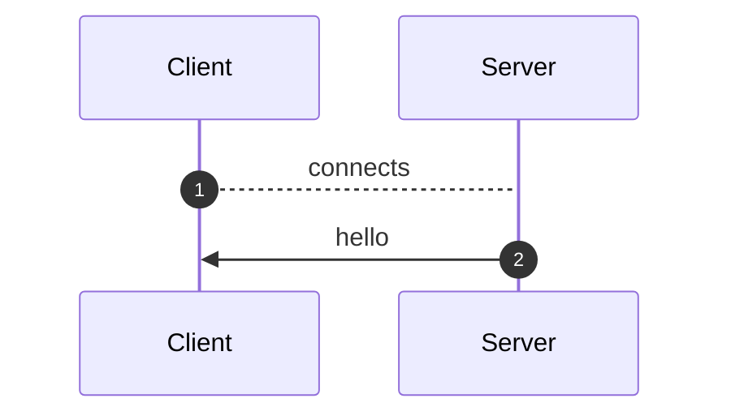
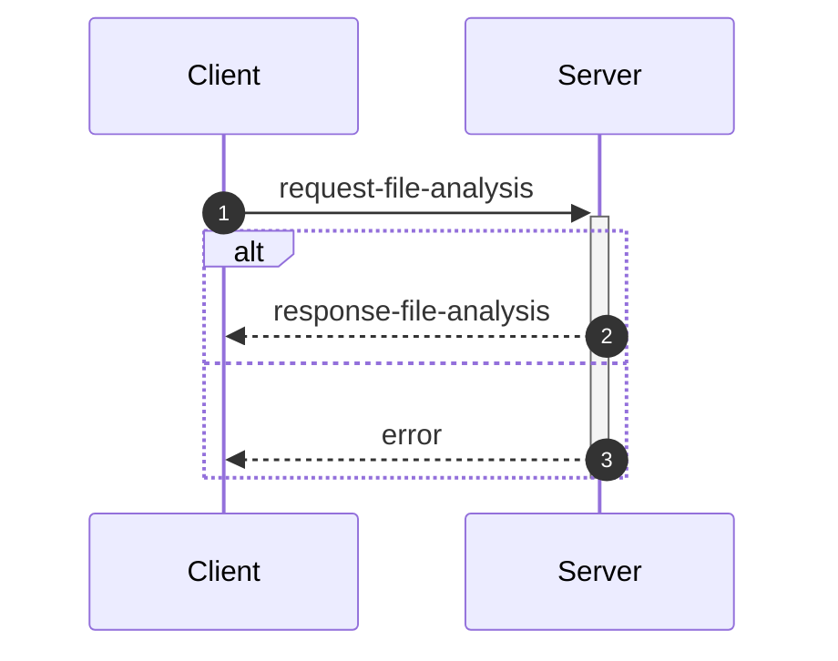
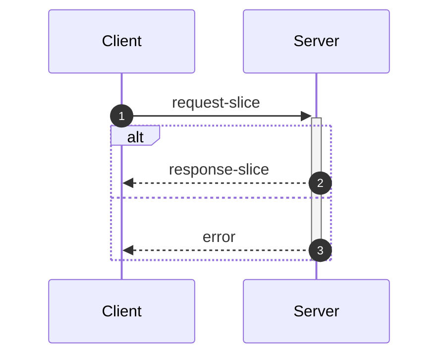
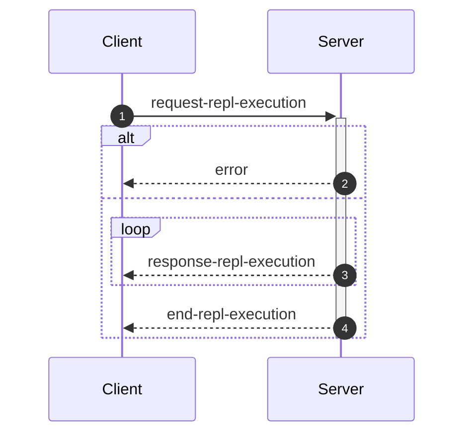

_<span title="an overview of flowR's interface">Generated</span> from '[wiki-interface.ts](https://github.com/flowr-analysis/flowr/tree/main/src/documentation/wiki-interface.ts "src/documentation/wiki-interface.ts")' on 2026-10-23, 07:47:08 UTC (v2.16.6, R v4.6.1), do not edit directly._

Although far from being as detailed as the in-depth explanation of [_flowR_](https://github.com/flowr-analysis/flowr/wiki/Core),
this wiki page explains how to interface with _flowR_ in more detail.
In general, command line arguments and other options provide short descriptions on hover over.

* [💻 Using the REPL](#using-the-repl)
* [⚙️ Configuring FlowR](#configuring-flowr)
* [⚒️ Writing Code](#writing-code)
* [💬 Communicating with the Server](#communicating-with-the-server)

<a id='using-the-repl'></a>
## 💻 Using the REPL

> [!NOTE]
> To execute arbitrary R commands with a repl request, _flowR_ has to be started explicitly with <span title="Description (Command Line Argument): Allow to access the underlying R session when using flowR (security warning: this allows the execution of arbitrary R code!)">`--r-session-access`</span>.
> Please be aware that this introduces a security risk and note that this relies on the [`r-shell` engine](https://github.com/flowr-analysis/flowr/wiki/Engines) .

Although primarily meant for users to explore,
there is nothing which forbids calling _flowR_ as a subprocess to use standard-in, -output, and -error
for communication (although you can access the REPL using the server as well,
with the [REPL Request](#message-request-repl-execution) message).

The read-eval-print loop&nbsp;(REPL) works relatively simple.
You can submit an expression (using <kbd>Enter</kbd>),
which is interpreted as an R&nbsp;expression by default but interpreted as a *command* if it starts with a colon (`:`).
The best command to get started with the REPL is <span title="Description (Repl Command): Show help information (aliases: :h, :?)">`:help`</span>.
Besides, you can leave the REPL either with the command <span title="Description (Repl Command): End the repl (aliases: :q, :exit)">`:quit`</span> or by pressing <kbd>Ctrl</kbd>+<kbd>C</kbd> twice.
When writing a *command*, you may press <kbd>Tab</kbd> to get a list of completions, if available.
Multiple commands can be entered in a single line by separating them with a semicolon (`;`), e.g. `:parse "x<-2"; :df*`.
If a command is given without R code, the REPL will re-use R code given in a previous command.
The prior example will hence return first the parsed AST of the program and then the dataflow graph for `"x <- 2"`.

> [!NOTE]
> If you develop flowR, you may want to launch the repl using the `npm run main-dev` command, this way, you get a non-minified version of flowR with debug information and hot-reloading of source files.

<details>
<summary>Available Commands</summary>

We currently offer the following commands (this with a `[*]` suffix are available with and without the star):

| Command | Description |
| ------- | ----------- |
| **<span title="Description (Repl Command): End the repl (aliases: :q, :exit)">:quit</span>** | End the repl (aliases: **:<span title="Alias of ':quit'. End the repl">q</span>**, **:<span title="Alias of ':quit'. End the repl">exit</span>**) |
| **<span title="Description (Repl Command): Execute the given code as R code. This requires the `--r-session-access` flag to be set and requires the r-shell engine. (aliases: :e, :r)">:execute</span>** | Execute the given code as R code. This requires the `--r-session-access` flag to be set and requires the r-shell engine. (aliases: **:<span title="Alias of ':execute'. Execute the given code as R code. This requires the `--r-session-access` flag to be set and requires the r-shell engine.">e</span>**, **:<span title="Alias of ':execute'. Execute the given code as R code. This requires the `--r-session-access` flag to be set and requires the r-shell engine.">r</span>**) |
| **<span title="Description (Repl Command): Get mermaid code for the control-flow graph of R code (aliases: :cfg, :cf)">:controlflow[*]</span>** | Get mermaid code for the control-flow graph of R code (star: Returns the URL to mermaid.live) (aliases: **:<span title="Alias of ':controlflow'. Get mermaid code for the control-flow graph of R code">cfg</span>**, **:<span title="Alias of ':controlflow'. Get mermaid code for the control-flow graph of R code">cf</span>**) |
| **<span title="Description (Repl Command): Get mermaid code for the control-flow graph with basic blocks (aliases: :cfgb, :cfb)">:controlflowbb[*]</span>** | Get mermaid code for the control-flow graph with basic blocks (star: Returns the URL to mermaid.live) (aliases: **:<span title="Alias of ':controlflowbb'. Get mermaid code for the control-flow graph with basic blocks">cfgb</span>**, **:<span title="Alias of ':controlflowbb'. Get mermaid code for the control-flow graph with basic blocks">cfb</span>**) |
| **<span title="Description (Repl Command): Get mermaid code for the dataflow graph (aliases: :d, :df)">:dataflow[*]</span>** | Get mermaid code for the dataflow graph (star: Returns the URL to mermaid.live) (aliases: **:<span title="Alias of ':dataflow'. Get mermaid code for the dataflow graph">d</span>**, **:<span title="Alias of ':dataflow'. Get mermaid code for the dataflow graph">df</span>**) |
| **<span title="Description (Repl Command): Get mermaid code for the normalized AST of R code (aliases: :n)">:normalize[*]</span>** | Get mermaid code for the normalized AST of R code (star: Returns the URL to mermaid.live) (alias: **:<span title="Alias of ':normalize'. Get mermaid code for the normalized AST of R code">n</span>**) |
| **<span title="Description (Repl Command): Get mermaid code for the simplified dataflow graph (aliases: :ds, :dfs)">:dataflowsimple[*]</span>** | Get mermaid code for the simplified dataflow graph (star: Returns the URL to mermaid.live) (aliases: **:<span title="Alias of ':dataflowsimple'. Get mermaid code for the simplified dataflow graph">ds</span>**, **:<span title="Alias of ':dataflowsimple'. Get mermaid code for the simplified dataflow graph">dfs</span>**) |
| **<span title="Description (Repl Command): Inspect and extend the signature database: `query` (identical to :query @signature), `info <name>` for where a function comes from (identical to :query @function-info), `add <path>` to mount another database/source, `download` to fetch the full-history database. (aliases: :sig)">:signature</span>** | Inspect and extend the signature database: `query` (identical to :query @signature), `info <name>` for where a function comes from (identical to :query @function-info), `add <path>` to mount another database/source, `download` to fetch the full-history database. (alias: **:<span title="Alias of ':signature'. Inspect and extend the signature database: `query` (identical to :query @signature), `info <name>` for where a function comes from (identical to :query @function-info), `add <path>` to mount another database/source, `download` to fetch the full-history database.">sig</span>**) |
| **<span title="Description (Repl Command): Just calculates the DFG, but only prints summary info (aliases: :d#, :df#)">:dataflowsilent</span>** | Just calculates the DFG, but only prints summary info (aliases: **:<span title="Alias of ':dataflowsilent'. Just calculates the DFG, but only prints summary info">d#</span>**, **:<span title="Alias of ':dataflowsilent'. Just calculates the DFG, but only prints summary info">df#</span>**) |
| **<span title="Description (Repl Command): Prints ASCII Art of the parsed, unmodified AST (aliases: :p)">:parse</span>** | Prints ASCII Art of the parsed, unmodified AST (alias: **:<span title="Alias of ':parse'. Prints ASCII Art of the parsed, unmodified AST">p</span>**) |
| **<span title="Description (Repl Command): Prints the version of flowR as well as the current version of R">:version</span>** | Prints the version of flowR as well as the current version of R
| **<span title="Description (Repl Command): Query the given R code (use 'help' for more information)">:query[*]</span>** | Query the given R code (use 'help' for more information) (star: Similar to query, but returns the output in json format.)
| **<span title="Description (Repl Command): Returns an ASCII representation of the dataflow graph (aliases: :df!)">:dataflowascii</span>** | Returns an ASCII representation of the dataflow graph (alias: **:<span title="Alias of ':dataflowascii'. Returns an ASCII representation of the dataflow graph">df!</span>**) |
| **<span title="Description (Repl Command): Returns summarization stats for the normalized AST (aliases: :n#)">:normalize#</span>** | Returns summarization stats for the normalized AST (alias: **:<span title="Alias of ':normalize#'. Returns summarization stats for the normalized AST">n#</span>**) |
| **<span title="Description (Repl Command): Show help information (aliases: :h, :?)">:help</span>** | Show help information (aliases: **:<span title="Alias of ':help'. Show help information">h</span>**, **:<span title="Alias of ':help'. Show help information">?</span>**) |

</details>

> [!TIP]
> 
> As indicated by the examples before, all REPL commands that operate on code keep track of the state.
> Hence, if you run a command like <span title="Description (Repl Command, starred version): Returns the URL to mermaid.live; Base Command: Get mermaid code for the dataflow graph (aliases: :d*, :df*)">`:dataflow*`</span> without providing R code,
> the REPL will re-use the R code provided in a previous command.
> Likewise, doing this will benefit from incrementality!
> If you request the dataflow graph with `:df* x <- 2 * y` and then want to see the parsed AST with `:parse`,
> the REPL will re-use previously obtained information and not re-parse the code again.
> 		

Generally, many commands offer shortcut versions in the REPL. Many queries, for example, offer a shortened format (see the example below).
Of special note, the [Config Query](https://github.com/flowr-analysis/flowr/wiki/%5BQuery%5D-Config)
can be used to also modify the currently active configuration of _flowR_ within the REPL (see the [wiki page](https://github.com/flowr-analysis/flowr/wiki/%5BQuery%5D-Config) for more information).

### Example: Retrieving the Dataflow Graph

To retrieve a URL to the [mermaid](https://mermaid.js.org/) diagram of the dataflow of a given expression,
use <span title="Description (Repl Command, starred version): Returns the URL to mermaid.live; Base Command: Get mermaid code for the dataflow graph (aliases: :d*, :df*)">`:dataflow*`</span> (or <span title="Description (Repl Command): Get mermaid code for the dataflow graph (aliases: :d, :df)">`:dataflow`</span> to get the mermaid code in the cli):

```shell
$ docker run -it --rm eagleoutice/flowr # or npm run flowr 
flowR repl v2.16.6, R grammar v14 (tree-sitter engine)
R> :dataflow* y <- 1 + x
```

<details>
<summary style='color:gray'>Output</summary>

```text
https://mermaid.live/view#base64:eyJjb2RlIjoiZmxvd2NoYXJ0IFREXG4gICAgMXt7XCJgKiM5MTtSTnVtYmVyIzkzOyogKioxKipcbiAgICAgICoxLjYqICgqKmlkOiAxKiopYFwifX1cbiAgICAyKFtcImAqIzkxO1JTeW1ib2wjOTM7KiAqKngqKlxuICAgICAgKjEuMTAqICgqKmlkOiAyKiopYFwiXSlcbiAgICAzW1tcImAqIzkxO1JCaW5hcnlPcCM5MzsqIGJhc2UjNTg7IzU4OyoqIzQzOyoqXG4gICAgICAqMS42LTEwKiAoKippZDogMyoqKVxuICAgIGFyZzogKDEsIDIpYFwiXV1cbiAgICBidWlsdC1pbjpfNDNfW1wiYEJ1aWx0LUluOlxuIzQzO2BcIl1cbiAgICBzdHlsZSBidWlsdC1pbjpfNDNfIHN0cm9rZTpncmF5LGZpbGw6Z3JheSxzdHJva2Utd2lkdGg6MnB4LG9wYWNpdHk6Ljg7XG4gICAgMFtcImAqIzkxO1JTeW1ib2wjOTM7KiAqKnkqKlxuICAgICAgKjEuMSogKCoqaWQ6IDAqKiwgdjogMylgXCJdXG4gICAgNFtbXCJgKiM5MTtSQmluYXJ5T3AjOTM7KiBiYXNlIzU4OyM1ODsqKiM2MDsjNDU7KipcbiAgICAgICoxLjEtMTAqICgqKmlkOiA0KiopXG4gICAgYXJnOiAoMCwgMylgXCJdXVxuICAgIGJ1aWx0LWluOl82MF8tW1wiYEJ1aWx0LUluOlxuIzYwOyM0NTtgXCJdXG4gICAgc3R5bGUgYnVpbHQtaW46XzYwXy0gc3Ryb2tlOmdyYXksZmlsbDpncmF5LHN0cm9rZS13aWR0aDoycHgsb3BhY2l0eTouODtcbiAgICAxIC0uLT58XCJmbG93XCJ8IDJcbiAgICBsaW5rU3R5bGUgMCBzdHJva2U6Z3JheSxjb2xvcjpncmF5O1xuICAgIDIgLS4tPnxcImZsb3dcInwgM1xuICAgIGxpbmtTdHlsZSAxIHN0cm9rZTpncmF5LGNvbG9yOmdyYXk7XG4gICAgMyAtLT58XCJyZWFkcywgYXJnXCJ8IDFcbiAgICAzIC0tPnxcInJlYWRzLCBhcmdcInwgMlxuICAgIDMgLS4tPnxcImZsb3dcInwgMFxuICAgIGxpbmtTdHlsZSA0IHN0cm9rZTpncmF5LGNvbG9yOmdyYXk7XG4gICAgMyAtLi0+fFwicmVhZHMsIGNhbGxzXCJ8IGJ1aWx0LWluOl80M19cbiAgICBsaW5rU3R5bGUgNSBzdHJva2U6Z3JheTtcbiAgICAwIC0tPnxcImRlZmluZWQtYnksIGZsb3dcInwgNFxuICAgIDAgLS0+fFwiZGVmaW5lZC1ieVwifCAzXG4gICAgNCAtLT58XCJyZWFkcywgYXJnXCJ8IDNcbiAgICA0IC0tPnxcInJldHVybnMsIGFyZ1wifCAwXG4gICAgNCAtLi0+fFwicmVhZHMsIGNhbGxzXCJ8IGJ1aWx0LWluOl82MF8tXG4gICAgbGlua1N0eWxlIDEwIHN0cm9rZTpncmF5OyIsIm1lcm1haWQiOnsiYXV0b1N5bmMiOnRydWV9fQ==
```

Retrieve the dataflow graph of the expression `y <- 1 + x`. It looks like this:


<details>

<summary style="color:gray">R Code of the Dataflow Graph</summary>

The analysis ran (including parse and normalize, using the [tree-sitter](https://github.com/flowr-analysis/flowr/wiki/Engines) engine) within the generation environment. No [signature database](https://github.com/flowr-analysis/flowr/wiki/Signature-Database) is mounted for these generated graphs, so `library()` calls attach no package exports; base-R names are still qualified via the generated base-package store (e.g. `acf` as `stats::acf`). 
We encountered no unknown side effects during the analysis.

```r
y <- 1 + x
```

</details>

</details>

For small graphs like this, <span title="Description (Repl Command): Returns an ASCII representation of the dataflow graph (aliases: :df!)">`:dataflowascii`</span> also provides an ASCII representation directly in the REPL:

```shell
$ docker run -it --rm eagleoutice/flowr # or npm run flowr 
flowR repl v2.16.6, R grammar v14 (tree-sitter engine)
R> :df! y <- 1 + x
```

<details open>
<summary style='color:gray'>Output</summary>

```text
                        v<0>v
 c<4>c──────────────────| y |
 |<- |     ┌────────────v---v
 c---c     │
    │   c<3>c   0<1>0
    └───| + |───| 1 |───u<2>u
        c---c   0---0   | x |
           └────────────u---u
Edges:
3 -> 1: reads, arg          3 -> 2: reads, arg
3 -> 0: flows-to            1 -> 2: flows-to
2 -> 3: flows-to            4 -> 3: reads, arg
4 -> 0: returns, arg        0 -> 4: defined-by, flows-to
0 -> 3: defined-by
```

Retrieve the dataflow graph of the expression `y <- 1 + x` as ASCII art.

</details>

For the slicing with <span title="Description (Repl Command): Static backwards executable slicer for R">`:slicer`</span>, you have access to the same [magic comments](#slice-magic-comments) as with the [slice request](#message-request-slice).
Pass `--inline` to splice resolvable `source()` calls into the reconstruction so the slice is a single self-contained R text (the same as the static slice query's `inlineSources` flag).
See `--help` for more flags!

### Example: Interfacing with the File System

Many commands that allow for an R-expression (like <span title="Description (Repl Command, starred version): Returns the URL to mermaid.live; Base Command: Get mermaid code for the dataflow graph (aliases: :d*, :df*)">`:dataflow*`</span>) allow for a file as well
if the argument starts with `file://`.
If you are working from the root directory of the _flowR_ repository, the following gives you the parsed AST of the example file using the <span title="Description (Repl Command): Prints ASCII Art of the parsed, unmodified AST (aliases: :p)">`:parse`</span> command:

> **Watch mode**: Replace `file://` with `watch://` to enter watch mode.
> flowR runs the command immediately and then re-runs it every time the file (or any file inside the folder) changes.
> Enter any other command to leave watch mode.
> For example: `:df watch://analysis.R`

```shell
$ docker run -it --rm eagleoutice/flowr # or npm run flowr 
flowR repl v2.16.6, R grammar v14 (tree-sitter engine)
R> :parse file://test/testfiles/example.R
```

<details>
<summary style='color:gray'>Output</summary>

```text
File: test/testfiles/example.R

program
├ binaryoperator
│ ├ identifier "sum" (1:1─4)
│ ├ <- "<-" (1:5─7)
│ ╰ float "0" (1:8─9)
├ binaryoperator
│ ├ identifier "product" (2:1─8)
│ ├ <- "<-" (2:9─11)
│ ╰ float "1" (2:12─13)
├ binaryoperator
│ ├ identifier "w" (3:1─2)
│ ├ <- "<-" (3:3─5)
│ ╰ float "7" (3:6─7)
├ binaryoperator
│ ├ identifier "N" (4:1─2)
│ ├ <- "<-" (4:3─5)
│ ╰ float "10" (4:6─8)
├ forstatement
│ ├ for "for" (6:1─4)
│ ├ ( "(" (6:5─6)
│ ├ identifier "i" (6:6─7)
│ ├ in "in" (6:8─10)
│ ├ binaryoperator
│ │ ├ float "1" (6:11─12)
│ │ ├ : ":" (6:12─13)
│ │ ╰ parenthesizedexpression
│ │   ├ ( "(" (6:13─14)
│ │   ├ binaryoperator
│ │   │ ├ identifier "N" (6:14─15)
│ │   │ ├ - "-" (6:15─16)
│ │   │ ╰ float "1" (6:16─17)
│ │   ╰ ) ")" (6:17─18)
│ ├ ) ")" (6:18─19)
│ ╰ bracedexpression
│   ├ { "{" (6:20─21)
│   ├ binaryoperator
│   │ ├ identifier "sum" (7:3─6)
│   │ ├ <- "<-" (7:7─9)
│   │ ╰ binaryoperator
│   │   ├ binaryoperator
│   │   │ ├ identifier "sum" (7:10─13)
│   │   │ ├ + "+" (7:14─15)
│   │   │ ╰ identifier "i" (7:16─17)
│   │   ├ + "+" (7:18─19)
│   │   ╰ identifier "w" (7:20─21)
│   ├ binaryoperator
│   │ ├ identifier "product" (8:3─10)
│   │ ├ <- "<-" (8:11─13)
│   │ ╰ binaryoperator
│   │   ├ identifier "product" (8:14─21)
│   │   ├  "" (8:22─23)
│   │   ╰ identifier "i" (8:24─25)
│   ╰ } "}" (9:1─2)
├ call
│ ├ identifier "cat" (11:1─4)
│ ╰ arguments
│   ├ ( "(" (11:4─5)
│   ├ argument
│   │ ╰ string
│   │   ├ " "\"" (11:5─6)
│   │   ├ stringcontent "Sum:" (11:6─10)
│   │   ╰ " "\"" (11:10─11)
│   ├ comma "," (11:11─12)
│   ├ argument
│   │ ╰ identifier "sum" (11:13─16)
│   ├ comma "," (11:16─17)
│   ├ argument
│   │ ╰ string
│   │   ├ " "\"" (11:18─19)
│   │   ├ stringcontent
│   │   │ ╰ escapesequence "\\n" (11:19─21)
│   │   ╰ " "\"" (11:21─22)
│   ╰ ) ")" (11:22─23)
╰ call
  ├ identifier "cat" (12:1─4)
  ╰ arguments
    ├ ( "(" (12:4─5)
    ├ argument
    │ ╰ string
    │   ├ " "\"" (12:5─6)
    │   ├ stringcontent "Product:" (12:6─14)
    │   ╰ " "\"" (12:14─15)
    ├ comma "," (12:15─16)
    ├ argument
    │ ╰ identifier "product" (12:17─24)
    ├ comma "," (12:24─25)
    ├ argument
    │ ╰ string
    │   ├ " "\"" (12:26─27)
    │   ├ stringcontent
    │   │ ╰ escapesequence "\\n" (12:27─29)
    │   ╰ " "\"" (12:29─30)
    ╰ ) ")" (12:30─31)
```

Retrieve the parsed AST of the example file.

<details>

<summary>File Content</summary>

```r
sum <- 0
product <- 1
w <- 7
N <- 10

for (i in 1:(N-1)) {
  sum <- sum + i + w
  product <- product * i
}

cat("Sum:", sum, "\n")
cat("Product:", product, "\n")
```

</details>

As _flowR_ directly transforms this AST the output focuses on being human-readable instead of being machine-readable.
		
</details>

### Example: Run a Query

You can run any query supported by _flowR_ using the <span title="Description (Repl Command): Query the given R code (use 'help' for more information)">`:query`</span> command.
For example, to obtain the shapes of all data frames in a given piece of code, you can run:

```shell
$ docker run -it --rm eagleoutice/flowr # or npm run flowr 
flowR repl v2.16.6, R grammar v14 (tree-sitter engine)
R> :query @absint df-shape "x <- data.frame(a = 1:10, b = 1:10)\ny <- x$a"
```

<details open>
<summary style='color:gray'>Output</summary>

```text
Query: absint (2 ms)
```

Retrieve the shapes of all data frames in the given code.

</details>

To run the linter on a file, you can use (in this example, we just issue the `dead-code` linter on a small piece of code):

```shell
$ docker run -it --rm eagleoutice/flowr # or npm run flowr 
flowR repl v2.16.6, R grammar v14 (tree-sitter engine)
R> :query @linter rules:dead-code "if(FALSE) x <- 2"
```

<details open>
<summary style='color:gray'>Output</summary>

```text
Query: linter (2 ms)
   ╰ Dead Code (dead-code):
       ╰ certain:
           ╰ Code at 1.11-16
```

Run the linter on the given code, with only the `dead-code` rule enabled.

</details>

For more information on the available queries, please check out the [Query API](https://github.com/flowr-analysis/flowr/wiki/Query-API).

<a id='configuring-flowr'></a>
## ⚙️ Configuring FlowR

When running _flowR_, you may want to specify some behaviors with a dedicated configuration file.
By default, flowR looks for a file named `flowr.json` in the current working directory (or any higher directory).
You can also specify a different file with <span title="Description (Command Line Argument): The name of the configuration file to use">`--config-file`</span> or pass the configuration inline using <span title="Description (Command Line Argument): The flowR configuration to use, as a JSON string">`--config-json`</span>.
A `flowr.json` found this way belongs to the analyzed project, so flowR ignores its options that decide what flowR executes or loads
(`engines.*.wasmPath`, `engines.*.treeSitterWasmPath`, `engines.*.rPath`, `solver.sigdb.additionalPaths`, `solver.sigdb.downloadRepo`, `solver.sigdb.installedLibrary.paths`),
unless you pass <span title="Description (Command Line Argument): Keep the security-sensitive options (e.g., the R executable) of the flowr.json found in the working directory or a parent. Only use this for projects you trust.">`--trust-config`</span>.
To analyze code you do not trust, use the secure mode (<span title="Description (Command Line Argument): Run in secure mode for analyzing untrusted code: flowR does not start R (or any other process), does not access the network, does not search for project configs, and ignores security-sensitive options in every config. Cannot be disabled once enabled. Can also be enabled with the environment variable {italic FLOWR_SECURE_MODE=1}.">`--secure`</span>, see the [security policy](https://github.com/flowr-analysis/flowr/blob/main/.github/SECURITY.md)).
To inspect the current configuration, you can run flowr with the <span title="Description (Command Line Argument): Run with verbose logging (will be passed to the corresponding script)">`--verbose`</span> flag, or use the `config` [Query](https://github.com/flowr-analysis/flowr/wiki/Query-API).
Within the REPL this works by running the following:

```shell
:query @config
```

To work with the <a href="https://github.com/flowr-analysis/flowr/tree/main/src/config.ts#L119"><code><span title="The configuration file format for flowR.">FlowrConfig</span></code></a> you can use the provided helper objects alongside its methods like
<a href="https://github.com/flowr-analysis/flowr/tree/main/src/config.ts#L914"><code><span title="Creates a new flowr config that has the updated values.">FlowrConfig::<b>amend</b></span></code></a>.
The schema below documents every option; the ones you most likely want are:

- <a href="https://github.com/flowr-analysis/flowr/wiki/Interface#configuring-flowr" title="Configuration Option (boolean): Whether source calls should be ignored, causing {@link processSourceCall}&#39;s behavior to be skipped.">ignoreSourceCalls</a>: ignore source calls when analyzing the code, i.e., ignore the inclusion of other files.
- <a href="https://github.com/flowr-analysis/flowr/wiki/Interface#configuring-flowr" title="Configuration Option (boolean): Whether load calls should be ignored, causing {@link processLoadCall}&#39;s behavior to be skipped.">ignoreLoadCalls</a>: ignore load calls when analyzing the code, i.e., ignore the loading of r-data files.
- <a href="https://github.com/flowr-analysis/flowr/wiki/Interface#configuring-flowr" title="Configuration Option (object): Do you want to overwrite (parts) of the builtin definition?">semantics.environment.overwriteBuiltIns</a>: overwrite _flowR_'s handling of built-in functions, or clear the preset definitions entirely.
  See [Configure BuiltIn Semantics](#configure-builtin-semantics) for more information.
- <a href="https://github.com/flowr-analysis/flowr/wiki/Interface#configuring-flowr" title="Configuration Option (string): How to resolve variables and their values. (one of &quot;disabled&quot;, &quot;alias&quot;, &quot;builtin&quot;)">solver.variables</a>: how to resolve variables and their values (`disabled`, `alias`, `builtin`).
- <a href="https://github.com/flowr-analysis/flowr/wiki/Interface#configuring-flowr" title="Configuration Option (array): The engine or set of engines to use for interacting with R code. An empty array means all available engines will be used.">engines</a> and <a href="https://github.com/flowr-analysis/flowr/wiki/Interface#configuring-flowr" title="Configuration Option (string): The default engine to use for interacting with R code. If this is undefined, an arbitrary engine from the specified list will be used. (one of &quot;tree-sitter&quot;, &quot;r-shell&quot;)">defaultEngine</a>: the engines used to interact with R code, see the [Engines wiki page](https://github.com/flowr-analysis/flowr/wiki/Engines).
- <a href="https://github.com/flowr-analysis/flowr/wiki/Interface#configuring-flowr" title="Configuration Option (array): Files a framework loads on its own, without any source() call (e.g. global.R in a shiny app), in the order they are loaded; flowR orders the matching project files accordingly and analyzes them as one program. Entries are case-insensitive globs matched against the file path, a plain name matches any file with that name, and entries matching no project file are warned about. Usually set per project kind via specializeConfig.">project.implicitSources</a>: the files a framework loads without any `source()` call, in the order in which they are
  loaded. Entries are globs (e.g. `R/*.R`) matched against the file path ignoring capitalization; one matching no file is reported.
- <a href="https://github.com/flowr-analysis/flowr/wiki/Interface#configuring-flowr" title="Configuration Option (object): Overwrite (parts of) the configuration depending on the project kind flowR detects, e.g. to give a shiny app its implicit sources.">specializeConfig</a>: overwrite (parts of) the configuration depending on the kind of project _flowR_ detects
  (e.g. `shiny-app`), which is how a shiny app gets its implicit sources by default. What you configure directly wins.
- <a href="https://github.com/flowr-analysis/flowr/wiki/Interface#configuring-flowr" title="Configuration Option (string): Overwrite the project kind flowR would otherwise infer from the analyzed files, e.g. when auto-detection guesses wrong. (one of &quot;package&quot;, &quot;script&quot;, &quot;shiny-app&quot;, &quot;notebook&quot;, &quot;project&quot;, &quot;unknown&quot;)">project.useProjectType</a>: skip that detection and force a project kind yourself, when auto-detection guesses wrong.
- <a href="https://github.com/flowr-analysis/flowr/wiki/Interface#configuring-flowr" title="Configuration Option (array): The default plugins to load when creating a new instance of FlowrAnalyzer">defaultPlugins</a> and <a href="https://github.com/flowr-analysis/flowr/wiki/Interface#configuring-flowr" title="Configuration Option (array): The plugins to load in REPL mode">repl.plugins</a>: the plugins to load for a new <a href="https://github.com/flowr-analysis/flowr/tree/main/src/project/flowr-analyzer.ts#L205"><code><span title="Central class for conducting analyses with FlowR. Use the FlowrAnalyzerBuilder to create a new instance. If you want the original pattern of creating a pipeline and running all steps, you can still do this with FlowrAnalyzer#runFull . To inspect the context of the analyzer, use FlowrAnalyzer#inspectContext (if you are a plugin and need to modify it, use FlowrAnalyzer#context instead).">FlowrAnalyzer</span></code></a> and in the REPL
  (use `flowr:default` to reference the former).

So you can configure _flowR_ by adding a file like the following:

<details>

<summary>Example Configuration File</summary>

```json
{
  "ignoreSourceCalls": true,
  "ignoreLoadCalls": true,
  "semantics": {
    "environment": {
      "overwriteBuiltIns": {
        "definitions": [
          {
            "type": "function",
            "names": [
              "foo"
            ],
            "processor": "builtin:assign",
            "config": {}
          }
        ]
      }
    }
  },
  "defaultPlugins": [
    "file:description",
    "versions:description"
  ],
  "repl": {
    "quickStats": false,
    "dfProcessorHeat": false,
    "hints": true,
    "plugins": [
      "flowr:default"
    ]
  },
  "project": {
    "resolveUnknownPathsOnDisk": true,
    "implicitSources": [
      "global.R",
      "app.R"
    ]
  },
  "linter": {
    "disabledRules": []
  },
  "specializeConfig": {
    "shiny-app": {
      "project": {
        "implicitSources": [
          "global.R",
          "ui.R",
          "server.R",
          "app.R"
        ]
      }
    }
  },
  "engines": [
    {
      "type": "r-shell"
    }
  ],
  "solver": {
    "variables": "alias",
    "evalStrings": true,
    "trackEnvironments": true,
    "sigdb": {
      "enabled": true,
      "loadProjectDependencies": true,
      "eagerlyLoad": false,
      "eagerlyLoadExports": false,
      "linkBaseR": false,
      "linkDescriptionDependencies": false
    },
    "resolveSource": {
      "dropPaths": "no",
      "ignoreCapitalization": true,
      "inferWorkingDirectory": "active-script",
      "searchPath": []
    },
    "instrument": {},
    "slicer": {
      "threshold": 50
    }
  },
  "abstractInterpretation": {
    "wideningThreshold": 4,
    "followCalls": true,
    "dataFrame": {
      "maxColNames": 20,
      "readLoadedData": {
        "readExternalFiles": true,
        "maxReadLines": 1000000
      }
    }
  },
  "incremental": {
    "alwaysIncremental": false,
    "parsing": {
      "activated": false,
      "heuristics": {
        "activated": true,
        "mtime": true,
        "linesFrom": 500,
        "bytesFrom": 50000,
        "alwaysWithEdits": false,
        "minFiles": 1
      }
    }
  },
  "gas": {
    "thresholds": {
      "memory": {
        "problematic": 0.7,
        "critical": 0.9
      },
      "timeMs": {
        "problematic": 100000,
        "critical": 120000
      }
    },
    "features": {}
  }
}
```

</details>

<details>
<a id='configure-builtin-semantics'></a>
<summary>Configure Built-In Semantics</summary>

`semantics/environment/overwriteBuiltins` accepts two keys:

- `loadDefaults` (boolean, initially `true`): If set to `true`, the default built-in definitions are loaded before applying the custom definitions. Setting this flag to `false` explicitly disables the loading of the default definitions.
- `definitions` (array, initially empty): Allows to overwrite or define new built-in elements. Each object within must have a `type` which is one of the below. Furthermore, they may define a string array of `names` which specifies the identifiers to bind the definitions to. You may use `assumePrimitive` to specify whether _flowR_ should assume that this is a primitive non-library definition (so you probably just do not want to specify the key).

  | Type            | Description                                                                                                                                                                                                                                                                                              | Example                                                                                                    |
  | --------------- | -------------------------------------------------------------------------------------------------------------------------------------------------------------------------------------------------------------------------------------------------------------------------------------------------------- | ---------------------------------------------------------------------------------------------------------- |
  | `constant`    | Additionally allows for a `value` this should resolve to.                                                                                                                                                                                                                                                | `{ type: 'constant', names: ['NULL', 'NA'],  value: null }`                                                |
  | `function`    | Is a rather flexible way to define and bind built-in functions. For the time, we do not have extensive documentation to cover all the cases, so please either consult the sources with the `default-builtin-config.ts` or open a [new issue](https://github.com/flowr-analysis/flowr/issues/new/choose). | `{ type: 'function', names: ['next'], processor: 'builtin:d', config: { cfg: ExitPointType.Next } }` |
  | `replacement` | A comfortable way to specify replacement functions like `$<-` or `names<-`. `suffixes` describes the... suffixes to attach automatically. | `{ type: 'replacement', suffixes: ['<-', '<<-'], names: ['[', '[['] }` |

</details>

<details>

<summary style='color:gray'>Full Configuration-File Schema</summary>

- _The configuration file format for flowR._ (object)
    - **logLevel** [optional] _flowR's global minimum log level, applied when the config is loaded._ (string)
        Only allows: 'silly', 'trace', 'debug', 'info', 'warn', 'error', 'fatal'
    - **ignoreSourceCalls** [optional] _Whether source calls should be ignored, causing {@link processSourceCall}'s behavior to be skipped._ (boolean)
    - **ignoreLoadCalls** [optional] _Whether load calls should be ignored, causing {@link processLoadCall}'s behavior to be skipped._ (boolean)
    - **semantics** _Configure language semantics and how flowR handles them._ (object)
        - **environment** [optional] _Semantics regarding how to handle the R environment._ (object)
            - **overwriteBuiltIns** [optional] _Do you want to overwrite (parts) of the builtin definition?_ (object)
                - **loadDefaults** [optional] _Should the default configuration still be loaded?_ (boolean)
                - **definitions** [optional] _The definitions to load/overwrite._ (array)
                Valid item types:
                    - (object)
    - **defaultPlugins** [optional] _The default plugins to load when creating a new instance of FlowrAnalyzer_ (array)
    Valid item types:
        - (alternatives)
            - (string)
            - (array)
    - **repl** _Configuration options for the REPL._ (object)
        - **quickStats** [optional] _Whether to show quick stats in the REPL after each evaluation._ (boolean)
        - **dfProcessorHeat** [optional] _This instruments the dataflow processors to count how often each processor is called._ (boolean)
        - **hints** [optional] _Whether to show dim inline hints on the empty prompt (automatically disabled on non-interactive terminals)._ (boolean)
        - **plugins** [optional] _The plugins to load in REPL mode_ (array)
        Valid item types:
            - (alternatives)
                - (string)
                - (array)
        - **autoUseFileProtocol** [optional] _Prepend the file protocol to a repl input that looks like a path, instead of only warning about it._ (boolean)
        - **queryStats** [optional] _Whether `:query` closes with the line stating how long the queries took (`:query*` never prints it)._ (boolean)
        - **showPlugins** [optional] _Whether `:version` grays out the plugins that did not activate during the last analysis._ (boolean)
    - **project** _Project specific configuration options._ (object)
        - **resolveUnknownPathsOnDisk** [optional] _Whether to resolve unknown paths loaded by the r project disk when trying to source/analyze files._ (boolean)
        - **failOnInaccessiblePath** [optional] _Whether a directory that cannot be traversed during file discovery (e.g. due to permissions) aborts the analysis; when false (the default) such paths are logged and skipped._ (boolean)
        - **basePackages** [optional] _The packages considered part of R itself (base and recommended); if unset, flowR uses its built-in list._ (array)
        Valid item types:
            - (string)
        - **implicitSources** [optional] _Files a framework loads on its own, without any source() call (e.g. global.R in a shiny app), in the order they are loaded; flowR orders the matching project files accordingly and analyzes them as one program. Entries are case-insensitive globs matched against the file path, a plain name matches any file with that name, and entries matching no project file are warned about. Usually set per project kind via specializeConfig._ (array)
        Valid item types:
            - (string)
        - **useProjectType** [optional] _Overwrite the project kind flowR would otherwise infer from the analyzed files, e.g. when auto-detection guesses wrong._ (string)
            Only allows: 'package', 'script', 'shiny-app', 'notebook', 'project', 'unknown'
        - **assumeImplicitEcho** [optional] _Whether the top level of the analyzed code is echoed, so that every visible result printed there is collected as an output by the dependencies query (default true, false for a package)._ (boolean)
        - **discovery** [optional] _Scoping options for the default project discovery._ (object)
            - **full** [optional] _Collect every file below the project root (greedy) instead of only the files the detected project kind needs (default false)._ (boolean)
            - **perKind** [optional] _Per-kind include/exclude glob overrides layered on the default scoping._ (object)
            - **ignore** [optional] _Case-insensitive globs that drop matching files from the intelligent discovery, regardless of kind (e.g. .Renviron to ignore environment files)._ (array)
            Valid item types:
                - (string)
        - **classification** [optional] _Overrides for the signals flowR uses to classify the project kind._ (object)
            - **shinyDescriptionTypes** [optional] _DESCRIPTION Type: values that mark a shiny app._ (array)
            Valid item types:
                - (string)
            - **shinyEntryFiles** [optional] _File names a shiny app is assembled from._ (array)
            Valid item types:
                - (string)
            - **shinyUsagePattern** [optional] _Regex source evidencing shiny usage in an entry file._ (string)
            - **notebookExtensions** [optional] _File extensions marking a notebook._ (array)
            Valid item types:
                - (string)
    - **linter** _Linter configuration options._ (object)
        - **disabledRules** _Linting rule names excluded from the default rule set (a rule requested explicitly via a linter query still runs). Usually set per project kind via specializeConfig._ (array)
        Valid item types:
            - (string)
        - **disabledTags** [optional] _Linting rule tags whose rules are excluded from the default rule set (a rule requested explicitly via a linter query still runs). By default the cmd-check rules are disabled for everything but a package; a configured list replaces that default._ (array)
        Valid item types:
            - (string)
    - **inputSources** [optional] _Further frameworks the input-sources analysis should know about; entries are added to flowR's defaults._ (object)
        - **pure** [optional] _Functions that only pass the constantness of their arguments on._ (array)
        Valid item types:
            - (string)
        - **param** [optional] _Functions whose result is a 'param' input._ (array)
        Valid item types:
            - (string)
        - **file** [optional] _Functions whose result is a 'file' input._ (array)
        Valid item types:
            - (string)
        - **tempfile** [optional] _Functions whose result is a 'tempfile' input._ (array)
        Valid item types:
            - (string)
        - **glob** [optional] _Functions whose result is a 'glob' input._ (array)
        Valid item types:
            - (string)
        - **net** [optional] _Functions whose result is a 'net' input._ (array)
        Valid item types:
            - (string)
        - **rand** [optional] _Functions whose result is a 'rand' input._ (array)
        Valid item types:
            - (string)
        - **system** [optional] _Functions whose result is a 'system' input._ (array)
        Valid item types:
            - (string)
        - **ffi** [optional] _Functions whose result is a 'ffi' input._ (array)
        Valid item types:
            - (string)
        - **lang** [optional] _Functions whose result is a 'lang' input._ (array)
        Valid item types:
            - (string)
        - **options** [optional] _Functions whose result is a 'options' input._ (array)
        Valid item types:
            - (string)
        - **cmdline** [optional] _Functions whose result is a 'cmdline' input._ (array)
        Valid item types:
            - (string)
        - **user** [optional] _Functions whose result is a 'user' input._ (array)
        Valid item types:
            - (string)
        - **const** [optional] _Functions whose result is a 'const' input._ (array)
        Valid item types:
            - (string)
        - **scope** [optional] _Functions whose result is a 'scope' input._ (array)
        Valid item types:
            - (string)
        - **dconst** [optional] _Functions whose result is a 'dconst' input._ (array)
        Valid item types:
            - (string)
        - **unknown** [optional] _Functions whose result is a 'unknown' input._ (array)
        Valid item types:
            - (string)
        - **linkedObjects** [optional] _Objects a framework provides without a definition in the code, e.g. shiny's input._ (array)
        Valid item types:
            - (object)
        - **linkedEntryPoints** [optional] _Calls that hand a function to a framework, which binds its objects to the parameters by position._ (array)
        Valid item types:
            - (object)
    - **specializeConfig** [optional] _Overwrite (parts of) the configuration depending on the project kind flowR detects, e.g. to give a shiny app its implicit sources._ (object)
    - **engines** _The engine or set of engines to use for interacting with R code. An empty array means all available engines will be used._ (array)
    Valid item types:
        - (alternatives)
            - _The configuration for the tree sitter engine._ (object)
                - **type** [required] _Use the tree sitter engine._ (string)
                    Only allows: 'tree-sitter'
                - **wasmPath** [optional] _The path to the tree-sitter-r WASM binary to use. If this is undefined, this uses the default path._ (string)
                - **treeSitterWasmPath** [optional] _The path to the tree-sitter WASM binary to use. If this is undefined, this uses the default path._ (string)
                - **lax** [optional] _Whether to use the lax parser for parsing R code (allowing for syntax errors). If this is undefined, the strict parser will be used._ (boolean)
            - _The configuration for the R shell engine._ (object)
                - **type** [required] _Use the R shell engine._ (string)
                    Only allows: 'r-shell'
                - **rPath** [optional] _The path to the R executable to use. If this is undefined, this uses the default path._ (string)
                - **pipeBind** [optional] _Whether to enable R's experimental pipe-bind operator "=>" by setting _R_USE_PIPEBIND_ for the R session (default false); R itself keeps this off by default, as it is experimental and has never shipped in a release version of R._ (boolean)
    - **defaultEngine** [optional] _The default engine to use for interacting with R code. If this is undefined, an arbitrary engine from the specified list will be used._ (string)
        Only allows: 'tree-sitter', 'r-shell'
    - **solver** _How to resolve constants, constraints, cells, ..._ (object)
        - **variables** _How to resolve variables and their values._ (string)
            Only allows: 'disabled', 'alias', 'builtin'
        - **evalStrings** _Should we include eval(parse(text="...")) calls in the dataflow graph?_ (boolean)
        - **trackEnvironments** [optional] _Track user-created environments (new.env, assign/get/local with envir=, dollar-assign, attach). When false, all envir-style calls fall through conservatively._ (boolean)
        - **sigdb** _Resolving library exports from a signature database._ (object)
            - **enabled** [optional] _Resolve library()/use() exports from a signature database (default true); when false no database is consulted._ (boolean)
            - **loadProjectDependencies** [optional] _Load the project's declared dependencies from its metadata files (DESCRIPTION Imports/Depends, rproject.toml, uvr.toml, renv.lock, rv.lock, uvr.lock) (default true); when false these files are not read for dependencies._ (boolean)
            - **eagerlyLoad** [optional] _Parse the database up front rather than on the first package load (default false, ignored if disabled)._ (boolean)
            - **eagerlyLoadExports** [optional] _Add a vertex for every export on load rather than on demand (default false); keeps the dataflow graph small._ (boolean)
            - **assumedRVersion** [optional] _R version assumed when resolving versioned (base-R) exports: a pin like "4.5" or "auto" to detect the installed R (default "auto")._ (string)
            - **linkBaseR** [optional] _Eagerly attach base-R namespaces so bare base calls resolve without library() (default false)._ (boolean)
            - **linkBaseRCalls** [optional] _Add a lightweight Reads edge from a bare base-R call to its signature-database function vertex (default false; base-R qualification is edge-free otherwise)._ (boolean)
            - **linkPackageCalls** [optional] _Add a lightweight Reads edge from a resolved package call to its signature-database function vertex (default false)._ (boolean)
            - **linkDescriptionDependencies** [optional] _Eagerly attach the namespaces of the project's declared DESCRIPTION dependencies (Imports/Depends) so their exports resolve without an explicit library() (default false)._ (boolean)
            - **warmInBackground** [optional] _Decompress the hot shards (base + most-downloaded) in a background task on startup so the first library() lookup is warm (default false; for long-running servers/REPLs)._ (boolean)
            - **additionalPaths** [optional] _Extra directories or bundle/manifest files searched for signature databases (alongside the shipped default and $FLOWR_SIGDB_DIR); a downloaded full-history bundle placed here is mounted automatically._ (array)
            Valid item types:
                - (string)
            - **downloadRepo** [optional] _GitHub owner/repo the full-history bundle is downloaded from via ":signature download" (default "flowr-analysis/flowr", release tag "sigdb-v<flowR-version>")._ (string)
            - **autoSync** [optional] _On startup, re-download shards whose committed sigdb.remote.json hash no longer matches the cache, in the background (default false; opt-in network sync after a git pull)._ (boolean)
            - **installedLibrary** [optional] _Recovering packages no signature database knows from the copy installed on this machine._ (object)
                - **enabled** [required] _Recover packages no signature database knows from their installed copy (default false)._ (boolean)
                - **paths** [optional] _Library directories to search; when empty they are discovered from the environment and the project._ (array)
                Valid item types:
                    - (string)
                - **useEnvironment** [optional] _Search the libraries R_LIBS_USER/R_LIBS/R_LIBS_SITE name (default true)._ (boolean)
                - **useProjectLibrary** [optional] _Search a project-local renv/packrat library (default true)._ (boolean)
                - **maxDepth** [optional] _How far to descend into the nested layout of a project-local library (default 3)._ (number)
                - **packages** [optional] _Only recover packages whose name matches one of these regular expressions; empty means any._ (array)
                Valid item types:
                    - (string)
            - **blobCacheBudgetMb** [optional] _How many MiB of decoded package blobs every open bundle may hold together (default 16)._ (number)
            - **versionSelection** [optional] _When a project constrains a dependency, resolve to the newest (default), oldest, or system-installed version satisfying it; system needs R and falls back to newest. Base-R packages always resolve against the assumed R version._ (string)
                Only allows: 'newest', 'oldest', 'system'
            - **versionOverrides** [optional] _Force an exact version for specific packages (name -> version), overriding both the project constraint and the versionSelection policy (default {})._ (object)
        - **versionManagement** _Policies for reasoning about dependency versions._ (object)
            - **linkedVersionGroups** [optional] _Groups of packages that must resolve to the same version; version guessing intersects each group so its members stay mutually compatible (default [])._ (array)
            Valid item types:
                - (array)
                Valid item types:
                    - (string)
        - **assumeAttachedPackages** [optional] _Packages to treat as attached without a `library()` call, so what the built-in configuration states about them applies to the analyzed code. The base packages R attaches on startup already resolve without it._ (array)
        Valid item types:
            - (string)
        - **transitiveSideEffectRounds** [optional] _How many rounds the transitive side-effect fixpoint may run before it is cut off (default 32); the propagation stops on its own as soon as a round adds nothing._ (number)
        - **maxOverlayDepth** [optional] _How many binding overlays may stack on one environment frame before a write flattens them (default 4); a pure performance knob, trading lookup cost against copy cost without changing any result._ (number)
        - **instrument** (object)
            - **dataflowExtractors** [optional] _These keys are only intended for use within code, allowing to instrument the dataflow analyzer!_ (any)
        - **resolveSource** [optional] _If lax source calls are active, flowR searches for sourced files much more freely, based on the configurations you give it. This option is only in effect if `ignoreSourceCalls` is set to false._ (object)
            - **dropPaths** _Allow to drop the first or all parts of the sourced path, if it is relative._ (string)
                Only allows: 'no', 'once', 'all'
            - **ignoreCapitalization** _Search for filenames matching in the lowercase._ (boolean)
            - **inferWorkingDirectory** _Try to infer the working directory from the main or any script to analyze._ (string)
                Only allows: 'no', 'main-script', 'active-script', 'any-script'
            - **searchPath** _Additionally search in these paths._ (array)
            Valid item types:
                - (string)
            - **repeatedSourceLimit** [optional] _How often the same file can be sourced within a single run? Please be aware: in case of cyclic sources this may not reach a fixpoint so give this a sensible limit._ (number)
            - **applyReplacements** _Provide name replacements for loaded files_ (array)
            Valid item types:
                - (object)
            - **assumeFilesExist** [optional] _Assume a sourced file is always there, making what it defines certain instead of conditional on the source call._ (boolean)
        - **slicer** [optional] _The configuration for the slicer._ (object)
            - **threshold** [optional] _The maximum number of iterations to perform on a single function call during slicing._ (number)
            - **autoExtend** [optional] _If set, the slicer will gain an additional post-pass._ (boolean)
    - **abstractInterpretation** _The configuration options for abstract interpretation._ (object)
        - **wideningThreshold** _The threshold for the number of visitations of a node at which widening should be performed to ensure the termination of the fixpoint iteration._ (number)
        - **followCalls** _Whether the abstract interpretation is interprocedural, i.e. whether it steps into the functions a call may dispatch to._ (boolean)
        - **dataFrame** _The configuration of the shape inference for data frames._ (object)
            - **maxColNames** _The maximum number of columns names to infer for data frames before over-approximating the column names to top._ (number)
            - **readLoadedData** _Configuration options for reading data frame shapes from loaded external data files, such as CSV files._ (object)
                - **readExternalFiles** _Whether data frame shapes should be extracted from loaded external files, such as CSV files._ (boolean)
                - **maxReadLines** _The maximum number of lines to read when extracting data frame shapes from loaded files, such as CSV files._ (number)
    - **incremental** (object)
        - **alwaysIncremental** _Always take the incremental path, regardless of heuristics._ (boolean)
        - **parsing** (object)
            - **activated** _If set, incremental parsing will be used._ (boolean)
            - **heuristics** (object)
                - **activated** [optional] _If set, the heuristics for incremental parsing will be used._ (boolean)
                - **mtime** [optional] _Skip reparsing entirely if the file's modification time is unchanged since the last parse._ (boolean)
                - **linesFrom** [optional] _Only consider incremental parsing for files with at least this many lines._ (number)
                - **bytesFrom** [optional] _Only consider incremental parsing for files with at least this many bytes._ (number)
                - **alwaysWithEdits** [optional] _Always take the incremental path whenever there is a computed edit region, regardless of the other thresholds._ (boolean)
                - **minFiles** [optional] _Only apply these heuristics once the project has at least this many files loaded._ (number)
    - **gas** [optional] _Resource-usage guard (gas) configuration. All feature factors default to 0 (disabled). See https://github.com/flowr-analysis/flowr/wiki/Core#gas-resource-guard._ (object)
        - **thresholds** [optional] _Thresholds for all gas checks (scaled by per-feature factor), boundable per feature._ (object)
            - **memory** [optional] _Heap-usage fraction thresholds (0-1), either shared or given per feature key (with `default` covering the rest)._ (object)
                - **problematic** [optional] _Heap fraction (0-1) above which Problematic is returned, for every feature without an entry of its own._ (number)
                - **critical** [optional] _Heap fraction (0-1) above which Critical is returned, for every feature without an entry of its own._ (number)
            - **timeMs** [optional] _Elapsed analysis time thresholds in milliseconds, either shared or given per feature key (with `default` covering the rest)._ (object)
                - **problematic** [optional] _Elapsed ms above which Problematic is returned, for every feature without an entry of its own._ (number)
                - **critical** [optional] _Elapsed ms above which Critical is returned, for every feature without an entry of its own._ (number)
            - **steps** [optional] _Processed-AST-node thresholds, counted rather than sampled; only a key that arms a budget (`dataflow`) reads them._ (object)
                - **problematic** [optional] _Processed AST nodes above which Problematic is returned, for every feature without an entry of its own._ (number)
                - **critical** [optional] _Processed AST nodes above which the extraction is cut short, for every feature without an entry of its own._ (number)
            - **vertices** [optional] _Created-dataflow-vertex thresholds, counted like `steps`._ (object)
                - **problematic** [optional] _Created dataflow vertices above which Problematic is returned, for every feature without an entry of its own._ (number)
                - **critical** [optional] _Created dataflow vertices above which the extraction is cut short, for every feature without an entry of its own._ (number)
        - **features** [optional] _Per-feature sensitivity factors. 0 or absent disables gas checking for that feature. A factor of 2 makes the feature twice as sensitive. Recognised keys: `source`, `side-effect-linking`, `linter`, `slicer`, `dataflow`._ (object)
        - **countedCheckEvery** [optional] _How many counted steps pass between two accountings of an armed check, be it a dataflow budget or the slicer's traversal (default 128); trades overshoot against the cost of the check._ (number)
        - **heapProvider** [optional] _Custom heap statistics source (programmatic configs only), overriding the built-in v8/performance.memory detection._ (function)

</details>

<a id='writing-code'></a>
## ⚒️ Writing Code

_flowR_ can be used as a [module](https://www.npmjs.com/package/@eagleoutice/flowr) and offers several main classes and interfaces that are interesting for extension writers 
(see the [Visual Studio Code extension](https://marketplace.visualstudio.com/items?itemName=code-inspect.vscode-flowr) or the [Core](https://github.com/flowr-analysis/flowr/wiki/Core) wiki page for more information).

### Creating Analyses with _flowR_

Nowadays, instances of the <a href="https://github.com/flowr-analysis/flowr/tree/main/src/project/flowr-analyzer.ts#L205"><code><span title="Central class for conducting analyses with FlowR. Use the FlowrAnalyzerBuilder to create a new instance. If you want the original pattern of creating a pipeline and running all steps, you can still do this with FlowrAnalyzer#runFull . To inspect the context of the analyzer, use FlowrAnalyzer#inspectContext (if you are a plugin and need to modify it, use FlowrAnalyzer#context instead).">FlowrAnalyzer</span></code></a> should be used as central frontend to get analysis results from _flowR_.
The entry points an analysis is written against are re-exported from the package root (`import { FlowrAnalyzerBuilder } from '@eagleoutice/flowr'`);
everything else stays reachable under its own path, as in `@eagleoutice/flowr/dataflow/graph/graph`.
For example, a program slice can be created like this:

```ts
const analyzer = await new FlowrAnalyzerBuilder()
    .setEngine('tree-sitter')
    .build();
analyzer.addRequest('x <- 1\ny <- x\nx');
const result = await analyzer.query([
    {
        type:     'static-slice',
        criteria: ['3@x']
    }
]);
```

For more information, please have a look at the [Analyzer](https://github.com/flowr-analysis/flowr/wiki/Analyzer) wiki page, which explains how to construct and use the <a href="https://github.com/flowr-analysis/flowr/tree/main/src/project/flowr-analyzer.ts#L205"><code><span title="Central class for conducting analyses with FlowR. Use the FlowrAnalyzerBuilder to create a new instance. If you want the original pattern of creating a pipeline and running all steps, you can still do this with FlowrAnalyzer#runFull . To inspect the context of the analyzer, use FlowrAnalyzer#inspectContext (if you are a plugin and need to modify it, use FlowrAnalyzer#context instead).">FlowrAnalyzer</span></code></a> in more detail.
To work with specific perspectives, you can also consult the respective pages like the [Dataflow Graph](https://github.com/flowr-analysis/flowr/wiki/Dataflow-Graph) or the [Abstract Interpretation](https://github.com/flowr-analysis/flowr/wiki/Abstract-Interpretation) wiki pages.
### The Pipeline Executor (Low-Level Interface)

Once, in the beginning, _flowR_ was meant to produce a dataflow graph merely to provide *program slices*. 
However, with continuous updates, the [Dataflow Graph](https://github.com/flowr-analysis/flowr/wiki/Dataflow-Graph) repeatedly proves to be the more interesting part.
With this, we restructured _flowR_'s originally *hardcoded* pipeline to be far more flexible. 
Now, it can be theoretically extended or replaced with arbitrary steps, optional steps, and what we call 'decorations' of these steps. 
In short, a slicing pipeline using the <a href="https://github.com/flowr-analysis/flowr/tree/main/src/core/pipeline-executor.ts#L97"><code><span title="**Please note:** The PipelineExecutor is now considered to be a rather low-level API for flowR. While it still works and is the basis for all other layers, we strongly recommend using the FlowrAnalyzer and its builder to create and use an analyzer instance that is pre-configured for your use-case. The pipeline executor allows to execute arbitrary pipelines in a step-by-step fashion. If you are not...">PipelineExecutor</span></code></a> looks like this:

```ts

const slicer = new PipelineExecutor(DEFAULT_SLICING_PIPELINE, {
  parser:    new RShell(),
  request:   requestFromInput('x <- 1\nx + 1'),
  criterion: ['2@x']
})
const slice = await slicer.allRemainingSteps()
// console.log(slice.reconstruct.code)
```

<details><summary>More Information</summary>

If you compare this, with what you would have done with the old (and removed) `SteppingSlicer`, 
this essentially just requires you to replace the `SteppingSlicer` with the <a href="https://github.com/flowr-analysis/flowr/tree/main/src/core/pipeline-executor.ts#L97"><code><span title="**Please note:** The PipelineExecutor is now considered to be a rather low-level API for flowR. While it still works and is the basis for all other layers, we strongly recommend using the FlowrAnalyzer and its builder to create and use an analyzer instance that is pre-configured for your use-case. The pipeline executor allows to execute arbitrary pipelines in a step-by-step fashion. If you are not...">PipelineExecutor</span></code></a>
and to pass the <a href="https://github.com/flowr-analysis/flowr/tree/main/src/core/steps/pipeline/default-pipelines.ts#L18"><code>DEFAULT_SLICING_PIPELINE</code></a> as the first argument.
The <a href="https://github.com/flowr-analysis/flowr/tree/main/src/core/pipeline-executor.ts#L97"><code><span title="**Please note:** The PipelineExecutor is now considered to be a rather low-level API for flowR. While it still works and is the basis for all other layers, we strongly recommend using the FlowrAnalyzer and its builder to create and use an analyzer instance that is pre-configured for your use-case. The pipeline executor allows to execute arbitrary pipelines in a step-by-step fashion. If you are not...">PipelineExecutor</span></code></a>...

1. Provides structures to investigate the results of all intermediate steps
2. Can be executed step-by-step
3. Can repeat steps (e.g., to calculate multiple slices on the same input)

See the in-code documentation for more information.

</details>

### Using the <a href="https://github.com/flowr-analysis/flowr/tree/main/src/r-bridge/shell.ts#L144"><code><span title="The RShell represents an interactive session with the R interpreter. You can configure it by RShellOptions . At the moment we are using a live R session (and not networking etc.) to communicate with R easily, which allows us to install packages etc. However, this might and probably will change in the future (leaving this as a legacy mode :D)">RShell</span></code></a> to Interact with R

The <a href="https://github.com/flowr-analysis/flowr/tree/main/src/r-bridge/shell.ts#L144"><code><span title="The RShell represents an interactive session with the R interpreter. You can configure it by RShellOptions . At the moment we are using a live R session (and not networking etc.) to communicate with R easily, which allows us to install packages etc. However, this might and probably will change in the future (leaving this as a legacy mode :D)">RShell</span></code></a> class allows interfacing with the `R`&nbsp;ecosystem installed on the host system.
Please have a look at [flowR's Engines](https://github.com/flowr-analysis/flowr/wiki/Engines) for more information on alternatives (for example, the <a href="https://github.com/flowr-analysis/flowr/tree/main/src/r-bridge/lang-4.x/tree-sitter/tree-sitter-executor.ts#L29"><code><span title="Synchronous and (way) faster alternative to the RShell using tree-sitter.">TreeSitterExecutor</span></code></a>).

> [!IMPORTANT]
> 
> Each <a href="https://github.com/flowr-analysis/flowr/tree/main/src/r-bridge/shell.ts#L144"><code><span title="The RShell represents an interactive session with the R interpreter. You can configure it by RShellOptions . At the moment we are using a live R session (and not networking etc.) to communicate with R easily, which allows us to install packages etc. However, this might and probably will change in the future (leaving this as a legacy mode :D)">RShell</span></code></a> controls a new instance of the R&nbsp;interpreter, 
> make sure to call <code><a href="https://github.com/flowr-analysis/flowr/tree/main/src/r-bridge/shell.ts#L350"><span title="Close the current R session, makes the object effectively invalid (can no longer be reopened etc.)">RShell::<i>close</i></span></a>()</code> when you are done.

You can start a new "session" by constructing a new object with <code>new <a href="https://github.com/flowr-analysis/flowr/tree/main/src/r-bridge/shell.ts#L144"><span title="The RShell represents an interactive session with the R interpreter. You can configure it by RShellOptions . At the moment we are using a live R session (and not networking etc.) to communicate with R easily, which allows us to install packages etc. However, this might and probably will change in the future (leaving this as a legacy mode :D)">RShell</span></a>()</code>.

However, there are several options that may be of interest 
(e.g., to automatically revive the shell in case of errors or to control the name location of the R process on the system).

With a shell object (let's call it `shell`), you can execute R code by using <a href="https://github.com/flowr-analysis/flowr/tree/main/src/r-bridge/shell.ts#L213"><code><span title="sends the given command directly to the current R session will not do anything to alter input markers!">RShell::<i>sendCommand</i></span></code></a>,
for example <code>shell.<a href="https://github.com/flowr-analysis/flowr/tree/main/src/r-bridge/shell.ts#L213"><span title="sends the given command directly to the current R session will not do anything to alter input markers!">sendCommand</span></a>("1 + 1")</code>.
However, this does not return anything, so if you want to collect the output of your command, use
<a href="https://github.com/flowr-analysis/flowr/tree/main/src/r-bridge/shell.ts#L296"><code><span title="Send a command and collect the output">RShell::<i>sendCommandWithOutput</i></span></code></a> instead.

<a id='communicating-with-the-server'></a>
## 💬 Communicating with the Server

As explained in the [Overview](https://github.com/flowr-analysis/flowr/wiki/Overview), you can run the [TCP](https://de.wikipedia.org/wiki/Transmission_Control_Protocol)&nbsp;server by adding the <span title="Description (Command Line Argument): Do not drop into a repl, but instead start a server on the given port (default: 1042) and listen for messages.">`--server`</span> flag (and, due to the interactive mode, exit with the conventional <kbd>CTRL</kbd>+<kbd>C</kbd>).
Currently, every connection is handled by the same underlying `RShell` - so the server is not designed to handle many clients at a time.
Additionally, the server is not well guarded against attacks (e.g., you can theoretically spawn an arbitrary number of&nbsp;RShell sessions on the target machine).

Every message has to be given in a single line (i.e., without a newline in-between) and end with a newline character. Nevertheless, we will pretty-print example given in the following segments for the ease of reading.

> [!NOTE]
> 
> The default <span title="Description (Command Line Argument): Do not drop into a repl, but instead start a server on the given port (default: 1042) and listen for messages.">`--server`</span> uses a simple [TCP](https://de.wikipedia.org/wiki/Transmission_Control_Protocol)
> connection. If you want _flowR_ to expose a [WebSocket](https://de.wikipedia.org/wiki/WebSocket) server instead, add the <span title="Description (Command Line Argument): If the server flag is set, use websocket for messaging">`--ws`</span> flag (i.e., <span title="Description (Command Line Argument): Do not drop into a repl, but instead start a server on the given port (default: 1042) and listen for messages.">`--server`</span> <span title="Description (Command Line Argument): If the server flag is set, use websocket for messaging">`--ws`</span>) when starting _flowR_ from the command line.

<ul><li>
<a id="message-hello"></a>
<b>Hello</b> Message (<code>hello</code>) 
<details>

<summary style="color:gray"> View Details. <i>The server informs the client about the successful connection and provides Meta-Information.</i> </summary>



After launching _flowR_, for example, with <code>docker run -it --rm eagleoutice/flowr <span title="Description (Command Line Argument): Do not drop into a repl, but instead start a server on the given port (default: 1042) and listen for messages.">-<span/>-server</span></code>&nbsp;(🐳️), connecting should present you with a `hello` message, that amongst others should reveal the versions of&nbsp;_flowR_ and&nbsp;R, using the [semver 2.0](https://semver.org/spec/v2.0.0.html) versioning scheme.
The message looks like this:

```json
{
  "type": "hello",
  "clientName": "client-0",
  "versions": {
    "flowr": "2.16.6",
    "r": "4.6.1",
    "engine": "r-shell"
  }
}
```

There are currently a few messages that you can send after the hello message.
If you want to _slice_ a piece of R code you first have to send an [analysis request](#message-request-file-analysis), so that you can send one or multiple slice requests afterward.
Requests for the [REPL](#message-request-repl-execution) are independent of that.
	
<hr>

<details>
<summary style="color:gray">Message schema (<code>hello</code>)</summary>

For the definition of the hello message, please see it's implementation at [`./src/cli/repl/server/messages/message-hello.ts`](https://github.com/flowr-analysis/flowr/tree/main/src/cli/repl/server/messages/message-hello.ts).

- [required] (object)
    - **type** [required] _The type of the hello message._ (string)
        Only allows: 'hello'
    - **id** [forbidden] _The id of the message is always undefined (as it is the initial message and not requested)._ (any)
    - **clientName** [required] _A unique name that is assigned to each client. It has no semantic meaning and is only used/useful for debugging._ (string)
    - **versions** [required] (object)
        - **flowr** [required] _The version of the flowr server running in semver format._ (string)
        - **r** [required] _The version of the underlying R shell running in semver format._ (string)
        - **engine** [required] _The parser backend that is used to parse the R code._ (string)

</details>

<hr>

</details>
	</li>

<li>
<a id="message-request-file-analysis"></a>
<b>Analysis</b> Message (<code>request-file-analysis</code>) 
<details>

<summary style="color:gray"> View Details. <i>The server builds the dataflow graph for a given input file (or a set of files).</i> </summary>



The request allows the server to analyze a file and prepare it for slicing.
The message can contain a `filetoken`, which is used to identify the file in later slice or query requests (if you do not add one, the request will not be stored and therefore, it is not available for subsequent requests).

> **Please note!**\
> If you want to send and process a lot of analysis requests, but do not want to slice them, please do not pass the `filetoken` field. This will save the server a lot of memory allocation.

Furthermore, the request must contain either a `content` field to directly pass the file's content or a `filepath` field which contains the path to the file (this path must be accessible for the server to be useful).
If you add the `id` field, the answer will use the same `id` so you can match requests and the corresponding answers.
See the implementation of the request-file-analysis message for more information.

You can drop one or more stored file tokens by adding the `invalidateToken` field (a single token or an array of tokens).
The server frees the corresponding analyses _after_ it has answered the request.

> **Tip!**\
> If you only want to drop tokens, you do not need a separate message: send a `request-file-analysis` that contains _just_ the `invalidateToken` field (and no `content` or `filepath`).
> Such a request behaves like an empty file analysis and the server replies with an empty `results` object.
> Because invalidation happens after the response, you may even pass the _current_ `filetoken` in `invalidateToken` to analyze a file once and have the server forget it right after you received the results.

<details>
<summary>Example of the <code>request-file-analysis</code> Message</summary>

_Note:_ even though we pretty-print these messages, they are sent as a single line, ending with a newline.

The following lists all messages that were sent and received in case you want to reproduce the scenario:

<ol>
<li> <code>hello</code> (response)
<details> 

<summary> Show Details </summary>

The first message is always a hello message.

```json
{"type":"hello","clientName":"client-0","versions":{"flowr":"2.16.6","r":"4.6.1","engine":"r-shell"}}
```

</details>
</li>

<li> <b><code>request-file-analysis</code> (request)</b>
<details open> 

<summary> Show Details </summary>

Let's suppose you simply want to analyze the following script:
 
```r
x <- 1
x + 1
```

 For this, you can send the following request:

```json
{"type":"request-file-analysis","id":"1","filetoken":"x","content":"x <- 1\nx + 1"}
```

</details>
</li>

<li> <code>response-file-analysis</code> (response)
<details> 

<summary> Show Details </summary>

The `results` field of the response effectively contains three keys of importance:

- `parse`: which contains 1:1 the parse result in CSV format that we received from the `RShell` (i.e., the AST produced by the parser of the R interpreter).
- `normalize`: which contains the normalized AST, including ids (see the `info` field and the [Normalized AST](https://github.com/flowr-analysis/flowr/wiki/Normalized-AST) wiki page).
- `dataflow`: especially important is the `graph` field which contains the dataflow graph as a set of root vertices (see the [Dataflow Graph](https://github.com/flowr-analysis/flowr/wiki/Dataflow-Graph) wiki page).
			
_As the code is pretty long, we inhibit pretty printing and syntax highlighting (JSON, hiding built-in):_

```text
{"type":"response-file-analysis","format":"json","id":"1","results":{"parse":{"files":[{"parsed":"[1,1,1,6,7,0,\"expr\",false,\"x <- 1\"],[1,1,1,1,1,3,\"SYMBOL\",true,\"x\"],[1,1,1,1,3,7,\"expr\",false,\"x\"],[1,3,1,4,2,7,\"LEFT_ASSIGN\",true,\"<-\"],[1,6,1,6,4,5,\"NUM_CONST\",true,\"1\"],[1,6,1,6,5,7,\"expr\",false,\"1\"],[2,1,2,5,16,0,\"expr\",false,\"x + 1\"],[2,1,2,1,10,12,\"SYMBOL\",true,\"x\"],[2,1,2,1,12,16,\"expr\",false,\"x\"],[2,3,2,3,11,16,\"'+'\",true,\"+\"],[2,5,2,5,13,14,\"NUM_CONST\",true,\"1\"],[2,5,2,5,14,16,\"expr\",false,\"1\"]","filePath":"/tmp/tmp-1675202-A9dNxjGwH0h5-.R"}],".meta":{}},"normalize":{"ast":{"type":"RProject","files":[{"root":{"type":"RExpressionList","children":[{"type":"RBinaryOp","location":[1,3,1,4],"lhs":{"type":"RSymbol","location":[1,1,1,1],"content":"x","lexeme":"x","info":{"fullRange":[1,1,1,1],"adToks":[],"id":0,"parent":2,"role":"bin-l","index":0,"nest":0,"file":"/tmp/tmp-1675202-A9dNxjGwH0h5-.R"}},"rhs":{"location":[1,6,1,6],"lexeme":"1","info":{"fullRange":[1,6,1,6],"adToks":[],"id":1,"parent":2,"role":"bin-r","index":1,"nest":0,"file":"/tmp/tmp-1675202-A9dNxjGwH0h5-.R"},"type":"RNumber","content":{"num":1,"complexNumber":false,"markedAsInt":false}},"operator":"<-","lexeme":"<-","info":{"fullRange":[1,1,1,6],"adToks":[],"id":2,"parent":6,"nest":0,"file":"/tmp/tmp-1675202-A9dNxjGwH0h5-.R","index":0,"role":"el-c"}},{"type":"RBinaryOp","location":[2,3,2,3],"lhs":{"type":"RSymbol","location":[2,1,2,1],"content":"x","lexeme":"x","info":{"fullRange":[2,1,2,1],"adToks":[],"id":3,"parent":5,"role":"bin-l","index":0,"nest":0,"file":"/tmp/tmp-1675202-A9dNxjGwH0h5-.R"}},"rhs":{"location":[2,5,2,5],"lexeme":"1","info":{"fullRange":[2,5,2,5],"adToks":[],"id":4,"parent":5,"role":"bin-r","index":1,"nest":0,"file":"/tmp/tmp-1675202-A9dNxjGwH0h5-.R"},"type":"RNumber","content":{"num":1,"complexNumber":false,"markedAsInt":false}},"operator":"+","lexeme":"+","info":{"fullRange":[2,1,2,5],"adToks":[],"id":5,"parent":6,"nest":0,"file":"/tmp/tmp-1675202-A9dNxjGwH0h5-.R","index":1,"role":"el-c"}}],"info":{"adToks":[],"id":6,"nest":0,"file":"/tmp/tmp-1675202-A9dNxjGwH0h5-.R","role":"root","index":0}},"filePath":"/tmp/tmp-1675202-A9dNxjGwH0h5-.R"}],"info":{"id":7}},".meta":{}},"dataflow":{"unknownReferences":[],"in":[{"nodeId":2,"name":"<-","type":2},{"nodeId":5,"name":"+","type":2}],"out":[{"nodeId":0,"name":"x","type":4,"definedAt":2,"value":[1]}],"environment":{"current":{"id":1029,"parent":"<BuiltInEnvironment>","memory":[["x",[{"nodeId":0,"name":"x","type":4,"definedAt":2,"value":[1]}]]],"globalEnv":true},"level":0},"graph":{"rootVertices":[1,0,2,3,4,5],"vertexInformation":[[1,{"tag":"value","id":1}],[0,{"tag":"vdef","id":0,"source":[1]}],[2,{"tag":"fcall","id":2,"name":"<-","onlyBuiltin":true,"args":[{"nodeId":0,"type":32},{"nodeId":1,"type":32}],"origin":["builtin:assign"]}],[3,{"tag":"use","id":3}],[4,{"tag":"value","id":4}],[5,{"tag":"fcall","id":5,"name":"+","onlyBuiltin":true,"args":[{"nodeId":3,"type":32},{"nodeId":4,"type":32}],"origin":["builtin:d"]}]],"edgeInformation":[[2,[[1,{"types":65}],[0,{"types":72}],["built-in:<-",{"types":5}],[3,{"types":4096}]]],[1,[[0,{"types":4096}]]],[0,[[2,{"types":4098}],[1,{"types":2}]]],[5,[[3,{"types":65}],[4,{"types":65}],["built-in:+",{"types":5}]]],[3,[[0,{"types":1}],[4,{"types":4096}]]],[4,[[5,{"types":4096}]]]],"_unknownSideEffects":[]},"entryPoint":2,"cfgEntry":1,"exitPoints":[{"type":0,"nodeId":5}],"hooks":[],".meta":{}}}}
```

</details>
</li>
</ol>

The complete round-trip covers validating the messages as well as starting and stopping the internal mock server.

</details>

You receive an error if, for whatever reason, the analysis fails (e.g., the message or code you sent contained syntax errors).
It contains a human-readable description *why* the analysis failed (see the error message implementation for more details).

<details>
<summary>Example Error Message</summary>

_Note:_ even though we pretty-print these messages, they are sent as a single line, ending with a newline.

The following lists all messages that were sent and received in case you want to reproduce the scenario:

<ol>
<li> <code>hello</code> (response)
<details> 

<summary> Show Details </summary>

The first message is always a hello message.

```json
{"type":"hello","clientName":"client-0","versions":{"flowr":"2.16.6","r":"4.6.1","engine":"r-shell"}}
```

</details>
</li>

<li> <code>request-file-analysis</code> (request)
<details> 

<summary> Show Details </summary>

```json
{"type":"request-file-analysis","id":"1","filename":"sample.R","content":"x <-"}
```

</details>
</li>

<li> <b><code>error</code> (response)</b>
<details open> 

<summary> Show Details </summary>

```json
{
  "id": "1",
  "type": "error",
  "fatal": false,
  "reason": "Error while analyzing file sample.R: GuardError: unable to parse R code (see the log for more information) for request {\"request\":\"text\",\"content\":\"x <-\"}}\n Report a Bug: https://github.com/flowr-analysis/flowr/issues/new?body=%3C!%2D%2D%20Please%20describe%20your%20issue%20in%20more%20detail%20below!%20%2D%2D%3E%0A%0A%0A%3C!%2D%2D%20Automatically%20generated%20issue%20metadata%2C%20please%20do%20not%20edit%20or%20delete%20content%20below%20this%20line%20%2D%2D%3E%0A%2D%2D%2D%0A%0AflowR%20version%3A%202.16.6%0Anode%20version%3A%20v26.8.1%0Anode%20arch%3A%20x64%0Anode%20platform%3A%20linux%0Amessage%3A%20%60unable%20to%20parse%20R%20code%20%28see%20the%20log%20for%20more%20information%29%20for%20request%20%7B%22request%22%3A%22text%22%2C%22content%22%3A%22x%20%3C%2D%22%7D%7D%60%0Astack%20trace%3A%0A%60%60%60%0A%20%20%20%20at%20guard%20%28%3C%3E%2Fsrc%2Futil%2Fassert.ts%3A128%3A9%29%0A%20%20%20%20at%20guardRetrievedOutput%20%28%3C%3E%2Fsrc%2Fr%2Dbridge%2Fretriever.ts%3A155%3A7%29%0A%20%20%20%20at%20%2Fhome%2Fostwind%2Fgit%2Fphd%2Fflowr%2Dfield%2Fflowr%2Fsrc%2Fr%2Dbridge%2Fretriever.ts%3A122%3A4%0A%20%20%20%20at%20processTicksAndRejections%20%28node%3Ainternal%2Fprocess%2Ftask_queues%3A104%3A5%29%0A%20%20%20%20at%20async%20Object.parseRequests%20%5Bas%20processor%5D%20%28%3C%3E%2Fsrc%2Fr%2Dbridge%2Fparser.ts%3A108%3A19%29%0A%20%20%20%20at%20async%20PipelineExecutor.nextStep%20%28%3C%3E%2Fsrc%2Fcore%2Fpipeline%2Dexecutor.ts%3A192%3A25%29%0A%20%20%20%20at%20async%20FlowrAnalyzerCache.stepTapeUntil%20%28%3C%3E%2Fsrc%2Fproject%2Fcache%2Fflowr%2Danalyzer%2Dcache.ts%3A117%3A4%29%0A%20%20%20%20at%20async%20FlowRServerConnection.sendFileAnalysisResponse%20%28%3C%3E%2Fsrc%2Fcli%2Frepl%2Fserver%2Fconnection.ts%3A206%3A53%29%0A%60%60%60%0A%0A%2D%2D%2D%0A%09"
}
```

</details>
</li>
</ol>

The complete round-trip covers validating the messages as well as starting and stopping the internal mock server.

</details>

&nbsp;

<a id="analysis-include-cfg"></a>
**Including the Control Flow Graph**

The control flow graph is a view on the dataflow graph: the dataflow analysis records the control flow while it walks
the program, and the graph projects those edges on demand. The server can expose that structure as well (please create
a [new issue](https://github.com/flowr-analysis/flowr/issues/new/choose) for any bug you may encounter).
For this, the analysis request may add `cfg: true` to its list of options.

<details>
<summary>Requesting a Control Flow Graph</summary>

_Note:_ even though we pretty-print these messages, they are sent as a single line, ending with a newline.

The following lists all messages that were sent and received in case you want to reproduce the scenario:

<ol>
<li> <code>hello</code> (response)
<details> 

<summary> Show Details </summary>

The first message is always a hello message.

```json
{"type":"hello","clientName":"client-0","versions":{"flowr":"2.16.6","r":"4.6.1","engine":"r-shell"}}
```

</details>
</li>

<li> <b><code>request-file-analysis</code> (request)</b>
<details open> 

<summary> Show Details </summary>

```json
{
  "type": "request-file-analysis",
  "id": "1",
  "filetoken": "x",
  "content": "if(unknown > 0) { x <- 2 } else { x <- 5 }\nfor(i in 1:x) { print(x); print(i) }",
  "cfg": true
}
```

</details>
</li>

<li> <code>response-file-analysis</code> (response)
<details> 

<summary> Show Details </summary>

The response looks basically the same as a response sent without the `cfg` flag. However, additionally it contains a `cfg` field. 
If you are interested in a visual representation of the control flow graph, see the 
[visualization with mermaid](https://mermaid.live/view#base64:eyJjb2RlIjoiZmxvd2NoYXJ0IFREXG4gICAgbjAoW1wiYFJTeW1ib2wgKDApXG4qKnVua25vd24qKmBcIl0pXG4gICAgbjEoW1wiYFJOdW1iZXIgKDEpXG4qKjAqKmBcIl0pXG4gICAgbjIoW1wiYFJCaW5hcnlPcCAoMilcbioqdW5rbm93biAjNjI7IDAqKmBcIl0pXG4gICAgbjYoW1wiYFJOdW1iZXIgKDYpXG4qKjIqKmBcIl0pXG4gICAgbjUoW1wiYFJTeW1ib2wgKDUpXG4qKngqKmBcIl0pXG4gICAgbjdbXCJgUkJpbmFyeU9wICg3KVxuKip4ICM2MDsjNDU7IDIqKmBcIl1cbiAgICBuOChbXCJgUkV4cHJlc3Npb25MaXN0ICg4KWBcIl0pXG4gICAgbjEyKFtcImBSTnVtYmVyICgxMilcbioqNSoqYFwiXSlcbiAgICBuMTEoW1wiYFJTeW1ib2wgKDExKVxuKip4KipgXCJdKVxuICAgIG4xM1tcImBSQmluYXJ5T3AgKDEzKVxuKip4ICM2MDsjNDU7IDUqKmBcIl1cbiAgICBuMTQoW1wiYFJFeHByZXNzaW9uTGlzdCAoMTQpYFwiXSlcbiAgICBuMTVbXCJgUklmVGhlbkVsc2UgKDE1KVxuKippZih1bmtub3duICM2MjsgMCkgIzEyMzsgeCAjNjA7IzQ1OyAyICMxMjU7IGVsc2UgIzEyMzsgeCAjNjA7IzQ1OyA1ICMxMjU7KipgXCJdXG4gICAgbjE2KFtcImBSU3ltYm9sICgxNilcbioqaSoqYFwiXSlcbiAgICBuMTcoW1wiYFJOdW1iZXIgKDE3KVxuKioxKipgXCJdKVxuICAgIG4xOChbXCJgUlN5bWJvbCAoMTgpXG4qKngqKmBcIl0pXG4gICAgbjE5KFtcImBSQmluYXJ5T3AgKDE5KVxuKioxIzU4O3gqKmBcIl0pXG4gICAgbjIzKFtcImBSU3ltYm9sICgyMylcbioqeCoqYFwiXSlcbiAgICBuMjVbXCJgUkZ1bmN0aW9uQ2FsbCAoMjUpXG4qKnByaW50KHgpKipgXCJdXG4gICAgbjI3KFtcImBSU3ltYm9sICgyNylcbioqaSoqYFwiXSlcbiAgICBuMjlbXCJgUkZ1bmN0aW9uQ2FsbCAoMjkpXG4qKnByaW50KGkpKipgXCJdXG4gICAgbjMwKFtcImBSRXhwcmVzc2lvbkxpc3QgKDMwKWBcIl0pXG4gICAgbjMxW1wiYFJGb3JMb29wICgzMSlcbioqZm9yKGkgaW4gMSM1ODt4KSAjMTIzOyBwcmludCh4KTsgcHJpbnQoaSkgIzEyNTsqKmBcIl1cbiAgICBuMiAtLi0+fFwiYnJhbmNoIG9uIHVua25vd24gIzYyOyAwICgyKSBpZiBUXCJ8IG42XG4gICAgbjIgLS4tPnxcImJyYW5jaCBvbiB1bmtub3duICM2MjsgMCAoMikgaWYgRlwifCBuMTJcbiAgICBuMCAtLT58XCJmbG93cyB0b1wifCBuMVxuICAgIG4xIC0tPnxcImZsb3dzIHRvXCJ8IG4yXG4gICAgbjcgLS0+fFwiZmxvd3MgdG9cInwgbjhcbiAgICBuNiAtLT58XCJmbG93cyB0b1wifCBuNVxuICAgIG41IC0tPnxcImZsb3dzIHRvXCJ8IG43XG4gICAgbjggLS0+fFwiZmxvd3MgdG9cInwgbjE1XG4gICAgbjE1IC0tPnxcImZsb3dzIHRvXCJ8IG4xN1xuICAgIG4xMyAtLT58XCJmbG93cyB0b1wifCBuMTRcbiAgICBuMTIgLS0+fFwiZmxvd3MgdG9cInwgbjExXG4gICAgbjExIC0tPnxcImZsb3dzIHRvXCJ8IG4xM1xuICAgIG4xNCAtLT58XCJmbG93cyB0b1wifCBuMTVcbiAgICBuMTkgLS0+fFwiZmxvd3MgdG9cInwgbjE2XG4gICAgbjE4IC0tPnxcImZsb3dzIHRvXCJ8IG4xOVxuICAgIG4xNyAtLT58XCJmbG93cyB0b1wifCBuMThcbiAgICBuMjUgLS0+fFwiZmxvd3MgdG9cInwgbjI3XG4gICAgbjIzIC0tPnxcImZsb3dzIHRvXCJ8IG4yNVxuICAgIG4yOSAtLT58XCJmbG93cyB0b1wifCBuMzBcbiAgICBuMjcgLS0+fFwiZmxvd3MgdG9cInwgbjI5XG4gICAgbjMwIC0tPnxcImZsb3dzIHRvXCJ8IG4xNlxuICAgIG4xNiAtLi0+fFwiYnJhbmNoIG9uIGkgKDE2KSBpZiBUXCJ8IG4yM1xuICAgIG4xNiAtLi0+fFwiYnJhbmNoIG9uIGkgKDE2KSBpZiBGXCJ8IG4zMVxuICAgIHN0eWxlIG4wIHN0cm9rZTpjeWFuLHN0cm9rZS13aWR0aDo2LjVweDsgICAgc3R5bGUgbjMxIHN0cm9rZTpncmVlbixzdHJva2Utd2lkdGg6Ni41cHg7IiwibWVybWFpZCI6eyJhdXRvU3luYyI6dHJ1ZX19).
			
_As the code is pretty long, we inhibit pretty printing and syntax highlighting (JSON, hiding built-in):_

```text
{"type":"response-file-analysis","format":"json","id":"1","cfg":{"graph":{"roots":[0,1,2,6,5,7,8,12,11,13,14,15,16,17,18,19,23,25,27,29,30,31],"vtxInfos":[[0,[2,0]],[1,[2,1]],[2,[2,2]],[6,[2,6]],[5,[2,5]],[7,[1,7]],[8,[2,8]],[12,[2,12]],[11,[2,11]],[13,[1,13]],[14,[2,14]],[15,[1,15]],[16,[2,16]],[17,[2,17]],[18,[2,18]],[19,[2,19]],[23,[2,23]],[25,[1,25]],[27,[2,27]],[29,[1,29]],[30,[2,30]],[31,[1,31]]],"bbChildren":[],"edgeInfos":[[2,[[6,{"id":15,"when":true}],[12,{"id":15,"when":false}]]],[0,[[1,0]]],[1,[[2,0]]],[7,[[8,0]]],[6,[[5,0]]],[5,[[7,0]]],[8,[[15,0]]],[15,[[17,0]]],[13,[[14,0]]],[12,[[11,0]]],[11,[[13,0]]],[14,[[15,0]]],[19,[[16,0]]],[18,[[19,0]]],[17,[[18,0]]],[25,[[27,0]]],[23,[[25,0]]],[29,[[30,0]]],[27,[[29,0]]],[30,[[16,0]]],[16,[[23,{"id":31,"when":true}],[31,{"id":31,"when":false}]]]],"mayHaveBasicBlocks":false},"entryPoints":[0],"exitPoints":[31],"returns":[],"breaks":[],"nexts":[]},"results":{"parse":{"files":[{"parsed":"[1,1,1,42,38,0,\"expr\",false,\"if(unknown > 0) { x <- 2 } else { x <- 5 }\"],[1,1,1,2,1,38,\"IF\",true,\"if\"],[1,3,1,3,2,38,\"'('\",true,\"(\"],[1,4,1,14,9,38,\"expr\",false,\"unknown > 0\"],[1,4,1,10,3,5,\"SYMBOL\",true,\"unknown\"],[1,4,1,10,5,9,\"expr\",false,\"unknown\"],[1,12,1,12,4,9,\"GT\",true,\">\"],[1,14,1,14,6,7,\"NUM_CONST\",true,\"0\"],[1,14,1,14,7,9,\"expr\",false,\"0\"],[1,15,1,15,8,38,\"')'\",true,\")\"],[1,17,1,26,22,38,\"expr\",false,\"{ x <- 2 }\"],[1,17,1,17,12,22,\"'{'\",true,\"{\"],[1,19,1,24,19,22,\"expr\",false,\"x <- 2\"],[1,19,1,19,13,15,\"SYMBOL\",true,\"x\"],[1,19,1,19,15,19,\"expr\",false,\"x\"],[1,21,1,22,14,19,\"LEFT_ASSIGN\",true,\"<-\"],[1,24,1,24,16,17,\"NUM_CONST\",true,\"2\"],[1,24,1,24,17,19,\"expr\",false,\"2\"],[1,26,1,26,18,22,\"'}'\",true,\"}\"],[1,28,1,31,23,38,\"ELSE\",true,\"else\"],[1,33,1,42,35,38,\"expr\",false,\"{ x <- 5 }\"],[1,33,1,33,25,35,\"'{'\",true,\"{\"],[1,35,1,40,32,35,\"expr\",false,\"x <- 5\"],[1,35,1,35,26,28,\"SYMBOL\",true,\"x\"],[1,35,1,35,28,32,\"expr\",false,\"x\"],[1,37,1,38,27,32,\"LEFT_ASSIGN\",true,\"<-\"],[1,40,1,40,29,30,\"NUM_CONST\",true,\"5\"],[1,40,1,40,30,32,\"expr\",false,\"5\"],[1,42,1,42,31,35,\"'}'\",true,\"}\"],[2,1,2,36,84,0,\"expr\",false,\"for(i in 1:x) { print(x); print(i) }\"],[2,1,2,3,41,84,\"FOR\",true,\"for\"],[2,4,2,13,53,84,\"forcond\",false,\"(i in 1:x)\"],[2,4,2,4,42,53,\"'('\",true,\"(\"],[2,5,2,5,43,53,\"SYMBOL\",true,\"i\"],[2,7,2,8,44,53,\"IN\",true,\"in\"],[2,10,2,12,51,53,\"expr\",false,\"1:x\"],[2,10,2,10,45,46,\"NUM_CONST\",true,\"1\"],[2,10,2,10,46,51,\"expr\",false,\"1\"],[2,11,2,11,47,51,\"':'\",true,\":\"],[2,12,2,12,48,50,\"SYMBOL\",true,\"x\"],[2,12,2,12,50,51,\"expr\",false,\"x\"],[2,13,2,13,49,53,\"')'\",true,\")\"],[2,15,2,36,81,84,\"expr\",false,\"{ print(x); print(i) }\"],[2,15,2,15,54,81,\"'{'\",true,\"{\"],[2,17,2,24,64,81,\"expr\",false,\"print(x)\"],[2,17,2,21,55,57,\"SYMBOL_FUNCTION_CALL\",true,\"print\"],[2,17,2,21,57,64,\"expr\",false,\"print\"],[2,22,2,22,56,64,\"'('\",true,\"(\"],[2,23,2,23,58,60,\"SYMBOL\",true,\"x\"],[2,23,2,23,60,64,\"expr\",false,\"x\"],[2,24,2,24,59,64,\"')'\",true,\")\"],[2,25,2,25,65,81,\"';'\",true,\";\"],[2,27,2,34,77,81,\"expr\",false,\"print(i)\"],[2,27,2,31,68,70,\"SYMBOL_FUNCTION_CALL\",true,\"print\"],[2,27,2,31,70,77,\"expr\",false,\"print\"],[2,32,2,32,69,77,\"'('\",true,\"(\"],[2,33,2,33,71,73,\"SYMBOL\",true,\"i\"],[2,33,2,33,73,77,\"expr\",false,\"i\"],[2,34,2,34,72,77,\"')'\",true,\")\"],[2,36,2,36,78,81,\"'}'\",true,\"}\"]","filePath":"/tmp/tmp-1675202-177Wqy3RPCNX-.R"}],".meta":{}},"normalize":{"ast":{"type":"RProject","files":[{"root":{"type":"RExpressionList","children":[{"type":"RIfThenElse","condition":{"type":"RBinaryOp","location":[1,12,1,12],"lhs":{"type":"RSymbol","location":[1,4,1,10],"content":"unknown","lexeme":"unknown","info":{"fullRange":[1,4,1,10],"adToks":[],"id":0,"parent":2,"role":"bin-l","index":0,"nest":1,"file":"/tmp/tmp-1675202-177Wqy3RPCNX-.R"}},"rhs":{"location":[1,14,1,14],"lexeme":"0","info":{"fullRange":[1,14,1,14],"adToks":[],"id":1,"parent":2,"role":"bin-r","index":1,"nest":1,"file":"/tmp/tmp-1675202-177Wqy3RPCNX-.R"},"type":"RNumber","content":{"num":0,"complexNumber":false,"markedAsInt":false}},"operator":">","lexeme":">","info":{"fullRange":[1,4,1,14],"adToks":[],"id":2,"parent":15,"nest":1,"file":"/tmp/tmp-1675202-177Wqy3RPCNX-.R","role":"if-c"}},"then":{"type":"RExpressionList","children":[{"type":"RBinaryOp","location":[1,21,1,22],"lhs":{"type":"RSymbol","location":[1,19,1,19],"content":"x","lexeme":"x","info":{"fullRange":[1,19,1,19],"adToks":[],"id":5,"parent":7,"role":"bin-l","index":0,"nest":1,"file":"/tmp/tmp-1675202-177Wqy3RPCNX-.R"}},"rhs":{"location":[1,24,1,24],"lexeme":"2","info":{"fullRange":[1,24,1,24],"adToks":[],"id":6,"parent":7,"role":"bin-r","index":1,"nest":1,"file":"/tmp/tmp-1675202-177Wqy3RPCNX-.R"},"type":"RNumber","content":{"num":2,"complexNumber":false,"markedAsInt":false}},"operator":"<-","lexeme":"<-","info":{"fullRange":[1,19,1,24],"adToks":[],"id":7,"parent":8,"nest":1,"file":"/tmp/tmp-1675202-177Wqy3RPCNX-.R","index":0,"role":"el-c"}}],"grouping":[{"type":"RSymbol","location":[1,17,1,17],"content":"{","lexeme":"{","info":{"fullRange":[1,17,1,26],"adToks":[],"id":3,"role":"el-g","index":0,"nest":1,"file":"/tmp/tmp-1675202-177Wqy3RPCNX-.R"}},{"type":"RSymbol","location":[1,26,1,26],"content":"}","lexeme":"}","info":{"fullRange":[1,17,1,26],"adToks":[],"id":4,"role":"el-g","index":0,"nest":1,"file":"/tmp/tmp-1675202-177Wqy3RPCNX-.R"}}],"info":{"adToks":[],"id":8,"parent":15,"nest":1,"file":"/tmp/tmp-1675202-177Wqy3RPCNX-.R","index":1,"role":"if-then"}},"location":[1,1,1,2],"lexeme":"if","info":{"fullRange":[1,1,1,42],"adToks":[],"id":15,"parent":32,"nest":1,"file":"/tmp/tmp-1675202-177Wqy3RPCNX-.R","index":0,"role":"el-c"},"otherwise":{"type":"RExpressionList","children":[{"type":"RBinaryOp","location":[1,37,1,38],"lhs":{"type":"RSymbol","location":[1,35,1,35],"content":"x","lexeme":"x","info":{"fullRange":[1,35,1,35],"adToks":[],"id":11,"parent":13,"role":"bin-l","index":0,"nest":1,"file":"/tmp/tmp-1675202-177Wqy3RPCNX-.R"}},"rhs":{"location":[1,40,1,40],"lexeme":"5","info":{"fullRange":[1,40,1,40],"adToks":[],"id":12,"parent":13,"role":"bin-r","index":1,"nest":1,"file":"/tmp/tmp-1675202-177Wqy3RPCNX-.R"},"type":"RNumber","content":{"num":5,"complexNumber":false,"markedAsInt":false}},"operator":"<-","lexeme":"<-","info":{"fullRange":[1,35,1,40],"adToks":[],"id":13,"parent":14,"nest":1,"file":"/tmp/tmp-1675202-177Wqy3RPCNX-.R","index":0,"role":"el-c"}}],"grouping":[{"type":"RSymbol","location":[1,33,1,33],"content":"{","lexeme":"{","info":{"fullRange":[1,33,1,42],"adToks":[],"id":9,"role":"el-g","index":0,"nest":1,"file":"/tmp/tmp-1675202-177Wqy3RPCNX-.R"}},{"type":"RSymbol","location":[1,42,1,42],"content":"}","lexeme":"}","info":{"fullRange":[1,33,1,42],"adToks":[],"id":10,"role":"el-g","index":0,"nest":1,"file":"/tmp/tmp-1675202-177Wqy3RPCNX-.R"}}],"info":{"adToks":[],"id":14,"parent":15,"nest":1,"file":"/tmp/tmp-1675202-177Wqy3RPCNX-.R","index":2,"role":"if-other"}}},{"type":"RForLoop","variable":{"type":"RSymbol","location":[2,5,2,5],"content":"i","lexeme":"i","info":{"adToks":[],"id":16,"parent":31,"role":"for-var","index":0,"nest":1,"file":"/tmp/tmp-1675202-177Wqy3RPCNX-.R"}},"vector":{"type":"RBinaryOp","location":[2,11,2,11],"lhs":{"location":[2,10,2,10],"lexeme":"1","info":{"fullRange":[2,10,2,10],"adToks":[],"id":17,"parent":19,"role":"bin-l","index":0,"nest":1,"file":"/tmp/tmp-1675202-177Wqy3RPCNX-.R"},"type":"RNumber","content":{"num":1,"complexNumber":false,"markedAsInt":false}},"rhs":{"type":"RSymbol","location":[2,12,2,12],"content":"x","lexeme":"x","info":{"fullRange":[2,12,2,12],"adToks":[],"id":18,"parent":19,"role":"bin-r","index":1,"nest":1,"file":"/tmp/tmp-1675202-177Wqy3RPCNX-.R"}},"operator":":","lexeme":":","info":{"fullRange":[2,10,2,12],"adToks":[],"id":19,"parent":31,"nest":1,"file":"/tmp/tmp-1675202-177Wqy3RPCNX-.R","index":1,"role":"for-vec"}},"body":{"type":"RExpressionList","children":[{"type":"RFunctionCall","named":true,"location":[2,17,2,21],"lexeme":"print","functionName":{"type":"RSymbol","location":[2,17,2,21],"content":"print","lexeme":"print","info":{"fullRange":[2,17,2,24],"adToks":[],"id":22,"parent":25,"role":"call-name","index":0,"nest":1,"file":"/tmp/tmp-1675202-177Wqy3RPCNX-.R"}},"arguments":[{"type":"RArgument","location":[2,23,2,23],"lexeme":"x","value":{"type":"RSymbol","location":[2,23,2,23],"content":"x","lexeme":"x","info":{"fullRange":[2,23,2,23],"adToks":[],"id":23,"parent":24,"role":"arg-v","index":0,"nest":1,"file":"/tmp/tmp-1675202-177Wqy3RPCNX-.R"}},"info":{"fullRange":[2,23,2,23],"adToks":[],"id":24,"parent":25,"nest":1,"file":"/tmp/tmp-1675202-177Wqy3RPCNX-.R","index":1,"role":"call-arg"}}],"info":{"fullRange":[2,17,2,24],"adToks":[],"id":25,"parent":30,"nest":1,"file":"/tmp/tmp-1675202-177Wqy3RPCNX-.R","index":0,"role":"el-c"}},{"type":"RFunctionCall","named":true,"location":[2,27,2,31],"lexeme":"print","functionName":{"type":"RSymbol","location":[2,27,2,31],"content":"print","lexeme":"print","info":{"fullRange":[2,27,2,34],"adToks":[],"id":26,"parent":29,"role":"call-name","index":0,"nest":1,"file":"/tmp/tmp-1675202-177Wqy3RPCNX-.R"}},"arguments":[{"type":"RArgument","location":[2,33,2,33],"lexeme":"i","value":{"type":"RSymbol","location":[2,33,2,33],"content":"i","lexeme":"i","info":{"fullRange":[2,33,2,33],"adToks":[],"id":27,"parent":28,"role":"arg-v","index":0,"nest":1,"file":"/tmp/tmp-1675202-177Wqy3RPCNX-.R"}},"info":{"fullRange":[2,33,2,33],"adToks":[],"id":28,"parent":29,"nest":1,"file":"/tmp/tmp-1675202-177Wqy3RPCNX-.R","index":1,"role":"call-arg"}}],"info":{"fullRange":[2,27,2,34],"adToks":[],"id":29,"parent":30,"nest":1,"file":"/tmp/tmp-1675202-177Wqy3RPCNX-.R","index":1,"role":"el-c"}}],"grouping":[{"type":"RSymbol","location":[2,15,2,15],"content":"{","lexeme":"{","info":{"fullRange":[2,15,2,36],"adToks":[],"id":20,"role":"el-g","index":0,"nest":1,"file":"/tmp/tmp-1675202-177Wqy3RPCNX-.R"}},{"type":"RSymbol","location":[2,36,2,36],"content":"}","lexeme":"}","info":{"fullRange":[2,15,2,36],"adToks":[],"id":21,"role":"el-g","index":0,"nest":1,"file":"/tmp/tmp-1675202-177Wqy3RPCNX-.R"}}],"info":{"adToks":[],"id":30,"parent":31,"nest":1,"file":"/tmp/tmp-1675202-177Wqy3RPCNX-.R","index":2,"role":"for-b"}},"lexeme":"for","info":{"fullRange":[2,1,2,36],"adToks":[],"id":31,"parent":32,"nest":1,"file":"/tmp/tmp-1675202-177Wqy3RPCNX-.R","index":1,"role":"el-c"},"location":[2,1,2,3]}],"info":{"adToks":[],"id":32,"nest":0,"file":"/tmp/tmp-1675202-177Wqy3RPCNX-.R","role":"root","index":0}},"filePath":"/tmp/tmp-1675202-177Wqy3RPCNX-.R"}],"info":{"id":33}},".meta":{}},"dataflow":{"unknownReferences":[],"in":[{"nodeId":15,"name":"if","type":2},{"nodeId":0,"name":"unknown","type":1024},{"nodeId":2,"name":">","type":2},{"nodeId":7,"name":"<-","cds":[{"id":15,"when":true}],"type":2},{"nodeId":13,"name":"<-","cds":[{"id":15,"when":false}],"type":2},{"nodeId":8,"name":"{","cds":[{"id":15,"when":true}],"type":2},{"nodeId":14,"name":"{","cds":[{"id":15,"when":false}],"type":2},{"nodeId":31,"name":"for","type":2},{"nodeId":19,"name":":","type":2},{"nodeId":25,"name":"print","type":2},{"nodeId":29,"name":"print","type":2}],"out":[{"nodeId":5,"name":"x","type":4,"definedAt":7,"cds":[{"id":15,"when":true}],"value":[6]},{"nodeId":11,"name":"x","type":4,"definedAt":13,"cds":[{"id":15,"when":false}],"value":[12]},{"nodeId":16,"name":"i","type":1}],"environment":{"current":{"id":1051,"parent":"<BuiltInEnvironment>","memory":[["x",[{"nodeId":5,"name":"x","type":4,"definedAt":7,"cds":[{"id":15,"when":true}],"value":[6]},{"nodeId":11,"name":"x","type":4,"definedAt":13,"cds":[{"id":15,"when":false}],"value":[12]}]],["i",[{"nodeId":16,"name":"i","type":1,"definedAt":31,"value":[19],"iterated":true}]]],"globalEnv":true},"level":0},"graph":{"rootVertices":[0,1,2,6,5,7,8,12,11,13,14,15,16,17,18,19,23,25,27,29,30,31],"vertexInformation":[[0,{"tag":"use","id":0}],[1,{"tag":"value","id":1}],[2,{"tag":"fcall","id":2,"name":">","onlyBuiltin":true,"args":[{"nodeId":0,"type":32},{"nodeId":1,"type":32}],"origin":["builtin:d"]}],[6,{"tag":"value","id":6}],[5,{"tag":"vdef","id":5,"cds":[{"id":15,"when":true}],"source":[6]}],[7,{"tag":"fcall","id":7,"name":"<-","onlyBuiltin":true,"cds":[{"id":15,"when":true}],"args":[{"nodeId":5,"type":32},{"nodeId":6,"type":32}],"origin":["builtin:assign"]}],[8,{"tag":"fcall","id":8,"name":"{","onlyBuiltin":true,"cds":[{"id":15,"when":true}],"args":[{"nodeId":7,"type":32}],"origin":["builtin:el"]}],[12,{"tag":"value","id":12}],[11,{"tag":"vdef","id":11,"cds":[{"id":15,"when":false}],"source":[12]}],[13,{"tag":"fcall","id":13,"name":"<-","onlyBuiltin":true,"cds":[{"id":15,"when":false}],"args":[{"nodeId":11,"type":32},{"nodeId":12,"type":32}],"origin":["builtin:assign"]}],[14,{"tag":"fcall","id":14,"name":"{","onlyBuiltin":true,"cds":[{"id":15,"when":false}],"args":[{"nodeId":13,"type":32}],"origin":["builtin:el"]}],[15,{"tag":"fcall","id":15,"name":"if","onlyBuiltin":true,"args":[{"nodeId":2,"type":32},{"nodeId":8,"type":32},{"nodeId":14,"type":32}],"origin":["builtin:ite"]}],[16,{"tag":"vdef","id":16,"source":[19]}],[17,{"tag":"value","id":17}],[18,{"tag":"use","id":18}],[19,{"tag":"fcall","id":19,"name":":","onlyBuiltin":true,"args":[{"nodeId":17,"type":32},{"nodeId":18,"type":32}],"origin":["builtin:d"]}],[23,{"tag":"use","id":23,"cds":[{"id":31,"when":true}]}],[25,{"tag":"fcall","id":25,"name":"print","onlyBuiltin":true,"cds":[{"id":31,"when":true}],"args":[{"nodeId":23,"type":32}],"origin":["builtin:d"]}],[27,{"tag":"use","id":27,"cds":[{"id":31,"when":true}]}],[29,{"tag":"fcall","id":29,"name":"print","onlyBuiltin":true,"cds":[{"id":31,"when":true}],"args":[{"nodeId":27,"type":32}],"origin":["builtin:d"]}],[30,{"tag":"fcall","id":30,"name":"{","onlyBuiltin":true,"cds":[{"id":31,"when":true}],"args":[{"nodeId":25,"type":32},{"nodeId":29,"type":32}],"origin":["builtin:el"]}],[31,{"tag":"fcall","id":31,"name":"for","onlyBuiltin":true,"args":[{"nodeId":16,"type":32},{"nodeId":19,"type":32},{"nodeId":30,"type":32}],"origin":["builtin:fl"]}]],"edgeInformation":[[2,[[0,{"types":65}],[1,{"types":65}],[6,{"types":8192,"cd":{"id":15,"when":true}}],[12,{"types":8192,"cd":{"id":15,"when":false}}],["built-in:>",{"types":5}]]],[0,[[1,{"types":4096}]]],[1,[[2,{"types":4096}]]],[7,[[6,{"types":65}],[5,{"types":72}],["built-in:<-",{"types":5}],[8,{"types":4096}]]],[6,[[5,{"types":4096}]]],[5,[[7,{"types":4098}],[6,{"types":2}]]],[8,[[7,{"types":72}],["built-in:{",{"types":5}],[15,{"types":4096}]]],[15,[[8,{"types":72}],[14,{"types":72}],[2,{"types":65}],["built-in:if",{"types":5}],[17,{"types":4096}]]],[13,[[12,{"types":65}],[11,{"types":72}],["built-in:<-",{"types":5}],[14,{"types":4096}]]],[12,[[11,{"types":4096}]]],[11,[[13,{"types":4098}],[12,{"types":2}]]],[14,[[13,{"types":72}],["built-in:{",{"types":5}],[15,{"types":4096}]]],[19,[[17,{"types":65}],[18,{"types":65}],[16,{"types":4096}],["built-in::",{"types":5}]]],[18,[[5,{"types":1}],[11,{"types":1}],[19,{"types":4096}]]],[17,[[18,{"types":4096}]]],[25,[[23,{"types":73}],["built-in:print",{"types":5}],[27,{"types":4096}]]],[23,[[5,{"types":1}],[11,{"types":1}],[25,{"types":4096}]]],[29,[[27,{"types":73}],["built-in:print",{"types":5}],[30,{"types":4096}]]],[27,[[16,{"types":1}],[29,{"types":4096}]]],[30,[[25,{"types":64}],[29,{"types":72}],["built-in:{",{"types":5}],[16,{"types":4096}]]],[16,[[19,{"types":2}],[23,{"types":8192,"cd":{"id":31,"when":true}}],[31,{"types":8192,"cd":{"id":31,"when":false}}]]],[31,[[16,{"types":64}],[19,{"types":65}],[30,{"types":320}],["built-in:for",{"types":5}]]]],"_unknownSideEffects":[{"id":25,"linkTo":{"type":"link-to-last-call","callName":{}}},{"id":29,"linkTo":{"type":"link-to-last-call","callName":{}}}]},"entryPoint":15,"cfgEntry":0,"exitPoints":[{"type":0,"nodeId":31}],"hooks":[],".meta":{}}}}
```

</details>
</li>
</ol>

The complete round-trip covers validating the messages as well as starting and stopping the internal mock server.

</details>

&nbsp;

<a id="analysis-format-n-quads"></a>
**Retrieve the Output as RDF N-Quads**

The default response is formatted as JSON.
However, by specifying `format: "n-quads"`, you can retrieve the individual results (e.g., the [Normalized AST](https://github.com/flowr-analysis/flowr/wiki/Normalized-AST)),
as [RDF N-Quads](https://www.w3.org/TR/n-quads/).
This works with and without the control flow graph as described [above](#analysis-include-cfg).

<details>
<summary>Requesting RDF N-Quads</summary>

_Note:_ even though we pretty-print these messages, they are sent as a single line, ending with a newline.

The following lists all messages that were sent and received in case you want to reproduce the scenario:

<ol>
<li> <code>hello</code> (response)
<details> 

<summary> Show Details </summary>

The first message is always a hello message.

```json
{"type":"hello","clientName":"client-0","versions":{"flowr":"2.16.6","r":"4.6.1","engine":"r-shell"}}
```

</details>
</li>

<li> <b><code>request-file-analysis</code> (request)</b>
<details open> 

<summary> Show Details </summary>

```json
{"type":"request-file-analysis","id":"1","filetoken":"x","content":"x <- 1\nx + 1","format":"n-quads","cfg":true}
```

</details>
</li>

<li> <code>response-file-analysis</code> (response)
<details> 

<summary> Show Details </summary>

The base message format is still JSON, only the individual results get converted.
While the context is derived from the `filename`, we currently offer no way to customize other parts of the quads 
(please open a [new issue](https://github.com/flowr-analysis/flowr/issues/new/choose) if you require this).

_As the code is pretty long, we inhibit pretty printing and syntax highlighting (JSON, hiding built-in):_

```text
{"type":"response-file-analysis","format":"n-quads","id":"1","cfg":"<https://uni-ulm.de/r-ast/unknown/0> <https://uni-ulm.de/r-ast/rootIds> \"1\"^^<http://www.w3.org/2001/XMLSchema#integer> <unknown> .\n<https://uni-ulm.de/r-ast/unknown/0> <https://uni-ulm.de/r-ast/rootIds> \"0\"^^<http://www.w3.org/2001/XMLSchema#integer> <unknown> .\n<https://uni-ulm.de/r-ast/unknown/0> <https://uni-ulm.de/r-ast/rootIds> \"2\"^^<http://www.w3.org/2001/XMLSchema#integer> <unknown> .\n<https://uni-ulm.de/r-ast/unknown/0> <https://uni-ulm.de/r-ast/rootIds> \"3\"^^<http://www.w3.org/2001/XMLSchema#integer> <unknown> .\n<https://uni-ulm.de/r-ast/unknown/0> <https://uni-ulm.de/r-ast/rootIds> \"4\"^^<http://www.w3.org/2001/XMLSchema#integer> <unknown> .\n<https://uni-ulm.de/r-ast/unknown/0> <https://uni-ulm.de/r-ast/rootIds> \"5\"^^<http://www.w3.org/2001/XMLSchema#integer> <unknown> .\n<https://uni-ulm.de/r-ast/unknown/0> <https://uni-ulm.de/r-ast/vertices> <https://uni-ulm.de/r-ast/unknown/1> <unknown> .\n<https://uni-ulm.de/r-ast/unknown/1> <https://uni-ulm.de/r-ast/next> <https://uni-ulm.de/r-ast/unknown/2> <unknown> .\n<https://uni-ulm.de/r-ast/unknown/1> <https://uni-ulm.de/r-ast/id> \"1\"^^<http://www.w3.org/2001/XMLSchema#integer> <unknown> .\n<https://uni-ulm.de/r-ast/unknown/0> <https://uni-ulm.de/r-ast/vertices> <https://uni-ulm.de/r-ast/unknown/2> <unknown> .\n<https://uni-ulm.de/r-ast/unknown/2> <https://uni-ulm.de/r-ast/next> <https://uni-ulm.de/r-ast/unknown/3> <unknown> .\n<https://uni-ulm.de/r-ast/unknown/2> <https://uni-ulm.de/r-ast/id> \"0\"^^<http://www.w3.org/2001/XMLSchema#integer> <unknown> .\n<https://uni-ulm.de/r-ast/unknown/0> <https://uni-ulm.de/r-ast/vertices> <https://uni-ulm.de/r-ast/unknown/3> <unknown> .\n<https://uni-ulm.de/r-ast/unknown/3> <https://uni-ulm.de/r-ast/next> <https://uni-ulm.de/r-ast/unknown/4> <unknown> .\n<https://uni-ulm.de/r-ast/unknown/3> <https://uni-ulm.de/r-ast/id> \"2\"^^<http://www.w3.org/2001/XMLSchema#integer> <unknown> .\n<https://uni-ulm.de/r-ast/unknown/0> <https://uni-ulm.de/r-ast/vertices> <https://uni-ulm.de/r-ast/unknown/4> <unknown> .\n<https://uni-ulm.de/r-ast/unknown/4> <https://uni-ulm.de/r-ast/next> <https://uni-ulm.de/r-ast/unknown/5> <unknown> .\n<https://uni-ulm.de/r-ast/unknown/4> <https://uni-ulm.de/r-ast/id> \"3\"^^<http://www.w3.org/2001/XMLSchema#integer> <unknown> .\n<https://uni-ulm.de/r-ast/unknown/0> <https://uni-ulm.de/r-ast/vertices> <https://uni-ulm.de/r-ast/unknown/5> <unknown> .\n<https://uni-ulm.de/r-ast/unknown/5> <https://uni-ulm.de/r-ast/next> <https://uni-ulm.de/r-ast/unknown/6> <unknown> .\n<https://uni-ulm.de/r-ast/unknown/5> <https://uni-ulm.de/r-ast/id> \"4\"^^<http://www.w3.org/2001/XMLSchema#integer> <unknown> .\n<https://uni-ulm.de/r-ast/unknown/0> <https://uni-ulm.de/r-ast/vertices> <https://uni-ulm.de/r-ast/unknown/6> <unknown> .\n<https://uni-ulm.de/r-ast/unknown/6> <https://uni-ulm.de/r-ast/id> \"5\"^^<http://www.w3.org/2001/XMLSchema#integer> <unknown> .\n<https://uni-ulm.de/r-ast/unknown/0> <https://uni-ulm.de/r-ast/edges> <https://uni-ulm.de/r-ast/unknown/7> <unknown> .\n<https://uni-ulm.de/r-ast/unknown/7> <https://uni-ulm.de/r-ast/next> <https://uni-ulm.de/r-ast/unknown/8> <unknown> .\n<https://uni-ulm.de/r-ast/unknown/7> <https://uni-ulm.de/r-ast/from> \"2\"^^<http://www.w3.org/2001/XMLSchema#integer> <unknown> .\n<https://uni-ulm.de/r-ast/unknown/7> <https://uni-ulm.de/r-ast/to> \"3\"^^<http://www.w3.org/2001/XMLSchema#integer> <unknown> .\n<https://uni-ulm.de/r-ast/unknown/7> <https://uni-ulm.de/r-ast/type> \"0\"^^<http://www.w3.org/2001/XMLSchema#integer> <unknown> .\n<https://uni-ulm.de/r-ast/unknown/0> <https://uni-ulm.de/r-ast/edges> <https://uni-ulm.de/r-ast/unknown/8> <unknown> .\n<https://uni-ulm.de/r-ast/unknown/8> <https://uni-ulm.de/r-ast/next> <https://uni-ulm.de/r-ast/unknown/9> <unknown> .\n<https://uni-ulm.de/r-ast/unknown/8> <https://uni-ulm.de/r-ast/from> \"1\"^^<http://www.w3.org/2001/XMLSchema#integer> <unknown> .\n<https://uni-ulm.de/r-ast/unknown/8> <https://uni-ulm.de/r-ast/to> \"0\"^^<http://www.w3.org/2001/XMLSchema#integer> <unknown> .\n<https://uni-ulm.de/r-ast/unknown/8> <https://uni-ulm.de/r-ast/type> \"0\"^^<http://www.w3.org/2001/XMLSchema#integer> <unknown> .\n<https://uni-ulm.de/r-ast/unknown/0> <https://uni-ulm.de/r-ast/edges> <https://uni-ulm.de/r-ast/unknown/9> <unknown> .\n<https://uni-ulm.de/r-ast/unknown/9> <https://uni-ulm.de/r-ast/next> <https://uni-ulm.de/r-ast/unknown/10> <unknown> .\n<https://uni-ulm.de/r-ast/unknown/9> <https://uni-ulm.de/r-ast/from> \"0\"^^<http://www.w3.org/2001/XMLSchema#integer> <unknown> .\n<https://uni-ulm.de/r-ast/unknown/9> <https://uni-ulm.de/r-ast/to> \"2\"^^<http://www.w3.org/2001/XMLSchema#integer> <unknown> .\n<https://uni-ulm.de/r-ast/unknown/9> <https://uni-ulm.de/r-ast/type> \"0\"^^<http://www.w3.org/2001/XMLSchema#integer> <unknown> .\n<https://uni-ulm.de/r-ast/unknown/0> <https://uni-ulm.de/r-ast/edges> <https://uni-ulm.de/r-ast/unknown/10> <unknown> .\n<https://uni-ulm.de/r-ast/unknown/10> <https://uni-ulm.de/r-ast/next> <https://uni-ulm.de/r-ast/unknown/11> <unknown> .\n<https://uni-ulm.de/r-ast/unknown/10> <https://uni-ulm.de/r-ast/from> \"3\"^^<http://www.w3.org/2001/XMLSchema#integer> <unknown> .\n<https://uni-ulm.de/r-ast/unknown/10> <https://uni-ulm.de/r-ast/to> \"4\"^^<http://www.w3.org/2001/XMLSchema#integer> <unknown> .\n<https://uni-ulm.de/r-ast/unknown/10> <https://uni-ulm.de/r-ast/type> \"0\"^^<http://www.w3.org/2001/XMLSchema#integer> <unknown> .\n<https://uni-ulm.de/r-ast/unknown/0> <https://uni-ulm.de/r-ast/edges> <https://uni-ulm.de/r-ast/unknown/11> <unknown> .\n<https://uni-ulm.de/r-ast/unknown/11> <https://uni-ulm.de/r-ast/from> \"4\"^^<http://www.w3.org/2001/XMLSchema#integer> <unknown> .\n<https://uni-ulm.de/r-ast/unknown/11> <https://uni-ulm.de/r-ast/to> \"5\"^^<http://www.w3.org/2001/XMLSchema#integer> <unknown> .\n<https://uni-ulm.de/r-ast/unknown/11> <https://uni-ulm.de/r-ast/type> \"0\"^^<http://www.w3.org/2001/XMLSchema#integer> <unknown> .\n<https://uni-ulm.de/r-ast/unknown/0> <https://uni-ulm.de/r-ast/entryPoints> \"1\"^^<http://www.w3.org/2001/XMLSchema#integer> <unknown> .\n<https://uni-ulm.de/r-ast/unknown/0> <https://uni-ulm.de/r-ast/exitPoints> \"5\"^^<http://www.w3.org/2001/XMLSchema#integer> <unknown> .\n","results":{"parse":"<https://uni-ulm.de/r-ast/unknown/0> <https://uni-ulm.de/r-ast/token> \"exprlist\" <unknown> .\n<https://uni-ulm.de/r-ast/unknown/0> <https://uni-ulm.de/r-ast/text> \"\" <unknown> .\n<https://uni-ulm.de/r-ast/unknown/0> <https://uni-ulm.de/r-ast/id> \"0\"^^<http://www.w3.org/2001/XMLSchema#integer> <unknown> .\n<https://uni-ulm.de/r-ast/unknown/0> <https://uni-ulm.de/r-ast/parent> \"0\"^^<http://www.w3.org/2001/XMLSchema#integer> <unknown> .\n<https://uni-ulm.de/r-ast/unknown/0> <https://uni-ulm.de/r-ast/line1> \"1\"^^<http://www.w3.org/2001/XMLSchema#integer> <unknown> .\n<https://uni-ulm.de/r-ast/unknown/0> <https://uni-ulm.de/r-ast/col1> \"1\"^^<http://www.w3.org/2001/XMLSchema#integer> <unknown> .\n<https://uni-ulm.de/r-ast/unknown/0> <https://uni-ulm.de/r-ast/line2> \"2\"^^<http://www.w3.org/2001/XMLSchema#integer> <unknown> .\n<https://uni-ulm.de/r-ast/unknown/0> <https://uni-ulm.de/r-ast/col2> \"5\"^^<http://www.w3.org/2001/XMLSchema#integer> <unknown> .\n<https://uni-ulm.de/r-ast/unknown/0> <https://uni-ulm.de/r-ast/children> <https://uni-ulm.de/r-ast/unknown/1> <unknown> .\n<https://uni-ulm.de/r-ast/unknown/1> <https://uni-ulm.de/r-ast/next> <https://uni-ulm.de/r-ast/unknown/2> <unknown> .\n<https://uni-ulm.de/r-ast/unknown/1> <https://uni-ulm.de/r-ast/line1> \"1\"^^<http://www.w3.org/2001/XMLSchema#integer> <unknown> .\n<https://uni-ulm.de/r-ast/unknown/1> <https://uni-ulm.de/r-ast/col1> \"1\"^^<http://www.w3.org/2001/XMLSchema#integer> <unknown> .\n<https://uni-ulm.de/r-ast/unknown/1> <https://uni-ulm.de/r-ast/line2> \"1\"^^<http://www.w3.org/2001/XMLSchema#integer> <unknown> .\n<https://uni-ulm.de/r-ast/unknown/1> <https://uni-ulm.de/r-ast/col2> \"6\"^^<http://www.w3.org/2001/XMLSchema#integer> <unknown> .\n<https://uni-ulm.de/r-ast/unknown/1> <https://uni-ulm.de/r-ast/id> \"7\"^^<http://www.w3.org/2001/XMLSchema#integer> <unknown> .\n<https://uni-ulm.de/r-ast/unknown/1> <https://uni-ulm.de/r-ast/parent> \"0\"^^<http://www.w3.org/2001/XMLSchema#integer> <unknown> .\n<https://uni-ulm.de/r-ast/unknown/1> <https://uni-ulm.de/r-ast/token> \"expr\" <unknown> .\n<https://uni-ulm.de/r-ast/unknown/1> <https://uni-ulm.de/r-ast/terminal> \"false\"^^<http://www.w3.org/2001/XMLSchema#boolean> <unknown> .\n<https://uni-ulm.de/r-ast/unknown/1> <https://uni-ulm.de/r-ast/text> \"x <- 1\" <unknown> .\n<https://uni-ulm.de/r-ast/unknown/1> <https://uni-ulm.de/r-ast/children> <https://uni-ulm.de/r-ast/unknown/3> <unknown> .\n<https://uni-ulm.de/r-ast/unknown/3> <https://uni-ulm.de/r-ast/next> <https://uni-ulm.de/r-ast/unknown/4> <unknown> .\n<https://uni-ulm.de/r-ast/unknown/3> <https://uni-ulm.de/r-ast/line1> \"1\"^^<http://www.w3.org/2001/XMLSchema#integer> <unknown> .\n<https://uni-ulm.de/r-ast/unknown/3> <https://uni-ulm.de/r-ast/col1> \"1\"^^<http://www.w3.org/2001/XMLSchema#integer> <unknown> .\n<https://uni-ulm.de/r-ast/unknown/3> <https://uni-ulm.de/r-ast/line2> \"1\"^^<http://www.w3.org/2001/XMLSchema#integer> <unknown> .\n<https://uni-ulm.de/r-ast/unknown/3> <https://uni-ulm.de/r-ast/col2> \"1\"^^<http://www.w3.org/2001/XMLSchema#integer> <unknown> .\n<https://uni-ulm.de/r-ast/unknown/3> <https://uni-ulm.de/r-ast/id> \"3\"^^<http://www.w3.org/2001/XMLSchema#integer> <unknown> .\n<https://uni-ulm.de/r-ast/unknown/3> <https://uni-ulm.de/r-ast/parent> \"7\"^^<http://www.w3.org/2001/XMLSchema#integer> <unknown> .\n<https://uni-ulm.de/r-ast/unknown/3> <https://uni-ulm.de/r-ast/token> \"expr\" <unknown> .\n<https://uni-ulm.de/r-ast/unknown/3> <https://uni-ulm.de/r-ast/terminal> \"false\"^^<http://www.w3.org/2001/XMLSchema#boolean> <unknown> .\n<https://uni-ulm.de/r-ast/unknown/3> <https://uni-ulm.de/r-ast/text> \"x\" <unknown> .\n<https://uni-ulm.de/r-ast/unknown/3> <https://uni-ulm.de/r-ast/children> <https://uni-ulm.de/r-ast/unknown/5> <unknown> .\n<https://uni-ulm.de/r-ast/unknown/5> <https://uni-ulm.de/r-ast/line1> \"1\"^^<http://www.w3.org/2001/XMLSchema#integer> <unknown> .\n<https://uni-ulm.de/r-ast/unknown/5> <https://uni-ulm.de/r-ast/col1> \"1\"^^<http://www.w3.org/2001/XMLSchema#integer> <unknown> .\n<https://uni-ulm.de/r-ast/unknown/5> <https://uni-ulm.de/r-ast/line2> \"1\"^^<http://www.w3.org/2001/XMLSchema#integer> <unknown> .\n<https://uni-ulm.de/r-ast/unknown/5> <https://uni-ulm.de/r-ast/col2> \"1\"^^<http://www.w3.org/2001/XMLSchema#integer> <unknown> .\n<https://uni-ulm.de/r-ast/unknown/5> <https://uni-ulm.de/r-ast/id> \"1\"^^<http://www.w3.org/2001/XMLSchema#integer> <unknown> .\n<https://uni-ulm.de/r-ast/unknown/5> <https://uni-ulm.de/r-ast/parent> \"3\"^^<http://www.w3.org/2001/XMLSchema#integer> <unknown> .\n<https://uni-ulm.de/r-ast/unknown/5> <https://uni-ulm.de/r-ast/token> \"SYMBOL\" <unknown> .\n<https://uni-ulm.de/r-ast/unknown/5> <https://uni-ulm.de/r-ast/terminal> \"true\"^^<http://www.w3.org/2001/XMLSchema#boolean> <unknown> .\n<https://uni-ulm.de/r-ast/unknown/5> <https://uni-ulm.de/r-ast/text> \"x\" <unknown> .\n<https://uni-ulm.de/r-ast/unknown/1> <https://uni-ulm.de/r-ast/children> <https://uni-ulm.de/r-ast/unknown/4> <unknown> .\n<https://uni-ulm.de/r-ast/unknown/4> <https://uni-ulm.de/r-ast/next> <https://uni-ulm.de/r-ast/unknown/6> <unknown> .\n<https://uni-ulm.de/r-ast/unknown/4> <https://uni-ulm.de/r-ast/line1> \"1\"^^<http://www.w3.org/2001/XMLSchema#integer> <unknown> .\n<https://uni-ulm.de/r-ast/unknown/4> <https://uni-ulm.de/r-ast/col1> \"3\"^^<http://www.w3.org/2001/XMLSchema#integer> <unknown> .\n<https://uni-ulm.de/r-ast/unknown/4> <https://uni-ulm.de/r-ast/line2> \"1\"^^<http://www.w3.org/2001/XMLSchema#integer> <unknown> .\n<https://uni-ulm.de/r-ast/unknown/4> <https://uni-ulm.de/r-ast/col2> \"4\"^^<http://www.w3.org/2001/XMLSchema#integer> <unknown> .\n<https://uni-ulm.de/r-ast/unknown/4> <https://uni-ulm.de/r-ast/id> \"2\"^^<http://www.w3.org/2001/XMLSchema#integer> <unknown> .\n<https://uni-ulm.de/r-ast/unknown/4> <https://uni-ulm.de/r-ast/parent> \"7\"^^<http://www.w3.org/2001/XMLSchema#integer> <unknown> .\n<https://uni-ulm.de/r-ast/unknown/4> <https://uni-ulm.de/r-ast/token> \"LEFT_ASSIGN\" <unknown> .\n<https://uni-ulm.de/r-ast/unknown/4> <https://uni-ulm.de/r-ast/terminal> \"true\"^^<http://www.w3.org/2001/XMLSchema#boolean> <unknown> .\n<https://uni-ulm.de/r-ast/unknown/4> <https://uni-ulm.de/r-ast/text> \"<-\" <unknown> .\n<https://uni-ulm.de/r-ast/unknown/1> <https://uni-ulm.de/r-ast/children> <https://uni-ulm.de/r-ast/unknown/6> <unknown> .\n<https://uni-ulm.de/r-ast/unknown/6> <https://uni-ulm.de/r-ast/line1> \"1\"^^<http://www.w3.org/2001/XMLSchema#integer> <unknown> .\n<https://uni-ulm.de/r-ast/unknown/6> <https://uni-ulm.de/r-ast/col1> \"6\"^^<http://www.w3.org/2001/XMLSchema#integer> <unknown> .\n<https://uni-ulm.de/r-ast/unknown/6> <https://uni-ulm.de/r-ast/line2> \"1\"^^<http://www.w3.org/2001/XMLSchema#integer> <unknown> .\n<https://uni-ulm.de/r-ast/unknown/6> <https://uni-ulm.de/r-ast/col2> \"6\"^^<http://www.w3.org/2001/XMLSchema#integer> <unknown> .\n<https://uni-ulm.de/r-ast/unknown/6> <https://uni-ulm.de/r-ast/id> \"5\"^^<http://www.w3.org/2001/XMLSchema#integer> <unknown> .\n<https://uni-ulm.de/r-ast/unknown/6> <https://uni-ulm.de/r-ast/parent> \"7\"^^<http://www.w3.org/2001/XMLSchema#integer> <unknown> .\n<https://uni-ulm.de/r-ast/unknown/6> <https://uni-ulm.de/r-ast/token> \"expr\" <unknown> .\n<https://uni-ulm.de/r-ast/unknown/6> <https://uni-ulm.de/r-ast/terminal> \"false\"^^<http://www.w3.org/2001/XMLSchema#boolean> <unknown> .\n<https://uni-ulm.de/r-ast/unknown/6> <https://uni-ulm.de/r-ast/text> \"1\" <unknown> .\n<https://uni-ulm.de/r-ast/unknown/6> <https://uni-ulm.de/r-ast/children> <https://uni-ulm.de/r-ast/unknown/7> <unknown> .\n<https://uni-ulm.de/r-ast/unknown/7> <https://uni-ulm.de/r-ast/line1> \"1\"^^<http://www.w3.org/2001/XMLSchema#integer> <unknown> .\n<https://uni-ulm.de/r-ast/unknown/7> <https://uni-ulm.de/r-ast/col1> \"6\"^^<http://www.w3.org/2001/XMLSchema#integer> <unknown> .\n<https://uni-ulm.de/r-ast/unknown/7> <https://uni-ulm.de/r-ast/line2> \"1\"^^<http://www.w3.org/2001/XMLSchema#integer> <unknown> .\n<https://uni-ulm.de/r-ast/unknown/7> <https://uni-ulm.de/r-ast/col2> \"6\"^^<http://www.w3.org/2001/XMLSchema#integer> <unknown> .\n<https://uni-ulm.de/r-ast/unknown/7> <https://uni-ulm.de/r-ast/id> \"4\"^^<http://www.w3.org/2001/XMLSchema#integer> <unknown> .\n<https://uni-ulm.de/r-ast/unknown/7> <https://uni-ulm.de/r-ast/parent> \"5\"^^<http://www.w3.org/2001/XMLSchema#integer> <unknown> .\n<https://uni-ulm.de/r-ast/unknown/7> <https://uni-ulm.de/r-ast/token> \"NUM_CONST\" <unknown> .\n<https://uni-ulm.de/r-ast/unknown/7> <https://uni-ulm.de/r-ast/terminal> \"true\"^^<http://www.w3.org/2001/XMLSchema#boolean> <unknown> .\n<https://uni-ulm.de/r-ast/unknown/7> <https://uni-ulm.de/r-ast/text> \"1\" <unknown> .\n<https://uni-ulm.de/r-ast/unknown/0> <https://uni-ulm.de/r-ast/children> <https://uni-ulm.de/r-ast/unknown/2> <unknown> .\n<https://uni-ulm.de/r-ast/unknown/2> <https://uni-ulm.de/r-ast/line1> \"2\"^^<http://www.w3.org/2001/XMLSchema#integer> <unknown> .\n<https://uni-ulm.de/r-ast/unknown/2> <https://uni-ulm.de/r-ast/col1> \"1\"^^<http://www.w3.org/2001/XMLSchema#integer> <unknown> .\n<https://uni-ulm.de/r-ast/unknown/2> <https://uni-ulm.de/r-ast/line2> \"2\"^^<http://www.w3.org/2001/XMLSchema#integer> <unknown> .\n<https://uni-ulm.de/r-ast/unknown/2> <https://uni-ulm.de/r-ast/col2> \"5\"^^<http://www.w3.org/2001/XMLSchema#integer> <unknown> .\n<https://uni-ulm.de/r-ast/unknown/2> <https://uni-ulm.de/r-ast/id> \"16\"^^<http://www.w3.org/2001/XMLSchema#integer> <unknown> .\n<https://uni-ulm.de/r-ast/unknown/2> <https://uni-ulm.de/r-ast/parent> \"0\"^^<http://www.w3.org/2001/XMLSchema#integer> <unknown> .\n<https://uni-ulm.de/r-ast/unknown/2> <https://uni-ulm.de/r-ast/token> \"expr\" <unknown> .\n<https://uni-ulm.de/r-ast/unknown/2> <https://uni-ulm.de/r-ast/terminal> \"false\"^^<http://www.w3.org/2001/XMLSchema#boolean> <unknown> .\n<https://uni-ulm.de/r-ast/unknown/2> <https://uni-ulm.de/r-ast/text> \"x + 1\" <unknown> .\n<https://uni-ulm.de/r-ast/unknown/2> <https://uni-ulm.de/r-ast/children> <https://uni-ulm.de/r-ast/unknown/8> <unknown> .\n<https://uni-ulm.de/r-ast/unknown/8> <https://uni-ulm.de/r-ast/next> <https://uni-ulm.de/r-ast/unknown/9> <unknown> .\n<https://uni-ulm.de/r-ast/unknown/8> <https://uni-ulm.de/r-ast/line1> \"2\"^^<http://www.w3.org/2001/XMLSchema#integer> <unknown> .\n<https://uni-ulm.de/r-ast/unknown/8> <https://uni-ulm.de/r-ast/col1> \"1\"^^<http://www.w3.org/2001/XMLSchema#integer> <unknown> .\n<https://uni-ulm.de/r-ast/unknown/8> <https://uni-ulm.de/r-ast/line2> \"2\"^^<http://www.w3.org/2001/XMLSchema#integer> <unknown> .\n<https://uni-ulm.de/r-ast/unknown/8> <https://uni-ulm.de/r-ast/col2> \"1\"^^<http://www.w3.org/2001/XMLSchema#integer> <unknown> .\n<https://uni-ulm.de/r-ast/unknown/8> <https://uni-ulm.de/r-ast/id> \"12\"^^<http://www.w3.org/2001/XMLSchema#integer> <unknown> .\n<https://uni-ulm.de/r-ast/unknown/8> <https://uni-ulm.de/r-ast/parent> \"16\"^^<http://www.w3.org/2001/XMLSchema#integer> <unknown> .\n<https://uni-ulm.de/r-ast/unknown/8> <https://uni-ulm.de/r-ast/token> \"expr\" <unknown> .\n<https://uni-ulm.de/r-ast/unknown/8> <https://uni-ulm.de/r-ast/terminal> \"false\"^^<http://www.w3.org/2001/XMLSchema#boolean> <unknown> .\n<https://uni-ulm.de/r-ast/unknown/8> <https://uni-ulm.de/r-ast/text> \"x\" <unknown> .\n<https://uni-ulm.de/r-ast/unknown/8> <https://uni-ulm.de/r-ast/children> <https://uni-ulm.de/r-ast/unknown/10> <unknown> .\n<https://uni-ulm.de/r-ast/unknown/10> <https://uni-ulm.de/r-ast/line1> \"2\"^^<http://www.w3.org/2001/XMLSchema#integer> <unknown> .\n<https://uni-ulm.de/r-ast/unknown/10> <https://uni-ulm.de/r-ast/col1> \"1\"^^<http://www.w3.org/2001/XMLSchema#integer> <unknown> .\n<https://uni-ulm.de/r-ast/unknown/10> <https://uni-ulm.de/r-ast/line2> \"2\"^^<http://www.w3.org/2001/XMLSchema#integer> <unknown> .\n<https://uni-ulm.de/r-ast/unknown/10> <https://uni-ulm.de/r-ast/col2> \"1\"^^<http://www.w3.org/2001/XMLSchema#integer> <unknown> .\n<https://uni-ulm.de/r-ast/unknown/10> <https://uni-ulm.de/r-ast/id> \"10\"^^<http://www.w3.org/2001/XMLSchema#integer> <unknown> .\n<https://uni-ulm.de/r-ast/unknown/10> <https://uni-ulm.de/r-ast/parent> \"12\"^^<http://www.w3.org/2001/XMLSchema#integer> <unknown> .\n<https://uni-ulm.de/r-ast/unknown/10> <https://uni-ulm.de/r-ast/token> \"SYMBOL\" <unknown> .\n<https://uni-ulm.de/r-ast/unknown/10> <https://uni-ulm.de/r-ast/terminal> \"true\"^^<http://www.w3.org/2001/XMLSchema#boolean> <unknown> .\n<https://uni-ulm.de/r-ast/unknown/10> <https://uni-ulm.de/r-ast/text> \"x\" <unknown> .\n<https://uni-ulm.de/r-ast/unknown/2> <https://uni-ulm.de/r-ast/children> <https://uni-ulm.de/r-ast/unknown/9> <unknown> .\n<https://uni-ulm.de/r-ast/unknown/9> <https://uni-ulm.de/r-ast/next> <https://uni-ulm.de/r-ast/unknown/11> <unknown> .\n<https://uni-ulm.de/r-ast/unknown/9> <https://uni-ulm.de/r-ast/line1> \"2\"^^<http://www.w3.org/2001/XMLSchema#integer> <unknown> .\n<https://uni-ulm.de/r-ast/unknown/9> <https://uni-ulm.de/r-ast/col1> \"3\"^^<http://www.w3.org/2001/XMLSchema#integer> <unknown> .\n<https://uni-ulm.de/r-ast/unknown/9> <https://uni-ulm.de/r-ast/line2> \"2\"^^<http://www.w3.org/2001/XMLSchema#integer> <unknown> .\n<https://uni-ulm.de/r-ast/unknown/9> <https://uni-ulm.de/r-ast/col2> \"3\"^^<http://www.w3.org/2001/XMLSchema#integer> <unknown> .\n<https://uni-ulm.de/r-ast/unknown/9> <https://uni-ulm.de/r-ast/id> \"11\"^^<http://www.w3.org/2001/XMLSchema#integer> <unknown> .\n<https://uni-ulm.de/r-ast/unknown/9> <https://uni-ulm.de/r-ast/parent> \"16\"^^<http://www.w3.org/2001/XMLSchema#integer> <unk
... [23500 more characters cut, run the example to see the whole response]
```

</details>
</li>
</ol>

The complete round-trip covers validating the messages as well as starting and stopping the internal mock server.

</details>

<a id="analysis-format-compact"></a>
**Retrieve the Output in a Compacted Form**

The default JSON response can get very big quickly.
By specifying `format: "compact"`, you can retrieve the results heavily compacted (using [lz-string](https://www.npmjs.com/package/lz-string)).
This works with and without the control flow graph as described [above](#analysis-include-cfg).

<details>
<summary>Requesting Compacted Results</summary>

_Note:_ even though we pretty-print these messages, they are sent as a single line, ending with a newline.

The following lists all messages that were sent and received in case you want to reproduce the scenario:

<ol>
<li> <code>hello</code> (response)
<details> 

<summary> Show Details </summary>

The first message is always a hello message.

```json
{"type":"hello","clientName":"client-0","versions":{"flowr":"2.16.6","r":"4.6.1","engine":"r-shell"}}
```

</details>
</li>

<li> <b><code>request-file-analysis</code> (request)</b>
<details open> 

<summary> Show Details </summary>

```json
{"type":"request-file-analysis","id":"1","filetoken":"x","content":"x <- 1\nx + 1","format":"compact","cfg":true}
```

</details>
</li>

<li> <code>response-file-analysis</code> (response)
<details> 

<summary> Show Details </summary>

The base message format is still JSON, only the individual results are printed as binary objects.
			
_As the code is pretty long, we inhibit pretty printing and syntax highlighting (JSON, hiding built-in):_

```text
{"type":"response-file-analysis","format":"compact","id":"1","cfg":"ᯡ࡙䂼ࢀܠ墠⹰ₛ⨢灓䤦栱䀭&℡ᤨ೨‶™堥樲Wؠ㰤䠧〬檧ᅎŢ尵礻ᬅᜲ╌⋈夥峴獊嗳䧊彬⢳ʰfጡ䊐ŌŒlဢ䲙獑җ㘱瞠傱▊祵ᄨ咸䕍ᖳ䮦嗵㢔ᤉ㛎άᜀג䀢㰠ተ噧0䨫րٔᓺ僪ö⅞ᐭ䬱怫熆㢀⃒*呋བ༲⻱拐挗笧䉬ᙇؠᗢϧ玑ᥙℋ⹌ṧܴ眱䋴  ","results":"ᯡࠣ䄬Ԁ朥ᢠ⹰ڀ■㚑䤦檲ⲐŒ≎ĸó⻀ᬵǸ吠拀ຨ㠠禥Ꮚᐰᨀ㢦瀠‣怫₱⧠ᝪ劭᫺⨡䲂ƴŔƄ¤Ȅ„Ƞ峀˙憮牲凃㮓✾㸢䉧溔㤦⫋㗈L⨠ጳ౬怪ဣࠠ吡稠䄽ຠበเβ嫹籡㉮唦㴵᱀૦ᗨˈ඲â፼仂⃎晀吮㥳䰚呕睎⽟аⱊᔁ甥⏈兕ਦᬧ䲛敔Ⲱͳ敫玱畖Դ㎿Ⲏ㔊瀍吮❔ٕ垤柺㹃㻲䒦椾†犍倅㦩嬻䛈声←厯⩔ⵖ䏁᭸崹䰸㥍憅䱩玭፿ᯄ偬ₔଠH₶\"晠ȉᘠ᛬φᥒ㋱䋈≌Ѧ✃檔+怣㮄-ƪ埈搠ᴠӂ!㻪ࠪ⿅悶ЩԢⲈ㵍!氠獄፯៪吰཰Ϲ℔炭ࠄშࠢƢⲺ䠲怢㳠䝨͍ዀ䭠և!䚎秄仡烀ₒ殕ᵾ俌䆶抃㘦͢⶚妭֕ু敓فₐỆᤗ㷞䳈柷₾䦬Ʉザ梂䫯䮨ね┩ᔸ╇ѭ⭉亳濄f䭦೽㟻泾́債儖㦃ᘳ煓㏣䅵㉗ѯ橰䮛务塐బ儤ᬽ唫䓈䆨䓅倦娯㡅⴪≀沐ᨮ嵀儨Ь堹ܽ窬䚽曞噀㰲Ȝ竖l㾴㗄ಳ፣ⲽޅ᳗ᘄ甠嘴护叉劼啕暴=溫㎍嫜猌ᕝЍ寎瑠‥\\窱煜枥狜ڭ璃絝璜⾻焜忕؝▾偭ด恾冰假ণ篂ʲ࢞㜝ᇆؕ䳚঄沧ጄ㲿ስ⋘咵㊢坔䧕㗨㘤玡⪙兽㊟犔竓䩠剪璄塏ᚓ揋䩡⽝䄡㚴ڜ⑊↡᥌伫᭙डᚯ加ᓕ十㈶眀㯏嗪偷๜仉睝៕災橐佔ླ疜砤䠣曁̒థ呢灾䤢沁䱓ᢖ୒硡૓䒉୳ゎ䨢叏厠ᠬ䔬હ勵䎻ৌ疴Œ䷙凂珇㗠彁擰綵਽䧚洼Ꮄ熽㑧㏠ݜ晽⮷䳽㭫ต篑⼂斏ೊɣ淘䮽ⴳ൷㚋ࡖ䚲幭↻㵨ɲႄ棳灷⺺⡿⭢ͩ䧣暞೒䑭䭂暰୛‾毂ݤᑹ䲞ⶃ沇ਛ⠿瀂㟕ᨸ≣⼲偷眩僲ⱡモ䴣恻䤡側櫲椒࿳⢃ᛦ墉䷢ᚁ໒⒍䥆๪㊒⹸夒殠崠㺝ᐓ溅吪㰮崫⪂«曔ⶫ䑜ⱪত⵫榋䫪㛨۸祡⭁㼗测䳥ⶇâ愆⃷᪊㳲֦浠夋婲ਊٶᣢ㤐楶捱ṧ⛼ᮺ୲浔ᾩ⾕畸䦯拷牯匊㮶䙸к䫾ᴻԚ宴ᒌ歀熤㜶竚䮣⥴㝄咣㡶䎒忧⬘棷◳Ỏ䡃ժ⪺僵ম埴䛗畫䐥Ⴀ⠫〡漎䛣櫯䫲ᾚ䙳䁈ᗫᛁ婗ϥ⋒婐㍂纠⽰䄔棌嘷≀嚥剺㰒繸㜞窈༟椉I⥍̠۠፞栮甫∞俄⑺梠糦װĩᶼ䮺⃆࡛|䔨唆䙹ʭģི啁墠⢁塈ƲӪ¿䠄Ⱞ䃄䅙墂筭㤁塬Ӑ䓋࢚䡈䠹ू啳楕劚ḥ怰߈㌦〳Ң塎䂐㜛甼⢎₮ࢹߴ䐬凊ᑢ⑑梜崓䴤Ӿካ吵੄燢琨ӈ濮_吩Ѧɸ↫檃࿑唸呡Ӄ⤭⍶䌊㒙匀亨ჯࡑ⌻䣁ᚂᠴ䎰Ҹ汾¤掮㣾䙡眵簨昂㹁።⡄吨❄㻃⸡አ撦ৰᒡᅄǂ㼦刾䔴澮ᣴ䓉佃⦕Ჳ⥘Dz㴦㊂└畭㦞䡦Ჺ煀ᾲ煛捚ⲅ⩼Ȕ䋄⢀䬹勬ᄝỂ歩剺㝤ᚑ☘囫䀽䩄戲䦮䑓噄㋛ˇ㙦Ŭ厯䁼䮑༶挚ᣒ╙Ⴞ⻅䪂䖬䁳@嗹炸琧᷃ⵝ吂㔇㩨ᖢ旯ᣭ☹噄Ԩ庍⃇䁾⚇ⱼ暜慫䋎乨䑳䘋᧒࣒䧀ȣ䍄柴䚪棜ਖ਼⾱槟ᡸ㓎䮊㤷⺊ᗼ穈咮⳪⹻䖏᭒⡕䮩㠷⦐嗎㝌˅ࢠ岠昛ᓪㅍ厮⦅ᕯᛄ斨悞ⷑ岭嘆䬒⹟੅⢴纉枊䋊䪌䆌✱䂂ᅂ⨢଺⵴憆唸巈㬁ڕᵳ㦈宂㻒椽㿴䵾ᘄ慎粳䱠ჶขᅫ敊⢬᧥ඊ僠␤㾐毹ࢱ界妋㇅᫳㴦㎍ᗠ㢉K䰹⃹䧥弡槛Ó⋖፤㖪秏䳩⫕㣺䴭婻䷟殍㟔孫圆摏書䬍⋼ᶵ嵻ǀ欋⚖宔柖咈ᒸ洉竲ᵩ壃द⤊ᙀ啾㕤瑈ᚭ橑㷰㴡奃ԡ㨾㌖ཻ㖺嬊竟࢝ᷲ©қ揄箹㊖இ▞䃬㩉௝巽䧋刓母䫿␗扊↸຤㻑澕忾嗐巻炑ܿ⫔再媌ᠹLᩣ࡜絰㬛࠸䜯ⅷ扗盁獭἟潝㼻⏠㲵碭ȥ㖬坹ల琾ዺᡵ䓂䂔㢠像穕⪖㪐佾戣櫢ᦳ⟾禜ㅦ㊁⪄ᅬ僸䱮撸ǃࣳ⹋ᐒ㧧㙀晤楯䖇㘉徫᦯欠㐪ᐂ㺦ᒞ构獡┥ʤԢ吠Ԁ䑚ˈ䴥⠠ǣ玬І僣ሾ㗬⳧㝦䰼⁷ᡵ㢨䢩ର㊧ℼ杬ㄌ㓅婸旹ᱱ⒲fѨ䴨䠠Ѩ䢐箯㈱ဠұኄᅀIᅀ‰ᅅᢰP≬嘆䊀䒴䢩\"ᒩᏘ䁆⾺္Z䉄&剄.剄ᅤ⒚Ѩ+⼓睑⌒絍⛯ཉ䗎㇤߻ː啸ঀ狇Ž⇇㓺ບ咺ᣋ姛䋜璮ၸ䒴䅈⢳䳨ĺ㧆剈ቄ⃤⓯䳸䒤淌⢳ཋ⤲$㤲ᣕ嶯≄ᬩ㥤䊝暫瑠ṧ䵟ᄍ䃍㷷ᕧ卼㭶㪖┖_㙦擅ᅪЧຑ拫䟖㴩㝮咱侹縌嫵焲㱣䀶㽔̭d䪰簨䥥缼䀫⶿⭻ẑ㧐䂙ᮐϔ․懣࿎⴫咠ջق㷑亐杬籎䞒栂碷ท᳓䋎宬䯛䙶杬㇯⮡丽眮祣易侷嘡㨷嬧睂紡ּ⼘ጡ◤ë峘℥㣠ᦚ䣪玁禼梔ൽ坎夲⛜塰欪獫䡚珙囲団ࣝ䋋䜍味㯉℗犑㠜㷻眄㈵‡絤攃̓弉槻㟓㌂㐭廀č⤪-أ拈峠⏓ႁҢဩ䳻殡੟๸ᡆ摬੡Ѡ泶听〨ᳫু䆔ၩ侢嬦㍺⎎᳃เᕁ咤㯿朎ᘻ癕寢哠ටຘ¬ⵑ潽玷ᵝ线獴ƃ㌽£犪㐣ἤ㺃炿௃⟭䓓熰₨籽ÐЎ⨙矯擬ĔС䟳ዶ˜డ༦桐ưἓ唷ራ灱᯳˸ቲ䟀䓢桜䉛獟ఠ怢缗ᑍ㘙पᚪᐠ堚䣢亶眍㼧A⨤௴ᄧⴺ๟炨➘ᣢ✟牑ҥ⑆桀ဏ㠧ߴ㼃熠┛恙椇䉠䈨搵ʼn眠⼛矻Ȋ䏠䏨员䈔䕀礤㔩⡴ଌ⊩㺶䇩傀唡ᡄ纡䒞ᬤ㡞䱑圀愹汚↢࿏Ի䉍↖疒Rᷭ㓟灰玻ữ拊䔿ȡ篬Ȏ䛐尀㴳ᒲ࿐控瞷ሸ࿿ᴡ籕䈌ઠ☙❺绗爀斘㉁ᆯ熝ᩦဥ儨u⸤ഴ堦䃄ᙦ摞↧ᆗㅊ穟冣཰书ጷșন䎥䡔兪䝈徲⩅䄡ৈ嵥㡏扗瓪፤բ㇋ኸ秂崢䡘ʨ䝥เㆋ䄝⦀怺䫩䑨䗳ቔㇽ火㷦ṋᆬᔠ䄚牎㈘ై檦ᙉ憡ˈ曥ɑ⑥ႈ绦ࣳ焰ʘ紛唲怷ટԻ慙ᠪ吮ュ翢䙰ᄒ೤ࠢ憋നଡ⒵慫猀ܲ⨢䁌ˈど怢ဳ̓ᵄ㙼ਇ痈朤䉗ㆭృᐩ毭ऽถ㪻寮⇘䤈䲣♏煮䕸暲㑬䧇ິ故怺䥌俄祪ᥙ䧔俄猧䱚冰䫟ཆ慄暹ᒴ汻婚暨Ҵ䋈*䩉ᆬ㇛掩➉沮䩱Ᏺ䅱副ቲ匴⋉⵭㉦効፩噭檉籁᧩悮䉱匏抉ޱ㩻⏨懱㭨⪭ልṉ䭭⚋叠ᭉ斢窂匷氉啮橣ኣᛉ㙨汧Ꮦᷩ䐣汬㎘ሠ䳨♪䱚᪹հ>䵒⤴筫⒖⭓溣䴙➚⃒咿甕✚㓓䖺ടٶ⮲决⳾⛦ㅥ㶴河塅䏒ીr܆㭍煪఑ᜅ╛᧤䮴庇柧楃丬夅㠢㥁侄恤⍊ৢᆤ嶆⯠稆䱬旄ན㥔䛼珦ᴵ熮䯼戠㝇禧倌爆獁⦇丼忆⽄姃佌廇䍊妓䷌䇦汤ן䥼敘ዳԿ凔䯄煋娌皔粄्榚䳠暳獚䇐⭌悄჊㨚䢜懇杘樕䡂摦Ւ榼⡵\"礘叙䁈冠䫠卉ࡌ๭ૼᆙ穏຃ଏᗑ姪㺔㏰妲兏㺓㍍ᩅհAၪ羷牑✱ⲃ巇勑៚⪫ၴᳺᔶ⁒牷ˆᝁ⥫幌糵ᑜ䳪᩺崂⦹ⅴ'戲护⣿斝伲䟄䥊Դ䱌䈴ᣁ攪⡔絤哐䛡⻢炦捿攪劰v剒榹⤪䖶㵂ᘇ䯂熄拌妮⦼撇ᓍ䕏䠵⹴務纽ᓪ德瓈䗛䨪纴繃∀⬪䨆૆ז⫝̸曆拂娗䥢啵僉ᔽ⠴䗆价斢⣪䭵嵳⑦⮊䝥␣嘄⩜併Ⳋ◪䠺簷ۉԵⲜ䮶ዑ㧥ʺ撈㽔看⤝܄浗种⸲䝧滋ֻ⼊斵栰绐撪寰糸ጘ砚祶䛙旺䍚綆廋䕓ⷢ䏵滟⢯⩺䀶˅瘐潒攷矷㘎ࢸ㿷䩽⤃䄢ᔡǎᕌ⡪畵峑∻䵦枴烘䪴毴㜄ᕭ䐦⹺䏇ᇒ楬洊慇凍ㇿ⳦煂̺໒⤔᱙䫘䶃ⵚ奖ࣣ䷳⻚䉹墷╹⼌槸瓍ണ䵜濵㺴ⵃⱲ整◂㘇⥶畖勓削桵#礵剥滰孾⯀厅ঠ䐵℈•䞎㮐᪕劕れ䮙檍删д恊Ꮑ屪஌嶹ٜ〭暊⎖⫉昽ऌ獥૵唥㲬擗硸⦈␅႔Đጁ珪紥ĸࢥヮᶋక役Ⱔᨼ㪅姅ᤈ垕ဵⱠᵤ孩䮃⃽梗䝶歞媙攈㳊㬣ƽᤢ枀㩕児紌ប牡寍⾍ច㵻唭妎ዌ稵➸ᕠ刴ðؔ⟋㎉涷守欧⾊婄嗽i瞔ě妽洬傎㩧偽瞏䕮揝役ḍ⾞窭僵⌲㽾簗ӝᠡ埓䥼䚠◄䝪殾妉明᭟笠㻽࿈ᕴ䧛壂式➙篓埭㴉彸孡嬅䉓ÿ竷夣⬊禗㗐ㆱ8给㯣啤‽㎔㨲晣⩥⏛止娕庉恭䐀㪝䐸ཥ窓屙吾Ӓ㴀;勰䱆䁮䮝኏徔箩欽ਿ啥ඈ㕤瀍羙炻唉䈹罾启巕⿎׌ᤀ㚢㔏瞀筏口氋ྒྷ௥啝׬㾚䞘䝝欈◖޴㣃䅣خ㳼䧝樾ዒ穼㸸泅孠玸㟃м᣷ٰ㪃ㄸ夆߮布圻礌䙚ጳ弽⥂䚥⭪㥱⣰ஷ媳⹴棳ڔ㾄搋メ䚰㑝Ⰹ债ߕ垝櫬䤍䓒㍊㒻柜❠㐝沿│䙻ˆ>ࠦ♈泝຺瓼簸㾵ẏ擫ࠒᰳኾᤕΘㄳి΅㴚㦈亻㘼縐㍭㔺䩟♶㈚昍Ḿ凣ྔ䨿⚖窟埓ο也䙄堳䊿棹筘㲣㮎䥬柰㥝⢾壴僮㥬㬸ᄌ㖖㚜玿ᙛ✓พ䒎ö稼㐝ద̎♊ᶓ嘽峧ڬ㷣榿ӫ杝圓ּ䌔᝿寳Ɀ時䞨༢粊ಈᛈ㓍ࡺ䩁ᙟ恭⠼ㄌᝦ㐳瘹ӣ枧平㌺㦋栆お昊匑៞㻓徹羏ᙠ䣃ᖱ咯☲㐝ㅼ㓰柙坉㡿ೳᝆ㲫➽⌅⟤㵳⬼拴凅㙌㖾ᮛ竅㯲チ⓶ᒢ䅋暺䨹ᖑ歋¸㋭晆㾓効᣻ឆ㧫ࠎ欕堙る㼲擹垀䣃䳆控䟩㘃 ۬ᙦ㯃ݺ⫳囆㫋坻⋩㫕㷫烸䁖Ჺ㊓⥠䜂䝓࢈ʉ۵嬥㕈㳸ᨭឍ㖓筿䌃嚱㘳䓿⬄⛙㭳‍᛭᠕㜝役㛶硥㷞砻睥坮柈综崖横㵻壽圃杉ᴓۻ䳧嘥⑛甎竧㜄濻շ泭梮㲅唽䚦眦㰑༈捸晳兛傺件ᰋ㒕ਏ⋳㙳勘喺嶝䞩⟛࿵搬偬˖ⷽⶅ勿㈛䣾冑癯屳㣹⬔盵㖛ྎ✛ୋ氛俼曢ⶀ笛ᚥᣁ㞻哒摟缌ڃ㰧䧽㌈竽㎛秼᪦ຑㇱ岠戂䚤ҳǸ勵໼㦧ㇼ⫮໯㞧સ䇵❰劻書糺✂㻻屹爕ษ㿜ྼ敎烟㈣⳺㢈书≛䭌㇩瞸狫㊿懲㝩即䲱狨买ه澯爄坉㷇嵙泯篍̤勡緊ທ㧲昋᨝碞歫憸ȃᚴ紋ᑼ廱㯏㔧ᫎ燽乌糛ś秩_⫽ᬵ嶵亠娷℻䧬܋㫇姿㫦举┷೰ק≲紸痾䗤⹈昷䱜䦙盾伷癘欇࿀烛棟䈓皤ナ僠怫凢穫掸▽⸺羷昽㈛ឫ廇⹜擋⻸ᚷ䭯痮5⟽㳘䨘ឩ♗䫘圈眪獛ዜ㛱དྷⵗ哝ህ卶禷廹籦Ǧ玷ຯ弘漼睋歈✑⽜礧ởᘍ䔮祷絚෴焒眞摧ٓѩ㾖⤍ۨ䉾禀㟘㈁⻅Ŷ劬፽ϜᑭӜᇲ⼘ᐗ㿟⸉浽஀埝ᘧ瘖㍊ᩞ㻰嗺畻♛崎๴災岎ศῪ⭞甌ⓐ䙮乲壃⯙Ổ੃㕘䤏⺛妯㢘◊ụ枎㳥᜚Ἳ旯⸂揯橴痨廠ሗ俩唴㺜ᩀ潮毈㘯珢嗉⹞刑琌㔵紡翝絣嶉ᄰᆘ㐆城禲㖞Ⱍ壵२ဴޜ篛⒏⍣㿏䡆稃ᄫ少漳媗䩯側凑嗷⽚巯佒⼞㜏帜ᾜ䃊吔姳⿗㐥償昚寯Ἇ依௯忥甿嚞ኴ㽙繸箚縌㖕ƿ果὿⯈᜿႘⠃ḭ焒ᴞ䯧ḕ୮ࠠ澘㿟㍏嬞䟡㿄呿炜ⷼ盁無岔ߧ᲻穗㄄柱㝚⡱嚭万㩻眏゚簅潫簏޵࿾伿㐓ማܨ㹋瑟㑚ᢸW瞿ⴸ瘌㿇牿綟倂䒗絿ᔞ盙缡㷗Ḛ㠆翌緟孡嫡矀㔻㺋㟬繘繕⚛–罋窿䀜ૃ秥⽮䡠ফ帞™ဇ垹⻇秅Ԡ㦼.皤¾䔕ߧᾎ䭩⼣᝘缔娫汙⠝䠕䁜⽌ʰතҡ笉ഋᎦLJ㍩揇Ⲽ簗䧪¯㶫熠⠞㌚ᑫₑ亷磗⥠漁㖒⤬Ἧ峡゗噔僠м澶༐塌≱ԥₔ⢠䃶̕嘟冤焧㠹椸䇰⇼⫀產ἵ⡁䃸崠瑱ᩡ▪搱翔İ禫朩ả㸒䷼₰籽ט䈞䤘᰽碮ưܝ⨟㥩瀡洽弫巟牰㶡忢崤忄౯奿挀嶸⸩〴č糂࠷䳡昤燇悺崑穈ᦃ⁣ဦњვ΂૨␔⣡┩$㩚ܲ䁰兣䄇桝惣紲ษԠ漦刱も㺤ㆴᅨբ㘮皥僑熊皒῾ᢥ籤愣䉮秘᯵⯜្⑙⢓ɛ瑫奡Ʀ稳䢟⅝ܧ淗ã䨑ᑛ娵䌣“墁᷋有瞷䉕ذᛠ尢ᬩ´䄕μ䍯妁权耄灥ణӼᥰ䣢痗ు⃦䌇眷弁簙⬎墕戝祼Ὠܜ欭࡚炫紾৸㖶ឦ☷炉⹧Ҝረ溝洮ɀऊ粚ᆉ廆Ჺ渵㢺ᆼ叄愠口㬮᏾⃈⏧喿䔞戧ㄻᕃ⚨䚔䌈ᗍ梫㓻㝺≃㓤㌡㓸㎍塡⸰䚣悐婢ᣔᱭ䣓䊬⊄㵖媓乡侰ᆽዊ࿮ṃ秶㱛䢦䋆ಧ奡⥤ᄼ徠嚲䖪ሷᨠ⠧ᦢ⤋秕ရᮁ氩㤿塢凰䕍旿Δ㪬੗ㄣ≟⇈䐶℥䦌ᾱ䐮䚁沈奭挩䄴ᢍ䧙珇幱ᘥ帶⒁ಎ䟬ᢠᯃ⎓䀴㪚組焘䩑睥攺㒀ㆪ䙸ẕ⦁㬆剈抔扟⍞ഠҒ䡢撉泙䠆ᬀ氜瓒恱ᣥਕĥڴ扺滩ѯᅡ䔰ᡦㆂ֮籖᩶揚᛻墠ᬢ䅥榺炢ր䨗௃㬵癊୺ᆢ熴⏱᝻䘽ⱶᓕ䖀ླྀ䂃㸩቟愔䌀਌⿑৤ᴉ䲈煻䘬⩠㢤紬 屃⍋ࢸ㇑ᓥᨾ㪿㣛䒾ሚⵃ㯳⽮彇⎺眸䠚⟤忆Ҕ爎㡖ᚈ欂エюç掿刏䵱ὺဢʇ稯䔪毠篼䎮ࡋἺ⎀佴ٮ煛㼾㱿㪢᧍湐穱ᓦ瓿棄扷ད叞攦椹悝Ɨ䞱ᜤ䰳᭖拯⣟উથ䳢㏤ष粒㈆䚱ᠰ匳壗㙙Ӛᐑ㒄⠚吉⏬㲍ᅂ➀ᙸ厽㊫ㅙ㣏素佼㲱䚐塪ቸ㈂Ⓣὂ˝杄้ᅤቧౠኰ浄ጻቱ਒⑺᳀憲ྦྷ⎻⠱¤ᅽ勩䏧㜎吤㲥䑅䴄缌嵷ᙓ␿戳㞂㢩๹ᔸ࢛䧶␧➄瑤ဠ䞮ᄦ病ࢂ㏂ሡ倭ᑦॆ◐涻㑘≓䥐烀Ꮵ畴ᩉ崙乂䒸⤽अႴ丝䅇晊砻᐀䷲㧱⸙籮⪌䣒慮ẘ毢垯㱐䚚半䩄Ὁங䈻ധ⧒拂ᡇ㴽⹯㹈㓘䷖ຊ㢱ቇ☽抉曜㨊渤䬍㒫击ᐥ⡶侑䙑䧘㨿ᩦ庾䒅ᯨ渌ཇⵆ検ᢤ爲⩰⃘璲碾䧕♡᪇ȣ皕浆㤝劻ඤガ婦⺲㩧椯⠙惊ㄨ᭭㹂Ἢ᨞䪚㠑ំ媼ಙ橀暼ⲩིⰒᢤ೗磎倜䜉䠙籣6慲Ⓗ楔昃ᱩ䵎¬㋚䶦ド䭪স᪎嚂┺慒Ố壩㯡❀ᶑ熃侉卆㊸力楴曌䕨拲ᒅ剂䳡勖あ㙉♅ ᦤ䈔攴棬犽佩㍀甅尾☶㦆Ʌ碴ᒄᙂ枌桔砭㡔南綂ീ㄄⤚燺崏ම຤䑾‘瓳Ůņ捽㋞他∦婇օ⪕楕◃ប敌䓗ᛶ䴜組১儶⚇▴⒎ᤠ➹᭔篓哑ї䚘㌸䨵䏹⻧ɫ⑷噃➖䂼翌〔祚⒢屼璶ⷮ彇䆷䚅奪♇᳌璒囕❖䓶沽䥦◹⁊椱⺑䥹昛ᕌ塒㋭㵋ᔖ㉫㜍䉙ኆ仫⺇㥆㨨沘堬ㆷ歉ᶌᷓ乖ⲁ㍅㢷p祇⛯ᥧ㻀栤㡖ᓽ䴷䲐ⰱ䴅䞸湮㥆栙᷷᭳兕᳭㳎獎ᓕ伤★掾⥒窧䌿ᡜ凍柯⽄㲿㌴眾⹡㿉➿䚘廷栗䟈ؒ珯彖糥ෟ䜴㎉ᄤ洎凂⥯枫Ⴋ㍌㯬何䳞⏘瘡䀙䄺䪾⤾儜䃓欴䘪ⴐ潁⬷珗䢾㸙ж຿džֈ禦Ꭲ婜瀀⎪g∰从⊬ᠢ桺㱷奺ᣧ洔䤪狫灥䊳厸⯁∑們䒴ᅬ冼䘍ᗢ垜䴃Ꮋ䳋䒤⭺◐㼺抸㹅儃◐兟⣣䑍䭋待ଘ熱㋲ᴷኌ塼¸Г撼梣䙊䋪⽱੘⬦≥ᦤⱺ㆑㦨ɟʂ哝戵堿㎃掱ԑ㫥䨛恵冒䇾ᘀ柂槸䅈纳悃扂⸑⍥⿁瞽瞡稕䥤唂䑫គ⳨᥸剚㈬䎙ᬶ玷ㆀ↹ᒽၲ橪ڥ剸碮䵪⺩⹱㲵怾⦖Ⅾᛴ很䄘⁌́弤堷旯䎱К㡰ঀ∍ᘐ哲硫㰧刺䥸卜ع㹁奇⩾ី旴䭄呒䜱䕈倧㐬䪶㉹⊅⹥♸⍙☊燾᷒捫䵈ネ碱աഉ㒆ප穰⚈ᆗ䘆戚ଁඑ㓖ᤂ⤎⽹㱥ழ㸹㑔䗁էᴂ䟪ῇ⨠猊劮ⶭ ិ㩺湻ᥗ䙅ម䡋⢨忨ⲻ䭤⬉㛥㞷妵㥨┩ペʨ捃佋ᣆ䢼⬐⭙㘅灶ၹ䥍ᓟᗉᴒ佤⃍拈⤊⨩⯠㤵扶䡼琽ᕴⓢ巗ẍ䄅䕓䫰⬹⢦㧑珈祶౯ᗕ㢜嗪株䡪᢮犪䍮⢅㝅ᑷ仍ᕩ楪垨▘㣊ཊ浘૕⮙⾵⦵渴灇吻∈圲倒嶔䉯樽⫣䪡䫤⋵ᵶ瞱繡㧈嘺完淊㴲⫆䫦ᏽ⿅⫅շ歆╣承Ⓤ壨槊扩ۑૢ⫡々⸉珋瞬畺䥁嚭漢đ䞬ج籬㏳䥛䱥ć᩠ἲ祫䚌嚸劊㮮᫛婴殳⮟৅浧༾極㖵ᝅᎺ杬ը煘ᴉ珥燍䀌殶⭲ፑ▅ᕌ晌綋攆㛂泴拫名ⱑູ繵ᱚ㪙狥Ꮎ㈐㋓⣗¿⬕⬏井槴ᚵ禚凪८咜ৌ乯䂬,僜⡝⤕烵敿㕡㘕䤇䯸樊乎廐竝殢⏾庰ഉ㱶庫瘔ᩎ徼ậ煩≦․㸙玞㙅悱ྤⱈ㲤♈䨦䘒旄㼼沠剧ⳏᨕ埵䌴䍨滻㪺䄎Ⱳᢏ偖⫞㗪ண㾙䢇歍䎚গ䒱妜䜢㑄懂⬝ሻ加ϼ屖ଏ䍰瘐㝾όᴻ㘁ᛅ嵊ᮻ曻䜘揧磶㵿᪤烑塦䃋疴৉挞᪤憰䚭密㈦滃ෟ⢩圲楃抌垡⚳協桵à厤㵸䁎三喓➋㨋ੁ⧁檤ᨥ⑓┉歔ᕮ埞世㞚塷㦻៌垱曛揵灵ী泡䇯厗䶚䌙唆犺ҏ䓈䛪稜氫⼑ࣔ刃䆩ܚ㚋᜶偻枷䣤ᛕᯃ⿌䅍悶㝱ʆ⷗៲ፚ岻⻭㓡㪬橬氆䕍兖䋾占哥㒎夼國累旐挀䠥䲢օ䖄㲼㎅㛆㒠Ŷ檺殩዁牶嬪⭶㯆☋඀ٵ嗍ᖘ慖巋੃痂曖ᨶ㖻ⱑ㺇㬻ຑ熮旭寶璭⦈ෙ䫍嫣ૻ₞惺૴˓ᅩ㜮⃖殺ˀ巎碼汙Ⰾ㽭㬄放⮎涵㗅囼惊侊㣎峟厂㒻〵歶ⵃ燐榷㝰⻞ᙥ楯ᒺ盿⭋攧㝥泔垀䞓⸅ጏ↔吠务磸礔㯍˧⃼埖଄ᶾ成ᨠ濶䊳Ό⢷໬㯑欬㪽粗ம㩪᷺杓呆綋ᄈ叱㚤䭋旄㖽✶称ݽ把獄๽ઋ䌍்亳␆溱䌉б盱➓ᗅ䆠Ɏ妀❪⯅⻔ੲ佖ঙ揧㾡㪎僌ᚵ儥ᖤ㝖ᡔॗ獣ℬ୼厄媿亅䷖ላ巎徑嵮睍伨ȕ槷㛎䃡塊塹涗ޛ妺⛣宎ǜ剠㓙欫⛍ėᐄ煯儿ᘧ媐碥㈉篈Ἕᭌɯ㹝⍔Ꮝ殙熁瓽宂᪚刉⟎笔筎ษᮠ䔵緱棙㵔攻块ᓚ礇䯄᳘ϋ楚◝燔滪燀禾ℰඎ塂㨌㟕嫌ෛ澠៝㯤噣潻倪匆ᆓⱳ合瓋窠ḋ淯⸽ű柲㩺綏燊ֈ滃ᘍፋ㻛〈橿₝倄䌿徕凢喿巺盽㯷ǖᒻ窅⡿ℜ沘ࡻűՁ甸ᓮŕ挪娾纲㰛䇌㍈㫧࿸疙櫟痳全⢙氐䂒櫀㯆櫟䰣❔ᮺ罰ඟ瘃☞碛喍墮罔窭⩧◬怖欃ᔸϑ┪䂡挺䠾⫼磔ےᝇ⧝ྥ࡝Ē唬ഀ㿼糰բ┿✅瓸῁ჽ⻕朁⃨ຜ毭ࠞ䂤ᾏ淟⫎ېȀ攥港缧㝔Ϫ☣䞞䊦姷締⇜㶧ᕰ瓹䋢ⴠǔケÐਰⴧЍ…∃㲼⿟ㅣߧ繾䦎絝擸㷖墛敆ǏỲ⨼ᾭ⬐♨ᕦɅ䁧拄಺纺㸻碀ሐ㯄叟ᲁ憓౒㾙橡ဘ㱺带ᴵ䒜嬔᪷䩞Ӡ䂗ᶴև②࿄㷖硧䅄䒃Ȕ孋懨滍垗४⣧瑡ಪž䛊恊ᢺ凵஋毩䟍粯䩨⤋䌯ቔ㙱樓➆璊凴䚔ɌԠ䬠儇モⱡബ㷈棦礻翃Ὀ䙠ṃゃ憬晖಄捋ฤ䊱澦匹ಓ屌᮶Ẹ抌╗但検۠࿻妲㫧ܹᵊ燽䘦Ḑ惜稶恘禗㑡๜㭑墦ଏ櫍爘悎ᵨ縃ձ穆圻⸃༲䐩案ፏ⢟洊Ҫவẃ㌕翴榕倢᧖ܒл急㤲҈㬴❠Ὀΐㅗ盜fʚۘⷹ楬璑⊐☿と狲⩯派吽Րō䓜䰧᤾Ϟ༦♱ᚄ湚爭㞼䄙熜Έ䌁䬛㙃ᱱ䨎➐Ή∩ㅭ㥒攘┣慒㝉纺斦ေ⦾✿滱婖䎆徾㲛籚䓟⃑䗦ཁ⪍⧩⟪Ἅӳ७׼妈Ꮕ哄ᴲ䣆⮗媉担㰍஠ļᵸ㡝斛厾伐㖾笪撴㪁犘]᫉ྥὭ䍖缴灎᭶崹榃䴼塨᧞ԃᰁ╓Ẩ㊫፽⎲噑ᆹ篂䦾㨷᧕᎓᭺㩢੣༿ス㏖椟ؤឰ䭲ĻⒹĐ䤌ᔼ壂㴯䢣㪭囃䒜⠀燶㿰僕瑘ᢍ⽕ዹ䌪䝟ܑžਸ⟀⎁堾ᢈ悵Ž䳔ᰬ䰩氫u੹␄緊ⷪ䛋眚摋ᷜ⮭亳睝㔏厂疠ઙ娋禺⯂禷⛵敜瑵஀張᭫揂ַᦙ䬊㌫㺆Ồ琄Ả㽭俥厷惫⎜檢⪌挍夆翞筟篧Ԕᢖɬ㌏䶞㌠ⲽᲥ佤ᩫढ़ؗ暗ᢥ⿵䱏秾䌈唸Ĉϰ爃矖ᆁ愡㸓ᭂ撫ョ⣑⌂㕧掱㾒琇᫉࿽ᵆᝈ夜灁㼈㣖౯ୄ⸱むᣃ䱾㲕䗉⫇Ȳ炢乏ベ❮溲⹨Ⳋ䒷䉻屽ᶙᙤ宄渣壱篆匔䮖畍宖檷䩻熐旉ᘵ♑⁨t㓒紇┆⻋喥康崈શ旵⊉ᵛ᧫࿳䅜㲇䮲瞾⬩殱炾㢑ণ⃍Ռ૶Ჳ兑䨶Ꮄ穈䝚❛故抒㢢⠘㙄璳㣍⬾ᅋ䠱䎲㾹瞶乌禖澁㧙⤟ሳᮺ罺₠൲租᠅紺耊⯞坧燄ᵖ㸝熃˜䓸⮈䰲㤵婷䒧⽱ᘈ圩ᮠՋ累㋕拡᧥⼪屵恇2禚㗖㪟⢎倕્ഥ⫥႐仵㰩禉ൿౙ嗄❢嵤樽绍㫞䓢Ⱈ倕㲵䥇䍿叴㘑㳧机潋槌ૐ䟕㔿煝㝕楶୿ᖏ㵪垕ᴄ摣ᴐ簴⤎玵琐ⶀἪ⽽Α痏嚴ᷔ癔ႌݒ坏ᐐ妵䀚呖䑋⸻䀨懦൐医ᛔ᰾㤞䯂侣㼭塗 ⎙睸ěઘ櫫ㅏ冽う㑰娚㢛␣獻曅ข㙰ᵖ㺻ᶖ䶲㬗⭧ⵅ㑩䗶撺嶆☆⨱猆愓坍婷✅ᰔ䳐侉睋嘥㪞斶毂ῌ䄾斎维囪↤འਭ纺䋇殑ȗ坹婺氲毎ࣨ㛯⏼⪽䖍峖㨀㦹看=帯㨫烎൐⛿廮漈㟢矖ຄ䙀⑑䃥氮牼ᖏݹ盢纼攧㟥咗ጄʟ儼⃜塮穛穴狜伈㮙⿇㪮抩䧸Ꮦᓼ眕䣴簊⯭⏐➍玡氻䉹䷀ᒧᖿ✝枋嵮拻珋毒㩫㰉䴚1僒࿉қㄜ昱ᄎ繃⥭ᚽ漃䥯嚟奼憵ై瑺䇬ḓᦾ攭爍泫弴儓滥ᆡଗ௹䩟ᨕ砇媑➛䘏毌Þ䵐≓㜟⚱禹ᾄ瓫盿擄ړ㧯⭻㼌环晟徹䏤矿⽚狧砏堮缝累珚奏箿呆㸚䧗୽⎂䨚昭С浽?⁕寐⑋䂄㕼噧批埈؝磈宩䗽庬嬊媒慚犱っ圖䷿噥㡽㧐㧖眧रᕡ䛴䗧䛰牂塃禸ㄕสຣ圍֧ߥ⴬ℸ䧼Ἧᤞ䧛烗敘ଠ౎ᐎ澧⊇乎㓹IJỀጠ㐠校⾋咝ᬨၱ楧ᙄҝƐ䟎䊨纍棗竍⤍㶕྽湆✧熪⑆刉Ꮃ矁埍毹䙞ṉ扚ଌ㫑给ᮻ㒝呈もᲰ牱涮檤堾掸㋄㭑瘃弿⻯㈈喸瓘炍幚党╏⎗ྔ㢡焧½ᅄਅݯᓤ痴㲪䵍㤠Ꮕુ㘪睇墾墿਒ቂẘ矃䎶ል墰簼佂㹱畇ˇʛ്➥ῴ硄浢毱ံ桝ℒ㦦椓⺿ࠣ槪❅ᷘ癳亮ᕘ䄇❔ǚ㫜Շ㘾⸂樀柣᳘烊㐁㘢侸⁞仓ῲ㶇攓ἥ娑➺Ḹᣳ祮幟椋彝佖㣠ẇ匿劝洵朧᳼竓盽⾦洅䘚䜜⎙椇怿㲵刘朾ᾼ畳昧᥆紁厥侚䴉షຽ凱-䂥䏧伓梷὜瑮த⽝Ĺ礇势嬡᧰៊湌㳱ᩏᒤ⌖Ꭸ⿞ⷔḷ扼㆒秺籊ᜰҫ畖⣝䢤ɬ⾞㦲㬷浢熙⨞ᝦ䵳坫淮楟ㄛᾞ⺉㽉᳉ᡀᦜ䈛ጩ㎪灃࿯桘噄玤但㿬癷Ž᪟㧿⥖^݋噮乬䬒㶴༜⠑繷罬㝟秮ហ徒總掷稏⬎ದ婯༩箎䒠氪洝ⱚŵ俆每滜笕揁ม㱩罓ώ怩琧坾幔焋䐲⇛܏毟叀U斺⍾ု窋ᜪ帜瓋悎⫞礀⩴潩㯙桷亱玗嗨මÎ෠⊏䎭嵛妬ǫ㭭泷䬨⶙旵地ᳶ睻纏˜ⴓ剖潍Í瑷䔰․⇰奤ḗ妻旎䇙朖扡濨㡍毗Ⅴ࢝焞儆扶窬倴䩦⼔毆㞼猹粗泼⺜傚研䏺絃癦䯚἟宲妛㥽檛䭩థ㸆瞇潟᰹嚎磙嬚召䤏㰍簷姾↔ㅇ矮局瑸㌫埞✐塜恝ᢝ毩⟿∋帋矌㛺矷ှ႞缓寿漺漣怯磍猨㊛❴浪秅切墚ᔁ厩勧㺍抗緾Ⱦ䀣拤㶸♫描咙戓ߊ㫏Ƿ༜攬⒘❧ជὺ缧簏昕㈇䏠乕㱍棤ẽ夓⿇䤝䁠ٸ࠿勚客唙凉△爯楅ᮓ揤ݝ᷎േ䪾⢙਎㰔䔴秳矇௿椪ఢࣱ⇩灧墿暙渡᯵ῑ䭃捯⑎洙㏧㠚㷁秱⮿皙᜜劌愀ɞੜ⭟Ⳕㅟ価㽲牧搛檚猂ϐ庢羓橗ᗹ挑௬ជ硥ᔠ㞇瀧皝ᒀ庉屫ᵏ䳜҃弄⾌彥狻眖֛昨堅瘲祝癁ᨲଝ䰙猷幠÷啾⯽昅௶幒羋擷ዟ厝Љ村㱵盷噾綛切簏䯚粋粏欿ɭᰛ⽝嶞犾ᬗᖚ昉㠚滗㰻祷㡝䓼⣠含㿍登縎窜★晕帤・族崮ɂ㐒䞋泽绡᷾ᩝᘉ栁彇㳩ఠ䟟㌬㸓➽ᆝ痯࿾៝ሴ䡮忓ᱠп䷞ᾖ⯥࿠怍箂⑟㖛縈扤㾜筟䛏篟窝徦὏㰭猯弎焚΀瞼㹬㵣檏ኝ៓䰕䁊䶣翄伖㉧匁枼昑緻櫍碞㼓⯣῟㺊耗杞㔘弁焤⒈ⓔᚿ密؟㍀ば絡狯漾箚ᐔ⧧䖥缇瑯璆ᘙ៥睰㛿喯復ᬘ㿍䯭⟀⧍䮦糮瘒㪉弪匋狝ᐇ䣟В澧䌱帖㤣᎝䃰朣憗䗻砐䠺⼙⨮଍㼰ϗ攅⌏῰暁׍徛篟㯟戚拘ሰ晕滍㷳㤝廝唈㿏汇煎濺樝⯓㺤㦲ذ᭐梌皖២㾙絸岍犞优縘ᨂ繻Տ笅欟琖瓲ᳯ㟚㲄䞢卫爄ொ纻磯椼ᄙⱶ弉㿒孶㍓䃐媃┣巒Ӄ௰滨㫭ྦ庺灆ఉૣ稄冠㮠ᙲ澨®岁䍄ߩ␮ᭌ杸䈴⏲➬ᐢ䉙⵬䚡ⓐ瓺䡇梢ኀ㛃䊤㧀琞䇈䋵羄睿糄滮㠜ݖ耆⸏砞淚Ṽᇹ倅᠇梿⹕Р䒕㴜↠Α⷗ࡐ࿀̜Ὓ䈗䀺夭൐罏ႃ籝䍉ƢĠ㯂ᔠ娝琙怤〈屫咪羝ႋ糏ᆟ狿氲ޟǀ耜㜉င​嘸ᜩ罛‡綅ၿ煙斟忚⸞〡砙绤㕂9翊⭗犏緤炟璣⏹䠟ഡ䀝簚η掀䏡爪µ㢀ˇ穠๧栂ᥠ啦䙠๘琪嚁ᰤ㿂њ晸͇笀ি澖ࡠ愡戣稺ଃ࠵䢢⁰䃉Ɵ疈߰ఒⷞ˰ሞ罙Ⱕ性〼㲳䁾䚎ŗ絒䈐෱潼ਟ℡㠴㵻䯇䀉⁉悉夷ƒ˭䪜㏀桦Აạ倣䀫梆㯱ᆮ䄑Ч疇⠿噛亠㒟ㆡਜ㠧⠒¥䄲恥禋ǫ綧ᇸࢸĀ⪠璡犰त,〱灙䁷灉ࣞʚ吘৙䠰♠⼡縢愤権࠷暱傟⁸䇿綼ۨईᐼ丗➞⌤䔦吭怳䡒楖傋⊏焥ɀৗ濄䘠⻡㐢ؤ〫ᐶⰴ悅ℜĶΤ԰બ཰㪢ᓡ暢焦耕瀈䡀䂳ċがΚӌ␐᧨ጟႌ₢砚䈪䐽碦炄⃧䅓ψהྸრㆀ䞞皝䆹ฯᨦ塛ၴĐ执Ί珅瓔ರఠㄠḕؙ૲戳䑏࢑悺曅ɌҸࣈᬦ䫀嫰熣㜥᠕ူ桜䁬₭繰䌴⏔ඤἿЀ爞澢ⰱ⣀ి֨と愀↯紉ޢຄṀ㈰歡癢ゥ尪┄⑗࢟水∊ʙ祪側ቨ⑞ु絕દ䤬ᠱⰺ傅ვƘȨ۴௘ᣨ∀捲ܢ嫣戭䨺摚⡲⃀㓼䋜ܒཟ栐⮠䁁憣䄦䘩ȵ䜢ႋ罫ⅷ䧍Ӝீᢰ◀䋡ԣ粙倂樱䡋ၪ債㺩さۿ愙⊩߱ᨠ〠碚඗䨅㾹ᡬt戉䎕ڼࣄṰ⣰禡檢㜥樯ᨽ኱羵僂㳡䍼׺༬᱿ৰ埡吜㼧稫㨰ࡃ梐傪亃ˡࠚࡆ䍸⨂ᶁ僣伥玲8偌缮ボ憝憵߮㕴ᴠ⪐嬔糢㑘片槍怵㢑₳䈄䈭ܶ୐፨⌈ᵁૣጤ̪㻋ⱆ₋惟突䍙Ֆଈᨐ⟀殁㹣Πԯ㚅汋桨僡Ɲ䍤Ҿే䑘㴐䢁䯣⎧㝔ᐃ䋲幚烟䓨䍒Ժࣸ᪖న䷜ⶭ㚠浐ሶ巩㲢ࢢ懻䎉غ௼ᖐⳐ喡㍣䞤ܬض㱚ࡥ烳㉷䌅ݖ࿜ᛠⷐ罁໣̦弪ȳ汇梘₷繿䈨䚾ผᱤ䀐椱䁃爧ሩᢄ壡䠢ቂ⃓䏀䑬ㅢᑄ⑞,璍䞫泣动ˢ䔩⃃ť䏮ղ๔ᶐ㜨䍁籃瘦ࢨ焳ᑄ䒘慒ᄹ⑈䓾䋂ᤘ⹘ⴱ䅣瑤䈬ㄺᑓ硶䣆䅚⊈᨞࿌᨟䞨䏁䂌⁤༒䤻ȢҌベ我䎄䝩౞案ۜ~䷔冪䊯㉀彳䂂䣼䐸⎗ټྔᶟ台䌱嚝ᾊ㲭墣䁒ᒐ䣨ላ˱օࡢʜŴࣀਠ⍉縑ᔻ᥸ガ⣍憜႗Ӊौ᧌ຨ牱滣⤀悤ઍ屶⾻ᾙ㺹၊䔅ఒᩄ㢴⽱ᨽ╧梑ഷ䑺呹ჺ刑␊䖁੪Ꮰ⸐挱㛃■㪨䄍怬㑬トᆈ䋶䑌囻䷹䂘∬揤筦আ⇈硢㑾儓僞䅐䙅ഌ᳴ↈ歱㖑䭤༴甾䩖▱梣凞⍖䒈ဗ洤Ĉ䋈狄瑈䓵䕏穒怨䵳冎䎂䑽ୀ֔㪰翡寃⥧㻠㴶఩瑤ހ㇀扤䗂൦ሚྈ哀ᆣݧ甡挵瑟笹棺曪⏐ѕඦὔ㸸䨈盃䣤丗挻䙃瑾⣏凸掑䑻矦᫈ᵰ␞壅壤㦨Ἠ၊咘ᢺ冑∯ݣ௠᝔〰疱篂㓤ܶ㴾ძ弯ᣕ烂䏱䝓྆ᣌ₉⻱粃戁㵓簍䙋ⲉ筏ዤ戸⇵୆᭔✈救䦂ࣧ▮ת淳Ⱡ猹懙⍱Ӌฉ柌⡽Ѐ⭹ܥ䗳㬹燷⹌噝ೂ䏖⋊㠌᷄♠从㝀һ樵᭏䱾緉妏⊟瑩ťち溌ޣᵂ㆑垦ᴮ㨤ᙋ堽㌠照䎌ޞ঴ᨼ㯋ґ熤処ᰲ穀❫ෆ$爅ဢ䍇ই乤㜐爞㞀ၘί㬻圿浍䥏凍揝䟺ᎌঅ弯ࡾ璄緥凃笸၀ᲊ᱘ӄਘ㋉ւ᰼㪨経㺀ქ䠑朷䉏ᱻࣷࢾɸݗඞ汜㡵ㄑ䣤滧ࠥد䑉ž䥶照挭ঃᔾ፫Ი傑݂䙦㍴ᾨ幓Გ碦曋掞卶૜伐㇘垡渃ᘘ珖楉▸籬ݣ燠ሯ䟲煠ҜԘ绡寅ⷦ弱䵺粗扻燓搏䐿烮ᥔ㽰流ᘃᩥ垮ܾ䅘氽焖ᤐĵ·㎖ἢ⑉➑秣ࠡ恪䂺癘䀭碑࣢縛䚆໓栂X挩樱㑃嬃禭ſ沖䥨䇬㐼ޟ੾ᶼ⸘温忈䉅㾬琸ⅉ屪⠶燺╘❐䤡ტ⪤㊩瀲ὒ埓簇ŗ㷏墻䴜ሿΪஂẢ㑤䖡ᰲ␧沮䰰繖⊏礙঄ቀ✏㟃愤䝤䈖滤ᜪ㛷㢻㚩ʏ傶ህ㗑㉷๑ᯤ㵘巌栃ᡅ㎯⤺㑂⊒⶟৕ؓ䟙ࣾᷰ㢤価࠼㶫别幊䥉堺楦剪ᘙ䕿৙䖠㒢㕈Ȁ㓐౬ܼ扂め⸸კ䊷֜拑὜⒆⡩珂搛䬯㼾㲪劔烣䴋簲┰俣ఀᒤ耑♂么傤ʏ搫䱿弣⃃᎒♀俩ᇽ僄嘀戠╅䞨ࢳ煂劏檖䥕ፚ┊⍒Ὃजᵰ᠂⚤᠕㒼Ჽ㉺ヺ䥽Ꭼ䜔䥁ᄣ䊄棁㯤㝇喨ᒉ᥀嬿徑息ᐃᦓ⏱䁲♠ᅩֳ弲䩪皇瑍粩攔憻ᏼҤ䯹ᘲ㧄䚱ଳᕇ〠璱㦼牯磍熖ሦ⛜䷙ᢙ䇃ᯩ࿱尡ㅫ⸻䕘睇擹䧿ᐆ♌䧞᳒㳄羱㖲烄㙨⊵契粎撬७ሮ⟲থᕪ㫄槩偳嵅摫璺婟੽焼⧣Ꮦ熿Ц᠏塴䤑ᦲ斡普ᒷ祉㊁䒵䦴勺❲䤅᭪ⰴ斌䚳֤炬䒺救⪛ᒰ⥊務⛸䨅Ᾱ䱴墂ㅲ奇㢣垍呮มᒩ⦲঩❪䠰ᙪ⹴䕉䢣䃅乫劾Ց䩦哺⅍ዂ✼䩵៊⍞≉ᬳ䣅൨ಾ䀢橰擋⥙䓀¢㉢ᅦᦤ❺੉ӆ╯媻祇䄺偃烶䁁恱ٹᐪ⁔築啳簑࿦᪻൝㺹㓈曁䆂䉸ࠓ₤6Ⲇ⫲檢歭㣨㦦檜ᙏ䥟኉ぁؐ涺㤼ẉ㺈朐古⊲ॕ緋り槭吋✪匽ᓺ㭐ᶉ⾹ᰉ‡㣥'⁔璬慩峓ۣ㖒Ӛ▔掉綂媢浪䪾䵚扆㓾槙包◟ᐽᄸᢔ嫉唝ெ岡溽ⵜᦽ甅構匎Ꮖ悽᭲㽛㰉姲ⷄ⺃㚿䢣婩ᔇ棟⥍檗凜ቚ₄傌࿳⷇滶纷吮㪝梑ќ‹┞䲽᭚夬琹㿲䐚㎫᰼刽ද䐯ဨ㐇ɕྍᑪ㏔瀹珩₇ⷶҳ㵀㊞೬᥎ⲧ孤⃣᪦㺔狢ᛠ梸䡐熾祁宠࢕⥦抝❢䳫䴢从ߪ氠槄䂣㽁爱䄥(境䊶т౱੆ⴳಚ湓㝋㣭ᝏ͗穫ԕ榌Ꮌ⢉䱃᷆➤怰ࢃ䳄⬩ᆿ䢹⚘䴒ᥤᗄ攘△῵嫰䅆䀢ઇ㪨㲥㍓♱೦ᦈ䉜昹俍ὂ奜⭆Ȃ禚ྤֿ綧⼤ᔓ円㋭ҳؚ䞆㡌ιགྷ㉺䋨ۆ౥ᙹ唤໼㍲ξƒễ塌䩎⭓妄〥斿綾ℾ䙋ᦧ卄敱㋫Ꮆ㖬玆整㖇૫喽䰭ې␠燙䇔䊛เǶ⛠庩硹罆泩⪾䅯纫炎嚡㲊寂ゞȢᓥ㣢⨐榥Რ✿⥇㊟೅ᇵϬ⓸஫ᑖⴃ⧒凓梻䛨柠⓪㙣㩋૓㎿ϭ䱷ဈ䃴梉⮳癄竬糄捃兛ⲽ࣍㏪‧෌φ⫗⯒㟓ț♯疻ᕐᱴ䴝⧻኿棍䫡႘㶌緡楈皇ͬ漵簯粅མ˿㏜斗໲⼖㺤占ਵ翸ἠ掺也窆␡妠犣⒚䭵ᤶ㯴硙焳嫇݆䎷╄᩼Ჴ⤨珥瀧১ᶍ幐卙樵宐㡨喥ᬫ๣ӎ㨂匞敚䠧ᦂ㬔熉傓慅囨厱孌䂚碫䨐玠䛩㔇ᢖἍ⊩㺓痰ң⺹筒᝚崞㨙ࠩ末䯅᪂≼䐀崂ῤ伪嶷❌ᩣ᳢ᣤǕ攽囷ᆏ傠巹䏃༇Ữᦷ慃硿傽硵ᅂࠁ䰟⵮♟㷆熥杺勔嶺❝ѡ烿⦴珈ጛ仰旖㺜ₙ㸹˸䏯ኋ᝞亜崆⩗ʽ斦ᓯᬎ⇼䘒㒓窈渨ិ䅷䉩杻ᆠ匙共䱨‎㼐㻩ࢳ݅絮健⽏湰᳄⤶犎搬䩏ᚪ䩻ㅈ⼓ᬉ椮㎼睂糀糤⫅珜ⓚ䩁⳾㙜兙眣܆Ӫ檵᝘㤴紑䉕獳晻佯Ὴ䜀䤙✴將姩䠁%挬偞㧯㐯无ɟᢖᏅᤙ紲ἆ籬ᗬ彖ቬ峏⨁玝ɧ䱿ᓾ㲐ᗚ䒣ῧ尭厴䥟創峡⫇珯昐删嫎⎵⨙櫴ံ䟬ĮὌ⡱կ̓㒂▁璟᝞≜傹䢒吐樱䏄䃇হ峕礽爠់㊠尖䈢尘吒㫒洠⑭敼䅮偼ќ㋗㦵仟፫໨帩簃㘆Ⅾ䖸潊塾˖禟牀㯨熑䅡⺢䠥䄫㐴Ƥ戾䱍睌嵫€ą栻つ䰗ᑋ㰨ᤪ爵燪ᵃ㽕㊕⅘熑ᐛ壊㜊攆㿋Ӗ井氵᥯垲敍纋㺉糨ఐ␮焾濁⢾㢑妍∆硌岼䥊䖢䋉ת஄ᘗĎၔ㶁ޥ┪ࡃ㱏摏刪⠯€ⲙ㍸☯ූ਱㱂毀‼ὅᡎ₿浉䂻̀㧺ᣥ曟๗ᒒマ㞤ᢓॆ屏羱彛⋌⌎1୻媴⽈喲⬠⟆୲㥄橌ḭ㕏嚎崟妱ʫ炫䯩䦱Ɽ癥⸫ᠵ剉㡷᝜㢄グ⇕்◾၈⣱⑂䵥䳠ຣ䭕ѳᣞ䆟戡㧩௯⑄᠈媡㟰љ䫢紵橯恶烜᪜挛⁇旈␴ၸ啑⁦㵀浡抓橈屵㣑ㆌ抅䖝卶ᛄⷸ唞㖌瘩䦒ᠶ碯摳楐ㆋ䲬刘獢ᙼ⧴಑㹐䅢恪簫㬶Ѽ㻺३㲸թఅ⛃䏶ᤰ㧋㠙ጪ攄忯⁽壒㳕䌞䗟猪ᓄ䶤庲㡂庙昄㫦࠭ᖾ睙䆇崓Ӿ狿殈⥠坾㍴䎙⤓㧪煍㱿䓏熜თᦰ㑉ជ䣄婩⁦ؑ−殡h₾䷱䆃抩礼氢◯ଯἑⴢ䌙⾫濫奉籽敀䆑⌅ɗ˥ᖻ瑀Ꮙひ䜖㹹؅畍械彲⥫⌊◗琋殟䥇䞁㴳⦑όȄǗ≼罌䁋紅◈䪔ᗺ⡄愉⣘䊙玒簴丑᩹廯洭䥟ב凕ᓯご叼㣲䘒㜃ᒵ䯨桰啛᪺ጙ▀獑ᕊ⻤勉㜢搙乪樅َⰷ⑞ᦙ偿ֈ䏕ᔗຬ墐㛣㲉ຩ斵⭈♻Å䆕劾Ի૽ᖂ⽜⪹₂纅羫⽥畎笵䥴妓ᣞ昕䩔█䧌凗ဤ槅忒ᚴ噊஺惕熋㋖ၻక攟䶧ᠹ㈬攅ძη⡭㜵ೃ亀ҭ碭樔殿ྺҙⵢ亅姪䙅敋㱾䳇屇拌施䬓៏䡌壆㻓∑只淳㝍㎰㳃禝Ӗ燵䭯䛠䰡Ό❼恅䆒垷噊㉱磇冋ዪ⒯䫷ᐲ⿑’㊤碅ሙ䁴䝏湾糊ଢ଼ဠᕐዞ攞⻢喲姂堵䯪矤ᝊ䅾❆ե䋘ᕜિᒊ⦜叩⸒絎䏪㡴僋∲㳐䕨⺔璚䁻ΰ仩᠏夈伵䭠籶㶵紎㓅ᴩ璸傮卡ѷ䱋䢺ⴤ䜢䑀㚵⧵ᯧ卤屰䑃瘤䱙殈㗅ࢄ䓠❸䧒᣺慅耊้㢩䒪ᔹ䩹᝱ⱱཅ⫤票⪳ᘣᓊ䔪勇癚䪹乹⸚安⥿ᯅ⸠㺵滍䢇೉ܾ㎬数⓵攥૙ᗫ瀤岷᮪漵࠳ȥ㽈ᨃⲦᖐ䫘啝妢Ωɾ⮨噉ٵ毐▉㧅ᦱせ䁪䡗૰ᔪሲ慖ǭ䮜㱶᷅Ⱓ掵䢦㸢ᡊ簨๙⮑क़冊多䯡ເ㏠✳㥲畿⮹綦㔢嗵ʪ埱凗䩵㺄秐㊨ቲ忓畲㢲ᮺწ愔䇚囼⍀册̓㔥㗊憻琫ҷⳤ㕩⪳亅⭆啍䤧ᬝ䠘㙈ᯭ坉仈㑴䨵㖖ᑨԶ惰䕭࡜៕Ⲋ䇵৊ᕶ仈㵼ᕪ略ീკ䗀♒眧戂囕✁᷋յΆᕺ竏⍁檯喰㐞器焓渒堺嘚㛒ⅺ㍔ŵ筍ඃ欁㇞䁾嗹Κ忔㘺愥䬑璈≆ਊ䋋ᢶ᫱岧屳⣳⻺唶㰺窌䢋磷⇏㵻ᙋ熷㹈”氆喗৆婗?⑥嵓儵†୽䛒౻࡜㔶㉶燓⦎ᩍ㲺笵冋ᆪ砣ௌ回䵩ᤁ唰武哓⧙䌭㶺䩡㓤䥉ᱩ⻪ⰹⶈ渡䐠䗸箈佖守౺滵䶋筶姌፷囟䑩ᬋ㕑䢭埂⎖嗀䶘ⵕᾊ櫴Ӯ㵿㛊൮媹㕷䵢䁰➶寭⟺棼㛡ᓛ倶梻໐塄䥡啘㌹唿چ啍↞⢕䡓৶⤡䮡监皎㫭ሼ狠筐六⩽㯟㘹り᫵᧊歹仇ᷖ㬂㗗㑋呃⣆廢◚姕㠡፷཈भ滔ൣ᪺瘉欋垭⪖勼㟚宔̊ᮓ䟋屧仔竞㭹疙⨴䛇ⰾ冽⒚祵枊櫸䧈⽲䜲㟃坪ၵ䇓夡׻䙭㽛㈕㔩绵ọ捴໛⶜ᙽ㕍拯呯ⷾ崂√巤纹˶㗯≦绖浺㫵甤毷埿⤶⫣䨚燕》⎑ᛍᵭ滟ᷘې㒝櫋启ⷄ᥍⶚凵⯭偕侕㝾拕ͯ絛䒚䄉堇㇡嚣⌚乕㈡ࡕ翎⃹͟Ͷۨ畛䩈㙭ⴻ仲僂ຉ納瑕⼡暿滝ⵢ܋瘕檠䉗⳴工妦稐琺巧碈䎪ᮣ⺊瞔⒛劏ឫ⺉ৣ⤦兕帻आ䨔⍷廎㟋沠㘙㊡垪⩾嵽⎦涕ފ⇶䟊序笲㶉汈H歾朎占ࡂᥦ㈅䬻噕፯d᫗⍰笝෗檘㑑⪪厽仦涬⨻ⴇ㲊㣡杉㞪㕀䶤ᯄ㒰沖思⬓࡭Ẋ㮵ʋ↋⃃峚᫜ᕕ旿⯛呺帝▚焕刻牔㲍䦀凶桂⛡෴ᐒ㗄沎䛓䕱㰕焺ᴳἠ哱䧙掏窨䶄᪻囸䇉咅䙆粁嚻♻㜁戡䰰獈斔悒磐晟剟ীဨᮞ昤䵷獑瓸᧙ຕԉ䶹䆨栎⡔ȓ໐ᑌݠ䡙≋昏梥㎗硕䶫欼㝏⤘姳ᡁᐠ䘝㭕๎ⓤფ㵍↋䶞㰰䆴⤒呺㏂嚪䚓⭀皋娮姆ϒ曜࠿ᩚ噲㐡䬴䃰↖ᔊ㩗䇫ἦ㧗獭ᱸ娇䢷♮Ċ濵异⚵绍敢ᛯ⑴繅玁ీⵇⓑ㖠業⣆䍳⡠➈欶櫎恲伵㹙⑏廗㇩㜚⊁ᜄ᪶羐ᱜ秈☤䳷啼絺ㄠ簸司Ⓕؠ⠺㋆与叐䶸嫫哰㱋繃㍾⸘檓ቐٸИᲆ痭व挒ֈ⦆౱⭫泥ࣃ䁻㇊ˁಘ嵶䤆΀㻥ㆴ⯧⠼籅硝⁚şv䇴⬃႐⠸䳴㺂ౖዱ
ᚎ抑㱚嫟憊欬⬋㍶抈հ㫕侣㫺洶ᓏ囩Ѿ尕㒆呕岋㮪姍ᡁㄢⶏح㗖積圛ⵏଽ㟪汃л㿶䚂乻ࠣ厉۱紳殅䁝僯Ꮷᚽ䟭塻㼂栠烺២⎏᫳෎簼㚳ᆱ‧ᇺ氆ୋ⦐⪍珉◖朣㛥䷓孪晿啚寜៚氭囹僁Ȩ睻䞒⮉᫵ෂ歽㚢勾ϖ⚐ඍ劻⌶䞍ᇻϗᝣ幀᷌㮗圍崙嫬Б۵敡⿿Ἅϻ䈶淄份ⷚᮌ㛙浖婘ך੽唋⛒்ᇺ怃瞌ᨨ㷔ং⪳渏室៨㑝⼾ܽ㾖[㛰▦瀢〥\\₟䱿ᧆ䃸䜣大㾆═栨翰֢ᆧ⠿嘿婝‮䰀矶侽彪⏈⿴碠梔☢吢㠠ᣏ䉝⬝淒䤡榷ޘ䄨案挋㣻羏䝼ⷆ䍕໔㓀㬀畡濚'ᘮ䐽⹛妡ᄎ䢆戰䞚໓灸㰘皖ם奻Ἦ稄㗐㸳ɡৼ⏔䝲㆒Ḛᵈ疌厃幚䶮粎♛䞫ࡥ槲π㰯nᴨ㯘疉ݡʇ‶₽埁ઔ䭌懴绮V༈ᵲ㮫ⓩ渼䝇㏢⊨孚⒕⫊秶䏊⡜氤ᡷ倾Ʊ沝廇⨹⚽✵窗椏婉叚䅡伃尼㬘皹濂ງ㕰▽䑛␃ᄈ渫㏃ޘ亴嶲㨳㛪⌹孇ㆢʽ≚䌣ᔍ焺參㺘⻂ԩ㭎圉澎氧⯛౽䍛橠㌎燵縢枒⻋ᵹ㪤盁洳徇⺓Ꮍ湚⺕⣁ᗾ珁洠ㄶⶊ㬯⬰ႋ喻㭮厲㣚缛唠◻ᖩឈ漚ჽ㯲眕泫傈᭎夠峚抔ᴎ淸⯋值噩巴ऄ眙橨᭗㛎糽ォᆗⅶⷼऴ⹂ࢬ㕠⡞矑橓嘧㾎眽础㶗伎姲䏟癉溱崲㨻㞌仛啸⥮巽⌘㖖犉暎圾夯滐扟㮠ম棹呍⽏㊥綻溡㜊䏸䀷㞏䪠㴢㰚瓹棋垷ⴎ煝燛΢戌剡珘ሦ沙ḅᇜ畵橨ᒯ⟒䩝ջ夔亷揸㻞ၐ䐢婌㨤悫歡慥ࢾ䅽吱㲔䈌叶ߝ๐滕愇㯁畽沸Ἧℳ㲽⸴疖⯦௽焫䲯㳬ᠲ笀抈៳ⱏ⟛ᙒ榚㢕ȋ淿័睠漐㷪笼痳橋岙ᆾ乆䶛Ź娉枂≔㎐␿窬෕盫ᗷ嗦೾厪஛⏻䩥ሡ祩㲿⛟㹑筓˴䱫堗㏎細定攗渊᷶戩澞⺼Ḕ空䋸ଗ军Ꮾ倰㾚瞖Љれ࿂䝳漓咩笃瘞䯜⽿ⶬ孹恭綨⟕揲䗮嗛㼐妜栢嬚⚮橿ㆊ徂ᐡ礃縏㛿ⲻ彤焸༛䑶嘑兀༫䏞䠕ຨ㟠笵䇎毘枙ỵ昦僳瘊ԧ凘᝞浝ᦛ㢗ଈ毹⯋㸮建紲㐷矏檳⎟㠊灡㛚忄㜊寺俋㾞㡙㴲㰗疰џ夯㤞䆝ᶲ溗忬羽ᯞᗈDžᨕ㣸ᐈ㟅客ᯤ㍍ᨢ䯐䦍焰篙྄ो組橾疆沟倧⑞᷑᥂砮淆另?㽩䁙㫘㩏㕿ڽ孻⫶儭㙁ᙋἡ䠣伢У䅥僓瀫˯䏈䑒ҸᎭ䩊㠀喏Ϊ෽姎㕆檮Ά߻׏俹䮊儆ᑨ⎺᢯ຉᳺ㦣仠璫䲪ਸ਼ż摜ؾ彐㴹䢷楌䜪ૂ㾅㰷ㆁ䑽䑻皠జ忟໑㌧๊斂ၒ₌䃭嚪φ媋㝾氼ݹ庡挣䭡䰮崥こ㇑䈧ț䡼۱㕿侥䏀渙ᆜᵨ⯗歇涸煽澵䇸Ƌ灓ƾ毟⢰沞ᙒ嬦ଖⰥၐ䰡惫偃⵵孈མᶽ嬀拠箣☧ာ࣫ぞ爿愋ࡠ䎒姤坥䏖ᛱ㯢ѣᗵ奨刼绹珣ᩜ䞑׻㨕Ͱ䓬҉▙ጩƧ≵㧇⑐矝㠶⇕㴡ᡂ懶憈㆓䰙ャ⬻巕ญ糤墏䬵㮕絪ᗍ˿槐㜠ർᶣ沦漕毳ᓯᢘ冘庂ӗ篦ᔌḚ庋⇉ៀ䈄っ渾❶ᢟㄑƬ䍳ٯ瑡⎸㤛⇮␔➧媠ḽⷀ҉㲣༒䣭㈔桢ṛ乐筎柣&ㅈ⌭Ⅾឪࣽ熆壖礯⯼⊄朰漢㏺᯵᢭ᛦ扐䣂䔬ᆾڐ䘳㜝⑮柀熤␣砡㞃㨎牵ậ媾ᆬ怤䠈榏ߛვ㦱嬤噧昭灇≘ᓭ䄰䭖Ҕଙ㝆瞟ƨ捐Ⴣ溧㶅刻㱘㢍⽥ለ癷䦦琈㟄㤵㑂⃊⹧㨳娸牕穜⣠刍⏢䘤䋊澿׈粰ᖉ㨪㨢㥕癅ᒄ⤓欩⎌৭఼瀲ֈ潻සᵦ棰䤼䱟゜䣱⩅⎹㈺狊Ḙ㓨懱䰠❧ᚯⴻ+㒘棸᭰搁䙽๦Ậ㼣䊶䮀ㄻ糔ዥʫ磼箎↨津ۏ㔴᷀㯶彰̣㊦Ⱜ嚄೭⢐ᨷہ↗␀មⅭ姀浒璭ᴂⵧᚥ㑘⌳ᤄ孌䐱⃞䚖᧹䥡⦞啭倸ά䞮沩〾ᑜ⁝øඵݍঀ᥀ὤะ䎉᧧䴥䀦㱩ᡧʹټึᵈ㨀糁侣૧枢㠽┦㙂ⲟÐ䐕䚾㑓欷ᷱ✜⮃品札め๑Ɋ䱯㈊ংஞ噮؀સ懧⾎㻦幅䜸乕ᲆ㤊Y挫䛷冞޻⋘紐㦘෦㦯爺㡟䲆䄔䛽捾ي༘Ὄ㲘竑喱珦໕⼻熴沖磪⢫ㄯ䝰ผ᥈栘树䰃ஂ碣怢紵粏复幎ᄓ呥啱ᩊ泤綕䀃৻灭➌ᑜ䊍愑ㆯΈ☯࿐ᩜ〰攑危玃㡯ᎏ慒⟆磹䒦朗䝂༣㍞ೂ垕⬳⳦ᤦ弼氧咕⓫০ፖ᱔䷆ṭ椃䮩濑䁆〢✾乜冶㤃碙掫䝀伕嚢㛘潧✃㹇痔傼ग़ⲛ愙ㇱጸÐ䱳ଡ଼㢳伩勹࣒剕ࢺ⥞沆ᇔNᏍ䞈䷠߂㌴树䋜穄缙Ĕ䣶犉ӧ䦡ᐇ悤倎Ḓ㕰汩䵣ेᙥ憨嬱㲙䂣㇋帒⚭旾᷌㩤枾名䉑楬犮楛瀫瑫⧱⫒∀℃湿儗ᯉ猨㒉ᥬ枏煒⢋擾燒掵ܜവᫌ㠴碩璳߻Ⅼ檾䅷⪞ౣ⦦⌺䝨㫎Ȋ㫴暩尃磣章皹ߪ✳瞒⚷ᡇ⚦䴑᳝剔等壳峇幯傼ṟ犜┖৒匫⛔ᗖ沌㸴慩燙䣆ବ㬸嵝⊔ゞ槤唹⅓⋳䄙ℴ呐䀃㰕წƒᥐ㗊瓾ㆻ厓媒䲶ᢺ㐄檉昳ំ獮嬸啗ᗋ瓯ǭ䖪⠊佉ᠵୂṧ㱓⩆婭皹楝⅂䳴ᦣፑ紗冠і浺䖹孓泦〡爽煕䪕೽樔㏢☪佭ẚ㱴瘉咳惆㉭ᚼᅓ窕㓩৒㏂䱙䳪䟖ᛴ溩甩U⳯ᖿ婏㌡Ь᧟㺹傔⁃ᬭ咬焩䩓抧唦傿敕䚒夊ᒑ㍡❆㢥᱆㢓㞡糳崽歯唾㫲౧ⴐ፭᎑♡亙灖㯌祉渜瓝⊬㝯縊ຒ甗᧼揆柈໽ᣖ㹔桹痓ᧇ㛮熽噟䚓甕⦹㏕❽䱴瞖㗴ㆱ䞃䤆䃮䈯筕᳨᯲㹴揹⏕շ᱊ᔼ枹痳㤇糬Ꮏ嵑䚑瓿䦠吂掓䵔᳊㭄繢ᅓ㯫㽮䦺䕟ⲳ夕㦺㏠有䰥෎㘴⚧᝖夐殧枿ᛲ8㓳㨓㏔䍍乭ᣢ㎌浄ᷓ漆疮箺⶿溙洑ᧁ王☵亄䜀Ӝ瞉攓盇呅⾻癋༻傽瓲᛬ႃᠡὙ๘狩瀳ᭇ沿Ŕ岊Ԉ⠸ᐋ䚡悻᫼へ珩殓┇寬厽潖亞౦㧊叒䦯亢浞㝌羠纓ៃỮᕳ㽝碯泴秤啬ၿ俷➬৬癉⅌ᰬ竻殹䝑Ɣ㓫㧡㍶枀⺫ᶺ㗼漹揓㪧姬嚿潕䆎Ⲙ幪஼晇亷᱁㨇䁥囓忬竭䘌㞡␨泧撫፶♠伲̢㄄獄㵼怶⹮畅⽝岊̃׍獯❛亾῾㒢濙圫ឆ置Ἵᢃლ䳡כ琑䎗兓ᬐⳫ䪰ຠ婀奷疺㣙␥挊欢㵮䃔⹠学㞴潥䞓ᲆ汏厸烒䆔挚־ଷ枣ᢘ嬑㮵ⱸණ㖇熤怣䓚熏獨$㠨煄⶝棃ֲ癥䔴㼷瑌㞼❔憟⋨◣ఌᛅ侌䵡㼣⳥焓翇杳牾卒睾ᓷ椆䯟ො᫋⫣⫍㮩璓ц瑏掹ᓝƌ匐◑㌨៪侤幜䭲綦絫理⏬䩕瓔䦁ᔕԑ惆檤䯐⚦㛤濿ͼ因Տ䁂ᓔᦀ碆秬㏬ᘬ⹩ῖ㏼悹末濆㧯䱻ᅞ⑳㌌⧺掍ឪ㘤⋹㧲箎ሀ昰䞠〦ဣ䦌瓧⊏䮆᫇М廆㭋ᄅ玓憷㩎乿ᓞᦔጂ׉䭝⢆Ⱗ⪩㾒燉礳ű䃎繻˛皅狹㦦ṝ⚑ⱘ孟䕼箠㌽岶ᴱ䞿ዓↀ㌛䧈⯧ᝪⴤ届㋢留䉋䦷啌湸པ峄䴜旦䯃曩Ⳬ䙹㯸灵嶸⬇瘳㫉䤾ᖚ⅄嗎㌭枱䷏᧼㓪瘵士嘷ᕍ䉼狑খ猗ؔ⬻⚐Ⱚ徬ȓٵ絼ᰇ䉎汽͝ᖆ桄嗪玦垐⇢玠㍼盵渐筶᥯䁿勞庑䫨昆⭂柮⺵ᢶㄌ獵瓫䢷Ϭほ㭓ঔ䫳嗁‡䁵仳ὕ㨇䲙巋棶拍ᵻ瓈疟掵⒡䪒垈⿚婵㘊敵䭋彶⾥庼䭘媆匐㖾⮇栅䱌塛敼捕灶卶㶤ॸ䅀䶛 文峰ã三䬴摨愅寋㺆Ỏ紡᳞満嫥▫䭦ᚱ⵱Ⅵ㦝⑕瑫櫷૬㭸㛛㬩嫪皎毗ᗲ䎌媱㬙待節䡶ύ䠢໒ኄ㬜ᘕ⮨圣⽂彍㓥㚕罋䬐⮣ṽ⭒妀甚痯䰓㶔᫩ԍ㴱‿ᰋ凧῭¾奝ᰶ擺倠ம⛴⻎ᶢ㘢翅潓㎇㧌慾໓疔㫿嗫䬧柎⼵湺㝒櫕瘋ϝ⿌䐾૝⅓竡⥫壎琔橸冴㢢㹥倓翶翮ù⣜岝⋸ඵ玝囀洈尩㾺渭爋ㇶ啎䭺杝喍܆ؐ步䝚撷᲍㉂簅ㄻ፦㈇僨掍綂䡏痥୴㣈污ᵱ㴄溭漋桗䲎惾捖掁ܘ痓欳㭰淂墉ㆂ欕㈹䗶⼣Ӽ㬋睏瑢᱌㘚㓒⽹塅ᙦ瀕䨀收ઌ棽ǚƞ䛤෦珺ᘢⱝᱝ㫦浵笻൷᲌僸廒沀曣昖剶㛩埭⶙㼸㛭䑤ẩ磰瑦࣌⎊⛷禥௟暴〟ể㐢淭殳્ٗ᣽秜ᚃ⛠ⷍᬼ㙞佀娭㷦罭彋䍖㴉ዸ⽔ᆈ⛼㘏䪿疲添䜳㠏匂熻ဇ劏㾼㧐Ξ擫䷼孀᠒溙塵㸆恹媻㽗▍她ố斘᜕⸎⮷垕ⲛ᪊㨡䙜獻◶暌₱痙᎔ᴥ䮄㊻ᩱ㦀ɛ㚶晭晻㥗䎎z㥛⎝曪䷂宍枆洏᷈ブ縉縢䯦䟮䋽狞䎞围䚓客㚖滕岕暖潢繡˻ί匹᫄年ㄒ㒧ᯒ㞼滽夣㙖獥䅻⧖ౌ曹ᗚ箄哱㘟⭷ᝓ䶊奻㘶滍䑻ᯥㄏ灿招宅㭀ᇔ啄磪៞寫歿ཐ׻Ǘए㋹෗㮏᛺ᶩ寑晑潢嫧㲼疵簫癶ᾎ牌ὖⶆ囬痕嬥杖䴓傇㊆癍扵暖⚭㼗䞠㐦㺿录㮾䁕濯啃㐚涽嗻⒗䂍ᓸ㷞䞟挔渂孢眫⺄䇌㪚榍程⦖ᗎ䍻杗掛⼎工㯫噼慮Ƿ㣓☕粘晔྘Ͻ㑊枃ᛥ෌尒㞱溻弻㽊澽䗛䲖圍乿䇗䞑ܑ䘏孮睶澥壥㒿߽猺淗⚌䇾㛛侄ἄ䣈㯩希捏ệ濶汝去ຖ刏滹䟝䶟嬊䷤箐囪泇廳ㄎ犕俻䫷㲍杼縃᧳漕ᶷᢣ睃୻堞毾峩䇛ᬖ䎍ü⧐澇伌㷡䬬圧⽊彳㎮澙䕻俖ግ㥹ὝឋỾ喭害章标婷㨇妈檭撤偛圤㏒䗾U総殝㟲澱巏㤾擽䌛㡇㴏៻滗₍㻫淘ஏ㜢濻峋㊂捝䥛㿖攏嗐ă㾈㼁㶵毰ໟⷁ㍞䆥夣君䯗戏⻻俚玕༇緅筙嚾泠宏㽖栣拻ု樏৽緗澃۴瞂䳐ྲ⽋巀眞ಐ─孅例ᡚ丣涗ᄢ᷃㮕矿澓巠瓾熭侻柗夌]換㞇ө㗒޲癈἗嬭㿾硓㬧嘯⠍㷸瑣)⇩凌䯉㚌汃䛰羆窝䰛娖㦍㧹悞Ώȓ㶢߃ᚯ⿗墰籺恕垛䇠収ି•℟眍䑍ߩ㠅喿弙∁標䝙ᜤ倠ᓲ⑝兀ᇰ⏴䐚矋游㳃㎖澣榧བྷ昽ќ寒ᄚ漒㷻࠘皰渳幻㟞秽嘋㜯勴事ҙ➞竷㣰䝃䝦獋䅭ⅱ洣懛య䜏柿炖ㄐ∁⸁ޤཱུ⼰㽋㐶穣漛㐷簎䧾柗Ҫ凪䐁箯㉊ῧ㄁࿆䕥畧ᨗ儽そෑ冀⇽ᖫݍ໌’很燾殝磛摖夼穙撓ល˱緪碳຦ᷠ㣃˂篣⾎忧牧䁂埜羐㛬搃݈砆Ṕ㱸碱慝牧┗᪏噜璝律㈃巹ݎ癦爑嬜㝡戕扵息㖑ↅᵘ۟Ⓗ⹔懁盂ᱧ妨罱湃揻斯廍曹௞箊⇯揬䞟࿒ẇ專碞猵䷼䡮₽㺭䊙䥚纬䗌ᯗ矡篸姄缩漃扇妮☽ṟ䒔椟伇喸ᰟ瞥渠㤈簡朳啻㱮㬼क़䂟椒拾෴㡘㜌⽲㯄尙呭怽˻ҏ瑜䒔攓ǣ搈箫癙ῧ堷㫾淃晇ሮ挎ⱉ濔➟৫䐙ߴདྷ⌏⁴琮惝紧亦ᒠᕞԶ૲→ẃ瘱⋻˚㹾㔫Ა┃㖛⢽ቝ㒝ㄍㇺ⏴筁✘涅ഔ磁㊽罱糂Ẽɍ絵䩒桙紪଱⎳ᶈ櫽搇㞈ᖭ㽯㢔固妱㡆ಛᎷ䟭༣᳌㣤矩氃啑橦抆⫩䪹㓓ↀ吀揶狳᾿僺ᓬ㪤劇涣宐媨嵂䴜㉽棞朹仯媐ਔ箹曶纇湓ֿ㹁乛桙爄ෲ枏ຣỌ㡔翩暩䶇婦ኇ歙䥵㓌䇿෾栉会䚝ແ႙篓灨ⳃ∺卙Ժჴ璝恂揞乎癥Ż㌠ᯓฦ槮㟵⭝ႜᲴ澻㚨朱⊏Ὃഌ耙汢㞂ࣃ睗ಿݝ㼬؏ⷻ枠⃧Ṟ㣝㌙榙ↀ矯ᰏ㹞偣紙㭢䏥ᕁ⏠崾㤌缸⃈熻杯ʻ⌴滙椫ᒉூ㆗倀巋溜笙攫檱࿯↾㯿ṩ䌙娙橪៹䔹䙛ਢ爴⪫䋈 ᓧ䖤帰᮴㈐柱旽㋔ҩ丼䂙悴☜㄁ុ疜ᬽ崏帯䰜ሐ䴔ݔ䕝૵䵆ᐶ硒єအ檉ᘧᕋ⺠್㚲㑂ᄿ൦浳᪀笥喖⻽ᰘ瞠क़寳㎷綦婿䮧抚ᗋ፳㛄涭ᩊ嘓→笅㡄᧹­怊䭑崆଄ᗷ䄿啲䇂役㯶䮅緫攂ജ⥽␌⢣ᐷၖ․堚㓒崅㼯圣㚅激὏☛⋟䐠ᚣ℆㕰堽•崰嗪焵竛ᑷ㎛㎅拘㖑挂⛖⯼坲㓚庈᝘籠ʵ恋䭩Ꭰ۝勐崛⌜ᆱ䴾箩ϫ䐂ᢷ᱾ࣷᩚ姖ᛟ摉ଖ䨞䤪曪แ⾻幢㥕瑀⣭䦣㍼㷐䣡㢍㘋㭓堎ᗫ⇞勚疺擓䓷Ӻ㿉⹢჊Ͳ姉㺢ү惣䑤Ҁ࣠᧺ۄ޻䉑㻙綟๢ᡉ㻃О筚圥ツଯᓞ栺簀斔㕀ⶀ܃嘂ඁ⠽ߞ⯝㸚囂㚤⍶况㓗㌤㖇榁ሁⶻⶔո䏨℞᭕慌岹揊ᤵ磺掟䜟砸㆚㞔ᄄᮍ抴आ罭㭗ⲇ࣭㿿悓㗃惂␣¯凳䖈↠䯁ยଡỌ栲て炞ྋ䷭䨙ʢ漯⅊ʴڸำ㝬ް务ᗝ撮朎婖宵㠑Ǎh⏶窰ࡻ仗㖏繻Т㉩土⸙備㝗ᵻ೻㵖糍滻䗗穔孚ᷜ⮜眚殦獲ⓡㄘ濻㥚⠽直ᯗ嶻䞪嗘掉㜁据疽圾⠙廧曶玘㑻交㴩ዿ㇑䮐ㄉ䨀㯇㞆湵座㣶瘍睛巗狐㧼州⨨㜎䋁∳㝥澵Ї㣠ඍ烛妗箎ӧ憭ឞ㜒ḛ宧㟕䛻嵑☖狠Ώ瘷嬎᷽䏛ف༝⸔灻⣕涂䬋㷚繕爥粗簥ৼ䗜䁭¥ᷤ客䤉瀌䋫㾔ල燛算爏嗽ᯙភ开深寊睝潽弯㫖碝杻怋ᜎᛤ⿚ྞ἞縟¾砋䵌ማ㠮烽休⻗孰ᗿො玟缊希篏ᰓ澝๏㼖璽斛皤堨吁叙傦ウ爚ν瞣㙯广㡞礝睻是‿紂゛垐漙⡍尅ₗ潝帰编瞽欛垗圎⟿忚恩缐㷴值࿓ᰃِ筞翮ћ支屋傾溳ྕ༈䕯ᯂ㠗⽎琫㲡糝晈⬗堿稲㟘ᑩ休⌎篒ཕ澘㺗㧞狍礛䊯✎䱜咟℗戋␑߹硏澔㨀糁炃拇ᰗ协瑞ⵜ殟䈈ḕ䟩砚ἂ佯㥁猒炻盇巏恞ం⾞灙Ḅ䠘࿲滗廨糫㽃死礯洿䩞゛⤜਑␆䟃ဃ渨㹤穞羃篛娯⠎凼䲟摯ਇ淧簞睿漲㽶㨞甃涉字㬎楟䏞ᔗઅ揽毐࿢ḳ庨笑紣汻檗ฎ࡝箢ℓ⤅Ϭ爄佪ợ徤緱竣狛港亿噟䊝攐缐㐑䟲༹ᾛ嶄砾禃繡᥯朾㿿暜ᔐ撩瘒卵佉笊烸Ƣທろ罗᯴䛼皙乗㘤1ȇ⣬ኤ瓺沚緳น╃冻彼ਁ勵慏纣砮᥼䐉✿䏵┸䥹≪疾瞩㺘侜塲妩ͪ昵ἇ弴嬄硎搃欫䗫៏砿ᨪ注ℇ㍌㢑ϛ牨᰼懹墓च㇭瀠❗注傎㦷䝮א⭢囊⧇Ⴅ㧘偣硪劵恊箵綃ᴌ勖֜㞈䍊卌朞ƫ偹Ꮧ橿妛‰㟝渖倷ೋ湊幭⠣俣Ṉ€晉ⱱლ埿╇囌‱⃄䅛䌽㻉䛺宷烊湿ᆪᑈ綴Ე捺傆࢚盙匿໾Մ௱沰㉧ព䖛ِɵ䕉ね⽤䇄弝▪懬á結᭾竜硇Ί嘆嗓溔儌暝㻻⃕繋籒Ⓩ翌֠倦漧昮歙ᯝ枣潽Ț競搋緥⃷渿⻫Ⱑ㱑⊿സ瓒´䠈潪䧇ڲࡣ㒖ᩓ⌆斵✞឴寪്傟ᓖ䍮᫏孚嫗傝揘᧝⭪朒仼䙾㟰Î℣Λԍ眳ࠆ稀礰㨖嚉恐⸔ᷛि᷑᎖㜡涖䭄攊廊狾㞫殞䬝ձ㰄̭ㅴ䄟ⶏߋЦ⚼↙ᙬᯞഢ漛专䇳偆漰烸䎆窇ҍ炐㇯㛿ⸯ↉䅨⸀ᣘ瞺㠈嬇㹶籃ଙ犰㼏͡ߞ繩漓彏㰌籭濻幭ดᦜڞㄨ㔫中扃䄙弣ᓭ൏橗ိ所曬耎ࡈᘯ搿ĵ⮈愝䔧З痗堛ᡈÍa㬍䀕孱ㄿ䱙卽ఇ勳䐶瘽溼⁆_斡䯛塻㸡圪壿Ҝ⤙ن␈䠆䨋䩜㹈羘㛹ࣣ☄炿㒈ǝ⶝፮ᰬ⠛䡐澥穰縄㬙͇繐璿现≗㜃憟୦،噣⿦䃱㒶䡰秴ቭ甩㱎ૂ䀧槎㐔ᆮ拽㲿ἇ慥䄠ই煊栠⣭䱁㘿歓檗ㄋ续俻Ṅ県硭妐燮唀搀䥆⦚剺⋒䈳毴ॺĄဲ㖃祖❣ὖ㮂愶嚟ΐ῏䀹፠㞎梻඄⧟α㮢䅔冻䆂挚盿狁៤⭄怟ằ帝㽫瀭簋噿⻫侶ᪿな琛煚嬯ᾈ漽㭕窠൨⎵఍盟嗉笙㘖ᬔϻ䟉៵㞀᛿ࢫ經狤慿䏓㓔䟀䐮乆ఒ猙旓䀚妃㡻纼⺪绥呟樼宇瘜ᕰ㠗⿿喪ሔ檽祴牂˜㙡磀嚯৕㡾䣇኶玊嶁㭣ɠ染纗煊抨ձᒱ伟ḕᾂ䡂⠦琡ࢎ练㟛罹嶢ؠ᜹䌗暤儸淛沮ᥒ嵚签緙❀ȗ珯╄հ 䦯ஃ窟㠯笏䰠察紒焏屧೺࿿昉䐐耋⡛䚽璯渏朤岟熧㈘⪠ Ⲙ䶿幟⯟䄞ਝГ㗔倄ῧᵓ᱉綜ṍ᏶始ൟ➈⾟樟匡栞᡻ῦ㑬概䩀Ć䧗㯝㝯掿ቇἤΡ⿖✥缝Ἷ—㧺䷅৑Կ狟睿彉丘Ⱈ堏濒徵㿏穐㱏㦤族簡䧄䢠㏞槛櫄㠕矦び㾆翈⛻秹仃㎷纲ႋ㋒㛨Ҋ⒧昪粶妁௃姽渰ဃ励卵綟㋩羳庮ᘿ療⫊橫椏䌘о⮿敬儞ఈ亠㲠ᒫ৳栳硜㡖ˍưǏ筣熝㨄⢼瞔Ⱋ刐࿎ล维耋政倷礋焤孱㳰㞱¹࿔˴㻬忞≪弼洎㾝㦝ㆷ憲㳿厅婴ॐ嫏纩媨殝໖珮傏篙ሥ硄㫙沤␞Ⱓ哀石ሤ翚汳績㶐޿繐冟罶星琛זҮ␞ᡗ昐垯婗翶⏿綫⵰㑢䯑歾溲涑哥䴄❫Ꭾᡩ◅Ⰸ稅㌊㙯刎᮪䰋簠䦁侤ῄ㜈䫡瀉税ᄨ娢稨美㪬儋奢㒅⽇耊癧䀿䮤9垢3‎9䀄稅>㰭䉬᫧㯍⫠䀳࿤䀿䓢䀿凥℮䀹爩䀿Ⲩ‼嗄搏ⷀ⎊琡ࠤ᷇矬扩〨ြ崯噪ࠥญ䵡尃‧Ⴈ緂ံျ圦⺬֨倸⥢倵嗇㜫㝇㽡怌䀌㓩ఆ䀈܁䀃ွ䀇᤭櫤耈狄⵨䓨㕢怀者慮而梥怅䷏␯㝍槀构浯槎⣋㚪瘏⍣/ᬧ䌬㨍ጅ㨍ᰩ 〵矧܍ఇ ‵䛥恫3䀈耍〿䀌ニᙯ〴狦瀻咇ᧆ䠳⾣䃡禫ᬌ僭䠷妦僪⫯倸⮫㏎䀎㴇Շ僁࠷〺‏ⲩム⠾ï䠿ᜠ⎍ᐄ༡䥥㇉䨮縈硨急☏䢫૊₥䴬璃ᴍ㬣狏栻┨ᠴⅠᠶ㷀䟍炢䂈檃甎ឣ甁栴嬊墉椨堷眩౯䱤㌆ᝩ堶甍䥤◂㧧栳ဩᠺ梪嫢ᠴ㠶ᠶ㷈愨㉥ⵊᠱ㒀آ嫧㠵䢭ᠱ᧏ဵ㇊秃堻瀌㛎瓤ᄬ䞥╮吨Ⱘ洣ͦ⾉̈扬ᠰп洣㬌㮫⭢峠ς᠉溯堷冨㠼㠴ᠿ砸㉫㠾ᠶ繤嗇‾╣†圢㓯‡笍琄砿࠴␱㩣拏䜢怱彏ᠾ穦й␨м津穫␿␵㬁堳砷,搶琎⌅䱭破㌁搼庆஬洣аḃ㗍о␹⠎慠䐳㦤䐱㠶ᾭ㠺簮㠸砱ᠳᐼ␴䱫ᠸ㾍␰㛁砷搳ǥ吱г氂止䫍吴⎈㐷吿携㐴ᐶ埊ᐻп҉儩ွŭᐸ吰砾ᠶ砊吺砶㜪ᵠ簤㐿⥢㐱䴠搵䥀Ḩ⡬吷ᣀ఼䐾୉ᐿ֨Ⱖయᐺశ侇掇䄯◪శ䭍Ȩస吾᭦㢣ʀ䰼吿䀹䦩Ⴎ吡䰲䰸ᠼ㸄玪皢ፇᐾ䐼჋సἏ吮䰵䀩䰸砶᳦ೆ䑍ⰷ䰻ⰰⰷ㒏と砿ᬪ✯࿅搽L吵氻*浌ᡢⰲ㧩ళ㠰吱䐾ഈἌ䐰ᰰ始侠䫏ඏ氽氷瞁◌吿圫啉絅垆尰ⵄᰰ形᰾⭆ⰱᰱⰵ᰺䐌䐾尿Տ᰸氻沍就尸䍄ᕉ捊ᕈ々䙥粇⠦礧иᰭ栿㐲䫎ⰲ㠻␾ፃష䍤ల琾䫪␽䰥Ḇ琾ឯ憮彨‍室⨫੧縣吅㰤〡Њԩ嫥爣㐸◄€䶧㯈瘆掫⯇ឯⶎ倇縨䫋䨯抬㱡媥䙧湌䈳㸪䈰櫮䈼㢏е䈲㙣䈲䔤怦ீ∻侯㐁檨䫏᪡妉䶏ժ䶃㕉䢩〧瀶庨廫䏋㐦෪㽋卪Ⱚ弆埌會惮垮㸏 䵩䈷ⶪ⿈瘊܎╫3ေ漯࠸旊怉␺䂀殩䶃ൡ戻㙧楬匇瀵֠嫤丁净㡆吭㈹簪҆䁁戴Ꮟ嵌ሺሰ䩧斡ስ༥市熣ሷ'ሻ䏀刾尤刱‵㌂☬ᮯ圧⮮琧封伦‣*࠮䊤刾愬•䘮倄栣⒏䛊Ⱟ櫍揉眬爰碏〉簸⮥䨶殬ȼ狅␧卧㯋܆甆吾完ᮢ刯ᨯ娬䬄爻㈵ܢ狆滎౨爷㐮樼匉䠭䰴慦吠ᨶ䚭ਸ਼మྏਲ਼尨䨼䨰㔪䨽⸡䨻ಭ⒀殠奧漬物Ⴇᨹ簡刦䯋琬ᮥ烫䵇䨿∮ᘢᮭ奂⨷ୃ⒍⒧㯋娲砅৯◂尪爮忏◇⫣㬏◃ˠ␹ͣ䏥䢫㨳⒏圮㌣␉༉Ⴁ氨搂„䂌椩㐭獡㘨灯⨻ត档⒄樰㨹戼۬ᨺ䜡晆㞧᳈䫅缢ᨼ匄ዥ⨺匇檏ަ吭䘺䘺爾楣惫䰫ਯ碩爰凮ሲᐴ䈲䈿⫮惪瘠⌣䂬ሸ⟎䨻៉悭浪㢯氄琩娸⿏㐂椠濈֯㘧ᤩ㊍㐫䴇悬䨻咡㋡ơ娶昳ρ昿䛌ᮬ਴䄫昳揉悮楥܋砺၂码嘽ആ稵沨ᘲ砋⨹稼धᴦ⨰ᮢؿ,ဩᱥؿ夈樻䨲樺㽩〨☷卩⨺䘵樵缢瘱䬏ཉ〣∿☵瘿࿫瘱嫨縠ี⳦爾尦☳㤬显坅爽☰䷅∷☶䈰ᘬ㨀擮坌⋯員刬⠦㒭฼£昷ᘱ促翏䛅氋ͧ丱刪⟌⇍Ԩ㘲☩ݪᘵ.ᘿἩᘲ☭ᘻ䆫ᘰ娿㐉昰ܦⰡƮ主䓣䨭临嘼。嘷ᘽ娸䨴楩嘵汦㿇㯋嘻ޫ䐰繨㦣⨱稿嘶㘽䨹㘾㤫ⰶ搋ᙯ㘼樼俅Ą฻∷*ึ瘾㞠猇帿瘲狃⾫ਪ䠠㦢熮筌㭇塌丄ʫ㐩㸽㸸᫭ȭょ䥉☶ሳ爳㗉ሿ爰㸼䓬ਲ਼☾㰨⠍昳㗊਻ሮਾ᷆嚯堻窮儍ܪ⿏⠾ḁ咪洧刳城㈸⌤縴ਲ縻㸳ࢄ瀱,縿昊縵㰏࢏㋌樱〄瘮䄺䴏⮮ℿਨሷ墆圦㨍䜏∹㯀瓂嵄ᰋ䏊丳樵縻樣縷爽ሰļ〆ķ䜂朁ļ垠䂡戶࣌崭Ĵ戱㶢戻攩ࠢଢ娅姮痎ᡢ㈼૩ᄲ產㠤嘇Ღ儰䘰ᔡ弥༧ਮ䄴煠ㄳℾ㈱䪧ȷ知ဠ䈵䙮ᒊ爫ℴ楡㨏฻☷瘴临㢆ᰁᐳᄶ稧ᄰⱧ䈼㈼ㄿ㐍ㄽ串∺∽宣ာફ੮र䐈௦&愼㰇ࣨ䠥享丳☷吭∼ะ显ᐵ⊪㨳׊戱䀅稤㈸檋儲䠅ऽⅅा匫犡ष矮़䪦ဋ汯ㄾะᘯ會षस縠䤴䤾焹ਠ为焷∸椰戱簽ᬋ䈵埀⤸㾄⤾倍⤾㠈痮ᤱ⁡ແ↌ި确✇⤵ 焼૤焽⨃䔏◂ဿ܆䯨吲س甉妪氤帺爧ׂ㘼䄹‿◈⼡䯧擋㘷ᙊ㴯㦯憇ᤰ尽祪Ҡ唠&↙๜⎙୦䟋䠄ش࡭堙熴<ɻђ⁢熵珍䒯眸⟧ү獴㚦༬≠䎭矌䔙ବ┙ࡵ ȑ⊮ṃ⊪粨䀡粯䤪岠ʪ㊆ʩؕʨቇʨͦ㉡〡禦䊯沕ၤ严⏴垤披ل抭㲨粪抩披Г卄ᗦᕡ〢ᠩ幣碪㘓䊫动ધ㲪⊨级⊯槃મᷦ粨༐Ъ吐剕奡犯穣犬ῑ劯䊯助ᵇ⊭⊬咭瘬‡⊩咭千☳䀥ሧ匫ᯣ糕㤦汢䲥梫ᠣᴦᴖ砩昦媪㌭絧瘣剓㖰僡娗椇妤≧娕檨䲨䅆窬湡楥祠⍦檨湠ګ㵧檩稢᪯ᚡ᪯᧦汦う㨠焪媮弒㌭媬⚪ኬ儥桥㰶K崡ゐ⩖◀僥៷⚮㉤㻰窭㘔灡ڬک窩⻧ᚨ㍢糒䏳垃嚮ᷥ絢杤沨⢭經☓㤤㭢ち⠓櫁․倄栐猨㚬╴糣帮ҧ〠ࠥ䕃ຨ∑ᲅྡ㚮伖嘐皬⢪烅皭悡␔亮傴享細㧶ṅ穵孠㩷濵᪄В䴡縥ᴖࢭⲫ䐖浢䶑༐⺫㭥䭁溪㓒溫م究碁溪懃庭䫣溨摐ẫ緵₠䏵屢粣庩Ẫ炰㎕璨碨䷴ᢂ䠭兣䠔䰒烃庮ᇃ庫ᇂ㺨狇΂⽃໶㶅ᎁ↨൲獠纨䱓㻐䪄Ẩ⴪傦䁧憯朤ƯᴖクẬ奤庬犪䆫㚨倬␕庨㺬橗↭締羂曱΀憭絳䘑Ⳇ波嚆᠐眔⚦⤬倭త䮧ἒއ弔䆭ބ൧倕₭䭃䘒怩ᘗແᘓ㌶ᑁ欲⪄㚫㒶Ϡ値栣紭ކ㰫㈗⑵䭄缗௢᦮枳䪆⦪ᘢ欖䏖皤缑綴⑲䡂ɦᑡᡆ㡡Ƅ榮榨㉣䠑䷷㰔ᦫ⦪䑑㊆瞰㶴婡妯瞴ᔰ梭毀؅֭孥絤⯦Χ勵炧欫ᱵ啱㼐ᨔᰗ໰旇֯໳幁֨栨狃⨡弡‧ᬬഫ⢕断张ᖭമ累ഫ䔫㚀┪⹶䰒ԫࢫ┫㜬灥ᖪ䔭⸠䕇⴯喯䴫猬灧欣㖮ᴮ㥵欦⬨㖨翰猪ఓᒶ䂥䐒¥⬬䖤灡⌮Ἡᯡ振䛲儷ম䥥ᖨ唯‡䐒勴✵䤥疯欭䶫ᒷ勶ᬯ欫怒⽇䙑Ხ⁔㻴㔨妆▓断ⶪἫ⌨ݖᖯ斮攬ʅ窧ᝣᆔ動劅㶯໵᳀ᰐ澳ᱢ嚱䠥▬Გ綨滲曳ᛥڦ嬩滰ᒆ㢢࠮檭᪦綪ࠅ維⁗綨げΨધ䎭ΩⰨ㒁䎪䎨橤㈢稥䎨綫㦇推堗ࠬ⎭䭁⎬ή⺤ⓁᎨ斪曱渧☵Ꭾ儇ᵇ©ሖ䑵剅㎮㟣⺄ྐ玭Ậ㎗珁罤环塅゠䖭⸁ந⎯氅㼕ḫ縥䤠䖫澁䮬⠕掫☁஭᎖ȫ榵炣ⅆ⽐⨓䦐Ḁ⮬殩ᵀ殭⮯䪂Ʃࢬ堤徦⪃玭䤧ᮨዂ⎯ઔⓄ宫ᮬ兇厨㮬御ߠ糁⾁ఄᎪඕᶤ勰箫䮩綫㯗㮩枣䮫幅箮ޮ斪㻂怷㶮箫㥂䞪揥宪ናᜓ䞩⇃䞪ゕ᳢灆狁໲ᮭ孢ᮬ‧䡦殫宮΂枪灅緆ឭ燁䠃ឫⷤ枯➩䷢捅枯枭况渔垩堶峆㞩ᩕ䕵盂奆壇ة乲㱳乵᮰ั௦昒ᅓ昑兴ྫյ籶癷⨩╰Ⱙ侬⦪奃簭極ۅ∫㮴ᗡ㶐䘦戬涯⃅䧠ᶫᡔ榵唇围▩ߵ刮၁ᾯ䛁⾪垇ᚂ㒂獠㬕✴皨޲㠇⸐禪▨➯ⷔἡ␖ၤ嚨冤羬䙁稢̖梳戩̓ࠓ穕ޅࣦ皯椃ᚷ⠒⯄罒羬㶴l忒࠲ᘢᛲᎨ▢䇃䏗gࠑ綥ኯ亮䷱㾬ᦫ娔灣㘔稂ၪ煳ց声僑ఁᗕ㿰痷㿶䴥纩㯷翳璩೥喒ᐮ专⾮加祳䡤㫱Ꮰ彣䶔ᇥߴ攲偪䵗ⒶࡨӶҥ㸨ἯἯ槄䡬Ἢ᠑塥&㜩უㄢ⡬䃦㞳ㄦ㞷堔䅠妖๥⡩㰒侶ಯⷑ䀤栣ၤભ墥䡮䡪㣀塩挭㻦↵ܭ䕅搣塬塯䡮ᑓ桩⡪眪歇ᨧ⡫┥瀬俆紥㤢ଗ刢攨糃緧㸯ա桮偣桩̪侷勶刔㻶ᡭᡯ௤㡨掄Ἣ幆⑮㬯Ἦ⦖搠硫䗃㦖摨ℤ确ᐳ熬⴨箠ᐩ柲㐩᪦䄤ⶬ䔡ုৣ己⺩̫瑠Ể⼯ᢥⶨᶬ⼩̬☯勶伫唬➲ԩ䀡紩㫗欭⡭⯴嬩樦护┠᤬亅祳ਬ▨ᦫ櫁䀤〡䠤ᔶఱ摭喫篣⨧摯孇䶯㬩Ἢ汪歇⻣Բ樒䔰曀༭モද䬯匦㖫㽅ⶫ榪ᾨⱭС䠢䄬ᆣ坑汮Ἢ紳坒ထ嚱⼨―嶩樑剔ඬ疬屭稦屨厬㱮㱬瀒㚱⼫嶪甯⮶屭瀒䉨㗡紪禄≫て≭季ᱫ㸠屨ᜫㄥɨ㱪㱩⦰耕≨౭张用ⶫ∳䉯ᖯᣴ劃⨡栥♔ᖭ劅副剫ᖨ㗤ɭ⬩扩#扯椂┨ቭᚨણ✮㉫㱯嶮糀੯䘡ᩑ䀥♔Ȯ囄䩭垭ᱨɬ༮扬攮㶯㈗ɬቮ΁䩫ⷡ䉨⵰橮♒噅砩傥緦ࠥⶩ⽇橫僆欆ᖶ䉯籭㉨⩪ɨ牪牫維⩫牮㛧䶠ᩯᩭ嶫涪甫昡㩫ᩪᩮ⩭㟵䢡㣦ᩨh٫䀣籬儯䩯ᱭ婪⩫㗢ᑶ⎬㩭㳱ٯ㩬甯ㅱ渤ឧ䉭㶶怦ቫூ羣٫䩮婬䙯㉮䙨෥䙪㘗䙫䉤普籯ᔪ橩⎱晫穯ᒡ䜭甩㤨䲑甩太㙪䈨䙪扪䙬⴯婫䙭物嶁㙬ᔩ䮠穨剨๫甪ॄ十㉫っ㉮༪ᙫ⇄垵硩㰕屮㍕惤㕷㦭⹩⩫癯㍃ቭ汪紱㨡᧣彄乪⯠ᙩ乬⴪崫 ư⹨唪崫㰐湨䉮壦湯㱯㹗੫⨧䔤ܭ㹨扨癨嘤ᙬ⴩槥僲⨧瑦˥Ꭵ㜮ද匡枢ᜩ〄喐唫Ũ唨㑫已㴨㴫Э瑭幫⩨ઢ羧㹮噯⭑㹩ᩓ䑱≧填簁慮橑塭孥⡮Ůɬᜪ䔬繯ҵ⬩༫ㄡ瑨伪៰唫兯欫䑮Ⅺ㩩–␬Ἦ๪細ᅨܨ⯡㨣慮檬⯣䡪捁ᅨ疮繯㜬⬬兪༪洯⠒ㅯṩ、欫༫欩̩ㅫɬ湯ᵢ६塪煮傴楩塪籨३ʀጮ㡩५Ɑᅨ牨眬扪繩ṯ娓䥮欬ㅪ⥩伬禭ㅯ癨摪ᅨ慯䘷⮵煩斪性ؠᥩ䞮ኧ䀥祫㥪ጮᅫᥫ९术⠔奪䥨屩兮䅦缣欯䥨㐴⥬䎖⥭䑩䰯䑫ᙬૃゃ祪楮♫橑敩ը⟇湱ٯ票㼯≥♨ԩᥨ曅९g२⬨兯晬癮六䥬㥪欬伩䠃㕫ᶯ巴敯⥮῕ᕫ敯ቩ⎰൫楩斬器嬫㦕晪獠珆ڄ䬯㤧ᖭ䔪㨤䴩ᬥ兩䴩ᦧᥭ乬⬭㖮嘫䴯娑疮嘯捱䢦嬦乩䥬⴪⯄⋶涮⟰㤠䶪尵奬੯ඨ㛳琱枠㤥ᅯᜫㄥᾦ㵮ล┥絢⹨晨੗⸤㬭䖬ؤ絪㱥崮浪⫷勲岤๯欮ᰑ簑̬ᶩ̪⺳丯䖫⼩嬯丂į勱栤栦๬嬬੬ᡩ䊬Ⱪ䠤悯〨⏧䌃υ漪♪൬慯൮㹩卪᫱瘬ᥩࡦቯ卪೰曁䵨䬭撣ബ⵭&⵮䴩┨䕬㖯匠撡ጣ俅ᅫ䕪ᵭᎣ㙖+周⑕欢澯㴯Ю岪粄፮፨礥፮凢㬨ᖩ㍭柦楩ⓖ㍭罁⸪ʦᱣቶ檬㡩屦⽓倀≦ᆮ䴦㐀ㅮ㼐厪Ɑ⭩㖱緣䓧噣᭫䵳⑮᭭絲瘪ⓢᱶṁ筫㣣筭孤孫&孩縥孨ᇰ嗷孨ⱬ㭯悪ဳ⭩㭫ଧ噠ݮ娢ݪ㣁❫⽥䱵媠ؤ漤Ⴏޑ杨ᯃ‧㽑⟵偭⯷偮㯳ᝫ琖怣䚅ࢠ㮫ဧά㪣嬔㞬㷳ᡫ嚠ᝫ䟶ᝩ羗㝫杭媡㬢䞗ޓ睮⤐濷緳ᝩ縠ぬ坨⛷琑㣥坩ᮨ෰㝪⭀ឩಯ⁐ઢ䨤ཀྵྒ㣅⽫Ⱃෆ淡㚫㐭搅熱沱痄⏵㰫ᡦ⠫ᡥ泆䋠⪡张ᕕ䕆彮玐曅冕懵㛶⠗㴕䭄㴵硖忶୓幃彯ࡪ硂枫嚮垩搩䯵孤㽩嫳ἠ⅑⺀ឣ樤涥㤤娢⤫涐ᶗ獧岡อ絡纒⭪ⷧ㽨ၭⅯ置íឭ᳢䏵嗥ᆇ盅㛲劯ࢃ珅ᄆ⫂㦒䩮㠄㮬橭ሀ幮̮翆䎦梩妒㬮僯㓷⌫⨢䩫➫ር䠖玄é縇ѵ㫕玐墑娪䮬⨓灡໴࣯綔ḕ᧥甂ࣩ䅂ᨯ䋂種涑࣬㇓井∑㨢稪允䀦横俇䆲偅રᣯⅅ⣬ऒ唑破ྒྷἤ燂掫碢壯ឯ奱傢嫣๓⮮䑳凂㣬罖⽔㷔崐≶䩷氖ྫᡵ朶渑ᙬ➮宴㣩穀磪徃Ӯ㣫曱໴ᘧ⾦櫵䓬刧䓩Ĕ䷗ᣫؔ≲䵵ஷ磮㉷ᡵ⎢Ӯ㬕墡櫳䓭㬬滴⓯䓯棯偖ṃἤ哩⓫䟕ด䔤㙵䥴窱䌗㩱灧ጒ侯ⷖኔ撦哮ᙗ⿁煵瓮呰ࣥᘡ٫䱱呶೬ឦต⓯哯⓭磯㴖擯侲女擯㓬㘑Ӯ㞅ѷ೬睪曰ᑀ泭絶泫ᘤᣮ檫注㇀क㤓䞐㶑磫䁱㾯䳬⩴Ⳬ㓯հ瓩䊪瓯⡳೯泭ᇂ泯Ⳮ㳭泭ѵ廓央ࠕ嵀ᑁ糬䳫哫ᳬ巴㓭徶㓨女㙴晳汶Ӭ瓨屖糯┦Ⱘ֭ᶠˬ⋯ᱳ兀ࣴ媱呱哭̑ฑ˨㓨峩ば䋨灰ӭ⼷擫䘭ѱ拯౴勨೪糕ѵ桴瞃簀ᑀ㋬禕磕䞑廷ᳮ匒ዩᎲ䣲䊶䋨㘗兴ឪ拗勫婲䚱呱㋩䓩罢ؠîự໶䫭惭ᣭ᳨狭ˬይ䥱㓯㙰૩渐䣬䶣䫨㚭ᓪ䫨წ㷄拭畴拭拪䳯拭ؔ♰㚖♰娷ྩ㩰⩴奵擨㹴娲ྫྷ櫭䋬㳫㛅瓮ૅ勯⍭畖欐晕掰଱縦㺓⨧潗ᨡᙂ洡⺂᫱墦ဢᐔᨦ呯۫堢洠疵㸢㸡㟗㲒႕潓←ઔ沑̪娦曦楃ĩ⾦⎕殬ⓐ櫕͐珡潪䞦⡳ᓆ园⡲۬↕ۯ幐䳒᪑汲憕∖傩园媒紴盫䯃㾧ӫ妆狀໯欐Ὤᬶ仕兪㛯啑㛮投曯㛮櫮咷汕柢哗⌮໯⦳঱ᛥ⻨ᮀ榰⻫妃̶ۮ禔仫ⵖ仯墖䜕∐禱滪⻯᛬稇ử⻫㾤厀滭ᘤ໯歗廨廮冑ᦰứ碦㛭௑仮᪓䫳燐䮀㻬⻩᧓橑㻭廩ݑᎡ䤶嬭敲ጴ଱榕۬䀠䇮曪纖偤㬓仩殪悂䇯⽄ƐԴ懬熯㐯嘤勤稠䂣ᓇ懪洤ᇮᇭ哮翓⯵ï㤒䎴刡吗⍩沩㈒壷沬á愪Ძষ欨ᑅ痗╩㰨ᓭ⣕ᇨ挀ඐ凯哄৯ᇩ缡泥是椖∨㉮潢䧮倩䧪˪凭懱凭Ƭ㢔ᰄ䥵ヷ឵德⫯狯ዪ嘯䧩崄⧩ᙲ帯㹔᧫㘩䙖G䣩䣭䕆䣮玀仱⣃἖ሦ⤠⣫唦ᑬ➅ᜯ㌯匤➆灖ဢ縥䕯⠐㸠㧤⛓䁔ᑳ唡ಃԤ秩Ᏼר䗫ଡר璮絩k勷䝃秩䍭䗯榭㽭㋶粴㧨⫶姯姫幃姨ဠ㸮檮ᗪ殮柂䭓㯐盔簯Ḃဣ䮀䐧嗠塖檨⏠㗯焦淂៣⇪૬⭒䀥㗭堃ㆮ堥痫䄶⹬ࠨ೶⍪㮁痯䳵測䮨䛅仩ᛮ痩෨ᩑ䆷痨䷭෩ອዷ礃愳潨淭悶ᅶ㳯ؐΠ㪢⨨䝠瑰⼶峪䓓ዮⳬ૭ⳫὮ淩䊰彭㨡့⳱坤䀨僔䀯Ṵ಴丐ᷭڢᷮΡᷨ㒳ᷩ仐巯峩Ⳬ䋭ө㎴╳凅ღˤ勠ℑᇨ㷫凂ᘪ嫯淨㝩緯瑶ይᡱ杒Ϭ侩Ϩ竪泆䏨⏫⠯䏭䏩竱໱⏯槁櫳Ꮿ㷨බ∴ᷩⶃ僣⏩狮⸗幱䋯燨㲠召ᷨ竵Ꮼᷬു彩泑㓧彨ขᾣ娬嗩环班硑棯ၨ̗䝄஭ⷬ毖檨玭䯩໪漄爢㒤ⵓ燐⯬ⷬ㟲ⷱ䯬毯瞵珮檮偫㌂冫⯬ྒ罪曵祐歀ᳬ㍫၀䃁ᣮ೷涒划緗⯭審嗪扁倯ᝂ⢖歃䂩暩䩆ᯭỮ櫭坄篫⥁㛤篫ↁ扒ୃ火Ƀ篪㚕㏨༄䟪兀彤ᾃᗯԶ⟭篨㯩Ḯ櫫㔶嗪徃⮦柫ᦆ㯴䓀៫扄爦௩ᯭ∓ᘧ䆮㮬↯ᐫᗫᔶ檪柪ဤ唳港ƨ柯⇭寕柬㟩柭埪搬ᘤ䯬⪕矬ᯬ௪㭦Ω᧡Ᏹ䂯篫㟨ਆ搫ᯩ壭⌆俫け烯毮寨e䓨௨Ὠ倡棧ᦔ䘥࿩⃨俪痫篥⿯௫ㆬῪ䯫罫௭ゔïᙔ⏩晤濩࿮⃯࿩䟯绩`␩ⓖ㿩⏢ᣧ䗀翪䟮࿮濯岦毡㛳濮巬垥❡扒㣁O੩໲焠枯歔䁎枮翪濪⃭ㄧ翭㟯濬⢗⣣䁍㞯⁎᧡瑥潩泑㚬㱁៨䆭续㚫䷭዇恊兄沫ᦂ岢㠅ೆ偎૳䴦嚤ౡ䠠㩴Ṇβ冪ЪჅ崖榩毤䐬䀩リ▔ᆧ紖砃紓偊偊洃䖫ⴗࡈ⮭緲ሬᴑ奓洔Ềᴕ稒ᴒ㌭ᆪギ✪㌬ဧ₣䪢䩮᪁➇ᘡⱠ⮨喗岠T၎䃅‖冭mЮභ灭ㅤ嘔ࡊ岤حァᵇ紒㡍㎗Ẓᇯ沪瞨僔硈瞪乃箑⁊O梭硋侩ᢩш⾩皒烯㘡㣦暪並ণ䎠‒᪤Ⴍ䑈性䑏㩀щ௭∗⮲⑊ᝫ䀡⑋⑋ن摎䑋摊⢓⑉Ꮹ罧⮲箯ᕨ瑠叭曵ࣇ䩤эϭ⻰呋告㣅呋櫴䫭౰⓯彂㑰檀㑌摎櫩櫴䱴珩瑌瑏⮷妥振竮ኧ㑈䱏旧瑋៬్Ꮻ⨥䱉౉挶ⱈ炢彨׶⸬妮✁䨢汌อ㍨ฃ倧䱌J㑈䧇汋෪䧀屋ⷫ⫱໳屶瑉⾁ɳ䱍ቤ㑍揮㑌㱋㳭俩櫷屏ᑈ籋䀧爧稀㱋屰Ɋ㗐牁᱌㿬ྖ籉ɱɍ㯬婢䉍⨡䉉ס異ॳ䵳ɉ㱈ౌ俨灀筪曷ၥ絳٣籏恕㘠቏呏≈ⱌ扊Ⅶቋ澇硠቏㟄笡㼪矃䪣ⓥ摎㱈䑮၌痪э哦矂㉌泭俯࿆牍絷⮱䨢⍨㍨ծ皤੎ੌ᱈Ὥ濨䉊摍斨䩎ㄔ╷੎汌瑊ϡ᭮⿪ᢡ櫵⩏ᗩ畦䩍䷭䟩櫩罢橉ᵄ橊䱢籬榑≩⦗偏坭۫榓֐ᨤᦐ忓䢠䫰䥧ɋ橏溔㦔ᑌ㦒籬㘤渮檯⮱穊䷯敷抗⮳૷亷⑵㩋㉍၈㲧穌ڲ耔摕䙈㺁甂㬣灩ႂ✷䲳䤩቉縧ᖳ♈༠䄦◔嘫ứ晎♍K幅圷♌⟭瘖т⓶呍ፂ喪䴪碱峠巤ධ孰҃ᐪ彃Ⱃᠭ㖅օ㨢勤㳲彂癈࣡癌眓ධ䕃癏▆䉵䶳ᯢἦ䡶硵烫⭮眠䐫⏄⽅樠㨦〯䐯瑖ⱒ䏃巳屲盪᜖㳱䜓噈狵俭獫➨枢焗夫ఄṏ焖买理呦㙊♍嘖倕灩打㙎䏥癋綇᧢∖㍖ᶲ沯眠乌䐬㹈怔؆玂楶⹊ᱳ⹏㙈湊᩵䀩湋䡳湈⼲㿪噊擄恋ṏ婄᥀偯歗ⅎ䞐㱷摢㙊䦷刦〯崑䠂態䜷嗤Υ乀癋涵๏桲ɧ畴㩳⏆➤堢ⶥẵ䀩㦰牋篡ᅎુᅉ待⹕䠓构慍煎渦˳妭慉ቃᅳ⸒䙋灢態煊旆⋫㓆䥊ो妠᪩䤶⥈㙍ᆵ⚱妶止Ⴣ㪴᳠䥋稀瞇祰滣弫㴔⽫᱌ᡕ⥋澆⥏¶梑玳梕淨༂侢伷䀡估仐⅌ྐܳ梖⮰㸥◔೫剁⣁ᗯ⩋碠˫ᯤ燫⥏摤伵物㥉槓㥍∖Տ祍䉉⋮糩Չ䄮䯮㸣栦怠ឤ千╈敍瑉幏䭄㥌䕈撗㉋᥏牆敍森媴㲬㬃䁧╏ᕋ旇䕌㷫羃簁梇⻭⼷奏䚯䨮伲ᕌ䥊尯啍⼴啈䅆㕊昁䖶ⱆ╊ੱ㷪㕍൉䏬䯶岑峠䕌畈ᙎ櫬ോോଧ畉⻢ⵊ䵍ੁ礡揃ᘠ掣Սዀᕏ䵍㱏沒㳩⥲浉᧭Ղ紷傠掤濆ըृ㎫昂խ㣣嵍ŷ效畎㥊畏橌㵏ئ㵏ᵊ傳歭嵌偈欳樠喠╀瓣䛯弨幍㭃洱͋栀ᨧ͉㵈㥋㵏អᵋ烐缗模䍋͍⎅絊甮䍍͊⳧䍋㌶͋捈䍋糪䍏⍎ፈ⍏㕊㥎⍈才⁌䠲ፍ䍋ㅲ㬰捋盂↴㈣ಶ檨枣%ਲ਼㕊獎堰絏n櫪獏⊵修ୈ㲵捠㎬䏭⟄䭋㷭獈㎯獋⟔୏ቊ獊䭋廁䭌ή怤墮檬歏眪捀ܷ搔䀳Ѩ㶧䚩ጬ䱐攢笣眪䎣䝮䮥Ԥ㵯⠓␖糁歈纤歊歌Պ瘢ҫ⍧歊琒㼠R㒥梭቗᭏凣ㄠ筏ࡕ䔡孉ƥ 孍䁬婡㭎婦淢⾥㭍੍䚠❍歈曂筊Б筎の᭏筋ᭌ笢݊未孋݊䞥孎砵嚣ㄡ縗䘱❎㭍䝎Ṁ❉墫❎楀ᭌ杋⧯冡杍ᬔݎ攦݋缤悯݋孌⴨坌縑坊无暤❉噌໥ᚧ坊獧❍∲ᭋ筈㒯䙋杌睈ᝍ݈Ἦᝈ䝋〱㱫巢曳ץҨ߰位ཌ䍊š潌佈兦佌᭍筌⼷佌㘤⽎笡݈䁢ᝌ稡ᝈ棨旂潍修Ὃ䝏ẑ模潋ᩥ㷯刦罌筌㝎筈⛫䫣位᭏㝉彌孉⽍睍ᝍӫ罍㽋䥈⽢罈佈罈㣫䃉཈Ὅፌ䗢⃏⃍❊佌È李Í䩥Ì㢭杌攧杋彉睋⽋睏㇆惉㞩才僉䀠筋簫⽦⁦怠惋⦗楅ⶁニ໴ネ惍὏惉佈彋唢彈睍彎本僌㽏⽈壩䛆嶦烉޷珅䣊壱烍潉Ꮴ⣍ヌハニ挨拃⣎⣉὏c὎㝈冬ฦ჉ⲭ჈孊睏࣎孊僉䃉䣋潧⣌㈫壍棉⃈༅䣌棊䱎❅㣋烏棈࣏Ὂ杉ᣍᮮ彋჊⽎睊壌䣎僉珅䣈㣊䀡⣉㣎堡݊୅㣋棏㨠ᣌ჎ṧ磈݈䃈壌ᝍ⽋Ӊ壋竄䓏ᾮ䓉䓊⴫っ㣊妭ࡁ剒Ⓤ㨡Ⓦ撮ᣌ彋È⽊Ӌ࣎擎䃎㽉廖䉭ᙌ哎㣉ᓈ棉罊㕌哊响䘡磌ᣎ沷Ⓥᣏ჉ӈ㽊㽌䝌⫀瓏ᯨ೎瓊怡㣡ࠣᓎ✂Ⳉနೊㅲ㝍Ⓣ畣೏Ê㓌䃏彉擎䳈潊怪䙀နᓇ᳉ⳌⳊ峍瓋ᓅ峋彍䫡响住哉჏泏ᣎᐤ䳎᳊䣋ᝎ䯆ⳉ㿬╷ⳉⳎᓌ淥烉⛆煶⃈È㸦泍响㝉࣌擎⽊᳍㓉䳌俰䋌橯巃⋋ノ瓍ˏ䓎梴拋峊砮೉泊兣泌㓈糈働Ӊ᳎䣍⋊弧䃏ㅷ拊ハ愅淤䋎䔆㋉ཊ磎Ⓤው䋎杏䋈᳎݌壊䳉糌宄㷣勏ኑ૏㋋⻓㋋ネⳉȩ糂䫈ዎᷦ㳊ࣉᭋ㳋ወ䳈૎糏Ӊ嗇ો働俭巡惎᮫ᆭ䤡䫋榵㎬泊⫋磍㳍ᣏ㳏჈櫎⋍᳏宭佯玫紐㮮ᓋ᫉ᫎ䑷㫈狎哊狉㳎ࣈ㓌ӏዊ糏嫎勌垤玪㎕㫎ᓏ䣠立昆䛎竊೎䋊Î狍ዌۍ嫉㓎壋㓊䣥坤峍坢䛎䣥拎檮䛏ᫍ竎⫋㝋⫎ӎۈ曉⋌垠嗇哇曎ᓍ㝡䛉⌄㛏䛊泊⛋竉⫎嫏ᛎ㓊䃊囈㫉佣ṷ⒱樠㛎໊㛏Є㛎ᛌ⛈჎⛊嫈Ӎࣉ攤囍擌曌攴໏像判㋈ᒁ¤稣໏楄ⶔ从အ䋊ᭈ䐥ᔶ䶗吨
... [1087 more characters cut, run the example to see the whole response]
```

</details>
</li>
</ol>

The complete round-trip covers validating the messages as well as starting and stopping the internal mock server.

</details>

<hr>

<details>
<summary style="color:gray">Message schema (<code>request-file-analysis</code>)</summary>

For the definition of the hello message, please see it's implementation at [`./src/cli/repl/server/messages/message-analysis.ts`](https://github.com/flowr-analysis/flowr/tree/main/src/cli/repl/server/messages/message-analysis.ts).

- (object)
    - **type** [required] _The type of the message._ (string)
        Only allows: 'request-file-analysis'
    - **id** [optional] _You may pass an id to link requests with responses (they get the same id)._ (string)
    - **filetoken** [optional] _A unique token to identify the file for subsequent requests. Only use this if you plan to send more queries!_ (string)
    - **filename** [optional] _A human-readable name of the file, only for debugging purposes._ (string)
    - **content** [optional] _The content of the file or an R expression (either give this or the filepath)._ (string)
    - **filepath** [optional] _The path to the file(s) on the local machine (either give this or the content)._ (alternatives)
        - (string)
        - (array)
        Valid item types:
            - (string)
    - **cfg** [optional] _If you want to extract the control flow information of the file._ (boolean)
    - **format** [optional] _The format of the results, if missing we assume json._ (string)
        Only allows: 'json', 'n-quads', 'compact'
    - **invalidateToken** [optional] _One or more file tokens to drop from the server store after this request has been answered._ (alternatives)
        - (string)
        - (array)
        Valid item types:
            - (string)

</details>

<details>
<summary style="color:gray">Message schema (<code>response-file-analysis</code>)</summary>

For the definition of the hello message, please see it's implementation at [`./src/cli/repl/server/messages/message-analysis.ts`](https://github.com/flowr-analysis/flowr/tree/main/src/cli/repl/server/messages/message-analysis.ts).

- [required] _The response to a file analysis request (based on the `format` field)._ (alternatives)
    - _The response in JSON format._ (object)
        - **type** [required] _The type of the message._ (string)
            Only allows: 'response-file-analysis'
        - **id** [optional] _The id of the message, if you passed one in the request._ (string)
        - **format** [required] _The format of the results in json format._ (string)
            Only allows: 'json'
        - **results** [required] _The results of the analysis (one field per step)._ (object)
        - **cfg** [optional] _The control flow information of the file, only present if requested._ (object)
    - _The response as n-quads._ (object)
        - **type** [required] _The type of the message._ (string)
            Only allows: 'response-file-analysis'
        - **id** [optional] _The id of the message, if you passed one in the request._ (string)
        - **format** [required] _The format of the results in n-quads format._ (string)
            Only allows: 'n-quads'
        - **results** [required] _The results of the analysis (one field per step). Quads are presented as string._ (object)
        - **cfg** [optional] _The control flow information of the file, only present if requested._ (string)
    - (object)
        - **type** [required] _The type of the message._ (string)
            Only allows: 'response-file-analysis'
        - **id** [optional] _The id of the message, if you passed one in the request._ (string)
        - **format** [required] _The format of the results in compact format._ (string)
            Only allows: 'compact'
        - **results** [required] _The results of the analysis (one field per step)._ (string)
        - **cfg** [optional] _The control flow information of the file, only present if requested._ (string)

</details>

<hr>

</details>
	</li>

<li>
<a id="message-request-slice"></a>
<b>Slice</b> Message (<code>request-slice</code>) 
<details>

<summary style="color:gray"> View Details. <i>(<a href="https://github.com/flowr-analysis/flowr/wiki/Query%20API">deprecated</a>) The server slices a file based on the given criteria.</i> </summary>



**We deprecated the slice request in favor of the `static-slice` [Query](https://github.com/flowr-analysis/flowr/wiki/Query-API).**

To slice, you have to send a file analysis request first. The `filetoken` you assign is of use here as you can re-use it to repeatedly slice the same file.
Besides that, you only need to add an array of slicing criteria, using one of the formats described on the [terminology wiki page](https://github.com/flowr-analysis/flowr/wiki/Terminology#slicing-criterion) 
(however, instead of using `;`, you can pass separate array elements).
See the implementation of the request-slice message for more information.

Additionally, you may pass `"noMagicComments": true` to disable the automatic selection of elements based on magic comments (see below).

<details>
<summary>Example of the <code>request-slice</code> Message</summary>

_Note:_ even though we pretty-print these messages, they are sent as a single line, ending with a newline.

The following lists all messages that were sent and received in case you want to reproduce the scenario:

<ol>
<li> <code>hello</code> (response)
<details> 

<summary> Show Details </summary>

The first message is always a hello message.

```json
{"type":"hello","clientName":"client-0","versions":{"flowr":"2.16.6","r":"4.6.1","engine":"r-shell"}}
```

</details>
</li>

<li> <code>request-file-analysis</code> (request)
<details> 

<summary> Show Details </summary>

Let's assume you want to slice the following script:

```r
x <- 1
x + 1
```

For this we first request the analysis, using a `filetoken` of `x` to slice the file in the next request.

```json
{"type":"request-file-analysis","id":"1","filetoken":"x","content":"x <- 1\nx + 1"}
```

</details>
</li>

<li> <code>response-file-analysis</code> (response)
<details> 

<summary> Show Details </summary>

See [above](#message-request-file-analysis) for the general structure of the response.
			
_As the code is pretty long, we inhibit pretty printing and syntax highlighting (JSON, hiding built-in):_

```text
{"type":"response-file-analysis","format":"json","id":"1","results":{"parse":{"files":[{"parsed":"[1,1,1,6,7,0,\"expr\",false,\"x <- 1\"],[1,1,1,1,1,3,\"SYMBOL\",true,\"x\"],[1,1,1,1,3,7,\"expr\",false,\"x\"],[1,3,1,4,2,7,\"LEFT_ASSIGN\",true,\"<-\"],[1,6,1,6,4,5,\"NUM_CONST\",true,\"1\"],[1,6,1,6,5,7,\"expr\",false,\"1\"],[2,1,2,5,16,0,\"expr\",false,\"x + 1\"],[2,1,2,1,10,12,\"SYMBOL\",true,\"x\"],[2,1,2,1,12,16,\"expr\",false,\"x\"],[2,3,2,3,11,16,\"'+'\",true,\"+\"],[2,5,2,5,13,14,\"NUM_CONST\",true,\"1\"],[2,5,2,5,14,16,\"expr\",false,\"1\"]","filePath":"/tmp/tmp-1675202-Te3a5oUq6jKN-.R"}],".meta":{}},"normalize":{"ast":{"type":"RProject","files":[{"root":{"type":"RExpressionList","children":[{"type":"RBinaryOp","location":[1,3,1,4],"lhs":{"type":"RSymbol","location":[1,1,1,1],"content":"x","lexeme":"x","info":{"fullRange":[1,1,1,1],"adToks":[],"id":0,"parent":2,"role":"bin-l","index":0,"nest":0,"file":"/tmp/tmp-1675202-Te3a5oUq6jKN-.R"}},"rhs":{"location":[1,6,1,6],"lexeme":"1","info":{"fullRange":[1,6,1,6],"adToks":[],"id":1,"parent":2,"role":"bin-r","index":1,"nest":0,"file":"/tmp/tmp-1675202-Te3a5oUq6jKN-.R"},"type":"RNumber","content":{"num":1,"complexNumber":false,"markedAsInt":false}},"operator":"<-","lexeme":"<-","info":{"fullRange":[1,1,1,6],"adToks":[],"id":2,"parent":6,"nest":0,"file":"/tmp/tmp-1675202-Te3a5oUq6jKN-.R","index":0,"role":"el-c"}},{"type":"RBinaryOp","location":[2,3,2,3],"lhs":{"type":"RSymbol","location":[2,1,2,1],"content":"x","lexeme":"x","info":{"fullRange":[2,1,2,1],"adToks":[],"id":3,"parent":5,"role":"bin-l","index":0,"nest":0,"file":"/tmp/tmp-1675202-Te3a5oUq6jKN-.R"}},"rhs":{"location":[2,5,2,5],"lexeme":"1","info":{"fullRange":[2,5,2,5],"adToks":[],"id":4,"parent":5,"role":"bin-r","index":1,"nest":0,"file":"/tmp/tmp-1675202-Te3a5oUq6jKN-.R"},"type":"RNumber","content":{"num":1,"complexNumber":false,"markedAsInt":false}},"operator":"+","lexeme":"+","info":{"fullRange":[2,1,2,5],"adToks":[],"id":5,"parent":6,"nest":0,"file":"/tmp/tmp-1675202-Te3a5oUq6jKN-.R","index":1,"role":"el-c"}}],"info":{"adToks":[],"id":6,"nest":0,"file":"/tmp/tmp-1675202-Te3a5oUq6jKN-.R","role":"root","index":0}},"filePath":"/tmp/tmp-1675202-Te3a5oUq6jKN-.R"}],"info":{"id":7}},".meta":{}},"dataflow":{"unknownReferences":[],"in":[{"nodeId":2,"name":"<-","type":2},{"nodeId":5,"name":"+","type":2}],"out":[{"nodeId":0,"name":"x","type":4,"definedAt":2,"value":[1]}],"environment":{"current":{"id":1065,"parent":"<BuiltInEnvironment>","memory":[["x",[{"nodeId":0,"name":"x","type":4,"definedAt":2,"value":[1]}]]],"globalEnv":true},"level":0},"graph":{"rootVertices":[1,0,2,3,4,5],"vertexInformation":[[1,{"tag":"value","id":1}],[0,{"tag":"vdef","id":0,"source":[1]}],[2,{"tag":"fcall","id":2,"name":"<-","onlyBuiltin":true,"args":[{"nodeId":0,"type":32},{"nodeId":1,"type":32}],"origin":["builtin:assign"]}],[3,{"tag":"use","id":3}],[4,{"tag":"value","id":4}],[5,{"tag":"fcall","id":5,"name":"+","onlyBuiltin":true,"args":[{"nodeId":3,"type":32},{"nodeId":4,"type":32}],"origin":["builtin:d"]}]],"edgeInformation":[[2,[[1,{"types":65}],[0,{"types":72}],["built-in:<-",{"types":5}],[3,{"types":4096}]]],[1,[[0,{"types":4096}]]],[0,[[2,{"types":4098}],[1,{"types":2}]]],[5,[[3,{"types":65}],[4,{"types":65}],["built-in:+",{"types":5}]]],[3,[[0,{"types":1}],[4,{"types":4096}]]],[4,[[5,{"types":4096}]]]],"_unknownSideEffects":[]},"entryPoint":2,"cfgEntry":1,"exitPoints":[{"type":0,"nodeId":5}],"hooks":[],".meta":{}}}}
```

</details>
</li>

<li> <b><code>request-slice</code> (request)</b>
<details open> 

<summary> Show Details </summary>

The second slice criterion `2:1` is redundant for the input, as they refer to the same variable. It is only for demonstration purposes.

```json
{"type":"request-slice","id":"2","filetoken":"x","criterion":["2@x","2:1"]}
```

</details>
</li>

<li> <code>response-slice</code> (response)
<details> 

<summary> Show Details </summary>

The `results` field of the response contains two keys of importance:

- `slice`: which contains the result of the slicing (e.g., the ids included in the slice in `result`).
- `reconstruct`: contains the reconstructed code, as well as additional meta information. 
                   The automatically selected lines correspond to additional filters (e.g., magic comments) which force the unconditional inclusion of certain elements.

```json
{"type":"response-slice","id":"2","results":{}}
```

</details>
</li>
</ol>

The complete round-trip covers validating the messages as well as starting and stopping the internal mock server.

</details>

The semantics of the error message are similar. If, for example, the slicing criterion is invalid or the `filetoken` is unknown, _flowR_ will respond with an error.

&nbsp;

<a id="slice-magic-comments"></a>
**Magic Comments**

Within a document that is to be sliced, you can use magic comments to influence the slicing process:

- `# flowr@include_next_line` will cause the next line to be included, independent of if it is important for the slice.
- `# flowr@include_this_line` will cause the current line to be included, independent of if it is important for the slice.
- `# flowr@include_start` and `# flowr@include_end` will cause the lines between them to be included, independent of if they are important for the slice. These magic comments can be nested but should appear on a separate line.

<hr>

<details>
<summary style="color:gray">Message schema (<code>request-slice</code>)</summary>

For the definition of the hello message, please see it's implementation at [`./src/cli/repl/server/messages/message-slice.ts`](https://github.com/flowr-analysis/flowr/tree/main/src/cli/repl/server/messages/message-slice.ts).

- (object)
    - **type** [required] _The type of the message._ (string)
        Only allows: 'request-slice'
    - **id** [optional] _The id of the message, if you passed one in the request._ (string)
    - **filetoken** [required] _The filetoken of the file to slice must be the same as with the analysis request._ (string)
    - **criterion** [required] _The slicing criteria to use._ (array)
    Valid item types:
        - (string)
    - **direction** _The direction to slice in. Defaults to backward slicing if unset._ (string)
        Only allows: 'backward', 'forward'

</details>

<details>
<summary style="color:gray">Message schema (<code>response-slice</code>)</summary>

For the definition of the hello message, please see it's implementation at [`./src/cli/repl/server/messages/message-slice.ts`](https://github.com/flowr-analysis/flowr/tree/main/src/cli/repl/server/messages/message-slice.ts).

- _The response to a slice request._ (object)
    - **type** [required] _The type of the message._ (string)
        Only allows: 'response-slice'
    - **id** [optional] _The id of the message, if you passed one in the request._ (string)
    - **results** [required] _The results of the slice (one field per step slicing step)._ (object)

</details>

<hr>

</details>
	</li>

<li>
<a id="message-request-repl-execution"></a>
<b>REPL</b> Message (<code>request-repl-execution</code>) 
<details>

<summary style="color:gray"> View Details. <i>Access the read evaluate print loop of flowR.</i> </summary>



> [!WARNING]
> To execute arbitrary R commands with a request, the server has to be started explicitly with <span title="Description (Command Line Argument): Allow to access the underlying R session when using flowR (security warning: this allows the execution of arbitrary R code!)">`--r-session-access`</span>.
> Please be aware that this introduces a security risk.

The REPL execution message allows to send a REPL command to receive its output. 
For more on the REPL, see the [introduction](https://github.com/flowr-analysis/flowr/wiki/Overview#the-read-eval-print-loop-repl), or the [description below](#using-the-repl).
You only have to pass the command you want to execute in the `expression` field. 
Furthermore, you can set the `ansi` field to `true` if you are interested in output formatted using [ANSI escape codes](https://en.wikipedia.org/wiki/ANSI_escape_code).
We strongly recommend you to make use of the `id` field to link answers with requests as you can theoretically request the execution of multiple scripts at the same time, which then happens in parallel.

> [!WARNING]
> There is currently no automatic sandboxing or safeguarding against such requests. They execute the respective&nbsp;R code on your machine.
> Please be very careful (and do not use <span title="Description (Command Line Argument): Allow to access the underlying R session when using flowR (security warning: this allows the execution of arbitrary R code!)">`--r-session-access`</span> if you are unsure).

The answer on such a request is different from the other messages as the `response-repl-execution` message may be sent multiple times. 
This allows to better handle requests that require more time but already output intermediate results.
You can detect the end of the execution by receiving the `end-repl-execution` message.

The semantics of the error message are similar to that of the other messages.

<details>
<summary>Example of the <code>request-slice</code> Message</summary>

_Note:_ even though we pretty-print these messages, they are sent as a single line, ending with a newline.

The following lists all messages that were sent and received in case you want to reproduce the scenario:

<ol>
<li> <code>hello</code> (response)
<details> 

<summary> Show Details </summary>

The first message is always a hello message.

```json
{"type":"hello","clientName":"client-0","versions":{"flowr":"2.16.6","r":"4.6.1","engine":"r-shell"}}
```

</details>
</li>

<li> <b><code>request-repl-execution</code> (request)</b>
<details open> 

<summary> Show Details </summary>

```json
{"type":"request-repl-execution","id":"1","expression":":help"}
```

</details>
</li>

<li> <code>response-repl-execution</code> (response)
<details> 

<summary> Show Details </summary>

The `stream` field (either `stdout` or `stderr`) informs you of the output's origin: either the standard output or the standard error channel. After this message follows the end marker.

<details>
<summary>Pretty-Printed Result</summary>

```text

If enabled ('--r-session-access' and if using the 'r-shell' engine), you can just enter R expressions which get evaluated right away:
R> 1 + 1
[1] 2

Besides that, you can use the following commands. The scripts can accept further arguments. In general, those ending with [*] may be called with and without the star. 
There are the following basic commands:
  :controlflow[*]     Get mermaid code for the control-flow graph of R code (star: Returns the URL to mermaid.live) (aliases: :cfg, :cf)
     variants: :controlflowbb[*] (:cfgb, :cfb)
  :dataflow[*]        Get mermaid code for the dataflow graph (star: Returns the URL to mermaid.live) (aliases: :d, :df)
     variants: :dataflowascii (:df!), :dataflowsilent (:d#, :df#), :dataflowsimple[*] (:ds, :dfs)
  :execute            Execute the given code as R code. This requires the `--r-session-access` flag to be set and requires the r-shell engine. (aliases: :e, :r)
  :help               Show help information (aliases: :h, :?)
  :normalize[*]       Get mermaid code for the normalized AST of R code (star: Returns the URL to mermaid.live) (alias: :n)
     variants: :normalize# (:n#)
  :parse              Prints ASCII Art of the parsed, unmodified AST (alias: :p)
  :query[*]           Query the given R code (use 'help' for more information) (star: Similar to query, but returns the output in json format.)
  :quit               End the repl (aliases: :q, :exit)
  :signature          Inspect and extend the signature database: `query` (identical to :query @signature), `info <name>` for where a function comes from (identical to :query @function-info), `add <path>` to mount another database/source, `download` to fetch the full-history database. (alias: :sig)
  :version            Prints the version of flowR as well as the current version of R

Furthermore, you can directly call the following scripts which accept arguments. If you are unsure, try to add --help after the command.
  :benchmark          Benchmark the static backwards slicer
  :slicer             Static backwards executable slicer for R
  :summarizer         Summarize the results of the benchmark

You can combine commands by separating them with a semicolon ;.

Commands that accept a file path support two path prefixes:
  file://<path>   run the command once on the given file or folder
  watch://<path>  re-run the command whenever the file (or any file in the folder) changes
                     Press Ctrl+C or enter any other command to leave watch mode.

You are running flowR v2.16.6 (use :version for details). Check for newer releases and per-install upgrade steps (Docker, npm, source) at:
  https://github.com/flowr-analysis/flowr/releases
```

</details>
				
```json
{
  "type": "response-repl-execution",
  "id": "1",
  "result": "\nIf enabled ('--r-session-access' and if using the 'r-shell' engine), you can just enter R expressions which get evaluated right away:\nR> 1 + 1\n[1] 2\n\nBesides that, you can use the following commands. The scripts can accept further arguments. In general, those ending with [*] may be called with and without the star. \nThere are the following basic commands:\n  :controlflow[*]     Get mermaid code for the control-flow graph of R code (star: Returns the URL to mermaid.live) (aliases: :cfg, :cf)\n     variants: :controlflowbb[*] (:cfgb, :cfb)\n  :dataflow[*]        Get mermaid code for the dataflow graph (star: Returns the URL to mermaid.live) (aliases: :d, :df)\n     variants: :dataflowascii (:df!), :dataflowsilent (:d#, :df#), :dataflowsimple[*] (:ds, :dfs)\n  :execute            Execute the given code as R code. This requires the `--r-session-access` flag to be set and requires the r-shell engine. (aliases: :e, :r)\n  :help               Show help information (aliases: :h, :?)\n  :normalize[*]       Get mermaid code for the normalized AST of R code (star: Returns the URL to mermaid.live) (alias: :n)\n     variants: :normalize# (:n#)\n  :parse              Prints ASCII Art of the parsed, unmodified AST (alias: :p)\n  :query[*]           Query the given R code (use 'help' for more information) (star: Similar to query, but returns the output in json format.)\n  :quit               End the repl (aliases: :q, :exit)\n  :signature          Inspect and extend the signature database: `query` (identical to :query @signature), `info <name>` for where a function comes from (identical to :query @function-info), `add <path>` to mount another database/source, `download` to fetch the full-history database. (alias: :sig)\n  :version            Prints the version of flowR as well as the current version of R\n\nFurthermore, you can directly call the following scripts which accept arguments. If you are unsure, try to add --help after the command.\n  :benchmark          Benchmark the static backwards slicer\n  :slicer             Static backwards executable slicer for R\n  :summarizer         Summarize the results of the benchmark\n\nYou can combine commands by separating them with a semicolon ;.\n\nCommands that accept a file path support two path prefixes:\n  file://<path>   run the command once on the given file or folder\n  watch://<path>  re-run the command whenever the file (or any file in the folder) changes\n                     Press Ctrl+C or enter any other command to leave watch mode.\n\nYou are running flowR v2.16.6 (use :version for details). Check for newer releases and per-install upgrade steps (Docker, npm, source) at:\n  https://github.com/flowr-analysis/flowr/releases\n",
  "stream": "stdout"
}
```

</details>
</li>

<li> <code>end-repl-execution</code> (response)
<details> 

<summary> Show Details </summary>

```json
{"type":"end-repl-execution","id":"1"}
```

</details>
</li>
</ol>

The complete round-trip covers validating the messages as well as starting and stopping the internal mock server.

</details>

<hr>

<details>
<summary style="color:gray">Message schema (<code>request-repl-execution</code>)</summary>

For the definition of the hello message, please see it's implementation at [`./src/cli/repl/server/messages/message-repl.ts`](https://github.com/flowr-analysis/flowr/tree/main/src/cli/repl/server/messages/message-repl.ts).

- (object)
    - **type** [required] _The type of the message._ (string)
        Only allows: 'request-repl-execution'
    - **id** [optional] _The id of the message, will be the same for the request._ (string)
    - **ansi** [optional] _Should ansi formatting be enabled for the response? Is `false` by default._ (boolean)
    - **expression** [required] _The expression to execute._ (string)

</details>

<details>
<summary style="color:gray">Message schema (<code>response-repl-execution</code>)</summary>

For the definition of the hello message, please see it's implementation at [`./src/cli/repl/server/messages/message-repl.ts`](https://github.com/flowr-analysis/flowr/tree/main/src/cli/repl/server/messages/message-repl.ts).

- (object)
    - **type** [required] _The type of the message._ (string)
        Only allows: 'response-repl-execution'
    - **id** [optional] _The id of the message, will be the same for the request._ (string)
    - **stream** [required] _The stream the message is from._ (string)
        Only allows: 'stdout', 'stderr'
    - **result** [required] _The output of the execution._ (string)

</details>

<details>
<summary style="color:gray">Message schema (<code>end-repl-execution</code>)</summary>

For the definition of the hello message, please see it's implementation at [`./src/cli/repl/server/messages/message-repl.ts`](https://github.com/flowr-analysis/flowr/tree/main/src/cli/repl/server/messages/message-repl.ts).

- (object)
    - **type** [required] _The type of the message._ (string)
        Only allows: 'end-repl-execution'
    - **id** [optional] _The id of the message, will be the same for the request._ (string)

</details>

<hr>

</details>
	</li>

<li>
<a id="message-request-query"></a>
<b>Query</b> Message (<code>request-query</code>) 
<details>

<summary style="color:gray"> View Details. <i>Query an analysis result for specific information.</i> </summary>


To send queries, you have to send an [analysis request](#message-request-file-analysis) first. The `filetoken` you assign is of use here as you can re-use it to repeatedly query the same file.
This message provides direct access to _flowR_'s Query API. Please consult the [Query API documentation](https://github.com/flowr-analysis/flowr/wiki/Query-API) for more information.

<details>
<summary>Example of the <code>request-query</code> Message</summary>

_Note:_ even though we pretty-print these messages, they are sent as a single line, ending with a newline.

The following lists all messages that were sent and received in case you want to reproduce the scenario:

<ol>
<li> <code>hello</code> (response)
<details> 

<summary> Show Details </summary>

The first message is always a hello message.

```json
{"type":"hello","clientName":"client-0","versions":{"flowr":"2.16.6","r":"4.6.1","engine":"r-shell"}}
```

</details>
</li>

<li> <code>request-file-analysis</code> (request)
<details> 

<summary> Show Details </summary>

Let's assume you want to query the following script:

```r
library(ggplot)
library(dplyr)
library(readr)

# read data with read_csv
data <- read_csv('data.csv')
data2 <- read_csv('data2.csv')

m <- mean(data$x) 
print(m)

data %>%
	ggplot(aes(x = x, y = y)) +
	geom_point()
	
plot(data2$x, data2$y)
points(data2$x, data2$y)
	
print(mean(data2$k))
```
.

For this we first request the analysis, using a dummy `filetoken` of `x` to slice the file in the next request.

```json
{
  "type": "request-file-analysis",
  "id": "1",
  "filetoken": "x",
  "content": "library(ggplot)\nlibrary(dplyr)\nlibrary(readr)\n\n# read data with read_csv\ndata <- read_csv('data.csv')\ndata2 <- read_csv('data2.csv')\n\nm <- mean(data$x) \nprint(m)\n\ndata %>%\n\tggplot(aes(x = x, y = y)) +\n\tgeom_point()\n\t\nplot(data2$x, data2$y)\npoints(data2$x, data2$y)\n\t\nprint(mean(data2$k))"
}
```

</details>
</li>

<li> <code>response-file-analysis</code> (response)
<details> 

<summary> Show Details </summary>

See [above](#message-request-file-analysis) for the general structure of the response.
			
_As the code is pretty long, we inhibit pretty printing and syntax highlighting (JSON, hiding built-in):_

```text
{"type":"response-file-analysis","format":"json","id":"1","results":{"parse":{"files":[{"parsed":"[1,1,1,15,10,0,\"expr\",false,\"library(ggplot)\"],[1,1,1,7,1,3,\"SYMBOL_FUNCTION_CALL\",true,\"library\"],[1,1,1,7,3,10,\"expr\",false,\"library\"],[1,8,1,8,2,10,\"'('\",true,\"(\"],[1,9,1,14,4,6,\"SYMBOL\",true,\"ggplot\"],[1,9,1,14,6,10,\"expr\",false,\"ggplot\"],[1,15,1,15,5,10,\"')'\",true,\")\"],[2,1,2,14,23,0,\"expr\",false,\"library(dplyr)\"],[2,1,2,7,14,16,\"SYMBOL_FUNCTION_CALL\",true,\"library\"],[2,1,2,7,16,23,\"expr\",false,\"library\"],[2,8,2,8,15,23,\"'('\",true,\"(\"],[2,9,2,13,17,19,\"SYMBOL\",true,\"dplyr\"],[2,9,2,13,19,23,\"expr\",false,\"dplyr\"],[2,14,2,14,18,23,\"')'\",true,\")\"],[3,1,3,14,36,0,\"expr\",false,\"library(readr)\"],[3,1,3,7,27,29,\"SYMBOL_FUNCTION_CALL\",true,\"library\"],[3,1,3,7,29,36,\"expr\",false,\"library\"],[3,8,3,8,28,36,\"'('\",true,\"(\"],[3,9,3,13,30,32,\"SYMBOL\",true,\"readr\"],[3,9,3,13,32,36,\"expr\",false,\"readr\"],[3,14,3,14,31,36,\"')'\",true,\")\"],[5,1,5,25,42,-59,\"COMMENT\",true,\"# read data with read_csv\"],[6,1,6,28,59,0,\"expr\",false,\"data <- read_csv('data.csv')\"],[6,1,6,4,45,47,\"SYMBOL\",true,\"data\"],[6,1,6,4,47,59,\"expr\",false,\"data\"],[6,6,6,7,46,59,\"LEFT_ASSIGN\",true,\"<-\"],[6,9,6,28,57,59,\"expr\",false,\"read_csv('data.csv')\"],[6,9,6,16,48,50,\"SYMBOL_FUNCTION_CALL\",true,\"read_csv\"],[6,9,6,16,50,57,\"expr\",false,\"read_csv\"],[6,17,6,17,49,57,\"'('\",true,\"(\"],[6,18,6,27,51,53,\"STR_CONST\",true,\"'data.csv'\"],[6,18,6,27,53,57,\"expr\",false,\"'data.csv'\"],[6,28,6,28,52,57,\"')'\",true,\")\"],[7,1,7,30,76,0,\"expr\",false,\"data2 <- read_csv('data2.csv')\"],[7,1,7,5,62,64,\"SYMBOL\",true,\"data2\"],[7,1,7,5,64,76,\"expr\",false,\"data2\"],[7,7,7,8,63,76,\"LEFT_ASSIGN\",true,\"<-\"],[7,10,7,30,74,76,\"expr\",false,\"read_csv('data2.csv')\"],[7,10,7,17,65,67,\"SYMBOL_FUNCTION_CALL\",true,\"read_csv\"],[7,10,7,17,67,74,\"expr\",false,\"read_csv\"],[7,18,7,18,66,74,\"'('\",true,\"(\"],[7,19,7,29,68,70,\"STR_CONST\",true,\"'data2.csv'\"],[7,19,7,29,70,74,\"expr\",false,\"'data2.csv'\"],[7,30,7,30,69,74,\"')'\",true,\")\"],[9,1,9,17,98,0,\"expr\",false,\"m <- mean(data$x)\"],[9,1,9,1,81,83,\"SYMBOL\",true,\"m\"],[9,1,9,1,83,98,\"expr\",false,\"m\"],[9,3,9,4,82,98,\"LEFT_ASSIGN\",true,\"<-\"],[9,6,9,17,96,98,\"expr\",false,\"mean(data$x)\"],[9,6,9,9,84,86,\"SYMBOL_FUNCTION_CALL\",true,\"mean\"],[9,6,9,9,86,96,\"expr\",false,\"mean\"],[9,10,9,10,85,96,\"'('\",true,\"(\"],[9,11,9,16,91,96,\"expr\",false,\"data$x\"],[9,11,9,14,87,89,\"SYMBOL\",true,\"data\"],[9,11,9,14,89,91,\"expr\",false,\"data\"],[9,15,9,15,88,91,\"'$'\",true,\"$\"],[9,16,9,16,90,91,\"SYMBOL\",true,\"x\"],[9,17,9,17,92,96,\"')'\",true,\")\"],[10,1,10,8,110,0,\"expr\",false,\"print(m)\"],[10,1,10,5,101,103,\"SYMBOL_FUNCTION_CALL\",true,\"print\"],[10,1,10,5,103,110,\"expr\",false,\"print\"],[10,6,10,6,102,110,\"'('\",true,\"(\"],[10,7,10,7,104,106,\"SYMBOL\",true,\"m\"],[10,7,10,7,106,110,\"expr\",false,\"m\"],[10,8,10,8,105,110,\"')'\",true,\")\"],[12,1,14,20,158,0,\"expr\",false,\"data %>%\\n\\tggplot(aes(x = x, y = y)) +\\n\\tgeom_point()\"],[12,1,13,33,149,158,\"expr\",false,\"data %>%\\n\\tggplot(aes(x = x, y = y))\"],[12,1,12,4,116,118,\"SYMBOL\",true,\"data\"],[12,1,12,4,118,149,\"expr\",false,\"data\"],[12,6,12,8,117,149,\"SPECIAL\",true,\"%>%\"],[13,9,13,33,147,149,\"expr\",false,\"ggplot(aes(x = x, y = y))\"],[13,9,13,14,120,122,\"SYMBOL_FUNCTION_CALL\",true,\"ggplot\"],[13,9,13,14,122,147,\"expr\",false,\"ggplot\"],[13,15,13,15,121,147,\"'('\",true,\"(\"],[13,16,13,32,142,147,\"expr\",false,\"aes(x = x, y = y)\"],[13,16,13,18,123,125,\"SYMBOL_FUNCTION_CALL\",true,\"aes\"],[13,16,13,18,125,142,\"expr\",false,\"aes\"],[13,19,13,19,124,142,\"'('\",true,\"(\"],[13,20,13,20,126,142,\"SYMBOL_SUB\",true,\"x\"],[13,22,13,22,127,142,\"EQ_SUB\",true,\"=\"],[13,24,13,24,128,130,\"SYMBOL\",true,\"x\"],[13,24,13,24,130,142,\"expr\",false,\"x\"],[13,25,13,25,129,142,\"','\",true,\",\"],[13,27,13,27,134,142,\"SYMBOL_SUB\",true,\"y\"],[13,29,13,29,135,142,\"EQ_SUB\",true,\"=\"],[13,31,13,31,136,138,\"SYMBOL\",true,\"y\"],[13,31,13,31,138,142,\"expr\",false,\"y\"],[13,32,13,32,137,142,\"')'\",true,\")\"],[13,33,13,33,143,147,\"')'\",true,\")\"],[13,35,13,35,148,158,\"'+'\",true,\"+\"],[14,9,14,20,156,158,\"expr\",false,\"geom_point()\"],[14,9,14,18,151,153,\"SYMBOL_FUNCTION_CALL\",true,\"geom_point\"],[14,9,14,18,153,156,\"expr\",false,\"geom_point\"],[14,19,14,19,152,156,\"'('\",true,\"(\"],[14,20,14,20,154,156,\"')'\",true,\")\"],[16,1,16,22,184,0,\"expr\",false,\"plot(data2$x, data2$y)\"],[16,1,16,4,163,165,\"SYMBOL_FUNCTION_CALL\",true,\"plot\"],[16,1,16,4,165,184,\"expr\",false,\"plot\"],[16,5,16,5,164,184,\"'('\",true,\"(\"],[16,6,16,12,170,184,\"expr\",false,\"data2$x\"],[16,6,16,10,166,168,\"SYMBOL\",true,\"data2\"],[16,6,16,10,168,170,\"expr\",false,\"data2\"],[16,11,16,11,167,170,\"'$'\",true,\"$\"],[16,12,16,12,169,170,\"SYMBOL\",true,\"x\"],[16,13,16,13,171,184,\"','\",true,\",\"],[16,15,16,21,179,184,\"expr\",false,\"data2$y\"],[16,15,16,19,175,177,\"SYMBOL\",true,\"data2\"],[16,15,16,19,177,179,\"expr\",false,\"data2\"],[16,20,16,20,176,179,\"'$'\",true,\"$\"],[16,21,16,21,178,179,\"SYMBOL\",true,\"y\"],[16,22,16,22,180,184,\"')'\",true,\")\"],[17,1,17,24,209,0,\"expr\",false,\"points(data2$x, data2$y)\"],[17,1,17,6,188,190,\"SYMBOL_FUNCTION_CALL\",true,\"points\"],[17,1,17,6,190,209,\"expr\",false,\"points\"],[17,7,17,7,189,209,\"'('\",true,\"(\"],[17,8,17,14,195,209,\"expr\",false,\"data2$x\"],[17,8,17,12,191,193,\"SYMBOL\",true,\"data2\"],[17,8,17,12,193,195,\"expr\",false,\"data2\"],[17,13,17,13,192,195,\"'$'\",true,\"$\"],[17,14,17,14,194,195,\"SYMBOL\",true,\"x\"],[17,15,17,15,196,209,\"','\",true,\",\"],[17,17,17,23,204,209,\"expr\",false,\"data2$y\"],[17,17,17,21,200,202,\"SYMBOL\",true,\"data2\"],[17,17,17,21,202,204,\"expr\",false,\"data2\"],[17,22,17,22,201,204,\"'$'\",true,\"$\"],[17,23,17,23,203,204,\"SYMBOL\",true,\"y\"],[17,24,17,24,205,209,\"')'\",true,\")\"],[19,1,19,20,235,0,\"expr\",false,\"print(mean(data2$k))\"],[19,1,19,5,215,217,\"SYMBOL_FUNCTION_CALL\",true,\"print\"],[19,1,19,5,217,235,\"expr\",false,\"print\"],[19,6,19,6,216,235,\"'('\",true,\"(\"],[19,7,19,19,230,235,\"expr\",false,\"mean(data2$k)\"],[19,7,19,10,218,220,\"SYMBOL_FUNCTION_CALL\",true,\"mean\"],[19,7,19,10,220,230,\"expr\",false,\"mean\"],[19,11,19,11,219,230,\"'('\",true,\"(\"],[19,12,19,18,225,230,\"expr\",false,\"data2$k\"],[19,12,19,16,221,223,\"SYMBOL\",true,\"data2\"],[19,12,19,16,223,225,\"expr\",false,\"data2\"],[19,17,19,17,222,225,\"'$'\",true,\"$\"],[19,18,19,18,224,225,\"SYMBOL\",true,\"k\"],[19,19,19,19,226,230,\"')'\",true,\")\"],[19,20,19,20,231,235,\"')'\",true,\")\"]","filePath":"/tmp/tmp-1675202-jfLhyMi3jgHI-.R"}],".meta":{}},"normalize":{"ast":{"type":"RProject","files":[{"root":{"type":"RExpressionList","children":[{"type":"RFunctionCall","named":true,"location":[1,1,1,7],"lexeme":"library","functionName":{"type":"RSymbol","location":[1,1,1,7],"content":"library","lexeme":"library","info":{"fullRange":[1,1,1,15],"adToks":[],"id":0,"parent":3,"role":"call-name","index":0,"nest":0,"file":"/tmp/tmp-1675202-jfLhyMi3jgHI-.R"}},"arguments":[{"type":"RArgument","location":[1,9,1,14],"lexeme":"ggplot","value":{"type":"RSymbol","location":[1,9,1,14],"content":"ggplot","lexeme":"ggplot","info":{"fullRange":[1,9,1,14],"adToks":[],"id":1,"parent":2,"role":"arg-v","index":0,"nest":0,"file":"/tmp/tmp-1675202-jfLhyMi3jgHI-.R"}},"info":{"fullRange":[1,9,1,14],"adToks":[],"id":2,"parent":3,"nest":0,"file":"/tmp/tmp-1675202-jfLhyMi3jgHI-.R","index":1,"role":"call-arg"}}],"info":{"fullRange":[1,1,1,15],"adToks":[],"id":3,"parent":90,"nest":0,"file":"/tmp/tmp-1675202-jfLhyMi3jgHI-.R","index":0,"role":"el-c"}},{"type":"RFunctionCall","named":true,"location":[2,1,2,7],"lexeme":"library","functionName":{"type":"RSymbol","location":[2,1,2,7],"content":"library","lexeme":"library","info":{"fullRange":[2,1,2,14],"adToks":[],"id":4,"parent":7,"role":"call-name","index":0,"nest":0,"file":"/tmp/tmp-1675202-jfLhyMi3jgHI-.R"}},"arguments":[{"type":"RArgument","location":[2,9,2,13],"lexeme":"dplyr","value":{"type":"RSymbol","location":[2,9,2,13],"content":"dplyr","lexeme":"dplyr","info":{"fullRange":[2,9,2,13],"adToks":[],"id":5,"parent":6,"role":"arg-v","index":0,"nest":0,"file":"/tmp/tmp-1675202-jfLhyMi3jgHI-.R"}},"info":{"fullRange":[2,9,2,13],"adToks":[],"id":6,"parent":7,"nest":0,"file":"/tmp/tmp-1675202-jfLhyMi3jgHI-.R","index":1,"role":"call-arg"}}],"info":{"fullRange":[2,1,2,14],"adToks":[],"id":7,"parent":90,"nest":0,"file":"/tmp/tmp-1675202-jfLhyMi3jgHI-.R","index":1,"role":"el-c"}},{"type":"RFunctionCall","named":true,"location":[3,1,3,7],"lexeme":"library","functionName":{"type":"RSymbol","location":[3,1,3,7],"content":"library","lexeme":"library","info":{"fullRange":[3,1,3,14],"adToks":[],"id":8,"parent":11,"role":"call-name","index":0,"nest":0,"file":"/tmp/tmp-1675202-jfLhyMi3jgHI-.R"}},"arguments":[{"type":"RArgument","location":[3,9,3,13],"lexeme":"readr","value":{"type":"RSymbol","location":[3,9,3,13],"content":"readr","lexeme":"readr","info":{"fullRange":[3,9,3,13],"adToks":[],"id":9,"parent":10,"role":"arg-v","index":0,"nest":0,"file":"/tmp/tmp-1675202-jfLhyMi3jgHI-.R"}},"info":{"fullRange":[3,9,3,13],"adToks":[],"id":10,"parent":11,"nest":0,"file":"/tmp/tmp-1675202-jfLhyMi3jgHI-.R","index":1,"role":"call-arg"}}],"info":{"fullRange":[3,1,3,14],"adToks":[],"id":11,"parent":90,"nest":0,"file":"/tmp/tmp-1675202-jfLhyMi3jgHI-.R","index":2,"role":"el-c"}},{"type":"RBinaryOp","location":[6,6,6,7],"lhs":{"type":"RSymbol","location":[6,1,6,4],"content":"data","lexeme":"data","info":{"fullRange":[6,1,6,4],"adToks":[],"id":12,"parent":17,"role":"bin-l","index":0,"nest":0,"file":"/tmp/tmp-1675202-jfLhyMi3jgHI-.R"}},"rhs":{"type":"RFunctionCall","named":true,"location":[6,9,6,16],"lexeme":"read_csv","functionName":{"type":"RSymbol","location":[6,9,6,16],"content":"read_csv","lexeme":"read_csv","info":{"fullRange":[6,9,6,28],"adToks":[],"id":13,"parent":16,"role":"call-name","index":0,"nest":0,"file":"/tmp/tmp-1675202-jfLhyMi3jgHI-.R"}},"arguments":[{"type":"RArgument","location":[6,18,6,27],"lexeme":"'data.csv'","value":{"type":"RString","location":[6,18,6,27],"content":{"str":"data.csv","quotes":"'"},"lexeme":"'data.csv'","info":{"fullRange":[6,18,6,27],"adToks":[],"id":14,"parent":15,"role":"arg-v","index":0,"nest":0,"file":"/tmp/tmp-1675202-jfLhyMi3jgHI-.R"}},"info":{"fullRange":[6,18,6,27],"adToks":[],"id":15,"parent":16,"nest":0,"file":"/tmp/tmp-1675202-jfLhyMi3jgHI-.R","index":1,"role":"call-arg"}}],"info":{"fullRange":[6,9,6,28],"adToks":[],"id":16,"parent":17,"nest":0,"file":"/tmp/tmp-1675202-jfLhyMi3jgHI-.R","index":1,"role":"bin-r"}},"operator":"<-","lexeme":"<-","info":{"fullRange":[6,1,6,28],"adToks":[{"type":"RComment","location":[5,1,5,25],"lexeme":"# read data with read_csv","info":{"fullRange":[6,1,6,28],"adToks":[]}}],"id":17,"parent":90,"nest":0,"file":"/tmp/tmp-1675202-jfLhyMi3jgHI-.R","index":3,"role":"el-c"}},{"type":"RBinaryOp","location":[7,7,7,8],"lhs":{"type":"RSymbol","location":[7,1,7,5],"content":"data2","lexeme":"data2","info":{"fullRange":[7,1,7,5],"adToks":[],"id":18,"parent":23,"role":"bin-l","index":0,"nest":0,"file":"/tmp/tmp-1675202-jfLhyMi3jgHI-.R"}},"rhs":{"type":"RFunctionCall","named":true,"location":[7,10,7,17],"lexeme":"read_csv","functionName":{"type":"RSymbol","location":[7,10,7,17],"content":"read_csv","lexeme":"read_csv","info":{"fullRange":[7,10,7,30],"adToks":[],"id":19,"parent":22,"role":"call-name","index":0,"nest":0,"file":"/tmp/tmp-1675202-jfLhyMi3jgHI-.R"}},"arguments":[{"type":"RArgument","location":[7,19,7,29],"lexeme":"'data2.csv'","value":{"type":"RString","location":[7,19,7,29],"content":{"str":"data2.csv","quotes":"'"},"lexeme":"'data2.csv'","info":{"fullRange":[7,19,7,29],"adToks":[],"id":20,"parent":21,"role":"arg-v","index":0,"nest":0,"file":"/tmp/tmp-1675202-jfLhyMi3jgHI-.R"}},"info":{"fullRange":[7,19,7,29],"adToks":[],"id":21,"parent":22,"nest":0,"file":"/tmp/tmp-1675202-jfLhyMi3jgHI-.R","index":1,"role":"call-arg"}}],"info":{"fullRange":[7,10,7,30],"adToks":[],"id":22,"parent":23,"nest":0,"file":"/tmp/tmp-1675202-jfLhyMi3jgHI-.R","index":1,"role":"bin-r"}},"operator":"<-","lexeme":"<-","info":{"fullRange":[7,1,7,30],"adToks":[],"id":23,"parent":90,"nest":0,"file":"/tmp/tmp-1675202-jfLhyMi3jgHI-.R","index":4,"role":"el-c"}},{"type":"RBinaryOp","location":[9,3,9,4],"lhs":{"type":"RSymbol","location":[9,1,9,1],"content":"m","lexeme":"m","info":{"fullRange":[9,1,9,1],"adToks":[],"id":24,"parent":32,"role":"bin-l","index":0,"nest":0,"file":"/tmp/tmp-1675202-jfLhyMi3jgHI-.R"}},"rhs":{"type":"RFunctionCall","named":true,"location":[9,6,9,9],"lexeme":"mean","functionName":{"type":"RSymbol","location":[9,6,9,9],"content":"mean","lexeme":"mean","info":{"fullRange":[9,6,9,17],"adToks":[],"id":25,"parent":31,"role":"call-name","index":0,"nest":0,"file":"/tmp/tmp-1675202-jfLhyMi3jgHI-.R"}},"arguments":[{"type":"RArgument","location":[9,11,9,16],"lexeme":"data$x","value":{"type":"RAccess","location":[9,15,9,15],"lexeme":"$","accessed":{"type":"RSymbol","location":[9,11,9,14],"content":"data","lexeme":"data","info":{"fullRange":[9,11,9,14],"adToks":[],"id":26,"parent":29,"role":"acc","index":0,"nest":0,"file":"/tmp/tmp-1675202-jfLhyMi3jgHI-.R"}},"operator":"$","access":[{"type":"RArgument","location":[9,16,9,16],"lexeme":"x","value":{"type":"RSymbol","location":[9,16,9,16],"content":"x","lexeme":"x","info":{"fullRange":[9,16,9,16],"adToks":[],"id":27,"parent":28,"role":"arg-v","index":0,"nest":0,"file":"/tmp/tmp-1675202-jfLhyMi3jgHI-.R"}},"info":{"fullRange":[9,16,9,16],"adToks":[],"id":28,"parent":29,"nest":0,"file":"/tmp/tmp-1675202-jfLhyMi3jgHI-.R","index":1,"role":"idx-acc"}}],"info":{"fullRange":[9,11,9,16],"adToks":[],"id":29,"parent":30,"nest":0,"file":"/tmp/tmp-1675202-jfLhyMi3jgHI-.R","index":0,"role":"arg-v"}},"info":{"fullRange":[9,11,9,16],"adToks":[],"id":30,"parent":31,"nest":0,"file":"/tmp/tmp-1675202-jfLhyMi3jgHI-.R","index":1,"role":"call-arg"}}],"info":{"fullRange":[9,6,9,17],"adToks":[],"id":31,"parent":32,"nest":0,"file":"/tmp/tmp-1675202-jfLhyMi3jgHI-.R","index":1,"role":"bin-r"}},"operator":"<-","lexeme":"<-","info":{"fullRange":[9,1,9,17],"adToks":[],"id":32,"parent":90,"nest":0,"file":"/tmp/tmp-1675202-jfLhyMi3jgHI-.R","index":5,"role":"el-c"}},{"type":"RFunctionCall","named":true,"location":[10,1,10,5],"lexeme":"print","functionName":{"type":"RSymbol","location":[10,1,10,5],"content":"print","lexeme":"print","info":{"fullRange":[10,1,10,8],"adToks":[],"id":33,"parent":36,"role":"call-name","index":0,"nest":0,"file":"/tmp/tmp-1675202-jfLhyMi3jgHI-.R"}},"arguments":[{"type":"RArgument","location":[10,7,10,7],"lexeme":"m","value":{"type":"RSymbol","location":[10,7,10,7],"content":"m","lexeme":"m","info":{"fullRange":[10,7,10,7],"adToks":[],"id":34,"parent":35,"role":"arg-v","index":0,"nest":0,"file":"/tmp/tmp-1675202-jfLhyMi3jgHI-.R"}},"info":{"fullRange":[10,7,10,7],"adToks":[],"id":35,"parent":36,"nest":0,"file":"/tmp/tmp-1675202-jfLhyMi3jgHI-.R","index":1,"role":"call-arg"}}],"info":{"fullRange":[10,1,10,8],"adToks":[],"id":36,"parent":90,"nest":0,"file":"/tmp/tmp-1675202-jfLhyMi3jgHI-.R","index":6,"role":"el-c"}},{"type":"RBinaryOp","location":[13,35,13,35],"lhs":{"type":"RFunctionCall","named":true,"infixSpecial":true,"lexeme":"data %>%\n\tggplot(aes(x = x, y = y))","location":[12,6,12,8],"functionName":{"type":"RSymbol","location":[12,6,12,8],"lexeme":"%>%","content":"%>%","info":{"id":37,"parent":52,"role":"call-name","index":0,"nest":0,"file":"/tmp/tmp-1675202-jfLhyMi3jgHI-.R"}},"arguments":[{"type":"RArgument","location":[12,1,12,4],"value":{"type":"RSymbol","location":[12,1,12,4],"content":"data","lexeme":"data","info":{"fullRange":[12,1,12,4],"adToks":[],"id":38,"parent":39,"role":"arg-v","index":0,"nest":0,"file":"/tmp/tmp-1675202-jfLhyMi3jgHI-.R"}},"lexeme":"data","info":{"id":39,"parent":52,"nest":0,"file":"/tmp/tmp-1675202-jfLhyMi3jgHI-.R","index":1,"role":"call-arg"}},{"type":"RArgument","location":[13,9,13,14],"value":{"type":"RFunctionCall","named":true,"location":[13,9,13,14],"lexeme":"ggplot","functionName":{"type":"RSymbol","location":[13,9,13,14],"content":"ggplot","lexeme":"ggplot","info":{"fullRange":[13,9,13,33],"adToks":[],"id":40,"parent":50,"role":"call-name","index":0,"nest":0,"file":"/tmp/tmp-1675202-jfLhyMi3jgHI-.R"}},"arguments":[{"type":"RArgument","location":[13,16,13,32],"lexeme":"aes(x = x, y = y)","value":{"type":"RFunctionCall","named":true,"location":[13,16,13,18],"lexeme":"aes","functionName":{"type":"RSymbol","location":[13,16,13,18],"content":"aes","lexeme":"aes","info":{"fullRange":[13,16,13,32],"adToks":[],"id":41,"parent":48,"role":"call-name","index":0,"nest":0,"file":"/tmp/tmp-1675202-jfLhyMi3jgHI-.R"}},"arguments":[{"type":"RArgument","location":[13,20,13,20],"lexeme":"x","name":{"type":"RSymbol","location":[13,20,13,20],"content":"x","lexeme":"x","info":{"fullRange":[13,20,13,20],"adToks":[],"id":42,"parent":44,"role":"arg-n","index":0,"nest":0,"file":"/tmp/tmp-1675202-jfLhyMi3jgHI-.R"}},"value":{"type":"RSymbol","location":[13,24,13,24],"content":"x","lexeme":"x","info":{"fullRange":[13,24,13,24],"adToks":[],"id":43,"parent":44,"role":"arg-v","index":1,"nest":0,"file":"/tmp/tmp-1675202-jfLhyMi3jgHI-.R"}},"info":{"fullRange":[13,20,13,20],"adToks":[],"id":44,"parent":48,"nest":0,"file":"/tmp/tmp-1675202-jfLhyMi3jgHI-.R","index":1,"role":"call-arg"}},{"type":"RArgument","location":[13,27,13,27],"lexeme":"y","name":{"type":"RSymbol","location":[13,27,13,27],"content":"y","lexeme":"y","info":{"fullRange":[13,27,13,27],"adToks":[],"id":45,"parent":47,"role":"arg-n","index":0,"nest":0,"file":"/tmp/tmp-1675202-jfLhyMi3jgHI-.R"}},"value":{"type":"RSymbol","location":[13,31,13,31],"content":"y","lexeme":"y","info":{"fullRange":[13,31,13,31],"adToks":[],"id":46,"parent":47,"role":"arg-v","index":1,"nest":0,"file":"/tmp/tmp-1675202-jfLhyMi3jgHI-.R"}},"info":{"fullRange":[13,27,13,27],"adToks":[],"id":47,"parent":48,"nest":0,"file":"/tmp/tmp-1675202-jfLhyMi3jgHI-.R","index":2,"role":"call-arg"}}],"info":{"fullRange":[13,16,13,32],"adToks":[],"id":48,"parent":49,"nest":0,"file":"/tmp/tmp-1675202-jfLhyMi3jgHI-.R","index":0,"role":"arg-v"}},"info":{"fullRange":[13,16,13,32],"adToks":[],"id":49,"parent":50,"nest":0,"file":"/tmp/tmp-1675202-jfLhyMi3jgHI-.R","index":1,"role":"call-arg"}}],"info":{"fullRange":[13,9,13,33],"adToks":[],"id":50,"parent":51,"nest":0,"file":"/tmp/tmp-1675202-jfLhyMi3jgHI-.R","index":0,"role":"arg-v"}},"lexeme":"ggplot","info":{"id":51,"parent":52,"nest":0,"file":"/tmp/tmp-1675202-jfLhyMi3jgHI-.R","index":2,"role":"call-arg"}}],"info":{"adToks":[],"id":52,"parent":55,"nest":0,"file":"/tmp/tmp-1675202-jfLhyMi3jgHI-.R","role":"bin-l"}},"rhs":{"type":"RFunctionCall","named":true,"location":[14,9,14,18],"lexeme":"geom_point","functionName":{"type":"RSymbol","location":[14,9,14,18],"content":"geom_point","lexeme":"geom_point","info":{"fullRange":[14,9,14,20],"adToks":[],"id":53,"parent":54,"role":"call-name","index":0,"nest":0,"file":"/tmp/tmp-1675202-jfLhyMi3jgHI-.R"}},"arguments":[],"info":{"fullRange":[14,9,14,20],"adToks":[],"id":54,"parent":55,"nest":0,"file":"/tmp/tmp-1675202-jfLhyMi3jgHI-.R","index":1,"role":"bin-r"}},"operator":"+","lexeme":"+","info":{"fullRange":[12,1,14,20],"adToks":[],"id":55,"parent":90,"nest":0,"file":"/tmp/tmp-1675202-jfLhyMi3jgHI-.R","index":7,"role":"el-c"}},{"type":"RFunctionCall","named":true,"location":[16,1,16,4],"lexeme":"plot","functionName":{"type":"RSymbol","location":[16,1,16,4],"content":"plot","lexeme":"plot","info":{"fullRange":[16,1,16,22],"adToks":[],"id":56,"parent":67,"role":"call-name","index":0,"nest":0,"file":"/tmp/tmp-1675202-jfLhyMi3jgHI-.R"}},"arguments":[{"type":"RArgument","location":[16,6,16,12],"lexeme":"data2$x","value":{"type":"RAccess","location":[16,11,16,11],"lexeme":"$","accessed":{"t
... [763411 more characters cut, run the example to see the whole response]
```

</details>
</li>

<li> <b><code>request-query</code> (request)</b>
<details open> 

<summary> Show Details </summary>

```json
{
  "type": "request-query",
  "id": "2",
  "filetoken": "x",
  "query": [
    {
      "type": "compound",
      "query": "call-context",
      "commonArguments": {"kind":"visualize","subkind":"text","callTargets":"global"},
      "arguments": [{"callName":"^mean$"},{"callName":"^print$","callTargets":"local"}]
    }
  ]
}
```

</details>
</li>

<li> <code>response-query</code> (response)
<details> 

<summary> Show Details </summary>

```json
{
  "type": "response-query",
  "id": "2",
  "results": {
    "call-context": {".meta":{},"kinds":{"visualize":{"subkinds":{"text":[{"id":31,"name":"mean","calls":["built-in"]},{"id":87,"name":"mean","calls":["built-in"]}]}}}},
    ".meta": {}
  }
}
```

</details>
</li>
</ol>

The complete round-trip covers validating the messages as well as starting and stopping the internal mock server.

</details>

<hr>

<details>
<summary style="color:gray">Message schema (<code>request-query</code>)</summary>

For the definition of the hello message, please see it's implementation at [`./src/cli/repl/server/messages/message-query.ts`](https://github.com/flowr-analysis/flowr/tree/main/src/cli/repl/server/messages/message-query.ts).

- _Request a query to be run on the file analysis information._ (object)
    - **type** [required] _The type of the message._ (string)
        Only allows: 'request-query'
    - **id** [optional] _If you give the id, the response will be sent to the client with the same id._ (string)
    - **filetoken** [required] _The filetoken of the file/data retrieved from the analysis request._ (string)
    - **query** [required] _The query to run on the file analysis information._ (array)
    Valid item types:
        - _A virtual or an active query!_ (alternatives)
            - _Supported queries_ (alternatives)
                - _Call context query used to find calls in the dataflow graph_ (object)
                    - **type** [required] _The type of the query._ (string)
                        Only allows: 'call-context'
                    - **callName** [required] _Regex regarding the function name!_ (string)
                    - **callNameExact** [optional] _Should we automatically add the `^` and `$` anchors to the regex to make it an exact match?_ (boolean)
                    - **kind** [optional] _The kind of the call, this can be used to group calls together (e.g., linking `plot` to `visualize`). Defaults to `.`_ (string)
                    - **subkind** [optional] _The subkind of the call, this can be used to uniquely identify the respective call type when grouping the output (e.g., the normalized name, linking `ggplot` to `plot`). Defaults to `.`_ (string)
                    - **callTargets** [optional] _Call targets the function may have. This defaults to `any`. Request this specifically to gain all call targets we can resolve._ (string)
                        Only allows: 'global', 'must-include-global', 'local', 'must-include-local', 'any'
                    - **callTargetNamespace** [optional] _Only keep calls that resolve to (or are explicitly qualified with) this package (e.g. `bar` to find `bar::foo`)._ (string)
                    - **ignoreParameterValues** [optional] _Should we ignore default values for parameters in the results?_ (boolean)
                    - **includeAliases** [optional] _Consider a case like `f <- function_of_interest`, do you want uses of `f` to be included in the results?_ (boolean)
                    - **fileFilter** [optional] _Filter that, when set, a node's file attribute must match to be considered_ (object)
                        - **fileFilter** [required] _Regex that a node's file attribute must match to be considered_ (string)
                        - **includeUndefinedFiles** [optional] _If `fileFilter` is set, but a nodes `file` attribute is `undefined`, should we include it in the results? Defaults to `true`._ (boolean)
                    - **linkTo** [optional] _Links the current call to the last call of the given kind. This way, you can link a call like `points` to the latest graphics plot etc._ (alternatives)
                        - (alternatives)
                            - _Links the current call to the last call of the given kind. This way, you can link a call like `points` to the latest graphics plot etc._ (object)
                                - **type** [required] _The type of the linkTo sub-query._ (string)
                                    Only allows: 'link-to-last-call'
                                - **callName** [required] _Test regarding the function name of the last call. Similar to `callName`, strings are interpreted as a regular expression, and string arrays are checked for containment._ (alternatives)
                                    - (string)
                                    - (array)
                                    Valid item types:
                                        - (string)
                                - **ignoreIf** [optional] _Should we ignore this (source) call? Currently, there is no well working serialization for this._ (function)
                                - **cascadeIf** [optional] _Should we continue searching after the link was created? Currently, there is no well working serialization for this._ (function)
                                - **attachLinkInfo** [optional] _Additional information to attach to the link._ (object)
                            - _Allows to link nested calls to their parent calls. This way, you can link an `assert_equal` call to the parent `test_that` call etc._ (object)
                                - **type** [required] _The type of the linkTo sub-query._ (string)
                                    Only allows: 'link-to-nested-call'
                                - **callName** [required] _Test regarding the function name of the last call. Similar to `callName`, strings are interpreted as a regular expression, and string arrays are checked for containment._ (alternatives)
                                    - (string)
                                    - (array)
                                    Valid item types:
                                        - (string)
                                - **ignoreIf** [optional] _Should we ignore this (source) call? Currently, there is no well working serialization for this._ (function)
                                - **attachLinkInfo** [optional] _Additional information to attach to the link._ (object)
                        - (array)
                        Valid item types:
                            - (alternatives)
                                - _Links the current call to the last call of the given kind. This way, you can link a call like `points` to the latest graphics plot etc._ (object)
                                    - **type** [required] _The type of the linkTo sub-query._ (string)
                                        Only allows: 'link-to-last-call'
                                    - **callName** [required] _Test regarding the function name of the last call. Similar to `callName`, strings are interpreted as a regular expression, and string arrays are checked for containment._ (alternatives)
                                        - (string)
                                        - (array)
                                        Valid item types:
                                            - (string)
                                    - **ignoreIf** [optional] _Should we ignore this (source) call? Currently, there is no well working serialization for this._ (function)
                                    - **cascadeIf** [optional] _Should we continue searching after the link was created? Currently, there is no well working serialization for this._ (function)
                                    - **attachLinkInfo** [optional] _Additional information to attach to the link._ (object)
                                - _Allows to link nested calls to their parent calls. This way, you can link an `assert_equal` call to the parent `test_that` call etc._ (object)
                                    - **type** [required] _The type of the linkTo sub-query._ (string)
                                        Only allows: 'link-to-nested-call'
                                    - **callName** [required] _Test regarding the function name of the last call. Similar to `callName`, strings are interpreted as a regular expression, and string arrays are checked for containment._ (alternatives)
                                        - (string)
                                        - (array)
                                        Valid item types:
                                            - (string)
                                    - **ignoreIf** [optional] _Should we ignore this (source) call? Currently, there is no well working serialization for this._ (function)
                                    - **attachLinkInfo** [optional] _Additional information to attach to the link._ (object)
                - _The config query retrieves the current configuration of the flowR instance and optionally also updates it._ (object)
                    - **type** [required] _The type of the query._ (string)
                        Only allows: 'config'
                    - **update** [optional] _An optional partial configuration to update the current configuration with before returning it. Only the provided fields will be updated, all other fields will remain unchanged._ (object)
                    - **inspect** [optional] _An optional `.`-separated path (as a string array) to read a single configuration value instead of returning the whole configuration._ (array)
                    Valid item types:
                        - (string)
                    - **reset** [optional] _If true, discard every prior update and revert to the config the analyzer was created with, before returning it._ (boolean)
                - _The control flow query provides the control flow graph of the analysis, optionally simplified._ (object)
                    - **type** [required] _The type of the query._ (string)
                        Only allows: 'control-flow'
                    - **config** [optional] _Optional configuration for the control flow query._ (object)
                        - **simplificationPasses** _The simplification passes to apply to the control flow graph. If unset, the default simplification order will be used._ (array)
                        Valid item types:
                            - (string)
                                Only allows: 'unique-cf-sets', 'analyze-dead-code', 'remove-dead-code', 'to-basic-blocks'
                - _A query to compute the Call Graph of the analyzed project._ (object)
                    - **type** [required] _The type of the query._ (string)
                        Only allows: 'call-graph'
                    - **expandLibraryInternals** [optional] _Expand library/built-in leaf calls into their internal callees via the signature database (default false)._ (boolean)
                    - **reportUnreachable** [optional] _Also report the calls that top-level execution never reaches (default false)._ (boolean)
                - _The dataflow query simply returns the dataflow graph, there is no need to pass it multiple times!_ (object)
                    - **type** [required] _The type of the query._ (string)
                        Only allows: 'dataflow'
                    - **environments** [optional] _Whether to include the environments of the vertices and function definitions (default: true). They make up most of the answer, so leave them out if only the graph itself is of interest._ (boolean)
                - _Either returns all function definitions alongside whether they are recursive, or just those matching the filters._ (object)
                    - **type** [required] _The type of the query._ (string)
                        Only allows: 'does-call'
                    - **queryId** [optional] _An optional unique identifier for this query, to identify it in the output._ (string)
                    - **call** _The function from which calls are being made. This is a slicing criterion that resolves to a function definition node._ (string)
                    - **calls** [required] _The constraints on which functions are being called. This can be a combination of name-based or id-based constraints, combined with logical operators (and, or, one-of)._ (object)
                    - **expandLibraryInternals** [optional] _Expand a reached library/built-in leaf call into its internal callees via the signature database and match constraints against those too (default false)._ (boolean)
                - _The dataflow-lens query returns a simplified view on the dataflow graph_ (object)
                    - **type** [required] _The type of the query._ (string)
                        Only allows: 'dataflow-lens'
                - _The abstract interpretation query retrieves inferred abstract values_ (object)
                    - **type** [required] _The type of the query._ (string)
                        Only allows: 'absint'
                    - **inference** [required] _The type of abstract interpretation inference._ (string)
                        Only allows: 'df-shape'
                    - **criteria** [optional] _The slicing criteria of the nodes to get the inferred abstract values for._ (array)
                    Valid item types:
                        - (string)
                - _The file query finds files in the project based on their roles and path patterns._ (object)
                    - **type** [required] _The type of the query._ (string)
                        Only allows: 'files'
                    - **roles** [optional] _Optional roles of the files to query. If not provided, all roles are considered._ (array)
                    Valid item types:
                        - (string)
                            Only allows: 'description', 'namespace', 'news', 'vignette', 'test', 'install', 'data', 'documentation', 'license', 'virtual-env', 'manifest', 'startup', 'environment', 'source', 'other'
                    - **matchesPathRegex** [optional] _An optional regular expression to match the file paths against._ (string)
                - _The id map query retrieves the id map from the normalized AST._ (object)
                    - **type** [required] _The type of the query._ (string)
                        Only allows: 'id-map'
                - _The normalized AST query simply returns the normalized AST, there is no need to pass it multiple times!_ (object)
                    - **type** [required] _The type of the query._ (string)
                        Only allows: 'normalized-ast'
                - _The cluster query calculates and returns all clusters in the dataflow graph._ (object)
                    - **type** [required] _The type of the query._ (string)
                        Only allows: 'dataflow-cluster'
                - _Slice query used to slice the dataflow graph_ (object)
                    - **type** [required] _The type of the query._ (string)
                        Only allows: 'static-slice'
                    - **criteria** [required] _The slicing criteria to use._ (array)
                    Valid item types:
                        - (string)
                    - **direction** [optional] _The direction to slice in. Defaults to backward slicing if unset._ (string)
                        Only allows: 'backward', 'forward'
                    - **removal** [optional] _Compute the removal slice instead: the code that only exists for the criteria, which can go while the rest keeps working. The result holds the removed statements, the reconstruction the program without them._ (boolean)
                    - **name** [optional] _What to call this slice: the results are keyed by it instead of by the serialized query._ (string)
                    - **noReconstruction** [optional] _Do not reconstruct the slice into readable code._ (boolean)
                    - **noMagicComments** [optional] _Should the magic comments (force-including lines within the slice) be ignored?_ (boolean)
                    - **inlineSources** [optional] _Inline resolvable source() calls into the reconstruction so the result is a single self-contained R text; "banner" marks where each spliced file begins and ends with a banner comment naming it._ (alternatives)
                        - (boolean)
                        - (string)
                            Only allows: 'banner'
                    - **inlineFull** [optional] _Inline all files into the reconstruction, in flowR's loading order and independent of whether they are sourced explicitly; "banner" precedes every file with a banner comment naming it._ (alternatives)
                        - (boolean)
                        - (string)
                            Only allows: 'banner'
                    - **includeCallees** [optional] _If set (and slicing backward), continue the slice past a function-definition boundary, also including the definition's binding and call sites._ (boolean)
                    - **perFile** [optional] _Reconstruct the slice as the project's files, reported in `reconstruct.files` in loading order with their paths, instead of only the entry file._ (boolean)
                    - **reportPackages** [optional] _Also report the packages the slice calls into, i.e. what this selection needs installed rather than what the whole program loads._ (boolean)
                - _Provenance query definition_ (object)
                    - **type** [required] _The type of the query._ (string)
                        Only allows: 'provenance'
                    - **criterion** [required] _The slicing criterion to use._ (string)
                    - **restrictFdef** [required] _Whether to stop on fdef boundaries._ (boolean)
                - _Input Sources query definition_ (object)
                    - **type** [required] _The type of the query._ (string)
                        Only allows: 'input-sources'
                    - **criterion** [required] _The slicing criterion or array of criteria to use._ (alternatives)
                        - (string)
                        - (array)
                        Valid item types:
                            - (string)
                    - **config** [optional] (object)
                        - **pure** [optional] _Deterministic/pure functions: functions that preserve constantness of their inputs (e.g., arithmetic, parse)._ (array)
                        Valid item types:
                            - (string)
                        - **file** [optional] _Functions that read from the filesystem and produce data (e.g., read.csv, readRDS)._ (array)
                        Valid item types:
                            - (string)
                        - **tempfile** [optional] _Functions that produce a temporary file path, which on its own touches no file system (e.g., tempfile, tempdir)._ (array)
                        Valid item types:
                            - (string)
                        - **glob** [optional] _Functions that answer with the paths they match at run time (e.g., list.files, Sys.glob)._ (array)
                        Valid item types:
                            - (string)
                        - **net** [optional] _Functions that fetch data from the network (e.g., download.file, url connections)._ (array)
                        Valid item types:
                            - (string)
                        - **rand** [optional] _Functions that produce randomness (e.g., runif, rnorm)._ (array)
                        Valid item types:
                            - (string)
                        - **system** [optional] _Functions that execute system commands (e.g., system, system2, shell, pipe)._ (array)
                        Valid item types:
                            - (string)
                        - **ffi** [optional] _Functions that call native code via the R FFI (.C, .Call, .Fortran, .External, dyn.load)._ (array)
                        Valid item types:
                            - (string)
                        - **lang** [optional] _Functions that produce language objects (e.g., substitute, quote, bquote, expression)._ (array)
                        Valid item types:
                            - (string)
                        - **options** [optional] _Functions that access or set global options (e.g., options, getOption)._ (array)
                        Valid item types:
                            - (string)
                        - **cmdline** [optional] _Functions that hand back what the program was invoked with (e.g., commandArgs)._ (array)
                        Valid item types:
                            - (string)
                        - **user** [optional] _Functions that read interactive user input (e.g., file.choose, readline, menu, askYesNo)._ (array)
                        Valid item types:
                            - (string)
                        - **sanitizers** [optional] _Functions whose result counts as a derived constant whatever flows in (e.g., an escaping function)._ (array)
                        Valid item types:
                            - (string)
                        - **evaluating** [optional] _Functions that evaluate code or look up names at run time, whose result is unknown (e.g., eval, do.call, exists)._ (array)
                        Valid item types:
                            - (string)
                        - **editing** [optional] _Functions that cut or replace parts of a string, undoing what a sanitizer escaped (e.g., gsub, substr)._ (array)
                        Valid item types:
                            - (string)
                        - **linkedObjects** [optional] _Objects a framework provides without a definition in the code, e.g. shiny's input._ (array)
                        Valid item types:
                            - (object)
                                - **name** [required] _Name of the object, e.g. input._ (string)
                                - **type** [required] _How reads of the object (or of its fields) are classified._ (string)
                                    Only allows: 'param', 'file', 'tempfile', 'glob', 'net', 'rand', 'system', 'ffi', 'lang', 'options', 'cmdline', 'user', 'const', 'scope', 'dconst', 'unknown'
                                - **withParams** [optional] _Only link the object if the function binding it declares all of these parameters as well._ (array)
                                Valid item types:
                                    - (string)
                        - **linkedEntryPoints** [optional] _Calls that hand a function to a framework, which binds its objects to the parameters by position._ (array)
                        Valid item types:
                            - (object)
                                - **call** [required] _The call taking the function, e.g. shiny::shinyApp._ (string)
                                - **argName** [required] _Name of the argument holding the function._ (string)
                                - **argIdx** [required] _Index of that argument when it is passed positionally._ (number)
                                - **params** [required] _Which linkedObject the framework binds to each parameter, by position._ (array)
                                Valid item types:
                                    - (string)
                                        Only allows: 'null'
                - _The dependencies query retrieves and returns the set of all dependencies in the dataflow graph, which includes libraries, sourced files, read data, and written data._ (object)
                    - **type** [required] _The type of the query._ (string)
                        Only allows: 'dependencies'
                    - **ignoreDefaultFunctions** [optional] _Should the set of functions that are detected by default be ignored/skipped? Defaults to false._ (boolean)
                    - **libraryFunctions** [optional] _The set of library functions to search for._ (array)
                    Valid item types:
                        - (object)
                            - **name** [required] _The name of the library function._ (string)
                            - **package** [optional] _The package name of the library function_ (string)
                            - **argIdx** [optional] _The index of the argument that contains the library name._ (number)
                            - **argName** [optional] _The name of the argument that contains the library name._ (string)
                    - **remoteFunctions** [optional] _The set of remote functions to search for._ (array)
                    Valid item types:
                        - (object)
                            - **name** [required] _The name of the library function._ (string)
                            - **package** [optional] _The package name of the library function_ (string)
                            - **argIdx** [optional] _The index of the argument that contains the library name._ (number)
                            - **argName** [optional] _The name of the argument that contains the library name._ (string)
                    - **sourceFunctions** [optional] _The set of source functions to search for._ (array)
                    Valid item types:
                        - (object)
                            - **name** [required] _The name of the library function._ (string)
                            - **package** [optional] _The package name of the library function_ (string)
                            - **argIdx** [optional] _The index of the argument that contains the library name._ (number)
                            - **argName** [optional] _The name of the argument that contains the library name._ (string)
                    - **readFunctions** [optional] _The set of read functions to search for._ (array)
                    Valid item types:
                        - (object)
                            - **name** [required] _The name of the library function._ (string)
                            - **package** [optional] _The package name of the library function_ (string)
                            - **argIdx** [optional] _The index of the argument that contains the library name._ (number)
                            - **argName** [optional] _The name of the argument that contains the library name._ (string)
                    - **writeFunctions** [optional] _The set of write functions to search for._ (array)
                    Valid item types:
                        - (object)
                            - **name** [required] _The name of the library function._ (string)
                            - **package** [optional] _The package name of the library function_ (string)
                            - **argIdx** [optional] _The index of the argument that contains the library name._ (number)
                            - **argName** [optional] _The name of the argument that contains the library name._ (string)
                    - **visualizeFunctions** [optional] _The set of visualize functions to search for._ (array)
                    Valid item types:
                        - (object)
                            - **name** [required] _The name of the library function._ (string)
                            - **package** [optional] _The package name of the library function_ (string)
                            - **argIdx** [optional] _The index of the argument that contains the library name._ (number)
                            - **argName** [optional] _The name of the argument that contains the library name._ (string)
                    - **transformFunctions** [optional] _The set of transform functions to search for._ (array)
                    Valid item types:
                        - (object)
                            - **name** [required] _The name of the library function._ (string)
                            - **package** [optional] _The package name of the library function_ (string)
                            - **argIdx** [optional] _The index of the argument that contains the library name._ (number)
                            - **argName** [optional] _The name of the argument that contains the library name._ (string)
                    - **testFunctions** [optional] _The set of test functions to search for._ (array)
                    Valid item types:
                        - (object)
                            - **name** [required] _The name of the library function._ (string)
                            - **package** [optional] _The package name of the library function_ (string)
                            - **argIdx** [optional] _The index of the argument that contains the library name._ (number)
                            - **argName** [optional] _The name of the argument that contains the library name._ (string)
                    - **statisticsFunctions** [optional] _The set of statistics functions to search for._ (array)
                    Valid item types:
                        - (object)
                            - **name** [required] _The name of the library function._ (string)
                            - **package** [optional] _The package name of the library function_ (string)
                            - **argIdx** [optional] _The index of the argument that contains the library name._ (number)
                            - **argName** [optional] _The name of the argument that contains the library name._ (string)
                    - **enabledCategories** [optional] _A set of flags that determines what types of dependencies are searched for. If unset, all dependency types are searched for._ (array)
                    Valid item types:
                        - (string)
                    - **assumedPackages** [optional] _Also report the base packages R attaches on startup (e.g. `stats` for a bare `sd()`) that the code uses but never asks for explicitly, as `library` entries marked `implicit`. `base` is reported too, additionally marked `alwaysAttached`. Defaults to false._ (boolean)
                    - **additionalCategories** [optional] _A set of additional, user-supplied dependency categories, whose results will be included in the query return value. Using the name of a built-in category extends it instead of replacing it._ (object)
                        Only allows: '[object Object]'
                - _The location map query retrieves the location of every id in the ast._ (object)
                    - **type** [required] _The type of the query._ (string)
                        Only allows: 'location-map'
                    - **ids** [optional] _Optional list of ids to filter the results by._ (array)
                    Valid item types:
                        - (string)
                    - **span** [optional] _How much of the source the reported range covers: the token itself (default), the whole subtree of the node, or the top-level statement it belongs to._ (string)
                        Only allows: 'token', 'full', 'statement'
                - _The search query searches the normalized AST and dataflow graph for nodes that match the given search query._ (object)
                    - **type** [required] _The type of the query._ (string)
                        Only allows: 'search'
                    - **search** [required] _The search query to execute._ (object)
                - _Happens-Before tracks whether a always happens before b._ (object)
                    - **type** [required] _The type of the query._ (string)
                        Only allows: 'happens-before'
                    - **a** [required] _The first slicing criterion._ (string)
                    - **b** [required] _The second slicing criterion._ (string)
                - _Query to inspect which functions throw exceptions._ (object)
                    - **type** [required] _The type of the query._ (string)
                        Only allows: 'inspect-exception'
                    - **filter** [optional] _If given, only function definitions that match one of the given slicing criteria are considered. Each criterion can be either `line:column`, `line@variable-name`, or `$id`, where the latter directly specifies the node id of the function definition to be considered._ (array)
                    Valid item types:
                        - [required] (string)
                - _Either returns all function definitions alongside whether they are higher-order functions, or just those matching the filters._ (object)
                    - **type** [required] _The type of the query._ (string)
                        Only allows: 'inspect-higher-order'
                    - **filter** [optional] _If given, only function definitions that match one of the given slicing criteria are considered. Each criterion can be either `line:column`, `line@variable-name`, or `$id`, where the latter directly specifies the node id of the function definition to be considered._ (array)
                    Valid item types:
                        - [required] (string)
                - _Either returns all function definitions alongside whether they are recursive, or just those matching the filters._ (object)
                    - **type** [required] _The type of the query._ (string)
                        Only allows: 'inspect-recursion'
                    - **filter** [optional] _If given, only function definitions that match one of the given slicing criteria are considered. Each criterion can be either `line:column`, `line@variable-name`, or `$id`, where the latter directly specifies the node id of the function definition to be considered._ (array)
                    Valid item types:
                        - [required] (string)
                - _Either returns all function definitions alongside what they and their formals do, or just those matching the filters._ (object)
                    - **type** [required] _The type of the query._ (string)
                        Only allows: 'inspect-fn-props'
                    - **filter** [optional] _If given, only function definitions that match one of the given slicing criteria are considered. Each criterion can be either `line:column`, `line@variable-name`, or `$id`, where the latter directly specifies the node id of the function definition to be considered._ (array)
                    Valid item types:
                        - [required] (string)
                    - **maxDepth** [optional] _How far a value is followed back through names and calls when deciding what a formal stands for (default 6)._ (number)
                    - **only** [optional] _Infer only what the formals do, or only what the function itself does; both are inferred when this is left out._ (string)
                        Only allows: 'arguments', 'function'
                    - **formals** [optional] _Keep only the formals written as one of these names._ (array)
                    Valid item types:
                        - (string)
                    - **props** [optional] _Keep only these properties, named as the ArgProp/CallProp/SemanticCallTag members they are._ (array)
                    Valid item types:
                        - (string)
                            Only allows: 'Forced', 'NoDefault', 'Alias', 'Value', 'Shape', 'Flag', 'Resource', 'Written', 'Nse', 'Callee', 'Presence', 'Bounds', 'Atomic', 'Handle', 'Lazy', 'Injectable', 'Pure', 'MayPure', 'Throws', 'Invisible', 'Generic', 'Method', 'Scope', 'NonDet', 'Ambient', 'Configures', 'Ffi', 'Lang', 'Strict', 'Concurrent', 'Primitive', 'Random', 'File', 'TempFile', 'Network', 'Process', 'User', 'CommandLine', 'Glob', 'Graphics', 'Database', 'Opens', 'Closes', 'Reads', 'Writes', 'Prints', 'Narrows', 'Edits', 'Statistics', 'Transforms', 'Deprecated', 'Eval', 'Html', 'JavaScript', 'LoadsPackage', 'AttachesPackage', 'ChecksPackage'
                - _The resolve value query used to get definitions of an identifier_ (object)
                    - **type** [required] _The type of the query._ (string)
                        Only allows: 'resolve-value'
                    - **criteria** [required] _The slicing criteria to use._ (array)
                    Valid item types:
                        - (string)
                - _The project query provides information on the analyzed project._ (object)
                    - **type** [required] _The type of the query._ (string)
                        Only allows: 'project'
                    - **withDf** [optional] _Whether to include Dataflow information in the result._ (boolean)
                - _Inspects the loaded signature database(s): loaded databases, a package, a function, or wildcard matches (optionally filtered by parameter name or required-parameter count). Names no database records are answered from flowR's own built-in configuration instead and marked as such._ (object)
                    - **type** [required] _The type of the query._ (string)
                        Only allows: 'signature'
                    - **package** [optional] _The package to inspect (glob wildcards allowed); omit for a summary of the loaded databases._ (string)
                    - **function** [optional] _A function/symbol to inspect (glob wildcards allowed)._ (string)
                    - **version** [optional] _A version spec: an exact version, a glob (3.*), a semver range (>=3.0.0, 3.x), or a release-date bound (<=2026, >=2021.05 in YYYY.MM.DD)._ (string)
                    - **parameters** [optional] _Keep only functions that have a parameter matching every one of these names (glob wildcards allowed, position-independent)._ (array)
                    Valid item types:
                        - (string)
                    - **requiredParameters** [optional] _Keep only functions with exactly this many required (no-default) parameters, excluding `...`._ (number)
                    - **callGraph** [optional] _For a single function, also render its transitive call graph as a mermaid.live link (`--cg`)._ (boolean)
                    - **callGraphMaxNodes** [optional] _How many nodes the rendered call graph may hold before the expansion stops (default 300, `--cg-max <n>`)._ (number)
                - _The resolve value query used to get definitions of an identifier_ (object)
                    - **type** [required] _The type of the query._ (string)
                        Only allows: 'origin'
                    - **criterion** [required] _The slicing criteria to use_ (string)
                - _The linter query lints for the given set of rules and returns the result._ (object)
                    - **type** [required] _The type of the query._ (string)
                        Only allows: 'linter'
                    - **format** [optional] _Print the findings in a machine-readable format instead of the human-readable summary._ (string)
                        Only allows: 'text', 'sarif', 'github'
                    - **rules** _The rules to lint for. If unset, all rules will be included._ (array)
                    Valid item types:
                        - (string)
                            Only allows: 'deprecated-functions', 'file-path-validity', 'seeded-randomness', 'absolute-file-paths', 'unused-definitions', 'naming-convention', 'network-functions', 'dataframe-access-validation', 'dead-code', 'useless-loop', 'problematic-inputs', 'stop-call', 'roxygen-arguments', 'software-has-license', 'software-has-tests', 'no-leaked-credentials', 'undefined-symbol', 'unused-import', 'syntactically-valid', 'unclosed-connection', 'unescaped-arguments', 'namespace-access', 'class-string-comparison', 'description-metadata', 'documentation-mismatch', 'non-ascii-code', 'true-false-abbreviation', 'bogus-return', 'package-hooks', 'global-environment-modification', 'namespace-tampering', 's3-method-consistency', 'foreign-function-calls', 'dependency-declaration', 'call-arguments', 'package-structure', 'compiled-code', 'package-metafiles', 'rd-files', 'package-data', 'package-runtime'
                        - (object)
                            - **name** [required] (string)
                                Only allows: 'deprecated-functions', 'file-path-validity', 'seeded-randomness', 'absolute-file-paths', 'unused-definitions', 'naming-convention', 'network-functions', 'dataframe-access-validation', 'dead-code', 'useless-loop', 'problematic-inputs', 'stop-call', 'roxygen-arguments', 'software-has-license', 'software-has-tests', 'no-leaked-credentials', 'undefined-symbol', 'unused-import', 'syntactically-valid', 'unclosed-connection', 'unescaped-arguments', 'namespace-access', 'class-string-comparison', 'description-metadata', 'documentation-mismatch', 'non-ascii-code', 'true-false-abbreviation', 'bogus-return', 'package-hooks', 'global-environment-modification', 'namespace-tampering', 's3-method-consistency', 'foreign-function-calls', 'dependency-declaration', 'call-arguments', 'package-structure', 'compiled-code', 'package-metafiles', 'rd-files', 'package-data', 'package-runtime'
                            - **config** (object)
                    - **tags** [optional] _Lint for every rule carrying one of these tags, e.g. cmd-check for the R CMD check rules._ (array)
                    Valid item types:
                        - (string)
                            Only allows: 'bug', 'deprecated', 'documentation', 'experimental', 'performance', 'robustness', 'rver3', 'rver4', 'readability', 'reproducibility', 'security', 'shiny', 'smell', 'style', 'usability', 'cmd-check', 'quickfix'
                - _Dice query: selects only paths from the given start nodes that reach the given end nodes._ (object)
                    - **type** [required] _The type of the query._ (string)
                        Only allows: 'dice'
                    - **from** [required] _Slicing criteria for the start of the dice (forward slice seeds)._ (array)
                    Valid item types:
                        - (string)
                    - **to** [required] _Slicing criteria for the end of the dice (backward slice seeds)._ (array)
                    Valid item types:
                        - (string)
                    - **name** [optional] _What to call this slice: the results are keyed by it instead of by the serialized query._ (string)
                    - **noReconstruction** [optional] _Do not reconstruct the slice into readable code._ (boolean)
                    - **noMagicComments** [optional] _Should the magic comments (force-including lines within the slice) be ignored?_ (boolean)
                    - **inlineSources** [optional] _Inline resolvable source() calls into the reconstruction so the result is a single self-contained R text; "banner" marks where each spliced file begins and ends with a banner comment naming it._ (alternatives)
                        - (boolean)
                        - (string)
                            Only allows: 'banner'
                    - **inlineFull** [optional] _Inline all files into the reconstruction, in flowR's loading order and independent of whether they are sourced explicitly; "banner" precedes every file with a banner comment naming it._ (alternatives)
                        - (boolean)
                        - (string)
                            Only allows: 'banner'
                    - **includeCallees** [optional] _If set (and slicing backward), continue the slice past a function-definition boundary, also including the definition's binding and call sites._ (boolean)
                    - **perFile** [optional] _Reconstruct the slice as the project's files, reported in `reconstruct.files` in loading order with their paths, instead of only the entry file._ (boolean)
                    - **reportPackages** [optional] _Also report the packages the slice calls into, i.e. what this selection needs installed rather than what the whole program loads._ (boolean)
                - _Guesses the possible version range of every dependency from declared constraints and signature-database usage._ (object)
                    - **type** [required] _The type of the query._ (string)
                        Only allows: 'guess-dep-versions'
                    - **packages** [optional] _Restrict the guess to these packages; omit to guess for every declared and used dependency._ (array)
                    Valid item types:
                        - (string)
                    - **date** [optional] _Only consider versions released on or before this day, written YYYY.MM.DD (also YYYY or YYYY.MM)._ (string)
                    - **maxCandidates** [optional] _Cap the number of candidate versions listed per dependency._ (number)
                    - **maxIterations** [optional] _Bound both fixpoint loops (mutual transitive refinement and arc consistency)._ (number)
                    - **clean** [optional] _Ignore the project declared constraints (DESCRIPTION/lockfile/transitive); guess purely from code usage and the date/R bounds._ (boolean)
                    - **disabled** [optional] _Exclude these evidence sources from consideration entirely (repl: --disabled followed by their one-letter codes, e.g. --disabled ds for declared+signature)._ (array)
                    Valid item types:
                        - (string)
                            Only allows: 'declared', 'transitive', 'signature', 'date', 'base-r', 'available', 'indirect'
                    - **explode** [optional] _Also explode the guessed space into concrete per-dependency version assignments._ (object)
                        - **order** [optional] _Iterate each dependency newest-first (default) or oldest-first._ (string)
                            Only allows: 'newest', 'oldest'
                        - **prefer** [optional] _A version to prefer per dependency when it survives the constraints._ (object)
                        - **limit** [optional] _Cap the number of version combinations considered. Combinations whose versions cannot be loaded together are skipped, so fewer assignments may come out._ (number)
                - _Reports which packages export a function name, its signature/details in each, and whether flowR itself carries a built-in definition for it._ (object)
                    - **type** [required] _The type of the query._ (string)
                        Only allows: 'function-info'
                    - **name** [required] _The bare function/symbol name to look up._ (string)
                    - **packages** [optional] _Restrict the package list to these names; every exporting package is considered when omitted._ (array)
                    Valid item types:
                        - (string)
            - _Virtual queries (used for structure)_ (alternatives)
                - _Compound query used to combine queries of the same type_ (object)
                    - **type** [required] _The type of the query._ (string)
                        Only allows: 'compound'
                    - **query** [required] _The query to run on the file analysis information._ (string)
                    - **commonArguments** [required] _Common arguments for all queries._ (object)
                    - **arguments** [required] _Arguments for each query._ (array)
                    Valid item types:
                        - (object)

</details>

<details>
<summary style="color:gray">Message schema (<code>response-query</code>)</summary>

For the definition of the hello message, please see it's implementation at [`./src/cli/repl/server/messages/message-query.ts`](https://github.com/flowr-analysis/flowr/tree/main/src/cli/repl/server/messages/message-query.ts).

- _The response to a query request._ (object)
    - **type** [required] (string)
        Only allows: 'response-query'
    - **id** [optional] _The id of the message, will be the same for the request._ (string)
    - **results** [required] _The results of the query._ (object)

</details>

<hr>

</details>
	</li>

</ul>

### 📡 Ways of Connecting

If you are interested in clients that communicate with _flowR_, please check out the [R adapter](https://github.com/flowr-analysis/flowr-r-adapter)
as well as the [Visual Studio Code extension](https://github.com/flowr-analysis/vscode-flowr).

<ol>

<li>
<a id="using-netcat-without-websocket"></a>Using Netcat

<details>

<summary>Without Websocket</summary>

Suppose, you want to launch the server using a docker container. Then, start the server by (forwarding the internal default port):

```shell
docker run -p1042:1042 -it --rm eagleoutice/flowr --server
```

Now, using a tool like [_netcat_](https://linux.die.net/man/1/nc) to connect:

```shell
nc 127.0.0.1 1042
```

Within the started session, type the following message (as a single line) and press enter to see the response:

```json
{"type":"request-file-analysis","content":"x <- 1","id":"1"}
```

</details>
</li>

<li> Using Python
<details>
<summary>Without Websocket</summary>

In Python, a similar process would look like this. After starting the server as with using [netcat](#using-netcat-without-websocket), you can use the following script to connect:

```python

import socket

with socket.socket(socket.AF_INET, socket.SOCK_STREAM) as s:
    s.connect(('127.0.0.1', 1042))
    print(s.recv(4096))  # for the hello message

    s.send(b'{"type":"request-file-analysis","content":"x <- 1","id":"1"}\n')

    print(s.recv(65536))  # for the response (please use a more sophisticated mechanism)
```

</details>
</li>

</ol>
