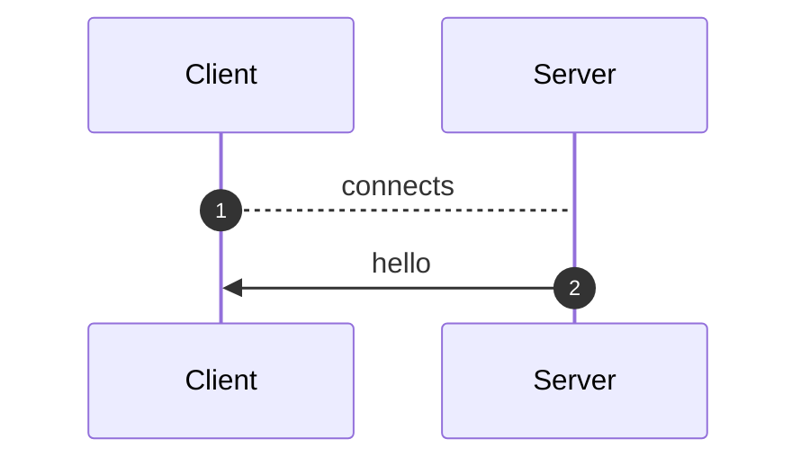
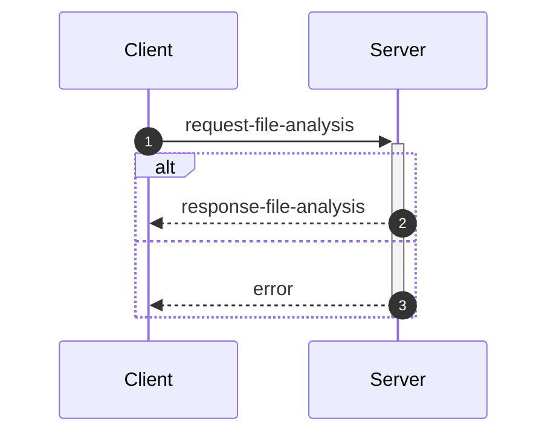
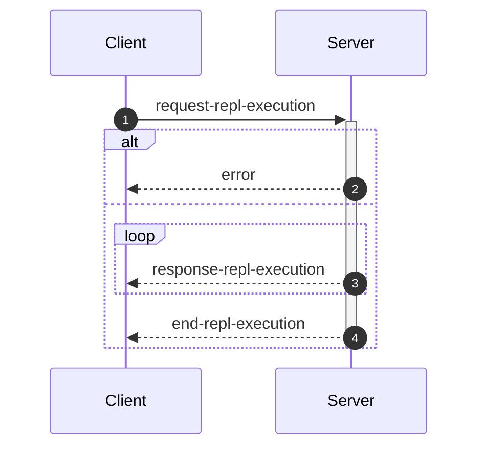
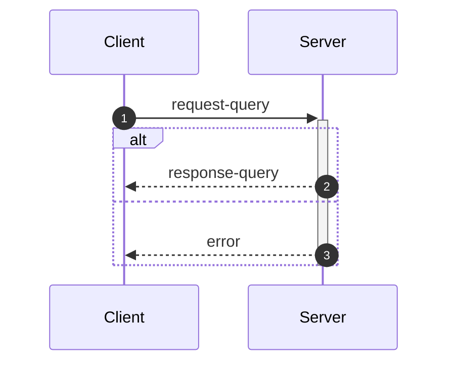

_<span title="an overview of flowR's interface">Generated</span> from '[wiki-interface.ts](https://github.com/flowr-analysis/flowr/tree/main/src/documentation/wiki-interface.ts "src/documentation/wiki-interface.ts")' on 2026-11-11, 08:13:04 UTC (v2.17.5, R v4.6.1), do not edit directly._

Although far from being as detailed as the in-depth explanation of [_flowR_](https://github.com/flowr-analysis/flowr/wiki/Core),
this wiki page explains how to interface with _flowR_ in more detail.
In general, command line arguments and other options provide short descriptions on hover over.

* [💻 Using the REPL](#using-the-repl)
* [⚙️ Configuring FlowR](#configuring-flowr)
* [⚒️ Writing Code](#writing-code)
* [💬 Communicating with the Server](#communicating-with-the-server)

<a id='using-the-repl'></a>
## 💻 Using the REPL

> [!NOTE]
> To execute arbitrary R commands with a repl request, _flowR_ has to be started explicitly with <span title="Description (Command Line Argument): Allow to access the underlying R session when using flowR (security warning: this allows the execution of arbitrary R code!)">`--r-session-access`</span>.
> Please be aware that this introduces a security risk and note that this relies on the [`r-shell` engine](https://github.com/flowr-analysis/flowr/wiki/Engines) .

Although primarily meant for users to explore,
there is nothing which forbids calling _flowR_ as a subprocess to use standard-in, -output, and -error
for communication (although you can access the REPL using the server as well,
with the [REPL Request](#message-request-repl-execution) message).

The read-eval-print loop&nbsp;(REPL) works relatively simple.
You can submit an expression (using <kbd>Enter</kbd>),
which is interpreted as an R&nbsp;expression by default but interpreted as a *command* if it starts with a colon (`:`).
The best command to get started with the REPL is <span title="Description (Repl Command): Show help information (aliases: :h, :?)">`:help`</span>.
Besides, you can leave the REPL either with the command <span title="Description (Repl Command): End the repl (aliases: :q, :exit)">`:quit`</span> or by pressing <kbd>Ctrl</kbd>+<kbd>C</kbd> twice.
When writing a *command*, you may press <kbd>Tab</kbd> to get a list of completions, if available.
Multiple commands can be entered in a single line by separating them with a semicolon (`;`), e.g. `:parse "x<-2"; :df*`.
If a command is given without R code, the REPL will re-use R code given in a previous command.
The prior example will hence return first the parsed AST of the program and then the dataflow graph for `"x <- 2"`.

> [!NOTE]
> If you develop flowR, you may want to launch the repl using the `npm run main-dev` command, this way, you get a non-minified version of flowR with debug information and hot-reloading of source files.

<details>
<summary>Available Commands</summary>

We currently offer the following commands (this with a `[*]` suffix are available with and without the star):

| Command | Description |
| ------- | ----------- |
| **<span title="Description (Repl Command): End the repl (aliases: :q, :exit)">:quit</span>** | End the repl (aliases: **:<span title="Alias of ':quit'. End the repl">q</span>**, **:<span title="Alias of ':quit'. End the repl">exit</span>**) |
| **<span title="Description (Repl Command): Execute the given code as R code. This requires the `--r-session-access` flag to be set and requires the r-shell engine. (aliases: :e, :r)">:execute</span>** | Execute the given code as R code. This requires the `--r-session-access` flag to be set and requires the r-shell engine. (aliases: **:<span title="Alias of ':execute'. Execute the given code as R code. This requires the `--r-session-access` flag to be set and requires the r-shell engine.">e</span>**, **:<span title="Alias of ':execute'. Execute the given code as R code. This requires the `--r-session-access` flag to be set and requires the r-shell engine.">r</span>**) |
| **<span title="Description (Repl Command): Get mermaid code for the control-flow graph of R code (aliases: :cfg, :cf)">:controlflow[*]</span>** | Get mermaid code for the control-flow graph of R code (star: Returns the URL to mermaid.live) (aliases: **:<span title="Alias of ':controlflow'. Get mermaid code for the control-flow graph of R code">cfg</span>**, **:<span title="Alias of ':controlflow'. Get mermaid code for the control-flow graph of R code">cf</span>**) |
| **<span title="Description (Repl Command): Get mermaid code for the control-flow graph with basic blocks (aliases: :cfgb, :cfb)">:controlflowbb[*]</span>** | Get mermaid code for the control-flow graph with basic blocks (star: Returns the URL to mermaid.live) (aliases: **:<span title="Alias of ':controlflowbb'. Get mermaid code for the control-flow graph with basic blocks">cfgb</span>**, **:<span title="Alias of ':controlflowbb'. Get mermaid code for the control-flow graph with basic blocks">cfb</span>**) |
| **<span title="Description (Repl Command): Get mermaid code for the dataflow graph (aliases: :d, :df)">:dataflow[*]</span>** | Get mermaid code for the dataflow graph (star: Returns the URL to mermaid.live) (aliases: **:<span title="Alias of ':dataflow'. Get mermaid code for the dataflow graph">d</span>**, **:<span title="Alias of ':dataflow'. Get mermaid code for the dataflow graph">df</span>**) |
| **<span title="Description (Repl Command): Get mermaid code for the normalized AST of R code (aliases: :n)">:normalize[*]</span>** | Get mermaid code for the normalized AST of R code (star: Returns the URL to mermaid.live) (alias: **:<span title="Alias of ':normalize'. Get mermaid code for the normalized AST of R code">n</span>**) |
| **<span title="Description (Repl Command): Get mermaid code for the simplified dataflow graph (aliases: :ds, :dfs)">:dataflowsimple[*]</span>** | Get mermaid code for the simplified dataflow graph (star: Returns the URL to mermaid.live) (aliases: **:<span title="Alias of ':dataflowsimple'. Get mermaid code for the simplified dataflow graph">ds</span>**, **:<span title="Alias of ':dataflowsimple'. Get mermaid code for the simplified dataflow graph">dfs</span>**) |
| **<span title="Description (Repl Command): Inspect and extend the signature database: `query` (identical to :query @signature), `info <name>` for where a function comes from (identical to :query @function-info), `add <path>` to mount another database/source, `download` to fetch the full-history database. (aliases: :sig)">:signature</span>** | Inspect and extend the signature database: `query` (identical to :query @signature), `info <name>` for where a function comes from (identical to :query @function-info), `add <path>` to mount another database/source, `download` to fetch the full-history database. (alias: **:<span title="Alias of ':signature'. Inspect and extend the signature database: `query` (identical to :query @signature), `info <name>` for where a function comes from (identical to :query @function-info), `add <path>` to mount another database/source, `download` to fetch the full-history database.">sig</span>**) |
| **<span title="Description (Repl Command): Just calculates the DFG, but only prints summary info (aliases: :d#, :df#)">:dataflowsilent</span>** | Just calculates the DFG, but only prints summary info (aliases: **:<span title="Alias of ':dataflowsilent'. Just calculates the DFG, but only prints summary info">d#</span>**, **:<span title="Alias of ':dataflowsilent'. Just calculates the DFG, but only prints summary info">df#</span>**) |
| **<span title="Description (Repl Command): Prints ASCII Art of the parsed, unmodified AST (aliases: :p)">:parse</span>** | Prints ASCII Art of the parsed, unmodified AST (alias: **:<span title="Alias of ':parse'. Prints ASCII Art of the parsed, unmodified AST">p</span>**) |
| **<span title="Description (Repl Command): Prints the version of flowR as well as the current version of R">:version</span>** | Prints the version of flowR as well as the current version of R
| **<span title="Description (Repl Command): Query the given R code (use 'help' for more information)">:query[*]</span>** | Query the given R code (use 'help' for more information) (star: Similar to query, but returns the output in json format.)
| **<span title="Description (Repl Command): Returns an ASCII representation of the dataflow graph (aliases: :df!)">:dataflowascii</span>** | Returns an ASCII representation of the dataflow graph (alias: **:<span title="Alias of ':dataflowascii'. Returns an ASCII representation of the dataflow graph">df!</span>**) |
| **<span title="Description (Repl Command): Returns summarization stats for the normalized AST (aliases: :n#)">:normalize#</span>** | Returns summarization stats for the normalized AST (alias: **:<span title="Alias of ':normalize#'. Returns summarization stats for the normalized AST">n#</span>**) |
| **<span title="Description (Repl Command): Show help information (aliases: :h, :?)">:help</span>** | Show help information (aliases: **:<span title="Alias of ':help'. Show help information">h</span>**, **:<span title="Alias of ':help'. Show help information">?</span>**) |

</details>

> [!TIP]
> 
> As indicated by the examples before, all REPL commands that operate on code keep track of the state.
> Hence, if you run a command like <span title="Description (Repl Command, starred version): Returns the URL to mermaid.live; Base Command: Get mermaid code for the dataflow graph (aliases: :d*, :df*)">`:dataflow*`</span> without providing R code,
> the REPL will re-use the R code provided in a previous command.
> Likewise, doing this will benefit from incrementality!
> If you request the dataflow graph with `:df* x <- 2 * y` and then want to see the parsed AST with `:parse`,
> the REPL will re-use previously obtained information and not re-parse the code again.
> 		

Generally, many commands offer shortcut versions in the REPL. Many queries, for example, offer a shortened format (see the example below).
Of special note, the [Config Query](https://github.com/flowr-analysis/flowr/wiki/%5BQuery%5D-Config)
can be used to also modify the currently active configuration of _flowR_ within the REPL (see the [wiki page](https://github.com/flowr-analysis/flowr/wiki/%5BQuery%5D-Config) for more information).

### Example: Retrieving the Dataflow Graph

To retrieve a URL to the [mermaid](https://mermaid.js.org/) diagram of the dataflow of a given expression,
use <span title="Description (Repl Command, starred version): Returns the URL to mermaid.live; Base Command: Get mermaid code for the dataflow graph (aliases: :d*, :df*)">`:dataflow*`</span> (or <span title="Description (Repl Command): Get mermaid code for the dataflow graph (aliases: :d, :df)">`:dataflow`</span> to get the mermaid code in the cli):

```shell
$ docker run -it --rm eagleoutice/flowr # or npm run flowr 
flowR repl v2.17.5, R grammar v14 (tree-sitter engine)
R> :dataflow* y <- 1 + x
```

<details>
<summary style='color:gray'>Output</summary>

```text
https://mermaid.live/view#base64:eyJjb2RlIjoiZmxvd2NoYXJ0IFREXG4gICAgMXt7XCJgKiM5MTtSTnVtYmVyIzkzOyogKioxKipcbiAgICAgICoxLjYqICgqKmlkOiAxKiopYFwifX1cbiAgICAyKFtcImAqIzkxO1JTeW1ib2wjOTM7KiAqKngqKlxuICAgICAgKjEuMTAqICgqKmlkOiAyKiopYFwiXSlcbiAgICAzW1tcImAqIzkxO1JCaW5hcnlPcCM5MzsqIGJhc2UjNTg7IzU4OyoqIzQzOyoqXG4gICAgICAqMS42LTEwKiAoKippZDogMyoqKVxuICAgIGFyZzogKDEsIDIpYFwiXV1cbiAgICBidWlsdC1pbjpfNDNfW1wiYEJ1aWx0LUluOlxuIzQzO2BcIl1cbiAgICBzdHlsZSBidWlsdC1pbjpfNDNfIHN0cm9rZTpncmF5LGZpbGw6Z3JheSxzdHJva2Utd2lkdGg6MnB4LG9wYWNpdHk6Ljg7XG4gICAgMFtcImAqIzkxO1JTeW1ib2wjOTM7KiAqKnkqKlxuICAgICAgKjEuMSogKCoqaWQ6IDAqKiwgdjogMylgXCJdXG4gICAgNFtbXCJgKiM5MTtSQmluYXJ5T3AjOTM7KiBiYXNlIzU4OyM1ODsqKiM2MDsjNDU7KipcbiAgICAgICoxLjEtMTAqICgqKmlkOiA0KiopXG4gICAgYXJnOiAoMCwgMylgXCJdXVxuICAgIGJ1aWx0LWluOl82MF8tW1wiYEJ1aWx0LUluOlxuIzYwOyM0NTtgXCJdXG4gICAgc3R5bGUgYnVpbHQtaW46XzYwXy0gc3Ryb2tlOmdyYXksZmlsbDpncmF5LHN0cm9rZS13aWR0aDoycHgsb3BhY2l0eTouODtcbiAgICAxIC0uLT58XCJmbG93XCJ8IDJcbiAgICBsaW5rU3R5bGUgMCBzdHJva2U6Z3JheSxjb2xvcjpncmF5O1xuICAgIDIgLS4tPnxcImZsb3dcInwgM1xuICAgIGxpbmtTdHlsZSAxIHN0cm9rZTpncmF5LGNvbG9yOmdyYXk7XG4gICAgMyAtLT58XCJyZWFkcywgYXJnXCJ8IDFcbiAgICAzIC0tPnxcInJlYWRzLCBhcmdcInwgMlxuICAgIDMgLS4tPnxcImZsb3dcInwgMFxuICAgIGxpbmtTdHlsZSA0IHN0cm9rZTpncmF5LGNvbG9yOmdyYXk7XG4gICAgMyAtLi0+fFwicmVhZHMsIGNhbGxzXCJ8IGJ1aWx0LWluOl80M19cbiAgICBsaW5rU3R5bGUgNSBzdHJva2U6Z3JheTtcbiAgICAwIC0tPnxcImRlZmluZWQtYnksIGZsb3dcInwgNFxuICAgIDAgLS0+fFwiZGVmaW5lZC1ieVwifCAzXG4gICAgNCAtLT58XCJyZWFkcywgYXJnXCJ8IDNcbiAgICA0IC0tPnxcInJldHVybnMsIGFyZ1wifCAwXG4gICAgNCAtLi0+fFwicmVhZHMsIGNhbGxzXCJ8IGJ1aWx0LWluOl82MF8tXG4gICAgbGlua1N0eWxlIDEwIHN0cm9rZTpncmF5OyIsIm1lcm1haWQiOnsiYXV0b1N5bmMiOnRydWV9fQ==
```

Retrieve the dataflow graph of the expression `y <- 1 + x`. It looks like this:


<details>

<summary style="color:gray">R Code of the Dataflow Graph</summary>

The analysis ran (parse and normalize with the [tree-sitter](https://github.com/flowr-analysis/flowr/wiki/Engines) engine) in the generation environment. No [signature database](https://github.com/flowr-analysis/flowr/wiki/Signature-Database) is mounted, so `library()` attaches no exports (base-R names are still qualified, e.g., `stats::acf`). 
We encountered no unknown side effects during the analysis.

```r
y <- 1 + x
```

</details>

</details>

For small graphs like this, <span title="Description (Repl Command): Returns an ASCII representation of the dataflow graph (aliases: :df!)">`:dataflowascii`</span> also provides an ASCII representation directly in the REPL:

```shell
$ docker run -it --rm eagleoutice/flowr # or npm run flowr 
flowR repl v2.17.5, R grammar v14 (tree-sitter engine)
R> :df! y <- 1 + x
```

<details open>
<summary style='color:gray'>Output</summary>

```text
                        v<0>v
 c<4>c──────────────────| y |
 |<- |     ┌────────────v---v
 c---c     │
    │   c<3>c   0<1>0
    └───| + |───| 1 |───u<2>u
        c---c   0---0   | x |
           └────────────u---u
Edges:
3 -> 1: reads, arg          3 -> 2: reads, arg
3 -> 0: flows-to            1 -> 2: flows-to
2 -> 3: flows-to            4 -> 3: reads, arg
4 -> 0: returns, arg        0 -> 4: defined-by, flows-to
0 -> 3: defined-by
```

Retrieve the dataflow graph of the expression `y <- 1 + x` as ASCII art.

</details>

For the slicing with <span title="Description (Repl Command): Static backwards executable slicer for R">`:slicer`</span>, you have access to the same [magic comments](#slice-magic-comments) as with the [slice request](#message-request-slice).
Pass `--inline` to splice resolvable `source()` calls into the reconstruction so the slice is a single self-contained R text (the same as the static slice query's `inlineSources` flag).
See `--help` for more flags!

### Example: Interfacing with the File System

Many commands that allow for an R-expression (like <span title="Description (Repl Command, starred version): Returns the URL to mermaid.live; Base Command: Get mermaid code for the dataflow graph (aliases: :d*, :df*)">`:dataflow*`</span>) allow for a file as well
if the argument starts with `file://`.
If you are working from the root directory of the _flowR_ repository, the following gives you the parsed AST of the example file using the <span title="Description (Repl Command): Prints ASCII Art of the parsed, unmodified AST (aliases: :p)">`:parse`</span> command:

> **Watch mode**: Replace `file://` with `watch://` to enter watch mode.
> flowR runs the command immediately and then re-runs it every time the file (or any file inside the folder) changes.
> Enter any other command to leave watch mode.
> For example: `:df watch://analysis.R`

```shell
$ docker run -it --rm eagleoutice/flowr # or npm run flowr 
flowR repl v2.17.5, R grammar v14 (tree-sitter engine)
R> :parse file://test/testfiles/example.R
```

<details>
<summary style='color:gray'>Output</summary>

```text
File: test/testfiles/example.R

program
├ binaryoperator
│ ├ identifier "sum" (1:1─4)
│ ├ <- "<-" (1:5─7)
│ ╰ float "0" (1:8─9)
├ binaryoperator
│ ├ identifier "product" (2:1─8)
│ ├ <- "<-" (2:9─11)
│ ╰ float "1" (2:12─13)
├ binaryoperator
│ ├ identifier "w" (3:1─2)
│ ├ <- "<-" (3:3─5)
│ ╰ float "7" (3:6─7)
├ binaryoperator
│ ├ identifier "N" (4:1─2)
│ ├ <- "<-" (4:3─5)
│ ╰ float "10" (4:6─8)
├ forstatement
│ ├ for "for" (6:1─4)
│ ├ ( "(" (6:5─6)
│ ├ identifier "i" (6:6─7)
│ ├ in "in" (6:8─10)
│ ├ binaryoperator
│ │ ├ float "1" (6:11─12)
│ │ ├ : ":" (6:12─13)
│ │ ╰ parenthesizedexpression
│ │   ├ ( "(" (6:13─14)
│ │   ├ binaryoperator
│ │   │ ├ identifier "N" (6:14─15)
│ │   │ ├ - "-" (6:15─16)
│ │   │ ╰ float "1" (6:16─17)
│ │   ╰ ) ")" (6:17─18)
│ ├ ) ")" (6:18─19)
│ ╰ bracedexpression
│   ├ { "{" (6:20─21)
│   ├ binaryoperator
│   │ ├ identifier "sum" (7:3─6)
│   │ ├ <- "<-" (7:7─9)
│   │ ╰ binaryoperator
│   │   ├ binaryoperator
│   │   │ ├ identifier "sum" (7:10─13)
│   │   │ ├ + "+" (7:14─15)
│   │   │ ╰ identifier "i" (7:16─17)
│   │   ├ + "+" (7:18─19)
│   │   ╰ identifier "w" (7:20─21)
│   ├ binaryoperator
│   │ ├ identifier "product" (8:3─10)
│   │ ├ <- "<-" (8:11─13)
│   │ ╰ binaryoperator
│   │   ├ identifier "product" (8:14─21)
│   │   ├  "" (8:22─23)
│   │   ╰ identifier "i" (8:24─25)
│   ╰ } "}" (9:1─2)
├ call
│ ├ identifier "cat" (11:1─4)
│ ╰ arguments
│   ├ ( "(" (11:4─5)
│   ├ argument
│   │ ╰ string
│   │   ├ stringopen "\"" (11:5─6)
│   │   ├ stringcontent "Sum:" (11:6─10)
│   │   ╰ stringclose "\"" (11:10─11)
│   ├ comma "," (11:11─12)
│   ├ argument
│   │ ╰ identifier "sum" (11:13─16)
│   ├ comma "," (11:16─17)
│   ├ argument
│   │ ╰ string
│   │   ├ stringopen "\"" (11:18─19)
│   │   ├ stringcontent
│   │   │ ╰ escapesequence "\\n" (11:19─21)
│   │   ╰ stringclose "\"" (11:21─22)
│   ╰ ) ")" (11:22─23)
╰ call
  ├ identifier "cat" (12:1─4)
  ╰ arguments
    ├ ( "(" (12:4─5)
    ├ argument
    │ ╰ string
    │   ├ stringopen "\"" (12:5─6)
    │   ├ stringcontent "Product:" (12:6─14)
    │   ╰ stringclose "\"" (12:14─15)
    ├ comma "," (12:15─16)
    ├ argument
    │ ╰ identifier "product" (12:17─24)
    ├ comma "," (12:24─25)
    ├ argument
    │ ╰ string
    │   ├ stringopen "\"" (12:26─27)
    │   ├ stringcontent
    │   │ ╰ escapesequence "\\n" (12:27─29)
    │   ╰ stringclose "\"" (12:29─30)
    ╰ ) ")" (12:30─31)
```

Retrieve the parsed AST of the example file.

<details>

<summary>File Content</summary>

```r
sum <- 0
product <- 1
w <- 7
N <- 10

for (i in 1:(N-1)) {
  sum <- sum + i + w
  product <- product * i
}

cat("Sum:", sum, "\n")
cat("Product:", product, "\n")
```

</details>

As _flowR_ directly transforms this AST the output focuses on being human-readable instead of being machine-readable.
		
</details>

### Example: Run a Query

You can run any query supported by _flowR_ using the <span title="Description (Repl Command): Query the given R code (use 'help' for more information)">`:query`</span> command.
For example, to obtain the shapes of all data frames in a given piece of code, you can run:

```shell
$ docker run -it --rm eagleoutice/flowr # or npm run flowr 
flowR repl v2.17.5, R grammar v14 (tree-sitter engine)
R> :query @absint df-shape "x <- data.frame(a = 1:10, b = 1:10)\ny <- x$a"
```

<details open>
<summary style='color:gray'>Output</summary>

```text
Query: absint (1 ms)
   ╰ $12: (colnames: [{"a", "b"}, {}], cols: [2, 2], rows: [10, 10])
   ╰ $0: (colnames: [{"a", "b"}, {}], cols: [2, 2], rows: [10, 10])
```

Retrieve the shapes of all data frames in the given code.

</details>

To run the linter on a file, you can use (in this example, we just issue the `dead-code` linter on a small piece of code):

```shell
$ docker run -it --rm eagleoutice/flowr # or npm run flowr 
flowR repl v2.17.5, R grammar v14 (tree-sitter engine)
R> :query @linter rules:dead-code "if(FALSE) x <- 2"
```

<details open>
<summary style='color:gray'>Output</summary>

```text
Query: linter (3 ms)
   ╰ Dead Code (dead-code):
       ╰ certain:
           ╰ Code at 1.11-16 (1 quick fix(es) available)
```

Run the linter on the given code, with only the `dead-code` rule enabled.

</details>

For more information on the available queries, please check out the [Query API](https://github.com/flowr-analysis/flowr/wiki/Query-API).

<a id='configuring-flowr'></a>
## ⚙️ Configuring FlowR

When running _flowR_, you may want to specify some behaviors with a dedicated configuration file.
By default, flowR looks for a file named `flowr.json` in the current working directory (or any higher directory).
You can also specify a different file with <span title="Description (Command Line Argument): The name of the configuration file to use">`--config-file`</span> or pass the configuration inline using <span title="Description (Command Line Argument): The flowR configuration to use, as a JSON string">`--config-json`</span>.
A `flowr.json` found this way belongs to the analyzed project, so flowR ignores its options that decide what flowR executes or loads
(`engines.*.wasmPath`, `engines.*.treeSitterWasmPath`, `engines.*.rPath`, `solver.sigdb.additionalPaths`, `solver.sigdb.downloadRepo`, `solver.sigdb.installedLibrary.paths`, `solver.sigdb.onDemand.enabled`, `solver.sigdb.onDemand.repositories`, `solver.sigdb.onDemand.cranMirror`, `solver.sigdb.onDemand.bioconductorMirror`, `solver.sigdb.onDemand.cacheDir`),
unless you pass <span title="Description (Command Line Argument): Keep the security-sensitive options (e.g., the R executable) of the flowr.json found in the working directory or a parent. Only use this for projects you trust.">`--trust-config`</span>.
To analyze code you do not trust, use the secure mode (<span title="Description (Command Line Argument): Run in secure mode for analyzing untrusted code: flowR does not start R (or any other process), does not access the network, does not search for project configs, and ignores security-sensitive options in every config. Cannot be disabled once enabled. Can also be enabled with the environment variable {italic FLOWR_SECURE_MODE=1}.">`--secure`</span>, see the [security policy](https://github.com/flowr-analysis/flowr/blob/main/.github/SECURITY.md)).
To inspect the current configuration, you can run flowr with the <span title="Description (Command Line Argument): Run with verbose logging (will be passed to the corresponding script)">`--verbose`</span> flag, or use the `config` [Query](https://github.com/flowr-analysis/flowr/wiki/Query-API).
Within the REPL this works by running the following:

```shell
:query @config
```

To work with the <a href="https://github.com/flowr-analysis/flowr/tree/main/src/config.ts#L125"><code><span title="The configuration file format for flowR.">FlowrConfig</span></code></a> you can use the provided helper objects alongside its methods like
<a href="https://github.com/flowr-analysis/flowr/tree/main/src/config.ts#L991"><code><span title="Creates a new flowr config that has the updated values.">FlowrConfig::<b>amend</b></span></code></a>.
The schema below documents every option; the ones you most likely want are:

- <a href="https://github.com/flowr-analysis/flowr/wiki/Interface#configuring-flowr" title="Configuration Option (boolean): Whether source calls should be ignored, causing {@link processSourceCall}&#39;s behavior to be skipped.">ignoreSourceCalls</a>: ignore source calls when analyzing the code, i.e., ignore the inclusion of other files.
- <a href="https://github.com/flowr-analysis/flowr/wiki/Interface#configuring-flowr" title="Configuration Option (boolean): Whether load calls should be ignored, causing {@link processLoadCall}&#39;s behavior to be skipped.">ignoreLoadCalls</a>: ignore load calls when analyzing the code, i.e., ignore the loading of r-data files.
- <a href="https://github.com/flowr-analysis/flowr/wiki/Interface#configuring-flowr" title="Configuration Option (object): Do you want to overwrite (parts) of the builtin definition?">semantics.environment.overwriteBuiltIns</a>: overwrite _flowR_'s handling of built-in functions, or clear the preset definitions entirely.
  See [Configure BuiltIn Semantics](#configure-builtin-semantics) for more information.
- <a href="https://github.com/flowr-analysis/flowr/wiki/Interface#configuring-flowr" title="Configuration Option (boolean): Whether calls drawing on a graphics device (e.g., `plot`) count as writing to it, which the ambient state queries then report.">semantics.ambient.drawingWritesDevice</a>: whether calls drawing on a graphics device (e.g., `plot`) count as writing the device in the ambient state queries.
- <a href="https://github.com/flowr-analysis/flowr/wiki/Interface#configuring-flowr" title="Configuration Option (string): How to resolve variables and their values. (one of &quot;disabled&quot;, &quot;alias&quot;, &quot;builtin&quot;)">solver.variables</a>: how to resolve variables and their values (`disabled`, `alias`, `builtin`).
- <a href="https://github.com/flowr-analysis/flowr/wiki/Interface#configuring-flowr" title="Configuration Option (array): The engine or set of engines to use for interacting with R code. An empty array means all available engines will be used.">engines</a> and <a href="https://github.com/flowr-analysis/flowr/wiki/Interface#configuring-flowr" title="Configuration Option (string): The default engine to use for interacting with R code. If this is undefined, an arbitrary engine from the specified list will be used. (one of &quot;tree-sitter&quot;, &quot;r-shell&quot;)">defaultEngine</a>: the engines used to interact with R code, see the [Engines wiki page](https://github.com/flowr-analysis/flowr/wiki/Engines).
- <a href="https://github.com/flowr-analysis/flowr/wiki/Interface#configuring-flowr" title="Configuration Option (array): Files a framework loads on its own, without any source() call (e.g. global.R in a shiny app), in the order they are loaded; flowR orders the matching project files accordingly and analyzes them as one program. Entries are case-insensitive globs matched against the file path, a plain name matches any file with that name, and entries matching no project file are warned about. Usually set per project kind via specializeConfig.">project.implicitSources</a>: the files a framework loads without any `source()` call, in the order in which they are
  loaded. Entries are globs (e.g. `R/*.R`) matched against the file path ignoring capitalization; one matching no file is reported.
- <a href="https://github.com/flowr-analysis/flowr/wiki/Interface#configuring-flowr" title="Configuration Option (object): Overwrite (parts of) the configuration depending on the project kind flowR detects, e.g. to give a shiny app its implicit sources.">specializeConfig</a>: overwrite (parts of) the configuration depending on the kind of project _flowR_ detects
  (e.g. `shiny-app`), which is how a shiny app gets its implicit sources by default. What you configure directly wins.
- <a href="https://github.com/flowr-analysis/flowr/wiki/Interface#configuring-flowr" title="Configuration Option (string): Overwrite the project kind flowR would otherwise infer from the analyzed files, e.g. when auto-detection guesses wrong. (one of &quot;package&quot;, &quot;script&quot;, &quot;shiny-app&quot;, &quot;notebook&quot;, &quot;project&quot;, &quot;unknown&quot;)">project.useProjectType</a>: skip that detection and force a project kind yourself, when auto-detection guesses wrong.
- <a href="https://github.com/flowr-analysis/flowr/wiki/Interface#configuring-flowr" title="Configuration Option (array): The default plugins to load when creating a new instance of FlowrAnalyzer">defaultPlugins</a> and <a href="https://github.com/flowr-analysis/flowr/wiki/Interface#configuring-flowr" title="Configuration Option (array): The plugins to load in REPL mode">repl.plugins</a>: the plugins to load for a new <a href="https://github.com/flowr-analysis/flowr/tree/main/src/project/flowr-analyzer.ts#L240"><code><span title="Central class for conducting analyses with FlowR. Use the FlowrAnalyzerBuilder to create a new instance. If you want the original pattern of creating a pipeline and running all steps, you can still do this with FlowrAnalyzer#runFull . To inspect the context of the analyzer, use FlowrAnalyzer#inspectContext (if you are a plugin and need to modify it, use FlowrAnalyzer#context instead).">FlowrAnalyzer</span></code></a> and in the REPL
  (use `flowr:default` to reference the former).

So you can configure _flowR_ by adding a file like the following:

<details>

<summary>Example Configuration File</summary>

```json
{
  "ignoreSourceCalls": true,
  "ignoreLoadCalls": true,
  "semantics": {
    "environment": {
      "overwriteBuiltIns": {
        "definitions": [
          {
            "type": "function",
            "names": [
              "foo"
            ],
            "processor": "builtin:assign",
            "config": {}
          }
        ]
      }
    }
  },
  "defaultPlugins": [
    "file:description",
    "versions:description"
  ],
  "repl": {
    "quickStats": false,
    "dfProcessorHeat": false,
    "hints": true,
    "plugins": [
      "flowr:default"
    ]
  },
  "project": {
    "resolveUnknownPathsOnDisk": true,
    "implicitSources": [
      "global.R",
      "app.R"
    ]
  },
  "linter": {
    "disabledRules": []
  },
  "specializeConfig": {
    "shiny-app": {
      "project": {
        "implicitSources": [
          "global.R",
          "ui.R",
          "server.R",
          "app.R"
        ]
      }
    }
  },
  "engines": [
    {
      "type": "r-shell"
    }
  ],
  "solver": {
    "variables": "alias",
    "evalStrings": true,
    "trackEnvironments": true,
    "sigdb": {
      "enabled": true,
      "loadProjectDependencies": true,
      "eagerlyLoad": false,
      "eagerlyLoadExports": false,
      "linkBaseR": false,
      "linkDescriptionDependencies": false
    },
    "resolveSource": {
      "dropPaths": "no",
      "ignoreCapitalization": true,
      "inferWorkingDirectory": "active-script",
      "searchPath": []
    },
    "instrument": {},
    "slicer": {
      "threshold": 50
    }
  },
  "abstractInterpretation": {
    "wideningThreshold": 4,
    "followCalls": true,
    "dataFrame": {
      "maxColNames": 20,
      "readLoadedData": {
        "readExternalFiles": true,
        "maxReadLines": 1000000
      }
    }
  },
  "incremental": {
    "alwaysIncremental": false,
    "parsing": {
      "activated": false,
      "heuristics": {
        "activated": true,
        "mtime": true,
        "linesFrom": 500,
        "bytesFrom": 50000,
        "alwaysWithEdits": false,
        "minFiles": 1
      }
    }
  },
  "gas": {
    "thresholds": {
      "memory": {
        "problematic": 0.7,
        "critical": 0.9
      },
      "timeMs": {
        "problematic": 100000,
        "critical": 120000
      }
    },
    "features": {}
  }
}
```

</details>

<details>
<a id='configure-builtin-semantics'></a>
<summary>Configure Built-In Semantics</summary>

`semantics/environment/overwriteBuiltins` accepts two keys:

- `loadDefaults` (boolean, initially `true`): If set to `true`, the default built-in definitions are loaded before applying the custom definitions. Setting this flag to `false` explicitly disables the loading of the default definitions.
- `definitions` (array, initially empty): Allows to overwrite or define new built-in elements. Each object within must have a `type` which is one of the below. Furthermore, they may define a string array of `names` which specifies the identifiers to bind the definitions to. You may use `assumePrimitive` to specify whether _flowR_ should assume that this is a primitive non-library definition (so you probably just do not want to specify the key).

  | Type            | Description                                                                                                                                                                                                                                                                                              | Example                                                                                                    |
  | --------------- | -------------------------------------------------------------------------------------------------------------------------------------------------------------------------------------------------------------------------------------------------------------------------------------------------------- | ---------------------------------------------------------------------------------------------------------- |
  | `constant`    | Additionally allows for a `value` this should resolve to.                                                                                                                                                                                                                                                | `{ type: 'constant', names: ['NULL', 'NA'],  value: null }`                                                |
  | `function`    | Is a rather flexible way to define and bind built-in functions. For the time, we do not have extensive documentation to cover all the cases, so please either consult the sources with the `default-builtin-config/` folder or open a [new issue](https://github.com/flowr-analysis/flowr/issues/new/choose). | `{ type: 'function', names: ['next'], processor: 'builtin:d', config: { cfg: ExitPointType.Next } }` |
  | `replacement` | A comfortable way to specify replacement functions like `$<-` or `names<-`. `suffixes` describes the... suffixes to attach automatically. | `{ type: 'replacement', suffixes: ['<-', '<<-'], names: ['[', '[['] }` |

</details>

<details>

<summary style='color:gray'>Full Configuration-File Schema</summary>

- _The configuration file format for flowR._ (object)
    - **logLevel** [optional] _flowR's global minimum log level, applied when the config is loaded._ (string)
        Only allows: 'silly', 'trace', 'debug', 'info', 'warn', 'error', 'fatal'
    - **ignoreSourceCalls** [optional] _Whether source calls should be ignored, causing {@link processSourceCall}'s behavior to be skipped._ (boolean)
    - **ignoreLoadCalls** [optional] _Whether load calls should be ignored, causing {@link processLoadCall}'s behavior to be skipped._ (boolean)
    - **semantics** _Configure language semantics and how flowR handles them._ (object)
        - **environment** [optional] _Semantics regarding how to handle the R environment._ (object)
            - **overwriteBuiltIns** [optional] _Do you want to overwrite (parts) of the builtin definition?_ (object)
                - **loadDefaults** [optional] _Should the default configuration still be loaded?_ (boolean)
                - **definitions** [optional] _The definitions to load/overwrite._ (array)
                Valid item types:
                    - (object)
        - **ambient** [optional] _Semantics regarding the global state (options, devices, files, ...) calls access._ (object)
            - **drawingWritesDevice** [optional] _Whether calls drawing on a graphics device (e.g., `plot`) count as writing to it, which the ambient state queries then report._ (boolean)
    - **defaultPlugins** [optional] _The default plugins to load when creating a new instance of FlowrAnalyzer_ (array)
    Valid item types:
        - (alternatives)
            - (string)
            - (array)
    - **repl** _Configuration options for the REPL._ (object)
        - **quickStats** [optional] _Whether to show quick stats in the REPL after each evaluation._ (boolean)
        - **dfProcessorHeat** [optional] _This instruments the dataflow processors to count how often each processor is called._ (boolean)
        - **hints** [optional] _Whether to show dim inline hints on the empty prompt (automatically disabled on non-interactive terminals)._ (boolean)
        - **plugins** [optional] _The plugins to load in REPL mode_ (array)
        Valid item types:
            - (alternatives)
                - (string)
                - (array)
        - **autoUseFileProtocol** [optional] _Prepend the file protocol to a repl input that looks like a path, instead of only warning about it._ (boolean)
        - **queryStats** [optional] _Whether `:query` closes with the line stating how long the queries took (`:query*` never prints it)._ (boolean)
        - **showPlugins** [optional] _Whether `:version` grays out the plugins that did not activate during the last analysis._ (boolean)
    - **project** _Project specific configuration options._ (object)
        - **resolveUnknownPathsOnDisk** [optional] _Whether to resolve unknown paths loaded by the r project disk when trying to source/analyze files._ (boolean)
        - **failOnInaccessiblePath** [optional] _Whether a directory that cannot be traversed during file discovery (e.g. due to permissions) aborts the analysis; when false (the default) such paths are logged and skipped._ (boolean)
        - **basePackages** [optional] _The packages considered part of R itself (base and recommended); if unset, flowR uses its built-in list._ (array)
        Valid item types:
            - (string)
        - **implicitSources** [optional] _Files a framework loads on its own, without any source() call (e.g. global.R in a shiny app), in the order they are loaded; flowR orders the matching project files accordingly and analyzes them as one program. Entries are case-insensitive globs matched against the file path, a plain name matches any file with that name, and entries matching no project file are warned about. Usually set per project kind via specializeConfig._ (array)
        Valid item types:
            - (string)
        - **useProjectType** [optional] _Overwrite the project kind flowR would otherwise infer from the analyzed files, e.g. when auto-detection guesses wrong._ (string)
            Only allows: 'package', 'script', 'shiny-app', 'notebook', 'project', 'unknown'
        - **assumeImplicitEcho** [optional] _Whether the top level of the analyzed code is echoed, so that every visible result printed there is collected as an output by the dependencies query (default true, false for a package)._ (boolean)
        - **discovery** [optional] _Scoping options for the default project discovery._ (object)
            - **full** [optional] _Collect every file below the project root (greedy) instead of only the files the detected project kind needs (default false)._ (boolean)
            - **perKind** [optional] _Per-kind include/exclude glob overrides layered on the default scoping._ (object)
            - **ignore** [optional] _Case-insensitive globs that drop matching files from the intelligent discovery, regardless of kind (e.g. .Renviron to ignore environment files)._ (array)
            Valid item types:
                - (string)
        - **classification** [optional] _Overrides for the signals flowR uses to classify the project kind._ (object)
            - **shinyDescriptionTypes** [optional] _DESCRIPTION Type: values that mark a shiny app._ (array)
            Valid item types:
                - (string)
            - **shinyEntryFiles** [optional] _File names a shiny app is assembled from._ (array)
            Valid item types:
                - (string)
            - **shinyUsagePattern** [optional] _Regex source evidencing shiny usage in an entry file._ (string)
            - **notebookExtensions** [optional] _File extensions marking a notebook._ (array)
            Valid item types:
                - (string)
    - **linter** _Linter configuration options._ (object)
        - **disabledRules** _Linting rule names excluded from the default rule set (a rule requested explicitly via a linter query still runs). Usually set per project kind via specializeConfig._ (array)
        Valid item types:
            - (string)
        - **disabledTags** [optional] _Linting rule tags whose rules are excluded from the default rule set (a rule requested explicitly via a linter query still runs). By default the cmd-check rules are disabled for everything but a package; a configured list replaces that default._ (array)
        Valid item types:
            - (string)
    - **inputSources** [optional] _Further frameworks the input-sources analysis should know about; entries are added to flowR's defaults._ (object)
        - **pure** [optional] _Functions that only pass the constantness of their arguments on._ (array)
        Valid item types:
            - (string)
        - **param** [optional] _Functions whose result is a 'param' input._ (array)
        Valid item types:
            - (string)
        - **file** [optional] _Functions whose result is a 'file' input._ (array)
        Valid item types:
            - (string)
        - **tempfile** [optional] _Functions whose result is a 'tempfile' input._ (array)
        Valid item types:
            - (string)
        - **glob** [optional] _Functions whose result is a 'glob' input._ (array)
        Valid item types:
            - (string)
        - **net** [optional] _Functions whose result is a 'net' input._ (array)
        Valid item types:
            - (string)
        - **rand** [optional] _Functions whose result is a 'rand' input._ (array)
        Valid item types:
            - (string)
        - **system** [optional] _Functions whose result is a 'system' input._ (array)
        Valid item types:
            - (string)
        - **ffi** [optional] _Functions whose result is a 'ffi' input._ (array)
        Valid item types:
            - (string)
        - **lang** [optional] _Functions whose result is a 'lang' input._ (array)
        Valid item types:
            - (string)
        - **options** [optional] _Functions whose result is a 'options' input._ (array)
        Valid item types:
            - (string)
        - **cmdline** [optional] _Functions whose result is a 'cmdline' input._ (array)
        Valid item types:
            - (string)
        - **user** [optional] _Functions whose result is a 'user' input._ (array)
        Valid item types:
            - (string)
        - **const** [optional] _Functions whose result is a 'const' input._ (array)
        Valid item types:
            - (string)
        - **scope** [optional] _Functions whose result is a 'scope' input._ (array)
        Valid item types:
            - (string)
        - **dconst** [optional] _Functions whose result is a 'dconst' input._ (array)
        Valid item types:
            - (string)
        - **unknown** [optional] _Functions whose result is a 'unknown' input._ (array)
        Valid item types:
            - (string)
        - **linkedObjects** [optional] _Objects a framework provides without a definition in the code, e.g. shiny's input._ (array)
        Valid item types:
            - (object)
        - **linkedEntryPoints** [optional] _Calls that hand a function to a framework, which binds its objects to the parameters by position._ (array)
        Valid item types:
            - (object)
    - **specializeConfig** [optional] _Overwrite (parts of) the configuration depending on the project kind flowR detects, e.g. to give a shiny app its implicit sources._ (object)
    - **engines** _The engine or set of engines to use for interacting with R code. An empty array means all available engines will be used._ (array)
    Valid item types:
        - (alternatives)
            - _The configuration for the tree sitter engine._ (object)
                - **type** [required] _Use the tree sitter engine._ (string)
                    Only allows: 'tree-sitter'
                - **wasmPath** [optional] _The path to the tree-sitter-r WASM binary to use. If this is undefined, this uses the default path._ (string)
                - **treeSitterWasmPath** [optional] _The path to the tree-sitter WASM binary to use. If this is undefined, this uses the default path._ (string)
                - **lax** [optional] _Whether to use the lax parser for parsing R code (allowing for syntax errors). If this is undefined, the strict parser will be used._ (boolean)
            - _The configuration for the R shell engine._ (object)
                - **type** [required] _Use the R shell engine._ (string)
                    Only allows: 'r-shell'
                - **rPath** [optional] _The path to the R executable to use. If this is undefined, this uses the default path._ (string)
                - **pipeBind** [optional] _Whether to enable R's experimental pipe-bind operator "=>" by setting _R_USE_PIPEBIND_ for the R session (default false); R itself keeps this off by default, as it is experimental and has never shipped in a release version of R._ (boolean)
    - **defaultEngine** [optional] _The default engine to use for interacting with R code. If this is undefined, an arbitrary engine from the specified list will be used._ (string)
        Only allows: 'tree-sitter', 'r-shell'
    - **solver** _How to resolve constants, constraints, cells, ..._ (object)
        - **variables** _How to resolve variables and their values._ (string)
            Only allows: 'disabled', 'alias', 'builtin'
        - **evalStrings** _Should we include eval(parse(text="...")) calls in the dataflow graph?_ (boolean)
        - **trackEnvironments** [optional] _Track user-created environments (new.env, assign/get/local with envir=, dollar-assign, attach). When false, all envir-style calls fall through conservatively._ (boolean)
        - **sigdb** _Resolving library exports from a signature database._ (object)
            - **enabled** [optional] _Resolve library()/use() exports from a signature database (default true); when false no database is consulted._ (boolean)
            - **loadProjectDependencies** [optional] _Load the project's declared dependencies from its metadata files (DESCRIPTION Imports/Depends, rproject.toml, uvr.toml, rig rproj.toml and script blocks, renv.lock, rv.lock, uvr.lock, rig lockfiles) (default true); when false these files are not read for dependencies._ (boolean)
            - **eagerlyLoad** [optional] _Parse the database up front rather than on the first package load (default false, ignored if disabled)._ (boolean)
            - **eagerlyLoadExports** [optional] _Add a vertex for every export on load rather than on demand (default false); keeps the dataflow graph small._ (boolean)
            - **assumedRVersion** [optional] _R version assumed when resolving versioned (base-R) exports: a pin like "4.5" or "auto" to detect the installed R (default "auto")._ (string)
            - **linkBaseR** [optional] _Eagerly attach base-R namespaces so bare base calls resolve without library() (default false)._ (boolean)
            - **linkBaseRCalls** [optional] _Add a lightweight Reads edge from a bare base-R call to its signature-database function vertex (default false; base-R qualification is edge-free otherwise)._ (boolean)
            - **linkPackageCalls** [optional] _Add a lightweight Reads edge from a resolved package call to its signature-database function vertex (default false)._ (boolean)
            - **linkDescriptionDependencies** [optional] _Eagerly attach the namespaces of the project's declared DESCRIPTION dependencies (Imports/Depends) so their exports resolve without an explicit library() (default false)._ (boolean)
            - **warmInBackground** [optional] _Decompress the hot shards (base + most-downloaded) in a background task on startup so the first library() lookup is warm (default false; for long-running servers/REPLs)._ (boolean)
            - **additionalPaths** [optional] _Extra directories or bundle/manifest files searched for signature databases (alongside the shipped default and $FLOWR_SIGDB_DIR); a downloaded full-history bundle placed here is mounted automatically._ (array)
            Valid item types:
                - (string)
            - **downloadRepo** [optional] _GitHub owner/repo the full-history bundle is downloaded from via ":signature download" (default "flowr-analysis/flowr"; the release tag comes from the committed sigdb.remote.json unless a version is given)._ (string)
            - **autoSync** [optional] _On startup, re-download shards whose committed sigdb.remote.json hash no longer matches the cache, in the background (default false; opt-in network sync after a git pull)._ (boolean)
            - **installedLibrary** [optional] _Recovering packages no signature database knows from the copy installed on this machine._ (object)
                - **enabled** [required] _Recover packages no signature database knows from their installed copy (default false)._ (boolean)
                - **paths** [optional] _Library directories to search; when empty they are discovered from the environment and the project._ (array)
                Valid item types:
                    - (string)
                - **useEnvironment** [optional] _Search the libraries R_LIBS_USER/R_LIBS/R_LIBS_SITE name (default true)._ (boolean)
                - **useProjectLibrary** [optional] _Search a project-local renv/packrat library (default true)._ (boolean)
                - **maxDepth** [optional] _How far to descend into the nested layout of a project-local library (default 3)._ (number)
                - **packages** [optional] _Only recover packages whose name matches one of these regular expressions; empty means any._ (array)
                Valid item types:
                    - (string)
            - **onDemand** [optional] _Recovering packages no signature database knows from their sources on CRAN, Bioconductor, or GitHub._ (object)
                - **enabled** [required] _Fetch and recover the sources of packages no signature database knows when the analyzed code uses them (default false, accesses the network)._ (boolean)
                - **sources** [optional] _Where to look, in order: github, cran, bioconductor, or a source a plugin adds (default ["github", "cran", "bioconductor"])._ (array)
                Valid item types:
                    - (string)
                - **repositories** [optional] _GitHub repositories (owner/repo[/subdir][@ref]) to fetch packages from, by package name. The analyzed project may name more (DESCRIPTION Remotes, install_github calls)._ (object)
                - **packages** [optional] _Only recover packages whose name matches one of these regular expressions, empty means any._ (array)
                Valid item types:
                    - (string)
                - **cranMirror** [optional] _The CRAN src/contrib/ to fetch from, over https (default https://cloud.r-project.org/src/contrib/). It may be on the local network._ (string)
                - **bioconductorMirror** [optional] _The Bioconductor host, over https (default https://bioconductor.org). It may be on the local network._ (string)
                - **bioconductorRelease** [optional] _The Bioconductor release to fetch from: release, devel, or a number like 3.20 (default release)._ (string)
                - **githubMirrors** [optional] _Use the GitHub mirrors of CRAN (cran/<pkg>) and Bioconductor (bioc/<pkg>) (default true)._ (boolean)
                - **maxPackages** [optional] _The most packages to fetch for one analysis (default 25)._ (number)
                - **maxArchiveMb** [optional] _The most MiB a package archive may have (default 32). It may unpack to three times that, at most 128 MiB._ (number)
                - **offline** [optional] _Only use what was fetched before, never the network (default false)._ (boolean)
                - **retryAfterHours** [optional] _How many hours to wait before asking again for a package no source had (default 24)._ (number)
                - **cacheDir** [optional] _Where to cache what was fetched (default the on-demand directory of the signature cache)._ (string)
            - **blobCacheBudgetMb** [optional] _How many MiB of decoded package blobs every open bundle may hold together (default 16)._ (number)
            - **versionSelection** [optional] _When a project constrains a dependency, resolve to the newest (default), oldest, or system-installed version satisfying it; system needs R and falls back to newest. Base-R packages always resolve against the assumed R version._ (string)
                Only allows: 'newest', 'oldest', 'system'
            - **versionOverrides** [optional] _Force an exact version for specific packages (name -> version), overriding both the project constraint and the versionSelection policy (default {})._ (object)
        - **versionManagement** _Policies for reasoning about dependency versions._ (object)
            - **linkedVersionGroups** [optional] _Groups of packages that must resolve to the same version; version guessing intersects each group so its members stay mutually compatible (default [])._ (array)
            Valid item types:
                - (array)
                Valid item types:
                    - (string)
        - **assumeAttachedPackages** [optional] _Packages to treat as attached without a `library()` call, so what the built-in configuration states about them applies to the analyzed code. The base packages R attaches on startup already resolve without it._ (array)
        Valid item types:
            - (string)
        - **transitiveSideEffectRounds** [optional] _How many rounds the transitive side-effect fixpoint may run before it is cut off (default 32); the propagation stops on its own as soon as a round adds nothing._ (number)
        - **maxOverlayDepth** [optional] _How many binding overlays may stack on one environment frame before a write flattens them (default 4); a pure performance knob, trading lookup cost against copy cost without changing any result._ (number)
        - **instrument** (object)
            - **dataflowExtractors** [optional] _These keys are only intended for use within code, allowing to instrument the dataflow analyzer!_ (any)
        - **resolveSource** [optional] _If lax source calls are active, flowR searches for sourced files much more freely, based on the configurations you give it. This option is only in effect if `ignoreSourceCalls` is set to false._ (object)
            - **dropPaths** _Allow to drop the first or all parts of the sourced path, if it is relative._ (string)
                Only allows: 'no', 'once', 'all'
            - **ignoreCapitalization** _Search for filenames matching in the lowercase._ (boolean)
            - **inferWorkingDirectory** _Try to infer the working directory from the main or any script to analyze._ (string)
                Only allows: 'no', 'main-script', 'active-script', 'any-script'
            - **searchPath** _Additionally search in these paths._ (array)
            Valid item types:
                - (string)
            - **repeatedSourceLimit** [optional] _How often the same file can be sourced within a single run? Please be aware: in case of cyclic sources this may not reach a fixpoint so give this a sensible limit._ (number)
            - **applyReplacements** _Provide name replacements for loaded files_ (array)
            Valid item types:
                - (object)
            - **assumeFilesExist** [optional] _Assume a sourced file is always there, making what it defines certain instead of conditional on the source call._ (boolean)
        - **slicer** [optional] _The configuration for the slicer._ (object)
            - **threshold** [optional] _The maximum number of iterations to perform on a single function call during slicing._ (number)
            - **autoExtend** [optional] _If set, the slicer will gain an additional post-pass._ (boolean)
    - **abstractInterpretation** _The configuration options for abstract interpretation._ (object)
        - **wideningThreshold** _The threshold for the number of visitations of a node at which widening should be performed to ensure the termination of the fixpoint iteration._ (number)
        - **followCalls** _Whether the abstract interpretation is interprocedural, i.e. whether it steps into the functions a call may dispatch to._ (boolean)
        - **dataFrame** _The configuration of the shape inference for data frames._ (object)
            - **maxColNames** _The maximum number of columns names to infer for data frames before over-approximating the column names to top._ (number)
            - **readLoadedData** _Configuration options for reading data frame shapes from loaded external data files, such as CSV files._ (object)
                - **readExternalFiles** _Whether data frame shapes should be extracted from loaded external files, such as CSV files._ (boolean)
                - **maxReadLines** _The maximum number of lines to read when extracting data frame shapes from loaded files, such as CSV files._ (number)
    - **incremental** (object)
        - **alwaysIncremental** _Always take the incremental path, regardless of heuristics._ (boolean)
        - **parsing** (object)
            - **activated** _If set, incremental parsing will be used._ (boolean)
            - **heuristics** (object)
                - **activated** [optional] _If set, the heuristics for incremental parsing will be used._ (boolean)
                - **mtime** [optional] _Skip reparsing entirely if the file's modification time is unchanged since the last parse._ (boolean)
                - **linesFrom** [optional] _Only consider incremental parsing for files with at least this many lines._ (number)
                - **bytesFrom** [optional] _Only consider incremental parsing for files with at least this many bytes._ (number)
                - **alwaysWithEdits** [optional] _Always take the incremental path whenever there is a computed edit region, regardless of the other thresholds._ (boolean)
                - **minFiles** [optional] _Only apply these heuristics once the project has at least this many files loaded._ (number)
    - **gas** [optional] _Resource-usage guard (gas) configuration. All feature factors default to 0 (disabled). See https://github.com/flowr-analysis/flowr/wiki/Core#gas-resource-guard._ (object)
        - **thresholds** [optional] _Thresholds for all gas checks (scaled by per-feature factor), boundable per feature._ (object)
            - **memory** [optional] _Heap-usage fraction thresholds (0-1), either shared or given per feature key (with `default` covering the rest)._ (object)
                - **problematic** [optional] _Heap fraction (0-1) above which Problematic is returned, for every feature without an entry of its own._ (number)
                - **critical** [optional] _Heap fraction (0-1) above which Critical is returned, for every feature without an entry of its own._ (number)
            - **timeMs** [optional] _Elapsed analysis time thresholds in milliseconds, either shared or given per feature key (with `default` covering the rest)._ (object)
                - **problematic** [optional] _Elapsed ms above which Problematic is returned, for every feature without an entry of its own._ (number)
                - **critical** [optional] _Elapsed ms above which Critical is returned, for every feature without an entry of its own._ (number)
            - **steps** [optional] _Processed-AST-node thresholds, counted rather than sampled; only a key that arms a budget (`dataflow`) reads them._ (object)
                - **problematic** [optional] _Processed AST nodes above which Problematic is returned, for every feature without an entry of its own._ (number)
                - **critical** [optional] _Processed AST nodes above which the extraction is cut short, for every feature without an entry of its own._ (number)
            - **vertices** [optional] _Created-dataflow-vertex thresholds, counted like `steps`._ (object)
                - **problematic** [optional] _Created dataflow vertices above which Problematic is returned, for every feature without an entry of its own._ (number)
                - **critical** [optional] _Created dataflow vertices above which the extraction is cut short, for every feature without an entry of its own._ (number)
        - **features** [optional] _Per-feature sensitivity factors. 0 or absent disables gas checking for that feature. A factor of 2 makes the feature twice as sensitive. Recognised keys: `source`, `side-effect-linking`, `linter`, `slicer`, `dataflow`._ (object)
        - **countedCheckEvery** [optional] _How many counted steps pass between two accountings of an armed check, be it a dataflow budget or the slicer's traversal (default 128); trades overshoot against the cost of the check._ (number)
        - **heapProvider** [optional] _Custom heap statistics source (programmatic configs only), overriding the built-in v8/performance.memory detection._ (function)

</details>

<a id='writing-code'></a>
## ⚒️ Writing Code

_flowR_ can be used as a [module](https://www.npmjs.com/package/@eagleoutice/flowr) and offers several main classes and interfaces that are interesting for extension writers 
(see the [Visual Studio Code extension](https://marketplace.visualstudio.com/items?itemName=code-inspect.vscode-flowr) or the [Core](https://github.com/flowr-analysis/flowr/wiki/Core) wiki page for more information).

### Creating Analyses with _flowR_

Nowadays, instances of the <a href="https://github.com/flowr-analysis/flowr/tree/main/src/project/flowr-analyzer.ts#L240"><code><span title="Central class for conducting analyses with FlowR. Use the FlowrAnalyzerBuilder to create a new instance. If you want the original pattern of creating a pipeline and running all steps, you can still do this with FlowrAnalyzer#runFull . To inspect the context of the analyzer, use FlowrAnalyzer#inspectContext (if you are a plugin and need to modify it, use FlowrAnalyzer#context instead).">FlowrAnalyzer</span></code></a> should be used as central frontend to get analysis results from _flowR_.
The entry points an analysis is written against are re-exported from the package root (`import { FlowrAnalyzerBuilder } from '@eagleoutice/flowr'`);
everything else stays reachable under its own path, as in `@eagleoutice/flowr/dataflow/graph/graph`.
For example, a program slice can be created like this:

```ts
const analyzer = await new FlowrAnalyzerBuilder()
    .setEngine('tree-sitter')
    .build();
analyzer.addRequest('x <- 1\ny <- x\nx');
const { slice, reconstruct } = await analyzer.query({
    type:     'static-slice',
    criteria: ['3@x']
});
```

For more information, please have a look at the [Analyzer](https://github.com/flowr-analysis/flowr/wiki/Analyzer) wiki page, which explains how to construct and use the <a href="https://github.com/flowr-analysis/flowr/tree/main/src/project/flowr-analyzer.ts#L240"><code><span title="Central class for conducting analyses with FlowR. Use the FlowrAnalyzerBuilder to create a new instance. If you want the original pattern of creating a pipeline and running all steps, you can still do this with FlowrAnalyzer#runFull . To inspect the context of the analyzer, use FlowrAnalyzer#inspectContext (if you are a plugin and need to modify it, use FlowrAnalyzer#context instead).">FlowrAnalyzer</span></code></a> in more detail.
To work with specific perspectives, you can also consult the respective pages like the [Dataflow Graph](https://github.com/flowr-analysis/flowr/wiki/Dataflow-Graph) or the [Abstract Interpretation](https://github.com/flowr-analysis/flowr/wiki/Abstract-Interpretation) wiki pages.
### The Pipeline Executor (Low-Level Interface)

Once, in the beginning, _flowR_ was meant to produce a dataflow graph merely to provide *program slices*. 
However, with continuous updates, the [Dataflow Graph](https://github.com/flowr-analysis/flowr/wiki/Dataflow-Graph) repeatedly proves to be the more interesting part.
With this, we restructured _flowR_'s originally *hardcoded* pipeline to be far more flexible. 
Now, it can be theoretically extended or replaced with arbitrary steps, optional steps, and what we call 'decorations' of these steps. 
In short, a slicing pipeline using the <a href="https://github.com/flowr-analysis/flowr/tree/main/src/core/pipeline-executor.ts#L97"><code><span title="**Please note:** The PipelineExecutor is now considered to be a rather low-level API for flowR. While it still works and is the basis for all other layers, we strongly recommend using the FlowrAnalyzer and its builder to create and use an analyzer instance that is pre-configured for your use-case. The pipeline executor allows to execute arbitrary pipelines in a step-by-step fashion. If you are not...">PipelineExecutor</span></code></a> looks like this:

```ts

const slicer = new PipelineExecutor(DEFAULT_SLICING_PIPELINE, {
  parser:    new RShell(),
  request:   requestFromInput('x <- 1\nx + 1'),
  criterion: ['2@x']
})
const slice = await slicer.allRemainingSteps()
// console.log(slice.reconstruct.code)
```

<details><summary>More Information</summary>

If you compare this, with what you would have done with the old (and removed) `SteppingSlicer`, 
this essentially just requires you to replace the `SteppingSlicer` with the <a href="https://github.com/flowr-analysis/flowr/tree/main/src/core/pipeline-executor.ts#L97"><code><span title="**Please note:** The PipelineExecutor is now considered to be a rather low-level API for flowR. While it still works and is the basis for all other layers, we strongly recommend using the FlowrAnalyzer and its builder to create and use an analyzer instance that is pre-configured for your use-case. The pipeline executor allows to execute arbitrary pipelines in a step-by-step fashion. If you are not...">PipelineExecutor</span></code></a>
and to pass the <a href="https://github.com/flowr-analysis/flowr/tree/main/src/core/steps/pipeline/default-pipelines.ts#L18"><code>DEFAULT_SLICING_PIPELINE</code></a> as the first argument.
The <a href="https://github.com/flowr-analysis/flowr/tree/main/src/core/pipeline-executor.ts#L97"><code><span title="**Please note:** The PipelineExecutor is now considered to be a rather low-level API for flowR. While it still works and is the basis for all other layers, we strongly recommend using the FlowrAnalyzer and its builder to create and use an analyzer instance that is pre-configured for your use-case. The pipeline executor allows to execute arbitrary pipelines in a step-by-step fashion. If you are not...">PipelineExecutor</span></code></a>...

1. Provides structures to investigate the results of all intermediate steps
2. Can be executed step-by-step
3. Can repeat steps (e.g., to calculate multiple slices on the same input)

See the in-code documentation for more information.

</details>

### Using the <a href="https://github.com/flowr-analysis/flowr/tree/main/src/r-bridge/shell.ts#L144"><code><span title="The RShell represents an interactive session with the R interpreter. You can configure it by RShellOptions . At the moment we are using a live R session (and not networking etc.) to communicate with R easily, which allows us to install packages etc. However, this might and probably will change in the future (leaving this as a legacy mode :D)">RShell</span></code></a> to Interact with R

The <a href="https://github.com/flowr-analysis/flowr/tree/main/src/r-bridge/shell.ts#L144"><code><span title="The RShell represents an interactive session with the R interpreter. You can configure it by RShellOptions . At the moment we are using a live R session (and not networking etc.) to communicate with R easily, which allows us to install packages etc. However, this might and probably will change in the future (leaving this as a legacy mode :D)">RShell</span></code></a> class allows interfacing with the `R`&nbsp;ecosystem installed on the host system.
Please have a look at [flowR's Engines](https://github.com/flowr-analysis/flowr/wiki/Engines) for more information on alternatives (for example, the <a href="https://github.com/flowr-analysis/flowr/tree/main/src/r-bridge/lang-4.x/tree-sitter/tree-sitter-executor.ts#L29"><code><span title="Synchronous and (way) faster alternative to the RShell using tree-sitter.">TreeSitterExecutor</span></code></a>).

> [!IMPORTANT]
> 
> Each <a href="https://github.com/flowr-analysis/flowr/tree/main/src/r-bridge/shell.ts#L144"><code><span title="The RShell represents an interactive session with the R interpreter. You can configure it by RShellOptions . At the moment we are using a live R session (and not networking etc.) to communicate with R easily, which allows us to install packages etc. However, this might and probably will change in the future (leaving this as a legacy mode :D)">RShell</span></code></a> controls a new instance of the R&nbsp;interpreter, 
> make sure to call <code><a href="https://github.com/flowr-analysis/flowr/tree/main/src/r-bridge/shell.ts#L350"><span title="Close the current R session, makes the object effectively invalid (can no longer be reopened etc.)">RShell::<i>close</i></span></a>()</code> when you are done.

You can start a new "session" by constructing a new object with <code>new <a href="https://github.com/flowr-analysis/flowr/tree/main/src/r-bridge/shell.ts#L144"><span title="The RShell represents an interactive session with the R interpreter. You can configure it by RShellOptions . At the moment we are using a live R session (and not networking etc.) to communicate with R easily, which allows us to install packages etc. However, this might and probably will change in the future (leaving this as a legacy mode :D)">RShell</span></a>()</code>.

However, there are several options that may be of interest 
(e.g., to automatically revive the shell in case of errors or to control the name location of the R process on the system).

With a shell object (let's call it `shell`), you can execute R code by using <a href="https://github.com/flowr-analysis/flowr/tree/main/src/r-bridge/shell.ts#L213"><code><span title="sends the given command directly to the current R session will not do anything to alter input markers!">RShell::<i>sendCommand</i></span></code></a>,
for example <code>shell.<a href="https://github.com/flowr-analysis/flowr/tree/main/src/r-bridge/shell.ts#L213"><span title="sends the given command directly to the current R session will not do anything to alter input markers!">sendCommand</span></a>("1 + 1")</code>.
However, this does not return anything, so if you want to collect the output of your command, use
<a href="https://github.com/flowr-analysis/flowr/tree/main/src/r-bridge/shell.ts#L296"><code><span title="Send a command and collect the output">RShell::<i>sendCommandWithOutput</i></span></code></a> instead.

<a id='communicating-with-the-server'></a>
## 💬 Communicating with the Server

As explained in the [Overview](https://github.com/flowr-analysis/flowr/wiki/Overview), you can run the [TCP](https://de.wikipedia.org/wiki/Transmission_Control_Protocol)&nbsp;server by adding the <span title="Description (Command Line Argument): Do not drop into a repl, but instead start a server on the given port (default: 1042) and listen for messages.">`--server`</span> flag (and, due to the interactive mode, exit with the conventional <kbd>CTRL</kbd>+<kbd>C</kbd>).
Currently, every connection is handled by the same underlying `RShell` - so the server is not designed to handle many clients at a time.
Additionally, the server is not well guarded against attacks (e.g., you can theoretically spawn an arbitrary number of&nbsp;RShell sessions on the target machine).

Every message has to be given in a single line (i.e., without a newline in-between) and end with a newline character. Nevertheless, we will pretty-print example given in the following segments for the ease of reading.

> [!NOTE]
> 
> The default <span title="Description (Command Line Argument): Do not drop into a repl, but instead start a server on the given port (default: 1042) and listen for messages.">`--server`</span> uses a simple [TCP](https://de.wikipedia.org/wiki/Transmission_Control_Protocol)
> connection. If you want _flowR_ to expose a [WebSocket](https://de.wikipedia.org/wiki/WebSocket) server instead, add the <span title="Description (Command Line Argument): If the server flag is set, use websocket for messaging">`--ws`</span> flag (i.e., <span title="Description (Command Line Argument): Do not drop into a repl, but instead start a server on the given port (default: 1042) and listen for messages.">`--server`</span> <span title="Description (Command Line Argument): If the server flag is set, use websocket for messaging">`--ws`</span>) when starting _flowR_ from the command line.

<ul><li>
<a id="message-hello"></a>
<b>Hello</b> Message (<code>hello</code>) 
<details>

<summary style="color:gray"> View Details. <i>The server informs the client about the successful connection and provides Meta-Information.</i> </summary>



After launching _flowR_, for example, with <code>docker run -it --rm eagleoutice/flowr <span title="Description (Command Line Argument): Do not drop into a repl, but instead start a server on the given port (default: 1042) and listen for messages.">-<span/>-server</span></code>&nbsp;(🐳️), connecting should present you with a `hello` message, that amongst others should reveal the versions of&nbsp;_flowR_ and&nbsp;R, using the [semver 2.0](https://semver.org/spec/v2.0.0.html) versioning scheme.
The message looks like this:

```json
{
  "type": "hello",
  "clientName": "client-0",
  "versions": {
    "flowr": "2.17.5",
    "r": "4.6.1",
    "engine": "r-shell"
  }
}
```

There are currently a few messages that you can send after the hello message.
If you want to _slice_ a piece of R code you first have to send an [analysis request](#message-request-file-analysis), so that you can send one or multiple slice requests afterward.
Requests for the [REPL](#message-request-repl-execution) are independent of that.
	
<hr>

<details>
<summary style="color:gray">Message schema (<code>hello</code>)</summary>

For the definition of the hello message, please see it's implementation at [`./src/cli/repl/server/messages/message-hello.ts`](https://github.com/flowr-analysis/flowr/tree/main/src/cli/repl/server/messages/message-hello.ts).

- [required] (object)
    - **type** [required] _The type of the hello message._ (string)
        Only allows: 'hello'
    - **id** [forbidden] _The id of the message is always undefined (as it is the initial message and not requested)._ (any)
    - **clientName** [required] _A unique name that is assigned to each client. It has no semantic meaning and is only used/useful for debugging._ (string)
    - **versions** [required] (object)
        - **flowr** [required] _The version of the flowr server running in semver format._ (string)
        - **r** [required] _The version of the underlying R shell running in semver format._ (string)
        - **engine** [required] _The parser backend that is used to parse the R code._ (string)

</details>

<hr>

</details>
	</li>

<li>
<a id="message-request-file-analysis"></a>
<b>Analysis</b> Message (<code>request-file-analysis</code>) 
<details>

<summary style="color:gray"> View Details. <i>The server builds the dataflow graph for a given input file (or a set of files).</i> </summary>



The request allows the server to analyze a file and prepare it for slicing.
The message can contain a `filetoken`, which is used to identify the file in later slice or query requests (if you do not add one, the request will not be stored and therefore, it is not available for subsequent requests).

> **Please note!**\
> If you want to send and process a lot of analysis requests, but do not want to slice them, please do not pass the `filetoken` field. This will save the server a lot of memory allocation.

Furthermore, the request must contain either a `content` field to directly pass the file's content or a `filepath` field which contains the path to the file (this path must be accessible for the server to be useful).
If you add the `id` field, the answer will use the same `id` so you can match requests and the corresponding answers.
See the implementation of the request-file-analysis message for more information.

You can drop one or more stored file tokens by adding the `invalidateToken` field (a single token or an array of tokens).
The server frees the corresponding analyses _after_ it has answered the request.

> **Tip!**\
> If you only want to drop tokens, you do not need a separate message: send a `request-file-analysis` that contains _just_ the `invalidateToken` field (and no `content` or `filepath`).
> Such a request behaves like an empty file analysis and the server replies with an empty `results` object.
> Because invalidation happens after the response, you may even pass the _current_ `filetoken` in `invalidateToken` to analyze a file once and have the server forget it right after you received the results.

<details>
<summary>Example of the <code>request-file-analysis</code> Message</summary>

_Note:_ even though we pretty-print these messages, they are sent as a single line, ending with a newline.

The following lists all messages that were sent and received in case you want to reproduce the scenario:

<ol>
<li> <code>hello</code> (response)
<details> 

<summary> Show Details </summary>

The first message is always a hello message.

```json
{"type":"hello","clientName":"client-0","versions":{"flowr":"2.17.5","r":"4.6.1","engine":"r-shell"}}
```

</details>
</li>

<li> <b><code>request-file-analysis</code> (request)</b>
<details open> 

<summary> Show Details </summary>

Let's suppose you simply want to analyze the following script:
 
```r
x <- 1
x + 1
```

 For this, you can send the following request:

```json
{"type":"request-file-analysis","id":"1","filetoken":"x","content":"x <- 1\nx + 1"}
```

</details>
</li>

<li> <code>response-file-analysis</code> (response)
<details> 

<summary> Show Details </summary>

The `results` field of the response effectively contains three keys of importance:

- `parse`: which contains 1:1 the parse result in CSV format that we received from the `RShell` (i.e., the AST produced by the parser of the R interpreter).
- `normalize`: which contains the normalized AST, including ids (see the `info` field and the [Normalized AST](https://github.com/flowr-analysis/flowr/wiki/Normalized-AST) wiki page).
- `dataflow`: especially important is the `graph` field which contains the dataflow graph as a set of root vertices (see the [Dataflow Graph](https://github.com/flowr-analysis/flowr/wiki/Dataflow-Graph) wiki page).
			
_As the code is pretty long, we inhibit pretty printing and syntax highlighting (JSON, hiding built-in):_

```text
{"type":"response-file-analysis","format":"json","id":"1","results":{"parse":{"files":[{"parsed":"[1,1,1,6,7,0,\"expr\",false,\"x <- 1\"],[1,1,1,1,1,3,\"SYMBOL\",true,\"x\"],[1,1,1,1,3,7,\"expr\",false,\"x\"],[1,3,1,4,2,7,\"LEFT_ASSIGN\",true,\"<-\"],[1,6,1,6,4,5,\"NUM_CONST\",true,\"1\"],[1,6,1,6,5,7,\"expr\",false,\"1\"],[2,1,2,5,16,0,\"expr\",false,\"x + 1\"],[2,1,2,1,10,12,\"SYMBOL\",true,\"x\"],[2,1,2,1,12,16,\"expr\",false,\"x\"],[2,3,2,3,11,16,\"'+'\",true,\"+\"],[2,5,2,5,13,14,\"NUM_CONST\",true,\"1\"],[2,5,2,5,14,16,\"expr\",false,\"1\"]","filePath":"/tmp/tmp-73099-neO8q6dfyxjj-.R"}],".meta":{}},"normalize":{"ast":{"type":"RProject","files":[{"root":{"type":"RExpressionList","children":[{"type":"RBinaryOp","location":[1,3,1,4],"lhs":{"type":"RSymbol","location":[1,1,1,1],"content":"x","lexeme":"x","info":{"fullRange":[1,1,1,1],"adToks":[],"id":0,"parent":2,"role":"bin-l","index":0,"nest":0,"file":"/tmp/tmp-73099-neO8q6dfyxjj-.R"}},"rhs":{"location":[1,6,1,6],"lexeme":"1","info":{"fullRange":[1,6,1,6],"adToks":[],"id":1,"parent":2,"role":"bin-r","index":1,"nest":0,"file":"/tmp/tmp-73099-neO8q6dfyxjj-.R"},"type":"RNumber","content":{"num":1,"complexNumber":false,"markedAsInt":false}},"operator":"<-","lexeme":"<-","info":{"fullRange":[1,1,1,6],"adToks":[],"id":2,"parent":6,"nest":0,"file":"/tmp/tmp-73099-neO8q6dfyxjj-.R","index":0,"role":"el-c"}},{"type":"RBinaryOp","location":[2,3,2,3],"lhs":{"type":"RSymbol","location":[2,1,2,1],"content":"x","lexeme":"x","info":{"fullRange":[2,1,2,1],"adToks":[],"id":3,"parent":5,"role":"bin-l","index":0,"nest":0,"file":"/tmp/tmp-73099-neO8q6dfyxjj-.R"}},"rhs":{"location":[2,5,2,5],"lexeme":"1","info":{"fullRange":[2,5,2,5],"adToks":[],"id":4,"parent":5,"role":"bin-r","index":1,"nest":0,"file":"/tmp/tmp-73099-neO8q6dfyxjj-.R"},"type":"RNumber","content":{"num":1,"complexNumber":false,"markedAsInt":false}},"operator":"+","lexeme":"+","info":{"fullRange":[2,1,2,5],"adToks":[],"id":5,"parent":6,"nest":0,"file":"/tmp/tmp-73099-neO8q6dfyxjj-.R","index":1,"role":"el-c"}}],"info":{"adToks":[],"id":6,"nest":0,"file":"/tmp/tmp-73099-neO8q6dfyxjj-.R","role":"root","index":0}},"filePath":"/tmp/tmp-73099-neO8q6dfyxjj-.R"}],"info":{"id":7}},".meta":{}},"dataflow":{"unknownReferences":[],"in":[{"nodeId":2,"name":"<-","type":2},{"nodeId":5,"name":"+","type":2}],"out":[{"nodeId":0,"name":"x","type":4,"definedAt":2,"value":[1]}],"environment":{"level":0,"current":{"id":3351,"parent":"<BuiltInEnvironment>","memory":[["x",[{"nodeId":0,"name":"x","type":4,"definedAt":2,"value":[1]}]],["#sink:output",[{"nodeId":5,"name":"#sink:output","type":4,"definedAt":5,"cds":[]}]]],"globalEnv":true}},"graph":{"rootVertices":[1,0,2,3,4,5],"vertexInformation":[[1,{"tag":"value","id":1}],[0,{"tag":"vdef","id":0,"source":[1]}],[2,{"tag":"fcall","id":2,"name":"<-","onlyBuiltin":true,"args":[{"nodeId":0,"type":32},{"nodeId":1,"type":32}],"origin":["builtin:assign"]}],[3,{"tag":"use","id":3}],[4,{"tag":"value","id":4}],[5,{"tag":"fcall","id":5,"name":"+","onlyBuiltin":true,"args":[{"nodeId":3,"type":32},{"nodeId":4,"type":32}],"origin":["builtin:d"]}]],"edgeInformation":[[2,[[1,{"types":65}],[0,{"types":72}],["built-in:<-",{"types":5}],[3,{"types":4096}]]],[1,[[0,{"types":4096}]]],[0,[[2,{"types":4098}],[1,{"types":2}]]],[5,[[3,{"types":65}],[4,{"types":65}],["built-in:+",{"types":5}]]],[3,[[0,{"types":1}],[4,{"types":4096}]]],[4,[[5,{"types":4096}]]]],"_unknownSideEffects":[],"_ambientAccess":[[5,{"reads":["#options","#sink"],"writes":["#sink:output"],"assumed":[],"local":[],"kills":[]}]]},"entryPoint":2,"cfgEntry":1,"exitPoints":[{"type":0,"nodeId":5}],"hooks":[],".meta":{}}}}
```

</details>
</li>
</ol>

The complete round-trip covers validating the messages as well as starting and stopping the internal mock server.

</details>

You receive an error if, for whatever reason, the analysis fails (e.g., the message or code you sent contained syntax errors).
It contains a human-readable description *why* the analysis failed (see the error message implementation for more details).

<details>
<summary>Example Error Message</summary>

_Note:_ even though we pretty-print these messages, they are sent as a single line, ending with a newline.

The following lists all messages that were sent and received in case you want to reproduce the scenario:

<ol>
<li> <code>hello</code> (response)
<details> 

<summary> Show Details </summary>

The first message is always a hello message.

```json
{"type":"hello","clientName":"client-0","versions":{"flowr":"2.17.5","r":"4.6.1","engine":"r-shell"}}
```

</details>
</li>

<li> <code>request-file-analysis</code> (request)
<details> 

<summary> Show Details </summary>

```json
{"type":"request-file-analysis","id":"1","filename":"sample.R","content":"x <-"}
```

</details>
</li>

<li> <b><code>error</code> (response)</b>
<details open> 

<summary> Show Details </summary>

```json
{"id":"1","type":"error","fatal":false,"reason":"Error while analyzing file sample.R: GuardError: unable to parse R code (see the log for more information) for request {\"request\":\"text\",\"content\":\"x <-\"}}\n Report a Bug: https://github.com/flowr-analysis/flowr/issues/new?body=%3C!%2D%2D%20Please%20describe%20your%20issue%20in%20more%20detail%20below!%20%2D%2D%3E%0A%0A%0A%3C!%2D%2D%20Automatically%20generated%20issue%20metadata%2C%20please%20do%20not%20edit%20or%20delete%20content%20below%20this%20line%20%2D%2D%3E%0A%2D%2D%2D%0A%0AflowR%20version%3A%202.17.5%0Anode%20version%3A%20v26.10.0%0Anode%20arch%3A%20x64%0Anode%20platform%3A%20linux%0Amessage%3A%20%60unable%20to%20parse%20R%20code%20%28see%20the%20log%20for%20more%20information%29%20for%20request%20%7B%22request%22%3A%22text%22%2C%22content%22%3A%22x%20%3C%2D%22%7D%7D%60%0Astack%20trace%3A%0A%60%60%60%0A%20%20%20%20at%20guard%20%28%3C%3E%2Fsrc%2Futil%2Fassert.ts%3A128%3A9%29%0A%20%20%20%20at%20guardRetrievedOutput%20%28%3C%3E%2Fsrc%2Fr%2Dbridge%2Fretriever.ts%3A155%3A7%29%0A%20%20%20%20at%20%2Fhome%2Fostwind%2Fgit%2Fphd%2Fflowr%2Dfield%2Fflowr%2Fsrc%2Fr%2Dbridge%2Fretriever.ts%3A122%3A4%0A%20%20%20%20at%20processTicksAndRejections%20%28node%3Ainternal%2Fprocess%2Ftask_queues%3A104%3A5%29%0A%20%20%20%20at%20async%20Object.parseRequests%20%5Bas%20processor%5D%20%28%3C%3E%2Fsrc%2Fr%2Dbridge%2Fparser.ts%3A115%3A19%29%0A%20%20%20%20at%20async%20PipelineExecutor.nextStep%20%28%3C%3E%2Fsrc%2Fcore%2Fpipeline%2Dexecutor.ts%3A192%3A25%29%0A%20%20%20%20at%20async%20FlowrAnalyzerCache.stepTapeUntil%20%28%3C%3E%2Fsrc%2Fproject%2Fcache%2Fflowr%2Danalyzer%2Dcache.ts%3A127%3A4%29%0A%60%60%60%0A%0A%2D%2D%2D%0A%09"}
```

</details>
</li>
</ol>

The complete round-trip covers validating the messages as well as starting and stopping the internal mock server.

</details>

&nbsp;

<a id="analysis-include-cfg"></a>
**Including the Control Flow Graph**

The control flow graph is a view on the dataflow graph: the dataflow analysis records the control flow while it walks
the program, and the graph projects those edges on demand. The server can expose that structure as well (please create
a [new issue](https://github.com/flowr-analysis/flowr/issues/new/choose) for any bug you may encounter).
For this, the analysis request may add `cfg: true` to its list of options.

<details>
<summary>Requesting a Control Flow Graph</summary>

_Note:_ even though we pretty-print these messages, they are sent as a single line, ending with a newline.

The following lists all messages that were sent and received in case you want to reproduce the scenario:

<ol>
<li> <code>hello</code> (response)
<details> 

<summary> Show Details </summary>

The first message is always a hello message.

```json
{"type":"hello","clientName":"client-0","versions":{"flowr":"2.17.5","r":"4.6.1","engine":"r-shell"}}
```

</details>
</li>

<li> <b><code>request-file-analysis</code> (request)</b>
<details open> 

<summary> Show Details </summary>

```json
{"type":"request-file-analysis","id":"1","filetoken":"x","content":"if(unknown > 0) { x <- 2 } else { x <- 5 }\nfor(i in 1:x) { print(x); print(i) }","cfg":true}
```

</details>
</li>

<li> <code>response-file-analysis</code> (response)
<details> 

<summary> Show Details </summary>

The response looks basically the same as a response sent without the `cfg` flag. However, additionally it contains a `cfg` field. 
If you are interested in a visual representation of the control flow graph, see the 
[visualization with mermaid](https://mermaid.live/view#base64:eyJjb2RlIjoiZmxvd2NoYXJ0IFREXG4gICAgbjAoW1wiYFJTeW1ib2wgKDApXG4qKnVua25vd24qKmBcIl0pXG4gICAgbjEoW1wiYFJOdW1iZXIgKDEpXG4qKjAqKmBcIl0pXG4gICAgbjIoW1wiYFJCaW5hcnlPcCAoMilcbioqdW5rbm93biAjNjI7IDAqKmBcIl0pXG4gICAgbjYoW1wiYFJOdW1iZXIgKDYpXG4qKjIqKmBcIl0pXG4gICAgbjUoW1wiYFJTeW1ib2wgKDUpXG4qKngqKmBcIl0pXG4gICAgbjdbXCJgUkJpbmFyeU9wICg3KVxuKip4ICM2MDsjNDU7IDIqKmBcIl1cbiAgICBuOChbXCJgUkV4cHJlc3Npb25MaXN0ICg4KWBcIl0pXG4gICAgbjEyKFtcImBSTnVtYmVyICgxMilcbioqNSoqYFwiXSlcbiAgICBuMTEoW1wiYFJTeW1ib2wgKDExKVxuKip4KipgXCJdKVxuICAgIG4xM1tcImBSQmluYXJ5T3AgKDEzKVxuKip4ICM2MDsjNDU7IDUqKmBcIl1cbiAgICBuMTQoW1wiYFJFeHByZXNzaW9uTGlzdCAoMTQpYFwiXSlcbiAgICBuMTVbXCJgUklmVGhlbkVsc2UgKDE1KVxuKippZih1bmtub3duICM2MjsgMCkgIzEyMzsgeCAjNjA7IzQ1OyAyICMxMjU7IGVsc2UgIzEyMzsgeCAjNjA7IzQ1OyA1ICMxMjU7KipgXCJdXG4gICAgbjE2KFtcImBSU3ltYm9sICgxNilcbioqaSoqYFwiXSlcbiAgICBuMTcoW1wiYFJOdW1iZXIgKDE3KVxuKioxKipgXCJdKVxuICAgIG4xOChbXCJgUlN5bWJvbCAoMTgpXG4qKngqKmBcIl0pXG4gICAgbjE5KFtcImBSQmluYXJ5T3AgKDE5KVxuKioxIzU4O3gqKmBcIl0pXG4gICAgbjIzKFtcImBSU3ltYm9sICgyMylcbioqeCoqYFwiXSlcbiAgICBuMjVbXCJgUkZ1bmN0aW9uQ2FsbCAoMjUpXG4qKnByaW50KHgpKipgXCJdXG4gICAgbjI3KFtcImBSU3ltYm9sICgyNylcbioqaSoqYFwiXSlcbiAgICBuMjlbXCJgUkZ1bmN0aW9uQ2FsbCAoMjkpXG4qKnByaW50KGkpKipgXCJdXG4gICAgbjMwKFtcImBSRXhwcmVzc2lvbkxpc3QgKDMwKWBcIl0pXG4gICAgbjMxW1wiYFJGb3JMb29wICgzMSlcbioqZm9yKGkgaW4gMSM1ODt4KSAjMTIzOyBwcmludCh4KTsgcHJpbnQoaSkgIzEyNTsqKmBcIl1cbiAgICBuMiAtLi0+fFwiYnJhbmNoIG9uIHVua25vd24gIzYyOyAwICgyKSBpZiBUXCJ8IG42XG4gICAgbjIgLS4tPnxcImJyYW5jaCBvbiB1bmtub3duICM2MjsgMCAoMikgaWYgRlwifCBuMTJcbiAgICBuMCAtLT58XCJmbG93cyB0b1wifCBuMVxuICAgIG4xIC0tPnxcImZsb3dzIHRvXCJ8IG4yXG4gICAgbjcgLS0+fFwiZmxvd3MgdG9cInwgbjhcbiAgICBuNiAtLT58XCJmbG93cyB0b1wifCBuNVxuICAgIG41IC0tPnxcImZsb3dzIHRvXCJ8IG43XG4gICAgbjggLS0+fFwiZmxvd3MgdG9cInwgbjE1XG4gICAgbjE1IC0tPnxcImZsb3dzIHRvXCJ8IG4xN1xuICAgIG4xMyAtLT58XCJmbG93cyB0b1wifCBuMTRcbiAgICBuMTIgLS0+fFwiZmxvd3MgdG9cInwgbjExXG4gICAgbjExIC0tPnxcImZsb3dzIHRvXCJ8IG4xM1xuICAgIG4xNCAtLT58XCJmbG93cyB0b1wifCBuMTVcbiAgICBuMTkgLS0+fFwiZmxvd3MgdG9cInwgbjE2XG4gICAgbjE4IC0tPnxcImZsb3dzIHRvXCJ8IG4xOVxuICAgIG4xNyAtLT58XCJmbG93cyB0b1wifCBuMThcbiAgICBuMjUgLS0+fFwiZmxvd3MgdG9cInwgbjI3XG4gICAgbjIzIC0tPnxcImZsb3dzIHRvXCJ8IG4yNVxuICAgIG4yOSAtLT58XCJmbG93cyB0b1wifCBuMzBcbiAgICBuMjcgLS0+fFwiZmxvd3MgdG9cInwgbjI5XG4gICAgbjMwIC0tPnxcImZsb3dzIHRvXCJ8IG4xNlxuICAgIG4xNiAtLi0+fFwiYnJhbmNoIG9uIGkgKDE2KSBpZiBUXCJ8IG4yM1xuICAgIG4xNiAtLi0+fFwiYnJhbmNoIG9uIGkgKDE2KSBpZiBGXCJ8IG4zMVxuICAgIHN0eWxlIG4wIHN0cm9rZTpjeWFuLHN0cm9rZS13aWR0aDo2LjVweDsgICAgc3R5bGUgbjMxIHN0cm9rZTpncmVlbixzdHJva2Utd2lkdGg6Ni41cHg7IiwibWVybWFpZCI6eyJhdXRvU3luYyI6dHJ1ZX19).
			
_As the code is pretty long, we inhibit pretty printing and syntax highlighting (JSON, hiding built-in):_

```text
{"type":"response-file-analysis","format":"json","id":"1","cfg":{"graph":{"roots":[0,1,2,6,5,7,8,12,11,13,14,15,16,17,18,19,23,25,27,29,30,31],"vtxInfos":[[0,[2,0]],[1,[2,1]],[2,[2,2]],[6,[2,6]],[5,[2,5]],[7,[1,7]],[8,[2,8]],[12,[2,12]],[11,[2,11]],[13,[1,13]],[14,[2,14]],[15,[1,15]],[16,[2,16]],[17,[2,17]],[18,[2,18]],[19,[2,19]],[23,[2,23]],[25,[1,25]],[27,[2,27]],[29,[1,29]],[30,[2,30]],[31,[1,31]]],"bbChildren":[],"edgeInfos":[[2,[[6,{"id":15,"when":true}],[12,{"id":15,"when":false}]]],[0,[[1,0]]],[1,[[2,0]]],[7,[[8,0]]],[6,[[5,0]]],[5,[[7,0]]],[8,[[15,0]]],[15,[[17,0]]],[13,[[14,0]]],[12,[[11,0]]],[11,[[13,0]]],[14,[[15,0]]],[19,[[16,0]]],[18,[[19,0]]],[17,[[18,0]]],[25,[[27,0]]],[23,[[25,0]]],[29,[[30,0]]],[27,[[29,0]]],[30,[[16,0]]],[16,[[23,{"id":31,"when":true}],[31,{"id":31,"when":false}]]]],"mayHaveBasicBlocks":false},"entryPoints":[0],"exitPoints":[31],"returns":[],"breaks":[],"nexts":[]},"results":{"parse":{"files":[{"parsed":"[1,1,1,42,38,0,\"expr\",false,\"if(unknown > 0) { x <- 2 } else { x <- 5 }\"],[1,1,1,2,1,38,\"IF\",true,\"if\"],[1,3,1,3,2,38,\"'('\",true,\"(\"],[1,4,1,14,9,38,\"expr\",false,\"unknown > 0\"],[1,4,1,10,3,5,\"SYMBOL\",true,\"unknown\"],[1,4,1,10,5,9,\"expr\",false,\"unknown\"],[1,12,1,12,4,9,\"GT\",true,\">\"],[1,14,1,14,6,7,\"NUM_CONST\",true,\"0\"],[1,14,1,14,7,9,\"expr\",false,\"0\"],[1,15,1,15,8,38,\"')'\",true,\")\"],[1,17,1,26,22,38,\"expr\",false,\"{ x <- 2 }\"],[1,17,1,17,12,22,\"'{'\",true,\"{\"],[1,19,1,24,19,22,\"expr\",false,\"x <- 2\"],[1,19,1,19,13,15,\"SYMBOL\",true,\"x\"],[1,19,1,19,15,19,\"expr\",false,\"x\"],[1,21,1,22,14,19,\"LEFT_ASSIGN\",true,\"<-\"],[1,24,1,24,16,17,\"NUM_CONST\",true,\"2\"],[1,24,1,24,17,19,\"expr\",false,\"2\"],[1,26,1,26,18,22,\"'}'\",true,\"}\"],[1,28,1,31,23,38,\"ELSE\",true,\"else\"],[1,33,1,42,35,38,\"expr\",false,\"{ x <- 5 }\"],[1,33,1,33,25,35,\"'{'\",true,\"{\"],[1,35,1,40,32,35,\"expr\",false,\"x <- 5\"],[1,35,1,35,26,28,\"SYMBOL\",true,\"x\"],[1,35,1,35,28,32,\"expr\",false,\"x\"],[1,37,1,38,27,32,\"LEFT_ASSIGN\",true,\"<-\"],[1,40,1,40,29,30,\"NUM_CONST\",true,\"5\"],[1,40,1,40,30,32,\"expr\",false,\"5\"],[1,42,1,42,31,35,\"'}'\",true,\"}\"],[2,1,2,36,84,0,\"expr\",false,\"for(i in 1:x) { print(x); print(i) }\"],[2,1,2,3,41,84,\"FOR\",true,\"for\"],[2,4,2,13,53,84,\"forcond\",false,\"(i in 1:x)\"],[2,4,2,4,42,53,\"'('\",true,\"(\"],[2,5,2,5,43,53,\"SYMBOL\",true,\"i\"],[2,7,2,8,44,53,\"IN\",true,\"in\"],[2,10,2,12,51,53,\"expr\",false,\"1:x\"],[2,10,2,10,45,46,\"NUM_CONST\",true,\"1\"],[2,10,2,10,46,51,\"expr\",false,\"1\"],[2,11,2,11,47,51,\"':'\",true,\":\"],[2,12,2,12,48,50,\"SYMBOL\",true,\"x\"],[2,12,2,12,50,51,\"expr\",false,\"x\"],[2,13,2,13,49,53,\"')'\",true,\")\"],[2,15,2,36,81,84,\"expr\",false,\"{ print(x); print(i) }\"],[2,15,2,15,54,81,\"'{'\",true,\"{\"],[2,17,2,24,64,81,\"expr\",false,\"print(x)\"],[2,17,2,21,55,57,\"SYMBOL_FUNCTION_CALL\",true,\"print\"],[2,17,2,21,57,64,\"expr\",false,\"print\"],[2,22,2,22,56,64,\"'('\",true,\"(\"],[2,23,2,23,58,60,\"SYMBOL\",true,\"x\"],[2,23,2,23,60,64,\"expr\",false,\"x\"],[2,24,2,24,59,64,\"')'\",true,\")\"],[2,25,2,25,65,81,\"';'\",true,\";\"],[2,27,2,34,77,81,\"expr\",false,\"print(i)\"],[2,27,2,31,68,70,\"SYMBOL_FUNCTION_CALL\",true,\"print\"],[2,27,2,31,70,77,\"expr\",false,\"print\"],[2,32,2,32,69,77,\"'('\",true,\"(\"],[2,33,2,33,71,73,\"SYMBOL\",true,\"i\"],[2,33,2,33,73,77,\"expr\",false,\"i\"],[2,34,2,34,72,77,\"')'\",true,\")\"],[2,36,2,36,78,81,\"'}'\",true,\"}\"]","filePath":"/tmp/tmp-73099-Z1P1qo63kf7l-.R"}],".meta":{}},"normalize":{"ast":{"type":"RProject","files":[{"root":{"type":"RExpressionList","children":[{"type":"RIfThenElse","condition":{"type":"RBinaryOp","location":[1,12,1,12],"lhs":{"type":"RSymbol","location":[1,4,1,10],"content":"unknown","lexeme":"unknown","info":{"fullRange":[1,4,1,10],"adToks":[],"id":0,"parent":2,"role":"bin-l","index":0,"nest":1,"file":"/tmp/tmp-73099-Z1P1qo63kf7l-.R"}},"rhs":{"location":[1,14,1,14],"lexeme":"0","info":{"fullRange":[1,14,1,14],"adToks":[],"id":1,"parent":2,"role":"bin-r","index":1,"nest":1,"file":"/tmp/tmp-73099-Z1P1qo63kf7l-.R"},"type":"RNumber","content":{"num":0,"complexNumber":false,"markedAsInt":false}},"operator":">","lexeme":">","info":{"fullRange":[1,4,1,14],"adToks":[],"id":2,"parent":15,"nest":1,"file":"/tmp/tmp-73099-Z1P1qo63kf7l-.R","role":"if-c"}},"then":{"type":"RExpressionList","children":[{"type":"RBinaryOp","location":[1,21,1,22],"lhs":{"type":"RSymbol","location":[1,19,1,19],"content":"x","lexeme":"x","info":{"fullRange":[1,19,1,19],"adToks":[],"id":5,"parent":7,"role":"bin-l","index":0,"nest":1,"file":"/tmp/tmp-73099-Z1P1qo63kf7l-.R"}},"rhs":{"location":[1,24,1,24],"lexeme":"2","info":{"fullRange":[1,24,1,24],"adToks":[],"id":6,"parent":7,"role":"bin-r","index":1,"nest":1,"file":"/tmp/tmp-73099-Z1P1qo63kf7l-.R"},"type":"RNumber","content":{"num":2,"complexNumber":false,"markedAsInt":false}},"operator":"<-","lexeme":"<-","info":{"fullRange":[1,19,1,24],"adToks":[],"id":7,"parent":8,"nest":1,"file":"/tmp/tmp-73099-Z1P1qo63kf7l-.R","index":0,"role":"el-c"}}],"grouping":[{"type":"RSymbol","location":[1,17,1,17],"content":"{","lexeme":"{","info":{"fullRange":[1,17,1,26],"adToks":[],"id":3,"parent":8,"role":"el-g","index":0,"nest":1,"file":"/tmp/tmp-73099-Z1P1qo63kf7l-.R"}},{"type":"RSymbol","location":[1,26,1,26],"content":"}","lexeme":"}","info":{"fullRange":[1,17,1,26],"adToks":[],"id":4,"parent":8,"role":"el-g","index":0,"nest":1,"file":"/tmp/tmp-73099-Z1P1qo63kf7l-.R"}}],"info":{"adToks":[],"id":8,"parent":15,"nest":1,"file":"/tmp/tmp-73099-Z1P1qo63kf7l-.R","index":1,"role":"if-then"}},"location":[1,1,1,2],"lexeme":"if","info":{"fullRange":[1,1,1,42],"adToks":[],"id":15,"parent":32,"nest":1,"file":"/tmp/tmp-73099-Z1P1qo63kf7l-.R","index":0,"role":"el-c"},"otherwise":{"type":"RExpressionList","children":[{"type":"RBinaryOp","location":[1,37,1,38],"lhs":{"type":"RSymbol","location":[1,35,1,35],"content":"x","lexeme":"x","info":{"fullRange":[1,35,1,35],"adToks":[],"id":11,"parent":13,"role":"bin-l","index":0,"nest":1,"file":"/tmp/tmp-73099-Z1P1qo63kf7l-.R"}},"rhs":{"location":[1,40,1,40],"lexeme":"5","info":{"fullRange":[1,40,1,40],"adToks":[],"id":12,"parent":13,"role":"bin-r","index":1,"nest":1,"file":"/tmp/tmp-73099-Z1P1qo63kf7l-.R"},"type":"RNumber","content":{"num":5,"complexNumber":false,"markedAsInt":false}},"operator":"<-","lexeme":"<-","info":{"fullRange":[1,35,1,40],"adToks":[],"id":13,"parent":14,"nest":1,"file":"/tmp/tmp-73099-Z1P1qo63kf7l-.R","index":0,"role":"el-c"}}],"grouping":[{"type":"RSymbol","location":[1,33,1,33],"content":"{","lexeme":"{","info":{"fullRange":[1,33,1,42],"adToks":[],"id":9,"parent":14,"role":"el-g","index":0,"nest":1,"file":"/tmp/tmp-73099-Z1P1qo63kf7l-.R"}},{"type":"RSymbol","location":[1,42,1,42],"content":"}","lexeme":"}","info":{"fullRange":[1,33,1,42],"adToks":[],"id":10,"parent":14,"role":"el-g","index":0,"nest":1,"file":"/tmp/tmp-73099-Z1P1qo63kf7l-.R"}}],"info":{"adToks":[],"id":14,"parent":15,"nest":1,"file":"/tmp/tmp-73099-Z1P1qo63kf7l-.R","index":2,"role":"if-other"}}},{"type":"RForLoop","variable":{"type":"RSymbol","location":[2,5,2,5],"content":"i","lexeme":"i","info":{"adToks":[],"id":16,"parent":31,"role":"for-var","index":0,"nest":1,"file":"/tmp/tmp-73099-Z1P1qo63kf7l-.R"}},"vector":{"type":"RBinaryOp","location":[2,11,2,11],"lhs":{"location":[2,10,2,10],"lexeme":"1","info":{"fullRange":[2,10,2,10],"adToks":[],"id":17,"parent":19,"role":"bin-l","index":0,"nest":1,"file":"/tmp/tmp-73099-Z1P1qo63kf7l-.R"},"type":"RNumber","content":{"num":1,"complexNumber":false,"markedAsInt":false}},"rhs":{"type":"RSymbol","location":[2,12,2,12],"content":"x","lexeme":"x","info":{"fullRange":[2,12,2,12],"adToks":[],"id":18,"parent":19,"role":"bin-r","index":1,"nest":1,"file":"/tmp/tmp-73099-Z1P1qo63kf7l-.R"}},"operator":":","lexeme":":","info":{"fullRange":[2,10,2,12],"adToks":[],"id":19,"parent":31,"nest":1,"file":"/tmp/tmp-73099-Z1P1qo63kf7l-.R","index":1,"role":"for-vec"}},"body":{"type":"RExpressionList","children":[{"type":"RFunctionCall","named":true,"location":[2,17,2,21],"lexeme":"print","functionName":{"type":"RSymbol","location":[2,17,2,21],"content":"print","lexeme":"print","info":{"fullRange":[2,17,2,24],"adToks":[],"id":22,"parent":25,"role":"call-name","index":0,"nest":1,"file":"/tmp/tmp-73099-Z1P1qo63kf7l-.R"}},"arguments":[{"type":"RArgument","location":[2,23,2,23],"lexeme":"x","value":{"type":"RSymbol","location":[2,23,2,23],"content":"x","lexeme":"x","info":{"fullRange":[2,23,2,23],"adToks":[],"id":23,"parent":24,"role":"arg-v","index":0,"nest":1,"file":"/tmp/tmp-73099-Z1P1qo63kf7l-.R"}},"info":{"fullRange":[2,23,2,23],"adToks":[],"id":24,"parent":25,"nest":1,"file":"/tmp/tmp-73099-Z1P1qo63kf7l-.R","index":1,"role":"call-arg"}}],"info":{"fullRange":[2,17,2,24],"adToks":[],"id":25,"parent":30,"nest":1,"file":"/tmp/tmp-73099-Z1P1qo63kf7l-.R","index":0,"role":"el-c"}},{"type":"RFunctionCall","named":true,"location":[2,27,2,31],"lexeme":"print","functionName":{"type":"RSymbol","location":[2,27,2,31],"content":"print","lexeme":"print","info":{"fullRange":[2,27,2,34],"adToks":[],"id":26,"parent":29,"role":"call-name","index":0,"nest":1,"file":"/tmp/tmp-73099-Z1P1qo63kf7l-.R"}},"arguments":[{"type":"RArgument","location":[2,33,2,33],"lexeme":"i","value":{"type":"RSymbol","location":[2,33,2,33],"content":"i","lexeme":"i","info":{"fullRange":[2,33,2,33],"adToks":[],"id":27,"parent":28,"role":"arg-v","index":0,"nest":1,"file":"/tmp/tmp-73099-Z1P1qo63kf7l-.R"}},"info":{"fullRange":[2,33,2,33],"adToks":[],"id":28,"parent":29,"nest":1,"file":"/tmp/tmp-73099-Z1P1qo63kf7l-.R","index":1,"role":"call-arg"}}],"info":{"fullRange":[2,27,2,34],"adToks":[],"id":29,"parent":30,"nest":1,"file":"/tmp/tmp-73099-Z1P1qo63kf7l-.R","index":1,"role":"el-c"}}],"grouping":[{"type":"RSymbol","location":[2,15,2,15],"content":"{","lexeme":"{","info":{"fullRange":[2,15,2,36],"adToks":[],"id":20,"parent":30,"role":"el-g","index":0,"nest":1,"file":"/tmp/tmp-73099-Z1P1qo63kf7l-.R"}},{"type":"RSymbol","location":[2,36,2,36],"content":"}","lexeme":"}","info":{"fullRange":[2,15,2,36],"adToks":[],"id":21,"parent":30,"role":"el-g","index":0,"nest":1,"file":"/tmp/tmp-73099-Z1P1qo63kf7l-.R"}}],"info":{"adToks":[],"id":30,"parent":31,"nest":1,"file":"/tmp/tmp-73099-Z1P1qo63kf7l-.R","index":2,"role":"for-b"}},"lexeme":"for","info":{"fullRange":[2,1,2,36],"adToks":[],"id":31,"parent":32,"nest":1,"file":"/tmp/tmp-73099-Z1P1qo63kf7l-.R","index":1,"role":"el-c"},"location":[2,1,2,3]}],"info":{"adToks":[],"id":32,"nest":0,"file":"/tmp/tmp-73099-Z1P1qo63kf7l-.R","role":"root","index":0}},"filePath":"/tmp/tmp-73099-Z1P1qo63kf7l-.R"}],"info":{"id":33}},".meta":{}},"dataflow":{"unknownReferences":[],"in":[{"nodeId":15,"name":"if","type":2},{"nodeId":0,"name":"unknown","type":1024},{"nodeId":2,"name":">","type":2},{"nodeId":7,"name":"<-","cds":[{"id":15,"when":true}],"type":2},{"nodeId":13,"name":"<-","cds":[{"id":15,"when":false}],"type":2},{"nodeId":8,"name":"{","cds":[{"id":15,"when":true}],"type":2},{"nodeId":14,"name":"{","cds":[{"id":15,"when":false}],"type":2},{"nodeId":31,"name":"for","type":2},{"nodeId":19,"name":":","type":2},{"nodeId":25,"name":"print","type":2},{"nodeId":29,"name":"print","type":2}],"out":[{"nodeId":5,"name":"x","type":4,"definedAt":7,"cds":[{"id":15,"when":true}],"value":[6]},{"nodeId":11,"name":"x","type":4,"definedAt":13,"cds":[{"id":15,"when":false}],"value":[12]},{"nodeId":16,"name":"i","type":1}],"environment":{"level":0,"current":{"id":3392,"parent":"<BuiltInEnvironment>","memory":[["x",[{"nodeId":5,"name":"x","type":4,"definedAt":7,"cds":[{"id":15,"when":true}],"value":[6]},{"nodeId":11,"name":"x","type":4,"definedAt":13,"cds":[{"id":15,"when":false}],"value":[12]}]],["#sink:output",[{"nodeId":15,"name":"#sink:output","type":4,"definedAt":15,"cds":[]},{"nodeId":25,"name":"#sink:output","type":4,"definedAt":25,"cds":[]},{"nodeId":29,"name":"#sink:output","type":4,"definedAt":29,"cds":[]}]],["i",[{"nodeId":16,"name":"i","type":1,"definedAt":31,"value":[19],"iterated":true}]]],"globalEnv":true}},"graph":{"rootVertices":[0,1,2,6,5,7,8,12,11,13,14,15,16,17,18,19,23,25,27,29,30,31],"vertexInformation":[[0,{"tag":"use","id":0}],[1,{"tag":"value","id":1}],[2,{"tag":"fcall","id":2,"name":">","onlyBuiltin":true,"args":[{"nodeId":0,"type":32},{"nodeId":1,"type":32}],"origin":["builtin:d"]}],[6,{"tag":"value","id":6}],[5,{"tag":"vdef","id":5,"cds":[{"id":15,"when":true}],"source":[6]}],[7,{"tag":"fcall","id":7,"name":"<-","onlyBuiltin":true,"cds":[{"id":15,"when":true}],"args":[{"nodeId":5,"type":32},{"nodeId":6,"type":32}],"origin":["builtin:assign"]}],[8,{"tag":"fcall","id":8,"name":"{","onlyBuiltin":true,"cds":[{"id":15,"when":true}],"args":[{"nodeId":7,"type":32}],"origin":["builtin:el"]}],[12,{"tag":"value","id":12}],[11,{"tag":"vdef","id":11,"cds":[{"id":15,"when":false}],"source":[12]}],[13,{"tag":"fcall","id":13,"name":"<-","onlyBuiltin":true,"cds":[{"id":15,"when":false}],"args":[{"nodeId":11,"type":32},{"nodeId":12,"type":32}],"origin":["builtin:assign"]}],[14,{"tag":"fcall","id":14,"name":"{","onlyBuiltin":true,"cds":[{"id":15,"when":false}],"args":[{"nodeId":13,"type":32}],"origin":["builtin:el"]}],[15,{"tag":"fcall","id":15,"name":"if","onlyBuiltin":true,"args":[{"nodeId":2,"type":32},{"nodeId":8,"type":32},{"nodeId":14,"type":32}],"origin":["builtin:ite"]}],[16,{"tag":"vdef","id":16,"source":[19]}],[17,{"tag":"value","id":17}],[18,{"tag":"use","id":18}],[19,{"tag":"fcall","id":19,"name":":","onlyBuiltin":true,"args":[{"nodeId":17,"type":32},{"nodeId":18,"type":32}],"origin":["builtin:d"]}],[23,{"tag":"use","id":23,"cds":[{"id":31,"when":true}]}],[25,{"tag":"fcall","id":25,"name":"print","onlyBuiltin":true,"cds":[{"id":31,"when":true}],"args":[{"nodeId":23,"type":32}],"origin":["builtin:d"]}],[27,{"tag":"use","id":27,"cds":[{"id":31,"when":true}]}],[29,{"tag":"fcall","id":29,"name":"print","onlyBuiltin":true,"cds":[{"id":31,"when":true}],"args":[{"nodeId":27,"type":32}],"origin":["builtin:d"]}],[30,{"tag":"fcall","id":30,"name":"{","onlyBuiltin":true,"cds":[{"id":31,"when":true}],"args":[{"nodeId":25,"type":32},{"nodeId":29,"type":32}],"origin":["builtin:el"]}],[31,{"tag":"fcall","id":31,"name":"for","onlyBuiltin":true,"args":[{"nodeId":16,"type":32},{"nodeId":19,"type":32},{"nodeId":30,"type":32}],"origin":["builtin:fl"]}]],"edgeInformation":[[2,[[0,{"types":65}],[1,{"types":65}],[6,{"types":8192,"cd":{"id":15,"when":true}}],[12,{"types":8192,"cd":{"id":15,"when":false}}],["built-in:>",{"types":5}]]],[0,[[1,{"types":4096}]]],[1,[[2,{"types":4096}]]],[7,[[6,{"types":65}],[5,{"types":72}],["built-in:<-",{"types":5}],[8,{"types":4096}]]],[6,[[5,{"types":4096}]]],[5,[[7,{"types":4098}],[6,{"types":2}]]],[8,[[7,{"types":72}],["built-in:{",{"types":5}],[15,{"types":4096}]]],[15,[[8,{"types":72}],[14,{"types":72}],[2,{"types":65}],["built-in:if",{"types":5}],[17,{"types":4096}]]],[13,[[12,{"types":65}],[11,{"types":72}],["built-in:<-",{"types":5}],[14,{"types":4096}]]],[12,[[11,{"types":4096}]]],[11,[[13,{"types":4098}],[12,{"types":2}]]],[14,[[13,{"types":72}],["built-in:{",{"types":5}],[15,{"types":4096}]]],[19,[[17,{"types":65}],[18,{"types":65}],[16,{"types":4096}],["built-in::",{"types":5}]]],[18,[[5,{"types":1}],[11,{"types":1}],[19,{"types":4096}]]],[17,[[18,{"types":4096}]]],[25,[[23,{"types":73}],["built-in:print",{"types":5}],[27,{"types":4096}]]],[23,[[5,{"types":1}],[11,{"types":1}],[25,{"types":4096}]]],[29,[[27,{"types":73}],["built-in:print",{"types":5}],[30,{"types":4096}]]],[27,[[16,{"types":1}],[29,{"types":4096}]]],[30,[[25,{"types":64}],[29,{"types":72}],["built-in:{",{"types":5}],[16,{"types":4096}]]],[16,[[19,{"types":2}],[23,{"types":8192,"cd":{"id":31,"when":true}}],[31,{"types":8192,"cd":{"id":31,"when":false}}]]],[31,[[16,{"types":64}],[19,{"types":65}],[30,{"types":320}],["built-in:for",{"types":5}]]]],"_unknownSideEffects":[],"_ambientAccess":[[15,{"reads":["#options","#sink"],"writes":["#sink:output"],"assumed":[],"local":[],"kills":[]}],[25,{"reads":["#option:digits","#option:width","#option:max.print","#option:digits.secs","#option:useFancyQuotes","#option:scipen","#option:OutDec","#option:*","#sink"],"writes":["#sink:output"],"assumed":[],"local":[],"kills":[]}],[29,{"reads":["#options","#sink"],"writes":["#sink:output"],"assumed":[],"local":[],"kills":[]}]]},"entryPoint":15,"cfgEntry":0,"exitPoints":[{"type":0,"nodeId":31}],"hooks":[],".meta":{}}}}
```

</details>
</li>
</ol>

The complete round-trip covers validating the messages as well as starting and stopping the internal mock server.

</details>

&nbsp;

<a id="analysis-format-n-quads"></a>
**Retrieve the Output as RDF N-Quads**

The default response is formatted as JSON.
However, by specifying `format: "n-quads"`, you can retrieve the individual results (e.g., the [Normalized AST](https://github.com/flowr-analysis/flowr/wiki/Normalized-AST)),
as [RDF N-Quads](https://www.w3.org/TR/n-quads/).
This works with and without the control flow graph as described [above](#analysis-include-cfg).

<details>
<summary>Requesting RDF N-Quads</summary>

_Note:_ even though we pretty-print these messages, they are sent as a single line, ending with a newline.

The following lists all messages that were sent and received in case you want to reproduce the scenario:

<ol>
<li> <code>hello</code> (response)
<details> 

<summary> Show Details </summary>

The first message is always a hello message.

```json
{"type":"hello","clientName":"client-0","versions":{"flowr":"2.17.5","r":"4.6.1","engine":"r-shell"}}
```

</details>
</li>

<li> <b><code>request-file-analysis</code> (request)</b>
<details open> 

<summary> Show Details </summary>

```json
{"type":"request-file-analysis","id":"1","filetoken":"x","content":"x <- 1\nx + 1","format":"n-quads","cfg":true}
```

</details>
</li>

<li> <code>response-file-analysis</code> (response)
<details> 

<summary> Show Details </summary>

The base message format is still JSON, only the individual results get converted.
While the context is derived from the `filename`, we currently offer no way to customize other parts of the quads 
(please open a [new issue](https://github.com/flowr-analysis/flowr/issues/new/choose) if you require this).

_As the code is pretty long, we inhibit pretty printing and syntax highlighting (JSON, hiding built-in):_

```text
{"type":"response-file-analysis","format":"n-quads","id":"1","cfg":"<https://uni-ulm.de/r-ast/unknown/0> <https://uni-ulm.de/r-ast/rootIds> \"1\"^^<http://www.w3.org/2001/XMLSchema#integer> <unknown> .\n<https://uni-ulm.de/r-ast/unknown/0> <https://uni-ulm.de/r-ast/rootIds> \"0\"^^<http://www.w3.org/2001/XMLSchema#integer> <unknown> .\n<https://uni-ulm.de/r-ast/unknown/0> <https://uni-ulm.de/r-ast/rootIds> \"2\"^^<http://www.w3.org/2001/XMLSchema#integer> <unknown> .\n<https://uni-ulm.de/r-ast/unknown/0> <https://uni-ulm.de/r-ast/rootIds> \"3\"^^<http://www.w3.org/2001/XMLSchema#integer> <unknown> .\n<https://uni-ulm.de/r-ast/unknown/0> <https://uni-ulm.de/r-ast/rootIds> \"4\"^^<http://www.w3.org/2001/XMLSchema#integer> <unknown> .\n<https://uni-ulm.de/r-ast/unknown/0> <https://uni-ulm.de/r-ast/rootIds> \"5\"^^<http://www.w3.org/2001/XMLSchema#integer> <unknown> .\n<https://uni-ulm.de/r-ast/unknown/0> <https://uni-ulm.de/r-ast/vertices> <https://uni-ulm.de/r-ast/unknown/1> <unknown> .\n<https://uni-ulm.de/r-ast/unknown/1> <https://uni-ulm.de/r-ast/next> <https://uni-ulm.de/r-ast/unknown/2> <unknown> .\n<https://uni-ulm.de/r-ast/unknown/1> <https://uni-ulm.de/r-ast/id> \"1\"^^<http://www.w3.org/2001/XMLSchema#integer> <unknown> .\n<https://uni-ulm.de/r-ast/unknown/0> <https://uni-ulm.de/r-ast/vertices> <https://uni-ulm.de/r-ast/unknown/2> <unknown> .\n<https://uni-ulm.de/r-ast/unknown/2> <https://uni-ulm.de/r-ast/next> <https://uni-ulm.de/r-ast/unknown/3> <unknown> .\n<https://uni-ulm.de/r-ast/unknown/2> <https://uni-ulm.de/r-ast/id> \"0\"^^<http://www.w3.org/2001/XMLSchema#integer> <unknown> .\n<https://uni-ulm.de/r-ast/unknown/0> <https://uni-ulm.de/r-ast/vertices> <https://uni-ulm.de/r-ast/unknown/3> <unknown> .\n<https://uni-ulm.de/r-ast/unknown/3> <https://uni-ulm.de/r-ast/next> <https://uni-ulm.de/r-ast/unknown/4> <unknown> .\n<https://uni-ulm.de/r-ast/unknown/3> <https://uni-ulm.de/r-ast/id> \"2\"^^<http://www.w3.org/2001/XMLSchema#integer> <unknown> .\n<https://uni-ulm.de/r-ast/unknown/0> <https://uni-ulm.de/r-ast/vertices> <https://uni-ulm.de/r-ast/unknown/4> <unknown> .\n<https://uni-ulm.de/r-ast/unknown/4> <https://uni-ulm.de/r-ast/next> <https://uni-ulm.de/r-ast/unknown/5> <unknown> .\n<https://uni-ulm.de/r-ast/unknown/4> <https://uni-ulm.de/r-ast/id> \"3\"^^<http://www.w3.org/2001/XMLSchema#integer> <unknown> .\n<https://uni-ulm.de/r-ast/unknown/0> <https://uni-ulm.de/r-ast/vertices> <https://uni-ulm.de/r-ast/unknown/5> <unknown> .\n<https://uni-ulm.de/r-ast/unknown/5> <https://uni-ulm.de/r-ast/next> <https://uni-ulm.de/r-ast/unknown/6> <unknown> .\n<https://uni-ulm.de/r-ast/unknown/5> <https://uni-ulm.de/r-ast/id> \"4\"^^<http://www.w3.org/2001/XMLSchema#integer> <unknown> .\n<https://uni-ulm.de/r-ast/unknown/0> <https://uni-ulm.de/r-ast/vertices> <https://uni-ulm.de/r-ast/unknown/6> <unknown> .\n<https://uni-ulm.de/r-ast/unknown/6> <https://uni-ulm.de/r-ast/id> \"5\"^^<http://www.w3.org/2001/XMLSchema#integer> <unknown> .\n<https://uni-ulm.de/r-ast/unknown/0> <https://uni-ulm.de/r-ast/edges> <https://uni-ulm.de/r-ast/unknown/7> <unknown> .\n<https://uni-ulm.de/r-ast/unknown/7> <https://uni-ulm.de/r-ast/next> <https://uni-ulm.de/r-ast/unknown/8> <unknown> .\n<https://uni-ulm.de/r-ast/unknown/7> <https://uni-ulm.de/r-ast/from> \"2\"^^<http://www.w3.org/2001/XMLSchema#integer> <unknown> .\n<https://uni-ulm.de/r-ast/unknown/7> <https://uni-ulm.de/r-ast/to> \"3\"^^<http://www.w3.org/2001/XMLSchema#integer> <unknown> .\n<https://uni-ulm.de/r-ast/unknown/7> <https://uni-ulm.de/r-ast/type> \"0\"^^<http://www.w3.org/2001/XMLSchema#integer> <unknown> .\n<https://uni-ulm.de/r-ast/unknown/0> <https://uni-ulm.de/r-ast/edges> <https://uni-ulm.de/r-ast/unknown/8> <unknown> .\n<https://uni-ulm.de/r-ast/unknown/8> <https://uni-ulm.de/r-ast/next> <https://uni-ulm.de/r-ast/unknown/9> <unknown> .\n<https://uni-ulm.de/r-ast/unknown/8> <https://uni-ulm.de/r-ast/from> \"1\"^^<http://www.w3.org/2001/XMLSchema#integer> <unknown> .\n<https://uni-ulm.de/r-ast/unknown/8> <https://uni-ulm.de/r-ast/to> \"0\"^^<http://www.w3.org/2001/XMLSchema#integer> <unknown> .\n<https://uni-ulm.de/r-ast/unknown/8> <https://uni-ulm.de/r-ast/type> \"0\"^^<http://www.w3.org/2001/XMLSchema#integer> <unknown> .\n<https://uni-ulm.de/r-ast/unknown/0> <https://uni-ulm.de/r-ast/edges> <https://uni-ulm.de/r-ast/unknown/9> <unknown> .\n<https://uni-ulm.de/r-ast/unknown/9> <https://uni-ulm.de/r-ast/next> <https://uni-ulm.de/r-ast/unknown/10> <unknown> .\n<https://uni-ulm.de/r-ast/unknown/9> <https://uni-ulm.de/r-ast/from> \"0\"^^<http://www.w3.org/2001/XMLSchema#integer> <unknown> .\n<https://uni-ulm.de/r-ast/unknown/9> <https://uni-ulm.de/r-ast/to> \"2\"^^<http://www.w3.org/2001/XMLSchema#integer> <unknown> .\n<https://uni-ulm.de/r-ast/unknown/9> <https://uni-ulm.de/r-ast/type> \"0\"^^<http://www.w3.org/2001/XMLSchema#integer> <unknown> .\n<https://uni-ulm.de/r-ast/unknown/0> <https://uni-ulm.de/r-ast/edges> <https://uni-ulm.de/r-ast/unknown/10> <unknown> .\n<https://uni-ulm.de/r-ast/unknown/10> <https://uni-ulm.de/r-ast/next> <https://uni-ulm.de/r-ast/unknown/11> <unknown> .\n<https://uni-ulm.de/r-ast/unknown/10> <https://uni-ulm.de/r-ast/from> \"3\"^^<http://www.w3.org/2001/XMLSchema#integer> <unknown> .\n<https://uni-ulm.de/r-ast/unknown/10> <https://uni-ulm.de/r-ast/to> \"4\"^^<http://www.w3.org/2001/XMLSchema#integer> <unknown> .\n<https://uni-ulm.de/r-ast/unknown/10> <https://uni-ulm.de/r-ast/type> \"0\"^^<http://www.w3.org/2001/XMLSchema#integer> <unknown> .\n<https://uni-ulm.de/r-ast/unknown/0> <https://uni-ulm.de/r-ast/edges> <https://uni-ulm.de/r-ast/unknown/11> <unknown> .\n<https://uni-ulm.de/r-ast/unknown/11> <https://uni-ulm.de/r-ast/from> \"4\"^^<http://www.w3.org/2001/XMLSchema#integer> <unknown> .\n<https://uni-ulm.de/r-ast/unknown/11> <https://uni-ulm.de/r-ast/to> \"5\"^^<http://www.w3.org/2001/XMLSchema#integer> <unknown> .\n<https://uni-ulm.de/r-ast/unknown/11> <https://uni-ulm.de/r-ast/type> \"0\"^^<http://www.w3.org/2001/XMLSchema#integer> <unknown> .\n<https://uni-ulm.de/r-ast/unknown/0> <https://uni-ulm.de/r-ast/entryPoints> \"1\"^^<http://www.w3.org/2001/XMLSchema#integer> <unknown> .\n<https://uni-ulm.de/r-ast/unknown/0> <https://uni-ulm.de/r-ast/exitPoints> \"5\"^^<http://www.w3.org/2001/XMLSchema#integer> <unknown> .\n","results":{"parse":"<https://uni-ulm.de/r-ast/unknown/0> <https://uni-ulm.de/r-ast/token> \"exprlist\" <unknown> .\n<https://uni-ulm.de/r-ast/unknown/0> <https://uni-ulm.de/r-ast/text> \"\" <unknown> .\n<https://uni-ulm.de/r-ast/unknown/0> <https://uni-ulm.de/r-ast/id> \"0\"^^<http://www.w3.org/2001/XMLSchema#integer> <unknown> .\n<https://uni-ulm.de/r-ast/unknown/0> <https://uni-ulm.de/r-ast/parent> \"0\"^^<http://www.w3.org/2001/XMLSchema#integer> <unknown> .\n<https://uni-ulm.de/r-ast/unknown/0> <https://uni-ulm.de/r-ast/line1> \"1\"^^<http://www.w3.org/2001/XMLSchema#integer> <unknown> .\n<https://uni-ulm.de/r-ast/unknown/0> <https://uni-ulm.de/r-ast/col1> \"1\"^^<http://www.w3.org/2001/XMLSchema#integer> <unknown> .\n<https://uni-ulm.de/r-ast/unknown/0> <https://uni-ulm.de/r-ast/line2> \"2\"^^<http://www.w3.org/2001/XMLSchema#integer> <unknown> .\n<https://uni-ulm.de/r-ast/unknown/0> <https://uni-ulm.de/r-ast/col2> \"5\"^^<http://www.w3.org/2001/XMLSchema#integer> <unknown> .\n<https://uni-ulm.de/r-ast/unknown/0> <https://uni-ulm.de/r-ast/children> <https://uni-ulm.de/r-ast/unknown/1> <unknown> .\n<https://uni-ulm.de/r-ast/unknown/1> <https://uni-ulm.de/r-ast/next> <https://uni-ulm.de/r-ast/unknown/2> <unknown> .\n<https://uni-ulm.de/r-ast/unknown/1> <https://uni-ulm.de/r-ast/line1> \"1\"^^<http://www.w3.org/2001/XMLSchema#integer> <unknown> .\n<https://uni-ulm.de/r-ast/unknown/1> <https://uni-ulm.de/r-ast/col1> \"1\"^^<http://www.w3.org/2001/XMLSchema#integer> <unknown> .\n<https://uni-ulm.de/r-ast/unknown/1> <https://uni-ulm.de/r-ast/line2> \"1\"^^<http://www.w3.org/2001/XMLSchema#integer> <unknown> .\n<https://uni-ulm.de/r-ast/unknown/1> <https://uni-ulm.de/r-ast/col2> \"6\"^^<http://www.w3.org/2001/XMLSchema#integer> <unknown> .\n<https://uni-ulm.de/r-ast/unknown/1> <https://uni-ulm.de/r-ast/id> \"7\"^^<http://www.w3.org/2001/XMLSchema#integer> <unknown> .\n<https://uni-ulm.de/r-ast/unknown/1> <https://uni-ulm.de/r-ast/parent> \"0\"^^<http://www.w3.org/2001/XMLSchema#integer> <unknown> .\n<https://uni-ulm.de/r-ast/unknown/1> <https://uni-ulm.de/r-ast/token> \"expr\" <unknown> .\n<https://uni-ulm.de/r-ast/unknown/1> <https://uni-ulm.de/r-ast/terminal> \"false\"^^<http://www.w3.org/2001/XMLSchema#boolean> <unknown> .\n<https://uni-ulm.de/r-ast/unknown/1> <https://uni-ulm.de/r-ast/text> \"x <- 1\" <unknown> .\n<https://uni-ulm.de/r-ast/unknown/1> <https://uni-ulm.de/r-ast/children> <https://uni-ulm.de/r-ast/unknown/3> <unknown> .\n<https://uni-ulm.de/r-ast/unknown/3> <https://uni-ulm.de/r-ast/next> <https://uni-ulm.de/r-ast/unknown/4> <unknown> .\n<https://uni-ulm.de/r-ast/unknown/3> <https://uni-ulm.de/r-ast/line1> \"1\"^^<http://www.w3.org/2001/XMLSchema#integer> <unknown> .\n<https://uni-ulm.de/r-ast/unknown/3> <https://uni-ulm.de/r-ast/col1> \"1\"^^<http://www.w3.org/2001/XMLSchema#integer> <unknown> .\n<https://uni-ulm.de/r-ast/unknown/3> <https://uni-ulm.de/r-ast/line2> \"1\"^^<http://www.w3.org/2001/XMLSchema#integer> <unknown> .\n<https://uni-ulm.de/r-ast/unknown/3> <https://uni-ulm.de/r-ast/col2> \"1\"^^<http://www.w3.org/2001/XMLSchema#integer> <unknown> .\n<https://uni-ulm.de/r-ast/unknown/3> <https://uni-ulm.de/r-ast/id> \"3\"^^<http://www.w3.org/2001/XMLSchema#integer> <unknown> .\n<https://uni-ulm.de/r-ast/unknown/3> <https://uni-ulm.de/r-ast/parent> \"7\"^^<http://www.w3.org/2001/XMLSchema#integer> <unknown> .\n<https://uni-ulm.de/r-ast/unknown/3> <https://uni-ulm.de/r-ast/token> \"expr\" <unknown> .\n<https://uni-ulm.de/r-ast/unknown/3> <https://uni-ulm.de/r-ast/terminal> \"false\"^^<http://www.w3.org/2001/XMLSchema#boolean> <unknown> .\n<https://uni-ulm.de/r-ast/unknown/3> <https://uni-ulm.de/r-ast/text> \"x\" <unknown> .\n<https://uni-ulm.de/r-ast/unknown/3> <https://uni-ulm.de/r-ast/children> <https://uni-ulm.de/r-ast/unknown/5> <unknown> .\n<https://uni-ulm.de/r-ast/unknown/5> <https://uni-ulm.de/r-ast/line1> \"1\"^^<http://www.w3.org/2001/XMLSchema#integer> <unknown> .\n<https://uni-ulm.de/r-ast/unknown/5> <https://uni-ulm.de/r-ast/col1> \"1\"^^<http://www.w3.org/2001/XMLSchema#integer> <unknown> .\n<https://uni-ulm.de/r-ast/unknown/5> <https://uni-ulm.de/r-ast/line2> \"1\"^^<http://www.w3.org/2001/XMLSchema#integer> <unknown> .\n<https://uni-ulm.de/r-ast/unknown/5> <https://uni-ulm.de/r-ast/col2> \"1\"^^<http://www.w3.org/2001/XMLSchema#integer> <unknown> .\n<https://uni-ulm.de/r-ast/unknown/5> <https://uni-ulm.de/r-ast/id> \"1\"^^<http://www.w3.org/2001/XMLSchema#integer> <unknown> .\n<https://uni-ulm.de/r-ast/unknown/5> <https://uni-ulm.de/r-ast/parent> \"3\"^^<http://www.w3.org/2001/XMLSchema#integer> <unknown> .\n<https://uni-ulm.de/r-ast/unknown/5> <https://uni-ulm.de/r-ast/token> \"SYMBOL\" <unknown> .\n<https://uni-ulm.de/r-ast/unknown/5> <https://uni-ulm.de/r-ast/terminal> \"true\"^^<http://www.w3.org/2001/XMLSchema#boolean> <unknown> .\n<https://uni-ulm.de/r-ast/unknown/5> <https://uni-ulm.de/r-ast/text> \"x\" <unknown> .\n<https://uni-ulm.de/r-ast/unknown/1> <https://uni-ulm.de/r-ast/children> <https://uni-ulm.de/r-ast/unknown/4> <unknown> .\n<https://uni-ulm.de/r-ast/unknown/4> <https://uni-ulm.de/r-ast/next> <https://uni-ulm.de/r-ast/unknown/6> <unknown> .\n<https://uni-ulm.de/r-ast/unknown/4> <https://uni-ulm.de/r-ast/line1> \"1\"^^<http://www.w3.org/2001/XMLSchema#integer> <unknown> .\n<https://uni-ulm.de/r-ast/unknown/4> <https://uni-ulm.de/r-ast/col1> \"3\"^^<http://www.w3.org/2001/XMLSchema#integer> <unknown> .\n<https://uni-ulm.de/r-ast/unknown/4> <https://uni-ulm.de/r-ast/line2> \"1\"^^<http://www.w3.org/2001/XMLSchema#integer> <unknown> .\n<https://uni-ulm.de/r-ast/unknown/4> <https://uni-ulm.de/r-ast/col2> \"4\"^^<http://www.w3.org/2001/XMLSchema#integer> <unknown> .\n<https://uni-ulm.de/r-ast/unknown/4> <https://uni-ulm.de/r-ast/id> \"2\"^^<http://www.w3.org/2001/XMLSchema#integer> <unknown> .\n<https://uni-ulm.de/r-ast/unknown/4> <https://uni-ulm.de/r-ast/parent> \"7\"^^<http://www.w3.org/2001/XMLSchema#integer> <unknown> .\n<https://uni-ulm.de/r-ast/unknown/4> <https://uni-ulm.de/r-ast/token> \"LEFT_ASSIGN\" <unknown> .\n<https://uni-ulm.de/r-ast/unknown/4> <https://uni-ulm.de/r-ast/terminal> \"true\"^^<http://www.w3.org/2001/XMLSchema#boolean> <unknown> .\n<https://uni-ulm.de/r-ast/unknown/4> <https://uni-ulm.de/r-ast/text> \"<-\" <unknown> .\n<https://uni-ulm.de/r-ast/unknown/1> <https://uni-ulm.de/r-ast/children> <https://uni-ulm.de/r-ast/unknown/6> <unknown> .\n<https://uni-ulm.de/r-ast/unknown/6> <https://uni-ulm.de/r-ast/line1> \"1\"^^<http://www.w3.org/2001/XMLSchema#integer> <unknown> .\n<https://uni-ulm.de/r-ast/unknown/6> <https://uni-ulm.de/r-ast/col1> \"6\"^^<http://www.w3.org/2001/XMLSchema#integer> <unknown> .\n<https://uni-ulm.de/r-ast/unknown/6> <https://uni-ulm.de/r-ast/line2> \"1\"^^<http://www.w3.org/2001/XMLSchema#integer> <unknown> .\n<https://uni-ulm.de/r-ast/unknown/6> <https://uni-ulm.de/r-ast/col2> \"6\"^^<http://www.w3.org/2001/XMLSchema#integer> <unknown> .\n<https://uni-ulm.de/r-ast/unknown/6> <https://uni-ulm.de/r-ast/id> \"5\"^^<http://www.w3.org/2001/XMLSchema#integer> <unknown> .\n<https://uni-ulm.de/r-ast/unknown/6> <https://uni-ulm.de/r-ast/parent> \"7\"^^<http://www.w3.org/2001/XMLSchema#integer> <unknown> .\n<https://uni-ulm.de/r-ast/unknown/6> <https://uni-ulm.de/r-ast/token> \"expr\" <unknown> .\n<https://uni-ulm.de/r-ast/unknown/6> <https://uni-ulm.de/r-ast/terminal> \"false\"^^<http://www.w3.org/2001/XMLSchema#boolean> <unknown> .\n<https://uni-ulm.de/r-ast/unknown/6> <https://uni-ulm.de/r-ast/text> \"1\" <unknown> .\n<https://uni-ulm.de/r-ast/unknown/6> <https://uni-ulm.de/r-ast/children> <https://uni-ulm.de/r-ast/unknown/7> <unknown> .\n<https://uni-ulm.de/r-ast/unknown/7> <https://uni-ulm.de/r-ast/line1> \"1\"^^<http://www.w3.org/2001/XMLSchema#integer> <unknown> .\n<https://uni-ulm.de/r-ast/unknown/7> <https://uni-ulm.de/r-ast/col1> \"6\"^^<http://www.w3.org/2001/XMLSchema#integer> <unknown> .\n<https://uni-ulm.de/r-ast/unknown/7> <https://uni-ulm.de/r-ast/line2> \"1\"^^<http://www.w3.org/2001/XMLSchema#integer> <unknown> .\n<https://uni-ulm.de/r-ast/unknown/7> <https://uni-ulm.de/r-ast/col2> \"6\"^^<http://www.w3.org/2001/XMLSchema#integer> <unknown> .\n<https://uni-ulm.de/r-ast/unknown/7> <https://uni-ulm.de/r-ast/id> \"4\"^^<http://www.w3.org/2001/XMLSchema#integer> <unknown> .\n<https://uni-ulm.de/r-ast/unknown/7> <https://uni-ulm.de/r-ast/parent> \"5\"^^<http://www.w3.org/2001/XMLSchema#integer> <unknown> .\n<https://uni-ulm.de/r-ast/unknown/7> <https://uni-ulm.de/r-ast/token> \"NUM_CONST\" <unknown> .\n<https://uni-ulm.de/r-ast/unknown/7> <https://uni-ulm.de/r-ast/terminal> \"true\"^^<http://www.w3.org/2001/XMLSchema#boolean> <unknown> .\n<https://uni-ulm.de/r-ast/unknown/7> <https://uni-ulm.de/r-ast/text> \"1\" <unknown> .\n<https://uni-ulm.de/r-ast/unknown/0> <https://uni-ulm.de/r-ast/children> <https://uni-ulm.de/r-ast/unknown/2> <unknown> .\n<https://uni-ulm.de/r-ast/unknown/2> <https://uni-ulm.de/r-ast/line1> \"2\"^^<http://www.w3.org/2001/XMLSchema#integer> <unknown> .\n<https://uni-ulm.de/r-ast/unknown/2> <https://uni-ulm.de/r-ast/col1> \"1\"^^<http://www.w3.org/2001/XMLSchema#integer> <unknown> .\n<https://uni-ulm.de/r-ast/unknown/2> <https://uni-ulm.de/r-ast/line2> \"2\"^^<http://www.w3.org/2001/XMLSchema#integer> <unknown> .\n<https://uni-ulm.de/r-ast/unknown/2> <https://uni-ulm.de/r-ast/col2> \"5\"^^<http://www.w3.org/2001/XMLSchema#integer> <unknown> .\n<https://uni-ulm.de/r-ast/unknown/2> <https://uni-ulm.de/r-ast/id> \"16\"^^<http://www.w3.org/2001/XMLSchema#integer> <unknown> .\n<https://uni-ulm.de/r-ast/unknown/2> <https://uni-ulm.de/r-ast/parent> \"0\"^^<http://www.w3.org/2001/XMLSchema#integer> <unknown> .\n<https://uni-ulm.de/r-ast/unknown/2> <https://uni-ulm.de/r-ast/token> \"expr\" <unknown> .\n<https://uni-ulm.de/r-ast/unknown/2> <https://uni-ulm.de/r-ast/terminal> \"false\"^^<http://www.w3.org/2001/XMLSchema#boolean> <unknown> .\n<https://uni-ulm.de/r-ast/unknown/2> <https://uni-ulm.de/r-ast/text> \"x + 1\" <unknown> .\n<https://uni-ulm.de/r-ast/unknown/2> <https://uni-ulm.de/r-ast/children> <https://uni-ulm.de/r-ast/unknown/8> <unknown> .\n<https://uni-ulm.de/r-ast/unknown/8> <https://uni-ulm.de/r-ast/next> <https://uni-ulm.de/r-ast/unknown/9> <unknown> .\n<https://uni-ulm.de/r-ast/unknown/8> <https://uni-ulm.de/r-ast/line1> \"2\"^^<http://www.w3.org/2001/XMLSchema#integer> <unknown> .\n<https://uni-ulm.de/r-ast/unknown/8> <https://uni-ulm.de/r-ast/col1> \"1\"^^<http://www.w3.org/2001/XMLSchema#integer> <unknown> .\n<https://uni-ulm.de/r-ast/unknown/8> <https://uni-ulm.de/r-ast/line2> \"2\"^^<http://www.w3.org/2001/XMLSchema#integer> <unknown> .\n<https://uni-ulm.de/r-ast/unknown/8> <https://uni-ulm.de/r-ast/col2> \"1\"^^<http://www.w3.org/2001/XMLSchema#integer> <unknown> .\n<https://uni-ulm.de/r-ast/unknown/8> <https://uni-ulm.de/r-ast/id> \"12\"^^<http://www.w3.org/2001/XMLSchema#integer> <unknown> .\n<https://uni-ulm.de/r-ast/unknown/8> <https://uni-ulm.de/r-ast/parent> \"16\"^^<http://www.w3.org/2001/XMLSchema#integer> <unknown> .\n<https://uni-ulm.de/r-ast/unknown/8> <https://uni-ulm.de/r-ast/token> \"expr\" <unknown> .\n<https://uni-ulm.de/r-ast/unknown/8> <https://uni-ulm.de/r-ast/terminal> \"false\"^^<http://www.w3.org/2001/XMLSchema#boolean> <unknown> .\n<https://uni-ulm.de/r-ast/unknown/8> <https://uni-ulm.de/r-ast/text> \"x\" <unknown> .\n<https://uni-ulm.de/r-ast/unknown/8> <https://uni-ulm.de/r-ast/children> <https://uni-ulm.de/r-ast/unknown/10> <unknown> .\n<https://uni-ulm.de/r-ast/unknown/10> <https://uni-ulm.de/r-ast/line1> \"2\"^^<http://www.w3.org/2001/XMLSchema#integer> <unknown> .\n<https://uni-ulm.de/r-ast/unknown/10> <https://uni-ulm.de/r-ast/col1> \"1\"^^<http://www.w3.org/2001/XMLSchema#integer> <unknown> .\n<https://uni-ulm.de/r-ast/unknown/10> <https://uni-ulm.de/r-ast/line2> \"2\"^^<http://www.w3.org/2001/XMLSchema#integer> <unknown> .\n<https://uni-ulm.de/r-ast/unknown/10> <https://uni-ulm.de/r-ast/col2> \"1\"^^<http://www.w3.org/2001/XMLSchema#integer> <unknown> .\n<https://uni-ulm.de/r-ast/unknown/10> <https://uni-ulm.de/r-ast/id> \"10\"^^<http://www.w3.org/2001/XMLSchema#integer> <unknown> .\n<https://uni-ulm.de/r-ast/unknown/10> <https://uni-ulm.de/r-ast/parent> \"12\"^^<http://www.w3.org/2001/XMLSchema#integer> <unknown> .\n<https://uni-ulm.de/r-ast/unknown/10> <https://uni-ulm.de/r-ast/token> \"SYMBOL\" <unknown> .\n<https://uni-ulm.de/r-ast/unknown/10> <https://uni-ulm.de/r-ast/terminal> \"true\"^^<http://www.w3.org/2001/XMLSchema#boolean> <unknown> .\n<https://uni-ulm.de/r-ast/unknown/10> <https://uni-ulm.de/r-ast/text> \"x\" <unknown> .\n<https://uni-ulm.de/r-ast/unknown/2> <https://uni-ulm.de/r-ast/children> <https://uni-ulm.de/r-ast/unknown/9> <unknown> .\n<https://uni-ulm.de/r-ast/unknown/9> <https://uni-ulm.de/r-ast/next> <https://uni-ulm.de/r-ast/unknown/11> <unknown> .\n<https://uni-ulm.de/r-ast/unknown/9> <https://uni-ulm.de/r-ast/line1> \"2\"^^<http://www.w3.org/2001/XMLSchema#integer> <unknown> .\n<https://uni-ulm.de/r-ast/unknown/9> <https://uni-ulm.de/r-ast/col1> \"3\"^^<http://www.w3.org/2001/XMLSchema#integer> <unknown> .\n<https://uni-ulm.de/r-ast/unknown/9> <https://uni-ulm.de/r-ast/line2> \"2\"^^<http://www.w3.org/2001/XMLSchema#integer> <unknown> .\n<https://uni-ulm.de/r-ast/unknown/9> <https://uni-ulm.de/r-ast/col2> \"3\"^^<http://www.w3.org/2001/XMLSchema#integer> <unknown> .\n<https://uni-ulm.de/r-ast/unknown/9> <https://uni-ulm.de/r-ast/id> \"11\"^^<http://www.w3.org/2001/XMLSchema#integer> <unknown> .\n<https://uni-ulm.de/r-ast/unknown/9> <https://uni-ulm.de/r-ast/parent> \"16\"^^<http://www.w3.org/2001/XMLSchema#integer> <unk
... [23500 more characters cut, run the example to see the whole response]
```

</details>
</li>
</ol>

The complete round-trip covers validating the messages as well as starting and stopping the internal mock server.

</details>

<a id="analysis-format-compact"></a>
**Retrieve the Output in a Compacted Form**

The default JSON response can get very big quickly.
By specifying `format: "compact"`, you can retrieve the results heavily compacted (using [lz-string](https://www.npmjs.com/package/lz-string)).
This works with and without the control flow graph as described [above](#analysis-include-cfg).

<details>
<summary>Requesting Compacted Results</summary>

_Note:_ even though we pretty-print these messages, they are sent as a single line, ending with a newline.

The following lists all messages that were sent and received in case you want to reproduce the scenario:

<ol>
<li> <code>hello</code> (response)
<details> 

<summary> Show Details </summary>

The first message is always a hello message.

```json
{"type":"hello","clientName":"client-0","versions":{"flowr":"2.17.5","r":"4.6.1","engine":"r-shell"}}
```

</details>
</li>

<li> <b><code>request-file-analysis</code> (request)</b>
<details open> 

<summary> Show Details </summary>

```json
{"type":"request-file-analysis","id":"1","filetoken":"x","content":"x <- 1\nx + 1","format":"compact","cfg":true}
```

</details>
</li>

<li> <code>response-file-analysis</code> (response)
<details> 

<summary> Show Details </summary>

The base message format is still JSON, only the individual results are printed as binary objects.
			
_As the code is pretty long, we inhibit pretty printing and syntax highlighting (JSON, hiding built-in):_

```text
{"type":"response-file-analysis","format":"compact","id":"1","cfg":"ᯡ࡙䂼ࢀܠ墠⹰ₛ⨢灓䤦栱䀭&℡ᤨ೨‶™堥樲Wؠ㰤䠧〬檧ᅎŢ尵礻ᬅᜲ╌⋈夥峴獊嗳䧊彬⢳ʰfጡ䊐ŌŒlဢ䲙獑җ㘱瞠傱▊祵ᄨ咸䕍ᖳ䮦嗵㢔ᤉ㛎άᜀג䀢㰠ተ噧0䨫րٔᓺ僪ö⅞ᐭ䬱怫熆㢀⃒*呋བ༲⻱拐挗笧䉬ᙇؠᗢϧ玑ᥙℋ⹌ṧܴ眱䋴  ","results":"ᯡࠣ䄬Ԁ朥ᢠ⹰ڀ■㚑䤦檲ⲐŒ≎ĸó⻀ᬵǸ吠拀ຨ㠠禥Ꮚᐰᨀ㢦瀠‣怫₱⧠ᝪ劭᫺⨡䲂ƴŔƄ¤Ȅ„Ƞ峀˙憮牲凃㮓✾㸢䉧溔㤦⫋㗈L⨠ጳ౬怪ဣࠠ吡稠䄽ຠበเβ嫹籡㉮唦㴵᱀૦ᗨˈ඲â፼仂⃎晀吮㥳䰚呕睎⽟аⱊᔁ甥⏈兕ਦᬧ䲛敔Ⲱͳ敫玱畖Դ㎿Ⲏ㔊瀍吮❔ٕ垤柺㹃㻲䒦椾†犍倅㦩嬻䛈声←厯⩔ⵖ䏁᭸崹䰸㥍憅䱩玭፿ᯄ偬ₔଠH₶\"晠ȉᘠ᛬φᥒ⌳ↀ¼๬䎄剬碠֏࣐›о䯲⥒.䀢⢠㊤ڷ榐▢ɢ䂶ᨾ䭠–Y䤡ࡊ૊Я咪傚㡦䀠帨㈤ 悶ᛄӐ¾〳別䭩⠨偋䀠掗⋲➀硰ࡒ៛伏㟶⋫ㅑ嬣ǀ⌝⳦䇚䓰犹䌰偘έບ㻟㙴〻偏ⓦIJᠱ㑑▇旤ᡆ劥䪬ኳ䉆喴来矲Cࣃڎ對皏Ɛ棪梛᳑䬩碹威悊夻䉄ൈࣃ楠永ض⢡൮檥晴⃤≤⠣ⴧ屒嚥ᄰ㙘ധ⹭୨ᦀ㈼㠺᤺㡺͸䄐␧簊氡ᤞ⣶䡒♵ے癫䤒㹰⬪ㅢ⥪㥱⮺ဪ.ཥ姖ᵾ㦖ા䈖混㩀ဢ䀾絨碾㏢祾䍦秱纾穞៭碞⿺䌞勿⡆⢴䕮㽴ࠊᤪǑ桟㩀煞ࠆ濲᪀㽹䧁᙭䪒湷䰒ⅴ⮪䥦⯪቉᭶岦恮㠹⑺ᗪ⠞板⩙␼Ⓨ䙫ΐ݉杉䐵珸ံ楠柤䋄ᠳᅩ␬ᖺ୤⬚⠢䭺㈶↎渧㨚泒ߑ揹檾珲签׽
ୡ神埯ʩB⒙ز桁塇✡晟⠉ౘ极㍏ٹ䉞⨵啃囩⻋䂀ᤴᬱ⨻⬮晆姶⠡奖୲䗮价Ɯ䎳∖版㭆旔㡮⧦㥱໯<禹㫎ན㪍䙏氎䋃䒵⹜圑ᯖ煎᫈⟵⻱噀洹呅䐦剭祌ѡဪӡ浍喉⑗Ⓛ䙷唹ⱔ朁ୀ䝹秔䔽倫㝱᷂ੌٗᕑᙍ䒝含甑ᯢ䴬䅎咩䡋箤炁ᥣ⁆้᝞ည燝⑺䵑ڕ㵕ڃ䱄攁獟չ≖敍罨ឮ杀塝࢔ƙ穧曙ᅿ攐උ⺥䶢橥棘䋥磁᥅ቕ᝙ೄᒠ涧ᘅ㈣濝拁䶵⚗瑌嚀࿓ۓ䵀⢐䃕熝啃摛哫瑋࿫䇏ཋ凘⺫煟䶰㠦㗭㍣礵ྲྀ圩焞ඞ囂ⱭԄĕ攎Ⱝ岉ⲭ≷ὑ㣢ᦇ䒅䍅扷➲⩽హ〯垃ֈ㠃ᖘ忳䬉ɐ缕⯊䵱ᬊ͸殞缘䁲ࠥÖ=戈沝ⴙⴣ翊敘ʣ᳒樻⎀㡴⭋⴦㉏捇疑⾴摂➄䶓⟌⊵糟਺㾭ᤛ▁ᵳ♴ᅣ〩価ᚨ̀ธ⚸۝〒ⶎ㚢琯˖浄ᚠý䈮怷ᅡᔥ冶ī⁀柴㕫噀֠џ᱆呐水ɩʅo扠䴪࠴ೠ㳣様⤻䜭䊀▧䕸䟴ȴ䃨临檾䧍௱灎 #硬ȫ羕Ⴈ!惔氰㑑⇙≜⊄òဦ䔻㬳甠殊䡰࢈〶ᐬᗰ涹̨᱔晭痠唼凌аᅩɀ䉂ᑒ刐⩴຅䓰崽暦䎁倸䄧ᐠ㒓劶▣ㄝⅩ䠰绁২琬樛則澬à㗅摏焢ㄱ䁚俉࠸䂴即䖵▖㪪ኑ斔Ь呏沢徤Ŭ㛇䲝⒈勂ҿ㋱◂㤚ሡٗͲӤ檅䌬戠䃗ᝠ㬾a䘡兎䈒㱨籪䖐⬴吪ƀ⪤ঐİጯ䏮㱄ⴢ╄乨箇➑ᲷÌ◹ㆮ ᇬ⍫݅⽒䖜籔๰⺴綌犈ࡼ୴૨ན┫㈺㑎ࡥ▥㳯Րൈ繬\"䴵㡸ᑂ垷ṥ⍁⮁䰰Е䱪椴刵⁔ᑨ㐠ⓚ೐ऩあ䅀੾塄᧻勛ᔫㄣ晨Ӑ䋠纒ဣ⑷琞√䀰ᑶَㅂ⬂≢ᑈ١ˀ汅⚩㡕摺╂亄䨱䉵䗤圭⫝⮕Ẋ䀮ᘞᤠ~᷉⫕⮉Ⱔ㓣泉泃槕⬅ᵾP妄᪗⩎ቆ咅ᥪ约䮆孑༭偠㤂恦⾁ࠥ瑘‚䋂䥥ん䖌ᚶ΅傹⦔絬Ԩᖉᱎଵ⓷ᕪ⭚泬嬄偅䱽䕾ᾪ※殕␣畦Ⱥ珀⬐ⵕ彼戺喋ⷓ墕⢲㮗㒳Ž྆ኰ䝱㒾廅痄㓑㋜盖珍⣷Ⱝ橡疞扚秽寭◷❾眦祋ۊⷍ穣2ౠ᳔婄ᛰ䖅ᇒ敃䀩ǽ⩣效ϫ掤᧣ࢲլ̪暍䣢䝁ㇲי嵋È尅㣴Ↄ䥢䱈㚪汥ᅬ䖍䵘዗娱✵煾ു羊⨰棅毹ඔ僪䳅ۄ䶴㥷ᗍཋ╷㘣瓺綂夦㧊Ⱃ㸯சถ喌溫⳵塽畇ᇺۇᐐ狔䦕㚩焍⻟ₕǽ嶇寱Ạ穄浯絻垾夼庸ܭ㈩ซᶉ㚾᭟㨣努㟑核暯櫭湝禙倫◡١㓕ඃ㠖䊼໚湃䛳䏘㹇⏃珧㩬糦น䢸׭⫵烙ጳ厳忚䦇⎖ᝥ͎犿⻽᭫䵘巀χ纝⠔灀⽤⡱忀櫛條त絏塹濓竲砗羀ྗ࠻LJᢣ㬨㍋岌怮˘翌⴯竜䰢Ͱ«ᡛ搎㬓ẁ΄礭啝ᗁ福˄⥥僘ጤ㑖䒝੨祴܈㜹放昹ۃ僨䷬廘ಓ䭶䯰士尒綹痱宠ॻΜ㈆ʓ㚵㹭拭瓖完䗎榳揔݇刮㦈㞍㦪唉⸉漌ᘍἫ揵嵈琻➚坬猏䴌㕹抍姴淍ݙ揮㙗⺎ܞ稛捔⴩瑙囁湽ᗒீ熯愒㨡湭䵫ḥ塺Ἆ㵫൑䯟汵如⮒籿ᇡ『埊珙㣳㈻䝷卷㪮圿㹓ᾃ䳕堋἖头V౽㇧悑ǥ㥰絼淙䆋䪰⥻毒测㷖㢅溰炬悰⳥䧻ዊ彷粛╈㻗㞎䝹㶶ἇ筑潋㇔棇஝䵔簗ட皽硬戋ᴫ猰䗝⪫ỵࠜ磆焑䠱搡ᇼⶵ橘Ⰷ⅋䬝䜦䀎构柉₿⍥䷦䊉娄歇滘玿㸗玞溶瀥䮚㽓熙簐⤇䓗仩㾾箏丧㘾柮㿯䑘兑㹈䳙ᝅ紼禙⿪曟૲々䫜嘆绝嫟㷺竪䶍竉ᗎช咕槟㸞竇⿟睘剗 䐠઴屳㞙⟨ၧ瘫㖵च秵㛈ㄗ⎉巵ੳ矻৓眩ū獷㧸⍲盷㌯ୈứ䛯㖯᯻揣皟爃ᷛ磱۞ワÙ䓤绢珯ܘ௺䄳瞫ኻ懭㪨烽ਉ⯽樫坧̧毾⸷珧⮚ᒰ亶㌏኉泤䄿琋៻䡖仉矇ᤚ௹㻌獠厈䥵㺃咀佛䟨庌๽ᡙ瑔⼅㖷ᚸ粯㺅玽ᨙ࿿䆪琰伤ᯢ嘸এฉ㗡噚矟㻙嫥绦甋㰚⧾ⅰ㇗ᠥ߲䆮癛᫻Ⅾĸだ滻⁋滈ਜ਼ଦ烩廂ౡ゘扆盔㏠撘ࡅ皜哪ⲧɒ湎㒵ԥ槪ᆉ཰嶋㏸牂璇⁚౅㻐冷㦛㡋༒炐涚俰绵焰悙䑊ᩥ≇ᒦ䧨ᆩ烈砧߿盾㚀濚塍冫狰扥毥᛭੿㾸噐窋犈珀ૢ慹㛐朧㟮懵瘈紧癀ㅘ烨烤㱆繾௟Ớῠ漚㉗৙ô凳ဋ㠙۷繁ࣔുZ㚭෗ኦ⁍ựච暤቎ᇳ灛㟚剉㈉གྷϥ⣤Ṕ㊑㢛灉癥ய㥚䡈৩炠憋⅖兛૯㗦瑊♬൸決㏰⻶儀䪹㩏橝೐彥ᱛ切玐䗻䑝弃໓㒦篼滝㝈畚⩒਄䥰囧ჹㄺ।甛᭧⅞啐糆ᥖ䇣児嵄秨爇จ哛婕䤧爰䫙⹏㇔亐炧祃⻗劘捺幃笏෽⟦ɇ焲䫗ԫ⹢ॉ犤唦緧ᄨ䡥㱆㑙ᅁ你緦えṷ㋤湤煟ᆬ㟤儤䩈䦒಴䊦䥎ㆡ䪇⭧⥊槙珴摚⥘๪䦄榙乂幖䣔坄楈奕䩟ფ捄ㄲഏࣆ♓椣瑰翆敋昬瑸庅橁ᛪ䡃⫄ᩈ妻఼䭧݇⨝์望䱐楼乔䖇矢憭䳘嶆୒⚻䯘穄孑爕㊔氊籙纟倨尙㭏缟಄⁆㍄䐠ϵɨɋ୑䢮ⶬ᏶椹䱖懂ͧᖪ࣬梉සἁ䱩撎Ў恱ᓭ㇑ϳᙱ┖䪏㈽標勪㉽̫Ỻ⧨㉭͇抉䫫㉥挘ᷙ嵫溃㰯ᘥ㜓಄䉛᏾⦪穬扂ᵱደ๮ଵᳩ⒯ຝ㋐僞株橾௘傑⧲⺍䊭᪑糇㊉瘌ብ▗ᩳ㌍ᩆ伩ẓ⳾᠁௪籹尳惥㾩穻犸峁᪪ڌሠ尙᷑繰੬別ੈ੼㉀垱⡎⚔㴨ᬥ㓫瞢ସ啱͍↊ᎇᛉ瘗桺䋉ᇥຮ嚏Ꮔ呶ᷪᆙબ楥䅮军㉩来毩ቲ૩እ刔檎બḹ⹌䕦叇᷑㋨煦掘傉光⺘䫭ᙥ㒔㡭挄塑Տ䖲䯜ᴉ⠐粟䉔彥ȕ庐泷١ဠIŠ⾱瑹室㏪Ƹ㋁ᬦ⸲墆㌐敂╂汶䒸哹✣癿⎈ᕙ₲灶狿䖆㕊㦵᪹攥⌫㪽䋞ᖅ㞂ⅹዾ؎勳⑶દ嚡⛪涼➎磨㸫筸Ἡ嘖▫⨶䌍◓叽㥾㫾ᐸ㟪檳挚ⓘ㤃㰍ᝳ⒎⨋䑱૧咒⾲⽿㔆哜㔓⩾㳷箜Ⰻ婵罽ᘚⵊ倾伹咹ⱒ♱㌅嚲嫪堽䣴ᩡ㎋๽整搪屳嶽䲯柳㔋ᴇὁᙽ㶪⎶峒窥㴻慰ლ坵㕽᣻೗呬⥊䓳曣嘓ㄤó犡㜣㡍⃿Ძ呣❺繼ᛒ唏䫢ࣰ⋊坃㼊㉴᛻䝥⁝޽㾃擕㜺⺶劢㚉㢲ླ欛枆傊㒬᫩妢ⲋ㳼押ᕳ㖂㓺壚㒫▊任ૻᓓ⎊ሎ暸磙⮺婶圗摧㹛㹱ᴈ㐥〺ɸᭋ㖐⩊㕽撼窃䩻佸曥㔪⚫ॹ竝圳⠊㊾䫭㚅㑻䏎枝㘨・Ŵ⫑㚁㓺導⪳䙻㶓䮷ᚧ囩⹻䶾炷㛿坽滶櫗⒕⏳⫳㳲㞭㏚ᓵ糸䛭〓ा来唞⫫⭴朄皧啚碽嫮㖕ⲣ懵猞㒯ぺ畴Ẳ瞅㼪㏹ᛉᖎ㔻玸廦善㒂㇌溯喪㭚⿾囜瑌㸛桷溰㞈⊓繲ⴍ㒟㣢ۺ⪩瞻⦕右・哘㤜祿⬝板ㅫຶ皵ᒛ㼻ី⛖瞕⒨䀇檰䜴䡑╎⥈ɴ䚹͇⤦䥔䢰桇用ઔ帡᪋椴୑f⭁癑䣈Р㿢健傽᪄ٍ㹃਀嫄晁ㄵอ䛥ᭉऽ䤙྄Ⱐ㥻़坝㝁㥅࿊㛧睂g䥠޼⽋ᖀڭ㐣⿹ᬏ᝭㣫凷ᬗ㡍┣៷眦璬㶋র狈碓㍛俲䫼痟㽚㫸⼁㔻㬦䑕Ⲳຒ㠦㲷⻪็㘊䷰䬈ౄ戒㶾✙䛑╇ᥛ⚡瓷㵇䏼䆼ฯ⼦≰⇵斷⚛敷ớ㙔懻⸰囆哰机瑑庿榏⬒㯲ऋ㬚㾛䡸㼊է㨢ㇴ䢫眡㱆呙ਘ曓ⵛㅑ价嫙㮺灔䧿ീ栻桔榿睽ㄻᴹ⻒෷吧䍞Dž㛱㗚❘䨝ូ篚հ唜撑㿚桟Ⲭഗ‷⏲⪸㖻≼ᛷ缂౜纛盱⇧㙿䬻⍖弑仚㊇橽弆೾㖦¾憪佈撋亦༘ང犺Ś姀倞㙚᭙㋍䴴朚兗㭖㐼秪䝕亿㙁ⴆ罱㨂秄罊˛缑㞄愷絝㒻㔬扇⽒⨗嚪㳇㳝稞⼜摷㬴ؕ䛩㰚塒槈㞯⏆ヘ⇘ⶼ㟇勘禥瞺榚堉垔ⴘ⼻浳䘉丂皆篳燵⵲簒⟿᫺㑒纺恞ʴ睤綷Դ缄呴緶己䦶䵼硷㕗喳⸱ゆᛔ䘇仪泭狜嚯仠氇㽵滤࿦栺㥼ؒഊ梓䛻ඥ昼㼦䛕榮䖺惇㛷䧹㕺氦⯼碬ⱟ座໕盅⹡俺䓐໠ҧ㘒擴㫟ൊ䖇⼋◓皛俷称ฌ܌缚孷ৎ⸖橲糕ฆ乼灪燝ෂ湆维㥛ⴆ浪燖㋝姙⿥ⅷᶳᦨ汲栆א㷲皊琛㒶ⶳ嗴澖嗜ዴ㧣㘶拑ኩⶾ絳䣙㸆⽰痺捕涩䷞䪆䱙秿㗚爖Ổ㺭孮甛晿ᶨ㙎禺矼ฝ亦繇懜嗜浌睷㯚⸐㔎瓚㝲ι㙔㥗囓㻗䳗☦㳑犣睴死旝緮ᒶ爷䗹⏲甩泣翜峉甾椺្䶶滩斮傚弛⾖玚付䎼漛₶瞸Ḏ᯷ᒶ㎍燴ᾎ禇哙䎿⿲瑇᭝傷並悮泔⎸៎璮岘妪⒩棢䋛緢深漆W㫊甞浖埑䶻涆掮ᦶ␎ᷪ〇籺ᖡᶊ淆ヲ縘嶣⨶㗖ዌ伡祗࣐ᨐΎ㙷淜勸ᶂ縯檝盨怖攮寑␟ක窺㏝䏋Ṓ曯槔巛ᘱ戚毜⤎⹵玖⫒㎯ợ勗Ῐ⪤洡礖ಛ⫆ 煯ⶹ丗䱥緫綞⎾ᶢ爻畘ᏼཅ皯⦝尝⒅拊妝㛹ἅ暏䆙α佡珖枳淦౵禎怍叾垖␡侲᷏ฉ㖏㦹ᷓᵁ䶇柼氟⻹緎䇐珎帼柎ᯐ㪺忙澮㇓緱怜掎᎑⺼幪氮រ䗦疥熏儑滗᳥絷新䰗涡椾熛壔尽烷ᦝᏹ瞺洏ᤚ涷䴵皦▙眛怃溆徝ః噶䪗羘殰伂夳䄖氜ᾂ㰿⯙ߢⓚ戗ㄓ篑嵱汯殑ⷴ㿼紿ₛ岶㱫戦ḋ㶵㟫橏ԟ泾ᶞ粏┒㜝漍檿箞Ꮉ橩縻甐淠ೃㆮර埋淓是㞖叾泙瀃侟盝ᴭ⃯悰姊䵋昣疘ৌᲫ焍挒௰㿹眲㌙旈㸧显Λ⮫㳋筶㒓㦲㿱歾Ἓ⻗㳂獃↙Dz乊歞ԕ࿓㷋羮濟喻㴷磊؞䯺㴽旾⟝ᜉ当慮淛㘋峉港溼痄ᾚ㨭ሞᷨ瘝縣䌛痀㱎搿ጐ䴉㿇⍞猝ῷṗ抗䬘ᖰ⽼梏䘗琞素揾㬜―耋硳沟䟪俯浶㺟௶粭烞栙濄ⱽ㨶甑埋帡㧩溗៝ធṹ❶啪璿䍮乙Є㘮仏㠭␽㢝擔⯿伸綯傋幞ᘚ䘄媺纚竒暿㜜㭶ᳳ✳㰯癇廂䒙䀏߁瘺簙橣፝昖N㞋沋瑗孖㠧㐍箳㻑㥽≯ࠜ㐩淣弨ⳛ燇䉮䨋Ḉ…缎稯拠椬氩篦眧⸝猇廞ẙ䞁囇噸ק憇㫭Ⱅ懮罂ʳᄅ咡廚ἀ澫繉㬭抟㮝怕ཤ徜岹營䋞࡛㈏ᯎắ篷洟ە俕寰⃴ല猞嚡㴚䔏㟂犲ڔ極಼温S潻紪甿刡瘋‰䎣滿⠮恞✭ⶠ昢剶䠦≹ˤ䚳劢ᇋⓊး慃㝩拢₦⍢䌔㟉࠘䔺周Ê䛙ᄙ߂⚬㡆ᢷ⍁䡌█ユධ㴢㇎攛ၺ࢒ខ⩁壬牛ೆ෵ᇦ敠岆燊Ŧ㯀ᢟ☢ᢒ௧ëᴐ଩嗎攘㠇妤ṛ笍⟟ૼ紗ⱒ伢旉瓡亡彛䯉埓䄸硈ᮉḜ沓ᓧ惨泀᠐㑡ᐹ病宲⻢㧼ៗ⁂༗▩潠ᷚ㞥哞礤Ẅ傒ℽ宯暰祽崖嗧὘㶞疯䚶涤఻墕丩梘ḣঢㅖᇹ枛汈໐⁁樧⤂ၣ䈌࡜ᣠ湭堓䉏ޛ糀㏏岱縘怃硽ᇚ梁䍞⠝㒮Ɏ潿緺㊨㛖ᢤᨊ㮦Ỏې቟τ搒䁓佮呔ฯ坮㇐䦁箹ᛋ߂ᴿ㏙廖ӷä簨ࡘ㜚⦛࠶へ㚼䞼᪏◢Ȯ剆焆絍犐⿆偘帱䚾式Ғ᲏ᝂ縩哦惠䐞ศ␖傥ဂѾ⺟稽敇ಢ厖坼筘䐁ࡴ╁䱻ᔻ䖹慄櫯昐䙂̔⿾ᆅ粖๔⣡䈧ញ毚㼆՟斸廃皫ᵢᄞΛ咴ㆱ叻᤼揋ᅾ䗾搈䷃ᐭ㿠ᣠⲢେ吶㫧䆇᳈函箪ဠ呃⛕䡉宆掆瞴㬺ᔦ唍䖠㻶䕝悠䯽絶໣捰璕฀⻱䆙᠃䒀ẘ䓕恨喜⨗ᩔ惲⍓煼⫡津⤳Ⲉᅮ䟰ᅘ劌伫㩅䣗䈶眐✑弤ႏ璝熟ࠒჳࢂ䊫ќᢰቄಗ䩡䡧殅ᲀ⺃棖᫯Ƀ䖓篩㤕ʏ೰⺞㯦䴅䒙亦䐶ᙏৃ怫姢碲⊼盜⏑Ḥ⸵⁣煁ڡᘸ淬ಫ䅞ჹ⌴ඌⰑྤ缹ⱿŔ☡ዉB瑪Ɍұ⌤䬤Ⳳ棤弲㮼ⅎҞᒰ劃ࢪ⩁䌵≐䭴㘎ၩ㔸㏏Ỗ䑏殤団稪Ṑ壕չไ⑖牆砎₏写椖᭤䐳㜮ड़罆ᎃਫ䰡䉧Ⰰ㟘⸵䜹渐考㼫牟䔀揩甬㤾疘Ⴝ珟绝磦ጨ岂䐐♎㣛ⴴ䯛奩䩆䉏᧗ছ䜆ᗖ㺃㢬ᥖ冃ቫ૿勱቙㢵犖㇡➀案傲౨㥟綆ኄ䱢㏱็㴾䲍熟䞻整澂䆯癔羁≩畷嫖ἘⒻɳ䨄ᦃ榱㊢䢭♊㼫᐀༉䑞൧弅岈癸╹ầငē仰惃Ꭼ࿪⋱⯧䲽恫⦴堡᛿㞽噯剆唁勱喪㐑⼦㢼䪏燩ᤒᏴ䝲䁨ॖ擇揢ಜ㿉㇤⊹ኌ⇠ݐ᭄矝䡯㏵Ӓ嶷๪㌩㓄璻傖ሚ⒍Ი劝䑯ṓ㽽勬䵘㪉⩇㒶翍䅔䙵ᙴ珂᠔嵄̷ዯப䎡ཆ㸲⩱Ṙ昦ᬔ䁲έ煕危ፂઢ㩁換纴恬兠枠Ṕ䉲横╙哌䐚匯䍩छ↹㫞熙䘾Ⴌ乲㹳敃圢化䣦℉߄纆㩩椴筶Ẕ䓕㕮㱇䳷ወ僆⼾⪅嘱䫀煈祻昇ᛓ疬歌⣖㉅आ⩱楇疿⪐ᨒⓁᫀ娳ˬ捅ᓍዛৰ㎁ϧ憼ମ๻✶ᣌ婓࿲ᕞ璩㉕䣊⻩盆ᰴ♴⦖ۮ᎔燓徭䝚䲾ᎉ䦚㿩⻇氼穸䅃䙡Ḩ琳䛔䕍碹捦䢘侹咦⚻⻋䛭Ỉ䊥Ƕݱ㓯峔ॺ✩墅炷◖⦤┶᪈䦳ຖ䝌䤌狭䯮⛩䃇械⚓煎䙓欌窒൭嵉哿㋵䵵䨉筇玶᲻榓栃ᖐ倜ᆯ孜崖㌛癆㽆毅撿ᱤ楪◆ᰌ呒㧯╗─琐䨾㼡ሇᆸ㡪癄պᕜ滂ᠮὖ㳦㊇䧶㱶唄䚺♦ቦ柙ኌ煳叩潉᳞ᐗ䢆㯉帄䮲暗椮枮ᑔ吪佑䃙洰㎝猖㰹瑆↺剿籙ސ澰缬䔯咤儆䥍݈␠ƥ⨵ᇍ∝ᇨ濰楈䅁ɭ儍ࡔ㖹୦禲ᙠ梂\"ᘬᖃ㏀⌫ᣬグF఑ম䜻沏ᡬ慮᥌ᴒૣ绬剏峀珅䤮㾱ㄆ犽媄㦷䟃ᙠ櫒燮ᵚ泀剠⢡㘑坥䰀㙹ᦌ䛷滸獲寯曧擾⎫〪⣚䔄ឹ窉秃䜀尔縫嗭䉍泾㉨⡼⊞璦儹䱫祐搸妴䳓⇬浔抨狡犮㯎緇᮸㪚姖ᗇᎌ儂ණ歛⽷஀⽆㸥ⴅ㱱ᚒס៟柸痝❮ᵍ勨戦亰〉构ƽ晬▤䟷ኸ䐒卨ᵘⳀ╕଎㭱崷ゴ㊻禦ᒟႄ焓懭ཇ㒫ੇ䣂⇅ᒷ䁷㚜礮ᑴ喜幽㗬ṭ撧紎仹⤥強஺䆀ૠ☿ᐲ䇪筋᝜Ⓘ䭂⺑㩅嘇嶷㺟᧾晟Ṓ婃㮭Ⓧ㓌厶⬞㖅 䴺䙦昙ᓋᡲ瞫㨑⃓匛௕䱙₥ኆሺ㑻ㅦ穼吢翴Ὡ㓓唄Ⱆⵥ㢵឴ĉ⺏╠֓ᕲ惪捫䓞糤吞ⱉ⊅扺㜲瑇䙓ᔗᒔ纪⃈擘拌䰅䭑㝅ᡶ昇օ䄨嚵႒嶪Ⓧ孞佦戧皪㷱祈㎷⥥斻晔嶒昫㝋ⱬ你䨩⤲㸉᰷侸皅稈坿ᝈ刲ử͌䊸ɒྎ娙樆η敱䖨䨪呙˒⋋ᅓ㊢䩅⧑㟩Ԅൽ⪎奧ᚠᦪ摋壊灞૭⫺争⍶嚶ͱ㙨⦝☞渲惲睖勉䣡絸䶘㜙磄ᮺᥳ㦶ے倽㪳卌楛䬂䮙⡔゙ふ瘺㱭╰唼ᙸ䀫㣊˗㊹⪯䵅㹵䪴屷▃㖱啍渕Ⓤ㓨歟拝⩐⩥㨅ㅄ⥷ⶦ㗝嚜劒猔್糜䊿㈡⹩⧵嗄死᷆▨攱ᢌ瀓▯罆᳖毈䤍㓅ᑵ数恢痱┆刈噋൬磃⪽䪺⪙㎎琵஽喓ᥓ㦔吔窊༬曉夌毊⹁㫵制᜶嶓ᗥ啰奒䋲᳎湖㋾理『⽩▶斲妖▋ី帊汊噎䛇㌘玤଍㬕庴ᕵ㿂畤ᕇ⡚枲坍䛝竸瘎⿵⥕繚ᴼ㖋敐⟮娺䱳ᛋ曑⢢檹⬹▵䁷佼畮畭㰎帜戊䷋罐哩狯⻦⢭㲆ṽ浭痼㟾勊嬓᧯⫚拷櫕⪽␕䌇婻特ᕓ呢ᥪ篫䯭勋狸䯠澩㤱ࢅֻΑᛂ架幌愻寎恕欄Մ梥㩭㈇฾ⲉ妘啓᧺䪻⒊⽚⤗搛ⵙ⸥玴㞻卽ൡ嘏ធ䈓䲊㍚㫶㉭⯡⮭獷๵⍭嚖㙒偌琻ᤩ৑⛯ᬔལ⾕㦄㵼ᖊ㻂咼ᾦ忊Ẉے竹⯪⪖㲭㤥潺Ε൯唂匚剺Ⲍ寨℅᮲櫡㠕㐄㣱㎎⵱᜕匶猊䖍⻎欎㶼栮夡伄ჴ媟啈㗄娹⡊ᢏˋۨ⨢榍㔕⇔䋱㶈⦅ᙻᤶ䯓冉姚⚺ᮢ澍⸕啕ⶼ⎘ⶽ㖥営䳺珌ǖ笇Ꮳ⨹▕Ŕ䫴᎑㘅㐧᥶屓喈૗暳尜潹㜭ㅷ᫼ᶎ浗ᚹ兖掫᎓旌᪻猿⽾㨕䓕⻾箉ඃ㓆寒癛沍仒⣀ᬵ⭮⦕䋔繾ݿ新的Ỗ搸㑋摗䌢䈤㙈㡦ᚱᢪ儴䔼ᔔ䗢潣䭀墤আ䋾瓱൦❣ѷ᤯⇒᥌䋒㐅噂ౖ⌍䥦࣑岁ᤷᑽ᡽撊ᓼ䇂拣ॅ㣻⋑㋰૛Ɑ⽗懶疂ᵢ唄僶橚䶈塃໶宙ป⒍䘄县ᮐᶤ瑦偖咊ⶎසᛣ᭒気⑅⍶卽䭤▓㒜哊彺ⴏ曄㋡᪫⭋㎕㮖懰Ẏ用盵卙⟊漍᥇欑⫝櫽ⷍ燔揿௝渝᝹峮欽∊ໝ崱殓䬽⩝䓶⏾殙ᘆ㐣右ၛ偉Ϟ䬅嫹檣⎽ݵ㧱呤沎㛻建線喍囈眚樹団⯵㌕烹睻㶸瞞導侚撊࿊瓾᪩滳⅍ɔ⏽❷㵿㔃吚䏪羋叉沦㩈楯ㆍ㔗磱佤ᵹ瑚崮庪箉㫑溿᪫檬嗽剆㟶䞖絙欇嵾啛ḋ⧟຤䎣溛◝婕䧿卼㖔搷፮䈚唏Հۡ篴浯ⴶန㨈⶝啌᧎᝔箓泋㲻崅劙〟㱭Ԛヲ瞚緅瞯ᗞ樦ఉᓆ盋檞澠灝僅᯳䞹組瑿嚡紺ᾌ叜ℏ孍䮃㹝翗槴㾅噃痷ᘮ栛洎翛啿笆⯋唭砇៳⭫Ε㚠㴪篚䆌⃚ƿ㮛涰摉笔楳⹡ⷭ眳塖楚澏₁䛯媋槠监Ԯῶ㖀䎤ᛈ㘦歚ᨸ俋∜ⵈᮎ⒨㋷㛷ℎ絙䑌庲瞻qᣕ䇳婱漠揽⸮䓳愜䍷琨㲾傚⠉߅懐筋械眝燷⏳烷榞ဗ品眻䫏坻猔筨ᳯ㲣师珽愕㔮瘸㡾熧䘏嗌Ʈـ᧨拍ᠮ籐⤁綤ෟ崁梧⸿࢝懩ى桭⛣⪯㯻ڣ⍯睈㪻Ꭶ䪐⥜㻵孵ન瘎硖桕斝͵噐㟱䆚伎™༲穦ᰫ㗕䯔穝ㄏ̽㗽倾兦䈿沓悥䟪᧿⽭ᖯ硕焞⎐ຜ㟾䖒Ў䉐ᆵڰᴿ㑃皭㿹椋国༄㯱匚眺ㆰ۸ẘ納祕幙䓧提ಔ叺泦例㣅盫޶᣸熭Ѕ䁹Ԏͱ䗜咾喻฾҉㜄⛡乘敩厬䖵孥挵啼㚧ᙆ焏璞燜✾Ḹ泣Ⲭⱘƛ捸砏嵑綦姍㿚䦡橰ᶛ㴕犕䅝ჽ⏳င㞡筇Ċ㒈䆣䝝䲣㾳䢄瑜䍾䐛㖂仔冧䞏⒙ຼᨵᶘ淣剬啞复㶬⑽Ⴁ䚺ⴽᒐ৶竀ῄ恓䰭側㎍淩啬㪉朻暾ڒ構嶳।獣㑭㔈ᔄ斻㔈奺磆㜾抂⚧䛏僨珳冯㉛哤掄䳨ラ䳦࠾㒐厄۪᢬甆䪯⍒䮎啕༺㽹浛嬸җ爃竸䫕㞳孶ቱ傝匬๚〡哇㢻㪄憢⠅ᫌ煳Ք懹ᤉ㧖ထ滉瀺ஊ檖᛺䰂欰籝们࿸㔖ו๾㗑䱇ഽ⚎㇋⚍⧔犓Ů宽䡩ࡅጓ埣㲰ొࣴ儁㪏޷⋰熔樼Ĵ崺瘐哃ᢝɊ䲳傱௚ৱ䵽ष⃝ᆑ䛚矨忎披܊䱄牵ଆୗ⼄கṡ瑛䚑๼ケ䛢玹投ሗ⪦ᵐ秕᏷॓甍㎞䵢㷙慓๪㚍ᨖ˵⽟㔓⣯佖壻ଭ䲺㛩犆к熁稔朮ᬨ盳ↇ❝㤌獬ഺፉ禆Ẹ濕㨏⚶Ḕ澝罬࿻崃ᷣ療㷉宇挺癟⧫㉏᪻Ⰳӭ㝐羀獵朮ㆪ熶℻㒏䦷杈ⷬ碶娕䣚ᓥచ䛼㩹檶䳗⦝䆷䙎溂掓㫭൙ӡ䭏眴㩙嚻㱹Ẃ冡ំ᫒缝⻮⛹䬝⏗䴌ㆉ咶ဩ䦓ᨐ䟓ᦿ䱂罏捅⋰⮫䷱㳙䌶犊泄䦶ប弐浳ᾮ㥒΁⮇្ኵ灇᠌䊃ᘆ♉᯲朓ఆ᳙欞珢ཀྵ㶉䉪⢩᲍禭戫᬴炎╎˜愍Ⱈ䱶㇅硶䱾榅嗄⭵ᶪ揋⣕筰㴟ⷆ⳶㺅䞦刺ং঱垤堼潋⇮⛐䬎㗍ರ㼅糶ᡨ⦈姕噫᣺疝➬坛嫳⮱⸟嫥祆⚌办稓垪㓚溳㵬滚壱ᖻ೒㢹墷㎉⚞ঢ়䟙ᾟ⍓⿎᳴纔縍曤㉉箺嘎ᚒ⨊៑⍨榓淍䋔⓸ᰛⵥ㤭羇穹ᶁ盓埆娂礓䖯磔䜈Ꮆⷽ㻭徆䚺⚋ඩᚑ快⼻戬৑ᴗ殖䲂ゕ攷䩸ᅓ㗹⠈嶳㥹璗竕・ᮖⶅ㮮婝勸Ꮔ凶柣᭒箱撌൒ᜁ孷佹㴩磶响沞✷ᚙᮒ慻⊏䙲⛳狫⹵㕌牧9写漚㝢屄熫暌ג圔啗画㚪槖㲌▔缄堙嵪灻۬㋞䭸寁ᕛ㪊䓷❼凖ⷧ晀殺篻慗ᗚ朆ሚ์彙䢖方֍拓孃帕㵛ᤎ其䛣殑ⴕ哮翧㳽疍ᷝ㛲尺滻毯凟㛸氙泛㕩佗䍉ᖎ☂㛜壻㡳乵糝瞟毴泵㐭峆൹殒Ʈ枵ᶊ缋梎ਗ਼竿揥氢㪽假ᆸ枞Ḋ䚮墚瑫溷䓗ӳ䬶均㮆礇侼⮞◪癁廎槳卋ϛ✍୻⾧㈭南ⷺ྇◣坦幚玫䔌䍒泭ፚ乃㶬䖶Ⅺඒ㪬ٯ䲖泭柌௕曷⮐淫㱵慖ᑊ㧉㷰籰ৗ➑ᠾ嗞嫪䬺淉㓽晧᩸䖅丟瞀㲚掻н忓᜛尐湻㖕痖䋼愔㷘窓岱扻塮✰⫩݅濹壼奶喓羗↠࿊尦缱㘔᧑༃⭰᳿㻽綃᷹ᾑ姤࿘娊揥䈎ಝ㫸䝍硨祙ἦ爸掙緩㝿孞桃䄾䢛᫣䴴ṏ㣕䜬Ὰ烫稞㮟᪁ⳁᆖی᫐୽ነ嘥制累咬Ὑ㰓ᦢ給㡌嗸䌝↩Ṁળ樷䌯↝⒓ൌ㘑ܫɎ昻傢愯ቻ峐洮䢉亃⏕㝟仾死揷璑⾔ݦᾴ儝榯巾么巏๤᫞緓峺濘ጊᮑ汛㎵攖㦎掟䐘揭婤珻瀏䯕ݺ䜮乔磣竖ⵟ喛ⷫగ崹毇̉悕漇ᬭ疒㡓昖糾往緑俲墑碋匾奚爌䟹㮸硵崗摟⻅䫿㟦栖綛䶼ǔ懮柚ᱠ狽䝮㙚焇Ϲ珓御桓䔏᭙⾩䯢᷀箃暖๝䌑緱㚄㯜愷湎㺕盿䜻呵〫扦㗺ގ嶰ལ寊琷帏皕㜚䟼ᵣ㠂䱗潘⤊玡皎㱙洷㰏⿶欘篷䴂羵汗㏿⢞㶯ᝈ㠩涵羾⧑弞㵻澈簭嵏昍殒௦⿁㢽Ⱅ͖俘⼆卜湸秠䣮ଓẞ玩亘㪱窇ⅼ廛嗻欯嚟㳓妖䓘垄䯹⼡㳾歧Ꮴ璞Ȓ垼ನ绋沗糝ᴏ䎯ྼ屹礷憼ᦚ檚ឆ归疮瘦㍜⟎㎰澑峙棋Ἷᒖ孵ܺ䖳㫝䕗竻㬞⮯⺱伕澇ᕼຜ㘁筬庫㜫䢋ቿ㌟巋໙㣍漇ሌ掝ⷶ᠂溃㬓咳杘ഌ᯷᝞居簇㖼嶟䷹ហ᳚け猯෼㛙帖併㷙椇咸些槹朮༰翋屻᳚ᬂ䣟⌌㴻∇氾㱜稟疆䵫㽓戧緘箐㮵亽㦣⭗眇乛东縔ᰥ㐫盯૙澔寿⽱㪥恗搌妓嗱ޚ帗る敓㿛漚ᰚ㍕㹓〯獽⶘∏㝀㱿㚻吇ໞ༛ự潋㢁縗暾㾚槲娔帚燓喎ᏹ園˖⽗㩜算䣾ẳ㜐宍嶱燻惎川挂範ັ㠽繻导ㄕὣ睄⋙尅序墛㼝氀【緹淇㸎椘勱簍廎簻䷏柽✌ޤવᦍ戋ⴍྑ筳篇峟㝃嶏⋛࿖▩⺿业疋˽價◼㩲㛐祹桖ٜ⼊已ủ娭縷癜ⲕ布㝛幹ᝧ缏侪愋⮭⼏次ℯ樌䖗满᝜㺵埧哎ᮉ儎㻚࿻尮愍繷╝Ḟ懔從癑焾൙㨒␒Ẽ⹭恧⯽ґฎ⽯寱繃挿㧿㆙磽ỳ⭝緧╜䝞笝块忁猷皧歛昇ߑṟ㴕楷泟⭑ϩ࿡㲸眧彯灬礔堙䟪紻濯⡝け᯼㞻ඥ禆䭿⇘羔༃ῥ㨞翧㘻彑㑇玅ᇰ吙碩̏纅䋨伒㤢焤碿㊝ᝲ❈׫怞⭣ፇ┆㉬丶✢翁Ƨ噣ᅡ¥‐䂎楮⩈棔滳䤨娩睁叝秿Ⅵ澬ᔫ嶗怶澘璶Ꭹ㨾稁㻄㒝旴䜧潪璄穂櫛ྙⲢ帠㻰媩̫኿ⲋ䋤‘ⵣ熒ᄶ圈稵♚伫ẍϝ⑒伯员ヷ⍎䓲攩呆春䪂ၾ㕽ཐ泠␠%Ǵ\"⡄Ϭɠ〠䔦⤺ä玆Ơ㏸㇄㊽䩝→ᄶఔ㳠⏥Ⱟ侽䘞燽擯浼⨘߻⽔楮笇㎝ㆳ昘柰㼖か璯Ⲟଏய以㬙每⺭ㄙ溩ᑼ繖䏯彟玠ఝǁ㺈┷涡ট䩯听怒繋瞚૞欘氟⡍㹄Ƿ捈綞ᥨ㟦æ緒䪏䲾罻䨉䞥ῼ繋泻淜傐䜚倈ᵵ羃䵾硙অ揝Ỽ㡓犯䣝縔ᷠ㿓ᬜ爠!Ү叓狕䢟磋糼ῒㆧ␷穤憞桯籜㼼੫璿瓟␘Ⰹ〔罓ӯ筟崝瘓⍁㿥緹ԏ八星昚㏢弑樗绗啟橼櫫忆巛珳尾඘⟟Ȇ徍繳皏䔿૵䳲╀绨⥇箻ᕸ䍟徿ӈ稜呂搖〆ơᾴ弭纖僗秇畷毟䅔⛞涝嚢瘖ᬤ㿸䀱彗⁅綝ƿ瞏➈壧଎䧜毘㕕瞂䏾羮䵮ະ㶙㩒㔝⬧喏⣶痜Ჺ㜑✋翦㖺ཿໜ㱈᧥珳䀠ྦ⮠渰ǽ䗙碿¯湸੟Ⲋᤜ⌚怭䊤楦8灩惘ㅀ߀ㆿܠ㖟⊞ᦜ䈧ီⰊ䁝⿚Ì纸ˀ΀࿯斘༠冞ȣ⠙䰐娉㿳வ㽺滗糈篘呕澀㯩㾾埸ᣛ㔕ᇎ翱⇗弫溨巼ौ焋柠₟㈼ờ㋃䐪㓎Rᾦ䃙ī粀хְὉՠ称產䨦㐭⩭偒夺罝Ħʗ笸ഝƠ❟ᘡ㴝㠧瀩ᰄ⁓恴啫㺡嶼ѱ焓淵䯯ޡ૝寫ᰐἊ濱掭䭶ᨽ紺簉玙拰㻗ᑾ仝ᐈЬḏ檨⁸罤引ᲂݮԯ憦Ṁ䲡䒣犳搪《䡍み昬䆊̇礄໰䞰゠š榜㌥ਪᠷ忬恥䃊䅖ʊݦĈᄀ㲏ᗞ氜⛻Ȭ稍⏻枽⃱檺㶜ԥ癝涫䯿㗎瀝⶙涑清综つ⎔♠˲勤འ拐㾀剡栢ਥ㘮搻൷づ桔䆟ᣔޫ燰Ⴀⴀ檞䌢ᨘ䰯瀁⡐羡律Ň絫硜౥┐㇀䔡ᮜ䢛⠩⨆桜߃㽇绍屿箰඀ᛵ嶠劎丢滻㠭∊⻢ၤ惨䚢ɕ२԰ុᘰ沊硣ᢦ噀氷࿻り抔ⅹ͠ջ托ᴠԀ咠玢䒦䨭ᠾ⡜悅ℒ⇵̨߼ࡻ歇几御ぬ厛戱а⮡澭ྊ↋㤸ޢ㞳期䀰䯮㙜㘙Ꮣ㘆с殨僨ⅱρ߻䆴Ὁ๰狁栩દᐯ⨲嬵⡢ᄙ⓸䎅㏠ཿ揈₰煡䮣ڧ⸩ᨻ㡌梑ê嚄̉ޒු᝴伟ୁ㕝殺䒒⸋೾ᮧ彾䆙涆㮾爔ᇧ呀媦川缚䔬ဏ揢桍䊑纱壣ݯ犰᭟幰咁撣䢧崡ืౕ⁦შ懍祕߲䗰ᵏ五⻁㐣窤䤪ᨶ⑀徥჻Ŵ䉍ѿ痄ဧ壐攡㷬眚䍐宏ᯭ䡵ヷⅺ㴞ԉ甔᧿寗❒⨢䀙氓㘾ѐᡪ䜽ᓱɽ.ଠᑘ∠橁疢掦㘨主᱉ٜラ懍ᘇފ੠Ẹ⌀煁⮣䚥㜭ᨷす桵ㅢ懑巟⦕喖歿俰綞ᑽឤᠭ㰌寫䡶ࣕ庠䌰篎犺毿巐羞仢㦻䔪綣杮࿗獉㪷㶸⪨掉ž༏㒬渵欈ⱥ⦧᝴㾢嶖䉚პ笳狩涯儠ケⶕę㙢各⧡⊲䕒京絎⏈呂浳墫㏀㚜猤㨕總¢ᢀࣟ䳱䋖Ԃ࿨ᣘ╟㜞硂殦Ⴌ渵ぅҎ烢ᆃ㸟㯚ੜშ⪨樁搽懚Ḓ簴塛䡭炶Ƅ⋍笒ઌῨↇⰁ⹜摙梪ؾ⫵ᓑ亝ᅋㄬ䛦੣ʄ㐨妱探ᙦ悪夷呇䨡傣繘ʓٲ෈ᚤ㠥͡䱃嫙䲑శ灖䦳䣥廷䌯㫾တၐ␟፾漜啤梯㸱䷡㖴惩䫢⌛ߥ౸ᕟ倐潞懢恦᭥┶៹ᢎᄕ纻紀䔅ୈᾴ㋠爞ᷣ䕥眬㰲牆ᖻ伷ƏͺҜྈᛔ⯠疁哔ŋ⴮㤉淫桰₿∖䌳કୀ栠⹈圌Ӄሤ䚨ļ䩜㒐ࣅ∉⋕َයᶴ㖐湱痣妧Ⴍ昺䉀璝€ᅳ౾ٜដ፠㳐䐞炌䑧‑ᄴⱈᑯႪሁ㲛磁猸መ㍗⌱ቀ∧窬㴸ᩍ璒感愩ʬ䑊चጸ≠授ࡂ捥帖䄸屟⁼椟儫⍩еฦᑴ㳰浱䭢ަ岭⌲ⱅ㳕⣴๜捚ޘ౅⧨㳷ᶁ洌Ⅵ䀔㈲籏ѻ炠慽⊞实ഇ摔⃨契喢ᓦ䜪∲Ɂᡮ愉憊䊉䑓ଚი⼰䬁ኢæ沨猿㉄ಃ䣪戞峪䙣ૺᳰ㧐篡眣Ⲧᶪ䜏⩇傃术ℳ涅䗕ྖᰏ嚨瑾穂圁ࠑ䰵ᑘῑᢳ㈀傲䟧ࡥŔ㈨浑⎂ۥᠬ䴵㶥᡾䃌先І䘅྆ᓔ㮐巡糣ⓙ禬洴案垸⣿⇀䐐䑾༖᝴㢨䶁堝岤ȯ碉≙硨ᄛ㼍㷘硢ജᆸ䑐恈⟂戙㖨朻噑㾲傽ㅳ䍒ޯ஼ᚌ─繁㿂囥妨渻㙙㒉㣿ᇄϚ㪱࣊ᡌ㇝⠾㢂琧⏗㈳硏沉棻ᙌ㱎䔢ྶፗ䉈瘎㼂㣧㪬ዪ箲⢁ᣑƑ挂֯൮ᆦ՘絑灰瓧➪䄰幑㡺ㄅ熹䌶䓼ଆᙼ㗷ᗁ䛂㚧༬ᦍ湌碝㢿ᅅ≕䒒๦ᢘ㔸箑݌ᣤ皭ష濼ᱬ⣵๣捫䂯െጔ㲸䥑灰翥k✻ṇ籶ͦㄨˠ⠇ආ᡼⶘熑݃⭦䖯ⴼ癒忝ᄊ繕扻њବ惼㈟ᘁ會䝥捒㤉㹍徳殇㘻㶡֍瑶ᤴ㵗ᷱ栃ࠫ竅瘻剂㿇磘⇿搟䝇૆ከ⚤䉈䀳晄摩『㉕䉾㣢ℼጡ䕁௖ᴢ⮘桺枣⻧⮩⢾续≥欢ᆭ捊箫ྭ⏰⧠䂑嫝癸ࢗ悵㩟றԞ爗␆Ԟࡑᭈ⣤紩怃♆䂭⒰ŝᱳҺ慌፳߸䣬Ⴄ⭐玩ข禥屮巎⩘៖ࢹ皧挖䖛ಱ᢬㌤䮑市啇䢮弹湄硱䭡⇸扵䚙㏦᳤➦⬱ҽɓ䊐Ƈ甦①搬㻀ⴚ⌝矉ౄ⹽ࢡ㒽ԛ䒨Ↄ篸㉪摥䨙Ვ桉๸ӄ㬫㡞᎔ങ⪖㣣⧧ሮ䣁ṏ嶠Մ伬ኲ⫤瓀䀂⁄ာ夾慅㲇Ӏㅎቶ䞓ࠩῘ⎈硩坣篧㧕咹療塣Ⓙㇲኛ᫗ৡᾘむ垞憣兆䎭崱棾ቾ䤋䦣䋈➋௙ᄒ⪈涩瘝佄ᱭ㲴煎撉⓰㆜኉ܜ䡱ᯣ塤瞩ţ知䬓₶ٛ炉䝠庡≊䒾熥ᤘ⿅ޱ⺳㓇㲕瀻楒⮯⤂ⲝ⌔⠖൥᱔㩠崑ᓃ楅㎯C乑…墨॥拀⚜䦡ᙛ䋘忩䩳孧慫ᘷ⥄੢ᣐ⥨掺╫຃樏巄呩ᬃ坥抷п敌枺墪ऩ掎╇૥֪㭘瓱ᦝ㽤幬⪵慙⪆礔਎ቱ䘏ౡἵ宴澩㩲交ᥫ示䙙䪜㎞䆡揱䝈䷞᫂⻘勑歳ᩆ彔રຠ䱨咡冬午⑪䧩ᴊ㩴䆉楡ᙅᵩ皇䥐偫ᢢ⥖揘⟻กḒ㾤䑑䬂䉅㕨媱癆呣㓣凞捅䞀䶅ᴪ◈僡Ỽ峇ၪ社兏䩺㓅㚄፾⏺䡥ࢼ⨠攑檃䨧㉮ᢽㅂ媉悥⥥ፀ☵ॵṲ⥭╩伬Ä㞒ʱ浔ੳ㣣⧶ቶ祢䮭ᚊ⅔焉⓲㷧紭⚴䕋⊚煩䫱揿䝪ଵ᧌㴴擉矂童➫岺ⵉ劲ヷ⥘厓䒎䧒ᱲ⢴䦑㊲组⩯猸൝摷㢤⚢䎈ؑ㎎檜⦴濡ᙳⵇʯ䚱恚䪘⣰槜厥Ӻ久愔␘溉ݲ㿇୫傸͙㪆⓼䦯᏷祏ക᧚⥴眉彲ᇇ㞮ᴀൗڅ⢰煚厡⟣࿀ႊ⧄䘉ᚳ缧⽨㸽瑄≬ⓐ熑ቿ╰ㅂܜ㭔兑⩓㏆ᵯ亲䡃ኝ೦ो叫❑䦷曢㼴埉瞳䓄ᶭẻ晜䩵罯ॗ簨✫࢏槺◰硉Ťṅẗ皸ࡆ籽璿৩勧⚱䢽ᰝ䪔䋡൒壁杮䠄ⵀ晰ಣ䈊ʬ敎ࢣᶌ⨬笑ᡒⓇᳯℳ幏䙡瓀楝汣☙䰑ᅂ㽴娉煒჆⓫帽፝䪌䳢ᦷ岙☟煻⪇䟻㞁玨ῆ掭ֽᐼᚂႥ榆ያ❥䶭∦㙴寉◢ՇⲬ▵嵓䱮瓘ᦛ到树䱝Ყ妰滉ᅒ⟥⑯Ẳ⭘橧䴓兒㍎䗖䡥᳌が淉惓ॆ嫯㖴ɟ窂甔ٝ㌳܄஫᳘⫔妹ኲ⦆ⳬᖽ㍀⊋佊爖㌤晙們ᖆⱸ凱ᗓ篅䫪弱孛暒೎ŕ㊘Х亝Ẻ☘甪ᢝ㑋戗ḋ⤽䑤❠ᚻኘ䙫坹ᆂѠ䋩称Ԙ㨱ⲽ冭㊉Ἤ㤻偉破燹ᱳ吿ⵞ犼橥⧮㐃朼犙᭫䥐䋟♅૳ᄶ┌榱汲ᥥṪධ⹐䪒Ⲿॿዞ晖䣫᯺㪌癹纽㎆僪Ἶ䍓叆೘ḡ⊃♻旡ᤲ㜔灙ዝ℅Ԫ⤋孜䙢┕㆗ኮ朹ಫ᜶⼴慩䡓⎄㹪熺╜౨岷㇏㍾ߝ九ቌⵌ撉ૃ凅摭䚰݂嚆泊姂኎䔍䢧៲⍔庼慲ᝅጒ㎸㭕乧ⲽᥒ匩৪䤕᪆㶬矉乓ょ㣯窺ᝋᙲ೮䥃単簅俅ᖎ㗌枦֓漅ᗬ禱湜橵Ⳬ⦃丝曂㙥ῂ≜䴹͒⻇竫ƿᕆ皂㴓ᨗ㐋┫䭅ᴖ⊴痞⩳ৄ䇮ᆴ᧯ẓ岬ই抛⛻䬩៾⡘屉㥓宅Ὡ垴博ᆥ偌槁玕擮䬫᤾㤌杹嵓嶄ᣫ岷歖Ṡ洆㈀ᏻ旽䠷᫊⑯⾙孒眇↮檱筀嚈䳂夳狐╭䪳ᇊ⅗⠞愂宆ࡨ⦴繕Ⲟ泝㦅刭晳྇៞⦔纹䙓⯅拭ᾶ捌湧೑妶狧旇䪿ᜄₜ侹ᩳ䐄㦔簷̓Ϋ㽩禢ዻ䝕ଓᇲ⤤縉ᐲ⧆ᾫᆳ秱嚛瓕ᦴ㉽旕仿ᢎ㰢瀉౑枅ㄬ嶹杛瑾Ⴞ㦮ኋ┚䥯ι㓈厉倒僧㫰䮹片Ṹ㓼׉狫☷代ᣎ㻏⦙㰳⬅㏩↱均劖崇⸴㍟⟷俭᣾㉌琥ዲࠅ䭪Ᾱ䢮⪋ತ礨ળ敀⸰务㸬儥ƃ指✐偺ᵗẘ㒱؃狐枿ྡᚔ㏼䄉塲䏅嗭愷䭟ප⤂ण戦愧䢴ጼ⬄䆥凂☵棯澵Ð纗˰᥼獳х䵾ᇾ㌜漉㲭瀄㻱䶽ვ墁玁᧧扐敍之ᜆ㖌甙䭽碅礨垿ፑੲ糠֚੺敐ⴠ兜㩜熉丫᧤汪摼㍇ᅻ撫禕匥晝䨙᎞㿸稥囲㼇孪㮽潅暒泺䖟㊺䞵䨨凪㨝๹㰃堶㗯耊⫷ಌ⌖狚᏷擂䱨嬔Ⳕ䩥䠪笧୨塰碮⪕泓秖଒ឬ⫟ᬛ䜜桩妪滦翬㾺Ὁㅡ㳻噁቏䒛䵕ᠮⲢ炉洒攴ᾬ䑸卝兦紆㧯⌬ᝄ⹐埆㜂䆹箫޲ṏ災ⵉᚍ㓷ळ㌪᝘Ᵽᆡ㑂畹㶪梅竓⬆ፕ繱哕䖀䳹⚌ⳋᡞ⬢硥ቒ嬄ϨવݐᏑ澀乌⍢㩃琜懤㖥㒑ᢽቒ㈑䲾䝞剔㣙㪲䊶✃䬈⾮㱥๮㥪孅ȓᎷ奌࿑崪丮᧭檉ই淄㚀姥㬒崴塋{彆ẅ䊡奆玦朄⬸偩㹢擹曳張㱩㉴⍍䥨糏֮ఐបీ幁⓴䍥᯲҅嵍地経႕ʽՃ屚ᑄⵔ僾┲嬥䆫㰶煩扻㭚ڞ⋢▻䱾擖䨘彑㞈䕥ᦓ咴忭硷瓏幽ヰ庭ୢ䜆Ⱏ᫱†猙埘∄᧫޺౑ঈ磘斸劭攐⽖ፔ╒稙㓪漴ੌ晰⯮暝峿䖮犼搢⪀壁㠲羥礳Ʒ䅏ឲ೒广ന於䬖杦⼯ᬹ㤲箅Ӫ毇揭᮲᭑ť岧Գ䪘李瓫ᱱ㗢䬲֫掶♉磄ॆᦤ䴓昋ଢᚰ⡼妡ⱂ墅⨫ゴL޽擘䬺糦攨䩎ᝰ䫘媩㕂穅ጫᢷ层塲ᣏ亞጑妮䪩᠚⯟᥁ⷢ澹俫攴佭幵浕晳ര╅珶斛䨧ᇁ㴪攥罒Ჵ婌亾峙妐બ⧀⪗ᒸ〈凈㘢氵䄫䨆勩Ṻ䃘䥸峬稄ધ撚⧠忔㯢巩⧪▷欫嘋ོ╤Ⓟৡ䯿ឲ⠲忑⻌绾ے磦埪᩸˜熆狄䗻䩍ᘔ⭐尦⍂玙↫✤等㱿㓁֐䫇ר⯓ᛚ⮲哙ㇰ岥䭊㺴̒⡼⽅ↁ૆◾猷ᓔ⻏᭹㸲暵Ἢ秇㓏养勊᚞䪸妶䨾ᒿ䵒備⻢刅๋塷ⷭ熿ⓛ燏૨☎઄ᗭ砘墵〲䩖ㅊ㌵⽩㹶⽝ⅿ૶┸⪁ᒈ䵼勅㤂䪹碪᮶ˎ况峄ᖏ⋐喉௬ᘹ⹟ዾ⓬缅㭪綴ᵌ奴瓚敫勗姃䮁䟭䳈孎㫂浅䟫樇绫ɴ⋂८拭֛௔ᕵⷰ吥⭪日浓控塊撶櫀斁惋姌⬑ᔨ⡪崞⨌墥勫䎷濯侴ፋ֙欏姽勿枑⤟፞⋒峑㥋㼅⵩⹹⋋䦖䓩䫇੔咺⢊姆ⷒ獵᷊穷盈䕸䳋妑䲸嗝Ⱉ栖⣬崵䢊䮥㓊䭶䣈硻჈▗勎䅎⯇ᔁ䶚坙↊尅㉫癶箮繳⃊ᥦ檰㕻狡垍⿶᤭∪穥䏋ᶴ悮ᵾ㝂晷㲼嗂ઍ擝⣜庭⩢湹狋壷橩獻⛟䙻峞䄤⪪嗈ⶲ噩Ⰺ喙䘒繶罏絰粠㉹潖ᅨ糎窑൱ૉ㔼噞繃畂┭䩽䝑⺢匘ᙪ䮆♀݊䉮㮄榬䕃᡻ᒨᲳ哝⑳ᾝ▔珴坞犌屜◒偵ⷊ洆䋎ᮿ۔ㅿ⪫ᖮଦ售⥢厤㑒夵伫๶燏幽泵ㅱ⌇易⭜圱ⵊ弉⑺筅Ϊ௸痨տ坌楯⊨㖋劍ᜓ䮂征ⴊ拹➃᝵Ⓩ粹㳔塿拏▼⨴ᔢ⿪徥㷪法ᖓ狴䣋ᕷໂᆅ⫿唧㴟ᐧ₌帍⚺冕窋Ǵ嫋䖷峖榈㫤㘝⩃啁⪮厅⒊獥㳫睴毉剼ⳙ疊᫞椾⭿ᒵ⽪妭㍊浹⎭疇囌ᝲØ嵪汆禽⮬埯⣎劕㶪䏹ߋ䌇ዋ⁶䛔䥿㪯攣櫒哗⼶剅㷚缕⯊殇㯉䥴棄ᦂ嬅斴歃ᚓ叀坵⚪曵၊೴ïų᱒է⫋╍猀ᓸⶪ嬑㦚殕䤋㠇埉๹廎疂挀ඍ欒喠歁屡⤚煵弊姶揊捻仉▊杬Ỵ⮝囱ⷺ劂↪婅ⰺ⳶拫㍴晃䶁狎㔳੟唗䯎偵⒲峥ᠻ垶㻩僼狇恿䋢㖓Ⰻ圅㊡她⥦䌙Ὴ⫵绍㺿糋涂഻畿揇啧䵎壥㱊潹᰺兵炉ݷ˔疛窽痝㲌斜⨞壃⻪犭⠓湖ɩ網仙榁⬔痧橸㚿⽷ዕ㙄倅⃒㱗䡫筸櫘ᖚ۳妈䌌㑽䶆妱⥒砹㜒晵䏎⁲⇕㶖䜞神ᨵ嘘滪千㦂䵥箵牗磬㉾৚·檿ᗪ欮ᗶ⧱Უ㞦樭㩊⥕㫩屼ᇝ喆⛃ᗹᰂ朄汁庅⃆䴭刺幔ᒉ晽狋㶕۪䷙⮍堳⹰奅♸篵–ᑕ഑噺槟斐᫉畭⪚㑠⭛ẳ⮢惭䠋䍗㫈⽲燍綗᫥䷜櫟堓⢫⣽₅ᔭᯫ睔◍ॿ⇖危ᬒ敡䬺㖴桑弣ⶊ縎啊䶄ᡏ桵槟䎁㓡මᮭ䐽ⴱ喳㘺惹ऺ煵⒏㱴巼哛䴒ൗ⫖㖮⥱刓␦崭㩫⧴᥍⡳滀୿竖ง櫡摱⩑囙㊚渕⬺㰄嫍壵۞掙曼෦⪾០⬹徳㤒擭⊺㽔׍罺懖ͣ䪼㗍櫴㑫༙姽㉪忭秪⟴㇏睾懂絩侅ᗔచⓣ䤩悯䄼盕慫ᅛ䫀᭹ᓐ云嫧⡉ḟ捤燧ᙄㅲ墪殊Ͳⶎ欤ㆴ乣嫽䥮氖◝ĄвD៍媒㥀ᶉ⾆ҭ␪款祉㶽ᨽ喔昋卂㰄ۑ熰椦⑦庾䩗:ᇣtృ䆫⹼硈៰䧗ܶㄠऻ朳┼消Ű၇㚐䯯䌈ࠢ˻旕̢ἦᅜ碜ⴧᲇ綵Н䖡៷僗㢾ី㇗⻧䛸媱᭩㚴淆燳㕖淦᭑ఐ⪨㟀‣ᑧ崦囜⨦嫘㥺檥ᕃ䰕;㴿㣅榲甩⒭⻲䧠栵圓㕖孍嗺檴害垖反涕檶嶈厹ᡩ琷囅఺䃌恬ؕ刍㿶樍条䜶§⨥䤧ሽ䃤?戃̄ը࠳孶罅嵺⍇ሕ歸᪴筸匊䌗㱭㖎浝坎妨㳅ϻ徛ᕊ㸈䀩ݺ匙ᇎ嬈ˤ䊦഍┠ႀ΁⩥澎Ḫ剏歧傆ႂ攨眻iႉᑲ䕴⯹矰忣㖢急娻㛱ḽ娦竧ⓄഠȠ㢀ⶁᨱ㨃àφ䡅⑼䂛ᥩ⌔⌴潧㩁ጽ付Ⲗ෣ㇾ㿿䉸㛀໶㴉報䘃庴n犰⅛ᵰ䔍␦Ꮒ$仴瑚᷿㙪䓩Ԡ᭄߀Ὼ✡੦Ǹ᥀⥾囅涃ዺ⊁湕姛⣺䘽䡍⩃ࠑऴᅨ俊擔ᵋሜ盩ೇ控㍲凨㟁䝅㑰稯珌Ⳑ㚩㋊㩒䫅煨敫䈃㩰␁ڃ橐垨崯尫昣⁤Ⴋ稀ॽ䱘ෆ粤࿺嚔洎ᴠ縮䁋⡜ⱆŧ⊶澽呒㈏≙㝚纕垉䇻扚涟仙㨠ȘƖ惓掴㷔殂A币㩝͛ⷯİીᴠ檓ᄣ朏Ҩ珓ⶐ撮嵈紝≭椠ܢጠภ४应⑲෻ᓅ⍕圅㨲∩敩ࡊ֧ⷐ㻀⌠瀡⾥抯描ᐤᡙࣜ䩕៭櫝峂丈ᡨ┹䖔䡢〢寝瞌᳖崢瘊⋚ȑ๸෮煠̹㶗ྎ攧䟸㞇潻ⵄ糄䜳亭݄㜎緽䟚ᠣἍఉ䲽瞄⻯嵸ⳡ礝権ဗ℠⁝羐➙ᴍDZㄢྍ䑈㶻㬱您捧ṗ㳶編㶊ա伊׵㛞ྕ滛㗀€øͪ଴ሾ繝㟚⯁⼦揷)瞝砩㶥ĩ皬ᙇ崍Ⲿ忽戱ᔖᠢϿቄྒྷ仡బ笭œ洂ᱰᬎ屝燚删ሌ珼冱㉯ự巈篜瓨ӹᡏㅥȐࠠ怠琥䂥>籊‱ォ¹⏊Ӌ問⼎䏽妛㤗昈礩៎⋂fR↽味梸׏⥦ᥝ檚粶樏䎿埍⿁弅淬ℽ盓汖兂坞峚䞚㜗瞏᷼௚涑㻓涒⎥皫泯忌₾䯝㞚ἕ塦篻矟潢ど㵸穣痫榛凿ㅾ瘽䇠㈕㼍⢯࿐ི㺩䂁ၳ監獯壛⃾凝ʥᘔ㞋焰⿈₆᳋㴠é氕ሎⲲ䟒⒗仭絵策⌃濔పቾ尠招㊠ܠ.儝৸቞灞屛㩃焈竳㤸摗囷紼䆔⊈啙ለĞ珀䳠䚡〢弬៖剀㺬䡿完皷瘝幐䜬㐠䦵擹ጏ᜹ᷮ⮪綝ᶡ࣠ㄵ比ޠ　㜠㾠暦ᘒ⠃䂂⁆纩~䄞ϑ極䎫䬖ῠ㛐盀᫣恐㐢‪炇Ⴡ䁛]䇀㍛᩿Ԡ㦝搬෵琇琴ၔ偭ò䆴瓖混፨㤡斾䣺栭忠恝ᄫä䁟䂄ࠐ๐ᩀ㉠没兀Ё㠕㵡嚩ᷔ㝂⁹ₕƂ̱ݟ敠簡ണ䎐琯甠ご俹䃷廖α灘຿⌀㏠械#簀搢оࡖ揂栶䇒恚ܗɮ偐㒀擡櫘囚笔ⱡ䀣ဲ㠦梆㷊ု睡殩朧㾞圝㦔 糲ྏ棖媧㫺䙣䐚ᑠ‡Ὸ࿜羐䁫結砘ᣖྨž妬㱛䐕ầ撥搽羅ⁿ穈睚Ϩ䀟⎘ဣ氠枡簊琩㏂č⻡惑简ಥ.䂠籡楲䤧揘ᖑᥬᏐ垜䆲嶪ސೈ᱀㥀́椣爧☮外偛₞䃡dž͂䁸ౘᤅԀ枌ண带塻砼硔ႄ⃴仉浳߃烬ᾍ媠纁䆽䖧䖖㼤⡜傎摁懂λ༘ٔỰ㭾ᝡ攊碡⤡䰡栬よ制祓Τ䑌ಜ⋐㎀椁䧣⦝ฬቄ屖炀栧䈆ၾࠎ༢᳈㱶ఱ囎ࡦ催愾ګ҇⽮圔綱߂໅ۯ嫂ཁ扣ϛ䰔犓摗ᝫ㾒໒綜篦疒᫣岟㠴ᡰ▛唛樾ᯈ俈特摍㸍ݠƏ溋Ჷ啎碍㓜ஸ罂旲װ䢱Ȯ悗償0淨嶖ઠ᠈᧸㳃䰨⛽⻊再㫞㔧檘嚪沩嶽…柅Ԋ動燏⣶ዚ㍽✒ⷚᩞ喳⺉境㞆唵➧╥唉㱓㏩غ冩ἀՕ྆۴㩸᝱審絧ڮ俆ᩔ㢅Ġ团⵶⯠㔂浢喙㺆篭»ྲྀ烊㊇ᗜӑ⛹祁ૉ㞪棆呝㺶畵刊窒㈿䩜珵烡䌺㙁䜻↦᰻挓ቑ癨䓱῀立䙟ಠ棢≄揆䛼㞺Ẓᨑ⣑悆劺哗䧈㛴Ǎᤔ圀䧎䝇༕ᄔ㕝䥶僕⡫痗䍎˼Ề嵨㜚䅡䙃㕮畴ㄠ᭎䞃奸嶯⌽癝㧊炜㇁捸ɧ෼毬㨝ⴒ䩵㬬⽔ྫൿ䳊䥳佉喛橩㕜歅凑⇆庭⚺䃕⬻穜㇙⚘⇚㸕Ⴢ೤ᲄ㈠ᾱ枽㙧梖刺对䢛䤏ố嵲⋐䰪᱈㑈狸ൣ䞊㔛⾏੘寖牔切淟穚㞮ᩜ㳈绛ೆ盧䗚㉂幓沖ᤀᤛ捦䜿ถ歔㥕⋱揭⭦ᨄ派⫷㒕⮀䫑㔫䞽೪氢㱄武竭羺息㴸䅞ᵄ஗ڠ描早㧅渡櫸挬ଳϴ汮惂橑抏壷ড挩䚖挮ᰂ㩘恩礃㤺⮯˄繑㧪⺘檢斟䜺❭⸛ḝㄚ搭痦ᅕ䒿䥳仍⭾潎ෑ㲊呺ߌㄫ␂䌳瓚穯䅠ᥛ㏡煛ঽ⎆✏౹ᢜ㊈曩球㇦Ṕ✹乳峹擿㜭㦴䯌㢙᷾彎㗪瓕⼊慗ᢌ勺懖㣮燨ᐙ每吾ᫌ⬴睩暽ⱱ७糲ᥚ笤攊⧻捹䏘乆Ḃ㊸義憅ோᚬ㌾൱⇟⍻暢ⵏ䚐哌⧉处筋ˍኊᮭ僉⫳◑▅窭ⷀ媊囡᷄㼤纱汣࡛确傽摛珐㔨偝淂⊙༁ἓ偕༉繣箋元樸!咝吲འ࿳⨛㬕悽㧷࢖甔❩䨋宀瘽槩挔碊੮渡睮̋寷忙ל᧗匷婞䲳橙ด檠⸍唰罬熾毳⟍㞛⼝⵨☦勃ᦄ㓟㻶橓㦕䌗䜧䀡శ澎绫巾㬉䱓᭦ㄴᨠ㐀䜱乂屧㢢″扙炈䎐ႄπ֠෼ਫ਼䡞佡ᓁ弤種䨻ቄو䍛恕ʉ䕷児ఞ劬楠嫯喼ፚ俘䳸Ầ䡨⛹䰧泆㤬洩䫨掆Ꭵ⸎堥㰦Dٌ䍈㩎璥棑Ό慹䖸ຆแᱡ㢣-戴氡㏬⃜⌫ṹٌ罐ࣃ畀ɀ㔦㢧电泽妫ᡪ林䋋ΌᲰ᥹獨ඇ⩁㖾䨣嚀೭ᇥ淄Ś痫ᷖ㾌瓹姝⥂㇯涻䯆嬧瑖ৄ㍌晄⩷᳇喧㉙泓㌆燬搡❙匲ⴋ⡕㎡Ⴔ〤䆀в͙䓠缇姬䄉ᵜڂޝ㨎嵩ہ俁沾㝎労⇀勡ڠ⤤叴暐箝庩ਫ暷䳏ᤆ㓼穙糓夆㚣掹⭑ड羝⇗儝杕例ᰩɜ暞竽劇秭㞻䀬庍㠻䆭₶Ȗ畳ṝ唜昙䈠媆᪢䌦㸠皑瓦禼于䈘甠媻墸ٹ缓䌇ⷯ宽ὖ❜糰禡珷枧仍桽徜粙欪瀷Mथ淲်㴙姨䌠ᚠⷫ兞஢爥嬓Ყ䟔⡽მ庆˻␶獧曻䱇ᱡ㎧㤥侓甆桎疾俿嚌Ꮨ໶ઔᙀ　姴ࡢ疱痕愶硎榽抦䀱䴉㺼Ꮐ៰皡䉏淼᧾弓☶߮ᖽヒ㺌ᳶၬ㏷婏䴤䍵ע的㛨ᐶ埮㎹彑䆔འ䖽㕘ង⾗˚㲛╥岫ᯆÂ礎☭⺙䴓娚䠾᛽瑗ά㣢畤㌫寰㩎㔦⨬盝崉䗂ࢋ⁗䁸夿優ఘ⪈䰆ⅎ甡ᑒ爵ጅ㡸䬩ᝋ䃄娩ψᑔ⹫ዠಮ䱼પⰢ⪉䘘ဧ懅˶橩㑲瓥簠ව奎屸䘮䆘཮㧌௃ቡ倘嬑㣂帙栓㎇囶穻罕㟂3Ҁபឱ䴄眹㠲挾曨ശ⅍㑿䃖憓䋶◡珆᠂Ǵרʢ眙缫䅫嵌ℍ䳖纂䡀斲現㮮⾰廩ं犅䶓強ࠠ⡹峕ƛ⡐▢玎晸ⱀ忈㩟⭅䦫Ⲷ╏᩽烘ڌ㴁旁௷᝴ⵯᢱ㭢氵宫㦕ḡⰮ䨨庛䉗䘕珳៰痢夶ª纴ẓ䜇⽎䉾ὑঞ僦旌䬠Džㄢ戥ርᐤ怽⁤䃲䅲ɄP㏀ᝅ寀穰䚣㶿䐯揟䩞◝䮸ᙩ侀岩溪碠♋⑷惬笋㏵ቀ⫰嗲’瑐̱滁㔌竺䳋ງዬᝥ㳞Ƈ⠻傈⢣ᘨ瑹䍜ೲစ䊓䚶㘣榹᭕䦀簼{ࢴ䁟伄崞ൈε痰匶檡⤢«䦑≔ࠨၹᚬ⼗ᷩ㐒ፅ偨&ू爊䀭ᐥ硎◗ၖ曽Є婱䫊Ԡ㭓匶䓎ż瓛斄଄❥ⰃЦⴰ塵㧊૾懀哶狏䰎ỳ䶘䝶༅⯲曃䷔䍵㲏卵抓ゝၒ畽擔ု⠶徂䬦坭⾺屔ঊ牕檨䮇囌‥嫙⦅勦偈ᝎ₊ܡ㑚旵䶠ㇷ䏍⍹‣඄櫰⑐歠⁽Ⲥ䆕㻈ὴẓཷ㥍箻竑帷⫰㖰毆᜷⻚˕㜺枥睋嬶ݎѼ䔈ⶄ狵嗨Ⰳ㪏ⷫ勯檺ཕ潃⥃俍ᕾЂ喌嫷㘗玵坣Ɗ忹᭺眾王ᖇൎݾ仚儱㫥桳௢ĭͺα㥨᢮噫ᮆḮൾ᫙΄9喫⭇囒⳺寕㽘ǵ䬋匷ߡ㖥ᣒ៍ᑎ☘氇噂౟ᤦ㈚浕槫೷䟔㽻䯋䔡乒ᖺః㯸淈徹㩼ʐᨠཀࡀ᭼怬Լ+ゎ焜㯘ㆰ%່ܠӈᅖ䷏ᢤဤ␪⛦〹ᮐ?ϩ嶥ࣆ汭搠Ⱑᘢ徹唪఺✇㡭ᮦ僀扌孑㚘橁挓㞚䖠þ囝ூ〥†䏎㝌ⳙ媑䔿≀⡠ᬷ㒎඿杓掊㳾႘ė囄䔥宷⨸ᢠၻ乗狏ྊ䗓஋ޘ偰ၢ㝰ΪԳ㙠ᅍ媻㊰᪌ᦾ槖䮑嫾䷘Ϧ㝬湪䋳㋺᝭晻愡檡೹㨢㎝⛹丒家㝾ⲶǓ㍀໭堠ݗŽ䨌科玉㡛ֱ䏞㙚⺯ᷮ㒤慍䒻≠ᶍ㫹㰩堬᜗休嬬焅權œଶ罕磽旖嗮ᮽᘡ␶ᑜ₝ř秅忞ঀ᥀≋燺ు捧朥䀹⑟岄客㙁䌩彫㓆籭䜻㫗▌ἤ᪨⒓塊|㶻恽̰ʵテ樍庻৖▌᫼䪧䮟˶㼦孟㝉⊘䀧㱚ው犻拖澏䇾淑㎇✐᷊嬦㞊澅嬥ຮ繭䟈ᛖ妖泿┩殊嬄▷縟⇘⵸嶓ざ擰჻橦⎍㩺⅑宁峴淊歁㜀ǭ墱⛮有攀帡ℎ彺㵑ᅠ⼂⸕௻㝌̍忻㢖碰㏽Ꮦ枌㥄州㰫ⱍ涡ᯉ㜅渵峫㨮甽乻Ćč䧣硝箘䡏渘㮠睑涋平㏎漽湻㥖儍〣毛ޏ盧淤㭸瞱洫Ǘ㣶挽䅻೗䤌燸㝙瞌囥䷂㭟埌氿Շ㾆抽末睖㔎㳿叛緑仱ᦾ⬦柑ⱡ欷㏎掽掻⺖㴌犗⟘宊澐弖Ⴤ㛀å帷㓂拹䨐縀⊡䵹៓垙潽涭㭨百湩忋㟎戽巛ₗᜌ⒥⧚澟༙东宺瞝漞ࠗ㏾瓍䅛ަ嚎嫿ߞ殌伔淪㭝㟉泊۞㝮汙侻㽖䃮叹惙⾘异ⷬ築僢䄇幱㷞竝现ࣖ圕ଥݖ⾕૪搫篜㞽㛜䝷ㄖ柽珻ⳗ㸎淺嫙澈㻪䷐㮍矧溟妟㵶热䂛㠖弎৾绛ᚊ㻤㸒㮮㠇潙屿㇒斝䤳㘗䎍澺⛔䊖缄淹箼瘯涟Ἳ冡牍欀供㝌籾孶ඈ䈓斷₯砀⍟大㬖灝治ဖᜍ㿹⏟℟廥⷗㯣皊漠㬿㛡种梛䠮㐎⏹䂝ྕ᷏̍ᮥᶰᵓ嵠犾沍愧㘱ᠽџ濛ᮗǴ䣒ࠒ໸潙ԣౡ攵涓᲼楡㑘傐澉缀綷篶癠ῗ岀獡櫍䟛献耍ᡘ’ᾇ绿㷆孁癀Ჳ尰紡篍尧ᤖ䰍䑟䟙ᄉụ疷ᶻ睂㰈㶨㟞暍澠䐖⭁䉙嵘儸晔ᑲ笪ᜎ⽻⾨焠ᅃ嶛㹖ဌ勾ᢔ澕绯Ϩ㰟皪泸㨀瓶绣养䜯㬏ᱞߞď樠䎨䟐༬⼕嶯㿶疝抛㶇䨍䊒⅖䤃ላ涨䟹癴ᾙ樈稸ഝ忋欠校䀤ᘭ>⋣槉䯚ྴ⾬㲸緇⼝稍䨮㤿⡙ᢛ℅廡⎮簅࿌ắ孧㯡澃忛⸮ܾ翽炚焎创䎦䝂༚湀㼓㻱澥杧ζ䛮ᙚ䲞ᶁ父ό筘຦Ⳙ官糑有核⌰䤾晙⒒熌PᏬ䠗瞅ⅰ㣌ޱ泣仧䬯ᬿ癚㢑厌凵䎳䝠໮ὴ㬠空淣孻ᮮُ㼎㒛焎ỻ␕篠嚭䱢㾢௞氃劧⢯̼⑲ʓ│㛻ด䟐ǔᶑ弫㻩沼㶛塮⃃慛傛ㄛN掬⟽睱Ạ㾀痾罭槧८䈎煜保㤎䧳䷆䠐ྷ澨㡲ေ揃偧ᆲ䡮…傦✿凯搓䬲ᘕᲒ㮷⨤г打ሯ䟖ⵚ䊚夈懦握⟻༮Ḵ㹘繉櫃婇澗䢾ㅝ揜ᔅ戍⏖䤕ྵṔ㹄盉濣祇ᐯ筏ɚ⅗㔕盺嘚⟁㜹ἇ墸竩惝梀勡∔㣺忟ᤂ泦㏘y乶ᷩಔ眩掣繧坯⊼絘窚愝৵㎹❸伅ḟ峘琹楳抧ᕮ憼籘ₑ唁浶叇䝚侪ऻῬ硹眕抇溗䦿ᑺບᤉ⍇⑺篹侲ᳺ㼻卙籽噧浡ጏ◸᷒࿨眚偳學嚵溋ŷ㎖撨ইŮ於ᅟϑ箐滨ᇇ㮆睽潪㭜纑爽䗀᐀༌牧漧ޟ⼙巑⟿睝Ṫ㩈綮癳倇祮ᐏ৸ኒഞ僧琼᭄仛‘㲘琪璍纓◮ᨏᕘಛ礑㨔I柊႘汢䎠Ҝᖍ尋潚塿⩸獜㴑盽珁➨丧渄㦀耉篳唷䪮㖼橛投㤔׻㏰树瞔⁲㾢爬炫丷ԯḾ≚⚚䌜ᛤ丌៹㫍璲ˠࡊ浣䮰ᳯ睌ⓙါ⛪⑙τ尜佨嶟応矾淳堇橏┾棛ᚘď樎䮥❀⿇渲㼎㐁恄ྦྷ筠Ⓙ㠢᠌⏂旽䮲⠖䄼幏岁ྼᕔྦྷ梖䱂ࡼ⿒尥堰㘚杦㚜ḙ㥄疥杰■恁఍ヘ䀫䨣旰⒈偾䇅Υ㲪琁態淋壎Ⓗ勜个熬䛯䏷※ₜᾐƪ眵矙煷ቯ㤔䫝⢣ଞ灯䏢ᵿ懅å崌绉綫朷ᚗ积據䦗ᄈⰱ吅ݢ⿜璕㱲绪ᵣ嗝渡⹏悤犗ஜ㞈毹ః⼬ỉ㬜燅縝攷絎┾๝嚗⌀ףః᠜ཻ‑㴬煛⒳斷㽷Ṏ⨉碜瘪཯䏲悀Ä⊝娐畞撳癷桀⹣˙䇔欂᧩ম᝱侾᳦㿮㵕棟⳷朹䡿൛૝珏痱䐻卸⾠潔䖲綍㈻介ၖ獿噝ᚖ⌅槣珪杴⽶徼㽺翅纫䴷淏碾䳛Ɣ┅初揢亿⻄ὦ㷴砶摫呗㹏厌僙᪗儆东ᯭ₱㛸寢牎杇⬨⠠᳽㛼槕ឆ>涭枫˗᱋巼猊᥽痻ૐ㕣曛嚘嬃稅珂⍆矿”崜罍粫䖇᏶㮗⇼㯒圙滢ḅ核濑ᶚ㹺絉惫眧㗏౾ᕙ㆗嬌⣸怲❔㰌尴孃娅撳䯛䘖翢៾瀪ᆻ渎ἑ悧〝徵㫣΅旫寷㉮὾嫛₟亇䷿ᮾ圬会屨單穒桄Ј埱匼⛛ⷕቍḛ揂枻ၨ屍㳶皭椳燗䛮䜿㓝掔㌘׮毻㞓瞎ᾎ䙷㥵瀻氨匹ఎദ䓖㬖㬌㗜堚䁎崤䉊締ɐ⵷瓀檠᫝ϓ焉਩ᐛ炏ₜᶠӐඪبᑷ䋠ⒾഢⲐ笘桏䯉恅࢜ḺВ緝桄ؠ㸏使篛ޔश校偰瞑儣嵿㼬焽橞祗䂯續䉜ƃ伀ਇ揖本湡屨喞熽拙䕀⭮⎔᝚䤲紹㨔Ꮩ㌢濷ừ娰ಖ枓炨܏箿◛⯔䜄秪᮳㞪潔ൾ㿶玙棻樇⌏᩽淺㺛圕稉嶯柗侸ẃ㧤畉禣斗⮏磿ᣜ᎚挞布懯㠅㩇徚݊炜ཙ䔗㋠屝ɣ⾙异ѐ⯥睞࿧㱊琽熝埀ि扞ⵤ䤚㼉⍄篻瞫癝崘㪁Ԡነ⒬嚯ᇽ㻟皘慻刟範᜿澡怇槩戣浓忋䔱熢⤡栥∭㠬䰙杚ဎⳠӑ畨ۧ䕀㬿䑽旞㪖䈂懹尒ཞἌᱷ㳺瞭竛䅗⠮痿৚㴡㌄䨞倥ု⻌пԜ౜g䤗ˎ䅃甡្ᐠ栩痫堊䁫⠇՗ྊ皛猗彏䉜᝽㶐⦙㌌㑹繱⽵穸Մņ怠Ҩ倣氂ẏ屙㾉犝癧䎷溿緽䫜䤟樜᷶䠛睱溄 ẑ狳痧涯㉗ýಝ疘朙⋫䠋࿳ἔ畻標В'牝䜿囷嚝Đ甋搎ߴ㠘ṫ峍㠩繽滓䗗㎾ƽᣙ㚛⼊ἄ➹瞎㜘㲩㮑㠍珇澓椿∽⟞䚨䔼羓ѭ砌↍⶛ᯞ癭璇坧紇㭜痸⚐ጌ㨂㮼亰怓洤䜼௠፛縷冖⣞ᇟ巔甐珹柍᜷Ṉ㺻㫁焁硇喗㸮慜㱘䔜盚昂緲桅ẜṄ繀ಳ畧琠پ䳝ɥ䂡ଜ෭᠘悥䃺攉渮癃椷痀⟏ⅿ•㞗⬔㸃⯀䤚刉⏺ռપᥧ澗瞎एᒚྜ㬚弝►垜ỏЇ΋ႉ海劬䠡灠〤⊬㶊ؓ⯐猯濕ᵟ㶬熫皇缷倎♟儎⌔氾㴉漱䝢瘼㶒㣙㼋澇熇ο⡝䯛挚⼐؀➫佔ố彻㥒縳缇禷犿ɝ絼䀦䎇戙篞睩筞㲜紉狵杧䷏䠇㻞ಘ㬜㈙ᄆ稜澨庴ㄾ΁Ҙ௔⛯ḛ孟ྈ圕*尔⸛⠞徰㷉㵐瞣榋兏抮坝瓟ᮑฒ䏹᠚ད徤ᱜ缙者簇恏㝎ঢ়ᒃ㨫戉⍄⢄⢉廛ⵆ絚皝絃猏ࣀ㒖烙✒䀤ᘐ柰⽙幗流ᢍ瓻皳峯Ԏଡ଼噥ἐ㔣ؓ㸉⃼\"⃣㹝喥爗枯㛿׽ບ眗紝漏㟟࿤帻Ầ磘砹畤ょ䘾ཝ໛建戏䏽ឣ砌Ḥ㿏㪾癳慧术獿潼䚚Ἑ┚东〧漥尃帩㫝熂ᘗ犨㙖≿だ䀧梕௷ᰔᵸ⿨繱糥磾朷傏璏❝䯞掟渄䰍߰俣幉㻦竇㴳斧垫᤿仼㺝甐刄ḋ䯽⃚偳㲎祄睬猛䂗㤿潝⫚⬜刃ᘂ綩⾐ç岑嶾珋擷䢓Ϳ᡽甝ᬚຏᗡ䏢埫曠υ㣥ृ狯疿✏偾⶛̒礛ࠜ篚῀߿帶羹瘝榻丿睞囯ẛ稝䀱併ဒ筤㻨缥端僧睃匿 䇞多Ȟ搚䐇࿨澔ᾎ㱐篖癛牧揗᐀Ⓖ㯚紗ሌ⟤皬瀞ၪ纓ᣞ糃檌භᣏڜ崧⨘⬇⠾֣漪⋍㸖㷭緥扏摝㪏堿㴚㬓ओ埨〟玂形罿奁㱗穏癏䃾熜够ᮐ☗稛叠垶潲羑罫牛毣櫇嫎嗀籙䀣䌭㯲䚔傢兇⾵㲎簽欈ᒃᢿ㗔抟漝戓㯺⯪Ⴙ⼀Ʌ䀖缅戏扷帡珟ଚᘕᷞ␊䒝瀳཭䀎㪎畞罇懀ᙰ䷽糙Жࠜ㯩㓡氀织ɂ䉑ӽ立磏ሎ媝▘⼛ᐑ㼜俗侪㹚㼃硽㲧箔⨿坏炞૛!簓䴑篅ొἢ绵粓緃抻矷⪎⃭䝼᪔ܗ堑㟐ௐ纎䳎Ǎ綰犋檧哀⷟珘ܞ匓对丘忓㼟㾖耜砧残䫿偟㭾⦚ǒ朏១喽瞈¸␊ڴů⧛减羿᝿⯻䐑䀱搭仌䀚傊⽂䋷繛瑋氿槯倣┥ऐ吚縞Ό潦嚖翲䎾璯盫䧿᩿๢㖢吚儤⠺䟼㶉ῳ㶝窱瘗线䘿䚟㩜˹͛栀尝ᯂ潓晶≇筍竂ᭇ䯐椣媜晞媗⸝㜛䠽ᶄ憓翞童粭汿堏ঞ㎟粛㈗渙៼徰佣彶缑紽竏ⷌ䝋縎矔甊樝Ș䅎⟰ᡱ䜖缝緫硇碟翈幀⋠䥝⇕吙矬矿彅娥䴃禗砽氏浨䡞傌⪜ᬗ㠂㮙‒埯朽縪硱炟粐⥟缏ඞ⁼ᖓⰝ渝⾢忄湺罙稚爬歟熟໡☞᣹Ồ倘䌝␷缤㟕緾篑砒μ甤爡眓吠క焷焝烶狏瘑熷瘝珏砝烈煫琽皌瑷珙玏矹ᖕし畮睷瓙٨ᔵ爽㍠ذ׉㘫烇痐ɟ焩㚒םγ眿爗矆㆗犎畭皧琠ँ琵ㆀ࠱矩睊眔Ԁඒ甁爀চ煕瞓Չ璙盿盄Āຑ玅灱眀ࢰର໻牕煍ោҰ૊狋瑿㒽㘏甏爭㚽犎点狑畿焳瓢眾瓉玡㇔獣焥炟瓣猂炣圠થ睭㒕甇督凐࣯眠˩犲Ɲ㌕瀷灂疐໶炷ァ父熷㓼玷ㆡ瑷㒶灡畷㉜男焍熠ࣜ玠໌犏灻瓙灠ࡷ猯㍻瞌灚牱矟爌疢瑭㌹眂眐இ烝灃爓燃矨৚㠚矘᚝眻坈ค煼眡燻㠐श煜޷㖡睛㎿瑡炨ઠ༑玴熨ਝ玨൅灨࠽瑅皏獠࣫癷灿㈹瓨఻㒟皇炣囈་眘焇畯烑θஷ⍼о焻痬熖㈀Ϯ痓卼炈ડ皈नྡ狛㜨බ甈ණ琯㈈ࡨ஻爢瘈౻皷瘸२ඏ睻焌珟県犸೐ஊ焦㍸༎ߣ疥瑃矉Ș৚㝹狔ǔø࿙ㄤྖダ盐Аึ灘ศࢶ癘࡜熶獸睏煡瓏爑狘໲燘ଭ烺璏畅畠ઘ୒矹ჿ畄皋狨ຸ࠼炥爙Ԥ੍㚥矐੸࿉Ҥତൃ燣瑩然ۏ㜤ඦ焲瞄࢝ע砆矈தనມ盼牘ࣛ㌨౜獘୤ྍ狸瓤ࡗ㖨༜瞷珘౨౫犭燎甸ః畇创眛獿炳獓猯煆瞘੠֋玢猘ࢣ勢瘄ഄഓ癯瑸༟瑠ÔઢԄ྾㞭̅瓈લᔏ̅瀴శ爴ശ爨ഴ౤༴क़಴൤ಃ犻瓘ྴ๴৤ཙ珤౒猃璘ଣ瓫皖嚉ı煄疰ཇ兄牾㜙盞ń煞Ӑőジ੔ౠŔ২༥焦ㄔࠦ琘ຨ矇冔༺烎㈤ആ猫矉Ѱ໸෾㏸ਔઈࡤ஡琬๤੡皴ഝ玴࿏瀠犬੫瀣疬๻瞬੷瓴ਖ਼ߌ໻甜ܿ睈ॄ焅痪爩Äٵ瀴Ե癀ݼะৗ烳畼͐ང఼ٌງ㚮焦㚌ླྀ໔਋瓝癈ॹࠫ͜癟璿珮㎔༓勠œඌඤࠨดऴ༶猌ஈ൘बফ猬ཐ狤࿥炘࠸๠ਸౄ࡬ସ༐犙矜ਁ璖瓠޿琻ɢಚ發રൄ࣠ه癉獬໇琠㜿皢۩α㕄ൟ療ࣀ࠹Ĵ܀ѥˢਵ瓂ཿ炚烂ෆ扢ா瑟牣焰ೢ瞾皾甪瞾瓢ࣇ眀4ҽ㗋猔ࠂ൓砎皴Ɵ睓眕匲੏炲໇瓼຿相ິօ燢ೀా璂ྲ൲ੜjѿ㒾㔖爏甪瑐ੱ䃍剢঵炔ڿ玱ㅪ爩T܎砎珿甖睒૳盛灉㟒෕㎲௒ࢪ炒ే甔ڒೲ෋瞠єؙ琎盭疯瞋疸ພ㞢ࣜࡸ૜ఋ癸ପિ畸࿒଄๝噪玹㌡熤ఴजऌနਜશ琜ࡎ皠࠼ౠ।畴ొด牻煠ण牄੆皖劀૧牕㚗牳疗盽̅獚焻Я獄ಸ๔ೄ௱矮㙪ྸ഼狌తࡪ྾㜀Ǔ犜೾ㄺৈ൪஌࣪ॊјࠬผฬ௪ଈఢ瘢भ牴ଢ࿤஬ಢ಼࣠ଧ擬ڢޖ痋玿犎烟睊皊ఁ畷摼ඊಖ珼े烢ໂॣ玀ລߊc焀ࣟ犎瘃喒ෳ猚਩ϓ熪燓灌ਪಞ癝璞ズఊথ瀺ౠࠚేペ૷枣㊧区௰犼̔ަஜཪಈයഌඈ৪౺ನප༈ࢬ໘ഢ਩瓺༼໺འঘཨ࠳珚獌Ӭ͟痢৭㜿畢ஊಒར࿼්瑢ॐ'㖨ۗ灜ഊഘड़པ๦൦ࢪည༼熨瘶ಯ拗具拷昵̰౦ैබࣄ̰ଔಡ瘴஺໪ࢴ।੺ࣘਢె໤ๆ༭眢ผ睆ࣴ෺ঢକ㑿㚆ৼ஁畄ැÒ௘瑌ੜະ界ਸ਼੶๩矕燔પ࢐ࢶྖໄ΃㐳㑪༃㐮຤຺ࣦଶ熈௼爬໶௦໷㜷獶煊ఈ஬଼ࣺཊ৙焸൨࿺犩灞瘗爐煀؂ʎ灛獠ɛ瘒瓂ڜѩ瓱爐灔α㗕㏢௫痆ੂྖ珎කऱ瘵獢໽߆൱NJదઓ瀶෨པमഖ೜ੈສ࿉¤煮矻狜䁶ॹÉㇸ౬̮ྤ૪໦૶ฌബࣤࡆ఼਍牨๴సॖ࣊ઢ઼౑㋠Šв಼ѓ㗃圖矅ލ㐲྅Tऱ⑂എ్҆৖ਵ燪玊ூ฀ࣇ皯瑝瘪दਉ㚹䓌༶࣑־త皞㊧炌഻瞢㌡ོҺ൸獪༔঺ࢮ଴ࡺমམఢྛ㟶ढ໾८୊ࢢ࿾৺ೆ༰Ȑヒ癁ဎ煙Ò睁ྭ猀࿚ଞࣕ炇瘦ૣ熇皡ஐ༦ࢄ௔ఒધ瞾㞁ɗ爮ྔ༁༯㍦ࡡ༮ఔ༜๾ຮൾࠢཾॺೡ୺ྨॆ൮௡཮ೊ༣畷啁ฎ㍱ࢽ品ฎ㋱ࠫ䑵皞೾灚঎ண燁྆ખଊྯ牙㠁ࡈଓ眖಄દ૑త牖ថठࡏ犲ᕴᖡலឡ୶ജࣶ଱਌ईఌ࿪ࣾ౮౴ற੖െ୮৖獖ుஂກ瘪盁Ԭ—㎳琙МюൗȂɩ૧眇甖焝ǔٖݴӰ矂ష㞬ʎ燤㘋ٱ煵痊獂ગ癿炊ॄ眎ଉ矰৴ઉ༞࣐พಁࢣ垑ඁଟ盖匉ஷ❹灼ࢡ೸઄ਙй൶࿸ྲྀ૦મထ઴୾નࡊࡴ৲癮ྱ෡௾ੱ࡞བໝ啄८㖩णܸ由lj疾爬߀౿㈙̖爎࿁໕琞ࢣ倹ഔ࿄ਉ๝嗙෌૗坪ΔڒӨהˎ㚾ม๝㞙ങ४஡ࡾಹ੾ູྈඹಱྐྵษ౹฼೾භ灱୹઩೮࿈㐇㐖盞՞ྫྷϷ懒狞ೕ㑚痞઎࿱૎੏熶৾ヨ୑ఎඖඁ▙௑焙ॻ㈾ಪाਖਙஙઠDžਚη❀ก༓儅മྜัଜಮന༱ࠩஹ࿦ັඥྠ๊౹෾ෘൖ੥૫爐瞚࢔ܿ矺ྼ࢚೿牢௭Ŗベয炁ૐ೅৐þ珅ଶ஥督儅ஷ⑷㈹࿙フ༹ྌ೦थవহလ಻犱༬༵੮༼ৡ࢘ඵຘ୨೔֩ࡣɑஆഞॄ瘃ɥʎ矴۩獐ϴ୅ྉ௵ໝ㗼甶ࢦਡ࿉ѷピ烂അഷ㝭ਅས౾റഥ෪ථ૗㞮ൺ࡫睺ॹକ࿡ࣆต૰㚥ٲࢁҞඉ࢖嚖ೆ狄द〷㜉ු໖垍ಫ㉏惺ܙ࿉ѩࢸ琱༑೪௭࢕ଥક࣏璥ଵऩ੹कཌྷ໾༕ไേ凱༰ڳ眕啽ଔݽਦ૙उඁ␽༨瞇痑௔࡝ந砞畈ೕ൨睝໩焑ࡹ㈥਑હ༽ࡍୡক௶கഩဈࡽವࢼ્૮ඩൄཙ๑඀෗珍ආ౔৽஋盙ඁ℡烝੕੭ॕড়ໝঁఞ甅瓲í൑烄θ໭਱෭࠵੤ࢽ৶ཡཛྷ熱്଩ব൹঵್ຩตဝ຿皣爭ࢾ獵༠ǿ癢൑ࢣൔశຣೣ౧焍๝૝ൣຬη⚷杣ལ嘳ࣀ皪ַ分㜯ŐΡЯ唎㏈㋫瞖兙ዲᔠس౫傊ņ拋券㆔у䅐㝅ও皇儠̳ࡣ࣑س྅ഝ囓儳া࣓ઇ嚗唬ŠӾܲ³ଠʳঅƳဈ㜪ͰඪЬʘ瑽圠㓓௱㒟嚟匧政劇村ພ烳㛋可咅఑㇓ဇ㛻㋁ㄐ૮眓圼kआ㌓ঠȓටᑽ啫ೳ㒡ㅽ“ઊ޳னܫ໯倹ͫ๭ౠ׫ࢠ́㋗垢ݜဍౠߋா໕ыദЫඩۨ๜ဎࡈ⚋ຫ௑ఋஷ┠ӝ๝嘻ํゟ偳ຖ價㘌ǃ㈦㠙瑓଻ࠤດη╱Ļ༻啻ଔྪеՉ֪ǰܸ牔Ѫق㔎㊫啴痦㍄ஈ㇂㚔ձݳ࣑呑ᚅ喀唪厅坤唌ヲ䞋ИヮいኝӖ㟝咪璧ᖽ圇❑ળ㍋ࣻ੻൱Żൻಋ๱⛣ૻລ۠׻࿻೾شェ㊼ʁިг㌍γ࢟兛ବ獛ࣹホ๳ࡔ唠ٱ⇛࿹劅呙兙埳ᆛഋΛૌ°ě੷挛ྗ燋㞌䉘嗌㠋ٚ㖿兓㘧धໜ࣑ٱ⎷†ł妨墢ம䎩ଥ䎮筓涩㋔漤䯰ʡ⎫䀣⎯朢縧忰橷㫰⿓ᶭ箓䷰ⷱ䩑\"னᎨᘴ⑦qⶠ哓イ映䳐ᦰ䘳Ⴁ㳠யᡀሴ恖ⱕඵ⛴狕㎯綯㎬Ϊ玮䏵ன᦯咢஫䯀 ଫ䟴䀧䖫䞍䗣䓠ū䟤塗槫䒀˃䟃䝋䠗欵䜥䗠㢋䕴䅍残䙽䚠'䗞槓䕑௛䗭ͣ欧䞛䙀'䙁楁橕䔙桰㣟窟Ɍृ䝛⦠͞㬝櫈䊋䘶Ӥ䂵䠉䓙殄䃨û季桷䔷䔙檷䖷䕅䗂礄炁檁歛楷䛂䁗槷䑗䑯毄竇䙯梕䟗䛦䖀妗䔗䘹䖯䠕䗺ڏ䕍墸婕䗀¸妁歛⧙ȇᩔᦽ䗙͚䡛㩤Î۴䏼䥿䜯᥏䟤䄟椖䍚䇙傿䗱榏䁑梼⏩殣態牉梜≚Ħpᬝ⏢᪄⇜₿䗨姐ᬑ槾䇕䄨௨΂᣼ᨂ᭪dϼᮿ燞勓㫪戊Nj焺hs桨Șᣦᬤ᫤òƲ᭢ᡕ䀶㭡΂寘ᠨᭀ⛀⒰௴㆟䜵ʺ¸⪟ɥ⨾ↀ⠚嬀⒋氀✄䚞䄰⒰♢ᦰ⟡°ŏ礋㦨嫼ᣀ⚨ᡙ梗䘨懨塗ᬻ栿䖏䝻⩈⟄ᢷ棘䞚硨凄ᥛ櫴Ѣ㬚T筝桮䍙Ǖ歄ˉ姷榸ĽŃ䠙䔆x✱᭛Ⱆˆ䇇ᤳˆ䃭䒇䒠ƈ⒚Ľ᮸䜈⟨␴Ꮨ♵䟘◫叢্䕩त┿䠌䥒䋼࡯歍毸慿䗭氃䜵䖕䓛ت⣀Ǘᮆݣ檤╍䗪ॻ毐(ɕ䔄⒓᥆՘䉤◇䙼䋤╴ǔ᮸䓄➀䆵䠄♵䠄☤⒴≕䓦䊞妳䪈’˧氌䤄奍橘⟠Ĝ䁬=ä☐ǯ䔋䝔▫ᄄ婟Ɉ匜䉒橸殳䝸橓⫕⭓⠬橂殠ᏻ䞜ᣦ䍫灋烖˅h̔◸üᦱ䅲ᬊ䖀小Ƶ䝔♵䝔➹䜚ˎܤ▒䛫栫㣔━槔⒔▊⥿䐽˭䖯ᥠǣ̻楽㯼♵䔜⛎׫僶䙥㩕䔢␢䗩௩䟔⟴ᯟ䓔ᥔᨬⓙɏ䐳䔓䊢➧揟䘶㋩桪ᄟ䜂∟䘞䇕䈠✾Čᦚॾ掠➆Ȫ䆳h͠❠ᇠ♩䍰⑨◰⟚揀☳Ȳ႐⒏ƐⒻ窞䀰☐☸ᬰ⚰⛤ΰ⒨╰│ᣰ♨✠➾参✔⍐⒩⢀ⓜ捒─☀⒒⑨А┒☒♰╣宨╀✪␼⒓䖀堿Ɯ␴ፂ♵䝂☫䞓欯䝱磌䀫䐫櫴߃壣䚴䈽䝴᯿㤞ǥ歚κ┙㉬᫽䝄䯽䓊୎䥳䚻䃳䜚dz䖋᪝䔋䎝䓓䛊ᐗǯ槙䟤拮䅔ኛ䕈✾歚⓽ᮺ✺⟈⚘Ѩ剆␸捛楺➫䓺╴᪨㡚❟䚠Ϧ⠋䔆䥢楓⣮ச➦̚⚞䏳䗾䉓䒁夝䑗ᩰ冦◷桦⟎拮䁃棦♵䗆⓽ᨛ䕆⠇碈┄猖⟆♺➹孺⑟Ń䟺⛘┶◙剀ᯉ䪶⑌➶♾᫝䓟䏝䐦⑓䔦╓䘹墦Ⓣፖ➫毎ɖǖⓣ槂䈹䘷䕍䔮┖⑻檽梺♖ܷ䙾⒓᪆⚧䘮n△㰆Ⓣ䜋䞅̶◮⑫⮔⣯ଢ଼䕎❳䓎⛳䓶⒖挦⑞檦┾㣖⠎♦Ⓕ武Ⓘ⛦➭欖♻椤䀠8ہ緤ۃ჆Ϧဢ僇僆デℤ嫺昈⩸垺䠣幆玹⽹素烄デ情⒪⣆ヅ旳模䰡䰠ᶹ癢䀤⑰ᣅᣆࡠ㘉ဢ䵣玻壄ⅺ⫥磇棆ċᄈ壆屧㴈ĉण搋ဠ䢠℈Ⓡ஺秧橠ⓅӇሡ㐚碡†䱄䓅だ卄犐Ĉ哇岡哄㓄䀡Ⓡ 擆塲瓆哇Ტೇᱻ䜋䳇瓆Ⳅ溺瓇㛸〠㓇ⶊ䓄݇儊᳆㓻᳆Ⓟ㣇Ⓠ磆刣ሡ᳅ⳅ♩௦㳇Р䱇ᓇቀ峇瞉峇㓄㳄˅⋄糅奅㔢䳆⊒瓆዇擆䞦ဣ勆ᛀ⋅⸋勇㔈㥻泆㓆壄瓄዆૆甊ೇೆ勆Ðૅ礊⫇磆䋇䫇櫅沙狅ɣ䔋ᣅ㓇ዥ壄䴉ዄ䡡᫥㢢磆竆㋄拧㋆竅旳┣㈠嬢㩠〡①摠䫅䓄⑲⛇⛇С曅竅ᴠ䳇玻ᛇ෢囇③᫅ᛧ㛄曅囄⛅డ㩣㽐᳣澡囄ᛇ峄噣┢仇怣仆垙⻅ೆ糆㛄䆹滅仇ቹễ盄䛅汤㻄ễ㻇Ἃ໅⸋绅怡⻆峅㫄䟧儊䇇ệ⫅㛇滅䇄组䕻᣻䜈懅盅旱ࡆ㫆䫇儊㇆㣇ዄᰈℊ燇ᇆ↦㇄㇅㇆ᛄ犒ሣ囆Њে盄ᓆအ⧅旰祇䧄滄Ᵽᧅ燇竅ᇤℋ姇৆⫧ᧅᧄ姅拄噣戣⧄獇䊣㧅槅㋄䗅旳抡矤拆⇆䵄Ɫ旆䗄磄䆻ᗆ绅洧ᗅఋ嗄⇇㇄噠搣嗄廇燆嗄℈෇墢◆䛅䷅啠Φׇ㫅瑙倢䗇и⠡硡⨣婅校⨢㐣䩄㤢ᠠ㤡䆠ޤⷅ汤⅘溹戣楺戢攢᥻⻅ׄⱠ䏆ሡ䏄⏅෇竆呣ӄ䀡డडᨡठ 䒩Ƭ్e前ǒ©ĺ㲩Œ© Ä䒡䓌䒠ᱲ†ؠ䒠㭌ᚠ☠䒡⒠䒠!੤䂹愑楴椶䂕d䀠Š≠Ⱊ≠沆ဠ粆ဠ ⵉ౶ਸ瓘璠瓛℉甐瓒䃎ܮ❨瓛㔔ᶟ㮅璤瓠ᚆ੥ἵ梀ᡂ…獣磣⢵ェ㒫⁍悰œ壘あ歆㵒ᶐB⁞䓠ၗͿ炜୩ᓭ͂⁩洢涋᜾䡶ક瓒㢋ᓉᄿ瓘䝵恪⁻⮑恥ώ㒪㓹獀ರಽ瓉ᓵࡲ瓋恂ₘ䁘=瓗ࡁぴ䁁䒫⁗ࠢ浲瓱缰<೘ぴ䀣⣂‽y㵂″b㑼䂀罬瓐恩瓨乥ࡉႀ೘栽瓟瓁䝈ೆೠದ೭⽻㓈㒻惈೿㝭瓟⢘೏ႚ恤ഄ೻1೬ഈ2估”ച⡘が೒璳瀦玜ಢ浢ತ䡰猰2೙眽怠罒೔浽ಫೆࢀ傊ങ㵽೏瓚ೞ೴磾㓂礚ೊ⁎೵䃌ᒶ墲ፉ㍋᭜⮐䬺᤟厐夒ᔈ獹甋㕛愆磫弻䒩ਬ佋ℑ墽䤪儈硺浈䍆⠸䢷ᮊ᎛汰όཎ㉧ⓝに徇⁕⁷⁖ࠧ火⁎ံ㢹ᒰ圬䳭ᮁ㴥塼䴓悜䳣೹″a瓂䳌䳲䴟⮀ဲၼ䀶䁆ᓺ䲲䲼䲦䳟獍Ⓞ欿ೖ䡰䴞₶ರ䳫彇殝潦壃Ⴇ䒬㍋ᭈ䳃㾎礀⽟椘䳇ಙ㱄䳂歮⑴䳫ₔ䴛ࢂ䴌䳐⡳⠪䳫⁢䳭䳚䲼䳽䲧浆䳊䲺䳣䴖䳐⡮䴃攆䴓/䳋䳒;䳣䓽棒ᔛ୨云䲭㔋㖑䴚ᔓ䳌ᓼ䂟䲪ܲ歉䲻ᠹ䳸䳯಺$䳅䲰㢇傉ᑕ䴞䲧䳍䳲䲳䳦䴑〣䳊塃䲽䳜䳳䳪䴊䳄Ⳍⴇ䴎䍟獣ಶ䲢ⳇ䴆့䴎䲴签䳵ࡠⴜⴏ䴃涚ⳡ甚ᓒⴀ䲽ᓖⴐ䳫浅उ䴉笨ⴙ䳈⳥䳄ᲅ䳍悘Ⲣ攕䳮⃖䴍䳳ᠼⳔⴝ䲫偉Ⲵ⳹ⲲⲰ†ⴒⴉ⳪ⴂ⳻䳒⳥Ⲯ䳍⳷䳨ᤀ⭺⳵ⳮⳡ䲮ⴛ䴉⬭ᢖⳕ瓋Ⳏⳝ㪑ၰⳋࣹ䳈猡ⴞ࢏絗擃䑫䲭ⴋ䎇炲၁梌磷㤐偋ԏ浈Ͱ࢟浠ᴦ紵恼惠給嶆嵢〤⢂浕၀㸲4⡷率⁏‧灘䡰䁶偤䢨㴲G悂偭(䁦Ze瀯浛㢓宝悟㠭฽㨴泊ိ哉洧炛䂑᭹Ὠ沪垘Aၢ洂泲沲ၑ浟⡊沣Ⲯᢺⲯ䳠ᘢ塦Ⳋ䂭ᡙ㩁梋ⲵ䢉泛⳱⌾ⳐⳞⳙ䴈笤䳕䳯ⳬⲪⲿⳙⴟⳕ摊ٍᤋᴰ泺䅨〺䉫)ᓨ泸ࡷ嶞絸泠䎞瀤沪⁼浺洍墽玔泬泰䂌泷႖洜沶伾ࢎ泒泣呪沴₺洄洇泔泰,洈䠹၇崫睖泜泮泿沲洟泞泖䠡洊ⳛଣⴷ瞄䳓ⴔᵶ㡋㶛洑䝗傝磌⡤沩䲥泧ⴈ䴇Ⳙ䳡ⲽ㢭泧䴏ⲷ䳔栣〠河൹㢻ᣃ沧灐泓沨泮絫沯ᤋ摆嵻沲ႜ᳧沰᳴沦沨ᴃ℗沼泏洘ᳰた泾況硠ᴊ泹䍇泑Ჯ
Ჽࢃ幼㴸ᳮ紹Ტ沤Ჾ洒洉⡅᳡沲惫欱泟⢁Ჲ浟ഃ测᳴ќ᳹䌹沫࠭຀Ⳍ㣬ᚒᴐⲵ洙⣕洑⳺ᴄⳝⳚ烟Ⳬ⢆ᴝ泡䍣注΃泮ᴓ沾ᴈ沦紻洆ၲ浨ႂᲧ洋ᳵᴚ洕᳗沯沵桝Ჿ泙᳤ᲥᲪ洞泀Ჵᳱᴔ峷注᳍ᳶ泽᳘ᴝ᳜峣Რ᳂峐䌹ҭ崨ᴷ᲻೅壦之㵔墇ञ擈甚䢎峲ᳲ፨䳅沸䳏ᴓᜩ⌽嶘m⽴桭W䔏ಫᲪ籿環哅墡峅宍䑂᳒劇㵤礁峇ⴞ⳵洗Ⳣ㣁摔岷洐᳆沪ࡂ址ᢂⲄᲣ垅Ჽ㽁洰偲岳峦泣惉ᳪ岽ᴎ㩄崌⠪咯ྃ峐ᴇ峿洓岮⭩䪋峭恻崘⑿崑Ყ瀹ှ@㳋峥᳦峁᳚㔩⤨㲬峡恊䂆沸㳫峮絏࠶㣘㳢岴ᴂ岤㽍ၧ峟岭ᳮ壠㳌㳝ᰰ㲡泯岧桃⭎倲㳨㳣悪㲯ᢢ崃Ფ㳯岫ᒧ峍䡚泇岭ᴎぬ㲭恉Ĺᴃ攊㳢㲨搴㴒峓శ㴀㴘㲢㳻峕⍩㳳峡恱ᓡ㳹㴜㲻峤㲲楍⳯擜⨷䱟䍮n䳮)3災ⁱ㰶⠲c䌻႟㡑㳆岵碾䲥峬罢和Ჵ䡁䙫რᒏ峒ᬭ崗䝂品き岩壇紽岪᳝崏Უ岠咄㱅㴟峑ぱ䁸㲠瑻㳍㳇㣬偨粭᳌泶傈᳛累崉硯㴎㳞~㳲㲧灂油㳜㴖㴙㳍㴐㳦㳴㳆偕㴂紜栳ᳯ崘ↄ粮Წ㲫峞᳉㶒䲧洺糲恚糍境㸢乜糆㲾ࡘ䡂糘糙㳭㳺㳸࠮粪糉㳂愁糊㳱糰㳍㳎㳞糰Ს糤!㲶糒㳘ᳱ㴙粺㴔庅糕ᴉ紝ஊ粱粭㲥糯峥㳉紅㳄u㲭糮紟㍑粠ऽ㲹擭᎝㳺㣣㴂ⴃ㳳㲳〫㳜Ŧ΋㳖㳺粤㳔ᴓᲬᳫᲯ㲶咹伷㴇Შ̂罡ᴧᴕᴨိ崘⑷ᳶ䓠糥泽峑崞Ἷ᳗撹摦粬㌳糙糓糝粤⡤粼糎糣紋糂惷岶洗崖㣯岿㳽ᴣ糒峊ˢ粸糪㲭⊘糯崒精㲵糪紈Ζ˶㳃᳀˲級糑熜˨炆糸紞細塼㳳粲糧糰摾粩˰ぁ糡̕㲥̓紐⡚㳩糾˪ˈ粹䡢ˮ˽糢㳅粵̕糸㲽㝼泒䠡㍠ˎ粮㴝粵̃糛紙ʱ˥̎卓掆˞㳚崫ʮ̖牎ˇ糚烽㳽扗糟⒯糜჏粨梿紕恫㴟粽ຘ粰̀䞃ⲽጥ⾖崚㒴䌔䒗㴆Կ楇Ჿ罄㲺侙泂严᢯ᴅ沷ⴝ岽㣜ˋ糈紑၃̟ʳ˻峒ˏ̜粷峌崔粮ద̌糆䋵糖˺䋛ʧ糍ʬ䋎䌞̈㲷˂˭ʲ̜䌋倵̔㲱䌉ʡ䍹ʮ糷̛˱ʾ紂㳝ʶˈ紒㴕̛紎粤⠽ʦ㴕䌏̆㴍䋅䌞䊩䋉ვ恕ᓁ䌉糿ˁ㳾㸱㳞䋽䋆ፄ泣䌆䌉㲳䋑䋗ʡ䊯˃瀵˻糙䋚䌂ˢ㲻䴀䊫䉰䋯梐䋦ヨ䋓㳌糋㴘䌚䋳ᴎ夔ᳶ㭩䋢᭔䋌哰㖜椤̂䔄˾糴˧䔔ʲ䋱峒䋰粪䋅硇˹紃ˀ⊦䌛崋䋊˴糗岬級ˌ糨̞̒紞ʾ䋱䌊⌑䋢㲾˼糞̉糹䋟˧䊧ˌ⋹纉䋉˟˷ြ㳥䋯䌅䌗˂㳒校⌝˒㳕˾䌁ʥ⌏䌉₝䊦沵⊭䊴糊⋠⋾⋻峓ˊ䌞㳂糋ʧ䋭⋓䌑㲫瑇˶倭⊦岵䊤⡫糷䋵紟䊱⊻⋇䌍㳀䊷粮㹅墐⊩h⋌ˆ⌈䌗ၟ糄縠̏⌀̙峐˖䡅ʭഈ˜䋅⊻卝䊩紀┋擨ࣤ”挚㳐⒨嵽䢂䋷䭾Ⲳ⋊᳗ⴒ⊨紓⋓岯䊾⋏䌓䋦䊵˦⋺̆⋆ᄮ䋖⌚⋭䌁⋁̇⋥⌞⊪ʣ⋈㳃⋱⊷⋔⌃㮝⋃䋩ˎ拠紥䋎偳䊿⋨䒵ˍ䋇⊠䋼拽̑拗䊹粺挃⋚拳˛ᔖ⋡⋊˻䋭紛䌍紁拥⊩㳊拽䡁抸抱拺䭯˟䋃抽䋑⋌⠰⌟⋖厀べⰣ㴍泘P挓㲸䋨抩ˆ抾报糤䋐ᵧ㴍ʬ抦玄押拌⡽⋔拌⡅糼䊸ካ䋐僟㲽Ҡ糈も⋪᳨ⴒ拷Ӫ䌗⌞ʺ䌎⌍拍⌚拚⋦抺˖䌕㕖拘̝拵⊢糉拇拻拞抮⋁⌋挀ጓ䊦糫择拃⊹⌖糹挙⋻⋐㴅̎ድ˧拙指抽⋨ኮ拣⋍拓挍⋓⊢ኻ䋫⋍粻ˉ⬻挓挛⋱ጇʠ⌙ጓ䋗⌕抯⌑ዡ኿⋷拁ṹ擝㳯挗紏拿拸⌟挘⊡堤䋘拴⊴ዋ䌑泉ᄤ⡅糕岬嵥瞏㲫琢⋢拂⌂抱崌ዷⲼˣ崜ዣዢ጖ኵ拌⠦拱዆拊ዙ洺ዿ㲹ኦኸ勤⌎˦尵˦ኩዻ拎ዅዊʹ䋾ዖ紟㜡ዺ拲ዞ⊱ዢ勭䌕⌂ዝዢ㳘ዦ抬劺⋥糝拔勡恧拋⋳抭ግ⊫抺劭Ჽዏ⊮ዢ㲣ጞ抩拤o⌎拸勿⌇烰⋻≀抰抿抰3㳈䋟抨抧ኻ㳤⋰኶島ਵ⎗ጏᴵ⎏ዕ⍄ዷ⋯ʠ勺䍀勰笲拰匒䋜ኪ⌍኶劳⊤紒ኤ勪ግᲶ招泸˴勥拼劳ዩ኶ኣ拈糟努勁ው㲢勈匉紂勍拞ዒ勇⁜勾挊勨㋶˚勽ዾ匓䋆劤勇劽拳⌖匓ʵኳ拕ኽ糶劦ˍኡ勆泧⌚匔㋱匛拱ዉ劭ʼ㋍㳓ዷ┗挗恋ዐ䊻ኵ匏紕動怠ዀ዇ጆ峚᭶岿䊻ᴕ嬱㌏ኻ䳳劷拍ⲫ勂䋋勹㌻劰紑峐糨㡪挒㊢ˊ㊱勺⋔浚ኡ抶䋔粯化䋶⋺ኮ加㳙ጊ㋐㴌勱ኰ㊲ዐ㋑ʿ楩⊻㋸㋙̟匆ዄ㌑劭担拭㊹勬㌕㌃ℌ㋪勼㋫䌓ぱዎ勵ኮ洂㌇勲㋰䰧⊠狛㊤卺㋟㋩匃ደ㋳ጇ紓ዷ紖㊨⋮㋵劸⋾絸䋈护⋶劽勁㋝匉㌆炬⋱咫ঝⲤ˦䋉㋛岽㋡峖磬ጀ勬˲⌅㊥潄ࡽ䮛動㌄㌊䋘犿⌘勄狤勣㌊ጃ㊿勱ዎ⋔㋍㋒糋㋄犻㊦勻岨㊯㋵紈㋺䌇㋙⋴犠㌗㋶ኴ㊴狻㊿⋿㋞狹ጅ括匐⡥ጃ狜䠢㌋ʨ狥狍㴞勫狋挓㊹犫糤狧犻紝狛狯崆㋼渫ኰ䋌猀押猎㋛ክ勘䋧ግ匇ጜ獲˚⊣勾㭘勚⌏ዞ罦䓌持䤄ዄ૔ዐ༰⳶猀糌̑䄐匐純૳㋕糯洍糑狝䋽灞⽶䢍ዘᘻ猟㎄匐⡖焅䋰犲ૂ㌕㔲狞⭠ᙹ椭ñ㊯ዐ妎ଏኴ獪૽悚狡૭὆狀糯ᴖ猌ʵ㋃⠮罦猜㌌峲ଚ଒ભ⁁૝⊵狢ኺ઱㳒ૌ⡦ଟ㎆૥૶૙涖଄歮૸ኪ૑૸઼丵૾歑ଏዝ૧悴ଛ䬤⠧଑બʼૉ૜હઢ硙૗堥ૺଘ碶⊻૕ૂଁਠ䫃㊷૗焝ૄ猎ゐ䫖૨ଇ罽ૈ䬌⮈የ䫇坻ˋ㴭⡔࠾峠༨೹泽₌䫆猒㥒⋷ӌ䬄䬯Ҽ碣沺嵥㩨Ხ₞᳘洞灢䪰峖牊䬖᳡恹崚䫡ᲳଃⳒ䪦䭪狛ࣾ䫡ᣚ夒䫄ዢ䫹㋗ⵒጮ果઼䡡䪼䠫ᶀ沨峆沨䁚䪽琡Ფ峢う䫝沶䫐崊䫼䢖䫐゘峭悉ԛ㴁洘挆碱䬞䫛⃢䪾梨㵌ᒻ狂䫩変ઽ㤛䬆䫯塶䫥䬖䫟涝⁸䁦ₖ྘䫡㊮૟⢛䫋ଔᶛ䬖⤊筑䫦壺浑䫢䋩䫊ォ岧梉⁞ᓳ୼純C୲ᓎ䮃ⴈ⪫䬈ጌ⫂䬢ܬh⫇૲݉怸⬟㲨䳰糅౤⬄⫌䭴⬋ᴋଠ⫳ી⫲⪼⬅崚㓟ឋ䪢箄ₐ悌䳌ᔆ⬻>⫕梑䫢⬬璣⭼㤋獿ⴤ䫮䤎⫋ᵈዖ⫌唞⫡⪩焆礗䝌ᓾ㺍ᵂ䪥ੌዅ㌉ૈ὏୓壏ࢊ筙ᓹ崘圢材ƒ⫗䓷ԕ⫘ͽⳐ⠢伶⠪烎䳉⫶ઋ⫁よዷ⫘䝜悟⭌ᒹⓣ⤒⫢⋄碭弶?ᮏଛࡏ⫨磁㶂ⴀͪὈ磖Ჯ䫆倽征;⫩㵲梈岠㤇⫚ഐ檣墰⪻惌欃⁺㎏၄ጁ㵂殟⬛Ⳣ⬩⬙磺䮂ᵇ浤Ⓖ䢂欐籡猠拣捥⍤˙䍶ጧ䑵䔌͛ၜ̷硓ᴪ嶂ⱨ䡏恗ᩦ櫶㌀⩆乚檐换≮櫥Ύ欖塞櫟墶᳝ᱝ₃㮒㘱檠瘶欀据䋩櫬䒉櫟䁹櫾櫽ᤞ檠瑻‷䋵欍㍆欖
... [45464 more characters cut, run the example to see the whole response]
```

</details>
</li>
</ol>

The complete round-trip covers validating the messages as well as starting and stopping the internal mock server.

</details>

<hr>

<details>
<summary style="color:gray">Message schema (<code>request-file-analysis</code>)</summary>

For the definition of the hello message, please see it's implementation at [`./src/cli/repl/server/messages/message-analysis.ts`](https://github.com/flowr-analysis/flowr/tree/main/src/cli/repl/server/messages/message-analysis.ts).

- (object)
    - **type** [required] _The type of the message._ (string)
        Only allows: 'request-file-analysis'
    - **id** [optional] _You may pass an id to link requests with responses (they get the same id)._ (string)
    - **filetoken** [optional] _A unique token to identify the file for subsequent requests. Only use this if you plan to send more queries!_ (string)
    - **filename** [optional] _A human-readable name of the file, only for debugging purposes._ (string)
    - **content** [optional] _The content of the file or an R expression (either give this or the filepath)._ (string)
    - **filepath** [optional] _The path to the file(s) on the local machine (either give this or the content)._ (alternatives)
        - (string)
        - (array)
        Valid item types:
            - (string)
    - **cfg** [optional] _If you want to extract the control flow information of the file._ (boolean)
    - **format** [optional] _The format of the results, if missing we assume json._ (string)
        Only allows: 'json', 'n-quads', 'compact'
    - **invalidateToken** [optional] _One or more file tokens to drop from the server store after this request has been answered._ (alternatives)
        - (string)
        - (array)
        Valid item types:
            - (string)

</details>

<details>
<summary style="color:gray">Message schema (<code>response-file-analysis</code>)</summary>

For the definition of the hello message, please see it's implementation at [`./src/cli/repl/server/messages/message-analysis.ts`](https://github.com/flowr-analysis/flowr/tree/main/src/cli/repl/server/messages/message-analysis.ts).

- [required] _The response to a file analysis request (based on the `format` field)._ (alternatives)
    - _The response in JSON format._ (object)
        - **type** [required] _The type of the message._ (string)
            Only allows: 'response-file-analysis'
        - **id** [optional] _The id of the message, if you passed one in the request._ (string)
        - **format** [required] _The format of the results in json format._ (string)
            Only allows: 'json'
        - **results** [required] _The results of the analysis (one field per step)._ (object)
        - **cfg** [optional] _The control flow information of the file, only present if requested._ (object)
    - _The response as n-quads._ (object)
        - **type** [required] _The type of the message._ (string)
            Only allows: 'response-file-analysis'
        - **id** [optional] _The id of the message, if you passed one in the request._ (string)
        - **format** [required] _The format of the results in n-quads format._ (string)
            Only allows: 'n-quads'
        - **results** [required] _The results of the analysis (one field per step). Quads are presented as string._ (object)
        - **cfg** [optional] _The control flow information of the file, only present if requested._ (string)
    - (object)
        - **type** [required] _The type of the message._ (string)
            Only allows: 'response-file-analysis'
        - **id** [optional] _The id of the message, if you passed one in the request._ (string)
        - **format** [required] _The format of the results in compact format._ (string)
            Only allows: 'compact'
        - **results** [required] _The results of the analysis (one field per step)._ (string)
        - **cfg** [optional] _The control flow information of the file, only present if requested._ (string)

</details>

<hr>

</details>
	</li>

<li>
<a id="message-request-slice"></a>
<b>Slice</b> Message (<code>request-slice</code>) 
<details>

<summary style="color:gray"> View Details. <i>(<a href="https://github.com/flowr-analysis/flowr/wiki/Query%20API">deprecated</a>) The server slices a file based on the given criteria.</i> </summary>


**We deprecated the slice request in favor of the `static-slice` [Query](https://github.com/flowr-analysis/flowr/wiki/Query-API).**

To slice, you have to send a file analysis request first. The `filetoken` you assign is of use here as you can re-use it to repeatedly slice the same file.
Besides that, you only need to add an array of slicing criteria, using one of the formats described on the [terminology wiki page](https://github.com/flowr-analysis/flowr/wiki/Terminology#slicing-criterion) 
(however, instead of using `;`, you can pass separate array elements).
See the implementation of the request-slice message for more information.

Additionally, you may pass `"noMagicComments": true` to disable the automatic selection of elements based on magic comments (see below).

<details>
<summary>Example of the <code>request-slice</code> Message</summary>

_Note:_ even though we pretty-print these messages, they are sent as a single line, ending with a newline.

The following lists all messages that were sent and received in case you want to reproduce the scenario:

<ol>
<li> <code>hello</code> (response)
<details> 

<summary> Show Details </summary>

The first message is always a hello message.

```json
{"type":"hello","clientName":"client-0","versions":{"flowr":"2.17.5","r":"4.6.1","engine":"r-shell"}}
```

</details>
</li>

<li> <code>request-file-analysis</code> (request)
<details> 

<summary> Show Details </summary>

Let's assume you want to slice the following script:

```r
x <- 1
x + 1
```

For this we first request the analysis, using a `filetoken` of `x` to slice the file in the next request.

```json
{"type":"request-file-analysis","id":"1","filetoken":"x","content":"x <- 1\nx + 1"}
```

</details>
</li>

<li> <code>response-file-analysis</code> (response)
<details> 

<summary> Show Details </summary>

See [above](#message-request-file-analysis) for the general structure of the response.
			
_As the code is pretty long, we inhibit pretty printing and syntax highlighting (JSON, hiding built-in):_

```text
{"type":"response-file-analysis","format":"json","id":"1","results":{"parse":{"files":[{"parsed":"[1,1,1,6,7,0,\"expr\",false,\"x <- 1\"],[1,1,1,1,1,3,\"SYMBOL\",true,\"x\"],[1,1,1,1,3,7,\"expr\",false,\"x\"],[1,3,1,4,2,7,\"LEFT_ASSIGN\",true,\"<-\"],[1,6,1,6,4,5,\"NUM_CONST\",true,\"1\"],[1,6,1,6,5,7,\"expr\",false,\"1\"],[2,1,2,5,16,0,\"expr\",false,\"x + 1\"],[2,1,2,1,10,12,\"SYMBOL\",true,\"x\"],[2,1,2,1,12,16,\"expr\",false,\"x\"],[2,3,2,3,11,16,\"'+'\",true,\"+\"],[2,5,2,5,13,14,\"NUM_CONST\",true,\"1\"],[2,5,2,5,14,16,\"expr\",false,\"1\"]","filePath":"/tmp/tmp-73099-svRDDpwl3lxp-.R"}],".meta":{}},"normalize":{"ast":{"type":"RProject","files":[{"root":{"type":"RExpressionList","children":[{"type":"RBinaryOp","location":[1,3,1,4],"lhs":{"type":"RSymbol","location":[1,1,1,1],"content":"x","lexeme":"x","info":{"fullRange":[1,1,1,1],"adToks":[],"id":0,"parent":2,"role":"bin-l","index":0,"nest":0,"file":"/tmp/tmp-73099-svRDDpwl3lxp-.R"}},"rhs":{"location":[1,6,1,6],"lexeme":"1","info":{"fullRange":[1,6,1,6],"adToks":[],"id":1,"parent":2,"role":"bin-r","index":1,"nest":0,"file":"/tmp/tmp-73099-svRDDpwl3lxp-.R"},"type":"RNumber","content":{"num":1,"complexNumber":false,"markedAsInt":false}},"operator":"<-","lexeme":"<-","info":{"fullRange":[1,1,1,6],"adToks":[],"id":2,"parent":6,"nest":0,"file":"/tmp/tmp-73099-svRDDpwl3lxp-.R","index":0,"role":"el-c"}},{"type":"RBinaryOp","location":[2,3,2,3],"lhs":{"type":"RSymbol","location":[2,1,2,1],"content":"x","lexeme":"x","info":{"fullRange":[2,1,2,1],"adToks":[],"id":3,"parent":5,"role":"bin-l","index":0,"nest":0,"file":"/tmp/tmp-73099-svRDDpwl3lxp-.R"}},"rhs":{"location":[2,5,2,5],"lexeme":"1","info":{"fullRange":[2,5,2,5],"adToks":[],"id":4,"parent":5,"role":"bin-r","index":1,"nest":0,"file":"/tmp/tmp-73099-svRDDpwl3lxp-.R"},"type":"RNumber","content":{"num":1,"complexNumber":false,"markedAsInt":false}},"operator":"+","lexeme":"+","info":{"fullRange":[2,1,2,5],"adToks":[],"id":5,"parent":6,"nest":0,"file":"/tmp/tmp-73099-svRDDpwl3lxp-.R","index":1,"role":"el-c"}}],"info":{"adToks":[],"id":6,"nest":0,"file":"/tmp/tmp-73099-svRDDpwl3lxp-.R","role":"root","index":0}},"filePath":"/tmp/tmp-73099-svRDDpwl3lxp-.R"}],"info":{"id":7}},".meta":{}},"dataflow":{"unknownReferences":[],"in":[{"nodeId":2,"name":"<-","type":2},{"nodeId":5,"name":"+","type":2}],"out":[{"nodeId":0,"name":"x","type":4,"definedAt":2,"value":[1]}],"environment":{"level":0,"current":{"id":3424,"parent":"<BuiltInEnvironment>","memory":[["x",[{"nodeId":0,"name":"x","type":4,"definedAt":2,"value":[1]}]],["#sink:output",[{"nodeId":5,"name":"#sink:output","type":4,"definedAt":5,"cds":[]}]]],"globalEnv":true}},"graph":{"rootVertices":[1,0,2,3,4,5],"vertexInformation":[[1,{"tag":"value","id":1}],[0,{"tag":"vdef","id":0,"source":[1]}],[2,{"tag":"fcall","id":2,"name":"<-","onlyBuiltin":true,"args":[{"nodeId":0,"type":32},{"nodeId":1,"type":32}],"origin":["builtin:assign"]}],[3,{"tag":"use","id":3}],[4,{"tag":"value","id":4}],[5,{"tag":"fcall","id":5,"name":"+","onlyBuiltin":true,"args":[{"nodeId":3,"type":32},{"nodeId":4,"type":32}],"origin":["builtin:d"]}]],"edgeInformation":[[2,[[1,{"types":65}],[0,{"types":72}],["built-in:<-",{"types":5}],[3,{"types":4096}]]],[1,[[0,{"types":4096}]]],[0,[[2,{"types":4098}],[1,{"types":2}]]],[5,[[3,{"types":65}],[4,{"types":65}],["built-in:+",{"types":5}]]],[3,[[0,{"types":1}],[4,{"types":4096}]]],[4,[[5,{"types":4096}]]]],"_unknownSideEffects":[],"_ambientAccess":[[5,{"reads":["#options","#sink"],"writes":["#sink:output"],"assumed":[],"local":[],"kills":[]}]]},"entryPoint":2,"cfgEntry":1,"exitPoints":[{"type":0,"nodeId":5}],"hooks":[],".meta":{}}}}
```

</details>
</li>

<li> <b><code>request-slice</code> (request)</b>
<details open> 

<summary> Show Details </summary>

The second slice criterion `2:1` is redundant for the input, as they refer to the same variable. It is only for demonstration purposes.

```json
{"type":"request-slice","id":"2","filetoken":"x","criterion":["2@x","2:1"]}
```

</details>
</li>

<li> <code>response-slice</code> (response)
<details> 

<summary> Show Details </summary>

The `results` field of the response contains two keys of importance:

- `slice`: which contains the result of the slicing (e.g., the ids included in the slice in `result`).
- `reconstruct`: contains the reconstructed code, as well as additional meta information. 
                   The automatically selected lines correspond to additional filters (e.g., magic comments) which force the unconditional inclusion of certain elements.

```json
{"type":"response-slice","id":"2","results":{"slice":{"timesHitThreshold":0,"result":[3,0,2,1],"slicedFor":[3,3],"freeNames":[],".meta":{}},"reconstruct":{"code":"x <- 1\nx","files":[{"path":"/tmp/tmp-73099-svRDDpwl3lxp-.R","code":"x <- 1\nx"}],"linesWithAutoSelected":0,".meta":{}}}}
```

</details>
</li>
</ol>

The complete round-trip covers validating the messages as well as starting and stopping the internal mock server.

</details>

The semantics of the error message are similar. If, for example, the slicing criterion is invalid or the `filetoken` is unknown, _flowR_ will respond with an error.

&nbsp;

<a id="slice-magic-comments"></a>
**Magic Comments**

Within a document that is to be sliced, you can use magic comments to influence the slicing process:

- `# flowr@include_next_line` will cause the next line to be included, independent of if it is important for the slice.
- `# flowr@include_this_line` will cause the current line to be included, independent of if it is important for the slice.
- `# flowr@include_start` and `# flowr@include_end` will cause the lines between them to be included, independent of if they are important for the slice. These magic comments can be nested but should appear on a separate line.

<hr>

<details>
<summary style="color:gray">Message schema (<code>request-slice</code>)</summary>

For the definition of the hello message, please see it's implementation at [`./src/cli/repl/server/messages/message-slice.ts`](https://github.com/flowr-analysis/flowr/tree/main/src/cli/repl/server/messages/message-slice.ts).

- (object)
    - **type** [required] _The type of the message._ (string)
        Only allows: 'request-slice'
    - **id** [optional] _The id of the message, if you passed one in the request._ (string)
    - **filetoken** [required] _The filetoken of the file to slice must be the same as with the analysis request._ (string)
    - **criterion** [required] _The slicing criteria to use._ (array)
    Valid item types:
        - (string)
    - **direction** _The direction to slice in. Defaults to backward slicing if unset._ (string)
        Only allows: 'backward', 'forward'

</details>

<details>
<summary style="color:gray">Message schema (<code>response-slice</code>)</summary>

For the definition of the hello message, please see it's implementation at [`./src/cli/repl/server/messages/message-slice.ts`](https://github.com/flowr-analysis/flowr/tree/main/src/cli/repl/server/messages/message-slice.ts).

- _The response to a slice request._ (object)
    - **type** [required] _The type of the message._ (string)
        Only allows: 'response-slice'
    - **id** [optional] _The id of the message, if you passed one in the request._ (string)
    - **results** [required] _The results of the slice (one field per step slicing step)._ (object)

</details>

<hr>

</details>
	</li>

<li>
<a id="message-request-repl-execution"></a>
<b>REPL</b> Message (<code>request-repl-execution</code>) 
<details>

<summary style="color:gray"> View Details. <i>Access the read evaluate print loop of flowR.</i> </summary>



> [!WARNING]
> To execute arbitrary R commands with a request, the server has to be started explicitly with <span title="Description (Command Line Argument): Allow to access the underlying R session when using flowR (security warning: this allows the execution of arbitrary R code!)">`--r-session-access`</span>.
> Please be aware that this introduces a security risk.

The REPL execution message allows to send a REPL command to receive its output. 
For more on the REPL, see the [introduction](https://github.com/flowr-analysis/flowr/wiki/Overview#the-read-eval-print-loop-repl), or the [description below](#using-the-repl).
You only have to pass the command you want to execute in the `expression` field. 
Furthermore, you can set the `ansi` field to `true` if you are interested in output formatted using [ANSI escape codes](https://en.wikipedia.org/wiki/ANSI_escape_code).
We strongly recommend you to make use of the `id` field to link answers with requests as you can theoretically request the execution of multiple scripts at the same time, which then happens in parallel.

> [!WARNING]
> There is currently no automatic sandboxing or safeguarding against such requests. They execute the respective&nbsp;R code on your machine.
> Please be very careful (and do not use <span title="Description (Command Line Argument): Allow to access the underlying R session when using flowR (security warning: this allows the execution of arbitrary R code!)">`--r-session-access`</span> if you are unsure).

The answer on such a request is different from the other messages as the `response-repl-execution` message may be sent multiple times. 
This allows to better handle requests that require more time but already output intermediate results.
You can detect the end of the execution by receiving the `end-repl-execution` message.

The semantics of the error message are similar to that of the other messages.

<details>
<summary>Example of the <code>request-slice</code> Message</summary>

_Note:_ even though we pretty-print these messages, they are sent as a single line, ending with a newline.

The following lists all messages that were sent and received in case you want to reproduce the scenario:

<ol>
<li> <code>hello</code> (response)
<details> 

<summary> Show Details </summary>

The first message is always a hello message.

```json
{"type":"hello","clientName":"client-0","versions":{"flowr":"2.17.5","r":"4.6.1","engine":"r-shell"}}
```

</details>
</li>

<li> <b><code>request-repl-execution</code> (request)</b>
<details open> 

<summary> Show Details </summary>

```json
{"type":"request-repl-execution","id":"1","expression":":help"}
```

</details>
</li>

<li> <code>response-repl-execution</code> (response)
<details> 

<summary> Show Details </summary>

The `stream` field (either `stdout` or `stderr`) informs you of the output's origin: either the standard output or the standard error channel. After this message follows the end marker.

<details>
<summary>Pretty-Printed Result</summary>

```text

If enabled ('--r-session-access' and if using the 'r-shell' engine), you can just enter R expressions which get evaluated right away:
R> 1 + 1
[1] 2

Besides that, you can use the following commands. The scripts can accept further arguments. In general, those ending with [*] may be called with and without the star. 
There are the following basic commands:
  :controlflow[*]     Get mermaid code for the control-flow graph of R code (star: Returns the URL to mermaid.live) (aliases: :cfg, :cf)
     variants: :controlflowbb[*] (:cfgb, :cfb)
  :dataflow[*]        Get mermaid code for the dataflow graph (star: Returns the URL to mermaid.live) (aliases: :d, :df)
     variants: :dataflowascii (:df!), :dataflowsilent (:d#, :df#), :dataflowsimple[*] (:ds, :dfs)
  :execute            Execute the given code as R code. This requires the `--r-session-access` flag to be set and requires the r-shell engine. (aliases: :e, :r)
  :help               Show help information (aliases: :h, :?)
  :normalize[*]       Get mermaid code for the normalized AST of R code (star: Returns the URL to mermaid.live) (alias: :n)
     variants: :normalize# (:n#)
  :parse              Prints ASCII Art of the parsed, unmodified AST (alias: :p)
  :query[*]           Query the given R code (use 'help' for more information) (star: Similar to query, but returns the output in json format.)
  :quit               End the repl (aliases: :q, :exit)
  :signature          Inspect and extend the signature database: `query` (identical to :query @signature), `info <name>` for where a function comes from (identical to :query @function-info), `add <path>` to mount another database/source, `download` to fetch the full-history database. (alias: :sig)
  :version            Prints the version of flowR as well as the current version of R

Furthermore, you can directly call the following scripts which accept arguments. If you are unsure, try to add --help after the command.
  :benchmark          Benchmark the static backwards slicer
  :slicer             Static backwards executable slicer for R
  :summarizer         Summarize the results of the benchmark

You can combine commands by separating them with a semicolon ;.

Commands that accept a file path support two path prefixes:
  file://<path>   run the command once on the given file or folder
  watch://<path>  re-run the command whenever the file (or any file in the folder) changes
                     Press Ctrl+C or enter any other command to leave watch mode.

You are running flowR v2.17.5 (use :version for details). Check for newer releases and per-install upgrade steps (Docker, npm, source) at:
  https://github.com/flowr-analysis/flowr/releases
```

</details>
				
```json
{"type":"response-repl-execution","id":"1","result":"\nIf enabled ('--r-session-access' and if using the 'r-shell' engine), you can just enter R expressions which get evaluated right away:\nR> 1 + 1\n[1] 2\n\nBesides that, you can use the following commands. The scripts can accept further arguments. In general, those ending with [*] may be called with and without the star. \nThere are the following basic commands:\n  :controlflow[*]     Get mermaid code for the control-flow graph of R code (star: Returns the URL to mermaid.live) (aliases: :cfg, :cf)\n     variants: :controlflowbb[*] (:cfgb, :cfb)\n  :dataflow[*]        Get mermaid code for the dataflow graph (star: Returns the URL to mermaid.live) (aliases: :d, :df)\n     variants: :dataflowascii (:df!), :dataflowsilent (:d#, :df#), :dataflowsimple[*] (:ds, :dfs)\n  :execute            Execute the given code as R code. This requires the `--r-session-access` flag to be set and requires the r-shell engine. (aliases: :e, :r)\n  :help               Show help information (aliases: :h, :?)\n  :normalize[*]       Get mermaid code for the normalized AST of R code (star: Returns the URL to mermaid.live) (alias: :n)\n     variants: :normalize# (:n#)\n  :parse              Prints ASCII Art of the parsed, unmodified AST (alias: :p)\n  :query[*]           Query the given R code (use 'help' for more information) (star: Similar to query, but returns the output in json format.)\n  :quit               End the repl (aliases: :q, :exit)\n  :signature          Inspect and extend the signature database: `query` (identical to :query @signature), `info <name>` for where a function comes from (identical to :query @function-info), `add <path>` to mount another database/source, `download` to fetch the full-history database. (alias: :sig)\n  :version            Prints the version of flowR as well as the current version of R\n\nFurthermore, you can directly call the following scripts which accept arguments. If you are unsure, try to add --help after the command.\n  :benchmark          Benchmark the static backwards slicer\n  :slicer             Static backwards executable slicer for R\n  :summarizer         Summarize the results of the benchmark\n\nYou can combine commands by separating them with a semicolon ;.\n\nCommands that accept a file path support two path prefixes:\n  file://<path>   run the command once on the given file or folder\n  watch://<path>  re-run the command whenever the file (or any file in the folder) changes\n                     Press Ctrl+C or enter any other command to leave watch mode.\n\nYou are running flowR v2.17.5 (use :version for details). Check for newer releases and per-install upgrade steps (Docker, npm, source) at:\n  https://github.com/flowr-analysis/flowr/releases\n","stream":"stdout"}
```

</details>
</li>

<li> <code>end-repl-execution</code> (response)
<details> 

<summary> Show Details </summary>

```json
{"type":"end-repl-execution","id":"1"}
```

</details>
</li>
</ol>

The complete round-trip covers validating the messages as well as starting and stopping the internal mock server.

</details>

<hr>

<details>
<summary style="color:gray">Message schema (<code>request-repl-execution</code>)</summary>

For the definition of the hello message, please see it's implementation at [`./src/cli/repl/server/messages/message-repl.ts`](https://github.com/flowr-analysis/flowr/tree/main/src/cli/repl/server/messages/message-repl.ts).

- (object)
    - **type** [required] _The type of the message._ (string)
        Only allows: 'request-repl-execution'
    - **id** [optional] _The id of the message, will be the same for the request._ (string)
    - **ansi** [optional] _Should ansi formatting be enabled for the response? Is `false` by default._ (boolean)
    - **expression** [required] _The expression to execute._ (string)

</details>

<details>
<summary style="color:gray">Message schema (<code>response-repl-execution</code>)</summary>

For the definition of the hello message, please see it's implementation at [`./src/cli/repl/server/messages/message-repl.ts`](https://github.com/flowr-analysis/flowr/tree/main/src/cli/repl/server/messages/message-repl.ts).

- (object)
    - **type** [required] _The type of the message._ (string)
        Only allows: 'response-repl-execution'
    - **id** [optional] _The id of the message, will be the same for the request._ (string)
    - **stream** [required] _The stream the message is from._ (string)
        Only allows: 'stdout', 'stderr'
    - **result** [required] _The output of the execution._ (string)

</details>

<details>
<summary style="color:gray">Message schema (<code>end-repl-execution</code>)</summary>

For the definition of the hello message, please see it's implementation at [`./src/cli/repl/server/messages/message-repl.ts`](https://github.com/flowr-analysis/flowr/tree/main/src/cli/repl/server/messages/message-repl.ts).

- (object)
    - **type** [required] _The type of the message._ (string)
        Only allows: 'end-repl-execution'
    - **id** [optional] _The id of the message, will be the same for the request._ (string)

</details>

<hr>

</details>
	</li>

<li>
<a id="message-request-query"></a>
<b>Query</b> Message (<code>request-query</code>) 
<details>

<summary style="color:gray"> View Details. <i>Query an analysis result for specific information.</i> </summary>



To send queries, you have to send an [analysis request](#message-request-file-analysis) first. The `filetoken` you assign is of use here as you can re-use it to repeatedly query the same file.
This message provides direct access to _flowR_'s Query API. Please consult the [Query API documentation](https://github.com/flowr-analysis/flowr/wiki/Query-API) for more information.

<details>
<summary>Example of the <code>request-query</code> Message</summary>

_Note:_ even though we pretty-print these messages, they are sent as a single line, ending with a newline.

The following lists all messages that were sent and received in case you want to reproduce the scenario:

<ol>
<li> <code>hello</code> (response)
<details> 

<summary> Show Details </summary>

The first message is always a hello message.

```json
{"type":"hello","clientName":"client-0","versions":{"flowr":"2.17.5","r":"4.6.1","engine":"r-shell"}}
```

</details>
</li>

<li> <code>request-file-analysis</code> (request)
<details> 

<summary> Show Details </summary>

Let's assume you want to query the following script:

```r
library(ggplot)
library(dplyr)
library(readr)

# read data with read_csv
data <- read_csv('data.csv')
data2 <- read_csv('data2.csv')

m <- mean(data$x) 
print(m)

data %>%
	ggplot(aes(x = x, y = y)) +
	geom_point()
	
plot(data2$x, data2$y)
points(data2$x, data2$y)
	
print(mean(data2$k))
```
.

For this we first request the analysis, using a dummy `filetoken` of `x` to slice the file in the next request.

```json
{"type":"request-file-analysis","id":"1","filetoken":"x","content":"library(ggplot)\nlibrary(dplyr)\nlibrary(readr)\n\n# read data with read_csv\ndata <- read_csv('data.csv')\ndata2 <- read_csv('data2.csv')\n\nm <- mean(data$x) \nprint(m)\n\ndata %>%\n\tggplot(aes(x = x, y = y)) +\n\tgeom_point()\n\t\nplot(data2$x, data2$y)\npoints(data2$x, data2$y)\n\t\nprint(mean(data2$k))"}
```

</details>
</li>

<li> <code>response-file-analysis</code> (response)
<details> 

<summary> Show Details </summary>

See [above](#message-request-file-analysis) for the general structure of the response.
			
_As the code is pretty long, we inhibit pretty printing and syntax highlighting (JSON, hiding built-in):_

```text
{"type":"response-file-analysis","format":"json","id":"1","results":{"parse":{"files":[{"parsed":"[1,1,1,15,10,0,\"expr\",false,\"library(ggplot)\"],[1,1,1,7,1,3,\"SYMBOL_FUNCTION_CALL\",true,\"library\"],[1,1,1,7,3,10,\"expr\",false,\"library\"],[1,8,1,8,2,10,\"'('\",true,\"(\"],[1,9,1,14,4,6,\"SYMBOL\",true,\"ggplot\"],[1,9,1,14,6,10,\"expr\",false,\"ggplot\"],[1,15,1,15,5,10,\"')'\",true,\")\"],[2,1,2,14,23,0,\"expr\",false,\"library(dplyr)\"],[2,1,2,7,14,16,\"SYMBOL_FUNCTION_CALL\",true,\"library\"],[2,1,2,7,16,23,\"expr\",false,\"library\"],[2,8,2,8,15,23,\"'('\",true,\"(\"],[2,9,2,13,17,19,\"SYMBOL\",true,\"dplyr\"],[2,9,2,13,19,23,\"expr\",false,\"dplyr\"],[2,14,2,14,18,23,\"')'\",true,\")\"],[3,1,3,14,36,0,\"expr\",false,\"library(readr)\"],[3,1,3,7,27,29,\"SYMBOL_FUNCTION_CALL\",true,\"library\"],[3,1,3,7,29,36,\"expr\",false,\"library\"],[3,8,3,8,28,36,\"'('\",true,\"(\"],[3,9,3,13,30,32,\"SYMBOL\",true,\"readr\"],[3,9,3,13,32,36,\"expr\",false,\"readr\"],[3,14,3,14,31,36,\"')'\",true,\")\"],[5,1,5,25,42,-59,\"COMMENT\",true,\"# read data with read_csv\"],[6,1,6,28,59,0,\"expr\",false,\"data <- read_csv('data.csv')\"],[6,1,6,4,45,47,\"SYMBOL\",true,\"data\"],[6,1,6,4,47,59,\"expr\",false,\"data\"],[6,6,6,7,46,59,\"LEFT_ASSIGN\",true,\"<-\"],[6,9,6,28,57,59,\"expr\",false,\"read_csv('data.csv')\"],[6,9,6,16,48,50,\"SYMBOL_FUNCTION_CALL\",true,\"read_csv\"],[6,9,6,16,50,57,\"expr\",false,\"read_csv\"],[6,17,6,17,49,57,\"'('\",true,\"(\"],[6,18,6,27,51,53,\"STR_CONST\",true,\"'data.csv'\"],[6,18,6,27,53,57,\"expr\",false,\"'data.csv'\"],[6,28,6,28,52,57,\"')'\",true,\")\"],[7,1,7,30,76,0,\"expr\",false,\"data2 <- read_csv('data2.csv')\"],[7,1,7,5,62,64,\"SYMBOL\",true,\"data2\"],[7,1,7,5,64,76,\"expr\",false,\"data2\"],[7,7,7,8,63,76,\"LEFT_ASSIGN\",true,\"<-\"],[7,10,7,30,74,76,\"expr\",false,\"read_csv('data2.csv')\"],[7,10,7,17,65,67,\"SYMBOL_FUNCTION_CALL\",true,\"read_csv\"],[7,10,7,17,67,74,\"expr\",false,\"read_csv\"],[7,18,7,18,66,74,\"'('\",true,\"(\"],[7,19,7,29,68,70,\"STR_CONST\",true,\"'data2.csv'\"],[7,19,7,29,70,74,\"expr\",false,\"'data2.csv'\"],[7,30,7,30,69,74,\"')'\",true,\")\"],[9,1,9,17,98,0,\"expr\",false,\"m <- mean(data$x)\"],[9,1,9,1,81,83,\"SYMBOL\",true,\"m\"],[9,1,9,1,83,98,\"expr\",false,\"m\"],[9,3,9,4,82,98,\"LEFT_ASSIGN\",true,\"<-\"],[9,6,9,17,96,98,\"expr\",false,\"mean(data$x)\"],[9,6,9,9,84,86,\"SYMBOL_FUNCTION_CALL\",true,\"mean\"],[9,6,9,9,86,96,\"expr\",false,\"mean\"],[9,10,9,10,85,96,\"'('\",true,\"(\"],[9,11,9,16,91,96,\"expr\",false,\"data$x\"],[9,11,9,14,87,89,\"SYMBOL\",true,\"data\"],[9,11,9,14,89,91,\"expr\",false,\"data\"],[9,15,9,15,88,91,\"'$'\",true,\"$\"],[9,16,9,16,90,91,\"SYMBOL\",true,\"x\"],[9,17,9,17,92,96,\"')'\",true,\")\"],[10,1,10,8,110,0,\"expr\",false,\"print(m)\"],[10,1,10,5,101,103,\"SYMBOL_FUNCTION_CALL\",true,\"print\"],[10,1,10,5,103,110,\"expr\",false,\"print\"],[10,6,10,6,102,110,\"'('\",true,\"(\"],[10,7,10,7,104,106,\"SYMBOL\",true,\"m\"],[10,7,10,7,106,110,\"expr\",false,\"m\"],[10,8,10,8,105,110,\"')'\",true,\")\"],[12,1,14,20,158,0,\"expr\",false,\"data %>%\\n\\tggplot(aes(x = x, y = y)) +\\n\\tgeom_point()\"],[12,1,13,33,149,158,\"expr\",false,\"data %>%\\n\\tggplot(aes(x = x, y = y))\"],[12,1,12,4,116,118,\"SYMBOL\",true,\"data\"],[12,1,12,4,118,149,\"expr\",false,\"data\"],[12,6,12,8,117,149,\"SPECIAL\",true,\"%>%\"],[13,9,13,33,147,149,\"expr\",false,\"ggplot(aes(x = x, y = y))\"],[13,9,13,14,120,122,\"SYMBOL_FUNCTION_CALL\",true,\"ggplot\"],[13,9,13,14,122,147,\"expr\",false,\"ggplot\"],[13,15,13,15,121,147,\"'('\",true,\"(\"],[13,16,13,32,142,147,\"expr\",false,\"aes(x = x, y = y)\"],[13,16,13,18,123,125,\"SYMBOL_FUNCTION_CALL\",true,\"aes\"],[13,16,13,18,125,142,\"expr\",false,\"aes\"],[13,19,13,19,124,142,\"'('\",true,\"(\"],[13,20,13,20,126,142,\"SYMBOL_SUB\",true,\"x\"],[13,22,13,22,127,142,\"EQ_SUB\",true,\"=\"],[13,24,13,24,128,130,\"SYMBOL\",true,\"x\"],[13,24,13,24,130,142,\"expr\",false,\"x\"],[13,25,13,25,129,142,\"','\",true,\",\"],[13,27,13,27,134,142,\"SYMBOL_SUB\",true,\"y\"],[13,29,13,29,135,142,\"EQ_SUB\",true,\"=\"],[13,31,13,31,136,138,\"SYMBOL\",true,\"y\"],[13,31,13,31,138,142,\"expr\",false,\"y\"],[13,32,13,32,137,142,\"')'\",true,\")\"],[13,33,13,33,143,147,\"')'\",true,\")\"],[13,35,13,35,148,158,\"'+'\",true,\"+\"],[14,9,14,20,156,158,\"expr\",false,\"geom_point()\"],[14,9,14,18,151,153,\"SYMBOL_FUNCTION_CALL\",true,\"geom_point\"],[14,9,14,18,153,156,\"expr\",false,\"geom_point\"],[14,19,14,19,152,156,\"'('\",true,\"(\"],[14,20,14,20,154,156,\"')'\",true,\")\"],[16,1,16,22,184,0,\"expr\",false,\"plot(data2$x, data2$y)\"],[16,1,16,4,163,165,\"SYMBOL_FUNCTION_CALL\",true,\"plot\"],[16,1,16,4,165,184,\"expr\",false,\"plot\"],[16,5,16,5,164,184,\"'('\",true,\"(\"],[16,6,16,12,170,184,\"expr\",false,\"data2$x\"],[16,6,16,10,166,168,\"SYMBOL\",true,\"data2\"],[16,6,16,10,168,170,\"expr\",false,\"data2\"],[16,11,16,11,167,170,\"'$'\",true,\"$\"],[16,12,16,12,169,170,\"SYMBOL\",true,\"x\"],[16,13,16,13,171,184,\"','\",true,\",\"],[16,15,16,21,179,184,\"expr\",false,\"data2$y\"],[16,15,16,19,175,177,\"SYMBOL\",true,\"data2\"],[16,15,16,19,177,179,\"expr\",false,\"data2\"],[16,20,16,20,176,179,\"'$'\",true,\"$\"],[16,21,16,21,178,179,\"SYMBOL\",true,\"y\"],[16,22,16,22,180,184,\"')'\",true,\")\"],[17,1,17,24,209,0,\"expr\",false,\"points(data2$x, data2$y)\"],[17,1,17,6,188,190,\"SYMBOL_FUNCTION_CALL\",true,\"points\"],[17,1,17,6,190,209,\"expr\",false,\"points\"],[17,7,17,7,189,209,\"'('\",true,\"(\"],[17,8,17,14,195,209,\"expr\",false,\"data2$x\"],[17,8,17,12,191,193,\"SYMBOL\",true,\"data2\"],[17,8,17,12,193,195,\"expr\",false,\"data2\"],[17,13,17,13,192,195,\"'$'\",true,\"$\"],[17,14,17,14,194,195,\"SYMBOL\",true,\"x\"],[17,15,17,15,196,209,\"','\",true,\",\"],[17,17,17,23,204,209,\"expr\",false,\"data2$y\"],[17,17,17,21,200,202,\"SYMBOL\",true,\"data2\"],[17,17,17,21,202,204,\"expr\",false,\"data2\"],[17,22,17,22,201,204,\"'$'\",true,\"$\"],[17,23,17,23,203,204,\"SYMBOL\",true,\"y\"],[17,24,17,24,205,209,\"')'\",true,\")\"],[19,1,19,20,235,0,\"expr\",false,\"print(mean(data2$k))\"],[19,1,19,5,215,217,\"SYMBOL_FUNCTION_CALL\",true,\"print\"],[19,1,19,5,217,235,\"expr\",false,\"print\"],[19,6,19,6,216,235,\"'('\",true,\"(\"],[19,7,19,19,230,235,\"expr\",false,\"mean(data2$k)\"],[19,7,19,10,218,220,\"SYMBOL_FUNCTION_CALL\",true,\"mean\"],[19,7,19,10,220,230,\"expr\",false,\"mean\"],[19,11,19,11,219,230,\"'('\",true,\"(\"],[19,12,19,18,225,230,\"expr\",false,\"data2$k\"],[19,12,19,16,221,223,\"SYMBOL\",true,\"data2\"],[19,12,19,16,223,225,\"expr\",false,\"data2\"],[19,17,19,17,222,225,\"'$'\",true,\"$\"],[19,18,19,18,224,225,\"SYMBOL\",true,\"k\"],[19,19,19,19,226,230,\"')'\",true,\")\"],[19,20,19,20,231,235,\"')'\",true,\")\"]","filePath":"/tmp/tmp-73099-6SeA1RzzsWkc-.R"}],".meta":{}},"normalize":{"ast":{"type":"RProject","files":[{"root":{"type":"RExpressionList","children":[{"type":"RFunctionCall","named":true,"location":[1,1,1,7],"lexeme":"library","functionName":{"type":"RSymbol","location":[1,1,1,7],"content":"library","lexeme":"library","info":{"fullRange":[1,1,1,15],"adToks":[],"id":0,"parent":3,"role":"call-name","index":0,"nest":0,"file":"/tmp/tmp-73099-6SeA1RzzsWkc-.R"}},"arguments":[{"type":"RArgument","location":[1,9,1,14],"lexeme":"ggplot","value":{"type":"RSymbol","location":[1,9,1,14],"content":"ggplot","lexeme":"ggplot","info":{"fullRange":[1,9,1,14],"adToks":[],"id":1,"parent":2,"role":"arg-v","index":0,"nest":0,"file":"/tmp/tmp-73099-6SeA1RzzsWkc-.R"}},"info":{"fullRange":[1,9,1,14],"adToks":[],"id":2,"parent":3,"nest":0,"file":"/tmp/tmp-73099-6SeA1RzzsWkc-.R","index":1,"role":"call-arg"}}],"info":{"fullRange":[1,1,1,15],"adToks":[],"id":3,"parent":90,"nest":0,"file":"/tmp/tmp-73099-6SeA1RzzsWkc-.R","index":0,"role":"el-c"}},{"type":"RFunctionCall","named":true,"location":[2,1,2,7],"lexeme":"library","functionName":{"type":"RSymbol","location":[2,1,2,7],"content":"library","lexeme":"library","info":{"fullRange":[2,1,2,14],"adToks":[],"id":4,"parent":7,"role":"call-name","index":0,"nest":0,"file":"/tmp/tmp-73099-6SeA1RzzsWkc-.R"}},"arguments":[{"type":"RArgument","location":[2,9,2,13],"lexeme":"dplyr","value":{"type":"RSymbol","location":[2,9,2,13],"content":"dplyr","lexeme":"dplyr","info":{"fullRange":[2,9,2,13],"adToks":[],"id":5,"parent":6,"role":"arg-v","index":0,"nest":0,"file":"/tmp/tmp-73099-6SeA1RzzsWkc-.R"}},"info":{"fullRange":[2,9,2,13],"adToks":[],"id":6,"parent":7,"nest":0,"file":"/tmp/tmp-73099-6SeA1RzzsWkc-.R","index":1,"role":"call-arg"}}],"info":{"fullRange":[2,1,2,14],"adToks":[],"id":7,"parent":90,"nest":0,"file":"/tmp/tmp-73099-6SeA1RzzsWkc-.R","index":1,"role":"el-c"}},{"type":"RFunctionCall","named":true,"location":[3,1,3,7],"lexeme":"library","functionName":{"type":"RSymbol","location":[3,1,3,7],"content":"library","lexeme":"library","info":{"fullRange":[3,1,3,14],"adToks":[],"id":8,"parent":11,"role":"call-name","index":0,"nest":0,"file":"/tmp/tmp-73099-6SeA1RzzsWkc-.R"}},"arguments":[{"type":"RArgument","location":[3,9,3,13],"lexeme":"readr","value":{"type":"RSymbol","location":[3,9,3,13],"content":"readr","lexeme":"readr","info":{"fullRange":[3,9,3,13],"adToks":[],"id":9,"parent":10,"role":"arg-v","index":0,"nest":0,"file":"/tmp/tmp-73099-6SeA1RzzsWkc-.R"}},"info":{"fullRange":[3,9,3,13],"adToks":[],"id":10,"parent":11,"nest":0,"file":"/tmp/tmp-73099-6SeA1RzzsWkc-.R","index":1,"role":"call-arg"}}],"info":{"fullRange":[3,1,3,14],"adToks":[],"id":11,"parent":90,"nest":0,"file":"/tmp/tmp-73099-6SeA1RzzsWkc-.R","index":2,"role":"el-c"}},{"type":"RBinaryOp","location":[6,6,6,7],"lhs":{"type":"RSymbol","location":[6,1,6,4],"content":"data","lexeme":"data","info":{"fullRange":[6,1,6,4],"adToks":[],"id":12,"parent":17,"role":"bin-l","index":0,"nest":0,"file":"/tmp/tmp-73099-6SeA1RzzsWkc-.R"}},"rhs":{"type":"RFunctionCall","named":true,"location":[6,9,6,16],"lexeme":"read_csv","functionName":{"type":"RSymbol","location":[6,9,6,16],"content":"read_csv","lexeme":"read_csv","info":{"fullRange":[6,9,6,28],"adToks":[],"id":13,"parent":16,"role":"call-name","index":0,"nest":0,"file":"/tmp/tmp-73099-6SeA1RzzsWkc-.R"}},"arguments":[{"type":"RArgument","location":[6,18,6,27],"lexeme":"'data.csv'","value":{"type":"RString","location":[6,18,6,27],"content":{"str":"data.csv","quotes":"'"},"lexeme":"'data.csv'","info":{"fullRange":[6,18,6,27],"adToks":[],"id":14,"parent":15,"role":"arg-v","index":0,"nest":0,"file":"/tmp/tmp-73099-6SeA1RzzsWkc-.R"}},"info":{"fullRange":[6,18,6,27],"adToks":[],"id":15,"parent":16,"nest":0,"file":"/tmp/tmp-73099-6SeA1RzzsWkc-.R","index":1,"role":"call-arg"}}],"info":{"fullRange":[6,9,6,28],"adToks":[],"id":16,"parent":17,"nest":0,"file":"/tmp/tmp-73099-6SeA1RzzsWkc-.R","index":1,"role":"bin-r"}},"operator":"<-","lexeme":"<-","info":{"fullRange":[6,1,6,28],"adToks":[{"type":"RComment","location":[5,1,5,25],"lexeme":"# read data with read_csv","info":{"fullRange":[6,1,6,28],"adToks":[]}}],"id":17,"parent":90,"nest":0,"file":"/tmp/tmp-73099-6SeA1RzzsWkc-.R","index":3,"role":"el-c"}},{"type":"RBinaryOp","location":[7,7,7,8],"lhs":{"type":"RSymbol","location":[7,1,7,5],"content":"data2","lexeme":"data2","info":{"fullRange":[7,1,7,5],"adToks":[],"id":18,"parent":23,"role":"bin-l","index":0,"nest":0,"file":"/tmp/tmp-73099-6SeA1RzzsWkc-.R"}},"rhs":{"type":"RFunctionCall","named":true,"location":[7,10,7,17],"lexeme":"read_csv","functionName":{"type":"RSymbol","location":[7,10,7,17],"content":"read_csv","lexeme":"read_csv","info":{"fullRange":[7,10,7,30],"adToks":[],"id":19,"parent":22,"role":"call-name","index":0,"nest":0,"file":"/tmp/tmp-73099-6SeA1RzzsWkc-.R"}},"arguments":[{"type":"RArgument","location":[7,19,7,29],"lexeme":"'data2.csv'","value":{"type":"RString","location":[7,19,7,29],"content":{"str":"data2.csv","quotes":"'"},"lexeme":"'data2.csv'","info":{"fullRange":[7,19,7,29],"adToks":[],"id":20,"parent":21,"role":"arg-v","index":0,"nest":0,"file":"/tmp/tmp-73099-6SeA1RzzsWkc-.R"}},"info":{"fullRange":[7,19,7,29],"adToks":[],"id":21,"parent":22,"nest":0,"file":"/tmp/tmp-73099-6SeA1RzzsWkc-.R","index":1,"role":"call-arg"}}],"info":{"fullRange":[7,10,7,30],"adToks":[],"id":22,"parent":23,"nest":0,"file":"/tmp/tmp-73099-6SeA1RzzsWkc-.R","index":1,"role":"bin-r"}},"operator":"<-","lexeme":"<-","info":{"fullRange":[7,1,7,30],"adToks":[],"id":23,"parent":90,"nest":0,"file":"/tmp/tmp-73099-6SeA1RzzsWkc-.R","index":4,"role":"el-c"}},{"type":"RBinaryOp","location":[9,3,9,4],"lhs":{"type":"RSymbol","location":[9,1,9,1],"content":"m","lexeme":"m","info":{"fullRange":[9,1,9,1],"adToks":[],"id":24,"parent":32,"role":"bin-l","index":0,"nest":0,"file":"/tmp/tmp-73099-6SeA1RzzsWkc-.R"}},"rhs":{"type":"RFunctionCall","named":true,"location":[9,6,9,9],"lexeme":"mean","functionName":{"type":"RSymbol","location":[9,6,9,9],"content":"mean","lexeme":"mean","info":{"fullRange":[9,6,9,17],"adToks":[],"id":25,"parent":31,"role":"call-name","index":0,"nest":0,"file":"/tmp/tmp-73099-6SeA1RzzsWkc-.R"}},"arguments":[{"type":"RArgument","location":[9,11,9,16],"lexeme":"data$x","value":{"type":"RAccess","location":[9,15,9,15],"lexeme":"$","accessed":{"type":"RSymbol","location":[9,11,9,14],"content":"data","lexeme":"data","info":{"fullRange":[9,11,9,14],"adToks":[],"id":26,"parent":29,"role":"acc","index":0,"nest":0,"file":"/tmp/tmp-73099-6SeA1RzzsWkc-.R"}},"operator":"$","access":[{"type":"RArgument","location":[9,16,9,16],"lexeme":"x","value":{"type":"RSymbol","location":[9,16,9,16],"content":"x","lexeme":"x","info":{"fullRange":[9,16,9,16],"adToks":[],"id":27,"parent":28,"role":"arg-v","index":0,"nest":0,"file":"/tmp/tmp-73099-6SeA1RzzsWkc-.R"}},"info":{"fullRange":[9,16,9,16],"adToks":[],"id":28,"parent":29,"nest":0,"file":"/tmp/tmp-73099-6SeA1RzzsWkc-.R","index":1,"role":"idx-acc"}}],"info":{"fullRange":[9,11,9,16],"adToks":[],"id":29,"parent":30,"nest":0,"file":"/tmp/tmp-73099-6SeA1RzzsWkc-.R","index":0,"role":"arg-v"}},"info":{"fullRange":[9,11,9,16],"adToks":[],"id":30,"parent":31,"nest":0,"file":"/tmp/tmp-73099-6SeA1RzzsWkc-.R","index":1,"role":"call-arg"}}],"info":{"fullRange":[9,6,9,17],"adToks":[],"id":31,"parent":32,"nest":0,"file":"/tmp/tmp-73099-6SeA1RzzsWkc-.R","index":1,"role":"bin-r"}},"operator":"<-","lexeme":"<-","info":{"fullRange":[9,1,9,17],"adToks":[],"id":32,"parent":90,"nest":0,"file":"/tmp/tmp-73099-6SeA1RzzsWkc-.R","index":5,"role":"el-c"}},{"type":"RFunctionCall","named":true,"location":[10,1,10,5],"lexeme":"print","functionName":{"type":"RSymbol","location":[10,1,10,5],"content":"print","lexeme":"print","info":{"fullRange":[10,1,10,8],"adToks":[],"id":33,"parent":36,"role":"call-name","index":0,"nest":0,"file":"/tmp/tmp-73099-6SeA1RzzsWkc-.R"}},"arguments":[{"type":"RArgument","location":[10,7,10,7],"lexeme":"m","value":{"type":"RSymbol","location":[10,7,10,7],"content":"m","lexeme":"m","info":{"fullRange":[10,7,10,7],"adToks":[],"id":34,"parent":35,"role":"arg-v","index":0,"nest":0,"file":"/tmp/tmp-73099-6SeA1RzzsWkc-.R"}},"info":{"fullRange":[10,7,10,7],"adToks":[],"id":35,"parent":36,"nest":0,"file":"/tmp/tmp-73099-6SeA1RzzsWkc-.R","index":1,"role":"call-arg"}}],"info":{"fullRange":[10,1,10,8],"adToks":[],"id":36,"parent":90,"nest":0,"file":"/tmp/tmp-73099-6SeA1RzzsWkc-.R","index":6,"role":"el-c"}},{"type":"RBinaryOp","location":[13,35,13,35],"lhs":{"type":"RFunctionCall","named":true,"infixSpecial":true,"lexeme":"data %>%\n\tggplot(aes(x = x, y = y))","location":[12,6,12,8],"functionName":{"type":"RSymbol","location":[12,6,12,8],"lexeme":"%>%","content":"%>%","info":{"id":37,"parent":52,"role":"call-name","index":0,"nest":0,"file":"/tmp/tmp-73099-6SeA1RzzsWkc-.R"}},"arguments":[{"type":"RArgument","location":[12,1,12,4],"value":{"type":"RSymbol","location":[12,1,12,4],"content":"data","lexeme":"data","info":{"fullRange":[12,1,12,4],"adToks":[],"id":38,"parent":39,"role":"arg-v","index":0,"nest":0,"file":"/tmp/tmp-73099-6SeA1RzzsWkc-.R"}},"lexeme":"data","info":{"id":39,"parent":52,"nest":0,"file":"/tmp/tmp-73099-6SeA1RzzsWkc-.R","index":1,"role":"call-arg"}},{"type":"RArgument","location":[13,9,13,14],"value":{"type":"RFunctionCall","named":true,"location":[13,9,13,14],"lexeme":"ggplot","functionName":{"type":"RSymbol","location":[13,9,13,14],"content":"ggplot","lexeme":"ggplot","info":{"fullRange":[13,9,13,33],"adToks":[],"id":40,"parent":50,"role":"call-name","index":0,"nest":0,"file":"/tmp/tmp-73099-6SeA1RzzsWkc-.R"}},"arguments":[{"type":"RArgument","location":[13,16,13,32],"lexeme":"aes(x = x, y = y)","value":{"type":"RFunctionCall","named":true,"location":[13,16,13,18],"lexeme":"aes","functionName":{"type":"RSymbol","location":[13,16,13,18],"content":"aes","lexeme":"aes","info":{"fullRange":[13,16,13,32],"adToks":[],"id":41,"parent":48,"role":"call-name","index":0,"nest":0,"file":"/tmp/tmp-73099-6SeA1RzzsWkc-.R"}},"arguments":[{"type":"RArgument","location":[13,20,13,20],"lexeme":"x","name":{"type":"RSymbol","location":[13,20,13,20],"content":"x","lexeme":"x","info":{"fullRange":[13,20,13,20],"adToks":[],"id":42,"parent":44,"role":"arg-n","index":0,"nest":0,"file":"/tmp/tmp-73099-6SeA1RzzsWkc-.R"}},"value":{"type":"RSymbol","location":[13,24,13,24],"content":"x","lexeme":"x","info":{"fullRange":[13,24,13,24],"adToks":[],"id":43,"parent":44,"role":"arg-v","index":1,"nest":0,"file":"/tmp/tmp-73099-6SeA1RzzsWkc-.R"}},"info":{"fullRange":[13,20,13,20],"adToks":[],"id":44,"parent":48,"nest":0,"file":"/tmp/tmp-73099-6SeA1RzzsWkc-.R","index":1,"role":"call-arg"}},{"type":"RArgument","location":[13,27,13,27],"lexeme":"y","name":{"type":"RSymbol","location":[13,27,13,27],"content":"y","lexeme":"y","info":{"fullRange":[13,27,13,27],"adToks":[],"id":45,"parent":47,"role":"arg-n","index":0,"nest":0,"file":"/tmp/tmp-73099-6SeA1RzzsWkc-.R"}},"value":{"type":"RSymbol","location":[13,31,13,31],"content":"y","lexeme":"y","info":{"fullRange":[13,31,13,31],"adToks":[],"id":46,"parent":47,"role":"arg-v","index":1,"nest":0,"file":"/tmp/tmp-73099-6SeA1RzzsWkc-.R"}},"info":{"fullRange":[13,27,13,27],"adToks":[],"id":47,"parent":48,"nest":0,"file":"/tmp/tmp-73099-6SeA1RzzsWkc-.R","index":2,"role":"call-arg"}}],"info":{"fullRange":[13,16,13,32],"adToks":[],"id":48,"parent":49,"nest":0,"file":"/tmp/tmp-73099-6SeA1RzzsWkc-.R","index":0,"role":"arg-v"}},"info":{"fullRange":[13,16,13,32],"adToks":[],"id":49,"parent":50,"nest":0,"file":"/tmp/tmp-73099-6SeA1RzzsWkc-.R","index":1,"role":"call-arg"}}],"info":{"fullRange":[13,9,13,33],"adToks":[],"id":50,"parent":51,"nest":0,"file":"/tmp/tmp-73099-6SeA1RzzsWkc-.R","index":0,"role":"arg-v"}},"lexeme":"ggplot","info":{"id":51,"parent":52,"nest":0,"file":"/tmp/tmp-73099-6SeA1RzzsWkc-.R","index":2,"role":"call-arg"}}],"info":{"adToks":[],"id":52,"parent":55,"nest":0,"file":"/tmp/tmp-73099-6SeA1RzzsWkc-.R","role":"bin-l"}},"rhs":{"type":"RFunctionCall","named":true,"location":[14,9,14,18],"lexeme":"geom_point","functionName":{"type":"RSymbol","location":[14,9,14,18],"content":"geom_point","lexeme":"geom_point","info":{"fullRange":[14,9,14,20],"adToks":[],"id":53,"parent":54,"role":"call-name","index":0,"nest":0,"file":"/tmp/tmp-73099-6SeA1RzzsWkc-.R"}},"arguments":[],"info":{"fullRange":[14,9,14,20],"adToks":[],"id":54,"parent":55,"nest":0,"file":"/tmp/tmp-73099-6SeA1RzzsWkc-.R","index":1,"role":"bin-r"}},"operator":"+","lexeme":"+","info":{"fullRange":[12,1,14,20],"adToks":[],"id":55,"parent":90,"nest":0,"file":"/tmp/tmp-73099-6SeA1RzzsWkc-.R","index":7,"role":"el-c"}},{"type":"RFunctionCall","named":true,"location":[16,1,16,4],"lexeme":"plot","functionName":{"type":"RSymbol","location":[16,1,16,4],"content":"plot","lexeme":"plot","info":{"fullRange":[16,1,16,22],"adToks":[],"id":56,"parent":67,"role":"call-name","index":0,"nest":0,"file":"/tmp/tmp-73099-6SeA1RzzsWkc-.R"}},"arguments":[{"type":"RArgument","location":[16,6,16,12],"lexeme":"data2$x","value":{"type":"RAccess","location":[16,11,16,11],"lexeme":"$","accessed":{"type":"RSymbol","location":[16,6,16,10],"content":"data2","lexeme":"data2","info":{"fullRange":[16,6,16,10],"adToks":
... [1003730 more characters cut, run the example to see the whole response]
```

</details>
</li>

<li> <b><code>request-query</code> (request)</b>
<details open> 

<summary> Show Details </summary>

```json
{"type":"request-query","id":"2","filetoken":"x","query":[{"type":"compound","query":"call-context","commonArguments":{"kind":"visualize","subkind":"text","callTargets":"global"},"arguments":[{"callName":"^mean$"},{"callName":"^print$","callTargets":"local"}]}]}
```

</details>
</li>

<li> <code>response-query</code> (response)
<details> 

<summary> Show Details </summary>

```json
{"type":"response-query","id":"2","results":{"call-context":{".meta":{},"kinds":{"visualize":{"subkinds":{"text":[{"id":31,"name":"mean","calls":["built-in"]},{"id":87,"name":"mean","calls":["built-in"]}]}}}},".meta":{}}}
```

</details>
</li>
</ol>

The complete round-trip covers validating the messages as well as starting and stopping the internal mock server.

</details>

<hr>

<details>
<summary style="color:gray">Message schema (<code>request-query</code>)</summary>

For the definition of the hello message, please see it's implementation at [`./src/cli/repl/server/messages/message-query.ts`](https://github.com/flowr-analysis/flowr/tree/main/src/cli/repl/server/messages/message-query.ts).

- _Request a query to be run on the file analysis information._ (object)
    - **type** [required] _The type of the message._ (string)
        Only allows: 'request-query'
    - **id** [optional] _If you give the id, the response will be sent to the client with the same id._ (string)
    - **filetoken** [required] _The filetoken of the file/data retrieved from the analysis request._ (string)
    - **query** [required] _The query to run on the file analysis information._ (array)
    Valid item types:
        - _A virtual or an active query!_ (alternatives)
            - _Supported queries_ (alternatives)
                - _Call context query used to find calls in the dataflow graph_ (object)
                    - **type** [required] _The type of the query._ (string)
                        Only allows: 'call-context'
                    - **callName** [required] _Regex regarding the function name!_ (string)
                    - **callNameExact** [optional] _Should we automatically add the `^` and `$` anchors to the regex to make it an exact match?_ (boolean)
                    - **kind** [optional] _The kind of the call, this can be used to group calls together (e.g., linking `plot` to `visualize`). Defaults to `.`_ (string)
                    - **subkind** [optional] _The subkind of the call, this can be used to uniquely identify the respective call type when grouping the output (e.g., the normalized name, linking `ggplot` to `plot`). Defaults to `.`_ (string)
                    - **callTargets** [optional] _Call targets the function may have. This defaults to `any`. Request this specifically to gain all call targets we can resolve._ (string)
                        Only allows: 'global', 'must-include-global', 'local', 'must-include-local', 'any'
                    - **callTargetNamespace** [optional] _Only keep calls that resolve to (or are explicitly qualified with) this package (e.g. `bar` to find `bar::foo`)._ (string)
                    - **ignoreParameterValues** [optional] _Should we ignore default values for parameters in the results?_ (boolean)
                    - **includeAliases** [optional] _Consider a case like `f <- function_of_interest`, do you want uses of `f` to be included in the results?_ (boolean)
                    - **fileFilter** [optional] _Filter that, when set, a node's file attribute must match to be considered_ (object)
                        - **fileFilter** [required] _Regex that a node's file attribute must match to be considered_ (string)
                        - **includeUndefinedFiles** [optional] _If `fileFilter` is set, but a nodes `file` attribute is `undefined`, should we include it in the results? Defaults to `true`._ (boolean)
                    - **linkTo** [optional] _Links the current call to the last call of the given kind. This way, you can link a call like `points` to the latest graphics plot etc._ (alternatives)
                        - (alternatives)
                            - _Links the current call to the last call of the given kind. This way, you can link a call like `points` to the latest graphics plot etc._ (object)
                                - **type** [required] _The type of the linkTo sub-query._ (string)
                                    Only allows: 'link-to-last-call'
                                - **callName** [required] _Test regarding the function name of the last call. Similar to `callName`, strings are interpreted as a regular expression, and string arrays are checked for containment._ (alternatives)
                                    - (string)
                                    - (array)
                                    Valid item types:
                                        - (string)
                                - **ignoreIf** [optional] _Should we ignore this (source) call? Currently, there is no well working serialization for this._ (function)
                                - **cascadeIf** [optional] _Should we continue searching after the link was created? Currently, there is no well working serialization for this._ (function)
                                - **attachLinkInfo** [optional] _Additional information to attach to the link._ (object)
                            - _Allows to link nested calls to their parent calls. This way, you can link an `assert_equal` call to the parent `test_that` call etc._ (object)
                                - **type** [required] _The type of the linkTo sub-query._ (string)
                                    Only allows: 'link-to-nested-call'
                                - **callName** [required] _Test regarding the function name of the last call. Similar to `callName`, strings are interpreted as a regular expression, and string arrays are checked for containment._ (alternatives)
                                    - (string)
                                    - (array)
                                    Valid item types:
                                        - (string)
                                - **ignoreIf** [optional] _Should we ignore this (source) call? Currently, there is no well working serialization for this._ (function)
                                - **attachLinkInfo** [optional] _Additional information to attach to the link._ (object)
                        - (array)
                        Valid item types:
                            - (alternatives)
                                - _Links the current call to the last call of the given kind. This way, you can link a call like `points` to the latest graphics plot etc._ (object)
                                    - **type** [required] _The type of the linkTo sub-query._ (string)
                                        Only allows: 'link-to-last-call'
                                    - **callName** [required] _Test regarding the function name of the last call. Similar to `callName`, strings are interpreted as a regular expression, and string arrays are checked for containment._ (alternatives)
                                        - (string)
                                        - (array)
                                        Valid item types:
                                            - (string)
                                    - **ignoreIf** [optional] _Should we ignore this (source) call? Currently, there is no well working serialization for this._ (function)
                                    - **cascadeIf** [optional] _Should we continue searching after the link was created? Currently, there is no well working serialization for this._ (function)
                                    - **attachLinkInfo** [optional] _Additional information to attach to the link._ (object)
                                - _Allows to link nested calls to their parent calls. This way, you can link an `assert_equal` call to the parent `test_that` call etc._ (object)
                                    - **type** [required] _The type of the linkTo sub-query._ (string)
                                        Only allows: 'link-to-nested-call'
                                    - **callName** [required] _Test regarding the function name of the last call. Similar to `callName`, strings are interpreted as a regular expression, and string arrays are checked for containment._ (alternatives)
                                        - (string)
                                        - (array)
                                        Valid item types:
                                            - (string)
                                    - **ignoreIf** [optional] _Should we ignore this (source) call? Currently, there is no well working serialization for this._ (function)
                                    - **attachLinkInfo** [optional] _Additional information to attach to the link._ (object)
                - _The config query retrieves the current configuration of the flowR instance and optionally also updates it._ (object)
                    - **type** [required] _The type of the query._ (string)
                        Only allows: 'config'
                    - **update** [optional] _An optional partial configuration to update the current configuration with before returning it. Only the provided fields will be updated, all other fields will remain unchanged._ (object)
                    - **inspect** [optional] _An optional `.`-separated path (as a string array) to read a single configuration value instead of returning the whole configuration._ (array)
                    Valid item types:
                        - (string)
                    - **reset** [optional] _If true, discard every prior update and revert to the config the analyzer was created with, before returning it._ (boolean)
                - _The control flow query provides the control flow graph of the analysis, optionally simplified._ (object)
                    - **type** [required] _The type of the query._ (string)
                        Only allows: 'control-flow'
                    - **config** [optional] _Optional configuration for the control flow query._ (object)
                        - **simplificationPasses** _The simplification passes to apply to the control flow graph. If unset, the default simplification order will be used._ (array)
                        Valid item types:
                            - (string)
                                Only allows: 'unique-cf-sets', 'analyze-dead-code', 'remove-dead-code', 'to-basic-blocks'
                - _A query to compute the Call Graph of the analyzed project._ (object)
                    - **type** [required] _The type of the query._ (string)
                        Only allows: 'call-graph'
                    - **expandLibraryInternals** [optional] _Expand library/built-in leaf calls into their internal callees via the signature database (default false)._ (boolean)
                    - **reportUnreachable** [optional] _Also report the calls that top-level execution never reaches (default false)._ (boolean)
                - _The dataflow query simply returns the dataflow graph, there is no need to pass it multiple times!_ (object)
                    - **type** [required] _The type of the query._ (string)
                        Only allows: 'dataflow'
                    - **environments** [optional] _Whether to include the environments of the vertices and function definitions (default: true). They make up most of the answer, so leave them out if only the graph itself is of interest._ (boolean)
                - _Either returns all function definitions alongside whether they are recursive, or just those matching the filters._ (object)
                    - **type** [required] _The type of the query._ (string)
                        Only allows: 'does-call'
                    - **queryId** [optional] _An optional unique identifier for this query, to identify it in the output._ (string)
                    - **call** _The function from which calls are being made. This is a slicing criterion that resolves to a function definition node._ (string)
                    - **calls** [required] _The constraints on which functions are being called. This can be a combination of name-based or id-based constraints, combined with logical operators (and, or, one-of)._ (object)
                    - **expandLibraryInternals** [optional] _Expand a reached library/built-in leaf call into its internal callees via the signature database and match constraints against those too (default false)._ (boolean)
                - _The dataflow-lens query returns a simplified view on the dataflow graph_ (object)
                    - **type** [required] _The type of the query._ (string)
                        Only allows: 'dataflow-lens'
                - _The abstract interpretation query retrieves inferred abstract values_ (object)
                    - **type** [required] _The type of the query._ (string)
                        Only allows: 'absint'
                    - **inference** [required] _The type of abstract interpretation inference._ (string)
                        Only allows: 'df-shape'
                    - **criteria** [optional] _The slicing criteria of the nodes to get the inferred abstract values for._ (array)
                    Valid item types:
                        - (string)
                - _The taint query conducts taint analyses and returns their results._ (object)
                    - **type** [required] _The type of the query._ (string)
                        Only allows: 'taint'
                    - **defs** _The taint analyses to run._ (array)
                - _The file query finds files in the project based on their roles and path patterns._ (object)
                    - **type** [required] _The type of the query._ (string)
                        Only allows: 'files'
                    - **roles** [optional] _Optional roles of the files to query. If not provided, all roles are considered._ (array)
                    Valid item types:
                        - (string)
                            Only allows: 'description', 'namespace', 'news', 'vignette', 'test', 'install', 'data', 'documentation', 'license', 'virtual-env', 'manifest', 'startup', 'environment', 'source', 'other'
                    - **matchesPathRegex** [optional] _An optional regular expression to match the file paths against._ (string)
                - _The id map query retrieves the id map from the normalized AST._ (object)
                    - **type** [required] _The type of the query._ (string)
                        Only allows: 'id-map'
                - _The normalized AST query simply returns the normalized AST, there is no need to pass it multiple times!_ (object)
                    - **type** [required] _The type of the query._ (string)
                        Only allows: 'normalized-ast'
                - _The cluster query calculates and returns all clusters in the dataflow graph._ (object)
                    - **type** [required] _The type of the query._ (string)
                        Only allows: 'dataflow-cluster'
                - _Slice query used to slice the dataflow graph_ (object)
                    - **type** [required] _The type of the query._ (string)
                        Only allows: 'static-slice'
                    - **criteria** [required] _The slicing criteria to use._ (array)
                    Valid item types:
                        - (string)
                    - **direction** [optional] _The direction to slice in. Defaults to backward slicing if unset._ (string)
                        Only allows: 'backward', 'forward'
                    - **removal** [optional] _Compute the removal slice instead: the code that only exists for the criteria, which can go while the rest keeps working. The result holds the removed statements, the reconstruction the program without them._ (boolean)
                    - **name** [optional] _What to call this slice: the results are keyed by it instead of by the serialized query._ (string)
                    - **noReconstruction** [optional] _Do not reconstruct the slice into readable code._ (boolean)
                    - **noMagicComments** [optional] _Should the magic comments (force-including lines within the slice) be ignored?_ (boolean)
                    - **inlineSources** [optional] _Inline resolvable source() calls into the reconstruction so the result is a single self-contained R text; "banner" marks where each spliced file begins and ends with a banner comment naming it._ (alternatives)
                        - (boolean)
                        - (string)
                            Only allows: 'banner'
                    - **inlineFull** [optional] _Inline all files into the reconstruction, in flowR's loading order and independent of whether they are sourced explicitly; "banner" precedes every file with a banner comment naming it._ (alternatives)
                        - (boolean)
                        - (string)
                            Only allows: 'banner'
                    - **includeCallees** [optional] _If set (and slicing backward), continue the slice past a function-definition boundary, also including the definition's binding and call sites._ (boolean)
                    - **perFile** [optional] _Reconstruct the slice as the project's files, reported in `reconstruct.files` in loading order with their paths, instead of only the entry file._ (boolean)
                    - **reportPackages** [optional] _Also report the packages the slice calls into, i.e. what this selection needs installed rather than what the whole program loads._ (boolean)
                - _Provenance query definition_ (object)
                    - **type** [required] _The type of the query._ (string)
                        Only allows: 'provenance'
                    - **criterion** [required] _The slicing criterion to use._ (string)
                    - **restrictFdef** [required] _Whether to stop on fdef boundaries._ (boolean)
                - _Input Sources query definition_ (object)
                    - **type** [required] _The type of the query._ (string)
                        Only allows: 'input-sources'
                    - **criterion** [required] _The slicing criterion or array of criteria to use._ (alternatives)
                        - (string)
                        - (array)
                        Valid item types:
                            - (string)
                    - **config** [optional] (object)
                        - **pure** [optional] _Deterministic/pure functions: functions that preserve constantness of their inputs (e.g., arithmetic, parse)._ (array)
                        Valid item types:
                            - (string)
                        - **file** [optional] _Functions that read from the filesystem and produce data (e.g., read.csv, readRDS)._ (array)
                        Valid item types:
                            - (string)
                        - **tempfile** [optional] _Functions that produce a temporary file path, which on its own touches no file system (e.g., tempfile, tempdir)._ (array)
                        Valid item types:
                            - (string)
                        - **glob** [optional] _Functions that answer with the paths they match at run time (e.g., list.files, Sys.glob)._ (array)
                        Valid item types:
                            - (string)
                        - **net** [optional] _Functions that fetch data from the network (e.g., download.file, url connections)._ (array)
                        Valid item types:
                            - (string)
                        - **rand** [optional] _Functions that produce randomness (e.g., runif, rnorm)._ (array)
                        Valid item types:
                            - (string)
                        - **system** [optional] _Functions that execute system commands (e.g., system, system2, shell, pipe)._ (array)
                        Valid item types:
                            - (string)
                        - **ffi** [optional] _Functions that call native code via the R FFI (.C, .Call, .Fortran, .External, dyn.load)._ (array)
                        Valid item types:
                            - (string)
                        - **lang** [optional] _Functions that produce language objects (e.g., substitute, quote, bquote, expression)._ (array)
                        Valid item types:
                            - (string)
                        - **options** [optional] _Functions that access or set global options (e.g., options, getOption)._ (array)
                        Valid item types:
                            - (string)
                        - **cmdline** [optional] _Functions that hand back what the program was invoked with (e.g., commandArgs)._ (array)
                        Valid item types:
                            - (string)
                        - **user** [optional] _Functions that read interactive user input (e.g., file.choose, readline, menu, askYesNo)._ (array)
                        Valid item types:
                            - (string)
                        - **sanitizers** [optional] _Functions whose result counts as a derived constant whatever flows in (e.g., an escaping function)._ (array)
                        Valid item types:
                            - (string)
                        - **evaluating** [optional] _Functions that evaluate code or look up names at run time, whose result is unknown (e.g., eval, do.call, exists)._ (array)
                        Valid item types:
                            - (string)
                        - **editing** [optional] _Functions that cut or replace parts of a string, undoing what a sanitizer escaped (e.g., gsub, substr)._ (array)
                        Valid item types:
                            - (string)
                        - **linkedObjects** [optional] _Objects a framework provides without a definition in the code, e.g. shiny's input._ (array)
                        Valid item types:
                            - (object)
                                - **name** [required] _Name of the object, e.g. input._ (string)
                                - **type** [required] _How reads of the object (or of its fields) are classified._ (string)
                                    Only allows: 'param', 'file', 'tempfile', 'glob', 'net', 'rand', 'system', 'ffi', 'lang', 'options', 'cmdline', 'user', 'const', 'scope', 'dconst', 'unknown'
                                - **withParams** [optional] _Only link the object if the function binding it declares all of these parameters as well._ (array)
                                Valid item types:
                                    - (string)
                        - **linkedEntryPoints** [optional] _Calls that hand a function to a framework, which binds its objects to the parameters by position._ (array)
                        Valid item types:
                            - (object)
                                - **call** [required] _The call taking the function, e.g. shiny::shinyApp._ (string)
                                - **argName** [required] _Name of the argument holding the function._ (string)
                                - **argIdx** [required] _Index of that argument when it is passed positionally._ (number)
                                - **params** [required] _Which linkedObject the framework binds to each parameter, by position._ (array)
                                Valid item types:
                                    - (string)
                                        Only allows: 'null'
                - _The dependencies query retrieves and returns the set of all dependencies in the dataflow graph, which includes libraries, sourced files, read data, and written data._ (object)
                    - **type** [required] _The type of the query._ (string)
                        Only allows: 'dependencies'
                    - **ignoreDefaultFunctions** [optional] _Should the set of functions that are detected by default be ignored/skipped? Defaults to false._ (boolean)
                    - **libraryFunctions** [optional] _The set of library functions to search for._ (array)
                    Valid item types:
                        - (object)
                            - **name** [required] _The name of the library function._ (string)
                            - **package** [optional] _The package name of the library function_ (string)
                            - **argIdx** [optional] _The index of the argument that contains the library name._ (number)
                            - **argName** [optional] _The name of the argument that contains the library name._ (string)
                    - **remoteFunctions** [optional] _The set of remote functions to search for._ (array)
                    Valid item types:
                        - (object)
                            - **name** [required] _The name of the library function._ (string)
                            - **package** [optional] _The package name of the library function_ (string)
                            - **argIdx** [optional] _The index of the argument that contains the library name._ (number)
                            - **argName** [optional] _The name of the argument that contains the library name._ (string)
                    - **sourceFunctions** [optional] _The set of source functions to search for._ (array)
                    Valid item types:
                        - (object)
                            - **name** [required] _The name of the library function._ (string)
                            - **package** [optional] _The package name of the library function_ (string)
                            - **argIdx** [optional] _The index of the argument that contains the library name._ (number)
                            - **argName** [optional] _The name of the argument that contains the library name._ (string)
                    - **readFunctions** [optional] _The set of read functions to search for._ (array)
                    Valid item types:
                        - (object)
                            - **name** [required] _The name of the library function._ (string)
                            - **package** [optional] _The package name of the library function_ (string)
                            - **argIdx** [optional] _The index of the argument that contains the library name._ (number)
                            - **argName** [optional] _The name of the argument that contains the library name._ (string)
                    - **writeFunctions** [optional] _The set of write functions to search for._ (array)
                    Valid item types:
                        - (object)
                            - **name** [required] _The name of the library function._ (string)
                            - **package** [optional] _The package name of the library function_ (string)
                            - **argIdx** [optional] _The index of the argument that contains the library name._ (number)
                            - **argName** [optional] _The name of the argument that contains the library name._ (string)
                    - **visualizeFunctions** [optional] _The set of visualize functions to search for._ (array)
                    Valid item types:
                        - (object)
                            - **name** [required] _The name of the library function._ (string)
                            - **package** [optional] _The package name of the library function_ (string)
                            - **argIdx** [optional] _The index of the argument that contains the library name._ (number)
                            - **argName** [optional] _The name of the argument that contains the library name._ (string)
                    - **transformFunctions** [optional] _The set of transform functions to search for._ (array)
                    Valid item types:
                        - (object)
                            - **name** [required] _The name of the library function._ (string)
                            - **package** [optional] _The package name of the library function_ (string)
                            - **argIdx** [optional] _The index of the argument that contains the library name._ (number)
                            - **argName** [optional] _The name of the argument that contains the library name._ (string)
                    - **testFunctions** [optional] _The set of test functions to search for._ (array)
                    Valid item types:
                        - (object)
                            - **name** [required] _The name of the library function._ (string)
                            - **package** [optional] _The package name of the library function_ (string)
                            - **argIdx** [optional] _The index of the argument that contains the library name._ (number)
                            - **argName** [optional] _The name of the argument that contains the library name._ (string)
                    - **statisticsFunctions** [optional] _The set of statistics functions to search for._ (array)
                    Valid item types:
                        - (object)
                            - **name** [required] _The name of the library function._ (string)
                            - **package** [optional] _The package name of the library function_ (string)
                            - **argIdx** [optional] _The index of the argument that contains the library name._ (number)
                            - **argName** [optional] _The name of the argument that contains the library name._ (string)
                    - **interactiveFunctions** [optional] _The set of interactive functions to search for._ (array)
                    Valid item types:
                        - (object)
                            - **name** [required] _The name of the library function._ (string)
                            - **package** [optional] _The package name of the library function_ (string)
                            - **argIdx** [optional] _The index of the argument that contains the library name._ (number)
                            - **argName** [optional] _The name of the argument that contains the library name._ (string)
                    - **enabledCategories** [optional] _A set of flags that determines what types of dependencies are searched for. If unset, all dependency types are searched for._ (array)
                    Valid item types:
                        - (string)
                    - **focus** [optional] _Focus on the dependencies at these slicing criteria: the result names every node taking part in them in `.meta.focus`._ (array)
                    Valid item types:
                        - (string)
                    - **assumedPackages** [optional] _Also report the base packages R attaches on startup (e.g. `stats` for a bare `sd()`) that the code uses but never asks for explicitly, as `library` entries marked `implicit`. `base` is reported too, additionally marked `alwaysAttached`. Defaults to false._ (boolean)
                    - **additionalCategories** [optional] _A set of additional, user-supplied dependency categories, whose results will be included in the query return value. Using the name of a built-in category extends it instead of replacing it._ (object)
                        Only allows: '[object Object]'
                - _The location map query retrieves the location of every id in the ast._ (object)
                    - **type** [required] _The type of the query._ (string)
                        Only allows: 'location-map'
                    - **ids** [optional] _Optional list of ids to filter the results by._ (array)
                    Valid item types:
                        - (string)
                    - **span** [optional] _How much of the source the reported range covers: the token itself (default), the whole subtree of the node, or the top-level statement it belongs to._ (string)
                        Only allows: 'token', 'full', 'statement'
                - _The search query searches the normalized AST and dataflow graph for nodes that match the given search query._ (object)
                    - **type** [required] _The type of the query._ (string)
                        Only allows: 'search'
                    - **search** [required] _The search query to execute._ (object)
                - _Happens-Before tracks whether a always happens before b._ (object)
                    - **type** [required] _The type of the query._ (string)
                        Only allows: 'happens-before'
                    - **a** [required] _The first slicing criterion._ (string)
                    - **b** [required] _The second slicing criterion._ (string)
                - _Query to inspect which functions throw exceptions._ (object)
                    - **type** [required] _The type of the query._ (string)
                        Only allows: 'inspect-exception'
                    - **filter** [optional] _If given, only function definitions that match one of the given slicing criteria are considered. Each criterion can be either `line:column`, `line@variable-name`, or `$id`, where the latter directly specifies the node id of the function definition to be considered._ (array)
                    Valid item types:
                        - [required] (string)
                - _Either returns all function definitions alongside whether they are higher-order functions, or just those matching the filters._ (object)
                    - **type** [required] _The type of the query._ (string)
                        Only allows: 'inspect-higher-order'
                    - **filter** [optional] _If given, only function definitions that match one of the given slicing criteria are considered. Each criterion can be either `line:column`, `line@variable-name`, or `$id`, where the latter directly specifies the node id of the function definition to be considered._ (array)
                    Valid item types:
                        - [required] (string)
                - _Either returns all function definitions alongside whether they are recursive, or just those matching the filters._ (object)
                    - **type** [required] _The type of the query._ (string)
                        Only allows: 'inspect-recursion'
                    - **filter** [optional] _If given, only function definitions that match one of the given slicing criteria are considered. Each criterion can be either `line:column`, `line@variable-name`, or `$id`, where the latter directly specifies the node id of the function definition to be considered._ (array)
                    Valid item types:
                        - [required] (string)
                - _Either returns all function definitions alongside what they and their formals do, or just those matching the filters._ (object)
                    - **type** [required] _The type of the query._ (string)
                        Only allows: 'inspect-fn-props'
                    - **filter** [optional] _If given, only function definitions that match one of the given slicing criteria are considered. Each criterion can be either `line:column`, `line@variable-name`, or `$id`, where the latter directly specifies the node id of the function definition to be considered._ (array)
                    Valid item types:
                        - [required] (string)
                    - **maxDepth** [optional] _How far a value is followed back through names and calls when deciding what a formal stands for (default 6)._ (number)
                    - **only** [optional] _Infer only what the formals do, or only what the function itself does; both are inferred when this is left out._ (string)
                        Only allows: 'arguments', 'function'
                    - **formals** [optional] _Keep only the formals written as one of these names._ (array)
                    Valid item types:
                        - (string)
                    - **props** [optional] _Keep only these properties, named as the ArgProp/CallProp/SemanticCallTag members they are._ (array)
                    Valid item types:
                        - (string)
                            Only allows: 'Forced', 'NoDefault', 'Alias', 'Value', 'Shape', 'Flag', 'Resource', 'Written', 'Nse', 'Callee', 'Presence', 'Bounds', 'Atomic', 'Handle', 'Lazy', 'Injectable', 'Deparsed', 'Optional', 'Required', 'Guarded', 'Pure', 'MayPure', 'Throws', 'Invisible', 'Generic', 'Method', 'Scope', 'NonDet', 'Ambient', 'Configures', 'Ffi', 'Lang', 'Strict', 'Concurrent', 'Primitive', 'Random', 'File', 'TempFile', 'Network', 'Process', 'User', 'Interactive', 'CommandLine', 'Glob', 'Graphics', 'Console', 'Database', 'Opens', 'Closes', 'Reads', 'Writes', 'Prints', 'Narrows', 'Edits', 'Statistics', 'Transforms', 'Deprecated', 'Eval', 'Html', 'JavaScript', 'LoadsPackage', 'AttachesPackage', 'ChecksPackage', 'DetachesPackage', 'Declares', 'Frames'
                - _Returns what function definitions ask of the calls they return from, for all of them or just those matching the filter._ (object)
                    - **type** [required] _The type of the query._ (string)
                        Only allows: 'inspect-fn-guards'
                    - **filter** [optional] _If given, only function definitions that match one of the given slicing criteria are considered. Each criterion can be either `line:column`, `line@variable-name`, or `$id`, where the latter directly specifies the node id of the function definition to be considered._ (array)
                    Valid item types:
                        - [required] (string)
                    - **kind** [optional] _Keep only the conditions the function checks itself, or only those R checks for it._ (string)
                        Only allows: 'explicit', 'implicit'
                    - **onlyPure** [optional] _Keep only the conditions failing before any side effect._ (boolean)
                    - **formals** [optional] _Keep only what is said about the formals written as one of these names._ (array)
                    Valid item types:
                        - (string)
                    - **builtIns** [optional] _Also state what these functions of R ask for, written `name` or `pkg::name`._ (array)
                    Valid item types:
                        - (string)
                - _What code reads and writes of the global state (options, environment variables, devices, ...)._ (object)
                    - **type** [required] _The type of the query._ (string)
                        Only allows: 'ambient-access'
                    - **criteria** [optional] _The code to ask for, each slicing criterion with all the code its node spans. Without, every file and the whole project._ (array)
                    Valid item types:
                        - (string)
                    - **functions** [optional] _Also answer for every function definition the code writes._ (boolean)
                    - **includeCallees** [optional] _Whether what the called functions access counts as well (default true)._ (boolean)
                - _The resolve value query used to get definitions of an identifier_ (object)
                    - **type** [required] _The type of the query._ (string)
                        Only allows: 'resolve-value'
                    - **criteria** [required] _The slicing criteria to use._ (array)
                    Valid item types:
                        - (string)
                - _The project query provides information on the analyzed project._ (object)
                    - **type** [required] _The type of the query._ (string)
                        Only allows: 'project'
                    - **withDf** [optional] _Whether to include Dataflow information in the result._ (boolean)
                    - **showFiles** [optional] _Whether to include the list of files in the result._ (boolean)
                - _Inspects the loaded signature database(s): loaded databases, a package, a function, or wildcard matches (optionally filtered by parameter name or required-parameter count). Names no database records are answered from flowR's own built-in configuration instead and marked as such._ (object)
                    - **type** [required] _The type of the query._ (string)
                        Only allows: 'signature'
                    - **package** [optional] _The package to inspect (glob wildcards allowed); omit for a summary of the loaded databases._ (string)
                    - **function** [optional] _A function/symbol to inspect (glob wildcards allowed)._ (string)
                    - **version** [optional] _A version spec: an exact version, a glob (3.*), a semver range (>=3.0.0, 3.x), or a release-date bound (<=2026, >=2021.05 in YYYY.MM.DD)._ (string)
                    - **parameters** [optional] _Keep only functions that have a parameter matching every one of these names (glob wildcards allowed, position-independent)._ (array)
                    Valid item types:
                        - (string)
                    - **requiredParameters** [optional] _Keep only functions with exactly this many required (no-default) parameters, excluding `...`._ (number)
                    - **flowr** [optional] _A spec over flowR's own built-in view: name(arg, [role], name[role], *) [prop], e.g. p*([alias]) [invisible]._ (string)
                    - **callGraph** [optional] _For a single function, also render its transitive call graph as a mermaid.live link (`--cg`)._ (boolean)
                    - **callGraphMaxNodes** [optional] _How many nodes the rendered call graph may hold before the expansion stops (default 300, `--cg-max <n>`)._ (number)
                - _The resolve value query used to get definitions of an identifier_ (object)
                    - **type** [required] _The type of the query._ (string)
                        Only allows: 'origin'
                    - **criterion** [required] _The slicing criteria to use_ (string)
                - _The linter query lints for the given set of rules and returns the result._ (object)
                    - **type** [required] _The type of the query._ (string)
                        Only allows: 'linter'
                    - **format** [optional] _Print the findings in a machine-readable format instead of the human-readable summary._ (string)
                        Only allows: 'text', 'sarif', 'github'
                    - **rules** _The rules to lint for. If unset, all rules will be included._ (array)
                    Valid item types:
                        - (string)
                            Only allows: 'deprecated-functions', 'file-path-validity', 'seeded-randomness', 'absolute-file-paths', 'unused-definitions', 'naming-convention', 'network-functions', 'dataframe-access-validation', 'dead-code', 'useless-loop', 'problematic-inputs', 'stop-call', 'roxygen-arguments', 'software-has-license', 'software-has-tests', 'no-leaked-credentials', 'undefined-symbol', 'unused-import', 'syntactically-valid', 'unclosed-connection', 'overwritten-file', 'unescaped-arguments', 'namespace-access', 'class-string-comparison', 'description-metadata', 'documentation-mismatch', 'non-ascii-code', 'true-false-abbreviation', 'bogus-return', 'package-hooks', 'global-environment-modification', 'namespace-tampering', 's3-method-consistency', 'foreign-function-calls', 'dependency-declaration', 'call-arguments', 'package-structure', 'compiled-code', 'package-metafiles', 'rd-files', 'package-data', 'package-runtime', 'secret-exfiltration', 'process-state-in-session', 'code-clones', 'call-contracts', 'interactive-functions'
                        - (object)
                            - **name** [required] (string)
                                Only allows: 'deprecated-functions', 'file-path-validity', 'seeded-randomness', 'absolute-file-paths', 'unused-definitions', 'naming-convention', 'network-functions', 'dataframe-access-validation', 'dead-code', 'useless-loop', 'problematic-inputs', 'stop-call', 'roxygen-arguments', 'software-has-license', 'software-has-tests', 'no-leaked-credentials', 'undefined-symbol', 'unused-import', 'syntactically-valid', 'unclosed-connection', 'overwritten-file', 'unescaped-arguments', 'namespace-access', 'class-string-comparison', 'description-metadata', 'documentation-mismatch', 'non-ascii-code', 'true-false-abbreviation', 'bogus-return', 'package-hooks', 'global-environment-modification', 'namespace-tampering', 's3-method-consistency', 'foreign-function-calls', 'dependency-declaration', 'call-arguments', 'package-structure', 'compiled-code', 'package-metafiles', 'rd-files', 'package-data', 'package-runtime', 'secret-exfiltration', 'process-state-in-session', 'code-clones', 'call-contracts', 'interactive-functions'
                            - **config** (object)
                    - **tags** [optional] _Lint for every rule carrying one of these tags, e.g. cmd-check for the R CMD check rules._ (array)
                    Valid item types:
                        - (string)
                            Only allows: 'bug', 'deprecated', 'documentation', 'experimental', 'performance', 'robustness', 'rver3', 'rver4', 'readability', 'reproducibility', 'security', 'shiny', 'smell', 'style', 'usability', 'cmd-check', 'quickfix'
                - _Dice query: selects only paths from the given start nodes that reach the given end nodes._ (object)
                    - **type** [required] _The type of the query._ (string)
                        Only allows: 'dice'
                    - **from** [required] _Slicing criteria for the start of the dice (forward slice seeds)._ (array)
                    Valid item types:
                        - (string)
                    - **to** [required] _Slicing criteria for the end of the dice (backward slice seeds)._ (array)
                    Valid item types:
                        - (string)
                    - **name** [optional] _What to call this slice: the results are keyed by it instead of by the serialized query._ (string)
                    - **noReconstruction** [optional] _Do not reconstruct the slice into readable code._ (boolean)
                    - **noMagicComments** [optional] _Should the magic comments (force-including lines within the slice) be ignored?_ (boolean)
                    - **inlineSources** [optional] _Inline resolvable source() calls into the reconstruction so the result is a single self-contained R text; "banner" marks where each spliced file begins and ends with a banner comment naming it._ (alternatives)
                        - (boolean)
                        - (string)
                            Only allows: 'banner'
                    - **inlineFull** [optional] _Inline all files into the reconstruction, in flowR's loading order and independent of whether they are sourced explicitly; "banner" precedes every file with a banner comment naming it._ (alternatives)
                        - (boolean)
                        - (string)
                            Only allows: 'banner'
                    - **includeCallees** [optional] _If set (and slicing backward), continue the slice past a function-definition boundary, also including the definition's binding and call sites._ (boolean)
                    - **perFile** [optional] _Reconstruct the slice as the project's files, reported in `reconstruct.files` in loading order with their paths, instead of only the entry file._ (boolean)
                    - **reportPackages** [optional] _Also report the packages the slice calls into, i.e. what this selection needs installed rather than what the whole program loads._ (boolean)
                - _Guesses the possible version range of every dependency from declared constraints and signature-database usage._ (object)
                    - **type** [required] _The type of the query._ (string)
                        Only allows: 'guess-dep-versions'
                    - **packages** [optional] _Restrict the guess to these packages; omit to guess for every declared and used dependency._ (array)
                    Valid item types:
                        - (string)
                    - **date** [optional] _Only consider versions released on or before this day, written YYYY.MM.DD (also YYYY or YYYY.MM)._ (string)
                    - **maxCandidates** [optional] _Cap the number of candidate versions listed per dependency._ (number)
                    - **maxIterations** [optional] _Bound both fixpoint loops (mutual transitive refinement and arc consistency)._ (number)
                    - **clean** [optional] _Ignore the project declared constraints (DESCRIPTION/lockfile/transitive); guess purely from code usage and the date/R bounds._ (boolean)
                    - **disabled** [optional] _Exclude these evidence sources from consideration entirely (repl: --disabled followed by their one-letter codes, e.g. --disabled ds for declared+signature)._ (array)
                    Valid item types:
                        - (string)
                            Only allows: 'declared', 'transitive', 'signature', 'date', 'base-r', 'available', 'indirect'
                    - **explode** [optional] _Also explode the guessed space into concrete per-dependency version assignments._ (object)
                        - **order** [optional] _Iterate each dependency newest-first (default) or oldest-first._ (string)
                            Only allows: 'newest', 'oldest'
                        - **prefer** [optional] _A version to prefer per dependency when it survives the constraints._ (object)
                        - **limit** [optional] _Cap the number of version combinations considered. Combinations whose versions cannot be loaded together are skipped, so fewer assignments may come out._ (number)
                - _Reports which packages export a function name, its signature/details in each, and whether flowR itself carries a built-in definition for it._ (object)
                    - **type** [required] _The type of the query._ (string)
                        Only allows: 'function-info'
                    - **name** [required] _The bare function/symbol name to look up._ (string)
                    - **packages** [optional] _Restrict the package list to these names; every exporting package is considered when omitted._ (array)
                    Valid item types:
                        - (string)
                - _Finds code clones with a configurable selection of algorithms (AST, token, and fingerprint based)._ (object)
                    - **type** [required] _The type of the query._ (string)
                        Only allows: 'code-clones'
                    - **algorithms** [optional] _The clone detection algorithms to run (default: gst)._ (array)
                    Valid item types:
                        - (string)
                            Only allows: 'baxter', 'gst', 'winnowing'
                    - **perspective** [optional] _How the code is presented to the algorithms: as written (syntax), with sugar and newer R features rewritten (canonical, default), or additionally with single-use temporaries inlined along the dataflow (dataflow)._ (string)
                        Only allows: 'syntax', 'canonical', 'dataflow'
                    - **config** [optional] _Thresholds and options of the algorithms, merged into the defaults._ (object)
                        - **scope** [optional] (string)
                            Only allows: 'all', 'cross-file'
                        - **maxPairs** [optional] (number)
                        - **gst** [optional] (object)
                            - **tokens** (string)
                                Only allows: 'normalized', 'exact'
                            - **minimumMatchLength** (number)
                            - **threshold** (number)
                            - **unit** (string)
                                Only allows: 'function', 'file'
                        - **winnowing** [optional] (object)
                            - **tokens** (string)
                                Only allows: 'normalized', 'exact'
                            - **k** (number)
                            - **t** (number)
                            - **threshold** (number)
                            - **maxDocumentFrequency** (number)
                            - **unit** (string)
                                Only allows: 'function', 'file'
                        - **baxter** [optional] (object)
                            - **massThreshold** (number)
                            - **similarityThreshold** (number)
                    - **exportIndex** [optional] _Also return the clone index of the analyzed files, to search against it later._ (boolean)
                    - **against** [optional] _Previously exported clone indices to search the analyzed files against. They must use the same perspective as the query._ (array)
                    Valid item types:
                        - (object)
                            - **format** [required] (string)
                                Only allows: 'flowr-clone-index'
                            - **version** [required] (number)
                                Only allows: '1'
                            - **perspective** [required] (string)
                                Only allows: 'syntax', 'canonical', 'dataflow'
                            - **files** [required] (array)
                            Valid item types:
                                - (object)
                - _The data columns query returns the columns of a data frame that can be written at a position, after `df$` or within the arguments a call evaluates within its data._ (object)
                    - **type** [required] _The type of the query._ (string)
                        Only allows: 'data-columns'
                    - **positions** [required] _The positions to ask about, as `line:column` of the cursor._ (array)
                    Valid item types:
                        - (string)
                    - **file** [optional] _The file the positions are in, if the analysis holds more than one._ (string)
            - _Virtual queries (used for structure)_ (alternatives)
                - _Compound query used to combine queries of the same type_ (object)
                    - **type** [required] _The type of the query._ (string)
                        Only allows: 'compound'
                    - **query** [required] _The query to run on the file analysis information._ (string)
                    - **commonArguments** [required] _Common arguments for all queries._ (object)
                    - **arguments** [required] _Arguments for each query._ (array)
                    Valid item types:
                        - (object)

</details>

<details>
<summary style="color:gray">Message schema (<code>response-query</code>)</summary>

For the definition of the hello message, please see it's implementation at [`./src/cli/repl/server/messages/message-query.ts`](https://github.com/flowr-analysis/flowr/tree/main/src/cli/repl/server/messages/message-query.ts).

- _The response to a query request._ (object)
    - **type** [required] (string)
        Only allows: 'response-query'
    - **id** [optional] _The id of the message, will be the same for the request._ (string)
    - **results** [required] _The results of the query._ (object)

</details>

<hr>

</details>
	</li>

</ul>

### 📡 Ways of Connecting

If you are interested in clients that communicate with _flowR_, please check out the [R adapter](https://github.com/flowr-analysis/flowr-r-adapter)
as well as the [Visual Studio Code extension](https://github.com/flowr-analysis/vscode-flowr).

<ol>

<li>
<a id="using-netcat-without-websocket"></a>Using Netcat

<details>

<summary>Without Websocket</summary>

Suppose, you want to launch the server using a docker container. Then, start the server by (forwarding the internal default port):

```shell
docker run -p1042:1042 -it --rm eagleoutice/flowr --server
```

Now, using a tool like [_netcat_](https://linux.die.net/man/1/nc) to connect:

```shell
nc 127.0.0.1 1042
```

Within the started session, type the following message (as a single line) and press enter to see the response:

```json
{"type":"request-file-analysis","content":"x <- 1","id":"1"}
```

</details>
</li>

<li> Using Python
<details>
<summary>Without Websocket</summary>

In Python, a similar process would look like this. After starting the server as with using [netcat](#using-netcat-without-websocket), you can use the following script to connect:

```python

import socket

with socket.socket(socket.AF_INET, socket.SOCK_STREAM) as s:
    s.connect(('127.0.0.1', 1042))
    print(s.recv(4096))  # for the hello message

    s.send(b'{"type":"request-file-analysis","content":"x <- 1","id":"1"}\n')

    print(s.recv(65536))  # for the response (please use a more sophisticated mechanism)
```

</details>
</li>

</ol>
