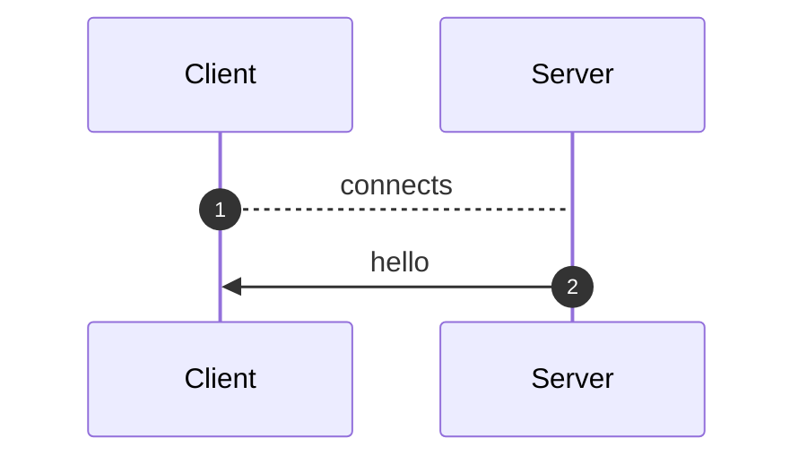
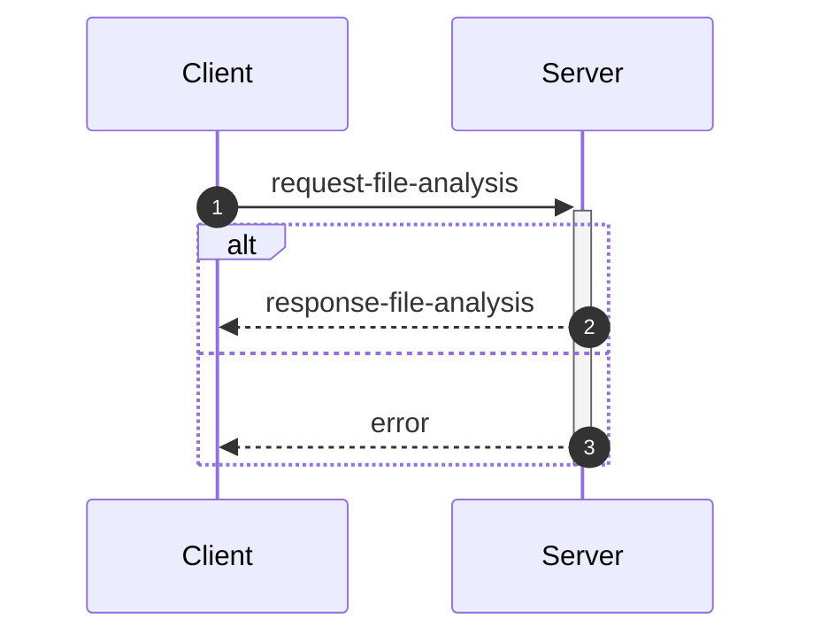
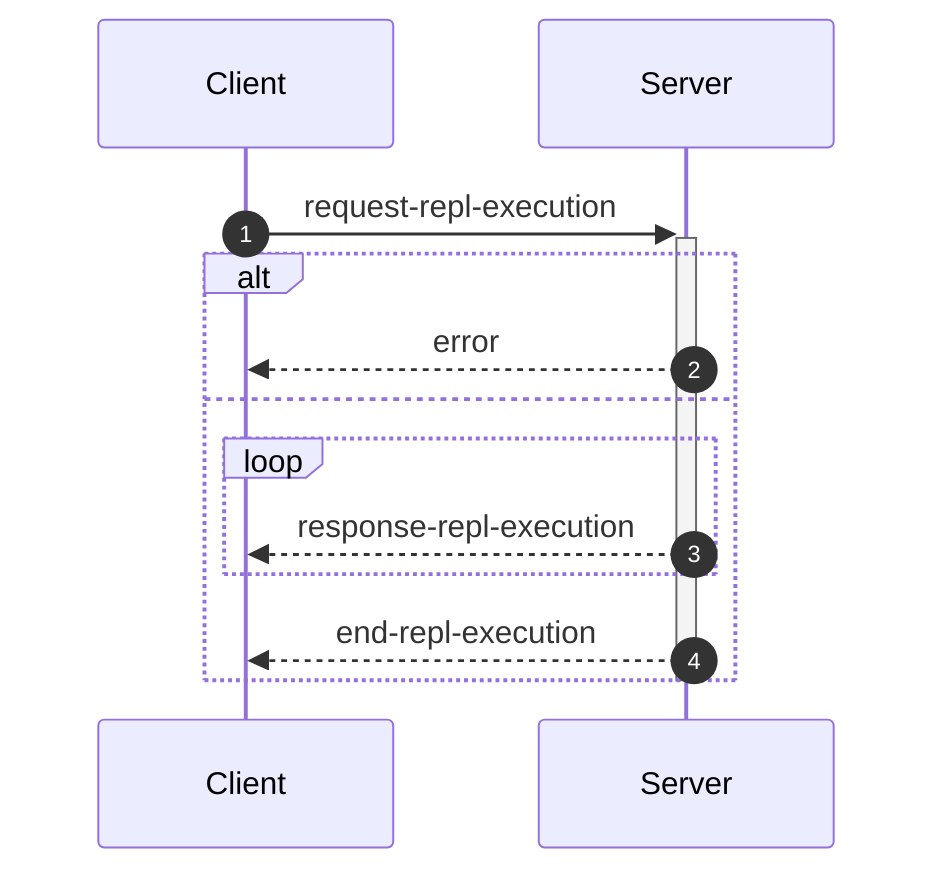
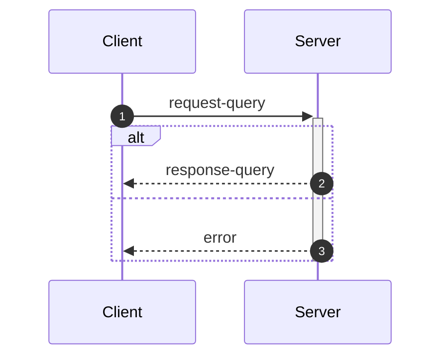

_<span title="an overview of flowR's interface">Generated</span> from '[wiki-interface.ts](https://github.com/flowr-analysis/flowr/tree/main/src/documentation/wiki-interface.ts "src/documentation/wiki-interface.ts")' on 2026-11-07, 22:50:29 UTC (v2.17.3, R v4.6.1), do not edit directly._

Although far from being as detailed as the in-depth explanation of [_flowR_](https://github.com/flowr-analysis/flowr/wiki/Core),
this wiki page explains how to interface with _flowR_ in more detail.
In general, command line arguments and other options provide short descriptions on hover over.

* [💻 Using the REPL](#using-the-repl)
* [⚙️ Configuring FlowR](#configuring-flowr)
* [⚒️ Writing Code](#writing-code)
* [💬 Communicating with the Server](#communicating-with-the-server)

<a id='using-the-repl'></a>
## 💻 Using the REPL

> [!NOTE]
> To execute arbitrary R commands with a repl request, _flowR_ has to be started explicitly with <span title="Description (Command Line Argument): Allow to access the underlying R session when using flowR (security warning: this allows the execution of arbitrary R code!)">`--r-session-access`</span>.
> Please be aware that this introduces a security risk and note that this relies on the [`r-shell` engine](https://github.com/flowr-analysis/flowr/wiki/Engines) .

Although primarily meant for users to explore,
there is nothing which forbids calling _flowR_ as a subprocess to use standard-in, -output, and -error
for communication (although you can access the REPL using the server as well,
with the [REPL Request](#message-request-repl-execution) message).

The read-eval-print loop&nbsp;(REPL) works relatively simple.
You can submit an expression (using <kbd>Enter</kbd>),
which is interpreted as an R&nbsp;expression by default but interpreted as a *command* if it starts with a colon (`:`).
The best command to get started with the REPL is <span title="Description (Repl Command): Show help information (aliases: :h, :?)">`:help`</span>.
Besides, you can leave the REPL either with the command <span title="Description (Repl Command): End the repl (aliases: :q, :exit)">`:quit`</span> or by pressing <kbd>Ctrl</kbd>+<kbd>C</kbd> twice.
When writing a *command*, you may press <kbd>Tab</kbd> to get a list of completions, if available.
Multiple commands can be entered in a single line by separating them with a semicolon (`;`), e.g. `:parse "x<-2"; :df*`.
If a command is given without R code, the REPL will re-use R code given in a previous command.
The prior example will hence return first the parsed AST of the program and then the dataflow graph for `"x <- 2"`.

> [!NOTE]
> If you develop flowR, you may want to launch the repl using the `npm run main-dev` command, this way, you get a non-minified version of flowR with debug information and hot-reloading of source files.

<details>
<summary>Available Commands</summary>

We currently offer the following commands (this with a `[*]` suffix are available with and without the star):

| Command | Description |
| ------- | ----------- |
| **<span title="Description (Repl Command): End the repl (aliases: :q, :exit)">:quit</span>** | End the repl (aliases: **:<span title="Alias of ':quit'. End the repl">q</span>**, **:<span title="Alias of ':quit'. End the repl">exit</span>**) |
| **<span title="Description (Repl Command): Execute the given code as R code. This requires the `--r-session-access` flag to be set and requires the r-shell engine. (aliases: :e, :r)">:execute</span>** | Execute the given code as R code. This requires the `--r-session-access` flag to be set and requires the r-shell engine. (aliases: **:<span title="Alias of ':execute'. Execute the given code as R code. This requires the `--r-session-access` flag to be set and requires the r-shell engine.">e</span>**, **:<span title="Alias of ':execute'. Execute the given code as R code. This requires the `--r-session-access` flag to be set and requires the r-shell engine.">r</span>**) |
| **<span title="Description (Repl Command): Get mermaid code for the control-flow graph of R code (aliases: :cfg, :cf)">:controlflow[*]</span>** | Get mermaid code for the control-flow graph of R code (star: Returns the URL to mermaid.live) (aliases: **:<span title="Alias of ':controlflow'. Get mermaid code for the control-flow graph of R code">cfg</span>**, **:<span title="Alias of ':controlflow'. Get mermaid code for the control-flow graph of R code">cf</span>**) |
| **<span title="Description (Repl Command): Get mermaid code for the control-flow graph with basic blocks (aliases: :cfgb, :cfb)">:controlflowbb[*]</span>** | Get mermaid code for the control-flow graph with basic blocks (star: Returns the URL to mermaid.live) (aliases: **:<span title="Alias of ':controlflowbb'. Get mermaid code for the control-flow graph with basic blocks">cfgb</span>**, **:<span title="Alias of ':controlflowbb'. Get mermaid code for the control-flow graph with basic blocks">cfb</span>**) |
| **<span title="Description (Repl Command): Get mermaid code for the dataflow graph (aliases: :d, :df)">:dataflow[*]</span>** | Get mermaid code for the dataflow graph (star: Returns the URL to mermaid.live) (aliases: **:<span title="Alias of ':dataflow'. Get mermaid code for the dataflow graph">d</span>**, **:<span title="Alias of ':dataflow'. Get mermaid code for the dataflow graph">df</span>**) |
| **<span title="Description (Repl Command): Get mermaid code for the normalized AST of R code (aliases: :n)">:normalize[*]</span>** | Get mermaid code for the normalized AST of R code (star: Returns the URL to mermaid.live) (alias: **:<span title="Alias of ':normalize'. Get mermaid code for the normalized AST of R code">n</span>**) |
| **<span title="Description (Repl Command): Get mermaid code for the simplified dataflow graph (aliases: :ds, :dfs)">:dataflowsimple[*]</span>** | Get mermaid code for the simplified dataflow graph (star: Returns the URL to mermaid.live) (aliases: **:<span title="Alias of ':dataflowsimple'. Get mermaid code for the simplified dataflow graph">ds</span>**, **:<span title="Alias of ':dataflowsimple'. Get mermaid code for the simplified dataflow graph">dfs</span>**) |
| **<span title="Description (Repl Command): Inspect and extend the signature database: `query` (identical to :query @signature), `info <name>` for where a function comes from (identical to :query @function-info), `add <path>` to mount another database/source, `download` to fetch the full-history database. (aliases: :sig)">:signature</span>** | Inspect and extend the signature database: `query` (identical to :query @signature), `info <name>` for where a function comes from (identical to :query @function-info), `add <path>` to mount another database/source, `download` to fetch the full-history database. (alias: **:<span title="Alias of ':signature'. Inspect and extend the signature database: `query` (identical to :query @signature), `info <name>` for where a function comes from (identical to :query @function-info), `add <path>` to mount another database/source, `download` to fetch the full-history database.">sig</span>**) |
| **<span title="Description (Repl Command): Just calculates the DFG, but only prints summary info (aliases: :d#, :df#)">:dataflowsilent</span>** | Just calculates the DFG, but only prints summary info (aliases: **:<span title="Alias of ':dataflowsilent'. Just calculates the DFG, but only prints summary info">d#</span>**, **:<span title="Alias of ':dataflowsilent'. Just calculates the DFG, but only prints summary info">df#</span>**) |
| **<span title="Description (Repl Command): Prints ASCII Art of the parsed, unmodified AST (aliases: :p)">:parse</span>** | Prints ASCII Art of the parsed, unmodified AST (alias: **:<span title="Alias of ':parse'. Prints ASCII Art of the parsed, unmodified AST">p</span>**) |
| **<span title="Description (Repl Command): Prints the version of flowR as well as the current version of R">:version</span>** | Prints the version of flowR as well as the current version of R
| **<span title="Description (Repl Command): Query the given R code (use 'help' for more information)">:query[*]</span>** | Query the given R code (use 'help' for more information) (star: Similar to query, but returns the output in json format.)
| **<span title="Description (Repl Command): Returns an ASCII representation of the dataflow graph (aliases: :df!)">:dataflowascii</span>** | Returns an ASCII representation of the dataflow graph (alias: **:<span title="Alias of ':dataflowascii'. Returns an ASCII representation of the dataflow graph">df!</span>**) |
| **<span title="Description (Repl Command): Returns summarization stats for the normalized AST (aliases: :n#)">:normalize#</span>** | Returns summarization stats for the normalized AST (alias: **:<span title="Alias of ':normalize#'. Returns summarization stats for the normalized AST">n#</span>**) |
| **<span title="Description (Repl Command): Show help information (aliases: :h, :?)">:help</span>** | Show help information (aliases: **:<span title="Alias of ':help'. Show help information">h</span>**, **:<span title="Alias of ':help'. Show help information">?</span>**) |

</details>

> [!TIP]
> 
> As indicated by the examples before, all REPL commands that operate on code keep track of the state.
> Hence, if you run a command like <span title="Description (Repl Command, starred version): Returns the URL to mermaid.live; Base Command: Get mermaid code for the dataflow graph (aliases: :d*, :df*)">`:dataflow*`</span> without providing R code,
> the REPL will re-use the R code provided in a previous command.
> Likewise, doing this will benefit from incrementality!
> If you request the dataflow graph with `:df* x <- 2 * y` and then want to see the parsed AST with `:parse`,
> the REPL will re-use previously obtained information and not re-parse the code again.
> 		

Generally, many commands offer shortcut versions in the REPL. Many queries, for example, offer a shortened format (see the example below).
Of special note, the [Config Query](https://github.com/flowr-analysis/flowr/wiki/%5BQuery%5D-Config)
can be used to also modify the currently active configuration of _flowR_ within the REPL (see the [wiki page](https://github.com/flowr-analysis/flowr/wiki/%5BQuery%5D-Config) for more information).

### Example: Retrieving the Dataflow Graph

To retrieve a URL to the [mermaid](https://mermaid.js.org/) diagram of the dataflow of a given expression,
use <span title="Description (Repl Command, starred version): Returns the URL to mermaid.live; Base Command: Get mermaid code for the dataflow graph (aliases: :d*, :df*)">`:dataflow*`</span> (or <span title="Description (Repl Command): Get mermaid code for the dataflow graph (aliases: :d, :df)">`:dataflow`</span> to get the mermaid code in the cli):

```shell
$ docker run -it --rm eagleoutice/flowr # or npm run flowr 
flowR repl v2.17.3, R grammar v14 (tree-sitter engine)
R> :dataflow* y <- 1 + x
```

<details>
<summary style='color:gray'>Output</summary>

```text
https://mermaid.live/view#base64:eyJjb2RlIjoiZmxvd2NoYXJ0IFREXG4gICAgMXt7XCJgKiM5MTtSTnVtYmVyIzkzOyogKioxKipcbiAgICAgICoxLjYqICgqKmlkOiAxKiopYFwifX1cbiAgICAyKFtcImAqIzkxO1JTeW1ib2wjOTM7KiAqKngqKlxuICAgICAgKjEuMTAqICgqKmlkOiAyKiopYFwiXSlcbiAgICAzW1tcImAqIzkxO1JCaW5hcnlPcCM5MzsqIGJhc2UjNTg7IzU4OyoqIzQzOyoqXG4gICAgICAqMS42LTEwKiAoKippZDogMyoqKVxuICAgIGFyZzogKDEsIDIpYFwiXV1cbiAgICBidWlsdC1pbjpfNDNfW1wiYEJ1aWx0LUluOlxuIzQzO2BcIl1cbiAgICBzdHlsZSBidWlsdC1pbjpfNDNfIHN0cm9rZTpncmF5LGZpbGw6Z3JheSxzdHJva2Utd2lkdGg6MnB4LG9wYWNpdHk6Ljg7XG4gICAgMFtcImAqIzkxO1JTeW1ib2wjOTM7KiAqKnkqKlxuICAgICAgKjEuMSogKCoqaWQ6IDAqKiwgdjogMylgXCJdXG4gICAgNFtbXCJgKiM5MTtSQmluYXJ5T3AjOTM7KiBiYXNlIzU4OyM1ODsqKiM2MDsjNDU7KipcbiAgICAgICoxLjEtMTAqICgqKmlkOiA0KiopXG4gICAgYXJnOiAoMCwgMylgXCJdXVxuICAgIGJ1aWx0LWluOl82MF8tW1wiYEJ1aWx0LUluOlxuIzYwOyM0NTtgXCJdXG4gICAgc3R5bGUgYnVpbHQtaW46XzYwXy0gc3Ryb2tlOmdyYXksZmlsbDpncmF5LHN0cm9rZS13aWR0aDoycHgsb3BhY2l0eTouODtcbiAgICAxIC0uLT58XCJmbG93XCJ8IDJcbiAgICBsaW5rU3R5bGUgMCBzdHJva2U6Z3JheSxjb2xvcjpncmF5O1xuICAgIDIgLS4tPnxcImZsb3dcInwgM1xuICAgIGxpbmtTdHlsZSAxIHN0cm9rZTpncmF5LGNvbG9yOmdyYXk7XG4gICAgMyAtLT58XCJyZWFkcywgYXJnXCJ8IDFcbiAgICAzIC0tPnxcInJlYWRzLCBhcmdcInwgMlxuICAgIDMgLS4tPnxcImZsb3dcInwgMFxuICAgIGxpbmtTdHlsZSA0IHN0cm9rZTpncmF5LGNvbG9yOmdyYXk7XG4gICAgMyAtLi0+fFwicmVhZHMsIGNhbGxzXCJ8IGJ1aWx0LWluOl80M19cbiAgICBsaW5rU3R5bGUgNSBzdHJva2U6Z3JheTtcbiAgICAwIC0tPnxcImRlZmluZWQtYnksIGZsb3dcInwgNFxuICAgIDAgLS0+fFwiZGVmaW5lZC1ieVwifCAzXG4gICAgNCAtLT58XCJyZWFkcywgYXJnXCJ8IDNcbiAgICA0IC0tPnxcInJldHVybnMsIGFyZ1wifCAwXG4gICAgNCAtLi0+fFwicmVhZHMsIGNhbGxzXCJ8IGJ1aWx0LWluOl82MF8tXG4gICAgbGlua1N0eWxlIDEwIHN0cm9rZTpncmF5OyIsIm1lcm1haWQiOnsiYXV0b1N5bmMiOnRydWV9fQ==
```

Retrieve the dataflow graph of the expression `y <- 1 + x`. It looks like this:


<details>

<summary style="color:gray">R Code of the Dataflow Graph</summary>

The analysis ran (parse and normalize with the [tree-sitter](https://github.com/flowr-analysis/flowr/wiki/Engines) engine) in the generation environment. No [signature database](https://github.com/flowr-analysis/flowr/wiki/Signature-Database) is mounted, so `library()` attaches no exports (base-R names are still qualified, e.g., `stats::acf`). 
We encountered no unknown side effects during the analysis.

```r
y <- 1 + x
```

</details>

</details>

For small graphs like this, <span title="Description (Repl Command): Returns an ASCII representation of the dataflow graph (aliases: :df!)">`:dataflowascii`</span> also provides an ASCII representation directly in the REPL:

```shell
$ docker run -it --rm eagleoutice/flowr # or npm run flowr 
flowR repl v2.17.3, R grammar v14 (tree-sitter engine)
R> :df! y <- 1 + x
```

<details open>
<summary style='color:gray'>Output</summary>

```text
                        v<0>v
 c<4>c──────────────────| y |
 |<- |     ┌────────────v---v
 c---c     │
    │   c<3>c   0<1>0
    └───| + |───| 1 |───u<2>u
        c---c   0---0   | x |
           └────────────u---u
Edges:
3 -> 1: reads, arg          3 -> 2: reads, arg
3 -> 0: flows-to            1 -> 2: flows-to
2 -> 3: flows-to            4 -> 3: reads, arg
4 -> 0: returns, arg        0 -> 4: defined-by, flows-to
0 -> 3: defined-by
```

Retrieve the dataflow graph of the expression `y <- 1 + x` as ASCII art.

</details>

For the slicing with <span title="Description (Repl Command): Static backwards executable slicer for R">`:slicer`</span>, you have access to the same [magic comments](#slice-magic-comments) as with the [slice request](#message-request-slice).
Pass `--inline` to splice resolvable `source()` calls into the reconstruction so the slice is a single self-contained R text (the same as the static slice query's `inlineSources` flag).
See `--help` for more flags!

### Example: Interfacing with the File System

Many commands that allow for an R-expression (like <span title="Description (Repl Command, starred version): Returns the URL to mermaid.live; Base Command: Get mermaid code for the dataflow graph (aliases: :d*, :df*)">`:dataflow*`</span>) allow for a file as well
if the argument starts with `file://`.
If you are working from the root directory of the _flowR_ repository, the following gives you the parsed AST of the example file using the <span title="Description (Repl Command): Prints ASCII Art of the parsed, unmodified AST (aliases: :p)">`:parse`</span> command:

> **Watch mode**: Replace `file://` with `watch://` to enter watch mode.
> flowR runs the command immediately and then re-runs it every time the file (or any file inside the folder) changes.
> Enter any other command to leave watch mode.
> For example: `:df watch://analysis.R`

```shell
$ docker run -it --rm eagleoutice/flowr # or npm run flowr 
flowR repl v2.17.3, R grammar v14 (tree-sitter engine)
R> :parse file://test/testfiles/example.R
```

<details>
<summary style='color:gray'>Output</summary>

```text
File: test/testfiles/example.R

program
├ binaryoperator
│ ├ identifier "sum" (1:1─4)
│ ├ <- "<-" (1:5─7)
│ ╰ float "0" (1:8─9)
├ binaryoperator
│ ├ identifier "product" (2:1─8)
│ ├ <- "<-" (2:9─11)
│ ╰ float "1" (2:12─13)
├ binaryoperator
│ ├ identifier "w" (3:1─2)
│ ├ <- "<-" (3:3─5)
│ ╰ float "7" (3:6─7)
├ binaryoperator
│ ├ identifier "N" (4:1─2)
│ ├ <- "<-" (4:3─5)
│ ╰ float "10" (4:6─8)
├ forstatement
│ ├ for "for" (6:1─4)
│ ├ ( "(" (6:5─6)
│ ├ identifier "i" (6:6─7)
│ ├ in "in" (6:8─10)
│ ├ binaryoperator
│ │ ├ float "1" (6:11─12)
│ │ ├ : ":" (6:12─13)
│ │ ╰ parenthesizedexpression
│ │   ├ ( "(" (6:13─14)
│ │   ├ binaryoperator
│ │   │ ├ identifier "N" (6:14─15)
│ │   │ ├ - "-" (6:15─16)
│ │   │ ╰ float "1" (6:16─17)
│ │   ╰ ) ")" (6:17─18)
│ ├ ) ")" (6:18─19)
│ ╰ bracedexpression
│   ├ { "{" (6:20─21)
│   ├ binaryoperator
│   │ ├ identifier "sum" (7:3─6)
│   │ ├ <- "<-" (7:7─9)
│   │ ╰ binaryoperator
│   │   ├ binaryoperator
│   │   │ ├ identifier "sum" (7:10─13)
│   │   │ ├ + "+" (7:14─15)
│   │   │ ╰ identifier "i" (7:16─17)
│   │   ├ + "+" (7:18─19)
│   │   ╰ identifier "w" (7:20─21)
│   ├ binaryoperator
│   │ ├ identifier "product" (8:3─10)
│   │ ├ <- "<-" (8:11─13)
│   │ ╰ binaryoperator
│   │   ├ identifier "product" (8:14─21)
│   │   ├  "" (8:22─23)
│   │   ╰ identifier "i" (8:24─25)
│   ╰ } "}" (9:1─2)
├ call
│ ├ identifier "cat" (11:1─4)
│ ╰ arguments
│   ├ ( "(" (11:4─5)
│   ├ argument
│   │ ╰ string
│   │   ├ stringopen "\"" (11:5─6)
│   │   ├ stringcontent "Sum:" (11:6─10)
│   │   ╰ stringclose "\"" (11:10─11)
│   ├ comma "," (11:11─12)
│   ├ argument
│   │ ╰ identifier "sum" (11:13─16)
│   ├ comma "," (11:16─17)
│   ├ argument
│   │ ╰ string
│   │   ├ stringopen "\"" (11:18─19)
│   │   ├ stringcontent
│   │   │ ╰ escapesequence "\\n" (11:19─21)
│   │   ╰ stringclose "\"" (11:21─22)
│   ╰ ) ")" (11:22─23)
╰ call
  ├ identifier "cat" (12:1─4)
  ╰ arguments
    ├ ( "(" (12:4─5)
    ├ argument
    │ ╰ string
    │   ├ stringopen "\"" (12:5─6)
    │   ├ stringcontent "Product:" (12:6─14)
    │   ╰ stringclose "\"" (12:14─15)
    ├ comma "," (12:15─16)
    ├ argument
    │ ╰ identifier "product" (12:17─24)
    ├ comma "," (12:24─25)
    ├ argument
    │ ╰ string
    │   ├ stringopen "\"" (12:26─27)
    │   ├ stringcontent
    │   │ ╰ escapesequence "\\n" (12:27─29)
    │   ╰ stringclose "\"" (12:29─30)
    ╰ ) ")" (12:30─31)
```

Retrieve the parsed AST of the example file.

<details>

<summary>File Content</summary>

```r
sum <- 0
product <- 1
w <- 7
N <- 10

for (i in 1:(N-1)) {
  sum <- sum + i + w
  product <- product * i
}

cat("Sum:", sum, "\n")
cat("Product:", product, "\n")
```

</details>

As _flowR_ directly transforms this AST the output focuses on being human-readable instead of being machine-readable.
		
</details>

### Example: Run a Query

You can run any query supported by _flowR_ using the <span title="Description (Repl Command): Query the given R code (use 'help' for more information)">`:query`</span> command.
For example, to obtain the shapes of all data frames in a given piece of code, you can run:

```shell
$ docker run -it --rm eagleoutice/flowr # or npm run flowr 
flowR repl v2.17.3, R grammar v14 (tree-sitter engine)
R> :query @absint df-shape "x <- data.frame(a = 1:10, b = 1:10)\ny <- x$a"
```

<details open>
<summary style='color:gray'>Output</summary>

```text
Query: absint (1 ms)
   ╰ $12: (colnames: [{"a", "b"}, {}], cols: [2, 2], rows: [10, 10])
   ╰ $0: (colnames: [{"a", "b"}, {}], cols: [2, 2], rows: [10, 10])
```

Retrieve the shapes of all data frames in the given code.

</details>

To run the linter on a file, you can use (in this example, we just issue the `dead-code` linter on a small piece of code):

```shell
$ docker run -it --rm eagleoutice/flowr # or npm run flowr 
flowR repl v2.17.3, R grammar v14 (tree-sitter engine)
R> :query @linter rules:dead-code "if(FALSE) x <- 2"
```

<details open>
<summary style='color:gray'>Output</summary>

```text
Query: linter (1 ms)
   ╰ Dead Code (dead-code):
       ╰ certain:
           ╰ Code at 1.11-16 (1 quick fix(es) available)
```

Run the linter on the given code, with only the `dead-code` rule enabled.

</details>

For more information on the available queries, please check out the [Query API](https://github.com/flowr-analysis/flowr/wiki/Query-API).

<a id='configuring-flowr'></a>
## ⚙️ Configuring FlowR

When running _flowR_, you may want to specify some behaviors with a dedicated configuration file.
By default, flowR looks for a file named `flowr.json` in the current working directory (or any higher directory).
You can also specify a different file with <span title="Description (Command Line Argument): The name of the configuration file to use">`--config-file`</span> or pass the configuration inline using <span title="Description (Command Line Argument): The flowR configuration to use, as a JSON string">`--config-json`</span>.
A `flowr.json` found this way belongs to the analyzed project, so flowR ignores its options that decide what flowR executes or loads
(`engines.*.wasmPath`, `engines.*.treeSitterWasmPath`, `engines.*.rPath`, `solver.sigdb.additionalPaths`, `solver.sigdb.downloadRepo`, `solver.sigdb.installedLibrary.paths`, `solver.sigdb.onDemand.enabled`, `solver.sigdb.onDemand.repositories`, `solver.sigdb.onDemand.cranMirror`, `solver.sigdb.onDemand.bioconductorMirror`, `solver.sigdb.onDemand.cacheDir`),
unless you pass <span title="Description (Command Line Argument): Keep the security-sensitive options (e.g., the R executable) of the flowr.json found in the working directory or a parent. Only use this for projects you trust.">`--trust-config`</span>.
To analyze code you do not trust, use the secure mode (<span title="Description (Command Line Argument): Run in secure mode for analyzing untrusted code: flowR does not start R (or any other process), does not access the network, does not search for project configs, and ignores security-sensitive options in every config. Cannot be disabled once enabled. Can also be enabled with the environment variable {italic FLOWR_SECURE_MODE=1}.">`--secure`</span>, see the [security policy](https://github.com/flowr-analysis/flowr/blob/main/.github/SECURITY.md)).
To inspect the current configuration, you can run flowr with the <span title="Description (Command Line Argument): Run with verbose logging (will be passed to the corresponding script)">`--verbose`</span> flag, or use the `config` [Query](https://github.com/flowr-analysis/flowr/wiki/Query-API).
Within the REPL this works by running the following:

```shell
:query @config
```

To work with the <a href="https://github.com/flowr-analysis/flowr/tree/main/src/config.ts#L119"><code><span title="The configuration file format for flowR.">FlowrConfig</span></code></a> you can use the provided helper objects alongside its methods like
<a href="https://github.com/flowr-analysis/flowr/tree/main/src/config.ts#L985"><code><span title="Creates a new flowr config that has the updated values.">FlowrConfig::<b>amend</b></span></code></a>.
The schema below documents every option; the ones you most likely want are:

- <a href="https://github.com/flowr-analysis/flowr/wiki/Interface#configuring-flowr" title="Configuration Option (boolean): Whether source calls should be ignored, causing {@link processSourceCall}&#39;s behavior to be skipped.">ignoreSourceCalls</a>: ignore source calls when analyzing the code, i.e., ignore the inclusion of other files.
- <a href="https://github.com/flowr-analysis/flowr/wiki/Interface#configuring-flowr" title="Configuration Option (boolean): Whether load calls should be ignored, causing {@link processLoadCall}&#39;s behavior to be skipped.">ignoreLoadCalls</a>: ignore load calls when analyzing the code, i.e., ignore the loading of r-data files.
- <a href="https://github.com/flowr-analysis/flowr/wiki/Interface#configuring-flowr" title="Configuration Option (object): Do you want to overwrite (parts) of the builtin definition?">semantics.environment.overwriteBuiltIns</a>: overwrite _flowR_'s handling of built-in functions, or clear the preset definitions entirely.
  See [Configure BuiltIn Semantics](#configure-builtin-semantics) for more information.
- <a href="https://github.com/flowr-analysis/flowr/wiki/Interface#configuring-flowr" title="Configuration Option (boolean): Whether calls drawing on a graphics device (e.g., `plot`) count as writing to it, which the ambient state queries then report.">semantics.ambient.drawingWritesDevice</a>: whether calls drawing on a graphics device (e.g., `plot`) count as writing the device in the ambient state queries.
- <a href="https://github.com/flowr-analysis/flowr/wiki/Interface#configuring-flowr" title="Configuration Option (string): How to resolve variables and their values. (one of &quot;disabled&quot;, &quot;alias&quot;, &quot;builtin&quot;)">solver.variables</a>: how to resolve variables and their values (`disabled`, `alias`, `builtin`).
- <a href="https://github.com/flowr-analysis/flowr/wiki/Interface#configuring-flowr" title="Configuration Option (array): The engine or set of engines to use for interacting with R code. An empty array means all available engines will be used.">engines</a> and <a href="https://github.com/flowr-analysis/flowr/wiki/Interface#configuring-flowr" title="Configuration Option (string): The default engine to use for interacting with R code. If this is undefined, an arbitrary engine from the specified list will be used. (one of &quot;tree-sitter&quot;, &quot;r-shell&quot;)">defaultEngine</a>: the engines used to interact with R code, see the [Engines wiki page](https://github.com/flowr-analysis/flowr/wiki/Engines).
- <a href="https://github.com/flowr-analysis/flowr/wiki/Interface#configuring-flowr" title="Configuration Option (array): Files a framework loads on its own, without any source() call (e.g. global.R in a shiny app), in the order they are loaded; flowR orders the matching project files accordingly and analyzes them as one program. Entries are case-insensitive globs matched against the file path, a plain name matches any file with that name, and entries matching no project file are warned about. Usually set per project kind via specializeConfig.">project.implicitSources</a>: the files a framework loads without any `source()` call, in the order in which they are
  loaded. Entries are globs (e.g. `R/*.R`) matched against the file path ignoring capitalization; one matching no file is reported.
- <a href="https://github.com/flowr-analysis/flowr/wiki/Interface#configuring-flowr" title="Configuration Option (object): Overwrite (parts of) the configuration depending on the project kind flowR detects, e.g. to give a shiny app its implicit sources.">specializeConfig</a>: overwrite (parts of) the configuration depending on the kind of project _flowR_ detects
  (e.g. `shiny-app`), which is how a shiny app gets its implicit sources by default. What you configure directly wins.
- <a href="https://github.com/flowr-analysis/flowr/wiki/Interface#configuring-flowr" title="Configuration Option (string): Overwrite the project kind flowR would otherwise infer from the analyzed files, e.g. when auto-detection guesses wrong. (one of &quot;package&quot;, &quot;script&quot;, &quot;shiny-app&quot;, &quot;notebook&quot;, &quot;project&quot;, &quot;unknown&quot;)">project.useProjectType</a>: skip that detection and force a project kind yourself, when auto-detection guesses wrong.
- <a href="https://github.com/flowr-analysis/flowr/wiki/Interface#configuring-flowr" title="Configuration Option (array): The default plugins to load when creating a new instance of FlowrAnalyzer">defaultPlugins</a> and <a href="https://github.com/flowr-analysis/flowr/wiki/Interface#configuring-flowr" title="Configuration Option (array): The plugins to load in REPL mode">repl.plugins</a>: the plugins to load for a new <a href="https://github.com/flowr-analysis/flowr/tree/main/src/project/flowr-analyzer.ts#L240"><code><span title="Central class for conducting analyses with FlowR. Use the FlowrAnalyzerBuilder to create a new instance. If you want the original pattern of creating a pipeline and running all steps, you can still do this with FlowrAnalyzer#runFull . To inspect the context of the analyzer, use FlowrAnalyzer#inspectContext (if you are a plugin and need to modify it, use FlowrAnalyzer#context instead).">FlowrAnalyzer</span></code></a> and in the REPL
  (use `flowr:default` to reference the former).

So you can configure _flowR_ by adding a file like the following:

<details>

<summary>Example Configuration File</summary>

```json
{
  "ignoreSourceCalls": true,
  "ignoreLoadCalls": true,
  "semantics": {
    "environment": {
      "overwriteBuiltIns": {
        "definitions": [
          {
            "type": "function",
            "names": [
              "foo"
            ],
            "processor": "builtin:assign",
            "config": {}
          }
        ]
      }
    }
  },
  "defaultPlugins": [
    "file:description",
    "versions:description"
  ],
  "repl": {
    "quickStats": false,
    "dfProcessorHeat": false,
    "hints": true,
    "plugins": [
      "flowr:default"
    ]
  },
  "project": {
    "resolveUnknownPathsOnDisk": true,
    "implicitSources": [
      "global.R",
      "app.R"
    ]
  },
  "linter": {
    "disabledRules": []
  },
  "specializeConfig": {
    "shiny-app": {
      "project": {
        "implicitSources": [
          "global.R",
          "ui.R",
          "server.R",
          "app.R"
        ]
      }
    }
  },
  "engines": [
    {
      "type": "r-shell"
    }
  ],
  "solver": {
    "variables": "alias",
    "evalStrings": true,
    "trackEnvironments": true,
    "sigdb": {
      "enabled": true,
      "loadProjectDependencies": true,
      "eagerlyLoad": false,
      "eagerlyLoadExports": false,
      "linkBaseR": false,
      "linkDescriptionDependencies": false
    },
    "resolveSource": {
      "dropPaths": "no",
      "ignoreCapitalization": true,
      "inferWorkingDirectory": "active-script",
      "searchPath": []
    },
    "instrument": {},
    "slicer": {
      "threshold": 50
    }
  },
  "abstractInterpretation": {
    "wideningThreshold": 4,
    "followCalls": true,
    "dataFrame": {
      "maxColNames": 20,
      "readLoadedData": {
        "readExternalFiles": true,
        "maxReadLines": 1000000
      }
    }
  },
  "incremental": {
    "alwaysIncremental": false,
    "parsing": {
      "activated": false,
      "heuristics": {
        "activated": true,
        "mtime": true,
        "linesFrom": 500,
        "bytesFrom": 50000,
        "alwaysWithEdits": false,
        "minFiles": 1
      }
    }
  },
  "gas": {
    "thresholds": {
      "memory": {
        "problematic": 0.7,
        "critical": 0.9
      },
      "timeMs": {
        "problematic": 100000,
        "critical": 120000
      }
    },
    "features": {}
  }
}
```

</details>

<details>
<a id='configure-builtin-semantics'></a>
<summary>Configure Built-In Semantics</summary>

`semantics/environment/overwriteBuiltins` accepts two keys:

- `loadDefaults` (boolean, initially `true`): If set to `true`, the default built-in definitions are loaded before applying the custom definitions. Setting this flag to `false` explicitly disables the loading of the default definitions.
- `definitions` (array, initially empty): Allows to overwrite or define new built-in elements. Each object within must have a `type` which is one of the below. Furthermore, they may define a string array of `names` which specifies the identifiers to bind the definitions to. You may use `assumePrimitive` to specify whether _flowR_ should assume that this is a primitive non-library definition (so you probably just do not want to specify the key).

  | Type            | Description                                                                                                                                                                                                                                                                                              | Example                                                                                                    |
  | --------------- | -------------------------------------------------------------------------------------------------------------------------------------------------------------------------------------------------------------------------------------------------------------------------------------------------------- | ---------------------------------------------------------------------------------------------------------- |
  | `constant`    | Additionally allows for a `value` this should resolve to.                                                                                                                                                                                                                                                | `{ type: 'constant', names: ['NULL', 'NA'],  value: null }`                                                |
  | `function`    | Is a rather flexible way to define and bind built-in functions. For the time, we do not have extensive documentation to cover all the cases, so please either consult the sources with the `default-builtin-config/` folder or open a [new issue](https://github.com/flowr-analysis/flowr/issues/new/choose). | `{ type: 'function', names: ['next'], processor: 'builtin:d', config: { cfg: ExitPointType.Next } }` |
  | `replacement` | A comfortable way to specify replacement functions like `$<-` or `names<-`. `suffixes` describes the... suffixes to attach automatically. | `{ type: 'replacement', suffixes: ['<-', '<<-'], names: ['[', '[['] }` |

</details>

<details>

<summary style='color:gray'>Full Configuration-File Schema</summary>

- _The configuration file format for flowR._ (object)
    - **logLevel** [optional] _flowR's global minimum log level, applied when the config is loaded._ (string)
        Only allows: 'silly', 'trace', 'debug', 'info', 'warn', 'error', 'fatal'
    - **ignoreSourceCalls** [optional] _Whether source calls should be ignored, causing {@link processSourceCall}'s behavior to be skipped._ (boolean)
    - **ignoreLoadCalls** [optional] _Whether load calls should be ignored, causing {@link processLoadCall}'s behavior to be skipped._ (boolean)
    - **semantics** _Configure language semantics and how flowR handles them._ (object)
        - **environment** [optional] _Semantics regarding how to handle the R environment._ (object)
            - **overwriteBuiltIns** [optional] _Do you want to overwrite (parts) of the builtin definition?_ (object)
                - **loadDefaults** [optional] _Should the default configuration still be loaded?_ (boolean)
                - **definitions** [optional] _The definitions to load/overwrite._ (array)
                Valid item types:
                    - (object)
        - **ambient** [optional] _Semantics regarding the global state (options, devices, files, ...) calls access._ (object)
            - **drawingWritesDevice** [optional] _Whether calls drawing on a graphics device (e.g., `plot`) count as writing to it, which the ambient state queries then report._ (boolean)
    - **defaultPlugins** [optional] _The default plugins to load when creating a new instance of FlowrAnalyzer_ (array)
    Valid item types:
        - (alternatives)
            - (string)
            - (array)
    - **repl** _Configuration options for the REPL._ (object)
        - **quickStats** [optional] _Whether to show quick stats in the REPL after each evaluation._ (boolean)
        - **dfProcessorHeat** [optional] _This instruments the dataflow processors to count how often each processor is called._ (boolean)
        - **hints** [optional] _Whether to show dim inline hints on the empty prompt (automatically disabled on non-interactive terminals)._ (boolean)
        - **plugins** [optional] _The plugins to load in REPL mode_ (array)
        Valid item types:
            - (alternatives)
                - (string)
                - (array)
        - **autoUseFileProtocol** [optional] _Prepend the file protocol to a repl input that looks like a path, instead of only warning about it._ (boolean)
        - **queryStats** [optional] _Whether `:query` closes with the line stating how long the queries took (`:query*` never prints it)._ (boolean)
        - **showPlugins** [optional] _Whether `:version` grays out the plugins that did not activate during the last analysis._ (boolean)
    - **project** _Project specific configuration options._ (object)
        - **resolveUnknownPathsOnDisk** [optional] _Whether to resolve unknown paths loaded by the r project disk when trying to source/analyze files._ (boolean)
        - **failOnInaccessiblePath** [optional] _Whether a directory that cannot be traversed during file discovery (e.g. due to permissions) aborts the analysis; when false (the default) such paths are logged and skipped._ (boolean)
        - **basePackages** [optional] _The packages considered part of R itself (base and recommended); if unset, flowR uses its built-in list._ (array)
        Valid item types:
            - (string)
        - **implicitSources** [optional] _Files a framework loads on its own, without any source() call (e.g. global.R in a shiny app), in the order they are loaded; flowR orders the matching project files accordingly and analyzes them as one program. Entries are case-insensitive globs matched against the file path, a plain name matches any file with that name, and entries matching no project file are warned about. Usually set per project kind via specializeConfig._ (array)
        Valid item types:
            - (string)
        - **useProjectType** [optional] _Overwrite the project kind flowR would otherwise infer from the analyzed files, e.g. when auto-detection guesses wrong._ (string)
            Only allows: 'package', 'script', 'shiny-app', 'notebook', 'project', 'unknown'
        - **assumeImplicitEcho** [optional] _Whether the top level of the analyzed code is echoed, so that every visible result printed there is collected as an output by the dependencies query (default true, false for a package)._ (boolean)
        - **discovery** [optional] _Scoping options for the default project discovery._ (object)
            - **full** [optional] _Collect every file below the project root (greedy) instead of only the files the detected project kind needs (default false)._ (boolean)
            - **perKind** [optional] _Per-kind include/exclude glob overrides layered on the default scoping._ (object)
            - **ignore** [optional] _Case-insensitive globs that drop matching files from the intelligent discovery, regardless of kind (e.g. .Renviron to ignore environment files)._ (array)
            Valid item types:
                - (string)
        - **classification** [optional] _Overrides for the signals flowR uses to classify the project kind._ (object)
            - **shinyDescriptionTypes** [optional] _DESCRIPTION Type: values that mark a shiny app._ (array)
            Valid item types:
                - (string)
            - **shinyEntryFiles** [optional] _File names a shiny app is assembled from._ (array)
            Valid item types:
                - (string)
            - **shinyUsagePattern** [optional] _Regex source evidencing shiny usage in an entry file._ (string)
            - **notebookExtensions** [optional] _File extensions marking a notebook._ (array)
            Valid item types:
                - (string)
    - **linter** _Linter configuration options._ (object)
        - **disabledRules** _Linting rule names excluded from the default rule set (a rule requested explicitly via a linter query still runs). Usually set per project kind via specializeConfig._ (array)
        Valid item types:
            - (string)
        - **disabledTags** [optional] _Linting rule tags whose rules are excluded from the default rule set (a rule requested explicitly via a linter query still runs). By default the cmd-check rules are disabled for everything but a package; a configured list replaces that default._ (array)
        Valid item types:
            - (string)
    - **inputSources** [optional] _Further frameworks the input-sources analysis should know about; entries are added to flowR's defaults._ (object)
        - **pure** [optional] _Functions that only pass the constantness of their arguments on._ (array)
        Valid item types:
            - (string)
        - **param** [optional] _Functions whose result is a 'param' input._ (array)
        Valid item types:
            - (string)
        - **file** [optional] _Functions whose result is a 'file' input._ (array)
        Valid item types:
            - (string)
        - **tempfile** [optional] _Functions whose result is a 'tempfile' input._ (array)
        Valid item types:
            - (string)
        - **glob** [optional] _Functions whose result is a 'glob' input._ (array)
        Valid item types:
            - (string)
        - **net** [optional] _Functions whose result is a 'net' input._ (array)
        Valid item types:
            - (string)
        - **rand** [optional] _Functions whose result is a 'rand' input._ (array)
        Valid item types:
            - (string)
        - **system** [optional] _Functions whose result is a 'system' input._ (array)
        Valid item types:
            - (string)
        - **ffi** [optional] _Functions whose result is a 'ffi' input._ (array)
        Valid item types:
            - (string)
        - **lang** [optional] _Functions whose result is a 'lang' input._ (array)
        Valid item types:
            - (string)
        - **options** [optional] _Functions whose result is a 'options' input._ (array)
        Valid item types:
            - (string)
        - **cmdline** [optional] _Functions whose result is a 'cmdline' input._ (array)
        Valid item types:
            - (string)
        - **user** [optional] _Functions whose result is a 'user' input._ (array)
        Valid item types:
            - (string)
        - **const** [optional] _Functions whose result is a 'const' input._ (array)
        Valid item types:
            - (string)
        - **scope** [optional] _Functions whose result is a 'scope' input._ (array)
        Valid item types:
            - (string)
        - **dconst** [optional] _Functions whose result is a 'dconst' input._ (array)
        Valid item types:
            - (string)
        - **unknown** [optional] _Functions whose result is a 'unknown' input._ (array)
        Valid item types:
            - (string)
        - **linkedObjects** [optional] _Objects a framework provides without a definition in the code, e.g. shiny's input._ (array)
        Valid item types:
            - (object)
        - **linkedEntryPoints** [optional] _Calls that hand a function to a framework, which binds its objects to the parameters by position._ (array)
        Valid item types:
            - (object)
    - **specializeConfig** [optional] _Overwrite (parts of) the configuration depending on the project kind flowR detects, e.g. to give a shiny app its implicit sources._ (object)
    - **engines** _The engine or set of engines to use for interacting with R code. An empty array means all available engines will be used._ (array)
    Valid item types:
        - (alternatives)
            - _The configuration for the tree sitter engine._ (object)
                - **type** [required] _Use the tree sitter engine._ (string)
                    Only allows: 'tree-sitter'
                - **wasmPath** [optional] _The path to the tree-sitter-r WASM binary to use. If this is undefined, this uses the default path._ (string)
                - **treeSitterWasmPath** [optional] _The path to the tree-sitter WASM binary to use. If this is undefined, this uses the default path._ (string)
                - **lax** [optional] _Whether to use the lax parser for parsing R code (allowing for syntax errors). If this is undefined, the strict parser will be used._ (boolean)
            - _The configuration for the R shell engine._ (object)
                - **type** [required] _Use the R shell engine._ (string)
                    Only allows: 'r-shell'
                - **rPath** [optional] _The path to the R executable to use. If this is undefined, this uses the default path._ (string)
                - **pipeBind** [optional] _Whether to enable R's experimental pipe-bind operator "=>" by setting _R_USE_PIPEBIND_ for the R session (default false); R itself keeps this off by default, as it is experimental and has never shipped in a release version of R._ (boolean)
    - **defaultEngine** [optional] _The default engine to use for interacting with R code. If this is undefined, an arbitrary engine from the specified list will be used._ (string)
        Only allows: 'tree-sitter', 'r-shell'
    - **solver** _How to resolve constants, constraints, cells, ..._ (object)
        - **variables** _How to resolve variables and their values._ (string)
            Only allows: 'disabled', 'alias', 'builtin'
        - **evalStrings** _Should we include eval(parse(text="...")) calls in the dataflow graph?_ (boolean)
        - **trackEnvironments** [optional] _Track user-created environments (new.env, assign/get/local with envir=, dollar-assign, attach). When false, all envir-style calls fall through conservatively._ (boolean)
        - **sigdb** _Resolving library exports from a signature database._ (object)
            - **enabled** [optional] _Resolve library()/use() exports from a signature database (default true); when false no database is consulted._ (boolean)
            - **loadProjectDependencies** [optional] _Load the project's declared dependencies from its metadata files (DESCRIPTION Imports/Depends, rproject.toml, uvr.toml, rig rproj.toml and script blocks, renv.lock, rv.lock, uvr.lock, rig lockfiles) (default true); when false these files are not read for dependencies._ (boolean)
            - **eagerlyLoad** [optional] _Parse the database up front rather than on the first package load (default false, ignored if disabled)._ (boolean)
            - **eagerlyLoadExports** [optional] _Add a vertex for every export on load rather than on demand (default false); keeps the dataflow graph small._ (boolean)
            - **assumedRVersion** [optional] _R version assumed when resolving versioned (base-R) exports: a pin like "4.5" or "auto" to detect the installed R (default "auto")._ (string)
            - **linkBaseR** [optional] _Eagerly attach base-R namespaces so bare base calls resolve without library() (default false)._ (boolean)
            - **linkBaseRCalls** [optional] _Add a lightweight Reads edge from a bare base-R call to its signature-database function vertex (default false; base-R qualification is edge-free otherwise)._ (boolean)
            - **linkPackageCalls** [optional] _Add a lightweight Reads edge from a resolved package call to its signature-database function vertex (default false)._ (boolean)
            - **linkDescriptionDependencies** [optional] _Eagerly attach the namespaces of the project's declared DESCRIPTION dependencies (Imports/Depends) so their exports resolve without an explicit library() (default false)._ (boolean)
            - **warmInBackground** [optional] _Decompress the hot shards (base + most-downloaded) in a background task on startup so the first library() lookup is warm (default false; for long-running servers/REPLs)._ (boolean)
            - **additionalPaths** [optional] _Extra directories or bundle/manifest files searched for signature databases (alongside the shipped default and $FLOWR_SIGDB_DIR); a downloaded full-history bundle placed here is mounted automatically._ (array)
            Valid item types:
                - (string)
            - **downloadRepo** [optional] _GitHub owner/repo the full-history bundle is downloaded from via ":signature download" (default "flowr-analysis/flowr"; the release tag comes from the committed sigdb.remote.json unless a version is given)._ (string)
            - **autoSync** [optional] _On startup, re-download shards whose committed sigdb.remote.json hash no longer matches the cache, in the background (default false; opt-in network sync after a git pull)._ (boolean)
            - **installedLibrary** [optional] _Recovering packages no signature database knows from the copy installed on this machine._ (object)
                - **enabled** [required] _Recover packages no signature database knows from their installed copy (default false)._ (boolean)
                - **paths** [optional] _Library directories to search; when empty they are discovered from the environment and the project._ (array)
                Valid item types:
                    - (string)
                - **useEnvironment** [optional] _Search the libraries R_LIBS_USER/R_LIBS/R_LIBS_SITE name (default true)._ (boolean)
                - **useProjectLibrary** [optional] _Search a project-local renv/packrat library (default true)._ (boolean)
                - **maxDepth** [optional] _How far to descend into the nested layout of a project-local library (default 3)._ (number)
                - **packages** [optional] _Only recover packages whose name matches one of these regular expressions; empty means any._ (array)
                Valid item types:
                    - (string)
            - **onDemand** [optional] _Recovering packages no signature database knows from their sources on CRAN, Bioconductor, or GitHub._ (object)
                - **enabled** [required] _Fetch and recover the sources of packages no signature database knows when the analyzed code uses them (default false, accesses the network)._ (boolean)
                - **sources** [optional] _Where to look, in order: github, cran, bioconductor, or a source a plugin adds (default ["github", "cran", "bioconductor"])._ (array)
                Valid item types:
                    - (string)
                - **repositories** [optional] _GitHub repositories (owner/repo[/subdir][@ref]) to fetch packages from, by package name. The analyzed project may name more (DESCRIPTION Remotes, install_github calls)._ (object)
                - **packages** [optional] _Only recover packages whose name matches one of these regular expressions, empty means any._ (array)
                Valid item types:
                    - (string)
                - **cranMirror** [optional] _The CRAN src/contrib/ to fetch from, over https (default https://cloud.r-project.org/src/contrib/). It may be on the local network._ (string)
                - **bioconductorMirror** [optional] _The Bioconductor host, over https (default https://bioconductor.org). It may be on the local network._ (string)
                - **bioconductorRelease** [optional] _The Bioconductor release to fetch from: release, devel, or a number like 3.20 (default release)._ (string)
                - **githubMirrors** [optional] _Use the GitHub mirrors of CRAN (cran/<pkg>) and Bioconductor (bioc/<pkg>) (default true)._ (boolean)
                - **maxPackages** [optional] _The most packages to fetch for one analysis (default 25)._ (number)
                - **maxArchiveMb** [optional] _The most MiB a package archive may have (default 32). It may unpack to three times that, at most 128 MiB._ (number)
                - **offline** [optional] _Only use what was fetched before, never the network (default false)._ (boolean)
                - **retryAfterHours** [optional] _How many hours to wait before asking again for a package no source had (default 24)._ (number)
                - **cacheDir** [optional] _Where to cache what was fetched (default the on-demand directory of the signature cache)._ (string)
            - **blobCacheBudgetMb** [optional] _How many MiB of decoded package blobs every open bundle may hold together (default 16)._ (number)
            - **versionSelection** [optional] _When a project constrains a dependency, resolve to the newest (default), oldest, or system-installed version satisfying it; system needs R and falls back to newest. Base-R packages always resolve against the assumed R version._ (string)
                Only allows: 'newest', 'oldest', 'system'
            - **versionOverrides** [optional] _Force an exact version for specific packages (name -> version), overriding both the project constraint and the versionSelection policy (default {})._ (object)
        - **versionManagement** _Policies for reasoning about dependency versions._ (object)
            - **linkedVersionGroups** [optional] _Groups of packages that must resolve to the same version; version guessing intersects each group so its members stay mutually compatible (default [])._ (array)
            Valid item types:
                - (array)
                Valid item types:
                    - (string)
        - **assumeAttachedPackages** [optional] _Packages to treat as attached without a `library()` call, so what the built-in configuration states about them applies to the analyzed code. The base packages R attaches on startup already resolve without it._ (array)
        Valid item types:
            - (string)
        - **transitiveSideEffectRounds** [optional] _How many rounds the transitive side-effect fixpoint may run before it is cut off (default 32); the propagation stops on its own as soon as a round adds nothing._ (number)
        - **maxOverlayDepth** [optional] _How many binding overlays may stack on one environment frame before a write flattens them (default 4); a pure performance knob, trading lookup cost against copy cost without changing any result._ (number)
        - **instrument** (object)
            - **dataflowExtractors** [optional] _These keys are only intended for use within code, allowing to instrument the dataflow analyzer!_ (any)
        - **resolveSource** [optional] _If lax source calls are active, flowR searches for sourced files much more freely, based on the configurations you give it. This option is only in effect if `ignoreSourceCalls` is set to false._ (object)
            - **dropPaths** _Allow to drop the first or all parts of the sourced path, if it is relative._ (string)
                Only allows: 'no', 'once', 'all'
            - **ignoreCapitalization** _Search for filenames matching in the lowercase._ (boolean)
            - **inferWorkingDirectory** _Try to infer the working directory from the main or any script to analyze._ (string)
                Only allows: 'no', 'main-script', 'active-script', 'any-script'
            - **searchPath** _Additionally search in these paths._ (array)
            Valid item types:
                - (string)
            - **repeatedSourceLimit** [optional] _How often the same file can be sourced within a single run? Please be aware: in case of cyclic sources this may not reach a fixpoint so give this a sensible limit._ (number)
            - **applyReplacements** _Provide name replacements for loaded files_ (array)
            Valid item types:
                - (object)
            - **assumeFilesExist** [optional] _Assume a sourced file is always there, making what it defines certain instead of conditional on the source call._ (boolean)
        - **slicer** [optional] _The configuration for the slicer._ (object)
            - **threshold** [optional] _The maximum number of iterations to perform on a single function call during slicing._ (number)
            - **autoExtend** [optional] _If set, the slicer will gain an additional post-pass._ (boolean)
    - **abstractInterpretation** _The configuration options for abstract interpretation._ (object)
        - **wideningThreshold** _The threshold for the number of visitations of a node at which widening should be performed to ensure the termination of the fixpoint iteration._ (number)
        - **followCalls** _Whether the abstract interpretation is interprocedural, i.e. whether it steps into the functions a call may dispatch to._ (boolean)
        - **dataFrame** _The configuration of the shape inference for data frames._ (object)
            - **maxColNames** _The maximum number of columns names to infer for data frames before over-approximating the column names to top._ (number)
            - **readLoadedData** _Configuration options for reading data frame shapes from loaded external data files, such as CSV files._ (object)
                - **readExternalFiles** _Whether data frame shapes should be extracted from loaded external files, such as CSV files._ (boolean)
                - **maxReadLines** _The maximum number of lines to read when extracting data frame shapes from loaded files, such as CSV files._ (number)
    - **incremental** (object)
        - **alwaysIncremental** _Always take the incremental path, regardless of heuristics._ (boolean)
        - **parsing** (object)
            - **activated** _If set, incremental parsing will be used._ (boolean)
            - **heuristics** (object)
                - **activated** [optional] _If set, the heuristics for incremental parsing will be used._ (boolean)
                - **mtime** [optional] _Skip reparsing entirely if the file's modification time is unchanged since the last parse._ (boolean)
                - **linesFrom** [optional] _Only consider incremental parsing for files with at least this many lines._ (number)
                - **bytesFrom** [optional] _Only consider incremental parsing for files with at least this many bytes._ (number)
                - **alwaysWithEdits** [optional] _Always take the incremental path whenever there is a computed edit region, regardless of the other thresholds._ (boolean)
                - **minFiles** [optional] _Only apply these heuristics once the project has at least this many files loaded._ (number)
    - **gas** [optional] _Resource-usage guard (gas) configuration. All feature factors default to 0 (disabled). See https://github.com/flowr-analysis/flowr/wiki/Core#gas-resource-guard._ (object)
        - **thresholds** [optional] _Thresholds for all gas checks (scaled by per-feature factor), boundable per feature._ (object)
            - **memory** [optional] _Heap-usage fraction thresholds (0-1), either shared or given per feature key (with `default` covering the rest)._ (object)
                - **problematic** [optional] _Heap fraction (0-1) above which Problematic is returned, for every feature without an entry of its own._ (number)
                - **critical** [optional] _Heap fraction (0-1) above which Critical is returned, for every feature without an entry of its own._ (number)
            - **timeMs** [optional] _Elapsed analysis time thresholds in milliseconds, either shared or given per feature key (with `default` covering the rest)._ (object)
                - **problematic** [optional] _Elapsed ms above which Problematic is returned, for every feature without an entry of its own._ (number)
                - **critical** [optional] _Elapsed ms above which Critical is returned, for every feature without an entry of its own._ (number)
            - **steps** [optional] _Processed-AST-node thresholds, counted rather than sampled; only a key that arms a budget (`dataflow`) reads them._ (object)
                - **problematic** [optional] _Processed AST nodes above which Problematic is returned, for every feature without an entry of its own._ (number)
                - **critical** [optional] _Processed AST nodes above which the extraction is cut short, for every feature without an entry of its own._ (number)
            - **vertices** [optional] _Created-dataflow-vertex thresholds, counted like `steps`._ (object)
                - **problematic** [optional] _Created dataflow vertices above which Problematic is returned, for every feature without an entry of its own._ (number)
                - **critical** [optional] _Created dataflow vertices above which the extraction is cut short, for every feature without an entry of its own._ (number)
        - **features** [optional] _Per-feature sensitivity factors. 0 or absent disables gas checking for that feature. A factor of 2 makes the feature twice as sensitive. Recognised keys: `source`, `side-effect-linking`, `linter`, `slicer`, `dataflow`._ (object)
        - **countedCheckEvery** [optional] _How many counted steps pass between two accountings of an armed check, be it a dataflow budget or the slicer's traversal (default 128); trades overshoot against the cost of the check._ (number)
        - **heapProvider** [optional] _Custom heap statistics source (programmatic configs only), overriding the built-in v8/performance.memory detection._ (function)

</details>

<a id='writing-code'></a>
## ⚒️ Writing Code

_flowR_ can be used as a [module](https://www.npmjs.com/package/@eagleoutice/flowr) and offers several main classes and interfaces that are interesting for extension writers 
(see the [Visual Studio Code extension](https://marketplace.visualstudio.com/items?itemName=code-inspect.vscode-flowr) or the [Core](https://github.com/flowr-analysis/flowr/wiki/Core) wiki page for more information).

### Creating Analyses with _flowR_

Nowadays, instances of the <a href="https://github.com/flowr-analysis/flowr/tree/main/src/project/flowr-analyzer.ts#L240"><code><span title="Central class for conducting analyses with FlowR. Use the FlowrAnalyzerBuilder to create a new instance. If you want the original pattern of creating a pipeline and running all steps, you can still do this with FlowrAnalyzer#runFull . To inspect the context of the analyzer, use FlowrAnalyzer#inspectContext (if you are a plugin and need to modify it, use FlowrAnalyzer#context instead).">FlowrAnalyzer</span></code></a> should be used as central frontend to get analysis results from _flowR_.
The entry points an analysis is written against are re-exported from the package root (`import { FlowrAnalyzerBuilder } from '@eagleoutice/flowr'`);
everything else stays reachable under its own path, as in `@eagleoutice/flowr/dataflow/graph/graph`.
For example, a program slice can be created like this:

```ts
const analyzer = await new FlowrAnalyzerBuilder()
    .setEngine('tree-sitter')
    .build();
analyzer.addRequest('x <- 1\ny <- x\nx');
const { slice, reconstruct } = await analyzer.query({
    type:     'static-slice',
    criteria: ['3@x']
});
```

For more information, please have a look at the [Analyzer](https://github.com/flowr-analysis/flowr/wiki/Analyzer) wiki page, which explains how to construct and use the <a href="https://github.com/flowr-analysis/flowr/tree/main/src/project/flowr-analyzer.ts#L240"><code><span title="Central class for conducting analyses with FlowR. Use the FlowrAnalyzerBuilder to create a new instance. If you want the original pattern of creating a pipeline and running all steps, you can still do this with FlowrAnalyzer#runFull . To inspect the context of the analyzer, use FlowrAnalyzer#inspectContext (if you are a plugin and need to modify it, use FlowrAnalyzer#context instead).">FlowrAnalyzer</span></code></a> in more detail.
To work with specific perspectives, you can also consult the respective pages like the [Dataflow Graph](https://github.com/flowr-analysis/flowr/wiki/Dataflow-Graph) or the [Abstract Interpretation](https://github.com/flowr-analysis/flowr/wiki/Abstract-Interpretation) wiki pages.
### The Pipeline Executor (Low-Level Interface)

Once, in the beginning, _flowR_ was meant to produce a dataflow graph merely to provide *program slices*. 
However, with continuous updates, the [Dataflow Graph](https://github.com/flowr-analysis/flowr/wiki/Dataflow-Graph) repeatedly proves to be the more interesting part.
With this, we restructured _flowR_'s originally *hardcoded* pipeline to be far more flexible. 
Now, it can be theoretically extended or replaced with arbitrary steps, optional steps, and what we call 'decorations' of these steps. 
In short, a slicing pipeline using the <a href="https://github.com/flowr-analysis/flowr/tree/main/src/core/pipeline-executor.ts#L97"><code><span title="**Please note:** The PipelineExecutor is now considered to be a rather low-level API for flowR. While it still works and is the basis for all other layers, we strongly recommend using the FlowrAnalyzer and its builder to create and use an analyzer instance that is pre-configured for your use-case. The pipeline executor allows to execute arbitrary pipelines in a step-by-step fashion. If you are not...">PipelineExecutor</span></code></a> looks like this:

```ts

const slicer = new PipelineExecutor(DEFAULT_SLICING_PIPELINE, {
  parser:    new RShell(),
  request:   requestFromInput('x <- 1\nx + 1'),
  criterion: ['2@x']
})
const slice = await slicer.allRemainingSteps()
// console.log(slice.reconstruct.code)
```

<details><summary>More Information</summary>

If you compare this, with what you would have done with the old (and removed) `SteppingSlicer`, 
this essentially just requires you to replace the `SteppingSlicer` with the <a href="https://github.com/flowr-analysis/flowr/tree/main/src/core/pipeline-executor.ts#L97"><code><span title="**Please note:** The PipelineExecutor is now considered to be a rather low-level API for flowR. While it still works and is the basis for all other layers, we strongly recommend using the FlowrAnalyzer and its builder to create and use an analyzer instance that is pre-configured for your use-case. The pipeline executor allows to execute arbitrary pipelines in a step-by-step fashion. If you are not...">PipelineExecutor</span></code></a>
and to pass the <a href="https://github.com/flowr-analysis/flowr/tree/main/src/core/steps/pipeline/default-pipelines.ts#L18"><code>DEFAULT_SLICING_PIPELINE</code></a> as the first argument.
The <a href="https://github.com/flowr-analysis/flowr/tree/main/src/core/pipeline-executor.ts#L97"><code><span title="**Please note:** The PipelineExecutor is now considered to be a rather low-level API for flowR. While it still works and is the basis for all other layers, we strongly recommend using the FlowrAnalyzer and its builder to create and use an analyzer instance that is pre-configured for your use-case. The pipeline executor allows to execute arbitrary pipelines in a step-by-step fashion. If you are not...">PipelineExecutor</span></code></a>...

1. Provides structures to investigate the results of all intermediate steps
2. Can be executed step-by-step
3. Can repeat steps (e.g., to calculate multiple slices on the same input)

See the in-code documentation for more information.

</details>

### Using the <a href="https://github.com/flowr-analysis/flowr/tree/main/src/r-bridge/shell.ts#L144"><code><span title="The RShell represents an interactive session with the R interpreter. You can configure it by RShellOptions . At the moment we are using a live R session (and not networking etc.) to communicate with R easily, which allows us to install packages etc. However, this might and probably will change in the future (leaving this as a legacy mode :D)">RShell</span></code></a> to Interact with R

The <a href="https://github.com/flowr-analysis/flowr/tree/main/src/r-bridge/shell.ts#L144"><code><span title="The RShell represents an interactive session with the R interpreter. You can configure it by RShellOptions . At the moment we are using a live R session (and not networking etc.) to communicate with R easily, which allows us to install packages etc. However, this might and probably will change in the future (leaving this as a legacy mode :D)">RShell</span></code></a> class allows interfacing with the `R`&nbsp;ecosystem installed on the host system.
Please have a look at [flowR's Engines](https://github.com/flowr-analysis/flowr/wiki/Engines) for more information on alternatives (for example, the <a href="https://github.com/flowr-analysis/flowr/tree/main/src/r-bridge/lang-4.x/tree-sitter/tree-sitter-executor.ts#L29"><code><span title="Synchronous and (way) faster alternative to the RShell using tree-sitter.">TreeSitterExecutor</span></code></a>).

> [!IMPORTANT]
> 
> Each <a href="https://github.com/flowr-analysis/flowr/tree/main/src/r-bridge/shell.ts#L144"><code><span title="The RShell represents an interactive session with the R interpreter. You can configure it by RShellOptions . At the moment we are using a live R session (and not networking etc.) to communicate with R easily, which allows us to install packages etc. However, this might and probably will change in the future (leaving this as a legacy mode :D)">RShell</span></code></a> controls a new instance of the R&nbsp;interpreter, 
> make sure to call <code><a href="https://github.com/flowr-analysis/flowr/tree/main/src/r-bridge/shell.ts#L350"><span title="Close the current R session, makes the object effectively invalid (can no longer be reopened etc.)">RShell::<i>close</i></span></a>()</code> when you are done.

You can start a new "session" by constructing a new object with <code>new <a href="https://github.com/flowr-analysis/flowr/tree/main/src/r-bridge/shell.ts#L144"><span title="The RShell represents an interactive session with the R interpreter. You can configure it by RShellOptions . At the moment we are using a live R session (and not networking etc.) to communicate with R easily, which allows us to install packages etc. However, this might and probably will change in the future (leaving this as a legacy mode :D)">RShell</span></a>()</code>.

However, there are several options that may be of interest 
(e.g., to automatically revive the shell in case of errors or to control the name location of the R process on the system).

With a shell object (let's call it `shell`), you can execute R code by using <a href="https://github.com/flowr-analysis/flowr/tree/main/src/r-bridge/shell.ts#L213"><code><span title="sends the given command directly to the current R session will not do anything to alter input markers!">RShell::<i>sendCommand</i></span></code></a>,
for example <code>shell.<a href="https://github.com/flowr-analysis/flowr/tree/main/src/r-bridge/shell.ts#L213"><span title="sends the given command directly to the current R session will not do anything to alter input markers!">sendCommand</span></a>("1 + 1")</code>.
However, this does not return anything, so if you want to collect the output of your command, use
<a href="https://github.com/flowr-analysis/flowr/tree/main/src/r-bridge/shell.ts#L296"><code><span title="Send a command and collect the output">RShell::<i>sendCommandWithOutput</i></span></code></a> instead.

<a id='communicating-with-the-server'></a>
## 💬 Communicating with the Server

As explained in the [Overview](https://github.com/flowr-analysis/flowr/wiki/Overview), you can run the [TCP](https://de.wikipedia.org/wiki/Transmission_Control_Protocol)&nbsp;server by adding the <span title="Description (Command Line Argument): Do not drop into a repl, but instead start a server on the given port (default: 1042) and listen for messages.">`--server`</span> flag (and, due to the interactive mode, exit with the conventional <kbd>CTRL</kbd>+<kbd>C</kbd>).
Currently, every connection is handled by the same underlying `RShell` - so the server is not designed to handle many clients at a time.
Additionally, the server is not well guarded against attacks (e.g., you can theoretically spawn an arbitrary number of&nbsp;RShell sessions on the target machine).

Every message has to be given in a single line (i.e., without a newline in-between) and end with a newline character. Nevertheless, we will pretty-print example given in the following segments for the ease of reading.

> [!NOTE]
> 
> The default <span title="Description (Command Line Argument): Do not drop into a repl, but instead start a server on the given port (default: 1042) and listen for messages.">`--server`</span> uses a simple [TCP](https://de.wikipedia.org/wiki/Transmission_Control_Protocol)
> connection. If you want _flowR_ to expose a [WebSocket](https://de.wikipedia.org/wiki/WebSocket) server instead, add the <span title="Description (Command Line Argument): If the server flag is set, use websocket for messaging">`--ws`</span> flag (i.e., <span title="Description (Command Line Argument): Do not drop into a repl, but instead start a server on the given port (default: 1042) and listen for messages.">`--server`</span> <span title="Description (Command Line Argument): If the server flag is set, use websocket for messaging">`--ws`</span>) when starting _flowR_ from the command line.

<ul><li>
<a id="message-hello"></a>
<b>Hello</b> Message (<code>hello</code>) 
<details>

<summary style="color:gray"> View Details. <i>The server informs the client about the successful connection and provides Meta-Information.</i> </summary>



After launching _flowR_, for example, with <code>docker run -it --rm eagleoutice/flowr <span title="Description (Command Line Argument): Do not drop into a repl, but instead start a server on the given port (default: 1042) and listen for messages.">-<span/>-server</span></code>&nbsp;(🐳️), connecting should present you with a `hello` message, that amongst others should reveal the versions of&nbsp;_flowR_ and&nbsp;R, using the [semver 2.0](https://semver.org/spec/v2.0.0.html) versioning scheme.
The message looks like this:

```json
{
  "type": "hello",
  "clientName": "client-0",
  "versions": {
    "flowr": "2.17.3",
    "r": "4.6.1",
    "engine": "r-shell"
  }
}
```

There are currently a few messages that you can send after the hello message.
If you want to _slice_ a piece of R code you first have to send an [analysis request](#message-request-file-analysis), so that you can send one or multiple slice requests afterward.
Requests for the [REPL](#message-request-repl-execution) are independent of that.
	
<hr>

<details>
<summary style="color:gray">Message schema (<code>hello</code>)</summary>

For the definition of the hello message, please see it's implementation at [`./src/cli/repl/server/messages/message-hello.ts`](https://github.com/flowr-analysis/flowr/tree/main/src/cli/repl/server/messages/message-hello.ts).

- [required] (object)
    - **type** [required] _The type of the hello message._ (string)
        Only allows: 'hello'
    - **id** [forbidden] _The id of the message is always undefined (as it is the initial message and not requested)._ (any)
    - **clientName** [required] _A unique name that is assigned to each client. It has no semantic meaning and is only used/useful for debugging._ (string)
    - **versions** [required] (object)
        - **flowr** [required] _The version of the flowr server running in semver format._ (string)
        - **r** [required] _The version of the underlying R shell running in semver format._ (string)
        - **engine** [required] _The parser backend that is used to parse the R code._ (string)

</details>

<hr>

</details>
	</li>

<li>
<a id="message-request-file-analysis"></a>
<b>Analysis</b> Message (<code>request-file-analysis</code>) 
<details>

<summary style="color:gray"> View Details. <i>The server builds the dataflow graph for a given input file (or a set of files).</i> </summary>



The request allows the server to analyze a file and prepare it for slicing.
The message can contain a `filetoken`, which is used to identify the file in later slice or query requests (if you do not add one, the request will not be stored and therefore, it is not available for subsequent requests).

> **Please note!**\
> If you want to send and process a lot of analysis requests, but do not want to slice them, please do not pass the `filetoken` field. This will save the server a lot of memory allocation.

Furthermore, the request must contain either a `content` field to directly pass the file's content or a `filepath` field which contains the path to the file (this path must be accessible for the server to be useful).
If you add the `id` field, the answer will use the same `id` so you can match requests and the corresponding answers.
See the implementation of the request-file-analysis message for more information.

You can drop one or more stored file tokens by adding the `invalidateToken` field (a single token or an array of tokens).
The server frees the corresponding analyses _after_ it has answered the request.

> **Tip!**\
> If you only want to drop tokens, you do not need a separate message: send a `request-file-analysis` that contains _just_ the `invalidateToken` field (and no `content` or `filepath`).
> Such a request behaves like an empty file analysis and the server replies with an empty `results` object.
> Because invalidation happens after the response, you may even pass the _current_ `filetoken` in `invalidateToken` to analyze a file once and have the server forget it right after you received the results.

<details>
<summary>Example of the <code>request-file-analysis</code> Message</summary>

_Note:_ even though we pretty-print these messages, they are sent as a single line, ending with a newline.

The following lists all messages that were sent and received in case you want to reproduce the scenario:

<ol>
<li> <code>hello</code> (response)
<details> 

<summary> Show Details </summary>

The first message is always a hello message.

```json
{"type":"hello","clientName":"client-0","versions":{"flowr":"2.17.3","r":"4.6.1","engine":"r-shell"}}
```

</details>
</li>

<li> <b><code>request-file-analysis</code> (request)</b>
<details open> 

<summary> Show Details </summary>

Let's suppose you simply want to analyze the following script:
 
```r
x <- 1
x + 1
```

 For this, you can send the following request:

```json
{"type":"request-file-analysis","id":"1","filetoken":"x","content":"x <- 1\nx + 1"}
```

</details>
</li>

<li> <code>response-file-analysis</code> (response)
<details> 

<summary> Show Details </summary>

The `results` field of the response effectively contains three keys of importance:

- `parse`: which contains 1:1 the parse result in CSV format that we received from the `RShell` (i.e., the AST produced by the parser of the R interpreter).
- `normalize`: which contains the normalized AST, including ids (see the `info` field and the [Normalized AST](https://github.com/flowr-analysis/flowr/wiki/Normalized-AST) wiki page).
- `dataflow`: especially important is the `graph` field which contains the dataflow graph as a set of root vertices (see the [Dataflow Graph](https://github.com/flowr-analysis/flowr/wiki/Dataflow-Graph) wiki page).
			
_As the code is pretty long, we inhibit pretty printing and syntax highlighting (JSON, hiding built-in):_

```text
{"type":"response-file-analysis","format":"json","id":"1","results":{"parse":{"files":[{"parsed":"[1,1,1,6,7,0,\"expr\",false,\"x <- 1\"],[1,1,1,1,1,3,\"SYMBOL\",true,\"x\"],[1,1,1,1,3,7,\"expr\",false,\"x\"],[1,3,1,4,2,7,\"LEFT_ASSIGN\",true,\"<-\"],[1,6,1,6,4,5,\"NUM_CONST\",true,\"1\"],[1,6,1,6,5,7,\"expr\",false,\"1\"],[2,1,2,5,16,0,\"expr\",false,\"x + 1\"],[2,1,2,1,10,12,\"SYMBOL\",true,\"x\"],[2,1,2,1,12,16,\"expr\",false,\"x\"],[2,3,2,3,11,16,\"'+'\",true,\"+\"],[2,5,2,5,13,14,\"NUM_CONST\",true,\"1\"],[2,5,2,5,14,16,\"expr\",false,\"1\"]","filePath":"/tmp/tmp-2684509-y9rzCazb2RUW-.R"}],".meta":{}},"normalize":{"ast":{"type":"RProject","files":[{"root":{"type":"RExpressionList","children":[{"type":"RBinaryOp","location":[1,3,1,4],"lhs":{"type":"RSymbol","location":[1,1,1,1],"content":"x","lexeme":"x","info":{"fullRange":[1,1,1,1],"adToks":[],"id":0,"parent":2,"role":"bin-l","index":0,"nest":0,"file":"/tmp/tmp-2684509-y9rzCazb2RUW-.R"}},"rhs":{"location":[1,6,1,6],"lexeme":"1","info":{"fullRange":[1,6,1,6],"adToks":[],"id":1,"parent":2,"role":"bin-r","index":1,"nest":0,"file":"/tmp/tmp-2684509-y9rzCazb2RUW-.R"},"type":"RNumber","content":{"num":1,"complexNumber":false,"markedAsInt":false}},"operator":"<-","lexeme":"<-","info":{"fullRange":[1,1,1,6],"adToks":[],"id":2,"parent":6,"nest":0,"file":"/tmp/tmp-2684509-y9rzCazb2RUW-.R","index":0,"role":"el-c"}},{"type":"RBinaryOp","location":[2,3,2,3],"lhs":{"type":"RSymbol","location":[2,1,2,1],"content":"x","lexeme":"x","info":{"fullRange":[2,1,2,1],"adToks":[],"id":3,"parent":5,"role":"bin-l","index":0,"nest":0,"file":"/tmp/tmp-2684509-y9rzCazb2RUW-.R"}},"rhs":{"location":[2,5,2,5],"lexeme":"1","info":{"fullRange":[2,5,2,5],"adToks":[],"id":4,"parent":5,"role":"bin-r","index":1,"nest":0,"file":"/tmp/tmp-2684509-y9rzCazb2RUW-.R"},"type":"RNumber","content":{"num":1,"complexNumber":false,"markedAsInt":false}},"operator":"+","lexeme":"+","info":{"fullRange":[2,1,2,5],"adToks":[],"id":5,"parent":6,"nest":0,"file":"/tmp/tmp-2684509-y9rzCazb2RUW-.R","index":1,"role":"el-c"}}],"info":{"adToks":[],"id":6,"nest":0,"file":"/tmp/tmp-2684509-y9rzCazb2RUW-.R","role":"root","index":0}},"filePath":"/tmp/tmp-2684509-y9rzCazb2RUW-.R"}],"info":{"id":7}},".meta":{}},"dataflow":{"unknownReferences":[],"in":[{"nodeId":2,"name":"<-","type":2},{"nodeId":5,"name":"+","type":2}],"out":[{"nodeId":0,"name":"x","type":4,"definedAt":2,"value":[1]}],"environment":{"current":{"id":2703,"parent":"<BuiltInEnvironment>","memory":[["x",[{"nodeId":0,"name":"x","type":4,"definedAt":2,"value":[1]}]]],"globalEnv":true},"level":0},"graph":{"rootVertices":[1,0,2,3,4,5],"vertexInformation":[[1,{"tag":"value","id":1}],[0,{"tag":"vdef","id":0,"source":[1]}],[2,{"tag":"fcall","id":2,"name":"<-","onlyBuiltin":true,"args":[{"nodeId":0,"type":32},{"nodeId":1,"type":32}],"origin":["builtin:assign"]}],[3,{"tag":"use","id":3}],[4,{"tag":"value","id":4}],[5,{"tag":"fcall","id":5,"name":"+","onlyBuiltin":true,"args":[{"nodeId":3,"type":32},{"nodeId":4,"type":32}],"origin":["builtin:d"]}]],"edgeInformation":[[2,[[1,{"types":65}],[0,{"types":72}],["built-in:<-",{"types":5}],[3,{"types":4096}]]],[1,[[0,{"types":4096}]]],[0,[[2,{"types":4098}],[1,{"types":2}]]],[5,[[3,{"types":65}],[4,{"types":65}],["built-in:+",{"types":5}]]],[3,[[0,{"types":1}],[4,{"types":4096}]]],[4,[[5,{"types":4096}]]]],"_unknownSideEffects":[],"_ambientAccess":[[5,{"reads":["#options"],"writes":[],"assumed":[],"local":[]}]]},"entryPoint":2,"cfgEntry":1,"exitPoints":[{"type":0,"nodeId":5}],"hooks":[],".meta":{}}}}
```

</details>
</li>
</ol>

The complete round-trip covers validating the messages as well as starting and stopping the internal mock server.

</details>

You receive an error if, for whatever reason, the analysis fails (e.g., the message or code you sent contained syntax errors).
It contains a human-readable description *why* the analysis failed (see the error message implementation for more details).

<details>
<summary>Example Error Message</summary>

_Note:_ even though we pretty-print these messages, they are sent as a single line, ending with a newline.

The following lists all messages that were sent and received in case you want to reproduce the scenario:

<ol>
<li> <code>hello</code> (response)
<details> 

<summary> Show Details </summary>

The first message is always a hello message.

```json
{"type":"hello","clientName":"client-0","versions":{"flowr":"2.17.3","r":"4.6.1","engine":"r-shell"}}
```

</details>
</li>

<li> <code>request-file-analysis</code> (request)
<details> 

<summary> Show Details </summary>

```json
{"type":"request-file-analysis","id":"1","filename":"sample.R","content":"x <-"}
```

</details>
</li>

<li> <b><code>error</code> (response)</b>
<details open> 

<summary> Show Details </summary>

```json
{
  "id": "1",
  "type": "error",
  "fatal": false,
  "reason": "Error while analyzing file sample.R: GuardError: unable to parse R code (see the log for more information) for request {\"request\":\"text\",\"content\":\"x <-\"}}\n Report a Bug: https://github.com/flowr-analysis/flowr/issues/new?body=%3C!%2D%2D%20Please%20describe%20your%20issue%20in%20more%20detail%20below!%20%2D%2D%3E%0A%0A%0A%3C!%2D%2D%20Automatically%20generated%20issue%20metadata%2C%20please%20do%20not%20edit%20or%20delete%20content%20below%20this%20line%20%2D%2D%3E%0A%2D%2D%2D%0A%0AflowR%20version%3A%202.17.3%0Anode%20version%3A%20v26.10.0%0Anode%20arch%3A%20x64%0Anode%20platform%3A%20linux%0Amessage%3A%20%60unable%20to%20parse%20R%20code%20%28see%20the%20log%20for%20more%20information%29%20for%20request%20%7B%22request%22%3A%22text%22%2C%22content%22%3A%22x%20%3C%2D%22%7D%7D%60%0Astack%20trace%3A%0A%60%60%60%0A%20%20%20%20at%20guard%20%28%3C%3E%2Fsrc%2Futil%2Fassert.ts%3A128%3A9%29%0A%20%20%20%20at%20guardRetrievedOutput%20%28%3C%3E%2Fsrc%2Fr%2Dbridge%2Fretriever.ts%3A155%3A7%29%0A%20%20%20%20at%20%2Fhome%2Fostwind%2Fgit%2Fphd%2Fflowr%2Dfield%2Fflowr%2Fsrc%2Fr%2Dbridge%2Fretriever.ts%3A122%3A4%0A%20%20%20%20at%20processTicksAndRejections%20%28node%3Ainternal%2Fprocess%2Ftask_queues%3A104%3A5%29%0A%20%20%20%20at%20async%20Object.parseRequests%20%5Bas%20processor%5D%20%28%3C%3E%2Fsrc%2Fr%2Dbridge%2Fparser.ts%3A108%3A19%29%0A%20%20%20%20at%20async%20PipelineExecutor.nextStep%20%28%3C%3E%2Fsrc%2Fcore%2Fpipeline%2Dexecutor.ts%3A192%3A25%29%0A%20%20%20%20at%20async%20FlowrAnalyzerCache.stepTapeUntil%20%28%3C%3E%2Fsrc%2Fproject%2Fcache%2Fflowr%2Danalyzer%2Dcache.ts%3A127%3A4%29%0A%60%60%60%0A%0A%2D%2D%2D%0A%09"
}
```

</details>
</li>
</ol>

The complete round-trip covers validating the messages as well as starting and stopping the internal mock server.

</details>

&nbsp;

<a id="analysis-include-cfg"></a>
**Including the Control Flow Graph**

The control flow graph is a view on the dataflow graph: the dataflow analysis records the control flow while it walks
the program, and the graph projects those edges on demand. The server can expose that structure as well (please create
a [new issue](https://github.com/flowr-analysis/flowr/issues/new/choose) for any bug you may encounter).
For this, the analysis request may add `cfg: true` to its list of options.

<details>
<summary>Requesting a Control Flow Graph</summary>

_Note:_ even though we pretty-print these messages, they are sent as a single line, ending with a newline.

The following lists all messages that were sent and received in case you want to reproduce the scenario:

<ol>
<li> <code>hello</code> (response)
<details> 

<summary> Show Details </summary>

The first message is always a hello message.

```json
{"type":"hello","clientName":"client-0","versions":{"flowr":"2.17.3","r":"4.6.1","engine":"r-shell"}}
```

</details>
</li>

<li> <b><code>request-file-analysis</code> (request)</b>
<details open> 

<summary> Show Details </summary>

```json
{
  "type": "request-file-analysis",
  "id": "1",
  "filetoken": "x",
  "content": "if(unknown > 0) { x <- 2 } else { x <- 5 }\nfor(i in 1:x) { print(x); print(i) }",
  "cfg": true
}
```

</details>
</li>

<li> <code>response-file-analysis</code> (response)
<details> 

<summary> Show Details </summary>

The response looks basically the same as a response sent without the `cfg` flag. However, additionally it contains a `cfg` field. 
If you are interested in a visual representation of the control flow graph, see the 
[visualization with mermaid](https://mermaid.live/view#base64:eyJjb2RlIjoiZmxvd2NoYXJ0IFREXG4gICAgbjAoW1wiYFJTeW1ib2wgKDApXG4qKnVua25vd24qKmBcIl0pXG4gICAgbjEoW1wiYFJOdW1iZXIgKDEpXG4qKjAqKmBcIl0pXG4gICAgbjIoW1wiYFJCaW5hcnlPcCAoMilcbioqdW5rbm93biAjNjI7IDAqKmBcIl0pXG4gICAgbjYoW1wiYFJOdW1iZXIgKDYpXG4qKjIqKmBcIl0pXG4gICAgbjUoW1wiYFJTeW1ib2wgKDUpXG4qKngqKmBcIl0pXG4gICAgbjdbXCJgUkJpbmFyeU9wICg3KVxuKip4ICM2MDsjNDU7IDIqKmBcIl1cbiAgICBuOChbXCJgUkV4cHJlc3Npb25MaXN0ICg4KWBcIl0pXG4gICAgbjEyKFtcImBSTnVtYmVyICgxMilcbioqNSoqYFwiXSlcbiAgICBuMTEoW1wiYFJTeW1ib2wgKDExKVxuKip4KipgXCJdKVxuICAgIG4xM1tcImBSQmluYXJ5T3AgKDEzKVxuKip4ICM2MDsjNDU7IDUqKmBcIl1cbiAgICBuMTQoW1wiYFJFeHByZXNzaW9uTGlzdCAoMTQpYFwiXSlcbiAgICBuMTVbXCJgUklmVGhlbkVsc2UgKDE1KVxuKippZih1bmtub3duICM2MjsgMCkgIzEyMzsgeCAjNjA7IzQ1OyAyICMxMjU7IGVsc2UgIzEyMzsgeCAjNjA7IzQ1OyA1ICMxMjU7KipgXCJdXG4gICAgbjE2KFtcImBSU3ltYm9sICgxNilcbioqaSoqYFwiXSlcbiAgICBuMTcoW1wiYFJOdW1iZXIgKDE3KVxuKioxKipgXCJdKVxuICAgIG4xOChbXCJgUlN5bWJvbCAoMTgpXG4qKngqKmBcIl0pXG4gICAgbjE5KFtcImBSQmluYXJ5T3AgKDE5KVxuKioxIzU4O3gqKmBcIl0pXG4gICAgbjIzKFtcImBSU3ltYm9sICgyMylcbioqeCoqYFwiXSlcbiAgICBuMjVbXCJgUkZ1bmN0aW9uQ2FsbCAoMjUpXG4qKnByaW50KHgpKipgXCJdXG4gICAgbjI3KFtcImBSU3ltYm9sICgyNylcbioqaSoqYFwiXSlcbiAgICBuMjlbXCJgUkZ1bmN0aW9uQ2FsbCAoMjkpXG4qKnByaW50KGkpKipgXCJdXG4gICAgbjMwKFtcImBSRXhwcmVzc2lvbkxpc3QgKDMwKWBcIl0pXG4gICAgbjMxW1wiYFJGb3JMb29wICgzMSlcbioqZm9yKGkgaW4gMSM1ODt4KSAjMTIzOyBwcmludCh4KTsgcHJpbnQoaSkgIzEyNTsqKmBcIl1cbiAgICBuMiAtLi0+fFwiYnJhbmNoIG9uIHVua25vd24gIzYyOyAwICgyKSBpZiBUXCJ8IG42XG4gICAgbjIgLS4tPnxcImJyYW5jaCBvbiB1bmtub3duICM2MjsgMCAoMikgaWYgRlwifCBuMTJcbiAgICBuMCAtLT58XCJmbG93cyB0b1wifCBuMVxuICAgIG4xIC0tPnxcImZsb3dzIHRvXCJ8IG4yXG4gICAgbjcgLS0+fFwiZmxvd3MgdG9cInwgbjhcbiAgICBuNiAtLT58XCJmbG93cyB0b1wifCBuNVxuICAgIG41IC0tPnxcImZsb3dzIHRvXCJ8IG43XG4gICAgbjggLS0+fFwiZmxvd3MgdG9cInwgbjE1XG4gICAgbjE1IC0tPnxcImZsb3dzIHRvXCJ8IG4xN1xuICAgIG4xMyAtLT58XCJmbG93cyB0b1wifCBuMTRcbiAgICBuMTIgLS0+fFwiZmxvd3MgdG9cInwgbjExXG4gICAgbjExIC0tPnxcImZsb3dzIHRvXCJ8IG4xM1xuICAgIG4xNCAtLT58XCJmbG93cyB0b1wifCBuMTVcbiAgICBuMTkgLS0+fFwiZmxvd3MgdG9cInwgbjE2XG4gICAgbjE4IC0tPnxcImZsb3dzIHRvXCJ8IG4xOVxuICAgIG4xNyAtLT58XCJmbG93cyB0b1wifCBuMThcbiAgICBuMjUgLS0+fFwiZmxvd3MgdG9cInwgbjI3XG4gICAgbjIzIC0tPnxcImZsb3dzIHRvXCJ8IG4yNVxuICAgIG4yOSAtLT58XCJmbG93cyB0b1wifCBuMzBcbiAgICBuMjcgLS0+fFwiZmxvd3MgdG9cInwgbjI5XG4gICAgbjMwIC0tPnxcImZsb3dzIHRvXCJ8IG4xNlxuICAgIG4xNiAtLi0+fFwiYnJhbmNoIG9uIGkgKDE2KSBpZiBUXCJ8IG4yM1xuICAgIG4xNiAtLi0+fFwiYnJhbmNoIG9uIGkgKDE2KSBpZiBGXCJ8IG4zMVxuICAgIHN0eWxlIG4wIHN0cm9rZTpjeWFuLHN0cm9rZS13aWR0aDo2LjVweDsgICAgc3R5bGUgbjMxIHN0cm9rZTpncmVlbixzdHJva2Utd2lkdGg6Ni41cHg7IiwibWVybWFpZCI6eyJhdXRvU3luYyI6dHJ1ZX19).
			
_As the code is pretty long, we inhibit pretty printing and syntax highlighting (JSON, hiding built-in):_

```text
{"type":"response-file-analysis","format":"json","id":"1","cfg":{"graph":{"roots":[0,1,2,6,5,7,8,12,11,13,14,15,16,17,18,19,23,25,27,29,30,31],"vtxInfos":[[0,[2,0]],[1,[2,1]],[2,[2,2]],[6,[2,6]],[5,[2,5]],[7,[1,7]],[8,[2,8]],[12,[2,12]],[11,[2,11]],[13,[1,13]],[14,[2,14]],[15,[1,15]],[16,[2,16]],[17,[2,17]],[18,[2,18]],[19,[2,19]],[23,[2,23]],[25,[1,25]],[27,[2,27]],[29,[1,29]],[30,[2,30]],[31,[1,31]]],"bbChildren":[],"edgeInfos":[[2,[[6,{"id":15,"when":true}],[12,{"id":15,"when":false}]]],[0,[[1,0]]],[1,[[2,0]]],[7,[[8,0]]],[6,[[5,0]]],[5,[[7,0]]],[8,[[15,0]]],[15,[[17,0]]],[13,[[14,0]]],[12,[[11,0]]],[11,[[13,0]]],[14,[[15,0]]],[19,[[16,0]]],[18,[[19,0]]],[17,[[18,0]]],[25,[[27,0]]],[23,[[25,0]]],[29,[[30,0]]],[27,[[29,0]]],[30,[[16,0]]],[16,[[23,{"id":31,"when":true}],[31,{"id":31,"when":false}]]]],"mayHaveBasicBlocks":false},"entryPoints":[0],"exitPoints":[31],"returns":[],"breaks":[],"nexts":[]},"results":{"parse":{"files":[{"parsed":"[1,1,1,42,38,0,\"expr\",false,\"if(unknown > 0) { x <- 2 } else { x <- 5 }\"],[1,1,1,2,1,38,\"IF\",true,\"if\"],[1,3,1,3,2,38,\"'('\",true,\"(\"],[1,4,1,14,9,38,\"expr\",false,\"unknown > 0\"],[1,4,1,10,3,5,\"SYMBOL\",true,\"unknown\"],[1,4,1,10,5,9,\"expr\",false,\"unknown\"],[1,12,1,12,4,9,\"GT\",true,\">\"],[1,14,1,14,6,7,\"NUM_CONST\",true,\"0\"],[1,14,1,14,7,9,\"expr\",false,\"0\"],[1,15,1,15,8,38,\"')'\",true,\")\"],[1,17,1,26,22,38,\"expr\",false,\"{ x <- 2 }\"],[1,17,1,17,12,22,\"'{'\",true,\"{\"],[1,19,1,24,19,22,\"expr\",false,\"x <- 2\"],[1,19,1,19,13,15,\"SYMBOL\",true,\"x\"],[1,19,1,19,15,19,\"expr\",false,\"x\"],[1,21,1,22,14,19,\"LEFT_ASSIGN\",true,\"<-\"],[1,24,1,24,16,17,\"NUM_CONST\",true,\"2\"],[1,24,1,24,17,19,\"expr\",false,\"2\"],[1,26,1,26,18,22,\"'}'\",true,\"}\"],[1,28,1,31,23,38,\"ELSE\",true,\"else\"],[1,33,1,42,35,38,\"expr\",false,\"{ x <- 5 }\"],[1,33,1,33,25,35,\"'{'\",true,\"{\"],[1,35,1,40,32,35,\"expr\",false,\"x <- 5\"],[1,35,1,35,26,28,\"SYMBOL\",true,\"x\"],[1,35,1,35,28,32,\"expr\",false,\"x\"],[1,37,1,38,27,32,\"LEFT_ASSIGN\",true,\"<-\"],[1,40,1,40,29,30,\"NUM_CONST\",true,\"5\"],[1,40,1,40,30,32,\"expr\",false,\"5\"],[1,42,1,42,31,35,\"'}'\",true,\"}\"],[2,1,2,36,84,0,\"expr\",false,\"for(i in 1:x) { print(x); print(i) }\"],[2,1,2,3,41,84,\"FOR\",true,\"for\"],[2,4,2,13,53,84,\"forcond\",false,\"(i in 1:x)\"],[2,4,2,4,42,53,\"'('\",true,\"(\"],[2,5,2,5,43,53,\"SYMBOL\",true,\"i\"],[2,7,2,8,44,53,\"IN\",true,\"in\"],[2,10,2,12,51,53,\"expr\",false,\"1:x\"],[2,10,2,10,45,46,\"NUM_CONST\",true,\"1\"],[2,10,2,10,46,51,\"expr\",false,\"1\"],[2,11,2,11,47,51,\"':'\",true,\":\"],[2,12,2,12,48,50,\"SYMBOL\",true,\"x\"],[2,12,2,12,50,51,\"expr\",false,\"x\"],[2,13,2,13,49,53,\"')'\",true,\")\"],[2,15,2,36,81,84,\"expr\",false,\"{ print(x); print(i) }\"],[2,15,2,15,54,81,\"'{'\",true,\"{\"],[2,17,2,24,64,81,\"expr\",false,\"print(x)\"],[2,17,2,21,55,57,\"SYMBOL_FUNCTION_CALL\",true,\"print\"],[2,17,2,21,57,64,\"expr\",false,\"print\"],[2,22,2,22,56,64,\"'('\",true,\"(\"],[2,23,2,23,58,60,\"SYMBOL\",true,\"x\"],[2,23,2,23,60,64,\"expr\",false,\"x\"],[2,24,2,24,59,64,\"')'\",true,\")\"],[2,25,2,25,65,81,\"';'\",true,\";\"],[2,27,2,34,77,81,\"expr\",false,\"print(i)\"],[2,27,2,31,68,70,\"SYMBOL_FUNCTION_CALL\",true,\"print\"],[2,27,2,31,70,77,\"expr\",false,\"print\"],[2,32,2,32,69,77,\"'('\",true,\"(\"],[2,33,2,33,71,73,\"SYMBOL\",true,\"i\"],[2,33,2,33,73,77,\"expr\",false,\"i\"],[2,34,2,34,72,77,\"')'\",true,\")\"],[2,36,2,36,78,81,\"'}'\",true,\"}\"]","filePath":"/tmp/tmp-2684509-c2izxevdaDnd-.R"}],".meta":{}},"normalize":{"ast":{"type":"RProject","files":[{"root":{"type":"RExpressionList","children":[{"type":"RIfThenElse","condition":{"type":"RBinaryOp","location":[1,12,1,12],"lhs":{"type":"RSymbol","location":[1,4,1,10],"content":"unknown","lexeme":"unknown","info":{"fullRange":[1,4,1,10],"adToks":[],"id":0,"parent":2,"role":"bin-l","index":0,"nest":1,"file":"/tmp/tmp-2684509-c2izxevdaDnd-.R"}},"rhs":{"location":[1,14,1,14],"lexeme":"0","info":{"fullRange":[1,14,1,14],"adToks":[],"id":1,"parent":2,"role":"bin-r","index":1,"nest":1,"file":"/tmp/tmp-2684509-c2izxevdaDnd-.R"},"type":"RNumber","content":{"num":0,"complexNumber":false,"markedAsInt":false}},"operator":">","lexeme":">","info":{"fullRange":[1,4,1,14],"adToks":[],"id":2,"parent":15,"nest":1,"file":"/tmp/tmp-2684509-c2izxevdaDnd-.R","role":"if-c"}},"then":{"type":"RExpressionList","children":[{"type":"RBinaryOp","location":[1,21,1,22],"lhs":{"type":"RSymbol","location":[1,19,1,19],"content":"x","lexeme":"x","info":{"fullRange":[1,19,1,19],"adToks":[],"id":5,"parent":7,"role":"bin-l","index":0,"nest":1,"file":"/tmp/tmp-2684509-c2izxevdaDnd-.R"}},"rhs":{"location":[1,24,1,24],"lexeme":"2","info":{"fullRange":[1,24,1,24],"adToks":[],"id":6,"parent":7,"role":"bin-r","index":1,"nest":1,"file":"/tmp/tmp-2684509-c2izxevdaDnd-.R"},"type":"RNumber","content":{"num":2,"complexNumber":false,"markedAsInt":false}},"operator":"<-","lexeme":"<-","info":{"fullRange":[1,19,1,24],"adToks":[],"id":7,"parent":8,"nest":1,"file":"/tmp/tmp-2684509-c2izxevdaDnd-.R","index":0,"role":"el-c"}}],"grouping":[{"type":"RSymbol","location":[1,17,1,17],"content":"{","lexeme":"{","info":{"fullRange":[1,17,1,26],"adToks":[],"id":3,"parent":8,"role":"el-g","index":0,"nest":1,"file":"/tmp/tmp-2684509-c2izxevdaDnd-.R"}},{"type":"RSymbol","location":[1,26,1,26],"content":"}","lexeme":"}","info":{"fullRange":[1,17,1,26],"adToks":[],"id":4,"parent":8,"role":"el-g","index":0,"nest":1,"file":"/tmp/tmp-2684509-c2izxevdaDnd-.R"}}],"info":{"adToks":[],"id":8,"parent":15,"nest":1,"file":"/tmp/tmp-2684509-c2izxevdaDnd-.R","index":1,"role":"if-then"}},"location":[1,1,1,2],"lexeme":"if","info":{"fullRange":[1,1,1,42],"adToks":[],"id":15,"parent":32,"nest":1,"file":"/tmp/tmp-2684509-c2izxevdaDnd-.R","index":0,"role":"el-c"},"otherwise":{"type":"RExpressionList","children":[{"type":"RBinaryOp","location":[1,37,1,38],"lhs":{"type":"RSymbol","location":[1,35,1,35],"content":"x","lexeme":"x","info":{"fullRange":[1,35,1,35],"adToks":[],"id":11,"parent":13,"role":"bin-l","index":0,"nest":1,"file":"/tmp/tmp-2684509-c2izxevdaDnd-.R"}},"rhs":{"location":[1,40,1,40],"lexeme":"5","info":{"fullRange":[1,40,1,40],"adToks":[],"id":12,"parent":13,"role":"bin-r","index":1,"nest":1,"file":"/tmp/tmp-2684509-c2izxevdaDnd-.R"},"type":"RNumber","content":{"num":5,"complexNumber":false,"markedAsInt":false}},"operator":"<-","lexeme":"<-","info":{"fullRange":[1,35,1,40],"adToks":[],"id":13,"parent":14,"nest":1,"file":"/tmp/tmp-2684509-c2izxevdaDnd-.R","index":0,"role":"el-c"}}],"grouping":[{"type":"RSymbol","location":[1,33,1,33],"content":"{","lexeme":"{","info":{"fullRange":[1,33,1,42],"adToks":[],"id":9,"parent":14,"role":"el-g","index":0,"nest":1,"file":"/tmp/tmp-2684509-c2izxevdaDnd-.R"}},{"type":"RSymbol","location":[1,42,1,42],"content":"}","lexeme":"}","info":{"fullRange":[1,33,1,42],"adToks":[],"id":10,"parent":14,"role":"el-g","index":0,"nest":1,"file":"/tmp/tmp-2684509-c2izxevdaDnd-.R"}}],"info":{"adToks":[],"id":14,"parent":15,"nest":1,"file":"/tmp/tmp-2684509-c2izxevdaDnd-.R","index":2,"role":"if-other"}}},{"type":"RForLoop","variable":{"type":"RSymbol","location":[2,5,2,5],"content":"i","lexeme":"i","info":{"adToks":[],"id":16,"parent":31,"role":"for-var","index":0,"nest":1,"file":"/tmp/tmp-2684509-c2izxevdaDnd-.R"}},"vector":{"type":"RBinaryOp","location":[2,11,2,11],"lhs":{"location":[2,10,2,10],"lexeme":"1","info":{"fullRange":[2,10,2,10],"adToks":[],"id":17,"parent":19,"role":"bin-l","index":0,"nest":1,"file":"/tmp/tmp-2684509-c2izxevdaDnd-.R"},"type":"RNumber","content":{"num":1,"complexNumber":false,"markedAsInt":false}},"rhs":{"type":"RSymbol","location":[2,12,2,12],"content":"x","lexeme":"x","info":{"fullRange":[2,12,2,12],"adToks":[],"id":18,"parent":19,"role":"bin-r","index":1,"nest":1,"file":"/tmp/tmp-2684509-c2izxevdaDnd-.R"}},"operator":":","lexeme":":","info":{"fullRange":[2,10,2,12],"adToks":[],"id":19,"parent":31,"nest":1,"file":"/tmp/tmp-2684509-c2izxevdaDnd-.R","index":1,"role":"for-vec"}},"body":{"type":"RExpressionList","children":[{"type":"RFunctionCall","named":true,"location":[2,17,2,21],"lexeme":"print","functionName":{"type":"RSymbol","location":[2,17,2,21],"content":"print","lexeme":"print","info":{"fullRange":[2,17,2,24],"adToks":[],"id":22,"parent":25,"role":"call-name","index":0,"nest":1,"file":"/tmp/tmp-2684509-c2izxevdaDnd-.R"}},"arguments":[{"type":"RArgument","location":[2,23,2,23],"lexeme":"x","value":{"type":"RSymbol","location":[2,23,2,23],"content":"x","lexeme":"x","info":{"fullRange":[2,23,2,23],"adToks":[],"id":23,"parent":24,"role":"arg-v","index":0,"nest":1,"file":"/tmp/tmp-2684509-c2izxevdaDnd-.R"}},"info":{"fullRange":[2,23,2,23],"adToks":[],"id":24,"parent":25,"nest":1,"file":"/tmp/tmp-2684509-c2izxevdaDnd-.R","index":1,"role":"call-arg"}}],"info":{"fullRange":[2,17,2,24],"adToks":[],"id":25,"parent":30,"nest":1,"file":"/tmp/tmp-2684509-c2izxevdaDnd-.R","index":0,"role":"el-c"}},{"type":"RFunctionCall","named":true,"location":[2,27,2,31],"lexeme":"print","functionName":{"type":"RSymbol","location":[2,27,2,31],"content":"print","lexeme":"print","info":{"fullRange":[2,27,2,34],"adToks":[],"id":26,"parent":29,"role":"call-name","index":0,"nest":1,"file":"/tmp/tmp-2684509-c2izxevdaDnd-.R"}},"arguments":[{"type":"RArgument","location":[2,33,2,33],"lexeme":"i","value":{"type":"RSymbol","location":[2,33,2,33],"content":"i","lexeme":"i","info":{"fullRange":[2,33,2,33],"adToks":[],"id":27,"parent":28,"role":"arg-v","index":0,"nest":1,"file":"/tmp/tmp-2684509-c2izxevdaDnd-.R"}},"info":{"fullRange":[2,33,2,33],"adToks":[],"id":28,"parent":29,"nest":1,"file":"/tmp/tmp-2684509-c2izxevdaDnd-.R","index":1,"role":"call-arg"}}],"info":{"fullRange":[2,27,2,34],"adToks":[],"id":29,"parent":30,"nest":1,"file":"/tmp/tmp-2684509-c2izxevdaDnd-.R","index":1,"role":"el-c"}}],"grouping":[{"type":"RSymbol","location":[2,15,2,15],"content":"{","lexeme":"{","info":{"fullRange":[2,15,2,36],"adToks":[],"id":20,"parent":30,"role":"el-g","index":0,"nest":1,"file":"/tmp/tmp-2684509-c2izxevdaDnd-.R"}},{"type":"RSymbol","location":[2,36,2,36],"content":"}","lexeme":"}","info":{"fullRange":[2,15,2,36],"adToks":[],"id":21,"parent":30,"role":"el-g","index":0,"nest":1,"file":"/tmp/tmp-2684509-c2izxevdaDnd-.R"}}],"info":{"adToks":[],"id":30,"parent":31,"nest":1,"file":"/tmp/tmp-2684509-c2izxevdaDnd-.R","index":2,"role":"for-b"}},"lexeme":"for","info":{"fullRange":[2,1,2,36],"adToks":[],"id":31,"parent":32,"nest":1,"file":"/tmp/tmp-2684509-c2izxevdaDnd-.R","index":1,"role":"el-c"},"location":[2,1,2,3]}],"info":{"adToks":[],"id":32,"nest":0,"file":"/tmp/tmp-2684509-c2izxevdaDnd-.R","role":"root","index":0}},"filePath":"/tmp/tmp-2684509-c2izxevdaDnd-.R"}],"info":{"id":33}},".meta":{}},"dataflow":{"unknownReferences":[],"in":[{"nodeId":15,"name":"if","type":2},{"nodeId":0,"name":"unknown","type":1024},{"nodeId":2,"name":">","type":2},{"nodeId":7,"name":"<-","cds":[{"id":15,"when":true}],"type":2},{"nodeId":13,"name":"<-","cds":[{"id":15,"when":false}],"type":2},{"nodeId":8,"name":"{","cds":[{"id":15,"when":true}],"type":2},{"nodeId":14,"name":"{","cds":[{"id":15,"when":false}],"type":2},{"nodeId":31,"name":"for","type":2},{"nodeId":19,"name":":","type":2},{"nodeId":25,"name":"print","type":2},{"nodeId":29,"name":"print","type":2}],"out":[{"nodeId":5,"name":"x","type":4,"definedAt":7,"cds":[{"id":15,"when":true}],"value":[6]},{"nodeId":11,"name":"x","type":4,"definedAt":13,"cds":[{"id":15,"when":false}],"value":[12]},{"nodeId":16,"name":"i","type":1}],"environment":{"current":{"id":2738,"parent":"<BuiltInEnvironment>","memory":[["x",[{"nodeId":5,"name":"x","type":4,"definedAt":7,"cds":[{"id":15,"when":true}],"value":[6]},{"nodeId":11,"name":"x","type":4,"definedAt":13,"cds":[{"id":15,"when":false}],"value":[12]}]],["i",[{"nodeId":16,"name":"i","type":1,"definedAt":31,"value":[19],"iterated":true}]]],"globalEnv":true},"level":0},"graph":{"rootVertices":[0,1,2,6,5,7,8,12,11,13,14,15,16,17,18,19,23,25,27,29,30,31],"vertexInformation":[[0,{"tag":"use","id":0}],[1,{"tag":"value","id":1}],[2,{"tag":"fcall","id":2,"name":">","onlyBuiltin":true,"args":[{"nodeId":0,"type":32},{"nodeId":1,"type":32}],"origin":["builtin:d"]}],[6,{"tag":"value","id":6}],[5,{"tag":"vdef","id":5,"cds":[{"id":15,"when":true}],"source":[6]}],[7,{"tag":"fcall","id":7,"name":"<-","onlyBuiltin":true,"cds":[{"id":15,"when":true}],"args":[{"nodeId":5,"type":32},{"nodeId":6,"type":32}],"origin":["builtin:assign"]}],[8,{"tag":"fcall","id":8,"name":"{","onlyBuiltin":true,"cds":[{"id":15,"when":true}],"args":[{"nodeId":7,"type":32}],"origin":["builtin:el"]}],[12,{"tag":"value","id":12}],[11,{"tag":"vdef","id":11,"cds":[{"id":15,"when":false}],"source":[12]}],[13,{"tag":"fcall","id":13,"name":"<-","onlyBuiltin":true,"cds":[{"id":15,"when":false}],"args":[{"nodeId":11,"type":32},{"nodeId":12,"type":32}],"origin":["builtin:assign"]}],[14,{"tag":"fcall","id":14,"name":"{","onlyBuiltin":true,"cds":[{"id":15,"when":false}],"args":[{"nodeId":13,"type":32}],"origin":["builtin:el"]}],[15,{"tag":"fcall","id":15,"name":"if","onlyBuiltin":true,"args":[{"nodeId":2,"type":32},{"nodeId":8,"type":32},{"nodeId":14,"type":32}],"origin":["builtin:ite"]}],[16,{"tag":"vdef","id":16,"source":[19]}],[17,{"tag":"value","id":17}],[18,{"tag":"use","id":18}],[19,{"tag":"fcall","id":19,"name":":","onlyBuiltin":true,"args":[{"nodeId":17,"type":32},{"nodeId":18,"type":32}],"origin":["builtin:d"]}],[23,{"tag":"use","id":23,"cds":[{"id":31,"when":true}]}],[25,{"tag":"fcall","id":25,"name":"print","onlyBuiltin":true,"cds":[{"id":31,"when":true}],"args":[{"nodeId":23,"type":32}],"origin":["builtin:d"]}],[27,{"tag":"use","id":27,"cds":[{"id":31,"when":true}]}],[29,{"tag":"fcall","id":29,"name":"print","onlyBuiltin":true,"cds":[{"id":31,"when":true}],"args":[{"nodeId":27,"type":32}],"origin":["builtin:d"]}],[30,{"tag":"fcall","id":30,"name":"{","onlyBuiltin":true,"cds":[{"id":31,"when":true}],"args":[{"nodeId":25,"type":32},{"nodeId":29,"type":32}],"origin":["builtin:el"]}],[31,{"tag":"fcall","id":31,"name":"for","onlyBuiltin":true,"args":[{"nodeId":16,"type":32},{"nodeId":19,"type":32},{"nodeId":30,"type":32}],"origin":["builtin:fl"]}]],"edgeInformation":[[2,[[0,{"types":65}],[1,{"types":65}],[6,{"types":8192,"cd":{"id":15,"when":true}}],[12,{"types":8192,"cd":{"id":15,"when":false}}],["built-in:>",{"types":5}]]],[0,[[1,{"types":4096}]]],[1,[[2,{"types":4096}]]],[7,[[6,{"types":65}],[5,{"types":72}],["built-in:<-",{"types":5}],[8,{"types":4096}]]],[6,[[5,{"types":4096}]]],[5,[[7,{"types":4098}],[6,{"types":2}]]],[8,[[7,{"types":72}],["built-in:{",{"types":5}],[15,{"types":4096}]]],[15,[[8,{"types":72}],[14,{"types":72}],[2,{"types":65}],["built-in:if",{"types":5}],[17,{"types":4096}]]],[13,[[12,{"types":65}],[11,{"types":72}],["built-in:<-",{"types":5}],[14,{"types":4096}]]],[12,[[11,{"types":4096}]]],[11,[[13,{"types":4098}],[12,{"types":2}]]],[14,[[13,{"types":72}],["built-in:{",{"types":5}],[15,{"types":4096}]]],[19,[[17,{"types":65}],[18,{"types":65}],[16,{"types":4096}],["built-in::",{"types":5}]]],[18,[[5,{"types":1}],[11,{"types":1}],[19,{"types":4096}]]],[17,[[18,{"types":4096}]]],[25,[[23,{"types":73}],["built-in:print",{"types":5}],[27,{"types":4096}]]],[23,[[5,{"types":1}],[11,{"types":1}],[25,{"types":4096}]]],[29,[[27,{"types":73}],["built-in:print",{"types":5}],[30,{"types":4096}]]],[27,[[16,{"types":1}],[29,{"types":4096}]]],[30,[[25,{"types":64}],[29,{"types":72}],["built-in:{",{"types":5}],[16,{"types":4096}]]],[16,[[19,{"types":2}],[23,{"types":8192,"cd":{"id":31,"when":true}}],[31,{"types":8192,"cd":{"id":31,"when":false}}]]],[31,[[16,{"types":64}],[19,{"types":65}],[30,{"types":320}],["built-in:for",{"types":5}]]]],"_unknownSideEffects":[{"id":25,"linkTo":{"type":"link-to-last-call","callName":{}}},{"id":29,"linkTo":{"type":"link-to-last-call","callName":{}}}],"_ambientAccess":[[15,{"reads":["#options"],"writes":[],"assumed":[],"local":[]}],[25,{"reads":["#option:digits","#option:width","#option:max.print","#option:digits.secs","#option:useFancyQuotes","#option:*"],"writes":[],"assumed":[],"local":[]}],[29,{"reads":["#options"],"writes":[],"assumed":[],"local":[]}]]},"entryPoint":15,"cfgEntry":0,"exitPoints":[{"type":0,"nodeId":31}],"hooks":[],".meta":{}}}}
```

</details>
</li>
</ol>

The complete round-trip covers validating the messages as well as starting and stopping the internal mock server.

</details>

&nbsp;

<a id="analysis-format-n-quads"></a>
**Retrieve the Output as RDF N-Quads**

The default response is formatted as JSON.
However, by specifying `format: "n-quads"`, you can retrieve the individual results (e.g., the [Normalized AST](https://github.com/flowr-analysis/flowr/wiki/Normalized-AST)),
as [RDF N-Quads](https://www.w3.org/TR/n-quads/).
This works with and without the control flow graph as described [above](#analysis-include-cfg).

<details>
<summary>Requesting RDF N-Quads</summary>

_Note:_ even though we pretty-print these messages, they are sent as a single line, ending with a newline.

The following lists all messages that were sent and received in case you want to reproduce the scenario:

<ol>
<li> <code>hello</code> (response)
<details> 

<summary> Show Details </summary>

The first message is always a hello message.

```json
{"type":"hello","clientName":"client-0","versions":{"flowr":"2.17.3","r":"4.6.1","engine":"r-shell"}}
```

</details>
</li>

<li> <b><code>request-file-analysis</code> (request)</b>
<details open> 

<summary> Show Details </summary>

```json
{"type":"request-file-analysis","id":"1","filetoken":"x","content":"x <- 1\nx + 1","format":"n-quads","cfg":true}
```

</details>
</li>

<li> <code>response-file-analysis</code> (response)
<details> 

<summary> Show Details </summary>

The base message format is still JSON, only the individual results get converted.
While the context is derived from the `filename`, we currently offer no way to customize other parts of the quads 
(please open a [new issue](https://github.com/flowr-analysis/flowr/issues/new/choose) if you require this).

_As the code is pretty long, we inhibit pretty printing and syntax highlighting (JSON, hiding built-in):_

```text
{"type":"response-file-analysis","format":"n-quads","id":"1","cfg":"<https://uni-ulm.de/r-ast/unknown/0> <https://uni-ulm.de/r-ast/rootIds> \"1\"^^<http://www.w3.org/2001/XMLSchema#integer> <unknown> .\n<https://uni-ulm.de/r-ast/unknown/0> <https://uni-ulm.de/r-ast/rootIds> \"0\"^^<http://www.w3.org/2001/XMLSchema#integer> <unknown> .\n<https://uni-ulm.de/r-ast/unknown/0> <https://uni-ulm.de/r-ast/rootIds> \"2\"^^<http://www.w3.org/2001/XMLSchema#integer> <unknown> .\n<https://uni-ulm.de/r-ast/unknown/0> <https://uni-ulm.de/r-ast/rootIds> \"3\"^^<http://www.w3.org/2001/XMLSchema#integer> <unknown> .\n<https://uni-ulm.de/r-ast/unknown/0> <https://uni-ulm.de/r-ast/rootIds> \"4\"^^<http://www.w3.org/2001/XMLSchema#integer> <unknown> .\n<https://uni-ulm.de/r-ast/unknown/0> <https://uni-ulm.de/r-ast/rootIds> \"5\"^^<http://www.w3.org/2001/XMLSchema#integer> <unknown> .\n<https://uni-ulm.de/r-ast/unknown/0> <https://uni-ulm.de/r-ast/vertices> <https://uni-ulm.de/r-ast/unknown/1> <unknown> .\n<https://uni-ulm.de/r-ast/unknown/1> <https://uni-ulm.de/r-ast/next> <https://uni-ulm.de/r-ast/unknown/2> <unknown> .\n<https://uni-ulm.de/r-ast/unknown/1> <https://uni-ulm.de/r-ast/id> \"1\"^^<http://www.w3.org/2001/XMLSchema#integer> <unknown> .\n<https://uni-ulm.de/r-ast/unknown/0> <https://uni-ulm.de/r-ast/vertices> <https://uni-ulm.de/r-ast/unknown/2> <unknown> .\n<https://uni-ulm.de/r-ast/unknown/2> <https://uni-ulm.de/r-ast/next> <https://uni-ulm.de/r-ast/unknown/3> <unknown> .\n<https://uni-ulm.de/r-ast/unknown/2> <https://uni-ulm.de/r-ast/id> \"0\"^^<http://www.w3.org/2001/XMLSchema#integer> <unknown> .\n<https://uni-ulm.de/r-ast/unknown/0> <https://uni-ulm.de/r-ast/vertices> <https://uni-ulm.de/r-ast/unknown/3> <unknown> .\n<https://uni-ulm.de/r-ast/unknown/3> <https://uni-ulm.de/r-ast/next> <https://uni-ulm.de/r-ast/unknown/4> <unknown> .\n<https://uni-ulm.de/r-ast/unknown/3> <https://uni-ulm.de/r-ast/id> \"2\"^^<http://www.w3.org/2001/XMLSchema#integer> <unknown> .\n<https://uni-ulm.de/r-ast/unknown/0> <https://uni-ulm.de/r-ast/vertices> <https://uni-ulm.de/r-ast/unknown/4> <unknown> .\n<https://uni-ulm.de/r-ast/unknown/4> <https://uni-ulm.de/r-ast/next> <https://uni-ulm.de/r-ast/unknown/5> <unknown> .\n<https://uni-ulm.de/r-ast/unknown/4> <https://uni-ulm.de/r-ast/id> \"3\"^^<http://www.w3.org/2001/XMLSchema#integer> <unknown> .\n<https://uni-ulm.de/r-ast/unknown/0> <https://uni-ulm.de/r-ast/vertices> <https://uni-ulm.de/r-ast/unknown/5> <unknown> .\n<https://uni-ulm.de/r-ast/unknown/5> <https://uni-ulm.de/r-ast/next> <https://uni-ulm.de/r-ast/unknown/6> <unknown> .\n<https://uni-ulm.de/r-ast/unknown/5> <https://uni-ulm.de/r-ast/id> \"4\"^^<http://www.w3.org/2001/XMLSchema#integer> <unknown> .\n<https://uni-ulm.de/r-ast/unknown/0> <https://uni-ulm.de/r-ast/vertices> <https://uni-ulm.de/r-ast/unknown/6> <unknown> .\n<https://uni-ulm.de/r-ast/unknown/6> <https://uni-ulm.de/r-ast/id> \"5\"^^<http://www.w3.org/2001/XMLSchema#integer> <unknown> .\n<https://uni-ulm.de/r-ast/unknown/0> <https://uni-ulm.de/r-ast/edges> <https://uni-ulm.de/r-ast/unknown/7> <unknown> .\n<https://uni-ulm.de/r-ast/unknown/7> <https://uni-ulm.de/r-ast/next> <https://uni-ulm.de/r-ast/unknown/8> <unknown> .\n<https://uni-ulm.de/r-ast/unknown/7> <https://uni-ulm.de/r-ast/from> \"2\"^^<http://www.w3.org/2001/XMLSchema#integer> <unknown> .\n<https://uni-ulm.de/r-ast/unknown/7> <https://uni-ulm.de/r-ast/to> \"3\"^^<http://www.w3.org/2001/XMLSchema#integer> <unknown> .\n<https://uni-ulm.de/r-ast/unknown/7> <https://uni-ulm.de/r-ast/type> \"0\"^^<http://www.w3.org/2001/XMLSchema#integer> <unknown> .\n<https://uni-ulm.de/r-ast/unknown/0> <https://uni-ulm.de/r-ast/edges> <https://uni-ulm.de/r-ast/unknown/8> <unknown> .\n<https://uni-ulm.de/r-ast/unknown/8> <https://uni-ulm.de/r-ast/next> <https://uni-ulm.de/r-ast/unknown/9> <unknown> .\n<https://uni-ulm.de/r-ast/unknown/8> <https://uni-ulm.de/r-ast/from> \"1\"^^<http://www.w3.org/2001/XMLSchema#integer> <unknown> .\n<https://uni-ulm.de/r-ast/unknown/8> <https://uni-ulm.de/r-ast/to> \"0\"^^<http://www.w3.org/2001/XMLSchema#integer> <unknown> .\n<https://uni-ulm.de/r-ast/unknown/8> <https://uni-ulm.de/r-ast/type> \"0\"^^<http://www.w3.org/2001/XMLSchema#integer> <unknown> .\n<https://uni-ulm.de/r-ast/unknown/0> <https://uni-ulm.de/r-ast/edges> <https://uni-ulm.de/r-ast/unknown/9> <unknown> .\n<https://uni-ulm.de/r-ast/unknown/9> <https://uni-ulm.de/r-ast/next> <https://uni-ulm.de/r-ast/unknown/10> <unknown> .\n<https://uni-ulm.de/r-ast/unknown/9> <https://uni-ulm.de/r-ast/from> \"0\"^^<http://www.w3.org/2001/XMLSchema#integer> <unknown> .\n<https://uni-ulm.de/r-ast/unknown/9> <https://uni-ulm.de/r-ast/to> \"2\"^^<http://www.w3.org/2001/XMLSchema#integer> <unknown> .\n<https://uni-ulm.de/r-ast/unknown/9> <https://uni-ulm.de/r-ast/type> \"0\"^^<http://www.w3.org/2001/XMLSchema#integer> <unknown> .\n<https://uni-ulm.de/r-ast/unknown/0> <https://uni-ulm.de/r-ast/edges> <https://uni-ulm.de/r-ast/unknown/10> <unknown> .\n<https://uni-ulm.de/r-ast/unknown/10> <https://uni-ulm.de/r-ast/next> <https://uni-ulm.de/r-ast/unknown/11> <unknown> .\n<https://uni-ulm.de/r-ast/unknown/10> <https://uni-ulm.de/r-ast/from> \"3\"^^<http://www.w3.org/2001/XMLSchema#integer> <unknown> .\n<https://uni-ulm.de/r-ast/unknown/10> <https://uni-ulm.de/r-ast/to> \"4\"^^<http://www.w3.org/2001/XMLSchema#integer> <unknown> .\n<https://uni-ulm.de/r-ast/unknown/10> <https://uni-ulm.de/r-ast/type> \"0\"^^<http://www.w3.org/2001/XMLSchema#integer> <unknown> .\n<https://uni-ulm.de/r-ast/unknown/0> <https://uni-ulm.de/r-ast/edges> <https://uni-ulm.de/r-ast/unknown/11> <unknown> .\n<https://uni-ulm.de/r-ast/unknown/11> <https://uni-ulm.de/r-ast/from> \"4\"^^<http://www.w3.org/2001/XMLSchema#integer> <unknown> .\n<https://uni-ulm.de/r-ast/unknown/11> <https://uni-ulm.de/r-ast/to> \"5\"^^<http://www.w3.org/2001/XMLSchema#integer> <unknown> .\n<https://uni-ulm.de/r-ast/unknown/11> <https://uni-ulm.de/r-ast/type> \"0\"^^<http://www.w3.org/2001/XMLSchema#integer> <unknown> .\n<https://uni-ulm.de/r-ast/unknown/0> <https://uni-ulm.de/r-ast/entryPoints> \"1\"^^<http://www.w3.org/2001/XMLSchema#integer> <unknown> .\n<https://uni-ulm.de/r-ast/unknown/0> <https://uni-ulm.de/r-ast/exitPoints> \"5\"^^<http://www.w3.org/2001/XMLSchema#integer> <unknown> .\n","results":{"parse":"<https://uni-ulm.de/r-ast/unknown/0> <https://uni-ulm.de/r-ast/token> \"exprlist\" <unknown> .\n<https://uni-ulm.de/r-ast/unknown/0> <https://uni-ulm.de/r-ast/text> \"\" <unknown> .\n<https://uni-ulm.de/r-ast/unknown/0> <https://uni-ulm.de/r-ast/id> \"0\"^^<http://www.w3.org/2001/XMLSchema#integer> <unknown> .\n<https://uni-ulm.de/r-ast/unknown/0> <https://uni-ulm.de/r-ast/parent> \"0\"^^<http://www.w3.org/2001/XMLSchema#integer> <unknown> .\n<https://uni-ulm.de/r-ast/unknown/0> <https://uni-ulm.de/r-ast/line1> \"1\"^^<http://www.w3.org/2001/XMLSchema#integer> <unknown> .\n<https://uni-ulm.de/r-ast/unknown/0> <https://uni-ulm.de/r-ast/col1> \"1\"^^<http://www.w3.org/2001/XMLSchema#integer> <unknown> .\n<https://uni-ulm.de/r-ast/unknown/0> <https://uni-ulm.de/r-ast/line2> \"2\"^^<http://www.w3.org/2001/XMLSchema#integer> <unknown> .\n<https://uni-ulm.de/r-ast/unknown/0> <https://uni-ulm.de/r-ast/col2> \"5\"^^<http://www.w3.org/2001/XMLSchema#integer> <unknown> .\n<https://uni-ulm.de/r-ast/unknown/0> <https://uni-ulm.de/r-ast/children> <https://uni-ulm.de/r-ast/unknown/1> <unknown> .\n<https://uni-ulm.de/r-ast/unknown/1> <https://uni-ulm.de/r-ast/next> <https://uni-ulm.de/r-ast/unknown/2> <unknown> .\n<https://uni-ulm.de/r-ast/unknown/1> <https://uni-ulm.de/r-ast/line1> \"1\"^^<http://www.w3.org/2001/XMLSchema#integer> <unknown> .\n<https://uni-ulm.de/r-ast/unknown/1> <https://uni-ulm.de/r-ast/col1> \"1\"^^<http://www.w3.org/2001/XMLSchema#integer> <unknown> .\n<https://uni-ulm.de/r-ast/unknown/1> <https://uni-ulm.de/r-ast/line2> \"1\"^^<http://www.w3.org/2001/XMLSchema#integer> <unknown> .\n<https://uni-ulm.de/r-ast/unknown/1> <https://uni-ulm.de/r-ast/col2> \"6\"^^<http://www.w3.org/2001/XMLSchema#integer> <unknown> .\n<https://uni-ulm.de/r-ast/unknown/1> <https://uni-ulm.de/r-ast/id> \"7\"^^<http://www.w3.org/2001/XMLSchema#integer> <unknown> .\n<https://uni-ulm.de/r-ast/unknown/1> <https://uni-ulm.de/r-ast/parent> \"0\"^^<http://www.w3.org/2001/XMLSchema#integer> <unknown> .\n<https://uni-ulm.de/r-ast/unknown/1> <https://uni-ulm.de/r-ast/token> \"expr\" <unknown> .\n<https://uni-ulm.de/r-ast/unknown/1> <https://uni-ulm.de/r-ast/terminal> \"false\"^^<http://www.w3.org/2001/XMLSchema#boolean> <unknown> .\n<https://uni-ulm.de/r-ast/unknown/1> <https://uni-ulm.de/r-ast/text> \"x <- 1\" <unknown> .\n<https://uni-ulm.de/r-ast/unknown/1> <https://uni-ulm.de/r-ast/children> <https://uni-ulm.de/r-ast/unknown/3> <unknown> .\n<https://uni-ulm.de/r-ast/unknown/3> <https://uni-ulm.de/r-ast/next> <https://uni-ulm.de/r-ast/unknown/4> <unknown> .\n<https://uni-ulm.de/r-ast/unknown/3> <https://uni-ulm.de/r-ast/line1> \"1\"^^<http://www.w3.org/2001/XMLSchema#integer> <unknown> .\n<https://uni-ulm.de/r-ast/unknown/3> <https://uni-ulm.de/r-ast/col1> \"1\"^^<http://www.w3.org/2001/XMLSchema#integer> <unknown> .\n<https://uni-ulm.de/r-ast/unknown/3> <https://uni-ulm.de/r-ast/line2> \"1\"^^<http://www.w3.org/2001/XMLSchema#integer> <unknown> .\n<https://uni-ulm.de/r-ast/unknown/3> <https://uni-ulm.de/r-ast/col2> \"1\"^^<http://www.w3.org/2001/XMLSchema#integer> <unknown> .\n<https://uni-ulm.de/r-ast/unknown/3> <https://uni-ulm.de/r-ast/id> \"3\"^^<http://www.w3.org/2001/XMLSchema#integer> <unknown> .\n<https://uni-ulm.de/r-ast/unknown/3> <https://uni-ulm.de/r-ast/parent> \"7\"^^<http://www.w3.org/2001/XMLSchema#integer> <unknown> .\n<https://uni-ulm.de/r-ast/unknown/3> <https://uni-ulm.de/r-ast/token> \"expr\" <unknown> .\n<https://uni-ulm.de/r-ast/unknown/3> <https://uni-ulm.de/r-ast/terminal> \"false\"^^<http://www.w3.org/2001/XMLSchema#boolean> <unknown> .\n<https://uni-ulm.de/r-ast/unknown/3> <https://uni-ulm.de/r-ast/text> \"x\" <unknown> .\n<https://uni-ulm.de/r-ast/unknown/3> <https://uni-ulm.de/r-ast/children> <https://uni-ulm.de/r-ast/unknown/5> <unknown> .\n<https://uni-ulm.de/r-ast/unknown/5> <https://uni-ulm.de/r-ast/line1> \"1\"^^<http://www.w3.org/2001/XMLSchema#integer> <unknown> .\n<https://uni-ulm.de/r-ast/unknown/5> <https://uni-ulm.de/r-ast/col1> \"1\"^^<http://www.w3.org/2001/XMLSchema#integer> <unknown> .\n<https://uni-ulm.de/r-ast/unknown/5> <https://uni-ulm.de/r-ast/line2> \"1\"^^<http://www.w3.org/2001/XMLSchema#integer> <unknown> .\n<https://uni-ulm.de/r-ast/unknown/5> <https://uni-ulm.de/r-ast/col2> \"1\"^^<http://www.w3.org/2001/XMLSchema#integer> <unknown> .\n<https://uni-ulm.de/r-ast/unknown/5> <https://uni-ulm.de/r-ast/id> \"1\"^^<http://www.w3.org/2001/XMLSchema#integer> <unknown> .\n<https://uni-ulm.de/r-ast/unknown/5> <https://uni-ulm.de/r-ast/parent> \"3\"^^<http://www.w3.org/2001/XMLSchema#integer> <unknown> .\n<https://uni-ulm.de/r-ast/unknown/5> <https://uni-ulm.de/r-ast/token> \"SYMBOL\" <unknown> .\n<https://uni-ulm.de/r-ast/unknown/5> <https://uni-ulm.de/r-ast/terminal> \"true\"^^<http://www.w3.org/2001/XMLSchema#boolean> <unknown> .\n<https://uni-ulm.de/r-ast/unknown/5> <https://uni-ulm.de/r-ast/text> \"x\" <unknown> .\n<https://uni-ulm.de/r-ast/unknown/1> <https://uni-ulm.de/r-ast/children> <https://uni-ulm.de/r-ast/unknown/4> <unknown> .\n<https://uni-ulm.de/r-ast/unknown/4> <https://uni-ulm.de/r-ast/next> <https://uni-ulm.de/r-ast/unknown/6> <unknown> .\n<https://uni-ulm.de/r-ast/unknown/4> <https://uni-ulm.de/r-ast/line1> \"1\"^^<http://www.w3.org/2001/XMLSchema#integer> <unknown> .\n<https://uni-ulm.de/r-ast/unknown/4> <https://uni-ulm.de/r-ast/col1> \"3\"^^<http://www.w3.org/2001/XMLSchema#integer> <unknown> .\n<https://uni-ulm.de/r-ast/unknown/4> <https://uni-ulm.de/r-ast/line2> \"1\"^^<http://www.w3.org/2001/XMLSchema#integer> <unknown> .\n<https://uni-ulm.de/r-ast/unknown/4> <https://uni-ulm.de/r-ast/col2> \"4\"^^<http://www.w3.org/2001/XMLSchema#integer> <unknown> .\n<https://uni-ulm.de/r-ast/unknown/4> <https://uni-ulm.de/r-ast/id> \"2\"^^<http://www.w3.org/2001/XMLSchema#integer> <unknown> .\n<https://uni-ulm.de/r-ast/unknown/4> <https://uni-ulm.de/r-ast/parent> \"7\"^^<http://www.w3.org/2001/XMLSchema#integer> <unknown> .\n<https://uni-ulm.de/r-ast/unknown/4> <https://uni-ulm.de/r-ast/token> \"LEFT_ASSIGN\" <unknown> .\n<https://uni-ulm.de/r-ast/unknown/4> <https://uni-ulm.de/r-ast/terminal> \"true\"^^<http://www.w3.org/2001/XMLSchema#boolean> <unknown> .\n<https://uni-ulm.de/r-ast/unknown/4> <https://uni-ulm.de/r-ast/text> \"<-\" <unknown> .\n<https://uni-ulm.de/r-ast/unknown/1> <https://uni-ulm.de/r-ast/children> <https://uni-ulm.de/r-ast/unknown/6> <unknown> .\n<https://uni-ulm.de/r-ast/unknown/6> <https://uni-ulm.de/r-ast/line1> \"1\"^^<http://www.w3.org/2001/XMLSchema#integer> <unknown> .\n<https://uni-ulm.de/r-ast/unknown/6> <https://uni-ulm.de/r-ast/col1> \"6\"^^<http://www.w3.org/2001/XMLSchema#integer> <unknown> .\n<https://uni-ulm.de/r-ast/unknown/6> <https://uni-ulm.de/r-ast/line2> \"1\"^^<http://www.w3.org/2001/XMLSchema#integer> <unknown> .\n<https://uni-ulm.de/r-ast/unknown/6> <https://uni-ulm.de/r-ast/col2> \"6\"^^<http://www.w3.org/2001/XMLSchema#integer> <unknown> .\n<https://uni-ulm.de/r-ast/unknown/6> <https://uni-ulm.de/r-ast/id> \"5\"^^<http://www.w3.org/2001/XMLSchema#integer> <unknown> .\n<https://uni-ulm.de/r-ast/unknown/6> <https://uni-ulm.de/r-ast/parent> \"7\"^^<http://www.w3.org/2001/XMLSchema#integer> <unknown> .\n<https://uni-ulm.de/r-ast/unknown/6> <https://uni-ulm.de/r-ast/token> \"expr\" <unknown> .\n<https://uni-ulm.de/r-ast/unknown/6> <https://uni-ulm.de/r-ast/terminal> \"false\"^^<http://www.w3.org/2001/XMLSchema#boolean> <unknown> .\n<https://uni-ulm.de/r-ast/unknown/6> <https://uni-ulm.de/r-ast/text> \"1\" <unknown> .\n<https://uni-ulm.de/r-ast/unknown/6> <https://uni-ulm.de/r-ast/children> <https://uni-ulm.de/r-ast/unknown/7> <unknown> .\n<https://uni-ulm.de/r-ast/unknown/7> <https://uni-ulm.de/r-ast/line1> \"1\"^^<http://www.w3.org/2001/XMLSchema#integer> <unknown> .\n<https://uni-ulm.de/r-ast/unknown/7> <https://uni-ulm.de/r-ast/col1> \"6\"^^<http://www.w3.org/2001/XMLSchema#integer> <unknown> .\n<https://uni-ulm.de/r-ast/unknown/7> <https://uni-ulm.de/r-ast/line2> \"1\"^^<http://www.w3.org/2001/XMLSchema#integer> <unknown> .\n<https://uni-ulm.de/r-ast/unknown/7> <https://uni-ulm.de/r-ast/col2> \"6\"^^<http://www.w3.org/2001/XMLSchema#integer> <unknown> .\n<https://uni-ulm.de/r-ast/unknown/7> <https://uni-ulm.de/r-ast/id> \"4\"^^<http://www.w3.org/2001/XMLSchema#integer> <unknown> .\n<https://uni-ulm.de/r-ast/unknown/7> <https://uni-ulm.de/r-ast/parent> \"5\"^^<http://www.w3.org/2001/XMLSchema#integer> <unknown> .\n<https://uni-ulm.de/r-ast/unknown/7> <https://uni-ulm.de/r-ast/token> \"NUM_CONST\" <unknown> .\n<https://uni-ulm.de/r-ast/unknown/7> <https://uni-ulm.de/r-ast/terminal> \"true\"^^<http://www.w3.org/2001/XMLSchema#boolean> <unknown> .\n<https://uni-ulm.de/r-ast/unknown/7> <https://uni-ulm.de/r-ast/text> \"1\" <unknown> .\n<https://uni-ulm.de/r-ast/unknown/0> <https://uni-ulm.de/r-ast/children> <https://uni-ulm.de/r-ast/unknown/2> <unknown> .\n<https://uni-ulm.de/r-ast/unknown/2> <https://uni-ulm.de/r-ast/line1> \"2\"^^<http://www.w3.org/2001/XMLSchema#integer> <unknown> .\n<https://uni-ulm.de/r-ast/unknown/2> <https://uni-ulm.de/r-ast/col1> \"1\"^^<http://www.w3.org/2001/XMLSchema#integer> <unknown> .\n<https://uni-ulm.de/r-ast/unknown/2> <https://uni-ulm.de/r-ast/line2> \"2\"^^<http://www.w3.org/2001/XMLSchema#integer> <unknown> .\n<https://uni-ulm.de/r-ast/unknown/2> <https://uni-ulm.de/r-ast/col2> \"5\"^^<http://www.w3.org/2001/XMLSchema#integer> <unknown> .\n<https://uni-ulm.de/r-ast/unknown/2> <https://uni-ulm.de/r-ast/id> \"16\"^^<http://www.w3.org/2001/XMLSchema#integer> <unknown> .\n<https://uni-ulm.de/r-ast/unknown/2> <https://uni-ulm.de/r-ast/parent> \"0\"^^<http://www.w3.org/2001/XMLSchema#integer> <unknown> .\n<https://uni-ulm.de/r-ast/unknown/2> <https://uni-ulm.de/r-ast/token> \"expr\" <unknown> .\n<https://uni-ulm.de/r-ast/unknown/2> <https://uni-ulm.de/r-ast/terminal> \"false\"^^<http://www.w3.org/2001/XMLSchema#boolean> <unknown> .\n<https://uni-ulm.de/r-ast/unknown/2> <https://uni-ulm.de/r-ast/text> \"x + 1\" <unknown> .\n<https://uni-ulm.de/r-ast/unknown/2> <https://uni-ulm.de/r-ast/children> <https://uni-ulm.de/r-ast/unknown/8> <unknown> .\n<https://uni-ulm.de/r-ast/unknown/8> <https://uni-ulm.de/r-ast/next> <https://uni-ulm.de/r-ast/unknown/9> <unknown> .\n<https://uni-ulm.de/r-ast/unknown/8> <https://uni-ulm.de/r-ast/line1> \"2\"^^<http://www.w3.org/2001/XMLSchema#integer> <unknown> .\n<https://uni-ulm.de/r-ast/unknown/8> <https://uni-ulm.de/r-ast/col1> \"1\"^^<http://www.w3.org/2001/XMLSchema#integer> <unknown> .\n<https://uni-ulm.de/r-ast/unknown/8> <https://uni-ulm.de/r-ast/line2> \"2\"^^<http://www.w3.org/2001/XMLSchema#integer> <unknown> .\n<https://uni-ulm.de/r-ast/unknown/8> <https://uni-ulm.de/r-ast/col2> \"1\"^^<http://www.w3.org/2001/XMLSchema#integer> <unknown> .\n<https://uni-ulm.de/r-ast/unknown/8> <https://uni-ulm.de/r-ast/id> \"12\"^^<http://www.w3.org/2001/XMLSchema#integer> <unknown> .\n<https://uni-ulm.de/r-ast/unknown/8> <https://uni-ulm.de/r-ast/parent> \"16\"^^<http://www.w3.org/2001/XMLSchema#integer> <unknown> .\n<https://uni-ulm.de/r-ast/unknown/8> <https://uni-ulm.de/r-ast/token> \"expr\" <unknown> .\n<https://uni-ulm.de/r-ast/unknown/8> <https://uni-ulm.de/r-ast/terminal> \"false\"^^<http://www.w3.org/2001/XMLSchema#boolean> <unknown> .\n<https://uni-ulm.de/r-ast/unknown/8> <https://uni-ulm.de/r-ast/text> \"x\" <unknown> .\n<https://uni-ulm.de/r-ast/unknown/8> <https://uni-ulm.de/r-ast/children> <https://uni-ulm.de/r-ast/unknown/10> <unknown> .\n<https://uni-ulm.de/r-ast/unknown/10> <https://uni-ulm.de/r-ast/line1> \"2\"^^<http://www.w3.org/2001/XMLSchema#integer> <unknown> .\n<https://uni-ulm.de/r-ast/unknown/10> <https://uni-ulm.de/r-ast/col1> \"1\"^^<http://www.w3.org/2001/XMLSchema#integer> <unknown> .\n<https://uni-ulm.de/r-ast/unknown/10> <https://uni-ulm.de/r-ast/line2> \"2\"^^<http://www.w3.org/2001/XMLSchema#integer> <unknown> .\n<https://uni-ulm.de/r-ast/unknown/10> <https://uni-ulm.de/r-ast/col2> \"1\"^^<http://www.w3.org/2001/XMLSchema#integer> <unknown> .\n<https://uni-ulm.de/r-ast/unknown/10> <https://uni-ulm.de/r-ast/id> \"10\"^^<http://www.w3.org/2001/XMLSchema#integer> <unknown> .\n<https://uni-ulm.de/r-ast/unknown/10> <https://uni-ulm.de/r-ast/parent> \"12\"^^<http://www.w3.org/2001/XMLSchema#integer> <unknown> .\n<https://uni-ulm.de/r-ast/unknown/10> <https://uni-ulm.de/r-ast/token> \"SYMBOL\" <unknown> .\n<https://uni-ulm.de/r-ast/unknown/10> <https://uni-ulm.de/r-ast/terminal> \"true\"^^<http://www.w3.org/2001/XMLSchema#boolean> <unknown> .\n<https://uni-ulm.de/r-ast/unknown/10> <https://uni-ulm.de/r-ast/text> \"x\" <unknown> .\n<https://uni-ulm.de/r-ast/unknown/2> <https://uni-ulm.de/r-ast/children> <https://uni-ulm.de/r-ast/unknown/9> <unknown> .\n<https://uni-ulm.de/r-ast/unknown/9> <https://uni-ulm.de/r-ast/next> <https://uni-ulm.de/r-ast/unknown/11> <unknown> .\n<https://uni-ulm.de/r-ast/unknown/9> <https://uni-ulm.de/r-ast/line1> \"2\"^^<http://www.w3.org/2001/XMLSchema#integer> <unknown> .\n<https://uni-ulm.de/r-ast/unknown/9> <https://uni-ulm.de/r-ast/col1> \"3\"^^<http://www.w3.org/2001/XMLSchema#integer> <unknown> .\n<https://uni-ulm.de/r-ast/unknown/9> <https://uni-ulm.de/r-ast/line2> \"2\"^^<http://www.w3.org/2001/XMLSchema#integer> <unknown> .\n<https://uni-ulm.de/r-ast/unknown/9> <https://uni-ulm.de/r-ast/col2> \"3\"^^<http://www.w3.org/2001/XMLSchema#integer> <unknown> .\n<https://uni-ulm.de/r-ast/unknown/9> <https://uni-ulm.de/r-ast/id> \"11\"^^<http://www.w3.org/2001/XMLSchema#integer> <unknown> .\n<https://uni-ulm.de/r-ast/unknown/9> <https://uni-ulm.de/r-ast/parent> \"16\"^^<http://www.w3.org/2001/XMLSchema#integer> <unk
... [23500 more characters cut, run the example to see the whole response]
```

</details>
</li>
</ol>

The complete round-trip covers validating the messages as well as starting and stopping the internal mock server.

</details>

<a id="analysis-format-compact"></a>
**Retrieve the Output in a Compacted Form**

The default JSON response can get very big quickly.
By specifying `format: "compact"`, you can retrieve the results heavily compacted (using [lz-string](https://www.npmjs.com/package/lz-string)).
This works with and without the control flow graph as described [above](#analysis-include-cfg).

<details>
<summary>Requesting Compacted Results</summary>

_Note:_ even though we pretty-print these messages, they are sent as a single line, ending with a newline.

The following lists all messages that were sent and received in case you want to reproduce the scenario:

<ol>
<li> <code>hello</code> (response)
<details> 

<summary> Show Details </summary>

The first message is always a hello message.

```json
{"type":"hello","clientName":"client-0","versions":{"flowr":"2.17.3","r":"4.6.1","engine":"r-shell"}}
```

</details>
</li>

<li> <b><code>request-file-analysis</code> (request)</b>
<details open> 

<summary> Show Details </summary>

```json
{"type":"request-file-analysis","id":"1","filetoken":"x","content":"x <- 1\nx + 1","format":"compact","cfg":true}
```

</details>
</li>

<li> <code>response-file-analysis</code> (response)
<details> 

<summary> Show Details </summary>

The base message format is still JSON, only the individual results are printed as binary objects.
			
_As the code is pretty long, we inhibit pretty printing and syntax highlighting (JSON, hiding built-in):_

```text
{"type":"response-file-analysis","format":"compact","id":"1","cfg":"ᯡ࡙䂼ࢀܠ墠⹰ₛ⨢灓䤦栱䀭&℡ᤨ೨‶™堥樲Wؠ㰤䠧〬檧ᅎŢ尵礻ᬅᜲ╌⋈夥峴獊嗳䧊彬⢳ʰfጡ䊐ŌŒlဢ䲙獑җ㘱瞠傱▊祵ᄨ咸䕍ᖳ䮦嗵㢔ᤉ㛎άᜀג䀢㰠ተ噧0䨫րٔᓺ僪ö⅞ᐭ䬱怫熆㢀⃒*呋བ༲⻱拐挗笧䉬ᙇؠᗢϧ玑ᥙℋ⹌ṧܴ眱䋴  ","results":"ᯡࠣ䄬Ԁ朥ᢠ⹰ڀ■㚑䤦檲ⲐŒ≎ĸó⻀ᬵǸ吠拀ຨ㠠禥Ꮚᐰᨀ㢦瀠‣怫₱⧠ᝪ劭᫺⨡䲂ƴŔƄ¤Ȅ„Ƞ峀˙憮牲凃㮓✾㸢䉧溔㤦⫋㗈L⨠ጳ౬怪ဣࠠ吡稠䄽ຠበเβ嫹籡㉮唦㴵᱀૦ᗨˈ඲â፼仂⃎晀吮㥳䰚呕睎⽟аⱊᔁ甥⏈兕ਦᬧ䲛敔Ⲱͳ敫玱畖Դ㎿Ⲏ㔊瀍吮❔ٕ垤柺㹃㻲䒦椾†犍倅㦩嬻䛈声←厯⩔ⵖ䏁᭸崹䰸㥍憅䱩玭፿ᯄ偬ₔଠH₶\"晠ȉᘠ᛬φᥒѮ䀠㥢⪫$烩尠૾ឪⰠ⊠਀ㅡ⒠੦ư”2䐠̛ᑀ˞䮢ⰰሴӑ儔娠ϐǬ䠨啺啰″ ㊣槢ᨠ̐↰ဤ̤娕၅之]ဲ婪䈍ż&ᬛ㚲㬧䊡戛㟹琦䇒ॻভ堸യ㒺晔ߴ╧ᓬᢥǠ⛤翸༦䫃ᓽΪ♐ࢱ䏺冪㽓⹁䅕ᑁ咁ᒼൟ⺆㪑㺰Ļ洸ދ娌஘஦䃵⌥斺嵯䐽伮۵䣼ᅔ楣涞䨦惠な䐼椖呎ۂق጖䀺晝恕㑉ࢣ㄀ᨡ溶囷ٸಡ仆䙠⻖哶ၜतņ嬥⚠㹕刬䦲懌䎲狜徲ੂ䉲䫒并⪊䛱pᒓ窽寔ᩋ忐唔ᢐṧ儡4ᔑᬇ化廗弓᪯䖯瑏且绿堗维ࠪ噆啒䓴㺖ٰ⓱䡰ިⅇ儥䥈ⓐƑ匦۬嬩㊌厶犜偶ં剶䪒共⩴㵐㛙ۥ亐፭媻䅩ƾ䓰票ᙬ溬䬦焎㏬榨ᘇ塀᧲䀿䒥⑐ፀ⥨ᙎ嫖廲ٰʴ㪄ᙧ滼ᄖ٥⸭焷史幗伐㻋嵣৖嘗㹿伦䧀⹯礬໵Ⅸ⣨䆼㓭᧘㋨ᅖ㢯妄⧪榨ヮ⦣⮠恒੔兴ð亼㇖㙰ᗗ㛖庮⺝圢粧፦໔㲐晻⪕伓冐㇝传ᴓΒ漞⾐Ḍ㡑ḵ⾮唢⻎৯㜇⻭≫㘝䏌⃺௏▨ۀⷊ㨭䅀ḫ䷨⿏䴸⢊慃⋯懶⢫姄㇨兹㪬巀ᄌ㇧∴ⲌⓈ煼➯緈်য庺ം㗊䦐䀗Ґ畔␀㤿⧾ⴹ᫺㡍嬚⴨െ⼹愤櫬ᇖ⒨㨄㧭嫎㍔䕓䯭ᜏ㸽¡㺵䭀ᑋā⃺᭑㎅娩⥎၉ⵍ⚹⪩敾㽎䕀ᮆᗅⲠޟ⫏㏕㎹̫޿Μ緈୨ᄼჽ⹺搈㣬憬弻憊抉፺暈啒睫Ŋⲣ䃫㖎嫟勋積㉯䞈耑瘒翎ሹ眺杊束෤獾䴴㓜ⷩ噒䯥斠向岲効泫Ãタ⮳㒾殊䛛㍭椤〴歱檚䵒᫆䋰Ĵ碠到Ԥ瘠ᷯ棸፣硚Ⰴ楊㠥ƙ櫪ᡆ⢂囶ݡڄ翤剆䄡䳼唋ᬉⵚ槺㷇羟摦怼晁渢Ẫ桕Ự汊㐀㐭䃖灡ῄ⒚梠䋡װԪ巂䫺#㬨ᶥ⹥ݴ孭Ⲵᚡ憤槕ᓹⶭ䅠㲵♰М䭨悔୅䧣䐘㺈札䊀▣╸䅔䨴䃨䜵媾䤽ᱱ灎 #硬ᘬႳ䞄孢⇆䲵㮢⋄♢䵂Έ侰ᚔٞ倬盉Ԡ暦r䃣㴫妰ゥ⍜晞尡冊᫠䄾ᒀ⋘☤≈ۃ瀼匼斩傼䕥兓粀آᵎ₠檴䢬є፨䃤DŽ窮ⱒ⼡㑱ხ㟀‭␞㠠ư△ᘢ排㭧啐⒧⺬涝౑堌㈄ᝳ晒抰㟩汿卤堥䓚ԨᘫዞỂ尻䕊ʠ堵⌤尠䐩䔨䖼娔ᮈ䥗ᣲ㣆㢹䞄斯擜剄㰲⥨ṳ瀷凐⛇缨ļ䍨ೕ瘩ᤣ儻ⶕᵄ¬Ⲧ剉䟴捬ₗ䧑幆䄖ḡ憬㎢䊅⚍僬羀棘޹ප奋ᛒ୍௖㈵㬾敠㩮㍇䥙ʾ㤧ᇂ⃑牊㜇⪍☼恌夗䦉ᔢ ա秨ᰴᄠ択㯅繠᠔湫㋰⸹佪ᨃᥓ卜ஆ㤷嚆柂泊拤伬撺䨘傓ཞ厩ⴅ੧࢈僌劻䫉傻┺偋࠭䪹⍤楛ᘈ坊瓲॑㺽䥠嶋䋊⭥⨷䕼ᒠɏ磙䡵於旋ျᅉ⮑╇皁ᚊ湭᳢䯔㉲Î傋ᕎⶭ∅ṫ囜獈]෈瓛⨅ݻ榔嚋㧍橁ⱴ慤埢篋窹⳥䃴䔸媪孌᩵㉖㉴䖊岈崞愠㋼䷴嚺仙玒㝖⵨ ⥄瘆埨᛿䲕ዼ疶ᵛ䛬ੋ㏵⮗圚剉⋙⨭曷ᗸ寒ᇍ⫃⯔捩ᔊ搂亹淔殲䶗ኊᧅ㪇⊖❭ᇾ筫伎⡽拺㗫宲῎竍囧嵡ʎ溵䋩Ⱁ已ധ刻䟙⬑₶㮑晾盏䛽⪽俶⥴咊㡉㭧ㄣö㘊僎纯✙㿿祃吪ⳟ⪦㰬熔ᒷ࿍囘ᢍ祵捨㸻⫕٧㯖䦖౑帼᫴汃\\⏂ㅚ7䭇㏊䠇㞶᝴䴢粻⺱⢣ᢵ嵐㵊篍ਰ枭孪࿊先憾桭ൟ㸘ㅇ睎䝌⍬❠Ȱᓪ䊜劽纵”៻䧎㧇䲒嫀竗夌ယ场ᦶ洭ᶼ䏇偆䒈⟏Ⓡ糭侩吏✚ⰓՑᴠߨ厼嘆䗖䚨栵猙㒬搾ⰰ姽烕ற㒚⚎᛬穕牵疁下ᗡ桃筒⮶ិ㦍杈惏浯✵媻痗ᴣ痱⭚㰷寃䞊羕ᮂ๕缾㖫涋䱛洺Ꮇᎁ窧㉮紂̍夾ᒜ已敔Ⱌ堧ࠪ•掖曵⿭塿囚幻捓ஜㇻʂ枤朕漊⹞䵈旓⯛৵Ⴃ㈇䎐学笏ࣤ´䳽㇇寳䑸宦㼖冗䟻ⴕ僮⚍斾憤㰧ϓ氃㮲झ穹Ⱅ⇥渵汘㧀ệ䒑疯㝡煑ಊ砈祐☤佞揳Ὕ瑐➟㉳Ꮩ乩篏ᾆⲱ獟㻳⇇๷❃㟫ഄ䘵斿㔒ᳶ塾琀䷴᧡ɴ࿯⮛瘲砍ዿ㙮䛜䯛ặ㍽㝆䜛ᅙ䭘巭ᘕྙ壺ᷗ㪻ⵒ搃ᇮ㬖㉰᱐ⶤⲈ斠帯姥Ჟ୲㢷涄厝羍◨᳽朱㨓崗⯖埮㧎ȗ➣派纶ẻ湙綱㳗ി俖纶稔瘠Ά὎憾笎❗祼稺忍ࢥ⢔෦縀㸥槍؞Ủ棛目礠హ䁘ھ欙忡搵ܒ峣櫟㟻壅♑׽䊈䘮䛸⁇篐檄⣯幧ি濥砋㽢Ꮉ㪤きՐ㑽䟡㯧䬽瓞፹᜘偉㠼欄⩙ᣗ庼ᰎ❤ɭ䞜级弣礿䌠⠊⪘み僝䆃㽰嫬弝䅄缷穐ผ⟆孑禟䕅惋罄窑ኍ9後壛䍤刮⩵礇䷜ဿℍ禡䈴〣ぼ僅ࠜ栀兢䄙ἐ瀷ƒ窿忨⠴୊寀⮽慍䂺ࡀᘜ␈⃯笄尝␹ᾂ䆠䪢ⰼúҠ٠斈惶箠⤌ذ⼸ſȠ怣傔ॠᐙ⤭ᙤ䍠ᡩ栀჋ㄨㄜ∰䃑݀ⷢ䆈恅ჵ䜢਷䄆⦀⥢最併Ұ⳰搻涝ڕ季☿歝иャ㔄悳ӫ䵃昵惏ᄐ㒢簸䀴Ѹ⫢㘵憛٘㧢㪯惎䏘㾝ḺჄۘ⻃縸ࢥ嬤⊁ℱ冐䞷幝暈䁕ۤ⍢㤷㞔笱䝂ᏀRᓦ䁅⻊㉛೤௡ǎ䍱ㅥ屎o牴⤀=⥨櫥呼⥄Ữ癤玢浫毨ẖ㋀╆⏨癧悌ⶴ᥾祣乞槨ᇂ▫垲⊅擑ৰ/倂猾弥䓫䀳䬱u䘼ㆤ嬻夝䘖ᙉ᠈ཱི䛿䟃歉㣾㧂⼂༵笪箻儠⼳䩩碈䰲弼ᵭ禢㪂䂳⍘㤢嚂帍☨◌ℳ⠲䜴⟃寂尨㴶Ȁ≃㢵जⓨᘂ䒲Z▕䲂欋᤟䕲⯼㒹ㅠ⟲␠⬴擧ヒ㨬沺筥䢒㡕ᣃ擞䟍塼Ҷ礍墠Ṳ抿⾒⚽劕皨坻⦠␲།㒢穨ⶲ!傸ᗤ㑯ℎ令岛畜㺍㙔嗄䃵ἂ䳿ႆⵛ䁖俭᷄糦⺳咬叆⫵槾亅ះ෧椿瓏ԛ⯪㨩䵄懹捁ᤳ唀䴃怶ᡦব矘旤妅䡏⎫ᱵ扐ޑఢ㱳䓾ᐴ䘨搽ÐԾ⒧ᠿ栰Ƒ५ⰾ硐ݜᏃ攬糚䗙ಥ⠾燬側⌄☾燜倈䭺䠧ᥕ䧈纅䧨登且Ԉ䝄梃䲔㢘⭞㇑䭕ሄ佉梕亠ࠁᱥ抎ᄑड㱦砽䢉㞄䬱ৡ⠌滁ݏ嫷似終❜籓佘猇ɱ㤪䒢欅組狢䨢樅䓨ຄ䢠制潂㫺䚑ʧ佘ষ䧛㘷ơ⨟伜㿁犸秠ⴢ甅≲嚔ϴ儤ⷽ爑⌒ㄵ䵛熆剂䈠❰㦆䋌ᧀ⤷Թ๐緄滷䘜ⰲ䆚䣘㤴⧜䠴搪㦚䗂存ᣅⅵ皂碵怠◻䉄࿀⤾㻁䢠暷㓛䖚ঠෑ值姢Ⳍ泆牼攸Ӓ咶݌䔸⾲抶湸燊⫬䂄፾斮⧼緘滯攧䭒滁⌣磲䷯✙瓜ᕮ⠢撚擊䔪⬢犵⿫斘们猴拂ᗖ䖿ࢢ䧰ᗤ㛪槹澸嘎痔䘅⭌櫅⬪乵緹䛲Ⱒ扶佚䕪⨜吻募䦹⹔䵴修喙⡒秄⁗嗑⢽ᖀ怲䡶ਲ䟘䓀䗤㜺擴㌤䗮⦲椅ዝ斐Ⲃ窷ു㕳ⷲ滂ⰰ㔼⧛⻴㌧䖴ᚺ䕷烊喂⣚屴峙唳乪䴶㫀ㇽ⡭С滞ਧ⩚娵໳痆⸩⥴Ⳋ敓⧒嫛ǁ旃暠媀囉喋⦊珵ᓕ瘋䨒瘺⇟昌Ⱊ䳘㇄ᕋᘀ㸃ࠡ⢜、㥷⍒嗖Ⱡ➢৘䵰Ն絴ⅱ唩⡦叴㛅഻㞚瘻⧚Ⳕ濆䢅ۈ盼橆䥖䠢㨸͜疴⧍⼂汬揺疮ഺᏲ懀紭q䞿㭗׳䵗冶矷瓀嘃ਥ೔❬桚毢畅嗤渁炆剚找⸑⨕Ƿର梊氨ۗ絋㘩哖绵痁㺻猖䔈䴿ᖄ樝ᓖ㟰ᵘt珄ݞ浪檖櫗嗓盞䫺囔䩼᷾汚绕嗭ᴳ凖ં⋙䅧㗮瑗塏梳⦠ᵣ澱籆䇰 怶၈Ξಁ䜶亪䵔ࠀ搪Ṑ✔ͫ㬦磅䜑㱻\"䱬標ṱ⾾⢜⫐禀巃⡕㚢䓠⠥滈ࢨა䁪Ԟ↎喂弦₳欠㔔瀢䰤ನ寷Ո嵈⦘⛢緂Ƈ梽ᇂݒ瘄滚敕濍䕐桔᜖ⰥᔑŔ፣㱲碨೐㉠䗄刨ౖกරઅ棎䐓洩籕桢㶖ᯃᵷ☬η澣帖䌎俀嚯綢ড়℗߁ⷃ梠㤔矏ᒛ澮砵䋾㸋䕪夀埙哓䍠ܕᗺ䒐۾漗矍㔏甿᪴㝙䕏桰䠢㢒䎘䞠ᘕ໰⏇㎼⼢㬴൷⽖朘撌組⤞堔翏緵‡倭槟砺ᔡ䖑〳⒰ἔ㐭⯞Ε梎璃ႅ嶈ᾎ枔ၛϝ浦㎬ࢅ摤᳌ब⟜䍼ᶾ䋸梑㶔᳔⬕ᢅ䎤ᎁ䜬粒䎧沘爗坘⧪᮱兀䒅涂ᮠҬ旱᎙湌帒⾶;ⅱ委敍⺼ข㘐ઉጪ䪡斖悚巕污疯ᯕ䎖ᣡ嘬篗Ў࿡䇩ߝ搖洑椬劐㖓橼洯嫁䍾䔩䜫䊋㸙ᐹ眭࿏䥇泼湯䪊Jḱ呮劖ᐹ᭕⥭犊簵ứ座䩭㎵ᩉ呴⁄琋ᮞ礷墓結ܞ瀕篋⎿搡瀭筠搀ṑ唳⪆ΐΈ喭ᯏ椁ᦉ䎯㯇Ν毡䘡岎涄〉瞭⟒䎞ề䣮ʌ㍁὾哮㚢Ꮣ᳹䈕巁ՙ䫙敬㚑୻᳞憵໸䭧ḩ㦃㽜猥榷ᵏ௚㚾䘙禬Ɖͭᤥ宖媑損Ქ杯↛厤ᰉ夔ᆂ䍓殄䁭ៈᜃ᭾猭㆚瑘孁奏熑ᶹ䣪烇ᦙ᎘壞澠皆癚墽⾱⏫䌙櫨姊䶖愥瞅浬ⲁ占奡夢䆓М墥䮬߄⯝ᮥ磎喒⭣‑橎斒ܒ岹漪墆㐞嬁䱬煍㤼渴痏䶖梓᭩懏ࣩᮺ⇮垳䳂毂⹃⹲玊叆ᧉ翬႐ୖẉ潍䆉挽ᶑ矎憄匐庭剏▘᭡ᱠᢎㆂ᯳ᾁ湍喞㏑ᱹ籬獐宏൭目⦆⺃嵛ન怢Ê汉擕῍⺓塽咃⺄嶌奍忭檜孼帥癎嶍匾怎坬㢧厭對㎍暙௓ᆵ䞍㮑⭝廥咍暖᭩氁烅垑㭄墽䕌׆⹟壽副୚悈̠ᦃ‾⎯汱䐤紮䶰㲺吠妟準孍斬ྙ殼♝篏᲌篢壝棎綋捍媵䘥凡簈岁瞎ྙ⮏寵䠎㖋嗢䡣䐽℅ߚ堽媍➗㐀㩣琾仼旦ች塖䏞ހij䥌溝ޛ峣捭椕ϵ宕硏焊୐庮䤼ڏ⮗峃箏⤂㏔㻣䫏往䭑喃撼傽㐟塕漽˒松৅獊‥䈱梅旌滥某ו伌㦟㬪㹓渾唎孾婃俍ᮏ毗宍䰶䚙㴸庝抽䠡䜣媃漭㍔紫弓䪍疇䞠㭕ូ࿘猰㭙猍愊䯥㯮熏䯔宒㲕斌禝͕堵柏侃梷峳䑾䤊᜴㰕ᔽ挆䜩㹓牼ΐ㮑徢禽ং埃扶䒖➏᝗㊢ต䳊ᡵ䒓䰼䏅㯱⥻尡圇柵㷽䏌⮛䭧平䨍唈⬺㤾丌甚ᜫ椭泹ᾌᏏ對夿喇䍯૵朇㜗㟚森湿່嗿㩻灩ு⡈⇞ゖ㳼➥殱塝怢࿶滽绽紞❮巑槽焄៍㿴ㄾ㬛✣巳潿甕Ǽ偵叿椅矆㣵婾㼙䗀缧圼䜟矸濫汜ᨂ㫼В䨱玎㕠唇䖷㨊垆῕杌̝ྭ㥳涎֞宁㫝䚫⼀俗㶫偺䨜ᮩ㴂ー掌枙ᘴ罝傈⍖㼱嶿࣯⿦ᕛᒁ㡫瘎㿭偈⸊Ⱨ簕溝⍯᡼௬甧⎂៱䐡䂈揎淔Ⲿ་ࠂ翑擟ᬀ䞷㤑摼漇场ᐋ䫜ܜ信䓷瑯㘟䏦䯗䏞ฝᏦ緗旞Ǚ䫤Ŭܿ圊ྻ㢠冞Ⱔ徛㸷䘽欘矪娫哜嬐䞍㷧瘏␑⿑糴ㅜᐐ枣㳾敞ᤍῢ䳏疟㌛䞓㠧偉䠙ޘ溅㏂ⰴ✪ṉ朚᠓㯌媗䕀帓⏈۱篯㸗漰ᨙ澼䘟枈竍䓝伋࿍秧硼㰋坑縹䱽冄侩穵犝ࠅᝃ秬笝羇ᝳ磓桥Ձ䄖㊦5ࡳӄݠك㜭牕廜穸丠緁ီ䁂䡸ʋ燋䡞㆚《࿕绲窥替㸝猔矤㝢㴃瘏刬喙ഈῄ⛿筳戗ଽ᮰䁊䡴͌ݠ⊞⚚0Ⳏ曬ՠጠ凐Ꮐ1桀猝ゕ⿢Ɓɗ獣唞㬙༎埋㩷窃澠癝䠧㟸䃧糛皟伎໹⠰ῄ㙿碭檷̢䭖ㅲ₲Ⲇ矵䣾秛ࣦび为ხ௠ཛྷ㝶ᆡ惗䒄熰㛎㤦́䟐⻪ۿ櫀儣䑗援䃅㵿琏䲾မጀぶ弔פ悻ᅍศ灋䎆㷘ࡻ凡Ṉ⍢υ⼐ݘᐪ㠘嶢䡙䙠絥烟䇎尥ᐲ濄㺂墈ሰ瞝爔偝缷汉痀メ‘㓉䢕丠С浟ㄥ⥂摞㼭৯́ᴐణࠪၦ溅㣫䑐吠⌫ౚ❍浠و㴞竘伈傏䆵і懷Н䄭磴ᄛ嵸旰⥞⢤娳࢛溑ڋⱉ㓣㌬瑒㾎䊠ใଁ秡昷゘Ð箐࠲๣ᓵϽ炬Ȯ煈▁䜘簼澤㺻ս扠滢用偖㙣䍂ࣷ婁唚戼ᷜ↔秜ᠲ⥍ᰫ展Ⴂ浱൛ᐾ恋⼨⥇憊爂᪙Ń㼩⏾徙ʻ眯嵮健␃⡤ᅺ݋惰羜䜫䉄炤⋮੤⌁出戏䑢ʬ筄ᗠ漅叓牔䢡⊓喧䒤ࠣ⼪⿔Ჳۓ抸ˁ劭䩜䣓統瀤⥮㖧Ļ⒌幻߈Ꮠ殍Ⴉ㿿パ悁ઈ㐞๤巄゙戃犿╈氐㊮撰⣱ඥొ䠴傘唼璄兪䑁ОᎢ弨㩟棁㵐ဘ⇞ⵧ䨾塨ᆚ䖢შ凂䲫х䢨䉍๘㿖嚦ᄿදᅈ䜚ᶠ㪤䤭㩓ࢱ⌵೐ᥱ峧نϔŽ㪵湀弅㪢旱漰¶ࣴ㱑᝹ij⑥溔䝴ᢈ礼ভᩉ“␄९嫱㚧േ勝ㇹ篆搪ᤃ֖ҳ㢑䋫灴✌㧧昹心ㄾրᩰ櫣ᆩ橃墸搉༌ざᑸ䴳傃↣䟢᱘䚃掑毧ᦅ捊睤⡱䋧崹ㅍ焣ܨ恅㜩ᇤ䏾⢺抅捔ḑ੊忀塺燨篊ᥨ瞣媯㙆⽢̅爨≶䙥Ό㲛⨣䔭溘导୔晎棟礟ຠ)ℸ稻䥖ि䟵಍ᧀ奓䩍㹥推搜ⲩ㕦搼ྮƜ奦ᯈ琳窭䅕睊ฏ㊤℁古債㑺ॣ墁ᡫ㤤澩兗Ὣৈ俔ᙦឥ缳_Ɛݶᆓᇸ㉫䥖䓯Ј䭈ㆩᷥ₷㾬प竴᯸䨃ⲭ䉄极絏๮䍢故倴㘸䤤ⓘ䋄䧍ລ᳻Ⴅጹ㋕凩䊤Ⅴ汸ु窉ᤤ䄢㩭ㅏ┘ኯ໰⤩Ṅ栶䲉戈╾ế㫉ᮦ炽㎜ጰު⧩埥௉瞦牤䚏亴瀬↫籙ザ抐玌㔖晄ʻౡ焼☉梤尜䙩♝䣨卙ສ㳩䀐犻凙攗Қᝃٳ➂弼䎄䂫勌Ɱ猙໫橵䌝◨愽΂幪硇擆屪䷼▩狅悿ౢু⓵Ჸ娂籭ෳ箔崟攺Ⱐ燄匩ᩲ⨛☽ᆽᣕᬰ圾㤏挴䦷ଠை〡犉㬋䖦ᕨ煳枖楀ჽᏡॺ⑉晧ℾઞ䅻⓺ᷨ昳䉯嵊璲Ⲳ䢦㈉偙瑈ᆢ僷⑱ᐘ姈࣪㵉ེ糴仠⍩㧄㺿牷榡┝ᏸ櫳置煖哭刺䣜⮱䅄✌ቺᥰ撕ᦂ㵒⼭ᨶ³禉䑦Ⓨ⇆⢴Ջᥞ惦௸❒瞯㡄ӚᏑ䫼㟩秆㺾殲樌▰᏿㕳愫⯷䓪㐘䬻姉Ĺ粧䨠夥䄫ᵗ࿵ᘩ柺惾㋕來べ倦⏥爸⣮➓ኬ䷹〮孕݂䉾䡊⸉ࡅ▿䙬娛䝍ᱬ忳ন͜䲵㏸䤦⚹毧ᣀ皚昶ӄᑸ緒囨孕炴憲űĨ塁㊽㺷⧩斤䞴䕂㍨ㅗ಻糊૳䟹䏦㢸噲㇪摥᰼䤃櫇╓᳴ゲ䷎㑄נ❨㱑儛⇇ᡍ㵀淭⥃㣭⍻ྖ⼹ᔥ㶵沑㦵┳晼䂒᭪݊侊㊂䣰嗙࡛媵䑰ᐫ柖ν㷁ⳬ൅㽻吒烾Ⅸ䧄溍こ帯ᢈ洓Ἕ⽖畃猿㴬㙟䁞ជᬶ皖熞┯ᛀ嬳嶐᥀杉獋䦾⧉⿺䞇广漗䐶ᮇ㇓ᙃ ʹ掹⟷䮙ㄤ瞳㭔ղ⧈抜毝翰彀罥●䬙忾恆ㆻ溁⤪՟ሌ䰓Ī՗瓲狶䮵幎㙤䲷₌示机₢纃擑ÚഃीⳖ㮠牆㉃㟅䓻䊐墢爓ཕ濸䢝糺䫞⤞澹澺ᙶᦻ䘢ၜ䆓ᶪᝎⳝ䌿㋁㣩⇥喳媍Ủ䨐婜Ԃ㙮ᑧ䁷掤࢔ᜒ⿧ᆷŭ䆢ڸ喍−䡊࣌粱૰⬱ㄞᰆ⑳䆈㇎枡ᡢ愓縮ཉ⌗物倖㖬䟛呺䊖槬㢸Ᲊফ䡵緶㝧戭哑م䱉瑃矞帡䗋䚲姝⩔ࣔ糗㷯䤗崥侹縂㇔䖘ᙟ᥌澫׫援㴙㐊ಾ⋙₆喱७Ậ҉⢎㙪䁎ナ惄勒⼇䬪崴㉶忀教ត沢炪䈦㣋漬੄⻡㪉畄▿乿䇵ឌ᭲䪪慬ݛ糳ገⰞ㦪穠䙵榜╌ᙓ᮲㻪䙍ᶫᇅ䈹∢䮷⬯憽䗙ᓀ式ᯬ⹉䳍拙䰏伒⽙ㄙࡷ熋秄᜛Ṣ楒暬͗宀㏋代༅段ᡴ㥯╇ᙀപ棔稴ᨲ恃㡛䦷ᔵ⎐᬴㹸攮᠄唂慪潎ᓖ粯ఒ䢞㯥䪴ᑷ屨秪᜺ᅢ禓吪㓊峓᎖⧱㋪汷瑺Ǝ⑸吷懂С尦ᘦ猟唥⡞⠩屷溏䖊դ坬剪箫獏୎⊿௉ⱺ㯹㩴㾾媃☀坔刼崒㦰ૈ⫸⬭䲼Ⱌ其焿᱘傆䃎ຂ眪࠭撼ʬō⻕✵笵牽ᖋ旒嚀割䨜敍㵒䫅䩖৅⁅⠙ɷ沂è▌孢瀓㭫叢櫋⫨ጅ⇙㣴圮広喰ïΊ泵㤫Â欔毉Թ㉵㝴幹㺋䕸ᚴ客忋㍭糊勥ઊ⽵㑕䍅㾼敯礢☊嬺媊ᒧ曐猃⨬⢕ぐ件焼懐嗳央偺伝์䳆⫝෾⭍⟵૵㱵⵾ơ囊孪恪绫ۂᬆ毖⺭㭥Ӳ─㞷⇧ᝏᘢ儊捶壸㫓⣋Ƭe㱵୰⥧嗳嗪娒濊௉糉㬈扷⸭㍡۴㙴涖啌唌区仵柊᫚᳇排⋝㘑砡䴦㼬Գ׻ᑵᚵら廐嬇䰏⥍⚕潵⑿ᵥᖫ呴ሚ奲櫋⻘଀䭡⳹⮕⣶孿↏䩨㔎॔把࣎䇙ھᗘ□中פჷ䢋ฃ棁幚䅋Ꮘ㻄͏⭩⡵㙥ࣥ⥼妍㗋៶廚掊嫎㷢૶⪠椚宭穖ཿ֑痊ૉ呇㔀玢ݣ૽䶔澼౵嗤╷掛唸㕞幺枫㢋㻟۲利䶶㢭⫄ᥰ楳ᘟ哖廌孋㹲ᧈᶎ櫠汩⻪彗塲P䈉ᚆ席✘憌瓑狻櫰汅ね焴㹽㎙ᗿᔃᵺ䫋ҍ⻄᫹ᮟ⾳㧁ᵶⅳ㵔ⶢ硛⟍z欁ᗏ䬊ᇛ匒ፀ杣ࣀ㍩櫕㕠ྲྀ縕㲏ೂ㫱ଢ଼ⶹ╍ᴄᙴ啤䷫喅嘚纲㿌櫝暥ᬪ橳㞕汑犣琽ⴭ㐾宐刊㇯䵥囖审䌺䛠ୠ⋽ެ峖̍匊只ፎ痑笁ᰅ⬙㝙瓗彰玟䖕坙幜殺擫绊㚠᪗⮉➊ᷔ崽楱奩☽媖⹲䶊免哑歚瀃ⴍ⅖竷ᵭ䶉㙌冶撺䇈㷇ᚲᩗ⬥⸍何㑹箇嫀砙圈恻ࠦâ㨹౏⡻剩໕╼⵱┷㝞厦屛Έۀ䛧᪨楧◭ၷ笾䝡⸏㕱帆瘸┍ǟ໕㡩楕䇪眄岱玦㛂瑳垚䉻ᚉ叏困Ꮞ澧㜍ׄ䛼䞗痙㑭埀䞻寉珙✌ᣃʷ⁽ҵ嗨㞂祸⢠ᄢ楛䒇⿪滐㭉潣㪽梗・ݲ崬瑃屖獛妈毕໙ᭆ欇㌽䢴䞇妅嶻攝圪忺࣍富ẫ㫱⮁㫽⁲᠈憑涑㚽啒移伋ዟ囥⯤沇⼍uল⹻᷄㒓幦仛ᒊ租⺻梳澯㣽嗗䃸䀭㸚⊽䀠Ԣ㶶ᇗ僉ተ∴㹣搽恬áਲ啩ϭ濏棍僭嶮獑Ḏ狑V端Ⳑத怓ǴԵ〫畠١෬冡‸籹ᇛ欠៝㐐߲梼⡖Ϡʴᢀ㢴垵㻥窩٘䒝₫摁ᡘ綠㛭娟ᬚ焰⋚缕範㋾䝊昖Ᵽᱏ紥犿圠㨚䏔垰Ȗഊ勿㤘╁濰䤤統ᖹ䐡䆫း䀢ᔠ痮⯻㢉ᦐ傯慢剐ീବ㰧™ᗌ䁜ݧ䉪⊣叒䀭䃯ᦶደヸ簦朳絈㡭哴勮㡩䘭ኺ$琺ᇰ㧦斩簹⟚⊉ㅵ因Ոᴣ䄎㐦⡊䬼⵶е榰⹤㌵旕煟ᖈ䀓є䩦䒜တ䀞湨绀ᛍᒂǤ᲌䩣㪈摐癞ႌ᫄䆠׵焦ヴチ簄ẛጢᓫ䠳ொ䎨ೕ仁䚥ع俏権栠Ň㟗ሰ䚬ᬰ祄䤯⑜㸪̃⯮ཱྀ控羠䡮䔥ޕ析楜䢣篡䳋┣ଘ㠞㡦㐉҂㨠%ℼ‬冨䙬᪨映猭ྤᾜ⎖෠ā䖑䤻确䖛笴ᤔ千∐牜は䍱䂈㱄敦㐋ᒂ㩤ý柰抃徐溇暚緢˨㶁䵸怠縷㚧硔⃙ቀヵ扠䃫縜䬾⍀㪧㦠桢㇅狶樥ᔃ熮乐ᄅ䔷ོヸ峧䁃㯤儥塶᭸硄䶬≡涮揄྘㇖Ǧ䜹⒤爛䚲亸甌㐠倮⣤ᐆࡍ䰄܅㜶璗搸5Ǥᙢ晳ТⲊ፡᎜㊑⿦笸౲敜Ᏽ⚤惥桯繎䣍姗෪⧶෭ኒش䢏Ԁӄਁ⽃揬䠱ၣਸ਼ঔ㍄怊犌㢆⒊愼ɚ秨㑣∤㪌ྋ杩兇䳣籱ᄤ⮅᳔姬᳑⍏͵፠ㅊ㈦ⵆ႓䀡䧤ֹᴸ㖳異挅琬⊜乌㩀ᬭ瀋ᠻ䦵ⓥᡐᰴ䩢Ⱐ㽍梚㔯塉洰玶Ҭ⨕䤚ᷔ┕○ҹᴦ厇౗吹狇➂帤栽㊷漷➥岲⍝೬ᎁ㍘℅㠅㴺ڬゐ䣊ż巊ᾯ㘂䀢䫏悈₹浐↸Ꮔ姇假➀`⦯⭔䴌摉䵛▹䄘ᦻ瀫᧏ࠑᦋÓሰ㑇ⳡ䖕䱮乙㥦䎼䝣冾⇺ጫ᪤潁篢ᓯ咐Ȩᅐ㧱ⶾ亗槰㍌ⓞᣓˀ౴᳹畡䁲๱喀箺㭁癋祔ܼ絲䳭㐪崈㥰ϷỊ∆睓ᚍ⸧栗ᢽଘ狣养೽喨Ϟㆼ⤆洃Ẃ㧹䤁᳤寃Ɑ㹝垵碗体ఙ癊❨纚囀䘸ጜ筕キ䁣㦬曦ຸ㺉凥ᐬij䧣箒䘖჈䙰੔紆籨⹒䟁ሷ䡼劕撻墈宀喑䱎≕繓ቊ簁㪉愶㻢䞯汶ӵ͂惥䙎仢⤍௻柱㱦⢶䱿箥䘊䛸宰漫曁㣟潱௜ⲱぅ烧摸䁪▱᠘姘扫⁲䓞䋰৒⾁㖁䗆ᱺ⦗䄵ᚘ塊Ꭸ繍⢯ࢨ捩┹㕥灨 ᩮ䉱攉湿ᒓ昏វ幺俆ᄩ⽸ዉČྙ∍㍑繹禋◃墂帒抔窡䰦す氳ᐍ嚊㉷⥺傱绤Ģ䇜ݒⳏ係㖎⑥ⵅ㪰᩷䑄࢔喪嚒废ෞ䋎櫕䛆䶨̄ŵ祷䤣獘⑈ǹὑ㵋ᰮ㋚䡇⮞⎕㯵䠡ᴵ⡑嘁埗Ժ磋̵嫝᫶䩾⏒ㇵ圔ᠥ疕㺞堈᧊祀㗍䛑᫰穳⸍㝕䴚୾ᶃ嘋㇢䃺皼⷏⫚櫰殷ⴐ࿕湷ݾㅡ㗧埘̺羺Ⓡ廟㐸⡯⺽伕爽泮ⶒ喬嚎戦稠ႌ竔␡殮ⱆ䤭盓〪綖晳嘾带晐傍ዑN₀氭ㄭ乗ヽ斟ᖬĪ屆恊ʗ剫䛤琪䎄৸㥨ᠥ䢾≞囊孴焠媏槜ဳ᭤濵㎯ຄ᳿娡与㙉孷{↍摪㬢偦t䪦㦵࠶ஓ㗶㘬峑੻ᦌ㉧ᜇ磢澭㌕籗墅⮞y㝀Ӷ扻ᆎ㟯囼¦濫ㅍ䵗勿䀡ⶻ嚵墷⠴玍㗗ܟᯖ混⊍獷朹⮃渎㙇⑨॰㪢戧䜖殨ȧ㰽佗㑇Ɱ冃⑃央瓻ࠫ揚㭂⃁淽㪽嵷凹ᶳ嚲䵮抔碢刦〮䀩湋㸭焹׾ខḍ㞙归湈捪⯒⼎㬨噗㈽䆖槻㎞၈癝ڄ䇛朌嫕滤璉≢㋭禖䃆ྛ巄i姬䊛䔍໡Ụ瑒˯㙽繖ጵ來师矇庂䦛幃篓眎⑛湢㎽ᨠ᷾⮞檳睓夔፠ՠ⠡夵℃䷰հ⚡妹爱䀾ↁ䙔剮㸌᯵绤璑ɄࢰⱠ䪡栴緇㝌⠞瀧怾⟗洳⭦IJӰᅀ!लൽ垗㚦搨䠠D䒤搨䠹₩ ᩨ䢌噠Pࢰ岎洢〱Ⴤ䄲ੈᅀ⪥娤ϻ⁓夠ເ≠&剄ނ≡嵋㐺㉀ ׍┢㐰ᴠ瓣矖ญऊΫ勸৭吧㣮ᅳ呌Ƴ⑭㿪奩▢ሿ䍁౧帱䢰⻴⿒ 偤䇵⪬ᗔ搶䞼B‷ᬢᝪȱणが᭤䁃气ࠠ梭㨸⏈⪴㮱溛㯅㲝玶੻䉲È࿜㎧䤛禵࠴䈩摇格㑣ᑝ灤䏤ܠ⡯㚧㢲ⱴ䃻ᥩ戠㑤攧㸾߷䄲ર㟻ౙࡨ䠳Ǐⷔᝀ筣᧒B߱䂘絾息䅙丹Ꭹษ梩檰⚾䊐਄➀笴䩝欗਌㔓ㆭ皏⎩灈ᛠኔ䨍䀳Ẅ瞁ឋ楛卵ಗ৒㯞ࡦᲾᵰ⧮淇皯πࢥ客䔴厸愥廒␠䪼⻀㨍僕ế䢌ㆭ䀒ഏ叶佷㟙椐䏫䩜㳭嫟䣡ᬅ⭴揭≩↯ߝႪ捊㒈潪ṗ欨回ᖠ㧀᧊䲊௓⁓⪀畃潰䟌Ŋ䶧ౖⰓ柰ᐥ橯燭㑡㤡嫐硽㭾׫⮐峯Śদዳ册θ梭ֶ䬜ა冓䉻จ崮⽌濱壞庆ᔜ⿏㏅柧㍲⦞ԒᎫ秳Ⱄᓧ䖢樢䡱〉㬕ᙨ♽农炱㶗灏⎫枆ᳱ猃∩⹥㭠קቿ矘䀶坲崊瑋塜縋卣∑⾱ὖ௨喈斔⽋ৈ徦੣⋏ᣘ猕⮯嫾僵洸⭽䶛㘟᝗な綋秎ᝌጊ䢖᪎䭞照桼㵘䗠௨䡚糫珎ᣟ㌅⯀㘀؉筰ऊ㐮㨰᝽⦚癫䲎竘㟀宰嬣㠲ਲ਼὿☄ʓ͐♚狫䯎⧙倽毝㮡㪪朔㋾քⷡᴽ彗Ἤ牆ᝲᴞ┊⸴㢵悗㕏罚㴜㠒嵚罈Ύ河㬋䰄瓝㴽竦ⷮẙ弪瞣岺燧㑖ᗘ⨧㯬㝅䗄揃⧽ࢇⷲ㞌忮窻溏ớ㜄利ⸯ㾀㶗ࠨᾑ䜚Ǘ歂㧸ᧁ⫰ⲟ►⸭㴝绰濾篇㗴ృ睮罻犎埚㜑㯞භ㰣砯忿ᾙᆢཟ弖簲ӎᖾ嫒殥⃐磿㫗᏾ᆡϥ睪帜秫丏⣳式婬Ἇ䑬翷扐椕ഉ㌿届હ圪姎㽳篆晇㩤䢯㏾᎛ᷴ࿃睾皿㰿Ⲟ爙޹㡅㮃擷⌘氨㜣竊书煋岾ઝȇ㇞‍坝灯䯿ԓϥည嵱秋片⪞拋寕㡴罡൯ᙝ㫝㉮࿖㴾灧岏᪛ᅻ⟶⽨童秗䬖官❛㟨䱙縝瞏纙඀⃞瀗㰚書䑁羒Ḓጿ⿉犑ி⧰ਝ柷⹤緥緺彟澛௤、∥熇癿罹ḥ䟑甗㥋枯ᡳ䄟揢坢㻮⹧梾䚞笁⡒彄給㤳ዜ夗䱙傿伮縙䓏ᶙ᭨⎃澼緍祏㧽甗Ⱊ⾩猺⟷刐暝⎉ᒹ廚绋⓰❿䩒尌܊㲭絷溿㖚程໻潒簍ᶏқ䴖໊漡檎઼䨷ᓲ䚞璒廸晃杯ཛྷថ㏾ᜭ㻽窬⧾ူ縐ළ܁穏濮爧篠ῑ律䂻盿供☍⯗弮磱ᠿ翝猙弢ῼᵅ㋰㙶匽搽࿭幁禽敏䛼✓ߦ⿢䦃纀቞ဵᐕᖶ὆⼽术᪝垔ᰘᾯ䀃紧慞Ờ刎࿦怉粶ఏᑞ焞晡⡌㹉⮧幰䞤Е֠᾵ཞѿ޾ᨛ㛎ᾰ㴍磁孞ⷛ朁垵῅累ȇ庝┒㐆忂罵克揀ࡢ嘳ᔋ怒硴᣿砀Ṵ珳ή㸃癗滿゜䖓促㻀ŗ瘒穞禼䓵忆纽䥫帩懘壒ᮠ翵徫浃㜯生Ⰷ῁纆繯凹㈘☠ᵐ翥秛敟ゞ斚柾潡瘹积悟爝悌ᾱ㯟杈烽ጟ漑叶㿮紙碻⎭፩氊歚置投罟唟Ὓ⧚㾒繻ԏ毿䔙晥怔縻祚䏟㤜Ჱ䁋㽳๽竿䚟帞Ⱋῼ䙙籭庐樝ࠑ䷒罥纥⮀ಀ屄⨃䛖㘰燐ᮟ⫠爗ỂހⰜ烌恏初ㇹࡃ纤㕿檑尝埼寧຋㻟煿䉾官㰆埙耕悼̟漱け嫔⺄峣∾綀ź“㭿燬䔹央ƞ㍱〧‥们ⰿ埙⎃⁄ࢄᢟ甈溱䚠ଠᘉ嘙嘔琎䁕w彫ࣤЊᤄ担湅怗✤嬵㜚㐗勎䲷徴潿ᑡⅨ׹∪ν᱐᧞Ờጛ≡尊履懊᱇婬π׳最ἠ㏮ҡⱉ⚡倭䠱翢Άᴳ㢳㲸区♔١ȟᤡ夢ᜉ䖗ᰆ徠⫘㽷٪Ȩн眝䂀㶠掚̢捲㼲䲋䉰悐䂠⻂ɴލހ⋠嶡ᴉ樧䩓%灋œ㝆⋪ʩ磐໣Ѐ㹠䭾佘带㰯ᠵᣧ悙䂹纀㸜ҳᐨữ坟⨔条㫛朐⋋ࡈ垾䉿㼅ഒؘঀ氪奀櫞匢㦰ਯм⌯ၯਲ਼‿ԔԹ◈ἷ嬠煡ጣఛ畴㐱ぞ砺䐪⼚級㥬㘷族䱿㱡ܣ᠛稢吥⠫䡋⃴䅙䠦л環ᱦ 煨䏨楊砐䜏締湖ᕎ續ス੟ジᴞ䕀汞䑈⬧昪ʡ塚嚴さၜψш烘ἤỠ埮䟈湰勂⯫塒んõĩ冎Ӣ哈ᮏጀ玞㾢渚㟢䀠јぺ剶ዿᲱ劂燁䬐㾀楡㚣䱳ī尾灏灮㩺嫾˱ش੷䷱帠㻰纑كଧ⛆Ⱛ籟ᕸ序嵩⠼ఏ杯̰信〴梦儨ⷂ怽ࡣ჆䆩̞䮂ॉ擠㼰峖⬙笱䣆稯巬䢛䔪⇡ʏ≠ڄᆀⱰ眀䙣λತ⍀ᵰࡤʘ悒䈱㦌೏棠㯃ਠᱣÙ㤬ሻ摄剟ყ漄䌁ݬຂ䓈⽕ৡ痭㊧䴩᫡父䂉㽻↌͡و๵憟䚦ॡ潝Цᎀ㨵㚳₎␫㱀⥘؈⠔ῠ㻰捀ढਥ఩㨽棭桴惣䅗䑜䂦࣐᰸㩠傁ཁ椦䌯☱ౄま岅ّ㧽ࠍ瞤ᆿ൐屡彣䥫଩搻ᱭᢜ䃩繵䐐稨੥涸⍃ಁ瞢⸤෵嘱㑏梛ガ䈢䋁娾睈悈ば緡㵝冤䚇昳修ᢛℾ慨汮㪶࠼᯸㸗⩪㛜⑓笪⸰䞵⡸ჹ摃䌓ۦೄᲉᾰ獾姣⮦枇ャ೷䂅᪍ℑ᱋簖⓼ᔥᒐ企ᅢ╀⼨根䡅喳焟㸰䱧尔जệ嬐坦寣室嬩❫旡崧ボ䣿䎫ቚރ椶帮␱ῢ༤姂㰳⊺ߗ⌤჻㧝ϴ㒠‘⬟㎡⁃૲您堺唵碵ゆ㛖͖ᇡ฼ᖤ⧠偡ྡྷ玉䢯㠶≂㨽硔¢ѿ慬㊂ዤわ㴡侽悦ḩ紈添凉傋ば水硧⋼ᶤ㪨殁ᯱ汤忡刻䤺⒕ⶂ|࠼偑ԗ濰⥨倎淠ȧ緣癬䉃ߍ潦⃢⋐ʩೂᙘ↟ু捩੤ⳁ⤿憴墅䤅ᆁ⵮搒໵毀ⴐ晪慼䛘岕⨻籇x䣊ᇢ䊈䓾䊒ሄ㐨偱灘ᖧ兓氋否⾸彉䜜䌶Ԭ଒ᯄ㦴Ꮞ೼ঠ】攫☷篖㜳ሗ䈢䠊ಪᄠᩈ縞៣站抭琲秱㢘侚ⴕО冑眜䱐㯨撞彃♧穗ᤱ窮呸ᜲ儭瘙ө県Ꭴ䭇ଁ悼ᾩ儴┱≗ᢘ䤟ᆲ␒䔭௪ڨ儐䳱ǂᏃ癅㸮⣹㑶䣠墵ㄺ䒷䊌ម〨城㗃癚ധ敢⫱!椅䆸þ㡎憑䗤㝨ᛱ⣢㥥皨㘋吢璎⩃凟⡺孝ལ惟Ҡᨠ䯢医㔡ᢉ㱁呲⢭䚥⋬⮅༺᠄㣰䔁㔢㽥ƨ塂㩀ಏ梺恢ҌϾɚ᫐㡟䀎ᙃ棥罖̶ᩑ恫⣟⚙⌛℃ࡲެℸ䆪㊂ᣦᲮ⊍柰㒝ᢪ繀捦Գ୼扬⒰罞ⷽᴥ榨అ䶯⅃ᣉ䚬掦ݓຌᙀ㣲ბ勣瓧㬭簊剆呬岞⅒揶䒾㞷掘㈸歑儅㡤䵔導矺澨⢿㹚挝确䊼湱壸卑ʂ⳦犪䴷洴汹⴬瑇⎭䜶⋘ᬢ剗ఠ▂Ὓ㘫縶噒沆壷㈉槾䠊瘖᷸⁏ˁ嫂ણΪ㨼䗾濂彈㻎䎖䖫ྊᘼ⑏ཞ⻂ԋ礨؍汋箺ཡ冹扠禆ଟ洼㕏ⲑC燧メ甴ϫᲗ᣶ἅ扠箖ਭ栋噈俎汈绘⎫䬅ไ䟁㤆凾拝㰒௎ᑑ庈澑媃䪩ⴖ瘍㡛禼⤁熼␋ד䒅曼⨏ޑ߂◦ʩᨁṏⱰ礙Ḱ⇛ץ焮Ὄ⃏⑾佂㝦奀Ⰾ湟䑢碼ᇽ掗䜅瓎᜷寐罾ሃ仧羗爻㹒㲖䣭则掯䒫ம᚜⇏␑姝䕥勥瓌䓩籩垀࢛屠☇ਫ਼᝜┘揱垜囙捥ᘸ෯⡕έ₤䴗㪰䅡Ḣ㦿⏞㿣假Մ戌䅇┥䃜ॆ䁰⓹猥ౢ₤綾㈳桄宫㼹ŗ⑮Ҽ搲峯Ѐ䰞᪥׋ጩ⨲㩰外ª㱔㱤弤ক䉿䝯ಮᗇ咏သὂ巧嘕䂼籟籢ᔡেね˚ޟ救兤簞偣ᖚ䑬䐏ṁ䊓ੵঐɌ؈䩠ᱹၡ✼渃㭐䱯㴊朡䯄ミ伊揙㡕熠Ƃ㐨掩乘㱲䭇瘾煜ɭ炽ছ䍜⛩స伂ん➀ⷭ˧ɬ㨅Ṛ抃トㄾ䋪ں଩ᨤ⽆⃞⃢瀢〠愹ῥቺك嬋䎽۸䲱᧯吘⩩䰣繄੬撺㬹࠴㍗他J▘仡ᣜ♪ⴾ偃故⮣桩瀼凋Ⓔ䤲ኜ⑆䞉 㗄壔⁜ᣂ憐಴ᱛ扽⒯䳣ቌ֞獹࿲⳰⋨犬忙晨璴橏ነ別䦬䍆┡玹ᱹདᓦ惥橆央ⲵ楛ؾ擲戞䑻䬐߄དྷઃ➠䮲ⲥਮ洽ी塻⣎㐷ᐆ⌔䶙ᆒ厄壚坃ᰀᙫ㡀㹓羥ࣃ䧺棞⚡ఙᑇ᫐峑嶸愧圮㐰祎扲眧ঁͮ➈ਬᾈ࡟ⷊঝᮠ䳲ࢹ᷾犝椀⥅ᇑ⚡ๅ᳐㞤縑Խ㪢Ѩ洼ᯨ੸擨硠捫ղ䷆ᤪ⠄冴仜睇桯劲㓹੪㣗ᇈ厢₿䝥Ὸ㢴晁㩲忦㨒િ⿯䪆籉⦮⎹▸䬲䃊㾄繉岳Ӆ筧ἣᅍ䊉⤆⧻ቭІ嗹᪈௕ⱉγ烄噬湤㕙抅咧ሳ⥫篂乕ဪ⸴䅉湳壇঑䪱µ橹┛怦勁⟻᜕᧪㱴䒱䶂哅嵭䢱穟橦Ⅻ⦪厨揁࿵်㒄䓉慩㇆䍮檽橓埕ှᒾ參☄ይዊ⮴抉絵㧆本窳护᪟ヒ概刳┦伎ᅺ㿤曉ೲ稳䌣弤癉⟟睆槿ϒ⓸䴚ʤ㰴▴捃櫆䕗₭硔墛㔄⫡႟悲㑕ᬱҳഩ玂☻㾓締䕎޲ᔉ楚ᱱ⛎䴙ᯖ䢄噩r㥇㭮ү嬱犘烽愩僟㦢䨣晲㺐㹬⇼籆⧂䞪妾᪍⒢樁擏␼普ᘺ㽷㸉毳ៅ㡅攦秽ȸ_榵势❶䪚ဦ⠬義㍹†䌗殧⚾䠯ඌ槜ᔀ摁丶᫤䠈懴ᤠ沐摑Ἴ攷禹〰ǡᆟᮎö惁ঔ䯞䑉䢇╨纰潼ݜರ娯兖ᥬゃ᭏凴槉㽱暥ཫᤳفᩓು䇅䎘摉ঁࣦ㟴䋡⅒Ⲅ≭爆撣䙹಺繓ˤ昑侕Ⴟ幬畺᠁攺哮ƶଽ揇೶凼㏐揉們᫆⢛ᔡੳ徻櫴㺹卂㒔ᢳ槸レ摸୓ᅚàన犭຅嶪墹፛弶䲹ᦾ䊓კ䴢ᰆ⊔␄犭Ƅ㓭䲩獜檓઀娞ጢ摮䊈xࣧ∹岱ㆄ䴧䖷䵃暅䲸䦥䈳ⅅ䥫᩸㭌䊩彼ᛘ䓪ʠṄᙺᰢ漉㊾✉䧝ɶ㿤䄑፹Τዮ╀歕 印漙哜曤䣯䳶㓐懁㺃䅀玭缍嵂屫ⲥ夅㏔朳૖ῃ᫘刾勢΅㺬欄乊ূ泲妞僦撕䳫ᶦ᱘簩䗒ᓘ垬㖺㏹籭ᓜ⦌䣶枥䣒៖㿤䇹朝䮦᫮㘂㕕⪂剖夵㎯⑞఍˜ㅬ䇺既竄ܗᒄŌ沋ⴈ滯㋘杹䧝ࠖ㿤倩⎃⯘潩ᦱ៬㮣ὶ᤯㍓䠱䪡┖㲌孑䧓捹⇭ķݏ噢縪⃺戵.獠ᾮㇰ⅙㪽羄ᛡ⸁䣺劚洇䧵瑩敠͇៼␌朴ڒ䴆ީ掸ᩓ乪泼䤫祢‱䠽ᗌ㮼嶉综夆睖␥נ禨䈩㤧࢙栎䥧ᴻ勿ℚ㒒᫥㶔ẃᝋ⪆㩀⇲獅撺本ʲᅐ攞經晳䌩නᅚ焰Ჽ᥀犩✻䱬ᱲ㛼䪁綐⮓兩᮴獑噵㸧㦎狭杌䣗ዎ㻤杞ྒ⼅淪㊼着溃峐䑁ኪ晸䜀༮≬洞玒łⷨ䶹噆ẛ瓴椤畳枢㋶⼠᳇㣎洒₊僭⬸住溂ᓷ㼙珪㰘䮸掾㘑ጱ汜刅撮Ⴜ畵⢓ᣞ㢇㈳⋷䳷ኔ⏜傼ᵠ☸䂬㖶ⲯ幮䞆稆捻昫䰿Ḙ₨澙灂稲᠇憸歎㹣哘礩̲礽猱ᓏ䅜䄄㕜᠘ᴤ⾱䣰⑤⽣ᆉ⎉敵䲜ᅨẜ義㸒儤礮砷彌⪆ԑफ़爹➏䥟ᶎ⿔ⱡᰒእ⿪ؼ䎮纄罿稇犷朂侓ᄞ⎜吙⸒䜂忭㶱儣䜽紂䤠એ擑烎ೱྗ㈥㸨曦䁈稅乽䢌え،挺秀⤢ࡢ㤳℥瓁㈉䬢വ嵞庅䂾↴ઑ窀⳥洁̓ᦀฅ䥃䉡〪࠯Ŧ᳥禔ੌԐ⪀婺㼐⃩樫᫄ㅦ箶䜵幸≄稈獕䚨⤪ᕪ㪄兼䬠埠᱁㚷忲᮴ࢅ׊௬摖ヨ河䮢曑䴪⨷ݩ㎰宲救䋑槬催ᒸڧ᫺Ⅷ㖥炳䀴⬓ㆶ凢翞䋖禜痬ᓸⴢᄁ㩦㦥ᝩህ奯ᗬ僀ᆃ䋃娎㊊戴䜈漁ぼ冥傪㸷籊⒰㵜慮䂒恈Ōƒ盀咁㕂䑆ಪ㨵凢䑱磺↊岦廹૲ᘄ⣐ᙱ㝂啞┪埠牏⑰懩䙪⌒䔬ᷤᘚ䑈峪᠜ƥ⽼唴ᩈ⑼僞内䂇ვ୊㥡ା怡峢棥粫洷੏箰䦲ㅽ熞ᤫ୿਑⌐乱喂䷐òష斷⛋k冐␼憺嶂ቚΠ࿛䪴☱杘幢悠䌸ᡧ⯇弻䕓爀ĸܴ౦⁼睉ණᾚ䱉φ壂墪ุ[ौ儚䨨嵹໑⇴j⪤ᇭ傲柼汿Ž䢚燧暢〘堩㧤扅灪හ噦䬤䓆௕̛䩸䪠ឤ⺐嫞㐸嚩᱓૰氠㝬㗤庒瓮㻘䫱ᚡහ岩㞓ᓙ羳䰄処犸㳴ѧጂ攓䴳䖬⠹梠䞲歒笣峇怤ࡋ擙技勒ֆ⠲᪃೥ᥭᛣϜ⽂⊴敎㢲哇䕎⢃ᦖ૧䒊⨜ᷪ⪊ᦪ㫲㪶ݕṯ峱嚐ੳ┭䕾榓僪᯸኉ተ煠烒筬Å㸯砢ប䆨摌᪯޽៺ⅰນ䧄※戧帥఼⡈倻I䀳ŠŐ淨Ⳑঠ㻠Ꮲ獓崻材䱧䊻椆䭚䝱佌抉⢨䢤煫㞄獊੸⡝䦞㌔儔⋠Ϊ⢒⡷仴斅䋫俄㐁昅௸劝㌐儺ᆼ䜳䬪ᵑ㹾㨞溭䞛⧬帇僜⡊漫䘒碭˗眈僷嗒弥惂Ⲋ暯瘼ᩎ牾務施̇ᖯ燰ஈ⻴䘠嗪⁳杍噹硞㡆狊ᨉ獭樎⭼噕ᘦ㼅Ϭ枵坉噺͓侳垓明͏ᖎ⬿悀Ԑ䙉๜䞴〡㹺᲻㥭狅线䭿ᒲ侼ؙ㤒㎞堹䁵彎䄴㬩毘િ斳⍕䝡⠢儙⬘వᜅ惂旮岶䋚䪒壢◼割╼埄妥〽݅䛒᬴㭊īᇻ纥罣䖈憮ᕶ͘厒࢒砠⮫䤄㑤瑨拝)⠭搯੠᭜⶘壥㓰״匳奦׭ᅱご䕮⚄仛ᐄ禌⩁亦㹰ᘹୠ㬵Ⲵ兽棰秃᎔׽෈嚰⅘彥Ⅲϥ峁圶䀯㜩担䖃拘Ü⫲䜩⤴嵅₨璵授△噈㥿㽖╩䌬ᤪ⭑㬌⬒࿑㥈垤䐨ᩴ๏澻⋔熗〦ᘚ⮸埑⯘嗥⣪伵ឫᙵ
湽䌥戭䬟३⫚㦹➳悧᠌䙵欠㉷淃䥹䍆ᇜ磐ˀ䩒ᤚф䕩㲬独勨㥶泎啻䝌䥽⫔䧴ઋስ⺒垵㗪粵䋋狨䙰樺玷Ɵⴎ瓓୫曑曪冁䤍⧩凊ᐦ㠖ի筚怬櫖善⨒埙ⵄ吊к٦๋眵ೈ᥺㋆ᕿોᔩ⭡旭⭺偤⤊呔⅙嘣࣍沱㫃䡪咱◷⫾ኼ俚序ພⶥ甫翘䰃ѽ䋅㹬ॅ啽⩽ⓝ⥅ိⰮ਼ฅ㍴䇈ᤏ㭙䲁瓑於簰照䁑椕㰺玞◍ឺ䢮ऩ㳶畡檲䤜⣑ᰘ䧦妹壺㹕಼区噏⍱䧳ඏ犼擄殑嚶ໆ偭㇔䩕犒棴༢ಏ㭈妚ᬒ㦘欹坔丩ڹ℧ᧅⳫ糴⧋䅵痯䵢ⓡ㖮⏀擢喪ᕍ㗬囘墰窶旉Դ囋䁮⠥₇Ϝբ䝶岐⋟㝉冱嫷㟯碿囃ⵥឍ攝ϗጬ༅Ⴄᵒ戅丑囵Ԅ刪೜ᦏ泧㖁䨨♻⫦基ʊᏕ瞋❆巎㭶㵦ۀ˔冈欷旅ൣቝ᠊壵水⋴ᬗ煦ເ祶岨ԑ殣咥垪➊㐊篑ਠ⻅垔匳ώᵣ䤲ᇴୗʹ畴Ꮍ㫇ẕⓄ◶令烃瞢֘拼䣕欜▷ⴖ叱ü⓲䬊ࣉᯉׇ䍈঍瓕㣝殒囙睿Ⴝኺ猴䈊ᘦߋ㺍ẨᏆド䛝歅㰏඄堪㮂睉؋ᦧ籯⽵く⅚競⨝歗挏⫢喽▚洑粜毴柊樫敃ᥠ窫疱ˬ叮ヷᰖ√擙׊䦘䥉੼绖⺘ᳯ畈搏嘨ᙨీÐᔥ恫㭐ῌô⥒൤ӓ痍欇ᰟ⼡幕Ⰲ唂〻ᶠ摖牽ㇷ㊜玒ᄡɳᒴ䔴光↓ㆄ㸑㾅ࢊֆ⊣и࡞河⑜⏪Ġ殓寞㤭ਡᨠ⠤ン撷᧎ጾዋ灵㏦ٚ∄܇Ⰴ㬌沰ᢊヲ懔ᩘ粲฀犨㖾喜ೈ䮝ᓙ椻䐢撍ჲ⤼䍮ᘯἄᬿ塝஁弲൥☨䬅屗乥烻噀⎝۟昺᫝䟰䐷ፓ٦嬉䐻ᙁⲈ⣴㻡䶋瀷炒ၸ⇷䤡劕࿖஭昱ⱀ௡䳪䠦砡絚ᩣ畤歀慨曮ްܥฺⷱ䭀ᕹ኷睐〠ä☱曀ӑ䓳吮᎛嫅㑩᪸⇄溅⿃⹸↭㾝䙗ᙗ䨶㇙ᥥ䚸ቊ᪆゙焃ṳ⋸怱慨㍓㲋㣹潀拓⛆࣍ᰝ硆཈棄ㆰᾭᵡఈ性ㄋ䫽䖸獅၃桴㜕ᑄ戇䙯؞画ව᪎䓺憺㎖灎擦ₘ㕥ࠁ偉和眾廊䜃檍ଲ汅慈績䴶̚㗏᠆᠙偸幑䐄䑓㶠Ᲊ᪺ⱖᖊ䶴᪼㧳▘彌俱ૼ࡙▹䘮沎懐᳇۵䶐Ƕ㔹ࡑ嗓䀐໭パ彖ᄃ糱凂掗ᒵ඲打䌻▔๣Ⓔ積宻拋溊ب秐䴫曜ㅕ᯾㓬泥欫㠆台羺㢻㒎⳾ত୸ᜐ瘆愘㕢楴䍶Ჶ堠硻ⷀ䓊拷᯺絿娾ⷵ㒇*潈摋╦巭箈བྷ攢㳼‰䮖ᖂⷖ䁡㒙瞅姫‶䵍⁺ⷳ榈ᓷ㐨厖曶⴫ㆵ㙲桥廈᮴棍㲃粇ֈ珬ᗑ嚗Kⵘ喑㝶ʵ偫㭧ᅍ㞺૔㺈䙶撠殕唤⵺᭙˲滥䧋⎆䑍智㡺㶎怣秃䮁囎ⷼ劍㝂淑壽⋶庤㰀媅墬⢿㪤剄嚹ò宅㔨枵删ᅶ奍烺烕⎍⫷痝⭪朗⴬孖㒦楉忋⣖䕍潻凔悎⛺Ʌ孬僞ႆ䩁ᡸ眵噥ፖ皍杺狖嶏曾痉⮝㛨涭孫㔈淌ݫ㋖囍♺䙗↍䲥痗縱囡㨈[㠘佽冘ᆨ渆犬屃⺭᧏㗟ஓ曜ቚ䃏䉚ϊ䱫Ⰶ复ᕻ哖癕䝹柿㮋㛽洰⏢儊ɫኤຯ⻩⻠䥢Ⱐ绽ㆲ䭽嚩⶘嬽㒾潙ڛ⌖兀⯺河ᥖ繣痘㻝盋᧰ઝ℞澝偸ᐖ忭炓⢕羏⇰υ᫝笛㱾₌ᇞ氄嘽帠ℽ⠡䒖羏⛷洯孳圐ᷪୀ瑰涜ȇ嘮沀硚␸㿈凵⏂涉擏Ⴂ⪘由ु倛Ⱆ甥㈈⊖ㄉ盱䷄ݶ㜚Ḓ攥婦݉枨℮幆ߺ䵗ԍ懷⏯൦亳‸㭋᪥⎳橧⼋࿀䍚㒔恈ᘫヱ穇ຼᅗ絬璽ⵓ嘧ӿ⯵㖢੘䴊礩他൝婄⚅意㛉橣孬咑■❚⢷̌㧷廆ຜ勀嵐劑㖙棓吇㟶徽೓䢪̉ᢆ槆㺩亡⧬冔⡩泅啑孎暽䥚䁩ⵎؠ秃崱䔵倥㭋ᣡᏃ嘧㹮䴀䕛絶紎犿䯗❾໔嵩⑺瘉濣尲Ȇ繡㱻ₛ䚄䳷䙀宜奿ძ䤛悒⚌​㥶₍灻Ֆ↍۽澬㝼爩崫挥朕棐᯷㮲尠䀕䵴眆䂃㩐㝱ى䵃孑㭍澄૗㳦瓽惡㎖ᦉ櫲旉㇌ᎋ⨷㫊ɭ殮Ṟ㾎䓅ᷛ➀ẏ؊比❧䛊䆘嬞疕橞圆⋏㨆噄➖䦍෼篒睥✋嶄Ǝ睶桽埋ⱌ㧽碚ൗඉ䃻篗摈Ựᇘ筊瞕溅ࢎ崴泅矫ᰂ䨈ㅿࡔኽ⦁涤䳋㒉ㄾ䕯㬠ⲽ嫚河伈倮维籸窬粽䇉甕倇庐⡾䡝㛛☘䘋揶់„ἂ嵨箇㔦氨⋯㐮䳍䟰㖂㨎珵䯟羣拱ㅐ᩹皫櫳塏Ⲿ绝晝糧ῥ媶㓌澞ዏ嗔簄ୃ棲曏㨎坝磋㴔፤弪㽥ᩲ㫃墎箍⒫升倳⌠๽୛挕縉帨࿄֝澎⣬窥睋梢ࡎ▾翝ㄛ৴亯䟺࿈佨ૉ෤«͗召嬘୞碕⥚緂庉ㇶ㯚櫃܆යY᎙⣱ਘᓪ斤䩊༴㾡䂡䉛ࡧ瀨ᴎℬ噮汧彴冾糽᫻௕処ⷶ⿄⎇⊬䙕笸嗷渟ÿ㜏⩽巔⸕小攉䉑୬ڹ䲙窳矔氍䫟㤺氀⛡擅㕈䰃ᦧ㽹伖炣宫監楽嗒Ŏ垝⸺䇖簍⏸篝ཤ盅絎箈䞏櫞宍㥚後䐚ᨕᨧ梺≕砯组Ūᬫ瓚浟凯㈞昝狻翉枏巸寁澙绱൥䰟砈䬆咠棤厭戠䪢႒ㄇ翃öǃ絥箨Lj浑冟╮嘝⣹倬ᜍ囶ଡ㍢ȅ絾ᬐ࿱ຑ垠抷৭緓Ⱝċჲ䄆᜺͏䆵䪐潀㎟㭶攣缚绂砾揼翆穑–ϖ≮㗞㞕姟㇌䡍䔧橆∊෽䕠孬ⱐ竽⫐ᩂ㕏屃⋞礉๣崺盋䕴庪㳐᜙㶓㮤ท歧孒ߊ洂紧昔㥂樱㿴惶㝈Ƣ玴໷哾僀繝㲣䉭ࠕᐿ㫴࢕⃤會巣㭮痵梋峡㰡搣ú嘭漉ࡗろย亰᪚ࠀൟ歳厹ж档勣㤮㌈梢׀ē仌ㄪᶪཀᶥᛀ扁䚣⢦沱刺⧸炓ჵ绛㷗箪㚨ỏ彷㵁卣ড⯕埏㫲⢔ѥ⇔Ѓ刡劀Ỡ㳵ⲁ䌣ウ啖∹䏿⢋儃∆⡢ᮼྸ ㇋ㅁ䩝皦⤭絠㑟櫙ヿ獁綦ےမ棧Ὓ̊㣣朲匬䂖ᙠڷ白憥⒡糲䂴䇁䫽Ӑ㕍檧盳∌糵䑟噾曾㗤۶ഹ擐ワ⊡涣簚ⴥ⁷籐㢀獳㛩Ϙᨾྣ䯘㮐挊ᢑ◕眮儺䣡࿖ㄍ∙䍆ᮁഢ᰻䈨涆塃㰚ᚸ櫧ࡒ汉䈥⻟ᄛ數瀣⍤㻶䂨䍃⤸ᓘ塡⊊ᕯ眷烦㥜½儂䢊䍰睖寭╊ᧈ㤉ἅᷟ堾䛁Г寖ౢ᭧ݳ⸱癣晈☸礼牖忆㺪冮⎜䙃᫪త潽㾲粆嵧̻๒[㣄羗ș㋍縊㕃䱿儠拡哃欦㊮疋䩗甪椂暻⍶⫷㔺᥵²㯱燦Ĉ⚴᳇㨭ḯ嵤⻌璡䛽Ċ㞴ᦉ㽍むᜨ㈣侌┤㸡┫ш㧽˸㛢䊳Ὀ㯃௅揩๓獰㱿␻㎮扆ḛⰁഽ炬㰸穑榁᬴⺡⬿ጇ催ヒ崞䆀Ƶ擬ᪧ坐澪摈洧䳤嘹ࣷ悘ࣦ懰⏲䚀൰ἠ埸礁䒣╦ᙦ嬹孹矆⸳ㇷ所寪᭎Ụㇸ眱垃㸠㶯䶭灒梓ㄐ㛒⎑₫朿桰䟰昦欃弦⑄矏㫽㇅㣭熧ව㵃瘪᥅吐枑懣̧ⱗ戹䷿岍儓划⎾拭ై≘㯉௡縃䔻ឯ㜥幑ᴠ⡅䪖ɳಀ䱱⡏୏㎨㽬ു⡔悰兤⾢汃㞕䙮ᗧ㣐еዂ༘Ⲁɇ̄Ⴚ㼊ⱜ䓬೐ɦ䀩ࡰ亊孤愢㯕᮹䡭ȳ⅑㐰჆য়嘾⤈傪Ⲃ㼳㛸翑ܔ禡଺ㅝ⭾㭟歼旛በ≥痬匸翽む呇氈㢸慘⚻䓳⺸ല➄䰶⩤㥄桲淣翍眮ಸ⩪抉┚৶ቼ⟐䲪⦲㯫㸞弄ᭇ喉⩬亶Ꮙ䒐糂巑䛨ƹᥲㆄ浩喳昛⹭綯乙㵠ᓸ樻ਧ䳢䲹ᤒ㊤沚㬳⚚䑒ⲹ䝺㢞դ⧡፡♮冥ᬺ䛄ᮩ淹Ⳇ琦圵ᥓઙ⓼⨛㐩❌㜅ᰪ㊔㄰漙朝恊൵堻⪟䣤ᐢ卄ᦂ云Ḓ㢴楎標㟒൬⪿㓳檌竂ⅲᆩ؄例囥䘄磉头勆䖷ڼ睲櫪塚Ⅶ椢⣛䨲ጳ哔称ሳ⣆汭઻㕝ᘽ┛ዕ厑円倊皑Ȣᶉ晳㸀޺ඦ乩ઁ┇䧢吆♧六ṿ喔焉䇒䫆⽯ᰖ瘨㿲䠽⃠㵋瓞䶶ĺἄ眉瑳ᛇ孮咽浗犜夈匠㍟➚䳯叐䍈倹柳㩹桕䔋ᘬⰺ推樊ଃ⚖䶁ᤊ㥶⸜䱓咇烯绰捘煙忐䢌取ˉ丅‗೴欘⭳ࢇ磮ⲍ博⚓纻᧑呟⚠書༆㊓䖩曳岇䳭皾⿷暒ⰱ榦穔∋ϵ⻂๟噅ⶡ㦆ڴֹ͕媁甜⨖厶ᬵ䵻₶の圓ٳ䛳᧧画ދ㳼岃⧚炢栎侙Ლ㇌網懓皆獭涻൪ኇቕ᧑ᷮ杭΅Ủ㲄䡹侳䢆Ӭ廯恴琶⢧娍㎏⟺㟛Ị㨴糉淹፡凭㶻右皚泿姫ෑ晣俻Ṛ㪼牙掉‐ᑲ看絗㇇ᴝ瀣帙♍䶣᭶㉴曹猝䌇矣厼䭝⺃ǃ㓃ᶌ浬⟧ᾰ⢼絹犓癫竨緇㓴≓硸仗ፅ晵俗ᣎ㧼禞亮ᶇ侺ᲊ窀㦭$䑨Ⳗ·俯ᡝ彬瓙捓炇㻬妿㉴府宼╔吓⢗丗⌺䌉⌠✀ᝃ篷Ꮙὖ㺃㔐秫㌳⟑噷Ầ㵤ଙ祚㸇ᕬ徾㙵琮ځ⢱Ꮣ䬏匚Ⰵ櫼磮ओ䧇࿯✹⧏纗系禣૰ŀⷲ炽Șਐ凓㯍ࡎ჊Ò溤ˣ科獯杰⾞⺡㍞圥窝ᚲ㦠䡇㣱㺐⴩ל恭爯䚒ӰХ䶽⽦䚺㦰焥昨ϔ填ײ௟櫝ᦉ◣泸ࡑ嶾ㅚ㱎䡣噟暘ഈ榪㳿尶楠ݹ唑剑嚌畨瞓ᘼ⣝⿏ǟ䪁ᔩ㫨᧝䨱㟢湥杅洷㉏崡䭖㐰嚞㦢ዌ櫤⽰勉ፂ摥羮㙩ɵ朥մ㋜㕖爧䕕⁛璉ᨭ᱉ᣥ栱漶们ན卐Ⓧį⡆∤⛁ྞ┩㇂ᰥҔࢶ尢岎礣ঈ橭坟峄⟕瀺⧺䐈㹖戠ᒴ㶗䞏ߵᣦ楰㺻吂ឣˤ桉㺿⅒狠䁀٪㑾埻䦝⣲⥒䭁㓇Ƞ䧴ள㇌獫彫ⵍ㷖⭜⦌䁌✛▾綍䜦Ή㈠Ỳ卬儑屭孆㢧潡␬䂜绑壏扤樶൲曮亄ຶ新䙽ᘾ妋匜䐩栽ជු媸濒挤࣫ặ呋穻䀮ᐰ㌖✒灾泦⹾̯؂᪅娘㦶䘙䍥ㆥ⠢ဵ▦橕ᙠ̼廼؍䮅䏅䒄❏ⷓ桡榔售昒䘰垯ᅢ婉㺒捆䃫縸㝎㢡೟㦚呃旮ႤR⅞爟Ũޟ२Ꮰ啁䐓皤▁㌘摅䭊ᖞⳢ壹㠪獅䵋⡶筏Żᙨ㨮籾绪㓻ᛱ⥎Ӹᆂ磩׫⮷䣌໅⃭斈⍚ᗴ¸圄䄂奙枪稟ᅉ䅈囊皠㴬ဨษᖸؒ坴⋼䈐Ơ᳄ⱴ乀昡ᨣ␢䫻䍈⛑愁ᬶⵤ沀ᠳ᪵獋ᵡⳎ塯潔Գ䫽嗳墼囬ĩͦ᣶媢毋睶䲭|烿斚狰喷ⱂ垬㩼弹ㅊ椳ᕉ刁皵䠣ᠪ䠷ၖ⁚䃉ǒǗ㇔ຳ⇄ቋ甉䍍湻ې禒㋴汝ᑅ䭦⹼嶭㼺煕犋哶᪠䵾㢉̳猗旹᫶噺Ⲅ⨕㛥࠵压㝷暠㵾嗌琰٦朥祶ࢍ䄣ᵼ⺬ᮠঠᐡ焢椕ᚏᨯȸ疩歬㶛Ĥ澦ȠṀᵠ਼㐀䴡ㄾ೎㬂㌸盘ⴃ㬤塻˚抧ᕠᎡᑤ㭔䴰ᶌ悏㗙冹᚛⸮壙⁚濕汎䟶䏏緡໛ᶒ㫳桖ᡓ埧⺞塌ࣚ瞐ላ笼ᯍ巎㒇綏堹嗄␧团挐疼搦梀⨋䢃柎丼廓䲡ŕ痐⥏坮捰䃣㣶✭縋թ濎罿仔戯␦␯歄㙭!孀༦綕朋淡寍❼䇜烚܌摸ᯡሀ沾巢㒚慰㬮⌍ᇸḣộ㙕ܓજᮝ堜▩弈ᚅଭ䄙ᥖ༻□瀡⎇㫹ญ㞉䍱崂୦漘㴻しᒌ歸㷬䲳槓ᑮᮨ㜼݁崊㾮ѭ椂㥗❅ヿ⩰⎆ⵡน᯺⃴涞娡๦碭璆ൗ䯎坾Ǔ厑䛷瘆ᮽ娀䙱⑦䇕ჭ渳ᨸ⥏ᰪ姑窷܁匛毫ΐ清殳㭑䅭椋佖叏峽⧙䮁㬓斯偺㙠涎弣㿆摅ࡻ㥈籤⋼儽ஂ⒌⸌ᣚ䈂浒䯓㟁ᷤ㟩父㌂嫸ឤ⎀ᛳࢄှ㚚浱快㓚杧㚻偖Ύ䫿僨ᇉ绉䷱䈆㜩䶟䐣᱉Ꮝ䖡他Ꮓ偣䅝⃝㜈䘁氉㝼浑۫㜠ྍ惻㍠㍎ý秛䪨団඲寛囦㈹嶼暹อ移⹖䊌嬫嗓㴫㛺㲧⮶ၞ溽䂐液e榫䐠羍ᾓ◒玗ᜏ⸋桧㟜沭峛㯆枕偻稶戯⛽慛種㛠㧡䒫㚓ጣ妼ᦲ笽䳓ܭ勷⡈Ꮧᛌ㱂丐㮑䭁澳座㠆沍痻Җ厌ჹ⏙ʹᑣ卸悔ᙞ᨝㐠嬥ൣ♛晉䔎䂯珑ᴴ䡚ᓫᓙ㯈ᜫ寬ࡷ➍塛燗叏竿ǝ➂真䷚㰍బ濰湧〵⣭棆嚗஺炽澵枓構淾㯦䡅溫底⩸㓽䧝渶噧抍ᄳ㞙䔁滖⑵筦„疼扄拪ਠ䂱洍ᡸ∵炣⒝嗪厞癴䚽䆞ࣄ㐘᪹ሡࠚ໨䊭殚盿ⶼ嬣㜵深巇㟆服煀➤摰岗悳抍⻥ᆭ㭲૕浫ࠒ䭙人ᧀ䝭㬎լಁ爮䓾䫼ᐎ瘼力壏㒎棲ʈ儖刎䂫㟞ྚ悒ⷑ᷉㚠䫧嵯㋆焍啛⇗㮠懾⯚侈ᛮ捶ᯉܶ໦ע㉝圩妞ᒰ楤批Ⴌ瑨ቓᒆ☰碂ⵥ帳㲎痠䶻䲷摒ዻ桥岄奬⃯┥焗校婟∳⬍ú崔Ἁ᧷㗪把ᭃ◰欮䪻ㅚⲺ⌉㢠ᯅŴẴ璾穸㪳匊♓ᖡ䫃ᢦⴣ㡕੒滁壪䡣广僤ᘤ㵙緛ㇰ㴶㕭標h㕚渭渖䒡协筜݈Ⓡ筋笲䋏涁◬Ө耈唧䁅⮨濽࿗㾍ἕ㘟⫯砓楀㵏⪡珲䞾ᨸ␭煿敥盈桄⼷敉ᆝ⺆瞽䝡痪台ᾗユ䑝㛛㶖䈕⴩絭⬡潈㢡吤䆣䧻䐕Ћᡘ㿓使峒啤㩌┏檜ᭂ䚡枣䣬㸯␱☥惴ᄋ.抈äኪ◈㧽ᙁ哓ಧӰ⸽ؼ㢕᫏⒓ќ惻猓栘㮾㏪纣仼縕఼瑚俞朽綦Џ㇘፼㐤㷒㘖睄µ拠ℿ⫷๮ྀ⵽䊈箞䅔ẽ媀畞湃䞧汐夼Ͼ溈琫弜ᤤᄄ戣Ţ㗈窪嘕猸ʯ娿࿵暂⤗猍㩚䝗圙㓞璈禅੭灨尽඄䙘㙊椟庴⏵㰀糋◡⸴䙑瓐渮Ჹ‡䛇米焜桒؝统卶᱘㽿⒜೹柀ম੡ਜ਼㡣漲秂朅簐ƥᯤ㹹䋑睐⻧✮䎲泋岒䤡爞揁᳻ྒྷ¨㢰爽㧊柧ᒱ弿激Ლ(爅䀳䞕࣮ᲄ烘睿䵈婛戮Ɩ堩㲔沱∝◦ᬟྱᷨ㩯溵⤳祀烉矱⑖䇥悰ਐ䡭䝎揱ἂ㤜ྩ琲兇ᑯ堏䉝忕ᤂৢ汌⛰俟拢㧘疵Ჳ彴⩯ҽ䀦ኞໂ㕮ᐎ⟢
᳁懄禩摍ᦄⰀ樴崎纅ᔄ伝凶೑ᬳ໗潔ʸ爭ۋ㓷祔䜾⑒璘㦗䡦¾يⷰТເ桱栣漘⪭㩆㯷ᤓ㤹皻ᆹ᠅᳚帥㈄Ϥ㑋ᝯ亠孁彛榓䑌⚻䬩᫨Ʉ涔瘉盰ܱ巀梷囸ǚ㖐倧ψᢴ埛烺ᡐ屉ȵ柇㫈淌ᔦڐ溈惩㆘Ò挡涶┉㡒洅彋಺ᯯ็䚔亅䳻ቼ朻䧚᫊㷌燮槰゠ա疾䫈㥒洉ࡲ㏛❙亖灚㰈矙ݰↇ䬪ᩁᔠ⛘ዊ䌎绗唪ᵧᾄܼ砧㣓嵝墺䕮洧嚟࠳ଜ㋴ҕ垥侁ᯑ㦵⋊氚ኰ㎽束ᯙ䦈秮㚝ᷡႇỖ㲋ᖙ椰稫╯▽੭⺞崖ᨒ悖⁜䂚䉶㽲㛩ᬓ瞅䃦ᶼ慶戾洗秧ᐃⓗ乬᠖㦷ล碓揨ᠱ㽯嫻ᪧ᰸䁓⏯ኚຽㅯ巁㢮炁⹮緯ᐈ潢↛椎攆♘ᜱ䴣າ䀝溉⿭࣒㪔帨ポЧ←⍮௎柆䋨徫⪌羵ڻδ᧠↯䣘⤎ᏻ䘇㖀➻倎Ʒ囥䠉桕䂇乁ॕ㣙䠧䵲㒸㐑‱乐Ⅶ㱘䕤ی͜ఝɧῠ℠ƀ䉹ㇻ⟬⨘崑㴢ᒅ火掱戠澠㱥㯣喏᳢௑ᐶ⺼ზ⛒矵ߙῊ⃖岌᧹Ổ㋝攮糞们⼗љ㫒縂۫䡱䃎乿˙㦝擒恆ބ˖⻣ཥ⇴̵沞哲㑎慗♛ม猛当፯怢く科⬒祾瀆纷ⓇⲒዝ䖑ᓚᘙ⯣擺早癡⳥⍵痫垪ᐩᇵῤ挎糴榌猱撿懜䇰岀ࡂἺ᪫ࢠ絼字狋శ㦺Ϊ答➂ᐂ幟桾縓㰐暖䣂峊㟛禋嗥⎹窋⽮抔涁ມ㬄屫ˡ栴務㻁╮ᇅە朧ၰሬऔԘ擉氐Ⱐ䷱㭃䰿ᙲ᧒片㶳实⾍㡚瑡㟄绷㘰⁠槑⃈歁⡀ᯃ坔⻐烜㛁䛵䃠ʖ敛疱ὂ㙢粡爷牱炆㗡樚ئ秃๞ᑗᄌ᪠ᔦ昧壁ㆿ㐥⃸澎⌣㦘㉭眻籠䡂ᑳ䧝␭ܔ丞ᯏᗢöℳ㣆箈̻一媈ϒ姛厓䜝七ᰙ䘸Ù岭戆罭瞬㉘䘡ፃ夥糑朓熄௓⣒潅堫㪘湱伻未⚎⯯ᶶᶖɢฝ瘲㞼䐂䏾⒜䣹᧒⮄眀㶰ࡥ㫏ୱ⸈寞㞺䆵帳㫦篭璻䈮宏⓽⧙⇣✍渎ᮧ㜸y嵛㬶续痾プ⸹廿租⮘ᜄḅڏ㟏佅峐ڶ竒烫濗ፏ䧼ǝ⮔ᛚ䘋嶐㟇လ㐋㶦璍懒㐄ᛩ籗䷟唺䜁滆傇䨡漍巋㡆眏᫛䯗媏Ǿ㔠箔㲩巭㯿㠞潕Ǔ㳎縂ਜ਼䯔ㄏ盼⏚㲏漌䕑ᰇ㠂澂⇧㡮稂羻ვ勢擼槕㞓✈ฒ節ㆹ潲櫱㧮礭移䇗㢎⛾ᇛာ䜒淩浧੖渻崛㸾礍篛䔗ℏ淿州原ৰ㸍㮭㝽濧彗㶶穝缛昗㬎忼揘♵ᜆⷺ簖崨吵̠究疝濻櫗伏ർ仞澗圗㸞㯤僦溫嶻㹞篌ૻ炪琎㟼㿞➜缕淥簖㠀᾿峠翡矽溆य䠾翼⿝䞘ȑḑ刷瞢滤ᑏ㦡瀭粧乼⦭῾厅Ε伀ᝎ寪Კ溷吏㵡牽紧淬唔柽⯙愑漒З篛矯澨㸰稾睽減侗⸾竒⢝羑∆䏠࠘睒澣徐硾炃熮Ấ䘾⏾厄焛看縖㥥㫹溹ᴏ㿆矝惛籗厏≝竉ᾑሀ䫖ࠗ睒Ἃ巨糎考氧搗揁剜᧜䄚刖縏㯮㟺ὢ㴟㣶絣癇洯㴿瑜፣ᤜ洐搆◔佢濿ピ䶊磶㎂ሾ㓗܈氠℠ᮙ犩≿榰⋪㺈暄䟞䦻⭭⊩䵾操㖟ᙫ৏⯞圸䪜㒄ㄞ࿯㭰䪽涘՟⃑庨᨞䦋⮳Ⳇ䭇硺⣾綾䱭Ƨ⇔「⦤⪟絣绪珼毜尷✟嶔嗺已䓷籢᭝䁟穿2Ȑ㊿㔱䫕ᳮ渼㤈璑䝣ஂキ¸繚ᇋ⎉䐅ල䟣垸㪤ម⼇䌔޿┼潠ㄢ╕禹䨷▿玖✢磟ዤ耍糦䍠ᝳෛ⺙ᦖ␨͐ڷ甑ၸⓒ䆞⛗㞜墠⺲䤠ㄏ猗攸ឯ㵇⍱㹀⴪乵⬊祵ۥࣜ怠心䜹焴㱗˻環īޠ淪͵㼧㉉瘍毅㇉ᘽ枌㳉݋䆞㼀濅犩ゲ㕷硏煿僄⫐咰港眒瀸氛㞙撺淿ଳ㊽歚ቧⰣ≃兪Ⰴ೥⮂徟傢绀凋罷硏⁄㋞畹㯙ᘡ⯳♾⾞悍㰰㰁㇓厨カᯡ榯ᖜ庋牙盡懇䚝圸Ⲉ庐ᇋ抬磀捿Ӝ౲ᬕ枍秀ዷ㱧慐㥚櫫佝㉗瞨棿㇝ӛᬑવ૦ᪿ㲰␙ᣊ⋕短䷷䙮ཿ⟌㱼䴰งტ㞻恩幯㟶៨㹻獄䲏⫾ↈ䷄஌ဪᰙ傚潊笃㽰⪍热嗗姀盾䙑Ӝ朗磑㞎㟅⽬䖾漶絘㩻禪㞏᛿ঢ়实✓熓䶠㼙澝強㻿⎱ਘᏢᤂ✇䪚㞚┢縧㰝㍔㣾⅛䙮磓㉡慔µⷿߜ䫌Ⴟ帛㯩⫐᱙⁁ᡚ׽獠㺷氏憄ߥポళইࠤ㩼ፘ䁬ǯ孤敖㝘䵻䧂敶━…縆羫矸ᾫଽẞ籣甦团㙧濺ᔱ牜稥匄叼᷺ㄅỼᎴ㫆玘Ώㆭጯ愭㸺灙ᩤ㐓毟暔៹\\ⶅ㪅㩐㍆半格兓攞枙㦶㝁堝⸧ലᢔ㒰簱考樧璝㥢㈝斅䟫̖ι䭘綅ਣ癐ឯ烷娦ቦ剢戚掽ࠚ毄匊㾒ᴉ吡ᗇ砌獋䍟ҍ⍖榟䐗塁࿚䑬ᆾໂ宩㮞䖱ᧇ⡚䏖検ࣾᐑ䟱䬍圫桂͉橹眖咱泃兞∃崚俵樆䀯俵ὰ㹬綅♓燇您汿㵟㟱徥砥ӹ᠕Ặጸ嵝¡㔂౦㒘ᗫ㇡⹚ᦊ唭ģ▴㨺壙㻠縵簣燮癢஁樳厙匞樗ᅑ堀ᵓ㕽幍哼揉簕燇穷䉪㽴媞䈎樃䤴◩坨刌籿焔㒅ㅅ䟭༧ᛧ堾ᩣ႓ዼ䇝ю৶⒳⧴໒㲃硧窾㭿䑅瘝竍٠濝ṣ㽚㳐䃨楗潨绤᧟♵㾜堤ᡰ׼澫㔫㹖紘妛癍ឫ砆⩎Æ㋟⦗猄ཐ响`㿦羔㐎竿宯摫敋䀁巼䄿㣂ד䄊⏆妢㗁嵤穫䑍ợ࿞ጛ刟䘃簒乿瀇ᰠ翡绤嬫爯玻塟屇Ṷ⣎䐒䎶စ墤㽆愠⬺⋧秗⺝䡺㙜ᄢ๾偶栔猎瓰䃌帠䴳筛縷渳嗙䬰崝㷐ツ皽俽ᘙ㠐ᕅ缄櫢䫠耈笣仟実㬛渚械䟟⾥䚭屮紦䘧簲̏獈察瞜᭚ᰟ啉ጌ瀃䵯㸳⏲ѻ獏曽㋿ǎ㺠㈜卫撙濠朗竣᭦㑉㗅ድ筿惿㹞Ჳ曝䶘⠋栜曙䆠縭耓倂序笏挝涙玟㩫⩟ⓙ’ˀ乏〛⻰⣯痗摢໿⿏㸰㘛䭨㰟瀗㺘ᯝ⿹ɏ⑏主㼅૷朣ਟメ災倔境㿼亂椇丅ʵ笫巟䳮㽷槌搤曙ጎ㧔R惒⿃ඪ幄Ŋ笵盀屷嘾敿㾼ᔈ⍞执勗琡绗↼ռ㖺惁䮝DZ呦዗࿾㿾᐀〺䂔汜䘋ᷟ掇ᙰ䬅纽ټړጎ◺碖吡ࢀ䪖ƃ婟焟催㐤⠂礫䀙┈翶㈗羵㺛癍䉼⻋ዽ绺廓㊀ţ๞⩌⋉䙲牐Ǔ⻝縯丹嚷ᚡ嚲⣞伌ᢓ᳃縨崃縳ᘶ恸噰泳绲囓縤嘧统纫繷⑋纳⑼⸻绅䁻縥䀻Მ绤䉠†ǧ绀㛇纔ś纋⁷縲⹗繲⺗纆⸬჊䡼䂿乤ᡏ纤ٟ绞嚿繤䌒䁦沄ǔDZ䁿䀲Ɵ绽磒Ŭ䚱㙃ᢰ㻇ـȝ紓䲲ဨŃ勚ǐDž劁⢴䂶永㹂ઌѿ纆Ǹ㻀ž㻪堡嚢嚈ţ纸ļ㋥噿瘸圙噳绍ᜂ曤ǧ籧㲳⑃㹽႘嫼ڬჼåḨ⁜℁LJଔǛ绷僎㴊椇ẏ㓷繈噀ò⺓晸ǔ₢ǝ㋑䪮廱໢ǯ编䃏绊ƌ⡲ǿ绥NJ窴狵㼘绱ᛡဨ⃡ŕĹ䱱Ƶ㻘㹚⹑Ǖ㻺磺ĺ⢶ƅ䃶Ȓ੆ǝƇ唐Ķ洊汦法⸭橹ᚦŵ䃝Ưكƨ࡙ƋࡈࣹƼƉ眒ഈࡃ梂Œī缒ȁ⢻Ōȟ纒Żರ拄⚄ُ㣩š嚜ȉȗ繳䙺Ɠ晭᪳ǣƹ峃ƚᙣģƚࢂdzţዏ䃳ĭ䒡糃ȓţ瑫Ǚț㹵ボ縥ťŻŪ⨠ƧƮ˧ſ䚶䔙ႇŮƉœ䀹ƥ㠽Ǘƈ㚥ǤÿǓ㉸䇏Ġ䙜椅ǣ䴐ₒ䉰䅔窋Ťᡤ䉛Ūĵĭ噉ẅไ䅤䄶˄ၤ桤䄻庚⤀ᣌ䄫繎縶㳧䣚䂼䇄䆄Ţ⺒場䅾㬛ࣴ䅤䆕ᔍ塽ຜ䇾၄¢䅠产⊓灉ฦ峒䄢䈅Ł㔅Ȍᴇ亄ᘲ庥栫绺䇐ē产㫂䆄⡴䆪Ʋ䅴圔䇂䈦䅚䆄ࠣ⡊䅺䆖䇘䐫绕᳒ⓥ嫚䈌囤䓎䅗嫦䇫牣灐┆䇛ƒŲ䇧䓟ᜅƎ䄱媸㨮䅇∱䇞䇤穄䋡䐭抛ኗᩘ⢶C᪔棧ʉ目䄂䁑帷⢮㉵䃦湣璿⺟⸪₡㊖㺁㹢Dzࢪ೓䲌⬃⸤繠纁㼚Ⴗ㸶绕绕㛆䱩刽䇼抇ዓ猈ೀఢ搷⡛穓竤物⃉#䈆⬐‸⊖媉䄹䇟⊊㳹䅹Კ䆐%䇀ಹ㺫Ǿვದ㺉癅䆇焅䅤縮㻳拵䆁ぐó䂫⻤䁘⺾広㻬泭䇏㙽䅁瓃䈃䅣䅳䇭纝䆃䇰帳䆂ೈ᪭䘵恹ᳩ⁽䈆樨ࠢ嘥ࣣࡽ瓊繞ᬙ缍ແ㓀㜅࢚㺉皕䑎࣓䅹䅈࡙䅫䅋䅥䇻䆊纅䇮ၾ჆䱈䱾泋œ癎䋘⚌⩓䱋ၯ炘⇬汀绘↍ᙇ|઼䳃硟䅠↗䇖⊬↟䅝䅰⡚ºó绬䱒亅ۿ䰪䂼⇼ⅾ狉䄨⇐ᙨ↎࣮䁩⃫Ღ怭౺⡮梒Ა⇵࠱墟䁚ℑ皑䛵䁖屵愒梉䅭m籘㻤Z⁣的·༖穻䆜ဦ↽ℑࡢ⇂梯统幷ᒺↇ䅆↥盶⇼癑㛆䱐⃢䠢ⅼ⅚䁜ⅆ⺢⅞Ⅾ㊡欒↴㫾ⅴ䂎犈櫡∞ↁ⅄眐⅚䂨∓䇨↝䇲ℾ䃇⺲ᛪᱣ瓑⇪ℶ→盬恷ᐷᄎᡚ↚∆↦↟灆↊⺆Ⅽ恚‧㚄N⇑乯绽碙↝᳓䱮⇓䱎↥皁繗䆊എⅣỸ檒ⅲᙱ⇞∔⊉Ⅴ㫁⇞⇈拮檭㉚㘥灚㙱予䫦స惋ộ纸↰↲ࢸ⸷䰹Წ᛺硳⅙䣻∞ታ⇤瓻Ⅼ㋛⅗ᡓ⇃皘䬓⇊Ⅺ盀㚰⃛ⅽ㼀⇅䅋⇁堼જ繏シ䲻⇮˛⇦䡓䃛∜㌛∉⫵⪶⡇ᙹ⨠愫琮盋䓇ⅺດ㒓∉㚍恬Ⴏ䠷↶悗ℭἊ纛囨炋∙廳䳹ಚ绬波縳㊿⇌ɀ慠懕⩊检懵㓬㺭㌄憶䪹㻀Ùᨵ䆢縶庒庍䲊⻬伇໇㻾₽⇮ʴ愬ᑲ㸻ቕ扛櫨䩪آ愭䒌嬇粬ᬟ序⇹䳵㘠媰Ɫ懦䣠幁幓甒慝⒠䬁㩾䄧橊憀稦䁤ᠰ䌁㚶仂憺Ă愻↲慧Dz懮ɪ憅年䂏穊䈒憥۝⁷怴↋㴐砮愪䡕ゅ椙呑ᙂ၄✃励䘳Ð䆊庳≈ℂ縩儀磮懕㉮戒繋㻫帼纠盓幰峅櫌㊩㬓㚖⣕⡒Cᘫ㹱懲繤⺆僑愱愧刵ჱ憖⹎ԙ懽ᘩ懺磹⣉慡憜瓥懵ᴜ㋵慻⺬䀡䀥憚䅒炧䀼婷ᙅ懫櫺᪅慉憉懽ር戍慕憹ᛍ憭憀嚢剄૫↣≛䇿⺽刻並⺛䌃戗↧⼓≳慲䩀磠‪⃮慑̋憸䰽慮਩ʩ戈监⑁˻懁懅䊾愮慍擫⇙⺛⺫慛䃙⼛ሧ成亁擦䡋憶ė戌ᙷ慫ʇ眈匊欖䂻懴ੱᛟ懁慆劯慂縨乁ɟ慱烇憹ᚠᅰᇙ懮㡇慷⼈䉜ၥ≧穵䂷悭᢯⻥ᄇ幩懯憛咨ᄱ繦樤ᅿ戚瀯ᩥ檠眔廼级嫗⸸ᄯ⹨ᅘᆧ憨⢄ᆭዬᇥ䣠器ᄣ猌ᆤᅗᡨሁ吸⚗⺸ሔᆞ廓湑㺔护ᇇቼᅄᆀҲᆑ粼ᆂᆽ籠ⓜᅗ⺳☢ᆔᅯ⻢ᆓ慞㔒ᇒሀ牒ᅸ伝㉸䈓ኦᄪˆ䅏ἆ䙤ا᪌ేǻ校㺟䙧䘫ㄊᨲ䳠Ǧᇬ⢂ȇ剋⋦ſ缅剆Ǿ丨囨Ģ噹嚝ᘸŃ绎ŘƳ縤Ǿǚ⣞ŗ儍⻝䣋绣ᰳ窟㪷惊椈།ャ橣ˑᇗ၇绊⻏价炤Ⅵڳ⤓真㸭ǀ抂籑ᚩᅣც⋩ᛢ㛽Ž咛䋕ᆝžᆬ⊡梘䇓ȆƠ皗意ƍᅖǂ⼖ƨ噈ƮŚ⤈ǣ纴䀹ƿ省嚾ıᅓ绳⺓縻౧⣊嚖䀩ƌᨵ举ᢛ惲Ŕ䆸崁窺ķ幑傋ᆕል牍ᅿǽᇍ媧ᇸ䇧ᇆ橞ማ㊛ᇞሐ愞圝ᄡᆣ缐CᆃᇋἎȂ嚳ᄦ糳ᇠდᆹഀË纽ᅎᆇ纍Ƒ䁵๊圛绅ᆯ價ᆼ⁠冼Ʒ绬咨䅣ᇉůᅎģ咢ȅ丶噷㢛ᇌ窶䇽碻ా愠繑ᘠ克⊱繄稼Ɲ嚤缅ຍ䆐⫷ᅓɔ冷㋷ᇛ㊇ਫ更੥硬冺湑盛㜄皍惃㛥㚳皎ࣥ䂩ěࡶ㻈慰㙺縫䄒撹ᆰɼ債缜吸峘⺙ధ相ヌ切㣖⊟战㠳傕ĐO䫱∅಺凫䄡K仴懢ᠺ⇡岼№⇡峹⃀㺼ₛۅ㹨崕囓ᄆ冞峘♖养్䉐º*⡍相゚出冣∞቞儦切⪤棰äùF刕拭⩴劇愎粁先‶儭䑕ᨾ滮䀢ນŌĖ冈炫盜橝䳸䲅愾冃ї糡兑刁凬猖纯粥凁凥冠汦ᓞ刁⇴૙õ冡冯܇ᑋƖ册䢮儺౑ᙎ凛瘺ƶ挎冾兄簭党儶̕冼ᑕ児⼕兆⤅ళ儢♗ᤛ␨戓₅㸮ᄺ皎冬R²⇀媱噻紃岏ⱺ⠢⛅䋳兼ኚࣺ䆣属憭㋧凜ⳇ儭䒓児愫兩䣅繯㙥庅懋刋兔䘧籼括⤇冮䂷凅䊿冔椎䂲沁䂧意䇊溠㇦䃠㇆㹒皑癷⇜刐皎ࢭష⡒ဳ憆凫帧䆳峀ᄳ㊏㙏ۀ㇂瘮砫滸㇠ㅔ洎怺滊湤ㆢ湽㚼凒皠⁜具㚜冕ऐㅕ၆䂙縯ↄÑ懈ㅨ䤈㈈犸ㅤ滄ㅊ渶Ȫ䁜ㄫ಍绵⊠皓᪍આ㚶拂ㄲ缕∰Ņ䀳偏悊㡳ഒ㆕塠⑼⻿梎䱄撞戂䛉ᛱ䀽ᢀ⹚ㆽ峇会㈓㉞儌ᅅ㚒ᇘ㲆ㄭ䓊㄰㚎ࢗ惛壑䪵᱆䀢᱾№䄅䆔⸬⸳縧အ䄶⛊ᄸ㉢ᇽ砳櫻ᇘᇁⲢ壃䓆㆚㜑㺔扅㙆壅籃ቄ擘戈狢爹硄匚㻻繺䜏廎㫠囚擜䚶ካӉ⻱亥纈㇟ᙇ䅞籆䄉㇮ቹㆅㅙ㇔房ł੐ÿdzỖẜṑ件䈙≘䆹᛾䄘䇬傗惢㈽ᇚ㬂㋲Ӻ湻準ßᙝㇺ粹ᚃㄵ⋕Ȍ䚈⌔⚠皺䛓ㅝᄴ㹘䙢ᡃ㩹䛂䚸ใ᣾皛䚷Ợ㺧䜋㈙咧᩻㄰Ⲣ爫ㄿ桭㹍ⲇ㆗ᣵ㒽ᆍ梛媡梗ㇲ窴㺼ػ䘾媚㴕᩷呼႙䁿⠴净凃㹎皤桭癛ㅄ䙚乂㼖ᅘȿㇱ䁿ㆈ_ㄫ皟ㅄ全値桐哾盷śᄸ狗ㅕ昶ȸ煹们倽ᚅ䃩攎仄䈤煯ㅋㅏ䚏㇅᪁峝܎䛱纤繀೩¹习熐䆒竛ㅻږᄧㄱ棶䙔燘⚔焬熱繇ڈ熺折熴䃤爞ቢ焤煒䉸ě崇㇤䆲熫㈘ۏḶ๑㤕ᨳ⣐ᢏ฻ຬ煄ೠ燀嫖ᄯ㩡㺌瓪燻皊煯่煾䛒燲燬䇒䊒焲燇ੵ䁊ၶ磴੪䋖煵ᱝᅌ๭Ṵ㻏ㆣ⢺煬熼⃍ٖڧ䛈燘ᅧ應䫒䉮燘ㆹᚮ熧䃮燮仨䰢䂆ㅧᛠ囑焱ㅜẻ準ẑ㺎媘䚖ŗ㩟䚞熡㺐!熬ᆋᘩ熶㈉亩熩䳶爁㲀Ă床憪䊶煙⁈⻠壯䛬㩁Ȕ竏䘴䚯ᜟ᩹㫱炏⻬僮煰Ë䚤线ㅦ䇐熮ٵ煺䁼燃爂䁲粚⹿ಖ䜋ۺ乷Ớ亚熂ؽ爕ᩱ烾㻽ಝ焣燘♣燿㇕皳爃焱Ĩ燀ゃ煳䤛燻ၣ䙀熫熀熢ᨽ煒刞䃽焺竵窢⫻燼ᚖ碛爟㆓䑳焾䙫眕燳爇焥煯慡熆ᇡ⬕燞䛒熀व熖ᡒ燇૰৆䙇䛮㻥稹熍焮ᇋ熫ᬋ煔o煀{爎嬟㇛煐爛煄窟煟焧熇焺爂䛶ሙၚ燐ۈ৹⚋燽焱㻝煏燘১爘ृ煤ঃ煄़ॳ熄জ熩ǿ䙌焧䚙燗燹✗焸ढ़燯煾⃏煞⬏焤ি燤ळ燼ਟ煋⺢廠ڲ熐঻嫒䋰व煇䈔䂐ॗ᪲燚ऺथ窠⚨्熋㈔᪈ৄᄫ桸क़ਈኣ煰燣熤ਆ㪼পॎड़਑᫻㇄۾燷竷爛ㆶঔਈब঻燬ਖज़熮ि燧煿熧燮े焾॓燱シ燺燀爞਍燂৶স०⪖ऩ॒ৰ爌਎॑਒ে熾े㇟ᙪ䉦যㆺদ৳䃺ॷ᪲爒₝Ȯ煁燵䀣ㅺ満滭㆕उ燊᪄熊᩶ॽ煖ख़岓熣䘫熛㇢डਁ焔ऻ熩व媢য়䛚爀煁炗焹এ⼜熡熷ӭৣ᱈嬕्ॳ㆗ỡᱪ檽媲焣噕缐त۟皕ܘ䜕倲े䘸傂䚑尲䘢ُ㣴ঃ䘹処ℓე℠䙸×ਃ瑩ढ़站熌熷ਏॸ਑䀸偶囊ঠ✛ৡȀে૧৷ᒚ劑⹕熛䢵फ仳媂⸹ᨨ兩᪽㰸౰့ṷ燃ठ䤴䛆ᩮᅯữㅀढ़ड़٤䧀⻞⢵ै剕暋㙵ㆢ吹ㇿ䳹ㆬ䥭ʰ竹⺉廤䄊⃵㇭⁦凈䴚↷⇢Ⓢ䱴⃏䄟䃥↶愑ࣂ䦺Ხ䓊䒕求䨉ଖ愂䧡㛢␷息屾䓧琴悰亸慃⹾䀶⻞憢刪䨑ᚶ拲ᘼ䧢䡌䦸棅䌆䦉⒵䒃Ħ䚨¤ĉ㺰䪶噴䧧慤À∮䨂⛶1(ࢸɷ⩰þ䥢₄⨯壥ㅾ䥞䤨᫅冨Ӂ䦡䧠欌纴ᚂ眙乾䤼ᘳ乡䧲䇍ㅾ檩䦑䥇丱䧩戞䥩䤷亁ᙅ䐥᩽繞䃜ᛶنन৭爔㔔氾⪅ᩄپ煹燉䒟८䜓ঠঀᆘᅰ呮棅䤢亹ᚌ㱽䥁㑶伛㌔戅䦇৩ᣵ䥂䚧㆕䤴फ़ঢڞঙ燍䧩狃礔懖⊇㹢ㅅ䑊䙜䇟ኽ䨋䨒爆ᇃ䦢汕䤻ㆽ竳䥯ॉও䨀䦏ڋ䧎㢀剻䥷䥬囨䳽庤燤棵䧇৴㺛䧁ᴃ䤼熳䨗঴७䧷ẻē䥒૩仠嘯䤶Ƚᘯ䦻拘ᠭ抌刊㲼䃀䇮䨇䤦䈽ᤓ⌊况⊙䦾䅳亃扄હ䦺懫桌ĝⱋᙂሓ愼䛐䪼ᛋ抈⥼ᙄ窰⧥櫪㇌䬈愤⦺ᄦ瑨⦹ᙈ⦃應⊣⋣᳊䊔⥟ᚉ䤼抻ऽ㇐ዛ़拚ৎ䲭㊯拞㑐⨔⻟廡䥜⥺拢⦗㱂狞䬂⥌㑯໑⊒凣ɼ⦔䆤⥊㑯ຕ券峆樾䧝ᩂࡖ䤲⤾㈔⥅⻔儦⨇ᩦ⦎䦷憧⅘䫐瘣㫯ⅶ䅺⥼栮⤶˵䂟⇕Ƕ⨐wቌ凾⨕偔穮⨐⧟ᚕŖ䦏ቌℾ䧼₉绰⦹縴ਿ⑔᜝焈ₓʽ塧䇞瓟ᙜ੊凗嚠૰⦌ᇑ㱴⨙仠圑⧔⦩⦑䃩⧾ㆆ⤢燌㢥⥬⧹䨘䣵⥧暆⤕⨚㓭⩭⧢䆵デࡆ仅⥾㇉⧥瑎䧀狍⤵㆙⥗䁁㓈届⧴ૃ⦍⦯〽⥩⤧Ⴋᄃᠵ⦋ॐɎ尦቎峙⦀砼ᇛዠ囜⃼ᄩ⦽⦾ㄼₓ⧫᛼⥎⨝⥶尼ᇚᆇ⦓ɔ沫䠵恬䤲糰⣗⤡剕᪨ᱧ┊ㆁば纝⥏ٗ⤻眞ሯ⧾䓆ẫ䢃㊼Ạ槈狉㋯⧏⦉眊⻎ⅇ⥿⧌㳀椫湀榠狷⧉∻䤰ࣰ⣳粰ᬀ榉⼖ồဿ⨇䨈榣粹ẫ䤓ᛉᒓ᫑⋂ㅻɿᚐ⥬䔏⅐椺勂㇓䋝⋙Ợˆ暠皣Ṹ昹㸠⡔憹䴉弄櫔愢缒ᙲ惎礖愎㇄䦝僎㸸懚皝⺾㼚绮ᇙ括⤌槃Ṍ楻⼄↾憍ዊ槻戄ㅱǵữᠵẠ㉵ἀ㛯ᓕẀ⇨成愌ⱳᆦ䴀儬憒怾⣻戇⸼
癡⦞缂刋⅝⺡繥଒免ぃỬᘺ楜ၪ楢溊椴崂䂅ㆎማ㋡極拤儭∻ᄙᇃɶ噒⧨⹁楎ᇖ⌁榎ᇦ桚䄉ᄏ䅎䴓䃣泱焋㺏慝䀷⡹椸Y楟䉲滮⤬⥗偎࠹椤॥楅概⬉椥榐Õ槕悗䧤梐圑爗䦐囀䊹䛝ሐ䈝縣ᆡᄵ䈃ᆙ嚘Ʋ嚤ŞœᅄƟᴋ囕䢑ļ䳄㹷惑ĝ戕Ჹ盎棬憺⤵楅ႀ⥽樉乎ऐᄺွᚇ䃙楾因噧樑㱝椫⦥燬⢧槕惀⧇楍樀因⥚䂲㣜→䪊烻楫礔椋䈷槧⦻榝倿楏槀∠᨜႒㇜㛮䅗亀ᥦ䇴᛫機椻樆⧬⡪䂰᧩䤶ʨᦦ䇩䧍榦䁑≇槨䲸ᥫ㆔⣐ᦉ⥒⤽ᛘᥠ᧠噄ᤸᥦ䂐Î䀥䃖䦁泤ᦴ᧴ᧅ㓿榳ᄅ樐᧦䤔᧺䂬ᤷ㈚尼ᥴᥔ᨞糖癌兓儠判᧝⨇䧜ষ㊲⣊橱䄊檴ᦺ橽䃒ᤩ≂᥌᧡⥒⥩Ⴊ᧼ᥟ泪债᥹犌攃䅫㊚ᨀㇽ楊ᦷ楠ऩ຦ᦒਗ帶ᦗ⢉楣૧亳仒串籎ࡪ䄖ᤣ㩝⥂ʑ榔椺ხ᧎ᨕ榖᧮䇍榇粓ㆥ憮因噡ᦘ᤯㤎᦮ʾᦟ椧榁ᦛ刔圑ᦧ凡၎ࣲ伋ଖ乗ᆔ笑䙊仩䙊䚉䛖册烂᤾ᦿ⦝僉ᦝ乹慗ゅᥝ牃ᅯ橕ᨐ嚁ᓻ核䦡仨允ᇈ儹䙆᧟榌ᥔ㒕᧿橕᧼䩃ሗ縣狡ᆴ䂣ᨗ伟呭ᥲ⹍ᧃᇶ䊃ᡱ᧑楅ᦪ棣ᧃᦜ㨣ᤢŷ᪤皠癌䆹ᤴ撹ᩢᡉƩᩳᦃᇑ伅⦽ᦵ⥙䡻᧏⋪䅇≻ᨊ䩰倠繒檗ᦣ庻♱堳ᥨ凣ᥧ᧓ᥑ槲⥾᥾䃃ᄟᆏ≊䅶ࢯ᧍㺀仙ᜉᧀ奲盋晊朑䚅ᘥ᥷灥᧱ᤫ᧦儰妌ᙫ㹚䂍䁶癤৫⛲恥䆭㋁⃮䁘妊⧬ᧆ亴䆟Ⱔ娙ᄉᓁ䇺ӟ᜘妤棘妭䫸姎悚⦭⤫㒺䨸⤲籅㈛ᱧ稤ࡅ窬奲椽Ẇ纛੗㹡⫞䩡㬋㛢姆ᓇ઎㫼ვ稫墌癳㹆䃓䛅⫻癪牫砸ႉㇾ㩦炤缊ʧ愎䁼⫘⚉๩໑৘ᨂ夦漕䨓爃ᥜțᤱ懥ㄮ䩼妱ㅼ姙⨛᳢ਥ⧌如ଅ䥜姐窜妠纝⸼䣫⧚纪梂姪狸䉡㬎㫅⩱㨿⦆繪夷粍ᘡ娙媒姆⩚姦䂚娟ㆦ夹༟ㅆ姡奧䤭䧽竏᧩᪀囖妎妣⧮央檦ᡎ檅娐া夼笔䄚姞娃剫绐›䈨࣓窚≢娃稩妬⫷䢂⚩姥䛅䜊Ġ≟䦙奖奒⤳⠵娀爭姅妼湌欅女奅℆᛫狪ᅅၵ妷৚瘾㺤䜞₯ভ᥶娇ljǣ奟ᧃ姓妼檞檦ᠼ䚕᳧汫⡑˺䱧穕㩊稧䅞䛷嬎䄭媳稲㹹ਝ㪬⪭竣䆆女䥙奊塣夥妊᥷夲䉷夹笁㑘܁㐼ܙ⊪ǔᨿḳ摥ㅒ⥓ᤀ㤦Ǐ䄉ᐵ煌઄穐ढ䋨Ү䧴ᆜ䉍䡔ᬄ㩐㧯㔌ㆅশ燹⸢笁燄㥸㧵㐾ႚøµ᱋䈿䃔㨕ㇽ婑㫘㥰㤤㥴委ᣟᙔ㦔㤶᱑䅐ᙍ䡬㨔㨕㉴㦝䧅粄㧇੺嬅䧴ᩒð㦼㥑᥽ᤦ琲㦂㦷᧧∦ᒈ㨉崚ᩂ㥦稣䨟狂㤣䤰㤺劘㧒㤼㧌ᦇ᧬⠺㧇ਦ㨜㨙櫪㥶亴ມ₈˵䀮ᴐ॒㦒㦆㦫⦛ᓮ㥪䆊㥓甌ီ᳼䬗⹅䒄榛㩡㥵⋙㇌⒎㧆㧊ᨛ姨ੑ䄁㥞㥢☤甐㥬榤㋆䂨᳟≿岕ೞ䧴૙䚹㦠᪆䁙㧎༞灃桱㤰ᠾ㥷榒愹㥹㥠㳥㦩㧶慕㦥㨕㤱幆䀥㦇劢憍㧕㥅㤢䜖椅㦔᫆ᦍ䧠ঝ儙㧽㤭㥇⋃㦥㦅ው愸媦幓㧸婘㧣䣍愬媤㨌甛懋⼓㧩็⌛ᲀ8₧䣍懚㦓㦬䀦㨅䥛㥋㨒㨏⹒⥛㤦㥬刧㥋䦚ࣘ‚Ⳮ憆傯㧲ⳬテⲌ੍凰䒼⳶⳧໊Ⲗⴟ瀺ⴑࡺన哏㧇ク㥯㦨䥒瀰福㤰倿㥿恡㜌䁟㦥ࡖⲙ₊ⴖⳠࢺ಑⳰礮Ⱟ㦀禭㌞ღⳬⲝ塸ⲿ㦨秨科ࣼⲈ礠禸秢┞೺ಀ秚ಚⱳತ祤祒ⱄ秌Ⱕㅂ初䐴礯↍䃖ⲜⳔ秠祀祍Ⳍ禎ⲽଊ沰稌妉粹岌稏㤼禒ⱼ票ⓜ祴秤ⴖⳄⳚኤ槕⦡糚࠿ಲ祲禮ᥒ秸šⰩ優禆ⴄ祶ⱈ禟㤢禥⁢秡慺礵᧤ず秚禥硃䪲祋灌冎秒秐禞䄐祪祄硊秈禊禠秚汲پ秽䧕⦩籐N秣䬔䃮社稓㈁秱禒禐禆禄稛㹨禶禴祡稈禺࠺礶≩秀≱秘稝㊷⑂&禜Ⅎ籐擱神禾䂞礳㙜祹禜稟㦜ⴙ秇劅祈缚峵祑禯㈯ⓩ礩祁ᧂ總祆礸ⲉ礨礹禡秶秴禢禍禾Ო禀勣祝礥尵福槟ኍ㉉秞禃稞禶ⱆ䳟㧀奖稊祠稍禠犳ጋ稂稚ᤋ祋礴竗ᒷ秕祩䁻礭稁咳稛秳秖秓秺椐楝䧗稏䌔䁷禕⸢屦䀻禕礯祿㤧ӯ稜秏禧私秿瘹ᚱ禠؇秸ໟ禟稃ƴ屃祆ⱀԶ秛祶祏秡礮Ⲓ㋐֮祓碠՝禈Ҕ栲ფ㋨֖䧄֓晇ᙕ礣᫏䃄稃禥ㆃ䄝Ⱔⱙ祔稏稚䊌҄ה֝ŜԴԨ״؄צ禴ց汢הֈפ礬ּ禯秌תⱳ秘֖秅拼Քս䛓䉊ע؝稒勶Â֗Ⳅՠؗ秲֪秒׋椒՘י祪֡⋼֜Մ׼׬礶ŚԦ՘墬׻禰を֛礰ּ֪Ժ勶ֽʖ՝禷໚֌没֗秮Ւ׀Ռ׆ԾՍ稊⳰֝偮⇥ን簡թաֱ岡ծؕ礱ըĎ׸־Զֶդ剭籩䉉Ԩԣ糾礷䩯愎稔פNՆխ秊礶׾֣劵՚ᅃ剃糦秅؍պח㉽ֲ،祦؆稛㹙׹礪ؙխת⁍Ա禤֖᫝ԡ؋紅֘娓Խ׵וչ֨ã׭礧祁祗䑫ֽ礭瑳籵փ紑程䫧Ԫ䢹ա㘻ԭՔ礥ؑכ֠⬃級礨׏應؟峯ׁ؇գձיՑհ׬ᘳ戎⧫⅝积ՏԪ᳠䘏Ըֿؕ،Փ祧秎⧗慥嘿成䖶E祶ઐ⹀䗿䰤⸹԰䗬ֶ䃬᫟帹绕䆯瑞娜㹰䗃Լא䘘⹄⺵ઈ䔨ָ䘈䔲粔䘀䔣؉祘䖽墘䖬⺱姌⩤䘍ợ烄䘆׷؃Ԥ⹞ઈ䕝禴⺔ՙ໩刂䗆秬䕬׼禌䕂⸴䙘⺤䗜泤䗜䕸Ճ؜䗍礴䗪ᫌ⻬䆄⻂䘚䘔䖴梂䖝ؒ祒䗎ԯ㤌䘔ᩪ䖒ࡊ䕜䘆چ֙Ԣ䗺䖥竚䖻媦䔨Ն狌攝朙予ຣ暛憊䈴䜛ᑛ∣姸໱䪚䉦㥳䋛崃犞䗮ዑ䖲䓥Ợㆣ稖哇暆稱㦸凐䫶≤๣㥾屖悩䖓䛑䇉䗻᳇ゎ噈䲤⪭㋅䖘⩿欅䦕ǁⲺ⋹䗩牾岵䘅䘞ይ䘘⬛㥃䠧⚏ᱚ䂙⁽䘐৕䕚㈕䖢狻䂽䗇⚐ኹᙃ䗝䖃䗘䑛䂣䣳䖭㊘嬟䤓䖦㨒硁ⲣ䗏䢢犫䖓䗫✎䧓䕽䗈䌏绅䒯妀夫䔫繧䕱䆞䇅㧋ᆹ䔮⊻䖇䗫嬎䨗䘑䄴⧾ᦃ䗑㋨⼋એ䕴䕋䕜偗䕣䘏੿䔿䖂⪠╰ō䩢₄䀫绷懴ਤ夣㰴众椗慕䖋䕹䖢牐┰☏缏慹⥫㲐◢•ご泭ᨬڼἘ☂Შ▟䔻䗼剭㴔܂ᰫ湤▲洇ڧ瀤◴૞䫷٧稣䗨☄▔▷ڜㄼ◬ۓ犧䄂㲀㇈楧リᄜ▝剌╨◗䗼勢┮⠢◀≲╠ㅁ㐺幕桰岗⦗勛◳懌㥭夂☟䕐᪪◦
䔳䖊☚●䒋⸨༎牕⺆╟䗌┲◚┶╀ḿ⊖▅ሶ☝犙㫮☞䗝㦐壺▄◖▓ȝ牚廞◳曮㢒㺻䃏悫確櫌攁㳁╳Ẻ◷塾☁Ⲛ櫡☖䁱┥䗝咩◩▮∮䁯炽䧆桂હ╎䁅䥚桶░┭䕒૽抙◝䦥◓䌅◹┶悂椔䃜ᙅ䑄洓ጕ☈­◛晥◄☑═ᬂ栭◆尦㇕⥝◍▝◦ㅝ╷恣╭┴戕▃▶⣣▂▽╅╅઼糃☃☍◓㉳╋┭⥉ᦣ╓┳╄櫻▍╵岫㧑☓╂⬛◓▂⪇╭▧䠿䁱䁕妏᱗▗☝䗥◣䔯★᥊䆶Ï▅ሿ䁪䊿⌗╟╷⊓▕䗾╯昿☟╏⊰㋿◒䋟◷╪䊧㤴ᆰ斲煇㥑○䕇◭㨨敶㥫䤳䘈旪䔗㨚瀿䀻㪙㬘斏夽╠敽╀敤敿橬刴敏䘞䁗╢笗╌窠昋䖄昀᜕㚔昈㤶ȿ▬旷◓䚢▸吿䃜敬斌◚┢攸ႛԤ琿▢旷╓ᤗ╒敯◈敂斒攰敒斒㇤ĝⓦ⥗亊斶⥄旬攫▓ਖ਼䡪䁺攺攦㉦敖⦚࡭j䄑嘪䅄伅శ敶攺䅢敖╯暖旙ö敳Պ䅎斎敁㓎䀰㡽䤼䙽⹊▊灞斅䩪䉦ᑨ沮敚╯曡斞斁昌擀⋱旁於ᔁ敲᩷㲠皋ⰱ无旌敗儉斬ۦ㈛䌌ᣉ早䖣ࢍ㰥改敌敩✇戴╓㌜⥵旦ㄲ屙敘㱙敚既敯朕旅旤૕斲汌䆎旊滽敬䇭敮敹敏ڝ敻Ɯㅃ攠Ŕ沙呝敠湳昝敄◄斚旣⬜泓旃旟⥋攳文盙㦠皀Ċ๣暢㻌ᣅ㨨⃬ၽ癘䤩ۓਟ঍ౘ槏॰岝ᴕ᪟瘹哽ഛ࡚癥扷簽塻交撑䔀໿܄焮ሚ◗斫ᬗ昍㋔墘⬅癏斾榔牫奥ኜ⣕᳧斏ㄭ摿䇡ဢ䁡䃠ᩥ敨ᕺ⣻ᦲ䘧斘媥䳐ᖙ᫘䧩৓䨜ᬜẂڟ斂粗敻ḹ౯斅眛ص᪈凕噿᛿Ⓙ斳⓿收ᅛে䘠ᔴᔷ籴ᗀᖇ廼劈ᕧ㓰ᖻࣸⱇ⌜ᗲᤝ᪭㉓䄂ᖨȁᢧ敢ᕇ旟৯৤ᖠ⚻ഄᘟ癠ᕻ癀ᕔᕸ窏攬ᔿ攵⒪愄䦔㹗斄ᔼᖊᖴᖺᕁ䕣⫴䨩ᡲᖢᗐᕩ㥢甝ᪧ䢳犙㪳狲ᗸ壒ᗘᘜ৹爇旭䦏⧡㻦ᘌᘉ㦆ᕼᔶᖀᕆ灚ᕄ姾瑬砵䧍煟斂㺡ᕴ燡ᔯ无ᗯ旜ᗚ▎ᖖᗢᗁ幓猃労၈ᗯ㥡⤙ᔸᖼ᪾ᘂಘᖇ斘䧌熷攫৷斌ᕩᗘ㊼ᖯ斁ᗜᖱᖬᘚᗑᔶত䦩ᖽ煥٭ᗉᗴᖶᘀᕽ⚪棥ᗹ㡐ᗹᘉ㫥ᘃẎᬝⓤ^䕥旽䃓ᖀēᕅᕍ梅ᘒᕓॵᕢ।ᘐẕᕊᗆᕉᔺᖉᖋ㬍⤏敮㑙㢽ᔷ৽ᘕᗝᘙ嬝ᗧᖣᘁᕘᬑֹ㤖䂓ᕚᱹᖌ૩窏ᔿᗘ䓋ᔫ䔠嘎ᗪ堻ᗼ⣇攢৻ᖓਞᖕᔭᖱ焟糭ᕇᖭᕁᗍᖇᗚᔷᗼ㡷ᖘ䙗ᗐ唼僁ᖨ喝ᗨ啜穣昏牠啿ᖐᕹˋᘋ擮繱䇾̈劧⡔嘕᧚᩸ᗵ䁘ᘅᗾᗬ熰唷旰啄ᔤ䚺穫⠨啯ᕙ䘯ᗔᖍᖚᗃ搦ᗨ਑ᔡᕡᖜ嗄㈣ᕜᗩᘊᗔᕐᩱ᜔喐嫚堳ᗿᗝ咔嗧䗏䓼ãჶ娦嗠啅㫸ᕧ斌嘀啞ᖼ喞ᖰ槟旜喐嘜嘒啺ᖠᕣᔱᗈ啱ᗃ㓩Ҹ啈ऩᕒ嘖喒喯ᔪ啨啧ᗪ啯朚啲儃ᖒᘄ啍ⲁ唼♪੝噂媶⤑喬嗈䥀嗆喱唵ᔰ唤ᘘ䥕ᖎ㺖嗘唢喡唤嗡嗺ᖎ嘍ᘂ啾啲啐喗ᖚ悘喢喪啎問ᘖҩ啶࠺喱售ᕪᣭ喷ᩀ硉ᅱ㲷妸汫橰娛敒ᖉ啾ᔶ唼啹嗵ᗼ嗆৵嘐單唹೮嗯ᖵ᪻予啌琸啌ᔴ䦙啕唥啮嗢啸穊啝啎ᲄ嘍嗷栧嘞粻࢐
... [4230 more characters cut, run the example to see the whole response]
```

</details>
</li>
</ol>

The complete round-trip covers validating the messages as well as starting and stopping the internal mock server.

</details>

<hr>

<details>
<summary style="color:gray">Message schema (<code>request-file-analysis</code>)</summary>

For the definition of the hello message, please see it's implementation at [`./src/cli/repl/server/messages/message-analysis.ts`](https://github.com/flowr-analysis/flowr/tree/main/src/cli/repl/server/messages/message-analysis.ts).

- (object)
    - **type** [required] _The type of the message._ (string)
        Only allows: 'request-file-analysis'
    - **id** [optional] _You may pass an id to link requests with responses (they get the same id)._ (string)
    - **filetoken** [optional] _A unique token to identify the file for subsequent requests. Only use this if you plan to send more queries!_ (string)
    - **filename** [optional] _A human-readable name of the file, only for debugging purposes._ (string)
    - **content** [optional] _The content of the file or an R expression (either give this or the filepath)._ (string)
    - **filepath** [optional] _The path to the file(s) on the local machine (either give this or the content)._ (alternatives)
        - (string)
        - (array)
        Valid item types:
            - (string)
    - **cfg** [optional] _If you want to extract the control flow information of the file._ (boolean)
    - **format** [optional] _The format of the results, if missing we assume json._ (string)
        Only allows: 'json', 'n-quads', 'compact'
    - **invalidateToken** [optional] _One or more file tokens to drop from the server store after this request has been answered._ (alternatives)
        - (string)
        - (array)
        Valid item types:
            - (string)

</details>

<details>
<summary style="color:gray">Message schema (<code>response-file-analysis</code>)</summary>

For the definition of the hello message, please see it's implementation at [`./src/cli/repl/server/messages/message-analysis.ts`](https://github.com/flowr-analysis/flowr/tree/main/src/cli/repl/server/messages/message-analysis.ts).

- [required] _The response to a file analysis request (based on the `format` field)._ (alternatives)
    - _The response in JSON format._ (object)
        - **type** [required] _The type of the message._ (string)
            Only allows: 'response-file-analysis'
        - **id** [optional] _The id of the message, if you passed one in the request._ (string)
        - **format** [required] _The format of the results in json format._ (string)
            Only allows: 'json'
        - **results** [required] _The results of the analysis (one field per step)._ (object)
        - **cfg** [optional] _The control flow information of the file, only present if requested._ (object)
    - _The response as n-quads._ (object)
        - **type** [required] _The type of the message._ (string)
            Only allows: 'response-file-analysis'
        - **id** [optional] _The id of the message, if you passed one in the request._ (string)
        - **format** [required] _The format of the results in n-quads format._ (string)
            Only allows: 'n-quads'
        - **results** [required] _The results of the analysis (one field per step). Quads are presented as string._ (object)
        - **cfg** [optional] _The control flow information of the file, only present if requested._ (string)
    - (object)
        - **type** [required] _The type of the message._ (string)
            Only allows: 'response-file-analysis'
        - **id** [optional] _The id of the message, if you passed one in the request._ (string)
        - **format** [required] _The format of the results in compact format._ (string)
            Only allows: 'compact'
        - **results** [required] _The results of the analysis (one field per step)._ (string)
        - **cfg** [optional] _The control flow information of the file, only present if requested._ (string)

</details>

<hr>

</details>
	</li>

<li>
<a id="message-request-slice"></a>
<b>Slice</b> Message (<code>request-slice</code>) 
<details>

<summary style="color:gray"> View Details. <i>(<a href="https://github.com/flowr-analysis/flowr/wiki/Query%20API">deprecated</a>) The server slices a file based on the given criteria.</i> </summary>


**We deprecated the slice request in favor of the `static-slice` [Query](https://github.com/flowr-analysis/flowr/wiki/Query-API).**

To slice, you have to send a file analysis request first. The `filetoken` you assign is of use here as you can re-use it to repeatedly slice the same file.
Besides that, you only need to add an array of slicing criteria, using one of the formats described on the [terminology wiki page](https://github.com/flowr-analysis/flowr/wiki/Terminology#slicing-criterion) 
(however, instead of using `;`, you can pass separate array elements).
See the implementation of the request-slice message for more information.

Additionally, you may pass `"noMagicComments": true` to disable the automatic selection of elements based on magic comments (see below).

<details>
<summary>Example of the <code>request-slice</code> Message</summary>

_Note:_ even though we pretty-print these messages, they are sent as a single line, ending with a newline.

The following lists all messages that were sent and received in case you want to reproduce the scenario:

<ol>
<li> <code>hello</code> (response)
<details> 

<summary> Show Details </summary>

The first message is always a hello message.

```json
{"type":"hello","clientName":"client-0","versions":{"flowr":"2.17.3","r":"4.6.1","engine":"r-shell"}}
```

</details>
</li>

<li> <code>request-file-analysis</code> (request)
<details> 

<summary> Show Details </summary>

Let's assume you want to slice the following script:

```r
x <- 1
x + 1
```

For this we first request the analysis, using a `filetoken` of `x` to slice the file in the next request.

```json
{"type":"request-file-analysis","id":"1","filetoken":"x","content":"x <- 1\nx + 1"}
```

</details>
</li>

<li> <code>response-file-analysis</code> (response)
<details> 

<summary> Show Details </summary>

See [above](#message-request-file-analysis) for the general structure of the response.
			
_As the code is pretty long, we inhibit pretty printing and syntax highlighting (JSON, hiding built-in):_

```text
{"type":"response-file-analysis","format":"json","id":"1","results":{"parse":{"files":[{"parsed":"[1,1,1,6,7,0,\"expr\",false,\"x <- 1\"],[1,1,1,1,1,3,\"SYMBOL\",true,\"x\"],[1,1,1,1,3,7,\"expr\",false,\"x\"],[1,3,1,4,2,7,\"LEFT_ASSIGN\",true,\"<-\"],[1,6,1,6,4,5,\"NUM_CONST\",true,\"1\"],[1,6,1,6,5,7,\"expr\",false,\"1\"],[2,1,2,5,16,0,\"expr\",false,\"x + 1\"],[2,1,2,1,10,12,\"SYMBOL\",true,\"x\"],[2,1,2,1,12,16,\"expr\",false,\"x\"],[2,3,2,3,11,16,\"'+'\",true,\"+\"],[2,5,2,5,13,14,\"NUM_CONST\",true,\"1\"],[2,5,2,5,14,16,\"expr\",false,\"1\"]","filePath":"/tmp/tmp-2684509-uHQnmIDsB2Z4-.R"}],".meta":{}},"normalize":{"ast":{"type":"RProject","files":[{"root":{"type":"RExpressionList","children":[{"type":"RBinaryOp","location":[1,3,1,4],"lhs":{"type":"RSymbol","location":[1,1,1,1],"content":"x","lexeme":"x","info":{"fullRange":[1,1,1,1],"adToks":[],"id":0,"parent":2,"role":"bin-l","index":0,"nest":0,"file":"/tmp/tmp-2684509-uHQnmIDsB2Z4-.R"}},"rhs":{"location":[1,6,1,6],"lexeme":"1","info":{"fullRange":[1,6,1,6],"adToks":[],"id":1,"parent":2,"role":"bin-r","index":1,"nest":0,"file":"/tmp/tmp-2684509-uHQnmIDsB2Z4-.R"},"type":"RNumber","content":{"num":1,"complexNumber":false,"markedAsInt":false}},"operator":"<-","lexeme":"<-","info":{"fullRange":[1,1,1,6],"adToks":[],"id":2,"parent":6,"nest":0,"file":"/tmp/tmp-2684509-uHQnmIDsB2Z4-.R","index":0,"role":"el-c"}},{"type":"RBinaryOp","location":[2,3,2,3],"lhs":{"type":"RSymbol","location":[2,1,2,1],"content":"x","lexeme":"x","info":{"fullRange":[2,1,2,1],"adToks":[],"id":3,"parent":5,"role":"bin-l","index":0,"nest":0,"file":"/tmp/tmp-2684509-uHQnmIDsB2Z4-.R"}},"rhs":{"location":[2,5,2,5],"lexeme":"1","info":{"fullRange":[2,5,2,5],"adToks":[],"id":4,"parent":5,"role":"bin-r","index":1,"nest":0,"file":"/tmp/tmp-2684509-uHQnmIDsB2Z4-.R"},"type":"RNumber","content":{"num":1,"complexNumber":false,"markedAsInt":false}},"operator":"+","lexeme":"+","info":{"fullRange":[2,1,2,5],"adToks":[],"id":5,"parent":6,"nest":0,"file":"/tmp/tmp-2684509-uHQnmIDsB2Z4-.R","index":1,"role":"el-c"}}],"info":{"adToks":[],"id":6,"nest":0,"file":"/tmp/tmp-2684509-uHQnmIDsB2Z4-.R","role":"root","index":0}},"filePath":"/tmp/tmp-2684509-uHQnmIDsB2Z4-.R"}],"info":{"id":7}},".meta":{}},"dataflow":{"unknownReferences":[],"in":[{"nodeId":2,"name":"<-","type":2},{"nodeId":5,"name":"+","type":2}],"out":[{"nodeId":0,"name":"x","type":4,"definedAt":2,"value":[1]}],"environment":{"current":{"id":2767,"parent":"<BuiltInEnvironment>","memory":[["x",[{"nodeId":0,"name":"x","type":4,"definedAt":2,"value":[1]}]]],"globalEnv":true},"level":0},"graph":{"rootVertices":[1,0,2,3,4,5],"vertexInformation":[[1,{"tag":"value","id":1}],[0,{"tag":"vdef","id":0,"source":[1]}],[2,{"tag":"fcall","id":2,"name":"<-","onlyBuiltin":true,"args":[{"nodeId":0,"type":32},{"nodeId":1,"type":32}],"origin":["builtin:assign"]}],[3,{"tag":"use","id":3}],[4,{"tag":"value","id":4}],[5,{"tag":"fcall","id":5,"name":"+","onlyBuiltin":true,"args":[{"nodeId":3,"type":32},{"nodeId":4,"type":32}],"origin":["builtin:d"]}]],"edgeInformation":[[2,[[1,{"types":65}],[0,{"types":72}],["built-in:<-",{"types":5}],[3,{"types":4096}]]],[1,[[0,{"types":4096}]]],[0,[[2,{"types":4098}],[1,{"types":2}]]],[5,[[3,{"types":65}],[4,{"types":65}],["built-in:+",{"types":5}]]],[3,[[0,{"types":1}],[4,{"types":4096}]]],[4,[[5,{"types":4096}]]]],"_unknownSideEffects":[],"_ambientAccess":[[5,{"reads":["#options"],"writes":[],"assumed":[],"local":[]}]]},"entryPoint":2,"cfgEntry":1,"exitPoints":[{"type":0,"nodeId":5}],"hooks":[],".meta":{}}}}
```

</details>
</li>

<li> <b><code>request-slice</code> (request)</b>
<details open> 

<summary> Show Details </summary>

The second slice criterion `2:1` is redundant for the input, as they refer to the same variable. It is only for demonstration purposes.

```json
{"type":"request-slice","id":"2","filetoken":"x","criterion":["2@x","2:1"]}
```

</details>
</li>

<li> <code>response-slice</code> (response)
<details> 

<summary> Show Details </summary>

The `results` field of the response contains two keys of importance:

- `slice`: which contains the result of the slicing (e.g., the ids included in the slice in `result`).
- `reconstruct`: contains the reconstructed code, as well as additional meta information. 
                   The automatically selected lines correspond to additional filters (e.g., magic comments) which force the unconditional inclusion of certain elements.

```json
{
  "type": "response-slice",
  "id": "2",
  "results": {
    "slice": {"timesHitThreshold":0,"result":[3,0,2,1],"slicedFor":[3,3],"freeNames":[],".meta":{}},
    "reconstruct": {"code":"x <- 1\nx","files":[{"path":"/tmp/tmp-2684509-uHQnmIDsB2Z4-.R","code":"x <- 1\nx"}],"linesWithAutoSelected":0,".meta":{}}
  }
}
```

</details>
</li>
</ol>

The complete round-trip covers validating the messages as well as starting and stopping the internal mock server.

</details>

The semantics of the error message are similar. If, for example, the slicing criterion is invalid or the `filetoken` is unknown, _flowR_ will respond with an error.

&nbsp;

<a id="slice-magic-comments"></a>
**Magic Comments**

Within a document that is to be sliced, you can use magic comments to influence the slicing process:

- `# flowr@include_next_line` will cause the next line to be included, independent of if it is important for the slice.
- `# flowr@include_this_line` will cause the current line to be included, independent of if it is important for the slice.
- `# flowr@include_start` and `# flowr@include_end` will cause the lines between them to be included, independent of if they are important for the slice. These magic comments can be nested but should appear on a separate line.

<hr>

<details>
<summary style="color:gray">Message schema (<code>request-slice</code>)</summary>

For the definition of the hello message, please see it's implementation at [`./src/cli/repl/server/messages/message-slice.ts`](https://github.com/flowr-analysis/flowr/tree/main/src/cli/repl/server/messages/message-slice.ts).

- (object)
    - **type** [required] _The type of the message._ (string)
        Only allows: 'request-slice'
    - **id** [optional] _The id of the message, if you passed one in the request._ (string)
    - **filetoken** [required] _The filetoken of the file to slice must be the same as with the analysis request._ (string)
    - **criterion** [required] _The slicing criteria to use._ (array)
    Valid item types:
        - (string)
    - **direction** _The direction to slice in. Defaults to backward slicing if unset._ (string)
        Only allows: 'backward', 'forward'

</details>

<details>
<summary style="color:gray">Message schema (<code>response-slice</code>)</summary>

For the definition of the hello message, please see it's implementation at [`./src/cli/repl/server/messages/message-slice.ts`](https://github.com/flowr-analysis/flowr/tree/main/src/cli/repl/server/messages/message-slice.ts).

- _The response to a slice request._ (object)
    - **type** [required] _The type of the message._ (string)
        Only allows: 'response-slice'
    - **id** [optional] _The id of the message, if you passed one in the request._ (string)
    - **results** [required] _The results of the slice (one field per step slicing step)._ (object)

</details>

<hr>

</details>
	</li>

<li>
<a id="message-request-repl-execution"></a>
<b>REPL</b> Message (<code>request-repl-execution</code>) 
<details>

<summary style="color:gray"> View Details. <i>Access the read evaluate print loop of flowR.</i> </summary>



> [!WARNING]
> To execute arbitrary R commands with a request, the server has to be started explicitly with <span title="Description (Command Line Argument): Allow to access the underlying R session when using flowR (security warning: this allows the execution of arbitrary R code!)">`--r-session-access`</span>.
> Please be aware that this introduces a security risk.

The REPL execution message allows to send a REPL command to receive its output. 
For more on the REPL, see the [introduction](https://github.com/flowr-analysis/flowr/wiki/Overview#the-read-eval-print-loop-repl), or the [description below](#using-the-repl).
You only have to pass the command you want to execute in the `expression` field. 
Furthermore, you can set the `ansi` field to `true` if you are interested in output formatted using [ANSI escape codes](https://en.wikipedia.org/wiki/ANSI_escape_code).
We strongly recommend you to make use of the `id` field to link answers with requests as you can theoretically request the execution of multiple scripts at the same time, which then happens in parallel.

> [!WARNING]
> There is currently no automatic sandboxing or safeguarding against such requests. They execute the respective&nbsp;R code on your machine.
> Please be very careful (and do not use <span title="Description (Command Line Argument): Allow to access the underlying R session when using flowR (security warning: this allows the execution of arbitrary R code!)">`--r-session-access`</span> if you are unsure).

The answer on such a request is different from the other messages as the `response-repl-execution` message may be sent multiple times. 
This allows to better handle requests that require more time but already output intermediate results.
You can detect the end of the execution by receiving the `end-repl-execution` message.

The semantics of the error message are similar to that of the other messages.

<details>
<summary>Example of the <code>request-slice</code> Message</summary>

_Note:_ even though we pretty-print these messages, they are sent as a single line, ending with a newline.

The following lists all messages that were sent and received in case you want to reproduce the scenario:

<ol>
<li> <code>hello</code> (response)
<details> 

<summary> Show Details </summary>

The first message is always a hello message.

```json
{"type":"hello","clientName":"client-0","versions":{"flowr":"2.17.3","r":"4.6.1","engine":"r-shell"}}
```

</details>
</li>

<li> <b><code>request-repl-execution</code> (request)</b>
<details open> 

<summary> Show Details </summary>

```json
{"type":"request-repl-execution","id":"1","expression":":help"}
```

</details>
</li>

<li> <code>response-repl-execution</code> (response)
<details> 

<summary> Show Details </summary>

The `stream` field (either `stdout` or `stderr`) informs you of the output's origin: either the standard output or the standard error channel. After this message follows the end marker.

<details>
<summary>Pretty-Printed Result</summary>

```text

If enabled ('--r-session-access' and if using the 'r-shell' engine), you can just enter R expressions which get evaluated right away:
R> 1 + 1
[1] 2

Besides that, you can use the following commands. The scripts can accept further arguments. In general, those ending with [*] may be called with and without the star. 
There are the following basic commands:
  :controlflow[*]     Get mermaid code for the control-flow graph of R code (star: Returns the URL to mermaid.live) (aliases: :cfg, :cf)
     variants: :controlflowbb[*] (:cfgb, :cfb)
  :dataflow[*]        Get mermaid code for the dataflow graph (star: Returns the URL to mermaid.live) (aliases: :d, :df)
     variants: :dataflowascii (:df!), :dataflowsilent (:d#, :df#), :dataflowsimple[*] (:ds, :dfs)
  :execute            Execute the given code as R code. This requires the `--r-session-access` flag to be set and requires the r-shell engine. (aliases: :e, :r)
  :help               Show help information (aliases: :h, :?)
  :normalize[*]       Get mermaid code for the normalized AST of R code (star: Returns the URL to mermaid.live) (alias: :n)
     variants: :normalize# (:n#)
  :parse              Prints ASCII Art of the parsed, unmodified AST (alias: :p)
  :query[*]           Query the given R code (use 'help' for more information) (star: Similar to query, but returns the output in json format.)
  :quit               End the repl (aliases: :q, :exit)
  :signature          Inspect and extend the signature database: `query` (identical to :query @signature), `info <name>` for where a function comes from (identical to :query @function-info), `add <path>` to mount another database/source, `download` to fetch the full-history database. (alias: :sig)
  :version            Prints the version of flowR as well as the current version of R

Furthermore, you can directly call the following scripts which accept arguments. If you are unsure, try to add --help after the command.
  :benchmark          Benchmark the static backwards slicer
  :slicer             Static backwards executable slicer for R
  :summarizer         Summarize the results of the benchmark

You can combine commands by separating them with a semicolon ;.

Commands that accept a file path support two path prefixes:
  file://<path>   run the command once on the given file or folder
  watch://<path>  re-run the command whenever the file (or any file in the folder) changes
                     Press Ctrl+C or enter any other command to leave watch mode.

You are running flowR v2.17.3 (use :version for details). Check for newer releases and per-install upgrade steps (Docker, npm, source) at:
  https://github.com/flowr-analysis/flowr/releases
```

</details>
				
```json
{
  "type": "response-repl-execution",
  "id": "1",
  "result": "\nIf enabled ('--r-session-access' and if using the 'r-shell' engine), you can just enter R expressions which get evaluated right away:\nR> 1 + 1\n[1] 2\n\nBesides that, you can use the following commands. The scripts can accept further arguments. In general, those ending with [*] may be called with and without the star. \nThere are the following basic commands:\n  :controlflow[*]     Get mermaid code for the control-flow graph of R code (star: Returns the URL to mermaid.live) (aliases: :cfg, :cf)\n     variants: :controlflowbb[*] (:cfgb, :cfb)\n  :dataflow[*]        Get mermaid code for the dataflow graph (star: Returns the URL to mermaid.live) (aliases: :d, :df)\n     variants: :dataflowascii (:df!), :dataflowsilent (:d#, :df#), :dataflowsimple[*] (:ds, :dfs)\n  :execute            Execute the given code as R code. This requires the `--r-session-access` flag to be set and requires the r-shell engine. (aliases: :e, :r)\n  :help               Show help information (aliases: :h, :?)\n  :normalize[*]       Get mermaid code for the normalized AST of R code (star: Returns the URL to mermaid.live) (alias: :n)\n     variants: :normalize# (:n#)\n  :parse              Prints ASCII Art of the parsed, unmodified AST (alias: :p)\n  :query[*]           Query the given R code (use 'help' for more information) (star: Similar to query, but returns the output in json format.)\n  :quit               End the repl (aliases: :q, :exit)\n  :signature          Inspect and extend the signature database: `query` (identical to :query @signature), `info <name>` for where a function comes from (identical to :query @function-info), `add <path>` to mount another database/source, `download` to fetch the full-history database. (alias: :sig)\n  :version            Prints the version of flowR as well as the current version of R\n\nFurthermore, you can directly call the following scripts which accept arguments. If you are unsure, try to add --help after the command.\n  :benchmark          Benchmark the static backwards slicer\n  :slicer             Static backwards executable slicer for R\n  :summarizer         Summarize the results of the benchmark\n\nYou can combine commands by separating them with a semicolon ;.\n\nCommands that accept a file path support two path prefixes:\n  file://<path>   run the command once on the given file or folder\n  watch://<path>  re-run the command whenever the file (or any file in the folder) changes\n                     Press Ctrl+C or enter any other command to leave watch mode.\n\nYou are running flowR v2.17.3 (use :version for details). Check for newer releases and per-install upgrade steps (Docker, npm, source) at:\n  https://github.com/flowr-analysis/flowr/releases\n",
  "stream": "stdout"
}
```

</details>
</li>

<li> <code>end-repl-execution</code> (response)
<details> 

<summary> Show Details </summary>

```json
{"type":"end-repl-execution","id":"1"}
```

</details>
</li>
</ol>

The complete round-trip covers validating the messages as well as starting and stopping the internal mock server.

</details>

<hr>

<details>
<summary style="color:gray">Message schema (<code>request-repl-execution</code>)</summary>

For the definition of the hello message, please see it's implementation at [`./src/cli/repl/server/messages/message-repl.ts`](https://github.com/flowr-analysis/flowr/tree/main/src/cli/repl/server/messages/message-repl.ts).

- (object)
    - **type** [required] _The type of the message._ (string)
        Only allows: 'request-repl-execution'
    - **id** [optional] _The id of the message, will be the same for the request._ (string)
    - **ansi** [optional] _Should ansi formatting be enabled for the response? Is `false` by default._ (boolean)
    - **expression** [required] _The expression to execute._ (string)

</details>

<details>
<summary style="color:gray">Message schema (<code>response-repl-execution</code>)</summary>

For the definition of the hello message, please see it's implementation at [`./src/cli/repl/server/messages/message-repl.ts`](https://github.com/flowr-analysis/flowr/tree/main/src/cli/repl/server/messages/message-repl.ts).

- (object)
    - **type** [required] _The type of the message._ (string)
        Only allows: 'response-repl-execution'
    - **id** [optional] _The id of the message, will be the same for the request._ (string)
    - **stream** [required] _The stream the message is from._ (string)
        Only allows: 'stdout', 'stderr'
    - **result** [required] _The output of the execution._ (string)

</details>

<details>
<summary style="color:gray">Message schema (<code>end-repl-execution</code>)</summary>

For the definition of the hello message, please see it's implementation at [`./src/cli/repl/server/messages/message-repl.ts`](https://github.com/flowr-analysis/flowr/tree/main/src/cli/repl/server/messages/message-repl.ts).

- (object)
    - **type** [required] _The type of the message._ (string)
        Only allows: 'end-repl-execution'
    - **id** [optional] _The id of the message, will be the same for the request._ (string)

</details>

<hr>

</details>
	</li>

<li>
<a id="message-request-query"></a>
<b>Query</b> Message (<code>request-query</code>) 
<details>

<summary style="color:gray"> View Details. <i>Query an analysis result for specific information.</i> </summary>



To send queries, you have to send an [analysis request](#message-request-file-analysis) first. The `filetoken` you assign is of use here as you can re-use it to repeatedly query the same file.
This message provides direct access to _flowR_'s Query API. Please consult the [Query API documentation](https://github.com/flowr-analysis/flowr/wiki/Query-API) for more information.

<details>
<summary>Example of the <code>request-query</code> Message</summary>

_Note:_ even though we pretty-print these messages, they are sent as a single line, ending with a newline.

The following lists all messages that were sent and received in case you want to reproduce the scenario:

<ol>
<li> <code>hello</code> (response)
<details> 

<summary> Show Details </summary>

The first message is always a hello message.

```json
{"type":"hello","clientName":"client-0","versions":{"flowr":"2.17.3","r":"4.6.1","engine":"r-shell"}}
```

</details>
</li>

<li> <code>request-file-analysis</code> (request)
<details> 

<summary> Show Details </summary>

Let's assume you want to query the following script:

```r
library(ggplot)
library(dplyr)
library(readr)

# read data with read_csv
data <- read_csv('data.csv')
data2 <- read_csv('data2.csv')

m <- mean(data$x) 
print(m)

data %>%
	ggplot(aes(x = x, y = y)) +
	geom_point()
	
plot(data2$x, data2$y)
points(data2$x, data2$y)
	
print(mean(data2$k))
```
.

For this we first request the analysis, using a dummy `filetoken` of `x` to slice the file in the next request.

```json
{
  "type": "request-file-analysis",
  "id": "1",
  "filetoken": "x",
  "content": "library(ggplot)\nlibrary(dplyr)\nlibrary(readr)\n\n# read data with read_csv\ndata <- read_csv('data.csv')\ndata2 <- read_csv('data2.csv')\n\nm <- mean(data$x) \nprint(m)\n\ndata %>%\n\tggplot(aes(x = x, y = y)) +\n\tgeom_point()\n\t\nplot(data2$x, data2$y)\npoints(data2$x, data2$y)\n\t\nprint(mean(data2$k))"
}
```

</details>
</li>

<li> <code>response-file-analysis</code> (response)
<details> 

<summary> Show Details </summary>

See [above](#message-request-file-analysis) for the general structure of the response.
			
_As the code is pretty long, we inhibit pretty printing and syntax highlighting (JSON, hiding built-in):_

```text
{"type":"response-file-analysis","format":"json","id":"1","results":{"parse":{"files":[{"parsed":"[1,1,1,15,10,0,\"expr\",false,\"library(ggplot)\"],[1,1,1,7,1,3,\"SYMBOL_FUNCTION_CALL\",true,\"library\"],[1,1,1,7,3,10,\"expr\",false,\"library\"],[1,8,1,8,2,10,\"'('\",true,\"(\"],[1,9,1,14,4,6,\"SYMBOL\",true,\"ggplot\"],[1,9,1,14,6,10,\"expr\",false,\"ggplot\"],[1,15,1,15,5,10,\"')'\",true,\")\"],[2,1,2,14,23,0,\"expr\",false,\"library(dplyr)\"],[2,1,2,7,14,16,\"SYMBOL_FUNCTION_CALL\",true,\"library\"],[2,1,2,7,16,23,\"expr\",false,\"library\"],[2,8,2,8,15,23,\"'('\",true,\"(\"],[2,9,2,13,17,19,\"SYMBOL\",true,\"dplyr\"],[2,9,2,13,19,23,\"expr\",false,\"dplyr\"],[2,14,2,14,18,23,\"')'\",true,\")\"],[3,1,3,14,36,0,\"expr\",false,\"library(readr)\"],[3,1,3,7,27,29,\"SYMBOL_FUNCTION_CALL\",true,\"library\"],[3,1,3,7,29,36,\"expr\",false,\"library\"],[3,8,3,8,28,36,\"'('\",true,\"(\"],[3,9,3,13,30,32,\"SYMBOL\",true,\"readr\"],[3,9,3,13,32,36,\"expr\",false,\"readr\"],[3,14,3,14,31,36,\"')'\",true,\")\"],[5,1,5,25,42,-59,\"COMMENT\",true,\"# read data with read_csv\"],[6,1,6,28,59,0,\"expr\",false,\"data <- read_csv('data.csv')\"],[6,1,6,4,45,47,\"SYMBOL\",true,\"data\"],[6,1,6,4,47,59,\"expr\",false,\"data\"],[6,6,6,7,46,59,\"LEFT_ASSIGN\",true,\"<-\"],[6,9,6,28,57,59,\"expr\",false,\"read_csv('data.csv')\"],[6,9,6,16,48,50,\"SYMBOL_FUNCTION_CALL\",true,\"read_csv\"],[6,9,6,16,50,57,\"expr\",false,\"read_csv\"],[6,17,6,17,49,57,\"'('\",true,\"(\"],[6,18,6,27,51,53,\"STR_CONST\",true,\"'data.csv'\"],[6,18,6,27,53,57,\"expr\",false,\"'data.csv'\"],[6,28,6,28,52,57,\"')'\",true,\")\"],[7,1,7,30,76,0,\"expr\",false,\"data2 <- read_csv('data2.csv')\"],[7,1,7,5,62,64,\"SYMBOL\",true,\"data2\"],[7,1,7,5,64,76,\"expr\",false,\"data2\"],[7,7,7,8,63,76,\"LEFT_ASSIGN\",true,\"<-\"],[7,10,7,30,74,76,\"expr\",false,\"read_csv('data2.csv')\"],[7,10,7,17,65,67,\"SYMBOL_FUNCTION_CALL\",true,\"read_csv\"],[7,10,7,17,67,74,\"expr\",false,\"read_csv\"],[7,18,7,18,66,74,\"'('\",true,\"(\"],[7,19,7,29,68,70,\"STR_CONST\",true,\"'data2.csv'\"],[7,19,7,29,70,74,\"expr\",false,\"'data2.csv'\"],[7,30,7,30,69,74,\"')'\",true,\")\"],[9,1,9,17,98,0,\"expr\",false,\"m <- mean(data$x)\"],[9,1,9,1,81,83,\"SYMBOL\",true,\"m\"],[9,1,9,1,83,98,\"expr\",false,\"m\"],[9,3,9,4,82,98,\"LEFT_ASSIGN\",true,\"<-\"],[9,6,9,17,96,98,\"expr\",false,\"mean(data$x)\"],[9,6,9,9,84,86,\"SYMBOL_FUNCTION_CALL\",true,\"mean\"],[9,6,9,9,86,96,\"expr\",false,\"mean\"],[9,10,9,10,85,96,\"'('\",true,\"(\"],[9,11,9,16,91,96,\"expr\",false,\"data$x\"],[9,11,9,14,87,89,\"SYMBOL\",true,\"data\"],[9,11,9,14,89,91,\"expr\",false,\"data\"],[9,15,9,15,88,91,\"'$'\",true,\"$\"],[9,16,9,16,90,91,\"SYMBOL\",true,\"x\"],[9,17,9,17,92,96,\"')'\",true,\")\"],[10,1,10,8,110,0,\"expr\",false,\"print(m)\"],[10,1,10,5,101,103,\"SYMBOL_FUNCTION_CALL\",true,\"print\"],[10,1,10,5,103,110,\"expr\",false,\"print\"],[10,6,10,6,102,110,\"'('\",true,\"(\"],[10,7,10,7,104,106,\"SYMBOL\",true,\"m\"],[10,7,10,7,106,110,\"expr\",false,\"m\"],[10,8,10,8,105,110,\"')'\",true,\")\"],[12,1,14,20,158,0,\"expr\",false,\"data %>%\\n\\tggplot(aes(x = x, y = y)) +\\n\\tgeom_point()\"],[12,1,13,33,149,158,\"expr\",false,\"data %>%\\n\\tggplot(aes(x = x, y = y))\"],[12,1,12,4,116,118,\"SYMBOL\",true,\"data\"],[12,1,12,4,118,149,\"expr\",false,\"data\"],[12,6,12,8,117,149,\"SPECIAL\",true,\"%>%\"],[13,9,13,33,147,149,\"expr\",false,\"ggplot(aes(x = x, y = y))\"],[13,9,13,14,120,122,\"SYMBOL_FUNCTION_CALL\",true,\"ggplot\"],[13,9,13,14,122,147,\"expr\",false,\"ggplot\"],[13,15,13,15,121,147,\"'('\",true,\"(\"],[13,16,13,32,142,147,\"expr\",false,\"aes(x = x, y = y)\"],[13,16,13,18,123,125,\"SYMBOL_FUNCTION_CALL\",true,\"aes\"],[13,16,13,18,125,142,\"expr\",false,\"aes\"],[13,19,13,19,124,142,\"'('\",true,\"(\"],[13,20,13,20,126,142,\"SYMBOL_SUB\",true,\"x\"],[13,22,13,22,127,142,\"EQ_SUB\",true,\"=\"],[13,24,13,24,128,130,\"SYMBOL\",true,\"x\"],[13,24,13,24,130,142,\"expr\",false,\"x\"],[13,25,13,25,129,142,\"','\",true,\",\"],[13,27,13,27,134,142,\"SYMBOL_SUB\",true,\"y\"],[13,29,13,29,135,142,\"EQ_SUB\",true,\"=\"],[13,31,13,31,136,138,\"SYMBOL\",true,\"y\"],[13,31,13,31,138,142,\"expr\",false,\"y\"],[13,32,13,32,137,142,\"')'\",true,\")\"],[13,33,13,33,143,147,\"')'\",true,\")\"],[13,35,13,35,148,158,\"'+'\",true,\"+\"],[14,9,14,20,156,158,\"expr\",false,\"geom_point()\"],[14,9,14,18,151,153,\"SYMBOL_FUNCTION_CALL\",true,\"geom_point\"],[14,9,14,18,153,156,\"expr\",false,\"geom_point\"],[14,19,14,19,152,156,\"'('\",true,\"(\"],[14,20,14,20,154,156,\"')'\",true,\")\"],[16,1,16,22,184,0,\"expr\",false,\"plot(data2$x, data2$y)\"],[16,1,16,4,163,165,\"SYMBOL_FUNCTION_CALL\",true,\"plot\"],[16,1,16,4,165,184,\"expr\",false,\"plot\"],[16,5,16,5,164,184,\"'('\",true,\"(\"],[16,6,16,12,170,184,\"expr\",false,\"data2$x\"],[16,6,16,10,166,168,\"SYMBOL\",true,\"data2\"],[16,6,16,10,168,170,\"expr\",false,\"data2\"],[16,11,16,11,167,170,\"'$'\",true,\"$\"],[16,12,16,12,169,170,\"SYMBOL\",true,\"x\"],[16,13,16,13,171,184,\"','\",true,\",\"],[16,15,16,21,179,184,\"expr\",false,\"data2$y\"],[16,15,16,19,175,177,\"SYMBOL\",true,\"data2\"],[16,15,16,19,177,179,\"expr\",false,\"data2\"],[16,20,16,20,176,179,\"'$'\",true,\"$\"],[16,21,16,21,178,179,\"SYMBOL\",true,\"y\"],[16,22,16,22,180,184,\"')'\",true,\")\"],[17,1,17,24,209,0,\"expr\",false,\"points(data2$x, data2$y)\"],[17,1,17,6,188,190,\"SYMBOL_FUNCTION_CALL\",true,\"points\"],[17,1,17,6,190,209,\"expr\",false,\"points\"],[17,7,17,7,189,209,\"'('\",true,\"(\"],[17,8,17,14,195,209,\"expr\",false,\"data2$x\"],[17,8,17,12,191,193,\"SYMBOL\",true,\"data2\"],[17,8,17,12,193,195,\"expr\",false,\"data2\"],[17,13,17,13,192,195,\"'$'\",true,\"$\"],[17,14,17,14,194,195,\"SYMBOL\",true,\"x\"],[17,15,17,15,196,209,\"','\",true,\",\"],[17,17,17,23,204,209,\"expr\",false,\"data2$y\"],[17,17,17,21,200,202,\"SYMBOL\",true,\"data2\"],[17,17,17,21,202,204,\"expr\",false,\"data2\"],[17,22,17,22,201,204,\"'$'\",true,\"$\"],[17,23,17,23,203,204,\"SYMBOL\",true,\"y\"],[17,24,17,24,205,209,\"')'\",true,\")\"],[19,1,19,20,235,0,\"expr\",false,\"print(mean(data2$k))\"],[19,1,19,5,215,217,\"SYMBOL_FUNCTION_CALL\",true,\"print\"],[19,1,19,5,217,235,\"expr\",false,\"print\"],[19,6,19,6,216,235,\"'('\",true,\"(\"],[19,7,19,19,230,235,\"expr\",false,\"mean(data2$k)\"],[19,7,19,10,218,220,\"SYMBOL_FUNCTION_CALL\",true,\"mean\"],[19,7,19,10,220,230,\"expr\",false,\"mean\"],[19,11,19,11,219,230,\"'('\",true,\"(\"],[19,12,19,18,225,230,\"expr\",false,\"data2$k\"],[19,12,19,16,221,223,\"SYMBOL\",true,\"data2\"],[19,12,19,16,223,225,\"expr\",false,\"data2\"],[19,17,19,17,222,225,\"'$'\",true,\"$\"],[19,18,19,18,224,225,\"SYMBOL\",true,\"k\"],[19,19,19,19,226,230,\"')'\",true,\")\"],[19,20,19,20,231,235,\"')'\",true,\")\"]","filePath":"/tmp/tmp-2684509-UgglVLmx5t0x-.R"}],".meta":{}},"normalize":{"ast":{"type":"RProject","files":[{"root":{"type":"RExpressionList","children":[{"type":"RFunctionCall","named":true,"location":[1,1,1,7],"lexeme":"library","functionName":{"type":"RSymbol","location":[1,1,1,7],"content":"library","lexeme":"library","info":{"fullRange":[1,1,1,15],"adToks":[],"id":0,"parent":3,"role":"call-name","index":0,"nest":0,"file":"/tmp/tmp-2684509-UgglVLmx5t0x-.R"}},"arguments":[{"type":"RArgument","location":[1,9,1,14],"lexeme":"ggplot","value":{"type":"RSymbol","location":[1,9,1,14],"content":"ggplot","lexeme":"ggplot","info":{"fullRange":[1,9,1,14],"adToks":[],"id":1,"parent":2,"role":"arg-v","index":0,"nest":0,"file":"/tmp/tmp-2684509-UgglVLmx5t0x-.R"}},"info":{"fullRange":[1,9,1,14],"adToks":[],"id":2,"parent":3,"nest":0,"file":"/tmp/tmp-2684509-UgglVLmx5t0x-.R","index":1,"role":"call-arg"}}],"info":{"fullRange":[1,1,1,15],"adToks":[],"id":3,"parent":90,"nest":0,"file":"/tmp/tmp-2684509-UgglVLmx5t0x-.R","index":0,"role":"el-c"}},{"type":"RFunctionCall","named":true,"location":[2,1,2,7],"lexeme":"library","functionName":{"type":"RSymbol","location":[2,1,2,7],"content":"library","lexeme":"library","info":{"fullRange":[2,1,2,14],"adToks":[],"id":4,"parent":7,"role":"call-name","index":0,"nest":0,"file":"/tmp/tmp-2684509-UgglVLmx5t0x-.R"}},"arguments":[{"type":"RArgument","location":[2,9,2,13],"lexeme":"dplyr","value":{"type":"RSymbol","location":[2,9,2,13],"content":"dplyr","lexeme":"dplyr","info":{"fullRange":[2,9,2,13],"adToks":[],"id":5,"parent":6,"role":"arg-v","index":0,"nest":0,"file":"/tmp/tmp-2684509-UgglVLmx5t0x-.R"}},"info":{"fullRange":[2,9,2,13],"adToks":[],"id":6,"parent":7,"nest":0,"file":"/tmp/tmp-2684509-UgglVLmx5t0x-.R","index":1,"role":"call-arg"}}],"info":{"fullRange":[2,1,2,14],"adToks":[],"id":7,"parent":90,"nest":0,"file":"/tmp/tmp-2684509-UgglVLmx5t0x-.R","index":1,"role":"el-c"}},{"type":"RFunctionCall","named":true,"location":[3,1,3,7],"lexeme":"library","functionName":{"type":"RSymbol","location":[3,1,3,7],"content":"library","lexeme":"library","info":{"fullRange":[3,1,3,14],"adToks":[],"id":8,"parent":11,"role":"call-name","index":0,"nest":0,"file":"/tmp/tmp-2684509-UgglVLmx5t0x-.R"}},"arguments":[{"type":"RArgument","location":[3,9,3,13],"lexeme":"readr","value":{"type":"RSymbol","location":[3,9,3,13],"content":"readr","lexeme":"readr","info":{"fullRange":[3,9,3,13],"adToks":[],"id":9,"parent":10,"role":"arg-v","index":0,"nest":0,"file":"/tmp/tmp-2684509-UgglVLmx5t0x-.R"}},"info":{"fullRange":[3,9,3,13],"adToks":[],"id":10,"parent":11,"nest":0,"file":"/tmp/tmp-2684509-UgglVLmx5t0x-.R","index":1,"role":"call-arg"}}],"info":{"fullRange":[3,1,3,14],"adToks":[],"id":11,"parent":90,"nest":0,"file":"/tmp/tmp-2684509-UgglVLmx5t0x-.R","index":2,"role":"el-c"}},{"type":"RBinaryOp","location":[6,6,6,7],"lhs":{"type":"RSymbol","location":[6,1,6,4],"content":"data","lexeme":"data","info":{"fullRange":[6,1,6,4],"adToks":[],"id":12,"parent":17,"role":"bin-l","index":0,"nest":0,"file":"/tmp/tmp-2684509-UgglVLmx5t0x-.R"}},"rhs":{"type":"RFunctionCall","named":true,"location":[6,9,6,16],"lexeme":"read_csv","functionName":{"type":"RSymbol","location":[6,9,6,16],"content":"read_csv","lexeme":"read_csv","info":{"fullRange":[6,9,6,28],"adToks":[],"id":13,"parent":16,"role":"call-name","index":0,"nest":0,"file":"/tmp/tmp-2684509-UgglVLmx5t0x-.R"}},"arguments":[{"type":"RArgument","location":[6,18,6,27],"lexeme":"'data.csv'","value":{"type":"RString","location":[6,18,6,27],"content":{"str":"data.csv","quotes":"'"},"lexeme":"'data.csv'","info":{"fullRange":[6,18,6,27],"adToks":[],"id":14,"parent":15,"role":"arg-v","index":0,"nest":0,"file":"/tmp/tmp-2684509-UgglVLmx5t0x-.R"}},"info":{"fullRange":[6,18,6,27],"adToks":[],"id":15,"parent":16,"nest":0,"file":"/tmp/tmp-2684509-UgglVLmx5t0x-.R","index":1,"role":"call-arg"}}],"info":{"fullRange":[6,9,6,28],"adToks":[],"id":16,"parent":17,"nest":0,"file":"/tmp/tmp-2684509-UgglVLmx5t0x-.R","index":1,"role":"bin-r"}},"operator":"<-","lexeme":"<-","info":{"fullRange":[6,1,6,28],"adToks":[{"type":"RComment","location":[5,1,5,25],"lexeme":"# read data with read_csv","info":{"fullRange":[6,1,6,28],"adToks":[]}}],"id":17,"parent":90,"nest":0,"file":"/tmp/tmp-2684509-UgglVLmx5t0x-.R","index":3,"role":"el-c"}},{"type":"RBinaryOp","location":[7,7,7,8],"lhs":{"type":"RSymbol","location":[7,1,7,5],"content":"data2","lexeme":"data2","info":{"fullRange":[7,1,7,5],"adToks":[],"id":18,"parent":23,"role":"bin-l","index":0,"nest":0,"file":"/tmp/tmp-2684509-UgglVLmx5t0x-.R"}},"rhs":{"type":"RFunctionCall","named":true,"location":[7,10,7,17],"lexeme":"read_csv","functionName":{"type":"RSymbol","location":[7,10,7,17],"content":"read_csv","lexeme":"read_csv","info":{"fullRange":[7,10,7,30],"adToks":[],"id":19,"parent":22,"role":"call-name","index":0,"nest":0,"file":"/tmp/tmp-2684509-UgglVLmx5t0x-.R"}},"arguments":[{"type":"RArgument","location":[7,19,7,29],"lexeme":"'data2.csv'","value":{"type":"RString","location":[7,19,7,29],"content":{"str":"data2.csv","quotes":"'"},"lexeme":"'data2.csv'","info":{"fullRange":[7,19,7,29],"adToks":[],"id":20,"parent":21,"role":"arg-v","index":0,"nest":0,"file":"/tmp/tmp-2684509-UgglVLmx5t0x-.R"}},"info":{"fullRange":[7,19,7,29],"adToks":[],"id":21,"parent":22,"nest":0,"file":"/tmp/tmp-2684509-UgglVLmx5t0x-.R","index":1,"role":"call-arg"}}],"info":{"fullRange":[7,10,7,30],"adToks":[],"id":22,"parent":23,"nest":0,"file":"/tmp/tmp-2684509-UgglVLmx5t0x-.R","index":1,"role":"bin-r"}},"operator":"<-","lexeme":"<-","info":{"fullRange":[7,1,7,30],"adToks":[],"id":23,"parent":90,"nest":0,"file":"/tmp/tmp-2684509-UgglVLmx5t0x-.R","index":4,"role":"el-c"}},{"type":"RBinaryOp","location":[9,3,9,4],"lhs":{"type":"RSymbol","location":[9,1,9,1],"content":"m","lexeme":"m","info":{"fullRange":[9,1,9,1],"adToks":[],"id":24,"parent":32,"role":"bin-l","index":0,"nest":0,"file":"/tmp/tmp-2684509-UgglVLmx5t0x-.R"}},"rhs":{"type":"RFunctionCall","named":true,"location":[9,6,9,9],"lexeme":"mean","functionName":{"type":"RSymbol","location":[9,6,9,9],"content":"mean","lexeme":"mean","info":{"fullRange":[9,6,9,17],"adToks":[],"id":25,"parent":31,"role":"call-name","index":0,"nest":0,"file":"/tmp/tmp-2684509-UgglVLmx5t0x-.R"}},"arguments":[{"type":"RArgument","location":[9,11,9,16],"lexeme":"data$x","value":{"type":"RAccess","location":[9,15,9,15],"lexeme":"$","accessed":{"type":"RSymbol","location":[9,11,9,14],"content":"data","lexeme":"data","info":{"fullRange":[9,11,9,14],"adToks":[],"id":26,"parent":29,"role":"acc","index":0,"nest":0,"file":"/tmp/tmp-2684509-UgglVLmx5t0x-.R"}},"operator":"$","access":[{"type":"RArgument","location":[9,16,9,16],"lexeme":"x","value":{"type":"RSymbol","location":[9,16,9,16],"content":"x","lexeme":"x","info":{"fullRange":[9,16,9,16],"adToks":[],"id":27,"parent":28,"role":"arg-v","index":0,"nest":0,"file":"/tmp/tmp-2684509-UgglVLmx5t0x-.R"}},"info":{"fullRange":[9,16,9,16],"adToks":[],"id":28,"parent":29,"nest":0,"file":"/tmp/tmp-2684509-UgglVLmx5t0x-.R","index":1,"role":"idx-acc"}}],"info":{"fullRange":[9,11,9,16],"adToks":[],"id":29,"parent":30,"nest":0,"file":"/tmp/tmp-2684509-UgglVLmx5t0x-.R","index":0,"role":"arg-v"}},"info":{"fullRange":[9,11,9,16],"adToks":[],"id":30,"parent":31,"nest":0,"file":"/tmp/tmp-2684509-UgglVLmx5t0x-.R","index":1,"role":"call-arg"}}],"info":{"fullRange":[9,6,9,17],"adToks":[],"id":31,"parent":32,"nest":0,"file":"/tmp/tmp-2684509-UgglVLmx5t0x-.R","index":1,"role":"bin-r"}},"operator":"<-","lexeme":"<-","info":{"fullRange":[9,1,9,17],"adToks":[],"id":32,"parent":90,"nest":0,"file":"/tmp/tmp-2684509-UgglVLmx5t0x-.R","index":5,"role":"el-c"}},{"type":"RFunctionCall","named":true,"location":[10,1,10,5],"lexeme":"print","functionName":{"type":"RSymbol","location":[10,1,10,5],"content":"print","lexeme":"print","info":{"fullRange":[10,1,10,8],"adToks":[],"id":33,"parent":36,"role":"call-name","index":0,"nest":0,"file":"/tmp/tmp-2684509-UgglVLmx5t0x-.R"}},"arguments":[{"type":"RArgument","location":[10,7,10,7],"lexeme":"m","value":{"type":"RSymbol","location":[10,7,10,7],"content":"m","lexeme":"m","info":{"fullRange":[10,7,10,7],"adToks":[],"id":34,"parent":35,"role":"arg-v","index":0,"nest":0,"file":"/tmp/tmp-2684509-UgglVLmx5t0x-.R"}},"info":{"fullRange":[10,7,10,7],"adToks":[],"id":35,"parent":36,"nest":0,"file":"/tmp/tmp-2684509-UgglVLmx5t0x-.R","index":1,"role":"call-arg"}}],"info":{"fullRange":[10,1,10,8],"adToks":[],"id":36,"parent":90,"nest":0,"file":"/tmp/tmp-2684509-UgglVLmx5t0x-.R","index":6,"role":"el-c"}},{"type":"RBinaryOp","location":[13,35,13,35],"lhs":{"type":"RFunctionCall","named":true,"infixSpecial":true,"lexeme":"data %>%\n\tggplot(aes(x = x, y = y))","location":[12,6,12,8],"functionName":{"type":"RSymbol","location":[12,6,12,8],"lexeme":"%>%","content":"%>%","info":{"id":37,"parent":52,"role":"call-name","index":0,"nest":0,"file":"/tmp/tmp-2684509-UgglVLmx5t0x-.R"}},"arguments":[{"type":"RArgument","location":[12,1,12,4],"value":{"type":"RSymbol","location":[12,1,12,4],"content":"data","lexeme":"data","info":{"fullRange":[12,1,12,4],"adToks":[],"id":38,"parent":39,"role":"arg-v","index":0,"nest":0,"file":"/tmp/tmp-2684509-UgglVLmx5t0x-.R"}},"lexeme":"data","info":{"id":39,"parent":52,"nest":0,"file":"/tmp/tmp-2684509-UgglVLmx5t0x-.R","index":1,"role":"call-arg"}},{"type":"RArgument","location":[13,9,13,14],"value":{"type":"RFunctionCall","named":true,"location":[13,9,13,14],"lexeme":"ggplot","functionName":{"type":"RSymbol","location":[13,9,13,14],"content":"ggplot","lexeme":"ggplot","info":{"fullRange":[13,9,13,33],"adToks":[],"id":40,"parent":50,"role":"call-name","index":0,"nest":0,"file":"/tmp/tmp-2684509-UgglVLmx5t0x-.R"}},"arguments":[{"type":"RArgument","location":[13,16,13,32],"lexeme":"aes(x = x, y = y)","value":{"type":"RFunctionCall","named":true,"location":[13,16,13,18],"lexeme":"aes","functionName":{"type":"RSymbol","location":[13,16,13,18],"content":"aes","lexeme":"aes","info":{"fullRange":[13,16,13,32],"adToks":[],"id":41,"parent":48,"role":"call-name","index":0,"nest":0,"file":"/tmp/tmp-2684509-UgglVLmx5t0x-.R"}},"arguments":[{"type":"RArgument","location":[13,20,13,20],"lexeme":"x","name":{"type":"RSymbol","location":[13,20,13,20],"content":"x","lexeme":"x","info":{"fullRange":[13,20,13,20],"adToks":[],"id":42,"parent":44,"role":"arg-n","index":0,"nest":0,"file":"/tmp/tmp-2684509-UgglVLmx5t0x-.R"}},"value":{"type":"RSymbol","location":[13,24,13,24],"content":"x","lexeme":"x","info":{"fullRange":[13,24,13,24],"adToks":[],"id":43,"parent":44,"role":"arg-v","index":1,"nest":0,"file":"/tmp/tmp-2684509-UgglVLmx5t0x-.R"}},"info":{"fullRange":[13,20,13,20],"adToks":[],"id":44,"parent":48,"nest":0,"file":"/tmp/tmp-2684509-UgglVLmx5t0x-.R","index":1,"role":"call-arg"}},{"type":"RArgument","location":[13,27,13,27],"lexeme":"y","name":{"type":"RSymbol","location":[13,27,13,27],"content":"y","lexeme":"y","info":{"fullRange":[13,27,13,27],"adToks":[],"id":45,"parent":47,"role":"arg-n","index":0,"nest":0,"file":"/tmp/tmp-2684509-UgglVLmx5t0x-.R"}},"value":{"type":"RSymbol","location":[13,31,13,31],"content":"y","lexeme":"y","info":{"fullRange":[13,31,13,31],"adToks":[],"id":46,"parent":47,"role":"arg-v","index":1,"nest":0,"file":"/tmp/tmp-2684509-UgglVLmx5t0x-.R"}},"info":{"fullRange":[13,27,13,27],"adToks":[],"id":47,"parent":48,"nest":0,"file":"/tmp/tmp-2684509-UgglVLmx5t0x-.R","index":2,"role":"call-arg"}}],"info":{"fullRange":[13,16,13,32],"adToks":[],"id":48,"parent":49,"nest":0,"file":"/tmp/tmp-2684509-UgglVLmx5t0x-.R","index":0,"role":"arg-v"}},"info":{"fullRange":[13,16,13,32],"adToks":[],"id":49,"parent":50,"nest":0,"file":"/tmp/tmp-2684509-UgglVLmx5t0x-.R","index":1,"role":"call-arg"}}],"info":{"fullRange":[13,9,13,33],"adToks":[],"id":50,"parent":51,"nest":0,"file":"/tmp/tmp-2684509-UgglVLmx5t0x-.R","index":0,"role":"arg-v"}},"lexeme":"ggplot","info":{"id":51,"parent":52,"nest":0,"file":"/tmp/tmp-2684509-UgglVLmx5t0x-.R","index":2,"role":"call-arg"}}],"info":{"adToks":[],"id":52,"parent":55,"nest":0,"file":"/tmp/tmp-2684509-UgglVLmx5t0x-.R","role":"bin-l"}},"rhs":{"type":"RFunctionCall","named":true,"location":[14,9,14,18],"lexeme":"geom_point","functionName":{"type":"RSymbol","location":[14,9,14,18],"content":"geom_point","lexeme":"geom_point","info":{"fullRange":[14,9,14,20],"adToks":[],"id":53,"parent":54,"role":"call-name","index":0,"nest":0,"file":"/tmp/tmp-2684509-UgglVLmx5t0x-.R"}},"arguments":[],"info":{"fullRange":[14,9,14,20],"adToks":[],"id":54,"parent":55,"nest":0,"file":"/tmp/tmp-2684509-UgglVLmx5t0x-.R","index":1,"role":"bin-r"}},"operator":"+","lexeme":"+","info":{"fullRange":[12,1,14,20],"adToks":[],"id":55,"parent":90,"nest":0,"file":"/tmp/tmp-2684509-UgglVLmx5t0x-.R","index":7,"role":"el-c"}},{"type":"RFunctionCall","named":true,"location":[16,1,16,4],"lexeme":"plot","functionName":{"type":"RSymbol","location":[16,1,16,4],"content":"plot","lexeme":"plot","info":{"fullRange":[16,1,16,22],"adToks":[],"id":56,"parent":67,"role":"call-name","index":0,"nest":0,"file":"/tmp/tmp-2684509-UgglVLmx5t0x-.R"}},"arguments":[{"type":"RArgument","location":[16,6,16,12],"lexeme":"data2$x","value":{"type":"RAccess","location":[16,11,16,11],"lexeme":"$","accessed":{"t
... [842725 more characters cut, run the example to see the whole response]
```

</details>
</li>

<li> <b><code>request-query</code> (request)</b>
<details open> 

<summary> Show Details </summary>

```json
{
  "type": "request-query",
  "id": "2",
  "filetoken": "x",
  "query": [
    {
      "type": "compound",
      "query": "call-context",
      "commonArguments": {"kind":"visualize","subkind":"text","callTargets":"global"},
      "arguments": [{"callName":"^mean$"},{"callName":"^print$","callTargets":"local"}]
    }
  ]
}
```

</details>
</li>

<li> <code>response-query</code> (response)
<details> 

<summary> Show Details </summary>

```json
{
  "type": "response-query",
  "id": "2",
  "results": {
    "call-context": {".meta":{},"kinds":{"visualize":{"subkinds":{"text":[{"id":31,"name":"mean","calls":["built-in"]},{"id":87,"name":"mean","calls":["built-in"]}]}}}},
    ".meta": {}
  }
}
```

</details>
</li>
</ol>

The complete round-trip covers validating the messages as well as starting and stopping the internal mock server.

</details>

<hr>

<details>
<summary style="color:gray">Message schema (<code>request-query</code>)</summary>

For the definition of the hello message, please see it's implementation at [`./src/cli/repl/server/messages/message-query.ts`](https://github.com/flowr-analysis/flowr/tree/main/src/cli/repl/server/messages/message-query.ts).

- _Request a query to be run on the file analysis information._ (object)
    - **type** [required] _The type of the message._ (string)
        Only allows: 'request-query'
    - **id** [optional] _If you give the id, the response will be sent to the client with the same id._ (string)
    - **filetoken** [required] _The filetoken of the file/data retrieved from the analysis request._ (string)
    - **query** [required] _The query to run on the file analysis information._ (array)
    Valid item types:
        - _A virtual or an active query!_ (alternatives)
            - _Supported queries_ (alternatives)
                - _Call context query used to find calls in the dataflow graph_ (object)
                    - **type** [required] _The type of the query._ (string)
                        Only allows: 'call-context'
                    - **callName** [required] _Regex regarding the function name!_ (string)
                    - **callNameExact** [optional] _Should we automatically add the `^` and `$` anchors to the regex to make it an exact match?_ (boolean)
                    - **kind** [optional] _The kind of the call, this can be used to group calls together (e.g., linking `plot` to `visualize`). Defaults to `.`_ (string)
                    - **subkind** [optional] _The subkind of the call, this can be used to uniquely identify the respective call type when grouping the output (e.g., the normalized name, linking `ggplot` to `plot`). Defaults to `.`_ (string)
                    - **callTargets** [optional] _Call targets the function may have. This defaults to `any`. Request this specifically to gain all call targets we can resolve._ (string)
                        Only allows: 'global', 'must-include-global', 'local', 'must-include-local', 'any'
                    - **callTargetNamespace** [optional] _Only keep calls that resolve to (or are explicitly qualified with) this package (e.g. `bar` to find `bar::foo`)._ (string)
                    - **ignoreParameterValues** [optional] _Should we ignore default values for parameters in the results?_ (boolean)
                    - **includeAliases** [optional] _Consider a case like `f <- function_of_interest`, do you want uses of `f` to be included in the results?_ (boolean)
                    - **fileFilter** [optional] _Filter that, when set, a node's file attribute must match to be considered_ (object)
                        - **fileFilter** [required] _Regex that a node's file attribute must match to be considered_ (string)
                        - **includeUndefinedFiles** [optional] _If `fileFilter` is set, but a nodes `file` attribute is `undefined`, should we include it in the results? Defaults to `true`._ (boolean)
                    - **linkTo** [optional] _Links the current call to the last call of the given kind. This way, you can link a call like `points` to the latest graphics plot etc._ (alternatives)
                        - (alternatives)
                            - _Links the current call to the last call of the given kind. This way, you can link a call like `points` to the latest graphics plot etc._ (object)
                                - **type** [required] _The type of the linkTo sub-query._ (string)
                                    Only allows: 'link-to-last-call'
                                - **callName** [required] _Test regarding the function name of the last call. Similar to `callName`, strings are interpreted as a regular expression, and string arrays are checked for containment._ (alternatives)
                                    - (string)
                                    - (array)
                                    Valid item types:
                                        - (string)
                                - **ignoreIf** [optional] _Should we ignore this (source) call? Currently, there is no well working serialization for this._ (function)
                                - **cascadeIf** [optional] _Should we continue searching after the link was created? Currently, there is no well working serialization for this._ (function)
                                - **attachLinkInfo** [optional] _Additional information to attach to the link._ (object)
                            - _Allows to link nested calls to their parent calls. This way, you can link an `assert_equal` call to the parent `test_that` call etc._ (object)
                                - **type** [required] _The type of the linkTo sub-query._ (string)
                                    Only allows: 'link-to-nested-call'
                                - **callName** [required] _Test regarding the function name of the last call. Similar to `callName`, strings are interpreted as a regular expression, and string arrays are checked for containment._ (alternatives)
                                    - (string)
                                    - (array)
                                    Valid item types:
                                        - (string)
                                - **ignoreIf** [optional] _Should we ignore this (source) call? Currently, there is no well working serialization for this._ (function)
                                - **attachLinkInfo** [optional] _Additional information to attach to the link._ (object)
                        - (array)
                        Valid item types:
                            - (alternatives)
                                - _Links the current call to the last call of the given kind. This way, you can link a call like `points` to the latest graphics plot etc._ (object)
                                    - **type** [required] _The type of the linkTo sub-query._ (string)
                                        Only allows: 'link-to-last-call'
                                    - **callName** [required] _Test regarding the function name of the last call. Similar to `callName`, strings are interpreted as a regular expression, and string arrays are checked for containment._ (alternatives)
                                        - (string)
                                        - (array)
                                        Valid item types:
                                            - (string)
                                    - **ignoreIf** [optional] _Should we ignore this (source) call? Currently, there is no well working serialization for this._ (function)
                                    - **cascadeIf** [optional] _Should we continue searching after the link was created? Currently, there is no well working serialization for this._ (function)
                                    - **attachLinkInfo** [optional] _Additional information to attach to the link._ (object)
                                - _Allows to link nested calls to their parent calls. This way, you can link an `assert_equal` call to the parent `test_that` call etc._ (object)
                                    - **type** [required] _The type of the linkTo sub-query._ (string)
                                        Only allows: 'link-to-nested-call'
                                    - **callName** [required] _Test regarding the function name of the last call. Similar to `callName`, strings are interpreted as a regular expression, and string arrays are checked for containment._ (alternatives)
                                        - (string)
                                        - (array)
                                        Valid item types:
                                            - (string)
                                    - **ignoreIf** [optional] _Should we ignore this (source) call? Currently, there is no well working serialization for this._ (function)
                                    - **attachLinkInfo** [optional] _Additional information to attach to the link._ (object)
                - _The config query retrieves the current configuration of the flowR instance and optionally also updates it._ (object)
                    - **type** [required] _The type of the query._ (string)
                        Only allows: 'config'
                    - **update** [optional] _An optional partial configuration to update the current configuration with before returning it. Only the provided fields will be updated, all other fields will remain unchanged._ (object)
                    - **inspect** [optional] _An optional `.`-separated path (as a string array) to read a single configuration value instead of returning the whole configuration._ (array)
                    Valid item types:
                        - (string)
                    - **reset** [optional] _If true, discard every prior update and revert to the config the analyzer was created with, before returning it._ (boolean)
                - _The control flow query provides the control flow graph of the analysis, optionally simplified._ (object)
                    - **type** [required] _The type of the query._ (string)
                        Only allows: 'control-flow'
                    - **config** [optional] _Optional configuration for the control flow query._ (object)
                        - **simplificationPasses** _The simplification passes to apply to the control flow graph. If unset, the default simplification order will be used._ (array)
                        Valid item types:
                            - (string)
                                Only allows: 'unique-cf-sets', 'analyze-dead-code', 'remove-dead-code', 'to-basic-blocks'
                - _A query to compute the Call Graph of the analyzed project._ (object)
                    - **type** [required] _The type of the query._ (string)
                        Only allows: 'call-graph'
                    - **expandLibraryInternals** [optional] _Expand library/built-in leaf calls into their internal callees via the signature database (default false)._ (boolean)
                    - **reportUnreachable** [optional] _Also report the calls that top-level execution never reaches (default false)._ (boolean)
                - _The dataflow query simply returns the dataflow graph, there is no need to pass it multiple times!_ (object)
                    - **type** [required] _The type of the query._ (string)
                        Only allows: 'dataflow'
                    - **environments** [optional] _Whether to include the environments of the vertices and function definitions (default: true). They make up most of the answer, so leave them out if only the graph itself is of interest._ (boolean)
                - _Either returns all function definitions alongside whether they are recursive, or just those matching the filters._ (object)
                    - **type** [required] _The type of the query._ (string)
                        Only allows: 'does-call'
                    - **queryId** [optional] _An optional unique identifier for this query, to identify it in the output._ (string)
                    - **call** _The function from which calls are being made. This is a slicing criterion that resolves to a function definition node._ (string)
                    - **calls** [required] _The constraints on which functions are being called. This can be a combination of name-based or id-based constraints, combined with logical operators (and, or, one-of)._ (object)
                    - **expandLibraryInternals** [optional] _Expand a reached library/built-in leaf call into its internal callees via the signature database and match constraints against those too (default false)._ (boolean)
                - _The dataflow-lens query returns a simplified view on the dataflow graph_ (object)
                    - **type** [required] _The type of the query._ (string)
                        Only allows: 'dataflow-lens'
                - _The abstract interpretation query retrieves inferred abstract values_ (object)
                    - **type** [required] _The type of the query._ (string)
                        Only allows: 'absint'
                    - **inference** [required] _The type of abstract interpretation inference._ (string)
                        Only allows: 'df-shape'
                    - **criteria** [optional] _The slicing criteria of the nodes to get the inferred abstract values for._ (array)
                    Valid item types:
                        - (string)
                - _The taint query conducts taint analyses and returns their results._ (object)
                    - **type** [required] _The type of the query._ (string)
                        Only allows: 'taint'
                    - **defs** _The taint analyses to run._ (array)
                - _The file query finds files in the project based on their roles and path patterns._ (object)
                    - **type** [required] _The type of the query._ (string)
                        Only allows: 'files'
                    - **roles** [optional] _Optional roles of the files to query. If not provided, all roles are considered._ (array)
                    Valid item types:
                        - (string)
                            Only allows: 'description', 'namespace', 'news', 'vignette', 'test', 'install', 'data', 'documentation', 'license', 'virtual-env', 'manifest', 'startup', 'environment', 'source', 'other'
                    - **matchesPathRegex** [optional] _An optional regular expression to match the file paths against._ (string)
                - _The id map query retrieves the id map from the normalized AST._ (object)
                    - **type** [required] _The type of the query._ (string)
                        Only allows: 'id-map'
                - _The normalized AST query simply returns the normalized AST, there is no need to pass it multiple times!_ (object)
                    - **type** [required] _The type of the query._ (string)
                        Only allows: 'normalized-ast'
                - _The cluster query calculates and returns all clusters in the dataflow graph._ (object)
                    - **type** [required] _The type of the query._ (string)
                        Only allows: 'dataflow-cluster'
                - _Slice query used to slice the dataflow graph_ (object)
                    - **type** [required] _The type of the query._ (string)
                        Only allows: 'static-slice'
                    - **criteria** [required] _The slicing criteria to use._ (array)
                    Valid item types:
                        - (string)
                    - **direction** [optional] _The direction to slice in. Defaults to backward slicing if unset._ (string)
                        Only allows: 'backward', 'forward'
                    - **removal** [optional] _Compute the removal slice instead: the code that only exists for the criteria, which can go while the rest keeps working. The result holds the removed statements, the reconstruction the program without them._ (boolean)
                    - **name** [optional] _What to call this slice: the results are keyed by it instead of by the serialized query._ (string)
                    - **noReconstruction** [optional] _Do not reconstruct the slice into readable code._ (boolean)
                    - **noMagicComments** [optional] _Should the magic comments (force-including lines within the slice) be ignored?_ (boolean)
                    - **inlineSources** [optional] _Inline resolvable source() calls into the reconstruction so the result is a single self-contained R text; "banner" marks where each spliced file begins and ends with a banner comment naming it._ (alternatives)
                        - (boolean)
                        - (string)
                            Only allows: 'banner'
                    - **inlineFull** [optional] _Inline all files into the reconstruction, in flowR's loading order and independent of whether they are sourced explicitly; "banner" precedes every file with a banner comment naming it._ (alternatives)
                        - (boolean)
                        - (string)
                            Only allows: 'banner'
                    - **includeCallees** [optional] _If set (and slicing backward), continue the slice past a function-definition boundary, also including the definition's binding and call sites._ (boolean)
                    - **perFile** [optional] _Reconstruct the slice as the project's files, reported in `reconstruct.files` in loading order with their paths, instead of only the entry file._ (boolean)
                    - **reportPackages** [optional] _Also report the packages the slice calls into, i.e. what this selection needs installed rather than what the whole program loads._ (boolean)
                - _Provenance query definition_ (object)
                    - **type** [required] _The type of the query._ (string)
                        Only allows: 'provenance'
                    - **criterion** [required] _The slicing criterion to use._ (string)
                    - **restrictFdef** [required] _Whether to stop on fdef boundaries._ (boolean)
                - _Input Sources query definition_ (object)
                    - **type** [required] _The type of the query._ (string)
                        Only allows: 'input-sources'
                    - **criterion** [required] _The slicing criterion or array of criteria to use._ (alternatives)
                        - (string)
                        - (array)
                        Valid item types:
                            - (string)
                    - **config** [optional] (object)
                        - **pure** [optional] _Deterministic/pure functions: functions that preserve constantness of their inputs (e.g., arithmetic, parse)._ (array)
                        Valid item types:
                            - (string)
                        - **file** [optional] _Functions that read from the filesystem and produce data (e.g., read.csv, readRDS)._ (array)
                        Valid item types:
                            - (string)
                        - **tempfile** [optional] _Functions that produce a temporary file path, which on its own touches no file system (e.g., tempfile, tempdir)._ (array)
                        Valid item types:
                            - (string)
                        - **glob** [optional] _Functions that answer with the paths they match at run time (e.g., list.files, Sys.glob)._ (array)
                        Valid item types:
                            - (string)
                        - **net** [optional] _Functions that fetch data from the network (e.g., download.file, url connections)._ (array)
                        Valid item types:
                            - (string)
                        - **rand** [optional] _Functions that produce randomness (e.g., runif, rnorm)._ (array)
                        Valid item types:
                            - (string)
                        - **system** [optional] _Functions that execute system commands (e.g., system, system2, shell, pipe)._ (array)
                        Valid item types:
                            - (string)
                        - **ffi** [optional] _Functions that call native code via the R FFI (.C, .Call, .Fortran, .External, dyn.load)._ (array)
                        Valid item types:
                            - (string)
                        - **lang** [optional] _Functions that produce language objects (e.g., substitute, quote, bquote, expression)._ (array)
                        Valid item types:
                            - (string)
                        - **options** [optional] _Functions that access or set global options (e.g., options, getOption)._ (array)
                        Valid item types:
                            - (string)
                        - **cmdline** [optional] _Functions that hand back what the program was invoked with (e.g., commandArgs)._ (array)
                        Valid item types:
                            - (string)
                        - **user** [optional] _Functions that read interactive user input (e.g., file.choose, readline, menu, askYesNo)._ (array)
                        Valid item types:
                            - (string)
                        - **sanitizers** [optional] _Functions whose result counts as a derived constant whatever flows in (e.g., an escaping function)._ (array)
                        Valid item types:
                            - (string)
                        - **evaluating** [optional] _Functions that evaluate code or look up names at run time, whose result is unknown (e.g., eval, do.call, exists)._ (array)
                        Valid item types:
                            - (string)
                        - **editing** [optional] _Functions that cut or replace parts of a string, undoing what a sanitizer escaped (e.g., gsub, substr)._ (array)
                        Valid item types:
                            - (string)
                        - **linkedObjects** [optional] _Objects a framework provides without a definition in the code, e.g. shiny's input._ (array)
                        Valid item types:
                            - (object)
                                - **name** [required] _Name of the object, e.g. input._ (string)
                                - **type** [required] _How reads of the object (or of its fields) are classified._ (string)
                                    Only allows: 'param', 'file', 'tempfile', 'glob', 'net', 'rand', 'system', 'ffi', 'lang', 'options', 'cmdline', 'user', 'const', 'scope', 'dconst', 'unknown'
                                - **withParams** [optional] _Only link the object if the function binding it declares all of these parameters as well._ (array)
                                Valid item types:
                                    - (string)
                        - **linkedEntryPoints** [optional] _Calls that hand a function to a framework, which binds its objects to the parameters by position._ (array)
                        Valid item types:
                            - (object)
                                - **call** [required] _The call taking the function, e.g. shiny::shinyApp._ (string)
                                - **argName** [required] _Name of the argument holding the function._ (string)
                                - **argIdx** [required] _Index of that argument when it is passed positionally._ (number)
                                - **params** [required] _Which linkedObject the framework binds to each parameter, by position._ (array)
                                Valid item types:
                                    - (string)
                                        Only allows: 'null'
                - _The dependencies query retrieves and returns the set of all dependencies in the dataflow graph, which includes libraries, sourced files, read data, and written data._ (object)
                    - **type** [required] _The type of the query._ (string)
                        Only allows: 'dependencies'
                    - **ignoreDefaultFunctions** [optional] _Should the set of functions that are detected by default be ignored/skipped? Defaults to false._ (boolean)
                    - **libraryFunctions** [optional] _The set of library functions to search for._ (array)
                    Valid item types:
                        - (object)
                            - **name** [required] _The name of the library function._ (string)
                            - **package** [optional] _The package name of the library function_ (string)
                            - **argIdx** [optional] _The index of the argument that contains the library name._ (number)
                            - **argName** [optional] _The name of the argument that contains the library name._ (string)
                    - **remoteFunctions** [optional] _The set of remote functions to search for._ (array)
                    Valid item types:
                        - (object)
                            - **name** [required] _The name of the library function._ (string)
                            - **package** [optional] _The package name of the library function_ (string)
                            - **argIdx** [optional] _The index of the argument that contains the library name._ (number)
                            - **argName** [optional] _The name of the argument that contains the library name._ (string)
                    - **sourceFunctions** [optional] _The set of source functions to search for._ (array)
                    Valid item types:
                        - (object)
                            - **name** [required] _The name of the library function._ (string)
                            - **package** [optional] _The package name of the library function_ (string)
                            - **argIdx** [optional] _The index of the argument that contains the library name._ (number)
                            - **argName** [optional] _The name of the argument that contains the library name._ (string)
                    - **readFunctions** [optional] _The set of read functions to search for._ (array)
                    Valid item types:
                        - (object)
                            - **name** [required] _The name of the library function._ (string)
                            - **package** [optional] _The package name of the library function_ (string)
                            - **argIdx** [optional] _The index of the argument that contains the library name._ (number)
                            - **argName** [optional] _The name of the argument that contains the library name._ (string)
                    - **writeFunctions** [optional] _The set of write functions to search for._ (array)
                    Valid item types:
                        - (object)
                            - **name** [required] _The name of the library function._ (string)
                            - **package** [optional] _The package name of the library function_ (string)
                            - **argIdx** [optional] _The index of the argument that contains the library name._ (number)
                            - **argName** [optional] _The name of the argument that contains the library name._ (string)
                    - **visualizeFunctions** [optional] _The set of visualize functions to search for._ (array)
                    Valid item types:
                        - (object)
                            - **name** [required] _The name of the library function._ (string)
                            - **package** [optional] _The package name of the library function_ (string)
                            - **argIdx** [optional] _The index of the argument that contains the library name._ (number)
                            - **argName** [optional] _The name of the argument that contains the library name._ (string)
                    - **transformFunctions** [optional] _The set of transform functions to search for._ (array)
                    Valid item types:
                        - (object)
                            - **name** [required] _The name of the library function._ (string)
                            - **package** [optional] _The package name of the library function_ (string)
                            - **argIdx** [optional] _The index of the argument that contains the library name._ (number)
                            - **argName** [optional] _The name of the argument that contains the library name._ (string)
                    - **testFunctions** [optional] _The set of test functions to search for._ (array)
                    Valid item types:
                        - (object)
                            - **name** [required] _The name of the library function._ (string)
                            - **package** [optional] _The package name of the library function_ (string)
                            - **argIdx** [optional] _The index of the argument that contains the library name._ (number)
                            - **argName** [optional] _The name of the argument that contains the library name._ (string)
                    - **statisticsFunctions** [optional] _The set of statistics functions to search for._ (array)
                    Valid item types:
                        - (object)
                            - **name** [required] _The name of the library function._ (string)
                            - **package** [optional] _The package name of the library function_ (string)
                            - **argIdx** [optional] _The index of the argument that contains the library name._ (number)
                            - **argName** [optional] _The name of the argument that contains the library name._ (string)
                    - **enabledCategories** [optional] _A set of flags that determines what types of dependencies are searched for. If unset, all dependency types are searched for._ (array)
                    Valid item types:
                        - (string)
                    - **focus** [optional] _Focus on the dependencies at these slicing criteria: the result names every node taking part in them in `.meta.focus`._ (array)
                    Valid item types:
                        - (string)
                    - **assumedPackages** [optional] _Also report the base packages R attaches on startup (e.g. `stats` for a bare `sd()`) that the code uses but never asks for explicitly, as `library` entries marked `implicit`. `base` is reported too, additionally marked `alwaysAttached`. Defaults to false._ (boolean)
                    - **additionalCategories** [optional] _A set of additional, user-supplied dependency categories, whose results will be included in the query return value. Using the name of a built-in category extends it instead of replacing it._ (object)
                        Only allows: '[object Object]'
                - _The location map query retrieves the location of every id in the ast._ (object)
                    - **type** [required] _The type of the query._ (string)
                        Only allows: 'location-map'
                    - **ids** [optional] _Optional list of ids to filter the results by._ (array)
                    Valid item types:
                        - (string)
                    - **span** [optional] _How much of the source the reported range covers: the token itself (default), the whole subtree of the node, or the top-level statement it belongs to._ (string)
                        Only allows: 'token', 'full', 'statement'
                - _The search query searches the normalized AST and dataflow graph for nodes that match the given search query._ (object)
                    - **type** [required] _The type of the query._ (string)
                        Only allows: 'search'
                    - **search** [required] _The search query to execute._ (object)
                - _Happens-Before tracks whether a always happens before b._ (object)
                    - **type** [required] _The type of the query._ (string)
                        Only allows: 'happens-before'
                    - **a** [required] _The first slicing criterion._ (string)
                    - **b** [required] _The second slicing criterion._ (string)
                - _Query to inspect which functions throw exceptions._ (object)
                    - **type** [required] _The type of the query._ (string)
                        Only allows: 'inspect-exception'
                    - **filter** [optional] _If given, only function definitions that match one of the given slicing criteria are considered. Each criterion can be either `line:column`, `line@variable-name`, or `$id`, where the latter directly specifies the node id of the function definition to be considered._ (array)
                    Valid item types:
                        - [required] (string)
                - _Either returns all function definitions alongside whether they are higher-order functions, or just those matching the filters._ (object)
                    - **type** [required] _The type of the query._ (string)
                        Only allows: 'inspect-higher-order'
                    - **filter** [optional] _If given, only function definitions that match one of the given slicing criteria are considered. Each criterion can be either `line:column`, `line@variable-name`, or `$id`, where the latter directly specifies the node id of the function definition to be considered._ (array)
                    Valid item types:
                        - [required] (string)
                - _Either returns all function definitions alongside whether they are recursive, or just those matching the filters._ (object)
                    - **type** [required] _The type of the query._ (string)
                        Only allows: 'inspect-recursion'
                    - **filter** [optional] _If given, only function definitions that match one of the given slicing criteria are considered. Each criterion can be either `line:column`, `line@variable-name`, or `$id`, where the latter directly specifies the node id of the function definition to be considered._ (array)
                    Valid item types:
                        - [required] (string)
                - _Either returns all function definitions alongside what they and their formals do, or just those matching the filters._ (object)
                    - **type** [required] _The type of the query._ (string)
                        Only allows: 'inspect-fn-props'
                    - **filter** [optional] _If given, only function definitions that match one of the given slicing criteria are considered. Each criterion can be either `line:column`, `line@variable-name`, or `$id`, where the latter directly specifies the node id of the function definition to be considered._ (array)
                    Valid item types:
                        - [required] (string)
                    - **maxDepth** [optional] _How far a value is followed back through names and calls when deciding what a formal stands for (default 6)._ (number)
                    - **only** [optional] _Infer only what the formals do, or only what the function itself does; both are inferred when this is left out._ (string)
                        Only allows: 'arguments', 'function'
                    - **formals** [optional] _Keep only the formals written as one of these names._ (array)
                    Valid item types:
                        - (string)
                    - **props** [optional] _Keep only these properties, named as the ArgProp/CallProp/SemanticCallTag members they are._ (array)
                    Valid item types:
                        - (string)
                            Only allows: 'Forced', 'NoDefault', 'Alias', 'Value', 'Shape', 'Flag', 'Resource', 'Written', 'Nse', 'Callee', 'Presence', 'Bounds', 'Atomic', 'Handle', 'Lazy', 'Injectable', 'Deparsed', 'Optional', 'Pure', 'MayPure', 'Throws', 'Invisible', 'Generic', 'Method', 'Scope', 'NonDet', 'Ambient', 'Configures', 'Ffi', 'Lang', 'Strict', 'Concurrent', 'Primitive', 'Random', 'File', 'TempFile', 'Network', 'Process', 'User', 'CommandLine', 'Glob', 'Graphics', 'Console', 'Database', 'Opens', 'Closes', 'Reads', 'Writes', 'Prints', 'Narrows', 'Edits', 'Statistics', 'Transforms', 'Deprecated', 'Eval', 'Html', 'JavaScript', 'LoadsPackage', 'AttachesPackage', 'ChecksPackage', 'DetachesPackage', 'Declares', 'Frames'
                - _What code reads and writes of the global state (options, environment variables, devices, ...)._ (object)
                    - **type** [required] _The type of the query._ (string)
                        Only allows: 'ambient-access'
                    - **criteria** [optional] _The code to ask for, each slicing criterion with all the code its node spans. Without, every file and the whole project._ (array)
                    Valid item types:
                        - (string)
                    - **functions** [optional] _Also answer for every function definition the code writes._ (boolean)
                    - **includeCallees** [optional] _Whether what the called functions access counts as well (default true)._ (boolean)
                - _The resolve value query used to get definitions of an identifier_ (object)
                    - **type** [required] _The type of the query._ (string)
                        Only allows: 'resolve-value'
                    - **criteria** [required] _The slicing criteria to use._ (array)
                    Valid item types:
                        - (string)
                - _The project query provides information on the analyzed project._ (object)
                    - **type** [required] _The type of the query._ (string)
                        Only allows: 'project'
                    - **withDf** [optional] _Whether to include Dataflow information in the result._ (boolean)
                    - **showFiles** [optional] _Whether to include the list of files in the result._ (boolean)
                - _Inspects the loaded signature database(s): loaded databases, a package, a function, or wildcard matches (optionally filtered by parameter name or required-parameter count). Names no database records are answered from flowR's own built-in configuration instead and marked as such._ (object)
                    - **type** [required] _The type of the query._ (string)
                        Only allows: 'signature'
                    - **package** [optional] _The package to inspect (glob wildcards allowed); omit for a summary of the loaded databases._ (string)
                    - **function** [optional] _A function/symbol to inspect (glob wildcards allowed)._ (string)
                    - **version** [optional] _A version spec: an exact version, a glob (3.*), a semver range (>=3.0.0, 3.x), or a release-date bound (<=2026, >=2021.05 in YYYY.MM.DD)._ (string)
                    - **parameters** [optional] _Keep only functions that have a parameter matching every one of these names (glob wildcards allowed, position-independent)._ (array)
                    Valid item types:
                        - (string)
                    - **requiredParameters** [optional] _Keep only functions with exactly this many required (no-default) parameters, excluding `...`._ (number)
                    - **flowr** [optional] _A spec over flowR's own built-in view: name(arg, [role], name[role], *) [prop], e.g. p*([alias]) [invisible]._ (string)
                    - **callGraph** [optional] _For a single function, also render its transitive call graph as a mermaid.live link (`--cg`)._ (boolean)
                    - **callGraphMaxNodes** [optional] _How many nodes the rendered call graph may hold before the expansion stops (default 300, `--cg-max <n>`)._ (number)
                - _The resolve value query used to get definitions of an identifier_ (object)
                    - **type** [required] _The type of the query._ (string)
                        Only allows: 'origin'
                    - **criterion** [required] _The slicing criteria to use_ (string)
                - _The linter query lints for the given set of rules and returns the result._ (object)
                    - **type** [required] _The type of the query._ (string)
                        Only allows: 'linter'
                    - **format** [optional] _Print the findings in a machine-readable format instead of the human-readable summary._ (string)
                        Only allows: 'text', 'sarif', 'github'
                    - **rules** _The rules to lint for. If unset, all rules will be included._ (array)
                    Valid item types:
                        - (string)
                            Only allows: 'deprecated-functions', 'file-path-validity', 'seeded-randomness', 'absolute-file-paths', 'unused-definitions', 'naming-convention', 'network-functions', 'dataframe-access-validation', 'dead-code', 'useless-loop', 'problematic-inputs', 'stop-call', 'roxygen-arguments', 'software-has-license', 'software-has-tests', 'no-leaked-credentials', 'undefined-symbol', 'unused-import', 'syntactically-valid', 'unclosed-connection', 'overwritten-file', 'unescaped-arguments', 'namespace-access', 'class-string-comparison', 'description-metadata', 'documentation-mismatch', 'non-ascii-code', 'true-false-abbreviation', 'bogus-return', 'package-hooks', 'global-environment-modification', 'namespace-tampering', 's3-method-consistency', 'foreign-function-calls', 'dependency-declaration', 'call-arguments', 'package-structure', 'compiled-code', 'package-metafiles', 'rd-files', 'package-data', 'package-runtime', 'secret-exfiltration', 'process-state-in-session', 'code-clones'
                        - (object)
                            - **name** [required] (string)
                                Only allows: 'deprecated-functions', 'file-path-validity', 'seeded-randomness', 'absolute-file-paths', 'unused-definitions', 'naming-convention', 'network-functions', 'dataframe-access-validation', 'dead-code', 'useless-loop', 'problematic-inputs', 'stop-call', 'roxygen-arguments', 'software-has-license', 'software-has-tests', 'no-leaked-credentials', 'undefined-symbol', 'unused-import', 'syntactically-valid', 'unclosed-connection', 'overwritten-file', 'unescaped-arguments', 'namespace-access', 'class-string-comparison', 'description-metadata', 'documentation-mismatch', 'non-ascii-code', 'true-false-abbreviation', 'bogus-return', 'package-hooks', 'global-environment-modification', 'namespace-tampering', 's3-method-consistency', 'foreign-function-calls', 'dependency-declaration', 'call-arguments', 'package-structure', 'compiled-code', 'package-metafiles', 'rd-files', 'package-data', 'package-runtime', 'secret-exfiltration', 'process-state-in-session', 'code-clones'
                            - **config** (object)
                    - **tags** [optional] _Lint for every rule carrying one of these tags, e.g. cmd-check for the R CMD check rules._ (array)
                    Valid item types:
                        - (string)
                            Only allows: 'bug', 'deprecated', 'documentation', 'experimental', 'performance', 'robustness', 'rver3', 'rver4', 'readability', 'reproducibility', 'security', 'shiny', 'smell', 'style', 'usability', 'cmd-check', 'quickfix'
                - _Dice query: selects only paths from the given start nodes that reach the given end nodes._ (object)
                    - **type** [required] _The type of the query._ (string)
                        Only allows: 'dice'
                    - **from** [required] _Slicing criteria for the start of the dice (forward slice seeds)._ (array)
                    Valid item types:
                        - (string)
                    - **to** [required] _Slicing criteria for the end of the dice (backward slice seeds)._ (array)
                    Valid item types:
                        - (string)
                    - **name** [optional] _What to call this slice: the results are keyed by it instead of by the serialized query._ (string)
                    - **noReconstruction** [optional] _Do not reconstruct the slice into readable code._ (boolean)
                    - **noMagicComments** [optional] _Should the magic comments (force-including lines within the slice) be ignored?_ (boolean)
                    - **inlineSources** [optional] _Inline resolvable source() calls into the reconstruction so the result is a single self-contained R text; "banner" marks where each spliced file begins and ends with a banner comment naming it._ (alternatives)
                        - (boolean)
                        - (string)
                            Only allows: 'banner'
                    - **inlineFull** [optional] _Inline all files into the reconstruction, in flowR's loading order and independent of whether they are sourced explicitly; "banner" precedes every file with a banner comment naming it._ (alternatives)
                        - (boolean)
                        - (string)
                            Only allows: 'banner'
                    - **includeCallees** [optional] _If set (and slicing backward), continue the slice past a function-definition boundary, also including the definition's binding and call sites._ (boolean)
                    - **perFile** [optional] _Reconstruct the slice as the project's files, reported in `reconstruct.files` in loading order with their paths, instead of only the entry file._ (boolean)
                    - **reportPackages** [optional] _Also report the packages the slice calls into, i.e. what this selection needs installed rather than what the whole program loads._ (boolean)
                - _Guesses the possible version range of every dependency from declared constraints and signature-database usage._ (object)
                    - **type** [required] _The type of the query._ (string)
                        Only allows: 'guess-dep-versions'
                    - **packages** [optional] _Restrict the guess to these packages; omit to guess for every declared and used dependency._ (array)
                    Valid item types:
                        - (string)
                    - **date** [optional] _Only consider versions released on or before this day, written YYYY.MM.DD (also YYYY or YYYY.MM)._ (string)
                    - **maxCandidates** [optional] _Cap the number of candidate versions listed per dependency._ (number)
                    - **maxIterations** [optional] _Bound both fixpoint loops (mutual transitive refinement and arc consistency)._ (number)
                    - **clean** [optional] _Ignore the project declared constraints (DESCRIPTION/lockfile/transitive); guess purely from code usage and the date/R bounds._ (boolean)
                    - **disabled** [optional] _Exclude these evidence sources from consideration entirely (repl: --disabled followed by their one-letter codes, e.g. --disabled ds for declared+signature)._ (array)
                    Valid item types:
                        - (string)
                            Only allows: 'declared', 'transitive', 'signature', 'date', 'base-r', 'available', 'indirect'
                    - **explode** [optional] _Also explode the guessed space into concrete per-dependency version assignments._ (object)
                        - **order** [optional] _Iterate each dependency newest-first (default) or oldest-first._ (string)
                            Only allows: 'newest', 'oldest'
                        - **prefer** [optional] _A version to prefer per dependency when it survives the constraints._ (object)
                        - **limit** [optional] _Cap the number of version combinations considered. Combinations whose versions cannot be loaded together are skipped, so fewer assignments may come out._ (number)
                - _Reports which packages export a function name, its signature/details in each, and whether flowR itself carries a built-in definition for it._ (object)
                    - **type** [required] _The type of the query._ (string)
                        Only allows: 'function-info'
                    - **name** [required] _The bare function/symbol name to look up._ (string)
                    - **packages** [optional] _Restrict the package list to these names; every exporting package is considered when omitted._ (array)
                    Valid item types:
                        - (string)
                - _Finds code clones with a configurable selection of algorithms (AST, token, fingerprint, and dependence-graph based)._ (object)
                    - **type** [required] _The type of the query._ (string)
                        Only allows: 'code-clones'
                    - **algorithms** [optional] _The clone detection algorithms to run (default: gst)._ (array)
                    Valid item types:
                        - (string)
                            Only allows: 'baxter', 'gst', 'winnowing', 'similar'
                    - **perspective** [optional] _How the code is presented to the algorithms: as written (syntax), with sugar and newer R features rewritten (canonical, default), or additionally with single-use temporaries inlined along the dataflow (dataflow)._ (string)
                        Only allows: 'syntax', 'canonical', 'dataflow'
                    - **config** [optional] _Thresholds and options of the algorithms, merged into the defaults._ (object)
                        - **scope** [optional] (string)
                            Only allows: 'all', 'cross-file'
                        - **maxPairs** [optional] (number)
                        - **gst** [optional] (object)
                            - **tokens** (string)
                                Only allows: 'jplag', 'normalized', 'exact'
                            - **minimumMatchLength** (number)
                            - **threshold** (number)
                            - **unit** (string)
                                Only allows: 'function', 'file'
                        - **winnowing** [optional] (object)
                            - **tokens** (string)
                                Only allows: 'jplag', 'normalized', 'exact'
                            - **k** (number)
                            - **t** (number)
                            - **threshold** (number)
                            - **maxDocumentFrequency** (number)
                            - **unit** (string)
                                Only allows: 'function', 'file'
                        - **baxter** [optional] (object)
                            - **massThreshold** (number)
                            - **similarityThreshold** (number)
                        - **similar** [optional] (object)
                            - **iterations** (number)
                            - **threshold** (number)
                            - **minimumVertices** (number)
                    - **exportIndex** [optional] _Also return the clone index of the analyzed files, including the program dependence graphs of all functions so it can serve every algorithm later. Building it runs the dataflow analysis._ (boolean)
                    - **against** [optional] _Previously exported clone indices to search the analyzed files against. They must use the same perspective as the query._ (array)
                    Valid item types:
                        - (object)
                            - **format** [required] (string)
                                Only allows: 'flowr-clone-index'
                            - **version** [required] (number)
                                Only allows: '1'
                            - **perspective** [required] (string)
                                Only allows: 'syntax', 'canonical', 'dataflow'
                            - **files** [required] (array)
                            Valid item types:
                                - (object)
                            - **pdgs** [optional] (array)
            - _Virtual queries (used for structure)_ (alternatives)
                - _Compound query used to combine queries of the same type_ (object)
                    - **type** [required] _The type of the query._ (string)
                        Only allows: 'compound'
                    - **query** [required] _The query to run on the file analysis information._ (string)
                    - **commonArguments** [required] _Common arguments for all queries._ (object)
                    - **arguments** [required] _Arguments for each query._ (array)
                    Valid item types:
                        - (object)

</details>

<details>
<summary style="color:gray">Message schema (<code>response-query</code>)</summary>

For the definition of the hello message, please see it's implementation at [`./src/cli/repl/server/messages/message-query.ts`](https://github.com/flowr-analysis/flowr/tree/main/src/cli/repl/server/messages/message-query.ts).

- _The response to a query request._ (object)
    - **type** [required] (string)
        Only allows: 'response-query'
    - **id** [optional] _The id of the message, will be the same for the request._ (string)
    - **results** [required] _The results of the query._ (object)

</details>

<hr>

</details>
	</li>

</ul>

### 📡 Ways of Connecting

If you are interested in clients that communicate with _flowR_, please check out the [R adapter](https://github.com/flowr-analysis/flowr-r-adapter)
as well as the [Visual Studio Code extension](https://github.com/flowr-analysis/vscode-flowr).

<ol>

<li>
<a id="using-netcat-without-websocket"></a>Using Netcat

<details>

<summary>Without Websocket</summary>

Suppose, you want to launch the server using a docker container. Then, start the server by (forwarding the internal default port):

```shell
docker run -p1042:1042 -it --rm eagleoutice/flowr --server
```

Now, using a tool like [_netcat_](https://linux.die.net/man/1/nc) to connect:

```shell
nc 127.0.0.1 1042
```

Within the started session, type the following message (as a single line) and press enter to see the response:

```json
{"type":"request-file-analysis","content":"x <- 1","id":"1"}
```

</details>
</li>

<li> Using Python
<details>
<summary>Without Websocket</summary>

In Python, a similar process would look like this. After starting the server as with using [netcat](#using-netcat-without-websocket), you can use the following script to connect:

```python

import socket

with socket.socket(socket.AF_INET, socket.SOCK_STREAM) as s:
    s.connect(('127.0.0.1', 1042))
    print(s.recv(4096))  # for the hello message

    s.send(b'{"type":"request-file-analysis","content":"x <- 1","id":"1"}\n')

    print(s.recv(65536))  # for the response (please use a more sophisticated mechanism)
```

</details>
</li>

</ol>
