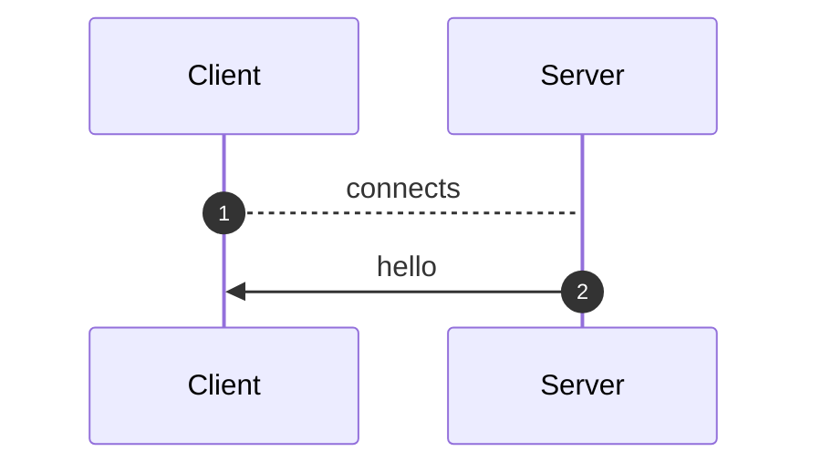
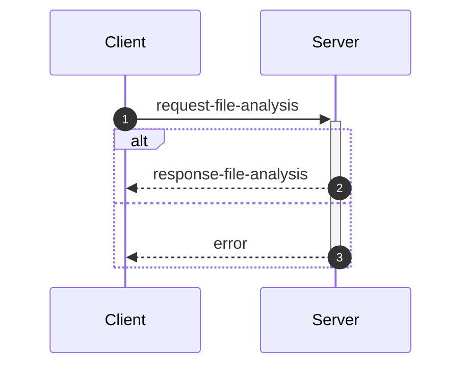
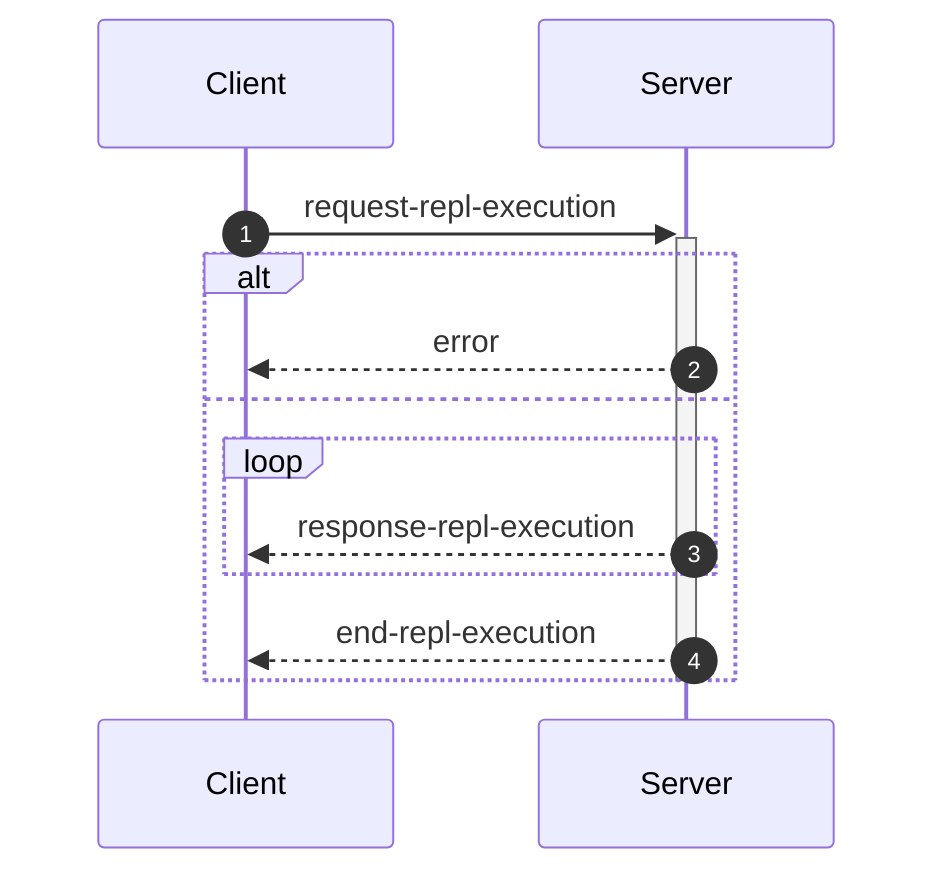
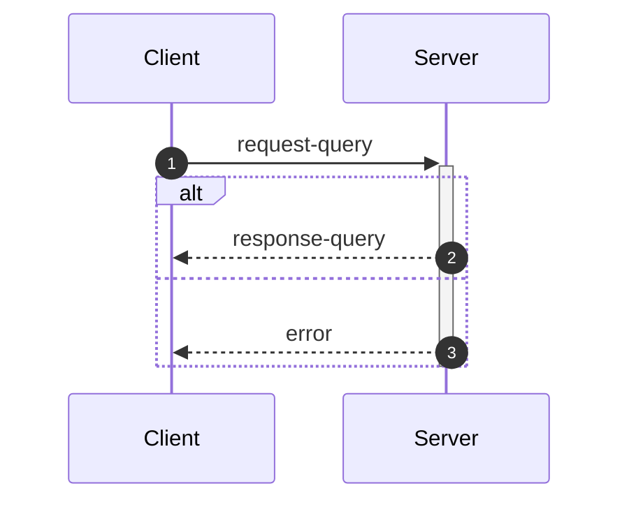

_<span title="an overview of flowR's interface">Generated</span> from '[wiki-interface.ts](https://github.com/flowr-analysis/flowr/tree/main/src/documentation/wiki-interface.ts "src/documentation/wiki-interface.ts")' on 2026-11-01, 18:30:05 UTC (v2.16.8, R v4.6.1), do not edit directly._

Although far from being as detailed as the in-depth explanation of [_flowR_](https://github.com/flowr-analysis/flowr/wiki/Core),
this wiki page explains how to interface with _flowR_ in more detail.
In general, command line arguments and other options provide short descriptions on hover over.

* [💻 Using the REPL](#using-the-repl)
* [⚙️ Configuring FlowR](#configuring-flowr)
* [⚒️ Writing Code](#writing-code)
* [💬 Communicating with the Server](#communicating-with-the-server)

<a id='using-the-repl'></a>
## 💻 Using the REPL

> [!NOTE]
> To execute arbitrary R commands with a repl request, _flowR_ has to be started explicitly with <span title="Description (Command Line Argument): Allow to access the underlying R session when using flowR (security warning: this allows the execution of arbitrary R code!)">`--r-session-access`</span>.
> Please be aware that this introduces a security risk and note that this relies on the [`r-shell` engine](https://github.com/flowr-analysis/flowr/wiki/Engines) .

Although primarily meant for users to explore,
there is nothing which forbids calling _flowR_ as a subprocess to use standard-in, -output, and -error
for communication (although you can access the REPL using the server as well,
with the [REPL Request](#message-request-repl-execution) message).

The read-eval-print loop&nbsp;(REPL) works relatively simple.
You can submit an expression (using <kbd>Enter</kbd>),
which is interpreted as an R&nbsp;expression by default but interpreted as a *command* if it starts with a colon (`:`).
The best command to get started with the REPL is <span title="Description (Repl Command): Show help information (aliases: :h, :?)">`:help`</span>.
Besides, you can leave the REPL either with the command <span title="Description (Repl Command): End the repl (aliases: :q, :exit)">`:quit`</span> or by pressing <kbd>Ctrl</kbd>+<kbd>C</kbd> twice.
When writing a *command*, you may press <kbd>Tab</kbd> to get a list of completions, if available.
Multiple commands can be entered in a single line by separating them with a semicolon (`;`), e.g. `:parse "x<-2"; :df*`.
If a command is given without R code, the REPL will re-use R code given in a previous command.
The prior example will hence return first the parsed AST of the program and then the dataflow graph for `"x <- 2"`.

> [!NOTE]
> If you develop flowR, you may want to launch the repl using the `npm run main-dev` command, this way, you get a non-minified version of flowR with debug information and hot-reloading of source files.

<details>
<summary>Available Commands</summary>

We currently offer the following commands (this with a `[*]` suffix are available with and without the star):

| Command | Description |
| ------- | ----------- |
| **<span title="Description (Repl Command): End the repl (aliases: :q, :exit)">:quit</span>** | End the repl (aliases: **:<span title="Alias of ':quit'. End the repl">q</span>**, **:<span title="Alias of ':quit'. End the repl">exit</span>**) |
| **<span title="Description (Repl Command): Execute the given code as R code. This requires the `--r-session-access` flag to be set and requires the r-shell engine. (aliases: :e, :r)">:execute</span>** | Execute the given code as R code. This requires the `--r-session-access` flag to be set and requires the r-shell engine. (aliases: **:<span title="Alias of ':execute'. Execute the given code as R code. This requires the `--r-session-access` flag to be set and requires the r-shell engine.">e</span>**, **:<span title="Alias of ':execute'. Execute the given code as R code. This requires the `--r-session-access` flag to be set and requires the r-shell engine.">r</span>**) |
| **<span title="Description (Repl Command): Get mermaid code for the control-flow graph of R code (aliases: :cfg, :cf)">:controlflow[*]</span>** | Get mermaid code for the control-flow graph of R code (star: Returns the URL to mermaid.live) (aliases: **:<span title="Alias of ':controlflow'. Get mermaid code for the control-flow graph of R code">cfg</span>**, **:<span title="Alias of ':controlflow'. Get mermaid code for the control-flow graph of R code">cf</span>**) |
| **<span title="Description (Repl Command): Get mermaid code for the control-flow graph with basic blocks (aliases: :cfgb, :cfb)">:controlflowbb[*]</span>** | Get mermaid code for the control-flow graph with basic blocks (star: Returns the URL to mermaid.live) (aliases: **:<span title="Alias of ':controlflowbb'. Get mermaid code for the control-flow graph with basic blocks">cfgb</span>**, **:<span title="Alias of ':controlflowbb'. Get mermaid code for the control-flow graph with basic blocks">cfb</span>**) |
| **<span title="Description (Repl Command): Get mermaid code for the dataflow graph (aliases: :d, :df)">:dataflow[*]</span>** | Get mermaid code for the dataflow graph (star: Returns the URL to mermaid.live) (aliases: **:<span title="Alias of ':dataflow'. Get mermaid code for the dataflow graph">d</span>**, **:<span title="Alias of ':dataflow'. Get mermaid code for the dataflow graph">df</span>**) |
| **<span title="Description (Repl Command): Get mermaid code for the normalized AST of R code (aliases: :n)">:normalize[*]</span>** | Get mermaid code for the normalized AST of R code (star: Returns the URL to mermaid.live) (alias: **:<span title="Alias of ':normalize'. Get mermaid code for the normalized AST of R code">n</span>**) |
| **<span title="Description (Repl Command): Get mermaid code for the simplified dataflow graph (aliases: :ds, :dfs)">:dataflowsimple[*]</span>** | Get mermaid code for the simplified dataflow graph (star: Returns the URL to mermaid.live) (aliases: **:<span title="Alias of ':dataflowsimple'. Get mermaid code for the simplified dataflow graph">ds</span>**, **:<span title="Alias of ':dataflowsimple'. Get mermaid code for the simplified dataflow graph">dfs</span>**) |
| **<span title="Description (Repl Command): Inspect and extend the signature database: `query` (identical to :query @signature), `info <name>` for where a function comes from (identical to :query @function-info), `add <path>` to mount another database/source, `download` to fetch the full-history database. (aliases: :sig)">:signature</span>** | Inspect and extend the signature database: `query` (identical to :query @signature), `info <name>` for where a function comes from (identical to :query @function-info), `add <path>` to mount another database/source, `download` to fetch the full-history database. (alias: **:<span title="Alias of ':signature'. Inspect and extend the signature database: `query` (identical to :query @signature), `info <name>` for where a function comes from (identical to :query @function-info), `add <path>` to mount another database/source, `download` to fetch the full-history database.">sig</span>**) |
| **<span title="Description (Repl Command): Just calculates the DFG, but only prints summary info (aliases: :d#, :df#)">:dataflowsilent</span>** | Just calculates the DFG, but only prints summary info (aliases: **:<span title="Alias of ':dataflowsilent'. Just calculates the DFG, but only prints summary info">d#</span>**, **:<span title="Alias of ':dataflowsilent'. Just calculates the DFG, but only prints summary info">df#</span>**) |
| **<span title="Description (Repl Command): Prints ASCII Art of the parsed, unmodified AST (aliases: :p)">:parse</span>** | Prints ASCII Art of the parsed, unmodified AST (alias: **:<span title="Alias of ':parse'. Prints ASCII Art of the parsed, unmodified AST">p</span>**) |
| **<span title="Description (Repl Command): Prints the version of flowR as well as the current version of R">:version</span>** | Prints the version of flowR as well as the current version of R
| **<span title="Description (Repl Command): Query the given R code (use 'help' for more information)">:query[*]</span>** | Query the given R code (use 'help' for more information) (star: Similar to query, but returns the output in json format.)
| **<span title="Description (Repl Command): Returns an ASCII representation of the dataflow graph (aliases: :df!)">:dataflowascii</span>** | Returns an ASCII representation of the dataflow graph (alias: **:<span title="Alias of ':dataflowascii'. Returns an ASCII representation of the dataflow graph">df!</span>**) |
| **<span title="Description (Repl Command): Returns summarization stats for the normalized AST (aliases: :n#)">:normalize#</span>** | Returns summarization stats for the normalized AST (alias: **:<span title="Alias of ':normalize#'. Returns summarization stats for the normalized AST">n#</span>**) |
| **<span title="Description (Repl Command): Show help information (aliases: :h, :?)">:help</span>** | Show help information (aliases: **:<span title="Alias of ':help'. Show help information">h</span>**, **:<span title="Alias of ':help'. Show help information">?</span>**) |

</details>

> [!TIP]
> 
> As indicated by the examples before, all REPL commands that operate on code keep track of the state.
> Hence, if you run a command like <span title="Description (Repl Command, starred version): Returns the URL to mermaid.live; Base Command: Get mermaid code for the dataflow graph (aliases: :d*, :df*)">`:dataflow*`</span> without providing R code,
> the REPL will re-use the R code provided in a previous command.
> Likewise, doing this will benefit from incrementality!
> If you request the dataflow graph with `:df* x <- 2 * y` and then want to see the parsed AST with `:parse`,
> the REPL will re-use previously obtained information and not re-parse the code again.
> 		

Generally, many commands offer shortcut versions in the REPL. Many queries, for example, offer a shortened format (see the example below).
Of special note, the [Config Query](https://github.com/flowr-analysis/flowr/wiki/%5BQuery%5D-Config)
can be used to also modify the currently active configuration of _flowR_ within the REPL (see the [wiki page](https://github.com/flowr-analysis/flowr/wiki/%5BQuery%5D-Config) for more information).

### Example: Retrieving the Dataflow Graph

To retrieve a URL to the [mermaid](https://mermaid.js.org/) diagram of the dataflow of a given expression,
use <span title="Description (Repl Command, starred version): Returns the URL to mermaid.live; Base Command: Get mermaid code for the dataflow graph (aliases: :d*, :df*)">`:dataflow*`</span> (or <span title="Description (Repl Command): Get mermaid code for the dataflow graph (aliases: :d, :df)">`:dataflow`</span> to get the mermaid code in the cli):

```shell
$ docker run -it --rm eagleoutice/flowr # or npm run flowr 
flowR repl v2.16.8, R grammar v14 (tree-sitter engine)
R> :dataflow* y <- 1 + x
```

<details>
<summary style='color:gray'>Output</summary>

```text
https://mermaid.live/view#base64:eyJjb2RlIjoiZmxvd2NoYXJ0IFREXG4gICAgMXt7XCJgKiM5MTtSTnVtYmVyIzkzOyogKioxKipcbiAgICAgICoxLjYqICgqKmlkOiAxKiopYFwifX1cbiAgICAyKFtcImAqIzkxO1JTeW1ib2wjOTM7KiAqKngqKlxuICAgICAgKjEuMTAqICgqKmlkOiAyKiopYFwiXSlcbiAgICAzW1tcImAqIzkxO1JCaW5hcnlPcCM5MzsqIGJhc2UjNTg7IzU4OyoqIzQzOyoqXG4gICAgICAqMS42LTEwKiAoKippZDogMyoqKVxuICAgIGFyZzogKDEsIDIpYFwiXV1cbiAgICBidWlsdC1pbjpfNDNfW1wiYEJ1aWx0LUluOlxuIzQzO2BcIl1cbiAgICBzdHlsZSBidWlsdC1pbjpfNDNfIHN0cm9rZTpncmF5LGZpbGw6Z3JheSxzdHJva2Utd2lkdGg6MnB4LG9wYWNpdHk6Ljg7XG4gICAgMFtcImAqIzkxO1JTeW1ib2wjOTM7KiAqKnkqKlxuICAgICAgKjEuMSogKCoqaWQ6IDAqKiwgdjogMylgXCJdXG4gICAgNFtbXCJgKiM5MTtSQmluYXJ5T3AjOTM7KiBiYXNlIzU4OyM1ODsqKiM2MDsjNDU7KipcbiAgICAgICoxLjEtMTAqICgqKmlkOiA0KiopXG4gICAgYXJnOiAoMCwgMylgXCJdXVxuICAgIGJ1aWx0LWluOl82MF8tW1wiYEJ1aWx0LUluOlxuIzYwOyM0NTtgXCJdXG4gICAgc3R5bGUgYnVpbHQtaW46XzYwXy0gc3Ryb2tlOmdyYXksZmlsbDpncmF5LHN0cm9rZS13aWR0aDoycHgsb3BhY2l0eTouODtcbiAgICAxIC0uLT58XCJmbG93XCJ8IDJcbiAgICBsaW5rU3R5bGUgMCBzdHJva2U6Z3JheSxjb2xvcjpncmF5O1xuICAgIDIgLS4tPnxcImZsb3dcInwgM1xuICAgIGxpbmtTdHlsZSAxIHN0cm9rZTpncmF5LGNvbG9yOmdyYXk7XG4gICAgMyAtLT58XCJyZWFkcywgYXJnXCJ8IDFcbiAgICAzIC0tPnxcInJlYWRzLCBhcmdcInwgMlxuICAgIDMgLS4tPnxcImZsb3dcInwgMFxuICAgIGxpbmtTdHlsZSA0IHN0cm9rZTpncmF5LGNvbG9yOmdyYXk7XG4gICAgMyAtLi0+fFwicmVhZHMsIGNhbGxzXCJ8IGJ1aWx0LWluOl80M19cbiAgICBsaW5rU3R5bGUgNSBzdHJva2U6Z3JheTtcbiAgICAwIC0tPnxcImRlZmluZWQtYnksIGZsb3dcInwgNFxuICAgIDAgLS0+fFwiZGVmaW5lZC1ieVwifCAzXG4gICAgNCAtLT58XCJyZWFkcywgYXJnXCJ8IDNcbiAgICA0IC0tPnxcInJldHVybnMsIGFyZ1wifCAwXG4gICAgNCAtLi0+fFwicmVhZHMsIGNhbGxzXCJ8IGJ1aWx0LWluOl82MF8tXG4gICAgbGlua1N0eWxlIDEwIHN0cm9rZTpncmF5OyIsIm1lcm1haWQiOnsiYXV0b1N5bmMiOnRydWV9fQ==
```

Retrieve the dataflow graph of the expression `y <- 1 + x`. It looks like this:


<details>

<summary style="color:gray">R Code of the Dataflow Graph</summary>

The analysis ran (parse and normalize with the [tree-sitter](https://github.com/flowr-analysis/flowr/wiki/Engines) engine) in the generation environment. No [signature database](https://github.com/flowr-analysis/flowr/wiki/Signature-Database) is mounted, so `library()` attaches no exports (base-R names are still qualified, e.g., `stats::acf`). 
We encountered no unknown side effects during the analysis.

```r
y <- 1 + x
```

</details>

</details>

For small graphs like this, <span title="Description (Repl Command): Returns an ASCII representation of the dataflow graph (aliases: :df!)">`:dataflowascii`</span> also provides an ASCII representation directly in the REPL:

```shell
$ docker run -it --rm eagleoutice/flowr # or npm run flowr 
flowR repl v2.16.8, R grammar v14 (tree-sitter engine)
R> :df! y <- 1 + x
```

<details open>
<summary style='color:gray'>Output</summary>

```text
                        v<0>v
 c<4>c──────────────────| y |
 |<- |     ┌────────────v---v
 c---c     │
    │   c<3>c   0<1>0
    └───| + |───| 1 |───u<2>u
        c---c   0---0   | x |
           └────────────u---u
Edges:
3 -> 1: reads, arg          3 -> 2: reads, arg
3 -> 0: flows-to            1 -> 2: flows-to
2 -> 3: flows-to            4 -> 3: reads, arg
4 -> 0: returns, arg        0 -> 4: defined-by, flows-to
0 -> 3: defined-by
```

Retrieve the dataflow graph of the expression `y <- 1 + x` as ASCII art.

</details>

For the slicing with <span title="Description (Repl Command): Static backwards executable slicer for R">`:slicer`</span>, you have access to the same [magic comments](#slice-magic-comments) as with the [slice request](#message-request-slice).
Pass `--inline` to splice resolvable `source()` calls into the reconstruction so the slice is a single self-contained R text (the same as the static slice query's `inlineSources` flag).
See `--help` for more flags!

### Example: Interfacing with the File System

Many commands that allow for an R-expression (like <span title="Description (Repl Command, starred version): Returns the URL to mermaid.live; Base Command: Get mermaid code for the dataflow graph (aliases: :d*, :df*)">`:dataflow*`</span>) allow for a file as well
if the argument starts with `file://`.
If you are working from the root directory of the _flowR_ repository, the following gives you the parsed AST of the example file using the <span title="Description (Repl Command): Prints ASCII Art of the parsed, unmodified AST (aliases: :p)">`:parse`</span> command:

> **Watch mode**: Replace `file://` with `watch://` to enter watch mode.
> flowR runs the command immediately and then re-runs it every time the file (or any file inside the folder) changes.
> Enter any other command to leave watch mode.
> For example: `:df watch://analysis.R`

```shell
$ docker run -it --rm eagleoutice/flowr # or npm run flowr 
flowR repl v2.16.8, R grammar v14 (tree-sitter engine)
R> :parse file://test/testfiles/example.R
```

<details>
<summary style='color:gray'>Output</summary>

```text
File: test/testfiles/example.R

program
├ binaryoperator
│ ├ identifier "sum" (1:1─4)
│ ├ <- "<-" (1:5─7)
│ ╰ float "0" (1:8─9)
├ binaryoperator
│ ├ identifier "product" (2:1─8)
│ ├ <- "<-" (2:9─11)
│ ╰ float "1" (2:12─13)
├ binaryoperator
│ ├ identifier "w" (3:1─2)
│ ├ <- "<-" (3:3─5)
│ ╰ float "7" (3:6─7)
├ binaryoperator
│ ├ identifier "N" (4:1─2)
│ ├ <- "<-" (4:3─5)
│ ╰ float "10" (4:6─8)
├ forstatement
│ ├ for "for" (6:1─4)
│ ├ ( "(" (6:5─6)
│ ├ identifier "i" (6:6─7)
│ ├ in "in" (6:8─10)
│ ├ binaryoperator
│ │ ├ float "1" (6:11─12)
│ │ ├ : ":" (6:12─13)
│ │ ╰ parenthesizedexpression
│ │   ├ ( "(" (6:13─14)
│ │   ├ binaryoperator
│ │   │ ├ identifier "N" (6:14─15)
│ │   │ ├ - "-" (6:15─16)
│ │   │ ╰ float "1" (6:16─17)
│ │   ╰ ) ")" (6:17─18)
│ ├ ) ")" (6:18─19)
│ ╰ bracedexpression
│   ├ { "{" (6:20─21)
│   ├ binaryoperator
│   │ ├ identifier "sum" (7:3─6)
│   │ ├ <- "<-" (7:7─9)
│   │ ╰ binaryoperator
│   │   ├ binaryoperator
│   │   │ ├ identifier "sum" (7:10─13)
│   │   │ ├ + "+" (7:14─15)
│   │   │ ╰ identifier "i" (7:16─17)
│   │   ├ + "+" (7:18─19)
│   │   ╰ identifier "w" (7:20─21)
│   ├ binaryoperator
│   │ ├ identifier "product" (8:3─10)
│   │ ├ <- "<-" (8:11─13)
│   │ ╰ binaryoperator
│   │   ├ identifier "product" (8:14─21)
│   │   ├  "" (8:22─23)
│   │   ╰ identifier "i" (8:24─25)
│   ╰ } "}" (9:1─2)
├ call
│ ├ identifier "cat" (11:1─4)
│ ╰ arguments
│   ├ ( "(" (11:4─5)
│   ├ argument
│   │ ╰ string
│   │   ├ stringopen "\"" (11:5─6)
│   │   ├ stringcontent "Sum:" (11:6─10)
│   │   ╰ stringclose "\"" (11:10─11)
│   ├ comma "," (11:11─12)
│   ├ argument
│   │ ╰ identifier "sum" (11:13─16)
│   ├ comma "," (11:16─17)
│   ├ argument
│   │ ╰ string
│   │   ├ stringopen "\"" (11:18─19)
│   │   ├ stringcontent
│   │   │ ╰ escapesequence "\\n" (11:19─21)
│   │   ╰ stringclose "\"" (11:21─22)
│   ╰ ) ")" (11:22─23)
╰ call
  ├ identifier "cat" (12:1─4)
  ╰ arguments
    ├ ( "(" (12:4─5)
    ├ argument
    │ ╰ string
    │   ├ stringopen "\"" (12:5─6)
    │   ├ stringcontent "Product:" (12:6─14)
    │   ╰ stringclose "\"" (12:14─15)
    ├ comma "," (12:15─16)
    ├ argument
    │ ╰ identifier "product" (12:17─24)
    ├ comma "," (12:24─25)
    ├ argument
    │ ╰ string
    │   ├ stringopen "\"" (12:26─27)
    │   ├ stringcontent
    │   │ ╰ escapesequence "\\n" (12:27─29)
    │   ╰ stringclose "\"" (12:29─30)
    ╰ ) ")" (12:30─31)
```

Retrieve the parsed AST of the example file.

<details>

<summary>File Content</summary>

```r
sum <- 0
product <- 1
w <- 7
N <- 10

for (i in 1:(N-1)) {
  sum <- sum + i + w
  product <- product * i
}

cat("Sum:", sum, "\n")
cat("Product:", product, "\n")
```

</details>

As _flowR_ directly transforms this AST the output focuses on being human-readable instead of being machine-readable.
		
</details>

### Example: Run a Query

You can run any query supported by _flowR_ using the <span title="Description (Repl Command): Query the given R code (use 'help' for more information)">`:query`</span> command.
For example, to obtain the shapes of all data frames in a given piece of code, you can run:

```shell
$ docker run -it --rm eagleoutice/flowr # or npm run flowr 
flowR repl v2.16.8, R grammar v14 (tree-sitter engine)
R> :query @absint df-shape "x <- data.frame(a = 1:10, b = 1:10)\ny <- x$a"
```

<details open>
<summary style='color:gray'>Output</summary>

```text
Query: absint (3 ms)
   ╰ $12: (colnames: [{"a", "b"}, {}], cols: [2, 2], rows: [10, 10])
   ╰ $0: (colnames: [{"a", "b"}, {}], cols: [2, 2], rows: [10, 10])
```

Retrieve the shapes of all data frames in the given code.

</details>

To run the linter on a file, you can use (in this example, we just issue the `dead-code` linter on a small piece of code):

```shell
$ docker run -it --rm eagleoutice/flowr # or npm run flowr 
flowR repl v2.16.8, R grammar v14 (tree-sitter engine)
R> :query @linter rules:dead-code "if(FALSE) x <- 2"
```

<details open>
<summary style='color:gray'>Output</summary>

```text
Query: linter (2 ms)
   ╰ Dead Code (dead-code):
       ╰ certain:
           ╰ Code at 1.11-16 (1 quick fix(es) available)
```

Run the linter on the given code, with only the `dead-code` rule enabled.

</details>

For more information on the available queries, please check out the [Query API](https://github.com/flowr-analysis/flowr/wiki/Query-API).

<a id='configuring-flowr'></a>
## ⚙️ Configuring FlowR

When running _flowR_, you may want to specify some behaviors with a dedicated configuration file.
By default, flowR looks for a file named `flowr.json` in the current working directory (or any higher directory).
You can also specify a different file with <span title="Description (Command Line Argument): The name of the configuration file to use">`--config-file`</span> or pass the configuration inline using <span title="Description (Command Line Argument): The flowR configuration to use, as a JSON string">`--config-json`</span>.
A `flowr.json` found this way belongs to the analyzed project, so flowR ignores its options that decide what flowR executes or loads
(`engines.*.wasmPath`, `engines.*.treeSitterWasmPath`, `engines.*.rPath`, `solver.sigdb.additionalPaths`, `solver.sigdb.downloadRepo`, `solver.sigdb.installedLibrary.paths`),
unless you pass <span title="Description (Command Line Argument): Keep the security-sensitive options (e.g., the R executable) of the flowr.json found in the working directory or a parent. Only use this for projects you trust.">`--trust-config`</span>.
To analyze code you do not trust, use the secure mode (<span title="Description (Command Line Argument): Run in secure mode for analyzing untrusted code: flowR does not start R (or any other process), does not access the network, does not search for project configs, and ignores security-sensitive options in every config. Cannot be disabled once enabled. Can also be enabled with the environment variable {italic FLOWR_SECURE_MODE=1}.">`--secure`</span>, see the [security policy](https://github.com/flowr-analysis/flowr/blob/main/.github/SECURITY.md)).
To inspect the current configuration, you can run flowr with the <span title="Description (Command Line Argument): Run with verbose logging (will be passed to the corresponding script)">`--verbose`</span> flag, or use the `config` [Query](https://github.com/flowr-analysis/flowr/wiki/Query-API).
Within the REPL this works by running the following:

```shell
:query @config
```

To work with the <a href="https://github.com/flowr-analysis/flowr/tree/main/src/config.ts#L119"><code><span title="The configuration file format for flowR.">FlowrConfig</span></code></a> you can use the provided helper objects alongside its methods like
<a href="https://github.com/flowr-analysis/flowr/tree/main/src/config.ts#L914"><code><span title="Creates a new flowr config that has the updated values.">FlowrConfig::<b>amend</b></span></code></a>.
The schema below documents every option; the ones you most likely want are:

- <a href="https://github.com/flowr-analysis/flowr/wiki/Interface#configuring-flowr" title="Configuration Option (boolean): Whether source calls should be ignored, causing {@link processSourceCall}&#39;s behavior to be skipped.">ignoreSourceCalls</a>: ignore source calls when analyzing the code, i.e., ignore the inclusion of other files.
- <a href="https://github.com/flowr-analysis/flowr/wiki/Interface#configuring-flowr" title="Configuration Option (boolean): Whether load calls should be ignored, causing {@link processLoadCall}&#39;s behavior to be skipped.">ignoreLoadCalls</a>: ignore load calls when analyzing the code, i.e., ignore the loading of r-data files.
- <a href="https://github.com/flowr-analysis/flowr/wiki/Interface#configuring-flowr" title="Configuration Option (object): Do you want to overwrite (parts) of the builtin definition?">semantics.environment.overwriteBuiltIns</a>: overwrite _flowR_'s handling of built-in functions, or clear the preset definitions entirely.
  See [Configure BuiltIn Semantics](#configure-builtin-semantics) for more information.
- <a href="https://github.com/flowr-analysis/flowr/wiki/Interface#configuring-flowr" title="Configuration Option (string): How to resolve variables and their values. (one of &quot;disabled&quot;, &quot;alias&quot;, &quot;builtin&quot;)">solver.variables</a>: how to resolve variables and their values (`disabled`, `alias`, `builtin`).
- <a href="https://github.com/flowr-analysis/flowr/wiki/Interface#configuring-flowr" title="Configuration Option (array): The engine or set of engines to use for interacting with R code. An empty array means all available engines will be used.">engines</a> and <a href="https://github.com/flowr-analysis/flowr/wiki/Interface#configuring-flowr" title="Configuration Option (string): The default engine to use for interacting with R code. If this is undefined, an arbitrary engine from the specified list will be used. (one of &quot;tree-sitter&quot;, &quot;r-shell&quot;)">defaultEngine</a>: the engines used to interact with R code, see the [Engines wiki page](https://github.com/flowr-analysis/flowr/wiki/Engines).
- <a href="https://github.com/flowr-analysis/flowr/wiki/Interface#configuring-flowr" title="Configuration Option (array): Files a framework loads on its own, without any source() call (e.g. global.R in a shiny app), in the order they are loaded; flowR orders the matching project files accordingly and analyzes them as one program. Entries are case-insensitive globs matched against the file path, a plain name matches any file with that name, and entries matching no project file are warned about. Usually set per project kind via specializeConfig.">project.implicitSources</a>: the files a framework loads without any `source()` call, in the order in which they are
  loaded. Entries are globs (e.g. `R/*.R`) matched against the file path ignoring capitalization; one matching no file is reported.
- <a href="https://github.com/flowr-analysis/flowr/wiki/Interface#configuring-flowr" title="Configuration Option (object): Overwrite (parts of) the configuration depending on the project kind flowR detects, e.g. to give a shiny app its implicit sources.">specializeConfig</a>: overwrite (parts of) the configuration depending on the kind of project _flowR_ detects
  (e.g. `shiny-app`), which is how a shiny app gets its implicit sources by default. What you configure directly wins.
- <a href="https://github.com/flowr-analysis/flowr/wiki/Interface#configuring-flowr" title="Configuration Option (string): Overwrite the project kind flowR would otherwise infer from the analyzed files, e.g. when auto-detection guesses wrong. (one of &quot;package&quot;, &quot;script&quot;, &quot;shiny-app&quot;, &quot;notebook&quot;, &quot;project&quot;, &quot;unknown&quot;)">project.useProjectType</a>: skip that detection and force a project kind yourself, when auto-detection guesses wrong.
- <a href="https://github.com/flowr-analysis/flowr/wiki/Interface#configuring-flowr" title="Configuration Option (array): The default plugins to load when creating a new instance of FlowrAnalyzer">defaultPlugins</a> and <a href="https://github.com/flowr-analysis/flowr/wiki/Interface#configuring-flowr" title="Configuration Option (array): The plugins to load in REPL mode">repl.plugins</a>: the plugins to load for a new <a href="https://github.com/flowr-analysis/flowr/tree/main/src/project/flowr-analyzer.ts#L210"><code><span title="Central class for conducting analyses with FlowR. Use the FlowrAnalyzerBuilder to create a new instance. If you want the original pattern of creating a pipeline and running all steps, you can still do this with FlowrAnalyzer#runFull . To inspect the context of the analyzer, use FlowrAnalyzer#inspectContext (if you are a plugin and need to modify it, use FlowrAnalyzer#context instead).">FlowrAnalyzer</span></code></a> and in the REPL
  (use `flowr:default` to reference the former).

So you can configure _flowR_ by adding a file like the following:

<details>

<summary>Example Configuration File</summary>

```json
{
  "ignoreSourceCalls": true,
  "ignoreLoadCalls": true,
  "semantics": {
    "environment": {
      "overwriteBuiltIns": {
        "definitions": [
          {
            "type": "function",
            "names": [
              "foo"
            ],
            "processor": "builtin:assign",
            "config": {}
          }
        ]
      }
    }
  },
  "defaultPlugins": [
    "file:description",
    "versions:description"
  ],
  "repl": {
    "quickStats": false,
    "dfProcessorHeat": false,
    "hints": true,
    "plugins": [
      "flowr:default"
    ]
  },
  "project": {
    "resolveUnknownPathsOnDisk": true,
    "implicitSources": [
      "global.R",
      "app.R"
    ]
  },
  "linter": {
    "disabledRules": []
  },
  "specializeConfig": {
    "shiny-app": {
      "project": {
        "implicitSources": [
          "global.R",
          "ui.R",
          "server.R",
          "app.R"
        ]
      }
    }
  },
  "engines": [
    {
      "type": "r-shell"
    }
  ],
  "solver": {
    "variables": "alias",
    "evalStrings": true,
    "trackEnvironments": true,
    "sigdb": {
      "enabled": true,
      "loadProjectDependencies": true,
      "eagerlyLoad": false,
      "eagerlyLoadExports": false,
      "linkBaseR": false,
      "linkDescriptionDependencies": false
    },
    "resolveSource": {
      "dropPaths": "no",
      "ignoreCapitalization": true,
      "inferWorkingDirectory": "active-script",
      "searchPath": []
    },
    "instrument": {},
    "slicer": {
      "threshold": 50
    }
  },
  "abstractInterpretation": {
    "wideningThreshold": 4,
    "followCalls": true,
    "dataFrame": {
      "maxColNames": 20,
      "readLoadedData": {
        "readExternalFiles": true,
        "maxReadLines": 1000000
      }
    }
  },
  "incremental": {
    "alwaysIncremental": false,
    "parsing": {
      "activated": false,
      "heuristics": {
        "activated": true,
        "mtime": true,
        "linesFrom": 500,
        "bytesFrom": 50000,
        "alwaysWithEdits": false,
        "minFiles": 1
      }
    }
  },
  "gas": {
    "thresholds": {
      "memory": {
        "problematic": 0.7,
        "critical": 0.9
      },
      "timeMs": {
        "problematic": 100000,
        "critical": 120000
      }
    },
    "features": {}
  }
}
```

</details>

<details>
<a id='configure-builtin-semantics'></a>
<summary>Configure Built-In Semantics</summary>

`semantics/environment/overwriteBuiltins` accepts two keys:

- `loadDefaults` (boolean, initially `true`): If set to `true`, the default built-in definitions are loaded before applying the custom definitions. Setting this flag to `false` explicitly disables the loading of the default definitions.
- `definitions` (array, initially empty): Allows to overwrite or define new built-in elements. Each object within must have a `type` which is one of the below. Furthermore, they may define a string array of `names` which specifies the identifiers to bind the definitions to. You may use `assumePrimitive` to specify whether _flowR_ should assume that this is a primitive non-library definition (so you probably just do not want to specify the key).

  | Type            | Description                                                                                                                                                                                                                                                                                              | Example                                                                                                    |
  | --------------- | -------------------------------------------------------------------------------------------------------------------------------------------------------------------------------------------------------------------------------------------------------------------------------------------------------- | ---------------------------------------------------------------------------------------------------------- |
  | `constant`    | Additionally allows for a `value` this should resolve to.                                                                                                                                                                                                                                                | `{ type: 'constant', names: ['NULL', 'NA'],  value: null }`                                                |
  | `function`    | Is a rather flexible way to define and bind built-in functions. For the time, we do not have extensive documentation to cover all the cases, so please either consult the sources with the `default-builtin-config.ts` or open a [new issue](https://github.com/flowr-analysis/flowr/issues/new/choose). | `{ type: 'function', names: ['next'], processor: 'builtin:d', config: { cfg: ExitPointType.Next } }` |
  | `replacement` | A comfortable way to specify replacement functions like `$<-` or `names<-`. `suffixes` describes the... suffixes to attach automatically. | `{ type: 'replacement', suffixes: ['<-', '<<-'], names: ['[', '[['] }` |

</details>

<details>

<summary style='color:gray'>Full Configuration-File Schema</summary>

- _The configuration file format for flowR._ (object)
    - **logLevel** [optional] _flowR's global minimum log level, applied when the config is loaded._ (string)
        Only allows: 'silly', 'trace', 'debug', 'info', 'warn', 'error', 'fatal'
    - **ignoreSourceCalls** [optional] _Whether source calls should be ignored, causing {@link processSourceCall}'s behavior to be skipped._ (boolean)
    - **ignoreLoadCalls** [optional] _Whether load calls should be ignored, causing {@link processLoadCall}'s behavior to be skipped._ (boolean)
    - **semantics** _Configure language semantics and how flowR handles them._ (object)
        - **environment** [optional] _Semantics regarding how to handle the R environment._ (object)
            - **overwriteBuiltIns** [optional] _Do you want to overwrite (parts) of the builtin definition?_ (object)
                - **loadDefaults** [optional] _Should the default configuration still be loaded?_ (boolean)
                - **definitions** [optional] _The definitions to load/overwrite._ (array)
                Valid item types:
                    - (object)
    - **defaultPlugins** [optional] _The default plugins to load when creating a new instance of FlowrAnalyzer_ (array)
    Valid item types:
        - (alternatives)
            - (string)
            - (array)
    - **repl** _Configuration options for the REPL._ (object)
        - **quickStats** [optional] _Whether to show quick stats in the REPL after each evaluation._ (boolean)
        - **dfProcessorHeat** [optional] _This instruments the dataflow processors to count how often each processor is called._ (boolean)
        - **hints** [optional] _Whether to show dim inline hints on the empty prompt (automatically disabled on non-interactive terminals)._ (boolean)
        - **plugins** [optional] _The plugins to load in REPL mode_ (array)
        Valid item types:
            - (alternatives)
                - (string)
                - (array)
        - **autoUseFileProtocol** [optional] _Prepend the file protocol to a repl input that looks like a path, instead of only warning about it._ (boolean)
        - **queryStats** [optional] _Whether `:query` closes with the line stating how long the queries took (`:query*` never prints it)._ (boolean)
        - **showPlugins** [optional] _Whether `:version` grays out the plugins that did not activate during the last analysis._ (boolean)
    - **project** _Project specific configuration options._ (object)
        - **resolveUnknownPathsOnDisk** [optional] _Whether to resolve unknown paths loaded by the r project disk when trying to source/analyze files._ (boolean)
        - **failOnInaccessiblePath** [optional] _Whether a directory that cannot be traversed during file discovery (e.g. due to permissions) aborts the analysis; when false (the default) such paths are logged and skipped._ (boolean)
        - **basePackages** [optional] _The packages considered part of R itself (base and recommended); if unset, flowR uses its built-in list._ (array)
        Valid item types:
            - (string)
        - **implicitSources** [optional] _Files a framework loads on its own, without any source() call (e.g. global.R in a shiny app), in the order they are loaded; flowR orders the matching project files accordingly and analyzes them as one program. Entries are case-insensitive globs matched against the file path, a plain name matches any file with that name, and entries matching no project file are warned about. Usually set per project kind via specializeConfig._ (array)
        Valid item types:
            - (string)
        - **useProjectType** [optional] _Overwrite the project kind flowR would otherwise infer from the analyzed files, e.g. when auto-detection guesses wrong._ (string)
            Only allows: 'package', 'script', 'shiny-app', 'notebook', 'project', 'unknown'
        - **assumeImplicitEcho** [optional] _Whether the top level of the analyzed code is echoed, so that every visible result printed there is collected as an output by the dependencies query (default true, false for a package)._ (boolean)
        - **discovery** [optional] _Scoping options for the default project discovery._ (object)
            - **full** [optional] _Collect every file below the project root (greedy) instead of only the files the detected project kind needs (default false)._ (boolean)
            - **perKind** [optional] _Per-kind include/exclude glob overrides layered on the default scoping._ (object)
            - **ignore** [optional] _Case-insensitive globs that drop matching files from the intelligent discovery, regardless of kind (e.g. .Renviron to ignore environment files)._ (array)
            Valid item types:
                - (string)
        - **classification** [optional] _Overrides for the signals flowR uses to classify the project kind._ (object)
            - **shinyDescriptionTypes** [optional] _DESCRIPTION Type: values that mark a shiny app._ (array)
            Valid item types:
                - (string)
            - **shinyEntryFiles** [optional] _File names a shiny app is assembled from._ (array)
            Valid item types:
                - (string)
            - **shinyUsagePattern** [optional] _Regex source evidencing shiny usage in an entry file._ (string)
            - **notebookExtensions** [optional] _File extensions marking a notebook._ (array)
            Valid item types:
                - (string)
    - **linter** _Linter configuration options._ (object)
        - **disabledRules** _Linting rule names excluded from the default rule set (a rule requested explicitly via a linter query still runs). Usually set per project kind via specializeConfig._ (array)
        Valid item types:
            - (string)
        - **disabledTags** [optional] _Linting rule tags whose rules are excluded from the default rule set (a rule requested explicitly via a linter query still runs). By default the cmd-check rules are disabled for everything but a package; a configured list replaces that default._ (array)
        Valid item types:
            - (string)
    - **inputSources** [optional] _Further frameworks the input-sources analysis should know about; entries are added to flowR's defaults._ (object)
        - **pure** [optional] _Functions that only pass the constantness of their arguments on._ (array)
        Valid item types:
            - (string)
        - **param** [optional] _Functions whose result is a 'param' input._ (array)
        Valid item types:
            - (string)
        - **file** [optional] _Functions whose result is a 'file' input._ (array)
        Valid item types:
            - (string)
        - **tempfile** [optional] _Functions whose result is a 'tempfile' input._ (array)
        Valid item types:
            - (string)
        - **glob** [optional] _Functions whose result is a 'glob' input._ (array)
        Valid item types:
            - (string)
        - **net** [optional] _Functions whose result is a 'net' input._ (array)
        Valid item types:
            - (string)
        - **rand** [optional] _Functions whose result is a 'rand' input._ (array)
        Valid item types:
            - (string)
        - **system** [optional] _Functions whose result is a 'system' input._ (array)
        Valid item types:
            - (string)
        - **ffi** [optional] _Functions whose result is a 'ffi' input._ (array)
        Valid item types:
            - (string)
        - **lang** [optional] _Functions whose result is a 'lang' input._ (array)
        Valid item types:
            - (string)
        - **options** [optional] _Functions whose result is a 'options' input._ (array)
        Valid item types:
            - (string)
        - **cmdline** [optional] _Functions whose result is a 'cmdline' input._ (array)
        Valid item types:
            - (string)
        - **user** [optional] _Functions whose result is a 'user' input._ (array)
        Valid item types:
            - (string)
        - **const** [optional] _Functions whose result is a 'const' input._ (array)
        Valid item types:
            - (string)
        - **scope** [optional] _Functions whose result is a 'scope' input._ (array)
        Valid item types:
            - (string)
        - **dconst** [optional] _Functions whose result is a 'dconst' input._ (array)
        Valid item types:
            - (string)
        - **unknown** [optional] _Functions whose result is a 'unknown' input._ (array)
        Valid item types:
            - (string)
        - **linkedObjects** [optional] _Objects a framework provides without a definition in the code, e.g. shiny's input._ (array)
        Valid item types:
            - (object)
        - **linkedEntryPoints** [optional] _Calls that hand a function to a framework, which binds its objects to the parameters by position._ (array)
        Valid item types:
            - (object)
    - **specializeConfig** [optional] _Overwrite (parts of) the configuration depending on the project kind flowR detects, e.g. to give a shiny app its implicit sources._ (object)
    - **engines** _The engine or set of engines to use for interacting with R code. An empty array means all available engines will be used._ (array)
    Valid item types:
        - (alternatives)
            - _The configuration for the tree sitter engine._ (object)
                - **type** [required] _Use the tree sitter engine._ (string)
                    Only allows: 'tree-sitter'
                - **wasmPath** [optional] _The path to the tree-sitter-r WASM binary to use. If this is undefined, this uses the default path._ (string)
                - **treeSitterWasmPath** [optional] _The path to the tree-sitter WASM binary to use. If this is undefined, this uses the default path._ (string)
                - **lax** [optional] _Whether to use the lax parser for parsing R code (allowing for syntax errors). If this is undefined, the strict parser will be used._ (boolean)
            - _The configuration for the R shell engine._ (object)
                - **type** [required] _Use the R shell engine._ (string)
                    Only allows: 'r-shell'
                - **rPath** [optional] _The path to the R executable to use. If this is undefined, this uses the default path._ (string)
                - **pipeBind** [optional] _Whether to enable R's experimental pipe-bind operator "=>" by setting _R_USE_PIPEBIND_ for the R session (default false); R itself keeps this off by default, as it is experimental and has never shipped in a release version of R._ (boolean)
    - **defaultEngine** [optional] _The default engine to use for interacting with R code. If this is undefined, an arbitrary engine from the specified list will be used._ (string)
        Only allows: 'tree-sitter', 'r-shell'
    - **solver** _How to resolve constants, constraints, cells, ..._ (object)
        - **variables** _How to resolve variables and their values._ (string)
            Only allows: 'disabled', 'alias', 'builtin'
        - **evalStrings** _Should we include eval(parse(text="...")) calls in the dataflow graph?_ (boolean)
        - **trackEnvironments** [optional] _Track user-created environments (new.env, assign/get/local with envir=, dollar-assign, attach). When false, all envir-style calls fall through conservatively._ (boolean)
        - **sigdb** _Resolving library exports from a signature database._ (object)
            - **enabled** [optional] _Resolve library()/use() exports from a signature database (default true); when false no database is consulted._ (boolean)
            - **loadProjectDependencies** [optional] _Load the project's declared dependencies from its metadata files (DESCRIPTION Imports/Depends, rproject.toml, uvr.toml, renv.lock, rv.lock, uvr.lock) (default true); when false these files are not read for dependencies._ (boolean)
            - **eagerlyLoad** [optional] _Parse the database up front rather than on the first package load (default false, ignored if disabled)._ (boolean)
            - **eagerlyLoadExports** [optional] _Add a vertex for every export on load rather than on demand (default false); keeps the dataflow graph small._ (boolean)
            - **assumedRVersion** [optional] _R version assumed when resolving versioned (base-R) exports: a pin like "4.5" or "auto" to detect the installed R (default "auto")._ (string)
            - **linkBaseR** [optional] _Eagerly attach base-R namespaces so bare base calls resolve without library() (default false)._ (boolean)
            - **linkBaseRCalls** [optional] _Add a lightweight Reads edge from a bare base-R call to its signature-database function vertex (default false; base-R qualification is edge-free otherwise)._ (boolean)
            - **linkPackageCalls** [optional] _Add a lightweight Reads edge from a resolved package call to its signature-database function vertex (default false)._ (boolean)
            - **linkDescriptionDependencies** [optional] _Eagerly attach the namespaces of the project's declared DESCRIPTION dependencies (Imports/Depends) so their exports resolve without an explicit library() (default false)._ (boolean)
            - **warmInBackground** [optional] _Decompress the hot shards (base + most-downloaded) in a background task on startup so the first library() lookup is warm (default false; for long-running servers/REPLs)._ (boolean)
            - **additionalPaths** [optional] _Extra directories or bundle/manifest files searched for signature databases (alongside the shipped default and $FLOWR_SIGDB_DIR); a downloaded full-history bundle placed here is mounted automatically._ (array)
            Valid item types:
                - (string)
            - **downloadRepo** [optional] _GitHub owner/repo the full-history bundle is downloaded from via ":signature download" (default "flowr-analysis/flowr"; the release tag comes from the committed sigdb.remote.json unless a version is given)._ (string)
            - **autoSync** [optional] _On startup, re-download shards whose committed sigdb.remote.json hash no longer matches the cache, in the background (default false; opt-in network sync after a git pull)._ (boolean)
            - **installedLibrary** [optional] _Recovering packages no signature database knows from the copy installed on this machine._ (object)
                - **enabled** [required] _Recover packages no signature database knows from their installed copy (default false)._ (boolean)
                - **paths** [optional] _Library directories to search; when empty they are discovered from the environment and the project._ (array)
                Valid item types:
                    - (string)
                - **useEnvironment** [optional] _Search the libraries R_LIBS_USER/R_LIBS/R_LIBS_SITE name (default true)._ (boolean)
                - **useProjectLibrary** [optional] _Search a project-local renv/packrat library (default true)._ (boolean)
                - **maxDepth** [optional] _How far to descend into the nested layout of a project-local library (default 3)._ (number)
                - **packages** [optional] _Only recover packages whose name matches one of these regular expressions; empty means any._ (array)
                Valid item types:
                    - (string)
            - **blobCacheBudgetMb** [optional] _How many MiB of decoded package blobs every open bundle may hold together (default 16)._ (number)
            - **versionSelection** [optional] _When a project constrains a dependency, resolve to the newest (default), oldest, or system-installed version satisfying it; system needs R and falls back to newest. Base-R packages always resolve against the assumed R version._ (string)
                Only allows: 'newest', 'oldest', 'system'
            - **versionOverrides** [optional] _Force an exact version for specific packages (name -> version), overriding both the project constraint and the versionSelection policy (default {})._ (object)
        - **versionManagement** _Policies for reasoning about dependency versions._ (object)
            - **linkedVersionGroups** [optional] _Groups of packages that must resolve to the same version; version guessing intersects each group so its members stay mutually compatible (default [])._ (array)
            Valid item types:
                - (array)
                Valid item types:
                    - (string)
        - **assumeAttachedPackages** [optional] _Packages to treat as attached without a `library()` call, so what the built-in configuration states about them applies to the analyzed code. The base packages R attaches on startup already resolve without it._ (array)
        Valid item types:
            - (string)
        - **transitiveSideEffectRounds** [optional] _How many rounds the transitive side-effect fixpoint may run before it is cut off (default 32); the propagation stops on its own as soon as a round adds nothing._ (number)
        - **maxOverlayDepth** [optional] _How many binding overlays may stack on one environment frame before a write flattens them (default 4); a pure performance knob, trading lookup cost against copy cost without changing any result._ (number)
        - **instrument** (object)
            - **dataflowExtractors** [optional] _These keys are only intended for use within code, allowing to instrument the dataflow analyzer!_ (any)
        - **resolveSource** [optional] _If lax source calls are active, flowR searches for sourced files much more freely, based on the configurations you give it. This option is only in effect if `ignoreSourceCalls` is set to false._ (object)
            - **dropPaths** _Allow to drop the first or all parts of the sourced path, if it is relative._ (string)
                Only allows: 'no', 'once', 'all'
            - **ignoreCapitalization** _Search for filenames matching in the lowercase._ (boolean)
            - **inferWorkingDirectory** _Try to infer the working directory from the main or any script to analyze._ (string)
                Only allows: 'no', 'main-script', 'active-script', 'any-script'
            - **searchPath** _Additionally search in these paths._ (array)
            Valid item types:
                - (string)
            - **repeatedSourceLimit** [optional] _How often the same file can be sourced within a single run? Please be aware: in case of cyclic sources this may not reach a fixpoint so give this a sensible limit._ (number)
            - **applyReplacements** _Provide name replacements for loaded files_ (array)
            Valid item types:
                - (object)
            - **assumeFilesExist** [optional] _Assume a sourced file is always there, making what it defines certain instead of conditional on the source call._ (boolean)
        - **slicer** [optional] _The configuration for the slicer._ (object)
            - **threshold** [optional] _The maximum number of iterations to perform on a single function call during slicing._ (number)
            - **autoExtend** [optional] _If set, the slicer will gain an additional post-pass._ (boolean)
    - **abstractInterpretation** _The configuration options for abstract interpretation._ (object)
        - **wideningThreshold** _The threshold for the number of visitations of a node at which widening should be performed to ensure the termination of the fixpoint iteration._ (number)
        - **followCalls** _Whether the abstract interpretation is interprocedural, i.e. whether it steps into the functions a call may dispatch to._ (boolean)
        - **dataFrame** _The configuration of the shape inference for data frames._ (object)
            - **maxColNames** _The maximum number of columns names to infer for data frames before over-approximating the column names to top._ (number)
            - **readLoadedData** _Configuration options for reading data frame shapes from loaded external data files, such as CSV files._ (object)
                - **readExternalFiles** _Whether data frame shapes should be extracted from loaded external files, such as CSV files._ (boolean)
                - **maxReadLines** _The maximum number of lines to read when extracting data frame shapes from loaded files, such as CSV files._ (number)
    - **incremental** (object)
        - **alwaysIncremental** _Always take the incremental path, regardless of heuristics._ (boolean)
        - **parsing** (object)
            - **activated** _If set, incremental parsing will be used._ (boolean)
            - **heuristics** (object)
                - **activated** [optional] _If set, the heuristics for incremental parsing will be used._ (boolean)
                - **mtime** [optional] _Skip reparsing entirely if the file's modification time is unchanged since the last parse._ (boolean)
                - **linesFrom** [optional] _Only consider incremental parsing for files with at least this many lines._ (number)
                - **bytesFrom** [optional] _Only consider incremental parsing for files with at least this many bytes._ (number)
                - **alwaysWithEdits** [optional] _Always take the incremental path whenever there is a computed edit region, regardless of the other thresholds._ (boolean)
                - **minFiles** [optional] _Only apply these heuristics once the project has at least this many files loaded._ (number)
    - **gas** [optional] _Resource-usage guard (gas) configuration. All feature factors default to 0 (disabled). See https://github.com/flowr-analysis/flowr/wiki/Core#gas-resource-guard._ (object)
        - **thresholds** [optional] _Thresholds for all gas checks (scaled by per-feature factor), boundable per feature._ (object)
            - **memory** [optional] _Heap-usage fraction thresholds (0-1), either shared or given per feature key (with `default` covering the rest)._ (object)
                - **problematic** [optional] _Heap fraction (0-1) above which Problematic is returned, for every feature without an entry of its own._ (number)
                - **critical** [optional] _Heap fraction (0-1) above which Critical is returned, for every feature without an entry of its own._ (number)
            - **timeMs** [optional] _Elapsed analysis time thresholds in milliseconds, either shared or given per feature key (with `default` covering the rest)._ (object)
                - **problematic** [optional] _Elapsed ms above which Problematic is returned, for every feature without an entry of its own._ (number)
                - **critical** [optional] _Elapsed ms above which Critical is returned, for every feature without an entry of its own._ (number)
            - **steps** [optional] _Processed-AST-node thresholds, counted rather than sampled; only a key that arms a budget (`dataflow`) reads them._ (object)
                - **problematic** [optional] _Processed AST nodes above which Problematic is returned, for every feature without an entry of its own._ (number)
                - **critical** [optional] _Processed AST nodes above which the extraction is cut short, for every feature without an entry of its own._ (number)
            - **vertices** [optional] _Created-dataflow-vertex thresholds, counted like `steps`._ (object)
                - **problematic** [optional] _Created dataflow vertices above which Problematic is returned, for every feature without an entry of its own._ (number)
                - **critical** [optional] _Created dataflow vertices above which the extraction is cut short, for every feature without an entry of its own._ (number)
        - **features** [optional] _Per-feature sensitivity factors. 0 or absent disables gas checking for that feature. A factor of 2 makes the feature twice as sensitive. Recognised keys: `source`, `side-effect-linking`, `linter`, `slicer`, `dataflow`._ (object)
        - **countedCheckEvery** [optional] _How many counted steps pass between two accountings of an armed check, be it a dataflow budget or the slicer's traversal (default 128); trades overshoot against the cost of the check._ (number)
        - **heapProvider** [optional] _Custom heap statistics source (programmatic configs only), overriding the built-in v8/performance.memory detection._ (function)

</details>

<a id='writing-code'></a>
## ⚒️ Writing Code

_flowR_ can be used as a [module](https://www.npmjs.com/package/@eagleoutice/flowr) and offers several main classes and interfaces that are interesting for extension writers 
(see the [Visual Studio Code extension](https://marketplace.visualstudio.com/items?itemName=code-inspect.vscode-flowr) or the [Core](https://github.com/flowr-analysis/flowr/wiki/Core) wiki page for more information).

### Creating Analyses with _flowR_

Nowadays, instances of the <a href="https://github.com/flowr-analysis/flowr/tree/main/src/project/flowr-analyzer.ts#L210"><code><span title="Central class for conducting analyses with FlowR. Use the FlowrAnalyzerBuilder to create a new instance. If you want the original pattern of creating a pipeline and running all steps, you can still do this with FlowrAnalyzer#runFull . To inspect the context of the analyzer, use FlowrAnalyzer#inspectContext (if you are a plugin and need to modify it, use FlowrAnalyzer#context instead).">FlowrAnalyzer</span></code></a> should be used as central frontend to get analysis results from _flowR_.
The entry points an analysis is written against are re-exported from the package root (`import { FlowrAnalyzerBuilder } from '@eagleoutice/flowr'`);
everything else stays reachable under its own path, as in `@eagleoutice/flowr/dataflow/graph/graph`.
For example, a program slice can be created like this:

```ts
const analyzer = await new FlowrAnalyzerBuilder()
    .setEngine('tree-sitter')
    .build();
analyzer.addRequest('x <- 1\ny <- x\nx');
const result = await analyzer.query([
    {
        type:     'static-slice',
        criteria: ['3@x']
    }
]);
```

For more information, please have a look at the [Analyzer](https://github.com/flowr-analysis/flowr/wiki/Analyzer) wiki page, which explains how to construct and use the <a href="https://github.com/flowr-analysis/flowr/tree/main/src/project/flowr-analyzer.ts#L210"><code><span title="Central class for conducting analyses with FlowR. Use the FlowrAnalyzerBuilder to create a new instance. If you want the original pattern of creating a pipeline and running all steps, you can still do this with FlowrAnalyzer#runFull . To inspect the context of the analyzer, use FlowrAnalyzer#inspectContext (if you are a plugin and need to modify it, use FlowrAnalyzer#context instead).">FlowrAnalyzer</span></code></a> in more detail.
To work with specific perspectives, you can also consult the respective pages like the [Dataflow Graph](https://github.com/flowr-analysis/flowr/wiki/Dataflow-Graph) or the [Abstract Interpretation](https://github.com/flowr-analysis/flowr/wiki/Abstract-Interpretation) wiki pages.
### The Pipeline Executor (Low-Level Interface)

Once, in the beginning, _flowR_ was meant to produce a dataflow graph merely to provide *program slices*. 
However, with continuous updates, the [Dataflow Graph](https://github.com/flowr-analysis/flowr/wiki/Dataflow-Graph) repeatedly proves to be the more interesting part.
With this, we restructured _flowR_'s originally *hardcoded* pipeline to be far more flexible. 
Now, it can be theoretically extended or replaced with arbitrary steps, optional steps, and what we call 'decorations' of these steps. 
In short, a slicing pipeline using the <a href="https://github.com/flowr-analysis/flowr/tree/main/src/core/pipeline-executor.ts#L97"><code><span title="**Please note:** The PipelineExecutor is now considered to be a rather low-level API for flowR. While it still works and is the basis for all other layers, we strongly recommend using the FlowrAnalyzer and its builder to create and use an analyzer instance that is pre-configured for your use-case. The pipeline executor allows to execute arbitrary pipelines in a step-by-step fashion. If you are not...">PipelineExecutor</span></code></a> looks like this:

```ts

const slicer = new PipelineExecutor(DEFAULT_SLICING_PIPELINE, {
  parser:    new RShell(),
  request:   requestFromInput('x <- 1\nx + 1'),
  criterion: ['2@x']
})
const slice = await slicer.allRemainingSteps()
// console.log(slice.reconstruct.code)
```

<details><summary>More Information</summary>

If you compare this, with what you would have done with the old (and removed) `SteppingSlicer`, 
this essentially just requires you to replace the `SteppingSlicer` with the <a href="https://github.com/flowr-analysis/flowr/tree/main/src/core/pipeline-executor.ts#L97"><code><span title="**Please note:** The PipelineExecutor is now considered to be a rather low-level API for flowR. While it still works and is the basis for all other layers, we strongly recommend using the FlowrAnalyzer and its builder to create and use an analyzer instance that is pre-configured for your use-case. The pipeline executor allows to execute arbitrary pipelines in a step-by-step fashion. If you are not...">PipelineExecutor</span></code></a>
and to pass the <a href="https://github.com/flowr-analysis/flowr/tree/main/src/core/steps/pipeline/default-pipelines.ts#L18"><code>DEFAULT_SLICING_PIPELINE</code></a> as the first argument.
The <a href="https://github.com/flowr-analysis/flowr/tree/main/src/core/pipeline-executor.ts#L97"><code><span title="**Please note:** The PipelineExecutor is now considered to be a rather low-level API for flowR. While it still works and is the basis for all other layers, we strongly recommend using the FlowrAnalyzer and its builder to create and use an analyzer instance that is pre-configured for your use-case. The pipeline executor allows to execute arbitrary pipelines in a step-by-step fashion. If you are not...">PipelineExecutor</span></code></a>...

1. Provides structures to investigate the results of all intermediate steps
2. Can be executed step-by-step
3. Can repeat steps (e.g., to calculate multiple slices on the same input)

See the in-code documentation for more information.

</details>

### Using the <a href="https://github.com/flowr-analysis/flowr/tree/main/src/r-bridge/shell.ts#L144"><code><span title="The RShell represents an interactive session with the R interpreter. You can configure it by RShellOptions . At the moment we are using a live R session (and not networking etc.) to communicate with R easily, which allows us to install packages etc. However, this might and probably will change in the future (leaving this as a legacy mode :D)">RShell</span></code></a> to Interact with R

The <a href="https://github.com/flowr-analysis/flowr/tree/main/src/r-bridge/shell.ts#L144"><code><span title="The RShell represents an interactive session with the R interpreter. You can configure it by RShellOptions . At the moment we are using a live R session (and not networking etc.) to communicate with R easily, which allows us to install packages etc. However, this might and probably will change in the future (leaving this as a legacy mode :D)">RShell</span></code></a> class allows interfacing with the `R`&nbsp;ecosystem installed on the host system.
Please have a look at [flowR's Engines](https://github.com/flowr-analysis/flowr/wiki/Engines) for more information on alternatives (for example, the <a href="https://github.com/flowr-analysis/flowr/tree/main/src/r-bridge/lang-4.x/tree-sitter/tree-sitter-executor.ts#L29"><code><span title="Synchronous and (way) faster alternative to the RShell using tree-sitter.">TreeSitterExecutor</span></code></a>).

> [!IMPORTANT]
> 
> Each <a href="https://github.com/flowr-analysis/flowr/tree/main/src/r-bridge/shell.ts#L144"><code><span title="The RShell represents an interactive session with the R interpreter. You can configure it by RShellOptions . At the moment we are using a live R session (and not networking etc.) to communicate with R easily, which allows us to install packages etc. However, this might and probably will change in the future (leaving this as a legacy mode :D)">RShell</span></code></a> controls a new instance of the R&nbsp;interpreter, 
> make sure to call <code><a href="https://github.com/flowr-analysis/flowr/tree/main/src/r-bridge/shell.ts#L350"><span title="Close the current R session, makes the object effectively invalid (can no longer be reopened etc.)">RShell::<i>close</i></span></a>()</code> when you are done.

You can start a new "session" by constructing a new object with <code>new <a href="https://github.com/flowr-analysis/flowr/tree/main/src/r-bridge/shell.ts#L144"><span title="The RShell represents an interactive session with the R interpreter. You can configure it by RShellOptions . At the moment we are using a live R session (and not networking etc.) to communicate with R easily, which allows us to install packages etc. However, this might and probably will change in the future (leaving this as a legacy mode :D)">RShell</span></a>()</code>.

However, there are several options that may be of interest 
(e.g., to automatically revive the shell in case of errors or to control the name location of the R process on the system).

With a shell object (let's call it `shell`), you can execute R code by using <a href="https://github.com/flowr-analysis/flowr/tree/main/src/r-bridge/shell.ts#L213"><code><span title="sends the given command directly to the current R session will not do anything to alter input markers!">RShell::<i>sendCommand</i></span></code></a>,
for example <code>shell.<a href="https://github.com/flowr-analysis/flowr/tree/main/src/r-bridge/shell.ts#L213"><span title="sends the given command directly to the current R session will not do anything to alter input markers!">sendCommand</span></a>("1 + 1")</code>.
However, this does not return anything, so if you want to collect the output of your command, use
<a href="https://github.com/flowr-analysis/flowr/tree/main/src/r-bridge/shell.ts#L296"><code><span title="Send a command and collect the output">RShell::<i>sendCommandWithOutput</i></span></code></a> instead.

<a id='communicating-with-the-server'></a>
## 💬 Communicating with the Server

As explained in the [Overview](https://github.com/flowr-analysis/flowr/wiki/Overview), you can run the [TCP](https://de.wikipedia.org/wiki/Transmission_Control_Protocol)&nbsp;server by adding the <span title="Description (Command Line Argument): Do not drop into a repl, but instead start a server on the given port (default: 1042) and listen for messages.">`--server`</span> flag (and, due to the interactive mode, exit with the conventional <kbd>CTRL</kbd>+<kbd>C</kbd>).
Currently, every connection is handled by the same underlying `RShell` - so the server is not designed to handle many clients at a time.
Additionally, the server is not well guarded against attacks (e.g., you can theoretically spawn an arbitrary number of&nbsp;RShell sessions on the target machine).

Every message has to be given in a single line (i.e., without a newline in-between) and end with a newline character. Nevertheless, we will pretty-print example given in the following segments for the ease of reading.

> [!NOTE]
> 
> The default <span title="Description (Command Line Argument): Do not drop into a repl, but instead start a server on the given port (default: 1042) and listen for messages.">`--server`</span> uses a simple [TCP](https://de.wikipedia.org/wiki/Transmission_Control_Protocol)
> connection. If you want _flowR_ to expose a [WebSocket](https://de.wikipedia.org/wiki/WebSocket) server instead, add the <span title="Description (Command Line Argument): If the server flag is set, use websocket for messaging">`--ws`</span> flag (i.e., <span title="Description (Command Line Argument): Do not drop into a repl, but instead start a server on the given port (default: 1042) and listen for messages.">`--server`</span> <span title="Description (Command Line Argument): If the server flag is set, use websocket for messaging">`--ws`</span>) when starting _flowR_ from the command line.

<ul><li>
<a id="message-hello"></a>
<b>Hello</b> Message (<code>hello</code>) 
<details>

<summary style="color:gray"> View Details. <i>The server informs the client about the successful connection and provides Meta-Information.</i> </summary>



After launching _flowR_, for example, with <code>docker run -it --rm eagleoutice/flowr <span title="Description (Command Line Argument): Do not drop into a repl, but instead start a server on the given port (default: 1042) and listen for messages.">-<span/>-server</span></code>&nbsp;(🐳️), connecting should present you with a `hello` message, that amongst others should reveal the versions of&nbsp;_flowR_ and&nbsp;R, using the [semver 2.0](https://semver.org/spec/v2.0.0.html) versioning scheme.
The message looks like this:

```json
{
  "type": "hello",
  "clientName": "client-0",
  "versions": {
    "flowr": "2.16.8",
    "r": "4.6.1",
    "engine": "r-shell"
  }
}
```

There are currently a few messages that you can send after the hello message.
If you want to _slice_ a piece of R code you first have to send an [analysis request](#message-request-file-analysis), so that you can send one or multiple slice requests afterward.
Requests for the [REPL](#message-request-repl-execution) are independent of that.
	
<hr>

<details>
<summary style="color:gray">Message schema (<code>hello</code>)</summary>

For the definition of the hello message, please see it's implementation at [`./src/cli/repl/server/messages/message-hello.ts`](https://github.com/flowr-analysis/flowr/tree/main/src/cli/repl/server/messages/message-hello.ts).

- [required] (object)
    - **type** [required] _The type of the hello message._ (string)
        Only allows: 'hello'
    - **id** [forbidden] _The id of the message is always undefined (as it is the initial message and not requested)._ (any)
    - **clientName** [required] _A unique name that is assigned to each client. It has no semantic meaning and is only used/useful for debugging._ (string)
    - **versions** [required] (object)
        - **flowr** [required] _The version of the flowr server running in semver format._ (string)
        - **r** [required] _The version of the underlying R shell running in semver format._ (string)
        - **engine** [required] _The parser backend that is used to parse the R code._ (string)

</details>

<hr>

</details>
	</li>

<li>
<a id="message-request-file-analysis"></a>
<b>Analysis</b> Message (<code>request-file-analysis</code>) 
<details>

<summary style="color:gray"> View Details. <i>The server builds the dataflow graph for a given input file (or a set of files).</i> </summary>



The request allows the server to analyze a file and prepare it for slicing.
The message can contain a `filetoken`, which is used to identify the file in later slice or query requests (if you do not add one, the request will not be stored and therefore, it is not available for subsequent requests).

> **Please note!**\
> If you want to send and process a lot of analysis requests, but do not want to slice them, please do not pass the `filetoken` field. This will save the server a lot of memory allocation.

Furthermore, the request must contain either a `content` field to directly pass the file's content or a `filepath` field which contains the path to the file (this path must be accessible for the server to be useful).
If you add the `id` field, the answer will use the same `id` so you can match requests and the corresponding answers.
See the implementation of the request-file-analysis message for more information.

You can drop one or more stored file tokens by adding the `invalidateToken` field (a single token or an array of tokens).
The server frees the corresponding analyses _after_ it has answered the request.

> **Tip!**\
> If you only want to drop tokens, you do not need a separate message: send a `request-file-analysis` that contains _just_ the `invalidateToken` field (and no `content` or `filepath`).
> Such a request behaves like an empty file analysis and the server replies with an empty `results` object.
> Because invalidation happens after the response, you may even pass the _current_ `filetoken` in `invalidateToken` to analyze a file once and have the server forget it right after you received the results.

<details>
<summary>Example of the <code>request-file-analysis</code> Message</summary>

_Note:_ even though we pretty-print these messages, they are sent as a single line, ending with a newline.

The following lists all messages that were sent and received in case you want to reproduce the scenario:

<ol>
<li> <code>hello</code> (response)
<details> 

<summary> Show Details </summary>

The first message is always a hello message.

```json
{"type":"hello","clientName":"client-0","versions":{"flowr":"2.16.8","r":"4.6.1","engine":"r-shell"}}
```

</details>
</li>

<li> <b><code>request-file-analysis</code> (request)</b>
<details open> 

<summary> Show Details </summary>

Let's suppose you simply want to analyze the following script:
 
```r
x <- 1
x + 1
```

 For this, you can send the following request:

```json
{"type":"request-file-analysis","id":"1","filetoken":"x","content":"x <- 1\nx + 1"}
```

</details>
</li>

<li> <code>response-file-analysis</code> (response)
<details> 

<summary> Show Details </summary>

The `results` field of the response effectively contains three keys of importance:

- `parse`: which contains 1:1 the parse result in CSV format that we received from the `RShell` (i.e., the AST produced by the parser of the R interpreter).
- `normalize`: which contains the normalized AST, including ids (see the `info` field and the [Normalized AST](https://github.com/flowr-analysis/flowr/wiki/Normalized-AST) wiki page).
- `dataflow`: especially important is the `graph` field which contains the dataflow graph as a set of root vertices (see the [Dataflow Graph](https://github.com/flowr-analysis/flowr/wiki/Dataflow-Graph) wiki page).
			
_As the code is pretty long, we inhibit pretty printing and syntax highlighting (JSON, hiding built-in):_

```text
{"type":"response-file-analysis","format":"json","id":"1","results":{"parse":{"files":[{"parsed":"[1,1,1,6,7,0,\"expr\",false,\"x <- 1\"],[1,1,1,1,1,3,\"SYMBOL\",true,\"x\"],[1,1,1,1,3,7,\"expr\",false,\"x\"],[1,3,1,4,2,7,\"LEFT_ASSIGN\",true,\"<-\"],[1,6,1,6,4,5,\"NUM_CONST\",true,\"1\"],[1,6,1,6,5,7,\"expr\",false,\"1\"],[2,1,2,5,16,0,\"expr\",false,\"x + 1\"],[2,1,2,1,10,12,\"SYMBOL\",true,\"x\"],[2,1,2,1,12,16,\"expr\",false,\"x\"],[2,3,2,3,11,16,\"'+'\",true,\"+\"],[2,5,2,5,13,14,\"NUM_CONST\",true,\"1\"],[2,5,2,5,14,16,\"expr\",false,\"1\"]","filePath":"/tmp/tmp-3579822-xTnetRzriZHG-.R"}],".meta":{}},"normalize":{"ast":{"type":"RProject","files":[{"root":{"type":"RExpressionList","children":[{"type":"RBinaryOp","location":[1,3,1,4],"lhs":{"type":"RSymbol","location":[1,1,1,1],"content":"x","lexeme":"x","info":{"fullRange":[1,1,1,1],"adToks":[],"id":0,"parent":2,"role":"bin-l","index":0,"nest":0,"file":"/tmp/tmp-3579822-xTnetRzriZHG-.R"}},"rhs":{"location":[1,6,1,6],"lexeme":"1","info":{"fullRange":[1,6,1,6],"adToks":[],"id":1,"parent":2,"role":"bin-r","index":1,"nest":0,"file":"/tmp/tmp-3579822-xTnetRzriZHG-.R"},"type":"RNumber","content":{"num":1,"complexNumber":false,"markedAsInt":false}},"operator":"<-","lexeme":"<-","info":{"fullRange":[1,1,1,6],"adToks":[],"id":2,"parent":6,"nest":0,"file":"/tmp/tmp-3579822-xTnetRzriZHG-.R","index":0,"role":"el-c"}},{"type":"RBinaryOp","location":[2,3,2,3],"lhs":{"type":"RSymbol","location":[2,1,2,1],"content":"x","lexeme":"x","info":{"fullRange":[2,1,2,1],"adToks":[],"id":3,"parent":5,"role":"bin-l","index":0,"nest":0,"file":"/tmp/tmp-3579822-xTnetRzriZHG-.R"}},"rhs":{"location":[2,5,2,5],"lexeme":"1","info":{"fullRange":[2,5,2,5],"adToks":[],"id":4,"parent":5,"role":"bin-r","index":1,"nest":0,"file":"/tmp/tmp-3579822-xTnetRzriZHG-.R"},"type":"RNumber","content":{"num":1,"complexNumber":false,"markedAsInt":false}},"operator":"+","lexeme":"+","info":{"fullRange":[2,1,2,5],"adToks":[],"id":5,"parent":6,"nest":0,"file":"/tmp/tmp-3579822-xTnetRzriZHG-.R","index":1,"role":"el-c"}}],"info":{"adToks":[],"id":6,"nest":0,"file":"/tmp/tmp-3579822-xTnetRzriZHG-.R","role":"root","index":0}},"filePath":"/tmp/tmp-3579822-xTnetRzriZHG-.R"}],"info":{"id":7}},".meta":{}},"dataflow":{"unknownReferences":[],"in":[{"nodeId":2,"name":"<-","type":2},{"nodeId":5,"name":"+","type":2}],"out":[{"nodeId":0,"name":"x","type":4,"definedAt":2,"value":[1]}],"environment":{"current":{"id":1535,"parent":"<BuiltInEnvironment>","memory":[["x",[{"nodeId":0,"name":"x","type":4,"definedAt":2,"value":[1]}]]],"globalEnv":true},"level":0},"graph":{"rootVertices":[1,0,2,3,4,5],"vertexInformation":[[1,{"tag":"value","id":1}],[0,{"tag":"vdef","id":0,"source":[1]}],[2,{"tag":"fcall","id":2,"name":"<-","onlyBuiltin":true,"args":[{"nodeId":0,"type":32},{"nodeId":1,"type":32}],"origin":["builtin:assign"]}],[3,{"tag":"use","id":3}],[4,{"tag":"value","id":4}],[5,{"tag":"fcall","id":5,"name":"+","onlyBuiltin":true,"args":[{"nodeId":3,"type":32},{"nodeId":4,"type":32}],"origin":["builtin:d"]}]],"edgeInformation":[[2,[[1,{"types":65}],[0,{"types":72}],["built-in:<-",{"types":5}],[3,{"types":4096}]]],[1,[[0,{"types":4096}]]],[0,[[2,{"types":4098}],[1,{"types":2}]]],[5,[[3,{"types":65}],[4,{"types":65}],["built-in:+",{"types":5}]]],[3,[[0,{"types":1}],[4,{"types":4096}]]],[4,[[5,{"types":4096}]]]],"_unknownSideEffects":[]},"entryPoint":2,"cfgEntry":1,"exitPoints":[{"type":0,"nodeId":5}],"hooks":[],".meta":{}}}}
```

</details>
</li>
</ol>

The complete round-trip covers validating the messages as well as starting and stopping the internal mock server.

</details>

You receive an error if, for whatever reason, the analysis fails (e.g., the message or code you sent contained syntax errors).
It contains a human-readable description *why* the analysis failed (see the error message implementation for more details).

<details>
<summary>Example Error Message</summary>

_Note:_ even though we pretty-print these messages, they are sent as a single line, ending with a newline.

The following lists all messages that were sent and received in case you want to reproduce the scenario:

<ol>
<li> <code>hello</code> (response)
<details> 

<summary> Show Details </summary>

The first message is always a hello message.

```json
{"type":"hello","clientName":"client-0","versions":{"flowr":"2.16.8","r":"4.6.1","engine":"r-shell"}}
```

</details>
</li>

<li> <code>request-file-analysis</code> (request)
<details> 

<summary> Show Details </summary>

```json
{"type":"request-file-analysis","id":"1","filename":"sample.R","content":"x <-"}
```

</details>
</li>

<li> <b><code>error</code> (response)</b>
<details open> 

<summary> Show Details </summary>

```json
{
  "id": "1",
  "type": "error",
  "fatal": false,
  "reason": "Error while analyzing file sample.R: GuardError: unable to parse R code (see the log for more information) for request {\"request\":\"text\",\"content\":\"x <-\"}}\n Report a Bug: https://github.com/flowr-analysis/flowr/issues/new?body=%3C!%2D%2D%20Please%20describe%20your%20issue%20in%20more%20detail%20below!%20%2D%2D%3E%0A%0A%0A%3C!%2D%2D%20Automatically%20generated%20issue%20metadata%2C%20please%20do%20not%20edit%20or%20delete%20content%20below%20this%20line%20%2D%2D%3E%0A%2D%2D%2D%0A%0AflowR%20version%3A%202.16.8%0Anode%20version%3A%20v26.10.0%0Anode%20arch%3A%20x64%0Anode%20platform%3A%20linux%0Amessage%3A%20%60unable%20to%20parse%20R%20code%20%28see%20the%20log%20for%20more%20information%29%20for%20request%20%7B%22request%22%3A%22text%22%2C%22content%22%3A%22x%20%3C%2D%22%7D%7D%60%0Astack%20trace%3A%0A%60%60%60%0A%20%20%20%20at%20guard%20%28%3C%3E%2Fsrc%2Futil%2Fassert.ts%3A128%3A9%29%0A%20%20%20%20at%20guardRetrievedOutput%20%28%3C%3E%2Fsrc%2Fr%2Dbridge%2Fretriever.ts%3A155%3A7%29%0A%20%20%20%20at%20%2Fhome%2Fostwind%2Fgit%2Fphd%2Fflowr%2Dfield%2Fflowr%2Fsrc%2Fr%2Dbridge%2Fretriever.ts%3A122%3A4%0A%20%20%20%20at%20processTicksAndRejections%20%28node%3Ainternal%2Fprocess%2Ftask_queues%3A104%3A5%29%0A%20%20%20%20at%20async%20Object.parseRequests%20%5Bas%20processor%5D%20%28%3C%3E%2Fsrc%2Fr%2Dbridge%2Fparser.ts%3A108%3A19%29%0A%20%20%20%20at%20async%20PipelineExecutor.nextStep%20%28%3C%3E%2Fsrc%2Fcore%2Fpipeline%2Dexecutor.ts%3A192%3A25%29%0A%20%20%20%20at%20async%20FlowrAnalyzerCache.stepTapeUntil%20%28%3C%3E%2Fsrc%2Fproject%2Fcache%2Fflowr%2Danalyzer%2Dcache.ts%3A124%3A4%29%0A%60%60%60%0A%0A%2D%2D%2D%0A%09"
}
```

</details>
</li>
</ol>

The complete round-trip covers validating the messages as well as starting and stopping the internal mock server.

</details>

&nbsp;

<a id="analysis-include-cfg"></a>
**Including the Control Flow Graph**

The control flow graph is a view on the dataflow graph: the dataflow analysis records the control flow while it walks
the program, and the graph projects those edges on demand. The server can expose that structure as well (please create
a [new issue](https://github.com/flowr-analysis/flowr/issues/new/choose) for any bug you may encounter).
For this, the analysis request may add `cfg: true` to its list of options.

<details>
<summary>Requesting a Control Flow Graph</summary>

_Note:_ even though we pretty-print these messages, they are sent as a single line, ending with a newline.

The following lists all messages that were sent and received in case you want to reproduce the scenario:

<ol>
<li> <code>hello</code> (response)
<details> 

<summary> Show Details </summary>

The first message is always a hello message.

```json
{"type":"hello","clientName":"client-0","versions":{"flowr":"2.16.8","r":"4.6.1","engine":"r-shell"}}
```

</details>
</li>

<li> <b><code>request-file-analysis</code> (request)</b>
<details open> 

<summary> Show Details </summary>

```json
{
  "type": "request-file-analysis",
  "id": "1",
  "filetoken": "x",
  "content": "if(unknown > 0) { x <- 2 } else { x <- 5 }\nfor(i in 1:x) { print(x); print(i) }",
  "cfg": true
}
```

</details>
</li>

<li> <code>response-file-analysis</code> (response)
<details> 

<summary> Show Details </summary>

The response looks basically the same as a response sent without the `cfg` flag. However, additionally it contains a `cfg` field. 
If you are interested in a visual representation of the control flow graph, see the 
[visualization with mermaid](https://mermaid.live/view#base64:eyJjb2RlIjoiZmxvd2NoYXJ0IFREXG4gICAgbjAoW1wiYFJTeW1ib2wgKDApXG4qKnVua25vd24qKmBcIl0pXG4gICAgbjEoW1wiYFJOdW1iZXIgKDEpXG4qKjAqKmBcIl0pXG4gICAgbjIoW1wiYFJCaW5hcnlPcCAoMilcbioqdW5rbm93biAjNjI7IDAqKmBcIl0pXG4gICAgbjYoW1wiYFJOdW1iZXIgKDYpXG4qKjIqKmBcIl0pXG4gICAgbjUoW1wiYFJTeW1ib2wgKDUpXG4qKngqKmBcIl0pXG4gICAgbjdbXCJgUkJpbmFyeU9wICg3KVxuKip4ICM2MDsjNDU7IDIqKmBcIl1cbiAgICBuOChbXCJgUkV4cHJlc3Npb25MaXN0ICg4KWBcIl0pXG4gICAgbjEyKFtcImBSTnVtYmVyICgxMilcbioqNSoqYFwiXSlcbiAgICBuMTEoW1wiYFJTeW1ib2wgKDExKVxuKip4KipgXCJdKVxuICAgIG4xM1tcImBSQmluYXJ5T3AgKDEzKVxuKip4ICM2MDsjNDU7IDUqKmBcIl1cbiAgICBuMTQoW1wiYFJFeHByZXNzaW9uTGlzdCAoMTQpYFwiXSlcbiAgICBuMTVbXCJgUklmVGhlbkVsc2UgKDE1KVxuKippZih1bmtub3duICM2MjsgMCkgIzEyMzsgeCAjNjA7IzQ1OyAyICMxMjU7IGVsc2UgIzEyMzsgeCAjNjA7IzQ1OyA1ICMxMjU7KipgXCJdXG4gICAgbjE2KFtcImBSU3ltYm9sICgxNilcbioqaSoqYFwiXSlcbiAgICBuMTcoW1wiYFJOdW1iZXIgKDE3KVxuKioxKipgXCJdKVxuICAgIG4xOChbXCJgUlN5bWJvbCAoMTgpXG4qKngqKmBcIl0pXG4gICAgbjE5KFtcImBSQmluYXJ5T3AgKDE5KVxuKioxIzU4O3gqKmBcIl0pXG4gICAgbjIzKFtcImBSU3ltYm9sICgyMylcbioqeCoqYFwiXSlcbiAgICBuMjVbXCJgUkZ1bmN0aW9uQ2FsbCAoMjUpXG4qKnByaW50KHgpKipgXCJdXG4gICAgbjI3KFtcImBSU3ltYm9sICgyNylcbioqaSoqYFwiXSlcbiAgICBuMjlbXCJgUkZ1bmN0aW9uQ2FsbCAoMjkpXG4qKnByaW50KGkpKipgXCJdXG4gICAgbjMwKFtcImBSRXhwcmVzc2lvbkxpc3QgKDMwKWBcIl0pXG4gICAgbjMxW1wiYFJGb3JMb29wICgzMSlcbioqZm9yKGkgaW4gMSM1ODt4KSAjMTIzOyBwcmludCh4KTsgcHJpbnQoaSkgIzEyNTsqKmBcIl1cbiAgICBuMiAtLi0+fFwiYnJhbmNoIG9uIHVua25vd24gIzYyOyAwICgyKSBpZiBUXCJ8IG42XG4gICAgbjIgLS4tPnxcImJyYW5jaCBvbiB1bmtub3duICM2MjsgMCAoMikgaWYgRlwifCBuMTJcbiAgICBuMCAtLT58XCJmbG93cyB0b1wifCBuMVxuICAgIG4xIC0tPnxcImZsb3dzIHRvXCJ8IG4yXG4gICAgbjcgLS0+fFwiZmxvd3MgdG9cInwgbjhcbiAgICBuNiAtLT58XCJmbG93cyB0b1wifCBuNVxuICAgIG41IC0tPnxcImZsb3dzIHRvXCJ8IG43XG4gICAgbjggLS0+fFwiZmxvd3MgdG9cInwgbjE1XG4gICAgbjE1IC0tPnxcImZsb3dzIHRvXCJ8IG4xN1xuICAgIG4xMyAtLT58XCJmbG93cyB0b1wifCBuMTRcbiAgICBuMTIgLS0+fFwiZmxvd3MgdG9cInwgbjExXG4gICAgbjExIC0tPnxcImZsb3dzIHRvXCJ8IG4xM1xuICAgIG4xNCAtLT58XCJmbG93cyB0b1wifCBuMTVcbiAgICBuMTkgLS0+fFwiZmxvd3MgdG9cInwgbjE2XG4gICAgbjE4IC0tPnxcImZsb3dzIHRvXCJ8IG4xOVxuICAgIG4xNyAtLT58XCJmbG93cyB0b1wifCBuMThcbiAgICBuMjUgLS0+fFwiZmxvd3MgdG9cInwgbjI3XG4gICAgbjIzIC0tPnxcImZsb3dzIHRvXCJ8IG4yNVxuICAgIG4yOSAtLT58XCJmbG93cyB0b1wifCBuMzBcbiAgICBuMjcgLS0+fFwiZmxvd3MgdG9cInwgbjI5XG4gICAgbjMwIC0tPnxcImZsb3dzIHRvXCJ8IG4xNlxuICAgIG4xNiAtLi0+fFwiYnJhbmNoIG9uIGkgKDE2KSBpZiBUXCJ8IG4yM1xuICAgIG4xNiAtLi0+fFwiYnJhbmNoIG9uIGkgKDE2KSBpZiBGXCJ8IG4zMVxuICAgIHN0eWxlIG4wIHN0cm9rZTpjeWFuLHN0cm9rZS13aWR0aDo2LjVweDsgICAgc3R5bGUgbjMxIHN0cm9rZTpncmVlbixzdHJva2Utd2lkdGg6Ni41cHg7IiwibWVybWFpZCI6eyJhdXRvU3luYyI6dHJ1ZX19).
			
_As the code is pretty long, we inhibit pretty printing and syntax highlighting (JSON, hiding built-in):_

```text
{"type":"response-file-analysis","format":"json","id":"1","cfg":{"graph":{"roots":[0,1,2,6,5,7,8,12,11,13,14,15,16,17,18,19,23,25,27,29,30,31],"vtxInfos":[[0,[2,0]],[1,[2,1]],[2,[2,2]],[6,[2,6]],[5,[2,5]],[7,[1,7]],[8,[2,8]],[12,[2,12]],[11,[2,11]],[13,[1,13]],[14,[2,14]],[15,[1,15]],[16,[2,16]],[17,[2,17]],[18,[2,18]],[19,[2,19]],[23,[2,23]],[25,[1,25]],[27,[2,27]],[29,[1,29]],[30,[2,30]],[31,[1,31]]],"bbChildren":[],"edgeInfos":[[2,[[6,{"id":15,"when":true}],[12,{"id":15,"when":false}]]],[0,[[1,0]]],[1,[[2,0]]],[7,[[8,0]]],[6,[[5,0]]],[5,[[7,0]]],[8,[[15,0]]],[15,[[17,0]]],[13,[[14,0]]],[12,[[11,0]]],[11,[[13,0]]],[14,[[15,0]]],[19,[[16,0]]],[18,[[19,0]]],[17,[[18,0]]],[25,[[27,0]]],[23,[[25,0]]],[29,[[30,0]]],[27,[[29,0]]],[30,[[16,0]]],[16,[[23,{"id":31,"when":true}],[31,{"id":31,"when":false}]]]],"mayHaveBasicBlocks":false},"entryPoints":[0],"exitPoints":[31],"returns":[],"breaks":[],"nexts":[]},"results":{"parse":{"files":[{"parsed":"[1,1,1,42,38,0,\"expr\",false,\"if(unknown > 0) { x <- 2 } else { x <- 5 }\"],[1,1,1,2,1,38,\"IF\",true,\"if\"],[1,3,1,3,2,38,\"'('\",true,\"(\"],[1,4,1,14,9,38,\"expr\",false,\"unknown > 0\"],[1,4,1,10,3,5,\"SYMBOL\",true,\"unknown\"],[1,4,1,10,5,9,\"expr\",false,\"unknown\"],[1,12,1,12,4,9,\"GT\",true,\">\"],[1,14,1,14,6,7,\"NUM_CONST\",true,\"0\"],[1,14,1,14,7,9,\"expr\",false,\"0\"],[1,15,1,15,8,38,\"')'\",true,\")\"],[1,17,1,26,22,38,\"expr\",false,\"{ x <- 2 }\"],[1,17,1,17,12,22,\"'{'\",true,\"{\"],[1,19,1,24,19,22,\"expr\",false,\"x <- 2\"],[1,19,1,19,13,15,\"SYMBOL\",true,\"x\"],[1,19,1,19,15,19,\"expr\",false,\"x\"],[1,21,1,22,14,19,\"LEFT_ASSIGN\",true,\"<-\"],[1,24,1,24,16,17,\"NUM_CONST\",true,\"2\"],[1,24,1,24,17,19,\"expr\",false,\"2\"],[1,26,1,26,18,22,\"'}'\",true,\"}\"],[1,28,1,31,23,38,\"ELSE\",true,\"else\"],[1,33,1,42,35,38,\"expr\",false,\"{ x <- 5 }\"],[1,33,1,33,25,35,\"'{'\",true,\"{\"],[1,35,1,40,32,35,\"expr\",false,\"x <- 5\"],[1,35,1,35,26,28,\"SYMBOL\",true,\"x\"],[1,35,1,35,28,32,\"expr\",false,\"x\"],[1,37,1,38,27,32,\"LEFT_ASSIGN\",true,\"<-\"],[1,40,1,40,29,30,\"NUM_CONST\",true,\"5\"],[1,40,1,40,30,32,\"expr\",false,\"5\"],[1,42,1,42,31,35,\"'}'\",true,\"}\"],[2,1,2,36,84,0,\"expr\",false,\"for(i in 1:x) { print(x); print(i) }\"],[2,1,2,3,41,84,\"FOR\",true,\"for\"],[2,4,2,13,53,84,\"forcond\",false,\"(i in 1:x)\"],[2,4,2,4,42,53,\"'('\",true,\"(\"],[2,5,2,5,43,53,\"SYMBOL\",true,\"i\"],[2,7,2,8,44,53,\"IN\",true,\"in\"],[2,10,2,12,51,53,\"expr\",false,\"1:x\"],[2,10,2,10,45,46,\"NUM_CONST\",true,\"1\"],[2,10,2,10,46,51,\"expr\",false,\"1\"],[2,11,2,11,47,51,\"':'\",true,\":\"],[2,12,2,12,48,50,\"SYMBOL\",true,\"x\"],[2,12,2,12,50,51,\"expr\",false,\"x\"],[2,13,2,13,49,53,\"')'\",true,\")\"],[2,15,2,36,81,84,\"expr\",false,\"{ print(x); print(i) }\"],[2,15,2,15,54,81,\"'{'\",true,\"{\"],[2,17,2,24,64,81,\"expr\",false,\"print(x)\"],[2,17,2,21,55,57,\"SYMBOL_FUNCTION_CALL\",true,\"print\"],[2,17,2,21,57,64,\"expr\",false,\"print\"],[2,22,2,22,56,64,\"'('\",true,\"(\"],[2,23,2,23,58,60,\"SYMBOL\",true,\"x\"],[2,23,2,23,60,64,\"expr\",false,\"x\"],[2,24,2,24,59,64,\"')'\",true,\")\"],[2,25,2,25,65,81,\"';'\",true,\";\"],[2,27,2,34,77,81,\"expr\",false,\"print(i)\"],[2,27,2,31,68,70,\"SYMBOL_FUNCTION_CALL\",true,\"print\"],[2,27,2,31,70,77,\"expr\",false,\"print\"],[2,32,2,32,69,77,\"'('\",true,\"(\"],[2,33,2,33,71,73,\"SYMBOL\",true,\"i\"],[2,33,2,33,73,77,\"expr\",false,\"i\"],[2,34,2,34,72,77,\"')'\",true,\")\"],[2,36,2,36,78,81,\"'}'\",true,\"}\"]","filePath":"/tmp/tmp-3579822-3rTszqb2opmA-.R"}],".meta":{}},"normalize":{"ast":{"type":"RProject","files":[{"root":{"type":"RExpressionList","children":[{"type":"RIfThenElse","condition":{"type":"RBinaryOp","location":[1,12,1,12],"lhs":{"type":"RSymbol","location":[1,4,1,10],"content":"unknown","lexeme":"unknown","info":{"fullRange":[1,4,1,10],"adToks":[],"id":0,"parent":2,"role":"bin-l","index":0,"nest":1,"file":"/tmp/tmp-3579822-3rTszqb2opmA-.R"}},"rhs":{"location":[1,14,1,14],"lexeme":"0","info":{"fullRange":[1,14,1,14],"adToks":[],"id":1,"parent":2,"role":"bin-r","index":1,"nest":1,"file":"/tmp/tmp-3579822-3rTszqb2opmA-.R"},"type":"RNumber","content":{"num":0,"complexNumber":false,"markedAsInt":false}},"operator":">","lexeme":">","info":{"fullRange":[1,4,1,14],"adToks":[],"id":2,"parent":15,"nest":1,"file":"/tmp/tmp-3579822-3rTszqb2opmA-.R","role":"if-c"}},"then":{"type":"RExpressionList","children":[{"type":"RBinaryOp","location":[1,21,1,22],"lhs":{"type":"RSymbol","location":[1,19,1,19],"content":"x","lexeme":"x","info":{"fullRange":[1,19,1,19],"adToks":[],"id":5,"parent":7,"role":"bin-l","index":0,"nest":1,"file":"/tmp/tmp-3579822-3rTszqb2opmA-.R"}},"rhs":{"location":[1,24,1,24],"lexeme":"2","info":{"fullRange":[1,24,1,24],"adToks":[],"id":6,"parent":7,"role":"bin-r","index":1,"nest":1,"file":"/tmp/tmp-3579822-3rTszqb2opmA-.R"},"type":"RNumber","content":{"num":2,"complexNumber":false,"markedAsInt":false}},"operator":"<-","lexeme":"<-","info":{"fullRange":[1,19,1,24],"adToks":[],"id":7,"parent":8,"nest":1,"file":"/tmp/tmp-3579822-3rTszqb2opmA-.R","index":0,"role":"el-c"}}],"grouping":[{"type":"RSymbol","location":[1,17,1,17],"content":"{","lexeme":"{","info":{"fullRange":[1,17,1,26],"adToks":[],"id":3,"role":"el-g","index":0,"nest":1,"file":"/tmp/tmp-3579822-3rTszqb2opmA-.R"}},{"type":"RSymbol","location":[1,26,1,26],"content":"}","lexeme":"}","info":{"fullRange":[1,17,1,26],"adToks":[],"id":4,"role":"el-g","index":0,"nest":1,"file":"/tmp/tmp-3579822-3rTszqb2opmA-.R"}}],"info":{"adToks":[],"id":8,"parent":15,"nest":1,"file":"/tmp/tmp-3579822-3rTszqb2opmA-.R","index":1,"role":"if-then"}},"location":[1,1,1,2],"lexeme":"if","info":{"fullRange":[1,1,1,42],"adToks":[],"id":15,"parent":32,"nest":1,"file":"/tmp/tmp-3579822-3rTszqb2opmA-.R","index":0,"role":"el-c"},"otherwise":{"type":"RExpressionList","children":[{"type":"RBinaryOp","location":[1,37,1,38],"lhs":{"type":"RSymbol","location":[1,35,1,35],"content":"x","lexeme":"x","info":{"fullRange":[1,35,1,35],"adToks":[],"id":11,"parent":13,"role":"bin-l","index":0,"nest":1,"file":"/tmp/tmp-3579822-3rTszqb2opmA-.R"}},"rhs":{"location":[1,40,1,40],"lexeme":"5","info":{"fullRange":[1,40,1,40],"adToks":[],"id":12,"parent":13,"role":"bin-r","index":1,"nest":1,"file":"/tmp/tmp-3579822-3rTszqb2opmA-.R"},"type":"RNumber","content":{"num":5,"complexNumber":false,"markedAsInt":false}},"operator":"<-","lexeme":"<-","info":{"fullRange":[1,35,1,40],"adToks":[],"id":13,"parent":14,"nest":1,"file":"/tmp/tmp-3579822-3rTszqb2opmA-.R","index":0,"role":"el-c"}}],"grouping":[{"type":"RSymbol","location":[1,33,1,33],"content":"{","lexeme":"{","info":{"fullRange":[1,33,1,42],"adToks":[],"id":9,"role":"el-g","index":0,"nest":1,"file":"/tmp/tmp-3579822-3rTszqb2opmA-.R"}},{"type":"RSymbol","location":[1,42,1,42],"content":"}","lexeme":"}","info":{"fullRange":[1,33,1,42],"adToks":[],"id":10,"role":"el-g","index":0,"nest":1,"file":"/tmp/tmp-3579822-3rTszqb2opmA-.R"}}],"info":{"adToks":[],"id":14,"parent":15,"nest":1,"file":"/tmp/tmp-3579822-3rTszqb2opmA-.R","index":2,"role":"if-other"}}},{"type":"RForLoop","variable":{"type":"RSymbol","location":[2,5,2,5],"content":"i","lexeme":"i","info":{"adToks":[],"id":16,"parent":31,"role":"for-var","index":0,"nest":1,"file":"/tmp/tmp-3579822-3rTszqb2opmA-.R"}},"vector":{"type":"RBinaryOp","location":[2,11,2,11],"lhs":{"location":[2,10,2,10],"lexeme":"1","info":{"fullRange":[2,10,2,10],"adToks":[],"id":17,"parent":19,"role":"bin-l","index":0,"nest":1,"file":"/tmp/tmp-3579822-3rTszqb2opmA-.R"},"type":"RNumber","content":{"num":1,"complexNumber":false,"markedAsInt":false}},"rhs":{"type":"RSymbol","location":[2,12,2,12],"content":"x","lexeme":"x","info":{"fullRange":[2,12,2,12],"adToks":[],"id":18,"parent":19,"role":"bin-r","index":1,"nest":1,"file":"/tmp/tmp-3579822-3rTszqb2opmA-.R"}},"operator":":","lexeme":":","info":{"fullRange":[2,10,2,12],"adToks":[],"id":19,"parent":31,"nest":1,"file":"/tmp/tmp-3579822-3rTszqb2opmA-.R","index":1,"role":"for-vec"}},"body":{"type":"RExpressionList","children":[{"type":"RFunctionCall","named":true,"location":[2,17,2,21],"lexeme":"print","functionName":{"type":"RSymbol","location":[2,17,2,21],"content":"print","lexeme":"print","info":{"fullRange":[2,17,2,24],"adToks":[],"id":22,"parent":25,"role":"call-name","index":0,"nest":1,"file":"/tmp/tmp-3579822-3rTszqb2opmA-.R"}},"arguments":[{"type":"RArgument","location":[2,23,2,23],"lexeme":"x","value":{"type":"RSymbol","location":[2,23,2,23],"content":"x","lexeme":"x","info":{"fullRange":[2,23,2,23],"adToks":[],"id":23,"parent":24,"role":"arg-v","index":0,"nest":1,"file":"/tmp/tmp-3579822-3rTszqb2opmA-.R"}},"info":{"fullRange":[2,23,2,23],"adToks":[],"id":24,"parent":25,"nest":1,"file":"/tmp/tmp-3579822-3rTszqb2opmA-.R","index":1,"role":"call-arg"}}],"info":{"fullRange":[2,17,2,24],"adToks":[],"id":25,"parent":30,"nest":1,"file":"/tmp/tmp-3579822-3rTszqb2opmA-.R","index":0,"role":"el-c"}},{"type":"RFunctionCall","named":true,"location":[2,27,2,31],"lexeme":"print","functionName":{"type":"RSymbol","location":[2,27,2,31],"content":"print","lexeme":"print","info":{"fullRange":[2,27,2,34],"adToks":[],"id":26,"parent":29,"role":"call-name","index":0,"nest":1,"file":"/tmp/tmp-3579822-3rTszqb2opmA-.R"}},"arguments":[{"type":"RArgument","location":[2,33,2,33],"lexeme":"i","value":{"type":"RSymbol","location":[2,33,2,33],"content":"i","lexeme":"i","info":{"fullRange":[2,33,2,33],"adToks":[],"id":27,"parent":28,"role":"arg-v","index":0,"nest":1,"file":"/tmp/tmp-3579822-3rTszqb2opmA-.R"}},"info":{"fullRange":[2,33,2,33],"adToks":[],"id":28,"parent":29,"nest":1,"file":"/tmp/tmp-3579822-3rTszqb2opmA-.R","index":1,"role":"call-arg"}}],"info":{"fullRange":[2,27,2,34],"adToks":[],"id":29,"parent":30,"nest":1,"file":"/tmp/tmp-3579822-3rTszqb2opmA-.R","index":1,"role":"el-c"}}],"grouping":[{"type":"RSymbol","location":[2,15,2,15],"content":"{","lexeme":"{","info":{"fullRange":[2,15,2,36],"adToks":[],"id":20,"role":"el-g","index":0,"nest":1,"file":"/tmp/tmp-3579822-3rTszqb2opmA-.R"}},{"type":"RSymbol","location":[2,36,2,36],"content":"}","lexeme":"}","info":{"fullRange":[2,15,2,36],"adToks":[],"id":21,"role":"el-g","index":0,"nest":1,"file":"/tmp/tmp-3579822-3rTszqb2opmA-.R"}}],"info":{"adToks":[],"id":30,"parent":31,"nest":1,"file":"/tmp/tmp-3579822-3rTszqb2opmA-.R","index":2,"role":"for-b"}},"lexeme":"for","info":{"fullRange":[2,1,2,36],"adToks":[],"id":31,"parent":32,"nest":1,"file":"/tmp/tmp-3579822-3rTszqb2opmA-.R","index":1,"role":"el-c"},"location":[2,1,2,3]}],"info":{"adToks":[],"id":32,"nest":0,"file":"/tmp/tmp-3579822-3rTszqb2opmA-.R","role":"root","index":0}},"filePath":"/tmp/tmp-3579822-3rTszqb2opmA-.R"}],"info":{"id":33}},".meta":{}},"dataflow":{"unknownReferences":[],"in":[{"nodeId":15,"name":"if","type":2},{"nodeId":0,"name":"unknown","type":1024},{"nodeId":2,"name":">","type":2},{"nodeId":7,"name":"<-","cds":[{"id":15,"when":true}],"type":2},{"nodeId":13,"name":"<-","cds":[{"id":15,"when":false}],"type":2},{"nodeId":8,"name":"{","cds":[{"id":15,"when":true}],"type":2},{"nodeId":14,"name":"{","cds":[{"id":15,"when":false}],"type":2},{"nodeId":31,"name":"for","type":2},{"nodeId":19,"name":":","type":2},{"nodeId":25,"name":"print","type":2},{"nodeId":29,"name":"print","type":2}],"out":[{"nodeId":5,"name":"x","type":4,"definedAt":7,"cds":[{"id":15,"when":true}],"value":[6]},{"nodeId":11,"name":"x","type":4,"definedAt":13,"cds":[{"id":15,"when":false}],"value":[12]},{"nodeId":16,"name":"i","type":1}],"environment":{"current":{"id":1557,"parent":"<BuiltInEnvironment>","memory":[["x",[{"nodeId":5,"name":"x","type":4,"definedAt":7,"cds":[{"id":15,"when":true}],"value":[6]},{"nodeId":11,"name":"x","type":4,"definedAt":13,"cds":[{"id":15,"when":false}],"value":[12]}]],["i",[{"nodeId":16,"name":"i","type":1,"definedAt":31,"value":[19],"iterated":true}]]],"globalEnv":true},"level":0},"graph":{"rootVertices":[0,1,2,6,5,7,8,12,11,13,14,15,16,17,18,19,23,25,27,29,30,31],"vertexInformation":[[0,{"tag":"use","id":0}],[1,{"tag":"value","id":1}],[2,{"tag":"fcall","id":2,"name":">","onlyBuiltin":true,"args":[{"nodeId":0,"type":32},{"nodeId":1,"type":32}],"origin":["builtin:d"]}],[6,{"tag":"value","id":6}],[5,{"tag":"vdef","id":5,"cds":[{"id":15,"when":true}],"source":[6]}],[7,{"tag":"fcall","id":7,"name":"<-","onlyBuiltin":true,"cds":[{"id":15,"when":true}],"args":[{"nodeId":5,"type":32},{"nodeId":6,"type":32}],"origin":["builtin:assign"]}],[8,{"tag":"fcall","id":8,"name":"{","onlyBuiltin":true,"cds":[{"id":15,"when":true}],"args":[{"nodeId":7,"type":32}],"origin":["builtin:el"]}],[12,{"tag":"value","id":12}],[11,{"tag":"vdef","id":11,"cds":[{"id":15,"when":false}],"source":[12]}],[13,{"tag":"fcall","id":13,"name":"<-","onlyBuiltin":true,"cds":[{"id":15,"when":false}],"args":[{"nodeId":11,"type":32},{"nodeId":12,"type":32}],"origin":["builtin:assign"]}],[14,{"tag":"fcall","id":14,"name":"{","onlyBuiltin":true,"cds":[{"id":15,"when":false}],"args":[{"nodeId":13,"type":32}],"origin":["builtin:el"]}],[15,{"tag":"fcall","id":15,"name":"if","onlyBuiltin":true,"args":[{"nodeId":2,"type":32},{"nodeId":8,"type":32},{"nodeId":14,"type":32}],"origin":["builtin:ite"]}],[16,{"tag":"vdef","id":16,"source":[19]}],[17,{"tag":"value","id":17}],[18,{"tag":"use","id":18}],[19,{"tag":"fcall","id":19,"name":":","onlyBuiltin":true,"args":[{"nodeId":17,"type":32},{"nodeId":18,"type":32}],"origin":["builtin:d"]}],[23,{"tag":"use","id":23,"cds":[{"id":31,"when":true}]}],[25,{"tag":"fcall","id":25,"name":"print","onlyBuiltin":true,"cds":[{"id":31,"when":true}],"args":[{"nodeId":23,"type":32}],"origin":["builtin:d"]}],[27,{"tag":"use","id":27,"cds":[{"id":31,"when":true}]}],[29,{"tag":"fcall","id":29,"name":"print","onlyBuiltin":true,"cds":[{"id":31,"when":true}],"args":[{"nodeId":27,"type":32}],"origin":["builtin:d"]}],[30,{"tag":"fcall","id":30,"name":"{","onlyBuiltin":true,"cds":[{"id":31,"when":true}],"args":[{"nodeId":25,"type":32},{"nodeId":29,"type":32}],"origin":["builtin:el"]}],[31,{"tag":"fcall","id":31,"name":"for","onlyBuiltin":true,"args":[{"nodeId":16,"type":32},{"nodeId":19,"type":32},{"nodeId":30,"type":32}],"origin":["builtin:fl"]}]],"edgeInformation":[[2,[[0,{"types":65}],[1,{"types":65}],[6,{"types":8192,"cd":{"id":15,"when":true}}],[12,{"types":8192,"cd":{"id":15,"when":false}}],["built-in:>",{"types":5}]]],[0,[[1,{"types":4096}]]],[1,[[2,{"types":4096}]]],[7,[[6,{"types":65}],[5,{"types":72}],["built-in:<-",{"types":5}],[8,{"types":4096}]]],[6,[[5,{"types":4096}]]],[5,[[7,{"types":4098}],[6,{"types":2}]]],[8,[[7,{"types":72}],["built-in:{",{"types":5}],[15,{"types":4096}]]],[15,[[8,{"types":72}],[14,{"types":72}],[2,{"types":65}],["built-in:if",{"types":5}],[17,{"types":4096}]]],[13,[[12,{"types":65}],[11,{"types":72}],["built-in:<-",{"types":5}],[14,{"types":4096}]]],[12,[[11,{"types":4096}]]],[11,[[13,{"types":4098}],[12,{"types":2}]]],[14,[[13,{"types":72}],["built-in:{",{"types":5}],[15,{"types":4096}]]],[19,[[17,{"types":65}],[18,{"types":65}],[16,{"types":4096}],["built-in::",{"types":5}]]],[18,[[5,{"types":1}],[11,{"types":1}],[19,{"types":4096}]]],[17,[[18,{"types":4096}]]],[25,[[23,{"types":73}],["built-in:print",{"types":5}],[27,{"types":4096}]]],[23,[[5,{"types":1}],[11,{"types":1}],[25,{"types":4096}]]],[29,[[27,{"types":73}],["built-in:print",{"types":5}],[30,{"types":4096}]]],[27,[[16,{"types":1}],[29,{"types":4096}]]],[30,[[25,{"types":64}],[29,{"types":72}],["built-in:{",{"types":5}],[16,{"types":4096}]]],[16,[[19,{"types":2}],[23,{"types":8192,"cd":{"id":31,"when":true}}],[31,{"types":8192,"cd":{"id":31,"when":false}}]]],[31,[[16,{"types":64}],[19,{"types":65}],[30,{"types":320}],["built-in:for",{"types":5}]]]],"_unknownSideEffects":[{"id":25,"linkTo":{"type":"link-to-last-call","callName":{}}},{"id":29,"linkTo":{"type":"link-to-last-call","callName":{}}}]},"entryPoint":15,"cfgEntry":0,"exitPoints":[{"type":0,"nodeId":31}],"hooks":[],".meta":{}}}}
```

</details>
</li>
</ol>

The complete round-trip covers validating the messages as well as starting and stopping the internal mock server.

</details>

&nbsp;

<a id="analysis-format-n-quads"></a>
**Retrieve the Output as RDF N-Quads**

The default response is formatted as JSON.
However, by specifying `format: "n-quads"`, you can retrieve the individual results (e.g., the [Normalized AST](https://github.com/flowr-analysis/flowr/wiki/Normalized-AST)),
as [RDF N-Quads](https://www.w3.org/TR/n-quads/).
This works with and without the control flow graph as described [above](#analysis-include-cfg).

<details>
<summary>Requesting RDF N-Quads</summary>

_Note:_ even though we pretty-print these messages, they are sent as a single line, ending with a newline.

The following lists all messages that were sent and received in case you want to reproduce the scenario:

<ol>
<li> <code>hello</code> (response)
<details> 

<summary> Show Details </summary>

The first message is always a hello message.

```json
{"type":"hello","clientName":"client-0","versions":{"flowr":"2.16.8","r":"4.6.1","engine":"r-shell"}}
```

</details>
</li>

<li> <b><code>request-file-analysis</code> (request)</b>
<details open> 

<summary> Show Details </summary>

```json
{"type":"request-file-analysis","id":"1","filetoken":"x","content":"x <- 1\nx + 1","format":"n-quads","cfg":true}
```

</details>
</li>

<li> <code>response-file-analysis</code> (response)
<details> 

<summary> Show Details </summary>

The base message format is still JSON, only the individual results get converted.
While the context is derived from the `filename`, we currently offer no way to customize other parts of the quads 
(please open a [new issue](https://github.com/flowr-analysis/flowr/issues/new/choose) if you require this).

_As the code is pretty long, we inhibit pretty printing and syntax highlighting (JSON, hiding built-in):_

```text
{"type":"response-file-analysis","format":"n-quads","id":"1","cfg":"<https://uni-ulm.de/r-ast/unknown/0> <https://uni-ulm.de/r-ast/rootIds> \"1\"^^<http://www.w3.org/2001/XMLSchema#integer> <unknown> .\n<https://uni-ulm.de/r-ast/unknown/0> <https://uni-ulm.de/r-ast/rootIds> \"0\"^^<http://www.w3.org/2001/XMLSchema#integer> <unknown> .\n<https://uni-ulm.de/r-ast/unknown/0> <https://uni-ulm.de/r-ast/rootIds> \"2\"^^<http://www.w3.org/2001/XMLSchema#integer> <unknown> .\n<https://uni-ulm.de/r-ast/unknown/0> <https://uni-ulm.de/r-ast/rootIds> \"3\"^^<http://www.w3.org/2001/XMLSchema#integer> <unknown> .\n<https://uni-ulm.de/r-ast/unknown/0> <https://uni-ulm.de/r-ast/rootIds> \"4\"^^<http://www.w3.org/2001/XMLSchema#integer> <unknown> .\n<https://uni-ulm.de/r-ast/unknown/0> <https://uni-ulm.de/r-ast/rootIds> \"5\"^^<http://www.w3.org/2001/XMLSchema#integer> <unknown> .\n<https://uni-ulm.de/r-ast/unknown/0> <https://uni-ulm.de/r-ast/vertices> <https://uni-ulm.de/r-ast/unknown/1> <unknown> .\n<https://uni-ulm.de/r-ast/unknown/1> <https://uni-ulm.de/r-ast/next> <https://uni-ulm.de/r-ast/unknown/2> <unknown> .\n<https://uni-ulm.de/r-ast/unknown/1> <https://uni-ulm.de/r-ast/id> \"1\"^^<http://www.w3.org/2001/XMLSchema#integer> <unknown> .\n<https://uni-ulm.de/r-ast/unknown/0> <https://uni-ulm.de/r-ast/vertices> <https://uni-ulm.de/r-ast/unknown/2> <unknown> .\n<https://uni-ulm.de/r-ast/unknown/2> <https://uni-ulm.de/r-ast/next> <https://uni-ulm.de/r-ast/unknown/3> <unknown> .\n<https://uni-ulm.de/r-ast/unknown/2> <https://uni-ulm.de/r-ast/id> \"0\"^^<http://www.w3.org/2001/XMLSchema#integer> <unknown> .\n<https://uni-ulm.de/r-ast/unknown/0> <https://uni-ulm.de/r-ast/vertices> <https://uni-ulm.de/r-ast/unknown/3> <unknown> .\n<https://uni-ulm.de/r-ast/unknown/3> <https://uni-ulm.de/r-ast/next> <https://uni-ulm.de/r-ast/unknown/4> <unknown> .\n<https://uni-ulm.de/r-ast/unknown/3> <https://uni-ulm.de/r-ast/id> \"2\"^^<http://www.w3.org/2001/XMLSchema#integer> <unknown> .\n<https://uni-ulm.de/r-ast/unknown/0> <https://uni-ulm.de/r-ast/vertices> <https://uni-ulm.de/r-ast/unknown/4> <unknown> .\n<https://uni-ulm.de/r-ast/unknown/4> <https://uni-ulm.de/r-ast/next> <https://uni-ulm.de/r-ast/unknown/5> <unknown> .\n<https://uni-ulm.de/r-ast/unknown/4> <https://uni-ulm.de/r-ast/id> \"3\"^^<http://www.w3.org/2001/XMLSchema#integer> <unknown> .\n<https://uni-ulm.de/r-ast/unknown/0> <https://uni-ulm.de/r-ast/vertices> <https://uni-ulm.de/r-ast/unknown/5> <unknown> .\n<https://uni-ulm.de/r-ast/unknown/5> <https://uni-ulm.de/r-ast/next> <https://uni-ulm.de/r-ast/unknown/6> <unknown> .\n<https://uni-ulm.de/r-ast/unknown/5> <https://uni-ulm.de/r-ast/id> \"4\"^^<http://www.w3.org/2001/XMLSchema#integer> <unknown> .\n<https://uni-ulm.de/r-ast/unknown/0> <https://uni-ulm.de/r-ast/vertices> <https://uni-ulm.de/r-ast/unknown/6> <unknown> .\n<https://uni-ulm.de/r-ast/unknown/6> <https://uni-ulm.de/r-ast/id> \"5\"^^<http://www.w3.org/2001/XMLSchema#integer> <unknown> .\n<https://uni-ulm.de/r-ast/unknown/0> <https://uni-ulm.de/r-ast/edges> <https://uni-ulm.de/r-ast/unknown/7> <unknown> .\n<https://uni-ulm.de/r-ast/unknown/7> <https://uni-ulm.de/r-ast/next> <https://uni-ulm.de/r-ast/unknown/8> <unknown> .\n<https://uni-ulm.de/r-ast/unknown/7> <https://uni-ulm.de/r-ast/from> \"2\"^^<http://www.w3.org/2001/XMLSchema#integer> <unknown> .\n<https://uni-ulm.de/r-ast/unknown/7> <https://uni-ulm.de/r-ast/to> \"3\"^^<http://www.w3.org/2001/XMLSchema#integer> <unknown> .\n<https://uni-ulm.de/r-ast/unknown/7> <https://uni-ulm.de/r-ast/type> \"0\"^^<http://www.w3.org/2001/XMLSchema#integer> <unknown> .\n<https://uni-ulm.de/r-ast/unknown/0> <https://uni-ulm.de/r-ast/edges> <https://uni-ulm.de/r-ast/unknown/8> <unknown> .\n<https://uni-ulm.de/r-ast/unknown/8> <https://uni-ulm.de/r-ast/next> <https://uni-ulm.de/r-ast/unknown/9> <unknown> .\n<https://uni-ulm.de/r-ast/unknown/8> <https://uni-ulm.de/r-ast/from> \"1\"^^<http://www.w3.org/2001/XMLSchema#integer> <unknown> .\n<https://uni-ulm.de/r-ast/unknown/8> <https://uni-ulm.de/r-ast/to> \"0\"^^<http://www.w3.org/2001/XMLSchema#integer> <unknown> .\n<https://uni-ulm.de/r-ast/unknown/8> <https://uni-ulm.de/r-ast/type> \"0\"^^<http://www.w3.org/2001/XMLSchema#integer> <unknown> .\n<https://uni-ulm.de/r-ast/unknown/0> <https://uni-ulm.de/r-ast/edges> <https://uni-ulm.de/r-ast/unknown/9> <unknown> .\n<https://uni-ulm.de/r-ast/unknown/9> <https://uni-ulm.de/r-ast/next> <https://uni-ulm.de/r-ast/unknown/10> <unknown> .\n<https://uni-ulm.de/r-ast/unknown/9> <https://uni-ulm.de/r-ast/from> \"0\"^^<http://www.w3.org/2001/XMLSchema#integer> <unknown> .\n<https://uni-ulm.de/r-ast/unknown/9> <https://uni-ulm.de/r-ast/to> \"2\"^^<http://www.w3.org/2001/XMLSchema#integer> <unknown> .\n<https://uni-ulm.de/r-ast/unknown/9> <https://uni-ulm.de/r-ast/type> \"0\"^^<http://www.w3.org/2001/XMLSchema#integer> <unknown> .\n<https://uni-ulm.de/r-ast/unknown/0> <https://uni-ulm.de/r-ast/edges> <https://uni-ulm.de/r-ast/unknown/10> <unknown> .\n<https://uni-ulm.de/r-ast/unknown/10> <https://uni-ulm.de/r-ast/next> <https://uni-ulm.de/r-ast/unknown/11> <unknown> .\n<https://uni-ulm.de/r-ast/unknown/10> <https://uni-ulm.de/r-ast/from> \"3\"^^<http://www.w3.org/2001/XMLSchema#integer> <unknown> .\n<https://uni-ulm.de/r-ast/unknown/10> <https://uni-ulm.de/r-ast/to> \"4\"^^<http://www.w3.org/2001/XMLSchema#integer> <unknown> .\n<https://uni-ulm.de/r-ast/unknown/10> <https://uni-ulm.de/r-ast/type> \"0\"^^<http://www.w3.org/2001/XMLSchema#integer> <unknown> .\n<https://uni-ulm.de/r-ast/unknown/0> <https://uni-ulm.de/r-ast/edges> <https://uni-ulm.de/r-ast/unknown/11> <unknown> .\n<https://uni-ulm.de/r-ast/unknown/11> <https://uni-ulm.de/r-ast/from> \"4\"^^<http://www.w3.org/2001/XMLSchema#integer> <unknown> .\n<https://uni-ulm.de/r-ast/unknown/11> <https://uni-ulm.de/r-ast/to> \"5\"^^<http://www.w3.org/2001/XMLSchema#integer> <unknown> .\n<https://uni-ulm.de/r-ast/unknown/11> <https://uni-ulm.de/r-ast/type> \"0\"^^<http://www.w3.org/2001/XMLSchema#integer> <unknown> .\n<https://uni-ulm.de/r-ast/unknown/0> <https://uni-ulm.de/r-ast/entryPoints> \"1\"^^<http://www.w3.org/2001/XMLSchema#integer> <unknown> .\n<https://uni-ulm.de/r-ast/unknown/0> <https://uni-ulm.de/r-ast/exitPoints> \"5\"^^<http://www.w3.org/2001/XMLSchema#integer> <unknown> .\n","results":{"parse":"<https://uni-ulm.de/r-ast/unknown/0> <https://uni-ulm.de/r-ast/token> \"exprlist\" <unknown> .\n<https://uni-ulm.de/r-ast/unknown/0> <https://uni-ulm.de/r-ast/text> \"\" <unknown> .\n<https://uni-ulm.de/r-ast/unknown/0> <https://uni-ulm.de/r-ast/id> \"0\"^^<http://www.w3.org/2001/XMLSchema#integer> <unknown> .\n<https://uni-ulm.de/r-ast/unknown/0> <https://uni-ulm.de/r-ast/parent> \"0\"^^<http://www.w3.org/2001/XMLSchema#integer> <unknown> .\n<https://uni-ulm.de/r-ast/unknown/0> <https://uni-ulm.de/r-ast/line1> \"1\"^^<http://www.w3.org/2001/XMLSchema#integer> <unknown> .\n<https://uni-ulm.de/r-ast/unknown/0> <https://uni-ulm.de/r-ast/col1> \"1\"^^<http://www.w3.org/2001/XMLSchema#integer> <unknown> .\n<https://uni-ulm.de/r-ast/unknown/0> <https://uni-ulm.de/r-ast/line2> \"2\"^^<http://www.w3.org/2001/XMLSchema#integer> <unknown> .\n<https://uni-ulm.de/r-ast/unknown/0> <https://uni-ulm.de/r-ast/col2> \"5\"^^<http://www.w3.org/2001/XMLSchema#integer> <unknown> .\n<https://uni-ulm.de/r-ast/unknown/0> <https://uni-ulm.de/r-ast/children> <https://uni-ulm.de/r-ast/unknown/1> <unknown> .\n<https://uni-ulm.de/r-ast/unknown/1> <https://uni-ulm.de/r-ast/next> <https://uni-ulm.de/r-ast/unknown/2> <unknown> .\n<https://uni-ulm.de/r-ast/unknown/1> <https://uni-ulm.de/r-ast/line1> \"1\"^^<http://www.w3.org/2001/XMLSchema#integer> <unknown> .\n<https://uni-ulm.de/r-ast/unknown/1> <https://uni-ulm.de/r-ast/col1> \"1\"^^<http://www.w3.org/2001/XMLSchema#integer> <unknown> .\n<https://uni-ulm.de/r-ast/unknown/1> <https://uni-ulm.de/r-ast/line2> \"1\"^^<http://www.w3.org/2001/XMLSchema#integer> <unknown> .\n<https://uni-ulm.de/r-ast/unknown/1> <https://uni-ulm.de/r-ast/col2> \"6\"^^<http://www.w3.org/2001/XMLSchema#integer> <unknown> .\n<https://uni-ulm.de/r-ast/unknown/1> <https://uni-ulm.de/r-ast/id> \"7\"^^<http://www.w3.org/2001/XMLSchema#integer> <unknown> .\n<https://uni-ulm.de/r-ast/unknown/1> <https://uni-ulm.de/r-ast/parent> \"0\"^^<http://www.w3.org/2001/XMLSchema#integer> <unknown> .\n<https://uni-ulm.de/r-ast/unknown/1> <https://uni-ulm.de/r-ast/token> \"expr\" <unknown> .\n<https://uni-ulm.de/r-ast/unknown/1> <https://uni-ulm.de/r-ast/terminal> \"false\"^^<http://www.w3.org/2001/XMLSchema#boolean> <unknown> .\n<https://uni-ulm.de/r-ast/unknown/1> <https://uni-ulm.de/r-ast/text> \"x <- 1\" <unknown> .\n<https://uni-ulm.de/r-ast/unknown/1> <https://uni-ulm.de/r-ast/children> <https://uni-ulm.de/r-ast/unknown/3> <unknown> .\n<https://uni-ulm.de/r-ast/unknown/3> <https://uni-ulm.de/r-ast/next> <https://uni-ulm.de/r-ast/unknown/4> <unknown> .\n<https://uni-ulm.de/r-ast/unknown/3> <https://uni-ulm.de/r-ast/line1> \"1\"^^<http://www.w3.org/2001/XMLSchema#integer> <unknown> .\n<https://uni-ulm.de/r-ast/unknown/3> <https://uni-ulm.de/r-ast/col1> \"1\"^^<http://www.w3.org/2001/XMLSchema#integer> <unknown> .\n<https://uni-ulm.de/r-ast/unknown/3> <https://uni-ulm.de/r-ast/line2> \"1\"^^<http://www.w3.org/2001/XMLSchema#integer> <unknown> .\n<https://uni-ulm.de/r-ast/unknown/3> <https://uni-ulm.de/r-ast/col2> \"1\"^^<http://www.w3.org/2001/XMLSchema#integer> <unknown> .\n<https://uni-ulm.de/r-ast/unknown/3> <https://uni-ulm.de/r-ast/id> \"3\"^^<http://www.w3.org/2001/XMLSchema#integer> <unknown> .\n<https://uni-ulm.de/r-ast/unknown/3> <https://uni-ulm.de/r-ast/parent> \"7\"^^<http://www.w3.org/2001/XMLSchema#integer> <unknown> .\n<https://uni-ulm.de/r-ast/unknown/3> <https://uni-ulm.de/r-ast/token> \"expr\" <unknown> .\n<https://uni-ulm.de/r-ast/unknown/3> <https://uni-ulm.de/r-ast/terminal> \"false\"^^<http://www.w3.org/2001/XMLSchema#boolean> <unknown> .\n<https://uni-ulm.de/r-ast/unknown/3> <https://uni-ulm.de/r-ast/text> \"x\" <unknown> .\n<https://uni-ulm.de/r-ast/unknown/3> <https://uni-ulm.de/r-ast/children> <https://uni-ulm.de/r-ast/unknown/5> <unknown> .\n<https://uni-ulm.de/r-ast/unknown/5> <https://uni-ulm.de/r-ast/line1> \"1\"^^<http://www.w3.org/2001/XMLSchema#integer> <unknown> .\n<https://uni-ulm.de/r-ast/unknown/5> <https://uni-ulm.de/r-ast/col1> \"1\"^^<http://www.w3.org/2001/XMLSchema#integer> <unknown> .\n<https://uni-ulm.de/r-ast/unknown/5> <https://uni-ulm.de/r-ast/line2> \"1\"^^<http://www.w3.org/2001/XMLSchema#integer> <unknown> .\n<https://uni-ulm.de/r-ast/unknown/5> <https://uni-ulm.de/r-ast/col2> \"1\"^^<http://www.w3.org/2001/XMLSchema#integer> <unknown> .\n<https://uni-ulm.de/r-ast/unknown/5> <https://uni-ulm.de/r-ast/id> \"1\"^^<http://www.w3.org/2001/XMLSchema#integer> <unknown> .\n<https://uni-ulm.de/r-ast/unknown/5> <https://uni-ulm.de/r-ast/parent> \"3\"^^<http://www.w3.org/2001/XMLSchema#integer> <unknown> .\n<https://uni-ulm.de/r-ast/unknown/5> <https://uni-ulm.de/r-ast/token> \"SYMBOL\" <unknown> .\n<https://uni-ulm.de/r-ast/unknown/5> <https://uni-ulm.de/r-ast/terminal> \"true\"^^<http://www.w3.org/2001/XMLSchema#boolean> <unknown> .\n<https://uni-ulm.de/r-ast/unknown/5> <https://uni-ulm.de/r-ast/text> \"x\" <unknown> .\n<https://uni-ulm.de/r-ast/unknown/1> <https://uni-ulm.de/r-ast/children> <https://uni-ulm.de/r-ast/unknown/4> <unknown> .\n<https://uni-ulm.de/r-ast/unknown/4> <https://uni-ulm.de/r-ast/next> <https://uni-ulm.de/r-ast/unknown/6> <unknown> .\n<https://uni-ulm.de/r-ast/unknown/4> <https://uni-ulm.de/r-ast/line1> \"1\"^^<http://www.w3.org/2001/XMLSchema#integer> <unknown> .\n<https://uni-ulm.de/r-ast/unknown/4> <https://uni-ulm.de/r-ast/col1> \"3\"^^<http://www.w3.org/2001/XMLSchema#integer> <unknown> .\n<https://uni-ulm.de/r-ast/unknown/4> <https://uni-ulm.de/r-ast/line2> \"1\"^^<http://www.w3.org/2001/XMLSchema#integer> <unknown> .\n<https://uni-ulm.de/r-ast/unknown/4> <https://uni-ulm.de/r-ast/col2> \"4\"^^<http://www.w3.org/2001/XMLSchema#integer> <unknown> .\n<https://uni-ulm.de/r-ast/unknown/4> <https://uni-ulm.de/r-ast/id> \"2\"^^<http://www.w3.org/2001/XMLSchema#integer> <unknown> .\n<https://uni-ulm.de/r-ast/unknown/4> <https://uni-ulm.de/r-ast/parent> \"7\"^^<http://www.w3.org/2001/XMLSchema#integer> <unknown> .\n<https://uni-ulm.de/r-ast/unknown/4> <https://uni-ulm.de/r-ast/token> \"LEFT_ASSIGN\" <unknown> .\n<https://uni-ulm.de/r-ast/unknown/4> <https://uni-ulm.de/r-ast/terminal> \"true\"^^<http://www.w3.org/2001/XMLSchema#boolean> <unknown> .\n<https://uni-ulm.de/r-ast/unknown/4> <https://uni-ulm.de/r-ast/text> \"<-\" <unknown> .\n<https://uni-ulm.de/r-ast/unknown/1> <https://uni-ulm.de/r-ast/children> <https://uni-ulm.de/r-ast/unknown/6> <unknown> .\n<https://uni-ulm.de/r-ast/unknown/6> <https://uni-ulm.de/r-ast/line1> \"1\"^^<http://www.w3.org/2001/XMLSchema#integer> <unknown> .\n<https://uni-ulm.de/r-ast/unknown/6> <https://uni-ulm.de/r-ast/col1> \"6\"^^<http://www.w3.org/2001/XMLSchema#integer> <unknown> .\n<https://uni-ulm.de/r-ast/unknown/6> <https://uni-ulm.de/r-ast/line2> \"1\"^^<http://www.w3.org/2001/XMLSchema#integer> <unknown> .\n<https://uni-ulm.de/r-ast/unknown/6> <https://uni-ulm.de/r-ast/col2> \"6\"^^<http://www.w3.org/2001/XMLSchema#integer> <unknown> .\n<https://uni-ulm.de/r-ast/unknown/6> <https://uni-ulm.de/r-ast/id> \"5\"^^<http://www.w3.org/2001/XMLSchema#integer> <unknown> .\n<https://uni-ulm.de/r-ast/unknown/6> <https://uni-ulm.de/r-ast/parent> \"7\"^^<http://www.w3.org/2001/XMLSchema#integer> <unknown> .\n<https://uni-ulm.de/r-ast/unknown/6> <https://uni-ulm.de/r-ast/token> \"expr\" <unknown> .\n<https://uni-ulm.de/r-ast/unknown/6> <https://uni-ulm.de/r-ast/terminal> \"false\"^^<http://www.w3.org/2001/XMLSchema#boolean> <unknown> .\n<https://uni-ulm.de/r-ast/unknown/6> <https://uni-ulm.de/r-ast/text> \"1\" <unknown> .\n<https://uni-ulm.de/r-ast/unknown/6> <https://uni-ulm.de/r-ast/children> <https://uni-ulm.de/r-ast/unknown/7> <unknown> .\n<https://uni-ulm.de/r-ast/unknown/7> <https://uni-ulm.de/r-ast/line1> \"1\"^^<http://www.w3.org/2001/XMLSchema#integer> <unknown> .\n<https://uni-ulm.de/r-ast/unknown/7> <https://uni-ulm.de/r-ast/col1> \"6\"^^<http://www.w3.org/2001/XMLSchema#integer> <unknown> .\n<https://uni-ulm.de/r-ast/unknown/7> <https://uni-ulm.de/r-ast/line2> \"1\"^^<http://www.w3.org/2001/XMLSchema#integer> <unknown> .\n<https://uni-ulm.de/r-ast/unknown/7> <https://uni-ulm.de/r-ast/col2> \"6\"^^<http://www.w3.org/2001/XMLSchema#integer> <unknown> .\n<https://uni-ulm.de/r-ast/unknown/7> <https://uni-ulm.de/r-ast/id> \"4\"^^<http://www.w3.org/2001/XMLSchema#integer> <unknown> .\n<https://uni-ulm.de/r-ast/unknown/7> <https://uni-ulm.de/r-ast/parent> \"5\"^^<http://www.w3.org/2001/XMLSchema#integer> <unknown> .\n<https://uni-ulm.de/r-ast/unknown/7> <https://uni-ulm.de/r-ast/token> \"NUM_CONST\" <unknown> .\n<https://uni-ulm.de/r-ast/unknown/7> <https://uni-ulm.de/r-ast/terminal> \"true\"^^<http://www.w3.org/2001/XMLSchema#boolean> <unknown> .\n<https://uni-ulm.de/r-ast/unknown/7> <https://uni-ulm.de/r-ast/text> \"1\" <unknown> .\n<https://uni-ulm.de/r-ast/unknown/0> <https://uni-ulm.de/r-ast/children> <https://uni-ulm.de/r-ast/unknown/2> <unknown> .\n<https://uni-ulm.de/r-ast/unknown/2> <https://uni-ulm.de/r-ast/line1> \"2\"^^<http://www.w3.org/2001/XMLSchema#integer> <unknown> .\n<https://uni-ulm.de/r-ast/unknown/2> <https://uni-ulm.de/r-ast/col1> \"1\"^^<http://www.w3.org/2001/XMLSchema#integer> <unknown> .\n<https://uni-ulm.de/r-ast/unknown/2> <https://uni-ulm.de/r-ast/line2> \"2\"^^<http://www.w3.org/2001/XMLSchema#integer> <unknown> .\n<https://uni-ulm.de/r-ast/unknown/2> <https://uni-ulm.de/r-ast/col2> \"5\"^^<http://www.w3.org/2001/XMLSchema#integer> <unknown> .\n<https://uni-ulm.de/r-ast/unknown/2> <https://uni-ulm.de/r-ast/id> \"16\"^^<http://www.w3.org/2001/XMLSchema#integer> <unknown> .\n<https://uni-ulm.de/r-ast/unknown/2> <https://uni-ulm.de/r-ast/parent> \"0\"^^<http://www.w3.org/2001/XMLSchema#integer> <unknown> .\n<https://uni-ulm.de/r-ast/unknown/2> <https://uni-ulm.de/r-ast/token> \"expr\" <unknown> .\n<https://uni-ulm.de/r-ast/unknown/2> <https://uni-ulm.de/r-ast/terminal> \"false\"^^<http://www.w3.org/2001/XMLSchema#boolean> <unknown> .\n<https://uni-ulm.de/r-ast/unknown/2> <https://uni-ulm.de/r-ast/text> \"x + 1\" <unknown> .\n<https://uni-ulm.de/r-ast/unknown/2> <https://uni-ulm.de/r-ast/children> <https://uni-ulm.de/r-ast/unknown/8> <unknown> .\n<https://uni-ulm.de/r-ast/unknown/8> <https://uni-ulm.de/r-ast/next> <https://uni-ulm.de/r-ast/unknown/9> <unknown> .\n<https://uni-ulm.de/r-ast/unknown/8> <https://uni-ulm.de/r-ast/line1> \"2\"^^<http://www.w3.org/2001/XMLSchema#integer> <unknown> .\n<https://uni-ulm.de/r-ast/unknown/8> <https://uni-ulm.de/r-ast/col1> \"1\"^^<http://www.w3.org/2001/XMLSchema#integer> <unknown> .\n<https://uni-ulm.de/r-ast/unknown/8> <https://uni-ulm.de/r-ast/line2> \"2\"^^<http://www.w3.org/2001/XMLSchema#integer> <unknown> .\n<https://uni-ulm.de/r-ast/unknown/8> <https://uni-ulm.de/r-ast/col2> \"1\"^^<http://www.w3.org/2001/XMLSchema#integer> <unknown> .\n<https://uni-ulm.de/r-ast/unknown/8> <https://uni-ulm.de/r-ast/id> \"12\"^^<http://www.w3.org/2001/XMLSchema#integer> <unknown> .\n<https://uni-ulm.de/r-ast/unknown/8> <https://uni-ulm.de/r-ast/parent> \"16\"^^<http://www.w3.org/2001/XMLSchema#integer> <unknown> .\n<https://uni-ulm.de/r-ast/unknown/8> <https://uni-ulm.de/r-ast/token> \"expr\" <unknown> .\n<https://uni-ulm.de/r-ast/unknown/8> <https://uni-ulm.de/r-ast/terminal> \"false\"^^<http://www.w3.org/2001/XMLSchema#boolean> <unknown> .\n<https://uni-ulm.de/r-ast/unknown/8> <https://uni-ulm.de/r-ast/text> \"x\" <unknown> .\n<https://uni-ulm.de/r-ast/unknown/8> <https://uni-ulm.de/r-ast/children> <https://uni-ulm.de/r-ast/unknown/10> <unknown> .\n<https://uni-ulm.de/r-ast/unknown/10> <https://uni-ulm.de/r-ast/line1> \"2\"^^<http://www.w3.org/2001/XMLSchema#integer> <unknown> .\n<https://uni-ulm.de/r-ast/unknown/10> <https://uni-ulm.de/r-ast/col1> \"1\"^^<http://www.w3.org/2001/XMLSchema#integer> <unknown> .\n<https://uni-ulm.de/r-ast/unknown/10> <https://uni-ulm.de/r-ast/line2> \"2\"^^<http://www.w3.org/2001/XMLSchema#integer> <unknown> .\n<https://uni-ulm.de/r-ast/unknown/10> <https://uni-ulm.de/r-ast/col2> \"1\"^^<http://www.w3.org/2001/XMLSchema#integer> <unknown> .\n<https://uni-ulm.de/r-ast/unknown/10> <https://uni-ulm.de/r-ast/id> \"10\"^^<http://www.w3.org/2001/XMLSchema#integer> <unknown> .\n<https://uni-ulm.de/r-ast/unknown/10> <https://uni-ulm.de/r-ast/parent> \"12\"^^<http://www.w3.org/2001/XMLSchema#integer> <unknown> .\n<https://uni-ulm.de/r-ast/unknown/10> <https://uni-ulm.de/r-ast/token> \"SYMBOL\" <unknown> .\n<https://uni-ulm.de/r-ast/unknown/10> <https://uni-ulm.de/r-ast/terminal> \"true\"^^<http://www.w3.org/2001/XMLSchema#boolean> <unknown> .\n<https://uni-ulm.de/r-ast/unknown/10> <https://uni-ulm.de/r-ast/text> \"x\" <unknown> .\n<https://uni-ulm.de/r-ast/unknown/2> <https://uni-ulm.de/r-ast/children> <https://uni-ulm.de/r-ast/unknown/9> <unknown> .\n<https://uni-ulm.de/r-ast/unknown/9> <https://uni-ulm.de/r-ast/next> <https://uni-ulm.de/r-ast/unknown/11> <unknown> .\n<https://uni-ulm.de/r-ast/unknown/9> <https://uni-ulm.de/r-ast/line1> \"2\"^^<http://www.w3.org/2001/XMLSchema#integer> <unknown> .\n<https://uni-ulm.de/r-ast/unknown/9> <https://uni-ulm.de/r-ast/col1> \"3\"^^<http://www.w3.org/2001/XMLSchema#integer> <unknown> .\n<https://uni-ulm.de/r-ast/unknown/9> <https://uni-ulm.de/r-ast/line2> \"2\"^^<http://www.w3.org/2001/XMLSchema#integer> <unknown> .\n<https://uni-ulm.de/r-ast/unknown/9> <https://uni-ulm.de/r-ast/col2> \"3\"^^<http://www.w3.org/2001/XMLSchema#integer> <unknown> .\n<https://uni-ulm.de/r-ast/unknown/9> <https://uni-ulm.de/r-ast/id> \"11\"^^<http://www.w3.org/2001/XMLSchema#integer> <unknown> .\n<https://uni-ulm.de/r-ast/unknown/9> <https://uni-ulm.de/r-ast/parent> \"16\"^^<http://www.w3.org/2001/XMLSchema#integer> <unk
... [23500 more characters cut, run the example to see the whole response]
```

</details>
</li>
</ol>

The complete round-trip covers validating the messages as well as starting and stopping the internal mock server.

</details>

<a id="analysis-format-compact"></a>
**Retrieve the Output in a Compacted Form**

The default JSON response can get very big quickly.
By specifying `format: "compact"`, you can retrieve the results heavily compacted (using [lz-string](https://www.npmjs.com/package/lz-string)).
This works with and without the control flow graph as described [above](#analysis-include-cfg).

<details>
<summary>Requesting Compacted Results</summary>

_Note:_ even though we pretty-print these messages, they are sent as a single line, ending with a newline.

The following lists all messages that were sent and received in case you want to reproduce the scenario:

<ol>
<li> <code>hello</code> (response)
<details> 

<summary> Show Details </summary>

The first message is always a hello message.

```json
{"type":"hello","clientName":"client-0","versions":{"flowr":"2.16.8","r":"4.6.1","engine":"r-shell"}}
```

</details>
</li>

<li> <b><code>request-file-analysis</code> (request)</b>
<details open> 

<summary> Show Details </summary>

```json
{"type":"request-file-analysis","id":"1","filetoken":"x","content":"x <- 1\nx + 1","format":"compact","cfg":true}
```

</details>
</li>

<li> <code>response-file-analysis</code> (response)
<details> 

<summary> Show Details </summary>

The base message format is still JSON, only the individual results are printed as binary objects.
			
_As the code is pretty long, we inhibit pretty printing and syntax highlighting (JSON, hiding built-in):_

```text
{"type":"response-file-analysis","format":"compact","id":"1","cfg":"ᯡ࡙䂼ࢀܠ墠⹰ₛ⨢灓䤦栱䀭&℡ᤨ೨‶™堥樲Wؠ㰤䠧〬檧ᅎŢ尵礻ᬅᜲ╌⋈夥峴獊嗳䧊彬⢳ʰfጡ䊐ŌŒlဢ䲙獑җ㘱瞠傱▊祵ᄨ咸䕍ᖳ䮦嗵㢔ᤉ㛎άᜀג䀢㰠ተ噧0䨫րٔᓺ僪ö⅞ᐭ䬱怫熆㢀⃒*呋བ༲⻱拐挗笧䉬ᙇؠᗢϧ玑ᥙℋ⹌ṧܴ眱䋴  ","results":"ᯡࠣ䄬Ԁ朥ᢠ⹰ڀ■㚑䤦檲ⲐŒ≎ĸó⻀ᬵǸ吠拀ຨ㠠禥Ꮚᐰᨀ㢦瀠‣怫₱⧠ᝪ劭᫺⨡䲂ƴŔƄ¤Ȅ„Ƞ峀˙憮牲凃㮓✾㸢䉧溔㤦⫋㗈L⨠ጳ౬怪ဣࠠ吡稠䄽ຠበเβ嫹籡㉮唦㴵᱀૦ᗨˈ඲â፼仂⃎晀吮㥳䰚呕睎⽟аⱊᔁ甥⏈兕ਦᬧ䲛敔Ⲱͳ敫玱畖Դ㎿Ⲏ㔊瀍吮❔ٕ垤柺㹃㻲䒦椾†犍倅㦩嬻䛈声←厯⩔ⵖ䏁᭸崹䰸㥍憅䱩玭፿ᯄ偬ₔଠH₶\"晠ȉᘠ᛬φᥒ⚪咀¼'Ɂࣩण$傩⨠ᖠऀ͸2੆•ᣨZ⃄\"綴ဲ彫䅌࠲ਤ声空#堡晨ѭ⭵⡀⧀ߒ䈉愺\"硁䠰ȣɸڰዠʙ䂾䠰ⵅ‮棎#ഝ㭩ᶣ慠䣣堊窣ჹࡍ䓦氬ڠ㭭㌺ఊኃ䪆ౢ䄀厒〾ݣ䅱䚎䄣ጸѨ怽ᣥ᡻地悺䨴橐䩮Ƽ㟓ᵀ㽯䨽ష㏻皫㰫䍤檃⌅䭿⟤⻯ܡ櫨渱ᚉ‽罪΀恐䅤ƌ筴ᝆ儦ᄲބ兝慕㑉ࢣ㄀ᨥ湶仴䙸ಧ䪆䙤⺖䳶ၜतdž嬧⚠ㅕ刬䦲懌嶶狜徲ੂ䉱䪒共⬊囱pᲗ竽埒᫋傐唔ᒔủ儡4കᨷ䬑店䈗ᩯ䖯瓏帔绿堗维ࠩ囆嵒䓴↕ٰ㓱䡰ި⇇儥䥈Ⳑĩ匥۬嬩㊌厱犜䁶ં䩵䨪奵⩴㍒㛙ۣ亐፫婻䅩ž哰票ᙪ溬䬦焎㏬榨ᘇ塀ײ䂲䒥⑐ፀ⥨ᙉ媖䇱ٰʲ㪄ᙠỼक٥⸭熷䯶廗弔㺋嵣খ丐繿伦䧀⹯礬ỵⅨ⣨䆼㓭᧘㋨ᅖ㢯妄⧪榨ヮ⦣⮠恒ٔ兴ჲ亼㧕㙰ᷔ皖庩⸣圢粧፥໔㊒晻⚓丫䦐㈝传ᴓ᎖漞㾐Ḍ㑕ḵ⾮唢⻎৯㜀滭≫㖣䏌⃺௏▨ۀⷊ㨭䅀ḫ䷨⿏䴸⢊慃⋯懶⢫姄㇨兹㪬巀ᄌ㇧∴ⲌⓈ煼➯緈်९庺ം㗊䦐䀗Ґ絔␀㤿⧾ⴽ᫺㡋嬚⴨െ⼹愤櫬ᇖ⒨㨄㧫嫎㭔䘒䯯ᜏ㸽¡㺵䭀ᑋā⃺᭑㎃娩⥎၉ⵏ⚹⪩敾㽎䕀ᮆᗅⲠޟ⫏㏕㎹̫޿Μ緈୨ᄼჽ⹺搈㣬憬弻憊抉፺暈啒睫Ŋⲣ䃫㖉嫟勏積㉯䞈耑瘒翎ሹ眺杊束෤獾䴴㓜ⷉ幒䯥斠厩岲効泫Ãタ⮳㒾氊䛛㍭椤〴筵欚䍖᪆勰Ĵ碠到Ԧ瘠᷿棸卲⩚Ⱄ横㠥ƙ嫦᥆⢂埶䝡ڄ翤勆䄡䳼吻ᬋⵚ毺χ羟摦怼晁渣Ẻ楕ǰ汚㐀㐭䃖灡ῄ⒚梠䋡װԪ巂䧺#㬨ᶣ⹥ô㭫Ⲵᚡᆴ梕ᓹⶭ䅠㲷♰М情⢔ೡ䋿樘㺋攭䊀▣╸䕔䨴䃨䜴㪾䢽ၑ灎 㵣ᡓ¸ⰸ↔ౣ⿬榲侐⑴䓨ᧄ⁍ৱ⨳↾䠵㞮Ⱡ⨒㑽⎈兇䨿⁠䵧纐#ၲ≐ዠⲉ典宩梭∨䴺䣚ᇕ坠挍ҧಙФ禬壼䆩嬱䃔Რ呯̐ᩄ㱷䜔㘫礟愠㌴ुᖂㅒቴᩇሹ儎ゲ䂄䖩搴䀩ሠ䥌䍲ᓦʐ⟄橤㓟ᆉ㚵䥙ᰠ祙截⍄䚓▙㣨唂䨑ᠶ⧉ᕲ䍞㌀ಅ垴◬䶆࢑䯱䷅楝ኂ᭐㍢℅怱攲㔮擯⊹✱戺᎒睎楜㸠䪏䠘朴哋䧉撨㤸۲畍玦㫻䋑旤柃᳃ฉ纶䧷ᤪຬᒘ঄Ẅ杬毨㓈⣥⊽秋Ꭳ罀㏊⺇熗Ƣ抧注Ⳅ校‘䣓浟⌬㒤⺉ᝂ偈嘦⪅嚿㦖ႈ㣅扉㺵犿ᕌ埮磙㍹㾱⦄嗒㳜⪗ᾷ䆆䑠⹡㋳䮅撷榷Ṫᫀ⬾⤠ᱦÜ䣌᫯䥹ᥲ☒嗫㤰櫵⥳㉗㊘䘥䤙॰塹楚墫竒掽㗷Ч唺癏᪢䰭ݦ畁喊䓆毶㎶㚈♦璋䣝俉╤まᄊ㪦ŀᐘ捩柤濈狛⩭䐩䷹崂科䬀ٔ䀶ᕜ烈䛌澠᳽䄙坺槖ᯅ㓅敠᝴斋㜊洍ჴ痍嗻Ỉ嬁ⓔ劂㘢儌仰檍烸ᱺ䅛痊⪞㙷䩠琦䜋⛕ⱨ䅧⣑׋䗑ሱ㓕瞈✾樎⺥ై嗱冗嚚㷛㮍✖။矆䰏ẹ泝癷ᶅ堫ड笰ᅧὨơ簎ኤ椣檶Ί弱⤬悔ท❯嘡滊⌒楣㑖紭塊໿਍څ垞࿁慍盿䷽պ঴㚛䢟竐篅⾐ඞ籧Ǹ劣⹛Б忻璑Ø浵努Ñ戧䋀᯵秽⦂㸧⛊ࠄ羭筽ඒ粻⪹ٳ䱙Ꮣ卆࢒拔瞨ᓠ䥡冿঵᷃罺ਆ㰛怭D橬焕乀ᠠ㦩䴔䴤吴ਰᐪ偙Ɂ栵⇒ᝀ牮▦粶嶎㵦῞۟㩍啼≄≥䑡⇰䝗变㠪䦅ᛲ簬㒆⒠ᆢቆ䉄\"ቄ䉗捀ධ䒺⢩ፁठũठͩभ䒠Ƣቭ⯔ጤⓄ䑨1⑩⪮槲滰惨ǴᅀUᅀ•ᅀ-ᅃ桂†ⴿ佃ള䯉ㅗ䭎᭴旭盾ⷊ嘤堵⧠⽱槚㶦绖❌⌍⼞⾚ޯᙂ╀䘴␶㈡ᚮ槉ษै儲Ⓜ療⃖㦄Ⓑ䞉筤ǥࢲ◕氦ᅁ墛䩄ᰇ㓟∠橎棽ᮎ熓涙㉚滘ᰳ⹴⟐ކ⩁╉॰⁜只ٿ帋樳᪕└磯⾉嘿ࢳ戼œ巀ᢈɄ咧恤䱏㤄º漛᫭犫䶧綰ǰ㠧݆ܸ㶁楝␡䬌〳䮯㏚㢇䆘㭔㏚⺐潙榽喅怄䷽㊶㤃㚝岔瞎䒘櫷➾ʻ㈓䃝堿㨷校Ⳃ矡ᠢ⹀੼旪৫䘢䯴䑷ᬦⴃ㫎㮪ᒩᵾⰴ㔻᷅摍㩜䎉ᛚ稜樇抖繈已凛楘৕Ὅ宓ᦊ倠縲㊐岱瀔気ᯯ䤶㨦ὰږ咥Ć䌠⥸⺀׹䡐䋃Ɔὼñ岒恱ዂࡶтڶ戄ㆠԆⱭ̄傥⊜Ϲ禩槻㌆ⲑ‰㻂䇎絗壞⠅峾櫆Œṳ恜ㄉ殟㟌廉栚翚䲍㱦䁞篥ᨡከᾁ窯䟰ᐉ扉磨ɥ䅎䁸ʯᄜ尌ઁਊᢜՍ〧惠̑亣9ƿ཰╃ᾕઝர兄告Ѭʣ瑁彃磠ؠ⠎⌰ᮿ䢱ᆁ兿租䙌攋⽠⦐䀜櫍䃳⌀⧱ᄁ缨䇗䶭劍罫ନ㑣亠þ簚œ䐂ἸƯ娣庫㱘Ҁ䙡࠴侐ʏ宝栱l׎幢砿␢԰㽱᪪⃡悈堈ᐱ䶊հᚢࠉ౯牐㦣䳠Ֆա勢戳悺磙䡃਴Ⴖ穨Ⱌ愴僀ࠚԢ☻噓ޞP祢჋Ӹ㴘␿ࣧڝαᐶ炢䗰⣢ఴ惈ʿ底栉㾖ַ咙嘌㭧媤俰㜅犀㏻厉‍ᄇᥔㄠ㪤ἤΗ倣䀱䃴䞤㫣н䣭≄㡈琩烒䜘㕨͍⣜勴㜵紾棻笐⋼洰䁕⦸㳰㖮㐪∬≢刾㥇㦒䄂䜲㣘䒬╂堾䢥Ѭ㛢╃᣽ᇬ㺣帾⣪䛐㑄᠊壈᭼➅㜷㑿⁲ܡ嬻椀✼➐皇䴬ǀḝ廋劈䞔∌ڊत╂⼃纪ᣧ䔀㍃ጼ℉䜸㚃猽磥䖿怂㔵Ό⟴㫵ഹ䓤ϲ㸲窣౐㢔㬈崱㢮礩尲᲻䒬恜⋢伴⓷䚲❉尉磲䙲⋂ⰿ為☢ⲭ㣀ᓮ⒠̥ᠩӰ䜔⵲皇㹝▒㏰㲾捞▒䃳沾哿ፈ㡳昱冑䖄⒳琺䂯䑲㤝犷焅䕊⬜⪲焫♒嵳᪲ၛ稐㫅纸ᓕ⣶ء瓅䱃✥ള㲻ჰ䥦♓̵㘾笄ヰ⊿㓑▨ㇲ瘶璿Қ⦂剂墿⒐㪩堪䳂⎢㋡媴擏棆∠妯壪઼┲⚳Ⴗᡠි䊵䳛◄ゲ禼⒢斜㷳㼸哤\"㳒昃泔曶㻒嚍Ӿ旊䃲㛣䓘曂㴃⚴䳤ǎㄳ⏭㓬搦᭓α䤁摪ヒ㼰哏╮㚳㺰⦝撎⮂㪼擇擔㶜ᩉ瀧挰ॱܿ慭暖⟃䲽紉㈞⨠~䴁䘂㔒າ᳠䅾⪲唽瓕䓘含㾿糏壞⇒䊎䌐᠐崍戱沤攎◬ᠩ݈ᓺ₠撲⸳搮㛓▤㐸扢ㄫ䖽ⓛ杊⋓摳ⳝ⇶⑒摱㙕⮺᮫r⋎朔㡪ᑴ㴀ߜ㙩碶崦᜚ഡ䱰䋑收⊓㞽᳴ᐴ剪㱱Ԟᑩ㮪櫊㒀暩㮓扼撳ᝃ婪ळ⋙ᚾㅪ䱲拕᝾㏳▲䋈᥹⽪籵ӫᜦ⵴⇦㢸䜔⤤㙵瑹ᐸ䖡㉠烙禐ᮩᔡ‶Ŵ੄瀡ࠩ䌙䥊㓊抭៙⎪㎻䕄ࡔ⦓䲰๭ᥤ㳫䁵紹Ȗ㓂⺼塰䅥ⰳ㤻૘ϥ⍋䥿⥴埅ㅋ䥲⣣秪❊䅆ⴍᗎ嫋ᚎ㝾䝵⵴%❊灷ᥖ㕣ૂ海╁嗱⺊堅嫇啉⭪䉶㋏啾༼丆狋╰㑺瘷ો竓⭵ു曝ৌ猅ⷵᛘ礱⭺卶柳㗽⳪杶盝啹⦒刵繏ᕃ⣱Ᏼ⻂㗬䷚嫈/➕䓩㧌ᮾ卅㭌䖚橞圵⿈畷玞巕ψⱻர尭⡔⎘᭟⑆墋⪠ũᓷ۲᜔㪺㕺竦咠ًί嫌㖐ܻ筽䬃唭⏪ྶ崦㞭Ⲻ峀曊㓲ں晿᫏橳≻ೲ䛗哓⎊᣾暽嚃䀋㊴㫗ᘓ⢺˱兹㙫㒺熄ጣ㗹媋୴ଛ噼㳕替ᛉ♻ᖺ⫷窿埋⼺ͻ曃␓⋓㛼ᜃ㖒固櫀~ₖ槂敿嘮巕櫕ฏ⭀歷嗅淊殖囔䭇⷇⯶䠠⏗渗琥ҕ啠¤ᄊ䭵嫭Ṻ̌䞊殹复㤍⭢㬞咽畈箐櫀晽ⴍڅ䓫囊#犧㋊䊍滄㛹㻺Ἰ囊疍㰋壺皾㞋㏻㫱ⴞ画㭛啍滕⥨ߚᢵ絵琯㱊ૹ⼅㝷㧺ᏸ仉瓇⚚槱Ⳮ瑏ⷛ⅊廎瘷㋻烻森瘷㊪⽳廔㛧Ⲛᳵ櫃琣₺䃶㻒祟⑂㡵敀೏⼛䑱⬕甩䩡俶ଊᔯ㻋㯾䜝瞍㛛㣼㼖ᐠ眵ぜǫ哠摚哽᫩㟿⺻䲹✂ྷ㚃㰈䙧㜝Ã畋䞂䚀炻塒焪฻⣊ჳᛪ൳⳰⑙ȉ㒻㾦呛⋚౬Ƨ皰木ᅰᦧ㿸᫳矾⋓ᓲᇶ瓙䕧⚣⛕⪑ࣚ࿼撽೟㤻ࡗ›೧⽂⠩౨㠿⁐ㄇ⺶ဟ⥦昀㇎ಫ㳕ᱯ仕瑝㓛≔䈗瘄㠈癟ᇦ疛Ⳝ秷䈎ഩ䱆櫀ž➯ⷐ૑᫾栢䟂あ䏀᫖∰∺瀊犕ゑ揘呩䛅സ᧞⬝Ɐ件夆䆾⺭䢋穸Ô㕮ಐ㵱汶粴㑸˼႔ᘐ࡚¸࿐狖红䂬۩懴ᯚ㵭潮絭⪐ື歂敬枭⫤ٔᱬ䯐੫᪲䚅ಅ召殉夺㪛卒؉綇䒆䃣῎殴係㌵佹确岍㏫᭵⦃㔢䠰⸚⤭䏈♯ᦔ㖡倻༐᥺泦媔礽Წǭງለ氹姯沒㦌ᡉ៬店珗ᰖ禈ᆇ珇䒙䰢⯣摾♲䫮睉理日櫱ኀ௣槹灏‴ଢ଼᭰䑍䡊ୃῦ䊭⺌庤姥䐴䦖㏝அ罥熂匭᷂൬㺂伓ᰵ卯㟘揆ᯂ橤䆋協尉妮拁䰕ᑯᰢ⯺娳Ӱ㧳亐ැ忩䮩⚊䡄璄縬䖀⭘ӥ癎漿୎㎅痎䦂ᕲ巹泍䆖䰝Ქ䓡ڑ䰎漹䡮煮毈憑䩎Šᮖ㊙宅挠呢帎坋䎖ᢹ璶㿮ᶋ䢨暕啍斐玎屵厦㶚ୡḕ洖妋଱塭牎្抑岭暲ⶉ⪬兵ා㦋௕尅ྫྷ䲅ᯩ࠼䯏斘猣ᷭ矎犕䐚徥厍䕮对猅獅ẙ尕峕瞃䴹◢攍ㆎ㬫嵦ኌ凉殴忹瞍榟掝姵怕疓䕥婴⬎笰ᭆ墩沌垁椓壝墍㆚磆䎬Ᏻ⎚͗婴㐎徕㠮峽箏▀剽峭䋍ᗃ毇‍壮⺏歎ኙ砎榬孷池᰽澧箕䖽挵ឋ穯ᱤ憤㞒⬠㭭伌䄇尀㬕戏ᦆߣ孝昽咑孔㭌●࠽̒䆱篬掕୸広䰘撜⬨᪮圎㮝ᯎ崣䧯䤆஺⨽嬉ẛ䟌㭬傏䮔ቒ㦃䐲ⶉ剛ᛯ㬼㾓䝪䝳䭪宐❒帳漏嶞䬧墳䧵┃≯᯳礌ᔉݖ㴹ᇐ殍੖摢㰍㲄᭭嶓硰ഐ䟻廅䤽瞉Ⰶ㿭琾ட毾㽥㙛洖歱㮓䙎㽍౸寪♙㔓柵ኙ橽紕ᬡ㣭硎䴟㬰㣃灬⌖݉㢠♘➛ܵ㧞◌ଢ梌㰱熔ঋଭ㸲媇焀⠞㨳焼ଛᮿ✳塽犄箱㩴㭾礖᠔㢻廥ጔ检嫣傻朋卞ᤍ冽笋ᮀ㭓煼ⴕᵶ㿔˽椒攫㹒圂悽᠑ỉఏ溯箨᭻倿ഈឥ㤫仿ܐ㯃㦑㗾⾈盆彍៽泷Ⴂ䅐ዸ㴒砉ሧ䡝礌䰖⸋恿笋㝥㨻曕℄㠙⤵ўᄅ暠縧䁜娦户㵹祉爕㞠㭽〿戌➙幧䗮刄යᙇ函㽷ფ糕傡⮑㞿宇榎漎嘗㭇揼⨗寏㻇滎┃矴㬇咏⬓獯寍䅱ᤜ籿寪㈂䈐伵嬃拜Ⲇ㉜绿Ὗ媀⾻㳇搼樝瞈练涥ᘛ⿲紝䗝㘘碶媔Ȱ欫瘤綋勂ḝ籸⬋滞䨟⼻㴳僝ሇፈ絗嵝ẃ濮糧紼␄䂖㝹師⻵潎㞯䛌瘐௨ỻ傞䚄漮ἷ嬈吗ᩱ纄䆝ጸ旉穯潤ᐕ孃氯啟Їῧ字罞఑佫㣵嫈挣^䑯獽璋窽缏乼܁䭅㡍屍坠㾬੏羝㰊㾱䬉喞嘗㧀屿呞擘㿁㤷刍䘉强ᅿ檟⸜嬛籏䞜ᜱ㼵纄姾堛漮淏燞䘒枙磱ᘜည㞷筟箝጗棖άᜫ孖癠⮉濡㉁䀑嘤佧㒵͋ᭂ夺੄吤䜗箏椟⼜⳱R恟緇砄唡琦伆ᔧẟ㥊䑟⿜筓䏰潛縊⏶ء窱⟥榦Ⓔ宽ིቱ⬅偋₍ⶖ瑱䨞筠࠺澷ᑏ嬀ᎎ⦁涓恐ਲ਼ℸ቞Ⴁㅘ堡ࠨ烃箥湟ڨ∬࡛䃚砤ର⵴穰䟤ἰ䇵Ꮘḡ㠣䫳宱ᕉȰೃ䳎ʰ琹偳壚䉲̢⌅埗ᚼ惫₿截ঞᝓῡ委ਲ完栃ⱴ吳䁆¹Ή珄姡䐛硄਺咧烛毿⵬䊀䑚弬紒ᘐ㸡¦䐅͌Ⅺآ䬰缢疡㡗儳⇒୿业ǚሿ灻Ō富⚈آ峃摚丨þ㊨㡶㬒樷ࢗ䄺ጴᝃ᜜☫䡄ĸ峏㏙嫄ᝢጅग़⌍ࡿ棹⒐樗ዥ働₪ᙐ㓎⺧ؿᏏ⇡孴䃐嶸怦呇ᄆ◶ࣈ⊁Ḑāl懩܇沠監礫㿾ᚊ䏢࠸⭡䬳嘴梎憍嫰泍᭣㌫࿿㝛䊚ਛ仡ಧ⸶唤㹗ڤ倐䏢勐ᱏ愖䐋炟侎ลIJ࢕┟ࠌ⪈⹙〉ড硉㢏焘䐱枦ฺ⡵຋勂ᥰ禉碬ⳳ⾅㸟瑁အ೛俢⑵弈䕬ᱰ偸唥з唼⍬࿯媱ᖚ愵⑾傶篻撷Ề犐ɂډ൚瓹姆ᾚ䄱ᠣᅬ䛜ᭀ绽粬䷩ュᲥ࠴⏞㕂∰x䨼㨢䌸᫃䴫毬禇䘓ᘫ嗁㜩┼摻滧׳揈簰Ү橗⣨斕೸㇒䝤਼ㆰᘣ䧡ⅉᅣ⚪吱䤓≚ஸ㾎⠠崾㡰䳡䓺Ḱ俀炲㩆჈扥ऐ㾮楪ㄾ䚫戕Ꮰ࿔㡃娔䉝䂳䌃ු㫄䠢紫᮴⒥䔎ˠ⃃▫䀼夀␖૤ⰱ⢳匴䡫ᅽٶᵸ权ⅅ㙎晤悵Ҡ᫆摥㥭沏ㅓ᫲ᤐ矃疯咥f扪ࣔ㇞㪚ܱ␬曁䐮ᲄྂ஫妦ᠯჼఴ⎑欫Ȳᱭ㼀㩨浐綂䜭乊ؽ拗ཨ㫄௥䈴䮮熉ࠖṺ㸃ᆢ篴⣯ɋ劸㺦堥ᬳᱮ繶䒙ڰ箃ࠦ㹆ʕ扜䛘♑⹰眱ʋ兾ҏ楠䧂➮㙟㞈ᐎਢ㔩䆧橭ɮ憯䞊Ḥ代と繞Ӄ找൜】珧炶㢂全㮁ầቼ㺢⨺㭭Ḋ૴㫄مᢸ䶻熩䟇樘簣⸲⅗磄̉瞂㒖᛹⼹ㄨ䧜僮潤浽ʨㅛᜧ䈯໻䒩汦ҵҒȒ♵澸䒳㉭㑷乨ጋ旙ὁ婧Ѣ㦪䤢␦ᜐ䜢㪧楈һገ䪩আᐠⳫ䊕⑮✝䊄焳微乒擹≘ྒ㭩義倬犜ቮ䍂⇈吭ᒪ扬ᒿ൬ᄔ㝒簫惌箮㘨◑䌸⇩ਪ櫻擬抹㐬⎡犨᥅硿↶ဵឆ඀叁ㅈµ䌀۷ᏩҘ弎㉯燞☤ẽ㥳Ŭ‭哵敭͠ᱰ娰ಸԽ硝☕ᡤ娥窬穊ㅏᐊ⍔᫸ٱ攍㭃⥞③ᢠ窲甔ൗ哥䊪乸㋤㗆桨妭䄋䡑ି㽲湯浑ॣ卿࡬㨾卅؄㲔槎㫭ᖠ㳳奩䩅唋䵮䡽䞐ⱉ᜾ⵑď➽ឆ̳录㳮Ⓦⲡ䩥垁毆༼穹ॢ┢⨬才Ἣ᮸哰䤡䡦‹ඛ㤷㞹ᆽઊᕴ亲䪥寴䣸卆䯿䯆畸射㱮⣔扎拠瑓䡨灁䓢㋍眚〴䚇夼Ⱶŋ嫱欄繓㢔ṫ䓋剩乜⧉◆㨿宣জ柕ᅌ昽笲拪䬨硡俇ᮤք↴ᚉਔ撉ᝌ狒匁㍍䓍㌒䍱ൡ害唾⒎ᥱ♀२㇓䓯啅ᒥ劒䨕俩搦ⶶ籊᳥᫸Წ䗒囪ࡢP禮䮰䟹痸ֻዄ᧪◳ᛄ亂甓樷泂䳕ၒ妲⤆ᜪ梲朚┓ᨲແ䧮᥈᳛ᑣ䩋䤑怱ᔨ働᨜⒫ᖸ狲ᇪ䆽᳔ƌ䡼乙⿲⮻机哝⑞౳㙓岳ᭌ཰䢻䡲͘善涿䢸㧭Ⓞẽធⷮ祽泍卛䧐᧙ം斵綼廾⋇ᢠ̳ጔ煒甕紛䬜㣙䗆䮶ᙣ᧒篓湄䩓篭᛭⨵猥୞㞁㖆咸ẅ兰みᐤ娓㏩䟤沼㍂䤎⦙ⱻᾷ側᥻査ၛ⸓槰ㅋ糣牟侗䨠➚搆啕Ы晵Ẍ琫忭ݗ粷劧䣌帥な磎Ṳ刐ᕟ䌜宒濫⯫फ厶坾⳩Ȇ䖷䪒ŐƁ⍼業粵ံ㳻ᲀ⢪⡦⮩ㆈ慾兤޳橠倓ࡩ᝗ᓋፕ䷳䧮䦂疿䚛ד枾捬挒ያ廭㬮ન煀⁞ḷֽ废֮朩ᮛ㸌㓪ņ⋍ଳ䦲㬶幸䦍ᅶᙤ墒潂幼⊕ᇱ˾୴⢖㘉姪䱾斾ᙀᑑᚂ彌ٍ䧩垆੺県䮮ᕛ挼ↁ↼ᐻ擂䶪⩋罄ἠੋᒆ⁅⦇米控᤺Ꮡᐇ㮼♌ㅕዟ䳓䮔⊶墛猍憘☊枧ᙰ䮨⥎䗾ኬ䯪ⶾ⚎䖄橻湢䘙ᖤ宼太㯨僃⌑岯䁴㎉╤ᢳ⦅因ሪᡫ࿅箭擝㝥ௌ⺉☹ᗅ⃤ᦛ⧓ᛓ暈ቅⷮ᩽岢ர犝内棤䚹ᢞ兼ᕔ僴爫免Ỵ䉅䬆⣹㯉㡩唈¥旫៦⾢寝枤泐ዷ璒⦧䲅䚴♰㥴昅柇⤇৪孍ࣉ❖௎ⵙ㿅ᔆ恾繰方族ᰲ䍪噎᩟崏䩪⻃堤⩇㩰珉䔭旭月ᜣ௭ᨧૼʋ෫佅硷ኸ䕦妔簂嗠倲哋灋羑⃀ܪ㓹箶尰斟ᥐ囜嘄剋㢬灭䬖劀Ѕ㾂堑撼ᖂ䨑֜兪偅⋉棘⫳珛ʭ写䰀ᴥឨ旜◸怜娃槲⫊⽠⪂䞵㫖㯥怩䀸䆞暤䨜㇊ᚠ烔䌎⭹ຟ䣵䑪⵲ƙ售噘៨涠⿔ਖ਼࠯⫥⭵㉅ܛ䢾亷喼嬊吺嶹Ḥੜᪿ⫙ⲵ㵚䣵¾඙沗嬍⣜崍㭶泗授殪⨅␠哷媻䶂㘆䉅⡈崌䗊䛃㳞ఌ⥡Ⳝድ嬻啭㘐䤠ⶰ挒㐆䋈ኢᲾદ⛵⺤孿斃㖁圐ཨ㱵௬砰㬑ʎ䱙㍵૨䝿૜㔣垑z䔡筡⛎筥櫧ⴍ♕⹈坷ܽ㕻呖哺䑊歈㗭㫰狛⿻䤕ဵེ㾯㹞ᘗ摆ᜁ噶擛圮橯⣽Ⳝ篷媾綗娛哾崰坈窥㛅狇歓⧞㊕㪪沲൶ᕱᄚΤ䈋㮶䇀ۍ䲳෌㶕⳶浽瑙畚ᙾ彤簋⛊⽇ܔ歧ཌྷ㵵⢶䃻䕃ᐮ䌺溪瞅῏兟站ገ橅㠭爴Ѽባ൚ᗱ唞ᧁĆ㛋䜃歆⶝㕲幔⽻捵痼㛡匆㸋䎬㻉܇氘浣⯁䥔㽱⎕ၿ喩吚䍣Ç绊⚮⪠橃⿵泧ᅱィ炫䝱ᘱㆻ棪ৄ拁ᨨ湬☕祗䖰殩䵴㝢⤆䁓ઍ懜䜈攘梵㻭ڇ峳冂丛উ彦离ಋ槂㪠檂⸫㗥惗标㹎Ջᓒ寱⒁熊嫜㬚䢶㞽侪扗絻ڋ⨈፫໴䩻֌燜梎剼伳㝲䛷ʶ䮒䖹㕂└樋祮嗗白⩻⧋⃕拵澋⮘╻儅傆皊珓曛囁з̉妩畖墷Ⴘ海掮托涺犉ǒᛚ䒆毓哭庪㏭㹓亜䟀䘠⹱ọ淟㛐寍⠳◤䴓皴㭰ਇ㘍巖周㽗刻卯⩀傛∕ᵔ縋妩-㓨ฟᢢ擌潃≋煋دࣙ–⬣尭㒿恶凊狻㣇巑皰ଁ棕䥎⥱淨幪ᵔ䝩嵣㈺搲๊າ᪁榑ᴽ๦畴❲◽ა䪮敻䘐參໗嫑涳㙊岗競⺁䴺ᅌ攠ᖙ殎參亦碲熞ၱ纗໼回ᳬ眏Რ惚䁯珔♂ᕆ毦㑄䲣尶涎䶮梫忆䭛姈⯝哭㫵⁐ᐩ屖痴ↀ൒㐭櫎䑺禈噠漖卍歵ᝡ屖淳㎖ᶙ઻哶爣眍櫗⃕⢺Ɍм展㷺㐯崮瑓凂㏛➈ᒯ溠箕⼯⻬眷౵❷瑑瞙凂⇍ă⯌⻪⮼⸭⮽礔㏾岈䨕嬁凤抚㧍૯໼密⽮僝❵珻㮝⒲ួ朾傸瘊៙Ỳ稦正⧝ဵ᯸秐䖣ᔗ呎穔⸍்効䬛樢㱥ⓙ㱻㥶牌ᔝᜲ羚搴࿕ἁ篳咿㷉嘖⍅劎പ☧偗⌚朏ែ妍箕⻫厭䛙⟱⒛禕ំ寞䦚䐉㇎䥮䩖䩦⊙ᙪῷ㌩㘪呗嗪ࠛ⯪⯘滞玷搸䭉嬖濴徝縉椟廴搦㜀刬˅⁃㐴㰆㠬ၙ㹿㨓㨑ỳौ怿⣂峸ڽޠ潼ဵၟ䃢ϓ晠㈆熍燑⫓ຬ⌽桙㻄䀭栿彯救ᙰ゜昺п㏲᥵㦲߉偱᫡䀫愍づ砝屾䃍漐悵引㫰栰档㑷ῴ和䎜භ漏ী䳍㽆㻠⨓䭥ᨒ㫆皎ᩳ劝敦䴸ۙ⥪ᓉ㜓㫫曰浣㈆殶濊䍘䢗椸⌤ྪ翉礇ܓ↜④బ燥ჺ㸇䒘㠤滋楨凓懰ኤᄨ旣⼮烹い⎁฻墦絚䋪ヹ䇶㨣Ψ桃ⴕӫऀ⍾්䷠⠛㌏ᭀ凿窭淟奥ᒬ巷➩␍⓴㷾嗹燕矁凳ߏ漫ㆦ㼯៱Ⳛ乤Ô㯊睧瀠殫哗洷䰺㠖嚮䡾棽絘࿇⩑粦瘿᩻哵悿旴I展忪夘搉㟯䇱砦ᖷⲘᓶ嫒ᬅᾃჄ恛ࣺ䷬嚈㿰䕁䄉濄ጟ㵞ⷖ⼍慤籘瑗曠盽ᶗ⍀ཪ☪ㆧ௶ᇘ槭ԭᄎ磪䵩㧼ẑ䖃₼၎ળᲥ侴も氯繒焤Ꮧ༊媩塆兂⪺ঢ童⇤漃塭Ἇӫ掟൶宪㙇¸经৪❍ノᓈ瓂烴禽ᐌᏒ堞旑Ҽ௥͸Ⴏༀ咳⎵䜌擨ࡀᕒ㖠୆㔯Ᲊⴟ夷䴤牳ኘ㥐⥾⋝ᤘㅸρ䩵粂ံŢɤ河ΒśᓱΚ䵊㐶䐁䧋㢕䴟櫳⾻⺣涮劵籵⍠䡺㕌揆櫂䄲恋煲ы㜭坯嵙瓽掮楿䒘惙媿犐仄⒝ᬚ⤃狳㵑甝ר疦㊀ጫ᜽磗冏☳ᩏ⁓⢱͚䤖㗉䲨夹恉㦻妻樅太ᩬ眕⹳ଢ଼⃽ᷔധ圖⩲妿媝ᵪ朓ẓ㦲曭ୖ೮䂵䃀ঀ㹜暾咻槎枢丌絓垬癝ᣥ㊣侖㉙䠪厾ຂቘ曽ᨼ染㇑凹洔玃㈚㳍ڇ畆摘᧲᭣᩼掓盅杒峧㎎伇仁帪圼墻槫杧ᰄ愓ʱ潖䰩玁俾㑅§瘊ᒝ糣䕵搮㫓㶧ॾ禉ᔣ㬖ዊἆ充࢑嫇⃵㘌ᰄ႗䀥牌࣠ಈ亠॰待Ↄ⦘¬Ь᰽☮᭑ⲿ獖揕ᱥ纪ණ樱䪸6扤䌃യ፜擘ቴ⳱㣳ᗇ䁸㷡熤⭤ᰀࣤ㭮䏰勅க䣑㐩糧旂ㆈ◺ᛣ⺶᪫䥎烻ⱑR⻑㍡倷㭍ӑ爞狳৐᧩炇睐❡┒⹉㉅洪峀ᦘ◒卵栀拫ί磗徵䭠␨㼩ᰡ抢࣊秤媏᫤䧫ᝏᨳ㋫᪾ⵔ俪德楢㾡㡾擶ᤪ稅䒮璭幏䶴ឥ㿪屷笵攦⻒枟ⱄ⥋壄糜沷䠴⬊喵䑤䦒塢䢓狤ቊ璶ေ₯爪ኵ䧞̀ᕓ綦⎩ᑠ慲់㭍အ⾧籃☣Ԗᄥ͇攊旍坸憱敵幀ߠ挨ర汖džҸ⛀䭑嚼熳'¾᧲⒩婛ㆎ䮶༂䡵慳䂹㦫㘓ᛠ̒殝喒໘཯䬢ಽ㲞燷繽ῼ劢筒⧫䟫䩱ᓵ⥲⺀旴ᐙ嫪潺៕煴厶瓧ཙ㏘籟ᑀェ㦁㉿⍺㹺綀樔Ⱑ件⹩㢍ॹ䫢᭚ᗣ㪟ؠ㨤湛㢥恑廐䈋ᣍⴽ䜆᭮嘳㮭紜埡掚窴噔楸⯆ઍ燑メ綅犢杭䠫䳼掍ඣ¬䳆纫狭ἰ屇᭘௳㳦䔆濏王䷅ᩐ6摢㋅㪅᜗᯷䱑㣹ⳗ拼⎟෈ᥡ㎶棍斎ז唱嗢⎞啭哻⅃殘⇵㘹妀泜ᎍ晜㌙㑶淹䱥惂໿俏ᆐᛜ䒢组桍䫻̃৥ቁ㮴਷琨梱婆هน䤉ⱎ喋䌞நⶺ۹⍊ѹ禉淀ሽ媐ぼ更忣ԉ犿㗶⸖俭ᛋዕ涮㪜ᬜ盔ㅮ浓烬୕䄛ゥ嘷绹ލא睐尮笫㠡⏛磶⦤⶷䰞㽊᧺ॻ巼ᮧ惮汍࿕ᚃ仯渙涡ㅨз䗿纔巁⚯ഖ燰⬏惔ē㮕湁㺥碗䷼䞏ؖ睸୶絚䈌䷫啱簐䣟丟⃂尶堳ᶡ旓塀岛䭡绳焘䯯溇䆸皆梊待妽垕᝞笛唌Ῑ㻿筝ⵋ䛥绂矽构Τ⪗܀Ṑ⏤ేǴⓓ穀秽櫅䁙᫈ӏ睴ଟ嫠噩噛䈚狌䶴㍹砯⏿徏ᷧ皥䯡縧䜏比䋴!浤䏝璖᷹禛罜ཐ㡁愒㙫㡥㌓㗶Y㚍烗䢸ᒻ罡མ㸁珐༙䕭㼎Ᏸ˨灩嚖摜䄗盧嚄㼞瑫浧咓戆㴎㐐磪櫇帿嚗渕圹嵴嫠崿祱㈁䟼༩ِ▶癟ந⏶䮖᪆据笾姞爘岿䶘碹佗⥼ʯ秧ཪᲪ栫䔍ใ䑉଱Ὸ箃戁㈈継㾗༨ᵚ愛䐕ኙ例㎭䯄痸䥷ᘥᖷۍ堒㥩系㒮ઞ橹➩Ⲧਉ璪㞍窖䣬垊㢬獇ᑦ᪖墆籪䁂ㅸ筯ᵝ汇斴њ㥄栩纾㪘姟糘㑁ѣ桮㹸䴍㻡ӟ瓄ʋ⧎⿐娄死៴窳垖⭚ⴂ竍低⩫䤂偮繘幡枠伜㫱䤖後ĕη࡮㽘洇䯏䴨㧲ᵸ亶䀃畗ᙂ渤Ꮡ⎢䒚橾ᨶ彏濜店䖋䖭浳䩽紛⺟习㐆繤粯礿᛻䮪洩䬣䍙⾋㊗␿ᙱ㺵⨷忚ť䘓杴ٚൢᲲ䓞೙◘卲ᒒ奪杈䪝䵣灺焚⎫矢汭ጀಱ׀͠χ㻀㳾旤੼币湫绂哙⥺玢䢐ᄅ羷刁ᦑ皘垜徣则⚇牞㶲⯡⍜⒅㥷祿ⶻ姐坔弨珉理䫝樲怵⿰⿲䛻ˮ඙㬪埇祠ʋ挓Ὑᬝ᪪⽤㸂冪橾哋◺മ床窋侴Û廟ǭ⼅ⲍ⯨㭿筙ㅅ硁建琋収䋝㬉┱⺜岭泍僼掝ᗫ緩峁഻影⟨䅤䀷Ⅽ̭慇巍玜‡㞮师ㄅ㲎买笏⮰昪⃑䴠糼Ἠ瘚㝪䙖系憎䇚◲⡻ǧ昰ࣗ䎍旸䁏㞩牪[䲏ᗟ兺尗⽥㭽ᒗ综〪淦ֺὴ䃛礎䯞眊቏愧㮙棻ᇽㆉḀ坤Ԋ筻䮮⋽抧㯔湷㽕涗䏼玚竤Vvା⼎૽玘⃇湿㰬˗揿㖓Ḃ㜻ᰢ㴛敁⿞弌氟⻊ଝ琯´㞐愒嗟䤚絉䈿㿜ƙ殡᜛m睷珼䒖崪䑐ፎ焧瑏䈩∎ޭࢻ䡢ท䑼㾝⤥ྊ夾皧岏ᢙ圎㰒ệ䳃簯㽿छ␛န㱞瞖唾睏㦂ٴ῱㨹䦯⍡ㄖ㷺䗘㿺⡧圿㣞咸毒῀懐ᇋ楠琡⭎ඩlj眠₀᪚樖᮳渠绣景絽坣吚侺㻸㮛斩᚛樀栗節г窝⑿㿼珣ྂ㿁秡ি劜回寕槀⾳猥⑙̒君⬸Ǝ෠ா᠋Ⳃៈ彤繁籯损ᤛᷯ䰑㱚ഷ朾↙㦣៌怘竀␷ཕଞ㧵㟉㸡程坢အᘍ寄᷊綥湓㞬挚妎犊⇂䢷桮ኛ㬂埚溿᭽ා穣̚帍玆䏕狇冡ᦞ㘉ᜆ⑆翫恷䁍㬕ᐋཥ㉭綷烿ⅅ业毛捋5⪏慜⬪ⱓ䮾㵅磗䬾橜Ḉ㟻ử⧻椏˜ᯝೊ㟼幊婸◓姟丌⟳廲稣旤琠἖篴块幡繺⿿⾚渉㺚⾩㷣⃗ٽ敖Ⰴ侇㾝灲㑟ᄙ⁈䟥Ὄ♧罰ᠭ粦ᰤÕ䈍眇换㤟势ဃ彚祫縿⿞⬟审㝛䌃穯睏⤘⨙䮬㾻䣎ҿ⻽漟ਬえ⁅o䴾ᤙ琈砯Ἱ緄㐏Ờ焞㐜䅢縓盗嗾紱䰄⿦Ჲ牌ภⰀ⏯柠➐䓁໏氿⌞⦜⿳“簋捤喞瘙㯰ᾠ冻燏䪿အソ嘘ǚ姪፿瞼㬳癴.緊汓绞஘君埃㿁棺攳瞞㸔矡殒繻灸䢟▢簛収㼍礗晟ຼ帟巢㿁罉琏䟾缚⸏合缽磯烢嫜峦俲㼥籊署ট༛昅 潋筵嫟㊟㺛⋟砅㰧羮傞Ճ堉⠦缹穏矂⼜簜埩㇊䴘⧯劙௫$㿆ӧ粹槟㞴嶚濿価綸犩唞䖠尛䟻䋷禿滬剢䤣〙妛粕睟懞䰟㠅㾢䢯碯玟傱〟࿼䀃羦燸䐟㐟㹝䧘䀝筟泝எ煭码㾠糿疓̟䷇㏞次牸ဗ㽌᧾⑂ཬ繇㷓硃盇懠䨠砡氝椛―=Lྺㄸ摌ွ`ౝ⎠㉐㈞㠝丘䀑栈䟡╁ÜLjɹ禂⋀ᖠ㐽㊴㩍濙㘔墨ݩ䁭笰ᙆ㧲礣剒椿䶠漡㭑氤⬦㳮竨㯙妁Ɣ炀䦠矘湒䰟ᮚ⺥ሦ䐯㕄偗炲⹵Ő㖫㬔⃰Ⴆ亟℺祬結砪〽吠䓎唽ƮⷥǨ㓞攅䫠焖䬵尤⠬灣く䆥疇Ǣබ᩸ะѸੳᐞᙨ㘥㰬㫈凤䪣䃤ƴᘜޖШᛶ局瞡ଣ嘤ᇥ睁ᑱ禾䬥ᑮⰢ塃䜨⤊䊟⁡羹敹ᮗ䌣匤W墕ဨ↸≣嗔յ䬘дᷡ稳ದ⎨皱ᠽ局塱ᇺ嬰ۉ䒘勹ဤ䩡࡙ၱ碡爠幌㸨ᢥ8↲拈lj影㖀䫘вๆ㙤ݹฦ࡛₵ʶ⯉よ᷏ী絨ᚢ津≠琾㐫偯䎓۝㶲҈䌠࠰㄂⻘劣卻砨癉㕭⩈倰恞˔ݒ◘Ꮢۊ⹡罀ԥਬၣ⩭⧚偈ࢤჺ奴஠Ͱ㈉඄斈⬤嘃ⰰݣ喪㵍䆚涖ָ㑘❌࿀柜䟰瘣د㱪ᡐю昩䄧ᧆָ֠ᐖߙ㿡▢ࣉ䄬ౡэ喴Ⴟۻ́׻ᄞ旰䨀勘厢弧㱇⸈䀡䡱㍦⃊嵙ֵ㎼ް㌤ᕶྡྷ┧㸯ᐻ㬨䢕⃤悕ܹ͡҈ᇭ΀瑁窱咧㨫ⶎ弾栲შ粣ͱ٪↔䆨㲀橼⦢祡焯㬈嘣ภᄅ䇲䍶۪ೄ᪴兰廡氄ܤ㰗瘍摏瘴S䆊䲒磆㔄ᑁă⟊潢㲤⫗搰ᑊ叇愓䅟ɊТਤᚓ廀私灣ᚦ娯䨱儦梜Ⴓ抨䋂䀬౱ڨ⚪ແ∥墧甩䰴㑝屏๥䈘⳩⪲಴⬸㎀䋁塢䪤≳刷ᑷ梓僷⅌䐅示՘星ኤ㷡焣᠋嬩㰻摍炀ヺ惡䎥ܜ೺و〰䓁ၣ棲䬯琮ⱞᡨd懔䎚ۆလຸ⭰䔀Ⳣ墥甩䠫䑟࢑傥䇆䉩ݦୄፘ⪰喁孢ᙫ洨怀劻塽偆∇Ͻّ㜌ᇿ᷿π撠怣ࠠ嗀硟当烷戏䊛ࠚငᩈば獁㶩䎧⺥ั౒⢄烣憅䎺պྈ᪘⥐剢ᓣ紧ᜪ఺屑᰸愌憻䏗ࠆྸᩘ⳰絬ୣづ挩ḹ桚增惩㸡㶿玞ஜᰖᜐ寁噣㶢瀩績ጼ჏烼᫔⌟ؒ࿌ࠐ⠨䢁ᅢ缥ଫ฻⡂㡹ʙ䈄䉈௡ୂᐁ买威⑃⪥ᜩ∷#ᡰ窕懇䢓֎ࡔᏘ⃐媄⅂ѥ༫巅᰺桢ࣃ拒⌰䕄࢔ᒐ㶨䎁恃瞧拥績ࡢ䚽㊔劈à˙㈳桯䍁Ꮁᠠ⹥岪焷汐Ѱチↅ͠䚦Ȳᄤ㑨禬ἄብಪ䤳塚塹䢥懨⎱Ҋ๲Ấℸ☱෣ጦ㒫昲劷㢞ࢣ慒ᢂ䛦⎪፨㢨䖁散䮚⠕稣牂Կ䢻慎䎌䛒໊ᴄ⻈禞✩䨲烶瀩橊ཋ悠憡∧ܥढᘸ⦅ѱǙ扤㧄䤳њ⒊⥤凰斲䟊ॼ᳕䌨晁畃塥㒭愸⑏⒁⢣ሄւ䝭ྪፄ⸨䭪㍜呧䐡甿≉墅惤ý␂ლ㉤䌈ক⾡坭ཧ粯画扈ᒐࣰ懂䏢䞮༺ᴴ㊈绱䫢㍦䲮ᴳ桁㑺ピᇫ≒䛍࠼䇄✨幱ᵂ⚧ऩᘰِ摩⢣内⏶֣ೊᐅ䘈玄≡ᝤ⸬?䙊⏘ᎅᑐ᱋ࡳྒྷ䯴㟐篱ᇢ籥ܩാᑄ⒟棂冠扑䜣ౚ᭔✸䶁䗢⡥ᒩ⤽呓ᑺ椌儨挆֍࿼᪬㶸穑䑭ᣤክ猱≔瑩徛ᡬ凑愳௒ጰ媸昲㚔㕪⯣Ⰸᑤ傞壊崈䓓ؕกT㣀埱ᝁ⋤焨洱៹ⲁ惖ᢴᆭ䘳ಊម㖰凑ᶜ皃ᛠ値ᵷ悏墹櫆捐䞻௤䃬㐈缱嵢拧涮⎠䈧䗟榅庡拽䙖ๆᚠㄠኑ粬绦Զ瀥乂ス壚ㄶ扞䘭໖ᔼ⻸湱夃⬀欠✹䗷ᱭ䢯㈒粓䟮坰ἤ๶⃂盍勢宫朲เ屸㣐ᆬ扢䖁ຮṼ㐌░壠✲䠦⸎湙䝜ᵚ焬␅祯ඎ᣼䪙⍊ᆕ௩᮱⼺ᆿᲟ烾燁䈛䒡ాᙼヰ扑㤂嗧䞯䠽ძ僚磫B疇䕽ఠᖜ㼼᫈眃恰昫㜶㐥籾ჭ燽揗䕽׾ᄼ⢐䈑峢䟤⮯䜶㹒㲛礍懩抺䟯ࢡᗄ⡠簑ᵠ窣昬⽌繑ɥ硢⇡挠䊧พᙠ྘信䀲㥧i༺œ瓙礟܉楰☏Ϣᇌ㖰攩␲㏫ᮬᜊ༡䦪ԗ燬፿箑ᆦ᳴ߘ丩乀硄涫䌾婘㲅琲৑秠═䨊橜ڤ䰩ळ坻皖ᭈ扦%⥯憁䐴❑⌥榔垆ḱ䎰੸皩䄹ⱍ硖㱌ᙳ䒯କ᛹撘䄨ᘦ⢰⒢ᢒ慆䔥䧃ॢ⩩⏝Đ䡈ᏂⲈ徒ূウ౮礬ㅊ旉䓵互扒樰㇁澋ଫ⡰ܲ尫ᱯᬠᙄ䙜-₇⳴╈䶖⬼广ຩ䔲඘ᬵ瘠㛯㯐眿ᇖ☞ㆈ䱄Ꮒ㤼ᐤȩ⫒㒦䬰㉝ᑾ慁ヸዼ✻ᄑᔸ♸网ᓃᥣ᜗撽㛺璇┓ᚏ䀩䣦Ĝ᧸ⶅ㩩戠̈́櫂ᒻ掤剾䔉戓⏁燖揉ᬂ⫋㮩㿃ṅ冯̰剖ኛⓤ䦝፦☼㚉旪҄壩測組倢弨ᥗኙ妔䧇ቜ䠫Ⴙᚹ઄啩紳ᕧ㡩缰楆喪攆䧛⎾⒌䮉᧐ń採櫍㾳⹩⒲⦺瑵擓䧝Ꭸßα஠❄䬡垜ᵫබ䊼愵䈡丠多䗔✻ᝲ擮岰椲ឳ屦ܢⲸ楃犒娼⤼椑├佴ᗒ‴亩摳ヅ૲⊴愾䪑擀⥝ᶮ㡈䨌桓僄樄䱲澣璪㲷晟੠⣟䇫፹䛌䦶Ồ♄濩弡罆䈫句㥇厳Ὥㄧ቙⒬炿․僸䛉恥棅࠳愽婌䫄奴剾᏶⟴了᱄㠰漚婙ⅅ㹬હ╀ゕᓙ⥰㆞䥚෵ⴊⲸ疩ἅ侚礆犰Შ偡ʚ⣲憘猒䷱៘┸䃼с㕦岨⇣᥆劜擁⨔拠䜝ଵᤍɔ澱棲䴦婪劷祙㞾ࣽ⨸₤凚١ᰀ㳰↉ళ㝆佃窳ဠ᪑@槥ዑ❃์Ḻ㬠᪉㟸ᧇ↭咿ീҀ䤐慄叱勆䮊᫺㟊ё翠ໄ⼩耂焤媎㔜曵ᅇ⑐䳬橺㯥ჩ囜௄⋑䅫畊叟咿擕卆⟶䴭᣺⿙㾉⣳τ售⛠奕特哆䧪椯◙๝ᦺ㻴皉㲂⯄佒㺿䣩穷⣗楰禖㉶仍ᷚ㼄漉˂擋⽯⚴ᵎ㊎籓椤刪Ն䣕ႚ㧔䄉忸淅浩ະ絀ગ/槚啰栆䩫䞜ᖘ澡汓捄⭨溵ⵋ㩺㊀槨爕╖䲭᎚㸬䠹右᷄碩ี͒ᡵ瓸ᥧ又擊વᖺ♴狾㱒⁉热Ὄ੦๓潞Ⴤ壟☱䨝ቦ⻔彉۳䓤卩ㆵ⍛Ⴂ೺᥎Ꮿ┝਍Ჺ㦬改恓沅唯庵捉ᮠ䴒並㍷ၐ琴◢+㋴兓㖢㝬ڶ䲥л升ℊ䠾⑱䦍ᛦ㙔堹Ὄ暇媴禼ૣ䥎偟㩈⃰牿㈌ҴཇᆀÓ准㽨ᆵ㍈䙭䴖Ӛ䃏䁙䱧ེⲵ㖢┑ઇ羇澠Չ䅏䳰姆䇢旞擡氶⿬塹磸佣ᙒ䀧໧‱ⴗᇎ㰥碙ニᘄૌ乹籓毇⋯ষ୞暂⡄奲㉲教ঢᜆ⾜ᬮ⽁ᖇ⫨ր歊3Ⲱ妅╊琙䵋ᰛᤇ೹ዓƄ䓪䖲Ⴆ᙭㓾梮榬ᩔ㠐⻺㺄姶䗒禅曪璸Uᝌ泠奢࢘̅俫ὖ㟠䰮毓䞅庬᜾เ㢝沵偫㈰瀨䵨业㢬䉊淓☻੃涾獀ઝ洓失㉣⥽䬧ᙶ⼑㞀э盚懭⺲⁊₽೾਀⏧֝䡉৿ʭ㘠痒ၡ䥵礣₢䀧ႆ癪掭祛૧Ⴅ崩ə痤ऄ㉲ᶼ孞ຖ᳚㥗㎔Ұ৿ϊ㬤䘉璓窨⧩掾歟ຏ癎⁤玻塰ዢ橮㦟㤉䲓㔆粡㎱絺⹧洈㧶Ꮢ↙偉泎㭭㩎撓䪄४玲ቊ䑃娢㨎থ曶ऀ⦜ᅜἡ䀣✅㳰矠䝕၍灈㥥䀱㢙ோᰤ䛼巙֒༆䒂䡫妷井䲭妄ፚ᧞喗ᆠỼ瓖❴䈄䏨ጋ㋭砩ゝႶⷃ朸䍥沙༄睹崲̄ᓨ獮直濇ቌᜊ粫婁ㄞ̢ӵཆ䥡⹧岤㄀᭜ڐ咱懂叀栋䮃ᯙ䟣⠀㨽㨇㈲憀⽉㍃喂秅琅拳Ꮭᒦ⽬䵉掄㈇準亹ㄧ⊐糨禠剻Ǣ仃櫠㥒㇒樒ⶆ剅ᆰ䕠溚ⲢᲵ爳⚦Ǐᓦ㴺ᬙၒᲆ瓯䒼寧⊂糯ຏ䄷擒䪈ࡪ嶴尀氒⌀囨๢彍ẟⳀ㦛灱旜䣟௺Ⲣ㼙浓੥扫┽奘䁝粭ຉᎭ䢠ⲥᡈೌӸ尒僇⁊⾰淲⚊㳖ㇵዿ暏䬍ᵾ㢴窹⡂ⵇݨ攬䍑檋⥄⨐௯无⽫࣓ᡨ൹壝㮳ࠤ偰䃍㩓粴׏狕敷䬢Ꮮ㈨墱㒂縇灈ྸ⃚猽ʰ૔ଆ㭔ࠤᅞⷘ梥Ԓ棅ᒦ➷嵌珛ԕ᜗㎵᯷䪐Ἕ䕶ึ帍垀㯐羳坖庒婥׉▟旆᠑ᓣ嵢䬮浸破M䪶ᵍᆰ䣑Հᖌᙨ⪞ဨⴜ䨩未ѫ曱檳Ⴠ٠溟姵䎟曞ѹ᫆㒈砙㲩㸵ᑏ➷罓㉡̋׹咤䖿䨢✱⋁Ꭵ▴ံ烲ऺ䣆曇䊾⦲拣┸㞴ʁ俢殹洪䄴妭桾䚬ᅡ䋂䖨㊘᜿佫怨⍂妡窪瓈ᬳ乥ÆƏ䂸Í੨ᚄ⺰嶱バ哑Ἣ礴目媼惔橩⌓⧛狨ၴ⤸区⋢椉䩂⫦㩋㙦棟䪷⌒տ礇ቿ㓸巊㟂吙Ძ篆ሪṈ㕆ㅢ೑䗽厢ក⭀䪸䥝ᗉཱི㠷⩌塱楛ㆆݭ䕯焇ጉ憔ɐ䏂篥捠昲ᇬ炵睏冎䢡䘂印ᓐ⫿ᙠᆬ䜥⣃眶࿯瞻⣋ᙯ拯䕯畹Ռ⭵䰑㠸ᐁ㝂耐⑔堦2↡㶆撈Ӌ寀䏤偩㉌廥纫㤶๋屳㕙夵❆盒挈㨀狰帩⌢抉㕒攵⹉䱊໢⪒╶亨ⵥ杗ㆄ庁∂糥䞃ᙥⶢታ䓔䦞ዱ灡䦵╞ᚴ剩⌤᳅⻤⮨砤ㅨ睖噼粸债䯘Ɗ⿀僽䞔佹㇥䰵ᓫᱹ䃝犅护䉞䕂ᝪ䡤埡Ⳝ㞂䵪㕦೪怤吵楿ઞ᤾䯯ȩ丐᷸俲凅⒂恣ያ᩻ᣔڛ糖☔㋸ᖀ⬄安⿡ȹ㡪㔶Hʸೖ尨֔斜₝ᗊ恌Ȉᴙଂ㳫缶番⁾勾䢨೫◑䯍៦⨐➉㮢揥絒ẵ୏㩻䳝根ᶎ挔䂭Ë挕ᛋᏒ燀拪帵ᳫ睎ⳅ⢅㌍禑䭆ᑆ⺀岹⇒媅ᗤ綷৵ྺण奷㋒㫤õឬ烼叱⌴绥㤫ቇ哕ࢅ煀ᅪ䴓䗅େ៰㙔嘩⚒磅㊓኷坏ቺ畍⦒⌈拎୮⡬ᐤ奩㠲煁ฐ䵀ཉ碄㳘冉犩䗰䩏ᒦ⩬叆㸲檅❫㣁ҩ⠰ш⁠ᄞ䨇ᐁ⠎爲ᒥ㏼伅⩪ܵ㙓űⳐᅰ૫槪ᐠ喪⺨僑⧸娵嶲灵ᙷⅼ糞䞩፷敛䀦㠪វ妥Ⱂ瘵≊歇祈㉷⇬抔ㅟਏ涯ᑡ䧰庙⨃⽅㩪ʵフ煺廡壑䌚敗䩅擸Ɫ壊ⅲ洩╊⼺棈撾ლ䖚䒬ᕅ䫐哩䧢履Ⲓ摅乪≴㓔幽᳂ժ㋋ք⭅ᗁ⧲垈ժ紑䑊㩴㓏⢺㓥≷ᒛᕪፍᣰㄜ峞㞒怅⍲尶Èㆺ㋄ֈ䪫ᔱ䯏ᚱ⢴妘‽வὊ⃆ᕌʭ狒䈺⨶⥬⬷⑼侞⺲ㅴ俉Ê⚷၍ɺᣟյ勏祖䮂匱⦪寡♂䲦Գ䩵嶵㈷䫝▜䒽䤵憶ㄽ㞊墩ᅽኙ⨇票䙼㋓䑛˨兵⩢咱ⷊ宅㹊恉ʄᵴ⣂㥶Ձ≪簧䲍⮟Ꮩ⮯ổ⥊搙䋊翆䵉ᕴᫌ啵㊪啕䫂垡〟ὅ㴟ⓙ㗱楄㛌㥴櫌ſ⒭喹⩶埲Ē哚◬ࣩ秋㹶㑯畺೟㖇擲啇䯪嘱ⴀ嬩⫪洅桊㝛ᛎ絼䫙啬᪾唹⩇桏朌ʒ㏴澡樂♰ᴣ⍽畏斎斘妩㐒䞱䰎⨆⚄灩彡䛇搲塇坠ታ㞘恸ⴸᠸⲅঌ䓠㭸紓ずŇ䄳煉璩哃喁⏢喭⣱੭㲰䒉䬡ᓷ抦卵笶䵸朦㖋ᆵ᭓⮠૭⺧ᗹ事幅ḁ獽祆喃勚啽Ց囃⨥ᡨㆊ怡㶋壴෍⧤䮴⠲ኜ窫敍噽䎻⁌厼棁汢ᩣⸯ橎䢹䜥塇皱nj⟯Ⴘࣞડન㰁熢៦⸋㛟Ằॐ畕畘ጺǜ਩ޭ㵀夊歘᷉炵⫹浧ᵧʎ檟ᇂ䎘䊭ටಕ⼘孉簔㆏他焻挔⢧ⶻ⢠䎓䊕䝀䪕➋⦐巈杴⁽涖㪪禌᳋圚⸊曶䏚穅⃌ᬷ兢汰ỏ梖崚疵㤻堀䷹䋽㏺箕∊⼴ߌ䙨᩹֌粤⨎咊欯Ⳋ橝⬘㤕ಒ㝵㏎佳║㵭佐⦧歃ᅏ㙪掵㢄娕⟒㯥䠣❺盙嵾笟㧎ᶑₓ嘨䰋䕊䫢Ⰺສ䜗ὲ䋘㯘ㅗ䛷歱旿⪎奝㈚䨙ǜ䟶们䃹ಲ㿉ゞڐᬳ朠⒖堐␦䔕叨叵Ὲ弃㧱ʹ۔煰Ɛ㞐㘀অ墦笕ั⡔ᯏ❾䇀㥆ڳ禑咫善癁夹ᤂ㵀ᝡ簸墋ヶ⇙癸ࣔ൛欗玠歚懣ㆷ!簺䉕䪴ᬬ₫㺤䛒⺷⑰㒮ก妽⏘缕⢊Ճ̳漧䇖䁧⦉අ▛¡牤Ⰰ⨠⺭ૠ梫Ꮙ缺仒䎝竐൪᫐㛩盂҃㊰ᓘغ憫沌᭏姠瞠喞܎ᰂ۳୑姝㮚抭ྊ㙕☓壳㯣⍧奣ශ᮸㗠ۮ嗞塨౭Ἲ⏴⢋ཱུ⇏䎕ࠡൔ匂㑱⊑傒㍆奲ܺ䞋ທ擿㛖⍽㫄䵻橲㐤涎嚕䣆剘ᄻᩔ梤㘠㕨ウK畻瑺㗟⡩凝Ⳇ羭ࠋ噔俯㓸⹩⪓⪡䶢⨖㫎更嵡㐊磭※晗ኌ壱䇝፪䚻嗳᯿圬涱⥞㧰฀侈ㅗຐ❷暾ᎍ㫿෽ᩊ㜔氩办⾆盭Ⲻ畗䊈峳绌哉偨ൻ琾㗼欁厝㎨ʭ厺啔楮㳸Ǖ㍺Ⓙ䷹歃ზ坨䧩ᤇきߠ嚲䲌⓿ᇂ授ڥ䶝᫮客濞س☝Ⱐ䛴⃕䪲偲毳畧Ԉ无ᮁ㝰浨䭣ⴋ^㒝畗媮儤廉溎勈Wቪ㔼榥坓⸶䴭䖺㫵̵維䧈罋झ仓㓰h䟕䲓垶罍獓䞱撉烰◕᎑ᚺ⥢娤䃂汰捋㫶⒄㳝簻ᖍ㳿䗉䮁ᛵ෌密坽⯿䫋⢆婩敻笳Ự䀡楷綒笝渼屽ƺ榹堃┆喭㎺䣺繉嫷秚瑵図ⴥ䅦㞎矒⅓㬶潤䥠㻖涎᳿ᧅ䭢ᚠ⤡婵堺滚ᄻ❻ቼᱡ禣ٕ砿ු₸捺⊛煔ʼnѨሽ⟫㊍ˠ挺畵書坞刱扏泍䄱ႚБ栝㌄仨勻䁃䮎ᓼ媬⮘猙汥䓀ô்囹㫖ü䆨ᐣⱬ童व⾡匚㗂䭯❖឵፻㒤⯀ૺೇ䴥囵᷊ᵿ沘丿⩄劒摙崫ⶢ帐盻珕⧣殼嚮ᷜ瀺盭泃ძ⺎捴᳜娥ㇺ傃䴠攃绹䥕盒匆寉㓏⸊娳䃤₨烫维湊➩緜%ൟ㕉⢁➙ȝ嗦圶㙺泻⢊ڌῃ䫩㥧⥏⸕ᄊ墛䷣₧㑜杭爺⎥忥喏ፂ歛㓦ëĠ䉄ญ嗺亾㈽䩕㟕㽡ᇷ㌦㠠欽惽儷䥱漻䯈তႍ瑛㪠搤㖄㩩俈うᶖ䄺塮ՠঃኜᄘᱸ੠搢埡☽₽ₛ炯慭ĈМݺ᧩㲌ৡႁ晨爩哼ᦁ໫渉樈痟䜃吤孮挽䏰䦓椋䩽揎䝳⬾戸ᆔ痎欉勧㡄㬽樵㱱㤎皢7䝵瀡ᵐࢤ瓒㔳廿નҽ⥚ఒ攈Åࠡ❼ぅᵯ偦ځࡃ坨⺾ㆽ䭛亖畵䗳⏓ኝ⒚ᴦ䠬睈乽峩ᕎ䢤瓛䲕䂨懿㏛攳伍㣎㯊䏙殲ംᱚ䮊੡栩坥Ḫ⼰弽⺤ᓞ㪝ɩ梞7⹮災㠁↕ᒫ涺又ⰴ⻂ᵰ㇒甉澫匧⒎湽㕱窖Ⱔᴭ䫊宛禉巓㮫ᕖ歀w⽯ܽ嫩↡ᜍΧ可䞑႒嶤Ŋ瞮曋屩◤⇲獡⩀Ầࠣ⌣⬤縳䐷㮖䂴䈐ƠᏤ⃄乀昡ᨣ␮焼➋⼟ᵯ愢矩漋埥ᕈ彽㕛䎵局槿፦យ仗磻㩠⩍湼ຍ⩄㓽㌠䉡➲籹狜娪Ổ㶟ઠ㐴୻堸Ύ掽㈠焔崍淶珛ᶇࡿᄀ䦚婕㍀ڀᕀ⹠沠產刦搤挠⒍他ḋ㨼盼│ே㓎缽䪚偰樍༧⟝瞃ἆ㷌篹皊Г廷䀎杽მ䄗ᔏ∹௎壟㛁嵺㪁眊է冈ᴾ䩅禝外瘍揳ï㛌㱤ܔ䫭皲杦෠Ӡਠ碡⢐ᄇ䴧䄶澝康泔懠ጩ毼༰ເ⽸൩⚡Ⓧ㯸ୄ྄㊾傮槝眕䋈ʐᯩޤ呕璵樄㴳㘧Ⲭ຤綆篮恻濱妯〴វ厚♖⺶寲矁潳桺ᓮ笍瘷橌ȏⱳ✰焛⤃縌Ҹ࿑澒弟況箵勍䞐䔲᫞僠⤚寨搌笇࿊ٖ㻤継嗳留燯塈媤⤝⮛勠砠៶矈彾䢇ࡓ竰灷椚ǿ⿾䂝㌚΢ᰈᇬ濝ോ㺷кၛ癧歿ིᱞ勀姑⢃潠㰭࿃綿㺨ۣ穠⮯氿圑⊞斕ਚ儓琍៻Έ䑜纽₫篽皙楿吏⛞笝〛ᰗ䌏㱩䷅彭ʖ絠ݛ眿淑⏿⻊渝㶭研幍࿹⧲潭❡綳篔䈟橏吢ƞ栝☚/憡*忎簨ǀ絻穽ጌ⬸䂴䘂Ӳ㼅⸗怹⣎ϗ彾涁኏箒寀ᰄ⾟㆙Ề㠛罐䀏埿䂜樾Ȓ組۝盠᭿坿⎞潽㉹㐬ेṨ䩫梳Ǵ䳾⓸ീᤀ㠱ᔡ䐺Ḧ元ע㴹俚剁䆺哢܄൛汀㉀扡秀侚搢绠偛႔Ĝ䆨Ѓ≆Ŀ滟厊夡妘匦⁊䰻籉㏒孥圁滄䨻㜾❐㴀焠ģ怚䐯耍塙⿌䄔䇧ͳⷌචᬈÀ悎Ἕ⢱殁尉Ώƒ愗㺻緺߳劤ᴠ嶔㓁嶸碠剀⛴旹挺僷杏‱ڣ睁ː㇟㦞椣ܧ㘔券塝₂㡄ǩ戎ۛ瓅ᑠ㏋≩ㅣ૨唭ɣ⷏奏ٝ⇪䍖䖐楴ᯉ恌䧁揝ᚦㄮ刿㑗尳儅Ʀ縀ڈ吔ᬲᡐ斡玤↤㍤㎊䒦磲䦻㻏Ѓ۫慌᪉晧⡬ϣ帜ᒉᅄ⛼を扉ၗ䌱㊤൯槗嬰棞竣䖋¬氻塙戧ン䇊Лڧ刼ὑ䲐樫㐣拻本堺屙Ӧ烫ᆏϘ凞శܧጧ✱篣▭牄ຳ䝰㇟禧概旎۰ᤘ㒩殰穚塰情㤀⸸毶䧤䣠ᔸᵿ䱉෹䆞ఔ刽⸺ṧ俛୍ⱔҌ℈ᇳ⁻ࠌ༠᪤㟐絁啃窢ࢮ渻䎡Ⲡ⣿ᇩ㩄ĥ཭䦟傃㔡忣尦抮ⶡ៹墒℄凧ᕽڗ˄ᦐ㓿も䅥甦Ꭺ派㿫ιU氿浄Ⴂ␞桴዗ᖠڣ⊦䪭᧕桑撘㾘ⅩॽḜ媲撀☠஁䦠䤭䈖明䧰ߋ垂仗䵙哭ɪưাبᒂᗀ吃䬢侩⢪㈵࠵嵃⬺⑱樃幯㽞ဤ۔ᤁ⴮瑍櫴᣿⬦娬㬱䜭㔺湕偄綄姍㶨⬠ⶄ䈾ㄭǁホᨄᖑ㞐㊔㜒檔㪙汇媰乔繚W⥬䇞ɻ撀砙丸牑璃敛ㆬ㬊׸埏㝿悧⫉䟳ཀ独㾋ੲ渀㳦ᓢᶂ摰Ჰ㣹ᖂ䌞䒕嗳恼㤰☮䐃坴䰃猥揵߭礆扅掐ŵ惎Ὤۘ砎峝ᥚକȎ湒᱗㣺ㆧ‹䞝Ⱦώ䮸粬㺃梃繶㰗湰䕦礔⺪犿䠕睽෭ৱ㌲剼复□禋䷼࢜況ঢ惬⫁獎Ჰ㔸耑䱃ř䔇悵幚ᢟ焸㸸⤴⛚⥜ᶭ令碩箅❠粮ᕷ煜Ⳛ䔜⇽惔❍෽扃ⳤ湊樔㧤䉯䪗䥘禡ї㥀患ᖴ䴺ղ㘸树䒃ᩇ⮯梿੄ឺ┈燹ፓᗴ䵂≯卐摖ᦳ啇⊂Դ㖥劗礎䧚Ꮢ䜌兑冂㕙຾㶳⁅ඁᰳ淅಺䖬燃烞密禞䚟ࠄ罐˸䃆ᚡႏ稢ና澘䨀絵桜㢓Ⓙ䔈稡䭃⼌ឋ粼䕑杨ᓯ㮐厬࢒仮᳠䰄枫⌤亍ఱ繎՜Ꮼᓹ⦭Ѹ⚂䶚Ϊ㋩䅉犽Ⓠ乘劼㩛磤レ䦠䔉榊候ᣊ㞤撜斳‐奯猢ൕ⪌綡⦸Ą䁙ሜ⧰ࡅ徉⓳慁啮㲫൓᪎㔘瞁Ⴋ⠄㭍ᢊ㍵ᧉ墳㵇椯媾礩檛彗⦬ᐝ⟦乐⋺ピ榉堠ᗆ⍭㢻ঋ㪖㓠㈧厛⚾䰽Ἠⷸଶ䡳ᢥ罬櫇⹟៓㤈ৄ挰⠗ຆᣝ䜤攑䈳઀奦ྯ戽㲂ཀྵ璣䐈ળ࿘伶ᛔዏ㤃悇濁焧䀯៦汋獧䳨䬦⡳ᤳᢒዠੰ碡⚡ᨦ晝⨶婅䂄䂸⠪↗摖஘ࣸ।傇䁯䆼♚䝊೴ণ提暓࿣ᤂࢤ悤乓咆縪ऎ䌹坐夀ᓢਘ䋯࿙᫢䗱䪹珁愳ㅣ昐扶❾㡏\"㎈畒窳ᷥ嘠⊰ᵓچ䳮倡㍖暂՟灄稬灋䆀Ӊዷ☠᭽㣦ֺ喌ᚚԐ⑑㍞∀乫ᱦ㮌⠤䩓畛森愼捚䝛೬㣼㎗䛀戻᭖㜌❹曠禝䧯ƺ㡋戫㚡܃㌽ଏ䅊喻➼瘓⥌㺇熭㜼䍒䲒ԟ姸ᐂ晐ʾᵩ弬㹙泓疚૬掺ኳ⫧೺姾双⚢इἻ≼橤粓⊆瀣昖㾠ẘ峪㦷⛰s䶚㖾ぬ琔䵓⮇೯ⶆ㍙縵䴛᧕梼晽䴓ᾖ㨌掑恝ᾇ⊥綽ଢ଼䲈᳤姆桭暤┰䶎㇘ᵈ拓劺⃷㮼槹᳡㴉㨍㍤፧䲇ᾞㅫ➏S慝翬䆼ŕ皀⳯⻁㏵柁䳡ᰮ㲘懙䉓氆䏦澼䝐纃崈僘珣抛伹ᰊㅹࠥ䍱㔇㸣昒Ú㾡⑚р䍯尗㬙ݛ⃰琠㦓澇恎綼䃒ᚆങ秸஭杫䞧ᶽ沢緙䩙伆᠀徺䏾㱻㡉״獿枕佽ು㱂籁ㅘ⌧㔬戶䣜ƃ泿漞㍧栈ⲿᲁ㭼春汓㘷勬宺烐傕˨哦䨜ᜑ仄ឱ㞢瑥窓毃㥡獦厡⍧沬す珨㵚ᝉ⎾㔯ᚥ堫悚౏澡坖㺈磶䘘ఌᙵ亐弧坌橙徃Ḷ桍౿䝙䆁╿㨔瑊ᆼⱘ屾㎬簙丳㬶⹍㎹愇⩉⨠ؕ卅⒞ㆠǩヂ愙塓ᔷṍ呾磕ƀᳫ؟ୁ昰⽃ḩ㡗㮥幍帶䅌品䓕㫛˷㬢䭥៬ⴎ଱㠠⠍Ⅻ᤽炱峡ℨ熃典星昿栞㏘孉㘤氨樓昶繏κ彘আ⳾䖨̦ឿ佤嶞㗽䪅殫ᒶ͍厫暬ㄺ㴘᎗㺋➽摇璊㍢搥戓ӧ⩌眿⣛熎೼ך䰋បⲤ宎㿂扅憫⼇㭌ѿ❣㦄⌟◫஠ɡ⿽ࢹ㨐瑄ᐰ圷㍏湽ᓘ禜匓旪䭬ៀ⳴嵹㑊ễ䜫ᅽᭌㆻ糓妃˾旼⢐圷䳷ᕩ㉬㗨晫Ⲳ㖣♽擜睖咖䧥猨圴ⴡᣎㄬ戥婋ഷᣎ⾾拙禘㱽稙㏟ᙺ⹤堥㱪栵廦瓅䳌㾸勜㦓⍳ᘚ⮋؞仛ंዊ篸妓䑷䩏ᅸⳕ寅猒旗䯺ᚱ伂孌嚬絈咤▇桍ࡨ瓝翫匏羕⬦挚ⴺྵ㈌䳹毑粭墳⏢甹疘奼施⭵柙⻜忎㒊汙孫卷⅏䵼ዜ㫌᫢㨕㏵ಝ⺢底㸪浘眠Ӷḑ㡥֏㗣᫠猅獐ȉ仏ᱼໜ睰㷓㄰仭㦽㭑痯欅㧎⮛䟱⽴她㟪睄๋᣶䋍䉸両㖉純㘃ன晋殆屭㞴◵䰚෤අ搃☫榑㳓ຓ䜒ᶪⵈ夅㲜电涋Ṷා幻ⳓ冐⬞ᗁ琽嘹㖖尥㊂斝ᤋᆶ仌ݾ⛙凒㫱◓䛰垄ⵡ珤勪眄溋糶㛯ण孕庌嬎秗㌠烕ⷮ媙㸤罵䙋时⇎Ѭ⃑ປ猝秄፱埧ឪ廕㉪睳ซဆ䝌佸筍禼狣㆜Ṵ䂔Qۖ凱㔭敀瑖叹䈾eⶓ䫷䗥歡噏䳎怅㛚椥䠻慷漱㝿⻱Ώ䌎疾殛ැ漁寖奌ḭ䄫溳Ⲍヸ⻾ᐼ⡅疫痛䨘濢堶⡦纕個䃶ۏ͸ә⎘۳◒Ⲕ㚌甎墵㟚拒ࢻ牶⯚⥻✱厌䴒ᵲඈ畨㗘崝㝢攵撻቗劍䣸ǜ櫦紜䷕㷀㜴澡孀֊畹琻柬䚎㣾፝㩞⠳ڹዹ㌤濭歹ⷿߐ⢻䯅抏㽼ⳛ綞嬁嗹᯦噻Ⲏ妔䓆洮䪻⡗ዎᱷ秜䦄㴀疾䩞ࢲ⸉廑ᩢ挐ؠ痫秬慹䔨⮁㠩ⶹ䮂㙬沘巵㉯⩍嶓⭗ㆎ䍸泝⎍嫲D导ᨸ泦姕ダ⹩在⋖喏޿惕玂湥⸂寨㙋磊开ƿ⬕禈㝷㎌板㋚㎞圇ࡅ䮟嚂沜害㣲续䴻ᩈ嶍ㆺ䓚厙䛹㱥孲煜涯᫑㍖痦䦂ᕶ嘲揈噏㮌⅃淭⮌坠⿬堭ㆆ玍䲻淖熍嫸⧛⎉曱㇨ᯎ㛲濺孬؛؍垜绷垃㋺⇦疁盬ᷟ厰癨⅞玔㛊甽氐璗㣗䋻᧙ஊ⛯渆実㝺涜尧ゖ砽狓滶燎刱⫖䞋㎌ᶷ䀨㙿槚忇㜈攽燎ࣲ緊ㇼ珝䀻休丗嬯់⼱娑㦆疥䭻䁖്煿㗙ඔ⬟旦ᭇ㚉漢寇㟮泍⍛浗ᩖ姽⯐牭ᣅୋ䯚䪸嫼宼᭶琍䶋冖䔏䗹Ꮩង櫺৓⮀㜅洲嵫㛆篅琠撑ត䞻毞屧ᑉ⸙寺䗝潵嬫㊎翵姛⪶䶎ⷽ⻟箌仾涮宨Į滧ṛ㔎甍祆羖⎌ⱺ燘K㠴涭आ䆮ፋ៊]坝櫢㟖╏㕾௑⦛眔ⷿ嬱睩濎妷㾎狵䊛゗伏ᦡ柟ᙿἀö箙砐䵤䇯㦼瓙挒弗⛮潼ߘញૹ㶥氆睋漳廏㶎繍嶛䝖༌勺㟔侔ᡀ緃㌿曳䗏嫯㠖ᢜ⼻㈶㪴ᅩ柟䥝䜒涯寡癥溧峱㖪槕䃋⩗攎㝼叒玝殿ⶫ煃⢗漿弮姞瞝帻⚺癇㡠ך⊝糇杁珇皥洱彏㥞汝浫ᨖ㚍ý淒䱮滢綦節瞿淙嫇唈У碫య對䶹ᛐ䭼䌍㾟厘འᶯ张煞猝潋牖㠌盾䯟㾑ᜃ緦篈࿡溦נ绬笍媀戮丷ᭅ㸿窟⻢ᓪ䇼໭䴻寧㛖祑慛⨗戌⣼䟛⾎䈛㖦݈࿺ⷀ䀘ᡁ瞣笤䴺Ⱦђࢗ㌫;㈬ ศΆᇰ煼ᑍ狴ᄮ徎⁚忘涊ⴔ䏛篱瞅潀㡷㢾楽摸挕㨾屻✴ㄏ⇭ᗉ勨䪛छ娳㮋៣䦧揨昼䏻囕Ě缕䎺篖ะᱦ忏㧺柍畛弆Ṯ坣⌤ऑ㳺㤝㎞ဒ浭ᐒೊῐ㙧ٷ㪷㩓因⤘ᇡව簃矬汸㳀綆惄㎓᤮瘿扞滘䤉䜓䏶ⲙཪ῏疑㝊禽勂ኮ梒ਜ਼妢唬ᑟ㷛姹ⷪ‚Ԩ熞籃斧⨮儾柸ϔ椉Ǣ␇ᮬ༴ὐ㫠䅑獭纴ඖỨ䙙悔ℐǗ獿㬥䒮᷌䄵共璝榛㈯唼⡟绑ពǴ帐歟ᚡ湏嶈磎祃䛓ᘩ㠿๛⢚疜燪籐櫌᭼䑦儤眮ᖵ䦛⿷礍畿࢑ऊ戈㧥䝱瞂Ờ㣇㼑涃䊧୸䨽༡ᨤ咓⍮Ᏸ➮⎟ᑶᕴ惄ࣽ䗓媆秏ⶻ⽛㚃㴑Ѝ珮柙俞幗㶑稳梧ූሿ⁚䢝ऎ曪Ꭷ᭻᠄Ṙ㹿㻱砟⥇囍漍ⱻઙὁ檱板Œ俩῾廄硺皳熋៶㧊ᥘ四暒刍探㬵码Ῥ㱤甑曽残ᐷʾ竻ₓ㣖ṱ痘㮝ະ珪㸸疖㏵⏇檇㝂⥘㻓┉竽Ꮥ❛暹Ṷ廴煆睳䵧ޮ圍൛俛ᄊ桖旅筬ྻ涽嚔稜氵窛㔃ਸ਼᮷ਪ槍㲊㎮䶥ጵᰶ嫜ച懹䝓൮篬㽽㊚宜戝揍子ညỹ徠緩⹃䣋ܯ暾㙛⺯掕印曝䝏瑻ἤ∵⍉摵྇ᝯ᛭⥙暔ⶓ㴞㎦⠅嚫᳒㪤穹汃匋૯岽ᅜ㒗攟㛣縔❀皥ὦ㥿㙋單ㆨ疗焏㭆溝༦湞䌉✚ષ仚㥾㤚涾⫇凯⿎絚檒ⴎ囹㏹䟕༾ᵶ㮠筡禃寧ۮ䤽ほ䓑ⲳ奼㎩➠Ƞ廠盰燇᫇᳇灎ह煆暙㴏ᨉ㘕⠃侹Ὤ㢠繹櫝紇僮䬽᝙䟗ྕ勯珸䭉ཆㅡ㷼箉溆㻖壬瞉ᅁᅐㄝ粦䧼㖺ᎀ岚㫜牙愫俇䵯篮松亓ᤖ㨚ఊݖྙỶ㵤狙簓孧⾯ᇩ⣛♤̉᧤䮠㈦䬘Ṻ殲繒ㆫ狇佯垾壜᚜䌟槤ⷸ➚伆ᷴ㿯䵹搓瘷笯⬽坜㚓ഌ⯂䰋❬眳Ẉ淈⼣㇨沘௚㐄棛ⳉῩ昊㛛氇伧ᷡ㬔玙焫尋㽮྾䷾熚⎒⇿ா❕仇᠒㭤牅球瀇䉎ᖳ峜ج猄䘍䯷⬫䁲崲ḿ款ঽԞ䳎䴉佘ພ甅☓చ⟗俸弶㪼礙暓塷⹮ᅼ᝙䒘ጆᘐ䯳᝴睤居㼘穉睋嬂歏涽ᔶ▛䝼Ⴓ㝊ㅙ埜岵㷬砅絫刷⃏啼䋝↜紘ᨅ㎣᠏乾᳕㿀站緋籷Ɏ嵼兑඗欏㨟㼱埼൬ᯒ䦈方粋勇䧎橾ᶸ֗㴃䗪涺埁⻥濵㡸禥礳獷旮᭽拚㢖ጝⶮ洘杩埲廂沈泑切⼀祎祄癡㊀唒痰玵❌⾎巑㢼犥粣拷㧮ൿ廜⺙笇׹吜ួᜟᶗ㚦焭测壻Ꮇ䓽䥝䎍▾෕ᰞ枎从弮㽊瞕狋攇乎佼ᛙ熝ᾃ׻琇䟖看ᶞ㮊甞掃䖷㱤㯒䧚巘X杜ቹ愓䅬卖冶烘ᘻ煷ڎࣽ᧞⎙匘ᘙ綮㞕⽂Ḻ㨆粉慍岧䷎䋽ㅚ㚙悡⸉䩠㟧垡嵊ᆠƍ犜缻㻯榽筚ᖟ✞ช䯤㜥了忾㮺痍活杗烎潿痛ڙ紖ᘀ尕䟆湥徱眴̍矃䷗⑙໼睘濊淁⻛熥奉滕䱽㹶缍泋矇൏㍽姟䶟眇ⷢᐆ歸⺑岹㦈熩經烗䷯㯴㏟㹕㜆樜㯯喑䓀ˇ㼏㱻ㅼ㼦漎瓼⽚㆟̉พ㮿㞥漝巼㽦篥桛䫷庎⚿᩟凝⼜旽㯝糝溻峹㭆罳㯛栆HЏ獛瞓猀㷴毁矾渾嶿嫈砹洫块䲏䇿䯞䖕笈淯氁➟⼯嬏㵾翵椮㭓᝭ᦚ喒羗异㘃ᯜ矧滊庯㭞珅桓䙗⨎洊೛⶗㼓图ᮮ坛⼉爻ἶ熼氛痙偮؊ᅀ䊕猛ḏ䮻坾漢岯㲚瑽粛䂗城竿⟘ᮟᾀⷵ㯓᠘澍⸳㽄榣礧碫☾៍╟᯷䓝䐏箵㜾滵弯㥞瘡恓栯ఏǿ䢜䄚嬏䷰䰏堁潑Ủ媞耙抰ᰭ䪎ݾ䣝摈初䏹掛❰籉ƈ綖翽瓋愗簿睽šᄖἜ緤篫眰ῚⅠ粱绕缛䲯ᬏᇽ៙cᯒⅪ䞶瞊ὼ㻧䴹挌㟐㙅〥捙疫礚㯆啂ኙ℔栄ໃ㥁牽想妗࿏㟿⺾峤ਙ⦄䰗㆓揎䔻ษ綠䊝ốݠⅪʙ㬷䨎䮚ᝃ紧ℙ㑤縯哌瞼愁Ȃ兟䲝ᄛ圎ᐐ䓋〨玝朞亳ᴣ煇妘⎂䕝圱䨗ᐋゾ筑揽琄秾繼㒇煯戼妥䊘唜及叢Ჺ侉䢹俆॑窝杳炯ି≝᪚罒樛๻➩ᨚ⭚㲅ᷥ์㊇彯璾Ḍ䚝甓爁䝱⎤⥦掙ᮌ啉粸籇婣㣀䫬性㖎㣩㐆嚪ཁ濱剨ཷ冉秸巯ா知厬㴜იቫ墴Ⴠ⸪䀋ྥ紓缀⯯㦿憖㺞紑ⰷ珮枡យࢡ㿿ᤥ瘌〫婯ࡿ⟍疫䌑◈汯ବ崡ྚᅲ箊➼┷泯瞿ᔍ㺚≥䘈㑿树ན渦琂粧唽琷畏灿⧥䦙㬴ᘍ⨠*⃂⥾๬璽ॐ刵唞䧄䙲⛚㽓Ƶ砠⩷狦㝭砼࿿漆缪籔௏₿ὸ瑅䱪ҜႢନ⨭ྖ笹ᡧ䏜ᩫґ晸ᤉ琊粘㪩㹌䔷ᓛ暔㲢䁨ᑵᝫ傑碙㭣泻呷Ⲡ 抏⼡弍ύᗺ౅咲団ホ⢦䈈෼嚱䶉䜳Ꮊ竑㉦罴䂷⯷翏ゐ嫜ᤊᵌ海⠱㟣⿀ƭ㼤䅙儵῎敭侊Γ怢ᵄ㱤庇卜牅ⲷ㣖窶勱㳚枏䝿ⱓᶝ᜘渕氘秡潟䙝㲈䐴ӯ㟗罃⧾ମ儎痚寕䝵ھḐ∂ϙ橺杒㑌཰ݻⷴ܆伖渙栠瞝濽忋圾祙猂ኗ癠槿ጊ枙ᗌ䝦ȼ淺⾍䰿㲰㧘硌矁灰瓺炭⫍䮡㉌㣲㦷濓䱿㺿ឍ礭糹ⅶ䮏Ⴟœ狑縗␷砑凟忳㷺娛樧慩戏罈滊止㷅䐘弔ဗ瀁㩞桜䁥⠮哋㼝䇩ῢ籨䐨怱䁚♮呣孕ㅱ秃甦幐᤿০娠堹᷾䁮䣻⭷庣ࣨ羇ゃ立洍㣈汇'ぃᐷැݱげ監哄緐䈴恎矻疋敚╅垟ᆬ友ೌࠆ痏惐ʥ濰䑬䓐瀏↓䔄揽咲؉䪋ђ眑唄綪㊕ι眭ዀ筟ઝ焟Ö檙炦␣儡撠⑪มᵢ⚤ƣ淡၀Ⴌ匟桃俆㏍ќ綾䓴ӈᝐж䗸毁ᔢ䘒⤱柤㒄彑䀂ƥᝨ䚷畀➿ᓞ熝巖ࠦ䪱᠚⿛℁㾏Ÿ࿤ቷ睏瑿㋞֜秲⼃䚚埾⿜㒕⤸U⌄ȫ糏矼埆ீ獚㪯Ⰾ宀典忐ᴪ繼㪸病楾硽ࠥ䦞盩稖­⅄ʑ碡㸰㢥箦礚篏乿ᛞ疞䜘㘕尖埶偲壭㸮絊ӫ磪孏燿糟㮝殎ᘙఆ埪⾢段㿽㩽禫硗悗፿㯞⶜涛⁡氋埻澾忌䉦翥罂憺὇⌒哟㢞䲞⨝ᰝ栝濙忊ࡀႈ⊠䋗斤↤੯穝䌚ນ簄砟瀝弯㼑粅竫篮؏仿悟㞝㔥ᘘ㰊㸳澵ᑄ绕Н秇窱ॏ緿回☲缛ᮘ㰝哊⿇⢇㾤ጭ縇綷爿端籟❮戛星ࠔĿ俅彺ॶ缋ԫ瘈ᎏ嵟₞掜ਛᘔ㰛࿪⾡㿤繕绝绛瑷畿啟૞ᾜ⨙㐚⠌㠃ᾢ㿿㻂寓砵窗梿䧹㔂真伜䇁䴿砛櫇潿况籕稚媁犏抏㣀㎝戞稐䠟栒‒䣒绲Ꮝ礔磏板姟㷞䬟嘙ᰝ尋⠶怃偩纑縋磠๯禿犟滞᜝ᘘ㐜㠇—⿋㽣ᢍ罘笗玗殿察㭐稜剿И簅ጓ俈㽐㺁糆ᖻ簿牿拿⒟䮟䐝␚ḽသ箵ᝑ翳絽縧炏畏募唞ᐜ氘⠝⠈怅Ὺ耏䀃䳝絏绷斠❿ພ瘜䞺ō怃˲⹅羭㹧侣籏珟樯䮟ᆞȝ䘚稒呄—徴㿡㼅絧縿疯璟滟爞ਜ⠞倐〓‖㿥羭繷綃縉絓縓粕糷緫籥ᱼℯ籍籠⧀ϛ䴃㒨約夰Ͽ瑿㇒‰䅲ಧᳺ䱎棢䡐ʹ䲘惩畵恝ↁ╋疴用紷ラ⦉౓㗈綦ㅚ儠璉൰̟㔆絧㕰梊䧔⣇⦰ȫ㒨粿؎㱈⵪妻綥緔尺洁ᴔ嶄润喵䱫೩璺娊᱋ൺ壬䒋೸縋ഋᄻದ娀f塿ㅻೆ妼冤呂咋Ӥ啌呎嗓⒡摏ඖ呚㲩Ï෣ᑮᒬ䰰㷯घ΢ᢪ墿慑㶸Ԡᴯ⤼ɾӆಙ梭ûᄜ糷㵉疄䅵ひ䁃ȑ凸價㷱ൃᖋᦂƶ慩æ悰簸㱼⁢˱ᢀ瘂͑ᦫ㖕Ø⁼嶕㸟啲̓擁瀦▯䆄䂮䰵㱮䴂䈜Ά䵫䧸傋Ʃᘒ঳ㆋᦣ墙䇯㳶ᵊОᱡ崺ʿ惿奏壺ͩな̢̅ᆢɚˍ䁰Ư䂥䆳ツᄦ瑡㶝’䃌㡆ʤᄾ璂ᢆˁ煸熢旫䁜㦭沌擉憒⇛㑜㧜綸͝㧌Å恋ᆖϺ䠮φ̣Ĺ䷱ธඖ䅮Ύ᨞〶˾畦¼㡶ɖ擶͠Ü䅃ĝ䁾˅煇㖏ô⁁೫㕳瑖ʼ㠶䠪఻夋㕍瓲ㅬ縖数栮̢၎ώ೎梁́ᢿ䖈堫ⲯ䇅ƨ擉惲ᒱˇ恱˱ʭ沎ˡ愙疶ȹ惢䡇ȐϤ撾Η㑰ㅖϜ䡜೻啁̆ɋᇞ㵉ƱɍűͶͨ疈║ΏǑ˹ˣ㄄⅟Ā䁿夹ᤙʲ䄥̤墊儽凜䆼◖μ㶃娙˥χⶥᡥȥͰ䇇⵺ʒ䆢䤽˜̒⓿奕ȣ泤租㶌⢟㒑ǎ恸಑l¦ᕬᡸආ瘟㒍⧦˼恰Õν㶕̽ɟ䳺桽ʽɽ᤮Ⅱ㖾䗝ʊ僚˪̩刅ĝʜ䀦͚䂅̀̀䁣ɩ䔝ά冽ᴑ⤃Ḟ㆒ʰƁ䁃Є㱸၉㲺ʵ॓˵ⅠƐ椓˗ᤙ᷄ࡹࡋ䃿氫˳䕠Ƣ壘․䱚ᕨ⵵ഞ൛炌ǰɗ畐Ϣ甐ᅟ䅒綏v瀠ᒬ̴సᕫᒩŸ̷ľ◸糙Ð墍Г摵ᤈ㧸╝ᔰɎഈ紘Ŕᔸ緲ㄤ啸ᒚ汢ᗦ咄こ㓧λ塇˻擇̝奄▇ʉ䨇˟ღ·ψ籷̆ᖂ吲岸ᇋΌ擛夋ͤ籮ⲿυ峺煿˶ᢁ瑟И̤㵼粵㶃浸否唧ʨ籧ϗ˻攈ʈBǜ糤ͦ咸ᕧϠ䉱╝ダ䐍ᕘ旕啃ȴ僟ЏЙ⥐䌬㓩桔←樐䍽峲䂶㇜ၲ䄶䳀㢛̆⒴䦺⤪೜ಃřぼᴨ䋳䑔⃵ↂ倨䌨䋓巄⇅䃽Ө䉈㡳ᕣᒸၐû჊ో䅰䑼䵙⥶塴⢚䰲崹‸䉸ჸ䌠ւ僵†iʩ⩢瓽䑢㱢〡摢戩䈔冱慸≣䖌ቬ灩ቢ眀悢瑢牣䳡橣%⩢櫀 ʢ䐮℺⇼⇄⇺↜↚⇸&Ⅽ屦⇡竵Ţ撆ⅹᠶ↏癮↠Ȯ⇺ᡚ᢫撨&ᢟؿ缘Ʈ梀²䄟ト䛺碋烔䆾岋㋒∙䂏癱ⅹ䅨㡙∁ℱ⇞ɱ⇱⅋ڙ๣㺩⛄助∖䘯䣾檉↕⨹∔ⅹ⇉໥⇙ⅎき↯ᡴ娹Ƅ♳Ỡ࢕犾䰭⠼䁧䓴窾䨾᱌ۢæ峔䙁樷嫈㒏䨢梈惟ス໼婱ს␵悐狞ɋ⇞O˔塾䃞℅ၑ岤稳䁘炇Ხ䂄G⇅縣㡞屌ا⇵ⅇ⇕⅌䓓ⅽಏ悻⇢䱯⇿ၢ⢃ᰣ皃ᱡˉࡣ䅣䜌㻴ǣ籫䄠㪨⇉⒬橸ⱀ㩵ʺଛ沾尢ધ汿ⅇ泰廹盚䃵䒿↶䑒ʄǣ䈐⑴Ǵ㻠愮廀憒橑泆䃏㲵䙑泎䆂樥㑽幖哐慤⳨懄Ⲕ戇む㼏撰㻪ⱡえ庮梖灧䓵⊢㻔ŀ慧䓴纫磇䅠ℌ㛹҄㸥━泉ⅅ䆒ᄏ㊞⃪ẳᤌ䈒簸㸣媶䇹㒫擞੦瘱⡏Ḽ懺硼憬Ţ愶㹞ఢ應硢憥泂愭䒁␲愿汬ၒ慔㫍ⰵ䤊戍␮戇ガ⠱Æ㪒乎慶㫌懁ÁCŘ⨦憰⇲ℤ⺜擎懮㩼⠾憃㫃♯㄁懩㬒Т૲䳐愸慹汀⇸憬㹔ſ䠰Ⅷ䒀懭沚䄴應㓉␰懄懌᳈㑔憅焔䃐懚咅憨懃¦䪒Ⲓ⻍ⴟᠵƉŐÓヤㄘƞⅤӟⅾ橘憉慜㼏恜戉憜懶ቤ攌㹫炤戀懤懀㩰愿汅懘偾䨪懷⊓戂䱂˯堼ừ懟廅㳗泩憝搽穴Ţ犮⓭匒Ⲣ㻴慿KḲ䱋懰沋慚癗ૡ䄡灉咜媙ₓǶ㫩㙡廌㪥㫞屏慡炴䁒¥⸢笛㩢窧㪨ዧ㪭呕㪀ѱタ⚻ࢶ撚ຆƬǏẇ塝䄅䃵瓖履䂆稭㩿恧̀ᇝ偲⬅ြ┎硆⢦摶纬䅩瓆樤ङ僻⛫ặ〪櫄ᄸᄨ咄ሏ䙌ۥҺ܎⚁Ẕ碁ḯ愶⛝㻵ႌᅞ烼ೝⒶ庶Ⲝᄡἓ幩䘤穤竜竞ⲿ懿懝⺲ƛ㨶᤟愬傠ᅨ烠ᅁẀሓ☰ᇦ໰ᇨ炁Ẑᇋ媨ᇘᅈሆ僉࢔ᇠ悺䁸ᆄXᇨመᆛ㉬䓻廇䤚櫴ᆊᄴሌ䢶搮ሄᄨᇑ䁿䁲ᆮᇔᅔᇾ橻摬ᇩ์ሟ⺢ᇯ䈕ᩮⲲႀѡ㓮ል倰甇璞嫬䡳泬橑ᆽ傡庫庖㫼竁庼ℐ²ᅟ憅䚢稶悼†ᆬ㩪ᆅ㑀ᆿ㣨烼慂ሦⲣ䇼­䄨⁜ₕᆊ墶ሚ灒塌⡴‼␫Ⲇ竞K椏婤Ԗᅾᆎᇭ₴ᄵ䁘狦ᆻ㌚ӆ䆠戎䛚戬䫮䙉⣕ᆈƣࡌ۳⒫ሚᇘ炲懈㑡ᆠᓣᆴ䃩ᅘ㼌㓱ᅃ偸㻜ᄱᆐ›ᅕ䆅㙕䁁ሇᇥ䨩碽傽ᇿǪ㨽ᆘᇦ⇋⣝ᇛᤝᆃሎᄼ䣎ᇘ稥泞ᄬᆎࠡᄩ⹻ᆉ᳷ᅧᇊ䚷ⴀ凙偉ᆩ咏䁗ᅽ㔐儰凗ᇨ儯ሒۯᅽᇐ㼕⡞戚䒿ᅔሟᇾᆞᅦ䄿泀凵哆樨冽甄凨刊䪀⡿ᄥᴐ⃋䒤击ᒉᡜ状摟ᄣᆟᇨᙀ廄ჟ䢔儯搬兿ᇽ甀䣼曜儸ᅬ憋ᒆ䃢典Â冮ᄺ愧܏ᇇ䡃ሌ兿ᅆ乀庲冚䁂冬刄ᅣⰯ⫷⌊关灄z关⚱䒮ᇓヤ瀿ۇ໗иᆆ冈媾⻵䱌兤Ѫ冾ᅊ兼儼纃ᅖ写嬙Ѧ檉挎分凹⸵簸ᇚ為㈶儾绑䒮ᅡ兎㋌犼ሮ凾犌凮刘凎儢広ᄱ冐㉾凚儰嚡冒㊿㉸㊋ↅ㛊塕⢦暕ÿჽᅣ梤ᇘ兄ᄼ冻ࢩᅃᇟᅆᆳ沤凫ᇈŭ䅭ᅏᆗ↻ᆜ嫋⒴狚唙克梃⢫撀ၩ䄯䁦J䅖悓洐恸冏婛竻㡌ەƕ礎⛽礜癎຀ႉ扥⁡梢䒐ᠢ擹ዣ兏惃凥焞″兖ሐ⑓冢偬W竂Ҋ盉໯梉护ᢞ㛼癆ᑝ呋㈣ࢶM愰⡏ೡ穎䄚㲓䣚瑕䂞㼒ض㻲㻛䃚Ҝ稰ⅴ⇝ᅇᢄ㻕nj㺚憆䄰⇍烫ℳ憰慧憸䜇则ӌయ冸㑝呺幍憨䣃沯庡㛛䢏烸㆟䄆⛡䪶ች硱䡅ါ内㒵穹䡯兏兵搢䔏儱烈䆍䣿冐ß凡笟划㸪⁠ㅼ”ȍᆮ䙥灊⺖湥䐥ᅌ棁È⡠㆜ფZ⃠䚄m®䜘ቕ䀥橥笎烤ㅖ⛰抅冝搪ㆣ硤儲橴䂚瑌ڠ璝慾䙖哉☺‵恧‣廯凎䃘㄰炲樿橅ⓚ䁤㆖ㅺ庹Ă儤㇚䄎㇄㇑䄄㇤拉♢㈞䁂㇉烋㨲㈆偲ㅭ惒㇉້✓呣ࡱ摂࠱㆟䁚 竁䃉☹⫁䩊ㅬ⃩㤘ጏࡺ㈚犮䜑⡌ډㇵ⅞屟婻䁾ₜ䙟婅沵ㆹ䰫热˜㻳ᅍỽ磚瀶ユ䇃㹂झ䀶䅖䙾䘹㐮䁾甈僱䓠儤⼆㇪ㅶ㆔䡾㇨炨ዶӥ⬄滲Ⴓ犏炼氦ㅚ庳᫚䣚䂫ㇳ㇚⩸䋞㇠ℕ䡴ㇼ㇝䲈i⁐⢔ㄼ岏兯ᅣ元兽碛刐愘ƴⲔભْ㇘၌࣌⊀䣏䄯ㅚ⃱ہ䁝Ⴄ䜈㡮悋႙噮䀵Ẽ࠲ㅅच泤墩ㆯㆶ۬恏ㅭㆬ࠼ㅸၩㄦ䙌ࢼ㺱ᅅ䋵ⅈ熣ࡎ䘨偟ㇵ⇦ㄡṟ媭做ㅳ硝ㅮ˷㩿っㄤ湎狽砶ㆹ㇈ㅤ溶ċ㆚甚ㇳㆮㄾⰬ熲檮Ⲷ[具㆐¬燫㈑ᇁ⛚䃼燕傜熻㈊⋻ㄴ㇏䁈ㅌ䱅䁧㇢䡇㇏冬㈇㇆䃻凓泷ㄾ悮恇䡯儸泺ⱚ⃥ƒ⡺爗ㇲㅱ㆓⅐熗䇘⇂Ⴐ熿㇗櫸熿㊟ㄱ劇㹠爂ㄾ岀焼堰煆煎๐燎燪⡚爈ⲥ…燉✐燦煨燬怸熋悎ښㆁ煄爈䡘熚㆘熸煱Ⴄ熪ㇱ燹ᇲ凖䅌䑃ㆶㄱ㊛ౢ熊燜焼熶ѫ㇌熞ɼ熙燂煐౩⃉Ï墍䣳爽爽䋁兰㲵燵燍洐₫䜅刪焬ㆣ⃪㨿兌㇜燐ⰼ㈇㇗䃺↏㇪㩼ㅌ䳜㇚㫏⢀㇪梖溰炄㼇慠䆜ㆾ傐ㅾو㈑稰m熾ō燼↯䚱憉搻爌㇭燕燸ᴛ慽碤竎悋熡ẇ燩₷煴⛺♤ƶ㼛刁㩲⩵㉸⇡窗㇮㇇ㅪ爁㩝煿初燻⇃煖㺠ㆺѐࡈㆾ䫮㩳煳入㣧処傹ᤜ㸯ᄀা儜憀ৼ㩇QĿ攈ㅩỷ焷爈㇎劶㈇煉₸ㅩ㡲ąℝ儣儢撁♾₤ভ呄ȁ㩻冷ㆃ凮⚑₰१冩煇冓凩ປ㆏癄द煋凋兩㡒ĝ梫撢ल䈊粀Ï燘⅑䲩Ý᤟烡笔ৢ爊燏ᅻ悦䈎炝⑝懟※ᇝ竗煎โ৷≂঺ソ桢৞ʢਓ椟ᢴ॰ô৴ㅯ燇⚂लি恲॒६ॡ晊焬পॅ兎䢙㆛嬌ন䚍兺সौࡆ্↳⢦঑磰г困ӻᒙ㈛⑴৲燶ॷ纜也媦勌㻞ᆩজ婚ᆭ㈛嫸犭㈞慟媙瀾紐⫆㇭䑷偀㢔硟ⱑ擀勦櫹ࢊ倠„檩䅤媩傾ࠠ㝠䞱烚⇡䅠燠א䮄ᙾァ硄ǁ⏤岐ǁ䄁䪑Ȩ秠彦屰کဴک㕰 ᾉ䓡≹䓦䔆䓟梧䢖䔊ᙎ䔞Ⴞ䓂ᩞ䓈䠡䒶Ž 瘱䒩䃈ᠥ䒰ਥ䒺䔚䓥䔏䃖焀䨴䱝吾焏琬吮ӻ惘у䔔瑚䓩䓛ᡙ䓼ᩏ䓈㱎籅䓪჆㑉䉴శ›䓎㑇䒢ᝣ䓑䒷࠿䓽⩙䒹䓃Ӓ安䓳Ӏ牷ᅘr‾㤋ʂ孏ၿ䑅䡝壓k傜æ炮㪜⒲⃭㣧㑑悋塒Ἲႋ墂惴ᩗᡸ摙僄Ⓚ䔆⑆Ⓤ㑜瑮琡౒孪㒖ⓣ㑄汴└⓺桬Ⓡ㱿䑟ʔᨶ樲⒭䓂│怢⓭㤊⒣Rᆁ棻偹㞙Βⓡⱊⓡⱺ⓯⺚⒧愆ゎ⒮┆Ⓓ㐾Ⓨ扙̢丳Ⓢ㲟♁硣⥐₥意ေ⁺҉僯⸴o䄥儇壓ⓔ熘᱂洭࢖!e犏⒩ℍ晫⓺᲋ⓓ惇๛⒯癇⒲ࡗ筟┋兟Ⓟ熍乕煠䤺呉ᔤ澁ᚂႬひ换Àԑ椟悪˜὞牺⎓Ⴖ≉ᕚ㲂撰ં撷♲擔㩲擈㲄擩ͣᙔ撳㤄䍘⒟䢊攐挧碠ᤌ攑Ⴚͭ♿リ⃰擠僂擤擄玊撲㪒擏籟癄⑫ᵀ๷砭ፉ擲ⱺ攙⼩ᙊ…擖灆࢐е擺ᑖ擌擇Ԉ㱜擓却䱌䱾ㄔ卡攍主匹擩攖⍝碶␩擔ɝ乄๤㵎娧汒嚍儇䃔梀ᢰホ䃗䂸亟䄓卜ㄏဵ碶∩惩䰧擪⢧汤⃞抙捹ᚓⓋ榈ȪmV声攏⍸椶≦ℛ捈ᓓũᚐᓪ悔䂵夆⑦℗֒榘剁搵̴ͦ楸ᔘᔙ䣤ᔟऐ₴ᓈᒦ⃺ᙳŇ挦ᓋ烾偋灤ӡ∽㺖ᓲⱧ㒕ɠ㠿涄瀦☿涆敳ᢧ┚僽ᴪ摮ᓽᵽ⩩ᓣᴹᕲ碴B㢯᣷ɼ碥ᔄ礍䪄᎜簩㤟ᣡ᣿ᣀ壆嘰墱啫ᄖᢰԀ磈㣰恥ᔜ४ି㈤墳ᓨ壮倷݋ᓩ⤜অࠢ础磛ᔂ綇夏Ⴐ榄ࡑᄅᅈࡤ㢸ぴ䝉墻ʛᣂ磡ㄲ䑧㐫ᓝᤔqკ䣛थႋᓘ哊㕐唈礘磦墢烫›厖䐿浦ࢯ皓ᤝ㚋ᢷ灵ᓽᤆ㢰咱澙ᒫᓁᑀ梚䰺⾜ᢷᢁᑈ梋嶇ᵋ♬奯⹕␹‘ᓒ砦哗⡉ᒸᶎ哆咸烳㡗ヒ孉⡯ムᘨ⃖哫␮哰烒硱咨烮ࣻ晏ࡆᵽ㙦⁀悁哫⤃㙵哢㶆哶㄀㥩咠撉唍㡉橍哾哋擃恗ᆍ員咦ቑ磁⚔䨻哾嘱䨭澇ྋ唍撪䪛咪ⴡᒩ僺ᵿů哎ᒧ㩶唇ཿ哳咥哗㸾࢖ᓽ㚍擳硙ᙨ㓺㩑ḩ唇ྗ哈㔋ἴ⤮擫s硧ᅣ湜ƕ咦碥嬪ᨮ乌㒽唑哝哠㓜㓬硟唔♲㒢㓡哿哭Ἦᆀဥှ∡攬ഽὥᶝἹ䡚儔ᄔ࣐㓺㓁亚㔃⹭ά婊乺唇ý摗癑咫ᦆ㓫灶㓭Ἦ㔔惸㩂䆍㠰樥㓗惦㓫皓ᴾ㔟䱭ἠᄍὉ㓝Ἱ㓱ᓮ㒶㒕㔁烬຃㓾㨦打㒶粙㝇汲≃㭍㒭ᓻᙽ㒼皝㓨攠㓣㒱ᣦ㔙烡䭫㓲籄岝㕤⤒潰᣻࣯敀Ⴑ患ࡱ敞㔥眭惓喉ʋ惉啠䣳㕶ࣤ瓪⢷㉊哦咬šᤁ≅ᓣᒔ瓬瓙剷潖❅ԍ㓍墡籩㢡履簶͚⢿浗悒㣁Ἵᒊ哜甈ᦏ⣭ඞ咬瓏礀ⅈ䤆㖚᪇ࣴ䣌䣷炬䤗烥漼䤉ࣿ烙࣑ᣂ䣊嶅ࣺ嵰㩞ê䢺僖嘹捚㥨渾嵴ࣃᰮ∲Ὗ⁳࣠䥿ᒾ猶䲉磠⾚⢘恪瓦¿浛㠿洶祅瓓剐ᴻ紽䣶ᨾ璸娾瓱些璩歝灋䃈ⶅᬷ焔䤓磬䢩ࢨ䵉ࣦ䱱璣崥ं䢩憀࠵झ㰮≙瓛炟㒿ၝआ䢤悙፵璧岃恍瓉嚌ࣘಷ䣽甉⑺潔ڍ㲞ᒳ瓆์㔷㈱烌ሬ೫㵁ㄖ惀٭ԇ༩乎瓡շ甄䃔ᙷ乚哾䑜щԡ屔੐擃֘䆆瘢攐擴は㣉㲗Ⓚ⹁䉵㡷❫ᘰ恞¯ԵӪ¯瘳ᥴ䜡ڑ೅啩ಪⶖƊᝎ儗牕೪⍭氽⥞像墍䒻┕̻⩋瀡ಶэಣⓁᢓ೥䱜Š猩欻಺䭲僝⌫⎙偆擘‡അᵲ恤䁫㉶惎擄᪀璿働烧㐭瓚ɩѾ浊ɺⱟ漹瑌⌷ࢆ᰿㙃捷⦛೥ⵄ层検磅壡∴䳱㤇攓Ѱ㣵偮ၼ䴈㠵ーू䳲罨咜ᶅ㐢䳝ᢪ䖊ഗጸmbш⒢䠬䲢磀ኆ䳔䳕⡼䁋奬䳥牮䳸๬䳾儷擟塺悂ⱒj䳢䅂䳞ल䳟偏ဿĚ‥ᢪ᩺崣梶’䴔㑪䳼䓂䴈磼哛ℚ䴕敚㱾䴖㣔䲰ઝ䴒磏籽₌䂁䴓੕䙓䲫䲷ਪ▆噍ᓽ壡䲷ݗ㠵炨⍹㡊ၕ⊟㾒璴儝烶夁佽娬䓛ࡈ唓璦夈磊璦扉甜㢳֖ᢸ6墼㭦壼䲫⌴礃⁗᱔倲ㄟ橯灔⢱ᓙ䤶∸fqᵕ㹍愻䳃ᓱ຋䳌湻䴀咹墥⭒ⲱ䳘惔屿ĭ⬼䃧⍗ᒠ哙ᣮၪ哒⩈哠⣟Ȫ㤚༶⑰䀹œ棯ᑧ⭲哊ⲯ㊏㆗僜亄磴ト哆ⴎ簶⳨㣖Ⲱ.⳼ⲡⳁⳘドⲲ哪ⴂ磪ԮⲾ筟᤽ᓮ僼ᓏ桽ⳣⲺ呠礍傤㣥⳴䜵⳴ᨸU⳪㥺ロ⳦ж声咶㣶ⅳⴆ壷炛㙽‽uܡ癿ⴟⳙⳘ㣫ⳳᓅ⳻Ⳗ咧ⲽ⒩楠泔恩墧᢯⳸洏╏粟匸䣫癴沣籄愆⳰洗ᔐ泥ᢻᖄ䞛ⳡ⳧Ⳏ瘬沶籱ⴂ碸R泿㔅儆炶ࡔʁH哥牲恹墚泉犀祕ᓌ洙Ⲽ泶ⲻⴜ泛⃈泐籚泦⪖泹ⴍ⳶ℶ泖泦洞泱ವࡖ摆泒⍙泘yⳎ沰泛⑐泞泡簢泻惡洟坅泑沤泐֝油沴䃗砥泫䤌#Ⲳ哵沭ʕ泼泭泙簡洂洈泵൫洇ⴘ泐哐Փ河泄セᢼᢲᢠ泟洕᣼綅含ⳛ泾泙储泚啂洕ⳇⲷᢠᲪ泤泀᳷ᢹሰ㊓ⴌ洐᳨㢴夙ᤞ洋⌽夶͎ⲪᘮⲀ疙䢲᳇泸᳧੗Ⳓ哗⵩禘൦♃㭐ᴏ恳ᔌ᳊㵧⍄㕜᳋⃌♖᳃೵ⴇ況泊᳑ⲷ稧ᝳ䳪➋űᲶᖌ愧䲲䡦ᴚ怨ᳯ㢡ᶁ䅃䑦ᒂ㢗㢰磰恬碜চ䄡ᵝ᢭᳝ᣨ擝ᤊ墤礕䅰⳾Ⳗ稸Ჲ泵⑽‴倡ᳪ泋ᳩ祙焎䳄浚焚卣䳈㱼䳵᳓ᓩ⌡ᤎ泬ᴄ壴䝐礁䆙⍨磨ⳃᴂ⤒Ძ᳔ᒇᴞ䴑洙㸧Ხ㣕ȿ⁧᳒宕ʞ䴟䲗᳻ᓙᴇ士ᒬ᳆ᴗᒶ᳐᱐ഌ伨碮ἰ峦壍䳾Ც᳼⠴岶䲸崋冊崖䳄屪Մ岭哤F岶䳔崂ⲯ᳅Ⲹ㢹᳢⥜崟ᳲ峠峰↔㣲峭䳀⢣䓽沭ⴈ峣洋兖岦岹ᕽἣ䲭壋䳥峴岡㊔崀Ѭ崈㤌岿᳼岠唜岠峔㤀峲䢰佑岾ⲩ峞ᴑ壵岺岹峡䭚♘怳䳹泜碆岼㓠⠺恅法峫刭峫㢯㣌崏᳕泝峌Ს岳峂峯ऱ岰㳈ⴊᔐ岷治啃悇岻峯泅唯崘岱ᴓ沶崏洋泜㕩ᳲ甂ㅦإᐰ㢿ွᓮ籝ᓱᣰ壩᢬崋⳨ᴜ泘壤咨墧ᔍ恤唇ᔜ硊Ҿ泀㳙傡ڃ洤咨奷ွ瓈࠷݊泘沢ࡦ怽瓩⑬硷ုᴋ㣢䣨恑㳉怪と唄碶̮㳫泎㳗沞ᔉ㳔恃ᅒ墦㳇ᔈ碧䢀᳦壬儂㢰ⲳᢢ㣟⤌䉁ᓻ䡔磐Ⲵ䔄㵭‘沴礟Ⲻ䳢洜ⲷ⁄倹ㄏ粇溎㲞卋洂㣤ᴒ哝ⳃ֗泩ᴰ梶೦ᘿ㳥ଢ妔∧㓔剟ᤚ摜㴀㤉᳂㴁ᤝᓃ恒㴐墪㳿崆゜䡊ၹ䘯ᴜ岷ᔂ㡼㎍サ㰶̢純℃㳈ⳛ₷㲣礗㳴Ɂച㣥ᔀ糑䙺峛峀糥䘶ᓮ䳸⑘䣠㎛⠰⑄畫刭ܭ擠ဲઁ峘̣䔊糗㴊㵚糩〪摮糰⑀቙糛攚䡓⣊汖敡∵粤汕糲ⱡ紟䍖瀱純㑣絈絊粹w㳠ⅉ粿籏㲪搭糇⁍糀ኋ粨ᒜ敇⠨恣灍礁徇糕ٔp嘴Çಫ͠ၷഗഐ嶝Ⴡჟࡳₖ攝壱䴊哓¬奬⍛䍼⡅ₗ紗䍏糽⪘̇婤˒㩅ₗ〵㼧Ὤ˝弼Ή綝⌷೓⍗ಾ䍠˯ᄀʹࡷ唜䳨ʣ㓮Ӹˈ¼ˁ彸¦˥沇ョ繒季⥢愆坁䓞Ⲯː烣њ樹㉞㩑無⵿ķ灭ଡ㊆⼵┛ᭉ僷㒶≳煃掅⎁ʠ㾙㹑̌捇碕㒳┋㓏汓┟䱩̀絛灀ጥ噼硳‭塏ဧ⁀ᣌ⣜操㒸棩㓥岢з㓀䳡Ţ䒨ᵅ̇⼭̫̇檗ʫ奛抍戾媈垎˖窒ت稯橮㣔泋䳔㓬沣㹜䖎壜牨㢔ӽ坲Ⲩ䌒泮⶞ѽ⁔洕˯牢湭▍ℓ㈯㔕續䊢甉朩椂㔗㔓ᶜ䌚Ὧˬ䊱僧عሪ⢳ਪ⢿惲ݫ缰⼿…䋼嘸$⣎剪㩜棜奸㒰䝟㽡ㄮ㽛灮㩋攁䌓㒬娶ࡦሺ㎎紁ẖ㩉䋷❿⬡䌗ӄ抃äՃ佪ᣨ瓮၈▖Ш㕫啞Ⲥ䌒捻⺉⮙糷⥩䌃䋅粭࢚ᴪ悅硿⾓ᶋ䋆㤓缡É彿ഊ౵䌞愕䋵您╍䊡㕘瓔კ㒷ࡋ䋪※䌘㵛䋀⌐䙌ᤳᐴ捳ᥨ⌄ⵁ㽿愇䌆ҽೂࢰ斏՜⵨᤿䋩啟䋮坵券⊼漸ᶈೈ⊼攢牘㳬欠攵抗峜硢䊺坲ß啴⊫╭䋔㥑⥍㕈ᖇྎ截⋄ʸᵖ⊲⌖斒⋺悍㰾斂⋗㡧䌘⋏䳝ᕖᖂ㆚⌀㔮┫䖈ᦆ⌍洋Í⩾⊱䊰㓝┯▙႑䋫攬䩐\\ᢱ㓽嘵扬笰ᴞ䋭㞈㾔䍏ւ㕩⋁ᖑ䔯ख़⌚䄗䋘ᘼ倮ࣶ↎戣⌕┯╽挢敗⋈⋘⋆䋟想⋺⌓⊬奰喉⋓斄㠻⌎⢵抗⋬攨拢⊢嘵抚╣焚⢯▘挅䌱筅ὶ罟⊰瓹֚搫⋕悳ᔹ⌃僽䊻悥⊪撎抄持澋兲拶义嶓ᵱ˿ƚᵺ抯˦䋗潿⋘偓⊰║č䋿䊶⋣㒦拓⓼潌ⱦ挏ʨ⳸⊾᩸⌁ࣞ峟䆀澂㵡瓮ၐ漦尢潰兜抰拡㕐ᕸ瓬⋔兾惠჌按䦐瓻⌈疑拖娸抲戧礩縧禇侏熙睞甀䡆缸澖恳⁩ᵜࢂ=ᄈ厙͛抸祏怯恇朦佲睲捉Ò嵁㵾䱯㶏ᶒ泪癯屜Ľআ䤚࠼⽈坺斓峽昨ጃ㊘ೳ᳷筴䊓拖嬿⢱㡔絠恲▂樨硼ዎ煌ॖ圬ᶎ獻筼⽘ጀ⼮㽓碢ድ睥ㄜዩه碉⭳㚆橆ወ梨嵂ኺཿᘻ挈䭒ዸዻઞ⾇ཥ⮜䈬እ⭶ኺ㥆㥁ግ扺㥩ዢዶ⽶ᵲኺރ估⽾㦑屑ጋយ㸵ዩ዇硢๵ዚ⬼ᒡ㤞␽ኹጄ⽅ၪ潾孾ዃᜪ睑䃃ዕዺጎ䤻ዝዕ䊋嵛㔪抇ጞ粲佫抯瓔䣉ࣂ㡎⾋༩དྷ⩺䂡ዣ㓨ኦ儴熂磰勃⹒㪎ࣽ倢㉠怤ࢂ檛烖悘勤匏⊶护⋒佗佂瓾撿祪⁓Ⴓ抦棄๔䔚ႊ僬䒤ᘿ洷▘⼼唑崝拷侖ࣴ劰࡜檄勘匂$勆勁⢭⣅湑䤌瓩氱ю勃⣵半⋳㮅ᵝ˸ᾈ糛ᥳ⾕⑝⤮抦⋎抭挙⋪㢣䌋Პ匊㼾勘㕝㍵努徕募䉌䊪䋕ポ勽ٽ咽⦋Ɇ礨⎕ဢ䌆偡䳨亗壇夆と丢掂Ÿ悆᳴䜺璱煁&㭫ֆ倾暛びᓩ㴏‿勩ざ㭆ә㳝琯ຊ瓇劣㳠㌔碨ᵊ榅⪕⒛ャ匍噶→䊺䊳拂wኬ㌇㘪ኢ⽗⣷㭰䣷⮜㊾ศ䁎籙捒宏簲㋁၂窂䊀匟䊷⹈j㋽碵⊪㋲㊷捽㬦㋢浻妒㌋wボ怴浖጖烱䂮㼪㋮㊧㼥⬾㋱㌍ݦᑲ洫⥛烿‹㋓丢啕䋝喏ᔎ咿ऊ䲕禎尸獯禋⋢挘甌⌞綉㊵䤡̙㌔㤩窜ォ殜ホ䴅㋀Ⴛ慷⢕㋠㡭㋄᪍㋶䬵䥐抮㾖㩕稧⽶ˮ㭴㽄匙㌖㪒❺⋉䥛㋈栧㌓╠拔⋷㋆⋝㋌⌂挊檉㋠猆加狟㌊拌ⱕ㋼᪚ᴬ猋㋛⋻㋟墛㌟䣃Ⱘ犭祀挕悸犣ĝ㌘狼⡌猛㊰⌔猛㋹牻೿Ɩሧೠᙝ砼⢹㬶䋆氶஖䋘䲰㾄䩌Ⱪ㊪ر僚卨粺ح♎䡁㊡⾋哞㋯⣗哹狯⓸஍扶狑ṝ擛ޅኾ犸ᵑ㍹犎䊶峗ਫ਼䋰乕猃ᝎ猒㈢㊷窝狾≈ᩖ尫㝺䨻狽䉃狋ኮ㽾䩛犮ٹ礅┃⵬Яᨨ䴔樧犤佚匐ⱷ੺ⱱ乢|梶峘煂㌛狰䀬浤梺೵㠨ીነબ㊨㓪擄浂˱భ☮狉犤㓔ર੺恑攝炰ଊ琷瓢ી熑犾撸ૣ㓤ଘ9橜Ҳૅ烚㡆狒嬹⚑˖狡࢔၂㉈䎝瓧犡⾆૭狋擾ૄ䲫㔎犱̒㋛䊵狄帴汚–଒ᠧ⣌૲䌁ଅ̎䥑ૡ૔抅૙㜮䕕૙⣤౩ଉમၹକ猁㋭ଌႥ૩礮䱯狜⨠િ狖ત怮ૣȴ澃犮㽓૏㓔煇વ㓾ႁ烍̗ણ狙總઻଒ᡛપ૚㊬ჳਾ㓖媓ᵏ૫狊ɣ⦉ਮ̔∬ૼ匈坢擇犮˼噩㉽㘧䢘䆁樬䫾瓎L⠳䐹Sࣲ罜擬イ⩪Ęᓃɾㄜㄘ䋚㱁意൮ā”䄤¡湯咨樤Ҷ䫩給䣼Õ獌Ý娼¶惜í㣍撴㔐ʠ─ವ⡔法桺⎛⁗䑞㓕Ἦၸᾘ䬐๠䳐㋇ຎ烫䍞潀㑿僈ᡁ惵戾࢖刽䪶䫥䰤勘ं಩殃䪸ೇ⹿ᡈҼ㋺㊣㊵窓䬄璤ધ䫴瓦峔䋞恖摅⒥恑ᢟ╒孪ԧ⡍磯䪬䫸刮彠䫛䫇ⴟ䫯糘`⬀⪰੟䬗䬈⪫㞀⫔狟摼嵬猓ᵪ֑㓄幚h呐⫊犠⊬⫔⫝ᵢ⫄嵪ᶓᵀ斔⬀⪁ᤢ᩼⫮犮㾚ᴪ⬂⫊⫫怴⫪՗ᢞ㢾糌㴲⬖⫶決⫙ી䫫䌎⫨ᐡ拴⫝̸┢ᑞ㩓絓㲡㩩⫻⢡㊴㑞⪣ડ⽡‹⫙犰અ⪯⣥猚ᵵ敻䋣溞敾⪦呜⫅匈㵽⫥敋操⫝⪴⫵敗⁵㸽⪮亞斋⫏⬺⪣⫚⪡⾓⪽‧⫓狅≗⫘/⫰䒷攬㖙粱戥⪧ડ⽂ѯ⫄᱐檰ĸ恛⬎政哏и欍ഃಀ欎ૠ㔘欍⪰ઞ吤櫾₵⡲䝲⋒嬡䝷粧䊄櫟狕⣮䞆磙䩒櫷糩ⳡ⁘癵⫴ズ櫉⪩䊝ર欇ཪԦ櫹⬚ノ㣺櫭⬓ᵈʟ⫒定ᵞ櫤檺͎લ欚⫾檳䌑崩檫䋁䴍⽧㚗⼼䫪ԹI匓⾖㩋⽣㉝如檻䫚瓕桪ԣ⽮欝櫩Ⲯ悈楴
... [2212 more characters cut, run the example to see the whole response]
```

</details>
</li>
</ol>

The complete round-trip covers validating the messages as well as starting and stopping the internal mock server.

</details>

<hr>

<details>
<summary style="color:gray">Message schema (<code>request-file-analysis</code>)</summary>

For the definition of the hello message, please see it's implementation at [`./src/cli/repl/server/messages/message-analysis.ts`](https://github.com/flowr-analysis/flowr/tree/main/src/cli/repl/server/messages/message-analysis.ts).

- (object)
    - **type** [required] _The type of the message._ (string)
        Only allows: 'request-file-analysis'
    - **id** [optional] _You may pass an id to link requests with responses (they get the same id)._ (string)
    - **filetoken** [optional] _A unique token to identify the file for subsequent requests. Only use this if you plan to send more queries!_ (string)
    - **filename** [optional] _A human-readable name of the file, only for debugging purposes._ (string)
    - **content** [optional] _The content of the file or an R expression (either give this or the filepath)._ (string)
    - **filepath** [optional] _The path to the file(s) on the local machine (either give this or the content)._ (alternatives)
        - (string)
        - (array)
        Valid item types:
            - (string)
    - **cfg** [optional] _If you want to extract the control flow information of the file._ (boolean)
    - **format** [optional] _The format of the results, if missing we assume json._ (string)
        Only allows: 'json', 'n-quads', 'compact'
    - **invalidateToken** [optional] _One or more file tokens to drop from the server store after this request has been answered._ (alternatives)
        - (string)
        - (array)
        Valid item types:
            - (string)

</details>

<details>
<summary style="color:gray">Message schema (<code>response-file-analysis</code>)</summary>

For the definition of the hello message, please see it's implementation at [`./src/cli/repl/server/messages/message-analysis.ts`](https://github.com/flowr-analysis/flowr/tree/main/src/cli/repl/server/messages/message-analysis.ts).

- [required] _The response to a file analysis request (based on the `format` field)._ (alternatives)
    - _The response in JSON format._ (object)
        - **type** [required] _The type of the message._ (string)
            Only allows: 'response-file-analysis'
        - **id** [optional] _The id of the message, if you passed one in the request._ (string)
        - **format** [required] _The format of the results in json format._ (string)
            Only allows: 'json'
        - **results** [required] _The results of the analysis (one field per step)._ (object)
        - **cfg** [optional] _The control flow information of the file, only present if requested._ (object)
    - _The response as n-quads._ (object)
        - **type** [required] _The type of the message._ (string)
            Only allows: 'response-file-analysis'
        - **id** [optional] _The id of the message, if you passed one in the request._ (string)
        - **format** [required] _The format of the results in n-quads format._ (string)
            Only allows: 'n-quads'
        - **results** [required] _The results of the analysis (one field per step). Quads are presented as string._ (object)
        - **cfg** [optional] _The control flow information of the file, only present if requested._ (string)
    - (object)
        - **type** [required] _The type of the message._ (string)
            Only allows: 'response-file-analysis'
        - **id** [optional] _The id of the message, if you passed one in the request._ (string)
        - **format** [required] _The format of the results in compact format._ (string)
            Only allows: 'compact'
        - **results** [required] _The results of the analysis (one field per step)._ (string)
        - **cfg** [optional] _The control flow information of the file, only present if requested._ (string)

</details>

<hr>

</details>
	</li>

<li>
<a id="message-request-slice"></a>
<b>Slice</b> Message (<code>request-slice</code>) 
<details>

<summary style="color:gray"> View Details. <i>(<a href="https://github.com/flowr-analysis/flowr/wiki/Query%20API">deprecated</a>) The server slices a file based on the given criteria.</i> </summary>


**We deprecated the slice request in favor of the `static-slice` [Query](https://github.com/flowr-analysis/flowr/wiki/Query-API).**

To slice, you have to send a file analysis request first. The `filetoken` you assign is of use here as you can re-use it to repeatedly slice the same file.
Besides that, you only need to add an array of slicing criteria, using one of the formats described on the [terminology wiki page](https://github.com/flowr-analysis/flowr/wiki/Terminology#slicing-criterion) 
(however, instead of using `;`, you can pass separate array elements).
See the implementation of the request-slice message for more information.

Additionally, you may pass `"noMagicComments": true` to disable the automatic selection of elements based on magic comments (see below).

<details>
<summary>Example of the <code>request-slice</code> Message</summary>

_Note:_ even though we pretty-print these messages, they are sent as a single line, ending with a newline.

The following lists all messages that were sent and received in case you want to reproduce the scenario:

<ol>
<li> <code>hello</code> (response)
<details> 

<summary> Show Details </summary>

The first message is always a hello message.

```json
{"type":"hello","clientName":"client-0","versions":{"flowr":"2.16.8","r":"4.6.1","engine":"r-shell"}}
```

</details>
</li>

<li> <code>request-file-analysis</code> (request)
<details> 

<summary> Show Details </summary>

Let's assume you want to slice the following script:

```r
x <- 1
x + 1
```

For this we first request the analysis, using a `filetoken` of `x` to slice the file in the next request.

```json
{"type":"request-file-analysis","id":"1","filetoken":"x","content":"x <- 1\nx + 1"}
```

</details>
</li>

<li> <code>response-file-analysis</code> (response)
<details> 

<summary> Show Details </summary>

See [above](#message-request-file-analysis) for the general structure of the response.
			
_As the code is pretty long, we inhibit pretty printing and syntax highlighting (JSON, hiding built-in):_

```text
{"type":"response-file-analysis","format":"json","id":"1","results":{"parse":{"files":[{"parsed":"[1,1,1,6,7,0,\"expr\",false,\"x <- 1\"],[1,1,1,1,1,3,\"SYMBOL\",true,\"x\"],[1,1,1,1,3,7,\"expr\",false,\"x\"],[1,3,1,4,2,7,\"LEFT_ASSIGN\",true,\"<-\"],[1,6,1,6,4,5,\"NUM_CONST\",true,\"1\"],[1,6,1,6,5,7,\"expr\",false,\"1\"],[2,1,2,5,16,0,\"expr\",false,\"x + 1\"],[2,1,2,1,10,12,\"SYMBOL\",true,\"x\"],[2,1,2,1,12,16,\"expr\",false,\"x\"],[2,3,2,3,11,16,\"'+'\",true,\"+\"],[2,5,2,5,13,14,\"NUM_CONST\",true,\"1\"],[2,5,2,5,14,16,\"expr\",false,\"1\"]","filePath":"/tmp/tmp-3579822-vbJJPP3XFLZU-.R"}],".meta":{}},"normalize":{"ast":{"type":"RProject","files":[{"root":{"type":"RExpressionList","children":[{"type":"RBinaryOp","location":[1,3,1,4],"lhs":{"type":"RSymbol","location":[1,1,1,1],"content":"x","lexeme":"x","info":{"fullRange":[1,1,1,1],"adToks":[],"id":0,"parent":2,"role":"bin-l","index":0,"nest":0,"file":"/tmp/tmp-3579822-vbJJPP3XFLZU-.R"}},"rhs":{"location":[1,6,1,6],"lexeme":"1","info":{"fullRange":[1,6,1,6],"adToks":[],"id":1,"parent":2,"role":"bin-r","index":1,"nest":0,"file":"/tmp/tmp-3579822-vbJJPP3XFLZU-.R"},"type":"RNumber","content":{"num":1,"complexNumber":false,"markedAsInt":false}},"operator":"<-","lexeme":"<-","info":{"fullRange":[1,1,1,6],"adToks":[],"id":2,"parent":6,"nest":0,"file":"/tmp/tmp-3579822-vbJJPP3XFLZU-.R","index":0,"role":"el-c"}},{"type":"RBinaryOp","location":[2,3,2,3],"lhs":{"type":"RSymbol","location":[2,1,2,1],"content":"x","lexeme":"x","info":{"fullRange":[2,1,2,1],"adToks":[],"id":3,"parent":5,"role":"bin-l","index":0,"nest":0,"file":"/tmp/tmp-3579822-vbJJPP3XFLZU-.R"}},"rhs":{"location":[2,5,2,5],"lexeme":"1","info":{"fullRange":[2,5,2,5],"adToks":[],"id":4,"parent":5,"role":"bin-r","index":1,"nest":0,"file":"/tmp/tmp-3579822-vbJJPP3XFLZU-.R"},"type":"RNumber","content":{"num":1,"complexNumber":false,"markedAsInt":false}},"operator":"+","lexeme":"+","info":{"fullRange":[2,1,2,5],"adToks":[],"id":5,"parent":6,"nest":0,"file":"/tmp/tmp-3579822-vbJJPP3XFLZU-.R","index":1,"role":"el-c"}}],"info":{"adToks":[],"id":6,"nest":0,"file":"/tmp/tmp-3579822-vbJJPP3XFLZU-.R","role":"root","index":0}},"filePath":"/tmp/tmp-3579822-vbJJPP3XFLZU-.R"}],"info":{"id":7}},".meta":{}},"dataflow":{"unknownReferences":[],"in":[{"nodeId":2,"name":"<-","type":2},{"nodeId":5,"name":"+","type":2}],"out":[{"nodeId":0,"name":"x","type":4,"definedAt":2,"value":[1]}],"environment":{"current":{"id":1571,"parent":"<BuiltInEnvironment>","memory":[["x",[{"nodeId":0,"name":"x","type":4,"definedAt":2,"value":[1]}]]],"globalEnv":true},"level":0},"graph":{"rootVertices":[1,0,2,3,4,5],"vertexInformation":[[1,{"tag":"value","id":1}],[0,{"tag":"vdef","id":0,"source":[1]}],[2,{"tag":"fcall","id":2,"name":"<-","onlyBuiltin":true,"args":[{"nodeId":0,"type":32},{"nodeId":1,"type":32}],"origin":["builtin:assign"]}],[3,{"tag":"use","id":3}],[4,{"tag":"value","id":4}],[5,{"tag":"fcall","id":5,"name":"+","onlyBuiltin":true,"args":[{"nodeId":3,"type":32},{"nodeId":4,"type":32}],"origin":["builtin:d"]}]],"edgeInformation":[[2,[[1,{"types":65}],[0,{"types":72}],["built-in:<-",{"types":5}],[3,{"types":4096}]]],[1,[[0,{"types":4096}]]],[0,[[2,{"types":4098}],[1,{"types":2}]]],[5,[[3,{"types":65}],[4,{"types":65}],["built-in:+",{"types":5}]]],[3,[[0,{"types":1}],[4,{"types":4096}]]],[4,[[5,{"types":4096}]]]],"_unknownSideEffects":[]},"entryPoint":2,"cfgEntry":1,"exitPoints":[{"type":0,"nodeId":5}],"hooks":[],".meta":{}}}}
```

</details>
</li>

<li> <b><code>request-slice</code> (request)</b>
<details open> 

<summary> Show Details </summary>

The second slice criterion `2:1` is redundant for the input, as they refer to the same variable. It is only for demonstration purposes.

```json
{"type":"request-slice","id":"2","filetoken":"x","criterion":["2@x","2:1"]}
```

</details>
</li>

<li> <code>response-slice</code> (response)
<details> 

<summary> Show Details </summary>

The `results` field of the response contains two keys of importance:

- `slice`: which contains the result of the slicing (e.g., the ids included in the slice in `result`).
- `reconstruct`: contains the reconstructed code, as well as additional meta information. 
                   The automatically selected lines correspond to additional filters (e.g., magic comments) which force the unconditional inclusion of certain elements.

```json
{"type":"response-slice","id":"2","results":{}}
```

</details>
</li>
</ol>

The complete round-trip covers validating the messages as well as starting and stopping the internal mock server.

</details>

The semantics of the error message are similar. If, for example, the slicing criterion is invalid or the `filetoken` is unknown, _flowR_ will respond with an error.

&nbsp;

<a id="slice-magic-comments"></a>
**Magic Comments**

Within a document that is to be sliced, you can use magic comments to influence the slicing process:

- `# flowr@include_next_line` will cause the next line to be included, independent of if it is important for the slice.
- `# flowr@include_this_line` will cause the current line to be included, independent of if it is important for the slice.
- `# flowr@include_start` and `# flowr@include_end` will cause the lines between them to be included, independent of if they are important for the slice. These magic comments can be nested but should appear on a separate line.

<hr>

<details>
<summary style="color:gray">Message schema (<code>request-slice</code>)</summary>

For the definition of the hello message, please see it's implementation at [`./src/cli/repl/server/messages/message-slice.ts`](https://github.com/flowr-analysis/flowr/tree/main/src/cli/repl/server/messages/message-slice.ts).

- (object)
    - **type** [required] _The type of the message._ (string)
        Only allows: 'request-slice'
    - **id** [optional] _The id of the message, if you passed one in the request._ (string)
    - **filetoken** [required] _The filetoken of the file to slice must be the same as with the analysis request._ (string)
    - **criterion** [required] _The slicing criteria to use._ (array)
    Valid item types:
        - (string)
    - **direction** _The direction to slice in. Defaults to backward slicing if unset._ (string)
        Only allows: 'backward', 'forward'

</details>

<details>
<summary style="color:gray">Message schema (<code>response-slice</code>)</summary>

For the definition of the hello message, please see it's implementation at [`./src/cli/repl/server/messages/message-slice.ts`](https://github.com/flowr-analysis/flowr/tree/main/src/cli/repl/server/messages/message-slice.ts).

- _The response to a slice request._ (object)
    - **type** [required] _The type of the message._ (string)
        Only allows: 'response-slice'
    - **id** [optional] _The id of the message, if you passed one in the request._ (string)
    - **results** [required] _The results of the slice (one field per step slicing step)._ (object)

</details>

<hr>

</details>
	</li>

<li>
<a id="message-request-repl-execution"></a>
<b>REPL</b> Message (<code>request-repl-execution</code>) 
<details>

<summary style="color:gray"> View Details. <i>Access the read evaluate print loop of flowR.</i> </summary>



> [!WARNING]
> To execute arbitrary R commands with a request, the server has to be started explicitly with <span title="Description (Command Line Argument): Allow to access the underlying R session when using flowR (security warning: this allows the execution of arbitrary R code!)">`--r-session-access`</span>.
> Please be aware that this introduces a security risk.

The REPL execution message allows to send a REPL command to receive its output. 
For more on the REPL, see the [introduction](https://github.com/flowr-analysis/flowr/wiki/Overview#the-read-eval-print-loop-repl), or the [description below](#using-the-repl).
You only have to pass the command you want to execute in the `expression` field. 
Furthermore, you can set the `ansi` field to `true` if you are interested in output formatted using [ANSI escape codes](https://en.wikipedia.org/wiki/ANSI_escape_code).
We strongly recommend you to make use of the `id` field to link answers with requests as you can theoretically request the execution of multiple scripts at the same time, which then happens in parallel.

> [!WARNING]
> There is currently no automatic sandboxing or safeguarding against such requests. They execute the respective&nbsp;R code on your machine.
> Please be very careful (and do not use <span title="Description (Command Line Argument): Allow to access the underlying R session when using flowR (security warning: this allows the execution of arbitrary R code!)">`--r-session-access`</span> if you are unsure).

The answer on such a request is different from the other messages as the `response-repl-execution` message may be sent multiple times. 
This allows to better handle requests that require more time but already output intermediate results.
You can detect the end of the execution by receiving the `end-repl-execution` message.

The semantics of the error message are similar to that of the other messages.

<details>
<summary>Example of the <code>request-slice</code> Message</summary>

_Note:_ even though we pretty-print these messages, they are sent as a single line, ending with a newline.

The following lists all messages that were sent and received in case you want to reproduce the scenario:

<ol>
<li> <code>hello</code> (response)
<details> 

<summary> Show Details </summary>

The first message is always a hello message.

```json
{"type":"hello","clientName":"client-0","versions":{"flowr":"2.16.8","r":"4.6.1","engine":"r-shell"}}
```

</details>
</li>

<li> <b><code>request-repl-execution</code> (request)</b>
<details open> 

<summary> Show Details </summary>

```json
{"type":"request-repl-execution","id":"1","expression":":help"}
```

</details>
</li>

<li> <code>response-repl-execution</code> (response)
<details> 

<summary> Show Details </summary>

The `stream` field (either `stdout` or `stderr`) informs you of the output's origin: either the standard output or the standard error channel. After this message follows the end marker.

<details>
<summary>Pretty-Printed Result</summary>

```text

If enabled ('--r-session-access' and if using the 'r-shell' engine), you can just enter R expressions which get evaluated right away:
R> 1 + 1
[1] 2

Besides that, you can use the following commands. The scripts can accept further arguments. In general, those ending with [*] may be called with and without the star. 
There are the following basic commands:
  :controlflow[*]     Get mermaid code for the control-flow graph of R code (star: Returns the URL to mermaid.live) (aliases: :cfg, :cf)
     variants: :controlflowbb[*] (:cfgb, :cfb)
  :dataflow[*]        Get mermaid code for the dataflow graph (star: Returns the URL to mermaid.live) (aliases: :d, :df)
     variants: :dataflowascii (:df!), :dataflowsilent (:d#, :df#), :dataflowsimple[*] (:ds, :dfs)
  :execute            Execute the given code as R code. This requires the `--r-session-access` flag to be set and requires the r-shell engine. (aliases: :e, :r)
  :help               Show help information (aliases: :h, :?)
  :normalize[*]       Get mermaid code for the normalized AST of R code (star: Returns the URL to mermaid.live) (alias: :n)
     variants: :normalize# (:n#)
  :parse              Prints ASCII Art of the parsed, unmodified AST (alias: :p)
  :query[*]           Query the given R code (use 'help' for more information) (star: Similar to query, but returns the output in json format.)
  :quit               End the repl (aliases: :q, :exit)
  :signature          Inspect and extend the signature database: `query` (identical to :query @signature), `info <name>` for where a function comes from (identical to :query @function-info), `add <path>` to mount another database/source, `download` to fetch the full-history database. (alias: :sig)
  :version            Prints the version of flowR as well as the current version of R

Furthermore, you can directly call the following scripts which accept arguments. If you are unsure, try to add --help after the command.
  :benchmark          Benchmark the static backwards slicer
  :slicer             Static backwards executable slicer for R
  :summarizer         Summarize the results of the benchmark

You can combine commands by separating them with a semicolon ;.

Commands that accept a file path support two path prefixes:
  file://<path>   run the command once on the given file or folder
  watch://<path>  re-run the command whenever the file (or any file in the folder) changes
                     Press Ctrl+C or enter any other command to leave watch mode.

You are running flowR v2.16.8 (use :version for details). Check for newer releases and per-install upgrade steps (Docker, npm, source) at:
  https://github.com/flowr-analysis/flowr/releases
```

</details>
				
```json
{
  "type": "response-repl-execution",
  "id": "1",
  "result": "\nIf enabled ('--r-session-access' and if using the 'r-shell' engine), you can just enter R expressions which get evaluated right away:\nR> 1 + 1\n[1] 2\n\nBesides that, you can use the following commands. The scripts can accept further arguments. In general, those ending with [*] may be called with and without the star. \nThere are the following basic commands:\n  :controlflow[*]     Get mermaid code for the control-flow graph of R code (star: Returns the URL to mermaid.live) (aliases: :cfg, :cf)\n     variants: :controlflowbb[*] (:cfgb, :cfb)\n  :dataflow[*]        Get mermaid code for the dataflow graph (star: Returns the URL to mermaid.live) (aliases: :d, :df)\n     variants: :dataflowascii (:df!), :dataflowsilent (:d#, :df#), :dataflowsimple[*] (:ds, :dfs)\n  :execute            Execute the given code as R code. This requires the `--r-session-access` flag to be set and requires the r-shell engine. (aliases: :e, :r)\n  :help               Show help information (aliases: :h, :?)\n  :normalize[*]       Get mermaid code for the normalized AST of R code (star: Returns the URL to mermaid.live) (alias: :n)\n     variants: :normalize# (:n#)\n  :parse              Prints ASCII Art of the parsed, unmodified AST (alias: :p)\n  :query[*]           Query the given R code (use 'help' for more information) (star: Similar to query, but returns the output in json format.)\n  :quit               End the repl (aliases: :q, :exit)\n  :signature          Inspect and extend the signature database: `query` (identical to :query @signature), `info <name>` for where a function comes from (identical to :query @function-info), `add <path>` to mount another database/source, `download` to fetch the full-history database. (alias: :sig)\n  :version            Prints the version of flowR as well as the current version of R\n\nFurthermore, you can directly call the following scripts which accept arguments. If you are unsure, try to add --help after the command.\n  :benchmark          Benchmark the static backwards slicer\n  :slicer             Static backwards executable slicer for R\n  :summarizer         Summarize the results of the benchmark\n\nYou can combine commands by separating them with a semicolon ;.\n\nCommands that accept a file path support two path prefixes:\n  file://<path>   run the command once on the given file or folder\n  watch://<path>  re-run the command whenever the file (or any file in the folder) changes\n                     Press Ctrl+C or enter any other command to leave watch mode.\n\nYou are running flowR v2.16.8 (use :version for details). Check for newer releases and per-install upgrade steps (Docker, npm, source) at:\n  https://github.com/flowr-analysis/flowr/releases\n",
  "stream": "stdout"
}
```

</details>
</li>

<li> <code>end-repl-execution</code> (response)
<details> 

<summary> Show Details </summary>

```json
{"type":"end-repl-execution","id":"1"}
```

</details>
</li>
</ol>

The complete round-trip covers validating the messages as well as starting and stopping the internal mock server.

</details>

<hr>

<details>
<summary style="color:gray">Message schema (<code>request-repl-execution</code>)</summary>

For the definition of the hello message, please see it's implementation at [`./src/cli/repl/server/messages/message-repl.ts`](https://github.com/flowr-analysis/flowr/tree/main/src/cli/repl/server/messages/message-repl.ts).

- (object)
    - **type** [required] _The type of the message._ (string)
        Only allows: 'request-repl-execution'
    - **id** [optional] _The id of the message, will be the same for the request._ (string)
    - **ansi** [optional] _Should ansi formatting be enabled for the response? Is `false` by default._ (boolean)
    - **expression** [required] _The expression to execute._ (string)

</details>

<details>
<summary style="color:gray">Message schema (<code>response-repl-execution</code>)</summary>

For the definition of the hello message, please see it's implementation at [`./src/cli/repl/server/messages/message-repl.ts`](https://github.com/flowr-analysis/flowr/tree/main/src/cli/repl/server/messages/message-repl.ts).

- (object)
    - **type** [required] _The type of the message._ (string)
        Only allows: 'response-repl-execution'
    - **id** [optional] _The id of the message, will be the same for the request._ (string)
    - **stream** [required] _The stream the message is from._ (string)
        Only allows: 'stdout', 'stderr'
    - **result** [required] _The output of the execution._ (string)

</details>

<details>
<summary style="color:gray">Message schema (<code>end-repl-execution</code>)</summary>

For the definition of the hello message, please see it's implementation at [`./src/cli/repl/server/messages/message-repl.ts`](https://github.com/flowr-analysis/flowr/tree/main/src/cli/repl/server/messages/message-repl.ts).

- (object)
    - **type** [required] _The type of the message._ (string)
        Only allows: 'end-repl-execution'
    - **id** [optional] _The id of the message, will be the same for the request._ (string)

</details>

<hr>

</details>
	</li>

<li>
<a id="message-request-query"></a>
<b>Query</b> Message (<code>request-query</code>) 
<details>

<summary style="color:gray"> View Details. <i>Query an analysis result for specific information.</i> </summary>



To send queries, you have to send an [analysis request](#message-request-file-analysis) first. The `filetoken` you assign is of use here as you can re-use it to repeatedly query the same file.
This message provides direct access to _flowR_'s Query API. Please consult the [Query API documentation](https://github.com/flowr-analysis/flowr/wiki/Query-API) for more information.

<details>
<summary>Example of the <code>request-query</code> Message</summary>

_Note:_ even though we pretty-print these messages, they are sent as a single line, ending with a newline.

The following lists all messages that were sent and received in case you want to reproduce the scenario:

<ol>
<li> <code>hello</code> (response)
<details> 

<summary> Show Details </summary>

The first message is always a hello message.

```json
{"type":"hello","clientName":"client-0","versions":{"flowr":"2.16.8","r":"4.6.1","engine":"r-shell"}}
```

</details>
</li>

<li> <code>request-file-analysis</code> (request)
<details> 

<summary> Show Details </summary>

Let's assume you want to query the following script:

```r
library(ggplot)
library(dplyr)
library(readr)

# read data with read_csv
data <- read_csv('data.csv')
data2 <- read_csv('data2.csv')

m <- mean(data$x) 
print(m)

data %>%
	ggplot(aes(x = x, y = y)) +
	geom_point()
	
plot(data2$x, data2$y)
points(data2$x, data2$y)
	
print(mean(data2$k))
```
.

For this we first request the analysis, using a dummy `filetoken` of `x` to slice the file in the next request.

```json
{
  "type": "request-file-analysis",
  "id": "1",
  "filetoken": "x",
  "content": "library(ggplot)\nlibrary(dplyr)\nlibrary(readr)\n\n# read data with read_csv\ndata <- read_csv('data.csv')\ndata2 <- read_csv('data2.csv')\n\nm <- mean(data$x) \nprint(m)\n\ndata %>%\n\tggplot(aes(x = x, y = y)) +\n\tgeom_point()\n\t\nplot(data2$x, data2$y)\npoints(data2$x, data2$y)\n\t\nprint(mean(data2$k))"
}
```

</details>
</li>

<li> <code>response-file-analysis</code> (response)
<details> 

<summary> Show Details </summary>

See [above](#message-request-file-analysis) for the general structure of the response.
			
_As the code is pretty long, we inhibit pretty printing and syntax highlighting (JSON, hiding built-in):_

```text
{"type":"response-file-analysis","format":"json","id":"1","results":{"parse":{"files":[{"parsed":"[1,1,1,15,10,0,\"expr\",false,\"library(ggplot)\"],[1,1,1,7,1,3,\"SYMBOL_FUNCTION_CALL\",true,\"library\"],[1,1,1,7,3,10,\"expr\",false,\"library\"],[1,8,1,8,2,10,\"'('\",true,\"(\"],[1,9,1,14,4,6,\"SYMBOL\",true,\"ggplot\"],[1,9,1,14,6,10,\"expr\",false,\"ggplot\"],[1,15,1,15,5,10,\"')'\",true,\")\"],[2,1,2,14,23,0,\"expr\",false,\"library(dplyr)\"],[2,1,2,7,14,16,\"SYMBOL_FUNCTION_CALL\",true,\"library\"],[2,1,2,7,16,23,\"expr\",false,\"library\"],[2,8,2,8,15,23,\"'('\",true,\"(\"],[2,9,2,13,17,19,\"SYMBOL\",true,\"dplyr\"],[2,9,2,13,19,23,\"expr\",false,\"dplyr\"],[2,14,2,14,18,23,\"')'\",true,\")\"],[3,1,3,14,36,0,\"expr\",false,\"library(readr)\"],[3,1,3,7,27,29,\"SYMBOL_FUNCTION_CALL\",true,\"library\"],[3,1,3,7,29,36,\"expr\",false,\"library\"],[3,8,3,8,28,36,\"'('\",true,\"(\"],[3,9,3,13,30,32,\"SYMBOL\",true,\"readr\"],[3,9,3,13,32,36,\"expr\",false,\"readr\"],[3,14,3,14,31,36,\"')'\",true,\")\"],[5,1,5,25,42,-59,\"COMMENT\",true,\"# read data with read_csv\"],[6,1,6,28,59,0,\"expr\",false,\"data <- read_csv('data.csv')\"],[6,1,6,4,45,47,\"SYMBOL\",true,\"data\"],[6,1,6,4,47,59,\"expr\",false,\"data\"],[6,6,6,7,46,59,\"LEFT_ASSIGN\",true,\"<-\"],[6,9,6,28,57,59,\"expr\",false,\"read_csv('data.csv')\"],[6,9,6,16,48,50,\"SYMBOL_FUNCTION_CALL\",true,\"read_csv\"],[6,9,6,16,50,57,\"expr\",false,\"read_csv\"],[6,17,6,17,49,57,\"'('\",true,\"(\"],[6,18,6,27,51,53,\"STR_CONST\",true,\"'data.csv'\"],[6,18,6,27,53,57,\"expr\",false,\"'data.csv'\"],[6,28,6,28,52,57,\"')'\",true,\")\"],[7,1,7,30,76,0,\"expr\",false,\"data2 <- read_csv('data2.csv')\"],[7,1,7,5,62,64,\"SYMBOL\",true,\"data2\"],[7,1,7,5,64,76,\"expr\",false,\"data2\"],[7,7,7,8,63,76,\"LEFT_ASSIGN\",true,\"<-\"],[7,10,7,30,74,76,\"expr\",false,\"read_csv('data2.csv')\"],[7,10,7,17,65,67,\"SYMBOL_FUNCTION_CALL\",true,\"read_csv\"],[7,10,7,17,67,74,\"expr\",false,\"read_csv\"],[7,18,7,18,66,74,\"'('\",true,\"(\"],[7,19,7,29,68,70,\"STR_CONST\",true,\"'data2.csv'\"],[7,19,7,29,70,74,\"expr\",false,\"'data2.csv'\"],[7,30,7,30,69,74,\"')'\",true,\")\"],[9,1,9,17,98,0,\"expr\",false,\"m <- mean(data$x)\"],[9,1,9,1,81,83,\"SYMBOL\",true,\"m\"],[9,1,9,1,83,98,\"expr\",false,\"m\"],[9,3,9,4,82,98,\"LEFT_ASSIGN\",true,\"<-\"],[9,6,9,17,96,98,\"expr\",false,\"mean(data$x)\"],[9,6,9,9,84,86,\"SYMBOL_FUNCTION_CALL\",true,\"mean\"],[9,6,9,9,86,96,\"expr\",false,\"mean\"],[9,10,9,10,85,96,\"'('\",true,\"(\"],[9,11,9,16,91,96,\"expr\",false,\"data$x\"],[9,11,9,14,87,89,\"SYMBOL\",true,\"data\"],[9,11,9,14,89,91,\"expr\",false,\"data\"],[9,15,9,15,88,91,\"'$'\",true,\"$\"],[9,16,9,16,90,91,\"SYMBOL\",true,\"x\"],[9,17,9,17,92,96,\"')'\",true,\")\"],[10,1,10,8,110,0,\"expr\",false,\"print(m)\"],[10,1,10,5,101,103,\"SYMBOL_FUNCTION_CALL\",true,\"print\"],[10,1,10,5,103,110,\"expr\",false,\"print\"],[10,6,10,6,102,110,\"'('\",true,\"(\"],[10,7,10,7,104,106,\"SYMBOL\",true,\"m\"],[10,7,10,7,106,110,\"expr\",false,\"m\"],[10,8,10,8,105,110,\"')'\",true,\")\"],[12,1,14,20,158,0,\"expr\",false,\"data %>%\\n\\tggplot(aes(x = x, y = y)) +\\n\\tgeom_point()\"],[12,1,13,33,149,158,\"expr\",false,\"data %>%\\n\\tggplot(aes(x = x, y = y))\"],[12,1,12,4,116,118,\"SYMBOL\",true,\"data\"],[12,1,12,4,118,149,\"expr\",false,\"data\"],[12,6,12,8,117,149,\"SPECIAL\",true,\"%>%\"],[13,9,13,33,147,149,\"expr\",false,\"ggplot(aes(x = x, y = y))\"],[13,9,13,14,120,122,\"SYMBOL_FUNCTION_CALL\",true,\"ggplot\"],[13,9,13,14,122,147,\"expr\",false,\"ggplot\"],[13,15,13,15,121,147,\"'('\",true,\"(\"],[13,16,13,32,142,147,\"expr\",false,\"aes(x = x, y = y)\"],[13,16,13,18,123,125,\"SYMBOL_FUNCTION_CALL\",true,\"aes\"],[13,16,13,18,125,142,\"expr\",false,\"aes\"],[13,19,13,19,124,142,\"'('\",true,\"(\"],[13,20,13,20,126,142,\"SYMBOL_SUB\",true,\"x\"],[13,22,13,22,127,142,\"EQ_SUB\",true,\"=\"],[13,24,13,24,128,130,\"SYMBOL\",true,\"x\"],[13,24,13,24,130,142,\"expr\",false,\"x\"],[13,25,13,25,129,142,\"','\",true,\",\"],[13,27,13,27,134,142,\"SYMBOL_SUB\",true,\"y\"],[13,29,13,29,135,142,\"EQ_SUB\",true,\"=\"],[13,31,13,31,136,138,\"SYMBOL\",true,\"y\"],[13,31,13,31,138,142,\"expr\",false,\"y\"],[13,32,13,32,137,142,\"')'\",true,\")\"],[13,33,13,33,143,147,\"')'\",true,\")\"],[13,35,13,35,148,158,\"'+'\",true,\"+\"],[14,9,14,20,156,158,\"expr\",false,\"geom_point()\"],[14,9,14,18,151,153,\"SYMBOL_FUNCTION_CALL\",true,\"geom_point\"],[14,9,14,18,153,156,\"expr\",false,\"geom_point\"],[14,19,14,19,152,156,\"'('\",true,\"(\"],[14,20,14,20,154,156,\"')'\",true,\")\"],[16,1,16,22,184,0,\"expr\",false,\"plot(data2$x, data2$y)\"],[16,1,16,4,163,165,\"SYMBOL_FUNCTION_CALL\",true,\"plot\"],[16,1,16,4,165,184,\"expr\",false,\"plot\"],[16,5,16,5,164,184,\"'('\",true,\"(\"],[16,6,16,12,170,184,\"expr\",false,\"data2$x\"],[16,6,16,10,166,168,\"SYMBOL\",true,\"data2\"],[16,6,16,10,168,170,\"expr\",false,\"data2\"],[16,11,16,11,167,170,\"'$'\",true,\"$\"],[16,12,16,12,169,170,\"SYMBOL\",true,\"x\"],[16,13,16,13,171,184,\"','\",true,\",\"],[16,15,16,21,179,184,\"expr\",false,\"data2$y\"],[16,15,16,19,175,177,\"SYMBOL\",true,\"data2\"],[16,15,16,19,177,179,\"expr\",false,\"data2\"],[16,20,16,20,176,179,\"'$'\",true,\"$\"],[16,21,16,21,178,179,\"SYMBOL\",true,\"y\"],[16,22,16,22,180,184,\"')'\",true,\")\"],[17,1,17,24,209,0,\"expr\",false,\"points(data2$x, data2$y)\"],[17,1,17,6,188,190,\"SYMBOL_FUNCTION_CALL\",true,\"points\"],[17,1,17,6,190,209,\"expr\",false,\"points\"],[17,7,17,7,189,209,\"'('\",true,\"(\"],[17,8,17,14,195,209,\"expr\",false,\"data2$x\"],[17,8,17,12,191,193,\"SYMBOL\",true,\"data2\"],[17,8,17,12,193,195,\"expr\",false,\"data2\"],[17,13,17,13,192,195,\"'$'\",true,\"$\"],[17,14,17,14,194,195,\"SYMBOL\",true,\"x\"],[17,15,17,15,196,209,\"','\",true,\",\"],[17,17,17,23,204,209,\"expr\",false,\"data2$y\"],[17,17,17,21,200,202,\"SYMBOL\",true,\"data2\"],[17,17,17,21,202,204,\"expr\",false,\"data2\"],[17,22,17,22,201,204,\"'$'\",true,\"$\"],[17,23,17,23,203,204,\"SYMBOL\",true,\"y\"],[17,24,17,24,205,209,\"')'\",true,\")\"],[19,1,19,20,235,0,\"expr\",false,\"print(mean(data2$k))\"],[19,1,19,5,215,217,\"SYMBOL_FUNCTION_CALL\",true,\"print\"],[19,1,19,5,217,235,\"expr\",false,\"print\"],[19,6,19,6,216,235,\"'('\",true,\"(\"],[19,7,19,19,230,235,\"expr\",false,\"mean(data2$k)\"],[19,7,19,10,218,220,\"SYMBOL_FUNCTION_CALL\",true,\"mean\"],[19,7,19,10,220,230,\"expr\",false,\"mean\"],[19,11,19,11,219,230,\"'('\",true,\"(\"],[19,12,19,18,225,230,\"expr\",false,\"data2$k\"],[19,12,19,16,221,223,\"SYMBOL\",true,\"data2\"],[19,12,19,16,223,225,\"expr\",false,\"data2\"],[19,17,19,17,222,225,\"'$'\",true,\"$\"],[19,18,19,18,224,225,\"SYMBOL\",true,\"k\"],[19,19,19,19,226,230,\"')'\",true,\")\"],[19,20,19,20,231,235,\"')'\",true,\")\"]","filePath":"/tmp/tmp-3579822-cU9IAmO4eNle-.R"}],".meta":{}},"normalize":{"ast":{"type":"RProject","files":[{"root":{"type":"RExpressionList","children":[{"type":"RFunctionCall","named":true,"location":[1,1,1,7],"lexeme":"library","functionName":{"type":"RSymbol","location":[1,1,1,7],"content":"library","lexeme":"library","info":{"fullRange":[1,1,1,15],"adToks":[],"id":0,"parent":3,"role":"call-name","index":0,"nest":0,"file":"/tmp/tmp-3579822-cU9IAmO4eNle-.R"}},"arguments":[{"type":"RArgument","location":[1,9,1,14],"lexeme":"ggplot","value":{"type":"RSymbol","location":[1,9,1,14],"content":"ggplot","lexeme":"ggplot","info":{"fullRange":[1,9,1,14],"adToks":[],"id":1,"parent":2,"role":"arg-v","index":0,"nest":0,"file":"/tmp/tmp-3579822-cU9IAmO4eNle-.R"}},"info":{"fullRange":[1,9,1,14],"adToks":[],"id":2,"parent":3,"nest":0,"file":"/tmp/tmp-3579822-cU9IAmO4eNle-.R","index":1,"role":"call-arg"}}],"info":{"fullRange":[1,1,1,15],"adToks":[],"id":3,"parent":90,"nest":0,"file":"/tmp/tmp-3579822-cU9IAmO4eNle-.R","index":0,"role":"el-c"}},{"type":"RFunctionCall","named":true,"location":[2,1,2,7],"lexeme":"library","functionName":{"type":"RSymbol","location":[2,1,2,7],"content":"library","lexeme":"library","info":{"fullRange":[2,1,2,14],"adToks":[],"id":4,"parent":7,"role":"call-name","index":0,"nest":0,"file":"/tmp/tmp-3579822-cU9IAmO4eNle-.R"}},"arguments":[{"type":"RArgument","location":[2,9,2,13],"lexeme":"dplyr","value":{"type":"RSymbol","location":[2,9,2,13],"content":"dplyr","lexeme":"dplyr","info":{"fullRange":[2,9,2,13],"adToks":[],"id":5,"parent":6,"role":"arg-v","index":0,"nest":0,"file":"/tmp/tmp-3579822-cU9IAmO4eNle-.R"}},"info":{"fullRange":[2,9,2,13],"adToks":[],"id":6,"parent":7,"nest":0,"file":"/tmp/tmp-3579822-cU9IAmO4eNle-.R","index":1,"role":"call-arg"}}],"info":{"fullRange":[2,1,2,14],"adToks":[],"id":7,"parent":90,"nest":0,"file":"/tmp/tmp-3579822-cU9IAmO4eNle-.R","index":1,"role":"el-c"}},{"type":"RFunctionCall","named":true,"location":[3,1,3,7],"lexeme":"library","functionName":{"type":"RSymbol","location":[3,1,3,7],"content":"library","lexeme":"library","info":{"fullRange":[3,1,3,14],"adToks":[],"id":8,"parent":11,"role":"call-name","index":0,"nest":0,"file":"/tmp/tmp-3579822-cU9IAmO4eNle-.R"}},"arguments":[{"type":"RArgument","location":[3,9,3,13],"lexeme":"readr","value":{"type":"RSymbol","location":[3,9,3,13],"content":"readr","lexeme":"readr","info":{"fullRange":[3,9,3,13],"adToks":[],"id":9,"parent":10,"role":"arg-v","index":0,"nest":0,"file":"/tmp/tmp-3579822-cU9IAmO4eNle-.R"}},"info":{"fullRange":[3,9,3,13],"adToks":[],"id":10,"parent":11,"nest":0,"file":"/tmp/tmp-3579822-cU9IAmO4eNle-.R","index":1,"role":"call-arg"}}],"info":{"fullRange":[3,1,3,14],"adToks":[],"id":11,"parent":90,"nest":0,"file":"/tmp/tmp-3579822-cU9IAmO4eNle-.R","index":2,"role":"el-c"}},{"type":"RBinaryOp","location":[6,6,6,7],"lhs":{"type":"RSymbol","location":[6,1,6,4],"content":"data","lexeme":"data","info":{"fullRange":[6,1,6,4],"adToks":[],"id":12,"parent":17,"role":"bin-l","index":0,"nest":0,"file":"/tmp/tmp-3579822-cU9IAmO4eNle-.R"}},"rhs":{"type":"RFunctionCall","named":true,"location":[6,9,6,16],"lexeme":"read_csv","functionName":{"type":"RSymbol","location":[6,9,6,16],"content":"read_csv","lexeme":"read_csv","info":{"fullRange":[6,9,6,28],"adToks":[],"id":13,"parent":16,"role":"call-name","index":0,"nest":0,"file":"/tmp/tmp-3579822-cU9IAmO4eNle-.R"}},"arguments":[{"type":"RArgument","location":[6,18,6,27],"lexeme":"'data.csv'","value":{"type":"RString","location":[6,18,6,27],"content":{"str":"data.csv","quotes":"'"},"lexeme":"'data.csv'","info":{"fullRange":[6,18,6,27],"adToks":[],"id":14,"parent":15,"role":"arg-v","index":0,"nest":0,"file":"/tmp/tmp-3579822-cU9IAmO4eNle-.R"}},"info":{"fullRange":[6,18,6,27],"adToks":[],"id":15,"parent":16,"nest":0,"file":"/tmp/tmp-3579822-cU9IAmO4eNle-.R","index":1,"role":"call-arg"}}],"info":{"fullRange":[6,9,6,28],"adToks":[],"id":16,"parent":17,"nest":0,"file":"/tmp/tmp-3579822-cU9IAmO4eNle-.R","index":1,"role":"bin-r"}},"operator":"<-","lexeme":"<-","info":{"fullRange":[6,1,6,28],"adToks":[{"type":"RComment","location":[5,1,5,25],"lexeme":"# read data with read_csv","info":{"fullRange":[6,1,6,28],"adToks":[]}}],"id":17,"parent":90,"nest":0,"file":"/tmp/tmp-3579822-cU9IAmO4eNle-.R","index":3,"role":"el-c"}},{"type":"RBinaryOp","location":[7,7,7,8],"lhs":{"type":"RSymbol","location":[7,1,7,5],"content":"data2","lexeme":"data2","info":{"fullRange":[7,1,7,5],"adToks":[],"id":18,"parent":23,"role":"bin-l","index":0,"nest":0,"file":"/tmp/tmp-3579822-cU9IAmO4eNle-.R"}},"rhs":{"type":"RFunctionCall","named":true,"location":[7,10,7,17],"lexeme":"read_csv","functionName":{"type":"RSymbol","location":[7,10,7,17],"content":"read_csv","lexeme":"read_csv","info":{"fullRange":[7,10,7,30],"adToks":[],"id":19,"parent":22,"role":"call-name","index":0,"nest":0,"file":"/tmp/tmp-3579822-cU9IAmO4eNle-.R"}},"arguments":[{"type":"RArgument","location":[7,19,7,29],"lexeme":"'data2.csv'","value":{"type":"RString","location":[7,19,7,29],"content":{"str":"data2.csv","quotes":"'"},"lexeme":"'data2.csv'","info":{"fullRange":[7,19,7,29],"adToks":[],"id":20,"parent":21,"role":"arg-v","index":0,"nest":0,"file":"/tmp/tmp-3579822-cU9IAmO4eNle-.R"}},"info":{"fullRange":[7,19,7,29],"adToks":[],"id":21,"parent":22,"nest":0,"file":"/tmp/tmp-3579822-cU9IAmO4eNle-.R","index":1,"role":"call-arg"}}],"info":{"fullRange":[7,10,7,30],"adToks":[],"id":22,"parent":23,"nest":0,"file":"/tmp/tmp-3579822-cU9IAmO4eNle-.R","index":1,"role":"bin-r"}},"operator":"<-","lexeme":"<-","info":{"fullRange":[7,1,7,30],"adToks":[],"id":23,"parent":90,"nest":0,"file":"/tmp/tmp-3579822-cU9IAmO4eNle-.R","index":4,"role":"el-c"}},{"type":"RBinaryOp","location":[9,3,9,4],"lhs":{"type":"RSymbol","location":[9,1,9,1],"content":"m","lexeme":"m","info":{"fullRange":[9,1,9,1],"adToks":[],"id":24,"parent":32,"role":"bin-l","index":0,"nest":0,"file":"/tmp/tmp-3579822-cU9IAmO4eNle-.R"}},"rhs":{"type":"RFunctionCall","named":true,"location":[9,6,9,9],"lexeme":"mean","functionName":{"type":"RSymbol","location":[9,6,9,9],"content":"mean","lexeme":"mean","info":{"fullRange":[9,6,9,17],"adToks":[],"id":25,"parent":31,"role":"call-name","index":0,"nest":0,"file":"/tmp/tmp-3579822-cU9IAmO4eNle-.R"}},"arguments":[{"type":"RArgument","location":[9,11,9,16],"lexeme":"data$x","value":{"type":"RAccess","location":[9,15,9,15],"lexeme":"$","accessed":{"type":"RSymbol","location":[9,11,9,14],"content":"data","lexeme":"data","info":{"fullRange":[9,11,9,14],"adToks":[],"id":26,"parent":29,"role":"acc","index":0,"nest":0,"file":"/tmp/tmp-3579822-cU9IAmO4eNle-.R"}},"operator":"$","access":[{"type":"RArgument","location":[9,16,9,16],"lexeme":"x","value":{"type":"RSymbol","location":[9,16,9,16],"content":"x","lexeme":"x","info":{"fullRange":[9,16,9,16],"adToks":[],"id":27,"parent":28,"role":"arg-v","index":0,"nest":0,"file":"/tmp/tmp-3579822-cU9IAmO4eNle-.R"}},"info":{"fullRange":[9,16,9,16],"adToks":[],"id":28,"parent":29,"nest":0,"file":"/tmp/tmp-3579822-cU9IAmO4eNle-.R","index":1,"role":"idx-acc"}}],"info":{"fullRange":[9,11,9,16],"adToks":[],"id":29,"parent":30,"nest":0,"file":"/tmp/tmp-3579822-cU9IAmO4eNle-.R","index":0,"role":"arg-v"}},"info":{"fullRange":[9,11,9,16],"adToks":[],"id":30,"parent":31,"nest":0,"file":"/tmp/tmp-3579822-cU9IAmO4eNle-.R","index":1,"role":"call-arg"}}],"info":{"fullRange":[9,6,9,17],"adToks":[],"id":31,"parent":32,"nest":0,"file":"/tmp/tmp-3579822-cU9IAmO4eNle-.R","index":1,"role":"bin-r"}},"operator":"<-","lexeme":"<-","info":{"fullRange":[9,1,9,17],"adToks":[],"id":32,"parent":90,"nest":0,"file":"/tmp/tmp-3579822-cU9IAmO4eNle-.R","index":5,"role":"el-c"}},{"type":"RFunctionCall","named":true,"location":[10,1,10,5],"lexeme":"print","functionName":{"type":"RSymbol","location":[10,1,10,5],"content":"print","lexeme":"print","info":{"fullRange":[10,1,10,8],"adToks":[],"id":33,"parent":36,"role":"call-name","index":0,"nest":0,"file":"/tmp/tmp-3579822-cU9IAmO4eNle-.R"}},"arguments":[{"type":"RArgument","location":[10,7,10,7],"lexeme":"m","value":{"type":"RSymbol","location":[10,7,10,7],"content":"m","lexeme":"m","info":{"fullRange":[10,7,10,7],"adToks":[],"id":34,"parent":35,"role":"arg-v","index":0,"nest":0,"file":"/tmp/tmp-3579822-cU9IAmO4eNle-.R"}},"info":{"fullRange":[10,7,10,7],"adToks":[],"id":35,"parent":36,"nest":0,"file":"/tmp/tmp-3579822-cU9IAmO4eNle-.R","index":1,"role":"call-arg"}}],"info":{"fullRange":[10,1,10,8],"adToks":[],"id":36,"parent":90,"nest":0,"file":"/tmp/tmp-3579822-cU9IAmO4eNle-.R","index":6,"role":"el-c"}},{"type":"RBinaryOp","location":[13,35,13,35],"lhs":{"type":"RFunctionCall","named":true,"infixSpecial":true,"lexeme":"data %>%\n\tggplot(aes(x = x, y = y))","location":[12,6,12,8],"functionName":{"type":"RSymbol","location":[12,6,12,8],"lexeme":"%>%","content":"%>%","info":{"id":37,"parent":52,"role":"call-name","index":0,"nest":0,"file":"/tmp/tmp-3579822-cU9IAmO4eNle-.R"}},"arguments":[{"type":"RArgument","location":[12,1,12,4],"value":{"type":"RSymbol","location":[12,1,12,4],"content":"data","lexeme":"data","info":{"fullRange":[12,1,12,4],"adToks":[],"id":38,"parent":39,"role":"arg-v","index":0,"nest":0,"file":"/tmp/tmp-3579822-cU9IAmO4eNle-.R"}},"lexeme":"data","info":{"id":39,"parent":52,"nest":0,"file":"/tmp/tmp-3579822-cU9IAmO4eNle-.R","index":1,"role":"call-arg"}},{"type":"RArgument","location":[13,9,13,14],"value":{"type":"RFunctionCall","named":true,"location":[13,9,13,14],"lexeme":"ggplot","functionName":{"type":"RSymbol","location":[13,9,13,14],"content":"ggplot","lexeme":"ggplot","info":{"fullRange":[13,9,13,33],"adToks":[],"id":40,"parent":50,"role":"call-name","index":0,"nest":0,"file":"/tmp/tmp-3579822-cU9IAmO4eNle-.R"}},"arguments":[{"type":"RArgument","location":[13,16,13,32],"lexeme":"aes(x = x, y = y)","value":{"type":"RFunctionCall","named":true,"location":[13,16,13,18],"lexeme":"aes","functionName":{"type":"RSymbol","location":[13,16,13,18],"content":"aes","lexeme":"aes","info":{"fullRange":[13,16,13,32],"adToks":[],"id":41,"parent":48,"role":"call-name","index":0,"nest":0,"file":"/tmp/tmp-3579822-cU9IAmO4eNle-.R"}},"arguments":[{"type":"RArgument","location":[13,20,13,20],"lexeme":"x","name":{"type":"RSymbol","location":[13,20,13,20],"content":"x","lexeme":"x","info":{"fullRange":[13,20,13,20],"adToks":[],"id":42,"parent":44,"role":"arg-n","index":0,"nest":0,"file":"/tmp/tmp-3579822-cU9IAmO4eNle-.R"}},"value":{"type":"RSymbol","location":[13,24,13,24],"content":"x","lexeme":"x","info":{"fullRange":[13,24,13,24],"adToks":[],"id":43,"parent":44,"role":"arg-v","index":1,"nest":0,"file":"/tmp/tmp-3579822-cU9IAmO4eNle-.R"}},"info":{"fullRange":[13,20,13,20],"adToks":[],"id":44,"parent":48,"nest":0,"file":"/tmp/tmp-3579822-cU9IAmO4eNle-.R","index":1,"role":"call-arg"}},{"type":"RArgument","location":[13,27,13,27],"lexeme":"y","name":{"type":"RSymbol","location":[13,27,13,27],"content":"y","lexeme":"y","info":{"fullRange":[13,27,13,27],"adToks":[],"id":45,"parent":47,"role":"arg-n","index":0,"nest":0,"file":"/tmp/tmp-3579822-cU9IAmO4eNle-.R"}},"value":{"type":"RSymbol","location":[13,31,13,31],"content":"y","lexeme":"y","info":{"fullRange":[13,31,13,31],"adToks":[],"id":46,"parent":47,"role":"arg-v","index":1,"nest":0,"file":"/tmp/tmp-3579822-cU9IAmO4eNle-.R"}},"info":{"fullRange":[13,27,13,27],"adToks":[],"id":47,"parent":48,"nest":0,"file":"/tmp/tmp-3579822-cU9IAmO4eNle-.R","index":2,"role":"call-arg"}}],"info":{"fullRange":[13,16,13,32],"adToks":[],"id":48,"parent":49,"nest":0,"file":"/tmp/tmp-3579822-cU9IAmO4eNle-.R","index":0,"role":"arg-v"}},"info":{"fullRange":[13,16,13,32],"adToks":[],"id":49,"parent":50,"nest":0,"file":"/tmp/tmp-3579822-cU9IAmO4eNle-.R","index":1,"role":"call-arg"}}],"info":{"fullRange":[13,9,13,33],"adToks":[],"id":50,"parent":51,"nest":0,"file":"/tmp/tmp-3579822-cU9IAmO4eNle-.R","index":0,"role":"arg-v"}},"lexeme":"ggplot","info":{"id":51,"parent":52,"nest":0,"file":"/tmp/tmp-3579822-cU9IAmO4eNle-.R","index":2,"role":"call-arg"}}],"info":{"adToks":[],"id":52,"parent":55,"nest":0,"file":"/tmp/tmp-3579822-cU9IAmO4eNle-.R","role":"bin-l"}},"rhs":{"type":"RFunctionCall","named":true,"location":[14,9,14,18],"lexeme":"geom_point","functionName":{"type":"RSymbol","location":[14,9,14,18],"content":"geom_point","lexeme":"geom_point","info":{"fullRange":[14,9,14,20],"adToks":[],"id":53,"parent":54,"role":"call-name","index":0,"nest":0,"file":"/tmp/tmp-3579822-cU9IAmO4eNle-.R"}},"arguments":[],"info":{"fullRange":[14,9,14,20],"adToks":[],"id":54,"parent":55,"nest":0,"file":"/tmp/tmp-3579822-cU9IAmO4eNle-.R","index":1,"role":"bin-r"}},"operator":"+","lexeme":"+","info":{"fullRange":[12,1,14,20],"adToks":[],"id":55,"parent":90,"nest":0,"file":"/tmp/tmp-3579822-cU9IAmO4eNle-.R","index":7,"role":"el-c"}},{"type":"RFunctionCall","named":true,"location":[16,1,16,4],"lexeme":"plot","functionName":{"type":"RSymbol","location":[16,1,16,4],"content":"plot","lexeme":"plot","info":{"fullRange":[16,1,16,22],"adToks":[],"id":56,"parent":67,"role":"call-name","index":0,"nest":0,"file":"/tmp/tmp-3579822-cU9IAmO4eNle-.R"}},"arguments":[{"type":"RArgument","location":[16,6,16,12],"lexeme":"data2$x","value":{"type":"RAccess","location":[16,11,16,11],"lexeme":"$","accessed":{"t
... [769610 more characters cut, run the example to see the whole response]
```

</details>
</li>

<li> <b><code>request-query</code> (request)</b>
<details open> 

<summary> Show Details </summary>

```json
{
  "type": "request-query",
  "id": "2",
  "filetoken": "x",
  "query": [
    {
      "type": "compound",
      "query": "call-context",
      "commonArguments": {"kind":"visualize","subkind":"text","callTargets":"global"},
      "arguments": [{"callName":"^mean$"},{"callName":"^print$","callTargets":"local"}]
    }
  ]
}
```

</details>
</li>

<li> <code>response-query</code> (response)
<details> 

<summary> Show Details </summary>

```json
{
  "type": "response-query",
  "id": "2",
  "results": {
    "call-context": {".meta":{},"kinds":{"visualize":{"subkinds":{"text":[{"id":31,"name":"mean","calls":["built-in"]},{"id":87,"name":"mean","calls":["built-in"]}]}}}},
    ".meta": {}
  }
}
```

</details>
</li>
</ol>

The complete round-trip covers validating the messages as well as starting and stopping the internal mock server.

</details>

<hr>

<details>
<summary style="color:gray">Message schema (<code>request-query</code>)</summary>

For the definition of the hello message, please see it's implementation at [`./src/cli/repl/server/messages/message-query.ts`](https://github.com/flowr-analysis/flowr/tree/main/src/cli/repl/server/messages/message-query.ts).

- _Request a query to be run on the file analysis information._ (object)
    - **type** [required] _The type of the message._ (string)
        Only allows: 'request-query'
    - **id** [optional] _If you give the id, the response will be sent to the client with the same id._ (string)
    - **filetoken** [required] _The filetoken of the file/data retrieved from the analysis request._ (string)
    - **query** [required] _The query to run on the file analysis information._ (array)
    Valid item types:
        - _A virtual or an active query!_ (alternatives)
            - _Supported queries_ (alternatives)
                - _Call context query used to find calls in the dataflow graph_ (object)
                    - **type** [required] _The type of the query._ (string)
                        Only allows: 'call-context'
                    - **callName** [required] _Regex regarding the function name!_ (string)
                    - **callNameExact** [optional] _Should we automatically add the `^` and `$` anchors to the regex to make it an exact match?_ (boolean)
                    - **kind** [optional] _The kind of the call, this can be used to group calls together (e.g., linking `plot` to `visualize`). Defaults to `.`_ (string)
                    - **subkind** [optional] _The subkind of the call, this can be used to uniquely identify the respective call type when grouping the output (e.g., the normalized name, linking `ggplot` to `plot`). Defaults to `.`_ (string)
                    - **callTargets** [optional] _Call targets the function may have. This defaults to `any`. Request this specifically to gain all call targets we can resolve._ (string)
                        Only allows: 'global', 'must-include-global', 'local', 'must-include-local', 'any'
                    - **callTargetNamespace** [optional] _Only keep calls that resolve to (or are explicitly qualified with) this package (e.g. `bar` to find `bar::foo`)._ (string)
                    - **ignoreParameterValues** [optional] _Should we ignore default values for parameters in the results?_ (boolean)
                    - **includeAliases** [optional] _Consider a case like `f <- function_of_interest`, do you want uses of `f` to be included in the results?_ (boolean)
                    - **fileFilter** [optional] _Filter that, when set, a node's file attribute must match to be considered_ (object)
                        - **fileFilter** [required] _Regex that a node's file attribute must match to be considered_ (string)
                        - **includeUndefinedFiles** [optional] _If `fileFilter` is set, but a nodes `file` attribute is `undefined`, should we include it in the results? Defaults to `true`._ (boolean)
                    - **linkTo** [optional] _Links the current call to the last call of the given kind. This way, you can link a call like `points` to the latest graphics plot etc._ (alternatives)
                        - (alternatives)
                            - _Links the current call to the last call of the given kind. This way, you can link a call like `points` to the latest graphics plot etc._ (object)
                                - **type** [required] _The type of the linkTo sub-query._ (string)
                                    Only allows: 'link-to-last-call'
                                - **callName** [required] _Test regarding the function name of the last call. Similar to `callName`, strings are interpreted as a regular expression, and string arrays are checked for containment._ (alternatives)
                                    - (string)
                                    - (array)
                                    Valid item types:
                                        - (string)
                                - **ignoreIf** [optional] _Should we ignore this (source) call? Currently, there is no well working serialization for this._ (function)
                                - **cascadeIf** [optional] _Should we continue searching after the link was created? Currently, there is no well working serialization for this._ (function)
                                - **attachLinkInfo** [optional] _Additional information to attach to the link._ (object)
                            - _Allows to link nested calls to their parent calls. This way, you can link an `assert_equal` call to the parent `test_that` call etc._ (object)
                                - **type** [required] _The type of the linkTo sub-query._ (string)
                                    Only allows: 'link-to-nested-call'
                                - **callName** [required] _Test regarding the function name of the last call. Similar to `callName`, strings are interpreted as a regular expression, and string arrays are checked for containment._ (alternatives)
                                    - (string)
                                    - (array)
                                    Valid item types:
                                        - (string)
                                - **ignoreIf** [optional] _Should we ignore this (source) call? Currently, there is no well working serialization for this._ (function)
                                - **attachLinkInfo** [optional] _Additional information to attach to the link._ (object)
                        - (array)
                        Valid item types:
                            - (alternatives)
                                - _Links the current call to the last call of the given kind. This way, you can link a call like `points` to the latest graphics plot etc._ (object)
                                    - **type** [required] _The type of the linkTo sub-query._ (string)
                                        Only allows: 'link-to-last-call'
                                    - **callName** [required] _Test regarding the function name of the last call. Similar to `callName`, strings are interpreted as a regular expression, and string arrays are checked for containment._ (alternatives)
                                        - (string)
                                        - (array)
                                        Valid item types:
                                            - (string)
                                    - **ignoreIf** [optional] _Should we ignore this (source) call? Currently, there is no well working serialization for this._ (function)
                                    - **cascadeIf** [optional] _Should we continue searching after the link was created? Currently, there is no well working serialization for this._ (function)
                                    - **attachLinkInfo** [optional] _Additional information to attach to the link._ (object)
                                - _Allows to link nested calls to their parent calls. This way, you can link an `assert_equal` call to the parent `test_that` call etc._ (object)
                                    - **type** [required] _The type of the linkTo sub-query._ (string)
                                        Only allows: 'link-to-nested-call'
                                    - **callName** [required] _Test regarding the function name of the last call. Similar to `callName`, strings are interpreted as a regular expression, and string arrays are checked for containment._ (alternatives)
                                        - (string)
                                        - (array)
                                        Valid item types:
                                            - (string)
                                    - **ignoreIf** [optional] _Should we ignore this (source) call? Currently, there is no well working serialization for this._ (function)
                                    - **attachLinkInfo** [optional] _Additional information to attach to the link._ (object)
                - _The config query retrieves the current configuration of the flowR instance and optionally also updates it._ (object)
                    - **type** [required] _The type of the query._ (string)
                        Only allows: 'config'
                    - **update** [optional] _An optional partial configuration to update the current configuration with before returning it. Only the provided fields will be updated, all other fields will remain unchanged._ (object)
                    - **inspect** [optional] _An optional `.`-separated path (as a string array) to read a single configuration value instead of returning the whole configuration._ (array)
                    Valid item types:
                        - (string)
                    - **reset** [optional] _If true, discard every prior update and revert to the config the analyzer was created with, before returning it._ (boolean)
                - _The control flow query provides the control flow graph of the analysis, optionally simplified._ (object)
                    - **type** [required] _The type of the query._ (string)
                        Only allows: 'control-flow'
                    - **config** [optional] _Optional configuration for the control flow query._ (object)
                        - **simplificationPasses** _The simplification passes to apply to the control flow graph. If unset, the default simplification order will be used._ (array)
                        Valid item types:
                            - (string)
                                Only allows: 'unique-cf-sets', 'analyze-dead-code', 'remove-dead-code', 'to-basic-blocks'
                - _A query to compute the Call Graph of the analyzed project._ (object)
                    - **type** [required] _The type of the query._ (string)
                        Only allows: 'call-graph'
                    - **expandLibraryInternals** [optional] _Expand library/built-in leaf calls into their internal callees via the signature database (default false)._ (boolean)
                    - **reportUnreachable** [optional] _Also report the calls that top-level execution never reaches (default false)._ (boolean)
                - _The dataflow query simply returns the dataflow graph, there is no need to pass it multiple times!_ (object)
                    - **type** [required] _The type of the query._ (string)
                        Only allows: 'dataflow'
                    - **environments** [optional] _Whether to include the environments of the vertices and function definitions (default: true). They make up most of the answer, so leave them out if only the graph itself is of interest._ (boolean)
                - _Either returns all function definitions alongside whether they are recursive, or just those matching the filters._ (object)
                    - **type** [required] _The type of the query._ (string)
                        Only allows: 'does-call'
                    - **queryId** [optional] _An optional unique identifier for this query, to identify it in the output._ (string)
                    - **call** _The function from which calls are being made. This is a slicing criterion that resolves to a function definition node._ (string)
                    - **calls** [required] _The constraints on which functions are being called. This can be a combination of name-based or id-based constraints, combined with logical operators (and, or, one-of)._ (object)
                    - **expandLibraryInternals** [optional] _Expand a reached library/built-in leaf call into its internal callees via the signature database and match constraints against those too (default false)._ (boolean)
                - _The dataflow-lens query returns a simplified view on the dataflow graph_ (object)
                    - **type** [required] _The type of the query._ (string)
                        Only allows: 'dataflow-lens'
                - _The abstract interpretation query retrieves inferred abstract values_ (object)
                    - **type** [required] _The type of the query._ (string)
                        Only allows: 'absint'
                    - **inference** [required] _The type of abstract interpretation inference._ (string)
                        Only allows: 'df-shape'
                    - **criteria** [optional] _The slicing criteria of the nodes to get the inferred abstract values for._ (array)
                    Valid item types:
                        - (string)
                - _The taint query conducts taint analyses and returns their results._ (object)
                    - **type** [required] _The type of the query._ (string)
                        Only allows: 'taint'
                    - **defs** _The taint analyses to run._ (array)
                - _The file query finds files in the project based on their roles and path patterns._ (object)
                    - **type** [required] _The type of the query._ (string)
                        Only allows: 'files'
                    - **roles** [optional] _Optional roles of the files to query. If not provided, all roles are considered._ (array)
                    Valid item types:
                        - (string)
                            Only allows: 'description', 'namespace', 'news', 'vignette', 'test', 'install', 'data', 'documentation', 'license', 'virtual-env', 'manifest', 'startup', 'environment', 'source', 'other'
                    - **matchesPathRegex** [optional] _An optional regular expression to match the file paths against._ (string)
                - _The id map query retrieves the id map from the normalized AST._ (object)
                    - **type** [required] _The type of the query._ (string)
                        Only allows: 'id-map'
                - _The normalized AST query simply returns the normalized AST, there is no need to pass it multiple times!_ (object)
                    - **type** [required] _The type of the query._ (string)
                        Only allows: 'normalized-ast'
                - _The cluster query calculates and returns all clusters in the dataflow graph._ (object)
                    - **type** [required] _The type of the query._ (string)
                        Only allows: 'dataflow-cluster'
                - _Slice query used to slice the dataflow graph_ (object)
                    - **type** [required] _The type of the query._ (string)
                        Only allows: 'static-slice'
                    - **criteria** [required] _The slicing criteria to use._ (array)
                    Valid item types:
                        - (string)
                    - **direction** [optional] _The direction to slice in. Defaults to backward slicing if unset._ (string)
                        Only allows: 'backward', 'forward'
                    - **removal** [optional] _Compute the removal slice instead: the code that only exists for the criteria, which can go while the rest keeps working. The result holds the removed statements, the reconstruction the program without them._ (boolean)
                    - **name** [optional] _What to call this slice: the results are keyed by it instead of by the serialized query._ (string)
                    - **noReconstruction** [optional] _Do not reconstruct the slice into readable code._ (boolean)
                    - **noMagicComments** [optional] _Should the magic comments (force-including lines within the slice) be ignored?_ (boolean)
                    - **inlineSources** [optional] _Inline resolvable source() calls into the reconstruction so the result is a single self-contained R text; "banner" marks where each spliced file begins and ends with a banner comment naming it._ (alternatives)
                        - (boolean)
                        - (string)
                            Only allows: 'banner'
                    - **inlineFull** [optional] _Inline all files into the reconstruction, in flowR's loading order and independent of whether they are sourced explicitly; "banner" precedes every file with a banner comment naming it._ (alternatives)
                        - (boolean)
                        - (string)
                            Only allows: 'banner'
                    - **includeCallees** [optional] _If set (and slicing backward), continue the slice past a function-definition boundary, also including the definition's binding and call sites._ (boolean)
                    - **perFile** [optional] _Reconstruct the slice as the project's files, reported in `reconstruct.files` in loading order with their paths, instead of only the entry file._ (boolean)
                    - **reportPackages** [optional] _Also report the packages the slice calls into, i.e. what this selection needs installed rather than what the whole program loads._ (boolean)
                - _Provenance query definition_ (object)
                    - **type** [required] _The type of the query._ (string)
                        Only allows: 'provenance'
                    - **criterion** [required] _The slicing criterion to use._ (string)
                    - **restrictFdef** [required] _Whether to stop on fdef boundaries._ (boolean)
                - _Input Sources query definition_ (object)
                    - **type** [required] _The type of the query._ (string)
                        Only allows: 'input-sources'
                    - **criterion** [required] _The slicing criterion or array of criteria to use._ (alternatives)
                        - (string)
                        - (array)
                        Valid item types:
                            - (string)
                    - **config** [optional] (object)
                        - **pure** [optional] _Deterministic/pure functions: functions that preserve constantness of their inputs (e.g., arithmetic, parse)._ (array)
                        Valid item types:
                            - (string)
                        - **file** [optional] _Functions that read from the filesystem and produce data (e.g., read.csv, readRDS)._ (array)
                        Valid item types:
                            - (string)
                        - **tempfile** [optional] _Functions that produce a temporary file path, which on its own touches no file system (e.g., tempfile, tempdir)._ (array)
                        Valid item types:
                            - (string)
                        - **glob** [optional] _Functions that answer with the paths they match at run time (e.g., list.files, Sys.glob)._ (array)
                        Valid item types:
                            - (string)
                        - **net** [optional] _Functions that fetch data from the network (e.g., download.file, url connections)._ (array)
                        Valid item types:
                            - (string)
                        - **rand** [optional] _Functions that produce randomness (e.g., runif, rnorm)._ (array)
                        Valid item types:
                            - (string)
                        - **system** [optional] _Functions that execute system commands (e.g., system, system2, shell, pipe)._ (array)
                        Valid item types:
                            - (string)
                        - **ffi** [optional] _Functions that call native code via the R FFI (.C, .Call, .Fortran, .External, dyn.load)._ (array)
                        Valid item types:
                            - (string)
                        - **lang** [optional] _Functions that produce language objects (e.g., substitute, quote, bquote, expression)._ (array)
                        Valid item types:
                            - (string)
                        - **options** [optional] _Functions that access or set global options (e.g., options, getOption)._ (array)
                        Valid item types:
                            - (string)
                        - **cmdline** [optional] _Functions that hand back what the program was invoked with (e.g., commandArgs)._ (array)
                        Valid item types:
                            - (string)
                        - **user** [optional] _Functions that read interactive user input (e.g., file.choose, readline, menu, askYesNo)._ (array)
                        Valid item types:
                            - (string)
                        - **sanitizers** [optional] _Functions whose result counts as a derived constant whatever flows in (e.g., an escaping function)._ (array)
                        Valid item types:
                            - (string)
                        - **evaluating** [optional] _Functions that evaluate code or look up names at run time, whose result is unknown (e.g., eval, do.call, exists)._ (array)
                        Valid item types:
                            - (string)
                        - **editing** [optional] _Functions that cut or replace parts of a string, undoing what a sanitizer escaped (e.g., gsub, substr)._ (array)
                        Valid item types:
                            - (string)
                        - **linkedObjects** [optional] _Objects a framework provides without a definition in the code, e.g. shiny's input._ (array)
                        Valid item types:
                            - (object)
                                - **name** [required] _Name of the object, e.g. input._ (string)
                                - **type** [required] _How reads of the object (or of its fields) are classified._ (string)
                                    Only allows: 'param', 'file', 'tempfile', 'glob', 'net', 'rand', 'system', 'ffi', 'lang', 'options', 'cmdline', 'user', 'const', 'scope', 'dconst', 'unknown'
                                - **withParams** [optional] _Only link the object if the function binding it declares all of these parameters as well._ (array)
                                Valid item types:
                                    - (string)
                        - **linkedEntryPoints** [optional] _Calls that hand a function to a framework, which binds its objects to the parameters by position._ (array)
                        Valid item types:
                            - (object)
                                - **call** [required] _The call taking the function, e.g. shiny::shinyApp._ (string)
                                - **argName** [required] _Name of the argument holding the function._ (string)
                                - **argIdx** [required] _Index of that argument when it is passed positionally._ (number)
                                - **params** [required] _Which linkedObject the framework binds to each parameter, by position._ (array)
                                Valid item types:
                                    - (string)
                                        Only allows: 'null'
                - _The dependencies query retrieves and returns the set of all dependencies in the dataflow graph, which includes libraries, sourced files, read data, and written data._ (object)
                    - **type** [required] _The type of the query._ (string)
                        Only allows: 'dependencies'
                    - **ignoreDefaultFunctions** [optional] _Should the set of functions that are detected by default be ignored/skipped? Defaults to false._ (boolean)
                    - **libraryFunctions** [optional] _The set of library functions to search for._ (array)
                    Valid item types:
                        - (object)
                            - **name** [required] _The name of the library function._ (string)
                            - **package** [optional] _The package name of the library function_ (string)
                            - **argIdx** [optional] _The index of the argument that contains the library name._ (number)
                            - **argName** [optional] _The name of the argument that contains the library name._ (string)
                    - **remoteFunctions** [optional] _The set of remote functions to search for._ (array)
                    Valid item types:
                        - (object)
                            - **name** [required] _The name of the library function._ (string)
                            - **package** [optional] _The package name of the library function_ (string)
                            - **argIdx** [optional] _The index of the argument that contains the library name._ (number)
                            - **argName** [optional] _The name of the argument that contains the library name._ (string)
                    - **sourceFunctions** [optional] _The set of source functions to search for._ (array)
                    Valid item types:
                        - (object)
                            - **name** [required] _The name of the library function._ (string)
                            - **package** [optional] _The package name of the library function_ (string)
                            - **argIdx** [optional] _The index of the argument that contains the library name._ (number)
                            - **argName** [optional] _The name of the argument that contains the library name._ (string)
                    - **readFunctions** [optional] _The set of read functions to search for._ (array)
                    Valid item types:
                        - (object)
                            - **name** [required] _The name of the library function._ (string)
                            - **package** [optional] _The package name of the library function_ (string)
                            - **argIdx** [optional] _The index of the argument that contains the library name._ (number)
                            - **argName** [optional] _The name of the argument that contains the library name._ (string)
                    - **writeFunctions** [optional] _The set of write functions to search for._ (array)
                    Valid item types:
                        - (object)
                            - **name** [required] _The name of the library function._ (string)
                            - **package** [optional] _The package name of the library function_ (string)
                            - **argIdx** [optional] _The index of the argument that contains the library name._ (number)
                            - **argName** [optional] _The name of the argument that contains the library name._ (string)
                    - **visualizeFunctions** [optional] _The set of visualize functions to search for._ (array)
                    Valid item types:
                        - (object)
                            - **name** [required] _The name of the library function._ (string)
                            - **package** [optional] _The package name of the library function_ (string)
                            - **argIdx** [optional] _The index of the argument that contains the library name._ (number)
                            - **argName** [optional] _The name of the argument that contains the library name._ (string)
                    - **transformFunctions** [optional] _The set of transform functions to search for._ (array)
                    Valid item types:
                        - (object)
                            - **name** [required] _The name of the library function._ (string)
                            - **package** [optional] _The package name of the library function_ (string)
                            - **argIdx** [optional] _The index of the argument that contains the library name._ (number)
                            - **argName** [optional] _The name of the argument that contains the library name._ (string)
                    - **testFunctions** [optional] _The set of test functions to search for._ (array)
                    Valid item types:
                        - (object)
                            - **name** [required] _The name of the library function._ (string)
                            - **package** [optional] _The package name of the library function_ (string)
                            - **argIdx** [optional] _The index of the argument that contains the library name._ (number)
                            - **argName** [optional] _The name of the argument that contains the library name._ (string)
                    - **statisticsFunctions** [optional] _The set of statistics functions to search for._ (array)
                    Valid item types:
                        - (object)
                            - **name** [required] _The name of the library function._ (string)
                            - **package** [optional] _The package name of the library function_ (string)
                            - **argIdx** [optional] _The index of the argument that contains the library name._ (number)
                            - **argName** [optional] _The name of the argument that contains the library name._ (string)
                    - **enabledCategories** [optional] _A set of flags that determines what types of dependencies are searched for. If unset, all dependency types are searched for._ (array)
                    Valid item types:
                        - (string)
                    - **focus** [optional] _Focus on the dependencies at these slicing criteria: the result names every node taking part in them in `.meta.focus`._ (array)
                    Valid item types:
                        - (string)
                    - **assumedPackages** [optional] _Also report the base packages R attaches on startup (e.g. `stats` for a bare `sd()`) that the code uses but never asks for explicitly, as `library` entries marked `implicit`. `base` is reported too, additionally marked `alwaysAttached`. Defaults to false._ (boolean)
                    - **additionalCategories** [optional] _A set of additional, user-supplied dependency categories, whose results will be included in the query return value. Using the name of a built-in category extends it instead of replacing it._ (object)
                        Only allows: '[object Object]'
                - _The location map query retrieves the location of every id in the ast._ (object)
                    - **type** [required] _The type of the query._ (string)
                        Only allows: 'location-map'
                    - **ids** [optional] _Optional list of ids to filter the results by._ (array)
                    Valid item types:
                        - (string)
                    - **span** [optional] _How much of the source the reported range covers: the token itself (default), the whole subtree of the node, or the top-level statement it belongs to._ (string)
                        Only allows: 'token', 'full', 'statement'
                - _The search query searches the normalized AST and dataflow graph for nodes that match the given search query._ (object)
                    - **type** [required] _The type of the query._ (string)
                        Only allows: 'search'
                    - **search** [required] _The search query to execute._ (object)
                - _Happens-Before tracks whether a always happens before b._ (object)
                    - **type** [required] _The type of the query._ (string)
                        Only allows: 'happens-before'
                    - **a** [required] _The first slicing criterion._ (string)
                    - **b** [required] _The second slicing criterion._ (string)
                - _Query to inspect which functions throw exceptions._ (object)
                    - **type** [required] _The type of the query._ (string)
                        Only allows: 'inspect-exception'
                    - **filter** [optional] _If given, only function definitions that match one of the given slicing criteria are considered. Each criterion can be either `line:column`, `line@variable-name`, or `$id`, where the latter directly specifies the node id of the function definition to be considered._ (array)
                    Valid item types:
                        - [required] (string)
                - _Either returns all function definitions alongside whether they are higher-order functions, or just those matching the filters._ (object)
                    - **type** [required] _The type of the query._ (string)
                        Only allows: 'inspect-higher-order'
                    - **filter** [optional] _If given, only function definitions that match one of the given slicing criteria are considered. Each criterion can be either `line:column`, `line@variable-name`, or `$id`, where the latter directly specifies the node id of the function definition to be considered._ (array)
                    Valid item types:
                        - [required] (string)
                - _Either returns all function definitions alongside whether they are recursive, or just those matching the filters._ (object)
                    - **type** [required] _The type of the query._ (string)
                        Only allows: 'inspect-recursion'
                    - **filter** [optional] _If given, only function definitions that match one of the given slicing criteria are considered. Each criterion can be either `line:column`, `line@variable-name`, or `$id`, where the latter directly specifies the node id of the function definition to be considered._ (array)
                    Valid item types:
                        - [required] (string)
                - _Either returns all function definitions alongside what they and their formals do, or just those matching the filters._ (object)
                    - **type** [required] _The type of the query._ (string)
                        Only allows: 'inspect-fn-props'
                    - **filter** [optional] _If given, only function definitions that match one of the given slicing criteria are considered. Each criterion can be either `line:column`, `line@variable-name`, or `$id`, where the latter directly specifies the node id of the function definition to be considered._ (array)
                    Valid item types:
                        - [required] (string)
                    - **maxDepth** [optional] _How far a value is followed back through names and calls when deciding what a formal stands for (default 6)._ (number)
                    - **only** [optional] _Infer only what the formals do, or only what the function itself does; both are inferred when this is left out._ (string)
                        Only allows: 'arguments', 'function'
                    - **formals** [optional] _Keep only the formals written as one of these names._ (array)
                    Valid item types:
                        - (string)
                    - **props** [optional] _Keep only these properties, named as the ArgProp/CallProp/SemanticCallTag members they are._ (array)
                    Valid item types:
                        - (string)
                            Only allows: 'Forced', 'NoDefault', 'Alias', 'Value', 'Shape', 'Flag', 'Resource', 'Written', 'Nse', 'Callee', 'Presence', 'Bounds', 'Atomic', 'Handle', 'Lazy', 'Injectable', 'Deparsed', 'Pure', 'MayPure', 'Throws', 'Invisible', 'Generic', 'Method', 'Scope', 'NonDet', 'Ambient', 'Configures', 'Ffi', 'Lang', 'Strict', 'Concurrent', 'Primitive', 'Random', 'File', 'TempFile', 'Network', 'Process', 'User', 'CommandLine', 'Glob', 'Graphics', 'Database', 'Opens', 'Closes', 'Reads', 'Writes', 'Prints', 'Narrows', 'Edits', 'Statistics', 'Transforms', 'Deprecated', 'Eval', 'Html', 'JavaScript', 'LoadsPackage', 'AttachesPackage', 'ChecksPackage', 'Declares', 'Frames'
                - _The resolve value query used to get definitions of an identifier_ (object)
                    - **type** [required] _The type of the query._ (string)
                        Only allows: 'resolve-value'
                    - **criteria** [required] _The slicing criteria to use._ (array)
                    Valid item types:
                        - (string)
                - _The project query provides information on the analyzed project._ (object)
                    - **type** [required] _The type of the query._ (string)
                        Only allows: 'project'
                    - **withDf** [optional] _Whether to include Dataflow information in the result._ (boolean)
                    - **showFiles** [optional] _Whether to include the list of files in the result._ (boolean)
                - _Inspects the loaded signature database(s): loaded databases, a package, a function, or wildcard matches (optionally filtered by parameter name or required-parameter count). Names no database records are answered from flowR's own built-in configuration instead and marked as such._ (object)
                    - **type** [required] _The type of the query._ (string)
                        Only allows: 'signature'
                    - **package** [optional] _The package to inspect (glob wildcards allowed); omit for a summary of the loaded databases._ (string)
                    - **function** [optional] _A function/symbol to inspect (glob wildcards allowed)._ (string)
                    - **version** [optional] _A version spec: an exact version, a glob (3.*), a semver range (>=3.0.0, 3.x), or a release-date bound (<=2026, >=2021.05 in YYYY.MM.DD)._ (string)
                    - **parameters** [optional] _Keep only functions that have a parameter matching every one of these names (glob wildcards allowed, position-independent)._ (array)
                    Valid item types:
                        - (string)
                    - **requiredParameters** [optional] _Keep only functions with exactly this many required (no-default) parameters, excluding `...`._ (number)
                    - **flowr** [optional] _A spec over flowR's own built-in view: name(arg, [role], name[role], *) [prop], e.g. p*([alias]) [invisible]._ (string)
                    - **callGraph** [optional] _For a single function, also render its transitive call graph as a mermaid.live link (`--cg`)._ (boolean)
                    - **callGraphMaxNodes** [optional] _How many nodes the rendered call graph may hold before the expansion stops (default 300, `--cg-max <n>`)._ (number)
                - _The resolve value query used to get definitions of an identifier_ (object)
                    - **type** [required] _The type of the query._ (string)
                        Only allows: 'origin'
                    - **criterion** [required] _The slicing criteria to use_ (string)
                - _The linter query lints for the given set of rules and returns the result._ (object)
                    - **type** [required] _The type of the query._ (string)
                        Only allows: 'linter'
                    - **format** [optional] _Print the findings in a machine-readable format instead of the human-readable summary._ (string)
                        Only allows: 'text', 'sarif', 'github'
                    - **rules** _The rules to lint for. If unset, all rules will be included._ (array)
                    Valid item types:
                        - (string)
                            Only allows: 'deprecated-functions', 'file-path-validity', 'seeded-randomness', 'absolute-file-paths', 'unused-definitions', 'naming-convention', 'network-functions', 'dataframe-access-validation', 'dead-code', 'useless-loop', 'problematic-inputs', 'stop-call', 'roxygen-arguments', 'software-has-license', 'software-has-tests', 'no-leaked-credentials', 'undefined-symbol', 'unused-import', 'syntactically-valid', 'unclosed-connection', 'overwritten-file', 'unescaped-arguments', 'namespace-access', 'class-string-comparison', 'description-metadata', 'documentation-mismatch', 'non-ascii-code', 'true-false-abbreviation', 'bogus-return', 'package-hooks', 'global-environment-modification', 'namespace-tampering', 's3-method-consistency', 'foreign-function-calls', 'dependency-declaration', 'call-arguments', 'package-structure', 'compiled-code', 'package-metafiles', 'rd-files', 'package-data', 'package-runtime', 'secret-exfiltration', 'process-state-in-session'
                        - (object)
                            - **name** [required] (string)
                                Only allows: 'deprecated-functions', 'file-path-validity', 'seeded-randomness', 'absolute-file-paths', 'unused-definitions', 'naming-convention', 'network-functions', 'dataframe-access-validation', 'dead-code', 'useless-loop', 'problematic-inputs', 'stop-call', 'roxygen-arguments', 'software-has-license', 'software-has-tests', 'no-leaked-credentials', 'undefined-symbol', 'unused-import', 'syntactically-valid', 'unclosed-connection', 'overwritten-file', 'unescaped-arguments', 'namespace-access', 'class-string-comparison', 'description-metadata', 'documentation-mismatch', 'non-ascii-code', 'true-false-abbreviation', 'bogus-return', 'package-hooks', 'global-environment-modification', 'namespace-tampering', 's3-method-consistency', 'foreign-function-calls', 'dependency-declaration', 'call-arguments', 'package-structure', 'compiled-code', 'package-metafiles', 'rd-files', 'package-data', 'package-runtime', 'secret-exfiltration', 'process-state-in-session'
                            - **config** (object)
                    - **tags** [optional] _Lint for every rule carrying one of these tags, e.g. cmd-check for the R CMD check rules._ (array)
                    Valid item types:
                        - (string)
                            Only allows: 'bug', 'deprecated', 'documentation', 'experimental', 'performance', 'robustness', 'rver3', 'rver4', 'readability', 'reproducibility', 'security', 'shiny', 'smell', 'style', 'usability', 'cmd-check', 'quickfix'
                - _Dice query: selects only paths from the given start nodes that reach the given end nodes._ (object)
                    - **type** [required] _The type of the query._ (string)
                        Only allows: 'dice'
                    - **from** [required] _Slicing criteria for the start of the dice (forward slice seeds)._ (array)
                    Valid item types:
                        - (string)
                    - **to** [required] _Slicing criteria for the end of the dice (backward slice seeds)._ (array)
                    Valid item types:
                        - (string)
                    - **name** [optional] _What to call this slice: the results are keyed by it instead of by the serialized query._ (string)
                    - **noReconstruction** [optional] _Do not reconstruct the slice into readable code._ (boolean)
                    - **noMagicComments** [optional] _Should the magic comments (force-including lines within the slice) be ignored?_ (boolean)
                    - **inlineSources** [optional] _Inline resolvable source() calls into the reconstruction so the result is a single self-contained R text; "banner" marks where each spliced file begins and ends with a banner comment naming it._ (alternatives)
                        - (boolean)
                        - (string)
                            Only allows: 'banner'
                    - **inlineFull** [optional] _Inline all files into the reconstruction, in flowR's loading order and independent of whether they are sourced explicitly; "banner" precedes every file with a banner comment naming it._ (alternatives)
                        - (boolean)
                        - (string)
                            Only allows: 'banner'
                    - **includeCallees** [optional] _If set (and slicing backward), continue the slice past a function-definition boundary, also including the definition's binding and call sites._ (boolean)
                    - **perFile** [optional] _Reconstruct the slice as the project's files, reported in `reconstruct.files` in loading order with their paths, instead of only the entry file._ (boolean)
                    - **reportPackages** [optional] _Also report the packages the slice calls into, i.e. what this selection needs installed rather than what the whole program loads._ (boolean)
                - _Guesses the possible version range of every dependency from declared constraints and signature-database usage._ (object)
                    - **type** [required] _The type of the query._ (string)
                        Only allows: 'guess-dep-versions'
                    - **packages** [optional] _Restrict the guess to these packages; omit to guess for every declared and used dependency._ (array)
                    Valid item types:
                        - (string)
                    - **date** [optional] _Only consider versions released on or before this day, written YYYY.MM.DD (also YYYY or YYYY.MM)._ (string)
                    - **maxCandidates** [optional] _Cap the number of candidate versions listed per dependency._ (number)
                    - **maxIterations** [optional] _Bound both fixpoint loops (mutual transitive refinement and arc consistency)._ (number)
                    - **clean** [optional] _Ignore the project declared constraints (DESCRIPTION/lockfile/transitive); guess purely from code usage and the date/R bounds._ (boolean)
                    - **disabled** [optional] _Exclude these evidence sources from consideration entirely (repl: --disabled followed by their one-letter codes, e.g. --disabled ds for declared+signature)._ (array)
                    Valid item types:
                        - (string)
                            Only allows: 'declared', 'transitive', 'signature', 'date', 'base-r', 'available', 'indirect'
                    - **explode** [optional] _Also explode the guessed space into concrete per-dependency version assignments._ (object)
                        - **order** [optional] _Iterate each dependency newest-first (default) or oldest-first._ (string)
                            Only allows: 'newest', 'oldest'
                        - **prefer** [optional] _A version to prefer per dependency when it survives the constraints._ (object)
                        - **limit** [optional] _Cap the number of version combinations considered. Combinations whose versions cannot be loaded together are skipped, so fewer assignments may come out._ (number)
                - _Reports which packages export a function name, its signature/details in each, and whether flowR itself carries a built-in definition for it._ (object)
                    - **type** [required] _The type of the query._ (string)
                        Only allows: 'function-info'
                    - **name** [required] _The bare function/symbol name to look up._ (string)
                    - **packages** [optional] _Restrict the package list to these names; every exporting package is considered when omitted._ (array)
                    Valid item types:
                        - (string)
            - _Virtual queries (used for structure)_ (alternatives)
                - _Compound query used to combine queries of the same type_ (object)
                    - **type** [required] _The type of the query._ (string)
                        Only allows: 'compound'
                    - **query** [required] _The query to run on the file analysis information._ (string)
                    - **commonArguments** [required] _Common arguments for all queries._ (object)
                    - **arguments** [required] _Arguments for each query._ (array)
                    Valid item types:
                        - (object)

</details>

<details>
<summary style="color:gray">Message schema (<code>response-query</code>)</summary>

For the definition of the hello message, please see it's implementation at [`./src/cli/repl/server/messages/message-query.ts`](https://github.com/flowr-analysis/flowr/tree/main/src/cli/repl/server/messages/message-query.ts).

- _The response to a query request._ (object)
    - **type** [required] (string)
        Only allows: 'response-query'
    - **id** [optional] _The id of the message, will be the same for the request._ (string)
    - **results** [required] _The results of the query._ (object)

</details>

<hr>

</details>
	</li>

</ul>

### 📡 Ways of Connecting

If you are interested in clients that communicate with _flowR_, please check out the [R adapter](https://github.com/flowr-analysis/flowr-r-adapter)
as well as the [Visual Studio Code extension](https://github.com/flowr-analysis/vscode-flowr).

<ol>

<li>
<a id="using-netcat-without-websocket"></a>Using Netcat

<details>

<summary>Without Websocket</summary>

Suppose, you want to launch the server using a docker container. Then, start the server by (forwarding the internal default port):

```shell
docker run -p1042:1042 -it --rm eagleoutice/flowr --server
```

Now, using a tool like [_netcat_](https://linux.die.net/man/1/nc) to connect:

```shell
nc 127.0.0.1 1042
```

Within the started session, type the following message (as a single line) and press enter to see the response:

```json
{"type":"request-file-analysis","content":"x <- 1","id":"1"}
```

</details>
</li>

<li> Using Python
<details>
<summary>Without Websocket</summary>

In Python, a similar process would look like this. After starting the server as with using [netcat](#using-netcat-without-websocket), you can use the following script to connect:

```python

import socket

with socket.socket(socket.AF_INET, socket.SOCK_STREAM) as s:
    s.connect(('127.0.0.1', 1042))
    print(s.recv(4096))  # for the hello message

    s.send(b'{"type":"request-file-analysis","content":"x <- 1","id":"1"}\n')

    print(s.recv(65536))  # for the response (please use a more sophisticated mechanism)
```

</details>
</li>

</ol>
