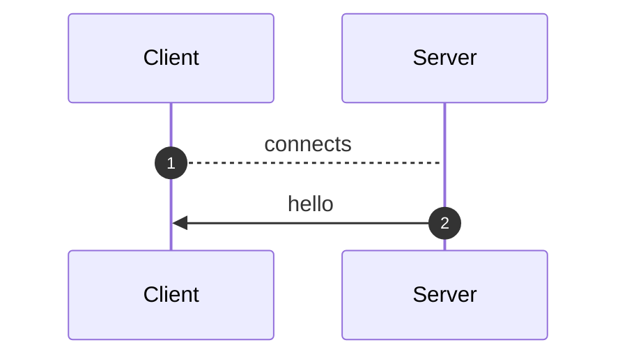
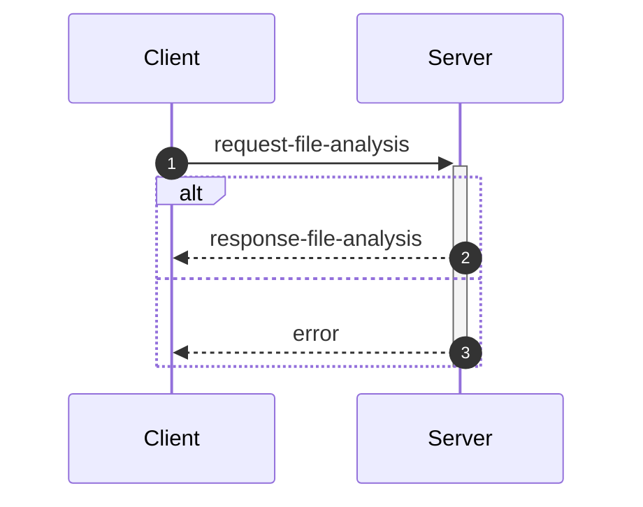
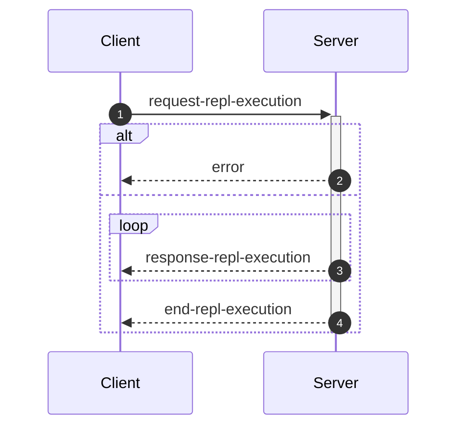
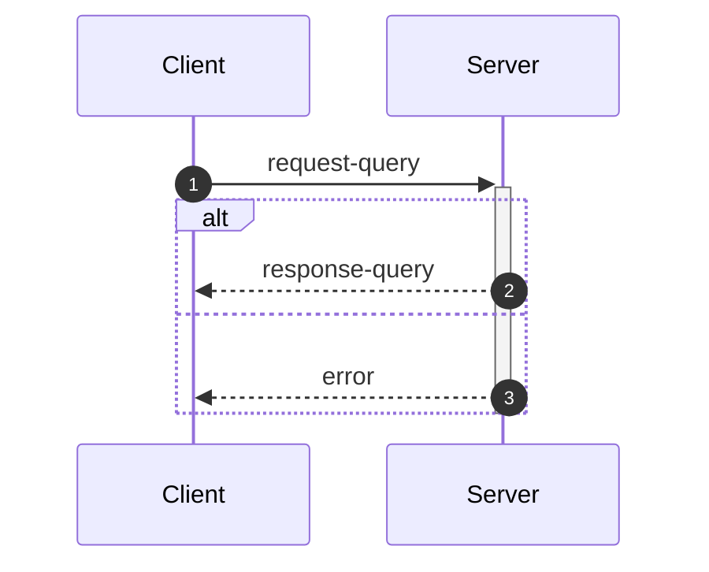

_<span title="an overview of flowR's interface">Generated</span> from '[wiki-interface.ts](https://github.com/flowr-analysis/flowr/tree/main/src/documentation/wiki-interface.ts "src/documentation/wiki-interface.ts")' on 2026-11-15, 08:40:19 UTC (v2.17.6, R v4.5.0), do not edit directly._

Although far from being as detailed as the in-depth explanation of [_flowR_](https://github.com/flowr-analysis/flowr/wiki/Core),
this wiki page explains how to interface with _flowR_ in more detail.
In general, command line arguments and other options provide short descriptions on hover over.

* [💻 Using the REPL](#using-the-repl)
* [⚙️ Configuring FlowR](#configuring-flowr)
* [⚒️ Writing Code](#writing-code)
* [💬 Communicating with the Server](#communicating-with-the-server)

<a id='using-the-repl'></a>
## 💻 Using the REPL

> [!NOTE]
> To execute arbitrary R commands with a repl request, _flowR_ has to be started explicitly with <span title="Description (Command Line Argument): Allow to access the underlying R session when using flowR (security warning: this allows the execution of arbitrary R code!)">`--r-session-access`</span>.
> Please be aware that this introduces a security risk and note that this relies on the [`r-shell` engine](https://github.com/flowr-analysis/flowr/wiki/Engines) .

Although primarily meant for users to explore,
there is nothing which forbids calling _flowR_ as a subprocess to use standard-in, -output, and -error
for communication (although you can access the REPL using the server as well,
with the [REPL Request](#message-request-repl-execution) message).

The read-eval-print loop&nbsp;(REPL) works relatively simple.
You can submit an expression (using <kbd>Enter</kbd>),
which is interpreted as an R&nbsp;expression by default but interpreted as a *command* if it starts with a colon (`:`).
The best command to get started with the REPL is <span title="Description (Repl Command): Show help information (aliases: :h, :?)">`:help`</span>.
Besides, you can leave the REPL either with the command <span title="Description (Repl Command): End the repl (aliases: :q, :exit)">`:quit`</span> or by pressing <kbd>Ctrl</kbd>+<kbd>C</kbd> twice.
When writing a *command*, you may press <kbd>Tab</kbd> to get a list of completions, if available.
Multiple commands can be entered in a single line by separating them with a semicolon (`;`), e.g. `:parse "x<-2"; :df*`.
If a command is given without R code, the REPL will re-use R code given in a previous command.
The prior example will hence return first the parsed AST of the program and then the dataflow graph for `"x <- 2"`.

> [!NOTE]
> If you develop flowR, you may want to launch the repl using the `npm run main-dev` command, this way, you get a non-minified version of flowR with debug information and hot-reloading of source files.

<details>
<summary>Available Commands</summary>

We currently offer the following commands (this with a `[*]` suffix are available with and without the star):

| Command | Description |
| ------- | ----------- |
| **<span title="Description (Repl Command): End the repl (aliases: :q, :exit)">:quit</span>** | End the repl (aliases: **:<span title="Alias of ':quit'. End the repl">q</span>**, **:<span title="Alias of ':quit'. End the repl">exit</span>**) |
| **<span title="Description (Repl Command): Execute the given code as R code. This requires the `--r-session-access` flag to be set and requires the r-shell engine. (aliases: :e, :r)">:execute</span>** | Execute the given code as R code. This requires the `--r-session-access` flag to be set and requires the r-shell engine. (aliases: **:<span title="Alias of ':execute'. Execute the given code as R code. This requires the `--r-session-access` flag to be set and requires the r-shell engine.">e</span>**, **:<span title="Alias of ':execute'. Execute the given code as R code. This requires the `--r-session-access` flag to be set and requires the r-shell engine.">r</span>**) |
| **<span title="Description (Repl Command): Get mermaid code for the control-flow graph of R code (aliases: :cfg, :cf)">:controlflow[*]</span>** | Get mermaid code for the control-flow graph of R code (star: Returns the URL to mermaid.live) (aliases: **:<span title="Alias of ':controlflow'. Get mermaid code for the control-flow graph of R code">cfg</span>**, **:<span title="Alias of ':controlflow'. Get mermaid code for the control-flow graph of R code">cf</span>**) |
| **<span title="Description (Repl Command): Get mermaid code for the control-flow graph with basic blocks (aliases: :cfgb, :cfb)">:controlflowbb[*]</span>** | Get mermaid code for the control-flow graph with basic blocks (star: Returns the URL to mermaid.live) (aliases: **:<span title="Alias of ':controlflowbb'. Get mermaid code for the control-flow graph with basic blocks">cfgb</span>**, **:<span title="Alias of ':controlflowbb'. Get mermaid code for the control-flow graph with basic blocks">cfb</span>**) |
| **<span title="Description (Repl Command): Get mermaid code for the dataflow graph (aliases: :d, :df)">:dataflow[*]</span>** | Get mermaid code for the dataflow graph (star: Returns the URL to mermaid.live) (aliases: **:<span title="Alias of ':dataflow'. Get mermaid code for the dataflow graph">d</span>**, **:<span title="Alias of ':dataflow'. Get mermaid code for the dataflow graph">df</span>**) |
| **<span title="Description (Repl Command): Get mermaid code for the normalized AST of R code (aliases: :n)">:normalize[*]</span>** | Get mermaid code for the normalized AST of R code (star: Returns the URL to mermaid.live) (alias: **:<span title="Alias of ':normalize'. Get mermaid code for the normalized AST of R code">n</span>**) |
| **<span title="Description (Repl Command): Get mermaid code for the simplified dataflow graph (aliases: :ds, :dfs)">:dataflowsimple[*]</span>** | Get mermaid code for the simplified dataflow graph (star: Returns the URL to mermaid.live) (aliases: **:<span title="Alias of ':dataflowsimple'. Get mermaid code for the simplified dataflow graph">ds</span>**, **:<span title="Alias of ':dataflowsimple'. Get mermaid code for the simplified dataflow graph">dfs</span>**) |
| **<span title="Description (Repl Command): Inspect and extend the signature database: `query` (identical to :query @signature), `info <name>` for where a function comes from (identical to :query @function-info), `add <path>` to mount another database/source, `download` to fetch the full-history database. (aliases: :sig)">:signature</span>** | Inspect and extend the signature database: `query` (identical to :query @signature), `info <name>` for where a function comes from (identical to :query @function-info), `add <path>` to mount another database/source, `download` to fetch the full-history database. (alias: **:<span title="Alias of ':signature'. Inspect and extend the signature database: `query` (identical to :query @signature), `info <name>` for where a function comes from (identical to :query @function-info), `add <path>` to mount another database/source, `download` to fetch the full-history database.">sig</span>**) |
| **<span title="Description (Repl Command): Just calculates the DFG, but only prints summary info (aliases: :d#, :df#)">:dataflowsilent</span>** | Just calculates the DFG, but only prints summary info (aliases: **:<span title="Alias of ':dataflowsilent'. Just calculates the DFG, but only prints summary info">d#</span>**, **:<span title="Alias of ':dataflowsilent'. Just calculates the DFG, but only prints summary info">df#</span>**) |
| **<span title="Description (Repl Command): Prints ASCII Art of the parsed, unmodified AST (aliases: :p)">:parse</span>** | Prints ASCII Art of the parsed, unmodified AST (alias: **:<span title="Alias of ':parse'. Prints ASCII Art of the parsed, unmodified AST">p</span>**) |
| **<span title="Description (Repl Command): Prints the version of flowR as well as the current version of R">:version</span>** | Prints the version of flowR as well as the current version of R
| **<span title="Description (Repl Command): Query the given R code (use 'help' for more information)">:query[*]</span>** | Query the given R code (use 'help' for more information) (star: Similar to query, but returns the output in json format.)
| **<span title="Description (Repl Command): Returns an ASCII representation of the dataflow graph (aliases: :df!)">:dataflowascii</span>** | Returns an ASCII representation of the dataflow graph (alias: **:<span title="Alias of ':dataflowascii'. Returns an ASCII representation of the dataflow graph">df!</span>**) |
| **<span title="Description (Repl Command): Returns summarization stats for the normalized AST (aliases: :n#)">:normalize#</span>** | Returns summarization stats for the normalized AST (alias: **:<span title="Alias of ':normalize#'. Returns summarization stats for the normalized AST">n#</span>**) |
| **<span title="Description (Repl Command): Show help information (aliases: :h, :?)">:help</span>** | Show help information (aliases: **:<span title="Alias of ':help'. Show help information">h</span>**, **:<span title="Alias of ':help'. Show help information">?</span>**) |

</details>

> [!TIP]
> 
> As indicated by the examples before, all REPL commands that operate on code keep track of the state.
> Hence, if you run a command like <span title="Description (Repl Command, starred version): Returns the URL to mermaid.live; Base Command: Get mermaid code for the dataflow graph (aliases: :d*, :df*)">`:dataflow*`</span> without providing R code,
> the REPL will re-use the R code provided in a previous command.
> Likewise, doing this will benefit from incrementality!
> If you request the dataflow graph with `:df* x <- 2 * y` and then want to see the parsed AST with `:parse`,
> the REPL will re-use previously obtained information and not re-parse the code again.
> 		

Generally, many commands offer shortcut versions in the REPL. Many queries, for example, offer a shortened format (see the example below).
Of special note, the [Config Query](https://github.com/flowr-analysis/flowr/wiki/%5BQuery%5D-Config)
can be used to also modify the currently active configuration of _flowR_ within the REPL (see the [wiki page](https://github.com/flowr-analysis/flowr/wiki/%5BQuery%5D-Config) for more information).

### Example: Retrieving the Dataflow Graph

To retrieve a URL to the [mermaid](https://mermaid.js.org/) diagram of the dataflow of a given expression,
use <span title="Description (Repl Command, starred version): Returns the URL to mermaid.live; Base Command: Get mermaid code for the dataflow graph (aliases: :d*, :df*)">`:dataflow*`</span> (or <span title="Description (Repl Command): Get mermaid code for the dataflow graph (aliases: :d, :df)">`:dataflow`</span> to get the mermaid code in the cli):

```shell
$ docker run -it --rm eagleoutice/flowr # or npm run flowr 
flowR repl v2.17.6, R grammar v14 (tree-sitter engine)
R> :dataflow* y <- 1 + x
```

<details>
<summary style='color:gray'>Output</summary>

```text
https://mermaid.live/view#base64:eyJjb2RlIjoiZmxvd2NoYXJ0IFREXG4gICAgMXt7XCJgKiM5MTtSTnVtYmVyIzkzOyogKioxKipcbiAgICAgICoxLjYqICgqKmlkOiAxKiopYFwifX1cbiAgICAyKFtcImAqIzkxO1JTeW1ib2wjOTM7KiAqKngqKlxuICAgICAgKjEuMTAqICgqKmlkOiAyKiopYFwiXSlcbiAgICAzW1tcImAqIzkxO1JCaW5hcnlPcCM5MzsqIGJhc2UjNTg7IzU4OyoqIzQzOyoqXG4gICAgICAqMS42LTEwKiAoKippZDogMyoqKVxuICAgIGFyZzogKDEsIDIpYFwiXV1cbiAgICBidWlsdC1pbjpfNDNfW1wiYEJ1aWx0LUluOlxuIzQzO2BcIl1cbiAgICBzdHlsZSBidWlsdC1pbjpfNDNfIHN0cm9rZTpncmF5LGZpbGw6Z3JheSxzdHJva2Utd2lkdGg6MnB4LG9wYWNpdHk6Ljg7XG4gICAgMFtcImAqIzkxO1JTeW1ib2wjOTM7KiAqKnkqKlxuICAgICAgKjEuMSogKCoqaWQ6IDAqKiwgdjogMylgXCJdXG4gICAgNFtbXCJgKiM5MTtSQmluYXJ5T3AjOTM7KiBiYXNlIzU4OyM1ODsqKiM2MDsjNDU7KipcbiAgICAgICoxLjEtMTAqICgqKmlkOiA0KiopXG4gICAgYXJnOiAoMCwgMylgXCJdXVxuICAgIGJ1aWx0LWluOl82MF8tW1wiYEJ1aWx0LUluOlxuIzYwOyM0NTtgXCJdXG4gICAgc3R5bGUgYnVpbHQtaW46XzYwXy0gc3Ryb2tlOmdyYXksZmlsbDpncmF5LHN0cm9rZS13aWR0aDoycHgsb3BhY2l0eTouODtcbiAgICAxIC0uLT58XCJmbG93XCJ8IDJcbiAgICBsaW5rU3R5bGUgMCBzdHJva2U6Z3JheSxjb2xvcjpncmF5O1xuICAgIDIgLS4tPnxcImZsb3dcInwgM1xuICAgIGxpbmtTdHlsZSAxIHN0cm9rZTpncmF5LGNvbG9yOmdyYXk7XG4gICAgMyAtLT58XCJyZWFkcywgYXJnXCJ8IDFcbiAgICAzIC0tPnxcInJlYWRzLCBhcmdcInwgMlxuICAgIDMgLS4tPnxcImZsb3dcInwgMFxuICAgIGxpbmtTdHlsZSA0IHN0cm9rZTpncmF5LGNvbG9yOmdyYXk7XG4gICAgMyAtLi0+fFwicmVhZHMsIGNhbGxzXCJ8IGJ1aWx0LWluOl80M19cbiAgICBsaW5rU3R5bGUgNSBzdHJva2U6Z3JheTtcbiAgICAwIC0tPnxcImRlZmluZWQtYnksIGZsb3dcInwgNFxuICAgIDAgLS0+fFwiZGVmaW5lZC1ieVwifCAzXG4gICAgNCAtLT58XCJyZWFkcywgYXJnXCJ8IDNcbiAgICA0IC0tPnxcInJldHVybnMsIGFyZ1wifCAwXG4gICAgNCAtLi0+fFwicmVhZHMsIGNhbGxzXCJ8IGJ1aWx0LWluOl82MF8tXG4gICAgbGlua1N0eWxlIDEwIHN0cm9rZTpncmF5OyIsIm1lcm1haWQiOnsiYXV0b1N5bmMiOnRydWV9fQ==
```

Retrieve the dataflow graph of the expression `y <- 1 + x`. It looks like this:


<details>

<summary style="color:gray">R Code of the Dataflow Graph</summary>

The analysis ran (parse and normalize with the [tree-sitter](https://github.com/flowr-analysis/flowr/wiki/Engines) engine) in the generation environment. No [signature database](https://github.com/flowr-analysis/flowr/wiki/Signature-Database) is mounted, so `library()` attaches no exports (base-R names are still qualified, e.g., `stats::acf`). 
We encountered no unknown side effects during the analysis.

```r
y <- 1 + x
```

</details>

</details>

For small graphs like this, <span title="Description (Repl Command): Returns an ASCII representation of the dataflow graph (aliases: :df!)">`:dataflowascii`</span> also provides an ASCII representation directly in the REPL:

```shell
$ docker run -it --rm eagleoutice/flowr # or npm run flowr 
flowR repl v2.17.6, R grammar v14 (tree-sitter engine)
R> :df! y <- 1 + x
```

<details open>
<summary style='color:gray'>Output</summary>

```text
                        v<0>v
 c<4>c──────────────────| y |
 |<- |     ┌────────────v---v
 c---c     │
    │   c<3>c   0<1>0
    └───| + |───| 1 |───u<2>u
        c---c   0---0   | x |
           └────────────u---u
Edges:
3 -> 1: reads, arg          3 -> 2: reads, arg
3 -> 0: flows-to            1 -> 2: flows-to
2 -> 3: flows-to            4 -> 3: reads, arg
4 -> 0: returns, arg        0 -> 4: defined-by, flows-to
0 -> 3: defined-by
```

Retrieve the dataflow graph of the expression `y <- 1 + x` as ASCII art.

</details>

For the slicing with <span title="Description (Repl Command): Static backwards executable slicer for R">`:slicer`</span>, you have access to the same [magic comments](#slice-magic-comments) as with the [slice request](#message-request-slice).
Pass `--inline` to splice resolvable `source()` calls into the reconstruction so the slice is a single self-contained R text (the same as the static slice query's `inlineSources` flag).
See `--help` for more flags!

### Example: Interfacing with the File System

Many commands that allow for an R-expression (like <span title="Description (Repl Command, starred version): Returns the URL to mermaid.live; Base Command: Get mermaid code for the dataflow graph (aliases: :d*, :df*)">`:dataflow*`</span>) allow for a file as well
if the argument starts with `file://`.
If you are working from the root directory of the _flowR_ repository, the following gives you the parsed AST of the example file using the <span title="Description (Repl Command): Prints ASCII Art of the parsed, unmodified AST (aliases: :p)">`:parse`</span> command:

> **Watch mode**: Replace `file://` with `watch://` to enter watch mode.
> flowR runs the command immediately and then re-runs it every time the file (or any file inside the folder) changes.
> Enter any other command to leave watch mode.
> For example: `:df watch://analysis.R`

```shell
$ docker run -it --rm eagleoutice/flowr # or npm run flowr 
flowR repl v2.17.6, R grammar v14 (tree-sitter engine)
R> :parse file://test/testfiles/example.R
```

<details>
<summary style='color:gray'>Output</summary>

```text
File: test/testfiles/example.R

program
├ binaryoperator
│ ├ identifier "sum" (1:1─4)
│ ├ <- "<-" (1:5─7)
│ ╰ float "0" (1:8─9)
├ binaryoperator
│ ├ identifier "product" (2:1─8)
│ ├ <- "<-" (2:9─11)
│ ╰ float "1" (2:12─13)
├ binaryoperator
│ ├ identifier "w" (3:1─2)
│ ├ <- "<-" (3:3─5)
│ ╰ float "7" (3:6─7)
├ binaryoperator
│ ├ identifier "N" (4:1─2)
│ ├ <- "<-" (4:3─5)
│ ╰ float "10" (4:6─8)
├ forstatement
│ ├ for "for" (6:1─4)
│ ├ ( "(" (6:5─6)
│ ├ identifier "i" (6:6─7)
│ ├ in "in" (6:8─10)
│ ├ binaryoperator
│ │ ├ float "1" (6:11─12)
│ │ ├ : ":" (6:12─13)
│ │ ╰ parenthesizedexpression
│ │   ├ ( "(" (6:13─14)
│ │   ├ binaryoperator
│ │   │ ├ identifier "N" (6:14─15)
│ │   │ ├ - "-" (6:15─16)
│ │   │ ╰ float "1" (6:16─17)
│ │   ╰ ) ")" (6:17─18)
│ ├ ) ")" (6:18─19)
│ ╰ bracedexpression
│   ├ { "{" (6:20─21)
│   ├ binaryoperator
│   │ ├ identifier "sum" (7:3─6)
│   │ ├ <- "<-" (7:7─9)
│   │ ╰ binaryoperator
│   │   ├ binaryoperator
│   │   │ ├ identifier "sum" (7:10─13)
│   │   │ ├ + "+" (7:14─15)
│   │   │ ╰ identifier "i" (7:16─17)
│   │   ├ + "+" (7:18─19)
│   │   ╰ identifier "w" (7:20─21)
│   ├ binaryoperator
│   │ ├ identifier "product" (8:3─10)
│   │ ├ <- "<-" (8:11─13)
│   │ ╰ binaryoperator
│   │   ├ identifier "product" (8:14─21)
│   │   ├  "" (8:22─23)
│   │   ╰ identifier "i" (8:24─25)
│   ╰ } "}" (9:1─2)
├ call
│ ├ identifier "cat" (11:1─4)
│ ╰ arguments
│   ├ ( "(" (11:4─5)
│   ├ argument
│   │ ╰ string
│   │   ├ stringopen "\"" (11:5─6)
│   │   ├ stringcontent "Sum:" (11:6─10)
│   │   ╰ stringclose "\"" (11:10─11)
│   ├ comma "," (11:11─12)
│   ├ argument
│   │ ╰ identifier "sum" (11:13─16)
│   ├ comma "," (11:16─17)
│   ├ argument
│   │ ╰ string
│   │   ├ stringopen "\"" (11:18─19)
│   │   ├ stringcontent
│   │   │ ╰ escapesequence "\\n" (11:19─21)
│   │   ╰ stringclose "\"" (11:21─22)
│   ╰ ) ")" (11:22─23)
╰ call
  ├ identifier "cat" (12:1─4)
  ╰ arguments
    ├ ( "(" (12:4─5)
    ├ argument
    │ ╰ string
    │   ├ stringopen "\"" (12:5─6)
    │   ├ stringcontent "Product:" (12:6─14)
    │   ╰ stringclose "\"" (12:14─15)
    ├ comma "," (12:15─16)
    ├ argument
    │ ╰ identifier "product" (12:17─24)
    ├ comma "," (12:24─25)
    ├ argument
    │ ╰ string
    │   ├ stringopen "\"" (12:26─27)
    │   ├ stringcontent
    │   │ ╰ escapesequence "\\n" (12:27─29)
    │   ╰ stringclose "\"" (12:29─30)
    ╰ ) ")" (12:30─31)
```

Retrieve the parsed AST of the example file.

<details>

<summary>File Content</summary>

```r
sum <- 0
product <- 1
w <- 7
N <- 10

for (i in 1:(N-1)) {
  sum <- sum + i + w
  product <- product * i
}

cat("Sum:", sum, "\n")
cat("Product:", product, "\n")
```

</details>

As _flowR_ directly transforms this AST the output focuses on being human-readable instead of being machine-readable.
		
</details>

### Example: Run a Query

You can run any query supported by _flowR_ using the <span title="Description (Repl Command): Query the given R code (use 'help' for more information)">`:query`</span> command.
For example, to obtain the shapes of all data frames in a given piece of code, you can run:

```shell
$ docker run -it --rm eagleoutice/flowr # or npm run flowr 
flowR repl v2.17.6, R grammar v14 (tree-sitter engine)
R> :query @absint df-shape "x <- data.frame(a = 1:10, b = 1:10)\ny <- x$a"
```

<details open>
<summary style='color:gray'>Output</summary>

```text
Query: absint (2 ms)
   ╰ $12: (colnames: [{"a", "b"}, {}], cols: [2, 2], rows: [10, 10])
   ╰ $0: (colnames: [{"a", "b"}, {}], cols: [2, 2], rows: [10, 10])
```

Retrieve the shapes of all data frames in the given code.

</details>

To run the linter on a file, you can use (in this example, we just issue the `dead-code` linter on a small piece of code):

```shell
$ docker run -it --rm eagleoutice/flowr # or npm run flowr 
flowR repl v2.17.6, R grammar v14 (tree-sitter engine)
R> :query @linter rules:dead-code "if(FALSE) x <- 2"
```

<details open>
<summary style='color:gray'>Output</summary>

```text
Query: linter (6 ms)
   ╰ Dead Code (dead-code):
       ╰ certain:
           ╰ Code at 1.11-16 (1 quick fix(es) available)
```

Run the linter on the given code, with only the `dead-code` rule enabled.

</details>

For more information on the available queries, please check out the [Query API](https://github.com/flowr-analysis/flowr/wiki/Query-API).

<a id='configuring-flowr'></a>
## ⚙️ Configuring FlowR

When running _flowR_, you may want to specify some behaviors with a dedicated configuration file.
By default, flowR looks for a file named `flowr.json` in the current working directory (or any higher directory).
You can also specify a different file with <span title="Description (Command Line Argument): The name of the configuration file to use">`--config-file`</span> or pass the configuration inline using <span title="Description (Command Line Argument): The flowR configuration to use, as a JSON string">`--config-json`</span>.
A `flowr.json` found this way belongs to the analyzed project, so flowR ignores its options that decide what flowR executes or loads
(`engines.*.wasmPath`, `engines.*.treeSitterWasmPath`, `engines.*.rPath`, `solver.sigdb.additionalPaths`, `solver.sigdb.downloadRepo`, `solver.sigdb.installedLibrary.paths`, `solver.sigdb.onDemand.enabled`, `solver.sigdb.onDemand.repositories`, `solver.sigdb.onDemand.cranMirror`, `solver.sigdb.onDemand.bioconductorMirror`, `solver.sigdb.onDemand.cacheDir`),
unless you pass <span title="Description (Command Line Argument): Keep the security-sensitive options (e.g., the R executable) of the flowr.json found in the working directory or a parent. Only use this for projects you trust.">`--trust-config`</span>.
To analyze code you do not trust, use the secure mode (<span title="Description (Command Line Argument): Run in secure mode for analyzing untrusted code: flowR does not start R (or any other process), does not access the network, does not search for project configs, and ignores security-sensitive options in every config. Cannot be disabled once enabled. Can also be enabled with the environment variable {italic FLOWR_SECURE_MODE=1}.">`--secure`</span>, see the [security policy](https://github.com/flowr-analysis/flowr/blob/main/.github/SECURITY.md)).
To inspect the current configuration, you can run flowr with the <span title="Description (Command Line Argument): Run with verbose logging (will be passed to the corresponding script)">`--verbose`</span> flag, or use the `config` [Query](https://github.com/flowr-analysis/flowr/wiki/Query-API).
Within the REPL this works by running the following:

```shell
:query @config
```

To work with the <a href="https://github.com/flowr-analysis/flowr/tree/main/src/config.ts#L121"><code><span title="The configuration file format for flowR.">FlowrConfig</span></code></a> you can use the provided helper objects alongside its methods like
<a href="https://github.com/flowr-analysis/flowr/tree/main/src/config.ts#L953"><code><span title="Creates a new flowr config that has the updated values.">FlowrConfig::<b>amend</b></span></code></a>.
The schema below documents every option; the ones you most likely want are:

- <a href="https://github.com/flowr-analysis/flowr/wiki/Interface#configuring-flowr" title="Configuration Option (boolean): Whether source calls should be ignored, causing {@link processSourceCall}&#39;s behavior to be skipped.">ignoreSourceCalls</a>: ignore source calls when analyzing the code, i.e., ignore the inclusion of other files.
- <a href="https://github.com/flowr-analysis/flowr/wiki/Interface#configuring-flowr" title="Configuration Option (boolean): Whether load calls should be ignored, causing {@link processLoadCall}&#39;s behavior to be skipped.">ignoreLoadCalls</a>: ignore load calls when analyzing the code, i.e., ignore the loading of r-data files.
- <a href="https://github.com/flowr-analysis/flowr/wiki/Interface#configuring-flowr" title="Configuration Option (object): Do you want to overwrite (parts) of the builtin definition?">semantics.environment.overwriteBuiltIns</a>: overwrite _flowR_'s handling of built-in functions, or clear the preset definitions entirely.
  See [Configure BuiltIn Semantics](#configure-builtin-semantics) for more information.
- <a href="https://github.com/flowr-analysis/flowr/wiki/Interface#configuring-flowr" title="Configuration Option (boolean): Whether calls drawing on a graphics device (e.g., `plot`) count as writing to it, which the ambient state queries then report.">semantics.ambient.drawingWritesDevice</a>: whether calls drawing on a graphics device (e.g., `plot`) count as writing the device in the ambient state queries.
- <a href="https://github.com/flowr-analysis/flowr/wiki/Interface#configuring-flowr" title="Configuration Option (string): How to resolve variables and their values. (one of &quot;disabled&quot;, &quot;alias&quot;, &quot;builtin&quot;)">solver.variables</a>: how to resolve variables and their values (`disabled`, `alias`, `builtin`).
- <a href="https://github.com/flowr-analysis/flowr/wiki/Interface#configuring-flowr" title="Configuration Option (array): The engine or set of engines to use for interacting with R code. An empty array means all available engines will be used.">engines</a> and <a href="https://github.com/flowr-analysis/flowr/wiki/Interface#configuring-flowr" title="Configuration Option (string): The default engine to use for interacting with R code. If this is undefined, an arbitrary engine from the specified list will be used. (one of &quot;tree-sitter&quot;, &quot;r-shell&quot;)">defaultEngine</a>: the engines used to interact with R code, see the [Engines wiki page](https://github.com/flowr-analysis/flowr/wiki/Engines).
- <a href="https://github.com/flowr-analysis/flowr/wiki/Interface#configuring-flowr" title="Configuration Option (array): Files a framework loads on its own, without any source() call (e.g. global.R in a shiny app), in the order they are loaded; flowR orders the matching project files accordingly and analyzes them as one program. Entries are case-insensitive globs matched against the file path, a plain name matches any file with that name, and entries matching no project file are warned about. Usually set per project kind via specializeConfig.">project.implicitSources</a>: the files a framework loads without any `source()` call, in the order in which they are
  loaded. Entries are globs (e.g. `R/*.R`) matched against the file path ignoring capitalization; one matching no file is reported.
- <a href="https://github.com/flowr-analysis/flowr/wiki/Interface#configuring-flowr" title="Configuration Option (object): Overwrite (parts of) the configuration depending on the project kind flowR detects, e.g. to give a shiny app its implicit sources.">specializeConfig</a>: overwrite (parts of) the configuration depending on the kind of project _flowR_ detects
  (e.g. `shiny-app`), which is how a shiny app gets its implicit sources by default. What you configure directly wins.
- <a href="https://github.com/flowr-analysis/flowr/wiki/Interface#configuring-flowr" title="Configuration Option (string): Overwrite the project kind flowR would otherwise infer from the analyzed files, e.g. when auto-detection guesses wrong. (one of &quot;package&quot;, &quot;script&quot;, &quot;shiny-app&quot;, &quot;notebook&quot;, &quot;project&quot;, &quot;unknown&quot;)">project.useProjectType</a>: skip that detection and force a project kind yourself, when auto-detection guesses wrong.
- <a href="https://github.com/flowr-analysis/flowr/wiki/Interface#configuring-flowr" title="Configuration Option (array): The default plugins to load when creating a new instance of FlowrAnalyzer">defaultPlugins</a> and <a href="https://github.com/flowr-analysis/flowr/wiki/Interface#configuring-flowr" title="Configuration Option (array): The plugins to load in REPL mode">repl.plugins</a>: the plugins to load for a new <a href="https://github.com/flowr-analysis/flowr/tree/main/src/project/flowr-analyzer.ts#L219"><code><span title="Central class for conducting analyses with FlowR. Use the FlowrAnalyzerBuilder to create a new instance. If you want the original pattern of creating a pipeline and running all steps, you can still do this with FlowrAnalyzer#runFull . To inspect the context of the analyzer, use FlowrAnalyzer#inspectContext (if you are a plugin and need to modify it, use FlowrAnalyzer#context instead).">FlowrAnalyzer</span></code></a> and in the REPL
  (use `flowr:default` to reference the former).

So you can configure _flowR_ by adding a file like the following:

<details>

<summary>Example Configuration File</summary>

```json
{
  "ignoreSourceCalls": true,
  "ignoreLoadCalls": true,
  "semantics": {
    "environment": {
      "overwriteBuiltIns": {
        "definitions": [
          {
            "type": "function",
            "names": [
              "foo"
            ],
            "processor": "builtin:assign",
            "config": {}
          }
        ]
      }
    }
  },
  "defaultPlugins": [
    "file:description",
    "versions:description"
  ],
  "repl": {
    "quickStats": false,
    "dfProcessorHeat": false,
    "hints": true,
    "plugins": [
      "flowr:default"
    ]
  },
  "project": {
    "resolveUnknownPathsOnDisk": true,
    "implicitSources": [
      "global.R",
      "app.R"
    ]
  },
  "linter": {
    "disabledRules": []
  },
  "specializeConfig": {
    "shiny-app": {
      "project": {
        "implicitSources": [
          "global.R",
          "ui.R",
          "server.R",
          "app.R"
        ]
      }
    }
  },
  "engines": [
    {
      "type": "r-shell"
    }
  ],
  "solver": {
    "variables": "alias",
    "evalStrings": true,
    "trackEnvironments": true,
    "sigdb": {
      "enabled": true,
      "loadProjectDependencies": true,
      "eagerlyLoad": false,
      "eagerlyLoadExports": false,
      "linkBaseR": false,
      "linkDescriptionDependencies": false
    },
    "resolveSource": {
      "dropPaths": "no",
      "ignoreCapitalization": true,
      "inferWorkingDirectory": "active-script",
      "searchPath": []
    },
    "instrument": {},
    "slicer": {
      "threshold": 50
    }
  },
  "abstractInterpretation": {
    "wideningThreshold": 4,
    "followCalls": true,
    "dataFrame": {
      "maxColNames": 20,
      "readLoadedData": {
        "readExternalFiles": true,
        "maxReadLines": 1000000
      }
    }
  },
  "incremental": {
    "alwaysIncremental": false,
    "parsing": {
      "activated": false,
      "heuristics": {
        "activated": true,
        "mtime": true,
        "linesFrom": 500,
        "bytesFrom": 50000,
        "alwaysWithEdits": false,
        "minFiles": 1
      }
    }
  },
  "gas": {
    "thresholds": {
      "memory": {
        "problematic": 0.7,
        "critical": 0.9
      },
      "timeMs": {
        "problematic": 100000,
        "critical": 120000
      }
    },
    "features": {}
  }
}
```

</details>

<details>
<a id='configure-builtin-semantics'></a>
<summary>Configure Built-In Semantics</summary>

`semantics/environment/overwriteBuiltins` accepts two keys:

- `loadDefaults` (boolean, initially `true`): If set to `true`, the default built-in definitions are loaded before applying the custom definitions. Setting this flag to `false` explicitly disables the loading of the default definitions.
- `definitions` (array, initially empty): Allows to overwrite or define new built-in elements. Each object within must have a `type` which is one of the below. Furthermore, they may define a string array of `names` which specifies the identifiers to bind the definitions to. You may use `assumePrimitive` to specify whether _flowR_ should assume that this is a primitive non-library definition (so you probably just do not want to specify the key).

  | Type            | Description                                                                                                                                                                                                                                                                                              | Example                                                                                                    |
  | --------------- | -------------------------------------------------------------------------------------------------------------------------------------------------------------------------------------------------------------------------------------------------------------------------------------------------------- | ---------------------------------------------------------------------------------------------------------- |
  | `constant`    | Additionally allows for a `value` this should resolve to.                                                                                                                                                                                                                                                | `{ type: 'constant', names: ['NULL', 'NA'],  value: null }`                                                |
  | `function`    | Is a rather flexible way to define and bind built-in functions. For the time, we do not have extensive documentation to cover all the cases, so please either consult the sources with the `default-builtin-config/` folder or open a [new issue](https://github.com/flowr-analysis/flowr/issues/new/choose). | `{ type: 'function', names: ['next'], processor: 'builtin:d', config: { cfg: ExitPointType.Next } }` |
  | `replacement` | A comfortable way to specify replacement functions like `$<-` or `names<-`. `suffixes` describes the... suffixes to attach automatically. | `{ type: 'replacement', suffixes: ['<-', '<<-'], names: ['[', '[['] }` |

</details>

<details>

<summary style='color:gray'>Full Configuration-File Schema</summary>

- _The configuration file format for flowR._ (object)
    - **logLevel** [optional] _flowR's global minimum log level, applied when the config is loaded._ (string)
        Only allows: 'silly', 'trace', 'debug', 'info', 'warn', 'error', 'fatal'
    - **ignoreSourceCalls** [optional] _Whether source calls should be ignored, causing {@link processSourceCall}'s behavior to be skipped._ (boolean)
    - **ignoreLoadCalls** [optional] _Whether load calls should be ignored, causing {@link processLoadCall}'s behavior to be skipped._ (boolean)
    - **semantics** _Configure language semantics and how flowR handles them._ (object)
        - **environment** [optional] _Semantics regarding how to handle the R environment._ (object)
            - **overwriteBuiltIns** [optional] _Do you want to overwrite (parts) of the builtin definition?_ (object)
                - **loadDefaults** [optional] _Should the default configuration still be loaded?_ (boolean)
                - **definitions** [optional] _The definitions to load/overwrite._ (array)
                Valid item types:
                    - (object)
        - **ambient** [optional] _Semantics regarding the global state (options, devices, files, ...) calls access._ (object)
            - **drawingWritesDevice** [optional] _Whether calls drawing on a graphics device (e.g., `plot`) count as writing to it, which the ambient state queries then report._ (boolean)
    - **defaultPlugins** [optional] _The default plugins to load when creating a new instance of FlowrAnalyzer_ (array)
    Valid item types:
        - (alternatives)
            - (string)
            - (array)
    - **repl** _Configuration options for the REPL._ (object)
        - **quickStats** [optional] _Whether to show quick stats in the REPL after each evaluation._ (boolean)
        - **dfProcessorHeat** [optional] _This instruments the dataflow processors to count how often each processor is called._ (boolean)
        - **hints** [optional] _Whether to show dim inline hints on the empty prompt (automatically disabled on non-interactive terminals)._ (boolean)
        - **plugins** [optional] _The plugins to load in REPL mode_ (array)
        Valid item types:
            - (alternatives)
                - (string)
                - (array)
        - **autoUseFileProtocol** [optional] _Prepend the file protocol to a repl input that looks like a path, instead of only warning about it._ (boolean)
        - **queryStats** [optional] _Whether `:query` closes with the line stating how long the queries took (`:query*` never prints it)._ (boolean)
        - **showPlugins** [optional] _Whether `:version` grays out the plugins that did not activate during the last analysis._ (boolean)
    - **project** _Project specific configuration options._ (object)
        - **resolveUnknownPathsOnDisk** [optional] _Whether to resolve unknown paths loaded by the r project disk when trying to source/analyze files._ (boolean)
        - **failOnInaccessiblePath** [optional] _Whether a directory that cannot be traversed during file discovery (e.g. due to permissions) aborts the analysis; when false (the default) such paths are logged and skipped._ (boolean)
        - **basePackages** [optional] _The packages considered part of R itself (base and recommended); if unset, flowR uses its built-in list._ (array)
        Valid item types:
            - (string)
        - **implicitSources** [optional] _Files a framework loads on its own, without any source() call (e.g. global.R in a shiny app), in the order they are loaded; flowR orders the matching project files accordingly and analyzes them as one program. Entries are case-insensitive globs matched against the file path, a plain name matches any file with that name, and entries matching no project file are warned about. Usually set per project kind via specializeConfig._ (array)
        Valid item types:
            - (string)
        - **useProjectType** [optional] _Overwrite the project kind flowR would otherwise infer from the analyzed files, e.g. when auto-detection guesses wrong._ (string)
            Only allows: 'package', 'script', 'shiny-app', 'notebook', 'project', 'unknown'
        - **assumeImplicitEcho** [optional] _Whether the top level of the analyzed code is echoed, so that every visible result printed there is collected as an output by the dependencies query (default true, false for a package)._ (boolean)
        - **discovery** [optional] _Scoping options for the default project discovery._ (object)
            - **full** [optional] _Collect every file below the project root (greedy) instead of only the files the detected project kind needs (default false)._ (boolean)
            - **perKind** [optional] _Per-kind include/exclude glob overrides layered on the default scoping._ (object)
            - **ignore** [optional] _Case-insensitive globs that drop matching files from the intelligent discovery, regardless of kind (e.g. .Renviron to ignore environment files)._ (array)
            Valid item types:
                - (string)
        - **classification** [optional] _Overrides for the signals flowR uses to classify the project kind._ (object)
            - **shinyDescriptionTypes** [optional] _DESCRIPTION Type: values that mark a shiny app._ (array)
            Valid item types:
                - (string)
            - **shinyEntryFiles** [optional] _File names a shiny app is assembled from._ (array)
            Valid item types:
                - (string)
            - **shinyUsagePattern** [optional] _Regex source evidencing shiny usage in an entry file._ (string)
            - **notebookExtensions** [optional] _File extensions marking a notebook._ (array)
            Valid item types:
                - (string)
    - **linter** _Linter configuration options._ (object)
        - **disabledRules** _Linting rule names excluded from the default rule set (a rule requested explicitly via a linter query still runs). Usually set per project kind via specializeConfig._ (array)
        Valid item types:
            - (string)
        - **disabledTags** [optional] _Linting rule tags whose rules are excluded from the default rule set (a rule requested explicitly via a linter query still runs). By default the cmd-check rules are disabled for everything but a package; a configured list replaces that default._ (array)
        Valid item types:
            - (string)
    - **inputSources** [optional] _Further frameworks the input-sources analysis should know about; entries are added to flowR's defaults._ (object)
        - **pure** [optional] _Functions that only pass the constantness of their arguments on._ (array)
        Valid item types:
            - (string)
        - **param** [optional] _Functions whose result is a 'param' input._ (array)
        Valid item types:
            - (string)
        - **file** [optional] _Functions whose result is a 'file' input._ (array)
        Valid item types:
            - (string)
        - **tempfile** [optional] _Functions whose result is a 'tempfile' input._ (array)
        Valid item types:
            - (string)
        - **glob** [optional] _Functions whose result is a 'glob' input._ (array)
        Valid item types:
            - (string)
        - **net** [optional] _Functions whose result is a 'net' input._ (array)
        Valid item types:
            - (string)
        - **rand** [optional] _Functions whose result is a 'rand' input._ (array)
        Valid item types:
            - (string)
        - **system** [optional] _Functions whose result is a 'system' input._ (array)
        Valid item types:
            - (string)
        - **ffi** [optional] _Functions whose result is a 'ffi' input._ (array)
        Valid item types:
            - (string)
        - **lang** [optional] _Functions whose result is a 'lang' input._ (array)
        Valid item types:
            - (string)
        - **options** [optional] _Functions whose result is a 'options' input._ (array)
        Valid item types:
            - (string)
        - **cmdline** [optional] _Functions whose result is a 'cmdline' input._ (array)
        Valid item types:
            - (string)
        - **user** [optional] _Functions whose result is a 'user' input._ (array)
        Valid item types:
            - (string)
        - **const** [optional] _Functions whose result is a 'const' input._ (array)
        Valid item types:
            - (string)
        - **scope** [optional] _Functions whose result is a 'scope' input._ (array)
        Valid item types:
            - (string)
        - **dconst** [optional] _Functions whose result is a 'dconst' input._ (array)
        Valid item types:
            - (string)
        - **unknown** [optional] _Functions whose result is a 'unknown' input._ (array)
        Valid item types:
            - (string)
        - **linkedObjects** [optional] _Objects a framework provides without a definition in the code, e.g. shiny's input._ (array)
        Valid item types:
            - (object)
        - **linkedEntryPoints** [optional] _Calls that hand a function to a framework, which binds its objects to the parameters by position._ (array)
        Valid item types:
            - (object)
    - **specializeConfig** [optional] _Overwrite (parts of) the configuration depending on the project kind flowR detects, e.g. to give a shiny app its implicit sources._ (object)
    - **engines** _The engine or set of engines to use for interacting with R code. An empty array means all available engines will be used._ (array)
    Valid item types:
        - (alternatives)
            - _The configuration for the tree sitter engine._ (object)
                - **type** [required] _Use the tree sitter engine._ (string)
                    Only allows: 'tree-sitter'
                - **wasmPath** [optional] _The path to the tree-sitter-r WASM binary to use. If this is undefined, this uses the default path._ (string)
                - **treeSitterWasmPath** [optional] _The path to the tree-sitter WASM binary to use. If this is undefined, this uses the default path._ (string)
                - **lax** [optional] _Whether to use the lax parser for parsing R code (allowing for syntax errors). If this is undefined, the strict parser will be used._ (boolean)
            - _The configuration for the R shell engine._ (object)
                - **type** [required] _Use the R shell engine._ (string)
                    Only allows: 'r-shell'
                - **rPath** [optional] _The path to the R executable to use. If this is undefined, this uses the default path._ (string)
                - **pipeBind** [optional] _Whether to enable R's experimental pipe-bind operator "=>" by setting _R_USE_PIPEBIND_ for the R session (default false); R itself keeps this off by default, as it is experimental and has never shipped in a release version of R._ (boolean)
    - **defaultEngine** [optional] _The default engine to use for interacting with R code. If this is undefined, an arbitrary engine from the specified list will be used._ (string)
        Only allows: 'tree-sitter', 'r-shell'
    - **solver** _How to resolve constants, constraints, cells, ..._ (object)
        - **variables** _How to resolve variables and their values._ (string)
            Only allows: 'disabled', 'alias', 'builtin'
        - **evalStrings** _Should we include eval(parse(text="...")) calls in the dataflow graph?_ (boolean)
        - **trackEnvironments** [optional] _Track user-created environments (new.env, assign/get/local with envir=, dollar-assign, attach). When false, all envir-style calls fall through conservatively._ (boolean)
        - **sigdb** _Resolving library exports from a signature database._ (object)
            - **enabled** [optional] _Resolve library()/use() exports from a signature database (default true); when false no database is consulted._ (boolean)
            - **loadProjectDependencies** [optional] _Load the project's declared dependencies from its metadata files (DESCRIPTION Imports/Depends, rproject.toml, uvr.toml, rig rproj.toml and script blocks, renv.lock, rv.lock, uvr.lock, rig lockfiles) (default true); when false these files are not read for dependencies._ (boolean)
            - **eagerlyLoad** [optional] _Parse the database up front rather than on the first package load (default false, ignored if disabled)._ (boolean)
            - **eagerlyLoadExports** [optional] _Add a vertex for every export on load rather than on demand (default false); keeps the dataflow graph small._ (boolean)
            - **assumedRVersion** [optional] _R version assumed when resolving versioned (base-R) exports: a pin like "4.5" or "auto" to detect the installed R (default "auto")._ (string)
            - **linkBaseR** [optional] _Eagerly attach base-R namespaces so bare base calls resolve without library() (default false)._ (boolean)
            - **linkBaseRCalls** [optional] _Add a lightweight Reads edge from a bare base-R call to its signature-database function vertex (default false; base-R qualification is edge-free otherwise)._ (boolean)
            - **linkPackageCalls** [optional] _Add a lightweight Reads edge from a resolved package call to its signature-database function vertex (default false)._ (boolean)
            - **linkDescriptionDependencies** [optional] _Eagerly attach the namespaces of the project's declared DESCRIPTION dependencies (Imports/Depends) so their exports resolve without an explicit library() (default false)._ (boolean)
            - **warmInBackground** [optional] _Decompress the hot shards (base + most-downloaded) in a background task on startup so the first library() lookup is warm (default false; for long-running servers/REPLs)._ (boolean)
            - **additionalPaths** [optional] _Extra directories or bundle/manifest files searched for signature databases (alongside the shipped default and $FLOWR_SIGDB_DIR); a downloaded full-history bundle placed here is mounted automatically._ (array)
            Valid item types:
                - (string)
            - **downloadRepo** [optional] _GitHub owner/repo the full-history bundle is downloaded from via ":signature download" (default "flowr-analysis/flowr"; the release tag comes from the committed sigdb.remote.json unless a version is given)._ (string)
            - **autoSync** [optional] _On startup, re-download shards whose committed sigdb.remote.json hash no longer matches the cache, in the background (default false; opt-in network sync after a git pull)._ (boolean)
            - **installedLibrary** [optional] _Recovering packages no signature database knows from the copy installed on this machine._ (object)
                - **enabled** [required] _Recover packages no signature database knows from their installed copy (default false)._ (boolean)
                - **paths** [optional] _Library directories to search; when empty they are discovered from the environment and the project._ (array)
                Valid item types:
                    - (string)
                - **useEnvironment** [optional] _Search the libraries R_LIBS_USER/R_LIBS/R_LIBS_SITE name (default true)._ (boolean)
                - **useProjectLibrary** [optional] _Search a project-local renv/packrat library (default true)._ (boolean)
                - **maxDepth** [optional] _How far to descend into the nested layout of a project-local library (default 3)._ (number)
                - **packages** [optional] _Only recover packages whose name matches one of these regular expressions; empty means any._ (array)
                Valid item types:
                    - (string)
            - **onDemand** [optional] _Recovering packages no signature database knows from their sources on CRAN, Bioconductor, or GitHub._ (object)
                - **enabled** [required] _Fetch and recover the sources of packages no signature database knows when the analyzed code uses them (default false, accesses the network)._ (boolean)
                - **sources** [optional] _Where to look, in order: github, cran, bioconductor, or a source a plugin adds (default ["github", "cran", "bioconductor"])._ (array)
                Valid item types:
                    - (string)
                - **repositories** [optional] _GitHub repositories (owner/repo[/subdir][@ref]) to fetch packages from, by package name. The analyzed project may name more (DESCRIPTION Remotes, install_github calls)._ (object)
                - **packages** [optional] _Only recover packages whose name matches one of these regular expressions, empty means any._ (array)
                Valid item types:
                    - (string)
                - **cranMirror** [optional] _The CRAN src/contrib/ to fetch from, over https (default https://cloud.r-project.org/src/contrib/). It may be on the local network._ (string)
                - **bioconductorMirror** [optional] _The Bioconductor host, over https (default https://bioconductor.org). It may be on the local network._ (string)
                - **bioconductorRelease** [optional] _The Bioconductor release to fetch from: release, devel, or a number like 3.20 (default release)._ (string)
                - **githubMirrors** [optional] _Use the GitHub mirrors of CRAN (cran/<pkg>) and Bioconductor (bioc/<pkg>) (default true)._ (boolean)
                - **maxPackages** [optional] _The most packages to fetch for one analysis (default 25)._ (number)
                - **maxArchiveMb** [optional] _The most MiB a package archive may have (default 32). It may unpack to three times that, at most 128 MiB._ (number)
                - **offline** [optional] _Only use what was fetched before, never the network (default false)._ (boolean)
                - **retryAfterHours** [optional] _How many hours to wait before asking again for a package no source had (default 24)._ (number)
                - **cacheDir** [optional] _Where to cache what was fetched (default the on-demand directory of the signature cache)._ (string)
            - **blobCacheBudgetMb** [optional] _How many MiB of decoded package blobs every open bundle may hold together (default 16)._ (number)
            - **versionSelection** [optional] _When a project constrains a dependency, resolve to the newest (default), oldest, or system-installed version satisfying it; system needs R and falls back to newest. Base-R packages always resolve against the assumed R version._ (string)
                Only allows: 'newest', 'oldest', 'system'
            - **versionOverrides** [optional] _Force an exact version for specific packages (name -> version), overriding both the project constraint and the versionSelection policy (default {})._ (object)
        - **versionManagement** _Policies for reasoning about dependency versions._ (object)
            - **linkedVersionGroups** [optional] _Groups of packages that must resolve to the same version; version guessing intersects each group so its members stay mutually compatible (default [])._ (array)
            Valid item types:
                - (array)
                Valid item types:
                    - (string)
        - **assumeAttachedPackages** [optional] _Packages to treat as attached without a `library()` call, so what the built-in configuration states about them applies to the analyzed code. The base packages R attaches on startup already resolve without it._ (array)
        Valid item types:
            - (string)
        - **transitiveSideEffectRounds** [optional] _How many rounds the transitive side-effect fixpoint may run before it is cut off (default 32); the propagation stops on its own as soon as a round adds nothing._ (number)
        - **maxOverlayDepth** [optional] _How many binding overlays may stack on one environment frame before a write flattens them (default 4); a pure performance knob, trading lookup cost against copy cost without changing any result._ (number)
        - **instrument** (object)
            - **dataflowExtractors** [optional] _These keys are only intended for use within code, allowing to instrument the dataflow analyzer!_ (any)
        - **resolveSource** [optional] _If lax source calls are active, flowR searches for sourced files much more freely, based on the configurations you give it. This option is only in effect if `ignoreSourceCalls` is set to false._ (object)
            - **dropPaths** _Allow to drop the first or all parts of the sourced path, if it is relative._ (string)
                Only allows: 'no', 'once', 'all'
            - **ignoreCapitalization** _Search for filenames matching in the lowercase._ (boolean)
            - **inferWorkingDirectory** _Try to infer the working directory from the main or any script to analyze._ (string)
                Only allows: 'no', 'main-script', 'active-script', 'any-script'
            - **searchPath** _Additionally search in these paths._ (array)
            Valid item types:
                - (string)
            - **repeatedSourceLimit** [optional] _How often the same file can be sourced within a single run? Please be aware: in case of cyclic sources this may not reach a fixpoint so give this a sensible limit._ (number)
            - **applyReplacements** _Provide name replacements for loaded files_ (array)
            Valid item types:
                - (object)
            - **assumeFilesExist** [optional] _Assume a sourced file is always there, making what it defines certain instead of conditional on the source call._ (boolean)
        - **slicer** [optional] _The configuration for the slicer._ (object)
            - **threshold** [optional] _The maximum number of iterations to perform on a single function call during slicing._ (number)
            - **autoExtend** [optional] _If set, the slicer will gain an additional post-pass._ (boolean)
    - **abstractInterpretation** _The configuration options for abstract interpretation._ (object)
        - **wideningThreshold** _The threshold for the number of visitations of a node at which widening should be performed to ensure the termination of the fixpoint iteration._ (number)
        - **followCalls** _Whether the abstract interpretation is interprocedural, i.e. whether it steps into the functions a call may dispatch to._ (boolean)
        - **dataFrame** _The configuration of the shape inference for data frames._ (object)
            - **maxColNames** _The maximum number of columns names to infer for data frames before over-approximating the column names to top._ (number)
            - **readLoadedData** _Configuration options for reading data frame shapes from loaded external data files, such as CSV files._ (object)
                - **readExternalFiles** _Whether data frame shapes should be extracted from loaded external files, such as CSV files._ (boolean)
                - **maxReadLines** _The maximum number of lines to read when extracting data frame shapes from loaded files, such as CSV files._ (number)
    - **incremental** (object)
        - **alwaysIncremental** _Always take the incremental path, regardless of heuristics._ (boolean)
        - **parsing** (object)
            - **activated** _If set, incremental parsing will be used._ (boolean)
            - **heuristics** (object)
                - **activated** [optional] _If set, the heuristics for incremental parsing will be used._ (boolean)
                - **mtime** [optional] _Skip reparsing entirely if the file's modification time is unchanged since the last parse._ (boolean)
                - **linesFrom** [optional] _Only consider incremental parsing for files with at least this many lines._ (number)
                - **bytesFrom** [optional] _Only consider incremental parsing for files with at least this many bytes._ (number)
                - **alwaysWithEdits** [optional] _Always take the incremental path whenever there is a computed edit region, regardless of the other thresholds._ (boolean)
                - **minFiles** [optional] _Only apply these heuristics once the project has at least this many files loaded._ (number)
    - **gas** [optional] _Resource-usage guard (gas) configuration. All feature factors default to 0 (disabled). See https://github.com/flowr-analysis/flowr/wiki/Core#gas-resource-guard._ (object)
        - **thresholds** [optional] _Thresholds for all gas checks (scaled by per-feature factor), boundable per feature._ (object)
            - **memory** [optional] _Heap-usage fraction thresholds (0-1), either shared or given per feature key (with `default` covering the rest)._ (object)
                - **problematic** [optional] _Heap fraction (0-1) above which Problematic is returned, for every feature without an entry of its own._ (number)
                - **critical** [optional] _Heap fraction (0-1) above which Critical is returned, for every feature without an entry of its own._ (number)
            - **timeMs** [optional] _Elapsed analysis time thresholds in milliseconds, either shared or given per feature key (with `default` covering the rest)._ (object)
                - **problematic** [optional] _Elapsed ms above which Problematic is returned, for every feature without an entry of its own._ (number)
                - **critical** [optional] _Elapsed ms above which Critical is returned, for every feature without an entry of its own._ (number)
            - **steps** [optional] _Processed-AST-node thresholds, counted rather than sampled; only a key that arms a budget (`dataflow`) reads them._ (object)
                - **problematic** [optional] _Processed AST nodes above which Problematic is returned, for every feature without an entry of its own._ (number)
                - **critical** [optional] _Processed AST nodes above which the extraction is cut short, for every feature without an entry of its own._ (number)
            - **vertices** [optional] _Created-dataflow-vertex thresholds, counted like `steps`._ (object)
                - **problematic** [optional] _Created dataflow vertices above which Problematic is returned, for every feature without an entry of its own._ (number)
                - **critical** [optional] _Created dataflow vertices above which the extraction is cut short, for every feature without an entry of its own._ (number)
        - **features** [optional] _Per-feature sensitivity factors. 0 or absent disables gas checking for that feature. A factor of 2 makes the feature twice as sensitive. Recognised keys: `source`, `side-effect-linking`, `linter`, `slicer`, `dataflow`._ (object)
        - **countedCheckEvery** [optional] _How many counted steps pass between two accountings of an armed check, be it a dataflow budget or the slicer's traversal (default 128); trades overshoot against the cost of the check._ (number)
        - **heapProvider** [optional] _Custom heap statistics source (programmatic configs only), overriding the built-in v8/performance.memory detection._ (function)

</details>

<a id='writing-code'></a>
## ⚒️ Writing Code

_flowR_ can be used as a [module](https://www.npmjs.com/package/@eagleoutice/flowr) and offers several main classes and interfaces that are interesting for extension writers 
(see the [Visual Studio Code extension](https://marketplace.visualstudio.com/items?itemName=code-inspect.vscode-flowr) or the [Core](https://github.com/flowr-analysis/flowr/wiki/Core) wiki page for more information).

### Creating Analyses with _flowR_

Nowadays, instances of the <a href="https://github.com/flowr-analysis/flowr/tree/main/src/project/flowr-analyzer.ts#L219"><code><span title="Central class for conducting analyses with FlowR. Use the FlowrAnalyzerBuilder to create a new instance. If you want the original pattern of creating a pipeline and running all steps, you can still do this with FlowrAnalyzer#runFull . To inspect the context of the analyzer, use FlowrAnalyzer#inspectContext (if you are a plugin and need to modify it, use FlowrAnalyzer#context instead).">FlowrAnalyzer</span></code></a> should be used as central frontend to get analysis results from _flowR_.
The entry points an analysis is written against are re-exported from the package root (`import { FlowrAnalyzerBuilder } from '@eagleoutice/flowr'`);
everything else stays reachable under its own path, as in `@eagleoutice/flowr/dataflow/graph/graph`.
For example, a program slice can be created like this:

```ts
const analyzer = await new FlowrAnalyzerBuilder()
    .setEngine('tree-sitter')
    .build();
analyzer.addRequest('x <- 1\ny <- x\nx');
const { slice, reconstruct } = await analyzer.query({ type: 'static-slice', criteria: ['3@x'] });
```

For more information, please have a look at the [Analyzer](https://github.com/flowr-analysis/flowr/wiki/Analyzer) wiki page, which explains how to construct and use the <a href="https://github.com/flowr-analysis/flowr/tree/main/src/project/flowr-analyzer.ts#L219"><code><span title="Central class for conducting analyses with FlowR. Use the FlowrAnalyzerBuilder to create a new instance. If you want the original pattern of creating a pipeline and running all steps, you can still do this with FlowrAnalyzer#runFull . To inspect the context of the analyzer, use FlowrAnalyzer#inspectContext (if you are a plugin and need to modify it, use FlowrAnalyzer#context instead).">FlowrAnalyzer</span></code></a> in more detail.
To work with specific perspectives, you can also consult the respective pages like the [Dataflow Graph](https://github.com/flowr-analysis/flowr/wiki/Dataflow-Graph) or the [Abstract Interpretation](https://github.com/flowr-analysis/flowr/wiki/Abstract-Interpretation) wiki pages.
### The Pipeline Executor (Low-Level Interface)

Once, in the beginning, _flowR_ was meant to produce a dataflow graph merely to provide *program slices*. 
However, with continuous updates, the [Dataflow Graph](https://github.com/flowr-analysis/flowr/wiki/Dataflow-Graph) repeatedly proves to be the more interesting part.
With this, we restructured _flowR_'s originally *hardcoded* pipeline to be far more flexible. 
Now, it can be theoretically extended or replaced with arbitrary steps, optional steps, and what we call 'decorations' of these steps. 
In short, a slicing pipeline using the <a href="https://github.com/flowr-analysis/flowr/tree/main/src/core/pipeline-executor.ts#L97"><code><span title="**Please note:** The PipelineExecutor is now considered to be a rather low-level API for flowR. While it still works and is the basis for all other layers, we strongly recommend using the FlowrAnalyzer and its builder to create and use an analyzer instance that is pre-configured for your use-case. The pipeline executor allows to execute arbitrary pipelines in a step-by-step fashion. If you are not...">PipelineExecutor</span></code></a> looks like this:

```ts

const slicer = new PipelineExecutor(DEFAULT_SLICING_PIPELINE, {
  parser:    new RShell(),
  request:   requestFromInput('x <- 1\nx + 1'),
  criterion: ['2@x']
})
const slice = await slicer.allRemainingSteps()
// console.log(slice.reconstruct.code)
```

<details><summary>More Information</summary>

If you compare this, with what you would have done with the old (and removed) `SteppingSlicer`, 
this essentially just requires you to replace the `SteppingSlicer` with the <a href="https://github.com/flowr-analysis/flowr/tree/main/src/core/pipeline-executor.ts#L97"><code><span title="**Please note:** The PipelineExecutor is now considered to be a rather low-level API for flowR. While it still works and is the basis for all other layers, we strongly recommend using the FlowrAnalyzer and its builder to create and use an analyzer instance that is pre-configured for your use-case. The pipeline executor allows to execute arbitrary pipelines in a step-by-step fashion. If you are not...">PipelineExecutor</span></code></a>
and to pass the <a href="https://github.com/flowr-analysis/flowr/tree/main/src/core/steps/pipeline/default-pipelines.ts#L16"><code>DEFAULT_SLICING_PIPELINE</code></a> as the first argument.
The <a href="https://github.com/flowr-analysis/flowr/tree/main/src/core/pipeline-executor.ts#L97"><code><span title="**Please note:** The PipelineExecutor is now considered to be a rather low-level API for flowR. While it still works and is the basis for all other layers, we strongly recommend using the FlowrAnalyzer and its builder to create and use an analyzer instance that is pre-configured for your use-case. The pipeline executor allows to execute arbitrary pipelines in a step-by-step fashion. If you are not...">PipelineExecutor</span></code></a>...

1. Provides structures to investigate the results of all intermediate steps
2. Can be executed step-by-step
3. Can repeat steps (e.g., to calculate multiple slices on the same input)

See the in-code documentation for more information.

</details>

### Using the <a href="https://github.com/flowr-analysis/flowr/tree/main/src/r-bridge/shell.ts#L136"><code><span title="The RShell represents an interactive session with the R interpreter. You can configure it by RShellOptions . At the moment we are using a live R session (and not networking etc.) to communicate with R easily, which allows us to install packages etc. However, this might and probably will change in the future (leaving this as a legacy mode :D)">RShell</span></code></a> to Interact with R

The <a href="https://github.com/flowr-analysis/flowr/tree/main/src/r-bridge/shell.ts#L136"><code><span title="The RShell represents an interactive session with the R interpreter. You can configure it by RShellOptions . At the moment we are using a live R session (and not networking etc.) to communicate with R easily, which allows us to install packages etc. However, this might and probably will change in the future (leaving this as a legacy mode :D)">RShell</span></code></a> class allows interfacing with the `R`&nbsp;ecosystem installed on the host system.
Please have a look at [flowR's Engines](https://github.com/flowr-analysis/flowr/wiki/Engines) for more information on alternatives (for example, the <a href="https://github.com/flowr-analysis/flowr/tree/main/src/r-bridge/lang-4.x/tree-sitter/tree-sitter-executor.ts#L27"><code><span title="Synchronous and (way) faster alternative to the RShell using tree-sitter.">TreeSitterExecutor</span></code></a>).

> [!IMPORTANT]
> 
> Each <a href="https://github.com/flowr-analysis/flowr/tree/main/src/r-bridge/shell.ts#L136"><code><span title="The RShell represents an interactive session with the R interpreter. You can configure it by RShellOptions . At the moment we are using a live R session (and not networking etc.) to communicate with R easily, which allows us to install packages etc. However, this might and probably will change in the future (leaving this as a legacy mode :D)">RShell</span></code></a> controls a new instance of the R&nbsp;interpreter, 
> make sure to call <code><a href="https://github.com/flowr-analysis/flowr/tree/main/src/r-bridge/shell.ts#L337"><span title="Close the current R session, makes the object effectively invalid (can no longer be reopened etc.)">RShell::<i>close</i></span></a>()</code> when you are done.

You can start a new "session" by constructing a new object with <code>new <a href="https://github.com/flowr-analysis/flowr/tree/main/src/r-bridge/shell.ts#L136"><span title="The RShell represents an interactive session with the R interpreter. You can configure it by RShellOptions . At the moment we are using a live R session (and not networking etc.) to communicate with R easily, which allows us to install packages etc. However, this might and probably will change in the future (leaving this as a legacy mode :D)">RShell</span></a>()</code>.

However, there are several options that may be of interest 
(e.g., to automatically revive the shell in case of errors or to control the name location of the R process on the system).

With a shell object (let's call it `shell`), you can execute R code by using <a href="https://github.com/flowr-analysis/flowr/tree/main/src/r-bridge/shell.ts#L205"><code><span title="sends the given command directly to the current R session will not do anything to alter input markers!">RShell::<i>sendCommand</i></span></code></a>,
for example <code>shell.<a href="https://github.com/flowr-analysis/flowr/tree/main/src/r-bridge/shell.ts#L205"><span title="sends the given command directly to the current R session will not do anything to alter input markers!">sendCommand</span></a>("1 + 1")</code>.
However, this does not return anything, so if you want to collect the output of your command, use
<a href="https://github.com/flowr-analysis/flowr/tree/main/src/r-bridge/shell.ts#L285"><code><span title="Send a command and collect the output">RShell::<i>sendCommandWithOutput</i></span></code></a> instead.

<a id='communicating-with-the-server'></a>
## 💬 Communicating with the Server

As explained in the [Overview](https://github.com/flowr-analysis/flowr/wiki/Overview), you can run the [TCP](https://de.wikipedia.org/wiki/Transmission_Control_Protocol)&nbsp;server by adding the <span title="Description (Command Line Argument): Do not drop into a repl, but instead start a server on the given port (default: 1042) and listen for messages.">`--server`</span> flag (and, due to the interactive mode, exit with the conventional <kbd>CTRL</kbd>+<kbd>C</kbd>).
Currently, every connection is handled by the same underlying `RShell` - so the server is not designed to handle many clients at a time.
Additionally, the server is not well guarded against attacks (e.g., you can theoretically spawn an arbitrary number of&nbsp;RShell sessions on the target machine).

Every message has to be given in a single line (i.e., without a newline in-between) and end with a newline character. Nevertheless, we will pretty-print example given in the following segments for the ease of reading.

> [!NOTE]
> 
> The default <span title="Description (Command Line Argument): Do not drop into a repl, but instead start a server on the given port (default: 1042) and listen for messages.">`--server`</span> uses a simple [TCP](https://de.wikipedia.org/wiki/Transmission_Control_Protocol)
> connection. If you want _flowR_ to expose a [WebSocket](https://de.wikipedia.org/wiki/WebSocket) server instead, add the <span title="Description (Command Line Argument): If the server flag is set, use websocket for messaging">`--ws`</span> flag (i.e., <span title="Description (Command Line Argument): Do not drop into a repl, but instead start a server on the given port (default: 1042) and listen for messages.">`--server`</span> <span title="Description (Command Line Argument): If the server flag is set, use websocket for messaging">`--ws`</span>) when starting _flowR_ from the command line.

<ul><li>
<a id="message-hello"></a>
<b>Hello</b> Message (<code>hello</code>) 
<details>

<summary style="color:gray"> View Details. <i>The server informs the client about the successful connection and provides Meta-Information.</i> </summary>



After launching _flowR_, for example, with <code>docker run -it --rm eagleoutice/flowr <span title="Description (Command Line Argument): Do not drop into a repl, but instead start a server on the given port (default: 1042) and listen for messages.">-<span/>-server</span></code>&nbsp;(🐳️), connecting should present you with a `hello` message, that amongst others should reveal the versions of&nbsp;_flowR_ and&nbsp;R, using the [semver 2.0](https://semver.org/spec/v2.0.0.html) versioning scheme.
The message looks like this:

```json
{
  "type": "hello",
  "clientName": "client-0",
  "versions": {
    "flowr": "2.17.6",
    "r": "4.5.0",
    "engine": "r-shell"
  }
}
```

There are currently a few messages that you can send after the hello message.
If you want to _slice_ a piece of R code you first have to send an [analysis request](#message-request-file-analysis), so that you can send one or multiple slice requests afterward.
Requests for the [REPL](#message-request-repl-execution) are independent of that.
	
<hr>

<details>
<summary style="color:gray">Message schema (<code>hello</code>)</summary>

For the definition of the hello message, please see it's implementation at [`./src/cli/repl/server/messages/message-hello.ts`](https://github.com/flowr-analysis/flowr/tree/main/src/cli/repl/server/messages/message-hello.ts).

- [required] (object)
    - **type** [required] _The type of the hello message._ (string)
        Only allows: 'hello'
    - **id** [forbidden] _The id of the message is always undefined (as it is the initial message and not requested)._ (any)
    - **clientName** [required] _A unique name that is assigned to each client. It has no semantic meaning and is only used/useful for debugging._ (string)
    - **versions** [required] (object)
        - **flowr** [required] _The version of the flowr server running in semver format._ (string)
        - **r** [required] _The version of the underlying R shell running in semver format._ (string)
        - **engine** [required] _The parser backend that is used to parse the R code._ (string)

</details>

<hr>

</details>
	</li>

<li>
<a id="message-request-file-analysis"></a>
<b>Analysis</b> Message (<code>request-file-analysis</code>) 
<details>

<summary style="color:gray"> View Details. <i>The server builds the dataflow graph for a given input file (or a set of files).</i> </summary>



The request allows the server to analyze a file and prepare it for slicing.
The message can contain a `filetoken`, which is used to identify the file in later slice or query requests (if you do not add one, the request will not be stored and therefore, it is not available for subsequent requests).

> **Please note!**\
> If you want to send and process a lot of analysis requests, but do not want to slice them, please do not pass the `filetoken` field. This will save the server a lot of memory allocation.

Furthermore, the request must contain either a `content` field to directly pass the file's content or a `filepath` field which contains the path to the file (this path must be accessible for the server to be useful).
If you add the `id` field, the answer will use the same `id` so you can match requests and the corresponding answers.
See the implementation of the request-file-analysis message for more information.

You can drop one or more stored file tokens by adding the `invalidateToken` field (a single token or an array of tokens).
The server frees the corresponding analyses _after_ it has answered the request.

> **Tip!**\
> If you only want to drop tokens, you do not need a separate message: send a `request-file-analysis` that contains _just_ the `invalidateToken` field (and no `content` or `filepath`).
> Such a request behaves like an empty file analysis and the server replies with an empty `results` object.
> Because invalidation happens after the response, you may even pass the _current_ `filetoken` in `invalidateToken` to analyze a file once and have the server forget it right after you received the results.

<details>
<summary>Example of the <code>request-file-analysis</code> Message</summary>

_Note:_ even though we pretty-print these messages, they are sent as a single line, ending with a newline.

The following lists all messages that were sent and received in case you want to reproduce the scenario:

<ol>
<li> <code>hello</code> (response)
<details> 

<summary> Show Details </summary>

The first message is always a hello message.

```json
{"type":"hello","clientName":"client-0","versions":{"flowr":"2.17.6","r":"4.5.0","engine":"r-shell"}}
```

</details>
</li>

<li> <b><code>request-file-analysis</code> (request)</b>
<details open> 

<summary> Show Details </summary>

Let's suppose you simply want to analyze the following script:
 
```r
x <- 1
x + 1
```

 For this, you can send the following request:

```json
{"type":"request-file-analysis","id":"1","filetoken":"x","content":"x <- 1\nx + 1"}
```

</details>
</li>

<li> <code>response-file-analysis</code> (response)
<details> 

<summary> Show Details </summary>

The `results` field of the response effectively contains three keys of importance:

- `parse`: which contains 1:1 the parse result in CSV format that we received from the `RShell` (i.e., the AST produced by the parser of the R interpreter).
- `normalize`: which contains the normalized AST, including ids (see the `info` field and the [Normalized AST](https://github.com/flowr-analysis/flowr/wiki/Normalized-AST) wiki page).
- `dataflow`: especially important is the `graph` field which contains the dataflow graph as a set of root vertices (see the [Dataflow Graph](https://github.com/flowr-analysis/flowr/wiki/Dataflow-Graph) wiki page).
			
_As the code is pretty long, we inhibit pretty printing and syntax highlighting (JSON, hiding built-in):_

```text
{"type":"response-file-analysis","format":"json","id":"1","results":{"parse":{"files":[{"parsed":"[1,1,1,6,7,0,\"expr\",false,\"x <- 1\"],[1,1,1,1,1,3,\"SYMBOL\",true,\"x\"],[1,1,1,1,3,7,\"expr\",false,\"x\"],[1,3,1,4,2,7,\"LEFT_ASSIGN\",true,\"<-\"],[1,6,1,6,4,5,\"NUM_CONST\",true,\"1\"],[1,6,1,6,5,7,\"expr\",false,\"1\"],[2,1,2,5,16,0,\"expr\",false,\"x + 1\"],[2,1,2,1,10,12,\"SYMBOL\",true,\"x\"],[2,1,2,1,12,16,\"expr\",false,\"x\"],[2,3,2,3,11,16,\"'+'\",true,\"+\"],[2,5,2,5,13,14,\"NUM_CONST\",true,\"1\"],[2,5,2,5,14,16,\"expr\",false,\"1\"]","filePath":"/tmp/tmp-5600-X78jfz5TYKCu-.R"}],".meta":{}},"normalize":{"ast":{"type":"RProject","files":[{"root":{"type":"RExpressionList","children":[{"type":"RBinaryOp","location":[1,3,1,4],"lhs":{"type":"RSymbol","location":[1,1,1,1],"content":"x","lexeme":"x","info":{"fullRange":[1,1,1,1],"adToks":[],"id":0,"parent":2,"role":"bin-l","index":0,"nest":0,"file":"/tmp/tmp-5600-X78jfz5TYKCu-.R"}},"rhs":{"location":[1,6,1,6],"lexeme":"1","info":{"fullRange":[1,6,1,6],"adToks":[],"id":1,"parent":2,"role":"bin-r","index":1,"nest":0,"file":"/tmp/tmp-5600-X78jfz5TYKCu-.R"},"type":"RNumber","content":{"num":1,"complexNumber":false,"markedAsInt":false}},"operator":"<-","lexeme":"<-","info":{"fullRange":[1,1,1,6],"adToks":[],"id":2,"parent":6,"nest":0,"file":"/tmp/tmp-5600-X78jfz5TYKCu-.R","index":0,"role":"el-c"}},{"type":"RBinaryOp","location":[2,3,2,3],"lhs":{"type":"RSymbol","location":[2,1,2,1],"content":"x","lexeme":"x","info":{"fullRange":[2,1,2,1],"adToks":[],"id":3,"parent":5,"role":"bin-l","index":0,"nest":0,"file":"/tmp/tmp-5600-X78jfz5TYKCu-.R"}},"rhs":{"location":[2,5,2,5],"lexeme":"1","info":{"fullRange":[2,5,2,5],"adToks":[],"id":4,"parent":5,"role":"bin-r","index":1,"nest":0,"file":"/tmp/tmp-5600-X78jfz5TYKCu-.R"},"type":"RNumber","content":{"num":1,"complexNumber":false,"markedAsInt":false}},"operator":"+","lexeme":"+","info":{"fullRange":[2,1,2,5],"adToks":[],"id":5,"parent":6,"nest":0,"file":"/tmp/tmp-5600-X78jfz5TYKCu-.R","index":1,"role":"el-c"}}],"info":{"adToks":[],"id":6,"nest":0,"file":"/tmp/tmp-5600-X78jfz5TYKCu-.R","role":"root","index":0}},"filePath":"/tmp/tmp-5600-X78jfz5TYKCu-.R"}],"info":{"id":7}},".meta":{}},"dataflow":{"unknownReferences":[],"in":[{"nodeId":2,"name":"<-","type":2},{"nodeId":5,"name":"+","type":2}],"out":[{"nodeId":0,"name":"x","type":4,"definedAt":2,"value":[1]}],"environment":{"level":0,"current":{"id":1885,"parent":"<BuiltInEnvironment>","memory":[["x",[{"nodeId":0,"name":"x","type":4,"definedAt":2,"value":[1]}]],["#sink:output",[{"nodeId":5,"name":"#sink:output","type":4,"definedAt":5,"cds":[]}]]],"globalEnv":true}},"graph":{"rootVertices":[1,0,2,3,4,5],"vertexInformation":[[1,{"tag":"value","id":1}],[0,{"tag":"vdef","id":0,"source":[1]}],[2,{"tag":"fcall","id":2,"name":"<-","onlyBuiltin":true,"args":[{"nodeId":0,"type":32},{"nodeId":1,"type":32}],"origin":["builtin:assign"]}],[3,{"tag":"use","id":3}],[4,{"tag":"value","id":4}],[5,{"tag":"fcall","id":5,"name":"+","onlyBuiltin":true,"args":[{"nodeId":3,"type":32},{"nodeId":4,"type":32}],"origin":["builtin:d"]}]],"edgeInformation":[[2,[[1,{"types":65}],[0,{"types":72}],["built-in:<-",{"types":5}],[3,{"types":4096}]]],[1,[[0,{"types":4096}]]],[0,[[2,{"types":4098}],[1,{"types":2}]]],[5,[[3,{"types":65}],[4,{"types":65}],["built-in:+",{"types":5}]]],[3,[[0,{"types":1}],[4,{"types":4096}]]],[4,[[5,{"types":4096}]]]],"_unknownSideEffects":[],"_ambientAccess":[[5,{"reads":["#options","#sink"],"writes":["#sink:output"],"assumed":[],"local":[],"kills":[]}]]},"entryPoint":2,"cfgEntry":1,"exitPoints":[{"type":0,"nodeId":5}],"hooks":[],".meta":{}}}}
```

</details>
</li>
</ol>

The complete round-trip covers validating the messages as well as starting and stopping the internal mock server.

</details>

You receive an error if, for whatever reason, the analysis fails (e.g., the message or code you sent contained syntax errors).
It contains a human-readable description *why* the analysis failed (see the error message implementation for more details).

<details>
<summary>Example Error Message</summary>

_Note:_ even though we pretty-print these messages, they are sent as a single line, ending with a newline.

The following lists all messages that were sent and received in case you want to reproduce the scenario:

<ol>
<li> <code>hello</code> (response)
<details> 

<summary> Show Details </summary>

The first message is always a hello message.

```json
{"type":"hello","clientName":"client-0","versions":{"flowr":"2.17.6","r":"4.5.0","engine":"r-shell"}}
```

</details>
</li>

<li> <code>request-file-analysis</code> (request)
<details> 

<summary> Show Details </summary>

```json
{"type":"request-file-analysis","id":"1","filename":"sample.R","content":"x <-"}
```

</details>
</li>

<li> <b><code>error</code> (response)</b>
<details open> 

<summary> Show Details </summary>

```json
{"id":"1","type":"error","fatal":false,"reason":"Error while analyzing file sample.R: GuardError: unable to parse R code (see the log for more information) for request {\"request\":\"text\",\"content\":\"x <-\"}}\n Report a Bug: https://github.com/flowr-analysis/flowr/issues/new?body=%3C!%2D%2D%20Please%20describe%20your%20issue%20in%20more%20detail%20below!%20%2D%2D%3E%0A%0A%0A%3C!%2D%2D%20Automatically%20generated%20issue%20metadata%2C%20please%20do%20not%20edit%20or%20delete%20content%20below%20this%20line%20%2D%2D%3E%0A%2D%2D%2D%0A%0AflowR%20version%3A%202.17.6%0Anode%20version%3A%20v25.6.1%0Anode%20arch%3A%20x64%0Anode%20platform%3A%20linux%0Amessage%3A%20%60unable%20to%20parse%20R%20code%20%28see%20the%20log%20for%20more%20information%29%20for%20request%20%7B%22request%22%3A%22text%22%2C%22content%22%3A%22x%20%3C%2D%22%7D%7D%60%0Astack%20trace%3A%0A%60%60%60%0A%20%20%20%20at%20guard%20%28%3C%3E%2Fsrc%2Futil%2Fassert.ts%3A125%3A9%29%0A%20%20%20%20at%20guardRetrievedOutput%20%28%3C%3E%2Fsrc%2Fr%2Dbridge%2Fretriever.ts%3A140%3A7%29%0A%20%20%20%20at%20%2Fhome%2Frunner%2Fwork%2Fflowr%2Fflowr%2Fsrc%2Fr%2Dbridge%2Fretriever.ts%3A109%3A4%0A%20%20%20%20at%20processTicksAndRejections%20%28node%3Ainternal%2Fprocess%2Ftask_queues%3A104%3A5%29%0A%20%20%20%20at%20async%20Object.parseRequests%20%5Bas%20processor%5D%20%28%3C%3E%2Fsrc%2Fr%2Dbridge%2Fparser.ts%3A110%3A19%29%0A%20%20%20%20at%20async%20PipelineExecutor.nextStep%20%28%3C%3E%2Fsrc%2Fcore%2Fpipeline%2Dexecutor.ts%3A189%3A25%29%0A%20%20%20%20at%20async%20FlowrAnalyzerCache.stepTapeUntil%20%28%3C%3E%2Fsrc%2Fproject%2Fcache%2Fflowr%2Danalyzer%2Dcache.ts%3A126%3A4%29%0A%60%60%60%0A%0A%2D%2D%2D%0A%09"}
```

</details>
</li>
</ol>

The complete round-trip covers validating the messages as well as starting and stopping the internal mock server.

</details>

&nbsp;

<a id="analysis-include-cfg"></a>
**Including the Control Flow Graph**

The control flow graph is a view on the dataflow graph: the dataflow analysis records the control flow while it walks
the program, and the graph projects those edges on demand. The server can expose that structure as well (please create
a [new issue](https://github.com/flowr-analysis/flowr/issues/new/choose) for any bug you may encounter).
For this, the analysis request may add `cfg: true` to its list of options.

<details>
<summary>Requesting a Control Flow Graph</summary>

_Note:_ even though we pretty-print these messages, they are sent as a single line, ending with a newline.

The following lists all messages that were sent and received in case you want to reproduce the scenario:

<ol>
<li> <code>hello</code> (response)
<details> 

<summary> Show Details </summary>

The first message is always a hello message.

```json
{"type":"hello","clientName":"client-0","versions":{"flowr":"2.17.6","r":"4.5.0","engine":"r-shell"}}
```

</details>
</li>

<li> <b><code>request-file-analysis</code> (request)</b>
<details open> 

<summary> Show Details </summary>

```json
{"type":"request-file-analysis","id":"1","filetoken":"x","content":"if(unknown > 0) { x <- 2 } else { x <- 5 }\nfor(i in 1:x) { print(x); print(i) }","cfg":true}
```

</details>
</li>

<li> <code>response-file-analysis</code> (response)
<details> 

<summary> Show Details </summary>

The response looks basically the same as a response sent without the `cfg` flag. However, additionally it contains a `cfg` field. 
If you are interested in a visual representation of the control flow graph, see the 
[visualization with mermaid](https://mermaid.live/view#base64:eyJjb2RlIjoiZmxvd2NoYXJ0IFREXG4gICAgbjAoW1wiYFJTeW1ib2wgKDApXG4qKnVua25vd24qKmBcIl0pXG4gICAgbjEoW1wiYFJOdW1iZXIgKDEpXG4qKjAqKmBcIl0pXG4gICAgbjIoW1wiYFJCaW5hcnlPcCAoMilcbioqdW5rbm93biAjNjI7IDAqKmBcIl0pXG4gICAgbjYoW1wiYFJOdW1iZXIgKDYpXG4qKjIqKmBcIl0pXG4gICAgbjUoW1wiYFJTeW1ib2wgKDUpXG4qKngqKmBcIl0pXG4gICAgbjdbXCJgUkJpbmFyeU9wICg3KVxuKip4ICM2MDsjNDU7IDIqKmBcIl1cbiAgICBuOChbXCJgUkV4cHJlc3Npb25MaXN0ICg4KWBcIl0pXG4gICAgbjEyKFtcImBSTnVtYmVyICgxMilcbioqNSoqYFwiXSlcbiAgICBuMTEoW1wiYFJTeW1ib2wgKDExKVxuKip4KipgXCJdKVxuICAgIG4xM1tcImBSQmluYXJ5T3AgKDEzKVxuKip4ICM2MDsjNDU7IDUqKmBcIl1cbiAgICBuMTQoW1wiYFJFeHByZXNzaW9uTGlzdCAoMTQpYFwiXSlcbiAgICBuMTVbXCJgUklmVGhlbkVsc2UgKDE1KVxuKippZih1bmtub3duICM2MjsgMCkgIzEyMzsgeCAjNjA7IzQ1OyAyICMxMjU7IGVsc2UgIzEyMzsgeCAjNjA7IzQ1OyA1ICMxMjU7KipgXCJdXG4gICAgbjE2KFtcImBSU3ltYm9sICgxNilcbioqaSoqYFwiXSlcbiAgICBuMTcoW1wiYFJOdW1iZXIgKDE3KVxuKioxKipgXCJdKVxuICAgIG4xOChbXCJgUlN5bWJvbCAoMTgpXG4qKngqKmBcIl0pXG4gICAgbjE5KFtcImBSQmluYXJ5T3AgKDE5KVxuKioxIzU4O3gqKmBcIl0pXG4gICAgbjIzKFtcImBSU3ltYm9sICgyMylcbioqeCoqYFwiXSlcbiAgICBuMjVbXCJgUkZ1bmN0aW9uQ2FsbCAoMjUpXG4qKnByaW50KHgpKipgXCJdXG4gICAgbjI3KFtcImBSU3ltYm9sICgyNylcbioqaSoqYFwiXSlcbiAgICBuMjlbXCJgUkZ1bmN0aW9uQ2FsbCAoMjkpXG4qKnByaW50KGkpKipgXCJdXG4gICAgbjMwKFtcImBSRXhwcmVzc2lvbkxpc3QgKDMwKWBcIl0pXG4gICAgbjMxW1wiYFJGb3JMb29wICgzMSlcbioqZm9yKGkgaW4gMSM1ODt4KSAjMTIzOyBwcmludCh4KTsgcHJpbnQoaSkgIzEyNTsqKmBcIl1cbiAgICBuMiAtLi0+fFwiYnJhbmNoIG9uIHVua25vd24gIzYyOyAwICgyKSBpZiBUXCJ8IG42XG4gICAgbjIgLS4tPnxcImJyYW5jaCBvbiB1bmtub3duICM2MjsgMCAoMikgaWYgRlwifCBuMTJcbiAgICBuMCAtLT58XCJmbG93cyB0b1wifCBuMVxuICAgIG4xIC0tPnxcImZsb3dzIHRvXCJ8IG4yXG4gICAgbjcgLS0+fFwiZmxvd3MgdG9cInwgbjhcbiAgICBuNiAtLT58XCJmbG93cyB0b1wifCBuNVxuICAgIG41IC0tPnxcImZsb3dzIHRvXCJ8IG43XG4gICAgbjggLS0+fFwiZmxvd3MgdG9cInwgbjE1XG4gICAgbjE1IC0tPnxcImZsb3dzIHRvXCJ8IG4xN1xuICAgIG4xMyAtLT58XCJmbG93cyB0b1wifCBuMTRcbiAgICBuMTIgLS0+fFwiZmxvd3MgdG9cInwgbjExXG4gICAgbjExIC0tPnxcImZsb3dzIHRvXCJ8IG4xM1xuICAgIG4xNCAtLT58XCJmbG93cyB0b1wifCBuMTVcbiAgICBuMTkgLS0+fFwiZmxvd3MgdG9cInwgbjE2XG4gICAgbjE4IC0tPnxcImZsb3dzIHRvXCJ8IG4xOVxuICAgIG4xNyAtLT58XCJmbG93cyB0b1wifCBuMThcbiAgICBuMjUgLS0+fFwiZmxvd3MgdG9cInwgbjI3XG4gICAgbjIzIC0tPnxcImZsb3dzIHRvXCJ8IG4yNVxuICAgIG4yOSAtLT58XCJmbG93cyB0b1wifCBuMzBcbiAgICBuMjcgLS0+fFwiZmxvd3MgdG9cInwgbjI5XG4gICAgbjMwIC0tPnxcImZsb3dzIHRvXCJ8IG4xNlxuICAgIG4xNiAtLi0+fFwiYnJhbmNoIG9uIGkgKDE2KSBpZiBUXCJ8IG4yM1xuICAgIG4xNiAtLi0+fFwiYnJhbmNoIG9uIGkgKDE2KSBpZiBGXCJ8IG4zMVxuICAgIHN0eWxlIG4wIHN0cm9rZTpjeWFuLHN0cm9rZS13aWR0aDo2LjVweDsgICAgc3R5bGUgbjMxIHN0cm9rZTpncmVlbixzdHJva2Utd2lkdGg6Ni41cHg7IiwibWVybWFpZCI6eyJhdXRvU3luYyI6dHJ1ZX19).
			
_As the code is pretty long, we inhibit pretty printing and syntax highlighting (JSON, hiding built-in):_

```text
{"type":"response-file-analysis","format":"json","id":"1","cfg":{"graph":{"roots":[0,1,2,6,5,7,8,12,11,13,14,15,16,17,18,19,23,25,27,29,30,31],"vtxInfos":[[0,[2,0]],[1,[2,1]],[2,[2,2]],[6,[2,6]],[5,[2,5]],[7,[1,7]],[8,[2,8]],[12,[2,12]],[11,[2,11]],[13,[1,13]],[14,[2,14]],[15,[1,15]],[16,[2,16]],[17,[2,17]],[18,[2,18]],[19,[2,19]],[23,[2,23]],[25,[1,25]],[27,[2,27]],[29,[1,29]],[30,[2,30]],[31,[1,31]]],"bbChildren":[],"edgeInfos":[[2,[[6,{"id":15,"when":true}],[12,{"id":15,"when":false}]]],[0,[[1,0]]],[1,[[2,0]]],[7,[[8,0]]],[6,[[5,0]]],[5,[[7,0]]],[8,[[15,0]]],[15,[[17,0]]],[13,[[14,0]]],[12,[[11,0]]],[11,[[13,0]]],[14,[[15,0]]],[19,[[16,0]]],[18,[[19,0]]],[17,[[18,0]]],[25,[[27,0]]],[23,[[25,0]]],[29,[[30,0]]],[27,[[29,0]]],[30,[[16,0]]],[16,[[23,{"id":31,"when":true}],[31,{"id":31,"when":false}]]]],"mayHaveBasicBlocks":false},"entryPoints":[0],"exitPoints":[31],"returns":[],"breaks":[],"nexts":[]},"results":{"parse":{"files":[{"parsed":"[1,1,1,42,38,0,\"expr\",false,\"if(unknown > 0) { x <- 2 } else { x <- 5 }\"],[1,1,1,2,1,38,\"IF\",true,\"if\"],[1,3,1,3,2,38,\"'('\",true,\"(\"],[1,4,1,14,9,38,\"expr\",false,\"unknown > 0\"],[1,4,1,10,3,5,\"SYMBOL\",true,\"unknown\"],[1,4,1,10,5,9,\"expr\",false,\"unknown\"],[1,12,1,12,4,9,\"GT\",true,\">\"],[1,14,1,14,6,7,\"NUM_CONST\",true,\"0\"],[1,14,1,14,7,9,\"expr\",false,\"0\"],[1,15,1,15,8,38,\"')'\",true,\")\"],[1,17,1,26,22,38,\"expr\",false,\"{ x <- 2 }\"],[1,17,1,17,12,22,\"'{'\",true,\"{\"],[1,19,1,24,19,22,\"expr\",false,\"x <- 2\"],[1,19,1,19,13,15,\"SYMBOL\",true,\"x\"],[1,19,1,19,15,19,\"expr\",false,\"x\"],[1,21,1,22,14,19,\"LEFT_ASSIGN\",true,\"<-\"],[1,24,1,24,16,17,\"NUM_CONST\",true,\"2\"],[1,24,1,24,17,19,\"expr\",false,\"2\"],[1,26,1,26,18,22,\"'}'\",true,\"}\"],[1,28,1,31,23,38,\"ELSE\",true,\"else\"],[1,33,1,42,35,38,\"expr\",false,\"{ x <- 5 }\"],[1,33,1,33,25,35,\"'{'\",true,\"{\"],[1,35,1,40,32,35,\"expr\",false,\"x <- 5\"],[1,35,1,35,26,28,\"SYMBOL\",true,\"x\"],[1,35,1,35,28,32,\"expr\",false,\"x\"],[1,37,1,38,27,32,\"LEFT_ASSIGN\",true,\"<-\"],[1,40,1,40,29,30,\"NUM_CONST\",true,\"5\"],[1,40,1,40,30,32,\"expr\",false,\"5\"],[1,42,1,42,31,35,\"'}'\",true,\"}\"],[2,1,2,36,84,0,\"expr\",false,\"for(i in 1:x) { print(x); print(i) }\"],[2,1,2,3,41,84,\"FOR\",true,\"for\"],[2,4,2,13,53,84,\"forcond\",false,\"(i in 1:x)\"],[2,4,2,4,42,53,\"'('\",true,\"(\"],[2,5,2,5,43,53,\"SYMBOL\",true,\"i\"],[2,7,2,8,44,53,\"IN\",true,\"in\"],[2,10,2,12,51,53,\"expr\",false,\"1:x\"],[2,10,2,10,45,46,\"NUM_CONST\",true,\"1\"],[2,10,2,10,46,51,\"expr\",false,\"1\"],[2,11,2,11,47,51,\"':'\",true,\":\"],[2,12,2,12,48,50,\"SYMBOL\",true,\"x\"],[2,12,2,12,50,51,\"expr\",false,\"x\"],[2,13,2,13,49,53,\"')'\",true,\")\"],[2,15,2,36,81,84,\"expr\",false,\"{ print(x); print(i) }\"],[2,15,2,15,54,81,\"'{'\",true,\"{\"],[2,17,2,24,64,81,\"expr\",false,\"print(x)\"],[2,17,2,21,55,57,\"SYMBOL_FUNCTION_CALL\",true,\"print\"],[2,17,2,21,57,64,\"expr\",false,\"print\"],[2,22,2,22,56,64,\"'('\",true,\"(\"],[2,23,2,23,58,60,\"SYMBOL\",true,\"x\"],[2,23,2,23,60,64,\"expr\",false,\"x\"],[2,24,2,24,59,64,\"')'\",true,\")\"],[2,25,2,25,65,81,\"';'\",true,\";\"],[2,27,2,34,77,81,\"expr\",false,\"print(i)\"],[2,27,2,31,68,70,\"SYMBOL_FUNCTION_CALL\",true,\"print\"],[2,27,2,31,70,77,\"expr\",false,\"print\"],[2,32,2,32,69,77,\"'('\",true,\"(\"],[2,33,2,33,71,73,\"SYMBOL\",true,\"i\"],[2,33,2,33,73,77,\"expr\",false,\"i\"],[2,34,2,34,72,77,\"')'\",true,\")\"],[2,36,2,36,78,81,\"'}'\",true,\"}\"]","filePath":"/tmp/tmp-5600-amP9KKN2zDCg-.R"}],".meta":{}},"normalize":{"ast":{"type":"RProject","files":[{"root":{"type":"RExpressionList","children":[{"type":"RIfThenElse","condition":{"type":"RBinaryOp","location":[1,12,1,12],"lhs":{"type":"RSymbol","location":[1,4,1,10],"content":"unknown","lexeme":"unknown","info":{"fullRange":[1,4,1,10],"adToks":[],"id":0,"parent":2,"role":"bin-l","index":0,"nest":1,"file":"/tmp/tmp-5600-amP9KKN2zDCg-.R"}},"rhs":{"location":[1,14,1,14],"lexeme":"0","info":{"fullRange":[1,14,1,14],"adToks":[],"id":1,"parent":2,"role":"bin-r","index":1,"nest":1,"file":"/tmp/tmp-5600-amP9KKN2zDCg-.R"},"type":"RNumber","content":{"num":0,"complexNumber":false,"markedAsInt":false}},"operator":">","lexeme":">","info":{"fullRange":[1,4,1,14],"adToks":[],"id":2,"parent":15,"nest":1,"file":"/tmp/tmp-5600-amP9KKN2zDCg-.R","role":"if-c"}},"then":{"type":"RExpressionList","children":[{"type":"RBinaryOp","location":[1,21,1,22],"lhs":{"type":"RSymbol","location":[1,19,1,19],"content":"x","lexeme":"x","info":{"fullRange":[1,19,1,19],"adToks":[],"id":5,"parent":7,"role":"bin-l","index":0,"nest":1,"file":"/tmp/tmp-5600-amP9KKN2zDCg-.R"}},"rhs":{"location":[1,24,1,24],"lexeme":"2","info":{"fullRange":[1,24,1,24],"adToks":[],"id":6,"parent":7,"role":"bin-r","index":1,"nest":1,"file":"/tmp/tmp-5600-amP9KKN2zDCg-.R"},"type":"RNumber","content":{"num":2,"complexNumber":false,"markedAsInt":false}},"operator":"<-","lexeme":"<-","info":{"fullRange":[1,19,1,24],"adToks":[],"id":7,"parent":8,"nest":1,"file":"/tmp/tmp-5600-amP9KKN2zDCg-.R","index":0,"role":"el-c"}}],"grouping":[{"type":"RSymbol","location":[1,17,1,17],"content":"{","lexeme":"{","info":{"fullRange":[1,17,1,26],"adToks":[],"id":3,"parent":8,"role":"el-g","index":0,"nest":1,"file":"/tmp/tmp-5600-amP9KKN2zDCg-.R"}},{"type":"RSymbol","location":[1,26,1,26],"content":"}","lexeme":"}","info":{"fullRange":[1,17,1,26],"adToks":[],"id":4,"parent":8,"role":"el-g","index":0,"nest":1,"file":"/tmp/tmp-5600-amP9KKN2zDCg-.R"}}],"info":{"adToks":[],"id":8,"parent":15,"nest":1,"file":"/tmp/tmp-5600-amP9KKN2zDCg-.R","index":1,"role":"if-then"}},"location":[1,1,1,2],"lexeme":"if","info":{"fullRange":[1,1,1,42],"adToks":[],"id":15,"parent":32,"nest":1,"file":"/tmp/tmp-5600-amP9KKN2zDCg-.R","index":0,"role":"el-c"},"otherwise":{"type":"RExpressionList","children":[{"type":"RBinaryOp","location":[1,37,1,38],"lhs":{"type":"RSymbol","location":[1,35,1,35],"content":"x","lexeme":"x","info":{"fullRange":[1,35,1,35],"adToks":[],"id":11,"parent":13,"role":"bin-l","index":0,"nest":1,"file":"/tmp/tmp-5600-amP9KKN2zDCg-.R"}},"rhs":{"location":[1,40,1,40],"lexeme":"5","info":{"fullRange":[1,40,1,40],"adToks":[],"id":12,"parent":13,"role":"bin-r","index":1,"nest":1,"file":"/tmp/tmp-5600-amP9KKN2zDCg-.R"},"type":"RNumber","content":{"num":5,"complexNumber":false,"markedAsInt":false}},"operator":"<-","lexeme":"<-","info":{"fullRange":[1,35,1,40],"adToks":[],"id":13,"parent":14,"nest":1,"file":"/tmp/tmp-5600-amP9KKN2zDCg-.R","index":0,"role":"el-c"}}],"grouping":[{"type":"RSymbol","location":[1,33,1,33],"content":"{","lexeme":"{","info":{"fullRange":[1,33,1,42],"adToks":[],"id":9,"parent":14,"role":"el-g","index":0,"nest":1,"file":"/tmp/tmp-5600-amP9KKN2zDCg-.R"}},{"type":"RSymbol","location":[1,42,1,42],"content":"}","lexeme":"}","info":{"fullRange":[1,33,1,42],"adToks":[],"id":10,"parent":14,"role":"el-g","index":0,"nest":1,"file":"/tmp/tmp-5600-amP9KKN2zDCg-.R"}}],"info":{"adToks":[],"id":14,"parent":15,"nest":1,"file":"/tmp/tmp-5600-amP9KKN2zDCg-.R","index":2,"role":"if-other"}}},{"type":"RForLoop","variable":{"type":"RSymbol","location":[2,5,2,5],"content":"i","lexeme":"i","info":{"adToks":[],"id":16,"parent":31,"role":"for-var","index":0,"nest":1,"file":"/tmp/tmp-5600-amP9KKN2zDCg-.R"}},"vector":{"type":"RBinaryOp","location":[2,11,2,11],"lhs":{"location":[2,10,2,10],"lexeme":"1","info":{"fullRange":[2,10,2,10],"adToks":[],"id":17,"parent":19,"role":"bin-l","index":0,"nest":1,"file":"/tmp/tmp-5600-amP9KKN2zDCg-.R"},"type":"RNumber","content":{"num":1,"complexNumber":false,"markedAsInt":false}},"rhs":{"type":"RSymbol","location":[2,12,2,12],"content":"x","lexeme":"x","info":{"fullRange":[2,12,2,12],"adToks":[],"id":18,"parent":19,"role":"bin-r","index":1,"nest":1,"file":"/tmp/tmp-5600-amP9KKN2zDCg-.R"}},"operator":":","lexeme":":","info":{"fullRange":[2,10,2,12],"adToks":[],"id":19,"parent":31,"nest":1,"file":"/tmp/tmp-5600-amP9KKN2zDCg-.R","index":1,"role":"for-vec"}},"body":{"type":"RExpressionList","children":[{"type":"RFunctionCall","named":true,"location":[2,17,2,21],"lexeme":"print","functionName":{"type":"RSymbol","location":[2,17,2,21],"content":"print","lexeme":"print","info":{"fullRange":[2,17,2,24],"adToks":[],"id":22,"parent":25,"role":"call-name","index":0,"nest":1,"file":"/tmp/tmp-5600-amP9KKN2zDCg-.R"}},"arguments":[{"type":"RArgument","location":[2,23,2,23],"lexeme":"x","value":{"type":"RSymbol","location":[2,23,2,23],"content":"x","lexeme":"x","info":{"fullRange":[2,23,2,23],"adToks":[],"id":23,"parent":24,"role":"arg-v","index":0,"nest":1,"file":"/tmp/tmp-5600-amP9KKN2zDCg-.R"}},"info":{"fullRange":[2,23,2,23],"adToks":[],"id":24,"parent":25,"nest":1,"file":"/tmp/tmp-5600-amP9KKN2zDCg-.R","index":1,"role":"call-arg"}}],"info":{"fullRange":[2,17,2,24],"adToks":[],"id":25,"parent":30,"nest":1,"file":"/tmp/tmp-5600-amP9KKN2zDCg-.R","index":0,"role":"el-c"}},{"type":"RFunctionCall","named":true,"location":[2,27,2,31],"lexeme":"print","functionName":{"type":"RSymbol","location":[2,27,2,31],"content":"print","lexeme":"print","info":{"fullRange":[2,27,2,34],"adToks":[],"id":26,"parent":29,"role":"call-name","index":0,"nest":1,"file":"/tmp/tmp-5600-amP9KKN2zDCg-.R"}},"arguments":[{"type":"RArgument","location":[2,33,2,33],"lexeme":"i","value":{"type":"RSymbol","location":[2,33,2,33],"content":"i","lexeme":"i","info":{"fullRange":[2,33,2,33],"adToks":[],"id":27,"parent":28,"role":"arg-v","index":0,"nest":1,"file":"/tmp/tmp-5600-amP9KKN2zDCg-.R"}},"info":{"fullRange":[2,33,2,33],"adToks":[],"id":28,"parent":29,"nest":1,"file":"/tmp/tmp-5600-amP9KKN2zDCg-.R","index":1,"role":"call-arg"}}],"info":{"fullRange":[2,27,2,34],"adToks":[],"id":29,"parent":30,"nest":1,"file":"/tmp/tmp-5600-amP9KKN2zDCg-.R","index":1,"role":"el-c"}}],"grouping":[{"type":"RSymbol","location":[2,15,2,15],"content":"{","lexeme":"{","info":{"fullRange":[2,15,2,36],"adToks":[],"id":20,"parent":30,"role":"el-g","index":0,"nest":1,"file":"/tmp/tmp-5600-amP9KKN2zDCg-.R"}},{"type":"RSymbol","location":[2,36,2,36],"content":"}","lexeme":"}","info":{"fullRange":[2,15,2,36],"adToks":[],"id":21,"parent":30,"role":"el-g","index":0,"nest":1,"file":"/tmp/tmp-5600-amP9KKN2zDCg-.R"}}],"info":{"adToks":[],"id":30,"parent":31,"nest":1,"file":"/tmp/tmp-5600-amP9KKN2zDCg-.R","index":2,"role":"for-b"}},"lexeme":"for","info":{"fullRange":[2,1,2,36],"adToks":[],"id":31,"parent":32,"nest":1,"file":"/tmp/tmp-5600-amP9KKN2zDCg-.R","index":1,"role":"el-c"},"location":[2,1,2,3]}],"info":{"adToks":[],"id":32,"nest":0,"file":"/tmp/tmp-5600-amP9KKN2zDCg-.R","role":"root","index":0}},"filePath":"/tmp/tmp-5600-amP9KKN2zDCg-.R"}],"info":{"id":33}},".meta":{}},"dataflow":{"unknownReferences":[],"in":[{"nodeId":15,"name":"if","type":2},{"nodeId":0,"name":"unknown","type":1024},{"nodeId":2,"name":">","type":2},{"nodeId":7,"name":"<-","cds":[{"id":15,"when":true}],"type":2},{"nodeId":13,"name":"<-","cds":[{"id":15,"when":false}],"type":2},{"nodeId":8,"name":"{","cds":[{"id":15,"when":true}],"type":2},{"nodeId":14,"name":"{","cds":[{"id":15,"when":false}],"type":2},{"nodeId":31,"name":"for","type":2},{"nodeId":19,"name":":","type":2},{"nodeId":25,"name":"print","type":2},{"nodeId":29,"name":"print","type":2}],"out":[{"nodeId":5,"name":"x","type":4,"definedAt":7,"cds":[{"id":15,"when":true}],"value":[6]},{"nodeId":11,"name":"x","type":4,"definedAt":13,"cds":[{"id":15,"when":false}],"value":[12]},{"nodeId":16,"name":"i","type":1}],"environment":{"level":0,"current":{"id":1926,"parent":"<BuiltInEnvironment>","memory":[["x",[{"nodeId":5,"name":"x","type":4,"definedAt":7,"cds":[{"id":15,"when":true}],"value":[6]},{"nodeId":11,"name":"x","type":4,"definedAt":13,"cds":[{"id":15,"when":false}],"value":[12]}]],["#sink:output",[{"nodeId":15,"name":"#sink:output","type":4,"definedAt":15,"cds":[]},{"nodeId":25,"name":"#sink:output","type":4,"definedAt":25,"cds":[]},{"nodeId":29,"name":"#sink:output","type":4,"definedAt":29,"cds":[]}]],["i",[{"nodeId":16,"name":"i","type":1,"definedAt":31,"value":[19],"iterated":true}]]],"globalEnv":true}},"graph":{"rootVertices":[0,1,2,6,5,7,8,12,11,13,14,15,16,17,18,19,23,25,27,29,30,31],"vertexInformation":[[0,{"tag":"use","id":0}],[1,{"tag":"value","id":1}],[2,{"tag":"fcall","id":2,"name":">","onlyBuiltin":true,"args":[{"nodeId":0,"type":32},{"nodeId":1,"type":32}],"origin":["builtin:d"]}],[6,{"tag":"value","id":6}],[5,{"tag":"vdef","id":5,"cds":[{"id":15,"when":true}],"source":[6]}],[7,{"tag":"fcall","id":7,"name":"<-","onlyBuiltin":true,"cds":[{"id":15,"when":true}],"args":[{"nodeId":5,"type":32},{"nodeId":6,"type":32}],"origin":["builtin:assign"]}],[8,{"tag":"fcall","id":8,"name":"{","onlyBuiltin":true,"cds":[{"id":15,"when":true}],"args":[{"nodeId":7,"type":32}],"origin":["builtin:el"]}],[12,{"tag":"value","id":12}],[11,{"tag":"vdef","id":11,"cds":[{"id":15,"when":false}],"source":[12]}],[13,{"tag":"fcall","id":13,"name":"<-","onlyBuiltin":true,"cds":[{"id":15,"when":false}],"args":[{"nodeId":11,"type":32},{"nodeId":12,"type":32}],"origin":["builtin:assign"]}],[14,{"tag":"fcall","id":14,"name":"{","onlyBuiltin":true,"cds":[{"id":15,"when":false}],"args":[{"nodeId":13,"type":32}],"origin":["builtin:el"]}],[15,{"tag":"fcall","id":15,"name":"if","onlyBuiltin":true,"args":[{"nodeId":2,"type":32},{"nodeId":8,"type":32},{"nodeId":14,"type":32}],"origin":["builtin:ite"]}],[16,{"tag":"vdef","id":16,"source":[19]}],[17,{"tag":"value","id":17}],[18,{"tag":"use","id":18}],[19,{"tag":"fcall","id":19,"name":":","onlyBuiltin":true,"args":[{"nodeId":17,"type":32},{"nodeId":18,"type":32}],"origin":["builtin:d"]}],[23,{"tag":"use","id":23,"cds":[{"id":31,"when":true}]}],[25,{"tag":"fcall","id":25,"name":"print","onlyBuiltin":true,"cds":[{"id":31,"when":true}],"args":[{"nodeId":23,"type":32}],"origin":["builtin:d"]}],[27,{"tag":"use","id":27,"cds":[{"id":31,"when":true}]}],[29,{"tag":"fcall","id":29,"name":"print","onlyBuiltin":true,"cds":[{"id":31,"when":true}],"args":[{"nodeId":27,"type":32}],"origin":["builtin:d"]}],[30,{"tag":"fcall","id":30,"name":"{","onlyBuiltin":true,"cds":[{"id":31,"when":true}],"args":[{"nodeId":25,"type":32},{"nodeId":29,"type":32}],"origin":["builtin:el"]}],[31,{"tag":"fcall","id":31,"name":"for","onlyBuiltin":true,"args":[{"nodeId":16,"type":32},{"nodeId":19,"type":32},{"nodeId":30,"type":32}],"origin":["builtin:fl"]}]],"edgeInformation":[[2,[[0,{"types":65}],[1,{"types":65}],[6,{"types":8192,"cd":{"id":15,"when":true}}],[12,{"types":8192,"cd":{"id":15,"when":false}}],["built-in:>",{"types":5}]]],[0,[[1,{"types":4096}]]],[1,[[2,{"types":4096}]]],[7,[[6,{"types":65}],[5,{"types":72}],["built-in:<-",{"types":5}],[8,{"types":4096}]]],[6,[[5,{"types":4096}]]],[5,[[7,{"types":4098}],[6,{"types":2}]]],[8,[[7,{"types":72}],["built-in:{",{"types":5}],[15,{"types":4096}]]],[15,[[8,{"types":72}],[14,{"types":72}],[2,{"types":65}],["built-in:if",{"types":5}],[17,{"types":4096}]]],[13,[[12,{"types":65}],[11,{"types":72}],["built-in:<-",{"types":5}],[14,{"types":4096}]]],[12,[[11,{"types":4096}]]],[11,[[13,{"types":4098}],[12,{"types":2}]]],[14,[[13,{"types":72}],["built-in:{",{"types":5}],[15,{"types":4096}]]],[19,[[17,{"types":65}],[18,{"types":65}],[16,{"types":4096}],["built-in::",{"types":5}]]],[18,[[5,{"types":1}],[11,{"types":1}],[19,{"types":4096}]]],[17,[[18,{"types":4096}]]],[25,[[23,{"types":73}],["built-in:print",{"types":5}],[27,{"types":4096}]]],[23,[[5,{"types":1}],[11,{"types":1}],[25,{"types":4096}]]],[29,[[27,{"types":73}],["built-in:print",{"types":5}],[30,{"types":4096}]]],[27,[[16,{"types":1}],[29,{"types":4096}]]],[30,[[25,{"types":64}],[29,{"types":72}],["built-in:{",{"types":5}],[16,{"types":4096}]]],[16,[[19,{"types":2}],[23,{"types":8192,"cd":{"id":31,"when":true}}],[31,{"types":8192,"cd":{"id":31,"when":false}}]]],[31,[[16,{"types":64}],[19,{"types":65}],[30,{"types":320}],["built-in:for",{"types":5}]]]],"_unknownSideEffects":[],"_ambientAccess":[[15,{"reads":["#options","#sink"],"writes":["#sink:output"],"assumed":[],"local":[],"kills":[]}],[25,{"reads":["#option:digits","#option:width","#option:max.print","#option:digits.secs","#option:useFancyQuotes","#option:scipen","#option:OutDec","#option:*","#sink"],"writes":["#sink:output"],"assumed":[],"local":[],"kills":[]}],[29,{"reads":["#options","#sink"],"writes":["#sink:output"],"assumed":[],"local":[],"kills":[]}]]},"entryPoint":15,"cfgEntry":0,"exitPoints":[{"type":0,"nodeId":31}],"hooks":[],".meta":{}}}}
```

</details>
</li>
</ol>

The complete round-trip covers validating the messages as well as starting and stopping the internal mock server.

</details>

&nbsp;

<a id="analysis-format-n-quads"></a>
**Retrieve the Output as RDF N-Quads**

The default response is formatted as JSON.
However, by specifying `format: "n-quads"`, you can retrieve the individual results (e.g., the [Normalized AST](https://github.com/flowr-analysis/flowr/wiki/Normalized-AST)),
as [RDF N-Quads](https://www.w3.org/TR/n-quads/).
This works with and without the control flow graph as described [above](#analysis-include-cfg).

<details>
<summary>Requesting RDF N-Quads</summary>

_Note:_ even though we pretty-print these messages, they are sent as a single line, ending with a newline.

The following lists all messages that were sent and received in case you want to reproduce the scenario:

<ol>
<li> <code>hello</code> (response)
<details> 

<summary> Show Details </summary>

The first message is always a hello message.

```json
{"type":"hello","clientName":"client-0","versions":{"flowr":"2.17.6","r":"4.5.0","engine":"r-shell"}}
```

</details>
</li>

<li> <b><code>request-file-analysis</code> (request)</b>
<details open> 

<summary> Show Details </summary>

```json
{"type":"request-file-analysis","id":"1","filetoken":"x","content":"x <- 1\nx + 1","format":"n-quads","cfg":true}
```

</details>
</li>

<li> <code>response-file-analysis</code> (response)
<details> 

<summary> Show Details </summary>

The base message format is still JSON, only the individual results get converted.
While the context is derived from the `filename`, we currently offer no way to customize other parts of the quads 
(please open a [new issue](https://github.com/flowr-analysis/flowr/issues/new/choose) if you require this).

_As the code is pretty long, we inhibit pretty printing and syntax highlighting (JSON, hiding built-in):_

```text
{"type":"response-file-analysis","format":"n-quads","id":"1","cfg":"<https://uni-ulm.de/r-ast/unknown/0> <https://uni-ulm.de/r-ast/rootIds> \"1\"^^<http://www.w3.org/2001/XMLSchema#integer> <unknown> .\n<https://uni-ulm.de/r-ast/unknown/0> <https://uni-ulm.de/r-ast/rootIds> \"0\"^^<http://www.w3.org/2001/XMLSchema#integer> <unknown> .\n<https://uni-ulm.de/r-ast/unknown/0> <https://uni-ulm.de/r-ast/rootIds> \"2\"^^<http://www.w3.org/2001/XMLSchema#integer> <unknown> .\n<https://uni-ulm.de/r-ast/unknown/0> <https://uni-ulm.de/r-ast/rootIds> \"3\"^^<http://www.w3.org/2001/XMLSchema#integer> <unknown> .\n<https://uni-ulm.de/r-ast/unknown/0> <https://uni-ulm.de/r-ast/rootIds> \"4\"^^<http://www.w3.org/2001/XMLSchema#integer> <unknown> .\n<https://uni-ulm.de/r-ast/unknown/0> <https://uni-ulm.de/r-ast/rootIds> \"5\"^^<http://www.w3.org/2001/XMLSchema#integer> <unknown> .\n<https://uni-ulm.de/r-ast/unknown/0> <https://uni-ulm.de/r-ast/vertices> <https://uni-ulm.de/r-ast/unknown/1> <unknown> .\n<https://uni-ulm.de/r-ast/unknown/1> <https://uni-ulm.de/r-ast/next> <https://uni-ulm.de/r-ast/unknown/2> <unknown> .\n<https://uni-ulm.de/r-ast/unknown/1> <https://uni-ulm.de/r-ast/id> \"1\"^^<http://www.w3.org/2001/XMLSchema#integer> <unknown> .\n<https://uni-ulm.de/r-ast/unknown/0> <https://uni-ulm.de/r-ast/vertices> <https://uni-ulm.de/r-ast/unknown/2> <unknown> .\n<https://uni-ulm.de/r-ast/unknown/2> <https://uni-ulm.de/r-ast/next> <https://uni-ulm.de/r-ast/unknown/3> <unknown> .\n<https://uni-ulm.de/r-ast/unknown/2> <https://uni-ulm.de/r-ast/id> \"0\"^^<http://www.w3.org/2001/XMLSchema#integer> <unknown> .\n<https://uni-ulm.de/r-ast/unknown/0> <https://uni-ulm.de/r-ast/vertices> <https://uni-ulm.de/r-ast/unknown/3> <unknown> .\n<https://uni-ulm.de/r-ast/unknown/3> <https://uni-ulm.de/r-ast/next> <https://uni-ulm.de/r-ast/unknown/4> <unknown> .\n<https://uni-ulm.de/r-ast/unknown/3> <https://uni-ulm.de/r-ast/id> \"2\"^^<http://www.w3.org/2001/XMLSchema#integer> <unknown> .\n<https://uni-ulm.de/r-ast/unknown/0> <https://uni-ulm.de/r-ast/vertices> <https://uni-ulm.de/r-ast/unknown/4> <unknown> .\n<https://uni-ulm.de/r-ast/unknown/4> <https://uni-ulm.de/r-ast/next> <https://uni-ulm.de/r-ast/unknown/5> <unknown> .\n<https://uni-ulm.de/r-ast/unknown/4> <https://uni-ulm.de/r-ast/id> \"3\"^^<http://www.w3.org/2001/XMLSchema#integer> <unknown> .\n<https://uni-ulm.de/r-ast/unknown/0> <https://uni-ulm.de/r-ast/vertices> <https://uni-ulm.de/r-ast/unknown/5> <unknown> .\n<https://uni-ulm.de/r-ast/unknown/5> <https://uni-ulm.de/r-ast/next> <https://uni-ulm.de/r-ast/unknown/6> <unknown> .\n<https://uni-ulm.de/r-ast/unknown/5> <https://uni-ulm.de/r-ast/id> \"4\"^^<http://www.w3.org/2001/XMLSchema#integer> <unknown> .\n<https://uni-ulm.de/r-ast/unknown/0> <https://uni-ulm.de/r-ast/vertices> <https://uni-ulm.de/r-ast/unknown/6> <unknown> .\n<https://uni-ulm.de/r-ast/unknown/6> <https://uni-ulm.de/r-ast/id> \"5\"^^<http://www.w3.org/2001/XMLSchema#integer> <unknown> .\n<https://uni-ulm.de/r-ast/unknown/0> <https://uni-ulm.de/r-ast/edges> <https://uni-ulm.de/r-ast/unknown/7> <unknown> .\n<https://uni-ulm.de/r-ast/unknown/7> <https://uni-ulm.de/r-ast/next> <https://uni-ulm.de/r-ast/unknown/8> <unknown> .\n<https://uni-ulm.de/r-ast/unknown/7> <https://uni-ulm.de/r-ast/from> \"2\"^^<http://www.w3.org/2001/XMLSchema#integer> <unknown> .\n<https://uni-ulm.de/r-ast/unknown/7> <https://uni-ulm.de/r-ast/to> \"3\"^^<http://www.w3.org/2001/XMLSchema#integer> <unknown> .\n<https://uni-ulm.de/r-ast/unknown/7> <https://uni-ulm.de/r-ast/type> \"0\"^^<http://www.w3.org/2001/XMLSchema#integer> <unknown> .\n<https://uni-ulm.de/r-ast/unknown/0> <https://uni-ulm.de/r-ast/edges> <https://uni-ulm.de/r-ast/unknown/8> <unknown> .\n<https://uni-ulm.de/r-ast/unknown/8> <https://uni-ulm.de/r-ast/next> <https://uni-ulm.de/r-ast/unknown/9> <unknown> .\n<https://uni-ulm.de/r-ast/unknown/8> <https://uni-ulm.de/r-ast/from> \"1\"^^<http://www.w3.org/2001/XMLSchema#integer> <unknown> .\n<https://uni-ulm.de/r-ast/unknown/8> <https://uni-ulm.de/r-ast/to> \"0\"^^<http://www.w3.org/2001/XMLSchema#integer> <unknown> .\n<https://uni-ulm.de/r-ast/unknown/8> <https://uni-ulm.de/r-ast/type> \"0\"^^<http://www.w3.org/2001/XMLSchema#integer> <unknown> .\n<https://uni-ulm.de/r-ast/unknown/0> <https://uni-ulm.de/r-ast/edges> <https://uni-ulm.de/r-ast/unknown/9> <unknown> .\n<https://uni-ulm.de/r-ast/unknown/9> <https://uni-ulm.de/r-ast/next> <https://uni-ulm.de/r-ast/unknown/10> <unknown> .\n<https://uni-ulm.de/r-ast/unknown/9> <https://uni-ulm.de/r-ast/from> \"0\"^^<http://www.w3.org/2001/XMLSchema#integer> <unknown> .\n<https://uni-ulm.de/r-ast/unknown/9> <https://uni-ulm.de/r-ast/to> \"2\"^^<http://www.w3.org/2001/XMLSchema#integer> <unknown> .\n<https://uni-ulm.de/r-ast/unknown/9> <https://uni-ulm.de/r-ast/type> \"0\"^^<http://www.w3.org/2001/XMLSchema#integer> <unknown> .\n<https://uni-ulm.de/r-ast/unknown/0> <https://uni-ulm.de/r-ast/edges> <https://uni-ulm.de/r-ast/unknown/10> <unknown> .\n<https://uni-ulm.de/r-ast/unknown/10> <https://uni-ulm.de/r-ast/next> <https://uni-ulm.de/r-ast/unknown/11> <unknown> .\n<https://uni-ulm.de/r-ast/unknown/10> <https://uni-ulm.de/r-ast/from> \"3\"^^<http://www.w3.org/2001/XMLSchema#integer> <unknown> .\n<https://uni-ulm.de/r-ast/unknown/10> <https://uni-ulm.de/r-ast/to> \"4\"^^<http://www.w3.org/2001/XMLSchema#integer> <unknown> .\n<https://uni-ulm.de/r-ast/unknown/10> <https://uni-ulm.de/r-ast/type> \"0\"^^<http://www.w3.org/2001/XMLSchema#integer> <unknown> .\n<https://uni-ulm.de/r-ast/unknown/0> <https://uni-ulm.de/r-ast/edges> <https://uni-ulm.de/r-ast/unknown/11> <unknown> .\n<https://uni-ulm.de/r-ast/unknown/11> <https://uni-ulm.de/r-ast/from> \"4\"^^<http://www.w3.org/2001/XMLSchema#integer> <unknown> .\n<https://uni-ulm.de/r-ast/unknown/11> <https://uni-ulm.de/r-ast/to> \"5\"^^<http://www.w3.org/2001/XMLSchema#integer> <unknown> .\n<https://uni-ulm.de/r-ast/unknown/11> <https://uni-ulm.de/r-ast/type> \"0\"^^<http://www.w3.org/2001/XMLSchema#integer> <unknown> .\n<https://uni-ulm.de/r-ast/unknown/0> <https://uni-ulm.de/r-ast/entryPoints> \"1\"^^<http://www.w3.org/2001/XMLSchema#integer> <unknown> .\n<https://uni-ulm.de/r-ast/unknown/0> <https://uni-ulm.de/r-ast/exitPoints> \"5\"^^<http://www.w3.org/2001/XMLSchema#integer> <unknown> .\n","results":{"parse":"<https://uni-ulm.de/r-ast/unknown/0> <https://uni-ulm.de/r-ast/token> \"exprlist\" <unknown> .\n<https://uni-ulm.de/r-ast/unknown/0> <https://uni-ulm.de/r-ast/text> \"\" <unknown> .\n<https://uni-ulm.de/r-ast/unknown/0> <https://uni-ulm.de/r-ast/id> \"0\"^^<http://www.w3.org/2001/XMLSchema#integer> <unknown> .\n<https://uni-ulm.de/r-ast/unknown/0> <https://uni-ulm.de/r-ast/parent> \"0\"^^<http://www.w3.org/2001/XMLSchema#integer> <unknown> .\n<https://uni-ulm.de/r-ast/unknown/0> <https://uni-ulm.de/r-ast/line1> \"1\"^^<http://www.w3.org/2001/XMLSchema#integer> <unknown> .\n<https://uni-ulm.de/r-ast/unknown/0> <https://uni-ulm.de/r-ast/col1> \"1\"^^<http://www.w3.org/2001/XMLSchema#integer> <unknown> .\n<https://uni-ulm.de/r-ast/unknown/0> <https://uni-ulm.de/r-ast/line2> \"2\"^^<http://www.w3.org/2001/XMLSchema#integer> <unknown> .\n<https://uni-ulm.de/r-ast/unknown/0> <https://uni-ulm.de/r-ast/col2> \"5\"^^<http://www.w3.org/2001/XMLSchema#integer> <unknown> .\n<https://uni-ulm.de/r-ast/unknown/0> <https://uni-ulm.de/r-ast/children> <https://uni-ulm.de/r-ast/unknown/1> <unknown> .\n<https://uni-ulm.de/r-ast/unknown/1> <https://uni-ulm.de/r-ast/next> <https://uni-ulm.de/r-ast/unknown/2> <unknown> .\n<https://uni-ulm.de/r-ast/unknown/1> <https://uni-ulm.de/r-ast/line1> \"1\"^^<http://www.w3.org/2001/XMLSchema#integer> <unknown> .\n<https://uni-ulm.de/r-ast/unknown/1> <https://uni-ulm.de/r-ast/col1> \"1\"^^<http://www.w3.org/2001/XMLSchema#integer> <unknown> .\n<https://uni-ulm.de/r-ast/unknown/1> <https://uni-ulm.de/r-ast/line2> \"1\"^^<http://www.w3.org/2001/XMLSchema#integer> <unknown> .\n<https://uni-ulm.de/r-ast/unknown/1> <https://uni-ulm.de/r-ast/col2> \"6\"^^<http://www.w3.org/2001/XMLSchema#integer> <unknown> .\n<https://uni-ulm.de/r-ast/unknown/1> <https://uni-ulm.de/r-ast/id> \"7\"^^<http://www.w3.org/2001/XMLSchema#integer> <unknown> .\n<https://uni-ulm.de/r-ast/unknown/1> <https://uni-ulm.de/r-ast/parent> \"0\"^^<http://www.w3.org/2001/XMLSchema#integer> <unknown> .\n<https://uni-ulm.de/r-ast/unknown/1> <https://uni-ulm.de/r-ast/token> \"expr\" <unknown> .\n<https://uni-ulm.de/r-ast/unknown/1> <https://uni-ulm.de/r-ast/terminal> \"false\"^^<http://www.w3.org/2001/XMLSchema#boolean> <unknown> .\n<https://uni-ulm.de/r-ast/unknown/1> <https://uni-ulm.de/r-ast/text> \"x <- 1\" <unknown> .\n<https://uni-ulm.de/r-ast/unknown/1> <https://uni-ulm.de/r-ast/children> <https://uni-ulm.de/r-ast/unknown/3> <unknown> .\n<https://uni-ulm.de/r-ast/unknown/3> <https://uni-ulm.de/r-ast/next> <https://uni-ulm.de/r-ast/unknown/4> <unknown> .\n<https://uni-ulm.de/r-ast/unknown/3> <https://uni-ulm.de/r-ast/line1> \"1\"^^<http://www.w3.org/2001/XMLSchema#integer> <unknown> .\n<https://uni-ulm.de/r-ast/unknown/3> <https://uni-ulm.de/r-ast/col1> \"1\"^^<http://www.w3.org/2001/XMLSchema#integer> <unknown> .\n<https://uni-ulm.de/r-ast/unknown/3> <https://uni-ulm.de/r-ast/line2> \"1\"^^<http://www.w3.org/2001/XMLSchema#integer> <unknown> .\n<https://uni-ulm.de/r-ast/unknown/3> <https://uni-ulm.de/r-ast/col2> \"1\"^^<http://www.w3.org/2001/XMLSchema#integer> <unknown> .\n<https://uni-ulm.de/r-ast/unknown/3> <https://uni-ulm.de/r-ast/id> \"3\"^^<http://www.w3.org/2001/XMLSchema#integer> <unknown> .\n<https://uni-ulm.de/r-ast/unknown/3> <https://uni-ulm.de/r-ast/parent> \"7\"^^<http://www.w3.org/2001/XMLSchema#integer> <unknown> .\n<https://uni-ulm.de/r-ast/unknown/3> <https://uni-ulm.de/r-ast/token> \"expr\" <unknown> .\n<https://uni-ulm.de/r-ast/unknown/3> <https://uni-ulm.de/r-ast/terminal> \"false\"^^<http://www.w3.org/2001/XMLSchema#boolean> <unknown> .\n<https://uni-ulm.de/r-ast/unknown/3> <https://uni-ulm.de/r-ast/text> \"x\" <unknown> .\n<https://uni-ulm.de/r-ast/unknown/3> <https://uni-ulm.de/r-ast/children> <https://uni-ulm.de/r-ast/unknown/5> <unknown> .\n<https://uni-ulm.de/r-ast/unknown/5> <https://uni-ulm.de/r-ast/line1> \"1\"^^<http://www.w3.org/2001/XMLSchema#integer> <unknown> .\n<https://uni-ulm.de/r-ast/unknown/5> <https://uni-ulm.de/r-ast/col1> \"1\"^^<http://www.w3.org/2001/XMLSchema#integer> <unknown> .\n<https://uni-ulm.de/r-ast/unknown/5> <https://uni-ulm.de/r-ast/line2> \"1\"^^<http://www.w3.org/2001/XMLSchema#integer> <unknown> .\n<https://uni-ulm.de/r-ast/unknown/5> <https://uni-ulm.de/r-ast/col2> \"1\"^^<http://www.w3.org/2001/XMLSchema#integer> <unknown> .\n<https://uni-ulm.de/r-ast/unknown/5> <https://uni-ulm.de/r-ast/id> \"1\"^^<http://www.w3.org/2001/XMLSchema#integer> <unknown> .\n<https://uni-ulm.de/r-ast/unknown/5> <https://uni-ulm.de/r-ast/parent> \"3\"^^<http://www.w3.org/2001/XMLSchema#integer> <unknown> .\n<https://uni-ulm.de/r-ast/unknown/5> <https://uni-ulm.de/r-ast/token> \"SYMBOL\" <unknown> .\n<https://uni-ulm.de/r-ast/unknown/5> <https://uni-ulm.de/r-ast/terminal> \"true\"^^<http://www.w3.org/2001/XMLSchema#boolean> <unknown> .\n<https://uni-ulm.de/r-ast/unknown/5> <https://uni-ulm.de/r-ast/text> \"x\" <unknown> .\n<https://uni-ulm.de/r-ast/unknown/1> <https://uni-ulm.de/r-ast/children> <https://uni-ulm.de/r-ast/unknown/4> <unknown> .\n<https://uni-ulm.de/r-ast/unknown/4> <https://uni-ulm.de/r-ast/next> <https://uni-ulm.de/r-ast/unknown/6> <unknown> .\n<https://uni-ulm.de/r-ast/unknown/4> <https://uni-ulm.de/r-ast/line1> \"1\"^^<http://www.w3.org/2001/XMLSchema#integer> <unknown> .\n<https://uni-ulm.de/r-ast/unknown/4> <https://uni-ulm.de/r-ast/col1> \"3\"^^<http://www.w3.org/2001/XMLSchema#integer> <unknown> .\n<https://uni-ulm.de/r-ast/unknown/4> <https://uni-ulm.de/r-ast/line2> \"1\"^^<http://www.w3.org/2001/XMLSchema#integer> <unknown> .\n<https://uni-ulm.de/r-ast/unknown/4> <https://uni-ulm.de/r-ast/col2> \"4\"^^<http://www.w3.org/2001/XMLSchema#integer> <unknown> .\n<https://uni-ulm.de/r-ast/unknown/4> <https://uni-ulm.de/r-ast/id> \"2\"^^<http://www.w3.org/2001/XMLSchema#integer> <unknown> .\n<https://uni-ulm.de/r-ast/unknown/4> <https://uni-ulm.de/r-ast/parent> \"7\"^^<http://www.w3.org/2001/XMLSchema#integer> <unknown> .\n<https://uni-ulm.de/r-ast/unknown/4> <https://uni-ulm.de/r-ast/token> \"LEFT_ASSIGN\" <unknown> .\n<https://uni-ulm.de/r-ast/unknown/4> <https://uni-ulm.de/r-ast/terminal> \"true\"^^<http://www.w3.org/2001/XMLSchema#boolean> <unknown> .\n<https://uni-ulm.de/r-ast/unknown/4> <https://uni-ulm.de/r-ast/text> \"<-\" <unknown> .\n<https://uni-ulm.de/r-ast/unknown/1> <https://uni-ulm.de/r-ast/children> <https://uni-ulm.de/r-ast/unknown/6> <unknown> .\n<https://uni-ulm.de/r-ast/unknown/6> <https://uni-ulm.de/r-ast/line1> \"1\"^^<http://www.w3.org/2001/XMLSchema#integer> <unknown> .\n<https://uni-ulm.de/r-ast/unknown/6> <https://uni-ulm.de/r-ast/col1> \"6\"^^<http://www.w3.org/2001/XMLSchema#integer> <unknown> .\n<https://uni-ulm.de/r-ast/unknown/6> <https://uni-ulm.de/r-ast/line2> \"1\"^^<http://www.w3.org/2001/XMLSchema#integer> <unknown> .\n<https://uni-ulm.de/r-ast/unknown/6> <https://uni-ulm.de/r-ast/col2> \"6\"^^<http://www.w3.org/2001/XMLSchema#integer> <unknown> .\n<https://uni-ulm.de/r-ast/unknown/6> <https://uni-ulm.de/r-ast/id> \"5\"^^<http://www.w3.org/2001/XMLSchema#integer> <unknown> .\n<https://uni-ulm.de/r-ast/unknown/6> <https://uni-ulm.de/r-ast/parent> \"7\"^^<http://www.w3.org/2001/XMLSchema#integer> <unknown> .\n<https://uni-ulm.de/r-ast/unknown/6> <https://uni-ulm.de/r-ast/token> \"expr\" <unknown> .\n<https://uni-ulm.de/r-ast/unknown/6> <https://uni-ulm.de/r-ast/terminal> \"false\"^^<http://www.w3.org/2001/XMLSchema#boolean> <unknown> .\n<https://uni-ulm.de/r-ast/unknown/6> <https://uni-ulm.de/r-ast/text> \"1\" <unknown> .\n<https://uni-ulm.de/r-ast/unknown/6> <https://uni-ulm.de/r-ast/children> <https://uni-ulm.de/r-ast/unknown/7> <unknown> .\n<https://uni-ulm.de/r-ast/unknown/7> <https://uni-ulm.de/r-ast/line1> \"1\"^^<http://www.w3.org/2001/XMLSchema#integer> <unknown> .\n<https://uni-ulm.de/r-ast/unknown/7> <https://uni-ulm.de/r-ast/col1> \"6\"^^<http://www.w3.org/2001/XMLSchema#integer> <unknown> .\n<https://uni-ulm.de/r-ast/unknown/7> <https://uni-ulm.de/r-ast/line2> \"1\"^^<http://www.w3.org/2001/XMLSchema#integer> <unknown> .\n<https://uni-ulm.de/r-ast/unknown/7> <https://uni-ulm.de/r-ast/col2> \"6\"^^<http://www.w3.org/2001/XMLSchema#integer> <unknown> .\n<https://uni-ulm.de/r-ast/unknown/7> <https://uni-ulm.de/r-ast/id> \"4\"^^<http://www.w3.org/2001/XMLSchema#integer> <unknown> .\n<https://uni-ulm.de/r-ast/unknown/7> <https://uni-ulm.de/r-ast/parent> \"5\"^^<http://www.w3.org/2001/XMLSchema#integer> <unknown> .\n<https://uni-ulm.de/r-ast/unknown/7> <https://uni-ulm.de/r-ast/token> \"NUM_CONST\" <unknown> .\n<https://uni-ulm.de/r-ast/unknown/7> <https://uni-ulm.de/r-ast/terminal> \"true\"^^<http://www.w3.org/2001/XMLSchema#boolean> <unknown> .\n<https://uni-ulm.de/r-ast/unknown/7> <https://uni-ulm.de/r-ast/text> \"1\" <unknown> .\n<https://uni-ulm.de/r-ast/unknown/0> <https://uni-ulm.de/r-ast/children> <https://uni-ulm.de/r-ast/unknown/2> <unknown> .\n<https://uni-ulm.de/r-ast/unknown/2> <https://uni-ulm.de/r-ast/line1> \"2\"^^<http://www.w3.org/2001/XMLSchema#integer> <unknown> .\n<https://uni-ulm.de/r-ast/unknown/2> <https://uni-ulm.de/r-ast/col1> \"1\"^^<http://www.w3.org/2001/XMLSchema#integer> <unknown> .\n<https://uni-ulm.de/r-ast/unknown/2> <https://uni-ulm.de/r-ast/line2> \"2\"^^<http://www.w3.org/2001/XMLSchema#integer> <unknown> .\n<https://uni-ulm.de/r-ast/unknown/2> <https://uni-ulm.de/r-ast/col2> \"5\"^^<http://www.w3.org/2001/XMLSchema#integer> <unknown> .\n<https://uni-ulm.de/r-ast/unknown/2> <https://uni-ulm.de/r-ast/id> \"16\"^^<http://www.w3.org/2001/XMLSchema#integer> <unknown> .\n<https://uni-ulm.de/r-ast/unknown/2> <https://uni-ulm.de/r-ast/parent> \"0\"^^<http://www.w3.org/2001/XMLSchema#integer> <unknown> .\n<https://uni-ulm.de/r-ast/unknown/2> <https://uni-ulm.de/r-ast/token> \"expr\" <unknown> .\n<https://uni-ulm.de/r-ast/unknown/2> <https://uni-ulm.de/r-ast/terminal> \"false\"^^<http://www.w3.org/2001/XMLSchema#boolean> <unknown> .\n<https://uni-ulm.de/r-ast/unknown/2> <https://uni-ulm.de/r-ast/text> \"x + 1\" <unknown> .\n<https://uni-ulm.de/r-ast/unknown/2> <https://uni-ulm.de/r-ast/children> <https://uni-ulm.de/r-ast/unknown/8> <unknown> .\n<https://uni-ulm.de/r-ast/unknown/8> <https://uni-ulm.de/r-ast/next> <https://uni-ulm.de/r-ast/unknown/9> <unknown> .\n<https://uni-ulm.de/r-ast/unknown/8> <https://uni-ulm.de/r-ast/line1> \"2\"^^<http://www.w3.org/2001/XMLSchema#integer> <unknown> .\n<https://uni-ulm.de/r-ast/unknown/8> <https://uni-ulm.de/r-ast/col1> \"1\"^^<http://www.w3.org/2001/XMLSchema#integer> <unknown> .\n<https://uni-ulm.de/r-ast/unknown/8> <https://uni-ulm.de/r-ast/line2> \"2\"^^<http://www.w3.org/2001/XMLSchema#integer> <unknown> .\n<https://uni-ulm.de/r-ast/unknown/8> <https://uni-ulm.de/r-ast/col2> \"1\"^^<http://www.w3.org/2001/XMLSchema#integer> <unknown> .\n<https://uni-ulm.de/r-ast/unknown/8> <https://uni-ulm.de/r-ast/id> \"12\"^^<http://www.w3.org/2001/XMLSchema#integer> <unknown> .\n<https://uni-ulm.de/r-ast/unknown/8> <https://uni-ulm.de/r-ast/parent> \"16\"^^<http://www.w3.org/2001/XMLSchema#integer> <unknown> .\n<https://uni-ulm.de/r-ast/unknown/8> <https://uni-ulm.de/r-ast/token> \"expr\" <unknown> .\n<https://uni-ulm.de/r-ast/unknown/8> <https://uni-ulm.de/r-ast/terminal> \"false\"^^<http://www.w3.org/2001/XMLSchema#boolean> <unknown> .\n<https://uni-ulm.de/r-ast/unknown/8> <https://uni-ulm.de/r-ast/text> \"x\" <unknown> .\n<https://uni-ulm.de/r-ast/unknown/8> <https://uni-ulm.de/r-ast/children> <https://uni-ulm.de/r-ast/unknown/10> <unknown> .\n<https://uni-ulm.de/r-ast/unknown/10> <https://uni-ulm.de/r-ast/line1> \"2\"^^<http://www.w3.org/2001/XMLSchema#integer> <unknown> .\n<https://uni-ulm.de/r-ast/unknown/10> <https://uni-ulm.de/r-ast/col1> \"1\"^^<http://www.w3.org/2001/XMLSchema#integer> <unknown> .\n<https://uni-ulm.de/r-ast/unknown/10> <https://uni-ulm.de/r-ast/line2> \"2\"^^<http://www.w3.org/2001/XMLSchema#integer> <unknown> .\n<https://uni-ulm.de/r-ast/unknown/10> <https://uni-ulm.de/r-ast/col2> \"1\"^^<http://www.w3.org/2001/XMLSchema#integer> <unknown> .\n<https://uni-ulm.de/r-ast/unknown/10> <https://uni-ulm.de/r-ast/id> \"10\"^^<http://www.w3.org/2001/XMLSchema#integer> <unknown> .\n<https://uni-ulm.de/r-ast/unknown/10> <https://uni-ulm.de/r-ast/parent> \"12\"^^<http://www.w3.org/2001/XMLSchema#integer> <unknown> .\n<https://uni-ulm.de/r-ast/unknown/10> <https://uni-ulm.de/r-ast/token> \"SYMBOL\" <unknown> .\n<https://uni-ulm.de/r-ast/unknown/10> <https://uni-ulm.de/r-ast/terminal> \"true\"^^<http://www.w3.org/2001/XMLSchema#boolean> <unknown> .\n<https://uni-ulm.de/r-ast/unknown/10> <https://uni-ulm.de/r-ast/text> \"x\" <unknown> .\n<https://uni-ulm.de/r-ast/unknown/2> <https://uni-ulm.de/r-ast/children> <https://uni-ulm.de/r-ast/unknown/9> <unknown> .\n<https://uni-ulm.de/r-ast/unknown/9> <https://uni-ulm.de/r-ast/next> <https://uni-ulm.de/r-ast/unknown/11> <unknown> .\n<https://uni-ulm.de/r-ast/unknown/9> <https://uni-ulm.de/r-ast/line1> \"2\"^^<http://www.w3.org/2001/XMLSchema#integer> <unknown> .\n<https://uni-ulm.de/r-ast/unknown/9> <https://uni-ulm.de/r-ast/col1> \"3\"^^<http://www.w3.org/2001/XMLSchema#integer> <unknown> .\n<https://uni-ulm.de/r-ast/unknown/9> <https://uni-ulm.de/r-ast/line2> \"2\"^^<http://www.w3.org/2001/XMLSchema#integer> <unknown> .\n<https://uni-ulm.de/r-ast/unknown/9> <https://uni-ulm.de/r-ast/col2> \"3\"^^<http://www.w3.org/2001/XMLSchema#integer> <unknown> .\n<https://uni-ulm.de/r-ast/unknown/9> <https://uni-ulm.de/r-ast/id> \"11\"^^<http://www.w3.org/2001/XMLSchema#integer> <unknown> .\n<https://uni-ulm.de/r-ast/unknown/9> <https://uni-ulm.de/r-ast/parent> \"16\"^^<http://www.w3.org/2001/XMLSchema#integer> <unk
... [23500 more characters cut, run the example to see the whole response]
```

</details>
</li>
</ol>

The complete round-trip covers validating the messages as well as starting and stopping the internal mock server.

</details>

<a id="analysis-format-compact"></a>
**Retrieve the Output in a Compacted Form**

The default JSON response can get very big quickly.
By specifying `format: "compact"`, you can retrieve the results heavily compacted (using [lz-string](https://www.npmjs.com/package/lz-string)).
This works with and without the control flow graph as described [above](#analysis-include-cfg).

<details>
<summary>Requesting Compacted Results</summary>

_Note:_ even though we pretty-print these messages, they are sent as a single line, ending with a newline.

The following lists all messages that were sent and received in case you want to reproduce the scenario:

<ol>
<li> <code>hello</code> (response)
<details> 

<summary> Show Details </summary>

The first message is always a hello message.

```json
{"type":"hello","clientName":"client-0","versions":{"flowr":"2.17.6","r":"4.5.0","engine":"r-shell"}}
```

</details>
</li>

<li> <b><code>request-file-analysis</code> (request)</b>
<details open> 

<summary> Show Details </summary>

```json
{"type":"request-file-analysis","id":"1","filetoken":"x","content":"x <- 1\nx + 1","format":"compact","cfg":true}
```

</details>
</li>

<li> <code>response-file-analysis</code> (response)
<details> 

<summary> Show Details </summary>

The base message format is still JSON, only the individual results are printed as binary objects.
			
_As the code is pretty long, we inhibit pretty printing and syntax highlighting (JSON, hiding built-in):_

```text
{"type":"response-file-analysis","format":"compact","id":"1","cfg":"ᯡ࡙䂼ࢀܠ墠⹰ₛ⨢灓䤦栱䀭&℡ᤨ೨‶™堥樲Wؠ㰤䠧〬檧ᅎŢ尵礻ᬅᜲ╌⋈夥峴獊嗳䧊彬⢳ʰfጡ䊐ŌŒlဢ䲙獑җ㘱瞠傱▊祵ᄨ咸䕍ᖳ䮦嗵㢔ᤉ㛎άᜀג䀢㰠ተ噧0䨫րٔᓺ僪ö⅞ᐭ䬱怫熆㢀⃒*呋བ༲⻱拐挗笧䉬ᙇؠᗢϧ玑ᥙℋ⹌ṧܴ眱䋴  ","results":"ᯡࠣ䄬Ԁ朥ᢠ⹰ڀ■㚑䤦檲ⲐŒ≎ĸó⻀ᬵǸ吠拀ຨ㠠禥Ꮚᐰᨀ㢦瀠‣怫₱⧠ᝪ劭᫺⨡䲂ƴŔƄ¤Ȅ„Ƞ峀˙憮牲凃㮓✾㸢䉧溔㤦⫋㗈L⨠ጳ౬怪ဣࠠ吡稠䄽ຠበเβ嫹籡㉮唦㴵᱀૦ᗨˈ඲â፼仂⃎晀吮㥳䰚呕睎⽟аⱊᔁ甥⏈兕ਦᬧ䲛敔Ⲱͳ敫玱畖Դ㎿Ⲏ㔊瀍吮❔ٕ垤柺㹃㻲䒦椾†犍倅㦩嬻䛈声←厯⩔ⵖ䏁᭸崹䰸㥍憅䱩玭፿ᯄ偬ₔଠH₶\"晠ȉᘠ᛬φᥒᕮ䆀塒▪倠ⓠᘸਰǭℳᕉ搠琠ከ%筈
㺷ɸ၄ᐩ㇁瓔'㈵ჁⳖ⫀䁚䀾攧厤㐠؀䍀
ة㏊)猣浀ᓔ䪡䴠ᖼ&ᣚ⚲㬧䊡结◰璚廒੻ভ堸ദ㔊晔᧴✧ᓬᢥǠ㫈淹瞚勃᝽Ϛ♐ࢱ䆻䆪⍚⹁䅕ᑀ咁ᒼṑⵆ㪗㺰Ĺ䴸⎙嶎㎘஦䁷ι斤宯䒭伮ٵ䣼ᅗ⥡䷎䨦惠ひ䐯⿖呎˂قኆ䀺濽怵㑉ࢣ㇠桊璢䑠罫ư凷⣨䧤權戧䅀⿧⮀㣫硦婡䥒ᑕ䯒乻䨒Ÿ⪪煦⍪㥸校㻵楖ᛳ⫮໢台ỳ㮎䐤p㷧⠾⏤禾௨⥾᩟勾篩磞㟣筰濸夊㣿稡潤ԊᤪÑ⡗㩀兎܆俼᪀潹䫁᙭䢒⹷䰒䅤⦪䥦⬱Ӳ嬄ᬬ㧠Մ楎ॗ硚ᵶ敀光㩒ⰻ䃹㭁♀垾悠⭪ɞስრ䲢╀⃈梺㍫楠੢榰夣㮐ⷻ毅ࡕ䘾ݸ窾珲秮甯䒺㯡筞㰸☞፰䃙ش毡ᡓ┡䙇┉瑀斁捗ֹɆ⬅╕吡৻槠ద⌦≊䂊䇱䕶᫪Ƕۤ殱᧽嬀⾰犈Ỵ䐮䓱㜮㇢㥮੍娀ξ㉎日柎痞䞚巷ᗑ˃䜵湊盼ע吩櫃嫵䐻↩ᝆ冭盄˩け❡൙埉䑋❁䙫堉䱈攁卟ر磄䠖倣㙱ⷂੌ㩓ᑑ♅䗝吣疑⯴䴬繊唩ࡃ箤傆ᙀ炚✡偁撠䡎້ᛞു໅׃౐极ፏ޹㥤楹⓯暮筏᧽⺔Ǚ穣晙㍻攐喝⸥䶤檥烘䉥棎᧥扑៹ᓀᒠ涣ᖅ㈵滝糖䴵窛瑌⚏瓓ᫍ䵀炁喓⛍⑁㛛♫㑝೫㻛ో懘Ⲻ庑䙭槈䗞㳕橵䅄ḫ࿪ẫ⒒ຕԚ⼕Ⲟ⸭≳ᶭ壶ཉᘯ౦牪䣃嵌Εಖ〕ᲂ昇᪄嵀䘯ൊᕭ⯦⵷Ⰺ俯༰੢À⛠Ϛ崻ϊᾓ⇜畉✠傛ቻͨ栮狒溉⃬䈛缽™⦼幹ຨ䲋㗓⮜㾐㤞⧯㬝皽簵೰氼㐀⧂罘Ϟ凇绯⑩䫱Y䨫值ॻ⒱ᨠΖ࡛μ䔯ᑆ䉹ᡍȝݳᔶ墠ᘤ惩唺惣ばไ熴ǿϨGૂ䒤㥐礗䍱懐䰩ヱ⬰㪳ʰᤳ˒史ׇ㩜נဠžডƨነ#䊈⡗⡂䶑硠䓨⻄⁥࿶噆䂫樠ᛵჀࡰ恄⠸Ꮔ孒ذ灂ĉ䣝㠮⊄㖡Ȩ⥠砰䑥t㸨䬝䳑ᨵ≙䡰汔̰Ő⣷♌䬯⅚䬲噿奢֢塽ĺṒԓ熠ᠡ㓙Ԝ㉿䉐፰畂̰㲳⨳⎡㰧ॆ䩘亡5ܛ⁧煣⥬墝ࣉ䔿ᓾᨍ䩁㓴⍧ྶ䟀瀲璾䱠4猈ڃ怿棠х桚⚩⮭䣎ڂ䪡⁌ձ幎Bʂ䉎栌䋄䔈䶩垀甖ᬲ瀹䑛ᩑ怠ɛ碑㋤䘁䣧䰶绣礲䏍癭†䐘繹Ćӂ㙁∥愨囬ᰓ惋擠ߪ憈ᙑ㡋㥳掴簾㚉䄠影䗭๨ŴĢ䒦䁨佁䬡Ⴖڈሶ▋ɠ᷒⣲䃖ြ撠䬯䰷湂⃘奾⒤⿈ʜ妁晐⦠羱扤䚈⠬䃹㝸䅵ঐᇩᩪ₼ᢺ瓂嚫拃஼㩶敶勭⠤⊿捀+敕⥳ᔽ䥢▨⧛䅰榋削懬嬚䫠㵯㕦䶪ⅷ఑㈥撼摺ᗅ์ͅرĎ䎠ᩝ䩉ஷ笯ᗭ1㳗䰵䝣呿ᄣ暻䍕〄疋噑᳌᫴Ⱉᛩ䔪廸䫈䥵⌣啣儆穌䪤動ဨ⸑⨡仙⩠᫖殁᫺瞔ㅉÕ▏䨴ۺ‸殫൉ݨȊ痏㫛⻄ݽ癓兺⻉嫽⿖᝷圱㋇擜⼔㥳2ౡ㓋ᩄ૲㦅፲敃䀩޽⩨效࣫⎨ᥣࢱ奬’岋࣢䁁䫽禜劺Ὕᩥ㸷㖍䨢灌✚漵䡽ֳ䈪も⤱㤶ჸ౪妎竽榠緶₤十䓔䯩∬ⓕᛲ絉ⵦ⩪➎絑妛峗笳〬֐ಆ屋બ᷵曺涩崋孋嫵㙅ჾ㟎䆈᫑梽潮㘙坃矑㮧⧶垟໮沼滠䛽ᱷ嶞徧ǒ桀і澔ͅ⒍凯涭᯿ඬ㔓糝爫䐯㹶㒊稹হ漃煖䌼㩺ࢗ䚴櫖ӳ䲑䮽亶澓ὖ℗᠆㗖ጄ檔ၨ瑩䇐㕸崳啑瘒㜉䯏䚄曵匚俪།窣櫴⏲㴲ښ៟᧏㜕攃睞氋ذ孓穙㎖ྷ竱䣠↮嫩僨Ƒ䀠㔠࣐ϩ勦皍䞫⇗ᔩᕡ笺檨⭔⡺ⵈ咦⢚ќ溍獻ⴚ嚾窜᱃惦ഴ嫘撎䮶己⤃壒榺纫᨝滝㍠㙗ₐ᜻㗯疜喥嚔眎樳杚篡㫺⃒⛭㪔哮ⱎ潠日Ἣ件ݑ㾢宛ސ悶㍔檆ȃ榣ᬭ捕ත㎖嶎ƙ⒎泭柹暉㝚氛䱺ፁ㽋殄媼┴㮄ⴖ䓿Ȋ㮛ㅗ➿㥺⫟昽ٌޔ癚䪰◦⅕↝䰐烆ູ乲簾㶂ḵ篹ᗳ涬現㍵㞛ᯖ园ؔ䌣Ⲟ繙㗢㡴᝼᭖㪻䋛玤戯✒濁尺⸚㡥䓚䏰㕮ࢋ޵攽ॽ崱喩ᇊ⧅变纴㓪㒚᪺簖ဢ㑝棽ᐑ巗ຐࠂ㏮ᆏ仂恌㜟淙睚᫤墷ိᐒ絎儖⾜瓝哢ᾛ任懴㷳惺൦ㄻ㤈濬悽ਅ廑瘐叹巭崞筥勗ജ寢羬编㰯䪛柂櫫䴚枢籱䌞ᚡ烞➄嵷湺⼈㫮敕㗉ㄮ㘀國殾嗹⿋䕺廊⛋ᶝᖕわ垃幭殎ᆇⳟ䧀Jὸ෍䭌晒❁⦳忝ᎉ̧㢑䧼ヂ瞑⫍垑倹捌⢿䜭媊䞝娽䡜➁⎓塧䬌刌㝛娳䦭䔅㞀ד䄢㔃掖櫎對紂Ė㦑䢜挄䭦Ⴗ厽ࠏ㔹㥰☼匍⼭ᮍ夣㮀澔㤦彭与ളᨀ㨜е潧婇埝姉瞜櫳墝梅獆㭰▽㾂笹穐Ⲝ徉僒ᇉ厝昊ᵕ箫䎝䰃愍窐▕尵彃稐⤼终㶃構䪴堅场寿佽疄羆孨⳼䝁㝹Ԡ⥜羅ᭀ⮠⺍ွ獚݁䷼殁瞍֛䤣䤏產ᰛ䄍䒉╬ֽ䌍䳊䩩࠘㙜嚄䶎祝䛽਱⃔禐⾜ع➄䕈〽ৌܶڣ䄜଎䬱㫴〝瘸坺砨㻜njწ㦨✼縳མ禴⑂槎᭧ᡔ❜㨵朵ڙ咝樁ὺְ⡍㐆ᶙ砩䭜̄ルӫ哢ⴾ後叔⎕嘾⼾䒇䶣ᴷ䬡䗄◣▎⭭㣿孼榋垝㧞䣃ጻ綏⧟䖐 :℟伄ཁĠҰⱂ⾁ࢹ妰♂儲ⴤ䗠⥃ଲ䣭ᨬ㟼᤿ԔԄ⑜堿䣨稃䩢┿㮉䑇呃侁䓆䓴㛣稰彍۲㫃税ᶓ䒣䫢䠃ベ㯼㸽ำ瞔䙗呣ڎზ秱怂ᒽҾ硙俜嬸ᾅ䖮䒜旎伺м⹃嬻僵⟴㟕㦌ケ㪼⃝昱㣎⒐✂಻杞✐⥽⠋➓秜㌕ḷ㽇椘㈜缻㮒⚻傤䄵ԂӪ∥㜏Ԅ➢䤳瀻Ā柰ㄢ墶䣝媄㼳䞈ⓜ䔀ッⒼ⣉䝪⋂Ƶ⣮㭈⽣㴿壶㭇䆣શㄆܷ匂珍⼾♷䫳尀ᓻ┉䒂上ᔑ䟚㏜䐾⣙۪Ⅳഺ撵䗭䵢禷㣩硌㪝䖻䳁撌㵲༿哵禼㣳䦋ⴎ➺⾂焍㓇䝘㣍⸱㾗ߜ✕ἰ嶏䜘ⷒ〈Ӥ察婢⚠]㡆崨㛞䴌畆⩎ঀྠ梇充দ捤䛆╦槸佨娧㉁ᨄ㉬町灕ᦲ䱀粚Vㅔ䬼嵄㻶熊䱌皆叭䧍ཌ槅㩓ᘺఈ圉罆ᥢ௪⣤孕帳औ窅絓ᦿ戌䭄獙冑఼盅᥊㸭剸䔇ᣀ姱㉘愉拣摬੏⼵烒໽ࣔ嬉᝟凉೼絃浒纛䷟៧㱇熦炴䔴ś樟狂垅㍅稖玜䋻惢ᨑଜ冶㛣㦢గṅÔ䚩䬯㘥䃅ᨍ獬楤㍛╟侂攥䓊㥈⸌紶䋨榅䶀嬇⹔○䤈罄ࣅǣโ率㇬䕇䳜琴慞⇌Ⲭ待ᕕ↋ෘ瞷ᥞ؉Ⲽ仄杘煆࠲䖥ӂ◸ⷿ㺇ˁ憱⩋ಷ㝁榵ㄘ垤嵙☄ⴏᨄ㫸ষ䤠\"䤚宙ݧ干Ⱍᐙ⃯概泀ሙ垑ᦜˬ啅୍抄ฃᎅ။妑Ꮰ唅䡉䡵ᎀ崙㩋↚䌌ᗥ哏ၿ䯰凩㚪慨䪐劕ᫌ䦔㋂嚮ᣉ੼⩄ᄥ㕊䩶䪿Ṯ婋敥氛ხᕪↁ⪫Ⴅ㨕憉欮៉拈᪉⩭᱅Ḑ埝毢廙䗉⯃⬄変ᛎ㩣綞ᨕ仈榐⌖嶎ᵉ枤檆嬦͎㮵ᮬ咪䒯㦆ᐘᡥ䭉ⶕ䮣滕ٶ⚋ᕴ廹凎农剜彩㶩๳ᩁ傭乪⎕㏧掕搒㵲殥ᖮᜐ綖櫞唥䩩䅹᪈嚕䵩ᙽ᪸嶵ろⅮ截勥ᢈ䏌琘婹䅈嚛͊劭㪪⎝㐟጑㜨殮ᰗ᫵粉⦔㷵嬞珩疇厨䟵ᩤ൭昚愩䵌㺞毩偞䪋䒛猸媩卍纙䪦᳕槕ⶇ᭣淭ݍ獿尙姍擈ᵠ᪮呙摍敻௧ქ癨⺕毅務⢈㶞௳厩▋ಜ⬩刞Ƌ㦄؞嵽ঋٶ⫤好嶈⩧ୡ庍嵬孼ᬇဵ宋䭬嬹ᅵ䞨捹糑寙侈⦁犴岙漈ґᨿፑ涏䩢㬱፭槎❼欉僕ֈ枀ଣ恩⺏ߞ㩚叽挋൰媋前᫫஗窧彙䃋季掱咍枋啦㩛婥喋獧筼尕ᶍ຀簒傍ልஆ握媣瀾䍬簛❝殊Ă笻娵᫩㝺簏凝垮掓⫝垭坨፺孚層瞮☝޲ʲ䀱╉䯂㊰ᢵ▲䑨㪶媠Һ⼠䢓㒬Ը䟣溰ᣋ娚⋀ဥ疪䈆䒔ᆱ㚸擰⪰ᴲ䲡䑴㻩ጰⲰ▶∄喱ず敬⧒഑Ჾ搮Ⳋ嬻Ჩ偎┠嚖岰啃垙䡭瞂ۯ嬙㪊❹ϣὕ㔏⽠ଃᇭ岨浯᯿墵倌୶ܡ兽掍禙㪍冁⃋⍨⬎勝爿䭫ᮾ崣矏ઁ㰀㐕夊℘寐㐳琺䎟笲㚳乏署緪弭璼⎊章㩝㦉㮓拗ᵣ⸍僮稿⟝㝨ᾐ㬢ᴽᐍႀ㐜㢽䰍䑰♳刳䱓Ԍ㋌唝恍枋筎椅㠻䓢ي〣瓏ⱪ✮媍∸擨۫橣妈䃻㪥ᓹ㟉⭩⠐᰽໮䳼挅ჳ஼ㆍ✎㮣掺⓹嬡㋳ᘔტ竪嶓⫪㝠ᜒ㯳楍䦀柏杣䕋㖞窸㪙ᘼޛ㎴㑕䇖礜✛孓㵈Ӣ暬尳對ԅߢ㇓⏓ⶖ栌寓̋㴅ઃ媝ᾼび❐㊍⵬䋴䷁㶳⫏জᝀ㻽➾⭸厂㼓Ἲᴜ拊㰫㐹Η⟇含䚺侈ᚘ師冗㔂猒㳝䭭ૣ曽叙ྊೡ牦㺫ㆼ持簟ⲝ劉䴘⌆㆝⧌⳪涶㕫喹匚柹姓ٺቬ☲卋≽礇᜵᪓啻܄笋尣☍䋳孚カ䖈䬇㮀㩳οᔉ簅㛋徹唒噐㵙⣽坡㜷旋㹉欅晚㿋磾啶➊岋线㭧䎑嚫ᾎ䫯ᓚ嘠௯㳨ǟ愽怑൨㚮㉫䢬䶁䫣ላ熋଍ឝ㽫ᴈۻ窣㛫侻䅪ڲ㷫䋽猞尙㕍亸᫨國㤕ʾ✋歅㫹熾⻣回そ㓌⫿栓㝳ṽ┎㞙ᳳ㋹ᲄ宬ᵻ宽攁睻嘳፺㕪ឦ㖚冼ㄞ晆㒝奸狳坩㽓坸匄瘠㵛ὺ构➌垽晿㛫䭓㤋柺狮ࠊ㗛棸憆⛎᳙´圙ຯ㔁ᏸ揌⩾㶧濏㌉ϓ㑻罋朂晫㕽寿⫷䬪嘫狼ᩬ㞨㟛᫻山嘠磻卾㜊ភ喋灟⛤柑㷵屻ʟ㛃剭ⶋ懥ᮽ㒦䂿㫭竇ㄓ员޼盂㦧ʩ㋹ፏ㷇塯᳡๵㠫癜嶝㭐剣᲼᫿癈㲛⠹⛬ݾ㎇᱙㈕矧屍㙮⩷༿㧛籞滳仿㬭嚿佨仁㜻䩘ἕဟ㍫䁙儐ํ㨧՝箋៴型桙樜㬔礎牸仱侰犇吨䓿堇㨥ⱚ⼐⹷㩽㗿ᝤ㞼籧嬍ሀ噈稇फ़稞➈砇叽✀⾼峧໛絸⺟儷䳈㻠ᚨ笷棾爁䌲緋慘憙⯟㱗縔旯俦畣⛿䦞⺯ᶋࡘ盪仛㐽ӱ-牔瘃⦺弊矠溝絞嗡媰縭ᑘ㗽ᙐᆧᶺ姳๕墓ᡟ⸇䭿㔛ݛ䗠滲籗墕ෲ㙆罧枺䫻⾆缗滨⸀ࠏ㔷Ꮛ⸜Ṗ紷勾淰佟㱵Ϟ૪ᾮ癗䅩昒ᚽ᫻غᗰ⽺楓ⵙ᝼㭠ᜧ᝿༏澊耗竛㍺຺熇備ቭ垣㤯狚痮抚牯㌍朂Ṝ籋⏜噽㈡紵ಛỷ㮅箇府哮㜙㧧揈⛪張纏䷘实ڲ焫ᓚ圈瀗㗏箉ᷳῄ琧嚟䧻㟑窎㯞眃渦徫䀑珷穧ォ濘⇭⸹帙㫛ⴀᾇ㰯᠊㋸ḣ篕㭘縙毚燋殝燺廎弇ㅟ☝῕罻┛毨䈭皻拙搖㼑粣䌟ᰄ⽍禉̝柫矩緥䪘缎囟㬏煟៧弹箉暛᫾⿝廯炛给帍㣿㺜縅⹀ᐗ氏䠊㫝㰇ᱬ㾙乡线ᦙ帛⾑瓟⼜㧽帵㟧疝᠁溚㯏៏毴澇爓ᐝᯫ亡傪羺导ή箏䀌沀伝究柋ᄝ榗㯴͔㳮熳䌎樛嫉俇㛡穑俵ᢔ戔໾⾛᱊瀷䙞↛堎睑乵窇⚇⪝೔浯㍅ᶭ璯俎怋ਃ羭帨笷晧֜暳៮网㰿燏䨞䴘怈徻繴Ս櫑ૼ⯴矯ⵒ㲈ຼ倡ወࠃ⟈Ǩ竐ᕇʹ͔俷潫⸝烝䓎稙䬁䂟ể妲欿ボᰑ⳹䵳岇シ侞㔚䠽㎬渰笁旀䮝懔ᇶ䃛ɨ炀ゎ昦瀏㦡ťᩑ无暢⥶㟬罘峻焥塡਋ஏ翘䈏婨ᰠ愜ഓ㯮ℌ川痫奡˚吴㞠ቡ硝氚㬭䶣☰劂䥆‱f檳ҏ䢕否ᮨ拲⵨偆䣳剝ਔ㋥ᯤ瀒咈ħ䠱ψ䧃⨩婀ᑌ劉䢺౑庄坠䲂夺摆䂌䇸Შ㙕Ჾ掃䣆ཙ੄圹⹪䂁ᜈԇ濖ᆴڕ⡯睥؏痿墡׺嬆偣㹆离澀籽ศљ惗ᴸി徖መ‿㾷䅸稼ᶀ䡼縬忷ᭀ䉗㈒咾ゥ䐱⟌窮硶換ౢ䰨㭣⭩ᰲࡰ㴎渊⼆ΧṶׯ搉⾣ᶖ⿫Ê崔෠ㆺ䔛㶌俉䆛ӕ憿㏢娖ᱝ羀䏮र㿎ᜥሉ埜⇻穜楗}倖≞㞟ɉः吁ܤ挃硧ื礵⠨滽䘗淦₺≜ತ⤶┤宇瞬缐᮫҄⽸⾖൹セͶ೨嶁㘙ᚂ៖憌܌ᴝणǒቛ䂲⌘ྏ屪Ⴇ䌄ⵕ绔穛☇͝ု剑罦⊜਽䭖澻റ䪠䅤礨Ṩ桢㲩矫㜠⊖盇䡱墧ࠋ⒑䄳竩戧ᗽગ埫楲嶽ࡷ唱ᴧ愃䁦儦ښ撀情⚒摲⾝籌઄⅑嬤⸳ߘ⇿ܟ潠嗣⸫ɟ䝱⌉ಌ䆱抸ଲ塳㼏ۗ泗⟃禳ᩑ㝨㕶瀠㉁㚻∽ၨㆀ֦ᘏᑃ倩䉖¬ⲯ猇噱ၩ箁熠癪䛜ከ䓈得≕ᣣᷳ࿠✱熙࠻咞憤䗄ᒐ攣儖偋棎⏫೘㙖ඛⴱ䯈ᆾ硖⑥σඪ㩙墶⍻న㷑፥䟊摯册䫣愰徜儮Ɉ㢧拚㘄䈱㩤⌳ڐԲ̜ᷯ䚭楹ᣡ㶉哤⅞冘࠳呶暧䘿湠爜㰩᱗ᦅ㷝པ㪾殦䂇ࢍ㇦߶ጘ瞢ڮ㉗䃓搘࠼䰞以䢽沎担䜗怸啜刮ٜԊጳ㚽䘩䧥悽ᱡ৓䟕侗᪼䬫㷨䓈糵ࣤⵑ㰧ㄷⲎማ䜁ၨ縳ㆮቔ礎⌰単㌑㨧⼴⽅ॗ᫨፤嚃侨灑棦ጫ஘㢩嬈㤼㉹㇆✜ᆘ翢༔ـⓊ掎叇咑爚ሲ柄兊ݪႤ吽๭⹍パ淰䵲⬱ⱆ眸ㆆ؊ᣛγ澬繄䓮⏼䪐㊱䫧⤷㲘ı⧐ᤐ稍䞩㱎㞆ጬ䤟䘢癇݉扡ṕ䚊氤䄃ॆ焑ᱪ佦䱱丈┷Ꮨ⨐♵ွ⪼₶㷱㣭Ჰ䡒㌡呇〿੶熊╅ᇄ弃⥯扚ጬ剦䱔⚉ཇ伱澳⧵᩺᱈市眭ᕓ感ᵿ೪㥱ᛧᲾ撗燩ᩦ月䏳⵫煈®吜䢢㧚咚䒲੠楱䗢᭟∲䱫磭ࣵ籴䱺ㅉⵧジ殺⦘▍⍘啳〕嵈擾⍩ર⋩ᡸ䜽㉳燵碱⦔図䃫㇩瓅ⱛಊⓩ糆紻汰৏⒡ᴏࠣ䎯㡄⒦淧ਗ䱉ᒤ⊲ᩢƹޕ俵㢕፭㷢ἤ䶀玺⎑׆㘹咃≛ӣỔ施㩬珱೥ዽଘ➮拤㤄㩣ᦡ➃’ᴲ癯捁ഝጥ剆▩㫇რ檏燹⚙῔畒㹯煐㣮勈䴬⭹㺸妴䡻᧱䟢Ꮥၓ六ῶᓽ͗༶㮑畆梹剺椧䔉Ἤ咲૮⅖哒⏩䵶㗮ᯤ瀂ᑳᨇ⑖ფ䅓廩啊碷ᐎ䵂⹙㙤³抟兖旝ᝬ䡂嵪捅᳞匴ಬ㘱䋚Ʒ᲏⫁樓ᤈ➭ન⥚᳹參甶⬚ӆサڒ⥘⠚渼夢穮浈ⴃ㎾䬌㧉疅Ҹ癵㥋⟐ឬ窓端ཏ嵃㊃举偡⮅犿๯ㅾ✑ቼ浒箐絖烀卽嘚㛙⧧⼉ຂᄽ攍ᒸ瞒惯筓晍䍅仴㩹㄄㚰㡦㥹❃ኈ乵礔ᵊ䣻抐㊢㡙岄ᤄ碏秷⒞“篂汮潌䳽爫俾⎩殇⤥㚰ᆅ斡ᅼ捓恋๜⣋牄䧞⽩⺅墌≎ⓙސ橰浣籐咰⌺䥭Ո⹤㺤⨹ᇕℽየ毰䍢䩓ɹ債ࣺഹᏁর撇冥├᠔ᖃπ䌫ᣤシৄ⾑ែ䜻☳夽䚓ټ䬈㮭ⷪ⹞粩玔甦㩂畤↿溛称攣昜泒ᇫམೲ⎵䨡⼖ᰴㆴᖩ樇曓ⓜ吪ᕭ⽐䳷⍇䫾㒹率恵ṿㆍ❅抜关悮絙䳂஀䮇墉綅㶷繲䦑✗ኂ朝ᦩ捅ᔌ瓅灟嫥禄඼▲姙Ⓥ᪢䔳⟮畍拢䱎䥾㜙㘆粁庖㦗⒚ဢ姭ൌᝊ䴏ፐ⡁嬥炶䁲橡סⓛᨴ想泯䓖紒੡឴㾹眆ָ⥪९攸帬䂒䭨ད㳁玺眞⤑漶㎿Ɲ䖟䞱Ậ祪Ⱚ㭊勔珀⻹〙ڶ皺抐ᨡᛔ嶒娫⚩ӆ䴖劐⿖㋩䶄ើಅ科ᕪᙒ太兪ⓘⲥ䬞⃸㘙আ楅ᙥ䗺⚌坌䉂畎໨劶叇両ド㺵䋋㑣懵ូ孲侪㟓潁˻䩺Ⲛ⿥㴆㩸峋旝ᕇᱴ敫畱䓜ⓘ䭄䭁㇙Ỹᜳ兴槖ᜢ峄䰒γ㽒ય珁⸾㘵㲷慹斄禛ᑻᛌ䠫哌䓓૒发⬑㜵ᶵ⹱♭斿祀堲婒ዋ牗擛㊮⫒Ⰵ䈷窼Ↄᗄ᠄墲氫捱⿱㊾⭟ᐮ㦉࠵㉾䏙䈚䓠勘俓羮዗坲⭠云⢎攄ٽ嚍䧫攂厂狋㹌潄䳏⩱ⲑ㞱द⥸ᒞ唡啤彀絋曖彆ᤓ⩹ⲛ嵮榴ই兼攦ᒫᴜ壓惏嫕㋧⯶⧩㽑㟦⵻妞㸧♘孜師Ὄ۝挒匭烙⻕ᕴॿ煯爗ᛊ夒恫燋ӑ᪨䪼玍ㄶ捶繴ᩳᘆ嘢坺牪续ᛗ䪨Ⰰ劥╞䬷☂ᕮ樨啣挼奊╌竌匑橑⼢⻱ᶄ䍸啸㖷ᑦ囲䧓۶⋑嫞ᴃ「㒕㝛幹䚞Չ坷ᴨ窊⑌曁ࢩ䮚傺㶵Ƈ⚿具㧼哎垊䫪晌ན粸⫌ⴾ㽅㷶ጰ▖啺圚咺殪❋凷Ⲻ䪏⼍⼕޶ॾ啽敄噦僺䘪ᓏ㻌奯橼ⶵ㴕῅ٷ穽㧉ф僚篊囌ᣔଃஶⲦ㸭㖶ჴᖒබ܎噊䈋䕈㣊羉⫍ଡ⠕䘄㭷⿊඘哩刐溓劏泋䓸珩⫡ⁱ࿴烰卼嗉坮僪忪珊Ǜ᫄ͣ灴㽕妶䎅敪▎堩媂罋晌滉܍橰洵➅㬷⣲䆑疧ᚾ嘔䦻䥮⧚㜩ᯣ⿥㓅㻷ɿ买ⷺ咮唏ᕋ犈仑✏䭸楕⋭㍵õ掕⥀朶厊䰻㍷ᛈ⛪橤棹Ɑ⛦᝴䖊᧤极制屌ᦉ奒ˬ㷏⵳㩍畕嬼榎䵧吼墚熒嵏版ᣃᰚ⦋ゅ㓵⠀ͧ娞次叻㎓牨㧑ଙ䯀浩㗭璵⍌ᎀ啵㞙幆翔梊ᙔ勬ᨺ檑ⲍ䡄⛴ൻⷕ穥傖媻媎㕕擠ጢ栻⁍䐇ۻ喛業㜞昶琲㽏᧖㫼孝俫⤹◴匲⭬ʜ城偊枻⊋淆圎ᰋ⪝⅍埕份筵໬㟪嚒䝻㺍廆ᛤ嬩皭㨕漘㩾箍൉㖮庪夭ណ㭊㜄䏽䢎♩䐦嫭䢇ڙܐ旲ᅢ䉕咥䋰⒩ށ㗄丷㨷ᆤ䗜ᗨ䎙«䍂ࣃ儑䢔㘷㪄ক⑼ㆲ擣Ѹ橐抪ጮ沥⋅೷ⅱ⍥֥㑴孤ඥ啡崆戼毌ལ㫜⋗ⷩ⟭⣕žᕻ淽㑶ᢼ婺ឍ緑檨娱桋⟕壕⍿୫浚㕅圚䕛ڏ⏞磱納ଲ䀕卶üޜㄮ甶刪䢅粋ᛎܗᨰ槻㫕坵㭸䞟䷨瘧卜岻䝮᧓໴琈䴭㏍㲗᷽ඳ浥摝嵳Ⰻ⅍ߞ䜓寉椗⣵ᬄ杺ᦅ䶾杹召哪悉䳘滧᭶歗⹞甗⇱玕嵾㛻忖冕ਏ廀἞媣沋⪽咈㯹䥷巕噃導䅚᜖⿆廫㊾⧃㽭凗䏺㪏⦟㖅巾䍛瀩ϑⳑ箷⽻ⵝ䅔㏽完ᷛ㗯帎桚疏埒⪤珬䮏㧍丕⻱熛ⶽ啊嵾䎛๋埔仃等伟唝溴೺澘㵝┋洲妺㈉旎ộ尛汀埖⎖⓺㞓絎㛟圆唛ᨌ翛ử厓桋㽝柔埴⽺ᕒ埅娡箊ૌ䂈䛽穨氽ⲭ竄㕰ᶏ㗡睗史敚氿㯌廿橇ৠ瀽㰭ী侍ⵯ瞣匞權斏㿂囌笓৯⨣攭⓰⾓ψ四剾磺᰽᳂庼㰍湃㼽咕恔䄁㶭砟及淒徏⿁᭩欉⻠窍外曼憳᷼昰㮺儛皉࿅㛄競潀絣䨖ⷳݬ綐瞟叞䌦耋籈懆殫棶㜭䍵㟵惪䷘瓸ァ嫋ȸ凛櫊᫼䭇ⴝ㽄⿻▆᩽琣叾做玈㿓崍γ滆䦅ਮ㛵㝶䤩೶喔庚⤸㢍ᇹ᭸ᮗ㷝椭ᓻ䤍洫琴㌡弽瘿⃑懸殼ṫ㱣ㄗ屑䞄㵌㗳圌䁒㊨җ୰ᮎ✣⒣嚮≞㝦䍴ಟ弱堚紻㫙ᇧ㯪᱈拱ಭ枼㦖⎀ྏ忱俚簹࢐代笆᥇ℙ⇗䧶壺̻౧徐嘦画䢁冥ݯᚈ戙㗧⵷捧⏱ෟ喑嚦㐹梎䇝ئᲘ绍ή凱Ӧε箥啑倚䑫濎懭ᬬẘ箩砯渁箋䎏ᜠ㈁䵚叉䊇懼ܜ᫥䄃ၪ泷䶘㺁ဎ婡檦儽䇃৸䟇樈眃崬硐磡䍬࿲㰶䑇᠌悜庢ᭋ濨瞣嬮埰㽩浤佊㓩桇⠽৬ㆭ穆ᳫ➃ᆵ濹ੲ䐘䱤㹞红ㄼ䙻凰率毘纣怔ड़烶෤乨㹑囦夌墛䇊箆ᠠ戕ۆxӿ纬一泩榓⦍ᢌ笀杬欄纽㶬Ⴐ⃨㩈׹屉槧࿯ᲂ㻉⛽ᮨ癳娬羽甃絪业ᬹ䯚䀾咏ܔ㳕᫐漍⻗歛⾍Ꮶ书ラ灆⚼咏⫆晞᷇㯣䳯殿㽣厪䶪㚤媧ኼ傚⨊ڎ᳌殅㱯❚⎀涽䰵ኁ晧☋⚜䨌㫣᧴栃㵮ỽ泿叇㕗匒崻暹⚈ᧈ⟳ᰝ㮳礮祐ࢮ㏌睰口३Ԩヘ傾㨸䜷㾽暰㡽繜崦ჾ⣃Ჩ∔䯝⎉㭔⛱坦㪤⩭˲嶣Ӌ坂嫚ੋ㢳⺹䌌ㇷ⇦妧᲏᡻䛤น唆夦᜽㪁Ɨ⟒⧤櫓㗬絛ⴊ⍊丮᠊宣ⷈ犟ۋ檯Ố睳ᙏ繘㓹⍝䳘㒹䒦ᚹ緊槮窿Ἴ掭熶ᅙ͹揮䲁ᗱ禆ẽ璞⨐朽᩿㎓廮啘೨βⴄ㢙幧㱹ẟ䖣⛔淲杫ᅏྶዽ猦『㶞䷇罨些᨞➚吿㤃或ଡ଼䔏൉痂㽙䪶㊻⦎⧼☵ᲂ筫➕㝕ᖈ搖Ⱪ㤅柚ᒺ⒉ഊ⠕ᡸ攝▬彷Ⳣ㏆便囉䵦倭㍖槌杙侲擽䕌⣒Ⳣ玅伥㭥䯊慼榝㨞ߌ怔秕ކ⮹烫㏼ⲹ㻹琦噸঒旀䯌嵸泳哘䥐⫽劃伌㬅杒㦺羴䗥穊弴犫勯⣚勽Ⰹ⟱㸵䶇ᅺ㲚ᗠێ㘼珋煻ೝ᣹⚜」㔹傧ᒊ⿀়圧ᮐ罫磌ὓჱ⭎⻩〪唆ᅺⶖ㦩❪櫂漚殬⭗⌊珻Ⳕ㳵惷⵽㲅媺⮻ᥚ瑓Ọ晑㬟⬶ⷲ㦕徇ସ咅ǜ嚾峸昋❍⛜⫬欩ᗭ㟮纆栯梆㨙匇‚疋䂍ㅜ峨ᮐ嚹㸕䑖筹⎍喯䫒Ṛ绱囬磛櫤㍣Ⱝ㻭僖⋹ඇฑᚍ౒挙ᰗ橗㔉⭿ⴍ㐕畖罼䏂溺嚷Ḧ绋ⷎ᫚曦ධ溽姭堋䧏ᢋ䗯ఙ婦泫璍拲欅獋ಧ嘩渇㮻ᢚⷱ晓Ẻ搋⳷峓涱掍暤㐅濓䭺喈ᗭ㙢奼离ƍ㓑峴⬼潣㻵䇊㳼廜淤㟮嫖攻瓎㕷㜓ଣ侃㕱繶烼䶝淂㝝寫ㅻ炎糔⮊Ꮦ図㵵嫷㕾㫓㗰㞕婶涻䉭䩔㜃ൎ汅㫶砦㞌劘烴囯ḋ㛻⍯淖ᄈ歎筛㪹繗嚼᎝疮㉩弖摞ᜅ㳟盹୊༝㋕涗瓹瞊嫆㚗Ⲯ構綌䗕܌⭳溥嬍䖦糹➃ᮄ㝥壮硣㾔揓㋢㘋༃㤩姳⽽㭘嶥眄孎椳䄎㟜༁䅻㑓㗍掖ᇼ宏⸃娭婄換罶懒ᳵ篽ⶽ㮝媗矿ẞ᧱㛏ᩞ㘛灯忚⓭๲⻨㴙屇⾾⧩㶻ᬓᨴ抻⤍୔勿㥁洣㘽编県ᾚЃ欤巚疫㙭◝滱䬨滀睏⃗纸㾆痲ᬎ妞朓㇏忞哹ጤ洷㽝翫珏羁☚ཊ妔溻橻ᢑ嫼ᦌᵠ狽爖淾焍㺢ๆ婮戣ᰏҗ㼈䞸ᴬ㺅丯ঽ妍緩㙦畖盃楌㷛缓ᖴ᳓奢䜭᾽僖⍎㪸⤱䨫䇊ᩬ̀巀ⶨ咥戡∔䆙¨亦▢緁硍㨻৯Ωቍ岂â㉏ↅ⒓ൌ㛢祥⦧烛䋳䙀Ø扥祗䮪ᾐε㛗媁氧ᘿ㗔漑猼ᾱᗣ䒮㱚ᶓ䗎垳娱抡䎆織缊ᯢ〚㱅磖秽䤂㘈筨㾶玭唿䫞凰㮺ᾏ㷃䭯㩙ཞ㻴睚㬂⒛眍揕曾獓洗㘑緦⥽ട㼔嚃ᥦ燧峌暚爁ݹ㡈稃倗䩚姗揢ݜ尖惓瘍ᵑ划䭀ᳱヽ庯㭛℟㎩㗚䀀潫圽撔⇠䟷洬硤䄗坙劘㸇睆㻪橧᜕ᷖ磢㰝ḵ㸝劯㸊㒙㏱笡㭹砷೦䂛弅⸁氿ゃ禖せ⎖ᷓ瘩㥖猛㎎Ⲓ䗩煃Ế㵳ⷯ࿿濁玧坹ὠ溇翖慘娘旄淒嫝翯୽ⴈЕ侺㿅筣㚾ₗ威䟌屬碍燯䛾玈䯾㙰䀎氚䈍֗㇮秣ഢ㎋䡇拞⚜緫⠘㦶秫癗㲒処䄠嵳㏼櫗瓰Γ㎭⿑᫵榷ᵼ妙戌ݧᲒ猭槯ῼ䲔瘓⸥㽒硷焾憜᫣嬳濳᧫戮㳿䴆◯⻞㦭妽€ᛙ✒实嵔爫競惙洉᮵京㧥甛ᷬ玔掋垼ๆ粵啇棛▚殬垍㮬翓篎珔ᴞ㭨ᶘ㣃䟏Ὗ䟛氅⹋守續Ì毞嘆▛溦翃碎\\䜍䯱㠀㾂睗፼ⲗ滷㞈帪笡徎睞愌㸋朑㦱稇⥾旓ᗩ⮫漶砱焱㻽棙㛱♋㥍⚻㖎⹘峮䟕弪凛摏㫞漟⯘༭㴎橣盿႘᨝㠕ᔖ瑝截┹䛋ᘌ瞧㤻⨇㣍碖㨄涓浮癫抧㏟ᜅ⯦侠㷅琷峧垑ؕ䠕ᱡ熙吾㇟䞋䯘ẙ㹝簃⮽侟ᣥ睂廃噋䤏ཿ开帜滜㺽缣澼䏂廿柔᱑绘瀏络勧㣀Ẉ碡汗ぜ⎕槶ᜦ峑犓笧峘ഗ䯤ἅ㙣櫷䱼俕仰矘幛㞛渾Ὼ忖㷩湓⽁揖㋎⦛瘂併嵱獻媿惙ᨛ篶皸纭旗壽㯟䐇捩ⶑ緻伾᪈娘掾伦庹璗㌾䔝ᗢ柯巪畇䧁஍唀媯ẟ㹋〗ý㒕徶柠㽵力圏媜娙䟰彸繕緧碏ᆐఋຆ㾾缷厎嚟嬇ḌṲ羥戗睼崘ڛ倁ນ瑷劾儌Ȝ域Ἃ㫋浧䛽゜渃㐃ⰷ㒛朣冝ἅᯞỳ㰘林擟ԟ㏫枯䗚硧烿笽㼂䌚倢㿩ᶽ濯桹⤿珬ᐡ㒳倶ቖ䔝剐ឰ奠ㅇ們ᨲ䨝债ᯄ穂崪⌌ 瞭ガ㍢硄གྷᠥ䌕䙺疴煐䄷橏礇჻庈⤇⠓䟟㧼篵烝姐唳啢ㅝЗ儏礲㥏?嚥劕冦⟄簸䫡ᳩ剈ဠ吅䈄⬸⥥䦥烜䟥✡ᄱ㧂䏁劃昋篬⢎䩣ᤐᵢ䌩㨸瑝唰䉢⚁ᓅ本ጩ梓Ӭɠ ⧭†ኢ‼恄̠೰粱倥䝆〸ν䆮᥈㓆樫ᄽ↨ϝݐ愐⬧旴㧵㰼珇嵾⮝䴍㠀樰羻継盞礙氆ཷ弧炗䓎換朝អ湄祃椱杦䘗Ƙ彛慫筘೟㼻䰔䉥㼍ॷ惄ᵠ㘝堎彧倻璏䧞㪣ᰂ‫㹲䛗沴実渜瑕ᑮ绕璖挾䮝樞堝ῇ徭煋仾㜑㗠㾑㻁瑮䩛窼ਏ埣徽㾄槏䌏庚☃␞๽爩!ж匫牉䊞姯ʢ⾴罫ͯ缵ജᘛ籖䀋狋瞿竟䰙氏。翳Տ糟䬝⸔⍍㼸[烿埁优ᓀ埀徣繻焋ञྒྷ砑侞粰童爋⡟剧㙎儝᧘◗娀䗵玳伹繤㴇硂ヅ椈ᶟ㾔㏈尛ঢᚫ៤≜归ࢧ緇ㄇ獷暟哴؞⌝ܛ〕ڪ㟼澥偫㸦怿移犟潿啄᎞ᕤ㖘጗✊㇤⟘睃Ẽ㵎㣥盻搿廧㗖೽揹
倇䛫忑ݗ嘨Ё᧞㛫戠 Ἱ㞖Ⳉʛ⢀ື截ᬠ焨䴝砤Ẅ်㿡₉ĝ㼄έ穰୏浠⨠ⴡ欜ហᠮ䀌恀Ἡ倽為䅇ɑԨň෠䬠ᑱᄒ吭粎偕ῆ䄔繘ʔӥ׿暕ؠऀ燠ࢀȯ拈Რ䂑罼縺紬ط癐ቿ䳠渞ᨢ嘛栫堈矵翘ẕ㪲緝ǘऐᘀⲯ⋾歝怘փ甅´㟝䥞Ż㶤ܫ㒣摅䜷ᢞ❽ⷘഗ㈁燤䏔㾂Ṩͨ磈ঐᢿ崬ᾡḝ儥仇瀇䁄ၼℓч紲Ը૟檀㜔ᔡଜᤧ瀑尋ぉ䂃㼧ŀ¼ڀ̀Ѱ≰➡砜⠦ب瀎ᔤぶà䇺ȯ祬౭Ϻ局槰⢢眦繕䐷偞ၱÄ䆷籬ӿ烐ᖀ⭀挡Უᆣ㘯☠⡟゛䃣䅅̈㦴೦溅侗㖂伝ປ互䘇⡏忐Ï抢ʁє࿻椠✯㢡㜽ڛখೋῶ⁥ܥ绝⠴ӏ燁杳咺ྡ籴ᜦ䈯硁ᡋ῔惢Óϵ硲ྸḐⵀ濡䲣欧㈩䀄љ烃䂩ႛͼޢ੘៚嚰稡攝ᠤᤫ䑤摟“愜⨯͂ټনᩞְ琠㙢Ყረⰳ硅ゅ䃾⅕籖آທ澰㴘ᡁ抣䜦̖䈿淶࢔༤ຍ层碖琱拠Ɀ⧺ㄽ┸䲓ஃ䑟埔á庇㲆梭癠ᣮᷰ䜸穢挦ᤪг㡅栱缹䄩ϹҰ෴ᗨ⦀禡͢缥礨Ȱᑌ桮悱ⅎɠ<ࢴᴧੰ羢࣢䪧䘮䘹ᡖᢄヘ䑊䋮䇪࡟⧈⒴ʁᵢ弦刭☾䡐桺愃∜䐌Ԫࡱ⨨Ɒ嗁䏕Ⱕ帑漁⡗㬷ä真綘ݶ㟈ẽ䞏េ䓝墦䐭戾桁ࡦ协癤䊄ۙ睨⽀⩠㊡ᐈ▥扃ᘶ㡂⠢僉䆏Ѓ԰ર২㷐捈㓢砙栬昷かゟヽ䈙䌫٢ੜ᪐ⴠ榁ᥢᨧ䬪䘽㡊塺僐䄱ЋӶಌᖘ㖰䊁寣䦧漮ⰴ籚悃罷懙Ρ܊Ôᑘ∰痁瑔站㬐簃翫濗Ć庆崠ڹ獤ᗹ䌰巁Ɫ博累ဎ层緇⃢↌㗮篺㠈ᐘ⧩ኞ䦝㊥₪↡㱚塬࣍←⌏ѰऌᏨ㯐䶡廢澦⪶਼灒桮ࣩ⇟䋴Сတᐤ㹰斁晣橥䡃嘴硌碋愅㼏ͯ篡஌ᙄ∐极ೢ㶥㌫瘻ቀ㡶ࢢ戂䏟բ煙䔻寰屁Äߛ⨩丱寥࢒㝌⇉岷Ґॼ᎛囯┖䙂๻ᴬ犏M䒌殝憴䉢᥊瓭䲘Ⲣ⨁㿢ᩤ䂮㈴቙塭烄懆⌶޹ࢲᴘ⫨娱䅣㙤㼨⤴ⱞῒ䣿NJ⍦މဂᧄㅰ威嵂恧簰ᤳ▿⁦彡棂␒䕁൸ᑴ⩨疱᥂࣫䴬ᐸ牗ғ㽖Ĥ≢窛瀻渏嬍ྱ㧣⢤Э3ׯ㞽ࣵ憞䌑Ӡज़服婈傁䧬ᱤ椮唷⑖咋⤔凘͒䘹ໜᲄ㝈夡䑃ྦྷ窩Ⅎ㑛᡾⃼戒⏐䙵༐ኔ㩰伱䁂枤үᴳ剂Ѿ䣔凰⏎䛡৪Ᏼ㽰爱羢╤猩ȿ㉋硤棱懰嵼䝎ྒᨔ䉈撡⑼摦簓礰屚䒅瞐Ţː窝圯檷䒨甞溣抚稫䠶⑘ᴧ猬㹿䶥梤煈⌗喢Ú抝ᾚ㊓ЍጱᏒ罅ࢊᤡ秡㗇戯宥ƨ䆃㥛ᨔⲣ߰叛Ἥ㫅ᷙ笓䏷⿯䃽⃞磃૙攖ᴵ托べ梦愭≒䜈ࢦ᱄⢠䆞㳂ュẫ䌹塝Ҟᢦ漘⋟秗疺 㺈澖䗂౻砯礷淳᷈笨ƻ∸䖥疣椴⊗㻱弭䆥ສ歬䩛䒖罀ㆦ捎䜻ऊᒄ㽟ᷱᒢ晥窪瘰ᩕѭ売八∶硛െᯛ䇰缎㣽ࢦ熭簇㙈j棂⪝㐼㭾痡浃䱈悑篬㣦伖㨀㩍斣ᣧ岢捷笶ਚ‘〈媱ƒ൦⼩ᬽ䩔翙缤ᆉ挾䒇ບᵄ㛸澱箂⸛䨪㬴≎㑵ᢺ䆚摝䟮࣡浤⟸獡㾂Ⅵ㎗ᝀ毩桫㣝兔扞㧳ಣ䈸⩘廑Ȃ略ުᬲṑᱭ梭㸳才䞒ཬᒈよ籑㝢ỉ⚭㠈≒傊澕燾⎊܇ဗ楤❙ᅑ繜␙殪㤇䇿ள㤌㇅捻䚧਄森变刢┢㷥⪭款౟Ɀऔᢠ挃٣ࡐᴬ㐘汑៣姤猯ᔹ穉撄㣞煇䌨⟵แᱜ㫐欩๐ⵤද嵄汛⡥ԑᅿ捄䖇ൔ᜔ㄸ壱懢ǹឩ瘎旽徱坳燈ችӕ睂ገ䨤卪嗃漛瞮娊桎旖梠憍拣䘽ய渔㼤峸哂娧掮㼷⑳咛Ⴁथ⊤⚇চᎄ⒈篱兢๦⑫悶ౌ扫ӧ熶ቘ❕दᬼ㞤噱縳Ꮶ窮伹㉇籭ӑস≄♉઱ဢ⃘䔁܉ᓧ✨ⴾŋ㲒棏ㅐ᎖禬甿湬ⷀ爩䨜ҧ⦮䠳੅篋ذ␴䌯ԋ଑᠒᳤嗡㼲䬘徫Ⴘ䡅᱾僪ॶ揈⚨仸ᝢ㷤籩伲䌤࡯弴ृ䘩ӂॼጢ┐下⟢◐筩ᓣ癅⡮ᔽृҀ焞䥿⍪ࠇ঱᡼⽯㲩ຣ䇤砯㬶۫ኁ᢭৕㳔➌䧱ጃ䗸啑ㅝ៦ိ嫡๊湍礁䥑揆◭䜹ሲ⺄嶩甃ᅄ䑭㴻楏ᡥ⢦৯ኸⓅ਑ᘬ⹘灡缳Ⴧ僦炱ᥔŒ撯䈓ሾ䑹༞‒㧤撒凃䃄冩䕍ᅙʠ眦曋抮箸猡᧜㤄䅑Ḃ杇堯ⴿő玶椐凥Ꮈ䚴䥅揘㌤敩廈ަ灩ᢷ⥓㾤ᒫৰ厺❸䩮ỏ䓨緱⨂棇Ѫ㢼ᩋઋ䓯戃⊴䚸俉Ὺ㇄惉瞲罃慬炸䕋牭炿䤱Ᏹ❪侾ጂ㱤义ᇢ磆ቮ沼䥄强磔䦎扒⑲䲡ᕼ㲭㾊岳⋘娯儱♆橩坛䧤䎗֓攻樸⢄瞩ᆳ櫇䅤粺ṍ䡸哴爁ፅ♘䮾Ꮌ㙴彩撃૆祯ᰲ問㿛ӱ䦓ㅕ⠉ࣴᏊ㣨廉壳㏥ڪ᪻ᕄ檝Ӽ⨟拧Ӳ䬹榬㡩ⷉ஼၆⮮撽╘ៗ儜䥌䴪Ⓙ༫暜⩈䘑彳泄熁ɫ抻䩲⣐⧱掘䖊䰙ฺ◄槑寃׆મᚻ繐੧椕䥀剞⃜中ᜒℴ甉䳳⇇䕡暻Ն㊞㓎先剅♎他Ᏺ㿐禉㗳ᗆ筓ⴻⵈ岜჆ᄧ፨䞷ࡾᳺ㔄疑߲滄ྯ圻㷱岗㓀燝剣䠖䮅ᒂ㽏ৡ╲糄䍩溶൏㩲ᔙ榁ፍ䓯ೝဪ㸐偉૲⧅ͮ⪻͊㪜ೇ煐后լ䮣ᱱ䡴熢ᬳ嵧წ璺䍛劚೻ᅗ厳⑄仍᛺⌸吉ག◦㜨✊瑅≻⽕॥൭䥀噆᷷䂴䏎⅝Ễ䥫☈緣៑ᭌ幸ጜ㭽睧旣ָ潑㚃羻爒䬵ب俄в㸲扊∫౩擀☫࣑᪜≉旵猽ᤨ暊ஜ互拹突ㄇ接䵥㻨犼亅稒唌⋶ሰ彊↰㌣▾ࢉᆺガ礹䅨㙇䶯ળൂ穽೬⤮剟竺௾ᜄ㶬噑柌₆๯媼滻㲍䝽燐Ꮊ䢍౞ᙀㆴ帾擒Ⱨ㋱㺎๘扸甈ᦉ匐朘䭵ᢦ㥘䌉ܲ䯄器圶᯺ᷘ炵燠፲☟睩Ṫⵌ䧩⩳忇冪Ա浔◕擜⇧㳧燀䬣Ṳ⹬䝉ỹ巧㳩ఎᵎ粖甜ᨂ傇✪䶞ᱠ㻌勩⢲埄㽩㖹翹㱰ө慗ሻ❂ઍᅤ⧴夹〢⊇ݰ窵浃徫瓢奌受ݭ䴚攒⎔勹垳Ꮗ⫩䘴ୖ椭䔗熁㉰昜䱕Ⴚ㩌䇹季䊇໩⒵᱋噽咾夽ᵝ䖞井፼㚨嵉䝽㩇狯戼敇檘ಮ燓㌾焀䡻ᛟ䰌圉ῒ䟄㹨↲㵖投ೡज़㉑⓪䶬❄ⷤ匹䆲纇卨嘸ୟ㩤偣楝嗺䒍䶉᭮␘絙⺳䭅目᪻॔檓೔㈇ᐂ朌䦣攖ㅤ簾#䶆呪嶸ፍߑᵡ溷ᐎ斃䩉ၶ㥼根㊳淤ᗐ綰⸳㪎ವ姟㍠䚰䮽ᝐ⺼择㆓㮇棩㢴䵁⪏㢪夲䈜斓䪉Ꮾ⾼䯡㳲ᇄ嬮涼睑争㔆㦖⌂⒌䪤ᗒ㑬噁㫲ᕊ嶬㚹䥒䩦⳶榠቎⟧䭆᧺㽼倹朂䜅㨩᮸ㅀ买甒↺掄筲ಁᘎ⟼瀱㾓㖆ጭ޻⍜⺋峤榸㎏➁䤇ᕶ㊼漉溓⒆秩ᆺ孓⺟洟摖፻ܣ䧃ᨮ㹔䉑⦒墄早㤷ᝍ䙢峧∛Ꮎ撏ృ⯶ⵜ䟁澂妅᱓纰䅁岖㜣㤮㳘无઻᪎⦇㧙᮱ᜄ惮害潀䚝㲺㨃珃⒣䡕ᵞ⸈篙༲㳄热徱❀⩿洟㦣玓▶䂏ᴞ⏄棙朒⼅⋯䭍䕎㹯坶奕吗橇䤊漮╜䑙疒ⷄ۫㖻癀屵攜ຐ狇稃䮛ᘍ幬愦⹲┆㷭⚽睓乽㲺奔狃➠⪗ᤡ㱜硙ᠪ狇◯㎿㽒噽紟秖琛搧佴ሡ㺢厙⨒◆塊塋Ã府紕沺ᐅ旨䱷ጋ嘔槎矲ងぉ⎽㭇穠侗⨞扄昈䪳ᑗ䌜怖Ⱂ䋀濮灷罕⩠ʦ礬ਸ਼✜䮟ᙁ㚤箙㚓怅㯩灱ハ䅰粡և⠥摱䤵ᶁ㔴䑹ᜓ倴⑊䞱惎㮼㴈㥓⎩▭䵅᷶⎜剙瓓射牬Ի╋ξ˄ਙ牰⚿䪰᫪㢢冎䊒䠨䝨偹情⒗㳾շ⎇▯൝ቁ⻢猉౓⯅ᱏᖵ⃖幥梺夾ઠᖐ⸿ណ㋂棉㏳憄᫫↴࣒Մ䊦䗑琑◥䩿ὁ▜瀹䌒濆嗯涶僟嚊᳭֐ᐗ柲䠮ᆱ⥌䳥៓ⱦ౏㶶⭀ね㲺Սୌ៰⸈嬞⩴簙ᗳⴄ㷮ᑳ⩔养䋍ᄡጾֆ从ᖁⴂ攙᪪䶄ᣭ侵პƁ泬⇒Ꮍ䝤⹯ẖ㕜揉䰪䬶۩⑻䃏⺈洌㨃㋃楧痆ᄒ㒰繥Փ㋥姴搏㯼刮ὰ仜瓌斓৳Ꮼ㺿ը┣څݢ吂刴ⱹ䳤ᙹᵩᝮ䊇泎囬兮疔╙㨖㦳柵暞嵶㡾㈲䞋໏ᓱ⤂夤痒㸶㛭ֲ罃煥挛֟搏⛨⢸吩㬼仱৒䩅熯䱷捃⺃畆䈍叔ᜅ䭼Პ⥲扅楒㴤克㨃㹌乵崓ԡ㌿朧䭖ἑ∢梥媪檶⚩ㆹ低Ⅲ匃礨䫑⤗犔嘎ⲇq瑜盛㏩娄㹗ʦ抩Żનᜌ⥀嚩ィ㳹㹪嘆䅬᱿㣊楽ʻ☃挍ᕐ⢔嘑㕢帱ㆫ㰇剖⾼⹕㹶挕秺䱹孃䱸凁⹲價ᵫ翆䊪ᾶೄ纜䝓秥牐②䱻ᒹ㗢䪅Ꭺ榵徨晻ナ⦃劼旮䮅晀ⵧⲡ㰕ឱ墪斷墐噾佋Ÿ犵䕐䪔ᑝ䯹ᇘ㧒癥埒况牋ឳ涸亜㊿ᧆைᝆ⸗᪹⋂桩ᆓᦶ㹈䮶潞六指Խ஺ᜪ⡣ᛱ㨂余漫䆄䕬簱὞榕狶禱猸柾⳹ឹ㗴礅Ӓ柨䅎穼᳗業朽秀⪷ᜋ䥼垾㈌报染ᆴ䯫ᮿ壓䒀劳旔છើ⤯ᤎₒ岉楪圷敪羸棇繹䌟儽௦⛞⵴Ἑ⡜䄵ྣ唶ݎ晶ⵇ煨抦Ḷ劣ᕺ䮂洚㍂䜅㌂猷⃊偷瓑㡠㊽㥡䫲ᗹ瘤宒⤲緩ባ㞓搮咺ᵀ煮૎旇䰐嘫俗᣾⢪绉㙊㞶⏬羰᥁祩⋭ᖘ⯼ᕜ⢂忾␒䁙⿫綴೉ᅴ᳃䕺擎ᗮ⊄ᙏ䨪ᅙ⎫ᔅҒ焷䭈⑴⓳梄䫘屙㌋ᒦ⢃║⥼噥ɜم孏ㄵ䋖創ଃ收⮮ᘐ⪟ᤅ⣔䃥⚒水䳉䞽䋅ᕳ狈⦶ఈ噡ਿច㒜䎵噋乷壈Ź拈ֈ抾ᔱ૽ᕤ⾤匱㿪䴅晼綇杌䉽䃋ẅ眹ᖠ㉰啒䩰庥⅊汱别䑣䡈ṱ泃▅勍ᔹ⮛ᚪ䧊壶⣪幵䜫൶ૉ㡰嫒斃抮䖾ૺ䕑⧲己⿢稉纫ᆆ狎Ѹ˂䕳⪷╧㍂ᒕ䬕᠅ⴢ朙火樶㩎ⱽ䭖奡粠᤭䩦嘻䶪奖㗒䥹盫┆㭍浾䫜兩櫨構⪒呧䣺垙㜊盵䟪䊴䫊奰㫝冟ᴃ嗂䪥施Ⰸ僮ⰼ䴙㝊孴㳋柯櫕啳櫩ᧀᏇᗖ㜊嗞㡊䒵涒慴㇯঺峁ↈ櫔ᔪ⨧⑽熬嵕⋜栎炋獴棋ᑰ乆ർ࣌唡ીᕽ⨸廡⸢妵㮪楷Ὃ瞶⫔ಖ᫁׫⫈晾⹂囕䀒嬥ᯋ♷É煾ᣛ斘ଙ犇㋀喢ⴝ᥹㐊疅桫ࡶ畈㊿哟⊚Ӱ㖩⬯ឺ⸟ቍ∂壕岋㩵㗉繵㳐敾嬀䘙⯷⑻䴖嵥゘洵៫噷䫎uࡔ煼᫫唨毎呕⹦噭⥾ᑅ䟳ִӌ獲Ⳍ䩠⫹敡⫪ᰚ⺆婀妒揕疪ô燫ൽ曟ຄ櫞㕬掴攤甇Ⱉ圿ᡮ䔣参ॊ䣥慼⋂Š䦩ᰯܹ仇求噽ⵅゝ䏷⳩㐌擁ⱻዤ㻪掕樱㞓၏吠⽅ⶂশ㻨䍽盛奲欆ᗇ緥ᙐ⧶弭㱢恵垝⎷⚬卲㭏Ⅽ᫮喔歗㡓ⵎ圥㥂幩Ὴ欶瑌⩲盜繦૫祩⨥ᔵ⭦团⿜䵙䐊㘵᳍歸ᣘ嶙窥禫䩸ᩬ⩌廙ㄷ⑾䮋样啈䉵Ⳃ䶒焁姮Ḑᝳⲯ撉㤲劵㷢却䴣䙱廃涖笈痂櫌☛⼈吮≲瀅愋ၗ槌⼼㛟ᥨ掘඙次唩⹡另⵼娭࿋᪶⿊惶结๼ጇ㘚ଣԟ⩐堝ㅒ烕⨺㻴梌繹孞䍱笐േ櫿禺䫍ᆝ㗲糅㛊Ẵ㫍㵿ࣇ喂⊬祩ቤ昭ⶤ宣⹪縭̫剔粑ჸ偆功窽啛欶坣ⷁ写ず爕ᔋ⟷嗁㎾⋐涚䪠ෘ⫁啕೦圙㛪乕攺䌇㽈ヴ໖喚櫔畄橓垡玁弥⸦篅䛪ڵ㵋烳瓌▌૬夹ᬗ枈䫑庱⛚乭桭⻵䢕ᖱ⇞⍣碸痠᮶嗤歱嶵㟦䎥⒊䅔减᥹ۙ⶝㳵㕏ୱ暠⹮報♺羭Ⴋ狵ා嵰Ӈ㊇ڮᥝ别図⣖愝㸊䷕℻㩔歍⑶⧖▛⫩ฑ⫽噗ⷼ呮⁺䝊宫❦䊋瓶㳜ⶒᒱ䷲歳囫⬮嶈⤒煵※絕揋⭸གྷ⶞竖䧗᩸ᜳ⩦ᩭⵆ瓭ᩃ·璎擸㇔ঊ۰崈ᮍ喙⿖别㡒幹ऻ牴ࢌ⥷畎ᣑ䋈ᨕᬦ㗍仇ᳳ㉺䗵冻睗䚌㳹潕൥朔㘛⮨晤棊崳㻪曹〪恕媊ዷ燀乐拠⵺㶡㓕⯱啭⛦樥䡺潷ⷍ畱䇖ͩ⚹䵣Ⱎ嗎⡏ᐭ㴘䡕᪻㳵ຈᑼ燎⍨⛅㖴宝哤瀖尓⢺䠙䷋⥔喍㣰凗㵵᛿䚧Ⱎ᥸⻵妑㬔窕⺻᧷倆ࣺ㛗ᶜ有䕒婵曮૖妖☶竭ߋ媶噋ࣽ㇓絾朊䷒崖ᗴ浵寳㵶劭空磶ⶍᅷ⣚熞囍痸媙旱⾙厫㏂䗍絋䳕溍㋲㜽䮂㛜爘叙㙚殹墶㱒母๜䝆֌竸ᇚ᧛۠斶᪰垨沌娉⫆砕৊ᕆᖉ獈⣖㕰嬐涎ᬖ咊溭怍₶慕⭺敥疍嫲燜䭺囷䷍૳㙑⬙嶓⤬盕画浔扩⓵ᷓ䭮䚿ⵜ寏嘦淞咃ⴚ搕潢ⅷ䯎ῇ㭉孠㜄ⷖ᫄㒖榱嘻ヶ䍭樻ɦ㗍໶ཇ⭹૰䖴⪿㟆浭儳⛪浍◻Ṕ◍䛲狞喆皢喖孮પ桌婻㻔罍ᐻ嗔ᙎૻזݦཪ由⪱㓖欞坋⑖璅⻻ԃᯋ帊晝嵾኷平檛唫僓ႂĐ儕੫䋦䟉䯀䋫矂’咬䯁窸架ᾆㅸ筅唵⫤埏⬶廄獩捓䷟⎇㖬䯥帓㍿㰍昫ῗ碉๳ǁ歾漿ᖭ㱪⚶⿞姇䓦捕⊺⿶罭ᓵ㷜却围ᔱ䰋圄⦽歃⥖羍⍻湕ފ啶ᓖ❶㋄䷧學㖒濍序ᕮ朹Ḻ⪴呈竲䏔换狶ᦻ᭐眝⿌岜⛚殍䟭淔ຌ盶᩷唹۪禯媇㑦殽巅␮儡唺䳕○糳ᓉຶ勝淐獮晁毩婅╊碵嵛ⅴ⯈㭵䏏⦘ᛀ深㰅㟛⮺嶇㨖抭埻劖㌏硸◇ᮆ䜉؄毰男投噻㛚嬙䌊嵴嚊૰௏啠滉ᖭ嫋咟⡑彷⼮晾ܺ糴䴧湾⇙垏皴浲㮷㑛䵽嶻❎堍䦻䅗㜏瞿線䮀຤畃狲ᆯ䬣坵㽺䷍⡚䃔瞌媾歟㭭眂巪ሴ瓡⣥暃⸎严櫛↖⋍焄泉Ό嚼䗻䩌畅樉偛ⱆ咍筛ㅗ漎㧲◒㮓溣ⷩ㬁發浊僛⩆瀽䵻崴媊旽毈瞕囨ḁ歼盝渂弗ノ彍៊˗ಉỼ屌嶐羏啻ᬬ甌汻劫⻦縍嗛җࢥ⥴⣁⶙暩ᵴ犺㝩沅嗷Ⲗ岍৻ᵗ刊姶㯈㹥滳⵸歞㙇⿥岯⑚法΋猖ஏ⓷双հ溨ᖧ娹瓙治叇䀎䉍ኂ䄗忏㍽ૄ来㛂禰簌㖚瓓儽㊦歽捺皖漎啵䷛វ仹㴩嫗㑋泧厇ゖ淡岚䂗嘈䯸珏禓ۜ洳ᮞᖤ⩍弇⢴潍嶺✕ᄌ㏺姕ޗ嚹䷶範垌渺岇㽚揝⋓㠈圈ᇷே嬬櫭嶝嬵瓻䤑偯㘺忝ኚȕ巫⏱⟄憄㫴啉㭄瓋ⲯ嶗⯂䮝ϛ缗䞌䮾⟎穾⼅ᵙ氀瞻⬛嫉㓎威狛᜔䷏䋹㷞㝽庤൑⯜瘖乻孆㑖国儛἖洈⏳矓㚞ᬓ䖩᫕盃殷嗿⬶䭽㿻ㇴď䝱棒喙纸淍篅瞡沛奟⭦泅䰺◕㊈䗱׋ό庺涋ᬋ㜴湸滯㎞爵ጛ旖砎ᮼ矗併㻹ዣ剤瞙㌳忼㑾澙歫劔Ϗ䓳燅䭧⛀線篏攗榙忿⸆䰝ྻȷ␋淳棓⾜㺢ԙ宣瘋渥囟㚞瀣Ц愖怪∶ŠͳỀ冇孹疪桥克㱎漣䪺冗砉ឍ߈羌Ố縐篺癐᱀㫳Ⲟ䳝༚砕Ẍ偘ǚ䄜盺Љ寿瘚䓃ᬿ⦦壭㙻ਗ峉㷴參㍪仓㕈ఉ瘨ᦁ序⨚剥䫛䠉有嗴盇ݲ溴͑㪆栓湃喩㒮湅皃礛䫂击卟嶏੤亝⥟捄璃啩㓬礕噚ब⊖佻ᙋ䝽䴂亻ၾ䋐䜑ਂჁ睅墰᤭䐆⤢ᓷᥢ伩幵尾㍪⍋঱ڰⰤྈⓃ㠡刭ℴᠦ⃆峝㩛᧤⃝۰津➨䁸㷈ػ‧¤竜屩㺇⃫㜬ᬧψ῰ᜐ敪滕䑃仦翡⡘沄絕ۋ塣克朡ề忄䚧炳ᨽ≪梜ョ↣㣽۶຀交䈘๤௰ဠ㉂溦埳攤ც䳰㺊㌑篴䝈㤳帏㝑᪤窇抔⑖᝿啎偄䍍Ѳද⦃卧㤫ᡃ䢜祘柉摚擟ფ恢䍪᥵9䕤㜆㫇ᥣ㡦ຠ捈朢吩ሪ⑦纨?䋦רરᩢ㙨䕓ᢷ帾Ԇ⏂ᄗ懘⏟݊ल⠤㿽⿊᱃䒽ౠ䟌䉜揎俀ᇾ⍹ބ⨴猩ฬǬ煀罡㫢峯≘㰫䥺壶㢬∓ᣀڴ㤦⦜㕩࿸㓒⊇徣⬼䃬Ⲧ亵嵈穑ⓄഠȠ⢀疁瀰栆仩⒆䠱⑼䃹棑⃫䌨懈灑㛃䦙㪬痧橙ݐ棷侃⍡ᥭཅÔツ૱筴᭧⤡洸䀠璃䴶洢⍩儲Ⅰ٩ଈᦠ啅沰椙椽㝽䟱䊳ላ⣢䟂༲⨴㈨熟ბࡦ䄙䖯ᦲⓑQ㈉ㅬ䪒೒⾧湐䈈½ᱧ⺣ି暉⢘ಭ僿⏕ࠝു䙪ל෌ㄎ嘨⌃宠㳫吻ȳ罛㼈㤧J榘㡰Ⴑ䊃ⓧݠ⾣値樳଩䀪栳۾ຆᢛ涸絬絨櫦媅縿㉗滎Ꮡ㇤丠Ș▮ѵ⑝Ғ壵熺揎䅅ಇ䂨ۨᕥⰃ㨠Ń匼ԅ䟷㣳潮甯䚖ݘৠȗ䎱屮⯦䏴咄剶Ⲇ䦋ື瀼㰑౾ɐܠघቈ獦奡㦧ࢨ华夈⁖⃨䜻ೝࠑӃʑ渨☠微椹繝䓀戳偷ࣅ䈗మ䁑䯽⸩潸ઝ垭◵幘ᒟ嵣ጔ㡒扻Ċ٢㪤挠㨳䖝ẳゾే䊁売䕢᏾ၨ䱀͂㸊થ㍑ᷦ㢴梽ᢧ⊋烫ʁ೴㭋౺䈾厴ᨩ畅㒦キ夏䅓抁㈬;i⅂䋱ᤲ㖤粔ሳᑆ瀡傿Ἣ㊞㤖∑፭ⅅཀྵṂ㎢๩挠牆ᢶ⢻њ劈⡚䦱೥䅑Ṓ㕀ᵈ≮ᤠ䚄ಸ煞ᙟ嶜⨘⍒技 ؠݠ⠨⠡柢別專䠼䨪偶Ж⠘乙Ẓㆤ湐ᶳ內ణ缤䩛ኂた䧅ೲ☴䳽熎尘敩凞僆㦯ᒂ妵઒夊⧘匪Ȳ佄ᦢ㒄炉䣳㓇普ⲿ夭㊍┋䧎䁎ᅒ侅ᷪ㾴烉煳櫆湭碸॔犈⓫䦷ၕ☪㧵ῢ㓂凉夳ᛆጣ籣㕔卄䞊䲪䡁⛢仰垪㿴筩恃ំ€#ኝᮂ㪳䨱朳㢽彯⚻ᄡ&样摛᎐G൪Ќ ᵦ穛ぃ召䯥ຽῘ㲒̈́ᩃ༰森塥⢭䒃暋偀㌮䁡ԪˠҜ˩奨勆ृा♚⒞唉㒈Ý⤵㢖ᰘ壛嫛㤾෕↮籆仮Ლ栽彟䃼Ğ*෷枿侹䒠濆ሣ崣簯㿜ⶭᙟ䁕ㅭ↵䀶㯈ɠጀ筁䆡嬡ᶫᚁ㍚弪z絅俒泰Τ⎁侹瑔惉⦔㄁暑縷ᦱ࡜晄Ȝ¶㡌楹䣓ㆆይठ漯ډ橓㐧䌥礲Ūψରࢨ㇡榆璪方殯ᚇ⡂姜繊朒俋᤯ৌ痶㛓嶆䒢È᭙灄栻妲怾暗.刖㠌恙䉘淧ᵬౡ䀣ြ㠺栭᎒Ⴁ仒ᤢ恸翚偓䒼 縋伝ᥓ—祉屮䜇䃬ץ͞ڍ攄ᨁð暀ǣᣮ㪌ἰ㮳㌹䣮Ⓗ⍙⠽ೱ⇌㍘杪໚Ď㡬憘॓氠➡㚺ⵙ⚑ᣩᇼ䆄䝦৳ᠪगᆹ燓⋥⛯䜔ց㚍稵妩搏䆍倓ᢖ㱌牠⎓熇ዮμ䀳ᚎⳢ姁㏪曭ˋ᦮㭪๙簸Ԇ端ⰸ䨢争椃憳獙磯丵烞㝭᫱夃殇Ꭾ涿孕㈻糨娇獎曳俛ᶷ਌悕㱠咠映琧筓⒖⬰㨃Ɂ曞ᆧ᢮㐜瀙嫞夆ㄳz❐櫜̖؁琍儐ⷆ灁㑢撥眈ᩧŭᒼᝑ⤸崉㦼排ၛ䵷ᴢ㪘溲戠༇क़纻牞᪎礀ᆥ୹ڤ䶣ᶪڌಙ眽㲧ත㨖㕙擖损䦥献䂞䷉⾳抩快⭓㶦䙳笹⼏粧Ļぃ桟䂨౤俻ՠ༔ˬ䙱ᘤ娹た⏺ݮ⥘ⷼۡ㑴洠㉷⿮䂭䠧坸จⅱႈ径嚮㗼ᯡ瘏栨㣷㌪含㱳嬭ⱽ汜召䄽䘊溁᤼⺆ڑ㱸ᗥ䖱眷Ṏ嶆磓纋礭绷͞䙳睠ᤁ叠煅䣽䖺矷ᚊ槼ႏ㞫Ử嘭娤珤媰㫲牎圁ᶪ⼔睋乓晩崙䖮๹៺᭸巩㟸戠ăὝՍ䃂㣖ശ稦䈔愵ᚂ፴帑㦀抎䍫綛Ḭ拓俾磢涘◈⷟㮛㡵潝墡䛾翍⍛ⵌ搽೜⭍ጏ窬䬾唆ⳓ᧩㕗屴㹫営㓑੾⒩妌匏惽䭾ᚈм幅彲毑捫ᢷᥔ䉽灒ᦛ䚗漜䶅㬪㙻湍弫㯡灝汚 簺湾ᦏ庴伢獴➤ⲷᱪق搠⪫糦恬摹結溙峳ༀ㸵䜡ൗᲜ㗼捥䤓儡婎爹⍔噀拪壽䣦᜵໤䍑㑏㠪俫ᠷ翙⣔˒司您ᖲ䭻ឩ瑻璥㕲稵槣㼷䍚⨋塛巈Ēᖷ䮁៱ⵏ椈募ぎ揑䂚煌㨎៼㖈䫸旴υ浑㟢妵㪾崳ⶖն䇪Ն⫖֛㌚嗬䐾᜖ⶊ巉㏊男㐭佊㎕合緷炓ή昄ᶱន畠ᱥ㹀漵淝砧䍎焍ⓟ䏂㌚Ǿ哳ᛅ⺬⮕㓛乵櫶⽶່絿Ⳝ⦏櫺喺ĺ堀搌廵㢒毅廋䣶㐕၌㡘◹愜㘌綎ݯ㝟ⵙ㻲䃮尣曻⅌ᵿ㳓䶁⃵∆绥嘶〜墴๺拕▋䯐ᭌ屿竗ⶐᬅ▦歁堃燴婙㼪秊檝㍄䛏渍៴䂅ᚂᴐО㩍発彑嶊浕叫些㇎澏泱禈ᄄ旂᷿䜤Ⱳ屠ɂ窵紳然澙夸൑斄ࣿ⩓℀䚏໗ᾅ㧨戭枓䑦⅂ո!勤㓃འᙃᯆ᦭ѿѐΟ唼෩ట߄ⶣ眣㡕ṁ眠䡗汯⃸佽᤯啙ธᰜ垰滁宱຦檠ॣ⿶ᵬ罻湞⺟唽ජᭇ䟲෱屩憄璐㰠メ७⣽ㇼ᎔✝ණࡶႌ⃠ϑ࿶Ҡ⎨叠◭䁡䠮䀶#ⱱ⌴ā竊ۑི᫠؀ᠡ璓ஹ⼪吲ื䦩䁘暴なϓ㶆恉抳๖愮䠥懕ᎄ哿ධᰝ毼滦ఇ杂࣭牨穘ⳏ礻㋝⎀戠ⶳ᭡傄潠Ҝং᫤ⶨ笱䪎ᢢ㢦厛剆䷼悂➁祋ϥ̘෰㉰䃖䇁䳽⼩㎑Ⲓₓ᭕ႌ淨䏓ㅈǭ昻⃇睮⩡勑ஈᜇ䷗吝殺浥屩敖ఈ⊫䍇䩏篎痗ኋᄞ䷼嬽㝍ĵ壓㠲ᖿ➳䖂⽠堥何然朝䷏࢕㟟ⳙ怜㯮傍倻欆್䈒淘䧯ਰ傂恢䁉ǩἳえ淙䲫䏗䞎仿凒ᮐ朞ⷨ尃㚄ε岧φ暍䥮㧗幃⫸䰯ᮕ㜓䶦孼㝛坽宠ʖ斐ና啡ᘠ䂼ᇚ揄໸ᶤb㝵̦Ҝశ楥䁓ᤷ亣䴹⏕斃⠮⶧實㝬泝幋㕖禲惋⿖䮌櫹ⷞ掎瓧懦⎎㚱澃娢㦠ᨽ缻捇ᤏᇹɓ帽伖ḓ寁㝸疓墇㞖漽痈㇖㉱ৼ䷙䮐厹᷿寿㞶渝廇㨰瀽䛻ៜ̍ㇺሦĹ仮淂᯳ᅵ沓娳㒪ഠᢻ㇆綏击Љ紩羣ⰤᏘ瘬沫岛㡮瘍䥛㫧匎᛻䢣ᔥ滫㑅䡒癉泫怛㍮憱主湗朎෾淕ᆒ⛡巿᯾ᇾ⊺ᱬ௶楉䰻㢼刍㊺෕㞍桐帟ᮖ眪澫孴Èቱ毻瞗塀嚠⼥瞎≆ҟ䣥Ⴣ⏭彤㗈࿙䎰䬖牃张ៜ⾄尥㸏ࢺ䆗⅗婌ယ滝䡸拠㇧巻䄡帡㫹偡箐ၻ浈枠۔ᯝ傛メ猌⢻ⷔ垃嶏ᵤ筑發≣妇㘆慝瘠椖ऍ糼㨭ℵ໩巫宀籀Џ姧㪾曽窛ʗᨌ᷾㯝澇眛帘䂕ƒě塷㽨淚䂛悗⠎埸刮徍囼✳筛矜↓弯ゞ湝塻઱䀼ⷺ௑㾏ᛵ縇字睇䲠ݚ㷾淽瞛众ᐎ᳿㕗瞝绰᷾㪰ྣ滕妨㜳弣䒛ᶕ㰠氨䨤㮅䉌㶩᯦❜p㫀笆碍媛堮֏恞Ꮨᖞ缗㶠ò墡ㄢ䤠䨢〮偂
⃉IJě᧰Ӿ称ै㵡犏戧ᩒ攥式工㯔癟漓埀箏劣䥈☯瓏㗸ᢡ儘䀶䎶ࢩ᱐êḇ㹸簣戠匯璌瓾旓ē༆傇⁠偹湪ῃ䊘ۄᨧ拗漌糺㟑帮I䑪⁰皻湟´Á猈㯛敠咡㾢㟕ᄪјࢎ簄睑俛庙୾篤ᅓ眮倠┢㸤澉搱万₃眄⍪䅠െ緽圧䰯㝬呟篛䄅矕䏱䊋盕滑滐碳墹妧掖怾変㒓ㄕ侽䏼嬮฽筘㥋㉳䷣傳✖䈣㔣ᰁ澋戗㷟ܡຢᾘ㧐Ɇ揭瞛Ⴎ愾朦碚吪,綣䣊䅑溌㦨玀ឃ囧┸䔼䩞矛䤐Ь⏿ࡑ๵ˊ䖓ケ槝枨⨖௠㉚撝䞌爒炄儙ົ涴㹰眞歑狛粝ᴽ橙翐椘攇⏤亅糃⎸㶢㲄爳坧孒㴿橣璔焘ᠫ䏥㇣๜ᾘ䏯㕞掃凧㤱朽产㯜ဨ⠥偣㮴䂅ྗ婓ㆈ㺃拧㱮†晚ਨऀ刓հ䞝矛滤㧁༎玘㫐瞗᙭ኦ粗វ凶෮ᬠ倊⇢㸤琱瑝汇ᄠ₭ᅡ㜣ℂ眜㶹ஒ位涹ᡎ٘ഠர࠰挾〢粮)堣ⲓ⎼ᣨϜ䅴Πд໇যౢࠢሤ㔍ᠩ变—䇭Ṇ䓔矉爠ᘠ䬡愌⪦ج㔑䑑ぇ✰᠎潺䉌೒磙击Ⳇ֢兜ಒ䒗琲⎪Ò睉濦㲗㿸ɀ⇀㨖Ď呚゙滅⨖淜ℐÅṶ᧬碳塐ㄠᳮઽ秾ᥒⴌ姶⇇灀⃕Ềʞ௉沠㖇㭯祀ᵝড়甁娘揗⠔柝Ἒ㩭9拳掇⭯徠㵚窘琧樝叟➮俵∞䈬睂ѓ䜐ワ䥡䀤䚖䔓盤悘柾瘷͆㰜ڹ恥䚇⪮㓍⭘᪔␼ᨊ玡䞙伀6㰤㊙旘≮ⵡ㢃䭘墚揑积⸁尞佌ɥިψী⢁ۯ柢Ⱖ␨愍橞䱩偸4䎚䗌秉殸㛇懮溾佛皕ᴑ桑•⢌៻ˀȲ㣜ԫ椠ㇱ⺿᭜↑ᴟ娉叙䟙䋐ǖ㡊֥燤⨷⋱硿ⵝ皔⌙؟叹李倀彖㸰ˈᲓ殇徱䱿䵘㪢愑㨒玨朣ຓ滭峼点籫漇㉧箽᳾悕䲆䫻珁將价᳜ӸΙ翚抷ၧ探砤↝Ԃ㔀ል៵乳潸Ҕ瘙映ဇ㿯⌘Ù⨬̛∈௕デ䇵䅡㣴罹碰ᬷ歯ѿ㣞冖䌞䧮׬ម凜廱㾒翉繳挷੎䧀㭟⯖⿪㨟䰌ភ䆐崮㼌绥恸ិ槯ξ壚▟⌌㧰淴圣侇‑㦠硅晠㊷ᅏ伍㝚嗜安ᨄ巴柏瞴䰨懅㢅炫䥷⣮垿哛䔈欞税綫Ꮜ⇙ᵠ͌矅翍屮滏毣߿夤㌍⧭搷័⻛ᵖ㤒稵睋䤷仮湾㋛फ㔒㨘⯾ᝈ儈庮㴂玵綋伷᧮籾ᅞڟ沈◥珈柂⹗Ủ㱴ॵ淬棃᫏榽擝湓▘㘏Ⰺ柭⻃℥Ί熮枘ࣷ㼮絾作─Ⱓᛠ毳㯳ᆡ廊㪧楕滓瓷族㍼䋜᪟嬝姹反埡⺍ᵁ㣺碕画䫷睯㭽回ᆕ䜎㧠䯳埥⹷᳉㳚猹糋䷷䓮睼ઐ㶐㴉痮ዌ柜瑁嶾㭆禙氋䱛捇⳿୞⸫䪔ȍϪ揙မ嶿庢笅箋䮇⒏厾⋜▟ܝ෸⮣堉⺆岮㷦稉澋䅗䇮վ狺ᖑ笚᧡਑៻今很忆筅狃丧揮糿档㎜ጅ嘇᯶㭢潍岦᷿㒴ᐔ×䕯ᘼ巛ᝒ侌⸌ᮩ㞾⻅履㥦筍敻䌷׏Ӽ㋛䮑挍⸞ᯆឤ滕忴䇶续挋奷ॎ㮿⫙䦕䄌渜䯼ᮾ濍徽㴚盅殻憇筁⻽㫼ᰁ(੟⯖䞢漡൨䇣ॽ炫矗⧏恃ᗘ↟ᬀḂ氌㞱湲岗㼮竽綫癷ᤏ᣾㗞ᶐ崄与宪㠚濎忿婖羕捛䕧㾯佾烻垑⼘ᡛ毄眥澜Ν㯻㹽懛杷㒯嘡倣/䰺1已控皵ᶻ属粝灑摗ѧຣᯛᘧ眝巡᮹㜱湣崗㣶狥翛噷㲎᣾ᗟ斚ἃ漈㏲㝖濷ṳ㵮筝溻紗慮⺌廞徒㼏㈓䘭矊⻗崷㰤㵁椛戯刮牂㽢梥⼜縛⏖㮀Ȑ㹗㢺瑊ማ矨栏ࣾ忚ޞ缇娇篸睪漁岧㰾耝懳䤗琗嫿䟙ℙἊⓡ宪坔滄岻㳮磝榻䯷ሾ灣埛Ě䈟ᨚࠏ᮲἖倏㩱䤠Ҥᑇ欏滾复⤛>䛯家睌ỻ峰綮眝栛櫷瘾楿㿘ᤐἏ緢宮ྠỘ㱇㨁獃澧唓⪎㏾槛䬲ሁ㷽⮦੔埔㼃䗶竵繧屮缾婽࿝榑刂娅ㆰᄃ⻁屰禦翃窧儗ώ♝ⲟ冘战㸅䞩㝱滘弗㴁罙砧匇倿秽痟焝἖瘐䞸ပ㝓᱕㼩稵懣朗㤿盼೛唓䈅扐も恪ữ嵡峱目揇尠⺿㩞⢛䆓䜟渍߀䟡游㽄篑瓕筇嬯嬾ᙝ໘㤒㬄Ϥ箴瞦湜㶑欑笣瀽䯷线͜╜㔝㴘Ꮶḝ佥侗浔䀦罉琻创榱᝞抟徒㌂䡗珿栟仼帡㷒狢ດᠷ䝏ၿࢣ椔缍෸栄᠑⾑揇ᣢ籨ફ牻ᩎ硽ƙ㾜㈅ฐ儒៑ᇷ䀥㺥炵级牷榿ଢ଼㯝ㄓ㈌Ḟ⠂㟋ᾘ㸪姝୑恧畗䥏槾櫞懜朅矝柆坈Ả㽔耎僫祧岨ᕯ罁怢漬紆ਁ㎣❼庙㳶㸹窃牻磯妾棾䏛攕䨒Ⱌ枢〖Ḫ㹇㺑窔橫檨᩿᲍粘ଐᾏᷪ䰆⼻瞵ᶊ缅爨撰ᘠ䌯䋽ⷝ猟匟嵩垲đࡄ䂫㸵炳瀷棯硿᣾办攑䨀Ϥ垼㝙῵嵐硵瑫棇嫯䐮⽡⧜碥✆栥᠎o粅ඦ禭煫曰㲏毎呂⚢䚥✚ᘕй⟷⺷ŖӨ竍毳啗᳾ᓞ㦜権〨ѕ毮⼰Œ䇆缑ิᷰӀ勿旝⧛圚च寥ា瀃䅼ㄒ㫆甈ඈᕗ渠嗜殚⣮琰㯥េ፣弄ⅶ稤ᕭ畱煨ॠ施岘唙ឍⰃ毌睫濘泺筕礍杷䝗䌎ⳝ抔漗㘆䨵寤仼£淡Ζ申瀱娏Ζ៞䗙ଖ䨁ถ០眳ὑ㿄纝秕犇疯椏晝狚ⴘ嘉揩➷༯⃣㱲禠ෞ抷䏐㩆哿ଣ,ᄭ׵ᯥ朴彛㵡’ࡻ炳挏ℿ䯟喛䄛䎆篳罛潵Ჹ㷻㿵瘯弯嚨奮˜ㅜ弒紘攇᠊‗庽㵰箥璃混崯兾勝㿞笙༎Ⱄ堟澡廮徳㴀瓛筥䬏ڎ毟䒙枕␈ᩛ䎽濖漗㺱纹ཧ景䣧拯瑂俹崙㼚㈽ш瞬庞㦙禅无疷⁎ⁿ㺘㦑̝☥⠧潩ᾟ㺢綖㠅爷婏ᱎ䅼嶝㈒䨑௹ஸ坮㼂峢笝缛砗栏㟾㭼羘ⴗ縐᧠倂佢㼰ᴂÅ竈惸Տ䝱坿℞碯଑៬爞澕ᇎ彦翳ū緰Ⴓ几揜ᛢ䜔专ߵ៱὘㾖㼁姳瘞灇䤿䀖㉌欜”冤穅瑳睔㼙㸢ᶋ綣梇匿ᆾ狿ƛ㈚縃䠇垹俘庛ἑ笃焷烋怿棞嚏᎙紑Ḉ䠈ѳ೷⺥ȇ嫆犑揭侏ᵠ⦜媺圖ద㰒⢅ℓ弰嵳㲥ū紘⢏漰怢Ⱖ↭Ȣ尞〪⽢䂏彁翴ර抐Ⅴ⪎䊠玚縝焣O濔῾ᇃ㰺䛚疈ᝰॿ峟坿猚䐖Ⰽᷥ⿵澂 弁弋箝湯凯渏卂刟㘕殂䠡޾佷带渃筁眳潍榷䍞潝Р紖㐖☯柫΅⼚纪簻簒ữ稷⏠僜崝䌖球簖oὛ憱㿓纓皷殿瞗ẟ䱝暟挗搚㠗ࠂ⿪幣㸅罫猾紏䟀ㇾᯢ峿Ḓⰽ⿭濇弿㿠䈶碛畭璐㯿绾֝猝ᰝ䰔埱⇫㽪ᡎ羴秆瓃൏痷樰倣䜠䣯ࠔ⣸俳㝨羜㽏㹇稵滏䊿۞箍縛㔓*≌な⁚H䃎’ে狣墟㍠ም␘刣ဗ埬௤佌㺙翚粵穗朷羿ჟ㥝✚᎓ᰖ⿰ပ侑俜ℊֲಧ曠䜐矡巢瘞ḗ渒忿⯓⃚䄆᳡祴௮㊈ǘ炮哾弞朐㠛戱㠋埂睖䌶籗榀ᒰLJṡਟㇹᰛࠊ瀂羶叶繜⋏缰ਜ਼稿期㢞偝斬簚ሇ搃⷗ᰁ绉͇筶灌_娯緾ᤌ倜䠝ဒ椎縇䣯ሑ繱帉祸樟䏯ᦂßᤞ琘గ倐濧澙㞙⾎὜⽰往ĉ㽧ི罙彑ឈ㾂漡⼢ܥ罢很㾓㼽羁羔㠨⡨㍮➔ὶၰ䝙ᮒ弯㽪强佼ᬯ罢ᜦ佹ྃ例罐㸲Ė⽈ま.彋⾖坚æᾔ羇⼡彷⼯ἠ¯⽑㼹⼿⽩徟⾞ἲ罀漲⽤ݨ澄彸怽㽊㝚羂&罊㜢等¹ďࡰࡒ漪ὑë梏㥀捂徃㾏࠴ᾎ漻很E役漳弥澏ࡵ⠲⠻₅怸⢋圫恝彩漺ᝋã彔䝵⠱箒箂漫恩傏㥕༧µབྷ¬(⡇⁏áྜ¢亝羏ེ⼦坆ÂἹཝ⽀罛佚£孻幕眨佢༺瞞町ᎆ息缥䢏羞張㞆㾄㝮¼美°©彩㽂羘眵佁Ù㾙徔Ὕ㽔䝨Š❊㞐㼻đ4Å罄ý罎ᴰ䂽佂Ď᭔䃤䄟㾂ὠ罂݋嬤䄓侏ࠣ悚ࠣ怺样罟南罠⎑䃈i䃲朲㾛睌䃆㾖Ü䃂䃌⽟羑㽹⼲䄞¨Ē䃡ὲ垙㽽㽟彅ౙ䠬ì潐ὫM㽅౰偈⡆䃓ᢚ䄏ࡦ䂪⾚ₘ弾⼦䂴1羖䄞恮䄊佃杼ᮙ䃥䄉༲侈䃁䃐㺀⃕⡱䂵༡⾎oࡘ罍མ℁䍆睦㽠ü䄉㞖ὠîᾝ䄜羜潟⽬伡¹㼪䃒缰澐潶第徍㾊₄漵㽽㽗彫彁缻㽕㼪⾗ཱུ⽢àℎ᭮⾘℔㾒ì㼣ࡎ₹ࡤ乮⼴ࠨ•玚á圣⽸怩‱⃑℆đ㝬罟羌缿⽼羐彜⃿⽢䂣䃑睈ă䃊䂥孊㞅〫㽰㽘潃℟徂径潍₅⠦䂪睧䂥䝨㽖䃶䂪⾋ç⃖澋坣Øs徙➞缿¯Í᭷Øၿđ漠䃶犆缶匳子v潱⢈㽐您情彶ℌὤ㽣罚⾜㺁℃灱ℒ㎄཈䄚弨⃅ἡ⼹ℒ㍁⃼愌U᎑⃐㞞⃢惺ፔ羙⃿罐彮睕₵⃀弮὞â⃭⃢佃䄄眳䃰ί₽瀪⼭彨ཋ㼳₵羅罕罁悰傋⃧℞塈漣徇℉澀㽭‮㮗㾀䄖ℓ㝉Ὁ⃈ဪ悬惐⃌悺猰侒愂惤㮝²惻佂猭䝼㡴₶¿罖ėἭ䄑彍䂺惞瞌⃆惏⼶情⽲⃽⃅ౢ债䄑筲桙ጸὛ恔#䝑潥彂弫傂䬪⼥䎁筐Ⴟ䄟弬王圶澒႖潘š漢彴漤ᄚ潾{䄛䎕羜弡惷㭇纐愄჌潤ᾞ掎罁⡅弼漲გძ弩恾㤳愊Ⴀ惍ࡅ彉漣ă得℃Û䃑愋垁᭛⃓㼱惋彵㼬ცࡺ℞潐aჰ偧⃛Ğ罓彞惖₤惐䄚㬣悭惽⽍惽安䡽䝞᝔ĉ䂶獹䄞畅怬䄕❔⃻Ὓ情⃱㾍䂾¾Ὕ䄆愂羂⃖愐ས挦ὤ὏ޏ彔Š࠽
⁹ፅ彨Ÿ₪⽥䎒Ⴉ恻၄捎ჇêܷႸᄊ䄂漩čĈ)⁃㼾ᄄ±惉ᬮ佃眮罴弼弧ᝅ弽さ぀㾃䞇㽁ጰ惬Ⴜყ䎕罘悤㾑ᾏ㽃美᭝ღ⽬惡䄍惦彤偠㝽箖罧ろ縯ℎ佷罢㽘了僀掂ざ僪惿㜥℃჌⃎Óჭ䃿睐É㾋შ²℈ï宏㤥ݓ䃫箓炙僎䎌僙ࢗ䠣㺄䠿惑䄎惱罪₻㽰㭭㽤彀掗₢ი徑䎅ᬫ㼱悸㾛℁澕罒䢒ℓ䂬Ὂ⃈潱ბ潰㬸働£僁‸儁ჹ惀⢙羀㽉惋·⃴ùგ僤悥ជှ僖恞僣佾₳佐㺎僵䝗Ⴘ℟ᮛႏႋ佨佺Ὢ挸罬ホ睏缻ὡ僐眳Ⴏ眭⃕⃧惑彉僣䃈弽⃥ㄮ❯悥杇Ⴃ䡀䅷í䝔%歂惡჻O儔ㄑ子ᾍ僡悱᭾Ⴑバ㽮ᄊ䂦漬ァ჉ルₚᄎ网漯‥㄄潕㾅ラ・ᡡ羋張ཨ僇僿Ð缥»㽅ㄝㄊ⃊㝓ᡗᄃㄑ惠ヅణ䞗⃊㼶⡫䂴჎჻罓㽢儖ძ策ޚ
⁍ム䂥惝罅愌瞎᭜ㄊ杒Đ⃚僐㹀烦傻彖缩႕྄䂽Ⴐ侈烲ឝᾒ㾓᝷佋ភ伻᜺㽪࡚㽇ស佂ㄊ惼垛὚愒㄀徜ℒヒ䃍₹僚ニ坐ㄊ⽙Ⴍ⼼睤炠伡䃋罥ᾞ⃆炰⌢ὀⅤ℃ፎ烳愒དྷ㾇佴烃ὃ悔፳Ὓនᾐ᝼焋ὣᄂ゠睂烲炼⃋ქ烪ボ缪烶惺ㄖ惗悿ヿ䃝枟ㄕ潮畞炾⃰烵Ⴃࡃ烤丵悎–傹䃮傹୫炢ゥ䡇体ᜫᝪ㽑烯佛䎌炫ᾉ炧睹炢焙烴ᝑ僓ཛ悽䃾ëჇ愊リ烻ჲ佷༹ლ炨ㄙრ炾&填罆佖炪䢛炰⍇羓⁙ル⼩⃊ć䢌ࢹ⌯朴炷焔烊㽬炩烺㽏烟伹焓愌䃣྇漥炱弲烦惐࣊ㄕ炷惹僭䡧傽热伴杊侙箎䃮界ࣈ官コ烝ܪ䠱ࣙア惉⃚罻㸨ჼࣲ悪䡮⽙ࢳ桁⾄烁烲ःἬ焑烏佊ࣉ為ࢿ烚ࣕ䃋愔⽠ࣀé債烖ࣕ烀཮ऊ焜䍌ᄛ僓₾潷㝛㽀䃟ㄚ烼Ὦ₡⽵ࢥࣨ䃭惺僳焅ࢿࣨဨႣ嬰栵¾烪捱еĂ࣭ࣔ焍ऒࣽࢯ炢ᄚ㽜烿烫惦ࢠࢻ悠往ओჰâ罼₮ࣹ徛ࣦ挺䡣㼪⼳スጿჰ㮊ᄃ瀪⽇ŗ㭺烲像㽨ーᬸ䣢ἴࢪÔࣤ.䤆彙࢚‬ࣥࣃ悪䡡䣄ࣛ嬣ᾁ烷焊㽪࣯炣࣋ὃ࣊惬䣛ᾌ䤂烱傼䢢缢ℐं䤍⃍烥ㅁ䣳ㄗ恁ヹᠵí彮塕僧⁀惛怠恷Ă;䣭ㄚი待怶₱ἢï࣊徎᭑䣋焃炵ႩࣤO䣖佌Žၻ㹣惍ὓ烣傰⣓筇炪㽒ࣗ烌烴䤏烵䄔ℕ䃓ࢭ䢫ࣂ罋ࢩ僲䃻ࢲ䣝䢺烝℈ᄀ⣡Ⴓ⽧䤋圽«䢧傡Ⴈ僊䢧㽝⁆潌✲悔恟僅౱悆⣙ࡸ僒⣓₎(⢆⃮⤎⣪⣞⤘䑦ㄐ[弮⤝㾏ケ⤛弩⣻弾⣡ᄎ 怣䝀愗‥⢬实漩₎僷࣐澕⤈ロ⣴彛䣤彄ࢩₙº⤔ニ烁⢣⣓⢣怸偐㾛ှ宝₳僘ï⃪罈Ⴥ౳û⁤彣㮚⣅౽′䜱სღ澗₷⤟᭯⤗ℋ䢯⣒潠棦℀梨椏㦇䣎Ⴏ儗⢗ࢮ䄝烩ᾎᭀ⣃僅ჽ潶炸䄐⣂⢰⌠棰⣫ܢ棈⣩䣍ࣱ点䣝ࣙ䣿伥䣄⣃ტ烵䣥焚愛悩㽌⣂䢼⣽䣛Ⴥ੷䃎჻⃋僻儁愞棪ࡳ䣥ē䢷䣌ἶ䢣缤࣮疂椟अრ䣟䢢梣宎h惈䣠⍊潨惘䤇炤䤒梪࣪梤⣣ࣺ棙焞杆ऌ⃆械ࢫჶ棋Ⴝ䣊烜⣭䢔恈ၧ⃀悢Ⴥ彙惋コ䣛澞罣㹨ά棷⃘椅㼾࣪ࡾ⤓彵ヷ棟ᄁ⢪ჰᣪ䣐梪澈ᤏ彌匸惑棄棟䂴椄㼾䄅椆為儌椌愊᎔᣹✩悗′❚፵椞産㹓㹢ᢩ䢲ऍ梢偘⣹䤝梺検焅䣐弳梱僜䤓कℕ䢨ࢭ焀澍烨஋坈ႄ䡣㬠ᣎ၏⤖⢫⁴ὲ⤟棤᣷⃬,3t᝸䁷ჄᣄŸ䃡ࢮℌ果ᤒᣬ椙Ὄᣐ烅Ἥᣴ纇㞜᢮⢊ℂᢤ烓㺃ᢪᤘ䢱焊ᢪ梴䢼炣梦ᢼ䂴⢼᝖ᣓ検䤂䃫植䤖梻森梸ँ澄ὑ᣽ýュ゠᣻1ᣪ⽿㄄椗䣁ࣾ㩲ᣯ‪₊⃹棌棴ࢼ椅ࣃᢤ壹❭❢棍ཌ墲棪ᤋᢳᾗ焛យ䢦㾃ऄ⣳ࢷᣔ⣅焐࣬⣢䣋椏ᣈऀἩ⤇梪⼲Ž၅径偖⠠ᄌ澒ၧ恚罗㽊㝽⁣㭰䝚⤃䣭డᣖ⣔梂㍑壀棈だ墪⣩夎椆䣗䤘ࢦ烮⃼壄复ᢴ夌ᤅ࣌壤乾箋焍჻烐㸣士ᣍ梢墽ࣂ壩焊棲壅䣇ᢪ夆ᢢ䂮᣺壍䤖ࢦ壭烿ᤆ䄃灅⤑息✤後弲⡦❅⢺⢜儑壆⣁ᣱ墩ᤍę墰壊⣗ࣨ处ᤈ壕ᣅ筑䱎䣞₪䡳壁᭰㭊ᄁ䣐⤁஌㣵悞烲㾈⣉䣸⣻ᤂ墻夔䣒壚椟焗᣻愐ªㄋࣵℋ棦壒㭴獐澖㤀㾍䡐澎㣔ā⢡⤀ᣡႲ債壶䣉棾㪘rტ㢿䤙棩ᬢ㢸炰⍃ᢁ筸炢㼼フ梦ࡅ㣓墸⣤䢺ᣝ椛ᤚ᢬䤛壌䣚㣼䢦㢷夒焗夎᣹孮㤁澋㤛䍾㤁澛㢯㱋è㢯弧棚₺₠᢬@᣸ࢩ棰䃕夀㮕㣅枉㢽ᣀ䣾䣠碭ᄑ笰ㆅ㢮僵㤏ᭈ磭㣲㤍㤒㤋壔䣺ࣛ墦ࢵ䤃㣀ࣳ㣶࣯ᣗ夅佨ࢯ夈ࢰἢ⤓䂲ࢀ悒ᝐί䠿怮墣㢁ᢹ愑筚ჱ缻桫‣〵′眠墽᝸恅彬ᅻ塋éბ䃞トぁ磔僱プ䂩㄀㽧࣢儁㣥惄㤅惠箘磍᢬㽤フᄘ磤乇罎焌夃ጭ磸䢭ओ変䣽棛ᤊझ㤊㣃械⼦椆इ壼磚壏ᢢ磎ᤁé⌠ᤒ嬩⢯档睞࡬Ī澟⁑ナ㞇䠣℅壹磵壏ँइ䡭磑ࣿ䣶ᴽ碫澝够ěၬ䁋‾孳ᢹ୯䜸罘Ӈ杭棍㢽椄䢪㣴磥䢡僟焃梫磳梶ࢧ惆㣯漶㣂礀Ὥᜫ㾏壜彿壋㹈潠㣠䝜弰㣧₷㣡夈ヲ᣻官㣽烤5ᣣ枙磮疄ӸԘӅ᜶焍壽ᢣࡁӈtӏ傝墻—彤ҳ夙Ҥ磒梻ᣣ礌Ӥ⣧᢬磆ᣢҶᢼ碲Ӝ碻ࣛ磛ࣻ棉瞝₠ㄔ恛⁐ὃ䣘㤐儋垞⢍弿㢱㣩椟㣅箅Ӆ碤リĉ䡾グ⌰᝼㣫ݟԔӤ磬Ӌ夝࣪㣔磜Ӧᤚ棌礔⣼⃓㢮ᤒӫ㢲丽
⢰ᢗ㣩ᢵメႱ塨⠬儖罓‡ࣞअᢴᢿ㾎᭠䓔㢵碣࠰ᝤ亍ᝍ礈低⢵ӊᣢ夘⣝㣻壨䓣㣬磷ᤂҶ梻礜碠Ἦ椂磗㍀⠳⣁Ⴀᢹ碯࣠ү䣮町䒯ԑࣶᴺ䔂杜ჺ䓻来䓜壋ᢣ磌Ҵ磭ң㤍Ԉ䓮䓋碣Ҿ䓃Ӟ䒿ᤂ礎g㤑k⃂䎓䔗䔐ヱ㣷ҷ帪磃瞀礑Ӱ磇䒦恼㽫#㺖羈碻烸磘丫梏䔙㣵䔝磒㤕ӭ䒧ᤍ䒢ជᣧ夅⃎䓽䃣Ԇ㢫㢧碸î愝ℝ價ᡩ壏㣡Ⴁ罛ԟ礑䔛䓀ӭ孜㼮点䔐ԃ፠⒮烯䓃焟Ӷᴫ栺Ⓚ䓵ӆ䓺ᢶ䓊㤔礈⒧壽Ӈ壶ᣊ壵烄┃Ӽ⣯墩⢠ᣟ礟彌┏㤍㄁䓹壑䓈墩䒸墷庚ⓦႷ䔎䣴够䢪ₓ烽箕㹅䔞畍ⓓ箐假ፘ孀砳Pࡲ厗嬩玙彪丶挧⁍┖挺倢إ捊㎄孆尠獙碠焐卽Ⓩңࡍ┝壂⍤掍⓭筥掚ᮀ怴e灱ႝⓐc⓪⢃⒭玀倻ヨ偟‪䝐䍍玕ፓ⓵ࠩ⍥㆓卓䢂䒪儐厄操ጽ壤\\攊䔟✾㮌ヮ彶⼲攚᭘撸$擬═䍱恪擧ူ據傞⭚P䠡ञӗⓀ书擯⒪䠦擧✴㬨➑䣺⓸➁擌䎀擥瀰ぴ撮擦㝴ᤐ単ႏ䢪䒪䠥擖佰1擪捕撱⎉宓ⓥ㆛箎恿䝣置✭ጰm撾䣰d乙࢕擠⍫擭椈偖⡜䡨倽c睝ୱ玗孙甸本㌨夙玑⭷⁙ࡻⓥͥ㕞絑㴺ͫ嵨ᄧ䲖㱺塔ஊ宄䅓栿ᬬ⎒潲礯殞ୢ⒦孃❾医撾䣙ࠫ擫擥ԉ䡅ਰⓛ擀⢌g攇擥灀偢⌢䠬Š࢘䁭✺桳┉嬯擉睏攛笿擡ᵶ㡅ਠᔚ綃綔涘⤨ᔅᑈᒪ怩8ᓝ㹘ᒥ䝱ᬤᓁ季䶄ᔒ⮀匿✬ᓬᓵⓅ੤丠2㿄䲫᪴愴淞ㄴ粻ᐄ䲧⌐ᶳ㯨Ԁഴ崴䠀≓ำ༽ᗷ᠄噿ࠃ⹓⬕ࠠ᪴圴䳙ࡈ⾹ṫࢀ㴨㪀㼛㾙ҁ㸨Ϭ઴䖢㉡㝓㈫ዩ❣⊧℉಴的稴紳δ纄䒤䕨᪴扮 Ú䩸ὒ⩶䪝物੬>䩱㷈䦤⯑䩼M઄根䩻䧊㊚㉵䪅㿞⅄※熩䗈R⪞ᇐ⇄⪜䪔⩺⪏㊂R⩯ᇏᆾ੡䑂P冪㷗⢃砫䂥ંθC灛澱়䐭䪁≸凘⑖㊒␬䀷䯔⩯⪌⪈㱲橧⪇⩹㉣l䖯⪏⩠碟⩬ᑎ⪄冨橸橥⪖灄‴檈␬檋剣漼橢檑犖檒橿撝橣玻嶷⩥␺;嶶⇄决䡋䷚⑋з牳䠺沸怵槊⾹⑙炰ᩪ淄嶥橤␾ᦽ㐵吰南檚冱扆冩⩛凙举彇冷戽偟倴姛禽ᄧ扗檁巚姉冱琭Ⱒ䃜䁓֩᪤⁛Nj䡈机倾ᡑ䅖倱弾値䁌䦤䁚㧉▮㧌‭ၗבֹⰠ枴࠳πવ᪗凉穋凙㙛砰糃砭溿呃ᩱᦫ᪏䦻ᩫ㲍瑇᪗᪁׏᩼ࠩE桼媣䣐媂Ȫ੫䉸⇁嶰淘⧛橣檋玬吣㧈榼㢑沔摝㦵䲪㶩޷偔翚ৗ㑝䡛懒⁍受⦶〡栰檒㉹䀯婶䗄减〴㑅ⷞᡑ搽䩰亨=媋倳㫖㊃媑媍Ք㩲犌䖹ዎ綥悵犕垹梹緄凙ᐠႵ榻熹ο^㩻ઔ犖㉪+淝⒔⪚㪋⪝჎緛 䁋檂]㪝ථ㩵䐾㩵⪇燁㩣䡋燜禹㩥㩧檘⧓㪒㪓㪂✦ᰪ⪔搸穹綹劋ѝ⦦㊏㎯㩺⎫搤怾样㪐ᩭ⪑၊⡞㍃㷅砫䐲窀੨廐੾ǁ䆸੽Ʒ䊽ᛟ爰⪍禦ᱚ弮弳あ⠤䁜K搹砮綺ㆵ橮ዚ硏⧄穭㪊⠯剷倥ၘ窄䉳䧉䯜Ꮍ㇆䀬窀嗌⾶䀰厠ႛ綴S䑎㉰ڟ窒㪌࿐ڂ❀抙㟃㪚ڒ㶠碔窌穩✢᪔禿橡摘᪕槏牣倶ٸ㸢᪒洸婶冽ᅄ♚ᩳ琭ⰶ᪁瀻秈䂭ᙞ᪆〻ᑑᠤ䁑᪅渹᪟ర媕᪒纽᩸♌婢硜婦=䁂媉砤䀪婯᪌‿᪆媀婣⫎婴纭ڙ㰤媐䚔媗倸䚓᪋᪛᪒媏妷᪜䚂䙠婴⮽狊䚞㧖㉦硜ڍԥڒ㩥ڊ䪞䦦橾Ҕ搪䪉䧉ΐற੾⑋牿ᖧ德瀵劈[䚏杏簳᧐廘仁窘ᐿઁ■䪝籔੽䷌ચ屜੨刣㤾ᡃ榴㉻稣ূ塑犆䪋⪐♨ᇛ䚓䚕媟扦䩬⦡䘪㶷䚖䩯䚏ᗐ⡟䙹ٰ⚚⠳䪖Ǔҥᚼᒩ೟ઝⱀ䩷偐䩢⚈䩲⚘䪇ப♬儺♷婦♶ภ瑌⧔⪎♯⒁♫ৎ緂⩱♪岙㉼✢暙♠碅♦⪟〰橽⚛ઌ⑞♳⚘♮DŽ♡瓛♬⚇♼♰䩨䩱琸䪍Ꮔ䪊⚟柈暊灝じ暑‫৓⩹媑䧊晨ᆢ暂晬㲒晬䖯智暇䙬珗䙥硖暐⁠♬ᩣ♨⚌␸♯皯઀˄⚧♡尷⚍琵暉噒⚆ᇐ晣晭䦳暆♤⦻暑牫⩯⒀ᙨᆠ!俊ᅊ⿊ಶ…⋄ʶ⪶⚶⨴䧩埝唍咠Ē㚷味冨Ặ㪶␆㋑䞶⚶ㅇỀೠೠᡍ善Հ⹇ᡶ㑶⬤៩䤠ݴᜭ䩶⑝奚ㅶ⡶⪱侱屶㹘♥励䢰ᇉ夠ᢨᏚ孶ィ乊ㄠ᭶㕶㥀ᧈ㮨ਠϺ㵶㤤ӆⰿ኱島㧨ዶ㫶⤣噶⽶ⅶ㕀ᇶ▐᧶⥶㗊⇶⋶㻨Ϻ⳶㿳䌠᫶㊲䍶⛺⃤Ƕ⑖◶㝶㠠ὶ㞽ᩖㇳ呖㟶⟄⥖㡠ࡖ㞝䇶㘢ౖ㥁䉖⻶㪄᭖㔲ᙖⷶ㹖⏶㥀ݖ㕖㕲⣖Ⱂፖ㯤᭖け䅣偖ⱶ㛶䀆㻶㏶ㄧ䧖⫶❶㓖⅖☏ǖ⳱塑䗶㝣單䂖⟈㧖⡶⩑䗖≶⭶⪖♶㉦㻰Ṷ㮭廱䫖⃒▖ㅇɰᭀ৐ৄ̠ᡤᑤ۶⚖ⰿ᎖㮖㡠ྖ⟖↖㵰࿖㼿ᤖ⽼ᔖ⑤ᖖ㣶✖➖ⴖ⎖⣠ᧄఓ਀⸠ഖ№㍶⤖⸖㸠Ж⻀Ⱆ㼖㺖㜤᷶㮭䉰‖⸠ီ㴩尖⤑堭啲㈮㸖㳝䠮☖㞝䤮㸠ᰖ㱖㗖㎊〖㧄ฮ⹖⬖㻄̮㠮㾖㸮㐳勑䒮⴮㯤Ꮊ㪖㠖㪄ᚮ㐮㻰໩叚冮㲮㴼ㄠᚮㅇᅀຮ㉖⋄ޮ⦮㓉單∖㑜➮ㅇṦ㞮⃖⃤ɮの⛆㜭䙮㶮㥚≮㱮㉮ⷖ㪄ṀᴖⰮ⢊㏚䍮⣶㑜⍮ㅇᩈ؊⽖✮㗦⃤࣮㍮㆖⎨ᜭ䋮⽮〄⋮⹉囮㬮ㄖ㪄٠ᛮ㗶⌖ㄠখ㏚䷮㖨Ѯ〄㟮⋺㧻䴠ᕮ㜮⥯䑎㙮⃹䊠Ԅીښ⺠ી፠ીᕤᖤᆠᖤи᭓䉎ㅮ㗊⒧䐱乀ᱣ噀ੰባ䠖⾮ㄠཎㅀÎ⣎⏮Ⱞ⹤൶␠࣠ࢰীࢰ Ѩ䠿泤样❄;ဨ䠧䠨䠳ဨ䠠*⑨෡摨ോሠ€Ѩഞ抈ʀѨ੨Ѩ ࣄ␤ᨢ)⮰Ꮂ'⠤␠&剄Ʀ㉄ţㅔƃㄠ ˴䣥珃ᗨ嗯秭ㇳᷬᗬ眭涑椖ᗪ䧨咦斓巪嗯搂ヂ ວ㺢ሢැ絯㸒皣渢ሧ岩$㏖㢢Ⴏ⥗䩗\"ሦ㲤㜢❐₧⯑櫭㭒ሠ㱖౔䜕㒥珂㷭採໭眭巨䞨ಮ⸤別ҕย‮㧯凨ᢢ䢠䤧揯榧㷭櫫䢧痨帢ሧ䐣䀧㷫墠ଥ␢ᝩᨣ墦౗痭洩\"珮㢥␧㡮ⷪ㥒ሡᠠ፥搣ᨣᇪ㗩ءᷨ⩫揨Ꮿ㷬揬噓Ꮺ刣䯩ɒ⯯揪昖Ꮹᗫ⯫៕ᵩ㷯咥叫㤥嘧召㏭堢ᯯ㏮䀡民%㏩ኦ㢠珨෩漢෕珮౗珬䒠旔௭帒渢攮௪瑒篩ᨣ௮傧礦㗩ؤ篪㦖⾕䯪昒早璮毫咠弭勭䞡éң槑ゕௐ䷖柖㯓㇓㽬籖亨差ᥓ㔗ĩ猔㝯柨⟫欣徫ޥ礯䵫怪㖬溓૗ೠ⺕А㭄ӭᨤⱕ㨦⨢㨧傠弥ᨠ無⓯櫪ᜐ㨥㟨契Ꭴ短Ḧ矫篪䨡ᠡ淫矬㪐࿨矪ፒĦᄥ搡㐥૬俫㟬࿭俨⏕䥨⿗ᇷ搂៫姭ㇲ៨䊑န៩ဒ湨⊕៬⮪ᔗኢ੮埫㦵䯣埪Ⴋឤ㟪៮⿮俭粡檡࿭ᨥ矯ᢢ俯㟭㿪矬扗俫࿨俪翩⿩俩⽐⏓篬⿩㟮翭⿫I㩫䩪咒狨䵮Ῠ⯬ɖ䱒箧囬K䟭搤恊佮璓`ި埨᧒埩倡埭忮⡤㴦層㿮㟮㿩翫憣翫俭咤翩窡M翮࿯翭࿯࿪䁉かဣ⿮擨⿯ᠢ灉㿩灍䁏歫箯ⷔ⿗盩恌䟮囬恊૬䁈杬䫯䡉Ὺ≗恏៬忭ᱮ忨⨣၌ᚠ偎⹢偈䄩偌࿫㿯え翫ᴤᡈ矮ᡈぉ&恌灏ᡍ粥灏俬䁋塎ࡌ䎭ࡊ琨⁈䡏搇灍෩⁏睶硉巭斠⡉䣑䖥恍佴憀ᔓ៪⮬၊忩၈䝫槆Jࡌㄠ㡎䚥欧啨绐㩮潖单潕缠剒剕敪⸢㠵ᕗ⹔湕䴣粣ౖ⤡㐁ဦ䊧ϐ㨧㨠弧ҥТ㔠垩兑ဠ㸧攤栠䐤〣値伤ቔ宠缭渦窣ᲇ攂呈儧娥#呉ҧ縣⅐䐗摏༗䀠ध㑌瑎瑎ᄥ屗咠ో㡉䃯粔硎ᷥ濪揭斤━桌㝩桎⡍⯅ठ䑏΅᝗⡎၍槓䑈咀⑍偊⑉ࡉ⑉䝬ᇰ摊⹖ଷ瘡摌堦櫯摍¤慓㥖ᑊ杓挧ʧᑋↁ్巕呏呍Ф㑌㤣䱍㑌⠒†瑊瑉瑎ᝧ瑈Ⲫౌ呏幨䉏ై弧尧檓อ䱉㑈ⱌ≊ⱉ≍ⱎ媧ⱈ濬暔⁏၎䡈᙭㚢㔯થɊъ〉㉈判ౕш奫᱉ゔ䑈忬埫ᖑ埬㟬஧屉䁍㡎㱋⑋曕敮♩潐弢籉籋奐ᑏ籊ⵔɌㄠ䱐䄣㉌ᾐ呌ⲧɉ呉手簮䉊㑋䉎቎̥቉ⱎၣ≌ొᚆొ才橌㱕扊䱊॑䱈⩊ᩋ㑉቎≋ᩋ瑋ⱋ斦普咗搁ɏ㉏౑柬噗穌橉ɓᲁ㉎䲧ى᱈憆牉䂕牌屏版瘬੊䋩乡੍K੎⡠䩉ᜃ㱉䩌籊呆籋摈⩋籉䙩Ṡ湒Ɏᄡٌౖ婎呋ో婏橉䉏ມ㩈≉ᩏ㩍瑉⚠婈噊婌扉噍㨠䱍㑇唤㩈⍖浒㙌ⱍ㙍≊穏杔柫取燒䙍硊甯儅濓䦥籪ᶨ㷪墔溢Ꭿ得㹯щ版屎䑈桍䑎嬯䀡毪ȴ栣洠狩ખ汍ɀ揮榱璪⹋ً╤㝫⻠㭮湫♪ė䙋湎屎♏奬ས噍్癍扌Ⴀ༓㺡盧ቍ⍔婏㤬屐Ԧ癋繌䉏噊㔦䱊้㏇⩎↤㛮ٓɉ婍噋癉ᩌň⢕略ŏ⸧Ŋ≥繎手噉㙩瀥慉ŏᩈ乌癍矴崦ᅍ婊慈炧縧ᅎň⩊㢡⓬兌穈剏≍䆠㰇ⅉ癍䅌≏ҡ慍ㅊ⁇慏ⱎⅉẠⲗ㔦䅉ᅊ慏㑁ㅉ䙨穏㙎兎ⅈ۪䅎橈慏繋⒡ो⸦⠂ᩎ擯ॉ煉壗兌慍扊㔤⥋慊兎煏ŋ壕᥎楊†櫬奌煉⥉奉免灈᳭䃀㳣⃔瀣⿬瀠䠡漢樠㍤务ဦ网༦⥈ઠ癊剈硊濯咣⻣义䣕䒆碠⊥⅍⠐䙈ᢡ╌໫╎䙎䵯̧᱈၊屈੍届㦠⁧奌ॉ⤥楊奊煋ʼn免լ潭䥈ㅊ䉈㙈ⅎ剖⅌盫⅋ᕋ橉ቌ啉㥌䕍⥉汗浨㕋᥉⚑界㷢᥏ň尴畍ᅎ猣扎㥋ㅋく㔣ൎ奉啎⅋杪䵊慏㙭ോॎⵈᅉ兊䥌扗ⵏ告浉獇൉兏⥏煉䅊畊₡畍昶㑏撦⧐䕎ᘠ癋㕉❤ᵉⲦᵌႅᵎ⅋奊ൈ㥌•㥊Ŋ⥋㙋畋㥎ⅈ祊ઃ䋯㫆祊७祋O祌ՌᬡՋ専⭗Վ͊㵎兎䕉悑剌敏໨ଠ╍㉉⅊效䀖╏䳒⶧╋㵭ፌ堩效嵫敉湈ᕌ♊吪繌䝩繍絏ᕍण䵎济啍济⅋啈楋瀡橎ൎ⦨ᩈ่ቍ㱓㕍╉ᬥ㍊嵈瑈経㵊◑ⵈൎ梯獊楏ᕎㅌ͊啍㥈⭊筲儢䭎䵊ㅈ経㤧ㅈᵊⵊ獈䥍˃煋㵊ै猠獉ᵉ测᭏ʧ浉䥌楈ॊ嵈⥏⭍畏⍍͋粧ᵌ孎嵍ఠ免嵈᥋䭎㵌օ筊戧筍्孍᭎᥉絎㭌嵎䵈͈光ᭌ歎獈檵䁌祊䍋ӡ祈ึ䶯䍉樢Պ怢⍋Պ淅ᵌ捊汍䕎媦擒协捌䙌协⁎窪䝲ᆩ㣪⢬…歏⥖㹊⍕㹍⡊䑌ᕊ♎ᕌ厥ᕍ歊慏㍏㭎❉͊歏થ獈嵋䥊㕏䅌ํ㕉ᚠ䭋獊㵉㭎䵉䭈䝊͏๊筊坊⭉⽏䝊態⭊❌獉❏孌㝎佌㕌籍䵍ཎ浒ᭌⵎ὏ཌྷ❉٠孊཈弤浈潈歈㽍὎䨭 ᵉ㽋簭䭋⍏䭌㽏ડ筋罈ᨡ嵏楊ቌ᥋孎᥏٣݈奎彊䝉Ὁ䝎ⳗὌ୏絎孌⃌絉䃏ŏ͈┴䍋䷦䍎瓭䍍ණ杈ᝊ啕Չ⍉ᝉ惈汍⦪捌幏埓Ὅ汎ًὈ㺕煉Ζ㝉ಭ㝏ト㼬燱Ⲡ佗敋⡈㍍≪㍉Ⅴཋ䝉佌⇗㽈筊Ê罊位筈㑋位୊摇୊ፎ⽈ୋ絏⽉孎惎䝌ᅏዥ筌Ὄ䝉棎⃈䵋ᴵ筏歎䣏䵈ᘓ彊⃌罎᥋ⵋÎ̦ौ壏彌筈低罎䥍噎⭍⽏䥈Ê潏㣍È䣈彏Î䣌݊䃎ݏ畎⼇䃋磊絋粥䝎磏潉⹔惊Ὅ壋㣎Í玷❈䍊糒Ⴭ庡Ⴭ杉 Տ杌⍍⸤僋栅⍏磍测ᝋ繐ハᭋ㯩坈敉烏幈磊括㹏ત㭎惭ᐕᕫ㹍湍睌㍏睋䊧ࣈⓌ䣉៮棈䓎潌佌䅋⃋経⣉୊㩉⣌⽋⣊䳏ᕊ棊惋೏㣊ᅌ㣌ᣌ潍䓋㝊Ⳋ嵈壎棌ᭈⵎ㇭㣍䣏壎㽊ӏ⃋㽍ೌÉ݈㭉罊㭊೎Ӎ灩䓉僋⥊㫬䭌峋絎Ⓨŋӏ嵍憕峌䓍ᛒ橊㳏⃏݉峈哊罏䓋潎ೈ惍㳍棏㥌擏惎擊杉䍉杊怣჎ᓎ㤦⍋ᓎ僈⋊哊㎖捋㓈㳊෗哈华㓋俬㉎檮竩犕㓎勌ᴨଠ睍ê睌ࣉ睎ࣉ圭࣍綤೉䋎㳉ཉⓎᣋ壏ŏ䣌㣉䳏手䳊ⅈⳍ捋泋⽊泈罋Ⓤ罈泊糍⭏䋉ᣉ兌䵌㣈᳊惊᳎壉᳍Ⓥ᳌ᅈ峍ˌ棎㣈䋉泎ዌ磎䫍磉㣋櫋峉È糏⣉⭊嵉糋楌䰂݌ˏ೉᥌㣏ˍⳏ㫏㣎䋈棏ᕌ❊ᣋⳏⓋ惎ὒ缃Ꭱ擈䠣擈拈ᓈ⍎Չᓉ拈䠧ᓍᝉ穊ዏ勌嫪ٌɗʧᵋド壗ፎ烏曎卋㙩㋋半࣊၊ᕏ⽩㍊⫊嵋狎ۍ竏Ⓨૉ囎䵍ૉ㕌㌵⣊䫍等ⳏ狉ۈ⫏棌泉⫌ો⫋ᣈ櫊彏狎櫈煋ཏ䫏᳏⤤㣎峉竌䋎᥏㓌嫊ᵎ嫈૎仏Ōӊ᫏ᕎ㫋ဤ䃏糎䃈⋉㵉ᥦ䓋⻍盉⃊
... [47437 more characters cut, run the example to see the whole response]
```

</details>
</li>
</ol>

The complete round-trip covers validating the messages as well as starting and stopping the internal mock server.

</details>

<hr>

<details>
<summary style="color:gray">Message schema (<code>request-file-analysis</code>)</summary>

For the definition of the hello message, please see it's implementation at [`./src/cli/repl/server/messages/message-analysis.ts`](https://github.com/flowr-analysis/flowr/tree/main/src/cli/repl/server/messages/message-analysis.ts).

- (object)
    - **type** [required] _The type of the message._ (string)
        Only allows: 'request-file-analysis'
    - **id** [optional] _You may pass an id to link requests with responses (they get the same id)._ (string)
    - **filetoken** [optional] _A unique token to identify the file for subsequent requests. Only use this if you plan to send more queries!_ (string)
    - **filename** [optional] _A human-readable name of the file, only for debugging purposes._ (string)
    - **content** [optional] _The content of the file or an R expression (either give this or the filepath)._ (string)
    - **filepath** [optional] _The path to the file(s) on the local machine (either give this or the content)._ (alternatives)
        - (string)
        - (array)
        Valid item types:
            - (string)
    - **cfg** [optional] _If you want to extract the control flow information of the file._ (boolean)
    - **format** [optional] _The format of the results, if missing we assume json._ (string)
        Only allows: 'json', 'n-quads', 'compact'
    - **invalidateToken** [optional] _One or more file tokens to drop from the server store after this request has been answered._ (alternatives)
        - (string)
        - (array)
        Valid item types:
            - (string)

</details>

<details>
<summary style="color:gray">Message schema (<code>response-file-analysis</code>)</summary>

For the definition of the hello message, please see it's implementation at [`./src/cli/repl/server/messages/message-analysis.ts`](https://github.com/flowr-analysis/flowr/tree/main/src/cli/repl/server/messages/message-analysis.ts).

- [required] _The response to a file analysis request (based on the `format` field)._ (alternatives)
    - _The response in JSON format._ (object)
        - **type** [required] _The type of the message._ (string)
            Only allows: 'response-file-analysis'
        - **id** [optional] _The id of the message, if you passed one in the request._ (string)
        - **format** [required] _The format of the results in json format._ (string)
            Only allows: 'json'
        - **results** [required] _The results of the analysis (one field per step)._ (object)
        - **cfg** [optional] _The control flow information of the file, only present if requested._ (object)
    - _The response as n-quads._ (object)
        - **type** [required] _The type of the message._ (string)
            Only allows: 'response-file-analysis'
        - **id** [optional] _The id of the message, if you passed one in the request._ (string)
        - **format** [required] _The format of the results in n-quads format._ (string)
            Only allows: 'n-quads'
        - **results** [required] _The results of the analysis (one field per step). Quads are presented as string._ (object)
        - **cfg** [optional] _The control flow information of the file, only present if requested._ (string)
    - (object)
        - **type** [required] _The type of the message._ (string)
            Only allows: 'response-file-analysis'
        - **id** [optional] _The id of the message, if you passed one in the request._ (string)
        - **format** [required] _The format of the results in compact format._ (string)
            Only allows: 'compact'
        - **results** [required] _The results of the analysis (one field per step)._ (string)
        - **cfg** [optional] _The control flow information of the file, only present if requested._ (string)

</details>

<hr>

</details>
	</li>

<li>
<a id="message-request-slice"></a>
<b>Slice</b> Message (<code>request-slice</code>) 
<details>

<summary style="color:gray"> View Details. <i>(<a href="https://github.com/flowr-analysis/flowr/wiki/Query%20API">deprecated</a>) The server slices a file based on the given criteria.</i> </summary>


**We deprecated the slice request in favor of the `static-slice` [Query](https://github.com/flowr-analysis/flowr/wiki/Query-API).**

To slice, you have to send a file analysis request first. The `filetoken` you assign is of use here as you can re-use it to repeatedly slice the same file.
Besides that, you only need to add an array of slicing criteria, using one of the formats described on the [terminology wiki page](https://github.com/flowr-analysis/flowr/wiki/Terminology#slicing-criterion) 
(however, instead of using `;`, you can pass separate array elements).
See the implementation of the request-slice message for more information.

Additionally, you may pass `"noMagicComments": true` to disable the automatic selection of elements based on magic comments (see below).

<details>
<summary>Example of the <code>request-slice</code> Message</summary>

_Note:_ even though we pretty-print these messages, they are sent as a single line, ending with a newline.

The following lists all messages that were sent and received in case you want to reproduce the scenario:

<ol>
<li> <code>hello</code> (response)
<details> 

<summary> Show Details </summary>

The first message is always a hello message.

```json
{"type":"hello","clientName":"client-0","versions":{"flowr":"2.17.6","r":"4.5.0","engine":"r-shell"}}
```

</details>
</li>

<li> <code>request-file-analysis</code> (request)
<details> 

<summary> Show Details </summary>

Let's assume you want to slice the following script:

```r
x <- 1
x + 1
```

For this we first request the analysis, using a `filetoken` of `x` to slice the file in the next request.

```json
{"type":"request-file-analysis","id":"1","filetoken":"x","content":"x <- 1\nx + 1"}
```

</details>
</li>

<li> <code>response-file-analysis</code> (response)
<details> 

<summary> Show Details </summary>

See [above](#message-request-file-analysis) for the general structure of the response.
			
_As the code is pretty long, we inhibit pretty printing and syntax highlighting (JSON, hiding built-in):_

```text
{"type":"response-file-analysis","format":"json","id":"1","results":{"parse":{"files":[{"parsed":"[1,1,1,6,7,0,\"expr\",false,\"x <- 1\"],[1,1,1,1,1,3,\"SYMBOL\",true,\"x\"],[1,1,1,1,3,7,\"expr\",false,\"x\"],[1,3,1,4,2,7,\"LEFT_ASSIGN\",true,\"<-\"],[1,6,1,6,4,5,\"NUM_CONST\",true,\"1\"],[1,6,1,6,5,7,\"expr\",false,\"1\"],[2,1,2,5,16,0,\"expr\",false,\"x + 1\"],[2,1,2,1,10,12,\"SYMBOL\",true,\"x\"],[2,1,2,1,12,16,\"expr\",false,\"x\"],[2,3,2,3,11,16,\"'+'\",true,\"+\"],[2,5,2,5,13,14,\"NUM_CONST\",true,\"1\"],[2,5,2,5,14,16,\"expr\",false,\"1\"]","filePath":"/tmp/tmp-5600-BvXoVhAN1Eod-.R"}],".meta":{}},"normalize":{"ast":{"type":"RProject","files":[{"root":{"type":"RExpressionList","children":[{"type":"RBinaryOp","location":[1,3,1,4],"lhs":{"type":"RSymbol","location":[1,1,1,1],"content":"x","lexeme":"x","info":{"fullRange":[1,1,1,1],"adToks":[],"id":0,"parent":2,"role":"bin-l","index":0,"nest":0,"file":"/tmp/tmp-5600-BvXoVhAN1Eod-.R"}},"rhs":{"location":[1,6,1,6],"lexeme":"1","info":{"fullRange":[1,6,1,6],"adToks":[],"id":1,"parent":2,"role":"bin-r","index":1,"nest":0,"file":"/tmp/tmp-5600-BvXoVhAN1Eod-.R"},"type":"RNumber","content":{"num":1,"complexNumber":false,"markedAsInt":false}},"operator":"<-","lexeme":"<-","info":{"fullRange":[1,1,1,6],"adToks":[],"id":2,"parent":6,"nest":0,"file":"/tmp/tmp-5600-BvXoVhAN1Eod-.R","index":0,"role":"el-c"}},{"type":"RBinaryOp","location":[2,3,2,3],"lhs":{"type":"RSymbol","location":[2,1,2,1],"content":"x","lexeme":"x","info":{"fullRange":[2,1,2,1],"adToks":[],"id":3,"parent":5,"role":"bin-l","index":0,"nest":0,"file":"/tmp/tmp-5600-BvXoVhAN1Eod-.R"}},"rhs":{"location":[2,5,2,5],"lexeme":"1","info":{"fullRange":[2,5,2,5],"adToks":[],"id":4,"parent":5,"role":"bin-r","index":1,"nest":0,"file":"/tmp/tmp-5600-BvXoVhAN1Eod-.R"},"type":"RNumber","content":{"num":1,"complexNumber":false,"markedAsInt":false}},"operator":"+","lexeme":"+","info":{"fullRange":[2,1,2,5],"adToks":[],"id":5,"parent":6,"nest":0,"file":"/tmp/tmp-5600-BvXoVhAN1Eod-.R","index":1,"role":"el-c"}}],"info":{"adToks":[],"id":6,"nest":0,"file":"/tmp/tmp-5600-BvXoVhAN1Eod-.R","role":"root","index":0}},"filePath":"/tmp/tmp-5600-BvXoVhAN1Eod-.R"}],"info":{"id":7}},".meta":{}},"dataflow":{"unknownReferences":[],"in":[{"nodeId":2,"name":"<-","type":2},{"nodeId":5,"name":"+","type":2}],"out":[{"nodeId":0,"name":"x","type":4,"definedAt":2,"value":[1]}],"environment":{"level":0,"current":{"id":1958,"parent":"<BuiltInEnvironment>","memory":[["x",[{"nodeId":0,"name":"x","type":4,"definedAt":2,"value":[1]}]],["#sink:output",[{"nodeId":5,"name":"#sink:output","type":4,"definedAt":5,"cds":[]}]]],"globalEnv":true}},"graph":{"rootVertices":[1,0,2,3,4,5],"vertexInformation":[[1,{"tag":"value","id":1}],[0,{"tag":"vdef","id":0,"source":[1]}],[2,{"tag":"fcall","id":2,"name":"<-","onlyBuiltin":true,"args":[{"nodeId":0,"type":32},{"nodeId":1,"type":32}],"origin":["builtin:assign"]}],[3,{"tag":"use","id":3}],[4,{"tag":"value","id":4}],[5,{"tag":"fcall","id":5,"name":"+","onlyBuiltin":true,"args":[{"nodeId":3,"type":32},{"nodeId":4,"type":32}],"origin":["builtin:d"]}]],"edgeInformation":[[2,[[1,{"types":65}],[0,{"types":72}],["built-in:<-",{"types":5}],[3,{"types":4096}]]],[1,[[0,{"types":4096}]]],[0,[[2,{"types":4098}],[1,{"types":2}]]],[5,[[3,{"types":65}],[4,{"types":65}],["built-in:+",{"types":5}]]],[3,[[0,{"types":1}],[4,{"types":4096}]]],[4,[[5,{"types":4096}]]]],"_unknownSideEffects":[],"_ambientAccess":[[5,{"reads":["#options","#sink"],"writes":["#sink:output"],"assumed":[],"local":[],"kills":[]}]]},"entryPoint":2,"cfgEntry":1,"exitPoints":[{"type":0,"nodeId":5}],"hooks":[],".meta":{}}}}
```

</details>
</li>

<li> <b><code>request-slice</code> (request)</b>
<details open> 

<summary> Show Details </summary>

The second slice criterion `2:1` is redundant for the input, as they refer to the same variable. It is only for demonstration purposes.

```json
{"type":"request-slice","id":"2","filetoken":"x","criterion":["2@x","2:1"]}
```

</details>
</li>

<li> <code>response-slice</code> (response)
<details> 

<summary> Show Details </summary>

The `results` field of the response contains two keys of importance:

- `slice`: which contains the result of the slicing (e.g., the ids included in the slice in `result`).
- `reconstruct`: contains the reconstructed code, as well as additional meta information. 
                   The automatically selected lines correspond to additional filters (e.g., magic comments) which force the unconditional inclusion of certain elements.

```json
{"type":"response-slice","id":"2","results":{"slice":{"timesHitThreshold":0,"result":[3,0,2,1],"slicedFor":[3,3],"freeNames":[],".meta":{}},"reconstruct":{"code":"x <- 1\nx","files":[{"path":"/tmp/tmp-5600-BvXoVhAN1Eod-.R","code":"x <- 1\nx"}],"linesWithAutoSelected":0,".meta":{}}}}
```

</details>
</li>
</ol>

The complete round-trip covers validating the messages as well as starting and stopping the internal mock server.

</details>

The semantics of the error message are similar. If, for example, the slicing criterion is invalid or the `filetoken` is unknown, _flowR_ will respond with an error.

&nbsp;

<a id="slice-magic-comments"></a>
**Magic Comments**

Within a document that is to be sliced, you can use magic comments to influence the slicing process:

- `# flowr@include_next_line` will cause the next line to be included, independent of if it is important for the slice.
- `# flowr@include_this_line` will cause the current line to be included, independent of if it is important for the slice.
- `# flowr@include_start` and `# flowr@include_end` will cause the lines between them to be included, independent of if they are important for the slice. These magic comments can be nested but should appear on a separate line.

<hr>

<details>
<summary style="color:gray">Message schema (<code>request-slice</code>)</summary>

For the definition of the hello message, please see it's implementation at [`./src/cli/repl/server/messages/message-slice.ts`](https://github.com/flowr-analysis/flowr/tree/main/src/cli/repl/server/messages/message-slice.ts).

- (object)
    - **type** [required] _The type of the message._ (string)
        Only allows: 'request-slice'
    - **id** [optional] _The id of the message, if you passed one in the request._ (string)
    - **filetoken** [required] _The filetoken of the file to slice must be the same as with the analysis request._ (string)
    - **criterion** [required] _The slicing criteria to use._ (array)
    Valid item types:
        - (string)
    - **direction** _The direction to slice in. Defaults to backward slicing if unset._ (string)
        Only allows: 'backward', 'forward'

</details>

<details>
<summary style="color:gray">Message schema (<code>response-slice</code>)</summary>

For the definition of the hello message, please see it's implementation at [`./src/cli/repl/server/messages/message-slice.ts`](https://github.com/flowr-analysis/flowr/tree/main/src/cli/repl/server/messages/message-slice.ts).

- _The response to a slice request._ (object)
    - **type** [required] _The type of the message._ (string)
        Only allows: 'response-slice'
    - **id** [optional] _The id of the message, if you passed one in the request._ (string)
    - **results** [required] _The results of the slice (one field per step slicing step)._ (object)

</details>

<hr>

</details>
	</li>

<li>
<a id="message-request-repl-execution"></a>
<b>REPL</b> Message (<code>request-repl-execution</code>) 
<details>

<summary style="color:gray"> View Details. <i>Access the read evaluate print loop of flowR.</i> </summary>



> [!WARNING]
> To execute arbitrary R commands with a request, the server has to be started explicitly with <span title="Description (Command Line Argument): Allow to access the underlying R session when using flowR (security warning: this allows the execution of arbitrary R code!)">`--r-session-access`</span>.
> Please be aware that this introduces a security risk.

The REPL execution message allows to send a REPL command to receive its output. 
For more on the REPL, see the [introduction](https://github.com/flowr-analysis/flowr/wiki/Overview#the-read-eval-print-loop-repl), or the [description below](#using-the-repl).
You only have to pass the command you want to execute in the `expression` field. 
Furthermore, you can set the `ansi` field to `true` if you are interested in output formatted using [ANSI escape codes](https://en.wikipedia.org/wiki/ANSI_escape_code).
We strongly recommend you to make use of the `id` field to link answers with requests as you can theoretically request the execution of multiple scripts at the same time, which then happens in parallel.

> [!WARNING]
> There is currently no automatic sandboxing or safeguarding against such requests. They execute the respective&nbsp;R code on your machine.
> Please be very careful (and do not use <span title="Description (Command Line Argument): Allow to access the underlying R session when using flowR (security warning: this allows the execution of arbitrary R code!)">`--r-session-access`</span> if you are unsure).

The answer on such a request is different from the other messages as the `response-repl-execution` message may be sent multiple times. 
This allows to better handle requests that require more time but already output intermediate results.
You can detect the end of the execution by receiving the `end-repl-execution` message.

The semantics of the error message are similar to that of the other messages.

<details>
<summary>Example of the <code>request-slice</code> Message</summary>

_Note:_ even though we pretty-print these messages, they are sent as a single line, ending with a newline.

The following lists all messages that were sent and received in case you want to reproduce the scenario:

<ol>
<li> <code>hello</code> (response)
<details> 

<summary> Show Details </summary>

The first message is always a hello message.

```json
{"type":"hello","clientName":"client-0","versions":{"flowr":"2.17.6","r":"4.5.0","engine":"r-shell"}}
```

</details>
</li>

<li> <b><code>request-repl-execution</code> (request)</b>
<details open> 

<summary> Show Details </summary>

```json
{"type":"request-repl-execution","id":"1","expression":":help"}
```

</details>
</li>

<li> <code>response-repl-execution</code> (response)
<details> 

<summary> Show Details </summary>

The `stream` field (either `stdout` or `stderr`) informs you of the output's origin: either the standard output or the standard error channel. After this message follows the end marker.

<details>
<summary>Pretty-Printed Result</summary>

```text

If enabled ('--r-session-access' and if using the 'r-shell' engine), you can just enter R expressions which get evaluated right away:
R> 1 + 1
[1] 2

Besides that, you can use the following commands. The scripts can accept further arguments. In general, those ending with [*] may be called with and without the star. 
There are the following basic commands:
  :controlflow[*]     Get mermaid code for the control-flow graph of R code (star: Returns the URL to mermaid.live) (aliases: :cfg, :cf)
     variants: :controlflowbb[*] (:cfgb, :cfb)
  :dataflow[*]        Get mermaid code for the dataflow graph (star: Returns the URL to mermaid.live) (aliases: :d, :df)
     variants: :dataflowascii (:df!), :dataflowsilent (:d#, :df#), :dataflowsimple[*] (:ds, :dfs)
  :execute            Execute the given code as R code. This requires the `--r-session-access` flag to be set and requires the r-shell engine. (aliases: :e, :r)
  :help               Show help information (aliases: :h, :?)
  :normalize[*]       Get mermaid code for the normalized AST of R code (star: Returns the URL to mermaid.live) (alias: :n)
     variants: :normalize# (:n#)
  :parse              Prints ASCII Art of the parsed, unmodified AST (alias: :p)
  :query[*]           Query the given R code (use 'help' for more information) (star: Similar to query, but returns the output in json format.)
  :quit               End the repl (aliases: :q, :exit)
  :signature          Inspect and extend the signature database: `query` (identical to :query @signature), `info <name>` for where a function comes from (identical to :query @function-info), `add <path>` to mount another database/source, `download` to fetch the full-history database. (alias: :sig)
  :version            Prints the version of flowR as well as the current version of R

Furthermore, you can directly call the following scripts which accept arguments. If you are unsure, try to add --help after the command.
  :benchmark          Benchmark the static backwards slicer
  :slicer             Static backwards executable slicer for R
  :summarizer         Summarize the results of the benchmark

You can combine commands by separating them with a semicolon ;.

Commands that accept a file path support two path prefixes:
  file://<path>   run the command once on the given file or folder
  watch://<path>  re-run the command whenever the file (or any file in the folder) changes
                     Press Ctrl+C or enter any other command to leave watch mode.

You are running flowR v2.17.6 (use :version for details). Check for newer releases and per-install upgrade steps (Docker, npm, source) at:
  https://github.com/flowr-analysis/flowr/releases
```

</details>
				
```json
{"type":"response-repl-execution","id":"1","result":"\nIf enabled ('--r-session-access' and if using the 'r-shell' engine), you can just enter R expressions which get evaluated right away:\nR> 1 + 1\n[1] 2\n\nBesides that, you can use the following commands. The scripts can accept further arguments. In general, those ending with [*] may be called with and without the star. \nThere are the following basic commands:\n  :controlflow[*]     Get mermaid code for the control-flow graph of R code (star: Returns the URL to mermaid.live) (aliases: :cfg, :cf)\n     variants: :controlflowbb[*] (:cfgb, :cfb)\n  :dataflow[*]        Get mermaid code for the dataflow graph (star: Returns the URL to mermaid.live) (aliases: :d, :df)\n     variants: :dataflowascii (:df!), :dataflowsilent (:d#, :df#), :dataflowsimple[*] (:ds, :dfs)\n  :execute            Execute the given code as R code. This requires the `--r-session-access` flag to be set and requires the r-shell engine. (aliases: :e, :r)\n  :help               Show help information (aliases: :h, :?)\n  :normalize[*]       Get mermaid code for the normalized AST of R code (star: Returns the URL to mermaid.live) (alias: :n)\n     variants: :normalize# (:n#)\n  :parse              Prints ASCII Art of the parsed, unmodified AST (alias: :p)\n  :query[*]           Query the given R code (use 'help' for more information) (star: Similar to query, but returns the output in json format.)\n  :quit               End the repl (aliases: :q, :exit)\n  :signature          Inspect and extend the signature database: `query` (identical to :query @signature), `info <name>` for where a function comes from (identical to :query @function-info), `add <path>` to mount another database/source, `download` to fetch the full-history database. (alias: :sig)\n  :version            Prints the version of flowR as well as the current version of R\n\nFurthermore, you can directly call the following scripts which accept arguments. If you are unsure, try to add --help after the command.\n  :benchmark          Benchmark the static backwards slicer\n  :slicer             Static backwards executable slicer for R\n  :summarizer         Summarize the results of the benchmark\n\nYou can combine commands by separating them with a semicolon ;.\n\nCommands that accept a file path support two path prefixes:\n  file://<path>   run the command once on the given file or folder\n  watch://<path>  re-run the command whenever the file (or any file in the folder) changes\n                     Press Ctrl+C or enter any other command to leave watch mode.\n\nYou are running flowR v2.17.6 (use :version for details). Check for newer releases and per-install upgrade steps (Docker, npm, source) at:\n  https://github.com/flowr-analysis/flowr/releases\n","stream":"stdout"}
```

</details>
</li>

<li> <code>end-repl-execution</code> (response)
<details> 

<summary> Show Details </summary>

```json
{"type":"end-repl-execution","id":"1"}
```

</details>
</li>
</ol>

The complete round-trip covers validating the messages as well as starting and stopping the internal mock server.

</details>

<hr>

<details>
<summary style="color:gray">Message schema (<code>request-repl-execution</code>)</summary>

For the definition of the hello message, please see it's implementation at [`./src/cli/repl/server/messages/message-repl.ts`](https://github.com/flowr-analysis/flowr/tree/main/src/cli/repl/server/messages/message-repl.ts).

- (object)
    - **type** [required] _The type of the message._ (string)
        Only allows: 'request-repl-execution'
    - **id** [optional] _The id of the message, will be the same for the request._ (string)
    - **ansi** [optional] _Should ansi formatting be enabled for the response? Is `false` by default._ (boolean)
    - **expression** [required] _The expression to execute._ (string)

</details>

<details>
<summary style="color:gray">Message schema (<code>response-repl-execution</code>)</summary>

For the definition of the hello message, please see it's implementation at [`./src/cli/repl/server/messages/message-repl.ts`](https://github.com/flowr-analysis/flowr/tree/main/src/cli/repl/server/messages/message-repl.ts).

- (object)
    - **type** [required] _The type of the message._ (string)
        Only allows: 'response-repl-execution'
    - **id** [optional] _The id of the message, will be the same for the request._ (string)
    - **stream** [required] _The stream the message is from._ (string)
        Only allows: 'stdout', 'stderr'
    - **result** [required] _The output of the execution._ (string)

</details>

<details>
<summary style="color:gray">Message schema (<code>end-repl-execution</code>)</summary>

For the definition of the hello message, please see it's implementation at [`./src/cli/repl/server/messages/message-repl.ts`](https://github.com/flowr-analysis/flowr/tree/main/src/cli/repl/server/messages/message-repl.ts).

- (object)
    - **type** [required] _The type of the message._ (string)
        Only allows: 'end-repl-execution'
    - **id** [optional] _The id of the message, will be the same for the request._ (string)

</details>

<hr>

</details>
	</li>

<li>
<a id="message-request-query"></a>
<b>Query</b> Message (<code>request-query</code>) 
<details>

<summary style="color:gray"> View Details. <i>Query an analysis result for specific information.</i> </summary>



To send queries, you have to send an [analysis request](#message-request-file-analysis) first. The `filetoken` you assign is of use here as you can re-use it to repeatedly query the same file.
This message provides direct access to _flowR_'s Query API. Please consult the [Query API documentation](https://github.com/flowr-analysis/flowr/wiki/Query-API) for more information.

<details>
<summary>Example of the <code>request-query</code> Message</summary>

_Note:_ even though we pretty-print these messages, they are sent as a single line, ending with a newline.

The following lists all messages that were sent and received in case you want to reproduce the scenario:

<ol>
<li> <code>hello</code> (response)
<details> 

<summary> Show Details </summary>

The first message is always a hello message.

```json
{"type":"hello","clientName":"client-0","versions":{"flowr":"2.17.6","r":"4.5.0","engine":"r-shell"}}
```

</details>
</li>

<li> <code>request-file-analysis</code> (request)
<details> 

<summary> Show Details </summary>

Let's assume you want to query the following script:

```r
library(ggplot)
library(dplyr)
library(readr)

# read data with read_csv
data <- read_csv('data.csv')
data2 <- read_csv('data2.csv')

m <- mean(data$x) 
print(m)

data %>%
	ggplot(aes(x = x, y = y)) +
	geom_point()
	
plot(data2$x, data2$y)
points(data2$x, data2$y)
	
print(mean(data2$k))
```
.

For this we first request the analysis, using a dummy `filetoken` of `x` to slice the file in the next request.

```json
{"type":"request-file-analysis","id":"1","filetoken":"x","content":"library(ggplot)\nlibrary(dplyr)\nlibrary(readr)\n\n# read data with read_csv\ndata <- read_csv('data.csv')\ndata2 <- read_csv('data2.csv')\n\nm <- mean(data$x) \nprint(m)\n\ndata %>%\n\tggplot(aes(x = x, y = y)) +\n\tgeom_point()\n\t\nplot(data2$x, data2$y)\npoints(data2$x, data2$y)\n\t\nprint(mean(data2$k))"}
```

</details>
</li>

<li> <code>response-file-analysis</code> (response)
<details> 

<summary> Show Details </summary>

See [above](#message-request-file-analysis) for the general structure of the response.
			
_As the code is pretty long, we inhibit pretty printing and syntax highlighting (JSON, hiding built-in):_

```text
{"type":"response-file-analysis","format":"json","id":"1","results":{"parse":{"files":[{"parsed":"[1,1,1,15,10,0,\"expr\",false,\"library(ggplot)\"],[1,1,1,7,1,3,\"SYMBOL_FUNCTION_CALL\",true,\"library\"],[1,1,1,7,3,10,\"expr\",false,\"library\"],[1,8,1,8,2,10,\"'('\",true,\"(\"],[1,9,1,14,4,6,\"SYMBOL\",true,\"ggplot\"],[1,9,1,14,6,10,\"expr\",false,\"ggplot\"],[1,15,1,15,5,10,\"')'\",true,\")\"],[2,1,2,14,23,0,\"expr\",false,\"library(dplyr)\"],[2,1,2,7,14,16,\"SYMBOL_FUNCTION_CALL\",true,\"library\"],[2,1,2,7,16,23,\"expr\",false,\"library\"],[2,8,2,8,15,23,\"'('\",true,\"(\"],[2,9,2,13,17,19,\"SYMBOL\",true,\"dplyr\"],[2,9,2,13,19,23,\"expr\",false,\"dplyr\"],[2,14,2,14,18,23,\"')'\",true,\")\"],[3,1,3,14,36,0,\"expr\",false,\"library(readr)\"],[3,1,3,7,27,29,\"SYMBOL_FUNCTION_CALL\",true,\"library\"],[3,1,3,7,29,36,\"expr\",false,\"library\"],[3,8,3,8,28,36,\"'('\",true,\"(\"],[3,9,3,13,30,32,\"SYMBOL\",true,\"readr\"],[3,9,3,13,32,36,\"expr\",false,\"readr\"],[3,14,3,14,31,36,\"')'\",true,\")\"],[5,1,5,25,42,-59,\"COMMENT\",true,\"# read data with read_csv\"],[6,1,6,28,59,0,\"expr\",false,\"data <- read_csv('data.csv')\"],[6,1,6,4,45,47,\"SYMBOL\",true,\"data\"],[6,1,6,4,47,59,\"expr\",false,\"data\"],[6,6,6,7,46,59,\"LEFT_ASSIGN\",true,\"<-\"],[6,9,6,28,57,59,\"expr\",false,\"read_csv('data.csv')\"],[6,9,6,16,48,50,\"SYMBOL_FUNCTION_CALL\",true,\"read_csv\"],[6,9,6,16,50,57,\"expr\",false,\"read_csv\"],[6,17,6,17,49,57,\"'('\",true,\"(\"],[6,18,6,27,51,53,\"STR_CONST\",true,\"'data.csv'\"],[6,18,6,27,53,57,\"expr\",false,\"'data.csv'\"],[6,28,6,28,52,57,\"')'\",true,\")\"],[7,1,7,30,76,0,\"expr\",false,\"data2 <- read_csv('data2.csv')\"],[7,1,7,5,62,64,\"SYMBOL\",true,\"data2\"],[7,1,7,5,64,76,\"expr\",false,\"data2\"],[7,7,7,8,63,76,\"LEFT_ASSIGN\",true,\"<-\"],[7,10,7,30,74,76,\"expr\",false,\"read_csv('data2.csv')\"],[7,10,7,17,65,67,\"SYMBOL_FUNCTION_CALL\",true,\"read_csv\"],[7,10,7,17,67,74,\"expr\",false,\"read_csv\"],[7,18,7,18,66,74,\"'('\",true,\"(\"],[7,19,7,29,68,70,\"STR_CONST\",true,\"'data2.csv'\"],[7,19,7,29,70,74,\"expr\",false,\"'data2.csv'\"],[7,30,7,30,69,74,\"')'\",true,\")\"],[9,1,9,17,98,0,\"expr\",false,\"m <- mean(data$x)\"],[9,1,9,1,81,83,\"SYMBOL\",true,\"m\"],[9,1,9,1,83,98,\"expr\",false,\"m\"],[9,3,9,4,82,98,\"LEFT_ASSIGN\",true,\"<-\"],[9,6,9,17,96,98,\"expr\",false,\"mean(data$x)\"],[9,6,9,9,84,86,\"SYMBOL_FUNCTION_CALL\",true,\"mean\"],[9,6,9,9,86,96,\"expr\",false,\"mean\"],[9,10,9,10,85,96,\"'('\",true,\"(\"],[9,11,9,16,91,96,\"expr\",false,\"data$x\"],[9,11,9,14,87,89,\"SYMBOL\",true,\"data\"],[9,11,9,14,89,91,\"expr\",false,\"data\"],[9,15,9,15,88,91,\"'$'\",true,\"$\"],[9,16,9,16,90,91,\"SYMBOL\",true,\"x\"],[9,17,9,17,92,96,\"')'\",true,\")\"],[10,1,10,8,110,0,\"expr\",false,\"print(m)\"],[10,1,10,5,101,103,\"SYMBOL_FUNCTION_CALL\",true,\"print\"],[10,1,10,5,103,110,\"expr\",false,\"print\"],[10,6,10,6,102,110,\"'('\",true,\"(\"],[10,7,10,7,104,106,\"SYMBOL\",true,\"m\"],[10,7,10,7,106,110,\"expr\",false,\"m\"],[10,8,10,8,105,110,\"')'\",true,\")\"],[12,1,14,20,158,0,\"expr\",false,\"data %>%\\n\\tggplot(aes(x = x, y = y)) +\\n\\tgeom_point()\"],[12,1,13,33,149,158,\"expr\",false,\"data %>%\\n\\tggplot(aes(x = x, y = y))\"],[12,1,12,4,116,118,\"SYMBOL\",true,\"data\"],[12,1,12,4,118,149,\"expr\",false,\"data\"],[12,6,12,8,117,149,\"SPECIAL\",true,\"%>%\"],[13,9,13,33,147,149,\"expr\",false,\"ggplot(aes(x = x, y = y))\"],[13,9,13,14,120,122,\"SYMBOL_FUNCTION_CALL\",true,\"ggplot\"],[13,9,13,14,122,147,\"expr\",false,\"ggplot\"],[13,15,13,15,121,147,\"'('\",true,\"(\"],[13,16,13,32,142,147,\"expr\",false,\"aes(x = x, y = y)\"],[13,16,13,18,123,125,\"SYMBOL_FUNCTION_CALL\",true,\"aes\"],[13,16,13,18,125,142,\"expr\",false,\"aes\"],[13,19,13,19,124,142,\"'('\",true,\"(\"],[13,20,13,20,126,142,\"SYMBOL_SUB\",true,\"x\"],[13,22,13,22,127,142,\"EQ_SUB\",true,\"=\"],[13,24,13,24,128,130,\"SYMBOL\",true,\"x\"],[13,24,13,24,130,142,\"expr\",false,\"x\"],[13,25,13,25,129,142,\"','\",true,\",\"],[13,27,13,27,134,142,\"SYMBOL_SUB\",true,\"y\"],[13,29,13,29,135,142,\"EQ_SUB\",true,\"=\"],[13,31,13,31,136,138,\"SYMBOL\",true,\"y\"],[13,31,13,31,138,142,\"expr\",false,\"y\"],[13,32,13,32,137,142,\"')'\",true,\")\"],[13,33,13,33,143,147,\"')'\",true,\")\"],[13,35,13,35,148,158,\"'+'\",true,\"+\"],[14,9,14,20,156,158,\"expr\",false,\"geom_point()\"],[14,9,14,18,151,153,\"SYMBOL_FUNCTION_CALL\",true,\"geom_point\"],[14,9,14,18,153,156,\"expr\",false,\"geom_point\"],[14,19,14,19,152,156,\"'('\",true,\"(\"],[14,20,14,20,154,156,\"')'\",true,\")\"],[16,1,16,22,184,0,\"expr\",false,\"plot(data2$x, data2$y)\"],[16,1,16,4,163,165,\"SYMBOL_FUNCTION_CALL\",true,\"plot\"],[16,1,16,4,165,184,\"expr\",false,\"plot\"],[16,5,16,5,164,184,\"'('\",true,\"(\"],[16,6,16,12,170,184,\"expr\",false,\"data2$x\"],[16,6,16,10,166,168,\"SYMBOL\",true,\"data2\"],[16,6,16,10,168,170,\"expr\",false,\"data2\"],[16,11,16,11,167,170,\"'$'\",true,\"$\"],[16,12,16,12,169,170,\"SYMBOL\",true,\"x\"],[16,13,16,13,171,184,\"','\",true,\",\"],[16,15,16,21,179,184,\"expr\",false,\"data2$y\"],[16,15,16,19,175,177,\"SYMBOL\",true,\"data2\"],[16,15,16,19,177,179,\"expr\",false,\"data2\"],[16,20,16,20,176,179,\"'$'\",true,\"$\"],[16,21,16,21,178,179,\"SYMBOL\",true,\"y\"],[16,22,16,22,180,184,\"')'\",true,\")\"],[17,1,17,24,209,0,\"expr\",false,\"points(data2$x, data2$y)\"],[17,1,17,6,188,190,\"SYMBOL_FUNCTION_CALL\",true,\"points\"],[17,1,17,6,190,209,\"expr\",false,\"points\"],[17,7,17,7,189,209,\"'('\",true,\"(\"],[17,8,17,14,195,209,\"expr\",false,\"data2$x\"],[17,8,17,12,191,193,\"SYMBOL\",true,\"data2\"],[17,8,17,12,193,195,\"expr\",false,\"data2\"],[17,13,17,13,192,195,\"'$'\",true,\"$\"],[17,14,17,14,194,195,\"SYMBOL\",true,\"x\"],[17,15,17,15,196,209,\"','\",true,\",\"],[17,17,17,23,204,209,\"expr\",false,\"data2$y\"],[17,17,17,21,200,202,\"SYMBOL\",true,\"data2\"],[17,17,17,21,202,204,\"expr\",false,\"data2\"],[17,22,17,22,201,204,\"'$'\",true,\"$\"],[17,23,17,23,203,204,\"SYMBOL\",true,\"y\"],[17,24,17,24,205,209,\"')'\",true,\")\"],[19,1,19,20,235,0,\"expr\",false,\"print(mean(data2$k))\"],[19,1,19,5,215,217,\"SYMBOL_FUNCTION_CALL\",true,\"print\"],[19,1,19,5,217,235,\"expr\",false,\"print\"],[19,6,19,6,216,235,\"'('\",true,\"(\"],[19,7,19,19,230,235,\"expr\",false,\"mean(data2$k)\"],[19,7,19,10,218,220,\"SYMBOL_FUNCTION_CALL\",true,\"mean\"],[19,7,19,10,220,230,\"expr\",false,\"mean\"],[19,11,19,11,219,230,\"'('\",true,\"(\"],[19,12,19,18,225,230,\"expr\",false,\"data2$k\"],[19,12,19,16,221,223,\"SYMBOL\",true,\"data2\"],[19,12,19,16,223,225,\"expr\",false,\"data2\"],[19,17,19,17,222,225,\"'$'\",true,\"$\"],[19,18,19,18,224,225,\"SYMBOL\",true,\"k\"],[19,19,19,19,226,230,\"')'\",true,\")\"],[19,20,19,20,231,235,\"')'\",true,\")\"]","filePath":"/tmp/tmp-5600-krGomV0Tmu77-.R"}],".meta":{}},"normalize":{"ast":{"type":"RProject","files":[{"root":{"type":"RExpressionList","children":[{"type":"RFunctionCall","named":true,"location":[1,1,1,7],"lexeme":"library","functionName":{"type":"RSymbol","location":[1,1,1,7],"content":"library","lexeme":"library","info":{"fullRange":[1,1,1,15],"adToks":[],"id":0,"parent":3,"role":"call-name","index":0,"nest":0,"file":"/tmp/tmp-5600-krGomV0Tmu77-.R"}},"arguments":[{"type":"RArgument","location":[1,9,1,14],"lexeme":"ggplot","value":{"type":"RSymbol","location":[1,9,1,14],"content":"ggplot","lexeme":"ggplot","info":{"fullRange":[1,9,1,14],"adToks":[],"id":1,"parent":2,"role":"arg-v","index":0,"nest":0,"file":"/tmp/tmp-5600-krGomV0Tmu77-.R"}},"info":{"fullRange":[1,9,1,14],"adToks":[],"id":2,"parent":3,"nest":0,"file":"/tmp/tmp-5600-krGomV0Tmu77-.R","index":1,"role":"call-arg"}}],"info":{"fullRange":[1,1,1,15],"adToks":[],"id":3,"parent":90,"nest":0,"file":"/tmp/tmp-5600-krGomV0Tmu77-.R","index":0,"role":"el-c"}},{"type":"RFunctionCall","named":true,"location":[2,1,2,7],"lexeme":"library","functionName":{"type":"RSymbol","location":[2,1,2,7],"content":"library","lexeme":"library","info":{"fullRange":[2,1,2,14],"adToks":[],"id":4,"parent":7,"role":"call-name","index":0,"nest":0,"file":"/tmp/tmp-5600-krGomV0Tmu77-.R"}},"arguments":[{"type":"RArgument","location":[2,9,2,13],"lexeme":"dplyr","value":{"type":"RSymbol","location":[2,9,2,13],"content":"dplyr","lexeme":"dplyr","info":{"fullRange":[2,9,2,13],"adToks":[],"id":5,"parent":6,"role":"arg-v","index":0,"nest":0,"file":"/tmp/tmp-5600-krGomV0Tmu77-.R"}},"info":{"fullRange":[2,9,2,13],"adToks":[],"id":6,"parent":7,"nest":0,"file":"/tmp/tmp-5600-krGomV0Tmu77-.R","index":1,"role":"call-arg"}}],"info":{"fullRange":[2,1,2,14],"adToks":[],"id":7,"parent":90,"nest":0,"file":"/tmp/tmp-5600-krGomV0Tmu77-.R","index":1,"role":"el-c"}},{"type":"RFunctionCall","named":true,"location":[3,1,3,7],"lexeme":"library","functionName":{"type":"RSymbol","location":[3,1,3,7],"content":"library","lexeme":"library","info":{"fullRange":[3,1,3,14],"adToks":[],"id":8,"parent":11,"role":"call-name","index":0,"nest":0,"file":"/tmp/tmp-5600-krGomV0Tmu77-.R"}},"arguments":[{"type":"RArgument","location":[3,9,3,13],"lexeme":"readr","value":{"type":"RSymbol","location":[3,9,3,13],"content":"readr","lexeme":"readr","info":{"fullRange":[3,9,3,13],"adToks":[],"id":9,"parent":10,"role":"arg-v","index":0,"nest":0,"file":"/tmp/tmp-5600-krGomV0Tmu77-.R"}},"info":{"fullRange":[3,9,3,13],"adToks":[],"id":10,"parent":11,"nest":0,"file":"/tmp/tmp-5600-krGomV0Tmu77-.R","index":1,"role":"call-arg"}}],"info":{"fullRange":[3,1,3,14],"adToks":[],"id":11,"parent":90,"nest":0,"file":"/tmp/tmp-5600-krGomV0Tmu77-.R","index":2,"role":"el-c"}},{"type":"RBinaryOp","location":[6,6,6,7],"lhs":{"type":"RSymbol","location":[6,1,6,4],"content":"data","lexeme":"data","info":{"fullRange":[6,1,6,4],"adToks":[],"id":12,"parent":17,"role":"bin-l","index":0,"nest":0,"file":"/tmp/tmp-5600-krGomV0Tmu77-.R"}},"rhs":{"type":"RFunctionCall","named":true,"location":[6,9,6,16],"lexeme":"read_csv","functionName":{"type":"RSymbol","location":[6,9,6,16],"content":"read_csv","lexeme":"read_csv","info":{"fullRange":[6,9,6,28],"adToks":[],"id":13,"parent":16,"role":"call-name","index":0,"nest":0,"file":"/tmp/tmp-5600-krGomV0Tmu77-.R"}},"arguments":[{"type":"RArgument","location":[6,18,6,27],"lexeme":"'data.csv'","value":{"type":"RString","location":[6,18,6,27],"content":{"str":"data.csv","quotes":"'"},"lexeme":"'data.csv'","info":{"fullRange":[6,18,6,27],"adToks":[],"id":14,"parent":15,"role":"arg-v","index":0,"nest":0,"file":"/tmp/tmp-5600-krGomV0Tmu77-.R"}},"info":{"fullRange":[6,18,6,27],"adToks":[],"id":15,"parent":16,"nest":0,"file":"/tmp/tmp-5600-krGomV0Tmu77-.R","index":1,"role":"call-arg"}}],"info":{"fullRange":[6,9,6,28],"adToks":[],"id":16,"parent":17,"nest":0,"file":"/tmp/tmp-5600-krGomV0Tmu77-.R","index":1,"role":"bin-r"}},"operator":"<-","lexeme":"<-","info":{"fullRange":[6,1,6,28],"adToks":[{"type":"RComment","location":[5,1,5,25],"lexeme":"# read data with read_csv","info":{"fullRange":[6,1,6,28],"adToks":[]}}],"id":17,"parent":90,"nest":0,"file":"/tmp/tmp-5600-krGomV0Tmu77-.R","index":3,"role":"el-c"}},{"type":"RBinaryOp","location":[7,7,7,8],"lhs":{"type":"RSymbol","location":[7,1,7,5],"content":"data2","lexeme":"data2","info":{"fullRange":[7,1,7,5],"adToks":[],"id":18,"parent":23,"role":"bin-l","index":0,"nest":0,"file":"/tmp/tmp-5600-krGomV0Tmu77-.R"}},"rhs":{"type":"RFunctionCall","named":true,"location":[7,10,7,17],"lexeme":"read_csv","functionName":{"type":"RSymbol","location":[7,10,7,17],"content":"read_csv","lexeme":"read_csv","info":{"fullRange":[7,10,7,30],"adToks":[],"id":19,"parent":22,"role":"call-name","index":0,"nest":0,"file":"/tmp/tmp-5600-krGomV0Tmu77-.R"}},"arguments":[{"type":"RArgument","location":[7,19,7,29],"lexeme":"'data2.csv'","value":{"type":"RString","location":[7,19,7,29],"content":{"str":"data2.csv","quotes":"'"},"lexeme":"'data2.csv'","info":{"fullRange":[7,19,7,29],"adToks":[],"id":20,"parent":21,"role":"arg-v","index":0,"nest":0,"file":"/tmp/tmp-5600-krGomV0Tmu77-.R"}},"info":{"fullRange":[7,19,7,29],"adToks":[],"id":21,"parent":22,"nest":0,"file":"/tmp/tmp-5600-krGomV0Tmu77-.R","index":1,"role":"call-arg"}}],"info":{"fullRange":[7,10,7,30],"adToks":[],"id":22,"parent":23,"nest":0,"file":"/tmp/tmp-5600-krGomV0Tmu77-.R","index":1,"role":"bin-r"}},"operator":"<-","lexeme":"<-","info":{"fullRange":[7,1,7,30],"adToks":[],"id":23,"parent":90,"nest":0,"file":"/tmp/tmp-5600-krGomV0Tmu77-.R","index":4,"role":"el-c"}},{"type":"RBinaryOp","location":[9,3,9,4],"lhs":{"type":"RSymbol","location":[9,1,9,1],"content":"m","lexeme":"m","info":{"fullRange":[9,1,9,1],"adToks":[],"id":24,"parent":32,"role":"bin-l","index":0,"nest":0,"file":"/tmp/tmp-5600-krGomV0Tmu77-.R"}},"rhs":{"type":"RFunctionCall","named":true,"location":[9,6,9,9],"lexeme":"mean","functionName":{"type":"RSymbol","location":[9,6,9,9],"content":"mean","lexeme":"mean","info":{"fullRange":[9,6,9,17],"adToks":[],"id":25,"parent":31,"role":"call-name","index":0,"nest":0,"file":"/tmp/tmp-5600-krGomV0Tmu77-.R"}},"arguments":[{"type":"RArgument","location":[9,11,9,16],"lexeme":"data$x","value":{"type":"RAccess","location":[9,15,9,15],"lexeme":"$","accessed":{"type":"RSymbol","location":[9,11,9,14],"content":"data","lexeme":"data","info":{"fullRange":[9,11,9,14],"adToks":[],"id":26,"parent":29,"role":"acc","index":0,"nest":0,"file":"/tmp/tmp-5600-krGomV0Tmu77-.R"}},"operator":"$","access":[{"type":"RArgument","location":[9,16,9,16],"lexeme":"x","value":{"type":"RSymbol","location":[9,16,9,16],"content":"x","lexeme":"x","info":{"fullRange":[9,16,9,16],"adToks":[],"id":27,"parent":28,"role":"arg-v","index":0,"nest":0,"file":"/tmp/tmp-5600-krGomV0Tmu77-.R"}},"info":{"fullRange":[9,16,9,16],"adToks":[],"id":28,"parent":29,"nest":0,"file":"/tmp/tmp-5600-krGomV0Tmu77-.R","index":1,"role":"idx-acc"}}],"info":{"fullRange":[9,11,9,16],"adToks":[],"id":29,"parent":30,"nest":0,"file":"/tmp/tmp-5600-krGomV0Tmu77-.R","index":0,"role":"arg-v"}},"info":{"fullRange":[9,11,9,16],"adToks":[],"id":30,"parent":31,"nest":0,"file":"/tmp/tmp-5600-krGomV0Tmu77-.R","index":1,"role":"call-arg"}}],"info":{"fullRange":[9,6,9,17],"adToks":[],"id":31,"parent":32,"nest":0,"file":"/tmp/tmp-5600-krGomV0Tmu77-.R","index":1,"role":"bin-r"}},"operator":"<-","lexeme":"<-","info":{"fullRange":[9,1,9,17],"adToks":[],"id":32,"parent":90,"nest":0,"file":"/tmp/tmp-5600-krGomV0Tmu77-.R","index":5,"role":"el-c"}},{"type":"RFunctionCall","named":true,"location":[10,1,10,5],"lexeme":"print","functionName":{"type":"RSymbol","location":[10,1,10,5],"content":"print","lexeme":"print","info":{"fullRange":[10,1,10,8],"adToks":[],"id":33,"parent":36,"role":"call-name","index":0,"nest":0,"file":"/tmp/tmp-5600-krGomV0Tmu77-.R"}},"arguments":[{"type":"RArgument","location":[10,7,10,7],"lexeme":"m","value":{"type":"RSymbol","location":[10,7,10,7],"content":"m","lexeme":"m","info":{"fullRange":[10,7,10,7],"adToks":[],"id":34,"parent":35,"role":"arg-v","index":0,"nest":0,"file":"/tmp/tmp-5600-krGomV0Tmu77-.R"}},"info":{"fullRange":[10,7,10,7],"adToks":[],"id":35,"parent":36,"nest":0,"file":"/tmp/tmp-5600-krGomV0Tmu77-.R","index":1,"role":"call-arg"}}],"info":{"fullRange":[10,1,10,8],"adToks":[],"id":36,"parent":90,"nest":0,"file":"/tmp/tmp-5600-krGomV0Tmu77-.R","index":6,"role":"el-c"}},{"type":"RBinaryOp","location":[13,35,13,35],"lhs":{"type":"RFunctionCall","named":true,"infixSpecial":true,"lexeme":"data %>%\n\tggplot(aes(x = x, y = y))","location":[12,6,12,8],"functionName":{"type":"RSymbol","location":[12,6,12,8],"lexeme":"%>%","content":"%>%","info":{"id":37,"parent":52,"role":"call-name","index":0,"nest":0,"file":"/tmp/tmp-5600-krGomV0Tmu77-.R"}},"arguments":[{"type":"RArgument","location":[12,1,12,4],"value":{"type":"RSymbol","location":[12,1,12,4],"content":"data","lexeme":"data","info":{"fullRange":[12,1,12,4],"adToks":[],"id":38,"parent":39,"role":"arg-v","index":0,"nest":0,"file":"/tmp/tmp-5600-krGomV0Tmu77-.R"}},"lexeme":"data","info":{"id":39,"parent":52,"nest":0,"file":"/tmp/tmp-5600-krGomV0Tmu77-.R","index":1,"role":"call-arg"}},{"type":"RArgument","location":[13,9,13,14],"value":{"type":"RFunctionCall","named":true,"location":[13,9,13,14],"lexeme":"ggplot","functionName":{"type":"RSymbol","location":[13,9,13,14],"content":"ggplot","lexeme":"ggplot","info":{"fullRange":[13,9,13,33],"adToks":[],"id":40,"parent":50,"role":"call-name","index":0,"nest":0,"file":"/tmp/tmp-5600-krGomV0Tmu77-.R"}},"arguments":[{"type":"RArgument","location":[13,16,13,32],"lexeme":"aes(x = x, y = y)","value":{"type":"RFunctionCall","named":true,"location":[13,16,13,18],"lexeme":"aes","functionName":{"type":"RSymbol","location":[13,16,13,18],"content":"aes","lexeme":"aes","info":{"fullRange":[13,16,13,32],"adToks":[],"id":41,"parent":48,"role":"call-name","index":0,"nest":0,"file":"/tmp/tmp-5600-krGomV0Tmu77-.R"}},"arguments":[{"type":"RArgument","location":[13,20,13,20],"lexeme":"x","name":{"type":"RSymbol","location":[13,20,13,20],"content":"x","lexeme":"x","info":{"fullRange":[13,20,13,20],"adToks":[],"id":42,"parent":44,"role":"arg-n","index":0,"nest":0,"file":"/tmp/tmp-5600-krGomV0Tmu77-.R"}},"value":{"type":"RSymbol","location":[13,24,13,24],"content":"x","lexeme":"x","info":{"fullRange":[13,24,13,24],"adToks":[],"id":43,"parent":44,"role":"arg-v","index":1,"nest":0,"file":"/tmp/tmp-5600-krGomV0Tmu77-.R"}},"info":{"fullRange":[13,20,13,20],"adToks":[],"id":44,"parent":48,"nest":0,"file":"/tmp/tmp-5600-krGomV0Tmu77-.R","index":1,"role":"call-arg"}},{"type":"RArgument","location":[13,27,13,27],"lexeme":"y","name":{"type":"RSymbol","location":[13,27,13,27],"content":"y","lexeme":"y","info":{"fullRange":[13,27,13,27],"adToks":[],"id":45,"parent":47,"role":"arg-n","index":0,"nest":0,"file":"/tmp/tmp-5600-krGomV0Tmu77-.R"}},"value":{"type":"RSymbol","location":[13,31,13,31],"content":"y","lexeme":"y","info":{"fullRange":[13,31,13,31],"adToks":[],"id":46,"parent":47,"role":"arg-v","index":1,"nest":0,"file":"/tmp/tmp-5600-krGomV0Tmu77-.R"}},"info":{"fullRange":[13,27,13,27],"adToks":[],"id":47,"parent":48,"nest":0,"file":"/tmp/tmp-5600-krGomV0Tmu77-.R","index":2,"role":"call-arg"}}],"info":{"fullRange":[13,16,13,32],"adToks":[],"id":48,"parent":49,"nest":0,"file":"/tmp/tmp-5600-krGomV0Tmu77-.R","index":0,"role":"arg-v"}},"info":{"fullRange":[13,16,13,32],"adToks":[],"id":49,"parent":50,"nest":0,"file":"/tmp/tmp-5600-krGomV0Tmu77-.R","index":1,"role":"call-arg"}}],"info":{"fullRange":[13,9,13,33],"adToks":[],"id":50,"parent":51,"nest":0,"file":"/tmp/tmp-5600-krGomV0Tmu77-.R","index":0,"role":"arg-v"}},"lexeme":"ggplot","info":{"id":51,"parent":52,"nest":0,"file":"/tmp/tmp-5600-krGomV0Tmu77-.R","index":2,"role":"call-arg"}}],"info":{"adToks":[],"id":52,"parent":55,"nest":0,"file":"/tmp/tmp-5600-krGomV0Tmu77-.R","role":"bin-l"}},"rhs":{"type":"RFunctionCall","named":true,"location":[14,9,14,18],"lexeme":"geom_point","functionName":{"type":"RSymbol","location":[14,9,14,18],"content":"geom_point","lexeme":"geom_point","info":{"fullRange":[14,9,14,20],"adToks":[],"id":53,"parent":54,"role":"call-name","index":0,"nest":0,"file":"/tmp/tmp-5600-krGomV0Tmu77-.R"}},"arguments":[],"info":{"fullRange":[14,9,14,20],"adToks":[],"id":54,"parent":55,"nest":0,"file":"/tmp/tmp-5600-krGomV0Tmu77-.R","index":1,"role":"bin-r"}},"operator":"+","lexeme":"+","info":{"fullRange":[12,1,14,20],"adToks":[],"id":55,"parent":90,"nest":0,"file":"/tmp/tmp-5600-krGomV0Tmu77-.R","index":7,"role":"el-c"}},{"type":"RFunctionCall","named":true,"location":[16,1,16,4],"lexeme":"plot","functionName":{"type":"RSymbol","location":[16,1,16,4],"content":"plot","lexeme":"plot","info":{"fullRange":[16,1,16,22],"adToks":[],"id":56,"parent":67,"role":"call-name","index":0,"nest":0,"file":"/tmp/tmp-5600-krGomV0Tmu77-.R"}},"arguments":[{"type":"RArgument","location":[16,6,16,12],"lexeme":"data2$x","value":{"type":"RAccess","location":[16,11,16,11],"lexeme":"$","accessed":{"type":"RSymbol","location":[16,6,16,10],"content":"data2","lexeme":"data2","info":{"fullRange":[16,6,16,10],"adToks":[],"id":57,"parent":60,"role":"acc","index":0,"nest":0,"fi
... [1003794 more characters cut, run the example to see the whole response]
```

</details>
</li>

<li> <b><code>request-query</code> (request)</b>
<details open> 

<summary> Show Details </summary>

```json
{"type":"request-query","id":"2","filetoken":"x","query":[{"type":"compound","query":"call-context","commonArguments":{"kind":"visualize","subkind":"text","callTargets":"global"},"arguments":[{"callName":"^mean$"},{"callName":"^print$","callTargets":"local"}]}]}
```

</details>
</li>

<li> <code>response-query</code> (response)
<details> 

<summary> Show Details </summary>

```json
{"type":"response-query","id":"2","results":{"call-context":{".meta":{},"kinds":{"visualize":{"subkinds":{"text":[{"id":31,"name":"mean","calls":["built-in"]},{"id":87,"name":"mean","calls":["built-in"]}]}}}},".meta":{}}}
```

</details>
</li>
</ol>

The complete round-trip covers validating the messages as well as starting and stopping the internal mock server.

</details>

<hr>

<details>
<summary style="color:gray">Message schema (<code>request-query</code>)</summary>

For the definition of the hello message, please see it's implementation at [`./src/cli/repl/server/messages/message-query.ts`](https://github.com/flowr-analysis/flowr/tree/main/src/cli/repl/server/messages/message-query.ts).

- _Request a query to be run on the file analysis information._ (object)
    - **type** [required] _The type of the message._ (string)
        Only allows: 'request-query'
    - **id** [optional] _If you give the id, the response will be sent to the client with the same id._ (string)
    - **filetoken** [required] _The filetoken of the file/data retrieved from the analysis request._ (string)
    - **query** [required] _The query to run on the file analysis information._ (array)
    Valid item types:
        - _A virtual or an active query!_ (alternatives)
            - _Supported queries_ (alternatives)
                - _Call context query used to find calls in the dataflow graph_ (object)
                    - **type** [required] _The type of the query._ (string)
                        Only allows: 'call-context'
                    - **callName** [required] _Regex regarding the function name!_ (string)
                    - **callNameExact** [optional] _Should we automatically add the `^` and `$` anchors to the regex to make it an exact match?_ (boolean)
                    - **kind** [optional] _The kind of the call, this can be used to group calls together (e.g., linking `plot` to `visualize`). Defaults to `.`_ (string)
                    - **subkind** [optional] _The subkind of the call, this can be used to uniquely identify the respective call type when grouping the output (e.g., the normalized name, linking `ggplot` to `plot`). Defaults to `.`_ (string)
                    - **callTargets** [optional] _Call targets the function may have. This defaults to `any`. Request this specifically to gain all call targets we can resolve._ (string)
                        Only allows: 'global', 'must-include-global', 'local', 'must-include-local', 'any'
                    - **callTargetNamespace** [optional] _Only keep calls that resolve to (or are explicitly qualified with) this package (e.g. `bar` to find `bar::foo`)._ (string)
                    - **ignoreParameterValues** [optional] _Should we ignore default values for parameters in the results?_ (boolean)
                    - **includeAliases** [optional] _Consider a case like `f <- function_of_interest`, do you want uses of `f` to be included in the results?_ (boolean)
                    - **fileFilter** [optional] _Filter that, when set, a node's file attribute must match to be considered_ (object)
                        - **fileFilter** [required] _Regex that a node's file attribute must match to be considered_ (string)
                        - **includeUndefinedFiles** [optional] _If `fileFilter` is set, but a nodes `file` attribute is `undefined`, should we include it in the results? Defaults to `true`._ (boolean)
                    - **linkTo** [optional] _Links the current call to the last call of the given kind. This way, you can link a call like `points` to the latest graphics plot etc._ (alternatives)
                        - (alternatives)
                            - _Links the current call to the last call of the given kind. This way, you can link a call like `points` to the latest graphics plot etc._ (object)
                                - **type** [required] _The type of the linkTo sub-query._ (string)
                                    Only allows: 'link-to-last-call'
                                - **callName** [required] _Test regarding the function name of the last call. Similar to `callName`, strings are interpreted as a regular expression, and string arrays are checked for containment._ (alternatives)
                                    - (string)
                                    - (array)
                                    Valid item types:
                                        - (string)
                                - **ignoreIf** [optional] _Should we ignore this (source) call? Currently, there is no well working serialization for this._ (function)
                                - **cascadeIf** [optional] _Should we continue searching after the link was created? Currently, there is no well working serialization for this._ (function)
                                - **attachLinkInfo** [optional] _Additional information to attach to the link._ (object)
                            - _Allows to link nested calls to their parent calls. This way, you can link an `assert_equal` call to the parent `test_that` call etc._ (object)
                                - **type** [required] _The type of the linkTo sub-query._ (string)
                                    Only allows: 'link-to-nested-call'
                                - **callName** [required] _Test regarding the function name of the last call. Similar to `callName`, strings are interpreted as a regular expression, and string arrays are checked for containment._ (alternatives)
                                    - (string)
                                    - (array)
                                    Valid item types:
                                        - (string)
                                - **ignoreIf** [optional] _Should we ignore this (source) call? Currently, there is no well working serialization for this._ (function)
                                - **attachLinkInfo** [optional] _Additional information to attach to the link._ (object)
                        - (array)
                        Valid item types:
                            - (alternatives)
                                - _Links the current call to the last call of the given kind. This way, you can link a call like `points` to the latest graphics plot etc._ (object)
                                    - **type** [required] _The type of the linkTo sub-query._ (string)
                                        Only allows: 'link-to-last-call'
                                    - **callName** [required] _Test regarding the function name of the last call. Similar to `callName`, strings are interpreted as a regular expression, and string arrays are checked for containment._ (alternatives)
                                        - (string)
                                        - (array)
                                        Valid item types:
                                            - (string)
                                    - **ignoreIf** [optional] _Should we ignore this (source) call? Currently, there is no well working serialization for this._ (function)
                                    - **cascadeIf** [optional] _Should we continue searching after the link was created? Currently, there is no well working serialization for this._ (function)
                                    - **attachLinkInfo** [optional] _Additional information to attach to the link._ (object)
                                - _Allows to link nested calls to their parent calls. This way, you can link an `assert_equal` call to the parent `test_that` call etc._ (object)
                                    - **type** [required] _The type of the linkTo sub-query._ (string)
                                        Only allows: 'link-to-nested-call'
                                    - **callName** [required] _Test regarding the function name of the last call. Similar to `callName`, strings are interpreted as a regular expression, and string arrays are checked for containment._ (alternatives)
                                        - (string)
                                        - (array)
                                        Valid item types:
                                            - (string)
                                    - **ignoreIf** [optional] _Should we ignore this (source) call? Currently, there is no well working serialization for this._ (function)
                                    - **attachLinkInfo** [optional] _Additional information to attach to the link._ (object)
                - _The config query retrieves the current configuration of the flowR instance and optionally also updates it._ (object)
                    - **type** [required] _The type of the query._ (string)
                        Only allows: 'config'
                    - **update** [optional] _An optional partial configuration to update the current configuration with before returning it. Only the provided fields will be updated, all other fields will remain unchanged._ (object)
                    - **inspect** [optional] _An optional `.`-separated path (as a string array) to read a single configuration value instead of returning the whole configuration._ (array)
                    Valid item types:
                        - (string)
                    - **reset** [optional] _If true, discard every prior update and revert to the config the analyzer was created with, before returning it._ (boolean)
                - _The control flow query provides the control flow graph of the analysis, optionally simplified._ (object)
                    - **type** [required] _The type of the query._ (string)
                        Only allows: 'control-flow'
                    - **config** [optional] _Optional configuration for the control flow query._ (object)
                        - **simplificationPasses** _The simplification passes to apply to the control flow graph. If unset, the default simplification order will be used._ (array)
                        Valid item types:
                            - (string)
                                Only allows: 'unique-cf-sets', 'analyze-dead-code', 'remove-dead-code', 'to-basic-blocks'
                - _A query to compute the Call Graph of the analyzed project._ (object)
                    - **type** [required] _The type of the query._ (string)
                        Only allows: 'call-graph'
                    - **expandLibraryInternals** [optional] _Expand library/built-in leaf calls into their internal callees via the signature database (default false)._ (boolean)
                    - **reportUnreachable** [optional] _Also report the calls that top-level execution never reaches (default false)._ (boolean)
                - _The dataflow query simply returns the dataflow graph, there is no need to pass it multiple times!_ (object)
                    - **type** [required] _The type of the query._ (string)
                        Only allows: 'dataflow'
                    - **environments** [optional] _Whether to include the environments of the vertices and function definitions (default: true). They make up most of the answer, so leave them out if only the graph itself is of interest._ (boolean)
                - _Either returns all function definitions alongside whether they are recursive, or just those matching the filters._ (object)
                    - **type** [required] _The type of the query._ (string)
                        Only allows: 'does-call'
                    - **queryId** [optional] _An optional unique identifier for this query, to identify it in the output._ (string)
                    - **call** _The function from which calls are being made. This is a slicing criterion that resolves to a function definition node._ (string)
                    - **calls** [required] _The constraints on which functions are being called. This can be a combination of name-based or id-based constraints, combined with logical operators (and, or, one-of)._ (object)
                    - **expandLibraryInternals** [optional] _Expand a reached library/built-in leaf call into its internal callees via the signature database and match constraints against those too (default false)._ (boolean)
                - _The dataflow-lens query returns a simplified view on the dataflow graph_ (object)
                    - **type** [required] _The type of the query._ (string)
                        Only allows: 'dataflow-lens'
                - _The abstract interpretation query retrieves inferred abstract values_ (object)
                    - **type** [required] _The type of the query._ (string)
                        Only allows: 'absint'
                    - **inference** [required] _The type of abstract interpretation inference._ (string)
                        Only allows: 'df-shape'
                    - **criteria** [optional] _The slicing criteria of the nodes to get the inferred abstract values for._ (array)
                    Valid item types:
                        - (string)
                - _The taint query conducts taint analyses and returns their results._ (object)
                    - **type** [required] _The type of the query._ (string)
                        Only allows: 'taint'
                    - **defs** _The taint analyses to run._ (array)
                - _The file query finds files in the project based on their roles and path patterns._ (object)
                    - **type** [required] _The type of the query._ (string)
                        Only allows: 'files'
                    - **roles** [optional] _Optional roles of the files to query. If not provided, all roles are considered._ (array)
                    Valid item types:
                        - (string)
                            Only allows: 'description', 'namespace', 'news', 'vignette', 'test', 'install', 'data', 'documentation', 'license', 'virtual-env', 'manifest', 'startup', 'environment', 'source', 'other'
                    - **matchesPathRegex** [optional] _An optional regular expression to match the file paths against._ (string)
                - _The id map query retrieves the id map from the normalized AST._ (object)
                    - **type** [required] _The type of the query._ (string)
                        Only allows: 'id-map'
                - _The normalized AST query simply returns the normalized AST, there is no need to pass it multiple times!_ (object)
                    - **type** [required] _The type of the query._ (string)
                        Only allows: 'normalized-ast'
                - _The cluster query calculates and returns all clusters in the dataflow graph._ (object)
                    - **type** [required] _The type of the query._ (string)
                        Only allows: 'dataflow-cluster'
                - _Slice query used to slice the dataflow graph_ (object)
                    - **type** [required] _The type of the query._ (string)
                        Only allows: 'static-slice'
                    - **criteria** [required] _The slicing criteria to use._ (array)
                    Valid item types:
                        - (string)
                    - **direction** [optional] _The direction to slice in. Defaults to backward slicing if unset._ (string)
                        Only allows: 'backward', 'forward'
                    - **removal** [optional] _Compute the removal slice instead: the code that only exists for the criteria, which can go while the rest keeps working. The result holds the removed statements, the reconstruction the program without them._ (boolean)
                    - **name** [optional] _What to call this slice: the results are keyed by it instead of by the serialized query._ (string)
                    - **noReconstruction** [optional] _Do not reconstruct the slice into readable code._ (boolean)
                    - **noMagicComments** [optional] _Should the magic comments (force-including lines within the slice) be ignored?_ (boolean)
                    - **inlineSources** [optional] _Inline resolvable source() calls into the reconstruction so the result is a single self-contained R text; "banner" marks where each spliced file begins and ends with a banner comment naming it._ (alternatives)
                        - (boolean)
                        - (string)
                            Only allows: 'banner'
                    - **inlineFull** [optional] _Inline all files into the reconstruction, in flowR's loading order and independent of whether they are sourced explicitly; "banner" precedes every file with a banner comment naming it._ (alternatives)
                        - (boolean)
                        - (string)
                            Only allows: 'banner'
                    - **includeCallees** [optional] _If set (and slicing backward), continue the slice past a function-definition boundary, also including the definition's binding and call sites._ (boolean)
                    - **perFile** [optional] _Reconstruct the slice as the project's files, reported in `reconstruct.files` in loading order with their paths, instead of only the entry file._ (boolean)
                    - **reportPackages** [optional] _Also report the packages the slice calls into, i.e. what this selection needs installed rather than what the whole program loads._ (boolean)
                - _Provenance query definition_ (object)
                    - **type** [required] _The type of the query._ (string)
                        Only allows: 'provenance'
                    - **criterion** [required] _The slicing criterion to use._ (string)
                    - **restrictFdef** [required] _Whether to stop on fdef boundaries._ (boolean)
                - _Input Sources query definition_ (object)
                    - **type** [required] _The type of the query._ (string)
                        Only allows: 'input-sources'
                    - **criterion** [required] _The slicing criterion or array of criteria to use._ (alternatives)
                        - (string)
                        - (array)
                        Valid item types:
                            - (string)
                    - **config** [optional] (object)
                        - **pure** [optional] _Deterministic/pure functions: functions that preserve constantness of their inputs (e.g., arithmetic, parse)._ (array)
                        Valid item types:
                            - (string)
                        - **file** [optional] _Functions that read from the filesystem and produce data (e.g., read.csv, readRDS)._ (array)
                        Valid item types:
                            - (string)
                        - **tempfile** [optional] _Functions that produce a temporary file path, which on its own touches no file system (e.g., tempfile, tempdir)._ (array)
                        Valid item types:
                            - (string)
                        - **glob** [optional] _Functions that answer with the paths they match at run time (e.g., list.files, Sys.glob)._ (array)
                        Valid item types:
                            - (string)
                        - **net** [optional] _Functions that fetch data from the network (e.g., download.file, url connections)._ (array)
                        Valid item types:
                            - (string)
                        - **rand** [optional] _Functions that produce randomness (e.g., runif, rnorm)._ (array)
                        Valid item types:
                            - (string)
                        - **system** [optional] _Functions that execute system commands (e.g., system, system2, shell, pipe)._ (array)
                        Valid item types:
                            - (string)
                        - **ffi** [optional] _Functions that call native code via the R FFI (.C, .Call, .Fortran, .External, dyn.load)._ (array)
                        Valid item types:
                            - (string)
                        - **lang** [optional] _Functions that produce language objects (e.g., substitute, quote, bquote, expression)._ (array)
                        Valid item types:
                            - (string)
                        - **options** [optional] _Functions that access or set global options (e.g., options, getOption)._ (array)
                        Valid item types:
                            - (string)
                        - **cmdline** [optional] _Functions that hand back what the program was invoked with (e.g., commandArgs)._ (array)
                        Valid item types:
                            - (string)
                        - **user** [optional] _Functions that read interactive user input (e.g., file.choose, readline, menu, askYesNo)._ (array)
                        Valid item types:
                            - (string)
                        - **sanitizers** [optional] _Functions whose result counts as a derived constant whatever flows in (e.g., an escaping function)._ (array)
                        Valid item types:
                            - (string)
                        - **evaluating** [optional] _Functions that evaluate code or look up names at run time, whose result is unknown (e.g., eval, do.call, exists)._ (array)
                        Valid item types:
                            - (string)
                        - **editing** [optional] _Functions that cut or replace parts of a string, undoing what a sanitizer escaped (e.g., gsub, substr)._ (array)
                        Valid item types:
                            - (string)
                        - **linkedObjects** [optional] _Objects a framework provides without a definition in the code, e.g. shiny's input._ (array)
                        Valid item types:
                            - (object)
                                - **name** [required] _Name of the object, e.g. input._ (string)
                                - **type** [required] _How reads of the object (or of its fields) are classified._ (string)
                                    Only allows: 'param', 'file', 'tempfile', 'glob', 'net', 'rand', 'system', 'ffi', 'lang', 'options', 'cmdline', 'user', 'const', 'scope', 'dconst', 'unknown'
                                - **withParams** [optional] _Only link the object if the function binding it declares all of these parameters as well._ (array)
                                Valid item types:
                                    - (string)
                        - **linkedEntryPoints** [optional] _Calls that hand a function to a framework, which binds its objects to the parameters by position._ (array)
                        Valid item types:
                            - (object)
                                - **call** [required] _The call taking the function, e.g. shiny::shinyApp._ (string)
                                - **argName** [required] _Name of the argument holding the function._ (string)
                                - **argIdx** [required] _Index of that argument when it is passed positionally._ (number)
                                - **params** [required] _Which linkedObject the framework binds to each parameter, by position._ (array)
                                Valid item types:
                                    - (string)
                                        Only allows: 'null'
                - _The dependencies query retrieves and returns the set of all dependencies in the dataflow graph, which includes libraries, sourced files, read data, and written data._ (object)
                    - **type** [required] _The type of the query._ (string)
                        Only allows: 'dependencies'
                    - **ignoreDefaultFunctions** [optional] _Should the set of functions that are detected by default be ignored/skipped? Defaults to false._ (boolean)
                    - **libraryFunctions** [optional] _The set of library functions to search for._ (array)
                    Valid item types:
                        - (object)
                            - **name** [required] _The name of the library function._ (string)
                            - **package** [optional] _The package name of the library function_ (string)
                            - **argIdx** [optional] _The index of the argument that contains the library name._ (number)
                            - **argName** [optional] _The name of the argument that contains the library name._ (string)
                    - **remoteFunctions** [optional] _The set of remote functions to search for._ (array)
                    Valid item types:
                        - (object)
                            - **name** [required] _The name of the library function._ (string)
                            - **package** [optional] _The package name of the library function_ (string)
                            - **argIdx** [optional] _The index of the argument that contains the library name._ (number)
                            - **argName** [optional] _The name of the argument that contains the library name._ (string)
                    - **sourceFunctions** [optional] _The set of source functions to search for._ (array)
                    Valid item types:
                        - (object)
                            - **name** [required] _The name of the library function._ (string)
                            - **package** [optional] _The package name of the library function_ (string)
                            - **argIdx** [optional] _The index of the argument that contains the library name._ (number)
                            - **argName** [optional] _The name of the argument that contains the library name._ (string)
                    - **readFunctions** [optional] _The set of read functions to search for._ (array)
                    Valid item types:
                        - (object)
                            - **name** [required] _The name of the library function._ (string)
                            - **package** [optional] _The package name of the library function_ (string)
                            - **argIdx** [optional] _The index of the argument that contains the library name._ (number)
                            - **argName** [optional] _The name of the argument that contains the library name._ (string)
                    - **writeFunctions** [optional] _The set of write functions to search for._ (array)
                    Valid item types:
                        - (object)
                            - **name** [required] _The name of the library function._ (string)
                            - **package** [optional] _The package name of the library function_ (string)
                            - **argIdx** [optional] _The index of the argument that contains the library name._ (number)
                            - **argName** [optional] _The name of the argument that contains the library name._ (string)
                    - **visualizeFunctions** [optional] _The set of visualize functions to search for._ (array)
                    Valid item types:
                        - (object)
                            - **name** [required] _The name of the library function._ (string)
                            - **package** [optional] _The package name of the library function_ (string)
                            - **argIdx** [optional] _The index of the argument that contains the library name._ (number)
                            - **argName** [optional] _The name of the argument that contains the library name._ (string)
                    - **transformFunctions** [optional] _The set of transform functions to search for._ (array)
                    Valid item types:
                        - (object)
                            - **name** [required] _The name of the library function._ (string)
                            - **package** [optional] _The package name of the library function_ (string)
                            - **argIdx** [optional] _The index of the argument that contains the library name._ (number)
                            - **argName** [optional] _The name of the argument that contains the library name._ (string)
                    - **testFunctions** [optional] _The set of test functions to search for._ (array)
                    Valid item types:
                        - (object)
                            - **name** [required] _The name of the library function._ (string)
                            - **package** [optional] _The package name of the library function_ (string)
                            - **argIdx** [optional] _The index of the argument that contains the library name._ (number)
                            - **argName** [optional] _The name of the argument that contains the library name._ (string)
                    - **statisticsFunctions** [optional] _The set of statistics functions to search for._ (array)
                    Valid item types:
                        - (object)
                            - **name** [required] _The name of the library function._ (string)
                            - **package** [optional] _The package name of the library function_ (string)
                            - **argIdx** [optional] _The index of the argument that contains the library name._ (number)
                            - **argName** [optional] _The name of the argument that contains the library name._ (string)
                    - **interactiveFunctions** [optional] _The set of interactive functions to search for._ (array)
                    Valid item types:
                        - (object)
                            - **name** [required] _The name of the library function._ (string)
                            - **package** [optional] _The package name of the library function_ (string)
                            - **argIdx** [optional] _The index of the argument that contains the library name._ (number)
                            - **argName** [optional] _The name of the argument that contains the library name._ (string)
                    - **enabledCategories** [optional] _A set of flags that determines what types of dependencies are searched for. If unset, all dependency types are searched for._ (array)
                    Valid item types:
                        - (string)
                    - **focus** [optional] _Focus on the dependencies at these slicing criteria: the result names every node taking part in them in `.meta.focus`._ (array)
                    Valid item types:
                        - (string)
                    - **assumedPackages** [optional] _Also report the base packages R attaches on startup (e.g. `stats` for a bare `sd()`) that the code uses but never asks for explicitly, as `library` entries marked `implicit`. `base` is reported too, additionally marked `alwaysAttached`. Defaults to false._ (boolean)
                    - **additionalCategories** [optional] _A set of additional, user-supplied dependency categories, whose results will be included in the query return value. Using the name of a built-in category extends it instead of replacing it._ (object)
                        Only allows: '[object Object]'
                - _The location map query retrieves the location of every id in the ast._ (object)
                    - **type** [required] _The type of the query._ (string)
                        Only allows: 'location-map'
                    - **ids** [optional] _Optional list of ids to filter the results by._ (array)
                    Valid item types:
                        - (string)
                    - **span** [optional] _How much of the source the reported range covers: the token itself (default), the whole subtree of the node, or the top-level statement it belongs to._ (string)
                        Only allows: 'token', 'full', 'statement'
                - _The search query searches the normalized AST and dataflow graph for nodes that match the given search query._ (object)
                    - **type** [required] _The type of the query._ (string)
                        Only allows: 'search'
                    - **search** [required] _The search query to execute._ (object)
                - _Happens-Before tracks whether a always happens before b._ (object)
                    - **type** [required] _The type of the query._ (string)
                        Only allows: 'happens-before'
                    - **a** [required] _The first slicing criterion._ (string)
                    - **b** [required] _The second slicing criterion._ (string)
                - _Query to inspect which functions throw exceptions._ (object)
                    - **type** [required] _The type of the query._ (string)
                        Only allows: 'inspect-exception'
                    - **filter** [optional] _If given, only function definitions that match one of the given slicing criteria are considered. Each criterion can be either `line:column`, `line@variable-name`, or `$id`, where the latter directly specifies the node id of the function definition to be considered._ (array)
                    Valid item types:
                        - [required] (string)
                - _Either returns all function definitions alongside whether they are higher-order functions, or just those matching the filters._ (object)
                    - **type** [required] _The type of the query._ (string)
                        Only allows: 'inspect-higher-order'
                    - **filter** [optional] _If given, only function definitions that match one of the given slicing criteria are considered. Each criterion can be either `line:column`, `line@variable-name`, or `$id`, where the latter directly specifies the node id of the function definition to be considered._ (array)
                    Valid item types:
                        - [required] (string)
                - _Either returns all function definitions alongside whether they are recursive, or just those matching the filters._ (object)
                    - **type** [required] _The type of the query._ (string)
                        Only allows: 'inspect-recursion'
                    - **filter** [optional] _If given, only function definitions that match one of the given slicing criteria are considered. Each criterion can be either `line:column`, `line@variable-name`, or `$id`, where the latter directly specifies the node id of the function definition to be considered._ (array)
                    Valid item types:
                        - [required] (string)
                - _Either returns all function definitions alongside what they and their formals do, or just those matching the filters._ (object)
                    - **type** [required] _The type of the query._ (string)
                        Only allows: 'inspect-fn-props'
                    - **filter** [optional] _If given, only function definitions that match one of the given slicing criteria are considered. Each criterion can be either `line:column`, `line@variable-name`, or `$id`, where the latter directly specifies the node id of the function definition to be considered._ (array)
                    Valid item types:
                        - [required] (string)
                    - **maxDepth** [optional] _How far a value is followed back through names and calls when deciding what a formal stands for (default 6)._ (number)
                    - **only** [optional] _Infer only what the formals do, or only what the function itself does; both are inferred when this is left out._ (string)
                        Only allows: 'arguments', 'function'
                    - **formals** [optional] _Keep only the formals written as one of these names._ (array)
                    Valid item types:
                        - (string)
                    - **props** [optional] _Keep only these properties, named as the ArgProp/CallProp/SemanticCallTag members they are._ (array)
                    Valid item types:
                        - (string)
                            Only allows: 'Forced', 'NoDefault', 'Alias', 'Value', 'Shape', 'Flag', 'Resource', 'Written', 'Nse', 'Callee', 'Presence', 'Bounds', 'Atomic', 'Handle', 'Lazy', 'Injectable', 'Deparsed', 'Optional', 'Required', 'Guarded', 'Pure', 'MayPure', 'Throws', 'Invisible', 'Generic', 'Method', 'Scope', 'NonDet', 'Ambient', 'Configures', 'Ffi', 'Lang', 'Strict', 'Concurrent', 'Primitive', 'Random', 'File', 'TempFile', 'Network', 'Process', 'User', 'Interactive', 'CommandLine', 'Glob', 'Graphics', 'Console', 'Database', 'Opens', 'Closes', 'Reads', 'Writes', 'Prints', 'Narrows', 'Edits', 'Statistics', 'Transforms', 'Deprecated', 'Eval', 'Html', 'JavaScript', 'LoadsPackage', 'AttachesPackage', 'ChecksPackage', 'DetachesPackage', 'Declares', 'Frames'
                - _Returns what function definitions ask of the calls they return from, for all of them or just those matching the filter._ (object)
                    - **type** [required] _The type of the query._ (string)
                        Only allows: 'inspect-fn-guards'
                    - **filter** [optional] _If given, only function definitions that match one of the given slicing criteria are considered. Each criterion can be either `line:column`, `line@variable-name`, or `$id`, where the latter directly specifies the node id of the function definition to be considered._ (array)
                    Valid item types:
                        - [required] (string)
                    - **kind** [optional] _Keep only the conditions the function checks itself, or only those R checks for it._ (string)
                        Only allows: 'explicit', 'implicit'
                    - **onlyPure** [optional] _Keep only the conditions failing before any side effect._ (boolean)
                    - **formals** [optional] _Keep only what is said about the formals written as one of these names._ (array)
                    Valid item types:
                        - (string)
                    - **builtIns** [optional] _Also state what these functions of R ask for, written `name` or `pkg::name`._ (array)
                    Valid item types:
                        - (string)
                - _What code reads and writes of the global state (options, environment variables, devices, ...)._ (object)
                    - **type** [required] _The type of the query._ (string)
                        Only allows: 'ambient-access'
                    - **criteria** [optional] _The code to ask for, each slicing criterion with all the code its node spans. Without, every file and the whole project._ (array)
                    Valid item types:
                        - (string)
                    - **functions** [optional] _Also answer for every function definition the code writes._ (boolean)
                    - **includeCallees** [optional] _Whether what the called functions access counts as well (default true)._ (boolean)
                - _The resolve value query used to get definitions of an identifier_ (object)
                    - **type** [required] _The type of the query._ (string)
                        Only allows: 'resolve-value'
                    - **criteria** [required] _The slicing criteria to use._ (array)
                    Valid item types:
                        - (string)
                - _The project query provides information on the analyzed project._ (object)
                    - **type** [required] _The type of the query._ (string)
                        Only allows: 'project'
                    - **withDf** [optional] _Whether to include Dataflow information in the result._ (boolean)
                    - **showFiles** [optional] _Whether to include the list of files in the result._ (boolean)
                - _Inspects the loaded signature database(s): loaded databases, a package, a function, or wildcard matches (optionally filtered by parameter name or required-parameter count). Names no database records are answered from flowR's own built-in configuration instead and marked as such._ (object)
                    - **type** [required] _The type of the query._ (string)
                        Only allows: 'signature'
                    - **package** [optional] _The package to inspect (glob wildcards allowed); omit for a summary of the loaded databases._ (string)
                    - **function** [optional] _A function/symbol to inspect (glob wildcards allowed)._ (string)
                    - **version** [optional] _A version spec: an exact version, a glob (3.*), a semver range (>=3.0.0, 3.x), or a release-date bound (<=2026, >=2021.05 in YYYY.MM.DD)._ (string)
                    - **parameters** [optional] _Keep only functions that have a parameter matching every one of these names (glob wildcards allowed, position-independent)._ (array)
                    Valid item types:
                        - (string)
                    - **requiredParameters** [optional] _Keep only functions with exactly this many required (no-default) parameters, excluding `...`._ (number)
                    - **flowr** [optional] _A spec over flowR's own built-in view: name(arg, [role], name[role], *) [prop], e.g. p*([alias]) [invisible]._ (string)
                    - **callGraph** [optional] _For a single function, also render its transitive call graph as a mermaid.live link (`--cg`)._ (boolean)
                    - **callGraphMaxNodes** [optional] _How many nodes the rendered call graph may hold before the expansion stops (default 300, `--cg-max <n>`)._ (number)
                - _The resolve value query used to get definitions of an identifier_ (object)
                    - **type** [required] _The type of the query._ (string)
                        Only allows: 'origin'
                    - **criterion** [required] _The slicing criteria to use_ (string)
                - _The linter query lints for the given set of rules and returns the result._ (object)
                    - **type** [required] _The type of the query._ (string)
                        Only allows: 'linter'
                    - **format** [optional] _Print the findings in a machine-readable format instead of the human-readable summary._ (string)
                        Only allows: 'text', 'sarif', 'github'
                    - **rules** _The rules to lint for. If unset, all rules will be included._ (array)
                    Valid item types:
                        - (string)
                            Only allows: 'deprecated-functions', 'file-path-validity', 'seeded-randomness', 'absolute-file-paths', 'unused-definitions', 'naming-convention', 'network-functions', 'dataframe-access-validation', 'dead-code', 'useless-loop', 'problematic-inputs', 'stop-call', 'roxygen-arguments', 'software-has-license', 'software-has-tests', 'no-leaked-credentials', 'undefined-symbol', 'unused-import', 'syntactically-valid', 'unclosed-connection', 'overwritten-file', 'unescaped-arguments', 'namespace-access', 'class-string-comparison', 'description-metadata', 'documentation-mismatch', 'non-ascii-code', 'true-false-abbreviation', 'bogus-return', 'package-hooks', 'global-environment-modification', 'namespace-tampering', 's3-method-consistency', 'foreign-function-calls', 'dependency-declaration', 'call-arguments', 'package-structure', 'compiled-code', 'package-metafiles', 'rd-files', 'package-data', 'package-runtime', 'secret-exfiltration', 'process-state-in-session', 'code-clones', 'call-contracts', 'interactive-functions'
                        - (object)
                            - **name** [required] (string)
                                Only allows: 'deprecated-functions', 'file-path-validity', 'seeded-randomness', 'absolute-file-paths', 'unused-definitions', 'naming-convention', 'network-functions', 'dataframe-access-validation', 'dead-code', 'useless-loop', 'problematic-inputs', 'stop-call', 'roxygen-arguments', 'software-has-license', 'software-has-tests', 'no-leaked-credentials', 'undefined-symbol', 'unused-import', 'syntactically-valid', 'unclosed-connection', 'overwritten-file', 'unescaped-arguments', 'namespace-access', 'class-string-comparison', 'description-metadata', 'documentation-mismatch', 'non-ascii-code', 'true-false-abbreviation', 'bogus-return', 'package-hooks', 'global-environment-modification', 'namespace-tampering', 's3-method-consistency', 'foreign-function-calls', 'dependency-declaration', 'call-arguments', 'package-structure', 'compiled-code', 'package-metafiles', 'rd-files', 'package-data', 'package-runtime', 'secret-exfiltration', 'process-state-in-session', 'code-clones', 'call-contracts', 'interactive-functions'
                            - **config** (object)
                    - **tags** [optional] _Lint for every rule carrying one of these tags, e.g. cmd-check for the R CMD check rules._ (array)
                    Valid item types:
                        - (string)
                            Only allows: 'bug', 'deprecated', 'documentation', 'experimental', 'performance', 'robustness', 'rver3', 'rver4', 'readability', 'reproducibility', 'security', 'shiny', 'smell', 'style', 'usability', 'cmd-check', 'quickfix'
                - _Dice query: selects only paths from the given start nodes that reach the given end nodes._ (object)
                    - **type** [required] _The type of the query._ (string)
                        Only allows: 'dice'
                    - **from** [required] _Slicing criteria for the start of the dice (forward slice seeds)._ (array)
                    Valid item types:
                        - (string)
                    - **to** [required] _Slicing criteria for the end of the dice (backward slice seeds)._ (array)
                    Valid item types:
                        - (string)
                    - **name** [optional] _What to call this slice: the results are keyed by it instead of by the serialized query._ (string)
                    - **noReconstruction** [optional] _Do not reconstruct the slice into readable code._ (boolean)
                    - **noMagicComments** [optional] _Should the magic comments (force-including lines within the slice) be ignored?_ (boolean)
                    - **inlineSources** [optional] _Inline resolvable source() calls into the reconstruction so the result is a single self-contained R text; "banner" marks where each spliced file begins and ends with a banner comment naming it._ (alternatives)
                        - (boolean)
                        - (string)
                            Only allows: 'banner'
                    - **inlineFull** [optional] _Inline all files into the reconstruction, in flowR's loading order and independent of whether they are sourced explicitly; "banner" precedes every file with a banner comment naming it._ (alternatives)
                        - (boolean)
                        - (string)
                            Only allows: 'banner'
                    - **includeCallees** [optional] _If set (and slicing backward), continue the slice past a function-definition boundary, also including the definition's binding and call sites._ (boolean)
                    - **perFile** [optional] _Reconstruct the slice as the project's files, reported in `reconstruct.files` in loading order with their paths, instead of only the entry file._ (boolean)
                    - **reportPackages** [optional] _Also report the packages the slice calls into, i.e. what this selection needs installed rather than what the whole program loads._ (boolean)
                - _Guesses the possible version range of every dependency from declared constraints and signature-database usage._ (object)
                    - **type** [required] _The type of the query._ (string)
                        Only allows: 'guess-dep-versions'
                    - **packages** [optional] _Restrict the guess to these packages; omit to guess for every declared and used dependency._ (array)
                    Valid item types:
                        - (string)
                    - **date** [optional] _Only consider versions released on or before this day, written YYYY.MM.DD (also YYYY or YYYY.MM)._ (string)
                    - **maxCandidates** [optional] _Cap the number of candidate versions listed per dependency._ (number)
                    - **maxIterations** [optional] _Bound both fixpoint loops (mutual transitive refinement and arc consistency)._ (number)
                    - **clean** [optional] _Ignore the project declared constraints (DESCRIPTION/lockfile/transitive); guess purely from code usage and the date/R bounds._ (boolean)
                    - **disabled** [optional] _Exclude these evidence sources from consideration entirely (repl: --disabled followed by their one-letter codes, e.g. --disabled ds for declared+signature)._ (array)
                    Valid item types:
                        - (string)
                            Only allows: 'declared', 'transitive', 'signature', 'date', 'base-r', 'available', 'indirect'
                    - **explode** [optional] _Also explode the guessed space into concrete per-dependency version assignments._ (object)
                        - **order** [optional] _Iterate each dependency newest-first (default) or oldest-first._ (string)
                            Only allows: 'newest', 'oldest'
                        - **prefer** [optional] _A version to prefer per dependency when it survives the constraints._ (object)
                        - **limit** [optional] _Cap the number of version combinations considered. Combinations whose versions cannot be loaded together are skipped, so fewer assignments may come out._ (number)
                - _Reports which packages export a function name, its signature/details in each, and whether flowR itself carries a built-in definition for it._ (object)
                    - **type** [required] _The type of the query._ (string)
                        Only allows: 'function-info'
                    - **name** [required] _The bare function/symbol name to look up._ (string)
                    - **packages** [optional] _Restrict the package list to these names; every exporting package is considered when omitted._ (array)
                    Valid item types:
                        - (string)
                - _Finds code clones with a configurable selection of algorithms (AST, token, and fingerprint based)._ (object)
                    - **type** [required] _The type of the query._ (string)
                        Only allows: 'code-clones'
                    - **algorithms** [optional] _The clone detection algorithms to run (default: gst)._ (array)
                    Valid item types:
                        - (string)
                            Only allows: 'baxter', 'gst', 'winnowing'
                    - **perspective** [optional] _How the code is presented to the algorithms: as written (syntax), with sugar and newer R features rewritten (canonical, default), or additionally with single-use temporaries inlined along the dataflow (dataflow)._ (string)
                        Only allows: 'syntax', 'canonical', 'dataflow'
                    - **config** [optional] _Thresholds and options of the algorithms, merged into the defaults._ (object)
                        - **scope** [optional] (string)
                            Only allows: 'all', 'cross-file'
                        - **maxPairs** [optional] (number)
                        - **gst** [optional] (object)
                            - **tokens** (string)
                                Only allows: 'normalized', 'exact'
                            - **minimumMatchLength** (number)
                            - **threshold** (number)
                            - **unit** (string)
                                Only allows: 'function', 'file'
                        - **winnowing** [optional] (object)
                            - **tokens** (string)
                                Only allows: 'normalized', 'exact'
                            - **k** (number)
                            - **t** (number)
                            - **threshold** (number)
                            - **maxDocumentFrequency** (number)
                            - **unit** (string)
                                Only allows: 'function', 'file'
                        - **baxter** [optional] (object)
                            - **massThreshold** (number)
                            - **similarityThreshold** (number)
                    - **exportIndex** [optional] _Also return the clone index of the analyzed files, to search against it later._ (boolean)
                    - **against** [optional] _Previously exported clone indices to search the analyzed files against. They must use the same perspective as the query._ (array)
                    Valid item types:
                        - (object)
                            - **format** [required] (string)
                                Only allows: 'flowr-clone-index'
                            - **version** [required] (number)
                                Only allows: '1'
                            - **perspective** [required] (string)
                                Only allows: 'syntax', 'canonical', 'dataflow'
                            - **files** [required] (array)
                            Valid item types:
                                - (object)
                - _The data columns query returns the columns of a data frame that can be written at a position, after `df$` or within the arguments a call evaluates within its data._ (object)
                    - **type** [required] _The type of the query._ (string)
                        Only allows: 'data-columns'
                    - **positions** [required] _The positions to ask about, as `line:column` of the cursor._ (array)
                    Valid item types:
                        - (string)
                    - **file** [optional] _The file the positions are in, if the analysis holds more than one._ (string)
            - _Virtual queries (used for structure)_ (alternatives)
                - _Compound query used to combine queries of the same type_ (object)
                    - **type** [required] _The type of the query._ (string)
                        Only allows: 'compound'
                    - **query** [required] _The query to run on the file analysis information._ (string)
                    - **commonArguments** [required] _Common arguments for all queries._ (object)
                    - **arguments** [required] _Arguments for each query._ (array)
                    Valid item types:
                        - (object)

</details>

<details>
<summary style="color:gray">Message schema (<code>response-query</code>)</summary>

For the definition of the hello message, please see it's implementation at [`./src/cli/repl/server/messages/message-query.ts`](https://github.com/flowr-analysis/flowr/tree/main/src/cli/repl/server/messages/message-query.ts).

- _The response to a query request._ (object)
    - **type** [required] (string)
        Only allows: 'response-query'
    - **id** [optional] _The id of the message, will be the same for the request._ (string)
    - **results** [required] _The results of the query._ (object)

</details>

<hr>

</details>
	</li>

</ul>

### 📡 Ways of Connecting

If you are interested in clients that communicate with _flowR_, please check out the [R adapter](https://github.com/flowr-analysis/flowr-r-adapter)
as well as the [Visual Studio Code extension](https://github.com/flowr-analysis/vscode-flowr).

<ol>

<li>
<a id="using-netcat-without-websocket"></a>Using Netcat

<details>

<summary>Without Websocket</summary>

Suppose, you want to launch the server using a docker container. Then, start the server by (forwarding the internal default port):

```shell
docker run -p1042:1042 -it --rm eagleoutice/flowr --server
```

Now, using a tool like [_netcat_](https://linux.die.net/man/1/nc) to connect:

```shell
nc 127.0.0.1 1042
```

Within the started session, type the following message (as a single line) and press enter to see the response:

```json
{"type":"request-file-analysis","content":"x <- 1","id":"1"}
```

</details>
</li>

<li> Using Python
<details>
<summary>Without Websocket</summary>

In Python, a similar process would look like this. After starting the server as with using [netcat](#using-netcat-without-websocket), you can use the following script to connect:

```python

import socket

with socket.socket(socket.AF_INET, socket.SOCK_STREAM) as s:
    s.connect(('127.0.0.1', 1042))
    print(s.recv(4096))  # for the hello message

    s.send(b'{"type":"request-file-analysis","content":"x <- 1","id":"1"}\n')

    print(s.recv(65536))  # for the response (please use a more sophisticated mechanism)
```

</details>
</li>

</ol>
