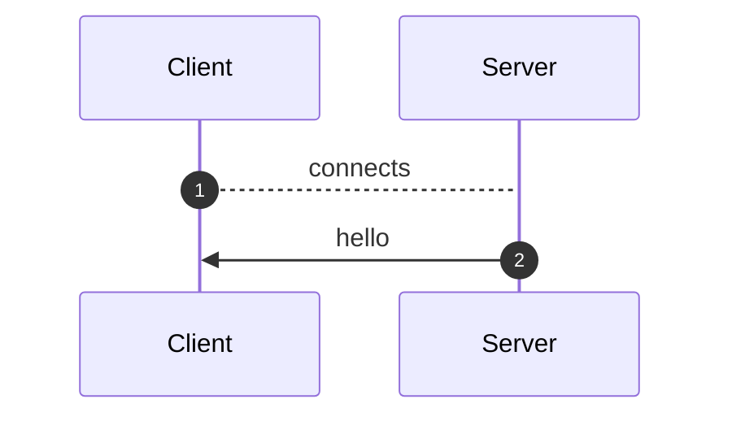
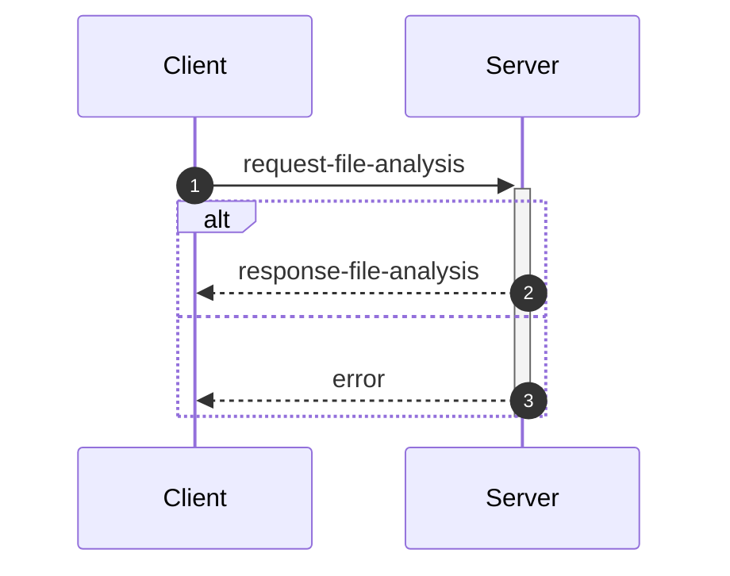
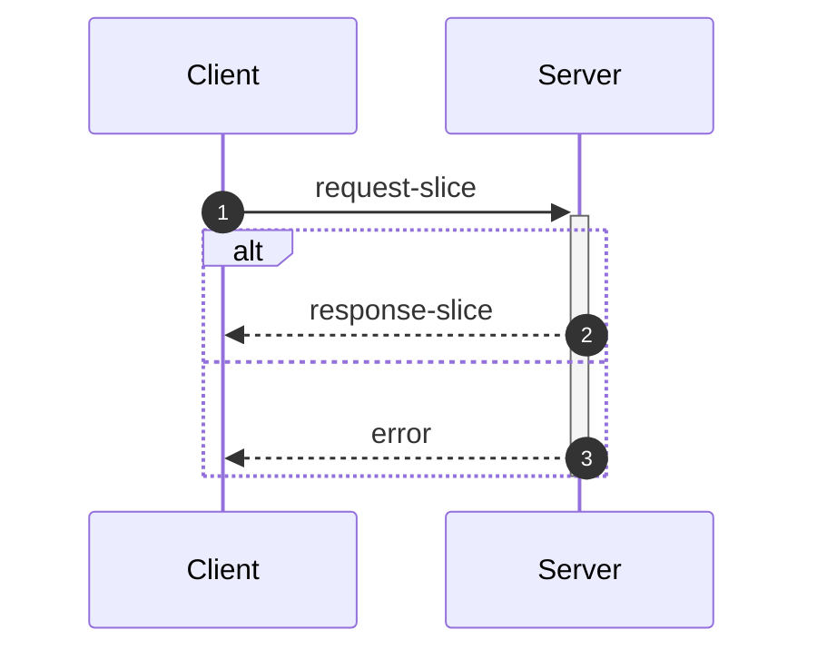
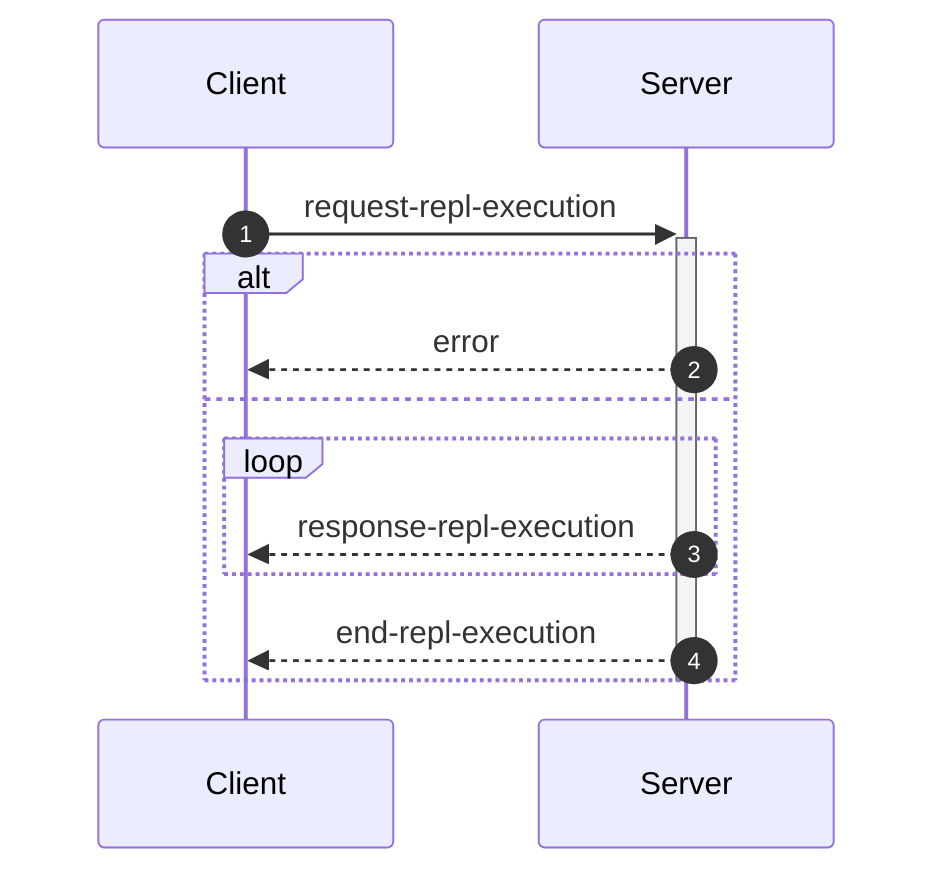

_<span title="an overview of flowR's interface">Generated</span> from '[wiki-interface.ts](https://github.com/flowr-analysis/flowr/tree/main/src/documentation/wiki-interface.ts "src/documentation/wiki-interface.ts")' on 2026-10-11, 19:26:41 UTC (v2.15.10, R v4.6.1), do not edit directly._

Although far from being as detailed as the in-depth explanation of [_flowR_](https://github.com/flowr-analysis/flowr/wiki/Core),
this wiki page explains how to interface with _flowR_ in more detail.
In general, command line arguments and other options provide short descriptions on hover over.

* [💻 Using the REPL](#using-the-repl)
* [⚙️ Configuring FlowR](#configuring-flowr)
* [⚒️ Writing Code](#writing-code)
* [💬 Communicating with the Server](#communicating-with-the-server)

<a id='using-the-repl'></a>
## 💻 Using the REPL

> [!NOTE]
> To execute arbitrary R commands with a repl request, _flowR_ has to be started explicitly with <span title="Description (Command Line Argument): Allow to access the underlying R session when using flowR (security warning: this allows the execution of arbitrary R code!)">`--r-session-access`</span>.
> Please be aware that this introduces a security risk and note that this relies on the [`r-shell` engine](https://github.com/flowr-analysis/flowr/wiki/Engines) .

Although primarily meant for users to explore,
there is nothing which forbids calling _flowR_ as a subprocess to use standard-in, -output, and -error
for communication (although you can access the REPL using the server as well,
with the [REPL Request](#message-request-repl-execution) message).

The read-eval-print loop&nbsp;(REPL) works relatively simple.
You can submit an expression (using <kbd>Enter</kbd>),
which is interpreted as an R&nbsp;expression by default but interpreted as a *command* if it starts with a colon (`:`).
The best command to get started with the REPL is <span title="Description (Repl Command): Show help information (aliases: :h, :?)">`:help`</span>.
Besides, you can leave the REPL either with the command <span title="Description (Repl Command): End the repl (aliases: :q, :exit)">`:quit`</span> or by pressing <kbd>Ctrl</kbd>+<kbd>C</kbd> twice.
When writing a *command*, you may press <kbd>Tab</kbd> to get a list of completions, if available.
Multiple commands can be entered in a single line by separating them with a semicolon (`;`), e.g. `:parse "x<-2"; :df*`.
If a command is given without R code, the REPL will re-use R code given in a previous command.
The prior example will hence return first the parsed AST of the program and then the dataflow graph for `"x <- 2"`.

> [!NOTE]
> If you develop flowR, you may want to launch the repl using the `npm run main-dev` command, this way, you get a non-minified version of flowR with debug information and hot-reloading of source files.

<details>
<summary>Available Commands</summary>

We currently offer the following commands (this with a `[*]` suffix are available with and without the star):

| Command | Description |
| ------- | ----------- |
| **<span title="Description (Repl Command): End the repl (aliases: :q, :exit)">:quit</span>** | End the repl (aliases: **:<span title="Alias of ':quit'. End the repl">q</span>**, **:<span title="Alias of ':quit'. End the repl">exit</span>**) |
| **<span title="Description (Repl Command): Execute the given code as R code. This requires the `--r-session-access` flag to be set and requires the r-shell engine. (aliases: :e, :r)">:execute</span>** | Execute the given code as R code. This requires the `--r-session-access` flag to be set and requires the r-shell engine. (aliases: **:<span title="Alias of ':execute'. Execute the given code as R code. This requires the `--r-session-access` flag to be set and requires the r-shell engine.">e</span>**, **:<span title="Alias of ':execute'. Execute the given code as R code. This requires the `--r-session-access` flag to be set and requires the r-shell engine.">r</span>**) |
| **<span title="Description (Repl Command): Get mermaid code for the control-flow graph of R code (aliases: :cfg, :cf)">:controlflow[*]</span>** | Get mermaid code for the control-flow graph of R code (star: Returns the URL to mermaid.live) (aliases: **:<span title="Alias of ':controlflow'. Get mermaid code for the control-flow graph of R code">cfg</span>**, **:<span title="Alias of ':controlflow'. Get mermaid code for the control-flow graph of R code">cf</span>**) |
| **<span title="Description (Repl Command): Get mermaid code for the control-flow graph with basic blocks (aliases: :cfgb, :cfb)">:controlflowbb[*]</span>** | Get mermaid code for the control-flow graph with basic blocks (star: Returns the URL to mermaid.live) (aliases: **:<span title="Alias of ':controlflowbb'. Get mermaid code for the control-flow graph with basic blocks">cfgb</span>**, **:<span title="Alias of ':controlflowbb'. Get mermaid code for the control-flow graph with basic blocks">cfb</span>**) |
| **<span title="Description (Repl Command): Get mermaid code for the dataflow graph (aliases: :d, :df)">:dataflow[*]</span>** | Get mermaid code for the dataflow graph (star: Returns the URL to mermaid.live) (aliases: **:<span title="Alias of ':dataflow'. Get mermaid code for the dataflow graph">d</span>**, **:<span title="Alias of ':dataflow'. Get mermaid code for the dataflow graph">df</span>**) |
| **<span title="Description (Repl Command): Get mermaid code for the normalized AST of R code (aliases: :n)">:normalize[*]</span>** | Get mermaid code for the normalized AST of R code (star: Returns the URL to mermaid.live) (alias: **:<span title="Alias of ':normalize'. Get mermaid code for the normalized AST of R code">n</span>**) |
| **<span title="Description (Repl Command): Get mermaid code for the simplified dataflow graph (aliases: :ds, :dfs)">:dataflowsimple[*]</span>** | Get mermaid code for the simplified dataflow graph (star: Returns the URL to mermaid.live) (aliases: **:<span title="Alias of ':dataflowsimple'. Get mermaid code for the simplified dataflow graph">ds</span>**, **:<span title="Alias of ':dataflowsimple'. Get mermaid code for the simplified dataflow graph">dfs</span>**) |
| **<span title="Description (Repl Command): Inspect and extend the signature database: `query` (identical to :query @signature), `info <name>` for where a function comes from (identical to :query @function-info), `add <path>` to mount another database/source, `download` to fetch the full-history database. (aliases: :sig)">:signature</span>** | Inspect and extend the signature database: `query` (identical to :query @signature), `info <name>` for where a function comes from (identical to :query @function-info), `add <path>` to mount another database/source, `download` to fetch the full-history database. (alias: **:<span title="Alias of ':signature'. Inspect and extend the signature database: `query` (identical to :query @signature), `info <name>` for where a function comes from (identical to :query @function-info), `add <path>` to mount another database/source, `download` to fetch the full-history database.">sig</span>**) |
| **<span title="Description (Repl Command): Just calculates the DFG, but only prints summary info (aliases: :d#, :df#)">:dataflowsilent</span>** | Just calculates the DFG, but only prints summary info (aliases: **:<span title="Alias of ':dataflowsilent'. Just calculates the DFG, but only prints summary info">d#</span>**, **:<span title="Alias of ':dataflowsilent'. Just calculates the DFG, but only prints summary info">df#</span>**) |
| **<span title="Description (Repl Command): Prints ASCII Art of the parsed, unmodified AST (aliases: :p)">:parse</span>** | Prints ASCII Art of the parsed, unmodified AST (alias: **:<span title="Alias of ':parse'. Prints ASCII Art of the parsed, unmodified AST">p</span>**) |
| **<span title="Description (Repl Command): Prints the version of flowR as well as the current version of R">:version</span>** | Prints the version of flowR as well as the current version of R
| **<span title="Description (Repl Command): Query the given R code (use 'help' for more information)">:query[*]</span>** | Query the given R code (use 'help' for more information) (star: Similar to query, but returns the output in json format.)
| **<span title="Description (Repl Command): Returns an ASCII representation of the dataflow graph (aliases: :df!)">:dataflowascii</span>** | Returns an ASCII representation of the dataflow graph (alias: **:<span title="Alias of ':dataflowascii'. Returns an ASCII representation of the dataflow graph">df!</span>**) |
| **<span title="Description (Repl Command): Returns summarization stats for the normalized AST (aliases: :n#)">:normalize#</span>** | Returns summarization stats for the normalized AST (alias: **:<span title="Alias of ':normalize#'. Returns summarization stats for the normalized AST">n#</span>**) |
| **<span title="Description (Repl Command): Show help information (aliases: :h, :?)">:help</span>** | Show help information (aliases: **:<span title="Alias of ':help'. Show help information">h</span>**, **:<span title="Alias of ':help'. Show help information">?</span>**) |

</details>

> [!TIP]
> 
> As indicated by the examples before, all REPL commands that operate on code keep track of the state.
> Hence, if you run a command like <span title="Description (Repl Command, starred version): Returns the URL to mermaid.live; Base Command: Get mermaid code for the dataflow graph (aliases: :d*, :df*)">`:dataflow*`</span> without providing R code,
> the REPL will re-use the R code provided in a previous command.
> Likewise, doing this will benefit from incrementality!
> If you request the dataflow graph with `:df* x <- 2 * y` and then want to see the parsed AST with `:parse`,
> the REPL will re-use previously obtained information and not re-parse the code again.
> 		

Generally, many commands offer shortcut versions in the REPL. Many queries, for example, offer a shortened format (see the example below).
Of special note, the [Config Query](https://github.com/flowr-analysis/flowr/wiki/%5BQuery%5D-Config)
can be used to also modify the currently active configuration of _flowR_ within the REPL (see the [wiki page](https://github.com/flowr-analysis/flowr/wiki/%5BQuery%5D-Config) for more information).

### Example: Retrieving the Dataflow Graph

To retrieve a URL to the [mermaid](https://mermaid.js.org/) diagram of the dataflow of a given expression,
use <span title="Description (Repl Command, starred version): Returns the URL to mermaid.live; Base Command: Get mermaid code for the dataflow graph (aliases: :d*, :df*)">`:dataflow*`</span> (or <span title="Description (Repl Command): Get mermaid code for the dataflow graph (aliases: :d, :df)">`:dataflow`</span> to get the mermaid code in the cli):

```shell
$ docker run -it --rm eagleoutice/flowr # or npm run flowr 
flowR repl v2.15.10, R grammar v14 (tree-sitter engine)
R> :dataflow* y <- 1 + x
```

<details>
<summary style='color:gray'>Output</summary>

```text
https://mermaid.live/view#base64:eyJjb2RlIjoiZmxvd2NoYXJ0IFREXG4gICAgMXt7XCJgKiM5MTtSTnVtYmVyIzkzOyogKioxKipcbiAgICAgICoxLjYqICgqKmlkOiAxKiopYFwifX1cbiAgICAyKFtcImAqIzkxO1JTeW1ib2wjOTM7KiAqKngqKlxuICAgICAgKjEuMTAqICgqKmlkOiAyKiopYFwiXSlcbiAgICAzW1tcImAqIzkxO1JCaW5hcnlPcCM5MzsqIGJhc2UjNTg7IzU4OyoqIzQzOyoqXG4gICAgICAqMS42LTEwKiAoKippZDogMyoqKVxuICAgIGFyZzogKDEsIDIpYFwiXV1cbiAgICBidWlsdC1pbjpfNDNfW1wiYEJ1aWx0LUluOlxuIzQzO2BcIl1cbiAgICBzdHlsZSBidWlsdC1pbjpfNDNfIHN0cm9rZTpncmF5LGZpbGw6Z3JheSxzdHJva2Utd2lkdGg6MnB4LG9wYWNpdHk6Ljg7XG4gICAgMFtcImAqIzkxO1JTeW1ib2wjOTM7KiAqKnkqKlxuICAgICAgKjEuMSogKCoqaWQ6IDAqKiwgdjogMylgXCJdXG4gICAgNFtbXCJgKiM5MTtSQmluYXJ5T3AjOTM7KiBiYXNlIzU4OyM1ODsqKiM2MDsjNDU7KipcbiAgICAgICoxLjEtMTAqICgqKmlkOiA0KiopXG4gICAgYXJnOiAoMCwgMylgXCJdXVxuICAgIGJ1aWx0LWluOl82MF8tW1wiYEJ1aWx0LUluOlxuIzYwOyM0NTtgXCJdXG4gICAgc3R5bGUgYnVpbHQtaW46XzYwXy0gc3Ryb2tlOmdyYXksZmlsbDpncmF5LHN0cm9rZS13aWR0aDoycHgsb3BhY2l0eTouODtcbiAgICAxIC0uLT58XCJmbG93XCJ8IDJcbiAgICBsaW5rU3R5bGUgMCBzdHJva2U6Z3JheSxjb2xvcjpncmF5O1xuICAgIDIgLS4tPnxcImZsb3dcInwgM1xuICAgIGxpbmtTdHlsZSAxIHN0cm9rZTpncmF5LGNvbG9yOmdyYXk7XG4gICAgMyAtLT58XCJyZWFkcywgYXJnXCJ8IDFcbiAgICAzIC0tPnxcInJlYWRzLCBhcmdcInwgMlxuICAgIDMgLS4tPnxcImZsb3dcInwgMFxuICAgIGxpbmtTdHlsZSA0IHN0cm9rZTpncmF5LGNvbG9yOmdyYXk7XG4gICAgMyAtLi0+fFwicmVhZHMsIGNhbGxzXCJ8IGJ1aWx0LWluOl80M19cbiAgICBsaW5rU3R5bGUgNSBzdHJva2U6Z3JheTtcbiAgICAwIC0tPnxcImRlZmluZWQtYnksIGZsb3dcInwgNFxuICAgIDAgLS0+fFwiZGVmaW5lZC1ieVwifCAzXG4gICAgNCAtLT58XCJyZWFkcywgYXJnXCJ8IDNcbiAgICA0IC0tPnxcInJldHVybnMsIGFyZ1wifCAwXG4gICAgNCAtLi0+fFwicmVhZHMsIGNhbGxzXCJ8IGJ1aWx0LWluOl82MF8tXG4gICAgbGlua1N0eWxlIDEwIHN0cm9rZTpncmF5OyIsIm1lcm1haWQiOnsiYXV0b1N5bmMiOnRydWV9fQ==
```

Retrieve the dataflow graph of the expression `y <- 1 + x`. It looks like this:


<details>

<summary style="color:gray">R Code of the Dataflow Graph</summary>

The analysis ran (including parse and normalize, using the [tree-sitter](https://github.com/flowr-analysis/flowr/wiki/Engines) engine) within the generation environment. No [signature database](https://github.com/flowr-analysis/flowr/wiki/Signature-Database) is mounted for these generated graphs, so `library()` calls attach no package exports; base-R names are still qualified via the generated base-package store (e.g. `acf` as `stats::acf`). 
We encountered no unknown side effects during the analysis.

```r
y <- 1 + x
```

</details>

</details>

For small graphs like this, <span title="Description (Repl Command): Returns an ASCII representation of the dataflow graph (aliases: :df!)">`:dataflowascii`</span> also provides an ASCII representation directly in the REPL:

```shell
$ docker run -it --rm eagleoutice/flowr # or npm run flowr 
flowR repl v2.15.10, R grammar v14 (tree-sitter engine)
R> :df! y <- 1 + x
```

<details open>
<summary style='color:gray'>Output</summary>

```text
                        v<0>v
 c<4>c──────────────────| y |
 |<- |     ┌────────────v---v
 c---c     │
    │   c<3>c   0<1>0
    └───| + |───| 1 |───u<2>u
        c---c   0---0   | x |
           └────────────u---u
Edges:
3 -> 1: reads, arg          3 -> 2: reads, arg
3 -> 0: flows-to            1 -> 2: flows-to
2 -> 3: flows-to            4 -> 3: reads, arg
4 -> 0: returns, arg        0 -> 4: defined-by, flows-to
0 -> 3: defined-by
```

Retrieve the dataflow graph of the expression `y <- 1 + x` as ASCII art.

</details>

For the slicing with <span title="Description (Repl Command): Static backwards executable slicer for R">`:slicer`</span>, you have access to the same [magic comments](#slice-magic-comments) as with the [slice request](#message-request-slice).
Pass `--inline` to splice resolvable `source()` calls into the reconstruction so the slice is a single self-contained R text (the same as the static slice query's `inlineSources` flag).
See `--help` for more flags!

### Example: Interfacing with the File System

Many commands that allow for an R-expression (like <span title="Description (Repl Command, starred version): Returns the URL to mermaid.live; Base Command: Get mermaid code for the dataflow graph (aliases: :d*, :df*)">`:dataflow*`</span>) allow for a file as well
if the argument starts with `file://`.
If you are working from the root directory of the _flowR_ repository, the following gives you the parsed AST of the example file using the <span title="Description (Repl Command): Prints ASCII Art of the parsed, unmodified AST (aliases: :p)">`:parse`</span> command:

> **Watch mode**: Replace `file://` with `watch://` to enter watch mode.
> flowR runs the command immediately and then re-runs it every time the file (or any file inside the folder) changes.
> Enter any other command to leave watch mode.
> For example: `:df watch://analysis.R`

```shell
$ docker run -it --rm eagleoutice/flowr # or npm run flowr 
flowR repl v2.15.10, R grammar v14 (tree-sitter engine)
R> :parse file://test/testfiles/example.R
```

<details>
<summary style='color:gray'>Output</summary>

```text
File: test/testfiles/example.R

program
├ binaryoperator
│ ├ identifier "sum" (1:1─4)
│ ├ <- "<-" (1:5─7)
│ ╰ float "0" (1:8─9)
├ binaryoperator
│ ├ identifier "product" (2:1─8)
│ ├ <- "<-" (2:9─11)
│ ╰ float "1" (2:12─13)
├ binaryoperator
│ ├ identifier "w" (3:1─2)
│ ├ <- "<-" (3:3─5)
│ ╰ float "7" (3:6─7)
├ binaryoperator
│ ├ identifier "N" (4:1─2)
│ ├ <- "<-" (4:3─5)
│ ╰ float "10" (4:6─8)
├ forstatement
│ ├ for "for" (6:1─4)
│ ├ ( "(" (6:5─6)
│ ├ identifier "i" (6:6─7)
│ ├ in "in" (6:8─10)
│ ├ binaryoperator
│ │ ├ float "1" (6:11─12)
│ │ ├ : ":" (6:12─13)
│ │ ╰ parenthesizedexpression
│ │   ├ ( "(" (6:13─14)
│ │   ├ binaryoperator
│ │   │ ├ identifier "N" (6:14─15)
│ │   │ ├ - "-" (6:15─16)
│ │   │ ╰ float "1" (6:16─17)
│ │   ╰ ) ")" (6:17─18)
│ ├ ) ")" (6:18─19)
│ ╰ bracedexpression
│   ├ { "{" (6:20─21)
│   ├ binaryoperator
│   │ ├ identifier "sum" (7:3─6)
│   │ ├ <- "<-" (7:7─9)
│   │ ╰ binaryoperator
│   │   ├ binaryoperator
│   │   │ ├ identifier "sum" (7:10─13)
│   │   │ ├ + "+" (7:14─15)
│   │   │ ╰ identifier "i" (7:16─17)
│   │   ├ + "+" (7:18─19)
│   │   ╰ identifier "w" (7:20─21)
│   ├ binaryoperator
│   │ ├ identifier "product" (8:3─10)
│   │ ├ <- "<-" (8:11─13)
│   │ ╰ binaryoperator
│   │   ├ identifier "product" (8:14─21)
│   │   ├  "" (8:22─23)
│   │   ╰ identifier "i" (8:24─25)
│   ╰ } "}" (9:1─2)
├ call
│ ├ identifier "cat" (11:1─4)
│ ╰ arguments
│   ├ ( "(" (11:4─5)
│   ├ argument
│   │ ╰ string
│   │   ├ " "\"" (11:5─6)
│   │   ├ stringcontent "Sum:" (11:6─10)
│   │   ╰ " "\"" (11:10─11)
│   ├ comma "," (11:11─12)
│   ├ argument
│   │ ╰ identifier "sum" (11:13─16)
│   ├ comma "," (11:16─17)
│   ├ argument
│   │ ╰ string
│   │   ├ " "\"" (11:18─19)
│   │   ├ stringcontent
│   │   │ ╰ escapesequence "\\n" (11:19─21)
│   │   ╰ " "\"" (11:21─22)
│   ╰ ) ")" (11:22─23)
╰ call
  ├ identifier "cat" (12:1─4)
  ╰ arguments
    ├ ( "(" (12:4─5)
    ├ argument
    │ ╰ string
    │   ├ " "\"" (12:5─6)
    │   ├ stringcontent "Product:" (12:6─14)
    │   ╰ " "\"" (12:14─15)
    ├ comma "," (12:15─16)
    ├ argument
    │ ╰ identifier "product" (12:17─24)
    ├ comma "," (12:24─25)
    ├ argument
    │ ╰ string
    │   ├ " "\"" (12:26─27)
    │   ├ stringcontent
    │   │ ╰ escapesequence "\\n" (12:27─29)
    │   ╰ " "\"" (12:29─30)
    ╰ ) ")" (12:30─31)
```

Retrieve the parsed AST of the example file.

<details>

<summary>File Content</summary>

```r
sum <- 0
product <- 1
w <- 7
N <- 10

for (i in 1:(N-1)) {
  sum <- sum + i + w
  product <- product * i
}

cat("Sum:", sum, "\n")
cat("Product:", product, "\n")
```

</details>

As _flowR_ directly transforms this AST the output focuses on being human-readable instead of being machine-readable.
		
</details>

### Example: Run a Query

You can run any query supported by _flowR_ using the <span title="Description (Repl Command): Query the given R code (use 'help' for more information)">`:query`</span> command.
For example, to obtain the shapes of all data frames in a given piece of code, you can run:

```shell
$ docker run -it --rm eagleoutice/flowr # or npm run flowr 
flowR repl v2.15.10, R grammar v14 (tree-sitter engine)
R> :query @absint df-shape "x <- data.frame(a = 1:10, b = 1:10)\ny <- x$a"
```

<details open>
<summary style='color:gray'>Output</summary>

```text
Query: absint (4 ms)
```

Retrieve the shapes of all data frames in the given code.

</details>

To run the linter on a file, you can use (in this example, we just issue the `dead-code` linter on a small piece of code):

```shell
$ docker run -it --rm eagleoutice/flowr # or npm run flowr 
flowR repl v2.15.10, R grammar v14 (tree-sitter engine)
R> :query @linter rules:dead-code "if(FALSE) x <- 2"
```

<details open>
<summary style='color:gray'>Output</summary>

```text
Query: linter (9 ms)
   ╰ Dead Code (dead-code):
       ╰ certain:
           ╰ Code at 1.11-16
```

Run the linter on the given code, with only the `dead-code` rule enabled.

</details>

For more information on the available queries, please check out the [Query API](https://github.com/flowr-analysis/flowr/wiki/Query-API).

<a id='configuring-flowr'></a>
## ⚙️ Configuring FlowR

When running _flowR_, you may want to specify some behaviors with a dedicated configuration file.
By default, flowR looks for a file named `flowr.json` in the current working directory (or any higher directory).
You can also specify a different file with <span title="Description (Command Line Argument): The name of the configuration file to use">`--config-file`</span> or pass the configuration inline using <span title="Description (Command Line Argument): The flowR configuration to use, as a JSON string">`--config-json`</span>.
To inspect the current configuration, you can run flowr with the <span title="Description (Command Line Argument): Run with verbose logging (will be passed to the corresponding script)">`--verbose`</span> flag, or use the `config` [Query](https://github.com/flowr-analysis/flowr/wiki/Query-API).
Within the REPL this works by running the following:

```shell
:query @config
```

To work with the <a href="https://github.com/flowr-analysis/flowr/tree/main/src/config.ts#L108"><code><span title="The configuration file format for flowR.">FlowrConfig</span></code></a> you can use the provided helper objects alongside its methods like
<a href="https://github.com/flowr-analysis/flowr/tree/main/src/config.ts#L871"><code><span title="Creates a new flowr config that has the updated values.">FlowrConfig::<b>amend</b></span></code></a>.
The schema below documents every option; the ones you most likely want are:

- <a href="https://github.com/flowr-analysis/flowr/wiki/Interface#configuring-flowr" title="Configuration Option (boolean): Whether source calls should be ignored, causing {@link processSourceCall}&#39;s behavior to be skipped.">ignoreSourceCalls</a>: ignore source calls when analyzing the code, i.e., ignore the inclusion of other files.
- <a href="https://github.com/flowr-analysis/flowr/wiki/Interface#configuring-flowr" title="Configuration Option (boolean): Whether load calls should be ignored, causing {@link processLoadCall}&#39;s behavior to be skipped.">ignoreLoadCalls</a>: ignore load calls when analyzing the code, i.e., ignore the loading of r-data files.
- <a href="https://github.com/flowr-analysis/flowr/wiki/Interface#configuring-flowr" title="Configuration Option (object): Do you want to overwrite (parts) of the builtin definition?">semantics.environment.overwriteBuiltIns</a>: overwrite _flowR_'s handling of built-in functions, or clear the preset definitions entirely.
  See [Configure BuiltIn Semantics](#configure-builtin-semantics) for more information.
- <a href="https://github.com/flowr-analysis/flowr/wiki/Interface#configuring-flowr" title="Configuration Option (string): How to resolve variables and their values. (one of &quot;disabled&quot;, &quot;alias&quot;, &quot;builtin&quot;)">solver.variables</a>: how to resolve variables and their values (`disabled`, `alias`, `builtin`).
- <a href="https://github.com/flowr-analysis/flowr/wiki/Interface#configuring-flowr" title="Configuration Option (array): The engine or set of engines to use for interacting with R code. An empty array means all available engines will be used.">engines</a> and <a href="https://github.com/flowr-analysis/flowr/wiki/Interface#configuring-flowr" title="Configuration Option (string): The default engine to use for interacting with R code. If this is undefined, an arbitrary engine from the specified list will be used. (one of &quot;tree-sitter&quot;, &quot;r-shell&quot;)">defaultEngine</a>: the engines used to interact with R code, see the [Engines wiki page](https://github.com/flowr-analysis/flowr/wiki/Engines).
- <a href="https://github.com/flowr-analysis/flowr/wiki/Interface#configuring-flowr" title="Configuration Option (array): Files a framework loads on its own, without any source() call (e.g. global.R in a shiny app), in the order they are loaded; flowR orders the matching project files accordingly and analyzes them as one program. Entries are case-insensitive globs matched against the file path, a plain name matches any file with that name, and entries matching no project file are warned about. Usually set per project kind via specializeConfig.">project.implicitSources</a>: the files a framework loads without any `source()` call, in the order in which they are
  loaded. Entries are globs (e.g. `R/*.R`) matched against the file path ignoring capitalization; one matching no file is reported.
- <a href="https://github.com/flowr-analysis/flowr/wiki/Interface#configuring-flowr" title="Configuration Option (object): Overwrite (parts of) the configuration depending on the project kind flowR detects, e.g. to give a shiny app its implicit sources.">specializeConfig</a>: overwrite (parts of) the configuration depending on the kind of project _flowR_ detects
  (e.g. `shiny-app`), which is how a shiny app gets its implicit sources by default. What you configure directly wins.
- <a href="https://github.com/flowr-analysis/flowr/wiki/Interface#configuring-flowr" title="Configuration Option (string): Overwrite the project kind flowR would otherwise infer from the analyzed files, e.g. when auto-detection guesses wrong. (one of &quot;package&quot;, &quot;script&quot;, &quot;shiny-app&quot;, &quot;notebook&quot;, &quot;project&quot;, &quot;unknown&quot;)">project.useProjectType</a>: skip that detection and force a project kind yourself, when auto-detection guesses wrong.
- <a href="https://github.com/flowr-analysis/flowr/wiki/Interface#configuring-flowr" title="Configuration Option (array): The default plugins to load when creating a new instance of FlowrAnalyzer">defaultPlugins</a> and <a href="https://github.com/flowr-analysis/flowr/wiki/Interface#configuring-flowr" title="Configuration Option (array): The plugins to load in REPL mode">repl.plugins</a>: the plugins to load for a new <a href="https://github.com/flowr-analysis/flowr/tree/main/src/project/flowr-analyzer.ts#L205"><code><span title="Central class for conducting analyses with FlowR. Use the FlowrAnalyzerBuilder to create a new instance. If you want the original pattern of creating a pipeline and running all steps, you can still do this with FlowrAnalyzer#runFull . To inspect the context of the analyzer, use FlowrAnalyzer#inspectContext (if you are a plugin and need to modify it, use FlowrAnalyzer#context instead).">FlowrAnalyzer</span></code></a> and in the REPL
  (use `flowr:default` to reference the former).

So you can configure _flowR_ by adding a file like the following:

<details>

<summary>Example Configuration File</summary>

```json
{
  "ignoreSourceCalls": true,
  "ignoreLoadCalls": true,
  "semantics": {
    "environment": {
      "overwriteBuiltIns": {
        "definitions": [
          {
            "type": "function",
            "names": [
              "foo"
            ],
            "processor": "builtin:assign",
            "config": {}
          }
        ]
      }
    }
  },
  "defaultPlugins": [
    "file:description",
    "versions:description"
  ],
  "repl": {
    "quickStats": false,
    "dfProcessorHeat": false,
    "hints": true,
    "plugins": [
      "flowr:default"
    ]
  },
  "project": {
    "resolveUnknownPathsOnDisk": true,
    "implicitSources": [
      "global.R",
      "app.R"
    ]
  },
  "linter": {
    "disabledRules": []
  },
  "specializeConfig": {
    "shiny-app": {
      "project": {
        "implicitSources": [
          "global.R",
          "ui.R",
          "server.R",
          "app.R"
        ]
      }
    }
  },
  "engines": [
    {
      "type": "r-shell"
    }
  ],
  "solver": {
    "variables": "alias",
    "evalStrings": true,
    "trackEnvironments": true,
    "sigdb": {
      "enabled": true,
      "loadProjectDependencies": true,
      "eagerlyLoad": false,
      "eagerlyLoadExports": false,
      "linkBaseR": false,
      "linkDescriptionDependencies": false
    },
    "resolveSource": {
      "dropPaths": "no",
      "ignoreCapitalization": true,
      "inferWorkingDirectory": "active-script",
      "searchPath": []
    },
    "instrument": {},
    "slicer": {
      "threshold": 50
    }
  },
  "abstractInterpretation": {
    "wideningThreshold": 4,
    "followCalls": true,
    "dataFrame": {
      "maxColNames": 20,
      "readLoadedData": {
        "readExternalFiles": true,
        "maxReadLines": 1000000
      }
    }
  },
  "incremental": {
    "alwaysIncremental": false,
    "parsing": {
      "activated": false,
      "heuristics": {
        "activated": true,
        "mtime": true,
        "linesFrom": 500,
        "bytesFrom": 50000,
        "alwaysWithEdits": false,
        "minFiles": 1
      }
    }
  },
  "gas": {
    "thresholds": {
      "memory": {
        "problematic": 0.7,
        "critical": 0.9
      },
      "timeMs": {
        "problematic": 100000,
        "critical": 120000
      }
    },
    "features": {}
  }
}
```

</details>

<details>
<a id='configure-builtin-semantics'></a>
<summary>Configure Built-In Semantics</summary>

`semantics/environment/overwriteBuiltins` accepts two keys:

- `loadDefaults` (boolean, initially `true`): If set to `true`, the default built-in definitions are loaded before applying the custom definitions. Setting this flag to `false` explicitly disables the loading of the default definitions.
- `definitions` (array, initially empty): Allows to overwrite or define new built-in elements. Each object within must have a `type` which is one of the below. Furthermore, they may define a string array of `names` which specifies the identifiers to bind the definitions to. You may use `assumePrimitive` to specify whether _flowR_ should assume that this is a primitive non-library definition (so you probably just do not want to specify the key).

  | Type            | Description                                                                                                                                                                                                                                                                                              | Example                                                                                                    |
  | --------------- | -------------------------------------------------------------------------------------------------------------------------------------------------------------------------------------------------------------------------------------------------------------------------------------------------------- | ---------------------------------------------------------------------------------------------------------- |
  | `constant`    | Additionally allows for a `value` this should resolve to.                                                                                                                                                                                                                                                | `{ type: 'constant', names: ['NULL', 'NA'],  value: null }`                                                |
  | `function`    | Is a rather flexible way to define and bind built-in functions. For the time, we do not have extensive documentation to cover all the cases, so please either consult the sources with the `default-builtin-config.ts` or open a [new issue](https://github.com/flowr-analysis/flowr/issues/new/choose). | `{ type: 'function', names: ['next'], processor: 'builtin:d', config: { cfg: ExitPointType.Next } }` |
  | `replacement` | A comfortable way to specify replacement functions like `$<-` or `names<-`. `suffixes` describes the... suffixes to attach automatically. | `{ type: 'replacement', suffixes: ['<-', '<<-'], names: ['[', '[['] }` |

</details>

<details>

<summary style='color:gray'>Full Configuration-File Schema</summary>

- _The configuration file format for flowR._ (object)
    - **logLevel** [optional] _flowR's global minimum log level, applied when the config is loaded._ (string)
        Only allows: 'silly', 'trace', 'debug', 'info', 'warn', 'error', 'fatal'
    - **ignoreSourceCalls** [optional] _Whether source calls should be ignored, causing {@link processSourceCall}'s behavior to be skipped._ (boolean)
    - **ignoreLoadCalls** [optional] _Whether load calls should be ignored, causing {@link processLoadCall}'s behavior to be skipped._ (boolean)
    - **semantics** _Configure language semantics and how flowR handles them._ (object)
        - **environment** [optional] _Semantics regarding how to handle the R environment._ (object)
            - **overwriteBuiltIns** [optional] _Do you want to overwrite (parts) of the builtin definition?_ (object)
                - **loadDefaults** [optional] _Should the default configuration still be loaded?_ (boolean)
                - **definitions** [optional] _The definitions to load/overwrite._ (array)
                Valid item types:
                    - (object)
    - **defaultPlugins** [optional] _The default plugins to load when creating a new instance of FlowrAnalyzer_ (array)
    Valid item types:
        - (alternatives)
            - (string)
            - (array)
    - **repl** _Configuration options for the REPL._ (object)
        - **quickStats** [optional] _Whether to show quick stats in the REPL after each evaluation._ (boolean)
        - **dfProcessorHeat** [optional] _This instruments the dataflow processors to count how often each processor is called._ (boolean)
        - **hints** [optional] _Whether to show dim inline hints on the empty prompt (automatically disabled on non-interactive terminals)._ (boolean)
        - **plugins** [optional] _The plugins to load in REPL mode_ (array)
        Valid item types:
            - (alternatives)
                - (string)
                - (array)
        - **autoUseFileProtocol** [optional] _Prepend the file protocol to a repl input that looks like a path, instead of only warning about it._ (boolean)
        - **queryStats** [optional] _Whether `:query` closes with the line stating how long the queries took (`:query*` never prints it)._ (boolean)
        - **showPlugins** [optional] _Whether `:version` grays out the plugins that did not activate during the last analysis._ (boolean)
    - **project** _Project specific configuration options._ (object)
        - **resolveUnknownPathsOnDisk** [optional] _Whether to resolve unknown paths loaded by the r project disk when trying to source/analyze files._ (boolean)
        - **failOnInaccessiblePath** [optional] _Whether a directory that cannot be traversed during file discovery (e.g. due to permissions) aborts the analysis; when false (the default) such paths are logged and skipped._ (boolean)
        - **basePackages** [optional] _The packages considered part of R itself (base and recommended); if unset, flowR uses its built-in list._ (array)
        Valid item types:
            - (string)
        - **implicitSources** [optional] _Files a framework loads on its own, without any source() call (e.g. global.R in a shiny app), in the order they are loaded; flowR orders the matching project files accordingly and analyzes them as one program. Entries are case-insensitive globs matched against the file path, a plain name matches any file with that name, and entries matching no project file are warned about. Usually set per project kind via specializeConfig._ (array)
        Valid item types:
            - (string)
        - **useProjectType** [optional] _Overwrite the project kind flowR would otherwise infer from the analyzed files, e.g. when auto-detection guesses wrong._ (string)
            Only allows: 'package', 'script', 'shiny-app', 'notebook', 'project', 'unknown'
        - **assumeImplicitEcho** [optional] _Whether the top level of the analyzed code is echoed, so that every visible result printed there is collected as an output by the dependencies query (default true, false for a package)._ (boolean)
        - **discovery** [optional] _Scoping options for the default project discovery._ (object)
            - **full** [optional] _Collect every file below the project root (greedy) instead of only the files the detected project kind needs (default false)._ (boolean)
            - **perKind** [optional] _Per-kind include/exclude glob overrides layered on the default scoping._ (object)
            - **ignore** [optional] _Case-insensitive globs that drop matching files from the intelligent discovery, regardless of kind (e.g. .Renviron to ignore environment files)._ (array)
            Valid item types:
                - (string)
        - **classification** [optional] _Overrides for the signals flowR uses to classify the project kind._ (object)
            - **shinyDescriptionTypes** [optional] _DESCRIPTION Type: values that mark a shiny app._ (array)
            Valid item types:
                - (string)
            - **shinyEntryFiles** [optional] _File names a shiny app is assembled from._ (array)
            Valid item types:
                - (string)
            - **shinyUsagePattern** [optional] _Regex source evidencing shiny usage in an entry file._ (string)
            - **notebookExtensions** [optional] _File extensions marking a notebook._ (array)
            Valid item types:
                - (string)
    - **linter** _Linter configuration options._ (object)
        - **disabledRules** _Linting rule names excluded from the default rule set (a rule requested explicitly via a linter query still runs). Usually set per project kind via specializeConfig._ (array)
        Valid item types:
            - (string)
    - **inputSources** [optional] _Further frameworks the input-sources analysis should know about; entries are added to flowR's defaults._ (object)
        - **pure** [optional] _Functions that only pass the constantness of their arguments on._ (array)
        Valid item types:
            - (string)
        - **param** [optional] _Functions whose result is a 'param' input._ (array)
        Valid item types:
            - (string)
        - **file** [optional] _Functions whose result is a 'file' input._ (array)
        Valid item types:
            - (string)
        - **tempfile** [optional] _Functions whose result is a 'tempfile' input._ (array)
        Valid item types:
            - (string)
        - **glob** [optional] _Functions whose result is a 'glob' input._ (array)
        Valid item types:
            - (string)
        - **net** [optional] _Functions whose result is a 'net' input._ (array)
        Valid item types:
            - (string)
        - **rand** [optional] _Functions whose result is a 'rand' input._ (array)
        Valid item types:
            - (string)
        - **system** [optional] _Functions whose result is a 'system' input._ (array)
        Valid item types:
            - (string)
        - **ffi** [optional] _Functions whose result is a 'ffi' input._ (array)
        Valid item types:
            - (string)
        - **lang** [optional] _Functions whose result is a 'lang' input._ (array)
        Valid item types:
            - (string)
        - **options** [optional] _Functions whose result is a 'options' input._ (array)
        Valid item types:
            - (string)
        - **cmdline** [optional] _Functions whose result is a 'cmdline' input._ (array)
        Valid item types:
            - (string)
        - **user** [optional] _Functions whose result is a 'user' input._ (array)
        Valid item types:
            - (string)
        - **const** [optional] _Functions whose result is a 'const' input._ (array)
        Valid item types:
            - (string)
        - **scope** [optional] _Functions whose result is a 'scope' input._ (array)
        Valid item types:
            - (string)
        - **dconst** [optional] _Functions whose result is a 'dconst' input._ (array)
        Valid item types:
            - (string)
        - **unknown** [optional] _Functions whose result is a 'unknown' input._ (array)
        Valid item types:
            - (string)
        - **linkedObjects** [optional] _Objects a framework provides without a definition in the code, e.g. shiny's input._ (array)
        Valid item types:
            - (object)
        - **linkedEntryPoints** [optional] _Calls that hand a function to a framework, which binds its objects to the parameters by position._ (array)
        Valid item types:
            - (object)
    - **specializeConfig** [optional] _Overwrite (parts of) the configuration depending on the project kind flowR detects, e.g. to give a shiny app its implicit sources._ (object)
    - **engines** _The engine or set of engines to use for interacting with R code. An empty array means all available engines will be used._ (array)
    Valid item types:
        - (alternatives)
            - _The configuration for the tree sitter engine._ (object)
                - **type** [required] _Use the tree sitter engine._ (string)
                    Only allows: 'tree-sitter'
                - **wasmPath** [optional] _The path to the tree-sitter-r WASM binary to use. If this is undefined, this uses the default path._ (string)
                - **treeSitterWasmPath** [optional] _The path to the tree-sitter WASM binary to use. If this is undefined, this uses the default path._ (string)
                - **lax** [optional] _Whether to use the lax parser for parsing R code (allowing for syntax errors). If this is undefined, the strict parser will be used._ (boolean)
            - _The configuration for the R shell engine._ (object)
                - **type** [required] _Use the R shell engine._ (string)
                    Only allows: 'r-shell'
                - **rPath** [optional] _The path to the R executable to use. If this is undefined, this uses the default path._ (string)
                - **pipeBind** [optional] _Whether to enable R's experimental pipe-bind operator "=>" by setting _R_USE_PIPEBIND_ for the R session (default false); R itself keeps this off by default, as it is experimental and has never shipped in a release version of R._ (boolean)
    - **defaultEngine** [optional] _The default engine to use for interacting with R code. If this is undefined, an arbitrary engine from the specified list will be used._ (string)
        Only allows: 'tree-sitter', 'r-shell'
    - **solver** _How to resolve constants, constraints, cells, ..._ (object)
        - **variables** _How to resolve variables and their values._ (string)
            Only allows: 'disabled', 'alias', 'builtin'
        - **evalStrings** _Should we include eval(parse(text="...")) calls in the dataflow graph?_ (boolean)
        - **trackEnvironments** [optional] _Track user-created environments (new.env, assign/get/local with envir=, dollar-assign, attach). When false, all envir-style calls fall through conservatively._ (boolean)
        - **sigdb** _Resolving library exports from a signature database._ (object)
            - **enabled** [optional] _Resolve library()/use() exports from a signature database (default true); when false no database is consulted._ (boolean)
            - **loadProjectDependencies** [optional] _Load the project's declared dependencies from its metadata files (DESCRIPTION Imports/Depends, rproject.toml, uvr.toml, renv.lock, rv.lock, uvr.lock) (default true); when false these files are not read for dependencies._ (boolean)
            - **eagerlyLoad** [optional] _Parse the database up front rather than on the first package load (default false, ignored if disabled)._ (boolean)
            - **eagerlyLoadExports** [optional] _Add a vertex for every export on load rather than on demand (default false); keeps the dataflow graph small._ (boolean)
            - **assumedRVersion** [optional] _R version assumed when resolving versioned (base-R) exports: a pin like "4.5" or "auto" to detect the installed R (default "auto")._ (string)
            - **linkBaseR** [optional] _Eagerly attach base-R namespaces so bare base calls resolve without library() (default false)._ (boolean)
            - **linkBaseRCalls** [optional] _Add a lightweight Reads edge from a bare base-R call to its signature-database function vertex (default false; base-R qualification is edge-free otherwise)._ (boolean)
            - **linkPackageCalls** [optional] _Add a lightweight Reads edge from a resolved package call to its signature-database function vertex (default false)._ (boolean)
            - **linkDescriptionDependencies** [optional] _Eagerly attach the namespaces of the project's declared DESCRIPTION dependencies (Imports/Depends) so their exports resolve without an explicit library() (default false)._ (boolean)
            - **warmInBackground** [optional] _Decompress the hot shards (base + most-downloaded) in a background task on startup so the first library() lookup is warm (default false; for long-running servers/REPLs)._ (boolean)
            - **additionalPaths** [optional] _Extra directories or bundle/manifest files searched for signature databases (alongside the shipped default and $FLOWR_SIGDB_DIR); a downloaded full-history bundle placed here is mounted automatically._ (array)
            Valid item types:
                - (string)
            - **downloadRepo** [optional] _GitHub owner/repo the full-history bundle is downloaded from via ":signature download" (default "flowr-analysis/flowr", release tag "sigdb-v<flowR-version>")._ (string)
            - **autoSync** [optional] _On startup, re-download shards whose committed sigdb.remote.json hash no longer matches the cache, in the background (default false; opt-in network sync after a git pull)._ (boolean)
            - **installedLibrary** [optional] _Recovering packages no signature database knows from the copy installed on this machine._ (object)
                - **enabled** [required] _Recover packages no signature database knows from their installed copy (default false)._ (boolean)
                - **paths** [optional] _Library directories to search; when empty they are discovered from the environment and the project._ (array)
                Valid item types:
                    - (string)
                - **useEnvironment** [optional] _Search the libraries R_LIBS_USER/R_LIBS/R_LIBS_SITE name (default true)._ (boolean)
                - **useProjectLibrary** [optional] _Search a project-local renv/packrat library (default true)._ (boolean)
                - **maxDepth** [optional] _How far to descend into the nested layout of a project-local library (default 3)._ (number)
                - **packages** [optional] _Only recover packages whose name matches one of these regular expressions; empty means any._ (array)
                Valid item types:
                    - (string)
            - **blobCacheBudgetMb** [optional] _How many MiB of decoded package blobs every open bundle may hold together (default 16)._ (number)
            - **versionSelection** [optional] _When a project constrains a dependency, resolve to the newest (default), oldest, or system-installed version satisfying it; system needs R and falls back to newest. Base-R packages always resolve against the assumed R version._ (string)
                Only allows: 'newest', 'oldest', 'system'
            - **versionOverrides** [optional] _Force an exact version for specific packages (name -> version), overriding both the project constraint and the versionSelection policy (default {})._ (object)
        - **versionManagement** _Policies for reasoning about dependency versions._ (object)
            - **linkedVersionGroups** [optional] _Groups of packages that must resolve to the same version; version guessing intersects each group so its members stay mutually compatible (default [])._ (array)
            Valid item types:
                - (array)
                Valid item types:
                    - (string)
        - **assumeAttachedPackages** [optional] _Packages to treat as attached without a `library()` call, so what the built-in configuration states about them applies to the analyzed code. The base packages R attaches on startup already resolve without it._ (array)
        Valid item types:
            - (string)
        - **transitiveSideEffectRounds** [optional] _How many rounds the transitive side-effect fixpoint may run before it is cut off (default 32); the propagation stops on its own as soon as a round adds nothing._ (number)
        - **maxOverlayDepth** [optional] _How many binding overlays may stack on one environment frame before a write flattens them (default 4); a pure performance knob, trading lookup cost against copy cost without changing any result._ (number)
        - **instrument** (object)
            - **dataflowExtractors** [optional] _These keys are only intended for use within code, allowing to instrument the dataflow analyzer!_ (any)
        - **resolveSource** [optional] _If lax source calls are active, flowR searches for sourced files much more freely, based on the configurations you give it. This option is only in effect if `ignoreSourceCalls` is set to false._ (object)
            - **dropPaths** _Allow to drop the first or all parts of the sourced path, if it is relative._ (string)
                Only allows: 'no', 'once', 'all'
            - **ignoreCapitalization** _Search for filenames matching in the lowercase._ (boolean)
            - **inferWorkingDirectory** _Try to infer the working directory from the main or any script to analyze._ (string)
                Only allows: 'no', 'main-script', 'active-script', 'any-script'
            - **searchPath** _Additionally search in these paths._ (array)
            Valid item types:
                - (string)
            - **repeatedSourceLimit** [optional] _How often the same file can be sourced within a single run? Please be aware: in case of cyclic sources this may not reach a fixpoint so give this a sensible limit._ (number)
            - **applyReplacements** _Provide name replacements for loaded files_ (array)
            Valid item types:
                - (object)
            - **assumeFilesExist** [optional] _Assume a sourced file is always there, making what it defines certain instead of conditional on the source call._ (boolean)
        - **slicer** [optional] _The configuration for the slicer._ (object)
            - **threshold** [optional] _The maximum number of iterations to perform on a single function call during slicing._ (number)
            - **autoExtend** [optional] _If set, the slicer will gain an additional post-pass._ (boolean)
    - **abstractInterpretation** _The configuration options for abstract interpretation._ (object)
        - **wideningThreshold** _The threshold for the number of visitations of a node at which widening should be performed to ensure the termination of the fixpoint iteration._ (number)
        - **followCalls** _Whether the abstract interpretation is interprocedural, i.e. whether it steps into the functions a call may dispatch to._ (boolean)
        - **dataFrame** _The configuration of the shape inference for data frames._ (object)
            - **maxColNames** _The maximum number of columns names to infer for data frames before over-approximating the column names to top._ (number)
            - **readLoadedData** _Configuration options for reading data frame shapes from loaded external data files, such as CSV files._ (object)
                - **readExternalFiles** _Whether data frame shapes should be extracted from loaded external files, such as CSV files._ (boolean)
                - **maxReadLines** _The maximum number of lines to read when extracting data frame shapes from loaded files, such as CSV files._ (number)
    - **incremental** (object)
        - **alwaysIncremental** _Always take the incremental path, regardless of heuristics._ (boolean)
        - **parsing** (object)
            - **activated** _If set, incremental parsing will be used._ (boolean)
            - **heuristics** (object)
                - **activated** [optional] _If set, the heuristics for incremental parsing will be used._ (boolean)
                - **mtime** [optional] _Skip reparsing entirely if the file's modification time is unchanged since the last parse._ (boolean)
                - **linesFrom** [optional] _Only consider incremental parsing for files with at least this many lines._ (number)
                - **bytesFrom** [optional] _Only consider incremental parsing for files with at least this many bytes._ (number)
                - **alwaysWithEdits** [optional] _Always take the incremental path whenever there is a computed edit region, regardless of the other thresholds._ (boolean)
                - **minFiles** [optional] _Only apply these heuristics once the project has at least this many files loaded._ (number)
    - **gas** [optional] _Resource-usage guard (gas) configuration. All feature factors default to 0 (disabled). See https://github.com/flowr-analysis/flowr/wiki/Core#gas-resource-guard._ (object)
        - **thresholds** [optional] _Thresholds for all gas checks (scaled by per-feature factor), boundable per feature._ (object)
            - **memory** [optional] _Heap-usage fraction thresholds (0-1), either shared or given per feature key (with `default` covering the rest)._ (object)
                - **problematic** [optional] _Heap fraction (0-1) above which Problematic is returned, for every feature without an entry of its own._ (number)
                - **critical** [optional] _Heap fraction (0-1) above which Critical is returned, for every feature without an entry of its own._ (number)
            - **timeMs** [optional] _Elapsed analysis time thresholds in milliseconds, either shared or given per feature key (with `default` covering the rest)._ (object)
                - **problematic** [optional] _Elapsed ms above which Problematic is returned, for every feature without an entry of its own._ (number)
                - **critical** [optional] _Elapsed ms above which Critical is returned, for every feature without an entry of its own._ (number)
            - **steps** [optional] _Processed-AST-node thresholds, counted rather than sampled; only a key that arms a budget (`dataflow`) reads them._ (object)
                - **problematic** [optional] _Processed AST nodes above which Problematic is returned, for every feature without an entry of its own._ (number)
                - **critical** [optional] _Processed AST nodes above which the extraction is cut short, for every feature without an entry of its own._ (number)
            - **vertices** [optional] _Created-dataflow-vertex thresholds, counted like `steps`._ (object)
                - **problematic** [optional] _Created dataflow vertices above which Problematic is returned, for every feature without an entry of its own._ (number)
                - **critical** [optional] _Created dataflow vertices above which the extraction is cut short, for every feature without an entry of its own._ (number)
        - **features** [optional] _Per-feature sensitivity factors. 0 or absent disables gas checking for that feature. A factor of 2 makes the feature twice as sensitive. Recognised keys: `source`, `side-effect-linking`, `linter`, `slicer`, `dataflow`._ (object)
        - **countedCheckEvery** [optional] _How many counted steps pass between two accountings of an armed check, be it a dataflow budget or the slicer's traversal (default 128); trades overshoot against the cost of the check._ (number)
        - **heapProvider** [optional] _Custom heap statistics source (programmatic configs only), overriding the built-in v8/performance.memory detection._ (function)

</details>

<a id='writing-code'></a>
## ⚒️ Writing Code

_flowR_ can be used as a [module](https://www.npmjs.com/package/@eagleoutice/flowr) and offers several main classes and interfaces that are interesting for extension writers 
(see the [Visual Studio Code extension](https://marketplace.visualstudio.com/items?itemName=code-inspect.vscode-flowr) or the [Core](https://github.com/flowr-analysis/flowr/wiki/Core) wiki page for more information).

### Creating Analyses with _flowR_

Nowadays, instances of the <a href="https://github.com/flowr-analysis/flowr/tree/main/src/project/flowr-analyzer.ts#L205"><code><span title="Central class for conducting analyses with FlowR. Use the FlowrAnalyzerBuilder to create a new instance. If you want the original pattern of creating a pipeline and running all steps, you can still do this with FlowrAnalyzer#runFull . To inspect the context of the analyzer, use FlowrAnalyzer#inspectContext (if you are a plugin and need to modify it, use FlowrAnalyzer#context instead).">FlowrAnalyzer</span></code></a> should be used as central frontend to get analysis results from _flowR_.
The entry points an analysis is written against are re-exported from the package root (`import { FlowrAnalyzerBuilder } from '@eagleoutice/flowr'`);
everything else stays reachable under its own path, as in `@eagleoutice/flowr/dataflow/graph/graph`.
For example, a program slice can be created like this:

```ts
const analyzer = await new FlowrAnalyzerBuilder()
    .setEngine('tree-sitter')
    .build();
analyzer.addRequest('x <- 1\ny <- x\nx');
const result = await analyzer.query([
    {
        type:     'static-slice',
        criteria: ['3@x']
    }
]);
```

For more information, please have a look at the [Analyzer](https://github.com/flowr-analysis/flowr/wiki/Analyzer) wiki page, which explains how to construct and use the <a href="https://github.com/flowr-analysis/flowr/tree/main/src/project/flowr-analyzer.ts#L205"><code><span title="Central class for conducting analyses with FlowR. Use the FlowrAnalyzerBuilder to create a new instance. If you want the original pattern of creating a pipeline and running all steps, you can still do this with FlowrAnalyzer#runFull . To inspect the context of the analyzer, use FlowrAnalyzer#inspectContext (if you are a plugin and need to modify it, use FlowrAnalyzer#context instead).">FlowrAnalyzer</span></code></a> in more detail.
To work with specific perspectives, you can also consult the respective pages like the [Dataflow Graph](https://github.com/flowr-analysis/flowr/wiki/Dataflow-Graph) or the [Abstract Interpretation](https://github.com/flowr-analysis/flowr/wiki/Abstract-Interpretation) wiki pages.
### The Pipeline Executor (Low-Level Interface)

Once, in the beginning, _flowR_ was meant to produce a dataflow graph merely to provide *program slices*. 
However, with continuous updates, the [Dataflow Graph](https://github.com/flowr-analysis/flowr/wiki/Dataflow-Graph) repeatedly proves to be the more interesting part.
With this, we restructured _flowR_'s originally *hardcoded* pipeline to be far more flexible. 
Now, it can be theoretically extended or replaced with arbitrary steps, optional steps, and what we call 'decorations' of these steps. 
In short, a slicing pipeline using the <a href="https://github.com/flowr-analysis/flowr/tree/main/src/core/pipeline-executor.ts#L97"><code><span title="**Please note:** The PipelineExecutor is now considered to be a rather low-level API for flowR. While it still works and is the basis for all other layers, we strongly recommend using the FlowrAnalyzer and its builder to create and use an analyzer instance that is pre-configured for your use-case. The pipeline executor allows to execute arbitrary pipelines in a step-by-step fashion. If you are not...">PipelineExecutor</span></code></a> looks like this:

```ts

const slicer = new PipelineExecutor(DEFAULT_SLICING_PIPELINE, {
  parser:    new RShell(),
  request:   requestFromInput('x <- 1\nx + 1'),
  criterion: ['2@x']
})
const slice = await slicer.allRemainingSteps()
// console.log(slice.reconstruct.code)
```

<details><summary>More Information</summary>

If you compare this, with what you would have done with the old (and removed) `SteppingSlicer`, 
this essentially just requires you to replace the `SteppingSlicer` with the <a href="https://github.com/flowr-analysis/flowr/tree/main/src/core/pipeline-executor.ts#L97"><code><span title="**Please note:** The PipelineExecutor is now considered to be a rather low-level API for flowR. While it still works and is the basis for all other layers, we strongly recommend using the FlowrAnalyzer and its builder to create and use an analyzer instance that is pre-configured for your use-case. The pipeline executor allows to execute arbitrary pipelines in a step-by-step fashion. If you are not...">PipelineExecutor</span></code></a>
and to pass the <a href="https://github.com/flowr-analysis/flowr/tree/main/src/core/steps/pipeline/default-pipelines.ts#L18"><code>DEFAULT_SLICING_PIPELINE</code></a> as the first argument.
The <a href="https://github.com/flowr-analysis/flowr/tree/main/src/core/pipeline-executor.ts#L97"><code><span title="**Please note:** The PipelineExecutor is now considered to be a rather low-level API for flowR. While it still works and is the basis for all other layers, we strongly recommend using the FlowrAnalyzer and its builder to create and use an analyzer instance that is pre-configured for your use-case. The pipeline executor allows to execute arbitrary pipelines in a step-by-step fashion. If you are not...">PipelineExecutor</span></code></a>...

1. Provides structures to investigate the results of all intermediate steps
2. Can be executed step-by-step
3. Can repeat steps (e.g., to calculate multiple slices on the same input)

See the in-code documentation for more information.

</details>

### Using the <a href="https://github.com/flowr-analysis/flowr/tree/main/src/r-bridge/shell.ts#L143"><code><span title="The RShell represents an interactive session with the R interpreter. You can configure it by RShellOptions . At the moment we are using a live R session (and not networking etc.) to communicate with R easily, which allows us to install packages etc. However, this might and probably will change in the future (leaving this as a legacy mode :D)">RShell</span></code></a> to Interact with R

The <a href="https://github.com/flowr-analysis/flowr/tree/main/src/r-bridge/shell.ts#L143"><code><span title="The RShell represents an interactive session with the R interpreter. You can configure it by RShellOptions . At the moment we are using a live R session (and not networking etc.) to communicate with R easily, which allows us to install packages etc. However, this might and probably will change in the future (leaving this as a legacy mode :D)">RShell</span></code></a> class allows interfacing with the `R`&nbsp;ecosystem installed on the host system.
Please have a look at [flowR's Engines](https://github.com/flowr-analysis/flowr/wiki/Engines) for more information on alternatives (for example, the <a href="https://github.com/flowr-analysis/flowr/tree/main/src/r-bridge/lang-4.x/tree-sitter/tree-sitter-executor.ts#L29"><code><span title="Synchronous and (way) faster alternative to the RShell using tree-sitter.">TreeSitterExecutor</span></code></a>).

> [!IMPORTANT]
> 
> Each <a href="https://github.com/flowr-analysis/flowr/tree/main/src/r-bridge/shell.ts#L143"><code><span title="The RShell represents an interactive session with the R interpreter. You can configure it by RShellOptions . At the moment we are using a live R session (and not networking etc.) to communicate with R easily, which allows us to install packages etc. However, this might and probably will change in the future (leaving this as a legacy mode :D)">RShell</span></code></a> controls a new instance of the R&nbsp;interpreter, 
> make sure to call <code><a href="https://github.com/flowr-analysis/flowr/tree/main/src/r-bridge/shell.ts#L353"><span title="Close the current R session, makes the object effectively invalid (can no longer be reopened etc.)">RShell::<i>close</i></span></a>()</code> when you are done.

You can start a new "session" by constructing a new object with <code>new <a href="https://github.com/flowr-analysis/flowr/tree/main/src/r-bridge/shell.ts#L143"><span title="The RShell represents an interactive session with the R interpreter. You can configure it by RShellOptions . At the moment we are using a live R session (and not networking etc.) to communicate with R easily, which allows us to install packages etc. However, this might and probably will change in the future (leaving this as a legacy mode :D)">RShell</span></a>()</code>.

However, there are several options that may be of interest 
(e.g., to automatically revive the shell in case of errors or to control the name location of the R process on the system).

With a shell object (let's call it `shell`), you can execute R code by using <a href="https://github.com/flowr-analysis/flowr/tree/main/src/r-bridge/shell.ts#L212"><code><span title="sends the given command directly to the current R session will not do anything to alter input markers!">RShell::<i>sendCommand</i></span></code></a>,
for example <code>shell.<a href="https://github.com/flowr-analysis/flowr/tree/main/src/r-bridge/shell.ts#L212"><span title="sends the given command directly to the current R session will not do anything to alter input markers!">sendCommand</span></a>("1 + 1")</code>.
However, this does not return anything, so if you want to collect the output of your command, use
<a href="https://github.com/flowr-analysis/flowr/tree/main/src/r-bridge/shell.ts#L295"><code><span title="Send a command and collect the output">RShell::<i>sendCommandWithOutput</i></span></code></a> instead.

<a id='communicating-with-the-server'></a>
## 💬 Communicating with the Server

As explained in the [Overview](https://github.com/flowr-analysis/flowr/wiki/Overview), you can run the [TCP](https://de.wikipedia.org/wiki/Transmission_Control_Protocol)&nbsp;server by adding the <span title="Description (Command Line Argument): Do not drop into a repl, but instead start a server on the given port (default: 1042) and listen for messages.">`--server`</span> flag (and, due to the interactive mode, exit with the conventional <kbd>CTRL</kbd>+<kbd>C</kbd>).
Currently, every connection is handled by the same underlying `RShell` - so the server is not designed to handle many clients at a time.
Additionally, the server is not well guarded against attacks (e.g., you can theoretically spawn an arbitrary number of&nbsp;RShell sessions on the target machine).

Every message has to be given in a single line (i.e., without a newline in-between) and end with a newline character. Nevertheless, we will pretty-print example given in the following segments for the ease of reading.

> [!NOTE]
> 
> The default <span title="Description (Command Line Argument): Do not drop into a repl, but instead start a server on the given port (default: 1042) and listen for messages.">`--server`</span> uses a simple [TCP](https://de.wikipedia.org/wiki/Transmission_Control_Protocol)
> connection. If you want _flowR_ to expose a [WebSocket](https://de.wikipedia.org/wiki/WebSocket) server instead, add the <span title="Description (Command Line Argument): If the server flag is set, use websocket for messaging">`--ws`</span> flag (i.e., <span title="Description (Command Line Argument): Do not drop into a repl, but instead start a server on the given port (default: 1042) and listen for messages.">`--server`</span> <span title="Description (Command Line Argument): If the server flag is set, use websocket for messaging">`--ws`</span>) when starting _flowR_ from the command line.

<ul><li>
<a id="message-hello"></a>
<b>Hello</b> Message (<code>hello</code>) 
<details>

<summary style="color:gray"> View Details. <i>The server informs the client about the successful connection and provides Meta-Information.</i> </summary>



After launching _flowR_, for example, with <code>docker run -it --rm eagleoutice/flowr <span title="Description (Command Line Argument): Do not drop into a repl, but instead start a server on the given port (default: 1042) and listen for messages.">-<span/>-server</span></code>&nbsp;(🐳️), connecting should present you with a `hello` message, that amongst others should reveal the versions of&nbsp;_flowR_ and&nbsp;R, using the [semver 2.0](https://semver.org/spec/v2.0.0.html) versioning scheme.
The message looks like this:

```json
{
  "type": "hello",
  "clientName": "client-0",
  "versions": {
    "flowr": "2.15.10",
    "r": "4.6.1",
    "engine": "r-shell"
  }
}
```

There are currently a few messages that you can send after the hello message.
If you want to _slice_ a piece of R code you first have to send an [analysis request](#message-request-file-analysis), so that you can send one or multiple slice requests afterward.
Requests for the [REPL](#message-request-repl-execution) are independent of that.
	
<hr>

<details>
<summary style="color:gray">Message schema (<code>hello</code>)</summary>

For the definition of the hello message, please see it's implementation at [`./src/cli/repl/server/messages/message-hello.ts`](https://github.com/flowr-analysis/flowr/tree/main/src/cli/repl/server/messages/message-hello.ts).

- [required] (object)
    - **type** [required] _The type of the hello message._ (string)
        Only allows: 'hello'
    - **id** [forbidden] _The id of the message is always undefined (as it is the initial message and not requested)._ (any)
    - **clientName** [required] _A unique name that is assigned to each client. It has no semantic meaning and is only used/useful for debugging._ (string)
    - **versions** [required] (object)
        - **flowr** [required] _The version of the flowr server running in semver format._ (string)
        - **r** [required] _The version of the underlying R shell running in semver format._ (string)
        - **engine** [required] _The parser backend that is used to parse the R code._ (string)

</details>

<hr>

</details>
	</li>

<li>
<a id="message-request-file-analysis"></a>
<b>Analysis</b> Message (<code>request-file-analysis</code>) 
<details>

<summary style="color:gray"> View Details. <i>The server builds the dataflow graph for a given input file (or a set of files).</i> </summary>



The request allows the server to analyze a file and prepare it for slicing.
The message can contain a `filetoken`, which is used to identify the file in later slice or query requests (if you do not add one, the request will not be stored and therefore, it is not available for subsequent requests).

> **Please note!**\
> If you want to send and process a lot of analysis requests, but do not want to slice them, please do not pass the `filetoken` field. This will save the server a lot of memory allocation.

Furthermore, the request must contain either a `content` field to directly pass the file's content or a `filepath` field which contains the path to the file (this path must be accessible for the server to be useful).
If you add the `id` field, the answer will use the same `id` so you can match requests and the corresponding answers.
See the implementation of the request-file-analysis message for more information.

You can drop one or more stored file tokens by adding the `invalidateToken` field (a single token or an array of tokens).
The server frees the corresponding analyses _after_ it has answered the request.

> **Tip!**\
> If you only want to drop tokens, you do not need a separate message: send a `request-file-analysis` that contains _just_ the `invalidateToken` field (and no `content` or `filepath`).
> Such a request behaves like an empty file analysis and the server replies with an empty `results` object.
> Because invalidation happens after the response, you may even pass the _current_ `filetoken` in `invalidateToken` to analyze a file once and have the server forget it right after you received the results.

<details>
<summary>Example of the <code>request-file-analysis</code> Message</summary>

_Note:_ even though we pretty-print these messages, they are sent as a single line, ending with a newline.

The following lists all messages that were sent and received in case you want to reproduce the scenario:

<ol>
<li> <code>hello</code> (response)
<details> 

<summary> Show Details </summary>

The first message is always a hello message.

```json
{"type":"hello","clientName":"client-0","versions":{"flowr":"2.15.10","r":"4.6.1","engine":"r-shell"}}
```

</details>
</li>

<li> <b><code>request-file-analysis</code> (request)</b>
<details open> 

<summary> Show Details </summary>

Let's suppose you simply want to analyze the following script:
 
```r
x <- 1
x + 1
```

 For this, you can send the following request:

```json
{"type":"request-file-analysis","id":"1","filetoken":"x","content":"x <- 1\nx + 1"}
```

</details>
</li>

<li> <code>response-file-analysis</code> (response)
<details> 

<summary> Show Details </summary>

The `results` field of the response effectively contains three keys of importance:

- `parse`: which contains 1:1 the parse result in CSV format that we received from the `RShell` (i.e., the AST produced by the parser of the R interpreter).
- `normalize`: which contains the normalized AST, including ids (see the `info` field and the [Normalized AST](https://github.com/flowr-analysis/flowr/wiki/Normalized-AST) wiki page).
- `dataflow`: especially important is the `graph` field which contains the dataflow graph as a set of root vertices (see the [Dataflow Graph](https://github.com/flowr-analysis/flowr/wiki/Dataflow-Graph) wiki page).
			
_As the code is pretty long, we inhibit pretty printing and syntax highlighting (JSON, hiding built-in):_

```text
{"type":"response-file-analysis","format":"json","id":"1","results":{"parse":{"files":[{"parsed":"[1,1,1,6,7,0,\"expr\",false,\"x <- 1\"],[1,1,1,1,1,3,\"SYMBOL\",true,\"x\"],[1,1,1,1,3,7,\"expr\",false,\"x\"],[1,3,1,4,2,7,\"LEFT_ASSIGN\",true,\"<-\"],[1,6,1,6,4,5,\"NUM_CONST\",true,\"1\"],[1,6,1,6,5,7,\"expr\",false,\"1\"],[2,1,2,5,16,0,\"expr\",false,\"x + 1\"],[2,1,2,1,10,12,\"SYMBOL\",true,\"x\"],[2,1,2,1,12,16,\"expr\",false,\"x\"],[2,3,2,3,11,16,\"'+'\",true,\"+\"],[2,5,2,5,13,14,\"NUM_CONST\",true,\"1\"],[2,5,2,5,14,16,\"expr\",false,\"1\"]","filePath":"/tmp/tmp-1794524-tTRSiwcC6KQj-.R"}],".meta":{}},"normalize":{"ast":{"type":"RProject","files":[{"root":{"type":"RExpressionList","children":[{"type":"RBinaryOp","location":[1,3,1,4],"lhs":{"type":"RSymbol","location":[1,1,1,1],"content":"x","lexeme":"x","info":{"fullRange":[1,1,1,1],"adToks":[],"id":0,"parent":2,"role":"bin-l","index":0,"nest":0,"file":"/tmp/tmp-1794524-tTRSiwcC6KQj-.R"}},"rhs":{"location":[1,6,1,6],"lexeme":"1","info":{"fullRange":[1,6,1,6],"adToks":[],"id":1,"parent":2,"role":"bin-r","index":1,"nest":0,"file":"/tmp/tmp-1794524-tTRSiwcC6KQj-.R"},"type":"RNumber","content":{"num":1,"complexNumber":false,"markedAsInt":false}},"operator":"<-","lexeme":"<-","info":{"fullRange":[1,1,1,6],"adToks":[],"id":2,"parent":6,"nest":0,"file":"/tmp/tmp-1794524-tTRSiwcC6KQj-.R","index":0,"role":"el-c"}},{"type":"RBinaryOp","location":[2,3,2,3],"lhs":{"type":"RSymbol","location":[2,1,2,1],"content":"x","lexeme":"x","info":{"fullRange":[2,1,2,1],"adToks":[],"id":3,"parent":5,"role":"bin-l","index":0,"nest":0,"file":"/tmp/tmp-1794524-tTRSiwcC6KQj-.R"}},"rhs":{"location":[2,5,2,5],"lexeme":"1","info":{"fullRange":[2,5,2,5],"adToks":[],"id":4,"parent":5,"role":"bin-r","index":1,"nest":0,"file":"/tmp/tmp-1794524-tTRSiwcC6KQj-.R"},"type":"RNumber","content":{"num":1,"complexNumber":false,"markedAsInt":false}},"operator":"+","lexeme":"+","info":{"fullRange":[2,1,2,5],"adToks":[],"id":5,"parent":6,"nest":0,"file":"/tmp/tmp-1794524-tTRSiwcC6KQj-.R","index":1,"role":"el-c"}}],"info":{"adToks":[],"id":6,"nest":0,"file":"/tmp/tmp-1794524-tTRSiwcC6KQj-.R","role":"root","index":0}},"filePath":"/tmp/tmp-1794524-tTRSiwcC6KQj-.R"}],"info":{"id":7}},".meta":{}},"dataflow":{"unknownReferences":[],"in":[{"nodeId":2,"name":"<-","type":2},{"nodeId":5,"name":"+","type":2}],"out":[{"nodeId":0,"name":"x","type":4,"definedAt":2,"value":[1]}],"environment":{"current":{"id":1144,"parent":"<BuiltInEnvironment>","memory":[["x",[{"nodeId":0,"name":"x","type":4,"definedAt":2,"value":[1]}]]],"globalEnv":true},"level":0},"graph":{"rootVertices":[1,0,2,3,4,5],"vertexInformation":[[1,{"tag":"value","id":1}],[0,{"tag":"vdef","id":0,"source":[1]}],[2,{"tag":"fcall","id":2,"name":"<-","onlyBuiltin":true,"args":[{"nodeId":0,"type":32},{"nodeId":1,"type":32}],"origin":["builtin:assign"]}],[3,{"tag":"use","id":3}],[4,{"tag":"value","id":4}],[5,{"tag":"fcall","id":5,"name":"+","onlyBuiltin":true,"args":[{"nodeId":3,"type":32},{"nodeId":4,"type":32}],"origin":["builtin:d"]}]],"edgeInformation":[[2,[[1,{"types":65}],[0,{"types":72}],["built-in:<-",{"types":5}],[3,{"types":4096}]]],[1,[[0,{"types":4096}]]],[0,[[2,{"types":4098}],[1,{"types":2}]]],[5,[[3,{"types":65}],[4,{"types":65}],["built-in:+",{"types":5}]]],[3,[[0,{"types":1}],[4,{"types":4096}]]],[4,[[5,{"types":4096}]]]],"_unknownSideEffects":[]},"entryPoint":2,"cfgEntry":1,"exitPoints":[{"type":0,"nodeId":5}],"hooks":[],".meta":{}}}}
```

</details>
</li>
</ol>

The complete round-trip covers validating the messages as well as starting and stopping the internal mock server.

</details>

You receive an error if, for whatever reason, the analysis fails (e.g., the message or code you sent contained syntax errors).
It contains a human-readable description *why* the analysis failed (see the error message implementation for more details).

<details>
<summary>Example Error Message</summary>

_Note:_ even though we pretty-print these messages, they are sent as a single line, ending with a newline.

The following lists all messages that were sent and received in case you want to reproduce the scenario:

<ol>
<li> <code>hello</code> (response)
<details> 

<summary> Show Details </summary>

The first message is always a hello message.

```json
{"type":"hello","clientName":"client-0","versions":{"flowr":"2.15.10","r":"4.6.1","engine":"r-shell"}}
```

</details>
</li>

<li> <code>request-file-analysis</code> (request)
<details> 

<summary> Show Details </summary>

```json
{"type":"request-file-analysis","id":"1","filename":"sample.R","content":"x <-"}
```

</details>
</li>

<li> <b><code>error</code> (response)</b>
<details open> 

<summary> Show Details </summary>

```json
{
  "id": "1",
  "type": "error",
  "fatal": false,
  "reason": "Error while analyzing file sample.R: GuardError: unable to parse R code (see the log for more information) for request {\"request\":\"text\",\"content\":\"x <-\"}}\n Report a Bug: https://github.com/flowr-analysis/flowr/issues/new?body=%3C!%2D%2D%20Please%20describe%20your%20issue%20in%20more%20detail%20below!%20%2D%2D%3E%0A%0A%0A%3C!%2D%2D%20Automatically%20generated%20issue%20metadata%2C%20please%20do%20not%20edit%20or%20delete%20content%20below%20this%20line%20%2D%2D%3E%0A%2D%2D%2D%0A%0AflowR%20version%3A%202.15.10%0Anode%20version%3A%20v22.13.1%0Anode%20arch%3A%20x64%0Anode%20platform%3A%20linux%0Amessage%3A%20%60unable%20to%20parse%20R%20code%20%28see%20the%20log%20for%20more%20information%29%20for%20request%20%7B%22request%22%3A%22text%22%2C%22content%22%3A%22x%20%3C%2D%22%7D%7D%60%0Astack%20trace%3A%0A%60%60%60%0A%20%20%20%20at%20guard%20%28%3C%3E%2Fsrc%2Futil%2Fassert.ts%3A128%3A9%29%0A%20%20%20%20at%20guardRetrievedOutput%20%28%3C%3E%2Fsrc%2Fr%2Dbridge%2Fretriever.ts%3A167%3A7%29%0A%20%20%20%20at%20%2Fhome%2Fhappy%2Dfeet%2Fgit%2Fphd%2Fflowr%2Dfield%2Fflowr%2Fsrc%2Fr%2Dbridge%2Fretriever.ts%3A123%3A4%0A%20%20%20%20at%20processTicksAndRejections%20%28node%3Ainternal%2Fprocess%2Ftask_queues%3A105%3A5%29%0A%20%20%20%20at%20async%20Object.parseRequests%20%5Bas%20processor%5D%20%28%3C%3E%2Fsrc%2Fr%2Dbridge%2Fparser.ts%3A108%3A19%29%0A%20%20%20%20at%20async%20PipelineExecutor.nextStep%20%28%3C%3E%2Fsrc%2Fcore%2Fpipeline%2Dexecutor.ts%3A192%3A25%29%0A%20%20%20%20at%20async%20FlowrAnalyzerCache.stepTapeUntil%20%28%3C%3E%2Fsrc%2Fproject%2Fcache%2Fflowr%2Danalyzer%2Dcache.ts%3A117%3A4%29%0A%20%20%20%20at%20async%20FlowRServerConnection.sendFileAnalysisResponse%20%28%3C%3E%2Fsrc%2Fcli%2Frepl%2Fserver%2Fconnection.ts%3A216%3A53%29%0A%60%60%60%0A%0A%2D%2D%2D%0A%09"
}
```

</details>
</li>
</ol>

The complete round-trip covers validating the messages as well as starting and stopping the internal mock server.

</details>

&nbsp;

<a id="analysis-include-cfg"></a>
**Including the Control Flow Graph**

The control flow graph is a view on the dataflow graph: the dataflow analysis records the control flow while it walks
the program, and the graph projects those edges on demand. The server can expose that structure as well (please create
a [new issue](https://github.com/flowr-analysis/flowr/issues/new/choose) for any bug you may encounter).
For this, the analysis request may add `cfg: true` to its list of options.

<details>
<summary>Requesting a Control Flow Graph</summary>

_Note:_ even though we pretty-print these messages, they are sent as a single line, ending with a newline.

The following lists all messages that were sent and received in case you want to reproduce the scenario:

<ol>
<li> <code>hello</code> (response)
<details> 

<summary> Show Details </summary>

The first message is always a hello message.

```json
{"type":"hello","clientName":"client-0","versions":{"flowr":"2.15.10","r":"4.6.1","engine":"r-shell"}}
```

</details>
</li>

<li> <b><code>request-file-analysis</code> (request)</b>
<details open> 

<summary> Show Details </summary>

```json
{
  "type": "request-file-analysis",
  "id": "1",
  "filetoken": "x",
  "content": "if(unknown > 0) { x <- 2 } else { x <- 5 }\nfor(i in 1:x) { print(x); print(i) }",
  "cfg": true
}
```

</details>
</li>

<li> <code>response-file-analysis</code> (response)
<details> 

<summary> Show Details </summary>

The response looks basically the same as a response sent without the `cfg` flag. However, additionally it contains a `cfg` field. 
If you are interested in a visual representation of the control flow graph, see the 
[visualization with mermaid](https://mermaid.live/view#base64:eyJjb2RlIjoiZmxvd2NoYXJ0IFREXG4gICAgbjAoW1wiYFJTeW1ib2wgKDApXG4qKnVua25vd24qKmBcIl0pXG4gICAgbjEoW1wiYFJOdW1iZXIgKDEpXG4qKjAqKmBcIl0pXG4gICAgbjIoW1wiYFJCaW5hcnlPcCAoMilcbioqdW5rbm93biAjNjI7IDAqKmBcIl0pXG4gICAgbjYoW1wiYFJOdW1iZXIgKDYpXG4qKjIqKmBcIl0pXG4gICAgbjUoW1wiYFJTeW1ib2wgKDUpXG4qKngqKmBcIl0pXG4gICAgbjdbXCJgUkJpbmFyeU9wICg3KVxuKip4ICM2MDsjNDU7IDIqKmBcIl1cbiAgICBuOChbXCJgUkV4cHJlc3Npb25MaXN0ICg4KWBcIl0pXG4gICAgbjEyKFtcImBSTnVtYmVyICgxMilcbioqNSoqYFwiXSlcbiAgICBuMTEoW1wiYFJTeW1ib2wgKDExKVxuKip4KipgXCJdKVxuICAgIG4xM1tcImBSQmluYXJ5T3AgKDEzKVxuKip4ICM2MDsjNDU7IDUqKmBcIl1cbiAgICBuMTQoW1wiYFJFeHByZXNzaW9uTGlzdCAoMTQpYFwiXSlcbiAgICBuMTVbXCJgUklmVGhlbkVsc2UgKDE1KVxuKippZih1bmtub3duICM2MjsgMCkgIzEyMzsgeCAjNjA7IzQ1OyAyICMxMjU7IGVsc2UgIzEyMzsgeCAjNjA7IzQ1OyA1ICMxMjU7KipgXCJdXG4gICAgbjE2KFtcImBSU3ltYm9sICgxNilcbioqaSoqYFwiXSlcbiAgICBuMTcoW1wiYFJOdW1iZXIgKDE3KVxuKioxKipgXCJdKVxuICAgIG4xOChbXCJgUlN5bWJvbCAoMTgpXG4qKngqKmBcIl0pXG4gICAgbjE5KFtcImBSQmluYXJ5T3AgKDE5KVxuKioxIzU4O3gqKmBcIl0pXG4gICAgbjIzKFtcImBSU3ltYm9sICgyMylcbioqeCoqYFwiXSlcbiAgICBuMjVbXCJgUkZ1bmN0aW9uQ2FsbCAoMjUpXG4qKnByaW50KHgpKipgXCJdXG4gICAgbjI3KFtcImBSU3ltYm9sICgyNylcbioqaSoqYFwiXSlcbiAgICBuMjlbXCJgUkZ1bmN0aW9uQ2FsbCAoMjkpXG4qKnByaW50KGkpKipgXCJdXG4gICAgbjMwKFtcImBSRXhwcmVzc2lvbkxpc3QgKDMwKWBcIl0pXG4gICAgbjMxW1wiYFJGb3JMb29wICgzMSlcbioqZm9yKGkgaW4gMSM1ODt4KSAjMTIzOyBwcmludCh4KTsgcHJpbnQoaSkgIzEyNTsqKmBcIl1cbiAgICBuMiAtLi0+fFwiYnJhbmNoIG9uIHVua25vd24gIzYyOyAwICgyKSBpZiBUXCJ8IG42XG4gICAgbjIgLS4tPnxcImJyYW5jaCBvbiB1bmtub3duICM2MjsgMCAoMikgaWYgRlwifCBuMTJcbiAgICBuMCAtLT58XCJmbG93cyB0b1wifCBuMVxuICAgIG4xIC0tPnxcImZsb3dzIHRvXCJ8IG4yXG4gICAgbjcgLS0+fFwiZmxvd3MgdG9cInwgbjhcbiAgICBuNiAtLT58XCJmbG93cyB0b1wifCBuNVxuICAgIG41IC0tPnxcImZsb3dzIHRvXCJ8IG43XG4gICAgbjggLS0+fFwiZmxvd3MgdG9cInwgbjE1XG4gICAgbjE1IC0tPnxcImZsb3dzIHRvXCJ8IG4xN1xuICAgIG4xMyAtLT58XCJmbG93cyB0b1wifCBuMTRcbiAgICBuMTIgLS0+fFwiZmxvd3MgdG9cInwgbjExXG4gICAgbjExIC0tPnxcImZsb3dzIHRvXCJ8IG4xM1xuICAgIG4xNCAtLT58XCJmbG93cyB0b1wifCBuMTVcbiAgICBuMTkgLS0+fFwiZmxvd3MgdG9cInwgbjE2XG4gICAgbjE4IC0tPnxcImZsb3dzIHRvXCJ8IG4xOVxuICAgIG4xNyAtLT58XCJmbG93cyB0b1wifCBuMThcbiAgICBuMjUgLS0+fFwiZmxvd3MgdG9cInwgbjI3XG4gICAgbjIzIC0tPnxcImZsb3dzIHRvXCJ8IG4yNVxuICAgIG4yOSAtLT58XCJmbG93cyB0b1wifCBuMzBcbiAgICBuMjcgLS0+fFwiZmxvd3MgdG9cInwgbjI5XG4gICAgbjMwIC0tPnxcImZsb3dzIHRvXCJ8IG4xNlxuICAgIG4xNiAtLi0+fFwiYnJhbmNoIG9uIGkgKDE2KSBpZiBUXCJ8IG4yM1xuICAgIG4xNiAtLi0+fFwiYnJhbmNoIG9uIGkgKDE2KSBpZiBGXCJ8IG4zMVxuICAgIHN0eWxlIG4wIHN0cm9rZTpjeWFuLHN0cm9rZS13aWR0aDo2LjVweDsgICAgc3R5bGUgbjMxIHN0cm9rZTpncmVlbixzdHJva2Utd2lkdGg6Ni41cHg7IiwibWVybWFpZCI6eyJhdXRvU3luYyI6dHJ1ZX19).
			
_As the code is pretty long, we inhibit pretty printing and syntax highlighting (JSON, hiding built-in):_

```text
{"type":"response-file-analysis","format":"json","id":"1","cfg":{"graph":{"roots":[0,1,2,6,5,7,8,12,11,13,14,15,16,17,18,19,23,25,27,29,30,31],"vtxInfos":[[0,[2,0]],[1,[2,1]],[2,[2,2]],[6,[2,6]],[5,[2,5]],[7,[1,7]],[8,[2,8]],[12,[2,12]],[11,[2,11]],[13,[1,13]],[14,[2,14]],[15,[1,15]],[16,[2,16]],[17,[2,17]],[18,[2,18]],[19,[2,19]],[23,[2,23]],[25,[1,25]],[27,[2,27]],[29,[1,29]],[30,[2,30]],[31,[1,31]]],"bbChildren":[],"edgeInfos":[[2,[[6,{"id":15,"when":true}],[12,{"id":15,"when":false}]]],[0,[[1,0]]],[1,[[2,0]]],[7,[[8,0]]],[6,[[5,0]]],[5,[[7,0]]],[8,[[15,0]]],[15,[[17,0]]],[13,[[14,0]]],[12,[[11,0]]],[11,[[13,0]]],[14,[[15,0]]],[19,[[16,0]]],[18,[[19,0]]],[17,[[18,0]]],[25,[[27,0]]],[23,[[25,0]]],[29,[[30,0]]],[27,[[29,0]]],[30,[[16,0]]],[16,[[23,{"id":31,"when":true}],[31,{"id":31,"when":false}]]]],"mayHaveBasicBlocks":false},"entryPoints":[0],"exitPoints":[31],"returns":[],"breaks":[],"nexts":[]},"results":{"parse":{"files":[{"parsed":"[1,1,1,42,38,0,\"expr\",false,\"if(unknown > 0) { x <- 2 } else { x <- 5 }\"],[1,1,1,2,1,38,\"IF\",true,\"if\"],[1,3,1,3,2,38,\"'('\",true,\"(\"],[1,4,1,14,9,38,\"expr\",false,\"unknown > 0\"],[1,4,1,10,3,5,\"SYMBOL\",true,\"unknown\"],[1,4,1,10,5,9,\"expr\",false,\"unknown\"],[1,12,1,12,4,9,\"GT\",true,\">\"],[1,14,1,14,6,7,\"NUM_CONST\",true,\"0\"],[1,14,1,14,7,9,\"expr\",false,\"0\"],[1,15,1,15,8,38,\"')'\",true,\")\"],[1,17,1,26,22,38,\"expr\",false,\"{ x <- 2 }\"],[1,17,1,17,12,22,\"'{'\",true,\"{\"],[1,19,1,24,19,22,\"expr\",false,\"x <- 2\"],[1,19,1,19,13,15,\"SYMBOL\",true,\"x\"],[1,19,1,19,15,19,\"expr\",false,\"x\"],[1,21,1,22,14,19,\"LEFT_ASSIGN\",true,\"<-\"],[1,24,1,24,16,17,\"NUM_CONST\",true,\"2\"],[1,24,1,24,17,19,\"expr\",false,\"2\"],[1,26,1,26,18,22,\"'}'\",true,\"}\"],[1,28,1,31,23,38,\"ELSE\",true,\"else\"],[1,33,1,42,35,38,\"expr\",false,\"{ x <- 5 }\"],[1,33,1,33,25,35,\"'{'\",true,\"{\"],[1,35,1,40,32,35,\"expr\",false,\"x <- 5\"],[1,35,1,35,26,28,\"SYMBOL\",true,\"x\"],[1,35,1,35,28,32,\"expr\",false,\"x\"],[1,37,1,38,27,32,\"LEFT_ASSIGN\",true,\"<-\"],[1,40,1,40,29,30,\"NUM_CONST\",true,\"5\"],[1,40,1,40,30,32,\"expr\",false,\"5\"],[1,42,1,42,31,35,\"'}'\",true,\"}\"],[2,1,2,36,84,0,\"expr\",false,\"for(i in 1:x) { print(x); print(i) }\"],[2,1,2,3,41,84,\"FOR\",true,\"for\"],[2,4,2,13,53,84,\"forcond\",false,\"(i in 1:x)\"],[2,4,2,4,42,53,\"'('\",true,\"(\"],[2,5,2,5,43,53,\"SYMBOL\",true,\"i\"],[2,7,2,8,44,53,\"IN\",true,\"in\"],[2,10,2,12,51,53,\"expr\",false,\"1:x\"],[2,10,2,10,45,46,\"NUM_CONST\",true,\"1\"],[2,10,2,10,46,51,\"expr\",false,\"1\"],[2,11,2,11,47,51,\"':'\",true,\":\"],[2,12,2,12,48,50,\"SYMBOL\",true,\"x\"],[2,12,2,12,50,51,\"expr\",false,\"x\"],[2,13,2,13,49,53,\"')'\",true,\")\"],[2,15,2,36,81,84,\"expr\",false,\"{ print(x); print(i) }\"],[2,15,2,15,54,81,\"'{'\",true,\"{\"],[2,17,2,24,64,81,\"expr\",false,\"print(x)\"],[2,17,2,21,55,57,\"SYMBOL_FUNCTION_CALL\",true,\"print\"],[2,17,2,21,57,64,\"expr\",false,\"print\"],[2,22,2,22,56,64,\"'('\",true,\"(\"],[2,23,2,23,58,60,\"SYMBOL\",true,\"x\"],[2,23,2,23,60,64,\"expr\",false,\"x\"],[2,24,2,24,59,64,\"')'\",true,\")\"],[2,25,2,25,65,81,\"';'\",true,\";\"],[2,27,2,34,77,81,\"expr\",false,\"print(i)\"],[2,27,2,31,68,70,\"SYMBOL_FUNCTION_CALL\",true,\"print\"],[2,27,2,31,70,77,\"expr\",false,\"print\"],[2,32,2,32,69,77,\"'('\",true,\"(\"],[2,33,2,33,71,73,\"SYMBOL\",true,\"i\"],[2,33,2,33,73,77,\"expr\",false,\"i\"],[2,34,2,34,72,77,\"')'\",true,\")\"],[2,36,2,36,78,81,\"'}'\",true,\"}\"]","filePath":"/tmp/tmp-1794524-oGZaFIbzkwiN-.R"}],".meta":{}},"normalize":{"ast":{"type":"RProject","files":[{"root":{"type":"RExpressionList","children":[{"type":"RIfThenElse","condition":{"type":"RBinaryOp","location":[1,12,1,12],"lhs":{"type":"RSymbol","location":[1,4,1,10],"content":"unknown","lexeme":"unknown","info":{"fullRange":[1,4,1,10],"adToks":[],"id":0,"parent":2,"role":"bin-l","index":0,"nest":1,"file":"/tmp/tmp-1794524-oGZaFIbzkwiN-.R"}},"rhs":{"location":[1,14,1,14],"lexeme":"0","info":{"fullRange":[1,14,1,14],"adToks":[],"id":1,"parent":2,"role":"bin-r","index":1,"nest":1,"file":"/tmp/tmp-1794524-oGZaFIbzkwiN-.R"},"type":"RNumber","content":{"num":0,"complexNumber":false,"markedAsInt":false}},"operator":">","lexeme":">","info":{"fullRange":[1,4,1,14],"adToks":[],"id":2,"parent":15,"nest":1,"file":"/tmp/tmp-1794524-oGZaFIbzkwiN-.R","role":"if-c"}},"then":{"type":"RExpressionList","children":[{"type":"RBinaryOp","location":[1,21,1,22],"lhs":{"type":"RSymbol","location":[1,19,1,19],"content":"x","lexeme":"x","info":{"fullRange":[1,19,1,19],"adToks":[],"id":5,"parent":7,"role":"bin-l","index":0,"nest":1,"file":"/tmp/tmp-1794524-oGZaFIbzkwiN-.R"}},"rhs":{"location":[1,24,1,24],"lexeme":"2","info":{"fullRange":[1,24,1,24],"adToks":[],"id":6,"parent":7,"role":"bin-r","index":1,"nest":1,"file":"/tmp/tmp-1794524-oGZaFIbzkwiN-.R"},"type":"RNumber","content":{"num":2,"complexNumber":false,"markedAsInt":false}},"operator":"<-","lexeme":"<-","info":{"fullRange":[1,19,1,24],"adToks":[],"id":7,"parent":8,"nest":1,"file":"/tmp/tmp-1794524-oGZaFIbzkwiN-.R","index":0,"role":"el-c"}}],"grouping":[{"type":"RSymbol","location":[1,17,1,17],"content":"{","lexeme":"{","info":{"fullRange":[1,17,1,26],"adToks":[],"id":3,"role":"el-g","index":0,"nest":1,"file":"/tmp/tmp-1794524-oGZaFIbzkwiN-.R"}},{"type":"RSymbol","location":[1,26,1,26],"content":"}","lexeme":"}","info":{"fullRange":[1,17,1,26],"adToks":[],"id":4,"role":"el-g","index":0,"nest":1,"file":"/tmp/tmp-1794524-oGZaFIbzkwiN-.R"}}],"info":{"adToks":[],"id":8,"parent":15,"nest":1,"file":"/tmp/tmp-1794524-oGZaFIbzkwiN-.R","index":1,"role":"if-then"}},"location":[1,1,1,2],"lexeme":"if","info":{"fullRange":[1,1,1,42],"adToks":[],"id":15,"parent":32,"nest":1,"file":"/tmp/tmp-1794524-oGZaFIbzkwiN-.R","index":0,"role":"el-c"},"otherwise":{"type":"RExpressionList","children":[{"type":"RBinaryOp","location":[1,37,1,38],"lhs":{"type":"RSymbol","location":[1,35,1,35],"content":"x","lexeme":"x","info":{"fullRange":[1,35,1,35],"adToks":[],"id":11,"parent":13,"role":"bin-l","index":0,"nest":1,"file":"/tmp/tmp-1794524-oGZaFIbzkwiN-.R"}},"rhs":{"location":[1,40,1,40],"lexeme":"5","info":{"fullRange":[1,40,1,40],"adToks":[],"id":12,"parent":13,"role":"bin-r","index":1,"nest":1,"file":"/tmp/tmp-1794524-oGZaFIbzkwiN-.R"},"type":"RNumber","content":{"num":5,"complexNumber":false,"markedAsInt":false}},"operator":"<-","lexeme":"<-","info":{"fullRange":[1,35,1,40],"adToks":[],"id":13,"parent":14,"nest":1,"file":"/tmp/tmp-1794524-oGZaFIbzkwiN-.R","index":0,"role":"el-c"}}],"grouping":[{"type":"RSymbol","location":[1,33,1,33],"content":"{","lexeme":"{","info":{"fullRange":[1,33,1,42],"adToks":[],"id":9,"role":"el-g","index":0,"nest":1,"file":"/tmp/tmp-1794524-oGZaFIbzkwiN-.R"}},{"type":"RSymbol","location":[1,42,1,42],"content":"}","lexeme":"}","info":{"fullRange":[1,33,1,42],"adToks":[],"id":10,"role":"el-g","index":0,"nest":1,"file":"/tmp/tmp-1794524-oGZaFIbzkwiN-.R"}}],"info":{"adToks":[],"id":14,"parent":15,"nest":1,"file":"/tmp/tmp-1794524-oGZaFIbzkwiN-.R","index":2,"role":"if-other"}}},{"type":"RForLoop","variable":{"type":"RSymbol","location":[2,5,2,5],"content":"i","lexeme":"i","info":{"adToks":[],"id":16,"parent":31,"role":"for-var","index":0,"nest":1,"file":"/tmp/tmp-1794524-oGZaFIbzkwiN-.R"}},"vector":{"type":"RBinaryOp","location":[2,11,2,11],"lhs":{"location":[2,10,2,10],"lexeme":"1","info":{"fullRange":[2,10,2,10],"adToks":[],"id":17,"parent":19,"role":"bin-l","index":0,"nest":1,"file":"/tmp/tmp-1794524-oGZaFIbzkwiN-.R"},"type":"RNumber","content":{"num":1,"complexNumber":false,"markedAsInt":false}},"rhs":{"type":"RSymbol","location":[2,12,2,12],"content":"x","lexeme":"x","info":{"fullRange":[2,12,2,12],"adToks":[],"id":18,"parent":19,"role":"bin-r","index":1,"nest":1,"file":"/tmp/tmp-1794524-oGZaFIbzkwiN-.R"}},"operator":":","lexeme":":","info":{"fullRange":[2,10,2,12],"adToks":[],"id":19,"parent":31,"nest":1,"file":"/tmp/tmp-1794524-oGZaFIbzkwiN-.R","index":1,"role":"for-vec"}},"body":{"type":"RExpressionList","children":[{"type":"RFunctionCall","named":true,"location":[2,17,2,21],"lexeme":"print","functionName":{"type":"RSymbol","location":[2,17,2,21],"content":"print","lexeme":"print","info":{"fullRange":[2,17,2,24],"adToks":[],"id":22,"parent":25,"role":"call-name","index":0,"nest":1,"file":"/tmp/tmp-1794524-oGZaFIbzkwiN-.R"}},"arguments":[{"type":"RArgument","location":[2,23,2,23],"lexeme":"x","value":{"type":"RSymbol","location":[2,23,2,23],"content":"x","lexeme":"x","info":{"fullRange":[2,23,2,23],"adToks":[],"id":23,"parent":24,"role":"arg-v","index":0,"nest":1,"file":"/tmp/tmp-1794524-oGZaFIbzkwiN-.R"}},"info":{"fullRange":[2,23,2,23],"adToks":[],"id":24,"parent":25,"nest":1,"file":"/tmp/tmp-1794524-oGZaFIbzkwiN-.R","index":1,"role":"call-arg"}}],"info":{"fullRange":[2,17,2,24],"adToks":[],"id":25,"parent":30,"nest":1,"file":"/tmp/tmp-1794524-oGZaFIbzkwiN-.R","index":0,"role":"el-c"}},{"type":"RFunctionCall","named":true,"location":[2,27,2,31],"lexeme":"print","functionName":{"type":"RSymbol","location":[2,27,2,31],"content":"print","lexeme":"print","info":{"fullRange":[2,27,2,34],"adToks":[],"id":26,"parent":29,"role":"call-name","index":0,"nest":1,"file":"/tmp/tmp-1794524-oGZaFIbzkwiN-.R"}},"arguments":[{"type":"RArgument","location":[2,33,2,33],"lexeme":"i","value":{"type":"RSymbol","location":[2,33,2,33],"content":"i","lexeme":"i","info":{"fullRange":[2,33,2,33],"adToks":[],"id":27,"parent":28,"role":"arg-v","index":0,"nest":1,"file":"/tmp/tmp-1794524-oGZaFIbzkwiN-.R"}},"info":{"fullRange":[2,33,2,33],"adToks":[],"id":28,"parent":29,"nest":1,"file":"/tmp/tmp-1794524-oGZaFIbzkwiN-.R","index":1,"role":"call-arg"}}],"info":{"fullRange":[2,27,2,34],"adToks":[],"id":29,"parent":30,"nest":1,"file":"/tmp/tmp-1794524-oGZaFIbzkwiN-.R","index":1,"role":"el-c"}}],"grouping":[{"type":"RSymbol","location":[2,15,2,15],"content":"{","lexeme":"{","info":{"fullRange":[2,15,2,36],"adToks":[],"id":20,"role":"el-g","index":0,"nest":1,"file":"/tmp/tmp-1794524-oGZaFIbzkwiN-.R"}},{"type":"RSymbol","location":[2,36,2,36],"content":"}","lexeme":"}","info":{"fullRange":[2,15,2,36],"adToks":[],"id":21,"role":"el-g","index":0,"nest":1,"file":"/tmp/tmp-1794524-oGZaFIbzkwiN-.R"}}],"info":{"adToks":[],"id":30,"parent":31,"nest":1,"file":"/tmp/tmp-1794524-oGZaFIbzkwiN-.R","index":2,"role":"for-b"}},"lexeme":"for","info":{"fullRange":[2,1,2,36],"adToks":[],"id":31,"parent":32,"nest":1,"file":"/tmp/tmp-1794524-oGZaFIbzkwiN-.R","index":1,"role":"el-c"},"location":[2,1,2,3]}],"info":{"adToks":[],"id":32,"nest":0,"file":"/tmp/tmp-1794524-oGZaFIbzkwiN-.R","role":"root","index":0}},"filePath":"/tmp/tmp-1794524-oGZaFIbzkwiN-.R"}],"info":{"id":33}},".meta":{}},"dataflow":{"unknownReferences":[],"in":[{"nodeId":15,"name":"if","type":2},{"nodeId":0,"name":"unknown","type":1024},{"nodeId":2,"name":">","type":2},{"nodeId":7,"name":"<-","cds":[{"id":15,"when":true}],"type":2},{"nodeId":13,"name":"<-","cds":[{"id":15,"when":false}],"type":2},{"nodeId":8,"name":"{","cds":[{"id":15,"when":true}],"type":2},{"nodeId":14,"name":"{","cds":[{"id":15,"when":false}],"type":2},{"nodeId":31,"name":"for","type":2},{"nodeId":19,"name":":","type":2},{"nodeId":25,"name":"print","type":2},{"nodeId":29,"name":"print","type":2}],"out":[{"nodeId":5,"name":"x","type":4,"definedAt":7,"cds":[{"id":15,"when":true}],"value":[6]},{"nodeId":11,"name":"x","type":4,"definedAt":13,"cds":[{"id":15,"when":false}],"value":[12]},{"nodeId":16,"name":"i","type":1}],"environment":{"current":{"id":1166,"parent":"<BuiltInEnvironment>","memory":[["x",[{"nodeId":5,"name":"x","type":4,"definedAt":7,"cds":[{"id":15,"when":true}],"value":[6]},{"nodeId":11,"name":"x","type":4,"definedAt":13,"cds":[{"id":15,"when":false}],"value":[12]}]],["i",[{"nodeId":16,"name":"i","type":1,"definedAt":31,"value":[19],"iterated":true}]]],"globalEnv":true},"level":0},"graph":{"rootVertices":[0,1,2,6,5,7,8,12,11,13,14,15,16,17,18,19,23,25,27,29,30,31],"vertexInformation":[[0,{"tag":"use","id":0}],[1,{"tag":"value","id":1}],[2,{"tag":"fcall","id":2,"name":">","onlyBuiltin":true,"args":[{"nodeId":0,"type":32},{"nodeId":1,"type":32}],"origin":["builtin:d"]}],[6,{"tag":"value","id":6}],[5,{"tag":"vdef","id":5,"cds":[{"id":15,"when":true}],"source":[6]}],[7,{"tag":"fcall","id":7,"name":"<-","onlyBuiltin":true,"cds":[{"id":15,"when":true}],"args":[{"nodeId":5,"type":32},{"nodeId":6,"type":32}],"origin":["builtin:assign"]}],[8,{"tag":"fcall","id":8,"name":"{","onlyBuiltin":true,"cds":[{"id":15,"when":true}],"args":[{"nodeId":7,"type":32}],"origin":["builtin:el"]}],[12,{"tag":"value","id":12}],[11,{"tag":"vdef","id":11,"cds":[{"id":15,"when":false}],"source":[12]}],[13,{"tag":"fcall","id":13,"name":"<-","onlyBuiltin":true,"cds":[{"id":15,"when":false}],"args":[{"nodeId":11,"type":32},{"nodeId":12,"type":32}],"origin":["builtin:assign"]}],[14,{"tag":"fcall","id":14,"name":"{","onlyBuiltin":true,"cds":[{"id":15,"when":false}],"args":[{"nodeId":13,"type":32}],"origin":["builtin:el"]}],[15,{"tag":"fcall","id":15,"name":"if","onlyBuiltin":true,"args":[{"nodeId":2,"type":32},{"nodeId":8,"type":32},{"nodeId":14,"type":32}],"origin":["builtin:ite"]}],[16,{"tag":"vdef","id":16,"source":[19]}],[17,{"tag":"value","id":17}],[18,{"tag":"use","id":18}],[19,{"tag":"fcall","id":19,"name":":","onlyBuiltin":true,"args":[{"nodeId":17,"type":32},{"nodeId":18,"type":32}],"origin":["builtin:d"]}],[23,{"tag":"use","id":23,"cds":[{"id":31,"when":true}]}],[25,{"tag":"fcall","id":25,"name":"print","onlyBuiltin":true,"cds":[{"id":31,"when":true}],"args":[{"nodeId":23,"type":32}],"origin":["builtin:d"]}],[27,{"tag":"use","id":27,"cds":[{"id":31,"when":true}]}],[29,{"tag":"fcall","id":29,"name":"print","onlyBuiltin":true,"cds":[{"id":31,"when":true}],"args":[{"nodeId":27,"type":32}],"origin":["builtin:d"]}],[30,{"tag":"fcall","id":30,"name":"{","onlyBuiltin":true,"cds":[{"id":31,"when":true}],"args":[{"nodeId":25,"type":32},{"nodeId":29,"type":32}],"origin":["builtin:el"]}],[31,{"tag":"fcall","id":31,"name":"for","onlyBuiltin":true,"args":[{"nodeId":16,"type":32},{"nodeId":19,"type":32},{"nodeId":30,"type":32}],"origin":["builtin:fl"]}]],"edgeInformation":[[2,[[0,{"types":65}],[1,{"types":65}],[6,{"types":8192,"cd":{"id":15,"when":true}}],[12,{"types":8192,"cd":{"id":15,"when":false}}],["built-in:>",{"types":5}]]],[0,[[1,{"types":4096}]]],[1,[[2,{"types":4096}]]],[7,[[6,{"types":65}],[5,{"types":72}],["built-in:<-",{"types":5}],[8,{"types":4096}]]],[6,[[5,{"types":4096}]]],[5,[[7,{"types":4098}],[6,{"types":2}]]],[8,[[7,{"types":72}],["built-in:{",{"types":5}],[15,{"types":4096}]]],[15,[[8,{"types":72}],[14,{"types":72}],[2,{"types":65}],["built-in:if",{"types":5}],[17,{"types":4096}]]],[13,[[12,{"types":65}],[11,{"types":72}],["built-in:<-",{"types":5}],[14,{"types":4096}]]],[12,[[11,{"types":4096}]]],[11,[[13,{"types":4098}],[12,{"types":2}]]],[14,[[13,{"types":72}],["built-in:{",{"types":5}],[15,{"types":4096}]]],[19,[[17,{"types":65}],[18,{"types":65}],[16,{"types":4096}],["built-in::",{"types":5}]]],[18,[[5,{"types":1}],[11,{"types":1}],[19,{"types":4096}]]],[17,[[18,{"types":4096}]]],[25,[[23,{"types":73}],["built-in:print",{"types":5}],[27,{"types":4096}]]],[23,[[5,{"types":1}],[11,{"types":1}],[25,{"types":4096}]]],[29,[[27,{"types":73}],["built-in:print",{"types":5}],[30,{"types":4096}]]],[27,[[16,{"types":1}],[29,{"types":4096}]]],[30,[[25,{"types":64}],[29,{"types":72}],["built-in:{",{"types":5}],[16,{"types":4096}]]],[16,[[19,{"types":2}],[23,{"types":8192,"cd":{"id":31,"when":true}}],[31,{"types":8192,"cd":{"id":31,"when":false}}]]],[31,[[16,{"types":64}],[19,{"types":65}],[30,{"types":320}],["built-in:for",{"types":5}]]]],"_unknownSideEffects":[{"id":25,"linkTo":{"type":"link-to-last-call","callName":{}}},{"id":29,"linkTo":{"type":"link-to-last-call","callName":{}}}]},"entryPoint":15,"cfgEntry":0,"exitPoints":[{"type":0,"nodeId":31}],"hooks":[],".meta":{}}}}
```

</details>
</li>
</ol>

The complete round-trip covers validating the messages as well as starting and stopping the internal mock server.

</details>

&nbsp;

<a id="analysis-format-n-quads"></a>
**Retrieve the Output as RDF N-Quads**

The default response is formatted as JSON.
However, by specifying `format: "n-quads"`, you can retrieve the individual results (e.g., the [Normalized AST](https://github.com/flowr-analysis/flowr/wiki/Normalized-AST)),
as [RDF N-Quads](https://www.w3.org/TR/n-quads/).
This works with and without the control flow graph as described [above](#analysis-include-cfg).

<details>
<summary>Requesting RDF N-Quads</summary>

_Note:_ even though we pretty-print these messages, they are sent as a single line, ending with a newline.

The following lists all messages that were sent and received in case you want to reproduce the scenario:

<ol>
<li> <code>hello</code> (response)
<details> 

<summary> Show Details </summary>

The first message is always a hello message.

```json
{"type":"hello","clientName":"client-0","versions":{"flowr":"2.15.10","r":"4.6.1","engine":"r-shell"}}
```

</details>
</li>

<li> <b><code>request-file-analysis</code> (request)</b>
<details open> 

<summary> Show Details </summary>

```json
{"type":"request-file-analysis","id":"1","filetoken":"x","content":"x <- 1\nx + 1","format":"n-quads","cfg":true}
```

</details>
</li>

<li> <code>response-file-analysis</code> (response)
<details> 

<summary> Show Details </summary>

The base message format is still JSON, only the individual results get converted.
While the context is derived from the `filename`, we currently offer no way to customize other parts of the quads 
(please open a [new issue](https://github.com/flowr-analysis/flowr/issues/new/choose) if you require this).

_As the code is pretty long, we inhibit pretty printing and syntax highlighting (JSON, hiding built-in):_

```text
{"type":"response-file-analysis","format":"n-quads","id":"1","cfg":"<https://uni-ulm.de/r-ast/unknown/0> <https://uni-ulm.de/r-ast/rootIds> \"1\"^^<http://www.w3.org/2001/XMLSchema#integer> <unknown> .\n<https://uni-ulm.de/r-ast/unknown/0> <https://uni-ulm.de/r-ast/rootIds> \"0\"^^<http://www.w3.org/2001/XMLSchema#integer> <unknown> .\n<https://uni-ulm.de/r-ast/unknown/0> <https://uni-ulm.de/r-ast/rootIds> \"2\"^^<http://www.w3.org/2001/XMLSchema#integer> <unknown> .\n<https://uni-ulm.de/r-ast/unknown/0> <https://uni-ulm.de/r-ast/rootIds> \"3\"^^<http://www.w3.org/2001/XMLSchema#integer> <unknown> .\n<https://uni-ulm.de/r-ast/unknown/0> <https://uni-ulm.de/r-ast/rootIds> \"4\"^^<http://www.w3.org/2001/XMLSchema#integer> <unknown> .\n<https://uni-ulm.de/r-ast/unknown/0> <https://uni-ulm.de/r-ast/rootIds> \"5\"^^<http://www.w3.org/2001/XMLSchema#integer> <unknown> .\n<https://uni-ulm.de/r-ast/unknown/0> <https://uni-ulm.de/r-ast/vertices> <https://uni-ulm.de/r-ast/unknown/1> <unknown> .\n<https://uni-ulm.de/r-ast/unknown/1> <https://uni-ulm.de/r-ast/next> <https://uni-ulm.de/r-ast/unknown/2> <unknown> .\n<https://uni-ulm.de/r-ast/unknown/1> <https://uni-ulm.de/r-ast/id> \"1\"^^<http://www.w3.org/2001/XMLSchema#integer> <unknown> .\n<https://uni-ulm.de/r-ast/unknown/0> <https://uni-ulm.de/r-ast/vertices> <https://uni-ulm.de/r-ast/unknown/2> <unknown> .\n<https://uni-ulm.de/r-ast/unknown/2> <https://uni-ulm.de/r-ast/next> <https://uni-ulm.de/r-ast/unknown/3> <unknown> .\n<https://uni-ulm.de/r-ast/unknown/2> <https://uni-ulm.de/r-ast/id> \"0\"^^<http://www.w3.org/2001/XMLSchema#integer> <unknown> .\n<https://uni-ulm.de/r-ast/unknown/0> <https://uni-ulm.de/r-ast/vertices> <https://uni-ulm.de/r-ast/unknown/3> <unknown> .\n<https://uni-ulm.de/r-ast/unknown/3> <https://uni-ulm.de/r-ast/next> <https://uni-ulm.de/r-ast/unknown/4> <unknown> .\n<https://uni-ulm.de/r-ast/unknown/3> <https://uni-ulm.de/r-ast/id> \"2\"^^<http://www.w3.org/2001/XMLSchema#integer> <unknown> .\n<https://uni-ulm.de/r-ast/unknown/0> <https://uni-ulm.de/r-ast/vertices> <https://uni-ulm.de/r-ast/unknown/4> <unknown> .\n<https://uni-ulm.de/r-ast/unknown/4> <https://uni-ulm.de/r-ast/next> <https://uni-ulm.de/r-ast/unknown/5> <unknown> .\n<https://uni-ulm.de/r-ast/unknown/4> <https://uni-ulm.de/r-ast/id> \"3\"^^<http://www.w3.org/2001/XMLSchema#integer> <unknown> .\n<https://uni-ulm.de/r-ast/unknown/0> <https://uni-ulm.de/r-ast/vertices> <https://uni-ulm.de/r-ast/unknown/5> <unknown> .\n<https://uni-ulm.de/r-ast/unknown/5> <https://uni-ulm.de/r-ast/next> <https://uni-ulm.de/r-ast/unknown/6> <unknown> .\n<https://uni-ulm.de/r-ast/unknown/5> <https://uni-ulm.de/r-ast/id> \"4\"^^<http://www.w3.org/2001/XMLSchema#integer> <unknown> .\n<https://uni-ulm.de/r-ast/unknown/0> <https://uni-ulm.de/r-ast/vertices> <https://uni-ulm.de/r-ast/unknown/6> <unknown> .\n<https://uni-ulm.de/r-ast/unknown/6> <https://uni-ulm.de/r-ast/id> \"5\"^^<http://www.w3.org/2001/XMLSchema#integer> <unknown> .\n<https://uni-ulm.de/r-ast/unknown/0> <https://uni-ulm.de/r-ast/edges> <https://uni-ulm.de/r-ast/unknown/7> <unknown> .\n<https://uni-ulm.de/r-ast/unknown/7> <https://uni-ulm.de/r-ast/next> <https://uni-ulm.de/r-ast/unknown/8> <unknown> .\n<https://uni-ulm.de/r-ast/unknown/7> <https://uni-ulm.de/r-ast/from> \"2\"^^<http://www.w3.org/2001/XMLSchema#integer> <unknown> .\n<https://uni-ulm.de/r-ast/unknown/7> <https://uni-ulm.de/r-ast/to> \"3\"^^<http://www.w3.org/2001/XMLSchema#integer> <unknown> .\n<https://uni-ulm.de/r-ast/unknown/7> <https://uni-ulm.de/r-ast/type> \"0\"^^<http://www.w3.org/2001/XMLSchema#integer> <unknown> .\n<https://uni-ulm.de/r-ast/unknown/0> <https://uni-ulm.de/r-ast/edges> <https://uni-ulm.de/r-ast/unknown/8> <unknown> .\n<https://uni-ulm.de/r-ast/unknown/8> <https://uni-ulm.de/r-ast/next> <https://uni-ulm.de/r-ast/unknown/9> <unknown> .\n<https://uni-ulm.de/r-ast/unknown/8> <https://uni-ulm.de/r-ast/from> \"1\"^^<http://www.w3.org/2001/XMLSchema#integer> <unknown> .\n<https://uni-ulm.de/r-ast/unknown/8> <https://uni-ulm.de/r-ast/to> \"0\"^^<http://www.w3.org/2001/XMLSchema#integer> <unknown> .\n<https://uni-ulm.de/r-ast/unknown/8> <https://uni-ulm.de/r-ast/type> \"0\"^^<http://www.w3.org/2001/XMLSchema#integer> <unknown> .\n<https://uni-ulm.de/r-ast/unknown/0> <https://uni-ulm.de/r-ast/edges> <https://uni-ulm.de/r-ast/unknown/9> <unknown> .\n<https://uni-ulm.de/r-ast/unknown/9> <https://uni-ulm.de/r-ast/next> <https://uni-ulm.de/r-ast/unknown/10> <unknown> .\n<https://uni-ulm.de/r-ast/unknown/9> <https://uni-ulm.de/r-ast/from> \"0\"^^<http://www.w3.org/2001/XMLSchema#integer> <unknown> .\n<https://uni-ulm.de/r-ast/unknown/9> <https://uni-ulm.de/r-ast/to> \"2\"^^<http://www.w3.org/2001/XMLSchema#integer> <unknown> .\n<https://uni-ulm.de/r-ast/unknown/9> <https://uni-ulm.de/r-ast/type> \"0\"^^<http://www.w3.org/2001/XMLSchema#integer> <unknown> .\n<https://uni-ulm.de/r-ast/unknown/0> <https://uni-ulm.de/r-ast/edges> <https://uni-ulm.de/r-ast/unknown/10> <unknown> .\n<https://uni-ulm.de/r-ast/unknown/10> <https://uni-ulm.de/r-ast/next> <https://uni-ulm.de/r-ast/unknown/11> <unknown> .\n<https://uni-ulm.de/r-ast/unknown/10> <https://uni-ulm.de/r-ast/from> \"3\"^^<http://www.w3.org/2001/XMLSchema#integer> <unknown> .\n<https://uni-ulm.de/r-ast/unknown/10> <https://uni-ulm.de/r-ast/to> \"4\"^^<http://www.w3.org/2001/XMLSchema#integer> <unknown> .\n<https://uni-ulm.de/r-ast/unknown/10> <https://uni-ulm.de/r-ast/type> \"0\"^^<http://www.w3.org/2001/XMLSchema#integer> <unknown> .\n<https://uni-ulm.de/r-ast/unknown/0> <https://uni-ulm.de/r-ast/edges> <https://uni-ulm.de/r-ast/unknown/11> <unknown> .\n<https://uni-ulm.de/r-ast/unknown/11> <https://uni-ulm.de/r-ast/from> \"4\"^^<http://www.w3.org/2001/XMLSchema#integer> <unknown> .\n<https://uni-ulm.de/r-ast/unknown/11> <https://uni-ulm.de/r-ast/to> \"5\"^^<http://www.w3.org/2001/XMLSchema#integer> <unknown> .\n<https://uni-ulm.de/r-ast/unknown/11> <https://uni-ulm.de/r-ast/type> \"0\"^^<http://www.w3.org/2001/XMLSchema#integer> <unknown> .\n<https://uni-ulm.de/r-ast/unknown/0> <https://uni-ulm.de/r-ast/entryPoints> \"1\"^^<http://www.w3.org/2001/XMLSchema#integer> <unknown> .\n<https://uni-ulm.de/r-ast/unknown/0> <https://uni-ulm.de/r-ast/exitPoints> \"5\"^^<http://www.w3.org/2001/XMLSchema#integer> <unknown> .\n","results":{"parse":"<https://uni-ulm.de/r-ast/unknown/0> <https://uni-ulm.de/r-ast/token> \"exprlist\" <unknown> .\n<https://uni-ulm.de/r-ast/unknown/0> <https://uni-ulm.de/r-ast/text> \"\" <unknown> .\n<https://uni-ulm.de/r-ast/unknown/0> <https://uni-ulm.de/r-ast/id> \"0\"^^<http://www.w3.org/2001/XMLSchema#integer> <unknown> .\n<https://uni-ulm.de/r-ast/unknown/0> <https://uni-ulm.de/r-ast/parent> \"0\"^^<http://www.w3.org/2001/XMLSchema#integer> <unknown> .\n<https://uni-ulm.de/r-ast/unknown/0> <https://uni-ulm.de/r-ast/line1> \"1\"^^<http://www.w3.org/2001/XMLSchema#integer> <unknown> .\n<https://uni-ulm.de/r-ast/unknown/0> <https://uni-ulm.de/r-ast/col1> \"1\"^^<http://www.w3.org/2001/XMLSchema#integer> <unknown> .\n<https://uni-ulm.de/r-ast/unknown/0> <https://uni-ulm.de/r-ast/line2> \"2\"^^<http://www.w3.org/2001/XMLSchema#integer> <unknown> .\n<https://uni-ulm.de/r-ast/unknown/0> <https://uni-ulm.de/r-ast/col2> \"5\"^^<http://www.w3.org/2001/XMLSchema#integer> <unknown> .\n<https://uni-ulm.de/r-ast/unknown/0> <https://uni-ulm.de/r-ast/children> <https://uni-ulm.de/r-ast/unknown/1> <unknown> .\n<https://uni-ulm.de/r-ast/unknown/1> <https://uni-ulm.de/r-ast/next> <https://uni-ulm.de/r-ast/unknown/2> <unknown> .\n<https://uni-ulm.de/r-ast/unknown/1> <https://uni-ulm.de/r-ast/line1> \"1\"^^<http://www.w3.org/2001/XMLSchema#integer> <unknown> .\n<https://uni-ulm.de/r-ast/unknown/1> <https://uni-ulm.de/r-ast/col1> \"1\"^^<http://www.w3.org/2001/XMLSchema#integer> <unknown> .\n<https://uni-ulm.de/r-ast/unknown/1> <https://uni-ulm.de/r-ast/line2> \"1\"^^<http://www.w3.org/2001/XMLSchema#integer> <unknown> .\n<https://uni-ulm.de/r-ast/unknown/1> <https://uni-ulm.de/r-ast/col2> \"6\"^^<http://www.w3.org/2001/XMLSchema#integer> <unknown> .\n<https://uni-ulm.de/r-ast/unknown/1> <https://uni-ulm.de/r-ast/id> \"7\"^^<http://www.w3.org/2001/XMLSchema#integer> <unknown> .\n<https://uni-ulm.de/r-ast/unknown/1> <https://uni-ulm.de/r-ast/parent> \"0\"^^<http://www.w3.org/2001/XMLSchema#integer> <unknown> .\n<https://uni-ulm.de/r-ast/unknown/1> <https://uni-ulm.de/r-ast/token> \"expr\" <unknown> .\n<https://uni-ulm.de/r-ast/unknown/1> <https://uni-ulm.de/r-ast/terminal> \"false\"^^<http://www.w3.org/2001/XMLSchema#boolean> <unknown> .\n<https://uni-ulm.de/r-ast/unknown/1> <https://uni-ulm.de/r-ast/text> \"x <- 1\" <unknown> .\n<https://uni-ulm.de/r-ast/unknown/1> <https://uni-ulm.de/r-ast/children> <https://uni-ulm.de/r-ast/unknown/3> <unknown> .\n<https://uni-ulm.de/r-ast/unknown/3> <https://uni-ulm.de/r-ast/next> <https://uni-ulm.de/r-ast/unknown/4> <unknown> .\n<https://uni-ulm.de/r-ast/unknown/3> <https://uni-ulm.de/r-ast/line1> \"1\"^^<http://www.w3.org/2001/XMLSchema#integer> <unknown> .\n<https://uni-ulm.de/r-ast/unknown/3> <https://uni-ulm.de/r-ast/col1> \"1\"^^<http://www.w3.org/2001/XMLSchema#integer> <unknown> .\n<https://uni-ulm.de/r-ast/unknown/3> <https://uni-ulm.de/r-ast/line2> \"1\"^^<http://www.w3.org/2001/XMLSchema#integer> <unknown> .\n<https://uni-ulm.de/r-ast/unknown/3> <https://uni-ulm.de/r-ast/col2> \"1\"^^<http://www.w3.org/2001/XMLSchema#integer> <unknown> .\n<https://uni-ulm.de/r-ast/unknown/3> <https://uni-ulm.de/r-ast/id> \"3\"^^<http://www.w3.org/2001/XMLSchema#integer> <unknown> .\n<https://uni-ulm.de/r-ast/unknown/3> <https://uni-ulm.de/r-ast/parent> \"7\"^^<http://www.w3.org/2001/XMLSchema#integer> <unknown> .\n<https://uni-ulm.de/r-ast/unknown/3> <https://uni-ulm.de/r-ast/token> \"expr\" <unknown> .\n<https://uni-ulm.de/r-ast/unknown/3> <https://uni-ulm.de/r-ast/terminal> \"false\"^^<http://www.w3.org/2001/XMLSchema#boolean> <unknown> .\n<https://uni-ulm.de/r-ast/unknown/3> <https://uni-ulm.de/r-ast/text> \"x\" <unknown> .\n<https://uni-ulm.de/r-ast/unknown/3> <https://uni-ulm.de/r-ast/children> <https://uni-ulm.de/r-ast/unknown/5> <unknown> .\n<https://uni-ulm.de/r-ast/unknown/5> <https://uni-ulm.de/r-ast/line1> \"1\"^^<http://www.w3.org/2001/XMLSchema#integer> <unknown> .\n<https://uni-ulm.de/r-ast/unknown/5> <https://uni-ulm.de/r-ast/col1> \"1\"^^<http://www.w3.org/2001/XMLSchema#integer> <unknown> .\n<https://uni-ulm.de/r-ast/unknown/5> <https://uni-ulm.de/r-ast/line2> \"1\"^^<http://www.w3.org/2001/XMLSchema#integer> <unknown> .\n<https://uni-ulm.de/r-ast/unknown/5> <https://uni-ulm.de/r-ast/col2> \"1\"^^<http://www.w3.org/2001/XMLSchema#integer> <unknown> .\n<https://uni-ulm.de/r-ast/unknown/5> <https://uni-ulm.de/r-ast/id> \"1\"^^<http://www.w3.org/2001/XMLSchema#integer> <unknown> .\n<https://uni-ulm.de/r-ast/unknown/5> <https://uni-ulm.de/r-ast/parent> \"3\"^^<http://www.w3.org/2001/XMLSchema#integer> <unknown> .\n<https://uni-ulm.de/r-ast/unknown/5> <https://uni-ulm.de/r-ast/token> \"SYMBOL\" <unknown> .\n<https://uni-ulm.de/r-ast/unknown/5> <https://uni-ulm.de/r-ast/terminal> \"true\"^^<http://www.w3.org/2001/XMLSchema#boolean> <unknown> .\n<https://uni-ulm.de/r-ast/unknown/5> <https://uni-ulm.de/r-ast/text> \"x\" <unknown> .\n<https://uni-ulm.de/r-ast/unknown/1> <https://uni-ulm.de/r-ast/children> <https://uni-ulm.de/r-ast/unknown/4> <unknown> .\n<https://uni-ulm.de/r-ast/unknown/4> <https://uni-ulm.de/r-ast/next> <https://uni-ulm.de/r-ast/unknown/6> <unknown> .\n<https://uni-ulm.de/r-ast/unknown/4> <https://uni-ulm.de/r-ast/line1> \"1\"^^<http://www.w3.org/2001/XMLSchema#integer> <unknown> .\n<https://uni-ulm.de/r-ast/unknown/4> <https://uni-ulm.de/r-ast/col1> \"3\"^^<http://www.w3.org/2001/XMLSchema#integer> <unknown> .\n<https://uni-ulm.de/r-ast/unknown/4> <https://uni-ulm.de/r-ast/line2> \"1\"^^<http://www.w3.org/2001/XMLSchema#integer> <unknown> .\n<https://uni-ulm.de/r-ast/unknown/4> <https://uni-ulm.de/r-ast/col2> \"4\"^^<http://www.w3.org/2001/XMLSchema#integer> <unknown> .\n<https://uni-ulm.de/r-ast/unknown/4> <https://uni-ulm.de/r-ast/id> \"2\"^^<http://www.w3.org/2001/XMLSchema#integer> <unknown> .\n<https://uni-ulm.de/r-ast/unknown/4> <https://uni-ulm.de/r-ast/parent> \"7\"^^<http://www.w3.org/2001/XMLSchema#integer> <unknown> .\n<https://uni-ulm.de/r-ast/unknown/4> <https://uni-ulm.de/r-ast/token> \"LEFT_ASSIGN\" <unknown> .\n<https://uni-ulm.de/r-ast/unknown/4> <https://uni-ulm.de/r-ast/terminal> \"true\"^^<http://www.w3.org/2001/XMLSchema#boolean> <unknown> .\n<https://uni-ulm.de/r-ast/unknown/4> <https://uni-ulm.de/r-ast/text> \"<-\" <unknown> .\n<https://uni-ulm.de/r-ast/unknown/1> <https://uni-ulm.de/r-ast/children> <https://uni-ulm.de/r-ast/unknown/6> <unknown> .\n<https://uni-ulm.de/r-ast/unknown/6> <https://uni-ulm.de/r-ast/line1> \"1\"^^<http://www.w3.org/2001/XMLSchema#integer> <unknown> .\n<https://uni-ulm.de/r-ast/unknown/6> <https://uni-ulm.de/r-ast/col1> \"6\"^^<http://www.w3.org/2001/XMLSchema#integer> <unknown> .\n<https://uni-ulm.de/r-ast/unknown/6> <https://uni-ulm.de/r-ast/line2> \"1\"^^<http://www.w3.org/2001/XMLSchema#integer> <unknown> .\n<https://uni-ulm.de/r-ast/unknown/6> <https://uni-ulm.de/r-ast/col2> \"6\"^^<http://www.w3.org/2001/XMLSchema#integer> <unknown> .\n<https://uni-ulm.de/r-ast/unknown/6> <https://uni-ulm.de/r-ast/id> \"5\"^^<http://www.w3.org/2001/XMLSchema#integer> <unknown> .\n<https://uni-ulm.de/r-ast/unknown/6> <https://uni-ulm.de/r-ast/parent> \"7\"^^<http://www.w3.org/2001/XMLSchema#integer> <unknown> .\n<https://uni-ulm.de/r-ast/unknown/6> <https://uni-ulm.de/r-ast/token> \"expr\" <unknown> .\n<https://uni-ulm.de/r-ast/unknown/6> <https://uni-ulm.de/r-ast/terminal> \"false\"^^<http://www.w3.org/2001/XMLSchema#boolean> <unknown> .\n<https://uni-ulm.de/r-ast/unknown/6> <https://uni-ulm.de/r-ast/text> \"1\" <unknown> .\n<https://uni-ulm.de/r-ast/unknown/6> <https://uni-ulm.de/r-ast/children> <https://uni-ulm.de/r-ast/unknown/7> <unknown> .\n<https://uni-ulm.de/r-ast/unknown/7> <https://uni-ulm.de/r-ast/line1> \"1\"^^<http://www.w3.org/2001/XMLSchema#integer> <unknown> .\n<https://uni-ulm.de/r-ast/unknown/7> <https://uni-ulm.de/r-ast/col1> \"6\"^^<http://www.w3.org/2001/XMLSchema#integer> <unknown> .\n<https://uni-ulm.de/r-ast/unknown/7> <https://uni-ulm.de/r-ast/line2> \"1\"^^<http://www.w3.org/2001/XMLSchema#integer> <unknown> .\n<https://uni-ulm.de/r-ast/unknown/7> <https://uni-ulm.de/r-ast/col2> \"6\"^^<http://www.w3.org/2001/XMLSchema#integer> <unknown> .\n<https://uni-ulm.de/r-ast/unknown/7> <https://uni-ulm.de/r-ast/id> \"4\"^^<http://www.w3.org/2001/XMLSchema#integer> <unknown> .\n<https://uni-ulm.de/r-ast/unknown/7> <https://uni-ulm.de/r-ast/parent> \"5\"^^<http://www.w3.org/2001/XMLSchema#integer> <unknown> .\n<https://uni-ulm.de/r-ast/unknown/7> <https://uni-ulm.de/r-ast/token> \"NUM_CONST\" <unknown> .\n<https://uni-ulm.de/r-ast/unknown/7> <https://uni-ulm.de/r-ast/terminal> \"true\"^^<http://www.w3.org/2001/XMLSchema#boolean> <unknown> .\n<https://uni-ulm.de/r-ast/unknown/7> <https://uni-ulm.de/r-ast/text> \"1\" <unknown> .\n<https://uni-ulm.de/r-ast/unknown/0> <https://uni-ulm.de/r-ast/children> <https://uni-ulm.de/r-ast/unknown/2> <unknown> .\n<https://uni-ulm.de/r-ast/unknown/2> <https://uni-ulm.de/r-ast/line1> \"2\"^^<http://www.w3.org/2001/XMLSchema#integer> <unknown> .\n<https://uni-ulm.de/r-ast/unknown/2> <https://uni-ulm.de/r-ast/col1> \"1\"^^<http://www.w3.org/2001/XMLSchema#integer> <unknown> .\n<https://uni-ulm.de/r-ast/unknown/2> <https://uni-ulm.de/r-ast/line2> \"2\"^^<http://www.w3.org/2001/XMLSchema#integer> <unknown> .\n<https://uni-ulm.de/r-ast/unknown/2> <https://uni-ulm.de/r-ast/col2> \"5\"^^<http://www.w3.org/2001/XMLSchema#integer> <unknown> .\n<https://uni-ulm.de/r-ast/unknown/2> <https://uni-ulm.de/r-ast/id> \"16\"^^<http://www.w3.org/2001/XMLSchema#integer> <unknown> .\n<https://uni-ulm.de/r-ast/unknown/2> <https://uni-ulm.de/r-ast/parent> \"0\"^^<http://www.w3.org/2001/XMLSchema#integer> <unknown> .\n<https://uni-ulm.de/r-ast/unknown/2> <https://uni-ulm.de/r-ast/token> \"expr\" <unknown> .\n<https://uni-ulm.de/r-ast/unknown/2> <https://uni-ulm.de/r-ast/terminal> \"false\"^^<http://www.w3.org/2001/XMLSchema#boolean> <unknown> .\n<https://uni-ulm.de/r-ast/unknown/2> <https://uni-ulm.de/r-ast/text> \"x + 1\" <unknown> .\n<https://uni-ulm.de/r-ast/unknown/2> <https://uni-ulm.de/r-ast/children> <https://uni-ulm.de/r-ast/unknown/8> <unknown> .\n<https://uni-ulm.de/r-ast/unknown/8> <https://uni-ulm.de/r-ast/next> <https://uni-ulm.de/r-ast/unknown/9> <unknown> .\n<https://uni-ulm.de/r-ast/unknown/8> <https://uni-ulm.de/r-ast/line1> \"2\"^^<http://www.w3.org/2001/XMLSchema#integer> <unknown> .\n<https://uni-ulm.de/r-ast/unknown/8> <https://uni-ulm.de/r-ast/col1> \"1\"^^<http://www.w3.org/2001/XMLSchema#integer> <unknown> .\n<https://uni-ulm.de/r-ast/unknown/8> <https://uni-ulm.de/r-ast/line2> \"2\"^^<http://www.w3.org/2001/XMLSchema#integer> <unknown> .\n<https://uni-ulm.de/r-ast/unknown/8> <https://uni-ulm.de/r-ast/col2> \"1\"^^<http://www.w3.org/2001/XMLSchema#integer> <unknown> .\n<https://uni-ulm.de/r-ast/unknown/8> <https://uni-ulm.de/r-ast/id> \"12\"^^<http://www.w3.org/2001/XMLSchema#integer> <unknown> .\n<https://uni-ulm.de/r-ast/unknown/8> <https://uni-ulm.de/r-ast/parent> \"16\"^^<http://www.w3.org/2001/XMLSchema#integer> <unknown> .\n<https://uni-ulm.de/r-ast/unknown/8> <https://uni-ulm.de/r-ast/token> \"expr\" <unknown> .\n<https://uni-ulm.de/r-ast/unknown/8> <https://uni-ulm.de/r-ast/terminal> \"false\"^^<http://www.w3.org/2001/XMLSchema#boolean> <unknown> .\n<https://uni-ulm.de/r-ast/unknown/8> <https://uni-ulm.de/r-ast/text> \"x\" <unknown> .\n<https://uni-ulm.de/r-ast/unknown/8> <https://uni-ulm.de/r-ast/children> <https://uni-ulm.de/r-ast/unknown/10> <unknown> .\n<https://uni-ulm.de/r-ast/unknown/10> <https://uni-ulm.de/r-ast/line1> \"2\"^^<http://www.w3.org/2001/XMLSchema#integer> <unknown> .\n<https://uni-ulm.de/r-ast/unknown/10> <https://uni-ulm.de/r-ast/col1> \"1\"^^<http://www.w3.org/2001/XMLSchema#integer> <unknown> .\n<https://uni-ulm.de/r-ast/unknown/10> <https://uni-ulm.de/r-ast/line2> \"2\"^^<http://www.w3.org/2001/XMLSchema#integer> <unknown> .\n<https://uni-ulm.de/r-ast/unknown/10> <https://uni-ulm.de/r-ast/col2> \"1\"^^<http://www.w3.org/2001/XMLSchema#integer> <unknown> .\n<https://uni-ulm.de/r-ast/unknown/10> <https://uni-ulm.de/r-ast/id> \"10\"^^<http://www.w3.org/2001/XMLSchema#integer> <unknown> .\n<https://uni-ulm.de/r-ast/unknown/10> <https://uni-ulm.de/r-ast/parent> \"12\"^^<http://www.w3.org/2001/XMLSchema#integer> <unknown> .\n<https://uni-ulm.de/r-ast/unknown/10> <https://uni-ulm.de/r-ast/token> \"SYMBOL\" <unknown> .\n<https://uni-ulm.de/r-ast/unknown/10> <https://uni-ulm.de/r-ast/terminal> \"true\"^^<http://www.w3.org/2001/XMLSchema#boolean> <unknown> .\n<https://uni-ulm.de/r-ast/unknown/10> <https://uni-ulm.de/r-ast/text> \"x\" <unknown> .\n<https://uni-ulm.de/r-ast/unknown/2> <https://uni-ulm.de/r-ast/children> <https://uni-ulm.de/r-ast/unknown/9> <unknown> .\n<https://uni-ulm.de/r-ast/unknown/9> <https://uni-ulm.de/r-ast/next> <https://uni-ulm.de/r-ast/unknown/11> <unknown> .\n<https://uni-ulm.de/r-ast/unknown/9> <https://uni-ulm.de/r-ast/line1> \"2\"^^<http://www.w3.org/2001/XMLSchema#integer> <unknown> .\n<https://uni-ulm.de/r-ast/unknown/9> <https://uni-ulm.de/r-ast/col1> \"3\"^^<http://www.w3.org/2001/XMLSchema#integer> <unknown> .\n<https://uni-ulm.de/r-ast/unknown/9> <https://uni-ulm.de/r-ast/line2> \"2\"^^<http://www.w3.org/2001/XMLSchema#integer> <unknown> .\n<https://uni-ulm.de/r-ast/unknown/9> <https://uni-ulm.de/r-ast/col2> \"3\"^^<http://www.w3.org/2001/XMLSchema#integer> <unknown> .\n<https://uni-ulm.de/r-ast/unknown/9> <https://uni-ulm.de/r-ast/id> \"11\"^^<http://www.w3.org/2001/XMLSchema#integer> <unknown> .\n<https://uni-ulm.de/r-ast/unknown/9> <https://uni-ulm.de/r-ast/parent> \"16\"^^<http://www.w3.org/2001/XMLSchema#integer> <unk
... [23500 more characters cut, run the example to see the whole response]
```

</details>
</li>
</ol>

The complete round-trip covers validating the messages as well as starting and stopping the internal mock server.

</details>

<a id="analysis-format-compact"></a>
**Retrieve the Output in a Compacted Form**

The default JSON response can get very big quickly.
By specifying `format: "compact"`, you can retrieve the results heavily compacted (using [lz-string](https://www.npmjs.com/package/lz-string)).
This works with and without the control flow graph as described [above](#analysis-include-cfg).

<details>
<summary>Requesting Compacted Results</summary>

_Note:_ even though we pretty-print these messages, they are sent as a single line, ending with a newline.

The following lists all messages that were sent and received in case you want to reproduce the scenario:

<ol>
<li> <code>hello</code> (response)
<details> 

<summary> Show Details </summary>

The first message is always a hello message.

```json
{"type":"hello","clientName":"client-0","versions":{"flowr":"2.15.10","r":"4.6.1","engine":"r-shell"}}
```

</details>
</li>

<li> <b><code>request-file-analysis</code> (request)</b>
<details open> 

<summary> Show Details </summary>

```json
{"type":"request-file-analysis","id":"1","filetoken":"x","content":"x <- 1\nx + 1","format":"compact","cfg":true}
```

</details>
</li>

<li> <code>response-file-analysis</code> (response)
<details> 

<summary> Show Details </summary>

The base message format is still JSON, only the individual results are printed as binary objects.
			
_As the code is pretty long, we inhibit pretty printing and syntax highlighting (JSON, hiding built-in):_

```text
{"type":"response-file-analysis","format":"compact","id":"1","cfg":"ᯡ࡙䂼ࢀܠ墠⹰ₛ⨢灓䤦栱䀭&℡ᤨ೨‶™堥樲Wؠ㰤䠧〬檧ᅎŢ尵礻ᬅᜲ╌⋈夥峴獊嗳䧊彬⢳ʰfጡ䊐ŌŒlဢ䲙獑җ㘱瞠傱▊祵ᄨ咸䕍ᖳ䮦嗵㢔ᤉ㛎άᜀג䀢㰠ተ噧0䨫րٔᓺ僪ö⅞ᐭ䬱怫熆㢀⃒*呋བ༲⻱拐挗笧䉬ᙇؠᗢϧ玑ᥙℋ⹌ṧܴ眱䋴  ","results":"ᯡࠣ䄬Ԁ朥ᢠ⹰ڀ■㚑䤦檲ⲐŒ≎ĸó⻀ᬵǸ吠拀ຨ㠠禥Ꮚᐰᨀ㢦瀠‣怫₱⧠ᝪ劭᫺⨡䲂ƴŔƄ¤Ȅ„Ƞ峀˙憮牲凃㮓✾㸢䉧溔㤦⫋㗈L⨠ጳ౬怪ဣࠠ吡稠䄽ຠበเβ嫹籡㉮唦㴵᱀૦ᗨˈ඲â፼仂⃎晀吮㥳䰚呕睎⽟аⱊᔁ甥⏈兕ਦᬧ䲛敔Ⲱͳ敫玱畖Դ㎿Ⲏ㔊瀍吮❔ٕ垤柺㹃㻲䒦椾†犍倅㦩嬻䛈声←厯⩔ⵖ䏁᭸崹䰸㥍憅䱩玭፿ᯄ偬ₔଠH₶\"晠ȉᘠ᛬φᥒԱ䀢㥢⪤⨱䣰ᙛἶሉ&卆〠዁⚦‡栠┰+癰䃒絎Ӑ⁨⠲捣榈.性᥀ᑭॴ啰⁣ ㊣槢ᨠ̐↰ဤ̤墕၅䀤禠溰Ṻ╡㚠૮#ෝ歩ᶣ慠ㄍ帏㰝䃹ཌྷ䓦氬ڥ嬭㌺؊ዃ䪆ౢ䄀䎂㰈ڣ祱䒎䄝ጸѨ憍⣥Ᾱ地悺䨵⩐䩮ڿ坓ᴿ彨­㚬ϕ洖לף⋊冢狭⻇戮枧Š撎ࢴ㓁㚿┣むᢙ∢㗛⨷ᕱ̱ॻ‭㌾烊娴䑡墐ഠ睄԰䁐斡䠹撈搥涉ංϡၠᢋぴ栧捺⃩ᦌ᫨㥎⏩礡⑊䖑╈攥ⳉⶐᩘ絮淹电濸⪚ౘགྷ梠䀪ચඓ榛⽻澛൧拧稷朚㾏氛羊Х⭣⪹䂨ᐻ⃣⍁‾ᢤ佤୆傲急捬л᤼ዩ奮ⷪ禞⡋Ց⥋╙⣋⤔惺爻୙怭ᶊ㜥ሧ嵣⼅䶏ᮊ᥌෡岯ᇆၷ侀䁧┠㼲ર恬䃅း妋⵻⠹‪⾉䡹࿛㡣携ଘᯤ⾗▘潛愚垕ه⵷漙㽜െ䄋⡡粦Ή億ᢆ⃮ኄ䳜ᆆऋብ洒ᤆ㓄ႇ䄙搹怬́⍊ᕢ甩槦ᮆ攢宖涋椅柺灏䢒㒁歧䜬淕❹潚ᜦ᯹瀣佐㝍栅督廥̳湵磊偆欁጖溕擴⓶忻嫤ශ擟፰ᛡ刢哸᭗㒴៷曬ᑗケ庄࣋ᱦ泒ᄆ⣬卥䝰Җᢳ優ᙖᱴ㣎ᏤǴЭӧ潭ڑድ┘‛䊘㚶ၤ㳅₸ᘄ䀤᝖瓌ㆥೌᣫ爜ᦅࢻᩧ沪ᔇⴷᦸ⊹樆䬯剎䀠彩ʰ৚䊾จ姓⶘墷ࢄ媶匬嵧㋯឵⊰ෑલ噠П奷妺姮䆥䏬⇞㛴ׄࢭ㪱㏵甔ၗ೜㮤৕ㅔ䧍㍗䫍ᦏ䗮᳖囊ᰘ⪿⳶┘絏罴罌㏅㪅䁱塯嗩婯㗂⩼ᚴ溯Ⴊ㼻䥊⫼嗑呬㗉噭᳊盬ᯄ࣠⨕⧋㕔濉൳․⨂Ũ‴৸—࿃ㄭࠇ㖯懏ᔀ਩珋ᒀ䷁祻ⴍ∹䨟ᠸ㑀㍖⬋෰䑋⍖孡缟䢬㿹䱣䀥崰ۊⷁ塴柠᭪Ɛਝ給榟堉ा婀ე↔բ垈勶䀠滢ށ⮱⁵᫳⭉׀ᢄᨭ╖⮃ばཅ⦴ğೱ夯⭇✪⾙冼ᬩ䂶વ㄰楨⤣ᅌ⢊㵇婟⏠尢ĕڀ昢ㆰ㜥桞׿ᇂ╽昱儷撦䢡⩝⋨⊥崠⣾㗄䃧慱㪦兤䍙ạŵḙ傟烃ࢨ恫ّ匸爊ወ䄥⍲ͦ㚭殈痀ოแ⡃熞ᒉ♌ቌ⌢⢒ͱᶫ恰云圻案ᘣ煈抲㝁䊐Ⓢ⡮⑃⛼慅éาぉÂ␠扱ۄƨ┟൉⪻狕έ⥝Ꭰፅゖ➔畫䁞䷩砯䤾ảᱰ掜⯆刯⓴枷唒乱溵Ⳣ࿳ᩋ㖺㗇瑱♌䥮ⴍ䣠纲Ąᚲ溨㎌⒇筅➼早㤉侑吷᧾ᱲ♋㌀އᕂ䂤睮子̪嶱঎䂓㩍剚㰇ኒ₢塊ኋ䰹憱抻᳓ࣇ䁾⽇庁⟬杭Ფ⤪偽䔠含ᣒ䧀Ƞ挺摔嚩棢ਖ਼ɷנ啫㥶䬊㤶Ɱ凂綫㌊ⴅᱶ秖ሒ幁㌲⠆⦀垎ᝈ沵ࢠ岯☛ᣫㅝ厮㉶䲂垒䷪₋࣠箾䔪哋嚵狼㑷煷撼修欙ⶴ沩汎ᆠቊ≴ȵ᪊哢䛏礛ⲕ愢畚媫۞掝㛱ᵠ㚺湈嫯༕Ⓔก奃擂厅࣢岎ↀ䰤䁇炭㶹া峪囓⩳ⵔ㍶㗠Ҋ岾⣩惽䧥弡槃⥓⚷䮂㙦䣈ᒸ榅歸䂕圠ෛë⁕涊㟠ຏ㫤ʥ♷ॽ呺⏅孽㋖疕㚀凍皪歕ᦶᗑ劂毑ᰅㅃ攽⋤㋋月亥˱ᘞႚ䟐᫽٤殃松爋㜓⤍侹㵩ᔚ䧙⌲Ԗ↞㝮憊廻溱䊠絟啓⿖㏥ゴ䲏矪籥⑓ǰ査丟嚚叝⪇㿦ᄒཞ挏Ⓒ圣ါ䍈㤧ᯒ機ⓦ䤑瑁怈窬᭵塽渑Ȧ໿ࡷ㻦士瑱枊DŽ䶃祺䩈སᏀې羬䲐䷑绎ሉᨃ㱷捴㢡办⪄ṭ僣೔稌ȅέ幃ጢⱧ窄☴穗後เা缐͠兙ᵬ㷛ࠬČ悅嵆䋪ԥЪˈ癡࢔ձᨪ倠ν䡙ู㊃擙礼⦫ᮥ棟ᖑࢱशህݣ洘佑曊▴孫㙜光ሠ䘨䢺ࢰ(䢳焗ಠ㙢ሩ≄䲤␠Մ␠ൄ┆ሠب䡭␠䰱ኲᅀeᅄ⪋❫歫緶䝰䒠ô䒠Ǵ䒤⢩ཡठƈ晣杈乽▩奦⣶結㜫㮏᠅⬢ⱌ唀ᯌ㓑ᲃ⽽䍩ᆖ垟ᙝ᧦䬱ኰ⴪ታᤠ卭㓴伤䒼ᢩА㬱ၻⶪራ攊≠®㼄⓷㰈䒦憱⢲俕初ࠤ⤋⚔ⷔ㗯㨅䤃㮂礏㭱Ỡ඿䢥ᓄ奡S䍘ᦞ癏㋬槵Ᏻ捝㷆応≯࢐ӯ嚠懀ࢲ刿IJポ掰ʋ琌毷䩎㘿癠ݡ怡樕䲁痻⁽㋝త羃洎丹灼༛㝡厸ᯮ㪇祱㝹᎖೅侔涽㜽ỻ䄿墾㠪ᛧ朢简弈⿀೒䗿ʀӘ䁉㦷呇᜸Տ⤱⺌ӓ䜊徎⑲ሳƬヴ㛶䮰嬐礭䩸痳磇箮淘嚗奪矄纇攓⪍撇敠Ț䓩挥䏘䨅᲏惋抈ϝ‹浲ਣബͅベ䀷㍀愧ɀ޸㯷ƴ㜼∵⇰࡯䣤Ꭲ؜஠姴憬çᦂ㑐⺤὎撮祗⡕嶯㊃พ⪀۠杜˦⚹椨䆏浙䍹䀂㠎罕᣹㯯㷥㐠繟㴧汞佣࿇ࡇ捀愳磚ƀସ瀦濎綸՞漒⢷桗沺奥䨤恗浢扔翝粂敾❗悗縅ⶀ篡䁙瀽Ӿ栕㟛粲⹡䍤傝允斌˧‿紛恞∑䀨糠ለᯤ䂂̡҄ԗ䂖⤰ᶈ樕ⁿ槰᳂䰪恵ᒞ䞴んψᚆ⏒㦺䋈ᆌ祱݃綻条❖䂯䡘ᐈ㸠䡹凔⋠奆䢟ㆴ✠湄吥xհႳ䀤⁆ฆ㜬ʪ䎴ⴢ䬒桥細<㕑偫紮⤎㡱䠯緬Ἀ䬩濕䍢஁⤩⁣䋘ഁἯ㡥╜ḁ圯㢎͘液墬桹屢ᬱ祰5Ƀ䘲ࢺ䚗幂Р䄄䛄㤢㐈烌䐴⏢帲烿Դ㉍䩀棳笑乍巃⤙⣲ᛃ〈猰䕬㇃椼棋ԉۢ瘾䣹窄㽃㸻䣾䞄⿣䒏ᢱ䖳䧬匿ᔠȋ♊ᆍ瓓פᙏ纩෿⫥剃冻ఈ书᱗ㇽ࠸䦚湈煤न䗧敠Ä屮䷎ᜪၫ䒂揤ᒱᖩ⑺找ᔁ⶯㱷Ş῱缩4ዪẞ䥔‴Ꭱ፨偫家梬ፑߓ扰ኩᴩ箩㒜ዺᾁථ≻抚ኩ綮ᒃ擉ᱩ㾮҅Ꮙᵱڬᢍϩ᫮㡲咐括ጩެ孃ፚᛩᶫ㊗抭⹉䈭犒䱵Ὂ%犊ⰲ瀄玍⓲⋢璼堤❜㔣䲷墥ⓒ⥳癀㒼♱勬ڿᔠȰ畄䥗⍄嗧桄拎䱔䉧൉爍པ坧㙃熪䳤濇浉⚶㘔糈/䯉妫扢㌎ᒉ斩ᩣ᏶ᝉᙪ婾抍ᶲᓩ犙⎳ᎆ⤤♥Ꮄ晹哯窚㌣ᭉ垬婸㏍ᦩ⫪ᚎፋᎆ㣫㩰卂ḩ潬‷㌝ᓑ㡨暂ᎣὉ⛫暆ጧᔹㆬ櫀琅╀滯໇匛ᔆ◪ຌጾ᪉⃨摥叚᮹⾩㙻勻ᄉ㡰源ዊᱩừ咅ዏ᧙楩Ⲟ紱佹㿇㈨░漙糬犝率ᵾ缲ʝ玡ᒈ毩⺐勝ᔆ⁩ţ玭ᚉಫ㹨ⓕ͘䡂倷獑ᔥ䍦牰⎫᳆్ʜ啘伉㝥⹾剢ᡥ㘭羺㉧ᝠ柫䅦扰ظ䢔㚏傁教扗ᆖ௻ᦆ乁㪙㍥᷺杩䆍㊗ᬙ烮ᇀ䬟ᔆ䅏䪠Ș籽ऎ槩㫓 ⴆ⑏䦜嚾化☬␠䩲d઀ܡ䜲ࣙួ嫑䚮Ṃᖺᰪ殲࣌ºዪᑴ棍曔㙨媨ᾌ䤟ᶥ㚬㸸èᨠṺ呱ᓰᆡ婲⾛ᑹ〽➽೘⡥㲙狌₝⏩∳巈䫶٪㚳䉶椗ឞጥ幻猟ថ㽅䅶摐唺䵋⪳䋫ᡵ㹵䖮吪Ⅰഠ罣㲱⑉㍴畸璋ŕ⡫味岼嚙㨠憠⪠唹⺫䩇穲垞㥤ᵰ欎噩⑂㍵檳拵☡明牯ᇀඈ噴罾暱⼲畾㘭喍⧪劰ೞ呠ϫཅ狁嘙⒋䕵䳏剭㌲ݾ嫦圽㎪枽洷咊ช㚇ૺᎍ⒪䦼原坃䍊呸磺᜚̋㥽㪿᛽⣊䅰窩嚥⋅爇’碆䊁ᨡ㩉咠ᐻᕵ拸垹⪰㠢嫕哾᥋網竪㝉◪侼୤㐕⬋Ϳۢ嘥ⲋེ૜㓳㊜έ૏囍㽴㚇⫲୦ዡ票ڻᘍ㥭⋾ᛩ㒽㍋呵܆㝈主䍸䛮㓃ⳋ癇᜔祫Ὰ玿煝㑫⍩擶ⰹ⪇䗊ၰ嫵呻⎵㋃櫨㙓㝸ヰᬜ呃⎻㮱复㔓⻻泃╧㟭㾋绹㛓㚏媋⭹沃⊍㡠哴獚坧㙛ᐎں杋◻價㫕㛓⍺廲⬎㝝⩛㚣༎戓ㄌ啷դ眷㥚⋺嫋戺ّ佥᛽圣㋬畿⻦瓎ົྷ弬盋⽊㝾曱垛㲊ጤ笂ᯗ㴙ᷳⲀ盫⻚叻♺盪̡䖠罐ᓗ⋒淵໵畛㫢⫶皶㒛⢛睲磿㘷㦚㯻ọ瑿ⓑ擼․ୁ℡䷻㳙盪Ἓ㠂䋥㑣⾚緰㼌甿⼊䣺㻑琷⊛⭾继瘳㐋浾Ƨ癡᲻捋⦘盻㙱࡙住症㧺䳷纡痓〦嫲ƽ㞄今桐㜒申ほ⡛楃㎻⒴慬䆰盪ଵ夊企斀痺姻䇼眯㽚䑘祚坐樦˳dž෰椩擻䩬㭻㛫ౙᇽ瑓㬧ᱞ囯㔐礻ї盹⇨欛ᗺ嫙ླ⽐⚢䌉೫㬚ٜ㑯盐纻㷸凸㔇╦⟳ᄕ྿⳧Ὸ㜟敄今⹐䂙⨺ࢊ౜卿ങ㹦湳䈅༿⠧๒૞෋⿧婝浠亿ߧᮧʃ໗⸴෰窎盡㍛㙐ǭ㒯⮻兓㒄䴨棺䥁䦥揪坁犢ぅ孟㗊⥹喊仴硆ᱛ䧡砀惆柼⎆䷴穊敓示䵍䫆⴮ㅴ亏㖵⍚榼俛⏇祛懜㜄આ煔槉侳⡡竿爋璌瓻卟滐五憇柳妥㗘慚痸༜凿ℙ㊠抱䯴曻౟幍⋼睈䞥䨔旔皆硟᧕൤捧佑w俼翇湒ㅚ嘢砶䞮✛≁ૐ徎᨞ᒨ瘶࿥第ැ狹筗㈐䰰耇柲䘘⺴氷ࠧ⪢Ⲱ۬楷ㆋ婂淋繉◌㒜矋ᦼǜ⼱康හ◇ᯒ慐㹐斺⹔翤哜৚昜粚Ჽ亮Ⳍ灶壿ᕈ悀Ᏹ哞康癹乶૜ᗈ㔼碭⫓2㮰稧繍嗒㑧↉埧旅ⱔ習䍴ᗦ⼏圶拓勋ⱒ琶予疮⻪纑囟昞杄竷棕㇛⺠籶氱䁿ⶼ摂㻓ᘃ⶚ᛠㆦ慇疚碣䢫්捬结㊦⬣灬Ḓᠸ僔ᘀ⥗ᘧ෮Ⲥ㩖㘬丏༺懛泅娔俻㵷㿴刌⸼瑷⣼兝㋁⑄ᐃ狲䮃⌈ᕈ䩵㤖歡㣹䓊沫䩷敗⸋㬶೦㗝洣ℊ箙痒糱Ⳑް䕐巹汮擥ᯔ帙⥲䢜Їᷭ⠾栣⧐竻㫘㶖磺㷃浛፱ᒪƁ瑷㯕㟚㒋稥Ȇ㉜医篅㶣❵䫑撄Ⅲ委⧿漶漳悟ᕫт糷ཛྷ匸Ἢ摪ིή渃ㄯ寜獐抰᪖㏰䶰䐺ښ结溱Ⳝ㔮秔෢ᱡ祬咝㜨͕ⸯ忖枚ᵁ禷⠾⎭泑猯ຬ嬃⼅່忒㇘Ⱁ搸㛚狮㒑漺⊔缇Ⲥ㩮㚅౵ዡ県䃱ᨎ橉愩Ⲕέ䙩猲᪘㑔ⶦ漳窓䏞ᵉ礗繅“ᶩ纳媟წڡ橯嚛Ꮬ╹獯傕⏡᷄篔怩琂ᰦ⍶⢐珔Ẃ㟮䚭⏫ᦥ曐ẕ搜Ḃ㟮岟珺春沯䆑⎽ᑅ笼䚐䎾᳹䂶ᚔ䦜峹竦ኖ䯂䴵旯䪏䰙⯾᜼熜卺彎瓏㧔⧦庁燎ॳ㧛俜经啵毗䳩狦㷼毧Ẃ㈷嶓ᐌ帕昆᎓㍨ƚṗಔᎿẚᮐ䶐⦮ᱴ帠ݮ䮲篭涏ᢟ宪沤䤎Ⱐ⮳ઽ綎槖⯍廋咏䒉㯣廍渠枟ᖘ拪ሡᙻ毘⯝琎兴ᮠ岇㬎ⶑ⤴΍缎䇛箪Ⅵ⪎㾔㈯彣慯湮Ϗ᷉獴冬䟯浅榶皕窌濹旎磱䠚⃃狎⫙䟝ܺ碾ᢝ簕Ῑ̯夝峖ῡ㐮㧑޽ᝳ笮ᆗծ㺠䤿璫䯴㵂惷湨៦㾩毇ⴐ⠖㲷墾挛ߚ㰫斯㋚᠐崫皶䥇៕㾫盯㣟䟕↵梿⬔⎥㿃磾㚉瑆ధ㎵枘䁫㿻せ桐ߠḋ摅㪜⎛㽻桚攗կ㶧⋿⭺⇻㹻桟䖚⏨個緾䇒ညධ瓼ᑙ唸绌屛ᷔ⺲痧㵾˔䥫㵇㓚媚矖㲥揾樓⼖岷潞㖔ᛷ嚍㡞嘓窺綧礮ⳙ࿣㺂㋿ݻ竒緍㻞歩⿭ౠ੦䮝珤缈悟稙ឮ渷瞎䛉㟍ഛ篕㐖῞籠棦䐖䠟੻斟Ο緅㕓眾ࡵῶ廠搛᎗嘁ಏ礟ၗ濡ງ翓眖ᆶഏ簛㬑ᾶ縳淞盰耎㱏琞㛫搅稜䞧ᬝ䌒⒣⡾㦪牠塊㠘昄㔸ņ禿恓∠瀨勭4Ŭ旇却䓉值ৄƟ᭠ᑿႌ堭綴潚⵰ळᬜ筡埂叔嫣碟䥠丢ؖ⢱ш懖⋽䜺㞚將䃝Ƹ㣠འ糈喥㪣ëᴀ}᧾ᇪ瀼澧ȏ笱䁀砝᫅䡞⪓烰Χኤ尙᳤偪䇻穱⦣ᧀረ䟤ቃ⁡⛅ሚ毓瀽῝䐺ۈὟ⛉ᘮᷢ劂Œԥᙚ淣ᔋ䅊乀Ҹ䄀厢౧ዢæυ䃩冰挥〪ぴ䅐߸䘀䬔㸬᧡Ăⵂຐ㲶㈪渇¸䆲૟昰䄢㩳䁤䂦У矊䦊嬛爸櫃绺҂揄Ảⴔ俺⽬䉫擗及报搱㾱⇽⭏濷㷬䈮柼͖䏾ㇷ䶰缥ۉ䛄圚箅୬ڝ氬`൭線ൟ幞絺㨶绔憙ӏ₾ݢ♁柲絾䉊ਖ䩾Λ␽࿖窂ऄᛐ䇣庣矰㕐礪མ⩼咦琿灴㹚⩻斐捣猪㱏彏പ྘⿡璤☱翌傿ݸᓰ篣篓粵惲⒈ཿ䥄䩠䄰悗懵޸ᶲᑃ⾥⎯⠱Ŧᙅ儱博Ⴡ(㲊Ҥ◈ใᬫ屓䃀渑ಿê呧ೇ䓉ᇴ炰ڠ㠣⬪⁖䤐̩ඤ㌤䴺⇮᡼ᄻ奒ᑧៀᒦ㻡ᾟࡕѪ垼祰吿㰪ᆫ㭰ᇝޣࠧੁ⑥マઠ⍁硦ṯᒄ全熊ঀÂ猩ᢽ⣥ㄛ煙䯨٦⸄㒙皲Ԝ᱿ⷭᝓ䟬繽⌍烙历㟘活㞹凥㤲័亴溨ɉቓ⌛獅吱ཫ䄻ᒅ帡䞺῀旃笭䨬ᣎ糣ྵᲤ捧1垩䐩䞦ᥰ妢䕕♊⅍⊕ཟ䥄哧⿨಑ૡ䝆ᢠఠ棑屇␯⏢໩᳑䵧礶䒑ʸ䑴䂕㛁㢬ョ粑糑㏩佚㰥ઊ沓戀夫ⷈ㫬䚣†眦⏻匼ℎ度͍汼曝䙨ᇃ℩掩䱎棜抧ෙ媑㬦⏅↪焳䕆ᖿ✂枦湋声䲻㘙䦑琈伸㑊熣䒲栿យ㞫ⷼ䴿炠ິ㥶ᴺ㇄⏅㇃䦜條̃⩒幌Ώ搏ඌ㩎䫻ᴧⷛㄡᥡᵻᢝ篴㛧壀ᐔ௦僰㡇䞃瑩䔈╮攻᱘倢偍悲抯ୌ㼩ᒥ 偫绪䘃⌠ᤳ瞭兀䒫㴏是妩䜛ᨍ塭⅓竑ᖤ川䱫㷳塩㐹ਫ਼ᛰ֊缾࿚ㅥᬩ᪓Ɫ亂䥅Ἢ䢿䓠খᡄ喇2䥆䎯浤庼橩⽣⓬ᴴ䷲㸖捻ᄠ滒⇖ʹᛤ缜㖭⡼攗咄䯤㛩᭒㰫㟓䦶⛛枭⮲㱮㥜皂疚ႄ㩚庪朴濊স䠥ᾘ塲㹮ᨵ慻㷃嚪ⷩ璥燋੹溸㥅ᎆ㔙澪ᅆ⣲揲䫛俑ᩇ㯯Œ愻䖶ၴ厳㰧刹愦⍜Ê㝉恅΍⪓䉾➵ᷤ⑲ᐠᴿ攂瓺䷊⑉扒抶圱憨ȕᚴ嫜ನ᣻咩ᐒ䱊㶑䐥䚾痂嘿䑺攆✀惰兌傲尲䯳困嵹સ䂒楖ㆊƴ塂奩ᅀ甑剘䵴ⷖ晤ں㪅㹃☾សᣲࡪϯᒯ緕瀺㏰烘欇婪䧞箝᭘䩼㵮䟯甗化䧋唉ῄ᠎ڟ槯◵ᄐ呓潩嵊ᭃ℡攺㤹㏆䟉抝䐦ᣣ澄搼棫䵅ഛ劶䫺䀎嗅ⲃ⊬ᦠ撓扬縃䭮刬䆛愩䡺㸮䭐຺⚉∄搣ᅔ晄泯幗䳻匭ʆ㍉俤耆䙳楋嫣᭰癓瞨結ⲫ㴉丯䅹熇岶澲奜⓲䍬塓೮߷䴅㉖䤗坹疇禷探Ц㫻昸㨐ᖫፄ䞀剄俐㯜燦䈵Ꮙ契ԍᱫג曮徠哴΍睪⟹磇ᔿ㙬㫺䝹᳂ΐ䐭捇箏㏨๕婚ᣇ௉剿ㄵႎ䦬癨燩╁᳒؇Ȓ䫺⊅焽云确筻ᠯӒ哩អⴳ燰㛚⃙ᨻರ䄸Y⍄ὼ排竪楘䘩㔼঎➩༄ᮻ⺂ભ⯲అᦳ窢ཝ棶⎯䝌ၜ懸䉡Ẋ煭兟਼激ϭཛ崅犭ㄩ೴宐᤹幨ᚂ▓ᇑ´௩潇傡厯䧼◄ر㞷乾ኩ⥠଎ἓᓨ摰糴猾◞⋜䤇⫉㹽㳦嫿ஏ〓ⷨ㵿ื玴⠞➩怅өܣᆹȞ懬䤽篮⢨ʫ剠ڡ㼑ᐷ敠〿Ḱ暊䆢嗓ぉᝓ䵤પ㇡㼑户敦㶶؞Ꮀ崬榒ᤴ჏ൊਦ䭝年⚠ଢܥթა墈ᬫ呈ბ㳮௘⠺㾥᭐㰀澣ᅂ᜽ℜ䴪ᬷ統㴑ఏற㙶⾚玼晳๜祈啌⒫ᳱ䣘ˋㇴⷆ⽥䣆䰁檚㹉欷Ჷ␓剉፰ไஓ烯䞩嬶⪌㗈㺳䛧溬織噌⽔Ἶኣ灪並⥧ָ婨≻秘巂别䅌懸ጞ˧瞁ⓤ㨚㑰⧈╥᧯恔庬䣬᣿拃剥䳵 忥㑱煮䘟Эᐨ燌拴泦ዤŪⷹ䀥ឨ埤织ሎᑙⶂ暃狵婑墰䕊⫙壶介⌵L僅᛻淲緀絍殬㴚斜ㇸ⋩␶ٻ榟◼㡲ϲ烫㸖᫲漮䬳ॱ㦎ሚᙵ⥯׌䛴寻ሜ孎䥍泇ᡶ⦉⛬⫡䀬䡝䬆曋䖒疀湈Ό⊟嗃ౡᆙவ湵᩻◎㫼嶒潍冨ᨰ䓬䬢⯤䠘羷䜳ҝ㊁剦ǎᕣ㬭䣈ର凡⻬⇑䩤ʀ䕠ᔪ㦦ϋ൝埮⦥䃍卓⌇嫅ࣥ柨庞ᗸ唲古祋Ӌ珬䆊⪑⽹㚡ث楹▜□暲参斠Ⳍ惛崎⮻༺偩屶Ⳮ恈䦆ᒮ　栄䕑૕勴⮥ⴉ⃡彁ࠣի䕷㎫⚸秲ᾴ磑⬘⼑㭵㕶ᐻ㱷㨬䕈ᗽ⽢ዌ⽔櫯䮅⮥૵㓆㔤₏央喰Ị䙓笔䫆䔇⯐਀⯵ᤇ១␴礬䚕╜仫玩糱㢲⯁咡嘵㭣ʹ楫ㆡذîࡣ௫䛞磔檂猅⡹⁴妿଺㖚斦巣ά盬嵚᫄ਲ狭㼑૶Ϩ冔ę呒ᾍ㺋⇏ṙԂ橕⣉पᑉၸ浠㕘朼帻㭈᧊㣕㖅偪䍪᳅㫊䝼慙ঘ᚜捓3應⅏㥘ሕ灀䝥䧵〭ᵸृ嚎判ᴼ姏厮筀殛ⱝ⥼岷板绀঍坈䀵໢斥娳㔤慂ƀᑀ⦴佻㵼攧图嗌懀繪૗漣匢䮅∊䥴⩠䋄憠㓫ᤦ糉偤堸籴䃭佉㘭硖ჳ妝㊍䠋桎ራ䢈⇕洉厩㇣㏹捻ჲ〺攡ᜆ巺ऺᩋ૝䌢䱐棾⤙燧ྪ⎝煴㓹䲦䣁ˌ㋂ࢳࡘ洵㚕甉⑳㵮慸㔴柦䳋缳扼✖᪸槰᳐ᐢⰦ᧟疴㛩彆抺湏凂刹痐浳㔡畖ㄌ䍼䶚㔤䱦溺ઋර㳓ᭌ̻ഭߊ㓶囃ඐ㔹庆欺嚏伣㳆ᯓ搥⡑揇筌䍷䴺㙙岜zڌ秐㲙⦭Ù╆敖㕩ஊ峆ᐩ学憋癐䓩粪ↅ⛳⑄䞷▬㐽偵䅐枲㔒ᕁ攮Қ䯰يఌ窷凄〿僻䍽仠幔熍ʾ磆嬼⤩ྱɄ怠存燹唙喲䠘媤痛囧ᘂ⹫✶噥砫兘ම䢕巈烺総懑ᮈĆ樋⧩͙㫺宙◵䌰ǖ䣺㒉罦掏䲫⵫㷕㄄氦䁼橨ឍ寖䋺彎⦺眙寮⯛峅வ㔉䓋涸㫝嶞ᰠ焂僻朂掜湀䠍㿕廷䃐᷵ᏱḮ婰ᐨ怬⵿㐇Χ∡᧔ᇶ屽涶㌐ᬮ稒အ攲ʸ婗燧✡㜘৾殡ᶏ㣐Ⅸ⯃攉仙敿燀䐒Ე灀䄳ဨ懝䍃䢴῁㥴╸ᴄ㦯䐜ᇪṘ㼈櫘男枓堐璁䤇⍾ႛ惃Дࢌᬠ匠䱊傩⥖䖺䦠綡〺䐾瓖க╱䥅⧿㲎䈴砐࡚ᫎ⾉ᯂ༑㏾潗㡽ᒷⷺ㡵ṿ箴原㔫᭫翶䳏縗⢈㳅窥曋㍫抠塬嬳㻜ᕑ৏桸上⼅䧹䱨緵䮧禐僧冏㬨ᜯᓉ烫㩝牯⩼矄㏰叜灚̓殏㉬稉ᏹ㭭剐ɏ㮉䗗䎋侞㸜ԙ⹾秒瘏柍Ề沦埏㐍䜗௾疦&Ƞὔ礻⩏⧾㠾穈ᅏ⭶∖篾瞗㴳盷岜ㄚ䰰㟖㺩箻梕䟪㨔⯶䞐介睯岋᪳䉤ᵏ圀Ⰾ漏ἅ昔䯫彩絾✿儤䡨䶍寶缂⫲泛Ꮸ䳕䃳塡⨖䂃ⷸ㓨䖎⢤圝䩊Ⅵ໅㻻ᑮ⮏䅵㟠Ͷ嵻耎䵲≯ᆃ‹㌲簔碻㽧皢犭ᮞ᮫ᾐ旇ト宻⋽㘵泗忿䭷絠ಽ樄⥻䀾ሩ啐݈ị㛍⟴ၗ䂦͜Ҁㄶ栘砏め纣珲溟✣磕灒ȡΏ眅刞䅻怏哏线竈ᣋ㨣絈 ℝⵃ嬱䡞㌧䠿ゕȈ涝䷟፣⸬痵寀淑䋎免໼悖梚悚ዬᾲⴍ㰑㫇劚͖ഫ嚚绺੔獻㢎Ĭᤩᑢ༬⩯ᖢ㱨᠀⮁勘䕌墏㭈淌ӭ֚翗Ⳉݩ㜁൘ᵮ䀽ʏ硂ᇄⰕ甠狍䨮⑞ü°౐㓁傍凑⒛ი篛⑈繃㓇Ⱑ箈榵ཝ匎纍汅咈劺䟻׍₩㉔獰ᾚἌ厸㪞凉盱璊䬎䛌ᪿ᫠ঊ峭⣡य呜剆慻總ಊㆾІᯓ᣽慁䘣㦊搂猔㾂ᖀᬸ䧍⥫ᢖ᧤۬㣖癗㾁掋ඌ㶲০䜼懺燕䙶ᡜஊ٧乒᥽⍍瑬䤑縂⼺ⳝ圀破䝠⼽⒲ॽ⥏泠㓜⊠㵁帺牆䓟䝌®㿕䡚慗疈Ṵ皵乲懛ᘣ⊍燏⍱ᡗ㜳᫚箸䍩冤伀崅ྔ䔌صܗ剩Ὼ㥕಴࿱⎆咽喈ᙩ燄㳫劏䲮⟀盿ᙰ普済䣏ጼ伵樷ཆ粼ᷴ⧎➭㑢੃᷋竴䥔叡᦭渞ѫ␳燢㉘檿⺘絳廵ύ桵左䂊㻞䷋巁沐榼篺ᢄ珃ͻ磺攚㊻╫ߨ䢓䚿⏾⪥ዕ恏㷳慭䟰嵃叙䜍Ἁ糉游㎯庮䙖】ࡓ湆缹䒤㏨猚㇞瞈ㆸ寮梒ণ癬淑ᙧ篈甊窻⤹⛿᪇疪㪒⚦帓᧋䦢校倫擿⡉疶㣵▆戵繉Ŭ曕໬橐峬㸃⳥㎕㗠✹珆ᰐ皎娛㩗乻㨌Ǯ渂無ृ䶖㌨历㶢稧᧠䅑᜼狠䧭⭒ᣪᕥ乹䓙䬇㟰㯗勉暽樹㾓೬炅䳼珍䱎㙞弇⮹皃㦾㴯ᰊᾩˆ㲪ᴚፋ欅崙分඿繌ᴆ曯ᮌ爾㟮傥㳸䉗倌㐗‶Ᾰ㺘欦ᓰŀᇰ䍠彔ኃ⪐⿾̙爇᱕ẏ⢓朑冢攫эཚ˫皺匁㱈⨶县䪣硻ŧ昰ᄫ䁬䱩⌜㰿䃱㨙玦紨廍㧝℟ᣜ桖ُ⣑䀺த⸪ᒲ⼶䱿熜䘃ⳟׂ箭奦ⓒ挂⷗ߑ㦥紆磵䦚禼搃ᳵᕫᷯ絶ⷅჱ煩㿾墇
䀷☝ᜄ巔籡濬㣒洟獚⩚અ忀ɿ⦗娃ᘼ崼竼ᅇࠠ㌈㍬唎樅娶徼⦗秌ឌ奏Ṥ倱᳞峸ఓ尙㹅䡩抬℻旫⚬寴⛠埠㇎㌂⎉Ӯ㧥䡷屹楡ᖬ围媪梫缲૞猑䥩Ⱓ坉䦩ᘠ֕䗦景Ḫ祫Ẇ⋘ⴔ⭬䱵㈲≠㘧㏂⠽J杉⟋㻌۝ᳳ⯓丅㞭ヶ瀣稿嗡噘尔碶槎曚ᬜㇰŵ㴱䵶ᕏⶓᗽ簴姪曫糌䯠䱻⮫ⵙ䊕屶ᕅ珃m懘ú癳䐖Ⳮ㬍氕⿩㹰営䩾憓ই垍Ϛ悫李潝洯殟ⵡ㧻⟆⚬窜櫀噆妊揾䢎ӟ㑤!亹嬺緷渭ᙕ␰兾壒盶梎狛۰㚸濲ક䚷繂ᎋ喪䢬ؚ活扇筅⛨ᰕ仑㈕獶彾ᆾ䶲㙼契ᶻ䯏ᑦⱑミ㠎ヺ禁㑮掋ᗬⷦ忦疻⃹秒ᜟ歅⴩㊂ೖ˽Δྂ惁ย晳璌䢾䀬Ċ溫㟕喂磼ᶇו㝀夢总໏籣图孜瀟侹矛瞢殽ᨓ樮嬂漺硍᷐⳹欤㩛㊹崽㹡ยŠ悉妨漲硏㜨༐㯛⽟戳ض⳽֖©⎶䋅ਜ਼拏嫚⬑䬡泇㾥䫗䩇刪ᡴሂ䄮残紎௓嬊獎汫㲍璚׼Ḽ帓㠅忔㓛㬌㗗䯊ࣧ憧䱽揶烀ᘮ.眼庮犩夎狉竢㰖጗㿽䝗ü檢㷮瞍岠Ƥ店怨ព⡽湒䀂̖倢⾃ഡ✧孺㦻ᢍ◑䯖ᅻ漶ϝ棆槾箞ᜳ矗奾氠઎翳㻹篜䷏㖉剩᯽徎嗝砝㉖添僙῜廷箷溳㼝䀮᥸㾈ѥ瞿带瘛ᓏ᳦Ȍ偐ᾟ㱗〗፿羊Ѕ皰㸡玻砼ゑ䚶ߺ⼵儚仌֥䄗昇ᦨ㸀❛䚍廜Ἅ㈑洽㒊ᠡᑝᄎ⸔瘵壁暖嘾珒IჄ䆰珦戠籟殆ᶣ睅嬾筄愽墕㼒䱲ᴐ篝喆ನ⤆䎼㟥宮焛ऽ⋡㻣㰌Ὼ᳃愇䖍ઞ⑏ᜥ寂欮嘏Ⱝ孨䝣涨絽䏼䙚多⎰๎炑惮࠾痝䝣Ӗ䀨筈䞮⺃غ搝睰㡆杪㼽㲕ἅ孠䵲倃瞯㛽佐᫓ဂ㾆㕧ᜯ壐㧂᫿⹯ᮖ丮䥙妩ᐚ吸皲瓑粽䘊᭫㕷嘃≳扼ͪ唟罋囒㽴༉⊼䢲⨖庅ᵁᅳ景᭳厯机为㷃䩖῔㹴畼᳣ᰶ平挋ౚ捈㐋䪝ⴹ砅䆾䚜အㄟ㊭ᑓ狮穮㛃叩佝⩹珐䶽੾娞杦⟕吖䣮჊׳梲稀gງ㧙汖ㇸ»Ṹ歮氶⋤㾤ヴ䑢Ấ؇k㬨ç払ⷘࢤ䙥䚁疘憍怫ڙ㺗捼儴ᇽ牲ԩ届↕⨱禎℠䠎勐ș糉஖ᶳ权䦤㗀䃛佚竊ࠌ埙娷⯎憓塢៦䅂珐緢箔洒ᚽ㦞㱷㪛ฌ㒿ᕘァ䋌皃潎ፄ湵珟ၞ㬙晠ιὼ否栠岲爫粁惟ʈ摈⽱ᘇ㢠䭋瘇◣័圉暫嵄ᣚ妛஢唑㬠·ῒᔸؐ᜼尴椫敏⫙化્⾱㪅棴䅽ᗪ旨䆯哨禆ᯏ沌㈬㨟⼉儵縇ڗ䖙ᗿ杒开䦋欃⃙⛓䵻⿾㋅祤㕼㖒ळ垬廗柋狤۟ㆈ毼⾒䕕纓ᜃক㗲瘔⭊瞋䱏櫛䌄”溕㹄❪᧢Η笴Œ嶚紃戠䷙㒘撷⯪⯴᯵㽻Δ䅈㞴䱪程䒎ഋ䬎x澕ῌ䅗⠉᎘ף垺式巋䚃呂朎़滑㲱彗籽ஞ◬乳嶶爡䖏য়嬚寺⽷㺕懗猆箒添㝯掚眪㾏䢻ݔ䊞⾺䀌䘠࿿֛᰻柣尢瘻礏幔䜋㒈瀅㬥椼ࡽ侐工矉屴䝻笎㑇卻㮼ഓ㦰ӷ㍿஑Е垓廡煐⌎⧙圉߽㪈丝竰ཿ妜縉⏟廪抝淁䤣8䀠⛟㩺↯♜夗緽ᵁ崡穛碏ₜ伊殹漵㵠店䉟愒␕眹忟槛夀梜烣ߌḯ㩅眯᏾ྒ嗵㜨㿢絇綎坛璃䠆ᾞ拃緗᰿㬥爇ྏ徠ק祪䚞爀ߺ惃㸣綷楽ԓ෢埰㵊犥⌏淑⼑ఄ⾨禳璎㥞Ꭱࡆ᠈㼎禧䆏墜ἃ๲滩㩅柯ৢᶛ吞庡㸉磜嶿ᒝ㜄޺ὕ⏓種⷇㔲恺€ʋ㭭厹䱚稦2廪翓瑷ᇿ⬦ᷫ借ᵦ畛䢿ẛ਑⣄幓ū翯ᶧ匜䏨⿂憥碋摿䪟ẇࠃ渲缋甲彝厚䯶何峚羂ᕿ䖜㕮堌弿㻕捛௙ଓ⯦漦ᾭ⺁㥫尡Ḑ㰟渺簃槏Ş崛ᘐ伾㿦筗戵䦛稞䮠德㭃支瑾䜛丘濱㳉熋瓾➍Ἓ柙彾硻翏塶ܕ簑ಇ㳀◗湾ᷟ䐄琄珧ಔ᷉㌾惱䠝⿜㵙翧䠾瞛㘁矈Ế笧昏廝弖已潡㻂痞㚏㾙漇ை怗㲻癏ዾ䦒ࠛὝ㵟╯䟿៘昇⌌㿑橄ӯ⟼㮜᠗㝇㪍✁罆㌚ℨᯫ弑缣积⥾嬞Л⾯㳺紗䞊ᄜ∑㠊⸥稻线ⷾᨑఓἳ㸲琯籾崜☜࿪㽁羛悏俞⌱䯜忸熫珗䜮⺅劮吅ࡥÀዉ㌼И檅ㅵϼȈዞɇ搆矢㾼䝗磷࿒⼨㿂紅絧䞏⨟䪷亣ḁ嗗䝟簈垶࿤㽣崚̿矮爛ข濄罔㹭愨㴞ሑ修⠕累ᙈ婶ѪÁ䤑≛羱屟あ䰝㨰ナ籦砗疟ⴝ堄Ž罌ȡ∗⒜炕„ᰩ⢨Ṿᾗ㜑紅㿬㢕琏槈⤝䰒埡Ὅ㵷碿礞卞撽䀖盳绻潏㩻᠑䀑巏䅐搛䷪ဝ㚔⃒㐛啳箄ᷔ朞⠞怉⶙ི尾ⱊᔤଈ瘶ぃ塤䠥̰䣶懇⥻朽仛䞟༾䁜凙䀐瘆⟮ޢ澟绒ಠࠋ愠႗὾㠡塵ဦ摑䀳尮w䡁并瑿祟盔๨嬟ቨ〝မ⑦徭氿㻕⮎盅൸ڎ℟憋䰟㉘倨繳净椫㟹矐潾瑢性碜畠ᗏ弯㥞෼㎉㠩灅恞羷䮂q䅸稹㝁棠ⵠ框砜㡒䀑Ɏ叮澹༳㻮桄܏砌î婠楞涝䀛⅑⨥⁕ₚ䃏䙀䓿単॰ᮓᤘڡὍɚᠩ‥灛䂞䃾Ʀʟ碀ࢸ⢠⇯□}嘥掕堶࡞恴乷ȞΞ懰ऍ栀⁀䪡封ቁ㲓〹嫣䂜䄰≹Ј≐䐨᧣à氀畝俪ប䧪ぇ絙䃄Ʈ㷠磤ල愕ી橄嵽ล਩搲灕砷₲䄾ȴ椪㋴感傀璊㽸㰦㿃瀺ࡂ➩䃨縭˂Ӏઇ⍀☯ᶡᑼ桲ሩశᓡ㖺⃄䆜䰲右捿悐⺺ӡ⏼㜙㑴彦䣧⿔፺䄬樊٤ङ槏䛠綄斥䣛఩籇䚡惓㜡势˅立㕿䛧䑂⪾䬹緱㺓祥┠杇窒䇿籙祠㌇梤ď⥾䘉索ੁ尾၂ၵ澂㼎㲾ѝ➤᭷䤰瑎礣䒂唐൉䈢ᛓ偂⸬䖭βࣕ氨✦⡁ᤡ悧ࠤ䈼ࡂ偼⽮㺼榑ؽ犎䁨㔰䕒㮢ᢤ㘑ᐋ࡞奇ფ⇼䌪ၘ๰浨㗦०壕劧侱丯ᑌ㦲儃䆔䍉ᦢ࿜Ө♮ᑁẔ朤અਸ਼⯼⢆籮㈧燱݋燚஧䴠绁氠碥ബሸ⛥⡯॥⇄䎭㎐Ŵშ䷰偁㴣᱓椬㈼摒と₸↘㲑Ӻ଄ᗽް䧁繣暥̤㰼ᑄᡢუ∁䉅؃└ᆋ䂉⪁砹䛓侤砆ㇻᢉ⃼哞䍕ࠚ঳䕐⡐窾ͣ碤儬䘶㑙€僌↑䐝檦଴ᒸ⿢Ṕ㳣ᢑ猫㷪䁦ะ䦎戙䏒∶ࢤ᷈▰瑁㕜擘⬫娻摟㸴ヺ愶䎃ӔಌႸ㋐殁䱩校碤懦层硂䅈ñ㐡؂⎁¶姪ࡁ畢ಥ଩䧪䈮۝偐㣶䃆עઌᢸ⚚ҁ㠴ࠂㅀḿ㱭硥ň悩⅑ᠶբ൝ḽ᠁䵡᱉缪∾ᡍ⢕〭Ⅳ䊩~๞֘⿘ࡡ⺝࿐Ꮲ㸸ް縷Šᅟ䌭¡઎䏤垡ر恃拳Ầ緅,ⴴ=}䇟՚兂ᨄᲨ䘱绣གܪ樽ɓ⡌ࢤ儐⍹فੋ捐Ⱡ彁᧕Ṣ䢭儹≇櫕࣒ᄴ⍵ᢤ䒱䁤䀐䯺Ș剦䂭刳瑄硿僷械咇͢儐揤㪐篺奃㾦ࢫ᫂䥧⑶ࣝᇷ瑛⤐Ӣᶤ㣵᦮㜭晧ಭ損࿿㾳⾋ᇋ↔䠞ྯ棄∨樁⡂崙ⅳ⫆䎪㡫焖犆⌄䔁໚␴◨挔她ᶣ㿰㛅੅䦸孤\\䂋؏玼ᑈ➶ᖶ㥸孫〤礴手侯䢌дǹɰㅻ液͈砚⩵ㅤᔅ䔺ᆨ撔䢸冹⏊䑹ਜ⫥䚪ᾸⓃЙ䠧丶⚽ᒌ⣨ᅙ⍙刅ੰ䁴㊣㮌窵䕦ṥᔹ罼ᑨ⣹Ω壊䔙Ҋᎆघ㲘廕氧埕穆䤷ⷜ䙤冓͂י璣抺媨㶄ǃ䆁ڬ䥁婛Ꮗផ凫⍊䚅൨Θᡈ䆀ჭ䥻䢐䴷㩃#椙穖㡿搗₺᯴㈨ᅜ壂潤㺪᪉㩑ⷀᤛ关⌾䕝喜Ѹཨ㐞戡ユ畐⤻䪧⡹ᜡ冫屿歈䔜ୁ䏛Ḓ夭࿢䁦⥊嵣硉⽗ၰ͔䚺৺၈⋰獡兜ᤳ冭≩䙓珕焚䫘抇叴偆ᢵཀྵㅑ劃猃➷娰疤ࣂᢰㆱᶂ⤫௱ໜ䋄᠞⛡㤤ồⴶᙕ砬多ᇀ籫сညዸ⊸䴁䚢㓥ᘮ戲碡䱪点ɀ䒵䚝噖ᨔ䵳Ⰰ⚡火خဥ㙓Ӓᤌ䣈排䒋ဒᗌↀ卡嶂ඦ偀ᬰᙄ帷罛㆛ඖ穀ࠖᵻፀ奸৐㛧攧ܼ噝促ᴮለϘ䛛ஊᕀ㏸䌁⻜爦┯㲋桚Ᲊ夌爉〲匩݋樽奬ㄠ䌂㇥ᶨ✼䑘梄䃋lj按䞶烮ሐⳘ䑪㌃娙ⶖି俽層夕ⳍ⏸嫉皻旞᫄㪾歂矈嬭巢ロ൜䍈ܜ掳䘍ຽ泐☂ऑ塴ۧ䞩汇⃺㱢ͪ乽持䚁抽懼ⷘ欂ᎂ಩➑ᬿ穷屩惖⇐䍙儙থ⿏߸洑篝疥厨摣㹙ய壬煚⡯䗝ᆺᒲఘ䦱擼囘ά眺屨ɢও煡͟匣盞ᛄ㟨帑គ哧⌨町䩞屶ᢸৗ揀ҋञቾગ⠩Ṅ㡆䎪䛡,ⴴ㢨熆ᲀİ䮠ɢ⟘堰ం斥䦕㼱T⁣磬∛⎿䒌₁ᑠ㑠嘩⍱摇ࡩ朻䉂䉵ԋ破᎝䢨䬡።∤槡癢ᮐ漂㳁㡓憳Ҥ৓䊃݀䴋氧ᙤ織礲缤〭笳慌≠䓘㫢ዥ勀撔ੇᒉԩጲ᝱抨ᮍ穒⊅礀慾㲔❐䯌᫢┤睞擢㎈Ɐ樥ㅞ䒷䓳ਇ旛Ƶ玭䌒勠ᠠ垴伋ㇴᛯ䭡Ɉ┐䦀⋪ݻ皱ᰯᆤ櫡沕ᒸ㉐吊⃫㝙⌹煪Ꮥ䓈䪞ᜂ㎎૑ᦢᕁ剮淋ფ㒅͂䜛ᖔ⟸䐩ᔲ⌺౩ゲ瀲别ᨉक़ና⓷䩽䋐˪Ȁ૝ਈ櫱㠌♃弇璽⯼屨焕Ỉ㡰䞸厖ኼ㘐ᗁ撲嗥橬㬿ެ㉨㤭憋Ꮨ,䱺Ἧഐཱྀ㌽澓癨䲰౞ᱬ䓥ѓᏳ凬䷎გ↘笼惘ҧ㡯墤㥚屆擾䧧ኚ⒃⏬ଈᗱ㱜澳噅䰓墳㱍ⲙ擤熙ᏽ䔋ෙ៌㼄䗩༲䒥繩㨪䝧ϛ溟䧛᎚♢㟴ཀྵ䢄尮矘ᣄ稰㬸礢岈ᔅ䧮ፁ✰ѹᦓ宨叩喳棅甡ὃ繄㊜Ṝ⨇斨Ô䭿曪㱤営缃熚ި⤮叻ᛑ䂷怶Ⱦۈ倐⡊㪴氒๲㱪奮璼㖪㯐ҹ抵䖌⑄䲡Ꮺ㸢ᄑ㉼ˆᑩ圸繕扺䓳嬎ጭ䔦枵ᯜ⫷Ṯ⭼渧㰮㴸ᇪ㯅唙೪剱䙄䫞᫨側楉ʲ竅䕪炵幕㢽哳⥞劔޺䨕ᙉ夘䗉ⶢ䫅㥪㪰煒᪻悻橔䳄ᨀ૩ᘼ娍᠄㝲䡆੯檷僤創㣒䦑吊⡆仠Ჺ⣴树僲䊻瓁≏⁄才哝䆒前⛟灵᨞䚠仜ݲ㓅⑮㪾数橰唙䅂右⚚䲎ḕ囔掉㚳⃦ဥ媷ⵀ粖灆Ɵ唗݉䔽ᐛ䠭㎦曳ӆ⍯犲䥉折ᔎ椾剽▚倍ᐊ㘟⁲⇳⋤䝨຺Å愧䄀榆ᴸ֦伔ᤊ㔄砞ᄢ爦卬焫♃ᩧ㒩⧪ᅏ⚶䡝ᐼ␔嘜ஃ⨧ᚢ╦㝡翊籠ᨑ኏⛋୙ᭀⶔ仉䖢僅㶨摮ᕃゟ璵瓌ࣟ⒐盰ဦ㊾ұ圢篇憬亲㥂ٽ瓪焱䊀撛ணᛢ⭔揩⑓碆栯ᚳ塚䁩甈㇨㐕Ů䳰ᰀ㗠䠹穡珄㦵傷่䙼⃐⧄㋩⑲䲑ᕪ㪬朹緲璄炐憲䍔穴匿ᒦ䅛¬౴⃨僟⊹孡䪄Ⲇ庹犥䑼ࣉ庚䐋ᇞ໭ᓠ䴨ಉ㣀࿒ふ怲ᄹ⧝╝䫫抉Ⅲᅐ໶੣ᦱ峀埛耕ю࡝㩼碱ᧈࢬ晎瞤ᜩ䬀禹⩡ᚇ拖妿ò䆽䳛焮㌀ř俦ἁ䷬䩾ན㔛嘫෠卉♷䭵Ẉ㐍৉䳫ᗘ卐䡨烡掩π㉌⭉绕മ㈣簹椺睲෫䫫㼼簈ᛡ㨓紡࠳憫其½娄⎿֬ˠࣆ㥹澘ͨ۫睅宿⡕瀪⁸匒߫ॊ⽨᲌拉㊅善ƕ喷㹽笣Ⳮ⅁−₱憻♖㹶ംҍ䕩猥䶻孜糙һテ痬▽䣗↗庀䵹䤸疆囯ㆈ歃㚆壯ষ㊍桒䭌Ⱌᒴ࡚愲㛢䑫綸埦癲泛奋㏅㩝佻ᳶ㘌楈弲羇砲⡅㕛੶䄘㦖⎲䔦ٻὶ㰼溞䢒㈫ᇮ⋋凸哙䤿㌜Ԓ欃嚽႑䒼䩙盃ᱣ凨㶿溩皖Ჶ稴猑摶丮ᅮ㾡ᅖ玄ᴆǭ洼݀㽝泐㦔牁暿璙܇ᙕ៖㒢ᴇ砶ㄌⰼ泔岵創㉌۽䰇ᨮⷨ湴窓䌇彫䮾᝚♶崃㫜ŽⰋ伇Ὦ垼爐纓⬇㉧⮸䡐準愉᧾┘猺؞ई᳹ϙ▙ᔅᗭ᮲坍㙶Ჭ㨀⁽敛亇ᚰ⿼䤂㍙毢㧭޴㝅䈴㜺㤢犐㉻供⢌୰㛙懲嚒䏯灍氷▽⸫樉狫ͼၻᣎ⓼姙⾒䶄緪䀭佒䠴岝妨ի撹㇯Ẓ䥻㧒笒ሇ沨娽ཛྷ湨峁㥲㤻擻乯὾㾡グි⾋篩䃃❿Ṵ㲰㤸猥枛䪳䑞⥜戉Ȑ瀠㛯灎⽅峓掅祥搵攣䬿᳎⊜沙༓澉埨㪁㛻穡紓䩁塸Ꮋ፟ᇁᬌ余⸒ἄ矬烧ཆ⃅糶ҵ珽䭟䵟ᵽႄ哹憳䇥Ꮗ䮲ὓ㺘ྲྀ祥玾柝吟᭞㰔砥縤䞅産ல筦ű倡秷玭替䱏᦮㣜咼Ъ瀷㯫侵䃑㹿๣⁼玾ᨰⱠ属☲⋹含ἇ偍sၤ䆖˷祎夈᠀⢲Ẵ微㘁枭ⰷ漦帼䃒Ṱ̑秔玗敯供⧡⌘Х瑒∵䇧灄⹋㗃ॆ秈狨̠⻀僮⇶㞆␓梅༗Ġ䝛繼݈Úɗ擿䰀州⁢䐙㸒㈪绠ぷᎪ架筕ዢᆉ卜㑎⚠ᛢ戁爫␆ో徼ネ⺉䊶種઼ᖨ⿔ⶁ㇢䂰玵䃻䶱ѷ჊乫⒞Ց牬ᔨ⦰☱✢砉Ⴊ㖐޲˨㭘Ἢ⋟䋀㉾㫘⦏ᔱⷜ簉⼪༨㉋⑰ཇϙ㍧₹ૐ栖掠☞⹸候࿠㔵巨឵⃒㹦ˬ␭ષ桄⤁懱⒝㳈ᱡ㦡ᯂ啃䰱㬹啿戧煔ơɹ៶⏩ュ㳡穤㻯瑲ᣟ粃ᶃ⁻䒟䃏▔Ɖ儼笹喫сᴤ汴棑ぬ㨥屰š㯌ⱥᚍᎺᐔਡḹ䟁ҫ滻㊄ⴃ⇯䋰䟜㗸峸΂喒࿒㬹噏汲᭙≑假䚆ᴡᘼ⪈ẜം忥⪑ݤễᄷ᰼⇅͊悋哪椤ⷩ጑ㄣᶲѭ䪀䅎䁾㙬䅡嬳⒫灦犕䨐榝࿌儮毐撶᱆搵爲䥠↕㚮摆ͬ⾛⫡ՅᕥⲂྦ橊殏沥亴ᤐ䔬瘏捓億嘮⭽㋠䁀䭄湋捣擓瑯ॉ▲掴Ⅾպ侞຤ⷜժ挋㜥㚧疠笽‫灷愭ĈМ๺ഡ㣔㇡矃䦷㈢絨䥤勬Ⓤ䪵ᒊ⠺⎉㍰㋅祱⪷侥婸ၬ掫勆Ү䩕ᙸ拴叉Ⅼ绅䑁ㄡ൉䘢㓌ع劫◤勍ᜱ䔔圉㼑ⲅ潫䰧඀㩼峩㡟惖᧒䑳ᔽ˳ᇬ俲昐êڷ͏弪೔ط
敢懥ᔴ括嚹⤴焉櫫◳侵⩲楙⦙╆斨ၻᚊⴔ෉㽒瘐䃫ڷ୉݈䀴楯潑▴号ȃ⎌廉↔㷅ດᾓ孋溬䳖㦝籓b⃲妸䤔哙㍰ଅ፠殴ů㨧䳗⥿㋂旦䭫ᛥļ妉⫒朅䕕⮴籬懢䳛㦑偽旴烲❧䀹⌙㝜䝒ᦁ尠䰡 ࠡ㵓梙傖႟ᘞ⢎䭬ࠢ㫴ᆀ⒁樥疮㸡ᩨଟ慣䯣᝞ਊཹṀ㐵ঠ縘㈶⡬⌣࿈ᑬ稿㎐回⽛༙♉व㪈德Ï繴户␶Ѫᗀ⮛Ρ⫽⧤പ䰵䍠灵⣋瘬᳐༪ધ呋ゴႤ䆂冥─ᘵ⊹狐᮵㹲䩤䕺殑ᖹ狩既䝁ͅ㎒Ե忪ᱶⶢŲ勞䕡てᖿℤ困ஂ彎宐㰵䘉ࡵ䭎ⅹ暯䕼䉈ᕆ児呴䆂孈ᚌሸᯰ༠䓋捠勏֝煗ᕤ⬨♉⽉⹢⟪忌敊䙴É共吮䖔窍ᖰ⮔堉⟲僎䡊匰⹋䬲♍煽䂠▚ુ䃢⬫玁⡈晥⁤抵ɭ湴号祹ㆰᖊ䪤凡僢喡⠿ĥ㞐ᑵ塊ٵ怣䕹拉սቄ問घ嗕䱏䓩⏾㾵橭湴ᦱ祰摫⠱⫒㉅⭔嘖ܞ୥⍪硵⫊䱵ⳍ⎣ૐ斉⪤喐䥺囀➊冰䯊䥂᳋坩Ⓨ᫬ᜳྼ䬎椛⪴吹戀ŵ‪䨰䧋൴⋍渢䡁㕣⫅嗭⬲埦爲凵㫁ᙵᵉ䝶ㄆᵰ䌴≒䔬旅䘂ȝⳋᴅᒊ䈵䯋ⅵ⛌啸糖㕽欖ᖃ⭯ᓼൺ傦㘊噺ᓊ磱Ǎ碥磓অ䱬㖮榞唲㍑搭㔭ㅵ友徵⇈嵾⫂䵶䪹喿℁埵Ⲋ墭㺺㉕穉⣶忷煵ᙊྤ抰䣑喛⯃ⳤ䱭⼭ގ䆊㚂䤢济ᱰㅹ䝑㖙䈄䒭⭆底⦨ѕ㣓哶ഡ嵶‾䶌⫧嗆⩺哝⽪圕ⴢұ⺋競秌囏拏ൔ媩㘓ઑ嗢䃖儴⠙ठ㋹ᎅ橋䄋㸡悢禒ᘒ橵咀䝲嶕㚺搵උ୴ᇉ᥶㳇⵭坴㖘楽噛⿜⤽〇Ἴ㉋伸狍፵刡⵿〰嗪殝哣⯆录㸺䈵旋仰磉㱡慟ⶉ䲝㖦墿⫲⡁ంᆲ媎₹䒷⨴浰疻㖗拽啇㢥歨⿨ᇝ䷚朄Ǹ怠滉ᠪ祸ᵠᱎ昞䮛ᘶ⤬塙↽⺲࿠㈠◅䄪宵㐤籲怳爛⌒䛂šⲬ祉奫℀曔珀癣㉲眡㼟焎嫢㔛ߝㅲ磚咑瀡◰㝫᝾喐窅㪿㣫Nj嘾ҭ⡸㾔塬⯄控堿㇪癠椳痹緀˾႙梕㍴᭑敄绐篋睰Ổ楡犢敡䯧啳%敝⚚淀㨊庠៍卥㘹㵣摁䢺琢玠䴁䈝ⲷ⨼ॣ䒁䂈ᴁ筜䎊὜盙䆏ᔦ嗁婇Ȧ尠喐偖匡䃼ệ奾勑産䬰㕦癡孝㟣ᾨ匈⧳よ焫䇆炂瓿窍櫆✥敁奧Ʀ涅䏳ස䡩̫⪻ၾよ橎ᘈ₈槬崅ሦ忕䬡緵墊㵼嚰咎ᙙ൚⢭Έ沐午㫺埴町㙗侲偮盈ⓝ傗㕬᩸㐸橑哭┧ぴ଺☃᲌⣴๐፨婤ဪ䘝˻恔帳␒庭昻㷵㲎䃲㇗඿䜞抁ᬕd泣䔳㵆抨桙ᶣ寎䶺԰㰽᩸ස氀㔐澰姤ᾦ樭䄺ᡔ䒉帢廃቞⋨䖃紫㮁ボ姺⃢点䮝䊴ͅק䧜䘾႘Xᴪ㒈⼑ộ␦燔缳尧㙤堬䨾၁偆䂫櫊䍖䓐ರቍ㜨䞱狒ඡ帤㘨儩⛎අᩯᑤ⫉嚣⡦挕潁≖湠匤柸翋⚹ඪࡅᗕ৙Ṫ㯆席嫩佱⚎昂㿰㍼<຃ᨵܝㄹ噙倶罭探㍕暈⳴姕*曕䶭⨟Ŝ傇೔ଠァ橁筕཈⃱⧓≥破෇ᮊ㕏⿉厣㬆䊞㷼睗ࢎר秜ઓ暶㻄嫾㝱⑼戫⣆䮎澺ㅠ炓丫怿卧百Ⴕ擀Ģ渒府ᡩ→ṻ⃖㭉䀭泐禗ۃ䶳檭ͯ⠱彝㡦繍ఠൗ䒍ဋ㧌殷ὴᰴ寷喔槏揳㸆匦⹺㧩֌㋽槇獮ܻ砦嬥㔢榣ⴠា眒᭻䋗į˳>㎂曪㓫ᪿ䋌潹弫㼺≍ᶺ⣕ߍ૲Ề玟㋩⵨ᯅ㔂槉彋⌆䅍ㄺ䓖ᔗ縂㿽⮙ᜊ煙ણˀ඙寨㆓㷍捺㫖䶎຾ᳪ殑嚁㜙᪟朶泼䚫≶䦅掻懖斏⃵෋ͬ㛋䵭᪴礊橭儓╖急浺⠚榌㱩䒬孷曲⶙嬯▶橿擡ᲑⲵŠ⑩䊉䭳৆थ㛣䵵嫅㞂淍嚓㌦炭╺燖㧰⛺◍孽抮䵈੗坲歕揻㫢዆ㇺᥗ㘪໴๚㮘皼稪‰↌⻰匔⮐Ѝ狺᱗䖈⻱Ọᮒ眊䶒寮㑖汵填㧖眍㕻浕Ẏ䐴杣ᮙᥭ北嫸⇇皅姐೯఍㡛傓ৠᵹᷟ央⡬梏嬣㚐潥平㫖倍屻痗垊Ǵ㿤䮈່攽孚㗆沣友┖䫤僘梗愌໲旘㩶໿䆙泖䮂ኬ஋⳧㲨爳᭲禉૶ᗎͨ㛥淿媅㜞母怛㒮沍恚ⵖ⤌噿巗䅷㚺ⶹ媐垑樳屋⓶嬽┺媖礈狶ࣣ㟟⍿㉽⣠ʹ湉弛Ɱ爅ग़籔殎䧺巎厀༙Ḅ㪯㝉㌣奫∮䋩⡚宇橕ᘉ㏉䮋໤ᷣ參〥漈暴䗬⨰㹚ፕŒ䗿ୱ䮏匋᷅ᯤ疞濓呧㉖沽䮻⯵崎瓻巜㦘໸᥏ᰈ璉案漷㡮溽მ߆㍣梨ⷄ眩筮┵㱢኏㠟᝛㥎炍孚榗䄑᳹䯍㮖⻦䷙㭻㚙櫵孧⟮䥽桚ྐᬉㇽ䏯❰㢶嶓㤒㒏砄棗⌟ᖽ屚ῖ匍烽毁枑໌嶭媒瓊棃切⪮䪽朓⎗଎盷槅ᠲ溡浓㫊痭楻嫟偓੦䤑➘弋湺>㮆滬ⵝ㬟㘕濻偗ㄎ箽㚺➖ଌỺ秚᧛漉嵥嶆璐眀ԯ╾㔱̔求ᇷఴ病歴ᜂ⁐嫝㗇ᘕ岫㮫៽仚宔ⴭ緳Ꮯ睫仆涣㬳㜭浭噠ᵖ紽㵘⤔攄嗻瀬枳Ẫⱉ䅌盉䴇儷ⶎ梽ᓚ䔔缉添毙杦皥᷊宮睉欧囇㤖穹⳵䮋∌下ߗᙯấ㸛咂璁潗Ũᡮ揍㾱㍗ᶌ䋶痚୧囸ⴻᨱ㞌濧埓㷎總僻榕┍淾⟌⽵ẽ浔筛㞽渧噭ᩝ㛝ᵛ㧗ᘎᕉ檮垞䍣悆㮣瘓樭厏⻮盽೚羖䘋ᇴߏឋ庺ᶔ笈白濭䨿⡎巽嚛↗Ꮳ╎૪䠮䀦Ⴥ㋨☇泄➣ࡕ㛛殔洈拸⏞潨庥⵮簃甭洧嘇⣎䟝痀Ը䰋៱⭑⾕江㵓ⓛ瘷瀘奟丼۝ἣ㊩懥࿰痌䳁Ẻ絫嬋瓧梏圿✆函ႚ化小ϰ柘䙄缁ᶑ䳏㒐燿咇⎙⇙清圅ጊ埰៎㾄亨涫篃㑳桛募㷞繽䵻㔕Ὡ⟳◑㧕岶㵣ᰓ㠋䳏䞤Ⲟ痉ფ⑚ഌ◳Ὶ澅㛎嵄箥盿栣壿㈞䊝᜚⎗ᐋ෺俟゠ƿ㴨㫓瘾䡵䗸ၞ䠦߻枠〥㊺ו捻т̈́۠༆⢠㨛㢾傀劚井᠍㧴濚佲Ƿ綜㏻瑳Ǥ湠纐┣㠩怖纎຾㰧䄑ȜЀĶ瞐½幟㓑࣭奡ሬ焏珱毊罽庻綄箃睐ᡠ㳿㶞爣㠛⠬䀈㷡ႊ⸠䈁䶦ض睽淰乖㦎禣ᘩᘭ䐋懹Ž䃹&Θ嬏矠ṅ唟ㅞ䈍ᦛ玹㠻淨寂愜噾絏Ȏ瞛砐㎀灁湭毚р䳒坻㏱㞔∋怩ട拯桃彟㕡挣圧䰗尼⁝傝䄝Ổ̹㨂෿ƨ㿠矾䡣㴼䔭Ф⑖ゎ嗜ჲ劑ۂྀ߈㉇㱞䎣↛刕吺す⟅䃫廖Ύ穰౽濰㐻ᙡ嵣峔䄯砈员梇ᓕ籡媭㮫䟃喸ダ痁洣皦ఖ㨼摑傛ჶ䇑敏簚༈᰸㭏㽖㐠撑䘯㐎᱓佰Ė拹⊻䂕瞠ᣟ哀畁瘝ᗺ⸭怺摟ෑ➄庽䏴㫜࿛梧噞䋎奣氦䇤渺ῴ⇣⪍伧檜叆㘋梥嬋←㯍䵡✗㶊泴䗗㎊ᚺϿ㮋矄ᦘ㝇㯁暣嘧㤭瘸灛珗卣湨␛歮฾亷ᔨ紌㞑犵㩩ᆯ䀎䟐澜ሃ㶨䚑皌毧嚨恖抣च倯根䁞墕焆戗䌲竷疜ᵛ妫㽁窽৚䇐᤹᱘҇羁甙␛⓬䝄፴㘫☱䇝㡧ឣ㈋䋻䟂澗ᇺ游䜥疂ẘ㉧㿎狍籧㴮ऺ⟿墓䄉⻌䈺䙓瓣潈㱴䒘壂㢐䴅㰒穞㽓⣥ၸ⎸穖㏒ῴ㧨烱翍捧眭礼㡙⧐⣦∁⎘䛖లᢴ㵏㠁磽㽚䇒⠊㎹㷟徑ᙌ搇犊獁⏱ˤ䆱瑃ç媭̻橖㟇殘ㆢ㵆䞴൧歸㼸眱䐝ⓦ㚬匸濽炜秏䇎ዅ䞎盚ᨤ㇣奕ㆃ殐䯥Ͳ⼶䟋⣦ể㵸穭璒ὗ媨扑䩣宛දㄸ婐ߊ棻㇅ᴽ䚔༲᫿奧ʑ敃℃Ⴙ唻ᥧ彨墳盡๸ǯබῷ嵘疱洃ყ喬儻竷Ⲋ᣻⇓⎮㪑๺᳽嚟䐮柣哙淖┸䑽ᒐ烼冯䛈㒯ಐ盜ㅲⲢ㤂瓫刬亷䅑築㲴熶⏚䜇຦᡼㬘櫾簃ᖧᾬḏ⡘䲔⤊缛䶛孳బᴀ㏬天磣峧娰梹嗭奎ヶ殚᱒琝෾ὢエ珶嘳᫧஭弽牑粍ᄙ凝帗笡睺Ỽ㠤粩枃㓦Ԯ樲ㅛ⊍椂Ŷ᎒䯠ϮДಈየ汽㷝刀㒺㔳捙䣮凎፨䘭ฑᷢい缩傳⿧殮䒼湒⊃惿⇛⎛䞄䵐獲㯄慩愃㴽⹬圤ᘍ༹粲䝕Ꮿ敇ྶ῜ㆤ樑牃⹦䮯欼㱒傘┃廗䍻婞ྪᲲぷ㩩攳㾧䌬ʼ⏯沉⾂䨂ⳬᶜ乃暣䬥乿ਲ਼䬽䅮㢻㉝抙磤⨞Ꮻݑ๹᱂㗰痑嶳Ღ㮭爿㿶ʍ濓ụ⎢ۉ༵ṗⳊ䌔澱⃆ᱮ಼啜㊌ᤉ䨔⎘⠊䵜᫒㉄淡䭳涧䥮瘼㥚ʇ惵嵽⩰⠜ᐺ吹悉䞐㌳༊䂻啐ᵛ㲐ᣬ爀捵⟢件᭒㝴瓱䍳笚ᬯࢸ╖ᒌ䓪⧽搋⟛ฑ࿺㔨等徝峆䄈纹݌䣆畚⋰㐌⟮䱞᳚ㅔ笩旝槇普暹䕟᪎ᓨ冷叄⛩㔡ᣂ㾈絉入炆⺬犸祜⩮挺⦉悓䅱ଙⵆ㽘ᗎ怘㋇⍮⬼慝⪆甜᧛匭䟀ಔẌ㐘籾穓栛弮唉䥔ᢔᏅᨒ㐘栞丳ᦺ⑌敩攝㻦㺭笹൙ڔᓵ榳ፘ➹俸ᣒ㝔燉右曆棯沽婓碍ᔞ熢嚐熅丏毂㈱੹䤃㤊✷⁳僱㵙眴‹㎬ᮕ瞵ᬺ㤘煹擳斆㲬妾䕚岖ᓱ্㎟䜲䷝ᵺ㟌笹䇓㾂盬ᶾ畕䂉⤗璨獳ᬁ暞瓷均ᅼ᧳૦᝭⬾嵕᪓洊姤㍞枱丛ᬲ㗘怩䱉⥆Ὤ㪸浓䝝殯⨉᥉時氊Ὁ⎯∹媓⢆᧭ᖻ䍝亃㞝樕㎯☳ရᶞ〘楉䦓矇浭琼畒⼱峨娀䎂枩㄃榣Ⱅ堶䥢⏢ٯ榻Ֆ溈椒燨綌暻ྞ᣼㰘翙悓ಇ◬䞸᱑⺐䷜租即暃䲐玅奴㓏ƚᘈ欁ᶻ卞亁䴆㦯㎱䘱䶗ᩦ㇌矙憓◇䦬嚽獖㯟ⴓ䨚䤯柼䵿῔❋༙竝牧ݯ⛨߷ƕ᳨⧃ᐓ䞘俟᣾㿨槡岃Ḇ㙭瞺぀Ẉᳰ׉␅曞䴁⻷咢挙䓣羚ᑌ㕯滂咁淒獚⎒枻䱋ᦦ㺢緙䠓⾆⮭㞻⹐媞ᓠ㧷厧枧䴲ᴚ㨏㲥匫ḃᏯ⡼⁉檥⣲署ࠥ㒢Ⓠ杉⻟䇄册㪈⯰朧䳴曓ˬ㇌ⷻ柌乍Ỷ㫴瀥䟡昝橌命倄濸㩺䖮䥉場⽦᜕⫆㦟ⷀǽ䘙䂢棓冐㶗䲠⸳⎺秋猣抴⟔䧽ᑜ穎嘻烒䚙甀䘔㏾ₚ䞅์ᾂ⢥禫䔶湏ഗ⠊㏶挋䘌ʕ柧祘嫰崍㲧◞粷㸘␒磔櫌奰䳀愞ណ祕Ε卂ᵿに䷳䪕䉺䕓憀⤛᧼௦ᚂ⿗殩㦴〈焁啲䥄┼₃⿤匃㽬䮧厪ⷄ壅䳟䶕஫䔶毉㠓ᓘ烛按勽捐ƙ榆倩㉟屩熓಩㥛䝊⪈妙⧕䗩䯷嬆⾩࿐⮟䍱䋫ᘝ渺䩼磚如匌⠭䭻᛫Č崣揰扩樤䎷冶࠱峐禂㌘弼༇絯൪㙿楖已嚳䐡氙ⅼ㳘㨹狳᫗䰃䑞⻽猆㏌戊Ύ⊸烎搶˕矷ᚄᖥ˦堠r渃዗⚿⎆㪥ჾ᪜⽞ਲ਼☔ῦ獐੷߅䥾緇͢礁◡༗熯䊲㓏娜曞底崥⊴㤨エ幧䫰嫓ⵌ␙⥯䓴َ埡᫮㫍瀢簱灼Ɠ䐠勊Մ㧭ᗟⰰ冡㎺㋋⿑笐䦬⇌ོ仟ஃ⮦基榝三ᆊ籵峋ͷᄉᕾンᖞ⡎₌䃖埪⫚徕㧇ྲ䁎൷᭘⵿䐨报継ᥰ塝ⅺ᝝䴆䈊瓵䏀ᩍ凍⵻ᶿංᵻ喯⮀ᑳ⿙晃⨢੡倣ಌ姍ᘹ杚㒈⫮䢑䕌橠᫫䈷枺惭ẋ㊕㇏䦽㣻⶚䳯傐䮔垭Ⴖ徭湺椥⇚憆⒥䵹⥗℧႞͊勴䨫Ѐㆈぺ灵碅姙ࠠ忣伎ⶄ璁⤇䗈⍑ᐖ岁ਗ਼悉ଋᇶ篋අ䨣咜劮痹ᶗإⰱ浔嚻ᓄƠ柰⧇翠┤§䄿ʒⲼ⃜ᤀ䙾㍘羕寍礨柏ཥ⨫ᐻᠦⵘ璯ᆅž忩Ϛ盔※⿷焢⠷燢Εၙ瘎ᙺ瑲ጥ䓤䬚泚ᶭ⋰㪭浡络罣ἣᆏ氎൐潘⹨㛲櫖䨋ᑙ粪廘»䄨ɱ礗囈᫠⊝㚤旹刻⡖ろ㽸懗㹯笛瘈ᮿ埍̡思㨦枭砻㚭㴁磺燛Θ楃˜ᮨ㛸濌⿜⎦砕孺擰梻ヺ抎㿈竱朂ᮄ㥨湾嬀䰡អ⠤ᩗ࿎疦㻐粉䛨䶶᭜㟄沑孴࿦浰⥸㍗岍唤৘悹䜇疦ᶌ䅄漱䘣㦧ᠭ巈❗ႍ睻秜摵✗ׂᰁ䭯⺩孃㏆眕纻⼱ڎ傾㭙䟔朇ณᮊ䅌濢ṫㄆ瞭䙻⁗ƌ亦姚ᎈ儼බ(㝜漅嶳㙶濂痨ᝄ喌㷋䫣〱у⫣ፇ坛䩰ᒋ㓓⢬ࠠἊ⻀ݻ礪㓟崨䅘瑼粎ᡬⲀ੖揢㕅ᶥ࿡⊬㧪癙㫭⷏ት㠈碶殡惤ὕ枓嚆ᵎ౿烜悊包্痶䇹欏⼇↮Ƿሕ䆔垅㧴㭆᝭俄嶉㫗樵槖㈓ធ㵤䡜䩓䦥✨ჾ͉ዱ၂น㭎҇૵䅮彩ᇚ⣹潌嚬幛燬༐坌㘌㜕ƫ⇝㐺掌懖璉䥢䌢瘫䰿ᐬ瑀♰砜䑒嶨Ɉᒰ᣸缬㤎炪䏜㝪ኌ壎╎奕ǐ䏲㴅ᵠ伐奀哏⫍勚㓅໬T㭯嶘ਛµà⚽幑岗ᳲP慷憱亥Ḉለ㐙潌⬔ප೮泛㪉洎㧸揓极ሰᎃۅ䁰ďȶഘ⚕䣫糹猎炯⯖₯㐹䥹涟熰偱ୀΑ壱儁⪑䯂哀岉㶍ছ㤳㮸㧌Ą湒⟔ᆆ槕䇊弍秋卡㞋硵嶫䙖盕׻崠਄౐ῐ䤖૱癉帨儡竧拂ᕷଽ沄ᇒ媛嶂䒵ⵈ⾄巻稭瞄᫕楟㮵嗓礕厤㷜ɰᨁ⪑敉㙼刦⾄栥㷻㮭埽ȧ嬧ټѝ䍘䨤掠㫾⤾ྚॲቴ箥祐唇幕᩾抜㦛䬖⋥Ω埗⾘栣㷐筊⛌㚞Ӂᚤž䔊䤰䰎澥䷉岾夥ù䇮皣㉏屪৞惣ᠲ瘖䠌埼ㅃᢛᑊś⃫㟨㣫妓ʠ᜝灬勶⣚楉戭㬿⵮ဳˆᎃЋ⻬嵽⚩ㆦᰗೕᩖ忔羜ᛑඍ䤌૑筠㳼䣎汐᝛䲗ׁቡ丧ě摆嶮傱䉴Ⴣݠ碚ⴣ忨䤫ᗒ湻ᤊ䈨૿嘦㭨ā䐏岫௴Უ傑㈮ᨶ䀧ᓌ意溰禦甯ၠː㨮ᨠʡᬨ᜺摄ᾏ㣺⛎団ⶮᕭ㝇ⷘ梊彘Ԙ㩰䞁ᳪ㻹㚾扟䙴ೲ䥯ᓳ᠃࿝⭲㈔䜣柖෧戯捡儅晶䐞㆏勇愨㨩凣垡㼧Ꮢ䮴ⱝ筇ㄆ懺渊緧嚲㕀ұ嬼㜐焹周⯍䟀䐩㶗㜝凝ޏ㟦漴ఐ皶⼢⎧匓ᘿ洱䀥खᵨ⒅अᒲᲭᵪࢵਗ㉰ᴡĹ摘熣㙽䓆㒴⸿⭘᳄㨮᳂Ṵۤ撮⤽Ά⒕痳ሖ␖ᣂĹ梃匶䐭㦈䀀⋶羪夵⇤⤙䰥⏣椻ਅ†Ņ寬ᤝ䓭⎬䝐ÒṘ㊆墩┽⭧戦㹕仇撗䞧䶝暌筘སḾ丸罊 Í幝䞃ฬ狴㲸罱瓲泧䲕猿婛㢚䧽媍岕䜯偠<㱝៑悪ℴ٥ࠣ䣅፿ᎇሃ␚撀_Н䙖囑熕泩ᰮἼ◿婎ԕ燻揓฿ཞᷫ⼘琂瀃䁇ঠ䂿広㖼ᾖ䇼Ꭸ⟥◑ỵ⁉㕮憊ấ杈䝤ଢ綢䢽䠼ӆҝ቎ᰋ⸰ݵ䜃㓥姖༿綴Ẵ❉拝硿±᭙ᶵঙ摵ᷰྰ⼰䞹紦㼣䜷⦽偒2仼滘㋌濍⑳栛Ẋ㄀ㅞ㵣攆ሑ⥴˫⇆⁥噴楨㔅筮峈Όᜡ㖽䚢၈淶泊⠊榟墻㬪们絪撄᭰㙬やඹ岒͋䬠䭕ͅᗴ禀᥉ᛮͮ喏൚株㔌㜎⊋⠚禍Ṱ㟔簫兣Ƣ࠮炸嶴⽈⹇槠楤枟⨀ⴟ丶㘩唢ⷘ綘喘䵝Җᖖત籡䈬ต喀㘀懭ⱙ┢〭䪾窴保ʅ┋磔析ᴻᷘ囬犗உẇხ愾୙帬ⴒ樝⺪奓楌垓妐➹牲瀛㫯皨孝剕琢ါ㌟ዋ椇ᴚ⺊ᨰᑀ⻛୤咷㭞㞪ዑ㧧㊡剏ʷᵆ⹿೼⡕ே絯奂൜檲㔌樞㏽笵ᇣ᳦㷟㱀擵䋊穫຿牓如甀㓝ၶ煛璸䲌䨸叒⺺ᖀખ〢曢嚡殞䫵䭫朡书漦㹭滍仅ᗇ滮椸܄皕揑ь䍨本䭬ἱ䝹ᥙ磉㸷柪ߋ毃㹲⌜嫴ᮞ尞余匉⮢纉眰䕩䃯Დ䣞嫌ᵎᫍ晹㣔䛰ḛ䁼緥痽仜䘠ቆ㢄斷犫ᨳ୦ฉ㖂暩㧅ๅ敨歡᥏㞷痍⇡愐乃䋼儜〗᷉㬗ಎ䕡̨➋ҿ㹵榕ㆌⒷ႐歘ᡤ峨̲箙⏰◸⥏ᙼᓜ㭕ѫ碔䯏慞ዙ祹㴳䓅硎ષ涬㾈䑢壛㝨时ᵻច䈛⏯៲瓷⼲Ⓑ像◃᭤湠瞳䨺嵷敍垤刲⾂憅揫䲼棎储峝䦖◳璉㎮枕比揄䣄刁ᮠ⢧⠉競ళ⒨䫠堶㷶屁⽉ƥ㭍Ԧ䭰౷䛱⵼瓟禗洶ᗠ䎸⭵䂢峕㮪睭શᦈⓎ਎䵈▛ᔢ㘂援垆⾤岉䧻⾅痫掷棠徠四斞猁旵⮭啩ᔜ帉㸺缃か佷⏏柪㋫ᶟ๵硅毱垝⼂晉䲺縹㪋枰姎⥾竃⺕㋣ᗮ毒⺹⽱ḍ㱪ⓕ朋綪䂎睾癫㤋笝ঢࠤ㳋⹰乞❲亴⧫䛷忎㳬䷗Ν笓㉺᮸㝂梸ᆊǹ嘅卋厇爼䚡礳掝ܖ◳㷒䌐濸妶ݺ箵淫筭柈㣼⟡ဦ✊扤嵉᧣厩弃㫠ྭ枋䪳䳏㎃৤䭳րⷰ寱䗮೉崝౦睭搸੗而ヾם䀣䉇ᚑ⥱㝪濜伺擪珎ঐ烗┇埸懞殛㑜ⷻ歩㝘ᢉ彙㳺罭瑅擽Ώ瞦䂩⮘䁫ⷽ寂ᅹ䏂䜆ค癬䶶嵠榰潽䜦㒯溫痶ᯆ偭⻒䝃㴆䄭立䎔嫎䵄ớ綖汌呠榔㓅䥪ၒ᠞ঃᖠ冠昗⃀ёଡ椛∺Ⰰ唚殥浐Է䀜ࡘ慰⵩㜐佇➟㰳ḍ碌瞥熚潼㡄偽㉆ᆗṰ◿㽁\"㲨ᱮ功縕٭੎挸㫈㺜斠灏൰㥑磘琶㖥Ҭੵ䂏ⵓ⣽㓢ސᨌ㌁嚿䦵ᦛ䖲斑㯫ᗙ亸嶖㡌緙慕ᰇ绯ጩߝ㆓䂜縝啑睮䄲傄汵㸥斚ḗ㎖㗣俚ㅻ吠ᕆ傑瞔䕀ㅯ㬯ž決ᴗ㠠௼籺⾝ᵵ㷷)寴ℭ〷䂜㜱憎א畷℣₪悪弋䉑,຺̘〯㌊ᣮ垌䀵䗰羢澈ㇸጓ䵖ߕⲱ થ䬛࿍⊙А䀮籤濚㾛㷞筕޶㨗焿崰碩廪獀⅗湷᪢碟䖓䈖ϯ傘ཙ窰㳀磴ڣ懘☯๨因炙㕉漿ࢳʉྟ䇔䇇⭀ࢋᔔ灉簾䱣▥愘粴䏡♣ⳮ५唀縈俍㾓ⵅ䷡ṣ巍剻䃮揦祼㣔䬈㳈廑籃漘㖕岩㢍䞈ᘣ羝⑷䟆˖䁸⣻[䐅监¯撐᪡墘眏㼰␛ᖾ竴ẽ⩸ѩ礛ྵ怘ոի❲ᘨ䨰ઈ簏瞳滆廷㫮罋ᇛ䣐໗Ή䮯㨦创涇Вɲ਌ὴ磡疡皣歨䮋冑ᶥ€痞桗䗐狨Ẫሏ剚䫃秇怵㪾愆ඁĜ䄦吁孺ࠉ⑉Ķ慣杛個棹峕獝岙Ҧ樉ࢍߤឡỽ掰秵䯓縠゠弥慞ṧ循䨇䫔⟔倌ὕ|禵㾞ớ楯㠠睟ኜ㴜津珰㝗睛䂒㻼䚦侳糓Ⅿ⟏䕝庛ᔑ瘾∅⟭ₙ瑎殉وੱဇ啯琿㉞桟唞ㄉ懳⠍ဳ⮹䊌穂᧳縰悻庾吃窞儨ᨍ畐柄⾃ᾩ㽶ɚ䔫糍Ű㡾፟祚䴒ᨃ␚喢劋ṋ㌋⿶坓燄滯汾巳㚟儜⬐Ǟ柒埗㦮㶝䕙璺㫭㼦⠀὜䋮崛ਓ⠨᠇伶㊅⹚Ѫરᇚᣔᦂ峦Ꮌ⅟沽Ⱀߍ⽙ర䎠淄–抛瀗卫叼ž㴑罤ϱ➻悳༺㺺⬡狝椖ᬗװ㛨௘㵧ऒๅ䫲រ止Ḙ㨈翎Ƞۏ捾㫟䂎纞จ毼ᶳ⽧࿙㡢徵䉉痸ᘗ唷䭡䏢┮七捸Ž寋嚻嶶⡭Ṥⴷ彻倎㟾⶜ഭ㘟縌簛〜佽㼮幾烄ȧ景峔組㕎笚漒僛㯽⢱b悘⛙໻痴㻜图ࡸ孉ᰦॳᰊ㠄偙⑵ᣆ续結磶ᒠ㋁⧽叛ፃ㼧ᐬ矌侥徂䂇㥉玽磦盕秏㣐箝⡈බ䈒矘々湋强憰ʹƱḏ渖᷹䀡᜝गۂₒ潬欗㽊窂呺棧綄挏暾嫭௘縘㪃矕ᢑ䨏㶸珝硹ዦ܏佀寞狵编ங簋矇焏彟㴘弝獋沕∏ᄋ䬳羙䉱漈߼㮼ݐ㺑Ṁᝃ秷ᅜ檫䳸瓳愚䀨䐉対࿂◔䩾Ӆ⹋⺭涯接昈嶢皝䉹䩗㐏䐂坙烗妺䴋ሐ⺯妉䍈ᷘϷ䪠,佇盾⊿䷩狓ᴤ㶖Ⳑ樜偱怫チࣜ尷ㅟʳ篊漨ʢ䎞撢吓ܪ候⠠嚞清娚吂Z俥矷ᇔ綕右琑缯剦䍞ʣജ吪㐈匣俬ᰮ㸴罉粓紇懃垿㸘圴䍇᪗䢯兙瞲硪㽌糹䏓繲䵏忌㕞਎⃚ⲛ䞿㤫X怈䤲紺䃫灔仯䶿⡞ハⴝ䈝㙴垼rἿ㌰ᴒó␠◨凾昡⺠痒̖伇⿎簒྾Уⓒ唠:ᄀ⼏喜⤞ዡᰘ॓剘擀⢁ⴢ▻緩ࢎᵿ۟䷁ᬛ䋪民℧傓瞝㽜缢䣇㟗牏丁几أ純林㨬䳳᫡忷ㆦ纭紷㣗溏擿䡈䮞ᚭ⥾䓽矿嚔ᨣ燸縖磲䤁ᚳ羏䱮畞㼞Ӻ勞⩛!,䕁羏寓␗猚ᚴ漿ᬻ埥௓࠘㩬ῖ绀ϪⰆ䯆䂺✊䷺㒮獢¢痘渙߱瞱撍嘪ー㟘禸绊縂糲よ爞潃䠏款ᾣത绩咀䏊娠㺄ୟኟ䔦㝽枝㤌ឧ毊㾠纷戃↼˯甙͟⣸昻䜷㙵僦憢怙夼擹署奻╨Ⴟ沯㨰䀳㘜嬯标困怒㿛煉籛幧磞ᡗ姕᧕猞஁乌ࣹ⿽怓坦๚䨇戭濩扝抈佾־䘧஦澜⸿㸓␷ಜὺ㻼瀭淿灗ଘ狆㛶Ἱ孫矮ლ 䇿滲䀚礈笤岟᪽⮈䯺判槯ⷬ璾媍᷷㱇秃璿糋牟唟㊮㾨᠑㼊㼕䀁ઝ沧㻻枎棿纯䏴ϹĂ楏炨㨑઀І❡妻縎㤛ၟ憒槮楾⠠䖝㴗㸢㿽ᨸ࿱䄀㲓圱縤ᤊᶨ㉿㕟ᦠ倝ȋ㡖ᄵ༾弱㳔紀琄ᥧ港㤰稂⚛瀓ᨎ同ஂϨ灼䅼㯐ဓ媇䑸丮坝ᾀ䎪嘌ᦝ翂䔕䧇缷⫟紨㫧土ㅗ⻯ట䀟ഒ໯ㅷ㘷■㥀႗ⵅ㊷ᠼዏᔟฯᰟ౯ᓋ᤟ܟ㇌㦬ᢈ㇯⮈╁Ὲ㶴ᰞ⴮⼱㊦Ḡ感਻㾨☠又Ꮕㄺ⮨㴇ᙞഠ猇℠嚱ㄸᧈ⤠斚ᒺ㴠切⹤⍀㿀ⴠ䱋∀᥾ࣇ̠䩮㢡㌋㜠悠甅˥ᢠ唠檜ᄏᇟḛ₮◜ᯏペষଠۚᗂአ煦ᤠ糢ڠ峼〰ʰடኮẠ䍇Ⴀ籱ࢠ擽ܨட༲㼨⎟㐼ᆠ呌ѷ㳣㱸ᶠ泼Ᏺ⯥㈖֠䮠喠玠娷ὥ⥟ༀକ᛺ᾠ䊰`瑒ᮠ娚ၠ斠ࡠ笋Ѡ䬕ⅾ⫴ӔƠ揮ᛲ⽆㞮ޅВᡠ䮳㱠橠巅߹ᕾ੠䶠嶒╆㑋ẟ⭒៮Ġ炠儠䥂ᥠ归㕠瘘ⴅ஠棲㵠娷ᵔᔋఘധ㗮፠䡌ᅪ❠瑌ᒌའ曆ᤩ㽠䕗ㅀᨷ㔋ᾟ⃓ᶔüķ㣓ⓠ撌ࡨ♹ᗷ㩯ಖ㺗˷៻ぉ␹ૡ̎᣿ວ㐉ㄹ᣿ᦧˠ䚒ቂᡒ㭷㡛ᝋࢂ፷ⱟ௤Ԓၛⅷ⣏ӌᐔய‭㕱ሐೞ᥷たജ◠筼◠䶋╚֝‘?㤌੟ⷼⷮ┦㕟ࡇᗩวᔤ㏿⁁⯆㰉⫘ờ෪₀ၛ㲟㾛⛦⹔㣠朧ת≀犙ɀ䡛ᠠ䪹≮㦀⺭ౄ⥇∺ᆿᦟឰه♀獐ⴒ⠔ᔛㅀ䭉㞮ᒍ㝝źᬍ᳕㊕៕㳰㝟ₕ⺕㎗Ւ⫠䘇㔷Ŭ෠摹㐘෥ᥩᅴສ㸔ᭀ爻ᬠ䦑㍀挕㳈㟗૏ቯ㥪ી峏὇◴⠠ॏග✰⻀燴̩✰̩ᮻඤ⤅௤ǀ狯⨩o┯Ṕۀ櫏㸂㷀副ᕬᦱ߯͂⹠⯀䏀篟㛀忸ᕏ⿴㻀忀䎜⟮〛ᤠী翰➰≛㵀㘯ᛲᆌ⿗⭤㧀樤◀䢿ࢀ煷ᰠ括⟀嫀伲߀箦௯㭋㙠₀偅ో㸘㺀倶ႀ囀戭ⴧ⯘⤷Ћ✷⧈ȰࠟⱰᣪぇ㗫⦸ⵅ⑺㶒㼿▨㔟ய㠠枟᜿㭺᭏ཏㅷ㭛໘ᕣⱣᮀ䆀捕ㅷ⇹⥈⩰ᰇ㓚㷷ҵፇ▟㗮⛀ঀ凴㈠䋏⨠笀濴ྫྷ⬞㥪⫽ԧฯ᨟ಯᬟႀ㨠夯ሠ支❵ᅬ∀䠠䭙Ḟؠ倱ᘀ埇㔟ሀ䋌਀瓯ዕᤠ㨠戦㐀䔯㳏Ⱏฮ↑㨠业䀀仌⤀帚㠰䰠␰䴟㈀捏㨟㠀朰　犦㐰氰怰缹႑࠰䞯ᖾ↑ຠṭἯⳂḰ䄰傯ࠀ䈰樀棯㬟ሠ妧㄰䪀ᑯ㰟ގⴰ灓ᒌṭᡷ⿒⬰双㪗㰰嚔∰嘯㔰䴲ܰ擌ذ笯₰佌ㄊ⳸̨↌゠㔟│ᠷ⒰婶㯱ᘀ簀仌⠀䣯ሰ䠠ਰ䈛Ჰ䄲ʰ尀縀䞎ㆀҰ亰環缰瘹㲨ᣔರ僳㦰尠ᰀ地夰估䔰窰暰惑㖰庰䌰淙⮰榰哑㘠㐰䷪㸘ⶰ奒͏ΰ堀弰嫌ᦧ≅⾰欯ᜀ湀羰垰篇ጯᜯ㚋ᗣ⦂↑✯㐗⤰䪰礰䡰岯㎰礓᠗⸗ଯグ挰繰猯㜯㋪ℰ概⟀ٰ戌ば獏⡰䇯⋯ϴᆕࡨဟ㭺᝴ొ㊟⽹ሜ✀倰焉ᕰ䫴⑭ム偰砀㨟୏㲯ˌᲹ㐩ව妯Ӱ椿ᠬ཰昰䜮೙㭋㉰㉯⫰尰綰䣰掰䏧̴㸥ぉ㇥ᗸ⬟؟㍐Ӕᡙᴎる㘀完዇ۯ➯◰捚Η⏠堠惏Ⓩⳋ㻝˰䷯ᯰ彥䀇⼤ៀ怷㕾⛀奒ǀ凰窰䩏ヰ涀㓯ᣰ睏˯ⷞᗀ筤တᄀ氠瞷ᅬ㸷᳏㺰丮੐䏀缌⟀ᯀ妮ȌP䝒ၐ漟㛰岯⡐眰困䑐䏧ᑐ䎫౐巰啐揰一丌㙐埀兰丮Ṑ晐吀䩯⿰灅ⷯ㍐斬⅐怘㙰牏㣯ᥐ硐嵰岯ᵐ䁈❏Ā櫯ɐ翷 材暀婐焉↑⺀惮ᘠಀ๐冀椊ې潐恐䆀灐仰烐曰棐窯═愀瑐哐䫯㱐䚫≐护௰簠㫐䋐婯㯰拏⏐櫐妰亘⛐䥠炼∀⟐滐䅐绐児惐䕏ᱫ㇐呡Ր磐秐畐旐墒ᒐ結綕㻷㖰橐箰湀劐筐椟▰囐晆ኰ斬Ừ᧯㽯⢐䐰崟⢯̟ゝүよǐ买田劯㜟൰俀ⴧ∟ⶐ塙ਟȿᙰ壐洧תѰ䊰ㇰศ㶀ḟᰠ㿮⳯र滐ᾐ樅㟾ᢀӔரᇰ晏ႀ▤┐䔀Ր㠟ᘀ绕➐侰瞐剁➟Ԑ䪀㉾ 瞐倠像Ű䙭ⵅൈ᝛⻯⮯㲐嗨ᣗഔⵅᇯབྷ⻯їⵅຠ⚠㺰甀焐䶇Ŧ⑰䭐桽⾰筋࣏㛅⻗㻏ၚ㚐䋌䀐燗㎴Ẑ彯㹨ⴟ᳌ঐ䈯ᤠఠ㈯֐傐媰䏧ᙨ㔰ᗊᇰ声䮐呅₟٤ᷧ\"⑰㷠恎⾀簠瀨仌⠨儼ዐ畽㐰䔨䶸߀䏙Ȃో㴨䓹✄၎㙚㻟㳰⾭ю㢕♄㌨緟߹Ἠ稒⃗㻔ྟ㥪エ槔⢨忌ᬨ堠ܨ怰ᜨ䯤⺵ᄛ♄㢨緀⒨䃲ન捴࿩᷈⢀ᜐ㲏ⷜⳀຨ䁊ᨠ⩝ን᧵ᝀ怰ཀ䏵႕᧧㘠ਗ਼㢨Ѡ夠Ԡ嶪㭠欈↨䓕⩝òƨ䄒㮨稒Ⳁ㯐ḻ㺨羨笻㸻࿀ᡕㆵ֨緵⍕ྫ㧧ᣔ㶨䃟㌿⎨帠俻ጋ➻ၨ䲻㞻ᩨ岔ഇ㲠泂⿿ᬧ௻㽕⽲ۢ⚷℮ࠪ㒀㧭͂⸐ऽᥒ㥫㗿ᤅ㌀䮨綨ᕨ耍ò㍨敔ᵠ純ɕՓ❨璱♿ቋྫ㨐✭᫚㚘⇀㫸➰ⷀ⬗ݧ╟ᔋᕗ㶄⇫㷐絠柿㝠佨巕㐡ƚ⊒㉳ᦿ㣱ⵒ㘗ᬰ澵⛀Ứ呖⪱ව炚⑘㾦Ǩ双֥␼ר富ὠ櫴⤮㽩๨癲ⴅϨ揥㎧☝⮧য়ᵡ೺௨夏ᯨ伢⿨䵇㡊▜෷℗ၗほ㤋⟨䄐熜ၗ㯲ఠ◷⇊ᘒో㨐㸒∋ࡻ℅ͫㄸੈ坠䟹㙈潠䛯̨ጬ೭Π囶⸒ᅈ廝ਲ਼㎋ᦏૉ⮉㗎௥ວ❱H᣼ⅈ䬢Ո縂᥈歈䬨珅ⴅᦀଘૅ཈敀Ὀ嶣㫻ᑈ䒉ძ㏉㵈澫଩㴑ᐾᦧ⫅⽈佊അ㿔Ὀ懊ᔕⷜ㨐᫈烈䮧㪻㢅⼹ᐩ㖁ᓈ䮩ೈ䇱ᮁ⊹㓍㰁ᧈ梥⟩⚬⿐扚⾁⽩ᖀ㖰篨䏣່妅Ỉ廁Ⓢ恧◁޾ᦧ㯼⏈亘ǚ㱜㿈憩㐶ႈ疀㭢⇩ᢈ橈産ೳ↋⻈偉ᤁ⛑͈檩⿈咈么嚠捉ψ碈繈皩⢬ᠠተ䑛⦂㯼෣గ㼅℻و粈䵈矻ኈ懈卫㇈墰欁㱜ঈ悈潩㎈痈曈緈䙔⛈夋ࣈ毈汰㯈璩⟈烉ᏻⳈ䧖⽩㞈䥁㱜᫈痈祩⅕ో㯼ⴈ勠妈沈䔋ᯈ䊈终儈垉ई䧈授潩⌈䮈䙔㼈睈櫴㢀㯿͂⫅⨈坨侈盈桻ᬈ喈崩〳܉㶈凌㗅ⴅ☈潨勈泀㰈櫨棹⢥⾵㧈囈䟨很䟻Ⴗ᫠抈廠焫щ㯉㐈䰉≾㻠擲㜥ᅪ㧈涠損㧠䲣㷑㎦㜞⩳㫋⛀⽫┞ᶠỰ᫚㛅ᶨㄠᓧ㜐΀痀⚢Ựⱑ᠀㰀ѫ⿓፳⍭ً⦫㬧⋇෈氀㵷㎯ᅬ℠ၣロࣘㄵ῀౩⤵₸屩ޫᙓ⯰䏃㟫㻫ຼ㊍≲ᢘႸ䘓ฮએႸ瘘㱦ῢ⭈䨚⣲᪸䇾㌭ᵛ㱱ᘸ䛫⸸吽ừℓŨ凫Ḥ㚸䚸儼∣႑ᅦ㪸喀㷪ଡθ敛⑷ဌᖸ䉋㘸䒸熸冓⦸䲸倳ʡ㎸漸桽㮸摱㵱ຸ暸妮ӱ㶸溸䞸憸徨㞸耓㮃ᦫẼᕱ㡸疸玝ぃ⩸䡸曗㇯ᐚ㽆⹸櫟੮Ƹ笣Å␠ᅘ㑥ফ㋳⨤㆗㿫㈖㥸繋୙᥸曀ంⲒᚷỰᰔ῀␨౲᭸掶ㄠ❸瀐㏈璃ፕ⵨則ϴᦀ㸨朿႗䀛༿㴰ⱐ䂿㠚ⵅ⣩။ⷐ䌯ᅨ強⽸罸䭅߹ᚫ㪷۸坸媭ॗ㼶ŗ⑭ፗ⾇ㇸ怸䯈済汰ࣸ冋ާఱẹⲑ㻈埈捈妧᝗ᆇ㧸璿Ղ❗⧸凸彗ᮖ၈叨䤲⯨削⛅ࢲ⮛ㅀ᪰⏨兀ᷴ㯀ᇦ㩏ᨀ炛Ÿѐ䀀⣰䏧Ⰰᩌɣᖕ⑿ᬕʺ㷐㨟ഐ礘⹘哐♘帿⌐䏴⍇➌ㄠӏ➌ᅘ澟㘧ㄸじ暠糀斸⍘溠儠㹸筘溦੎⵸廼㇣᫇⏗὘忴⬔Źà䱋௡ࣘ烠漹⦁Ὸ⏈࿷ᙳ◩ᦡ໠嶑ፈ全埀Ә硲ヘ俈哆Ƈ⪹࿟ʼnᚉἹৣⳘ盷▴˘嵡ዘ礹ఈ孌࿟㟡ᣋ㙨尔̨հ䤲㣘渒ⓘ䊈瓘䔠峘様喁✈緡ᕍᛘ桲ヘ毘䛘嫘炘爈泀⟘殅ⴅ⒘堹ኧ㫠椁⟘䧘䁔᧘淡ט祉˜䲅㒘泘帅ᚘ墈Ṣୀ妮㷜ȋ⴮Ș⣟୫ᗂ㶍᱈泀幢⋥᳥ஸ掠倜േ⓺ዥᛱଠ㍨㦘咂⶘瓱ڈ䏂᎘扅ᶘ䊼ը摸熘炠姟ớ㓖୨䟹㳍ᾜቈ矐掘璈椘瓀ⰛۍǪ㰒྘箜㠒ಠ忏ᗿચ⋅დぬᤘ牸嗂㜘晬㫒Ἐ緰ʻชᓀ䧂ᓀ潢∘儓མ䴜⸘嚚޴ጞ℠ᯗో∰㰘汗⮋ጘ䍗ᭌ⫘⃘䫆㠘嫺፟᦮㖀ୟ▂ࣟ㬇И牐緵㸂Ф嵟ᰘ彘傞⠘怤儠⢞ӗఊత妸搘䑢㨤簠⍲㟡Ĥ牄㼊ᦀ㖘挫㤤畨䦘怘䣠䏨⳨礘嶶ਊ▘䄵㌤勀巨䔤捠巔घ榠瓨棠䌤刘䅦཈攘侘簯㖘䝨泀变砎イ叏Ș洤䳨俏₤䓠撤紲ತ橂⽌㘘椧ᷴㅼἤ䏨ᘌօ⌤䦘឴޴☼ㆤ䪳ᢤ漰㍠圤禘➠壥㲤棠纤耘傤僔➠狨䶤侠狪⿿ূṨ吤瘤充ൟϢṨ篲㬿╻゠ⷮᕲ㗨ⷮ⫋♍⇇᩶ࡎʉ฼⩁╟ᔷ⃻છ㩀暠ᬌᄀȗ⼛޲⑤䈤幤桤濸䜨㕻ശស⵻㒗᭻㵫᡻୻IJ╤籃ݻ⇟Ə㥯㲧ኊ㑯୿ᙔ⏨㗛඀ᩎᆠ傋Ϩᆋ㐤琷ダ租!ႇ㧇♺⹤楤冠繤哤煤䉴❸漿ቂ⪫ˤ懠曢㰻Ꭴ亴ὸ䈶⫤矡૤勷㇦ר粏◿㴀ジǩో↑㪈ᇤ僓⧤丢㫤痗㏇⇤熨尠㇤䘠෤淦⏤壔௤䷤碘憑⼠崘曈⫅⿤䦠繅ᴠඤۤ䦘⁄抅㲅㒘呄碘燩ᒘ搂㬁ⴂᡄ緤亴⫅㱄伲㩄疐࿤曀ஸ❋Ʒ㊸⑄桩㜨ᢜ੄䞘婄䱄煄擋ᶅ╄幄䇤䝋ᐰ䍄楄䩤㡄凈↑⽋୺㓋ම㳀㶵ᘐ怒⽄竗Ẹ䡄奄憤凈ང拗Ę昼㣄彄碘嵉ै凳ন⫅᳄烌ࣄ劤䑄洅㋄亘籠晉මዄ晉㏀⾖㽈盄䛀DŽ毽㉄䭄橄竄燄尠⧄罘煌Ễ䧄懄甿㳄瓹㏬ဘ涄⫄氤撿㼨侘寄峼∧⽆ໄ涾„曄秄䊀渤眸䢄傄喠咄予䰦ⳈₔᏤ䧸䊄燏ૄ䗄祄䦘㣨ϔኄ晭⋊⊄䢈堰疺⤱Ⓞ埇㳀ㆄ丱ᐤ护埄糐妄彄篤冄䳄挅⫴ڌ⌨翤羨⫅஄範䫵ᖄ䒄䔅ⴅ➄瑄玄坈䝐宀ቁះ⤄䖄庙ᅃ↑⃅ѱ⽁⟄澄糐䔄嗕㍘屈↑㌄狥డ⛁̗ȆዜƼ༄墄穱ࡰ㰶㥉⦃᳗ᤚἄ毐㐘唘爄眄兴ݨ亝㝨搄沘嚮㩛ǯ㏑☄瘇㰷b㘦ᒦᄦ៩■㰔Ꮵஂࢦ㹺ៀ᱌!┦ޖቊ᷇⇀݉⬊␌㈐ࡩ୩㒂ȶྰٚሷ㌘ᤂǀ⯀╺⒗㖭㒊㝕ފ♉ʸ叛੨玤琄狨亝Є戀⬹
䦌⦐圹಑▤⨐䠄䨄堄秇㚤崷᭰倴仢㠴撛ἴ怴嫜▵ᇀ㰴嗟᩾㙂〴庖㘴扉Ḵ䋊Ĵ䨴ᄴ完ऴ硩ᤴ桇⑧ȯ⁲ᔴ洴婲ᑂᶥᤩẴ䡨媀ฬ଴満ᩑ㵀Ḵ万᛼↴䐡㳌㿸㻜ᚄ筑ᐴ撴敩㼼ఠㇹⲦ⳹ៀ˸ẹኴ嫡ᠼප伢ප瘘↴䵇࣪⣲⡴柦⫁ℭ∧ᦴ縉ሷへᏇ⡮⑴煰م⬄楦ੴ滘ᅳ⽾ኮᵿ಑⌱⠔⦴簄䝁㏗បӥ≴攦៮㹑٬⻏೻㵘烣Ṵ懼Ṵ䪡㓓ჳⰀⳓ㻘仿۷ႡカՍ⍨䗙ࡂⳓⷚ㭴䗓ʩ⮈搌₿⑗㣴䢲ߗ༹ฬ¡ಠུ䩗ീ珩ᎈ䓴䊗߹ㆈ竴噚⤘Ạ㘠㚘⶜ࠀỴ籈䱘ఄ上⤘₡㰠ァ⭄綨⠤ㇴ䇴洹ಿᥥ⻴维圁ᕜ㛴竘叚ߴ回❴䋴勴䷴䥱㟴䶡ϗㅌ㸊㵱ᛘ琡ߴ渒ƚᑔ廘皹⏨ῴ嗴潴公ᡔ猖㑔援埸戉⩔䙔㑔痘㖀ᩘ㟚㹔䲑≔滭T揨㌨Ŕ柸䭙Ք緊⏐且⁘砎㛐嵶ྤ籔秴睴剔稄䠐嵔幨䡔做㝔伔ছ⇀᥸ᵂ㒔ᤸ瀭ᮄ瀑ᇀピ狮㇀ᣔ厦᳴本॔痴旄凈ພ㓔棔癧ٔ䭙᫔䣔熔᳔幮ᓔ滔廏຋୮⇔䳔煔䗴拴䝔奔嶞ე凔牂Ᏼ焉໔秔夤㼠䕁ᖱᯔ䵁⭔激㼠䴎㉔䟠綨㊘ᠠㅁ߹႔䯁∴㼠穔惵⒔屔䋔湴႔忔狴絴參⍀㩔瞒ಔ烦⸠ଏ᦮ᚔ絏ᥒ᠞㣧㐐ᆋ㍨⤏㔊ᮀ࿐⻬✰䀐⇏ⓘ⇐ᤐ䏧१ܮ⺔䶸ᚔ皔䱋⮔应䝒Ɣ凧㣞ᲀ巸໿㩲ᦔ买⿐Ű㖔沏ⶔ师Ⅰว⎔緂ޔ䮔玔敧ᬏប䡂↔䔸絔ঔ埯ോㄔ斔汏ј㤔墘ᶔ炕㔔䴔煲ⴘฏ≧ᴔ挔匔玴㞔穧ᆔ痧ܔ愔伀㦔湰༔昏ἔ扰Ԕ綔岯ὧ⥧ᴔ潌⎈ᮔ䓔瘲ڈ㘔䱄⸔箎ᾔ搔眏᜔䖔爧ᤔ栔䈔攔縟ㄸ⢌ᄟ⠬敤▌⠬倬紴䡊㘬枔且䬔侔縔埨羔榔琔眔簬䈬珯ሬ研亴ᨬ侘啌㰔䉴㻀ጬ䪗᦮⒚ᠬ怘Ь澔熔䒡✔憭┬忐㔬堔刔痘絀̬穴昢⬬䘬䨢Ҭ縬嬞ಬ怬圬俀༬䤬呿ᚸ㤬氬气唬屏ඔ洬墬愢ኬ滆ⷘ粬犬昬枌◸⍴ᐤ㘠ฬ䧔帜ᖬ恥ᵺબ節᪬嬔搄㐬刿Ԭ尬炬庬缔忀∔晈璜⎬䶬瓠煌㩺㖬箅ఠ㨔奩࡬呬簔䪚ᱬ玬䮬劀ᄬ帔箬嵄➬猿ఔ䤔喔䢬䆬偬屒᝴⡬孷⑬牬䖬汬疠ᶬ牰䤲Ѭ䩬弹⬔峷᱄ᙬ儔侬嵏ࠔ䴬䁬爬瑈灬䃦ɒᕬ䕬上ᖬ䉬䧂レ絬宬卬志㼬吔皬湬煠㹬坬崬浢ᖬ楬猬啜ฯ㕬憈䤲⇌㣬婬搬弬印¬乬尔徬戬括憬䝜ኰ䃲໬惬磰仌࣬摸䛬滬氀⍬听瓬䰬悬孬幬槬杬恬唔囌ᗬ唘召淬嘠ᣔࢠ⛬娸珘䢢⛇㏬焠⯬䇬䄔䟬燬簬俬梬慬硴㑌瞋㛸晌瑬䡌乌䏬壘繌汌籌䐔篬垬泬尔䋬忬䨬砳ᡌ塬厸⡌䱌䱬簉ʹⲬ䯺⭌怬䄬砬廬漬楌懬䳬柬京澬䝬婌翬䮚݌䦬知ӌ湌秪㓌䅌瀬炑᳌煌焬䙬狤୬瞬僌椔橌䅬壌䬚⧌Ⴐ䩪ዌ淬䒌❌䟆ࢌᭌ忌Ӭ寬罌剌催筬叐㾬界佬畒㧌䇌丄毌涬燌䟌ʬ䈆ߌ瑬狌穬擬暬凬巌矬䣌仌䵌䯌撬䞎ৌ涬獌搯㱨甊ь䅄斸ڠ䂌绬彌扌祌惌峬啌睬猋Ψ昼᪌淬媌犌殸檌䑠䉬旌佌窬䷡㫌䕌溬碌秬穌凈ຠ册斌粌翴ᦌ䎘曈ឌ坌眬䶌櫌獬奌癬梌演䏌姬双桲㹪㶪ᖪ➌崌瞌囶ឌ窌潌椬綌二敌盌玌滌䙌捪㡲̌淬婴⌌䋄汋㻀ଌ涌笔䤌歬曌喔圌唌碬筈娌戌娌爌毄䰌羌檬愌傌夬䢌埬糬希續䐌䑪㰌笺ᚋⰌ候ᴀὸ稌儌夀Ѡ₞㾞「丌礌耘┌怼娓ὸ欺ᠼ淬搼忀㳌測犸฼喌斬ᗌ䃤簼䷌皌牌炬庌勬凈฼昼吼粌型ೌ穆⾋㐼砌尼䦞∼溌䀼䴼珩⾋Ṇ΋⌼欼砼义ゼ䠌殬堌徔䜼䈼䃌攼囌厌縌摜㼼䜁ᢼ䶸⃧ࢼ礮㪼碼橬䯬䫌绿☌礼椌怌甼䗬朧⛧႑ᚼ媼帼綬厸㪼嬼燿Ƽ嚌冼刼喌纬県撌妼䱀幄ᶼ淬仧ڼ悮ᾼ皼䍬庼䎼䞬嘌䛌眼䊼娼洧Ꮷ႑⁼䶸ᾼ羼泂≼偼嗌乿ᫌ硼䎌唼似榼獐ⱼ䜮੼婉ᆝ㴈灕⯊૧ῡ႔ᢇៀ怡Dž➹⽖̨ٜ㳌␴䋊⩦⒲⥼楥Ⴃ⥼䳣㏺㕦ⵦ❴濻ᓰ氩㭺෣⽞ー燯ᠡặ㒱㵪㤤㯕‡㜀ቤⱊ㘁᳦ⵦᗨ倌㳼䶸 ưሮ掰ሦ溍帶湮湾溔⪇ᵊ尵ご⅐岨!溎湷互䰵湾源␱∼䐢䑄♒љ≚䢖ᱎцⰶϐ巓ࠦ睑傳䒓吷徰⚃᚜ᆺ䁦㻊䙨䤸箼̈́ڊ䀻9桕⁊偉ࢻ䍉抌㗑䫌籕'箮砻屉瀬䠭ю;FṹIСЮṦѕ䏔⎵оṴ⁁ṣ痝㚦暡᲍皔ᰣ殱䁊州侧偙ࡻ湨硭栤拀碙簻䨶栯ẜу⨬㨾⷏᷑愮⤦眪䁖䀭Ṽ䌬並暥倰⁘‬庑㯀䑁簰‭‬幪=ẘУ揔ч౫Ẉ䑘ⸯ䖬᲋溙簼ᡎЯṬ坙∻窠幼ж⡐幱庒䐸庌ᖢ獑傩P䠪ẇ⨠ૌ簴⁚Ṱ◓砠ⰾṡṬи灀䮾Ṿሹ⠤ᑜ伾Ẕ幨㹲%Ꮍ#湿⁌籐㹫䠸瀢㹲㺞Ṫ䁉桟庚㺉侾ṦṼ㹢⣆㹭⁌籌㹺㹳␵‾Ṳ幱㺀㹦祅䰨㠴㺂㡆㺖䀪㺎㹹偕㺛㹾Р偂㺀ᑂ庖㹦幱㹦㹿㺊偒⁀撏㑵㚯灕࠮瀾核媤ᴹ⪵塆嶤䑛巅塃摼繴ᆴಗ嫙簵㺊値橴ᠯ瀯ු➦硎倶砦䥑㺅倰  "}
```

</details>
</li>
</ol>

The complete round-trip covers validating the messages as well as starting and stopping the internal mock server.

</details>

<hr>

<details>
<summary style="color:gray">Message schema (<code>request-file-analysis</code>)</summary>

For the definition of the hello message, please see it's implementation at [`./src/cli/repl/server/messages/message-analysis.ts`](https://github.com/flowr-analysis/flowr/tree/main/src/cli/repl/server/messages/message-analysis.ts).

- (object)
    - **type** [required] _The type of the message._ (string)
        Only allows: 'request-file-analysis'
    - **id** [optional] _You may pass an id to link requests with responses (they get the same id)._ (string)
    - **filetoken** [optional] _A unique token to identify the file for subsequent requests. Only use this if you plan to send more queries!_ (string)
    - **filename** [optional] _A human-readable name of the file, only for debugging purposes._ (string)
    - **content** [optional] _The content of the file or an R expression (either give this or the filepath)._ (string)
    - **filepath** [optional] _The path to the file(s) on the local machine (either give this or the content)._ (alternatives)
        - (string)
        - (array)
        Valid item types:
            - (string)
    - **cfg** [optional] _If you want to extract the control flow information of the file._ (boolean)
    - **format** [optional] _The format of the results, if missing we assume json._ (string)
        Only allows: 'json', 'n-quads', 'compact'
    - **invalidateToken** [optional] _One or more file tokens to drop from the server store after this request has been answered._ (alternatives)
        - (string)
        - (array)
        Valid item types:
            - (string)

</details>

<details>
<summary style="color:gray">Message schema (<code>response-file-analysis</code>)</summary>

For the definition of the hello message, please see it's implementation at [`./src/cli/repl/server/messages/message-analysis.ts`](https://github.com/flowr-analysis/flowr/tree/main/src/cli/repl/server/messages/message-analysis.ts).

- [required] _The response to a file analysis request (based on the `format` field)._ (alternatives)
    - _The response in JSON format._ (object)
        - **type** [required] _The type of the message._ (string)
            Only allows: 'response-file-analysis'
        - **id** [optional] _The id of the message, if you passed one in the request._ (string)
        - **format** [required] _The format of the results in json format._ (string)
            Only allows: 'json'
        - **results** [required] _The results of the analysis (one field per step)._ (object)
        - **cfg** [optional] _The control flow information of the file, only present if requested._ (object)
    - _The response as n-quads._ (object)
        - **type** [required] _The type of the message._ (string)
            Only allows: 'response-file-analysis'
        - **id** [optional] _The id of the message, if you passed one in the request._ (string)
        - **format** [required] _The format of the results in n-quads format._ (string)
            Only allows: 'n-quads'
        - **results** [required] _The results of the analysis (one field per step). Quads are presented as string._ (object)
        - **cfg** [optional] _The control flow information of the file, only present if requested._ (string)
    - (object)
        - **type** [required] _The type of the message._ (string)
            Only allows: 'response-file-analysis'
        - **id** [optional] _The id of the message, if you passed one in the request._ (string)
        - **format** [required] _The format of the results in bson format._ (string)
            Only allows: 'bson'
        - **results** [required] _The results of the analysis (one field per step)._ (string)
        - **cfg** [optional] _The control flow information of the file, only present if requested._ (string)

</details>

<hr>

</details>
	</li>

<li>
<a id="message-request-slice"></a>
<b>Slice</b> Message (<code>request-slice</code>) 
<details>

<summary style="color:gray"> View Details. <i>(<a href="https://github.com/flowr-analysis/flowr/wiki/Query%20API">deprecated</a>) The server slices a file based on the given criteria.</i> </summary>



**We deprecated the slice request in favor of the `static-slice` [Query](https://github.com/flowr-analysis/flowr/wiki/Query-API).**

To slice, you have to send a file analysis request first. The `filetoken` you assign is of use here as you can re-use it to repeatedly slice the same file.
Besides that, you only need to add an array of slicing criteria, using one of the formats described on the [terminology wiki page](https://github.com/flowr-analysis/flowr/wiki/Terminology#slicing-criterion) 
(however, instead of using `;`, you can pass separate array elements).
See the implementation of the request-slice message for more information.

Additionally, you may pass `"noMagicComments": true` to disable the automatic selection of elements based on magic comments (see below).

<details>
<summary>Example of the <code>request-slice</code> Message</summary>

_Note:_ even though we pretty-print these messages, they are sent as a single line, ending with a newline.

The following lists all messages that were sent and received in case you want to reproduce the scenario:

<ol>
<li> <code>hello</code> (response)
<details> 

<summary> Show Details </summary>

The first message is always a hello message.

```json
{"type":"hello","clientName":"client-0","versions":{"flowr":"2.15.10","r":"4.6.1","engine":"r-shell"}}
```

</details>
</li>

<li> <code>request-file-analysis</code> (request)
<details> 

<summary> Show Details </summary>

Let's assume you want to slice the following script:

```r
x <- 1
x + 1
```

For this we first request the analysis, using a `filetoken` of `x` to slice the file in the next request.

```json
{"type":"request-file-analysis","id":"1","filetoken":"x","content":"x <- 1\nx + 1"}
```

</details>
</li>

<li> <code>response-file-analysis</code> (response)
<details> 

<summary> Show Details </summary>

See [above](#message-request-file-analysis) for the general structure of the response.
			
_As the code is pretty long, we inhibit pretty printing and syntax highlighting (JSON, hiding built-in):_

```text
{"type":"response-file-analysis","format":"json","id":"1","results":{"parse":{"files":[{"parsed":"[1,1,1,6,7,0,\"expr\",false,\"x <- 1\"],[1,1,1,1,1,3,\"SYMBOL\",true,\"x\"],[1,1,1,1,3,7,\"expr\",false,\"x\"],[1,3,1,4,2,7,\"LEFT_ASSIGN\",true,\"<-\"],[1,6,1,6,4,5,\"NUM_CONST\",true,\"1\"],[1,6,1,6,5,7,\"expr\",false,\"1\"],[2,1,2,5,16,0,\"expr\",false,\"x + 1\"],[2,1,2,1,10,12,\"SYMBOL\",true,\"x\"],[2,1,2,1,12,16,\"expr\",false,\"x\"],[2,3,2,3,11,16,\"'+'\",true,\"+\"],[2,5,2,5,13,14,\"NUM_CONST\",true,\"1\"],[2,5,2,5,14,16,\"expr\",false,\"1\"]","filePath":"/tmp/tmp-1794524-gAkFbGRL3IAo-.R"}],".meta":{}},"normalize":{"ast":{"type":"RProject","files":[{"root":{"type":"RExpressionList","children":[{"type":"RBinaryOp","location":[1,3,1,4],"lhs":{"type":"RSymbol","location":[1,1,1,1],"content":"x","lexeme":"x","info":{"fullRange":[1,1,1,1],"adToks":[],"id":0,"parent":2,"role":"bin-l","index":0,"nest":0,"file":"/tmp/tmp-1794524-gAkFbGRL3IAo-.R"}},"rhs":{"location":[1,6,1,6],"lexeme":"1","info":{"fullRange":[1,6,1,6],"adToks":[],"id":1,"parent":2,"role":"bin-r","index":1,"nest":0,"file":"/tmp/tmp-1794524-gAkFbGRL3IAo-.R"},"type":"RNumber","content":{"num":1,"complexNumber":false,"markedAsInt":false}},"operator":"<-","lexeme":"<-","info":{"fullRange":[1,1,1,6],"adToks":[],"id":2,"parent":6,"nest":0,"file":"/tmp/tmp-1794524-gAkFbGRL3IAo-.R","index":0,"role":"el-c"}},{"type":"RBinaryOp","location":[2,3,2,3],"lhs":{"type":"RSymbol","location":[2,1,2,1],"content":"x","lexeme":"x","info":{"fullRange":[2,1,2,1],"adToks":[],"id":3,"parent":5,"role":"bin-l","index":0,"nest":0,"file":"/tmp/tmp-1794524-gAkFbGRL3IAo-.R"}},"rhs":{"location":[2,5,2,5],"lexeme":"1","info":{"fullRange":[2,5,2,5],"adToks":[],"id":4,"parent":5,"role":"bin-r","index":1,"nest":0,"file":"/tmp/tmp-1794524-gAkFbGRL3IAo-.R"},"type":"RNumber","content":{"num":1,"complexNumber":false,"markedAsInt":false}},"operator":"+","lexeme":"+","info":{"fullRange":[2,1,2,5],"adToks":[],"id":5,"parent":6,"nest":0,"file":"/tmp/tmp-1794524-gAkFbGRL3IAo-.R","index":1,"role":"el-c"}}],"info":{"adToks":[],"id":6,"nest":0,"file":"/tmp/tmp-1794524-gAkFbGRL3IAo-.R","role":"root","index":0}},"filePath":"/tmp/tmp-1794524-gAkFbGRL3IAo-.R"}],"info":{"id":7}},".meta":{}},"dataflow":{"unknownReferences":[],"in":[{"nodeId":2,"name":"<-","type":2},{"nodeId":5,"name":"+","type":2}],"out":[{"nodeId":0,"name":"x","type":4,"definedAt":2,"value":[1]}],"environment":{"current":{"id":1180,"parent":"<BuiltInEnvironment>","memory":[["x",[{"nodeId":0,"name":"x","type":4,"definedAt":2,"value":[1]}]]],"globalEnv":true},"level":0},"graph":{"rootVertices":[1,0,2,3,4,5],"vertexInformation":[[1,{"tag":"value","id":1}],[0,{"tag":"vdef","id":0,"source":[1]}],[2,{"tag":"fcall","id":2,"name":"<-","onlyBuiltin":true,"args":[{"nodeId":0,"type":32},{"nodeId":1,"type":32}],"origin":["builtin:assign"]}],[3,{"tag":"use","id":3}],[4,{"tag":"value","id":4}],[5,{"tag":"fcall","id":5,"name":"+","onlyBuiltin":true,"args":[{"nodeId":3,"type":32},{"nodeId":4,"type":32}],"origin":["builtin:d"]}]],"edgeInformation":[[2,[[1,{"types":65}],[0,{"types":72}],["built-in:<-",{"types":5}],[3,{"types":4096}]]],[1,[[0,{"types":4096}]]],[0,[[2,{"types":4098}],[1,{"types":2}]]],[5,[[3,{"types":65}],[4,{"types":65}],["built-in:+",{"types":5}]]],[3,[[0,{"types":1}],[4,{"types":4096}]]],[4,[[5,{"types":4096}]]]],"_unknownSideEffects":[]},"entryPoint":2,"cfgEntry":1,"exitPoints":[{"type":0,"nodeId":5}],"hooks":[],".meta":{}}}}
```

</details>
</li>

<li> <b><code>request-slice</code> (request)</b>
<details open> 

<summary> Show Details </summary>

The second slice criterion `2:1` is redundant for the input, as they refer to the same variable. It is only for demonstration purposes.

```json
{"type":"request-slice","id":"2","filetoken":"x","criterion":["2@x","2:1"]}
```

</details>
</li>

<li> <code>response-slice</code> (response)
<details> 

<summary> Show Details </summary>

The `results` field of the response contains two keys of importance:

- `slice`: which contains the result of the slicing (e.g., the ids included in the slice in `result`).
- `reconstruct`: contains the reconstructed code, as well as additional meta information. 
                   The automatically selected lines correspond to additional filters (e.g., magic comments) which force the unconditional inclusion of certain elements.

```json
{"type":"response-slice","id":"2","results":{}}
```

</details>
</li>
</ol>

The complete round-trip covers validating the messages as well as starting and stopping the internal mock server.

</details>

The semantics of the error message are similar. If, for example, the slicing criterion is invalid or the `filetoken` is unknown, _flowR_ will respond with an error.

&nbsp;

<a id="slice-magic-comments"></a>
**Magic Comments**

Within a document that is to be sliced, you can use magic comments to influence the slicing process:

- `# flowr@include_next_line` will cause the next line to be included, independent of if it is important for the slice.
- `# flowr@include_this_line` will cause the current line to be included, independent of if it is important for the slice.
- `# flowr@include_start` and `# flowr@include_end` will cause the lines between them to be included, independent of if they are important for the slice. These magic comments can be nested but should appear on a separate line.

<hr>

<details>
<summary style="color:gray">Message schema (<code>request-slice</code>)</summary>

For the definition of the hello message, please see it's implementation at [`./src/cli/repl/server/messages/message-slice.ts`](https://github.com/flowr-analysis/flowr/tree/main/src/cli/repl/server/messages/message-slice.ts).

- (object)
    - **type** [required] _The type of the message._ (string)
        Only allows: 'request-slice'
    - **id** [optional] _The id of the message, if you passed one in the request._ (string)
    - **filetoken** [required] _The filetoken of the file to slice must be the same as with the analysis request._ (string)
    - **criterion** [required] _The slicing criteria to use._ (array)
    Valid item types:
        - (string)
    - **direction** _The direction to slice in. Defaults to backward slicing if unset._ (string)
        Only allows: 'backward', 'forward'

</details>

<details>
<summary style="color:gray">Message schema (<code>response-slice</code>)</summary>

For the definition of the hello message, please see it's implementation at [`./src/cli/repl/server/messages/message-slice.ts`](https://github.com/flowr-analysis/flowr/tree/main/src/cli/repl/server/messages/message-slice.ts).

- _The response to a slice request._ (object)
    - **type** [required] _The type of the message._ (string)
        Only allows: 'response-slice'
    - **id** [optional] _The id of the message, if you passed one in the request._ (string)
    - **results** [required] _The results of the slice (one field per step slicing step)._ (object)

</details>

<hr>

</details>
	</li>

<li>
<a id="message-request-repl-execution"></a>
<b>REPL</b> Message (<code>request-repl-execution</code>) 
<details>

<summary style="color:gray"> View Details. <i>Access the read evaluate print loop of flowR.</i> </summary>



> [!WARNING]
> To execute arbitrary R commands with a request, the server has to be started explicitly with <span title="Description (Command Line Argument): Allow to access the underlying R session when using flowR (security warning: this allows the execution of arbitrary R code!)">`--r-session-access`</span>.
> Please be aware that this introduces a security risk.

The REPL execution message allows to send a REPL command to receive its output. 
For more on the REPL, see the [introduction](https://github.com/flowr-analysis/flowr/wiki/Overview#the-read-eval-print-loop-repl), or the [description below](#using-the-repl).
You only have to pass the command you want to execute in the `expression` field. 
Furthermore, you can set the `ansi` field to `true` if you are interested in output formatted using [ANSI escape codes](https://en.wikipedia.org/wiki/ANSI_escape_code).
We strongly recommend you to make use of the `id` field to link answers with requests as you can theoretically request the execution of multiple scripts at the same time, which then happens in parallel.

> [!WARNING]
> There is currently no automatic sandboxing or safeguarding against such requests. They execute the respective&nbsp;R code on your machine.
> Please be very careful (and do not use <span title="Description (Command Line Argument): Allow to access the underlying R session when using flowR (security warning: this allows the execution of arbitrary R code!)">`--r-session-access`</span> if you are unsure).

The answer on such a request is different from the other messages as the `response-repl-execution` message may be sent multiple times. 
This allows to better handle requests that require more time but already output intermediate results.
You can detect the end of the execution by receiving the `end-repl-execution` message.

The semantics of the error message are similar to that of the other messages.

<details>
<summary>Example of the <code>request-slice</code> Message</summary>

_Note:_ even though we pretty-print these messages, they are sent as a single line, ending with a newline.

The following lists all messages that were sent and received in case you want to reproduce the scenario:

<ol>
<li> <code>hello</code> (response)
<details> 

<summary> Show Details </summary>

The first message is always a hello message.

```json
{"type":"hello","clientName":"client-0","versions":{"flowr":"2.15.10","r":"4.6.1","engine":"r-shell"}}
```

</details>
</li>

<li> <b><code>request-repl-execution</code> (request)</b>
<details open> 

<summary> Show Details </summary>

```json
{"type":"request-repl-execution","id":"1","expression":":help"}
```

</details>
</li>

<li> <code>response-repl-execution</code> (response)
<details> 

<summary> Show Details </summary>

The `stream` field (either `stdout` or `stderr`) informs you of the output's origin: either the standard output or the standard error channel. After this message follows the end marker.

<details>
<summary>Pretty-Printed Result</summary>

```text

If enabled ('--r-session-access' and if using the 'r-shell' engine), you can just enter R expressions which get evaluated right away:
R> 1 + 1
[1] 2

Besides that, you can use the following commands. The scripts can accept further arguments. In general, those ending with [*] may be called with and without the star. 
There are the following basic commands:
  :controlflow[*]     Get mermaid code for the control-flow graph of R code (star: Returns the URL to mermaid.live) (aliases: :cfg, :cf)
     variants: :controlflowbb[*] (:cfgb, :cfb)
  :dataflow[*]        Get mermaid code for the dataflow graph (star: Returns the URL to mermaid.live) (aliases: :d, :df)
     variants: :dataflowascii (:df!), :dataflowsilent (:d#, :df#), :dataflowsimple[*] (:ds, :dfs)
  :execute            Execute the given code as R code. This requires the `--r-session-access` flag to be set and requires the r-shell engine. (aliases: :e, :r)
  :help               Show help information (aliases: :h, :?)
  :normalize[*]       Get mermaid code for the normalized AST of R code (star: Returns the URL to mermaid.live) (alias: :n)
     variants: :normalize# (:n#)
  :parse              Prints ASCII Art of the parsed, unmodified AST (alias: :p)
  :query[*]           Query the given R code (use 'help' for more information) (star: Similar to query, but returns the output in json format.)
  :quit               End the repl (aliases: :q, :exit)
  :signature          Inspect and extend the signature database: `query` (identical to :query @signature), `info <name>` for where a function comes from (identical to :query @function-info), `add <path>` to mount another database/source, `download` to fetch the full-history database. (alias: :sig)
  :version            Prints the version of flowR as well as the current version of R

Furthermore, you can directly call the following scripts which accept arguments. If you are unsure, try to add --help after the command.
  :benchmark          Benchmark the static backwards slicer
  :slicer             Static backwards executable slicer for R
  :summarizer         Summarize the results of the benchmark

You can combine commands by separating them with a semicolon ;.

Commands that accept a file path support two path prefixes:
  file://<path>   run the command once on the given file or folder
  watch://<path>  re-run the command whenever the file (or any file in the folder) changes
                     Press Ctrl+C or enter any other command to leave watch mode.

You are running flowR v2.15.10 (use :version for details). Check for newer releases and per-install upgrade steps (Docker, npm, source) at:
  https://github.com/flowr-analysis/flowr/releases
```

</details>
				
```json
{
  "type": "response-repl-execution",
  "id": "1",
  "result": "\nIf enabled ('--r-session-access' and if using the 'r-shell' engine), you can just enter R expressions which get evaluated right away:\nR> 1 + 1\n[1] 2\n\nBesides that, you can use the following commands. The scripts can accept further arguments. In general, those ending with [*] may be called with and without the star. \nThere are the following basic commands:\n  :controlflow[*]     Get mermaid code for the control-flow graph of R code (star: Returns the URL to mermaid.live) (aliases: :cfg, :cf)\n     variants: :controlflowbb[*] (:cfgb, :cfb)\n  :dataflow[*]        Get mermaid code for the dataflow graph (star: Returns the URL to mermaid.live) (aliases: :d, :df)\n     variants: :dataflowascii (:df!), :dataflowsilent (:d#, :df#), :dataflowsimple[*] (:ds, :dfs)\n  :execute            Execute the given code as R code. This requires the `--r-session-access` flag to be set and requires the r-shell engine. (aliases: :e, :r)\n  :help               Show help information (aliases: :h, :?)\n  :normalize[*]       Get mermaid code for the normalized AST of R code (star: Returns the URL to mermaid.live) (alias: :n)\n     variants: :normalize# (:n#)\n  :parse              Prints ASCII Art of the parsed, unmodified AST (alias: :p)\n  :query[*]           Query the given R code (use 'help' for more information) (star: Similar to query, but returns the output in json format.)\n  :quit               End the repl (aliases: :q, :exit)\n  :signature          Inspect and extend the signature database: `query` (identical to :query @signature), `info <name>` for where a function comes from (identical to :query @function-info), `add <path>` to mount another database/source, `download` to fetch the full-history database. (alias: :sig)\n  :version            Prints the version of flowR as well as the current version of R\n\nFurthermore, you can directly call the following scripts which accept arguments. If you are unsure, try to add --help after the command.\n  :benchmark          Benchmark the static backwards slicer\n  :slicer             Static backwards executable slicer for R\n  :summarizer         Summarize the results of the benchmark\n\nYou can combine commands by separating them with a semicolon ;.\n\nCommands that accept a file path support two path prefixes:\n  file://<path>   run the command once on the given file or folder\n  watch://<path>  re-run the command whenever the file (or any file in the folder) changes\n                     Press Ctrl+C or enter any other command to leave watch mode.\n\nYou are running flowR v2.15.10 (use :version for details). Check for newer releases and per-install upgrade steps (Docker, npm, source) at:\n  https://github.com/flowr-analysis/flowr/releases\n",
  "stream": "stdout"
}
```

</details>
</li>

<li> <code>end-repl-execution</code> (response)
<details> 

<summary> Show Details </summary>

```json
{"type":"end-repl-execution","id":"1"}
```

</details>
</li>
</ol>

The complete round-trip covers validating the messages as well as starting and stopping the internal mock server.

</details>

<hr>

<details>
<summary style="color:gray">Message schema (<code>request-repl-execution</code>)</summary>

For the definition of the hello message, please see it's implementation at [`./src/cli/repl/server/messages/message-repl.ts`](https://github.com/flowr-analysis/flowr/tree/main/src/cli/repl/server/messages/message-repl.ts).

- (object)
    - **type** [required] _The type of the message._ (string)
        Only allows: 'request-repl-execution'
    - **id** [optional] _The id of the message, will be the same for the request._ (string)
    - **ansi** [optional] _Should ansi formatting be enabled for the response? Is `false` by default._ (boolean)
    - **expression** [required] _The expression to execute._ (string)

</details>

<details>
<summary style="color:gray">Message schema (<code>response-repl-execution</code>)</summary>

For the definition of the hello message, please see it's implementation at [`./src/cli/repl/server/messages/message-repl.ts`](https://github.com/flowr-analysis/flowr/tree/main/src/cli/repl/server/messages/message-repl.ts).

- (object)
    - **type** [required] _The type of the message._ (string)
        Only allows: 'response-repl-execution'
    - **id** [optional] _The id of the message, will be the same for the request._ (string)
    - **stream** [required] _The stream the message is from._ (string)
        Only allows: 'stdout', 'stderr'
    - **result** [required] _The output of the execution._ (string)

</details>

<details>
<summary style="color:gray">Message schema (<code>end-repl-execution</code>)</summary>

For the definition of the hello message, please see it's implementation at [`./src/cli/repl/server/messages/message-repl.ts`](https://github.com/flowr-analysis/flowr/tree/main/src/cli/repl/server/messages/message-repl.ts).

- (object)
    - **type** [required] _The type of the message._ (string)
        Only allows: 'end-repl-execution'
    - **id** [optional] _The id of the message, will be the same for the request._ (string)

</details>

<hr>

</details>
	</li>

<li>
<a id="message-request-query"></a>
<b>Query</b> Message (<code>request-query</code>) 
<details>

<summary style="color:gray"> View Details. <i>Query an analysis result for specific information.</i> </summary>


To send queries, you have to send an [analysis request](#message-request-file-analysis) first. The `filetoken` you assign is of use here as you can re-use it to repeatedly query the same file.
This message provides direct access to _flowR_'s Query API. Please consult the [Query API documentation](https://github.com/flowr-analysis/flowr/wiki/Query-API) for more information.

<details>
<summary>Example of the <code>request-query</code> Message</summary>

_Note:_ even though we pretty-print these messages, they are sent as a single line, ending with a newline.

The following lists all messages that were sent and received in case you want to reproduce the scenario:

<ol>
<li> <code>hello</code> (response)
<details> 

<summary> Show Details </summary>

The first message is always a hello message.

```json
{"type":"hello","clientName":"client-0","versions":{"flowr":"2.15.10","r":"4.6.1","engine":"r-shell"}}
```

</details>
</li>

<li> <code>request-file-analysis</code> (request)
<details> 

<summary> Show Details </summary>

Let's assume you want to query the following script:

```r
library(ggplot)
library(dplyr)
library(readr)

# read data with read_csv
data <- read_csv('data.csv')
data2 <- read_csv('data2.csv')

m <- mean(data$x) 
print(m)

data %>%
	ggplot(aes(x = x, y = y)) +
	geom_point()
	
plot(data2$x, data2$y)
points(data2$x, data2$y)
	
print(mean(data2$k))
```
.

For this we first request the analysis, using a dummy `filetoken` of `x` to slice the file in the next request.

```json
{
  "type": "request-file-analysis",
  "id": "1",
  "filetoken": "x",
  "content": "library(ggplot)\nlibrary(dplyr)\nlibrary(readr)\n\n# read data with read_csv\ndata <- read_csv('data.csv')\ndata2 <- read_csv('data2.csv')\n\nm <- mean(data$x) \nprint(m)\n\ndata %>%\n\tggplot(aes(x = x, y = y)) +\n\tgeom_point()\n\t\nplot(data2$x, data2$y)\npoints(data2$x, data2$y)\n\t\nprint(mean(data2$k))"
}
```

</details>
</li>

<li> <code>response-file-analysis</code> (response)
<details> 

<summary> Show Details </summary>

See [above](#message-request-file-analysis) for the general structure of the response.
			
_As the code is pretty long, we inhibit pretty printing and syntax highlighting (JSON, hiding built-in):_

```text
{"type":"response-file-analysis","format":"json","id":"1","results":{"parse":{"files":[{"parsed":"[1,1,1,15,10,0,\"expr\",false,\"library(ggplot)\"],[1,1,1,7,1,3,\"SYMBOL_FUNCTION_CALL\",true,\"library\"],[1,1,1,7,3,10,\"expr\",false,\"library\"],[1,8,1,8,2,10,\"'('\",true,\"(\"],[1,9,1,14,4,6,\"SYMBOL\",true,\"ggplot\"],[1,9,1,14,6,10,\"expr\",false,\"ggplot\"],[1,15,1,15,5,10,\"')'\",true,\")\"],[2,1,2,14,23,0,\"expr\",false,\"library(dplyr)\"],[2,1,2,7,14,16,\"SYMBOL_FUNCTION_CALL\",true,\"library\"],[2,1,2,7,16,23,\"expr\",false,\"library\"],[2,8,2,8,15,23,\"'('\",true,\"(\"],[2,9,2,13,17,19,\"SYMBOL\",true,\"dplyr\"],[2,9,2,13,19,23,\"expr\",false,\"dplyr\"],[2,14,2,14,18,23,\"')'\",true,\")\"],[3,1,3,14,36,0,\"expr\",false,\"library(readr)\"],[3,1,3,7,27,29,\"SYMBOL_FUNCTION_CALL\",true,\"library\"],[3,1,3,7,29,36,\"expr\",false,\"library\"],[3,8,3,8,28,36,\"'('\",true,\"(\"],[3,9,3,13,30,32,\"SYMBOL\",true,\"readr\"],[3,9,3,13,32,36,\"expr\",false,\"readr\"],[3,14,3,14,31,36,\"')'\",true,\")\"],[5,1,5,25,42,-59,\"COMMENT\",true,\"# read data with read_csv\"],[6,1,6,28,59,0,\"expr\",false,\"data <- read_csv('data.csv')\"],[6,1,6,4,45,47,\"SYMBOL\",true,\"data\"],[6,1,6,4,47,59,\"expr\",false,\"data\"],[6,6,6,7,46,59,\"LEFT_ASSIGN\",true,\"<-\"],[6,9,6,28,57,59,\"expr\",false,\"read_csv('data.csv')\"],[6,9,6,16,48,50,\"SYMBOL_FUNCTION_CALL\",true,\"read_csv\"],[6,9,6,16,50,57,\"expr\",false,\"read_csv\"],[6,17,6,17,49,57,\"'('\",true,\"(\"],[6,18,6,27,51,53,\"STR_CONST\",true,\"'data.csv'\"],[6,18,6,27,53,57,\"expr\",false,\"'data.csv'\"],[6,28,6,28,52,57,\"')'\",true,\")\"],[7,1,7,30,76,0,\"expr\",false,\"data2 <- read_csv('data2.csv')\"],[7,1,7,5,62,64,\"SYMBOL\",true,\"data2\"],[7,1,7,5,64,76,\"expr\",false,\"data2\"],[7,7,7,8,63,76,\"LEFT_ASSIGN\",true,\"<-\"],[7,10,7,30,74,76,\"expr\",false,\"read_csv('data2.csv')\"],[7,10,7,17,65,67,\"SYMBOL_FUNCTION_CALL\",true,\"read_csv\"],[7,10,7,17,67,74,\"expr\",false,\"read_csv\"],[7,18,7,18,66,74,\"'('\",true,\"(\"],[7,19,7,29,68,70,\"STR_CONST\",true,\"'data2.csv'\"],[7,19,7,29,70,74,\"expr\",false,\"'data2.csv'\"],[7,30,7,30,69,74,\"')'\",true,\")\"],[9,1,9,17,98,0,\"expr\",false,\"m <- mean(data$x)\"],[9,1,9,1,81,83,\"SYMBOL\",true,\"m\"],[9,1,9,1,83,98,\"expr\",false,\"m\"],[9,3,9,4,82,98,\"LEFT_ASSIGN\",true,\"<-\"],[9,6,9,17,96,98,\"expr\",false,\"mean(data$x)\"],[9,6,9,9,84,86,\"SYMBOL_FUNCTION_CALL\",true,\"mean\"],[9,6,9,9,86,96,\"expr\",false,\"mean\"],[9,10,9,10,85,96,\"'('\",true,\"(\"],[9,11,9,16,91,96,\"expr\",false,\"data$x\"],[9,11,9,14,87,89,\"SYMBOL\",true,\"data\"],[9,11,9,14,89,91,\"expr\",false,\"data\"],[9,15,9,15,88,91,\"'$'\",true,\"$\"],[9,16,9,16,90,91,\"SYMBOL\",true,\"x\"],[9,17,9,17,92,96,\"')'\",true,\")\"],[10,1,10,8,110,0,\"expr\",false,\"print(m)\"],[10,1,10,5,101,103,\"SYMBOL_FUNCTION_CALL\",true,\"print\"],[10,1,10,5,103,110,\"expr\",false,\"print\"],[10,6,10,6,102,110,\"'('\",true,\"(\"],[10,7,10,7,104,106,\"SYMBOL\",true,\"m\"],[10,7,10,7,106,110,\"expr\",false,\"m\"],[10,8,10,8,105,110,\"')'\",true,\")\"],[12,1,14,20,158,0,\"expr\",false,\"data %>%\\n\\tggplot(aes(x = x, y = y)) +\\n\\tgeom_point()\"],[12,1,13,33,149,158,\"expr\",false,\"data %>%\\n\\tggplot(aes(x = x, y = y))\"],[12,1,12,4,116,118,\"SYMBOL\",true,\"data\"],[12,1,12,4,118,149,\"expr\",false,\"data\"],[12,6,12,8,117,149,\"SPECIAL\",true,\"%>%\"],[13,9,13,33,147,149,\"expr\",false,\"ggplot(aes(x = x, y = y))\"],[13,9,13,14,120,122,\"SYMBOL_FUNCTION_CALL\",true,\"ggplot\"],[13,9,13,14,122,147,\"expr\",false,\"ggplot\"],[13,15,13,15,121,147,\"'('\",true,\"(\"],[13,16,13,32,142,147,\"expr\",false,\"aes(x = x, y = y)\"],[13,16,13,18,123,125,\"SYMBOL_FUNCTION_CALL\",true,\"aes\"],[13,16,13,18,125,142,\"expr\",false,\"aes\"],[13,19,13,19,124,142,\"'('\",true,\"(\"],[13,20,13,20,126,142,\"SYMBOL_SUB\",true,\"x\"],[13,22,13,22,127,142,\"EQ_SUB\",true,\"=\"],[13,24,13,24,128,130,\"SYMBOL\",true,\"x\"],[13,24,13,24,130,142,\"expr\",false,\"x\"],[13,25,13,25,129,142,\"','\",true,\",\"],[13,27,13,27,134,142,\"SYMBOL_SUB\",true,\"y\"],[13,29,13,29,135,142,\"EQ_SUB\",true,\"=\"],[13,31,13,31,136,138,\"SYMBOL\",true,\"y\"],[13,31,13,31,138,142,\"expr\",false,\"y\"],[13,32,13,32,137,142,\"')'\",true,\")\"],[13,33,13,33,143,147,\"')'\",true,\")\"],[13,35,13,35,148,158,\"'+'\",true,\"+\"],[14,9,14,20,156,158,\"expr\",false,\"geom_point()\"],[14,9,14,18,151,153,\"SYMBOL_FUNCTION_CALL\",true,\"geom_point\"],[14,9,14,18,153,156,\"expr\",false,\"geom_point\"],[14,19,14,19,152,156,\"'('\",true,\"(\"],[14,20,14,20,154,156,\"')'\",true,\")\"],[16,1,16,22,184,0,\"expr\",false,\"plot(data2$x, data2$y)\"],[16,1,16,4,163,165,\"SYMBOL_FUNCTION_CALL\",true,\"plot\"],[16,1,16,4,165,184,\"expr\",false,\"plot\"],[16,5,16,5,164,184,\"'('\",true,\"(\"],[16,6,16,12,170,184,\"expr\",false,\"data2$x\"],[16,6,16,10,166,168,\"SYMBOL\",true,\"data2\"],[16,6,16,10,168,170,\"expr\",false,\"data2\"],[16,11,16,11,167,170,\"'$'\",true,\"$\"],[16,12,16,12,169,170,\"SYMBOL\",true,\"x\"],[16,13,16,13,171,184,\"','\",true,\",\"],[16,15,16,21,179,184,\"expr\",false,\"data2$y\"],[16,15,16,19,175,177,\"SYMBOL\",true,\"data2\"],[16,15,16,19,177,179,\"expr\",false,\"data2\"],[16,20,16,20,176,179,\"'$'\",true,\"$\"],[16,21,16,21,178,179,\"SYMBOL\",true,\"y\"],[16,22,16,22,180,184,\"')'\",true,\")\"],[17,1,17,24,209,0,\"expr\",false,\"points(data2$x, data2$y)\"],[17,1,17,6,188,190,\"SYMBOL_FUNCTION_CALL\",true,\"points\"],[17,1,17,6,190,209,\"expr\",false,\"points\"],[17,7,17,7,189,209,\"'('\",true,\"(\"],[17,8,17,14,195,209,\"expr\",false,\"data2$x\"],[17,8,17,12,191,193,\"SYMBOL\",true,\"data2\"],[17,8,17,12,193,195,\"expr\",false,\"data2\"],[17,13,17,13,192,195,\"'$'\",true,\"$\"],[17,14,17,14,194,195,\"SYMBOL\",true,\"x\"],[17,15,17,15,196,209,\"','\",true,\",\"],[17,17,17,23,204,209,\"expr\",false,\"data2$y\"],[17,17,17,21,200,202,\"SYMBOL\",true,\"data2\"],[17,17,17,21,202,204,\"expr\",false,\"data2\"],[17,22,17,22,201,204,\"'$'\",true,\"$\"],[17,23,17,23,203,204,\"SYMBOL\",true,\"y\"],[17,24,17,24,205,209,\"')'\",true,\")\"],[19,1,19,20,235,0,\"expr\",false,\"print(mean(data2$k))\"],[19,1,19,5,215,217,\"SYMBOL_FUNCTION_CALL\",true,\"print\"],[19,1,19,5,217,235,\"expr\",false,\"print\"],[19,6,19,6,216,235,\"'('\",true,\"(\"],[19,7,19,19,230,235,\"expr\",false,\"mean(data2$k)\"],[19,7,19,10,218,220,\"SYMBOL_FUNCTION_CALL\",true,\"mean\"],[19,7,19,10,220,230,\"expr\",false,\"mean\"],[19,11,19,11,219,230,\"'('\",true,\"(\"],[19,12,19,18,225,230,\"expr\",false,\"data2$k\"],[19,12,19,16,221,223,\"SYMBOL\",true,\"data2\"],[19,12,19,16,223,225,\"expr\",false,\"data2\"],[19,17,19,17,222,225,\"'$'\",true,\"$\"],[19,18,19,18,224,225,\"SYMBOL\",true,\"k\"],[19,19,19,19,226,230,\"')'\",true,\")\"],[19,20,19,20,231,235,\"')'\",true,\")\"]","filePath":"/tmp/tmp-1794524-d1E0oVLlG95P-.R"}],".meta":{}},"normalize":{"ast":{"type":"RProject","files":[{"root":{"type":"RExpressionList","children":[{"type":"RFunctionCall","named":true,"location":[1,1,1,7],"lexeme":"library","functionName":{"type":"RSymbol","location":[1,1,1,7],"content":"library","lexeme":"library","info":{"fullRange":[1,1,1,15],"adToks":[],"id":0,"parent":3,"role":"call-name","index":0,"nest":0,"file":"/tmp/tmp-1794524-d1E0oVLlG95P-.R"}},"arguments":[{"type":"RArgument","location":[1,9,1,14],"lexeme":"ggplot","value":{"type":"RSymbol","location":[1,9,1,14],"content":"ggplot","lexeme":"ggplot","info":{"fullRange":[1,9,1,14],"adToks":[],"id":1,"parent":2,"role":"arg-v","index":0,"nest":0,"file":"/tmp/tmp-1794524-d1E0oVLlG95P-.R"}},"info":{"fullRange":[1,9,1,14],"adToks":[],"id":2,"parent":3,"nest":0,"file":"/tmp/tmp-1794524-d1E0oVLlG95P-.R","index":1,"role":"call-arg"}}],"info":{"fullRange":[1,1,1,15],"adToks":[],"id":3,"parent":90,"nest":0,"file":"/tmp/tmp-1794524-d1E0oVLlG95P-.R","index":0,"role":"el-c"}},{"type":"RFunctionCall","named":true,"location":[2,1,2,7],"lexeme":"library","functionName":{"type":"RSymbol","location":[2,1,2,7],"content":"library","lexeme":"library","info":{"fullRange":[2,1,2,14],"adToks":[],"id":4,"parent":7,"role":"call-name","index":0,"nest":0,"file":"/tmp/tmp-1794524-d1E0oVLlG95P-.R"}},"arguments":[{"type":"RArgument","location":[2,9,2,13],"lexeme":"dplyr","value":{"type":"RSymbol","location":[2,9,2,13],"content":"dplyr","lexeme":"dplyr","info":{"fullRange":[2,9,2,13],"adToks":[],"id":5,"parent":6,"role":"arg-v","index":0,"nest":0,"file":"/tmp/tmp-1794524-d1E0oVLlG95P-.R"}},"info":{"fullRange":[2,9,2,13],"adToks":[],"id":6,"parent":7,"nest":0,"file":"/tmp/tmp-1794524-d1E0oVLlG95P-.R","index":1,"role":"call-arg"}}],"info":{"fullRange":[2,1,2,14],"adToks":[],"id":7,"parent":90,"nest":0,"file":"/tmp/tmp-1794524-d1E0oVLlG95P-.R","index":1,"role":"el-c"}},{"type":"RFunctionCall","named":true,"location":[3,1,3,7],"lexeme":"library","functionName":{"type":"RSymbol","location":[3,1,3,7],"content":"library","lexeme":"library","info":{"fullRange":[3,1,3,14],"adToks":[],"id":8,"parent":11,"role":"call-name","index":0,"nest":0,"file":"/tmp/tmp-1794524-d1E0oVLlG95P-.R"}},"arguments":[{"type":"RArgument","location":[3,9,3,13],"lexeme":"readr","value":{"type":"RSymbol","location":[3,9,3,13],"content":"readr","lexeme":"readr","info":{"fullRange":[3,9,3,13],"adToks":[],"id":9,"parent":10,"role":"arg-v","index":0,"nest":0,"file":"/tmp/tmp-1794524-d1E0oVLlG95P-.R"}},"info":{"fullRange":[3,9,3,13],"adToks":[],"id":10,"parent":11,"nest":0,"file":"/tmp/tmp-1794524-d1E0oVLlG95P-.R","index":1,"role":"call-arg"}}],"info":{"fullRange":[3,1,3,14],"adToks":[],"id":11,"parent":90,"nest":0,"file":"/tmp/tmp-1794524-d1E0oVLlG95P-.R","index":2,"role":"el-c"}},{"type":"RBinaryOp","location":[6,6,6,7],"lhs":{"type":"RSymbol","location":[6,1,6,4],"content":"data","lexeme":"data","info":{"fullRange":[6,1,6,4],"adToks":[],"id":12,"parent":17,"role":"bin-l","index":0,"nest":0,"file":"/tmp/tmp-1794524-d1E0oVLlG95P-.R"}},"rhs":{"type":"RFunctionCall","named":true,"location":[6,9,6,16],"lexeme":"read_csv","functionName":{"type":"RSymbol","location":[6,9,6,16],"content":"read_csv","lexeme":"read_csv","info":{"fullRange":[6,9,6,28],"adToks":[],"id":13,"parent":16,"role":"call-name","index":0,"nest":0,"file":"/tmp/tmp-1794524-d1E0oVLlG95P-.R"}},"arguments":[{"type":"RArgument","location":[6,18,6,27],"lexeme":"'data.csv'","value":{"type":"RString","location":[6,18,6,27],"content":{"str":"data.csv","quotes":"'"},"lexeme":"'data.csv'","info":{"fullRange":[6,18,6,27],"adToks":[],"id":14,"parent":15,"role":"arg-v","index":0,"nest":0,"file":"/tmp/tmp-1794524-d1E0oVLlG95P-.R"}},"info":{"fullRange":[6,18,6,27],"adToks":[],"id":15,"parent":16,"nest":0,"file":"/tmp/tmp-1794524-d1E0oVLlG95P-.R","index":1,"role":"call-arg"}}],"info":{"fullRange":[6,9,6,28],"adToks":[],"id":16,"parent":17,"nest":0,"file":"/tmp/tmp-1794524-d1E0oVLlG95P-.R","index":1,"role":"bin-r"}},"operator":"<-","lexeme":"<-","info":{"fullRange":[6,1,6,28],"adToks":[{"type":"RComment","location":[5,1,5,25],"lexeme":"# read data with read_csv","info":{"fullRange":[6,1,6,28],"adToks":[]}}],"id":17,"parent":90,"nest":0,"file":"/tmp/tmp-1794524-d1E0oVLlG95P-.R","index":3,"role":"el-c"}},{"type":"RBinaryOp","location":[7,7,7,8],"lhs":{"type":"RSymbol","location":[7,1,7,5],"content":"data2","lexeme":"data2","info":{"fullRange":[7,1,7,5],"adToks":[],"id":18,"parent":23,"role":"bin-l","index":0,"nest":0,"file":"/tmp/tmp-1794524-d1E0oVLlG95P-.R"}},"rhs":{"type":"RFunctionCall","named":true,"location":[7,10,7,17],"lexeme":"read_csv","functionName":{"type":"RSymbol","location":[7,10,7,17],"content":"read_csv","lexeme":"read_csv","info":{"fullRange":[7,10,7,30],"adToks":[],"id":19,"parent":22,"role":"call-name","index":0,"nest":0,"file":"/tmp/tmp-1794524-d1E0oVLlG95P-.R"}},"arguments":[{"type":"RArgument","location":[7,19,7,29],"lexeme":"'data2.csv'","value":{"type":"RString","location":[7,19,7,29],"content":{"str":"data2.csv","quotes":"'"},"lexeme":"'data2.csv'","info":{"fullRange":[7,19,7,29],"adToks":[],"id":20,"parent":21,"role":"arg-v","index":0,"nest":0,"file":"/tmp/tmp-1794524-d1E0oVLlG95P-.R"}},"info":{"fullRange":[7,19,7,29],"adToks":[],"id":21,"parent":22,"nest":0,"file":"/tmp/tmp-1794524-d1E0oVLlG95P-.R","index":1,"role":"call-arg"}}],"info":{"fullRange":[7,10,7,30],"adToks":[],"id":22,"parent":23,"nest":0,"file":"/tmp/tmp-1794524-d1E0oVLlG95P-.R","index":1,"role":"bin-r"}},"operator":"<-","lexeme":"<-","info":{"fullRange":[7,1,7,30],"adToks":[],"id":23,"parent":90,"nest":0,"file":"/tmp/tmp-1794524-d1E0oVLlG95P-.R","index":4,"role":"el-c"}},{"type":"RBinaryOp","location":[9,3,9,4],"lhs":{"type":"RSymbol","location":[9,1,9,1],"content":"m","lexeme":"m","info":{"fullRange":[9,1,9,1],"adToks":[],"id":24,"parent":32,"role":"bin-l","index":0,"nest":0,"file":"/tmp/tmp-1794524-d1E0oVLlG95P-.R"}},"rhs":{"type":"RFunctionCall","named":true,"location":[9,6,9,9],"lexeme":"mean","functionName":{"type":"RSymbol","location":[9,6,9,9],"content":"mean","lexeme":"mean","info":{"fullRange":[9,6,9,17],"adToks":[],"id":25,"parent":31,"role":"call-name","index":0,"nest":0,"file":"/tmp/tmp-1794524-d1E0oVLlG95P-.R"}},"arguments":[{"type":"RArgument","location":[9,11,9,16],"lexeme":"data$x","value":{"type":"RAccess","location":[9,15,9,15],"lexeme":"$","accessed":{"type":"RSymbol","location":[9,11,9,14],"content":"data","lexeme":"data","info":{"fullRange":[9,11,9,14],"adToks":[],"id":26,"parent":29,"role":"acc","index":0,"nest":0,"file":"/tmp/tmp-1794524-d1E0oVLlG95P-.R"}},"operator":"$","access":[{"type":"RArgument","location":[9,16,9,16],"lexeme":"x","value":{"type":"RSymbol","location":[9,16,9,16],"content":"x","lexeme":"x","info":{"fullRange":[9,16,9,16],"adToks":[],"id":27,"parent":28,"role":"arg-v","index":0,"nest":0,"file":"/tmp/tmp-1794524-d1E0oVLlG95P-.R"}},"info":{"fullRange":[9,16,9,16],"adToks":[],"id":28,"parent":29,"nest":0,"file":"/tmp/tmp-1794524-d1E0oVLlG95P-.R","index":1,"role":"idx-acc"}}],"info":{"fullRange":[9,11,9,16],"adToks":[],"id":29,"parent":30,"nest":0,"file":"/tmp/tmp-1794524-d1E0oVLlG95P-.R","index":0,"role":"arg-v"}},"info":{"fullRange":[9,11,9,16],"adToks":[],"id":30,"parent":31,"nest":0,"file":"/tmp/tmp-1794524-d1E0oVLlG95P-.R","index":1,"role":"call-arg"}}],"info":{"fullRange":[9,6,9,17],"adToks":[],"id":31,"parent":32,"nest":0,"file":"/tmp/tmp-1794524-d1E0oVLlG95P-.R","index":1,"role":"bin-r"}},"operator":"<-","lexeme":"<-","info":{"fullRange":[9,1,9,17],"adToks":[],"id":32,"parent":90,"nest":0,"file":"/tmp/tmp-1794524-d1E0oVLlG95P-.R","index":5,"role":"el-c"}},{"type":"RFunctionCall","named":true,"location":[10,1,10,5],"lexeme":"print","functionName":{"type":"RSymbol","location":[10,1,10,5],"content":"print","lexeme":"print","info":{"fullRange":[10,1,10,8],"adToks":[],"id":33,"parent":36,"role":"call-name","index":0,"nest":0,"file":"/tmp/tmp-1794524-d1E0oVLlG95P-.R"}},"arguments":[{"type":"RArgument","location":[10,7,10,7],"lexeme":"m","value":{"type":"RSymbol","location":[10,7,10,7],"content":"m","lexeme":"m","info":{"fullRange":[10,7,10,7],"adToks":[],"id":34,"parent":35,"role":"arg-v","index":0,"nest":0,"file":"/tmp/tmp-1794524-d1E0oVLlG95P-.R"}},"info":{"fullRange":[10,7,10,7],"adToks":[],"id":35,"parent":36,"nest":0,"file":"/tmp/tmp-1794524-d1E0oVLlG95P-.R","index":1,"role":"call-arg"}}],"info":{"fullRange":[10,1,10,8],"adToks":[],"id":36,"parent":90,"nest":0,"file":"/tmp/tmp-1794524-d1E0oVLlG95P-.R","index":6,"role":"el-c"}},{"type":"RBinaryOp","location":[13,35,13,35],"lhs":{"type":"RFunctionCall","named":true,"infixSpecial":true,"lexeme":"data %>%\n\tggplot(aes(x = x, y = y))","location":[12,6,12,8],"functionName":{"type":"RSymbol","location":[12,6,12,8],"lexeme":"%>%","content":"%>%","info":{"id":37,"parent":52,"role":"call-name","index":0,"nest":0,"file":"/tmp/tmp-1794524-d1E0oVLlG95P-.R"}},"arguments":[{"type":"RArgument","location":[12,1,12,4],"value":{"type":"RSymbol","location":[12,1,12,4],"content":"data","lexeme":"data","info":{"fullRange":[12,1,12,4],"adToks":[],"id":38,"parent":39,"role":"arg-v","index":0,"nest":0,"file":"/tmp/tmp-1794524-d1E0oVLlG95P-.R"}},"lexeme":"data","info":{"id":39,"parent":52,"nest":0,"file":"/tmp/tmp-1794524-d1E0oVLlG95P-.R","index":1,"role":"call-arg"}},{"type":"RArgument","location":[13,9,13,14],"value":{"type":"RFunctionCall","named":true,"location":[13,9,13,14],"lexeme":"ggplot","functionName":{"type":"RSymbol","location":[13,9,13,14],"content":"ggplot","lexeme":"ggplot","info":{"fullRange":[13,9,13,33],"adToks":[],"id":40,"parent":50,"role":"call-name","index":0,"nest":0,"file":"/tmp/tmp-1794524-d1E0oVLlG95P-.R"}},"arguments":[{"type":"RArgument","location":[13,16,13,32],"lexeme":"aes(x = x, y = y)","value":{"type":"RFunctionCall","named":true,"location":[13,16,13,18],"lexeme":"aes","functionName":{"type":"RSymbol","location":[13,16,13,18],"content":"aes","lexeme":"aes","info":{"fullRange":[13,16,13,32],"adToks":[],"id":41,"parent":48,"role":"call-name","index":0,"nest":0,"file":"/tmp/tmp-1794524-d1E0oVLlG95P-.R"}},"arguments":[{"type":"RArgument","location":[13,20,13,20],"lexeme":"x","name":{"type":"RSymbol","location":[13,20,13,20],"content":"x","lexeme":"x","info":{"fullRange":[13,20,13,20],"adToks":[],"id":42,"parent":44,"role":"arg-n","index":0,"nest":0,"file":"/tmp/tmp-1794524-d1E0oVLlG95P-.R"}},"value":{"type":"RSymbol","location":[13,24,13,24],"content":"x","lexeme":"x","info":{"fullRange":[13,24,13,24],"adToks":[],"id":43,"parent":44,"role":"arg-v","index":1,"nest":0,"file":"/tmp/tmp-1794524-d1E0oVLlG95P-.R"}},"info":{"fullRange":[13,20,13,20],"adToks":[],"id":44,"parent":48,"nest":0,"file":"/tmp/tmp-1794524-d1E0oVLlG95P-.R","index":1,"role":"call-arg"}},{"type":"RArgument","location":[13,27,13,27],"lexeme":"y","name":{"type":"RSymbol","location":[13,27,13,27],"content":"y","lexeme":"y","info":{"fullRange":[13,27,13,27],"adToks":[],"id":45,"parent":47,"role":"arg-n","index":0,"nest":0,"file":"/tmp/tmp-1794524-d1E0oVLlG95P-.R"}},"value":{"type":"RSymbol","location":[13,31,13,31],"content":"y","lexeme":"y","info":{"fullRange":[13,31,13,31],"adToks":[],"id":46,"parent":47,"role":"arg-v","index":1,"nest":0,"file":"/tmp/tmp-1794524-d1E0oVLlG95P-.R"}},"info":{"fullRange":[13,27,13,27],"adToks":[],"id":47,"parent":48,"nest":0,"file":"/tmp/tmp-1794524-d1E0oVLlG95P-.R","index":2,"role":"call-arg"}}],"info":{"fullRange":[13,16,13,32],"adToks":[],"id":48,"parent":49,"nest":0,"file":"/tmp/tmp-1794524-d1E0oVLlG95P-.R","index":0,"role":"arg-v"}},"info":{"fullRange":[13,16,13,32],"adToks":[],"id":49,"parent":50,"nest":0,"file":"/tmp/tmp-1794524-d1E0oVLlG95P-.R","index":1,"role":"call-arg"}}],"info":{"fullRange":[13,9,13,33],"adToks":[],"id":50,"parent":51,"nest":0,"file":"/tmp/tmp-1794524-d1E0oVLlG95P-.R","index":0,"role":"arg-v"}},"lexeme":"ggplot","info":{"id":51,"parent":52,"nest":0,"file":"/tmp/tmp-1794524-d1E0oVLlG95P-.R","index":2,"role":"call-arg"}}],"info":{"adToks":[],"id":52,"parent":55,"nest":0,"file":"/tmp/tmp-1794524-d1E0oVLlG95P-.R","role":"bin-l"}},"rhs":{"type":"RFunctionCall","named":true,"location":[14,9,14,18],"lexeme":"geom_point","functionName":{"type":"RSymbol","location":[14,9,14,18],"content":"geom_point","lexeme":"geom_point","info":{"fullRange":[14,9,14,20],"adToks":[],"id":53,"parent":54,"role":"call-name","index":0,"nest":0,"file":"/tmp/tmp-1794524-d1E0oVLlG95P-.R"}},"arguments":[],"info":{"fullRange":[14,9,14,20],"adToks":[],"id":54,"parent":55,"nest":0,"file":"/tmp/tmp-1794524-d1E0oVLlG95P-.R","index":1,"role":"bin-r"}},"operator":"+","lexeme":"+","info":{"fullRange":[12,1,14,20],"adToks":[],"id":55,"parent":90,"nest":0,"file":"/tmp/tmp-1794524-d1E0oVLlG95P-.R","index":7,"role":"el-c"}},{"type":"RFunctionCall","named":true,"location":[16,1,16,4],"lexeme":"plot","functionName":{"type":"RSymbol","location":[16,1,16,4],"content":"plot","lexeme":"plot","info":{"fullRange":[16,1,16,22],"adToks":[],"id":56,"parent":67,"role":"call-name","index":0,"nest":0,"file":"/tmp/tmp-1794524-d1E0oVLlG95P-.R"}},"arguments":[{"type":"RArgument","location":[16,6,16,12],"lexeme":"data2$x","value":{"type":"RAccess","location":[16,11,16,11],"lexeme":"$","accessed":{"t
... [740136 more characters cut, run the example to see the whole response]
```

</details>
</li>

<li> <b><code>request-query</code> (request)</b>
<details open> 

<summary> Show Details </summary>

```json
{
  "type": "request-query",
  "id": "2",
  "filetoken": "x",
  "query": [
    {
      "type": "compound",
      "query": "call-context",
      "commonArguments": {"kind":"visualize","subkind":"text","callTargets":"global"},
      "arguments": [{"callName":"^mean$"},{"callName":"^print$","callTargets":"local"}]
    }
  ]
}
```

</details>
</li>

<li> <code>response-query</code> (response)
<details> 

<summary> Show Details </summary>

```json
{
  "type": "response-query",
  "id": "2",
  "results": {
    "call-context": {".meta":{},"kinds":{"visualize":{"subkinds":{"text":[{"id":31,"name":"mean","calls":["built-in"]},{"id":87,"name":"mean","calls":["built-in"]}]}}}},
    ".meta": {}
  }
}
```

</details>
</li>
</ol>

The complete round-trip covers validating the messages as well as starting and stopping the internal mock server.

</details>

<hr>

<details>
<summary style="color:gray">Message schema (<code>request-query</code>)</summary>

For the definition of the hello message, please see it's implementation at [`./src/cli/repl/server/messages/message-query.ts`](https://github.com/flowr-analysis/flowr/tree/main/src/cli/repl/server/messages/message-query.ts).

- _Request a query to be run on the file analysis information._ (object)
    - **type** [required] _The type of the message._ (string)
        Only allows: 'request-query'
    - **id** [optional] _If you give the id, the response will be sent to the client with the same id._ (string)
    - **filetoken** [required] _The filetoken of the file/data retrieved from the analysis request._ (string)
    - **query** [required] _The query to run on the file analysis information._ (array)
    Valid item types:
        - _A virtual or an active query!_ (alternatives)
            - _Supported queries_ (alternatives)
                - _Call context query used to find calls in the dataflow graph_ (object)
                    - **type** [required] _The type of the query._ (string)
                        Only allows: 'call-context'
                    - **callName** [required] _Regex regarding the function name!_ (string)
                    - **callNameExact** [optional] _Should we automatically add the `^` and `$` anchors to the regex to make it an exact match?_ (boolean)
                    - **kind** [optional] _The kind of the call, this can be used to group calls together (e.g., linking `plot` to `visualize`). Defaults to `.`_ (string)
                    - **subkind** [optional] _The subkind of the call, this can be used to uniquely identify the respective call type when grouping the output (e.g., the normalized name, linking `ggplot` to `plot`). Defaults to `.`_ (string)
                    - **callTargets** [optional] _Call targets the function may have. This defaults to `any`. Request this specifically to gain all call targets we can resolve._ (string)
                        Only allows: 'global', 'must-include-global', 'local', 'must-include-local', 'any'
                    - **callTargetNamespace** [optional] _Only keep calls that resolve to (or are explicitly qualified with) this package (e.g. `bar` to find `bar::foo`)._ (string)
                    - **ignoreParameterValues** [optional] _Should we ignore default values for parameters in the results?_ (boolean)
                    - **includeAliases** [optional] _Consider a case like `f <- function_of_interest`, do you want uses of `f` to be included in the results?_ (boolean)
                    - **fileFilter** [optional] _Filter that, when set, a node's file attribute must match to be considered_ (object)
                        - **fileFilter** [required] _Regex that a node's file attribute must match to be considered_ (string)
                        - **includeUndefinedFiles** [optional] _If `fileFilter` is set, but a nodes `file` attribute is `undefined`, should we include it in the results? Defaults to `true`._ (boolean)
                    - **linkTo** [optional] _Links the current call to the last call of the given kind. This way, you can link a call like `points` to the latest graphics plot etc._ (alternatives)
                        - (alternatives)
                            - _Links the current call to the last call of the given kind. This way, you can link a call like `points` to the latest graphics plot etc._ (object)
                                - **type** [required] _The type of the linkTo sub-query._ (string)
                                    Only allows: 'link-to-last-call'
                                - **callName** [required] _Test regarding the function name of the last call. Similar to `callName`, strings are interpreted as a regular expression, and string arrays are checked for containment._ (alternatives)
                                    - (string)
                                    - (array)
                                    Valid item types:
                                        - (string)
                                - **ignoreIf** [optional] _Should we ignore this (source) call? Currently, there is no well working serialization for this._ (function)
                                - **cascadeIf** [optional] _Should we continue searching after the link was created? Currently, there is no well working serialization for this._ (function)
                                - **attachLinkInfo** [optional] _Additional information to attach to the link._ (object)
                            - _Allows to link nested calls to their parent calls. This way, you can link an `assert_equal` call to the parent `test_that` call etc._ (object)
                                - **type** [required] _The type of the linkTo sub-query._ (string)
                                    Only allows: 'link-to-nested-call'
                                - **callName** [required] _Test regarding the function name of the last call. Similar to `callName`, strings are interpreted as a regular expression, and string arrays are checked for containment._ (alternatives)
                                    - (string)
                                    - (array)
                                    Valid item types:
                                        - (string)
                                - **ignoreIf** [optional] _Should we ignore this (source) call? Currently, there is no well working serialization for this._ (function)
                                - **attachLinkInfo** [optional] _Additional information to attach to the link._ (object)
                        - (array)
                        Valid item types:
                            - (alternatives)
                                - _Links the current call to the last call of the given kind. This way, you can link a call like `points` to the latest graphics plot etc._ (object)
                                    - **type** [required] _The type of the linkTo sub-query._ (string)
                                        Only allows: 'link-to-last-call'
                                    - **callName** [required] _Test regarding the function name of the last call. Similar to `callName`, strings are interpreted as a regular expression, and string arrays are checked for containment._ (alternatives)
                                        - (string)
                                        - (array)
                                        Valid item types:
                                            - (string)
                                    - **ignoreIf** [optional] _Should we ignore this (source) call? Currently, there is no well working serialization for this._ (function)
                                    - **cascadeIf** [optional] _Should we continue searching after the link was created? Currently, there is no well working serialization for this._ (function)
                                    - **attachLinkInfo** [optional] _Additional information to attach to the link._ (object)
                                - _Allows to link nested calls to their parent calls. This way, you can link an `assert_equal` call to the parent `test_that` call etc._ (object)
                                    - **type** [required] _The type of the linkTo sub-query._ (string)
                                        Only allows: 'link-to-nested-call'
                                    - **callName** [required] _Test regarding the function name of the last call. Similar to `callName`, strings are interpreted as a regular expression, and string arrays are checked for containment._ (alternatives)
                                        - (string)
                                        - (array)
                                        Valid item types:
                                            - (string)
                                    - **ignoreIf** [optional] _Should we ignore this (source) call? Currently, there is no well working serialization for this._ (function)
                                    - **attachLinkInfo** [optional] _Additional information to attach to the link._ (object)
                - _The config query retrieves the current configuration of the flowR instance and optionally also updates it._ (object)
                    - **type** [required] _The type of the query._ (string)
                        Only allows: 'config'
                    - **update** [optional] _An optional partial configuration to update the current configuration with before returning it. Only the provided fields will be updated, all other fields will remain unchanged._ (object)
                    - **inspect** [optional] _An optional `.`-separated path (as a string array) to read a single configuration value instead of returning the whole configuration._ (array)
                    Valid item types:
                        - (string)
                    - **reset** [optional] _If true, discard every prior update and revert to the config the analyzer was created with, before returning it._ (boolean)
                - _The control flow query provides the control flow graph of the analysis, optionally simplified._ (object)
                    - **type** [required] _The type of the query._ (string)
                        Only allows: 'control-flow'
                    - **config** [optional] _Optional configuration for the control flow query._ (object)
                        - **simplificationPasses** _The simplification passes to apply to the control flow graph. If unset, the default simplification order will be used._ (array)
                        Valid item types:
                            - (string)
                                Only allows: 'unique-cf-sets', 'analyze-dead-code', 'remove-dead-code', 'to-basic-blocks'
                - _A query to compute the Call Graph of the analyzed project._ (object)
                    - **type** [required] _The type of the query._ (string)
                        Only allows: 'call-graph'
                    - **expandLibraryInternals** [optional] _Expand library/built-in leaf calls into their internal callees via the signature database (default false)._ (boolean)
                    - **reportUnreachable** [optional] _Also report the calls that top-level execution never reaches (default false)._ (boolean)
                - _The dataflow query simply returns the dataflow graph, there is no need to pass it multiple times!_ (object)
                    - **type** [required] _The type of the query._ (string)
                        Only allows: 'dataflow'
                    - **environments** [optional] _Whether to include the environments of the vertices and function definitions (default: true). They make up most of the answer, so leave them out if only the graph itself is of interest._ (boolean)
                - _Either returns all function definitions alongside whether they are recursive, or just those matching the filters._ (object)
                    - **type** [required] _The type of the query._ (string)
                        Only allows: 'does-call'
                    - **queryId** [optional] _An optional unique identifier for this query, to identify it in the output._ (string)
                    - **call** _The function from which calls are being made. This is a slicing criterion that resolves to a function definition node._ (string)
                    - **calls** [required] _The constraints on which functions are being called. This can be a combination of name-based or id-based constraints, combined with logical operators (and, or, one-of)._ (object)
                    - **expandLibraryInternals** [optional] _Expand a reached library/built-in leaf call into its internal callees via the signature database and match constraints against those too (default false)._ (boolean)
                - _The dataflow-lens query returns a simplified view on the dataflow graph_ (object)
                    - **type** [required] _The type of the query._ (string)
                        Only allows: 'dataflow-lens'
                - _The abstract interpretation query retrieves inferred abstract values_ (object)
                    - **type** [required] _The type of the query._ (string)
                        Only allows: 'absint'
                    - **inference** [required] _The type of abstract interpretation inference._ (string)
                        Only allows: 'df-shape'
                    - **criteria** [optional] _The slicing criteria of the nodes to get the inferred abstract values for._ (array)
                    Valid item types:
                        - (string)
                - _The file query finds files in the project based on their roles and path patterns._ (object)
                    - **type** [required] _The type of the query._ (string)
                        Only allows: 'files'
                    - **roles** [optional] _Optional roles of the files to query. If not provided, all roles are considered._ (array)
                    Valid item types:
                        - (string)
                            Only allows: 'description', 'namespace', 'news', 'vignette', 'test', 'install', 'data', 'documentation', 'license', 'virtual-env', 'manifest', 'startup', 'environment', 'source', 'other'
                    - **matchesPathRegex** [optional] _An optional regular expression to match the file paths against._ (string)
                - _The id map query retrieves the id map from the normalized AST._ (object)
                    - **type** [required] _The type of the query._ (string)
                        Only allows: 'id-map'
                - _The normalized AST query simply returns the normalized AST, there is no need to pass it multiple times!_ (object)
                    - **type** [required] _The type of the query._ (string)
                        Only allows: 'normalized-ast'
                - _The cluster query calculates and returns all clusters in the dataflow graph._ (object)
                    - **type** [required] _The type of the query._ (string)
                        Only allows: 'dataflow-cluster'
                - _Slice query used to slice the dataflow graph_ (object)
                    - **type** [required] _The type of the query._ (string)
                        Only allows: 'static-slice'
                    - **criteria** [required] _The slicing criteria to use._ (array)
                    Valid item types:
                        - (string)
                    - **direction** [optional] _The direction to slice in. Defaults to backward slicing if unset._ (string)
                        Only allows: 'backward', 'forward'
                    - **name** [optional] _What to call this slice: the results are keyed by it instead of by the serialized query._ (string)
                    - **noReconstruction** [optional] _Do not reconstruct the slice into readable code._ (boolean)
                    - **noMagicComments** [optional] _Should the magic comments (force-including lines within the slice) be ignored?_ (boolean)
                    - **inlineSources** [optional] _Inline resolvable source() calls into the reconstruction so the result is a single self-contained R text._ (boolean)
                    - **inlineFull** [optional] _Inline all files into the reconstruction, in flowR's loading order and independent of whether they are sourced explicitly; "banner" precedes every file with a banner comment naming it._ (alternatives)
                        - (boolean)
                        - (string)
                            Only allows: 'banner'
                    - **includeCallees** [optional] _If set (and slicing backward), continue the slice past a function-definition boundary, also including the definition's binding and call sites._ (boolean)
                    - **perFile** [optional] _Reconstruct the slice as the project's files, reported in `reconstruct.files` in loading order with their paths, instead of only the entry file._ (boolean)
                    - **reportPackages** [optional] _Also report the packages the slice calls into, i.e. what this selection needs installed rather than what the whole program loads._ (boolean)
                - _Provenance query definition_ (object)
                    - **type** [required] _The type of the query._ (string)
                        Only allows: 'provenance'
                    - **criterion** [required] _The slicing criterion to use._ (string)
                    - **restrictFdef** [required] _Whether to stop on fdef boundaries._ (boolean)
                - _Input Sources query definition_ (object)
                    - **type** [required] _The type of the query._ (string)
                        Only allows: 'input-sources'
                    - **criterion** [required] _The slicing criterion or array of criteria to use._ (alternatives)
                        - (string)
                        - (array)
                        Valid item types:
                            - (string)
                    - **config** [optional] (object)
                        - **pure** [optional] _Deterministic/pure functions: functions that preserve constantness of their inputs (e.g., arithmetic, parse)._ (array)
                        Valid item types:
                            - (string)
                        - **file** [optional] _Functions that read from the filesystem and produce data (e.g., read.csv, readRDS)._ (array)
                        Valid item types:
                            - (string)
                        - **tempfile** [optional] _Functions that produce a temporary file path, which on its own touches no file system (e.g., tempfile, tempdir)._ (array)
                        Valid item types:
                            - (string)
                        - **glob** [optional] _Functions that answer with the paths they match at run time (e.g., list.files, Sys.glob)._ (array)
                        Valid item types:
                            - (string)
                        - **net** [optional] _Functions that fetch data from the network (e.g., download.file, url connections)._ (array)
                        Valid item types:
                            - (string)
                        - **rand** [optional] _Functions that produce randomness (e.g., runif, rnorm)._ (array)
                        Valid item types:
                            - (string)
                        - **system** [optional] _Functions that execute system commands (e.g., system, system2, shell, pipe)._ (array)
                        Valid item types:
                            - (string)
                        - **ffi** [optional] _Functions that call native code via the R FFI (.C, .Call, .Fortran, .External, dyn.load)._ (array)
                        Valid item types:
                            - (string)
                        - **lang** [optional] _Functions that produce language objects (e.g., substitute, quote, bquote, expression)._ (array)
                        Valid item types:
                            - (string)
                        - **options** [optional] _Functions that access or set global options (e.g., options, getOption)._ (array)
                        Valid item types:
                            - (string)
                        - **cmdline** [optional] _Functions that hand back what the program was invoked with (e.g., commandArgs)._ (array)
                        Valid item types:
                            - (string)
                        - **user** [optional] _Functions that read interactive user input (e.g., file.choose, readline, menu, askYesNo)._ (array)
                        Valid item types:
                            - (string)
                        - **linkedObjects** [optional] _Objects a framework provides without a definition in the code, e.g. shiny's input._ (array)
                        Valid item types:
                            - (object)
                                - **name** [required] _Name of the object, e.g. input._ (string)
                                - **type** [required] _How reads of the object (or of its fields) are classified._ (string)
                                    Only allows: 'param', 'file', 'tempfile', 'glob', 'net', 'rand', 'system', 'ffi', 'lang', 'options', 'cmdline', 'user', 'const', 'scope', 'dconst', 'unknown'
                                - **withParams** [optional] _Only link the object if the function binding it declares all of these parameters as well._ (array)
                                Valid item types:
                                    - (string)
                        - **linkedEntryPoints** [optional] _Calls that hand a function to a framework, which binds its objects to the parameters by position._ (array)
                        Valid item types:
                            - (object)
                                - **call** [required] _The call taking the function, e.g. shiny::shinyApp._ (string)
                                - **argName** [required] _Name of the argument holding the function._ (string)
                                - **argIdx** [required] _Index of that argument when it is passed positionally._ (number)
                                - **params** [required] _Which linkedObject the framework binds to each parameter, by position._ (array)
                                Valid item types:
                                    - (string)
                                        Only allows: 'null'
                - _The dependencies query retrieves and returns the set of all dependencies in the dataflow graph, which includes libraries, sourced files, read data, and written data._ (object)
                    - **type** [required] _The type of the query._ (string)
                        Only allows: 'dependencies'
                    - **ignoreDefaultFunctions** [optional] _Should the set of functions that are detected by default be ignored/skipped? Defaults to false._ (boolean)
                    - **libraryFunctions** [optional] _The set of library functions to search for._ (array)
                    Valid item types:
                        - (object)
                            - **name** [required] _The name of the library function._ (string)
                            - **package** [optional] _The package name of the library function_ (string)
                            - **argIdx** [optional] _The index of the argument that contains the library name._ (number)
                            - **argName** [optional] _The name of the argument that contains the library name._ (string)
                    - **remoteFunctions** [optional] _The set of remote functions to search for._ (array)
                    Valid item types:
                        - (object)
                            - **name** [required] _The name of the library function._ (string)
                            - **package** [optional] _The package name of the library function_ (string)
                            - **argIdx** [optional] _The index of the argument that contains the library name._ (number)
                            - **argName** [optional] _The name of the argument that contains the library name._ (string)
                    - **sourceFunctions** [optional] _The set of source functions to search for._ (array)
                    Valid item types:
                        - (object)
                            - **name** [required] _The name of the library function._ (string)
                            - **package** [optional] _The package name of the library function_ (string)
                            - **argIdx** [optional] _The index of the argument that contains the library name._ (number)
                            - **argName** [optional] _The name of the argument that contains the library name._ (string)
                    - **readFunctions** [optional] _The set of read functions to search for._ (array)
                    Valid item types:
                        - (object)
                            - **name** [required] _The name of the library function._ (string)
                            - **package** [optional] _The package name of the library function_ (string)
                            - **argIdx** [optional] _The index of the argument that contains the library name._ (number)
                            - **argName** [optional] _The name of the argument that contains the library name._ (string)
                    - **writeFunctions** [optional] _The set of write functions to search for._ (array)
                    Valid item types:
                        - (object)
                            - **name** [required] _The name of the library function._ (string)
                            - **package** [optional] _The package name of the library function_ (string)
                            - **argIdx** [optional] _The index of the argument that contains the library name._ (number)
                            - **argName** [optional] _The name of the argument that contains the library name._ (string)
                    - **visualizeFunctions** [optional] _The set of visualize functions to search for._ (array)
                    Valid item types:
                        - (object)
                            - **name** [required] _The name of the library function._ (string)
                            - **package** [optional] _The package name of the library function_ (string)
                            - **argIdx** [optional] _The index of the argument that contains the library name._ (number)
                            - **argName** [optional] _The name of the argument that contains the library name._ (string)
                    - **testFunctions** [optional] _The set of test functions to search for._ (array)
                    Valid item types:
                        - (object)
                            - **name** [required] _The name of the library function._ (string)
                            - **package** [optional] _The package name of the library function_ (string)
                            - **argIdx** [optional] _The index of the argument that contains the library name._ (number)
                            - **argName** [optional] _The name of the argument that contains the library name._ (string)
                    - **statisticsFunctions** [optional] _The set of statistics functions to search for._ (array)
                    Valid item types:
                        - (object)
                            - **name** [required] _The name of the library function._ (string)
                            - **package** [optional] _The package name of the library function_ (string)
                            - **argIdx** [optional] _The index of the argument that contains the library name._ (number)
                            - **argName** [optional] _The name of the argument that contains the library name._ (string)
                    - **enabledCategories** [optional] _A set of flags that determines what types of dependencies are searched for. If unset, all dependency types are searched for._ (array)
                    Valid item types:
                        - (string)
                    - **assumedPackages** [optional] _Also report the base packages R attaches on startup (e.g. `stats` for a bare `sd()`) that the code uses but never asks for explicitly, as `library` entries marked `implicit`. `base` is reported too, additionally marked `alwaysAttached`. Defaults to false._ (boolean)
                    - **additionalCategories** [optional] _A set of additional, user-supplied dependency categories, whose results will be included in the query return value. Using the name of a built-in category extends it instead of replacing it._ (object)
                        Only allows: '[object Object]'
                - _The location map query retrieves the location of every id in the ast._ (object)
                    - **type** [required] _The type of the query._ (string)
                        Only allows: 'location-map'
                    - **ids** [optional] _Optional list of ids to filter the results by._ (array)
                    Valid item types:
                        - (string)
                    - **span** [optional] _How much of the source the reported range covers: the token itself (default), the whole subtree of the node, or the top-level statement it belongs to._ (string)
                        Only allows: 'token', 'full', 'statement'
                - _The search query searches the normalized AST and dataflow graph for nodes that match the given search query._ (object)
                    - **type** [required] _The type of the query._ (string)
                        Only allows: 'search'
                    - **search** [required] _The search query to execute._ (object)
                - _Happens-Before tracks whether a always happens before b._ (object)
                    - **type** [required] _The type of the query._ (string)
                        Only allows: 'happens-before'
                    - **a** [required] _The first slicing criterion._ (string)
                    - **b** [required] _The second slicing criterion._ (string)
                - _Query to inspect which functions throw exceptions._ (object)
                    - **type** [required] _The type of the query._ (string)
                        Only allows: 'inspect-exception'
                    - **filter** [optional] _If given, only function definitions that match one of the given slicing criteria are considered. Each criterion can be either `line:column`, `line@variable-name`, or `$id`, where the latter directly specifies the node id of the function definition to be considered._ (array)
                    Valid item types:
                        - [required] (string)
                - _Either returns all function definitions alongside whether they are higher-order functions, or just those matching the filters._ (object)
                    - **type** [required] _The type of the query._ (string)
                        Only allows: 'inspect-higher-order'
                    - **filter** [optional] _If given, only function definitions that match one of the given slicing criteria are considered. Each criterion can be either `line:column`, `line@variable-name`, or `$id`, where the latter directly specifies the node id of the function definition to be considered._ (array)
                    Valid item types:
                        - [required] (string)
                - _Either returns all function definitions alongside whether they are recursive, or just those matching the filters._ (object)
                    - **type** [required] _The type of the query._ (string)
                        Only allows: 'inspect-recursion'
                    - **filter** [optional] _If given, only function definitions that match one of the given slicing criteria are considered. Each criterion can be either `line:column`, `line@variable-name`, or `$id`, where the latter directly specifies the node id of the function definition to be considered._ (array)
                    Valid item types:
                        - [required] (string)
                - _Either returns all function definitions alongside what they and their formals do, or just those matching the filters._ (object)
                    - **type** [required] _The type of the query._ (string)
                        Only allows: 'inspect-fn-props'
                    - **filter** [optional] _If given, only function definitions that match one of the given slicing criteria are considered. Each criterion can be either `line:column`, `line@variable-name`, or `$id`, where the latter directly specifies the node id of the function definition to be considered._ (array)
                    Valid item types:
                        - [required] (string)
                    - **maxDepth** [optional] _How far a value is followed back through names and calls when deciding what a formal stands for (default 6)._ (number)
                    - **only** [optional] _Infer only what the formals do, or only what the function itself does; both are inferred when this is left out._ (string)
                        Only allows: 'arguments', 'function'
                    - **formals** [optional] _Keep only the formals written as one of these names._ (array)
                    Valid item types:
                        - (string)
                    - **props** [optional] _Keep only these properties, named as the ArgProp/CallProp/SemanticCallTag members they are._ (array)
                    Valid item types:
                        - (string)
                            Only allows: 'Forced', 'NoDefault', 'Alias', 'Value', 'Shape', 'Flag', 'Resource', 'Written', 'Nse', 'Callee', 'Presence', 'Bounds', 'Atomic', 'Handle', 'Lazy', 'Injectable', 'Pure', 'MayPure', 'Throws', 'Invisible', 'Generic', 'Method', 'Scope', 'NonDet', 'Ambient', 'Configures', 'Ffi', 'Lang', 'Strict', 'Concurrent', 'Primitive', 'Random', 'File', 'TempFile', 'Network', 'Process', 'User', 'CommandLine', 'Glob', 'Graphics', 'Database', 'Opens', 'Closes', 'Reads', 'Writes', 'Prints', 'Narrows', 'Statistics', 'Deprecated', 'Eval', 'Html', 'JavaScript', 'LoadsPackage', 'AttachesPackage', 'ChecksPackage'
                - _The resolve value query used to get definitions of an identifier_ (object)
                    - **type** [required] _The type of the query._ (string)
                        Only allows: 'resolve-value'
                    - **criteria** [required] _The slicing criteria to use._ (array)
                    Valid item types:
                        - (string)
                - _The project query provides information on the analyzed project._ (object)
                    - **type** [required] _The type of the query._ (string)
                        Only allows: 'project'
                    - **withDf** [optional] _Whether to include Dataflow information in the result._ (boolean)
                - _Inspects the loaded signature database(s): loaded databases, a package, a function, or wildcard matches (optionally filtered by parameter name or required-parameter count). Names no database records are answered from flowR's own built-in configuration instead and marked as such._ (object)
                    - **type** [required] _The type of the query._ (string)
                        Only allows: 'signature'
                    - **package** [optional] _The package to inspect (glob wildcards allowed); omit for a summary of the loaded databases._ (string)
                    - **function** [optional] _A function/symbol to inspect (glob wildcards allowed)._ (string)
                    - **version** [optional] _A version spec: an exact version, a glob (3.*), a semver range (>=3.0.0, 3.x), or a release-date bound (<=2026, >=2021.05 in YYYY.MM.DD)._ (string)
                    - **parameters** [optional] _Keep only functions that have a parameter matching every one of these names (glob wildcards allowed, position-independent)._ (array)
                    Valid item types:
                        - (string)
                    - **requiredParameters** [optional] _Keep only functions with exactly this many required (no-default) parameters, excluding `...`._ (number)
                    - **callGraph** [optional] _For a single function, also render its transitive call graph as a mermaid.live link (`--cg`)._ (boolean)
                    - **callGraphMaxNodes** [optional] _How many nodes the rendered call graph may hold before the expansion stops (default 300, `--cg-max <n>`)._ (number)
                - _The resolve value query used to get definitions of an identifier_ (object)
                    - **type** [required] _The type of the query._ (string)
                        Only allows: 'origin'
                    - **criterion** [required] _The slicing criteria to use_ (string)
                - _The linter query lints for the given set of rules and returns the result._ (object)
                    - **type** [required] _The type of the query._ (string)
                        Only allows: 'linter'
                    - **format** [optional] _Print the findings in a machine-readable format instead of the human-readable summary._ (string)
                        Only allows: 'text', 'sarif', 'github'
                    - **rules** _The rules to lint for. If unset, all rules will be included._ (array)
                    Valid item types:
                        - (string)
                            Only allows: 'deprecated-functions', 'file-path-validity', 'seeded-randomness', 'absolute-file-paths', 'unused-definitions', 'naming-convention', 'network-functions', 'dataframe-access-validation', 'dead-code', 'useless-loop', 'problematic-inputs', 'stop-call', 'roxygen-arguments', 'software-has-license', 'software-has-tests', 'no-leaked-credentials', 'undefined-symbol', 'unused-import', 'syntactically-valid', 'unclosed-connection', 'unescaped-arguments', 'namespace-access'
                        - (object)
                            - **name** [required] (string)
                                Only allows: 'deprecated-functions', 'file-path-validity', 'seeded-randomness', 'absolute-file-paths', 'unused-definitions', 'naming-convention', 'network-functions', 'dataframe-access-validation', 'dead-code', 'useless-loop', 'problematic-inputs', 'stop-call', 'roxygen-arguments', 'software-has-license', 'software-has-tests', 'no-leaked-credentials', 'undefined-symbol', 'unused-import', 'syntactically-valid', 'unclosed-connection', 'unescaped-arguments', 'namespace-access'
                            - **config** (object)
                - _Dice query: selects only paths from the given start nodes that reach the given end nodes._ (object)
                    - **type** [required] _The type of the query._ (string)
                        Only allows: 'dice'
                    - **from** [required] _Slicing criteria for the start of the dice (forward slice seeds)._ (array)
                    Valid item types:
                        - (string)
                    - **to** [required] _Slicing criteria for the end of the dice (backward slice seeds)._ (array)
                    Valid item types:
                        - (string)
                    - **name** [optional] _What to call this slice: the results are keyed by it instead of by the serialized query._ (string)
                    - **noReconstruction** [optional] _Do not reconstruct the slice into readable code._ (boolean)
                    - **noMagicComments** [optional] _Should the magic comments (force-including lines within the slice) be ignored?_ (boolean)
                    - **inlineSources** [optional] _Inline resolvable source() calls into the reconstruction so the result is a single self-contained R text._ (boolean)
                    - **inlineFull** [optional] _Inline all files into the reconstruction, in flowR's loading order and independent of whether they are sourced explicitly; "banner" precedes every file with a banner comment naming it._ (alternatives)
                        - (boolean)
                        - (string)
                            Only allows: 'banner'
                    - **includeCallees** [optional] _If set (and slicing backward), continue the slice past a function-definition boundary, also including the definition's binding and call sites._ (boolean)
                    - **perFile** [optional] _Reconstruct the slice as the project's files, reported in `reconstruct.files` in loading order with their paths, instead of only the entry file._ (boolean)
                    - **reportPackages** [optional] _Also report the packages the slice calls into, i.e. what this selection needs installed rather than what the whole program loads._ (boolean)
                - _Guesses the possible version range of every dependency from declared constraints and signature-database usage._ (object)
                    - **type** [required] _The type of the query._ (string)
                        Only allows: 'guess-dep-versions'
                    - **packages** [optional] _Restrict the guess to these packages; omit to guess for every declared and used dependency._ (array)
                    Valid item types:
                        - (string)
                    - **date** [optional] _Only consider versions released on or before this day, written YYYY.MM.DD (also YYYY or YYYY.MM)._ (string)
                    - **maxCandidates** [optional] _Cap the number of candidate versions listed per dependency._ (number)
                    - **maxIterations** [optional] _Bound both fixpoint loops (mutual transitive refinement and arc consistency)._ (number)
                    - **clean** [optional] _Ignore the project declared constraints (DESCRIPTION/lockfile/transitive); guess purely from code usage and the date/R bounds._ (boolean)
                    - **disabled** [optional] _Exclude these evidence sources from consideration entirely (repl: --disabled followed by their one-letter codes, e.g. --disabled ds for declared+signature)._ (array)
                    Valid item types:
                        - (string)
                            Only allows: 'declared', 'transitive', 'signature', 'date', 'base-r', 'available', 'indirect'
                    - **explode** [optional] _Also explode the guessed space into concrete per-dependency version assignments._ (object)
                        - **order** [optional] _Iterate each dependency newest-first (default) or oldest-first._ (string)
                            Only allows: 'newest', 'oldest'
                        - **prefer** [optional] _A version to prefer per dependency when it survives the constraints._ (object)
                        - **limit** [optional] _Cap the number of version combinations considered. Combinations whose versions cannot be loaded together are skipped, so fewer assignments may come out._ (number)
                - _Reports which packages export a function name, its signature/details in each, and whether flowR itself carries a built-in definition for it._ (object)
                    - **type** [required] _The type of the query._ (string)
                        Only allows: 'function-info'
                    - **name** [required] _The bare function/symbol name to look up._ (string)
                    - **packages** [optional] _Restrict the package list to these names; every exporting package is considered when omitted._ (array)
                    Valid item types:
                        - (string)
            - _Virtual queries (used for structure)_ (alternatives)
                - _Compound query used to combine queries of the same type_ (object)
                    - **type** [required] _The type of the query._ (string)
                        Only allows: 'compound'
                    - **query** [required] _The query to run on the file analysis information._ (string)
                    - **commonArguments** [required] _Common arguments for all queries._ (object)
                    - **arguments** [required] _Arguments for each query._ (array)
                    Valid item types:
                        - (object)

</details>

<details>
<summary style="color:gray">Message schema (<code>response-query</code>)</summary>

For the definition of the hello message, please see it's implementation at [`./src/cli/repl/server/messages/message-query.ts`](https://github.com/flowr-analysis/flowr/tree/main/src/cli/repl/server/messages/message-query.ts).

- _The response to a query request._ (object)
    - **type** [required] (string)
        Only allows: 'response-query'
    - **id** [optional] _The id of the message, will be the same for the request._ (string)
    - **results** [required] _The results of the query._ (object)

</details>

<hr>

</details>
	</li>

</ul>

### 📡 Ways of Connecting

If you are interested in clients that communicate with _flowR_, please check out the [R adapter](https://github.com/flowr-analysis/flowr-r-adapter)
as well as the [Visual Studio Code extension](https://github.com/flowr-analysis/vscode-flowr).

<ol>

<li>
<a id="using-netcat-without-websocket"></a>Using Netcat

<details>

<summary>Without Websocket</summary>

Suppose, you want to launch the server using a docker container. Then, start the server by (forwarding the internal default port):

```shell
docker run -p1042:1042 -it --rm eagleoutice/flowr --server
```

Now, using a tool like [_netcat_](https://linux.die.net/man/1/nc) to connect:

```shell
nc 127.0.0.1 1042
```

Within the started session, type the following message (as a single line) and press enter to see the response:

```json
{"type":"request-file-analysis","content":"x <- 1","id":"1"}
```

</details>
</li>

<li> Using Python
<details>
<summary>Without Websocket</summary>

In Python, a similar process would look like this. After starting the server as with using [netcat](#using-netcat-without-websocket), you can use the following script to connect:

```python

import socket

with socket.socket(socket.AF_INET, socket.SOCK_STREAM) as s:
    s.connect(('127.0.0.1', 1042))
    print(s.recv(4096))  # for the hello message

    s.send(b'{"type":"request-file-analysis","content":"x <- 1","id":"1"}\n')

    print(s.recv(65536))  # for the response (please use a more sophisticated mechanism)
```

</details>
</li>

</ol>
