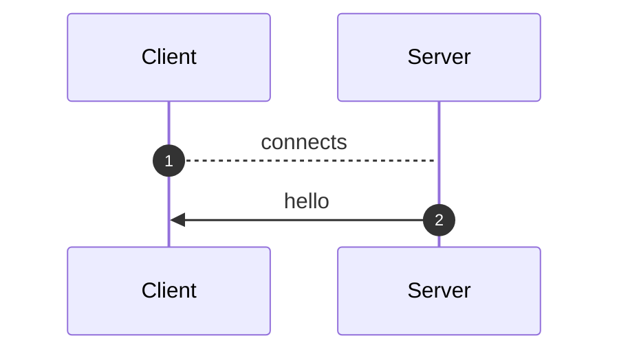
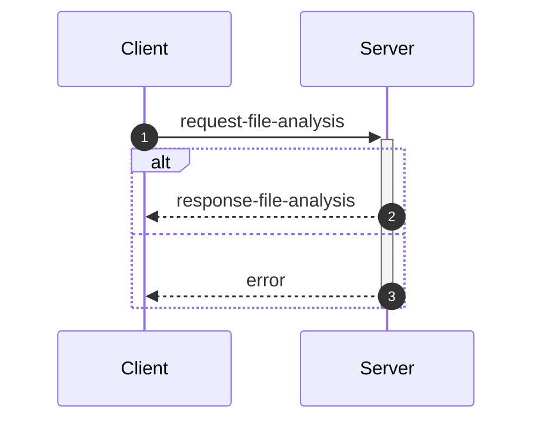
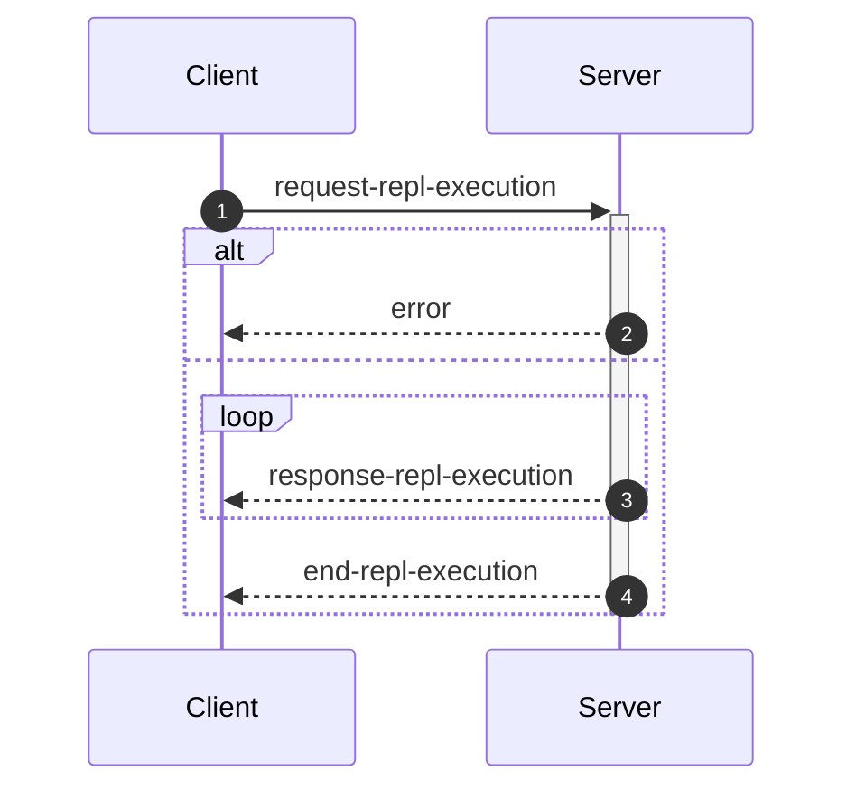
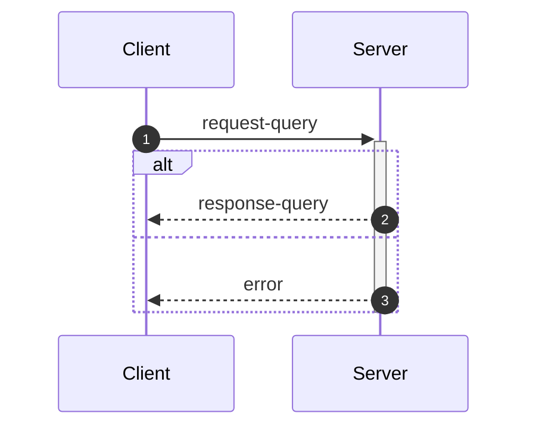

_<span title="an overview of flowR's interface">Generated</span> from '[wiki-interface.ts](https://github.com/flowr-analysis/flowr/tree/main/src/documentation/wiki-interface.ts "src/documentation/wiki-interface.ts")' on 2026-11-04, 13:25:28 UTC (v2.17.0, R v4.6.1), do not edit directly._

Although far from being as detailed as the in-depth explanation of [_flowR_](https://github.com/flowr-analysis/flowr/wiki/Core),
this wiki page explains how to interface with _flowR_ in more detail.
In general, command line arguments and other options provide short descriptions on hover over.

* [💻 Using the REPL](#using-the-repl)
* [⚙️ Configuring FlowR](#configuring-flowr)
* [⚒️ Writing Code](#writing-code)
* [💬 Communicating with the Server](#communicating-with-the-server)

<a id='using-the-repl'></a>
## 💻 Using the REPL

> [!NOTE]
> To execute arbitrary R commands with a repl request, _flowR_ has to be started explicitly with <span title="Description (Command Line Argument): Allow to access the underlying R session when using flowR (security warning: this allows the execution of arbitrary R code!)">`--r-session-access`</span>.
> Please be aware that this introduces a security risk and note that this relies on the [`r-shell` engine](https://github.com/flowr-analysis/flowr/wiki/Engines) .

Although primarily meant for users to explore,
there is nothing which forbids calling _flowR_ as a subprocess to use standard-in, -output, and -error
for communication (although you can access the REPL using the server as well,
with the [REPL Request](#message-request-repl-execution) message).

The read-eval-print loop&nbsp;(REPL) works relatively simple.
You can submit an expression (using <kbd>Enter</kbd>),
which is interpreted as an R&nbsp;expression by default but interpreted as a *command* if it starts with a colon (`:`).
The best command to get started with the REPL is <span title="Description (Repl Command): Show help information (aliases: :h, :?)">`:help`</span>.
Besides, you can leave the REPL either with the command <span title="Description (Repl Command): End the repl (aliases: :q, :exit)">`:quit`</span> or by pressing <kbd>Ctrl</kbd>+<kbd>C</kbd> twice.
When writing a *command*, you may press <kbd>Tab</kbd> to get a list of completions, if available.
Multiple commands can be entered in a single line by separating them with a semicolon (`;`), e.g. `:parse "x<-2"; :df*`.
If a command is given without R code, the REPL will re-use R code given in a previous command.
The prior example will hence return first the parsed AST of the program and then the dataflow graph for `"x <- 2"`.

> [!NOTE]
> If you develop flowR, you may want to launch the repl using the `npm run main-dev` command, this way, you get a non-minified version of flowR with debug information and hot-reloading of source files.

<details>
<summary>Available Commands</summary>

We currently offer the following commands (this with a `[*]` suffix are available with and without the star):

| Command | Description |
| ------- | ----------- |
| **<span title="Description (Repl Command): End the repl (aliases: :q, :exit)">:quit</span>** | End the repl (aliases: **:<span title="Alias of ':quit'. End the repl">q</span>**, **:<span title="Alias of ':quit'. End the repl">exit</span>**) |
| **<span title="Description (Repl Command): Execute the given code as R code. This requires the `--r-session-access` flag to be set and requires the r-shell engine. (aliases: :e, :r)">:execute</span>** | Execute the given code as R code. This requires the `--r-session-access` flag to be set and requires the r-shell engine. (aliases: **:<span title="Alias of ':execute'. Execute the given code as R code. This requires the `--r-session-access` flag to be set and requires the r-shell engine.">e</span>**, **:<span title="Alias of ':execute'. Execute the given code as R code. This requires the `--r-session-access` flag to be set and requires the r-shell engine.">r</span>**) |
| **<span title="Description (Repl Command): Get mermaid code for the control-flow graph of R code (aliases: :cfg, :cf)">:controlflow[*]</span>** | Get mermaid code for the control-flow graph of R code (star: Returns the URL to mermaid.live) (aliases: **:<span title="Alias of ':controlflow'. Get mermaid code for the control-flow graph of R code">cfg</span>**, **:<span title="Alias of ':controlflow'. Get mermaid code for the control-flow graph of R code">cf</span>**) |
| **<span title="Description (Repl Command): Get mermaid code for the control-flow graph with basic blocks (aliases: :cfgb, :cfb)">:controlflowbb[*]</span>** | Get mermaid code for the control-flow graph with basic blocks (star: Returns the URL to mermaid.live) (aliases: **:<span title="Alias of ':controlflowbb'. Get mermaid code for the control-flow graph with basic blocks">cfgb</span>**, **:<span title="Alias of ':controlflowbb'. Get mermaid code for the control-flow graph with basic blocks">cfb</span>**) |
| **<span title="Description (Repl Command): Get mermaid code for the dataflow graph (aliases: :d, :df)">:dataflow[*]</span>** | Get mermaid code for the dataflow graph (star: Returns the URL to mermaid.live) (aliases: **:<span title="Alias of ':dataflow'. Get mermaid code for the dataflow graph">d</span>**, **:<span title="Alias of ':dataflow'. Get mermaid code for the dataflow graph">df</span>**) |
| **<span title="Description (Repl Command): Get mermaid code for the normalized AST of R code (aliases: :n)">:normalize[*]</span>** | Get mermaid code for the normalized AST of R code (star: Returns the URL to mermaid.live) (alias: **:<span title="Alias of ':normalize'. Get mermaid code for the normalized AST of R code">n</span>**) |
| **<span title="Description (Repl Command): Get mermaid code for the simplified dataflow graph (aliases: :ds, :dfs)">:dataflowsimple[*]</span>** | Get mermaid code for the simplified dataflow graph (star: Returns the URL to mermaid.live) (aliases: **:<span title="Alias of ':dataflowsimple'. Get mermaid code for the simplified dataflow graph">ds</span>**, **:<span title="Alias of ':dataflowsimple'. Get mermaid code for the simplified dataflow graph">dfs</span>**) |
| **<span title="Description (Repl Command): Inspect and extend the signature database: `query` (identical to :query @signature), `info <name>` for where a function comes from (identical to :query @function-info), `add <path>` to mount another database/source, `download` to fetch the full-history database. (aliases: :sig)">:signature</span>** | Inspect and extend the signature database: `query` (identical to :query @signature), `info <name>` for where a function comes from (identical to :query @function-info), `add <path>` to mount another database/source, `download` to fetch the full-history database. (alias: **:<span title="Alias of ':signature'. Inspect and extend the signature database: `query` (identical to :query @signature), `info <name>` for where a function comes from (identical to :query @function-info), `add <path>` to mount another database/source, `download` to fetch the full-history database.">sig</span>**) |
| **<span title="Description (Repl Command): Just calculates the DFG, but only prints summary info (aliases: :d#, :df#)">:dataflowsilent</span>** | Just calculates the DFG, but only prints summary info (aliases: **:<span title="Alias of ':dataflowsilent'. Just calculates the DFG, but only prints summary info">d#</span>**, **:<span title="Alias of ':dataflowsilent'. Just calculates the DFG, but only prints summary info">df#</span>**) |
| **<span title="Description (Repl Command): Prints ASCII Art of the parsed, unmodified AST (aliases: :p)">:parse</span>** | Prints ASCII Art of the parsed, unmodified AST (alias: **:<span title="Alias of ':parse'. Prints ASCII Art of the parsed, unmodified AST">p</span>**) |
| **<span title="Description (Repl Command): Prints the version of flowR as well as the current version of R">:version</span>** | Prints the version of flowR as well as the current version of R
| **<span title="Description (Repl Command): Query the given R code (use 'help' for more information)">:query[*]</span>** | Query the given R code (use 'help' for more information) (star: Similar to query, but returns the output in json format.)
| **<span title="Description (Repl Command): Returns an ASCII representation of the dataflow graph (aliases: :df!)">:dataflowascii</span>** | Returns an ASCII representation of the dataflow graph (alias: **:<span title="Alias of ':dataflowascii'. Returns an ASCII representation of the dataflow graph">df!</span>**) |
| **<span title="Description (Repl Command): Returns summarization stats for the normalized AST (aliases: :n#)">:normalize#</span>** | Returns summarization stats for the normalized AST (alias: **:<span title="Alias of ':normalize#'. Returns summarization stats for the normalized AST">n#</span>**) |
| **<span title="Description (Repl Command): Show help information (aliases: :h, :?)">:help</span>** | Show help information (aliases: **:<span title="Alias of ':help'. Show help information">h</span>**, **:<span title="Alias of ':help'. Show help information">?</span>**) |

</details>

> [!TIP]
> 
> As indicated by the examples before, all REPL commands that operate on code keep track of the state.
> Hence, if you run a command like <span title="Description (Repl Command, starred version): Returns the URL to mermaid.live; Base Command: Get mermaid code for the dataflow graph (aliases: :d*, :df*)">`:dataflow*`</span> without providing R code,
> the REPL will re-use the R code provided in a previous command.
> Likewise, doing this will benefit from incrementality!
> If you request the dataflow graph with `:df* x <- 2 * y` and then want to see the parsed AST with `:parse`,
> the REPL will re-use previously obtained information and not re-parse the code again.
> 		

Generally, many commands offer shortcut versions in the REPL. Many queries, for example, offer a shortened format (see the example below).
Of special note, the [Config Query](https://github.com/flowr-analysis/flowr/wiki/%5BQuery%5D-Config)
can be used to also modify the currently active configuration of _flowR_ within the REPL (see the [wiki page](https://github.com/flowr-analysis/flowr/wiki/%5BQuery%5D-Config) for more information).

### Example: Retrieving the Dataflow Graph

To retrieve a URL to the [mermaid](https://mermaid.js.org/) diagram of the dataflow of a given expression,
use <span title="Description (Repl Command, starred version): Returns the URL to mermaid.live; Base Command: Get mermaid code for the dataflow graph (aliases: :d*, :df*)">`:dataflow*`</span> (or <span title="Description (Repl Command): Get mermaid code for the dataflow graph (aliases: :d, :df)">`:dataflow`</span> to get the mermaid code in the cli):

```shell
$ docker run -it --rm eagleoutice/flowr # or npm run flowr 
flowR repl v2.17.0, R grammar v14 (tree-sitter engine)
R> :dataflow* y <- 1 + x
```

<details>
<summary style='color:gray'>Output</summary>

```text
https://mermaid.live/view#base64:eyJjb2RlIjoiZmxvd2NoYXJ0IFREXG4gICAgMXt7XCJgKiM5MTtSTnVtYmVyIzkzOyogKioxKipcbiAgICAgICoxLjYqICgqKmlkOiAxKiopYFwifX1cbiAgICAyKFtcImAqIzkxO1JTeW1ib2wjOTM7KiAqKngqKlxuICAgICAgKjEuMTAqICgqKmlkOiAyKiopYFwiXSlcbiAgICAzW1tcImAqIzkxO1JCaW5hcnlPcCM5MzsqIGJhc2UjNTg7IzU4OyoqIzQzOyoqXG4gICAgICAqMS42LTEwKiAoKippZDogMyoqKVxuICAgIGFyZzogKDEsIDIpYFwiXV1cbiAgICBidWlsdC1pbjpfNDNfW1wiYEJ1aWx0LUluOlxuIzQzO2BcIl1cbiAgICBzdHlsZSBidWlsdC1pbjpfNDNfIHN0cm9rZTpncmF5LGZpbGw6Z3JheSxzdHJva2Utd2lkdGg6MnB4LG9wYWNpdHk6Ljg7XG4gICAgMFtcImAqIzkxO1JTeW1ib2wjOTM7KiAqKnkqKlxuICAgICAgKjEuMSogKCoqaWQ6IDAqKiwgdjogMylgXCJdXG4gICAgNFtbXCJgKiM5MTtSQmluYXJ5T3AjOTM7KiBiYXNlIzU4OyM1ODsqKiM2MDsjNDU7KipcbiAgICAgICoxLjEtMTAqICgqKmlkOiA0KiopXG4gICAgYXJnOiAoMCwgMylgXCJdXVxuICAgIGJ1aWx0LWluOl82MF8tW1wiYEJ1aWx0LUluOlxuIzYwOyM0NTtgXCJdXG4gICAgc3R5bGUgYnVpbHQtaW46XzYwXy0gc3Ryb2tlOmdyYXksZmlsbDpncmF5LHN0cm9rZS13aWR0aDoycHgsb3BhY2l0eTouODtcbiAgICAxIC0uLT58XCJmbG93XCJ8IDJcbiAgICBsaW5rU3R5bGUgMCBzdHJva2U6Z3JheSxjb2xvcjpncmF5O1xuICAgIDIgLS4tPnxcImZsb3dcInwgM1xuICAgIGxpbmtTdHlsZSAxIHN0cm9rZTpncmF5LGNvbG9yOmdyYXk7XG4gICAgMyAtLT58XCJyZWFkcywgYXJnXCJ8IDFcbiAgICAzIC0tPnxcInJlYWRzLCBhcmdcInwgMlxuICAgIDMgLS4tPnxcImZsb3dcInwgMFxuICAgIGxpbmtTdHlsZSA0IHN0cm9rZTpncmF5LGNvbG9yOmdyYXk7XG4gICAgMyAtLi0+fFwicmVhZHMsIGNhbGxzXCJ8IGJ1aWx0LWluOl80M19cbiAgICBsaW5rU3R5bGUgNSBzdHJva2U6Z3JheTtcbiAgICAwIC0tPnxcImRlZmluZWQtYnksIGZsb3dcInwgNFxuICAgIDAgLS0+fFwiZGVmaW5lZC1ieVwifCAzXG4gICAgNCAtLT58XCJyZWFkcywgYXJnXCJ8IDNcbiAgICA0IC0tPnxcInJldHVybnMsIGFyZ1wifCAwXG4gICAgNCAtLi0+fFwicmVhZHMsIGNhbGxzXCJ8IGJ1aWx0LWluOl82MF8tXG4gICAgbGlua1N0eWxlIDEwIHN0cm9rZTpncmF5OyIsIm1lcm1haWQiOnsiYXV0b1N5bmMiOnRydWV9fQ==
```

Retrieve the dataflow graph of the expression `y <- 1 + x`. It looks like this:


<details>

<summary style="color:gray">R Code of the Dataflow Graph</summary>

The analysis ran (parse and normalize with the [tree-sitter](https://github.com/flowr-analysis/flowr/wiki/Engines) engine) in the generation environment. No [signature database](https://github.com/flowr-analysis/flowr/wiki/Signature-Database) is mounted, so `library()` attaches no exports (base-R names are still qualified, e.g., `stats::acf`). 
We encountered no unknown side effects during the analysis.

```r
y <- 1 + x
```

</details>

</details>

For small graphs like this, <span title="Description (Repl Command): Returns an ASCII representation of the dataflow graph (aliases: :df!)">`:dataflowascii`</span> also provides an ASCII representation directly in the REPL:

```shell
$ docker run -it --rm eagleoutice/flowr # or npm run flowr 
flowR repl v2.17.0, R grammar v14 (tree-sitter engine)
R> :df! y <- 1 + x
```

<details open>
<summary style='color:gray'>Output</summary>

```text
                        v<0>v
 c<4>c──────────────────| y |
 |<- |     ┌────────────v---v
 c---c     │
    │   c<3>c   0<1>0
    └───| + |───| 1 |───u<2>u
        c---c   0---0   | x |
           └────────────u---u
Edges:
3 -> 1: reads, arg          3 -> 2: reads, arg
3 -> 0: flows-to            1 -> 2: flows-to
2 -> 3: flows-to            4 -> 3: reads, arg
4 -> 0: returns, arg        0 -> 4: defined-by, flows-to
0 -> 3: defined-by
```

Retrieve the dataflow graph of the expression `y <- 1 + x` as ASCII art.

</details>

For the slicing with <span title="Description (Repl Command): Static backwards executable slicer for R">`:slicer`</span>, you have access to the same [magic comments](#slice-magic-comments) as with the [slice request](#message-request-slice).
Pass `--inline` to splice resolvable `source()` calls into the reconstruction so the slice is a single self-contained R text (the same as the static slice query's `inlineSources` flag).
See `--help` for more flags!

### Example: Interfacing with the File System

Many commands that allow for an R-expression (like <span title="Description (Repl Command, starred version): Returns the URL to mermaid.live; Base Command: Get mermaid code for the dataflow graph (aliases: :d*, :df*)">`:dataflow*`</span>) allow for a file as well
if the argument starts with `file://`.
If you are working from the root directory of the _flowR_ repository, the following gives you the parsed AST of the example file using the <span title="Description (Repl Command): Prints ASCII Art of the parsed, unmodified AST (aliases: :p)">`:parse`</span> command:

> **Watch mode**: Replace `file://` with `watch://` to enter watch mode.
> flowR runs the command immediately and then re-runs it every time the file (or any file inside the folder) changes.
> Enter any other command to leave watch mode.
> For example: `:df watch://analysis.R`

```shell
$ docker run -it --rm eagleoutice/flowr # or npm run flowr 
flowR repl v2.17.0, R grammar v14 (tree-sitter engine)
R> :parse file://test/testfiles/example.R
```

<details>
<summary style='color:gray'>Output</summary>

```text
File: test/testfiles/example.R

program
├ binaryoperator
│ ├ identifier "sum" (1:1─4)
│ ├ <- "<-" (1:5─7)
│ ╰ float "0" (1:8─9)
├ binaryoperator
│ ├ identifier "product" (2:1─8)
│ ├ <- "<-" (2:9─11)
│ ╰ float "1" (2:12─13)
├ binaryoperator
│ ├ identifier "w" (3:1─2)
│ ├ <- "<-" (3:3─5)
│ ╰ float "7" (3:6─7)
├ binaryoperator
│ ├ identifier "N" (4:1─2)
│ ├ <- "<-" (4:3─5)
│ ╰ float "10" (4:6─8)
├ forstatement
│ ├ for "for" (6:1─4)
│ ├ ( "(" (6:5─6)
│ ├ identifier "i" (6:6─7)
│ ├ in "in" (6:8─10)
│ ├ binaryoperator
│ │ ├ float "1" (6:11─12)
│ │ ├ : ":" (6:12─13)
│ │ ╰ parenthesizedexpression
│ │   ├ ( "(" (6:13─14)
│ │   ├ binaryoperator
│ │   │ ├ identifier "N" (6:14─15)
│ │   │ ├ - "-" (6:15─16)
│ │   │ ╰ float "1" (6:16─17)
│ │   ╰ ) ")" (6:17─18)
│ ├ ) ")" (6:18─19)
│ ╰ bracedexpression
│   ├ { "{" (6:20─21)
│   ├ binaryoperator
│   │ ├ identifier "sum" (7:3─6)
│   │ ├ <- "<-" (7:7─9)
│   │ ╰ binaryoperator
│   │   ├ binaryoperator
│   │   │ ├ identifier "sum" (7:10─13)
│   │   │ ├ + "+" (7:14─15)
│   │   │ ╰ identifier "i" (7:16─17)
│   │   ├ + "+" (7:18─19)
│   │   ╰ identifier "w" (7:20─21)
│   ├ binaryoperator
│   │ ├ identifier "product" (8:3─10)
│   │ ├ <- "<-" (8:11─13)
│   │ ╰ binaryoperator
│   │   ├ identifier "product" (8:14─21)
│   │   ├  "" (8:22─23)
│   │   ╰ identifier "i" (8:24─25)
│   ╰ } "}" (9:1─2)
├ call
│ ├ identifier "cat" (11:1─4)
│ ╰ arguments
│   ├ ( "(" (11:4─5)
│   ├ argument
│   │ ╰ string
│   │   ├ stringopen "\"" (11:5─6)
│   │   ├ stringcontent "Sum:" (11:6─10)
│   │   ╰ stringclose "\"" (11:10─11)
│   ├ comma "," (11:11─12)
│   ├ argument
│   │ ╰ identifier "sum" (11:13─16)
│   ├ comma "," (11:16─17)
│   ├ argument
│   │ ╰ string
│   │   ├ stringopen "\"" (11:18─19)
│   │   ├ stringcontent
│   │   │ ╰ escapesequence "\\n" (11:19─21)
│   │   ╰ stringclose "\"" (11:21─22)
│   ╰ ) ")" (11:22─23)
╰ call
  ├ identifier "cat" (12:1─4)
  ╰ arguments
    ├ ( "(" (12:4─5)
    ├ argument
    │ ╰ string
    │   ├ stringopen "\"" (12:5─6)
    │   ├ stringcontent "Product:" (12:6─14)
    │   ╰ stringclose "\"" (12:14─15)
    ├ comma "," (12:15─16)
    ├ argument
    │ ╰ identifier "product" (12:17─24)
    ├ comma "," (12:24─25)
    ├ argument
    │ ╰ string
    │   ├ stringopen "\"" (12:26─27)
    │   ├ stringcontent
    │   │ ╰ escapesequence "\\n" (12:27─29)
    │   ╰ stringclose "\"" (12:29─30)
    ╰ ) ")" (12:30─31)
```

Retrieve the parsed AST of the example file.

<details>

<summary>File Content</summary>

```r
sum <- 0
product <- 1
w <- 7
N <- 10

for (i in 1:(N-1)) {
  sum <- sum + i + w
  product <- product * i
}

cat("Sum:", sum, "\n")
cat("Product:", product, "\n")
```

</details>

As _flowR_ directly transforms this AST the output focuses on being human-readable instead of being machine-readable.
		
</details>

### Example: Run a Query

You can run any query supported by _flowR_ using the <span title="Description (Repl Command): Query the given R code (use 'help' for more information)">`:query`</span> command.
For example, to obtain the shapes of all data frames in a given piece of code, you can run:

```shell
$ docker run -it --rm eagleoutice/flowr # or npm run flowr 
flowR repl v2.17.0, R grammar v14 (tree-sitter engine)
R> :query @absint df-shape "x <- data.frame(a = 1:10, b = 1:10)\ny <- x$a"
```

<details open>
<summary style='color:gray'>Output</summary>

```text
Query: absint (2 ms)
   ╰ $12: (colnames: [{"a", "b"}, {}], cols: [2, 2], rows: [10, 10])
   ╰ $0: (colnames: [{"a", "b"}, {}], cols: [2, 2], rows: [10, 10])
```

Retrieve the shapes of all data frames in the given code.

</details>

To run the linter on a file, you can use (in this example, we just issue the `dead-code` linter on a small piece of code):

```shell
$ docker run -it --rm eagleoutice/flowr # or npm run flowr 
flowR repl v2.17.0, R grammar v14 (tree-sitter engine)
R> :query @linter rules:dead-code "if(FALSE) x <- 2"
```

<details open>
<summary style='color:gray'>Output</summary>

```text
Query: linter (2 ms)
   ╰ Dead Code (dead-code):
       ╰ certain:
           ╰ Code at 1.11-16 (1 quick fix(es) available)
```

Run the linter on the given code, with only the `dead-code` rule enabled.

</details>

For more information on the available queries, please check out the [Query API](https://github.com/flowr-analysis/flowr/wiki/Query-API).

<a id='configuring-flowr'></a>
## ⚙️ Configuring FlowR

When running _flowR_, you may want to specify some behaviors with a dedicated configuration file.
By default, flowR looks for a file named `flowr.json` in the current working directory (or any higher directory).
You can also specify a different file with <span title="Description (Command Line Argument): The name of the configuration file to use">`--config-file`</span> or pass the configuration inline using <span title="Description (Command Line Argument): The flowR configuration to use, as a JSON string">`--config-json`</span>.
A `flowr.json` found this way belongs to the analyzed project, so flowR ignores its options that decide what flowR executes or loads
(`engines.*.wasmPath`, `engines.*.treeSitterWasmPath`, `engines.*.rPath`, `solver.sigdb.additionalPaths`, `solver.sigdb.downloadRepo`, `solver.sigdb.installedLibrary.paths`, `solver.sigdb.onDemand.enabled`, `solver.sigdb.onDemand.repositories`, `solver.sigdb.onDemand.cranMirror`, `solver.sigdb.onDemand.bioconductorMirror`, `solver.sigdb.onDemand.cacheDir`),
unless you pass <span title="Description (Command Line Argument): Keep the security-sensitive options (e.g., the R executable) of the flowr.json found in the working directory or a parent. Only use this for projects you trust.">`--trust-config`</span>.
To analyze code you do not trust, use the secure mode (<span title="Description (Command Line Argument): Run in secure mode for analyzing untrusted code: flowR does not start R (or any other process), does not access the network, does not search for project configs, and ignores security-sensitive options in every config. Cannot be disabled once enabled. Can also be enabled with the environment variable {italic FLOWR_SECURE_MODE=1}.">`--secure`</span>, see the [security policy](https://github.com/flowr-analysis/flowr/blob/main/.github/SECURITY.md)).
To inspect the current configuration, you can run flowr with the <span title="Description (Command Line Argument): Run with verbose logging (will be passed to the corresponding script)">`--verbose`</span> flag, or use the `config` [Query](https://github.com/flowr-analysis/flowr/wiki/Query-API).
Within the REPL this works by running the following:

```shell
:query @config
```

To work with the <a href="https://github.com/flowr-analysis/flowr/tree/main/src/config.ts#L119"><code><span title="The configuration file format for flowR.">FlowrConfig</span></code></a> you can use the provided helper objects alongside its methods like
<a href="https://github.com/flowr-analysis/flowr/tree/main/src/config.ts#L966"><code><span title="Creates a new flowr config that has the updated values.">FlowrConfig::<b>amend</b></span></code></a>.
The schema below documents every option; the ones you most likely want are:

- <a href="https://github.com/flowr-analysis/flowr/wiki/Interface#configuring-flowr" title="Configuration Option (boolean): Whether source calls should be ignored, causing {@link processSourceCall}&#39;s behavior to be skipped.">ignoreSourceCalls</a>: ignore source calls when analyzing the code, i.e., ignore the inclusion of other files.
- <a href="https://github.com/flowr-analysis/flowr/wiki/Interface#configuring-flowr" title="Configuration Option (boolean): Whether load calls should be ignored, causing {@link processLoadCall}&#39;s behavior to be skipped.">ignoreLoadCalls</a>: ignore load calls when analyzing the code, i.e., ignore the loading of r-data files.
- <a href="https://github.com/flowr-analysis/flowr/wiki/Interface#configuring-flowr" title="Configuration Option (object): Do you want to overwrite (parts) of the builtin definition?">semantics.environment.overwriteBuiltIns</a>: overwrite _flowR_'s handling of built-in functions, or clear the preset definitions entirely.
  See [Configure BuiltIn Semantics](#configure-builtin-semantics) for more information.
- <a href="https://github.com/flowr-analysis/flowr/wiki/Interface#configuring-flowr" title="Configuration Option (string): How to resolve variables and their values. (one of &quot;disabled&quot;, &quot;alias&quot;, &quot;builtin&quot;)">solver.variables</a>: how to resolve variables and their values (`disabled`, `alias`, `builtin`).
- <a href="https://github.com/flowr-analysis/flowr/wiki/Interface#configuring-flowr" title="Configuration Option (array): The engine or set of engines to use for interacting with R code. An empty array means all available engines will be used.">engines</a> and <a href="https://github.com/flowr-analysis/flowr/wiki/Interface#configuring-flowr" title="Configuration Option (string): The default engine to use for interacting with R code. If this is undefined, an arbitrary engine from the specified list will be used. (one of &quot;tree-sitter&quot;, &quot;r-shell&quot;)">defaultEngine</a>: the engines used to interact with R code, see the [Engines wiki page](https://github.com/flowr-analysis/flowr/wiki/Engines).
- <a href="https://github.com/flowr-analysis/flowr/wiki/Interface#configuring-flowr" title="Configuration Option (array): Files a framework loads on its own, without any source() call (e.g. global.R in a shiny app), in the order they are loaded; flowR orders the matching project files accordingly and analyzes them as one program. Entries are case-insensitive globs matched against the file path, a plain name matches any file with that name, and entries matching no project file are warned about. Usually set per project kind via specializeConfig.">project.implicitSources</a>: the files a framework loads without any `source()` call, in the order in which they are
  loaded. Entries are globs (e.g. `R/*.R`) matched against the file path ignoring capitalization; one matching no file is reported.
- <a href="https://github.com/flowr-analysis/flowr/wiki/Interface#configuring-flowr" title="Configuration Option (object): Overwrite (parts of) the configuration depending on the project kind flowR detects, e.g. to give a shiny app its implicit sources.">specializeConfig</a>: overwrite (parts of) the configuration depending on the kind of project _flowR_ detects
  (e.g. `shiny-app`), which is how a shiny app gets its implicit sources by default. What you configure directly wins.
- <a href="https://github.com/flowr-analysis/flowr/wiki/Interface#configuring-flowr" title="Configuration Option (string): Overwrite the project kind flowR would otherwise infer from the analyzed files, e.g. when auto-detection guesses wrong. (one of &quot;package&quot;, &quot;script&quot;, &quot;shiny-app&quot;, &quot;notebook&quot;, &quot;project&quot;, &quot;unknown&quot;)">project.useProjectType</a>: skip that detection and force a project kind yourself, when auto-detection guesses wrong.
- <a href="https://github.com/flowr-analysis/flowr/wiki/Interface#configuring-flowr" title="Configuration Option (array): The default plugins to load when creating a new instance of FlowrAnalyzer">defaultPlugins</a> and <a href="https://github.com/flowr-analysis/flowr/wiki/Interface#configuring-flowr" title="Configuration Option (array): The plugins to load in REPL mode">repl.plugins</a>: the plugins to load for a new <a href="https://github.com/flowr-analysis/flowr/tree/main/src/project/flowr-analyzer.ts#L210"><code><span title="Central class for conducting analyses with FlowR. Use the FlowrAnalyzerBuilder to create a new instance. If you want the original pattern of creating a pipeline and running all steps, you can still do this with FlowrAnalyzer#runFull . To inspect the context of the analyzer, use FlowrAnalyzer#inspectContext (if you are a plugin and need to modify it, use FlowrAnalyzer#context instead).">FlowrAnalyzer</span></code></a> and in the REPL
  (use `flowr:default` to reference the former).

So you can configure _flowR_ by adding a file like the following:

<details>

<summary>Example Configuration File</summary>

```json
{
  "ignoreSourceCalls": true,
  "ignoreLoadCalls": true,
  "semantics": {
    "environment": {
      "overwriteBuiltIns": {
        "definitions": [
          {
            "type": "function",
            "names": [
              "foo"
            ],
            "processor": "builtin:assign",
            "config": {}
          }
        ]
      }
    }
  },
  "defaultPlugins": [
    "file:description",
    "versions:description"
  ],
  "repl": {
    "quickStats": false,
    "dfProcessorHeat": false,
    "hints": true,
    "plugins": [
      "flowr:default"
    ]
  },
  "project": {
    "resolveUnknownPathsOnDisk": true,
    "implicitSources": [
      "global.R",
      "app.R"
    ]
  },
  "linter": {
    "disabledRules": []
  },
  "specializeConfig": {
    "shiny-app": {
      "project": {
        "implicitSources": [
          "global.R",
          "ui.R",
          "server.R",
          "app.R"
        ]
      }
    }
  },
  "engines": [
    {
      "type": "r-shell"
    }
  ],
  "solver": {
    "variables": "alias",
    "evalStrings": true,
    "trackEnvironments": true,
    "sigdb": {
      "enabled": true,
      "loadProjectDependencies": true,
      "eagerlyLoad": false,
      "eagerlyLoadExports": false,
      "linkBaseR": false,
      "linkDescriptionDependencies": false
    },
    "resolveSource": {
      "dropPaths": "no",
      "ignoreCapitalization": true,
      "inferWorkingDirectory": "active-script",
      "searchPath": []
    },
    "instrument": {},
    "slicer": {
      "threshold": 50
    }
  },
  "abstractInterpretation": {
    "wideningThreshold": 4,
    "followCalls": true,
    "dataFrame": {
      "maxColNames": 20,
      "readLoadedData": {
        "readExternalFiles": true,
        "maxReadLines": 1000000
      }
    }
  },
  "incremental": {
    "alwaysIncremental": false,
    "parsing": {
      "activated": false,
      "heuristics": {
        "activated": true,
        "mtime": true,
        "linesFrom": 500,
        "bytesFrom": 50000,
        "alwaysWithEdits": false,
        "minFiles": 1
      }
    }
  },
  "gas": {
    "thresholds": {
      "memory": {
        "problematic": 0.7,
        "critical": 0.9
      },
      "timeMs": {
        "problematic": 100000,
        "critical": 120000
      }
    },
    "features": {}
  }
}
```

</details>

<details>
<a id='configure-builtin-semantics'></a>
<summary>Configure Built-In Semantics</summary>

`semantics/environment/overwriteBuiltins` accepts two keys:

- `loadDefaults` (boolean, initially `true`): If set to `true`, the default built-in definitions are loaded before applying the custom definitions. Setting this flag to `false` explicitly disables the loading of the default definitions.
- `definitions` (array, initially empty): Allows to overwrite or define new built-in elements. Each object within must have a `type` which is one of the below. Furthermore, they may define a string array of `names` which specifies the identifiers to bind the definitions to. You may use `assumePrimitive` to specify whether _flowR_ should assume that this is a primitive non-library definition (so you probably just do not want to specify the key).

  | Type            | Description                                                                                                                                                                                                                                                                                              | Example                                                                                                    |
  | --------------- | -------------------------------------------------------------------------------------------------------------------------------------------------------------------------------------------------------------------------------------------------------------------------------------------------------- | ---------------------------------------------------------------------------------------------------------- |
  | `constant`    | Additionally allows for a `value` this should resolve to.                                                                                                                                                                                                                                                | `{ type: 'constant', names: ['NULL', 'NA'],  value: null }`                                                |
  | `function`    | Is a rather flexible way to define and bind built-in functions. For the time, we do not have extensive documentation to cover all the cases, so please either consult the sources with the `default-builtin-config.ts` or open a [new issue](https://github.com/flowr-analysis/flowr/issues/new/choose). | `{ type: 'function', names: ['next'], processor: 'builtin:d', config: { cfg: ExitPointType.Next } }` |
  | `replacement` | A comfortable way to specify replacement functions like `$<-` or `names<-`. `suffixes` describes the... suffixes to attach automatically. | `{ type: 'replacement', suffixes: ['<-', '<<-'], names: ['[', '[['] }` |

</details>

<details>

<summary style='color:gray'>Full Configuration-File Schema</summary>

- _The configuration file format for flowR._ (object)
    - **logLevel** [optional] _flowR's global minimum log level, applied when the config is loaded._ (string)
        Only allows: 'silly', 'trace', 'debug', 'info', 'warn', 'error', 'fatal'
    - **ignoreSourceCalls** [optional] _Whether source calls should be ignored, causing {@link processSourceCall}'s behavior to be skipped._ (boolean)
    - **ignoreLoadCalls** [optional] _Whether load calls should be ignored, causing {@link processLoadCall}'s behavior to be skipped._ (boolean)
    - **semantics** _Configure language semantics and how flowR handles them._ (object)
        - **environment** [optional] _Semantics regarding how to handle the R environment._ (object)
            - **overwriteBuiltIns** [optional] _Do you want to overwrite (parts) of the builtin definition?_ (object)
                - **loadDefaults** [optional] _Should the default configuration still be loaded?_ (boolean)
                - **definitions** [optional] _The definitions to load/overwrite._ (array)
                Valid item types:
                    - (object)
    - **defaultPlugins** [optional] _The default plugins to load when creating a new instance of FlowrAnalyzer_ (array)
    Valid item types:
        - (alternatives)
            - (string)
            - (array)
    - **repl** _Configuration options for the REPL._ (object)
        - **quickStats** [optional] _Whether to show quick stats in the REPL after each evaluation._ (boolean)
        - **dfProcessorHeat** [optional] _This instruments the dataflow processors to count how often each processor is called._ (boolean)
        - **hints** [optional] _Whether to show dim inline hints on the empty prompt (automatically disabled on non-interactive terminals)._ (boolean)
        - **plugins** [optional] _The plugins to load in REPL mode_ (array)
        Valid item types:
            - (alternatives)
                - (string)
                - (array)
        - **autoUseFileProtocol** [optional] _Prepend the file protocol to a repl input that looks like a path, instead of only warning about it._ (boolean)
        - **queryStats** [optional] _Whether `:query` closes with the line stating how long the queries took (`:query*` never prints it)._ (boolean)
        - **showPlugins** [optional] _Whether `:version` grays out the plugins that did not activate during the last analysis._ (boolean)
    - **project** _Project specific configuration options._ (object)
        - **resolveUnknownPathsOnDisk** [optional] _Whether to resolve unknown paths loaded by the r project disk when trying to source/analyze files._ (boolean)
        - **failOnInaccessiblePath** [optional] _Whether a directory that cannot be traversed during file discovery (e.g. due to permissions) aborts the analysis; when false (the default) such paths are logged and skipped._ (boolean)
        - **basePackages** [optional] _The packages considered part of R itself (base and recommended); if unset, flowR uses its built-in list._ (array)
        Valid item types:
            - (string)
        - **implicitSources** [optional] _Files a framework loads on its own, without any source() call (e.g. global.R in a shiny app), in the order they are loaded; flowR orders the matching project files accordingly and analyzes them as one program. Entries are case-insensitive globs matched against the file path, a plain name matches any file with that name, and entries matching no project file are warned about. Usually set per project kind via specializeConfig._ (array)
        Valid item types:
            - (string)
        - **useProjectType** [optional] _Overwrite the project kind flowR would otherwise infer from the analyzed files, e.g. when auto-detection guesses wrong._ (string)
            Only allows: 'package', 'script', 'shiny-app', 'notebook', 'project', 'unknown'
        - **assumeImplicitEcho** [optional] _Whether the top level of the analyzed code is echoed, so that every visible result printed there is collected as an output by the dependencies query (default true, false for a package)._ (boolean)
        - **discovery** [optional] _Scoping options for the default project discovery._ (object)
            - **full** [optional] _Collect every file below the project root (greedy) instead of only the files the detected project kind needs (default false)._ (boolean)
            - **perKind** [optional] _Per-kind include/exclude glob overrides layered on the default scoping._ (object)
            - **ignore** [optional] _Case-insensitive globs that drop matching files from the intelligent discovery, regardless of kind (e.g. .Renviron to ignore environment files)._ (array)
            Valid item types:
                - (string)
        - **classification** [optional] _Overrides for the signals flowR uses to classify the project kind._ (object)
            - **shinyDescriptionTypes** [optional] _DESCRIPTION Type: values that mark a shiny app._ (array)
            Valid item types:
                - (string)
            - **shinyEntryFiles** [optional] _File names a shiny app is assembled from._ (array)
            Valid item types:
                - (string)
            - **shinyUsagePattern** [optional] _Regex source evidencing shiny usage in an entry file._ (string)
            - **notebookExtensions** [optional] _File extensions marking a notebook._ (array)
            Valid item types:
                - (string)
    - **linter** _Linter configuration options._ (object)
        - **disabledRules** _Linting rule names excluded from the default rule set (a rule requested explicitly via a linter query still runs). Usually set per project kind via specializeConfig._ (array)
        Valid item types:
            - (string)
        - **disabledTags** [optional] _Linting rule tags whose rules are excluded from the default rule set (a rule requested explicitly via a linter query still runs). By default the cmd-check rules are disabled for everything but a package; a configured list replaces that default._ (array)
        Valid item types:
            - (string)
    - **inputSources** [optional] _Further frameworks the input-sources analysis should know about; entries are added to flowR's defaults._ (object)
        - **pure** [optional] _Functions that only pass the constantness of their arguments on._ (array)
        Valid item types:
            - (string)
        - **param** [optional] _Functions whose result is a 'param' input._ (array)
        Valid item types:
            - (string)
        - **file** [optional] _Functions whose result is a 'file' input._ (array)
        Valid item types:
            - (string)
        - **tempfile** [optional] _Functions whose result is a 'tempfile' input._ (array)
        Valid item types:
            - (string)
        - **glob** [optional] _Functions whose result is a 'glob' input._ (array)
        Valid item types:
            - (string)
        - **net** [optional] _Functions whose result is a 'net' input._ (array)
        Valid item types:
            - (string)
        - **rand** [optional] _Functions whose result is a 'rand' input._ (array)
        Valid item types:
            - (string)
        - **system** [optional] _Functions whose result is a 'system' input._ (array)
        Valid item types:
            - (string)
        - **ffi** [optional] _Functions whose result is a 'ffi' input._ (array)
        Valid item types:
            - (string)
        - **lang** [optional] _Functions whose result is a 'lang' input._ (array)
        Valid item types:
            - (string)
        - **options** [optional] _Functions whose result is a 'options' input._ (array)
        Valid item types:
            - (string)
        - **cmdline** [optional] _Functions whose result is a 'cmdline' input._ (array)
        Valid item types:
            - (string)
        - **user** [optional] _Functions whose result is a 'user' input._ (array)
        Valid item types:
            - (string)
        - **const** [optional] _Functions whose result is a 'const' input._ (array)
        Valid item types:
            - (string)
        - **scope** [optional] _Functions whose result is a 'scope' input._ (array)
        Valid item types:
            - (string)
        - **dconst** [optional] _Functions whose result is a 'dconst' input._ (array)
        Valid item types:
            - (string)
        - **unknown** [optional] _Functions whose result is a 'unknown' input._ (array)
        Valid item types:
            - (string)
        - **linkedObjects** [optional] _Objects a framework provides without a definition in the code, e.g. shiny's input._ (array)
        Valid item types:
            - (object)
        - **linkedEntryPoints** [optional] _Calls that hand a function to a framework, which binds its objects to the parameters by position._ (array)
        Valid item types:
            - (object)
    - **specializeConfig** [optional] _Overwrite (parts of) the configuration depending on the project kind flowR detects, e.g. to give a shiny app its implicit sources._ (object)
    - **engines** _The engine or set of engines to use for interacting with R code. An empty array means all available engines will be used._ (array)
    Valid item types:
        - (alternatives)
            - _The configuration for the tree sitter engine._ (object)
                - **type** [required] _Use the tree sitter engine._ (string)
                    Only allows: 'tree-sitter'
                - **wasmPath** [optional] _The path to the tree-sitter-r WASM binary to use. If this is undefined, this uses the default path._ (string)
                - **treeSitterWasmPath** [optional] _The path to the tree-sitter WASM binary to use. If this is undefined, this uses the default path._ (string)
                - **lax** [optional] _Whether to use the lax parser for parsing R code (allowing for syntax errors). If this is undefined, the strict parser will be used._ (boolean)
            - _The configuration for the R shell engine._ (object)
                - **type** [required] _Use the R shell engine._ (string)
                    Only allows: 'r-shell'
                - **rPath** [optional] _The path to the R executable to use. If this is undefined, this uses the default path._ (string)
                - **pipeBind** [optional] _Whether to enable R's experimental pipe-bind operator "=>" by setting _R_USE_PIPEBIND_ for the R session (default false); R itself keeps this off by default, as it is experimental and has never shipped in a release version of R._ (boolean)
    - **defaultEngine** [optional] _The default engine to use for interacting with R code. If this is undefined, an arbitrary engine from the specified list will be used._ (string)
        Only allows: 'tree-sitter', 'r-shell'
    - **solver** _How to resolve constants, constraints, cells, ..._ (object)
        - **variables** _How to resolve variables and their values._ (string)
            Only allows: 'disabled', 'alias', 'builtin'
        - **evalStrings** _Should we include eval(parse(text="...")) calls in the dataflow graph?_ (boolean)
        - **trackEnvironments** [optional] _Track user-created environments (new.env, assign/get/local with envir=, dollar-assign, attach). When false, all envir-style calls fall through conservatively._ (boolean)
        - **sigdb** _Resolving library exports from a signature database._ (object)
            - **enabled** [optional] _Resolve library()/use() exports from a signature database (default true); when false no database is consulted._ (boolean)
            - **loadProjectDependencies** [optional] _Load the project's declared dependencies from its metadata files (DESCRIPTION Imports/Depends, rproject.toml, uvr.toml, rig rproj.toml and script blocks, renv.lock, rv.lock, uvr.lock, rig lockfiles) (default true); when false these files are not read for dependencies._ (boolean)
            - **eagerlyLoad** [optional] _Parse the database up front rather than on the first package load (default false, ignored if disabled)._ (boolean)
            - **eagerlyLoadExports** [optional] _Add a vertex for every export on load rather than on demand (default false); keeps the dataflow graph small._ (boolean)
            - **assumedRVersion** [optional] _R version assumed when resolving versioned (base-R) exports: a pin like "4.5" or "auto" to detect the installed R (default "auto")._ (string)
            - **linkBaseR** [optional] _Eagerly attach base-R namespaces so bare base calls resolve without library() (default false)._ (boolean)
            - **linkBaseRCalls** [optional] _Add a lightweight Reads edge from a bare base-R call to its signature-database function vertex (default false; base-R qualification is edge-free otherwise)._ (boolean)
            - **linkPackageCalls** [optional] _Add a lightweight Reads edge from a resolved package call to its signature-database function vertex (default false)._ (boolean)
            - **linkDescriptionDependencies** [optional] _Eagerly attach the namespaces of the project's declared DESCRIPTION dependencies (Imports/Depends) so their exports resolve without an explicit library() (default false)._ (boolean)
            - **warmInBackground** [optional] _Decompress the hot shards (base + most-downloaded) in a background task on startup so the first library() lookup is warm (default false; for long-running servers/REPLs)._ (boolean)
            - **additionalPaths** [optional] _Extra directories or bundle/manifest files searched for signature databases (alongside the shipped default and $FLOWR_SIGDB_DIR); a downloaded full-history bundle placed here is mounted automatically._ (array)
            Valid item types:
                - (string)
            - **downloadRepo** [optional] _GitHub owner/repo the full-history bundle is downloaded from via ":signature download" (default "flowr-analysis/flowr"; the release tag comes from the committed sigdb.remote.json unless a version is given)._ (string)
            - **autoSync** [optional] _On startup, re-download shards whose committed sigdb.remote.json hash no longer matches the cache, in the background (default false; opt-in network sync after a git pull)._ (boolean)
            - **installedLibrary** [optional] _Recovering packages no signature database knows from the copy installed on this machine._ (object)
                - **enabled** [required] _Recover packages no signature database knows from their installed copy (default false)._ (boolean)
                - **paths** [optional] _Library directories to search; when empty they are discovered from the environment and the project._ (array)
                Valid item types:
                    - (string)
                - **useEnvironment** [optional] _Search the libraries R_LIBS_USER/R_LIBS/R_LIBS_SITE name (default true)._ (boolean)
                - **useProjectLibrary** [optional] _Search a project-local renv/packrat library (default true)._ (boolean)
                - **maxDepth** [optional] _How far to descend into the nested layout of a project-local library (default 3)._ (number)
                - **packages** [optional] _Only recover packages whose name matches one of these regular expressions; empty means any._ (array)
                Valid item types:
                    - (string)
            - **onDemand** [optional] _Recovering packages no signature database knows from their sources on CRAN, Bioconductor, or GitHub._ (object)
                - **enabled** [required] _Fetch and recover the sources of packages no signature database knows when the analyzed code uses them (default false, accesses the network)._ (boolean)
                - **sources** [optional] _Where to look, in order: github, cran, bioconductor, or a source a plugin adds (default ["github", "cran", "bioconductor"])._ (array)
                Valid item types:
                    - (string)
                - **repositories** [optional] _GitHub repositories (owner/repo[/subdir][@ref]) to fetch packages from, by package name. The analyzed project may name more (DESCRIPTION Remotes, install_github calls)._ (object)
                - **packages** [optional] _Only recover packages whose name matches one of these regular expressions, empty means any._ (array)
                Valid item types:
                    - (string)
                - **cranMirror** [optional] _The CRAN src/contrib/ to fetch from, over https (default https://cloud.r-project.org/src/contrib/). It may be on the local network._ (string)
                - **bioconductorMirror** [optional] _The Bioconductor host, over https (default https://bioconductor.org). It may be on the local network._ (string)
                - **bioconductorRelease** [optional] _The Bioconductor release to fetch from: release, devel, or a number like 3.20 (default release)._ (string)
                - **githubMirrors** [optional] _Use the GitHub mirrors of CRAN (cran/<pkg>) and Bioconductor (bioc/<pkg>) (default true)._ (boolean)
                - **maxPackages** [optional] _The most packages to fetch for one analysis (default 25)._ (number)
                - **maxArchiveMb** [optional] _The most MiB a package archive may have (default 32). It may unpack to three times that, at most 128 MiB._ (number)
                - **offline** [optional] _Only use what was fetched before, never the network (default false)._ (boolean)
                - **retryAfterHours** [optional] _How many hours to wait before asking again for a package no source had (default 24)._ (number)
                - **cacheDir** [optional] _Where to cache what was fetched (default the on-demand directory of the signature cache)._ (string)
            - **blobCacheBudgetMb** [optional] _How many MiB of decoded package blobs every open bundle may hold together (default 16)._ (number)
            - **versionSelection** [optional] _When a project constrains a dependency, resolve to the newest (default), oldest, or system-installed version satisfying it; system needs R and falls back to newest. Base-R packages always resolve against the assumed R version._ (string)
                Only allows: 'newest', 'oldest', 'system'
            - **versionOverrides** [optional] _Force an exact version for specific packages (name -> version), overriding both the project constraint and the versionSelection policy (default {})._ (object)
        - **versionManagement** _Policies for reasoning about dependency versions._ (object)
            - **linkedVersionGroups** [optional] _Groups of packages that must resolve to the same version; version guessing intersects each group so its members stay mutually compatible (default [])._ (array)
            Valid item types:
                - (array)
                Valid item types:
                    - (string)
        - **assumeAttachedPackages** [optional] _Packages to treat as attached without a `library()` call, so what the built-in configuration states about them applies to the analyzed code. The base packages R attaches on startup already resolve without it._ (array)
        Valid item types:
            - (string)
        - **transitiveSideEffectRounds** [optional] _How many rounds the transitive side-effect fixpoint may run before it is cut off (default 32); the propagation stops on its own as soon as a round adds nothing._ (number)
        - **maxOverlayDepth** [optional] _How many binding overlays may stack on one environment frame before a write flattens them (default 4); a pure performance knob, trading lookup cost against copy cost without changing any result._ (number)
        - **instrument** (object)
            - **dataflowExtractors** [optional] _These keys are only intended for use within code, allowing to instrument the dataflow analyzer!_ (any)
        - **resolveSource** [optional] _If lax source calls are active, flowR searches for sourced files much more freely, based on the configurations you give it. This option is only in effect if `ignoreSourceCalls` is set to false._ (object)
            - **dropPaths** _Allow to drop the first or all parts of the sourced path, if it is relative._ (string)
                Only allows: 'no', 'once', 'all'
            - **ignoreCapitalization** _Search for filenames matching in the lowercase._ (boolean)
            - **inferWorkingDirectory** _Try to infer the working directory from the main or any script to analyze._ (string)
                Only allows: 'no', 'main-script', 'active-script', 'any-script'
            - **searchPath** _Additionally search in these paths._ (array)
            Valid item types:
                - (string)
            - **repeatedSourceLimit** [optional] _How often the same file can be sourced within a single run? Please be aware: in case of cyclic sources this may not reach a fixpoint so give this a sensible limit._ (number)
            - **applyReplacements** _Provide name replacements for loaded files_ (array)
            Valid item types:
                - (object)
            - **assumeFilesExist** [optional] _Assume a sourced file is always there, making what it defines certain instead of conditional on the source call._ (boolean)
        - **slicer** [optional] _The configuration for the slicer._ (object)
            - **threshold** [optional] _The maximum number of iterations to perform on a single function call during slicing._ (number)
            - **autoExtend** [optional] _If set, the slicer will gain an additional post-pass._ (boolean)
    - **abstractInterpretation** _The configuration options for abstract interpretation._ (object)
        - **wideningThreshold** _The threshold for the number of visitations of a node at which widening should be performed to ensure the termination of the fixpoint iteration._ (number)
        - **followCalls** _Whether the abstract interpretation is interprocedural, i.e. whether it steps into the functions a call may dispatch to._ (boolean)
        - **dataFrame** _The configuration of the shape inference for data frames._ (object)
            - **maxColNames** _The maximum number of columns names to infer for data frames before over-approximating the column names to top._ (number)
            - **readLoadedData** _Configuration options for reading data frame shapes from loaded external data files, such as CSV files._ (object)
                - **readExternalFiles** _Whether data frame shapes should be extracted from loaded external files, such as CSV files._ (boolean)
                - **maxReadLines** _The maximum number of lines to read when extracting data frame shapes from loaded files, such as CSV files._ (number)
    - **incremental** (object)
        - **alwaysIncremental** _Always take the incremental path, regardless of heuristics._ (boolean)
        - **parsing** (object)
            - **activated** _If set, incremental parsing will be used._ (boolean)
            - **heuristics** (object)
                - **activated** [optional] _If set, the heuristics for incremental parsing will be used._ (boolean)
                - **mtime** [optional] _Skip reparsing entirely if the file's modification time is unchanged since the last parse._ (boolean)
                - **linesFrom** [optional] _Only consider incremental parsing for files with at least this many lines._ (number)
                - **bytesFrom** [optional] _Only consider incremental parsing for files with at least this many bytes._ (number)
                - **alwaysWithEdits** [optional] _Always take the incremental path whenever there is a computed edit region, regardless of the other thresholds._ (boolean)
                - **minFiles** [optional] _Only apply these heuristics once the project has at least this many files loaded._ (number)
    - **gas** [optional] _Resource-usage guard (gas) configuration. All feature factors default to 0 (disabled). See https://github.com/flowr-analysis/flowr/wiki/Core#gas-resource-guard._ (object)
        - **thresholds** [optional] _Thresholds for all gas checks (scaled by per-feature factor), boundable per feature._ (object)
            - **memory** [optional] _Heap-usage fraction thresholds (0-1), either shared or given per feature key (with `default` covering the rest)._ (object)
                - **problematic** [optional] _Heap fraction (0-1) above which Problematic is returned, for every feature without an entry of its own._ (number)
                - **critical** [optional] _Heap fraction (0-1) above which Critical is returned, for every feature without an entry of its own._ (number)
            - **timeMs** [optional] _Elapsed analysis time thresholds in milliseconds, either shared or given per feature key (with `default` covering the rest)._ (object)
                - **problematic** [optional] _Elapsed ms above which Problematic is returned, for every feature without an entry of its own._ (number)
                - **critical** [optional] _Elapsed ms above which Critical is returned, for every feature without an entry of its own._ (number)
            - **steps** [optional] _Processed-AST-node thresholds, counted rather than sampled; only a key that arms a budget (`dataflow`) reads them._ (object)
                - **problematic** [optional] _Processed AST nodes above which Problematic is returned, for every feature without an entry of its own._ (number)
                - **critical** [optional] _Processed AST nodes above which the extraction is cut short, for every feature without an entry of its own._ (number)
            - **vertices** [optional] _Created-dataflow-vertex thresholds, counted like `steps`._ (object)
                - **problematic** [optional] _Created dataflow vertices above which Problematic is returned, for every feature without an entry of its own._ (number)
                - **critical** [optional] _Created dataflow vertices above which the extraction is cut short, for every feature without an entry of its own._ (number)
        - **features** [optional] _Per-feature sensitivity factors. 0 or absent disables gas checking for that feature. A factor of 2 makes the feature twice as sensitive. Recognised keys: `source`, `side-effect-linking`, `linter`, `slicer`, `dataflow`._ (object)
        - **countedCheckEvery** [optional] _How many counted steps pass between two accountings of an armed check, be it a dataflow budget or the slicer's traversal (default 128); trades overshoot against the cost of the check._ (number)
        - **heapProvider** [optional] _Custom heap statistics source (programmatic configs only), overriding the built-in v8/performance.memory detection._ (function)

</details>

<a id='writing-code'></a>
## ⚒️ Writing Code

_flowR_ can be used as a [module](https://www.npmjs.com/package/@eagleoutice/flowr) and offers several main classes and interfaces that are interesting for extension writers 
(see the [Visual Studio Code extension](https://marketplace.visualstudio.com/items?itemName=code-inspect.vscode-flowr) or the [Core](https://github.com/flowr-analysis/flowr/wiki/Core) wiki page for more information).

### Creating Analyses with _flowR_

Nowadays, instances of the <a href="https://github.com/flowr-analysis/flowr/tree/main/src/project/flowr-analyzer.ts#L210"><code><span title="Central class for conducting analyses with FlowR. Use the FlowrAnalyzerBuilder to create a new instance. If you want the original pattern of creating a pipeline and running all steps, you can still do this with FlowrAnalyzer#runFull . To inspect the context of the analyzer, use FlowrAnalyzer#inspectContext (if you are a plugin and need to modify it, use FlowrAnalyzer#context instead).">FlowrAnalyzer</span></code></a> should be used as central frontend to get analysis results from _flowR_.
The entry points an analysis is written against are re-exported from the package root (`import { FlowrAnalyzerBuilder } from '@eagleoutice/flowr'`);
everything else stays reachable under its own path, as in `@eagleoutice/flowr/dataflow/graph/graph`.
For example, a program slice can be created like this:

```ts
const analyzer = await new FlowrAnalyzerBuilder()
    .setEngine('tree-sitter')
    .build();
analyzer.addRequest('x <- 1\ny <- x\nx');
const result = await analyzer.query([
    {
        type:     'static-slice',
        criteria: ['3@x']
    }
]);
```

For more information, please have a look at the [Analyzer](https://github.com/flowr-analysis/flowr/wiki/Analyzer) wiki page, which explains how to construct and use the <a href="https://github.com/flowr-analysis/flowr/tree/main/src/project/flowr-analyzer.ts#L210"><code><span title="Central class for conducting analyses with FlowR. Use the FlowrAnalyzerBuilder to create a new instance. If you want the original pattern of creating a pipeline and running all steps, you can still do this with FlowrAnalyzer#runFull . To inspect the context of the analyzer, use FlowrAnalyzer#inspectContext (if you are a plugin and need to modify it, use FlowrAnalyzer#context instead).">FlowrAnalyzer</span></code></a> in more detail.
To work with specific perspectives, you can also consult the respective pages like the [Dataflow Graph](https://github.com/flowr-analysis/flowr/wiki/Dataflow-Graph) or the [Abstract Interpretation](https://github.com/flowr-analysis/flowr/wiki/Abstract-Interpretation) wiki pages.
### The Pipeline Executor (Low-Level Interface)

Once, in the beginning, _flowR_ was meant to produce a dataflow graph merely to provide *program slices*. 
However, with continuous updates, the [Dataflow Graph](https://github.com/flowr-analysis/flowr/wiki/Dataflow-Graph) repeatedly proves to be the more interesting part.
With this, we restructured _flowR_'s originally *hardcoded* pipeline to be far more flexible. 
Now, it can be theoretically extended or replaced with arbitrary steps, optional steps, and what we call 'decorations' of these steps. 
In short, a slicing pipeline using the <a href="https://github.com/flowr-analysis/flowr/tree/main/src/core/pipeline-executor.ts#L97"><code><span title="**Please note:** The PipelineExecutor is now considered to be a rather low-level API for flowR. While it still works and is the basis for all other layers, we strongly recommend using the FlowrAnalyzer and its builder to create and use an analyzer instance that is pre-configured for your use-case. The pipeline executor allows to execute arbitrary pipelines in a step-by-step fashion. If you are not...">PipelineExecutor</span></code></a> looks like this:

```ts

const slicer = new PipelineExecutor(DEFAULT_SLICING_PIPELINE, {
  parser:    new RShell(),
  request:   requestFromInput('x <- 1\nx + 1'),
  criterion: ['2@x']
})
const slice = await slicer.allRemainingSteps()
// console.log(slice.reconstruct.code)
```

<details><summary>More Information</summary>

If you compare this, with what you would have done with the old (and removed) `SteppingSlicer`, 
this essentially just requires you to replace the `SteppingSlicer` with the <a href="https://github.com/flowr-analysis/flowr/tree/main/src/core/pipeline-executor.ts#L97"><code><span title="**Please note:** The PipelineExecutor is now considered to be a rather low-level API for flowR. While it still works and is the basis for all other layers, we strongly recommend using the FlowrAnalyzer and its builder to create and use an analyzer instance that is pre-configured for your use-case. The pipeline executor allows to execute arbitrary pipelines in a step-by-step fashion. If you are not...">PipelineExecutor</span></code></a>
and to pass the <a href="https://github.com/flowr-analysis/flowr/tree/main/src/core/steps/pipeline/default-pipelines.ts#L18"><code>DEFAULT_SLICING_PIPELINE</code></a> as the first argument.
The <a href="https://github.com/flowr-analysis/flowr/tree/main/src/core/pipeline-executor.ts#L97"><code><span title="**Please note:** The PipelineExecutor is now considered to be a rather low-level API for flowR. While it still works and is the basis for all other layers, we strongly recommend using the FlowrAnalyzer and its builder to create and use an analyzer instance that is pre-configured for your use-case. The pipeline executor allows to execute arbitrary pipelines in a step-by-step fashion. If you are not...">PipelineExecutor</span></code></a>...

1. Provides structures to investigate the results of all intermediate steps
2. Can be executed step-by-step
3. Can repeat steps (e.g., to calculate multiple slices on the same input)

See the in-code documentation for more information.

</details>

### Using the <a href="https://github.com/flowr-analysis/flowr/tree/main/src/r-bridge/shell.ts#L144"><code><span title="The RShell represents an interactive session with the R interpreter. You can configure it by RShellOptions . At the moment we are using a live R session (and not networking etc.) to communicate with R easily, which allows us to install packages etc. However, this might and probably will change in the future (leaving this as a legacy mode :D)">RShell</span></code></a> to Interact with R

The <a href="https://github.com/flowr-analysis/flowr/tree/main/src/r-bridge/shell.ts#L144"><code><span title="The RShell represents an interactive session with the R interpreter. You can configure it by RShellOptions . At the moment we are using a live R session (and not networking etc.) to communicate with R easily, which allows us to install packages etc. However, this might and probably will change in the future (leaving this as a legacy mode :D)">RShell</span></code></a> class allows interfacing with the `R`&nbsp;ecosystem installed on the host system.
Please have a look at [flowR's Engines](https://github.com/flowr-analysis/flowr/wiki/Engines) for more information on alternatives (for example, the <a href="https://github.com/flowr-analysis/flowr/tree/main/src/r-bridge/lang-4.x/tree-sitter/tree-sitter-executor.ts#L29"><code><span title="Synchronous and (way) faster alternative to the RShell using tree-sitter.">TreeSitterExecutor</span></code></a>).

> [!IMPORTANT]
> 
> Each <a href="https://github.com/flowr-analysis/flowr/tree/main/src/r-bridge/shell.ts#L144"><code><span title="The RShell represents an interactive session with the R interpreter. You can configure it by RShellOptions . At the moment we are using a live R session (and not networking etc.) to communicate with R easily, which allows us to install packages etc. However, this might and probably will change in the future (leaving this as a legacy mode :D)">RShell</span></code></a> controls a new instance of the R&nbsp;interpreter, 
> make sure to call <code><a href="https://github.com/flowr-analysis/flowr/tree/main/src/r-bridge/shell.ts#L350"><span title="Close the current R session, makes the object effectively invalid (can no longer be reopened etc.)">RShell::<i>close</i></span></a>()</code> when you are done.

You can start a new "session" by constructing a new object with <code>new <a href="https://github.com/flowr-analysis/flowr/tree/main/src/r-bridge/shell.ts#L144"><span title="The RShell represents an interactive session with the R interpreter. You can configure it by RShellOptions . At the moment we are using a live R session (and not networking etc.) to communicate with R easily, which allows us to install packages etc. However, this might and probably will change in the future (leaving this as a legacy mode :D)">RShell</span></a>()</code>.

However, there are several options that may be of interest 
(e.g., to automatically revive the shell in case of errors or to control the name location of the R process on the system).

With a shell object (let's call it `shell`), you can execute R code by using <a href="https://github.com/flowr-analysis/flowr/tree/main/src/r-bridge/shell.ts#L213"><code><span title="sends the given command directly to the current R session will not do anything to alter input markers!">RShell::<i>sendCommand</i></span></code></a>,
for example <code>shell.<a href="https://github.com/flowr-analysis/flowr/tree/main/src/r-bridge/shell.ts#L213"><span title="sends the given command directly to the current R session will not do anything to alter input markers!">sendCommand</span></a>("1 + 1")</code>.
However, this does not return anything, so if you want to collect the output of your command, use
<a href="https://github.com/flowr-analysis/flowr/tree/main/src/r-bridge/shell.ts#L296"><code><span title="Send a command and collect the output">RShell::<i>sendCommandWithOutput</i></span></code></a> instead.

<a id='communicating-with-the-server'></a>
## 💬 Communicating with the Server

As explained in the [Overview](https://github.com/flowr-analysis/flowr/wiki/Overview), you can run the [TCP](https://de.wikipedia.org/wiki/Transmission_Control_Protocol)&nbsp;server by adding the <span title="Description (Command Line Argument): Do not drop into a repl, but instead start a server on the given port (default: 1042) and listen for messages.">`--server`</span> flag (and, due to the interactive mode, exit with the conventional <kbd>CTRL</kbd>+<kbd>C</kbd>).
Currently, every connection is handled by the same underlying `RShell` - so the server is not designed to handle many clients at a time.
Additionally, the server is not well guarded against attacks (e.g., you can theoretically spawn an arbitrary number of&nbsp;RShell sessions on the target machine).

Every message has to be given in a single line (i.e., without a newline in-between) and end with a newline character. Nevertheless, we will pretty-print example given in the following segments for the ease of reading.

> [!NOTE]
> 
> The default <span title="Description (Command Line Argument): Do not drop into a repl, but instead start a server on the given port (default: 1042) and listen for messages.">`--server`</span> uses a simple [TCP](https://de.wikipedia.org/wiki/Transmission_Control_Protocol)
> connection. If you want _flowR_ to expose a [WebSocket](https://de.wikipedia.org/wiki/WebSocket) server instead, add the <span title="Description (Command Line Argument): If the server flag is set, use websocket for messaging">`--ws`</span> flag (i.e., <span title="Description (Command Line Argument): Do not drop into a repl, but instead start a server on the given port (default: 1042) and listen for messages.">`--server`</span> <span title="Description (Command Line Argument): If the server flag is set, use websocket for messaging">`--ws`</span>) when starting _flowR_ from the command line.

<ul><li>
<a id="message-hello"></a>
<b>Hello</b> Message (<code>hello</code>) 
<details>

<summary style="color:gray"> View Details. <i>The server informs the client about the successful connection and provides Meta-Information.</i> </summary>



After launching _flowR_, for example, with <code>docker run -it --rm eagleoutice/flowr <span title="Description (Command Line Argument): Do not drop into a repl, but instead start a server on the given port (default: 1042) and listen for messages.">-<span/>-server</span></code>&nbsp;(🐳️), connecting should present you with a `hello` message, that amongst others should reveal the versions of&nbsp;_flowR_ and&nbsp;R, using the [semver 2.0](https://semver.org/spec/v2.0.0.html) versioning scheme.
The message looks like this:

```json
{
  "type": "hello",
  "clientName": "client-0",
  "versions": {
    "flowr": "2.17.0",
    "r": "4.6.1",
    "engine": "r-shell"
  }
}
```

There are currently a few messages that you can send after the hello message.
If you want to _slice_ a piece of R code you first have to send an [analysis request](#message-request-file-analysis), so that you can send one or multiple slice requests afterward.
Requests for the [REPL](#message-request-repl-execution) are independent of that.
	
<hr>

<details>
<summary style="color:gray">Message schema (<code>hello</code>)</summary>

For the definition of the hello message, please see it's implementation at [`./src/cli/repl/server/messages/message-hello.ts`](https://github.com/flowr-analysis/flowr/tree/main/src/cli/repl/server/messages/message-hello.ts).

- [required] (object)
    - **type** [required] _The type of the hello message._ (string)
        Only allows: 'hello'
    - **id** [forbidden] _The id of the message is always undefined (as it is the initial message and not requested)._ (any)
    - **clientName** [required] _A unique name that is assigned to each client. It has no semantic meaning and is only used/useful for debugging._ (string)
    - **versions** [required] (object)
        - **flowr** [required] _The version of the flowr server running in semver format._ (string)
        - **r** [required] _The version of the underlying R shell running in semver format._ (string)
        - **engine** [required] _The parser backend that is used to parse the R code._ (string)

</details>

<hr>

</details>
	</li>

<li>
<a id="message-request-file-analysis"></a>
<b>Analysis</b> Message (<code>request-file-analysis</code>) 
<details>

<summary style="color:gray"> View Details. <i>The server builds the dataflow graph for a given input file (or a set of files).</i> </summary>



The request allows the server to analyze a file and prepare it for slicing.
The message can contain a `filetoken`, which is used to identify the file in later slice or query requests (if you do not add one, the request will not be stored and therefore, it is not available for subsequent requests).

> **Please note!**\
> If you want to send and process a lot of analysis requests, but do not want to slice them, please do not pass the `filetoken` field. This will save the server a lot of memory allocation.

Furthermore, the request must contain either a `content` field to directly pass the file's content or a `filepath` field which contains the path to the file (this path must be accessible for the server to be useful).
If you add the `id` field, the answer will use the same `id` so you can match requests and the corresponding answers.
See the implementation of the request-file-analysis message for more information.

You can drop one or more stored file tokens by adding the `invalidateToken` field (a single token or an array of tokens).
The server frees the corresponding analyses _after_ it has answered the request.

> **Tip!**\
> If you only want to drop tokens, you do not need a separate message: send a `request-file-analysis` that contains _just_ the `invalidateToken` field (and no `content` or `filepath`).
> Such a request behaves like an empty file analysis and the server replies with an empty `results` object.
> Because invalidation happens after the response, you may even pass the _current_ `filetoken` in `invalidateToken` to analyze a file once and have the server forget it right after you received the results.

<details>
<summary>Example of the <code>request-file-analysis</code> Message</summary>

_Note:_ even though we pretty-print these messages, they are sent as a single line, ending with a newline.

The following lists all messages that were sent and received in case you want to reproduce the scenario:

<ol>
<li> <code>hello</code> (response)
<details> 

<summary> Show Details </summary>

The first message is always a hello message.

```json
{"type":"hello","clientName":"client-0","versions":{"flowr":"2.17.0","r":"4.6.1","engine":"r-shell"}}
```

</details>
</li>

<li> <b><code>request-file-analysis</code> (request)</b>
<details open> 

<summary> Show Details </summary>

Let's suppose you simply want to analyze the following script:
 
```r
x <- 1
x + 1
```

 For this, you can send the following request:

```json
{"type":"request-file-analysis","id":"1","filetoken":"x","content":"x <- 1\nx + 1"}
```

</details>
</li>

<li> <code>response-file-analysis</code> (response)
<details> 

<summary> Show Details </summary>

The `results` field of the response effectively contains three keys of importance:

- `parse`: which contains 1:1 the parse result in CSV format that we received from the `RShell` (i.e., the AST produced by the parser of the R interpreter).
- `normalize`: which contains the normalized AST, including ids (see the `info` field and the [Normalized AST](https://github.com/flowr-analysis/flowr/wiki/Normalized-AST) wiki page).
- `dataflow`: especially important is the `graph` field which contains the dataflow graph as a set of root vertices (see the [Dataflow Graph](https://github.com/flowr-analysis/flowr/wiki/Dataflow-Graph) wiki page).
			
_As the code is pretty long, we inhibit pretty printing and syntax highlighting (JSON, hiding built-in):_

```text
{"type":"response-file-analysis","format":"json","id":"1","results":{"parse":{"files":[{"parsed":"[1,1,1,6,7,0,\"expr\",false,\"x <- 1\"],[1,1,1,1,1,3,\"SYMBOL\",true,\"x\"],[1,1,1,1,3,7,\"expr\",false,\"x\"],[1,3,1,4,2,7,\"LEFT_ASSIGN\",true,\"<-\"],[1,6,1,6,4,5,\"NUM_CONST\",true,\"1\"],[1,6,1,6,5,7,\"expr\",false,\"1\"],[2,1,2,5,16,0,\"expr\",false,\"x + 1\"],[2,1,2,1,10,12,\"SYMBOL\",true,\"x\"],[2,1,2,1,12,16,\"expr\",false,\"x\"],[2,3,2,3,11,16,\"'+'\",true,\"+\"],[2,5,2,5,13,14,\"NUM_CONST\",true,\"1\"],[2,5,2,5,14,16,\"expr\",false,\"1\"]","filePath":"/tmp/tmp-1548909-0nu3dgsJp2v4-.R"}],".meta":{}},"normalize":{"ast":{"type":"RProject","files":[{"root":{"type":"RExpressionList","children":[{"type":"RBinaryOp","location":[1,3,1,4],"lhs":{"type":"RSymbol","location":[1,1,1,1],"content":"x","lexeme":"x","info":{"fullRange":[1,1,1,1],"adToks":[],"id":0,"parent":2,"role":"bin-l","index":0,"nest":0,"file":"/tmp/tmp-1548909-0nu3dgsJp2v4-.R"}},"rhs":{"location":[1,6,1,6],"lexeme":"1","info":{"fullRange":[1,6,1,6],"adToks":[],"id":1,"parent":2,"role":"bin-r","index":1,"nest":0,"file":"/tmp/tmp-1548909-0nu3dgsJp2v4-.R"},"type":"RNumber","content":{"num":1,"complexNumber":false,"markedAsInt":false}},"operator":"<-","lexeme":"<-","info":{"fullRange":[1,1,1,6],"adToks":[],"id":2,"parent":6,"nest":0,"file":"/tmp/tmp-1548909-0nu3dgsJp2v4-.R","index":0,"role":"el-c"}},{"type":"RBinaryOp","location":[2,3,2,3],"lhs":{"type":"RSymbol","location":[2,1,2,1],"content":"x","lexeme":"x","info":{"fullRange":[2,1,2,1],"adToks":[],"id":3,"parent":5,"role":"bin-l","index":0,"nest":0,"file":"/tmp/tmp-1548909-0nu3dgsJp2v4-.R"}},"rhs":{"location":[2,5,2,5],"lexeme":"1","info":{"fullRange":[2,5,2,5],"adToks":[],"id":4,"parent":5,"role":"bin-r","index":1,"nest":0,"file":"/tmp/tmp-1548909-0nu3dgsJp2v4-.R"},"type":"RNumber","content":{"num":1,"complexNumber":false,"markedAsInt":false}},"operator":"+","lexeme":"+","info":{"fullRange":[2,1,2,5],"adToks":[],"id":5,"parent":6,"nest":0,"file":"/tmp/tmp-1548909-0nu3dgsJp2v4-.R","index":1,"role":"el-c"}}],"info":{"adToks":[],"id":6,"nest":0,"file":"/tmp/tmp-1548909-0nu3dgsJp2v4-.R","role":"root","index":0}},"filePath":"/tmp/tmp-1548909-0nu3dgsJp2v4-.R"}],"info":{"id":7}},".meta":{}},"dataflow":{"unknownReferences":[],"in":[{"nodeId":2,"name":"<-","type":2},{"nodeId":5,"name":"+","type":2}],"out":[{"nodeId":0,"name":"x","type":4,"definedAt":2,"value":[1]}],"environment":{"current":{"id":2302,"parent":"<BuiltInEnvironment>","memory":[["x",[{"nodeId":0,"name":"x","type":4,"definedAt":2,"value":[1]}]]],"globalEnv":true},"level":0},"graph":{"rootVertices":[1,0,2,3,4,5],"vertexInformation":[[1,{"tag":"value","id":1}],[0,{"tag":"vdef","id":0,"source":[1]}],[2,{"tag":"fcall","id":2,"name":"<-","onlyBuiltin":true,"args":[{"nodeId":0,"type":32},{"nodeId":1,"type":32}],"origin":["builtin:assign"]}],[3,{"tag":"use","id":3}],[4,{"tag":"value","id":4}],[5,{"tag":"fcall","id":5,"name":"+","onlyBuiltin":true,"args":[{"nodeId":3,"type":32},{"nodeId":4,"type":32}],"origin":["builtin:d"]}]],"edgeInformation":[[2,[[1,{"types":65}],[0,{"types":72}],["built-in:<-",{"types":5}],[3,{"types":4096}]]],[1,[[0,{"types":4096}]]],[0,[[2,{"types":4098}],[1,{"types":2}]]],[5,[[3,{"types":65}],[4,{"types":65}],["built-in:+",{"types":5}]]],[3,[[0,{"types":1}],[4,{"types":4096}]]],[4,[[5,{"types":4096}]]]],"_unknownSideEffects":[]},"entryPoint":2,"cfgEntry":1,"exitPoints":[{"type":0,"nodeId":5}],"hooks":[],".meta":{}}}}
```

</details>
</li>
</ol>

The complete round-trip covers validating the messages as well as starting and stopping the internal mock server.

</details>

You receive an error if, for whatever reason, the analysis fails (e.g., the message or code you sent contained syntax errors).
It contains a human-readable description *why* the analysis failed (see the error message implementation for more details).

<details>
<summary>Example Error Message</summary>

_Note:_ even though we pretty-print these messages, they are sent as a single line, ending with a newline.

The following lists all messages that were sent and received in case you want to reproduce the scenario:

<ol>
<li> <code>hello</code> (response)
<details> 

<summary> Show Details </summary>

The first message is always a hello message.

```json
{"type":"hello","clientName":"client-0","versions":{"flowr":"2.17.0","r":"4.6.1","engine":"r-shell"}}
```

</details>
</li>

<li> <code>request-file-analysis</code> (request)
<details> 

<summary> Show Details </summary>

```json
{"type":"request-file-analysis","id":"1","filename":"sample.R","content":"x <-"}
```

</details>
</li>

<li> <b><code>error</code> (response)</b>
<details open> 

<summary> Show Details </summary>

```json
{
  "id": "1",
  "type": "error",
  "fatal": false,
  "reason": "Error while analyzing file sample.R: GuardError: unable to parse R code (see the log for more information) for request {\"request\":\"text\",\"content\":\"x <-\"}}\n Report a Bug: https://github.com/flowr-analysis/flowr/issues/new?body=%3C!%2D%2D%20Please%20describe%20your%20issue%20in%20more%20detail%20below!%20%2D%2D%3E%0A%0A%0A%3C!%2D%2D%20Automatically%20generated%20issue%20metadata%2C%20please%20do%20not%20edit%20or%20delete%20content%20below%20this%20line%20%2D%2D%3E%0A%2D%2D%2D%0A%0AflowR%20version%3A%202.17.0%0Anode%20version%3A%20v26.10.0%0Anode%20arch%3A%20x64%0Anode%20platform%3A%20linux%0Amessage%3A%20%60unable%20to%20parse%20R%20code%20%28see%20the%20log%20for%20more%20information%29%20for%20request%20%7B%22request%22%3A%22text%22%2C%22content%22%3A%22x%20%3C%2D%22%7D%7D%60%0Astack%20trace%3A%0A%60%60%60%0A%20%20%20%20at%20guard%20%28%3C%3E%2Fsrc%2Futil%2Fassert.ts%3A128%3A9%29%0A%20%20%20%20at%20guardRetrievedOutput%20%28%3C%3E%2Fsrc%2Fr%2Dbridge%2Fretriever.ts%3A155%3A7%29%0A%20%20%20%20at%20%2Fhome%2Fostwind%2Fgit%2Fphd%2Fflowr%2Dfield%2Fflowr%2Fsrc%2Fr%2Dbridge%2Fretriever.ts%3A122%3A4%0A%20%20%20%20at%20processTicksAndRejections%20%28node%3Ainternal%2Fprocess%2Ftask_queues%3A104%3A5%29%0A%20%20%20%20at%20async%20Object.parseRequests%20%5Bas%20processor%5D%20%28%3C%3E%2Fsrc%2Fr%2Dbridge%2Fparser.ts%3A108%3A19%29%0A%20%20%20%20at%20async%20PipelineExecutor.nextStep%20%28%3C%3E%2Fsrc%2Fcore%2Fpipeline%2Dexecutor.ts%3A192%3A25%29%0A%20%20%20%20at%20async%20FlowrAnalyzerCache.stepTapeUntil%20%28%3C%3E%2Fsrc%2Fproject%2Fcache%2Fflowr%2Danalyzer%2Dcache.ts%3A125%3A4%29%0A%60%60%60%0A%0A%2D%2D%2D%0A%09"
}
```

</details>
</li>
</ol>

The complete round-trip covers validating the messages as well as starting and stopping the internal mock server.

</details>

&nbsp;

<a id="analysis-include-cfg"></a>
**Including the Control Flow Graph**

The control flow graph is a view on the dataflow graph: the dataflow analysis records the control flow while it walks
the program, and the graph projects those edges on demand. The server can expose that structure as well (please create
a [new issue](https://github.com/flowr-analysis/flowr/issues/new/choose) for any bug you may encounter).
For this, the analysis request may add `cfg: true` to its list of options.

<details>
<summary>Requesting a Control Flow Graph</summary>

_Note:_ even though we pretty-print these messages, they are sent as a single line, ending with a newline.

The following lists all messages that were sent and received in case you want to reproduce the scenario:

<ol>
<li> <code>hello</code> (response)
<details> 

<summary> Show Details </summary>

The first message is always a hello message.

```json
{"type":"hello","clientName":"client-0","versions":{"flowr":"2.17.0","r":"4.6.1","engine":"r-shell"}}
```

</details>
</li>

<li> <b><code>request-file-analysis</code> (request)</b>
<details open> 

<summary> Show Details </summary>

```json
{
  "type": "request-file-analysis",
  "id": "1",
  "filetoken": "x",
  "content": "if(unknown > 0) { x <- 2 } else { x <- 5 }\nfor(i in 1:x) { print(x); print(i) }",
  "cfg": true
}
```

</details>
</li>

<li> <code>response-file-analysis</code> (response)
<details> 

<summary> Show Details </summary>

The response looks basically the same as a response sent without the `cfg` flag. However, additionally it contains a `cfg` field. 
If you are interested in a visual representation of the control flow graph, see the 
[visualization with mermaid](https://mermaid.live/view#base64:eyJjb2RlIjoiZmxvd2NoYXJ0IFREXG4gICAgbjAoW1wiYFJTeW1ib2wgKDApXG4qKnVua25vd24qKmBcIl0pXG4gICAgbjEoW1wiYFJOdW1iZXIgKDEpXG4qKjAqKmBcIl0pXG4gICAgbjIoW1wiYFJCaW5hcnlPcCAoMilcbioqdW5rbm93biAjNjI7IDAqKmBcIl0pXG4gICAgbjYoW1wiYFJOdW1iZXIgKDYpXG4qKjIqKmBcIl0pXG4gICAgbjUoW1wiYFJTeW1ib2wgKDUpXG4qKngqKmBcIl0pXG4gICAgbjdbXCJgUkJpbmFyeU9wICg3KVxuKip4ICM2MDsjNDU7IDIqKmBcIl1cbiAgICBuOChbXCJgUkV4cHJlc3Npb25MaXN0ICg4KWBcIl0pXG4gICAgbjEyKFtcImBSTnVtYmVyICgxMilcbioqNSoqYFwiXSlcbiAgICBuMTEoW1wiYFJTeW1ib2wgKDExKVxuKip4KipgXCJdKVxuICAgIG4xM1tcImBSQmluYXJ5T3AgKDEzKVxuKip4ICM2MDsjNDU7IDUqKmBcIl1cbiAgICBuMTQoW1wiYFJFeHByZXNzaW9uTGlzdCAoMTQpYFwiXSlcbiAgICBuMTVbXCJgUklmVGhlbkVsc2UgKDE1KVxuKippZih1bmtub3duICM2MjsgMCkgIzEyMzsgeCAjNjA7IzQ1OyAyICMxMjU7IGVsc2UgIzEyMzsgeCAjNjA7IzQ1OyA1ICMxMjU7KipgXCJdXG4gICAgbjE2KFtcImBSU3ltYm9sICgxNilcbioqaSoqYFwiXSlcbiAgICBuMTcoW1wiYFJOdW1iZXIgKDE3KVxuKioxKipgXCJdKVxuICAgIG4xOChbXCJgUlN5bWJvbCAoMTgpXG4qKngqKmBcIl0pXG4gICAgbjE5KFtcImBSQmluYXJ5T3AgKDE5KVxuKioxIzU4O3gqKmBcIl0pXG4gICAgbjIzKFtcImBSU3ltYm9sICgyMylcbioqeCoqYFwiXSlcbiAgICBuMjVbXCJgUkZ1bmN0aW9uQ2FsbCAoMjUpXG4qKnByaW50KHgpKipgXCJdXG4gICAgbjI3KFtcImBSU3ltYm9sICgyNylcbioqaSoqYFwiXSlcbiAgICBuMjlbXCJgUkZ1bmN0aW9uQ2FsbCAoMjkpXG4qKnByaW50KGkpKipgXCJdXG4gICAgbjMwKFtcImBSRXhwcmVzc2lvbkxpc3QgKDMwKWBcIl0pXG4gICAgbjMxW1wiYFJGb3JMb29wICgzMSlcbioqZm9yKGkgaW4gMSM1ODt4KSAjMTIzOyBwcmludCh4KTsgcHJpbnQoaSkgIzEyNTsqKmBcIl1cbiAgICBuMiAtLi0+fFwiYnJhbmNoIG9uIHVua25vd24gIzYyOyAwICgyKSBpZiBUXCJ8IG42XG4gICAgbjIgLS4tPnxcImJyYW5jaCBvbiB1bmtub3duICM2MjsgMCAoMikgaWYgRlwifCBuMTJcbiAgICBuMCAtLT58XCJmbG93cyB0b1wifCBuMVxuICAgIG4xIC0tPnxcImZsb3dzIHRvXCJ8IG4yXG4gICAgbjcgLS0+fFwiZmxvd3MgdG9cInwgbjhcbiAgICBuNiAtLT58XCJmbG93cyB0b1wifCBuNVxuICAgIG41IC0tPnxcImZsb3dzIHRvXCJ8IG43XG4gICAgbjggLS0+fFwiZmxvd3MgdG9cInwgbjE1XG4gICAgbjE1IC0tPnxcImZsb3dzIHRvXCJ8IG4xN1xuICAgIG4xMyAtLT58XCJmbG93cyB0b1wifCBuMTRcbiAgICBuMTIgLS0+fFwiZmxvd3MgdG9cInwgbjExXG4gICAgbjExIC0tPnxcImZsb3dzIHRvXCJ8IG4xM1xuICAgIG4xNCAtLT58XCJmbG93cyB0b1wifCBuMTVcbiAgICBuMTkgLS0+fFwiZmxvd3MgdG9cInwgbjE2XG4gICAgbjE4IC0tPnxcImZsb3dzIHRvXCJ8IG4xOVxuICAgIG4xNyAtLT58XCJmbG93cyB0b1wifCBuMThcbiAgICBuMjUgLS0+fFwiZmxvd3MgdG9cInwgbjI3XG4gICAgbjIzIC0tPnxcImZsb3dzIHRvXCJ8IG4yNVxuICAgIG4yOSAtLT58XCJmbG93cyB0b1wifCBuMzBcbiAgICBuMjcgLS0+fFwiZmxvd3MgdG9cInwgbjI5XG4gICAgbjMwIC0tPnxcImZsb3dzIHRvXCJ8IG4xNlxuICAgIG4xNiAtLi0+fFwiYnJhbmNoIG9uIGkgKDE2KSBpZiBUXCJ8IG4yM1xuICAgIG4xNiAtLi0+fFwiYnJhbmNoIG9uIGkgKDE2KSBpZiBGXCJ8IG4zMVxuICAgIHN0eWxlIG4wIHN0cm9rZTpjeWFuLHN0cm9rZS13aWR0aDo2LjVweDsgICAgc3R5bGUgbjMxIHN0cm9rZTpncmVlbixzdHJva2Utd2lkdGg6Ni41cHg7IiwibWVybWFpZCI6eyJhdXRvU3luYyI6dHJ1ZX19).
			
_As the code is pretty long, we inhibit pretty printing and syntax highlighting (JSON, hiding built-in):_

```text
{"type":"response-file-analysis","format":"json","id":"1","cfg":{"graph":{"roots":[0,1,2,6,5,7,8,12,11,13,14,15,16,17,18,19,23,25,27,29,30,31],"vtxInfos":[[0,[2,0]],[1,[2,1]],[2,[2,2]],[6,[2,6]],[5,[2,5]],[7,[1,7]],[8,[2,8]],[12,[2,12]],[11,[2,11]],[13,[1,13]],[14,[2,14]],[15,[1,15]],[16,[2,16]],[17,[2,17]],[18,[2,18]],[19,[2,19]],[23,[2,23]],[25,[1,25]],[27,[2,27]],[29,[1,29]],[30,[2,30]],[31,[1,31]]],"bbChildren":[],"edgeInfos":[[2,[[6,{"id":15,"when":true}],[12,{"id":15,"when":false}]]],[0,[[1,0]]],[1,[[2,0]]],[7,[[8,0]]],[6,[[5,0]]],[5,[[7,0]]],[8,[[15,0]]],[15,[[17,0]]],[13,[[14,0]]],[12,[[11,0]]],[11,[[13,0]]],[14,[[15,0]]],[19,[[16,0]]],[18,[[19,0]]],[17,[[18,0]]],[25,[[27,0]]],[23,[[25,0]]],[29,[[30,0]]],[27,[[29,0]]],[30,[[16,0]]],[16,[[23,{"id":31,"when":true}],[31,{"id":31,"when":false}]]]],"mayHaveBasicBlocks":false},"entryPoints":[0],"exitPoints":[31],"returns":[],"breaks":[],"nexts":[]},"results":{"parse":{"files":[{"parsed":"[1,1,1,42,38,0,\"expr\",false,\"if(unknown > 0) { x <- 2 } else { x <- 5 }\"],[1,1,1,2,1,38,\"IF\",true,\"if\"],[1,3,1,3,2,38,\"'('\",true,\"(\"],[1,4,1,14,9,38,\"expr\",false,\"unknown > 0\"],[1,4,1,10,3,5,\"SYMBOL\",true,\"unknown\"],[1,4,1,10,5,9,\"expr\",false,\"unknown\"],[1,12,1,12,4,9,\"GT\",true,\">\"],[1,14,1,14,6,7,\"NUM_CONST\",true,\"0\"],[1,14,1,14,7,9,\"expr\",false,\"0\"],[1,15,1,15,8,38,\"')'\",true,\")\"],[1,17,1,26,22,38,\"expr\",false,\"{ x <- 2 }\"],[1,17,1,17,12,22,\"'{'\",true,\"{\"],[1,19,1,24,19,22,\"expr\",false,\"x <- 2\"],[1,19,1,19,13,15,\"SYMBOL\",true,\"x\"],[1,19,1,19,15,19,\"expr\",false,\"x\"],[1,21,1,22,14,19,\"LEFT_ASSIGN\",true,\"<-\"],[1,24,1,24,16,17,\"NUM_CONST\",true,\"2\"],[1,24,1,24,17,19,\"expr\",false,\"2\"],[1,26,1,26,18,22,\"'}'\",true,\"}\"],[1,28,1,31,23,38,\"ELSE\",true,\"else\"],[1,33,1,42,35,38,\"expr\",false,\"{ x <- 5 }\"],[1,33,1,33,25,35,\"'{'\",true,\"{\"],[1,35,1,40,32,35,\"expr\",false,\"x <- 5\"],[1,35,1,35,26,28,\"SYMBOL\",true,\"x\"],[1,35,1,35,28,32,\"expr\",false,\"x\"],[1,37,1,38,27,32,\"LEFT_ASSIGN\",true,\"<-\"],[1,40,1,40,29,30,\"NUM_CONST\",true,\"5\"],[1,40,1,40,30,32,\"expr\",false,\"5\"],[1,42,1,42,31,35,\"'}'\",true,\"}\"],[2,1,2,36,84,0,\"expr\",false,\"for(i in 1:x) { print(x); print(i) }\"],[2,1,2,3,41,84,\"FOR\",true,\"for\"],[2,4,2,13,53,84,\"forcond\",false,\"(i in 1:x)\"],[2,4,2,4,42,53,\"'('\",true,\"(\"],[2,5,2,5,43,53,\"SYMBOL\",true,\"i\"],[2,7,2,8,44,53,\"IN\",true,\"in\"],[2,10,2,12,51,53,\"expr\",false,\"1:x\"],[2,10,2,10,45,46,\"NUM_CONST\",true,\"1\"],[2,10,2,10,46,51,\"expr\",false,\"1\"],[2,11,2,11,47,51,\"':'\",true,\":\"],[2,12,2,12,48,50,\"SYMBOL\",true,\"x\"],[2,12,2,12,50,51,\"expr\",false,\"x\"],[2,13,2,13,49,53,\"')'\",true,\")\"],[2,15,2,36,81,84,\"expr\",false,\"{ print(x); print(i) }\"],[2,15,2,15,54,81,\"'{'\",true,\"{\"],[2,17,2,24,64,81,\"expr\",false,\"print(x)\"],[2,17,2,21,55,57,\"SYMBOL_FUNCTION_CALL\",true,\"print\"],[2,17,2,21,57,64,\"expr\",false,\"print\"],[2,22,2,22,56,64,\"'('\",true,\"(\"],[2,23,2,23,58,60,\"SYMBOL\",true,\"x\"],[2,23,2,23,60,64,\"expr\",false,\"x\"],[2,24,2,24,59,64,\"')'\",true,\")\"],[2,25,2,25,65,81,\"';'\",true,\";\"],[2,27,2,34,77,81,\"expr\",false,\"print(i)\"],[2,27,2,31,68,70,\"SYMBOL_FUNCTION_CALL\",true,\"print\"],[2,27,2,31,70,77,\"expr\",false,\"print\"],[2,32,2,32,69,77,\"'('\",true,\"(\"],[2,33,2,33,71,73,\"SYMBOL\",true,\"i\"],[2,33,2,33,73,77,\"expr\",false,\"i\"],[2,34,2,34,72,77,\"')'\",true,\")\"],[2,36,2,36,78,81,\"'}'\",true,\"}\"]","filePath":"/tmp/tmp-1548909-kZbIi48kcpPe-.R"}],".meta":{}},"normalize":{"ast":{"type":"RProject","files":[{"root":{"type":"RExpressionList","children":[{"type":"RIfThenElse","condition":{"type":"RBinaryOp","location":[1,12,1,12],"lhs":{"type":"RSymbol","location":[1,4,1,10],"content":"unknown","lexeme":"unknown","info":{"fullRange":[1,4,1,10],"adToks":[],"id":0,"parent":2,"role":"bin-l","index":0,"nest":1,"file":"/tmp/tmp-1548909-kZbIi48kcpPe-.R"}},"rhs":{"location":[1,14,1,14],"lexeme":"0","info":{"fullRange":[1,14,1,14],"adToks":[],"id":1,"parent":2,"role":"bin-r","index":1,"nest":1,"file":"/tmp/tmp-1548909-kZbIi48kcpPe-.R"},"type":"RNumber","content":{"num":0,"complexNumber":false,"markedAsInt":false}},"operator":">","lexeme":">","info":{"fullRange":[1,4,1,14],"adToks":[],"id":2,"parent":15,"nest":1,"file":"/tmp/tmp-1548909-kZbIi48kcpPe-.R","role":"if-c"}},"then":{"type":"RExpressionList","children":[{"type":"RBinaryOp","location":[1,21,1,22],"lhs":{"type":"RSymbol","location":[1,19,1,19],"content":"x","lexeme":"x","info":{"fullRange":[1,19,1,19],"adToks":[],"id":5,"parent":7,"role":"bin-l","index":0,"nest":1,"file":"/tmp/tmp-1548909-kZbIi48kcpPe-.R"}},"rhs":{"location":[1,24,1,24],"lexeme":"2","info":{"fullRange":[1,24,1,24],"adToks":[],"id":6,"parent":7,"role":"bin-r","index":1,"nest":1,"file":"/tmp/tmp-1548909-kZbIi48kcpPe-.R"},"type":"RNumber","content":{"num":2,"complexNumber":false,"markedAsInt":false}},"operator":"<-","lexeme":"<-","info":{"fullRange":[1,19,1,24],"adToks":[],"id":7,"parent":8,"nest":1,"file":"/tmp/tmp-1548909-kZbIi48kcpPe-.R","index":0,"role":"el-c"}}],"grouping":[{"type":"RSymbol","location":[1,17,1,17],"content":"{","lexeme":"{","info":{"fullRange":[1,17,1,26],"adToks":[],"id":3,"role":"el-g","index":0,"nest":1,"file":"/tmp/tmp-1548909-kZbIi48kcpPe-.R"}},{"type":"RSymbol","location":[1,26,1,26],"content":"}","lexeme":"}","info":{"fullRange":[1,17,1,26],"adToks":[],"id":4,"role":"el-g","index":0,"nest":1,"file":"/tmp/tmp-1548909-kZbIi48kcpPe-.R"}}],"info":{"adToks":[],"id":8,"parent":15,"nest":1,"file":"/tmp/tmp-1548909-kZbIi48kcpPe-.R","index":1,"role":"if-then"}},"location":[1,1,1,2],"lexeme":"if","info":{"fullRange":[1,1,1,42],"adToks":[],"id":15,"parent":32,"nest":1,"file":"/tmp/tmp-1548909-kZbIi48kcpPe-.R","index":0,"role":"el-c"},"otherwise":{"type":"RExpressionList","children":[{"type":"RBinaryOp","location":[1,37,1,38],"lhs":{"type":"RSymbol","location":[1,35,1,35],"content":"x","lexeme":"x","info":{"fullRange":[1,35,1,35],"adToks":[],"id":11,"parent":13,"role":"bin-l","index":0,"nest":1,"file":"/tmp/tmp-1548909-kZbIi48kcpPe-.R"}},"rhs":{"location":[1,40,1,40],"lexeme":"5","info":{"fullRange":[1,40,1,40],"adToks":[],"id":12,"parent":13,"role":"bin-r","index":1,"nest":1,"file":"/tmp/tmp-1548909-kZbIi48kcpPe-.R"},"type":"RNumber","content":{"num":5,"complexNumber":false,"markedAsInt":false}},"operator":"<-","lexeme":"<-","info":{"fullRange":[1,35,1,40],"adToks":[],"id":13,"parent":14,"nest":1,"file":"/tmp/tmp-1548909-kZbIi48kcpPe-.R","index":0,"role":"el-c"}}],"grouping":[{"type":"RSymbol","location":[1,33,1,33],"content":"{","lexeme":"{","info":{"fullRange":[1,33,1,42],"adToks":[],"id":9,"role":"el-g","index":0,"nest":1,"file":"/tmp/tmp-1548909-kZbIi48kcpPe-.R"}},{"type":"RSymbol","location":[1,42,1,42],"content":"}","lexeme":"}","info":{"fullRange":[1,33,1,42],"adToks":[],"id":10,"role":"el-g","index":0,"nest":1,"file":"/tmp/tmp-1548909-kZbIi48kcpPe-.R"}}],"info":{"adToks":[],"id":14,"parent":15,"nest":1,"file":"/tmp/tmp-1548909-kZbIi48kcpPe-.R","index":2,"role":"if-other"}}},{"type":"RForLoop","variable":{"type":"RSymbol","location":[2,5,2,5],"content":"i","lexeme":"i","info":{"adToks":[],"id":16,"parent":31,"role":"for-var","index":0,"nest":1,"file":"/tmp/tmp-1548909-kZbIi48kcpPe-.R"}},"vector":{"type":"RBinaryOp","location":[2,11,2,11],"lhs":{"location":[2,10,2,10],"lexeme":"1","info":{"fullRange":[2,10,2,10],"adToks":[],"id":17,"parent":19,"role":"bin-l","index":0,"nest":1,"file":"/tmp/tmp-1548909-kZbIi48kcpPe-.R"},"type":"RNumber","content":{"num":1,"complexNumber":false,"markedAsInt":false}},"rhs":{"type":"RSymbol","location":[2,12,2,12],"content":"x","lexeme":"x","info":{"fullRange":[2,12,2,12],"adToks":[],"id":18,"parent":19,"role":"bin-r","index":1,"nest":1,"file":"/tmp/tmp-1548909-kZbIi48kcpPe-.R"}},"operator":":","lexeme":":","info":{"fullRange":[2,10,2,12],"adToks":[],"id":19,"parent":31,"nest":1,"file":"/tmp/tmp-1548909-kZbIi48kcpPe-.R","index":1,"role":"for-vec"}},"body":{"type":"RExpressionList","children":[{"type":"RFunctionCall","named":true,"location":[2,17,2,21],"lexeme":"print","functionName":{"type":"RSymbol","location":[2,17,2,21],"content":"print","lexeme":"print","info":{"fullRange":[2,17,2,24],"adToks":[],"id":22,"parent":25,"role":"call-name","index":0,"nest":1,"file":"/tmp/tmp-1548909-kZbIi48kcpPe-.R"}},"arguments":[{"type":"RArgument","location":[2,23,2,23],"lexeme":"x","value":{"type":"RSymbol","location":[2,23,2,23],"content":"x","lexeme":"x","info":{"fullRange":[2,23,2,23],"adToks":[],"id":23,"parent":24,"role":"arg-v","index":0,"nest":1,"file":"/tmp/tmp-1548909-kZbIi48kcpPe-.R"}},"info":{"fullRange":[2,23,2,23],"adToks":[],"id":24,"parent":25,"nest":1,"file":"/tmp/tmp-1548909-kZbIi48kcpPe-.R","index":1,"role":"call-arg"}}],"info":{"fullRange":[2,17,2,24],"adToks":[],"id":25,"parent":30,"nest":1,"file":"/tmp/tmp-1548909-kZbIi48kcpPe-.R","index":0,"role":"el-c"}},{"type":"RFunctionCall","named":true,"location":[2,27,2,31],"lexeme":"print","functionName":{"type":"RSymbol","location":[2,27,2,31],"content":"print","lexeme":"print","info":{"fullRange":[2,27,2,34],"adToks":[],"id":26,"parent":29,"role":"call-name","index":0,"nest":1,"file":"/tmp/tmp-1548909-kZbIi48kcpPe-.R"}},"arguments":[{"type":"RArgument","location":[2,33,2,33],"lexeme":"i","value":{"type":"RSymbol","location":[2,33,2,33],"content":"i","lexeme":"i","info":{"fullRange":[2,33,2,33],"adToks":[],"id":27,"parent":28,"role":"arg-v","index":0,"nest":1,"file":"/tmp/tmp-1548909-kZbIi48kcpPe-.R"}},"info":{"fullRange":[2,33,2,33],"adToks":[],"id":28,"parent":29,"nest":1,"file":"/tmp/tmp-1548909-kZbIi48kcpPe-.R","index":1,"role":"call-arg"}}],"info":{"fullRange":[2,27,2,34],"adToks":[],"id":29,"parent":30,"nest":1,"file":"/tmp/tmp-1548909-kZbIi48kcpPe-.R","index":1,"role":"el-c"}}],"grouping":[{"type":"RSymbol","location":[2,15,2,15],"content":"{","lexeme":"{","info":{"fullRange":[2,15,2,36],"adToks":[],"id":20,"role":"el-g","index":0,"nest":1,"file":"/tmp/tmp-1548909-kZbIi48kcpPe-.R"}},{"type":"RSymbol","location":[2,36,2,36],"content":"}","lexeme":"}","info":{"fullRange":[2,15,2,36],"adToks":[],"id":21,"role":"el-g","index":0,"nest":1,"file":"/tmp/tmp-1548909-kZbIi48kcpPe-.R"}}],"info":{"adToks":[],"id":30,"parent":31,"nest":1,"file":"/tmp/tmp-1548909-kZbIi48kcpPe-.R","index":2,"role":"for-b"}},"lexeme":"for","info":{"fullRange":[2,1,2,36],"adToks":[],"id":31,"parent":32,"nest":1,"file":"/tmp/tmp-1548909-kZbIi48kcpPe-.R","index":1,"role":"el-c"},"location":[2,1,2,3]}],"info":{"adToks":[],"id":32,"nest":0,"file":"/tmp/tmp-1548909-kZbIi48kcpPe-.R","role":"root","index":0}},"filePath":"/tmp/tmp-1548909-kZbIi48kcpPe-.R"}],"info":{"id":33}},".meta":{}},"dataflow":{"unknownReferences":[],"in":[{"nodeId":15,"name":"if","type":2},{"nodeId":0,"name":"unknown","type":1024},{"nodeId":2,"name":">","type":2},{"nodeId":7,"name":"<-","cds":[{"id":15,"when":true}],"type":2},{"nodeId":13,"name":"<-","cds":[{"id":15,"when":false}],"type":2},{"nodeId":8,"name":"{","cds":[{"id":15,"when":true}],"type":2},{"nodeId":14,"name":"{","cds":[{"id":15,"when":false}],"type":2},{"nodeId":31,"name":"for","type":2},{"nodeId":19,"name":":","type":2},{"nodeId":25,"name":"print","type":2},{"nodeId":29,"name":"print","type":2}],"out":[{"nodeId":5,"name":"x","type":4,"definedAt":7,"cds":[{"id":15,"when":true}],"value":[6]},{"nodeId":11,"name":"x","type":4,"definedAt":13,"cds":[{"id":15,"when":false}],"value":[12]},{"nodeId":16,"name":"i","type":1}],"environment":{"current":{"id":2324,"parent":"<BuiltInEnvironment>","memory":[["x",[{"nodeId":5,"name":"x","type":4,"definedAt":7,"cds":[{"id":15,"when":true}],"value":[6]},{"nodeId":11,"name":"x","type":4,"definedAt":13,"cds":[{"id":15,"when":false}],"value":[12]}]],["i",[{"nodeId":16,"name":"i","type":1,"definedAt":31,"value":[19],"iterated":true}]]],"globalEnv":true},"level":0},"graph":{"rootVertices":[0,1,2,6,5,7,8,12,11,13,14,15,16,17,18,19,23,25,27,29,30,31],"vertexInformation":[[0,{"tag":"use","id":0}],[1,{"tag":"value","id":1}],[2,{"tag":"fcall","id":2,"name":">","onlyBuiltin":true,"args":[{"nodeId":0,"type":32},{"nodeId":1,"type":32}],"origin":["builtin:d"]}],[6,{"tag":"value","id":6}],[5,{"tag":"vdef","id":5,"cds":[{"id":15,"when":true}],"source":[6]}],[7,{"tag":"fcall","id":7,"name":"<-","onlyBuiltin":true,"cds":[{"id":15,"when":true}],"args":[{"nodeId":5,"type":32},{"nodeId":6,"type":32}],"origin":["builtin:assign"]}],[8,{"tag":"fcall","id":8,"name":"{","onlyBuiltin":true,"cds":[{"id":15,"when":true}],"args":[{"nodeId":7,"type":32}],"origin":["builtin:el"]}],[12,{"tag":"value","id":12}],[11,{"tag":"vdef","id":11,"cds":[{"id":15,"when":false}],"source":[12]}],[13,{"tag":"fcall","id":13,"name":"<-","onlyBuiltin":true,"cds":[{"id":15,"when":false}],"args":[{"nodeId":11,"type":32},{"nodeId":12,"type":32}],"origin":["builtin:assign"]}],[14,{"tag":"fcall","id":14,"name":"{","onlyBuiltin":true,"cds":[{"id":15,"when":false}],"args":[{"nodeId":13,"type":32}],"origin":["builtin:el"]}],[15,{"tag":"fcall","id":15,"name":"if","onlyBuiltin":true,"args":[{"nodeId":2,"type":32},{"nodeId":8,"type":32},{"nodeId":14,"type":32}],"origin":["builtin:ite"]}],[16,{"tag":"vdef","id":16,"source":[19]}],[17,{"tag":"value","id":17}],[18,{"tag":"use","id":18}],[19,{"tag":"fcall","id":19,"name":":","onlyBuiltin":true,"args":[{"nodeId":17,"type":32},{"nodeId":18,"type":32}],"origin":["builtin:d"]}],[23,{"tag":"use","id":23,"cds":[{"id":31,"when":true}]}],[25,{"tag":"fcall","id":25,"name":"print","onlyBuiltin":true,"cds":[{"id":31,"when":true}],"args":[{"nodeId":23,"type":32}],"origin":["builtin:d"]}],[27,{"tag":"use","id":27,"cds":[{"id":31,"when":true}]}],[29,{"tag":"fcall","id":29,"name":"print","onlyBuiltin":true,"cds":[{"id":31,"when":true}],"args":[{"nodeId":27,"type":32}],"origin":["builtin:d"]}],[30,{"tag":"fcall","id":30,"name":"{","onlyBuiltin":true,"cds":[{"id":31,"when":true}],"args":[{"nodeId":25,"type":32},{"nodeId":29,"type":32}],"origin":["builtin:el"]}],[31,{"tag":"fcall","id":31,"name":"for","onlyBuiltin":true,"args":[{"nodeId":16,"type":32},{"nodeId":19,"type":32},{"nodeId":30,"type":32}],"origin":["builtin:fl"]}]],"edgeInformation":[[2,[[0,{"types":65}],[1,{"types":65}],[6,{"types":8192,"cd":{"id":15,"when":true}}],[12,{"types":8192,"cd":{"id":15,"when":false}}],["built-in:>",{"types":5}]]],[0,[[1,{"types":4096}]]],[1,[[2,{"types":4096}]]],[7,[[6,{"types":65}],[5,{"types":72}],["built-in:<-",{"types":5}],[8,{"types":4096}]]],[6,[[5,{"types":4096}]]],[5,[[7,{"types":4098}],[6,{"types":2}]]],[8,[[7,{"types":72}],["built-in:{",{"types":5}],[15,{"types":4096}]]],[15,[[8,{"types":72}],[14,{"types":72}],[2,{"types":65}],["built-in:if",{"types":5}],[17,{"types":4096}]]],[13,[[12,{"types":65}],[11,{"types":72}],["built-in:<-",{"types":5}],[14,{"types":4096}]]],[12,[[11,{"types":4096}]]],[11,[[13,{"types":4098}],[12,{"types":2}]]],[14,[[13,{"types":72}],["built-in:{",{"types":5}],[15,{"types":4096}]]],[19,[[17,{"types":65}],[18,{"types":65}],[16,{"types":4096}],["built-in::",{"types":5}]]],[18,[[5,{"types":1}],[11,{"types":1}],[19,{"types":4096}]]],[17,[[18,{"types":4096}]]],[25,[[23,{"types":73}],["built-in:print",{"types":5}],[27,{"types":4096}]]],[23,[[5,{"types":1}],[11,{"types":1}],[25,{"types":4096}]]],[29,[[27,{"types":73}],["built-in:print",{"types":5}],[30,{"types":4096}]]],[27,[[16,{"types":1}],[29,{"types":4096}]]],[30,[[25,{"types":64}],[29,{"types":72}],["built-in:{",{"types":5}],[16,{"types":4096}]]],[16,[[19,{"types":2}],[23,{"types":8192,"cd":{"id":31,"when":true}}],[31,{"types":8192,"cd":{"id":31,"when":false}}]]],[31,[[16,{"types":64}],[19,{"types":65}],[30,{"types":320}],["built-in:for",{"types":5}]]]],"_unknownSideEffects":[{"id":25,"linkTo":{"type":"link-to-last-call","callName":{}}},{"id":29,"linkTo":{"type":"link-to-last-call","callName":{}}}]},"entryPoint":15,"cfgEntry":0,"exitPoints":[{"type":0,"nodeId":31}],"hooks":[],".meta":{}}}}
```

</details>
</li>
</ol>

The complete round-trip covers validating the messages as well as starting and stopping the internal mock server.

</details>

&nbsp;

<a id="analysis-format-n-quads"></a>
**Retrieve the Output as RDF N-Quads**

The default response is formatted as JSON.
However, by specifying `format: "n-quads"`, you can retrieve the individual results (e.g., the [Normalized AST](https://github.com/flowr-analysis/flowr/wiki/Normalized-AST)),
as [RDF N-Quads](https://www.w3.org/TR/n-quads/).
This works with and without the control flow graph as described [above](#analysis-include-cfg).

<details>
<summary>Requesting RDF N-Quads</summary>

_Note:_ even though we pretty-print these messages, they are sent as a single line, ending with a newline.

The following lists all messages that were sent and received in case you want to reproduce the scenario:

<ol>
<li> <code>hello</code> (response)
<details> 

<summary> Show Details </summary>

The first message is always a hello message.

```json
{"type":"hello","clientName":"client-0","versions":{"flowr":"2.17.0","r":"4.6.1","engine":"r-shell"}}
```

</details>
</li>

<li> <b><code>request-file-analysis</code> (request)</b>
<details open> 

<summary> Show Details </summary>

```json
{"type":"request-file-analysis","id":"1","filetoken":"x","content":"x <- 1\nx + 1","format":"n-quads","cfg":true}
```

</details>
</li>

<li> <code>response-file-analysis</code> (response)
<details> 

<summary> Show Details </summary>

The base message format is still JSON, only the individual results get converted.
While the context is derived from the `filename`, we currently offer no way to customize other parts of the quads 
(please open a [new issue](https://github.com/flowr-analysis/flowr/issues/new/choose) if you require this).

_As the code is pretty long, we inhibit pretty printing and syntax highlighting (JSON, hiding built-in):_

```text
{"type":"response-file-analysis","format":"n-quads","id":"1","cfg":"<https://uni-ulm.de/r-ast/unknown/0> <https://uni-ulm.de/r-ast/rootIds> \"1\"^^<http://www.w3.org/2001/XMLSchema#integer> <unknown> .\n<https://uni-ulm.de/r-ast/unknown/0> <https://uni-ulm.de/r-ast/rootIds> \"0\"^^<http://www.w3.org/2001/XMLSchema#integer> <unknown> .\n<https://uni-ulm.de/r-ast/unknown/0> <https://uni-ulm.de/r-ast/rootIds> \"2\"^^<http://www.w3.org/2001/XMLSchema#integer> <unknown> .\n<https://uni-ulm.de/r-ast/unknown/0> <https://uni-ulm.de/r-ast/rootIds> \"3\"^^<http://www.w3.org/2001/XMLSchema#integer> <unknown> .\n<https://uni-ulm.de/r-ast/unknown/0> <https://uni-ulm.de/r-ast/rootIds> \"4\"^^<http://www.w3.org/2001/XMLSchema#integer> <unknown> .\n<https://uni-ulm.de/r-ast/unknown/0> <https://uni-ulm.de/r-ast/rootIds> \"5\"^^<http://www.w3.org/2001/XMLSchema#integer> <unknown> .\n<https://uni-ulm.de/r-ast/unknown/0> <https://uni-ulm.de/r-ast/vertices> <https://uni-ulm.de/r-ast/unknown/1> <unknown> .\n<https://uni-ulm.de/r-ast/unknown/1> <https://uni-ulm.de/r-ast/next> <https://uni-ulm.de/r-ast/unknown/2> <unknown> .\n<https://uni-ulm.de/r-ast/unknown/1> <https://uni-ulm.de/r-ast/id> \"1\"^^<http://www.w3.org/2001/XMLSchema#integer> <unknown> .\n<https://uni-ulm.de/r-ast/unknown/0> <https://uni-ulm.de/r-ast/vertices> <https://uni-ulm.de/r-ast/unknown/2> <unknown> .\n<https://uni-ulm.de/r-ast/unknown/2> <https://uni-ulm.de/r-ast/next> <https://uni-ulm.de/r-ast/unknown/3> <unknown> .\n<https://uni-ulm.de/r-ast/unknown/2> <https://uni-ulm.de/r-ast/id> \"0\"^^<http://www.w3.org/2001/XMLSchema#integer> <unknown> .\n<https://uni-ulm.de/r-ast/unknown/0> <https://uni-ulm.de/r-ast/vertices> <https://uni-ulm.de/r-ast/unknown/3> <unknown> .\n<https://uni-ulm.de/r-ast/unknown/3> <https://uni-ulm.de/r-ast/next> <https://uni-ulm.de/r-ast/unknown/4> <unknown> .\n<https://uni-ulm.de/r-ast/unknown/3> <https://uni-ulm.de/r-ast/id> \"2\"^^<http://www.w3.org/2001/XMLSchema#integer> <unknown> .\n<https://uni-ulm.de/r-ast/unknown/0> <https://uni-ulm.de/r-ast/vertices> <https://uni-ulm.de/r-ast/unknown/4> <unknown> .\n<https://uni-ulm.de/r-ast/unknown/4> <https://uni-ulm.de/r-ast/next> <https://uni-ulm.de/r-ast/unknown/5> <unknown> .\n<https://uni-ulm.de/r-ast/unknown/4> <https://uni-ulm.de/r-ast/id> \"3\"^^<http://www.w3.org/2001/XMLSchema#integer> <unknown> .\n<https://uni-ulm.de/r-ast/unknown/0> <https://uni-ulm.de/r-ast/vertices> <https://uni-ulm.de/r-ast/unknown/5> <unknown> .\n<https://uni-ulm.de/r-ast/unknown/5> <https://uni-ulm.de/r-ast/next> <https://uni-ulm.de/r-ast/unknown/6> <unknown> .\n<https://uni-ulm.de/r-ast/unknown/5> <https://uni-ulm.de/r-ast/id> \"4\"^^<http://www.w3.org/2001/XMLSchema#integer> <unknown> .\n<https://uni-ulm.de/r-ast/unknown/0> <https://uni-ulm.de/r-ast/vertices> <https://uni-ulm.de/r-ast/unknown/6> <unknown> .\n<https://uni-ulm.de/r-ast/unknown/6> <https://uni-ulm.de/r-ast/id> \"5\"^^<http://www.w3.org/2001/XMLSchema#integer> <unknown> .\n<https://uni-ulm.de/r-ast/unknown/0> <https://uni-ulm.de/r-ast/edges> <https://uni-ulm.de/r-ast/unknown/7> <unknown> .\n<https://uni-ulm.de/r-ast/unknown/7> <https://uni-ulm.de/r-ast/next> <https://uni-ulm.de/r-ast/unknown/8> <unknown> .\n<https://uni-ulm.de/r-ast/unknown/7> <https://uni-ulm.de/r-ast/from> \"2\"^^<http://www.w3.org/2001/XMLSchema#integer> <unknown> .\n<https://uni-ulm.de/r-ast/unknown/7> <https://uni-ulm.de/r-ast/to> \"3\"^^<http://www.w3.org/2001/XMLSchema#integer> <unknown> .\n<https://uni-ulm.de/r-ast/unknown/7> <https://uni-ulm.de/r-ast/type> \"0\"^^<http://www.w3.org/2001/XMLSchema#integer> <unknown> .\n<https://uni-ulm.de/r-ast/unknown/0> <https://uni-ulm.de/r-ast/edges> <https://uni-ulm.de/r-ast/unknown/8> <unknown> .\n<https://uni-ulm.de/r-ast/unknown/8> <https://uni-ulm.de/r-ast/next> <https://uni-ulm.de/r-ast/unknown/9> <unknown> .\n<https://uni-ulm.de/r-ast/unknown/8> <https://uni-ulm.de/r-ast/from> \"1\"^^<http://www.w3.org/2001/XMLSchema#integer> <unknown> .\n<https://uni-ulm.de/r-ast/unknown/8> <https://uni-ulm.de/r-ast/to> \"0\"^^<http://www.w3.org/2001/XMLSchema#integer> <unknown> .\n<https://uni-ulm.de/r-ast/unknown/8> <https://uni-ulm.de/r-ast/type> \"0\"^^<http://www.w3.org/2001/XMLSchema#integer> <unknown> .\n<https://uni-ulm.de/r-ast/unknown/0> <https://uni-ulm.de/r-ast/edges> <https://uni-ulm.de/r-ast/unknown/9> <unknown> .\n<https://uni-ulm.de/r-ast/unknown/9> <https://uni-ulm.de/r-ast/next> <https://uni-ulm.de/r-ast/unknown/10> <unknown> .\n<https://uni-ulm.de/r-ast/unknown/9> <https://uni-ulm.de/r-ast/from> \"0\"^^<http://www.w3.org/2001/XMLSchema#integer> <unknown> .\n<https://uni-ulm.de/r-ast/unknown/9> <https://uni-ulm.de/r-ast/to> \"2\"^^<http://www.w3.org/2001/XMLSchema#integer> <unknown> .\n<https://uni-ulm.de/r-ast/unknown/9> <https://uni-ulm.de/r-ast/type> \"0\"^^<http://www.w3.org/2001/XMLSchema#integer> <unknown> .\n<https://uni-ulm.de/r-ast/unknown/0> <https://uni-ulm.de/r-ast/edges> <https://uni-ulm.de/r-ast/unknown/10> <unknown> .\n<https://uni-ulm.de/r-ast/unknown/10> <https://uni-ulm.de/r-ast/next> <https://uni-ulm.de/r-ast/unknown/11> <unknown> .\n<https://uni-ulm.de/r-ast/unknown/10> <https://uni-ulm.de/r-ast/from> \"3\"^^<http://www.w3.org/2001/XMLSchema#integer> <unknown> .\n<https://uni-ulm.de/r-ast/unknown/10> <https://uni-ulm.de/r-ast/to> \"4\"^^<http://www.w3.org/2001/XMLSchema#integer> <unknown> .\n<https://uni-ulm.de/r-ast/unknown/10> <https://uni-ulm.de/r-ast/type> \"0\"^^<http://www.w3.org/2001/XMLSchema#integer> <unknown> .\n<https://uni-ulm.de/r-ast/unknown/0> <https://uni-ulm.de/r-ast/edges> <https://uni-ulm.de/r-ast/unknown/11> <unknown> .\n<https://uni-ulm.de/r-ast/unknown/11> <https://uni-ulm.de/r-ast/from> \"4\"^^<http://www.w3.org/2001/XMLSchema#integer> <unknown> .\n<https://uni-ulm.de/r-ast/unknown/11> <https://uni-ulm.de/r-ast/to> \"5\"^^<http://www.w3.org/2001/XMLSchema#integer> <unknown> .\n<https://uni-ulm.de/r-ast/unknown/11> <https://uni-ulm.de/r-ast/type> \"0\"^^<http://www.w3.org/2001/XMLSchema#integer> <unknown> .\n<https://uni-ulm.de/r-ast/unknown/0> <https://uni-ulm.de/r-ast/entryPoints> \"1\"^^<http://www.w3.org/2001/XMLSchema#integer> <unknown> .\n<https://uni-ulm.de/r-ast/unknown/0> <https://uni-ulm.de/r-ast/exitPoints> \"5\"^^<http://www.w3.org/2001/XMLSchema#integer> <unknown> .\n","results":{"parse":"<https://uni-ulm.de/r-ast/unknown/0> <https://uni-ulm.de/r-ast/token> \"exprlist\" <unknown> .\n<https://uni-ulm.de/r-ast/unknown/0> <https://uni-ulm.de/r-ast/text> \"\" <unknown> .\n<https://uni-ulm.de/r-ast/unknown/0> <https://uni-ulm.de/r-ast/id> \"0\"^^<http://www.w3.org/2001/XMLSchema#integer> <unknown> .\n<https://uni-ulm.de/r-ast/unknown/0> <https://uni-ulm.de/r-ast/parent> \"0\"^^<http://www.w3.org/2001/XMLSchema#integer> <unknown> .\n<https://uni-ulm.de/r-ast/unknown/0> <https://uni-ulm.de/r-ast/line1> \"1\"^^<http://www.w3.org/2001/XMLSchema#integer> <unknown> .\n<https://uni-ulm.de/r-ast/unknown/0> <https://uni-ulm.de/r-ast/col1> \"1\"^^<http://www.w3.org/2001/XMLSchema#integer> <unknown> .\n<https://uni-ulm.de/r-ast/unknown/0> <https://uni-ulm.de/r-ast/line2> \"2\"^^<http://www.w3.org/2001/XMLSchema#integer> <unknown> .\n<https://uni-ulm.de/r-ast/unknown/0> <https://uni-ulm.de/r-ast/col2> \"5\"^^<http://www.w3.org/2001/XMLSchema#integer> <unknown> .\n<https://uni-ulm.de/r-ast/unknown/0> <https://uni-ulm.de/r-ast/children> <https://uni-ulm.de/r-ast/unknown/1> <unknown> .\n<https://uni-ulm.de/r-ast/unknown/1> <https://uni-ulm.de/r-ast/next> <https://uni-ulm.de/r-ast/unknown/2> <unknown> .\n<https://uni-ulm.de/r-ast/unknown/1> <https://uni-ulm.de/r-ast/line1> \"1\"^^<http://www.w3.org/2001/XMLSchema#integer> <unknown> .\n<https://uni-ulm.de/r-ast/unknown/1> <https://uni-ulm.de/r-ast/col1> \"1\"^^<http://www.w3.org/2001/XMLSchema#integer> <unknown> .\n<https://uni-ulm.de/r-ast/unknown/1> <https://uni-ulm.de/r-ast/line2> \"1\"^^<http://www.w3.org/2001/XMLSchema#integer> <unknown> .\n<https://uni-ulm.de/r-ast/unknown/1> <https://uni-ulm.de/r-ast/col2> \"6\"^^<http://www.w3.org/2001/XMLSchema#integer> <unknown> .\n<https://uni-ulm.de/r-ast/unknown/1> <https://uni-ulm.de/r-ast/id> \"7\"^^<http://www.w3.org/2001/XMLSchema#integer> <unknown> .\n<https://uni-ulm.de/r-ast/unknown/1> <https://uni-ulm.de/r-ast/parent> \"0\"^^<http://www.w3.org/2001/XMLSchema#integer> <unknown> .\n<https://uni-ulm.de/r-ast/unknown/1> <https://uni-ulm.de/r-ast/token> \"expr\" <unknown> .\n<https://uni-ulm.de/r-ast/unknown/1> <https://uni-ulm.de/r-ast/terminal> \"false\"^^<http://www.w3.org/2001/XMLSchema#boolean> <unknown> .\n<https://uni-ulm.de/r-ast/unknown/1> <https://uni-ulm.de/r-ast/text> \"x <- 1\" <unknown> .\n<https://uni-ulm.de/r-ast/unknown/1> <https://uni-ulm.de/r-ast/children> <https://uni-ulm.de/r-ast/unknown/3> <unknown> .\n<https://uni-ulm.de/r-ast/unknown/3> <https://uni-ulm.de/r-ast/next> <https://uni-ulm.de/r-ast/unknown/4> <unknown> .\n<https://uni-ulm.de/r-ast/unknown/3> <https://uni-ulm.de/r-ast/line1> \"1\"^^<http://www.w3.org/2001/XMLSchema#integer> <unknown> .\n<https://uni-ulm.de/r-ast/unknown/3> <https://uni-ulm.de/r-ast/col1> \"1\"^^<http://www.w3.org/2001/XMLSchema#integer> <unknown> .\n<https://uni-ulm.de/r-ast/unknown/3> <https://uni-ulm.de/r-ast/line2> \"1\"^^<http://www.w3.org/2001/XMLSchema#integer> <unknown> .\n<https://uni-ulm.de/r-ast/unknown/3> <https://uni-ulm.de/r-ast/col2> \"1\"^^<http://www.w3.org/2001/XMLSchema#integer> <unknown> .\n<https://uni-ulm.de/r-ast/unknown/3> <https://uni-ulm.de/r-ast/id> \"3\"^^<http://www.w3.org/2001/XMLSchema#integer> <unknown> .\n<https://uni-ulm.de/r-ast/unknown/3> <https://uni-ulm.de/r-ast/parent> \"7\"^^<http://www.w3.org/2001/XMLSchema#integer> <unknown> .\n<https://uni-ulm.de/r-ast/unknown/3> <https://uni-ulm.de/r-ast/token> \"expr\" <unknown> .\n<https://uni-ulm.de/r-ast/unknown/3> <https://uni-ulm.de/r-ast/terminal> \"false\"^^<http://www.w3.org/2001/XMLSchema#boolean> <unknown> .\n<https://uni-ulm.de/r-ast/unknown/3> <https://uni-ulm.de/r-ast/text> \"x\" <unknown> .\n<https://uni-ulm.de/r-ast/unknown/3> <https://uni-ulm.de/r-ast/children> <https://uni-ulm.de/r-ast/unknown/5> <unknown> .\n<https://uni-ulm.de/r-ast/unknown/5> <https://uni-ulm.de/r-ast/line1> \"1\"^^<http://www.w3.org/2001/XMLSchema#integer> <unknown> .\n<https://uni-ulm.de/r-ast/unknown/5> <https://uni-ulm.de/r-ast/col1> \"1\"^^<http://www.w3.org/2001/XMLSchema#integer> <unknown> .\n<https://uni-ulm.de/r-ast/unknown/5> <https://uni-ulm.de/r-ast/line2> \"1\"^^<http://www.w3.org/2001/XMLSchema#integer> <unknown> .\n<https://uni-ulm.de/r-ast/unknown/5> <https://uni-ulm.de/r-ast/col2> \"1\"^^<http://www.w3.org/2001/XMLSchema#integer> <unknown> .\n<https://uni-ulm.de/r-ast/unknown/5> <https://uni-ulm.de/r-ast/id> \"1\"^^<http://www.w3.org/2001/XMLSchema#integer> <unknown> .\n<https://uni-ulm.de/r-ast/unknown/5> <https://uni-ulm.de/r-ast/parent> \"3\"^^<http://www.w3.org/2001/XMLSchema#integer> <unknown> .\n<https://uni-ulm.de/r-ast/unknown/5> <https://uni-ulm.de/r-ast/token> \"SYMBOL\" <unknown> .\n<https://uni-ulm.de/r-ast/unknown/5> <https://uni-ulm.de/r-ast/terminal> \"true\"^^<http://www.w3.org/2001/XMLSchema#boolean> <unknown> .\n<https://uni-ulm.de/r-ast/unknown/5> <https://uni-ulm.de/r-ast/text> \"x\" <unknown> .\n<https://uni-ulm.de/r-ast/unknown/1> <https://uni-ulm.de/r-ast/children> <https://uni-ulm.de/r-ast/unknown/4> <unknown> .\n<https://uni-ulm.de/r-ast/unknown/4> <https://uni-ulm.de/r-ast/next> <https://uni-ulm.de/r-ast/unknown/6> <unknown> .\n<https://uni-ulm.de/r-ast/unknown/4> <https://uni-ulm.de/r-ast/line1> \"1\"^^<http://www.w3.org/2001/XMLSchema#integer> <unknown> .\n<https://uni-ulm.de/r-ast/unknown/4> <https://uni-ulm.de/r-ast/col1> \"3\"^^<http://www.w3.org/2001/XMLSchema#integer> <unknown> .\n<https://uni-ulm.de/r-ast/unknown/4> <https://uni-ulm.de/r-ast/line2> \"1\"^^<http://www.w3.org/2001/XMLSchema#integer> <unknown> .\n<https://uni-ulm.de/r-ast/unknown/4> <https://uni-ulm.de/r-ast/col2> \"4\"^^<http://www.w3.org/2001/XMLSchema#integer> <unknown> .\n<https://uni-ulm.de/r-ast/unknown/4> <https://uni-ulm.de/r-ast/id> \"2\"^^<http://www.w3.org/2001/XMLSchema#integer> <unknown> .\n<https://uni-ulm.de/r-ast/unknown/4> <https://uni-ulm.de/r-ast/parent> \"7\"^^<http://www.w3.org/2001/XMLSchema#integer> <unknown> .\n<https://uni-ulm.de/r-ast/unknown/4> <https://uni-ulm.de/r-ast/token> \"LEFT_ASSIGN\" <unknown> .\n<https://uni-ulm.de/r-ast/unknown/4> <https://uni-ulm.de/r-ast/terminal> \"true\"^^<http://www.w3.org/2001/XMLSchema#boolean> <unknown> .\n<https://uni-ulm.de/r-ast/unknown/4> <https://uni-ulm.de/r-ast/text> \"<-\" <unknown> .\n<https://uni-ulm.de/r-ast/unknown/1> <https://uni-ulm.de/r-ast/children> <https://uni-ulm.de/r-ast/unknown/6> <unknown> .\n<https://uni-ulm.de/r-ast/unknown/6> <https://uni-ulm.de/r-ast/line1> \"1\"^^<http://www.w3.org/2001/XMLSchema#integer> <unknown> .\n<https://uni-ulm.de/r-ast/unknown/6> <https://uni-ulm.de/r-ast/col1> \"6\"^^<http://www.w3.org/2001/XMLSchema#integer> <unknown> .\n<https://uni-ulm.de/r-ast/unknown/6> <https://uni-ulm.de/r-ast/line2> \"1\"^^<http://www.w3.org/2001/XMLSchema#integer> <unknown> .\n<https://uni-ulm.de/r-ast/unknown/6> <https://uni-ulm.de/r-ast/col2> \"6\"^^<http://www.w3.org/2001/XMLSchema#integer> <unknown> .\n<https://uni-ulm.de/r-ast/unknown/6> <https://uni-ulm.de/r-ast/id> \"5\"^^<http://www.w3.org/2001/XMLSchema#integer> <unknown> .\n<https://uni-ulm.de/r-ast/unknown/6> <https://uni-ulm.de/r-ast/parent> \"7\"^^<http://www.w3.org/2001/XMLSchema#integer> <unknown> .\n<https://uni-ulm.de/r-ast/unknown/6> <https://uni-ulm.de/r-ast/token> \"expr\" <unknown> .\n<https://uni-ulm.de/r-ast/unknown/6> <https://uni-ulm.de/r-ast/terminal> \"false\"^^<http://www.w3.org/2001/XMLSchema#boolean> <unknown> .\n<https://uni-ulm.de/r-ast/unknown/6> <https://uni-ulm.de/r-ast/text> \"1\" <unknown> .\n<https://uni-ulm.de/r-ast/unknown/6> <https://uni-ulm.de/r-ast/children> <https://uni-ulm.de/r-ast/unknown/7> <unknown> .\n<https://uni-ulm.de/r-ast/unknown/7> <https://uni-ulm.de/r-ast/line1> \"1\"^^<http://www.w3.org/2001/XMLSchema#integer> <unknown> .\n<https://uni-ulm.de/r-ast/unknown/7> <https://uni-ulm.de/r-ast/col1> \"6\"^^<http://www.w3.org/2001/XMLSchema#integer> <unknown> .\n<https://uni-ulm.de/r-ast/unknown/7> <https://uni-ulm.de/r-ast/line2> \"1\"^^<http://www.w3.org/2001/XMLSchema#integer> <unknown> .\n<https://uni-ulm.de/r-ast/unknown/7> <https://uni-ulm.de/r-ast/col2> \"6\"^^<http://www.w3.org/2001/XMLSchema#integer> <unknown> .\n<https://uni-ulm.de/r-ast/unknown/7> <https://uni-ulm.de/r-ast/id> \"4\"^^<http://www.w3.org/2001/XMLSchema#integer> <unknown> .\n<https://uni-ulm.de/r-ast/unknown/7> <https://uni-ulm.de/r-ast/parent> \"5\"^^<http://www.w3.org/2001/XMLSchema#integer> <unknown> .\n<https://uni-ulm.de/r-ast/unknown/7> <https://uni-ulm.de/r-ast/token> \"NUM_CONST\" <unknown> .\n<https://uni-ulm.de/r-ast/unknown/7> <https://uni-ulm.de/r-ast/terminal> \"true\"^^<http://www.w3.org/2001/XMLSchema#boolean> <unknown> .\n<https://uni-ulm.de/r-ast/unknown/7> <https://uni-ulm.de/r-ast/text> \"1\" <unknown> .\n<https://uni-ulm.de/r-ast/unknown/0> <https://uni-ulm.de/r-ast/children> <https://uni-ulm.de/r-ast/unknown/2> <unknown> .\n<https://uni-ulm.de/r-ast/unknown/2> <https://uni-ulm.de/r-ast/line1> \"2\"^^<http://www.w3.org/2001/XMLSchema#integer> <unknown> .\n<https://uni-ulm.de/r-ast/unknown/2> <https://uni-ulm.de/r-ast/col1> \"1\"^^<http://www.w3.org/2001/XMLSchema#integer> <unknown> .\n<https://uni-ulm.de/r-ast/unknown/2> <https://uni-ulm.de/r-ast/line2> \"2\"^^<http://www.w3.org/2001/XMLSchema#integer> <unknown> .\n<https://uni-ulm.de/r-ast/unknown/2> <https://uni-ulm.de/r-ast/col2> \"5\"^^<http://www.w3.org/2001/XMLSchema#integer> <unknown> .\n<https://uni-ulm.de/r-ast/unknown/2> <https://uni-ulm.de/r-ast/id> \"16\"^^<http://www.w3.org/2001/XMLSchema#integer> <unknown> .\n<https://uni-ulm.de/r-ast/unknown/2> <https://uni-ulm.de/r-ast/parent> \"0\"^^<http://www.w3.org/2001/XMLSchema#integer> <unknown> .\n<https://uni-ulm.de/r-ast/unknown/2> <https://uni-ulm.de/r-ast/token> \"expr\" <unknown> .\n<https://uni-ulm.de/r-ast/unknown/2> <https://uni-ulm.de/r-ast/terminal> \"false\"^^<http://www.w3.org/2001/XMLSchema#boolean> <unknown> .\n<https://uni-ulm.de/r-ast/unknown/2> <https://uni-ulm.de/r-ast/text> \"x + 1\" <unknown> .\n<https://uni-ulm.de/r-ast/unknown/2> <https://uni-ulm.de/r-ast/children> <https://uni-ulm.de/r-ast/unknown/8> <unknown> .\n<https://uni-ulm.de/r-ast/unknown/8> <https://uni-ulm.de/r-ast/next> <https://uni-ulm.de/r-ast/unknown/9> <unknown> .\n<https://uni-ulm.de/r-ast/unknown/8> <https://uni-ulm.de/r-ast/line1> \"2\"^^<http://www.w3.org/2001/XMLSchema#integer> <unknown> .\n<https://uni-ulm.de/r-ast/unknown/8> <https://uni-ulm.de/r-ast/col1> \"1\"^^<http://www.w3.org/2001/XMLSchema#integer> <unknown> .\n<https://uni-ulm.de/r-ast/unknown/8> <https://uni-ulm.de/r-ast/line2> \"2\"^^<http://www.w3.org/2001/XMLSchema#integer> <unknown> .\n<https://uni-ulm.de/r-ast/unknown/8> <https://uni-ulm.de/r-ast/col2> \"1\"^^<http://www.w3.org/2001/XMLSchema#integer> <unknown> .\n<https://uni-ulm.de/r-ast/unknown/8> <https://uni-ulm.de/r-ast/id> \"12\"^^<http://www.w3.org/2001/XMLSchema#integer> <unknown> .\n<https://uni-ulm.de/r-ast/unknown/8> <https://uni-ulm.de/r-ast/parent> \"16\"^^<http://www.w3.org/2001/XMLSchema#integer> <unknown> .\n<https://uni-ulm.de/r-ast/unknown/8> <https://uni-ulm.de/r-ast/token> \"expr\" <unknown> .\n<https://uni-ulm.de/r-ast/unknown/8> <https://uni-ulm.de/r-ast/terminal> \"false\"^^<http://www.w3.org/2001/XMLSchema#boolean> <unknown> .\n<https://uni-ulm.de/r-ast/unknown/8> <https://uni-ulm.de/r-ast/text> \"x\" <unknown> .\n<https://uni-ulm.de/r-ast/unknown/8> <https://uni-ulm.de/r-ast/children> <https://uni-ulm.de/r-ast/unknown/10> <unknown> .\n<https://uni-ulm.de/r-ast/unknown/10> <https://uni-ulm.de/r-ast/line1> \"2\"^^<http://www.w3.org/2001/XMLSchema#integer> <unknown> .\n<https://uni-ulm.de/r-ast/unknown/10> <https://uni-ulm.de/r-ast/col1> \"1\"^^<http://www.w3.org/2001/XMLSchema#integer> <unknown> .\n<https://uni-ulm.de/r-ast/unknown/10> <https://uni-ulm.de/r-ast/line2> \"2\"^^<http://www.w3.org/2001/XMLSchema#integer> <unknown> .\n<https://uni-ulm.de/r-ast/unknown/10> <https://uni-ulm.de/r-ast/col2> \"1\"^^<http://www.w3.org/2001/XMLSchema#integer> <unknown> .\n<https://uni-ulm.de/r-ast/unknown/10> <https://uni-ulm.de/r-ast/id> \"10\"^^<http://www.w3.org/2001/XMLSchema#integer> <unknown> .\n<https://uni-ulm.de/r-ast/unknown/10> <https://uni-ulm.de/r-ast/parent> \"12\"^^<http://www.w3.org/2001/XMLSchema#integer> <unknown> .\n<https://uni-ulm.de/r-ast/unknown/10> <https://uni-ulm.de/r-ast/token> \"SYMBOL\" <unknown> .\n<https://uni-ulm.de/r-ast/unknown/10> <https://uni-ulm.de/r-ast/terminal> \"true\"^^<http://www.w3.org/2001/XMLSchema#boolean> <unknown> .\n<https://uni-ulm.de/r-ast/unknown/10> <https://uni-ulm.de/r-ast/text> \"x\" <unknown> .\n<https://uni-ulm.de/r-ast/unknown/2> <https://uni-ulm.de/r-ast/children> <https://uni-ulm.de/r-ast/unknown/9> <unknown> .\n<https://uni-ulm.de/r-ast/unknown/9> <https://uni-ulm.de/r-ast/next> <https://uni-ulm.de/r-ast/unknown/11> <unknown> .\n<https://uni-ulm.de/r-ast/unknown/9> <https://uni-ulm.de/r-ast/line1> \"2\"^^<http://www.w3.org/2001/XMLSchema#integer> <unknown> .\n<https://uni-ulm.de/r-ast/unknown/9> <https://uni-ulm.de/r-ast/col1> \"3\"^^<http://www.w3.org/2001/XMLSchema#integer> <unknown> .\n<https://uni-ulm.de/r-ast/unknown/9> <https://uni-ulm.de/r-ast/line2> \"2\"^^<http://www.w3.org/2001/XMLSchema#integer> <unknown> .\n<https://uni-ulm.de/r-ast/unknown/9> <https://uni-ulm.de/r-ast/col2> \"3\"^^<http://www.w3.org/2001/XMLSchema#integer> <unknown> .\n<https://uni-ulm.de/r-ast/unknown/9> <https://uni-ulm.de/r-ast/id> \"11\"^^<http://www.w3.org/2001/XMLSchema#integer> <unknown> .\n<https://uni-ulm.de/r-ast/unknown/9> <https://uni-ulm.de/r-ast/parent> \"16\"^^<http://www.w3.org/2001/XMLSchema#integer> <unk
... [23500 more characters cut, run the example to see the whole response]
```

</details>
</li>
</ol>

The complete round-trip covers validating the messages as well as starting and stopping the internal mock server.

</details>

<a id="analysis-format-compact"></a>
**Retrieve the Output in a Compacted Form**

The default JSON response can get very big quickly.
By specifying `format: "compact"`, you can retrieve the results heavily compacted (using [lz-string](https://www.npmjs.com/package/lz-string)).
This works with and without the control flow graph as described [above](#analysis-include-cfg).

<details>
<summary>Requesting Compacted Results</summary>

_Note:_ even though we pretty-print these messages, they are sent as a single line, ending with a newline.

The following lists all messages that were sent and received in case you want to reproduce the scenario:

<ol>
<li> <code>hello</code> (response)
<details> 

<summary> Show Details </summary>

The first message is always a hello message.

```json
{"type":"hello","clientName":"client-0","versions":{"flowr":"2.17.0","r":"4.6.1","engine":"r-shell"}}
```

</details>
</li>

<li> <b><code>request-file-analysis</code> (request)</b>
<details open> 

<summary> Show Details </summary>

```json
{"type":"request-file-analysis","id":"1","filetoken":"x","content":"x <- 1\nx + 1","format":"compact","cfg":true}
```

</details>
</li>

<li> <code>response-file-analysis</code> (response)
<details> 

<summary> Show Details </summary>

The base message format is still JSON, only the individual results are printed as binary objects.
			
_As the code is pretty long, we inhibit pretty printing and syntax highlighting (JSON, hiding built-in):_

```text
{"type":"response-file-analysis","format":"compact","id":"1","cfg":"ᯡ࡙䂼ࢀܠ墠⹰ₛ⨢灓䤦栱䀭&℡ᤨ೨‶™堥樲Wؠ㰤䠧〬檧ᅎŢ尵礻ᬅᜲ╌⋈夥峴獊嗳䧊彬⢳ʰfጡ䊐ŌŒlဢ䲙獑җ㘱瞠傱▊祵ᄨ咸䕍ᖳ䮦嗵㢔ᤉ㛎άᜀג䀢㰠ተ噧0䨫րٔᓺ僪ö⅞ᐭ䬱怫熆㢀⃒*呋བ༲⻱拐挗笧䉬ᙇؠᗢϧ玑ᥙℋ⹌ṧܴ眱䋴  ","results":"ᯡࠣ䄬Ԁ朥ᢠ⹰ڀ■㚑䤦檲ⲐŒ≎ĸó⻀ᬵǸ吠拀ຨ㠠禥Ꮚᐰᨀ㢦瀠‣怫₱⧠ᝪ劭᫺⨡䲂ƴŔƄ¤Ȅ„Ƞ峀˙憮牲凃㮓✾㸢䉧溔㤦⫋㗈L⨠ጳ౬怪ဣࠠ吡稠䄽ຠበเβ嫹籡㉮唦㴵᱀૦ᗨˈ඲â፼仂⃎晀吮㥳䰚呕睎⽟аⱊᔁ甥⏈兕ਦᬧ䲛敔Ⲱͳ敫玱畖Դ㎿Ⲏ㔊瀍吮❔ٕ垤柺㹃㻲䒦椾†犍倅㦩嬻䛈声←厯⩔ⵖ䏁᭸崹䰸㥍憅䱩玭፿ᯄ偬ₔଠH₶\"晠ȉᘠ᛬φᥒԪ唨<G֥擨W♾ፐ‴াᓰB⠧ፀĈEࠠؖ⡠㦝ᜤ塀⑈ঃ∉㐠ހιჁ㋙⫀䁦䀾攧厤㐠؀䍀
ة㌊)猡嵀˔䪢洠ᖼ&ᮛ嚲㬧䊠懻㯾砛ǒŻভ堸ഫ㔺晔௴╧ᓬᢥǠ䛤矰ദૃ᣽Ț♐ࢱ䋺冪㽓⹁䅕ᑆ咁ᒼൟ⺆㩟㺰ĺ洸ދ娌஘஦䍵⌥斺嵯䐽伮ӵ䣼ᅘ楢浞䨦惠〪䐴殖呎᫂قዖ䀺晝惵㑉ࢣ㄀ᨡ湨ੁ䬣ၓ壱䠫嫶᫤ޢ₠⣶惉倯䛔䆲㋸㖷㋼垰੢䑳ਲ婵䪪䕲嬀㒑窽寗橋忐唔ᢐṧ儡4ᔒᬇ化廗弑᪯䖯瑏且绿堗维ࠪ噦啓İ⡖䅦䙢䁜ㄩẨ᙭ⅅ䀫䚸ࡖ㉘△㊼䞳犢塵ଂ䩱䬒䥶刉䇕摖ᚓ䀺㫴渪␯㩦巪⃒㎔㉸ᮣ㤾⍬⃏ỡ®䨠繄ᕁ䂹Ū⁑㋶嫖偒䀴廳გᾖ炧䡔ᘐ㞨弎䬑店䈕⼊౮嫏帒纘ᩭǶ傣礬۳⇨レ䆼ⓩᦘ⋬ᇶ⒫娄㇬楨⃯ȓ䡓䀸٢䙴⪣樳厬㛭䨥㜍嫷凫俕恿ᄄ棣嚯ู宊仓应⸬㟓性Ẁ湻俫溧㶪ه峋煵嗢☍崋䧈䧍㿗㖨᭣䦞⛀ⶣ␥⧐㚎楈⿏䶸⢎慃㳨ᅶ㢭妄⇬冹⚫ເऌㅇ∴Ⲍ㣈煼➨ψ࠺য庺ം◊䨐䀗Ԑ浌₨祪䅐⯩(⺍楸挪᥸ㆷ搘㋪ᅖ㒯头⧮婎㍐䕓叭ᘿ⑽!㺲׾㛵՜úᯱ㎆嬑ㅎჩ㕍☹㪮斾⽊䕀ᮂᕅⲠࠟ㋏㍕㎽̫޸䎜淈୨ᄺ畂柋樈₎ᦘ眨ᎊ抉፺暏ᕺ㋺⍫▋ⶶ堐啞姌䨑穿绉繸杪瓫Ãタ⮳㒾此屼燩噖䭦壘Ĵ繗ቴ嗙⮃⢸歳Ⲻ㥵涸㝨ᆠ区䭱檉䃶᪆䲞凤ʰ䁈ᏐĎὦ愺࿮榿⍡⧠ᐳ杶⣡᭣狖姺䑓ᐞえ桠暆⪕䎔ᄪ棭図㿟牃䀖㌰瘡㝪Ɗ䮈㘵ᨐ۰⁼ğ㽱娠บ≧嚨эࡽŰ嗺ᓕ吒ィ塵摰啭㓵俨栬᢭፲䶨Ŧජ䂙ᕬ倧糀⧁ᨨⶳ䞦埜森ඤ恫ժ墤㔜䒡䢶ᕕẳ洿刀⸡š䍐㌡ᢈၢ琨䌿壱ዎ玨撩䢃①䴽儴ᕢ溠ᒏ᫰悃炈嵢棂↼你䂊䘝ᡟ硱䉤ぅ䎸凄壷໱啤࠺᪰㩓㒎彧ⵑԸ太䄠䨩଻䣱ᎂᠺ䎰᪩᱾Ť箬磾䝡䠲䦆ẳ兂ቴੇቑ厎ゲ䂄䆩破䄑ሡ॔䍲Ӧ劐♸橣哿ᒉ暵䥙ᰠ祗Ȫ⍆٣⚙ࣩ⎂休వ䆼⪃ŏ叆㻅恐擊⊤䔉䫌愢᧚ᗕ浓厬㳇嚅❄⇨悙䳁沶甃ᤃ፟妊㜇晧䟠३碵們લधᜠ䝗㐖₄䊸ƥ㇭䓗⍙䌵楝ါ絙၁⨵ण斬䓨熕ູ味悿ᣓ๙㌜ⶅ劀អ痔䌜ⴥ᪻䖴䴠ဦᤆ◅瑡䒰䗭⳾仙㋠敬哳棖掕ଷᱽᜒ眇猋⌙⼴▅᧪䣔⮒侷᪕│䐥搶ⵙ㙴䧽ᦒ擒拵⁶Ṳϸ䘡㴌⣱͹ᖤ婳㹗⩖⃴喚厄➀碬Ʊ㤲偐囲嫁଍⋥敓固⯏㫣⳥㍼無匋䈤ᫍ㰅ᚌ堜嗩Ө樭棻ᅔ廂犨慜㝂灬ɠⰑ䚳䮩ά斩埊姇ᬓ⃕怬㒠ي㴁⡉䫿Ù姉科䮋㵖掔哺忭ዞ䦍㠦淸ͺ⇑檧⣕㶂Ǣ筎ⓙ⩭䐩᷽彻˗Ꮳ㧗㎜Ƕ哉紂Ⱅ擵嵽坃໑ဵໂ戦咶䉯䋒栽ଶ㴷娺溡≗⸆ᾅ甖弈✛椩࿱䵀ࢰ埖୫㺗䭿┡棩㻢䎝甹̫᜺㋖樷⽵ă埤⩣ᠽԝ拲͗坚㫅ܚ⌭ㄇ盎凈㮜⇡獲⏸㑳࢏婩⮴䊍๾稾ȏ⿣浸䖫弱保ᔽ媯᱿ඞ粎∐ᣑ㹘痉⊠ᲆ㭠炬ⓨⓩ缼″ⶣဢ参㒧緙䜰ծᵬ䆉渼熮䷝せ綨҇㱵⟴桬ક仩皼ㆣ櫓͗奕ᘠ栮➇㮮峷仉暣䨪Ԩ㙥搱ݠ唳⃊᮲ᠷᇣ㹫㲠库徴捨倷໎ᄲᅂ戢儈ྸ⦾᯵ⳓ䮙㫇橓በ࣡ळℲⓂቒᤳိ䡤䀠ቤ䦰䒠Ä䒠DŽ䒺扠áग़坺ঢቲ≄(剄╭㔙㶉炎傩!咩#咩 㒩ཡठƈ纋柈䥽斥塣建䯎㪖斑櫐ዣ䕮ʚ歯䧎ḕ≑㈗㤗斃槼㓑ॉϰ兂㦰͔歭┐⑩憨䡟ϑथ婘兀幮剄(琎≤篞䑨㘽઩̛ⴿ梠⪮媇≛獵箾▯㯌➔椶⨌!犨⥪⎴ࠣ᱓䁶澎笔禽⤻Დ俺瘛扄碧¼綈غ©ᕁ砱ᅫ䥙N嫞滝㱒玀愄”ภຨ¸ಁ෻ℕဩᓱ乯乏佹綼◥澞碼姫㠷亘疮羳侕䯙拮秶狓察ᆼ佱憐੍䩏挖恣牿‹ル弤悙㢠䖜埈⫎ᠱ⽲ͼ氩㏭仞湨剄継ち咍嚷Ⴍ焒ප媻氓栏๛㣃瞒䠎㔇⛲熖帄晚䀣秩䧠牯㱳䭝潶毤栿㵠᧺刴ºద╉㦠ឆ⃢ܤ ᨗ圣呩᳐⑮⣤Ꭲࢡ琀ظ怬㦶፠㤥劕ᢅ㼸Ơ筢ᷚ冃䐽⒕ͭࠍ廳殛欎粕ᠣこ伡ㆢ㌽ၤ࿜暀⍂娔堝者咃ク䲜煭/扯媝㐉琥窑জ㈮ᅀ䯀ᘠ䏧悌傿妡㺡‰破嫡瞣“恚ؠ㈤㺍₴喜橅種≤乱氱ᡶ۰匜嶫䱛竜峕င⑤寈䨢?⍫導䐌ⅆႸٚ䊢䚥ℛ⁃䠣㸏漨Ѹ䅢䨰瑸߀ḢᐅἹ磠ຝ栱琻憀┤㈫䃌稿傢䅬ℍ↰⸄娽ℚ⋰㺢㪦呆ࠖᵤ罪悺䯐⹱᰷妊ူ㬝㠅›磁䡢᪂焅Ѩ⻼甈嵘䔈㹢㸂ĕۙ䢘㹧傿‰㤝瘻噲ޞ៱㥨僷ߘ㤙఺ᾆ؝ர氱惊ϴ㮣㘾ञݓᒵဌ羁׷䢙丂玉ـᯰ⼉爰㏛䮈樶ßᨬ㍰吀䂁笄ⵑ䔾⃒䞈ⷢ琵⣕␄├琪࣋稐㉂ȹ械䥟坈㴾㕹䖬㸜⸊獫䑀ᇵ␲㑊悺ʱ猺催䕬㸌䪈䁧䝜㘃㨳⣅䕘㵤⤾墯Ҵ宂䅫墾ה㄂ᴺ䥎䖼⍭㼽妟䝺௰ᒣ䀯站䔲⼽尠ᰆ䌠栨ĉ橬㴄弄䕢✲″瀸炲䚢㋂వ壃礌⾃㰳㾖䓉IJ✽梭ᥲ⿃囅㭡䠒₳媥౸㮬✈撾㌡稉䌳抳Ⓙ⇲▃ᐱ⢭䕒➢Գ劈⛔ℂ儸Ⴞ╂㻬潏ᒩ⒠ԥᠥ䒻䜪ⱳㄈ畋犺㵃‾⓹╂䇳㚸哀⟲㖂檾Ԇ◸㭲治ԝ✼ㄡ✲羃⟈巳ೆ㒫⒨ᅃ 榈摊ㇴ喣š⢆ቲ溭ᔐۙ䵒ᦿᤖ࠶ᆂ窬备Ԛ㥣ಹ烀昊⤃岶೾♦㰩堠ⳬ㮊ዠ嚰ᤏ䠆∠ᦠ礞⇜㒲ἲ璭Ҥ䈠ι瓲朢㓃⪹ⴕ❶☳㖿өੂ≒∱琩柂㷓ᶴᔏ䞮㼂ẅ೥٢媲妴ઁ擪㒓ࠠ璳构㣓µᴏ⛮⚣玸࠺撒⸲岲峣◎⻜㞴⒡⑑垓ᚏ紊♚叡瞬⁙⅜⾤枼ć♾㗬ၲẈᕠᘪ䖷Å▶␲ᖲ糟⟞≂↿ⴐ枼㧥䡵ʸᘣ嬂嶹㎒ᛁ⾤瞂僁摁㝓̱䀤㢁ⓓ㘵哹ፊ⓳涼ⲝⅦଲѹ撧礞㒪Վ拖暂⅓⺍ዧ⢺ᩪ灳䴉䞜⥪ᱳ䢧枑├䔽Წ⠊௰栬዗晎␒䑽粦攺㶒ᩳኮ早ゃ㙸畃⏦╪ឺ挏䓙⬼婿è┉ཪ┰㋡᜹⑪晸⋚晹⒪᪅狛ᔎ⩣ṿ೧⢧Ḃⱶ勫᧠䟪礲擈⚤֡㉭焕禐ᮩᔡ‶Ŵቄ瀡ࠩ䊥䳊ℶ૑ᝤ≪᪇ƞ䜡⽬Ǩ㍇⚄も㈩Ჽᔅ⽋梸Ӣ嗠ᣊ㕾⪺䩵㫋╾⪶䖤⦒徸ॵ晩⸅㵲䮘噹埋ເJ᝶㹇乨嗺䋧㓏旫ת繷۝⋃⺺浶⛊啅ⷊ峷癜攱⩺卵ᭈ痴⮊懴æ䢛⤼殹绘痞⻪盇仈㖋狚壴曂嘗⼺嵶畅痫䮚営罜橠欚䛵瓯疮倠ở欰塑粎Ͷ⨣ᚕ䇉⿅檪厕৊嵼᪁唕癯֒ᰕ༕痮ᎆ᪟⟆粌㪠ũ㳰⚯ᙹ徺絺㬝ࡳ⃊僳⛸㝫ㆻ䆺競㛃▋橂᜕喓⤴⋷暺‫ⷫ⥵礁㞋㑻⃾⚫噣㪺ཻ⛎ϳ㈋≹紑ᕋ⍭㳸㛕㟻佬仰ᚽ唽╋嵽礍嚝㍋溪㪨㝐㬊ᛳᛐ痫↋盵ય嚝㗊壸㫽噚䀡㳩氶婵瓵ᵦ歆磖䷄ᷰ淚嵖旖洶⥦䲗坋ᵎ橨廉㏑樠у➎媝妆܎杯ஓ尽Ἧᮜᬎ屽立它⨽哹圊垂㉌⫽䝰?ᵛ竷厉璳せ䛱滪㖻㑚㷴⺨璷ⅻ䭱厙皓㗺䣍ủ⥨ښݸ崳瑏₠䯾ڵ砇㩻㷹弞皷ㅻ旷⼫砏㫚終㻉癗㯻筱ⓥ橯㇛ᱲ㬋瑫⪺毳ڧ矣㉚䣸媷癖㶒䁐䤌☬㤧䟻缆᝗⽬刬Ơ畿❚㟹ᜎ畠掚さ庶㔏⧓㡒䈋➜⚦糽媽㘟※̻曆෗➂栈䚂෴㉄┌梪࿠檧殾憽㒟Ⲛⅆᆠᬓ㣱䱕䈟盚㆕㉔㒑က翋繻㻎瘐曅媣ᱨᅔ℻獷Ȉ癀滜⩞መ矋㥦牐ͮᅗㅦ垿ㆰಣ❛屙滢哀౐ऎ廿⍃岦俽廖㗷姦噐㻥檑ớ⟰ǝ⧷㎦ͷ伍ทㄻ䳼ሀ侺乇⏺獘乚䀡糱ᩱ廋犒絺᤺煴∪傔ܮ䕭⪖ωᵑ疵毸吆俴㲆傛爙ᯛ㖀䴪㰮ᶁ知〴棝ᦑ楗密綜⽱䀑㡶梇旀琡䡋慴氚Ԣᠨ揯⿉愖忂份ḹ塮㿓癛Ễ⏋ࠠ栥᫜䧮㓞秎ᬹ䕔⚇˳ᶹ䲣暓姜ᢸ૭嚉䴭⡔儗坂珔ᧂ庹纑櫥䃴Ձ像瑌᱆矤䆑棶͠ᅛ和⸃Ợ緭䌱珯Ỉ姗ᚕ㎕ᬙ梅㚙扐嬥籏纛疫剅屌伸୐ҏ㮲㲸文ᶓࡏ䶾䮋ⅉ剎溅୳᭥峮౓௕ங乍ҁ厈汅䵌妍֌墱协䖎䮲堣⃬窖䒝᪥斺ᖊ䣾⫙棭㢃䢨揙睌暗䬫ᤑ澦֒ኹ玠⎙獢〢ᄙ糖⢝Ꮾ᝵狏▍䖧᧠㕎榆碬尸獌Ҿᏺ侑䤧❀氈尅拭ㆌ毘堾矬ঀ办引噮綖⯾崕䄄挿ᑊ娶庸䆝ᮥ状≍ៈᰚ庠ཌྷẜᭆ嬚㯯⎙終ᯏ⺏⌿ᯄ塮祌榏ᰙ┕佊ᕼ⩞庥䵍㮑䩝待冎疀ᔥᔭ凌庉㍱帵曭䲜橀堽彋ᮚ掚命絋㮈沾崌ৃ೘⃝峓ࡌ瞏㯫瑍宮䞘ᭅࢽ福ඔ叆姀჎ʁ歟῍䵏ྛ士珹撮ဨ篖䗽䠌ä୷䉔ಃẫᬹ橥ွ⾴݋䘽稍疋䯅展不➒ᬯ寕咕枑匫姅瀼愆塩對峁焖䲠㮝悴྇ᰄ㧐娏寘宨㢙攏禉ᐈ㧍偬徇ޒ䉄䶥㾆⭼㣃柏࠹̚᰼䯺哖㶰㧅傽翠捃᱾簽䞍狷壥䒌֕䟓嶭納䖎⣲㤳䬏䊍㭲㸳搲㶋㊭ᓃ撽攬查玳䄭椂筅岃䨿ᤐ嗸壣䦭ㄔⰑ姅疽▷䟩嫓僩㞐秲栍敉䊢柍宴ṈᆋⰒ㿓䈼䎉ށ川毯唉箉ᤃ皼挟⠛ᤩ⌏䌉Ҿ巪Ś↛᮶㥋䂎信本㭍䪾⮍枌㺝岍幤வ㱃戌榒垾寬⧀ಌ地㪫潽ᓐ委㧵扽⾙ᝬ㵳䬿⮃⠘嫳瞽攸㟒䀓儼圀禱ቔᩎ⌏⫻㦹啾ᔒ㍳㺓䳾崆㬹㤵狔洧㜽㯳㻼⾹斻䎢ü┑㩀㢚᰼磈矈幣絽澊宯奩幏࣑㝪㺛湿㾃眫䒕⹠ᔤ悻㜣寽畮༨籛昏䞄砟㭫峾⼓柷㵧扞嶛熤砣⹠娺拏㭞䩜⨝ྮ㯋䖌ȑ堓㴧瘼䕶侗㾵ⵞ㶈‹嬒ᕜ抏剠㰽暎洃⏜ⷋ忾ᨇའ繑䛮㔍佫㸇厎㨊៪礍䡼䆃懤㷪ሁሚ佢窳爐瘒㉿㷲䙝ᔋ࿲纽穿Ȇᬫ㱷歽ป⡆篷煞㬇⟦笑䞚㘆䰖䑢ᖂǠ⾥᱗峃縙籴⬻䦓樊⿉㧗湝渖宮婻碞Вྜ㵯䤠â獮ኛゟ亀棙立猔昝栒碗垽幧ῶ嵷廋Ⱍ娠㉏绞؂扭笷䝎ኜ矖箷䡞⋌࿧㢏涝穨微劬آ㴯Ἢ 方䠂㿥稭榝ᬓᝍ㽱ⴜ濽ᾣ୿䟌䌍୭翯庄暍影糱挜娏微罱⼜氝澚㋟䎞䠞㢛窿櫍瓹睧箫嶿且羘硷斞堑翷种损#砑׫桻ƒԁᑮȳ䔀㞥䔀Ӹठ喁椖ხ⡩⃊ᑑ䁂䚪҃羥㻷㡀ᒠ憄䀫䩹ࡢ̻猍垎战⠶㞴ጔ㥅攇㙝爕⳷〈慐ཱজᦸ㉣㖥桕ቅώᜢ娠崩㽋巂囀✞⑰䄁嶳᳥䌭楠䖩ڡ徯㲙籏㇧䖠ࢡܬ႞Ḻえᭀ儝爩䡉⃧⨉↿જ㤤䉬をɈճ✎⥵樫៷归瘛焠ˡ匥ᶥ呅ူᇥ⫛Ὠ⸫ᨧ繠冻焯帡§将LJ㺹厀ᾀ緝ⴓ翥㸰䎨ೄ偈䝰ࡄ࿓缅㩎䊰熜䑒印ᄩ䂐౯嶮ᘚ汅⊢ℹ֦੠௙䚣ᡑc
用ウ瀹䷋䢁䚺ܟ涗ⵢᰖ籣傷㡀¥䵁䇙畨瑌⺸⯥揑㙢䴬䑕僜ϔจ㏁ޒ昺䳄㢡վ♱ᗥ䠑᭲宆䐒ਏ婁琚戺塱Ƣ䣖柊Ǣƒ#儅䐜惘㻁Ӛ㘹᡹纮ѿ渠㗣┫檼烊䎲ਸ㫁玦昳₀㙊Ԅᾐ渢ㄮ巧烂㥾ఉఱR名⡬ᆟݵ揣⁂䄱㑁炤ಾத㱡䗰愰碱偄琏桑㸁ଇⱎ䀥粱௨⩁┙㌀⥁ᆓ؉䍨燬引毺©䗼倸⿄涛㸆矚憗݂ᤶ㭁㍵≎宓⡙઄㚱⑰䔳矄⒚ᰕ濰牜絆䩔㜯緥爄⊀㹦䈠ᒐᆛݽ惈壃䤷㎤朰峃ղᕁㅚ夷ᑥ䑦䑁ְ杍厰㉵祓层ค⫀繤⤸⡳䆶䒯ை廈Ẩ呇㾃⏊ઠ῱硧ះ㦽冞䣊῰㏃檭㩙均̣૔⽡Ⴓ挹璒↾䐂⦐惥ဢ稱⢱䍟痀‱ধᄿ⢭┐=ැ竬ห≖჌揳೤⸁㓦㜉猣ㅌΜ᳸犣ࢬᙜ䢲投杄⪁ၤ㓣ⱼM䙆ᢠℂⶬ㪾ᡙ⅀؉弱澪✽ᱤ᱗ޭ愸熃橁‴壾挥๯丄秤⤨層ᄶጎᕜ⤝湥義䕳⌕厠⑄ั层࢑ሃ׉櫘竀䂨ᑖᣇ䊏ଡ଼⯱㺰㼴䢁刎⊄ᆸ矤㞨ʼn㢤䰺猌ㇱ䷦㔸碌⇠➴ᘘ䗃羯䅄礚⃞ఢ⚞睁傺ɸ᪭ٞჱᆂㆮ⿽棬᎞ௌ㰑ቅ⦇粊ॵ߁ᬟ☲㑮慃テ㱀亜₩㻥㔱匭煏ԼḀ戳呩嘡熞汗㐽壜姦⳩瑔⻢❎永䐂Ⲓ㹋モቤઌ䉩◹ކ≥䑊╩ᏻ₲犧㗬ⓚ⋚炠¼䙄䰃㟜䥏䔌ᥨ兢ቯ㗽ⓑ攬䲛䑎䵠䗫≲ᓮ◴Ố焤榗᥍䓍拉ஙᷩф䉨ઑ暈ÀԆ㺳披Մ๯Ꮰ䮀㖩⡆弴≳慇ᮥᐴ墅全ቾ栲⑏໡劲泅⬀炪ᚁ䚌✴吃ࡢ䘰牽΍㋠㟩桅⬿䁡⥃䑤ⱑ༜瀠窲ᓥ棋ٗᙉ晇抰力ॐ❽淴穲⍯婨桔ű曁ᗩ䗱⾩᪔榬┵ᮈ渴悵ᕏ哇掭¥ƴᅙợ犂⦶◚ᔐ峲卬᱈փ䊳Ⴚ┉洘氢㲣ࡹ磭᝿ෲ䒳嵒ὅ⍮匒⳩䢲㚹╖楸̍ᾤ绲ᖭ汈㒭ᦨʚ⾖淠䨳扡伌䞣ጔ䀸ቭ䋼ஊ䌱久墁⹋庶⩠᥈䟵ᑈ玩⣬勽ᒢ㎱䧲≱㶚㪷唤䦄攆ᆬ燔Ὣ⇩磔ⳍ㐿䨑泂榯巀䇸架ᨓげ൮≹漨Ž畚㉢幇油瞫庼䙖Ỡ甼㥩䁌棋択ᆶドⲆ檸ٯ᥶╘ᅄ眽q୆ಭኵ䧲㓖Ԑ决▱奤䗝ᝬ䫓ၩ捉ᓅ᏷Ⴒ⳹⊆䶵慑奦ܢ䊈峓ឩ㟼愗㎵佺⮹䕅㐴泅პ杺ܹអ竩筕砠᧕ίȉ祤‧ຂ楶摅ᎌ䇲澭䑖ᴅ秣䢒専ⴅ᧢›N⑳៲⛀❑㥙ᴟ㊊⠞ᝩҐ檽㚗ᨖ孅ᬰ妒䗫呀攨猒燈ベᆒᵥ᪝烍᭒ᕉ㳓廬‿岥ᄵ䞤㺹㱆営买᤺敜Ṝ愓ㅵ杒晅猵䇲㵾纚攰噤䥻數წ䂓ͫ獙⓼ᱥ琓娹⼅瞾㹠ഛ柧ᢘ专炩❀㓟ኪ௞⻩ށ稀䙿幰'澔䦓竫߷粨簯䦾⇙䄅娿晰֟散ᚔ棓૮䃄˧⥈⛾㝉䜺峢䆈֒┿ᬜ厣ᡊ湶▖䵌擡⠜྄夵癰⅒૝᮸狂嗯Ø糜㈪↠પ༆垷ᓏ冱ၩᰇ৓ƕ䲠嬫㈺ࢷ庡ڙ搈㺌禭暁椢樓㱎沦朣拥企❩矸㦰Ÿ姪ᚾ恂䷬䉌䷡䄋㳤⿁㜥➥㖷綩癮斑抂䀼㩨䫡䮛狥仑⩶篤洳全䗈㦠媼䒪Ẓ䣞泹ⶆᇑ␙े汽繮仦㤯ᶹओᑈ⃗❹ᴼ⻱㌾崶䑶煫秘枎ᵌ灪㊖୍䋄⣉䤩⡅᳚汰䅾╆❂求沝⹎惜⊨ெັヅ礴੸⯅়ᓲ懗༫䵊佇瞅ᴔⱩ⋩稆ົࡤ䧍᠘哲弐ڪ絜⬷祴⨝䲅武批㟜▅ᖗ戂禝綪㙹䬨斊⵹Ⲯ扛ബⓈ☇䡰喙ွ孍噆጖䫍灩㬥ش剺ஶ攳⛶Ồ渼䝊䭚狓愾⻈␶ា湳⚈ڢᚼ坒䮽矔Ⳓ壦ઽ琫䒤ᶷ劾票粿ᚌ怜ļፍⳃ擭૦ઑ⹅᜷繵穀ᗜ朢廂Ɋ჋ೀ⒰岭ڔ᪡঵ॶ႑ᆔݘ婲穊籔峟擩䶩⪰⒑㉵␳罊ᱰ˫Ṣ平ு䀽䫛撈⤏䬹㩵਻敧ᘉ⚪嫴末老⍚⪹᎐䣙ュ㺶敿熔唳䚖঻ӫ⟥娴⼳䰝丵⧡⵶䘋⦁唺⊯朠☠䨯擕簫⭭ڹ⡵䕷⼍㕱ዖ咮ᔊ憢↖∤ފ䍝⢑⤵ぅ異疌⋖ƚ剘俊„砺储欅⼨⌵䪷ᙾ岴㔿摦垖‍睰䳇㮛咪⾵ↅ㣴㢴沦㘉␶劺䧁╶呇㭲毃⿕㥅穴䀮ⶐ焿时偩⤘烉潔㳵礱⠵⒖໥炿啳戍垪峺碋㰧券唩䭜Ľ㷑⫶涴๢㗣圵Ⓔ崊૓绢䀣凳⹽㝼ੴଳ涀㘙城塺弊䀁兂㋾嵇⠭㫕ᅴᢻ⥩甯穯暢甝〕娳⭮樴獝㪕⼵毩展Ჷ枞樚䲓䗭㛂ግ⁛ⷆ☕潆獲ٳ㉠㟅ᔦ悲䟈NJ祯‸䳽㯕շ佹噩畃䙁偪末㿏擑䩧歯⬣㟕㺶烿熏甯ॡ垦攺♭ቐ紂ᯎ癞ແ媶ᣴ浱倰猾岈⌃䢊仝ᴆ琐ഃₕ㙔é綛ฐ㛙䉆愻Ὧ凓䓧気༝㱭奕罴᎞╠㖑堊翢⢉曚⛨ᰏγ⸥䤅ً厗礢㘁寷᪻俍展竾ᬍ䯏ଭ㵖疵㹹䴨摩垦䮺㒊滕ۗ櫊⿖ⷭ晔⓱⍱䵴㘥弆暺ÏDŽ紛㍴橆⩍哫ၩ璞▁䅿ൢ䠺婉❄獽渌厾㵹康ڷ஌Ԯ㞞梶䪂怮㛌ᔊ䏻⭋㋕㨴㩪ὑጟ➉廙պℂ廔囹ᦫ⭍〖㭷⫻崶⵭擹兮❺⎩滦ᴙ悆㔲Ɑ䆪௮㸭仼㕹史䚓媭෌籙ఄ治⦍惙┼䄸Y⎚嗖任䆭凛㫔᪾౏܉緔㾺㮖活㜈暥㵁㍖竖眛媿䣗䬊Ꮈ㭃ၘŪњᬺ䵨柧ᘺṮ㎞潌ᮐ໲徦噿ⵓ圔⤖堋窊睎୛寗璩ੴ㞐♼䞉幁㙶惘硛቎秎幔㫽痉㼽➴亅*ᴳ㞜≮忙㎎ძ໾媑澭⻜䪗击⥳ᵧ䉚䄜㕢ᴈ᷃曢哩揇㏥岗䵥杧礼睩亘染峋檳ၫ䱌湼‾㺖ㅰ庌⇲矅ዎ揈ؠ䂺傭㮲漙㋭戸ᗾ஖ᕣ㊋剘盚„塟ካ㩑澷㬽Ɣ᧾㔵巕ᙸᤊ፠֦䎿ዷ㪭ޗ㫽綖淴奾㘋䪛帎浪䈌㟮⬻୩⼯㟵妗猺஍㖧ᨛ吪嗫Ŏ㋊ἁ᫔伻⼕᠙ᅪ剬渊㑂᥻㏍ਊ拊狼穏䶧⠕ഖ䵲௚䔽㠞懬俚哲៟伟㩀潼囝⇔Ɀ巐ᙡ㫀兎稫㻕矒⛓㖻汷❍൓㡲ᲂ䕁㥤寒簵ጏ㉇ጎ㬃洿ヽ⮶柾䩦綫ڵ湮方㙮叉庤穻橯⛕孆橽殩⶝㧯嬠宋䍊糚獏累樹䈼㈔ᛷ撽綢㒭怦㮌縊狀㼏䒟渿㦢ḓ晏⺜㷯眷哎痽9๐ƾ䍌ȡ⹰瓻⨻ׂϨཝ屣㛼Ⱪە绞᪆ࡠ绰␭䷢ᲊΤཀ㏄䰦ፈ䥆Ǧ簔⿏ᄨ渥埳ⶕέ夺嫖弄淕゚廨䣋̠᥀䆸̳坟ϵ䄠㹲窩仓ߥɨߧ檌垣愭᣾惾絢న㴅⃓囥Ṵ䫕ܭࠅ╍∨缂⩦删礦䤸Ǚ絮瓛ᛗ窻ᇎ㵣∂塴↝湺ඡ⢈墀㠀ł㋪匿⿭ḩ昔厰ᆳͥҘ㬁瞦Ῥҋ懭㰄ᔨ淣帕瓩い⏡ి坡徦ඍ瑮ᆳ㩎浨接᪳㠡喔⍨厄㿢䲚⠔絆剄䚗⽼彃瓄⩓澃沭姜射ᄡ☼ㅗ戉݌ὼ䮄ڬ疹䦙᜕࿠Ž㣲悐䳎㓸Ჺị㓃揖戴ᣢ䌵盙䥑䅄媥╂ᓼ䚙⾸獉యੑ弫⎘ൖ‡˧拉ⲍᔘء梹㘶—ⷳྪ⼓ᖥ寃㻃猲㹎栳䙿欚␎䙢纰䱑絅瓶儑穲弼籂䡃䚶ᮘⰃἬ廻箥捔哑Ꮘ篦倸่য犞ඨ椆䍤㞄ԛ䏨东㺆溧㈍糍ଏ媔ㄤ䜃䶯竼焷㛐仴剩穇᭎ⴤ呔划⤥䪳嘰瑛垙弇཭楻㋰Ɐࡪহۺᧅ庳၁⟻擶,䵓亩孙⸮Ე⨙䴉璷䰳濕╟੹ブ䌹✑䑠Ⱕзǂ☪ₘ汳䶒橽哴匡㔺ں䁆組㇓᪤䞸ᐐ歃䉮⇾㔹叱㟾յ⏉偤堬籴䈂浧㢲㝯拻ℓɏ煞ᅎۇ㚾㢥樏⠒欈潴僯嵙䤚䓁䲸ఞ焓筍㦮ᦢ䝑ᣳ㋖罭ᇳ㔛瘆僆㺴庇人窋㘼䛓潨㉓⋬畿佩ᅜ矐ዤ悇縺㡔ᨂ柫桋㥓૯㡓⥈㍚ζʠ□ᔑ᪂扎暛ᰌ瑣䋊㍝⺖㎢璦㘉瞆慩ຄ㣁朇Ἡю䗮筗ᭇ収仮㛙椇㖿䕀䝀暓Ẽ玓懭曡纊玶ŏҮ埇☄狑ᦥ笧Ờ敐ᷮ绥攋⎘癞㧱綦䣅چ禠ᢾᇷ؎Ǭ䉯約ᓇ哒㪗♚ᒧિ㧨䤑ẶӰ㭡⬭௑⒠矈䎴ᰰ怿‸呠㣠ᣕ䣠㽠䇸愒␆傡㨛⊦窅ᆔ⦈[᝻ᢲ兖䭖撜Ǻ䂒匠ⴷ䍕䷜צ̈ᰀფ婵䩗⼦ቌⷑ㾆䒇ံㆆ䗚៣⤾ᖫ䥏牽ⱑR⿑㕹敋⣎勗ম⚌ܪⒶ埭㙐䶔䯢⿅ὅ抷ࢹ炇墤嫬嫭⊠繏䵫愈楝䔟䜠⩙㱏ᗑ昇ៃ⻒秤砡᳟⤾揾ⷅО㴁᮶Ốᘛ篕㟐䏫☴䋞ᕴ⬯अ๎怛矊擎ᗢ剂宙្佀㣌排⬳䝈Ⅸ㕣⸳斄匠ী䐒᪔曪弣ျ᧝䆃䢴῀┷◎圜㤟ع䢁⧥僃⓭ⴹ㕔崸ᙘᛗ䐾硈愝ʻ۠ᓠጦ吩昽偂㊀ᾀⰣ㉧䖉狤ᾑ⇓➤૙糽ڶ㋍〦⼦湸䳛㖿ិ浪猞ᶑ峑繾氞⸺ὲ畣Վ⇐痂撍䜤㲫ᴖ⻟Ēᨙᕃ᷅濆巷ɯ㧻崎ᢧ幉᧡紫㮸Е秜゙唆媻⍛燈㘾ᆖ⼱⁌繇ܛ㇗⹛ᦦ剖တ性⁳拎徼଻㜫ᇞᤃ嗘澃㬊煗磽䗌籜㞏』ㅋ⻄暅⛡᭾㟻崂ᩌ೹๕丌㙑塐ᠴ䔨燑䁗᮴੓㶆炆Ն㷠ⷾ㝩怆枻䒔橦䗘寴汅㶾嵖柧䮈⸙宔寏๻榎䚳᧊尀⪯䉁岶۾lj䧸箎录㡨⦮存ᢥ孂้⮅繪⁾㺚㤈ᙸ䮢秕筢ⶍ汗擈⾠਄ض㰯⢡婦ڊ⋢缉屏怯䌁௞漺Yᣋᳮᆙ扇㙧ખ翡ওཷ缸ୈ娷἖査㛎緅淯ႀ嶶怫仳՟છ嬨⺛㲥俖怿ↄᷕ搁㜮灛獪⏐⋻揖婇㓢暗䵬枑╈׊຿ߛ㎯㏖箍ʙ涺}吶䗹ㅗ䈑緋栄樑䬎ვ盪க瀛ヽ煀䷹憅巜៻媛Ꮫ寍ߓ㝍◧氲⠞㠣斈徚恌矇ᇮ粛㡻珒亀䯑䅞ᘈ㙱Ꮎ㎛帟碏帎栛໮䑍㼛⮀炇䀝旊⏻後㶯嬿岾狖淣㠪缄⓶ੀ獲㤜娇΋綳⒠㼡欕氾浳罕䁂䰄帠儮ၙᑾ縈ྠ㼤繉∽ἶ໮箱᏷㰍弗凼ᾐ䷞┨㷜屵丼Êᒷ҆⼾嶀ϖ↍嶜ā໏⨱绫⑯⣐䳸╩亏懛〖摘ᒢ䎩睬劆恝࿶ᒒ洈䬶䞈矣憙庆ᄚ恣྿ᮢ柍ా㒞㕘džὕኃ勆孽䣌ちޤ䚑愋瘾摔燼崌涘瀣桙伱戰㶠仼㤱揧ᭋʝ燧稟付睎⪄乞႗㘘促歬愱寏ʜ℉歩ỿ᮵斡㖇擕㗜佢㣱淝㬐ઞ䩹⟑⸦ȉ䉗㶲唇⺧窢䅦欍Ὥ㋗⧹慧燪ऩ䓫礴甀䨘⎎娉爳㡬㪓咑晐ఄ墤⍆൙椶痩佗殰䰡䩣ۚᬙ⵫Ჭ㲒纛≛ⴅ㐆取㿤乇፠Ṗ礂➧ῂ㜑䣦睕⤆Еྥ屜惄枩ຓޕ寽䮌䤓為▹厉⸏⍋᱈櫫ゼ㽺ួ䐋ⱞ堃最ᵨ⎌ொ嶎岥悥等㽘嵄ឮ偀绮˖瞿習暄⾵⽸㜋䱽㇤נᚙจ捍笢皤傥ೲ⹃ᘊ⼆⃉ೂ㊷㮉Ⱳ狜籏ᓬ㌇ࢸǀ͠Ꮗ㻁烸傧᝼峱澾勳Űॶ䯰喪㢫㛭幽像昍䏻䬈癙ᓏ᳙ϒ⫮柈嬛ٷ檤㱡斚埪帛ᵫ䣎䉳ଖ玨㛾⋵狠ᵿ㦒弼埬帔䚋䗎■㿪-⻍ⱀ睷㚴䅓☁块Ή㧉審ᮢ㬍毋⼨⸥樋ý窦喓㖾⍚秊兄ࡺ䜐ᯊ⹱㔕摊潼ⱑ圙哇扦瘻䶥磛ዯ⩬漃㻭敷㗥僂⁃偦䍦炭垬栣᜞碇⽋俵某兾厑ݽ杛䚶籠㦏痝朜瓣扛㬍睷䝰㼫ぜ糢ɶ烥秂ⅆ༓ḯ惧㡭灷Ί᎗☍毳庮熠㞏囙ܑ㩵澇㽽炗კ㼮ḇ枅且䢛紏㽚ଉ䊣⹳㿅絤㏾ⶓ渜ؗ屚甄䐡ࠬ刵ṃ漵奝繡㟽䬩縙睉Ṿ翥ᎎ廝弁Ɨ渠碝玗ɽ寧緧瞞䂊猎㛊偳㬘熴​㱭罪毿ស秥戸㸦礛䆻䩀䂩ް帛䱢గ㑾槗唥ྶ娡窍亱䂝ࡧ߃⺝㤶渄㩜㞜ฌ࿔㳸ଘ㴿懘竊䟙ဏᤩģٟ⚒姂矌㳖置喯乀䨚޾ἓ㾴ⲯ䢲ሣき⯍ㄈྲྀ㹫᪞樗⟝⺳㶳簯͝性琮侚㴦眫圏⢂樂柋῟溠ѯ㶵䔘䀪ָ㱎爋榿㝼稐䞸ὴ磑`⅞≦㹆»䎐ଇ紛棛榼ឬł笓挗ᥞ䄓㸍民㹅瀷䪿㷙ң៻⃂翽玥⎐冼Ⱃ涭帹☧䩗▙娓崏汀ً烓箯⌓㽤◊⍻ҷ䩮⦘嘍ៜῇ᪋歏孞礛㘑儍㸵獲ᆡ禞㘜ዋ摆硋狷湤級䰎ဂ崻字眿Κ؄ቕ廦絿峐幵✟ᇰছ㵙㥇塷ᩗᘘᖅ徭㳡瞏拠伜另潙㹀ٸ᷿檝ޘ堰犫㿪搏磿期佷⾷㷑皻濏෿♷瞼漢窛素ゝ㼓梃ត⿾Ҏ╏羜⸛埋忸箍絤狽ሔ旽俅晃癫屟审ยŠ怮羓糗抟楦⠉濃ݧ抇勾䄝㜄毌㸧乺ᪿૼܛⰍ抌粳獯桾㕇刪ᡴሂ䝇癏㝇ؘ㰫俔縆ẗ䍞椚㐞➲乎ᒷ瑿⺟斓⢊忲簫绂ƀ瀣ἡṑ㺈簉ཿΞᄓ᠍Է㽖縧槟ܟⰆ殫঍罗板⁁ᡮజ⾅ҏ埯Ⴌ❊—㽍㐹瀏徼ȝ㟠枞簧稏堡殞琓ᢨ羫Я撇ឞ…矢㾽ᾛ琛䡨⨟簍῅ḥ㤯甿䂝攗㝢伥ᎇ礿废㋞昞̒羓箛洫礜㸗䯼潹玔磿旍丘瘑䞹䩸粇磟圔▞㕍㽭籥祗緞礘墸㾮罧福磗瀡ᕑ擇ῼ徔烟渘䰟栓埢绣縋泟嘜ଣ࿦往ȏ统崟⒥ሣῦᙢ⍟毟⥞䐙⯮羏፿繟僾ᙂ䀙ῄ罻硦桟ฟ㰗㿯⽋㵼土敿刏ඞလ琚ڗ䤪䏹㾷缱亰ʏ禽爏掇䣟㠾ࠣ牸တ㰅俶z½幋灓ᅐ䗔Ɵ劗∠瓩㶳瀯䀷⟮⿖ཞ缀㱨֙䌬ຠ⊟ತ㰣琤瀫緌㊾䗑睫纨øڼ㄂捉媎㩾翔≸〮瀴၀دö㢈⑆⡨ഥ京察㖆৙⩺敔࠾恖ₚ⤹ſԽ₈ண⅛䅹㚡ᎌ劘ᐮ抆勥⁹〭₷唾婎䟰ᝑ唼㲦ᝍ㘤іʉ拼ᭈ䝧ᚖκ䧘॰映䷠炠ˠ⁘ᇒ禌䠷恫喅໓ᒑ᫘ැᰰ㝳□㵱ĥ∩堿く泊Ɠ۬粎磏䒒氅䴁ொ溼℧咆ᖃⷤⰰȰþ惴䉁ҁخ䰤௸ဠ柡僆渥エ搶Დ〵烓焬↣/Ṑᯘ䣐憛᫔㲃⤤᳈籪⁈ᰬⰚ⋴䕰ᕳ࿼䫠䙪桂㱫沿皶ᱬჶ䂊Ԍ哘旝傆⧜⺣㾈稩ㅏ桄桀悶ቩᐠӶ匠Ȱ⨂⧘犢捺ᠭ๏䇤᝘だ愞Δگᗘ᷒࿊㹡㽀䔤䨫偮橹⦪倭偵ʶ״ྫྷࣰ㷨㍡翡⿃娪ᤩ桒浘⾂Ýᢿऌ௸ᚁ埩࣡㇠挦£峩ᡑ猬惐“Ρ扯ᛈ᭰⌀硁㖢笐㘯⢭іࢄ⒘Ⅳʶ审犘᧎ᔀ埡氐ᬙ椨ƣᰱ䡆垖Ⅵⶇ4ൡٵ䐀奡澣ᔤࡧ戳奾偿榁Ӡ䉠⫔ଈѨ㫐㫡⡢嬧抲刿塞烒ფ焃ɡᢂຸ᮴ᬰ䪎ᜁତऩⰱ桞⢗₸⇝ϴ⍊౤᨝哟⧎乣繙丮⪋࿻焻ᄖ愒ॶᡬ埴ڴ䮰䥶䊢粥⪔簾㡇灹⮟䆐å޼犈ᕈⰰ焬换⒤ᔫᨽ塂涢ო剈䓵ګôẨⓎ㛁妢窦嘬ᙢై桤Ⴓ↻ЃՊ౬ᵨ℀痾᭢₲噗娸摐䢆潁䒹⒟搒ߘ᧠⢠䰠ᛢ⼧㤫㰷瑚堠メ⇟ΥҦବᐨ㉈ୡ⣢哰振䱪⑚傂僘ↅ䉵Ղ೴䊨㵐䩌ⵢ㈡ㄩ房呄⢁ஏ婳䍵০ࣄ៰←嗁ᵌ℘埤瘽㐡䢙惇↶せؘᑔ⠏困㉠〡䐢ᙐ㰱ॻ塞·憏䋛Ԛคᕰ㾰嶁⃢缤ऩัᑌ㢈ზ䇱䌫ۦൔᒘ⋰䨁擣ɒ匭∱ᡓᡦ炽ⅻ䎓ࠃ䑔Ẫ徐撂硃暧ᰲℳ䅡翊繇慟䉡捾ಔᇏ䰐墀⩂未缯擊籆ᒲ具䇞䌠䠚࠴ᅰゐ困ᷣ↦Ĩ䄲ў≔ࣩ憳撇؋Ռၐ㪰祁扂⿪傭⸽Ჽ㢆炼愫Ȥ䐶ࡑ䥄㖡㴁᥂Ⱪ撬⸽㑙⿓䑶ᅤ䂈䕒र᪄㥁␊໩ᕩ倣+㳴⟘弬䉖⊀ǹ࢒᠘➰涀慢䁦̪ਿ托㡰䣧ࢲ䋳獪ඪ̤⭨旔⥃㩦瘭䤷᱇˂䣔↋䉐䛉॒䷘㽐縱ू兤璬刺≘塢ࢺ℣ᵼ䟙ਾຄ㻐叾␜庡岫Ⅱ牉௎⊜䫼Ȋ䖫愂ဤ⟨眱恃繤溠ाɘᒄࣱᅒ䉂䝮໪ᦹو劁≃٤匮⸾呉ᒒ䢴典⋴䘂࣪៘⭈哂᳃䞥璯䕀㉔碅䞃ᄥᄺ䓴⋜ᔠǰ䖱䮣筤Ἢ庀搷奆垂⒮䁗⯑༌᧤ⷈ征ṃ眱碪甸ੁ傐䣨憂⋭偌໲ቔ㝈䛱⟤孧ႩѨ䩝Ѵ惬ᇹ䋲䔁ࡔ᳐㍈摱嗂ç嚭䔿剞ᑥ▐Ṏ䶎䖹ਗ਼᝸㜐庸Ⲃ坧ሶ᥯ǻ炩ᣄჾ䋜䠖،ᩰ⏈寱⃠ὧ䔭甲ቌᒅ㙟凣⎎ᨣ൦᧔㴸烡⧂榤暯喇ᩚಜ惥冘⎶䙃ঀⲬㄨ偑燃孧ᛖ噎♈丹⤜㈉サ䞇枊⣾὿㕢㊢嫧ಶῦ䉃栣梱࡯⎉䘙ࢦᦨ㺈穞悜Მ呥欺䈸撪墭㼖揕䙚䋻Šᒕɖ瞃珈ඨ樲橉⥟ࣿᄣ䍕ܫ෴ጬㄨ༶碅悛㶩挼㩜咜Ը煨屝䝴ᜀ಼、⇑羃坡̢ܻ扄ᲄᣴ典灃䕶ʮᎫ䵘涁ᯢᬚ厮焥偁с嚊䌁㱧䇷཮᠌㣸䂑⻂㧦庫朹㙄Ⱡ᰽㣥捾ኰܣ惼⡮ᏺ猃㑤䐮༷⹏峟༮⪜瑆Ⱇᖾျ͘殑ⴂ搠㮩簵湋ᡸ㣢熝揃/ဏ択䣁̑䬠紉䞩ᴲ翤ቑ磒㡕手㪎࿎ᲈᔪⳡ☂ⷧ缫㜽九咙壭煰揗䜗ಮ῜⢘䐑㰃ݥ掭⬵ぐɶऑį捕Ίxᵀ⨤圐畃㻦¤朳♟墎㢬戙拍䔏ఞ᤬䄘䟦⊤෦㞡䂷䑉汤礘৤ቦ⪌࣍款ڳᰩ樳浹⚓Ḍ幕粊磮ᄋ掼䍅ೡᏼ✔ษⴘG桯涆㹞ᱡ䵢॔ጇ稼䊢䱅᰷ࠁᖥ滫⌀瘷檮獚䢩঺⊦䜅࠳昄ణ܂磄卨皗ᕌ⃮䏆 皱ၢ䁒㒲ⵎṸ䰀ᘂ䔤⑩申㐤ᑫ₸傌扶䜾ࣱ᧝孤吂崳榫瑫㋨ㅑᬸͳज़䇬▙Ԧ᭢ᰯҩ礳䜀玱࠱ॊ≡኎恍咄⛙䎒ᅼ嵦ኩ㱢⩅ण₢欦䠩ㆊ፳ݵ戶়⛤篒㬲ᆦ䊪㢻ᑀ硸ᣱษᏥ⯴䮩欘ݮᒀ矢涤ᖰ䒼‵劂䒴⳪ᏽ䫈䧉ᆬ㾸兩⛁噅䫕墴ਫ਼承⣪ᣂNJ☱ࣦ᫈േᲩ⺳䶈戫璩楛剳Ⓢᑈï䇔伝无≄仩㙂㑋剭䧩䥟ኀ攚ૃቸ⚴䣊楒⋄掩䅑ͦ⹬ᔾॎ≱撼㣍ᥠⒼយᯒ㇧Ⰰࠁ㉃瀬Ⓘ楔㲤䓠⦬ᆸ∕₱᪰ܐ㈤㩸੡䜣ȼの偕硻灦䂔Ȟ׍ิ凖቉㚢拰礦ᒶ᥊偠ʈຈ䢌礦 ౠ愱2㪚ㆄũ␹⑌䓪Ⲡ㕉瓱ᵥ̠䲹穙䱴僊䥔甗ࣜ䡲ᐗ࿄氀ᖣ㔈木嘱䟿୐榗㈰厡◹〥ტṴ囩托嵘ᇔᲴ᧭኏⒬䨝ሱ䗈䨹ᒌ✄磩㊳睄ᱯ縧敜⒄夁䅫Ꮊ✖㐉捷䍿ۉɭ䝓缱欺畄匵に¼ᄴჍ䍽ղⱺ⚠烑䋅䖯䌽筻ⲫখㅧ旎╳ੈᣬ㱐姉Ő咃ࢇڿੲᩢ據⫢₧䌜枕ሜ䰹㭁৥Ꮺ㕳戵啚㤩⃺Ԕ偧䋩愵Ⴥ在梉䫹ࡣ⪯夺⎰䒁┊晤劭⚡ഴ᪊㪄䗉㎈හ䪫ǥ桌ኍ殕ᇦ呗䢥慔ഈᘤ䉖䧳ࡅᔳ峦ⵆ‥㔂u劕⚪䷍ᯘ㻔瘠dzゑݮಶ浚ᩯヮ椠䏙╬䦆᯺㦢㾉᫃䷅ݬⲾ≔ิ瓜⇇洿♰䶬挚㬝㓾擭濄穭ᚵ⧼媄ੵ榇᎕◣೽ုଔ厉䇳㍳睫ᾮ浆᪐バᇽ可╜䫆並⇨搹媳矄朦纰峻穲ឌᤳᗘ΁䬷䃚〔匉Sֳ⭪掤婋㪃㓔᧛勀枫恝ᢊ⸬爉䅃⟄ṯ᪼䍏媖甋樈㎧⟾䱃ᩚⶄ䖨䅓揇䶂ው⡪籉碲楅ष❎䰣᡹ፄ䠹䉣䑒僩庰捀᪙籣榯∢䑁侃Ⴚ⚄硱ᑒ㲄⃯冱䍐灱ⅉᨉⓌ搶䰂ླ䱉㉘扒⣑擯ᆻ䑈ښ甅᥋˴昑亣ᗆ㦬刉⇢窅ᦫẻ敋䚅璳ᦔ㈨狾伣溠໬䠒壒ឣ浂䀨˩ኀ扮࠺ᑮ❙䵃὆ヒ⨰坭皡䵇Ჳ⍇㩴ⲭ᥃塏恹䪐⺶㫬特ⳅ抱㔤篊䈿ݙⵎ悩→㠶ʋᳺ⧬瀉櫡翆⭭斵听簡Ⳟ烚叞梘ዯߚㆬ䰹儽ⶄ᫨疸涬ܧ祻礕㏺攺ԋᴔǫᐠ㤌㨢曬㤶珹撌⃯჻㎖攞䶳ᶶ㗬推䇓䎇ⴢᖰ޼㚌ど妺㉊晶෺኉ऌ枰᷒⮅癒涱筄皖給夫㎀猍㉒‮㧌䥬ቓ㶅䣯疾䕸懍⌶䋞㎾敪䭨ቷᐼ坹琔ℇ曮㖿Ⴇ䁊洕奠爱寠痧ᠮ⃠䶐ᘃ⡆৭⴩䝔䜧Ҿ妪ࣁ擎不ౣᘼ榦暨आ滔Ꮊ䝑㚍┮㥴牖擯呟䧸ᧄ䆈姽䉢冒㤼㟱縠峻⁢犃ኰ❙滃ࢲഀ碠綡䄯櫥㭁ᐻ䳜戂捑梞̀伴䇔斠ንˆ☶榺橗♷㔝ᥝ勢斗⌠௎䀉൨Β䜇普媾㵺眨碷ᓲ狀匫䮷᯵䰄珑⦒㌇䕁箽Ѫ双ᅰ禟״ଦ䶳䵦‾ྰ丨ᕓᠲ岿獇⚛检娑勍敆䫆䜾⪠݀Ԓ०滑ᐾ䩰幣䭘2䦯⧠Տျቜ䡆畂㈇ࢆ枻佊偂㲺⇆珜䞻䥝ᰶ⎬抉妳瘆愄㞼潁⒋䃪社͋晚䅈ᴷូ繙哓弳䟩礧䝄乥ó硡劋撦䴣᯾₮㾙⣳䨅䷭➱㝓幡䲫楽栻昇佭ၾ⫇ԙ㗓䔅௯ᾷὊ纈繮恞淼ᡟ䴪慠㫜䨩噓恤槩ᑦᾱ竖š㦰⇞桗䣀༶ನ敹知倇励羽社纏粫稓狎孟䮠喞ℍ㌙砓ƅ矨☥罔ⷓ糞夬珱⤠⤠啌㐣஖䥲㛦㈗エ䃖繸Ჰ䚴େ极售液ᵒ㹶䘪ᢺᤓ㾶❃繰䤊ᄋ獘ጠ⨰≚▢祮䄪〷急䊱䀳乡け㨛㉅松᚟ᙁ≢䓖汅‱溂䁷罇ᙾԈ♭䥴៨⯀唓亨岥ᯠ਷গᖌ
堾䡡ۏ䃬៫侽᷊㷬䶉䀪暄❗䕉簳㶡彲㪻汿䁠䓕✝䐐㶱㝁䙆孩䆺潚䱵⃎⨛牓攗䫯ᤁ㊆ଲᜫ㻹屈ᇦó慩昷⩞ଜᗋ䁮枚Ⱒ绢瞄嘵瑉䒻䣈扑䊩७䁡⠌䩀ቱ⤭ඥ槩ᒇ灋ᦸ࣏晩┃⦗ፍ敁䳯ᚍ᭜瑹᭳䐢䩈⪳棃炻⥷恭¹⩄爸哪富䥤媪ึ䫨ᾤ筘ᆍ擇碨㍢柔⺀䧱ⁱᯩㆪᙆ㊔汷燼઄倥壃நJ߸媖⃄ᓥ朳ࣤᩍ䆰ୟ䑸⌔禍ୂ᜝ॺῦ㭂䳉r✴粗㱿䬸獆㒽㇟௡書ⱳᩖ⌂䅩禫䴶ᙍ㑼壑熓ɨ楏੾是皑ౠ 溉循娤फ摿⹝ॱ⌙糫獮▋侦ᦞỄૡ䊒Ⱪ噌䒡煜欻㭶๢ӡᚐⲤ奲㫼慴ቪ઻≏␶Ⱳ䥼H瘽渘ᔯ૤庁⒑ࢁ౪梴癵瑿䥤ᢈ劺᫘䬡ᒎ䥳ᕭᦼ畁㉪噄㭯ⁱ潞煴ዃᦆ樅ᚲ⿈喱㸲凚煪ᘧ♔ౠ㓞䅹Ⴂ⇣ੌ❨པ幑⊵ᓅ᪫Ⰶ敌橳ᰤ憢匚䗔䩵ᗑ伨儑⍲猤⵪Ⲵ晋䉴䝊塠䢫╚᱇䝺⺷Оᾒ㇥Ϊħ⍈籹ᓌоኹ╋̝ᘘ䴤州ⷜ漙啫⎧㵌囦䳉ϓ拽╡䭾暨➬庖କ㦅ɩ箳䫱噲⦷Ὂ⢆梭ঋ⡱搨垉㊂䏅ᖢ੪傐凪䵙熛化禾䫵ᑒ⥸嗽ᯒ碦廫榴橬ٶ⃅侪籚敫㊋ᕦ⠼䖇ᇰᣤ揵箲坋䮰ඹ↔勯ᦚ叇ᐮ⻬呙㝒竅ၫ厷୍乿ⲡ䉅᳿Ⴈ吐઎⡔ෙ㧉␅㗪佋㬠㤵r⇅䁐r್⬖⌕ᒥ夤စ㿪ጵ乌百䕼㦌ᢹ懕Ḅ媏㊲ᗂ⮧ʖ⏪೥叭Ṳ᳚ॸ狨䌏㳍⒚ډ惣䢢箩⑋߻䄐繸˒歐૿散懂♼ୂ嘙㊪咦˲堡攡瀨ኪⅬ⼹ױ€䃑⼀ۥ㔂伂㗳瘴⌴㶾⭅չ[䘈⬾⚮ⱊ䳰䯂縉䧥Ⱶ⪯ᔍ拑▝䩆ᖶ壯̓䉍᳥㍪缵䜌瘵㭌㑢ዜ筕抴禼剭⟲⪲妥♪况疪⏇㣍楲ᱲ㣎䫧⡳䃚珛ᚕ♾℻᮵嵄ṷണᩣ፜ա䫨ᗖ⮆ᚩⳬ刱㡰䒵⿂ᡴ絊慴瑼晾勋䩞⩄⚙⽪⊵⿪瘐尅屵猥㨭篹䖎⪷禯䢢唢⽽Ḗ噪䌹⚫ℴⳊ究㳀༥⫤啅䨱ᒵ⹻䌈ͅࢡ䧥շ㋎ㅿ␿⡙᥊滼⮚吺Ɋ勞㡊祵僊䪴壪䕳⫘㥵䫘啖⨲哮⵨᰹㊑ჵʕ䊄䉥⵷櫘亳оᖜ⩆㬍⵲唚䮪㊅ᯓ䂴ȇશ⭄數䪡灓⭄嚑亲僿埆Ჵ垫⃪ໍ煴勄㢩ᵝ啪⯴嗓䊬ัὊ旌䙱ôŏ婶᫒嬳㸹慀ನ塃䧚劁㳄䈙䙪Б幖䍱䄨䗅猅嗅䮓ࠝ⴦弶㮪䡕峡嵵怦␦䏠㕶r㗡籮嘎⥐媹℈ᠦ㿀㎤䧤䶵⫚㕫⋺嗑Ⱃ៳⦎棭㋺㍕㭋牵ತ即ウ䕥磎ᔴ檐ف㒔ѩᗰ┐ร攴ᖲ䭴琶ⵠ哪㇅Ⳋچ䦰іⅈἐ㨨䱁㡕⢧᫧ㅘ婨ᘥ∻䓠͡愮ణ㵀䴑ᘣ囦嶶懵畵䍼噒欀ǫ⽪Ⓧ㗺篕掸呴疭筲䃉ᥭ᪬冤䰏៉㐌妑㸺岉篋帇曊岏勀劆᫅㻭⫋琛ⷭᰍ㡲窂⭫惉縵湾۟ঔ㭣硤䯈㥮⦍᤽⴪䱵㧊⧪慌❲⿻൨ㄕĤ䏤вউ្㪯࿞ର↤寉湵ཟᶃ勗ૐ䫫咀⺮墆⫚内幪㭉㯈੼滅㉳㪩疊叇晹䔎姊㵭⺕໫切㗮嗆䵝䃞૭百Ꭸឲ⭒櫮≊沉猊㳆㧌潲煛㵻❿㚛毼☿Ⲋ喙㡒匕筳⋴ᬮ㽷厣ᵷ嬥ং䮻嗤䧮叽╒熕䋪ᇷ࿏䆴Ể嵣欋ᖑ毀含⪖廙Ꮪ怕ᚹᚰ㘐⃰兓綄┃☫欂笟⤌ẉ䖚䀭緪懴䯉㍼╃概᪨䗑檞毧⣜幝㮐ح侳䡗䍈併ᅉ槀拴ẝᴮ᜔珳䘭⶚極⅊獄䢎⩻㣎畤ڸ瘇䩻⓷⠿撎䉄僮堊侘撎㪶懇❒桳䴆ⶺ✏䕱嘥䑕Ļᕶ䢎ࣾ曖㖄۪෵橖ᕡ⃱凥๦簪亲⩔ⶡ⪲懂憄䓼ක⮁䛳⡜婽㐦畵䌻䏶࿬磦ớ冝ې犞爪᝔䢑勊⋦昭偲ᅈ沊ቯ␯ΆⳜ畃㋪垨氱啕⃦䑅຋ᗶ璈㽵䛙ᵱ殕ූ᭓⥸桓⌳⃰⬭䢱漆׮沸ⵁළ⛯㥻ᗂⰀ椤架㭺姄媫і⮆喼睌昷倥䆜ௗ揘ᅗ⨂≤㣮残棴ᕔ㊢๤恟Ɀ㙘犱Ꮾࣱᾎ⥜歕璻摕獈ϥ槆㡡峞䴱¿ୠ䤐⠮ᢆ䶎壠捔ᡐ䳶ⰮT暯ԨḆ㟈䠯䓓ト絉乀凶䒉ཱ姖嚘ᡛㆈℚ㘰⫧桓ㄆ摨⧅䝖㟑䍾㧊㍬曄䕗ᯧᩁ౹兔┨泮ē啖攆ᓵ湮厍哑ᥕᇣ̲∽䅒䬶䏸㴔㑉偏焱䑝⑞ܿ岅ࢤ灻̮忞ᑛ␒⸐㕀c䗋ఫ㹍ᄌⵋ㒭វ⏥巄䓍෕爙᧴Ȩᨭ㰼䩾₮ע䉩㚳吐⹫㈪㗐ࡨ䯲䒔૷旙䪄ᾘઙ䆙㠜⊬厌ދᲅ䵻Ʉ䖉ザ⫼⭹ᚰ☴媅㕼ⴱ怢઴৶䫪㫗仗ቱ㗆⢶۪┖婦唲權ᢋ㉶燍楺哗䶉嬮ᕹ歶歙勍毥柗⩬⠻㏨竕ㅺ▒䦈竷㦤殗圛槡啊桚䦩ᘻ㕒ᓕå槕嗋ォ෈擔㚭燑嫝㒈⼄槍卖犍䮣┋扅♦毾ᖻ㫬纨Ƴ࣪櫭劌㢶咍ॻ秔冃䛴ⷍ禭䮊淘糥呖毑叟टㆀå䏗໎楪痈ᡛ圖淳䥛㞤䬽埻⇐吠׺煚砤ࢆ巉孻磒ó嫐ᗜ䎽哒⎖妍绻䧈码㱪䉼㋚哓涮䇣㞆榍宻ⷖ漍䰙ח䉪廱ನ䞷㥉砠ᇏ㕶櫾8僸̤䷻ⱄ㩥㛴㗀它㤘涐᭕尞殝峋Ⓠ琽ⷍ嶣得䎈痋哂໒愆攩㚪毝嚜བ損灁俕劓⇹␱⹛盢婤㬭唏憛毪䁑ᔽ璑”ඉdzස孡຤淔㬷㟨殃媹ᡨ⎍巍岔旲煩ᷛ㮃ູ浅ਗ㑆氃廧㫦䒽哩䒗盵涋Ꮐ䭠仌ᶎ室瘁欳大⛫ʽ⦁⒕獂槵嫣F㛽嘦㰂Ᏹ櫈Ꮫ⩶砽⻻様姖᧳傶ௗ攕䧖㬧㔐㙝以●ૢ坚㟗ᮉ⧿㷔ޓ໫ḁ፜矹沕ᨇ㕒⽍嚈㲗啯ײ᯿䝤眅ᵳ孴瑹泅喇㴐䏀毠ᆔ㣁槸᢭᝻樹ⶉ宛㑅剔w㧈籽⅛㺕ᤍ仲揃❫ᭂ嵑㭄璴淋徑䮋㮊㊨年儉᱂毞砠⬛刚嫬癅洕倷ⵇ❽ⳋ䆔扮෷㒧㼾沮ᕁ尋㙐侔ࡇ㎨㦽Ǜ䦗䉮0珂戸啴摡寄ᓭ檠ಒ⥮潽ᳺ㢔ᾊ◺㗍Ꭸ᱌巽䣺椏晻⚠ᱤ⊌巍㞗漈新㯊䱣༒嵂㰎㥵橪媞䨎翌凛旕缍⛣㯆㾠ㆆ繾㫗㙍瀋嘧▎婮炚ė箏ϻ۩禋⪺淡嬋㒒璔ય∾倽◚ㄕ伏庹䟐Ⳋ圚嵷斎欳浙䑛巩ᮽ俳̰㼦右䟝瞑滟ᶵ㬦矾俇巍䄾䎁ປ˻䃁昨偪㹴⛋摘䆓ɍ佸⺞፠ᠰ撣䢨檇碍㮤⽠廋㘺簵瘆ż“䜅㋕䴔䌕獆没埕涊㍘嶧㮤㜎曬┠Ề耐続ᯧࢇ䱡
λ晨䢚綘咼槄啖㴜Ⱂᥲ⚡瘋㕶೜宎庲ࢺ笜㢺΅䅒䡞捝傪埣丈߱疲嬼㭙惕汻姆┹勽嫈e㚓⼄㓥߲仢尮織㵛㬋㗹橉⥳ɑ㵍৪娀䰏倄笼彲哏ᄅ筘毲擫⋫⿩Ɲ痨ؗ俶㧳⤪嗄䋐秔懧㟠⁻庰⡄➝庌䛷汆ⰨȺ⾝弁⫷㢧砄Ⳙ፟‬ྵ(ృ⨴⿵吹㾉企⇄厊寽Ⴥᙠᶞ䠠嫌哣द磨弪㸢ᓀ䡃硧瞊⑅ᄸ图唝൑Ⱇ㜡⺫⥱羒绷ᖕⳇࣀ䝿兒䟪唵縚竕弉ኵ否⁖纶଍䢶䃎䑟妘Ԟ䘤㐚ಸ搤忿晐汤缕愗窻ጟ欟崟⎊戠ద倔佡ף狁椺缎桟穟田ᯠ㘿㎞瀣倦癰‾ᮥŠ听Ǚიჴ䯖僄Ԡ侈秘ከ➢桢忼堦羝⫦䒗篽瑟歀㣁ᢡ燘᠚戭᠏㊰₃罠Ƀ倮寕瘬⒟壀时楽乀尔ⴑ濲敓䐺䆸㠶㲯疘憵姤Ⴀଣ᭘氯䣍ஊ碤株䑧僢Ŏ捺搕掀满嫀ἠᠠ㱠⩩戬怳⁔䂎၉䃂䭥ᢟጴ戰墠㣄挣抳ᑀ䩺卻綒筤ྕ㝕擘ᖎ㘣唦䤭Ṵ㿲ᐴ桟ྕ旾ⰄඊӨ㊈ᭁ窣℺嵥㐻稣傜ù϶䀸ເʀ㐄̲ݶ嫌搡䰥␫䠻ွ⁴䃹ø悒䢅ᵠ筡堣義ᱣ砍呜㿄惦੦䍣憺྘ᮈㇰ毁佣㕡Ĭ澦ѕ䕌ჳ砨䐝⎂䈙♠㙨唡䢣琦礭筒त⢝ᖁ憢䍇ښ஍啯ʡ囇㗣ኸ㋣㠡ᠢ䀾ၔ๲ᴓ₼⅜ᦘ㈧ᚸ㱉慭ᱣ戣吪ᬼ椱偝畿޺曓඗叴ᢦC凐唠並捅悯操➖䋗ܵ戊㕤ニ̱繪爘圬ㄊ煠碓焋戇傺ᡞཛྷᩄへ᠁柰ᡦ㤀䄿ⴇ,ࣻ懐↺㋁൳⇻ξ㉄㕃↡炮枴≝⵹ࣦ䰼⎰僱ྀᰴ㶐礥ᙃ঵ᑂ焻畠⒌䤗戂⏚←∲ᾴㅨ渡啃䁦㒮䄿ቒ坟੨瘶⎆棹ဘ❱২渱䵍捧­攡ⶩ䌩稣怤⍬นൖ⊴㑈絉Ꮓㅦ怨┻䙽ᒞ烨砾ê䟡๊᳴ࠈ栁嫃ᆀ•㤾ɕ咅⣮凈䏀棅盒Ḩ䍲ӱ睃殅㲮ศ㩘歫ं猉⎵ᴎ൰㌔㙏ᙱ䍃扦翡ᔻ䩟䎲䤈㈐捷慃ྡྷ᪄㬸罣૲⫩棉夻ᩚ乱彿ል娬㘓໔玔㕈䏱筽ԅ禯咄ᙝ咃吰䱀揝䁋༎ˌ㭨璋ᆃ♀疬̈́ݼ婹祊楣ۤ᡻ྃឌ㚸珑汤䳧崄ㄿ⯅㩟ኴ屛兔ᑧ൦ỡ੨纑净⧦搠䇦噗⒆礆戞㆑䞞䑬Ք㞈溵㪃㬑➯劳繖Ὃ羌䝜絼Π噉滲䆘簱䦃䃦斯̼ᑗ碌ᣦ凐狓䟗͞ᢤ㠅ฑ猤䍧ᅁ盧㉘䲉ԇ熾␖䞗ൖ⌢㐏ⱺ夳Q焢③毰囔㳕ৠ䤀⠀ቡᮘ㊤ᓑ七㯧ᱠἹ⅟⒔㤚ਚ損ɟཆᦀ䱤睼㬄ن橪橰䥝㭸棢ㄩ䫴⚝ᬮᨔ㤐瘩煃㙆ぬ㢹ٛ尻䓭㇦⏚䚷ීਲ㫸濢༦සጕ㜆嬡⓽䤗熲ᐂ☳࢟ၲ㌹䐠⥀䟵䒰ِ⎂犏ᠷⳅ፺⁇൑ݲ㦓㕩櫃硇ὠ璺㹗抑㣶剬፽梼戱῝䒈簨ᦳ囧眹ⲽ♓篇礙呯ᎎ➦᫴勪㵮ⷉⷲ㑩ग़સ洈⣺ᔁ⪂癷⣼㡅ᵵ劙Ԡक़獆栬專Ɓٽ喏庲卯ᐿ䆣ጧ⾲䯉戢ᇊⱭ咿ڧ犖磶䨛掺䟢乾 や灩坃縐㙭䒻垧檇哨崲ĝ⛖尖Ṱ㷹ፑ侳彦䅭笠٘ઓⓨ⧰掁✇౥ῲ㾇ά濅杪焆嬺㦪沋㼻排緤ᄢݏ刀䂼㦝暥宯劽奙囿㤖ƽ⇮䞲ࡐ优☬擆ἢ〠厬䰢䢁҉ㄚᒰ䏸叶࿹∣娅♠↘塀榪嚢⾪Ⱙ㸴⊑䣴∛相便印烡䅨ۍᦊ朩ᘰ䂪ី䒠㣕㑛ፍ戊掮Ḡ㽶ၘ䍹椼癡᫺㢹ら囨⃏睷䯙䙂▀忰䮉␶犉䑤沾䳨熚㍺πmᛨႭ䅂砮甸僬憻䍜䕓桊ᔅ䎗悱䷌ᷥ᤯◒瘐ಇ㚡ㆺ稣䚑᭛Ҝ㏏ᄩ佡侌噿䆤憵摤᪨ⳮ巢嚄ႍ┯㐇⌥笆ڜ岑俹嫢╥櫭㒽䍚䰫ⳬ=㎨杶ྤᵦ㙵崹晓㐼䅀㾅ợ㚃䐽妭ೋ欽䴷⼺匌湁厄盱泙⹃檈ຉ狌㮂悗㪴෱ᢩ⹼潐㜭㆘⇬亼堦຅磴洘墑╽䴝櫂䛱䠴嶓撦᳖྅睙⺉狕Ⱦ厺嘍Í᭶ㅾ㨹梓䶇ᝮῳ⇩溉啴娕擃曺䶫⭾㠧ᄨԒ罠潋㞿樫庒ഔ禭㐁标䲷ͫ䓜爚妔毘壄瞾੐ẇ᭞稂␴㭂⊕䟩✜懙爓娇⟬挻፣捹㳩抋尿枊⪕䠐ⷖ䵒⬶ֆ篠樌ḇ㱌皤ؕ塰᝭̗樔ࣼ紞䮓ࡧ圕岔孤窉瘺⦠஁䨐௠巬ࢢ璽㐫煵䑌濥ი嚌䄸־ᙗ燙壿䘯ᱣ劥熤匆⡏崣⃐擣ˤ烵瓸ᙬ◀瞠ޢ罙捺嘷్ிᴋ䇼̎ゑ௡猈Ⱡ彄о㡨ຠ煌㝪摽வ㻺⋭籥ୂ猀È廂曂綥彴⸶㮠硹紲຿䋭⑼௡ࢺ䰩㖁㏂湼纫๵ٍᡸ棛滫⋬'௪᝴ⶠݱ㦡⑎⑈⟬ⱦ㬣䷺!೪懰䏑暯眪࡮㚌楙旓唆㞠স匡䅛屯磼玳筿ູ⼓庅⋋Ƒ痀滬ܱӐ䢯࡜kᇥឡ㇞⮙╲簼懨䬡䥣ᗪ㐫䚊呇㑫éň兩➇೔ଠṩ橁慍疹䝒䚚ጟࣸ䰆枳伃ἒڼ燔ḽᕂ塄䋎≇㿋ጐ⌐◿抑ѳ̎㎜曅羮渲ㅠ䐪㹲ع槞⽠䭳㯼睆㉙㱲盅灈窶〢᩾㓚䀵匛◔ᔟ䇤ᦔ姜Ҍׂ㽫౳͎ර⍟狔泸斤䮘暲⻻ᥩ㧢ⵅ乁ಷ⠭ᙸ䕲妟ጚ斢௽朑殼娩㷒栘楫㠠∥朥瀡⦌µ硍⫫㖷㑼壮毤᪍⅋ᑷ橒㹿歕ঈ洈昘䭉暡Ⲁ٩㍒瑘䑋墧⦧塊᯵橖扼ᘝ䏂ᙩⶭ卅㩴⺅穋ᄣ䀃祸ዜ㦕䢔iⰙᓕ㣪幃ᝲ懅净⚷廐婽㼦榃勻撑粦惾⼔弧෌桁䃫䢶䍌楻糘些ഝᗩ䯠埳亢嶺ᗢ㵅孋桷䓭䩩狞俉夼喫䯈囗܌峘ሊ樓ᆢ廪ፉ眕Ӝ灠欎姏䯦嚞⿧᭕㜲拵䓫殇囏♸嬵幕䬀䆥䮁⪷྄婖㷪溅籋Ⰶ⿳⼆ۓ䙇㌆怱ť嘿灉١త窎嶍ὁ➈ฏ䁩▛狦懿䭆柭ⱻ᳕ズ熵䡋晷盎卹⁘妃⌧ᗠΌ檿拚屉㗁⮐ᖋ拶棌絻୷⶚㬒⅊㣋哟筎尊䓺牕䮋棶淎捸盟අᳳᘄ毋ᚏ㩚娽㖺栮事ἂ秎▼Ðᱭ㬁梲毞Ō䗎幣滫壪ೋ瑜濍⌧䫑▌ᬔ㧭殑曊۲宭㖌愕例⏷祎ⅼ໑䊜笌ᗼ毜國捈䌝㽊罅䣋䮢䢎Ꮆ结䖜䥼ᙐ}塮⻳漘䨖伭抮痶翌≾⍕ඈ۬㖠⮽因泺帍㸪攕媋䲶柏ᙺ磶ᶞۻ嗦嫘㠐泮引㩺猀焻㹖䀁㳥℡綀ၸ䶠ᜄ嚵ࢎ峃㗚窭伋婗篍♺ન掅ᬓඡ欹囂仡夃㲚擪㘋┊⯬Ӓ䧒䎘⫼疦戙催≪嵬ⓢإ箾洜ᱍ䉿ᇔ㖞✀ම䭔㜉ⳉ屭㛆戭峫⡗媍䜦໑෕㎘疭䬣䔝禃䕣ㆆ拈摻噣癥ॸ⎍ȧ笌䶷ᬱ囼漬嬊ᰦ澕栻啗㥃哿槜皕䛬ถᯃ圪水弫㼊慍䩋嘴梍䗎◝䎄壅⦉玩㘧࿠ᚋ㵆摕岻Άઌ㳺⧕玗ᛯ东实㚛䐥待㯆泍塻ѷ砨㫿䫛⮆ᛪ囹宭㛰墤寶Ḑ喍䏑㉗ᇮൿ◓殝曨旯ᭀ㜲⾖境㉖懵䬻⡷᧮䫽ו掂㬚犃䮋㘿⻮尳㙍∍曻⑼咳Ꮰ㔹箄㖗⸊⯍噟М堻㲖焕堑䡗⟍糅l疏ግ淪尅ಞ瀑寴ზ惭㜠Җ➨绪嶉愳㤢嗋䭪噵ⱎ͵㗈ህ弨⵷⽌穿⤇箄櫠᷀㭧㘹⺣嵩㇆溷ћ傈儌㐸⍵ᮟᬑ专⠼ၑ浝堳㔚皪噛抔⦡磸䴂ប䛩♪㭴㜚渣徍㹒炍䧻⓶意糾㏐ವ伇ᗼ䮼㛏ⱁ帴⹎窫≛㓃䤎冋毙寕箯狶孻⠆஻妳㊒ㅵ䷫敶睏ठ㳙喅狮嘒㬿ᛲ浲嫇㷚白漋禖ℏ䃾⯚ᮕ⻶劕㭃嚎澋弃㢦抰ᦻ䟶敏價䟜宅㸩ཊ⁚8䄂栨ኾ犰᪛樌෌索䯛殀真ⷺ㭶圵漙娯㺖歭檁ㄖ↍㥹㫛ޚ㛿ቌ筙砑㕫ګ㌖狭玛甖㉬䀥⎪䜢⛻ⷫ爝睝⼞廻㸺毽瓛⌗㼏ᓸ⯟➌ଃ᷂宷㝁潽寏㌮牝巻㬐縍曻䬇⮁塶緄筓䁗㛃呝婞橙䔻㷗ᦍ̦旟瞎伀㶦㰅㛦瀓৏㮛㖝四 ڎ毈ᛑ匰缎岖笢砊淎氲Ⳗ₝旛ͅ䀼䟽◖ᾟ竦ⷳ⯥皒氧嵛ㅾ翕滣桖ⴌ埼毞⮃维䛻毇无᳂尟㼾決䔜⻠㚌䌇ḩ愼砦‚@࿋䵾❀矗㺐㔧࠮㑈௿淕䮐眜ϻ箨ဏ澣壛㪡浽稧煋瘏埻䏚⧪嬅φ࠘࿬沗媧湁熣椧䘽⮏㠦⇺ĝᘲ䏜⏺⥸ṿ嫈㇡朝榛㨖盍᣺㏗愐ᛲ‡筙ᚤ᷏徟㏎擨窧Ζ侁෾绠箙⇹慵寎ࢥ㟍奬౧ᥢާ䦗Ἇ᭻ゕ㾗∀ᘝޗ砇江夯㙘᳣皋愯嘽⏺ဆ焇战纛ݏ„᳷瑨玷❰㉢嗗䑁従㵜ঋ戎␔嵻㛯滙壟㬡窝灛⸮䬌硙⯒ㄚ开䏻啶໶⳸㭏掱爘ṧⅶ爌ㅼ尰箈击樌䞥࿐Ȯ偈炡䇔䣧㆘娼⩙叙愔ሗА䟜໋浟岈绮懝杛ᰯ瞏婟盇枉໺⎣᪝ྦ᱁㋂森ᣧ㐠❗⇍ ῟箇滬揝ݽ嘬ᴫ఍㧆攣榧䐡儼⽽䒒椞ሇ䮆ᙱ㟄‟峓㰑縇ധ嫺尦㜡◒感懠ญޚޢᷱ寫ㆼ盃炛窯䬼慻槑枆笁ֹ᫑瞾氢㪛温楝䧀ឨ⻩檤㮌└炿䏫䞅࿎ṉ峈牾缃塧䌮ఏ晾ᗖ䄍਄淕䞸伱⽓Ʉ璌咳壕幮Ⓖ๸亲㐫૨ᐔ㵼ʩᶪ㺀痥ઃ畛㦖ℼᥟ䲔攂ᇪᏋ尌乃淤㣿㏩瑳牋Ⳳ侙╛檗糺㹗㸊毇᜼傺㷯㉱枍䔛䌗氽恛岟⎆凢揚䝫࿵ὣ実㘑筳傀≮⥆対ࡠ㔒樟叧⺢嚑妐䂤等樳䰧祮缎ᕚ㪞⾉ਅ㶷䜭๕ở峠竱玨㿎僯㑷津ژᤃ⫳旯ܥ俰势委瀱昳燓㩯㌽ᕞ㪒唑㈒㏴✾俳ᾜ㭀ಒ碽瞓ૂ⅏孚㝻沥硨☛ᬧ㌚⃴ฌ粒紃峇ᮮિ慚ෘ䔅樒Ꮧ⟫睳ᲀ㣤璆掃䂤懮簺䝘ڟŽ㧿㎴惦ૐ.⃠้搩儡ϯ䭠⍜梕ജ凬㎹笨ྋṜ㩐磞羣梛ᖯ៍㕝࢜昬秱珯⬭䋟᱈㧉࿒灟כ娮䳑彊乃ᔒ秵ᏽ孔亅滼㮬炩盵䐇景ဏ嵛㏖紋槧珀悠⿠峂墌ᶥ耓乊窭ϒ笡憐⎖ˮ㙂᠘㥨彺㼿㹹窃攇潖昏ۺₜ礓墲緖❭侷ẟ嬇㡫ካ浐橏䆖矺㸎棸䘞缢៞䁒嬾㧍㗠㱴⡰ᮗᆽ⃝媘इ⇣吘៳估屳ᦅ㫥禢㍢柮儾彜粒䷫ȁ礍⊲⽝⿭寸眮䳫翋¶嶼䁑►儃Ⴝ䮬ࡏ㭀庴㺢縎皳尷⧮䱼杛嚚甁娊஭㮶ཝᴹ㣬縠᧫漘ⷯ笾⋟㊎ʺ䒪痡箨įȺ͜ヅ緫劷૯堍哝禑匊弶䰃ࠓ乘巁㱒炆籋䩷筃兽㮰喚瑀ዲ厛敌␊嵳᭩ណ眅櫋箷櫏㭝Ꮦ瞝狿○材⻇澙㲂焑獫叧䋏ż䫼⺒ଙ娗叽繥檖ḻ峒甁構缇汫墭囙揑␯༃巾㱤白滶升㯵罵抷㩎㞽⩛䲟㴔㘃玶⠌⽓ⰹ㺈瘵旓囋෎м穛୼畿拴儼㧾嗞幼嫺美缽昀林ֿ㫞瓔㬂燦⯳圳侃ᴙ㤺羵沋吇垯䆌忺⺙攅㧶Ꮸ᫟⻝⼌㯤缢䒲徒咑ڔᇓ矚ⷅ嘎ᶠ㝛⾡岳嶗㘭潵䑗㋯傿棙䎜ᬑ䧲௵❥⼎嵭㪈稵泋号田⓼䴈㪴ጞʠ寴䑁㨕स䆵∕煤歷ޗ浽᷼疟嬛⬍᮪㰝⽜廡㢂筞疻嗷摏ᄽ䱟嶓會欦㐖̚᥅屍㢐瓕朲⧗攐⼃᥎᲌擓㘕旖圤癚帍㤦獭睵櫗Ꮟ೽仟功ങ䘂㐄ތ⼔怋㬆竑摣掛̆໾廙࠻櫛痷♫㚄ᕡẾ㶱⣄纔泗䂏ԏ୞㳐㬇嗽ᰑ松⽕巾㡬筙楓炗垯漽惸䞞夃ป㵴睴⢃幼ૠࢽ晙ㅄ⬇䧼ᖰ὘槖漙ᰇ㝠漵忛㷮狍揽矗棯僾潞咒⼟旼玩埥⾢従㦺禥粢ᮗ䋩෽䗊瞔祷储盜ᨿ⪅弗㮶猍慻寗檎䏾㷙ྙ܇渘簓坕仇巓㿌繽敓朷㒏屾坛媋弜渊⏼㜦㓗弸⩟檾ᛡ奥༏⏩翛稠ȏ㸟毞睹滚岛㾗㟵璛瘇Ⰾ综იᗟ㼇◰䆪眦漷幧㿛㽘ᐧ烦㘎ඤ䂛ĝ㉕ṍᴵ组ή噛㻺罍瞋皗亶秽㷘徖ἐ帓ᯍ㟪伏尥㢞磹擋䏷序㍽ዥ愛❻ข每睽摠㶃噆ሚ㲫嫑ᇋ嘣矜枚眎䐈ᯓ瞐Ẹ㱀禁煝挋渗ᶏ泾柘࢖༝؃氞ྈⲋ㣄㸶翑瓧屮匭ग़ᩓ᎑Ȁ縟㰃睙澵峈繚盃悋緇⫯຿ႛᷔ།К㗧睜Ἥ屵廡种丼炯ஏ≞૵咀狰玮瀡枼ⰀǤ碊畣抻䴯⪏乞ໟ枖園㼇䟁垌὎忣㻚犥憓吗欎岿瀵㴏਌搃䐄䥵‏ᛣ㈅䊬冮㠯➎๝ₚ⮕䨑䏣ᰆ༺潸㼷㠮穽濧籵噯穝䪟㺚਎榫➯砆ứ畔稟൘ຐ⮴揵ୟ朧Თሞ揢䟃睪Ẁ㾣㡎石獧丗䆿叽䯟礚ᨅ秡䟲坦漙峏䕹笅ɇ栗䈯ᚍ溞ᡷ澚⸞╗來潲㹠籱紣甛氯㜾㵟咘ᴝ㼟淿䮮ན滘㴥㼯㚹殫瘧嬏ᰎ凧㴔᜖吀扯佖溗灖አൎ忹竉Ȿ㣝ι瞙娒䷠箳睎ḡ㿳㷂禝捧桏ἾⱿ䛚䌚⨈᏶޺矼乹専竹っ繦䝏淫⦰㗠ُ昏痻⟍俔἞㾲篹玳滳偧問ヿ㗚ᔛ圍⧳᠙码湆㻒縺⡋戇泯䋕糟淕䅢࿐姰堊ྦྷ潥㺔碁纝样䞯楾幜狛䎗㙀嘂ᯠ俪弬㸐穾眒υ䳯呿橲ଡ଼᳗桩ᗶᗶ佦弼㴌耙煋縧族ᕏ回斟ㄓ刕Ϩ査圷ῦ㲁㲹爹彏൯䮏̳綟徹⬊檱ቔ基⡖㼪祅甃级焗唾ᛟ嗜ඔ⼒㸑枨⿇ἃ㲧㮘禣渷䦷久㧝厚䔞፭尜΁洭⹅ᤞ⥺瀻浇燏ಾ◞岜匝Ęఅ㠞俵忡㳦紁皓繗纷䮿㱟⺞ᤐ䂿尜毭⾾廍洖筲嚎搋䉯᧛バྜ༓稛㏸城倆廉㼔窽碓氷幷㭾ࣼ滘㜙⼝ਓ簘⾌彁宺熚耑樇叾揿墵䚗爬䋳禒ĩ人挈喡笷䣎㥼殓綿㟞榟⦒䈞㰝㞱஬瑀簡⤀㰢⼸珑౟₟৴欻㐫桤敽ㅤ䀖癑畔㢔༎氿ࡧ縖呋₹湞߾⟊潺ẋ㷮缁ᅡ㠜渥ՓU䛾ᮖ㌸߹࿸煘㹤ڱ硘慚⬤墜扞㏆┚ਜ湐Ьဈ揑℈罟䢃疲㕵䊨㋿埞➞㈝ḕ䠌砙々㟜䄀〟ᅦ∪弿ᮾץ┞儻䙂屨䃋ὢ㺠罥攁ό∯䮿ऒ䘔孊⮴吞ඍ䒶⧐峉ⓝढᙶ翯漝乁ᓄ庬•䰳矎摿࿺⽰绸帴✇淝涿爃ᜦ疩珑噘ߪ㒲Ὰ扳➁ᇉ䕧篯殓ᖺ榾䌝桒\"៽ᢵ䰅㽊ྥ粫紷硎᱿پ௟й崛噟᠉Ԕ徙㸤烯哶ᗵ㰯瀿Ǟ֞㴜⨒Ⱏ⍹⿪䌡㽹┥縈ポ盏僣䫞ඝ⤢㘟☁氟࿽㇣㻚綫⳻盵⭏䠿皐ᛋ甦ᴋ⧏ࠁ澠ᑕ差ᲁᴻ絧柯枭პ厝䌚⸝Ⰿ⛢瀜┕㼋ե祻絾姏竿盞枟₠帞㧻㟣ガ忝䧮緙ᴚ焎㿏磮峞䎟䚖慉␋柭࿐∝窀Υ灤曇礯摏昨ሦ⠈渓ࠈ⫨Ӽ‐缇磛ࡡ欇砯樰ટ槧渦␗㰍࿦ῒ恸羞翂叧矐耏啟Ⲏℝ἗ᐖ⠓Ɐஉম⼋瀫示⭯氨᣿婞洏刞ቬ栖㠋‏嬌绺緎緶ᡏ硯嶿滟䂝嘜㪠\"䵰使刓ᶐ⟮宼榷ཬ⳺ဆ〦绥嘋碒欉䥛䓇監·檕Ꮂ⢈ᡉᓶ䷚橩栻⸫竓⦂稕啒䱀☤〣擘㊃Q紤᫼㞝劗᰿拿架➞笹渘⿶ₑ桜簵緩绰ተ ᣪ㈏䕿䩳湠㐞娢㩯㑐䮀ᕳ䝂෠Ѐ㝠a焬偺㭥㿸᱓▿ 㾱护ٳ籭桞傡帠䀒¢媣ᦹ濰–廻怀͇㬸搨ῧ啫㋖ស{㰨ጳ岂盎⡏䌘媏涽㑏綿笿榥⾟⨞ਝ簚㥐吽僼㭵㶠ḽ籋᏿綰ğ壝ỚポࠚҦ淆僢࢘䁐ކ奀ᩲᩇ㨖䲝䰌枦㚆巪䀜翮⨌͟绉愙敂Ⅿ紷縍籯ᱯ緺ൠ͓絪ට籢ՠȿ籬ಿ紸旙š䇧緱⣀̗ᨇ籐η絕㗐Ϸ糾⁠Ќ䶊⤨Ϊ梱桀⁴ᱠ屓㷨ʈ屇㸞浂䱯恅痪䳷ࡵ慟綃㇎焇ƨȏ䶾㥌恘ɿ䵣塽唯㴋㐪娎㵫ᷔ紈˯䲔䄸˹䑸̋粘峮ᐤϪ㠴ɇℵ攅唤˘ؘ炇Ŵʈˎ᳉済̳䄉結᧕䘂䥖䧒ⅈ磜丗唲籃⁴̗ই瓥呔˔Ⱦᆨÿðሑ浜೺疥絭ᢼ̲|ʷ惼ϔωᶔɄʱ緃Ҥ䱻姞夎ᥭ熄Ϳ帑䣜ʜʏĜ͐概Ї慼ʃᄆ᥌ź懕⧼͈ʨ法R̂ᕆᵅ㵱䴔ͥ䀬ˉ停य़ȏ戂䦣壙౻奤崲ᘘᒎ㰠ᄒ˭჏⦒͒ʃ䤵⃄㷼硈ᅇ䵀᷼㴢ʅՎ㠾⃹縉Ↄ2䲚Ϋ慅甸ĸÊㅆ傽璍あdžΆϸ̸ࣦ㡁䷬䱫঻⧸ೠ簲䴞榿䀳ൾ楯ᄺ丘籆π楚˄奁␫ǫ壧⢡▸⇫堪ˣ㰦΂䁴␿絾⃡Յ䥣嶃㔿䃐BೌᅥगѸəȚ㓭㒎㷋瓎Йᢳ⦎ϡ΍㐢ᄡ帒⤅āȾКʞ⶘Ⲕ屒‬ş₯听ၰᆬჰၺӗ夐ሐ⁓崽氱κⵓ⇱͏⃵ąǓǀ娗ヾ℅Iɪ‱λℹˉЂǒ䣪ၹͲQʹʉʫ妤Ê刉͹ύũʏĿ䒟䒥ϙ͉ɥ̙ͩ棧㨒ⵅʙ̹分妒偙Ș絥˨堿䲱⁕Ƞ應Ȱ㨙ȼ巒͌愕Ήͼ崻⴪ϫ絖हЁ搰ဲ䆰Ⴌၬሑΰ㢩Є㱩͓巩˅ΙЕ̅ȩ汝ʵɥΊ愵υϵǹə⥙ʣ˝̥̝ͭΣɕϥʑуˉ΅ɍ瘃ɳ㤳̘സŵϵγȻ榊⡭ȭΕ̒㡆⦹͉ᶱɻ⵱˧ᗍˑ̰ልͰሇ悽̌沧䀫㴣㷽•̳ʅϝɍ瓙Нϵģʃʹͣȴᇛ΃ʓɐǃϵƥΛʷ慳ɬ击ϵŧʇɪ္͝εʨდʎ㱫ɟ䦹ɇ℧͙ЁΗͲ┚ϫ㱱Ϭⵋ͝ʍϑȽ̜̑↽Ε䆩Ѕ峻Лʳ͛̉ʿȣΧȧəɥ愇Гʝϧηʛ̃ȵ˿ЇɿϷ㦠䉇ɷɓϷ˷㴅/ʵ瑤Ԁ䋟ͭᕠ䋃ϊটɍ瘂㗲嶯ϫͯʄ哋ȯ慏̋ͬᆏͪᅽȿϽ̀䌠䍧ɟˉ̛ˈ䎃Ѐ䎈䉛˰䊟Б洷θ䍰䈭ɘ䏳ͣ粀䍽㵓Ⅷ͓⤓ʤ䌫χͰ涫ϸ䍰沱ʐ䊪̐䐛ɏʋ̬ᆨ䈻̩̏Ϩ䌯崿ȸ䍃ȫ˸䍘䊰䋣ϟɠ䉐䈥Д䋄䌆ⲟȷɀ䈠䍉π䉸õɗϬ䉘紓ʼ䏿汢灬䏠䎥ⶫˌ䎥Ⲅ䋤ʾˍϯϋ̍δ䎑Ћʏ̻ɽΩ㱈䋩ϔ䎿ͭˬ䐔䊸䍌䋠䐟͇ʠ䉌䎬䊜䊛䖘䏥煓Ќ䏓ˠ䉘䉧࡜䉘䏠冦̄塊䈫ౠ煬Θ䳃൓峃Ӯ槒䢏൓峊Ⓛ䷽↡┞൵旓妦Ϟ椢㣔ĶφɊ冎ɸ䡿䀿斛ࣳ甮׺䠻栳⣊䎊⧆䊁焿Ө巼砸䈜ɜ嶒㳍㸒㰦㱓䵪籐ᵩ䰯痩䳋焹䳈攵։䳺夤╉䷚墁䔚堦奙䵦奢僠㒓ᕾ㖜㗠⢐吳哻ᖷ඘㔠㑣唦硰ඨ㕏䱊㵘䤪塢ᤒ墟悹縅咠㱂⢅簱᡾Ը䴅Е'ልȰɍ䅔きㆲ䅣™䨍凁䍮ᥭ絋ㆂÖ慩Ć惂ȱ㷌㧡䏥⣩䌂㤠咯締ˡⓕǝ┚兺☗䆄䁬ⰴ䃬ⲅӱ䍜ⲡ䨍兝☉䎜攃槊ȡ䏱嵟㶎哉䋊巂㵥䈨㡟妬㣅䋥灙䉑䎁ბ䌫恗⡰ȗ䂤⁧ㅠ჋渘緿妕恄㡟娄ᄖ䀾桔Ḁሔㅺ攗瑢㢒改懷‡爚䊯咾攜䧌ĵ懷ွ䋮̘ʐ儝ºⲁ䉴椖䁝䎘ҵ࡭䋜൦ł㡍䊯畜䃣ĝ䅣䍥爝璏Ŵ⃘䶻ǃ䋍瑀ー㦳Ԃ䳗塍甎අ瑡ֽ̮䊣⧽䋌䱎槝䉉ᢋ䓉ȑ洗䅺懨摮ᴀ▫䊷慫䏫䏮ḝ䎁憦ౢ㧹懒䣧Ê▣䊥⃹ᢳ䏑䥟൓䊞痓䊻ၑ絉k䍭ë䐚摮ᱟ䤧䎧䉭ŧ䈹改悛標şĀ?䁿夊ᠷ䌲䆷䏤多冨ぢⓗ攍䊎㶃夷䉗䐕泇榄ℯ䋰䈕浅䋜恰čƶ䌧Ჸ姒䃢䢏䋊炸˻ొ僦¾慻಑lƎ䵬᥻ഴ෾䲸᧕䌿䎐尤墵䎠⋶壥咠⏏䊌岱椮⃒́䋏ႇĀ⌚儅䋙䌧傰⎡•呵䋧ഗ䐘㱱䆰⎝ⶰ⎼冞嵩⣑巴ㄹ䊰ā䆐⍽㶚䂉糥嗉紇祠Ȓ⢸⍞堶嗊傸᧹᣿⁠x∻ՠ\"奘⃧䰢Ӌ⶚ϯಊ䊌İ䁺䎺ⷾɇ三งǯ䃤㓻䵞䉪咲㒋☈↚䏤㕅瑙à᨟䎆㔵ᥗ壤⑸告䉖ˊ䴘/夦䎊㆜籤㓯哒㖾␦䋔≻墔⊲ᔔ⎝堬∶䈶˿䍬∶ʶʒ㗱嶏怤⎒搤妤⏷䵌沢∩ሄൢ⎨㧢␜⊅೤≄⏕఺䋺и℻ᖦ౦䍱ᵮ哼㓴␗ぎ┌⊲ᕲ≮¯喖䏆崝粌⍍╠ᡠᆒ⍁⓾㆖㒜≿嶨т⏖ᣂ⋀v䳏⤺≊Ѣ燴−⡚⌽嵲䁮㇏憲䁴Ⳉ㣾㔥⧊榺ਐⲋ屡呶凨å䍼懴ℽK党⋚⌌㳄⁧䄽ؚ⏎㣾㓳ၢ姈䶶䃀䖟䵲桦⌺ღ⍑᱆⋘␆⋥唪儽†i唩坂䋜㵃⭂〠͂䨨Ⴍᭂᠠα孂吼✜愨⧨漀᧢䢬õፃ㝂拵坃ເ ˵Ԁ冗ᅋᆝᆯላᆀ䋏ሏᅕ岿ᇳ⚚甋ഖケµᤖ䘠兼ᆰ冂欀冮储Ėᠳᒤ兑ᄩ↏ᩔ瓚爳é⛆礓⚳⅟㪔犤欋硼ᅄ冷Ʉ儤兌凤兌凵ↄ儵䆥⣖犀烴冚磔凎窨牕測儠橤櫬兼儭䊤冱ᢺ磻㫲⹤ɩ嬊ᤋ犠烙⡼䁯䐭ٜ⫾᳍䛢(ഝ⅌媔儤᛹櫦䣲恀炘⻷㩿⑯惞ᓶ兞泭⊜夎䁞₞Ⴁ崅ڃ䃤焁䊵℈ျ扡栠碎峍䚎兴儶♡冔呆再ಖ凡ᇢ⸱冟䳐繓刨纜ʗ洊ᆝ⑳ţ↾〤㐣⇣↵ሑⓀ媀ಕ竕ȧ氭Ƨ˨䩖⠨织氫ᲱႹ勣䑁空䄕吩刄ᱩ冉㡉凭狵穌⑙免沙冭ⱑ泰ᆶĄ๫繬೥冕炵刉④冗りLJ乷㹫棡ǶұƬᴉ処ᅼÉᅯ䓳䅭礓冥洎ઘ⛂ࣹ━洓⚞⑗䪕囵Ḣ䛖ǟ仦଒䪃優擇凥硳円梎灯䒵⌎ᆳ⢫冼ᒂ䅋凍䚋儻猄䩻兘ⱛ凵咛兆恴朋䠷元䐷冗ア⠱ÿ稨泺撀ㅋ儗䒼䁉摍兔@࡬ರ㈛笍瓀㈛竕ᓨ㇒ۻ焟૧೨䪕兊ᰭ兖硭冹冡绹刃᫙函凝凳纤⺿㲽冮機㨣儷ࣨ䪚䳈䩁㡧⪱吿⫭⹪䑜懄瑐Þ刴ㄞ剽呟㢎ᆁ櫤ㅠ甛Ĺ儯兹冔᳂䒲ㅸ約㈍册㔕稥初儨结唛⨫咜⪧ೌ烠㡗ب䳤㡌ķᱝⅹᆵ墼䙳Š䄵᫻劐⨹儹劊ㇱ眚㇚ㅄೂ䳚ㅀㅨᄱ焉咗㫙…愻穹缝܅ڣ܏㼉ɱ炴䁒bểۦو懬۰ሶٻŶ٩ヒ牷ࡁ摧乤䂗入㼆ᐮᑵ璁硎⣊ვ瀭礑ㅪᛝ傛檞ႅ瑹ㆂ䙷窬jᅺ嚾狔ࣾ牷ࡰⲳ᪟狕ㆬ牴桭ㅡ凓擟☤ᚪ狷㢪牾ㅼĺ籝ㅁ炑ᱠ媀㺩᳣㇥ٷ纝١ၔ۳㺺۠偭ᅁㆁㆧ↕܃چ۱ㇺ㫑ㄼܙ㇚ᙤ䁩㇚烉ㅾ㼉㇅䂹ㄥ䃷ۙ㆏怭簥ㅅၥㆄEㅇㆦ檵缊䓈ň塵ᩕㄩㆥ䤕ㄷ᫏ㆷㇾ⁁攂䡿ㇻㅳ泿㇍䙟♨㆗㩒劃㆖ⰰ焴㒂䢴䁃僀瑽Ɨ憃䠯コ᪐煕僰Ƿ繀أ۔ڝۡ㇁ㆴἁㅬۋㆋ笋ㄨ⳻ǮႪଛㄱ扦Ɽ䁜ƒ礂ᆥ䡆Ȕ燅ㅙ㈁偷塂⣴₅瓳⳷و冃Ҿ㺗ᡏ㆘燿ㄾ䃨熿ㆢ焠熰樿懓况窶㆕ᳲ熓Ɣ熇ᫍ䚬熴㲗ㅁ冞⑽㇨䡂燐燵傽僱㑐燈燚煣ㄲၵ䀦熢ᅩ⹵䂃㇆煃⫙硕偼煑憀䊼燹ㅿᆤᢜ燯ㇵㆂ燯䬌ჟㅿ䀾煀悠燻ㆱ{䛀煖热⚶煚燭ᅠ暮⳦燣儁煯ᑵ᩶焽㓏䀩爕䫑熖燍暮燼燥Ƈ⣐ㅀ䰢燍㈞燯䫠熭࠽ㅕ渺燛呩燑爛吵爍傈焥剈⣍㈖㌕熏ㅵ狎燳䠷᪟㇞燭ㄯ漜㹄ၾ狭煮⨨⁳䓭煝琸䢏᚝焥ㆇ凃擦䃃煸ă燚ᘳ八䛍燿狾爟ㇻ䨶㺋廳燺䂃煣焳焬᪍ᢷʻ煫灄[爓熇ҏㅋ゠Ƣ穦䆚ねㄷ燐7纅♫燂汋熽燯弘ķ㇚ᚗ熧纛爋㩹紇熷煈Ⅽ㇆烔㋭劍簥㇠ॅ㉍煯ㆍ煏爙熌圜㹠ऱ㉽㉈婮ຏ㄰ড়㊊穁㠶墲㌖刊ᡸ嚕ÿၜ熋悵㈂എ焭燢煐熭㇭焥熃ࡪ燑ᄴ⩮熡熔咅爋䣸ृ䓸১梋⠳ᑠᄄሗ䁦k懅氫求恹爚Ⴞ㺉㣍䛵ǒ砤ᘳ砳ຩュ‹⢂檥⁉棵Ҙᡪ䐩ጜय悰傅沞⁂য㆑␲ঢ偬Ė䚪ѧ๼ᇠᠭ䊉桠ใ๴ెफ狅䢓ࢶÞ劈⠤䰰䚮䂶㴛䠺瑵䄖䇍暀䅌ၛ䂶щᅹ冬㊚ঝ␩⛵ĩ⛉㈓刐㇝灯೔ㆹ㓧Ɯ䛖ब㑩স㑩৖缜㆟䃯晎Ⲯ८䂏㑦慸⣪⋱䄃碉䡅ၒनⲟܖহ剮॥撚㣎ऩ炅愣䢾ঐþर䛞ब䰡फ况ᄼ熢ᙵ炧湐•ⳙ瀬勁Ä⠡ড়ფ8恼ᅭ¢ᘻ扵䂜嫤䜄ス৛朅ㅏ慳ও碡燞晴䁆瓍䚛ƀ㹅熸乻礊⃫⃧₵ṙ।䢙ਐ焟᫟燤ɺ䀹ਇ৖纹³煰慺䀯ॎᨵⓥত䉻磝फ़䄝৹䒱ㅐãਁ僃भ怳৆养磵拣烑撪ࡠ䦟䃺₧♗ㆢ᙮䲇⪓६⃁㡞净栵ㆵ墀䦍㇋砨䧸䤲⺅穆ዖ䂾⁝✅窓泚燌h璻炁㲿㴓अ窿য怠ᆓů窧绿慎䪬䦖拖䃎瑖愉䒛ਈ渧৓১জ䣯ॸ焛᪾к簠ࡏ৖综治ঀƪ優搠ࣲ䤧᫽檺䉥ৠ₽䢅ঞप⁥䂩⁸⠮৵ॎम熜ढॺॢा悢レⳟ଎䁐䥷䘢ࢍ㔈䣁ᅶ䨃ঃ䚒ঽჹ☢⑮怸ၗ᜖䁔㻂्ࣣࢶ泌声䥮䨏ۖ䤻扻硍ঈჶ䥄䘢ࢶؼڔდ⛍䛑䧛শㆀ哭勻॔䨌䨞炐Ë६刅笐.ڠ烜䧕ሜ䥧ॽ㊭㑺䂪䦉ೂ䨜᪶㘵䨟᪉ƺਓ沐µ䧒䨆乙ķ䲢৭䨕䨟橊䧓硅ॏ䃖ब䳺䥯၄࢚䤼尦䦍̊০䥭䦟ٵሶ䥺䁸決⳺ℒਘᄓᡐࢮ䥀䦒খ䥋瀮䦃৺⃰♳嬐傎䤻所౾䥰^䥋炞䧴‡䦲塡䦻䧁䧷䧵䃌墫䥸Ⱕ‪ਁ䦮冱䧡䦐䦺ػ㇨ԑ䥁ȋূ࢟䧔䥉䥧ᒀ㤉䤲㈅稭偙䦒燂࣠僓焠ᆔ呅䧨䦕ԅ䤽䥆䥽䥒䤷॒䥷ठࢭ䦽偍䥂䲩⃉À㠣䣅੉્䋷熎␰D⦄⦼䨨⃊晖ઃ䧮৕ঀ䊎भ৭䦾汍দ䥗䂯ᄮ䦀䊍ਞ৆ҡॉㇷ梂ॴ椝न瀩⚮ㅉ戋穑৿䙉थ曔⧭ਔ⤴⥘᳸ڮ䂔⤨愬⥋ᇷʶ㈃礞㇩⃻໙㺦⥩⥳晚瀽↗Ś঍ʛ橛㋱ᄰ䜓䥙ৌ⦣ℌ⨕ाৼ⦮冢⥰䆺䨕ᙂ⤾䃖ौ⩋偨堲⦈㠦०倸儩☫⇡⤾偫兡⨒⧵ᆪ⧻๭䣛瀩焆⥉⥌瑧०⦉ु㡲…⃼ड़४䓟灙⃦⧭命↳䥦䤤⧆䧮熃ᢁ⦊㠱⧳⑲ਃᅪ⦒ਙ⤪भ䌍⤠げē栳ᑝ⥻愦粀.⥭ᇭृ惾Įਉ煵⦽䤵⦛ᆃ䀸䤠碲৐Ⲋ熩ॉ⦒ਝ⦷̝⦦コ棝⤨汝⦛桊兗Ⓘ₅⨅৖⤣⊣⧣⧏惱䴃⦶䦦䥦䀺৳⧇⥻܈䥏憫⧶䱬२䛍⤢࢛⧳ᅝ⣻⧹砸ф㸸Ӹ┓⥅⥧⦣䦯⧥窱၉刱ਝ爅窪犧ㄴ䥕ბ竟犹䨐㈅窅焞粭樴䧢哗偗墎牠楈ৎ㄀䢮倠„኉檤㊉㻈爘杠箑䒱ްՠ几痐ᄄ㯞岁㻄畱⟤ነ畱⎱弱Ⱘᦁ痨䪉ᇤ䪉䝰 ᾁ㔊䉱㓊㒨:㒿Ԛ㓦㔆㒥ࣶ㓔岖㔞ಊ呾₎㓺䣺љ恥厓⠩㒱戩㓲㒪㓩㔉㓁䤏䤋ア璆椋㒆哬❭㓞㓚碒㓡㒠ᡑ㔜䩇㔈Ὁ㒸烡ᢿ䩓㒻含㔏㓠ࣾ㔍㔇࠷㓺䩑㒱㒽哄垁㔝哗力ᅗ㕆撯Ɋݯႝ⒙䠭ⓓK偊䤾ᣢ恴甄㕺檅Ⱔ午…Ⱝɟ቏ᡬ摳⢨璿唏䑲瓞㑚瑩璙ౄ坾㑊瓕ై瓠恲⁸瓦ܤ璡҄≠唖樴瓶烡ᢔ甎璥ࣜ甃йᆞӛ偅佶玄椼璾ڜ瓆ق璠䤆ず甊瓒甁㒚瓻牱掜乕瓑㲂ಙ䰴楹㵙䂽⢸塷䝂䥟ሴo䆓⣻⒭璦愲᱀º䢖!)䩻瓍烊㒍瓾敽璳࣏ဪ䲕㔘⼳甂ࡩ䢧瓫䄧甉焽亙煚⍞呝畒羁ᘾ䣙偠႖僿ᒹ哇哒㑉ċプ๟䤊橻甭ᡔಯ牻疇♔೴㨬ക౐್ᎃᙨರⓧ挵乵䠬ಸ೫䃟ᓺ哀孕☭ヤ焝瓺䱟ሬക搹怬ೢ㩌೼⬿皂⑏絋皎೏⥲华ᐢೆ獂അᎌࠦࢄ҂ಲ灪೮储㔑㱤ೌ୦೬梻ஆರೞ⒋瘾೛䪌͑У獾಴樠᲌⍄䌷䅧⣰…絠䓲ᣠ焐焇ຎԦ೏ၫ㒈䓤ᤆӃಡ⎇ದ橃ೂ炨㄃罱牡烧瓞椬ȪmJ綄ಣ甖壣璽␿崿ಭᡨ䲩烩ᘯಽį®畚ᙊ䔤䵇撒䑙撐扐ᦟೠ䲯ग環䴋㉣⣦ᥟኈ䴘ൄ䲤ძ䅡炡䕍岝㹸唊䈧ㄺ䲲䲂ಃȨ㢒綁࡬撡弢䴊ࢢ୴ဵ梕摚䴔ᤌ͞䳌ᤎ戮撴xᔌ䒧灱䴉䒾攔ⅵ┞攃Ἡ籏䔗‿䓡䒡灉ⱇ࡛撻┆け䲮㣍恤版⒱ᓝ攇⒡њ歝䴈絘傒硃哯擣䴈攆ゔ=䣌㠷ၽ䢪罿䅈撤堡Ҋ撱⓫䓭䍌䖂౑䳀ᓍ皛䳬撳䴉磬撯䳬撽䓰ᒠᝅ᣺䅏୨ⴜ䳆أ䓫㘳䒩䳟䴓䳼ᔑⓍ‴ⴉ䓥ᑈ桡䱁㾊ᓥ桅ᑴ桜ⴅɱ⤋㓻␹4ᣡ棼ⴞ䳍⃢Ⲻⳁ䳸景࢐ᣟ⾆ⴈᤅᙗ㶊橳⑪Ⲿ䳜㩖⳩Ό͉⡗絖ᣦ₟‶Ⲥ䲰䡣性ᆒ䎖⳿乖楟኎Ⳋⴓ⡉ⳑⳌ͚ⳝ⠵ⲹⴜͦ䩸哹೺ऺ乾♸ನ⃧੄¡რ哽ⲻᒮ嚆ᩣⳊഁ♴抎࢚䳖縧ⴟ紮Ⳓⳁヰ⊀ဥႚ䳘♯ⴝ⣦ⳮ䓝Ⳬj䂻䃻ⲽ恪䄗ᩗ⳺䤁ニ呃ⲥ႐洙僸泀泩≔梺Ɫ硧ⳏ繧橮丢ķⳙⴉ夻佪兌洏⳺䨢泔洁⳦๿ⳁ㉶戧ⲯ䂾ඛ亏䃼⥟䃩䡾焄潒縪沺沿ⴊ泱⊙в䆜Ⲥ࣌䐾沷ൊ恳瀦沯䄆法⽸䐡泰模沥佼ᱹᢵ佹洔㪕య䃦澃⶚泿䃱泃⤑沦䢥洕喕⳨Я累䂹況㉧䓋搿䔃泞咅泌獝浕洗娭沱⣍ィ泆≃棇幓泩㊝杯㥤礇㽥祱Ԉӏ僓善䴡ഭɫएඇ僌瓟儢瓇ഈ爷ೈ᳗ഈ爼ⴂⴝⒽ剡發ⳤᴀ奱ú 儕✹䳞擞畎瑆籷棸㓮ੇÄᔞὂ⳷⡴ᴓ乢㓧ᐴᴑ擄ᴈ㣩䴴㉍㤔㣩壬㤟ᤌ㣹壼㣥壚嚈̵墦⡕壬㠰ᒢ䡟媀ㄝ壟㠤䔫祬渭䍓壩屗㲁ᴏ⁕₋壐兜歚唋华瑙᳜⓴夒絗㢒綑᲼䒇刦綛⍆᳭㢸㣝㢦ᴑ劘磪礜䩋瀫Ჺ礒⒲嶅⽒䌪䍥徜攙壜㤁䰢㣾᳆≶͡᳅᰽摇ͩ䲖㤝楑罕慍灱㣘Ҡ㰩㙂撯潰峥扶ү㦊磱桛ᳺ䪋ᳯ㤤磑丳ᴐἬ崛᳔䴸É壌㢹壀壷᳎᳃͢㣞ᴂ㢡ᳲ㣘墴㔴夔椀⍊䵃壑⡈湵㣘怹࣎ͬ㱃急᳚⎂夃壇㣬债弼罚彪強ᴆ㼩ྲྀ榀峢䓪ӵ磟㣨㕳㰶䴔椒紴峈ᴙ棻壦ԙ棭猻᣷爸峗㥍峏啍岼噓❢ᬭ嘿临串⊅禂ಜਯ璣畚ᴶ皞儏棣䅳灩䤊х瓝ᡇ峘习恢嚂卋䬼┷焞僢梿崯䵳⣾ُ崖协峍ƒ悖睏ನ䩖Ǝ眳峠椷焇⣵㒭⢼䴅哣䅓炅硙Ԉ㳼奇幬㴌簢ū⬲὜㴝歅≡原ᎄ፽ᎂ⍐ↂ恤䀰爤䣹唜承沢ᢳᢠ㲕᳡Ȱѻ㴦ⵞⱶð搬卤╢㳋㌶㩞㳥僨䠢ӌᓅ├䨱㳂ᓂ嘳೰㡇攙Ɱျ擟੍╖ि焁䒝楼咑絊㐥㳖ⱶ损╛岿崸mZР璢䠩㴎撯牳㴌ᓸ㰼㥩㲩䩼䂋㳓㳜䆉㳍㳒‡㳌倵㳕熗㴊ၓ息ႄド䓧橭壽Ҷ-㳓㑷㴔㔗㳤㔘Ⳛ⨣㳃㲢㲛㴌ᒱ扛㲤โᓻ㾌䁹㲨稾罫t糴႙ⱺ泊籹䳢ℬⲟအџ㡽ᣎጵ㢊ႃ≫₨岺⢴擬擇䑍婬撸ᓉ䲽Წ撨糀ႏ壜擡᳖粮ン㡁‚䝖糍㴇捖糺卌t偘䒡噫䵦Ү䳙ⵎ⳦$Ν㸭慔糕䲡ᙍ⁌糶ⰼᒣ䵜ᓵ糅糦籃òझㅕӡନ攋䲠卒䴏婟䳂礄≈岳窟䒹VӋكÔⳭ粭㺗嬩椦奉䴊棼义䳑㰯攀␳糩䔌Ⳉ糰䂛紛⢲椏糕䔇糑┛Ἧ糙籥ᑸʻ硾糡瘤ʸDʲ䱟紏怠˳⤓粥Ⲱʧ紐˸ᓔˈʺ撣✴˄̘˫=ž构˪̊̔˃糋䴀⓭䳀怼ˎⳜːˡ梥據̂ˋ䓬楊˝朢␰䭘㤒婁̋粒ࢦ̟糆ʰ操䳀˼˰˙瓯ᙱˡ簾̑Ⓟˈ㼼⩞ᣆࡏ⦁_䴘⩭̇ଽʿ紑ʩ粃糉˳糮ၶˣ䅛紜˷氵塍̞ẑԿ糐ⳝ䮝̍˧˘˖劅ࠡ摽̕⥣恒硴ⴃʻ硳ˈ攓ʰk̝㴖ʥ˚泏̌擇ˏ䲢䔸䌓糳ᘠп̓㤌4ʦォˬ˓ˠʯ˙ʻʻᚔ䊨ˆ⢵ʢ䔴䋀ʪ梻䓼䓌䓧㙊䋓䒺䋿糌䋺怰䋼䌕籩ൻ糨䌋届䔊䋣獲䋫䆎䌚䋅䔑㜳沼⒓䜬̆䌏擶䌍粜斐糶捫粼᭩Ⲇⵗ烅䌀̙̄䒭紈˫䅯⁒᱗䩑䋆䊰䕈撿撪ԩ籶ഹ䋖┟䳍粛呝㲢஋ʮʼᰭ䊲̘਱浻㾄傌䓷䌉䲰岼ᳮ撑䊣䌀擰䊨壸徆搳㵧堭䲻䳀恢砤烿儳綟䲨⌟䲿生䳒⒲┊Ⓢᓠ࣮䋁┋䬧䋍粬⋞㵖ᔻ㲤㙃啩㳑㱍㳰⌟䋐攝䋏擸Ⓨࣄ撣摣᎟䴊⋬撰㣵䊢䋒ᑮᣖ஘糞䋑㔢⌚擃ɯ⁜⋄垃ɢ⌕ಂ⊣䲼䋳⤍撿䊪⊲灙Ԛ⊠ᓩ慜┚⋖糦⌜䋛䌇ࠡ⋓㴇˫䅕⋫㴗糫^⊩ⳤl楡⋅⊁⌆፟䋎ऑ⌒⌋䳃䊹⋝憙⋎紏厂磴⋕䊬絚攖⊭⊡❷⋅⒧ᘿ䃽⌎攒礿⋃⊺ਲ਼⊿‶䋑⋒⊳˦ˣ䋊⋡᳹⌗捚⌛⋀磆⊵⊭缠挕⌘䋁ᭊ☸悄糯˒硝⊢ⲿ䤸䋠拎ᒀ抭攆̑厎䒨择ˈ拳⢻⋺⋤撤拰䳄拈䌋波拔挔Ⲥ䋼挎⌏Ƃ䊱䌁␬䊯䋢䓏䊲䠸㔳⑟┙䳤˂䔏䒡䓣恁䒱䒱⋰拙ԍ䲨⓳䳀ⓙԀⴁ絗ɨ傀䋩䋠㳽熘%ၡ┘ࡇ䳪䆉⌎˧䴏䴟③砷ၰ⊣擶材恋抩怪み䳉䳶捾٤紣挆椶䴛抴恶ɚ⓽䲰Ⳗ粧䡥䓊⒦⴩⣼攄⌄擄㒠Ӗ䲤ᔛ制䳢Ჺ䠽mPⴁ糚̋䊺眸Y糍ᓰ愦䍲ȵ㲍䚞抮⋺撾拔䃸ᓴ⦗ፄ垒䊩粒ጁ䚃籋泏䵁拕‱拿⒲䢚ⓑ籉拿䓹拠┙拓⋳⤜䢊ၩ䙰⋃䋅ࠪ硵潬غ糿㍨偘ᔊ䅶粻粯䙬ኹŒዻ攢ʜጔᓒኩ劁䚗⌂ጕጋ璼⡴⒞ⵄ坛㳜␱喕杉ങ偿⣠ᒾ炥Ⳍኵᔅዜዱ㲕摃ጒ⥺䩇ጝ丰尫磞㱝徜䨯ጜ汏ዑ㱳ዑഓጃ㑳ᢢ᎘⍈粻ዤ偛ከɵዚ砿ጛ ዺ䩘勔ᑜ唩桰恽瀽ᔔე匍ٔŒ㭽匵ፔ፠ၲ೴ጫ匹ℤ⣬ࡃ₋ᔈ⃽恒Ღ穮䴑䤟厓⡙⁌勗ᎌ㭜愆劬助梗〢愘⃎势₸䣿᎝厌ࡂ勚僺捖䅒匉ࡤ沷㳼ⳑᒳᕄ⌦动桾勎悲僥匎稺穠欨᣾敶ࢴ捰㢻Ѵᢾᰱ⍾往Ý焧崤㘧灚ᭅ≩㽾⣨糭泬➞煋㎕摓匘殂ă勁㲲戣法甙沣ᣫ挲䱫勖䅋炐殉噲硃₝塯ၻ†䓌磤അ波彵洁洕洟䃪沖㽙ዪ≛匔㲡ᚗ匏勅妔㋌㥣≋噎娴ͯ璳稺ڕ摉ⱒ♔䄁̂ํₒ㊱䙆㦐糛䘤㢂ㄈ没絊㋫嵛慪㌋ⱃ洝繶ᕻ烤伯絮㌙䃲惹჊糚勠ㄍ泌壝唨इ佟㰪湎㌏犄碻Ԅ磟ႬᲳ惛žὯ‥㌋Ⳕ峌ӕ女㱡䚍㋎≃感ᄅ㌇䳕潋灆碌ͳ㌄泛ㅽ喆孂卺䶋㋚䬱唠椧㎍ൾ畑⥵㔩⥦䑦卡畇儋ः൳㔨㠯㌄⊃䄐ẏ唻㋍ೝ泧碛㋋䭇䪋ᴟᕩᤷᑘ犠用罚礻㰹憂煮࡜恭摕島峙ᣠ烨ᒗࣩ唻䖃敕䵚啔屔猈怬犼勒䣄฼狈䓾œ犭崐Ṹ犱崯犆猖罤ኯ絒怽硔罁኎狄狱啷㌔⨥扇塔㕓䶙梫Ⲅ䁆缩⑏㌛彡攲猟㼶墻·䤼棶挩狉犢猖䌜ेȿᕎ狔䙉;猐䙒ގᕐ犤㣮ᕩ戳犷ൺ礭甴̹憔搹䲊ஒ଻ᣘ㕹猂猂䣟㊫孻狯匧猄ଭ犸妃犧㌅ᖆᔫ狟啊怸䋀㕿ᕐડ㋣㋼ს䃀甭留䔷狴ᖐൿ㊸畭狋ኋ屩扰૒硠૫ⱌ઩撗紺Ⲑ怯勼䍢ભ甔ᲽÃ㌄犭畢䤇䵳田奸啔ૢ䊋尿ᕂબ㌝狙⁶ଌ㌀൏㚌倪Þ泡䒓狾૫狡ᕊᦋ狩憈⋩ᆄ㢞䴮絘皚畼猔猛磌狧卾ભₒᤅૐdẚҊ狋䖀Წ䵃ഥई愩ૈ光ଊ䢹૯ၙଙ梥૬猊狋ଵવ狢⒭଑㊍૙徎兗犣଑૦涖㲰⑉૿䶂䅹ૌ㓫પ狥઻ଟ籧ଛૻ૧્૿犾礃狁ડ磀ુ૟啔喛ᦆᖄ䫍ඊඟ泵ࢭᆜᅃ૭婗䱿બ㒫૷拀䬋ଛ棰䫤Ẑ䬒䫇ઢ猇犺ત㕗଒⢯ત㡩૊䣶㊟ଌ畠䪾㭲䫼猐✪䫕ધ૭૔␤䓧傳数᳧啑䌤㡏૟ಜ䪶癢䪠䬂䫎䫊狒䫂摐䬞䪨䫡䬔技犸䫴䫤猜㔽䫌啟啉ᔄ䬍ᕫⱃ䫽䫠唷㊵ࣱ૚榖䅼䫽ిૹ䬖䫭䪥䫪狅ડ䫵૑猕ભ䬍ૺ䪩弬ܦ䪷傩䪷䥸⌜䢧㵇䪰䬆摥䫗䬕䪯䪨⫾䬊䪭峇䵷૫ᖗ狣૯૜䪺\"䬐⬅䫋ૅ䪾䫛૕䫊䫈䫦猍䫳䬉恔䫑椢喒⫘犰૙↞啄坬૚⫿嬫⃶玔䣅ᦌ䫝慛䬏હ䫐䳀䕤ૂ䢴⬗ૈ⋦洶䪤ᢼȱ䬙犲䤁⫩䪬⬀⃦ଆ尬଎ᖙႆ㪌ͦ⬞ዃ猆ᕸᖊ並⪢㔽畼粬䪬䢮⪰▂咉ଘ疛咃ᖛᲓ欥䕩⫴⫲䢳⫳૓⪫敄⪷䴴૦䫇䕌3⫿ଘ悛咁ͫ¶啍⬐昮啽⫖云劇₌潽㋐櫜澉亚ዷඖ⪴狓㑨櫍畼憁ା敌碙棙䪮䫶捶ય悁猅䪾G㥳⬀⍨檣䂡絤䂁啓ࢣ硚䬈啷⫠⫤櫫疄檲檴榔欌⫼猌櫼櫼猜櫲ᣰ⪺䡉ᦌ漺卍⁒櫡粁䫚╬䵻⪤欛ᅞ䶎઴櫲紳䴽㲶欙棖櫅犮欎\"櫿૾檣傞櫫a檮瘽棟⫗䢕檿碭㸣欑劆ᚘ
... [3619 more characters cut, run the example to see the whole response]
```

</details>
</li>
</ol>

The complete round-trip covers validating the messages as well as starting and stopping the internal mock server.

</details>

<hr>

<details>
<summary style="color:gray">Message schema (<code>request-file-analysis</code>)</summary>

For the definition of the hello message, please see it's implementation at [`./src/cli/repl/server/messages/message-analysis.ts`](https://github.com/flowr-analysis/flowr/tree/main/src/cli/repl/server/messages/message-analysis.ts).

- (object)
    - **type** [required] _The type of the message._ (string)
        Only allows: 'request-file-analysis'
    - **id** [optional] _You may pass an id to link requests with responses (they get the same id)._ (string)
    - **filetoken** [optional] _A unique token to identify the file for subsequent requests. Only use this if you plan to send more queries!_ (string)
    - **filename** [optional] _A human-readable name of the file, only for debugging purposes._ (string)
    - **content** [optional] _The content of the file or an R expression (either give this or the filepath)._ (string)
    - **filepath** [optional] _The path to the file(s) on the local machine (either give this or the content)._ (alternatives)
        - (string)
        - (array)
        Valid item types:
            - (string)
    - **cfg** [optional] _If you want to extract the control flow information of the file._ (boolean)
    - **format** [optional] _The format of the results, if missing we assume json._ (string)
        Only allows: 'json', 'n-quads', 'compact'
    - **invalidateToken** [optional] _One or more file tokens to drop from the server store after this request has been answered._ (alternatives)
        - (string)
        - (array)
        Valid item types:
            - (string)

</details>

<details>
<summary style="color:gray">Message schema (<code>response-file-analysis</code>)</summary>

For the definition of the hello message, please see it's implementation at [`./src/cli/repl/server/messages/message-analysis.ts`](https://github.com/flowr-analysis/flowr/tree/main/src/cli/repl/server/messages/message-analysis.ts).

- [required] _The response to a file analysis request (based on the `format` field)._ (alternatives)
    - _The response in JSON format._ (object)
        - **type** [required] _The type of the message._ (string)
            Only allows: 'response-file-analysis'
        - **id** [optional] _The id of the message, if you passed one in the request._ (string)
        - **format** [required] _The format of the results in json format._ (string)
            Only allows: 'json'
        - **results** [required] _The results of the analysis (one field per step)._ (object)
        - **cfg** [optional] _The control flow information of the file, only present if requested._ (object)
    - _The response as n-quads._ (object)
        - **type** [required] _The type of the message._ (string)
            Only allows: 'response-file-analysis'
        - **id** [optional] _The id of the message, if you passed one in the request._ (string)
        - **format** [required] _The format of the results in n-quads format._ (string)
            Only allows: 'n-quads'
        - **results** [required] _The results of the analysis (one field per step). Quads are presented as string._ (object)
        - **cfg** [optional] _The control flow information of the file, only present if requested._ (string)
    - (object)
        - **type** [required] _The type of the message._ (string)
            Only allows: 'response-file-analysis'
        - **id** [optional] _The id of the message, if you passed one in the request._ (string)
        - **format** [required] _The format of the results in compact format._ (string)
            Only allows: 'compact'
        - **results** [required] _The results of the analysis (one field per step)._ (string)
        - **cfg** [optional] _The control flow information of the file, only present if requested._ (string)

</details>

<hr>

</details>
	</li>

<li>
<a id="message-request-slice"></a>
<b>Slice</b> Message (<code>request-slice</code>) 
<details>

<summary style="color:gray"> View Details. <i>(<a href="https://github.com/flowr-analysis/flowr/wiki/Query%20API">deprecated</a>) The server slices a file based on the given criteria.</i> </summary>


**We deprecated the slice request in favor of the `static-slice` [Query](https://github.com/flowr-analysis/flowr/wiki/Query-API).**

To slice, you have to send a file analysis request first. The `filetoken` you assign is of use here as you can re-use it to repeatedly slice the same file.
Besides that, you only need to add an array of slicing criteria, using one of the formats described on the [terminology wiki page](https://github.com/flowr-analysis/flowr/wiki/Terminology#slicing-criterion) 
(however, instead of using `;`, you can pass separate array elements).
See the implementation of the request-slice message for more information.

Additionally, you may pass `"noMagicComments": true` to disable the automatic selection of elements based on magic comments (see below).

<details>
<summary>Example of the <code>request-slice</code> Message</summary>

_Note:_ even though we pretty-print these messages, they are sent as a single line, ending with a newline.

The following lists all messages that were sent and received in case you want to reproduce the scenario:

<ol>
<li> <code>hello</code> (response)
<details> 

<summary> Show Details </summary>

The first message is always a hello message.

```json
{"type":"hello","clientName":"client-0","versions":{"flowr":"2.17.0","r":"4.6.1","engine":"r-shell"}}
```

</details>
</li>

<li> <code>request-file-analysis</code> (request)
<details> 

<summary> Show Details </summary>

Let's assume you want to slice the following script:

```r
x <- 1
x + 1
```

For this we first request the analysis, using a `filetoken` of `x` to slice the file in the next request.

```json
{"type":"request-file-analysis","id":"1","filetoken":"x","content":"x <- 1\nx + 1"}
```

</details>
</li>

<li> <code>response-file-analysis</code> (response)
<details> 

<summary> Show Details </summary>

See [above](#message-request-file-analysis) for the general structure of the response.
			
_As the code is pretty long, we inhibit pretty printing and syntax highlighting (JSON, hiding built-in):_

```text
{"type":"response-file-analysis","format":"json","id":"1","results":{"parse":{"files":[{"parsed":"[1,1,1,6,7,0,\"expr\",false,\"x <- 1\"],[1,1,1,1,1,3,\"SYMBOL\",true,\"x\"],[1,1,1,1,3,7,\"expr\",false,\"x\"],[1,3,1,4,2,7,\"LEFT_ASSIGN\",true,\"<-\"],[1,6,1,6,4,5,\"NUM_CONST\",true,\"1\"],[1,6,1,6,5,7,\"expr\",false,\"1\"],[2,1,2,5,16,0,\"expr\",false,\"x + 1\"],[2,1,2,1,10,12,\"SYMBOL\",true,\"x\"],[2,1,2,1,12,16,\"expr\",false,\"x\"],[2,3,2,3,11,16,\"'+'\",true,\"+\"],[2,5,2,5,13,14,\"NUM_CONST\",true,\"1\"],[2,5,2,5,14,16,\"expr\",false,\"1\"]","filePath":"/tmp/tmp-1548909-bjpsolWwjNsl-.R"}],".meta":{}},"normalize":{"ast":{"type":"RProject","files":[{"root":{"type":"RExpressionList","children":[{"type":"RBinaryOp","location":[1,3,1,4],"lhs":{"type":"RSymbol","location":[1,1,1,1],"content":"x","lexeme":"x","info":{"fullRange":[1,1,1,1],"adToks":[],"id":0,"parent":2,"role":"bin-l","index":0,"nest":0,"file":"/tmp/tmp-1548909-bjpsolWwjNsl-.R"}},"rhs":{"location":[1,6,1,6],"lexeme":"1","info":{"fullRange":[1,6,1,6],"adToks":[],"id":1,"parent":2,"role":"bin-r","index":1,"nest":0,"file":"/tmp/tmp-1548909-bjpsolWwjNsl-.R"},"type":"RNumber","content":{"num":1,"complexNumber":false,"markedAsInt":false}},"operator":"<-","lexeme":"<-","info":{"fullRange":[1,1,1,6],"adToks":[],"id":2,"parent":6,"nest":0,"file":"/tmp/tmp-1548909-bjpsolWwjNsl-.R","index":0,"role":"el-c"}},{"type":"RBinaryOp","location":[2,3,2,3],"lhs":{"type":"RSymbol","location":[2,1,2,1],"content":"x","lexeme":"x","info":{"fullRange":[2,1,2,1],"adToks":[],"id":3,"parent":5,"role":"bin-l","index":0,"nest":0,"file":"/tmp/tmp-1548909-bjpsolWwjNsl-.R"}},"rhs":{"location":[2,5,2,5],"lexeme":"1","info":{"fullRange":[2,5,2,5],"adToks":[],"id":4,"parent":5,"role":"bin-r","index":1,"nest":0,"file":"/tmp/tmp-1548909-bjpsolWwjNsl-.R"},"type":"RNumber","content":{"num":1,"complexNumber":false,"markedAsInt":false}},"operator":"+","lexeme":"+","info":{"fullRange":[2,1,2,5],"adToks":[],"id":5,"parent":6,"nest":0,"file":"/tmp/tmp-1548909-bjpsolWwjNsl-.R","index":1,"role":"el-c"}}],"info":{"adToks":[],"id":6,"nest":0,"file":"/tmp/tmp-1548909-bjpsolWwjNsl-.R","role":"root","index":0}},"filePath":"/tmp/tmp-1548909-bjpsolWwjNsl-.R"}],"info":{"id":7}},".meta":{}},"dataflow":{"unknownReferences":[],"in":[{"nodeId":2,"name":"<-","type":2},{"nodeId":5,"name":"+","type":2}],"out":[{"nodeId":0,"name":"x","type":4,"definedAt":2,"value":[1]}],"environment":{"current":{"id":2338,"parent":"<BuiltInEnvironment>","memory":[["x",[{"nodeId":0,"name":"x","type":4,"definedAt":2,"value":[1]}]]],"globalEnv":true},"level":0},"graph":{"rootVertices":[1,0,2,3,4,5],"vertexInformation":[[1,{"tag":"value","id":1}],[0,{"tag":"vdef","id":0,"source":[1]}],[2,{"tag":"fcall","id":2,"name":"<-","onlyBuiltin":true,"args":[{"nodeId":0,"type":32},{"nodeId":1,"type":32}],"origin":["builtin:assign"]}],[3,{"tag":"use","id":3}],[4,{"tag":"value","id":4}],[5,{"tag":"fcall","id":5,"name":"+","onlyBuiltin":true,"args":[{"nodeId":3,"type":32},{"nodeId":4,"type":32}],"origin":["builtin:d"]}]],"edgeInformation":[[2,[[1,{"types":65}],[0,{"types":72}],["built-in:<-",{"types":5}],[3,{"types":4096}]]],[1,[[0,{"types":4096}]]],[0,[[2,{"types":4098}],[1,{"types":2}]]],[5,[[3,{"types":65}],[4,{"types":65}],["built-in:+",{"types":5}]]],[3,[[0,{"types":1}],[4,{"types":4096}]]],[4,[[5,{"types":4096}]]]],"_unknownSideEffects":[]},"entryPoint":2,"cfgEntry":1,"exitPoints":[{"type":0,"nodeId":5}],"hooks":[],".meta":{}}}}
```

</details>
</li>

<li> <b><code>request-slice</code> (request)</b>
<details open> 

<summary> Show Details </summary>

The second slice criterion `2:1` is redundant for the input, as they refer to the same variable. It is only for demonstration purposes.

```json
{"type":"request-slice","id":"2","filetoken":"x","criterion":["2@x","2:1"]}
```

</details>
</li>

<li> <code>response-slice</code> (response)
<details> 

<summary> Show Details </summary>

The `results` field of the response contains two keys of importance:

- `slice`: which contains the result of the slicing (e.g., the ids included in the slice in `result`).
- `reconstruct`: contains the reconstructed code, as well as additional meta information. 
                   The automatically selected lines correspond to additional filters (e.g., magic comments) which force the unconditional inclusion of certain elements.

```json
{"type":"response-slice","id":"2","results":{}}
```

</details>
</li>
</ol>

The complete round-trip covers validating the messages as well as starting and stopping the internal mock server.

</details>

The semantics of the error message are similar. If, for example, the slicing criterion is invalid or the `filetoken` is unknown, _flowR_ will respond with an error.

&nbsp;

<a id="slice-magic-comments"></a>
**Magic Comments**

Within a document that is to be sliced, you can use magic comments to influence the slicing process:

- `# flowr@include_next_line` will cause the next line to be included, independent of if it is important for the slice.
- `# flowr@include_this_line` will cause the current line to be included, independent of if it is important for the slice.
- `# flowr@include_start` and `# flowr@include_end` will cause the lines between them to be included, independent of if they are important for the slice. These magic comments can be nested but should appear on a separate line.

<hr>

<details>
<summary style="color:gray">Message schema (<code>request-slice</code>)</summary>

For the definition of the hello message, please see it's implementation at [`./src/cli/repl/server/messages/message-slice.ts`](https://github.com/flowr-analysis/flowr/tree/main/src/cli/repl/server/messages/message-slice.ts).

- (object)
    - **type** [required] _The type of the message._ (string)
        Only allows: 'request-slice'
    - **id** [optional] _The id of the message, if you passed one in the request._ (string)
    - **filetoken** [required] _The filetoken of the file to slice must be the same as with the analysis request._ (string)
    - **criterion** [required] _The slicing criteria to use._ (array)
    Valid item types:
        - (string)
    - **direction** _The direction to slice in. Defaults to backward slicing if unset._ (string)
        Only allows: 'backward', 'forward'

</details>

<details>
<summary style="color:gray">Message schema (<code>response-slice</code>)</summary>

For the definition of the hello message, please see it's implementation at [`./src/cli/repl/server/messages/message-slice.ts`](https://github.com/flowr-analysis/flowr/tree/main/src/cli/repl/server/messages/message-slice.ts).

- _The response to a slice request._ (object)
    - **type** [required] _The type of the message._ (string)
        Only allows: 'response-slice'
    - **id** [optional] _The id of the message, if you passed one in the request._ (string)
    - **results** [required] _The results of the slice (one field per step slicing step)._ (object)

</details>

<hr>

</details>
	</li>

<li>
<a id="message-request-repl-execution"></a>
<b>REPL</b> Message (<code>request-repl-execution</code>) 
<details>

<summary style="color:gray"> View Details. <i>Access the read evaluate print loop of flowR.</i> </summary>



> [!WARNING]
> To execute arbitrary R commands with a request, the server has to be started explicitly with <span title="Description (Command Line Argument): Allow to access the underlying R session when using flowR (security warning: this allows the execution of arbitrary R code!)">`--r-session-access`</span>.
> Please be aware that this introduces a security risk.

The REPL execution message allows to send a REPL command to receive its output. 
For more on the REPL, see the [introduction](https://github.com/flowr-analysis/flowr/wiki/Overview#the-read-eval-print-loop-repl), or the [description below](#using-the-repl).
You only have to pass the command you want to execute in the `expression` field. 
Furthermore, you can set the `ansi` field to `true` if you are interested in output formatted using [ANSI escape codes](https://en.wikipedia.org/wiki/ANSI_escape_code).
We strongly recommend you to make use of the `id` field to link answers with requests as you can theoretically request the execution of multiple scripts at the same time, which then happens in parallel.

> [!WARNING]
> There is currently no automatic sandboxing or safeguarding against such requests. They execute the respective&nbsp;R code on your machine.
> Please be very careful (and do not use <span title="Description (Command Line Argument): Allow to access the underlying R session when using flowR (security warning: this allows the execution of arbitrary R code!)">`--r-session-access`</span> if you are unsure).

The answer on such a request is different from the other messages as the `response-repl-execution` message may be sent multiple times. 
This allows to better handle requests that require more time but already output intermediate results.
You can detect the end of the execution by receiving the `end-repl-execution` message.

The semantics of the error message are similar to that of the other messages.

<details>
<summary>Example of the <code>request-slice</code> Message</summary>

_Note:_ even though we pretty-print these messages, they are sent as a single line, ending with a newline.

The following lists all messages that were sent and received in case you want to reproduce the scenario:

<ol>
<li> <code>hello</code> (response)
<details> 

<summary> Show Details </summary>

The first message is always a hello message.

```json
{"type":"hello","clientName":"client-0","versions":{"flowr":"2.17.0","r":"4.6.1","engine":"r-shell"}}
```

</details>
</li>

<li> <b><code>request-repl-execution</code> (request)</b>
<details open> 

<summary> Show Details </summary>

```json
{"type":"request-repl-execution","id":"1","expression":":help"}
```

</details>
</li>

<li> <code>response-repl-execution</code> (response)
<details> 

<summary> Show Details </summary>

The `stream` field (either `stdout` or `stderr`) informs you of the output's origin: either the standard output or the standard error channel. After this message follows the end marker.

<details>
<summary>Pretty-Printed Result</summary>

```text

If enabled ('--r-session-access' and if using the 'r-shell' engine), you can just enter R expressions which get evaluated right away:
R> 1 + 1
[1] 2

Besides that, you can use the following commands. The scripts can accept further arguments. In general, those ending with [*] may be called with and without the star. 
There are the following basic commands:
  :controlflow[*]     Get mermaid code for the control-flow graph of R code (star: Returns the URL to mermaid.live) (aliases: :cfg, :cf)
     variants: :controlflowbb[*] (:cfgb, :cfb)
  :dataflow[*]        Get mermaid code for the dataflow graph (star: Returns the URL to mermaid.live) (aliases: :d, :df)
     variants: :dataflowascii (:df!), :dataflowsilent (:d#, :df#), :dataflowsimple[*] (:ds, :dfs)
  :execute            Execute the given code as R code. This requires the `--r-session-access` flag to be set and requires the r-shell engine. (aliases: :e, :r)
  :help               Show help information (aliases: :h, :?)
  :normalize[*]       Get mermaid code for the normalized AST of R code (star: Returns the URL to mermaid.live) (alias: :n)
     variants: :normalize# (:n#)
  :parse              Prints ASCII Art of the parsed, unmodified AST (alias: :p)
  :query[*]           Query the given R code (use 'help' for more information) (star: Similar to query, but returns the output in json format.)
  :quit               End the repl (aliases: :q, :exit)
  :signature          Inspect and extend the signature database: `query` (identical to :query @signature), `info <name>` for where a function comes from (identical to :query @function-info), `add <path>` to mount another database/source, `download` to fetch the full-history database. (alias: :sig)
  :version            Prints the version of flowR as well as the current version of R

Furthermore, you can directly call the following scripts which accept arguments. If you are unsure, try to add --help after the command.
  :benchmark          Benchmark the static backwards slicer
  :slicer             Static backwards executable slicer for R
  :summarizer         Summarize the results of the benchmark

You can combine commands by separating them with a semicolon ;.

Commands that accept a file path support two path prefixes:
  file://<path>   run the command once on the given file or folder
  watch://<path>  re-run the command whenever the file (or any file in the folder) changes
                     Press Ctrl+C or enter any other command to leave watch mode.

You are running flowR v2.17.0 (use :version for details). Check for newer releases and per-install upgrade steps (Docker, npm, source) at:
  https://github.com/flowr-analysis/flowr/releases
```

</details>
				
```json
{
  "type": "response-repl-execution",
  "id": "1",
  "result": "\nIf enabled ('--r-session-access' and if using the 'r-shell' engine), you can just enter R expressions which get evaluated right away:\nR> 1 + 1\n[1] 2\n\nBesides that, you can use the following commands. The scripts can accept further arguments. In general, those ending with [*] may be called with and without the star. \nThere are the following basic commands:\n  :controlflow[*]     Get mermaid code for the control-flow graph of R code (star: Returns the URL to mermaid.live) (aliases: :cfg, :cf)\n     variants: :controlflowbb[*] (:cfgb, :cfb)\n  :dataflow[*]        Get mermaid code for the dataflow graph (star: Returns the URL to mermaid.live) (aliases: :d, :df)\n     variants: :dataflowascii (:df!), :dataflowsilent (:d#, :df#), :dataflowsimple[*] (:ds, :dfs)\n  :execute            Execute the given code as R code. This requires the `--r-session-access` flag to be set and requires the r-shell engine. (aliases: :e, :r)\n  :help               Show help information (aliases: :h, :?)\n  :normalize[*]       Get mermaid code for the normalized AST of R code (star: Returns the URL to mermaid.live) (alias: :n)\n     variants: :normalize# (:n#)\n  :parse              Prints ASCII Art of the parsed, unmodified AST (alias: :p)\n  :query[*]           Query the given R code (use 'help' for more information) (star: Similar to query, but returns the output in json format.)\n  :quit               End the repl (aliases: :q, :exit)\n  :signature          Inspect and extend the signature database: `query` (identical to :query @signature), `info <name>` for where a function comes from (identical to :query @function-info), `add <path>` to mount another database/source, `download` to fetch the full-history database. (alias: :sig)\n  :version            Prints the version of flowR as well as the current version of R\n\nFurthermore, you can directly call the following scripts which accept arguments. If you are unsure, try to add --help after the command.\n  :benchmark          Benchmark the static backwards slicer\n  :slicer             Static backwards executable slicer for R\n  :summarizer         Summarize the results of the benchmark\n\nYou can combine commands by separating them with a semicolon ;.\n\nCommands that accept a file path support two path prefixes:\n  file://<path>   run the command once on the given file or folder\n  watch://<path>  re-run the command whenever the file (or any file in the folder) changes\n                     Press Ctrl+C or enter any other command to leave watch mode.\n\nYou are running flowR v2.17.0 (use :version for details). Check for newer releases and per-install upgrade steps (Docker, npm, source) at:\n  https://github.com/flowr-analysis/flowr/releases\n",
  "stream": "stdout"
}
```

</details>
</li>

<li> <code>end-repl-execution</code> (response)
<details> 

<summary> Show Details </summary>

```json
{"type":"end-repl-execution","id":"1"}
```

</details>
</li>
</ol>

The complete round-trip covers validating the messages as well as starting and stopping the internal mock server.

</details>

<hr>

<details>
<summary style="color:gray">Message schema (<code>request-repl-execution</code>)</summary>

For the definition of the hello message, please see it's implementation at [`./src/cli/repl/server/messages/message-repl.ts`](https://github.com/flowr-analysis/flowr/tree/main/src/cli/repl/server/messages/message-repl.ts).

- (object)
    - **type** [required] _The type of the message._ (string)
        Only allows: 'request-repl-execution'
    - **id** [optional] _The id of the message, will be the same for the request._ (string)
    - **ansi** [optional] _Should ansi formatting be enabled for the response? Is `false` by default._ (boolean)
    - **expression** [required] _The expression to execute._ (string)

</details>

<details>
<summary style="color:gray">Message schema (<code>response-repl-execution</code>)</summary>

For the definition of the hello message, please see it's implementation at [`./src/cli/repl/server/messages/message-repl.ts`](https://github.com/flowr-analysis/flowr/tree/main/src/cli/repl/server/messages/message-repl.ts).

- (object)
    - **type** [required] _The type of the message._ (string)
        Only allows: 'response-repl-execution'
    - **id** [optional] _The id of the message, will be the same for the request._ (string)
    - **stream** [required] _The stream the message is from._ (string)
        Only allows: 'stdout', 'stderr'
    - **result** [required] _The output of the execution._ (string)

</details>

<details>
<summary style="color:gray">Message schema (<code>end-repl-execution</code>)</summary>

For the definition of the hello message, please see it's implementation at [`./src/cli/repl/server/messages/message-repl.ts`](https://github.com/flowr-analysis/flowr/tree/main/src/cli/repl/server/messages/message-repl.ts).

- (object)
    - **type** [required] _The type of the message._ (string)
        Only allows: 'end-repl-execution'
    - **id** [optional] _The id of the message, will be the same for the request._ (string)

</details>

<hr>

</details>
	</li>

<li>
<a id="message-request-query"></a>
<b>Query</b> Message (<code>request-query</code>) 
<details>

<summary style="color:gray"> View Details. <i>Query an analysis result for specific information.</i> </summary>



To send queries, you have to send an [analysis request](#message-request-file-analysis) first. The `filetoken` you assign is of use here as you can re-use it to repeatedly query the same file.
This message provides direct access to _flowR_'s Query API. Please consult the [Query API documentation](https://github.com/flowr-analysis/flowr/wiki/Query-API) for more information.

<details>
<summary>Example of the <code>request-query</code> Message</summary>

_Note:_ even though we pretty-print these messages, they are sent as a single line, ending with a newline.

The following lists all messages that were sent and received in case you want to reproduce the scenario:

<ol>
<li> <code>hello</code> (response)
<details> 

<summary> Show Details </summary>

The first message is always a hello message.

```json
{"type":"hello","clientName":"client-0","versions":{"flowr":"2.17.0","r":"4.6.1","engine":"r-shell"}}
```

</details>
</li>

<li> <code>request-file-analysis</code> (request)
<details> 

<summary> Show Details </summary>

Let's assume you want to query the following script:

```r
library(ggplot)
library(dplyr)
library(readr)

# read data with read_csv
data <- read_csv('data.csv')
data2 <- read_csv('data2.csv')

m <- mean(data$x) 
print(m)

data %>%
	ggplot(aes(x = x, y = y)) +
	geom_point()
	
plot(data2$x, data2$y)
points(data2$x, data2$y)
	
print(mean(data2$k))
```
.

For this we first request the analysis, using a dummy `filetoken` of `x` to slice the file in the next request.

```json
{
  "type": "request-file-analysis",
  "id": "1",
  "filetoken": "x",
  "content": "library(ggplot)\nlibrary(dplyr)\nlibrary(readr)\n\n# read data with read_csv\ndata <- read_csv('data.csv')\ndata2 <- read_csv('data2.csv')\n\nm <- mean(data$x) \nprint(m)\n\ndata %>%\n\tggplot(aes(x = x, y = y)) +\n\tgeom_point()\n\t\nplot(data2$x, data2$y)\npoints(data2$x, data2$y)\n\t\nprint(mean(data2$k))"
}
```

</details>
</li>

<li> <code>response-file-analysis</code> (response)
<details> 

<summary> Show Details </summary>

See [above](#message-request-file-analysis) for the general structure of the response.
			
_As the code is pretty long, we inhibit pretty printing and syntax highlighting (JSON, hiding built-in):_

```text
{"type":"response-file-analysis","format":"json","id":"1","results":{"parse":{"files":[{"parsed":"[1,1,1,15,10,0,\"expr\",false,\"library(ggplot)\"],[1,1,1,7,1,3,\"SYMBOL_FUNCTION_CALL\",true,\"library\"],[1,1,1,7,3,10,\"expr\",false,\"library\"],[1,8,1,8,2,10,\"'('\",true,\"(\"],[1,9,1,14,4,6,\"SYMBOL\",true,\"ggplot\"],[1,9,1,14,6,10,\"expr\",false,\"ggplot\"],[1,15,1,15,5,10,\"')'\",true,\")\"],[2,1,2,14,23,0,\"expr\",false,\"library(dplyr)\"],[2,1,2,7,14,16,\"SYMBOL_FUNCTION_CALL\",true,\"library\"],[2,1,2,7,16,23,\"expr\",false,\"library\"],[2,8,2,8,15,23,\"'('\",true,\"(\"],[2,9,2,13,17,19,\"SYMBOL\",true,\"dplyr\"],[2,9,2,13,19,23,\"expr\",false,\"dplyr\"],[2,14,2,14,18,23,\"')'\",true,\")\"],[3,1,3,14,36,0,\"expr\",false,\"library(readr)\"],[3,1,3,7,27,29,\"SYMBOL_FUNCTION_CALL\",true,\"library\"],[3,1,3,7,29,36,\"expr\",false,\"library\"],[3,8,3,8,28,36,\"'('\",true,\"(\"],[3,9,3,13,30,32,\"SYMBOL\",true,\"readr\"],[3,9,3,13,32,36,\"expr\",false,\"readr\"],[3,14,3,14,31,36,\"')'\",true,\")\"],[5,1,5,25,42,-59,\"COMMENT\",true,\"# read data with read_csv\"],[6,1,6,28,59,0,\"expr\",false,\"data <- read_csv('data.csv')\"],[6,1,6,4,45,47,\"SYMBOL\",true,\"data\"],[6,1,6,4,47,59,\"expr\",false,\"data\"],[6,6,6,7,46,59,\"LEFT_ASSIGN\",true,\"<-\"],[6,9,6,28,57,59,\"expr\",false,\"read_csv('data.csv')\"],[6,9,6,16,48,50,\"SYMBOL_FUNCTION_CALL\",true,\"read_csv\"],[6,9,6,16,50,57,\"expr\",false,\"read_csv\"],[6,17,6,17,49,57,\"'('\",true,\"(\"],[6,18,6,27,51,53,\"STR_CONST\",true,\"'data.csv'\"],[6,18,6,27,53,57,\"expr\",false,\"'data.csv'\"],[6,28,6,28,52,57,\"')'\",true,\")\"],[7,1,7,30,76,0,\"expr\",false,\"data2 <- read_csv('data2.csv')\"],[7,1,7,5,62,64,\"SYMBOL\",true,\"data2\"],[7,1,7,5,64,76,\"expr\",false,\"data2\"],[7,7,7,8,63,76,\"LEFT_ASSIGN\",true,\"<-\"],[7,10,7,30,74,76,\"expr\",false,\"read_csv('data2.csv')\"],[7,10,7,17,65,67,\"SYMBOL_FUNCTION_CALL\",true,\"read_csv\"],[7,10,7,17,67,74,\"expr\",false,\"read_csv\"],[7,18,7,18,66,74,\"'('\",true,\"(\"],[7,19,7,29,68,70,\"STR_CONST\",true,\"'data2.csv'\"],[7,19,7,29,70,74,\"expr\",false,\"'data2.csv'\"],[7,30,7,30,69,74,\"')'\",true,\")\"],[9,1,9,17,98,0,\"expr\",false,\"m <- mean(data$x)\"],[9,1,9,1,81,83,\"SYMBOL\",true,\"m\"],[9,1,9,1,83,98,\"expr\",false,\"m\"],[9,3,9,4,82,98,\"LEFT_ASSIGN\",true,\"<-\"],[9,6,9,17,96,98,\"expr\",false,\"mean(data$x)\"],[9,6,9,9,84,86,\"SYMBOL_FUNCTION_CALL\",true,\"mean\"],[9,6,9,9,86,96,\"expr\",false,\"mean\"],[9,10,9,10,85,96,\"'('\",true,\"(\"],[9,11,9,16,91,96,\"expr\",false,\"data$x\"],[9,11,9,14,87,89,\"SYMBOL\",true,\"data\"],[9,11,9,14,89,91,\"expr\",false,\"data\"],[9,15,9,15,88,91,\"'$'\",true,\"$\"],[9,16,9,16,90,91,\"SYMBOL\",true,\"x\"],[9,17,9,17,92,96,\"')'\",true,\")\"],[10,1,10,8,110,0,\"expr\",false,\"print(m)\"],[10,1,10,5,101,103,\"SYMBOL_FUNCTION_CALL\",true,\"print\"],[10,1,10,5,103,110,\"expr\",false,\"print\"],[10,6,10,6,102,110,\"'('\",true,\"(\"],[10,7,10,7,104,106,\"SYMBOL\",true,\"m\"],[10,7,10,7,106,110,\"expr\",false,\"m\"],[10,8,10,8,105,110,\"')'\",true,\")\"],[12,1,14,20,158,0,\"expr\",false,\"data %>%\\n\\tggplot(aes(x = x, y = y)) +\\n\\tgeom_point()\"],[12,1,13,33,149,158,\"expr\",false,\"data %>%\\n\\tggplot(aes(x = x, y = y))\"],[12,1,12,4,116,118,\"SYMBOL\",true,\"data\"],[12,1,12,4,118,149,\"expr\",false,\"data\"],[12,6,12,8,117,149,\"SPECIAL\",true,\"%>%\"],[13,9,13,33,147,149,\"expr\",false,\"ggplot(aes(x = x, y = y))\"],[13,9,13,14,120,122,\"SYMBOL_FUNCTION_CALL\",true,\"ggplot\"],[13,9,13,14,122,147,\"expr\",false,\"ggplot\"],[13,15,13,15,121,147,\"'('\",true,\"(\"],[13,16,13,32,142,147,\"expr\",false,\"aes(x = x, y = y)\"],[13,16,13,18,123,125,\"SYMBOL_FUNCTION_CALL\",true,\"aes\"],[13,16,13,18,125,142,\"expr\",false,\"aes\"],[13,19,13,19,124,142,\"'('\",true,\"(\"],[13,20,13,20,126,142,\"SYMBOL_SUB\",true,\"x\"],[13,22,13,22,127,142,\"EQ_SUB\",true,\"=\"],[13,24,13,24,128,130,\"SYMBOL\",true,\"x\"],[13,24,13,24,130,142,\"expr\",false,\"x\"],[13,25,13,25,129,142,\"','\",true,\",\"],[13,27,13,27,134,142,\"SYMBOL_SUB\",true,\"y\"],[13,29,13,29,135,142,\"EQ_SUB\",true,\"=\"],[13,31,13,31,136,138,\"SYMBOL\",true,\"y\"],[13,31,13,31,138,142,\"expr\",false,\"y\"],[13,32,13,32,137,142,\"')'\",true,\")\"],[13,33,13,33,143,147,\"')'\",true,\")\"],[13,35,13,35,148,158,\"'+'\",true,\"+\"],[14,9,14,20,156,158,\"expr\",false,\"geom_point()\"],[14,9,14,18,151,153,\"SYMBOL_FUNCTION_CALL\",true,\"geom_point\"],[14,9,14,18,153,156,\"expr\",false,\"geom_point\"],[14,19,14,19,152,156,\"'('\",true,\"(\"],[14,20,14,20,154,156,\"')'\",true,\")\"],[16,1,16,22,184,0,\"expr\",false,\"plot(data2$x, data2$y)\"],[16,1,16,4,163,165,\"SYMBOL_FUNCTION_CALL\",true,\"plot\"],[16,1,16,4,165,184,\"expr\",false,\"plot\"],[16,5,16,5,164,184,\"'('\",true,\"(\"],[16,6,16,12,170,184,\"expr\",false,\"data2$x\"],[16,6,16,10,166,168,\"SYMBOL\",true,\"data2\"],[16,6,16,10,168,170,\"expr\",false,\"data2\"],[16,11,16,11,167,170,\"'$'\",true,\"$\"],[16,12,16,12,169,170,\"SYMBOL\",true,\"x\"],[16,13,16,13,171,184,\"','\",true,\",\"],[16,15,16,21,179,184,\"expr\",false,\"data2$y\"],[16,15,16,19,175,177,\"SYMBOL\",true,\"data2\"],[16,15,16,19,177,179,\"expr\",false,\"data2\"],[16,20,16,20,176,179,\"'$'\",true,\"$\"],[16,21,16,21,178,179,\"SYMBOL\",true,\"y\"],[16,22,16,22,180,184,\"')'\",true,\")\"],[17,1,17,24,209,0,\"expr\",false,\"points(data2$x, data2$y)\"],[17,1,17,6,188,190,\"SYMBOL_FUNCTION_CALL\",true,\"points\"],[17,1,17,6,190,209,\"expr\",false,\"points\"],[17,7,17,7,189,209,\"'('\",true,\"(\"],[17,8,17,14,195,209,\"expr\",false,\"data2$x\"],[17,8,17,12,191,193,\"SYMBOL\",true,\"data2\"],[17,8,17,12,193,195,\"expr\",false,\"data2\"],[17,13,17,13,192,195,\"'$'\",true,\"$\"],[17,14,17,14,194,195,\"SYMBOL\",true,\"x\"],[17,15,17,15,196,209,\"','\",true,\",\"],[17,17,17,23,204,209,\"expr\",false,\"data2$y\"],[17,17,17,21,200,202,\"SYMBOL\",true,\"data2\"],[17,17,17,21,202,204,\"expr\",false,\"data2\"],[17,22,17,22,201,204,\"'$'\",true,\"$\"],[17,23,17,23,203,204,\"SYMBOL\",true,\"y\"],[17,24,17,24,205,209,\"')'\",true,\")\"],[19,1,19,20,235,0,\"expr\",false,\"print(mean(data2$k))\"],[19,1,19,5,215,217,\"SYMBOL_FUNCTION_CALL\",true,\"print\"],[19,1,19,5,217,235,\"expr\",false,\"print\"],[19,6,19,6,216,235,\"'('\",true,\"(\"],[19,7,19,19,230,235,\"expr\",false,\"mean(data2$k)\"],[19,7,19,10,218,220,\"SYMBOL_FUNCTION_CALL\",true,\"mean\"],[19,7,19,10,220,230,\"expr\",false,\"mean\"],[19,11,19,11,219,230,\"'('\",true,\"(\"],[19,12,19,18,225,230,\"expr\",false,\"data2$k\"],[19,12,19,16,221,223,\"SYMBOL\",true,\"data2\"],[19,12,19,16,223,225,\"expr\",false,\"data2\"],[19,17,19,17,222,225,\"'$'\",true,\"$\"],[19,18,19,18,224,225,\"SYMBOL\",true,\"k\"],[19,19,19,19,226,230,\"')'\",true,\")\"],[19,20,19,20,231,235,\"')'\",true,\")\"]","filePath":"/tmp/tmp-1548909-rzy82f5Txf27-.R"}],".meta":{}},"normalize":{"ast":{"type":"RProject","files":[{"root":{"type":"RExpressionList","children":[{"type":"RFunctionCall","named":true,"location":[1,1,1,7],"lexeme":"library","functionName":{"type":"RSymbol","location":[1,1,1,7],"content":"library","lexeme":"library","info":{"fullRange":[1,1,1,15],"adToks":[],"id":0,"parent":3,"role":"call-name","index":0,"nest":0,"file":"/tmp/tmp-1548909-rzy82f5Txf27-.R"}},"arguments":[{"type":"RArgument","location":[1,9,1,14],"lexeme":"ggplot","value":{"type":"RSymbol","location":[1,9,1,14],"content":"ggplot","lexeme":"ggplot","info":{"fullRange":[1,9,1,14],"adToks":[],"id":1,"parent":2,"role":"arg-v","index":0,"nest":0,"file":"/tmp/tmp-1548909-rzy82f5Txf27-.R"}},"info":{"fullRange":[1,9,1,14],"adToks":[],"id":2,"parent":3,"nest":0,"file":"/tmp/tmp-1548909-rzy82f5Txf27-.R","index":1,"role":"call-arg"}}],"info":{"fullRange":[1,1,1,15],"adToks":[],"id":3,"parent":90,"nest":0,"file":"/tmp/tmp-1548909-rzy82f5Txf27-.R","index":0,"role":"el-c"}},{"type":"RFunctionCall","named":true,"location":[2,1,2,7],"lexeme":"library","functionName":{"type":"RSymbol","location":[2,1,2,7],"content":"library","lexeme":"library","info":{"fullRange":[2,1,2,14],"adToks":[],"id":4,"parent":7,"role":"call-name","index":0,"nest":0,"file":"/tmp/tmp-1548909-rzy82f5Txf27-.R"}},"arguments":[{"type":"RArgument","location":[2,9,2,13],"lexeme":"dplyr","value":{"type":"RSymbol","location":[2,9,2,13],"content":"dplyr","lexeme":"dplyr","info":{"fullRange":[2,9,2,13],"adToks":[],"id":5,"parent":6,"role":"arg-v","index":0,"nest":0,"file":"/tmp/tmp-1548909-rzy82f5Txf27-.R"}},"info":{"fullRange":[2,9,2,13],"adToks":[],"id":6,"parent":7,"nest":0,"file":"/tmp/tmp-1548909-rzy82f5Txf27-.R","index":1,"role":"call-arg"}}],"info":{"fullRange":[2,1,2,14],"adToks":[],"id":7,"parent":90,"nest":0,"file":"/tmp/tmp-1548909-rzy82f5Txf27-.R","index":1,"role":"el-c"}},{"type":"RFunctionCall","named":true,"location":[3,1,3,7],"lexeme":"library","functionName":{"type":"RSymbol","location":[3,1,3,7],"content":"library","lexeme":"library","info":{"fullRange":[3,1,3,14],"adToks":[],"id":8,"parent":11,"role":"call-name","index":0,"nest":0,"file":"/tmp/tmp-1548909-rzy82f5Txf27-.R"}},"arguments":[{"type":"RArgument","location":[3,9,3,13],"lexeme":"readr","value":{"type":"RSymbol","location":[3,9,3,13],"content":"readr","lexeme":"readr","info":{"fullRange":[3,9,3,13],"adToks":[],"id":9,"parent":10,"role":"arg-v","index":0,"nest":0,"file":"/tmp/tmp-1548909-rzy82f5Txf27-.R"}},"info":{"fullRange":[3,9,3,13],"adToks":[],"id":10,"parent":11,"nest":0,"file":"/tmp/tmp-1548909-rzy82f5Txf27-.R","index":1,"role":"call-arg"}}],"info":{"fullRange":[3,1,3,14],"adToks":[],"id":11,"parent":90,"nest":0,"file":"/tmp/tmp-1548909-rzy82f5Txf27-.R","index":2,"role":"el-c"}},{"type":"RBinaryOp","location":[6,6,6,7],"lhs":{"type":"RSymbol","location":[6,1,6,4],"content":"data","lexeme":"data","info":{"fullRange":[6,1,6,4],"adToks":[],"id":12,"parent":17,"role":"bin-l","index":0,"nest":0,"file":"/tmp/tmp-1548909-rzy82f5Txf27-.R"}},"rhs":{"type":"RFunctionCall","named":true,"location":[6,9,6,16],"lexeme":"read_csv","functionName":{"type":"RSymbol","location":[6,9,6,16],"content":"read_csv","lexeme":"read_csv","info":{"fullRange":[6,9,6,28],"adToks":[],"id":13,"parent":16,"role":"call-name","index":0,"nest":0,"file":"/tmp/tmp-1548909-rzy82f5Txf27-.R"}},"arguments":[{"type":"RArgument","location":[6,18,6,27],"lexeme":"'data.csv'","value":{"type":"RString","location":[6,18,6,27],"content":{"str":"data.csv","quotes":"'"},"lexeme":"'data.csv'","info":{"fullRange":[6,18,6,27],"adToks":[],"id":14,"parent":15,"role":"arg-v","index":0,"nest":0,"file":"/tmp/tmp-1548909-rzy82f5Txf27-.R"}},"info":{"fullRange":[6,18,6,27],"adToks":[],"id":15,"parent":16,"nest":0,"file":"/tmp/tmp-1548909-rzy82f5Txf27-.R","index":1,"role":"call-arg"}}],"info":{"fullRange":[6,9,6,28],"adToks":[],"id":16,"parent":17,"nest":0,"file":"/tmp/tmp-1548909-rzy82f5Txf27-.R","index":1,"role":"bin-r"}},"operator":"<-","lexeme":"<-","info":{"fullRange":[6,1,6,28],"adToks":[{"type":"RComment","location":[5,1,5,25],"lexeme":"# read data with read_csv","info":{"fullRange":[6,1,6,28],"adToks":[]}}],"id":17,"parent":90,"nest":0,"file":"/tmp/tmp-1548909-rzy82f5Txf27-.R","index":3,"role":"el-c"}},{"type":"RBinaryOp","location":[7,7,7,8],"lhs":{"type":"RSymbol","location":[7,1,7,5],"content":"data2","lexeme":"data2","info":{"fullRange":[7,1,7,5],"adToks":[],"id":18,"parent":23,"role":"bin-l","index":0,"nest":0,"file":"/tmp/tmp-1548909-rzy82f5Txf27-.R"}},"rhs":{"type":"RFunctionCall","named":true,"location":[7,10,7,17],"lexeme":"read_csv","functionName":{"type":"RSymbol","location":[7,10,7,17],"content":"read_csv","lexeme":"read_csv","info":{"fullRange":[7,10,7,30],"adToks":[],"id":19,"parent":22,"role":"call-name","index":0,"nest":0,"file":"/tmp/tmp-1548909-rzy82f5Txf27-.R"}},"arguments":[{"type":"RArgument","location":[7,19,7,29],"lexeme":"'data2.csv'","value":{"type":"RString","location":[7,19,7,29],"content":{"str":"data2.csv","quotes":"'"},"lexeme":"'data2.csv'","info":{"fullRange":[7,19,7,29],"adToks":[],"id":20,"parent":21,"role":"arg-v","index":0,"nest":0,"file":"/tmp/tmp-1548909-rzy82f5Txf27-.R"}},"info":{"fullRange":[7,19,7,29],"adToks":[],"id":21,"parent":22,"nest":0,"file":"/tmp/tmp-1548909-rzy82f5Txf27-.R","index":1,"role":"call-arg"}}],"info":{"fullRange":[7,10,7,30],"adToks":[],"id":22,"parent":23,"nest":0,"file":"/tmp/tmp-1548909-rzy82f5Txf27-.R","index":1,"role":"bin-r"}},"operator":"<-","lexeme":"<-","info":{"fullRange":[7,1,7,30],"adToks":[],"id":23,"parent":90,"nest":0,"file":"/tmp/tmp-1548909-rzy82f5Txf27-.R","index":4,"role":"el-c"}},{"type":"RBinaryOp","location":[9,3,9,4],"lhs":{"type":"RSymbol","location":[9,1,9,1],"content":"m","lexeme":"m","info":{"fullRange":[9,1,9,1],"adToks":[],"id":24,"parent":32,"role":"bin-l","index":0,"nest":0,"file":"/tmp/tmp-1548909-rzy82f5Txf27-.R"}},"rhs":{"type":"RFunctionCall","named":true,"location":[9,6,9,9],"lexeme":"mean","functionName":{"type":"RSymbol","location":[9,6,9,9],"content":"mean","lexeme":"mean","info":{"fullRange":[9,6,9,17],"adToks":[],"id":25,"parent":31,"role":"call-name","index":0,"nest":0,"file":"/tmp/tmp-1548909-rzy82f5Txf27-.R"}},"arguments":[{"type":"RArgument","location":[9,11,9,16],"lexeme":"data$x","value":{"type":"RAccess","location":[9,15,9,15],"lexeme":"$","accessed":{"type":"RSymbol","location":[9,11,9,14],"content":"data","lexeme":"data","info":{"fullRange":[9,11,9,14],"adToks":[],"id":26,"parent":29,"role":"acc","index":0,"nest":0,"file":"/tmp/tmp-1548909-rzy82f5Txf27-.R"}},"operator":"$","access":[{"type":"RArgument","location":[9,16,9,16],"lexeme":"x","value":{"type":"RSymbol","location":[9,16,9,16],"content":"x","lexeme":"x","info":{"fullRange":[9,16,9,16],"adToks":[],"id":27,"parent":28,"role":"arg-v","index":0,"nest":0,"file":"/tmp/tmp-1548909-rzy82f5Txf27-.R"}},"info":{"fullRange":[9,16,9,16],"adToks":[],"id":28,"parent":29,"nest":0,"file":"/tmp/tmp-1548909-rzy82f5Txf27-.R","index":1,"role":"idx-acc"}}],"info":{"fullRange":[9,11,9,16],"adToks":[],"id":29,"parent":30,"nest":0,"file":"/tmp/tmp-1548909-rzy82f5Txf27-.R","index":0,"role":"arg-v"}},"info":{"fullRange":[9,11,9,16],"adToks":[],"id":30,"parent":31,"nest":0,"file":"/tmp/tmp-1548909-rzy82f5Txf27-.R","index":1,"role":"call-arg"}}],"info":{"fullRange":[9,6,9,17],"adToks":[],"id":31,"parent":32,"nest":0,"file":"/tmp/tmp-1548909-rzy82f5Txf27-.R","index":1,"role":"bin-r"}},"operator":"<-","lexeme":"<-","info":{"fullRange":[9,1,9,17],"adToks":[],"id":32,"parent":90,"nest":0,"file":"/tmp/tmp-1548909-rzy82f5Txf27-.R","index":5,"role":"el-c"}},{"type":"RFunctionCall","named":true,"location":[10,1,10,5],"lexeme":"print","functionName":{"type":"RSymbol","location":[10,1,10,5],"content":"print","lexeme":"print","info":{"fullRange":[10,1,10,8],"adToks":[],"id":33,"parent":36,"role":"call-name","index":0,"nest":0,"file":"/tmp/tmp-1548909-rzy82f5Txf27-.R"}},"arguments":[{"type":"RArgument","location":[10,7,10,7],"lexeme":"m","value":{"type":"RSymbol","location":[10,7,10,7],"content":"m","lexeme":"m","info":{"fullRange":[10,7,10,7],"adToks":[],"id":34,"parent":35,"role":"arg-v","index":0,"nest":0,"file":"/tmp/tmp-1548909-rzy82f5Txf27-.R"}},"info":{"fullRange":[10,7,10,7],"adToks":[],"id":35,"parent":36,"nest":0,"file":"/tmp/tmp-1548909-rzy82f5Txf27-.R","index":1,"role":"call-arg"}}],"info":{"fullRange":[10,1,10,8],"adToks":[],"id":36,"parent":90,"nest":0,"file":"/tmp/tmp-1548909-rzy82f5Txf27-.R","index":6,"role":"el-c"}},{"type":"RBinaryOp","location":[13,35,13,35],"lhs":{"type":"RFunctionCall","named":true,"infixSpecial":true,"lexeme":"data %>%\n\tggplot(aes(x = x, y = y))","location":[12,6,12,8],"functionName":{"type":"RSymbol","location":[12,6,12,8],"lexeme":"%>%","content":"%>%","info":{"id":37,"parent":52,"role":"call-name","index":0,"nest":0,"file":"/tmp/tmp-1548909-rzy82f5Txf27-.R"}},"arguments":[{"type":"RArgument","location":[12,1,12,4],"value":{"type":"RSymbol","location":[12,1,12,4],"content":"data","lexeme":"data","info":{"fullRange":[12,1,12,4],"adToks":[],"id":38,"parent":39,"role":"arg-v","index":0,"nest":0,"file":"/tmp/tmp-1548909-rzy82f5Txf27-.R"}},"lexeme":"data","info":{"id":39,"parent":52,"nest":0,"file":"/tmp/tmp-1548909-rzy82f5Txf27-.R","index":1,"role":"call-arg"}},{"type":"RArgument","location":[13,9,13,14],"value":{"type":"RFunctionCall","named":true,"location":[13,9,13,14],"lexeme":"ggplot","functionName":{"type":"RSymbol","location":[13,9,13,14],"content":"ggplot","lexeme":"ggplot","info":{"fullRange":[13,9,13,33],"adToks":[],"id":40,"parent":50,"role":"call-name","index":0,"nest":0,"file":"/tmp/tmp-1548909-rzy82f5Txf27-.R"}},"arguments":[{"type":"RArgument","location":[13,16,13,32],"lexeme":"aes(x = x, y = y)","value":{"type":"RFunctionCall","named":true,"location":[13,16,13,18],"lexeme":"aes","functionName":{"type":"RSymbol","location":[13,16,13,18],"content":"aes","lexeme":"aes","info":{"fullRange":[13,16,13,32],"adToks":[],"id":41,"parent":48,"role":"call-name","index":0,"nest":0,"file":"/tmp/tmp-1548909-rzy82f5Txf27-.R"}},"arguments":[{"type":"RArgument","location":[13,20,13,20],"lexeme":"x","name":{"type":"RSymbol","location":[13,20,13,20],"content":"x","lexeme":"x","info":{"fullRange":[13,20,13,20],"adToks":[],"id":42,"parent":44,"role":"arg-n","index":0,"nest":0,"file":"/tmp/tmp-1548909-rzy82f5Txf27-.R"}},"value":{"type":"RSymbol","location":[13,24,13,24],"content":"x","lexeme":"x","info":{"fullRange":[13,24,13,24],"adToks":[],"id":43,"parent":44,"role":"arg-v","index":1,"nest":0,"file":"/tmp/tmp-1548909-rzy82f5Txf27-.R"}},"info":{"fullRange":[13,20,13,20],"adToks":[],"id":44,"parent":48,"nest":0,"file":"/tmp/tmp-1548909-rzy82f5Txf27-.R","index":1,"role":"call-arg"}},{"type":"RArgument","location":[13,27,13,27],"lexeme":"y","name":{"type":"RSymbol","location":[13,27,13,27],"content":"y","lexeme":"y","info":{"fullRange":[13,27,13,27],"adToks":[],"id":45,"parent":47,"role":"arg-n","index":0,"nest":0,"file":"/tmp/tmp-1548909-rzy82f5Txf27-.R"}},"value":{"type":"RSymbol","location":[13,31,13,31],"content":"y","lexeme":"y","info":{"fullRange":[13,31,13,31],"adToks":[],"id":46,"parent":47,"role":"arg-v","index":1,"nest":0,"file":"/tmp/tmp-1548909-rzy82f5Txf27-.R"}},"info":{"fullRange":[13,27,13,27],"adToks":[],"id":47,"parent":48,"nest":0,"file":"/tmp/tmp-1548909-rzy82f5Txf27-.R","index":2,"role":"call-arg"}}],"info":{"fullRange":[13,16,13,32],"adToks":[],"id":48,"parent":49,"nest":0,"file":"/tmp/tmp-1548909-rzy82f5Txf27-.R","index":0,"role":"arg-v"}},"info":{"fullRange":[13,16,13,32],"adToks":[],"id":49,"parent":50,"nest":0,"file":"/tmp/tmp-1548909-rzy82f5Txf27-.R","index":1,"role":"call-arg"}}],"info":{"fullRange":[13,9,13,33],"adToks":[],"id":50,"parent":51,"nest":0,"file":"/tmp/tmp-1548909-rzy82f5Txf27-.R","index":0,"role":"arg-v"}},"lexeme":"ggplot","info":{"id":51,"parent":52,"nest":0,"file":"/tmp/tmp-1548909-rzy82f5Txf27-.R","index":2,"role":"call-arg"}}],"info":{"adToks":[],"id":52,"parent":55,"nest":0,"file":"/tmp/tmp-1548909-rzy82f5Txf27-.R","role":"bin-l"}},"rhs":{"type":"RFunctionCall","named":true,"location":[14,9,14,18],"lexeme":"geom_point","functionName":{"type":"RSymbol","location":[14,9,14,18],"content":"geom_point","lexeme":"geom_point","info":{"fullRange":[14,9,14,20],"adToks":[],"id":53,"parent":54,"role":"call-name","index":0,"nest":0,"file":"/tmp/tmp-1548909-rzy82f5Txf27-.R"}},"arguments":[],"info":{"fullRange":[14,9,14,20],"adToks":[],"id":54,"parent":55,"nest":0,"file":"/tmp/tmp-1548909-rzy82f5Txf27-.R","index":1,"role":"bin-r"}},"operator":"+","lexeme":"+","info":{"fullRange":[12,1,14,20],"adToks":[],"id":55,"parent":90,"nest":0,"file":"/tmp/tmp-1548909-rzy82f5Txf27-.R","index":7,"role":"el-c"}},{"type":"RFunctionCall","named":true,"location":[16,1,16,4],"lexeme":"plot","functionName":{"type":"RSymbol","location":[16,1,16,4],"content":"plot","lexeme":"plot","info":{"fullRange":[16,1,16,22],"adToks":[],"id":56,"parent":67,"role":"call-name","index":0,"nest":0,"file":"/tmp/tmp-1548909-rzy82f5Txf27-.R"}},"arguments":[{"type":"RArgument","location":[16,6,16,12],"lexeme":"data2$x","value":{"type":"RAccess","location":[16,11,16,11],"lexeme":"$","accessed":{"t
... [769757 more characters cut, run the example to see the whole response]
```

</details>
</li>

<li> <b><code>request-query</code> (request)</b>
<details open> 

<summary> Show Details </summary>

```json
{
  "type": "request-query",
  "id": "2",
  "filetoken": "x",
  "query": [
    {
      "type": "compound",
      "query": "call-context",
      "commonArguments": {"kind":"visualize","subkind":"text","callTargets":"global"},
      "arguments": [{"callName":"^mean$"},{"callName":"^print$","callTargets":"local"}]
    }
  ]
}
```

</details>
</li>

<li> <code>response-query</code> (response)
<details> 

<summary> Show Details </summary>

```json
{
  "type": "response-query",
  "id": "2",
  "results": {
    "call-context": {".meta":{},"kinds":{"visualize":{"subkinds":{"text":[{"id":31,"name":"mean","calls":["built-in"]},{"id":87,"name":"mean","calls":["built-in"]}]}}}},
    ".meta": {}
  }
}
```

</details>
</li>
</ol>

The complete round-trip covers validating the messages as well as starting and stopping the internal mock server.

</details>

<hr>

<details>
<summary style="color:gray">Message schema (<code>request-query</code>)</summary>

For the definition of the hello message, please see it's implementation at [`./src/cli/repl/server/messages/message-query.ts`](https://github.com/flowr-analysis/flowr/tree/main/src/cli/repl/server/messages/message-query.ts).

- _Request a query to be run on the file analysis information._ (object)
    - **type** [required] _The type of the message._ (string)
        Only allows: 'request-query'
    - **id** [optional] _If you give the id, the response will be sent to the client with the same id._ (string)
    - **filetoken** [required] _The filetoken of the file/data retrieved from the analysis request._ (string)
    - **query** [required] _The query to run on the file analysis information._ (array)
    Valid item types:
        - _A virtual or an active query!_ (alternatives)
            - _Supported queries_ (alternatives)
                - _Call context query used to find calls in the dataflow graph_ (object)
                    - **type** [required] _The type of the query._ (string)
                        Only allows: 'call-context'
                    - **callName** [required] _Regex regarding the function name!_ (string)
                    - **callNameExact** [optional] _Should we automatically add the `^` and `$` anchors to the regex to make it an exact match?_ (boolean)
                    - **kind** [optional] _The kind of the call, this can be used to group calls together (e.g., linking `plot` to `visualize`). Defaults to `.`_ (string)
                    - **subkind** [optional] _The subkind of the call, this can be used to uniquely identify the respective call type when grouping the output (e.g., the normalized name, linking `ggplot` to `plot`). Defaults to `.`_ (string)
                    - **callTargets** [optional] _Call targets the function may have. This defaults to `any`. Request this specifically to gain all call targets we can resolve._ (string)
                        Only allows: 'global', 'must-include-global', 'local', 'must-include-local', 'any'
                    - **callTargetNamespace** [optional] _Only keep calls that resolve to (or are explicitly qualified with) this package (e.g. `bar` to find `bar::foo`)._ (string)
                    - **ignoreParameterValues** [optional] _Should we ignore default values for parameters in the results?_ (boolean)
                    - **includeAliases** [optional] _Consider a case like `f <- function_of_interest`, do you want uses of `f` to be included in the results?_ (boolean)
                    - **fileFilter** [optional] _Filter that, when set, a node's file attribute must match to be considered_ (object)
                        - **fileFilter** [required] _Regex that a node's file attribute must match to be considered_ (string)
                        - **includeUndefinedFiles** [optional] _If `fileFilter` is set, but a nodes `file` attribute is `undefined`, should we include it in the results? Defaults to `true`._ (boolean)
                    - **linkTo** [optional] _Links the current call to the last call of the given kind. This way, you can link a call like `points` to the latest graphics plot etc._ (alternatives)
                        - (alternatives)
                            - _Links the current call to the last call of the given kind. This way, you can link a call like `points` to the latest graphics plot etc._ (object)
                                - **type** [required] _The type of the linkTo sub-query._ (string)
                                    Only allows: 'link-to-last-call'
                                - **callName** [required] _Test regarding the function name of the last call. Similar to `callName`, strings are interpreted as a regular expression, and string arrays are checked for containment._ (alternatives)
                                    - (string)
                                    - (array)
                                    Valid item types:
                                        - (string)
                                - **ignoreIf** [optional] _Should we ignore this (source) call? Currently, there is no well working serialization for this._ (function)
                                - **cascadeIf** [optional] _Should we continue searching after the link was created? Currently, there is no well working serialization for this._ (function)
                                - **attachLinkInfo** [optional] _Additional information to attach to the link._ (object)
                            - _Allows to link nested calls to their parent calls. This way, you can link an `assert_equal` call to the parent `test_that` call etc._ (object)
                                - **type** [required] _The type of the linkTo sub-query._ (string)
                                    Only allows: 'link-to-nested-call'
                                - **callName** [required] _Test regarding the function name of the last call. Similar to `callName`, strings are interpreted as a regular expression, and string arrays are checked for containment._ (alternatives)
                                    - (string)
                                    - (array)
                                    Valid item types:
                                        - (string)
                                - **ignoreIf** [optional] _Should we ignore this (source) call? Currently, there is no well working serialization for this._ (function)
                                - **attachLinkInfo** [optional] _Additional information to attach to the link._ (object)
                        - (array)
                        Valid item types:
                            - (alternatives)
                                - _Links the current call to the last call of the given kind. This way, you can link a call like `points` to the latest graphics plot etc._ (object)
                                    - **type** [required] _The type of the linkTo sub-query._ (string)
                                        Only allows: 'link-to-last-call'
                                    - **callName** [required] _Test regarding the function name of the last call. Similar to `callName`, strings are interpreted as a regular expression, and string arrays are checked for containment._ (alternatives)
                                        - (string)
                                        - (array)
                                        Valid item types:
                                            - (string)
                                    - **ignoreIf** [optional] _Should we ignore this (source) call? Currently, there is no well working serialization for this._ (function)
                                    - **cascadeIf** [optional] _Should we continue searching after the link was created? Currently, there is no well working serialization for this._ (function)
                                    - **attachLinkInfo** [optional] _Additional information to attach to the link._ (object)
                                - _Allows to link nested calls to their parent calls. This way, you can link an `assert_equal` call to the parent `test_that` call etc._ (object)
                                    - **type** [required] _The type of the linkTo sub-query._ (string)
                                        Only allows: 'link-to-nested-call'
                                    - **callName** [required] _Test regarding the function name of the last call. Similar to `callName`, strings are interpreted as a regular expression, and string arrays are checked for containment._ (alternatives)
                                        - (string)
                                        - (array)
                                        Valid item types:
                                            - (string)
                                    - **ignoreIf** [optional] _Should we ignore this (source) call? Currently, there is no well working serialization for this._ (function)
                                    - **attachLinkInfo** [optional] _Additional information to attach to the link._ (object)
                - _The config query retrieves the current configuration of the flowR instance and optionally also updates it._ (object)
                    - **type** [required] _The type of the query._ (string)
                        Only allows: 'config'
                    - **update** [optional] _An optional partial configuration to update the current configuration with before returning it. Only the provided fields will be updated, all other fields will remain unchanged._ (object)
                    - **inspect** [optional] _An optional `.`-separated path (as a string array) to read a single configuration value instead of returning the whole configuration._ (array)
                    Valid item types:
                        - (string)
                    - **reset** [optional] _If true, discard every prior update and revert to the config the analyzer was created with, before returning it._ (boolean)
                - _The control flow query provides the control flow graph of the analysis, optionally simplified._ (object)
                    - **type** [required] _The type of the query._ (string)
                        Only allows: 'control-flow'
                    - **config** [optional] _Optional configuration for the control flow query._ (object)
                        - **simplificationPasses** _The simplification passes to apply to the control flow graph. If unset, the default simplification order will be used._ (array)
                        Valid item types:
                            - (string)
                                Only allows: 'unique-cf-sets', 'analyze-dead-code', 'remove-dead-code', 'to-basic-blocks'
                - _A query to compute the Call Graph of the analyzed project._ (object)
                    - **type** [required] _The type of the query._ (string)
                        Only allows: 'call-graph'
                    - **expandLibraryInternals** [optional] _Expand library/built-in leaf calls into their internal callees via the signature database (default false)._ (boolean)
                    - **reportUnreachable** [optional] _Also report the calls that top-level execution never reaches (default false)._ (boolean)
                - _The dataflow query simply returns the dataflow graph, there is no need to pass it multiple times!_ (object)
                    - **type** [required] _The type of the query._ (string)
                        Only allows: 'dataflow'
                    - **environments** [optional] _Whether to include the environments of the vertices and function definitions (default: true). They make up most of the answer, so leave them out if only the graph itself is of interest._ (boolean)
                - _Either returns all function definitions alongside whether they are recursive, or just those matching the filters._ (object)
                    - **type** [required] _The type of the query._ (string)
                        Only allows: 'does-call'
                    - **queryId** [optional] _An optional unique identifier for this query, to identify it in the output._ (string)
                    - **call** _The function from which calls are being made. This is a slicing criterion that resolves to a function definition node._ (string)
                    - **calls** [required] _The constraints on which functions are being called. This can be a combination of name-based or id-based constraints, combined with logical operators (and, or, one-of)._ (object)
                    - **expandLibraryInternals** [optional] _Expand a reached library/built-in leaf call into its internal callees via the signature database and match constraints against those too (default false)._ (boolean)
                - _The dataflow-lens query returns a simplified view on the dataflow graph_ (object)
                    - **type** [required] _The type of the query._ (string)
                        Only allows: 'dataflow-lens'
                - _The abstract interpretation query retrieves inferred abstract values_ (object)
                    - **type** [required] _The type of the query._ (string)
                        Only allows: 'absint'
                    - **inference** [required] _The type of abstract interpretation inference._ (string)
                        Only allows: 'df-shape'
                    - **criteria** [optional] _The slicing criteria of the nodes to get the inferred abstract values for._ (array)
                    Valid item types:
                        - (string)
                - _The taint query conducts taint analyses and returns their results._ (object)
                    - **type** [required] _The type of the query._ (string)
                        Only allows: 'taint'
                    - **defs** _The taint analyses to run._ (array)
                - _The file query finds files in the project based on their roles and path patterns._ (object)
                    - **type** [required] _The type of the query._ (string)
                        Only allows: 'files'
                    - **roles** [optional] _Optional roles of the files to query. If not provided, all roles are considered._ (array)
                    Valid item types:
                        - (string)
                            Only allows: 'description', 'namespace', 'news', 'vignette', 'test', 'install', 'data', 'documentation', 'license', 'virtual-env', 'manifest', 'startup', 'environment', 'source', 'other'
                    - **matchesPathRegex** [optional] _An optional regular expression to match the file paths against._ (string)
                - _The id map query retrieves the id map from the normalized AST._ (object)
                    - **type** [required] _The type of the query._ (string)
                        Only allows: 'id-map'
                - _The normalized AST query simply returns the normalized AST, there is no need to pass it multiple times!_ (object)
                    - **type** [required] _The type of the query._ (string)
                        Only allows: 'normalized-ast'
                - _The cluster query calculates and returns all clusters in the dataflow graph._ (object)
                    - **type** [required] _The type of the query._ (string)
                        Only allows: 'dataflow-cluster'
                - _Slice query used to slice the dataflow graph_ (object)
                    - **type** [required] _The type of the query._ (string)
                        Only allows: 'static-slice'
                    - **criteria** [required] _The slicing criteria to use._ (array)
                    Valid item types:
                        - (string)
                    - **direction** [optional] _The direction to slice in. Defaults to backward slicing if unset._ (string)
                        Only allows: 'backward', 'forward'
                    - **removal** [optional] _Compute the removal slice instead: the code that only exists for the criteria, which can go while the rest keeps working. The result holds the removed statements, the reconstruction the program without them._ (boolean)
                    - **name** [optional] _What to call this slice: the results are keyed by it instead of by the serialized query._ (string)
                    - **noReconstruction** [optional] _Do not reconstruct the slice into readable code._ (boolean)
                    - **noMagicComments** [optional] _Should the magic comments (force-including lines within the slice) be ignored?_ (boolean)
                    - **inlineSources** [optional] _Inline resolvable source() calls into the reconstruction so the result is a single self-contained R text; "banner" marks where each spliced file begins and ends with a banner comment naming it._ (alternatives)
                        - (boolean)
                        - (string)
                            Only allows: 'banner'
                    - **inlineFull** [optional] _Inline all files into the reconstruction, in flowR's loading order and independent of whether they are sourced explicitly; "banner" precedes every file with a banner comment naming it._ (alternatives)
                        - (boolean)
                        - (string)
                            Only allows: 'banner'
                    - **includeCallees** [optional] _If set (and slicing backward), continue the slice past a function-definition boundary, also including the definition's binding and call sites._ (boolean)
                    - **perFile** [optional] _Reconstruct the slice as the project's files, reported in `reconstruct.files` in loading order with their paths, instead of only the entry file._ (boolean)
                    - **reportPackages** [optional] _Also report the packages the slice calls into, i.e. what this selection needs installed rather than what the whole program loads._ (boolean)
                - _Provenance query definition_ (object)
                    - **type** [required] _The type of the query._ (string)
                        Only allows: 'provenance'
                    - **criterion** [required] _The slicing criterion to use._ (string)
                    - **restrictFdef** [required] _Whether to stop on fdef boundaries._ (boolean)
                - _Input Sources query definition_ (object)
                    - **type** [required] _The type of the query._ (string)
                        Only allows: 'input-sources'
                    - **criterion** [required] _The slicing criterion or array of criteria to use._ (alternatives)
                        - (string)
                        - (array)
                        Valid item types:
                            - (string)
                    - **config** [optional] (object)
                        - **pure** [optional] _Deterministic/pure functions: functions that preserve constantness of their inputs (e.g., arithmetic, parse)._ (array)
                        Valid item types:
                            - (string)
                        - **file** [optional] _Functions that read from the filesystem and produce data (e.g., read.csv, readRDS)._ (array)
                        Valid item types:
                            - (string)
                        - **tempfile** [optional] _Functions that produce a temporary file path, which on its own touches no file system (e.g., tempfile, tempdir)._ (array)
                        Valid item types:
                            - (string)
                        - **glob** [optional] _Functions that answer with the paths they match at run time (e.g., list.files, Sys.glob)._ (array)
                        Valid item types:
                            - (string)
                        - **net** [optional] _Functions that fetch data from the network (e.g., download.file, url connections)._ (array)
                        Valid item types:
                            - (string)
                        - **rand** [optional] _Functions that produce randomness (e.g., runif, rnorm)._ (array)
                        Valid item types:
                            - (string)
                        - **system** [optional] _Functions that execute system commands (e.g., system, system2, shell, pipe)._ (array)
                        Valid item types:
                            - (string)
                        - **ffi** [optional] _Functions that call native code via the R FFI (.C, .Call, .Fortran, .External, dyn.load)._ (array)
                        Valid item types:
                            - (string)
                        - **lang** [optional] _Functions that produce language objects (e.g., substitute, quote, bquote, expression)._ (array)
                        Valid item types:
                            - (string)
                        - **options** [optional] _Functions that access or set global options (e.g., options, getOption)._ (array)
                        Valid item types:
                            - (string)
                        - **cmdline** [optional] _Functions that hand back what the program was invoked with (e.g., commandArgs)._ (array)
                        Valid item types:
                            - (string)
                        - **user** [optional] _Functions that read interactive user input (e.g., file.choose, readline, menu, askYesNo)._ (array)
                        Valid item types:
                            - (string)
                        - **sanitizers** [optional] _Functions whose result counts as a derived constant whatever flows in (e.g., an escaping function)._ (array)
                        Valid item types:
                            - (string)
                        - **evaluating** [optional] _Functions that evaluate code or look up names at run time, whose result is unknown (e.g., eval, do.call, exists)._ (array)
                        Valid item types:
                            - (string)
                        - **editing** [optional] _Functions that cut or replace parts of a string, undoing what a sanitizer escaped (e.g., gsub, substr)._ (array)
                        Valid item types:
                            - (string)
                        - **linkedObjects** [optional] _Objects a framework provides without a definition in the code, e.g. shiny's input._ (array)
                        Valid item types:
                            - (object)
                                - **name** [required] _Name of the object, e.g. input._ (string)
                                - **type** [required] _How reads of the object (or of its fields) are classified._ (string)
                                    Only allows: 'param', 'file', 'tempfile', 'glob', 'net', 'rand', 'system', 'ffi', 'lang', 'options', 'cmdline', 'user', 'const', 'scope', 'dconst', 'unknown'
                                - **withParams** [optional] _Only link the object if the function binding it declares all of these parameters as well._ (array)
                                Valid item types:
                                    - (string)
                        - **linkedEntryPoints** [optional] _Calls that hand a function to a framework, which binds its objects to the parameters by position._ (array)
                        Valid item types:
                            - (object)
                                - **call** [required] _The call taking the function, e.g. shiny::shinyApp._ (string)
                                - **argName** [required] _Name of the argument holding the function._ (string)
                                - **argIdx** [required] _Index of that argument when it is passed positionally._ (number)
                                - **params** [required] _Which linkedObject the framework binds to each parameter, by position._ (array)
                                Valid item types:
                                    - (string)
                                        Only allows: 'null'
                - _The dependencies query retrieves and returns the set of all dependencies in the dataflow graph, which includes libraries, sourced files, read data, and written data._ (object)
                    - **type** [required] _The type of the query._ (string)
                        Only allows: 'dependencies'
                    - **ignoreDefaultFunctions** [optional] _Should the set of functions that are detected by default be ignored/skipped? Defaults to false._ (boolean)
                    - **libraryFunctions** [optional] _The set of library functions to search for._ (array)
                    Valid item types:
                        - (object)
                            - **name** [required] _The name of the library function._ (string)
                            - **package** [optional] _The package name of the library function_ (string)
                            - **argIdx** [optional] _The index of the argument that contains the library name._ (number)
                            - **argName** [optional] _The name of the argument that contains the library name._ (string)
                    - **remoteFunctions** [optional] _The set of remote functions to search for._ (array)
                    Valid item types:
                        - (object)
                            - **name** [required] _The name of the library function._ (string)
                            - **package** [optional] _The package name of the library function_ (string)
                            - **argIdx** [optional] _The index of the argument that contains the library name._ (number)
                            - **argName** [optional] _The name of the argument that contains the library name._ (string)
                    - **sourceFunctions** [optional] _The set of source functions to search for._ (array)
                    Valid item types:
                        - (object)
                            - **name** [required] _The name of the library function._ (string)
                            - **package** [optional] _The package name of the library function_ (string)
                            - **argIdx** [optional] _The index of the argument that contains the library name._ (number)
                            - **argName** [optional] _The name of the argument that contains the library name._ (string)
                    - **readFunctions** [optional] _The set of read functions to search for._ (array)
                    Valid item types:
                        - (object)
                            - **name** [required] _The name of the library function._ (string)
                            - **package** [optional] _The package name of the library function_ (string)
                            - **argIdx** [optional] _The index of the argument that contains the library name._ (number)
                            - **argName** [optional] _The name of the argument that contains the library name._ (string)
                    - **writeFunctions** [optional] _The set of write functions to search for._ (array)
                    Valid item types:
                        - (object)
                            - **name** [required] _The name of the library function._ (string)
                            - **package** [optional] _The package name of the library function_ (string)
                            - **argIdx** [optional] _The index of the argument that contains the library name._ (number)
                            - **argName** [optional] _The name of the argument that contains the library name._ (string)
                    - **visualizeFunctions** [optional] _The set of visualize functions to search for._ (array)
                    Valid item types:
                        - (object)
                            - **name** [required] _The name of the library function._ (string)
                            - **package** [optional] _The package name of the library function_ (string)
                            - **argIdx** [optional] _The index of the argument that contains the library name._ (number)
                            - **argName** [optional] _The name of the argument that contains the library name._ (string)
                    - **transformFunctions** [optional] _The set of transform functions to search for._ (array)
                    Valid item types:
                        - (object)
                            - **name** [required] _The name of the library function._ (string)
                            - **package** [optional] _The package name of the library function_ (string)
                            - **argIdx** [optional] _The index of the argument that contains the library name._ (number)
                            - **argName** [optional] _The name of the argument that contains the library name._ (string)
                    - **testFunctions** [optional] _The set of test functions to search for._ (array)
                    Valid item types:
                        - (object)
                            - **name** [required] _The name of the library function._ (string)
                            - **package** [optional] _The package name of the library function_ (string)
                            - **argIdx** [optional] _The index of the argument that contains the library name._ (number)
                            - **argName** [optional] _The name of the argument that contains the library name._ (string)
                    - **statisticsFunctions** [optional] _The set of statistics functions to search for._ (array)
                    Valid item types:
                        - (object)
                            - **name** [required] _The name of the library function._ (string)
                            - **package** [optional] _The package name of the library function_ (string)
                            - **argIdx** [optional] _The index of the argument that contains the library name._ (number)
                            - **argName** [optional] _The name of the argument that contains the library name._ (string)
                    - **enabledCategories** [optional] _A set of flags that determines what types of dependencies are searched for. If unset, all dependency types are searched for._ (array)
                    Valid item types:
                        - (string)
                    - **focus** [optional] _Focus on the dependencies at these slicing criteria: the result names every node taking part in them in `.meta.focus`._ (array)
                    Valid item types:
                        - (string)
                    - **assumedPackages** [optional] _Also report the base packages R attaches on startup (e.g. `stats` for a bare `sd()`) that the code uses but never asks for explicitly, as `library` entries marked `implicit`. `base` is reported too, additionally marked `alwaysAttached`. Defaults to false._ (boolean)
                    - **additionalCategories** [optional] _A set of additional, user-supplied dependency categories, whose results will be included in the query return value. Using the name of a built-in category extends it instead of replacing it._ (object)
                        Only allows: '[object Object]'
                - _The location map query retrieves the location of every id in the ast._ (object)
                    - **type** [required] _The type of the query._ (string)
                        Only allows: 'location-map'
                    - **ids** [optional] _Optional list of ids to filter the results by._ (array)
                    Valid item types:
                        - (string)
                    - **span** [optional] _How much of the source the reported range covers: the token itself (default), the whole subtree of the node, or the top-level statement it belongs to._ (string)
                        Only allows: 'token', 'full', 'statement'
                - _The search query searches the normalized AST and dataflow graph for nodes that match the given search query._ (object)
                    - **type** [required] _The type of the query._ (string)
                        Only allows: 'search'
                    - **search** [required] _The search query to execute._ (object)
                - _Happens-Before tracks whether a always happens before b._ (object)
                    - **type** [required] _The type of the query._ (string)
                        Only allows: 'happens-before'
                    - **a** [required] _The first slicing criterion._ (string)
                    - **b** [required] _The second slicing criterion._ (string)
                - _Query to inspect which functions throw exceptions._ (object)
                    - **type** [required] _The type of the query._ (string)
                        Only allows: 'inspect-exception'
                    - **filter** [optional] _If given, only function definitions that match one of the given slicing criteria are considered. Each criterion can be either `line:column`, `line@variable-name`, or `$id`, where the latter directly specifies the node id of the function definition to be considered._ (array)
                    Valid item types:
                        - [required] (string)
                - _Either returns all function definitions alongside whether they are higher-order functions, or just those matching the filters._ (object)
                    - **type** [required] _The type of the query._ (string)
                        Only allows: 'inspect-higher-order'
                    - **filter** [optional] _If given, only function definitions that match one of the given slicing criteria are considered. Each criterion can be either `line:column`, `line@variable-name`, or `$id`, where the latter directly specifies the node id of the function definition to be considered._ (array)
                    Valid item types:
                        - [required] (string)
                - _Either returns all function definitions alongside whether they are recursive, or just those matching the filters._ (object)
                    - **type** [required] _The type of the query._ (string)
                        Only allows: 'inspect-recursion'
                    - **filter** [optional] _If given, only function definitions that match one of the given slicing criteria are considered. Each criterion can be either `line:column`, `line@variable-name`, or `$id`, where the latter directly specifies the node id of the function definition to be considered._ (array)
                    Valid item types:
                        - [required] (string)
                - _Either returns all function definitions alongside what they and their formals do, or just those matching the filters._ (object)
                    - **type** [required] _The type of the query._ (string)
                        Only allows: 'inspect-fn-props'
                    - **filter** [optional] _If given, only function definitions that match one of the given slicing criteria are considered. Each criterion can be either `line:column`, `line@variable-name`, or `$id`, where the latter directly specifies the node id of the function definition to be considered._ (array)
                    Valid item types:
                        - [required] (string)
                    - **maxDepth** [optional] _How far a value is followed back through names and calls when deciding what a formal stands for (default 6)._ (number)
                    - **only** [optional] _Infer only what the formals do, or only what the function itself does; both are inferred when this is left out._ (string)
                        Only allows: 'arguments', 'function'
                    - **formals** [optional] _Keep only the formals written as one of these names._ (array)
                    Valid item types:
                        - (string)
                    - **props** [optional] _Keep only these properties, named as the ArgProp/CallProp/SemanticCallTag members they are._ (array)
                    Valid item types:
                        - (string)
                            Only allows: 'Forced', 'NoDefault', 'Alias', 'Value', 'Shape', 'Flag', 'Resource', 'Written', 'Nse', 'Callee', 'Presence', 'Bounds', 'Atomic', 'Handle', 'Lazy', 'Injectable', 'Deparsed', 'Pure', 'MayPure', 'Throws', 'Invisible', 'Generic', 'Method', 'Scope', 'NonDet', 'Ambient', 'Configures', 'Ffi', 'Lang', 'Strict', 'Concurrent', 'Primitive', 'Random', 'File', 'TempFile', 'Network', 'Process', 'User', 'CommandLine', 'Glob', 'Graphics', 'Database', 'Opens', 'Closes', 'Reads', 'Writes', 'Prints', 'Narrows', 'Edits', 'Statistics', 'Transforms', 'Deprecated', 'Eval', 'Html', 'JavaScript', 'LoadsPackage', 'AttachesPackage', 'ChecksPackage', 'DetachesPackage', 'Declares', 'Frames'
                - _The resolve value query used to get definitions of an identifier_ (object)
                    - **type** [required] _The type of the query._ (string)
                        Only allows: 'resolve-value'
                    - **criteria** [required] _The slicing criteria to use._ (array)
                    Valid item types:
                        - (string)
                - _The project query provides information on the analyzed project._ (object)
                    - **type** [required] _The type of the query._ (string)
                        Only allows: 'project'
                    - **withDf** [optional] _Whether to include Dataflow information in the result._ (boolean)
                    - **showFiles** [optional] _Whether to include the list of files in the result._ (boolean)
                - _Inspects the loaded signature database(s): loaded databases, a package, a function, or wildcard matches (optionally filtered by parameter name or required-parameter count). Names no database records are answered from flowR's own built-in configuration instead and marked as such._ (object)
                    - **type** [required] _The type of the query._ (string)
                        Only allows: 'signature'
                    - **package** [optional] _The package to inspect (glob wildcards allowed); omit for a summary of the loaded databases._ (string)
                    - **function** [optional] _A function/symbol to inspect (glob wildcards allowed)._ (string)
                    - **version** [optional] _A version spec: an exact version, a glob (3.*), a semver range (>=3.0.0, 3.x), or a release-date bound (<=2026, >=2021.05 in YYYY.MM.DD)._ (string)
                    - **parameters** [optional] _Keep only functions that have a parameter matching every one of these names (glob wildcards allowed, position-independent)._ (array)
                    Valid item types:
                        - (string)
                    - **requiredParameters** [optional] _Keep only functions with exactly this many required (no-default) parameters, excluding `...`._ (number)
                    - **flowr** [optional] _A spec over flowR's own built-in view: name(arg, [role], name[role], *) [prop], e.g. p*([alias]) [invisible]._ (string)
                    - **callGraph** [optional] _For a single function, also render its transitive call graph as a mermaid.live link (`--cg`)._ (boolean)
                    - **callGraphMaxNodes** [optional] _How many nodes the rendered call graph may hold before the expansion stops (default 300, `--cg-max <n>`)._ (number)
                - _The resolve value query used to get definitions of an identifier_ (object)
                    - **type** [required] _The type of the query._ (string)
                        Only allows: 'origin'
                    - **criterion** [required] _The slicing criteria to use_ (string)
                - _The linter query lints for the given set of rules and returns the result._ (object)
                    - **type** [required] _The type of the query._ (string)
                        Only allows: 'linter'
                    - **format** [optional] _Print the findings in a machine-readable format instead of the human-readable summary._ (string)
                        Only allows: 'text', 'sarif', 'github'
                    - **rules** _The rules to lint for. If unset, all rules will be included._ (array)
                    Valid item types:
                        - (string)
                            Only allows: 'deprecated-functions', 'file-path-validity', 'seeded-randomness', 'absolute-file-paths', 'unused-definitions', 'naming-convention', 'network-functions', 'dataframe-access-validation', 'dead-code', 'useless-loop', 'problematic-inputs', 'stop-call', 'roxygen-arguments', 'software-has-license', 'software-has-tests', 'no-leaked-credentials', 'undefined-symbol', 'unused-import', 'syntactically-valid', 'unclosed-connection', 'overwritten-file', 'unescaped-arguments', 'namespace-access', 'class-string-comparison', 'description-metadata', 'documentation-mismatch', 'non-ascii-code', 'true-false-abbreviation', 'bogus-return', 'package-hooks', 'global-environment-modification', 'namespace-tampering', 's3-method-consistency', 'foreign-function-calls', 'dependency-declaration', 'call-arguments', 'package-structure', 'compiled-code', 'package-metafiles', 'rd-files', 'package-data', 'package-runtime', 'secret-exfiltration', 'process-state-in-session'
                        - (object)
                            - **name** [required] (string)
                                Only allows: 'deprecated-functions', 'file-path-validity', 'seeded-randomness', 'absolute-file-paths', 'unused-definitions', 'naming-convention', 'network-functions', 'dataframe-access-validation', 'dead-code', 'useless-loop', 'problematic-inputs', 'stop-call', 'roxygen-arguments', 'software-has-license', 'software-has-tests', 'no-leaked-credentials', 'undefined-symbol', 'unused-import', 'syntactically-valid', 'unclosed-connection', 'overwritten-file', 'unescaped-arguments', 'namespace-access', 'class-string-comparison', 'description-metadata', 'documentation-mismatch', 'non-ascii-code', 'true-false-abbreviation', 'bogus-return', 'package-hooks', 'global-environment-modification', 'namespace-tampering', 's3-method-consistency', 'foreign-function-calls', 'dependency-declaration', 'call-arguments', 'package-structure', 'compiled-code', 'package-metafiles', 'rd-files', 'package-data', 'package-runtime', 'secret-exfiltration', 'process-state-in-session'
                            - **config** (object)
                    - **tags** [optional] _Lint for every rule carrying one of these tags, e.g. cmd-check for the R CMD check rules._ (array)
                    Valid item types:
                        - (string)
                            Only allows: 'bug', 'deprecated', 'documentation', 'experimental', 'performance', 'robustness', 'rver3', 'rver4', 'readability', 'reproducibility', 'security', 'shiny', 'smell', 'style', 'usability', 'cmd-check', 'quickfix'
                - _Dice query: selects only paths from the given start nodes that reach the given end nodes._ (object)
                    - **type** [required] _The type of the query._ (string)
                        Only allows: 'dice'
                    - **from** [required] _Slicing criteria for the start of the dice (forward slice seeds)._ (array)
                    Valid item types:
                        - (string)
                    - **to** [required] _Slicing criteria for the end of the dice (backward slice seeds)._ (array)
                    Valid item types:
                        - (string)
                    - **name** [optional] _What to call this slice: the results are keyed by it instead of by the serialized query._ (string)
                    - **noReconstruction** [optional] _Do not reconstruct the slice into readable code._ (boolean)
                    - **noMagicComments** [optional] _Should the magic comments (force-including lines within the slice) be ignored?_ (boolean)
                    - **inlineSources** [optional] _Inline resolvable source() calls into the reconstruction so the result is a single self-contained R text; "banner" marks where each spliced file begins and ends with a banner comment naming it._ (alternatives)
                        - (boolean)
                        - (string)
                            Only allows: 'banner'
                    - **inlineFull** [optional] _Inline all files into the reconstruction, in flowR's loading order and independent of whether they are sourced explicitly; "banner" precedes every file with a banner comment naming it._ (alternatives)
                        - (boolean)
                        - (string)
                            Only allows: 'banner'
                    - **includeCallees** [optional] _If set (and slicing backward), continue the slice past a function-definition boundary, also including the definition's binding and call sites._ (boolean)
                    - **perFile** [optional] _Reconstruct the slice as the project's files, reported in `reconstruct.files` in loading order with their paths, instead of only the entry file._ (boolean)
                    - **reportPackages** [optional] _Also report the packages the slice calls into, i.e. what this selection needs installed rather than what the whole program loads._ (boolean)
                - _Guesses the possible version range of every dependency from declared constraints and signature-database usage._ (object)
                    - **type** [required] _The type of the query._ (string)
                        Only allows: 'guess-dep-versions'
                    - **packages** [optional] _Restrict the guess to these packages; omit to guess for every declared and used dependency._ (array)
                    Valid item types:
                        - (string)
                    - **date** [optional] _Only consider versions released on or before this day, written YYYY.MM.DD (also YYYY or YYYY.MM)._ (string)
                    - **maxCandidates** [optional] _Cap the number of candidate versions listed per dependency._ (number)
                    - **maxIterations** [optional] _Bound both fixpoint loops (mutual transitive refinement and arc consistency)._ (number)
                    - **clean** [optional] _Ignore the project declared constraints (DESCRIPTION/lockfile/transitive); guess purely from code usage and the date/R bounds._ (boolean)
                    - **disabled** [optional] _Exclude these evidence sources from consideration entirely (repl: --disabled followed by their one-letter codes, e.g. --disabled ds for declared+signature)._ (array)
                    Valid item types:
                        - (string)
                            Only allows: 'declared', 'transitive', 'signature', 'date', 'base-r', 'available', 'indirect'
                    - **explode** [optional] _Also explode the guessed space into concrete per-dependency version assignments._ (object)
                        - **order** [optional] _Iterate each dependency newest-first (default) or oldest-first._ (string)
                            Only allows: 'newest', 'oldest'
                        - **prefer** [optional] _A version to prefer per dependency when it survives the constraints._ (object)
                        - **limit** [optional] _Cap the number of version combinations considered. Combinations whose versions cannot be loaded together are skipped, so fewer assignments may come out._ (number)
                - _Reports which packages export a function name, its signature/details in each, and whether flowR itself carries a built-in definition for it._ (object)
                    - **type** [required] _The type of the query._ (string)
                        Only allows: 'function-info'
                    - **name** [required] _The bare function/symbol name to look up._ (string)
                    - **packages** [optional] _Restrict the package list to these names; every exporting package is considered when omitted._ (array)
                    Valid item types:
                        - (string)
            - _Virtual queries (used for structure)_ (alternatives)
                - _Compound query used to combine queries of the same type_ (object)
                    - **type** [required] _The type of the query._ (string)
                        Only allows: 'compound'
                    - **query** [required] _The query to run on the file analysis information._ (string)
                    - **commonArguments** [required] _Common arguments for all queries._ (object)
                    - **arguments** [required] _Arguments for each query._ (array)
                    Valid item types:
                        - (object)

</details>

<details>
<summary style="color:gray">Message schema (<code>response-query</code>)</summary>

For the definition of the hello message, please see it's implementation at [`./src/cli/repl/server/messages/message-query.ts`](https://github.com/flowr-analysis/flowr/tree/main/src/cli/repl/server/messages/message-query.ts).

- _The response to a query request._ (object)
    - **type** [required] (string)
        Only allows: 'response-query'
    - **id** [optional] _The id of the message, will be the same for the request._ (string)
    - **results** [required] _The results of the query._ (object)

</details>

<hr>

</details>
	</li>

</ul>

### 📡 Ways of Connecting

If you are interested in clients that communicate with _flowR_, please check out the [R adapter](https://github.com/flowr-analysis/flowr-r-adapter)
as well as the [Visual Studio Code extension](https://github.com/flowr-analysis/vscode-flowr).

<ol>

<li>
<a id="using-netcat-without-websocket"></a>Using Netcat

<details>

<summary>Without Websocket</summary>

Suppose, you want to launch the server using a docker container. Then, start the server by (forwarding the internal default port):

```shell
docker run -p1042:1042 -it --rm eagleoutice/flowr --server
```

Now, using a tool like [_netcat_](https://linux.die.net/man/1/nc) to connect:

```shell
nc 127.0.0.1 1042
```

Within the started session, type the following message (as a single line) and press enter to see the response:

```json
{"type":"request-file-analysis","content":"x <- 1","id":"1"}
```

</details>
</li>

<li> Using Python
<details>
<summary>Without Websocket</summary>

In Python, a similar process would look like this. After starting the server as with using [netcat](#using-netcat-without-websocket), you can use the following script to connect:

```python

import socket

with socket.socket(socket.AF_INET, socket.SOCK_STREAM) as s:
    s.connect(('127.0.0.1', 1042))
    print(s.recv(4096))  # for the hello message

    s.send(b'{"type":"request-file-analysis","content":"x <- 1","id":"1"}\n')

    print(s.recv(65536))  # for the response (please use a more sophisticated mechanism)
```

</details>
</li>

</ol>
