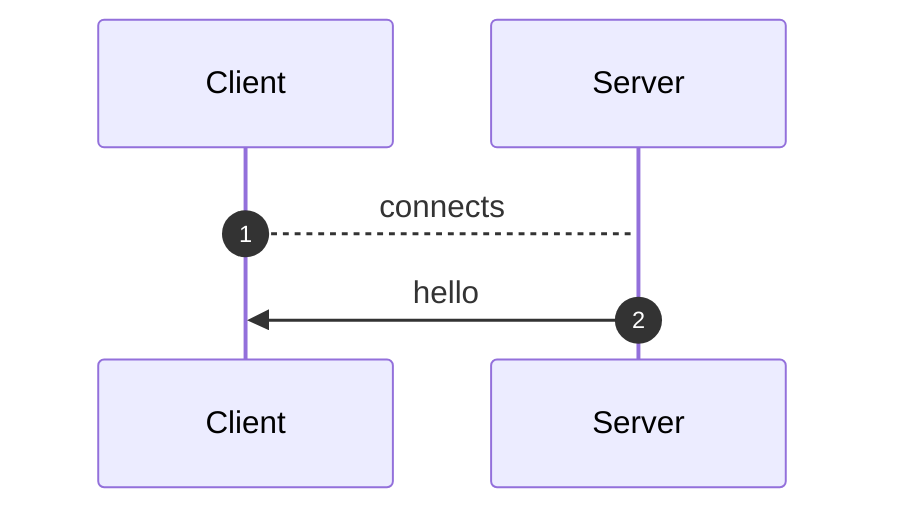
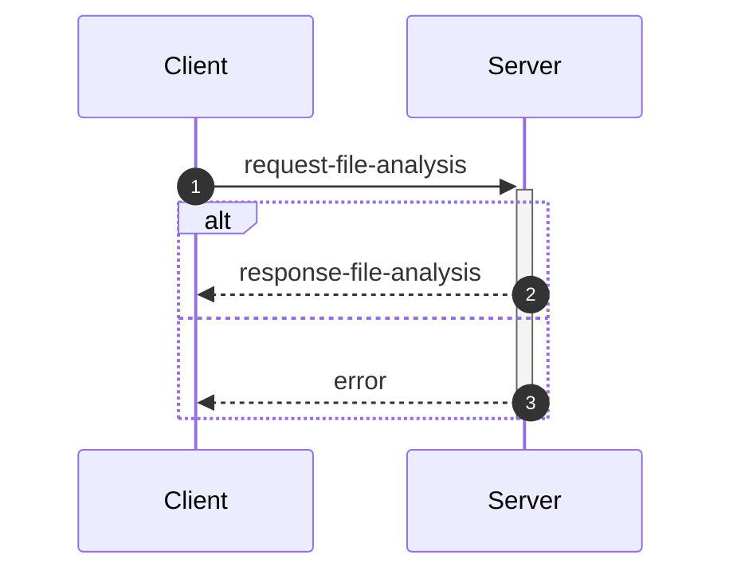
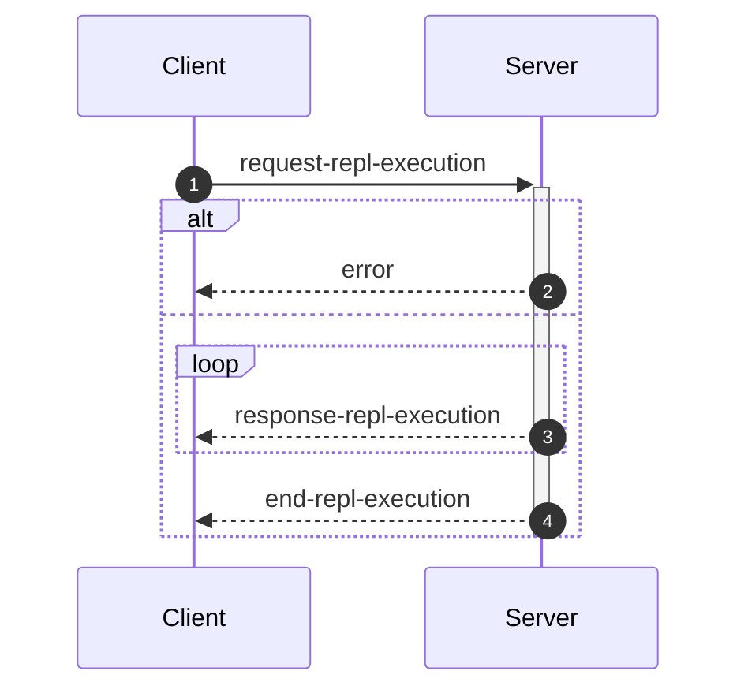
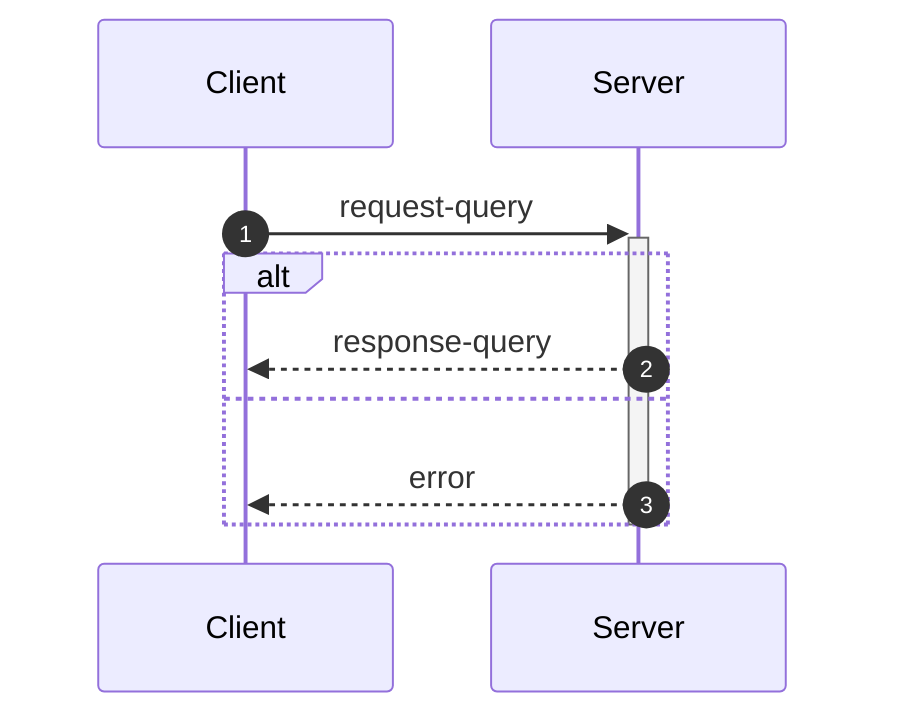

_<span title="an overview of flowR's interface">Generated</span> from '[wiki-interface.ts](https://github.com/flowr-analysis/flowr/tree/main/src/documentation/wiki-interface.ts "src/documentation/wiki-interface.ts")' on 2026-11-08, 15:21:58 UTC (v2.17.4, R v4.6.1), do not edit directly._

Although far from being as detailed as the in-depth explanation of [_flowR_](https://github.com/flowr-analysis/flowr/wiki/Core),
this wiki page explains how to interface with _flowR_ in more detail.
In general, command line arguments and other options provide short descriptions on hover over.

* [💻 Using the REPL](#using-the-repl)
* [⚙️ Configuring FlowR](#configuring-flowr)
* [⚒️ Writing Code](#writing-code)
* [💬 Communicating with the Server](#communicating-with-the-server)

<a id='using-the-repl'></a>
## 💻 Using the REPL

> [!NOTE]
> To execute arbitrary R commands with a repl request, _flowR_ has to be started explicitly with <span title="Description (Command Line Argument): Allow to access the underlying R session when using flowR (security warning: this allows the execution of arbitrary R code!)">`--r-session-access`</span>.
> Please be aware that this introduces a security risk and note that this relies on the [`r-shell` engine](https://github.com/flowr-analysis/flowr/wiki/Engines) .

Although primarily meant for users to explore,
there is nothing which forbids calling _flowR_ as a subprocess to use standard-in, -output, and -error
for communication (although you can access the REPL using the server as well,
with the [REPL Request](#message-request-repl-execution) message).

The read-eval-print loop&nbsp;(REPL) works relatively simple.
You can submit an expression (using <kbd>Enter</kbd>),
which is interpreted as an R&nbsp;expression by default but interpreted as a *command* if it starts with a colon (`:`).
The best command to get started with the REPL is <span title="Description (Repl Command): Show help information (aliases: :h, :?)">`:help`</span>.
Besides, you can leave the REPL either with the command <span title="Description (Repl Command): End the repl (aliases: :q, :exit)">`:quit`</span> or by pressing <kbd>Ctrl</kbd>+<kbd>C</kbd> twice.
When writing a *command*, you may press <kbd>Tab</kbd> to get a list of completions, if available.
Multiple commands can be entered in a single line by separating them with a semicolon (`;`), e.g. `:parse "x<-2"; :df*`.
If a command is given without R code, the REPL will re-use R code given in a previous command.
The prior example will hence return first the parsed AST of the program and then the dataflow graph for `"x <- 2"`.

> [!NOTE]
> If you develop flowR, you may want to launch the repl using the `npm run main-dev` command, this way, you get a non-minified version of flowR with debug information and hot-reloading of source files.

<details>
<summary>Available Commands</summary>

We currently offer the following commands (this with a `[*]` suffix are available with and without the star):

| Command | Description |
| ------- | ----------- |
| **<span title="Description (Repl Command): End the repl (aliases: :q, :exit)">:quit</span>** | End the repl (aliases: **:<span title="Alias of ':quit'. End the repl">q</span>**, **:<span title="Alias of ':quit'. End the repl">exit</span>**) |
| **<span title="Description (Repl Command): Execute the given code as R code. This requires the `--r-session-access` flag to be set and requires the r-shell engine. (aliases: :e, :r)">:execute</span>** | Execute the given code as R code. This requires the `--r-session-access` flag to be set and requires the r-shell engine. (aliases: **:<span title="Alias of ':execute'. Execute the given code as R code. This requires the `--r-session-access` flag to be set and requires the r-shell engine.">e</span>**, **:<span title="Alias of ':execute'. Execute the given code as R code. This requires the `--r-session-access` flag to be set and requires the r-shell engine.">r</span>**) |
| **<span title="Description (Repl Command): Get mermaid code for the control-flow graph of R code (aliases: :cfg, :cf)">:controlflow[*]</span>** | Get mermaid code for the control-flow graph of R code (star: Returns the URL to mermaid.live) (aliases: **:<span title="Alias of ':controlflow'. Get mermaid code for the control-flow graph of R code">cfg</span>**, **:<span title="Alias of ':controlflow'. Get mermaid code for the control-flow graph of R code">cf</span>**) |
| **<span title="Description (Repl Command): Get mermaid code for the control-flow graph with basic blocks (aliases: :cfgb, :cfb)">:controlflowbb[*]</span>** | Get mermaid code for the control-flow graph with basic blocks (star: Returns the URL to mermaid.live) (aliases: **:<span title="Alias of ':controlflowbb'. Get mermaid code for the control-flow graph with basic blocks">cfgb</span>**, **:<span title="Alias of ':controlflowbb'. Get mermaid code for the control-flow graph with basic blocks">cfb</span>**) |
| **<span title="Description (Repl Command): Get mermaid code for the dataflow graph (aliases: :d, :df)">:dataflow[*]</span>** | Get mermaid code for the dataflow graph (star: Returns the URL to mermaid.live) (aliases: **:<span title="Alias of ':dataflow'. Get mermaid code for the dataflow graph">d</span>**, **:<span title="Alias of ':dataflow'. Get mermaid code for the dataflow graph">df</span>**) |
| **<span title="Description (Repl Command): Get mermaid code for the normalized AST of R code (aliases: :n)">:normalize[*]</span>** | Get mermaid code for the normalized AST of R code (star: Returns the URL to mermaid.live) (alias: **:<span title="Alias of ':normalize'. Get mermaid code for the normalized AST of R code">n</span>**) |
| **<span title="Description (Repl Command): Get mermaid code for the simplified dataflow graph (aliases: :ds, :dfs)">:dataflowsimple[*]</span>** | Get mermaid code for the simplified dataflow graph (star: Returns the URL to mermaid.live) (aliases: **:<span title="Alias of ':dataflowsimple'. Get mermaid code for the simplified dataflow graph">ds</span>**, **:<span title="Alias of ':dataflowsimple'. Get mermaid code for the simplified dataflow graph">dfs</span>**) |
| **<span title="Description (Repl Command): Inspect and extend the signature database: `query` (identical to :query @signature), `info <name>` for where a function comes from (identical to :query @function-info), `add <path>` to mount another database/source, `download` to fetch the full-history database. (aliases: :sig)">:signature</span>** | Inspect and extend the signature database: `query` (identical to :query @signature), `info <name>` for where a function comes from (identical to :query @function-info), `add <path>` to mount another database/source, `download` to fetch the full-history database. (alias: **:<span title="Alias of ':signature'. Inspect and extend the signature database: `query` (identical to :query @signature), `info <name>` for where a function comes from (identical to :query @function-info), `add <path>` to mount another database/source, `download` to fetch the full-history database.">sig</span>**) |
| **<span title="Description (Repl Command): Just calculates the DFG, but only prints summary info (aliases: :d#, :df#)">:dataflowsilent</span>** | Just calculates the DFG, but only prints summary info (aliases: **:<span title="Alias of ':dataflowsilent'. Just calculates the DFG, but only prints summary info">d#</span>**, **:<span title="Alias of ':dataflowsilent'. Just calculates the DFG, but only prints summary info">df#</span>**) |
| **<span title="Description (Repl Command): Prints ASCII Art of the parsed, unmodified AST (aliases: :p)">:parse</span>** | Prints ASCII Art of the parsed, unmodified AST (alias: **:<span title="Alias of ':parse'. Prints ASCII Art of the parsed, unmodified AST">p</span>**) |
| **<span title="Description (Repl Command): Prints the version of flowR as well as the current version of R">:version</span>** | Prints the version of flowR as well as the current version of R
| **<span title="Description (Repl Command): Query the given R code (use 'help' for more information)">:query[*]</span>** | Query the given R code (use 'help' for more information) (star: Similar to query, but returns the output in json format.)
| **<span title="Description (Repl Command): Returns an ASCII representation of the dataflow graph (aliases: :df!)">:dataflowascii</span>** | Returns an ASCII representation of the dataflow graph (alias: **:<span title="Alias of ':dataflowascii'. Returns an ASCII representation of the dataflow graph">df!</span>**) |
| **<span title="Description (Repl Command): Returns summarization stats for the normalized AST (aliases: :n#)">:normalize#</span>** | Returns summarization stats for the normalized AST (alias: **:<span title="Alias of ':normalize#'. Returns summarization stats for the normalized AST">n#</span>**) |
| **<span title="Description (Repl Command): Show help information (aliases: :h, :?)">:help</span>** | Show help information (aliases: **:<span title="Alias of ':help'. Show help information">h</span>**, **:<span title="Alias of ':help'. Show help information">?</span>**) |

</details>

> [!TIP]
> 
> As indicated by the examples before, all REPL commands that operate on code keep track of the state.
> Hence, if you run a command like <span title="Description (Repl Command, starred version): Returns the URL to mermaid.live; Base Command: Get mermaid code for the dataflow graph (aliases: :d*, :df*)">`:dataflow*`</span> without providing R code,
> the REPL will re-use the R code provided in a previous command.
> Likewise, doing this will benefit from incrementality!
> If you request the dataflow graph with `:df* x <- 2 * y` and then want to see the parsed AST with `:parse`,
> the REPL will re-use previously obtained information and not re-parse the code again.
> 		

Generally, many commands offer shortcut versions in the REPL. Many queries, for example, offer a shortened format (see the example below).
Of special note, the [Config Query](https://github.com/flowr-analysis/flowr/wiki/%5BQuery%5D-Config)
can be used to also modify the currently active configuration of _flowR_ within the REPL (see the [wiki page](https://github.com/flowr-analysis/flowr/wiki/%5BQuery%5D-Config) for more information).

### Example: Retrieving the Dataflow Graph

To retrieve a URL to the [mermaid](https://mermaid.js.org/) diagram of the dataflow of a given expression,
use <span title="Description (Repl Command, starred version): Returns the URL to mermaid.live; Base Command: Get mermaid code for the dataflow graph (aliases: :d*, :df*)">`:dataflow*`</span> (or <span title="Description (Repl Command): Get mermaid code for the dataflow graph (aliases: :d, :df)">`:dataflow`</span> to get the mermaid code in the cli):

```shell
$ docker run -it --rm eagleoutice/flowr # or npm run flowr 
flowR repl v2.17.4, R grammar v14 (tree-sitter engine)
R> :dataflow* y <- 1 + x
```

<details>
<summary style='color:gray'>Output</summary>

```text
https://mermaid.live/view#base64:eyJjb2RlIjoiZmxvd2NoYXJ0IFREXG4gICAgMXt7XCJgKiM5MTtSTnVtYmVyIzkzOyogKioxKipcbiAgICAgICoxLjYqICgqKmlkOiAxKiopYFwifX1cbiAgICAyKFtcImAqIzkxO1JTeW1ib2wjOTM7KiAqKngqKlxuICAgICAgKjEuMTAqICgqKmlkOiAyKiopYFwiXSlcbiAgICAzW1tcImAqIzkxO1JCaW5hcnlPcCM5MzsqIGJhc2UjNTg7IzU4OyoqIzQzOyoqXG4gICAgICAqMS42LTEwKiAoKippZDogMyoqKVxuICAgIGFyZzogKDEsIDIpYFwiXV1cbiAgICBidWlsdC1pbjpfNDNfW1wiYEJ1aWx0LUluOlxuIzQzO2BcIl1cbiAgICBzdHlsZSBidWlsdC1pbjpfNDNfIHN0cm9rZTpncmF5LGZpbGw6Z3JheSxzdHJva2Utd2lkdGg6MnB4LG9wYWNpdHk6Ljg7XG4gICAgMFtcImAqIzkxO1JTeW1ib2wjOTM7KiAqKnkqKlxuICAgICAgKjEuMSogKCoqaWQ6IDAqKiwgdjogMylgXCJdXG4gICAgNFtbXCJgKiM5MTtSQmluYXJ5T3AjOTM7KiBiYXNlIzU4OyM1ODsqKiM2MDsjNDU7KipcbiAgICAgICoxLjEtMTAqICgqKmlkOiA0KiopXG4gICAgYXJnOiAoMCwgMylgXCJdXVxuICAgIGJ1aWx0LWluOl82MF8tW1wiYEJ1aWx0LUluOlxuIzYwOyM0NTtgXCJdXG4gICAgc3R5bGUgYnVpbHQtaW46XzYwXy0gc3Ryb2tlOmdyYXksZmlsbDpncmF5LHN0cm9rZS13aWR0aDoycHgsb3BhY2l0eTouODtcbiAgICAxIC0uLT58XCJmbG93XCJ8IDJcbiAgICBsaW5rU3R5bGUgMCBzdHJva2U6Z3JheSxjb2xvcjpncmF5O1xuICAgIDIgLS4tPnxcImZsb3dcInwgM1xuICAgIGxpbmtTdHlsZSAxIHN0cm9rZTpncmF5LGNvbG9yOmdyYXk7XG4gICAgMyAtLT58XCJyZWFkcywgYXJnXCJ8IDFcbiAgICAzIC0tPnxcInJlYWRzLCBhcmdcInwgMlxuICAgIDMgLS4tPnxcImZsb3dcInwgMFxuICAgIGxpbmtTdHlsZSA0IHN0cm9rZTpncmF5LGNvbG9yOmdyYXk7XG4gICAgMyAtLi0+fFwicmVhZHMsIGNhbGxzXCJ8IGJ1aWx0LWluOl80M19cbiAgICBsaW5rU3R5bGUgNSBzdHJva2U6Z3JheTtcbiAgICAwIC0tPnxcImRlZmluZWQtYnksIGZsb3dcInwgNFxuICAgIDAgLS0+fFwiZGVmaW5lZC1ieVwifCAzXG4gICAgNCAtLT58XCJyZWFkcywgYXJnXCJ8IDNcbiAgICA0IC0tPnxcInJldHVybnMsIGFyZ1wifCAwXG4gICAgNCAtLi0+fFwicmVhZHMsIGNhbGxzXCJ8IGJ1aWx0LWluOl82MF8tXG4gICAgbGlua1N0eWxlIDEwIHN0cm9rZTpncmF5OyIsIm1lcm1haWQiOnsiYXV0b1N5bmMiOnRydWV9fQ==
```

Retrieve the dataflow graph of the expression `y <- 1 + x`. It looks like this:


<details>

<summary style="color:gray">R Code of the Dataflow Graph</summary>

The analysis ran (parse and normalize with the [tree-sitter](https://github.com/flowr-analysis/flowr/wiki/Engines) engine) in the generation environment. No [signature database](https://github.com/flowr-analysis/flowr/wiki/Signature-Database) is mounted, so `library()` attaches no exports (base-R names are still qualified, e.g., `stats::acf`). 
We encountered no unknown side effects during the analysis.

```r
y <- 1 + x
```

</details>

</details>

For small graphs like this, <span title="Description (Repl Command): Returns an ASCII representation of the dataflow graph (aliases: :df!)">`:dataflowascii`</span> also provides an ASCII representation directly in the REPL:

```shell
$ docker run -it --rm eagleoutice/flowr # or npm run flowr 
flowR repl v2.17.4, R grammar v14 (tree-sitter engine)
R> :df! y <- 1 + x
```

<details open>
<summary style='color:gray'>Output</summary>

```text
                        v<0>v
 c<4>c──────────────────| y |
 |<- |     ┌────────────v---v
 c---c     │
    │   c<3>c   0<1>0
    └───| + |───| 1 |───u<2>u
        c---c   0---0   | x |
           └────────────u---u
Edges:
3 -> 1: reads, arg          3 -> 2: reads, arg
3 -> 0: flows-to            1 -> 2: flows-to
2 -> 3: flows-to            4 -> 3: reads, arg
4 -> 0: returns, arg        0 -> 4: defined-by, flows-to
0 -> 3: defined-by
```

Retrieve the dataflow graph of the expression `y <- 1 + x` as ASCII art.

</details>

For the slicing with <span title="Description (Repl Command): Static backwards executable slicer for R">`:slicer`</span>, you have access to the same [magic comments](#slice-magic-comments) as with the [slice request](#message-request-slice).
Pass `--inline` to splice resolvable `source()` calls into the reconstruction so the slice is a single self-contained R text (the same as the static slice query's `inlineSources` flag).
See `--help` for more flags!

### Example: Interfacing with the File System

Many commands that allow for an R-expression (like <span title="Description (Repl Command, starred version): Returns the URL to mermaid.live; Base Command: Get mermaid code for the dataflow graph (aliases: :d*, :df*)">`:dataflow*`</span>) allow for a file as well
if the argument starts with `file://`.
If you are working from the root directory of the _flowR_ repository, the following gives you the parsed AST of the example file using the <span title="Description (Repl Command): Prints ASCII Art of the parsed, unmodified AST (aliases: :p)">`:parse`</span> command:

> **Watch mode**: Replace `file://` with `watch://` to enter watch mode.
> flowR runs the command immediately and then re-runs it every time the file (or any file inside the folder) changes.
> Enter any other command to leave watch mode.
> For example: `:df watch://analysis.R`

```shell
$ docker run -it --rm eagleoutice/flowr # or npm run flowr 
flowR repl v2.17.4, R grammar v14 (tree-sitter engine)
R> :parse file://test/testfiles/example.R
```

<details>
<summary style='color:gray'>Output</summary>

```text
File: test/testfiles/example.R

program
├ binaryoperator
│ ├ identifier "sum" (1:1─4)
│ ├ <- "<-" (1:5─7)
│ ╰ float "0" (1:8─9)
├ binaryoperator
│ ├ identifier "product" (2:1─8)
│ ├ <- "<-" (2:9─11)
│ ╰ float "1" (2:12─13)
├ binaryoperator
│ ├ identifier "w" (3:1─2)
│ ├ <- "<-" (3:3─5)
│ ╰ float "7" (3:6─7)
├ binaryoperator
│ ├ identifier "N" (4:1─2)
│ ├ <- "<-" (4:3─5)
│ ╰ float "10" (4:6─8)
├ forstatement
│ ├ for "for" (6:1─4)
│ ├ ( "(" (6:5─6)
│ ├ identifier "i" (6:6─7)
│ ├ in "in" (6:8─10)
│ ├ binaryoperator
│ │ ├ float "1" (6:11─12)
│ │ ├ : ":" (6:12─13)
│ │ ╰ parenthesizedexpression
│ │   ├ ( "(" (6:13─14)
│ │   ├ binaryoperator
│ │   │ ├ identifier "N" (6:14─15)
│ │   │ ├ - "-" (6:15─16)
│ │   │ ╰ float "1" (6:16─17)
│ │   ╰ ) ")" (6:17─18)
│ ├ ) ")" (6:18─19)
│ ╰ bracedexpression
│   ├ { "{" (6:20─21)
│   ├ binaryoperator
│   │ ├ identifier "sum" (7:3─6)
│   │ ├ <- "<-" (7:7─9)
│   │ ╰ binaryoperator
│   │   ├ binaryoperator
│   │   │ ├ identifier "sum" (7:10─13)
│   │   │ ├ + "+" (7:14─15)
│   │   │ ╰ identifier "i" (7:16─17)
│   │   ├ + "+" (7:18─19)
│   │   ╰ identifier "w" (7:20─21)
│   ├ binaryoperator
│   │ ├ identifier "product" (8:3─10)
│   │ ├ <- "<-" (8:11─13)
│   │ ╰ binaryoperator
│   │   ├ identifier "product" (8:14─21)
│   │   ├  "" (8:22─23)
│   │   ╰ identifier "i" (8:24─25)
│   ╰ } "}" (9:1─2)
├ call
│ ├ identifier "cat" (11:1─4)
│ ╰ arguments
│   ├ ( "(" (11:4─5)
│   ├ argument
│   │ ╰ string
│   │   ├ stringopen "\"" (11:5─6)
│   │   ├ stringcontent "Sum:" (11:6─10)
│   │   ╰ stringclose "\"" (11:10─11)
│   ├ comma "," (11:11─12)
│   ├ argument
│   │ ╰ identifier "sum" (11:13─16)
│   ├ comma "," (11:16─17)
│   ├ argument
│   │ ╰ string
│   │   ├ stringopen "\"" (11:18─19)
│   │   ├ stringcontent
│   │   │ ╰ escapesequence "\\n" (11:19─21)
│   │   ╰ stringclose "\"" (11:21─22)
│   ╰ ) ")" (11:22─23)
╰ call
  ├ identifier "cat" (12:1─4)
  ╰ arguments
    ├ ( "(" (12:4─5)
    ├ argument
    │ ╰ string
    │   ├ stringopen "\"" (12:5─6)
    │   ├ stringcontent "Product:" (12:6─14)
    │   ╰ stringclose "\"" (12:14─15)
    ├ comma "," (12:15─16)
    ├ argument
    │ ╰ identifier "product" (12:17─24)
    ├ comma "," (12:24─25)
    ├ argument
    │ ╰ string
    │   ├ stringopen "\"" (12:26─27)
    │   ├ stringcontent
    │   │ ╰ escapesequence "\\n" (12:27─29)
    │   ╰ stringclose "\"" (12:29─30)
    ╰ ) ")" (12:30─31)
```

Retrieve the parsed AST of the example file.

<details>

<summary>File Content</summary>

```r
sum <- 0
product <- 1
w <- 7
N <- 10

for (i in 1:(N-1)) {
  sum <- sum + i + w
  product <- product * i
}

cat("Sum:", sum, "\n")
cat("Product:", product, "\n")
```

</details>

As _flowR_ directly transforms this AST the output focuses on being human-readable instead of being machine-readable.
		
</details>

### Example: Run a Query

You can run any query supported by _flowR_ using the <span title="Description (Repl Command): Query the given R code (use 'help' for more information)">`:query`</span> command.
For example, to obtain the shapes of all data frames in a given piece of code, you can run:

```shell
$ docker run -it --rm eagleoutice/flowr # or npm run flowr 
flowR repl v2.17.4, R grammar v14 (tree-sitter engine)
R> :query @absint df-shape "x <- data.frame(a = 1:10, b = 1:10)\ny <- x$a"
```

<details open>
<summary style='color:gray'>Output</summary>

```text
Query: absint (1 ms)
   ╰ $12: (colnames: [{"a", "b"}, {}], cols: [2, 2], rows: [10, 10])
   ╰ $0: (colnames: [{"a", "b"}, {}], cols: [2, 2], rows: [10, 10])
```

Retrieve the shapes of all data frames in the given code.

</details>

To run the linter on a file, you can use (in this example, we just issue the `dead-code` linter on a small piece of code):

```shell
$ docker run -it --rm eagleoutice/flowr # or npm run flowr 
flowR repl v2.17.4, R grammar v14 (tree-sitter engine)
R> :query @linter rules:dead-code "if(FALSE) x <- 2"
```

<details open>
<summary style='color:gray'>Output</summary>

```text
Query: linter (2 ms)
   ╰ Dead Code (dead-code):
       ╰ certain:
           ╰ Code at 1.11-16 (1 quick fix(es) available)
```

Run the linter on the given code, with only the `dead-code` rule enabled.

</details>

For more information on the available queries, please check out the [Query API](https://github.com/flowr-analysis/flowr/wiki/Query-API).

<a id='configuring-flowr'></a>
## ⚙️ Configuring FlowR

When running _flowR_, you may want to specify some behaviors with a dedicated configuration file.
By default, flowR looks for a file named `flowr.json` in the current working directory (or any higher directory).
You can also specify a different file with <span title="Description (Command Line Argument): The name of the configuration file to use">`--config-file`</span> or pass the configuration inline using <span title="Description (Command Line Argument): The flowR configuration to use, as a JSON string">`--config-json`</span>.
A `flowr.json` found this way belongs to the analyzed project, so flowR ignores its options that decide what flowR executes or loads
(`engines.*.wasmPath`, `engines.*.treeSitterWasmPath`, `engines.*.rPath`, `solver.sigdb.additionalPaths`, `solver.sigdb.downloadRepo`, `solver.sigdb.installedLibrary.paths`, `solver.sigdb.onDemand.enabled`, `solver.sigdb.onDemand.repositories`, `solver.sigdb.onDemand.cranMirror`, `solver.sigdb.onDemand.bioconductorMirror`, `solver.sigdb.onDemand.cacheDir`),
unless you pass <span title="Description (Command Line Argument): Keep the security-sensitive options (e.g., the R executable) of the flowr.json found in the working directory or a parent. Only use this for projects you trust.">`--trust-config`</span>.
To analyze code you do not trust, use the secure mode (<span title="Description (Command Line Argument): Run in secure mode for analyzing untrusted code: flowR does not start R (or any other process), does not access the network, does not search for project configs, and ignores security-sensitive options in every config. Cannot be disabled once enabled. Can also be enabled with the environment variable {italic FLOWR_SECURE_MODE=1}.">`--secure`</span>, see the [security policy](https://github.com/flowr-analysis/flowr/blob/main/.github/SECURITY.md)).
To inspect the current configuration, you can run flowr with the <span title="Description (Command Line Argument): Run with verbose logging (will be passed to the corresponding script)">`--verbose`</span> flag, or use the `config` [Query](https://github.com/flowr-analysis/flowr/wiki/Query-API).
Within the REPL this works by running the following:

```shell
:query @config
```

To work with the <a href="https://github.com/flowr-analysis/flowr/tree/main/src/config.ts#L124"><code><span title="The configuration file format for flowR.">FlowrConfig</span></code></a> you can use the provided helper objects alongside its methods like
<a href="https://github.com/flowr-analysis/flowr/tree/main/src/config.ts#L990"><code><span title="Creates a new flowr config that has the updated values.">FlowrConfig::<b>amend</b></span></code></a>.
The schema below documents every option; the ones you most likely want are:

- <a href="https://github.com/flowr-analysis/flowr/wiki/Interface#configuring-flowr" title="Configuration Option (boolean): Whether source calls should be ignored, causing {@link processSourceCall}&#39;s behavior to be skipped.">ignoreSourceCalls</a>: ignore source calls when analyzing the code, i.e., ignore the inclusion of other files.
- <a href="https://github.com/flowr-analysis/flowr/wiki/Interface#configuring-flowr" title="Configuration Option (boolean): Whether load calls should be ignored, causing {@link processLoadCall}&#39;s behavior to be skipped.">ignoreLoadCalls</a>: ignore load calls when analyzing the code, i.e., ignore the loading of r-data files.
- <a href="https://github.com/flowr-analysis/flowr/wiki/Interface#configuring-flowr" title="Configuration Option (object): Do you want to overwrite (parts) of the builtin definition?">semantics.environment.overwriteBuiltIns</a>: overwrite _flowR_'s handling of built-in functions, or clear the preset definitions entirely.
  See [Configure BuiltIn Semantics](#configure-builtin-semantics) for more information.
- <a href="https://github.com/flowr-analysis/flowr/wiki/Interface#configuring-flowr" title="Configuration Option (boolean): Whether calls drawing on a graphics device (e.g., `plot`) count as writing to it, which the ambient state queries then report.">semantics.ambient.drawingWritesDevice</a>: whether calls drawing on a graphics device (e.g., `plot`) count as writing the device in the ambient state queries.
- <a href="https://github.com/flowr-analysis/flowr/wiki/Interface#configuring-flowr" title="Configuration Option (string): How to resolve variables and their values. (one of &quot;disabled&quot;, &quot;alias&quot;, &quot;builtin&quot;)">solver.variables</a>: how to resolve variables and their values (`disabled`, `alias`, `builtin`).
- <a href="https://github.com/flowr-analysis/flowr/wiki/Interface#configuring-flowr" title="Configuration Option (array): The engine or set of engines to use for interacting with R code. An empty array means all available engines will be used.">engines</a> and <a href="https://github.com/flowr-analysis/flowr/wiki/Interface#configuring-flowr" title="Configuration Option (string): The default engine to use for interacting with R code. If this is undefined, an arbitrary engine from the specified list will be used. (one of &quot;tree-sitter&quot;, &quot;r-shell&quot;)">defaultEngine</a>: the engines used to interact with R code, see the [Engines wiki page](https://github.com/flowr-analysis/flowr/wiki/Engines).
- <a href="https://github.com/flowr-analysis/flowr/wiki/Interface#configuring-flowr" title="Configuration Option (array): Files a framework loads on its own, without any source() call (e.g. global.R in a shiny app), in the order they are loaded; flowR orders the matching project files accordingly and analyzes them as one program. Entries are case-insensitive globs matched against the file path, a plain name matches any file with that name, and entries matching no project file are warned about. Usually set per project kind via specializeConfig.">project.implicitSources</a>: the files a framework loads without any `source()` call, in the order in which they are
  loaded. Entries are globs (e.g. `R/*.R`) matched against the file path ignoring capitalization; one matching no file is reported.
- <a href="https://github.com/flowr-analysis/flowr/wiki/Interface#configuring-flowr" title="Configuration Option (object): Overwrite (parts of) the configuration depending on the project kind flowR detects, e.g. to give a shiny app its implicit sources.">specializeConfig</a>: overwrite (parts of) the configuration depending on the kind of project _flowR_ detects
  (e.g. `shiny-app`), which is how a shiny app gets its implicit sources by default. What you configure directly wins.
- <a href="https://github.com/flowr-analysis/flowr/wiki/Interface#configuring-flowr" title="Configuration Option (string): Overwrite the project kind flowR would otherwise infer from the analyzed files, e.g. when auto-detection guesses wrong. (one of &quot;package&quot;, &quot;script&quot;, &quot;shiny-app&quot;, &quot;notebook&quot;, &quot;project&quot;, &quot;unknown&quot;)">project.useProjectType</a>: skip that detection and force a project kind yourself, when auto-detection guesses wrong.
- <a href="https://github.com/flowr-analysis/flowr/wiki/Interface#configuring-flowr" title="Configuration Option (array): The default plugins to load when creating a new instance of FlowrAnalyzer">defaultPlugins</a> and <a href="https://github.com/flowr-analysis/flowr/wiki/Interface#configuring-flowr" title="Configuration Option (array): The plugins to load in REPL mode">repl.plugins</a>: the plugins to load for a new <a href="https://github.com/flowr-analysis/flowr/tree/main/src/project/flowr-analyzer.ts#L240"><code><span title="Central class for conducting analyses with FlowR. Use the FlowrAnalyzerBuilder to create a new instance. If you want the original pattern of creating a pipeline and running all steps, you can still do this with FlowrAnalyzer#runFull . To inspect the context of the analyzer, use FlowrAnalyzer#inspectContext (if you are a plugin and need to modify it, use FlowrAnalyzer#context instead).">FlowrAnalyzer</span></code></a> and in the REPL
  (use `flowr:default` to reference the former).

So you can configure _flowR_ by adding a file like the following:

<details>

<summary>Example Configuration File</summary>

```json
{
  "ignoreSourceCalls": true,
  "ignoreLoadCalls": true,
  "semantics": {
    "environment": {
      "overwriteBuiltIns": {
        "definitions": [
          {
            "type": "function",
            "names": [
              "foo"
            ],
            "processor": "builtin:assign",
            "config": {}
          }
        ]
      }
    }
  },
  "defaultPlugins": [
    "file:description",
    "versions:description"
  ],
  "repl": {
    "quickStats": false,
    "dfProcessorHeat": false,
    "hints": true,
    "plugins": [
      "flowr:default"
    ]
  },
  "project": {
    "resolveUnknownPathsOnDisk": true,
    "implicitSources": [
      "global.R",
      "app.R"
    ]
  },
  "linter": {
    "disabledRules": []
  },
  "specializeConfig": {
    "shiny-app": {
      "project": {
        "implicitSources": [
          "global.R",
          "ui.R",
          "server.R",
          "app.R"
        ]
      }
    }
  },
  "engines": [
    {
      "type": "r-shell"
    }
  ],
  "solver": {
    "variables": "alias",
    "evalStrings": true,
    "trackEnvironments": true,
    "sigdb": {
      "enabled": true,
      "loadProjectDependencies": true,
      "eagerlyLoad": false,
      "eagerlyLoadExports": false,
      "linkBaseR": false,
      "linkDescriptionDependencies": false
    },
    "resolveSource": {
      "dropPaths": "no",
      "ignoreCapitalization": true,
      "inferWorkingDirectory": "active-script",
      "searchPath": []
    },
    "instrument": {},
    "slicer": {
      "threshold": 50
    }
  },
  "abstractInterpretation": {
    "wideningThreshold": 4,
    "followCalls": true,
    "dataFrame": {
      "maxColNames": 20,
      "readLoadedData": {
        "readExternalFiles": true,
        "maxReadLines": 1000000
      }
    }
  },
  "incremental": {
    "alwaysIncremental": false,
    "parsing": {
      "activated": false,
      "heuristics": {
        "activated": true,
        "mtime": true,
        "linesFrom": 500,
        "bytesFrom": 50000,
        "alwaysWithEdits": false,
        "minFiles": 1
      }
    }
  },
  "gas": {
    "thresholds": {
      "memory": {
        "problematic": 0.7,
        "critical": 0.9
      },
      "timeMs": {
        "problematic": 100000,
        "critical": 120000
      }
    },
    "features": {}
  }
}
```

</details>

<details>
<a id='configure-builtin-semantics'></a>
<summary>Configure Built-In Semantics</summary>

`semantics/environment/overwriteBuiltins` accepts two keys:

- `loadDefaults` (boolean, initially `true`): If set to `true`, the default built-in definitions are loaded before applying the custom definitions. Setting this flag to `false` explicitly disables the loading of the default definitions.
- `definitions` (array, initially empty): Allows to overwrite or define new built-in elements. Each object within must have a `type` which is one of the below. Furthermore, they may define a string array of `names` which specifies the identifiers to bind the definitions to. You may use `assumePrimitive` to specify whether _flowR_ should assume that this is a primitive non-library definition (so you probably just do not want to specify the key).

  | Type            | Description                                                                                                                                                                                                                                                                                              | Example                                                                                                    |
  | --------------- | -------------------------------------------------------------------------------------------------------------------------------------------------------------------------------------------------------------------------------------------------------------------------------------------------------- | ---------------------------------------------------------------------------------------------------------- |
  | `constant`    | Additionally allows for a `value` this should resolve to.                                                                                                                                                                                                                                                | `{ type: 'constant', names: ['NULL', 'NA'],  value: null }`                                                |
  | `function`    | Is a rather flexible way to define and bind built-in functions. For the time, we do not have extensive documentation to cover all the cases, so please either consult the sources with the `default-builtin-config/` folder or open a [new issue](https://github.com/flowr-analysis/flowr/issues/new/choose). | `{ type: 'function', names: ['next'], processor: 'builtin:d', config: { cfg: ExitPointType.Next } }` |
  | `replacement` | A comfortable way to specify replacement functions like `$<-` or `names<-`. `suffixes` describes the... suffixes to attach automatically. | `{ type: 'replacement', suffixes: ['<-', '<<-'], names: ['[', '[['] }` |

</details>

<details>

<summary style='color:gray'>Full Configuration-File Schema</summary>

- _The configuration file format for flowR._ (object)
    - **logLevel** [optional] _flowR's global minimum log level, applied when the config is loaded._ (string)
        Only allows: 'silly', 'trace', 'debug', 'info', 'warn', 'error', 'fatal'
    - **ignoreSourceCalls** [optional] _Whether source calls should be ignored, causing {@link processSourceCall}'s behavior to be skipped._ (boolean)
    - **ignoreLoadCalls** [optional] _Whether load calls should be ignored, causing {@link processLoadCall}'s behavior to be skipped._ (boolean)
    - **semantics** _Configure language semantics and how flowR handles them._ (object)
        - **environment** [optional] _Semantics regarding how to handle the R environment._ (object)
            - **overwriteBuiltIns** [optional] _Do you want to overwrite (parts) of the builtin definition?_ (object)
                - **loadDefaults** [optional] _Should the default configuration still be loaded?_ (boolean)
                - **definitions** [optional] _The definitions to load/overwrite._ (array)
                Valid item types:
                    - (object)
        - **ambient** [optional] _Semantics regarding the global state (options, devices, files, ...) calls access._ (object)
            - **drawingWritesDevice** [optional] _Whether calls drawing on a graphics device (e.g., `plot`) count as writing to it, which the ambient state queries then report._ (boolean)
    - **defaultPlugins** [optional] _The default plugins to load when creating a new instance of FlowrAnalyzer_ (array)
    Valid item types:
        - (alternatives)
            - (string)
            - (array)
    - **repl** _Configuration options for the REPL._ (object)
        - **quickStats** [optional] _Whether to show quick stats in the REPL after each evaluation._ (boolean)
        - **dfProcessorHeat** [optional] _This instruments the dataflow processors to count how often each processor is called._ (boolean)
        - **hints** [optional] _Whether to show dim inline hints on the empty prompt (automatically disabled on non-interactive terminals)._ (boolean)
        - **plugins** [optional] _The plugins to load in REPL mode_ (array)
        Valid item types:
            - (alternatives)
                - (string)
                - (array)
        - **autoUseFileProtocol** [optional] _Prepend the file protocol to a repl input that looks like a path, instead of only warning about it._ (boolean)
        - **queryStats** [optional] _Whether `:query` closes with the line stating how long the queries took (`:query*` never prints it)._ (boolean)
        - **showPlugins** [optional] _Whether `:version` grays out the plugins that did not activate during the last analysis._ (boolean)
    - **project** _Project specific configuration options._ (object)
        - **resolveUnknownPathsOnDisk** [optional] _Whether to resolve unknown paths loaded by the r project disk when trying to source/analyze files._ (boolean)
        - **failOnInaccessiblePath** [optional] _Whether a directory that cannot be traversed during file discovery (e.g. due to permissions) aborts the analysis; when false (the default) such paths are logged and skipped._ (boolean)
        - **basePackages** [optional] _The packages considered part of R itself (base and recommended); if unset, flowR uses its built-in list._ (array)
        Valid item types:
            - (string)
        - **implicitSources** [optional] _Files a framework loads on its own, without any source() call (e.g. global.R in a shiny app), in the order they are loaded; flowR orders the matching project files accordingly and analyzes them as one program. Entries are case-insensitive globs matched against the file path, a plain name matches any file with that name, and entries matching no project file are warned about. Usually set per project kind via specializeConfig._ (array)
        Valid item types:
            - (string)
        - **useProjectType** [optional] _Overwrite the project kind flowR would otherwise infer from the analyzed files, e.g. when auto-detection guesses wrong._ (string)
            Only allows: 'package', 'script', 'shiny-app', 'notebook', 'project', 'unknown'
        - **assumeImplicitEcho** [optional] _Whether the top level of the analyzed code is echoed, so that every visible result printed there is collected as an output by the dependencies query (default true, false for a package)._ (boolean)
        - **discovery** [optional] _Scoping options for the default project discovery._ (object)
            - **full** [optional] _Collect every file below the project root (greedy) instead of only the files the detected project kind needs (default false)._ (boolean)
            - **perKind** [optional] _Per-kind include/exclude glob overrides layered on the default scoping._ (object)
            - **ignore** [optional] _Case-insensitive globs that drop matching files from the intelligent discovery, regardless of kind (e.g. .Renviron to ignore environment files)._ (array)
            Valid item types:
                - (string)
        - **classification** [optional] _Overrides for the signals flowR uses to classify the project kind._ (object)
            - **shinyDescriptionTypes** [optional] _DESCRIPTION Type: values that mark a shiny app._ (array)
            Valid item types:
                - (string)
            - **shinyEntryFiles** [optional] _File names a shiny app is assembled from._ (array)
            Valid item types:
                - (string)
            - **shinyUsagePattern** [optional] _Regex source evidencing shiny usage in an entry file._ (string)
            - **notebookExtensions** [optional] _File extensions marking a notebook._ (array)
            Valid item types:
                - (string)
    - **linter** _Linter configuration options._ (object)
        - **disabledRules** _Linting rule names excluded from the default rule set (a rule requested explicitly via a linter query still runs). Usually set per project kind via specializeConfig._ (array)
        Valid item types:
            - (string)
        - **disabledTags** [optional] _Linting rule tags whose rules are excluded from the default rule set (a rule requested explicitly via a linter query still runs). By default the cmd-check rules are disabled for everything but a package; a configured list replaces that default._ (array)
        Valid item types:
            - (string)
    - **inputSources** [optional] _Further frameworks the input-sources analysis should know about; entries are added to flowR's defaults._ (object)
        - **pure** [optional] _Functions that only pass the constantness of their arguments on._ (array)
        Valid item types:
            - (string)
        - **param** [optional] _Functions whose result is a 'param' input._ (array)
        Valid item types:
            - (string)
        - **file** [optional] _Functions whose result is a 'file' input._ (array)
        Valid item types:
            - (string)
        - **tempfile** [optional] _Functions whose result is a 'tempfile' input._ (array)
        Valid item types:
            - (string)
        - **glob** [optional] _Functions whose result is a 'glob' input._ (array)
        Valid item types:
            - (string)
        - **net** [optional] _Functions whose result is a 'net' input._ (array)
        Valid item types:
            - (string)
        - **rand** [optional] _Functions whose result is a 'rand' input._ (array)
        Valid item types:
            - (string)
        - **system** [optional] _Functions whose result is a 'system' input._ (array)
        Valid item types:
            - (string)
        - **ffi** [optional] _Functions whose result is a 'ffi' input._ (array)
        Valid item types:
            - (string)
        - **lang** [optional] _Functions whose result is a 'lang' input._ (array)
        Valid item types:
            - (string)
        - **options** [optional] _Functions whose result is a 'options' input._ (array)
        Valid item types:
            - (string)
        - **cmdline** [optional] _Functions whose result is a 'cmdline' input._ (array)
        Valid item types:
            - (string)
        - **user** [optional] _Functions whose result is a 'user' input._ (array)
        Valid item types:
            - (string)
        - **const** [optional] _Functions whose result is a 'const' input._ (array)
        Valid item types:
            - (string)
        - **scope** [optional] _Functions whose result is a 'scope' input._ (array)
        Valid item types:
            - (string)
        - **dconst** [optional] _Functions whose result is a 'dconst' input._ (array)
        Valid item types:
            - (string)
        - **unknown** [optional] _Functions whose result is a 'unknown' input._ (array)
        Valid item types:
            - (string)
        - **linkedObjects** [optional] _Objects a framework provides without a definition in the code, e.g. shiny's input._ (array)
        Valid item types:
            - (object)
        - **linkedEntryPoints** [optional] _Calls that hand a function to a framework, which binds its objects to the parameters by position._ (array)
        Valid item types:
            - (object)
    - **specializeConfig** [optional] _Overwrite (parts of) the configuration depending on the project kind flowR detects, e.g. to give a shiny app its implicit sources._ (object)
    - **engines** _The engine or set of engines to use for interacting with R code. An empty array means all available engines will be used._ (array)
    Valid item types:
        - (alternatives)
            - _The configuration for the tree sitter engine._ (object)
                - **type** [required] _Use the tree sitter engine._ (string)
                    Only allows: 'tree-sitter'
                - **wasmPath** [optional] _The path to the tree-sitter-r WASM binary to use. If this is undefined, this uses the default path._ (string)
                - **treeSitterWasmPath** [optional] _The path to the tree-sitter WASM binary to use. If this is undefined, this uses the default path._ (string)
                - **lax** [optional] _Whether to use the lax parser for parsing R code (allowing for syntax errors). If this is undefined, the strict parser will be used._ (boolean)
            - _The configuration for the R shell engine._ (object)
                - **type** [required] _Use the R shell engine._ (string)
                    Only allows: 'r-shell'
                - **rPath** [optional] _The path to the R executable to use. If this is undefined, this uses the default path._ (string)
                - **pipeBind** [optional] _Whether to enable R's experimental pipe-bind operator "=>" by setting _R_USE_PIPEBIND_ for the R session (default false); R itself keeps this off by default, as it is experimental and has never shipped in a release version of R._ (boolean)
    - **defaultEngine** [optional] _The default engine to use for interacting with R code. If this is undefined, an arbitrary engine from the specified list will be used._ (string)
        Only allows: 'tree-sitter', 'r-shell'
    - **solver** _How to resolve constants, constraints, cells, ..._ (object)
        - **variables** _How to resolve variables and their values._ (string)
            Only allows: 'disabled', 'alias', 'builtin'
        - **evalStrings** _Should we include eval(parse(text="...")) calls in the dataflow graph?_ (boolean)
        - **trackEnvironments** [optional] _Track user-created environments (new.env, assign/get/local with envir=, dollar-assign, attach). When false, all envir-style calls fall through conservatively._ (boolean)
        - **sigdb** _Resolving library exports from a signature database._ (object)
            - **enabled** [optional] _Resolve library()/use() exports from a signature database (default true); when false no database is consulted._ (boolean)
            - **loadProjectDependencies** [optional] _Load the project's declared dependencies from its metadata files (DESCRIPTION Imports/Depends, rproject.toml, uvr.toml, rig rproj.toml and script blocks, renv.lock, rv.lock, uvr.lock, rig lockfiles) (default true); when false these files are not read for dependencies._ (boolean)
            - **eagerlyLoad** [optional] _Parse the database up front rather than on the first package load (default false, ignored if disabled)._ (boolean)
            - **eagerlyLoadExports** [optional] _Add a vertex for every export on load rather than on demand (default false); keeps the dataflow graph small._ (boolean)
            - **assumedRVersion** [optional] _R version assumed when resolving versioned (base-R) exports: a pin like "4.5" or "auto" to detect the installed R (default "auto")._ (string)
            - **linkBaseR** [optional] _Eagerly attach base-R namespaces so bare base calls resolve without library() (default false)._ (boolean)
            - **linkBaseRCalls** [optional] _Add a lightweight Reads edge from a bare base-R call to its signature-database function vertex (default false; base-R qualification is edge-free otherwise)._ (boolean)
            - **linkPackageCalls** [optional] _Add a lightweight Reads edge from a resolved package call to its signature-database function vertex (default false)._ (boolean)
            - **linkDescriptionDependencies** [optional] _Eagerly attach the namespaces of the project's declared DESCRIPTION dependencies (Imports/Depends) so their exports resolve without an explicit library() (default false)._ (boolean)
            - **warmInBackground** [optional] _Decompress the hot shards (base + most-downloaded) in a background task on startup so the first library() lookup is warm (default false; for long-running servers/REPLs)._ (boolean)
            - **additionalPaths** [optional] _Extra directories or bundle/manifest files searched for signature databases (alongside the shipped default and $FLOWR_SIGDB_DIR); a downloaded full-history bundle placed here is mounted automatically._ (array)
            Valid item types:
                - (string)
            - **downloadRepo** [optional] _GitHub owner/repo the full-history bundle is downloaded from via ":signature download" (default "flowr-analysis/flowr"; the release tag comes from the committed sigdb.remote.json unless a version is given)._ (string)
            - **autoSync** [optional] _On startup, re-download shards whose committed sigdb.remote.json hash no longer matches the cache, in the background (default false; opt-in network sync after a git pull)._ (boolean)
            - **installedLibrary** [optional] _Recovering packages no signature database knows from the copy installed on this machine._ (object)
                - **enabled** [required] _Recover packages no signature database knows from their installed copy (default false)._ (boolean)
                - **paths** [optional] _Library directories to search; when empty they are discovered from the environment and the project._ (array)
                Valid item types:
                    - (string)
                - **useEnvironment** [optional] _Search the libraries R_LIBS_USER/R_LIBS/R_LIBS_SITE name (default true)._ (boolean)
                - **useProjectLibrary** [optional] _Search a project-local renv/packrat library (default true)._ (boolean)
                - **maxDepth** [optional] _How far to descend into the nested layout of a project-local library (default 3)._ (number)
                - **packages** [optional] _Only recover packages whose name matches one of these regular expressions; empty means any._ (array)
                Valid item types:
                    - (string)
            - **onDemand** [optional] _Recovering packages no signature database knows from their sources on CRAN, Bioconductor, or GitHub._ (object)
                - **enabled** [required] _Fetch and recover the sources of packages no signature database knows when the analyzed code uses them (default false, accesses the network)._ (boolean)
                - **sources** [optional] _Where to look, in order: github, cran, bioconductor, or a source a plugin adds (default ["github", "cran", "bioconductor"])._ (array)
                Valid item types:
                    - (string)
                - **repositories** [optional] _GitHub repositories (owner/repo[/subdir][@ref]) to fetch packages from, by package name. The analyzed project may name more (DESCRIPTION Remotes, install_github calls)._ (object)
                - **packages** [optional] _Only recover packages whose name matches one of these regular expressions, empty means any._ (array)
                Valid item types:
                    - (string)
                - **cranMirror** [optional] _The CRAN src/contrib/ to fetch from, over https (default https://cloud.r-project.org/src/contrib/). It may be on the local network._ (string)
                - **bioconductorMirror** [optional] _The Bioconductor host, over https (default https://bioconductor.org). It may be on the local network._ (string)
                - **bioconductorRelease** [optional] _The Bioconductor release to fetch from: release, devel, or a number like 3.20 (default release)._ (string)
                - **githubMirrors** [optional] _Use the GitHub mirrors of CRAN (cran/<pkg>) and Bioconductor (bioc/<pkg>) (default true)._ (boolean)
                - **maxPackages** [optional] _The most packages to fetch for one analysis (default 25)._ (number)
                - **maxArchiveMb** [optional] _The most MiB a package archive may have (default 32). It may unpack to three times that, at most 128 MiB._ (number)
                - **offline** [optional] _Only use what was fetched before, never the network (default false)._ (boolean)
                - **retryAfterHours** [optional] _How many hours to wait before asking again for a package no source had (default 24)._ (number)
                - **cacheDir** [optional] _Where to cache what was fetched (default the on-demand directory of the signature cache)._ (string)
            - **blobCacheBudgetMb** [optional] _How many MiB of decoded package blobs every open bundle may hold together (default 16)._ (number)
            - **versionSelection** [optional] _When a project constrains a dependency, resolve to the newest (default), oldest, or system-installed version satisfying it; system needs R and falls back to newest. Base-R packages always resolve against the assumed R version._ (string)
                Only allows: 'newest', 'oldest', 'system'
            - **versionOverrides** [optional] _Force an exact version for specific packages (name -> version), overriding both the project constraint and the versionSelection policy (default {})._ (object)
        - **versionManagement** _Policies for reasoning about dependency versions._ (object)
            - **linkedVersionGroups** [optional] _Groups of packages that must resolve to the same version; version guessing intersects each group so its members stay mutually compatible (default [])._ (array)
            Valid item types:
                - (array)
                Valid item types:
                    - (string)
        - **assumeAttachedPackages** [optional] _Packages to treat as attached without a `library()` call, so what the built-in configuration states about them applies to the analyzed code. The base packages R attaches on startup already resolve without it._ (array)
        Valid item types:
            - (string)
        - **transitiveSideEffectRounds** [optional] _How many rounds the transitive side-effect fixpoint may run before it is cut off (default 32); the propagation stops on its own as soon as a round adds nothing._ (number)
        - **maxOverlayDepth** [optional] _How many binding overlays may stack on one environment frame before a write flattens them (default 4); a pure performance knob, trading lookup cost against copy cost without changing any result._ (number)
        - **instrument** (object)
            - **dataflowExtractors** [optional] _These keys are only intended for use within code, allowing to instrument the dataflow analyzer!_ (any)
        - **resolveSource** [optional] _If lax source calls are active, flowR searches for sourced files much more freely, based on the configurations you give it. This option is only in effect if `ignoreSourceCalls` is set to false._ (object)
            - **dropPaths** _Allow to drop the first or all parts of the sourced path, if it is relative._ (string)
                Only allows: 'no', 'once', 'all'
            - **ignoreCapitalization** _Search for filenames matching in the lowercase._ (boolean)
            - **inferWorkingDirectory** _Try to infer the working directory from the main or any script to analyze._ (string)
                Only allows: 'no', 'main-script', 'active-script', 'any-script'
            - **searchPath** _Additionally search in these paths._ (array)
            Valid item types:
                - (string)
            - **repeatedSourceLimit** [optional] _How often the same file can be sourced within a single run? Please be aware: in case of cyclic sources this may not reach a fixpoint so give this a sensible limit._ (number)
            - **applyReplacements** _Provide name replacements for loaded files_ (array)
            Valid item types:
                - (object)
            - **assumeFilesExist** [optional] _Assume a sourced file is always there, making what it defines certain instead of conditional on the source call._ (boolean)
        - **slicer** [optional] _The configuration for the slicer._ (object)
            - **threshold** [optional] _The maximum number of iterations to perform on a single function call during slicing._ (number)
            - **autoExtend** [optional] _If set, the slicer will gain an additional post-pass._ (boolean)
    - **abstractInterpretation** _The configuration options for abstract interpretation._ (object)
        - **wideningThreshold** _The threshold for the number of visitations of a node at which widening should be performed to ensure the termination of the fixpoint iteration._ (number)
        - **followCalls** _Whether the abstract interpretation is interprocedural, i.e. whether it steps into the functions a call may dispatch to._ (boolean)
        - **dataFrame** _The configuration of the shape inference for data frames._ (object)
            - **maxColNames** _The maximum number of columns names to infer for data frames before over-approximating the column names to top._ (number)
            - **readLoadedData** _Configuration options for reading data frame shapes from loaded external data files, such as CSV files._ (object)
                - **readExternalFiles** _Whether data frame shapes should be extracted from loaded external files, such as CSV files._ (boolean)
                - **maxReadLines** _The maximum number of lines to read when extracting data frame shapes from loaded files, such as CSV files._ (number)
    - **incremental** (object)
        - **alwaysIncremental** _Always take the incremental path, regardless of heuristics._ (boolean)
        - **parsing** (object)
            - **activated** _If set, incremental parsing will be used._ (boolean)
            - **heuristics** (object)
                - **activated** [optional] _If set, the heuristics for incremental parsing will be used._ (boolean)
                - **mtime** [optional] _Skip reparsing entirely if the file's modification time is unchanged since the last parse._ (boolean)
                - **linesFrom** [optional] _Only consider incremental parsing for files with at least this many lines._ (number)
                - **bytesFrom** [optional] _Only consider incremental parsing for files with at least this many bytes._ (number)
                - **alwaysWithEdits** [optional] _Always take the incremental path whenever there is a computed edit region, regardless of the other thresholds._ (boolean)
                - **minFiles** [optional] _Only apply these heuristics once the project has at least this many files loaded._ (number)
    - **gas** [optional] _Resource-usage guard (gas) configuration. All feature factors default to 0 (disabled). See https://github.com/flowr-analysis/flowr/wiki/Core#gas-resource-guard._ (object)
        - **thresholds** [optional] _Thresholds for all gas checks (scaled by per-feature factor), boundable per feature._ (object)
            - **memory** [optional] _Heap-usage fraction thresholds (0-1), either shared or given per feature key (with `default` covering the rest)._ (object)
                - **problematic** [optional] _Heap fraction (0-1) above which Problematic is returned, for every feature without an entry of its own._ (number)
                - **critical** [optional] _Heap fraction (0-1) above which Critical is returned, for every feature without an entry of its own._ (number)
            - **timeMs** [optional] _Elapsed analysis time thresholds in milliseconds, either shared or given per feature key (with `default` covering the rest)._ (object)
                - **problematic** [optional] _Elapsed ms above which Problematic is returned, for every feature without an entry of its own._ (number)
                - **critical** [optional] _Elapsed ms above which Critical is returned, for every feature without an entry of its own._ (number)
            - **steps** [optional] _Processed-AST-node thresholds, counted rather than sampled; only a key that arms a budget (`dataflow`) reads them._ (object)
                - **problematic** [optional] _Processed AST nodes above which Problematic is returned, for every feature without an entry of its own._ (number)
                - **critical** [optional] _Processed AST nodes above which the extraction is cut short, for every feature without an entry of its own._ (number)
            - **vertices** [optional] _Created-dataflow-vertex thresholds, counted like `steps`._ (object)
                - **problematic** [optional] _Created dataflow vertices above which Problematic is returned, for every feature without an entry of its own._ (number)
                - **critical** [optional] _Created dataflow vertices above which the extraction is cut short, for every feature without an entry of its own._ (number)
        - **features** [optional] _Per-feature sensitivity factors. 0 or absent disables gas checking for that feature. A factor of 2 makes the feature twice as sensitive. Recognised keys: `source`, `side-effect-linking`, `linter`, `slicer`, `dataflow`._ (object)
        - **countedCheckEvery** [optional] _How many counted steps pass between two accountings of an armed check, be it a dataflow budget or the slicer's traversal (default 128); trades overshoot against the cost of the check._ (number)
        - **heapProvider** [optional] _Custom heap statistics source (programmatic configs only), overriding the built-in v8/performance.memory detection._ (function)

</details>

<a id='writing-code'></a>
## ⚒️ Writing Code

_flowR_ can be used as a [module](https://www.npmjs.com/package/@eagleoutice/flowr) and offers several main classes and interfaces that are interesting for extension writers 
(see the [Visual Studio Code extension](https://marketplace.visualstudio.com/items?itemName=code-inspect.vscode-flowr) or the [Core](https://github.com/flowr-analysis/flowr/wiki/Core) wiki page for more information).

### Creating Analyses with _flowR_

Nowadays, instances of the <a href="https://github.com/flowr-analysis/flowr/tree/main/src/project/flowr-analyzer.ts#L240"><code><span title="Central class for conducting analyses with FlowR. Use the FlowrAnalyzerBuilder to create a new instance. If you want the original pattern of creating a pipeline and running all steps, you can still do this with FlowrAnalyzer#runFull . To inspect the context of the analyzer, use FlowrAnalyzer#inspectContext (if you are a plugin and need to modify it, use FlowrAnalyzer#context instead).">FlowrAnalyzer</span></code></a> should be used as central frontend to get analysis results from _flowR_.
The entry points an analysis is written against are re-exported from the package root (`import { FlowrAnalyzerBuilder } from '@eagleoutice/flowr'`);
everything else stays reachable under its own path, as in `@eagleoutice/flowr/dataflow/graph/graph`.
For example, a program slice can be created like this:

```ts
const analyzer = await new FlowrAnalyzerBuilder()
    .setEngine('tree-sitter')
    .build();
analyzer.addRequest('x <- 1\ny <- x\nx');
const { slice, reconstruct } = await analyzer.query({
    type:     'static-slice',
    criteria: ['3@x']
});
```

For more information, please have a look at the [Analyzer](https://github.com/flowr-analysis/flowr/wiki/Analyzer) wiki page, which explains how to construct and use the <a href="https://github.com/flowr-analysis/flowr/tree/main/src/project/flowr-analyzer.ts#L240"><code><span title="Central class for conducting analyses with FlowR. Use the FlowrAnalyzerBuilder to create a new instance. If you want the original pattern of creating a pipeline and running all steps, you can still do this with FlowrAnalyzer#runFull . To inspect the context of the analyzer, use FlowrAnalyzer#inspectContext (if you are a plugin and need to modify it, use FlowrAnalyzer#context instead).">FlowrAnalyzer</span></code></a> in more detail.
To work with specific perspectives, you can also consult the respective pages like the [Dataflow Graph](https://github.com/flowr-analysis/flowr/wiki/Dataflow-Graph) or the [Abstract Interpretation](https://github.com/flowr-analysis/flowr/wiki/Abstract-Interpretation) wiki pages.
### The Pipeline Executor (Low-Level Interface)

Once, in the beginning, _flowR_ was meant to produce a dataflow graph merely to provide *program slices*. 
However, with continuous updates, the [Dataflow Graph](https://github.com/flowr-analysis/flowr/wiki/Dataflow-Graph) repeatedly proves to be the more interesting part.
With this, we restructured _flowR_'s originally *hardcoded* pipeline to be far more flexible. 
Now, it can be theoretically extended or replaced with arbitrary steps, optional steps, and what we call 'decorations' of these steps. 
In short, a slicing pipeline using the <a href="https://github.com/flowr-analysis/flowr/tree/main/src/core/pipeline-executor.ts#L97"><code><span title="**Please note:** The PipelineExecutor is now considered to be a rather low-level API for flowR. While it still works and is the basis for all other layers, we strongly recommend using the FlowrAnalyzer and its builder to create and use an analyzer instance that is pre-configured for your use-case. The pipeline executor allows to execute arbitrary pipelines in a step-by-step fashion. If you are not...">PipelineExecutor</span></code></a> looks like this:

```ts

const slicer = new PipelineExecutor(DEFAULT_SLICING_PIPELINE, {
  parser:    new RShell(),
  request:   requestFromInput('x <- 1\nx + 1'),
  criterion: ['2@x']
})
const slice = await slicer.allRemainingSteps()
// console.log(slice.reconstruct.code)
```

<details><summary>More Information</summary>

If you compare this, with what you would have done with the old (and removed) `SteppingSlicer`, 
this essentially just requires you to replace the `SteppingSlicer` with the <a href="https://github.com/flowr-analysis/flowr/tree/main/src/core/pipeline-executor.ts#L97"><code><span title="**Please note:** The PipelineExecutor is now considered to be a rather low-level API for flowR. While it still works and is the basis for all other layers, we strongly recommend using the FlowrAnalyzer and its builder to create and use an analyzer instance that is pre-configured for your use-case. The pipeline executor allows to execute arbitrary pipelines in a step-by-step fashion. If you are not...">PipelineExecutor</span></code></a>
and to pass the <a href="https://github.com/flowr-analysis/flowr/tree/main/src/core/steps/pipeline/default-pipelines.ts#L18"><code>DEFAULT_SLICING_PIPELINE</code></a> as the first argument.
The <a href="https://github.com/flowr-analysis/flowr/tree/main/src/core/pipeline-executor.ts#L97"><code><span title="**Please note:** The PipelineExecutor is now considered to be a rather low-level API for flowR. While it still works and is the basis for all other layers, we strongly recommend using the FlowrAnalyzer and its builder to create and use an analyzer instance that is pre-configured for your use-case. The pipeline executor allows to execute arbitrary pipelines in a step-by-step fashion. If you are not...">PipelineExecutor</span></code></a>...

1. Provides structures to investigate the results of all intermediate steps
2. Can be executed step-by-step
3. Can repeat steps (e.g., to calculate multiple slices on the same input)

See the in-code documentation for more information.

</details>

### Using the <a href="https://github.com/flowr-analysis/flowr/tree/main/src/r-bridge/shell.ts#L144"><code><span title="The RShell represents an interactive session with the R interpreter. You can configure it by RShellOptions . At the moment we are using a live R session (and not networking etc.) to communicate with R easily, which allows us to install packages etc. However, this might and probably will change in the future (leaving this as a legacy mode :D)">RShell</span></code></a> to Interact with R

The <a href="https://github.com/flowr-analysis/flowr/tree/main/src/r-bridge/shell.ts#L144"><code><span title="The RShell represents an interactive session with the R interpreter. You can configure it by RShellOptions . At the moment we are using a live R session (and not networking etc.) to communicate with R easily, which allows us to install packages etc. However, this might and probably will change in the future (leaving this as a legacy mode :D)">RShell</span></code></a> class allows interfacing with the `R`&nbsp;ecosystem installed on the host system.
Please have a look at [flowR's Engines](https://github.com/flowr-analysis/flowr/wiki/Engines) for more information on alternatives (for example, the <a href="https://github.com/flowr-analysis/flowr/tree/main/src/r-bridge/lang-4.x/tree-sitter/tree-sitter-executor.ts#L29"><code><span title="Synchronous and (way) faster alternative to the RShell using tree-sitter.">TreeSitterExecutor</span></code></a>).

> [!IMPORTANT]
> 
> Each <a href="https://github.com/flowr-analysis/flowr/tree/main/src/r-bridge/shell.ts#L144"><code><span title="The RShell represents an interactive session with the R interpreter. You can configure it by RShellOptions . At the moment we are using a live R session (and not networking etc.) to communicate with R easily, which allows us to install packages etc. However, this might and probably will change in the future (leaving this as a legacy mode :D)">RShell</span></code></a> controls a new instance of the R&nbsp;interpreter, 
> make sure to call <code><a href="https://github.com/flowr-analysis/flowr/tree/main/src/r-bridge/shell.ts#L350"><span title="Close the current R session, makes the object effectively invalid (can no longer be reopened etc.)">RShell::<i>close</i></span></a>()</code> when you are done.

You can start a new "session" by constructing a new object with <code>new <a href="https://github.com/flowr-analysis/flowr/tree/main/src/r-bridge/shell.ts#L144"><span title="The RShell represents an interactive session with the R interpreter. You can configure it by RShellOptions . At the moment we are using a live R session (and not networking etc.) to communicate with R easily, which allows us to install packages etc. However, this might and probably will change in the future (leaving this as a legacy mode :D)">RShell</span></a>()</code>.

However, there are several options that may be of interest 
(e.g., to automatically revive the shell in case of errors or to control the name location of the R process on the system).

With a shell object (let's call it `shell`), you can execute R code by using <a href="https://github.com/flowr-analysis/flowr/tree/main/src/r-bridge/shell.ts#L213"><code><span title="sends the given command directly to the current R session will not do anything to alter input markers!">RShell::<i>sendCommand</i></span></code></a>,
for example <code>shell.<a href="https://github.com/flowr-analysis/flowr/tree/main/src/r-bridge/shell.ts#L213"><span title="sends the given command directly to the current R session will not do anything to alter input markers!">sendCommand</span></a>("1 + 1")</code>.
However, this does not return anything, so if you want to collect the output of your command, use
<a href="https://github.com/flowr-analysis/flowr/tree/main/src/r-bridge/shell.ts#L296"><code><span title="Send a command and collect the output">RShell::<i>sendCommandWithOutput</i></span></code></a> instead.

<a id='communicating-with-the-server'></a>
## 💬 Communicating with the Server

As explained in the [Overview](https://github.com/flowr-analysis/flowr/wiki/Overview), you can run the [TCP](https://de.wikipedia.org/wiki/Transmission_Control_Protocol)&nbsp;server by adding the <span title="Description (Command Line Argument): Do not drop into a repl, but instead start a server on the given port (default: 1042) and listen for messages.">`--server`</span> flag (and, due to the interactive mode, exit with the conventional <kbd>CTRL</kbd>+<kbd>C</kbd>).
Currently, every connection is handled by the same underlying `RShell` - so the server is not designed to handle many clients at a time.
Additionally, the server is not well guarded against attacks (e.g., you can theoretically spawn an arbitrary number of&nbsp;RShell sessions on the target machine).

Every message has to be given in a single line (i.e., without a newline in-between) and end with a newline character. Nevertheless, we will pretty-print example given in the following segments for the ease of reading.

> [!NOTE]
> 
> The default <span title="Description (Command Line Argument): Do not drop into a repl, but instead start a server on the given port (default: 1042) and listen for messages.">`--server`</span> uses a simple [TCP](https://de.wikipedia.org/wiki/Transmission_Control_Protocol)
> connection. If you want _flowR_ to expose a [WebSocket](https://de.wikipedia.org/wiki/WebSocket) server instead, add the <span title="Description (Command Line Argument): If the server flag is set, use websocket for messaging">`--ws`</span> flag (i.e., <span title="Description (Command Line Argument): Do not drop into a repl, but instead start a server on the given port (default: 1042) and listen for messages.">`--server`</span> <span title="Description (Command Line Argument): If the server flag is set, use websocket for messaging">`--ws`</span>) when starting _flowR_ from the command line.

<ul><li>
<a id="message-hello"></a>
<b>Hello</b> Message (<code>hello</code>) 
<details>

<summary style="color:gray"> View Details. <i>The server informs the client about the successful connection and provides Meta-Information.</i> </summary>



After launching _flowR_, for example, with <code>docker run -it --rm eagleoutice/flowr <span title="Description (Command Line Argument): Do not drop into a repl, but instead start a server on the given port (default: 1042) and listen for messages.">-<span/>-server</span></code>&nbsp;(🐳️), connecting should present you with a `hello` message, that amongst others should reveal the versions of&nbsp;_flowR_ and&nbsp;R, using the [semver 2.0](https://semver.org/spec/v2.0.0.html) versioning scheme.
The message looks like this:

```json
{
  "type": "hello",
  "clientName": "client-0",
  "versions": {
    "flowr": "2.17.4",
    "r": "4.6.1",
    "engine": "r-shell"
  }
}
```

There are currently a few messages that you can send after the hello message.
If you want to _slice_ a piece of R code you first have to send an [analysis request](#message-request-file-analysis), so that you can send one or multiple slice requests afterward.
Requests for the [REPL](#message-request-repl-execution) are independent of that.
	
<hr>

<details>
<summary style="color:gray">Message schema (<code>hello</code>)</summary>

For the definition of the hello message, please see it's implementation at [`./src/cli/repl/server/messages/message-hello.ts`](https://github.com/flowr-analysis/flowr/tree/main/src/cli/repl/server/messages/message-hello.ts).

- [required] (object)
    - **type** [required] _The type of the hello message._ (string)
        Only allows: 'hello'
    - **id** [forbidden] _The id of the message is always undefined (as it is the initial message and not requested)._ (any)
    - **clientName** [required] _A unique name that is assigned to each client. It has no semantic meaning and is only used/useful for debugging._ (string)
    - **versions** [required] (object)
        - **flowr** [required] _The version of the flowr server running in semver format._ (string)
        - **r** [required] _The version of the underlying R shell running in semver format._ (string)
        - **engine** [required] _The parser backend that is used to parse the R code._ (string)

</details>

<hr>

</details>
	</li>

<li>
<a id="message-request-file-analysis"></a>
<b>Analysis</b> Message (<code>request-file-analysis</code>) 
<details>

<summary style="color:gray"> View Details. <i>The server builds the dataflow graph for a given input file (or a set of files).</i> </summary>



The request allows the server to analyze a file and prepare it for slicing.
The message can contain a `filetoken`, which is used to identify the file in later slice or query requests (if you do not add one, the request will not be stored and therefore, it is not available for subsequent requests).

> **Please note!**\
> If you want to send and process a lot of analysis requests, but do not want to slice them, please do not pass the `filetoken` field. This will save the server a lot of memory allocation.

Furthermore, the request must contain either a `content` field to directly pass the file's content or a `filepath` field which contains the path to the file (this path must be accessible for the server to be useful).
If you add the `id` field, the answer will use the same `id` so you can match requests and the corresponding answers.
See the implementation of the request-file-analysis message for more information.

You can drop one or more stored file tokens by adding the `invalidateToken` field (a single token or an array of tokens).
The server frees the corresponding analyses _after_ it has answered the request.

> **Tip!**\
> If you only want to drop tokens, you do not need a separate message: send a `request-file-analysis` that contains _just_ the `invalidateToken` field (and no `content` or `filepath`).
> Such a request behaves like an empty file analysis and the server replies with an empty `results` object.
> Because invalidation happens after the response, you may even pass the _current_ `filetoken` in `invalidateToken` to analyze a file once and have the server forget it right after you received the results.

<details>
<summary>Example of the <code>request-file-analysis</code> Message</summary>

_Note:_ even though we pretty-print these messages, they are sent as a single line, ending with a newline.

The following lists all messages that were sent and received in case you want to reproduce the scenario:

<ol>
<li> <code>hello</code> (response)
<details> 

<summary> Show Details </summary>

The first message is always a hello message.

```json
{"type":"hello","clientName":"client-0","versions":{"flowr":"2.17.4","r":"4.6.1","engine":"r-shell"}}
```

</details>
</li>

<li> <b><code>request-file-analysis</code> (request)</b>
<details open> 

<summary> Show Details </summary>

Let's suppose you simply want to analyze the following script:
 
```r
x <- 1
x + 1
```

 For this, you can send the following request:

```json
{"type":"request-file-analysis","id":"1","filetoken":"x","content":"x <- 1\nx + 1"}
```

</details>
</li>

<li> <code>response-file-analysis</code> (response)
<details> 

<summary> Show Details </summary>

The `results` field of the response effectively contains three keys of importance:

- `parse`: which contains 1:1 the parse result in CSV format that we received from the `RShell` (i.e., the AST produced by the parser of the R interpreter).
- `normalize`: which contains the normalized AST, including ids (see the `info` field and the [Normalized AST](https://github.com/flowr-analysis/flowr/wiki/Normalized-AST) wiki page).
- `dataflow`: especially important is the `graph` field which contains the dataflow graph as a set of root vertices (see the [Dataflow Graph](https://github.com/flowr-analysis/flowr/wiki/Dataflow-Graph) wiki page).
			
_As the code is pretty long, we inhibit pretty printing and syntax highlighting (JSON, hiding built-in):_

```text
{"type":"response-file-analysis","format":"json","id":"1","results":{"parse":{"files":[{"parsed":"[1,1,1,6,7,0,\"expr\",false,\"x <- 1\"],[1,1,1,1,1,3,\"SYMBOL\",true,\"x\"],[1,1,1,1,3,7,\"expr\",false,\"x\"],[1,3,1,4,2,7,\"LEFT_ASSIGN\",true,\"<-\"],[1,6,1,6,4,5,\"NUM_CONST\",true,\"1\"],[1,6,1,6,5,7,\"expr\",false,\"1\"],[2,1,2,5,16,0,\"expr\",false,\"x + 1\"],[2,1,2,1,10,12,\"SYMBOL\",true,\"x\"],[2,1,2,1,12,16,\"expr\",false,\"x\"],[2,3,2,3,11,16,\"'+'\",true,\"+\"],[2,5,2,5,13,14,\"NUM_CONST\",true,\"1\"],[2,5,2,5,14,16,\"expr\",false,\"1\"]","filePath":"/tmp/tmp-3028841-m367LFezbqOZ-.R"}],".meta":{}},"normalize":{"ast":{"type":"RProject","files":[{"root":{"type":"RExpressionList","children":[{"type":"RBinaryOp","location":[1,3,1,4],"lhs":{"type":"RSymbol","location":[1,1,1,1],"content":"x","lexeme":"x","info":{"fullRange":[1,1,1,1],"adToks":[],"id":0,"parent":2,"role":"bin-l","index":0,"nest":0,"file":"/tmp/tmp-3028841-m367LFezbqOZ-.R"}},"rhs":{"location":[1,6,1,6],"lexeme":"1","info":{"fullRange":[1,6,1,6],"adToks":[],"id":1,"parent":2,"role":"bin-r","index":1,"nest":0,"file":"/tmp/tmp-3028841-m367LFezbqOZ-.R"},"type":"RNumber","content":{"num":1,"complexNumber":false,"markedAsInt":false}},"operator":"<-","lexeme":"<-","info":{"fullRange":[1,1,1,6],"adToks":[],"id":2,"parent":6,"nest":0,"file":"/tmp/tmp-3028841-m367LFezbqOZ-.R","index":0,"role":"el-c"}},{"type":"RBinaryOp","location":[2,3,2,3],"lhs":{"type":"RSymbol","location":[2,1,2,1],"content":"x","lexeme":"x","info":{"fullRange":[2,1,2,1],"adToks":[],"id":3,"parent":5,"role":"bin-l","index":0,"nest":0,"file":"/tmp/tmp-3028841-m367LFezbqOZ-.R"}},"rhs":{"location":[2,5,2,5],"lexeme":"1","info":{"fullRange":[2,5,2,5],"adToks":[],"id":4,"parent":5,"role":"bin-r","index":1,"nest":0,"file":"/tmp/tmp-3028841-m367LFezbqOZ-.R"},"type":"RNumber","content":{"num":1,"complexNumber":false,"markedAsInt":false}},"operator":"+","lexeme":"+","info":{"fullRange":[2,1,2,5],"adToks":[],"id":5,"parent":6,"nest":0,"file":"/tmp/tmp-3028841-m367LFezbqOZ-.R","index":1,"role":"el-c"}}],"info":{"adToks":[],"id":6,"nest":0,"file":"/tmp/tmp-3028841-m367LFezbqOZ-.R","role":"root","index":0}},"filePath":"/tmp/tmp-3028841-m367LFezbqOZ-.R"}],"info":{"id":7}},".meta":{}},"dataflow":{"unknownReferences":[],"in":[{"nodeId":2,"name":"<-","type":2},{"nodeId":5,"name":"+","type":2}],"out":[{"nodeId":0,"name":"x","type":4,"definedAt":2,"value":[1]}],"environment":{"current":{"id":2278,"parent":"<BuiltInEnvironment>","memory":[["x",[{"nodeId":0,"name":"x","type":4,"definedAt":2,"value":[1]}]]],"globalEnv":true},"level":0},"graph":{"rootVertices":[1,0,2,3,4,5],"vertexInformation":[[1,{"tag":"value","id":1}],[0,{"tag":"vdef","id":0,"source":[1]}],[2,{"tag":"fcall","id":2,"name":"<-","onlyBuiltin":true,"args":[{"nodeId":0,"type":32},{"nodeId":1,"type":32}],"origin":["builtin:assign"]}],[3,{"tag":"use","id":3}],[4,{"tag":"value","id":4}],[5,{"tag":"fcall","id":5,"name":"+","onlyBuiltin":true,"args":[{"nodeId":3,"type":32},{"nodeId":4,"type":32}],"origin":["builtin:d"]}]],"edgeInformation":[[2,[[1,{"types":65}],[0,{"types":72}],["built-in:<-",{"types":5}],[3,{"types":4096}]]],[1,[[0,{"types":4096}]]],[0,[[2,{"types":4098}],[1,{"types":2}]]],[5,[[3,{"types":65}],[4,{"types":65}],["built-in:+",{"types":5}]]],[3,[[0,{"types":1}],[4,{"types":4096}]]],[4,[[5,{"types":4096}]]]],"_unknownSideEffects":[],"_ambientAccess":[[5,{"reads":["#options"],"writes":[],"assumed":[],"local":[]}]]},"entryPoint":2,"cfgEntry":1,"exitPoints":[{"type":0,"nodeId":5}],"hooks":[],".meta":{}}}}
```

</details>
</li>
</ol>

The complete round-trip covers validating the messages as well as starting and stopping the internal mock server.

</details>

You receive an error if, for whatever reason, the analysis fails (e.g., the message or code you sent contained syntax errors).
It contains a human-readable description *why* the analysis failed (see the error message implementation for more details).

<details>
<summary>Example Error Message</summary>

_Note:_ even though we pretty-print these messages, they are sent as a single line, ending with a newline.

The following lists all messages that were sent and received in case you want to reproduce the scenario:

<ol>
<li> <code>hello</code> (response)
<details> 

<summary> Show Details </summary>

The first message is always a hello message.

```json
{"type":"hello","clientName":"client-0","versions":{"flowr":"2.17.4","r":"4.6.1","engine":"r-shell"}}
```

</details>
</li>

<li> <code>request-file-analysis</code> (request)
<details> 

<summary> Show Details </summary>

```json
{"type":"request-file-analysis","id":"1","filename":"sample.R","content":"x <-"}
```

</details>
</li>

<li> <b><code>error</code> (response)</b>
<details open> 

<summary> Show Details </summary>

```json
{"id":"1","type":"error","fatal":false,"reason":"Error while analyzing file sample.R: GuardError: unable to parse R code (see the log for more information) for request {\"request\":\"text\",\"content\":\"x <-\"}}\n Report a Bug: https://github.com/flowr-analysis/flowr/issues/new?body=%3C!%2D%2D%20Please%20describe%20your%20issue%20in%20more%20detail%20below!%20%2D%2D%3E%0A%0A%0A%3C!%2D%2D%20Automatically%20generated%20issue%20metadata%2C%20please%20do%20not%20edit%20or%20delete%20content%20below%20this%20line%20%2D%2D%3E%0A%2D%2D%2D%0A%0AflowR%20version%3A%202.17.4%0Anode%20version%3A%20v26.10.0%0Anode%20arch%3A%20x64%0Anode%20platform%3A%20linux%0Amessage%3A%20%60unable%20to%20parse%20R%20code%20%28see%20the%20log%20for%20more%20information%29%20for%20request%20%7B%22request%22%3A%22text%22%2C%22content%22%3A%22x%20%3C%2D%22%7D%7D%60%0Astack%20trace%3A%0A%60%60%60%0A%20%20%20%20at%20guard%20%28%3C%3E%2Fsrc%2Futil%2Fassert.ts%3A128%3A9%29%0A%20%20%20%20at%20guardRetrievedOutput%20%28%3C%3E%2Fsrc%2Fr%2Dbridge%2Fretriever.ts%3A155%3A7%29%0A%20%20%20%20at%20%2Fhome%2Fostwind%2Fgit%2Fphd%2Fflowr%2Dfield%2Fflowr%2Fsrc%2Fr%2Dbridge%2Fretriever.ts%3A122%3A4%0A%20%20%20%20at%20processTicksAndRejections%20%28node%3Ainternal%2Fprocess%2Ftask_queues%3A104%3A5%29%0A%20%20%20%20at%20async%20Object.parseRequests%20%5Bas%20processor%5D%20%28%3C%3E%2Fsrc%2Fr%2Dbridge%2Fparser.ts%3A115%3A19%29%0A%20%20%20%20at%20async%20PipelineExecutor.nextStep%20%28%3C%3E%2Fsrc%2Fcore%2Fpipeline%2Dexecutor.ts%3A192%3A25%29%0A%20%20%20%20at%20async%20FlowrAnalyzerCache.stepTapeUntil%20%28%3C%3E%2Fsrc%2Fproject%2Fcache%2Fflowr%2Danalyzer%2Dcache.ts%3A127%3A4%29%0A%60%60%60%0A%0A%2D%2D%2D%0A%09"}
```

</details>
</li>
</ol>

The complete round-trip covers validating the messages as well as starting and stopping the internal mock server.

</details>

&nbsp;

<a id="analysis-include-cfg"></a>
**Including the Control Flow Graph**

The control flow graph is a view on the dataflow graph: the dataflow analysis records the control flow while it walks
the program, and the graph projects those edges on demand. The server can expose that structure as well (please create
a [new issue](https://github.com/flowr-analysis/flowr/issues/new/choose) for any bug you may encounter).
For this, the analysis request may add `cfg: true` to its list of options.

<details>
<summary>Requesting a Control Flow Graph</summary>

_Note:_ even though we pretty-print these messages, they are sent as a single line, ending with a newline.

The following lists all messages that were sent and received in case you want to reproduce the scenario:

<ol>
<li> <code>hello</code> (response)
<details> 

<summary> Show Details </summary>

The first message is always a hello message.

```json
{"type":"hello","clientName":"client-0","versions":{"flowr":"2.17.4","r":"4.6.1","engine":"r-shell"}}
```

</details>
</li>

<li> <b><code>request-file-analysis</code> (request)</b>
<details open> 

<summary> Show Details </summary>

```json
{"type":"request-file-analysis","id":"1","filetoken":"x","content":"if(unknown > 0) { x <- 2 } else { x <- 5 }\nfor(i in 1:x) { print(x); print(i) }","cfg":true}
```

</details>
</li>

<li> <code>response-file-analysis</code> (response)
<details> 

<summary> Show Details </summary>

The response looks basically the same as a response sent without the `cfg` flag. However, additionally it contains a `cfg` field. 
If you are interested in a visual representation of the control flow graph, see the 
[visualization with mermaid](https://mermaid.live/view#base64:eyJjb2RlIjoiZmxvd2NoYXJ0IFREXG4gICAgbjAoW1wiYFJTeW1ib2wgKDApXG4qKnVua25vd24qKmBcIl0pXG4gICAgbjEoW1wiYFJOdW1iZXIgKDEpXG4qKjAqKmBcIl0pXG4gICAgbjIoW1wiYFJCaW5hcnlPcCAoMilcbioqdW5rbm93biAjNjI7IDAqKmBcIl0pXG4gICAgbjYoW1wiYFJOdW1iZXIgKDYpXG4qKjIqKmBcIl0pXG4gICAgbjUoW1wiYFJTeW1ib2wgKDUpXG4qKngqKmBcIl0pXG4gICAgbjdbXCJgUkJpbmFyeU9wICg3KVxuKip4ICM2MDsjNDU7IDIqKmBcIl1cbiAgICBuOChbXCJgUkV4cHJlc3Npb25MaXN0ICg4KWBcIl0pXG4gICAgbjEyKFtcImBSTnVtYmVyICgxMilcbioqNSoqYFwiXSlcbiAgICBuMTEoW1wiYFJTeW1ib2wgKDExKVxuKip4KipgXCJdKVxuICAgIG4xM1tcImBSQmluYXJ5T3AgKDEzKVxuKip4ICM2MDsjNDU7IDUqKmBcIl1cbiAgICBuMTQoW1wiYFJFeHByZXNzaW9uTGlzdCAoMTQpYFwiXSlcbiAgICBuMTVbXCJgUklmVGhlbkVsc2UgKDE1KVxuKippZih1bmtub3duICM2MjsgMCkgIzEyMzsgeCAjNjA7IzQ1OyAyICMxMjU7IGVsc2UgIzEyMzsgeCAjNjA7IzQ1OyA1ICMxMjU7KipgXCJdXG4gICAgbjE2KFtcImBSU3ltYm9sICgxNilcbioqaSoqYFwiXSlcbiAgICBuMTcoW1wiYFJOdW1iZXIgKDE3KVxuKioxKipgXCJdKVxuICAgIG4xOChbXCJgUlN5bWJvbCAoMTgpXG4qKngqKmBcIl0pXG4gICAgbjE5KFtcImBSQmluYXJ5T3AgKDE5KVxuKioxIzU4O3gqKmBcIl0pXG4gICAgbjIzKFtcImBSU3ltYm9sICgyMylcbioqeCoqYFwiXSlcbiAgICBuMjVbXCJgUkZ1bmN0aW9uQ2FsbCAoMjUpXG4qKnByaW50KHgpKipgXCJdXG4gICAgbjI3KFtcImBSU3ltYm9sICgyNylcbioqaSoqYFwiXSlcbiAgICBuMjlbXCJgUkZ1bmN0aW9uQ2FsbCAoMjkpXG4qKnByaW50KGkpKipgXCJdXG4gICAgbjMwKFtcImBSRXhwcmVzc2lvbkxpc3QgKDMwKWBcIl0pXG4gICAgbjMxW1wiYFJGb3JMb29wICgzMSlcbioqZm9yKGkgaW4gMSM1ODt4KSAjMTIzOyBwcmludCh4KTsgcHJpbnQoaSkgIzEyNTsqKmBcIl1cbiAgICBuMiAtLi0+fFwiYnJhbmNoIG9uIHVua25vd24gIzYyOyAwICgyKSBpZiBUXCJ8IG42XG4gICAgbjIgLS4tPnxcImJyYW5jaCBvbiB1bmtub3duICM2MjsgMCAoMikgaWYgRlwifCBuMTJcbiAgICBuMCAtLT58XCJmbG93cyB0b1wifCBuMVxuICAgIG4xIC0tPnxcImZsb3dzIHRvXCJ8IG4yXG4gICAgbjcgLS0+fFwiZmxvd3MgdG9cInwgbjhcbiAgICBuNiAtLT58XCJmbG93cyB0b1wifCBuNVxuICAgIG41IC0tPnxcImZsb3dzIHRvXCJ8IG43XG4gICAgbjggLS0+fFwiZmxvd3MgdG9cInwgbjE1XG4gICAgbjE1IC0tPnxcImZsb3dzIHRvXCJ8IG4xN1xuICAgIG4xMyAtLT58XCJmbG93cyB0b1wifCBuMTRcbiAgICBuMTIgLS0+fFwiZmxvd3MgdG9cInwgbjExXG4gICAgbjExIC0tPnxcImZsb3dzIHRvXCJ8IG4xM1xuICAgIG4xNCAtLT58XCJmbG93cyB0b1wifCBuMTVcbiAgICBuMTkgLS0+fFwiZmxvd3MgdG9cInwgbjE2XG4gICAgbjE4IC0tPnxcImZsb3dzIHRvXCJ8IG4xOVxuICAgIG4xNyAtLT58XCJmbG93cyB0b1wifCBuMThcbiAgICBuMjUgLS0+fFwiZmxvd3MgdG9cInwgbjI3XG4gICAgbjIzIC0tPnxcImZsb3dzIHRvXCJ8IG4yNVxuICAgIG4yOSAtLT58XCJmbG93cyB0b1wifCBuMzBcbiAgICBuMjcgLS0+fFwiZmxvd3MgdG9cInwgbjI5XG4gICAgbjMwIC0tPnxcImZsb3dzIHRvXCJ8IG4xNlxuICAgIG4xNiAtLi0+fFwiYnJhbmNoIG9uIGkgKDE2KSBpZiBUXCJ8IG4yM1xuICAgIG4xNiAtLi0+fFwiYnJhbmNoIG9uIGkgKDE2KSBpZiBGXCJ8IG4zMVxuICAgIHN0eWxlIG4wIHN0cm9rZTpjeWFuLHN0cm9rZS13aWR0aDo2LjVweDsgICAgc3R5bGUgbjMxIHN0cm9rZTpncmVlbixzdHJva2Utd2lkdGg6Ni41cHg7IiwibWVybWFpZCI6eyJhdXRvU3luYyI6dHJ1ZX19).
			
_As the code is pretty long, we inhibit pretty printing and syntax highlighting (JSON, hiding built-in):_

```text
{"type":"response-file-analysis","format":"json","id":"1","cfg":{"graph":{"roots":[0,1,2,6,5,7,8,12,11,13,14,15,16,17,18,19,23,25,27,29,30,31],"vtxInfos":[[0,[2,0]],[1,[2,1]],[2,[2,2]],[6,[2,6]],[5,[2,5]],[7,[1,7]],[8,[2,8]],[12,[2,12]],[11,[2,11]],[13,[1,13]],[14,[2,14]],[15,[1,15]],[16,[2,16]],[17,[2,17]],[18,[2,18]],[19,[2,19]],[23,[2,23]],[25,[1,25]],[27,[2,27]],[29,[1,29]],[30,[2,30]],[31,[1,31]]],"bbChildren":[],"edgeInfos":[[2,[[6,{"id":15,"when":true}],[12,{"id":15,"when":false}]]],[0,[[1,0]]],[1,[[2,0]]],[7,[[8,0]]],[6,[[5,0]]],[5,[[7,0]]],[8,[[15,0]]],[15,[[17,0]]],[13,[[14,0]]],[12,[[11,0]]],[11,[[13,0]]],[14,[[15,0]]],[19,[[16,0]]],[18,[[19,0]]],[17,[[18,0]]],[25,[[27,0]]],[23,[[25,0]]],[29,[[30,0]]],[27,[[29,0]]],[30,[[16,0]]],[16,[[23,{"id":31,"when":true}],[31,{"id":31,"when":false}]]]],"mayHaveBasicBlocks":false},"entryPoints":[0],"exitPoints":[31],"returns":[],"breaks":[],"nexts":[]},"results":{"parse":{"files":[{"parsed":"[1,1,1,42,38,0,\"expr\",false,\"if(unknown > 0) { x <- 2 } else { x <- 5 }\"],[1,1,1,2,1,38,\"IF\",true,\"if\"],[1,3,1,3,2,38,\"'('\",true,\"(\"],[1,4,1,14,9,38,\"expr\",false,\"unknown > 0\"],[1,4,1,10,3,5,\"SYMBOL\",true,\"unknown\"],[1,4,1,10,5,9,\"expr\",false,\"unknown\"],[1,12,1,12,4,9,\"GT\",true,\">\"],[1,14,1,14,6,7,\"NUM_CONST\",true,\"0\"],[1,14,1,14,7,9,\"expr\",false,\"0\"],[1,15,1,15,8,38,\"')'\",true,\")\"],[1,17,1,26,22,38,\"expr\",false,\"{ x <- 2 }\"],[1,17,1,17,12,22,\"'{'\",true,\"{\"],[1,19,1,24,19,22,\"expr\",false,\"x <- 2\"],[1,19,1,19,13,15,\"SYMBOL\",true,\"x\"],[1,19,1,19,15,19,\"expr\",false,\"x\"],[1,21,1,22,14,19,\"LEFT_ASSIGN\",true,\"<-\"],[1,24,1,24,16,17,\"NUM_CONST\",true,\"2\"],[1,24,1,24,17,19,\"expr\",false,\"2\"],[1,26,1,26,18,22,\"'}'\",true,\"}\"],[1,28,1,31,23,38,\"ELSE\",true,\"else\"],[1,33,1,42,35,38,\"expr\",false,\"{ x <- 5 }\"],[1,33,1,33,25,35,\"'{'\",true,\"{\"],[1,35,1,40,32,35,\"expr\",false,\"x <- 5\"],[1,35,1,35,26,28,\"SYMBOL\",true,\"x\"],[1,35,1,35,28,32,\"expr\",false,\"x\"],[1,37,1,38,27,32,\"LEFT_ASSIGN\",true,\"<-\"],[1,40,1,40,29,30,\"NUM_CONST\",true,\"5\"],[1,40,1,40,30,32,\"expr\",false,\"5\"],[1,42,1,42,31,35,\"'}'\",true,\"}\"],[2,1,2,36,84,0,\"expr\",false,\"for(i in 1:x) { print(x); print(i) }\"],[2,1,2,3,41,84,\"FOR\",true,\"for\"],[2,4,2,13,53,84,\"forcond\",false,\"(i in 1:x)\"],[2,4,2,4,42,53,\"'('\",true,\"(\"],[2,5,2,5,43,53,\"SYMBOL\",true,\"i\"],[2,7,2,8,44,53,\"IN\",true,\"in\"],[2,10,2,12,51,53,\"expr\",false,\"1:x\"],[2,10,2,10,45,46,\"NUM_CONST\",true,\"1\"],[2,10,2,10,46,51,\"expr\",false,\"1\"],[2,11,2,11,47,51,\"':'\",true,\":\"],[2,12,2,12,48,50,\"SYMBOL\",true,\"x\"],[2,12,2,12,50,51,\"expr\",false,\"x\"],[2,13,2,13,49,53,\"')'\",true,\")\"],[2,15,2,36,81,84,\"expr\",false,\"{ print(x); print(i) }\"],[2,15,2,15,54,81,\"'{'\",true,\"{\"],[2,17,2,24,64,81,\"expr\",false,\"print(x)\"],[2,17,2,21,55,57,\"SYMBOL_FUNCTION_CALL\",true,\"print\"],[2,17,2,21,57,64,\"expr\",false,\"print\"],[2,22,2,22,56,64,\"'('\",true,\"(\"],[2,23,2,23,58,60,\"SYMBOL\",true,\"x\"],[2,23,2,23,60,64,\"expr\",false,\"x\"],[2,24,2,24,59,64,\"')'\",true,\")\"],[2,25,2,25,65,81,\"';'\",true,\";\"],[2,27,2,34,77,81,\"expr\",false,\"print(i)\"],[2,27,2,31,68,70,\"SYMBOL_FUNCTION_CALL\",true,\"print\"],[2,27,2,31,70,77,\"expr\",false,\"print\"],[2,32,2,32,69,77,\"'('\",true,\"(\"],[2,33,2,33,71,73,\"SYMBOL\",true,\"i\"],[2,33,2,33,73,77,\"expr\",false,\"i\"],[2,34,2,34,72,77,\"')'\",true,\")\"],[2,36,2,36,78,81,\"'}'\",true,\"}\"]","filePath":"/tmp/tmp-3028841-WD8Ekanoma7v-.R"}],".meta":{}},"normalize":{"ast":{"type":"RProject","files":[{"root":{"type":"RExpressionList","children":[{"type":"RIfThenElse","condition":{"type":"RBinaryOp","location":[1,12,1,12],"lhs":{"type":"RSymbol","location":[1,4,1,10],"content":"unknown","lexeme":"unknown","info":{"fullRange":[1,4,1,10],"adToks":[],"id":0,"parent":2,"role":"bin-l","index":0,"nest":1,"file":"/tmp/tmp-3028841-WD8Ekanoma7v-.R"}},"rhs":{"location":[1,14,1,14],"lexeme":"0","info":{"fullRange":[1,14,1,14],"adToks":[],"id":1,"parent":2,"role":"bin-r","index":1,"nest":1,"file":"/tmp/tmp-3028841-WD8Ekanoma7v-.R"},"type":"RNumber","content":{"num":0,"complexNumber":false,"markedAsInt":false}},"operator":">","lexeme":">","info":{"fullRange":[1,4,1,14],"adToks":[],"id":2,"parent":15,"nest":1,"file":"/tmp/tmp-3028841-WD8Ekanoma7v-.R","role":"if-c"}},"then":{"type":"RExpressionList","children":[{"type":"RBinaryOp","location":[1,21,1,22],"lhs":{"type":"RSymbol","location":[1,19,1,19],"content":"x","lexeme":"x","info":{"fullRange":[1,19,1,19],"adToks":[],"id":5,"parent":7,"role":"bin-l","index":0,"nest":1,"file":"/tmp/tmp-3028841-WD8Ekanoma7v-.R"}},"rhs":{"location":[1,24,1,24],"lexeme":"2","info":{"fullRange":[1,24,1,24],"adToks":[],"id":6,"parent":7,"role":"bin-r","index":1,"nest":1,"file":"/tmp/tmp-3028841-WD8Ekanoma7v-.R"},"type":"RNumber","content":{"num":2,"complexNumber":false,"markedAsInt":false}},"operator":"<-","lexeme":"<-","info":{"fullRange":[1,19,1,24],"adToks":[],"id":7,"parent":8,"nest":1,"file":"/tmp/tmp-3028841-WD8Ekanoma7v-.R","index":0,"role":"el-c"}}],"grouping":[{"type":"RSymbol","location":[1,17,1,17],"content":"{","lexeme":"{","info":{"fullRange":[1,17,1,26],"adToks":[],"id":3,"parent":8,"role":"el-g","index":0,"nest":1,"file":"/tmp/tmp-3028841-WD8Ekanoma7v-.R"}},{"type":"RSymbol","location":[1,26,1,26],"content":"}","lexeme":"}","info":{"fullRange":[1,17,1,26],"adToks":[],"id":4,"parent":8,"role":"el-g","index":0,"nest":1,"file":"/tmp/tmp-3028841-WD8Ekanoma7v-.R"}}],"info":{"adToks":[],"id":8,"parent":15,"nest":1,"file":"/tmp/tmp-3028841-WD8Ekanoma7v-.R","index":1,"role":"if-then"}},"location":[1,1,1,2],"lexeme":"if","info":{"fullRange":[1,1,1,42],"adToks":[],"id":15,"parent":32,"nest":1,"file":"/tmp/tmp-3028841-WD8Ekanoma7v-.R","index":0,"role":"el-c"},"otherwise":{"type":"RExpressionList","children":[{"type":"RBinaryOp","location":[1,37,1,38],"lhs":{"type":"RSymbol","location":[1,35,1,35],"content":"x","lexeme":"x","info":{"fullRange":[1,35,1,35],"adToks":[],"id":11,"parent":13,"role":"bin-l","index":0,"nest":1,"file":"/tmp/tmp-3028841-WD8Ekanoma7v-.R"}},"rhs":{"location":[1,40,1,40],"lexeme":"5","info":{"fullRange":[1,40,1,40],"adToks":[],"id":12,"parent":13,"role":"bin-r","index":1,"nest":1,"file":"/tmp/tmp-3028841-WD8Ekanoma7v-.R"},"type":"RNumber","content":{"num":5,"complexNumber":false,"markedAsInt":false}},"operator":"<-","lexeme":"<-","info":{"fullRange":[1,35,1,40],"adToks":[],"id":13,"parent":14,"nest":1,"file":"/tmp/tmp-3028841-WD8Ekanoma7v-.R","index":0,"role":"el-c"}}],"grouping":[{"type":"RSymbol","location":[1,33,1,33],"content":"{","lexeme":"{","info":{"fullRange":[1,33,1,42],"adToks":[],"id":9,"parent":14,"role":"el-g","index":0,"nest":1,"file":"/tmp/tmp-3028841-WD8Ekanoma7v-.R"}},{"type":"RSymbol","location":[1,42,1,42],"content":"}","lexeme":"}","info":{"fullRange":[1,33,1,42],"adToks":[],"id":10,"parent":14,"role":"el-g","index":0,"nest":1,"file":"/tmp/tmp-3028841-WD8Ekanoma7v-.R"}}],"info":{"adToks":[],"id":14,"parent":15,"nest":1,"file":"/tmp/tmp-3028841-WD8Ekanoma7v-.R","index":2,"role":"if-other"}}},{"type":"RForLoop","variable":{"type":"RSymbol","location":[2,5,2,5],"content":"i","lexeme":"i","info":{"adToks":[],"id":16,"parent":31,"role":"for-var","index":0,"nest":1,"file":"/tmp/tmp-3028841-WD8Ekanoma7v-.R"}},"vector":{"type":"RBinaryOp","location":[2,11,2,11],"lhs":{"location":[2,10,2,10],"lexeme":"1","info":{"fullRange":[2,10,2,10],"adToks":[],"id":17,"parent":19,"role":"bin-l","index":0,"nest":1,"file":"/tmp/tmp-3028841-WD8Ekanoma7v-.R"},"type":"RNumber","content":{"num":1,"complexNumber":false,"markedAsInt":false}},"rhs":{"type":"RSymbol","location":[2,12,2,12],"content":"x","lexeme":"x","info":{"fullRange":[2,12,2,12],"adToks":[],"id":18,"parent":19,"role":"bin-r","index":1,"nest":1,"file":"/tmp/tmp-3028841-WD8Ekanoma7v-.R"}},"operator":":","lexeme":":","info":{"fullRange":[2,10,2,12],"adToks":[],"id":19,"parent":31,"nest":1,"file":"/tmp/tmp-3028841-WD8Ekanoma7v-.R","index":1,"role":"for-vec"}},"body":{"type":"RExpressionList","children":[{"type":"RFunctionCall","named":true,"location":[2,17,2,21],"lexeme":"print","functionName":{"type":"RSymbol","location":[2,17,2,21],"content":"print","lexeme":"print","info":{"fullRange":[2,17,2,24],"adToks":[],"id":22,"parent":25,"role":"call-name","index":0,"nest":1,"file":"/tmp/tmp-3028841-WD8Ekanoma7v-.R"}},"arguments":[{"type":"RArgument","location":[2,23,2,23],"lexeme":"x","value":{"type":"RSymbol","location":[2,23,2,23],"content":"x","lexeme":"x","info":{"fullRange":[2,23,2,23],"adToks":[],"id":23,"parent":24,"role":"arg-v","index":0,"nest":1,"file":"/tmp/tmp-3028841-WD8Ekanoma7v-.R"}},"info":{"fullRange":[2,23,2,23],"adToks":[],"id":24,"parent":25,"nest":1,"file":"/tmp/tmp-3028841-WD8Ekanoma7v-.R","index":1,"role":"call-arg"}}],"info":{"fullRange":[2,17,2,24],"adToks":[],"id":25,"parent":30,"nest":1,"file":"/tmp/tmp-3028841-WD8Ekanoma7v-.R","index":0,"role":"el-c"}},{"type":"RFunctionCall","named":true,"location":[2,27,2,31],"lexeme":"print","functionName":{"type":"RSymbol","location":[2,27,2,31],"content":"print","lexeme":"print","info":{"fullRange":[2,27,2,34],"adToks":[],"id":26,"parent":29,"role":"call-name","index":0,"nest":1,"file":"/tmp/tmp-3028841-WD8Ekanoma7v-.R"}},"arguments":[{"type":"RArgument","location":[2,33,2,33],"lexeme":"i","value":{"type":"RSymbol","location":[2,33,2,33],"content":"i","lexeme":"i","info":{"fullRange":[2,33,2,33],"adToks":[],"id":27,"parent":28,"role":"arg-v","index":0,"nest":1,"file":"/tmp/tmp-3028841-WD8Ekanoma7v-.R"}},"info":{"fullRange":[2,33,2,33],"adToks":[],"id":28,"parent":29,"nest":1,"file":"/tmp/tmp-3028841-WD8Ekanoma7v-.R","index":1,"role":"call-arg"}}],"info":{"fullRange":[2,27,2,34],"adToks":[],"id":29,"parent":30,"nest":1,"file":"/tmp/tmp-3028841-WD8Ekanoma7v-.R","index":1,"role":"el-c"}}],"grouping":[{"type":"RSymbol","location":[2,15,2,15],"content":"{","lexeme":"{","info":{"fullRange":[2,15,2,36],"adToks":[],"id":20,"parent":30,"role":"el-g","index":0,"nest":1,"file":"/tmp/tmp-3028841-WD8Ekanoma7v-.R"}},{"type":"RSymbol","location":[2,36,2,36],"content":"}","lexeme":"}","info":{"fullRange":[2,15,2,36],"adToks":[],"id":21,"parent":30,"role":"el-g","index":0,"nest":1,"file":"/tmp/tmp-3028841-WD8Ekanoma7v-.R"}}],"info":{"adToks":[],"id":30,"parent":31,"nest":1,"file":"/tmp/tmp-3028841-WD8Ekanoma7v-.R","index":2,"role":"for-b"}},"lexeme":"for","info":{"fullRange":[2,1,2,36],"adToks":[],"id":31,"parent":32,"nest":1,"file":"/tmp/tmp-3028841-WD8Ekanoma7v-.R","index":1,"role":"el-c"},"location":[2,1,2,3]}],"info":{"adToks":[],"id":32,"nest":0,"file":"/tmp/tmp-3028841-WD8Ekanoma7v-.R","role":"root","index":0}},"filePath":"/tmp/tmp-3028841-WD8Ekanoma7v-.R"}],"info":{"id":33}},".meta":{}},"dataflow":{"unknownReferences":[],"in":[{"nodeId":15,"name":"if","type":2},{"nodeId":0,"name":"unknown","type":1024},{"nodeId":2,"name":">","type":2},{"nodeId":7,"name":"<-","cds":[{"id":15,"when":true}],"type":2},{"nodeId":13,"name":"<-","cds":[{"id":15,"when":false}],"type":2},{"nodeId":8,"name":"{","cds":[{"id":15,"when":true}],"type":2},{"nodeId":14,"name":"{","cds":[{"id":15,"when":false}],"type":2},{"nodeId":31,"name":"for","type":2},{"nodeId":19,"name":":","type":2},{"nodeId":25,"name":"print","type":2},{"nodeId":29,"name":"print","type":2}],"out":[{"nodeId":5,"name":"x","type":4,"definedAt":7,"cds":[{"id":15,"when":true}],"value":[6]},{"nodeId":11,"name":"x","type":4,"definedAt":13,"cds":[{"id":15,"when":false}],"value":[12]},{"nodeId":16,"name":"i","type":1}],"environment":{"current":{"id":2313,"parent":"<BuiltInEnvironment>","memory":[["x",[{"nodeId":5,"name":"x","type":4,"definedAt":7,"cds":[{"id":15,"when":true}],"value":[6]},{"nodeId":11,"name":"x","type":4,"definedAt":13,"cds":[{"id":15,"when":false}],"value":[12]}]],["i",[{"nodeId":16,"name":"i","type":1,"definedAt":31,"value":[19],"iterated":true}]]],"globalEnv":true},"level":0},"graph":{"rootVertices":[0,1,2,6,5,7,8,12,11,13,14,15,16,17,18,19,23,25,27,29,30,31],"vertexInformation":[[0,{"tag":"use","id":0}],[1,{"tag":"value","id":1}],[2,{"tag":"fcall","id":2,"name":">","onlyBuiltin":true,"args":[{"nodeId":0,"type":32},{"nodeId":1,"type":32}],"origin":["builtin:d"]}],[6,{"tag":"value","id":6}],[5,{"tag":"vdef","id":5,"cds":[{"id":15,"when":true}],"source":[6]}],[7,{"tag":"fcall","id":7,"name":"<-","onlyBuiltin":true,"cds":[{"id":15,"when":true}],"args":[{"nodeId":5,"type":32},{"nodeId":6,"type":32}],"origin":["builtin:assign"]}],[8,{"tag":"fcall","id":8,"name":"{","onlyBuiltin":true,"cds":[{"id":15,"when":true}],"args":[{"nodeId":7,"type":32}],"origin":["builtin:el"]}],[12,{"tag":"value","id":12}],[11,{"tag":"vdef","id":11,"cds":[{"id":15,"when":false}],"source":[12]}],[13,{"tag":"fcall","id":13,"name":"<-","onlyBuiltin":true,"cds":[{"id":15,"when":false}],"args":[{"nodeId":11,"type":32},{"nodeId":12,"type":32}],"origin":["builtin:assign"]}],[14,{"tag":"fcall","id":14,"name":"{","onlyBuiltin":true,"cds":[{"id":15,"when":false}],"args":[{"nodeId":13,"type":32}],"origin":["builtin:el"]}],[15,{"tag":"fcall","id":15,"name":"if","onlyBuiltin":true,"args":[{"nodeId":2,"type":32},{"nodeId":8,"type":32},{"nodeId":14,"type":32}],"origin":["builtin:ite"]}],[16,{"tag":"vdef","id":16,"source":[19]}],[17,{"tag":"value","id":17}],[18,{"tag":"use","id":18}],[19,{"tag":"fcall","id":19,"name":":","onlyBuiltin":true,"args":[{"nodeId":17,"type":32},{"nodeId":18,"type":32}],"origin":["builtin:d"]}],[23,{"tag":"use","id":23,"cds":[{"id":31,"when":true}]}],[25,{"tag":"fcall","id":25,"name":"print","onlyBuiltin":true,"cds":[{"id":31,"when":true}],"args":[{"nodeId":23,"type":32}],"origin":["builtin:d"]}],[27,{"tag":"use","id":27,"cds":[{"id":31,"when":true}]}],[29,{"tag":"fcall","id":29,"name":"print","onlyBuiltin":true,"cds":[{"id":31,"when":true}],"args":[{"nodeId":27,"type":32}],"origin":["builtin:d"]}],[30,{"tag":"fcall","id":30,"name":"{","onlyBuiltin":true,"cds":[{"id":31,"when":true}],"args":[{"nodeId":25,"type":32},{"nodeId":29,"type":32}],"origin":["builtin:el"]}],[31,{"tag":"fcall","id":31,"name":"for","onlyBuiltin":true,"args":[{"nodeId":16,"type":32},{"nodeId":19,"type":32},{"nodeId":30,"type":32}],"origin":["builtin:fl"]}]],"edgeInformation":[[2,[[0,{"types":65}],[1,{"types":65}],[6,{"types":8192,"cd":{"id":15,"when":true}}],[12,{"types":8192,"cd":{"id":15,"when":false}}],["built-in:>",{"types":5}]]],[0,[[1,{"types":4096}]]],[1,[[2,{"types":4096}]]],[7,[[6,{"types":65}],[5,{"types":72}],["built-in:<-",{"types":5}],[8,{"types":4096}]]],[6,[[5,{"types":4096}]]],[5,[[7,{"types":4098}],[6,{"types":2}]]],[8,[[7,{"types":72}],["built-in:{",{"types":5}],[15,{"types":4096}]]],[15,[[8,{"types":72}],[14,{"types":72}],[2,{"types":65}],["built-in:if",{"types":5}],[17,{"types":4096}]]],[13,[[12,{"types":65}],[11,{"types":72}],["built-in:<-",{"types":5}],[14,{"types":4096}]]],[12,[[11,{"types":4096}]]],[11,[[13,{"types":4098}],[12,{"types":2}]]],[14,[[13,{"types":72}],["built-in:{",{"types":5}],[15,{"types":4096}]]],[19,[[17,{"types":65}],[18,{"types":65}],[16,{"types":4096}],["built-in::",{"types":5}]]],[18,[[5,{"types":1}],[11,{"types":1}],[19,{"types":4096}]]],[17,[[18,{"types":4096}]]],[25,[[23,{"types":73}],["built-in:print",{"types":5}],[27,{"types":4096}]]],[23,[[5,{"types":1}],[11,{"types":1}],[25,{"types":4096}]]],[29,[[27,{"types":73}],["built-in:print",{"types":5}],[30,{"types":4096}]]],[27,[[16,{"types":1}],[29,{"types":4096}]]],[30,[[25,{"types":64}],[29,{"types":72}],["built-in:{",{"types":5}],[16,{"types":4096}]]],[16,[[19,{"types":2}],[23,{"types":8192,"cd":{"id":31,"when":true}}],[31,{"types":8192,"cd":{"id":31,"when":false}}]]],[31,[[16,{"types":64}],[19,{"types":65}],[30,{"types":320}],["built-in:for",{"types":5}]]]],"_unknownSideEffects":[{"id":25,"linkTo":{"type":"link-to-last-call","callName":{}}},{"id":29,"linkTo":{"type":"link-to-last-call","callName":{}}}],"_ambientAccess":[[15,{"reads":["#options"],"writes":[],"assumed":[],"local":[]}],[25,{"reads":["#option:digits","#option:width","#option:max.print","#option:digits.secs","#option:useFancyQuotes","#option:*"],"writes":[],"assumed":[],"local":[]}],[29,{"reads":["#options"],"writes":[],"assumed":[],"local":[]}]]},"entryPoint":15,"cfgEntry":0,"exitPoints":[{"type":0,"nodeId":31}],"hooks":[],".meta":{}}}}
```

</details>
</li>
</ol>

The complete round-trip covers validating the messages as well as starting and stopping the internal mock server.

</details>

&nbsp;

<a id="analysis-format-n-quads"></a>
**Retrieve the Output as RDF N-Quads**

The default response is formatted as JSON.
However, by specifying `format: "n-quads"`, you can retrieve the individual results (e.g., the [Normalized AST](https://github.com/flowr-analysis/flowr/wiki/Normalized-AST)),
as [RDF N-Quads](https://www.w3.org/TR/n-quads/).
This works with and without the control flow graph as described [above](#analysis-include-cfg).

<details>
<summary>Requesting RDF N-Quads</summary>

_Note:_ even though we pretty-print these messages, they are sent as a single line, ending with a newline.

The following lists all messages that were sent and received in case you want to reproduce the scenario:

<ol>
<li> <code>hello</code> (response)
<details> 

<summary> Show Details </summary>

The first message is always a hello message.

```json
{"type":"hello","clientName":"client-0","versions":{"flowr":"2.17.4","r":"4.6.1","engine":"r-shell"}}
```

</details>
</li>

<li> <b><code>request-file-analysis</code> (request)</b>
<details open> 

<summary> Show Details </summary>

```json
{"type":"request-file-analysis","id":"1","filetoken":"x","content":"x <- 1\nx + 1","format":"n-quads","cfg":true}
```

</details>
</li>

<li> <code>response-file-analysis</code> (response)
<details> 

<summary> Show Details </summary>

The base message format is still JSON, only the individual results get converted.
While the context is derived from the `filename`, we currently offer no way to customize other parts of the quads 
(please open a [new issue](https://github.com/flowr-analysis/flowr/issues/new/choose) if you require this).

_As the code is pretty long, we inhibit pretty printing and syntax highlighting (JSON, hiding built-in):_

```text
{"type":"response-file-analysis","format":"n-quads","id":"1","cfg":"<https://uni-ulm.de/r-ast/unknown/0> <https://uni-ulm.de/r-ast/rootIds> \"1\"^^<http://www.w3.org/2001/XMLSchema#integer> <unknown> .\n<https://uni-ulm.de/r-ast/unknown/0> <https://uni-ulm.de/r-ast/rootIds> \"0\"^^<http://www.w3.org/2001/XMLSchema#integer> <unknown> .\n<https://uni-ulm.de/r-ast/unknown/0> <https://uni-ulm.de/r-ast/rootIds> \"2\"^^<http://www.w3.org/2001/XMLSchema#integer> <unknown> .\n<https://uni-ulm.de/r-ast/unknown/0> <https://uni-ulm.de/r-ast/rootIds> \"3\"^^<http://www.w3.org/2001/XMLSchema#integer> <unknown> .\n<https://uni-ulm.de/r-ast/unknown/0> <https://uni-ulm.de/r-ast/rootIds> \"4\"^^<http://www.w3.org/2001/XMLSchema#integer> <unknown> .\n<https://uni-ulm.de/r-ast/unknown/0> <https://uni-ulm.de/r-ast/rootIds> \"5\"^^<http://www.w3.org/2001/XMLSchema#integer> <unknown> .\n<https://uni-ulm.de/r-ast/unknown/0> <https://uni-ulm.de/r-ast/vertices> <https://uni-ulm.de/r-ast/unknown/1> <unknown> .\n<https://uni-ulm.de/r-ast/unknown/1> <https://uni-ulm.de/r-ast/next> <https://uni-ulm.de/r-ast/unknown/2> <unknown> .\n<https://uni-ulm.de/r-ast/unknown/1> <https://uni-ulm.de/r-ast/id> \"1\"^^<http://www.w3.org/2001/XMLSchema#integer> <unknown> .\n<https://uni-ulm.de/r-ast/unknown/0> <https://uni-ulm.de/r-ast/vertices> <https://uni-ulm.de/r-ast/unknown/2> <unknown> .\n<https://uni-ulm.de/r-ast/unknown/2> <https://uni-ulm.de/r-ast/next> <https://uni-ulm.de/r-ast/unknown/3> <unknown> .\n<https://uni-ulm.de/r-ast/unknown/2> <https://uni-ulm.de/r-ast/id> \"0\"^^<http://www.w3.org/2001/XMLSchema#integer> <unknown> .\n<https://uni-ulm.de/r-ast/unknown/0> <https://uni-ulm.de/r-ast/vertices> <https://uni-ulm.de/r-ast/unknown/3> <unknown> .\n<https://uni-ulm.de/r-ast/unknown/3> <https://uni-ulm.de/r-ast/next> <https://uni-ulm.de/r-ast/unknown/4> <unknown> .\n<https://uni-ulm.de/r-ast/unknown/3> <https://uni-ulm.de/r-ast/id> \"2\"^^<http://www.w3.org/2001/XMLSchema#integer> <unknown> .\n<https://uni-ulm.de/r-ast/unknown/0> <https://uni-ulm.de/r-ast/vertices> <https://uni-ulm.de/r-ast/unknown/4> <unknown> .\n<https://uni-ulm.de/r-ast/unknown/4> <https://uni-ulm.de/r-ast/next> <https://uni-ulm.de/r-ast/unknown/5> <unknown> .\n<https://uni-ulm.de/r-ast/unknown/4> <https://uni-ulm.de/r-ast/id> \"3\"^^<http://www.w3.org/2001/XMLSchema#integer> <unknown> .\n<https://uni-ulm.de/r-ast/unknown/0> <https://uni-ulm.de/r-ast/vertices> <https://uni-ulm.de/r-ast/unknown/5> <unknown> .\n<https://uni-ulm.de/r-ast/unknown/5> <https://uni-ulm.de/r-ast/next> <https://uni-ulm.de/r-ast/unknown/6> <unknown> .\n<https://uni-ulm.de/r-ast/unknown/5> <https://uni-ulm.de/r-ast/id> \"4\"^^<http://www.w3.org/2001/XMLSchema#integer> <unknown> .\n<https://uni-ulm.de/r-ast/unknown/0> <https://uni-ulm.de/r-ast/vertices> <https://uni-ulm.de/r-ast/unknown/6> <unknown> .\n<https://uni-ulm.de/r-ast/unknown/6> <https://uni-ulm.de/r-ast/id> \"5\"^^<http://www.w3.org/2001/XMLSchema#integer> <unknown> .\n<https://uni-ulm.de/r-ast/unknown/0> <https://uni-ulm.de/r-ast/edges> <https://uni-ulm.de/r-ast/unknown/7> <unknown> .\n<https://uni-ulm.de/r-ast/unknown/7> <https://uni-ulm.de/r-ast/next> <https://uni-ulm.de/r-ast/unknown/8> <unknown> .\n<https://uni-ulm.de/r-ast/unknown/7> <https://uni-ulm.de/r-ast/from> \"2\"^^<http://www.w3.org/2001/XMLSchema#integer> <unknown> .\n<https://uni-ulm.de/r-ast/unknown/7> <https://uni-ulm.de/r-ast/to> \"3\"^^<http://www.w3.org/2001/XMLSchema#integer> <unknown> .\n<https://uni-ulm.de/r-ast/unknown/7> <https://uni-ulm.de/r-ast/type> \"0\"^^<http://www.w3.org/2001/XMLSchema#integer> <unknown> .\n<https://uni-ulm.de/r-ast/unknown/0> <https://uni-ulm.de/r-ast/edges> <https://uni-ulm.de/r-ast/unknown/8> <unknown> .\n<https://uni-ulm.de/r-ast/unknown/8> <https://uni-ulm.de/r-ast/next> <https://uni-ulm.de/r-ast/unknown/9> <unknown> .\n<https://uni-ulm.de/r-ast/unknown/8> <https://uni-ulm.de/r-ast/from> \"1\"^^<http://www.w3.org/2001/XMLSchema#integer> <unknown> .\n<https://uni-ulm.de/r-ast/unknown/8> <https://uni-ulm.de/r-ast/to> \"0\"^^<http://www.w3.org/2001/XMLSchema#integer> <unknown> .\n<https://uni-ulm.de/r-ast/unknown/8> <https://uni-ulm.de/r-ast/type> \"0\"^^<http://www.w3.org/2001/XMLSchema#integer> <unknown> .\n<https://uni-ulm.de/r-ast/unknown/0> <https://uni-ulm.de/r-ast/edges> <https://uni-ulm.de/r-ast/unknown/9> <unknown> .\n<https://uni-ulm.de/r-ast/unknown/9> <https://uni-ulm.de/r-ast/next> <https://uni-ulm.de/r-ast/unknown/10> <unknown> .\n<https://uni-ulm.de/r-ast/unknown/9> <https://uni-ulm.de/r-ast/from> \"0\"^^<http://www.w3.org/2001/XMLSchema#integer> <unknown> .\n<https://uni-ulm.de/r-ast/unknown/9> <https://uni-ulm.de/r-ast/to> \"2\"^^<http://www.w3.org/2001/XMLSchema#integer> <unknown> .\n<https://uni-ulm.de/r-ast/unknown/9> <https://uni-ulm.de/r-ast/type> \"0\"^^<http://www.w3.org/2001/XMLSchema#integer> <unknown> .\n<https://uni-ulm.de/r-ast/unknown/0> <https://uni-ulm.de/r-ast/edges> <https://uni-ulm.de/r-ast/unknown/10> <unknown> .\n<https://uni-ulm.de/r-ast/unknown/10> <https://uni-ulm.de/r-ast/next> <https://uni-ulm.de/r-ast/unknown/11> <unknown> .\n<https://uni-ulm.de/r-ast/unknown/10> <https://uni-ulm.de/r-ast/from> \"3\"^^<http://www.w3.org/2001/XMLSchema#integer> <unknown> .\n<https://uni-ulm.de/r-ast/unknown/10> <https://uni-ulm.de/r-ast/to> \"4\"^^<http://www.w3.org/2001/XMLSchema#integer> <unknown> .\n<https://uni-ulm.de/r-ast/unknown/10> <https://uni-ulm.de/r-ast/type> \"0\"^^<http://www.w3.org/2001/XMLSchema#integer> <unknown> .\n<https://uni-ulm.de/r-ast/unknown/0> <https://uni-ulm.de/r-ast/edges> <https://uni-ulm.de/r-ast/unknown/11> <unknown> .\n<https://uni-ulm.de/r-ast/unknown/11> <https://uni-ulm.de/r-ast/from> \"4\"^^<http://www.w3.org/2001/XMLSchema#integer> <unknown> .\n<https://uni-ulm.de/r-ast/unknown/11> <https://uni-ulm.de/r-ast/to> \"5\"^^<http://www.w3.org/2001/XMLSchema#integer> <unknown> .\n<https://uni-ulm.de/r-ast/unknown/11> <https://uni-ulm.de/r-ast/type> \"0\"^^<http://www.w3.org/2001/XMLSchema#integer> <unknown> .\n<https://uni-ulm.de/r-ast/unknown/0> <https://uni-ulm.de/r-ast/entryPoints> \"1\"^^<http://www.w3.org/2001/XMLSchema#integer> <unknown> .\n<https://uni-ulm.de/r-ast/unknown/0> <https://uni-ulm.de/r-ast/exitPoints> \"5\"^^<http://www.w3.org/2001/XMLSchema#integer> <unknown> .\n","results":{"parse":"<https://uni-ulm.de/r-ast/unknown/0> <https://uni-ulm.de/r-ast/token> \"exprlist\" <unknown> .\n<https://uni-ulm.de/r-ast/unknown/0> <https://uni-ulm.de/r-ast/text> \"\" <unknown> .\n<https://uni-ulm.de/r-ast/unknown/0> <https://uni-ulm.de/r-ast/id> \"0\"^^<http://www.w3.org/2001/XMLSchema#integer> <unknown> .\n<https://uni-ulm.de/r-ast/unknown/0> <https://uni-ulm.de/r-ast/parent> \"0\"^^<http://www.w3.org/2001/XMLSchema#integer> <unknown> .\n<https://uni-ulm.de/r-ast/unknown/0> <https://uni-ulm.de/r-ast/line1> \"1\"^^<http://www.w3.org/2001/XMLSchema#integer> <unknown> .\n<https://uni-ulm.de/r-ast/unknown/0> <https://uni-ulm.de/r-ast/col1> \"1\"^^<http://www.w3.org/2001/XMLSchema#integer> <unknown> .\n<https://uni-ulm.de/r-ast/unknown/0> <https://uni-ulm.de/r-ast/line2> \"2\"^^<http://www.w3.org/2001/XMLSchema#integer> <unknown> .\n<https://uni-ulm.de/r-ast/unknown/0> <https://uni-ulm.de/r-ast/col2> \"5\"^^<http://www.w3.org/2001/XMLSchema#integer> <unknown> .\n<https://uni-ulm.de/r-ast/unknown/0> <https://uni-ulm.de/r-ast/children> <https://uni-ulm.de/r-ast/unknown/1> <unknown> .\n<https://uni-ulm.de/r-ast/unknown/1> <https://uni-ulm.de/r-ast/next> <https://uni-ulm.de/r-ast/unknown/2> <unknown> .\n<https://uni-ulm.de/r-ast/unknown/1> <https://uni-ulm.de/r-ast/line1> \"1\"^^<http://www.w3.org/2001/XMLSchema#integer> <unknown> .\n<https://uni-ulm.de/r-ast/unknown/1> <https://uni-ulm.de/r-ast/col1> \"1\"^^<http://www.w3.org/2001/XMLSchema#integer> <unknown> .\n<https://uni-ulm.de/r-ast/unknown/1> <https://uni-ulm.de/r-ast/line2> \"1\"^^<http://www.w3.org/2001/XMLSchema#integer> <unknown> .\n<https://uni-ulm.de/r-ast/unknown/1> <https://uni-ulm.de/r-ast/col2> \"6\"^^<http://www.w3.org/2001/XMLSchema#integer> <unknown> .\n<https://uni-ulm.de/r-ast/unknown/1> <https://uni-ulm.de/r-ast/id> \"7\"^^<http://www.w3.org/2001/XMLSchema#integer> <unknown> .\n<https://uni-ulm.de/r-ast/unknown/1> <https://uni-ulm.de/r-ast/parent> \"0\"^^<http://www.w3.org/2001/XMLSchema#integer> <unknown> .\n<https://uni-ulm.de/r-ast/unknown/1> <https://uni-ulm.de/r-ast/token> \"expr\" <unknown> .\n<https://uni-ulm.de/r-ast/unknown/1> <https://uni-ulm.de/r-ast/terminal> \"false\"^^<http://www.w3.org/2001/XMLSchema#boolean> <unknown> .\n<https://uni-ulm.de/r-ast/unknown/1> <https://uni-ulm.de/r-ast/text> \"x <- 1\" <unknown> .\n<https://uni-ulm.de/r-ast/unknown/1> <https://uni-ulm.de/r-ast/children> <https://uni-ulm.de/r-ast/unknown/3> <unknown> .\n<https://uni-ulm.de/r-ast/unknown/3> <https://uni-ulm.de/r-ast/next> <https://uni-ulm.de/r-ast/unknown/4> <unknown> .\n<https://uni-ulm.de/r-ast/unknown/3> <https://uni-ulm.de/r-ast/line1> \"1\"^^<http://www.w3.org/2001/XMLSchema#integer> <unknown> .\n<https://uni-ulm.de/r-ast/unknown/3> <https://uni-ulm.de/r-ast/col1> \"1\"^^<http://www.w3.org/2001/XMLSchema#integer> <unknown> .\n<https://uni-ulm.de/r-ast/unknown/3> <https://uni-ulm.de/r-ast/line2> \"1\"^^<http://www.w3.org/2001/XMLSchema#integer> <unknown> .\n<https://uni-ulm.de/r-ast/unknown/3> <https://uni-ulm.de/r-ast/col2> \"1\"^^<http://www.w3.org/2001/XMLSchema#integer> <unknown> .\n<https://uni-ulm.de/r-ast/unknown/3> <https://uni-ulm.de/r-ast/id> \"3\"^^<http://www.w3.org/2001/XMLSchema#integer> <unknown> .\n<https://uni-ulm.de/r-ast/unknown/3> <https://uni-ulm.de/r-ast/parent> \"7\"^^<http://www.w3.org/2001/XMLSchema#integer> <unknown> .\n<https://uni-ulm.de/r-ast/unknown/3> <https://uni-ulm.de/r-ast/token> \"expr\" <unknown> .\n<https://uni-ulm.de/r-ast/unknown/3> <https://uni-ulm.de/r-ast/terminal> \"false\"^^<http://www.w3.org/2001/XMLSchema#boolean> <unknown> .\n<https://uni-ulm.de/r-ast/unknown/3> <https://uni-ulm.de/r-ast/text> \"x\" <unknown> .\n<https://uni-ulm.de/r-ast/unknown/3> <https://uni-ulm.de/r-ast/children> <https://uni-ulm.de/r-ast/unknown/5> <unknown> .\n<https://uni-ulm.de/r-ast/unknown/5> <https://uni-ulm.de/r-ast/line1> \"1\"^^<http://www.w3.org/2001/XMLSchema#integer> <unknown> .\n<https://uni-ulm.de/r-ast/unknown/5> <https://uni-ulm.de/r-ast/col1> \"1\"^^<http://www.w3.org/2001/XMLSchema#integer> <unknown> .\n<https://uni-ulm.de/r-ast/unknown/5> <https://uni-ulm.de/r-ast/line2> \"1\"^^<http://www.w3.org/2001/XMLSchema#integer> <unknown> .\n<https://uni-ulm.de/r-ast/unknown/5> <https://uni-ulm.de/r-ast/col2> \"1\"^^<http://www.w3.org/2001/XMLSchema#integer> <unknown> .\n<https://uni-ulm.de/r-ast/unknown/5> <https://uni-ulm.de/r-ast/id> \"1\"^^<http://www.w3.org/2001/XMLSchema#integer> <unknown> .\n<https://uni-ulm.de/r-ast/unknown/5> <https://uni-ulm.de/r-ast/parent> \"3\"^^<http://www.w3.org/2001/XMLSchema#integer> <unknown> .\n<https://uni-ulm.de/r-ast/unknown/5> <https://uni-ulm.de/r-ast/token> \"SYMBOL\" <unknown> .\n<https://uni-ulm.de/r-ast/unknown/5> <https://uni-ulm.de/r-ast/terminal> \"true\"^^<http://www.w3.org/2001/XMLSchema#boolean> <unknown> .\n<https://uni-ulm.de/r-ast/unknown/5> <https://uni-ulm.de/r-ast/text> \"x\" <unknown> .\n<https://uni-ulm.de/r-ast/unknown/1> <https://uni-ulm.de/r-ast/children> <https://uni-ulm.de/r-ast/unknown/4> <unknown> .\n<https://uni-ulm.de/r-ast/unknown/4> <https://uni-ulm.de/r-ast/next> <https://uni-ulm.de/r-ast/unknown/6> <unknown> .\n<https://uni-ulm.de/r-ast/unknown/4> <https://uni-ulm.de/r-ast/line1> \"1\"^^<http://www.w3.org/2001/XMLSchema#integer> <unknown> .\n<https://uni-ulm.de/r-ast/unknown/4> <https://uni-ulm.de/r-ast/col1> \"3\"^^<http://www.w3.org/2001/XMLSchema#integer> <unknown> .\n<https://uni-ulm.de/r-ast/unknown/4> <https://uni-ulm.de/r-ast/line2> \"1\"^^<http://www.w3.org/2001/XMLSchema#integer> <unknown> .\n<https://uni-ulm.de/r-ast/unknown/4> <https://uni-ulm.de/r-ast/col2> \"4\"^^<http://www.w3.org/2001/XMLSchema#integer> <unknown> .\n<https://uni-ulm.de/r-ast/unknown/4> <https://uni-ulm.de/r-ast/id> \"2\"^^<http://www.w3.org/2001/XMLSchema#integer> <unknown> .\n<https://uni-ulm.de/r-ast/unknown/4> <https://uni-ulm.de/r-ast/parent> \"7\"^^<http://www.w3.org/2001/XMLSchema#integer> <unknown> .\n<https://uni-ulm.de/r-ast/unknown/4> <https://uni-ulm.de/r-ast/token> \"LEFT_ASSIGN\" <unknown> .\n<https://uni-ulm.de/r-ast/unknown/4> <https://uni-ulm.de/r-ast/terminal> \"true\"^^<http://www.w3.org/2001/XMLSchema#boolean> <unknown> .\n<https://uni-ulm.de/r-ast/unknown/4> <https://uni-ulm.de/r-ast/text> \"<-\" <unknown> .\n<https://uni-ulm.de/r-ast/unknown/1> <https://uni-ulm.de/r-ast/children> <https://uni-ulm.de/r-ast/unknown/6> <unknown> .\n<https://uni-ulm.de/r-ast/unknown/6> <https://uni-ulm.de/r-ast/line1> \"1\"^^<http://www.w3.org/2001/XMLSchema#integer> <unknown> .\n<https://uni-ulm.de/r-ast/unknown/6> <https://uni-ulm.de/r-ast/col1> \"6\"^^<http://www.w3.org/2001/XMLSchema#integer> <unknown> .\n<https://uni-ulm.de/r-ast/unknown/6> <https://uni-ulm.de/r-ast/line2> \"1\"^^<http://www.w3.org/2001/XMLSchema#integer> <unknown> .\n<https://uni-ulm.de/r-ast/unknown/6> <https://uni-ulm.de/r-ast/col2> \"6\"^^<http://www.w3.org/2001/XMLSchema#integer> <unknown> .\n<https://uni-ulm.de/r-ast/unknown/6> <https://uni-ulm.de/r-ast/id> \"5\"^^<http://www.w3.org/2001/XMLSchema#integer> <unknown> .\n<https://uni-ulm.de/r-ast/unknown/6> <https://uni-ulm.de/r-ast/parent> \"7\"^^<http://www.w3.org/2001/XMLSchema#integer> <unknown> .\n<https://uni-ulm.de/r-ast/unknown/6> <https://uni-ulm.de/r-ast/token> \"expr\" <unknown> .\n<https://uni-ulm.de/r-ast/unknown/6> <https://uni-ulm.de/r-ast/terminal> \"false\"^^<http://www.w3.org/2001/XMLSchema#boolean> <unknown> .\n<https://uni-ulm.de/r-ast/unknown/6> <https://uni-ulm.de/r-ast/text> \"1\" <unknown> .\n<https://uni-ulm.de/r-ast/unknown/6> <https://uni-ulm.de/r-ast/children> <https://uni-ulm.de/r-ast/unknown/7> <unknown> .\n<https://uni-ulm.de/r-ast/unknown/7> <https://uni-ulm.de/r-ast/line1> \"1\"^^<http://www.w3.org/2001/XMLSchema#integer> <unknown> .\n<https://uni-ulm.de/r-ast/unknown/7> <https://uni-ulm.de/r-ast/col1> \"6\"^^<http://www.w3.org/2001/XMLSchema#integer> <unknown> .\n<https://uni-ulm.de/r-ast/unknown/7> <https://uni-ulm.de/r-ast/line2> \"1\"^^<http://www.w3.org/2001/XMLSchema#integer> <unknown> .\n<https://uni-ulm.de/r-ast/unknown/7> <https://uni-ulm.de/r-ast/col2> \"6\"^^<http://www.w3.org/2001/XMLSchema#integer> <unknown> .\n<https://uni-ulm.de/r-ast/unknown/7> <https://uni-ulm.de/r-ast/id> \"4\"^^<http://www.w3.org/2001/XMLSchema#integer> <unknown> .\n<https://uni-ulm.de/r-ast/unknown/7> <https://uni-ulm.de/r-ast/parent> \"5\"^^<http://www.w3.org/2001/XMLSchema#integer> <unknown> .\n<https://uni-ulm.de/r-ast/unknown/7> <https://uni-ulm.de/r-ast/token> \"NUM_CONST\" <unknown> .\n<https://uni-ulm.de/r-ast/unknown/7> <https://uni-ulm.de/r-ast/terminal> \"true\"^^<http://www.w3.org/2001/XMLSchema#boolean> <unknown> .\n<https://uni-ulm.de/r-ast/unknown/7> <https://uni-ulm.de/r-ast/text> \"1\" <unknown> .\n<https://uni-ulm.de/r-ast/unknown/0> <https://uni-ulm.de/r-ast/children> <https://uni-ulm.de/r-ast/unknown/2> <unknown> .\n<https://uni-ulm.de/r-ast/unknown/2> <https://uni-ulm.de/r-ast/line1> \"2\"^^<http://www.w3.org/2001/XMLSchema#integer> <unknown> .\n<https://uni-ulm.de/r-ast/unknown/2> <https://uni-ulm.de/r-ast/col1> \"1\"^^<http://www.w3.org/2001/XMLSchema#integer> <unknown> .\n<https://uni-ulm.de/r-ast/unknown/2> <https://uni-ulm.de/r-ast/line2> \"2\"^^<http://www.w3.org/2001/XMLSchema#integer> <unknown> .\n<https://uni-ulm.de/r-ast/unknown/2> <https://uni-ulm.de/r-ast/col2> \"5\"^^<http://www.w3.org/2001/XMLSchema#integer> <unknown> .\n<https://uni-ulm.de/r-ast/unknown/2> <https://uni-ulm.de/r-ast/id> \"16\"^^<http://www.w3.org/2001/XMLSchema#integer> <unknown> .\n<https://uni-ulm.de/r-ast/unknown/2> <https://uni-ulm.de/r-ast/parent> \"0\"^^<http://www.w3.org/2001/XMLSchema#integer> <unknown> .\n<https://uni-ulm.de/r-ast/unknown/2> <https://uni-ulm.de/r-ast/token> \"expr\" <unknown> .\n<https://uni-ulm.de/r-ast/unknown/2> <https://uni-ulm.de/r-ast/terminal> \"false\"^^<http://www.w3.org/2001/XMLSchema#boolean> <unknown> .\n<https://uni-ulm.de/r-ast/unknown/2> <https://uni-ulm.de/r-ast/text> \"x + 1\" <unknown> .\n<https://uni-ulm.de/r-ast/unknown/2> <https://uni-ulm.de/r-ast/children> <https://uni-ulm.de/r-ast/unknown/8> <unknown> .\n<https://uni-ulm.de/r-ast/unknown/8> <https://uni-ulm.de/r-ast/next> <https://uni-ulm.de/r-ast/unknown/9> <unknown> .\n<https://uni-ulm.de/r-ast/unknown/8> <https://uni-ulm.de/r-ast/line1> \"2\"^^<http://www.w3.org/2001/XMLSchema#integer> <unknown> .\n<https://uni-ulm.de/r-ast/unknown/8> <https://uni-ulm.de/r-ast/col1> \"1\"^^<http://www.w3.org/2001/XMLSchema#integer> <unknown> .\n<https://uni-ulm.de/r-ast/unknown/8> <https://uni-ulm.de/r-ast/line2> \"2\"^^<http://www.w3.org/2001/XMLSchema#integer> <unknown> .\n<https://uni-ulm.de/r-ast/unknown/8> <https://uni-ulm.de/r-ast/col2> \"1\"^^<http://www.w3.org/2001/XMLSchema#integer> <unknown> .\n<https://uni-ulm.de/r-ast/unknown/8> <https://uni-ulm.de/r-ast/id> \"12\"^^<http://www.w3.org/2001/XMLSchema#integer> <unknown> .\n<https://uni-ulm.de/r-ast/unknown/8> <https://uni-ulm.de/r-ast/parent> \"16\"^^<http://www.w3.org/2001/XMLSchema#integer> <unknown> .\n<https://uni-ulm.de/r-ast/unknown/8> <https://uni-ulm.de/r-ast/token> \"expr\" <unknown> .\n<https://uni-ulm.de/r-ast/unknown/8> <https://uni-ulm.de/r-ast/terminal> \"false\"^^<http://www.w3.org/2001/XMLSchema#boolean> <unknown> .\n<https://uni-ulm.de/r-ast/unknown/8> <https://uni-ulm.de/r-ast/text> \"x\" <unknown> .\n<https://uni-ulm.de/r-ast/unknown/8> <https://uni-ulm.de/r-ast/children> <https://uni-ulm.de/r-ast/unknown/10> <unknown> .\n<https://uni-ulm.de/r-ast/unknown/10> <https://uni-ulm.de/r-ast/line1> \"2\"^^<http://www.w3.org/2001/XMLSchema#integer> <unknown> .\n<https://uni-ulm.de/r-ast/unknown/10> <https://uni-ulm.de/r-ast/col1> \"1\"^^<http://www.w3.org/2001/XMLSchema#integer> <unknown> .\n<https://uni-ulm.de/r-ast/unknown/10> <https://uni-ulm.de/r-ast/line2> \"2\"^^<http://www.w3.org/2001/XMLSchema#integer> <unknown> .\n<https://uni-ulm.de/r-ast/unknown/10> <https://uni-ulm.de/r-ast/col2> \"1\"^^<http://www.w3.org/2001/XMLSchema#integer> <unknown> .\n<https://uni-ulm.de/r-ast/unknown/10> <https://uni-ulm.de/r-ast/id> \"10\"^^<http://www.w3.org/2001/XMLSchema#integer> <unknown> .\n<https://uni-ulm.de/r-ast/unknown/10> <https://uni-ulm.de/r-ast/parent> \"12\"^^<http://www.w3.org/2001/XMLSchema#integer> <unknown> .\n<https://uni-ulm.de/r-ast/unknown/10> <https://uni-ulm.de/r-ast/token> \"SYMBOL\" <unknown> .\n<https://uni-ulm.de/r-ast/unknown/10> <https://uni-ulm.de/r-ast/terminal> \"true\"^^<http://www.w3.org/2001/XMLSchema#boolean> <unknown> .\n<https://uni-ulm.de/r-ast/unknown/10> <https://uni-ulm.de/r-ast/text> \"x\" <unknown> .\n<https://uni-ulm.de/r-ast/unknown/2> <https://uni-ulm.de/r-ast/children> <https://uni-ulm.de/r-ast/unknown/9> <unknown> .\n<https://uni-ulm.de/r-ast/unknown/9> <https://uni-ulm.de/r-ast/next> <https://uni-ulm.de/r-ast/unknown/11> <unknown> .\n<https://uni-ulm.de/r-ast/unknown/9> <https://uni-ulm.de/r-ast/line1> \"2\"^^<http://www.w3.org/2001/XMLSchema#integer> <unknown> .\n<https://uni-ulm.de/r-ast/unknown/9> <https://uni-ulm.de/r-ast/col1> \"3\"^^<http://www.w3.org/2001/XMLSchema#integer> <unknown> .\n<https://uni-ulm.de/r-ast/unknown/9> <https://uni-ulm.de/r-ast/line2> \"2\"^^<http://www.w3.org/2001/XMLSchema#integer> <unknown> .\n<https://uni-ulm.de/r-ast/unknown/9> <https://uni-ulm.de/r-ast/col2> \"3\"^^<http://www.w3.org/2001/XMLSchema#integer> <unknown> .\n<https://uni-ulm.de/r-ast/unknown/9> <https://uni-ulm.de/r-ast/id> \"11\"^^<http://www.w3.org/2001/XMLSchema#integer> <unknown> .\n<https://uni-ulm.de/r-ast/unknown/9> <https://uni-ulm.de/r-ast/parent> \"16\"^^<http://www.w3.org/2001/XMLSchema#integer> <unk
... [23500 more characters cut, run the example to see the whole response]
```

</details>
</li>
</ol>

The complete round-trip covers validating the messages as well as starting and stopping the internal mock server.

</details>

<a id="analysis-format-compact"></a>
**Retrieve the Output in a Compacted Form**

The default JSON response can get very big quickly.
By specifying `format: "compact"`, you can retrieve the results heavily compacted (using [lz-string](https://www.npmjs.com/package/lz-string)).
This works with and without the control flow graph as described [above](#analysis-include-cfg).

<details>
<summary>Requesting Compacted Results</summary>

_Note:_ even though we pretty-print these messages, they are sent as a single line, ending with a newline.

The following lists all messages that were sent and received in case you want to reproduce the scenario:

<ol>
<li> <code>hello</code> (response)
<details> 

<summary> Show Details </summary>

The first message is always a hello message.

```json
{"type":"hello","clientName":"client-0","versions":{"flowr":"2.17.4","r":"4.6.1","engine":"r-shell"}}
```

</details>
</li>

<li> <b><code>request-file-analysis</code> (request)</b>
<details open> 

<summary> Show Details </summary>

```json
{"type":"request-file-analysis","id":"1","filetoken":"x","content":"x <- 1\nx + 1","format":"compact","cfg":true}
```

</details>
</li>

<li> <code>response-file-analysis</code> (response)
<details> 

<summary> Show Details </summary>

The base message format is still JSON, only the individual results are printed as binary objects.
			
_As the code is pretty long, we inhibit pretty printing and syntax highlighting (JSON, hiding built-in):_

```text
{"type":"response-file-analysis","format":"compact","id":"1","cfg":"ᯡ࡙䂼ࢀܠ墠⹰ₛ⨢灓䤦栱䀭&℡ᤨ೨‶™堥樲Wؠ㰤䠧〬檧ᅎŢ尵礻ᬅᜲ╌⋈夥峴獊嗳䧊彬⢳ʰfጡ䊐ŌŒlဢ䲙獑җ㘱瞠傱▊祵ᄨ咸䕍ᖳ䮦嗵㢔ᤉ㛎άᜀג䀢㰠ተ噧0䨫րٔᓺ僪ö⅞ᐭ䬱怫熆㢀⃒*呋བ༲⻱拐挗笧䉬ᙇؠᗢϧ玑ᥙℋ⹌ṧܴ眱䋴  ","results":"ᯡࠣ䄬Ԁ朥ᢠ⹰ڀ■㚑䤦檲ⲐŒ≎ĸó⻀ᬵǸ吠拀ຨ㠠禥Ꮚᐰᨀ㢦瀠‣怫₱⧠ᝪ劭᫺⨡䲂ƴŔƄ¤Ȅ„Ƞ峀˙憮牲凃㮓✾㸢䉧溔㤦⫋㗈L⨠ጳ౬怪ဣࠠ吡稠䄽ຠበเβ嫹籡㉮唦㴵᱀૦ᗨˈ඲â፼仂⃎晀吮㥳䰚呕睎⽟аⱊᔁ甥⏈兕ਦᬧ䲛敔Ⲱͳ敫玱畖Դ㎿Ⲏ㔊瀍吮❔ٕ垤柺㹃㻲䒦椾†犍倅㦩嬻䛈声←厯⩔ⵖ䏁᭸崹䰸㥍憅䱩玭፿ᯄ偬ₔଠH₶\"晠ȉᘠ᛬φᥒ⚥䂨<ຈⅡ䠠䜠Ỡ˴椸䒼ݠDŽ‹ᠦư”2䐠̛ᑀ˞䮢ⰰሴӑ儔娠ϐǬ䠪ᕺ啰″⁵ϳ䉔%灣၀Цӓ畀■ԓǽဲ婪䀥5丠̸緖䥛Ϣ䄁䃇椔͡天ⶩ䛸భ4䶆ᨻ橇⎴昸䊡恆劏氯ͪ冴溣絆ᠨ䣠ױ䕀巎ს᪴ჴゴ丽ᢍ㍚㿞䠡థే㷽眫㰫䍠毃䌅䍻⟤仯ܦ櫨渱᪉‥彪΀恐╤ຏ㭴ᜦ儦ᄲƔ幝恕㑉ࢣ㄀ᨥ湨ੁā䬣დ哱䢫囵᫤ޢ₠⓶悉倨⛔䆲㋸㖷㉼䞷狢呷ੲ噷䫪䵱嬀ⲕ穽䟔᫋䂐唔Ҕủ儡4഑ᨷ䬑店䈓ᩯ䖯瓏帔绿堗维࠮噆䵓İ㡖䅆䙢䁜ㄭẨ᙭⇅䀯䚸ᡖ㉘△㊼宵犢䑳ਲ䙳䪪䕶儹凕摖ຓ䀺㛲渪␨穆巬嫾⁴㉸ᮣ㤾⍬⃏ỡn䨦䩄ᕁ䂹Ū⁑㫵娢䡒䀴䇳გĖ灧塔ᘐ㞬帾嬕弗刓⼊౭媏䐒纘ᩭǖ傣礬໳⇨レ䆼ⓩᦘ⋬ᇶ⒫娄㇬楨⃯ī塓䀸٦䙴⪠᪳厪㙍䨣㘽囷克忕恿ᄄ桃嚨亹宎亓䆒⸬⿓性Ẅ滻俯溧㶮ۇ峋煵嗢☍尻䧈䧍ₗ㖨᭣䦞⛀ⶣ␥⧐㚎楈⿏䶸⢎慃㳨ᅶ㢭妄⇬冹⚯ເऌㅇ∴Ⲍ㣈煼➨ψ࠺९庺ം◊䨐䀗Ԑ浌₨祪䅐⯩(⺍楸挪᥸ㆷ搘㋪ᅖ㒯头⧭婎⭐䗓叫ᘿ⑽!㺲Հக՜úᯱ㎅嬑ㅎჩ㕋☹㪮斾⽊䕀ᮂᕅⲠࠟ㋏㍕㎽̫޸䎜淈୨ᄺ畂柋樈₎ᦘ眨ᎊ抉፺暏ᕺ㋿஼㦍⵴㠐嗞姌䨑穿绉繸杪瓫Ãタ⮳㒾此哘ⷉ崾ℴ慗ቴ嗙⮃⢸歳Ⲻ㥵涸㝨ᆠ卺䝳欉䣵ᨶ䀨古ʰ䁈ௐĎ彦悺楾欿፩⧠ᐳ擶棱᭣狎寺䑓ᐞい桠暌埶ᯁࡖ䚌ʣ縟ᄸ翓ᢧ/㩀ࣴţら侠皴̀ᐛ窽匟⿲ቝ㑠ↈ䌈થ⻱▍!嶤໡坂䏊ⷁ噲ୠ烢㓺䪌囦惀ṩ午Ȟ⠴桭Ȋ攉慫潕㎦慐ዢ勌₺⤪₄▪浯␮倈砷`!籆ᤦ灩悒ⷀჳ≪㷢ᆂፁ⚱Ǵ㡊確ď⠦㭴䊠㍣é₀庥注ᡡ您І༕怵ੱ嘤࢑⪢灢ᄴͱ硖⮮㋤梎⛂炴繐̠ືა⨪䑦Ⱥৄ₂ݲ㵫㒰ᔘ橈䦇௰ဦ叟ᨯ縴㍩䬢ㆹể檠ባ卥㛖䜈帗椂൩挺ㇰᐅ栺揠᱑故凰⡡べ጑攵惼⥰ᐥ䃊E怤ཇ䳰䶩烯঩ᔡ䥙䲬㵆䲖✅ᅇ擜ࠖ⊲⧝ʢ恋史㛆ဠ㡔䪡9ñ䷃㫍ሠ穈䍲ყ⪝曜䖯瓿✩憳勃ṓ㚲㈧ե怬曌䋮㳅䥹㦰姴᧵᭏ᢲ╆㣞撄噩撳䧥ᔸՈ榒敕ϰ㜷纉䛜叩⢠˃㲸೔书榤ႃ㝆卬⦵ŵ䒢僬䒨⢹繳׳ኪ歉ஶ㚅嚚ᘬ瞂抽䧥⪶ᆧᡪ祘䩠឵䦜ż祪劵⯙Ṷ品ᴒ㒹䫔ⶵ㺛├忮瓬何㹰ᧀ告捄⯜㘷憊ᙌ瓈⌕䣥հ䧸埓啍⮮⍴㢪䙚仍ᓜ䳅䪷䘗ẋ瓄 ར橺⫷㺇ᝲ緌ₔ檕űृᜊ僔⪜㱴斂ᛢ濎站⮩䕻奊⨻᥈玒㌦⍺㑼滈劻䷭⍹䨉劺4䱚ᧃ狓⛴玁垒晭༃㓑杸ᕅ夫Ṝ孝≷⭷˶泈泠滹⛵斁廻❀㡠ẖ浑┖岋皹濙秲ᵔ䙚⨽珽ᐇ㎇⠖洌₁檝׼Ծ䌊⯝櫆⸶㝯垡綌拀橵ჺ嗍廊᷀原㨔捾埦坏廟業ٻ旭ᅚ㩚橙㐕潯ដ彭ઢٽᵆⴾ奺绊⭀澕㚐㝖簸ጐ橣㎻䏽嬻坂卐沬䵠␠⼨侮尌伂ḙ䅙䦂䀛ᒞ⫡㦂䭺痱堺嚨ᳳ⡟巌㒚࢓䝯╧攅瞲丈৏濙祒䴠࡮ፏ勪㩪♚♮ⴉ䗹䊺⼂漥啝Ե准ಆ媸恔夌ෑ䇨ᦳ泵ཚ㏷忦ۑ᯼籬占Ȑ┋ᘱ䠍㧲ᳩ㓘ⶠ㵦⪕㬜掖㔃ྉ猼㜅⯥援▽垶梗婌李်⻅綿懩ᳫ⧲⎩㮷皊洫-⤗䴵䠻ઠ引狗畚㨷ߋ箊扔੪Ⱝ嘋爝⡭᩿毢㴒刽ᚼ篏⓽吮戣渜夻敜ᗔ㨦廒⪢拌䋵ⷡ䑸燈崍㏘氆ザ宔皖敥␧⻞䙿㊷ṛ濰޾㑻ភ柷㺭✝泭敹䈙妽䗕掇儯㆝㙐淮㉤Ხ䍎㻮帧≚ߒ㐛Ԓส璍桔♃ॺ素Ԁӟງ委簁㾪淎垰犽㈚໾彸发椽卤❠炖№毩碕䗵ᱽ摮巑Ⱊ暜秚䭙ၪ䃹椼ྕⳖ毹珓䶷፪䎋く䶈⾭摾䵪䚑μ嫣孇岘䂖硗ொລ⺽ᗥ㓀㢀孒奱䬩㰯㽊玏⿸箽᛹曛姚㘏寭之㐛㼚㶛ᚥ曯旲仚煽䏟呧䟜䠁猗ም๴⍟秼㺍庈枴栠纄纓榜砕纖檆癆Ɂ⨽Ɖ枞砖㱏柕枨㒆‥幠ᄦ〮ɷ祟垴歊抙ោ瓾⶟籈悄笩儸ᰥ彐àࠤ绬ᚹ㉀ᯁ毟㷪䘝࡮㴒࣠䨴愞娾ᴟ✰௱㲍ㅧ朷缭彇䋂䶠礆⨄㮒㠭䶝㺡彍礏侜ࠇ犃禇䓔栆澅㢗䁄㠇㽦_䇔Љ杳૟䫥瀎䜰-尝伌䬻㬴ẜገÇ㣏喜䎈匸ø݉䥦罣磨僁幠簨נឝ簂⨱㋠⠬㺀䂦㩿䔢ᑀ䂛簗坽Ѓ䂤䨀ヽ 缼㣰⺴搳ၜ塏䪣䰄ផڇ䘡䟡PĈĤ値繴䂺ḑ倬ቃ篐⫹᰽徎ՠ⾢㘵桘ـᆠ恠杴Ѩ㴣佊჉؉䆍᥋䃓␀㔔⽀殂ӕ坢⧎傭ٰ㇝參傴塕吢Ạ惆ר㑃ⰸ䁸ࠈャ䘶慓Ѹㅀ嘳呖ۘ㰢ำ愈ࠐ㛣ȱ焓碠ᯢጫ炫筀⁂憌缰䖤㥴焲㦅݄ⷌ搰Rࣤᯱ滺ਛᣦ㏯㹎䉱⹦汎W牴ᤀ=⥨᫠和⤤ᔲ๧収㱶⋠䚕⯏䒮ᣮ๠悔හᶡ䲷䩜瀮䩾အ䱥㳞敾Ꮡ䱪㐠Ѕ碩䕫䥂㾃磹䑠ẃ嬻ℵ䟌㎃綣ਲ਼窛徂䴷侃䚼␠繆ᤫ䕼㝬崴ࣤϼ㭈ਲ兀⛜㹍漽絀Ⓠ岃眉䵩䐢⽔ᒶ瞁墠ຂଳӗ֭䧃ᎂ恖䞎䉵根梴㣵伂㈠礜❜㞭朏༯䘝䐡㼹⒢ᰜ㟍¼Ӱ⑛ἱⲵ㭤࠙圌岼䔹⬒❽ĺ䝡✪␜Ҷᔉ筛堂⏀ᒑ㠠ㅂષ䶁歺㍝㬴梠ˆ☹চĔ䙅䏦↱ㄴ揆䷬曤䦷Ꮔ䝻䁖䢗㳅叧監催珆૭槾亙ៅ㗧楯盤䦘䟮ᥡ䮫ᑦⷾ᥉傀洃怮ᢺ௔䲅獸姅䳯ⶫ汱扐ڑఢ屳䔎ሴ戨搽Ðά⭇ᠯ栰‘᧫Ⱑ硐Ü⏃政㳚䋙ࢤ☲燯ၴ̆杝᥸ຟ⤠䵓扖Ō祥य़ᥟ㛌祤卸㥆䔼䏃緼姴俔䧹ང禮䗌琣┮戮ኑந䠭拗䞌䵩㭔壐䳔ᾆ田㦇囜备椢㤧暼懥⠮㥊ၼ䋁ᝏ䥥猇ࣅÔ禆䮘祛ზ祉围㶨⑜秱䬧㷫ツ್砜码紷ᓧ丢栵❌እ㏀㻅ㅐ椦睼儴⑓癁亗⬵╀㦆䛌ᧀ⤷ԩࣜ斄仧䖜⠲暚䣈㤴⧜䠴搲㦚䗂䵘ᣟ䨚独曉䓎Ĝ⧼ᅃ㴢䡳獢珚㓛┨Ɍ漙倬奢⿢祘怼敝䭨䇀݌䔸⮲䊵⹷㈔⡏෦坘㺺嗒䘠ⳕԼ⦋㾶ˈ姚䚬㓁繉㹔䥛Ặ⋒╮⺲䤅⣞▀⩲旸品ֈ焿㱵⋖栳焰㣄䥞犙⪴稑䫖⥽㛒珘⫂ᘙ⿄抹ⓐՒ⵪宴㋈⩹Ⱄ猵Ṏ嘛炊慴೘ᕢ琊䉴卺塐ӄ↦Ӗ槢⡂榨⛊㖹䅂剴嫅ᗇ仂抵㫖煝⤿⋷⛗◚䓐ჶ睏ᬛⳬઈ‴䉓⪬䱶⽛穷⮂䎷筀֡疊䛵勆䗻⨒憸㓚疧⿲煷䧱瘅⹜嶷⋋ᜓ⳩շ䇅㗏⽂竷䝓畻⬒䇄՗㖺冦䁴策Ầ⦋ᙕ䋌䆾œㄠᔷ䗼ዊ䥚⇜令棐奕•䶭⠹㍵廑෎⽪矶㍗施嗆楗䧍㨌ⵚ䧺秞䷼ᅭء佊斗⤲砈◁ᧃ㗶⫴呯▦䜔ᨣ〉㺼檂窶㭮⵰剚䧶ه皒業ᧁ痏ײ檦戡䷟湬椗◐姓执⥌⇀㗐ၺ潦仔੦洠湚偗ᷧ浉兔ᅶ⧑㻴溗ゔ瀵幎䦚头嗅渊泶橖ᣓ淼桉⒖緐涢爛ڔ卷㺣攮嚦招笙濒崤٪㕐ψؑ⾤桚Мᰢ戥ė斬ᕒᳱ䧆䚴ಡ϶Ѿ䇉ྂ漬夎ុ〠⦱浵䂠㈓攷䖦࣌ᯔ㔡乐⢸Ԣ䵭愱ȶ〓₯搲眢ᰡ弦⁓欠ᴔ瀢䲸༒暄䕔嶂䯤㰣䵅噷業ᇀ݆畴䧊䭹Ῐ䖖潬㖀⤹ᔑŔ፣屪磜೐㉣秌犛瑖⸁ථ⪵滎昐Ժ紕汢᎔寏混☬t⾻崢䘎矂嚨̼ොक䟉⵿ᗪᔔ࿗ᑧ汮砵棩㴻䄊栰㟎㢈۾箔翛ኧ湞竲ῥ㤷潼䠕壛䏔᧞尡濈⹢᪴紂砫墶ⶺ尕צ⍷楂倖Ⱟ素ᨡ啰䂌̬瀜પₙ㑸òⰭ㴾ϕ湡掗ᯆᤈ᧾嘭㯇嶛矡䄔㱥捄Ẓ᤬⟒䍂ι卤ᢅ㵬ᱠ㬕᪵䐌ᷡ⼗矇捇椖媴䕙⎒ᩄᑬ帳〲ᨛ㱮ި娇扞∮㲥⌶漮䡵㊄糙ᡩ殙悆嶨ᯎ䎖傆掍漩綬炏Н汁嶧ࢇૃ椑籕㲚㷴ᨁ䌖懿揋氰灮㴴ፌᜩ札⢖㷔ᵞ痥凖ᐋ䢀漳ઊJᤠቭ䒕፵䩉乮嚁ፉ噉Ử௟Ꮙ狖懭嚙痶Ͼ窬怿綠᰾皭ᾴЀ᭝↯₄援❉䈭ႚ叶ᶎ濃檓嶭᪑獮߈䌸ޑ拕㪂䍝ẹ澬㕚֫䲁倅ʅ䍻漹困⊋䏝ᦹ䱬⏮Ᏸ͹䛬披㍇㝙续䡂壿䥙倧ᷪ䮅澗߁㺂揟᭡嵮ㆁ厮ᰎ䄭䆕匰徉椯→㷐姁籎៉ଡᥥ䣮㟍䌸姚ᙍ⚔⯱Ṯ檷熝㨔屩乍巓㎘樷ی卧摡玁і亜亦奐暛ᦒ厶ᧉ翬れ䂼巡䡌禕揣栵杭䣛厪尉徬█㏴㚵壮Ѣ㎛滥屏ᖏ䐇滶䣇䶘毖䙅䩮疇监売ẖ㲶敆巅縗厑燯⫕俬傏珖ᾎ揍᪅正殉䜰㪊ா妥矎梟吔ᰕ恮Ν௡峥擭ኖ㎸䵵熚⿇ᮺ弭牮簴䭅栽嘴Ԧ0ݶ幭◀卢灱ᔌ枔卿洠㺍⪐完堥䝍Ƌ䯮ᦉ宯嶆宇ጕ剮ᮊ㊣ᦍ婎斝尒崍囌⎌縓᭵另រ㯱䉅䐏ޖ絩寭ᰏឃᎄ༔͕䀼声ޱ混枏㧶͠⠽⛊,墄笌消尌徵榏ᶅ挵怅喎֖寢忍壌ڙ孲廝塬㮔ᮤ㲝峬叁㍯ร氽䄁ޣ婵砏䒗箑⦣尿䄊⧖⿱ⴌᒒ浖⬠㼼垏ᮆᣉ䆍ⲋ㰖崂ؿ㦋ࠀ岥沔侎宇帕氷ᆍ㶄㮵炃澈㯽帔仴חᕂ㵢⠍އ⯣⯼妾᱐ܡᒠ̩⏆䯴਷⎾怲欲㼙䜏┖叻彣漍ᶁ✧宕渼㶕✤㽳䉎㔤䟺㤩宏紏➴㬍幍箝㨎㪮竭㾊杢楎甌㴀珐㵉䮽♏᫰⃙禖紹ߌ尓沼㯛Λ崥毎⮝棵女娊例簇嬵☎䤞᝗屫夣甕䞦㣬璏坜坋奶咔䦃䟿咻綿Ṧñ䛌ᶼℕ絢㺗㋾圂垬孽垼妓㯕㯑恽䮑➜平礕唋场㹾翏㳵嬣㯋烼碔㠜Ἳ紼圎‹㳮嬾䞔啿㨛底撁⣈╞↔⭊淅洧尣䈕㭀ۋ函涄眭㨫缎禐箁㹝䝿⼈㯽㣍⽽屐䙒彃帏ጋ箏㪭柖⿄ྀ禃伬猈涙嚧嵜卻䃁ⵢ⚎崇県罒杝䪀矶始牜䮔瞸㤫䭿甯ܱ㼑䷿⌐侢็傎ܓ䑏㷥䫏㋕婂万嘯қ៓㻓庈瘟≲京ᬫ绂ྒྷ⭕秝Ồ埿滙䚯溑㢯᧴⺯㡵猰ʡ熯巖梨縓䣞ƕ྇㢷举嬚⽘粫峟䖓➲婇罾䨉ឱᣇ橾ო㦆窠ם㌒朦緫緫吟畉噀⪁ᤝ㞒䳻䭹ఒ恅紓喖┇柖幍悜᲍཭㻣旾㲗࿌㿧扌搞瞀剷䉿Ἔ伦㥯懨䕒念羭绞᎐潇タ簼紫Դ䀳搾䶓䗫笳巜ഭ⎮竱樠璅猦ᴗ冬悓玢窳䎝儓΂縫䙞䌌 㢯泝爖睺㱷粞甈㟣礻椝㘅䔻硎䭞噚ᨍ亿瘠ُ搧ʩ⦤刧…႗̒ӎ挊䫅uაѲ༠䶝晒௩ས粗㈯屾㰚☌䁘㹊ን挟㳝㆗㿴㍡粗卷䷺䪛ᾆ䯝่Ӡᜠ凐吖柦㽼絬↠֡㐦Ⱑ䁪㒜䈒˟ۼ傓暸⃽岰睟廞员嘏⯓㻡稰ᨿᓝပၓ弿ⱈฏ偆șἋₗ经㬟斲ࣅሪ䷠浟崆矙ᓡ䗘呫ᱏ|窵晫㶢̕埻朴ᲄ照兡ȧᬂ傑Ɗް椿㤣刓巧₯綏㑯䱖‘㘍檩人凸ᤑʌ⏔塔折䏘刭Ж拙枆徫ⳏ玖Հ抸缔忾ℙᷱ爐㷞ⅻ 濋绑祰ቯ⠝⬐ᡝ⽨洸൯䨂岤㈸‚⅟嫯愕㩢࿳ၢ硖ࡏàᢠ儥䰎ၩ沣ՠ౐棣ᰓ淡༹ϼ๛呾簦瀆⡱眍㯈ᠰ啢娩х୽ȳ猟䥞ማ∼㎨剳Ӭᆇ〢㨒㏲コՎࣅ䇮ႛ㠧煂ȗ⯼䴯௣ᠫ埩゠紐ଐⶁ㜘㘵㯖憺ܤᜟ㔸ܯ呁⬴嵮ർ䚾哠ᔥ硧Ƿ֐ᮐ䦕伪⢸ཤ⎠凜ᝄ㞤旁硨Ộ䘏丐宣䌕恀᝵䍪ਤ⬾䶤ȹ⡸ᇤ㮈ῐ塣爫做䜾浕癐㵎扦佇䒝Ể᣼ᨠ䧹儑቏⢌⍌t¤ࠠ漪⿕⬅秙戯ೂ犫ቐ瞟㵉ໟ媱圙ᔌѧ㻀䑖浰徝探䉜Ⴣ䍂౐⸱Ĺṍު刉ሪ᷋ヂᜁ綶棛熅࿔㉱楧〯Ⴥ庪ᣚ᳈矃ℳ⩛­⋏炕䜞ᩦ男⑨ᆬ䘺ᯐ䑃庅ᩝ䣦䐈੐㙁仲崶缣兓㧂ቈ䙃ࢬÅᤐ嗀ړ䭁⳹ק劧乎րᆟᲢ疑ᑇ⢫崕ࣈ⑶♥ᮂ摼㻴؈ᇣઃᲪ᧾ࣥ䶕ˌ⠡ڙᴱᓗ璵䒿♡ᜀ挨⩂ㄏ梇ஸ㩡圧唴⢝ㄱ䙖᦯Н夒汖ᣂ᷻௸㏑㪥䴰梑慱ݔ᭧ఌ␄⹓儉粲ਈ⽞泂Ḽ礹儜⯐䤼⿃઩綵礈H唞屮ᗤ䌶岇䇠娢ᔸ眃璫၇ㄐ⊊ತⶱ∙伹㑥燝嫔ḱဃ澫唹წ䧰䰜㓪㈪弾䧜兴殄ᑎIJʥ䣰 ኋධ⏡ᖤĹ౳ㇱ䠊៘僴のᩉD戰䣔⧁⟺⼴恺আ䈱ၑẃ睃ᅂ䒨Ȣ▜㦎琧堰⑵婲◐ᕌᔲ㼨剌ᣙ᱗ཌྷ尩唤眰撋㆑䗑ᨰ垃ܭṛ䓴拍छ䁩楄о恣燆၉ፄ檍厨㨨獂ዣ兂㥖杇爱⻂懊✴ᇄ秼宮楒ҭД亄ㄑ媧ᘅ扵ໜᬑኤ夜 ල䉕䷘೩ஐⓇἲ光㪎秎❄祘奯ú墵ነ୲Ⅱ偄ᢸ੿䅚╡ᛸ䘍ᐫ䅈攈≙প⚮㣅耀⃞⦚ᬩᴈ獜牖敊⦃燈㙨ᓚ勦ԏᲝ搣☸⑔岭ᦖ⥜䤂匜仴㍩䙄₳౾䨛䛵ᇸ䑲㐩癑Ҿቺ伄㵑惠⚶4槉䊅抴戡䝭ᵏ涑㖶ᙺᚑ扇䬼㚽椸ƙᕷླ獯⹑㒠吏爪㖉棇㰃ெ樕✾Ჸ滲普⅀璥Թᆚ㥉瑧湥䁕櫏⒅ᵌᏁ䉠⨡瓗ኾ䯭ࡦಅᜰ⡧槁䑍ὤ會㽬啘ᒣ⏶䨋仉䓧悿傘ᦝ䖭浯ɳ㣫䍄⓳ॹ䥦㓰砧矫☾᧧ᦶᷯ๓㹥收ᡞ戙䱣䂹䁆欻≳㺅⚳ᑠ孽罪䗠擶∺䥜☱攛䲼晳拼攛ٌ憀ይ緤Ď剮揶㑹㺇稰ड़ǁ‫ᩔ箲私孍瓆⴩丢⺩禅ᚱ⩲姬◍᫤塲য矮䲽卬䲆㸎ᶄ䟤癹䆠梻Ṙ緩ᇩ塜~刴③ศ峇ᷥ䪒㧫⌦ፌ狢独㗳泒㏝䦌‹⍦಺ٴ⧐䙣ጰ瑒᧪ҫ哸獬◎╙⥩༬㐡梉擕䫼氽姩兗ᴟ䉝䨚ㅹሦ璲⺜㇐⛳Ọ塒⇮㕋䤊爲䬎㈂௄឵ᒸ\"䎓ቔ欝壭੍㲥ႆ䫿岪ޚ溉冣望祜柴䟜引ῷ潷㌋ढ㽙䈆簴⺞์◰懔硲Ǒ槣Ⳇ券ం㔩䵲垾庖ㄶ۹ᦲ+㯪䩷⼭狤࢖┌䠶Ⓝ徱祮笠暜戝ಶ´猿㰶ຶ㟙㾥⤲♡㥣栘ᵴ桲ިݜ㡧嶬䳶━⬅举岼Ո䚮᮸槓㋷梪㤋㊘֒⣚瞦䱣屗²杓₢巬簖ሠ置剏䥟䐆氇ほ碆刁䞝ሿ㥣俭筕紊㎡䢛吙⨇⊳纋⥜䕜⯢侄崯㇤˼䑘⪴塡筢潉籸槆Ꮈ劥⪭ߪࣄ粱ੰ⬱⤞䰆⑵䆕॒ᒵჸ䄫࿮མ䋊㈩燆ⰴਸ਼᪻汬稝䝺቞ⶫᙊ㭺᳑扪凑⾰଴ⶩ㪦屆祸匢䏴᥏現ཋ䶟呡㡥℠屾瞻䔲 塰渓滯彁⌆抴ⴾ㕹⏦⊿⚔秺ᕣộ⟝㬒Æ᳄䮢ᗩ⼩³椯兣䅨ڸ䱒榫癌ᓑ指㵯䶗唥㞻㸊㇔䗞▝ᾢ䐓੉䯹⋠㈵焦◅愅㑶䱨刳ᘐ史扫攁᳂┇䣐زˢ冷㡹䤭敕䀫⦓₫䟭䳙挙䭼⭡㷥䪴澻᚟㧕ᝈ᧒吝孍ᝍⴒ獺ⱙ㭹㩘䟤祽攬ᔪᓢ䎓ཊ楹狉┭Ӑ፼༅ש䖆崙ᗜ咢䯝佖糑㋋獜⩊⢹㖴޷⥳৥擋‌礓Ǭ佂峍㊈⠼⽥ୋ煸㆟湜ᖒ塒珨ဦ瀤墛䬩ৠ塵㸇昰⥭晓ᝀ嘒奪㽈哙㋏୶⯞◞㼴䅻屸ᖃ柑ᢠ✲僌坖ᒮ䫺ࢵⴅ摵穲罉喙桎ဈᧁ⮢擋㲲璍⯕㼢垴᱾祼啄告噪䞪啈ˏʺ⮡⿉⮅䚶᥻喞唧ᘺ忔崒㚮㫞檱抱⿜⌉嘄〫㖊烶囆夠㤐໊୛㳬橉ۄઅᥴ㵼▙稅ᒀ峊敊滫杝⪭䮣ⴥ㑕刵ᥲ㑰㥁塓ᤲ卓ハ罆櫌欫⡭ㇱ獵犳浡㕋旐橊呜揊ᛗ㽇੪⾵㽦䕴⭶㾪斿◊哀竢瓈㓁䫆毣ⶍ⊮盷婳൨籂㨋槠劋烬㝌㬑和㜽㲼櫢振ƛ啤嗬嘊紊㻋糙㫊⭷⼐㚱ᗄ綸浻禄ᒑᯚ奝篊᳝㥛樬⯜㯁௄⃻掶䪧煠幐癫╷䇗㡩⨹ᚵ㪕ྶ杲絤܈ᕌ哚䫊⯉哖嫺⮟⿅⩞ヵ䮿奻㖍ᖡ彧⨻恌⋀㫓毹䯘冭ᯅ䡋粂ڨ㗮Ღ严汁燁笉䩫⺝ⳕ״ࣵᅱ඿咱囚倊罫绋㪠ᮻ⨣▵͵奴㖁町⨩啝᧋Ⲏマ犎ᮔ橌䚐秠䏃䕾狆㑎຦卵ӎᓔ⌏Ⱀ潅⿵㼄ʹ֚瘄㚎奦看咎浖䜈⯹⺩⿪⭔䏏浮㈚㓂厩ࡺ汎㲸ℎ䪓Ⲑ㰔㣖㉰▃瘖㚴嬚去㻏糕曍⏶⭃Ⅽ੕ȵ⍤ᕔ㘎坦䱊垬檹ᛜ䯆瘡⌉᫔ղ兎⣾䊙রᩒ⿲⇑欛䡺澠㷍栋Ӽ⵳疿ᜁ幂挊劊囚劺欄櫲㲹文㳼卮疊㙦准璋㑊㱷囖婚毳㨭珶㉩孴ĝ㒣๕චᚠ◌㌝孮氻⬭佷䓶綅㖓ⓩ嵖砋㎊㽄᫅᭴⾞⊙䡴国ↆ下㘍▖猻憍淍䛤ƌÔᓺ仇仰禕嫰盅剆烺㢋巋᜗毄滍〵剕ͱ嶛洫㚝堦廋䂈䑀ᜟ婙⤿Éプ櫷孼ᶂ榰⍃ซ伇及㫂䪇⢓㍍徴Ỻ屴涸瓭峔慺庎ᗇ曲嬜潋Ⓗ㗕䧷࢙ज़㔸冔絚ېս峡㌲毯䅽比姽䍻ᶘ㒓塦擻绋旐᪯ᰙ淧ぽ䗖糽沟䵱囯ီ曉冥⯘໊㫡淗㯙☚Ⱖſ婐疪妲Ꮑ⼉潝溤㪦潫⺕ⶕᕳ垃洸痙單懚玌⧏ༀ䫴⺅⠍஖囵㝤嶽厛圎晼㳊慑”箝榫╤澗桱㍸Ÿ囐囎泋◈ⳕ໮㪠伇≝底㶰२⥡ᔗ昖䊚斉ǂ因婌䳵ო㌗添楥攴䇠劺 ᐬ瓕乞殙०灱禗ᆗŐᄤど啅睔⺟⇂佦硤后ᣜ㻋歌΁Ḝ挔仭ⱞ絰˚応璀⠡漶␹章οㄜ䘔屋ਭ䄐ͅظ♅倁῀绂⁜啿⯢焨☡待⸜❊䘞娛痨嫌Ǻ怮㈞彊␗朋Ć㱏痠ܞ䴽倅丱ȏ჏椊֝ᢳW繾撸༸冡弔兲ݲ㌘ࠎ╢ᔅ園⿳帼ᣟ瘀㷾碓䫆傇夫勸᪴吠ྕⷍ愜Ậ఼⩢焁灶畫Ფ匘ᣚ㐠ᓰ呣愙᱒ရ媴ㄡ櫶怹ᐽ€睔ᵈ䞁啃ܽొ瀤䃣◤∹浿㹕倲侰按ᔳ⑓ᄅφၶ䑺抧䨸㙭↦㑔ᥴ呠帊ቡ䁕欑ǐ扐猚ṱ梊㉝ࠇብ僣⌤䱝ٽ䏦ᑶ䊺 ␳甫伱綦ᘴ㢕∕ڗ䖠䊊ף㱛焟瀢ৱ⠱判榶㲴牨䃛晼䪾綐≐䩲⏦៤㊺ ȩഝ䓱牦䨿䒭ᆷْ᷐䭃⼭怣焒梙࿴❥‚ၶ≴凾硊ᦈ✢棢䱐⃋⏦ᕔ㊺௙䴸➵溇嗭䨞᧾ᙨ᧦T傇㕿䋂ӧ㫋汴၃ίᆰӣ㳣↲外㵋ཌ㮑䶧᥁㮽㈝獖Ḱᦝ嶯癜䂩⍉ቤʑ浘䰽Ꮫफ䛎ᡩ܃宯౲磴劈À૑姒炽㞡丿ჷ፤夲ὀ怠吮ၟೈ䱀ᓃ墿碰፳䚬࣒䶪炪慑ęᰴ侜⼱㷓嶍᢫煴䘗䤳䡐剡᱉␢炨≑Ⲱᅀ㴳ᠪ琶Ⓚ 粐ᶮ懪ᰴ㩰⩳˒ᓧ㿨廙㔢Թ᳄拲憨ɬᴭ䱉㉦ⴢ絆珇⪕ڇ呹ᮠඳ帨㥒ᢇ䡈犉樈ᙤ䖠ઋ⇁⚍ᵴ䨠㇠థㅅႶƏ䞔ᦻἻખ䑨ᐢ⒔橚愭ర㔔ᦊ䲊㓉䭹↾宠ኋ恭Vㄝ▔⻽ਖ਼碑丈⬮ᖤŶ繲㇄⣦ďી䌬册┞φჀཅḑ僩䚅ᨌ穋᷆ੲ瘠Ф礂•仆㝦㪆⻵暛庌朘׬汃⋮㉢ⳡӰ敖㶾历⧃๾ਏ棧Ắ䒃䚒㱋ݙѾ⊗䥉簠粠䰢瑮昷ᦴ来␃䭟䨵㐙ⅾ吸Ձ掹痛䆋丅哛፠᧯奃䳶䂻侒ᔠީ愶嘰稖߉溜洓ᓳྡⱖᔩ代嘙拐厹厲秹月慤紂摨॒ऱ䏯猿ङ狉羿拂璤ᚺ椠ᙃ਩楛䶗璈⺲䴕✬฿䒳⇵┵琢߂ࠔ犫瘡⢔僴㸹执䀃ၭؔ᝗䳢缄ٌ烟幾୉ఱ㜁以Ⴉᆊ槒᚝䈯࿸⤢翭⌖㷌⵪⃱挶媾㆔扉ᛸ徸⎫皯ᾢ擑୭␑マ礶䉼再⠤制ᣚ㹫䥌䓘ԣ㍲⻰⣅梍硹⦋⇕ᝍᦀ卫䅏犨債ఓೱ㋱熶劰 汚ͧ䏄禘秳ড়帒翫㢊㶍悽產⪰ഥ坕㽶㌨ᗟ᛼寭ṋ罌卯⠹䂆Ѝ䩒ῂ秃▃ᗒࠠᱠH寣坋䫰⨷⚵㪵橡᥿悿䛬䦒ˊ罋少䐂⫣⮢歳彵哅畾␯ⴁჀȄ瑚ⳍ㼳䬊⃽⼙௵罷䴰ᖔ㴶坦姼᲋㋏嫒᫯⮾ℒ㥵牠㿰怿喥礦廑⻋ᇌ㛑᫫⋤ӭゕ䋶愊疔痕埍䗿ޠⷌ◣嬍⮨ƕ㶕塱ݺ䶚䐱禾太܋渠⛛䛑䕿⳻క杶⍺ㇷ䲵埊廪攌柏愎ۿ⭤䄽㵕古ヾ䀮ෟ垣ᝊ琻墎挡܊⬰̄भ僷僿掁ජ嚪壠Ӌኌ睎櫩ᭉ偊ධខ䕀怲⊉ࠦ姊筳䐣様朐䁌溳㓵哝殲玀⡆㞙廆氽↌䗕ᄴ刪䄸ɲᎉ㙵灴⸍培嶲獄ᦍ旕䄢孯披㥕罗䝺㱽⸘ȅ岠᭻⦍䗐㎉䒦淠಍拖勻厖⸘µ忚敻斖ⷐ眃㪆漋㥢㻖␂宇⸟噎䰖滻㈪ሤ吽⃑ȳ㯕戡⇿ޏ丏㞀ᄿٛए䷙୲㭲䩄ऽ揶᧼㖞᷻Գ孚拻䲰㏒䵜⃉Ƹπ㊗䫺䎛穲矫幮毻睠奂Ὅ㬵氷㤶䮖ᇹនᶮ㠂ή燛⴯ᯖ滥嗝泆䪴≆嗺᎛穑眛婠᲻痫⟒以嗳滤⃝䔖凹䠡㶦瞇堲ᶒฎ碤ἙᲛ淢㞽ᨡ巽⮑1ᲇ嶦Űਠ礥⠬玔Ŵীẇഄ〱乘クⵞ熛㳆俒䴼₩Ʉରዀ㨣ᾕ淬䨟尡砧Ⰼ呪櫱䁤䅔Ѩ ≤䏷㯽淁夢ሠ)ᅁᤢሠIᅁኢሯᖰ,Ʉ»孠䰤⑉ၤ䀠ࣄ␪僖䂠箈㚖‣吨䠠ô䒣ⱨ䢗▍լ䐠Ⅱ畩唤ݠὐ盵塛≚䄖甋ዋ୾爋Ⱒ撙䮱毘䴴䙸ᅀ˳ㅱਕ䲩ЍⰛဠ⌤␣⨾ዻ⾡゙怢ሥ㧻⃅䓫䟒ᬠᇔ␼ẟ⃂⑨ு䉝歧⢘͒瀮窽䔽㲕ᒢ䐪≲È⟝㎥đ᧠仉ĩ皐ゼ珐⤾ܯ䄲༰ᰡㅝᄚBⅲ̌盰朱籢>ࠇ搀玘ٮ䄉'₎ҩŐἕ孢爠ᑋᭀɀ猸㮮Մ䔘Ᏸ丯崂宐嚼抐ਇ⟀稜㽃䝖ⵛ甘硘仮⁩恈囡ኒ䨍䂳ᾄ素㦀ᥛ瀳Bₒ㱉潅精卼⧹偏甖♳堠㮤䔢司憥姒⛇毊ປ㐣✧爻ʃଵ㵝ᒂ⏢皓濙敄䏨˙䥟ؖ椉࠙᤬⹴浥⊪榢ᶏⵒ棏㗆亰猍᳕䖒䆬㖣ᨻ᪦曐ݔ᭕縬ਗ਼嵃婟愉彈ᖤ续梙㵝▛ᣦ䏧⑽筳燸ᶨ巢絨↜䚧㴋ኊ⼠座ഷ㈸㆞౅۸尢绱ഡ磞ろ▐⹚珅爇䣕ᑖ䥹Ʌ䆊Ũ͔罠㚔Ⰿ㩅㽜筜奃冔㍶᠕䯒瘔Ԡ峞ʌ௸嘪⚵籷㐣Ლ◳柚峡檘␕ᢿᬳ撕㒉㴵拷ډ晟唊ᜪ嵒瓋旦⫝̸͏璕⼏ᦨ㞷ᔰ涟ώ垰幨溋翎囝嵘䯾ᬾ佞粷⩠泵猥琐䯲ᳫ伻⻜๽毜⸢♠碇䓡㐡㩈៉殊焣ⱎ㇜ܙ甐溁ḭ氶⥼⮚燓ፃె磋晎⧙挈ሔ漓㨅惗㏱綛旁垱㖖磘᧎દ嵸玤Οᴗㄠ兽ޝ匝ថ䩃û䭏䫝✁ॶ滳ਕ穸䱮➛峠圶呮玃㼆⋜抌඼㙧㣢氧燼ྜྷ䛦dz岬䫞崏䧛㌍ᯮ⻝㹓喗兾ྙ㷶睴侾窭刏旘⨫塓⇵儘癣枒䖟縀ཕ忬၁亲䧝㌍毅漿㮍扜៾ㅖϠ穅崃ኧ䃀›∀㰊枾䘣縚䱭焟ൣ坠⿶紋掏矟䈓毤ᾫ晣慰扟灃渖睤㽆㍹䄎ᦼ烒཯漟㮌欗灰澑␜睭廊爋䛏按䖍瘽⹰簃搗ၜ攚Ⱐ睥窎␙䨏ঽଙ➭㦍璣滗姽ԗ㷼ྋ睎火埔杀樁ɍ῰策㌳䵞₠Ḓ毧嵑㪛棎ປ䬚簒 冣憗曽੓⏪眽弚禩殿忿䨁⡷ḧ㦚椨ɝΐ呄⿮ằ缻庿ẙ㬊䟃Ḱ耓橯㍜ྜྷ竸⡶㾞䬛乾䡠༂䎋⽑᥋羯㶩጖⊷佂㱞砇䦿璟ᘎ⟢ḵŋ悗糣䴪右倊㺂ㇷ姕媘㉪ߤ湲籓暒瓜ᬐ௺眪䈕羪猾㲙丅ֳ⁹㧅榏䐹崓⍐澴㺭焥㵿峚−㟵弁玻扚旝υ届㧃嵻⬹䏰ᖞ䈄㟥滲緻獷糾㌖㵕漾ጽ狶㯿ᵺ⨤怾࿂稛ᝀ忟缒䗢媻㼩窷壾侘䨋⯷年∧瀏㳟湠䟯߉Ⳕ޵䎇㤧␝㟇⾲竻戏⢟䔒侄佂䦃纀቟♃ᐃᗼᾙ䷼櫗ٞ樔劍㞀绾笧䅞㮚ᐊዸ㹥ᔵ擅⧿ᬓ௿ᾛ尤䇇䈐ಝ攤㐚㸴圷瀃傟ᓧ㰞὞㸢粇廾璜且⿽₅礹恿ῐ㘑6彈⺪焈ᝇ⾰Ѓޥ↭碞؅暟昞ߡ倌缂繗櫞䐇Ⱃ৫㿋6吏ᣟ帚粵᠔䐄䄻噓柺଀ᾼ㿵ᑇ樗Έ戕礱僁粥煿ⲟ᫺䩮ᾦ會箷繷橞㨙涞濱緇瘏五䨟䯕縺⾍湏拏䁮ђ淳忯㿖紿榟悿䠈⺚耓桺ᬘ┝东㾅✍翇禌ҟ㒙㰚ᾶ⼓磦渓⼟㔢瀙潉繽皋̀樘☑⹧廓笮㛟᣺栝瀞㾙副硿倽䢥䘭䉮嬘椆砮ᬡ砝Ⱞᾞᩀ瘥ㅧ䃞殢㠈羯絟涪พ㤋ぃ翩絑拗䠟昜ਏྨ㿖粗珷᫘䧡堚㴥帨䆣單㜠䣗瑀ܐ䒯扯嶒Ⲇ硘ᔚ㉤‾䧫ԩぞ幔嶭Ǩ⃰渟䅗ᑞ癡ƹ瀖᳁䁛㱒¼竄ɔ᪄撶䛇嘽̤安琛å㿫㿹澮⩟ᒡ℻税␪޽᱐๲樝槪砫ࠈ⣮ỗ办續ɓਨഀᳯၠ稡磭㐥䞖ᨮ㽧➭ᲁŗ紀ޓ熂䪈Რ抡¼䋉〫栾⿵⁰ᥱĹ㶮⠸৷映哷ᤤ屄㓘氬ᠳ伴䊫º繙籥ᇸ࣐Პ剘ẔᴢḘ䯆砳濠⟞ğ㉮ʁ磝瓞䠀㨟⾡ⴢ帤న㚆)桜⼻㹓嶸߈നặṀ礡㢢稤卧㰃◧ၾê缘疢ܳ烰ᔑཀ管濰㤦⻁ᨪ硿䁮↊䆁給ᩘ२ዟ叅㵡⤣≳樬៦៷湟❺䅢燅礔໷棠⎏㡂䠌唢䈢Š恟楚爡䄲粿碯猧⭐㘇ᤤ疐嶘擕Ἂ塀㟂䰸瓃ˊάಸᴀ⵿㒞䶣搤丨᫪刯䂜䃋㓱䁎Ԩಅ漭ဇ㉔啼౑䘨䰼桅恺㹻䈍ȷૼ༺䘐⇓ᐠ⾣縥奇剈硝啋繷䄧ɢӔࣻ␨≀佺徢搲‥㗃◹࡮䪜䇩ʶ玴焥毂Ӑᚊ狡俢煒缁㙼䫁悡纷椛召௬䵮䴰䨶婢Ⱒ儬到摃࢜ㆄ┐.䇓䗤Ⴭ䫞⛤㉈庢挐弊⑚ࡧ悻≬䉒഼֪撄̹ऊἣ着ጦ䨼䗸ゅ⽬⅊ၰϒരᗨ㼰潁㎱粥徒਼⡕ၳ抙⇝嗨ܺऽ₋ᷨ㴡ጝᚤ㠮Ⱦ࿬㇞䍄ⱥ˙稺ໜ⎈㛺㱁匰朐䃆瀽ᱽ摘⑫䇽㶁殚ࠬថ㲌㋞ဢ౓ᴮ栄㡆᭟僩ȅ̓珦ഡએᷨ㩡奢庥匯ᠴ呞梃径⑱䏾ۦ୯䖸⃷ˡ➽座刨娿␻恣㌪慺Ќަअ澸⧰憁牣䖧⬯嘸䱓ᡧㄈټ㖩ף㇅毈ば卞攢೚ᬪ㎨瑓❔ㄅ繂䉧愮༝漛台灤绢㿚⻃ᘉẰ㢚烘㱙䊬Ԣ癐ራ哠杪ⷣ搧礫㘆₻⡂✬慾甗先఻桶࿒᣾曢厦嬯࠼槦碖䄗慴嶻僲牰渘⋏Ёݢ℻Ἣ࠽ᡉ煏焍๫䎉㮞ੌ䄈யᗜⷙつ爑紀硝甲᪐↉㶱ቁ̛䘈ಠ搡⁂☧ࠬ⳨䉛炉⩤ᅷ啹堢๸䒤㸯ᐁɂ匦ঐᒭⰮ叄ࣆᇀ棰Ȓϟù崘㬱㰑䂧Ⴎ㥪䉝䴭਺ᅂ緎穒զ旇䩚ⴱϣѦ竁ᨣ扊䢖᱐㫼≘䓁㙀࣡J̰厜ර咯ᥥ剚濈烨䠠⌓ک໚慄⬠ᒱ䧢瑥䤭㸲㶣⒀༽悾糫ت矒ῄⵁᣎ፽ᮤ㲭䬏籄⒞ࢹሔ⍬禾䠄ፋ彷ਁ䱭ⅥⰨү摉や彞䅟も䞔ஸᵤ⌨忆䐸姚Ⲯ㲭䨶䰰ླྀȞ⏇ٴ㖼ᇅۯቱ妝ၦኬ氈ᡅןხṾ⎊䜙൪ᾴ☐栱㧢ઘ燆㤱㕦呻㍕慁᷿ࣴ૘ᰭጳ。ࠡ㥙ᔮᤵ⿺②⤉䙍⎪䜕෪ள峈僱㻂劲㙃㸣◵㑡䣛懃㇦䔴㒺᳴↨姨ෂ䒢ۇ筢欨璁犉氷㰦䝛䗴೓䇈搁⭂Ť沩䴹洶瑧䐳凜呞㩽ࠩ扠ഠ☁ۭ媡ᑔ帷扏摱掝㺶ᔒ䗈ढ႔ⴔ⁑㿃砱櫴紳佷璂❁ɖ?Ⱥ͸ᗶ崛ܱಂx䆬㔵ِ硳扼ㄪ∑䙃໯⩬㌸畱≝ങ㲪ం᱋㒍弧六⏁䔥੄ჯ増㡱亃婺䝓匵㱁氷᣻庤搗խප挔⃄͑卢瓤窩簈ౝも㎞→揯碫ࡌ᛬㖗ዑ⠠✙Ხ制ݳⲖ壉┓䲉㤻ึዬ⢸沱ሐ⛧扳筤䙈汱㊙ㇸ捯㣠Ӻ᷐ㅒ⫑ᛣ櫦✖㬻箩ಗ墾凡㰻ᰒห枈㕬⭞潝⊛ፇᬸ੃Ɒ⽑噖┶䖥玮ᤄ婈显汜䂚έ✾Ϭᡢ彟縮籆䙝ଶᏂ嶸旆㿼墙㎩ᄻႴ屺㤞溝䍡炦畐憼⻘瘴⭼ඤ环射埩塡㤝凥搙ۺ熎ᗸ㦐厑䭼歠窭娀㿲ᯉ眸儶㸑⤎࿘ᵷ式ޑৣ⳧ভ㔽ᑺ㲂䣳兢烇䓉燆ᬷ像Ⓨ磂秂甯漽乎澻ὥ熛䋵䓏ය᜷宸渑Ểங㲬㼰橌᲍⽰㇂換䓧ົ淜ᚏݱ䇃忦㬔ᰎ㗿ࣁ礋ẝᵯ䛟ಧ愈㏸璞᭽淂₫䂻緰䉉፲帬㵭À䶎᚜㱘䐎䌂ݫ椖₾䑀㱹睔਒⊔叹瓑੢㲘傞杝㇤ࡪ氷෣ᾶӗ燉⊀┓痁Ảイ䈩瘳ᑆ羑缧၈ᡸ睘ৗ䍽䓈ாᚒۏᐩፃⱆ҆´揯粈⽞৩籽Ɵ畯泂⤠䭁䠳耛玮䢴碤栺䔔丵扰ࠈ乮ᓗྰ㌼Ƃ〡䱬納✬㡨䢽৙⣌➰೑᳧ᵅ₞⸴揚㸅䜅秤ࡣ椛ऺ⡫Ⴞࠩᩙ䯐ᵞ倲Ꮈ䉬㌲ᅖ扫ԋ熽凒㊎璢ἲⓤ䪨⠁ᠢ炭嘷-኎°焮ϔ⛤䡉લ⬦᧺∳Յ䠬ṫ〶᦭ង₵ፐ✘俩ᵅᥓ⧡લ⏥৆㡀泳恉磚䤶捕ₔ䱑ᢠτ磔ⱝ勀ᆒಹ楚ʝ⓷䳃ጚ⠞癹ࡒ᳨⳰᩽翘᙭咾ᥛ劎婌ừከ╌䢄ᑹ߱Άⳤⲥ㩮䜵癇梱ӂ拍ጂӬ䞉ᯠẰ೨㭣ഥ牫Ⲱ⤳恍攒ŏᏘ䇬䣀࣎嬈䭸△㧒ሯ㨀⡂ᢎԏ⺳㴞➰༥ᯒ㾤䋑㨣ᶤ猨㲻婓籩擙৚抾㢕畗䥛ӟ♉䎳⭇๫堍䕄劆ᒫ凰匽䙆㗴ూ↤恉㬲ፆϦ̹ɜ䩺↚愹持␢䠨ᐪ㏘復仰㡤兪⤴移䪗੍悎Ꮨ礹␵ჰ぀咩ᩳẢ䕫璿弨䩷ദ⤢戯䁲休ᅿ媴叩ᵢૅࡪ⪻掴桁㖝䧚勥⟒䢼᧪⃄ݾች牄䋀᪰㖲㬾哐䦯䕆刺䭵ឪ㖟ω㺳ˆ⦑ⰰ簶橯擼⩾匽ⓤ併ᠥ࿴彩牲Ễ厨᪸啌檟哃䧯⊁䔲ࢭᗊ⩔旴睳Τ卩抱ᕐ᪎ፔ楺剳♽┭ᡘ㽔窉䞳仆㩴ᚵ啟᪘樤ࠨ吡ն䦖ᥪ⟬⹩䑳佁ᑐȎ睤ઓ睩弁䇯䄋ฅᤶ䯔巪嶳ℰ⥐墷䂸㩮┑憛䉻⑹ⓒኊⴄᰘㇳၧ杮ᾆ₿篂擌ẃቬ䝜䍗Ԕ㡰冁➩⯇♯⺸㲡㡎晊䥇厯䃹ឥṊ㣔沉挂䈀嚅᰾㵈汑瓦љ⃯⛞䳝᫪㥰䂉ዲ穈ၣ&組᪟瓗樅ክ̉倶ጧẰ㠹恢㩪纮ᵣအ䜦䌼डሟᡌ珢ዂ–ༀⶌሳ孪䠄䊡䴴ഏึ厑⠱乓❮䓄⥦۬殀Ẓ庴㕄桮璣⅐䉧捱䭊ᱦⵆԹ斢ŁᑓΉ桇橯沎ᥔ㋟⛊享佦㜬簡あీẔ䄰ፓ䚓摻灔帄收䬵܃䆬䯁♓᫂ᓪႿፔ㶭¡ॶ槺武䶧ˆⱬ䥡ሐڅ穨ᦲ䴠怪ァㇶ㌋Ⓤ䡥ᅺᣬ剉検皇䠫㦲䴱礭ᝏᥪ㊼杹෽ᛸ⨂ྐྵ∲庄卢㐨ⰰ掠夐奆䅂柼仝᳆㿬挹⋃᷃⋭䖹ɕᚒ㾚煋㳒朙䦥汫兌媹擓槰狪Ⴗ湅剠⑝↮㲁▮瓋ᢆ⺬㒎䋴⚆崩富ᱜ䂍ⳙ䨅扦❷ோᕒnj䅹ᣣƅ慳᜶䏰窗⳧瑩揍㡭䷫ጬ彌檹Ǔ㙦㮒䶴⅜ឹɑ煟䏷䔕䬵߶⺌䴁㷲␁囫璶孜㔦炡ㅭ㶈敔⛻ᓶ㵬枈⛜Ɽ㜪䊿毦䯓碸᧱㥎擙䤴䴖㆔們ᑌᯙ⫭ኻݷ皆沪梹敷᧎㏫ᅫ忌滹䇓᫂ǫ璸݅溥彈£崺㠫༗⢮㤼緎⿲䴱᜔䜷㐴憵泂妇ჱ摚ç᷀⊰㩙⇽湦懬㜻ݎᙱ哝慀獀ۮ个ớ垗ᓐԃ焇Ⱞ灬䠱்䄎㧜珆明ࢋᆏ䦝໹䋂箆㕦㺃杋ㄿⓉ㧜爭㎦iਸ⁸䫼䧹㙰ጯᶲᙕ乛泔粪珵擹䥉៎㑐戄喒䬆␨㚅⾨湦峁᦮㍛䝜䛷ᳮぜ⧙綒㷆㞩綩㝍⺑峒ӼŢ☑䩗䧛䥰簑ޓዄ緯㎶损溒┉あ昀Ŵ犵派㬕⧑䁂朱䗮䴷ൊṷ䜤秫㐃柾六෤㻵ᜱ祂⒙㇪殹ݜ⺔ᳮ梙犙◛䯭ॾ⸭■灂侄甠㞸体㪒㲢㤲獛⊶⚏ᚒ⧜汆旲䍈⤣↰ِ㹿㕭㦺ጓ䕖䷅ᦇ䐠緀澔梇ᅅᨦ㉗ᑄ䣲秉玫䗯何᪪㉍ܙᘄ㰄֬搳摟檘粫燘牮Ӈ伶ᚾℜ娹∲堅䍮㲤掯㺍ㄘᲛ猉旗ཞᄼ␠娙眓昄੮㾲Ὅ噿糣礣嶶䍘╡ሡ㖢パ搓⫙䑓㈽岻繢泠幸䳐`⹻ᦩ尢䠰ផ斢窫᷌὇䢖ʵㅰଡ䥸◧Ṹ඙Ķ䢠Ⱒ䈧䁱ᙈ乨紜֝቗栀⯭ᄘᢄ巉ᰩ擇╥㾽஻⹿䉵礷犛䒐⥜ᡁノ■搁昰ᶬ‎㻺ш䌑ՠ獴㢠ඩ浡ⵜ璥ㄪࣉࡩ⡻Ⴤ↑砳Ÿ㍄ᚾ煰叁⹢柀岓਴痪㱠ヌṶ粫⨶௄べ♞ଉ៼庹犐⨴᱌䒿ⵛ穣ᱼ䣨䥬ᙛ䥦ށ㗢礡ᜫ䌙㝫塳倢堪k8糸ᚄ䅰嘱㘳⑥〉帴ɧ㾤僘岌⌐䔩ଚ⟄⾨嵯亽⡥ಫౙ⣯摿࣑䎷˯ט牲ᖸ⺃ᱱ≂楥䡃夶橍塺჆厼ऊ眗ၴᓔⱨ埡⣘欎ຫ+橋塹棊ໃ䈺⻜⡦ᒈ俳漞〹ᚊ砥ᔶ硉7䂡格x康ᇰ枠Ԓܤሸ煀絽✙㙎₄〿栶೰㥵୕↬ⷿ๠ⴂ䶑±ᖫໃⱡ㊻橳䋍屣䖎៼⩟ᥑ㬤簑㸡流瑕硳㣆=挄⺫厾᠜⶘劺ᨅࡅ硽儷穨塡Ӕ㹭岯ἓ挵碟䮄ᎀ᧚ᡱ琒㴶✗ɰӓ㺏㒫⫸䭡ᖓ伙ᤑ◌㐆ャዅ䥍䮾⧨夼^₩捺ᙯㅣ❩㮹㥅䳳Ṃ楏剴煃䥫ኸᆝಾ构㟁Ḃ▘ᭅ伭ᨒᝨ੽抧ᑎ䴊奶槆凤区᥊⹲䟁焓≱╊䩬ʨ禠墭◶፠ɇ唷ⶴ⿐♼䓁红㶂墭ᵑ掿炄⼑ɑ䣘㈌䕚㤊㓾ᣡᦓၗ䐠簺ᡟ偺๖ųɆôӁ宰禀ጡ綠堣溬匧㒐ᓎ燞௕ᚺ൜䒙䄓❅叓尳捋厱ⓑᥫዊ▀ř᝺䨦斪㭒繡䥳㟥嵩ἲ睧撎ʿᆅ஁懙↿᳗䚜秾ጫ纣⭊汲࿽忊⋵溱⋩暙೚䳔ㅴ垅擪沷ڨⴲ品畒椋⤸”ɺ૥ᩙ㲒庅㙫枙䝉Ŧ歁㠼状繌岷ᛸౡ䫙㪒瀉㷉段❊Ⴒ峜㥨犣W䊥⟡ঋທ䤒䤄䍳禴ᜠ幼㲡㥦{旫䬰㉞⭼岜ؒ朅寳⯘妗㹷峙禑状牶ႅ柔䰢峊⛤䴎䥳᥆湳㲲ˊ⤹拱䖴䯫ᗱ䆸娄ຂ巙彽ℱᙉⱻ唭ㅮ⡭䖀狗姌⽠౴ඒụ砠๋ܵⱺ㐺留䓸Ǟ଀嘔䮢妳ᙇ㻩䷨漷懃䆿ᐱ٥傉䔮╰圏⇈䨡␠弁䖫喡ト䡥壗֑指䡤⮖᠁⿸墑㭗ⴵ䥳䖱ᱭㅺ㚥╠墧࣌⩆៑⩰漦⮪櫎摋怸䀮㺄炢ƒኁᔸ⭤唖ۢ充⎂咵啢㬴䣋䥶⋁╴㩅ᖌ䫔囄璢ᘅ㞮✄恘侇糎堦拌䔧તᨉන᝼⺘宮㯰Ṅ౪硅㶪չハ७䩄喞⩫ၥ⣑ᒵ㜨圥䞈慴ೌ͂ᥤw牘惨䡡㎔⡪徟孊癩䗳啶⇱瀋6൞攋Á⢕ᜀ㋋暒Ὂ䑵摒䮒懆≣ዙ散些ᖋఄ呱⤒嗙⿪୵墈杅⛎捫掺恅ጆ嘌ᇑܖ⢺姾↊䫵䭴㬠᫠德Ⅴ磤晅磼ᑙ䡤姵⽪朵滋禵盈~βẐเ硿沶呝⩐埘㮔䮅⾃嘣ị璿㫍㲴剞ᐤ䵈䜩ǜ櫕㐒枉㑵䃴墯͵泸ㅰᫌ中䳦ᛣ⹚嘥〴擉Ҋҹ࡫⍳䳪窰᪴㦠欯ʃ䱒ክⶲ翵拀猺⇉捾⭚╬㋫(᳕ᝳⷆ刭⁌䈥扡瓷⍌㨡␡υ樠ᨈ唵➓⭰哈ㅲ录垒䣦ూؠᵉࡰ搥₇玂٫⭟ᰨ㉴案⦊嵈㞪⌸囌炊洍摚⏗Ꮻ⮄墤᷈喥犐競礄利瓛楳河㕾䬨␫⤴再⳺矵宊摅㧫ᨡ彛ᯀ᪷㕾Ꮁ咍珪底㱊坦䰵⃶ࠗ䇂Ὓᮾ狀畜䌳ͺ俺嵢ㄊ䂙⿳垴沗ᡄ䙍ᒦᒪᅰ䫗Ǵ盖囕⃄浮ᾃ娋及䩧慳扭ᝢ甡ቊ碧佷ষʸ熪ጊ⸚僨㱳ᓜ丽㪰嘂ሷ䠛⪆卡ⴔ᎕㺲䷶㽓佬৽ᡣ㍚疂尲س⮅᜞㬤擉∋榥ࡪ併䡌䄴竆⥰䨷嚡⡷ժ⦤縎䨊緵㔤瘹ə㵼൞⃲物☈ⱬ泙儚玕㟝ⷶ繍剶㻛疕笙㥠㧏在ьΡ⨲樕⠋奅䟯㱻⯹▃竎恕⬧ᕒ⹨༝㻊痥婫ฅⲐጾѽ疝罐෗橷ᤶ⃿Ԗㄦ桶㎱ᡣⲕ۩䮥扜傄᷂ۗ燀检ীʠĭ幨ֺŐ检ᰪઢん匎₎㫞✂擱ἦ愭戻歂繎⃶㥑͵畗惲䕏樓䬁屠ަ䨭㏰桕ㆄ⼶䇑綤㋲෱ᇨ㑏䁵䕣┄ഭ⮝ѻ屐㎦ᇋ㨵磿ּ᧘㑡ࠡ僕ᑖᚭ㿋⇒澢䢠愿Ṵዮ౦ᰈ≐䓯ৣᕀ⸀簔梋៱㧇㖿ᆭᱦ㢴ఀ䣨浌丵≪㻔ॉᱠ&ᇰ䑠Ӫᠤ㮔⼺⫱壀䓶‰፽嬭倧ᔄ㘄䁱刏䥦汰嶬㊧䒎⼱吱浐䛮ಫ搈撄檮ᮚ㗠憭㨰♕⯪⌾㇔卵䛢紞䊟۴涏ԡ䘠ܮˍ⩻❓ĭ䧟ౠ楲⚫搊䠕⠢恳␘氀䣄㉕㪉温沨摕ۨ傔᭥᯵䰃柳㍼í町䘫ⱇ࿯⧈䊚䣦ℊ䨠塖㘱妓ದ㟐஬印ⱇ拃䧃΃䜦㑧ଡ䨶ᅻ䬧ۓ㽠㑱቗㤠磳庴㍼‘䴶␄㕬瀜͓⪄㗭ၘ睗䒎傩೟ಂⓥテ桽ǀ澦儫㼸廭碈ݗ攢᳼․玞᣼万ᯚ㛊琙宓㼯⁍䞻剔庈島私፽偄䷳᫔ᡓ䓥忓嬶䜚㩋僖羨᭰ຶ䭪୹悬媉㭒淹応出㱍ᤡࣗᆏ拊䗖桋曥焴娡㑜淠枫㷚⯭瞺⇷䶥僽秌䭥㌌Wᭉ㟺吥廈ቴ孍ၺ㩔扉㋶枥䭠夎š尒Ⰼ欶傫Ⓔ⽍㙉糔䀤૱䗑⮟曊ⴠ䳄㝜梵偫⩶擭奺⥕ᩆ૿㗈୨㳣ⶰ∭㚁ׯែ⚷㨐ᕒ䛕憉᫽旌歶䜴ⶇᨥ㐲樵宋⬶䫍养఻䖏өᗈ䭬囥ดᯂ熚業勣㉴梍爣䗖┫焥哖৙䝸ⶄ⣙㔒榭埫⹖嗍Ӻ㛗㜆⛾缧୸囇ⴹ婽㖆楅坋㕲㥍⓻䫗宎勹ᕝY㛂ਃ孏̇䢜戻㚖悭ᔱ㗗⎉Უ吸簣倦哈嫎㔮椵儋⠳㮕㔒汀㼒櫸䀰箏ຎ悩₉嘶բॹ径稍ᵡ冇⾋峾ෆ宄㛚测孤៎氎ړ〹݆濨ᷕ厎⥷㷒筩偧渘㳮┡條厃ᨈ൅ങṣౄ䕩囕綇䢊ᘐ㩏㙅₭卸ᓶ燭㉭⯖㾏⃶簱㲏盘感嬋㦼ㄴ岧⸮倽⹫ゕ‥⇰㲺悄穨ᵗ嫬㙑櫝唧⣜哊捻ᢕ⎎懺嗸ⶴお亼䋥㑲ⶃ刧㶮祭洔ᑑᤏ㈃忹➣ወ盾䄄矁歂䆩冈㮴剛ᰊ⛊⧽竞幢҈⹮棙ᥧ⾑ᖍᅮ枰⒋๳懅⧹Ȩ䦹ۭḋ⬬畘俏ᚇ㺊劦␊ݵ栯垲敓䞅仢悾ഘ怡楓或㏮䒽挵ક∩ⰱ慺➞༫㦱㫸癶㞧䟉㹶ǭ漈᱊嚣䗾揧⒲盾ᶠ昘瑇䨳倷⭚億壚抗挏劼⯔ޚ㕒Чᮒ֫⽻打φ繊死è粥乩漫䤺壎涸奓㑬洙弋㝖牆筴Ს嬈䙶嗍䦕⻞䧵㪉ᗠΠ撧㪎嵽ↀඕ壂㗴梥垄ઁ巌捚矪朋刓ㅆ埭ཻ冒圊෵⠽坧壱嶥㫯⏠λ宝⺎癡ㆊ篤䬋峰泠玝溪嵋橷楾㟄ⱃ㦎䇽䇛殕↬淴㩧孯⻽嶝㪞㖪䑛堗ゆ姽Ċ⊳Ἁ礪篜䁼ἔ巰㯇খۢ學ⴾ情侊慈㖶深໇Ⓧ嵩泸˜畂氃W㸜݀ਡ濸䜉乹䟍噽Ἑ㩤穾瞩楏榯㦾籽硲ᾖጌϺ⓵殎䮚⊤簀Ɓ浇嫋儎啝籊竡噊弻⟉侜Ặ㶎勹痫楬氲☝㶕習揙ྥ⯿ᯈ亹\\㵇桶瘭漷劑⹄渘坳Ꮦ下徲䥓ྍ䚬q㮜盓橇厏⻾帅繝҂᷄௼⟍箏䊯㵮箱矻桷夏㜐㏝旫⇓ଣ椫懘䀸㺰痵孰㛦桃婏㻵ĭ∻⊣ቍ掹簡敵圈ď烖ᙟԡதⶰ瓀塘湡烍滾䷔⻏㛝帝㮁拍橯峣Ⓝ᪝糈嬴ెᥳ俚矋仓娥窫甴犇ᴯ㾖熑丸刕࣯勺ⓔό㵮෤ƻǙ溮嬮厦┝敛㈔ᮏ䟼毀孭仧ⵌ咄㙬惏娯㹶栶ᘛ㸕የ瞸扔ᬼ绊▏䄇瞯檈ໂ㊨尀䰚هᾈ⿱㗛筡庱淅稡瞺ᐇ刯❖塝૱⮖喈棺බ羒⬊秧琠ീ༿哈ᄧ㌮氛䐠‿ः࿈⍼㼂Âᰚ㛆浃土ⓩࠝ扻ᘗ䀌㥰委㮑᫣ධߨ޸橀㡿ֆ䃑戡搯瀈⁘忉Ċ坵෋槫䢏泃䗟Ⱎ伝⦰బ綍歵ₚ♪曯昤嬧瓲疙塀簟߽䗚棔⣌ನŰ善斔⚩窸㓇櫤ᇨ⍗⮵㇋㧛债㛻柕䄒⛊綔オ嗨ᾟ୿ㅡ狔汣䢲䛌⥻䷿㾁ⳣ綇ᆤဗ冾偀沞紕ɺ⠖߉㡕珉䲇屑΄ᣞ睖槫存n極૒Ⱄ㐻毻母䃠相㣙㬤眤ᦟ嗠紎䘹眦↕გ⑟橠䮀ǁЉߴ⟼伐㼭១積缧Ĭ䡉ў忟୶䈀㵸ߗ癤ᯃര桁縙㸛㸶庈摝滋ჺÀᲯ⦀൝䤈㑠瑡筭ἧᵕ簺㑫⢗຃܄組᭪ཚ潈㏗㋁䑣攺儬Ȼ旽ೠֱ䇝ⓟ௚ྨ瑽Ố瞮ࡔଲ㬯戀ࠊ䨬爣خ瓅䅷眄ᭂ侰猆䫁Ꭶ甮瀸䡡淉䃹⇑䷺ݩ㝴ᠣ♵⺆勣㰧ה䕋汙墀彛∋咁㷖欌ᨤ㕃ᗾ亲䮦㺴ᢉ⁘悘㍳懢ⴵߓ㔈᧠㷑㰁籣売瑁匍礤捾䝃檀⌣㗞堂᪱䕫䤼传ឈ➵婌Რ愫ত啟㬐܎ඞ橿哱὆樣㉜昖㯴恜䒕烼懄ᘉᰐౄ᦯晨溱儝ᓋ伃㣭剑⒋㍶0仓෎ᡶ榴㘩䏺䖽஧࠮ឫ䠀᧑亍ૼⴺݗ畂ᰍ志↼ۃⷰ媮ⰾ˸咎⣣㽩浲䊵ཇ熬倵෰ᤐ㖛䟶懵Ⓦ琱棬傤崽疣͸↰ۛⅈ㜐祈ు姪扊⇂ਫᆹ⇨䦯䊺Ơԃვᛥ穠㭙噃懾᫆རě⏎䄭᪚Ტᜈ懱嚃爁ؑ䀥ள剈壻⫿笇ؿ瑨᤮哓尥ཱུ䙧Ⴁ䘻䉘ᾤ㍰Ἁ䏼䠛㜒΅ᵅ㦁䊣喧዆䘵ா委壺↬঎ِ⠘஗忰燎玍౱刯徬灚࢕夔嚣⏚ۛ࿶ᰟ奝₶礡垺⎬眧棰ᙕ玞熩掰䘦ఴᾼ㏸燑僭曦ࢭ㤹⹚䒏㢈戆സ䜛盎瑜㿣㭦焝←澬碉⚡ఢ故眦暟䞄㪇䜇噠௦㪰⨢㩨⣂១㘡篁掇ੳ屸ͥࡱຜ๐ሳ弪䁮ᜮỹ䊙穰ใₘ䗱ࠊ䱬㟞ૺ缒假ᱣ䂻Έݪөᨰ儊㮴傪⿢㉤牆投洕禣ࢸ䥤ⲷ簭殘昛Ꮨ䳪᭬嘈摽㳌䩇ၯ椶䅗⊕㽾皣絟猇⠑Ṹ塄玁䷐䳫洬涢瑖劕幙দ∰⟈侩᷂㬤祪粳✲䙬价䤾Ử掗ऍ໯⣔亩ᷲ㤍ɩ䆳抋᙮珎ᣁ⥚䧕䃴䫖͜争ἔ㘤抦ຳ纛癯璻㝳ኙ䵹絛૶拓兜眪㦥᫠檰㩇➇抸〶⊗擥ਟ፴✢䶰悒㈴竡河㏱¦䴠╙ઘė琢叓猞吠哄㣩↊╳၇⥯㒸敟灻ᓦ䛺叞᪍䙩淊㖚䷄妭庲䉯䷴拫㊓ᔜ᪆卉䮼ଵᣉ偒㫠缴櫢⁅緮῍᪉栽⨁Ꮱ䄦䵕Ḫ㇃↉箈⬊り㚻絸㘪㥂⨕火⠚䲩Ὢ㙄桉䖤䥆ᒷ皺浚投擭槟啝䁯穲ࠊቩ⡼⦤奥斢䚩╜媏攄稠压❎乙ᰴ㈔稉湮淆澹Ẻ絘窊䬵䜠∅䁫`滒㽴疉䴳₆㥯曨睼歡അ䒷ፐ㒑俠檺㜠ʼn䁁慀䕯ᆽ絖䪟甃⧔㍐♑䵣䬪㙬盺ѓゔ㡱梿ൢ窐٠ხ㎿吆ࣹ᭚㞄歉竳੪㳬Ꮜ͡⧔⳿檬þ☡ݫᢪㅬ攉䫳Ɔ䍭䣁൜⛎⳼┶㏱♕伪琔昧䫉咖߬旧ᔾⷎ঵೾䨔㌺ᰕ七ᮜ涌粊ㄳರ⓭䲈㭘⪙ᓿᦴ㏪朡䷳ᣱ匌糉孳⣆緆綿㍑犉ᓷ䧰獞❉䱕὚㑌狹䕅፡懯䚼䧿ຕ泿櫗破⢆痭ᵊ㚼成ʹևᑋ䶸嵝皂䦖㦫灖杹䲷ᭀ涀㹮揶猲絯玼筛⚊甑᪾摺望⠉溸⮀⫩俳䖆罯ྠ͘溘೺ㆭ嫺ᵻ习㠏ᴒਠ؉㐠≂⮓ᣵẆ㳤༦├柉佧Ḻ㱌確紓ŀ旯⊼潘Ẽ㕔ㆬ{䀯䚇ᨋₜ椙燳笆⯮ֻ⽛຃㴆“琞晪亿῞㕎叒吔瀃劷嘍䩰⍟⿛ফ珰䐫䳧ᩎ㟹⠙䠓渇ᆋ‧㽗纅ᩔ倫慎稻᫠怜儼柙啓㼆㓬ⶾØᒑ̅狧獨提ⷾ⬤宸๢⦭ᐇ♀焣昦ω⢗ၭ@Ⱐ橬㎆቉Ქ焫撧唉᡿昩⯏榶䨲਎䞄䤕᭔෢潑禽历ᒐĕ㗅<㍶捬揉姹ᇽ暲孂熖甦䃈䴆熋姴㿟䌁оୠن俈妌ࡂ瘪䎑⡪暠৊⽟⪂剤䗭చ篂獱⾼அ㼪䓴淨嬷⪡៵ኌ䞀⢱⑦ᙎᙳ⺋⨜旱夎祪䊄☩甮ѩԕ敞ṋ榾⋏ኮ䈲瘴ㆭ⽁慎綑ᨩ墢獴㨠䱦Ԃ⨍♴娘栌ⱳ°ڷ縊㷼᷄泶䧏඙ᘨⰶ㒀೐ဨƲ唶杂䩽੔纔戽◉⓳䆚礊ρͫ䗅揅ᷡỹ玾䉅燘榉律ㅫ⅝嬺⮎䰎ຩ殄笱琈ᒡ䠪࿻孅汗ൢ懊⸥潼䧲瓒㭫㺲歍婾ހळ匉ㆭ䬭䴖⹀䃹㝼濅什ᤠׂ͌䓶⸤㋼3╷䄝懘䊹㢞ᚅ憞ძ採⨠䐥⦊䚭◓桧៚⽑๝怒緅䪈亶ᕳ㙽❺↓ሸᘃ搰堟䲋᠉㞒炅痫⸡㝏湺唨禓䑁Lए峿恲߿暒ᔐᥨ├柁ॿ䳔ᔱ㌉㥿䭊ႁ⿌崖椤㚵屋偶⚵㩺ᴥ䙗拵婍䭸喷ï༎㥢儵翀摶䝲め狖抴㋣斩䮒ₑ⳹Ꮵ㪞䃄䂴㭴筢Ầ࠮嬤䫪⒥⮪჎℘à౲Ŋ✰㌠䴡刧▋憩掚طഫ៼㔊傁㫒斵榄㙶⫷㏲狟㖙匍喽₆¤䏃โ䢒痵摥ཷҮ乺₣庠⫰嗟ඬ䥥ⴸ珙㙒猵寘㵈楢洦᩶‬恊⁼䃹Ċ˄ۨ৽呆硬惶坏ջဢ㦜⫦ᗩ⬸䷩┖㿊祕檋瓷᧌㔥᫞᰼櫧族䭴噶ⵜ⌅㼊糰⟋ݷ䙉孻竜㭼碈嫭仈爧⾝Ᾰ⍌ᮠঠᐡ無外㴯ᨿሤ痉毑䶉䏸椶ȠṀᵠ਽搀䴠焽瓁㫪㍥䓎सᤤ嶧ۚ抧ᕠᎡཤ筗儺ᛌ恠ೡ此ኽ˾嫤⋚㢕择៷⸁䝿仝ᶉ䑎䡌ࢿ圷⸖ٽ㟘ԕ燱ⷷᛷ穒统氡嬛佃殔ㄘ㩪㘣㑐ᴕ羱䯷㇇⽻僆綋㉫疴椄ᄿ⼻ࣣ㇑䋢༠㿶篌罾樬⎉㬓旯倨㝗⾎姼௚曓㼋Ṍ撘惺䲧΀ሢී氐♯ⱊā晽噛Ϡ௷筥僺㱣䎗㸠狌䮙兤溌猂㮦瞁治碘῎❸䇙㘮㫲丟殥䄠涰ۃ㺜ᚭ砻畗ႏِ㷤䲷槓搮᭨㞡㣁忽屆睊ػ䶧㢍㧋৘ᱞ⛡෍ᄄ㚇⾟؝㛆湓⚻乁媎䃹滜厑䛴嘽ኀ䏲匹徢ャᴩ硦R⊲泾ỵ䎓檌䶫㨘㛾ᨱ弽㘆憭䞻㉖ᦌü凒嶏朎业᭓囀洤愫㡄䀇⁒㸼ᆍᆂ䗐◺朆命ℒ㠉⑅堩ംᢲ䎕析涎㏤⧔⮉䐪࡯ᯝ㙭ę幄Ȧ烍恻዗㑍䕤⊉掐✔ᤚ宽僚渔䬋㶰㤅冽慲ⶁ甍獐撧圀ⷌ宐ü沉寫㐦綕棻しΏ籐۬㎒⧊㊘ᭇ㜰潵峳䦆瑉灤ᣗ殲㛺棝佽直刿܉ᆘⵢ屠Ж縗஻≖㦍竺ⶠ㮈㛱淒úᲔ涽弻㢆瑅̭䀭暍㺢㷛䪇ŋ淇䒠砃䜾滧㤾⟣㖉⡪ԏ注稣実⛦ѵᮣ㞦泣怓㝦總䈋䯖硗ᇿ䅗稲⦣ᩓ⃎䵷ᯡᶿ„㟳᳻䲗䷸Ⴇြ➊⥉ၩ氶⧂畢⬷㾸ਖ灛瓗枎杸ෑΚ伉涠射皢淏≧㾖恄⭛㽬⺹挡僜䣄ᑏᷔ㮸晿怫峵ൎ扽粊䡂圌攌烗則掅ࣧ㯄❧噭壍ߥ₳ጆ⍡晰倣碨㞚櫦浧Ю⋛ⳡ嘯㗄⩲⸐畂俠ᓩဢ㿫ཷє嬰癉测忳㋎惊ⵛ㵖篎恁䱆⊹控ԚᎨ皹澋徸奉䃝䦻曕笍㧾䔻᣽搡਑ᘐ⟸伛怗㔥婍挒൒爌揻璵ྞỿ櫗欠䉲溮婯㨮翐⤻緖␏叹凗ޝ⻩ⷝ䑌㛥⌬‘杂榝嗝堑姛扺ᆯ㑼ప䐮✀硗湥娳ㆎ朌屻ॖḧ泸䭶䳆ⶀ䨇哗甠湟咑厶圥㻚睕犋䦲楙ᦩ匜㗨歇壭ᘛ嚬㱠૲僊᭫ɯ浍㓝喼㹜w◑䱝ᖡ娺䠉⭰悅戀經椱噞檍ឺ䚯ㆺ䎣嗧◿㑨੒悛⏵㚴㈪႕䊯ᡁᆠㆄဟఏᗟ㒖缝䛛㫷䓨෵㿖殪䃃婴ޫ戸㊪毥㑵̎俛Ⱐ䞴ቧ竞Ὺ㬵δ䙕䰨἗哀稾窽ェǕᾹ㐏⒴廁⇧笊߿㤏櫰㩿⽡爝沪畅牋ㇰ䅎ⲏ儜᪖߯ʱ㆐㯠䕐ດ弧㠠欳ᑞᒼ濞⑪䏑߯⁄ẖ䂐玵㞚嶧ᡭ䙗猦侷ཞ䉏䏾Ⱃ҈ᾌ炟⧁皝浘砍炙℮㷛兤㸵લ想有㖪ᾞ䐁楃䨶㇨希皈㨥澞༨␉䮶Ĉữ庨緼㴁๧椮愊㉜ᰈ䈬䱠る⹕ད⢮墄侱汃吚ˬ┾屙欀椂敘䶴䞲᧚ᷴ㴾捫圧㔚㔮砏䉘⏐忦᩿㺱⑃ຨ✀瓩䀦⊊㿥㬮ۮỐ摥磁ቍ䏓竻恭䳔㡿⅑痢͘ɬ寃ᰖ朊㞁䳻⥼哏厶ᾌ㲐硙ᰊ䷧㳠眾癛祴夏ᠠ䎱ߎ歿啜㡩਑稚ủㆮᨽ婞䗢㤂噳䙁㶐⧉Ⲏ➘砑橣絫徃㼾ᭇ䊖礓㇬’₱⦿凈㜣䣡 炰㖮䠙ᅘ抝ᐫਓ拼❈佦ữ嘤瘉嵬ฆ厮Ⴟ九ᒘ妨䨟⩲❘仠Ȃ㤮孵㘳穇噯䉣ㅘ⇮┐∞Ꮪ秧恄៙欽橹౳籋㫡姏乿穘⿜栰ㆨ᪺囓⾷濴㶠綡壈湓ⴱ䴿ᓙ⦄礍ǁ⴬ᆕᵒ㢃⩁㡺嬳嗻␣᥼抎爥戧▶Ⱆ侻ც㯋丳⽕孳惡繗ᵘ㕪剏㐮ዝᶠ㠋⸴ޙ㉒ኵ瑼䚓⤴䕃˔琥樆旇⟑佋亠檴⦗㱳甝䥮㪢ᵌ೛榁ଙ昔ା⧣ḷᲲ㓱ᕓ湙䕮殳䙗婐吼姬⬙Ᏽ亥濥⫳⧾㍓榇尊⦿㼁媖₩⠪㘊ᘌᛇ眹潇෹筀⾇䨶糍乹咡䪞᫢࢘䂸垣ᓂ攙㠤࣓氳⚩⑀ˌ㚝㝳娰玱杖瞯㖎㽭䊯⁄ᄇ᫮˥མ㚐ඞ₷䛩杀ǫᳮ㢹㝙浲݀䚐㵡᝝⬌㴒娛᪬ĕ丱⧒ௌ眙泳䤘叮樶€ƙ洀ቜ炂Ï♚法䜢瓱橹㩚㫥㐏⡿㯚呀叚珴稥ႀ帤ⴡԚ穓㷃ɯ柸㕍׋ᩫ京乤េˆⱐ浢甹綒ℷѮ箸㽙㠋揶㠳刜ះ岸峑㽻槦松朰睮㹕پ䓰શ㠬䁾檹㤝‚,碢ࡓ盤橀䚮戅掸彖繂࢏爈䍳೬㰶桅掫彩癎׈尓㸩ス夳幽⬹曾䱅เ࿅穰↷终㷫㱰川猫䘑㷓氘⭋ឬ㐘浥淁ᦷ动ٿ屢ᦒ㱃旫䑫ឃ⠿噸ӡ恈ᵞ䖩ᵠⅽ䋟䏠愃⼀䊛ᜬ灙᪞ѝȠ◂∻籋㳫焕⦛ऐ璼璨埁⸺剎䯪线㳄漤⪳⋨ᏸ勆ཡ؍䉜啗煵㦞㓴奉墒ᐐ⽀㑎ᠤ〡泶੐唣㬱Ǻ底㴔ܸታ⨧欖䮐ⱛ䫔岹爷猧瀳⾁∉⻏㧱祊⹧穳敼宵䓘Ⱒƛⓕ坬ၠ䈵ዊ穥柃ح᧮㣀現┸❼⓽硌Í楛ፅద⌹嚒ᇝ᜷傽⪏ⶓ嬈䊓氍垉℉奀倶჈ᰋ瑷洯䆽๘೯⫠恒㭁ᶕ䢿ቖ↜䥲ӊ丨㭔乊绚棭ʤ෤㬭‪䂓ˬ⤘暚Ű੗⮱㽽฽掖䜞၌ࢪᐤ潲ʣ㯦熭攪炠斱壾ঢ়娨䜖硝ᩁ沔濩廃㢆畭枬标Ⓓ⳼⧙榪ೌ㈧ႈ➬溯㚿弝ɍ穻❗ⶬ㓛凛烍✑㳼௽㫕㤒ጣ㮆燈⹈㸄䟨නᭁ㙭壛夼ᯔ娨溩⭃㭶皭橻噗ᎎ糼᧘ℋ朝丆傂㜨㥩廻㳆睍殻浗䮎盼䗞㎚掹淹寷㝻ෝ崐昖稹簇⃗憏曾䗛璓笶⸆ᯋ䘓䦉呖㟦篕撫狗嬩௲燙戱圁ᐶ將擭䤈㘋㼜䂜儽オএ㻼㧟箑㜓⡝ᯭ⁖湝布㢖璙಻嗗䵠ᇿ巚垚㜚減䑠矔ᣫ峗㣎緭氖゗状懼孽简曒Ҟᯚ㘭潩崝㺾簬㢫涚緎䃿梀枞ܓ⸝㉼矚澁弋ަ爒哛嶗㾏ㇽᯜ箛⼝帓㮥ₓ湮䆿㴖竽礛幗➙巽巅瞓༞⸃篒ᑘ潭岧㽵扝淥惖䰏搤⿙᎚䙌䄫篗㝒澏彇㱾窽禛䘌嘏⯰⇞殝ܚ໳举撸㗵欚߾綝旻列栏⟼㿟ᾟ缙縍篼ཽ溙尿㽎笽減帗纎䙤翚ᓸᛢϱӰཻආ⒠碞燓ᅛ笯泙罼㽳⹂圅㷺寬眨ὗ怇㻾瑽恝ᇗ⒎塞࿟䮝√淼䠛㝠ỏ怀秞翽淛䪯簏⑞ߟᄗ漒䏹ࠉཿ漸ǰ筲炍䮧於☾晜䜁đ༊䏯殻༻ᢘ㿡㩾窳㕻䕗ℿ毾⇙殚ህϡ専瞲Ḿㄈ纁祽捧婗㰿嗾œ㮘䧨䏺䞥ཾ瀔㲤磁笝繇慗䌿䙟㋙੤਀㸙䞩砖ṉ焳⏊灌㦂ှ՗ㆺᓚ柛☨䪾≷槐⌦洲冄䮞䖻ᥭᲩ〲櫘粈٠䦻Ⱆ垫ᆂ⼃䲞گ㵻䅽䱦՝Ṃᔙ༁匆⑱俆祕ᛶ೴夃楻君㤵禋瑚Ո碀狇縋柿眙㫖䳫倞瀣眠怮燌搖洘瓜ǫ勗═࿝ᕇ⇜㌐揑䮯⚣嶮㗡ⱒ懒⍥ㆺͫ㪇൨᷌㶐爑䪝׎柀ᢣ㖻ೈݔ㇣礶ቡ㽿仒㰖枬懀毈嫾潘嬡对NJ̯竸䨔ၹ⛟ᑗ䆼Ⱡ坩⒢ᢓ㦛䪼ఎ጑佘䤩㿭⮪峵⹊籜⑿梽偕⌔༷᭖͜ࢯᬨ慔圀眽᫣池䅔勡䴍䝼焕㠿栅㔔弼瘂❉ᤥ氙稴╷⸀㗧ỿ䶘ൽ㚯ᴚ涮᳾㟫凇₷㖠岼ᇪ▚Ⴞ嘃ા桠ೀ幍昊縇㼯᩷廋冠奘ᘶ懰嘔/៟ブ弐Ἀ峹槤ͥ渀僧₿ᖜ㴳ᮛ壶捡气ᙴⷊ竵秋翰㻏氓䭿Ο羹糾煳庍炸᷃㗨牾唻緤ಏ㣾⛮䶚䕦⸸ඇ幸ᅂ䳔ᯪ竆ͅ瘼ņ楂㎎Ộܑ嘓⨨៪⃱忭˦竕睥磥▏櫾暢殝Ᏸ⮿ӗ᭻㵩庋㳆紸击槗䮏挸䕏朠⇣丕⤾㞡㜑䑫䀚翂Ꮛ綒᧔憍䈣箙眐拏寷㠆潝忦暰䔜ā܂擹ⷿॢ澥演䓶ื䡝凅徟弋኱ෛ焗瑵㺲呷⾛℣掼ᕖ⡸✖䇋䴿矅笛犩᠉摏箧≿ᬕⱾӮဳ+ۊ㯡ᮅㅐᛍ紱壊⊐倣㼔௅篼သ䗧媀綞翳墲ࣂᔩǮࡦㄞ痚⨆恂ࡺ佺ᢓ澴㹆瘠㔘⺍䌯ھ‏䟾ҭ召ᇭ㡔ᙙƌ⢣监♐݆ഛ⠽ㅐᔘ㞝㧛䫾圽⺻൝暀㿝܇懃墐桕ᤙ㈓斃ᾛက砲⮍ទ緪ᐧ沀㼿㻎㼯ℙᡫ䤗ᔶ侪䞈厔缑旕ょ拤冿屟濏焜ሑΒ史扉ࢧڎ⹸樟⽴屡總㨦璞ᜥ嶐˪⠞૊䷫桂ĩ浹耆䱯欃⧗ẞ㤥㟰理䀿侭ῑ剐纸⍄氶埏ㆿ㎳⚝挙䊏㸷恕垔忸⨲瓊焔إ厨ᘹứˏ䜡≭ᗒ吪Ҟ㵛΁戵秤橷橚㝛愑⸌গ๟ऋ៾俾溍㾀噁瀛㕠朝媧䚿ృ᪜䲖廕君倘ẽộቤ夺猲扏牄卧≥ቿᩳ激䮵Ȓ㫺檜埱沲⏈ᦰ籕淟ᨀ᪚涔ᰁ仹༮喇兆㱞炻緳皏僪吰ᨖ畬嬎睫ㅺ࿡䋿倖䛍絘埗憪廿熉Ȿፒᆔ፞ᘌᱲ䛨䣆綈ȣ珳搠垗㤝㲞㊵煳ᬓ扌ࣽ䕭䀈䖂᱕䄃⺥㶏௄䕳㈭Ȟ睩瞎ᾳ㌾⤡緱䘧焇᬴䱟呷垞ղ㎝ࠞӱ䪪㷷଱粱⹧禨橤㙃溶缈䟥呙䠚仗ᾨ੎桂<媤姧偿佫·℠妚➹⠄樄⾫䞅獬₫祙㜪䁿䧫䡃ଜ百㲯␼䃠᣾忊࿘ိ禚睱ᤏ找塒畼⼘ਝ咢࿼濻徴⪰繸ƛ煹憏䏿睋ᘬ圞歲Ἣ〚瀃涾耔瞲ἔగ瘽῟穧汸甠ῄ槅卭䭽Ệ耈緅瓛祕楅䎛⯞㌟竎┶ࠆ砂࡛復ួ缼⺦἗枺ࣃ㞲؞ぎԇ㬈㫾˲羙ယ總禠䱗毺夬珞䴰჻㖙⟋䚂嚾㔡瞶㟛縏❡⋟搱䘪睿䗆佛䨲⯢ᝁ翓ᷯᱰ欩庒猅濔惡瀣暔刬ጓ椁㗴ñ埑⾊ץ㙕悵娈ᎌⒾ㿄汪穧纡ᓡៅ損㬮ࣗ氽।ㅋ爜杂砘ශ吷✅⑪夷翄淊㴄㔳㏳䂷樆䰟஑傦炱兝ᄷ〡າ翆Ꮗ穚Ş籏Ⴈ~羹Ọ᰽翑ਣ淄࿞检䮨剀䯐翏⏑៊„朵甧࣐ㆿᲮy罒ֿ䡇䛔羲ᗎ㗈㗜翉䉂翝ದ柚ᗊ翄嗚羻▭䜶羹缮羿Ꮋਡ翃扈ᾧ㩌灉羹す翁う杕翁Ⴐࡈృ羹S羠䁶ᄻ翑ᴧ翟஠⛀䮯翍࠿羠⌢Ƀ娰rƴŸ嗘aნ值s橆扄⨾䁻䪩䁪綿瞲”科⛞›⿄͍ወ䐹缾㒤⩅ိ嬶⎴ኮ䁫䂆嬩嬥⮠⿆ᘮ㗌羹%™〲䁤㗍‘်翊ᬦ羬嗓š㩆⸷‚࠸嫋俈恍崡ྻਢ䯊羵羲汕⽆娬䂛纼䁪ᗟ䛂䁨䮩呗䡐烀㊳垤⏀▮䤦䂑䂈䂏ጠ䄤‘Ở䂊圫庽ῖᓟ瞢ₘዂ–㌪⁦㿙䂚⁲䮴䁧∱䅒‰㓓䂋䂍䂐ᩃₙい恡䚭䁼恢㊢恷䂉⯋㰠㽗䁥⁢扌ɅⳆ悍䯉籓玹ٍ⁶䂟煁䁷灑恬ᇝₙ䁡綵燐侴ᔡ⁾㖢䂗義⁵䆹嶸恰㷒悘罗䂑ǝ䂐ㆼ悀撻灂恨擀ၪ悎⏓橚悏Ɏ恦嶮悅羾悋吤徭⁠偐kવ恢ፎ凅ร悈㖱ₓ恮䮩呈恵䁽Բ႑B恶撩႟恠愢ࡔ債恮曕ၫ₟ཏ㰡ỉ恽ₔ‰䏖䅔Ꮑщᨣ႕冽ᨫₘ沾䩔ٗၻ`㿀䓑牎倰偭႔ᾠ㘺䁹ءႱ䂙悛ၨ⅔Ꭼㆤ偶P傈䂓勆ᢠ㧖睘傛䐩4偠Ꭺ礻gݞ玩֩䯓ṉ備偻滐昼傅享ၲ偮敓㙔Ꮮ䁹傌8ວ棖㴻偭偩傈䁣❋㛐盃ჟ傖盈玻川偪仃偪႓㖥瞱画`ひ嚳皷傑䕞䁢ぽ嚧׀唵卆炡撱嚮੅䁓⚣ᩒ嫒紳偟偌㟕橕䳕〶寒絛毁簷䳝侬忖䍐䈤੄半⮰毙Ῐᾤ⿖䐳忒◜毘⌶ぱ炮も棙撠糂⡊‸奕橄绛㻞䃈炘灼D灮⪾暾ちみ棅伦嶩べぼ%な͎⿖悛䐬A≊⾦嶭ゎ瀽ゅῃ侪䂳ぽబ,灜Έ㾷垬濏侼忊㲯∹䂬灬ូ灢ࠧ䏗徤;灺$炇灵¦媾籀嗋塟ぶ嫐ࡲ⡟ゅ㿞忕㾱忌⡎䶡灬㶦嶰煕䉒灱ぺ灨梦灶灵ぱ炌࢚䙝䐻䐵匶ፇ孊䂜綤ボ৊⯂獂搭籑ࢋ᭒ሯ≍࢏侲䊫灬惒栨棄ࢀ炑皪㥛࢈࢐炜爮䁆䀦羧ጺ㏖ྫⰢ倠䡰䡡峂炊ࢄךࢌȳ偂⠮❁塒紿ਫ婚㙒紪࢙≉᷑&ᠢ⥍敐磆⦾び․Ꮟ倿灖䠸綤䁩䡬䮡俖䢖䠾涹D䡭厪ᘠcᱞ䡠㜥㶵堩䡧䢃䡴Ꮍⶵ区ᡀ嬤䡮偐䡠ް⡵ဪブ᪺䢍ເ䢐⡭䳀᪴⡸⡨⡪樲炌䢊炜䡯炆灨棒䡦巊䡸䗀ᯌ⡆䢀䐹䡪㷓ᡍ敉搧䘱䡩䢍䡪䷒呓㽟Ọ⾲ࡷЮ䡮͘∯䡨㮫䢌᰹⡿捄匽⢗䢌⡺牄匯俌徰䷟䡼ଭ沶䨢⡬⢘⢅友䦤桸䗂⡤⡹Ɏ䶭ᝒ梋㱎䶰㎮ዂ䌼桀ࠡ濅䛁徨Ꮞ戲௕猶❝ֱ䅊桩ᢸෙÒ桡晊桵೙梓橚桱淌኶梎䡴綹嫎ᑙ梎桳➭㿑忙Յ˄忍Ꭹ梙⍔ᣙ梓೙條⋕桰ะ⪥䩑旀⪦⪬ᢋ嶣ቃ梈⎺െ桺ⶦну爫梅堷梀澯桳ි䰱梛垰ᢟ⮦斳灥糈ᢛÜᢞ絇Ҫ࿔ᡭᡪୋྨ撨沮⾠ਭ垴孝゗ឮ㌦㟔᫑桷䠶琰桷ゔᣋ࿞璬俁璮ཛྷ立抡熴墜ṙᚵ缡۟矄ା㍃棚৉ڱ䅅㞨刦増㫁ኪೝ拂竟淅㞧䆳⩏杙ⶳ悵曜塻၂搭猵࢟䣊塺剚塬塨籁填ָᵓ墒㽌ṃࡠ墸ṇ墌墌᱅㩁㔦綠䑜䖺琻倻㴼ቋ䗌㓊ࡇ嬨籗墊忑盌㡦循䑜瞳ᬰ徯⾧㞩斵璤㢞皾⨬䀲忉拚㢝ᗑ盒㡪嗂㡬㑊㢅偹ᘩ␦㢜኶㢌⎮㡾㢇㐺氼㡸寛⊵㢉㡱灞杀喹孛Ⓝဠさ㢈竁㍔࿝⩎㢔㡯Ⓩ㡷㢀ᖫ㡹ט硨ᗍ㣑灼㗃㣜硹㇊᝝珝޻℺ʾࢗᢲ硩偧ч墌⃐ࠢ䠯墆㢋偡碞ፁ㡴碈Չ碃ࡸኾ࢒⯆殾桧毅䁒⮼ⳍ㢚ᶵ掯Ⓧ碋ಥ碔ኣ碁籁瑕商ጰ㰾硴ዄ▴媠倱硭㢋傄瘸ѯ墄ࣈѰҌ硣丵硵⣃჎硪Ѣ盎稱硍♕殪⑙瞺硼ぺҊ㾭糒Ғ⣑璸嫄ᖥ㢗瑝៟㡦ശ⦥毖ѪѾѩ䞤㤡曄硴㯃奋ҁ侱ཊ㿞撫ᗚҜḪѹ毝䧝ѵ毃Ҕ矞Ѣ⾡弳䒿҉Ѱฬ䒛㽏җҗ㽓橀䒄燐榨䒜ಸ䒐仈範䑵⢯Ᾰᵕ灲䑭羠ၨ䢚涰尦䁰䂤ゅㆫ俒Ƣ曐䍆ႈ侦厵⇇ㆨ⾽䒔⿞皥䒑ၺ棁璺梳䁤a㓓䂋厰㖩hࡠா穅h⁷綸ₘ斢឴喴⁳ˆ≞ᖫf಴樯㈷c朣䏝溱硚娺ψ㼥竖弣⮯倣羸ධ挽䁙ᗜȹࢊ⒆勛◒⊿挦綶⑿⑆䣛嵊▽ⶬ恿㔼炧⑰䋀⑰㚦䁰ၴዙ硟⒈ၯ䂝⧟䂇翘③羴⑭t㗝„₃Ž䨬ₘ䒩樺喽偎₉ہ㏇䙚硎䁳傖Ჽ⑻ᣖ撇⒆ᩐ㨥ၨ摩㚩摨ၷ悉⯁㹁摯烍撁h塑m␬群撛ኴ撕j翘⁼摼惆羲⒘殡⑻਷p摩ၿb烇䡆⁾ϙ⎳❜磑瀩⒗劳翟Œႆ⡝恧叜䁨_䚰⁵™傭仆摷♁撓⁩䂀᥉⍟矈῟矐ᒗ䑥ῄ䂌ၺ㾵᫊⾺㾡撀⒋ࢃᒚ曍撁㹘҂丮䣛ᑡ癊ⷋ䶨綦ьᶺ巖㷍䈩あ⁆払俏梔ු㾸濔⸱⒈᳇ဦ綻᜺௖ቜ涡␱㸪拗㜷ࡷᑾ禹Ƚ⁜1狔桭ᝎ咆炟⡨ৎ⿈;䡵均ࠥ呼捐懇ࡐ憷箤ᑗ施ౕ咍⿂綫ῖ㢆䁜䩛㷇㐱咞呲⡱ӏ呩咑ㄥ䉔QV‭〡䡥䓙ᓞ砶壘㒊࡛䢜Ṏ⚣害倯ε3呧Ǎ⾪ 獃ر䄬G咈愰⺩ᩈ㑼㒄㑬櫑㒌㑤㑠㝊⬧Կ呼⡴ዎ⁍㑩呺悉䕌⮪硳∫咟䐶⣎ᾯₐ᜴ྫྷ⾡㒗呡⑃㑿Խ㑬梙⬳㑡呭㑩䨭ᝃ㑬璋㱑楖ᢜ栵⾽౔淙痔᢬C,䀢䡻暩㗋罟὇欶䨿௄ࢼ璇হȹ傐睆ㆭᜥ瑰䬵瑢璕ز璀ࠪ瑴搹䷛命㡶瑮璖ᆣ缡璆吭瑣倽瑱ҿ瑣ᩈ㡽ᬸ〶硛灬宸಑値ಙ俏ᑢ巀ࠠ命ᶬ綡毈劺Щ倡心硹Q㡧䑀枵䶱綡␢倴౤嶸勑盁ౡ೑౪ଢ偛塌䞯毕౷ᮾྼಀⶢಆ㶢巆⍖ 劤䑆硵呧㟙炜㝋硹嶪呱憽ಔ家䯐䱧捀翕ᙐ忌但峘ᅙᡮ䕝⣞瓌伺志⢷㎬ぁأ㍍砠⥞祀䯟稭Ꭰഽ墎ಌ⎤⭏ᘠ஺䱦咗碆䱰ة䵋ཙᶩ侭䱧Ỗ䲔秎䱦巙硗乀㊭✩倰假䠠倽べ஥௘ᐳ႙殶҈䑭殳∷㪻⒝࣑䱸梉咿Ғ䷗檼ⲙᶡ嘩㼦璠഼䲗ᅍ᳕焻ⲷѥ翄凛矙筁䒎ⲙᆻ⪬⮤⎴䛔Ꮑⲁ契Ⲕ䑻弩倾ⱺ℠撟涷倹ၢ箮㥓䚨㎮䑷ᒬ9ႂ棅ၦ㜨໏೅ҝ摙础䳜慉ⱧⲌゑ摴䳑皨沌䳉ĭᇖࣁ঴ኤ凂汥⮵࿇滉熵憨䳟ᇃ梠㷂熴懒燆去憸呋ᇎ沋㷏䊪決䘴悘冢汵沈ᩝ䘨㛐㩇㨣⃋柝㇆䆶汸漠暽画ў〥帥᾵⏔濙垩ᩜ毞沓憳䒌憽枵㼷汬〯汿炂㿍ᑷ㶥῏ᩏわ䊰撓汿ⒺᲉ㧍厠僒㥃叙睎᲏⇕ྵㆾ⛞ႝ曚㿜ᱪ䑒͒ 厨ᱤ懗㚡汻嚤ᱤ㇑㜹ᲆ徭徥᾵ᱭᲝᒋ悅掺㳇◙〡ᱱӟᲅ၎ᲄ催凊汭᝜傤屦Ѵᆧβᘠ曄橂ث揙偟࿋纽ᱷ⺲燃ᱪᆶ厨䃋Გ婎緒屣控㿙凒拔岕凘屽汸岒拕〢䐥帽ၬ冭岍✥⯘沋䉓俛沔ᇇ㛚屶滆岘⇖岏䀯Ნ忛硼⒴僃屩ಗ碜僈㱪େ▤ぜⲗ嗆ጬ㲍䱼枾比ޡ⡴燛枹熷屯Ẹᱻㆽ燆怠㱺糔㎫ᖢ㲉⺰ᖱ㲒䶵屾碸8垧ᗙᰴ岖⡌௓ᨺ㱳ᆲₗ溪䛃斾屿偐㰱庶⣕મ熭ᒓ⴬ᱧ偿沜ব煟倶偛ᱨ粝㲔儯䚾沇岏䂇ᆰ⿊ᇌ⑤怠暰㰳ࢎ●㱶營㲎穚㹏汥ᲀ氵㲘粟₅ᑴ粄牂㿚ᑕ柘᱿屫䑯屛㱦綺籭Uắ㲇䠿㱥ῗ汰粞粈籱粇粉籬粙沇ၴ僈粉僀ʝ㲔凒抣汢凘ʚᲕƻ沅囋㱤俛㲊籷㱳粂盆籦һ粀籾粀ᱷ籶凄粁籹粍ᱺ㚣䒖⑂籮岊僂ɶ琣籩恒ሳ岄禶籦ʎ籼Ზɴ粎ʐ⇞ɿ粟呅籮㱱汭粙ɢ⧝粒ʞ્ʋ粜৛籶ʖ籮ɤ类ɸ籡ʗᱠ垺ᆴʉ㦿ⓜ傣汥㲕炝ဤʝ岒拚䉤ɬɢ䊓㱮柀憾ڥʕ奀䉦籫粝ʈ䊆ɳɤ䉫ɴ䊝⇛ɪ䮴ମ准㲛绉ʑ沍籢⦲ʚ粓籽ʚɵ䊃ʐ粔䊗粓ʃ䊙籾₇࠸⇇绕粄ᱴ涽粉䊒稪ɨP䊅䊇׀≯粁粋ɣ䉬䉧ʓ燚➭ழ傮䊔ʈᚬ冱≶ᱵၣ屭぀汴ர尤㱵≰惞礫岊㱾↺凑ᲝƩ䉺尹䉫䗑ʍ熯ʌ⊇䊟屗䊄⿍缷ʁ沓䒟≿ʟ尠䊂≹冠ʅ⊔沘㱨㲝≦⎭冰嫄岊抂ₜ纻枡䉻≧侶,摗㱽懔吩໛ᆯ⊛䊏ɢ䉡扴⾣枮削嚼⛝Ზ㱸扳᱾ڱ䠡扲≢ご告◜䊜僈媯᫙岒拏折嫕拚Პ咲䉤羳撗䛁Ӂ⁧⼹͝扦屣᲏屯ᆤ択䊟⁀㌹憱䏊凔熦㱪䛟⚱Ä沇㳑≪࿓沖₽ⲕⱠ墵ⲗ⮫汸ࡂ⯚㟑်䠹ኇ倹呠࿉䢓⢂巓ᡖፕ࠾䮫ኙ䡢⤷ኛᑛ儧堾㱳⠤⋝堳⡽䢏ቨ剴堽儳紥ᠲ垩ᢔ⢹䯐㢁硅睄Ⲍ㓘䖭ኌỉኅቤ溶劁ᨲѱJҖ⾬䱯旇ⱡ⑁V⾼ѩㄪ୐ฤ‾籎²櫍剰䠱䋅瘥ⲕ䁃功竗硭剽剨ڲ渻剻ׄ巟涭功剧໇䆺竒旞኉咿剱ֿ㏃亴@忔㉡珈◗债Ү滈習㉱ᚣᆪቨ䛂♃ᭉ䂖㔩承౹扵籲ኞ㲟ʪk娪㉷Ꮡ盇ཅ㉫㼮厥ƣゆ㊉曍࿚晎㉯૞㉻ᇁ㊋䉦Ǚ扼I㉱㣘縣ゔ䲩厤䱴兗ೈ偵娭㊘牶抌ʃ㛒㡾㊁㔡㊘㡱㊗ʘ抟㊑啒忒㊔犔撥㊔犖Ნ牠壇□牾䊓㉲ₜ犛㉯匲犛伧ᇑᵏ㊚牳㎡␱犎㊜㏆፜牯⢧ᒛ䁡睗ᑠ碗ဢၵ嗔Ꮞ傫☢㢶ฯ⣐㊟㎹䑢⢺ʢ㉨㉴Ⓙ梀歘㉤䑷ⲍᆺᎸຢ㢸ੴ柌租涶䱯犙௏瞫劉剹摙湄ࢨઍ㣅ೇ牶㜮ἱᡢઓҌ梢抛҈䩐ӑ瀣碨ⴳ碫੥⼵੩剤㉮像⼻ં㓔漫ઇ㊣揀㢪坛઎੬も੡⑂呶咪圭撙剶ྤ੾㐢⁵劅੸䪟牡੧⹗ɒ䪁泆䩡剭碍桴ክそ梋ᒷ斿犕ઞ≨柆㶻擅䪌䩵創擒汮䪜=擐悩䩠ᢉ嵔Ꮂ䩱=擔䲣䩸౑㿚呵械沘攽˖ઈ㉮䡞戽&ࡉ殰ⱹ䩻硼⏗㾾ʱગ灢⩵䱼䑷犆઀⩽戫ᖨ⪌અ偘⪄⪀ⲅ灻䪚䪒娶⩰੪࿉⪖咕报⪙䵋竕⩬傈氾⪜〴⪁⪞ᵊ剭ઇ㲽⩭ⲟ䩫㼦ᜰ䩴ዏ⪝⪁ᡷ㱞⩧࠼搨昬⩹嶮⮥窨䪉ⲻ᝕䲈Ṛ҂䑢橱ѵא橳⩮ᐸ橲旇੤䩼璫ᗏ࠱҂璾橪ѽᬢ牒桞ⱻ௉橶綷ˎ⛂ܹ椾䱸吣῜䉬ਹ橠߅檞京੖泂㮢牖法橦ۍ橹喺㮰῏䡷ખᯗ橱㜱ឲᢧ檘᪔嬢爴罟涬਼罜ኸ堿橽橦嶱凐ᩮ檈ᩦ⣋檖᪅橝⣀㢢䲓䪟梋繉梑⪈²䲜ⷍ⢸ክ簼ᦡ䩭᪉呻ᢓቯᢗឧᢔ忔䖴㲳幝堿䱦ኇ⪹徿ᡷᷛ⯗侵徲x塨柝᩿Ⓢ柁᧕࢐䁔傧Эᝈ柌媋殡඿ₙ➿じ咊⛕➢ัྣ晝➵㿏硿䡊䭜撜Ŝ孇⫐ᫍ〸⑉硱殧ࠤ淑᪝ᄣ㿑ᢋ⮥忊㺲味੄柚爢婰㡤婭ࡰ㢁㹟倽ⲇ䑮䢿媉㣗䑿ࢯဵ⒞炻⪙䪞沰㪇䒚暬㩨ᒉ娮偒⑛灧匢瀸筐㱎澳碏さ橊㩦Z㩲ࣀ寘䪛⪗娲㪖㩼N㪞㩷澶㩪㩨ⵞ㪞牼ᗁ牫ᗕ䈭Ѯ⪘ᑘ㇐䗇ᆫ摺ᑡ㗆枽|④摯硟摧ᝆ疭㉖₏ፙ࿌⁘碔ᒁᗛ娡㞯䵔Ꮁ牣㩰屳㩳ᖹɇ◙瀦㩴ኦ窕㡙㽛㩤檏ᱴ橭ᖫᗆ窙®穿࡝㪋崥ᨼ㱹ᨮ倨丩᷊窻㩸搱㩴㪆吲穵窘璕ᵛ窝窄㶯ා偩玿穧偬છ䊽^窖檑㩹搲偀٬㊗㷔ڂ㊑窀ѱ停䪉犰屇◁倣≠碈ړ空䩨ᩢٴ媲ٹ穫ᗚٴ㱱ٲ٫偁げٵᇔᗉږ偙پ┮ジ٢穹᩺ٹ٥ځڂڍٻٷ₲沟淌䉽僃ٱ⪎ٷ摑瑷ࡹ瑣乆摞ټ⣟涼⑄䙺汽ਠ䚋⪟珟礤䚑ڑϗが䚗䎯᥌炄沶䙬ಟږ١窀㱼⪇㑙夦⮸㲝ઞ⼨夹䙪୕䈲偖珘੪ڗ焮倽䚟窟䃔⪘ڋ窇㑍䚝䙥拓䙯䚖ᲅ缯٦⪂G◀♼䙣渫⪎岄㪌⩱窉✫ᖸ⚛٢倢⚂㩥又拕厰⒛㩏冢叀㇗ನ㇅⿜䙡䙧䙬⚛䗚♵㪔厭ኢ翃㳅♣摷礶ႊᒔቤ⒐⁩傣呢䙴♲䚓㏕♯㳅♥⚅iₘ⮢羿♤羪ᑿண⚛撙傴噄⚐᝔⚄橧泃⚅၀暁⮠暞ႄ僁ᷟ涷ၦ⚟䵖ၮ䨠⛆ᑨ⁨㯛䙳ٰ䚚晡⨮傑៚晷᪰摖ᓀ㣈ᐡᒮ㏆䔶晷収暓♤暘㪞ੰ䚁䉅暖傄籑ឧ暖⠼咶濁⎰ゆ䪮偛が嶸玦奏凉◞♭᱋♴暛♩㪀ᙳ皦濂᚜ڀ氬榥䈵な岨⠳倦ᙬ橣ږڛ廖ᙩᩌࠩ幓偧ၹ᪕堮ᚋ堬檑ੱᚎ 牕䱡朳沩劳ᙦѹ稢㻚ᚓΊ⮷ቆ挽澵䫖䊎仈岳濟ᚔ漳仛Ц㺡䈲䖳澩偐熨Â岑砨峋嵂юⱵ仞粂䂶砻偓Ὲ䢠⏚⏀Ბپ亠枺Ǘ㉢嘣暔⛌硥Ⱬᙱ瀭ⱳᚃᙱ灋ˀ㊅嚝၇ˆ㊛ᚒ织ᙠ婷⟀唨䩼㿀埖亻Ⴘ嚉瞴⫋仜Έ偌噤ହ嬯嚆㺴嚞૚嚑偆嚀ᱢ⏀⏞粞嚈岪埉抑嚄晉噠⛙噹᪁䑡杇ˁ檋ⴳ嚑媱䙙嫉㙻ᚕ扈廝့ᚇ嚞岙㚟⪾簧㻈䣌护嚔瘡嶤庬䩓দ㻂㇗偒ㆢ⡀ᱧ⺦㙽♨暃悚ᑮ㙰䚄橙㙹撡羼㮽㙳ᯞ᪹㚜皉᫚漺䑹ੋ噣ྣ㷓࿚䆰皞稶㙸皐㬥ⱬ皍ᆪ᳔癱䙑癷䗘Lๅڕ⧈Ե癬犒⊋盒皷䨫㛂ゆ⮸⾰䊍⺻ྻ㻞㺺岜粌䂝⚈癬⛔䑝牦玹剽癿ⓐ㍘络ⵔǜⴾ䉶ڬ䀮ے偡ᵀ碆᩠类灌ຄ᫚๩帥㲉ʱỚ折岂⮱剧ᚹٜຂ๹ᙸ㢕牼抉岁ຕ汫ⰴ屭๺⅔倾䁖-❆炳๫๵㛑ຜᩉຜNہ䙡㱱烛ທⲙ䝒づ椫䑓ຐ争席ຍ㉩㽔书㉷๿დ㉖ۏ๲ດ暁穬㘼乥⇈井ᵎຜ,于櫈⮾亝㉳糁互拝㉼๲乢๪亙ຎ㑥ᚔ亙亖亃嵝乨犙炭そ䝊᲻亝癯๬ث窑♫ੇ乩暗晲ᣓѝ䜭ዅ殴兞ᩲ໘⺏ཁ㯆㊗乿๱♬暂昨ˌ〬⹽䝉暏墪⹤⹪䲎塩偂ܿ棟睓䍂䎡墉偞⹳窹倱⹳䏍җ຅乹ຏ乲⹳扔ㆾ⹡⹶ཅ⺑Ⓝ乳朳⹹⺁⹤⫄㟓⺙⹰䇉⹫⺑Ⓖ⺍⺕亝⺚亚爷⺐溑梦⺖㵔湠溁爧㢄ᚴኡ朸[ᛗ仓䨧㡴囊争㻔Ꮊ源䚹⻃၀㚤⻃ၑ亊湧㢙了㉺湮湭乪䴠⃟಄湾䕅湰犑皺湮叔䍔䭘埓屎Y䬣ሲ䭃䌼ၧिଢ଼䬢䡛ぃ䭐䬫䭘≙䍕ᵏ溊䈠⑏湷湭㱯湧䬣⛅䭇୓砩⶧ဨṾȠ䭎⡖䭓䭟ỔẂ⬩求ẜẓ搯䐲Ṥ厵婅Ṣ䭟溚Ẓ䭞⢞愮ẖ∣䭞ṳ䭑‴Ẓ吴⌥䌼Ṵ剅ṵẚ㎭ṹẕ䚣Ẁṻ㒂ㄫẃ碘ẛẐ䭈䬡ȯẌṨ幰㩆孀庈䡰尠㼿溂䰠ṷଶṴ幾ṥେ簷ẇ㑐罗碆庙Ṹᣘ罊Ẋ㽊并幠搮庆ẍ㿖ẚ䭈Ẁᙤṡ⡜幬㢚罜㢍幥幬㽟彊幩䭒沂㼵幽ẖ幸庎平庞幻ẁ庇ṱẆ吳㊭翁沨㺖=ଷಪ㹬U庐㹠㹵幽序倣平ṱṔ㹸Ṷ䬧ṧ䬧欢㹦㺙Â㺊㹺㺕攫楆㹰㺟淂ᥒ桃㺈幻瀵䭁㺍䭉ବ㹡Ṽ㹥㹧䜲ᥞ䑳末㹨䀽㹬ᜰ繶㺓㹣㺊Ẃ㑤㺃幤呾啑㹻庌幧庑幡⑈纐纄ⵆ纙㹪瓘᩺幢䪌՞繸㺝府繷㺏ଫ庎ẏ㹹㺚纁㝌沶擑繤՞繡纃䙾㐣Ⳍ纎ହ繰Ṳ纅纋ṩ㺛庁Ṡ繦纔᪔擓繿幰圫繵ڍ᝝ှ㹧倡㺗纓幽䬵纟纊繱府㺇㐰坕㹱偘纟年纐♤ƌƒ〷繤废㹒繬庌㺙㹬惟ᝐ牬Ůƚģᨨ䐶ೄŭ癫簠䄣Ƒ斻㹺ṧ㹦ẙ纗䱀欯㹪ťƍ纐⢻Ɣ禧ů⒛ųſ庝Ÿ䅳ƓŴ㬬䆃ƍ㹩纞㺑ũ⷟Ŧ䭀䅿㺅Żⅈ䅲䅶纇⢾䅧Ǝ纔⢻Ɯ䆃歝ƁŶᙇ㺗繦䆋庙Ɩ䆐䆎ጻŤ䅽Ź䆙䅧ᭅ䅵䆜ũƘ瀽䆒Ū繥Ƈ幦䨫䅬哛䅿库㼧䆙筄Ⅺ䅼ź䆍㿟䅿纀Ↄ䆚šⒷ䡩⒤ᎮƄⅴ↉睖↌ⅱƗƃẍ䅦穆䆒ⅹ㺐ↇ㑏⡦↋簩䅤禸罊㹳㺐♰罀㺛㺑-䆏䅲B↔庉㺄Ẋⅹ摓ⅲ㺏犻㽈㹿櫝ↆ㹮ↂ㌠憒䆋↛↚䅩↝䅯ⅺ繿↞⦸憑Ƹ憍ⅪⒺ缨慶ᚔ妫ⅷŻⅯƑ↏纗ⅠƟ㹺㸶慵㊗硶缨慨狆幤憐ゥ憘憞↕䆁慧ↂ7Ⅱ庖䅥↖㫎憀憍ᚏ憔慭碞婢䡝慸眲碗䆜ↂ繧憕纏ⅰƇ⫆硤婾࡮Ƙᆈᅵ娪ᆓ慯䅼憑憇憙ⅳ䅻᪞桵䪐ᆅ䀦慪ᡖொᆓ䊹ᅦᆄᅡᢙԱۏ矉㾫だ̸Ὶ俋灉Ⅳ䅭纒憍䅖ஶதமŬாŭ≺☹ᅤᆁ↘幤涽ᆅண῕簳ᆇ➿㱖ᅬᅲ慼ᅹ瑆ஶ⋐兿庍௙ᆓ尦兵ᆈ冄㺂繤․兾ۊ௃ᆟ᭓ᆀ俋ᅢ憉憗憊ھ஻᪪㑻㺈猾஠冗湽๳全兡慱ⅻ慡冝怱兴兪䑊⯌冃ƻᆂ憀ŭ்冒䉻兿庚峗ᥙ䧀㊊η㧆ڍ峑ၐ敎᳀皜ϖϗ੠傸ᑧ䔰秉乍劧熥䚉⩜ㅪ祁秉廙檂㍎簪₌⹢乩癘⬺䲃䣝ᦱ䚑㣅ㅹㅦ⃉ㅮ朴剛営ጬઠ墷ㆄબ岾䉢⁤⬣㆏䊿ㅯㅱҸ煴લ源牎榤ಮ偎⡌熀煽ㅻ䣏䊮瀬熏硂榨㓜煠爦煤儲჎瀮煬槊Ⴁ熂熆㉰熝ㆋ牏䊸嫟牎煦₩熍煾㨻w兀ゃ溨ѳ熞㚻滘穒熄⭃ㅺ糊睞䂓熋癮珗硠१熌૎熘Ⲥை护গᅦҙ煪熊᪬ॴॣલ८ெ徰䠹ျ}硴ኮ᚟⽑Ꮣ穓硹熗煨熄哎আঈ䂓硿㾦ॶㆥॼ沆倩ƴƴዋ⽁Ƽƭㅦ䩷抢ॻዓॻ灇↶䮣ঔ嬴癕橏ং㯀䦖簯↲照९熏䋔漶憶䯈䦇⇉ϝ၏པ౤牥攱灒䥲澤䦐熅熉চ䥠⨪䥧炲䦞䦙勈埝㩂᝙ㆌᵚ垹䥲婻উő८䥻ኵ䥱䡁枸㟕䦇殪惙⯂Τೇ䦇煶撄䥩ঃ䥯䥳Ⓞႏフ奇䥿烁埄ၿ炶䥥煴⭄哓⯘綡㆑អ⥤痘秆⥂侶瀽硗嵊Ⴆ⥠倶⦌枱ট䥣䦀冷࿆⥪V⥤ຎ⦞⦞亣灍❓偒㊙婛䂝倭簥㉾娬⦇ঀ凍⥫⥣⦆◁ㅮɓ⦝⥤⺎姕攲䦚4兙ᭂ擈楥䨽㢦ṍ䦕吱⥼⥻ኤ娺Ә楶秔撴榊榅⩨楢偑砸楬楠⪀养繲䦎榔楤楼ঝ䦂榀凒楩榆楸枲ᣕ楾楤榉婒榃楺榜᪫榉楺榛⥴䦊ᪧ榍楥抿榞楦ᕔ偔さ㙵⒨᥸ᦙ楢榏熟ˊ睅䀤ᦇ穸ᵜᦈᦈ஺屔停傻棘ᥦᦗ梴ᦖ䦅榎ㅣⷚᥴ僆ᥨ㒱ᥬ准ᦁ爹᥹乬徥岵ᦔ元㉼榜९榃䥽ᦙ亝ᓋᥫ井奔偘滍ᦘ滗楠⦀凜᥿ᦛᦄ溪您᥽Ấ೘奾ຎᦌ⥬ᦆዑ悴奥剻溂奪ଡ଼ᦉ㇊䥭棌偂Щ妷熔ᦊ煶奿嵛ᦚ妐ᦇ٘ᦉ奬奧⥡ᦋ棔偙妖垭妈㙄㷑0椶䩦䱳奼䪝癳ᥠ奵奡␲倻奶䩶䲿妎䩹ȳ′偒㖱偨厴Ⳉ㦎⁘㦔㻃ᥥ楼妅⪨刨㥸㦞䁡䆙᱒㦔㦊㥴别偌ๅ㊍ᇓ⮥䥸眮㥦㋜傧ԥ大妜㦏䋑㥾㥹㦏ᥙÕ㦉㥿ՙ㦇ڡ楫军榾稢寃㱾ᑾ奪㋑⟆ຌ癩㢦欷䢰祥妓ᦇ⥹⼧㦗ᢰ禑⽄祠壈在禟ᦑ⦗奶⽗ॽ榖㵜禄祽ᬷၬ㥬寖祯ႁ⥾ᥢ㦈ᓔ㼩ӆ偻ၶ䮾祩䁽᭏㔮祯殭禞祼㥯㥷ঝ祹䁳ޫ禝⁾㩝剨ѵ⺂䰿癹R⻂࡝Ь㶤⊛岏≿⻟ާǓ䥿挠曎柃Ⲡ⑆戵㷄ド滀☢玵⥓㵆⹌岝ƴը本օ劼֓搢է᷍憴ẻኸVⓏਣ✰է岒㕀ࡠ␤〰〫竟淝ն䩋厬䚠֒扒䍎䭈扶屽ڤ֋䒒扪籶瑌֎᳁ևᶲ֐ࢪ䂕ొեᤫ礫㡜㛖ቤ俖֝憰䕾ը䖄સ䕹矄哓֑⒥էաଲᣖ䖔䙆暠壌灑䖘ቮ穛յշք懃扯չ⒒ቢぉ⍎ՠϞծ線䖑֚䛜玳㖬䖒䔼䖛岍䑠䕧㲐䕨È䕧䖉溻ዉ䕢ℴEրṲᣄ╦ᔿ㲵Ⓜ╭⚌叆ᙅ䖇ըմ≬憮䆿կ尲䖀䖎填䕺䖂ֆ䕪֗䖜浙䟆վ技▓䖖㕒ቈ▊㆘▀妒╶⸬▞䖖㵁偔ࢰ้у֐♬/▋ե䕸嫉㌵䖆╯岔⊏ր᪊璞╰▊䕨▛䖃╤䕹▂玬㵅▆汧屮ኂ᝔ժ䕱▜敩╭Ề凟╮䖔╾䖕֕ᴱ整枩䚰楑L㆐♯〵數-斀斛㩚▐ռኗ屢ቤ斝䕦癳䕮敽▜բ斘䕩䃒敺օᤦ֚敠▏斁▟敡րᖆ䕬狞⸠偕斖䝎䕵֎偹噂ᖒᕪ礳斞粮ᖙ䕫斐斀զ▛敶㲂ᇊ牮㛎▚燅ʐÝ╼ᖔᖋ䕴Ẩᕯ䖔⤿䖜ʔ斗憰Ò橍ᖞ斄殼斜ᕩ⥾ᖊᖌ▗偳敠ґ橂りჄ癘喟曓斘♋斉䨩ᖎ廘斖▄敬ߟա▇ᕮಠᕯᕦಿᕨ溳ᕥ▐Ķ㉻ᖄէᖀ㰭ᖖ啱֎᳐▟ᖒ祮羴啫熆嘻╹數ᵄ◔喍暡㫐ᑞ嚷喞ᕼ喁ᖉ斕䕣批ᕳ扮╴斉喒䖕夥喌ᕮ啵嚾喆⚷䕪敱ⴱ啵╦癦喙啷ᖅ啦䖝ᖂ敥⫑禖帯啰喛▕㫐ᐨ䊣痋ᚥ䨹㕪▄羿啭〨斑ᖗւኗ敫批啫ᐾ敵啨­喞啢㖈ᖌ䖑啱䊆敤㖆喑▛㕴ㆼ㖁⚫燄潔䋅㖋▉斚ᖃᴥ㖁䉈甮᭑秐♨乒疌啺▟喈斂善⊒喛㇝橾╫㖄廗ᕨ疖㕰ᕡ炡
... [4252 more characters cut, run the example to see the whole response]
```

</details>
</li>
</ol>

The complete round-trip covers validating the messages as well as starting and stopping the internal mock server.

</details>

<hr>

<details>
<summary style="color:gray">Message schema (<code>request-file-analysis</code>)</summary>

For the definition of the hello message, please see it's implementation at [`./src/cli/repl/server/messages/message-analysis.ts`](https://github.com/flowr-analysis/flowr/tree/main/src/cli/repl/server/messages/message-analysis.ts).

- (object)
    - **type** [required] _The type of the message._ (string)
        Only allows: 'request-file-analysis'
    - **id** [optional] _You may pass an id to link requests with responses (they get the same id)._ (string)
    - **filetoken** [optional] _A unique token to identify the file for subsequent requests. Only use this if you plan to send more queries!_ (string)
    - **filename** [optional] _A human-readable name of the file, only for debugging purposes._ (string)
    - **content** [optional] _The content of the file or an R expression (either give this or the filepath)._ (string)
    - **filepath** [optional] _The path to the file(s) on the local machine (either give this or the content)._ (alternatives)
        - (string)
        - (array)
        Valid item types:
            - (string)
    - **cfg** [optional] _If you want to extract the control flow information of the file._ (boolean)
    - **format** [optional] _The format of the results, if missing we assume json._ (string)
        Only allows: 'json', 'n-quads', 'compact'
    - **invalidateToken** [optional] _One or more file tokens to drop from the server store after this request has been answered._ (alternatives)
        - (string)
        - (array)
        Valid item types:
            - (string)

</details>

<details>
<summary style="color:gray">Message schema (<code>response-file-analysis</code>)</summary>

For the definition of the hello message, please see it's implementation at [`./src/cli/repl/server/messages/message-analysis.ts`](https://github.com/flowr-analysis/flowr/tree/main/src/cli/repl/server/messages/message-analysis.ts).

- [required] _The response to a file analysis request (based on the `format` field)._ (alternatives)
    - _The response in JSON format._ (object)
        - **type** [required] _The type of the message._ (string)
            Only allows: 'response-file-analysis'
        - **id** [optional] _The id of the message, if you passed one in the request._ (string)
        - **format** [required] _The format of the results in json format._ (string)
            Only allows: 'json'
        - **results** [required] _The results of the analysis (one field per step)._ (object)
        - **cfg** [optional] _The control flow information of the file, only present if requested._ (object)
    - _The response as n-quads._ (object)
        - **type** [required] _The type of the message._ (string)
            Only allows: 'response-file-analysis'
        - **id** [optional] _The id of the message, if you passed one in the request._ (string)
        - **format** [required] _The format of the results in n-quads format._ (string)
            Only allows: 'n-quads'
        - **results** [required] _The results of the analysis (one field per step). Quads are presented as string._ (object)
        - **cfg** [optional] _The control flow information of the file, only present if requested._ (string)
    - (object)
        - **type** [required] _The type of the message._ (string)
            Only allows: 'response-file-analysis'
        - **id** [optional] _The id of the message, if you passed one in the request._ (string)
        - **format** [required] _The format of the results in compact format._ (string)
            Only allows: 'compact'
        - **results** [required] _The results of the analysis (one field per step)._ (string)
        - **cfg** [optional] _The control flow information of the file, only present if requested._ (string)

</details>

<hr>

</details>
	</li>

<li>
<a id="message-request-slice"></a>
<b>Slice</b> Message (<code>request-slice</code>) 
<details>

<summary style="color:gray"> View Details. <i>(<a href="https://github.com/flowr-analysis/flowr/wiki/Query%20API">deprecated</a>) The server slices a file based on the given criteria.</i> </summary>


**We deprecated the slice request in favor of the `static-slice` [Query](https://github.com/flowr-analysis/flowr/wiki/Query-API).**

To slice, you have to send a file analysis request first. The `filetoken` you assign is of use here as you can re-use it to repeatedly slice the same file.
Besides that, you only need to add an array of slicing criteria, using one of the formats described on the [terminology wiki page](https://github.com/flowr-analysis/flowr/wiki/Terminology#slicing-criterion) 
(however, instead of using `;`, you can pass separate array elements).
See the implementation of the request-slice message for more information.

Additionally, you may pass `"noMagicComments": true` to disable the automatic selection of elements based on magic comments (see below).

<details>
<summary>Example of the <code>request-slice</code> Message</summary>

_Note:_ even though we pretty-print these messages, they are sent as a single line, ending with a newline.

The following lists all messages that were sent and received in case you want to reproduce the scenario:

<ol>
<li> <code>hello</code> (response)
<details> 

<summary> Show Details </summary>

The first message is always a hello message.

```json
{"type":"hello","clientName":"client-0","versions":{"flowr":"2.17.4","r":"4.6.1","engine":"r-shell"}}
```

</details>
</li>

<li> <code>request-file-analysis</code> (request)
<details> 

<summary> Show Details </summary>

Let's assume you want to slice the following script:

```r
x <- 1
x + 1
```

For this we first request the analysis, using a `filetoken` of `x` to slice the file in the next request.

```json
{"type":"request-file-analysis","id":"1","filetoken":"x","content":"x <- 1\nx + 1"}
```

</details>
</li>

<li> <code>response-file-analysis</code> (response)
<details> 

<summary> Show Details </summary>

See [above](#message-request-file-analysis) for the general structure of the response.
			
_As the code is pretty long, we inhibit pretty printing and syntax highlighting (JSON, hiding built-in):_

```text
{"type":"response-file-analysis","format":"json","id":"1","results":{"parse":{"files":[{"parsed":"[1,1,1,6,7,0,\"expr\",false,\"x <- 1\"],[1,1,1,1,1,3,\"SYMBOL\",true,\"x\"],[1,1,1,1,3,7,\"expr\",false,\"x\"],[1,3,1,4,2,7,\"LEFT_ASSIGN\",true,\"<-\"],[1,6,1,6,4,5,\"NUM_CONST\",true,\"1\"],[1,6,1,6,5,7,\"expr\",false,\"1\"],[2,1,2,5,16,0,\"expr\",false,\"x + 1\"],[2,1,2,1,10,12,\"SYMBOL\",true,\"x\"],[2,1,2,1,12,16,\"expr\",false,\"x\"],[2,3,2,3,11,16,\"'+'\",true,\"+\"],[2,5,2,5,13,14,\"NUM_CONST\",true,\"1\"],[2,5,2,5,14,16,\"expr\",false,\"1\"]","filePath":"/tmp/tmp-3028841-3rMFFkJYFFUe-.R"}],".meta":{}},"normalize":{"ast":{"type":"RProject","files":[{"root":{"type":"RExpressionList","children":[{"type":"RBinaryOp","location":[1,3,1,4],"lhs":{"type":"RSymbol","location":[1,1,1,1],"content":"x","lexeme":"x","info":{"fullRange":[1,1,1,1],"adToks":[],"id":0,"parent":2,"role":"bin-l","index":0,"nest":0,"file":"/tmp/tmp-3028841-3rMFFkJYFFUe-.R"}},"rhs":{"location":[1,6,1,6],"lexeme":"1","info":{"fullRange":[1,6,1,6],"adToks":[],"id":1,"parent":2,"role":"bin-r","index":1,"nest":0,"file":"/tmp/tmp-3028841-3rMFFkJYFFUe-.R"},"type":"RNumber","content":{"num":1,"complexNumber":false,"markedAsInt":false}},"operator":"<-","lexeme":"<-","info":{"fullRange":[1,1,1,6],"adToks":[],"id":2,"parent":6,"nest":0,"file":"/tmp/tmp-3028841-3rMFFkJYFFUe-.R","index":0,"role":"el-c"}},{"type":"RBinaryOp","location":[2,3,2,3],"lhs":{"type":"RSymbol","location":[2,1,2,1],"content":"x","lexeme":"x","info":{"fullRange":[2,1,2,1],"adToks":[],"id":3,"parent":5,"role":"bin-l","index":0,"nest":0,"file":"/tmp/tmp-3028841-3rMFFkJYFFUe-.R"}},"rhs":{"location":[2,5,2,5],"lexeme":"1","info":{"fullRange":[2,5,2,5],"adToks":[],"id":4,"parent":5,"role":"bin-r","index":1,"nest":0,"file":"/tmp/tmp-3028841-3rMFFkJYFFUe-.R"},"type":"RNumber","content":{"num":1,"complexNumber":false,"markedAsInt":false}},"operator":"+","lexeme":"+","info":{"fullRange":[2,1,2,5],"adToks":[],"id":5,"parent":6,"nest":0,"file":"/tmp/tmp-3028841-3rMFFkJYFFUe-.R","index":1,"role":"el-c"}}],"info":{"adToks":[],"id":6,"nest":0,"file":"/tmp/tmp-3028841-3rMFFkJYFFUe-.R","role":"root","index":0}},"filePath":"/tmp/tmp-3028841-3rMFFkJYFFUe-.R"}],"info":{"id":7}},".meta":{}},"dataflow":{"unknownReferences":[],"in":[{"nodeId":2,"name":"<-","type":2},{"nodeId":5,"name":"+","type":2}],"out":[{"nodeId":0,"name":"x","type":4,"definedAt":2,"value":[1]}],"environment":{"current":{"id":2342,"parent":"<BuiltInEnvironment>","memory":[["x",[{"nodeId":0,"name":"x","type":4,"definedAt":2,"value":[1]}]]],"globalEnv":true},"level":0},"graph":{"rootVertices":[1,0,2,3,4,5],"vertexInformation":[[1,{"tag":"value","id":1}],[0,{"tag":"vdef","id":0,"source":[1]}],[2,{"tag":"fcall","id":2,"name":"<-","onlyBuiltin":true,"args":[{"nodeId":0,"type":32},{"nodeId":1,"type":32}],"origin":["builtin:assign"]}],[3,{"tag":"use","id":3}],[4,{"tag":"value","id":4}],[5,{"tag":"fcall","id":5,"name":"+","onlyBuiltin":true,"args":[{"nodeId":3,"type":32},{"nodeId":4,"type":32}],"origin":["builtin:d"]}]],"edgeInformation":[[2,[[1,{"types":65}],[0,{"types":72}],["built-in:<-",{"types":5}],[3,{"types":4096}]]],[1,[[0,{"types":4096}]]],[0,[[2,{"types":4098}],[1,{"types":2}]]],[5,[[3,{"types":65}],[4,{"types":65}],["built-in:+",{"types":5}]]],[3,[[0,{"types":1}],[4,{"types":4096}]]],[4,[[5,{"types":4096}]]]],"_unknownSideEffects":[],"_ambientAccess":[[5,{"reads":["#options"],"writes":[],"assumed":[],"local":[]}]]},"entryPoint":2,"cfgEntry":1,"exitPoints":[{"type":0,"nodeId":5}],"hooks":[],".meta":{}}}}
```

</details>
</li>

<li> <b><code>request-slice</code> (request)</b>
<details open> 

<summary> Show Details </summary>

The second slice criterion `2:1` is redundant for the input, as they refer to the same variable. It is only for demonstration purposes.

```json
{"type":"request-slice","id":"2","filetoken":"x","criterion":["2@x","2:1"]}
```

</details>
</li>

<li> <code>response-slice</code> (response)
<details> 

<summary> Show Details </summary>

The `results` field of the response contains two keys of importance:

- `slice`: which contains the result of the slicing (e.g., the ids included in the slice in `result`).
- `reconstruct`: contains the reconstructed code, as well as additional meta information. 
                   The automatically selected lines correspond to additional filters (e.g., magic comments) which force the unconditional inclusion of certain elements.

```json
{"type":"response-slice","id":"2","results":{"slice":{"timesHitThreshold":0,"result":[3,0,2,1],"slicedFor":[3,3],"freeNames":[],".meta":{}},"reconstruct":{"code":"x <- 1\nx","files":[{"path":"/tmp/tmp-3028841-3rMFFkJYFFUe-.R","code":"x <- 1\nx"}],"linesWithAutoSelected":0,".meta":{}}}}
```

</details>
</li>
</ol>

The complete round-trip covers validating the messages as well as starting and stopping the internal mock server.

</details>

The semantics of the error message are similar. If, for example, the slicing criterion is invalid or the `filetoken` is unknown, _flowR_ will respond with an error.

&nbsp;

<a id="slice-magic-comments"></a>
**Magic Comments**

Within a document that is to be sliced, you can use magic comments to influence the slicing process:

- `# flowr@include_next_line` will cause the next line to be included, independent of if it is important for the slice.
- `# flowr@include_this_line` will cause the current line to be included, independent of if it is important for the slice.
- `# flowr@include_start` and `# flowr@include_end` will cause the lines between them to be included, independent of if they are important for the slice. These magic comments can be nested but should appear on a separate line.

<hr>

<details>
<summary style="color:gray">Message schema (<code>request-slice</code>)</summary>

For the definition of the hello message, please see it's implementation at [`./src/cli/repl/server/messages/message-slice.ts`](https://github.com/flowr-analysis/flowr/tree/main/src/cli/repl/server/messages/message-slice.ts).

- (object)
    - **type** [required] _The type of the message._ (string)
        Only allows: 'request-slice'
    - **id** [optional] _The id of the message, if you passed one in the request._ (string)
    - **filetoken** [required] _The filetoken of the file to slice must be the same as with the analysis request._ (string)
    - **criterion** [required] _The slicing criteria to use._ (array)
    Valid item types:
        - (string)
    - **direction** _The direction to slice in. Defaults to backward slicing if unset._ (string)
        Only allows: 'backward', 'forward'

</details>

<details>
<summary style="color:gray">Message schema (<code>response-slice</code>)</summary>

For the definition of the hello message, please see it's implementation at [`./src/cli/repl/server/messages/message-slice.ts`](https://github.com/flowr-analysis/flowr/tree/main/src/cli/repl/server/messages/message-slice.ts).

- _The response to a slice request._ (object)
    - **type** [required] _The type of the message._ (string)
        Only allows: 'response-slice'
    - **id** [optional] _The id of the message, if you passed one in the request._ (string)
    - **results** [required] _The results of the slice (one field per step slicing step)._ (object)

</details>

<hr>

</details>
	</li>

<li>
<a id="message-request-repl-execution"></a>
<b>REPL</b> Message (<code>request-repl-execution</code>) 
<details>

<summary style="color:gray"> View Details. <i>Access the read evaluate print loop of flowR.</i> </summary>



> [!WARNING]
> To execute arbitrary R commands with a request, the server has to be started explicitly with <span title="Description (Command Line Argument): Allow to access the underlying R session when using flowR (security warning: this allows the execution of arbitrary R code!)">`--r-session-access`</span>.
> Please be aware that this introduces a security risk.

The REPL execution message allows to send a REPL command to receive its output. 
For more on the REPL, see the [introduction](https://github.com/flowr-analysis/flowr/wiki/Overview#the-read-eval-print-loop-repl), or the [description below](#using-the-repl).
You only have to pass the command you want to execute in the `expression` field. 
Furthermore, you can set the `ansi` field to `true` if you are interested in output formatted using [ANSI escape codes](https://en.wikipedia.org/wiki/ANSI_escape_code).
We strongly recommend you to make use of the `id` field to link answers with requests as you can theoretically request the execution of multiple scripts at the same time, which then happens in parallel.

> [!WARNING]
> There is currently no automatic sandboxing or safeguarding against such requests. They execute the respective&nbsp;R code on your machine.
> Please be very careful (and do not use <span title="Description (Command Line Argument): Allow to access the underlying R session when using flowR (security warning: this allows the execution of arbitrary R code!)">`--r-session-access`</span> if you are unsure).

The answer on such a request is different from the other messages as the `response-repl-execution` message may be sent multiple times. 
This allows to better handle requests that require more time but already output intermediate results.
You can detect the end of the execution by receiving the `end-repl-execution` message.

The semantics of the error message are similar to that of the other messages.

<details>
<summary>Example of the <code>request-slice</code> Message</summary>

_Note:_ even though we pretty-print these messages, they are sent as a single line, ending with a newline.

The following lists all messages that were sent and received in case you want to reproduce the scenario:

<ol>
<li> <code>hello</code> (response)
<details> 

<summary> Show Details </summary>

The first message is always a hello message.

```json
{"type":"hello","clientName":"client-0","versions":{"flowr":"2.17.4","r":"4.6.1","engine":"r-shell"}}
```

</details>
</li>

<li> <b><code>request-repl-execution</code> (request)</b>
<details open> 

<summary> Show Details </summary>

```json
{"type":"request-repl-execution","id":"1","expression":":help"}
```

</details>
</li>

<li> <code>response-repl-execution</code> (response)
<details> 

<summary> Show Details </summary>

The `stream` field (either `stdout` or `stderr`) informs you of the output's origin: either the standard output or the standard error channel. After this message follows the end marker.

<details>
<summary>Pretty-Printed Result</summary>

```text

If enabled ('--r-session-access' and if using the 'r-shell' engine), you can just enter R expressions which get evaluated right away:
R> 1 + 1
[1] 2

Besides that, you can use the following commands. The scripts can accept further arguments. In general, those ending with [*] may be called with and without the star. 
There are the following basic commands:
  :controlflow[*]     Get mermaid code for the control-flow graph of R code (star: Returns the URL to mermaid.live) (aliases: :cfg, :cf)
     variants: :controlflowbb[*] (:cfgb, :cfb)
  :dataflow[*]        Get mermaid code for the dataflow graph (star: Returns the URL to mermaid.live) (aliases: :d, :df)
     variants: :dataflowascii (:df!), :dataflowsilent (:d#, :df#), :dataflowsimple[*] (:ds, :dfs)
  :execute            Execute the given code as R code. This requires the `--r-session-access` flag to be set and requires the r-shell engine. (aliases: :e, :r)
  :help               Show help information (aliases: :h, :?)
  :normalize[*]       Get mermaid code for the normalized AST of R code (star: Returns the URL to mermaid.live) (alias: :n)
     variants: :normalize# (:n#)
  :parse              Prints ASCII Art of the parsed, unmodified AST (alias: :p)
  :query[*]           Query the given R code (use 'help' for more information) (star: Similar to query, but returns the output in json format.)
  :quit               End the repl (aliases: :q, :exit)
  :signature          Inspect and extend the signature database: `query` (identical to :query @signature), `info <name>` for where a function comes from (identical to :query @function-info), `add <path>` to mount another database/source, `download` to fetch the full-history database. (alias: :sig)
  :version            Prints the version of flowR as well as the current version of R

Furthermore, you can directly call the following scripts which accept arguments. If you are unsure, try to add --help after the command.
  :benchmark          Benchmark the static backwards slicer
  :slicer             Static backwards executable slicer for R
  :summarizer         Summarize the results of the benchmark

You can combine commands by separating them with a semicolon ;.

Commands that accept a file path support two path prefixes:
  file://<path>   run the command once on the given file or folder
  watch://<path>  re-run the command whenever the file (or any file in the folder) changes
                     Press Ctrl+C or enter any other command to leave watch mode.

You are running flowR v2.17.4 (use :version for details). Check for newer releases and per-install upgrade steps (Docker, npm, source) at:
  https://github.com/flowr-analysis/flowr/releases
```

</details>
				
```json
{"type":"response-repl-execution","id":"1","result":"\nIf enabled ('--r-session-access' and if using the 'r-shell' engine), you can just enter R expressions which get evaluated right away:\nR> 1 + 1\n[1] 2\n\nBesides that, you can use the following commands. The scripts can accept further arguments. In general, those ending with [*] may be called with and without the star. \nThere are the following basic commands:\n  :controlflow[*]     Get mermaid code for the control-flow graph of R code (star: Returns the URL to mermaid.live) (aliases: :cfg, :cf)\n     variants: :controlflowbb[*] (:cfgb, :cfb)\n  :dataflow[*]        Get mermaid code for the dataflow graph (star: Returns the URL to mermaid.live) (aliases: :d, :df)\n     variants: :dataflowascii (:df!), :dataflowsilent (:d#, :df#), :dataflowsimple[*] (:ds, :dfs)\n  :execute            Execute the given code as R code. This requires the `--r-session-access` flag to be set and requires the r-shell engine. (aliases: :e, :r)\n  :help               Show help information (aliases: :h, :?)\n  :normalize[*]       Get mermaid code for the normalized AST of R code (star: Returns the URL to mermaid.live) (alias: :n)\n     variants: :normalize# (:n#)\n  :parse              Prints ASCII Art of the parsed, unmodified AST (alias: :p)\n  :query[*]           Query the given R code (use 'help' for more information) (star: Similar to query, but returns the output in json format.)\n  :quit               End the repl (aliases: :q, :exit)\n  :signature          Inspect and extend the signature database: `query` (identical to :query @signature), `info <name>` for where a function comes from (identical to :query @function-info), `add <path>` to mount another database/source, `download` to fetch the full-history database. (alias: :sig)\n  :version            Prints the version of flowR as well as the current version of R\n\nFurthermore, you can directly call the following scripts which accept arguments. If you are unsure, try to add --help after the command.\n  :benchmark          Benchmark the static backwards slicer\n  :slicer             Static backwards executable slicer for R\n  :summarizer         Summarize the results of the benchmark\n\nYou can combine commands by separating them with a semicolon ;.\n\nCommands that accept a file path support two path prefixes:\n  file://<path>   run the command once on the given file or folder\n  watch://<path>  re-run the command whenever the file (or any file in the folder) changes\n                     Press Ctrl+C or enter any other command to leave watch mode.\n\nYou are running flowR v2.17.4 (use :version for details). Check for newer releases and per-install upgrade steps (Docker, npm, source) at:\n  https://github.com/flowr-analysis/flowr/releases\n","stream":"stdout"}
```

</details>
</li>

<li> <code>end-repl-execution</code> (response)
<details> 

<summary> Show Details </summary>

```json
{"type":"end-repl-execution","id":"1"}
```

</details>
</li>
</ol>

The complete round-trip covers validating the messages as well as starting and stopping the internal mock server.

</details>

<hr>

<details>
<summary style="color:gray">Message schema (<code>request-repl-execution</code>)</summary>

For the definition of the hello message, please see it's implementation at [`./src/cli/repl/server/messages/message-repl.ts`](https://github.com/flowr-analysis/flowr/tree/main/src/cli/repl/server/messages/message-repl.ts).

- (object)
    - **type** [required] _The type of the message._ (string)
        Only allows: 'request-repl-execution'
    - **id** [optional] _The id of the message, will be the same for the request._ (string)
    - **ansi** [optional] _Should ansi formatting be enabled for the response? Is `false` by default._ (boolean)
    - **expression** [required] _The expression to execute._ (string)

</details>

<details>
<summary style="color:gray">Message schema (<code>response-repl-execution</code>)</summary>

For the definition of the hello message, please see it's implementation at [`./src/cli/repl/server/messages/message-repl.ts`](https://github.com/flowr-analysis/flowr/tree/main/src/cli/repl/server/messages/message-repl.ts).

- (object)
    - **type** [required] _The type of the message._ (string)
        Only allows: 'response-repl-execution'
    - **id** [optional] _The id of the message, will be the same for the request._ (string)
    - **stream** [required] _The stream the message is from._ (string)
        Only allows: 'stdout', 'stderr'
    - **result** [required] _The output of the execution._ (string)

</details>

<details>
<summary style="color:gray">Message schema (<code>end-repl-execution</code>)</summary>

For the definition of the hello message, please see it's implementation at [`./src/cli/repl/server/messages/message-repl.ts`](https://github.com/flowr-analysis/flowr/tree/main/src/cli/repl/server/messages/message-repl.ts).

- (object)
    - **type** [required] _The type of the message._ (string)
        Only allows: 'end-repl-execution'
    - **id** [optional] _The id of the message, will be the same for the request._ (string)

</details>

<hr>

</details>
	</li>

<li>
<a id="message-request-query"></a>
<b>Query</b> Message (<code>request-query</code>) 
<details>

<summary style="color:gray"> View Details. <i>Query an analysis result for specific information.</i> </summary>



To send queries, you have to send an [analysis request](#message-request-file-analysis) first. The `filetoken` you assign is of use here as you can re-use it to repeatedly query the same file.
This message provides direct access to _flowR_'s Query API. Please consult the [Query API documentation](https://github.com/flowr-analysis/flowr/wiki/Query-API) for more information.

<details>
<summary>Example of the <code>request-query</code> Message</summary>

_Note:_ even though we pretty-print these messages, they are sent as a single line, ending with a newline.

The following lists all messages that were sent and received in case you want to reproduce the scenario:

<ol>
<li> <code>hello</code> (response)
<details> 

<summary> Show Details </summary>

The first message is always a hello message.

```json
{"type":"hello","clientName":"client-0","versions":{"flowr":"2.17.4","r":"4.6.1","engine":"r-shell"}}
```

</details>
</li>

<li> <code>request-file-analysis</code> (request)
<details> 

<summary> Show Details </summary>

Let's assume you want to query the following script:

```r
library(ggplot)
library(dplyr)
library(readr)

# read data with read_csv
data <- read_csv('data.csv')
data2 <- read_csv('data2.csv')

m <- mean(data$x) 
print(m)

data %>%
	ggplot(aes(x = x, y = y)) +
	geom_point()
	
plot(data2$x, data2$y)
points(data2$x, data2$y)
	
print(mean(data2$k))
```
.

For this we first request the analysis, using a dummy `filetoken` of `x` to slice the file in the next request.

```json
{"type":"request-file-analysis","id":"1","filetoken":"x","content":"library(ggplot)\nlibrary(dplyr)\nlibrary(readr)\n\n# read data with read_csv\ndata <- read_csv('data.csv')\ndata2 <- read_csv('data2.csv')\n\nm <- mean(data$x) \nprint(m)\n\ndata %>%\n\tggplot(aes(x = x, y = y)) +\n\tgeom_point()\n\t\nplot(data2$x, data2$y)\npoints(data2$x, data2$y)\n\t\nprint(mean(data2$k))"}
```

</details>
</li>

<li> <code>response-file-analysis</code> (response)
<details> 

<summary> Show Details </summary>

See [above](#message-request-file-analysis) for the general structure of the response.
			
_As the code is pretty long, we inhibit pretty printing and syntax highlighting (JSON, hiding built-in):_

```text
{"type":"response-file-analysis","format":"json","id":"1","results":{"parse":{"files":[{"parsed":"[1,1,1,15,10,0,\"expr\",false,\"library(ggplot)\"],[1,1,1,7,1,3,\"SYMBOL_FUNCTION_CALL\",true,\"library\"],[1,1,1,7,3,10,\"expr\",false,\"library\"],[1,8,1,8,2,10,\"'('\",true,\"(\"],[1,9,1,14,4,6,\"SYMBOL\",true,\"ggplot\"],[1,9,1,14,6,10,\"expr\",false,\"ggplot\"],[1,15,1,15,5,10,\"')'\",true,\")\"],[2,1,2,14,23,0,\"expr\",false,\"library(dplyr)\"],[2,1,2,7,14,16,\"SYMBOL_FUNCTION_CALL\",true,\"library\"],[2,1,2,7,16,23,\"expr\",false,\"library\"],[2,8,2,8,15,23,\"'('\",true,\"(\"],[2,9,2,13,17,19,\"SYMBOL\",true,\"dplyr\"],[2,9,2,13,19,23,\"expr\",false,\"dplyr\"],[2,14,2,14,18,23,\"')'\",true,\")\"],[3,1,3,14,36,0,\"expr\",false,\"library(readr)\"],[3,1,3,7,27,29,\"SYMBOL_FUNCTION_CALL\",true,\"library\"],[3,1,3,7,29,36,\"expr\",false,\"library\"],[3,8,3,8,28,36,\"'('\",true,\"(\"],[3,9,3,13,30,32,\"SYMBOL\",true,\"readr\"],[3,9,3,13,32,36,\"expr\",false,\"readr\"],[3,14,3,14,31,36,\"')'\",true,\")\"],[5,1,5,25,42,-59,\"COMMENT\",true,\"# read data with read_csv\"],[6,1,6,28,59,0,\"expr\",false,\"data <- read_csv('data.csv')\"],[6,1,6,4,45,47,\"SYMBOL\",true,\"data\"],[6,1,6,4,47,59,\"expr\",false,\"data\"],[6,6,6,7,46,59,\"LEFT_ASSIGN\",true,\"<-\"],[6,9,6,28,57,59,\"expr\",false,\"read_csv('data.csv')\"],[6,9,6,16,48,50,\"SYMBOL_FUNCTION_CALL\",true,\"read_csv\"],[6,9,6,16,50,57,\"expr\",false,\"read_csv\"],[6,17,6,17,49,57,\"'('\",true,\"(\"],[6,18,6,27,51,53,\"STR_CONST\",true,\"'data.csv'\"],[6,18,6,27,53,57,\"expr\",false,\"'data.csv'\"],[6,28,6,28,52,57,\"')'\",true,\")\"],[7,1,7,30,76,0,\"expr\",false,\"data2 <- read_csv('data2.csv')\"],[7,1,7,5,62,64,\"SYMBOL\",true,\"data2\"],[7,1,7,5,64,76,\"expr\",false,\"data2\"],[7,7,7,8,63,76,\"LEFT_ASSIGN\",true,\"<-\"],[7,10,7,30,74,76,\"expr\",false,\"read_csv('data2.csv')\"],[7,10,7,17,65,67,\"SYMBOL_FUNCTION_CALL\",true,\"read_csv\"],[7,10,7,17,67,74,\"expr\",false,\"read_csv\"],[7,18,7,18,66,74,\"'('\",true,\"(\"],[7,19,7,29,68,70,\"STR_CONST\",true,\"'data2.csv'\"],[7,19,7,29,70,74,\"expr\",false,\"'data2.csv'\"],[7,30,7,30,69,74,\"')'\",true,\")\"],[9,1,9,17,98,0,\"expr\",false,\"m <- mean(data$x)\"],[9,1,9,1,81,83,\"SYMBOL\",true,\"m\"],[9,1,9,1,83,98,\"expr\",false,\"m\"],[9,3,9,4,82,98,\"LEFT_ASSIGN\",true,\"<-\"],[9,6,9,17,96,98,\"expr\",false,\"mean(data$x)\"],[9,6,9,9,84,86,\"SYMBOL_FUNCTION_CALL\",true,\"mean\"],[9,6,9,9,86,96,\"expr\",false,\"mean\"],[9,10,9,10,85,96,\"'('\",true,\"(\"],[9,11,9,16,91,96,\"expr\",false,\"data$x\"],[9,11,9,14,87,89,\"SYMBOL\",true,\"data\"],[9,11,9,14,89,91,\"expr\",false,\"data\"],[9,15,9,15,88,91,\"'$'\",true,\"$\"],[9,16,9,16,90,91,\"SYMBOL\",true,\"x\"],[9,17,9,17,92,96,\"')'\",true,\")\"],[10,1,10,8,110,0,\"expr\",false,\"print(m)\"],[10,1,10,5,101,103,\"SYMBOL_FUNCTION_CALL\",true,\"print\"],[10,1,10,5,103,110,\"expr\",false,\"print\"],[10,6,10,6,102,110,\"'('\",true,\"(\"],[10,7,10,7,104,106,\"SYMBOL\",true,\"m\"],[10,7,10,7,106,110,\"expr\",false,\"m\"],[10,8,10,8,105,110,\"')'\",true,\")\"],[12,1,14,20,158,0,\"expr\",false,\"data %>%\\n\\tggplot(aes(x = x, y = y)) +\\n\\tgeom_point()\"],[12,1,13,33,149,158,\"expr\",false,\"data %>%\\n\\tggplot(aes(x = x, y = y))\"],[12,1,12,4,116,118,\"SYMBOL\",true,\"data\"],[12,1,12,4,118,149,\"expr\",false,\"data\"],[12,6,12,8,117,149,\"SPECIAL\",true,\"%>%\"],[13,9,13,33,147,149,\"expr\",false,\"ggplot(aes(x = x, y = y))\"],[13,9,13,14,120,122,\"SYMBOL_FUNCTION_CALL\",true,\"ggplot\"],[13,9,13,14,122,147,\"expr\",false,\"ggplot\"],[13,15,13,15,121,147,\"'('\",true,\"(\"],[13,16,13,32,142,147,\"expr\",false,\"aes(x = x, y = y)\"],[13,16,13,18,123,125,\"SYMBOL_FUNCTION_CALL\",true,\"aes\"],[13,16,13,18,125,142,\"expr\",false,\"aes\"],[13,19,13,19,124,142,\"'('\",true,\"(\"],[13,20,13,20,126,142,\"SYMBOL_SUB\",true,\"x\"],[13,22,13,22,127,142,\"EQ_SUB\",true,\"=\"],[13,24,13,24,128,130,\"SYMBOL\",true,\"x\"],[13,24,13,24,130,142,\"expr\",false,\"x\"],[13,25,13,25,129,142,\"','\",true,\",\"],[13,27,13,27,134,142,\"SYMBOL_SUB\",true,\"y\"],[13,29,13,29,135,142,\"EQ_SUB\",true,\"=\"],[13,31,13,31,136,138,\"SYMBOL\",true,\"y\"],[13,31,13,31,138,142,\"expr\",false,\"y\"],[13,32,13,32,137,142,\"')'\",true,\")\"],[13,33,13,33,143,147,\"')'\",true,\")\"],[13,35,13,35,148,158,\"'+'\",true,\"+\"],[14,9,14,20,156,158,\"expr\",false,\"geom_point()\"],[14,9,14,18,151,153,\"SYMBOL_FUNCTION_CALL\",true,\"geom_point\"],[14,9,14,18,153,156,\"expr\",false,\"geom_point\"],[14,19,14,19,152,156,\"'('\",true,\"(\"],[14,20,14,20,154,156,\"')'\",true,\")\"],[16,1,16,22,184,0,\"expr\",false,\"plot(data2$x, data2$y)\"],[16,1,16,4,163,165,\"SYMBOL_FUNCTION_CALL\",true,\"plot\"],[16,1,16,4,165,184,\"expr\",false,\"plot\"],[16,5,16,5,164,184,\"'('\",true,\"(\"],[16,6,16,12,170,184,\"expr\",false,\"data2$x\"],[16,6,16,10,166,168,\"SYMBOL\",true,\"data2\"],[16,6,16,10,168,170,\"expr\",false,\"data2\"],[16,11,16,11,167,170,\"'$'\",true,\"$\"],[16,12,16,12,169,170,\"SYMBOL\",true,\"x\"],[16,13,16,13,171,184,\"','\",true,\",\"],[16,15,16,21,179,184,\"expr\",false,\"data2$y\"],[16,15,16,19,175,177,\"SYMBOL\",true,\"data2\"],[16,15,16,19,177,179,\"expr\",false,\"data2\"],[16,20,16,20,176,179,\"'$'\",true,\"$\"],[16,21,16,21,178,179,\"SYMBOL\",true,\"y\"],[16,22,16,22,180,184,\"')'\",true,\")\"],[17,1,17,24,209,0,\"expr\",false,\"points(data2$x, data2$y)\"],[17,1,17,6,188,190,\"SYMBOL_FUNCTION_CALL\",true,\"points\"],[17,1,17,6,190,209,\"expr\",false,\"points\"],[17,7,17,7,189,209,\"'('\",true,\"(\"],[17,8,17,14,195,209,\"expr\",false,\"data2$x\"],[17,8,17,12,191,193,\"SYMBOL\",true,\"data2\"],[17,8,17,12,193,195,\"expr\",false,\"data2\"],[17,13,17,13,192,195,\"'$'\",true,\"$\"],[17,14,17,14,194,195,\"SYMBOL\",true,\"x\"],[17,15,17,15,196,209,\"','\",true,\",\"],[17,17,17,23,204,209,\"expr\",false,\"data2$y\"],[17,17,17,21,200,202,\"SYMBOL\",true,\"data2\"],[17,17,17,21,202,204,\"expr\",false,\"data2\"],[17,22,17,22,201,204,\"'$'\",true,\"$\"],[17,23,17,23,203,204,\"SYMBOL\",true,\"y\"],[17,24,17,24,205,209,\"')'\",true,\")\"],[19,1,19,20,235,0,\"expr\",false,\"print(mean(data2$k))\"],[19,1,19,5,215,217,\"SYMBOL_FUNCTION_CALL\",true,\"print\"],[19,1,19,5,217,235,\"expr\",false,\"print\"],[19,6,19,6,216,235,\"'('\",true,\"(\"],[19,7,19,19,230,235,\"expr\",false,\"mean(data2$k)\"],[19,7,19,10,218,220,\"SYMBOL_FUNCTION_CALL\",true,\"mean\"],[19,7,19,10,220,230,\"expr\",false,\"mean\"],[19,11,19,11,219,230,\"'('\",true,\"(\"],[19,12,19,18,225,230,\"expr\",false,\"data2$k\"],[19,12,19,16,221,223,\"SYMBOL\",true,\"data2\"],[19,12,19,16,223,225,\"expr\",false,\"data2\"],[19,17,19,17,222,225,\"'$'\",true,\"$\"],[19,18,19,18,224,225,\"SYMBOL\",true,\"k\"],[19,19,19,19,226,230,\"')'\",true,\")\"],[19,20,19,20,231,235,\"')'\",true,\")\"]","filePath":"/tmp/tmp-3028841-4x2aGtbha0R5-.R"}],".meta":{}},"normalize":{"ast":{"type":"RProject","files":[{"root":{"type":"RExpressionList","children":[{"type":"RFunctionCall","named":true,"location":[1,1,1,7],"lexeme":"library","functionName":{"type":"RSymbol","location":[1,1,1,7],"content":"library","lexeme":"library","info":{"fullRange":[1,1,1,15],"adToks":[],"id":0,"parent":3,"role":"call-name","index":0,"nest":0,"file":"/tmp/tmp-3028841-4x2aGtbha0R5-.R"}},"arguments":[{"type":"RArgument","location":[1,9,1,14],"lexeme":"ggplot","value":{"type":"RSymbol","location":[1,9,1,14],"content":"ggplot","lexeme":"ggplot","info":{"fullRange":[1,9,1,14],"adToks":[],"id":1,"parent":2,"role":"arg-v","index":0,"nest":0,"file":"/tmp/tmp-3028841-4x2aGtbha0R5-.R"}},"info":{"fullRange":[1,9,1,14],"adToks":[],"id":2,"parent":3,"nest":0,"file":"/tmp/tmp-3028841-4x2aGtbha0R5-.R","index":1,"role":"call-arg"}}],"info":{"fullRange":[1,1,1,15],"adToks":[],"id":3,"parent":90,"nest":0,"file":"/tmp/tmp-3028841-4x2aGtbha0R5-.R","index":0,"role":"el-c"}},{"type":"RFunctionCall","named":true,"location":[2,1,2,7],"lexeme":"library","functionName":{"type":"RSymbol","location":[2,1,2,7],"content":"library","lexeme":"library","info":{"fullRange":[2,1,2,14],"adToks":[],"id":4,"parent":7,"role":"call-name","index":0,"nest":0,"file":"/tmp/tmp-3028841-4x2aGtbha0R5-.R"}},"arguments":[{"type":"RArgument","location":[2,9,2,13],"lexeme":"dplyr","value":{"type":"RSymbol","location":[2,9,2,13],"content":"dplyr","lexeme":"dplyr","info":{"fullRange":[2,9,2,13],"adToks":[],"id":5,"parent":6,"role":"arg-v","index":0,"nest":0,"file":"/tmp/tmp-3028841-4x2aGtbha0R5-.R"}},"info":{"fullRange":[2,9,2,13],"adToks":[],"id":6,"parent":7,"nest":0,"file":"/tmp/tmp-3028841-4x2aGtbha0R5-.R","index":1,"role":"call-arg"}}],"info":{"fullRange":[2,1,2,14],"adToks":[],"id":7,"parent":90,"nest":0,"file":"/tmp/tmp-3028841-4x2aGtbha0R5-.R","index":1,"role":"el-c"}},{"type":"RFunctionCall","named":true,"location":[3,1,3,7],"lexeme":"library","functionName":{"type":"RSymbol","location":[3,1,3,7],"content":"library","lexeme":"library","info":{"fullRange":[3,1,3,14],"adToks":[],"id":8,"parent":11,"role":"call-name","index":0,"nest":0,"file":"/tmp/tmp-3028841-4x2aGtbha0R5-.R"}},"arguments":[{"type":"RArgument","location":[3,9,3,13],"lexeme":"readr","value":{"type":"RSymbol","location":[3,9,3,13],"content":"readr","lexeme":"readr","info":{"fullRange":[3,9,3,13],"adToks":[],"id":9,"parent":10,"role":"arg-v","index":0,"nest":0,"file":"/tmp/tmp-3028841-4x2aGtbha0R5-.R"}},"info":{"fullRange":[3,9,3,13],"adToks":[],"id":10,"parent":11,"nest":0,"file":"/tmp/tmp-3028841-4x2aGtbha0R5-.R","index":1,"role":"call-arg"}}],"info":{"fullRange":[3,1,3,14],"adToks":[],"id":11,"parent":90,"nest":0,"file":"/tmp/tmp-3028841-4x2aGtbha0R5-.R","index":2,"role":"el-c"}},{"type":"RBinaryOp","location":[6,6,6,7],"lhs":{"type":"RSymbol","location":[6,1,6,4],"content":"data","lexeme":"data","info":{"fullRange":[6,1,6,4],"adToks":[],"id":12,"parent":17,"role":"bin-l","index":0,"nest":0,"file":"/tmp/tmp-3028841-4x2aGtbha0R5-.R"}},"rhs":{"type":"RFunctionCall","named":true,"location":[6,9,6,16],"lexeme":"read_csv","functionName":{"type":"RSymbol","location":[6,9,6,16],"content":"read_csv","lexeme":"read_csv","info":{"fullRange":[6,9,6,28],"adToks":[],"id":13,"parent":16,"role":"call-name","index":0,"nest":0,"file":"/tmp/tmp-3028841-4x2aGtbha0R5-.R"}},"arguments":[{"type":"RArgument","location":[6,18,6,27],"lexeme":"'data.csv'","value":{"type":"RString","location":[6,18,6,27],"content":{"str":"data.csv","quotes":"'"},"lexeme":"'data.csv'","info":{"fullRange":[6,18,6,27],"adToks":[],"id":14,"parent":15,"role":"arg-v","index":0,"nest":0,"file":"/tmp/tmp-3028841-4x2aGtbha0R5-.R"}},"info":{"fullRange":[6,18,6,27],"adToks":[],"id":15,"parent":16,"nest":0,"file":"/tmp/tmp-3028841-4x2aGtbha0R5-.R","index":1,"role":"call-arg"}}],"info":{"fullRange":[6,9,6,28],"adToks":[],"id":16,"parent":17,"nest":0,"file":"/tmp/tmp-3028841-4x2aGtbha0R5-.R","index":1,"role":"bin-r"}},"operator":"<-","lexeme":"<-","info":{"fullRange":[6,1,6,28],"adToks":[{"type":"RComment","location":[5,1,5,25],"lexeme":"# read data with read_csv","info":{"fullRange":[6,1,6,28],"adToks":[]}}],"id":17,"parent":90,"nest":0,"file":"/tmp/tmp-3028841-4x2aGtbha0R5-.R","index":3,"role":"el-c"}},{"type":"RBinaryOp","location":[7,7,7,8],"lhs":{"type":"RSymbol","location":[7,1,7,5],"content":"data2","lexeme":"data2","info":{"fullRange":[7,1,7,5],"adToks":[],"id":18,"parent":23,"role":"bin-l","index":0,"nest":0,"file":"/tmp/tmp-3028841-4x2aGtbha0R5-.R"}},"rhs":{"type":"RFunctionCall","named":true,"location":[7,10,7,17],"lexeme":"read_csv","functionName":{"type":"RSymbol","location":[7,10,7,17],"content":"read_csv","lexeme":"read_csv","info":{"fullRange":[7,10,7,30],"adToks":[],"id":19,"parent":22,"role":"call-name","index":0,"nest":0,"file":"/tmp/tmp-3028841-4x2aGtbha0R5-.R"}},"arguments":[{"type":"RArgument","location":[7,19,7,29],"lexeme":"'data2.csv'","value":{"type":"RString","location":[7,19,7,29],"content":{"str":"data2.csv","quotes":"'"},"lexeme":"'data2.csv'","info":{"fullRange":[7,19,7,29],"adToks":[],"id":20,"parent":21,"role":"arg-v","index":0,"nest":0,"file":"/tmp/tmp-3028841-4x2aGtbha0R5-.R"}},"info":{"fullRange":[7,19,7,29],"adToks":[],"id":21,"parent":22,"nest":0,"file":"/tmp/tmp-3028841-4x2aGtbha0R5-.R","index":1,"role":"call-arg"}}],"info":{"fullRange":[7,10,7,30],"adToks":[],"id":22,"parent":23,"nest":0,"file":"/tmp/tmp-3028841-4x2aGtbha0R5-.R","index":1,"role":"bin-r"}},"operator":"<-","lexeme":"<-","info":{"fullRange":[7,1,7,30],"adToks":[],"id":23,"parent":90,"nest":0,"file":"/tmp/tmp-3028841-4x2aGtbha0R5-.R","index":4,"role":"el-c"}},{"type":"RBinaryOp","location":[9,3,9,4],"lhs":{"type":"RSymbol","location":[9,1,9,1],"content":"m","lexeme":"m","info":{"fullRange":[9,1,9,1],"adToks":[],"id":24,"parent":32,"role":"bin-l","index":0,"nest":0,"file":"/tmp/tmp-3028841-4x2aGtbha0R5-.R"}},"rhs":{"type":"RFunctionCall","named":true,"location":[9,6,9,9],"lexeme":"mean","functionName":{"type":"RSymbol","location":[9,6,9,9],"content":"mean","lexeme":"mean","info":{"fullRange":[9,6,9,17],"adToks":[],"id":25,"parent":31,"role":"call-name","index":0,"nest":0,"file":"/tmp/tmp-3028841-4x2aGtbha0R5-.R"}},"arguments":[{"type":"RArgument","location":[9,11,9,16],"lexeme":"data$x","value":{"type":"RAccess","location":[9,15,9,15],"lexeme":"$","accessed":{"type":"RSymbol","location":[9,11,9,14],"content":"data","lexeme":"data","info":{"fullRange":[9,11,9,14],"adToks":[],"id":26,"parent":29,"role":"acc","index":0,"nest":0,"file":"/tmp/tmp-3028841-4x2aGtbha0R5-.R"}},"operator":"$","access":[{"type":"RArgument","location":[9,16,9,16],"lexeme":"x","value":{"type":"RSymbol","location":[9,16,9,16],"content":"x","lexeme":"x","info":{"fullRange":[9,16,9,16],"adToks":[],"id":27,"parent":28,"role":"arg-v","index":0,"nest":0,"file":"/tmp/tmp-3028841-4x2aGtbha0R5-.R"}},"info":{"fullRange":[9,16,9,16],"adToks":[],"id":28,"parent":29,"nest":0,"file":"/tmp/tmp-3028841-4x2aGtbha0R5-.R","index":1,"role":"idx-acc"}}],"info":{"fullRange":[9,11,9,16],"adToks":[],"id":29,"parent":30,"nest":0,"file":"/tmp/tmp-3028841-4x2aGtbha0R5-.R","index":0,"role":"arg-v"}},"info":{"fullRange":[9,11,9,16],"adToks":[],"id":30,"parent":31,"nest":0,"file":"/tmp/tmp-3028841-4x2aGtbha0R5-.R","index":1,"role":"call-arg"}}],"info":{"fullRange":[9,6,9,17],"adToks":[],"id":31,"parent":32,"nest":0,"file":"/tmp/tmp-3028841-4x2aGtbha0R5-.R","index":1,"role":"bin-r"}},"operator":"<-","lexeme":"<-","info":{"fullRange":[9,1,9,17],"adToks":[],"id":32,"parent":90,"nest":0,"file":"/tmp/tmp-3028841-4x2aGtbha0R5-.R","index":5,"role":"el-c"}},{"type":"RFunctionCall","named":true,"location":[10,1,10,5],"lexeme":"print","functionName":{"type":"RSymbol","location":[10,1,10,5],"content":"print","lexeme":"print","info":{"fullRange":[10,1,10,8],"adToks":[],"id":33,"parent":36,"role":"call-name","index":0,"nest":0,"file":"/tmp/tmp-3028841-4x2aGtbha0R5-.R"}},"arguments":[{"type":"RArgument","location":[10,7,10,7],"lexeme":"m","value":{"type":"RSymbol","location":[10,7,10,7],"content":"m","lexeme":"m","info":{"fullRange":[10,7,10,7],"adToks":[],"id":34,"parent":35,"role":"arg-v","index":0,"nest":0,"file":"/tmp/tmp-3028841-4x2aGtbha0R5-.R"}},"info":{"fullRange":[10,7,10,7],"adToks":[],"id":35,"parent":36,"nest":0,"file":"/tmp/tmp-3028841-4x2aGtbha0R5-.R","index":1,"role":"call-arg"}}],"info":{"fullRange":[10,1,10,8],"adToks":[],"id":36,"parent":90,"nest":0,"file":"/tmp/tmp-3028841-4x2aGtbha0R5-.R","index":6,"role":"el-c"}},{"type":"RBinaryOp","location":[13,35,13,35],"lhs":{"type":"RFunctionCall","named":true,"infixSpecial":true,"lexeme":"data %>%\n\tggplot(aes(x = x, y = y))","location":[12,6,12,8],"functionName":{"type":"RSymbol","location":[12,6,12,8],"lexeme":"%>%","content":"%>%","info":{"id":37,"parent":52,"role":"call-name","index":0,"nest":0,"file":"/tmp/tmp-3028841-4x2aGtbha0R5-.R"}},"arguments":[{"type":"RArgument","location":[12,1,12,4],"value":{"type":"RSymbol","location":[12,1,12,4],"content":"data","lexeme":"data","info":{"fullRange":[12,1,12,4],"adToks":[],"id":38,"parent":39,"role":"arg-v","index":0,"nest":0,"file":"/tmp/tmp-3028841-4x2aGtbha0R5-.R"}},"lexeme":"data","info":{"id":39,"parent":52,"nest":0,"file":"/tmp/tmp-3028841-4x2aGtbha0R5-.R","index":1,"role":"call-arg"}},{"type":"RArgument","location":[13,9,13,14],"value":{"type":"RFunctionCall","named":true,"location":[13,9,13,14],"lexeme":"ggplot","functionName":{"type":"RSymbol","location":[13,9,13,14],"content":"ggplot","lexeme":"ggplot","info":{"fullRange":[13,9,13,33],"adToks":[],"id":40,"parent":50,"role":"call-name","index":0,"nest":0,"file":"/tmp/tmp-3028841-4x2aGtbha0R5-.R"}},"arguments":[{"type":"RArgument","location":[13,16,13,32],"lexeme":"aes(x = x, y = y)","value":{"type":"RFunctionCall","named":true,"location":[13,16,13,18],"lexeme":"aes","functionName":{"type":"RSymbol","location":[13,16,13,18],"content":"aes","lexeme":"aes","info":{"fullRange":[13,16,13,32],"adToks":[],"id":41,"parent":48,"role":"call-name","index":0,"nest":0,"file":"/tmp/tmp-3028841-4x2aGtbha0R5-.R"}},"arguments":[{"type":"RArgument","location":[13,20,13,20],"lexeme":"x","name":{"type":"RSymbol","location":[13,20,13,20],"content":"x","lexeme":"x","info":{"fullRange":[13,20,13,20],"adToks":[],"id":42,"parent":44,"role":"arg-n","index":0,"nest":0,"file":"/tmp/tmp-3028841-4x2aGtbha0R5-.R"}},"value":{"type":"RSymbol","location":[13,24,13,24],"content":"x","lexeme":"x","info":{"fullRange":[13,24,13,24],"adToks":[],"id":43,"parent":44,"role":"arg-v","index":1,"nest":0,"file":"/tmp/tmp-3028841-4x2aGtbha0R5-.R"}},"info":{"fullRange":[13,20,13,20],"adToks":[],"id":44,"parent":48,"nest":0,"file":"/tmp/tmp-3028841-4x2aGtbha0R5-.R","index":1,"role":"call-arg"}},{"type":"RArgument","location":[13,27,13,27],"lexeme":"y","name":{"type":"RSymbol","location":[13,27,13,27],"content":"y","lexeme":"y","info":{"fullRange":[13,27,13,27],"adToks":[],"id":45,"parent":47,"role":"arg-n","index":0,"nest":0,"file":"/tmp/tmp-3028841-4x2aGtbha0R5-.R"}},"value":{"type":"RSymbol","location":[13,31,13,31],"content":"y","lexeme":"y","info":{"fullRange":[13,31,13,31],"adToks":[],"id":46,"parent":47,"role":"arg-v","index":1,"nest":0,"file":"/tmp/tmp-3028841-4x2aGtbha0R5-.R"}},"info":{"fullRange":[13,27,13,27],"adToks":[],"id":47,"parent":48,"nest":0,"file":"/tmp/tmp-3028841-4x2aGtbha0R5-.R","index":2,"role":"call-arg"}}],"info":{"fullRange":[13,16,13,32],"adToks":[],"id":48,"parent":49,"nest":0,"file":"/tmp/tmp-3028841-4x2aGtbha0R5-.R","index":0,"role":"arg-v"}},"info":{"fullRange":[13,16,13,32],"adToks":[],"id":49,"parent":50,"nest":0,"file":"/tmp/tmp-3028841-4x2aGtbha0R5-.R","index":1,"role":"call-arg"}}],"info":{"fullRange":[13,9,13,33],"adToks":[],"id":50,"parent":51,"nest":0,"file":"/tmp/tmp-3028841-4x2aGtbha0R5-.R","index":0,"role":"arg-v"}},"lexeme":"ggplot","info":{"id":51,"parent":52,"nest":0,"file":"/tmp/tmp-3028841-4x2aGtbha0R5-.R","index":2,"role":"call-arg"}}],"info":{"adToks":[],"id":52,"parent":55,"nest":0,"file":"/tmp/tmp-3028841-4x2aGtbha0R5-.R","role":"bin-l"}},"rhs":{"type":"RFunctionCall","named":true,"location":[14,9,14,18],"lexeme":"geom_point","functionName":{"type":"RSymbol","location":[14,9,14,18],"content":"geom_point","lexeme":"geom_point","info":{"fullRange":[14,9,14,20],"adToks":[],"id":53,"parent":54,"role":"call-name","index":0,"nest":0,"file":"/tmp/tmp-3028841-4x2aGtbha0R5-.R"}},"arguments":[],"info":{"fullRange":[14,9,14,20],"adToks":[],"id":54,"parent":55,"nest":0,"file":"/tmp/tmp-3028841-4x2aGtbha0R5-.R","index":1,"role":"bin-r"}},"operator":"+","lexeme":"+","info":{"fullRange":[12,1,14,20],"adToks":[],"id":55,"parent":90,"nest":0,"file":"/tmp/tmp-3028841-4x2aGtbha0R5-.R","index":7,"role":"el-c"}},{"type":"RFunctionCall","named":true,"location":[16,1,16,4],"lexeme":"plot","functionName":{"type":"RSymbol","location":[16,1,16,4],"content":"plot","lexeme":"plot","info":{"fullRange":[16,1,16,22],"adToks":[],"id":56,"parent":67,"role":"call-name","index":0,"nest":0,"file":"/tmp/tmp-3028841-4x2aGtbha0R5-.R"}},"arguments":[{"type":"RArgument","location":[16,6,16,12],"lexeme":"data2$x","value":{"type":"RAccess","location":[16,11,16,11],"lexeme":"$","accessed":{"t
... [889147 more characters cut, run the example to see the whole response]
```

</details>
</li>

<li> <b><code>request-query</code> (request)</b>
<details open> 

<summary> Show Details </summary>

```json
{"type":"request-query","id":"2","filetoken":"x","query":[{"type":"compound","query":"call-context","commonArguments":{"kind":"visualize","subkind":"text","callTargets":"global"},"arguments":[{"callName":"^mean$"},{"callName":"^print$","callTargets":"local"}]}]}
```

</details>
</li>

<li> <code>response-query</code> (response)
<details> 

<summary> Show Details </summary>

```json
{"type":"response-query","id":"2","results":{"call-context":{".meta":{},"kinds":{"visualize":{"subkinds":{"text":[{"id":31,"name":"mean","calls":["built-in"]},{"id":87,"name":"mean","calls":["built-in"]}]}}}},".meta":{}}}
```

</details>
</li>
</ol>

The complete round-trip covers validating the messages as well as starting and stopping the internal mock server.

</details>

<hr>

<details>
<summary style="color:gray">Message schema (<code>request-query</code>)</summary>

For the definition of the hello message, please see it's implementation at [`./src/cli/repl/server/messages/message-query.ts`](https://github.com/flowr-analysis/flowr/tree/main/src/cli/repl/server/messages/message-query.ts).

- _Request a query to be run on the file analysis information._ (object)
    - **type** [required] _The type of the message._ (string)
        Only allows: 'request-query'
    - **id** [optional] _If you give the id, the response will be sent to the client with the same id._ (string)
    - **filetoken** [required] _The filetoken of the file/data retrieved from the analysis request._ (string)
    - **query** [required] _The query to run on the file analysis information._ (array)
    Valid item types:
        - _A virtual or an active query!_ (alternatives)
            - _Supported queries_ (alternatives)
                - _Call context query used to find calls in the dataflow graph_ (object)
                    - **type** [required] _The type of the query._ (string)
                        Only allows: 'call-context'
                    - **callName** [required] _Regex regarding the function name!_ (string)
                    - **callNameExact** [optional] _Should we automatically add the `^` and `$` anchors to the regex to make it an exact match?_ (boolean)
                    - **kind** [optional] _The kind of the call, this can be used to group calls together (e.g., linking `plot` to `visualize`). Defaults to `.`_ (string)
                    - **subkind** [optional] _The subkind of the call, this can be used to uniquely identify the respective call type when grouping the output (e.g., the normalized name, linking `ggplot` to `plot`). Defaults to `.`_ (string)
                    - **callTargets** [optional] _Call targets the function may have. This defaults to `any`. Request this specifically to gain all call targets we can resolve._ (string)
                        Only allows: 'global', 'must-include-global', 'local', 'must-include-local', 'any'
                    - **callTargetNamespace** [optional] _Only keep calls that resolve to (or are explicitly qualified with) this package (e.g. `bar` to find `bar::foo`)._ (string)
                    - **ignoreParameterValues** [optional] _Should we ignore default values for parameters in the results?_ (boolean)
                    - **includeAliases** [optional] _Consider a case like `f <- function_of_interest`, do you want uses of `f` to be included in the results?_ (boolean)
                    - **fileFilter** [optional] _Filter that, when set, a node's file attribute must match to be considered_ (object)
                        - **fileFilter** [required] _Regex that a node's file attribute must match to be considered_ (string)
                        - **includeUndefinedFiles** [optional] _If `fileFilter` is set, but a nodes `file` attribute is `undefined`, should we include it in the results? Defaults to `true`._ (boolean)
                    - **linkTo** [optional] _Links the current call to the last call of the given kind. This way, you can link a call like `points` to the latest graphics plot etc._ (alternatives)
                        - (alternatives)
                            - _Links the current call to the last call of the given kind. This way, you can link a call like `points` to the latest graphics plot etc._ (object)
                                - **type** [required] _The type of the linkTo sub-query._ (string)
                                    Only allows: 'link-to-last-call'
                                - **callName** [required] _Test regarding the function name of the last call. Similar to `callName`, strings are interpreted as a regular expression, and string arrays are checked for containment._ (alternatives)
                                    - (string)
                                    - (array)
                                    Valid item types:
                                        - (string)
                                - **ignoreIf** [optional] _Should we ignore this (source) call? Currently, there is no well working serialization for this._ (function)
                                - **cascadeIf** [optional] _Should we continue searching after the link was created? Currently, there is no well working serialization for this._ (function)
                                - **attachLinkInfo** [optional] _Additional information to attach to the link._ (object)
                            - _Allows to link nested calls to their parent calls. This way, you can link an `assert_equal` call to the parent `test_that` call etc._ (object)
                                - **type** [required] _The type of the linkTo sub-query._ (string)
                                    Only allows: 'link-to-nested-call'
                                - **callName** [required] _Test regarding the function name of the last call. Similar to `callName`, strings are interpreted as a regular expression, and string arrays are checked for containment._ (alternatives)
                                    - (string)
                                    - (array)
                                    Valid item types:
                                        - (string)
                                - **ignoreIf** [optional] _Should we ignore this (source) call? Currently, there is no well working serialization for this._ (function)
                                - **attachLinkInfo** [optional] _Additional information to attach to the link._ (object)
                        - (array)
                        Valid item types:
                            - (alternatives)
                                - _Links the current call to the last call of the given kind. This way, you can link a call like `points` to the latest graphics plot etc._ (object)
                                    - **type** [required] _The type of the linkTo sub-query._ (string)
                                        Only allows: 'link-to-last-call'
                                    - **callName** [required] _Test regarding the function name of the last call. Similar to `callName`, strings are interpreted as a regular expression, and string arrays are checked for containment._ (alternatives)
                                        - (string)
                                        - (array)
                                        Valid item types:
                                            - (string)
                                    - **ignoreIf** [optional] _Should we ignore this (source) call? Currently, there is no well working serialization for this._ (function)
                                    - **cascadeIf** [optional] _Should we continue searching after the link was created? Currently, there is no well working serialization for this._ (function)
                                    - **attachLinkInfo** [optional] _Additional information to attach to the link._ (object)
                                - _Allows to link nested calls to their parent calls. This way, you can link an `assert_equal` call to the parent `test_that` call etc._ (object)
                                    - **type** [required] _The type of the linkTo sub-query._ (string)
                                        Only allows: 'link-to-nested-call'
                                    - **callName** [required] _Test regarding the function name of the last call. Similar to `callName`, strings are interpreted as a regular expression, and string arrays are checked for containment._ (alternatives)
                                        - (string)
                                        - (array)
                                        Valid item types:
                                            - (string)
                                    - **ignoreIf** [optional] _Should we ignore this (source) call? Currently, there is no well working serialization for this._ (function)
                                    - **attachLinkInfo** [optional] _Additional information to attach to the link._ (object)
                - _The config query retrieves the current configuration of the flowR instance and optionally also updates it._ (object)
                    - **type** [required] _The type of the query._ (string)
                        Only allows: 'config'
                    - **update** [optional] _An optional partial configuration to update the current configuration with before returning it. Only the provided fields will be updated, all other fields will remain unchanged._ (object)
                    - **inspect** [optional] _An optional `.`-separated path (as a string array) to read a single configuration value instead of returning the whole configuration._ (array)
                    Valid item types:
                        - (string)
                    - **reset** [optional] _If true, discard every prior update and revert to the config the analyzer was created with, before returning it._ (boolean)
                - _The control flow query provides the control flow graph of the analysis, optionally simplified._ (object)
                    - **type** [required] _The type of the query._ (string)
                        Only allows: 'control-flow'
                    - **config** [optional] _Optional configuration for the control flow query._ (object)
                        - **simplificationPasses** _The simplification passes to apply to the control flow graph. If unset, the default simplification order will be used._ (array)
                        Valid item types:
                            - (string)
                                Only allows: 'unique-cf-sets', 'analyze-dead-code', 'remove-dead-code', 'to-basic-blocks'
                - _A query to compute the Call Graph of the analyzed project._ (object)
                    - **type** [required] _The type of the query._ (string)
                        Only allows: 'call-graph'
                    - **expandLibraryInternals** [optional] _Expand library/built-in leaf calls into their internal callees via the signature database (default false)._ (boolean)
                    - **reportUnreachable** [optional] _Also report the calls that top-level execution never reaches (default false)._ (boolean)
                - _The dataflow query simply returns the dataflow graph, there is no need to pass it multiple times!_ (object)
                    - **type** [required] _The type of the query._ (string)
                        Only allows: 'dataflow'
                    - **environments** [optional] _Whether to include the environments of the vertices and function definitions (default: true). They make up most of the answer, so leave them out if only the graph itself is of interest._ (boolean)
                - _Either returns all function definitions alongside whether they are recursive, or just those matching the filters._ (object)
                    - **type** [required] _The type of the query._ (string)
                        Only allows: 'does-call'
                    - **queryId** [optional] _An optional unique identifier for this query, to identify it in the output._ (string)
                    - **call** _The function from which calls are being made. This is a slicing criterion that resolves to a function definition node._ (string)
                    - **calls** [required] _The constraints on which functions are being called. This can be a combination of name-based or id-based constraints, combined with logical operators (and, or, one-of)._ (object)
                    - **expandLibraryInternals** [optional] _Expand a reached library/built-in leaf call into its internal callees via the signature database and match constraints against those too (default false)._ (boolean)
                - _The dataflow-lens query returns a simplified view on the dataflow graph_ (object)
                    - **type** [required] _The type of the query._ (string)
                        Only allows: 'dataflow-lens'
                - _The abstract interpretation query retrieves inferred abstract values_ (object)
                    - **type** [required] _The type of the query._ (string)
                        Only allows: 'absint'
                    - **inference** [required] _The type of abstract interpretation inference._ (string)
                        Only allows: 'df-shape'
                    - **criteria** [optional] _The slicing criteria of the nodes to get the inferred abstract values for._ (array)
                    Valid item types:
                        - (string)
                - _The taint query conducts taint analyses and returns their results._ (object)
                    - **type** [required] _The type of the query._ (string)
                        Only allows: 'taint'
                    - **defs** _The taint analyses to run._ (array)
                - _The file query finds files in the project based on their roles and path patterns._ (object)
                    - **type** [required] _The type of the query._ (string)
                        Only allows: 'files'
                    - **roles** [optional] _Optional roles of the files to query. If not provided, all roles are considered._ (array)
                    Valid item types:
                        - (string)
                            Only allows: 'description', 'namespace', 'news', 'vignette', 'test', 'install', 'data', 'documentation', 'license', 'virtual-env', 'manifest', 'startup', 'environment', 'source', 'other'
                    - **matchesPathRegex** [optional] _An optional regular expression to match the file paths against._ (string)
                - _The id map query retrieves the id map from the normalized AST._ (object)
                    - **type** [required] _The type of the query._ (string)
                        Only allows: 'id-map'
                - _The normalized AST query simply returns the normalized AST, there is no need to pass it multiple times!_ (object)
                    - **type** [required] _The type of the query._ (string)
                        Only allows: 'normalized-ast'
                - _The cluster query calculates and returns all clusters in the dataflow graph._ (object)
                    - **type** [required] _The type of the query._ (string)
                        Only allows: 'dataflow-cluster'
                - _Slice query used to slice the dataflow graph_ (object)
                    - **type** [required] _The type of the query._ (string)
                        Only allows: 'static-slice'
                    - **criteria** [required] _The slicing criteria to use._ (array)
                    Valid item types:
                        - (string)
                    - **direction** [optional] _The direction to slice in. Defaults to backward slicing if unset._ (string)
                        Only allows: 'backward', 'forward'
                    - **removal** [optional] _Compute the removal slice instead: the code that only exists for the criteria, which can go while the rest keeps working. The result holds the removed statements, the reconstruction the program without them._ (boolean)
                    - **name** [optional] _What to call this slice: the results are keyed by it instead of by the serialized query._ (string)
                    - **noReconstruction** [optional] _Do not reconstruct the slice into readable code._ (boolean)
                    - **noMagicComments** [optional] _Should the magic comments (force-including lines within the slice) be ignored?_ (boolean)
                    - **inlineSources** [optional] _Inline resolvable source() calls into the reconstruction so the result is a single self-contained R text; "banner" marks where each spliced file begins and ends with a banner comment naming it._ (alternatives)
                        - (boolean)
                        - (string)
                            Only allows: 'banner'
                    - **inlineFull** [optional] _Inline all files into the reconstruction, in flowR's loading order and independent of whether they are sourced explicitly; "banner" precedes every file with a banner comment naming it._ (alternatives)
                        - (boolean)
                        - (string)
                            Only allows: 'banner'
                    - **includeCallees** [optional] _If set (and slicing backward), continue the slice past a function-definition boundary, also including the definition's binding and call sites._ (boolean)
                    - **perFile** [optional] _Reconstruct the slice as the project's files, reported in `reconstruct.files` in loading order with their paths, instead of only the entry file._ (boolean)
                    - **reportPackages** [optional] _Also report the packages the slice calls into, i.e. what this selection needs installed rather than what the whole program loads._ (boolean)
                - _Provenance query definition_ (object)
                    - **type** [required] _The type of the query._ (string)
                        Only allows: 'provenance'
                    - **criterion** [required] _The slicing criterion to use._ (string)
                    - **restrictFdef** [required] _Whether to stop on fdef boundaries._ (boolean)
                - _Input Sources query definition_ (object)
                    - **type** [required] _The type of the query._ (string)
                        Only allows: 'input-sources'
                    - **criterion** [required] _The slicing criterion or array of criteria to use._ (alternatives)
                        - (string)
                        - (array)
                        Valid item types:
                            - (string)
                    - **config** [optional] (object)
                        - **pure** [optional] _Deterministic/pure functions: functions that preserve constantness of their inputs (e.g., arithmetic, parse)._ (array)
                        Valid item types:
                            - (string)
                        - **file** [optional] _Functions that read from the filesystem and produce data (e.g., read.csv, readRDS)._ (array)
                        Valid item types:
                            - (string)
                        - **tempfile** [optional] _Functions that produce a temporary file path, which on its own touches no file system (e.g., tempfile, tempdir)._ (array)
                        Valid item types:
                            - (string)
                        - **glob** [optional] _Functions that answer with the paths they match at run time (e.g., list.files, Sys.glob)._ (array)
                        Valid item types:
                            - (string)
                        - **net** [optional] _Functions that fetch data from the network (e.g., download.file, url connections)._ (array)
                        Valid item types:
                            - (string)
                        - **rand** [optional] _Functions that produce randomness (e.g., runif, rnorm)._ (array)
                        Valid item types:
                            - (string)
                        - **system** [optional] _Functions that execute system commands (e.g., system, system2, shell, pipe)._ (array)
                        Valid item types:
                            - (string)
                        - **ffi** [optional] _Functions that call native code via the R FFI (.C, .Call, .Fortran, .External, dyn.load)._ (array)
                        Valid item types:
                            - (string)
                        - **lang** [optional] _Functions that produce language objects (e.g., substitute, quote, bquote, expression)._ (array)
                        Valid item types:
                            - (string)
                        - **options** [optional] _Functions that access or set global options (e.g., options, getOption)._ (array)
                        Valid item types:
                            - (string)
                        - **cmdline** [optional] _Functions that hand back what the program was invoked with (e.g., commandArgs)._ (array)
                        Valid item types:
                            - (string)
                        - **user** [optional] _Functions that read interactive user input (e.g., file.choose, readline, menu, askYesNo)._ (array)
                        Valid item types:
                            - (string)
                        - **sanitizers** [optional] _Functions whose result counts as a derived constant whatever flows in (e.g., an escaping function)._ (array)
                        Valid item types:
                            - (string)
                        - **evaluating** [optional] _Functions that evaluate code or look up names at run time, whose result is unknown (e.g., eval, do.call, exists)._ (array)
                        Valid item types:
                            - (string)
                        - **editing** [optional] _Functions that cut or replace parts of a string, undoing what a sanitizer escaped (e.g., gsub, substr)._ (array)
                        Valid item types:
                            - (string)
                        - **linkedObjects** [optional] _Objects a framework provides without a definition in the code, e.g. shiny's input._ (array)
                        Valid item types:
                            - (object)
                                - **name** [required] _Name of the object, e.g. input._ (string)
                                - **type** [required] _How reads of the object (or of its fields) are classified._ (string)
                                    Only allows: 'param', 'file', 'tempfile', 'glob', 'net', 'rand', 'system', 'ffi', 'lang', 'options', 'cmdline', 'user', 'const', 'scope', 'dconst', 'unknown'
                                - **withParams** [optional] _Only link the object if the function binding it declares all of these parameters as well._ (array)
                                Valid item types:
                                    - (string)
                        - **linkedEntryPoints** [optional] _Calls that hand a function to a framework, which binds its objects to the parameters by position._ (array)
                        Valid item types:
                            - (object)
                                - **call** [required] _The call taking the function, e.g. shiny::shinyApp._ (string)
                                - **argName** [required] _Name of the argument holding the function._ (string)
                                - **argIdx** [required] _Index of that argument when it is passed positionally._ (number)
                                - **params** [required] _Which linkedObject the framework binds to each parameter, by position._ (array)
                                Valid item types:
                                    - (string)
                                        Only allows: 'null'
                - _The dependencies query retrieves and returns the set of all dependencies in the dataflow graph, which includes libraries, sourced files, read data, and written data._ (object)
                    - **type** [required] _The type of the query._ (string)
                        Only allows: 'dependencies'
                    - **ignoreDefaultFunctions** [optional] _Should the set of functions that are detected by default be ignored/skipped? Defaults to false._ (boolean)
                    - **libraryFunctions** [optional] _The set of library functions to search for._ (array)
                    Valid item types:
                        - (object)
                            - **name** [required] _The name of the library function._ (string)
                            - **package** [optional] _The package name of the library function_ (string)
                            - **argIdx** [optional] _The index of the argument that contains the library name._ (number)
                            - **argName** [optional] _The name of the argument that contains the library name._ (string)
                    - **remoteFunctions** [optional] _The set of remote functions to search for._ (array)
                    Valid item types:
                        - (object)
                            - **name** [required] _The name of the library function._ (string)
                            - **package** [optional] _The package name of the library function_ (string)
                            - **argIdx** [optional] _The index of the argument that contains the library name._ (number)
                            - **argName** [optional] _The name of the argument that contains the library name._ (string)
                    - **sourceFunctions** [optional] _The set of source functions to search for._ (array)
                    Valid item types:
                        - (object)
                            - **name** [required] _The name of the library function._ (string)
                            - **package** [optional] _The package name of the library function_ (string)
                            - **argIdx** [optional] _The index of the argument that contains the library name._ (number)
                            - **argName** [optional] _The name of the argument that contains the library name._ (string)
                    - **readFunctions** [optional] _The set of read functions to search for._ (array)
                    Valid item types:
                        - (object)
                            - **name** [required] _The name of the library function._ (string)
                            - **package** [optional] _The package name of the library function_ (string)
                            - **argIdx** [optional] _The index of the argument that contains the library name._ (number)
                            - **argName** [optional] _The name of the argument that contains the library name._ (string)
                    - **writeFunctions** [optional] _The set of write functions to search for._ (array)
                    Valid item types:
                        - (object)
                            - **name** [required] _The name of the library function._ (string)
                            - **package** [optional] _The package name of the library function_ (string)
                            - **argIdx** [optional] _The index of the argument that contains the library name._ (number)
                            - **argName** [optional] _The name of the argument that contains the library name._ (string)
                    - **visualizeFunctions** [optional] _The set of visualize functions to search for._ (array)
                    Valid item types:
                        - (object)
                            - **name** [required] _The name of the library function._ (string)
                            - **package** [optional] _The package name of the library function_ (string)
                            - **argIdx** [optional] _The index of the argument that contains the library name._ (number)
                            - **argName** [optional] _The name of the argument that contains the library name._ (string)
                    - **transformFunctions** [optional] _The set of transform functions to search for._ (array)
                    Valid item types:
                        - (object)
                            - **name** [required] _The name of the library function._ (string)
                            - **package** [optional] _The package name of the library function_ (string)
                            - **argIdx** [optional] _The index of the argument that contains the library name._ (number)
                            - **argName** [optional] _The name of the argument that contains the library name._ (string)
                    - **testFunctions** [optional] _The set of test functions to search for._ (array)
                    Valid item types:
                        - (object)
                            - **name** [required] _The name of the library function._ (string)
                            - **package** [optional] _The package name of the library function_ (string)
                            - **argIdx** [optional] _The index of the argument that contains the library name._ (number)
                            - **argName** [optional] _The name of the argument that contains the library name._ (string)
                    - **statisticsFunctions** [optional] _The set of statistics functions to search for._ (array)
                    Valid item types:
                        - (object)
                            - **name** [required] _The name of the library function._ (string)
                            - **package** [optional] _The package name of the library function_ (string)
                            - **argIdx** [optional] _The index of the argument that contains the library name._ (number)
                            - **argName** [optional] _The name of the argument that contains the library name._ (string)
                    - **enabledCategories** [optional] _A set of flags that determines what types of dependencies are searched for. If unset, all dependency types are searched for._ (array)
                    Valid item types:
                        - (string)
                    - **focus** [optional] _Focus on the dependencies at these slicing criteria: the result names every node taking part in them in `.meta.focus`._ (array)
                    Valid item types:
                        - (string)
                    - **assumedPackages** [optional] _Also report the base packages R attaches on startup (e.g. `stats` for a bare `sd()`) that the code uses but never asks for explicitly, as `library` entries marked `implicit`. `base` is reported too, additionally marked `alwaysAttached`. Defaults to false._ (boolean)
                    - **additionalCategories** [optional] _A set of additional, user-supplied dependency categories, whose results will be included in the query return value. Using the name of a built-in category extends it instead of replacing it._ (object)
                        Only allows: '[object Object]'
                - _The location map query retrieves the location of every id in the ast._ (object)
                    - **type** [required] _The type of the query._ (string)
                        Only allows: 'location-map'
                    - **ids** [optional] _Optional list of ids to filter the results by._ (array)
                    Valid item types:
                        - (string)
                    - **span** [optional] _How much of the source the reported range covers: the token itself (default), the whole subtree of the node, or the top-level statement it belongs to._ (string)
                        Only allows: 'token', 'full', 'statement'
                - _The search query searches the normalized AST and dataflow graph for nodes that match the given search query._ (object)
                    - **type** [required] _The type of the query._ (string)
                        Only allows: 'search'
                    - **search** [required] _The search query to execute._ (object)
                - _Happens-Before tracks whether a always happens before b._ (object)
                    - **type** [required] _The type of the query._ (string)
                        Only allows: 'happens-before'
                    - **a** [required] _The first slicing criterion._ (string)
                    - **b** [required] _The second slicing criterion._ (string)
                - _Query to inspect which functions throw exceptions._ (object)
                    - **type** [required] _The type of the query._ (string)
                        Only allows: 'inspect-exception'
                    - **filter** [optional] _If given, only function definitions that match one of the given slicing criteria are considered. Each criterion can be either `line:column`, `line@variable-name`, or `$id`, where the latter directly specifies the node id of the function definition to be considered._ (array)
                    Valid item types:
                        - [required] (string)
                - _Either returns all function definitions alongside whether they are higher-order functions, or just those matching the filters._ (object)
                    - **type** [required] _The type of the query._ (string)
                        Only allows: 'inspect-higher-order'
                    - **filter** [optional] _If given, only function definitions that match one of the given slicing criteria are considered. Each criterion can be either `line:column`, `line@variable-name`, or `$id`, where the latter directly specifies the node id of the function definition to be considered._ (array)
                    Valid item types:
                        - [required] (string)
                - _Either returns all function definitions alongside whether they are recursive, or just those matching the filters._ (object)
                    - **type** [required] _The type of the query._ (string)
                        Only allows: 'inspect-recursion'
                    - **filter** [optional] _If given, only function definitions that match one of the given slicing criteria are considered. Each criterion can be either `line:column`, `line@variable-name`, or `$id`, where the latter directly specifies the node id of the function definition to be considered._ (array)
                    Valid item types:
                        - [required] (string)
                - _Either returns all function definitions alongside what they and their formals do, or just those matching the filters._ (object)
                    - **type** [required] _The type of the query._ (string)
                        Only allows: 'inspect-fn-props'
                    - **filter** [optional] _If given, only function definitions that match one of the given slicing criteria are considered. Each criterion can be either `line:column`, `line@variable-name`, or `$id`, where the latter directly specifies the node id of the function definition to be considered._ (array)
                    Valid item types:
                        - [required] (string)
                    - **maxDepth** [optional] _How far a value is followed back through names and calls when deciding what a formal stands for (default 6)._ (number)
                    - **only** [optional] _Infer only what the formals do, or only what the function itself does; both are inferred when this is left out._ (string)
                        Only allows: 'arguments', 'function'
                    - **formals** [optional] _Keep only the formals written as one of these names._ (array)
                    Valid item types:
                        - (string)
                    - **props** [optional] _Keep only these properties, named as the ArgProp/CallProp/SemanticCallTag members they are._ (array)
                    Valid item types:
                        - (string)
                            Only allows: 'Forced', 'NoDefault', 'Alias', 'Value', 'Shape', 'Flag', 'Resource', 'Written', 'Nse', 'Callee', 'Presence', 'Bounds', 'Atomic', 'Handle', 'Lazy', 'Injectable', 'Deparsed', 'Optional', 'Pure', 'MayPure', 'Throws', 'Invisible', 'Generic', 'Method', 'Scope', 'NonDet', 'Ambient', 'Configures', 'Ffi', 'Lang', 'Strict', 'Concurrent', 'Primitive', 'Random', 'File', 'TempFile', 'Network', 'Process', 'User', 'CommandLine', 'Glob', 'Graphics', 'Console', 'Database', 'Opens', 'Closes', 'Reads', 'Writes', 'Prints', 'Narrows', 'Edits', 'Statistics', 'Transforms', 'Deprecated', 'Eval', 'Html', 'JavaScript', 'LoadsPackage', 'AttachesPackage', 'ChecksPackage', 'DetachesPackage', 'Declares', 'Frames'
                - _What code reads and writes of the global state (options, environment variables, devices, ...)._ (object)
                    - **type** [required] _The type of the query._ (string)
                        Only allows: 'ambient-access'
                    - **criteria** [optional] _The code to ask for, each slicing criterion with all the code its node spans. Without, every file and the whole project._ (array)
                    Valid item types:
                        - (string)
                    - **functions** [optional] _Also answer for every function definition the code writes._ (boolean)
                    - **includeCallees** [optional] _Whether what the called functions access counts as well (default true)._ (boolean)
                - _The resolve value query used to get definitions of an identifier_ (object)
                    - **type** [required] _The type of the query._ (string)
                        Only allows: 'resolve-value'
                    - **criteria** [required] _The slicing criteria to use._ (array)
                    Valid item types:
                        - (string)
                - _The project query provides information on the analyzed project._ (object)
                    - **type** [required] _The type of the query._ (string)
                        Only allows: 'project'
                    - **withDf** [optional] _Whether to include Dataflow information in the result._ (boolean)
                    - **showFiles** [optional] _Whether to include the list of files in the result._ (boolean)
                - _Inspects the loaded signature database(s): loaded databases, a package, a function, or wildcard matches (optionally filtered by parameter name or required-parameter count). Names no database records are answered from flowR's own built-in configuration instead and marked as such._ (object)
                    - **type** [required] _The type of the query._ (string)
                        Only allows: 'signature'
                    - **package** [optional] _The package to inspect (glob wildcards allowed); omit for a summary of the loaded databases._ (string)
                    - **function** [optional] _A function/symbol to inspect (glob wildcards allowed)._ (string)
                    - **version** [optional] _A version spec: an exact version, a glob (3.*), a semver range (>=3.0.0, 3.x), or a release-date bound (<=2026, >=2021.05 in YYYY.MM.DD)._ (string)
                    - **parameters** [optional] _Keep only functions that have a parameter matching every one of these names (glob wildcards allowed, position-independent)._ (array)
                    Valid item types:
                        - (string)
                    - **requiredParameters** [optional] _Keep only functions with exactly this many required (no-default) parameters, excluding `...`._ (number)
                    - **flowr** [optional] _A spec over flowR's own built-in view: name(arg, [role], name[role], *) [prop], e.g. p*([alias]) [invisible]._ (string)
                    - **callGraph** [optional] _For a single function, also render its transitive call graph as a mermaid.live link (`--cg`)._ (boolean)
                    - **callGraphMaxNodes** [optional] _How many nodes the rendered call graph may hold before the expansion stops (default 300, `--cg-max <n>`)._ (number)
                - _The resolve value query used to get definitions of an identifier_ (object)
                    - **type** [required] _The type of the query._ (string)
                        Only allows: 'origin'
                    - **criterion** [required] _The slicing criteria to use_ (string)
                - _The linter query lints for the given set of rules and returns the result._ (object)
                    - **type** [required] _The type of the query._ (string)
                        Only allows: 'linter'
                    - **format** [optional] _Print the findings in a machine-readable format instead of the human-readable summary._ (string)
                        Only allows: 'text', 'sarif', 'github'
                    - **rules** _The rules to lint for. If unset, all rules will be included._ (array)
                    Valid item types:
                        - (string)
                            Only allows: 'deprecated-functions', 'file-path-validity', 'seeded-randomness', 'absolute-file-paths', 'unused-definitions', 'naming-convention', 'network-functions', 'dataframe-access-validation', 'dead-code', 'useless-loop', 'problematic-inputs', 'stop-call', 'roxygen-arguments', 'software-has-license', 'software-has-tests', 'no-leaked-credentials', 'undefined-symbol', 'unused-import', 'syntactically-valid', 'unclosed-connection', 'overwritten-file', 'unescaped-arguments', 'namespace-access', 'class-string-comparison', 'description-metadata', 'documentation-mismatch', 'non-ascii-code', 'true-false-abbreviation', 'bogus-return', 'package-hooks', 'global-environment-modification', 'namespace-tampering', 's3-method-consistency', 'foreign-function-calls', 'dependency-declaration', 'call-arguments', 'package-structure', 'compiled-code', 'package-metafiles', 'rd-files', 'package-data', 'package-runtime', 'secret-exfiltration', 'process-state-in-session', 'code-clones'
                        - (object)
                            - **name** [required] (string)
                                Only allows: 'deprecated-functions', 'file-path-validity', 'seeded-randomness', 'absolute-file-paths', 'unused-definitions', 'naming-convention', 'network-functions', 'dataframe-access-validation', 'dead-code', 'useless-loop', 'problematic-inputs', 'stop-call', 'roxygen-arguments', 'software-has-license', 'software-has-tests', 'no-leaked-credentials', 'undefined-symbol', 'unused-import', 'syntactically-valid', 'unclosed-connection', 'overwritten-file', 'unescaped-arguments', 'namespace-access', 'class-string-comparison', 'description-metadata', 'documentation-mismatch', 'non-ascii-code', 'true-false-abbreviation', 'bogus-return', 'package-hooks', 'global-environment-modification', 'namespace-tampering', 's3-method-consistency', 'foreign-function-calls', 'dependency-declaration', 'call-arguments', 'package-structure', 'compiled-code', 'package-metafiles', 'rd-files', 'package-data', 'package-runtime', 'secret-exfiltration', 'process-state-in-session', 'code-clones'
                            - **config** (object)
                    - **tags** [optional] _Lint for every rule carrying one of these tags, e.g. cmd-check for the R CMD check rules._ (array)
                    Valid item types:
                        - (string)
                            Only allows: 'bug', 'deprecated', 'documentation', 'experimental', 'performance', 'robustness', 'rver3', 'rver4', 'readability', 'reproducibility', 'security', 'shiny', 'smell', 'style', 'usability', 'cmd-check', 'quickfix'
                - _Dice query: selects only paths from the given start nodes that reach the given end nodes._ (object)
                    - **type** [required] _The type of the query._ (string)
                        Only allows: 'dice'
                    - **from** [required] _Slicing criteria for the start of the dice (forward slice seeds)._ (array)
                    Valid item types:
                        - (string)
                    - **to** [required] _Slicing criteria for the end of the dice (backward slice seeds)._ (array)
                    Valid item types:
                        - (string)
                    - **name** [optional] _What to call this slice: the results are keyed by it instead of by the serialized query._ (string)
                    - **noReconstruction** [optional] _Do not reconstruct the slice into readable code._ (boolean)
                    - **noMagicComments** [optional] _Should the magic comments (force-including lines within the slice) be ignored?_ (boolean)
                    - **inlineSources** [optional] _Inline resolvable source() calls into the reconstruction so the result is a single self-contained R text; "banner" marks where each spliced file begins and ends with a banner comment naming it._ (alternatives)
                        - (boolean)
                        - (string)
                            Only allows: 'banner'
                    - **inlineFull** [optional] _Inline all files into the reconstruction, in flowR's loading order and independent of whether they are sourced explicitly; "banner" precedes every file with a banner comment naming it._ (alternatives)
                        - (boolean)
                        - (string)
                            Only allows: 'banner'
                    - **includeCallees** [optional] _If set (and slicing backward), continue the slice past a function-definition boundary, also including the definition's binding and call sites._ (boolean)
                    - **perFile** [optional] _Reconstruct the slice as the project's files, reported in `reconstruct.files` in loading order with their paths, instead of only the entry file._ (boolean)
                    - **reportPackages** [optional] _Also report the packages the slice calls into, i.e. what this selection needs installed rather than what the whole program loads._ (boolean)
                - _Guesses the possible version range of every dependency from declared constraints and signature-database usage._ (object)
                    - **type** [required] _The type of the query._ (string)
                        Only allows: 'guess-dep-versions'
                    - **packages** [optional] _Restrict the guess to these packages; omit to guess for every declared and used dependency._ (array)
                    Valid item types:
                        - (string)
                    - **date** [optional] _Only consider versions released on or before this day, written YYYY.MM.DD (also YYYY or YYYY.MM)._ (string)
                    - **maxCandidates** [optional] _Cap the number of candidate versions listed per dependency._ (number)
                    - **maxIterations** [optional] _Bound both fixpoint loops (mutual transitive refinement and arc consistency)._ (number)
                    - **clean** [optional] _Ignore the project declared constraints (DESCRIPTION/lockfile/transitive); guess purely from code usage and the date/R bounds._ (boolean)
                    - **disabled** [optional] _Exclude these evidence sources from consideration entirely (repl: --disabled followed by their one-letter codes, e.g. --disabled ds for declared+signature)._ (array)
                    Valid item types:
                        - (string)
                            Only allows: 'declared', 'transitive', 'signature', 'date', 'base-r', 'available', 'indirect'
                    - **explode** [optional] _Also explode the guessed space into concrete per-dependency version assignments._ (object)
                        - **order** [optional] _Iterate each dependency newest-first (default) or oldest-first._ (string)
                            Only allows: 'newest', 'oldest'
                        - **prefer** [optional] _A version to prefer per dependency when it survives the constraints._ (object)
                        - **limit** [optional] _Cap the number of version combinations considered. Combinations whose versions cannot be loaded together are skipped, so fewer assignments may come out._ (number)
                - _Reports which packages export a function name, its signature/details in each, and whether flowR itself carries a built-in definition for it._ (object)
                    - **type** [required] _The type of the query._ (string)
                        Only allows: 'function-info'
                    - **name** [required] _The bare function/symbol name to look up._ (string)
                    - **packages** [optional] _Restrict the package list to these names; every exporting package is considered when omitted._ (array)
                    Valid item types:
                        - (string)
                - _Finds code clones with a configurable selection of algorithms (AST, token, and fingerprint based)._ (object)
                    - **type** [required] _The type of the query._ (string)
                        Only allows: 'code-clones'
                    - **algorithms** [optional] _The clone detection algorithms to run (default: gst)._ (array)
                    Valid item types:
                        - (string)
                            Only allows: 'baxter', 'gst', 'winnowing'
                    - **perspective** [optional] _How the code is presented to the algorithms: as written (syntax), with sugar and newer R features rewritten (canonical, default), or additionally with single-use temporaries inlined along the dataflow (dataflow)._ (string)
                        Only allows: 'syntax', 'canonical', 'dataflow'
                    - **config** [optional] _Thresholds and options of the algorithms, merged into the defaults._ (object)
                        - **scope** [optional] (string)
                            Only allows: 'all', 'cross-file'
                        - **maxPairs** [optional] (number)
                        - **gst** [optional] (object)
                            - **tokens** (string)
                                Only allows: 'normalized', 'exact'
                            - **minimumMatchLength** (number)
                            - **threshold** (number)
                            - **unit** (string)
                                Only allows: 'function', 'file'
                        - **winnowing** [optional] (object)
                            - **tokens** (string)
                                Only allows: 'normalized', 'exact'
                            - **k** (number)
                            - **t** (number)
                            - **threshold** (number)
                            - **maxDocumentFrequency** (number)
                            - **unit** (string)
                                Only allows: 'function', 'file'
                        - **baxter** [optional] (object)
                            - **massThreshold** (number)
                            - **similarityThreshold** (number)
                    - **exportIndex** [optional] _Also return the clone index of the analyzed files, to search against it later._ (boolean)
                    - **against** [optional] _Previously exported clone indices to search the analyzed files against. They must use the same perspective as the query._ (array)
                    Valid item types:
                        - (object)
                            - **format** [required] (string)
                                Only allows: 'flowr-clone-index'
                            - **version** [required] (number)
                                Only allows: '1'
                            - **perspective** [required] (string)
                                Only allows: 'syntax', 'canonical', 'dataflow'
                            - **files** [required] (array)
                            Valid item types:
                                - (object)
            - _Virtual queries (used for structure)_ (alternatives)
                - _Compound query used to combine queries of the same type_ (object)
                    - **type** [required] _The type of the query._ (string)
                        Only allows: 'compound'
                    - **query** [required] _The query to run on the file analysis information._ (string)
                    - **commonArguments** [required] _Common arguments for all queries._ (object)
                    - **arguments** [required] _Arguments for each query._ (array)
                    Valid item types:
                        - (object)

</details>

<details>
<summary style="color:gray">Message schema (<code>response-query</code>)</summary>

For the definition of the hello message, please see it's implementation at [`./src/cli/repl/server/messages/message-query.ts`](https://github.com/flowr-analysis/flowr/tree/main/src/cli/repl/server/messages/message-query.ts).

- _The response to a query request._ (object)
    - **type** [required] (string)
        Only allows: 'response-query'
    - **id** [optional] _The id of the message, will be the same for the request._ (string)
    - **results** [required] _The results of the query._ (object)

</details>

<hr>

</details>
	</li>

</ul>

### 📡 Ways of Connecting

If you are interested in clients that communicate with _flowR_, please check out the [R adapter](https://github.com/flowr-analysis/flowr-r-adapter)
as well as the [Visual Studio Code extension](https://github.com/flowr-analysis/vscode-flowr).

<ol>

<li>
<a id="using-netcat-without-websocket"></a>Using Netcat

<details>

<summary>Without Websocket</summary>

Suppose, you want to launch the server using a docker container. Then, start the server by (forwarding the internal default port):

```shell
docker run -p1042:1042 -it --rm eagleoutice/flowr --server
```

Now, using a tool like [_netcat_](https://linux.die.net/man/1/nc) to connect:

```shell
nc 127.0.0.1 1042
```

Within the started session, type the following message (as a single line) and press enter to see the response:

```json
{"type":"request-file-analysis","content":"x <- 1","id":"1"}
```

</details>
</li>

<li> Using Python
<details>
<summary>Without Websocket</summary>

In Python, a similar process would look like this. After starting the server as with using [netcat](#using-netcat-without-websocket), you can use the following script to connect:

```python

import socket

with socket.socket(socket.AF_INET, socket.SOCK_STREAM) as s:
    s.connect(('127.0.0.1', 1042))
    print(s.recv(4096))  # for the hello message

    s.send(b'{"type":"request-file-analysis","content":"x <- 1","id":"1"}\n')

    print(s.recv(65536))  # for the response (please use a more sophisticated mechanism)
```

</details>
</li>

</ol>
