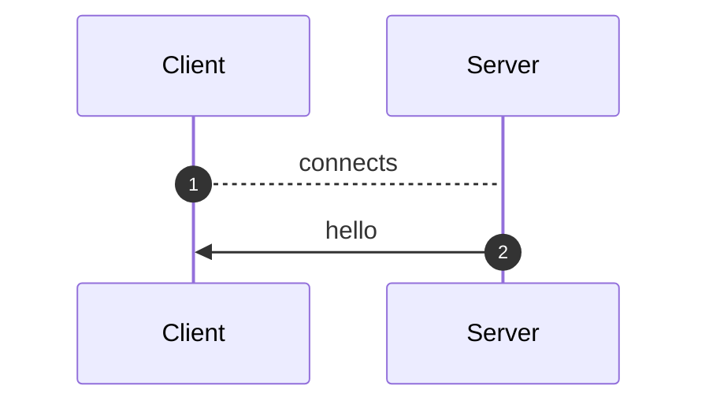
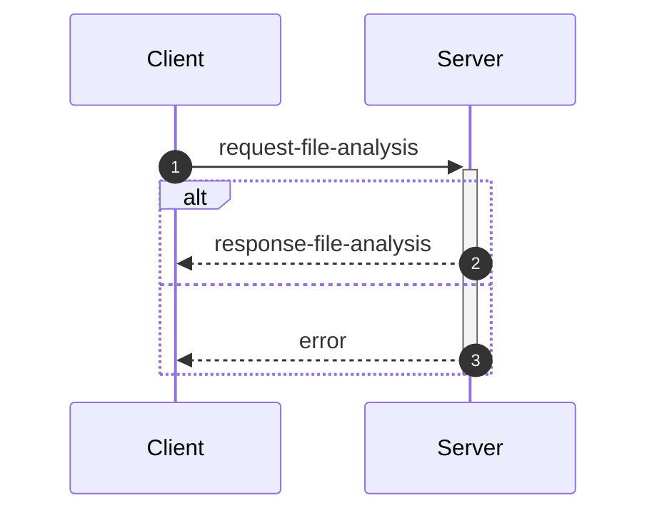
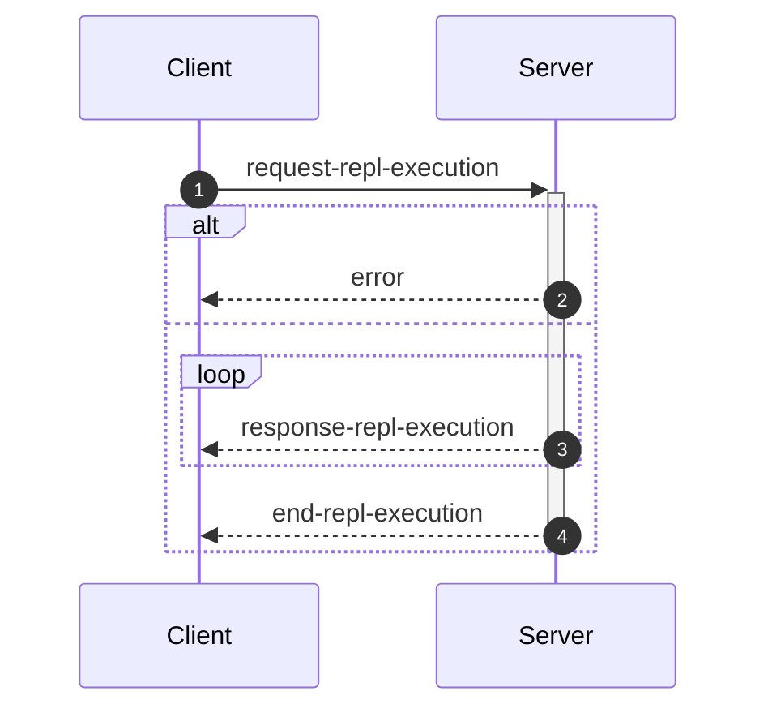
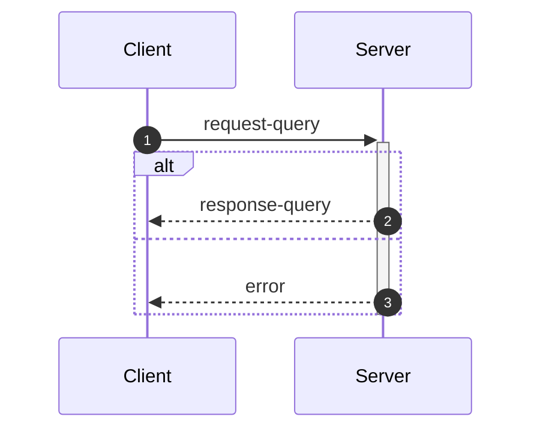

_<span title="an overview of flowR's interface">Generated</span> from '[wiki-interface.ts](https://github.com/flowr-analysis/flowr/tree/main/src/documentation/wiki-interface.ts "src/documentation/wiki-interface.ts")' on 2026-11-08, 08:41:20 UTC (v2.17.4, R v4.6.1), do not edit directly._

Although far from being as detailed as the in-depth explanation of [_flowR_](https://github.com/flowr-analysis/flowr/wiki/Core),
this wiki page explains how to interface with _flowR_ in more detail.
In general, command line arguments and other options provide short descriptions on hover over.

* [💻 Using the REPL](#using-the-repl)
* [⚙️ Configuring FlowR](#configuring-flowr)
* [⚒️ Writing Code](#writing-code)
* [💬 Communicating with the Server](#communicating-with-the-server)

<a id='using-the-repl'></a>
## 💻 Using the REPL

> [!NOTE]
> To execute arbitrary R commands with a repl request, _flowR_ has to be started explicitly with <span title="Description (Command Line Argument): Allow to access the underlying R session when using flowR (security warning: this allows the execution of arbitrary R code!)">`--r-session-access`</span>.
> Please be aware that this introduces a security risk and note that this relies on the [`r-shell` engine](https://github.com/flowr-analysis/flowr/wiki/Engines) .

Although primarily meant for users to explore,
there is nothing which forbids calling _flowR_ as a subprocess to use standard-in, -output, and -error
for communication (although you can access the REPL using the server as well,
with the [REPL Request](#message-request-repl-execution) message).

The read-eval-print loop&nbsp;(REPL) works relatively simple.
You can submit an expression (using <kbd>Enter</kbd>),
which is interpreted as an R&nbsp;expression by default but interpreted as a *command* if it starts with a colon (`:`).
The best command to get started with the REPL is <span title="Description (Repl Command): Show help information (aliases: :h, :?)">`:help`</span>.
Besides, you can leave the REPL either with the command <span title="Description (Repl Command): End the repl (aliases: :q, :exit)">`:quit`</span> or by pressing <kbd>Ctrl</kbd>+<kbd>C</kbd> twice.
When writing a *command*, you may press <kbd>Tab</kbd> to get a list of completions, if available.
Multiple commands can be entered in a single line by separating them with a semicolon (`;`), e.g. `:parse "x<-2"; :df*`.
If a command is given without R code, the REPL will re-use R code given in a previous command.
The prior example will hence return first the parsed AST of the program and then the dataflow graph for `"x <- 2"`.

> [!NOTE]
> If you develop flowR, you may want to launch the repl using the `npm run main-dev` command, this way, you get a non-minified version of flowR with debug information and hot-reloading of source files.

<details>
<summary>Available Commands</summary>

We currently offer the following commands (this with a `[*]` suffix are available with and without the star):

| Command | Description |
| ------- | ----------- |
| **<span title="Description (Repl Command): End the repl (aliases: :q, :exit)">:quit</span>** | End the repl (aliases: **:<span title="Alias of ':quit'. End the repl">q</span>**, **:<span title="Alias of ':quit'. End the repl">exit</span>**) |
| **<span title="Description (Repl Command): Execute the given code as R code. This requires the `--r-session-access` flag to be set and requires the r-shell engine. (aliases: :e, :r)">:execute</span>** | Execute the given code as R code. This requires the `--r-session-access` flag to be set and requires the r-shell engine. (aliases: **:<span title="Alias of ':execute'. Execute the given code as R code. This requires the `--r-session-access` flag to be set and requires the r-shell engine.">e</span>**, **:<span title="Alias of ':execute'. Execute the given code as R code. This requires the `--r-session-access` flag to be set and requires the r-shell engine.">r</span>**) |
| **<span title="Description (Repl Command): Get mermaid code for the control-flow graph of R code (aliases: :cfg, :cf)">:controlflow[*]</span>** | Get mermaid code for the control-flow graph of R code (star: Returns the URL to mermaid.live) (aliases: **:<span title="Alias of ':controlflow'. Get mermaid code for the control-flow graph of R code">cfg</span>**, **:<span title="Alias of ':controlflow'. Get mermaid code for the control-flow graph of R code">cf</span>**) |
| **<span title="Description (Repl Command): Get mermaid code for the control-flow graph with basic blocks (aliases: :cfgb, :cfb)">:controlflowbb[*]</span>** | Get mermaid code for the control-flow graph with basic blocks (star: Returns the URL to mermaid.live) (aliases: **:<span title="Alias of ':controlflowbb'. Get mermaid code for the control-flow graph with basic blocks">cfgb</span>**, **:<span title="Alias of ':controlflowbb'. Get mermaid code for the control-flow graph with basic blocks">cfb</span>**) |
| **<span title="Description (Repl Command): Get mermaid code for the dataflow graph (aliases: :d, :df)">:dataflow[*]</span>** | Get mermaid code for the dataflow graph (star: Returns the URL to mermaid.live) (aliases: **:<span title="Alias of ':dataflow'. Get mermaid code for the dataflow graph">d</span>**, **:<span title="Alias of ':dataflow'. Get mermaid code for the dataflow graph">df</span>**) |
| **<span title="Description (Repl Command): Get mermaid code for the normalized AST of R code (aliases: :n)">:normalize[*]</span>** | Get mermaid code for the normalized AST of R code (star: Returns the URL to mermaid.live) (alias: **:<span title="Alias of ':normalize'. Get mermaid code for the normalized AST of R code">n</span>**) |
| **<span title="Description (Repl Command): Get mermaid code for the simplified dataflow graph (aliases: :ds, :dfs)">:dataflowsimple[*]</span>** | Get mermaid code for the simplified dataflow graph (star: Returns the URL to mermaid.live) (aliases: **:<span title="Alias of ':dataflowsimple'. Get mermaid code for the simplified dataflow graph">ds</span>**, **:<span title="Alias of ':dataflowsimple'. Get mermaid code for the simplified dataflow graph">dfs</span>**) |
| **<span title="Description (Repl Command): Inspect and extend the signature database: `query` (identical to :query @signature), `info <name>` for where a function comes from (identical to :query @function-info), `add <path>` to mount another database/source, `download` to fetch the full-history database. (aliases: :sig)">:signature</span>** | Inspect and extend the signature database: `query` (identical to :query @signature), `info <name>` for where a function comes from (identical to :query @function-info), `add <path>` to mount another database/source, `download` to fetch the full-history database. (alias: **:<span title="Alias of ':signature'. Inspect and extend the signature database: `query` (identical to :query @signature), `info <name>` for where a function comes from (identical to :query @function-info), `add <path>` to mount another database/source, `download` to fetch the full-history database.">sig</span>**) |
| **<span title="Description (Repl Command): Just calculates the DFG, but only prints summary info (aliases: :d#, :df#)">:dataflowsilent</span>** | Just calculates the DFG, but only prints summary info (aliases: **:<span title="Alias of ':dataflowsilent'. Just calculates the DFG, but only prints summary info">d#</span>**, **:<span title="Alias of ':dataflowsilent'. Just calculates the DFG, but only prints summary info">df#</span>**) |
| **<span title="Description (Repl Command): Prints ASCII Art of the parsed, unmodified AST (aliases: :p)">:parse</span>** | Prints ASCII Art of the parsed, unmodified AST (alias: **:<span title="Alias of ':parse'. Prints ASCII Art of the parsed, unmodified AST">p</span>**) |
| **<span title="Description (Repl Command): Prints the version of flowR as well as the current version of R">:version</span>** | Prints the version of flowR as well as the current version of R
| **<span title="Description (Repl Command): Query the given R code (use 'help' for more information)">:query[*]</span>** | Query the given R code (use 'help' for more information) (star: Similar to query, but returns the output in json format.)
| **<span title="Description (Repl Command): Returns an ASCII representation of the dataflow graph (aliases: :df!)">:dataflowascii</span>** | Returns an ASCII representation of the dataflow graph (alias: **:<span title="Alias of ':dataflowascii'. Returns an ASCII representation of the dataflow graph">df!</span>**) |
| **<span title="Description (Repl Command): Returns summarization stats for the normalized AST (aliases: :n#)">:normalize#</span>** | Returns summarization stats for the normalized AST (alias: **:<span title="Alias of ':normalize#'. Returns summarization stats for the normalized AST">n#</span>**) |
| **<span title="Description (Repl Command): Show help information (aliases: :h, :?)">:help</span>** | Show help information (aliases: **:<span title="Alias of ':help'. Show help information">h</span>**, **:<span title="Alias of ':help'. Show help information">?</span>**) |

</details>

> [!TIP]
> 
> As indicated by the examples before, all REPL commands that operate on code keep track of the state.
> Hence, if you run a command like <span title="Description (Repl Command, starred version): Returns the URL to mermaid.live; Base Command: Get mermaid code for the dataflow graph (aliases: :d*, :df*)">`:dataflow*`</span> without providing R code,
> the REPL will re-use the R code provided in a previous command.
> Likewise, doing this will benefit from incrementality!
> If you request the dataflow graph with `:df* x <- 2 * y` and then want to see the parsed AST with `:parse`,
> the REPL will re-use previously obtained information and not re-parse the code again.
> 		

Generally, many commands offer shortcut versions in the REPL. Many queries, for example, offer a shortened format (see the example below).
Of special note, the [Config Query](https://github.com/flowr-analysis/flowr/wiki/%5BQuery%5D-Config)
can be used to also modify the currently active configuration of _flowR_ within the REPL (see the [wiki page](https://github.com/flowr-analysis/flowr/wiki/%5BQuery%5D-Config) for more information).

### Example: Retrieving the Dataflow Graph

To retrieve a URL to the [mermaid](https://mermaid.js.org/) diagram of the dataflow of a given expression,
use <span title="Description (Repl Command, starred version): Returns the URL to mermaid.live; Base Command: Get mermaid code for the dataflow graph (aliases: :d*, :df*)">`:dataflow*`</span> (or <span title="Description (Repl Command): Get mermaid code for the dataflow graph (aliases: :d, :df)">`:dataflow`</span> to get the mermaid code in the cli):

```shell
$ docker run -it --rm eagleoutice/flowr # or npm run flowr 
flowR repl v2.17.4, R grammar v14 (tree-sitter engine)
R> :dataflow* y <- 1 + x
```

<details>
<summary style='color:gray'>Output</summary>

```text
https://mermaid.live/view#base64:eyJjb2RlIjoiZmxvd2NoYXJ0IFREXG4gICAgMXt7XCJgKiM5MTtSTnVtYmVyIzkzOyogKioxKipcbiAgICAgICoxLjYqICgqKmlkOiAxKiopYFwifX1cbiAgICAyKFtcImAqIzkxO1JTeW1ib2wjOTM7KiAqKngqKlxuICAgICAgKjEuMTAqICgqKmlkOiAyKiopYFwiXSlcbiAgICAzW1tcImAqIzkxO1JCaW5hcnlPcCM5MzsqIGJhc2UjNTg7IzU4OyoqIzQzOyoqXG4gICAgICAqMS42LTEwKiAoKippZDogMyoqKVxuICAgIGFyZzogKDEsIDIpYFwiXV1cbiAgICBidWlsdC1pbjpfNDNfW1wiYEJ1aWx0LUluOlxuIzQzO2BcIl1cbiAgICBzdHlsZSBidWlsdC1pbjpfNDNfIHN0cm9rZTpncmF5LGZpbGw6Z3JheSxzdHJva2Utd2lkdGg6MnB4LG9wYWNpdHk6Ljg7XG4gICAgMFtcImAqIzkxO1JTeW1ib2wjOTM7KiAqKnkqKlxuICAgICAgKjEuMSogKCoqaWQ6IDAqKiwgdjogMylgXCJdXG4gICAgNFtbXCJgKiM5MTtSQmluYXJ5T3AjOTM7KiBiYXNlIzU4OyM1ODsqKiM2MDsjNDU7KipcbiAgICAgICoxLjEtMTAqICgqKmlkOiA0KiopXG4gICAgYXJnOiAoMCwgMylgXCJdXVxuICAgIGJ1aWx0LWluOl82MF8tW1wiYEJ1aWx0LUluOlxuIzYwOyM0NTtgXCJdXG4gICAgc3R5bGUgYnVpbHQtaW46XzYwXy0gc3Ryb2tlOmdyYXksZmlsbDpncmF5LHN0cm9rZS13aWR0aDoycHgsb3BhY2l0eTouODtcbiAgICAxIC0uLT58XCJmbG93XCJ8IDJcbiAgICBsaW5rU3R5bGUgMCBzdHJva2U6Z3JheSxjb2xvcjpncmF5O1xuICAgIDIgLS4tPnxcImZsb3dcInwgM1xuICAgIGxpbmtTdHlsZSAxIHN0cm9rZTpncmF5LGNvbG9yOmdyYXk7XG4gICAgMyAtLT58XCJyZWFkcywgYXJnXCJ8IDFcbiAgICAzIC0tPnxcInJlYWRzLCBhcmdcInwgMlxuICAgIDMgLS4tPnxcImZsb3dcInwgMFxuICAgIGxpbmtTdHlsZSA0IHN0cm9rZTpncmF5LGNvbG9yOmdyYXk7XG4gICAgMyAtLi0+fFwicmVhZHMsIGNhbGxzXCJ8IGJ1aWx0LWluOl80M19cbiAgICBsaW5rU3R5bGUgNSBzdHJva2U6Z3JheTtcbiAgICAwIC0tPnxcImRlZmluZWQtYnksIGZsb3dcInwgNFxuICAgIDAgLS0+fFwiZGVmaW5lZC1ieVwifCAzXG4gICAgNCAtLT58XCJyZWFkcywgYXJnXCJ8IDNcbiAgICA0IC0tPnxcInJldHVybnMsIGFyZ1wifCAwXG4gICAgNCAtLi0+fFwicmVhZHMsIGNhbGxzXCJ8IGJ1aWx0LWluOl82MF8tXG4gICAgbGlua1N0eWxlIDEwIHN0cm9rZTpncmF5OyIsIm1lcm1haWQiOnsiYXV0b1N5bmMiOnRydWV9fQ==
```

Retrieve the dataflow graph of the expression `y <- 1 + x`. It looks like this:


<details>

<summary style="color:gray">R Code of the Dataflow Graph</summary>

The analysis ran (parse and normalize with the [tree-sitter](https://github.com/flowr-analysis/flowr/wiki/Engines) engine) in the generation environment. No [signature database](https://github.com/flowr-analysis/flowr/wiki/Signature-Database) is mounted, so `library()` attaches no exports (base-R names are still qualified, e.g., `stats::acf`). 
We encountered no unknown side effects during the analysis.

```r
y <- 1 + x
```

</details>

</details>

For small graphs like this, <span title="Description (Repl Command): Returns an ASCII representation of the dataflow graph (aliases: :df!)">`:dataflowascii`</span> also provides an ASCII representation directly in the REPL:

```shell
$ docker run -it --rm eagleoutice/flowr # or npm run flowr 
flowR repl v2.17.4, R grammar v14 (tree-sitter engine)
R> :df! y <- 1 + x
```

<details open>
<summary style='color:gray'>Output</summary>

```text
                        v<0>v
 c<4>c──────────────────| y |
 |<- |     ┌────────────v---v
 c---c     │
    │   c<3>c   0<1>0
    └───| + |───| 1 |───u<2>u
        c---c   0---0   | x |
           └────────────u---u
Edges:
3 -> 1: reads, arg          3 -> 2: reads, arg
3 -> 0: flows-to            1 -> 2: flows-to
2 -> 3: flows-to            4 -> 3: reads, arg
4 -> 0: returns, arg        0 -> 4: defined-by, flows-to
0 -> 3: defined-by
```

Retrieve the dataflow graph of the expression `y <- 1 + x` as ASCII art.

</details>

For the slicing with <span title="Description (Repl Command): Static backwards executable slicer for R">`:slicer`</span>, you have access to the same [magic comments](#slice-magic-comments) as with the [slice request](#message-request-slice).
Pass `--inline` to splice resolvable `source()` calls into the reconstruction so the slice is a single self-contained R text (the same as the static slice query's `inlineSources` flag).
See `--help` for more flags!

### Example: Interfacing with the File System

Many commands that allow for an R-expression (like <span title="Description (Repl Command, starred version): Returns the URL to mermaid.live; Base Command: Get mermaid code for the dataflow graph (aliases: :d*, :df*)">`:dataflow*`</span>) allow for a file as well
if the argument starts with `file://`.
If you are working from the root directory of the _flowR_ repository, the following gives you the parsed AST of the example file using the <span title="Description (Repl Command): Prints ASCII Art of the parsed, unmodified AST (aliases: :p)">`:parse`</span> command:

> **Watch mode**: Replace `file://` with `watch://` to enter watch mode.
> flowR runs the command immediately and then re-runs it every time the file (or any file inside the folder) changes.
> Enter any other command to leave watch mode.
> For example: `:df watch://analysis.R`

```shell
$ docker run -it --rm eagleoutice/flowr # or npm run flowr 
flowR repl v2.17.4, R grammar v14 (tree-sitter engine)
R> :parse file://test/testfiles/example.R
```

<details>
<summary style='color:gray'>Output</summary>

```text
File: test/testfiles/example.R

program
├ binaryoperator
│ ├ identifier "sum" (1:1─4)
│ ├ <- "<-" (1:5─7)
│ ╰ float "0" (1:8─9)
├ binaryoperator
│ ├ identifier "product" (2:1─8)
│ ├ <- "<-" (2:9─11)
│ ╰ float "1" (2:12─13)
├ binaryoperator
│ ├ identifier "w" (3:1─2)
│ ├ <- "<-" (3:3─5)
│ ╰ float "7" (3:6─7)
├ binaryoperator
│ ├ identifier "N" (4:1─2)
│ ├ <- "<-" (4:3─5)
│ ╰ float "10" (4:6─8)
├ forstatement
│ ├ for "for" (6:1─4)
│ ├ ( "(" (6:5─6)
│ ├ identifier "i" (6:6─7)
│ ├ in "in" (6:8─10)
│ ├ binaryoperator
│ │ ├ float "1" (6:11─12)
│ │ ├ : ":" (6:12─13)
│ │ ╰ parenthesizedexpression
│ │   ├ ( "(" (6:13─14)
│ │   ├ binaryoperator
│ │   │ ├ identifier "N" (6:14─15)
│ │   │ ├ - "-" (6:15─16)
│ │   │ ╰ float "1" (6:16─17)
│ │   ╰ ) ")" (6:17─18)
│ ├ ) ")" (6:18─19)
│ ╰ bracedexpression
│   ├ { "{" (6:20─21)
│   ├ binaryoperator
│   │ ├ identifier "sum" (7:3─6)
│   │ ├ <- "<-" (7:7─9)
│   │ ╰ binaryoperator
│   │   ├ binaryoperator
│   │   │ ├ identifier "sum" (7:10─13)
│   │   │ ├ + "+" (7:14─15)
│   │   │ ╰ identifier "i" (7:16─17)
│   │   ├ + "+" (7:18─19)
│   │   ╰ identifier "w" (7:20─21)
│   ├ binaryoperator
│   │ ├ identifier "product" (8:3─10)
│   │ ├ <- "<-" (8:11─13)
│   │ ╰ binaryoperator
│   │   ├ identifier "product" (8:14─21)
│   │   ├  "" (8:22─23)
│   │   ╰ identifier "i" (8:24─25)
│   ╰ } "}" (9:1─2)
├ call
│ ├ identifier "cat" (11:1─4)
│ ╰ arguments
│   ├ ( "(" (11:4─5)
│   ├ argument
│   │ ╰ string
│   │   ├ stringopen "\"" (11:5─6)
│   │   ├ stringcontent "Sum:" (11:6─10)
│   │   ╰ stringclose "\"" (11:10─11)
│   ├ comma "," (11:11─12)
│   ├ argument
│   │ ╰ identifier "sum" (11:13─16)
│   ├ comma "," (11:16─17)
│   ├ argument
│   │ ╰ string
│   │   ├ stringopen "\"" (11:18─19)
│   │   ├ stringcontent
│   │   │ ╰ escapesequence "\\n" (11:19─21)
│   │   ╰ stringclose "\"" (11:21─22)
│   ╰ ) ")" (11:22─23)
╰ call
  ├ identifier "cat" (12:1─4)
  ╰ arguments
    ├ ( "(" (12:4─5)
    ├ argument
    │ ╰ string
    │   ├ stringopen "\"" (12:5─6)
    │   ├ stringcontent "Product:" (12:6─14)
    │   ╰ stringclose "\"" (12:14─15)
    ├ comma "," (12:15─16)
    ├ argument
    │ ╰ identifier "product" (12:17─24)
    ├ comma "," (12:24─25)
    ├ argument
    │ ╰ string
    │   ├ stringopen "\"" (12:26─27)
    │   ├ stringcontent
    │   │ ╰ escapesequence "\\n" (12:27─29)
    │   ╰ stringclose "\"" (12:29─30)
    ╰ ) ")" (12:30─31)
```

Retrieve the parsed AST of the example file.

<details>

<summary>File Content</summary>

```r
sum <- 0
product <- 1
w <- 7
N <- 10

for (i in 1:(N-1)) {
  sum <- sum + i + w
  product <- product * i
}

cat("Sum:", sum, "\n")
cat("Product:", product, "\n")
```

</details>

As _flowR_ directly transforms this AST the output focuses on being human-readable instead of being machine-readable.
		
</details>

### Example: Run a Query

You can run any query supported by _flowR_ using the <span title="Description (Repl Command): Query the given R code (use 'help' for more information)">`:query`</span> command.
For example, to obtain the shapes of all data frames in a given piece of code, you can run:

```shell
$ docker run -it --rm eagleoutice/flowr # or npm run flowr 
flowR repl v2.17.4, R grammar v14 (tree-sitter engine)
R> :query @absint df-shape "x <- data.frame(a = 1:10, b = 1:10)\ny <- x$a"
```

<details open>
<summary style='color:gray'>Output</summary>

```text
Query: absint (2 ms)
   ╰ $12: (colnames: [{"a", "b"}, {}], cols: [2, 2], rows: [10, 10])
   ╰ $0: (colnames: [{"a", "b"}, {}], cols: [2, 2], rows: [10, 10])
```

Retrieve the shapes of all data frames in the given code.

</details>

To run the linter on a file, you can use (in this example, we just issue the `dead-code` linter on a small piece of code):

```shell
$ docker run -it --rm eagleoutice/flowr # or npm run flowr 
flowR repl v2.17.4, R grammar v14 (tree-sitter engine)
R> :query @linter rules:dead-code "if(FALSE) x <- 2"
```

<details open>
<summary style='color:gray'>Output</summary>

```text
Query: linter (2 ms)
   ╰ Dead Code (dead-code):
       ╰ certain:
           ╰ Code at 1.11-16 (1 quick fix(es) available)
```

Run the linter on the given code, with only the `dead-code` rule enabled.

</details>

For more information on the available queries, please check out the [Query API](https://github.com/flowr-analysis/flowr/wiki/Query-API).

<a id='configuring-flowr'></a>
## ⚙️ Configuring FlowR

When running _flowR_, you may want to specify some behaviors with a dedicated configuration file.
By default, flowR looks for a file named `flowr.json` in the current working directory (or any higher directory).
You can also specify a different file with <span title="Description (Command Line Argument): The name of the configuration file to use">`--config-file`</span> or pass the configuration inline using <span title="Description (Command Line Argument): The flowR configuration to use, as a JSON string">`--config-json`</span>.
A `flowr.json` found this way belongs to the analyzed project, so flowR ignores its options that decide what flowR executes or loads
(`engines.*.wasmPath`, `engines.*.treeSitterWasmPath`, `engines.*.rPath`, `solver.sigdb.additionalPaths`, `solver.sigdb.downloadRepo`, `solver.sigdb.installedLibrary.paths`, `solver.sigdb.onDemand.enabled`, `solver.sigdb.onDemand.repositories`, `solver.sigdb.onDemand.cranMirror`, `solver.sigdb.onDemand.bioconductorMirror`, `solver.sigdb.onDemand.cacheDir`),
unless you pass <span title="Description (Command Line Argument): Keep the security-sensitive options (e.g., the R executable) of the flowr.json found in the working directory or a parent. Only use this for projects you trust.">`--trust-config`</span>.
To analyze code you do not trust, use the secure mode (<span title="Description (Command Line Argument): Run in secure mode for analyzing untrusted code: flowR does not start R (or any other process), does not access the network, does not search for project configs, and ignores security-sensitive options in every config. Cannot be disabled once enabled. Can also be enabled with the environment variable {italic FLOWR_SECURE_MODE=1}.">`--secure`</span>, see the [security policy](https://github.com/flowr-analysis/flowr/blob/main/.github/SECURITY.md)).
To inspect the current configuration, you can run flowr with the <span title="Description (Command Line Argument): Run with verbose logging (will be passed to the corresponding script)">`--verbose`</span> flag, or use the `config` [Query](https://github.com/flowr-analysis/flowr/wiki/Query-API).
Within the REPL this works by running the following:

```shell
:query @config
```

To work with the <a href="https://github.com/flowr-analysis/flowr/tree/main/src/config.ts#L119"><code><span title="The configuration file format for flowR.">FlowrConfig</span></code></a> you can use the provided helper objects alongside its methods like
<a href="https://github.com/flowr-analysis/flowr/tree/main/src/config.ts#L985"><code><span title="Creates a new flowr config that has the updated values.">FlowrConfig::<b>amend</b></span></code></a>.
The schema below documents every option; the ones you most likely want are:

- <a href="https://github.com/flowr-analysis/flowr/wiki/Interface#configuring-flowr" title="Configuration Option (boolean): Whether source calls should be ignored, causing {@link processSourceCall}&#39;s behavior to be skipped.">ignoreSourceCalls</a>: ignore source calls when analyzing the code, i.e., ignore the inclusion of other files.
- <a href="https://github.com/flowr-analysis/flowr/wiki/Interface#configuring-flowr" title="Configuration Option (boolean): Whether load calls should be ignored, causing {@link processLoadCall}&#39;s behavior to be skipped.">ignoreLoadCalls</a>: ignore load calls when analyzing the code, i.e., ignore the loading of r-data files.
- <a href="https://github.com/flowr-analysis/flowr/wiki/Interface#configuring-flowr" title="Configuration Option (object): Do you want to overwrite (parts) of the builtin definition?">semantics.environment.overwriteBuiltIns</a>: overwrite _flowR_'s handling of built-in functions, or clear the preset definitions entirely.
  See [Configure BuiltIn Semantics](#configure-builtin-semantics) for more information.
- <a href="https://github.com/flowr-analysis/flowr/wiki/Interface#configuring-flowr" title="Configuration Option (boolean): Whether calls drawing on a graphics device (e.g., `plot`) count as writing to it, which the ambient state queries then report.">semantics.ambient.drawingWritesDevice</a>: whether calls drawing on a graphics device (e.g., `plot`) count as writing the device in the ambient state queries.
- <a href="https://github.com/flowr-analysis/flowr/wiki/Interface#configuring-flowr" title="Configuration Option (string): How to resolve variables and their values. (one of &quot;disabled&quot;, &quot;alias&quot;, &quot;builtin&quot;)">solver.variables</a>: how to resolve variables and their values (`disabled`, `alias`, `builtin`).
- <a href="https://github.com/flowr-analysis/flowr/wiki/Interface#configuring-flowr" title="Configuration Option (array): The engine or set of engines to use for interacting with R code. An empty array means all available engines will be used.">engines</a> and <a href="https://github.com/flowr-analysis/flowr/wiki/Interface#configuring-flowr" title="Configuration Option (string): The default engine to use for interacting with R code. If this is undefined, an arbitrary engine from the specified list will be used. (one of &quot;tree-sitter&quot;, &quot;r-shell&quot;)">defaultEngine</a>: the engines used to interact with R code, see the [Engines wiki page](https://github.com/flowr-analysis/flowr/wiki/Engines).
- <a href="https://github.com/flowr-analysis/flowr/wiki/Interface#configuring-flowr" title="Configuration Option (array): Files a framework loads on its own, without any source() call (e.g. global.R in a shiny app), in the order they are loaded; flowR orders the matching project files accordingly and analyzes them as one program. Entries are case-insensitive globs matched against the file path, a plain name matches any file with that name, and entries matching no project file are warned about. Usually set per project kind via specializeConfig.">project.implicitSources</a>: the files a framework loads without any `source()` call, in the order in which they are
  loaded. Entries are globs (e.g. `R/*.R`) matched against the file path ignoring capitalization; one matching no file is reported.
- <a href="https://github.com/flowr-analysis/flowr/wiki/Interface#configuring-flowr" title="Configuration Option (object): Overwrite (parts of) the configuration depending on the project kind flowR detects, e.g. to give a shiny app its implicit sources.">specializeConfig</a>: overwrite (parts of) the configuration depending on the kind of project _flowR_ detects
  (e.g. `shiny-app`), which is how a shiny app gets its implicit sources by default. What you configure directly wins.
- <a href="https://github.com/flowr-analysis/flowr/wiki/Interface#configuring-flowr" title="Configuration Option (string): Overwrite the project kind flowR would otherwise infer from the analyzed files, e.g. when auto-detection guesses wrong. (one of &quot;package&quot;, &quot;script&quot;, &quot;shiny-app&quot;, &quot;notebook&quot;, &quot;project&quot;, &quot;unknown&quot;)">project.useProjectType</a>: skip that detection and force a project kind yourself, when auto-detection guesses wrong.
- <a href="https://github.com/flowr-analysis/flowr/wiki/Interface#configuring-flowr" title="Configuration Option (array): The default plugins to load when creating a new instance of FlowrAnalyzer">defaultPlugins</a> and <a href="https://github.com/flowr-analysis/flowr/wiki/Interface#configuring-flowr" title="Configuration Option (array): The plugins to load in REPL mode">repl.plugins</a>: the plugins to load for a new <a href="https://github.com/flowr-analysis/flowr/tree/main/src/project/flowr-analyzer.ts#L240"><code><span title="Central class for conducting analyses with FlowR. Use the FlowrAnalyzerBuilder to create a new instance. If you want the original pattern of creating a pipeline and running all steps, you can still do this with FlowrAnalyzer#runFull . To inspect the context of the analyzer, use FlowrAnalyzer#inspectContext (if you are a plugin and need to modify it, use FlowrAnalyzer#context instead).">FlowrAnalyzer</span></code></a> and in the REPL
  (use `flowr:default` to reference the former).

So you can configure _flowR_ by adding a file like the following:

<details>

<summary>Example Configuration File</summary>

```json
{
  "ignoreSourceCalls": true,
  "ignoreLoadCalls": true,
  "semantics": {
    "environment": {
      "overwriteBuiltIns": {
        "definitions": [
          {
            "type": "function",
            "names": [
              "foo"
            ],
            "processor": "builtin:assign",
            "config": {}
          }
        ]
      }
    }
  },
  "defaultPlugins": [
    "file:description",
    "versions:description"
  ],
  "repl": {
    "quickStats": false,
    "dfProcessorHeat": false,
    "hints": true,
    "plugins": [
      "flowr:default"
    ]
  },
  "project": {
    "resolveUnknownPathsOnDisk": true,
    "implicitSources": [
      "global.R",
      "app.R"
    ]
  },
  "linter": {
    "disabledRules": []
  },
  "specializeConfig": {
    "shiny-app": {
      "project": {
        "implicitSources": [
          "global.R",
          "ui.R",
          "server.R",
          "app.R"
        ]
      }
    }
  },
  "engines": [
    {
      "type": "r-shell"
    }
  ],
  "solver": {
    "variables": "alias",
    "evalStrings": true,
    "trackEnvironments": true,
    "sigdb": {
      "enabled": true,
      "loadProjectDependencies": true,
      "eagerlyLoad": false,
      "eagerlyLoadExports": false,
      "linkBaseR": false,
      "linkDescriptionDependencies": false
    },
    "resolveSource": {
      "dropPaths": "no",
      "ignoreCapitalization": true,
      "inferWorkingDirectory": "active-script",
      "searchPath": []
    },
    "instrument": {},
    "slicer": {
      "threshold": 50
    }
  },
  "abstractInterpretation": {
    "wideningThreshold": 4,
    "followCalls": true,
    "dataFrame": {
      "maxColNames": 20,
      "readLoadedData": {
        "readExternalFiles": true,
        "maxReadLines": 1000000
      }
    }
  },
  "incremental": {
    "alwaysIncremental": false,
    "parsing": {
      "activated": false,
      "heuristics": {
        "activated": true,
        "mtime": true,
        "linesFrom": 500,
        "bytesFrom": 50000,
        "alwaysWithEdits": false,
        "minFiles": 1
      }
    }
  },
  "gas": {
    "thresholds": {
      "memory": {
        "problematic": 0.7,
        "critical": 0.9
      },
      "timeMs": {
        "problematic": 100000,
        "critical": 120000
      }
    },
    "features": {}
  }
}
```

</details>

<details>
<a id='configure-builtin-semantics'></a>
<summary>Configure Built-In Semantics</summary>

`semantics/environment/overwriteBuiltins` accepts two keys:

- `loadDefaults` (boolean, initially `true`): If set to `true`, the default built-in definitions are loaded before applying the custom definitions. Setting this flag to `false` explicitly disables the loading of the default definitions.
- `definitions` (array, initially empty): Allows to overwrite or define new built-in elements. Each object within must have a `type` which is one of the below. Furthermore, they may define a string array of `names` which specifies the identifiers to bind the definitions to. You may use `assumePrimitive` to specify whether _flowR_ should assume that this is a primitive non-library definition (so you probably just do not want to specify the key).

  | Type            | Description                                                                                                                                                                                                                                                                                              | Example                                                                                                    |
  | --------------- | -------------------------------------------------------------------------------------------------------------------------------------------------------------------------------------------------------------------------------------------------------------------------------------------------------- | ---------------------------------------------------------------------------------------------------------- |
  | `constant`    | Additionally allows for a `value` this should resolve to.                                                                                                                                                                                                                                                | `{ type: 'constant', names: ['NULL', 'NA'],  value: null }`                                                |
  | `function`    | Is a rather flexible way to define and bind built-in functions. For the time, we do not have extensive documentation to cover all the cases, so please either consult the sources with the `default-builtin-config/` folder or open a [new issue](https://github.com/flowr-analysis/flowr/issues/new/choose). | `{ type: 'function', names: ['next'], processor: 'builtin:d', config: { cfg: ExitPointType.Next } }` |
  | `replacement` | A comfortable way to specify replacement functions like `$<-` or `names<-`. `suffixes` describes the... suffixes to attach automatically. | `{ type: 'replacement', suffixes: ['<-', '<<-'], names: ['[', '[['] }` |

</details>

<details>

<summary style='color:gray'>Full Configuration-File Schema</summary>

- _The configuration file format for flowR._ (object)
    - **logLevel** [optional] _flowR's global minimum log level, applied when the config is loaded._ (string)
        Only allows: 'silly', 'trace', 'debug', 'info', 'warn', 'error', 'fatal'
    - **ignoreSourceCalls** [optional] _Whether source calls should be ignored, causing {@link processSourceCall}'s behavior to be skipped._ (boolean)
    - **ignoreLoadCalls** [optional] _Whether load calls should be ignored, causing {@link processLoadCall}'s behavior to be skipped._ (boolean)
    - **semantics** _Configure language semantics and how flowR handles them._ (object)
        - **environment** [optional] _Semantics regarding how to handle the R environment._ (object)
            - **overwriteBuiltIns** [optional] _Do you want to overwrite (parts) of the builtin definition?_ (object)
                - **loadDefaults** [optional] _Should the default configuration still be loaded?_ (boolean)
                - **definitions** [optional] _The definitions to load/overwrite._ (array)
                Valid item types:
                    - (object)
        - **ambient** [optional] _Semantics regarding the global state (options, devices, files, ...) calls access._ (object)
            - **drawingWritesDevice** [optional] _Whether calls drawing on a graphics device (e.g., `plot`) count as writing to it, which the ambient state queries then report._ (boolean)
    - **defaultPlugins** [optional] _The default plugins to load when creating a new instance of FlowrAnalyzer_ (array)
    Valid item types:
        - (alternatives)
            - (string)
            - (array)
    - **repl** _Configuration options for the REPL._ (object)
        - **quickStats** [optional] _Whether to show quick stats in the REPL after each evaluation._ (boolean)
        - **dfProcessorHeat** [optional] _This instruments the dataflow processors to count how often each processor is called._ (boolean)
        - **hints** [optional] _Whether to show dim inline hints on the empty prompt (automatically disabled on non-interactive terminals)._ (boolean)
        - **plugins** [optional] _The plugins to load in REPL mode_ (array)
        Valid item types:
            - (alternatives)
                - (string)
                - (array)
        - **autoUseFileProtocol** [optional] _Prepend the file protocol to a repl input that looks like a path, instead of only warning about it._ (boolean)
        - **queryStats** [optional] _Whether `:query` closes with the line stating how long the queries took (`:query*` never prints it)._ (boolean)
        - **showPlugins** [optional] _Whether `:version` grays out the plugins that did not activate during the last analysis._ (boolean)
    - **project** _Project specific configuration options._ (object)
        - **resolveUnknownPathsOnDisk** [optional] _Whether to resolve unknown paths loaded by the r project disk when trying to source/analyze files._ (boolean)
        - **failOnInaccessiblePath** [optional] _Whether a directory that cannot be traversed during file discovery (e.g. due to permissions) aborts the analysis; when false (the default) such paths are logged and skipped._ (boolean)
        - **basePackages** [optional] _The packages considered part of R itself (base and recommended); if unset, flowR uses its built-in list._ (array)
        Valid item types:
            - (string)
        - **implicitSources** [optional] _Files a framework loads on its own, without any source() call (e.g. global.R in a shiny app), in the order they are loaded; flowR orders the matching project files accordingly and analyzes them as one program. Entries are case-insensitive globs matched against the file path, a plain name matches any file with that name, and entries matching no project file are warned about. Usually set per project kind via specializeConfig._ (array)
        Valid item types:
            - (string)
        - **useProjectType** [optional] _Overwrite the project kind flowR would otherwise infer from the analyzed files, e.g. when auto-detection guesses wrong._ (string)
            Only allows: 'package', 'script', 'shiny-app', 'notebook', 'project', 'unknown'
        - **assumeImplicitEcho** [optional] _Whether the top level of the analyzed code is echoed, so that every visible result printed there is collected as an output by the dependencies query (default true, false for a package)._ (boolean)
        - **discovery** [optional] _Scoping options for the default project discovery._ (object)
            - **full** [optional] _Collect every file below the project root (greedy) instead of only the files the detected project kind needs (default false)._ (boolean)
            - **perKind** [optional] _Per-kind include/exclude glob overrides layered on the default scoping._ (object)
            - **ignore** [optional] _Case-insensitive globs that drop matching files from the intelligent discovery, regardless of kind (e.g. .Renviron to ignore environment files)._ (array)
            Valid item types:
                - (string)
        - **classification** [optional] _Overrides for the signals flowR uses to classify the project kind._ (object)
            - **shinyDescriptionTypes** [optional] _DESCRIPTION Type: values that mark a shiny app._ (array)
            Valid item types:
                - (string)
            - **shinyEntryFiles** [optional] _File names a shiny app is assembled from._ (array)
            Valid item types:
                - (string)
            - **shinyUsagePattern** [optional] _Regex source evidencing shiny usage in an entry file._ (string)
            - **notebookExtensions** [optional] _File extensions marking a notebook._ (array)
            Valid item types:
                - (string)
    - **linter** _Linter configuration options._ (object)
        - **disabledRules** _Linting rule names excluded from the default rule set (a rule requested explicitly via a linter query still runs). Usually set per project kind via specializeConfig._ (array)
        Valid item types:
            - (string)
        - **disabledTags** [optional] _Linting rule tags whose rules are excluded from the default rule set (a rule requested explicitly via a linter query still runs). By default the cmd-check rules are disabled for everything but a package; a configured list replaces that default._ (array)
        Valid item types:
            - (string)
    - **inputSources** [optional] _Further frameworks the input-sources analysis should know about; entries are added to flowR's defaults._ (object)
        - **pure** [optional] _Functions that only pass the constantness of their arguments on._ (array)
        Valid item types:
            - (string)
        - **param** [optional] _Functions whose result is a 'param' input._ (array)
        Valid item types:
            - (string)
        - **file** [optional] _Functions whose result is a 'file' input._ (array)
        Valid item types:
            - (string)
        - **tempfile** [optional] _Functions whose result is a 'tempfile' input._ (array)
        Valid item types:
            - (string)
        - **glob** [optional] _Functions whose result is a 'glob' input._ (array)
        Valid item types:
            - (string)
        - **net** [optional] _Functions whose result is a 'net' input._ (array)
        Valid item types:
            - (string)
        - **rand** [optional] _Functions whose result is a 'rand' input._ (array)
        Valid item types:
            - (string)
        - **system** [optional] _Functions whose result is a 'system' input._ (array)
        Valid item types:
            - (string)
        - **ffi** [optional] _Functions whose result is a 'ffi' input._ (array)
        Valid item types:
            - (string)
        - **lang** [optional] _Functions whose result is a 'lang' input._ (array)
        Valid item types:
            - (string)
        - **options** [optional] _Functions whose result is a 'options' input._ (array)
        Valid item types:
            - (string)
        - **cmdline** [optional] _Functions whose result is a 'cmdline' input._ (array)
        Valid item types:
            - (string)
        - **user** [optional] _Functions whose result is a 'user' input._ (array)
        Valid item types:
            - (string)
        - **const** [optional] _Functions whose result is a 'const' input._ (array)
        Valid item types:
            - (string)
        - **scope** [optional] _Functions whose result is a 'scope' input._ (array)
        Valid item types:
            - (string)
        - **dconst** [optional] _Functions whose result is a 'dconst' input._ (array)
        Valid item types:
            - (string)
        - **unknown** [optional] _Functions whose result is a 'unknown' input._ (array)
        Valid item types:
            - (string)
        - **linkedObjects** [optional] _Objects a framework provides without a definition in the code, e.g. shiny's input._ (array)
        Valid item types:
            - (object)
        - **linkedEntryPoints** [optional] _Calls that hand a function to a framework, which binds its objects to the parameters by position._ (array)
        Valid item types:
            - (object)
    - **specializeConfig** [optional] _Overwrite (parts of) the configuration depending on the project kind flowR detects, e.g. to give a shiny app its implicit sources._ (object)
    - **engines** _The engine or set of engines to use for interacting with R code. An empty array means all available engines will be used._ (array)
    Valid item types:
        - (alternatives)
            - _The configuration for the tree sitter engine._ (object)
                - **type** [required] _Use the tree sitter engine._ (string)
                    Only allows: 'tree-sitter'
                - **wasmPath** [optional] _The path to the tree-sitter-r WASM binary to use. If this is undefined, this uses the default path._ (string)
                - **treeSitterWasmPath** [optional] _The path to the tree-sitter WASM binary to use. If this is undefined, this uses the default path._ (string)
                - **lax** [optional] _Whether to use the lax parser for parsing R code (allowing for syntax errors). If this is undefined, the strict parser will be used._ (boolean)
            - _The configuration for the R shell engine._ (object)
                - **type** [required] _Use the R shell engine._ (string)
                    Only allows: 'r-shell'
                - **rPath** [optional] _The path to the R executable to use. If this is undefined, this uses the default path._ (string)
                - **pipeBind** [optional] _Whether to enable R's experimental pipe-bind operator "=>" by setting _R_USE_PIPEBIND_ for the R session (default false); R itself keeps this off by default, as it is experimental and has never shipped in a release version of R._ (boolean)
    - **defaultEngine** [optional] _The default engine to use for interacting with R code. If this is undefined, an arbitrary engine from the specified list will be used._ (string)
        Only allows: 'tree-sitter', 'r-shell'
    - **solver** _How to resolve constants, constraints, cells, ..._ (object)
        - **variables** _How to resolve variables and their values._ (string)
            Only allows: 'disabled', 'alias', 'builtin'
        - **evalStrings** _Should we include eval(parse(text="...")) calls in the dataflow graph?_ (boolean)
        - **trackEnvironments** [optional] _Track user-created environments (new.env, assign/get/local with envir=, dollar-assign, attach). When false, all envir-style calls fall through conservatively._ (boolean)
        - **sigdb** _Resolving library exports from a signature database._ (object)
            - **enabled** [optional] _Resolve library()/use() exports from a signature database (default true); when false no database is consulted._ (boolean)
            - **loadProjectDependencies** [optional] _Load the project's declared dependencies from its metadata files (DESCRIPTION Imports/Depends, rproject.toml, uvr.toml, rig rproj.toml and script blocks, renv.lock, rv.lock, uvr.lock, rig lockfiles) (default true); when false these files are not read for dependencies._ (boolean)
            - **eagerlyLoad** [optional] _Parse the database up front rather than on the first package load (default false, ignored if disabled)._ (boolean)
            - **eagerlyLoadExports** [optional] _Add a vertex for every export on load rather than on demand (default false); keeps the dataflow graph small._ (boolean)
            - **assumedRVersion** [optional] _R version assumed when resolving versioned (base-R) exports: a pin like "4.5" or "auto" to detect the installed R (default "auto")._ (string)
            - **linkBaseR** [optional] _Eagerly attach base-R namespaces so bare base calls resolve without library() (default false)._ (boolean)
            - **linkBaseRCalls** [optional] _Add a lightweight Reads edge from a bare base-R call to its signature-database function vertex (default false; base-R qualification is edge-free otherwise)._ (boolean)
            - **linkPackageCalls** [optional] _Add a lightweight Reads edge from a resolved package call to its signature-database function vertex (default false)._ (boolean)
            - **linkDescriptionDependencies** [optional] _Eagerly attach the namespaces of the project's declared DESCRIPTION dependencies (Imports/Depends) so their exports resolve without an explicit library() (default false)._ (boolean)
            - **warmInBackground** [optional] _Decompress the hot shards (base + most-downloaded) in a background task on startup so the first library() lookup is warm (default false; for long-running servers/REPLs)._ (boolean)
            - **additionalPaths** [optional] _Extra directories or bundle/manifest files searched for signature databases (alongside the shipped default and $FLOWR_SIGDB_DIR); a downloaded full-history bundle placed here is mounted automatically._ (array)
            Valid item types:
                - (string)
            - **downloadRepo** [optional] _GitHub owner/repo the full-history bundle is downloaded from via ":signature download" (default "flowr-analysis/flowr"; the release tag comes from the committed sigdb.remote.json unless a version is given)._ (string)
            - **autoSync** [optional] _On startup, re-download shards whose committed sigdb.remote.json hash no longer matches the cache, in the background (default false; opt-in network sync after a git pull)._ (boolean)
            - **installedLibrary** [optional] _Recovering packages no signature database knows from the copy installed on this machine._ (object)
                - **enabled** [required] _Recover packages no signature database knows from their installed copy (default false)._ (boolean)
                - **paths** [optional] _Library directories to search; when empty they are discovered from the environment and the project._ (array)
                Valid item types:
                    - (string)
                - **useEnvironment** [optional] _Search the libraries R_LIBS_USER/R_LIBS/R_LIBS_SITE name (default true)._ (boolean)
                - **useProjectLibrary** [optional] _Search a project-local renv/packrat library (default true)._ (boolean)
                - **maxDepth** [optional] _How far to descend into the nested layout of a project-local library (default 3)._ (number)
                - **packages** [optional] _Only recover packages whose name matches one of these regular expressions; empty means any._ (array)
                Valid item types:
                    - (string)
            - **onDemand** [optional] _Recovering packages no signature database knows from their sources on CRAN, Bioconductor, or GitHub._ (object)
                - **enabled** [required] _Fetch and recover the sources of packages no signature database knows when the analyzed code uses them (default false, accesses the network)._ (boolean)
                - **sources** [optional] _Where to look, in order: github, cran, bioconductor, or a source a plugin adds (default ["github", "cran", "bioconductor"])._ (array)
                Valid item types:
                    - (string)
                - **repositories** [optional] _GitHub repositories (owner/repo[/subdir][@ref]) to fetch packages from, by package name. The analyzed project may name more (DESCRIPTION Remotes, install_github calls)._ (object)
                - **packages** [optional] _Only recover packages whose name matches one of these regular expressions, empty means any._ (array)
                Valid item types:
                    - (string)
                - **cranMirror** [optional] _The CRAN src/contrib/ to fetch from, over https (default https://cloud.r-project.org/src/contrib/). It may be on the local network._ (string)
                - **bioconductorMirror** [optional] _The Bioconductor host, over https (default https://bioconductor.org). It may be on the local network._ (string)
                - **bioconductorRelease** [optional] _The Bioconductor release to fetch from: release, devel, or a number like 3.20 (default release)._ (string)
                - **githubMirrors** [optional] _Use the GitHub mirrors of CRAN (cran/<pkg>) and Bioconductor (bioc/<pkg>) (default true)._ (boolean)
                - **maxPackages** [optional] _The most packages to fetch for one analysis (default 25)._ (number)
                - **maxArchiveMb** [optional] _The most MiB a package archive may have (default 32). It may unpack to three times that, at most 128 MiB._ (number)
                - **offline** [optional] _Only use what was fetched before, never the network (default false)._ (boolean)
                - **retryAfterHours** [optional] _How many hours to wait before asking again for a package no source had (default 24)._ (number)
                - **cacheDir** [optional] _Where to cache what was fetched (default the on-demand directory of the signature cache)._ (string)
            - **blobCacheBudgetMb** [optional] _How many MiB of decoded package blobs every open bundle may hold together (default 16)._ (number)
            - **versionSelection** [optional] _When a project constrains a dependency, resolve to the newest (default), oldest, or system-installed version satisfying it; system needs R and falls back to newest. Base-R packages always resolve against the assumed R version._ (string)
                Only allows: 'newest', 'oldest', 'system'
            - **versionOverrides** [optional] _Force an exact version for specific packages (name -> version), overriding both the project constraint and the versionSelection policy (default {})._ (object)
        - **versionManagement** _Policies for reasoning about dependency versions._ (object)
            - **linkedVersionGroups** [optional] _Groups of packages that must resolve to the same version; version guessing intersects each group so its members stay mutually compatible (default [])._ (array)
            Valid item types:
                - (array)
                Valid item types:
                    - (string)
        - **assumeAttachedPackages** [optional] _Packages to treat as attached without a `library()` call, so what the built-in configuration states about them applies to the analyzed code. The base packages R attaches on startup already resolve without it._ (array)
        Valid item types:
            - (string)
        - **transitiveSideEffectRounds** [optional] _How many rounds the transitive side-effect fixpoint may run before it is cut off (default 32); the propagation stops on its own as soon as a round adds nothing._ (number)
        - **maxOverlayDepth** [optional] _How many binding overlays may stack on one environment frame before a write flattens them (default 4); a pure performance knob, trading lookup cost against copy cost without changing any result._ (number)
        - **instrument** (object)
            - **dataflowExtractors** [optional] _These keys are only intended for use within code, allowing to instrument the dataflow analyzer!_ (any)
        - **resolveSource** [optional] _If lax source calls are active, flowR searches for sourced files much more freely, based on the configurations you give it. This option is only in effect if `ignoreSourceCalls` is set to false._ (object)
            - **dropPaths** _Allow to drop the first or all parts of the sourced path, if it is relative._ (string)
                Only allows: 'no', 'once', 'all'
            - **ignoreCapitalization** _Search for filenames matching in the lowercase._ (boolean)
            - **inferWorkingDirectory** _Try to infer the working directory from the main or any script to analyze._ (string)
                Only allows: 'no', 'main-script', 'active-script', 'any-script'
            - **searchPath** _Additionally search in these paths._ (array)
            Valid item types:
                - (string)
            - **repeatedSourceLimit** [optional] _How often the same file can be sourced within a single run? Please be aware: in case of cyclic sources this may not reach a fixpoint so give this a sensible limit._ (number)
            - **applyReplacements** _Provide name replacements for loaded files_ (array)
            Valid item types:
                - (object)
            - **assumeFilesExist** [optional] _Assume a sourced file is always there, making what it defines certain instead of conditional on the source call._ (boolean)
        - **slicer** [optional] _The configuration for the slicer._ (object)
            - **threshold** [optional] _The maximum number of iterations to perform on a single function call during slicing._ (number)
            - **autoExtend** [optional] _If set, the slicer will gain an additional post-pass._ (boolean)
    - **abstractInterpretation** _The configuration options for abstract interpretation._ (object)
        - **wideningThreshold** _The threshold for the number of visitations of a node at which widening should be performed to ensure the termination of the fixpoint iteration._ (number)
        - **followCalls** _Whether the abstract interpretation is interprocedural, i.e. whether it steps into the functions a call may dispatch to._ (boolean)
        - **dataFrame** _The configuration of the shape inference for data frames._ (object)
            - **maxColNames** _The maximum number of columns names to infer for data frames before over-approximating the column names to top._ (number)
            - **readLoadedData** _Configuration options for reading data frame shapes from loaded external data files, such as CSV files._ (object)
                - **readExternalFiles** _Whether data frame shapes should be extracted from loaded external files, such as CSV files._ (boolean)
                - **maxReadLines** _The maximum number of lines to read when extracting data frame shapes from loaded files, such as CSV files._ (number)
    - **incremental** (object)
        - **alwaysIncremental** _Always take the incremental path, regardless of heuristics._ (boolean)
        - **parsing** (object)
            - **activated** _If set, incremental parsing will be used._ (boolean)
            - **heuristics** (object)
                - **activated** [optional] _If set, the heuristics for incremental parsing will be used._ (boolean)
                - **mtime** [optional] _Skip reparsing entirely if the file's modification time is unchanged since the last parse._ (boolean)
                - **linesFrom** [optional] _Only consider incremental parsing for files with at least this many lines._ (number)
                - **bytesFrom** [optional] _Only consider incremental parsing for files with at least this many bytes._ (number)
                - **alwaysWithEdits** [optional] _Always take the incremental path whenever there is a computed edit region, regardless of the other thresholds._ (boolean)
                - **minFiles** [optional] _Only apply these heuristics once the project has at least this many files loaded._ (number)
    - **gas** [optional] _Resource-usage guard (gas) configuration. All feature factors default to 0 (disabled). See https://github.com/flowr-analysis/flowr/wiki/Core#gas-resource-guard._ (object)
        - **thresholds** [optional] _Thresholds for all gas checks (scaled by per-feature factor), boundable per feature._ (object)
            - **memory** [optional] _Heap-usage fraction thresholds (0-1), either shared or given per feature key (with `default` covering the rest)._ (object)
                - **problematic** [optional] _Heap fraction (0-1) above which Problematic is returned, for every feature without an entry of its own._ (number)
                - **critical** [optional] _Heap fraction (0-1) above which Critical is returned, for every feature without an entry of its own._ (number)
            - **timeMs** [optional] _Elapsed analysis time thresholds in milliseconds, either shared or given per feature key (with `default` covering the rest)._ (object)
                - **problematic** [optional] _Elapsed ms above which Problematic is returned, for every feature without an entry of its own._ (number)
                - **critical** [optional] _Elapsed ms above which Critical is returned, for every feature without an entry of its own._ (number)
            - **steps** [optional] _Processed-AST-node thresholds, counted rather than sampled; only a key that arms a budget (`dataflow`) reads them._ (object)
                - **problematic** [optional] _Processed AST nodes above which Problematic is returned, for every feature without an entry of its own._ (number)
                - **critical** [optional] _Processed AST nodes above which the extraction is cut short, for every feature without an entry of its own._ (number)
            - **vertices** [optional] _Created-dataflow-vertex thresholds, counted like `steps`._ (object)
                - **problematic** [optional] _Created dataflow vertices above which Problematic is returned, for every feature without an entry of its own._ (number)
                - **critical** [optional] _Created dataflow vertices above which the extraction is cut short, for every feature without an entry of its own._ (number)
        - **features** [optional] _Per-feature sensitivity factors. 0 or absent disables gas checking for that feature. A factor of 2 makes the feature twice as sensitive. Recognised keys: `source`, `side-effect-linking`, `linter`, `slicer`, `dataflow`._ (object)
        - **countedCheckEvery** [optional] _How many counted steps pass between two accountings of an armed check, be it a dataflow budget or the slicer's traversal (default 128); trades overshoot against the cost of the check._ (number)
        - **heapProvider** [optional] _Custom heap statistics source (programmatic configs only), overriding the built-in v8/performance.memory detection._ (function)

</details>

<a id='writing-code'></a>
## ⚒️ Writing Code

_flowR_ can be used as a [module](https://www.npmjs.com/package/@eagleoutice/flowr) and offers several main classes and interfaces that are interesting for extension writers 
(see the [Visual Studio Code extension](https://marketplace.visualstudio.com/items?itemName=code-inspect.vscode-flowr) or the [Core](https://github.com/flowr-analysis/flowr/wiki/Core) wiki page for more information).

### Creating Analyses with _flowR_

Nowadays, instances of the <a href="https://github.com/flowr-analysis/flowr/tree/main/src/project/flowr-analyzer.ts#L240"><code><span title="Central class for conducting analyses with FlowR. Use the FlowrAnalyzerBuilder to create a new instance. If you want the original pattern of creating a pipeline and running all steps, you can still do this with FlowrAnalyzer#runFull . To inspect the context of the analyzer, use FlowrAnalyzer#inspectContext (if you are a plugin and need to modify it, use FlowrAnalyzer#context instead).">FlowrAnalyzer</span></code></a> should be used as central frontend to get analysis results from _flowR_.
The entry points an analysis is written against are re-exported from the package root (`import { FlowrAnalyzerBuilder } from '@eagleoutice/flowr'`);
everything else stays reachable under its own path, as in `@eagleoutice/flowr/dataflow/graph/graph`.
For example, a program slice can be created like this:

```ts
const analyzer = await new FlowrAnalyzerBuilder()
    .setEngine('tree-sitter')
    .build();
analyzer.addRequest('x <- 1\ny <- x\nx');
const { slice, reconstruct } = await analyzer.query({
    type:     'static-slice',
    criteria: ['3@x']
});
```

For more information, please have a look at the [Analyzer](https://github.com/flowr-analysis/flowr/wiki/Analyzer) wiki page, which explains how to construct and use the <a href="https://github.com/flowr-analysis/flowr/tree/main/src/project/flowr-analyzer.ts#L240"><code><span title="Central class for conducting analyses with FlowR. Use the FlowrAnalyzerBuilder to create a new instance. If you want the original pattern of creating a pipeline and running all steps, you can still do this with FlowrAnalyzer#runFull . To inspect the context of the analyzer, use FlowrAnalyzer#inspectContext (if you are a plugin and need to modify it, use FlowrAnalyzer#context instead).">FlowrAnalyzer</span></code></a> in more detail.
To work with specific perspectives, you can also consult the respective pages like the [Dataflow Graph](https://github.com/flowr-analysis/flowr/wiki/Dataflow-Graph) or the [Abstract Interpretation](https://github.com/flowr-analysis/flowr/wiki/Abstract-Interpretation) wiki pages.
### The Pipeline Executor (Low-Level Interface)

Once, in the beginning, _flowR_ was meant to produce a dataflow graph merely to provide *program slices*. 
However, with continuous updates, the [Dataflow Graph](https://github.com/flowr-analysis/flowr/wiki/Dataflow-Graph) repeatedly proves to be the more interesting part.
With this, we restructured _flowR_'s originally *hardcoded* pipeline to be far more flexible. 
Now, it can be theoretically extended or replaced with arbitrary steps, optional steps, and what we call 'decorations' of these steps. 
In short, a slicing pipeline using the <a href="https://github.com/flowr-analysis/flowr/tree/main/src/core/pipeline-executor.ts#L97"><code><span title="**Please note:** The PipelineExecutor is now considered to be a rather low-level API for flowR. While it still works and is the basis for all other layers, we strongly recommend using the FlowrAnalyzer and its builder to create and use an analyzer instance that is pre-configured for your use-case. The pipeline executor allows to execute arbitrary pipelines in a step-by-step fashion. If you are not...">PipelineExecutor</span></code></a> looks like this:

```ts

const slicer = new PipelineExecutor(DEFAULT_SLICING_PIPELINE, {
  parser:    new RShell(),
  request:   requestFromInput('x <- 1\nx + 1'),
  criterion: ['2@x']
})
const slice = await slicer.allRemainingSteps()
// console.log(slice.reconstruct.code)
```

<details><summary>More Information</summary>

If you compare this, with what you would have done with the old (and removed) `SteppingSlicer`, 
this essentially just requires you to replace the `SteppingSlicer` with the <a href="https://github.com/flowr-analysis/flowr/tree/main/src/core/pipeline-executor.ts#L97"><code><span title="**Please note:** The PipelineExecutor is now considered to be a rather low-level API for flowR. While it still works and is the basis for all other layers, we strongly recommend using the FlowrAnalyzer and its builder to create and use an analyzer instance that is pre-configured for your use-case. The pipeline executor allows to execute arbitrary pipelines in a step-by-step fashion. If you are not...">PipelineExecutor</span></code></a>
and to pass the <a href="https://github.com/flowr-analysis/flowr/tree/main/src/core/steps/pipeline/default-pipelines.ts#L18"><code>DEFAULT_SLICING_PIPELINE</code></a> as the first argument.
The <a href="https://github.com/flowr-analysis/flowr/tree/main/src/core/pipeline-executor.ts#L97"><code><span title="**Please note:** The PipelineExecutor is now considered to be a rather low-level API for flowR. While it still works and is the basis for all other layers, we strongly recommend using the FlowrAnalyzer and its builder to create and use an analyzer instance that is pre-configured for your use-case. The pipeline executor allows to execute arbitrary pipelines in a step-by-step fashion. If you are not...">PipelineExecutor</span></code></a>...

1. Provides structures to investigate the results of all intermediate steps
2. Can be executed step-by-step
3. Can repeat steps (e.g., to calculate multiple slices on the same input)

See the in-code documentation for more information.

</details>

### Using the <a href="https://github.com/flowr-analysis/flowr/tree/main/src/r-bridge/shell.ts#L144"><code><span title="The RShell represents an interactive session with the R interpreter. You can configure it by RShellOptions . At the moment we are using a live R session (and not networking etc.) to communicate with R easily, which allows us to install packages etc. However, this might and probably will change in the future (leaving this as a legacy mode :D)">RShell</span></code></a> to Interact with R

The <a href="https://github.com/flowr-analysis/flowr/tree/main/src/r-bridge/shell.ts#L144"><code><span title="The RShell represents an interactive session with the R interpreter. You can configure it by RShellOptions . At the moment we are using a live R session (and not networking etc.) to communicate with R easily, which allows us to install packages etc. However, this might and probably will change in the future (leaving this as a legacy mode :D)">RShell</span></code></a> class allows interfacing with the `R`&nbsp;ecosystem installed on the host system.
Please have a look at [flowR's Engines](https://github.com/flowr-analysis/flowr/wiki/Engines) for more information on alternatives (for example, the <a href="https://github.com/flowr-analysis/flowr/tree/main/src/r-bridge/lang-4.x/tree-sitter/tree-sitter-executor.ts#L29"><code><span title="Synchronous and (way) faster alternative to the RShell using tree-sitter.">TreeSitterExecutor</span></code></a>).

> [!IMPORTANT]
> 
> Each <a href="https://github.com/flowr-analysis/flowr/tree/main/src/r-bridge/shell.ts#L144"><code><span title="The RShell represents an interactive session with the R interpreter. You can configure it by RShellOptions . At the moment we are using a live R session (and not networking etc.) to communicate with R easily, which allows us to install packages etc. However, this might and probably will change in the future (leaving this as a legacy mode :D)">RShell</span></code></a> controls a new instance of the R&nbsp;interpreter, 
> make sure to call <code><a href="https://github.com/flowr-analysis/flowr/tree/main/src/r-bridge/shell.ts#L350"><span title="Close the current R session, makes the object effectively invalid (can no longer be reopened etc.)">RShell::<i>close</i></span></a>()</code> when you are done.

You can start a new "session" by constructing a new object with <code>new <a href="https://github.com/flowr-analysis/flowr/tree/main/src/r-bridge/shell.ts#L144"><span title="The RShell represents an interactive session with the R interpreter. You can configure it by RShellOptions . At the moment we are using a live R session (and not networking etc.) to communicate with R easily, which allows us to install packages etc. However, this might and probably will change in the future (leaving this as a legacy mode :D)">RShell</span></a>()</code>.

However, there are several options that may be of interest 
(e.g., to automatically revive the shell in case of errors or to control the name location of the R process on the system).

With a shell object (let's call it `shell`), you can execute R code by using <a href="https://github.com/flowr-analysis/flowr/tree/main/src/r-bridge/shell.ts#L213"><code><span title="sends the given command directly to the current R session will not do anything to alter input markers!">RShell::<i>sendCommand</i></span></code></a>,
for example <code>shell.<a href="https://github.com/flowr-analysis/flowr/tree/main/src/r-bridge/shell.ts#L213"><span title="sends the given command directly to the current R session will not do anything to alter input markers!">sendCommand</span></a>("1 + 1")</code>.
However, this does not return anything, so if you want to collect the output of your command, use
<a href="https://github.com/flowr-analysis/flowr/tree/main/src/r-bridge/shell.ts#L296"><code><span title="Send a command and collect the output">RShell::<i>sendCommandWithOutput</i></span></code></a> instead.

<a id='communicating-with-the-server'></a>
## 💬 Communicating with the Server

As explained in the [Overview](https://github.com/flowr-analysis/flowr/wiki/Overview), you can run the [TCP](https://de.wikipedia.org/wiki/Transmission_Control_Protocol)&nbsp;server by adding the <span title="Description (Command Line Argument): Do not drop into a repl, but instead start a server on the given port (default: 1042) and listen for messages.">`--server`</span> flag (and, due to the interactive mode, exit with the conventional <kbd>CTRL</kbd>+<kbd>C</kbd>).
Currently, every connection is handled by the same underlying `RShell` - so the server is not designed to handle many clients at a time.
Additionally, the server is not well guarded against attacks (e.g., you can theoretically spawn an arbitrary number of&nbsp;RShell sessions on the target machine).

Every message has to be given in a single line (i.e., without a newline in-between) and end with a newline character. Nevertheless, we will pretty-print example given in the following segments for the ease of reading.

> [!NOTE]
> 
> The default <span title="Description (Command Line Argument): Do not drop into a repl, but instead start a server on the given port (default: 1042) and listen for messages.">`--server`</span> uses a simple [TCP](https://de.wikipedia.org/wiki/Transmission_Control_Protocol)
> connection. If you want _flowR_ to expose a [WebSocket](https://de.wikipedia.org/wiki/WebSocket) server instead, add the <span title="Description (Command Line Argument): If the server flag is set, use websocket for messaging">`--ws`</span> flag (i.e., <span title="Description (Command Line Argument): Do not drop into a repl, but instead start a server on the given port (default: 1042) and listen for messages.">`--server`</span> <span title="Description (Command Line Argument): If the server flag is set, use websocket for messaging">`--ws`</span>) when starting _flowR_ from the command line.

<ul><li>
<a id="message-hello"></a>
<b>Hello</b> Message (<code>hello</code>) 
<details>

<summary style="color:gray"> View Details. <i>The server informs the client about the successful connection and provides Meta-Information.</i> </summary>



After launching _flowR_, for example, with <code>docker run -it --rm eagleoutice/flowr <span title="Description (Command Line Argument): Do not drop into a repl, but instead start a server on the given port (default: 1042) and listen for messages.">-<span/>-server</span></code>&nbsp;(🐳️), connecting should present you with a `hello` message, that amongst others should reveal the versions of&nbsp;_flowR_ and&nbsp;R, using the [semver 2.0](https://semver.org/spec/v2.0.0.html) versioning scheme.
The message looks like this:

```json
{
  "type": "hello",
  "clientName": "client-0",
  "versions": {
    "flowr": "2.17.4",
    "r": "4.6.1",
    "engine": "r-shell"
  }
}
```

There are currently a few messages that you can send after the hello message.
If you want to _slice_ a piece of R code you first have to send an [analysis request](#message-request-file-analysis), so that you can send one or multiple slice requests afterward.
Requests for the [REPL](#message-request-repl-execution) are independent of that.
	
<hr>

<details>
<summary style="color:gray">Message schema (<code>hello</code>)</summary>

For the definition of the hello message, please see it's implementation at [`./src/cli/repl/server/messages/message-hello.ts`](https://github.com/flowr-analysis/flowr/tree/main/src/cli/repl/server/messages/message-hello.ts).

- [required] (object)
    - **type** [required] _The type of the hello message._ (string)
        Only allows: 'hello'
    - **id** [forbidden] _The id of the message is always undefined (as it is the initial message and not requested)._ (any)
    - **clientName** [required] _A unique name that is assigned to each client. It has no semantic meaning and is only used/useful for debugging._ (string)
    - **versions** [required] (object)
        - **flowr** [required] _The version of the flowr server running in semver format._ (string)
        - **r** [required] _The version of the underlying R shell running in semver format._ (string)
        - **engine** [required] _The parser backend that is used to parse the R code._ (string)

</details>

<hr>

</details>
	</li>

<li>
<a id="message-request-file-analysis"></a>
<b>Analysis</b> Message (<code>request-file-analysis</code>) 
<details>

<summary style="color:gray"> View Details. <i>The server builds the dataflow graph for a given input file (or a set of files).</i> </summary>



The request allows the server to analyze a file and prepare it for slicing.
The message can contain a `filetoken`, which is used to identify the file in later slice or query requests (if you do not add one, the request will not be stored and therefore, it is not available for subsequent requests).

> **Please note!**\
> If you want to send and process a lot of analysis requests, but do not want to slice them, please do not pass the `filetoken` field. This will save the server a lot of memory allocation.

Furthermore, the request must contain either a `content` field to directly pass the file's content or a `filepath` field which contains the path to the file (this path must be accessible for the server to be useful).
If you add the `id` field, the answer will use the same `id` so you can match requests and the corresponding answers.
See the implementation of the request-file-analysis message for more information.

You can drop one or more stored file tokens by adding the `invalidateToken` field (a single token or an array of tokens).
The server frees the corresponding analyses _after_ it has answered the request.

> **Tip!**\
> If you only want to drop tokens, you do not need a separate message: send a `request-file-analysis` that contains _just_ the `invalidateToken` field (and no `content` or `filepath`).
> Such a request behaves like an empty file analysis and the server replies with an empty `results` object.
> Because invalidation happens after the response, you may even pass the _current_ `filetoken` in `invalidateToken` to analyze a file once and have the server forget it right after you received the results.

<details>
<summary>Example of the <code>request-file-analysis</code> Message</summary>

_Note:_ even though we pretty-print these messages, they are sent as a single line, ending with a newline.

The following lists all messages that were sent and received in case you want to reproduce the scenario:

<ol>
<li> <code>hello</code> (response)
<details> 

<summary> Show Details </summary>

The first message is always a hello message.

```json
{"type":"hello","clientName":"client-0","versions":{"flowr":"2.17.4","r":"4.6.1","engine":"r-shell"}}
```

</details>
</li>

<li> <b><code>request-file-analysis</code> (request)</b>
<details open> 

<summary> Show Details </summary>

Let's suppose you simply want to analyze the following script:
 
```r
x <- 1
x + 1
```

 For this, you can send the following request:

```json
{"type":"request-file-analysis","id":"1","filetoken":"x","content":"x <- 1\nx + 1"}
```

</details>
</li>

<li> <code>response-file-analysis</code> (response)
<details> 

<summary> Show Details </summary>

The `results` field of the response effectively contains three keys of importance:

- `parse`: which contains 1:1 the parse result in CSV format that we received from the `RShell` (i.e., the AST produced by the parser of the R interpreter).
- `normalize`: which contains the normalized AST, including ids (see the `info` field and the [Normalized AST](https://github.com/flowr-analysis/flowr/wiki/Normalized-AST) wiki page).
- `dataflow`: especially important is the `graph` field which contains the dataflow graph as a set of root vertices (see the [Dataflow Graph](https://github.com/flowr-analysis/flowr/wiki/Dataflow-Graph) wiki page).
			
_As the code is pretty long, we inhibit pretty printing and syntax highlighting (JSON, hiding built-in):_

```text
{"type":"response-file-analysis","format":"json","id":"1","results":{"parse":{"files":[{"parsed":"[1,1,1,6,7,0,\"expr\",false,\"x <- 1\"],[1,1,1,1,1,3,\"SYMBOL\",true,\"x\"],[1,1,1,1,3,7,\"expr\",false,\"x\"],[1,3,1,4,2,7,\"LEFT_ASSIGN\",true,\"<-\"],[1,6,1,6,4,5,\"NUM_CONST\",true,\"1\"],[1,6,1,6,5,7,\"expr\",false,\"1\"],[2,1,2,5,16,0,\"expr\",false,\"x + 1\"],[2,1,2,1,10,12,\"SYMBOL\",true,\"x\"],[2,1,2,1,12,16,\"expr\",false,\"x\"],[2,3,2,3,11,16,\"'+'\",true,\"+\"],[2,5,2,5,13,14,\"NUM_CONST\",true,\"1\"],[2,5,2,5,14,16,\"expr\",false,\"1\"]","filePath":"/tmp/tmp-418586-PankWqnmv4Rh-.R"}],".meta":{}},"normalize":{"ast":{"type":"RProject","files":[{"root":{"type":"RExpressionList","children":[{"type":"RBinaryOp","location":[1,3,1,4],"lhs":{"type":"RSymbol","location":[1,1,1,1],"content":"x","lexeme":"x","info":{"fullRange":[1,1,1,1],"adToks":[],"id":0,"parent":2,"role":"bin-l","index":0,"nest":0,"file":"/tmp/tmp-418586-PankWqnmv4Rh-.R"}},"rhs":{"location":[1,6,1,6],"lexeme":"1","info":{"fullRange":[1,6,1,6],"adToks":[],"id":1,"parent":2,"role":"bin-r","index":1,"nest":0,"file":"/tmp/tmp-418586-PankWqnmv4Rh-.R"},"type":"RNumber","content":{"num":1,"complexNumber":false,"markedAsInt":false}},"operator":"<-","lexeme":"<-","info":{"fullRange":[1,1,1,6],"adToks":[],"id":2,"parent":6,"nest":0,"file":"/tmp/tmp-418586-PankWqnmv4Rh-.R","index":0,"role":"el-c"}},{"type":"RBinaryOp","location":[2,3,2,3],"lhs":{"type":"RSymbol","location":[2,1,2,1],"content":"x","lexeme":"x","info":{"fullRange":[2,1,2,1],"adToks":[],"id":3,"parent":5,"role":"bin-l","index":0,"nest":0,"file":"/tmp/tmp-418586-PankWqnmv4Rh-.R"}},"rhs":{"location":[2,5,2,5],"lexeme":"1","info":{"fullRange":[2,5,2,5],"adToks":[],"id":4,"parent":5,"role":"bin-r","index":1,"nest":0,"file":"/tmp/tmp-418586-PankWqnmv4Rh-.R"},"type":"RNumber","content":{"num":1,"complexNumber":false,"markedAsInt":false}},"operator":"+","lexeme":"+","info":{"fullRange":[2,1,2,5],"adToks":[],"id":5,"parent":6,"nest":0,"file":"/tmp/tmp-418586-PankWqnmv4Rh-.R","index":1,"role":"el-c"}}],"info":{"adToks":[],"id":6,"nest":0,"file":"/tmp/tmp-418586-PankWqnmv4Rh-.R","role":"root","index":0}},"filePath":"/tmp/tmp-418586-PankWqnmv4Rh-.R"}],"info":{"id":7}},".meta":{}},"dataflow":{"unknownReferences":[],"in":[{"nodeId":2,"name":"<-","type":2},{"nodeId":5,"name":"+","type":2}],"out":[{"nodeId":0,"name":"x","type":4,"definedAt":2,"value":[1]}],"environment":{"current":{"id":2666,"parent":"<BuiltInEnvironment>","memory":[["x",[{"nodeId":0,"name":"x","type":4,"definedAt":2,"value":[1]}]]],"globalEnv":true},"level":0},"graph":{"rootVertices":[1,0,2,3,4,5],"vertexInformation":[[1,{"tag":"value","id":1}],[0,{"tag":"vdef","id":0,"source":[1]}],[2,{"tag":"fcall","id":2,"name":"<-","onlyBuiltin":true,"args":[{"nodeId":0,"type":32},{"nodeId":1,"type":32}],"origin":["builtin:assign"]}],[3,{"tag":"use","id":3}],[4,{"tag":"value","id":4}],[5,{"tag":"fcall","id":5,"name":"+","onlyBuiltin":true,"args":[{"nodeId":3,"type":32},{"nodeId":4,"type":32}],"origin":["builtin:d"]}]],"edgeInformation":[[2,[[1,{"types":65}],[0,{"types":72}],["built-in:<-",{"types":5}],[3,{"types":4096}]]],[1,[[0,{"types":4096}]]],[0,[[2,{"types":4098}],[1,{"types":2}]]],[5,[[3,{"types":65}],[4,{"types":65}],["built-in:+",{"types":5}]]],[3,[[0,{"types":1}],[4,{"types":4096}]]],[4,[[5,{"types":4096}]]]],"_unknownSideEffects":[],"_ambientAccess":[[5,{"reads":["#options"],"writes":[],"assumed":[],"local":[]}]]},"entryPoint":2,"cfgEntry":1,"exitPoints":[{"type":0,"nodeId":5}],"hooks":[],".meta":{}}}}
```

</details>
</li>
</ol>

The complete round-trip covers validating the messages as well as starting and stopping the internal mock server.

</details>

You receive an error if, for whatever reason, the analysis fails (e.g., the message or code you sent contained syntax errors).
It contains a human-readable description *why* the analysis failed (see the error message implementation for more details).

<details>
<summary>Example Error Message</summary>

_Note:_ even though we pretty-print these messages, they are sent as a single line, ending with a newline.

The following lists all messages that were sent and received in case you want to reproduce the scenario:

<ol>
<li> <code>hello</code> (response)
<details> 

<summary> Show Details </summary>

The first message is always a hello message.

```json
{"type":"hello","clientName":"client-0","versions":{"flowr":"2.17.4","r":"4.6.1","engine":"r-shell"}}
```

</details>
</li>

<li> <code>request-file-analysis</code> (request)
<details> 

<summary> Show Details </summary>

```json
{"type":"request-file-analysis","id":"1","filename":"sample.R","content":"x <-"}
```

</details>
</li>

<li> <b><code>error</code> (response)</b>
<details open> 

<summary> Show Details </summary>

```json
{
  "id": "1",
  "type": "error",
  "fatal": false,
  "reason": "Error while analyzing file sample.R: GuardError: unable to parse R code (see the log for more information) for request {\"request\":\"text\",\"content\":\"x <-\"}}\n Report a Bug: https://github.com/flowr-analysis/flowr/issues/new?body=%3C!%2D%2D%20Please%20describe%20your%20issue%20in%20more%20detail%20below!%20%2D%2D%3E%0A%0A%0A%3C!%2D%2D%20Automatically%20generated%20issue%20metadata%2C%20please%20do%20not%20edit%20or%20delete%20content%20below%20this%20line%20%2D%2D%3E%0A%2D%2D%2D%0A%0AflowR%20version%3A%202.17.4%0Anode%20version%3A%20v26.10.0%0Anode%20arch%3A%20x64%0Anode%20platform%3A%20linux%0Amessage%3A%20%60unable%20to%20parse%20R%20code%20%28see%20the%20log%20for%20more%20information%29%20for%20request%20%7B%22request%22%3A%22text%22%2C%22content%22%3A%22x%20%3C%2D%22%7D%7D%60%0Astack%20trace%3A%0A%60%60%60%0A%20%20%20%20at%20guard%20%28%3C%3E%2Fsrc%2Futil%2Fassert.ts%3A128%3A9%29%0A%20%20%20%20at%20guardRetrievedOutput%20%28%3C%3E%2Fsrc%2Fr%2Dbridge%2Fretriever.ts%3A155%3A7%29%0A%20%20%20%20at%20%2Fhome%2Fostwind%2Fgit%2Fphd%2Fflowr%2Dfield%2Fflowr%2Fsrc%2Fr%2Dbridge%2Fretriever.ts%3A122%3A4%0A%20%20%20%20at%20processTicksAndRejections%20%28node%3Ainternal%2Fprocess%2Ftask_queues%3A104%3A5%29%0A%20%20%20%20at%20async%20Object.parseRequests%20%5Bas%20processor%5D%20%28%3C%3E%2Fsrc%2Fr%2Dbridge%2Fparser.ts%3A108%3A19%29%0A%20%20%20%20at%20async%20PipelineExecutor.nextStep%20%28%3C%3E%2Fsrc%2Fcore%2Fpipeline%2Dexecutor.ts%3A192%3A25%29%0A%20%20%20%20at%20async%20FlowrAnalyzerCache.stepTapeUntil%20%28%3C%3E%2Fsrc%2Fproject%2Fcache%2Fflowr%2Danalyzer%2Dcache.ts%3A127%3A4%29%0A%60%60%60%0A%0A%2D%2D%2D%0A%09"
}
```

</details>
</li>
</ol>

The complete round-trip covers validating the messages as well as starting and stopping the internal mock server.

</details>

&nbsp;

<a id="analysis-include-cfg"></a>
**Including the Control Flow Graph**

The control flow graph is a view on the dataflow graph: the dataflow analysis records the control flow while it walks
the program, and the graph projects those edges on demand. The server can expose that structure as well (please create
a [new issue](https://github.com/flowr-analysis/flowr/issues/new/choose) for any bug you may encounter).
For this, the analysis request may add `cfg: true` to its list of options.

<details>
<summary>Requesting a Control Flow Graph</summary>

_Note:_ even though we pretty-print these messages, they are sent as a single line, ending with a newline.

The following lists all messages that were sent and received in case you want to reproduce the scenario:

<ol>
<li> <code>hello</code> (response)
<details> 

<summary> Show Details </summary>

The first message is always a hello message.

```json
{"type":"hello","clientName":"client-0","versions":{"flowr":"2.17.4","r":"4.6.1","engine":"r-shell"}}
```

</details>
</li>

<li> <b><code>request-file-analysis</code> (request)</b>
<details open> 

<summary> Show Details </summary>

```json
{
  "type": "request-file-analysis",
  "id": "1",
  "filetoken": "x",
  "content": "if(unknown > 0) { x <- 2 } else { x <- 5 }\nfor(i in 1:x) { print(x); print(i) }",
  "cfg": true
}
```

</details>
</li>

<li> <code>response-file-analysis</code> (response)
<details> 

<summary> Show Details </summary>

The response looks basically the same as a response sent without the `cfg` flag. However, additionally it contains a `cfg` field. 
If you are interested in a visual representation of the control flow graph, see the 
[visualization with mermaid](https://mermaid.live/view#base64:eyJjb2RlIjoiZmxvd2NoYXJ0IFREXG4gICAgbjAoW1wiYFJTeW1ib2wgKDApXG4qKnVua25vd24qKmBcIl0pXG4gICAgbjEoW1wiYFJOdW1iZXIgKDEpXG4qKjAqKmBcIl0pXG4gICAgbjIoW1wiYFJCaW5hcnlPcCAoMilcbioqdW5rbm93biAjNjI7IDAqKmBcIl0pXG4gICAgbjYoW1wiYFJOdW1iZXIgKDYpXG4qKjIqKmBcIl0pXG4gICAgbjUoW1wiYFJTeW1ib2wgKDUpXG4qKngqKmBcIl0pXG4gICAgbjdbXCJgUkJpbmFyeU9wICg3KVxuKip4ICM2MDsjNDU7IDIqKmBcIl1cbiAgICBuOChbXCJgUkV4cHJlc3Npb25MaXN0ICg4KWBcIl0pXG4gICAgbjEyKFtcImBSTnVtYmVyICgxMilcbioqNSoqYFwiXSlcbiAgICBuMTEoW1wiYFJTeW1ib2wgKDExKVxuKip4KipgXCJdKVxuICAgIG4xM1tcImBSQmluYXJ5T3AgKDEzKVxuKip4ICM2MDsjNDU7IDUqKmBcIl1cbiAgICBuMTQoW1wiYFJFeHByZXNzaW9uTGlzdCAoMTQpYFwiXSlcbiAgICBuMTVbXCJgUklmVGhlbkVsc2UgKDE1KVxuKippZih1bmtub3duICM2MjsgMCkgIzEyMzsgeCAjNjA7IzQ1OyAyICMxMjU7IGVsc2UgIzEyMzsgeCAjNjA7IzQ1OyA1ICMxMjU7KipgXCJdXG4gICAgbjE2KFtcImBSU3ltYm9sICgxNilcbioqaSoqYFwiXSlcbiAgICBuMTcoW1wiYFJOdW1iZXIgKDE3KVxuKioxKipgXCJdKVxuICAgIG4xOChbXCJgUlN5bWJvbCAoMTgpXG4qKngqKmBcIl0pXG4gICAgbjE5KFtcImBSQmluYXJ5T3AgKDE5KVxuKioxIzU4O3gqKmBcIl0pXG4gICAgbjIzKFtcImBSU3ltYm9sICgyMylcbioqeCoqYFwiXSlcbiAgICBuMjVbXCJgUkZ1bmN0aW9uQ2FsbCAoMjUpXG4qKnByaW50KHgpKipgXCJdXG4gICAgbjI3KFtcImBSU3ltYm9sICgyNylcbioqaSoqYFwiXSlcbiAgICBuMjlbXCJgUkZ1bmN0aW9uQ2FsbCAoMjkpXG4qKnByaW50KGkpKipgXCJdXG4gICAgbjMwKFtcImBSRXhwcmVzc2lvbkxpc3QgKDMwKWBcIl0pXG4gICAgbjMxW1wiYFJGb3JMb29wICgzMSlcbioqZm9yKGkgaW4gMSM1ODt4KSAjMTIzOyBwcmludCh4KTsgcHJpbnQoaSkgIzEyNTsqKmBcIl1cbiAgICBuMiAtLi0+fFwiYnJhbmNoIG9uIHVua25vd24gIzYyOyAwICgyKSBpZiBUXCJ8IG42XG4gICAgbjIgLS4tPnxcImJyYW5jaCBvbiB1bmtub3duICM2MjsgMCAoMikgaWYgRlwifCBuMTJcbiAgICBuMCAtLT58XCJmbG93cyB0b1wifCBuMVxuICAgIG4xIC0tPnxcImZsb3dzIHRvXCJ8IG4yXG4gICAgbjcgLS0+fFwiZmxvd3MgdG9cInwgbjhcbiAgICBuNiAtLT58XCJmbG93cyB0b1wifCBuNVxuICAgIG41IC0tPnxcImZsb3dzIHRvXCJ8IG43XG4gICAgbjggLS0+fFwiZmxvd3MgdG9cInwgbjE1XG4gICAgbjE1IC0tPnxcImZsb3dzIHRvXCJ8IG4xN1xuICAgIG4xMyAtLT58XCJmbG93cyB0b1wifCBuMTRcbiAgICBuMTIgLS0+fFwiZmxvd3MgdG9cInwgbjExXG4gICAgbjExIC0tPnxcImZsb3dzIHRvXCJ8IG4xM1xuICAgIG4xNCAtLT58XCJmbG93cyB0b1wifCBuMTVcbiAgICBuMTkgLS0+fFwiZmxvd3MgdG9cInwgbjE2XG4gICAgbjE4IC0tPnxcImZsb3dzIHRvXCJ8IG4xOVxuICAgIG4xNyAtLT58XCJmbG93cyB0b1wifCBuMThcbiAgICBuMjUgLS0+fFwiZmxvd3MgdG9cInwgbjI3XG4gICAgbjIzIC0tPnxcImZsb3dzIHRvXCJ8IG4yNVxuICAgIG4yOSAtLT58XCJmbG93cyB0b1wifCBuMzBcbiAgICBuMjcgLS0+fFwiZmxvd3MgdG9cInwgbjI5XG4gICAgbjMwIC0tPnxcImZsb3dzIHRvXCJ8IG4xNlxuICAgIG4xNiAtLi0+fFwiYnJhbmNoIG9uIGkgKDE2KSBpZiBUXCJ8IG4yM1xuICAgIG4xNiAtLi0+fFwiYnJhbmNoIG9uIGkgKDE2KSBpZiBGXCJ8IG4zMVxuICAgIHN0eWxlIG4wIHN0cm9rZTpjeWFuLHN0cm9rZS13aWR0aDo2LjVweDsgICAgc3R5bGUgbjMxIHN0cm9rZTpncmVlbixzdHJva2Utd2lkdGg6Ni41cHg7IiwibWVybWFpZCI6eyJhdXRvU3luYyI6dHJ1ZX19).
			
_As the code is pretty long, we inhibit pretty printing and syntax highlighting (JSON, hiding built-in):_

```text
{"type":"response-file-analysis","format":"json","id":"1","cfg":{"graph":{"roots":[0,1,2,6,5,7,8,12,11,13,14,15,16,17,18,19,23,25,27,29,30,31],"vtxInfos":[[0,[2,0]],[1,[2,1]],[2,[2,2]],[6,[2,6]],[5,[2,5]],[7,[1,7]],[8,[2,8]],[12,[2,12]],[11,[2,11]],[13,[1,13]],[14,[2,14]],[15,[1,15]],[16,[2,16]],[17,[2,17]],[18,[2,18]],[19,[2,19]],[23,[2,23]],[25,[1,25]],[27,[2,27]],[29,[1,29]],[30,[2,30]],[31,[1,31]]],"bbChildren":[],"edgeInfos":[[2,[[6,{"id":15,"when":true}],[12,{"id":15,"when":false}]]],[0,[[1,0]]],[1,[[2,0]]],[7,[[8,0]]],[6,[[5,0]]],[5,[[7,0]]],[8,[[15,0]]],[15,[[17,0]]],[13,[[14,0]]],[12,[[11,0]]],[11,[[13,0]]],[14,[[15,0]]],[19,[[16,0]]],[18,[[19,0]]],[17,[[18,0]]],[25,[[27,0]]],[23,[[25,0]]],[29,[[30,0]]],[27,[[29,0]]],[30,[[16,0]]],[16,[[23,{"id":31,"when":true}],[31,{"id":31,"when":false}]]]],"mayHaveBasicBlocks":false},"entryPoints":[0],"exitPoints":[31],"returns":[],"breaks":[],"nexts":[]},"results":{"parse":{"files":[{"parsed":"[1,1,1,42,38,0,\"expr\",false,\"if(unknown > 0) { x <- 2 } else { x <- 5 }\"],[1,1,1,2,1,38,\"IF\",true,\"if\"],[1,3,1,3,2,38,\"'('\",true,\"(\"],[1,4,1,14,9,38,\"expr\",false,\"unknown > 0\"],[1,4,1,10,3,5,\"SYMBOL\",true,\"unknown\"],[1,4,1,10,5,9,\"expr\",false,\"unknown\"],[1,12,1,12,4,9,\"GT\",true,\">\"],[1,14,1,14,6,7,\"NUM_CONST\",true,\"0\"],[1,14,1,14,7,9,\"expr\",false,\"0\"],[1,15,1,15,8,38,\"')'\",true,\")\"],[1,17,1,26,22,38,\"expr\",false,\"{ x <- 2 }\"],[1,17,1,17,12,22,\"'{'\",true,\"{\"],[1,19,1,24,19,22,\"expr\",false,\"x <- 2\"],[1,19,1,19,13,15,\"SYMBOL\",true,\"x\"],[1,19,1,19,15,19,\"expr\",false,\"x\"],[1,21,1,22,14,19,\"LEFT_ASSIGN\",true,\"<-\"],[1,24,1,24,16,17,\"NUM_CONST\",true,\"2\"],[1,24,1,24,17,19,\"expr\",false,\"2\"],[1,26,1,26,18,22,\"'}'\",true,\"}\"],[1,28,1,31,23,38,\"ELSE\",true,\"else\"],[1,33,1,42,35,38,\"expr\",false,\"{ x <- 5 }\"],[1,33,1,33,25,35,\"'{'\",true,\"{\"],[1,35,1,40,32,35,\"expr\",false,\"x <- 5\"],[1,35,1,35,26,28,\"SYMBOL\",true,\"x\"],[1,35,1,35,28,32,\"expr\",false,\"x\"],[1,37,1,38,27,32,\"LEFT_ASSIGN\",true,\"<-\"],[1,40,1,40,29,30,\"NUM_CONST\",true,\"5\"],[1,40,1,40,30,32,\"expr\",false,\"5\"],[1,42,1,42,31,35,\"'}'\",true,\"}\"],[2,1,2,36,84,0,\"expr\",false,\"for(i in 1:x) { print(x); print(i) }\"],[2,1,2,3,41,84,\"FOR\",true,\"for\"],[2,4,2,13,53,84,\"forcond\",false,\"(i in 1:x)\"],[2,4,2,4,42,53,\"'('\",true,\"(\"],[2,5,2,5,43,53,\"SYMBOL\",true,\"i\"],[2,7,2,8,44,53,\"IN\",true,\"in\"],[2,10,2,12,51,53,\"expr\",false,\"1:x\"],[2,10,2,10,45,46,\"NUM_CONST\",true,\"1\"],[2,10,2,10,46,51,\"expr\",false,\"1\"],[2,11,2,11,47,51,\"':'\",true,\":\"],[2,12,2,12,48,50,\"SYMBOL\",true,\"x\"],[2,12,2,12,50,51,\"expr\",false,\"x\"],[2,13,2,13,49,53,\"')'\",true,\")\"],[2,15,2,36,81,84,\"expr\",false,\"{ print(x); print(i) }\"],[2,15,2,15,54,81,\"'{'\",true,\"{\"],[2,17,2,24,64,81,\"expr\",false,\"print(x)\"],[2,17,2,21,55,57,\"SYMBOL_FUNCTION_CALL\",true,\"print\"],[2,17,2,21,57,64,\"expr\",false,\"print\"],[2,22,2,22,56,64,\"'('\",true,\"(\"],[2,23,2,23,58,60,\"SYMBOL\",true,\"x\"],[2,23,2,23,60,64,\"expr\",false,\"x\"],[2,24,2,24,59,64,\"')'\",true,\")\"],[2,25,2,25,65,81,\"';'\",true,\";\"],[2,27,2,34,77,81,\"expr\",false,\"print(i)\"],[2,27,2,31,68,70,\"SYMBOL_FUNCTION_CALL\",true,\"print\"],[2,27,2,31,70,77,\"expr\",false,\"print\"],[2,32,2,32,69,77,\"'('\",true,\"(\"],[2,33,2,33,71,73,\"SYMBOL\",true,\"i\"],[2,33,2,33,73,77,\"expr\",false,\"i\"],[2,34,2,34,72,77,\"')'\",true,\")\"],[2,36,2,36,78,81,\"'}'\",true,\"}\"]","filePath":"/tmp/tmp-418586-s9eW9xuTrFX5-.R"}],".meta":{}},"normalize":{"ast":{"type":"RProject","files":[{"root":{"type":"RExpressionList","children":[{"type":"RIfThenElse","condition":{"type":"RBinaryOp","location":[1,12,1,12],"lhs":{"type":"RSymbol","location":[1,4,1,10],"content":"unknown","lexeme":"unknown","info":{"fullRange":[1,4,1,10],"adToks":[],"id":0,"parent":2,"role":"bin-l","index":0,"nest":1,"file":"/tmp/tmp-418586-s9eW9xuTrFX5-.R"}},"rhs":{"location":[1,14,1,14],"lexeme":"0","info":{"fullRange":[1,14,1,14],"adToks":[],"id":1,"parent":2,"role":"bin-r","index":1,"nest":1,"file":"/tmp/tmp-418586-s9eW9xuTrFX5-.R"},"type":"RNumber","content":{"num":0,"complexNumber":false,"markedAsInt":false}},"operator":">","lexeme":">","info":{"fullRange":[1,4,1,14],"adToks":[],"id":2,"parent":15,"nest":1,"file":"/tmp/tmp-418586-s9eW9xuTrFX5-.R","role":"if-c"}},"then":{"type":"RExpressionList","children":[{"type":"RBinaryOp","location":[1,21,1,22],"lhs":{"type":"RSymbol","location":[1,19,1,19],"content":"x","lexeme":"x","info":{"fullRange":[1,19,1,19],"adToks":[],"id":5,"parent":7,"role":"bin-l","index":0,"nest":1,"file":"/tmp/tmp-418586-s9eW9xuTrFX5-.R"}},"rhs":{"location":[1,24,1,24],"lexeme":"2","info":{"fullRange":[1,24,1,24],"adToks":[],"id":6,"parent":7,"role":"bin-r","index":1,"nest":1,"file":"/tmp/tmp-418586-s9eW9xuTrFX5-.R"},"type":"RNumber","content":{"num":2,"complexNumber":false,"markedAsInt":false}},"operator":"<-","lexeme":"<-","info":{"fullRange":[1,19,1,24],"adToks":[],"id":7,"parent":8,"nest":1,"file":"/tmp/tmp-418586-s9eW9xuTrFX5-.R","index":0,"role":"el-c"}}],"grouping":[{"type":"RSymbol","location":[1,17,1,17],"content":"{","lexeme":"{","info":{"fullRange":[1,17,1,26],"adToks":[],"id":3,"parent":8,"role":"el-g","index":0,"nest":1,"file":"/tmp/tmp-418586-s9eW9xuTrFX5-.R"}},{"type":"RSymbol","location":[1,26,1,26],"content":"}","lexeme":"}","info":{"fullRange":[1,17,1,26],"adToks":[],"id":4,"parent":8,"role":"el-g","index":0,"nest":1,"file":"/tmp/tmp-418586-s9eW9xuTrFX5-.R"}}],"info":{"adToks":[],"id":8,"parent":15,"nest":1,"file":"/tmp/tmp-418586-s9eW9xuTrFX5-.R","index":1,"role":"if-then"}},"location":[1,1,1,2],"lexeme":"if","info":{"fullRange":[1,1,1,42],"adToks":[],"id":15,"parent":32,"nest":1,"file":"/tmp/tmp-418586-s9eW9xuTrFX5-.R","index":0,"role":"el-c"},"otherwise":{"type":"RExpressionList","children":[{"type":"RBinaryOp","location":[1,37,1,38],"lhs":{"type":"RSymbol","location":[1,35,1,35],"content":"x","lexeme":"x","info":{"fullRange":[1,35,1,35],"adToks":[],"id":11,"parent":13,"role":"bin-l","index":0,"nest":1,"file":"/tmp/tmp-418586-s9eW9xuTrFX5-.R"}},"rhs":{"location":[1,40,1,40],"lexeme":"5","info":{"fullRange":[1,40,1,40],"adToks":[],"id":12,"parent":13,"role":"bin-r","index":1,"nest":1,"file":"/tmp/tmp-418586-s9eW9xuTrFX5-.R"},"type":"RNumber","content":{"num":5,"complexNumber":false,"markedAsInt":false}},"operator":"<-","lexeme":"<-","info":{"fullRange":[1,35,1,40],"adToks":[],"id":13,"parent":14,"nest":1,"file":"/tmp/tmp-418586-s9eW9xuTrFX5-.R","index":0,"role":"el-c"}}],"grouping":[{"type":"RSymbol","location":[1,33,1,33],"content":"{","lexeme":"{","info":{"fullRange":[1,33,1,42],"adToks":[],"id":9,"parent":14,"role":"el-g","index":0,"nest":1,"file":"/tmp/tmp-418586-s9eW9xuTrFX5-.R"}},{"type":"RSymbol","location":[1,42,1,42],"content":"}","lexeme":"}","info":{"fullRange":[1,33,1,42],"adToks":[],"id":10,"parent":14,"role":"el-g","index":0,"nest":1,"file":"/tmp/tmp-418586-s9eW9xuTrFX5-.R"}}],"info":{"adToks":[],"id":14,"parent":15,"nest":1,"file":"/tmp/tmp-418586-s9eW9xuTrFX5-.R","index":2,"role":"if-other"}}},{"type":"RForLoop","variable":{"type":"RSymbol","location":[2,5,2,5],"content":"i","lexeme":"i","info":{"adToks":[],"id":16,"parent":31,"role":"for-var","index":0,"nest":1,"file":"/tmp/tmp-418586-s9eW9xuTrFX5-.R"}},"vector":{"type":"RBinaryOp","location":[2,11,2,11],"lhs":{"location":[2,10,2,10],"lexeme":"1","info":{"fullRange":[2,10,2,10],"adToks":[],"id":17,"parent":19,"role":"bin-l","index":0,"nest":1,"file":"/tmp/tmp-418586-s9eW9xuTrFX5-.R"},"type":"RNumber","content":{"num":1,"complexNumber":false,"markedAsInt":false}},"rhs":{"type":"RSymbol","location":[2,12,2,12],"content":"x","lexeme":"x","info":{"fullRange":[2,12,2,12],"adToks":[],"id":18,"parent":19,"role":"bin-r","index":1,"nest":1,"file":"/tmp/tmp-418586-s9eW9xuTrFX5-.R"}},"operator":":","lexeme":":","info":{"fullRange":[2,10,2,12],"adToks":[],"id":19,"parent":31,"nest":1,"file":"/tmp/tmp-418586-s9eW9xuTrFX5-.R","index":1,"role":"for-vec"}},"body":{"type":"RExpressionList","children":[{"type":"RFunctionCall","named":true,"location":[2,17,2,21],"lexeme":"print","functionName":{"type":"RSymbol","location":[2,17,2,21],"content":"print","lexeme":"print","info":{"fullRange":[2,17,2,24],"adToks":[],"id":22,"parent":25,"role":"call-name","index":0,"nest":1,"file":"/tmp/tmp-418586-s9eW9xuTrFX5-.R"}},"arguments":[{"type":"RArgument","location":[2,23,2,23],"lexeme":"x","value":{"type":"RSymbol","location":[2,23,2,23],"content":"x","lexeme":"x","info":{"fullRange":[2,23,2,23],"adToks":[],"id":23,"parent":24,"role":"arg-v","index":0,"nest":1,"file":"/tmp/tmp-418586-s9eW9xuTrFX5-.R"}},"info":{"fullRange":[2,23,2,23],"adToks":[],"id":24,"parent":25,"nest":1,"file":"/tmp/tmp-418586-s9eW9xuTrFX5-.R","index":1,"role":"call-arg"}}],"info":{"fullRange":[2,17,2,24],"adToks":[],"id":25,"parent":30,"nest":1,"file":"/tmp/tmp-418586-s9eW9xuTrFX5-.R","index":0,"role":"el-c"}},{"type":"RFunctionCall","named":true,"location":[2,27,2,31],"lexeme":"print","functionName":{"type":"RSymbol","location":[2,27,2,31],"content":"print","lexeme":"print","info":{"fullRange":[2,27,2,34],"adToks":[],"id":26,"parent":29,"role":"call-name","index":0,"nest":1,"file":"/tmp/tmp-418586-s9eW9xuTrFX5-.R"}},"arguments":[{"type":"RArgument","location":[2,33,2,33],"lexeme":"i","value":{"type":"RSymbol","location":[2,33,2,33],"content":"i","lexeme":"i","info":{"fullRange":[2,33,2,33],"adToks":[],"id":27,"parent":28,"role":"arg-v","index":0,"nest":1,"file":"/tmp/tmp-418586-s9eW9xuTrFX5-.R"}},"info":{"fullRange":[2,33,2,33],"adToks":[],"id":28,"parent":29,"nest":1,"file":"/tmp/tmp-418586-s9eW9xuTrFX5-.R","index":1,"role":"call-arg"}}],"info":{"fullRange":[2,27,2,34],"adToks":[],"id":29,"parent":30,"nest":1,"file":"/tmp/tmp-418586-s9eW9xuTrFX5-.R","index":1,"role":"el-c"}}],"grouping":[{"type":"RSymbol","location":[2,15,2,15],"content":"{","lexeme":"{","info":{"fullRange":[2,15,2,36],"adToks":[],"id":20,"parent":30,"role":"el-g","index":0,"nest":1,"file":"/tmp/tmp-418586-s9eW9xuTrFX5-.R"}},{"type":"RSymbol","location":[2,36,2,36],"content":"}","lexeme":"}","info":{"fullRange":[2,15,2,36],"adToks":[],"id":21,"parent":30,"role":"el-g","index":0,"nest":1,"file":"/tmp/tmp-418586-s9eW9xuTrFX5-.R"}}],"info":{"adToks":[],"id":30,"parent":31,"nest":1,"file":"/tmp/tmp-418586-s9eW9xuTrFX5-.R","index":2,"role":"for-b"}},"lexeme":"for","info":{"fullRange":[2,1,2,36],"adToks":[],"id":31,"parent":32,"nest":1,"file":"/tmp/tmp-418586-s9eW9xuTrFX5-.R","index":1,"role":"el-c"},"location":[2,1,2,3]}],"info":{"adToks":[],"id":32,"nest":0,"file":"/tmp/tmp-418586-s9eW9xuTrFX5-.R","role":"root","index":0}},"filePath":"/tmp/tmp-418586-s9eW9xuTrFX5-.R"}],"info":{"id":33}},".meta":{}},"dataflow":{"unknownReferences":[],"in":[{"nodeId":15,"name":"if","type":2},{"nodeId":0,"name":"unknown","type":1024},{"nodeId":2,"name":">","type":2},{"nodeId":7,"name":"<-","cds":[{"id":15,"when":true}],"type":2},{"nodeId":13,"name":"<-","cds":[{"id":15,"when":false}],"type":2},{"nodeId":8,"name":"{","cds":[{"id":15,"when":true}],"type":2},{"nodeId":14,"name":"{","cds":[{"id":15,"when":false}],"type":2},{"nodeId":31,"name":"for","type":2},{"nodeId":19,"name":":","type":2},{"nodeId":25,"name":"print","type":2},{"nodeId":29,"name":"print","type":2}],"out":[{"nodeId":5,"name":"x","type":4,"definedAt":7,"cds":[{"id":15,"when":true}],"value":[6]},{"nodeId":11,"name":"x","type":4,"definedAt":13,"cds":[{"id":15,"when":false}],"value":[12]},{"nodeId":16,"name":"i","type":1}],"environment":{"current":{"id":2701,"parent":"<BuiltInEnvironment>","memory":[["x",[{"nodeId":5,"name":"x","type":4,"definedAt":7,"cds":[{"id":15,"when":true}],"value":[6]},{"nodeId":11,"name":"x","type":4,"definedAt":13,"cds":[{"id":15,"when":false}],"value":[12]}]],["i",[{"nodeId":16,"name":"i","type":1,"definedAt":31,"value":[19],"iterated":true}]]],"globalEnv":true},"level":0},"graph":{"rootVertices":[0,1,2,6,5,7,8,12,11,13,14,15,16,17,18,19,23,25,27,29,30,31],"vertexInformation":[[0,{"tag":"use","id":0}],[1,{"tag":"value","id":1}],[2,{"tag":"fcall","id":2,"name":">","onlyBuiltin":true,"args":[{"nodeId":0,"type":32},{"nodeId":1,"type":32}],"origin":["builtin:d"]}],[6,{"tag":"value","id":6}],[5,{"tag":"vdef","id":5,"cds":[{"id":15,"when":true}],"source":[6]}],[7,{"tag":"fcall","id":7,"name":"<-","onlyBuiltin":true,"cds":[{"id":15,"when":true}],"args":[{"nodeId":5,"type":32},{"nodeId":6,"type":32}],"origin":["builtin:assign"]}],[8,{"tag":"fcall","id":8,"name":"{","onlyBuiltin":true,"cds":[{"id":15,"when":true}],"args":[{"nodeId":7,"type":32}],"origin":["builtin:el"]}],[12,{"tag":"value","id":12}],[11,{"tag":"vdef","id":11,"cds":[{"id":15,"when":false}],"source":[12]}],[13,{"tag":"fcall","id":13,"name":"<-","onlyBuiltin":true,"cds":[{"id":15,"when":false}],"args":[{"nodeId":11,"type":32},{"nodeId":12,"type":32}],"origin":["builtin:assign"]}],[14,{"tag":"fcall","id":14,"name":"{","onlyBuiltin":true,"cds":[{"id":15,"when":false}],"args":[{"nodeId":13,"type":32}],"origin":["builtin:el"]}],[15,{"tag":"fcall","id":15,"name":"if","onlyBuiltin":true,"args":[{"nodeId":2,"type":32},{"nodeId":8,"type":32},{"nodeId":14,"type":32}],"origin":["builtin:ite"]}],[16,{"tag":"vdef","id":16,"source":[19]}],[17,{"tag":"value","id":17}],[18,{"tag":"use","id":18}],[19,{"tag":"fcall","id":19,"name":":","onlyBuiltin":true,"args":[{"nodeId":17,"type":32},{"nodeId":18,"type":32}],"origin":["builtin:d"]}],[23,{"tag":"use","id":23,"cds":[{"id":31,"when":true}]}],[25,{"tag":"fcall","id":25,"name":"print","onlyBuiltin":true,"cds":[{"id":31,"when":true}],"args":[{"nodeId":23,"type":32}],"origin":["builtin:d"]}],[27,{"tag":"use","id":27,"cds":[{"id":31,"when":true}]}],[29,{"tag":"fcall","id":29,"name":"print","onlyBuiltin":true,"cds":[{"id":31,"when":true}],"args":[{"nodeId":27,"type":32}],"origin":["builtin:d"]}],[30,{"tag":"fcall","id":30,"name":"{","onlyBuiltin":true,"cds":[{"id":31,"when":true}],"args":[{"nodeId":25,"type":32},{"nodeId":29,"type":32}],"origin":["builtin:el"]}],[31,{"tag":"fcall","id":31,"name":"for","onlyBuiltin":true,"args":[{"nodeId":16,"type":32},{"nodeId":19,"type":32},{"nodeId":30,"type":32}],"origin":["builtin:fl"]}]],"edgeInformation":[[2,[[0,{"types":65}],[1,{"types":65}],[6,{"types":8192,"cd":{"id":15,"when":true}}],[12,{"types":8192,"cd":{"id":15,"when":false}}],["built-in:>",{"types":5}]]],[0,[[1,{"types":4096}]]],[1,[[2,{"types":4096}]]],[7,[[6,{"types":65}],[5,{"types":72}],["built-in:<-",{"types":5}],[8,{"types":4096}]]],[6,[[5,{"types":4096}]]],[5,[[7,{"types":4098}],[6,{"types":2}]]],[8,[[7,{"types":72}],["built-in:{",{"types":5}],[15,{"types":4096}]]],[15,[[8,{"types":72}],[14,{"types":72}],[2,{"types":65}],["built-in:if",{"types":5}],[17,{"types":4096}]]],[13,[[12,{"types":65}],[11,{"types":72}],["built-in:<-",{"types":5}],[14,{"types":4096}]]],[12,[[11,{"types":4096}]]],[11,[[13,{"types":4098}],[12,{"types":2}]]],[14,[[13,{"types":72}],["built-in:{",{"types":5}],[15,{"types":4096}]]],[19,[[17,{"types":65}],[18,{"types":65}],[16,{"types":4096}],["built-in::",{"types":5}]]],[18,[[5,{"types":1}],[11,{"types":1}],[19,{"types":4096}]]],[17,[[18,{"types":4096}]]],[25,[[23,{"types":73}],["built-in:print",{"types":5}],[27,{"types":4096}]]],[23,[[5,{"types":1}],[11,{"types":1}],[25,{"types":4096}]]],[29,[[27,{"types":73}],["built-in:print",{"types":5}],[30,{"types":4096}]]],[27,[[16,{"types":1}],[29,{"types":4096}]]],[30,[[25,{"types":64}],[29,{"types":72}],["built-in:{",{"types":5}],[16,{"types":4096}]]],[16,[[19,{"types":2}],[23,{"types":8192,"cd":{"id":31,"when":true}}],[31,{"types":8192,"cd":{"id":31,"when":false}}]]],[31,[[16,{"types":64}],[19,{"types":65}],[30,{"types":320}],["built-in:for",{"types":5}]]]],"_unknownSideEffects":[{"id":25,"linkTo":{"type":"link-to-last-call","callName":{}}},{"id":29,"linkTo":{"type":"link-to-last-call","callName":{}}}],"_ambientAccess":[[15,{"reads":["#options"],"writes":[],"assumed":[],"local":[]}],[25,{"reads":["#option:digits","#option:width","#option:max.print","#option:digits.secs","#option:useFancyQuotes","#option:*"],"writes":[],"assumed":[],"local":[]}],[29,{"reads":["#options"],"writes":[],"assumed":[],"local":[]}]]},"entryPoint":15,"cfgEntry":0,"exitPoints":[{"type":0,"nodeId":31}],"hooks":[],".meta":{}}}}
```

</details>
</li>
</ol>

The complete round-trip covers validating the messages as well as starting and stopping the internal mock server.

</details>

&nbsp;

<a id="analysis-format-n-quads"></a>
**Retrieve the Output as RDF N-Quads**

The default response is formatted as JSON.
However, by specifying `format: "n-quads"`, you can retrieve the individual results (e.g., the [Normalized AST](https://github.com/flowr-analysis/flowr/wiki/Normalized-AST)),
as [RDF N-Quads](https://www.w3.org/TR/n-quads/).
This works with and without the control flow graph as described [above](#analysis-include-cfg).

<details>
<summary>Requesting RDF N-Quads</summary>

_Note:_ even though we pretty-print these messages, they are sent as a single line, ending with a newline.

The following lists all messages that were sent and received in case you want to reproduce the scenario:

<ol>
<li> <code>hello</code> (response)
<details> 

<summary> Show Details </summary>

The first message is always a hello message.

```json
{"type":"hello","clientName":"client-0","versions":{"flowr":"2.17.4","r":"4.6.1","engine":"r-shell"}}
```

</details>
</li>

<li> <b><code>request-file-analysis</code> (request)</b>
<details open> 

<summary> Show Details </summary>

```json
{"type":"request-file-analysis","id":"1","filetoken":"x","content":"x <- 1\nx + 1","format":"n-quads","cfg":true}
```

</details>
</li>

<li> <code>response-file-analysis</code> (response)
<details> 

<summary> Show Details </summary>

The base message format is still JSON, only the individual results get converted.
While the context is derived from the `filename`, we currently offer no way to customize other parts of the quads 
(please open a [new issue](https://github.com/flowr-analysis/flowr/issues/new/choose) if you require this).

_As the code is pretty long, we inhibit pretty printing and syntax highlighting (JSON, hiding built-in):_

```text
{"type":"response-file-analysis","format":"n-quads","id":"1","cfg":"<https://uni-ulm.de/r-ast/unknown/0> <https://uni-ulm.de/r-ast/rootIds> \"1\"^^<http://www.w3.org/2001/XMLSchema#integer> <unknown> .\n<https://uni-ulm.de/r-ast/unknown/0> <https://uni-ulm.de/r-ast/rootIds> \"0\"^^<http://www.w3.org/2001/XMLSchema#integer> <unknown> .\n<https://uni-ulm.de/r-ast/unknown/0> <https://uni-ulm.de/r-ast/rootIds> \"2\"^^<http://www.w3.org/2001/XMLSchema#integer> <unknown> .\n<https://uni-ulm.de/r-ast/unknown/0> <https://uni-ulm.de/r-ast/rootIds> \"3\"^^<http://www.w3.org/2001/XMLSchema#integer> <unknown> .\n<https://uni-ulm.de/r-ast/unknown/0> <https://uni-ulm.de/r-ast/rootIds> \"4\"^^<http://www.w3.org/2001/XMLSchema#integer> <unknown> .\n<https://uni-ulm.de/r-ast/unknown/0> <https://uni-ulm.de/r-ast/rootIds> \"5\"^^<http://www.w3.org/2001/XMLSchema#integer> <unknown> .\n<https://uni-ulm.de/r-ast/unknown/0> <https://uni-ulm.de/r-ast/vertices> <https://uni-ulm.de/r-ast/unknown/1> <unknown> .\n<https://uni-ulm.de/r-ast/unknown/1> <https://uni-ulm.de/r-ast/next> <https://uni-ulm.de/r-ast/unknown/2> <unknown> .\n<https://uni-ulm.de/r-ast/unknown/1> <https://uni-ulm.de/r-ast/id> \"1\"^^<http://www.w3.org/2001/XMLSchema#integer> <unknown> .\n<https://uni-ulm.de/r-ast/unknown/0> <https://uni-ulm.de/r-ast/vertices> <https://uni-ulm.de/r-ast/unknown/2> <unknown> .\n<https://uni-ulm.de/r-ast/unknown/2> <https://uni-ulm.de/r-ast/next> <https://uni-ulm.de/r-ast/unknown/3> <unknown> .\n<https://uni-ulm.de/r-ast/unknown/2> <https://uni-ulm.de/r-ast/id> \"0\"^^<http://www.w3.org/2001/XMLSchema#integer> <unknown> .\n<https://uni-ulm.de/r-ast/unknown/0> <https://uni-ulm.de/r-ast/vertices> <https://uni-ulm.de/r-ast/unknown/3> <unknown> .\n<https://uni-ulm.de/r-ast/unknown/3> <https://uni-ulm.de/r-ast/next> <https://uni-ulm.de/r-ast/unknown/4> <unknown> .\n<https://uni-ulm.de/r-ast/unknown/3> <https://uni-ulm.de/r-ast/id> \"2\"^^<http://www.w3.org/2001/XMLSchema#integer> <unknown> .\n<https://uni-ulm.de/r-ast/unknown/0> <https://uni-ulm.de/r-ast/vertices> <https://uni-ulm.de/r-ast/unknown/4> <unknown> .\n<https://uni-ulm.de/r-ast/unknown/4> <https://uni-ulm.de/r-ast/next> <https://uni-ulm.de/r-ast/unknown/5> <unknown> .\n<https://uni-ulm.de/r-ast/unknown/4> <https://uni-ulm.de/r-ast/id> \"3\"^^<http://www.w3.org/2001/XMLSchema#integer> <unknown> .\n<https://uni-ulm.de/r-ast/unknown/0> <https://uni-ulm.de/r-ast/vertices> <https://uni-ulm.de/r-ast/unknown/5> <unknown> .\n<https://uni-ulm.de/r-ast/unknown/5> <https://uni-ulm.de/r-ast/next> <https://uni-ulm.de/r-ast/unknown/6> <unknown> .\n<https://uni-ulm.de/r-ast/unknown/5> <https://uni-ulm.de/r-ast/id> \"4\"^^<http://www.w3.org/2001/XMLSchema#integer> <unknown> .\n<https://uni-ulm.de/r-ast/unknown/0> <https://uni-ulm.de/r-ast/vertices> <https://uni-ulm.de/r-ast/unknown/6> <unknown> .\n<https://uni-ulm.de/r-ast/unknown/6> <https://uni-ulm.de/r-ast/id> \"5\"^^<http://www.w3.org/2001/XMLSchema#integer> <unknown> .\n<https://uni-ulm.de/r-ast/unknown/0> <https://uni-ulm.de/r-ast/edges> <https://uni-ulm.de/r-ast/unknown/7> <unknown> .\n<https://uni-ulm.de/r-ast/unknown/7> <https://uni-ulm.de/r-ast/next> <https://uni-ulm.de/r-ast/unknown/8> <unknown> .\n<https://uni-ulm.de/r-ast/unknown/7> <https://uni-ulm.de/r-ast/from> \"2\"^^<http://www.w3.org/2001/XMLSchema#integer> <unknown> .\n<https://uni-ulm.de/r-ast/unknown/7> <https://uni-ulm.de/r-ast/to> \"3\"^^<http://www.w3.org/2001/XMLSchema#integer> <unknown> .\n<https://uni-ulm.de/r-ast/unknown/7> <https://uni-ulm.de/r-ast/type> \"0\"^^<http://www.w3.org/2001/XMLSchema#integer> <unknown> .\n<https://uni-ulm.de/r-ast/unknown/0> <https://uni-ulm.de/r-ast/edges> <https://uni-ulm.de/r-ast/unknown/8> <unknown> .\n<https://uni-ulm.de/r-ast/unknown/8> <https://uni-ulm.de/r-ast/next> <https://uni-ulm.de/r-ast/unknown/9> <unknown> .\n<https://uni-ulm.de/r-ast/unknown/8> <https://uni-ulm.de/r-ast/from> \"1\"^^<http://www.w3.org/2001/XMLSchema#integer> <unknown> .\n<https://uni-ulm.de/r-ast/unknown/8> <https://uni-ulm.de/r-ast/to> \"0\"^^<http://www.w3.org/2001/XMLSchema#integer> <unknown> .\n<https://uni-ulm.de/r-ast/unknown/8> <https://uni-ulm.de/r-ast/type> \"0\"^^<http://www.w3.org/2001/XMLSchema#integer> <unknown> .\n<https://uni-ulm.de/r-ast/unknown/0> <https://uni-ulm.de/r-ast/edges> <https://uni-ulm.de/r-ast/unknown/9> <unknown> .\n<https://uni-ulm.de/r-ast/unknown/9> <https://uni-ulm.de/r-ast/next> <https://uni-ulm.de/r-ast/unknown/10> <unknown> .\n<https://uni-ulm.de/r-ast/unknown/9> <https://uni-ulm.de/r-ast/from> \"0\"^^<http://www.w3.org/2001/XMLSchema#integer> <unknown> .\n<https://uni-ulm.de/r-ast/unknown/9> <https://uni-ulm.de/r-ast/to> \"2\"^^<http://www.w3.org/2001/XMLSchema#integer> <unknown> .\n<https://uni-ulm.de/r-ast/unknown/9> <https://uni-ulm.de/r-ast/type> \"0\"^^<http://www.w3.org/2001/XMLSchema#integer> <unknown> .\n<https://uni-ulm.de/r-ast/unknown/0> <https://uni-ulm.de/r-ast/edges> <https://uni-ulm.de/r-ast/unknown/10> <unknown> .\n<https://uni-ulm.de/r-ast/unknown/10> <https://uni-ulm.de/r-ast/next> <https://uni-ulm.de/r-ast/unknown/11> <unknown> .\n<https://uni-ulm.de/r-ast/unknown/10> <https://uni-ulm.de/r-ast/from> \"3\"^^<http://www.w3.org/2001/XMLSchema#integer> <unknown> .\n<https://uni-ulm.de/r-ast/unknown/10> <https://uni-ulm.de/r-ast/to> \"4\"^^<http://www.w3.org/2001/XMLSchema#integer> <unknown> .\n<https://uni-ulm.de/r-ast/unknown/10> <https://uni-ulm.de/r-ast/type> \"0\"^^<http://www.w3.org/2001/XMLSchema#integer> <unknown> .\n<https://uni-ulm.de/r-ast/unknown/0> <https://uni-ulm.de/r-ast/edges> <https://uni-ulm.de/r-ast/unknown/11> <unknown> .\n<https://uni-ulm.de/r-ast/unknown/11> <https://uni-ulm.de/r-ast/from> \"4\"^^<http://www.w3.org/2001/XMLSchema#integer> <unknown> .\n<https://uni-ulm.de/r-ast/unknown/11> <https://uni-ulm.de/r-ast/to> \"5\"^^<http://www.w3.org/2001/XMLSchema#integer> <unknown> .\n<https://uni-ulm.de/r-ast/unknown/11> <https://uni-ulm.de/r-ast/type> \"0\"^^<http://www.w3.org/2001/XMLSchema#integer> <unknown> .\n<https://uni-ulm.de/r-ast/unknown/0> <https://uni-ulm.de/r-ast/entryPoints> \"1\"^^<http://www.w3.org/2001/XMLSchema#integer> <unknown> .\n<https://uni-ulm.de/r-ast/unknown/0> <https://uni-ulm.de/r-ast/exitPoints> \"5\"^^<http://www.w3.org/2001/XMLSchema#integer> <unknown> .\n","results":{"parse":"<https://uni-ulm.de/r-ast/unknown/0> <https://uni-ulm.de/r-ast/token> \"exprlist\" <unknown> .\n<https://uni-ulm.de/r-ast/unknown/0> <https://uni-ulm.de/r-ast/text> \"\" <unknown> .\n<https://uni-ulm.de/r-ast/unknown/0> <https://uni-ulm.de/r-ast/id> \"0\"^^<http://www.w3.org/2001/XMLSchema#integer> <unknown> .\n<https://uni-ulm.de/r-ast/unknown/0> <https://uni-ulm.de/r-ast/parent> \"0\"^^<http://www.w3.org/2001/XMLSchema#integer> <unknown> .\n<https://uni-ulm.de/r-ast/unknown/0> <https://uni-ulm.de/r-ast/line1> \"1\"^^<http://www.w3.org/2001/XMLSchema#integer> <unknown> .\n<https://uni-ulm.de/r-ast/unknown/0> <https://uni-ulm.de/r-ast/col1> \"1\"^^<http://www.w3.org/2001/XMLSchema#integer> <unknown> .\n<https://uni-ulm.de/r-ast/unknown/0> <https://uni-ulm.de/r-ast/line2> \"2\"^^<http://www.w3.org/2001/XMLSchema#integer> <unknown> .\n<https://uni-ulm.de/r-ast/unknown/0> <https://uni-ulm.de/r-ast/col2> \"5\"^^<http://www.w3.org/2001/XMLSchema#integer> <unknown> .\n<https://uni-ulm.de/r-ast/unknown/0> <https://uni-ulm.de/r-ast/children> <https://uni-ulm.de/r-ast/unknown/1> <unknown> .\n<https://uni-ulm.de/r-ast/unknown/1> <https://uni-ulm.de/r-ast/next> <https://uni-ulm.de/r-ast/unknown/2> <unknown> .\n<https://uni-ulm.de/r-ast/unknown/1> <https://uni-ulm.de/r-ast/line1> \"1\"^^<http://www.w3.org/2001/XMLSchema#integer> <unknown> .\n<https://uni-ulm.de/r-ast/unknown/1> <https://uni-ulm.de/r-ast/col1> \"1\"^^<http://www.w3.org/2001/XMLSchema#integer> <unknown> .\n<https://uni-ulm.de/r-ast/unknown/1> <https://uni-ulm.de/r-ast/line2> \"1\"^^<http://www.w3.org/2001/XMLSchema#integer> <unknown> .\n<https://uni-ulm.de/r-ast/unknown/1> <https://uni-ulm.de/r-ast/col2> \"6\"^^<http://www.w3.org/2001/XMLSchema#integer> <unknown> .\n<https://uni-ulm.de/r-ast/unknown/1> <https://uni-ulm.de/r-ast/id> \"7\"^^<http://www.w3.org/2001/XMLSchema#integer> <unknown> .\n<https://uni-ulm.de/r-ast/unknown/1> <https://uni-ulm.de/r-ast/parent> \"0\"^^<http://www.w3.org/2001/XMLSchema#integer> <unknown> .\n<https://uni-ulm.de/r-ast/unknown/1> <https://uni-ulm.de/r-ast/token> \"expr\" <unknown> .\n<https://uni-ulm.de/r-ast/unknown/1> <https://uni-ulm.de/r-ast/terminal> \"false\"^^<http://www.w3.org/2001/XMLSchema#boolean> <unknown> .\n<https://uni-ulm.de/r-ast/unknown/1> <https://uni-ulm.de/r-ast/text> \"x <- 1\" <unknown> .\n<https://uni-ulm.de/r-ast/unknown/1> <https://uni-ulm.de/r-ast/children> <https://uni-ulm.de/r-ast/unknown/3> <unknown> .\n<https://uni-ulm.de/r-ast/unknown/3> <https://uni-ulm.de/r-ast/next> <https://uni-ulm.de/r-ast/unknown/4> <unknown> .\n<https://uni-ulm.de/r-ast/unknown/3> <https://uni-ulm.de/r-ast/line1> \"1\"^^<http://www.w3.org/2001/XMLSchema#integer> <unknown> .\n<https://uni-ulm.de/r-ast/unknown/3> <https://uni-ulm.de/r-ast/col1> \"1\"^^<http://www.w3.org/2001/XMLSchema#integer> <unknown> .\n<https://uni-ulm.de/r-ast/unknown/3> <https://uni-ulm.de/r-ast/line2> \"1\"^^<http://www.w3.org/2001/XMLSchema#integer> <unknown> .\n<https://uni-ulm.de/r-ast/unknown/3> <https://uni-ulm.de/r-ast/col2> \"1\"^^<http://www.w3.org/2001/XMLSchema#integer> <unknown> .\n<https://uni-ulm.de/r-ast/unknown/3> <https://uni-ulm.de/r-ast/id> \"3\"^^<http://www.w3.org/2001/XMLSchema#integer> <unknown> .\n<https://uni-ulm.de/r-ast/unknown/3> <https://uni-ulm.de/r-ast/parent> \"7\"^^<http://www.w3.org/2001/XMLSchema#integer> <unknown> .\n<https://uni-ulm.de/r-ast/unknown/3> <https://uni-ulm.de/r-ast/token> \"expr\" <unknown> .\n<https://uni-ulm.de/r-ast/unknown/3> <https://uni-ulm.de/r-ast/terminal> \"false\"^^<http://www.w3.org/2001/XMLSchema#boolean> <unknown> .\n<https://uni-ulm.de/r-ast/unknown/3> <https://uni-ulm.de/r-ast/text> \"x\" <unknown> .\n<https://uni-ulm.de/r-ast/unknown/3> <https://uni-ulm.de/r-ast/children> <https://uni-ulm.de/r-ast/unknown/5> <unknown> .\n<https://uni-ulm.de/r-ast/unknown/5> <https://uni-ulm.de/r-ast/line1> \"1\"^^<http://www.w3.org/2001/XMLSchema#integer> <unknown> .\n<https://uni-ulm.de/r-ast/unknown/5> <https://uni-ulm.de/r-ast/col1> \"1\"^^<http://www.w3.org/2001/XMLSchema#integer> <unknown> .\n<https://uni-ulm.de/r-ast/unknown/5> <https://uni-ulm.de/r-ast/line2> \"1\"^^<http://www.w3.org/2001/XMLSchema#integer> <unknown> .\n<https://uni-ulm.de/r-ast/unknown/5> <https://uni-ulm.de/r-ast/col2> \"1\"^^<http://www.w3.org/2001/XMLSchema#integer> <unknown> .\n<https://uni-ulm.de/r-ast/unknown/5> <https://uni-ulm.de/r-ast/id> \"1\"^^<http://www.w3.org/2001/XMLSchema#integer> <unknown> .\n<https://uni-ulm.de/r-ast/unknown/5> <https://uni-ulm.de/r-ast/parent> \"3\"^^<http://www.w3.org/2001/XMLSchema#integer> <unknown> .\n<https://uni-ulm.de/r-ast/unknown/5> <https://uni-ulm.de/r-ast/token> \"SYMBOL\" <unknown> .\n<https://uni-ulm.de/r-ast/unknown/5> <https://uni-ulm.de/r-ast/terminal> \"true\"^^<http://www.w3.org/2001/XMLSchema#boolean> <unknown> .\n<https://uni-ulm.de/r-ast/unknown/5> <https://uni-ulm.de/r-ast/text> \"x\" <unknown> .\n<https://uni-ulm.de/r-ast/unknown/1> <https://uni-ulm.de/r-ast/children> <https://uni-ulm.de/r-ast/unknown/4> <unknown> .\n<https://uni-ulm.de/r-ast/unknown/4> <https://uni-ulm.de/r-ast/next> <https://uni-ulm.de/r-ast/unknown/6> <unknown> .\n<https://uni-ulm.de/r-ast/unknown/4> <https://uni-ulm.de/r-ast/line1> \"1\"^^<http://www.w3.org/2001/XMLSchema#integer> <unknown> .\n<https://uni-ulm.de/r-ast/unknown/4> <https://uni-ulm.de/r-ast/col1> \"3\"^^<http://www.w3.org/2001/XMLSchema#integer> <unknown> .\n<https://uni-ulm.de/r-ast/unknown/4> <https://uni-ulm.de/r-ast/line2> \"1\"^^<http://www.w3.org/2001/XMLSchema#integer> <unknown> .\n<https://uni-ulm.de/r-ast/unknown/4> <https://uni-ulm.de/r-ast/col2> \"4\"^^<http://www.w3.org/2001/XMLSchema#integer> <unknown> .\n<https://uni-ulm.de/r-ast/unknown/4> <https://uni-ulm.de/r-ast/id> \"2\"^^<http://www.w3.org/2001/XMLSchema#integer> <unknown> .\n<https://uni-ulm.de/r-ast/unknown/4> <https://uni-ulm.de/r-ast/parent> \"7\"^^<http://www.w3.org/2001/XMLSchema#integer> <unknown> .\n<https://uni-ulm.de/r-ast/unknown/4> <https://uni-ulm.de/r-ast/token> \"LEFT_ASSIGN\" <unknown> .\n<https://uni-ulm.de/r-ast/unknown/4> <https://uni-ulm.de/r-ast/terminal> \"true\"^^<http://www.w3.org/2001/XMLSchema#boolean> <unknown> .\n<https://uni-ulm.de/r-ast/unknown/4> <https://uni-ulm.de/r-ast/text> \"<-\" <unknown> .\n<https://uni-ulm.de/r-ast/unknown/1> <https://uni-ulm.de/r-ast/children> <https://uni-ulm.de/r-ast/unknown/6> <unknown> .\n<https://uni-ulm.de/r-ast/unknown/6> <https://uni-ulm.de/r-ast/line1> \"1\"^^<http://www.w3.org/2001/XMLSchema#integer> <unknown> .\n<https://uni-ulm.de/r-ast/unknown/6> <https://uni-ulm.de/r-ast/col1> \"6\"^^<http://www.w3.org/2001/XMLSchema#integer> <unknown> .\n<https://uni-ulm.de/r-ast/unknown/6> <https://uni-ulm.de/r-ast/line2> \"1\"^^<http://www.w3.org/2001/XMLSchema#integer> <unknown> .\n<https://uni-ulm.de/r-ast/unknown/6> <https://uni-ulm.de/r-ast/col2> \"6\"^^<http://www.w3.org/2001/XMLSchema#integer> <unknown> .\n<https://uni-ulm.de/r-ast/unknown/6> <https://uni-ulm.de/r-ast/id> \"5\"^^<http://www.w3.org/2001/XMLSchema#integer> <unknown> .\n<https://uni-ulm.de/r-ast/unknown/6> <https://uni-ulm.de/r-ast/parent> \"7\"^^<http://www.w3.org/2001/XMLSchema#integer> <unknown> .\n<https://uni-ulm.de/r-ast/unknown/6> <https://uni-ulm.de/r-ast/token> \"expr\" <unknown> .\n<https://uni-ulm.de/r-ast/unknown/6> <https://uni-ulm.de/r-ast/terminal> \"false\"^^<http://www.w3.org/2001/XMLSchema#boolean> <unknown> .\n<https://uni-ulm.de/r-ast/unknown/6> <https://uni-ulm.de/r-ast/text> \"1\" <unknown> .\n<https://uni-ulm.de/r-ast/unknown/6> <https://uni-ulm.de/r-ast/children> <https://uni-ulm.de/r-ast/unknown/7> <unknown> .\n<https://uni-ulm.de/r-ast/unknown/7> <https://uni-ulm.de/r-ast/line1> \"1\"^^<http://www.w3.org/2001/XMLSchema#integer> <unknown> .\n<https://uni-ulm.de/r-ast/unknown/7> <https://uni-ulm.de/r-ast/col1> \"6\"^^<http://www.w3.org/2001/XMLSchema#integer> <unknown> .\n<https://uni-ulm.de/r-ast/unknown/7> <https://uni-ulm.de/r-ast/line2> \"1\"^^<http://www.w3.org/2001/XMLSchema#integer> <unknown> .\n<https://uni-ulm.de/r-ast/unknown/7> <https://uni-ulm.de/r-ast/col2> \"6\"^^<http://www.w3.org/2001/XMLSchema#integer> <unknown> .\n<https://uni-ulm.de/r-ast/unknown/7> <https://uni-ulm.de/r-ast/id> \"4\"^^<http://www.w3.org/2001/XMLSchema#integer> <unknown> .\n<https://uni-ulm.de/r-ast/unknown/7> <https://uni-ulm.de/r-ast/parent> \"5\"^^<http://www.w3.org/2001/XMLSchema#integer> <unknown> .\n<https://uni-ulm.de/r-ast/unknown/7> <https://uni-ulm.de/r-ast/token> \"NUM_CONST\" <unknown> .\n<https://uni-ulm.de/r-ast/unknown/7> <https://uni-ulm.de/r-ast/terminal> \"true\"^^<http://www.w3.org/2001/XMLSchema#boolean> <unknown> .\n<https://uni-ulm.de/r-ast/unknown/7> <https://uni-ulm.de/r-ast/text> \"1\" <unknown> .\n<https://uni-ulm.de/r-ast/unknown/0> <https://uni-ulm.de/r-ast/children> <https://uni-ulm.de/r-ast/unknown/2> <unknown> .\n<https://uni-ulm.de/r-ast/unknown/2> <https://uni-ulm.de/r-ast/line1> \"2\"^^<http://www.w3.org/2001/XMLSchema#integer> <unknown> .\n<https://uni-ulm.de/r-ast/unknown/2> <https://uni-ulm.de/r-ast/col1> \"1\"^^<http://www.w3.org/2001/XMLSchema#integer> <unknown> .\n<https://uni-ulm.de/r-ast/unknown/2> <https://uni-ulm.de/r-ast/line2> \"2\"^^<http://www.w3.org/2001/XMLSchema#integer> <unknown> .\n<https://uni-ulm.de/r-ast/unknown/2> <https://uni-ulm.de/r-ast/col2> \"5\"^^<http://www.w3.org/2001/XMLSchema#integer> <unknown> .\n<https://uni-ulm.de/r-ast/unknown/2> <https://uni-ulm.de/r-ast/id> \"16\"^^<http://www.w3.org/2001/XMLSchema#integer> <unknown> .\n<https://uni-ulm.de/r-ast/unknown/2> <https://uni-ulm.de/r-ast/parent> \"0\"^^<http://www.w3.org/2001/XMLSchema#integer> <unknown> .\n<https://uni-ulm.de/r-ast/unknown/2> <https://uni-ulm.de/r-ast/token> \"expr\" <unknown> .\n<https://uni-ulm.de/r-ast/unknown/2> <https://uni-ulm.de/r-ast/terminal> \"false\"^^<http://www.w3.org/2001/XMLSchema#boolean> <unknown> .\n<https://uni-ulm.de/r-ast/unknown/2> <https://uni-ulm.de/r-ast/text> \"x + 1\" <unknown> .\n<https://uni-ulm.de/r-ast/unknown/2> <https://uni-ulm.de/r-ast/children> <https://uni-ulm.de/r-ast/unknown/8> <unknown> .\n<https://uni-ulm.de/r-ast/unknown/8> <https://uni-ulm.de/r-ast/next> <https://uni-ulm.de/r-ast/unknown/9> <unknown> .\n<https://uni-ulm.de/r-ast/unknown/8> <https://uni-ulm.de/r-ast/line1> \"2\"^^<http://www.w3.org/2001/XMLSchema#integer> <unknown> .\n<https://uni-ulm.de/r-ast/unknown/8> <https://uni-ulm.de/r-ast/col1> \"1\"^^<http://www.w3.org/2001/XMLSchema#integer> <unknown> .\n<https://uni-ulm.de/r-ast/unknown/8> <https://uni-ulm.de/r-ast/line2> \"2\"^^<http://www.w3.org/2001/XMLSchema#integer> <unknown> .\n<https://uni-ulm.de/r-ast/unknown/8> <https://uni-ulm.de/r-ast/col2> \"1\"^^<http://www.w3.org/2001/XMLSchema#integer> <unknown> .\n<https://uni-ulm.de/r-ast/unknown/8> <https://uni-ulm.de/r-ast/id> \"12\"^^<http://www.w3.org/2001/XMLSchema#integer> <unknown> .\n<https://uni-ulm.de/r-ast/unknown/8> <https://uni-ulm.de/r-ast/parent> \"16\"^^<http://www.w3.org/2001/XMLSchema#integer> <unknown> .\n<https://uni-ulm.de/r-ast/unknown/8> <https://uni-ulm.de/r-ast/token> \"expr\" <unknown> .\n<https://uni-ulm.de/r-ast/unknown/8> <https://uni-ulm.de/r-ast/terminal> \"false\"^^<http://www.w3.org/2001/XMLSchema#boolean> <unknown> .\n<https://uni-ulm.de/r-ast/unknown/8> <https://uni-ulm.de/r-ast/text> \"x\" <unknown> .\n<https://uni-ulm.de/r-ast/unknown/8> <https://uni-ulm.de/r-ast/children> <https://uni-ulm.de/r-ast/unknown/10> <unknown> .\n<https://uni-ulm.de/r-ast/unknown/10> <https://uni-ulm.de/r-ast/line1> \"2\"^^<http://www.w3.org/2001/XMLSchema#integer> <unknown> .\n<https://uni-ulm.de/r-ast/unknown/10> <https://uni-ulm.de/r-ast/col1> \"1\"^^<http://www.w3.org/2001/XMLSchema#integer> <unknown> .\n<https://uni-ulm.de/r-ast/unknown/10> <https://uni-ulm.de/r-ast/line2> \"2\"^^<http://www.w3.org/2001/XMLSchema#integer> <unknown> .\n<https://uni-ulm.de/r-ast/unknown/10> <https://uni-ulm.de/r-ast/col2> \"1\"^^<http://www.w3.org/2001/XMLSchema#integer> <unknown> .\n<https://uni-ulm.de/r-ast/unknown/10> <https://uni-ulm.de/r-ast/id> \"10\"^^<http://www.w3.org/2001/XMLSchema#integer> <unknown> .\n<https://uni-ulm.de/r-ast/unknown/10> <https://uni-ulm.de/r-ast/parent> \"12\"^^<http://www.w3.org/2001/XMLSchema#integer> <unknown> .\n<https://uni-ulm.de/r-ast/unknown/10> <https://uni-ulm.de/r-ast/token> \"SYMBOL\" <unknown> .\n<https://uni-ulm.de/r-ast/unknown/10> <https://uni-ulm.de/r-ast/terminal> \"true\"^^<http://www.w3.org/2001/XMLSchema#boolean> <unknown> .\n<https://uni-ulm.de/r-ast/unknown/10> <https://uni-ulm.de/r-ast/text> \"x\" <unknown> .\n<https://uni-ulm.de/r-ast/unknown/2> <https://uni-ulm.de/r-ast/children> <https://uni-ulm.de/r-ast/unknown/9> <unknown> .\n<https://uni-ulm.de/r-ast/unknown/9> <https://uni-ulm.de/r-ast/next> <https://uni-ulm.de/r-ast/unknown/11> <unknown> .\n<https://uni-ulm.de/r-ast/unknown/9> <https://uni-ulm.de/r-ast/line1> \"2\"^^<http://www.w3.org/2001/XMLSchema#integer> <unknown> .\n<https://uni-ulm.de/r-ast/unknown/9> <https://uni-ulm.de/r-ast/col1> \"3\"^^<http://www.w3.org/2001/XMLSchema#integer> <unknown> .\n<https://uni-ulm.de/r-ast/unknown/9> <https://uni-ulm.de/r-ast/line2> \"2\"^^<http://www.w3.org/2001/XMLSchema#integer> <unknown> .\n<https://uni-ulm.de/r-ast/unknown/9> <https://uni-ulm.de/r-ast/col2> \"3\"^^<http://www.w3.org/2001/XMLSchema#integer> <unknown> .\n<https://uni-ulm.de/r-ast/unknown/9> <https://uni-ulm.de/r-ast/id> \"11\"^^<http://www.w3.org/2001/XMLSchema#integer> <unknown> .\n<https://uni-ulm.de/r-ast/unknown/9> <https://uni-ulm.de/r-ast/parent> \"16\"^^<http://www.w3.org/2001/XMLSchema#integer> <unk
... [23500 more characters cut, run the example to see the whole response]
```

</details>
</li>
</ol>

The complete round-trip covers validating the messages as well as starting and stopping the internal mock server.

</details>

<a id="analysis-format-compact"></a>
**Retrieve the Output in a Compacted Form**

The default JSON response can get very big quickly.
By specifying `format: "compact"`, you can retrieve the results heavily compacted (using [lz-string](https://www.npmjs.com/package/lz-string)).
This works with and without the control flow graph as described [above](#analysis-include-cfg).

<details>
<summary>Requesting Compacted Results</summary>

_Note:_ even though we pretty-print these messages, they are sent as a single line, ending with a newline.

The following lists all messages that were sent and received in case you want to reproduce the scenario:

<ol>
<li> <code>hello</code> (response)
<details> 

<summary> Show Details </summary>

The first message is always a hello message.

```json
{"type":"hello","clientName":"client-0","versions":{"flowr":"2.17.4","r":"4.6.1","engine":"r-shell"}}
```

</details>
</li>

<li> <b><code>request-file-analysis</code> (request)</b>
<details open> 

<summary> Show Details </summary>

```json
{"type":"request-file-analysis","id":"1","filetoken":"x","content":"x <- 1\nx + 1","format":"compact","cfg":true}
```

</details>
</li>

<li> <code>response-file-analysis</code> (response)
<details> 

<summary> Show Details </summary>

The base message format is still JSON, only the individual results are printed as binary objects.
			
_As the code is pretty long, we inhibit pretty printing and syntax highlighting (JSON, hiding built-in):_

```text
{"type":"response-file-analysis","format":"compact","id":"1","cfg":"ᯡ࡙䂼ࢀܠ墠⹰ₛ⨢灓䤦栱䀭&℡ᤨ೨‶™堥樲Wؠ㰤䠧〬檧ᅎŢ尵礻ᬅᜲ╌⋈夥峴獊嗳䧊彬⢳ʰfጡ䊐ŌŒlဢ䲙獑җ㘱瞠傱▊祵ᄨ咸䕍ᖳ䮦嗵㢔ᤉ㛎άᜀג䀢㰠ተ噧0䨫րٔᓺ僪ö⅞ᐭ䬱怫熆㢀⃒*呋བ༲⻱拐挗笧䉬ᙇؠᗢϧ玑ᥙℋ⹌ṧܴ眱䋴  ","results":"ᯡࠣ䄬Ԁ朥ᢠ⹰ڀ■㚑䤦檲ⲐŒ≎ĸó⻀ᬵǸ吠拀ຨ㠠禥Ꮚᐰᨀ㢦瀠‣怫₱⧠ᝪ劭᫺⨡䲂ƴŔƄ¤Ȅ„Ƞ峀˙憮牲凃㮓✾㸢䉧溔㤦⫋㗈L⨠ጳ౬怪ဣࠠ吡稠䄽ຠበเβ嫹籡㉮唦㴵᱀૦ᗨˈ඲â፼仂⃎晀吮㥳䰚呕睎⽟аⱊᔁ甥⏈兕ਦᬧ䲛敔Ⲱͳ敫玱畖Դ㎿Ⲏ㔊瀍吮❔ٕ垤柺㹃㻲䒦椾†犍倅㦩嬻䛈声←厯⩔ⵖ䏁᭸崹䰸㥍憅䱩玭፿ᯄ偬ₔଠH₶\"晠ȉᘠ᛬φᥒ⡢䀠㣊白̈́協䬠ಀiℑѠˑ栠㭬䙠ǰjဠఌ傠猚⸩だ䡰ዦ䏲桉‮㉠⋪狊䄡┠㶴཮ࣰ7䄬䂠းያ咡ᘠᏬ֔䀪楊Ǘ䖐Ë櫔䧸ḴԬ浾寏栭䠪汬㛠悈්⭑傾兀Ⳇヤᐮʵ捞翐ᡵ౦琷楑䁤䘦栴⥙斑ة品᫃ӄ烩䶍᧲縔䀨授慻眇㮻恼ᨺ偍杌૲㹅㚘㡆噦炩⍪Ύ穰ᬦƠ⩀ᎋ嫁㣵ࡑࢱ娠殁眦嗁⑤ථ͡᮹動↶́Ꮁ冱㎵剕䐯ɠ羴因䦿熭㒣ኅ梋ᄄ岯ᐅʨ匵ኬ垴䪥嘢䏗厌ᷞ呼㶥⟀ώ矽ࠨÀ䞴兜枥狜㟑叝璟⒝侻焜徯盁翙㊴䦴℠₀㜢劬䊡沌ౝࠤ䱣׏皭ᡀ㚄ᡫᎅ᳗ᘅ糐唴ዔ喵પ勔⧍㗨㘴玠⩵卽劀ஔ勓䩠ቺ璄塗ʒ⹪䱡⽝䄠ິ֜⑊↡ᥔ䩠ᅹठ㚠㊠ᒽ十㈮眀節㗫偧൜滙瓝埍牽橀䫔侫瞜砸䨣ቷ䢁嚲ྣ㪈ং١䫢⚎དྷѵ乃㚑⭲嵼䦽Ƽà㈠兵ᚾ唼ⱽれ倳ㆌ嚵ࡽ巎̙݆䀼ᑨ畬殘犼㎼盂嶾Y獊睼庖燺䲀㑝䖇ୋ岅Ⰳ瞍慼疐䲊㷓ⱡ婋⩫࠭⚺㵨ѳႊ䮢㩧⻲⡾䭣೟⹒㡹俣ᙱ৓⒅厳➈׺㒞梥ୃ࿫䲋ྃ徊؛㱽燆䌰䢋⊔ਝ愴ᩭㄜ䬢ၻ䤠なᳳᶊᵣ㶚১墉䯢ᚁ໒⑽仍杰ㄫᏋ䩍侔ᴠ㺝ᐓ湭吪㰮寷憆拕册⹁熂⩬⦉Ὣ⹶⬪⁖揪չȖ徉⦆ᕻᠦେḧ峳⸆䡌᱀浵勳䢗⿳猆෦䬐汆欘漶勄棳䁬歀獢橺復⼕畨亯拯瞊䧴涶‿⽯૰桇⫸橴䘜ᡬ冾㡎ⱊ⦭撵ዧٸ:礒夺䔚嵵ȗ圜䡃ժ᪶凵䦡剕⛏畫䐥Ⴀ⠻〡滾䛢䫏囵ὲ䅳䁈ᗨ嘢噓ϥ⫕嫐㍁绒⩰䀬棊㗋厺ᔢᬻ⌞Ύڟ惬Ǩ˭ᆙ劭䅆㸦媐஠瀅᫰ሔ䒡撰Ὰ惚Ɂ⏑䥋†㞁ϐ◨倨ᅹ⑍ţੲ㕁墠Á塈ʲ⓪K梠ᄱ䁂Ά揓ސ怄主Ӡ䬨䫑Չ⑉Ʊቊ㕝ᇺ⿃恼Ġ'炸ᐻ䄺ℱ沪栨⣱抶犨碩䡃①ശ㘼⚠篴ȍ啁⁑僠㱰ᠯₖ㈬ၰ∡妯㶐ᕧᒋĤᑳ⃈Ⴈ䔦咜ີ䎹ㅔᶲ䉉ᩤ䰑䀸ϔ岯縪♂ᠿ⣅ᄣࡒ䤊⊗ⓜݱ≩᰾䂠檳緰⠐ᇆ♸ᦩ播൴₰๺᫔✯≠åࢊ⌸嵨㓤֡ཎ䃖ḡ↬ǂ⺢䈫iྩ⣎΂䪡⁌հ䅎Bʁ太枤䉭ل䥩⠦䤬抂奜挒㍉शܴ氫ᔘ؈吱ƀ⿳晇涺╠䀬䊈䫷ᴮ俱ࠈ㇤ᔓ♜捞⫤䚗剤䓫祉䦹⭧ᥝ䫂瀱㋖㖇庚暌狭ⴊ૔䒵䳉ᑲⱤ珒㝇犅搲檭ʤ㝉箵⤸ᡫ佇፞⸆呠ű㹼Ԉ杮瓃ਥⲰᦌ嘪㙂௦㊇⚌攪䉈Ⲭ⻹㑱奫ᷓ壌㏻༶๡ᛴ碫ᳲⱉ晊旅ᵫᕍ̉㵵禙䗒獉㞖⻱徵樟Ᏺ絘઒⚳痕䚬摍૸⼑ॷ煲彋⣑ଅ┴癮ᘌ䫊Წ䣵Ჾ㤥ᶉ擂櫍ᜄ⪂㨺䵪ኡ䪕獰š䭾槚᠓ч䰉⇶ံ㘪毉ଈ⬵㡵疨岫ᣍ㈣⻖ᖎᝄ繎᳚䳵஽喗䈠◊䬎⃶ẁ㒺乪朓⠠剑滭Ά䵖徻È㰊㳤➓垢寃㪪椕硽畨嵊绋䀻ⅶ皒哖櫋㚨楅仳൚刡䯞ᰕ⥖ޑ噎乮⼑槄䧲僿ᬉ四䰇⨔ٸ矞䬈䪢ݍൃ؂専㗗㰋☭᭨㒾墍猂⪭㉽㶠㈚緑ᨾ㫇რഡ秉㊡⮉槵旖偻翔樥▦獊皡呭᭯⪣ὸි圦䟟㍻㱖亄㖊嘎盂᯵绰緘ホ糌毢㸄O੭➗瓮瀍瓜ὑᥜ΅僧悒媸纄瞏囡庿䈃桙⑐崽崺均塠ᕭ澐䴁凍⚵ᶳ獰¤奙紼君撏稼杆峺伪䚾ⱍ᫽桗厌ゆᲔ᫵⢵䳺ྖ徹娌᷅ᓰ斨ࠇ曀Ę犏搴毭ᓸ侸噽ᚠ媥䵙巵勦痜ᜣヮ㤉瞑䨻熫ᵱ⋕䍔岻䪇ዒ獍峩࿩夻伜峃⻖獔㌊▝歀杮歬堚笾ۃᬃ摛୽屲ᦔ㘳㷎Ὧ乀㫹⩩ᵱ⤭䮼垺È㚖椏ૺ疡偿ᘆᷳ噗ᬱブ疄暿▏礑♽學໱ḻ䐤㰆啁㶋窒悍伝圮䁝ก䤣╺⯗㕗዁益樌欄⹁瑿㛾᳝曜⠻㾚皅ᚫ㠿盰▮䭈绞嬧受㖽㢠ᔓށ絬ᇽˤ汑׷倠乀䠩ẛ⭱㚚㲂篬癖᧰䵅䝸ᖷ泇㊞禃咈唔๮皔∝᱋哂㏺ᮧ痸⻺㥋ὧ俾㭲❈॰㽘搃᫧珺䏋㦆ᬓݖ砏洊ⱛ峝⢶ន⭻䮣㤯俑ŝ沍検Ṭ筚圆ᥠ僢㚁㫃ᘴ禾楶引弫淜緫ᰯ➒ፎ瑺ⱥ枮珮縝Ὑ羾巠墣焟ᦿ⺮⾐⸺損爑㹅囻綽幏獰Ĝ紓瞊絏࠳廎琢㨎䱤ᕣ傝᤿㈐ី瑏඗ྃ㿜䀲ڀฦ㰂㪧伔߀嵮⬑✝悆“ᾚނ䩃Π簆8Ġ⿩䊳๤ᜋẤ⤘垣㢸ゾ稄ᆡᑉ䂣ㅞ氒洄䟀籲墖癈╋ዾ仙❕ࡘ㳻应瘏౛㗴㋧畟㨚⿺繾⏟࢘⭩缚眕⟱念∿猟⌠翹婶熿㦪F拠୯ᖺ⹪⼟㊓ǻਨ哻灏ྛ绪‧瑠矀怦怹➪ဤ濶⊥ޒ฀偎7狟ų↳ǚ爫ฦ㧿šቀ䈣㿪㼄௏'ቺ䆑㇪‫䁗幼અ㌤搨嚌ච䔸盬慅琿⨐‬Zǔᬨ徵ᄙ摨㐡碶绂ঁ㢥俲ↈর瞥㨫ƨЁ㐛㵵ℳŀ篫ᑃⅫ㕓㚥O⅌⇐嚙埿湖ཕᦧ䱙⼌஠翸牖懾᠀殲њ䇢ౠ☤怾憮ຐ吢屝憾૴ࢤ䉙Ȟર稦摇懚眨渦ࡂ䊊ন檩扒温ྛቦ瑄ťཨ絙ੜ樠̀ⱷ㷡恱᷒ⲑ⍏攈攲呯䌀Ȟբภǵᒡⱶ䙥Ṣ洉搨䒬㎄Ⱕ权㰘伂崎摲с卣耈䀸è᪑学併ࢌ⧝Ⰿ✭䞺䀠㺀䥸浙ⱕᘰ䳸䐣㙜煶䟸炢ๆG୘䷓焴ᅑᛘ罦庺㈯ง㏦幞ሕ㔘矦繅ᇊᎤ偆晗庐䱸呆嗭㇉㙸䄘䀫ㅛࢪ㸚⛦熵ㆀョ睺⩄ୄ寸拧ኴ佪㕄䀽䥟㟄翻ᙜ৬䷿㵚⅃䥼乪ⷐ煜弘䥧⃇瓫㋂䬸祆ቋ煟ິ巘楂⻭盯ᑚ⅜㩖䉷ద噆॥匽Ꮗਫ਼∜䠠ڤ愾ሠ㴧穻挶檉঩஬剝ᤎ䊔ᢟ泃Ἆ᯶灓叝欉潕㮲㋝᎖彮ڛ撣Ẏც➥ʑ橎瑐晽ኩ滎೯ᪿ͇༠⣠墊㏮檶᫫嚑␌⤂朱䁋䒀༂ᙄ碯抰⍀琥䀠稄᳠ὠ䀳䖪ⶀᯡ䀩爍ฑ䐆橝撴ᅐ垯㲼兗ᛙ˫羹卨։ክ噫⏫ᬹ᷑㙫⏭⍙⥣乽凃惹桫♱㓏᎙筣㚔ſĂ✱㢻䑨Ȃ䯠ຝ▧ᡸ幫祘珕ՙ䭖㺜琉ࣙ␁⹥ⵞ仙唴湼凗ᙉ攑↬勀宙᭮ʏ㷐嬙獴橃䓴ᾙᙫ㩴ᶨ怔๯ŧ炝঴毮䆌ஷᄲᯓ倩句ᶮࣨṵ૴Ὁ૭矏ਲ਼ᥙ捧ᙑ偉੥㲬境狁扅ㅈ䦑⎈嵙ى㹬઄әᵥㅹ㱘冥笕䚼䬀ๅ෢ቇ偉˞թ涡䪬傠櫨徺ȋᕅ䛫濙䒀ޅȄῒㅇᝥɋ⥦䰎⦑ᵊᚗఞḂ㝍慥䮻ᘵ櫮樠兿ˉ㳖㦄劂圵ᩊ禒䮇ᓥ畋䅶䭹栵⴮վᵬ嬵≢⾨䆍ᆱƲᕼ⯭⦜⫏䖁㶛歵擌⥺⭀勅䳋祮⭆➵侭➾Ჺ喞ᓌ⿞僪垥翐එ⯭⹸ᠤ刣䍄匉ߪ㙱㗆孕哥╤ஃ滵寮ㆆ䪚埙⛕䚪欆劅浤塙䨤怖⏍♙呀੢秉⚂欲墠寋照䬕૵䷈斖櫒勥㷏ٿⰔ垕ᏋᦙⰉ挕ӭ啸⫝掺❏叄ᩐ྅ᛈ涝૞僙῍浭㷇澵Ž廜ᬱ劙ة涾᫝ຊ伡幑ą੅ᘆ䎉ാ彮㊏杅ᫀ൭ℓ䎲䫺媭彎敿橅ၵ声㍥᫉忙繍ẊⰥ哭ᘇ᪦ďᤅ㪍矔孓ᠶ筀綗䕮偸絠ਪ粙嗥᲎皢嬁⪕珍ୱ㐵床捧歹୵᯾玎䟋᩹洲斎⎉䰕ਈ㐤殀⇕厎ώ庭审嚕傎安宸ᕈ㋉原ⴅ怖ᄉ性Ꮭᅙ➋⮋寽庥⃍殑Ⓝ堍⎌ᎊⷳ床ఔ♝⩘Ꮦ㴏㥯˽୕ᠣ吵碏䕈ᴦ縼Ƃʠ䠄䙐熵槩⍥㸬䄃椤ཧ咧ㅏѸ伱᧐Ų仭唳ᘤů丑先㡩コ忩ᑈ䰥ń樱縳唴烰؄圏ᘳ炄൝〥佮Ų䙡熭玐嬑汽᭫扜æ命㛡᎓ȭख़築䍤㪖椝橋宗凌ܠ੧䕜⃅Ӱ伳Ṕ䍌ರ↎ᓅ綕䦘㶄⫙㭋嶜᭥彍㮀䃽✏筹椣­Ⰴ睭凛娈ׂø䍏ѝሉ⮘筇寝䳇潻寮姮؉⸷⫭࿬耇ņ穙❄​撾稯哔䲈籾犅Ἕ㹎热پ৐ᰍ▰䘳ᵘ帣彡㭹ᑺᤸ彭ௗ妀䀈ð۪䈣〾㍯煴⤣㧂怪䦀㈈砾垒ࠋ壽ࣧℋ㫐ㇽ⼌忞ܛ嘂朹ᄉᥧ嗲䳀僨䜇復稺⾃ژⳣ瘋ㄖ䑘㏝Ἴᾇ婳捉┻䣵兂㙃张䤂䚍ୃ紎嚅硯䢣坆⤅娲彮㸨焹禒㼳個ញ䛋墣ᬋ垊ߌ㋽瘻壮ܐ㯽䈽碑ةⱝ眻ჷ䛇啣ḻ⨽ۗუ၊Ӻ筸㳢ゾ潷ࠚ㩃␏㱩窕卉⊾攉祪㾽ҽ䴛嫏圠ᒺ䎪晪㔠ఏ᪹⒮㼳粸㖟浮㳃犻橊䟴㠣缊棫祠㸣䭐ᤔެ㩬㠺哲ފ㖃朊羊棻嶣ܹ睡ࠛ呣ణ㤃嬈幣㺹侈䜦ㅶ缾⾎嵷弈Ⴜ䴐ំ㥣䑿㮜杣᧥ᮕ䔔Ž㢳ᶻ洟巎㝃獱ᙐ੎㡽哗勩㯦慳଍糭♰〫ᬼ㔛㮺㤃嚼䌛⟁㧳刾⎜ᜑ㵣强ഊ੦㋝悸䴇׸㮫䒼ጁ㏑卉ᙺሥᙂ䕫ƶ欙呜䜾㘷䣥ఝ沋窮ᑯ昰㠓湻⃣⛢㓳ぺ㣻❼㙋溸䬏⛅こ税ೠ❦ㆫᘸ澖ᛕ䫋ⶺ䓿ܶ㉫Ϭ嬉坖㾫椋櫤⪫✻ᕅ枋䥼嚋᥏箦⣓㇩᭿᤟昽㐫ⶆ㬎ܥㄫ᜼ཧ垁㱲䥼┒ី檫䂺۶឵㕓丹竼柂㦥ϫ替掕㹃ᓺ䎠瘳ᣂᠠ䀻嬒㭍牉曠摇㕛š峻橠ࡻ檸壽✡ㆣ㈧᛫⛋そ຾ㄷ✋㦆۸䜜஻䀋㑻ƻ㚵㩻䃧܂㞘㰞ⲍ畬匷㵛㊺༒♧䀎俾⼍ីᨈ暋Q㇀ą׋仲氖㶀㐣Ȍ櫀૫愗⻽坌㉻᷹ㄾ睋㴃䏽଑知㜫潼㛿圅〻տ೨㙛㎫⻻⬏㛮ⳓ㡘⇤ຕ㆛䩻缅⪸縧⑘⚋䬬⍛⡚実洘碤ᗽឈŰ痫瑟哣瞗㿫᝺କ㚯㬈ᏻ䝱็傫楽僪៏㫻䕺刌乸䔛ⵙ㼑竣᪝斻_࿟㛧擸嵹狌穇⁚ӄȈⴽ䙸⤈盇㬠歼唍囄痛幺㬜之㸫屚䋬ᛴ罻托廳㠆⋻䃿樈⚈焳௿⬎琞卉坙秢㙬继筝◖⼯峡灀ৣ毀甕勛ᔊ睄秛Ṽ㬐័瘷㝹囡ཝ㻇漽䘉༷厛൓廡佐縳ᦾ㼚⻿ぃϪ嗦杵刭糞᭴ᵆ羝₱䀠凫1ම稙坊勗㠣⸒༁歷拹䨀溺笋慿㫻⽯㙝ᣞ㻼⽅₷ੜ挝眦粇ḽฟݒ炙旝ⷭ枽咻懸ᗱ㓞珗掾ゑ㬅ࢤ球ݭ᱊置゘䐏乙䀇㫘戍䙢翛烙଄⹜㺛ᯞ瘜垕槲惾◸㞈皷穜䚶⼏帯㠤䏨Ÿ㶝๟ᢼẉ点渥㥶޿孭ᢝ瞻Ἄ墤қᣦ眮緛咝̈⽮瓇籙⨁࿂燇滹䫮仨篷勔ᐛ㜬瑗禜䜋矾熇ϭ珧ὸ紛姚東㘕碂ӭゴ¡唯Ḑᔏ㵍綏宿兯竴㌠而㴌熾㗈ᴾ烞䙀ԣ⌸筵倮羋⏝ఝ䟥磇㱚揯✅牧㼽樈杵甗⸍Ꮸ濩箲ᥨ㰐䞌耗㧘嫻ҡ床戤♗ཀ繷⅙涩㼥ࢧ㷝ನ㿄牏㹻చṺ糇嵡䯹矎犇寞竝温祧抜㻺㹬眗棹䓡珋癿䎛旽倓灒⨝堘癉ٷ᠎琟氽ঀㅛ㋽晽焓䴽⁖䛾㠏ę䄗朜瑻儚㠐⹻玧㜚䯧㿺筏仝揢㺵砳攘ช㽲线⣿᧲暘兿䛮⎙栂㟅੠҄氧⊩ত刧₊ၗΒΎ秸峍u႐Ѳ 䃝᳖⏬ᾆ籃疏䴎四☄羷㺑禕期ོ—࿴ᮁ粟甿䍞㐊捣Jǐߠ៌⹼㱖᯻㚆摸འ㋠䰧䵠C偡嘙㨉⿊Ⳣޏ抧؜䌒忨ᝦ峱珟傡眛ဩ澵溄۟歋┢䨖做䜲㴈ඛ䆡ᥪ␶⧏湩ᡓ怯ᑘ☬䁈ቩ憘ۭ䘮橻氰ⶬ䆈㨥惷ᦍਮ㗹₧絴ी㵡᠘簇䟙ร穝星ૌ␔ᡏ羂ⱇ焪仡䇺琋緅䅮ӖΕஉ—ⷶ㮑ʫ␠巐⤧眊灠⼕㯋抗ᒜᆕ囪ᝲ̢ต䊡粙䃩羰纄Ý揻㑣㩰叠祼䉒࠾Ế嶺ᨄ䢾⇮㯜䊘ᬨ➠怸䁱ϣ坿䞌憥‪ᢘ懵㮩曛Ⅲ㠮忡⃻緜ಷ䙞⽸㐴ࢍ⅁ߴᯀ竝䴨የ患撆ஸ㲶䒤ⰿῙ䔇Ӯཐ䶣潃ϻ䀠䢰ಐ₄枤ɤ瞣㼎Ҵᘀ䓝刐呛ྎ粊૰⻁൐ᨳ⁳↱Ӕ᷏㤜緑ճ点絘ഠ㮡⋱ᄻ亵Ự⡾rᯢ佳ϻ࣫磐੧塾礦㰾塠ህѽ楰䁣᪕ɑ⾍͢ᒤ⽡娧܏₋ⅉ橳梸᳁Ү䚧儝ⲹ狤㜒ᱤፆޡа~๿ᬝ夭໪侑⍅ไ㌞䜙䤹䇟憅ڃ搨沝唪⋸ᄅ㶧ڄ⤁ᡤ丱撆圝姪ᄜӂ奆≔⍎ɻ摋峱℠ᔹ䒗ᇐ⍄⎏㹥ᮔ੅椌Æ᜘㦁剤㰺呥ሊ䞽池旽ṑ汞䣋淿燰ⱁ䚥ഄ㑶庆㣤Ⴈ稕暫㩎佋䎚๨␁瓦瑍૔Ď㦄តソ媡旯棤㲵ธ㤎㕤྅⑸ㅔ䑦᷈䋝冬㉔Ⴢ㳁࡬⃡塧ጶ梆㺿㦶ᴽ⚂‫柬ğ㥬刓䣶瓃二ⲅ晛㇎ྰ綝纫䡐ᣙᶣௌ⍱橧Ĺ౮军؊ᒠǃ侔♔朥丟熭䑊ק;Ὲ熈䕣䦘揣⩆ᨼ▖ॣ䞔㩪瞧䱤粔,⢟⍷㌃䪭⹋ݺ扑甬㈞烤爋塸ማѢᢐ刃嶮ᩎ࣓掂࣓຾柤缷抭慙ᆞጘ啰曶ᨮ፬䌤煌➌⟤ࢷ⿗偟ܴ፸笂၌Ӧ所䪬㹎䔙᤻ʗ續䕤ᢤ䪂಑t䓔䲎㓢ㄠ㹇劈寛摯䝍憠笢碯厼ⓖ˥䐜㋑夤·硭ਗ禌ᇷᵃ㮪䅟㣤įྂ㍾Ꮵই沃Ĭ择᥄壑ɫᥟ䃝デཱྀʁ梘攱㖽傇ᥭ惄惜渪兜ἡⱖత⮑ⵦ㒲沓॑䛑᜸枂ᬓ凤椗池፼໩㊺ҳ੫䧂⛈䱽࿝箶䥗帴叠㆐ㅩང切䂗䦴䚎ჸ眃䶮槵夐≵玂≁硅ጺ㲗਍۰⦴溭琵幗᭛畲䡬唘⨻ሬ⺱ㅤ◮᪶ᝲั畎絁拼仠⁑ᕇ瀴傆憺䞌ᩴ昌䅫㙀烰剹຤⛉䍄㖅ઍɣ■ɔ技䎬ॗ㔝吝劶徂㧃治㞠楆殽ᆠ⌂ᑯ繚壏ሴ烼㐩㼧䂲Ѷ䤬䑵Ὲ啳᷐浌㽄፳୵ଠ㯉溷੸焣ኣᆔ惣⩂࣮⡫剝๠❄碇溾旛䥥؅᎟㓲㹯噞䒲刢䭊⦉ῄ༷穪⸼┖᝴熲⤷ଡ桞ေ䢦㗉Ʋ冻پ㠨տ䕬͓Ѩ埸䓩൜䓪ቐ⻡㦾⊚ᤳⓎᕔ䅲↫兝璦፞䰪⼎ᙇ嬶垼ऴ摁᯸杂޲ᨽ䳡㎓ض⍚猧㌸ቶ夾愋ᕈồ឵㤰ᒎ㏅ฆ⨒䮅冱Ꮓ榾⠅ጔ洲⨭⧠䲣᎛癢兹ᗄ㬶婷㇊曵ᒄ䛒ⅰ⁊没烬ු⻲羓䎲ޫ伍♈䬤ᐱ楯綥ᓄ猆䑴⥩⟄嶹࿋槲撛 埓㪪偕㓣∡䵘㇉䔄䉢橽刈䝷᲼䊄箤ᨻ㑴犖暎㸮ⴆ犻䂖ᦲ标Ἄ媢䶬ፑ㒥㎢䩶╞櫅ι婦⻚竰⇼忥ɯ佔⢻⃕䰊➹毆䞂应䢃♌ḝ〔漐棩獣籾ㄊ㸆羚ಆ㿐㹮斃ᛐ乓ի㵐崙厧伖㵰待笄䮸⧧ܧᗔ磽ࢪ潟洮ʍ൤⻙丆垰䲧ẋ擻ᇜ翘၌⥾猣牝瘡䔙搚㥎㺇晡祌Ꮄ晒㷭彏峗㎜ಞ⍩挅眷厹ᨚկᠬ絳綩նˠ௖㘡♙⢆౬⮰␻䎐Ո墣㛪䎭䊱㎗矾㷾Лत㿓⦇暿易ᘒ塉ⱅ⣕挏䪶ₙ缥޼↖䧄ᖷዌ䆳ᑎ區社்࿁✑ံ掳怲⥀̨ᮈⰄ澭䍷帳ઐ共侞жѴၒՂᒿ憜碫ᡈ捊⋠ቡ㖱㿙ȶ޸扷樅❡᩶㽽熯Ռ佨原䯧૥㌷✀ţԵ⮸䴲䧐㝵ᮼ澓୿啫῾Θ汿憁禾笿ḏਪὔߤ捩୆仂㯥簷咼翓祅曦‌禒ᑌ坏์䫲⸼㬑⒦Һ榟Ṥ⮈庲哣⦇刯勇㴗䶗䁥␅Ѹ熏廈ᖨ冢攲㟯ቒ動ጆ䩁㹞攷橼嚞䤱░ᧂ䡴䍌ᣇ⋟嵚Ⲧ㳤綷塾Ɓ䨵䇅᭘卌㝫焿᱘஌⼹㽅䦶ੴ煬敎ᗬ嶜丫ୋ惙㋟኿䩱㰉₶纺其昁ᔌ娼幘堧峘⶞⌚ౠص⮴ፏ呅䂆燗᪶⩊朁ೞ̇䪰⮙㪅抶⾶煸姪⑴堒侣啊呖劲੖⢾䀉⚴≱箸㨖⮂弪亃時拆斆р܀Ðܥị斟ᕙᖬ垲繋⽗㳈䫷ఆ⨙⡑▶⥲奭╠嘤叄庳Ꮿ⣙匝ᔙ⨼㶵⺷㕼幦Þ䌺ࣘ㽫๨籆㡃⩭⧥⨅ㅵ㸁ᖁᖈᒴ废ᥫ拯ዕ洟䮪䩎ⶅ恶啶↋ᄺ啒孜稔ᛎ᫆䅽⩮⧩ఠჶᜫ亥喰ίઊ圫㧓䛂䢊⁥⿿䊅ܴॷ冧昈ᚴ异祫佫杊勥⯉⹵㢹ၶ䦶֚嗻់᪈怓ۏ䛍ᬖ䩱௱ㆥ⚘卾Ṏ㨻株嬯ྋ構壓ᬁ਽ⶹ㽕剴玻溛唪吢嫒礣歉Ձ動஋⫆⨵壱ⴃ侨燧ᕓᓯྊ卶壷嫾秫Ҭህ岶ၷ㖉秮ᘆ崊䆋⻊ᛀ䃹劇⩵㯵ᕶ䮸嶘ᗟ穢彺幘䟎瑋ᢡ⊒∝㞮䍈濩ƇװᙵⰦ最㯩濹潳氌⸽❕⥵㹲畹ᖗ哭ᰄ柋Î㻂嫿⯋⢅⁕俷㚸⫄෻昼傌耊弱ᇔ璾⯸②吭䦥䵹⃍ඳ梾婊娊Տ嫑ۧ⮩⦵㖁徵❰綆ී嚈ᐊ氋ᭉ囂૚檨濲妭ᵵ罰䖗熔㜑慘㔁⇰拐༵᪇ڣ㡜冴㍲祶㖼㑠淦瓋彋燎⪪⬤濦⯵㧶䓷▘∘㝎刼堊䰬槔ᴶ檠⮍ⅅ䥪峲憛擢ބ廆喣Ȯ據櫘ᪧ⪹⮭凷⽾ᶓ妳圶刊喺墉姅竛᭢⬞㪙㇛᥵ঐⶍᕧἲ絙纏ᯪ㔾畼䓨ູ亘ᣴ䵠撹⊚੶祻ⲋ槜⪫殓⪕≥᯶僻亝甸㙅屆搳㚈⻜⚧᭄楽㧭毰櫰䁹ⵯ榱崼垻ࠧ෎囉嫆凐ᓰ䓷䃾ㅍ䁋㚥囦簺ᆊ᧊ᛖ媂桹㳭ŗ㫳ᚇ姸㚯᳔䰲碏ፀ䛉ᭂⱚ妍槗狸㵳涆歕᫖淪儂敋㛦寯⩉㣭摗嫱ᶎՇ㘃ᚖ疺⊉◀㜚⮎沓⠙Ⳗ捣箘㗻喁᳴䧬楐Ị獬㨧⯥䀍䥶Ƕᵩᇗ嚕度硛ъ㻙ᚼ᫤涧㲥㯔䛽᎕瑒᭝娆絙䴊᫡൶犎ⴓ䋶五᫸ᶞ䴨㘍娒党喭䗔༘寇⨳㊽⢗⧺䮇秧䒈嫚瘈ʣ珎䋃䯎ࢭㄠ喖㮴⊪缟柱億啻❏毌˼㮍⤃㧍⑖䗽亘帜㙫妆䑚䦍䯒皲㎔䰕㶉䙶ࣰ箕璻祦嚎箻㩊滟⊥浭浃⽽㑷ᡵ䝮治竰尖䃚䶈ϟ㚲⮩椋⹍⻗䧷煼奤曛奺篚㞋叞ູ爠௹⊰㤔凲ཀྵ嶱疉¹ ᓱ盅佾䝅ㅤ䡳禇ᅗŐत⑨畆ཞ኿ↂ䧊䍐丈狇ኚ笗Ⳑඤ怪˿睙〳畠͡⬌ʡ 㰩ၻ欠ෝᰒ㯼ࣄ⡖Ϡ༴ࢁ↴籶㻩窩Ә埝云≉晒㫃㜯杞䴥ɮ῞㼉෗兪媝Ʋ✢羑⋛痠࿞樃ἰ翇絁咷毾ᙨ㐕扨ὢ䢿瑂倡䐡啶ݠ狯媙根ᄨ玴㥌ò°憠㼲₊☉ⅅơ焤俠慒倢ၙ瑮⑄൛昡䝙彯瘺绯䕓䤠䊣䅆䀮㕊䓄གྷᦆ࣋०ိ涌Ȃ䇰ฮ፡㕍䓅拡ぁ⎹࿒狕ባὋ礶䄠䶣ሖ⳪惻Ώ瞸上ᜧ秥炓夡޹到欲儠㢂䤦—⯤ǝᣣ帍ࢎ癪硄ᶞ⩣ᷪ㋻曌䍔柈㣁矉曀$䃾冉Ḹ梇䇄䨘ᰰ澘䰫⛃ᰩ䎆ഞ᬴݁戾ㆰ湀䣎⒨ᒜ第瘅抳䍀घ㣁枧曀 ☁员㤽碋↠䞔ᨨ柢Ⴏ౗I䎓⁤㏱ᬵ栏࢟ᦗ䨂ᢿृ硦⡀ᐼ䏔ఄ㣁乧曀޷ሟ㤚ᤄ壹稗Ьს䎼熠ଘૺд網ွ᎑ᛠ篽烫⽃၌䍹䃳ᡑ抦紽璐ㇵڒ ၜ嗻ٗ繇廵ࡵ䥑瓦焺ᒮ㇠䰶ᣯ䖃㖯ቡ夆探␼スᨠ⠧璙䳯䙙ᔇϨ緪ीಧ䡐ǪΨⰘ䅆࠲恰⛦¸֠禭⹈夝渁䯹↤嫈Ἵ坝媴㍞ἤ坂绅㻿眸ው㋎文⒤Ѳ䢛䍼䎛᥀≡⡌㐾デℒ⇣Ḛ昤㊛⥮㤧ڮ䤪㊃⏋⃦㹄仂レⅆᢽ䷘⨑榼惫ᥒ⠷煐̤卺烡偉奇到劌ナ⛵⎵巰ᴫ楚攐灬也僩滇媲䀨㠣ŒⓄዠ吒⺪厗㴼䱱ՠ㝇䚽犅净㊗⭺嚢ㇱ敒ᔚ岾侺亘ᓁ⛪粖烫瀣Ḙ拌伨ᇌ˓⎈僢ケ楅⍓岇ȓ桰ݲ䈘᪅絒ം䐉䵳¹㬠ȣ沑|枪ᔇ᱓疊忨䤔㎜ƶ㵁抇䌆⚀䈺㌫ᡥビ彯㊮惧煙Ꮾ⣍⭙ᨢ玶␫節ˌ榎㠢бᡑ栵䷙زᴦ暱Ἥ᧶杓Ừྕà⤨ೠ඲ࣛ旹梙㶿牬্ƽ᫁⨠⼰傾ⰲ猤උ岙笇曅ἤ墔⯙歀焠⯮ㆣໍ⍻倂】珤Ʊ溒㦬絯䑜浴߯ㅴ㪕珼唤企欥㞸炔ת⥷㚹宣ⴭ䙑㣝↟䇲㣢ޚᥤ笧ᑆ⣲ᬔ矜䡌ፊ˸஘䵀㺂㸶偼ⱆ׭ڲ➢楞⑍㕒䌔䣭䂛ܾ៑䘰欥Ԕ䜤䥂慒Ⲭࣞ幬吆᎑㩥䰻摻碕籆☩燂桢呎ᣝ䨫ࢰࢠ◱悲ɺ熅䗖暾圂箢ⅎ㢋̅చుㄨ䒶ᔲ䦓ᑆ᠔ᓢ珃汏绮勩䉡ဠ†ᴶ⎃價㋙戠癸㦉昕唁㒰䤕ॊ䠥ᴟ櫾樦ଅ掶ᙹ涨ᗇ៭⟈ೠ㌣໥ᤦ╥剥㴵天̲‧摫怯ၪ籊䔬㋑ଊ⁑　䲎乩㤥斉ᗯ秅睪磋ᆉ㗴⫢㉥⽄ಌ弰倡劆潸嘦⾪畀㫎㲠櫳⭀Ť⫀祶ᵸ渫嗬圤䷊绋址楓䬒⃻梀ӵ眘⵼㇐嘖埆弊矋戋竜嬐歵ⵍ㐝೶㕿㖀ᐫ碘ֺ祼秌૘䁍⬧ⴥ˕牶絹բ瘓ㄮ开ᯋ䴑㋟嫣歷⸍㲰㜼ᳯඏᗘ囁惚焮῎᫔⑊毄戃䠭琡䃾㶆᥍回娦牐忌⋑N₟⻕〭䩗⃹嶕ᖬDz峦悺咗仙䜙咒䎄۸ᥨᠢ䢦⊆堒孻❄劏䧜ဵ᭸溵ㇿȄ೹娢丆㘩峏㺻㊎㧔朔䐩䧪Ҁ㥨懅㥺↎㜆巆澫窎䗟X宰ß෭佶㝻ⶄᔱ㛥彩ɻ斍ד朆Ꭸʋネ盖䫿坨ⶲ㠅孖窻榏统眱孶泓㥢ⷶ礇宅⶷圤䶖系昪ሠ吽⃑ǃフ戠㻻箑混⅐Ꮷᡛ羏痛ᮄ㬩䩄=姷燹ᖉ渐瞃≮狋䊏揞㕜⃉Ƹπᒖ㛿⎟渼眓媮畻嚎瓐㲩㰙溍㡭疗绾极ᷚ㜰ިᑛ⩌䋊演㰔狗㺊≰㼼ថᷞ盻屠ܻϩߕ漏㱣澄⹝䄖杹䠼㸒皽崾摊稌㢫⼏ᮨˏ㶩桜栢㞖ⷤÌ瘾獠㥠⠦搵⃝䷰հ⚠岢玱䁎㥁䝞垛਍去弙咑ɄࢰⱠડ栯㷂ᚒ➞琛瀏ߚ儥⭦IJӰᅀ!लٽ枖…搨䡁₩Өࢰ!⒩ ᩨ䡤噠Pࢰ咍ⴢ〱Ⴤ䄲 ⊱ၝ悠Н嗁槻吨䠠ô䒢ᱨ䡟ⓍϬ䐠!㒉▭'』⢑仦篜ᴠ皔疲㦕侙巌Ť㨼㟋唳⍩ᰱつ䌫⟥࿦甒ሹ嫇癠ܴࢰ⇉㱫㚭̑玠Ѩइ䁡ᥧȲ啡婄ᚾ俀䀥硳僼὾䥃䈢䎯㮋⻧ན㜽嶐䩡支矜䝔滻ホ➯幜丷揥矛╡朐≣戧(⟎ᆫર▆嚥㢫烴ཏ䍡挐≢判筵做ɨ⑨ড䟊娷ျ⇉夠ሧࣣ沝浂䓲↘球笖ۺ唊䡀倄㩂假碯䒟廣❾ῤ㨳煩慙礱塨係㷐‡䒿‬Ⱖ➜ʀѨቮ楟珪栴伭⣩禍帔ޣ䧸;䊥޳撁᳿いB伎哹櫰㊿⿫噑䙜⫔綑䂯畘崟㡫於币✲え嗃犮橃昀⎁紬ᜁ嚖㸲旛‾ק䊍౵䀩倩堆㰫燀ৌ傊ᆯ⡜㐞᙭喬㭆稍扔̺⸓庴๘嘢ఆ模㣾簷⻷ᡃ惬媤ⷾ㡫䜆ᯀ䤶௥ᩈ㔐䝝瞼冗崑䤡⿶悈ᵯ㎍ጜ樢恕Äᦺ促獙昆繜嶲癶Վ⫳䌔ᢊ⼱㦞㐈ਢ冔変穬幹俫睎栦备ண㚵㮣儐๼䅜㙋䢎歙㧫滏䳰璘䨈⹥㹦䱷㩔ᆕᲴ垫櫪璩糎理庰氖箭㶅纼᝿࣏嗹楀巺㘫晎咦槇⹺䜑ᓅ縷᩽ᆚ稬坡᎟帯㛗⎾ᴯ旧⾞㢡䁗㭭⺛᭾᜴⎊縯㜰ۙ欏ᯇ曫昏ⱗ煿㹁ญ堔嵆珍ˎ烨᜘⭕⾆榕翚᳽滍娂Ȁ⿖㢠❎淙ᦈ導杣㴵檷狾▟擔堖屓忕Ꮟ巁眚捙朻㤕搳廼ᝐ纨᏿⹃ㇻ煎᰼猝㯬Л㴯႗୿ޝ㘍៨彦絻埕叞ᒧ㮤㜗㣭熗㥢瞓㊊瞒䇖ಈᯕ⌽⦁篗湟㦑冁⨯䌹㗤坖嶮瞋䍎⧵圜ⰰ⚟㰎巷弒㦓Ј捙嶆㞔᠏炙ʅߋ⭭㹍焗㩉Ēᷨྜྷ疡熛䪙ႜ猓޺з㽣枱惯㍓䷤㌼ᙵ峽䈿▿漚ਲ溧㼭璗≝⮐恹࿰㻑羛甾ಟ㲄ল粌՗ˍ⎗ᤖᐓ䊲㴪箩ⱑ◚嬂寰ᾘ筥磒䄺攑ᐖᕴ䀝䧫碿犙朌㗭澘尞篗ၬ䴐叵扪㺑登䨏ᇟ༜ࠌ㘘箴૯栍忉㐇⯯崤䏛篶灣∟⟕瀜绑笯Ǿ洔㷷ྤ㻎⻇峎㗚弑Ⰰ幍䕵瘻䊍紜䰈侒䆘澻噾᏶娃䟨怌絳枯珽礐䯽㟙㻳柇枿ᖜ昛ᠳ₏᫽毗乿欞㛋欟岦焷帿䟞ᘆ៲幔簆姷ၮ嬛吊⼻法篜⠱曂䨼Ⰷᚆ籡䅯䁜笝揿⼳嵙寵␿玚嘌㞣㛖硬忳毂̓嬡澟届㖹⎃碘㨒尞异糝敗䭐众Є㪋䋮ĵ䋀☦ㄈ矴妒ޛ琏⡽ᗁ㰒濱㿴㎗䏏熟帕∿幞窛枌⢟ᢑ૫₩〆㮰≟ஜЊ៳滃㭻愽擼敂䠙䁐羝窯爾᳭㚏䮬Ὡ羲⏏ŸᔜІὮ㲱琓嚾㲬吐係槨綇杗ൈ礹䩞灿㿓癇刐㴜崌ឧ㗱穋斏႟㈜⽽濬羓社◯喜䣰」↥緙昗㭢悮ⱕ敭㵝⧫曞俦୴⿦ᦉ硃线扝䬑ߴྒ䀻総孞儇氊M㾟ᙏ䃰ⰲ෵㪞箤忛綇瑧嘽䘌࿹㽇玗繗ཞ勭砜㟳㺧羹俞沞଍⟰㽇䀒糏繓Დ尌浞粓堡㎷⬎栎ῥḳ纷懣炝㐈熺㿖㏥ᙿ䊅拝䠟ᦺ罣耛愼䌟ᴑ寪䀕纊๿擙ӿ㠖ᡉ扐׏珗⟈弛ဃ㾂绍狿唎圞ခ必㽳ㆼ፟恛ᄩ఻Ѳ㺛纇䠼㘦〜塔㼈㒡渪ڮ⑜ೃ 徖䇟圞籵倖ݻǯ翻箮㧝瀟俭佫㲃礇堿䜅ภ耗⅏ѡ嫋ⴡ䝚儺絿纺ij㩻熴倉儮㷞羑怤ݒᅠⰵ埓䭣⁚ࢤ᩟珈挱冚ଠ縰ᐛᐒ專䁞x㽂棘Η䌑昒࿯徆ड初擙爂紋㯴䞪㽞Ӗ楏箮ᘒ஽ᑐໞ㍜瞺≢ᰍ⟡縵䍷㫴̣竰૗槠㈠䟢嘣揑ഠ‱ၑ羿彞ŸΑ礑⊰ᑇ䎞ҡ㶕㳚ࠗ厠琴ៗÞⓕؘՇ瞰᩾䕏֞ⶕᨧⰕ㹇⿵碥Ę绚̄ҷ灜交䑠竺儁㧲ഢ俎偃ᓋ䄜庘䣡ਈཻ楟䭎➡簣⏒㰩㠻敹斸sňϜޝᘐᎯ仠扂䢢䨥௅ᠾ㔶濓䭔䅱ψ᮵ᖨፏ偠䳄ಢ䤦勣␳㪪⡋憗ȟわƜᙗ渦ᔠ煒Უ䘙Бթ⡑恠ɲ䄩䨅笓畿撬䯗ݡᆝ娦ᣣɉ㻪偃类ƭ̑挔ఇ桰⣔ӡ恍䜁㉲琾籩甩岌⫵ʱ戗昹䑐⒀爞䵜婋昩㐵⢯ぱ噥ႌυ᮹瀴ಐ㟿౎枼孱凄畧䞳だ紡廉楌掼ঢ࿐㘀䏪⧈ᜦ䠩俍硊悂Ა扏ᷱ剦矁䄐㒀幡笢缦ᠮ嗁㡗ᴩⶐ䈐䍒հ਼淔ᾼ㺨ˡ燋ଥ㼫ᇭ㯍瞂⨢ʹ簖摤ᕐ⯮⵺兤█堠∻⭲䡲Ⴛȏሀ˂๾䏡䉻ග汣᪺ᾓ戺煠䡩羂䢰ljࠌఄᇘኰ濆㵀࣪卶㦃బ⢄᝵䅯紉ۈ䅠è⤟㩁ᙢ墥检稡摊ඦ眬ૼ䊖ҥ⒴ᓺ往绁煢䛓Ყ倳俴梙¹⅒̉㠦┙渨グ䘂ୢధ吗厪愦ՓĆҎ䎤Ԝ࠹؈Ⱡ璡帢㚥ɣ娽塐㟗㑟∀ᇾݙذኈ㺰②糬溦ሪ娸ౙ்儁䴕β᦬තࢸⱀ偡̘熥䈭䘸ࡁᢓ䡠䈟Εქ獬ᝋ͐武嵢礂ጬ⠽ќ戣リ悉ѕЫᏽ澹嵰后⪜枙䯦娺䱘ᢚㄛ⅜䍌掖ഄῐ㲐曁Ĥ㳈䅖昃瑒䄼烜帡䋶خࣼ䱘㑐珡ᱣ㖙猨ಮ呛ឱਿ璎Ε碈ੜჇ岒▁⇣喤䜫嘻ള⠤❽懇ᓯۛ璎䴅䞣Ⰱ紜ឧ橒嘴㿴㼯慄䐝揞໾擗໰⌾楝篸๠㴆Ჰ࡭惎㑌⣴砦▢෗ϰᄡ䀜垦缪㰹ϪҞ悼ᆛ嗍宴৻๸Ӈ⫡⿢栦䀑ط籄ᕑझ䅔⊊兪͠ࡀ䰜㺆䰁౥㿧簴秹രმ䅜㰣ᄺZ攭副㒔ΰ禲㜬䈊扉䑥缷↭⠸䙩ྈῡĺ㔰忨஦⍠⤱緣㠷Þ愨烨䠛琂႗冰₱Ⱑ䉤キव≜ぺ䣅ᇢ梻ۉ௒䦄㡪ࡆż⫛᳗⨸牋⁶䤈䡚≿恱ࣼᚄ㽪α敼䘥㰐澂牀ᒝ䣙⁓μ䓋炠ۏ巏㮱偉ࡥɧଇ෣徭䎔側慟㬠॒፸◳⸁毱檤⊬㸽傼ᑰ弥㼊籁ᠩ炅䡤㍅ձ桂㞂㲪ؾ屚硸䢴缊䉤稵ບ䍴ⱈ砂ࠠ攤伭瞮呛呵℞䄺∊䗎౟檄⬨䭱ၭͦ✮䴲籹∽᙮೮⵮ᅞݜႴ㇈昱ᨢລ燡ⴼᚴ商㩢㛛≱⥮慮╴⨒ৱ㗃㱥㊩帶ౚ㤥棋ℛ∣吝䛴Փ儐伦ߣ禺㔧㴰彸㑬垕凊ᄟ䆅皯঴⎈䓱ⷃ⎦呢紶䀡碌┣儻況䑤爰⎀ܐ֢ࣴᙋ绢ㄲ䙑禧ट凖ൖ䔊ේᦆጸ環沂昨⣶ጺ䙌ᑣ䕞湽䉉篖燿渘㬈獱⮝檧⦯伍ቂ偽ᢳᛞ䵹磉৖ཬ㽟⹑䩃፥⸓㌶ᘺ撟ᤎ㇓䊍祛瑗椴♸珞䵃䈂揄帺ٛᑵՍ戌䎍等ఢ៘␳㛑刡曃䡥ᨊ㡎科墦㈄≤䟋ಅ抿峸䇔ႈᒋ䶮噢㡌ۄࣅ㇡尡立༺ᶌ∯ᴡ憈擤ᅱ䀨㙚ⲛ佺ㆎ㷜笖๶ᚋ娟Ӟ悝ᛥ᦭礷䩋柀歽串揵չ玌ᢧ唈影亃⿘洧㼋ϥ㡬㢵Ẳ縃䗋৚᧌㗈纑忽㍥玨᜴䏺ⱱ垝⺜揵՗ॕ气㝲⧞⯜䋤粩ଳᒵ岋垆燚挷܆猕棔ැ憾䛝氤㡗攷Ꮵで㣍᡽掚穓ཎᳬ㿘皾祝浦枩樋ᡛ㢅欠庁搗䗙મῸ⬀慾ጂ燦璨✷湃傲⽧囕抯䖥ऻ暬㿧ऑ栃ᝥឭ᜵㹕㲂㤎椊䏿䖏฻楗垘痞䀀㦙䁪᜾២粙彐ㄤ捕䘺玱懬⛏ᠩ摜䚠兑昈ℽʄӯ熷拜䔛ও抿岯ᨩ捉浥ࡨㄼ㊸柕䒒ॏ披孓ጓ榢⒤禁䘂皛䀋şₜ⃜㢼嶯̰䪲ᲀⵏ㴩帳ᦙ羦ḽṙ垮圸㇩䏭㮕熟楻弤殞⮜ࡆ⤒₼埮ᯋ㄀瑮䀿磧瓱ᄠ㚰丩ᠳ片簨ṥᐧ≠玖兆ጏ筶␰⏧ྸ䰠欳㕦侭⸽朢岖छ৘⋼Ⓞ儗淰ふⶄ䮢乆打⼱桷扶磿৞䳻Ƴ獚ᔮᭆᴆ⤲०ɫ樾ड़ⱪ䓂棱Ᏻ㊚஠ঠന䊁ಲ塒㛵䒵㩞ኝゼ䦈⎧䔄䆞ল⡣☄嬡纻準咾湎ᒕ䃫憥ᎃ⍂ljỴ㗄礑昩ḣ᳖璹ʼn劏礂䣝፪♀܉ᕍ὘峈ぽ捅籫䒰ᥝ猴攖冏屖↬乔೒᧫ᰎ喲絆᦮㒰燿ᱦ攁䨋Ꭵܡ抸侹䍑ು媢硄屫倻瑢Ⲓ≲㓜ȉɌ䟬樀Ȅ垡Ⲣ埧㙮皬祑㉐擏䨀ᖖ▓凮Ꮦᶄ忤㎳儧推粱ƿ犞愀⧜㣄Ҽ䱰ᨪ⸄䗩ࡳᚃ欕愲偓桭偏ফͽւ䶙ፒ✘䘂㱳浥圥秋༣璄⓸犲ቛ䞼䨬ኪ㲴犩縲᯻㔧⢾⩎અᓝㄨ劉▢侙᭒✰掁撳㉱兩嵪╙撈哺∝ጩⓔ圵᱒⬜ṉᯈⳇᲬ⪱ᕋ㉿ᔗ⃪厅♊仌䒈ൕ㱉⥡䷊ᅨኾٗᒉ缽⨈吕⑻拥ᯊ⎴玁⭳磄੫⪺╛ீ哇ቓ⦮䑺䰆ዪ⃴睉⑲瓅啪窿塀᩺⅓⥍搊箚䢉ၿ䇴哉㽂⇆敫ڼኩ橸哛⥊叡◊䮵ᜊ⮘抉ղ㞣⵬ʹ䥠ᩪ㓾⧱匒䐶䳵Ꮊ㫟㎤޴糦䌤弮癞浅Ë刏႘ᯞ瀡⢂㬠䳄᫲嗇٬皼้㝕ʔ⛖ᐛⓈ矩ᘌ⯄ඨ等䙧楪ㆠ扅⎭擁榟ቶ橬䯩ნ═玩瞱ᮃ填砾浀礻瞈⨙扱⣮ǩ䊌㗸禾㤑ݓ浬䪼㕐䲌㱣榋ᢲ╒䡖暚⤔䈉縨ᥣ準㡦-突㔄⨞剟▞丹ኋᐔ侾掑䳳椡㇉畔ژട䈁䑨n䦰ȧࢠ岩₰ྻ䚗ℾ礡禦瀽㚊ࣻ␸௧ܧబ枞⟂㮃烩㇂㦼刻✻⥙ဳ⎔瑕ᾩð有㢢妥᧷ᆸ埥檛紶ᦅ⊻⟰䃃ឺ㪀眹㺢ᇆ攨䲎ᑁ䚎ℍ凑傘᢬㒸ᅌ㉬嗨獱矣᳐⦽絛樽䝱᤭Ɂҥ≳᱒Ⅼ澖≼扅ểᗁ㵂噊䲼ᦼᎃ∹侊ᢆ㳴Ơ䣢糤泫嚱ᬽ䞯ᓩ⡆㍎╻矓ῐ⏬秈俩乸糮⦺儵晴瓟᧣ኜ枺䊈ஸ୧ὑ烒劢⋯ᘻ╀᚞᢮६㏛⍥䶫ᅌ㕌绾䈂爸搒斴㍙䘶㝤奻厐曦䎎ῐ㓌凌ৢ糤笫斿ᤠ噺䳬愺㐋ٵ丹ᵶ㦄䶑㺂姤櫬䪧⭔暒⳨⨕拜ഋᇫ䉘䇎凓纆㥃✈⭑䚃⳸椎㶦⒇ࡅ杜⚤悖䨃ㅤ侯؏撧噻䲹⒋㐖؍之⤯ˠ浜婒Ჹ⛯喻ⱚ穼䢅懽匒箊䢋拖ⴋ)桓碳㛪亼筎㩣沤擫嶯║矾搖⯌矈ഄ৙ɣ㶶啀ປ⢠㤱璅䗪΍悠⊰ౙ㢓˧煁七ロ劏⳹姞琱旺֧ṳ巈朜䒓教嬨䎶โ๼ⴇ᤭⍁䗀䄧ᕚ㵰奙㔂䯙枓Ⓒ䩒⅒₀⻮⶯᧓䭘䅖㙃㯨⳼㜙㯰嶳䩊皇ᴖ㨍⍥於≕䨸᥄㟁ӣ匆峇稾❗橸梻໳㋤摣ঁཎ㯰䭹ⶒ戦⽁ⷥ䕁⺍䴜暢䆕曹䩷ᮬ⾼໹ⴴ܄旬⮱ᙔ溁岸懬৘d七ᔮᗼ撑ྂ业᭪㱤ᝃⲄ཯㨛ʣ播䪑濚侸烦砠՘廭ີ㝊㪄㴐礫㐙䥧䩑⫤⓵଱ق墚纬家坝⚘䳼㒹猹┥ࡖ暾㖴絁ⵡ䁧᳓噩⽙ຌ㳼礭㐓暿烏ሑ嚔嬹ᝉ丆弨䟊䍓瑥ၴᤶ狀◳玁္ᦀ瘹㢭曢篫⛇剀⒆⡁ሕ獎暋೿䟾≸挙橡ℤ氇в彞檞䓁秌ᔖࠛ䧖ᑀ㎜筱ࢢᐄ⸄⇤㽁ᢙ糳禚ቸ☯䩣ᝐ㎘䙙䜓䕃㤂ᾲ歊纚粼溓₢ᄅ真᱁᤼眙᠄సͅ㙯彗沂䒰⚟猠䊰䲠喠ᡢយ᪽ใ懩埭燩Š˻禆絃㪘⇐汸֙┶䢠Ⱒ䈢㾱坅㺊˭嫫片新⸲䋪⊄改柈㐶ǫ箰ಠቺ㒦ջ戸ᒼ柒䪜෢௑㿓暛䂤堭惋媉泐晖ග㬰⥕ᱲb傥⭂清⣪灳惚⌷ʳß㉀䠐⹰嘎㻔䵡ઓ㉙䑋侼ᝓⲔ䊵؛ʬᝓ佽ᗡ⟲ᯙ絒洈ⱉ䒳畟䤡␠攂்旤ᗐ徚㣜泺椫ᘵ䱍⢭Ⴧ
〴¶±称Ⱀ倱⡂挥睠椇瑈޲俴ᅧ掐䘍⌂ᘤ⺪槡ぢ羥碪㷣獒⑹〲䎨䌆᢮ଂ᭤⡟ᬳ஢穥䂫ᑘ▮摺∤圷˂伀⋷秾㚰坱≂䅥⧲䴵✄呻⣁磆ㄠ䓮ⵤ匔⧟ẜ⼜罄磴ࠫFびヺ䄽偘¯巉⇁乪⬄ਨࡑ祢⫛ᒮⱸ弾1䁿₸㊉旊倈冞ᾀ绥埝ఘℇ≯㊷᪕䋾砳䓮儼❘嗞⌢瞑徒捃繡ぼⵔ羹ㄻ䖗௺䝼⭘徫䶄㺐循᜶䶨炅㥰ঝ拁䖸ఏ曈䐀䣽২堥Ȳ圚䅍屹עⱲዛ䖫䱙朄煼ᛊ㤓ⴱ岽喳ݗܿ⣛抁♢╺攜◊侠ࡀ䢲渱㉪䥣⭅҈筙嶱䍧㳄⍉ᙒⷢᇩ✊ٰ㵓䂵㮓䵣७䥻挂䠢䮽ў䶻⩉⅒㐴旬糧╈㴆絽⪺⣎恣䖂䌚Υ乚‥ࠠ吁徢↔栰䙷↠碆椳包ŧ䨼⸞幀฀š㺢䢑堨䰶ᠺ傆↸䍉¸܌౜ṓ⣱㗳廤屋控ᓐ梍犅暫䲉᝶䲰䐹⥼久ძ撷䗨䙿ⓓ੦⽊奁㵾♚䡬剪⅒䒚䅼糦岨䑷犳羾漼敏㳤᜚ֻ潑Ⲕ絀夜ስ⻬晿䝔ᑭ檙凮⎋ᚄ୭ό㙴涅㼜㨢䴩栃ᰭ奬੤既䩾ږ⾌効⌠ច㉳卢侦๱村͘犦旝䭴⎪犼巺㊒箅㼜ء༮抾䙞㢬瀵旓䢛ᕾ䳶጗䮒瘄瞣᮶坈嚺㸠祺狷焠㔰㎾⧼圢㈯㣎ᯫ指⽉Ṻ⚦扗᳇䦏䪞䘩侇ۊ⍄緪綢羶◮は壏冎ኩ姃୼䎬⨩௮⸹㵆榫㌵湦ᙱ䨩㆟缾以䯰Ѕ߼仑㰝ᛥᶫ䖵ണ嵣ㅓᑴ環ᘍ≠嚄昑抒≯㡅㩉ゅ仇䆸ࣲᮤે窿綯ᨤ⠟ᅑ㐟ᓥ狠ࡵ呇ⱼ䋄๰慵䕸⭰唁⻸嬸ᴨ篹橋強⣋᭣ⲯ农䫡䗔⪘ᯱ⡣ᑁ䘙㌵⡋潁壎䡡拚ք拘ᕜ⩛Ɂ。壑な䫥䱋晴㙋䀫䋂░૝䖪⮦╘䖲尧ɯ࠼⬒湷Ⱑ典᥅▗払ᗆ䃁᝭懑ሡ⹜⍁⥋㖱㳉䥱ે憁犟ᔾ⯂咴䷃ሃສ徵䙊⿩穰٤ʪᠠ㉡ⱥ௠ᝌ攒山在慵∣兲怢䍢㥚恛ẜ㔝玲圙⢂呵お畵泊䅀ニⱺ䋀░㋑ᖘⰌ哮⵶乵℺㿮㤪弱⫊䕨忽䈶ዪ唳⩡┚䳄嶀ప烩ၙ㢴⫨䇪僁內͒粺଼枈⬋搅⸬屵⧳᭷席埣ૄܼ㱇癳⯮呤⦢囶Ḳ䊩䙘䢐垵愽〪畾畞ၑ䴋穼冬昹⿊墴ᷭ巅㻌嚎筰ൺ檲◶椞垝ⱥ៑∺䉮❊ヴ拈䍷䝓疛櫜㥟⮗៾⬚媭≸払亳⵷経堡Ƕ⦞᫢㖈欏ᓇ玴剭≸䕕慈䂅⭪瘻⛁暉㰤㢉刹噮ආ勠㵈᳀ሓ愧䙢獷彟灺哨⢜歗䜬䨶巭㣞㈄糭だᱮ㍷櫚⶞沫擠㥉ú⯔啾㥺淅䘳⬦⥏⭺四煮媪৬ࣤ像䢲岭㣺傎⴫剅盍⥶䫜ᦑ偓㖘䬍呯丏榪㐺义箘瘴⍪♶ᘠᲂ䌸劶刨䟛䪒≤㠈劅ኼ㻷抶ᔊ枤渥狺ਆᇸⰛ杖巕⊠᫉礋䅆憪ᆺ䬵ᵨ犴ᥠ䩯◾㇮帅∏ၞⶈ絴௏㔰⻒秌穏༑䌈ᔇ⬅沜㯼䈎巊䗶摫⪷⻑ၤ外疥䎸Ꮧ⾅ᠽ₄⾕⿪ᮅᯎ᜷㽍嵵㪭•句៳䐾否偡᝙儲粵Ể剰廐嵠ᤂ痺䊲暃䪏Ὕⱼ拵懭⯴ॏ佼့ᡂ瓚Ջ橯址්儑⋗╅Ћ៷䡎൱㻍塅─᳣䳋柟ⴜᲨ㸌栕縊⎻⭆ᾥ⽐ͧ䮂䣈↠䊐戼✂ᰂ㠚㎽碱䂈倩倢䀢۱┑䰱᫡᛿Ǐِ⇲杁❚罄垇Ǒ禢ۄයƭᏝ両壕〦弊⟡慥៴扽⇘䁍ڰබム㔭擧昣㌛ፑ吻ㅀ㾶₯剫΅搼ඒ搐㚓䞁埚ከ唉榸㑖寮佸㵳䌴䜊纼ᨏ䍨䟁຾⺢瓬┺瑀ᡦᑭᦵ၅瀭穰㗛欑坡䤱䳜᝘䈫桖寃噠拁╝夃ᑌ†̲桤…㔴ɛً෮椘傘歀ः㳻⮭籕籖Ꭴࣷ㟸⎙挱᤼᪟䗊đ䋣㪆♞穓慕㵌渱浑⎍е൥牓坍♩峃⭦熜棢澦犈牯哦]ܻ嚂⶿᫩ʩ嶬⯉੆䲜浦㋌㺏৏ಈ䢫ฌᣊ㒎ȼ䟄ᬦ桰㰺䲸㥕㈇⧌渣✑ഹ磜ግ俩屒㢠⹭ᅢ句៏厢懕㬧䚗かආ吇ۥⴳ∦斮暈㬴徵㩂宾ݖ㎞䁸僘㗤䚉嘳ᗆ尠皺䙤Ҋ瓳簧卥ⰽ䷀㨖㒐滁՚▦啕䲀曱ᴣÿ䳸桇朌㈓᩵剌漘䳓㢠⫭沂ㅔ㚎哹෾獾更ṯ᪮㔐櫌ઓ㎆秭»嚡ʎ瓾擮玖}下ᶁ㐯兂尓㒏ಭ翐㽖傡᳨◉䦞筩怴媱凱␥寨Ჺ⡍汵惕ⴣ᳹䟺எᚳ⪐媛欼浱↣ⴆ䗭ॊ棗⺏㞉朣䮃朜ⶊ叉㛜渺嵋㸆䯙᩺糧㠤⫲ᥠୠぅ䶬宴㦢潹嫫㤶筍決ཕ熏䊍懄玐ᘡⷈ宭䌀槙妫㦬㣍⍻佔叉⫱ᙙ⭹ᜆҷ慴撇䵳᫋㤺㵍恺䳕磁㋵哏⭴ᚣⵐ嫙㘼樅傫⟐⮔獺ᵕ⺊嫺ᗋ୷湐淠ࢾ㛊͵Ἃ㾀暍ᅣᱢ效粀ㇿ獯圕ⵠ孕㔲͹唘࢑᭍჻䧖㦍⛱෋lj囍パ孎㘤椵刳㛶梍嫺ጡ厉㳿䷐桿㚺吧䶼姐䕛揆䵶䖀ዺ⭔ゲ横㸮栰檐ⷻ᭛㑪湕帡俊䤍⳺䏔᥍䕥吺ᚂ࠰晇ᏻ˥F宸ྖ续潺瓗ஈ㋵᷒爬盙浤䀷㠒⃄氥᮶嘦癫寗ྊ䨪㷕߂櫣浛婯㝸揚i⫾⮰✩濔㿎ǵ4ݱ盺ⷥᆝ㚶汮஛♈㸍疺⿩ᾊ䘢緄ᯂፍ痯獱⛙т唧㤒㼕࡚ҕ౲磫巀ފ䜞畮ͯ䎱棬桻⌖䔍⯺⃗ヤ玩曼ᠡ❔↱媑ᑯ◃嚛㬺伽翺ƻ⋇਌Ⓧ涉ㄱᵐ㬛᝾♎஑䄳Ц抱Ạ┎籹〢➐价჎毷᝖ⅳ廇㉮檨恬㊗憏䧺䕛➛҇啺絮哉氎妑㱮坉ᡔṓ甍īᏛ䍱伈▶㫲㑱味冪㖥↪幛⢘䷩秸Ꮜ箊瘥▁ᤶ㚗⑑⃔၎怽烤炗⾉㽆揜ẇ໷涝⪘⬙櫕ℎ⁎栍ਗ਼昆呤⳾䡝⭰圬ⰵᯑ⥶榞∄ඒघⅨ↦ᮌج淈⮅囁෗᮸掵濔楷⅘唉㳛浥猈ቷ5给窽屠ඦ䔵楶䋣㓎罄ᛛ没嬍⼳⯌䀽⻮䴩寻㟬䂻啗ⅆ窍㻋瀢笍剹寕ႚ囧湱㭈睹槻࣓⾎噽㩚㓄彖ᗷ抬㞋猳⪳㫊ŵ棼ፗ▨᳽磻ඔ涊ⷻ㯅㞃⚫㠽㮖璙̝康㢊燽翛妔⸃㘨䋁ᢘἕ妭檸゛嚛岫ぶ戔烥⬉ㅮ怤揑枘滻崴ȏ孿ས势䔾戵ᛒ儕䈍⏲㯀ྂ竜画⫁疳洧加☓ࡽ㍺ग碈⣀⟍ཿ嚶ᴵう瞃浢客ᣒ烑㲚君⨉ϱ䳢ⲋẺ㵢㮸Ⴟ׿⮽⾢帆⦚ᧅⰩӆ੥瞉ᡟ䙸窑瓜洟Ï⪺囝嘓ấ∍棱䀭ខ狊夦筏̻汮哭㐵㶽⢛Ꮧᤌ潴⭌晪嵓㵦簖璻橇媯ヾ䗝Ժ侣猡埌೗潴㵆ോஹ㓁泧尡ࢦ爭䊫’弢奿ゥ䖚指焀ჰ䒠⶜༧২ਵᗺ凔ろ拡㗝க圌⒊穃癀檯壱啈䩴疫爗D⟰㯧䇒ô縉篲㩩⭻偏⥆悝羚÷導㭲杉硝〪㷒穘᭬搏寇㢰㛍ૻᇘ嬈懳䏻὿ۘ淍娶畕椛坻➄ҭ丹䐕⍍矵珛▇ن䃚፞啞׿嚂㴖栭㈛䐢㈔俿ⷓݳ滬ඓ箥㑏澛奊̞䬝烪ࠖ瑬矼‰罢᫥ධ᷈㰏湀Èࠞ䤝狺栖⎕ࣵ俚美㻻紭㮢㙏沵ؠ懶濵瀛籛㇊⁞桄㍿ᤂĈޯ睐浟団㻆䒍䗴㨕㮃柶淖ė咘͍竩啻瓠㡧♬䣭䯭䣕縉᭻⻑䃰㻘夷㩦癴渭尺థ㩵Ь䂸䵴䟲⇅࡭䎎喖⬳㭿榛彟⸎憝ૐ᥵ɡ㗴ႈ⥂僯纂߃叹⪽ᚓ⦡愹੔娭⏰げ䓽㾞㍓下篸ྴ洀㉷㡖籽䧡沔嫏㲤翑硒妞⵬竀ဇ汭峦Ŏ䜽ԧ懗‍᝼䗔愇㬟ͻ筴↼洟崅呁尝㎲ᰯᇅ෵ゟ䥇䇛Κ㪜๘᪛䴀攳≝埚〬‎窠䢇ƒ⇪ϸ㩕摤᩟堰攳ᡣ櫨⽰=翾㻒儀ǚ㸆ڂඐᲥ嶀盡䶦砺☗й⑐ᮭ჻⚲З箄ಘ᧐㢷㗊愭ວ⑖⥍呜䂉綄懾ᴀ榌◬᪗伏先ㅨ稸淲ଢ㧽ࢎ䕌∆䏨䌙昔椸こ₡厣᣺⸬宋忳ႜㆬ⃰㨛ڤ嘼Ḑ㫿㐎ˣ᮳惰⨻嵦現囜懗䍲ᤃ窔䓛儫⮆罄砧ሮ丿嗶炑㝼ȜЗة䛰䒫娄ᒭ⏣⾦Ἦᛉ㵮碑㚡រࣰ䷵僧⵻ᆨ枠ᙃ‧㠭ᣋӹ㿚㽤Ȃώݨ྄Ṫⱨ樱慣䤪柒焾櫉哆⚃ሜ⍳᪆ᙜ㛤㚕剰权ɧ∗䠉㽋࿡厐ᳩᘐ嫩ഏ␈㆐版❘Ⅶ節䔸桖啇䤛⎕䜍⊵ဌ䟻瀉℺ீ㈀㌕呋床ㅡ栶凘Z䞪ၓ櫶؁٠ⴍᣁ㯣哇傤杁㒊ڸ⡃੤搦⛴嶙ᇦ᪊疫璠嚒ᱧ㷙彿⪣⎮䇕಩丹ᠸ棱䧃挘怢ת䭵ಆⶆ猦䍻ںก⬹௠眸筣戺⡕禉ᱞ䢒⣶↡䏿扣痈≰㭨燾役㏹ㆯ盨噐や䊑䈄ⵢ嶞౸᫛巠救椺䃊䂭㌹㓲Ҟ㝴凔掰䘰౜ᤪ䚓㾀儃櫦㌴ᢏ瞂悅ড়䚿䐁䗖ఢ᪘庸橞坣⽀㴬冈剟梒烹㣢掫棦ಶᦻᎧ⑁牍槧䍅亏䣾㔼⡝䩮憔੏ຨ畔㡖堶㤬敁ᕇ䌰ㅢ⾤汅㜹䚂掁ᡢ㑱জ੐᱆⧲㞭澐䬴ʘڔኣ⁘䒋྿⢢㦞፺拢㍧ƢἿ俊㐡⋋爓ㄞ⣸割⦢㎃㵚䞽汆۵ᜇ缨㫨ᥩ擂፸ţᜥ濜㗌ऩ球䛤桯弼᧾富䓬拨旨䙍䃲⣈ㆌ૜猳㯧㔊Ⴚ磤粅ӫ爒㔈⟾攑Ἐ古榍ഉຓⱧݯ䅕⊟䓤穡ጺ恜㏱ᢗ忘捼畩dz㡬ᅲ楒ɛ╡冮㦦♙၁ᭀͤ桩崳ᅇ澬煎ᥓ劑⇜紼ᑿʭρọᣄש叜卆Ᵽ䲹⥒嚭ⓤ䛗Ꮦ槣喾〪㵿忽ᝃ朌䝐垴寺3擳ㆅᏈ⛌俉ίὨ皒塳綄ᒊ⊿狇嵹惇欇Ⱦ☴䶹ᠲ㲤柩牔㽇憵犺՝濴㊁嬑ᐥ䉙曵ᢔ௤续Ѓ⋇㑮咼║ᇁ唔㑪医洼␟Ҋ㘐㎘ݙ嶁䮰䲸ᕕ犕哥䨖吙慤䴂⤺㷴烺㩭⢐倣暾堁氳㿅ၾ冧㭲恔₴ⱸ࢈䰺壇幬ኹ䵝㊗疚樝吉➔䱽ᳺ㛔纶ㆮ㬝䖠ଦᤏ䪏䔁⧅Ꮵ♮䷞ᩪ㞾㍩右㬲坯沿絟细哼7᎕紘䏙᳂㜔抉䟳㛇㹬㪹批ڐᔂ榬叨柋窍ᬝ᝿匹滮梇䵯⢼䵒⪎䔹⧿啘柝囃ᷲ㙬竟㾞欴瘘榼੿ኆ೼⧯叢❮䴝ᢏᧄ纹䩓ރ㩭㦾卝⹜ᔞ笣昢暺交噚㫬簉䒭ῼ䎨窸ᮌ᚝箨猛₲䖼伒ⳇ嗻䥹伸⢇೯熼⥚㸾ᓤ姹叟⯝຋ἆ䀍͉燓沱桭⛂䨢ચ婭妵㏂曢䮫᳒㛬扦緓孡⛭憫䭞皊洁嫀Ь⤚畱栣「朐⃽䏇捯ᦿ䍚⪑ഏ檰獷愡䱟厮㜡先梽䵛䭳效䝜皚㔄妼▱摉俹ᵃ兘桙峺㥇懭ᦺ材䚕泮ኵ໒枆櫬ᛏ曓ഠ⢨䡸瘚ᮾ㝚᷎ั槢㍿✭䰮Ἕ⛼烗ᶳࠔϬ宔᭽哃:灕ǥ曀ίᲾ㤌恙⒓⧇ᗬ玽絻ẇະ秓暋曕㣱咞䊉▷஑偓內㌥孧䚌ⴗ㦣㎇✛䳩嗾㲜慙囚栠㟬妗᪪簾硩弜晏景ᖭ὎㺜旹䬓Ⰷ埀㾾湻㇋洌浠஧䬎☐ˬࠇ⺢乀⠶娄⍫䒩倯姗榆䚩ᨯዠ姰䠯㢶箒䳡ᡌ猈烬㐧䢣ぃ⌺㭏ᗭ呒䑢攃㏀岇嫭勴᥮嚵摛⛊୎䇳㎎㈋䑐嶥湽ᐭ磳࣌ㅛ峉ᎁעࡡ䝳䜭⬲䥢硥䱵捡妅桊䣟Ẉ烅硆ଲᚱ砂⑂嵘Ӫ樵槉䞳噏ᔩ俉枊眞ଧ䦄ⶱⷦ巅㕹䄝疆⟬ឬ⡭穮া戀ᓖឲ䬲䢑㗠୆砃瞰㫅疐ÀʃἬ▏檂䩜៳䑂䳡ॲ満䆇暘䉿㯺㺌ᒵ䚨䯪ᛧፌМೂ䗮婰嫺㨬ᅵ䓐䲼㡐潍⃔ᆼ妄奔厲潻⯳ᶆ搡ⲍ⩳噋捫ࡼ䭶䅵ᑔ撯຤濒⎨眕剠搤栄㴵丹䜞どᚾӪ⟩㝹᫅烩㺷Ռ摧᪯䦖ᤕ☜暃ᚰ‬媩ボ泅尠彠ᕎ仅䴤⦖勹灈砾Ⴚ⳿䖉㤿巅焀⪠ᄢችৌ䦊㋦灂䬲据⼄崹㛉⹰⵴憶祌湻峖㦘ᵹ㦲䭌∆⹌怖᳒擘⫫ֶ界㙹ㄨ‽ሽ着д䁷笴䑜ॲṗ▸䡷Ӑ㩿ᣲⅤ猃昋攗៺䠄媙㖒禢ძ㑵玣⚋⭔窻଎梙燏ᝢ⢜婹ヅମ⹋㹈歍䪠˙ሸ଎杰⮓痣ѩ♕⧔܈゠ⓑ働甍㋔儾爯䀬…ᆪ僑͐Ӱീᑶ៸䙗ܡ᣿֋匑斾䬧䤩⵲忸ᓊ濚ࠩ汶昢碦⌽⊲㋭旚撺噭Ί座婒Ⴁ断ⵠ㈣䩺糑▓䥒喺䮟៶ⱔ嬻અै᷋ᶨ‡䰥␫䠻ွ⁴䃹;孍Α床狵忔ᖶ╘楽‧▘ফᒡ烊䫨š嬕㐊濵禐ϕ⨋⬱䫟妐狩㥄⯹ᚢᖊ媻⚪潵囀ͷ䚡ൾ⿩絑㎦㊧з瀮伧䂶෠Ӡਠ碡㒙溥⌥䄡嫳㘟♴戔㝣Ġ༰ເĮ䘐务᢫婱涀᧎戰䒀෺䊓䐍っ䫀ৠፃ喹⽪囑綪嫥㘁䤮䇫ⱍ຀䦞᎕嫩嗶㗍懣回涙嬍࡭ᄉᆯ⺖嬌෺殐ഋወ䏌㗈咂㶛塚㗇ᥳ噊拐眄殚梀㴋傃ௌম⻓嵟㬔ᓀ᭦抠渓ཁ௚梃㺐Ḡ៍䝻ộ吶۷㗍䭏⃟⸮帽㇘ᒕ皆燶穸ޓ㻜挣竰⑏殓嚆ᣮ宴ལ坛࢖ޠௌ溨ǒઢܕ㘝䈔㜶㡴Უ㩤爭叜⏷෍ὼㆦ涋䜅痼惷囨ˁ峞຦爕缻柶㔹笆景㓰䜟㖩䃤㟈溦ස㡵భ牃巷岴᣹㜾授燔บ殜㛧⼟ݝ㿆椭䦋䪩㷍擸㴿㶄㬗ฌᮡ妀䚓▙挜喧೦稹幌ܖ⧟劽䛺㤕ᯬ৕ˑ寀堆獭䜻嵗ࢌ孼᧐䎘曵瘄᭝垤浹壣㎆昕伨筗౳㻁焹朹曩䣗᭫坟▁╳ㄎ␭猤地Ç㚺ᚤ⮘兇෬᭍嘰䄹峋う積圀ᔼ⊌ώ嗑ᎂ㬍癠␒㚟⾭ఝ㝨稊๻Ϩ斏媫ᗚ䡚㌉׸留ᆼᇾ燳㛄ᑍ洰烖瀢曺䨨ᎅ䑌ⷱ᭍㙌ᯕ忤䁦睒㜄瞰䒍㫼㓳殔夐尯᯷兆沨廡㑰㒍䊄匬奁⒳偻㮊㜂愪孖㟊汥妋㳖碰ḋ㗖঎⓾Ӂ殛竬捤ᑔ㠚沗㜱Ɩ恅澘䟖恮筻㰷晔懐䌇孁㝂滱Λブ攽勻竖搢᫻䗖ᎌ㬂⸄଱煚洣巻㭙ⳳᒀ␶搅࿪᷑劀ňᷜ㠨瞄ᙽ婍࣮慒⥀ⱳ癳⁾᝞枛ᠰ⻄㭓㙑満䇋㔚琍乛ῗ抌㛺䧗ǘ伞䪹᯺⯩溮ㆸ戌笜䵛擆綌឵䚣枓件ר㰟フ深瑖倱ᵨ敍獜汷෼ᗿ撫▂ᐸ曼䶯䷹Ⅰ2ኽ娫橂䜍ᒫ扻㉁╜䲲»籭淾㟞œ☘㥻撗殎孾௞᎔⼗渆察㙢ᇬᏂ䶃墤䘳⦖≔旽䑪➏ᱞᨧ☪盔ì㖰洄ሩ張᦬県ᇀ㯘垄໦帋椞皝瀌೏㠾磍㾻樇⪏⛹䇘ត⹏ද學癸䆫媯ㅎ盭位㱗獂爻䲁憈㻾仒縲⮼ⰰ䋔⠲ḄՆ䢙乎峻៑浏ᜈ䖢孎㠭ᔓⶂ㫛ඝ㘋⸕ٖ䳶䣄ɵ⒴嶚ዑ➑や嶕㻉◔斍ᵫ䷉界䴂疌㩵綢䯻᧌呺〔涉∕秴䝪ᐄ嵏䄧妖ྃ㆛箆更禨沛噚╰槤㩈㍰᜖䘯䛝䴜糌崋瞯柏屜Ჲὕ柱ⳡ种Ḇ濟⮗㼏㷉⬲擡椵ែ⨰䏦ဧ䲝瑐⎍˖⪵੡偣噋䫰Ჟℏ楛᠑⺀ᕊ督᷻掬愋Ȓ糬ࠟ⅏᭠‚Რ㣡悧䓋ନ灝᧑潫廞Н箾ᕪघ咫䚞厁潁ͪᐿڂ傝₪〢仚ݸ®ከ㫞啿Ᵽ暦泭᰾捤ᢕ㻓嶞䎴ጯ榴㞆Ӿ៫団厓扷䈀⑞㓙〯Ȃⶸ䤗池ᱷఱ䤁摺䓑Ɋ֡᱙¿Ჰự᪦䓦埝˘㳿ⵁ珣侧匯埁䉛炻垚ソ偺笯榀䂳ఔ‹䭃橊Ϸ⍀扚䢝彾ᦢ␄䮕槒ᶜᐨ瞱绪ᜋ₰⡙禨㒝䄘༮緘䞟㛧竊䡵㈵ৃ䓑ᐽᥒ㽮䵮䒪懸◛暜ࠦᶆϰ罞垘㑳ဠ䔿棓㒒ࢨ㸬㍝棙網⁩⵷㰔應ⅴ埳̾♚࢕Ღ▘搄䢛࿆ἰ੘痹ྣ猣挆挾⁾⒠愅䇰囍筍ྐ᱌㺴ㅶޓ૧㈖岺籜緣夋ᡝ揇璉᜴᣼㰸瀩澨अၮ妣䤥䕤纠↤ພҀ从Ჵ孀ẑ稳氀塮ἴᅜ岓ᤎ㈛䏷䟻䶶᱈ᬘ皥᥅摇撰梼ㅟ䊖1ৰᏡኄ亀r㰂ܩ椮ᙇ䘯帗䯬ࡻ惏⣧͚擇愹哥Ṙ㠺组ᗃ㔚⚢洹织斀ᬟ䜕捝䠑ቩ亨䈠㜃⌠ҷ㎮ा泿℡⧯掰哜亹滄㺌䍛㟔篨瑶ຠ筀㳒ӹ搻䑙ண㧼㞜巑堸Ủ䗇卮嚢⒬洬䓂䦲ҋ毲圪П弣৲羲ࣃ狪♫㭦᪙㔀嬙厳⟩晙ᰴ干ኒ⭰㒇繮؊̢売暇⤿叿珂⠙ႍ濼䀹ᑳ皇㈓皣У䨫䴆懄皖Ꮵ伎唛劏ᔩ䭓浅櫮㮒൝⢠含欁ଌ性㪆㜗䊌綰ד砍妷欓ፚ彻䴞ဠᗗ◁࠮⸞ۮㆹ敥箵૯ई⯾㚙䶻筤壮柽亃⭐┌繹罓㬇㢗䕎䥿᫜⪆勬ࡁ札ᙧṼ➄׮᷈ԇه碳䭘٦ಈ姼ᶰ׬⠏ᵶ䰬獉ஓ垉◮廏୘揌‫㔛㐌㫟仛䮀国䨁焥慛禰纹狉必ნȵ⏹ⷐ⻅ᚊᤸ燡婲宺燅⧍⢵ƚࠩ̀ᇴ乓亣⫦䕢筩歽ᄷ憌ࣲ✡橜䌋寋睆玴⺥㬱宧市ᳵ垭㭯幗䣙䠤浨㢫叿₎但溚㽘䫏⋌㱜⹋纺㿥䄧庄䊏⪣଺淨己㾊፥披檊ᇪ侣ἣ㢡瞨⬀㨄⠞灴岘∌仅炊့༵ጎ䫠㆝ល笊ଌ旗俎᫞㤈Ⱡᕫ康估᩾✫妛匕硞䯩咏歌Īǔି㛤囀潏㹼⬶ω䌝刌㢛䄘䡉᧞ɣਟ匝ᴋ告ᳪ儒䦗ř㍟䮿ᝣ⢎⛅㶯啲㩢⵩᳏奫˘懩䂹ᕧ籨湷䲅ធㆼ䌜෨ራ䘡డ䟦䚃憗䈽⮨♱䇙ᤠ㵏㽨㍣獋㔖垹ᾣ⟗⋔异⏟丢摲ᵍᶮ≕槙᙭峡者Ṫ䶗⋡玡Ͼ筑ᪧᰲ䓠䩴㗰΃勆࿡〦㝤Ჳ傈ǜ᠌䇙疇湩㊳↤䀙ᾲ獿恎でᐱʿ᣻垎夶੍㭘泻࣋Ơ⤍Თ孂繥沧礭⑌啘ᆑ⡻坴ښ太᯷羌檡攠昦ᣔ㇅䱙₀瀎⋽㥸㼭戻籠あ౱ᇝ␮笁෴ᯨᗢV⋣㹦疈ȋ昀⚉俐ড়掞܈䷮᮱䘸ũ岹杆疭烬㚱榱沣ቾ᎘᭘㖛ᰁ㛴湮᭙㒦绢圻䞓◤⢉卹硧↾ෳ⛈儏䥟ኖ✌䯹ᒞ䤄Ž㛋壶Ι冴෥ᰌ㜢溉岃㲆瑭戧͗䪏檢凚⇮䜀渆專㜸ȑ忋㷶竍撻扬㎎ჼ秜᚟㜚渘ᮿ❒屹巓㪖燭禽员纎᛿ה፿䳱พ⯣婧㡾忥悶稕穻䞄濨㶱炈⮜ʶۖ洩䩼渽嵳㫶篭絛灗ᶏ۽攦ᮕ㲷ḙ寡㝶濵ȳ㷖筭旻妗ඏ໾㏞㮑㶡減實¾滚᳛㓆姭戧ॖ̏棿滞瞝╆ۓ毑㝈壃彏⌚筍砋癛㝘Ϣ瓰⟆琭ḋ専矺濓幃㹾矽羈㖗ᮏ综䯚ទ܃漽ᮾ೫濝怏㴱䣽緲䮗楎⻹域氿伍ขᢻ埾澈᜷᫾獭湴ၷㄎ⁽ߝ㶑園ⷸ篘砒瀞忹Ц狍纛䜗㴏廼矛殑Ȉ渍簕瞐溋岇㣖穽渧朗㸎嗿ႛė⼒巣㮥睬湜䞿㹪续䈛瘗∾⓺傛㇬༌䏱幗眸⼪废㲮縝穛䱰ᦎ翼ᏘĜ伏盈0ဈἷ嶇㧡礣疛䰯⠿俼乒℞⼝丑簗㒧潐㱨篂䷣眧栴簿㶍͙ⱙ∏ᝐ攑ྊ娏彨磅䰽椛䕌樾挊梜Ⲝἁ䐈箸矿⼅廐窾瓍汍௪⸾扟䂞⾟圏䐔޳㜱᳄㹀稱竃愛䮯愿痽䧙愔漑␑渀㋷儜㶀竁煌㱇䲯✄╽禩≤᜙㱈䮻Ð⁺涾囈䬚Ⱘ婯䴸䲹埲厊䧒儱⮵㐩ὃ㤎㇊筵耂暭ᬭ俣䈊⨵揀㞩⠔஑ẞ⒵㩕䍉⅐䳅̿㜉໱䣁㍴益乳⮪䭲⾈矕ヨ欝斮ᰖ䒡濺ₘ羘榉劲唐ÿ浺⥶嗓⩳捝᳦㊽猼湗⡀烱ㇽ揯᫘㝈㧠㦀父伣囧㬯㜼䈡䲋⨝ヮ係稣ᜡ更廞㛤可㼓䆕滹ಏ吮甬寃杆愕掟嘟⢞䳲൤筈縄ė扫ࠧ楉ှ灖⿕Ờ纕ᰍ粑㱏幙ⅵ⯭⌑撠௣Ꮯ章忱㳐䙿➢आ杨秵吽⁙梟⺶䚸墕ᴾ毸ṎȺ烇㜷䷩呾啅罟拟✺怡␏⃆焯㒷ܚ廯⟮ⷶ▮ख़ጌ懱侽䯶ખⰍᏹ⽒簡䴓擼曰᥾潞ᘲ猜ᖔが᫞⼭ᣉ㶛ӵ登㢥拮众㫜ᴻ橣೤③䷁ᕇో⻀封ぬⱷ嚪祿堄ë嬙罇嶙抯㳛悥ʊ欱歽◷枨㝾Ờ晞⬗પ北欟㲀⌭ᮂ❵盭䣷像ፂઍ瑺懲ਓ䪤埡揾彏̚窽幸叚䪏岳滟厙๾㚠ⶱ庿⽆䂓㽑洕籼罗䕖坿䗝綝ᩝᰩܸ㞣ر帥㾝ᖭ疋矍䷏჈ᗟТ圜㐤寱䚂ឤ泛㸶絭絻睗篦椰澣籆屶᭔䉄砛烳彣᭑䎒֌┋殗㧒Ꮮ抧休磟ち૙潨⁸獥❪ȑ困⪓㈷ạྙ•㸁⟘௷㫮ᚑͧ↸推Ӡუʼ㌹ॾ繚౜篵乫潳㤪劥⹝燱⨚耏῾䙈剡㡫瞇䨝⊐䟡㝵棄篧㕬ᵇ侤撯⣿䀗Ἧ䇉⇢ㆳ縜䙠ག⅊猜䰦别癡欷從ᙱఢ䦵䫀߀䴂㹳弼滀構攘煦祂猸拿䲂ࣹ屢ῤ㾑⵹⭃缾ᾪ䇅⩞ᥦᾛధ␖嘄簢䌩彅ᅡ簴檟䩯杅灟䪋ܕ䨛ㅏ⫲侸ᾂ　綖ѣ爱ᚤ㋣⪷⹎挳籞ǜ㾎࿱䜘㼿ᢑ絢嚕熚Ѡ乛͟╛ᱝ…䠖柖ἥ皨繹翳犐ࠎ䚜たᄿᚁ⨟ᐛ熟俿Ἴ崿䌘U樷炾災䑼溡彑ㄩ䍀㱂昁恖Ḋ皵աnjո岣什␏ጘ㼖὜ৈヌु⡞᧭ч報扏䠩琧彖ऊ㲙Ⴟᐙ殬Ӂ⺖員䯣盇峇僄⣴璞⪘檙翾⤊ય஻᯴ಠ࠻斠漼ᘣঃ琯Ê樣⑊堅䀺⇭ྊ絽㢋盶术㎕䑰⶜礓㘕氙㯰⑾忞㸕⚘尻簇䐯烢៮㝤䜚⏅ᰐ熅濉㑴⺾凁㤎᪅晱疷᝙䓄検⊯吀᥇䒄冖⪆᪉⭯㔤ⶂ堆ڿ剂愻᳙哚ઠ矼⹃䨲໽翇̯端⏿⅏依ḵ㸘縃矤ጲ㟑糾耞Ա氡᛽報䂞㝤愾᫠㇀祜῎嵏忈歼ᴔİʅ崥ٝ㔝੺娺ࠨ䯪礗彵Ẉ̈䇚ჯ悅瑊疉ജ䪒඿栓૮濪徔ఉƀ᧋瘠໏瓷◞㢌䟌㙂⨒密濔⤈翾⌍羑㲗狔庇眷箜ܝ汼ᰐ䝷ϑ忣⩅繋⭹Ө瘿澘㱧Ạ晜ᓼ⧂巉⚵忭㽬绕窊瑉់眞洖宝娿涝砝〕ᴜᖚ繇␻竝ẗ笔ෟ晧䍶␙๺⃒؅㖴ؑ耆罫类緱ᦏ俙拏⼟煂结⬈痰␽䷨嗝约༯祳劢功ਫਞ劒䭤溓ᐤ埐⹕繦㤎㺦ƣⲵ嗋㬺䱽䚔刡挄ᤘ㘂ₔ嚡⺊ĥ㗵簵斸▍梼㿅ᱧ㩴绑ᓖ璳䄓䒺甄ᎏ䑚㊨⡶⥦䠜൥᭭⡈䶺䡝䊷网孹睮䖫汪筯汾㣟涪᦯儧䙖怵寛糢㤞䆠䬜␧尟搜㨎ㆦ‟᫫丁䱹㘩䞱㦴乥盟尷≏ጪࠚîἊጱ᷃♅㠠域᎟⼭Ⴧ׋˫㥋㮟㰠➟㞟⑎⾟㵫`㵋℟⍋ㄟ㜞㬟ḟἴ┟ῤݿ⮀᎓㴟ᆀ⌟⺀⋮⬟ᭁ㰟㿰ᜟЋ༟┠猟⼬㺲ሟ╫ࠠ㶭⨟኷㨟ໄ␘؇૔㘟᨝㐟ᘧП⫁ࢠ瀂⧤ⱴ㟤ᴠ氟㳨Ⲡ硆⡑㠟⽻〟㶡ㄆᢨ㐠䨣ᐠ䠩ᢠ敀⋖ṷខ㼢␟㺠琿⾇㒍ᰠ炋⬷㯫နͤស㴹⳧⣯ҋ⏋ğ๫㟕⸠瞈㯝ठ忨㫍฿⣠ⰿⰰ㬰㾠䳥ᔠ䬟ឈḾᛔȟ㿊㬠矫έ㜠悎⼠侁௅ỏ➧ᓨฤᘟවฟʠ嵰ᆠ碠䊠惃⹿੟㒔ԛᬆE᮫㗛ၠ抠屒㉯㢷ࡠ繿ڜ⪠卡๠庠䧖ṷ⛉౴㍠䞞⧖ʭ㚠䦠䐿㫓㪠巃⽠煤㯞⧖በ令☤≠䬠澛⢦᩠悠䙠炠噠䬨ᒠ簀Ҡ岠擈ᙠ栟᳌3⌿㖭〈ܠ圠厓⨠皎⢁͠砊à禀რ咅འ䭠䙧⡙㳠无擩᐀◠拣෠䋻ᓠ䓠杁ᣠ熷⣈ୟ㢂Ⴀ䲠䜟㴠珃Ġ敠捭㛠䞃㸺㑠痋Ǡ攀ᇠ煼㵠厓‟㷠毠弉Ꮰ䩀䣁⍔ᙠ纆ℨՔ⋠畡Ԙ㉝㋠䁀䡀䰒஌㉫เ壁ࡀ櫃ర╀䰟㤏⦴㐬⹀恀則䀇ᰔ㘄㛀⍀浀恇ⅽⳠ牔ᙁ㒠櫠䡁⺼㥧㭀枨ठᝀ硇ॴࣴࠫߎ⣀杀沠䤅Ⲡ紮̇ᮇ⭏ٲ㍀狀氠྇ჽ⽀崴㽀䫠幠嚋ᬏ㘈ዀ䫀䴤⏱Ժ⧀囀欇஼㍀奮ඍ㻭㺆Ⲡ緀乍Ὓͩŀ掂㻀煀嵀楀烀燀瞈㏀匍㠍׀䉊₀䏀怽ⴁᯂⵑ⧩⼒㍤■ㅭ㍔ỡ⾛π⿀㯏ᷴඹ㦀೗㞚᧷ⳟ㒰ྐྵếݟἠ疫㤱㝆☚᭷⩟࿟❟㝆㽿࢟ᆟದⴶ㬑ڂ͙ⷩ㌤πⱰ⩠⃒ᷴᾝᶝᨕ㆓ᮀ倚➀䶵రᆧᤍऴ㲀䐓ኀ昤઀媀尠ڀ倚㑿Ӡ枨ఠᎤ㲿⾛຀糷㺀䮫८ೠ羛ⓈఠԀ᪛㲟⧏㭟㖿ۧݓⓤ㵆ଋ㮀愀瞀䥩ԥ㘀埯ᄀ暦Ⱅ㺟ᳰཱᱰ΀䘣ᰀ柫㥤☀玚ぜ೟㳷㞚⢻଀澿⾛ᦂឤʀ瑑㲾㊀佱ഀ崀嚀嬀檟᪬ሥᾄⴶ⡆ᅫༀ媾೦☚घ㝆ɯذ畖⟿㨰畫➿഻⠀䡴㊒㰀提԰䲹㠀䠀䮀炁ຠ⚠℟Նᝇ㫵㔷㌰欰秙㿭ᤀ吰攀侤㾀剮⻐㞚ᢴ̫㽏ᅯᤀ猐ㄠ㪰ᩛᤠ㷪Ỏ㤑㋔ᤀ占ᖞᯀ㠀㪰㰻₀⫧㊫྿ₛ㪰䲰䭰ਲ㜰懑؟ฏ㟈ʰ寎᳛⤛ẞ㝆র䥇㮻ⴶቐ㭖ᜰ囀ᬰ瘗⮰啀⒁᯵㢰枰箰炅˓Ȣᾰ估沀弰䔀䰰唀氦ⴀ佱ࢰ勷㴫⵺Ұ侤а䭤ư沰漲րᲹ㊰垤⪰皞⩰伻᫈ະ䛐Ằ䪼ᶐ㪰㳻ᤠ㶰俇ὤ❘㷪㱦㝆ⅰ疰呰᮰涹㸰䞿᝟ኻᎰ瀆᣺㱰偰䬰獰滇᣷㕺཰䠽ὰ垰䎇ㆪЋ㎶⢻ㅤ⢻⟇ᯇ㜦੐ ṯ㈰矠徰ᠷŇɮ⨫ڜ㓰䈄໰烩㓰䧬໰噥Ự欌⳰絻⁅˰婰娻⓰慈Ự狰暭⺀䥧ଔ℥⭟㷸ಆᛰ䃾Ự幘─Ự敥ǰ段ѵ㶴㓫㱵⯔Ԛᰳ఺᧰撧㜒㳰溻ᓰ⴨⠄◰挸㷰䅯᳟㲆㫰咏Ԇ㦆਀䲻⢁៰匢➵ၐ挩෩Ő塐䠩िⓩ↑޳㑿⠠⹫ƀ睿⫏ᛏె₷ᯰ䉮Ἀᖿᖀ睟᜿༉ᝐ绩᜿☆៥ㆣ៥Ꮬᣍ㼞ȭḏ㯰址♻㱆㠆ა幘Ꮿɏệᆈ㳐杲㧥ᖽ⭀惲⫐儕᭔㗡λぁ㛭⣐暠㣐曰擐加瓐䃾㋐䈄㳐唕⋐员ᗐ縫ќℰ峾൜⏐挏㳨㦔᪊㎫₨䀃ᾉீࠏᮏҿख⽟ॹ㏐䃫ӑϐ䣟ᢲ⍖ぎ•ᚷèᄏ೫㝉㲏ⵛࣵ⃴ಠ႐俔ᒐ梐烵㲐埖ⶢ㥨ᵟ㆓ʈʐ砅㺫őᕴ᪐八㟰纐秫ⳍ㖐䣫ᝩ⍀῀Ɛ沐禨ἀ㫮⋫፟⊐瞿㉴֐䥮Ṙᮐ厐䶐倠殐掐䞐綐祱ℰ䩐䯋ᢑ㬀䗷㊁ਇኯ㬑┐絿Л͙㌐揰祁ܨௐ叀䀰㒰ௐ祙ነ嫛㊯㬟ᜐ嚐焐撊⼐呆Ґ筟ᔐ斠㑷⳷ϰ糷㑷Ȑ槷㈰琐橅ᰐ全ⲊࡆᲘ㜐崥ݿ᝕ව㼐桉∐曧㔪りတ倨娐䷐犊␨提屁ᜐ竷Ɂ∨忟㘣ⴅ㛷㵬ỷᅨ᲏㉫័䱱Á☐縨昄⋭ಐ竐各न䤝㦀ਐ☨刨丨翀甄Ԩ筩Ԩ疄෫ረ犿ؾ⨨欌ረ纚⪳ب滷⴨翐犐爐瑅⬨樨䷩⢨堐瀼Ҩ䩱㬨䱱೧㜨曷ㅓἨ紵¨絯ؗ஺ܨ䴞ᐕ㒨筇㺬㳠嫩㺨璡⻀嘿ᢝĭí⴦໠猿Ɲ㎿㤣㵭὆ৠ憨䴪Ꭸ價㺨䋉㭠勉ި堓ᯫጷ㵨■爟⥫ච熀ᇠ䣯᫅ϋ☠䮠償㵆ᡋḠ䡣⳴⤄ട㝮ᖝ৽ਐᯔ〧⪞᪔◮᥷ៀ̠巅㕦ᶠ᱋⣈ㆀ糨㙨桀垠玫㱦㎫㉨烨⊱ឫ഻፠羑ͨ笥ި紱Ⴀ䏠崥☐᭨䩀瞨漇ᾨ䈠実ኇၨ嶠侟⎠徟㎠呖㘠宠瑨睷Ͼᇔ㝋㗀Ѡ樭᪇㙜✐⹠獀撎ঢ়㊠䂐瓕␟ೄ❨牀杠歠䓑㻨婀懨淠厉⫨滃ܰ叴໨拏ो㎟᧋Ὠ柫ࢋ⁨䨠綠稠羟Ө殠䦴㮠晨擡ហ愋Ⴀ䔠甁⮰἟២㉧ծ㝾㼀⹨䚱ᤠ⼟ⵠ夰ᬠ淇h䎭㈠涠䡨䈨◤㋨夬◨婝⇀䩙㗦⟐厫ಎ࢔↨癟㱈䬠翟㳁㩧ƛ֑◨滹㵈筱ⷨ廝㺟ဨ硼ᓕᭈ揷఺௻ྛ ፻㖻ྛ☤ƀ≠⧤ᚿ㳟Ⰻ௟ⴀఒ⥨怞⺨ጔ㯨Ҏ㸷੦㵛ҹ❈䎎ヵজ⳥⤓ၨᵠ㰠ଅᣰ玶⻈洀罰槃㕐嵜ր⊰粰䗈喰婰╟ᤠ⹣㯗ైᇫ㌸▰玑೦ℛၟᘉఠ⚠㪴㦛㞈ᇈ终羰烩ˆ䧈䆂㺐㐠ㄠ㙠㗈玑╵㥔҈咈戰෈琶Э㇗⇃ះ㪟㯈㏈䐷⡀䨠㶆⁨⠏࿈磢⌼ᲈ叞ʈ旈犽ঈ撈璈䦫⑞↪₈燙ᴥ⹠ᶈ䧈䝄ᄦ㓠瑎ᚈ擈⯈岦㎫ℛ㴛᠟෱㟈濈幞㎈䇈筱ᎈ笪㶈磰厈疴㎶ഈ丳⬌⻲≐橐ٿᅛ⁛℈挠ಠ㾀汃᨞ᾎ᷶↴ำӑ㴈䄳㯨㋀箎㔫㎶ᨈ匶؈䝄ገ汐䬈秾㔋ֻⲏ㞿✈眈咋㘞Ἀ幘ᘈ巀จ烩ဈ獔⿐䥖ࢀ༐␀彗࠸懀ᠸ吻Û࢛Ὀ湛࢛て㘠⍅⒨૰䬰ᄏ⨚࣏㮻ૈ塯и杛⏜ᑯ⸸堸䥖㏐⃗ὗस盗㐸玛ⰸ斻㣛㹛⥦ሸ祦ਸ搐妻㨸您嫛⧻㞈᳀㤸潗㲷㜸䎑㕟⨏㣻≊₾ṥㅒᨀ旹᭱പ₾ჟↀ៛㭈崥㸐࠲⋢㤷䀔ෆණ⬏ᘉ㞶ヌṘ⊸孬ጇҀာନ䘾㜻Ⲩ䔾⛤᎓⪸澛☐㾼௅ᅮᓀܮ⮰ව㺀嘷ืᾟň߀漨用缨绷㓈喕ࠏྫƸ皸䚨䴾ӛⁿㆸ䓛ᇌພ㓩ⵢ㢸烙ᥙ㶁㯡ʿጟ♃₸悖㼀绑᧒ṃ˷ⲧ⫰皥⠨稀砨灸滒ᙸ渱෫ㅸ彊ᆪ߀㭨熓ᕸ睨坯㞒ࠗŨ紨夁ఠ㏠䍙რ紱༹ஐ乨☐ഹ᏷๸瘻㉫⽸欹㨐戠ヸ朹ᤔك਱ᐳ㆓Ⓓ␎⪬ᑧᗝ㬾ᇯ◯ႍ໣ᴹൃ⡑Ꮫぃۯοᡃᤣ㕃ʊ⃭レᏛ㢿Ⴈ搾᳸瓸棷Ժ◸䋸䑔࢔㮔ㄍϸ粓㵣⫇৯㴃౾ͭሊᬨ㚀㗜㙟ш啈櫏㥔⃷໸潣⛯Ꮏᯧ㤱៸䒀࿸娠Ὸ栃ൈ䝷㗛␠ᖉ⧸唉❨揸筱٘粓㗫⹁ኒᧇ݁㹘毸掂ᴃ㷅㏃㱠䇭໿₟㙟㠚㉠⏇֝┆⡘嬃Ỹ敃⬿㟈᨟╘䂟`恘浘絘惷᧸刐搾㹫ㆀᅘ惫෫ࣘ瞰擝⣁ᗸ䓁㓘巸炝⤝㯸奘浢ͭ㐧⨐১ী❿᲏ፘ䙣㒣ᛯ⑘煒⫘洛ۘ䇧ᩘ拃᳘䯜㗸䉊Ⓛ೘筃ᙾἀㅮὠ叴Ⓛ㦀⊨⭅㽸䣗ࡷࡤ↿᫸紃΍р端ᡘ䭘䜃ᰠØ堨炨拘䳥⯘揘羍㤳㒘农ᙋ෫㣀স滋ࡆ㊘桸絸瀷ㆭተ掃㿣㋘嶿ₘ獘桃⭘簠ᢘ䅸䒘繫㪘䣝ヵ▘眻ᷘ䌂୏㦫㏘瓘穰ݏ➴⍣㘿▍ᱣᰭ۫❘三⌔๝㯨⏘䴓ᶃ⁘矸囀籘瞣ᠠ⿀ۀ㕘䳦Θ煱Ⓑ⍘撍ᖨ硘䶨䇘尣⾘䍭Ი㖿„ㄘ儃ᤘ䱘䔘浈綣⮘洘睘祈娘匄ⵈ癈㚃႘熘䢘恃⾘糈羘䴠℘湽ℵȘ癟㤘濸䨘剣㔘稘怘䴸$瘘罘嵏㇯೥Θ沘搤殘哅⣁ᶬⳘ礳Ȥ䋘瀣ម竸䢭᜘弈༘尘樵㼘椘砘刘瀘剘瀤䴘糃㴘嘘䶭㛸䬘䂘嵚㖨箣з☤欪㲘ᤰ儘栘縤䳦ဘ屘値䌘夤唘䴘栤嶀徭↘滘秣㻘吘䮳ఘ俀㌤簘婰ᬤ嘩Ĥ旜ᄤ恘伤崘弤挘丘妘䈧᧢㰤晘烩ⓁȤ巘缀絀㈤癀棁ᆤ爤娨撘爽ㆿ⿘狘䘤䮳㜘璤渤岤匘䭙⊤圤焤䪤䘘礤䠤攤猘翘䆘洤嬘紤朘䎤嘤猤䶿ၨḤ粤䜤愤䞤犤娘漤樘澤殤渘枃⻸䐘泇㶤璘⒤瘤燷⬤殰᠘汤箤攘牤椤檤奤窤堤祀妤䔀֤寭㤳㦤揸巘咰㗦⦤岘䖀¹㒢⟘冯⑰࿘悍㗽㙤瞍㡤䄘䒣㔤恤翊ᴤ硃㤣⌤燘Ѥ埮Ḙ冘瞃ᢤ侘䒤匤棤弃ሐ䳄௘杤璹ヵ໤岹ᓘ礳ᖋ↟㭤䝃⭕ਤ慃⻍㨤䕸ಀ⋨㹤憃᳈ᔝĎഝ㫊ᓤ䇸撘緤摤淣㩈╘婤前٤狤䑘恃Ằ㷤䲤䲀᳈l⚤䆥㛤棁৤䠇㻤屄筕ᇩ௸廉ᢓ゘Ӥ恨絨ᑀ箟㶭㵾㕴Ⴄ厍ឃ♣い禨媤ᓨଝ⇯☿Ф庘帣֨䷯ጢ⺤柹⒇ᜫ੸穡♸䕸繾ఆ⑷₏ㅀኰॸ嵰ᧈ塆Ṱ梛͐ᡆ⥐ષ㒰暰䠤Ⓞ庈◂ௐ⛠ӄ恥㗐ᜨ↰剻ⴤ㈐Ḏ㳂ᗂ⃸獐亸Ӑ絷Ⲯᶷᥠ節㋄宰ᛨ犐吠⽀᩷㹡݄䵵ӑ㥸扔Ȩ䑝䀐憂⋸紸⛹≋㍸畃ᄠĨ濄奵Ѡ☘ェ㨕㖠₄漰ѥ᥀矄罵ᢄ䖧ဿᐠ಄疧ዼ⢄䘫⮇㾝㝇ណ࠼ⵟ⸫⪄䒄忀窨瘈⚄䪄指ᲄ嚄淧ຄ疟⟀ᄫ஍㶟▄橍㴽ন疤澠䖏ᅃᇸ䥃௤欘炘哃㑄䛑‟㫔ᖄ働ಸ呆㍝㩃᣻ใᛵ㮘抃➘仌㥖஄媊㏤䈎⯤綿♤绘瞄滪㣡㵐䭃౵̾㡱ᮼ᫩ᾄ撹೧㽤仍ᵜഄ䚵ൃ㛘䴤擤灤溶⬄狚Ổ㼄漄䋩Є攂⊘䡆㎄彑㹫㰄斤樤甄杖ⴄ璔㴄厹⌄淺㯤拄砤檨⠄䴄墇╔ഄ宁㲸䵸嬎ᝈ焕᫰桠⿠埄纄怑∴竈棸瞁↸瓑ᆄ櫀厘塔␥㚄盀節䬠୶㝫ش䣅ऴ妄熄临洴惧Ҁ䊣ℬݯ᧼⿱㩐唴䄯؂Ẹ烵⸼ᮁ᝸夨僉㟿ʾ✴糋㔴䭸䢴怩ࢴ宁ᆤ痆⢉৅⮺⢴瘷㦰磱ᑄ咄耑ኴ璴岴痰අǧខ≎㺞ᢴ䰊㉫⋈玅ᔄӕ℠௄泸撤ᯄ犴殸圴挐攜ⶴ濄午䮴巨⥔⹛ཀྵ឴岞⇫ᨴ掴盨䳄ր⿰璟឴斴寄揩ᴥⰰᖴ溸⋝௰净䒴夔㮴汴崰䱴嬰ȥᛈ皑㝸戠⤥ኸ䈫⤘ਰ㻷༨ㅨ溚̈́噙ਥٜ֟ㆀ♴剸簴癴穸䵴冴䅴璀ᅴ䟀䁴储徿ᘴ俗న整㣘帴勼ὴ昀ᗟゼ⃴緿㹴崠ⅴ箸䥴竡㰜⥇⣴摟ǖʹ玬अᱎ㺴崥⫴䳧㲤❀Ӵ䭴䅈㋨ٌ㭴囤熩ᦴ墐䒎ᆸ硜ᬨ䧩෫ܰ✨䜴獴宸猰㻴峋঴咄䍴䷴䣸佴䮴㗴刨䥖✄ᳰ⩸姶਴㿴緉౭␮Dz᪸猸ṟᥴ朸忴唛㪯ⱔ冪਴ᵹ゗✄ᵹ㾙⡔硔澛ೃΰ扴润ᩔ呯⩔哹⿴矿ヴ仸਴ञⴹٔ皘熯⑔乔眴䯖✄ञŔ䥔炴᭱ខⒸ繀籴浢߰湔揀ኗ᪑ࢾ⥔࠘ϳఫピ槈䐴൐䱆ႏⱕⵐ圀䛇⥐ᇀߜ㗐ஸ畄嫿᚟⃏㕷፷㮿ݟ㦅िࡴɯ௳⩅ᣔ僔憇័佩࠘ᣁܨႛၠ癯Ꮼٯ⠉ᙯᐋᨊ⹯0樸墶៨䈢㣖⃩㟵▀Ѩ☐䫷㌰ś᝔暟ᓈ䛰曔海Ⴤᐵ⢁⍯㻔䗔委筱İ委熜⿀᧒၈䘣ઔ庑⫱⠁ᭀ⼀䳴攢㉫〇⪔䮨䛈䚔偈委ᛀᩨ␀嗆ഀᾖ㲘೿▔圤疔䘠ⶔ稁ୗɴ絔䗿Ḑ枀ᷴ᎔䮔夵֔瞔尠⾔斐⹘敔⩋⪘夔珫㖾Ꮓ⊇⟚㰠珨喠圀桨翫㣨条ᑨ怐೨牎ℋ⠥٨嵰⨿Ⱡ⤐摈䑋ߔỄ楴破售෫ឤ㐨惰禨⠄緫⤔爀ᶔ崥㹫␔甔瓨㮔厴䡴ఔ斐㐴气椔垤ᖼ㬰塕㿸Ḕ圜୔ುഔ懴碘潫☔囀‬䫋Ⱜ堬磰䋀᤻ᧀ抹⨬痀囐䗕ᴠ␬碴䞔䖛ج亄筱ਬ曀禄氄坕ǀᏘ絘㹫㻀ⓡЬ簔稴縬炇෫⴬嗘抦ബ攬晫ବ攬叀⺀ᔬ澘ܬ曀⼬峮㦁⸬䯴湔悬尠ガ嬬悲⒬璬筡තᓕ̈䞑᢬畚Ɣ戈䛈柛⡜ỨԬ彞Ꮐ京欬尔枈应䌬⸨䆬本爧㮀⺬䠩ユɷ㗜Χ㛒ᐸ梬䌬听禘徧⎬籤劙ެ䊘偨ឤˀଇ᪄痨䲲ᛀ㾬娬澴瓴媴瑔煨ᾬ䁬嗿๥ⱬ椔弞೸癴繫ቬ範䬔Ѭ捭㪴䒬䷫ᩬ䈬䡆Ṭ禔杇ὥLJᗇ⮔׃ࣇසⒹ㷃㩿᬴⪬娔牫ឤ὇ᱬ獬䅅➟ࠕ㭬佨䋚༔ไ緇ᩈ灨䇁⏈絬䦬癬匬䊽შ浅㭬孬涠䝘沇➟ݘ䰠捪⻠枭ౠ朠罬烨垊₌♬撄湔竬䋬䙷㳬传䙀倬墽㓢㜇ᦠ剈丳㻠竬䙈囬溔摬稔乀哀猘ด䞆ᯡ㝅㣨ㅉ㵕⟬䳧⨛ឌ⽬瞭෬惬巬䠔恴䝢⑈ടࢀ抦Τ࿬䊄ឤ㎀⏀䲫ᛀɌ头䙄䒓׃ѫ⵬妘レ䏬捬牌垍㾔箧ឍᔂƁ㺐 粅⥌提↴玬礇૔pπ㺐␰㧜⿀泴咄経祔㥌䭹㧐͌啌䖴咨浺ᦫ㪄猕᫅ۮझᤤԝ㝌灘皛Ҕ廿ᣥᖵ㜵೥⊽⓻㳌憵⋌䦽㕷⨵㶤༫὿ᓀփ⠞᫘䃙᜜ረ㉸䎽ဤ殡༐ீᘵ೦ၧᶧ㬿೦⬬狌擗d惇⑀版绠晋᳴䃌楸埌冸䛮␗㵴䣌开Ⱇ㶄椟㯤ӌ敌招ೌ䋈憴䫟⮽ኽࡵ㦽ইᮽ᪛ᇀỌ䠆ỖⲌ囅ᔌ՛⨵㧌懀◌焤䷌䡧ㄤ䏌惙ハ⥃☄崔䁌䎭ߌ毴悌絀Ⱇ㢨䃌勩ዕ↬᫕ᮌ䋘磌好㵀ᗌ和瑅┟ᐰ♵☘ૺằ᳌熅ᛌ二欪઴ⰳἵ⺌促ῃ㙟㕽▌悒㋬䯨䶌埖⥇Č渱ᜌ疄Č瑆ቕ㨕Ἄ漀㵩㈴伨䫔ឌ䡄巌宿㌔♄䬌疌朠涌滬刌繰ݦ෩㐌兙༖᫴Ꮐ簼㩬䋭☍㭝ظ冸㖍⯀扷⺨㫥❽ඝᬀྀ嵯㏌橣◬廠櫬侭㶐渨倌䃁⨼唭ࡍᩪ”ࡺࢌ乁ૠ䰭Ⴠ夒☸湔瓬ࡺਣ᐀ǜ㶘摷㖴癴䷘甼瀌䫔ᐭಠļ䭌嗺௤䵤礳⸥⩝㐤䝁ྷ޴洁ⰀẠ㘠ᅮ⑱₼炼䆍Ⲁ牔ጼ䬼桌䝴渑ᢼ歸䆮ᑌ坪྄Ⴜ押娙Ἴ䳥m☙⚼羄戄挼侄㐭㰠Ⱝ⮬嚤䘂㴼庼珬棴Ɋ᜼簠▼䕹⺼糇ᕹּ厼斤璼熼愼纔孌䮼結犼囚ⶼ夃㳔殀䖀චȡࡼ䤝㮼䰬Ⲽ凴廪㡼䏱㓀毬乴硼䅅໷ᑆ᭔罽⩼䴷ኗ⸼曆㸼䞼欼榬毴砙⒀ᙼ䄐ᾼ慖㰠♼惔珏ᓀ␮㑑ᰎ຦ᙩ៏⵼絼纑⍼嘕๼摼䦼帬栔峐净ᵼ䨕㇀㭼曺㥼䜖ᯃü䍼挵㽐䭼惼硣㽼歼猉ᶽƼ幼呼挬潼妧㳼泼籼䯬溣⛼漉ג⍀៭{ᮐ峭Ⓖ瞴ᮐ惍➼寚ʆ⹔䛮ᠠ್⣸巼母㞽⍀Ꮌ羽⯼結乼巼旼䅼庚෼壬搴ᮐ殼䙽߼䱵⸠༶Ⴔ翘㡜悶゘ザᰶ㮈纶ᵰⴶ✚ᨶশⲶᦶਲʦ₲㑜䊄㡜䑜嫀翸Ṝ䱜屘ᱜ亶≻㭀ƶ㵆ੜ璶㌶Ჶⴤᙜ囚ᅜ湜乜彑ᾨڶⱜ嚶ԶⰐ㥜敜糷̶ㆶಶ⠤⬶᫈஦㙜乜犦શ㺆᭜筜䥜杜䢶㪈磈溲⽜畜䃜浜䙜䣜䍜慖㓜疶⍦㛖㹜儴澘㯞೜棨⥜睜捿՜剜撶㴶⩜惜嵜幘ፔ烵ᇜ仜笕ޞⓜ竴廜燜矀⧜䋜甶◜憶㗜䵜榶ボ瘈Ϝ棸凜搤㩃⦅Ờ團ᑴ䢞⯜煜䧜峜籜作応啜冶㨶㩜炜瞈Ҟನ磭Ნ瘠Ҝ纟㺜䰠ᯜ泸熜䪶Ꮬ㟜湸䗜曆ᗜ兌悜沶ᷜ䒹㆜绹㦜憜彙ⷲজ䲜熓㑒ࢠ⟜寀ᖜ䉜䫜㋜窜婜僜硖Ⲉ⾜䋴暎➜箜纬ⴜ络僌絘ᔜ䖜犈吀㚶᧜䚈䈂ज䂜櫜傜䔜䙎ᡒ㔜猜䌜珜擹⿎⌜偬糔᪎㾜粀ኜ奜秜伜綜弜暜䈜廔㧹㻩ผ娜嚎⦜癴倜渜僼ܜ俜卂ᐜ罜䚜䬤㫜䙎⿎㑉ผ崜䦅☜瀬喜ǀ\"愜䪜涜翜琜砢厜瘈⥎ፈ爢娜慎〜摜䌜㈢䨢縜朜拜䶜父૜嘢瘢皜缓ẜ絀ଶ㮨獔⢨☹Ȣ槬纉᰼ᬢ䆜䊜埜礢瀢滘୶㔢検淜搢怑㼢⬢瓫㈜罱⒢厓㒢尢䘢ᒢ笢䜢媓ⲴᲢ伢䦜夢笜坜悢堸ア牜梢嫜嚜䣅ڢ璢攁ᦢ䪢娜劢檢夫ජ弢䄜䂢湸䆢嶜堢夜崢榢摵᭠吠⊢撢儢䅜斴ᾢ皢焠ဢ玢猬↢漜洢碢枢箥≼䶢尢亰涢傸扢䎢帜亢糜塢檜彜䷜猶㑢䯡ᖞॉᦞɢ兢剢悖≢灢桢儜焀஢䘢客淜䞢繢庞ᅝ․㌢懕㕬㒜䔅⸐ݢ䅭Ꭲ啢删ൢ媜摢箢幢洅㭢溜癕ᣢ漢樅㢜瞜癴侞ᚢ橢怢溢晢稢惢昢箢䍢棢坢磢梫ⓢ䋢旉㾞㝢䊁㴞㝢斜潢扻â癢䎜礜沌ৢ仢棸甞㲜䇢䳢䞅⇢毜䕢狢形戠◢䴢䛢䣢䴸ᯢ䄄弴巢䆜尢洐最⥢姶㡂環ߢ䙢埢俢冢䘶ঢ斸㑂僵⣸橂塂爰羢䇜翸ق求犜捿ɂ僢絢翢橂䀵ᙂ尢甀〇⑂玖ᕂ激㹂䐜圜伨ር⪴煀⇷ત㉶㓌獷␀Ѣ竢墢牂澥ȷ≥ⰷ╂䣂䵂啍ᣂ拢樢捿Ѡୂ渷ᑔ簘❂祯̿⫢嗢䰜䐢䃂䉐Ⴢ烩ᵂ止幕Ƈᾜ波焢淢ሷ͂䔢悌᳂尭㭂拂歖ᝂ䫂䢢煂湢曂椷⫃⧂娜儷㙂匜澘߂姂庢彼◂䢭㗂䃤ⷂ狂丌潂嵢熢尜栭ሷ῅ǂ绢涴Džᆓ㵴倧⦓⨌撉ࢭც߮ᠧ㠛⭁᫁⹁ࡈ坁ኯ㘱ં渱ং時ⰿ╱㆓ؘւ䏮૨搫ᶱᔉ㖂囝ᩂ柴撊ԓ㎂䊄⛋⡆⠅㎶គ怵ᘬ堔่綂侶㰧ƥ␾ᾂ侂筱Ԃ者גഄᝳ㷮ᛀ♰㴂䋘瑴瞶ⱈ唉܀ᴂ罳∩⏼挂攄㜂棂✀㼂嵳ὑ㫍㠴Ȃ䬂垶Ƹ笂惕ሂ猂棕Ḃ䈂屁Ġ硱ႀ愴埂媒㍀氂碀簫ᤍӌᘂ䎂惕᠂巍໛≼沠砂䠼䷀墲㜂硹‷ὑᝳⰲ官篴䀂焂丂彵Ȳ盂磿ల䈷ỚϹ⍇ᰠ㸐磟⼰᥀㍀琐乼欂瘂瀄ᔉ͌孾㸲簐槟ㄲ燃⤲撨炁㪭ᵣ゗ᬲ缮㤲䀲䤂唉㷘吀ᕣ㘗✲烖┌ᷴ₲緷⢲娘ᵣ▤䔲怲彵৅ೣ㲷⒲悲戁㵀ഷ␸楔惪ἀ㪲涀䲲伲娲耓╮㚲䉔ڲ绡ʨາ啟࠹⿀ⶔぎT玖㭏඲琥Ẳ樲唲翉⛰⎲欐烵β庰ಅᔌ璤〛й㾲䄂䔄綌㺲殲䩽ࣷr䏏ၲ䩊⑲䠁᳏㾲䀱㜲䮲澶᮲扲璭⮂滤㩲棂㼿ᬀА✜ܛἐ干䨠Ų昂䩲椂䱥Ⴁ⹲䷀㹲巯ヵ┿ㅲ䅲䥡ㅮὔ婼惌嘜䕡ⷀ࠘ᾄ绔㎲嬂硲憲䣅ᝲ歲氎㾫ᱢ烲眄傔⡙᪲稠ᑆ๖᫩ೲ綴⺎㬴勼䨲署橲彵㓔ᄫᳲ愓ჹ⋲仲盈彙᪲樐Ⳳ狲噴燂乨ᛲ䧲勲糲奲竲䕲煥༉ㇲ槲淲绩㏲䷲庎᧔ᛲ䯲憎㟭㟲䟲䫲怂架㥲䤵㿲䇲睴扼䷔㛲姲䩊ⰀÀྌ緮᱒䉒已攲䛲惲搴ቒ䃰䔺■♒汒擁௱㧲䁢晊Ⰰ㹒緱ὲ橒䏲繵ᚪ॒棁Œ悉൒礳ᵒ昄͒恼椄姶๒擁⮼牲緲䜂䭒伄汢癒归糇㍒杽৙Ⰰ❽㥒岲穒沘㣒䅽㭩Ⳓ倵⬪᱒煝⟉㋒眼䩒哒唣ᘴ᫒楿ឲ仒䠩๒沃⚲各Ⰰᇒ䤝Ⲳ漲翉⧒刨ಢ珱㗒斲䳒瓬≒叒䛒旒䩽Ⰰ௒䀹ߒ勱㲹ㄠིᶴ彑ˀῒ䱴秒塲婒囒䈄႒習殴皹を嶴塹ˀ⟋Ӏ䭀兒冈፠⊒湠㊒纼嫲䕒唉㪒劒䋀绡㺒暒憒秈Ꮐ㰼㾄瑆╷ᶲ编㦒堠▒憪ށ⢒䡒嫉ᶒ䎒笪᎒筱ᮒ擁⎒䝒࿝⅒乂儱໶㎒佒䰝ђ䙳ㄒ宁㓶㳑㔒毒䆲䒒卡ᴁㄒ璴甒于ⴒ神㼲扯ࡲ娌ᢒ敒䉅㍞ⴒ䋹ጒ缸䜄Հ噀崥┫ፀ啀擒寒瓒竀ᨒ竨粷В䡀䥖ᎊ㊒彗ᰒ幀姼桲䮒粲栒搒窯䀒䰒桜や喂䝼洫Ϩ第᡽ⰰᴨ⶛⅄浽ㅄ廘席җி㱦ͭ㛅ㄠʊ„⧤᚛ଏǯ⤇⚋Ⳓ༂ఛ⥘嵄滤祄弈ت嘪偨ส燀㧆ᚂ危⃕ᘕ⢴᥮Ⱚ狘悲ᠠఀ篨㣀€⾀癴伪憴ᗇح㐪绤⼦ᶰ⋤䢤掿㹨䜘嶨灎㗦㨪擯⠞⴪紪瞱〉恬ᤇ߲ㄪ儂⤪栣ྲ粪攪抪瘪怅પ帪嫉ª曺ପ梪收Ժ㦪璬⍀㎶─㶪坬氠桽㫍આᬪ碪穤縘偄璪昌礪烤爹↪䴪熪扣㟽╄䄪浌珚᪯ສ妿Ც彞ʪ昪攙な渪湝̒矰厪暂⬪尶Ժ⎪橢⾻ங㷮Ū玪才がࢪ䞪摠泽∪梤爪崯⨪纪恪扪䶦㊪桪碭⣬ڪ優䋲ઐⵄ溪屪䔪䍪甪䴛ࡪ䌪吷㷵ᚪᅪ晪喪笪囚㻀➙〼⤨Ἢ䗲埤㳪傪殔ᥪ墪䕪籝⁄䥄澪奄娪䆪捪努僪檪瀁㪪愪秺ᬼᖤ痤䟸淤庪籪绪䃪檨㍪烪勈妃㑅㋪曬ᙪ疪悑㋪孯ભིㄠኂ拪䞀Ὺ堠J䫪吪宪䰪竪簪敪囪刪仪䢭ⷪ彪稹ၪ惪䩪䑭᭪姪摚㑪劃ᶤ䷪潪䁪䩊䇪冪穊櫽ήお梀㿪䪮▪嬪䳀緜㞼වᕊ棂ᡊ樂䭊括禠殪䖀㮪瑊䒪哤䨪沪牊沘ࠞॊ崪桪唪剪䙊䑪暪杪旪涤太慊僊嫴࣊䦪罪䓊奊帒桊畊吠⟪哪慖⛊猒⷟⯀硡ᙉ᧴ᇊ煪䝊楪摊擪枪䁄瞪盪䑔䐷⑃㰞ዊ牪棊䶦㣊珪俽♊摪潺✢Ⳋ惤繊惊尨⇪楊囅⩊竊婪嬊৊䏀欼໊嵊媒㒊凊秈㜠㡈ው⪊筊炪嗊祪䱊曪巊籊䏊䮿ˊ炊狊壊碊塪縪滘㭪秪唯౪循冊潝ঊ篊妊罝⒊瘈ઊ僈ߪ擪粊仸㮊抄禥̀ΤΪ綴܋㡊杊劰ᑊ尪潊瘄罊旯㜘烊毊䫊兊䏪禊晈堸ᖊ癊忊涊奄綊紊婊寊栞ߊ燪䯪眕ᒥㄊ愊枊浊扼
... [4231 more characters cut, run the example to see the whole response]
```

</details>
</li>
</ol>

The complete round-trip covers validating the messages as well as starting and stopping the internal mock server.

</details>

<hr>

<details>
<summary style="color:gray">Message schema (<code>request-file-analysis</code>)</summary>

For the definition of the hello message, please see it's implementation at [`./src/cli/repl/server/messages/message-analysis.ts`](https://github.com/flowr-analysis/flowr/tree/main/src/cli/repl/server/messages/message-analysis.ts).

- (object)
    - **type** [required] _The type of the message._ (string)
        Only allows: 'request-file-analysis'
    - **id** [optional] _You may pass an id to link requests with responses (they get the same id)._ (string)
    - **filetoken** [optional] _A unique token to identify the file for subsequent requests. Only use this if you plan to send more queries!_ (string)
    - **filename** [optional] _A human-readable name of the file, only for debugging purposes._ (string)
    - **content** [optional] _The content of the file or an R expression (either give this or the filepath)._ (string)
    - **filepath** [optional] _The path to the file(s) on the local machine (either give this or the content)._ (alternatives)
        - (string)
        - (array)
        Valid item types:
            - (string)
    - **cfg** [optional] _If you want to extract the control flow information of the file._ (boolean)
    - **format** [optional] _The format of the results, if missing we assume json._ (string)
        Only allows: 'json', 'n-quads', 'compact'
    - **invalidateToken** [optional] _One or more file tokens to drop from the server store after this request has been answered._ (alternatives)
        - (string)
        - (array)
        Valid item types:
            - (string)

</details>

<details>
<summary style="color:gray">Message schema (<code>response-file-analysis</code>)</summary>

For the definition of the hello message, please see it's implementation at [`./src/cli/repl/server/messages/message-analysis.ts`](https://github.com/flowr-analysis/flowr/tree/main/src/cli/repl/server/messages/message-analysis.ts).

- [required] _The response to a file analysis request (based on the `format` field)._ (alternatives)
    - _The response in JSON format._ (object)
        - **type** [required] _The type of the message._ (string)
            Only allows: 'response-file-analysis'
        - **id** [optional] _The id of the message, if you passed one in the request._ (string)
        - **format** [required] _The format of the results in json format._ (string)
            Only allows: 'json'
        - **results** [required] _The results of the analysis (one field per step)._ (object)
        - **cfg** [optional] _The control flow information of the file, only present if requested._ (object)
    - _The response as n-quads._ (object)
        - **type** [required] _The type of the message._ (string)
            Only allows: 'response-file-analysis'
        - **id** [optional] _The id of the message, if you passed one in the request._ (string)
        - **format** [required] _The format of the results in n-quads format._ (string)
            Only allows: 'n-quads'
        - **results** [required] _The results of the analysis (one field per step). Quads are presented as string._ (object)
        - **cfg** [optional] _The control flow information of the file, only present if requested._ (string)
    - (object)
        - **type** [required] _The type of the message._ (string)
            Only allows: 'response-file-analysis'
        - **id** [optional] _The id of the message, if you passed one in the request._ (string)
        - **format** [required] _The format of the results in compact format._ (string)
            Only allows: 'compact'
        - **results** [required] _The results of the analysis (one field per step)._ (string)
        - **cfg** [optional] _The control flow information of the file, only present if requested._ (string)

</details>

<hr>

</details>
	</li>

<li>
<a id="message-request-slice"></a>
<b>Slice</b> Message (<code>request-slice</code>) 
<details>

<summary style="color:gray"> View Details. <i>(<a href="https://github.com/flowr-analysis/flowr/wiki/Query%20API">deprecated</a>) The server slices a file based on the given criteria.</i> </summary>


**We deprecated the slice request in favor of the `static-slice` [Query](https://github.com/flowr-analysis/flowr/wiki/Query-API).**

To slice, you have to send a file analysis request first. The `filetoken` you assign is of use here as you can re-use it to repeatedly slice the same file.
Besides that, you only need to add an array of slicing criteria, using one of the formats described on the [terminology wiki page](https://github.com/flowr-analysis/flowr/wiki/Terminology#slicing-criterion) 
(however, instead of using `;`, you can pass separate array elements).
See the implementation of the request-slice message for more information.

Additionally, you may pass `"noMagicComments": true` to disable the automatic selection of elements based on magic comments (see below).

<details>
<summary>Example of the <code>request-slice</code> Message</summary>

_Note:_ even though we pretty-print these messages, they are sent as a single line, ending with a newline.

The following lists all messages that were sent and received in case you want to reproduce the scenario:

<ol>
<li> <code>hello</code> (response)
<details> 

<summary> Show Details </summary>

The first message is always a hello message.

```json
{"type":"hello","clientName":"client-0","versions":{"flowr":"2.17.4","r":"4.6.1","engine":"r-shell"}}
```

</details>
</li>

<li> <code>request-file-analysis</code> (request)
<details> 

<summary> Show Details </summary>

Let's assume you want to slice the following script:

```r
x <- 1
x + 1
```

For this we first request the analysis, using a `filetoken` of `x` to slice the file in the next request.

```json
{"type":"request-file-analysis","id":"1","filetoken":"x","content":"x <- 1\nx + 1"}
```

</details>
</li>

<li> <code>response-file-analysis</code> (response)
<details> 

<summary> Show Details </summary>

See [above](#message-request-file-analysis) for the general structure of the response.
			
_As the code is pretty long, we inhibit pretty printing and syntax highlighting (JSON, hiding built-in):_

```text
{"type":"response-file-analysis","format":"json","id":"1","results":{"parse":{"files":[{"parsed":"[1,1,1,6,7,0,\"expr\",false,\"x <- 1\"],[1,1,1,1,1,3,\"SYMBOL\",true,\"x\"],[1,1,1,1,3,7,\"expr\",false,\"x\"],[1,3,1,4,2,7,\"LEFT_ASSIGN\",true,\"<-\"],[1,6,1,6,4,5,\"NUM_CONST\",true,\"1\"],[1,6,1,6,5,7,\"expr\",false,\"1\"],[2,1,2,5,16,0,\"expr\",false,\"x + 1\"],[2,1,2,1,10,12,\"SYMBOL\",true,\"x\"],[2,1,2,1,12,16,\"expr\",false,\"x\"],[2,3,2,3,11,16,\"'+'\",true,\"+\"],[2,5,2,5,13,14,\"NUM_CONST\",true,\"1\"],[2,5,2,5,14,16,\"expr\",false,\"1\"]","filePath":"/tmp/tmp-418586-iUNY6uchtZ9t-.R"}],".meta":{}},"normalize":{"ast":{"type":"RProject","files":[{"root":{"type":"RExpressionList","children":[{"type":"RBinaryOp","location":[1,3,1,4],"lhs":{"type":"RSymbol","location":[1,1,1,1],"content":"x","lexeme":"x","info":{"fullRange":[1,1,1,1],"adToks":[],"id":0,"parent":2,"role":"bin-l","index":0,"nest":0,"file":"/tmp/tmp-418586-iUNY6uchtZ9t-.R"}},"rhs":{"location":[1,6,1,6],"lexeme":"1","info":{"fullRange":[1,6,1,6],"adToks":[],"id":1,"parent":2,"role":"bin-r","index":1,"nest":0,"file":"/tmp/tmp-418586-iUNY6uchtZ9t-.R"},"type":"RNumber","content":{"num":1,"complexNumber":false,"markedAsInt":false}},"operator":"<-","lexeme":"<-","info":{"fullRange":[1,1,1,6],"adToks":[],"id":2,"parent":6,"nest":0,"file":"/tmp/tmp-418586-iUNY6uchtZ9t-.R","index":0,"role":"el-c"}},{"type":"RBinaryOp","location":[2,3,2,3],"lhs":{"type":"RSymbol","location":[2,1,2,1],"content":"x","lexeme":"x","info":{"fullRange":[2,1,2,1],"adToks":[],"id":3,"parent":5,"role":"bin-l","index":0,"nest":0,"file":"/tmp/tmp-418586-iUNY6uchtZ9t-.R"}},"rhs":{"location":[2,5,2,5],"lexeme":"1","info":{"fullRange":[2,5,2,5],"adToks":[],"id":4,"parent":5,"role":"bin-r","index":1,"nest":0,"file":"/tmp/tmp-418586-iUNY6uchtZ9t-.R"},"type":"RNumber","content":{"num":1,"complexNumber":false,"markedAsInt":false}},"operator":"+","lexeme":"+","info":{"fullRange":[2,1,2,5],"adToks":[],"id":5,"parent":6,"nest":0,"file":"/tmp/tmp-418586-iUNY6uchtZ9t-.R","index":1,"role":"el-c"}}],"info":{"adToks":[],"id":6,"nest":0,"file":"/tmp/tmp-418586-iUNY6uchtZ9t-.R","role":"root","index":0}},"filePath":"/tmp/tmp-418586-iUNY6uchtZ9t-.R"}],"info":{"id":7}},".meta":{}},"dataflow":{"unknownReferences":[],"in":[{"nodeId":2,"name":"<-","type":2},{"nodeId":5,"name":"+","type":2}],"out":[{"nodeId":0,"name":"x","type":4,"definedAt":2,"value":[1]}],"environment":{"current":{"id":2730,"parent":"<BuiltInEnvironment>","memory":[["x",[{"nodeId":0,"name":"x","type":4,"definedAt":2,"value":[1]}]]],"globalEnv":true},"level":0},"graph":{"rootVertices":[1,0,2,3,4,5],"vertexInformation":[[1,{"tag":"value","id":1}],[0,{"tag":"vdef","id":0,"source":[1]}],[2,{"tag":"fcall","id":2,"name":"<-","onlyBuiltin":true,"args":[{"nodeId":0,"type":32},{"nodeId":1,"type":32}],"origin":["builtin:assign"]}],[3,{"tag":"use","id":3}],[4,{"tag":"value","id":4}],[5,{"tag":"fcall","id":5,"name":"+","onlyBuiltin":true,"args":[{"nodeId":3,"type":32},{"nodeId":4,"type":32}],"origin":["builtin:d"]}]],"edgeInformation":[[2,[[1,{"types":65}],[0,{"types":72}],["built-in:<-",{"types":5}],[3,{"types":4096}]]],[1,[[0,{"types":4096}]]],[0,[[2,{"types":4098}],[1,{"types":2}]]],[5,[[3,{"types":65}],[4,{"types":65}],["built-in:+",{"types":5}]]],[3,[[0,{"types":1}],[4,{"types":4096}]]],[4,[[5,{"types":4096}]]]],"_unknownSideEffects":[],"_ambientAccess":[[5,{"reads":["#options"],"writes":[],"assumed":[],"local":[]}]]},"entryPoint":2,"cfgEntry":1,"exitPoints":[{"type":0,"nodeId":5}],"hooks":[],".meta":{}}}}
```

</details>
</li>

<li> <b><code>request-slice</code> (request)</b>
<details open> 

<summary> Show Details </summary>

The second slice criterion `2:1` is redundant for the input, as they refer to the same variable. It is only for demonstration purposes.

```json
{"type":"request-slice","id":"2","filetoken":"x","criterion":["2@x","2:1"]}
```

</details>
</li>

<li> <code>response-slice</code> (response)
<details> 

<summary> Show Details </summary>

The `results` field of the response contains two keys of importance:

- `slice`: which contains the result of the slicing (e.g., the ids included in the slice in `result`).
- `reconstruct`: contains the reconstructed code, as well as additional meta information. 
                   The automatically selected lines correspond to additional filters (e.g., magic comments) which force the unconditional inclusion of certain elements.

```json
{
  "type": "response-slice",
  "id": "2",
  "results": {
    "slice": {"timesHitThreshold":0,"result":[3,0,2,1],"slicedFor":[3,3],"freeNames":[],".meta":{}},
    "reconstruct": {"code":"x <- 1\nx","files":[{"path":"/tmp/tmp-418586-iUNY6uchtZ9t-.R","code":"x <- 1\nx"}],"linesWithAutoSelected":0,".meta":{}}
  }
}
```

</details>
</li>
</ol>

The complete round-trip covers validating the messages as well as starting and stopping the internal mock server.

</details>

The semantics of the error message are similar. If, for example, the slicing criterion is invalid or the `filetoken` is unknown, _flowR_ will respond with an error.

&nbsp;

<a id="slice-magic-comments"></a>
**Magic Comments**

Within a document that is to be sliced, you can use magic comments to influence the slicing process:

- `# flowr@include_next_line` will cause the next line to be included, independent of if it is important for the slice.
- `# flowr@include_this_line` will cause the current line to be included, independent of if it is important for the slice.
- `# flowr@include_start` and `# flowr@include_end` will cause the lines between them to be included, independent of if they are important for the slice. These magic comments can be nested but should appear on a separate line.

<hr>

<details>
<summary style="color:gray">Message schema (<code>request-slice</code>)</summary>

For the definition of the hello message, please see it's implementation at [`./src/cli/repl/server/messages/message-slice.ts`](https://github.com/flowr-analysis/flowr/tree/main/src/cli/repl/server/messages/message-slice.ts).

- (object)
    - **type** [required] _The type of the message._ (string)
        Only allows: 'request-slice'
    - **id** [optional] _The id of the message, if you passed one in the request._ (string)
    - **filetoken** [required] _The filetoken of the file to slice must be the same as with the analysis request._ (string)
    - **criterion** [required] _The slicing criteria to use._ (array)
    Valid item types:
        - (string)
    - **direction** _The direction to slice in. Defaults to backward slicing if unset._ (string)
        Only allows: 'backward', 'forward'

</details>

<details>
<summary style="color:gray">Message schema (<code>response-slice</code>)</summary>

For the definition of the hello message, please see it's implementation at [`./src/cli/repl/server/messages/message-slice.ts`](https://github.com/flowr-analysis/flowr/tree/main/src/cli/repl/server/messages/message-slice.ts).

- _The response to a slice request._ (object)
    - **type** [required] _The type of the message._ (string)
        Only allows: 'response-slice'
    - **id** [optional] _The id of the message, if you passed one in the request._ (string)
    - **results** [required] _The results of the slice (one field per step slicing step)._ (object)

</details>

<hr>

</details>
	</li>

<li>
<a id="message-request-repl-execution"></a>
<b>REPL</b> Message (<code>request-repl-execution</code>) 
<details>

<summary style="color:gray"> View Details. <i>Access the read evaluate print loop of flowR.</i> </summary>



> [!WARNING]
> To execute arbitrary R commands with a request, the server has to be started explicitly with <span title="Description (Command Line Argument): Allow to access the underlying R session when using flowR (security warning: this allows the execution of arbitrary R code!)">`--r-session-access`</span>.
> Please be aware that this introduces a security risk.

The REPL execution message allows to send a REPL command to receive its output. 
For more on the REPL, see the [introduction](https://github.com/flowr-analysis/flowr/wiki/Overview#the-read-eval-print-loop-repl), or the [description below](#using-the-repl).
You only have to pass the command you want to execute in the `expression` field. 
Furthermore, you can set the `ansi` field to `true` if you are interested in output formatted using [ANSI escape codes](https://en.wikipedia.org/wiki/ANSI_escape_code).
We strongly recommend you to make use of the `id` field to link answers with requests as you can theoretically request the execution of multiple scripts at the same time, which then happens in parallel.

> [!WARNING]
> There is currently no automatic sandboxing or safeguarding against such requests. They execute the respective&nbsp;R code on your machine.
> Please be very careful (and do not use <span title="Description (Command Line Argument): Allow to access the underlying R session when using flowR (security warning: this allows the execution of arbitrary R code!)">`--r-session-access`</span> if you are unsure).

The answer on such a request is different from the other messages as the `response-repl-execution` message may be sent multiple times. 
This allows to better handle requests that require more time but already output intermediate results.
You can detect the end of the execution by receiving the `end-repl-execution` message.

The semantics of the error message are similar to that of the other messages.

<details>
<summary>Example of the <code>request-slice</code> Message</summary>

_Note:_ even though we pretty-print these messages, they are sent as a single line, ending with a newline.

The following lists all messages that were sent and received in case you want to reproduce the scenario:

<ol>
<li> <code>hello</code> (response)
<details> 

<summary> Show Details </summary>

The first message is always a hello message.

```json
{"type":"hello","clientName":"client-0","versions":{"flowr":"2.17.4","r":"4.6.1","engine":"r-shell"}}
```

</details>
</li>

<li> <b><code>request-repl-execution</code> (request)</b>
<details open> 

<summary> Show Details </summary>

```json
{"type":"request-repl-execution","id":"1","expression":":help"}
```

</details>
</li>

<li> <code>response-repl-execution</code> (response)
<details> 

<summary> Show Details </summary>

The `stream` field (either `stdout` or `stderr`) informs you of the output's origin: either the standard output or the standard error channel. After this message follows the end marker.

<details>
<summary>Pretty-Printed Result</summary>

```text

If enabled ('--r-session-access' and if using the 'r-shell' engine), you can just enter R expressions which get evaluated right away:
R> 1 + 1
[1] 2

Besides that, you can use the following commands. The scripts can accept further arguments. In general, those ending with [*] may be called with and without the star. 
There are the following basic commands:
  :controlflow[*]     Get mermaid code for the control-flow graph of R code (star: Returns the URL to mermaid.live) (aliases: :cfg, :cf)
     variants: :controlflowbb[*] (:cfgb, :cfb)
  :dataflow[*]        Get mermaid code for the dataflow graph (star: Returns the URL to mermaid.live) (aliases: :d, :df)
     variants: :dataflowascii (:df!), :dataflowsilent (:d#, :df#), :dataflowsimple[*] (:ds, :dfs)
  :execute            Execute the given code as R code. This requires the `--r-session-access` flag to be set and requires the r-shell engine. (aliases: :e, :r)
  :help               Show help information (aliases: :h, :?)
  :normalize[*]       Get mermaid code for the normalized AST of R code (star: Returns the URL to mermaid.live) (alias: :n)
     variants: :normalize# (:n#)
  :parse              Prints ASCII Art of the parsed, unmodified AST (alias: :p)
  :query[*]           Query the given R code (use 'help' for more information) (star: Similar to query, but returns the output in json format.)
  :quit               End the repl (aliases: :q, :exit)
  :signature          Inspect and extend the signature database: `query` (identical to :query @signature), `info <name>` for where a function comes from (identical to :query @function-info), `add <path>` to mount another database/source, `download` to fetch the full-history database. (alias: :sig)
  :version            Prints the version of flowR as well as the current version of R

Furthermore, you can directly call the following scripts which accept arguments. If you are unsure, try to add --help after the command.
  :benchmark          Benchmark the static backwards slicer
  :slicer             Static backwards executable slicer for R
  :summarizer         Summarize the results of the benchmark

You can combine commands by separating them with a semicolon ;.

Commands that accept a file path support two path prefixes:
  file://<path>   run the command once on the given file or folder
  watch://<path>  re-run the command whenever the file (or any file in the folder) changes
                     Press Ctrl+C or enter any other command to leave watch mode.

You are running flowR v2.17.4 (use :version for details). Check for newer releases and per-install upgrade steps (Docker, npm, source) at:
  https://github.com/flowr-analysis/flowr/releases
```

</details>
				
```json
{
  "type": "response-repl-execution",
  "id": "1",
  "result": "\nIf enabled ('--r-session-access' and if using the 'r-shell' engine), you can just enter R expressions which get evaluated right away:\nR> 1 + 1\n[1] 2\n\nBesides that, you can use the following commands. The scripts can accept further arguments. In general, those ending with [*] may be called with and without the star. \nThere are the following basic commands:\n  :controlflow[*]     Get mermaid code for the control-flow graph of R code (star: Returns the URL to mermaid.live) (aliases: :cfg, :cf)\n     variants: :controlflowbb[*] (:cfgb, :cfb)\n  :dataflow[*]        Get mermaid code for the dataflow graph (star: Returns the URL to mermaid.live) (aliases: :d, :df)\n     variants: :dataflowascii (:df!), :dataflowsilent (:d#, :df#), :dataflowsimple[*] (:ds, :dfs)\n  :execute            Execute the given code as R code. This requires the `--r-session-access` flag to be set and requires the r-shell engine. (aliases: :e, :r)\n  :help               Show help information (aliases: :h, :?)\n  :normalize[*]       Get mermaid code for the normalized AST of R code (star: Returns the URL to mermaid.live) (alias: :n)\n     variants: :normalize# (:n#)\n  :parse              Prints ASCII Art of the parsed, unmodified AST (alias: :p)\n  :query[*]           Query the given R code (use 'help' for more information) (star: Similar to query, but returns the output in json format.)\n  :quit               End the repl (aliases: :q, :exit)\n  :signature          Inspect and extend the signature database: `query` (identical to :query @signature), `info <name>` for where a function comes from (identical to :query @function-info), `add <path>` to mount another database/source, `download` to fetch the full-history database. (alias: :sig)\n  :version            Prints the version of flowR as well as the current version of R\n\nFurthermore, you can directly call the following scripts which accept arguments. If you are unsure, try to add --help after the command.\n  :benchmark          Benchmark the static backwards slicer\n  :slicer             Static backwards executable slicer for R\n  :summarizer         Summarize the results of the benchmark\n\nYou can combine commands by separating them with a semicolon ;.\n\nCommands that accept a file path support two path prefixes:\n  file://<path>   run the command once on the given file or folder\n  watch://<path>  re-run the command whenever the file (or any file in the folder) changes\n                     Press Ctrl+C or enter any other command to leave watch mode.\n\nYou are running flowR v2.17.4 (use :version for details). Check for newer releases and per-install upgrade steps (Docker, npm, source) at:\n  https://github.com/flowr-analysis/flowr/releases\n",
  "stream": "stdout"
}
```

</details>
</li>

<li> <code>end-repl-execution</code> (response)
<details> 

<summary> Show Details </summary>

```json
{"type":"end-repl-execution","id":"1"}
```

</details>
</li>
</ol>

The complete round-trip covers validating the messages as well as starting and stopping the internal mock server.

</details>

<hr>

<details>
<summary style="color:gray">Message schema (<code>request-repl-execution</code>)</summary>

For the definition of the hello message, please see it's implementation at [`./src/cli/repl/server/messages/message-repl.ts`](https://github.com/flowr-analysis/flowr/tree/main/src/cli/repl/server/messages/message-repl.ts).

- (object)
    - **type** [required] _The type of the message._ (string)
        Only allows: 'request-repl-execution'
    - **id** [optional] _The id of the message, will be the same for the request._ (string)
    - **ansi** [optional] _Should ansi formatting be enabled for the response? Is `false` by default._ (boolean)
    - **expression** [required] _The expression to execute._ (string)

</details>

<details>
<summary style="color:gray">Message schema (<code>response-repl-execution</code>)</summary>

For the definition of the hello message, please see it's implementation at [`./src/cli/repl/server/messages/message-repl.ts`](https://github.com/flowr-analysis/flowr/tree/main/src/cli/repl/server/messages/message-repl.ts).

- (object)
    - **type** [required] _The type of the message._ (string)
        Only allows: 'response-repl-execution'
    - **id** [optional] _The id of the message, will be the same for the request._ (string)
    - **stream** [required] _The stream the message is from._ (string)
        Only allows: 'stdout', 'stderr'
    - **result** [required] _The output of the execution._ (string)

</details>

<details>
<summary style="color:gray">Message schema (<code>end-repl-execution</code>)</summary>

For the definition of the hello message, please see it's implementation at [`./src/cli/repl/server/messages/message-repl.ts`](https://github.com/flowr-analysis/flowr/tree/main/src/cli/repl/server/messages/message-repl.ts).

- (object)
    - **type** [required] _The type of the message._ (string)
        Only allows: 'end-repl-execution'
    - **id** [optional] _The id of the message, will be the same for the request._ (string)

</details>

<hr>

</details>
	</li>

<li>
<a id="message-request-query"></a>
<b>Query</b> Message (<code>request-query</code>) 
<details>

<summary style="color:gray"> View Details. <i>Query an analysis result for specific information.</i> </summary>



To send queries, you have to send an [analysis request](#message-request-file-analysis) first. The `filetoken` you assign is of use here as you can re-use it to repeatedly query the same file.
This message provides direct access to _flowR_'s Query API. Please consult the [Query API documentation](https://github.com/flowr-analysis/flowr/wiki/Query-API) for more information.

<details>
<summary>Example of the <code>request-query</code> Message</summary>

_Note:_ even though we pretty-print these messages, they are sent as a single line, ending with a newline.

The following lists all messages that were sent and received in case you want to reproduce the scenario:

<ol>
<li> <code>hello</code> (response)
<details> 

<summary> Show Details </summary>

The first message is always a hello message.

```json
{"type":"hello","clientName":"client-0","versions":{"flowr":"2.17.4","r":"4.6.1","engine":"r-shell"}}
```

</details>
</li>

<li> <code>request-file-analysis</code> (request)
<details> 

<summary> Show Details </summary>

Let's assume you want to query the following script:

```r
library(ggplot)
library(dplyr)
library(readr)

# read data with read_csv
data <- read_csv('data.csv')
data2 <- read_csv('data2.csv')

m <- mean(data$x) 
print(m)

data %>%
	ggplot(aes(x = x, y = y)) +
	geom_point()
	
plot(data2$x, data2$y)
points(data2$x, data2$y)
	
print(mean(data2$k))
```
.

For this we first request the analysis, using a dummy `filetoken` of `x` to slice the file in the next request.

```json
{
  "type": "request-file-analysis",
  "id": "1",
  "filetoken": "x",
  "content": "library(ggplot)\nlibrary(dplyr)\nlibrary(readr)\n\n# read data with read_csv\ndata <- read_csv('data.csv')\ndata2 <- read_csv('data2.csv')\n\nm <- mean(data$x) \nprint(m)\n\ndata %>%\n\tggplot(aes(x = x, y = y)) +\n\tgeom_point()\n\t\nplot(data2$x, data2$y)\npoints(data2$x, data2$y)\n\t\nprint(mean(data2$k))"
}
```

</details>
</li>

<li> <code>response-file-analysis</code> (response)
<details> 

<summary> Show Details </summary>

See [above](#message-request-file-analysis) for the general structure of the response.
			
_As the code is pretty long, we inhibit pretty printing and syntax highlighting (JSON, hiding built-in):_

```text
{"type":"response-file-analysis","format":"json","id":"1","results":{"parse":{"files":[{"parsed":"[1,1,1,15,10,0,\"expr\",false,\"library(ggplot)\"],[1,1,1,7,1,3,\"SYMBOL_FUNCTION_CALL\",true,\"library\"],[1,1,1,7,3,10,\"expr\",false,\"library\"],[1,8,1,8,2,10,\"'('\",true,\"(\"],[1,9,1,14,4,6,\"SYMBOL\",true,\"ggplot\"],[1,9,1,14,6,10,\"expr\",false,\"ggplot\"],[1,15,1,15,5,10,\"')'\",true,\")\"],[2,1,2,14,23,0,\"expr\",false,\"library(dplyr)\"],[2,1,2,7,14,16,\"SYMBOL_FUNCTION_CALL\",true,\"library\"],[2,1,2,7,16,23,\"expr\",false,\"library\"],[2,8,2,8,15,23,\"'('\",true,\"(\"],[2,9,2,13,17,19,\"SYMBOL\",true,\"dplyr\"],[2,9,2,13,19,23,\"expr\",false,\"dplyr\"],[2,14,2,14,18,23,\"')'\",true,\")\"],[3,1,3,14,36,0,\"expr\",false,\"library(readr)\"],[3,1,3,7,27,29,\"SYMBOL_FUNCTION_CALL\",true,\"library\"],[3,1,3,7,29,36,\"expr\",false,\"library\"],[3,8,3,8,28,36,\"'('\",true,\"(\"],[3,9,3,13,30,32,\"SYMBOL\",true,\"readr\"],[3,9,3,13,32,36,\"expr\",false,\"readr\"],[3,14,3,14,31,36,\"')'\",true,\")\"],[5,1,5,25,42,-59,\"COMMENT\",true,\"# read data with read_csv\"],[6,1,6,28,59,0,\"expr\",false,\"data <- read_csv('data.csv')\"],[6,1,6,4,45,47,\"SYMBOL\",true,\"data\"],[6,1,6,4,47,59,\"expr\",false,\"data\"],[6,6,6,7,46,59,\"LEFT_ASSIGN\",true,\"<-\"],[6,9,6,28,57,59,\"expr\",false,\"read_csv('data.csv')\"],[6,9,6,16,48,50,\"SYMBOL_FUNCTION_CALL\",true,\"read_csv\"],[6,9,6,16,50,57,\"expr\",false,\"read_csv\"],[6,17,6,17,49,57,\"'('\",true,\"(\"],[6,18,6,27,51,53,\"STR_CONST\",true,\"'data.csv'\"],[6,18,6,27,53,57,\"expr\",false,\"'data.csv'\"],[6,28,6,28,52,57,\"')'\",true,\")\"],[7,1,7,30,76,0,\"expr\",false,\"data2 <- read_csv('data2.csv')\"],[7,1,7,5,62,64,\"SYMBOL\",true,\"data2\"],[7,1,7,5,64,76,\"expr\",false,\"data2\"],[7,7,7,8,63,76,\"LEFT_ASSIGN\",true,\"<-\"],[7,10,7,30,74,76,\"expr\",false,\"read_csv('data2.csv')\"],[7,10,7,17,65,67,\"SYMBOL_FUNCTION_CALL\",true,\"read_csv\"],[7,10,7,17,67,74,\"expr\",false,\"read_csv\"],[7,18,7,18,66,74,\"'('\",true,\"(\"],[7,19,7,29,68,70,\"STR_CONST\",true,\"'data2.csv'\"],[7,19,7,29,70,74,\"expr\",false,\"'data2.csv'\"],[7,30,7,30,69,74,\"')'\",true,\")\"],[9,1,9,17,98,0,\"expr\",false,\"m <- mean(data$x)\"],[9,1,9,1,81,83,\"SYMBOL\",true,\"m\"],[9,1,9,1,83,98,\"expr\",false,\"m\"],[9,3,9,4,82,98,\"LEFT_ASSIGN\",true,\"<-\"],[9,6,9,17,96,98,\"expr\",false,\"mean(data$x)\"],[9,6,9,9,84,86,\"SYMBOL_FUNCTION_CALL\",true,\"mean\"],[9,6,9,9,86,96,\"expr\",false,\"mean\"],[9,10,9,10,85,96,\"'('\",true,\"(\"],[9,11,9,16,91,96,\"expr\",false,\"data$x\"],[9,11,9,14,87,89,\"SYMBOL\",true,\"data\"],[9,11,9,14,89,91,\"expr\",false,\"data\"],[9,15,9,15,88,91,\"'$'\",true,\"$\"],[9,16,9,16,90,91,\"SYMBOL\",true,\"x\"],[9,17,9,17,92,96,\"')'\",true,\")\"],[10,1,10,8,110,0,\"expr\",false,\"print(m)\"],[10,1,10,5,101,103,\"SYMBOL_FUNCTION_CALL\",true,\"print\"],[10,1,10,5,103,110,\"expr\",false,\"print\"],[10,6,10,6,102,110,\"'('\",true,\"(\"],[10,7,10,7,104,106,\"SYMBOL\",true,\"m\"],[10,7,10,7,106,110,\"expr\",false,\"m\"],[10,8,10,8,105,110,\"')'\",true,\")\"],[12,1,14,20,158,0,\"expr\",false,\"data %>%\\n\\tggplot(aes(x = x, y = y)) +\\n\\tgeom_point()\"],[12,1,13,33,149,158,\"expr\",false,\"data %>%\\n\\tggplot(aes(x = x, y = y))\"],[12,1,12,4,116,118,\"SYMBOL\",true,\"data\"],[12,1,12,4,118,149,\"expr\",false,\"data\"],[12,6,12,8,117,149,\"SPECIAL\",true,\"%>%\"],[13,9,13,33,147,149,\"expr\",false,\"ggplot(aes(x = x, y = y))\"],[13,9,13,14,120,122,\"SYMBOL_FUNCTION_CALL\",true,\"ggplot\"],[13,9,13,14,122,147,\"expr\",false,\"ggplot\"],[13,15,13,15,121,147,\"'('\",true,\"(\"],[13,16,13,32,142,147,\"expr\",false,\"aes(x = x, y = y)\"],[13,16,13,18,123,125,\"SYMBOL_FUNCTION_CALL\",true,\"aes\"],[13,16,13,18,125,142,\"expr\",false,\"aes\"],[13,19,13,19,124,142,\"'('\",true,\"(\"],[13,20,13,20,126,142,\"SYMBOL_SUB\",true,\"x\"],[13,22,13,22,127,142,\"EQ_SUB\",true,\"=\"],[13,24,13,24,128,130,\"SYMBOL\",true,\"x\"],[13,24,13,24,130,142,\"expr\",false,\"x\"],[13,25,13,25,129,142,\"','\",true,\",\"],[13,27,13,27,134,142,\"SYMBOL_SUB\",true,\"y\"],[13,29,13,29,135,142,\"EQ_SUB\",true,\"=\"],[13,31,13,31,136,138,\"SYMBOL\",true,\"y\"],[13,31,13,31,138,142,\"expr\",false,\"y\"],[13,32,13,32,137,142,\"')'\",true,\")\"],[13,33,13,33,143,147,\"')'\",true,\")\"],[13,35,13,35,148,158,\"'+'\",true,\"+\"],[14,9,14,20,156,158,\"expr\",false,\"geom_point()\"],[14,9,14,18,151,153,\"SYMBOL_FUNCTION_CALL\",true,\"geom_point\"],[14,9,14,18,153,156,\"expr\",false,\"geom_point\"],[14,19,14,19,152,156,\"'('\",true,\"(\"],[14,20,14,20,154,156,\"')'\",true,\")\"],[16,1,16,22,184,0,\"expr\",false,\"plot(data2$x, data2$y)\"],[16,1,16,4,163,165,\"SYMBOL_FUNCTION_CALL\",true,\"plot\"],[16,1,16,4,165,184,\"expr\",false,\"plot\"],[16,5,16,5,164,184,\"'('\",true,\"(\"],[16,6,16,12,170,184,\"expr\",false,\"data2$x\"],[16,6,16,10,166,168,\"SYMBOL\",true,\"data2\"],[16,6,16,10,168,170,\"expr\",false,\"data2\"],[16,11,16,11,167,170,\"'$'\",true,\"$\"],[16,12,16,12,169,170,\"SYMBOL\",true,\"x\"],[16,13,16,13,171,184,\"','\",true,\",\"],[16,15,16,21,179,184,\"expr\",false,\"data2$y\"],[16,15,16,19,175,177,\"SYMBOL\",true,\"data2\"],[16,15,16,19,177,179,\"expr\",false,\"data2\"],[16,20,16,20,176,179,\"'$'\",true,\"$\"],[16,21,16,21,178,179,\"SYMBOL\",true,\"y\"],[16,22,16,22,180,184,\"')'\",true,\")\"],[17,1,17,24,209,0,\"expr\",false,\"points(data2$x, data2$y)\"],[17,1,17,6,188,190,\"SYMBOL_FUNCTION_CALL\",true,\"points\"],[17,1,17,6,190,209,\"expr\",false,\"points\"],[17,7,17,7,189,209,\"'('\",true,\"(\"],[17,8,17,14,195,209,\"expr\",false,\"data2$x\"],[17,8,17,12,191,193,\"SYMBOL\",true,\"data2\"],[17,8,17,12,193,195,\"expr\",false,\"data2\"],[17,13,17,13,192,195,\"'$'\",true,\"$\"],[17,14,17,14,194,195,\"SYMBOL\",true,\"x\"],[17,15,17,15,196,209,\"','\",true,\",\"],[17,17,17,23,204,209,\"expr\",false,\"data2$y\"],[17,17,17,21,200,202,\"SYMBOL\",true,\"data2\"],[17,17,17,21,202,204,\"expr\",false,\"data2\"],[17,22,17,22,201,204,\"'$'\",true,\"$\"],[17,23,17,23,203,204,\"SYMBOL\",true,\"y\"],[17,24,17,24,205,209,\"')'\",true,\")\"],[19,1,19,20,235,0,\"expr\",false,\"print(mean(data2$k))\"],[19,1,19,5,215,217,\"SYMBOL_FUNCTION_CALL\",true,\"print\"],[19,1,19,5,217,235,\"expr\",false,\"print\"],[19,6,19,6,216,235,\"'('\",true,\"(\"],[19,7,19,19,230,235,\"expr\",false,\"mean(data2$k)\"],[19,7,19,10,218,220,\"SYMBOL_FUNCTION_CALL\",true,\"mean\"],[19,7,19,10,220,230,\"expr\",false,\"mean\"],[19,11,19,11,219,230,\"'('\",true,\"(\"],[19,12,19,18,225,230,\"expr\",false,\"data2$k\"],[19,12,19,16,221,223,\"SYMBOL\",true,\"data2\"],[19,12,19,16,223,225,\"expr\",false,\"data2\"],[19,17,19,17,222,225,\"'$'\",true,\"$\"],[19,18,19,18,224,225,\"SYMBOL\",true,\"k\"],[19,19,19,19,226,230,\"')'\",true,\")\"],[19,20,19,20,231,235,\"')'\",true,\")\"]","filePath":"/tmp/tmp-418586-xhvfmFOWdE8V-.R"}],".meta":{}},"normalize":{"ast":{"type":"RProject","files":[{"root":{"type":"RExpressionList","children":[{"type":"RFunctionCall","named":true,"location":[1,1,1,7],"lexeme":"library","functionName":{"type":"RSymbol","location":[1,1,1,7],"content":"library","lexeme":"library","info":{"fullRange":[1,1,1,15],"adToks":[],"id":0,"parent":3,"role":"call-name","index":0,"nest":0,"file":"/tmp/tmp-418586-xhvfmFOWdE8V-.R"}},"arguments":[{"type":"RArgument","location":[1,9,1,14],"lexeme":"ggplot","value":{"type":"RSymbol","location":[1,9,1,14],"content":"ggplot","lexeme":"ggplot","info":{"fullRange":[1,9,1,14],"adToks":[],"id":1,"parent":2,"role":"arg-v","index":0,"nest":0,"file":"/tmp/tmp-418586-xhvfmFOWdE8V-.R"}},"info":{"fullRange":[1,9,1,14],"adToks":[],"id":2,"parent":3,"nest":0,"file":"/tmp/tmp-418586-xhvfmFOWdE8V-.R","index":1,"role":"call-arg"}}],"info":{"fullRange":[1,1,1,15],"adToks":[],"id":3,"parent":90,"nest":0,"file":"/tmp/tmp-418586-xhvfmFOWdE8V-.R","index":0,"role":"el-c"}},{"type":"RFunctionCall","named":true,"location":[2,1,2,7],"lexeme":"library","functionName":{"type":"RSymbol","location":[2,1,2,7],"content":"library","lexeme":"library","info":{"fullRange":[2,1,2,14],"adToks":[],"id":4,"parent":7,"role":"call-name","index":0,"nest":0,"file":"/tmp/tmp-418586-xhvfmFOWdE8V-.R"}},"arguments":[{"type":"RArgument","location":[2,9,2,13],"lexeme":"dplyr","value":{"type":"RSymbol","location":[2,9,2,13],"content":"dplyr","lexeme":"dplyr","info":{"fullRange":[2,9,2,13],"adToks":[],"id":5,"parent":6,"role":"arg-v","index":0,"nest":0,"file":"/tmp/tmp-418586-xhvfmFOWdE8V-.R"}},"info":{"fullRange":[2,9,2,13],"adToks":[],"id":6,"parent":7,"nest":0,"file":"/tmp/tmp-418586-xhvfmFOWdE8V-.R","index":1,"role":"call-arg"}}],"info":{"fullRange":[2,1,2,14],"adToks":[],"id":7,"parent":90,"nest":0,"file":"/tmp/tmp-418586-xhvfmFOWdE8V-.R","index":1,"role":"el-c"}},{"type":"RFunctionCall","named":true,"location":[3,1,3,7],"lexeme":"library","functionName":{"type":"RSymbol","location":[3,1,3,7],"content":"library","lexeme":"library","info":{"fullRange":[3,1,3,14],"adToks":[],"id":8,"parent":11,"role":"call-name","index":0,"nest":0,"file":"/tmp/tmp-418586-xhvfmFOWdE8V-.R"}},"arguments":[{"type":"RArgument","location":[3,9,3,13],"lexeme":"readr","value":{"type":"RSymbol","location":[3,9,3,13],"content":"readr","lexeme":"readr","info":{"fullRange":[3,9,3,13],"adToks":[],"id":9,"parent":10,"role":"arg-v","index":0,"nest":0,"file":"/tmp/tmp-418586-xhvfmFOWdE8V-.R"}},"info":{"fullRange":[3,9,3,13],"adToks":[],"id":10,"parent":11,"nest":0,"file":"/tmp/tmp-418586-xhvfmFOWdE8V-.R","index":1,"role":"call-arg"}}],"info":{"fullRange":[3,1,3,14],"adToks":[],"id":11,"parent":90,"nest":0,"file":"/tmp/tmp-418586-xhvfmFOWdE8V-.R","index":2,"role":"el-c"}},{"type":"RBinaryOp","location":[6,6,6,7],"lhs":{"type":"RSymbol","location":[6,1,6,4],"content":"data","lexeme":"data","info":{"fullRange":[6,1,6,4],"adToks":[],"id":12,"parent":17,"role":"bin-l","index":0,"nest":0,"file":"/tmp/tmp-418586-xhvfmFOWdE8V-.R"}},"rhs":{"type":"RFunctionCall","named":true,"location":[6,9,6,16],"lexeme":"read_csv","functionName":{"type":"RSymbol","location":[6,9,6,16],"content":"read_csv","lexeme":"read_csv","info":{"fullRange":[6,9,6,28],"adToks":[],"id":13,"parent":16,"role":"call-name","index":0,"nest":0,"file":"/tmp/tmp-418586-xhvfmFOWdE8V-.R"}},"arguments":[{"type":"RArgument","location":[6,18,6,27],"lexeme":"'data.csv'","value":{"type":"RString","location":[6,18,6,27],"content":{"str":"data.csv","quotes":"'"},"lexeme":"'data.csv'","info":{"fullRange":[6,18,6,27],"adToks":[],"id":14,"parent":15,"role":"arg-v","index":0,"nest":0,"file":"/tmp/tmp-418586-xhvfmFOWdE8V-.R"}},"info":{"fullRange":[6,18,6,27],"adToks":[],"id":15,"parent":16,"nest":0,"file":"/tmp/tmp-418586-xhvfmFOWdE8V-.R","index":1,"role":"call-arg"}}],"info":{"fullRange":[6,9,6,28],"adToks":[],"id":16,"parent":17,"nest":0,"file":"/tmp/tmp-418586-xhvfmFOWdE8V-.R","index":1,"role":"bin-r"}},"operator":"<-","lexeme":"<-","info":{"fullRange":[6,1,6,28],"adToks":[{"type":"RComment","location":[5,1,5,25],"lexeme":"# read data with read_csv","info":{"fullRange":[6,1,6,28],"adToks":[]}}],"id":17,"parent":90,"nest":0,"file":"/tmp/tmp-418586-xhvfmFOWdE8V-.R","index":3,"role":"el-c"}},{"type":"RBinaryOp","location":[7,7,7,8],"lhs":{"type":"RSymbol","location":[7,1,7,5],"content":"data2","lexeme":"data2","info":{"fullRange":[7,1,7,5],"adToks":[],"id":18,"parent":23,"role":"bin-l","index":0,"nest":0,"file":"/tmp/tmp-418586-xhvfmFOWdE8V-.R"}},"rhs":{"type":"RFunctionCall","named":true,"location":[7,10,7,17],"lexeme":"read_csv","functionName":{"type":"RSymbol","location":[7,10,7,17],"content":"read_csv","lexeme":"read_csv","info":{"fullRange":[7,10,7,30],"adToks":[],"id":19,"parent":22,"role":"call-name","index":0,"nest":0,"file":"/tmp/tmp-418586-xhvfmFOWdE8V-.R"}},"arguments":[{"type":"RArgument","location":[7,19,7,29],"lexeme":"'data2.csv'","value":{"type":"RString","location":[7,19,7,29],"content":{"str":"data2.csv","quotes":"'"},"lexeme":"'data2.csv'","info":{"fullRange":[7,19,7,29],"adToks":[],"id":20,"parent":21,"role":"arg-v","index":0,"nest":0,"file":"/tmp/tmp-418586-xhvfmFOWdE8V-.R"}},"info":{"fullRange":[7,19,7,29],"adToks":[],"id":21,"parent":22,"nest":0,"file":"/tmp/tmp-418586-xhvfmFOWdE8V-.R","index":1,"role":"call-arg"}}],"info":{"fullRange":[7,10,7,30],"adToks":[],"id":22,"parent":23,"nest":0,"file":"/tmp/tmp-418586-xhvfmFOWdE8V-.R","index":1,"role":"bin-r"}},"operator":"<-","lexeme":"<-","info":{"fullRange":[7,1,7,30],"adToks":[],"id":23,"parent":90,"nest":0,"file":"/tmp/tmp-418586-xhvfmFOWdE8V-.R","index":4,"role":"el-c"}},{"type":"RBinaryOp","location":[9,3,9,4],"lhs":{"type":"RSymbol","location":[9,1,9,1],"content":"m","lexeme":"m","info":{"fullRange":[9,1,9,1],"adToks":[],"id":24,"parent":32,"role":"bin-l","index":0,"nest":0,"file":"/tmp/tmp-418586-xhvfmFOWdE8V-.R"}},"rhs":{"type":"RFunctionCall","named":true,"location":[9,6,9,9],"lexeme":"mean","functionName":{"type":"RSymbol","location":[9,6,9,9],"content":"mean","lexeme":"mean","info":{"fullRange":[9,6,9,17],"adToks":[],"id":25,"parent":31,"role":"call-name","index":0,"nest":0,"file":"/tmp/tmp-418586-xhvfmFOWdE8V-.R"}},"arguments":[{"type":"RArgument","location":[9,11,9,16],"lexeme":"data$x","value":{"type":"RAccess","location":[9,15,9,15],"lexeme":"$","accessed":{"type":"RSymbol","location":[9,11,9,14],"content":"data","lexeme":"data","info":{"fullRange":[9,11,9,14],"adToks":[],"id":26,"parent":29,"role":"acc","index":0,"nest":0,"file":"/tmp/tmp-418586-xhvfmFOWdE8V-.R"}},"operator":"$","access":[{"type":"RArgument","location":[9,16,9,16],"lexeme":"x","value":{"type":"RSymbol","location":[9,16,9,16],"content":"x","lexeme":"x","info":{"fullRange":[9,16,9,16],"adToks":[],"id":27,"parent":28,"role":"arg-v","index":0,"nest":0,"file":"/tmp/tmp-418586-xhvfmFOWdE8V-.R"}},"info":{"fullRange":[9,16,9,16],"adToks":[],"id":28,"parent":29,"nest":0,"file":"/tmp/tmp-418586-xhvfmFOWdE8V-.R","index":1,"role":"idx-acc"}}],"info":{"fullRange":[9,11,9,16],"adToks":[],"id":29,"parent":30,"nest":0,"file":"/tmp/tmp-418586-xhvfmFOWdE8V-.R","index":0,"role":"arg-v"}},"info":{"fullRange":[9,11,9,16],"adToks":[],"id":30,"parent":31,"nest":0,"file":"/tmp/tmp-418586-xhvfmFOWdE8V-.R","index":1,"role":"call-arg"}}],"info":{"fullRange":[9,6,9,17],"adToks":[],"id":31,"parent":32,"nest":0,"file":"/tmp/tmp-418586-xhvfmFOWdE8V-.R","index":1,"role":"bin-r"}},"operator":"<-","lexeme":"<-","info":{"fullRange":[9,1,9,17],"adToks":[],"id":32,"parent":90,"nest":0,"file":"/tmp/tmp-418586-xhvfmFOWdE8V-.R","index":5,"role":"el-c"}},{"type":"RFunctionCall","named":true,"location":[10,1,10,5],"lexeme":"print","functionName":{"type":"RSymbol","location":[10,1,10,5],"content":"print","lexeme":"print","info":{"fullRange":[10,1,10,8],"adToks":[],"id":33,"parent":36,"role":"call-name","index":0,"nest":0,"file":"/tmp/tmp-418586-xhvfmFOWdE8V-.R"}},"arguments":[{"type":"RArgument","location":[10,7,10,7],"lexeme":"m","value":{"type":"RSymbol","location":[10,7,10,7],"content":"m","lexeme":"m","info":{"fullRange":[10,7,10,7],"adToks":[],"id":34,"parent":35,"role":"arg-v","index":0,"nest":0,"file":"/tmp/tmp-418586-xhvfmFOWdE8V-.R"}},"info":{"fullRange":[10,7,10,7],"adToks":[],"id":35,"parent":36,"nest":0,"file":"/tmp/tmp-418586-xhvfmFOWdE8V-.R","index":1,"role":"call-arg"}}],"info":{"fullRange":[10,1,10,8],"adToks":[],"id":36,"parent":90,"nest":0,"file":"/tmp/tmp-418586-xhvfmFOWdE8V-.R","index":6,"role":"el-c"}},{"type":"RBinaryOp","location":[13,35,13,35],"lhs":{"type":"RFunctionCall","named":true,"infixSpecial":true,"lexeme":"data %>%\n\tggplot(aes(x = x, y = y))","location":[12,6,12,8],"functionName":{"type":"RSymbol","location":[12,6,12,8],"lexeme":"%>%","content":"%>%","info":{"id":37,"parent":52,"role":"call-name","index":0,"nest":0,"file":"/tmp/tmp-418586-xhvfmFOWdE8V-.R"}},"arguments":[{"type":"RArgument","location":[12,1,12,4],"value":{"type":"RSymbol","location":[12,1,12,4],"content":"data","lexeme":"data","info":{"fullRange":[12,1,12,4],"adToks":[],"id":38,"parent":39,"role":"arg-v","index":0,"nest":0,"file":"/tmp/tmp-418586-xhvfmFOWdE8V-.R"}},"lexeme":"data","info":{"id":39,"parent":52,"nest":0,"file":"/tmp/tmp-418586-xhvfmFOWdE8V-.R","index":1,"role":"call-arg"}},{"type":"RArgument","location":[13,9,13,14],"value":{"type":"RFunctionCall","named":true,"location":[13,9,13,14],"lexeme":"ggplot","functionName":{"type":"RSymbol","location":[13,9,13,14],"content":"ggplot","lexeme":"ggplot","info":{"fullRange":[13,9,13,33],"adToks":[],"id":40,"parent":50,"role":"call-name","index":0,"nest":0,"file":"/tmp/tmp-418586-xhvfmFOWdE8V-.R"}},"arguments":[{"type":"RArgument","location":[13,16,13,32],"lexeme":"aes(x = x, y = y)","value":{"type":"RFunctionCall","named":true,"location":[13,16,13,18],"lexeme":"aes","functionName":{"type":"RSymbol","location":[13,16,13,18],"content":"aes","lexeme":"aes","info":{"fullRange":[13,16,13,32],"adToks":[],"id":41,"parent":48,"role":"call-name","index":0,"nest":0,"file":"/tmp/tmp-418586-xhvfmFOWdE8V-.R"}},"arguments":[{"type":"RArgument","location":[13,20,13,20],"lexeme":"x","name":{"type":"RSymbol","location":[13,20,13,20],"content":"x","lexeme":"x","info":{"fullRange":[13,20,13,20],"adToks":[],"id":42,"parent":44,"role":"arg-n","index":0,"nest":0,"file":"/tmp/tmp-418586-xhvfmFOWdE8V-.R"}},"value":{"type":"RSymbol","location":[13,24,13,24],"content":"x","lexeme":"x","info":{"fullRange":[13,24,13,24],"adToks":[],"id":43,"parent":44,"role":"arg-v","index":1,"nest":0,"file":"/tmp/tmp-418586-xhvfmFOWdE8V-.R"}},"info":{"fullRange":[13,20,13,20],"adToks":[],"id":44,"parent":48,"nest":0,"file":"/tmp/tmp-418586-xhvfmFOWdE8V-.R","index":1,"role":"call-arg"}},{"type":"RArgument","location":[13,27,13,27],"lexeme":"y","name":{"type":"RSymbol","location":[13,27,13,27],"content":"y","lexeme":"y","info":{"fullRange":[13,27,13,27],"adToks":[],"id":45,"parent":47,"role":"arg-n","index":0,"nest":0,"file":"/tmp/tmp-418586-xhvfmFOWdE8V-.R"}},"value":{"type":"RSymbol","location":[13,31,13,31],"content":"y","lexeme":"y","info":{"fullRange":[13,31,13,31],"adToks":[],"id":46,"parent":47,"role":"arg-v","index":1,"nest":0,"file":"/tmp/tmp-418586-xhvfmFOWdE8V-.R"}},"info":{"fullRange":[13,27,13,27],"adToks":[],"id":47,"parent":48,"nest":0,"file":"/tmp/tmp-418586-xhvfmFOWdE8V-.R","index":2,"role":"call-arg"}}],"info":{"fullRange":[13,16,13,32],"adToks":[],"id":48,"parent":49,"nest":0,"file":"/tmp/tmp-418586-xhvfmFOWdE8V-.R","index":0,"role":"arg-v"}},"info":{"fullRange":[13,16,13,32],"adToks":[],"id":49,"parent":50,"nest":0,"file":"/tmp/tmp-418586-xhvfmFOWdE8V-.R","index":1,"role":"call-arg"}}],"info":{"fullRange":[13,9,13,33],"adToks":[],"id":50,"parent":51,"nest":0,"file":"/tmp/tmp-418586-xhvfmFOWdE8V-.R","index":0,"role":"arg-v"}},"lexeme":"ggplot","info":{"id":51,"parent":52,"nest":0,"file":"/tmp/tmp-418586-xhvfmFOWdE8V-.R","index":2,"role":"call-arg"}}],"info":{"adToks":[],"id":52,"parent":55,"nest":0,"file":"/tmp/tmp-418586-xhvfmFOWdE8V-.R","role":"bin-l"}},"rhs":{"type":"RFunctionCall","named":true,"location":[14,9,14,18],"lexeme":"geom_point","functionName":{"type":"RSymbol","location":[14,9,14,18],"content":"geom_point","lexeme":"geom_point","info":{"fullRange":[14,9,14,20],"adToks":[],"id":53,"parent":54,"role":"call-name","index":0,"nest":0,"file":"/tmp/tmp-418586-xhvfmFOWdE8V-.R"}},"arguments":[],"info":{"fullRange":[14,9,14,20],"adToks":[],"id":54,"parent":55,"nest":0,"file":"/tmp/tmp-418586-xhvfmFOWdE8V-.R","index":1,"role":"bin-r"}},"operator":"+","lexeme":"+","info":{"fullRange":[12,1,14,20],"adToks":[],"id":55,"parent":90,"nest":0,"file":"/tmp/tmp-418586-xhvfmFOWdE8V-.R","index":7,"role":"el-c"}},{"type":"RFunctionCall","named":true,"location":[16,1,16,4],"lexeme":"plot","functionName":{"type":"RSymbol","location":[16,1,16,4],"content":"plot","lexeme":"plot","info":{"fullRange":[16,1,16,22],"adToks":[],"id":56,"parent":67,"role":"call-name","index":0,"nest":0,"file":"/tmp/tmp-418586-xhvfmFOWdE8V-.R"}},"arguments":[{"type":"RArgument","location":[16,6,16,12],"lexeme":"data2$x","value":{"type":"RAccess","location":[16,11,16,11],"lexeme":"$","accessed":{"type":"RSymbol","location":[16,6,16,10],"content":"data2","
... [842632 more characters cut, run the example to see the whole response]
```

</details>
</li>

<li> <b><code>request-query</code> (request)</b>
<details open> 

<summary> Show Details </summary>

```json
{
  "type": "request-query",
  "id": "2",
  "filetoken": "x",
  "query": [
    {
      "type": "compound",
      "query": "call-context",
      "commonArguments": {"kind":"visualize","subkind":"text","callTargets":"global"},
      "arguments": [{"callName":"^mean$"},{"callName":"^print$","callTargets":"local"}]
    }
  ]
}
```

</details>
</li>

<li> <code>response-query</code> (response)
<details> 

<summary> Show Details </summary>

```json
{
  "type": "response-query",
  "id": "2",
  "results": {
    "call-context": {".meta":{},"kinds":{"visualize":{"subkinds":{"text":[{"id":31,"name":"mean","calls":["built-in"]},{"id":87,"name":"mean","calls":["built-in"]}]}}}},
    ".meta": {}
  }
}
```

</details>
</li>
</ol>

The complete round-trip covers validating the messages as well as starting and stopping the internal mock server.

</details>

<hr>

<details>
<summary style="color:gray">Message schema (<code>request-query</code>)</summary>

For the definition of the hello message, please see it's implementation at [`./src/cli/repl/server/messages/message-query.ts`](https://github.com/flowr-analysis/flowr/tree/main/src/cli/repl/server/messages/message-query.ts).

- _Request a query to be run on the file analysis information._ (object)
    - **type** [required] _The type of the message._ (string)
        Only allows: 'request-query'
    - **id** [optional] _If you give the id, the response will be sent to the client with the same id._ (string)
    - **filetoken** [required] _The filetoken of the file/data retrieved from the analysis request._ (string)
    - **query** [required] _The query to run on the file analysis information._ (array)
    Valid item types:
        - _A virtual or an active query!_ (alternatives)
            - _Supported queries_ (alternatives)
                - _Call context query used to find calls in the dataflow graph_ (object)
                    - **type** [required] _The type of the query._ (string)
                        Only allows: 'call-context'
                    - **callName** [required] _Regex regarding the function name!_ (string)
                    - **callNameExact** [optional] _Should we automatically add the `^` and `$` anchors to the regex to make it an exact match?_ (boolean)
                    - **kind** [optional] _The kind of the call, this can be used to group calls together (e.g., linking `plot` to `visualize`). Defaults to `.`_ (string)
                    - **subkind** [optional] _The subkind of the call, this can be used to uniquely identify the respective call type when grouping the output (e.g., the normalized name, linking `ggplot` to `plot`). Defaults to `.`_ (string)
                    - **callTargets** [optional] _Call targets the function may have. This defaults to `any`. Request this specifically to gain all call targets we can resolve._ (string)
                        Only allows: 'global', 'must-include-global', 'local', 'must-include-local', 'any'
                    - **callTargetNamespace** [optional] _Only keep calls that resolve to (or are explicitly qualified with) this package (e.g. `bar` to find `bar::foo`)._ (string)
                    - **ignoreParameterValues** [optional] _Should we ignore default values for parameters in the results?_ (boolean)
                    - **includeAliases** [optional] _Consider a case like `f <- function_of_interest`, do you want uses of `f` to be included in the results?_ (boolean)
                    - **fileFilter** [optional] _Filter that, when set, a node's file attribute must match to be considered_ (object)
                        - **fileFilter** [required] _Regex that a node's file attribute must match to be considered_ (string)
                        - **includeUndefinedFiles** [optional] _If `fileFilter` is set, but a nodes `file` attribute is `undefined`, should we include it in the results? Defaults to `true`._ (boolean)
                    - **linkTo** [optional] _Links the current call to the last call of the given kind. This way, you can link a call like `points` to the latest graphics plot etc._ (alternatives)
                        - (alternatives)
                            - _Links the current call to the last call of the given kind. This way, you can link a call like `points` to the latest graphics plot etc._ (object)
                                - **type** [required] _The type of the linkTo sub-query._ (string)
                                    Only allows: 'link-to-last-call'
                                - **callName** [required] _Test regarding the function name of the last call. Similar to `callName`, strings are interpreted as a regular expression, and string arrays are checked for containment._ (alternatives)
                                    - (string)
                                    - (array)
                                    Valid item types:
                                        - (string)
                                - **ignoreIf** [optional] _Should we ignore this (source) call? Currently, there is no well working serialization for this._ (function)
                                - **cascadeIf** [optional] _Should we continue searching after the link was created? Currently, there is no well working serialization for this._ (function)
                                - **attachLinkInfo** [optional] _Additional information to attach to the link._ (object)
                            - _Allows to link nested calls to their parent calls. This way, you can link an `assert_equal` call to the parent `test_that` call etc._ (object)
                                - **type** [required] _The type of the linkTo sub-query._ (string)
                                    Only allows: 'link-to-nested-call'
                                - **callName** [required] _Test regarding the function name of the last call. Similar to `callName`, strings are interpreted as a regular expression, and string arrays are checked for containment._ (alternatives)
                                    - (string)
                                    - (array)
                                    Valid item types:
                                        - (string)
                                - **ignoreIf** [optional] _Should we ignore this (source) call? Currently, there is no well working serialization for this._ (function)
                                - **attachLinkInfo** [optional] _Additional information to attach to the link._ (object)
                        - (array)
                        Valid item types:
                            - (alternatives)
                                - _Links the current call to the last call of the given kind. This way, you can link a call like `points` to the latest graphics plot etc._ (object)
                                    - **type** [required] _The type of the linkTo sub-query._ (string)
                                        Only allows: 'link-to-last-call'
                                    - **callName** [required] _Test regarding the function name of the last call. Similar to `callName`, strings are interpreted as a regular expression, and string arrays are checked for containment._ (alternatives)
                                        - (string)
                                        - (array)
                                        Valid item types:
                                            - (string)
                                    - **ignoreIf** [optional] _Should we ignore this (source) call? Currently, there is no well working serialization for this._ (function)
                                    - **cascadeIf** [optional] _Should we continue searching after the link was created? Currently, there is no well working serialization for this._ (function)
                                    - **attachLinkInfo** [optional] _Additional information to attach to the link._ (object)
                                - _Allows to link nested calls to their parent calls. This way, you can link an `assert_equal` call to the parent `test_that` call etc._ (object)
                                    - **type** [required] _The type of the linkTo sub-query._ (string)
                                        Only allows: 'link-to-nested-call'
                                    - **callName** [required] _Test regarding the function name of the last call. Similar to `callName`, strings are interpreted as a regular expression, and string arrays are checked for containment._ (alternatives)
                                        - (string)
                                        - (array)
                                        Valid item types:
                                            - (string)
                                    - **ignoreIf** [optional] _Should we ignore this (source) call? Currently, there is no well working serialization for this._ (function)
                                    - **attachLinkInfo** [optional] _Additional information to attach to the link._ (object)
                - _The config query retrieves the current configuration of the flowR instance and optionally also updates it._ (object)
                    - **type** [required] _The type of the query._ (string)
                        Only allows: 'config'
                    - **update** [optional] _An optional partial configuration to update the current configuration with before returning it. Only the provided fields will be updated, all other fields will remain unchanged._ (object)
                    - **inspect** [optional] _An optional `.`-separated path (as a string array) to read a single configuration value instead of returning the whole configuration._ (array)
                    Valid item types:
                        - (string)
                    - **reset** [optional] _If true, discard every prior update and revert to the config the analyzer was created with, before returning it._ (boolean)
                - _The control flow query provides the control flow graph of the analysis, optionally simplified._ (object)
                    - **type** [required] _The type of the query._ (string)
                        Only allows: 'control-flow'
                    - **config** [optional] _Optional configuration for the control flow query._ (object)
                        - **simplificationPasses** _The simplification passes to apply to the control flow graph. If unset, the default simplification order will be used._ (array)
                        Valid item types:
                            - (string)
                                Only allows: 'unique-cf-sets', 'analyze-dead-code', 'remove-dead-code', 'to-basic-blocks'
                - _A query to compute the Call Graph of the analyzed project._ (object)
                    - **type** [required] _The type of the query._ (string)
                        Only allows: 'call-graph'
                    - **expandLibraryInternals** [optional] _Expand library/built-in leaf calls into their internal callees via the signature database (default false)._ (boolean)
                    - **reportUnreachable** [optional] _Also report the calls that top-level execution never reaches (default false)._ (boolean)
                - _The dataflow query simply returns the dataflow graph, there is no need to pass it multiple times!_ (object)
                    - **type** [required] _The type of the query._ (string)
                        Only allows: 'dataflow'
                    - **environments** [optional] _Whether to include the environments of the vertices and function definitions (default: true). They make up most of the answer, so leave them out if only the graph itself is of interest._ (boolean)
                - _Either returns all function definitions alongside whether they are recursive, or just those matching the filters._ (object)
                    - **type** [required] _The type of the query._ (string)
                        Only allows: 'does-call'
                    - **queryId** [optional] _An optional unique identifier for this query, to identify it in the output._ (string)
                    - **call** _The function from which calls are being made. This is a slicing criterion that resolves to a function definition node._ (string)
                    - **calls** [required] _The constraints on which functions are being called. This can be a combination of name-based or id-based constraints, combined with logical operators (and, or, one-of)._ (object)
                    - **expandLibraryInternals** [optional] _Expand a reached library/built-in leaf call into its internal callees via the signature database and match constraints against those too (default false)._ (boolean)
                - _The dataflow-lens query returns a simplified view on the dataflow graph_ (object)
                    - **type** [required] _The type of the query._ (string)
                        Only allows: 'dataflow-lens'
                - _The abstract interpretation query retrieves inferred abstract values_ (object)
                    - **type** [required] _The type of the query._ (string)
                        Only allows: 'absint'
                    - **inference** [required] _The type of abstract interpretation inference._ (string)
                        Only allows: 'df-shape'
                    - **criteria** [optional] _The slicing criteria of the nodes to get the inferred abstract values for._ (array)
                    Valid item types:
                        - (string)
                - _The taint query conducts taint analyses and returns their results._ (object)
                    - **type** [required] _The type of the query._ (string)
                        Only allows: 'taint'
                    - **defs** _The taint analyses to run._ (array)
                - _The file query finds files in the project based on their roles and path patterns._ (object)
                    - **type** [required] _The type of the query._ (string)
                        Only allows: 'files'
                    - **roles** [optional] _Optional roles of the files to query. If not provided, all roles are considered._ (array)
                    Valid item types:
                        - (string)
                            Only allows: 'description', 'namespace', 'news', 'vignette', 'test', 'install', 'data', 'documentation', 'license', 'virtual-env', 'manifest', 'startup', 'environment', 'source', 'other'
                    - **matchesPathRegex** [optional] _An optional regular expression to match the file paths against._ (string)
                - _The id map query retrieves the id map from the normalized AST._ (object)
                    - **type** [required] _The type of the query._ (string)
                        Only allows: 'id-map'
                - _The normalized AST query simply returns the normalized AST, there is no need to pass it multiple times!_ (object)
                    - **type** [required] _The type of the query._ (string)
                        Only allows: 'normalized-ast'
                - _The cluster query calculates and returns all clusters in the dataflow graph._ (object)
                    - **type** [required] _The type of the query._ (string)
                        Only allows: 'dataflow-cluster'
                - _Slice query used to slice the dataflow graph_ (object)
                    - **type** [required] _The type of the query._ (string)
                        Only allows: 'static-slice'
                    - **criteria** [required] _The slicing criteria to use._ (array)
                    Valid item types:
                        - (string)
                    - **direction** [optional] _The direction to slice in. Defaults to backward slicing if unset._ (string)
                        Only allows: 'backward', 'forward'
                    - **removal** [optional] _Compute the removal slice instead: the code that only exists for the criteria, which can go while the rest keeps working. The result holds the removed statements, the reconstruction the program without them._ (boolean)
                    - **name** [optional] _What to call this slice: the results are keyed by it instead of by the serialized query._ (string)
                    - **noReconstruction** [optional] _Do not reconstruct the slice into readable code._ (boolean)
                    - **noMagicComments** [optional] _Should the magic comments (force-including lines within the slice) be ignored?_ (boolean)
                    - **inlineSources** [optional] _Inline resolvable source() calls into the reconstruction so the result is a single self-contained R text; "banner" marks where each spliced file begins and ends with a banner comment naming it._ (alternatives)
                        - (boolean)
                        - (string)
                            Only allows: 'banner'
                    - **inlineFull** [optional] _Inline all files into the reconstruction, in flowR's loading order and independent of whether they are sourced explicitly; "banner" precedes every file with a banner comment naming it._ (alternatives)
                        - (boolean)
                        - (string)
                            Only allows: 'banner'
                    - **includeCallees** [optional] _If set (and slicing backward), continue the slice past a function-definition boundary, also including the definition's binding and call sites._ (boolean)
                    - **perFile** [optional] _Reconstruct the slice as the project's files, reported in `reconstruct.files` in loading order with their paths, instead of only the entry file._ (boolean)
                    - **reportPackages** [optional] _Also report the packages the slice calls into, i.e. what this selection needs installed rather than what the whole program loads._ (boolean)
                - _Provenance query definition_ (object)
                    - **type** [required] _The type of the query._ (string)
                        Only allows: 'provenance'
                    - **criterion** [required] _The slicing criterion to use._ (string)
                    - **restrictFdef** [required] _Whether to stop on fdef boundaries._ (boolean)
                - _Input Sources query definition_ (object)
                    - **type** [required] _The type of the query._ (string)
                        Only allows: 'input-sources'
                    - **criterion** [required] _The slicing criterion or array of criteria to use._ (alternatives)
                        - (string)
                        - (array)
                        Valid item types:
                            - (string)
                    - **config** [optional] (object)
                        - **pure** [optional] _Deterministic/pure functions: functions that preserve constantness of their inputs (e.g., arithmetic, parse)._ (array)
                        Valid item types:
                            - (string)
                        - **file** [optional] _Functions that read from the filesystem and produce data (e.g., read.csv, readRDS)._ (array)
                        Valid item types:
                            - (string)
                        - **tempfile** [optional] _Functions that produce a temporary file path, which on its own touches no file system (e.g., tempfile, tempdir)._ (array)
                        Valid item types:
                            - (string)
                        - **glob** [optional] _Functions that answer with the paths they match at run time (e.g., list.files, Sys.glob)._ (array)
                        Valid item types:
                            - (string)
                        - **net** [optional] _Functions that fetch data from the network (e.g., download.file, url connections)._ (array)
                        Valid item types:
                            - (string)
                        - **rand** [optional] _Functions that produce randomness (e.g., runif, rnorm)._ (array)
                        Valid item types:
                            - (string)
                        - **system** [optional] _Functions that execute system commands (e.g., system, system2, shell, pipe)._ (array)
                        Valid item types:
                            - (string)
                        - **ffi** [optional] _Functions that call native code via the R FFI (.C, .Call, .Fortran, .External, dyn.load)._ (array)
                        Valid item types:
                            - (string)
                        - **lang** [optional] _Functions that produce language objects (e.g., substitute, quote, bquote, expression)._ (array)
                        Valid item types:
                            - (string)
                        - **options** [optional] _Functions that access or set global options (e.g., options, getOption)._ (array)
                        Valid item types:
                            - (string)
                        - **cmdline** [optional] _Functions that hand back what the program was invoked with (e.g., commandArgs)._ (array)
                        Valid item types:
                            - (string)
                        - **user** [optional] _Functions that read interactive user input (e.g., file.choose, readline, menu, askYesNo)._ (array)
                        Valid item types:
                            - (string)
                        - **sanitizers** [optional] _Functions whose result counts as a derived constant whatever flows in (e.g., an escaping function)._ (array)
                        Valid item types:
                            - (string)
                        - **evaluating** [optional] _Functions that evaluate code or look up names at run time, whose result is unknown (e.g., eval, do.call, exists)._ (array)
                        Valid item types:
                            - (string)
                        - **editing** [optional] _Functions that cut or replace parts of a string, undoing what a sanitizer escaped (e.g., gsub, substr)._ (array)
                        Valid item types:
                            - (string)
                        - **linkedObjects** [optional] _Objects a framework provides without a definition in the code, e.g. shiny's input._ (array)
                        Valid item types:
                            - (object)
                                - **name** [required] _Name of the object, e.g. input._ (string)
                                - **type** [required] _How reads of the object (or of its fields) are classified._ (string)
                                    Only allows: 'param', 'file', 'tempfile', 'glob', 'net', 'rand', 'system', 'ffi', 'lang', 'options', 'cmdline', 'user', 'const', 'scope', 'dconst', 'unknown'
                                - **withParams** [optional] _Only link the object if the function binding it declares all of these parameters as well._ (array)
                                Valid item types:
                                    - (string)
                        - **linkedEntryPoints** [optional] _Calls that hand a function to a framework, which binds its objects to the parameters by position._ (array)
                        Valid item types:
                            - (object)
                                - **call** [required] _The call taking the function, e.g. shiny::shinyApp._ (string)
                                - **argName** [required] _Name of the argument holding the function._ (string)
                                - **argIdx** [required] _Index of that argument when it is passed positionally._ (number)
                                - **params** [required] _Which linkedObject the framework binds to each parameter, by position._ (array)
                                Valid item types:
                                    - (string)
                                        Only allows: 'null'
                - _The dependencies query retrieves and returns the set of all dependencies in the dataflow graph, which includes libraries, sourced files, read data, and written data._ (object)
                    - **type** [required] _The type of the query._ (string)
                        Only allows: 'dependencies'
                    - **ignoreDefaultFunctions** [optional] _Should the set of functions that are detected by default be ignored/skipped? Defaults to false._ (boolean)
                    - **libraryFunctions** [optional] _The set of library functions to search for._ (array)
                    Valid item types:
                        - (object)
                            - **name** [required] _The name of the library function._ (string)
                            - **package** [optional] _The package name of the library function_ (string)
                            - **argIdx** [optional] _The index of the argument that contains the library name._ (number)
                            - **argName** [optional] _The name of the argument that contains the library name._ (string)
                    - **remoteFunctions** [optional] _The set of remote functions to search for._ (array)
                    Valid item types:
                        - (object)
                            - **name** [required] _The name of the library function._ (string)
                            - **package** [optional] _The package name of the library function_ (string)
                            - **argIdx** [optional] _The index of the argument that contains the library name._ (number)
                            - **argName** [optional] _The name of the argument that contains the library name._ (string)
                    - **sourceFunctions** [optional] _The set of source functions to search for._ (array)
                    Valid item types:
                        - (object)
                            - **name** [required] _The name of the library function._ (string)
                            - **package** [optional] _The package name of the library function_ (string)
                            - **argIdx** [optional] _The index of the argument that contains the library name._ (number)
                            - **argName** [optional] _The name of the argument that contains the library name._ (string)
                    - **readFunctions** [optional] _The set of read functions to search for._ (array)
                    Valid item types:
                        - (object)
                            - **name** [required] _The name of the library function._ (string)
                            - **package** [optional] _The package name of the library function_ (string)
                            - **argIdx** [optional] _The index of the argument that contains the library name._ (number)
                            - **argName** [optional] _The name of the argument that contains the library name._ (string)
                    - **writeFunctions** [optional] _The set of write functions to search for._ (array)
                    Valid item types:
                        - (object)
                            - **name** [required] _The name of the library function._ (string)
                            - **package** [optional] _The package name of the library function_ (string)
                            - **argIdx** [optional] _The index of the argument that contains the library name._ (number)
                            - **argName** [optional] _The name of the argument that contains the library name._ (string)
                    - **visualizeFunctions** [optional] _The set of visualize functions to search for._ (array)
                    Valid item types:
                        - (object)
                            - **name** [required] _The name of the library function._ (string)
                            - **package** [optional] _The package name of the library function_ (string)
                            - **argIdx** [optional] _The index of the argument that contains the library name._ (number)
                            - **argName** [optional] _The name of the argument that contains the library name._ (string)
                    - **transformFunctions** [optional] _The set of transform functions to search for._ (array)
                    Valid item types:
                        - (object)
                            - **name** [required] _The name of the library function._ (string)
                            - **package** [optional] _The package name of the library function_ (string)
                            - **argIdx** [optional] _The index of the argument that contains the library name._ (number)
                            - **argName** [optional] _The name of the argument that contains the library name._ (string)
                    - **testFunctions** [optional] _The set of test functions to search for._ (array)
                    Valid item types:
                        - (object)
                            - **name** [required] _The name of the library function._ (string)
                            - **package** [optional] _The package name of the library function_ (string)
                            - **argIdx** [optional] _The index of the argument that contains the library name._ (number)
                            - **argName** [optional] _The name of the argument that contains the library name._ (string)
                    - **statisticsFunctions** [optional] _The set of statistics functions to search for._ (array)
                    Valid item types:
                        - (object)
                            - **name** [required] _The name of the library function._ (string)
                            - **package** [optional] _The package name of the library function_ (string)
                            - **argIdx** [optional] _The index of the argument that contains the library name._ (number)
                            - **argName** [optional] _The name of the argument that contains the library name._ (string)
                    - **enabledCategories** [optional] _A set of flags that determines what types of dependencies are searched for. If unset, all dependency types are searched for._ (array)
                    Valid item types:
                        - (string)
                    - **focus** [optional] _Focus on the dependencies at these slicing criteria: the result names every node taking part in them in `.meta.focus`._ (array)
                    Valid item types:
                        - (string)
                    - **assumedPackages** [optional] _Also report the base packages R attaches on startup (e.g. `stats` for a bare `sd()`) that the code uses but never asks for explicitly, as `library` entries marked `implicit`. `base` is reported too, additionally marked `alwaysAttached`. Defaults to false._ (boolean)
                    - **additionalCategories** [optional] _A set of additional, user-supplied dependency categories, whose results will be included in the query return value. Using the name of a built-in category extends it instead of replacing it._ (object)
                        Only allows: '[object Object]'
                - _The location map query retrieves the location of every id in the ast._ (object)
                    - **type** [required] _The type of the query._ (string)
                        Only allows: 'location-map'
                    - **ids** [optional] _Optional list of ids to filter the results by._ (array)
                    Valid item types:
                        - (string)
                    - **span** [optional] _How much of the source the reported range covers: the token itself (default), the whole subtree of the node, or the top-level statement it belongs to._ (string)
                        Only allows: 'token', 'full', 'statement'
                - _The search query searches the normalized AST and dataflow graph for nodes that match the given search query._ (object)
                    - **type** [required] _The type of the query._ (string)
                        Only allows: 'search'
                    - **search** [required] _The search query to execute._ (object)
                - _Happens-Before tracks whether a always happens before b._ (object)
                    - **type** [required] _The type of the query._ (string)
                        Only allows: 'happens-before'
                    - **a** [required] _The first slicing criterion._ (string)
                    - **b** [required] _The second slicing criterion._ (string)
                - _Query to inspect which functions throw exceptions._ (object)
                    - **type** [required] _The type of the query._ (string)
                        Only allows: 'inspect-exception'
                    - **filter** [optional] _If given, only function definitions that match one of the given slicing criteria are considered. Each criterion can be either `line:column`, `line@variable-name`, or `$id`, where the latter directly specifies the node id of the function definition to be considered._ (array)
                    Valid item types:
                        - [required] (string)
                - _Either returns all function definitions alongside whether they are higher-order functions, or just those matching the filters._ (object)
                    - **type** [required] _The type of the query._ (string)
                        Only allows: 'inspect-higher-order'
                    - **filter** [optional] _If given, only function definitions that match one of the given slicing criteria are considered. Each criterion can be either `line:column`, `line@variable-name`, or `$id`, where the latter directly specifies the node id of the function definition to be considered._ (array)
                    Valid item types:
                        - [required] (string)
                - _Either returns all function definitions alongside whether they are recursive, or just those matching the filters._ (object)
                    - **type** [required] _The type of the query._ (string)
                        Only allows: 'inspect-recursion'
                    - **filter** [optional] _If given, only function definitions that match one of the given slicing criteria are considered. Each criterion can be either `line:column`, `line@variable-name`, or `$id`, where the latter directly specifies the node id of the function definition to be considered._ (array)
                    Valid item types:
                        - [required] (string)
                - _Either returns all function definitions alongside what they and their formals do, or just those matching the filters._ (object)
                    - **type** [required] _The type of the query._ (string)
                        Only allows: 'inspect-fn-props'
                    - **filter** [optional] _If given, only function definitions that match one of the given slicing criteria are considered. Each criterion can be either `line:column`, `line@variable-name`, or `$id`, where the latter directly specifies the node id of the function definition to be considered._ (array)
                    Valid item types:
                        - [required] (string)
                    - **maxDepth** [optional] _How far a value is followed back through names and calls when deciding what a formal stands for (default 6)._ (number)
                    - **only** [optional] _Infer only what the formals do, or only what the function itself does; both are inferred when this is left out._ (string)
                        Only allows: 'arguments', 'function'
                    - **formals** [optional] _Keep only the formals written as one of these names._ (array)
                    Valid item types:
                        - (string)
                    - **props** [optional] _Keep only these properties, named as the ArgProp/CallProp/SemanticCallTag members they are._ (array)
                    Valid item types:
                        - (string)
                            Only allows: 'Forced', 'NoDefault', 'Alias', 'Value', 'Shape', 'Flag', 'Resource', 'Written', 'Nse', 'Callee', 'Presence', 'Bounds', 'Atomic', 'Handle', 'Lazy', 'Injectable', 'Deparsed', 'Optional', 'Pure', 'MayPure', 'Throws', 'Invisible', 'Generic', 'Method', 'Scope', 'NonDet', 'Ambient', 'Configures', 'Ffi', 'Lang', 'Strict', 'Concurrent', 'Primitive', 'Random', 'File', 'TempFile', 'Network', 'Process', 'User', 'CommandLine', 'Glob', 'Graphics', 'Console', 'Database', 'Opens', 'Closes', 'Reads', 'Writes', 'Prints', 'Narrows', 'Edits', 'Statistics', 'Transforms', 'Deprecated', 'Eval', 'Html', 'JavaScript', 'LoadsPackage', 'AttachesPackage', 'ChecksPackage', 'DetachesPackage', 'Declares', 'Frames'
                - _What code reads and writes of the global state (options, environment variables, devices, ...)._ (object)
                    - **type** [required] _The type of the query._ (string)
                        Only allows: 'ambient-access'
                    - **criteria** [optional] _The code to ask for, each slicing criterion with all the code its node spans. Without, every file and the whole project._ (array)
                    Valid item types:
                        - (string)
                    - **functions** [optional] _Also answer for every function definition the code writes._ (boolean)
                    - **includeCallees** [optional] _Whether what the called functions access counts as well (default true)._ (boolean)
                - _The resolve value query used to get definitions of an identifier_ (object)
                    - **type** [required] _The type of the query._ (string)
                        Only allows: 'resolve-value'
                    - **criteria** [required] _The slicing criteria to use._ (array)
                    Valid item types:
                        - (string)
                - _The project query provides information on the analyzed project._ (object)
                    - **type** [required] _The type of the query._ (string)
                        Only allows: 'project'
                    - **withDf** [optional] _Whether to include Dataflow information in the result._ (boolean)
                    - **showFiles** [optional] _Whether to include the list of files in the result._ (boolean)
                - _Inspects the loaded signature database(s): loaded databases, a package, a function, or wildcard matches (optionally filtered by parameter name or required-parameter count). Names no database records are answered from flowR's own built-in configuration instead and marked as such._ (object)
                    - **type** [required] _The type of the query._ (string)
                        Only allows: 'signature'
                    - **package** [optional] _The package to inspect (glob wildcards allowed); omit for a summary of the loaded databases._ (string)
                    - **function** [optional] _A function/symbol to inspect (glob wildcards allowed)._ (string)
                    - **version** [optional] _A version spec: an exact version, a glob (3.*), a semver range (>=3.0.0, 3.x), or a release-date bound (<=2026, >=2021.05 in YYYY.MM.DD)._ (string)
                    - **parameters** [optional] _Keep only functions that have a parameter matching every one of these names (glob wildcards allowed, position-independent)._ (array)
                    Valid item types:
                        - (string)
                    - **requiredParameters** [optional] _Keep only functions with exactly this many required (no-default) parameters, excluding `...`._ (number)
                    - **flowr** [optional] _A spec over flowR's own built-in view: name(arg, [role], name[role], *) [prop], e.g. p*([alias]) [invisible]._ (string)
                    - **callGraph** [optional] _For a single function, also render its transitive call graph as a mermaid.live link (`--cg`)._ (boolean)
                    - **callGraphMaxNodes** [optional] _How many nodes the rendered call graph may hold before the expansion stops (default 300, `--cg-max <n>`)._ (number)
                - _The resolve value query used to get definitions of an identifier_ (object)
                    - **type** [required] _The type of the query._ (string)
                        Only allows: 'origin'
                    - **criterion** [required] _The slicing criteria to use_ (string)
                - _The linter query lints for the given set of rules and returns the result._ (object)
                    - **type** [required] _The type of the query._ (string)
                        Only allows: 'linter'
                    - **format** [optional] _Print the findings in a machine-readable format instead of the human-readable summary._ (string)
                        Only allows: 'text', 'sarif', 'github'
                    - **rules** _The rules to lint for. If unset, all rules will be included._ (array)
                    Valid item types:
                        - (string)
                            Only allows: 'deprecated-functions', 'file-path-validity', 'seeded-randomness', 'absolute-file-paths', 'unused-definitions', 'naming-convention', 'network-functions', 'dataframe-access-validation', 'dead-code', 'useless-loop', 'problematic-inputs', 'stop-call', 'roxygen-arguments', 'software-has-license', 'software-has-tests', 'no-leaked-credentials', 'undefined-symbol', 'unused-import', 'syntactically-valid', 'unclosed-connection', 'overwritten-file', 'unescaped-arguments', 'namespace-access', 'class-string-comparison', 'description-metadata', 'documentation-mismatch', 'non-ascii-code', 'true-false-abbreviation', 'bogus-return', 'package-hooks', 'global-environment-modification', 'namespace-tampering', 's3-method-consistency', 'foreign-function-calls', 'dependency-declaration', 'call-arguments', 'package-structure', 'compiled-code', 'package-metafiles', 'rd-files', 'package-data', 'package-runtime', 'secret-exfiltration', 'process-state-in-session', 'code-clones'
                        - (object)
                            - **name** [required] (string)
                                Only allows: 'deprecated-functions', 'file-path-validity', 'seeded-randomness', 'absolute-file-paths', 'unused-definitions', 'naming-convention', 'network-functions', 'dataframe-access-validation', 'dead-code', 'useless-loop', 'problematic-inputs', 'stop-call', 'roxygen-arguments', 'software-has-license', 'software-has-tests', 'no-leaked-credentials', 'undefined-symbol', 'unused-import', 'syntactically-valid', 'unclosed-connection', 'overwritten-file', 'unescaped-arguments', 'namespace-access', 'class-string-comparison', 'description-metadata', 'documentation-mismatch', 'non-ascii-code', 'true-false-abbreviation', 'bogus-return', 'package-hooks', 'global-environment-modification', 'namespace-tampering', 's3-method-consistency', 'foreign-function-calls', 'dependency-declaration', 'call-arguments', 'package-structure', 'compiled-code', 'package-metafiles', 'rd-files', 'package-data', 'package-runtime', 'secret-exfiltration', 'process-state-in-session', 'code-clones'
                            - **config** (object)
                    - **tags** [optional] _Lint for every rule carrying one of these tags, e.g. cmd-check for the R CMD check rules._ (array)
                    Valid item types:
                        - (string)
                            Only allows: 'bug', 'deprecated', 'documentation', 'experimental', 'performance', 'robustness', 'rver3', 'rver4', 'readability', 'reproducibility', 'security', 'shiny', 'smell', 'style', 'usability', 'cmd-check', 'quickfix'
                - _Dice query: selects only paths from the given start nodes that reach the given end nodes._ (object)
                    - **type** [required] _The type of the query._ (string)
                        Only allows: 'dice'
                    - **from** [required] _Slicing criteria for the start of the dice (forward slice seeds)._ (array)
                    Valid item types:
                        - (string)
                    - **to** [required] _Slicing criteria for the end of the dice (backward slice seeds)._ (array)
                    Valid item types:
                        - (string)
                    - **name** [optional] _What to call this slice: the results are keyed by it instead of by the serialized query._ (string)
                    - **noReconstruction** [optional] _Do not reconstruct the slice into readable code._ (boolean)
                    - **noMagicComments** [optional] _Should the magic comments (force-including lines within the slice) be ignored?_ (boolean)
                    - **inlineSources** [optional] _Inline resolvable source() calls into the reconstruction so the result is a single self-contained R text; "banner" marks where each spliced file begins and ends with a banner comment naming it._ (alternatives)
                        - (boolean)
                        - (string)
                            Only allows: 'banner'
                    - **inlineFull** [optional] _Inline all files into the reconstruction, in flowR's loading order and independent of whether they are sourced explicitly; "banner" precedes every file with a banner comment naming it._ (alternatives)
                        - (boolean)
                        - (string)
                            Only allows: 'banner'
                    - **includeCallees** [optional] _If set (and slicing backward), continue the slice past a function-definition boundary, also including the definition's binding and call sites._ (boolean)
                    - **perFile** [optional] _Reconstruct the slice as the project's files, reported in `reconstruct.files` in loading order with their paths, instead of only the entry file._ (boolean)
                    - **reportPackages** [optional] _Also report the packages the slice calls into, i.e. what this selection needs installed rather than what the whole program loads._ (boolean)
                - _Guesses the possible version range of every dependency from declared constraints and signature-database usage._ (object)
                    - **type** [required] _The type of the query._ (string)
                        Only allows: 'guess-dep-versions'
                    - **packages** [optional] _Restrict the guess to these packages; omit to guess for every declared and used dependency._ (array)
                    Valid item types:
                        - (string)
                    - **date** [optional] _Only consider versions released on or before this day, written YYYY.MM.DD (also YYYY or YYYY.MM)._ (string)
                    - **maxCandidates** [optional] _Cap the number of candidate versions listed per dependency._ (number)
                    - **maxIterations** [optional] _Bound both fixpoint loops (mutual transitive refinement and arc consistency)._ (number)
                    - **clean** [optional] _Ignore the project declared constraints (DESCRIPTION/lockfile/transitive); guess purely from code usage and the date/R bounds._ (boolean)
                    - **disabled** [optional] _Exclude these evidence sources from consideration entirely (repl: --disabled followed by their one-letter codes, e.g. --disabled ds for declared+signature)._ (array)
                    Valid item types:
                        - (string)
                            Only allows: 'declared', 'transitive', 'signature', 'date', 'base-r', 'available', 'indirect'
                    - **explode** [optional] _Also explode the guessed space into concrete per-dependency version assignments._ (object)
                        - **order** [optional] _Iterate each dependency newest-first (default) or oldest-first._ (string)
                            Only allows: 'newest', 'oldest'
                        - **prefer** [optional] _A version to prefer per dependency when it survives the constraints._ (object)
                        - **limit** [optional] _Cap the number of version combinations considered. Combinations whose versions cannot be loaded together are skipped, so fewer assignments may come out._ (number)
                - _Reports which packages export a function name, its signature/details in each, and whether flowR itself carries a built-in definition for it._ (object)
                    - **type** [required] _The type of the query._ (string)
                        Only allows: 'function-info'
                    - **name** [required] _The bare function/symbol name to look up._ (string)
                    - **packages** [optional] _Restrict the package list to these names; every exporting package is considered when omitted._ (array)
                    Valid item types:
                        - (string)
                - _Finds code clones with a configurable selection of algorithms (AST, token, and fingerprint based)._ (object)
                    - **type** [required] _The type of the query._ (string)
                        Only allows: 'code-clones'
                    - **algorithms** [optional] _The clone detection algorithms to run (default: gst)._ (array)
                    Valid item types:
                        - (string)
                            Only allows: 'baxter', 'gst', 'winnowing'
                    - **perspective** [optional] _How the code is presented to the algorithms: as written (syntax), with sugar and newer R features rewritten (canonical, default), or additionally with single-use temporaries inlined along the dataflow (dataflow)._ (string)
                        Only allows: 'syntax', 'canonical', 'dataflow'
                    - **config** [optional] _Thresholds and options of the algorithms, merged into the defaults._ (object)
                        - **scope** [optional] (string)
                            Only allows: 'all', 'cross-file'
                        - **maxPairs** [optional] (number)
                        - **gst** [optional] (object)
                            - **tokens** (string)
                                Only allows: 'normalized', 'exact'
                            - **minimumMatchLength** (number)
                            - **threshold** (number)
                            - **unit** (string)
                                Only allows: 'function', 'file'
                        - **winnowing** [optional] (object)
                            - **tokens** (string)
                                Only allows: 'normalized', 'exact'
                            - **k** (number)
                            - **t** (number)
                            - **threshold** (number)
                            - **maxDocumentFrequency** (number)
                            - **unit** (string)
                                Only allows: 'function', 'file'
                        - **baxter** [optional] (object)
                            - **massThreshold** (number)
                            - **similarityThreshold** (number)
                    - **exportIndex** [optional] _Also return the clone index of the analyzed files, to search against it later._ (boolean)
                    - **against** [optional] _Previously exported clone indices to search the analyzed files against. They must use the same perspective as the query._ (array)
                    Valid item types:
                        - (object)
                            - **format** [required] (string)
                                Only allows: 'flowr-clone-index'
                            - **version** [required] (number)
                                Only allows: '1'
                            - **perspective** [required] (string)
                                Only allows: 'syntax', 'canonical', 'dataflow'
                            - **files** [required] (array)
                            Valid item types:
                                - (object)
            - _Virtual queries (used for structure)_ (alternatives)
                - _Compound query used to combine queries of the same type_ (object)
                    - **type** [required] _The type of the query._ (string)
                        Only allows: 'compound'
                    - **query** [required] _The query to run on the file analysis information._ (string)
                    - **commonArguments** [required] _Common arguments for all queries._ (object)
                    - **arguments** [required] _Arguments for each query._ (array)
                    Valid item types:
                        - (object)

</details>

<details>
<summary style="color:gray">Message schema (<code>response-query</code>)</summary>

For the definition of the hello message, please see it's implementation at [`./src/cli/repl/server/messages/message-query.ts`](https://github.com/flowr-analysis/flowr/tree/main/src/cli/repl/server/messages/message-query.ts).

- _The response to a query request._ (object)
    - **type** [required] (string)
        Only allows: 'response-query'
    - **id** [optional] _The id of the message, will be the same for the request._ (string)
    - **results** [required] _The results of the query._ (object)

</details>

<hr>

</details>
	</li>

</ul>

### 📡 Ways of Connecting

If you are interested in clients that communicate with _flowR_, please check out the [R adapter](https://github.com/flowr-analysis/flowr-r-adapter)
as well as the [Visual Studio Code extension](https://github.com/flowr-analysis/vscode-flowr).

<ol>

<li>
<a id="using-netcat-without-websocket"></a>Using Netcat

<details>

<summary>Without Websocket</summary>

Suppose, you want to launch the server using a docker container. Then, start the server by (forwarding the internal default port):

```shell
docker run -p1042:1042 -it --rm eagleoutice/flowr --server
```

Now, using a tool like [_netcat_](https://linux.die.net/man/1/nc) to connect:

```shell
nc 127.0.0.1 1042
```

Within the started session, type the following message (as a single line) and press enter to see the response:

```json
{"type":"request-file-analysis","content":"x <- 1","id":"1"}
```

</details>
</li>

<li> Using Python
<details>
<summary>Without Websocket</summary>

In Python, a similar process would look like this. After starting the server as with using [netcat](#using-netcat-without-websocket), you can use the following script to connect:

```python

import socket

with socket.socket(socket.AF_INET, socket.SOCK_STREAM) as s:
    s.connect(('127.0.0.1', 1042))
    print(s.recv(4096))  # for the hello message

    s.send(b'{"type":"request-file-analysis","content":"x <- 1","id":"1"}\n')

    print(s.recv(65536))  # for the response (please use a more sophisticated mechanism)
```

</details>
</li>

</ol>
