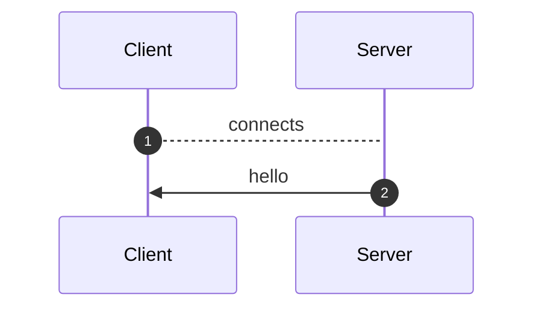
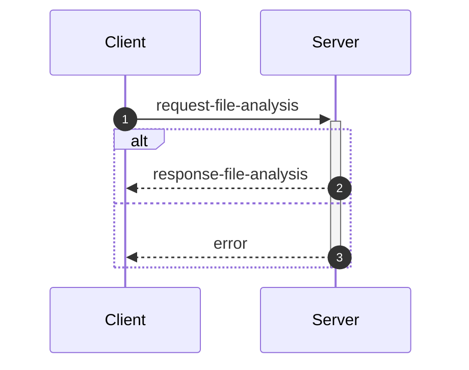
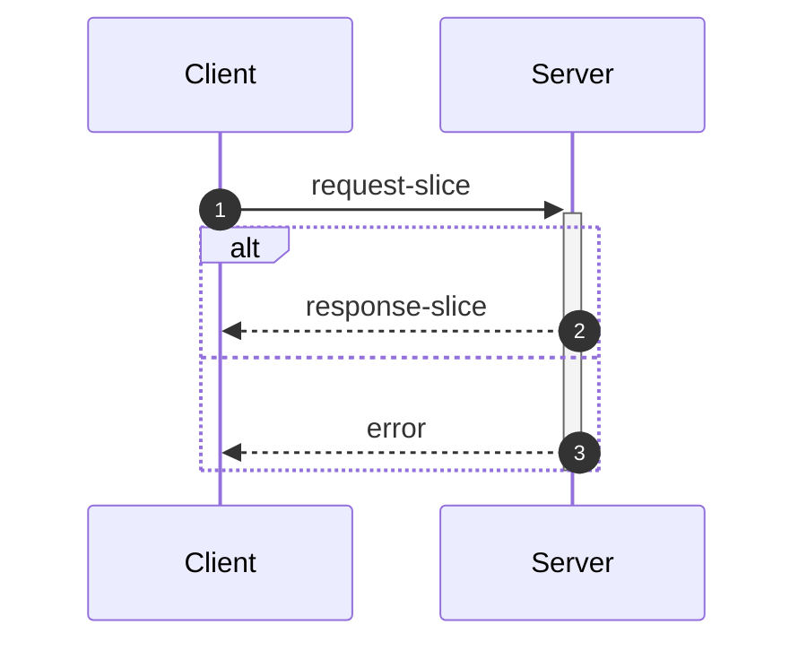
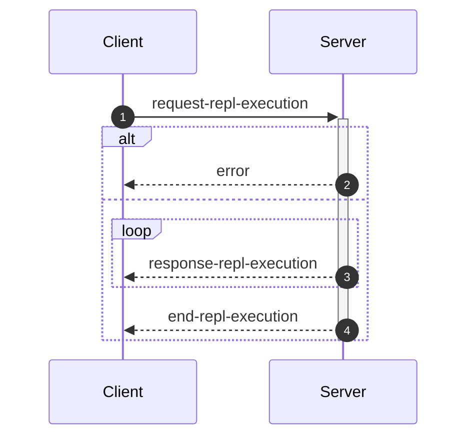

_<span title="an overview of flowR's interface">Generated</span> from '[wiki-interface.ts](https://github.com/flowr-analysis/flowr/tree/main/src/documentation/wiki-interface.ts "src/documentation/wiki-interface.ts")' on 2026-10-27, 19:13:15 UTC (v2.16.6, R v4.5.0), do not edit directly._

Although far from being as detailed as the in-depth explanation of [_flowR_](https://github.com/flowr-analysis/flowr/wiki/Core),
this wiki page explains how to interface with _flowR_ in more detail.
In general, command line arguments and other options provide short descriptions on hover over.

* [💻 Using the REPL](#using-the-repl)
* [⚙️ Configuring FlowR](#configuring-flowr)
* [⚒️ Writing Code](#writing-code)
* [💬 Communicating with the Server](#communicating-with-the-server)

<a id='using-the-repl'></a>
## 💻 Using the REPL

> [!NOTE]
> To execute arbitrary R commands with a repl request, _flowR_ has to be started explicitly with <span title="Description (Command Line Argument): Allow to access the underlying R session when using flowR (security warning: this allows the execution of arbitrary R code!)">`--r-session-access`</span>.
> Please be aware that this introduces a security risk and note that this relies on the [`r-shell` engine](https://github.com/flowr-analysis/flowr/wiki/Engines) .

Although primarily meant for users to explore,
there is nothing which forbids calling _flowR_ as a subprocess to use standard-in, -output, and -error
for communication (although you can access the REPL using the server as well,
with the [REPL Request](#message-request-repl-execution) message).

The read-eval-print loop&nbsp;(REPL) works relatively simple.
You can submit an expression (using <kbd>Enter</kbd>),
which is interpreted as an R&nbsp;expression by default but interpreted as a *command* if it starts with a colon (`:`).
The best command to get started with the REPL is <span title="Description (Repl Command): Show help information (aliases: :h, :?)">`:help`</span>.
Besides, you can leave the REPL either with the command <span title="Description (Repl Command): End the repl (aliases: :q, :exit)">`:quit`</span> or by pressing <kbd>Ctrl</kbd>+<kbd>C</kbd> twice.
When writing a *command*, you may press <kbd>Tab</kbd> to get a list of completions, if available.
Multiple commands can be entered in a single line by separating them with a semicolon (`;`), e.g. `:parse "x<-2"; :df*`.
If a command is given without R code, the REPL will re-use R code given in a previous command.
The prior example will hence return first the parsed AST of the program and then the dataflow graph for `"x <- 2"`.

> [!NOTE]
> If you develop flowR, you may want to launch the repl using the `npm run main-dev` command, this way, you get a non-minified version of flowR with debug information and hot-reloading of source files.

<details>
<summary>Available Commands</summary>

We currently offer the following commands (this with a `[*]` suffix are available with and without the star):

| Command | Description |
| ------- | ----------- |
| **<span title="Description (Repl Command): End the repl (aliases: :q, :exit)">:quit</span>** | End the repl (aliases: **:<span title="Alias of ':quit'. End the repl">q</span>**, **:<span title="Alias of ':quit'. End the repl">exit</span>**) |
| **<span title="Description (Repl Command): Execute the given code as R code. This requires the `--r-session-access` flag to be set and requires the r-shell engine. (aliases: :e, :r)">:execute</span>** | Execute the given code as R code. This requires the `--r-session-access` flag to be set and requires the r-shell engine. (aliases: **:<span title="Alias of ':execute'. Execute the given code as R code. This requires the `--r-session-access` flag to be set and requires the r-shell engine.">e</span>**, **:<span title="Alias of ':execute'. Execute the given code as R code. This requires the `--r-session-access` flag to be set and requires the r-shell engine.">r</span>**) |
| **<span title="Description (Repl Command): Get mermaid code for the control-flow graph of R code (aliases: :cfg, :cf)">:controlflow[*]</span>** | Get mermaid code for the control-flow graph of R code (star: Returns the URL to mermaid.live) (aliases: **:<span title="Alias of ':controlflow'. Get mermaid code for the control-flow graph of R code">cfg</span>**, **:<span title="Alias of ':controlflow'. Get mermaid code for the control-flow graph of R code">cf</span>**) |
| **<span title="Description (Repl Command): Get mermaid code for the control-flow graph with basic blocks (aliases: :cfgb, :cfb)">:controlflowbb[*]</span>** | Get mermaid code for the control-flow graph with basic blocks (star: Returns the URL to mermaid.live) (aliases: **:<span title="Alias of ':controlflowbb'. Get mermaid code for the control-flow graph with basic blocks">cfgb</span>**, **:<span title="Alias of ':controlflowbb'. Get mermaid code for the control-flow graph with basic blocks">cfb</span>**) |
| **<span title="Description (Repl Command): Get mermaid code for the dataflow graph (aliases: :d, :df)">:dataflow[*]</span>** | Get mermaid code for the dataflow graph (star: Returns the URL to mermaid.live) (aliases: **:<span title="Alias of ':dataflow'. Get mermaid code for the dataflow graph">d</span>**, **:<span title="Alias of ':dataflow'. Get mermaid code for the dataflow graph">df</span>**) |
| **<span title="Description (Repl Command): Get mermaid code for the normalized AST of R code (aliases: :n)">:normalize[*]</span>** | Get mermaid code for the normalized AST of R code (star: Returns the URL to mermaid.live) (alias: **:<span title="Alias of ':normalize'. Get mermaid code for the normalized AST of R code">n</span>**) |
| **<span title="Description (Repl Command): Get mermaid code for the simplified dataflow graph (aliases: :ds, :dfs)">:dataflowsimple[*]</span>** | Get mermaid code for the simplified dataflow graph (star: Returns the URL to mermaid.live) (aliases: **:<span title="Alias of ':dataflowsimple'. Get mermaid code for the simplified dataflow graph">ds</span>**, **:<span title="Alias of ':dataflowsimple'. Get mermaid code for the simplified dataflow graph">dfs</span>**) |
| **<span title="Description (Repl Command): Inspect and extend the signature database: `query` (identical to :query @signature), `info <name>` for where a function comes from (identical to :query @function-info), `add <path>` to mount another database/source, `download` to fetch the full-history database. (aliases: :sig)">:signature</span>** | Inspect and extend the signature database: `query` (identical to :query @signature), `info <name>` for where a function comes from (identical to :query @function-info), `add <path>` to mount another database/source, `download` to fetch the full-history database. (alias: **:<span title="Alias of ':signature'. Inspect and extend the signature database: `query` (identical to :query @signature), `info <name>` for where a function comes from (identical to :query @function-info), `add <path>` to mount another database/source, `download` to fetch the full-history database.">sig</span>**) |
| **<span title="Description (Repl Command): Just calculates the DFG, but only prints summary info (aliases: :d#, :df#)">:dataflowsilent</span>** | Just calculates the DFG, but only prints summary info (aliases: **:<span title="Alias of ':dataflowsilent'. Just calculates the DFG, but only prints summary info">d#</span>**, **:<span title="Alias of ':dataflowsilent'. Just calculates the DFG, but only prints summary info">df#</span>**) |
| **<span title="Description (Repl Command): Prints ASCII Art of the parsed, unmodified AST (aliases: :p)">:parse</span>** | Prints ASCII Art of the parsed, unmodified AST (alias: **:<span title="Alias of ':parse'. Prints ASCII Art of the parsed, unmodified AST">p</span>**) |
| **<span title="Description (Repl Command): Prints the version of flowR as well as the current version of R">:version</span>** | Prints the version of flowR as well as the current version of R
| **<span title="Description (Repl Command): Query the given R code (use 'help' for more information)">:query[*]</span>** | Query the given R code (use 'help' for more information) (star: Similar to query, but returns the output in json format.)
| **<span title="Description (Repl Command): Returns an ASCII representation of the dataflow graph (aliases: :df!)">:dataflowascii</span>** | Returns an ASCII representation of the dataflow graph (alias: **:<span title="Alias of ':dataflowascii'. Returns an ASCII representation of the dataflow graph">df!</span>**) |
| **<span title="Description (Repl Command): Returns summarization stats for the normalized AST (aliases: :n#)">:normalize#</span>** | Returns summarization stats for the normalized AST (alias: **:<span title="Alias of ':normalize#'. Returns summarization stats for the normalized AST">n#</span>**) |
| **<span title="Description (Repl Command): Show help information (aliases: :h, :?)">:help</span>** | Show help information (aliases: **:<span title="Alias of ':help'. Show help information">h</span>**, **:<span title="Alias of ':help'. Show help information">?</span>**) |

</details>

> [!TIP]
> 
> As indicated by the examples before, all REPL commands that operate on code keep track of the state.
> Hence, if you run a command like <span title="Description (Repl Command, starred version): Returns the URL to mermaid.live; Base Command: Get mermaid code for the dataflow graph (aliases: :d*, :df*)">`:dataflow*`</span> without providing R code,
> the REPL will re-use the R code provided in a previous command.
> Likewise, doing this will benefit from incrementality!
> If you request the dataflow graph with `:df* x <- 2 * y` and then want to see the parsed AST with `:parse`,
> the REPL will re-use previously obtained information and not re-parse the code again.
> 		

Generally, many commands offer shortcut versions in the REPL. Many queries, for example, offer a shortened format (see the example below).
Of special note, the [Config Query](https://github.com/flowr-analysis/flowr/wiki/%5BQuery%5D-Config)
can be used to also modify the currently active configuration of _flowR_ within the REPL (see the [wiki page](https://github.com/flowr-analysis/flowr/wiki/%5BQuery%5D-Config) for more information).

### Example: Retrieving the Dataflow Graph

To retrieve a URL to the [mermaid](https://mermaid.js.org/) diagram of the dataflow of a given expression,
use <span title="Description (Repl Command, starred version): Returns the URL to mermaid.live; Base Command: Get mermaid code for the dataflow graph (aliases: :d*, :df*)">`:dataflow*`</span> (or <span title="Description (Repl Command): Get mermaid code for the dataflow graph (aliases: :d, :df)">`:dataflow`</span> to get the mermaid code in the cli):

```shell
$ docker run -it --rm eagleoutice/flowr # or npm run flowr 
flowR repl v2.16.6, R grammar v14 (tree-sitter engine)
R> :dataflow* y <- 1 + x
```

<details>
<summary style='color:gray'>Output</summary>

```text
https://mermaid.live/view#base64:eyJjb2RlIjoiZmxvd2NoYXJ0IFREXG4gICAgMXt7XCJgKiM5MTtSTnVtYmVyIzkzOyogKioxKipcbiAgICAgICoxLjYqICgqKmlkOiAxKiopYFwifX1cbiAgICAyKFtcImAqIzkxO1JTeW1ib2wjOTM7KiAqKngqKlxuICAgICAgKjEuMTAqICgqKmlkOiAyKiopYFwiXSlcbiAgICAzW1tcImAqIzkxO1JCaW5hcnlPcCM5MzsqIGJhc2UjNTg7IzU4OyoqIzQzOyoqXG4gICAgICAqMS42LTEwKiAoKippZDogMyoqKVxuICAgIGFyZzogKDEsIDIpYFwiXV1cbiAgICBidWlsdC1pbjpfNDNfW1wiYEJ1aWx0LUluOlxuIzQzO2BcIl1cbiAgICBzdHlsZSBidWlsdC1pbjpfNDNfIHN0cm9rZTpncmF5LGZpbGw6Z3JheSxzdHJva2Utd2lkdGg6MnB4LG9wYWNpdHk6Ljg7XG4gICAgMFtcImAqIzkxO1JTeW1ib2wjOTM7KiAqKnkqKlxuICAgICAgKjEuMSogKCoqaWQ6IDAqKiwgdjogMylgXCJdXG4gICAgNFtbXCJgKiM5MTtSQmluYXJ5T3AjOTM7KiBiYXNlIzU4OyM1ODsqKiM2MDsjNDU7KipcbiAgICAgICoxLjEtMTAqICgqKmlkOiA0KiopXG4gICAgYXJnOiAoMCwgMylgXCJdXVxuICAgIGJ1aWx0LWluOl82MF8tW1wiYEJ1aWx0LUluOlxuIzYwOyM0NTtgXCJdXG4gICAgc3R5bGUgYnVpbHQtaW46XzYwXy0gc3Ryb2tlOmdyYXksZmlsbDpncmF5LHN0cm9rZS13aWR0aDoycHgsb3BhY2l0eTouODtcbiAgICAxIC0uLT58XCJmbG93XCJ8IDJcbiAgICBsaW5rU3R5bGUgMCBzdHJva2U6Z3JheSxjb2xvcjpncmF5O1xuICAgIDIgLS4tPnxcImZsb3dcInwgM1xuICAgIGxpbmtTdHlsZSAxIHN0cm9rZTpncmF5LGNvbG9yOmdyYXk7XG4gICAgMyAtLT58XCJyZWFkcywgYXJnXCJ8IDFcbiAgICAzIC0tPnxcInJlYWRzLCBhcmdcInwgMlxuICAgIDMgLS4tPnxcImZsb3dcInwgMFxuICAgIGxpbmtTdHlsZSA0IHN0cm9rZTpncmF5LGNvbG9yOmdyYXk7XG4gICAgMyAtLi0+fFwicmVhZHMsIGNhbGxzXCJ8IGJ1aWx0LWluOl80M19cbiAgICBsaW5rU3R5bGUgNSBzdHJva2U6Z3JheTtcbiAgICAwIC0tPnxcImRlZmluZWQtYnksIGZsb3dcInwgNFxuICAgIDAgLS0+fFwiZGVmaW5lZC1ieVwifCAzXG4gICAgNCAtLT58XCJyZWFkcywgYXJnXCJ8IDNcbiAgICA0IC0tPnxcInJldHVybnMsIGFyZ1wifCAwXG4gICAgNCAtLi0+fFwicmVhZHMsIGNhbGxzXCJ8IGJ1aWx0LWluOl82MF8tXG4gICAgbGlua1N0eWxlIDEwIHN0cm9rZTpncmF5OyIsIm1lcm1haWQiOnsiYXV0b1N5bmMiOnRydWV9fQ==
```

Retrieve the dataflow graph of the expression `y <- 1 + x`. It looks like this:


<details>

<summary style="color:gray">R Code of the Dataflow Graph</summary>

The analysis ran (parse and normalize with the [tree-sitter](https://github.com/flowr-analysis/flowr/wiki/Engines) engine) in the generation environment. No [signature database](https://github.com/flowr-analysis/flowr/wiki/Signature-Database) is mounted, so `library()` attaches no exports (base-R names are still qualified, e.g., `stats::acf`). 
We encountered no unknown side effects during the analysis.

```r
y <- 1 + x
```

</details>

</details>

For small graphs like this, <span title="Description (Repl Command): Returns an ASCII representation of the dataflow graph (aliases: :df!)">`:dataflowascii`</span> also provides an ASCII representation directly in the REPL:

```shell
$ docker run -it --rm eagleoutice/flowr # or npm run flowr 
flowR repl v2.16.6, R grammar v14 (tree-sitter engine)
R> :df! y <- 1 + x
```

<details open>
<summary style='color:gray'>Output</summary>

```text
                        v<0>v
 c<4>c──────────────────| y |
 |<- |     ┌────────────v---v
 c---c     │
    │   c<3>c   0<1>0
    └───| + |───| 1 |───u<2>u
        c---c   0---0   | x |
           └────────────u---u
Edges:
3 -> 1: reads, arg          3 -> 2: reads, arg
3 -> 0: flows-to            1 -> 2: flows-to
2 -> 3: flows-to            4 -> 3: reads, arg
4 -> 0: returns, arg        0 -> 4: defined-by, flows-to
0 -> 3: defined-by
```

Retrieve the dataflow graph of the expression `y <- 1 + x` as ASCII art.

</details>

For the slicing with <span title="Description (Repl Command): Static backwards executable slicer for R">`:slicer`</span>, you have access to the same [magic comments](#slice-magic-comments) as with the [slice request](#message-request-slice).
Pass `--inline` to splice resolvable `source()` calls into the reconstruction so the slice is a single self-contained R text (the same as the static slice query's `inlineSources` flag).
See `--help` for more flags!

### Example: Interfacing with the File System

Many commands that allow for an R-expression (like <span title="Description (Repl Command, starred version): Returns the URL to mermaid.live; Base Command: Get mermaid code for the dataflow graph (aliases: :d*, :df*)">`:dataflow*`</span>) allow for a file as well
if the argument starts with `file://`.
If you are working from the root directory of the _flowR_ repository, the following gives you the parsed AST of the example file using the <span title="Description (Repl Command): Prints ASCII Art of the parsed, unmodified AST (aliases: :p)">`:parse`</span> command:

> **Watch mode**: Replace `file://` with `watch://` to enter watch mode.
> flowR runs the command immediately and then re-runs it every time the file (or any file inside the folder) changes.
> Enter any other command to leave watch mode.
> For example: `:df watch://analysis.R`

```shell
$ docker run -it --rm eagleoutice/flowr # or npm run flowr 
flowR repl v2.16.6, R grammar v14 (tree-sitter engine)
R> :parse file://test/testfiles/example.R
```

<details>
<summary style='color:gray'>Output</summary>

```text
File: test/testfiles/example.R

program
├ binaryoperator
│ ├ identifier "sum" (1:1─4)
│ ├ <- "<-" (1:5─7)
│ ╰ float "0" (1:8─9)
├ binaryoperator
│ ├ identifier "product" (2:1─8)
│ ├ <- "<-" (2:9─11)
│ ╰ float "1" (2:12─13)
├ binaryoperator
│ ├ identifier "w" (3:1─2)
│ ├ <- "<-" (3:3─5)
│ ╰ float "7" (3:6─7)
├ binaryoperator
│ ├ identifier "N" (4:1─2)
│ ├ <- "<-" (4:3─5)
│ ╰ float "10" (4:6─8)
├ forstatement
│ ├ for "for" (6:1─4)
│ ├ ( "(" (6:5─6)
│ ├ identifier "i" (6:6─7)
│ ├ in "in" (6:8─10)
│ ├ binaryoperator
│ │ ├ float "1" (6:11─12)
│ │ ├ : ":" (6:12─13)
│ │ ╰ parenthesizedexpression
│ │   ├ ( "(" (6:13─14)
│ │   ├ binaryoperator
│ │   │ ├ identifier "N" (6:14─15)
│ │   │ ├ - "-" (6:15─16)
│ │   │ ╰ float "1" (6:16─17)
│ │   ╰ ) ")" (6:17─18)
│ ├ ) ")" (6:18─19)
│ ╰ bracedexpression
│   ├ { "{" (6:20─21)
│   ├ binaryoperator
│   │ ├ identifier "sum" (7:3─6)
│   │ ├ <- "<-" (7:7─9)
│   │ ╰ binaryoperator
│   │   ├ binaryoperator
│   │   │ ├ identifier "sum" (7:10─13)
│   │   │ ├ + "+" (7:14─15)
│   │   │ ╰ identifier "i" (7:16─17)
│   │   ├ + "+" (7:18─19)
│   │   ╰ identifier "w" (7:20─21)
│   ├ binaryoperator
│   │ ├ identifier "product" (8:3─10)
│   │ ├ <- "<-" (8:11─13)
│   │ ╰ binaryoperator
│   │   ├ identifier "product" (8:14─21)
│   │   ├  "" (8:22─23)
│   │   ╰ identifier "i" (8:24─25)
│   ╰ } "}" (9:1─2)
├ call
│ ├ identifier "cat" (11:1─4)
│ ╰ arguments
│   ├ ( "(" (11:4─5)
│   ├ argument
│   │ ╰ string
│   │   ├ stringopen "\"" (11:5─6)
│   │   ├ stringcontent "Sum:" (11:6─10)
│   │   ╰ stringclose "\"" (11:10─11)
│   ├ comma "," (11:11─12)
│   ├ argument
│   │ ╰ identifier "sum" (11:13─16)
│   ├ comma "," (11:16─17)
│   ├ argument
│   │ ╰ string
│   │   ├ stringopen "\"" (11:18─19)
│   │   ├ stringcontent
│   │   │ ╰ escapesequence "\\n" (11:19─21)
│   │   ╰ stringclose "\"" (11:21─22)
│   ╰ ) ")" (11:22─23)
╰ call
  ├ identifier "cat" (12:1─4)
  ╰ arguments
    ├ ( "(" (12:4─5)
    ├ argument
    │ ╰ string
    │   ├ stringopen "\"" (12:5─6)
    │   ├ stringcontent "Product:" (12:6─14)
    │   ╰ stringclose "\"" (12:14─15)
    ├ comma "," (12:15─16)
    ├ argument
    │ ╰ identifier "product" (12:17─24)
    ├ comma "," (12:24─25)
    ├ argument
    │ ╰ string
    │   ├ stringopen "\"" (12:26─27)
    │   ├ stringcontent
    │   │ ╰ escapesequence "\\n" (12:27─29)
    │   ╰ stringclose "\"" (12:29─30)
    ╰ ) ")" (12:30─31)
```

Retrieve the parsed AST of the example file.

<details>

<summary>File Content</summary>

```r
sum <- 0
product <- 1
w <- 7
N <- 10

for (i in 1:(N-1)) {
  sum <- sum + i + w
  product <- product * i
}

cat("Sum:", sum, "\n")
cat("Product:", product, "\n")
```

</details>

As _flowR_ directly transforms this AST the output focuses on being human-readable instead of being machine-readable.
		
</details>

### Example: Run a Query

You can run any query supported by _flowR_ using the <span title="Description (Repl Command): Query the given R code (use 'help' for more information)">`:query`</span> command.
For example, to obtain the shapes of all data frames in a given piece of code, you can run:

```shell
$ docker run -it --rm eagleoutice/flowr # or npm run flowr 
flowR repl v2.16.6, R grammar v14 (tree-sitter engine)
R> :query @absint df-shape "x <- data.frame(a = 1:10, b = 1:10)\ny <- x$a"
```

<details open>
<summary style='color:gray'>Output</summary>

```text
Query: absint (4 ms)
   ╰ $12: (colnames: [{"a", "b"}, {}], cols: [2, 2], rows: [10, 10])
   ╰ $0: (colnames: [{"a", "b"}, {}], cols: [2, 2], rows: [10, 10])
```

Retrieve the shapes of all data frames in the given code.

</details>

To run the linter on a file, you can use (in this example, we just issue the `dead-code` linter on a small piece of code):

```shell
$ docker run -it --rm eagleoutice/flowr # or npm run flowr 
flowR repl v2.16.6, R grammar v14 (tree-sitter engine)
R> :query @linter rules:dead-code "if(FALSE) x <- 2"
```

<details open>
<summary style='color:gray'>Output</summary>

```text
Query: linter (2 ms)
   ╰ Dead Code (dead-code):
       ╰ certain:
           ╰ Code at 1.11-16 (1 quick fix(es) available)
```

Run the linter on the given code, with only the `dead-code` rule enabled.

</details>

For more information on the available queries, please check out the [Query API](https://github.com/flowr-analysis/flowr/wiki/Query-API).

<a id='configuring-flowr'></a>
## ⚙️ Configuring FlowR

When running _flowR_, you may want to specify some behaviors with a dedicated configuration file.
By default, flowR looks for a file named `flowr.json` in the current working directory (or any higher directory).
You can also specify a different file with <span title="Description (Command Line Argument): The name of the configuration file to use">`--config-file`</span> or pass the configuration inline using <span title="Description (Command Line Argument): The flowR configuration to use, as a JSON string">`--config-json`</span>.
A `flowr.json` found this way belongs to the analyzed project, so flowR ignores its options that decide what flowR executes or loads
(`engines.*.wasmPath`, `engines.*.treeSitterWasmPath`, `engines.*.rPath`, `solver.sigdb.additionalPaths`, `solver.sigdb.downloadRepo`, `solver.sigdb.installedLibrary.paths`),
unless you pass <span title="Description (Command Line Argument): Keep the security-sensitive options (e.g., the R executable) of the flowr.json found in the working directory or a parent. Only use this for projects you trust.">`--trust-config`</span>.
To analyze code you do not trust, use the secure mode (<span title="Description (Command Line Argument): Run in secure mode for analyzing untrusted code: flowR does not start R (or any other process), does not access the network, does not search for project configs, and ignores security-sensitive options in every config. Cannot be disabled once enabled. Can also be enabled with the environment variable {italic FLOWR_SECURE_MODE=1}.">`--secure`</span>, see the [security policy](https://github.com/flowr-analysis/flowr/blob/main/.github/SECURITY.md)).
To inspect the current configuration, you can run flowr with the <span title="Description (Command Line Argument): Run with verbose logging (will be passed to the corresponding script)">`--verbose`</span> flag, or use the `config` [Query](https://github.com/flowr-analysis/flowr/wiki/Query-API).
Within the REPL this works by running the following:

```shell
:query @config
```

To work with the <a href="https://github.com/flowr-analysis/flowr/tree/main/src/config.ts#L119"><code><span title="The configuration file format for flowR.">FlowrConfig</span></code></a> you can use the provided helper objects alongside its methods like
<a href="https://github.com/flowr-analysis/flowr/tree/main/src/config.ts#L914"><code><span title="Creates a new flowr config that has the updated values.">FlowrConfig::<b>amend</b></span></code></a>.
The schema below documents every option; the ones you most likely want are:

- <a href="https://github.com/flowr-analysis/flowr/wiki/Interface#configuring-flowr" title="Configuration Option (boolean): Whether source calls should be ignored, causing {@link processSourceCall}&#39;s behavior to be skipped.">ignoreSourceCalls</a>: ignore source calls when analyzing the code, i.e., ignore the inclusion of other files.
- <a href="https://github.com/flowr-analysis/flowr/wiki/Interface#configuring-flowr" title="Configuration Option (boolean): Whether load calls should be ignored, causing {@link processLoadCall}&#39;s behavior to be skipped.">ignoreLoadCalls</a>: ignore load calls when analyzing the code, i.e., ignore the loading of r-data files.
- <a href="https://github.com/flowr-analysis/flowr/wiki/Interface#configuring-flowr" title="Configuration Option (object): Do you want to overwrite (parts) of the builtin definition?">semantics.environment.overwriteBuiltIns</a>: overwrite _flowR_'s handling of built-in functions, or clear the preset definitions entirely.
  See [Configure BuiltIn Semantics](#configure-builtin-semantics) for more information.
- <a href="https://github.com/flowr-analysis/flowr/wiki/Interface#configuring-flowr" title="Configuration Option (string): How to resolve variables and their values. (one of &quot;disabled&quot;, &quot;alias&quot;, &quot;builtin&quot;)">solver.variables</a>: how to resolve variables and their values (`disabled`, `alias`, `builtin`).
- <a href="https://github.com/flowr-analysis/flowr/wiki/Interface#configuring-flowr" title="Configuration Option (array): The engine or set of engines to use for interacting with R code. An empty array means all available engines will be used.">engines</a> and <a href="https://github.com/flowr-analysis/flowr/wiki/Interface#configuring-flowr" title="Configuration Option (string): The default engine to use for interacting with R code. If this is undefined, an arbitrary engine from the specified list will be used. (one of &quot;tree-sitter&quot;, &quot;r-shell&quot;)">defaultEngine</a>: the engines used to interact with R code, see the [Engines wiki page](https://github.com/flowr-analysis/flowr/wiki/Engines).
- <a href="https://github.com/flowr-analysis/flowr/wiki/Interface#configuring-flowr" title="Configuration Option (array): Files a framework loads on its own, without any source() call (e.g. global.R in a shiny app), in the order they are loaded; flowR orders the matching project files accordingly and analyzes them as one program. Entries are case-insensitive globs matched against the file path, a plain name matches any file with that name, and entries matching no project file are warned about. Usually set per project kind via specializeConfig.">project.implicitSources</a>: the files a framework loads without any `source()` call, in the order in which they are
  loaded. Entries are globs (e.g. `R/*.R`) matched against the file path ignoring capitalization; one matching no file is reported.
- <a href="https://github.com/flowr-analysis/flowr/wiki/Interface#configuring-flowr" title="Configuration Option (object): Overwrite (parts of) the configuration depending on the project kind flowR detects, e.g. to give a shiny app its implicit sources.">specializeConfig</a>: overwrite (parts of) the configuration depending on the kind of project _flowR_ detects
  (e.g. `shiny-app`), which is how a shiny app gets its implicit sources by default. What you configure directly wins.
- <a href="https://github.com/flowr-analysis/flowr/wiki/Interface#configuring-flowr" title="Configuration Option (string): Overwrite the project kind flowR would otherwise infer from the analyzed files, e.g. when auto-detection guesses wrong. (one of &quot;package&quot;, &quot;script&quot;, &quot;shiny-app&quot;, &quot;notebook&quot;, &quot;project&quot;, &quot;unknown&quot;)">project.useProjectType</a>: skip that detection and force a project kind yourself, when auto-detection guesses wrong.
- <a href="https://github.com/flowr-analysis/flowr/wiki/Interface#configuring-flowr" title="Configuration Option (array): The default plugins to load when creating a new instance of FlowrAnalyzer">defaultPlugins</a> and <a href="https://github.com/flowr-analysis/flowr/wiki/Interface#configuring-flowr" title="Configuration Option (array): The plugins to load in REPL mode">repl.plugins</a>: the plugins to load for a new <a href="https://github.com/flowr-analysis/flowr/tree/main/src/project/flowr-analyzer.ts#L205"><code><span title="Central class for conducting analyses with FlowR. Use the FlowrAnalyzerBuilder to create a new instance. If you want the original pattern of creating a pipeline and running all steps, you can still do this with FlowrAnalyzer#runFull . To inspect the context of the analyzer, use FlowrAnalyzer#inspectContext (if you are a plugin and need to modify it, use FlowrAnalyzer#context instead).">FlowrAnalyzer</span></code></a> and in the REPL
  (use `flowr:default` to reference the former).

So you can configure _flowR_ by adding a file like the following:

<details>

<summary>Example Configuration File</summary>

```json
{
  "ignoreSourceCalls": true,
  "ignoreLoadCalls": true,
  "semantics": {
    "environment": {
      "overwriteBuiltIns": {
        "definitions": [
          {
            "type": "function",
            "names": [
              "foo"
            ],
            "processor": "builtin:assign",
            "config": {}
          }
        ]
      }
    }
  },
  "defaultPlugins": [
    "file:description",
    "versions:description"
  ],
  "repl": {
    "quickStats": false,
    "dfProcessorHeat": false,
    "hints": true,
    "plugins": [
      "flowr:default"
    ]
  },
  "project": {
    "resolveUnknownPathsOnDisk": true,
    "implicitSources": [
      "global.R",
      "app.R"
    ]
  },
  "linter": {
    "disabledRules": []
  },
  "specializeConfig": {
    "shiny-app": {
      "project": {
        "implicitSources": [
          "global.R",
          "ui.R",
          "server.R",
          "app.R"
        ]
      }
    }
  },
  "engines": [
    {
      "type": "r-shell"
    }
  ],
  "solver": {
    "variables": "alias",
    "evalStrings": true,
    "trackEnvironments": true,
    "sigdb": {
      "enabled": true,
      "loadProjectDependencies": true,
      "eagerlyLoad": false,
      "eagerlyLoadExports": false,
      "linkBaseR": false,
      "linkDescriptionDependencies": false
    },
    "resolveSource": {
      "dropPaths": "no",
      "ignoreCapitalization": true,
      "inferWorkingDirectory": "active-script",
      "searchPath": []
    },
    "instrument": {},
    "slicer": {
      "threshold": 50
    }
  },
  "abstractInterpretation": {
    "wideningThreshold": 4,
    "followCalls": true,
    "dataFrame": {
      "maxColNames": 20,
      "readLoadedData": {
        "readExternalFiles": true,
        "maxReadLines": 1000000
      }
    }
  },
  "incremental": {
    "alwaysIncremental": false,
    "parsing": {
      "activated": false,
      "heuristics": {
        "activated": true,
        "mtime": true,
        "linesFrom": 500,
        "bytesFrom": 50000,
        "alwaysWithEdits": false,
        "minFiles": 1
      }
    }
  },
  "gas": {
    "thresholds": {
      "memory": {
        "problematic": 0.7,
        "critical": 0.9
      },
      "timeMs": {
        "problematic": 100000,
        "critical": 120000
      }
    },
    "features": {}
  }
}
```

</details>

<details>
<a id='configure-builtin-semantics'></a>
<summary>Configure Built-In Semantics</summary>

`semantics/environment/overwriteBuiltins` accepts two keys:

- `loadDefaults` (boolean, initially `true`): If set to `true`, the default built-in definitions are loaded before applying the custom definitions. Setting this flag to `false` explicitly disables the loading of the default definitions.
- `definitions` (array, initially empty): Allows to overwrite or define new built-in elements. Each object within must have a `type` which is one of the below. Furthermore, they may define a string array of `names` which specifies the identifiers to bind the definitions to. You may use `assumePrimitive` to specify whether _flowR_ should assume that this is a primitive non-library definition (so you probably just do not want to specify the key).

  | Type            | Description                                                                                                                                                                                                                                                                                              | Example                                                                                                    |
  | --------------- | -------------------------------------------------------------------------------------------------------------------------------------------------------------------------------------------------------------------------------------------------------------------------------------------------------- | ---------------------------------------------------------------------------------------------------------- |
  | `constant`    | Additionally allows for a `value` this should resolve to.                                                                                                                                                                                                                                                | `{ type: 'constant', names: ['NULL', 'NA'],  value: null }`                                                |
  | `function`    | Is a rather flexible way to define and bind built-in functions. For the time, we do not have extensive documentation to cover all the cases, so please either consult the sources with the `default-builtin-config.ts` or open a [new issue](https://github.com/flowr-analysis/flowr/issues/new/choose). | `{ type: 'function', names: ['next'], processor: 'builtin:d', config: { cfg: ExitPointType.Next } }` |
  | `replacement` | A comfortable way to specify replacement functions like `$<-` or `names<-`. `suffixes` describes the... suffixes to attach automatically. | `{ type: 'replacement', suffixes: ['<-', '<<-'], names: ['[', '[['] }` |

</details>

<details>

<summary style='color:gray'>Full Configuration-File Schema</summary>

- _The configuration file format for flowR._ (object)
    - **logLevel** [optional] _flowR's global minimum log level, applied when the config is loaded._ (string)
        Only allows: 'silly', 'trace', 'debug', 'info', 'warn', 'error', 'fatal'
    - **ignoreSourceCalls** [optional] _Whether source calls should be ignored, causing {@link processSourceCall}'s behavior to be skipped._ (boolean)
    - **ignoreLoadCalls** [optional] _Whether load calls should be ignored, causing {@link processLoadCall}'s behavior to be skipped._ (boolean)
    - **semantics** _Configure language semantics and how flowR handles them._ (object)
        - **environment** [optional] _Semantics regarding how to handle the R environment._ (object)
            - **overwriteBuiltIns** [optional] _Do you want to overwrite (parts) of the builtin definition?_ (object)
                - **loadDefaults** [optional] _Should the default configuration still be loaded?_ (boolean)
                - **definitions** [optional] _The definitions to load/overwrite._ (array)
                Valid item types:
                    - (object)
    - **defaultPlugins** [optional] _The default plugins to load when creating a new instance of FlowrAnalyzer_ (array)
    Valid item types:
        - (alternatives)
            - (string)
            - (array)
    - **repl** _Configuration options for the REPL._ (object)
        - **quickStats** [optional] _Whether to show quick stats in the REPL after each evaluation._ (boolean)
        - **dfProcessorHeat** [optional] _This instruments the dataflow processors to count how often each processor is called._ (boolean)
        - **hints** [optional] _Whether to show dim inline hints on the empty prompt (automatically disabled on non-interactive terminals)._ (boolean)
        - **plugins** [optional] _The plugins to load in REPL mode_ (array)
        Valid item types:
            - (alternatives)
                - (string)
                - (array)
        - **autoUseFileProtocol** [optional] _Prepend the file protocol to a repl input that looks like a path, instead of only warning about it._ (boolean)
        - **queryStats** [optional] _Whether `:query` closes with the line stating how long the queries took (`:query*` never prints it)._ (boolean)
        - **showPlugins** [optional] _Whether `:version` grays out the plugins that did not activate during the last analysis._ (boolean)
    - **project** _Project specific configuration options._ (object)
        - **resolveUnknownPathsOnDisk** [optional] _Whether to resolve unknown paths loaded by the r project disk when trying to source/analyze files._ (boolean)
        - **failOnInaccessiblePath** [optional] _Whether a directory that cannot be traversed during file discovery (e.g. due to permissions) aborts the analysis; when false (the default) such paths are logged and skipped._ (boolean)
        - **basePackages** [optional] _The packages considered part of R itself (base and recommended); if unset, flowR uses its built-in list._ (array)
        Valid item types:
            - (string)
        - **implicitSources** [optional] _Files a framework loads on its own, without any source() call (e.g. global.R in a shiny app), in the order they are loaded; flowR orders the matching project files accordingly and analyzes them as one program. Entries are case-insensitive globs matched against the file path, a plain name matches any file with that name, and entries matching no project file are warned about. Usually set per project kind via specializeConfig._ (array)
        Valid item types:
            - (string)
        - **useProjectType** [optional] _Overwrite the project kind flowR would otherwise infer from the analyzed files, e.g. when auto-detection guesses wrong._ (string)
            Only allows: 'package', 'script', 'shiny-app', 'notebook', 'project', 'unknown'
        - **assumeImplicitEcho** [optional] _Whether the top level of the analyzed code is echoed, so that every visible result printed there is collected as an output by the dependencies query (default true, false for a package)._ (boolean)
        - **discovery** [optional] _Scoping options for the default project discovery._ (object)
            - **full** [optional] _Collect every file below the project root (greedy) instead of only the files the detected project kind needs (default false)._ (boolean)
            - **perKind** [optional] _Per-kind include/exclude glob overrides layered on the default scoping._ (object)
            - **ignore** [optional] _Case-insensitive globs that drop matching files from the intelligent discovery, regardless of kind (e.g. .Renviron to ignore environment files)._ (array)
            Valid item types:
                - (string)
        - **classification** [optional] _Overrides for the signals flowR uses to classify the project kind._ (object)
            - **shinyDescriptionTypes** [optional] _DESCRIPTION Type: values that mark a shiny app._ (array)
            Valid item types:
                - (string)
            - **shinyEntryFiles** [optional] _File names a shiny app is assembled from._ (array)
            Valid item types:
                - (string)
            - **shinyUsagePattern** [optional] _Regex source evidencing shiny usage in an entry file._ (string)
            - **notebookExtensions** [optional] _File extensions marking a notebook._ (array)
            Valid item types:
                - (string)
    - **linter** _Linter configuration options._ (object)
        - **disabledRules** _Linting rule names excluded from the default rule set (a rule requested explicitly via a linter query still runs). Usually set per project kind via specializeConfig._ (array)
        Valid item types:
            - (string)
        - **disabledTags** [optional] _Linting rule tags whose rules are excluded from the default rule set (a rule requested explicitly via a linter query still runs). By default the cmd-check rules are disabled for everything but a package; a configured list replaces that default._ (array)
        Valid item types:
            - (string)
    - **inputSources** [optional] _Further frameworks the input-sources analysis should know about; entries are added to flowR's defaults._ (object)
        - **pure** [optional] _Functions that only pass the constantness of their arguments on._ (array)
        Valid item types:
            - (string)
        - **param** [optional] _Functions whose result is a 'param' input._ (array)
        Valid item types:
            - (string)
        - **file** [optional] _Functions whose result is a 'file' input._ (array)
        Valid item types:
            - (string)
        - **tempfile** [optional] _Functions whose result is a 'tempfile' input._ (array)
        Valid item types:
            - (string)
        - **glob** [optional] _Functions whose result is a 'glob' input._ (array)
        Valid item types:
            - (string)
        - **net** [optional] _Functions whose result is a 'net' input._ (array)
        Valid item types:
            - (string)
        - **rand** [optional] _Functions whose result is a 'rand' input._ (array)
        Valid item types:
            - (string)
        - **system** [optional] _Functions whose result is a 'system' input._ (array)
        Valid item types:
            - (string)
        - **ffi** [optional] _Functions whose result is a 'ffi' input._ (array)
        Valid item types:
            - (string)
        - **lang** [optional] _Functions whose result is a 'lang' input._ (array)
        Valid item types:
            - (string)
        - **options** [optional] _Functions whose result is a 'options' input._ (array)
        Valid item types:
            - (string)
        - **cmdline** [optional] _Functions whose result is a 'cmdline' input._ (array)
        Valid item types:
            - (string)
        - **user** [optional] _Functions whose result is a 'user' input._ (array)
        Valid item types:
            - (string)
        - **const** [optional] _Functions whose result is a 'const' input._ (array)
        Valid item types:
            - (string)
        - **scope** [optional] _Functions whose result is a 'scope' input._ (array)
        Valid item types:
            - (string)
        - **dconst** [optional] _Functions whose result is a 'dconst' input._ (array)
        Valid item types:
            - (string)
        - **unknown** [optional] _Functions whose result is a 'unknown' input._ (array)
        Valid item types:
            - (string)
        - **linkedObjects** [optional] _Objects a framework provides without a definition in the code, e.g. shiny's input._ (array)
        Valid item types:
            - (object)
        - **linkedEntryPoints** [optional] _Calls that hand a function to a framework, which binds its objects to the parameters by position._ (array)
        Valid item types:
            - (object)
    - **specializeConfig** [optional] _Overwrite (parts of) the configuration depending on the project kind flowR detects, e.g. to give a shiny app its implicit sources._ (object)
    - **engines** _The engine or set of engines to use for interacting with R code. An empty array means all available engines will be used._ (array)
    Valid item types:
        - (alternatives)
            - _The configuration for the tree sitter engine._ (object)
                - **type** [required] _Use the tree sitter engine._ (string)
                    Only allows: 'tree-sitter'
                - **wasmPath** [optional] _The path to the tree-sitter-r WASM binary to use. If this is undefined, this uses the default path._ (string)
                - **treeSitterWasmPath** [optional] _The path to the tree-sitter WASM binary to use. If this is undefined, this uses the default path._ (string)
                - **lax** [optional] _Whether to use the lax parser for parsing R code (allowing for syntax errors). If this is undefined, the strict parser will be used._ (boolean)
            - _The configuration for the R shell engine._ (object)
                - **type** [required] _Use the R shell engine._ (string)
                    Only allows: 'r-shell'
                - **rPath** [optional] _The path to the R executable to use. If this is undefined, this uses the default path._ (string)
                - **pipeBind** [optional] _Whether to enable R's experimental pipe-bind operator "=>" by setting _R_USE_PIPEBIND_ for the R session (default false); R itself keeps this off by default, as it is experimental and has never shipped in a release version of R._ (boolean)
    - **defaultEngine** [optional] _The default engine to use for interacting with R code. If this is undefined, an arbitrary engine from the specified list will be used._ (string)
        Only allows: 'tree-sitter', 'r-shell'
    - **solver** _How to resolve constants, constraints, cells, ..._ (object)
        - **variables** _How to resolve variables and their values._ (string)
            Only allows: 'disabled', 'alias', 'builtin'
        - **evalStrings** _Should we include eval(parse(text="...")) calls in the dataflow graph?_ (boolean)
        - **trackEnvironments** [optional] _Track user-created environments (new.env, assign/get/local with envir=, dollar-assign, attach). When false, all envir-style calls fall through conservatively._ (boolean)
        - **sigdb** _Resolving library exports from a signature database._ (object)
            - **enabled** [optional] _Resolve library()/use() exports from a signature database (default true); when false no database is consulted._ (boolean)
            - **loadProjectDependencies** [optional] _Load the project's declared dependencies from its metadata files (DESCRIPTION Imports/Depends, rproject.toml, uvr.toml, renv.lock, rv.lock, uvr.lock) (default true); when false these files are not read for dependencies._ (boolean)
            - **eagerlyLoad** [optional] _Parse the database up front rather than on the first package load (default false, ignored if disabled)._ (boolean)
            - **eagerlyLoadExports** [optional] _Add a vertex for every export on load rather than on demand (default false); keeps the dataflow graph small._ (boolean)
            - **assumedRVersion** [optional] _R version assumed when resolving versioned (base-R) exports: a pin like "4.5" or "auto" to detect the installed R (default "auto")._ (string)
            - **linkBaseR** [optional] _Eagerly attach base-R namespaces so bare base calls resolve without library() (default false)._ (boolean)
            - **linkBaseRCalls** [optional] _Add a lightweight Reads edge from a bare base-R call to its signature-database function vertex (default false; base-R qualification is edge-free otherwise)._ (boolean)
            - **linkPackageCalls** [optional] _Add a lightweight Reads edge from a resolved package call to its signature-database function vertex (default false)._ (boolean)
            - **linkDescriptionDependencies** [optional] _Eagerly attach the namespaces of the project's declared DESCRIPTION dependencies (Imports/Depends) so their exports resolve without an explicit library() (default false)._ (boolean)
            - **warmInBackground** [optional] _Decompress the hot shards (base + most-downloaded) in a background task on startup so the first library() lookup is warm (default false; for long-running servers/REPLs)._ (boolean)
            - **additionalPaths** [optional] _Extra directories or bundle/manifest files searched for signature databases (alongside the shipped default and $FLOWR_SIGDB_DIR); a downloaded full-history bundle placed here is mounted automatically._ (array)
            Valid item types:
                - (string)
            - **downloadRepo** [optional] _GitHub owner/repo the full-history bundle is downloaded from via ":signature download" (default "flowr-analysis/flowr", release tag "sigdb-v<flowR-version>")._ (string)
            - **autoSync** [optional] _On startup, re-download shards whose committed sigdb.remote.json hash no longer matches the cache, in the background (default false; opt-in network sync after a git pull)._ (boolean)
            - **installedLibrary** [optional] _Recovering packages no signature database knows from the copy installed on this machine._ (object)
                - **enabled** [required] _Recover packages no signature database knows from their installed copy (default false)._ (boolean)
                - **paths** [optional] _Library directories to search; when empty they are discovered from the environment and the project._ (array)
                Valid item types:
                    - (string)
                - **useEnvironment** [optional] _Search the libraries R_LIBS_USER/R_LIBS/R_LIBS_SITE name (default true)._ (boolean)
                - **useProjectLibrary** [optional] _Search a project-local renv/packrat library (default true)._ (boolean)
                - **maxDepth** [optional] _How far to descend into the nested layout of a project-local library (default 3)._ (number)
                - **packages** [optional] _Only recover packages whose name matches one of these regular expressions; empty means any._ (array)
                Valid item types:
                    - (string)
            - **blobCacheBudgetMb** [optional] _How many MiB of decoded package blobs every open bundle may hold together (default 16)._ (number)
            - **versionSelection** [optional] _When a project constrains a dependency, resolve to the newest (default), oldest, or system-installed version satisfying it; system needs R and falls back to newest. Base-R packages always resolve against the assumed R version._ (string)
                Only allows: 'newest', 'oldest', 'system'
            - **versionOverrides** [optional] _Force an exact version for specific packages (name -> version), overriding both the project constraint and the versionSelection policy (default {})._ (object)
        - **versionManagement** _Policies for reasoning about dependency versions._ (object)
            - **linkedVersionGroups** [optional] _Groups of packages that must resolve to the same version; version guessing intersects each group so its members stay mutually compatible (default [])._ (array)
            Valid item types:
                - (array)
                Valid item types:
                    - (string)
        - **assumeAttachedPackages** [optional] _Packages to treat as attached without a `library()` call, so what the built-in configuration states about them applies to the analyzed code. The base packages R attaches on startup already resolve without it._ (array)
        Valid item types:
            - (string)
        - **transitiveSideEffectRounds** [optional] _How many rounds the transitive side-effect fixpoint may run before it is cut off (default 32); the propagation stops on its own as soon as a round adds nothing._ (number)
        - **maxOverlayDepth** [optional] _How many binding overlays may stack on one environment frame before a write flattens them (default 4); a pure performance knob, trading lookup cost against copy cost without changing any result._ (number)
        - **instrument** (object)
            - **dataflowExtractors** [optional] _These keys are only intended for use within code, allowing to instrument the dataflow analyzer!_ (any)
        - **resolveSource** [optional] _If lax source calls are active, flowR searches for sourced files much more freely, based on the configurations you give it. This option is only in effect if `ignoreSourceCalls` is set to false._ (object)
            - **dropPaths** _Allow to drop the first or all parts of the sourced path, if it is relative._ (string)
                Only allows: 'no', 'once', 'all'
            - **ignoreCapitalization** _Search for filenames matching in the lowercase._ (boolean)
            - **inferWorkingDirectory** _Try to infer the working directory from the main or any script to analyze._ (string)
                Only allows: 'no', 'main-script', 'active-script', 'any-script'
            - **searchPath** _Additionally search in these paths._ (array)
            Valid item types:
                - (string)
            - **repeatedSourceLimit** [optional] _How often the same file can be sourced within a single run? Please be aware: in case of cyclic sources this may not reach a fixpoint so give this a sensible limit._ (number)
            - **applyReplacements** _Provide name replacements for loaded files_ (array)
            Valid item types:
                - (object)
            - **assumeFilesExist** [optional] _Assume a sourced file is always there, making what it defines certain instead of conditional on the source call._ (boolean)
        - **slicer** [optional] _The configuration for the slicer._ (object)
            - **threshold** [optional] _The maximum number of iterations to perform on a single function call during slicing._ (number)
            - **autoExtend** [optional] _If set, the slicer will gain an additional post-pass._ (boolean)
    - **abstractInterpretation** _The configuration options for abstract interpretation._ (object)
        - **wideningThreshold** _The threshold for the number of visitations of a node at which widening should be performed to ensure the termination of the fixpoint iteration._ (number)
        - **followCalls** _Whether the abstract interpretation is interprocedural, i.e. whether it steps into the functions a call may dispatch to._ (boolean)
        - **dataFrame** _The configuration of the shape inference for data frames._ (object)
            - **maxColNames** _The maximum number of columns names to infer for data frames before over-approximating the column names to top._ (number)
            - **readLoadedData** _Configuration options for reading data frame shapes from loaded external data files, such as CSV files._ (object)
                - **readExternalFiles** _Whether data frame shapes should be extracted from loaded external files, such as CSV files._ (boolean)
                - **maxReadLines** _The maximum number of lines to read when extracting data frame shapes from loaded files, such as CSV files._ (number)
    - **incremental** (object)
        - **alwaysIncremental** _Always take the incremental path, regardless of heuristics._ (boolean)
        - **parsing** (object)
            - **activated** _If set, incremental parsing will be used._ (boolean)
            - **heuristics** (object)
                - **activated** [optional] _If set, the heuristics for incremental parsing will be used._ (boolean)
                - **mtime** [optional] _Skip reparsing entirely if the file's modification time is unchanged since the last parse._ (boolean)
                - **linesFrom** [optional] _Only consider incremental parsing for files with at least this many lines._ (number)
                - **bytesFrom** [optional] _Only consider incremental parsing for files with at least this many bytes._ (number)
                - **alwaysWithEdits** [optional] _Always take the incremental path whenever there is a computed edit region, regardless of the other thresholds._ (boolean)
                - **minFiles** [optional] _Only apply these heuristics once the project has at least this many files loaded._ (number)
    - **gas** [optional] _Resource-usage guard (gas) configuration. All feature factors default to 0 (disabled). See https://github.com/flowr-analysis/flowr/wiki/Core#gas-resource-guard._ (object)
        - **thresholds** [optional] _Thresholds for all gas checks (scaled by per-feature factor), boundable per feature._ (object)
            - **memory** [optional] _Heap-usage fraction thresholds (0-1), either shared or given per feature key (with `default` covering the rest)._ (object)
                - **problematic** [optional] _Heap fraction (0-1) above which Problematic is returned, for every feature without an entry of its own._ (number)
                - **critical** [optional] _Heap fraction (0-1) above which Critical is returned, for every feature without an entry of its own._ (number)
            - **timeMs** [optional] _Elapsed analysis time thresholds in milliseconds, either shared or given per feature key (with `default` covering the rest)._ (object)
                - **problematic** [optional] _Elapsed ms above which Problematic is returned, for every feature without an entry of its own._ (number)
                - **critical** [optional] _Elapsed ms above which Critical is returned, for every feature without an entry of its own._ (number)
            - **steps** [optional] _Processed-AST-node thresholds, counted rather than sampled; only a key that arms a budget (`dataflow`) reads them._ (object)
                - **problematic** [optional] _Processed AST nodes above which Problematic is returned, for every feature without an entry of its own._ (number)
                - **critical** [optional] _Processed AST nodes above which the extraction is cut short, for every feature without an entry of its own._ (number)
            - **vertices** [optional] _Created-dataflow-vertex thresholds, counted like `steps`._ (object)
                - **problematic** [optional] _Created dataflow vertices above which Problematic is returned, for every feature without an entry of its own._ (number)
                - **critical** [optional] _Created dataflow vertices above which the extraction is cut short, for every feature without an entry of its own._ (number)
        - **features** [optional] _Per-feature sensitivity factors. 0 or absent disables gas checking for that feature. A factor of 2 makes the feature twice as sensitive. Recognised keys: `source`, `side-effect-linking`, `linter`, `slicer`, `dataflow`._ (object)
        - **countedCheckEvery** [optional] _How many counted steps pass between two accountings of an armed check, be it a dataflow budget or the slicer's traversal (default 128); trades overshoot against the cost of the check._ (number)
        - **heapProvider** [optional] _Custom heap statistics source (programmatic configs only), overriding the built-in v8/performance.memory detection._ (function)

</details>

<a id='writing-code'></a>
## ⚒️ Writing Code

_flowR_ can be used as a [module](https://www.npmjs.com/package/@eagleoutice/flowr) and offers several main classes and interfaces that are interesting for extension writers 
(see the [Visual Studio Code extension](https://marketplace.visualstudio.com/items?itemName=code-inspect.vscode-flowr) or the [Core](https://github.com/flowr-analysis/flowr/wiki/Core) wiki page for more information).

### Creating Analyses with _flowR_

Nowadays, instances of the <a href="https://github.com/flowr-analysis/flowr/tree/main/src/project/flowr-analyzer.ts#L205"><code><span title="Central class for conducting analyses with FlowR. Use the FlowrAnalyzerBuilder to create a new instance. If you want the original pattern of creating a pipeline and running all steps, you can still do this with FlowrAnalyzer#runFull . To inspect the context of the analyzer, use FlowrAnalyzer#inspectContext (if you are a plugin and need to modify it, use FlowrAnalyzer#context instead).">FlowrAnalyzer</span></code></a> should be used as central frontend to get analysis results from _flowR_.
The entry points an analysis is written against are re-exported from the package root (`import { FlowrAnalyzerBuilder } from '@eagleoutice/flowr'`);
everything else stays reachable under its own path, as in `@eagleoutice/flowr/dataflow/graph/graph`.
For example, a program slice can be created like this:

```ts
const analyzer = await new FlowrAnalyzerBuilder()
    .setEngine('tree-sitter')
    .build();
analyzer.addRequest('x <- 1\ny <- x\nx');
const result = await analyzer.query([
    {
        type:     'static-slice',
        criteria: ['3@x']
    }
]);
```

For more information, please have a look at the [Analyzer](https://github.com/flowr-analysis/flowr/wiki/Analyzer) wiki page, which explains how to construct and use the <a href="https://github.com/flowr-analysis/flowr/tree/main/src/project/flowr-analyzer.ts#L205"><code><span title="Central class for conducting analyses with FlowR. Use the FlowrAnalyzerBuilder to create a new instance. If you want the original pattern of creating a pipeline and running all steps, you can still do this with FlowrAnalyzer#runFull . To inspect the context of the analyzer, use FlowrAnalyzer#inspectContext (if you are a plugin and need to modify it, use FlowrAnalyzer#context instead).">FlowrAnalyzer</span></code></a> in more detail.
To work with specific perspectives, you can also consult the respective pages like the [Dataflow Graph](https://github.com/flowr-analysis/flowr/wiki/Dataflow-Graph) or the [Abstract Interpretation](https://github.com/flowr-analysis/flowr/wiki/Abstract-Interpretation) wiki pages.
### The Pipeline Executor (Low-Level Interface)

Once, in the beginning, _flowR_ was meant to produce a dataflow graph merely to provide *program slices*. 
However, with continuous updates, the [Dataflow Graph](https://github.com/flowr-analysis/flowr/wiki/Dataflow-Graph) repeatedly proves to be the more interesting part.
With this, we restructured _flowR_'s originally *hardcoded* pipeline to be far more flexible. 
Now, it can be theoretically extended or replaced with arbitrary steps, optional steps, and what we call 'decorations' of these steps. 
In short, a slicing pipeline using the <a href="https://github.com/flowr-analysis/flowr/tree/main/src/core/pipeline-executor.ts#L97"><code><span title="**Please note:** The PipelineExecutor is now considered to be a rather low-level API for flowR. While it still works and is the basis for all other layers, we strongly recommend using the FlowrAnalyzer and its builder to create and use an analyzer instance that is pre-configured for your use-case. The pipeline executor allows to execute arbitrary pipelines in a step-by-step fashion. If you are not...">PipelineExecutor</span></code></a> looks like this:

```ts

const slicer = new PipelineExecutor(DEFAULT_SLICING_PIPELINE, {
  parser:    new RShell(),
  request:   requestFromInput('x <- 1\nx + 1'),
  criterion: ['2@x']
})
const slice = await slicer.allRemainingSteps()
// console.log(slice.reconstruct.code)
```

<details><summary>More Information</summary>

If you compare this, with what you would have done with the old (and removed) `SteppingSlicer`, 
this essentially just requires you to replace the `SteppingSlicer` with the <a href="https://github.com/flowr-analysis/flowr/tree/main/src/core/pipeline-executor.ts#L97"><code><span title="**Please note:** The PipelineExecutor is now considered to be a rather low-level API for flowR. While it still works and is the basis for all other layers, we strongly recommend using the FlowrAnalyzer and its builder to create and use an analyzer instance that is pre-configured for your use-case. The pipeline executor allows to execute arbitrary pipelines in a step-by-step fashion. If you are not...">PipelineExecutor</span></code></a>
and to pass the <a href="https://github.com/flowr-analysis/flowr/tree/main/src/core/steps/pipeline/default-pipelines.ts#L18"><code>DEFAULT_SLICING_PIPELINE</code></a> as the first argument.
The <a href="https://github.com/flowr-analysis/flowr/tree/main/src/core/pipeline-executor.ts#L97"><code><span title="**Please note:** The PipelineExecutor is now considered to be a rather low-level API for flowR. While it still works and is the basis for all other layers, we strongly recommend using the FlowrAnalyzer and its builder to create and use an analyzer instance that is pre-configured for your use-case. The pipeline executor allows to execute arbitrary pipelines in a step-by-step fashion. If you are not...">PipelineExecutor</span></code></a>...

1. Provides structures to investigate the results of all intermediate steps
2. Can be executed step-by-step
3. Can repeat steps (e.g., to calculate multiple slices on the same input)

See the in-code documentation for more information.

</details>

### Using the <a href="https://github.com/flowr-analysis/flowr/tree/main/src/r-bridge/shell.ts#L144"><code><span title="The RShell represents an interactive session with the R interpreter. You can configure it by RShellOptions . At the moment we are using a live R session (and not networking etc.) to communicate with R easily, which allows us to install packages etc. However, this might and probably will change in the future (leaving this as a legacy mode :D)">RShell</span></code></a> to Interact with R

The <a href="https://github.com/flowr-analysis/flowr/tree/main/src/r-bridge/shell.ts#L144"><code><span title="The RShell represents an interactive session with the R interpreter. You can configure it by RShellOptions . At the moment we are using a live R session (and not networking etc.) to communicate with R easily, which allows us to install packages etc. However, this might and probably will change in the future (leaving this as a legacy mode :D)">RShell</span></code></a> class allows interfacing with the `R`&nbsp;ecosystem installed on the host system.
Please have a look at [flowR's Engines](https://github.com/flowr-analysis/flowr/wiki/Engines) for more information on alternatives (for example, the <a href="https://github.com/flowr-analysis/flowr/tree/main/src/r-bridge/lang-4.x/tree-sitter/tree-sitter-executor.ts#L29"><code><span title="Synchronous and (way) faster alternative to the RShell using tree-sitter.">TreeSitterExecutor</span></code></a>).

> [!IMPORTANT]
> 
> Each <a href="https://github.com/flowr-analysis/flowr/tree/main/src/r-bridge/shell.ts#L144"><code><span title="The RShell represents an interactive session with the R interpreter. You can configure it by RShellOptions . At the moment we are using a live R session (and not networking etc.) to communicate with R easily, which allows us to install packages etc. However, this might and probably will change in the future (leaving this as a legacy mode :D)">RShell</span></code></a> controls a new instance of the R&nbsp;interpreter, 
> make sure to call <code><a href="https://github.com/flowr-analysis/flowr/tree/main/src/r-bridge/shell.ts#L350"><span title="Close the current R session, makes the object effectively invalid (can no longer be reopened etc.)">RShell::<i>close</i></span></a>()</code> when you are done.

You can start a new "session" by constructing a new object with <code>new <a href="https://github.com/flowr-analysis/flowr/tree/main/src/r-bridge/shell.ts#L144"><span title="The RShell represents an interactive session with the R interpreter. You can configure it by RShellOptions . At the moment we are using a live R session (and not networking etc.) to communicate with R easily, which allows us to install packages etc. However, this might and probably will change in the future (leaving this as a legacy mode :D)">RShell</span></a>()</code>.

However, there are several options that may be of interest 
(e.g., to automatically revive the shell in case of errors or to control the name location of the R process on the system).

With a shell object (let's call it `shell`), you can execute R code by using <a href="https://github.com/flowr-analysis/flowr/tree/main/src/r-bridge/shell.ts#L213"><code><span title="sends the given command directly to the current R session will not do anything to alter input markers!">RShell::<i>sendCommand</i></span></code></a>,
for example <code>shell.<a href="https://github.com/flowr-analysis/flowr/tree/main/src/r-bridge/shell.ts#L213"><span title="sends the given command directly to the current R session will not do anything to alter input markers!">sendCommand</span></a>("1 + 1")</code>.
However, this does not return anything, so if you want to collect the output of your command, use
<a href="https://github.com/flowr-analysis/flowr/tree/main/src/r-bridge/shell.ts#L296"><code><span title="Send a command and collect the output">RShell::<i>sendCommandWithOutput</i></span></code></a> instead.

<a id='communicating-with-the-server'></a>
## 💬 Communicating with the Server

As explained in the [Overview](https://github.com/flowr-analysis/flowr/wiki/Overview), you can run the [TCP](https://de.wikipedia.org/wiki/Transmission_Control_Protocol)&nbsp;server by adding the <span title="Description (Command Line Argument): Do not drop into a repl, but instead start a server on the given port (default: 1042) and listen for messages.">`--server`</span> flag (and, due to the interactive mode, exit with the conventional <kbd>CTRL</kbd>+<kbd>C</kbd>).
Currently, every connection is handled by the same underlying `RShell` - so the server is not designed to handle many clients at a time.
Additionally, the server is not well guarded against attacks (e.g., you can theoretically spawn an arbitrary number of&nbsp;RShell sessions on the target machine).

Every message has to be given in a single line (i.e., without a newline in-between) and end with a newline character. Nevertheless, we will pretty-print example given in the following segments for the ease of reading.

> [!NOTE]
> 
> The default <span title="Description (Command Line Argument): Do not drop into a repl, but instead start a server on the given port (default: 1042) and listen for messages.">`--server`</span> uses a simple [TCP](https://de.wikipedia.org/wiki/Transmission_Control_Protocol)
> connection. If you want _flowR_ to expose a [WebSocket](https://de.wikipedia.org/wiki/WebSocket) server instead, add the <span title="Description (Command Line Argument): If the server flag is set, use websocket for messaging">`--ws`</span> flag (i.e., <span title="Description (Command Line Argument): Do not drop into a repl, but instead start a server on the given port (default: 1042) and listen for messages.">`--server`</span> <span title="Description (Command Line Argument): If the server flag is set, use websocket for messaging">`--ws`</span>) when starting _flowR_ from the command line.

<ul><li>
<a id="message-hello"></a>
<b>Hello</b> Message (<code>hello</code>) 
<details>

<summary style="color:gray"> View Details. <i>The server informs the client about the successful connection and provides Meta-Information.</i> </summary>



After launching _flowR_, for example, with <code>docker run -it --rm eagleoutice/flowr <span title="Description (Command Line Argument): Do not drop into a repl, but instead start a server on the given port (default: 1042) and listen for messages.">-<span/>-server</span></code>&nbsp;(🐳️), connecting should present you with a `hello` message, that amongst others should reveal the versions of&nbsp;_flowR_ and&nbsp;R, using the [semver 2.0](https://semver.org/spec/v2.0.0.html) versioning scheme.
The message looks like this:

```json
{
  "type": "hello",
  "clientName": "client-0",
  "versions": {
    "flowr": "2.16.6",
    "r": "4.5.0",
    "engine": "r-shell"
  }
}
```

There are currently a few messages that you can send after the hello message.
If you want to _slice_ a piece of R code you first have to send an [analysis request](#message-request-file-analysis), so that you can send one or multiple slice requests afterward.
Requests for the [REPL](#message-request-repl-execution) are independent of that.
	
<hr>

<details>
<summary style="color:gray">Message schema (<code>hello</code>)</summary>

For the definition of the hello message, please see it's implementation at [`./src/cli/repl/server/messages/message-hello.ts`](https://github.com/flowr-analysis/flowr/tree/main/src/cli/repl/server/messages/message-hello.ts).

- [required] (object)
    - **type** [required] _The type of the hello message._ (string)
        Only allows: 'hello'
    - **id** [forbidden] _The id of the message is always undefined (as it is the initial message and not requested)._ (any)
    - **clientName** [required] _A unique name that is assigned to each client. It has no semantic meaning and is only used/useful for debugging._ (string)
    - **versions** [required] (object)
        - **flowr** [required] _The version of the flowr server running in semver format._ (string)
        - **r** [required] _The version of the underlying R shell running in semver format._ (string)
        - **engine** [required] _The parser backend that is used to parse the R code._ (string)

</details>

<hr>

</details>
	</li>

<li>
<a id="message-request-file-analysis"></a>
<b>Analysis</b> Message (<code>request-file-analysis</code>) 
<details>

<summary style="color:gray"> View Details. <i>The server builds the dataflow graph for a given input file (or a set of files).</i> </summary>



The request allows the server to analyze a file and prepare it for slicing.
The message can contain a `filetoken`, which is used to identify the file in later slice or query requests (if you do not add one, the request will not be stored and therefore, it is not available for subsequent requests).

> **Please note!**\
> If you want to send and process a lot of analysis requests, but do not want to slice them, please do not pass the `filetoken` field. This will save the server a lot of memory allocation.

Furthermore, the request must contain either a `content` field to directly pass the file's content or a `filepath` field which contains the path to the file (this path must be accessible for the server to be useful).
If you add the `id` field, the answer will use the same `id` so you can match requests and the corresponding answers.
See the implementation of the request-file-analysis message for more information.

You can drop one or more stored file tokens by adding the `invalidateToken` field (a single token or an array of tokens).
The server frees the corresponding analyses _after_ it has answered the request.

> **Tip!**\
> If you only want to drop tokens, you do not need a separate message: send a `request-file-analysis` that contains _just_ the `invalidateToken` field (and no `content` or `filepath`).
> Such a request behaves like an empty file analysis and the server replies with an empty `results` object.
> Because invalidation happens after the response, you may even pass the _current_ `filetoken` in `invalidateToken` to analyze a file once and have the server forget it right after you received the results.

<details>
<summary>Example of the <code>request-file-analysis</code> Message</summary>

_Note:_ even though we pretty-print these messages, they are sent as a single line, ending with a newline.

The following lists all messages that were sent and received in case you want to reproduce the scenario:

<ol>
<li> <code>hello</code> (response)
<details> 

<summary> Show Details </summary>

The first message is always a hello message.

```json
{"type":"hello","clientName":"client-0","versions":{"flowr":"2.16.6","r":"4.5.0","engine":"r-shell"}}
```

</details>
</li>

<li> <b><code>request-file-analysis</code> (request)</b>
<details open> 

<summary> Show Details </summary>

Let's suppose you simply want to analyze the following script:
 
```r
x <- 1
x + 1
```

 For this, you can send the following request:

```json
{"type":"request-file-analysis","id":"1","filetoken":"x","content":"x <- 1\nx + 1"}
```

</details>
</li>

<li> <code>response-file-analysis</code> (response)
<details> 

<summary> Show Details </summary>

The `results` field of the response effectively contains three keys of importance:

- `parse`: which contains 1:1 the parse result in CSV format that we received from the `RShell` (i.e., the AST produced by the parser of the R interpreter).
- `normalize`: which contains the normalized AST, including ids (see the `info` field and the [Normalized AST](https://github.com/flowr-analysis/flowr/wiki/Normalized-AST) wiki page).
- `dataflow`: especially important is the `graph` field which contains the dataflow graph as a set of root vertices (see the [Dataflow Graph](https://github.com/flowr-analysis/flowr/wiki/Dataflow-Graph) wiki page).
			
_As the code is pretty long, we inhibit pretty printing and syntax highlighting (JSON, hiding built-in):_

```text
{"type":"response-file-analysis","format":"json","id":"1","results":{"parse":{"files":[{"parsed":"[1,1,1,6,7,0,\"expr\",false,\"x <- 1\"],[1,1,1,1,1,3,\"SYMBOL\",true,\"x\"],[1,1,1,1,3,7,\"expr\",false,\"x\"],[1,3,1,4,2,7,\"LEFT_ASSIGN\",true,\"<-\"],[1,6,1,6,4,5,\"NUM_CONST\",true,\"1\"],[1,6,1,6,5,7,\"expr\",false,\"1\"],[2,1,2,5,16,0,\"expr\",false,\"x + 1\"],[2,1,2,1,10,12,\"SYMBOL\",true,\"x\"],[2,1,2,1,12,16,\"expr\",false,\"x\"],[2,3,2,3,11,16,\"'+'\",true,\"+\"],[2,5,2,5,13,14,\"NUM_CONST\",true,\"1\"],[2,5,2,5,14,16,\"expr\",false,\"1\"]","filePath":"/tmp/tmp-7309-yn3gTIzmTI4R-.R"}],".meta":{}},"normalize":{"ast":{"type":"RProject","files":[{"root":{"type":"RExpressionList","children":[{"type":"RBinaryOp","location":[1,3,1,4],"lhs":{"type":"RSymbol","location":[1,1,1,1],"content":"x","lexeme":"x","info":{"fullRange":[1,1,1,1],"adToks":[],"id":0,"parent":2,"role":"bin-l","index":0,"nest":0,"file":"/tmp/tmp-7309-yn3gTIzmTI4R-.R"}},"rhs":{"location":[1,6,1,6],"lexeme":"1","info":{"fullRange":[1,6,1,6],"adToks":[],"id":1,"parent":2,"role":"bin-r","index":1,"nest":0,"file":"/tmp/tmp-7309-yn3gTIzmTI4R-.R"},"type":"RNumber","content":{"num":1,"complexNumber":false,"markedAsInt":false}},"operator":"<-","lexeme":"<-","info":{"fullRange":[1,1,1,6],"adToks":[],"id":2,"parent":6,"nest":0,"file":"/tmp/tmp-7309-yn3gTIzmTI4R-.R","index":0,"role":"el-c"}},{"type":"RBinaryOp","location":[2,3,2,3],"lhs":{"type":"RSymbol","location":[2,1,2,1],"content":"x","lexeme":"x","info":{"fullRange":[2,1,2,1],"adToks":[],"id":3,"parent":5,"role":"bin-l","index":0,"nest":0,"file":"/tmp/tmp-7309-yn3gTIzmTI4R-.R"}},"rhs":{"location":[2,5,2,5],"lexeme":"1","info":{"fullRange":[2,5,2,5],"adToks":[],"id":4,"parent":5,"role":"bin-r","index":1,"nest":0,"file":"/tmp/tmp-7309-yn3gTIzmTI4R-.R"},"type":"RNumber","content":{"num":1,"complexNumber":false,"markedAsInt":false}},"operator":"+","lexeme":"+","info":{"fullRange":[2,1,2,5],"adToks":[],"id":5,"parent":6,"nest":0,"file":"/tmp/tmp-7309-yn3gTIzmTI4R-.R","index":1,"role":"el-c"}}],"info":{"adToks":[],"id":6,"nest":0,"file":"/tmp/tmp-7309-yn3gTIzmTI4R-.R","role":"root","index":0}},"filePath":"/tmp/tmp-7309-yn3gTIzmTI4R-.R"}],"info":{"id":7}},".meta":{}},"dataflow":{"unknownReferences":[],"in":[{"nodeId":2,"name":"<-","type":2},{"nodeId":5,"name":"+","type":2}],"out":[{"nodeId":0,"name":"x","type":4,"definedAt":2,"value":[1]}],"environment":{"current":{"id":1048,"parent":"<BuiltInEnvironment>","memory":[["x",[{"nodeId":0,"name":"x","type":4,"definedAt":2,"value":[1]}]]],"globalEnv":true},"level":0},"graph":{"rootVertices":[1,0,2,3,4,5],"vertexInformation":[[1,{"tag":"value","id":1}],[0,{"tag":"vdef","id":0,"source":[1]}],[2,{"tag":"fcall","id":2,"name":"<-","onlyBuiltin":true,"args":[{"nodeId":0,"type":32},{"nodeId":1,"type":32}],"origin":["builtin:assign"]}],[3,{"tag":"use","id":3}],[4,{"tag":"value","id":4}],[5,{"tag":"fcall","id":5,"name":"+","onlyBuiltin":true,"args":[{"nodeId":3,"type":32},{"nodeId":4,"type":32}],"origin":["builtin:d"]}]],"edgeInformation":[[2,[[1,{"types":65}],[0,{"types":72}],["built-in:<-",{"types":5}],[3,{"types":4096}]]],[1,[[0,{"types":4096}]]],[0,[[2,{"types":4098}],[1,{"types":2}]]],[5,[[3,{"types":65}],[4,{"types":65}],["built-in:+",{"types":5}]]],[3,[[0,{"types":1}],[4,{"types":4096}]]],[4,[[5,{"types":4096}]]]],"_unknownSideEffects":[]},"entryPoint":2,"cfgEntry":1,"exitPoints":[{"type":0,"nodeId":5}],"hooks":[],".meta":{}}}}
```

</details>
</li>
</ol>

The complete round-trip covers validating the messages as well as starting and stopping the internal mock server.

</details>

You receive an error if, for whatever reason, the analysis fails (e.g., the message or code you sent contained syntax errors).
It contains a human-readable description *why* the analysis failed (see the error message implementation for more details).

<details>
<summary>Example Error Message</summary>

_Note:_ even though we pretty-print these messages, they are sent as a single line, ending with a newline.

The following lists all messages that were sent and received in case you want to reproduce the scenario:

<ol>
<li> <code>hello</code> (response)
<details> 

<summary> Show Details </summary>

The first message is always a hello message.

```json
{"type":"hello","clientName":"client-0","versions":{"flowr":"2.16.6","r":"4.5.0","engine":"r-shell"}}
```

</details>
</li>

<li> <code>request-file-analysis</code> (request)
<details> 

<summary> Show Details </summary>

```json
{"type":"request-file-analysis","id":"1","filename":"sample.R","content":"x <-"}
```

</details>
</li>

<li> <b><code>error</code> (response)</b>
<details open> 

<summary> Show Details </summary>

```json
{
  "id": "1",
  "type": "error",
  "fatal": false,
  "reason": "Error while analyzing file sample.R: GuardError: unable to parse R code (see the log for more information) for request {\"request\":\"text\",\"content\":\"x <-\"}}\n Report a Bug: https://github.com/flowr-analysis/flowr/issues/new?body=%3C!%2D%2D%20Please%20describe%20your%20issue%20in%20more%20detail%20below!%20%2D%2D%3E%0A%0A%0A%3C!%2D%2D%20Automatically%20generated%20issue%20metadata%2C%20please%20do%20not%20edit%20or%20delete%20content%20below%20this%20line%20%2D%2D%3E%0A%2D%2D%2D%0A%0AflowR%20version%3A%202.16.6%0Anode%20version%3A%20v25.6.1%0Anode%20arch%3A%20x64%0Anode%20platform%3A%20linux%0Amessage%3A%20%60unable%20to%20parse%20R%20code%20%28see%20the%20log%20for%20more%20information%29%20for%20request%20%7B%22request%22%3A%22text%22%2C%22content%22%3A%22x%20%3C%2D%22%7D%7D%60%0Astack%20trace%3A%0A%60%60%60%0A%20%20%20%20at%20guard%20%28%3C%3E%2Fsrc%2Futil%2Fassert.ts%3A128%3A9%29%0A%20%20%20%20at%20guardRetrievedOutput%20%28%3C%3E%2Fsrc%2Fr%2Dbridge%2Fretriever.ts%3A155%3A7%29%0A%20%20%20%20at%20%2Fhome%2Frunner%2Fwork%2Fflowr%2Fflowr%2Fsrc%2Fr%2Dbridge%2Fretriever.ts%3A122%3A4%0A%20%20%20%20at%20processTicksAndRejections%20%28node%3Ainternal%2Fprocess%2Ftask_queues%3A104%3A5%29%0A%20%20%20%20at%20async%20Object.parseRequests%20%5Bas%20processor%5D%20%28%3C%3E%2Fsrc%2Fr%2Dbridge%2Fparser.ts%3A108%3A19%29%0A%20%20%20%20at%20async%20PipelineExecutor.nextStep%20%28%3C%3E%2Fsrc%2Fcore%2Fpipeline%2Dexecutor.ts%3A192%3A25%29%0A%20%20%20%20at%20async%20FlowrAnalyzerCache.stepTapeUntil%20%28%3C%3E%2Fsrc%2Fproject%2Fcache%2Fflowr%2Danalyzer%2Dcache.ts%3A124%3A4%29%0A%60%60%60%0A%0A%2D%2D%2D%0A%09"
}
```

</details>
</li>
</ol>

The complete round-trip covers validating the messages as well as starting and stopping the internal mock server.

</details>

&nbsp;

<a id="analysis-include-cfg"></a>
**Including the Control Flow Graph**

The control flow graph is a view on the dataflow graph: the dataflow analysis records the control flow while it walks
the program, and the graph projects those edges on demand. The server can expose that structure as well (please create
a [new issue](https://github.com/flowr-analysis/flowr/issues/new/choose) for any bug you may encounter).
For this, the analysis request may add `cfg: true` to its list of options.

<details>
<summary>Requesting a Control Flow Graph</summary>

_Note:_ even though we pretty-print these messages, they are sent as a single line, ending with a newline.

The following lists all messages that were sent and received in case you want to reproduce the scenario:

<ol>
<li> <code>hello</code> (response)
<details> 

<summary> Show Details </summary>

The first message is always a hello message.

```json
{"type":"hello","clientName":"client-0","versions":{"flowr":"2.16.6","r":"4.5.0","engine":"r-shell"}}
```

</details>
</li>

<li> <b><code>request-file-analysis</code> (request)</b>
<details open> 

<summary> Show Details </summary>

```json
{
  "type": "request-file-analysis",
  "id": "1",
  "filetoken": "x",
  "content": "if(unknown > 0) { x <- 2 } else { x <- 5 }\nfor(i in 1:x) { print(x); print(i) }",
  "cfg": true
}
```

</details>
</li>

<li> <code>response-file-analysis</code> (response)
<details> 

<summary> Show Details </summary>

The response looks basically the same as a response sent without the `cfg` flag. However, additionally it contains a `cfg` field. 
If you are interested in a visual representation of the control flow graph, see the 
[visualization with mermaid](https://mermaid.live/view#base64:eyJjb2RlIjoiZmxvd2NoYXJ0IFREXG4gICAgbjAoW1wiYFJTeW1ib2wgKDApXG4qKnVua25vd24qKmBcIl0pXG4gICAgbjEoW1wiYFJOdW1iZXIgKDEpXG4qKjAqKmBcIl0pXG4gICAgbjIoW1wiYFJCaW5hcnlPcCAoMilcbioqdW5rbm93biAjNjI7IDAqKmBcIl0pXG4gICAgbjYoW1wiYFJOdW1iZXIgKDYpXG4qKjIqKmBcIl0pXG4gICAgbjUoW1wiYFJTeW1ib2wgKDUpXG4qKngqKmBcIl0pXG4gICAgbjdbXCJgUkJpbmFyeU9wICg3KVxuKip4ICM2MDsjNDU7IDIqKmBcIl1cbiAgICBuOChbXCJgUkV4cHJlc3Npb25MaXN0ICg4KWBcIl0pXG4gICAgbjEyKFtcImBSTnVtYmVyICgxMilcbioqNSoqYFwiXSlcbiAgICBuMTEoW1wiYFJTeW1ib2wgKDExKVxuKip4KipgXCJdKVxuICAgIG4xM1tcImBSQmluYXJ5T3AgKDEzKVxuKip4ICM2MDsjNDU7IDUqKmBcIl1cbiAgICBuMTQoW1wiYFJFeHByZXNzaW9uTGlzdCAoMTQpYFwiXSlcbiAgICBuMTVbXCJgUklmVGhlbkVsc2UgKDE1KVxuKippZih1bmtub3duICM2MjsgMCkgIzEyMzsgeCAjNjA7IzQ1OyAyICMxMjU7IGVsc2UgIzEyMzsgeCAjNjA7IzQ1OyA1ICMxMjU7KipgXCJdXG4gICAgbjE2KFtcImBSU3ltYm9sICgxNilcbioqaSoqYFwiXSlcbiAgICBuMTcoW1wiYFJOdW1iZXIgKDE3KVxuKioxKipgXCJdKVxuICAgIG4xOChbXCJgUlN5bWJvbCAoMTgpXG4qKngqKmBcIl0pXG4gICAgbjE5KFtcImBSQmluYXJ5T3AgKDE5KVxuKioxIzU4O3gqKmBcIl0pXG4gICAgbjIzKFtcImBSU3ltYm9sICgyMylcbioqeCoqYFwiXSlcbiAgICBuMjVbXCJgUkZ1bmN0aW9uQ2FsbCAoMjUpXG4qKnByaW50KHgpKipgXCJdXG4gICAgbjI3KFtcImBSU3ltYm9sICgyNylcbioqaSoqYFwiXSlcbiAgICBuMjlbXCJgUkZ1bmN0aW9uQ2FsbCAoMjkpXG4qKnByaW50KGkpKipgXCJdXG4gICAgbjMwKFtcImBSRXhwcmVzc2lvbkxpc3QgKDMwKWBcIl0pXG4gICAgbjMxW1wiYFJGb3JMb29wICgzMSlcbioqZm9yKGkgaW4gMSM1ODt4KSAjMTIzOyBwcmludCh4KTsgcHJpbnQoaSkgIzEyNTsqKmBcIl1cbiAgICBuMiAtLi0+fFwiYnJhbmNoIG9uIHVua25vd24gIzYyOyAwICgyKSBpZiBUXCJ8IG42XG4gICAgbjIgLS4tPnxcImJyYW5jaCBvbiB1bmtub3duICM2MjsgMCAoMikgaWYgRlwifCBuMTJcbiAgICBuMCAtLT58XCJmbG93cyB0b1wifCBuMVxuICAgIG4xIC0tPnxcImZsb3dzIHRvXCJ8IG4yXG4gICAgbjcgLS0+fFwiZmxvd3MgdG9cInwgbjhcbiAgICBuNiAtLT58XCJmbG93cyB0b1wifCBuNVxuICAgIG41IC0tPnxcImZsb3dzIHRvXCJ8IG43XG4gICAgbjggLS0+fFwiZmxvd3MgdG9cInwgbjE1XG4gICAgbjE1IC0tPnxcImZsb3dzIHRvXCJ8IG4xN1xuICAgIG4xMyAtLT58XCJmbG93cyB0b1wifCBuMTRcbiAgICBuMTIgLS0+fFwiZmxvd3MgdG9cInwgbjExXG4gICAgbjExIC0tPnxcImZsb3dzIHRvXCJ8IG4xM1xuICAgIG4xNCAtLT58XCJmbG93cyB0b1wifCBuMTVcbiAgICBuMTkgLS0+fFwiZmxvd3MgdG9cInwgbjE2XG4gICAgbjE4IC0tPnxcImZsb3dzIHRvXCJ8IG4xOVxuICAgIG4xNyAtLT58XCJmbG93cyB0b1wifCBuMThcbiAgICBuMjUgLS0+fFwiZmxvd3MgdG9cInwgbjI3XG4gICAgbjIzIC0tPnxcImZsb3dzIHRvXCJ8IG4yNVxuICAgIG4yOSAtLT58XCJmbG93cyB0b1wifCBuMzBcbiAgICBuMjcgLS0+fFwiZmxvd3MgdG9cInwgbjI5XG4gICAgbjMwIC0tPnxcImZsb3dzIHRvXCJ8IG4xNlxuICAgIG4xNiAtLi0+fFwiYnJhbmNoIG9uIGkgKDE2KSBpZiBUXCJ8IG4yM1xuICAgIG4xNiAtLi0+fFwiYnJhbmNoIG9uIGkgKDE2KSBpZiBGXCJ8IG4zMVxuICAgIHN0eWxlIG4wIHN0cm9rZTpjeWFuLHN0cm9rZS13aWR0aDo2LjVweDsgICAgc3R5bGUgbjMxIHN0cm9rZTpncmVlbixzdHJva2Utd2lkdGg6Ni41cHg7IiwibWVybWFpZCI6eyJhdXRvU3luYyI6dHJ1ZX19).
			
_As the code is pretty long, we inhibit pretty printing and syntax highlighting (JSON, hiding built-in):_

```text
{"type":"response-file-analysis","format":"json","id":"1","cfg":{"graph":{"roots":[0,1,2,6,5,7,8,12,11,13,14,15,16,17,18,19,23,25,27,29,30,31],"vtxInfos":[[0,[2,0]],[1,[2,1]],[2,[2,2]],[6,[2,6]],[5,[2,5]],[7,[1,7]],[8,[2,8]],[12,[2,12]],[11,[2,11]],[13,[1,13]],[14,[2,14]],[15,[1,15]],[16,[2,16]],[17,[2,17]],[18,[2,18]],[19,[2,19]],[23,[2,23]],[25,[1,25]],[27,[2,27]],[29,[1,29]],[30,[2,30]],[31,[1,31]]],"bbChildren":[],"edgeInfos":[[2,[[6,{"id":15,"when":true}],[12,{"id":15,"when":false}]]],[0,[[1,0]]],[1,[[2,0]]],[7,[[8,0]]],[6,[[5,0]]],[5,[[7,0]]],[8,[[15,0]]],[15,[[17,0]]],[13,[[14,0]]],[12,[[11,0]]],[11,[[13,0]]],[14,[[15,0]]],[19,[[16,0]]],[18,[[19,0]]],[17,[[18,0]]],[25,[[27,0]]],[23,[[25,0]]],[29,[[30,0]]],[27,[[29,0]]],[30,[[16,0]]],[16,[[23,{"id":31,"when":true}],[31,{"id":31,"when":false}]]]],"mayHaveBasicBlocks":false},"entryPoints":[0],"exitPoints":[31],"returns":[],"breaks":[],"nexts":[]},"results":{"parse":{"files":[{"parsed":"[1,1,1,42,38,0,\"expr\",false,\"if(unknown > 0) { x <- 2 } else { x <- 5 }\"],[1,1,1,2,1,38,\"IF\",true,\"if\"],[1,3,1,3,2,38,\"'('\",true,\"(\"],[1,4,1,14,9,38,\"expr\",false,\"unknown > 0\"],[1,4,1,10,3,5,\"SYMBOL\",true,\"unknown\"],[1,4,1,10,5,9,\"expr\",false,\"unknown\"],[1,12,1,12,4,9,\"GT\",true,\">\"],[1,14,1,14,6,7,\"NUM_CONST\",true,\"0\"],[1,14,1,14,7,9,\"expr\",false,\"0\"],[1,15,1,15,8,38,\"')'\",true,\")\"],[1,17,1,26,22,38,\"expr\",false,\"{ x <- 2 }\"],[1,17,1,17,12,22,\"'{'\",true,\"{\"],[1,19,1,24,19,22,\"expr\",false,\"x <- 2\"],[1,19,1,19,13,15,\"SYMBOL\",true,\"x\"],[1,19,1,19,15,19,\"expr\",false,\"x\"],[1,21,1,22,14,19,\"LEFT_ASSIGN\",true,\"<-\"],[1,24,1,24,16,17,\"NUM_CONST\",true,\"2\"],[1,24,1,24,17,19,\"expr\",false,\"2\"],[1,26,1,26,18,22,\"'}'\",true,\"}\"],[1,28,1,31,23,38,\"ELSE\",true,\"else\"],[1,33,1,42,35,38,\"expr\",false,\"{ x <- 5 }\"],[1,33,1,33,25,35,\"'{'\",true,\"{\"],[1,35,1,40,32,35,\"expr\",false,\"x <- 5\"],[1,35,1,35,26,28,\"SYMBOL\",true,\"x\"],[1,35,1,35,28,32,\"expr\",false,\"x\"],[1,37,1,38,27,32,\"LEFT_ASSIGN\",true,\"<-\"],[1,40,1,40,29,30,\"NUM_CONST\",true,\"5\"],[1,40,1,40,30,32,\"expr\",false,\"5\"],[1,42,1,42,31,35,\"'}'\",true,\"}\"],[2,1,2,36,84,0,\"expr\",false,\"for(i in 1:x) { print(x); print(i) }\"],[2,1,2,3,41,84,\"FOR\",true,\"for\"],[2,4,2,13,53,84,\"forcond\",false,\"(i in 1:x)\"],[2,4,2,4,42,53,\"'('\",true,\"(\"],[2,5,2,5,43,53,\"SYMBOL\",true,\"i\"],[2,7,2,8,44,53,\"IN\",true,\"in\"],[2,10,2,12,51,53,\"expr\",false,\"1:x\"],[2,10,2,10,45,46,\"NUM_CONST\",true,\"1\"],[2,10,2,10,46,51,\"expr\",false,\"1\"],[2,11,2,11,47,51,\"':'\",true,\":\"],[2,12,2,12,48,50,\"SYMBOL\",true,\"x\"],[2,12,2,12,50,51,\"expr\",false,\"x\"],[2,13,2,13,49,53,\"')'\",true,\")\"],[2,15,2,36,81,84,\"expr\",false,\"{ print(x); print(i) }\"],[2,15,2,15,54,81,\"'{'\",true,\"{\"],[2,17,2,24,64,81,\"expr\",false,\"print(x)\"],[2,17,2,21,55,57,\"SYMBOL_FUNCTION_CALL\",true,\"print\"],[2,17,2,21,57,64,\"expr\",false,\"print\"],[2,22,2,22,56,64,\"'('\",true,\"(\"],[2,23,2,23,58,60,\"SYMBOL\",true,\"x\"],[2,23,2,23,60,64,\"expr\",false,\"x\"],[2,24,2,24,59,64,\"')'\",true,\")\"],[2,25,2,25,65,81,\"';'\",true,\";\"],[2,27,2,34,77,81,\"expr\",false,\"print(i)\"],[2,27,2,31,68,70,\"SYMBOL_FUNCTION_CALL\",true,\"print\"],[2,27,2,31,70,77,\"expr\",false,\"print\"],[2,32,2,32,69,77,\"'('\",true,\"(\"],[2,33,2,33,71,73,\"SYMBOL\",true,\"i\"],[2,33,2,33,73,77,\"expr\",false,\"i\"],[2,34,2,34,72,77,\"')'\",true,\")\"],[2,36,2,36,78,81,\"'}'\",true,\"}\"]","filePath":"/tmp/tmp-7309-2W96gQStc7qu-.R"}],".meta":{}},"normalize":{"ast":{"type":"RProject","files":[{"root":{"type":"RExpressionList","children":[{"type":"RIfThenElse","condition":{"type":"RBinaryOp","location":[1,12,1,12],"lhs":{"type":"RSymbol","location":[1,4,1,10],"content":"unknown","lexeme":"unknown","info":{"fullRange":[1,4,1,10],"adToks":[],"id":0,"parent":2,"role":"bin-l","index":0,"nest":1,"file":"/tmp/tmp-7309-2W96gQStc7qu-.R"}},"rhs":{"location":[1,14,1,14],"lexeme":"0","info":{"fullRange":[1,14,1,14],"adToks":[],"id":1,"parent":2,"role":"bin-r","index":1,"nest":1,"file":"/tmp/tmp-7309-2W96gQStc7qu-.R"},"type":"RNumber","content":{"num":0,"complexNumber":false,"markedAsInt":false}},"operator":">","lexeme":">","info":{"fullRange":[1,4,1,14],"adToks":[],"id":2,"parent":15,"nest":1,"file":"/tmp/tmp-7309-2W96gQStc7qu-.R","role":"if-c"}},"then":{"type":"RExpressionList","children":[{"type":"RBinaryOp","location":[1,21,1,22],"lhs":{"type":"RSymbol","location":[1,19,1,19],"content":"x","lexeme":"x","info":{"fullRange":[1,19,1,19],"adToks":[],"id":5,"parent":7,"role":"bin-l","index":0,"nest":1,"file":"/tmp/tmp-7309-2W96gQStc7qu-.R"}},"rhs":{"location":[1,24,1,24],"lexeme":"2","info":{"fullRange":[1,24,1,24],"adToks":[],"id":6,"parent":7,"role":"bin-r","index":1,"nest":1,"file":"/tmp/tmp-7309-2W96gQStc7qu-.R"},"type":"RNumber","content":{"num":2,"complexNumber":false,"markedAsInt":false}},"operator":"<-","lexeme":"<-","info":{"fullRange":[1,19,1,24],"adToks":[],"id":7,"parent":8,"nest":1,"file":"/tmp/tmp-7309-2W96gQStc7qu-.R","index":0,"role":"el-c"}}],"grouping":[{"type":"RSymbol","location":[1,17,1,17],"content":"{","lexeme":"{","info":{"fullRange":[1,17,1,26],"adToks":[],"id":3,"role":"el-g","index":0,"nest":1,"file":"/tmp/tmp-7309-2W96gQStc7qu-.R"}},{"type":"RSymbol","location":[1,26,1,26],"content":"}","lexeme":"}","info":{"fullRange":[1,17,1,26],"adToks":[],"id":4,"role":"el-g","index":0,"nest":1,"file":"/tmp/tmp-7309-2W96gQStc7qu-.R"}}],"info":{"adToks":[],"id":8,"parent":15,"nest":1,"file":"/tmp/tmp-7309-2W96gQStc7qu-.R","index":1,"role":"if-then"}},"location":[1,1,1,2],"lexeme":"if","info":{"fullRange":[1,1,1,42],"adToks":[],"id":15,"parent":32,"nest":1,"file":"/tmp/tmp-7309-2W96gQStc7qu-.R","index":0,"role":"el-c"},"otherwise":{"type":"RExpressionList","children":[{"type":"RBinaryOp","location":[1,37,1,38],"lhs":{"type":"RSymbol","location":[1,35,1,35],"content":"x","lexeme":"x","info":{"fullRange":[1,35,1,35],"adToks":[],"id":11,"parent":13,"role":"bin-l","index":0,"nest":1,"file":"/tmp/tmp-7309-2W96gQStc7qu-.R"}},"rhs":{"location":[1,40,1,40],"lexeme":"5","info":{"fullRange":[1,40,1,40],"adToks":[],"id":12,"parent":13,"role":"bin-r","index":1,"nest":1,"file":"/tmp/tmp-7309-2W96gQStc7qu-.R"},"type":"RNumber","content":{"num":5,"complexNumber":false,"markedAsInt":false}},"operator":"<-","lexeme":"<-","info":{"fullRange":[1,35,1,40],"adToks":[],"id":13,"parent":14,"nest":1,"file":"/tmp/tmp-7309-2W96gQStc7qu-.R","index":0,"role":"el-c"}}],"grouping":[{"type":"RSymbol","location":[1,33,1,33],"content":"{","lexeme":"{","info":{"fullRange":[1,33,1,42],"adToks":[],"id":9,"role":"el-g","index":0,"nest":1,"file":"/tmp/tmp-7309-2W96gQStc7qu-.R"}},{"type":"RSymbol","location":[1,42,1,42],"content":"}","lexeme":"}","info":{"fullRange":[1,33,1,42],"adToks":[],"id":10,"role":"el-g","index":0,"nest":1,"file":"/tmp/tmp-7309-2W96gQStc7qu-.R"}}],"info":{"adToks":[],"id":14,"parent":15,"nest":1,"file":"/tmp/tmp-7309-2W96gQStc7qu-.R","index":2,"role":"if-other"}}},{"type":"RForLoop","variable":{"type":"RSymbol","location":[2,5,2,5],"content":"i","lexeme":"i","info":{"adToks":[],"id":16,"parent":31,"role":"for-var","index":0,"nest":1,"file":"/tmp/tmp-7309-2W96gQStc7qu-.R"}},"vector":{"type":"RBinaryOp","location":[2,11,2,11],"lhs":{"location":[2,10,2,10],"lexeme":"1","info":{"fullRange":[2,10,2,10],"adToks":[],"id":17,"parent":19,"role":"bin-l","index":0,"nest":1,"file":"/tmp/tmp-7309-2W96gQStc7qu-.R"},"type":"RNumber","content":{"num":1,"complexNumber":false,"markedAsInt":false}},"rhs":{"type":"RSymbol","location":[2,12,2,12],"content":"x","lexeme":"x","info":{"fullRange":[2,12,2,12],"adToks":[],"id":18,"parent":19,"role":"bin-r","index":1,"nest":1,"file":"/tmp/tmp-7309-2W96gQStc7qu-.R"}},"operator":":","lexeme":":","info":{"fullRange":[2,10,2,12],"adToks":[],"id":19,"parent":31,"nest":1,"file":"/tmp/tmp-7309-2W96gQStc7qu-.R","index":1,"role":"for-vec"}},"body":{"type":"RExpressionList","children":[{"type":"RFunctionCall","named":true,"location":[2,17,2,21],"lexeme":"print","functionName":{"type":"RSymbol","location":[2,17,2,21],"content":"print","lexeme":"print","info":{"fullRange":[2,17,2,24],"adToks":[],"id":22,"parent":25,"role":"call-name","index":0,"nest":1,"file":"/tmp/tmp-7309-2W96gQStc7qu-.R"}},"arguments":[{"type":"RArgument","location":[2,23,2,23],"lexeme":"x","value":{"type":"RSymbol","location":[2,23,2,23],"content":"x","lexeme":"x","info":{"fullRange":[2,23,2,23],"adToks":[],"id":23,"parent":24,"role":"arg-v","index":0,"nest":1,"file":"/tmp/tmp-7309-2W96gQStc7qu-.R"}},"info":{"fullRange":[2,23,2,23],"adToks":[],"id":24,"parent":25,"nest":1,"file":"/tmp/tmp-7309-2W96gQStc7qu-.R","index":1,"role":"call-arg"}}],"info":{"fullRange":[2,17,2,24],"adToks":[],"id":25,"parent":30,"nest":1,"file":"/tmp/tmp-7309-2W96gQStc7qu-.R","index":0,"role":"el-c"}},{"type":"RFunctionCall","named":true,"location":[2,27,2,31],"lexeme":"print","functionName":{"type":"RSymbol","location":[2,27,2,31],"content":"print","lexeme":"print","info":{"fullRange":[2,27,2,34],"adToks":[],"id":26,"parent":29,"role":"call-name","index":0,"nest":1,"file":"/tmp/tmp-7309-2W96gQStc7qu-.R"}},"arguments":[{"type":"RArgument","location":[2,33,2,33],"lexeme":"i","value":{"type":"RSymbol","location":[2,33,2,33],"content":"i","lexeme":"i","info":{"fullRange":[2,33,2,33],"adToks":[],"id":27,"parent":28,"role":"arg-v","index":0,"nest":1,"file":"/tmp/tmp-7309-2W96gQStc7qu-.R"}},"info":{"fullRange":[2,33,2,33],"adToks":[],"id":28,"parent":29,"nest":1,"file":"/tmp/tmp-7309-2W96gQStc7qu-.R","index":1,"role":"call-arg"}}],"info":{"fullRange":[2,27,2,34],"adToks":[],"id":29,"parent":30,"nest":1,"file":"/tmp/tmp-7309-2W96gQStc7qu-.R","index":1,"role":"el-c"}}],"grouping":[{"type":"RSymbol","location":[2,15,2,15],"content":"{","lexeme":"{","info":{"fullRange":[2,15,2,36],"adToks":[],"id":20,"role":"el-g","index":0,"nest":1,"file":"/tmp/tmp-7309-2W96gQStc7qu-.R"}},{"type":"RSymbol","location":[2,36,2,36],"content":"}","lexeme":"}","info":{"fullRange":[2,15,2,36],"adToks":[],"id":21,"role":"el-g","index":0,"nest":1,"file":"/tmp/tmp-7309-2W96gQStc7qu-.R"}}],"info":{"adToks":[],"id":30,"parent":31,"nest":1,"file":"/tmp/tmp-7309-2W96gQStc7qu-.R","index":2,"role":"for-b"}},"lexeme":"for","info":{"fullRange":[2,1,2,36],"adToks":[],"id":31,"parent":32,"nest":1,"file":"/tmp/tmp-7309-2W96gQStc7qu-.R","index":1,"role":"el-c"},"location":[2,1,2,3]}],"info":{"adToks":[],"id":32,"nest":0,"file":"/tmp/tmp-7309-2W96gQStc7qu-.R","role":"root","index":0}},"filePath":"/tmp/tmp-7309-2W96gQStc7qu-.R"}],"info":{"id":33}},".meta":{}},"dataflow":{"unknownReferences":[],"in":[{"nodeId":15,"name":"if","type":2},{"nodeId":0,"name":"unknown","type":1024},{"nodeId":2,"name":">","type":2},{"nodeId":7,"name":"<-","cds":[{"id":15,"when":true}],"type":2},{"nodeId":13,"name":"<-","cds":[{"id":15,"when":false}],"type":2},{"nodeId":8,"name":"{","cds":[{"id":15,"when":true}],"type":2},{"nodeId":14,"name":"{","cds":[{"id":15,"when":false}],"type":2},{"nodeId":31,"name":"for","type":2},{"nodeId":19,"name":":","type":2},{"nodeId":25,"name":"print","type":2},{"nodeId":29,"name":"print","type":2}],"out":[{"nodeId":5,"name":"x","type":4,"definedAt":7,"cds":[{"id":15,"when":true}],"value":[6]},{"nodeId":11,"name":"x","type":4,"definedAt":13,"cds":[{"id":15,"when":false}],"value":[12]},{"nodeId":16,"name":"i","type":1}],"environment":{"current":{"id":1070,"parent":"<BuiltInEnvironment>","memory":[["x",[{"nodeId":5,"name":"x","type":4,"definedAt":7,"cds":[{"id":15,"when":true}],"value":[6]},{"nodeId":11,"name":"x","type":4,"definedAt":13,"cds":[{"id":15,"when":false}],"value":[12]}]],["i",[{"nodeId":16,"name":"i","type":1,"definedAt":31,"value":[19],"iterated":true}]]],"globalEnv":true},"level":0},"graph":{"rootVertices":[0,1,2,6,5,7,8,12,11,13,14,15,16,17,18,19,23,25,27,29,30,31],"vertexInformation":[[0,{"tag":"use","id":0}],[1,{"tag":"value","id":1}],[2,{"tag":"fcall","id":2,"name":">","onlyBuiltin":true,"args":[{"nodeId":0,"type":32},{"nodeId":1,"type":32}],"origin":["builtin:d"]}],[6,{"tag":"value","id":6}],[5,{"tag":"vdef","id":5,"cds":[{"id":15,"when":true}],"source":[6]}],[7,{"tag":"fcall","id":7,"name":"<-","onlyBuiltin":true,"cds":[{"id":15,"when":true}],"args":[{"nodeId":5,"type":32},{"nodeId":6,"type":32}],"origin":["builtin:assign"]}],[8,{"tag":"fcall","id":8,"name":"{","onlyBuiltin":true,"cds":[{"id":15,"when":true}],"args":[{"nodeId":7,"type":32}],"origin":["builtin:el"]}],[12,{"tag":"value","id":12}],[11,{"tag":"vdef","id":11,"cds":[{"id":15,"when":false}],"source":[12]}],[13,{"tag":"fcall","id":13,"name":"<-","onlyBuiltin":true,"cds":[{"id":15,"when":false}],"args":[{"nodeId":11,"type":32},{"nodeId":12,"type":32}],"origin":["builtin:assign"]}],[14,{"tag":"fcall","id":14,"name":"{","onlyBuiltin":true,"cds":[{"id":15,"when":false}],"args":[{"nodeId":13,"type":32}],"origin":["builtin:el"]}],[15,{"tag":"fcall","id":15,"name":"if","onlyBuiltin":true,"args":[{"nodeId":2,"type":32},{"nodeId":8,"type":32},{"nodeId":14,"type":32}],"origin":["builtin:ite"]}],[16,{"tag":"vdef","id":16,"source":[19]}],[17,{"tag":"value","id":17}],[18,{"tag":"use","id":18}],[19,{"tag":"fcall","id":19,"name":":","onlyBuiltin":true,"args":[{"nodeId":17,"type":32},{"nodeId":18,"type":32}],"origin":["builtin:d"]}],[23,{"tag":"use","id":23,"cds":[{"id":31,"when":true}]}],[25,{"tag":"fcall","id":25,"name":"print","onlyBuiltin":true,"cds":[{"id":31,"when":true}],"args":[{"nodeId":23,"type":32}],"origin":["builtin:d"]}],[27,{"tag":"use","id":27,"cds":[{"id":31,"when":true}]}],[29,{"tag":"fcall","id":29,"name":"print","onlyBuiltin":true,"cds":[{"id":31,"when":true}],"args":[{"nodeId":27,"type":32}],"origin":["builtin:d"]}],[30,{"tag":"fcall","id":30,"name":"{","onlyBuiltin":true,"cds":[{"id":31,"when":true}],"args":[{"nodeId":25,"type":32},{"nodeId":29,"type":32}],"origin":["builtin:el"]}],[31,{"tag":"fcall","id":31,"name":"for","onlyBuiltin":true,"args":[{"nodeId":16,"type":32},{"nodeId":19,"type":32},{"nodeId":30,"type":32}],"origin":["builtin:fl"]}]],"edgeInformation":[[2,[[0,{"types":65}],[1,{"types":65}],[6,{"types":8192,"cd":{"id":15,"when":true}}],[12,{"types":8192,"cd":{"id":15,"when":false}}],["built-in:>",{"types":5}]]],[0,[[1,{"types":4096}]]],[1,[[2,{"types":4096}]]],[7,[[6,{"types":65}],[5,{"types":72}],["built-in:<-",{"types":5}],[8,{"types":4096}]]],[6,[[5,{"types":4096}]]],[5,[[7,{"types":4098}],[6,{"types":2}]]],[8,[[7,{"types":72}],["built-in:{",{"types":5}],[15,{"types":4096}]]],[15,[[8,{"types":72}],[14,{"types":72}],[2,{"types":65}],["built-in:if",{"types":5}],[17,{"types":4096}]]],[13,[[12,{"types":65}],[11,{"types":72}],["built-in:<-",{"types":5}],[14,{"types":4096}]]],[12,[[11,{"types":4096}]]],[11,[[13,{"types":4098}],[12,{"types":2}]]],[14,[[13,{"types":72}],["built-in:{",{"types":5}],[15,{"types":4096}]]],[19,[[17,{"types":65}],[18,{"types":65}],[16,{"types":4096}],["built-in::",{"types":5}]]],[18,[[5,{"types":1}],[11,{"types":1}],[19,{"types":4096}]]],[17,[[18,{"types":4096}]]],[25,[[23,{"types":73}],["built-in:print",{"types":5}],[27,{"types":4096}]]],[23,[[5,{"types":1}],[11,{"types":1}],[25,{"types":4096}]]],[29,[[27,{"types":73}],["built-in:print",{"types":5}],[30,{"types":4096}]]],[27,[[16,{"types":1}],[29,{"types":4096}]]],[30,[[25,{"types":64}],[29,{"types":72}],["built-in:{",{"types":5}],[16,{"types":4096}]]],[16,[[19,{"types":2}],[23,{"types":8192,"cd":{"id":31,"when":true}}],[31,{"types":8192,"cd":{"id":31,"when":false}}]]],[31,[[16,{"types":64}],[19,{"types":65}],[30,{"types":320}],["built-in:for",{"types":5}]]]],"_unknownSideEffects":[{"id":25,"linkTo":{"type":"link-to-last-call","callName":{}}},{"id":29,"linkTo":{"type":"link-to-last-call","callName":{}}}]},"entryPoint":15,"cfgEntry":0,"exitPoints":[{"type":0,"nodeId":31}],"hooks":[],".meta":{}}}}
```

</details>
</li>
</ol>

The complete round-trip covers validating the messages as well as starting and stopping the internal mock server.

</details>

&nbsp;

<a id="analysis-format-n-quads"></a>
**Retrieve the Output as RDF N-Quads**

The default response is formatted as JSON.
However, by specifying `format: "n-quads"`, you can retrieve the individual results (e.g., the [Normalized AST](https://github.com/flowr-analysis/flowr/wiki/Normalized-AST)),
as [RDF N-Quads](https://www.w3.org/TR/n-quads/).
This works with and without the control flow graph as described [above](#analysis-include-cfg).

<details>
<summary>Requesting RDF N-Quads</summary>

_Note:_ even though we pretty-print these messages, they are sent as a single line, ending with a newline.

The following lists all messages that were sent and received in case you want to reproduce the scenario:

<ol>
<li> <code>hello</code> (response)
<details> 

<summary> Show Details </summary>

The first message is always a hello message.

```json
{"type":"hello","clientName":"client-0","versions":{"flowr":"2.16.6","r":"4.5.0","engine":"r-shell"}}
```

</details>
</li>

<li> <b><code>request-file-analysis</code> (request)</b>
<details open> 

<summary> Show Details </summary>

```json
{"type":"request-file-analysis","id":"1","filetoken":"x","content":"x <- 1\nx + 1","format":"n-quads","cfg":true}
```

</details>
</li>

<li> <code>response-file-analysis</code> (response)
<details> 

<summary> Show Details </summary>

The base message format is still JSON, only the individual results get converted.
While the context is derived from the `filename`, we currently offer no way to customize other parts of the quads 
(please open a [new issue](https://github.com/flowr-analysis/flowr/issues/new/choose) if you require this).

_As the code is pretty long, we inhibit pretty printing and syntax highlighting (JSON, hiding built-in):_

```text
{"type":"response-file-analysis","format":"n-quads","id":"1","cfg":"<https://uni-ulm.de/r-ast/unknown/0> <https://uni-ulm.de/r-ast/rootIds> \"1\"^^<http://www.w3.org/2001/XMLSchema#integer> <unknown> .\n<https://uni-ulm.de/r-ast/unknown/0> <https://uni-ulm.de/r-ast/rootIds> \"0\"^^<http://www.w3.org/2001/XMLSchema#integer> <unknown> .\n<https://uni-ulm.de/r-ast/unknown/0> <https://uni-ulm.de/r-ast/rootIds> \"2\"^^<http://www.w3.org/2001/XMLSchema#integer> <unknown> .\n<https://uni-ulm.de/r-ast/unknown/0> <https://uni-ulm.de/r-ast/rootIds> \"3\"^^<http://www.w3.org/2001/XMLSchema#integer> <unknown> .\n<https://uni-ulm.de/r-ast/unknown/0> <https://uni-ulm.de/r-ast/rootIds> \"4\"^^<http://www.w3.org/2001/XMLSchema#integer> <unknown> .\n<https://uni-ulm.de/r-ast/unknown/0> <https://uni-ulm.de/r-ast/rootIds> \"5\"^^<http://www.w3.org/2001/XMLSchema#integer> <unknown> .\n<https://uni-ulm.de/r-ast/unknown/0> <https://uni-ulm.de/r-ast/vertices> <https://uni-ulm.de/r-ast/unknown/1> <unknown> .\n<https://uni-ulm.de/r-ast/unknown/1> <https://uni-ulm.de/r-ast/next> <https://uni-ulm.de/r-ast/unknown/2> <unknown> .\n<https://uni-ulm.de/r-ast/unknown/1> <https://uni-ulm.de/r-ast/id> \"1\"^^<http://www.w3.org/2001/XMLSchema#integer> <unknown> .\n<https://uni-ulm.de/r-ast/unknown/0> <https://uni-ulm.de/r-ast/vertices> <https://uni-ulm.de/r-ast/unknown/2> <unknown> .\n<https://uni-ulm.de/r-ast/unknown/2> <https://uni-ulm.de/r-ast/next> <https://uni-ulm.de/r-ast/unknown/3> <unknown> .\n<https://uni-ulm.de/r-ast/unknown/2> <https://uni-ulm.de/r-ast/id> \"0\"^^<http://www.w3.org/2001/XMLSchema#integer> <unknown> .\n<https://uni-ulm.de/r-ast/unknown/0> <https://uni-ulm.de/r-ast/vertices> <https://uni-ulm.de/r-ast/unknown/3> <unknown> .\n<https://uni-ulm.de/r-ast/unknown/3> <https://uni-ulm.de/r-ast/next> <https://uni-ulm.de/r-ast/unknown/4> <unknown> .\n<https://uni-ulm.de/r-ast/unknown/3> <https://uni-ulm.de/r-ast/id> \"2\"^^<http://www.w3.org/2001/XMLSchema#integer> <unknown> .\n<https://uni-ulm.de/r-ast/unknown/0> <https://uni-ulm.de/r-ast/vertices> <https://uni-ulm.de/r-ast/unknown/4> <unknown> .\n<https://uni-ulm.de/r-ast/unknown/4> <https://uni-ulm.de/r-ast/next> <https://uni-ulm.de/r-ast/unknown/5> <unknown> .\n<https://uni-ulm.de/r-ast/unknown/4> <https://uni-ulm.de/r-ast/id> \"3\"^^<http://www.w3.org/2001/XMLSchema#integer> <unknown> .\n<https://uni-ulm.de/r-ast/unknown/0> <https://uni-ulm.de/r-ast/vertices> <https://uni-ulm.de/r-ast/unknown/5> <unknown> .\n<https://uni-ulm.de/r-ast/unknown/5> <https://uni-ulm.de/r-ast/next> <https://uni-ulm.de/r-ast/unknown/6> <unknown> .\n<https://uni-ulm.de/r-ast/unknown/5> <https://uni-ulm.de/r-ast/id> \"4\"^^<http://www.w3.org/2001/XMLSchema#integer> <unknown> .\n<https://uni-ulm.de/r-ast/unknown/0> <https://uni-ulm.de/r-ast/vertices> <https://uni-ulm.de/r-ast/unknown/6> <unknown> .\n<https://uni-ulm.de/r-ast/unknown/6> <https://uni-ulm.de/r-ast/id> \"5\"^^<http://www.w3.org/2001/XMLSchema#integer> <unknown> .\n<https://uni-ulm.de/r-ast/unknown/0> <https://uni-ulm.de/r-ast/edges> <https://uni-ulm.de/r-ast/unknown/7> <unknown> .\n<https://uni-ulm.de/r-ast/unknown/7> <https://uni-ulm.de/r-ast/next> <https://uni-ulm.de/r-ast/unknown/8> <unknown> .\n<https://uni-ulm.de/r-ast/unknown/7> <https://uni-ulm.de/r-ast/from> \"2\"^^<http://www.w3.org/2001/XMLSchema#integer> <unknown> .\n<https://uni-ulm.de/r-ast/unknown/7> <https://uni-ulm.de/r-ast/to> \"3\"^^<http://www.w3.org/2001/XMLSchema#integer> <unknown> .\n<https://uni-ulm.de/r-ast/unknown/7> <https://uni-ulm.de/r-ast/type> \"0\"^^<http://www.w3.org/2001/XMLSchema#integer> <unknown> .\n<https://uni-ulm.de/r-ast/unknown/0> <https://uni-ulm.de/r-ast/edges> <https://uni-ulm.de/r-ast/unknown/8> <unknown> .\n<https://uni-ulm.de/r-ast/unknown/8> <https://uni-ulm.de/r-ast/next> <https://uni-ulm.de/r-ast/unknown/9> <unknown> .\n<https://uni-ulm.de/r-ast/unknown/8> <https://uni-ulm.de/r-ast/from> \"1\"^^<http://www.w3.org/2001/XMLSchema#integer> <unknown> .\n<https://uni-ulm.de/r-ast/unknown/8> <https://uni-ulm.de/r-ast/to> \"0\"^^<http://www.w3.org/2001/XMLSchema#integer> <unknown> .\n<https://uni-ulm.de/r-ast/unknown/8> <https://uni-ulm.de/r-ast/type> \"0\"^^<http://www.w3.org/2001/XMLSchema#integer> <unknown> .\n<https://uni-ulm.de/r-ast/unknown/0> <https://uni-ulm.de/r-ast/edges> <https://uni-ulm.de/r-ast/unknown/9> <unknown> .\n<https://uni-ulm.de/r-ast/unknown/9> <https://uni-ulm.de/r-ast/next> <https://uni-ulm.de/r-ast/unknown/10> <unknown> .\n<https://uni-ulm.de/r-ast/unknown/9> <https://uni-ulm.de/r-ast/from> \"0\"^^<http://www.w3.org/2001/XMLSchema#integer> <unknown> .\n<https://uni-ulm.de/r-ast/unknown/9> <https://uni-ulm.de/r-ast/to> \"2\"^^<http://www.w3.org/2001/XMLSchema#integer> <unknown> .\n<https://uni-ulm.de/r-ast/unknown/9> <https://uni-ulm.de/r-ast/type> \"0\"^^<http://www.w3.org/2001/XMLSchema#integer> <unknown> .\n<https://uni-ulm.de/r-ast/unknown/0> <https://uni-ulm.de/r-ast/edges> <https://uni-ulm.de/r-ast/unknown/10> <unknown> .\n<https://uni-ulm.de/r-ast/unknown/10> <https://uni-ulm.de/r-ast/next> <https://uni-ulm.de/r-ast/unknown/11> <unknown> .\n<https://uni-ulm.de/r-ast/unknown/10> <https://uni-ulm.de/r-ast/from> \"3\"^^<http://www.w3.org/2001/XMLSchema#integer> <unknown> .\n<https://uni-ulm.de/r-ast/unknown/10> <https://uni-ulm.de/r-ast/to> \"4\"^^<http://www.w3.org/2001/XMLSchema#integer> <unknown> .\n<https://uni-ulm.de/r-ast/unknown/10> <https://uni-ulm.de/r-ast/type> \"0\"^^<http://www.w3.org/2001/XMLSchema#integer> <unknown> .\n<https://uni-ulm.de/r-ast/unknown/0> <https://uni-ulm.de/r-ast/edges> <https://uni-ulm.de/r-ast/unknown/11> <unknown> .\n<https://uni-ulm.de/r-ast/unknown/11> <https://uni-ulm.de/r-ast/from> \"4\"^^<http://www.w3.org/2001/XMLSchema#integer> <unknown> .\n<https://uni-ulm.de/r-ast/unknown/11> <https://uni-ulm.de/r-ast/to> \"5\"^^<http://www.w3.org/2001/XMLSchema#integer> <unknown> .\n<https://uni-ulm.de/r-ast/unknown/11> <https://uni-ulm.de/r-ast/type> \"0\"^^<http://www.w3.org/2001/XMLSchema#integer> <unknown> .\n<https://uni-ulm.de/r-ast/unknown/0> <https://uni-ulm.de/r-ast/entryPoints> \"1\"^^<http://www.w3.org/2001/XMLSchema#integer> <unknown> .\n<https://uni-ulm.de/r-ast/unknown/0> <https://uni-ulm.de/r-ast/exitPoints> \"5\"^^<http://www.w3.org/2001/XMLSchema#integer> <unknown> .\n","results":{"parse":"<https://uni-ulm.de/r-ast/unknown/0> <https://uni-ulm.de/r-ast/token> \"exprlist\" <unknown> .\n<https://uni-ulm.de/r-ast/unknown/0> <https://uni-ulm.de/r-ast/text> \"\" <unknown> .\n<https://uni-ulm.de/r-ast/unknown/0> <https://uni-ulm.de/r-ast/id> \"0\"^^<http://www.w3.org/2001/XMLSchema#integer> <unknown> .\n<https://uni-ulm.de/r-ast/unknown/0> <https://uni-ulm.de/r-ast/parent> \"0\"^^<http://www.w3.org/2001/XMLSchema#integer> <unknown> .\n<https://uni-ulm.de/r-ast/unknown/0> <https://uni-ulm.de/r-ast/line1> \"1\"^^<http://www.w3.org/2001/XMLSchema#integer> <unknown> .\n<https://uni-ulm.de/r-ast/unknown/0> <https://uni-ulm.de/r-ast/col1> \"1\"^^<http://www.w3.org/2001/XMLSchema#integer> <unknown> .\n<https://uni-ulm.de/r-ast/unknown/0> <https://uni-ulm.de/r-ast/line2> \"2\"^^<http://www.w3.org/2001/XMLSchema#integer> <unknown> .\n<https://uni-ulm.de/r-ast/unknown/0> <https://uni-ulm.de/r-ast/col2> \"5\"^^<http://www.w3.org/2001/XMLSchema#integer> <unknown> .\n<https://uni-ulm.de/r-ast/unknown/0> <https://uni-ulm.de/r-ast/children> <https://uni-ulm.de/r-ast/unknown/1> <unknown> .\n<https://uni-ulm.de/r-ast/unknown/1> <https://uni-ulm.de/r-ast/next> <https://uni-ulm.de/r-ast/unknown/2> <unknown> .\n<https://uni-ulm.de/r-ast/unknown/1> <https://uni-ulm.de/r-ast/line1> \"1\"^^<http://www.w3.org/2001/XMLSchema#integer> <unknown> .\n<https://uni-ulm.de/r-ast/unknown/1> <https://uni-ulm.de/r-ast/col1> \"1\"^^<http://www.w3.org/2001/XMLSchema#integer> <unknown> .\n<https://uni-ulm.de/r-ast/unknown/1> <https://uni-ulm.de/r-ast/line2> \"1\"^^<http://www.w3.org/2001/XMLSchema#integer> <unknown> .\n<https://uni-ulm.de/r-ast/unknown/1> <https://uni-ulm.de/r-ast/col2> \"6\"^^<http://www.w3.org/2001/XMLSchema#integer> <unknown> .\n<https://uni-ulm.de/r-ast/unknown/1> <https://uni-ulm.de/r-ast/id> \"7\"^^<http://www.w3.org/2001/XMLSchema#integer> <unknown> .\n<https://uni-ulm.de/r-ast/unknown/1> <https://uni-ulm.de/r-ast/parent> \"0\"^^<http://www.w3.org/2001/XMLSchema#integer> <unknown> .\n<https://uni-ulm.de/r-ast/unknown/1> <https://uni-ulm.de/r-ast/token> \"expr\" <unknown> .\n<https://uni-ulm.de/r-ast/unknown/1> <https://uni-ulm.de/r-ast/terminal> \"false\"^^<http://www.w3.org/2001/XMLSchema#boolean> <unknown> .\n<https://uni-ulm.de/r-ast/unknown/1> <https://uni-ulm.de/r-ast/text> \"x <- 1\" <unknown> .\n<https://uni-ulm.de/r-ast/unknown/1> <https://uni-ulm.de/r-ast/children> <https://uni-ulm.de/r-ast/unknown/3> <unknown> .\n<https://uni-ulm.de/r-ast/unknown/3> <https://uni-ulm.de/r-ast/next> <https://uni-ulm.de/r-ast/unknown/4> <unknown> .\n<https://uni-ulm.de/r-ast/unknown/3> <https://uni-ulm.de/r-ast/line1> \"1\"^^<http://www.w3.org/2001/XMLSchema#integer> <unknown> .\n<https://uni-ulm.de/r-ast/unknown/3> <https://uni-ulm.de/r-ast/col1> \"1\"^^<http://www.w3.org/2001/XMLSchema#integer> <unknown> .\n<https://uni-ulm.de/r-ast/unknown/3> <https://uni-ulm.de/r-ast/line2> \"1\"^^<http://www.w3.org/2001/XMLSchema#integer> <unknown> .\n<https://uni-ulm.de/r-ast/unknown/3> <https://uni-ulm.de/r-ast/col2> \"1\"^^<http://www.w3.org/2001/XMLSchema#integer> <unknown> .\n<https://uni-ulm.de/r-ast/unknown/3> <https://uni-ulm.de/r-ast/id> \"3\"^^<http://www.w3.org/2001/XMLSchema#integer> <unknown> .\n<https://uni-ulm.de/r-ast/unknown/3> <https://uni-ulm.de/r-ast/parent> \"7\"^^<http://www.w3.org/2001/XMLSchema#integer> <unknown> .\n<https://uni-ulm.de/r-ast/unknown/3> <https://uni-ulm.de/r-ast/token> \"expr\" <unknown> .\n<https://uni-ulm.de/r-ast/unknown/3> <https://uni-ulm.de/r-ast/terminal> \"false\"^^<http://www.w3.org/2001/XMLSchema#boolean> <unknown> .\n<https://uni-ulm.de/r-ast/unknown/3> <https://uni-ulm.de/r-ast/text> \"x\" <unknown> .\n<https://uni-ulm.de/r-ast/unknown/3> <https://uni-ulm.de/r-ast/children> <https://uni-ulm.de/r-ast/unknown/5> <unknown> .\n<https://uni-ulm.de/r-ast/unknown/5> <https://uni-ulm.de/r-ast/line1> \"1\"^^<http://www.w3.org/2001/XMLSchema#integer> <unknown> .\n<https://uni-ulm.de/r-ast/unknown/5> <https://uni-ulm.de/r-ast/col1> \"1\"^^<http://www.w3.org/2001/XMLSchema#integer> <unknown> .\n<https://uni-ulm.de/r-ast/unknown/5> <https://uni-ulm.de/r-ast/line2> \"1\"^^<http://www.w3.org/2001/XMLSchema#integer> <unknown> .\n<https://uni-ulm.de/r-ast/unknown/5> <https://uni-ulm.de/r-ast/col2> \"1\"^^<http://www.w3.org/2001/XMLSchema#integer> <unknown> .\n<https://uni-ulm.de/r-ast/unknown/5> <https://uni-ulm.de/r-ast/id> \"1\"^^<http://www.w3.org/2001/XMLSchema#integer> <unknown> .\n<https://uni-ulm.de/r-ast/unknown/5> <https://uni-ulm.de/r-ast/parent> \"3\"^^<http://www.w3.org/2001/XMLSchema#integer> <unknown> .\n<https://uni-ulm.de/r-ast/unknown/5> <https://uni-ulm.de/r-ast/token> \"SYMBOL\" <unknown> .\n<https://uni-ulm.de/r-ast/unknown/5> <https://uni-ulm.de/r-ast/terminal> \"true\"^^<http://www.w3.org/2001/XMLSchema#boolean> <unknown> .\n<https://uni-ulm.de/r-ast/unknown/5> <https://uni-ulm.de/r-ast/text> \"x\" <unknown> .\n<https://uni-ulm.de/r-ast/unknown/1> <https://uni-ulm.de/r-ast/children> <https://uni-ulm.de/r-ast/unknown/4> <unknown> .\n<https://uni-ulm.de/r-ast/unknown/4> <https://uni-ulm.de/r-ast/next> <https://uni-ulm.de/r-ast/unknown/6> <unknown> .\n<https://uni-ulm.de/r-ast/unknown/4> <https://uni-ulm.de/r-ast/line1> \"1\"^^<http://www.w3.org/2001/XMLSchema#integer> <unknown> .\n<https://uni-ulm.de/r-ast/unknown/4> <https://uni-ulm.de/r-ast/col1> \"3\"^^<http://www.w3.org/2001/XMLSchema#integer> <unknown> .\n<https://uni-ulm.de/r-ast/unknown/4> <https://uni-ulm.de/r-ast/line2> \"1\"^^<http://www.w3.org/2001/XMLSchema#integer> <unknown> .\n<https://uni-ulm.de/r-ast/unknown/4> <https://uni-ulm.de/r-ast/col2> \"4\"^^<http://www.w3.org/2001/XMLSchema#integer> <unknown> .\n<https://uni-ulm.de/r-ast/unknown/4> <https://uni-ulm.de/r-ast/id> \"2\"^^<http://www.w3.org/2001/XMLSchema#integer> <unknown> .\n<https://uni-ulm.de/r-ast/unknown/4> <https://uni-ulm.de/r-ast/parent> \"7\"^^<http://www.w3.org/2001/XMLSchema#integer> <unknown> .\n<https://uni-ulm.de/r-ast/unknown/4> <https://uni-ulm.de/r-ast/token> \"LEFT_ASSIGN\" <unknown> .\n<https://uni-ulm.de/r-ast/unknown/4> <https://uni-ulm.de/r-ast/terminal> \"true\"^^<http://www.w3.org/2001/XMLSchema#boolean> <unknown> .\n<https://uni-ulm.de/r-ast/unknown/4> <https://uni-ulm.de/r-ast/text> \"<-\" <unknown> .\n<https://uni-ulm.de/r-ast/unknown/1> <https://uni-ulm.de/r-ast/children> <https://uni-ulm.de/r-ast/unknown/6> <unknown> .\n<https://uni-ulm.de/r-ast/unknown/6> <https://uni-ulm.de/r-ast/line1> \"1\"^^<http://www.w3.org/2001/XMLSchema#integer> <unknown> .\n<https://uni-ulm.de/r-ast/unknown/6> <https://uni-ulm.de/r-ast/col1> \"6\"^^<http://www.w3.org/2001/XMLSchema#integer> <unknown> .\n<https://uni-ulm.de/r-ast/unknown/6> <https://uni-ulm.de/r-ast/line2> \"1\"^^<http://www.w3.org/2001/XMLSchema#integer> <unknown> .\n<https://uni-ulm.de/r-ast/unknown/6> <https://uni-ulm.de/r-ast/col2> \"6\"^^<http://www.w3.org/2001/XMLSchema#integer> <unknown> .\n<https://uni-ulm.de/r-ast/unknown/6> <https://uni-ulm.de/r-ast/id> \"5\"^^<http://www.w3.org/2001/XMLSchema#integer> <unknown> .\n<https://uni-ulm.de/r-ast/unknown/6> <https://uni-ulm.de/r-ast/parent> \"7\"^^<http://www.w3.org/2001/XMLSchema#integer> <unknown> .\n<https://uni-ulm.de/r-ast/unknown/6> <https://uni-ulm.de/r-ast/token> \"expr\" <unknown> .\n<https://uni-ulm.de/r-ast/unknown/6> <https://uni-ulm.de/r-ast/terminal> \"false\"^^<http://www.w3.org/2001/XMLSchema#boolean> <unknown> .\n<https://uni-ulm.de/r-ast/unknown/6> <https://uni-ulm.de/r-ast/text> \"1\" <unknown> .\n<https://uni-ulm.de/r-ast/unknown/6> <https://uni-ulm.de/r-ast/children> <https://uni-ulm.de/r-ast/unknown/7> <unknown> .\n<https://uni-ulm.de/r-ast/unknown/7> <https://uni-ulm.de/r-ast/line1> \"1\"^^<http://www.w3.org/2001/XMLSchema#integer> <unknown> .\n<https://uni-ulm.de/r-ast/unknown/7> <https://uni-ulm.de/r-ast/col1> \"6\"^^<http://www.w3.org/2001/XMLSchema#integer> <unknown> .\n<https://uni-ulm.de/r-ast/unknown/7> <https://uni-ulm.de/r-ast/line2> \"1\"^^<http://www.w3.org/2001/XMLSchema#integer> <unknown> .\n<https://uni-ulm.de/r-ast/unknown/7> <https://uni-ulm.de/r-ast/col2> \"6\"^^<http://www.w3.org/2001/XMLSchema#integer> <unknown> .\n<https://uni-ulm.de/r-ast/unknown/7> <https://uni-ulm.de/r-ast/id> \"4\"^^<http://www.w3.org/2001/XMLSchema#integer> <unknown> .\n<https://uni-ulm.de/r-ast/unknown/7> <https://uni-ulm.de/r-ast/parent> \"5\"^^<http://www.w3.org/2001/XMLSchema#integer> <unknown> .\n<https://uni-ulm.de/r-ast/unknown/7> <https://uni-ulm.de/r-ast/token> \"NUM_CONST\" <unknown> .\n<https://uni-ulm.de/r-ast/unknown/7> <https://uni-ulm.de/r-ast/terminal> \"true\"^^<http://www.w3.org/2001/XMLSchema#boolean> <unknown> .\n<https://uni-ulm.de/r-ast/unknown/7> <https://uni-ulm.de/r-ast/text> \"1\" <unknown> .\n<https://uni-ulm.de/r-ast/unknown/0> <https://uni-ulm.de/r-ast/children> <https://uni-ulm.de/r-ast/unknown/2> <unknown> .\n<https://uni-ulm.de/r-ast/unknown/2> <https://uni-ulm.de/r-ast/line1> \"2\"^^<http://www.w3.org/2001/XMLSchema#integer> <unknown> .\n<https://uni-ulm.de/r-ast/unknown/2> <https://uni-ulm.de/r-ast/col1> \"1\"^^<http://www.w3.org/2001/XMLSchema#integer> <unknown> .\n<https://uni-ulm.de/r-ast/unknown/2> <https://uni-ulm.de/r-ast/line2> \"2\"^^<http://www.w3.org/2001/XMLSchema#integer> <unknown> .\n<https://uni-ulm.de/r-ast/unknown/2> <https://uni-ulm.de/r-ast/col2> \"5\"^^<http://www.w3.org/2001/XMLSchema#integer> <unknown> .\n<https://uni-ulm.de/r-ast/unknown/2> <https://uni-ulm.de/r-ast/id> \"16\"^^<http://www.w3.org/2001/XMLSchema#integer> <unknown> .\n<https://uni-ulm.de/r-ast/unknown/2> <https://uni-ulm.de/r-ast/parent> \"0\"^^<http://www.w3.org/2001/XMLSchema#integer> <unknown> .\n<https://uni-ulm.de/r-ast/unknown/2> <https://uni-ulm.de/r-ast/token> \"expr\" <unknown> .\n<https://uni-ulm.de/r-ast/unknown/2> <https://uni-ulm.de/r-ast/terminal> \"false\"^^<http://www.w3.org/2001/XMLSchema#boolean> <unknown> .\n<https://uni-ulm.de/r-ast/unknown/2> <https://uni-ulm.de/r-ast/text> \"x + 1\" <unknown> .\n<https://uni-ulm.de/r-ast/unknown/2> <https://uni-ulm.de/r-ast/children> <https://uni-ulm.de/r-ast/unknown/8> <unknown> .\n<https://uni-ulm.de/r-ast/unknown/8> <https://uni-ulm.de/r-ast/next> <https://uni-ulm.de/r-ast/unknown/9> <unknown> .\n<https://uni-ulm.de/r-ast/unknown/8> <https://uni-ulm.de/r-ast/line1> \"2\"^^<http://www.w3.org/2001/XMLSchema#integer> <unknown> .\n<https://uni-ulm.de/r-ast/unknown/8> <https://uni-ulm.de/r-ast/col1> \"1\"^^<http://www.w3.org/2001/XMLSchema#integer> <unknown> .\n<https://uni-ulm.de/r-ast/unknown/8> <https://uni-ulm.de/r-ast/line2> \"2\"^^<http://www.w3.org/2001/XMLSchema#integer> <unknown> .\n<https://uni-ulm.de/r-ast/unknown/8> <https://uni-ulm.de/r-ast/col2> \"1\"^^<http://www.w3.org/2001/XMLSchema#integer> <unknown> .\n<https://uni-ulm.de/r-ast/unknown/8> <https://uni-ulm.de/r-ast/id> \"12\"^^<http://www.w3.org/2001/XMLSchema#integer> <unknown> .\n<https://uni-ulm.de/r-ast/unknown/8> <https://uni-ulm.de/r-ast/parent> \"16\"^^<http://www.w3.org/2001/XMLSchema#integer> <unknown> .\n<https://uni-ulm.de/r-ast/unknown/8> <https://uni-ulm.de/r-ast/token> \"expr\" <unknown> .\n<https://uni-ulm.de/r-ast/unknown/8> <https://uni-ulm.de/r-ast/terminal> \"false\"^^<http://www.w3.org/2001/XMLSchema#boolean> <unknown> .\n<https://uni-ulm.de/r-ast/unknown/8> <https://uni-ulm.de/r-ast/text> \"x\" <unknown> .\n<https://uni-ulm.de/r-ast/unknown/8> <https://uni-ulm.de/r-ast/children> <https://uni-ulm.de/r-ast/unknown/10> <unknown> .\n<https://uni-ulm.de/r-ast/unknown/10> <https://uni-ulm.de/r-ast/line1> \"2\"^^<http://www.w3.org/2001/XMLSchema#integer> <unknown> .\n<https://uni-ulm.de/r-ast/unknown/10> <https://uni-ulm.de/r-ast/col1> \"1\"^^<http://www.w3.org/2001/XMLSchema#integer> <unknown> .\n<https://uni-ulm.de/r-ast/unknown/10> <https://uni-ulm.de/r-ast/line2> \"2\"^^<http://www.w3.org/2001/XMLSchema#integer> <unknown> .\n<https://uni-ulm.de/r-ast/unknown/10> <https://uni-ulm.de/r-ast/col2> \"1\"^^<http://www.w3.org/2001/XMLSchema#integer> <unknown> .\n<https://uni-ulm.de/r-ast/unknown/10> <https://uni-ulm.de/r-ast/id> \"10\"^^<http://www.w3.org/2001/XMLSchema#integer> <unknown> .\n<https://uni-ulm.de/r-ast/unknown/10> <https://uni-ulm.de/r-ast/parent> \"12\"^^<http://www.w3.org/2001/XMLSchema#integer> <unknown> .\n<https://uni-ulm.de/r-ast/unknown/10> <https://uni-ulm.de/r-ast/token> \"SYMBOL\" <unknown> .\n<https://uni-ulm.de/r-ast/unknown/10> <https://uni-ulm.de/r-ast/terminal> \"true\"^^<http://www.w3.org/2001/XMLSchema#boolean> <unknown> .\n<https://uni-ulm.de/r-ast/unknown/10> <https://uni-ulm.de/r-ast/text> \"x\" <unknown> .\n<https://uni-ulm.de/r-ast/unknown/2> <https://uni-ulm.de/r-ast/children> <https://uni-ulm.de/r-ast/unknown/9> <unknown> .\n<https://uni-ulm.de/r-ast/unknown/9> <https://uni-ulm.de/r-ast/next> <https://uni-ulm.de/r-ast/unknown/11> <unknown> .\n<https://uni-ulm.de/r-ast/unknown/9> <https://uni-ulm.de/r-ast/line1> \"2\"^^<http://www.w3.org/2001/XMLSchema#integer> <unknown> .\n<https://uni-ulm.de/r-ast/unknown/9> <https://uni-ulm.de/r-ast/col1> \"3\"^^<http://www.w3.org/2001/XMLSchema#integer> <unknown> .\n<https://uni-ulm.de/r-ast/unknown/9> <https://uni-ulm.de/r-ast/line2> \"2\"^^<http://www.w3.org/2001/XMLSchema#integer> <unknown> .\n<https://uni-ulm.de/r-ast/unknown/9> <https://uni-ulm.de/r-ast/col2> \"3\"^^<http://www.w3.org/2001/XMLSchema#integer> <unknown> .\n<https://uni-ulm.de/r-ast/unknown/9> <https://uni-ulm.de/r-ast/id> \"11\"^^<http://www.w3.org/2001/XMLSchema#integer> <unknown> .\n<https://uni-ulm.de/r-ast/unknown/9> <https://uni-ulm.de/r-ast/parent> \"16\"^^<http://www.w3.org/2001/XMLSchema#integer> <unk
... [23500 more characters cut, run the example to see the whole response]
```

</details>
</li>
</ol>

The complete round-trip covers validating the messages as well as starting and stopping the internal mock server.

</details>

<a id="analysis-format-compact"></a>
**Retrieve the Output in a Compacted Form**

The default JSON response can get very big quickly.
By specifying `format: "compact"`, you can retrieve the results heavily compacted (using [lz-string](https://www.npmjs.com/package/lz-string)).
This works with and without the control flow graph as described [above](#analysis-include-cfg).

<details>
<summary>Requesting Compacted Results</summary>

_Note:_ even though we pretty-print these messages, they are sent as a single line, ending with a newline.

The following lists all messages that were sent and received in case you want to reproduce the scenario:

<ol>
<li> <code>hello</code> (response)
<details> 

<summary> Show Details </summary>

The first message is always a hello message.

```json
{"type":"hello","clientName":"client-0","versions":{"flowr":"2.16.6","r":"4.5.0","engine":"r-shell"}}
```

</details>
</li>

<li> <b><code>request-file-analysis</code> (request)</b>
<details open> 

<summary> Show Details </summary>

```json
{"type":"request-file-analysis","id":"1","filetoken":"x","content":"x <- 1\nx + 1","format":"compact","cfg":true}
```

</details>
</li>

<li> <code>response-file-analysis</code> (response)
<details> 

<summary> Show Details </summary>

The base message format is still JSON, only the individual results are printed as binary objects.
			
_As the code is pretty long, we inhibit pretty printing and syntax highlighting (JSON, hiding built-in):_

```text
{"type":"response-file-analysis","format":"compact","id":"1","cfg":"ᯡ࡙䂼ࢀܠ墠⹰ₛ⨢灓䤦栱䀭&℡ᤨ೨‶™堥樲Wؠ㰤䠧〬檧ᅎŢ尵礻ᬅᜲ╌⋈夥峴獊嗳䧊彬⢳ʰfጡ䊐ŌŒlဢ䲙獑җ㘱瞠傱▊祵ᄨ咸䕍ᖳ䮦嗵㢔ᤉ㛎άᜀג䀢㰠ተ噧0䨫րٔᓺ僪ö⅞ᐭ䬱怫熆㢀⃒*呋བ༲⻱拐挗笧䉬ᙇؠᗢϧ玑ᥙℋ⹌ṧܴ眱䋴  ","results":"ᯡࠣ䄬Ԁ朥ᢠ⹰ڀ■㚑䤦檲ⲐŒ≎ĸó⻀ᬵǸ吠拀ຨ㠠禥Ꮚᐰᨀ㢦瀠‣怫₱⧠ᝪ劭᫺⨡䲂ƴŔƄ¤Ȅ„Ƞ峀˙憮牲凃㮓✾㸢䉧溔㤦⫋㗈L⨠ጳ౬怪ဣࠠ吡稠䄽ຠበเβ嫹籡㉮唦㴵᱀૦ᗨˈ඲â፼仂⃎晀吮㥳䰚呕睎⽟аⱊᔁ甥⏈兕ਦᬧ䲛敔Ⲱͳ敫玱畖Դ㎿Ⲏ㔊瀍吮❔ٕ垤柺㹃㻲䒦椾†犍倅㦩嬻䛈声←厯⩔ⵖ䏁᭸崹䰸㥍憅䱩玭፿ᯄ偬ₔଠH₶\"晠ȉᘠ᛬φᥒ⌳ↀ¼ᤠӂ怠橆ᴢᓲ扈>愱₄=᮲!㻪࠺⿅悶ЩԢⲈ㵍!氠獄ʯ៪吰ྲྀᕡ甁ഠƘშࠢƢⲺ䠲怢㳠䝨෭ዀㅠև!䚎秄仡烀₌⮕ᵾ俌䜆抃㘦͡䖚妭֕ু敓فₐỆᤗ㷞睈柷₾䦬Ʉも梂䫯䮨ね┩ᔸ╇ѭ⭉亳濄fㅦ೽㟻泾́債儖㦃ᘳ煓㏣䅵㉗ѯ毥睪΀恐湤ࢌ㭴ᜲ儦ᄲㅠඈἀ䫔ᒨ䇑悈ᶔ䅤⁀㋠摘矴㉔睕竑Ȁ䡗珵堢㜜凍ႄ䳊අ沷ᘄʰ儵拄冴狉坔倠瞔ⶻ㛵玷ド琿㛽㯂Ġᐡ珴䞳兜枥狜ீ揃曝璜⾾ޝ῕ȝ▾偬pต⁾冰偋ຣ篂ܳ炞㌝ᇆؕ䲺঄泇ህ糀嘵⊤劵㊢坔䧕㗨㘤玠䪙兼剿犔窣乔⹸咄塗ߓ๲䱡⽝䄠㚴ʜ⑊↡ᤴ䩡↑ठ抯加ᒵ十㈶眀㯏勫ၻଵ䟉睝ឡ囝஽Ϝ࿓疝⊟睕ћ䢀ᚢඣ媐ં穾䣢䚖൒硥䱃䩬૳t瘔瀦Ʊ↢協嫐犂㖽㊠ඳ㝔ᑼ甍㠷摙ᨿ㍂䏒㉻⎤犼㏅ऌ砡枹䯊瞓ᮦ梃㻞灋沊ŋ岙⻛㜲瀲㖐䬍疂۰ኛ䧉掇⤡犘ऻ⩼ஊ排ଋ⡯ⱒ塩䷣晡૒䦉ఽ⁆櫃孤ᑹ瑮ⲃ䲋ྛ䓇歋埉ᨹ啰䯋ႇ眨愜Ⱡᄌ䤢悓䤠傈潳ࣲ৲⢃፧ᢑ䧢暞೒䑭䱺绀⼼乡㟚崈ԓ瓗䤠⮿䨁⬚夫᭙傪冑ƪ煢㑪曒⵫榐⤡孖ⷪ摋定䕧ெ㱷㇚䴟榆≻᩠ჳ⬆ⵦ䱢ᶎ䵧梚ᦶΖᡶ烾帆䱴榺玛瑋滀䷊∀崜刈嶮ጞ䬡㵦ᶷͮ᮴⑤歀熤㐶窪䶢䥴㝄咥㪶綆᮶䎎ᷮ㓧牡ల⥴檦呬㫞剔橲⹀ᒤŠⶠޗ㩖ི㺶䎛櫼両ⳕ۱䠸ᔵ勶䆹ᐐƚ䈤吙㋖ᴱẈ媂圜縰爜厾瘚ᵛ祊ᣁ堤柠倍缍ↈ俥璩ᛩဧ᭡㨧䅋㚲獠Ž愧〫䣁઼棫̥偀㈊⫂殝㇐⠩ሩ䨡揭⑸ 㧟ɘ梑㭠礁塬Ӑ㣋࢚䆢䠹࣢啳椵劚ḥ怰߈㌦〳ĢࡑĈध࿞卥܀烎র絨䁲ፃᡛ̽Ꮹ余刟㘄䣚䚱≮ᱎ䂠䪦紀༘䃇Ҁ▤棝⛱猳ᆪ䐱ቕᆄ↋ໂ䞺㈩⣔಑വ凙ం穃㤣涩䘀ྫྷ夋จ䠿ㆿ䴬久扂㟥㱪䄘牧橕杊⠬䢞ᠢ䠰በᡆ傊⇈噭㤍൨䊶牅ᙳ兖ᎠṆ悂♤䭮ᓇញ梂䧖ᘝ楌Ꮌ㇅穱◠᭨⩥ܑ㺺Ⳣ໲牑㓊⛆呤构宪ⳘŹ≥䅑ᤈ嵘抚⯐઒撀ც夘թ㬰煬⻃ፇᎲଅ䩾⑨彨᭐ࠒ喿熮䇓䩖吊㱆皓├忬ᴝ೴溸承ᄫ㹷犘܄䚑䖬揬擐⪉撩Ո当ୂ୉ᨠ⁘㈬祯䣀⥡ⶴ礭ᬓ֤䫩㓇↑曢姯䊢䢅㓄旈垓⍊Ή㬷㺑ធ嬆㋯䲱ࠫ䠴廒䩚䭢ぴ庎敪䭍䓣࣠発㇙ˋ暶犌㴴նᕊ皩⪩⺴沢汶ᆡ㱟䉴6⩼咤嵮泦何䭼ၖ嫊❎୬ⷵ䔵嚚滋⋔䳥枳妨ࠊǏ䈩㽇┱䍸盍⨸Ҡ琈උဳໄ੽⭥换㛠犍ዘЭဤ㦽ᐋॗᰀᅗ〪㔶璊۞⡕熸嘁奺瀺娫㕗⍹埦簣✛⡱䳳╦嫻㷎宍ⓔ慼⚊䖋༂毵箱䔹ᘻ⻎㯛ↇ犂⎒ᵥ䐹⣭₼ף勚婋㪗⯴ҁ⃮䗭ỽ梍絲෫坪湆窃≦ሾ瘢儈⪱沉矱榮䡂埍箲㇔ᾖ㝞氉˜䕨㌣僗庻῀簅㧴它❡氽廩涅厏䑐ᇫ梎٠缔ẃ瞂䄽溩⾨࿰畨㔋⃘櫈耔ኹ威榬㈁䴣቞Ψզዎᑰ᪮ލආ樺椞Ὕ䐮啠㈡抎笷ヷཻ䞩䓉䡹ᡣᩝ⦧帛ઑŴ涨⓴仑扫榡᮳繼浟嗂⚒۠ഢӵᗱ眽妩ᳰ楡⃁Š唣䡂ມ⩆䅴̨牦Ą傀䤷ᴆ暉季⨖ၓ䱪層⑤䖨湣儖㘚⢒曼⅍ዪⱩ䒪䒰ɐ≤桤䀠≤䦧沛Ⴉ ⒩ፁठũठͩॎ䒠Ƣ኉⽔ጤⓄ䑨1⑨෤Ų糱罨Ǵᅃ牂†畂†ൂ⏰≠z箾㤲ᶷ䦜㙘碭ភ഍湸䫌Ӑㅳ䂖兲䊓➰纯䍹汽幾㩫ࡌ≪․ᑩ⚄­ᳳ⥄लႂቇ暌≫囦ᑨ䕱咩\"Ჩz⻧儲ඤ᳂⋾獪穀ك暮楖掶ỳ䩃䌏ᨈ廥ʛ°㉂割䧅ȣ䝘燅為Ẹ嫇⩫⠔紗ඒ碩ṁ怣ᾺƦ䁂╨㸤⒢綮‱嚗䧎佐峸⿻ෘݺဢ㄁䷶抢㭪汑爉䛓䵛吞㿻祑㍚㟏洁久⳼ት湲穿左䫗Ẵ挷ᗯṾ墙澾汛尫琤ᚁ㰀䰦ᜰŎ匞҅挠☊⏫䶧暓⇰▖屡⑩⬒戝㵻䵎₋伃⬡㋷琄俖ᗗ慵㢉竽෩ằ燌㯽悵'琳Ꭰ慬緆㆞府䶩偂窠ו⑈Tᠣઢ猡᛬䆤Ȩ䁆㉏⸠䤌㦀漲ᇰℤᄣ㯠ၑ䁀獌⚠ヰ䟖㸪氹䖉嗛㋔㢢ᒦ卩実ៈ峏烿⼲匠㘼㨀ɓ哺䡤᎝巧ᴳ㜰罯盈᫣幽眪㐡ἷ弝琿ீ䟩䒃熰ܨ屽Ð֎Ἓ埸棬ĔУ篱ዶӜణ䔺桐ưଓ唵ኳ眱⏰᡻拲䋀䓠⡏ʭ␬㨐怦§睙ई俨䢁ケ〛Ῠ䛦畇㇋㡟縲因廂灊椀疟⎛ᯣᙚ㄰墧ⴠȈȠ侙篠㹐ȿᐧᴬ磐ଡಠၖị煪ܙ偝⢸ࣙᲥ灞䠤ੀ䛁ᔴ䅽䂱⯰⡖᫴ી⴦矡䄧犠መ孽䇲バ碦硂廼〨䊧с式皰緙㑵峎≰篃ၘ慖⃠氀㴭ᓂ೐疦垤䆽獀毰㤲䇎ࡈ崦౑䇬༐欥䍤纇焀冚宸价焨教᲻瑖瑺ᒦ㿤⚹㑠⫁篡č瞨技剋ȉྰ喦࡛ᅪ䑨燁栣戛犀䬦⦪冎ᕟᩲ橃䫝ඈ嘙䃻繝ঈ䈠╣Ħ䕌ǀ⤿冲ನ杧᧻੧क़姦ᑗᅣ୐䒪䉜ㅖ൩㓥咶㈔ྸ祤籍䅋ৈ璺湖㌗པ⯀⤧á෸䡆乍㢰㙭ء倥縣儈曨寻ન乤䏥T應඘噧ࡊㆋ烿㟦䩋戟๸戢噜繦ベᙇ橘᩼㗸䍄ᅝ⣁䄧᭧ອॺㆰ䱸⅃䥘侔Ṅ䙇ƹࢸ兄繅ſஸ奦ᙎ⑹ᛈ嫧ⓠ⦼䤠ᠪ〪ভ঄筄䇢⩛整䑤㿽জ以dž畈⥯࿤棧䕝燤䩐䳦敂䦵౴恇ᕎ䤲᝔楉啃⥂Ѐ业ᩫ榢䢵⦀怸䫩䌄揀祎盼㔬碇穟⳹䐸囃ٜ慖估慆汉椫ࣈ勦嵚䥠䤔怳〾ᥤ䂤斡㕇ㇽ஬䐣ጰ焸᝘橆⹄槱஑Р᭒楉亘婥䕃ᤲ䫬俥敗ᤪ䬁዆楓䇮䄌硇唢娞伃㮄ใ㪾䴰濫ㅒ᧦䚌潆孑&䵼汥ፑ煽仔澇灟妡۬忤嵔㦎似冚睉ব䴃⇺癞秸䢵➢⼸䃲䙘礓坍绦䫼眸㽝峿䪠〆ፐǢ䵬䯧協禖䣜糇࿦程൑〵㽇礿㛸獇㩍׀⼾⧸⑉夠⦬滤〼ะ⹬憧╜⑂俄䴅猻⣁䊤䈷݉ԥ侔䔅䣌奓䳌瘴瓫䔲偔᜵罚᥿眈傷䣎ᆧ䫂䜛ቛ娅䢂娡ᣜ禣五庇⽝䗗䤅ҷ㣒ও䷸亴╯⢞䤲朄䣛処ⱧᒵS煔⺢䔛棕桪⺂檴獒䨙䧄䨶ቲ旚ⶼ瑄ⳏ椲唖ק࣌╚〡㖴ቄ䥓നଣ䒾懳猀ଲ⨢䁌ˈ㞩怢ဳēᩴᙥ䘎⣲枷ⓠȭૌ硶⃦⁦䪨眺⫀ㇲⷒ抩拜য౪尣዇ᘉ⿩♷㋕ᘉ⥈弙݀嗮ጼ垴⹶啸⺜睦⫂⨠˂啵扑ᲊ㧋啭䯂嘑壏䕫⩄⛵ọ敷⫒劵峏疇䋼喙懎↔䶶兕Ց䖼橅⍨秉㚗ా動⣈㪚檺兞ⷊ▎歚巕ψ畾⭼妙畏ᶆ䭦兂៎嵩岂愕॰>刋{壤㛝⧰൱嬆啯宋浻檬吣⼻䝻磤᜘⌊䖺䜈㠐㱕ࣱᔠʲ槉ฆ⧳㵖㭆║ⴚ䉴燗瘘漆兖ی痺䍆䔄姒ᚅ⦫୕槆䠬浒桵㩙䵲涆䙔㧛畛ⱚ念㠠䵧⿪䃔䛚⛔桶棕磜⴪涺狴䋚嗛঺嗶⋝උ⳺癔绍ⵜ檖录哄㦀橊内ⷈᇺ伈矔╠ÜČ㍸⪂搽䖋它Ⰽ噡喌Ξ殙巍傌஘ᯄ渽䎌䵮䷣兊$ጧ♺᛽棼瑧㸋䬩䛏呛㙚磿ື㙇㷻䧹皩攷㵚㝽䕂瑪䀠籁殶䱺㯍തҮ妖㧑涑瀚䊗DŽ䴠䥮円篒䴡䫱➔╪⁽滘燉៏嶌椚璔᱘㵵派䶗䟕䗄檾䔅埖㷼㉾䞕珜洫ⵔ燋寏ᴴ⿊䄗ᗂ巘毺弖Ǖ淇⩮滗⟁緅⩖癋濒ٲ˞儴ே⛀Ṏ电⏋൑殞竗㫟㸄伞嶖翄縟檄䚔拪Δ榺瓗⿉痛ෆ縯ₔ䥻炦ᄗ牛拸癈涕壁嵥煁瓕俘䏄ᯆ绀࢜͗滼浖㢌䎚拁䓠੟ጊ䜼〱⠮䌧樺綖୘⸜Ẏ䱗ㅯ䎚䂆䓉ᢿᵜἃڮ῕㕅毀ԭ悛㵈Ь㡘䟃桰甞紭࿑䌼凱䀯゛੬⇮猖ᛜ᫹栱朕಑ᗏ⋑璬痈ⵥ焑抭⧑刾ᢵ#祼㮝烲䔚窧嫍ࢢ吵⧋咳⫂罨᫰㠳๳䔚叕ࠉ罉榴❮晸ͥ睆䚨㷱Ⱔᩙ➔㜕ᠻឍ੄⤜⨳ਦ砨ᴠ䰫増歾䅠䘢ͪݒャ㤺៕⛪䀖嘺唉➛䅊戡橔⟗ᝓ䥈Ṿ䘺㨕⚹䃋⟺㍀亼噰䚈࿳ಸ併ᎌ㪂▹筸寑⺓ॳ昪偉إ埄ᄒᯚᮓ᭦堺ő掍缏椃⠌勳䃦洎暒ᄍ庼ᴕ䝇媓䒵㴝晞㆓䀾᫔៾㿘᮹䁔傕䔄╈ⴗඎ㺫き䵚窵垅滯系♚㫁恻摤愚こNj㮐晘呾ᱸ㤦᠑㥓ᵒ㌏⍑㉳᪻ᄥ➾㿥榽狽➍心䌿ₑៀ+㉺甗䜼ᕫ线撬㴀ګ糰䱆䈖䒓䐈䋨树桋⊒惫㮭♓⩡怪ᛱ㉴ⱽ汳ᛯਃ丐イᡖ㉫䁿጗♡㽋᩹ᵰ暌㏋匶嬘簼㢋烳笄ඎヹ烠政ᚹ匶僻ي㰥䘓ซ嫣圞㥋剹泫垅㤔橼櫬䟰㣫呻ۼ㜁㤃Ѹᜌ㙒䚋⹵ኸ啍㌓呺図ᖍゃ筻䦊⊽㵋㶹甛嚓〳搏朔倻㍻Ⴛ佻䖎㡛疃᫫〭Ӆ愥圛᝱㕛᧿ྡྷ㘺噋䝽✓嚅㹽䩸᳧垩嗋Ꮉ竴ᘷ㙈槻㙟嘭㓃勾䩂矯㈻呹Ḿ凣֔䣽ޖᖎ㤛柿両ᝃ四ᓺ泧㙉㷝偻漟᪟嶳彸㻮磟㹸懾拴຿㱬篹廣ଇ㴻׽⇯睥㋻煻㛦眠笋᷾朘ᜯル๵峲ሬျ⯺ۦဓڋ戥Ø䜻ᶖ兎瞛睱㣧䠐䤐埞㌣㿸䫠࿳㗛綾ሟ䟠矻牜燳ຘ絧傺棍曘糧摙䲩⓰燧楥⨚㶘碻曾✀仅㱇任㬎皛ㅇ䡸峍曔灌㥙༂Ì竲৺⺀娋㒪罇⨕眑⨓ᖿ唙ڐ绛⅚́ྠ緻ቘ祱睌笇䎄揍倀灛㝙䄹囲亮➺䛦侲瓻ś戀⹓㷛ო᧸⼪儷व峦⼀疋呸旹坓࢈ऽ◻矏㍷ⅈ♪瞟䀇翼᧰⽓㈧㍚攄佀絈⛝䨅砄穛呺ข珜⟈x稘㗆盳孽㜗䰐璇⁙礈⿤矷୞㓬濪熅᧚ᥪ灀佷癞᪳矮䖧橊ⷥ旻㫗惟ⷡ⽖罫ⵍᣙ湏㔙䃼㒻潀殰湡ᠢ浿㪗烵縟漶箧旙旨仛㤗䆾ᴘ⻨痊㿘ϻᚂ戯א䫎⁺ூᏙ⾐ố瘯Ü瘎⽤瘫⟞竢ᾚ⾯㷙槆Ῥಧ℧ܓ䢑眃䚰缕㙃㏇孎帓♶痷㳘㷸侁炛碙㸑矅ï⋾吚࿥绯╀㈊秥皴巤Ўό秧֙ᣳ嵙瞍溜泱ề犇䆝匊޾焭᝞䨭䌵痏壘嗥幕瓏䧟操曍ത勠緓Ẃ㛏楡㰉祐嫷ግ氍漙牯偛匙ὥ礷澚䁋幨౻俘⨊᚝眏䡒⳩䕎戏䖹樺㺻㡝梚ᰇ圁瑷ઘ峊㽵㕏⮺栊嚬噿ഞ燖㽎穩崜ᰉấ箻࡞ⷲ㔃獧⿚堓佣Ơᝧ⠗݊㏆缜ဆ⺐爿廝ᰔ䳧瓡⼝ขć窋杘̝㾋篑㘛᠖帣翯㥹䐑廝㷋挘䢶罛繿捳—ぅ⒗瘞ဟᚂ殟渟篵漗疻᜜ 㹝屷䓨恝㹱綪ᐝḗ徹࢐慈Ↄ幤㙚嘅克僖Ơ᩸ᡜ䏶䨴嚌䕄㑈婰愺䐂㟘㺆章ᎀ㰢঱寻兜Ȩಣਖᅲ朅箷ᐳ簉涷㻝䚒ᇡ⬷䖧͠㽄㈑媉ऺ圛␄䔴ዙᰪ栣⭢巟煟䋰樤〇ᯕƶ爆ӷ┢婅権䄥炈་䪶ᘠ∫汔繘ݩ佀䲣戨㮺⃥Ʌ♅œ㼒搶焱䆀ੀḕ㗙⥳⡋Ã絨炯䉤猤䰾㘺傴䆟௥঍懆㡈梛磜䅷䖾ᠧ簳徺晻橅╡آ栨桘罧ɇ昨⢡ᵐΎ嘤咛珛澟᩽䛅⑇ἷ瓨Ⴈ㌡梤ᰶ㞶⇚ֈ䖰咣ゐ濻兽ↀ焨㇞Ყ㟇䡴Ⅲۨ所畢ఓ姭僫㡀ҙ嵁ۛ䍣㑗亰⢪樰暍പ䣵彾淖瘠䙎ᇘ㨽梄ഉ૔⥰亹଩㗧极䌊ନ≤ㆥ氵羫⇑یỰ沅瓡妭傠䍝畈ⴁ媤晆ᖲťଌᱏᆝㄫ*炤䊂憘㽰厧显㢖牏ޜᶐ埥㜮絧ア䉥版₁⎦癇碒ᛮ㥇檀戠炨㟦烩綡࿘㐱➥丈䑠Ǧ凢ᢑề夆ⱆᙫ恅憟修䨺儹࢘憿穜᱀汣䒬䉛冚⎆㟗䧼䉥⺂撒帠䖌᳈⮥㺂吴ၞ喺௭䎴䮚㘉摻戌䟊֏඙亓࣮坾䊡璉๱㖥ط揌䪏穔៨䃂༫㟿坌ԉ昻䐎漘所㒃帲ኦངᩣⲓ᥯僦䡍ઢᭁ≻ཁ䢿㊖䪬ᯨ啡粬ੌ伸䋭矔㷘٦䠉㑢懡䔜ᬹ⢂岭䃼པ摯᎘劂睦∵咗儳޹搟ᐠᆨ䩒羀扲ঔḲュ℻䱪冴⫎抨䏔㬯撾•僉ࡏ䚱綥ਸⲀ㈏іᎸ毀瀡〾ࣨŻྌ⤱䁦䬻䢝愵䕋侰僃渗ְ夎揑༭Ꮡ㗣嬱ᔴヲ䉠๳ᭃ䛇乑㢩䵩๤㲱㋤ܱᄪµ䜮ᐈ慣劅⹂䠩䵓༭ԑᦹ簀爲∐䚦Θ灢᮪磭羊౼ᓄ❱䦤耏㱵䌑۬ᷦ㠃㞩忡撂䎷༭ᰑ抦⌴澮療ᮌᚨ䤂窨岼Ӡ慐坜⻱恇Ⴙ͗焰䠆ᷱᘳ缪㹔嶚䈾熢➱矧儻⑿儮⎁ᥘ娳璠䉈Ӛ፞ৢ㒞⩅ᢹɱਛ碱ረ簲匪慍䓴ዔ␂㳐䎫殂ᕕ㜉犡ᣲீϓ॑嬾挨伄㘑塅䢳扯绲➮掇 サ॑䨺汤亴೎䥅㑭ቹ⼌♉ᦠ専ީ♋㝕ፊ炠ᴼᩇಷ㉶碶琌䅰䋃倫㢵⢎㨄䭠徆⹅悸㱸ᅺי᣸癉幮ख़杙䱰Փࣩᖩ倣ઍ嚞❣怴䪲䅨扚⚈叞怲㹉䓇濥㐪ዶ䛫⨄戡攷湵⣤汬្䂲㏫漉抗䓰⊦೒ຣ櫗⁊攊⎕સⳉツр⩢憐˺䜴戡■亠䔄剬番㷉᫦㪶䱠楝➦䉔搸㯣…฼স䦫ᦉ嗅଴纩㩵➖⍴寂⾨奄垓崹Ņ᦮䯒⚴梚⤴❩䧔嫳๫㢾瓓⏊⇐ᖒ䩂搎婵暏╂∔忝欫⩕ƅ͸ग़⠄珅〩㩻⧷❹፟ᆅ䐡絆㭕恰䫲㯂碇庶㣉Ě◜愓㱃剮捖୿Ꭱ䫚㫑緸暲ၾᥐ壬ᒈ挜ᓪ⋲ډ፥ࢗ圹疙┶ᒖ構᥄⒔䡓捠漥⮓籨䥪ᢸ姸е٩ᦀ㣹Ṭ䭒ဦ䩐䂴㊔悆⎱ះⒹ⏁⦰Ӻᣈ厲⢐ᡬ㓂㍥䤜㕑䦅㖸粡洑秖❧ᯁ穬䫸Ẇ㎉拁᫹䊅㦼⚞夲旲᪫ᗒጁ救‰ᏽ䲣ኰ綱ⴶ嚑⦡ָ‌剳㫬奚ಮ卟र⿹篣ᇯ䧇䇆晀଼晓㊨䀰ṏ厭❴͙⹧䚽ɾ娄◶ 㪓搅穱ᴃ⋼⛮㪐坅暃牰槊䋷፰仓໪䷺ⲥѥ䢮ⱹㄚ紲ઃ㧞⮷ᣟΒ栦玢⩵协ߩ䈡皫喲⩸祲⎫Č羲׭⥄⃹片倎㽪溪垾ᙞ䤲硦摔璳㯯䛠೤淣乲⪉劇⎺癬庬篭ᕄ䐍㌔䆰紘⊿侲㔙則侾ᚌᤳ䣟ᤔ槐㟯楉Ὧ吗䱯婞徚ⰱᩲ祗┷ᑹ㒳N⍚䳛ᶀⴡ㥞ॱつ枧䧡晀ڢ砫秬睙泏犫曡㪒㵊ઃୖؗ瀧ᕜ傒ᜩ羿璪務熎⼥䌇Ժㄬ¸⮶⁜嶼汏单஋᲍䰁㹩⣦ਆ䷐㹉♠匬暢き烑杭ሰ⾼婥Ʊ昌珒姇奎掌渍䋫ᥐ὾㶩猱⦥昅⾱军湆摷ᘌ䨌柕仿⓼ⵑ㓮㱔楇ⱺ斡ॢᒕ扂溪၏棊ʶଲ⟑㦶㱺澹噣䕜ᑻ捇┓岶体ʦ㉢Ⲕ㭥䢘ᠿ䮳姬ᚮᅂ⑫岕䭎⌍Ꭲ⵩⡅⽘涳䦀䗟ᠹ欂䇝㡋ὒᴉ协䭗嵩ә⦲ㅭᥱ㭂䌨瞩剨䷦沶䨽丱㎖㢷ࢾᅴ㤦敿ᛲ瀓䵈⼸ѓⴿ䞤✶婩ᱰ⥽ťᖔ彴扪ࡩᗵ୑䩪଻䕶窛甬䓈╱䮤卢綼࿔泏ᣍ௃ਇ噅㗛晰ㅹ帿娼嚲浪皖峏⡍䩴焏ህ㳥ڰ玪ѯ᠄廓஫ᵏ᳑瑎珐਎⣒ྴ湿煺斧䆢婒嶒ᡋ泂㋆环䱅䙅稧繽↢敳ߢ帪绪⫔䕊㝛⃤਺⽰籴⠸ᅶ⸰磂坴䁋硌䣂㥂⫤พ⺵ਧ濣ܴÊ数儣㽄ⳏᕘ备痬䭉⌙㺶瀵敶ᕐ̪墑ᐙ㣨䫛狞⬡⿐㡉ᠵ╸ᥤ喓䓖ߜ汋宷⼬⠮㳆⤂⪵瑴耉啧Ế昺哂瞩柤怱⃻଍஠˵䍣≲溞啂޺咩᷋⭊⿦檷⮜ප㛠⟻愼䑏嗲國ᤊ汣绍㋳泰歀攐ḱ⣶Ͱ疅旲ユ尜咋➅Ỡ畁勇ず夅䘇Ͷ㞦㕸嘆劺䇁⥷䉊㮂殃⻭㹕⋪䭱ᲇ姵呂⧾㮲䕨狓द檴஭㏥Ⓑ䯃⢇妳猂嗵⼡璦╨㓯ħ⮍⋕໶ᙺᠫ懩⥆做䬱׈倽㒔歯㑽ⲕㄴ獽ፉ㗪狶勚厁砂ㅈ㒺峷⢡⎕⋩ྲྀ畱畗禪џᎊ婕汥㡋ᔱ⮋䮑紆佱Უ畸咞屁ో㟉࿦ᚕ‱⿁㨕⃶⭱Რ൸垡剄䈋櫏䣍䓇ડढ़㐭⌐崯扼奤䙾峂䠊囎᥋ۨ戰涝⤭๲䥭㵶ᗤ㓏擲砻墋㙲䛜ᬛྩ㪵恴❊幗㖈㓼⤦玼㖗綰笝⇷ઝ㬮៷棶統㲼㒪另昳埊燆ܛ橄湝₭৶碳፻唯坲บ廁ኍ绁羌⠠渃⠭織䃿፯绺㑡妘઻䩉৊䛓૤浅⺭溵Ӵ⎙䶣ᒩ墑㊻㣩㧚暡ᮌ汃㓤㉕伺掑呞㟳ᒆ䖻䲉槇䫝᯻⢱ㆭ摕˸ᥱ䵁䪠䀸䖻ơ漮䋐婦ಁ≤㦻➋᳟ᖿ擲呾㉻঍罐围珜☍ⅉ硧䫽笮啒呕᧾㉅ძ姕䊦橊棝◍Œ୲ⶉ眖噏ᾲ̉㦎睈磊毚殕⪖䡒叩帤䥲㞔⅖孭媗䇆暫䨬椰㚍ฃ㔎൴炓㚺婃⠨急┯櫽尖澓㽭䣕۶΁渋㘙帺⪘潯淘⅐ᘉމ俵ߕỺ繩敼Ǭ慹ಡ〬⡒䫅በþ࣐㾐㮱ᅀᵻᚖ俱Ⳋ笪磍᤽ⅾ渞㸆䟗䣷殕䓶焭៊ᦘஈ秂≕扟䰻㹵২ㇽ㞵涭ᄳ午嵺倣⏚㚽ᤆ㓇⭾Ⲗ㎋䝠浠喽呾ⵚ昄筝亾䡅≞ḱ店໶翎ᳬ痪冴内納罗仞ᤨ僳⍁烲㈬姎东㩍删ლ儍噆ຩਅ櫥⭽॰థ繜ᆚ盅叔勛変⯏ຶ㨩橏ჽⱷⷱᔥ䄶㟻学槛⬈㇕亮⤽洖⋡ॱᨭ䰰ᰶ㔛埈Ὶ伌曥滆嬲 ⡝侄⏶₏䕖ᘲ嬾措粉ᯓᮃ⸞捷ⲹ墦ɶ疀╗竩ᑛჲᩭ䧛㵴篭椷㜉⋪௴卾㵮㮘䒂坺ᙎ⻩Ồ≳氵哝梖㭷⾈淊ᗾ掓ಫ捋矀⻁瑫渷㷝䧴ѻ繿דᥤ円劼㲐㏍羁篳棉㍉樖羻Ὣ榦❳匶⦳琊࿕庱篵洍㓩侅⬁掐旻ᒎⵢ眄͈ᅅ庾⳻江㊕ƴ签㾄ಥ姊华淂婇㿈糥㮻殟䆜纪媿䥂緎登凪ယ壌䂋僫Ã皴ౖ硥庇âΏ㔯ⵗㇳ∨㿃ồ㲰᫔ḣ涑嵻䃴Ę໭࿄搧䆋ᛦ糡笔⢱ဣ⸥䁚ᝳප๫椆䤦䗑٩⺄䇊㞤㓐〡㡖ⰱ㷽ᒠ㡋㟜恂悙㻂斘 断璷⭉愗ϵ箛毈ᭊ慊忎徉㎜䍼坙嶘຿౻缞傦ێ㝓屮ⷓậ޴὾㒥汲ᾤ僻犝稦ӡ࠲尌A戄桐什緥ᨓ䑘ᖌ绎ౡᨌ即埋㢟⼁ԢᲐ緣⇆Ⱖऐ⍦璓᧘尓㑐゜廐ᯂ‐撽ᢪ剑䉤哼Ÿ堼王䛁撗绔寵ซ⯣Зそፁ⍸啴㯾䗹㇗矎凃ۙࡨ篣ច⹶爱mປፒ❦ᛮ㧹㔏沦䠸瀭抮҃⃶᳍ర凪ユ壉䲞繕⃒䳋ↃӇ⫴潸掾౬㹱䒦Ꮆ㾱ㆫ殶ᯪ㧮㞻ǿ⹥რ眧弖傜湉ᓝƅᷙ䳔ᤃ㔗㱯吸ᦉ⁽ᥑ繺ᬳᲗ曹ݭ朘氁⢯哷䣽痽ਜᠩ宊ᵈᇭ紅≞᪫⎴は乙癢Ꮖ㖺削⏦瞫⊟熡㭁ᯛ娳卦慖瞉䑼参㕾琡梻᫪㑼刂䃓㜆䩭䡭斑帊䔂㩂䖔ၡᅇ䅍䚜ᤥ㔶㩭缦疍፸ϲ㥮㟧㛭綴燠❥ᡇ堅⡭怉榦Υ䆪Ӆ㒁ᄡ〴၅站ᢼ刃䥮ࡒᓼ厧ࠡ嚺玧纈᪐⇒䙨䭥⯭漴䵖疓൹⡪䨤■ᯥ␱᜔㮱ኔ棍帗㻎㼩ਜ珊㛱璸຿㪞˛䯘搬秳動競瓩䄈᚟凌宩ƾ䚔榷姙且楃栶৵ഌ䕁伌₹盺ቄڑ㙼䟹⤤杬˯㕶夏㇆瞚㸂⪆戈岬姌晗䵌淳䋭獝ػ博Ķʠ□夒᪜᩠杛ᡪ⟓⓯⭟䥌ພ䵬㪂Ć嶾ຍ欉暧ᴑ᧮积㭐湋厮丮㋙䤆ᠿຍ᦭㯻ὼ暓凒㶼崅䁤ⅎ㜉暘⨹泍↼晏ᾬஓ乯絔Ⳁ㎷䶂匙縇ɵ炘睞机♘䥼䜕翿अ捚᜴川⌂拁溟ኟ娻⫔᥶㛡湢ޘn⁡డ漂ὔ絕ؕ☀ɐᏰ㗢⻪橽㌲ሞ㰒ᙋ䑾坃䜕ⅹ⦠ຌ摩Ŝ⳿疸䩱ㅹഷ㕗俙䨋䠈濩ྠ攰ⵚㄎŬ⽱㭥䣊ɹㆅৎ嗻䐲榑῭㑦ⱑ²⺥壩倷汽ƈ⇎Ҍƪ₹৮㹚䊤䯂ⶂ孅粷絪⻚◗ঘᲔ㋳ற䳖畹䰓ೣ䧇㕇ߋ䀮旂䧬専敲❏泜㙳㐜䢙㌅繲ᠢ买竉惇ᗮ⋫⸫˛㦗䮸䡥㽬橱匎ʁ䘟ᬂ婪ⱋ杣ዓ㔒⮓䞨Ⅸ㐓奸㊈Ň煠䞒”拫漣၀夽䉃䔴⟁⤲旁囔㡟׉䂁ץ䃍┕┕㑶⡗ᢁं⫾ၫ慣Ԕႌᬣ挭ల傓ᠶ䠩䦡ᶡ〮ㆊᔓ䴂瓅ⵍ慚ㅅ䉙ⷚ嫕彧幅炓斾ڵ懺緭哏㛒猕䮛⸙㟿㕪瞨嶀痗ᙋ櫚砙Ჴ恓䙥丘昬ᩑ文᧗㱾燽屨伛䕓佢眉䌉㼜朎㧺䯶壋ΐ煛㈩॒毹⢌栺䫯奖䷣㖚䘠㨡幒痴㟱廚甍瀭ॕ᰺᭶ઞ徭穗熈漠䶻樲峳㌞㚻䧟ۭ欳䠢歭疶㓹᎜疬,Β⊻積⧖ɴ瀼洀❭乗఺ឨ瞞㝤ቆ綻二ᘶ榸孼滈㾱䋲㋺䮛෾䪿ᢆ楻Ə᧑幌宱嚗䁁䖺㛏ᔤ㇥ᝋᵪ烻綍፷囿㕤⵹㑔然䦿Ɖ摨᠊䪗䃰䭢䬠ᶪ⒨⻅ʥ眢ቅᚨǟ㞩ݢ搌䱍ᖃ䋾ఔ൛柢Ꮀᆠᆕᘛ㛽⿖濡纒ླྀ缤ᐖ⢰ö矻潓嫒䫧㝉棠氓䋱՝暔எ满㨍䈷᡹箊ᷔᚒ䔮桛焎烜唜㰔漩庽䘋槼ॷ纘␛攎挃ඹ㏕筯涙湓全ж䗿纄州⟭ᣠ昫ྏ惘༗䓕湁㺠Ζ痺憎(睻尰㷛浊篔伏㭉滠᥶搙⟾抓ᷯ娨ᔾ棰㿔けӋᔯ滇䕸䡖倏ᾚ怱⩟完箢崍䕓܏篍ⱋ䛥嘗姽徟狕懘¬ҩ紫ₛ⾎ㄤ伃㢲 ᛍ罅ϛ⩠චྒ䫗Ⱚ擅篽䬯㎝怗⣈㾛Ў㏷壢桛嘍䏝䋫㰘⸏㑍牧䊍愌䏔๸㢜䶲⨱ܱ㎌Ŷⵛ媵漯屛ㄋ䏝欛焵ᐛ୕㥡ሀ節Ჯ㱣愷竧ऑ始ޭ⊱栛欢叧㌯ܺṊ㒹翻綊ⶐ䨄ດ㫱硧䴿窾⨸惛⹸穎૗效檀囹䢑˥│朾㽔燵䜶㘞㎃兦⛺⛡᷷ཛྷ㸞㯧㜾堁燡ͣ☤灡缯篽ᢪᏐ毲ᵒ籇刯ᴁ嫩ⰶ㗄硍櫗Ꮌ⒳ᐕ園奋ᄂ㷖擛䚑✾䱶㊈Ɐ幋ᔘᧈ嚲娔Qᒥ埭ᐬጶ㝀⋳繇牭▝叶侟䨉缳妻翣ὰ杼䛅㴤ា⩟ڼ㎤╉Ⱥ撋䫖暜᫱攤␨磓糮់ⴞमحҘ祳䢾晫娃疠ⷉ௏℮㧺ą╦࿳Ბ枇澯ᕜ⭡林ὃ庈冇狹ᚑ羒枮㳉欇㷬圠䜯કἓ㛹䬁ͩ䎄௻⵲弥碥㽊緊ᾦ岰ㅠ睮᳗垸⮑剤⼵⥹櫇ள冘䜧֠巂癃㏯交娫ɼ㉩㲹⋇㷆剀劳䫪⡈禘ۙ㒳挒㏉Ꮹ㿆㑢校倢槻⣡㒒瘥㝏嫬北⼺⼸冒䠇仴灉无埍捒笫兂糚猏׭噱涅㈌楿愵ㅊ垊䋠㓋墓澉ଙ敫俒㻲煄䵾Ⱖ嘎埰庐娹琡曞欝⯋殨᳕惝㰮⶝儞垮⪪璋綮櫹க殾⸼允⹷䀧綟⏊❨䧛㔄㫎ᥘ䜞ч⸣㺎⎆ͽ榚䬚砭啦看泏ᝑ⹖ᮬ滺䎼Ⱚሠ洧呔㝣Ⓒ暠ᆏឦ䜝毄潝㱕慧狾⮒⸆㜠峒痂⎏䐦ᜁ氇Ჿאᢜ愢䮓܏㝑煞[寏য়她ᯑ⾭㹺煄懿箑䁕㝹忢渺㴏⏜⼗⮩⡿н癓዇㞞ᷰ圾忖୫甎㻙攂犝渣㹽毡䚲⾖ผ簰ЀᥨҘ㯜厖⺧㤿㱌ؗϽ㺕☑䟧嶚烃䷀俞缊篶澣㫏ᐗ柾㴭渜籺喞ⴋ䱖≂缺宩瀄反敗Ȿ桟ϲ砀㾆翰丿ᯞ㧬㴈ᅿ㼆縗ⴰ䤜喯瞏⸔汋䘿⟘૗殮⣈緣桗籞ᩪ揱࿾ᄊ珫摧⢜἖宠​㵪瞯̫⾔乸俪州䎀㕶㖁格嘫ᬲֳ渠佣攘叭㞳屑縋匿柙䨎➥Ὄᢣ籔敜ഞ⭊װƱ眓扷懃⃀⟿瀈縳猯煾❷㏫㠌㳎磲ᮿ秞㧣㱬w܀૯ᑿ庝䔿伸%羇派翛兩柦ἒ涽挄ボ⌞珬᜼㶈䒷壁ƞ爍䄘⾢淫秃⏿㔢㷮們㴸熒С禘䨔抪怘⟔罰彁̙㾊᝺Ꮹ÷䴾繜㨈埠ὲ嶋纰㙞匙珫〕㸕綷䒨䘤昑堟斺箑᲏Ⳝ᎑⨇⾪⭙獛奾掘丅᠋⾖ᖻ瘯粲ଧ䰽䮨㼎禢廿⋌䘃埢庶箫缽憌㥢㯡澀㲙玛悲䖥Ḕ㠀監Ꮽ癜㋽猧皜㞢嶜磗煾ෙ縓瞹⼐簻淤琠㼗簔俠৒紕䍏ⓛ㷈⟎幤竣渿䙽ഖ䯷䦨粊װ宱綠䀬塩廀ೡ㣗㗢ਜ⠛⾑಼熗偟⥿ᐊ㒂⣉碛悏⟜爐⠓῭崙罞⢁灠䔤俽䯗ោ྿ᷢⴝ⠏亚惃禗䥿垚㄃ㅱ㸥磻缷㤦ᘞ៯’ᎆܠܑ䈄ఆ税䓕秷是জ㘵៶俑㻫熎䷿♄ᰗ々㻻㮑᛿掜㘓䞚㥰ș缠୶⥣氚㟸壽礗祶ế朐߽´㿃礠ㄨȚ簌ž彖紤翿㳢М槻漱翛碿䭮㼙ؓႤ罝窳橳瑜⸐刊㽱縇疋䫞湆᠝῜纓ಯ絟ೝ朕篬᮵纛罿姾㔚㩟篴㾶筝擷㇦氒瀟個㻓眿亹丞⫵徴缵ᡸ宿䜝༗奸s罐⍟繷ጝ吚〚㿣籿筐够䰛ଶ翫繡䩨⥁ᨙ娑剃绻絿揟ᣝ㰕㯵怒纸亟緟䚛‘羴羳簃槟砟缛␀ᾁ糙畐傞煝愛娕䖥翶ྯ❩ဨ㱟积瘘ⲿ删䘞厜氛丑怉㟬廕枘⚐΄夏炗樠㯿㖠Ⱒ澙䍅噬ℬ⠩缾㚭Ⴈ۹䐬 〹ሡ̜⠤ᒔ倲⁛“缸́䦸ם猧⊑䘻ᜡՍ渙甆⋋᥵ˆ絉䋜ˑ⦨ࢵ௠⼆རᠣ岁␮兂ǰ势攥༒Оછᕰᣲ彄㲡桕㈦癆格㛿䁹ᔻ局ⶏ秀௼激㱠做᪑ᴨ㣲㦍ჩㆬᲛȘᲆ⭈࠱枀㮣㻦䜢਺氬㠼ျᡟ筽ǤԌؘඕ⍃䥠䄼㜣㸤嬥г浸႔⃏⪅㒼塘௵析䵉䀞’瀡懤砳㌵檰楐Áȳ㈵ネ旬ᘜϐ㋡аڲ⪍㈤喦硐ᒋ䄔ᄉץ渕੐㗘彑幁紖ီ⦤䒿奮碴䄀㥐噑ĄݜⲜ䐡Ƀ灠潥⠢ၗ瀭䱅䈌䠰♘䭹࠽≘摁暢樯Ϗ祥偳屖䅺̺奜㟩ϰ⃰ὡబ☻利ࡏ䡁⹑才㡤ᄸጏ睘ᤦࡐ࿀¢濙㿳㢠硖㉋ᩂ䈎ⅪӅ݈ᴤᬀ䇤⨠㔥樫䀠桂ಹ㊆䅚ⅺߋ℈ᗰ㯤ǡ⎣䘹儴ఴਤへ愛⓲䥆ݬ࿒䭐㮆ˡ〠䬥㻧佀ݸࡼ斀盵ᣖݢ෸ᆡ帰罡䗌濹☳㰱㡊5情♃粂扒ಣ๘ᆰێ湣毲㸩ᐲ⫧灢䡟䅵ɟ䏨䙄ᗒ吰緮∉ᬧᘆ氺ݪ䢗᤺⇧ʱѺȸᘢ咀慠熣ἲㄭ毣䑞ぺ⢜↦巫䋌ॄᇐ㈰䕁皣ધ㨬ᮀ䑁ኯ⽾⅟ㆹٴ৘Ꭰ⮰梮Ṝ⬹絲稷摂㡑ℐࢢ䈺㡴ဘᵰ㬌Ӂ窢冡ᨨ㭫ᑟ兜傠㫶䌁ۺහἜ䩁㉁憣ᾡ優䩨᰷⢛涝⅒đв॔Ḹ㒋⚌ᣢጡ挩䈷塉悲サ↉ɶ祀睐䐈⧰䭁坣Ⱖ⮲稿㼣ȳ愒ṏͪ䦖घ᠈Ⰰ悁徢⺤Īȹᑒᢘᄈ愶䌅ٲഈᕸ␠㋁䑢摩匨樹䱂ぴ惝⇩㠭ٌ๔ᙨ⅒᫡䤍ᓉ䬯琧᱖࢞悺懫䌰㭻癡濸㳰◡凢沦ㅇ瘳㾭澸傄䂀ƨ˥ጥ朘␐堁Ǣ䕸ԫشᑘᢈ僠ↁ䌯Ң಼᩸⚐沁㏢஥ᜨⓊ屙὆僛ú䋶儆সᷘ㽐懁䋣箥凣ᨼ㱖ҙㄘᇴ䍏ߺཧ書Ҡ态濐ྦྷ縪㸺凷碇炮嫮㦸䒖᠜ᰈ〨䂁恂䆤䔯Ἢ౜⢄ࣉⅱ䋨჌஬Ⴂ॰礱⭣玦欯摌䉕ࡶ儔⇹䍗܆໢ၸ⾐䫡拣⒥䒯⭡ቆ梏℄憵䎄䙞㏳渠Ψ玁䟣㜧缩⑍㵢夳⥔€Ïᥕ狯敘囨䰠筃๤¯稱ⰼ⡨ࣞᆃ䉀䜢าᕘ㑨紒煂Ⱛ璬᰸㉁ᡠ惕ⅈ䉓ى૬ᘼը嘱㦢㡦眮⥤ⱒҖ䣐凚≂䙆ࡒᆡ䣨嘁ፃ㸘燳㤱牕尽ࣶ⇗Ɋ䖡┒ᶱ幂ֺ渠䵤甇爽扗撏ࣱ愢⎵䄩ຢᜟݨ伾糂ឦમ獌⩉Ѽ⤔愷僰䕉๪ᖨ㯒ẁ畃ᥧ炭ᨾ塈䑤䚐儱䥂䗺າẘ⺰䊮ᛃ㤳漮㨿≗㿁梤䆱䰹˶⃵沩۰㋘䊣Υ¬甲᱄ᡸ僾兡␚䓪෪ᑔ⮈䅱⣂䕤抯洿ቁᑬ棄凼恲䞂୲ᮤ⍨允泃暤㚫攻穄㒟棑冠扳ظ炌Ᾱ圈痱揂ⶤ䬮搈䀡榽梻ᡪ⥀㢖ᕆጤᎨ瞱⻡䎧Ԯ甶穘瑑㄀児∱䔝ಧ⠔➈仡᥂╧੆̽ᩎZग咸⍁䗅੺᳐㘸愱ᚂ灥妫ᄺᩄ䓘梾䩝簲礃僆᦮᫈殁ʃ㚁䥤根䭠㒺ᚍ㼐䔞ࠋ࢒┘䝐筱慩䫡粯匵屔Ⲕᤎ绚㳪䚉䃡ಌ⢰㫑粂ᄛ⥃欿ȥ擓乥場§⣣㐖ፚ哸䪱玂䝢索嬺穆沎მㆨ燀䎑㐚ⱀ㈝ᓢ℃⻤亩唳䁕Ზ⎟㈐䗘ć਌⚌㈈欨柂瓥⎭⤻㙃ᑼ㣅㣅䄳䐽࿮ᆄ㔈両㴃珊紒䄪▾ࢿ侖焍戫䚧੎ᆌㆸ撑ぃ旤掬圾笺屸〬㉩扊ᤶ┎ᣧḽᯑك懂枯㜺Ṧ恍坁㩣ⓧ䫒刷
僘圱缂ᇥ㪫᜺䩄㱱儅刑抋䙯ࡱ旜㋠༑؃㰘澭掩ၟ⡈੥䄽承䐶഑䟜㪸浑偃籧涡ἳ屌籵㢤煷捲媗ඞᾨⵘ幑䘃ീ缼繄寊傕⁋ʦ䡠乡ᛜࢰ䢑濠懦羯礽㈸㱰Ӝᄷ扇䕃ኾ᷑䣜㨩ᨁᩧ澩怵ⅅʖ祶煅尣恙㈀ጜ▤䬞䐣忧૑焲穈㲀Ԕ几ዧ䚠䭁ዀ㶤歶⫃槤㖨笱Ń䊟⦛怣墀ʢ琨ዐ忹⊩凅䟨㚄椼央◜ᤉㄷ䐏χ䓢濘容⫲疼⑪᪰悂␷涹啿ᄔ䲄䤫䈆ዞౘ楡ᴳ䳤ڮ細ㅕ潆笳ॄ⓬☆ბၡ䘧☠ᬳ㮙汯⸠煙搤梽び⊐揠Ѵ࢕䵤匴ৰ旪砑梾允ऻて櫯᪵̃ዩ᫭୤允ᴳं⁀ၤ喩⑚椉㇓⎛࢓Ƒት䷤柱ࡣ⳦汧⨲䉑ᑃĜ䤷嘒⒐ぱᱠᑐ㠁ᔳ尉呫璺壢品Ⓘ᳥ጔ⒱ࡎ☬⻶⵩㼂㓥䌨㒸桄ᒑ䙯ॠ捆䒊ྉᢲ㟄罩᜽䍅癩璵粥&砡䥙ቪ䯄䥙ᩒ㊪㣩өፆ⩮䲻੎割攟㌎ዞ䛓ඪጲ⮄曠ҳ椚⹭Ჿ๳⤺ⓕॷᐄ✰ɞߢҠ癩ợ㥄瑨䊴ℤ䉆⺏ᣚ秔⠛ᕄᓮ乐䡂ŀ୆屭㲸楁洦ᔕ㑸卖◔䨙Ⴣ临愨⡳筇漧䊵╈犘并伛ᰴ➖㔉揇ᜄ籘㑲卆伩䲼琧ઝⓜ⥋ዅ䙜䣹ᘒ㒴澠徳✤ัʻ槪埂繫䥐䶆㌡ᑖᓊ㒵㉉矕ᩥ憬勂噪抚攔㇮ጙ☥ࢼᡊ↝☼悲ὄ䕭㒲ᡛ㊚ᾘ㊮䍙楊䮼⽜小ᴚ䴳癱Ԩၬ┽尯๴⨗䄱把䤚涠ወ䰌㚣啅普抿幑㊀䢯処劧卡ޒὴ⤮㝉ᚳ照ᣧ઼߰棖㎎䓨ℤ出աጭ䃰⺉ⰳ⻇㭇㪳ဳ檑⥥ፙ⛍ੜ်㹔䎱䓲⇆普㛯᥂᪉⃞兑叞処䨭ḛ৔䥉⭲擄Ꮤᚱ䵗㾡㔌楫䶧⑿劻挄㒽┉ʲ滄᪐窹粲婤攊楺␞⮖䡭᰺⿊㎉⸑⷇⦯㚽ൌࡽ㒾槐㤛⚪䠽ᚺ⟏ᴉ㧬珇㉑庴᩻䀭瓖⤫勫Ŏ䬕Ⴙߴ溩᫳磦捬ڵ嵗婮瓽Მ口␾似ᄸ㏔䏔䷲෇㝩⾡㵓硕哩⦆碿⚉ഖ⊦ㆤ瞨Ḁᯤ懒憿ᵄ媂瓒槫卟╶丕ၤⶈ䨉R柅éᙏ嵈㢁咨᧧勿獡䲒ᬦ㥔汩䑓疤漨岫䍍櫎೧⥧䁒㡅ኧ̚㼬尉䉒ῆभ⺺⍇窉ᄆ᦭又旕旃ᔔ㸈凉䙒翇歩ㆸ͎څ咤ᦣ叱節3ᰜ䃬兰絨倣㽔ಶ㒬晾೴䓅叫┑枢उ䫰᫄箲ᒄ惪榺൅媊⭪ࣦᖗ箙䡤䫸ੈ■ĕ灠愄嗀୍⡐⳸汏塤擹䡃ឆ⅒ι฀亄㥭ᆹ╽惌㱞楔㈤㮥䨫ᶸь抉㐼㦆⋭ֿᣪ#㉈Z’敌㍋ᔄዌ䝄ᆼ৐㚅妴⍃䄺偄妱⁲月䭫ᮄ㪄䞹㷲渤櫨喵⭟㇀泚妡㈶௹ᙋᢺ㉇⓹㳒冇㾁䖸䤹噤䳪⨦ช᫆รᷞᄋ⳹㵡禇⋩ῃ孏㚜炁ќƒ服侻ᴪ㫯㤡ᢩ➅⛮䖰穂᪏磨๎ᅼ䄽串⯏ᦌ䖉篰䏱囪ᢋ晓㙮粔㻯㌎摍伭⮖⺌䥹㼘ⶠა៍ݝ䳊罕ˀ㊘╦䵳ᶟ᝾㾜毵堣䓪綿祵搭ȪAㄵ䑛๶ῌ฼栊㊒㠑懯䗮㭔ᚄ䝊㧏㉎敂䠢஢㺬吱ᖲG泀掿=穮ᳪ⪘狼ဳ䨮慄㌫ৡ乓砚ቢ玷ˢ๡Ⲡ䜔珅敽ŵ⌾ຫᗹ੝ᄘ扣٩熱ຏᓧ姌玢䟻Ⱦ修↤⃙穢ۋ嗩粉䵇♚硅㦸━曄͜Ȯ㱻ᵙ䲒眄〠㮴㧭疧簭䲲犙朡q楎◼寙犓伇淯䮽䰨䮮䓼怺↖対үᾓ凌綴⿳⒧秫䘼盹ᑇቬᙚ紫婁㍞؜ድ㭆⟠๧没墷歛㸲ᴅ᦬掶◉会䲾㵺⪙柡᯺㏭䇩䋧Ṽ晷⬙猫曫䄶⛦㰄嘉㾳绪揯櫫磨㉬㲵ँ琝䫶ӛ᰷唟ᚨᴲᐇⳭ攂⍋嚆㘺祋炈斷䤊᳌ዜ瓁欓溅禫䒰ᙜ䪘糴ᩣ珑⋯䴘⒒⧀ॊ♳䐢⿬㢸孂牂㳼㧛爡柏䨒᧞⁴喙ވⰇ㯫િॐ纝灻秪᳻ܭ᠖⠡ⰴ着勑掃⿨䁷嬾ẗ㉧礯ኳ✎䵏᷎Ⱜ䯩㋍磆䊮㒷彃䙲壵廅ⷡ♠⻅ᡡ㕌ⳬ狀乧❮侲墼䆜粧禫犒䞀ⵠ坦㱰圙ᅂ歆ᡏ䆺䵏繸机֎喨ðⲰᰨₜ䞑Å␅᧩⊱ᙝゝɂ䣄䎾柪㋳ᡘ嘛⋌娽ᇹ㯭㾹൅♣഍礮椄នᅿᣁ⌣㎖唪Ѹ灋榴䍚♄ँ֎啌ᖨⰰ嗒亜䖺䡂ี烳⪾敆⚟敿姩䏟柈ⱝ᪮ⶢ扴伫爵⣮榲䵟㹤哑㨈ͬ⅘⹟ᆎ♌㑥殍䖥䁌㡼щᅫ䊠ႎ௷⛍似ࢁ䯢琙枲⤅㑏硱ᄰᅾ䌇禼ૢᓈ२剪堙␱〫砀ᝁ䁹⭡共˵⨉ਲ਼晨ⷍ῁孂竹㍲啄籏ƶ杓繹Ȳ䗝ச暸⸏ẁⴕ㍥㷐㷋♈≠岩全⮘ᫎ௺ᔑ栕ᇈ䞑ࠠ浳摛㺫帠㕀冀挍؝䗿ࢠ㕕Ḃႈ候䯳尷刑䀠壂窢挚䔭䥔烺ɸ‣䆒㏥఩焆ာ箺壀碄墯বఒᚈⱘ呱█稉ᵒ尴࿨ऎ磇⡇抱⩐䩾ᓝᎌऄ㰡⢦䬠怡䑔䤋Ⲳ恊ደई䭑៿䭢曑䀂橡ᵳ曅勐㔈滦Ⲃଡ଼ๆસិ且Ǻ⢂䍢䶫ͥ報唉廸⹰㭺┺姦᝼Ⲹ弚嬲湅〰ᢶ宥⒳䁙८ኯ㚘䭥ᙟᇲൈޠ̴摽乥⡉ԯᓑ⦋傗㧲⡒ᓙ䣸墸䅬瘼╒ᰄ⯨羴㣅䦞劰䘌㋬ᑤ⯼潘䍲乺⍓檷㠢⩷ᓋ]䬡᧮厵㈾سᜡ㕂ȥӤ挴忯剼㓗桋˵䨁ѝ੺⨏Ῡ⛲枊秥庵ㅷ䙷丱橻勬怮䆿䯪⭬嘑⤒̙⥒䰅界ٴӄ楦˨᧧ଣ឴ⷠ屮㼢紂Ⳬশ㍏娢穾㣝⃪ႍ祝ᓊƌ嶹㵴紥羵᪩êᙺ೔榈ዾ敱䮟敢⿳Ὁ㧒什䣌㠥ᭈ癲侶⥬紥斉੄ᜲ⪰嫞٢䤮ᶫ·癎ɶ祜ㆥ拞▃䨥ᗓ剼姮噲嶥㞴㰧Ĭ磣磞ŧ⌛丼፩ࠝ停尹⸜捑♪暶哓ɴ͂妕勜ָ掫ިໜ写㥶ࣩᄪ孈⸃河汶祿匛敯䫩ᘔ⶜凁㸒刉俪⻹ौⅻ糂ㆌ㋩檰⍀垅ᑩ梠༪堵၊ᵙ湓₼ь䕫唃乐⮓ᘜ⽃ᆶ尒卪๫ࡻ籮⾀ッ㚟㋒?䭡᝞ⷵ᭹ኲ朖㙊㹇㢗綵䋆ᦟ狎ᧀ畈圔眴尡⼪䋉彝ᑷቯŶ尣ኔવ昔⭚ᚴ㊂埑ⷔ䃥㷪ᬸ彏ॴ㳇ֈ䄅ᕪጡ␴枲内㛏ኵࡋ䥆൐妼㔯փ䪻斺⫨枉⿼寑㿂滙䰪୺瓌Ṿ࣒▘峤廖⭓⧩⡆ᬅ⥤巆ゼ੆ᥩ䎎䥗叏勚ᖽ㈸ᙁ⬂哤౒僉␫緆瓮慲૒ᆂ⑄嗌卂咛ॊ峇Ẵ挘禸䦋٪䴣⫐䥪梢؉⬫ᔎ⹌媞Ὺ扴捊Ⴔ⩉沵粺喙੒啀ϲ␭⬥Ể⧪秩䰵楅峏⽣哓䪂˞榹⨨ᘹ⫠妥⟊斅勜w⛉䕵㋖ɬ糄䥛⫊埵⿄ŕ☴䗩㫊䢰仍偱䋍ᕷᓥ喍⨧ᒶ⺄嗵⟪幵䡫䅵⭊浱㫇⠤⪤狠厚✽ⶪ僴䷆ㆴㅡ䳅ᵩ䎇Ṕ඘ᬊᔾ猣燕乫ᖴ⒲矴㽓峇牣䚹〭䦍͗̚畬⚐䈹榥亣ấ剰绨䰣㖭佊ϒ刻↦቉慘䯲嚡ℂ䫵渉⣵挨捵䛜ᐮ᪯增ᐑ嗧㈮摭⒩ᮀ䋠瀡䧌澊㭊䶂ズ㖰敞⟍Ⱌ娕⩪畨ႊⶠ懈♤᫉Ჴ᫅㗧ቐ栄䈬಩Ὕౖᶋ枃曶ὂ杜⡮ქးᶕ珄⒃䯌Ἓ①玪࿪堢㓂ᄧ㰤す砪ᰭ售昞∍⛝ւᵡ➡䅆燏␿涒枃㔫ቪ妻ⳇⰀ勺栄彀ἲ⏀इ盀㼱敹⥼ᔳ埼⟈墌ᾋ∊⠁䣃盓㔶໌ᡤ㪫㘏㓍囧⥏ᠮ㤒䝈宫᧷໓℃仍楹歒嬕櫇⚳珹⵽㤴ឱ撓䫡ொ䝲⻆ᵭ嬈▦戁ᔯ⤬䳔䴄姵⧊揶㯏Ⴊ㛙᝙嫾画ᥫ启Ⱉᕝⳟมὴᖈ䍇㮏ૢ㵾敪㪡ࣉ䖗Ⲇᏽ₤挕缋摄Ა犯廝峀㝖㹩族坄ᕿ䯷䞣㐕䐊㏷㯋佹໔綝䩅男殸秤疞宝⾊榶栊↰᠓昣惼Ͷ劢嘥殇培ើ帝㯒〕牲偕㈗ᕺ䇃䇏}噸᫿圷ञ弣Ⱊ䝙␻柶࿩惴ǘ੶ڰ擇ई䮿䒩浣⛰㔕㰻䟶㿎᝶㻋岒竪疑Ḉ㕒瘠ᾝ㮦䢂ᨀ⿶ҍ惰㹌䀩竂෉র㘽㍶ౡක瀥瓥ɔ䍃㘤緺ී䪥勪ᬫ²ᔮ収⸦䜐к቗ૉჸ㫣⎅ဩ㡉殃Ⴘ欱Ӄ☏ᙡ䢼瞚ᢍࣴ戼⎔㬖ඟ歬䕠ߑ坃₸䞭ᬺଫ䪥䝴䭿换嵪ᑆ氐㘈汁匃㫺宭䞂細ʏჾ廈።慳൧㕂㭄橖兴呆猭Ȼⱔ翊᣷祍᎟杧弗横㑌ᐟ䂝㉇ᥭᰊ྄羬ᝲ懁㶎⛷ค半㞱❑姟ᧆ業唵䪶⡎嶺㋱㭔ܜ烐᫢㠈沩噽ㄋὭ㐻䍷䚉٤ໜ甠⛨乓ᬥ凤滉咝㟰㎭㼋ൖ໐⳼ᯢ㎝竍䴯శਊ֞夳儆盭ᄻ懥䒋哸䇒⍾⛮෥⩮㠌欑幵㼆沕ჩ㷋剄物৭玅灕⓫᯿善漩厳㢦䛭㾲彖瞡泺ㅶ#㖗䴫шᛗ⻼䔝䴆碕䮺ٖⳑ島㋍ᢸὂ䴰宁祠ܾ勎㟐湍ܻ杕᲎⋲ᧃ䎚ᚱʤ嬾㜭⦂ᗕ䶍ᨠะ㛑ዷ勸旀֨⛡丟ᮦ㟌檩幪▶䗌橻矵禉嫢ಾ徯ͱⶨ宊㞄濉含➶懶煻煗撍ૹ۶ঀ渺嘛搾歫ᓬళ㩪♭喻ⓗ㦍೾䟳䮭偵ⵍᮘ㝵烵媋㈬᐀ࣄ嵕憎熣㗙ⷞ㪽ൣᩂ㐺潅塵⾓⏍䶌૔ম竾᛽祚〥ʣಁ夂ìྖ⋇㜘䴠b䥌㭰凬ᮐ㚹ۑ௑⁆泬ಖⱇǀ熘疡ᅀ㨣ೲ㕾竹䡹嬿䄆潩廫◶䧅槹ⶩ†㐼ⷁ奼幬洝ࡈμ⫅丂୿㏅庋Ⰶᓩ煆㞤焱㛻⃙尖⚆楡࿻⟺儶籸盺Ᏸ擱旔᥮砺浃婉搋会乶㊐㖖ℍ↰৊މ戸庒ʪ疆⫭瀺i択㣴ȍ֤㯷熍䊽嗟䁠儶僑嬇押⶯ޛ㳈旸䟺尢Ⅾ㤢緇䚦ᘼ媎氀䣿⢆湥ԝ␕囻᪆ᷪു⫬ṱᚲ囯燪墡浕䭒ㆠ㋠濡㇕ᮏ⋉䑶ݶᖐᴡ宼犮ܻ䛈Ⴄ㱂ᱚ嵹圧嚬痆厘儈᷵ⵞ䫿Ⲻɧ㫋Ő扡♒䟣瞬斪␬䂌籩€৴׾࿜཰ຠ࿠䗀抵䛨ᰰَ丮⃊䰣ᕎգ嵆Ⴎ琘籚滈攋懾崻扁໱▒㪦䣉次݇㒮䫭㈠ᒖ唒凾Ⲧ䝤瑚ᷧ䄸睠⚃彩䶮喜箁Თ㤉ͷ揚ш倳焁䆤百䃼ᒧ⊱஍⥚䖰㔎ᇱᴳ泏伜ᴲ儨琺⑳峂㽖眄მ∱䌌䇶౏➇倣ᵓ䢬眣䕳潧ⓦⲕ♁Т恤筻浢䡘Ť䤛䄫抗曥溙ۮ䯀⹚篣洏燴珈➟ᤆ概㩙䍁濄ᚏ੎沽ቚƔ櫖䨪௏构థḆ嶇Ϫ፱売࿎曰墊㫗➍槶否⁅༖੩㫨ʭ桬䊇⎨ᦽु妗㔅旵ᓈ䦹戣⃂၎䌨كોᄩ㛽巚䪠簠急㄰⤳ࡓmòx䄃幷⻮䈐ݚʗᴍ乪䉌ᐣ⨦崲㩰瞖溳姷㨜˽ⱴ⎔܉㵇毌怹⡕燏દ疈䌧儯⸲姭劣熖ጏ層戰ྙ偅巈v盙¤䛵嫋ᤠ㌡⤢爦搧⠵ၖ‪ᠬ掝Ń涻劯㘖熽哛⚔㌈䅣䟕尾ị嶤箩皳潇哈ᛮ敽⟛喖ԉ㧷⯝林漆嶟㮐甖㎧嗑ώ磝炛ڢ∉㵇㩗牊䚨巼ㄵ瑧䖆䑌ᮠঠᐡ焣ℂ⇦ᨤ扖廽㶨㡛ƠↃ凘Ṁᵠố檱産ㅼ㟔᚛漄՗寞剻樋հԀᑒ眨ᏈӉ悀ዝ⽮卝嬊筮戛湷寝㮒Ĝ䄚婔⪴毴㟏⽵桺㺦窕痧滬ڏ⡳ጰ垛䤂渊ⴇ>澞庱ᵅ䖽瑛♻܁ᯤڝ↠ἔ⎲篲珧澆田縙唋瑹璯弨䬤᎝瘈㈕ᐉ᯽∽⑌Ѹ綽笕ˇ梚ٿ⛾川攛ᶣ琋㗨⿌䅑㼇вძ矛湿ྲᗾ瓀㹠め你㰩矍維㻂摍窵畠わ処仞伮䐚㪓對柿࿛徊偾結㠧疓ʣ֏㍞䤝㼚䌖㹁䛽窺㾉㼛縅稷皴勏厥⮞仦搛㌵ᰊᔋ忘ᛋ㺳縍悘ſ濷儜ߞ䞝氚ᚖࠌ翼Ίό缊ᄃ篾凔⿺⬥๑Ⓞ㠙䘗䀉☳緛潾浪䬀ݝ䰏樃梟㉃㈝ӹ⠖䠈㔪挺ĉ廤ϗ窧甏ҟ儏⌡瓄Ⱗ亩䙄景祠䃴ᦂϵ筨༷ᝀ㡥㵰〣杙̃ೖ䏶然⃦廨ͺ簀ဋ殢ܠ洡羝嘦ᮣ㻠灚䂁䄃庭瓏篃Ѭ޿凟ↅ䀝⮔㣦羴⡑ᔯॴ涙̨䕔眘爠你樞戠堧᠖吹ぐ㐼潹–͹穦媈ẟ囕ᣡ唝ᨩ幂囡៸忓罹䇪綻竤ശ⟐㐡₸牣䡑無㡠㡒埗ㄦ∇ࣅ寄凘ᢗ廀毡暣ᰚ㨬‏桞炛䄀灐䏦ᥬ౷濿䰟㏶宄䒦Ꮂ爼筹白儈盈ᠮ䑌梄Ὁ洿㥡猣橁䔯׎硒俛⃹}Ρ۷̤᱐㌟㓐絣䈦丱㛕ഽ්㝏䡌♭܅喣ⓐ㾦េ瀒约ᆸ⑥ር㵹फ癁勇ݓ5䯀㑐粁瓶䵱䌭㐽硖俘䠥⇀䌦ߊ๐ᦴᓐ篤ૣ粰恰冯ⱖᳳㄘጲ紶ݺഷ䋘㺐琼愵桦䢐㡗⍉㳑惷獤㊽䨶ෟ敯ᴃ婁圤ᵡ⮰倦掮墛杣ᮟ暈䠖╂ᦚ⒜ḹ㼱୔咯瀴癸⢍℃戛䎅ۆ࿜ᶸ㨐淮䙃ᾦ怔ሾ⮡Ხ䣭ᆩ㩄ȉ౭䶏卖㰡淣ᕀ伭疤⟺⢒ンࢉ䎼ܓ疒ᢿ妻ӂ愣卑Я᠆⪂緙ɓ䐩䁏导௃䆝声䑡思䡦埶<ᅸ㑗㽳➃嚙Ʉ⛓☀☠ು䦠ㄭج稉燼篆垀异⵻కŞưાᰨ⺂ᧀ搀ଣྣ炫剝塽ⷭ慾⚁櫊潯ⓞݶ㽳ધ☱㖋⻎嗇⮘ë⎚尕㐺涿㋒㣶䗥֡⛔眦ً⹦晧斻䪩☥᠟摰䧱寊㤳ሧ․㳋䡇䁻ㇴษ塽ේᤔ㉇⯱啽䝚̕弉ᖂ畨ᣨㆡ糎䇣൒濶Ը約ಃ已⬷㭁噙╱僒ㅝ洶૛೤ూ壾⃡ᇦೡ焗殴ṕ墧壼E㢝䘳.ᢛ寯㞮罝埛璗䔯๜ಌ⡈㈉搇妷㏮ᲂࣘ掚ⴵ烐ቆ䤯⹚ៈ夲㑻䕲笨嚡ᮤ対䢤⚀牊・甡䅐旌㝰ɾ揺߽ൾᵴ㩋ьげ෧䴯⥇㒈䊎熤絨⧐♦⫄狔ͨ泗Գ仫⡬帿⸮䊄ᄎ纝䳘⚖࿷⍗䞡ࡱ燊橆⇓₣佅琼㋏਍ℜ⟷勱ὗ僤纁仜⺄Ɱ㛌ᕥ㥰┒ሯ㊤Ⱈ瘑᫑崇njֺ畆㪒䒿劎ኋ焍ᾑ樭䟄抉ᴖ⃶࿡Ỻ僩呻㜼恣懶皥䧙塶⠚㕚۲㽤翑宽ҹṛ嗁橙㬻レ䦯㓘֌䲆ߒ㥮䆘ℙ擺Ȱʺつઝ夆ɓᏼⲸ႓㊀䨑⻶僞湐ဃ䲸映䪌Ӽ㴃狮⛄䌉ᮒ㋍ϩ姊⧧崄∾ቑ滽ᔜ⦳搗Მ⡥ὰ䵴梷ᩳ㣆〣䤠物磇″ୗ効⚲䶿㓊㋴篲㭳仆怣㪿ᔨ犔N⧫ę⛚ǟ曤㨄擉狆὆猙墹⩧⪕唈瞒倽➍㦕ᢊ㘝俉嫳䇆孯ڹ浒䡥塌ᚴ印䕮仓␼㟯㢑䐃䜺Ʈ瞡㹖粅癤ㆷၿ䟝⃂泫┬㒘嬃在⢖⬺᩿㪍扸壙儒㒪੽᮳ިḠม徰Άᴅ䉵ߛძ晤┥Ꮆ≸ƪ༰཰፠ࣦᱢ୤堬䠣Ղ␡粊惯ϋň䶔漑淳嫛纯Ἴ乖ಃ礄㇓惱䚲䀨䤦㰔牁㿳⌧ï紾͛๔ഁ䦰⩈枮䚯દ㜠ܠ䉓ៅᎢ砠䍞䝳៌᧮ॺ䃱䲃᫦㎬甠ṓʆ恲㼠䢬⚊㐶*䦅㪀u演㾘窹夃䃦佭✹㵛ᲃ礓᧯叵ᇞ䴨來㘇‹窥繲數䆺┩岙禼妨㍮䉥亥Δᐌ渹奺ḁ᫉囲䀯ᚌ綻ࡩ娱枝䱆惆㐈撑搃斁㓮弼孓Დ磳ᦥ捌晥䚿ࡄᔌ牮䯓⑊滮俠筛篌竈㦸玱枥䴨䴶㎠∜㒓ⷕᇯ浖䀭⺝໋㧘玺ኵ䳠Ӧ㶬曶⹓琁磮স岣嚔䴞姟塗䞭䵳ᰔ㚌爉嵓矧⽭机杝粇᳢梧㐙晥睴䫷᜸歊毩㌆惬͐睟㳦崁゠珠୕㭗ẓ䌗䴉绞ᵑ埭⺼佔ᲅ瞉姐應枾䲇ᲆㆠ᛹璑∳痚㞺ᝓ庙㖞禡㌳䨏䲿Ṕ᚜悸縓⯴剢䁣曶࿟磊灘ଯ札九泆㴜暙氓率班ⶼ杕纛᳽姥农昫亓ᦟ巬擙悩ɣử炼慮絩̅є爞杖j⿁㛹啈㊈໥ԃ溮ὀ亄洆ׇ揸ᛳ俳᱾㎌悥倓䨶翬ୌ᝕暕洚˲玜柈⻑ᰐ䑹ᶥ狘ႆ痯M⣙✺竚㥰悍暰礈婲䵼杮⼫樇⎭ほ佔ᆁ㴕娗叐儨⿏Ჱ㓷⮙礫㤶቏ᓄ⣛犙㓨ৣசឝ俈岡㈌⑤ⷥ⌷ᝮゐ㤵ᇧϝ⢨䰋楬Ⲁ彑あ狥簓چ潯ី絞ᆍ䴟禹௥杼⼠嬖㏑帆ᠠ梶绮殸ӒG盁☑ศ䦌握߱㤀祔ન挷燮Ᾱ嵗ঙᴃᣗ琉枲ⵏῡ㋜绥䖑䞇᥍䡽䣒惏㳢䘒獛්〞㙞㱲甙猫怫界橽Ӛ才濒⧻獭䖨↭ᱼᳲ紥濃碶⧮Ѻⓒᆖ拼⑞䮙朼⺙溱㑒筅䣫瞆捌ྐྵ⣒妑䋩◙䮺挾ⷵ痉㒬秓⍫ḷ孎Ꮋ嵓⚀猇◃䯉ᜌ⿄幁㡒瑁䮫᮷牎䞨磔媙⋦㎃஘屔ⰳഢজ泍፲珦Ὄၹ㉩䖊㋢姍䯈តผ妞ゲ抑喫尷`㾼Ⴖ熐ӿ槮涸ہ⿟䷙㬪粅為㱶䣌Ƒ⋑癞᩶ᗅ䭋浮䳛உ桊篸䨫⎆修登㓛琣匐䖻ୀ噮ⶢ娚ㄪ縊࠘䀷㳮奿峑Ჾ⳰喹䬰ᙾⲛ໵㩊筃ᙄㄑ䵤䵼登঒⬝榹⯶ᜐ⽲嶆㸪橥椫㗉⫌✍潒斈≼ᗛ繾ᙇ᎐ݕ㔒皅澠✃绍±喷㱲䈲拎琛ᇱ䴗᥶㿼浹愓ආ瑃㖻厫嚌䳡娑⭍ᛍⰢ屩㐪湵佫㒶㓌㉺㫐斚⥋嘒涯⪁⺚宅㮗䉕䊄缷竌䀯幆ඊ㻀፻⺦搃Ĵ媉㑪檙歫歷Î敻嫖ᆈ嬃嗇஀揫ⶱ溅㕺檥䶋㎹᷎⩿Ù䩔勺嬙氍嚀ᮂ彝剴丆㟫ㆳ差箽⭜␽ⴐ禴歄朕乼瓕㒼翕溋䇶哏ݸ㫔善嬕⒩歚㯽⽮展昊泠䫤徛梵类獝斄–瘞⬵䖰祲ǰ।ེ嵫ၗᒡ䃸侏䢈ĥ瘟䯓柩⸼忭㾊睙瀓㩽䫍䭾ೕᶖ䬟᧜䯢㓀泡屖偌Ǖ傋禶䒏䃾瑓ܦฦ痉祝ᬰñ姽㥥ĭ楋綷城浽廛榑⫠旧氃嚐濕⯣㈚摠姜♗㻯ᅾ⻚ㅬ✐㧞婘ᯱ榰漍㦺枅昋᳷䢍獺ໝ掄㫣痑毟䘤湶娳㭚瓷᤭㉗僯侼僶㍹䅏䘃珠ᕌ潑庲䫦羥笻㕖㟌剸ᛚ֋✏ලᮿি⸜濳㮲暥敪֨嚎⑪マ⎀䲀繶愈堒⎪Ӂ่̠ㄠ㩖⪴᣹䗛䗊㠢ⷮ猵␼渌徉ず玭殻㑖毯穸潗掗✕旼ᰞ㚴⶞幜✢湍穻榶⚍䖾r䮖围ⶼ㪢埘ʧ泽㦢孵䝻ㅶ桌䥼㧓䮃䜅ᘜ宗埰渁奁㩺炐ྻ☺纍湹Ô⼧囤尦子柺滉ᠵ㼸᱾㢤羊ᶪռ塣宆ጏ旞௹㟅⼅夻㷲惍浶ܷᢌ䫾秗厞ᣧ喹殺圶渍廻たU廋ブێ廾娣宄甆渄ࢯ尭༪堧㲜࠽䅋Ⳗ勏朋᷑纔㜆丛殾㙎⽚奵㾖瘕䆻柗為ռϚ㰤ᜓ族孀ϕ⾃塔䀖瘣Ᲊ围ℎ䧾怮➄拱淓୰睱瓣嬉㩂總磻拶庌嵽⏔ƞ㛡෬㯀瞛⢝婽㣺楙⅛⪖滹奆䀪妗濃筭䮰盏⽙寫㆖沍慻㎶㞏姹⏖⮐⛥ⷯନ垸㡫堷㦖ቭ挜榗把ዾ瓺坉㼪⠬孌㞉渖嵳ㆌ旭招ᚗ䬌・勑暊㛲9孠杦Ⲋ塻㮗勽絻㿷܍洁⸪殇癉扛㉜⃜㮧屘⢖柕䓋ᕖ䢏淸⯜析嫢Ḃ宊矐沋宻㐎枽激͡刌丶侊沯ࡡᐦ䃅亻忕傅᳝傓࢖㜏㍼⟓䆖༃巴篌睧ⵃ得㢠ᏽ体澗嗌ㇻ染⾚ⴔ斯㈙癋洡婂濾ભ簫⻖筋珿㤻΅愛偹㮖皻浓幙㐘浝秫淤漍ὼ珞喏式嶡簓癨沐℠᝞檝確⨱ᘏ亽慅㐶ᴔ日ᰝ㞮濳墚㽎納䪛睗ᰎ嗸矛律ợ淗氎ᜬ浑Й澞痘ߑု∏斺⛙Ⅶ㼏慳台༚漲废㝎楝簛瘗⯭⻺ᗕ後妅斮㮟盱涋徥㕶溲㠠砯Ӯ㑻႙嚒ٍ⃺搿䍮乫妽ặ僰崧磠㌏毸⟑ㆍ缓㶯笪噜濇娟㿦缣坛ᴖƍ⽦ሻ℞ⴂ᰹৬ངṡ䋠ù̠㘛㖶攀ڲ䴧㎞ܛϤᮼ཰ᾐ㽠窒旽侅穷䀍啽矔箐缜滵ުྜྷ䲛ྰ盁粝惐䑪ந斿䅘焝⇲緭ތ㚦涐㭿㽊掝宛浖Ⱦ䫹ᢘ箝竰Χ޿઼Ἧ夠ᅌ牃汞ậ嗐㬥䒐棩搢␍纎ຽ͏岏ㅪ督澧యुࡸҝ徙泰⏗⯢ฯ漇媥䇱啃猩煖峍Ͼ拥⤆ܲ⎳姶䂴Ἓ猵ࠄȝ俫㤖姌㡛ዓ儇懻䷾ݿ睽漴㯛㑁羝妧ય昱Ფ璙䗇ᛝ⏽䐽ཀῠ㰠溆㐅篢單捁妏姑焐㜉渁孙຦Ḙ㺗ㅖ欭瓻㸗☾䉟矖‪Ǻ揳篢盖ṏ䒭⣤乡䛧ᓻ⼾ၝ盐澛∊縀⯧༒Ჷ曛㩑眣竛悮>䶃ғ尷⡟ᆰǰ丼䓹䑴敄ƣ櫅瀻䢾冾䛜嚏崔瀡玊䀰Ჯᵭ㙜紕廧Ꮧ儎๜ಙ㮟ሐᏣݛ瘠⺴㲸綑糣硸⑮ິ囼棒攈䮫啝乐泙Ẍ忠ᅨଳ䈋ژ碿ེ汸┌笙ᦲ❏皍ⷀ㷨翁洃添䡷᜼䉜“㤄㳸䋥欦皥溸嘄繖唌忊絯㍵睻䛓䔁᫨及ܤ佯⿆墾㏱祭嚧纮缾僺⯙䄅⻨ᐄ㭜ڹ⺋弇㩁棒⺥嵷̏燼䨏唔㲬᲍瘐䒈润㩔禩癕癇揠䟌ⵙỖ䶜㴁ᗅᬣ㝩᱓彄耑犳假Ⱟ怍੝ʑ甙⧤ᐜ᭞乇ၦ㡞幣䀕劒狮愳ᑷ࣢儲⪷Ꭼ✢亃ᴪ㾬粺汳嗇擯᤾繞撑┙槵ᏼ枎佛澗壁㡡篵仛≕疾䵿窕唐ᨕ⾉未箔៷ᐔ磶㣳沇屮䏬፜皔䴘䨍叔柲伹涆㠼玹痳䵇ㆮ砿䅟⏔攖䆿取✤掻ᜦ㺓䖠ࣻధ穗朌彙ᔅഅ娞瘘殧圳⺪㴾ㅉ捕君㪖⠾ᵘ槚澔燻ᷠ䠃໏ᾮ㴝㾤玕Ꭾ⋕瞼汙↜㢃桒ቡ帏໓䮁㴌忩晕瀇卯羿䵘皔̚槪㏰៖盒᳁岢稞翣扛糯溼⹘䲕㤕⧭珌ព帕泜۴磟ࡩ夳⚵亴兘㇝桢Η珂ᝆ伃ᰡ㻼煥篓哇灎綿ཚ㯒甀戄渃ࠔ俸幢㭴粲填伷⫯喙瓙失༧㞄糄将瘷碹㡻ᛙ穓焷楎摽㖹溔┒⨞琄݋皴嵚㥲硙洓窷䄯灿㵜嗔䌅⋴灯⃆〔幌㴤戵汋熷潡➨㬱֔杭䪚珖杒⿨循㳂珹懳䞷穏䌾ᣟ炜挄㧱㐋柳࿪䑧䑪皥悽䉷㣎⤨⮗ጰ⌙ᗿ琁❻仲嶖㯼窹淫洷畖岍⃝⦐唃Ἃటᝂ༢廰屻㭵獳漷积ఒ泠濎孟㎳⌻᝟仄庎㿤碹秫䠷␮恿峛冝欁䘔ఖ笥⹔屶怟㱵瓓掮⚬ᕿ濏咏ᣧ㏚瀱᠆砀ý㽤煅灳捷盯๽擛㖝⌇燶Ⰽ垐皚徙㭲纑揽具ю⊏峔㶚攐ỿ௎ਧᶎ忳ဣ䮬䄻珷囯⽾募㶞䬞☋䯭垽⸽洐㥘篵昫䇷㽏᩼啞榙挟ݘⰈ㠓䠱忿䌼क़Ӫ∊㪎厡祘㖒⌉嗪毇០⺍῕㻦篹砋䮛巎ӿ盙悒挘෻௲㝅侦开ኆ犅ᚓ䓷卖Ӥ怡䮔◦䛳㎫᫊渻ὃ㯒糕瀫䙗俎᭼棛玕欏瘀宠㞝⾀幾㥆籹硭犑兖㄁嗜嚑ଇ☦寐硁䤫ॠ޷⒘煊篗侏➭⍼ⶑ崌樓Ⱄ㟍⹼崓㱖琕磻䃗峎签ਖ਼஘⬜⸕寀߇碝崫᮶炅湴檗⡇Ⱃ旡炋伋ⷲ毀眼湞嶧㬚矱槭䃧敏罾作Θ唌৵害坲濄拸ʄᨶ慻祵崏Ὰ罃宅℀帀㯲១溩下㵎炍簋䖗ࡎ㭼揚஗༜楥琚睧⸨ᰥ㻷㱡抒㤧甎仼拤፟㓳ឦ圽瞝湲屙㨾稽綋矧猎帾⯜禝⼋瓰琓朥並屗㴦箍恓἗瘎哼獑澙❁৽᳏睩⾌帷㠾籽碛䨗礗皿䟞料἟෹寢㠑漮幮嬔瑕禛偷矴䢱呺䎙ᬘỪࠁ✈䩙Ṁツک懲䋷䥏緿姝殜㼛䷹㯰ဇ湇岻㪾産硻洗㰎拾۟ᒚ㬋燖ޭ昃⹓巬ខ纩昣⻇ҝ曘㕝羐ༀ縀篫⟛乧庿㳁炑篣喗厎㗿䷚᎒⤁㷹⏉䟌ᾕ恲ࠁ笝紧櫝䴿㘵⊳欹ᓟថ枇ㅦḰ௏≤乘ጹ僝䳎恟秛掘Ԛ緯䯭珩溽䚛ㅤ広懘䚑怪䛥䲙㵄㙌⡂⤳࿾碢㼏࿘8櫧夝㝛N◫缰ъ䘈篓睒ṏ崅㲡烃絥楙䲒㼇࣭⹵狀瘋䞠俁ᾈ┘篶ᠳ皶繨ㆂ⅝熏㺛汒叹⟏煊⍌㽸籐㌳渼屯≠㣭䘯ᄘ䨚⏹ᏹྷ瀄㵘硐猄฼癯䥒婶罩翚爎叱⟉਎拯滧ૉ犿ླྀ䝆⇄䛤㥓Ԑȩ叴⠉厠 ș琤滳繳琯済戦┈ᔒ娄㏑➢㈋Ấး纖ἤਧ⇑⾃ھ㚘洠旙叨仝伧Ἣļ稃㾵沢᧯Ὶ㩽岜㴙ᅆʎ罃ㆀ徶㽛༂渷✵橒㶂烝㾯ԝ娈⾗栄ⓟ‐✼翁碵࠷瀳২䛧ᆝ挹㉇q៥刲倠s愶匒ኋଅ燦Ꮹ瓄䰲綀䭫悸畏禭ູ彟ᦛ汙縦硸䘣ᩴ㽡澋ၾヰℤ戱旒嚠Ⴛ㊡ݽ/ᵰ㎨⍾ఒ㼅䮷䣊㛓᡼䌉娬ἠ䞇⺧Ⴐং瞱檻墇㟪⿀!䒚忕㾺˺⫔ᑫṅ㊧⺕傯嗾ᏀƸ摅⽞嚫把翵罇㝷囏㵩㘦恗䀤Šκ偎噴㮞㛭岻匂෶柽松汔禌曨ซ䶗䑱⽩幡ེ=抻戛㎕楡᧞䪨䋫䁤ᰂ㟕⼡忯ກ㼄ѯ㝗僲狿夢玞槻玒ᯢܔ㵰∂ƹ榺泺が୰㣾时㎅朓竻ᗂ睾潭歓嘮罊㇪᫗涏侅揜ᴶ澜″园⟼䦳䆇㶜㤡絬潩䔠⣻㔭㫎䮧丄猹幥澪⚯㠖㌞໖積羏㯏㶦囕䮘羇吊矬Ᏼ⡗㺶໽熬㙩畻瓿㋽㢻㼔◻Ņস㛿幍ⱉ㱐㑝䤄㿪䂔歸栉癮㸹摔㛦¬r㎍➍囋ɀి㡟亠⌧ȗᅋ⁁ƭ左ῠ縣啞İ毊⟺䑞Ⳝ㥣缑ͻ䨫楪⥄ᅫ嬮厝嶸ᓛ൛ⲏ㜌䔎ᒲ渜爨他㊂漷圿ˠ̇⽢ፒ揣寝෬Ꮎ⻕揵ယᾜ䲳⧱絁࠘೴ⲇ୕劣攜㈞༛᫨仄ʱာ˾䠛዁ᰢ㪤䠨⌧ϔĵ丛健὘柖ࢉ緽ӈᩰ᪀ࡍ㏐⹦䨩㐕ቂ侪桮㿌翤J⺱ᗯ橠䵟亞洚㮌ါᔣ俗 䃬綾ҡၨ㡏便⭟↟紛又巤೴⿿ὤ椆嫥₁ଃ汏侹ᰣᦞ⃡娕Ǡ᠚掤⽚ㄒ緹秸燁榯檿ˆ斩ᴘ涳名Ω䈣ῐᶬ縟䀎玷楏䱿敠熟எ稜䰔៩Ⲗ忮㹜绒匓灗端坿䃞㶜㬜昑ఐ毈濸怙䀂糭繲䩗皋ㆤ㓞ᦟ䜚昜Ä埡⿼怉Ღ䣙綯㋇敭媿恤㖟㔙f¾堞侬䡭㺌䂹窔۷拯瑿㽞ட㬛东吿堓濾忪䂦粨Ⓕ笗瓏偿濞原ㅚ⸚䢱柫濑徏㸧㩅礧珇問挨೟楚羱㨖㔯矷侥Ἰ纜䭉磁箛窉窿៟㖞⼝⡡¸㹃⾭䯍愨峝㥂甗祰ࡿ仞ㄜ煟䐝㐋砝Ὲ㿁㿑羍އ琗枏籿悞㴞䈛ྮࠀနῲ彂繶翡潻爫穰᝟Ⱶ㌞㴙ཌ环們㛳嗐࿘惋碻璗漿心叟喝ਘ帙ਪ矹῭җ㻲ვ硝㝯爿潟䷟⌝笛尛簑〗​㽳㽖簫禗紇氿屟䆟Ĝଘ䰒栕㠊ʉ㾼⽕粀ӭ⨌呟偕声弝罸ḓငⴎΆ濚绊缄᝛狞໏䧟ઞ䚟漘尗紊濣῰缮繼粝硷籗箼ট㞞䘟搚ࢱ〉借徿㽉㻶絃禷絿漨䒟土濏ᘜ渒᠁⠗㾬俷廄䀃笪࡯矯煟⎟┝生ᐛ㰒倓⾱ྙ繗᳓羻穷櫟冟㦟㘝Ț堜᠛濧忑㾞翗緙簯盄ᆠゟዏട䘘攑ဏ忢䘇ᰣ▥䬮嘣盿⨖౨桁ᨬ㝛⨛㭠哋羼㏁⇱疂姕Ԫⵞ䑮䠯嚖ኵᬱ娯䘯䍊ถ䌣ഘᨼ乨䀼帩ᜟ岜ʒᄠ㽫ᠯ嘐䜙埿ከᦗ埃埇䍓忇啇䥈ঊ䷤兑䕎䛋ὃ啑䇋᮸䍑䌯巋᭍ᜮ佑帠࿋ਖბ䒋תê及亰婍嘊䓪偸微ᦑ嘪均䈒䀩圛咂䥔嗧䬠⥭݋Ἔࠇ奼店䓉ᾇ匷侠彘ཁ亽᭰ǒଏ䗗䍎屨ॶوPᾖඪŠⰱ厌哽ᙀᆌᒰǘᨗ奷䴕٠⑵۠⎣ੲ䳫䳽䂶䵰ኤà巰ῄ冘ᱨʉ䪉䱈ݠ◉䛑ඪᓐǠ⢰ӑᓽ[ᓡ䒯䂒塀㹦䗠ホСՈܧŀ㶚࿠⽠⢒à☛ÐԠᆘθӑМ৥嗧嗰ी⶧ŀ㼍ທ䞷坄嫠ਫ਼努ᱦL䲠ᬱ䮅䐔䊼᪔ډ叧‌䭌䊕ዀ⳾ᏀⷵᏀ㓀㬹䰱剃ᖈ῀㴃Ŗۀ㌎䪕xṌ䧀㐠২ၐ᧸ ⎾ᢖ䴐౤ᅱ孖䡞䇖嗀⨹แ䴫ᣖ忾䵆Ꮭ亄帩ᯀ㟳䢀⬳Ľᔀ㰳ᨘ䪰ᬳ䆘یࢬ嚺䴤嚫܀ヰༀ㇀㎅䲀␼ፘࡇຼÉ႐ࠟ䇀Ⰼ媀㆖䋚ᎀ≙ೡ呯䏀⩷䋢䨀Ⲝᜀ㼀㑉垟ć劰ᨀ⃰ᘀ〰⢷ĩ娐ภघማ̠ㆣ咖ྤର✰⦫ᖺ࢚੄䞴巀㎫匰⩈ᢰ㷕徳Ⴐ⚰ℨඕ䊫Ոʼnደ༰㕲僀㛬Ԡᶰ㛶᎗哅ؖ䜰ጌႡ䜰Ӡᯂ䣣Ⴁ咎僱丛ரⶰ㢝妧ᖰ➰㪅䟕؛๰㘿ᲐᦄІ䘻Ͱ㾄ࠆ夙Հ⁀⤚ݰ∠ࠆ䭀ㆡ劰㪃娸፰∃哥ᣰ⿷䪎ჳ債ᘇ䅖Ϡ⤠ᐸ˰㵧䲠ᨷ堢娷䉴ᐠ˭῰⌃ᙖ嵡Ġ⤠㖢ၐ⏸吠Ὁኤࠗ仅严䡱圁忞۠؟咞丟䷮䎩䝞䪐᎘ሲ䦑垡啊䒨ඔ䔠ㄢ婖䆤ጫੰ㭜䅳᎛Τ䅲䈟報帯侠Ἣय嘯彴彪嗥䎠█䓐Ⳑ₎呺勐㯻ɤ䛐㡹໐⊀㇐㤯䒒䬂哪伩妢ِ⅌塭Ṑ㪒庅亐Ⅎ‎冐➧ᦐ㪐㬠⻳䢟偣亊婬䮠ᠯ壐㸜᧜䨠⚠ɀ‌䢠を屒䜊匯哐⡛ય䪶ᔐⲐ㽊䉪䧛䴕ඐ⏦庐ㅻ丐䀘姮ɤ˭᠐㡧室ᷘᖰ䙈ω䌇ᾜ委䨩J凁ᆉ䊓䷒ᑐᖶౌᲠ۰㆞ɤɴᅊတ䀐ェ么ຆᆢШ㢧ᰨ㣒ᦢKݞ䋗ṍ冷厁นᨨ㎞帨㒊Რ‐⏸兊ɴ Ҿࢥ䑂◻јц4ё₰惴ᤢᖣც㐤ౣ睷䪭粺渿あ惦䑌⇭䑀䱥䑂⨠ ⼨䃄Ụᐤᮤᗤᾤዧ涠࿤ᩤᑄᲡ⪎倖䙄Ჳ൤Ⴄ᫡ӄၬ⃄ểǃє䢠σஐ泟恤ᑝؠԘఖࡠ晄႐ᨆ⅚䩁ϓ༤ᆸ୤ᶄᲤជࠄᆄᦄጭ䶄ᎄᲜ䏱众柏晡ऄᴄ᫼䳏ೞĨጇ䨄ᩪٱఄ᠄ᰡ⨴ሻ൳湰ቴ䫶䏇ŽⶸȖଵǨM☾⃉⨃䡠汀ଡ䶨服⏛⼤䘒䉡枴ሌ⧝⼬抜ఀ๒䛴Ⴅ䛴⹫Ԉ଄Ʋ܋䂷⡘֮ྒྷ䦈؈ኆ⭒⦻ঋ䡠桔ᅐ̄ᔮ´ὴᒒ䅙´䕔״ᷱ䧴ጔ䯡➍䃶ⅳ䁀⼖䑸ᰬ丠ᓠ丠ɦ䦧椠Ⴊ↡䑭⦥䨛❰⽣䜝䯡⑹Ĕᨌ䁁ⴇ๡ⷸ䷔ᦀŘ䣀⪱”ᗬ䒔Ẕᣋ淬䖔ᐽ䎔ή䢥䛈ጶ梶䦀ᲽĔ᫝曈ͺ䡥✔ᝁ溛殲▛比Ὗ⦻ඎɤ䃟䣸ာṨᛠ丷潿јၽ䬧ว晴䆥䃔ᅚ䡢͔ৌĉ⧥¨Ꭰ⠵ନ么Ꮆ䘧⋬᧒惵Ƭᦨ攎ඬ᪔ᑘមᷬ䱏摬ᡠ扬ၧ渵䫪䅬᜝䵬ᬄ౧❬ᑾਁ⃬ᰡ⃌ᝁ惥İۇ⏩櫌ᗇ╒䨰ްṑ䁌᣾ܝ䋌䛌ቧ⧥ৌỷ⡥⒌ᐷ⒑䗔ᒧ䄔Ḕᢲఔΐနṅ䆔ᐬᬋ測ᓈ᦭₶䪻抔䰗䘬᛽䌇䬬ᑾཨԔᄤ挔ᆵ౅櫬ᨻ⤼᧒搰ᬀጠߨ՚တᨰ᪓俘ᢔᓸᲔឧ溃濬Იጣ䓬䚔ᾲబᴑ䛆䘛➔გ䐼ᇪྉ⣌ၬ╼ᖣ桸๏ෛ湉佼ᤛ྿䐔ᚼᜟٿⴧ撎⃴䠺☙摨漤䅼ᇃ慉䋼Ꮙ䱜ᵎખë⚴ԨẺ䥜Ḏݻ愻擤կ⊋楗Ⰾ२̀ࢵ憯⃧⣯▷Ⲣ⻗⃺䞷₠䙘䛴旑ࠌ䣁戰᪔ᄳ掛૸xൾ䱡䶸໏⑷↜ଏ䲜ᾚۥ↲DŽ丏ಅփ⢟棠޸ቜ昭❅仜ၔ旑ŝ䉭▮⊺໔渖⸕ĢἯ⡠暈梌ძ⮺䭜ᔨᰜ䦃敜ኛ檟ԅ䧢຃濓䫔䅋悋泌Ӝᴫ䥯⿒Ѓ␢᭳ড়ặ⯌ষ≪௜Ⴎ࿜᧗⢲̢ኜᛁ溜᢮ঃ斜ᤂ䮜᨜ᄜ᧊઱ೢᬜᶿ⼜ᷢᾜḜᄤᲳ௏Ǎ⁡Bᇳ準آᵂᰢዷࠌ䇩Âጜ‒䍂ឍℼ予枤榃揻▢ᾢን䞢Ⴀ俉仩२Ǻ୺஬䝂ᡸຂ᡺bᣬ③ᵧ⋜ᙢᇜᲸ榯ⷜ᭢ឧ⽢ᜍ䂜ᬗࢮά᱂₅䑨ϠҸᴤ૤Ȳ᳋ੂᏎۻ೥ྌDŽ䕕仏⅄搓ł἖䕂ᐢᛂ၄ւ᠌䫂ᤢ‒䤎≌᪔ៈ擎࠲ᤍ⿺串᭔ᱼḲᏢᶮ६ጇ䯂ᰩলᎂ᧤桥⨢ᶂᾺƂᇡ䒂Ỻ۲ᮂ᭵⧲ᣲ᧹⚿୺༲ዐቇ✲ᘜṤጵಲᇓલᇂᣃ䘸̘ڲᎲ᾽䣂ṲᗂႢᢎɨ柲ᷲᓲᢛ棲੸גᒺ໲ᴙ怢ῲᗶ侘઒ờࡒ᡺౒ᑏ♒Ⴒᛛ棂ό᥂ဢᶲᜩⳒẲᜢᬁෂᠵ杲᱖互᷒መᎁ抒ဪᝉ∥ǂḗ䘪ዒᏸ䚳ຮⳂგፂễ欃抢ؙ୒ᲊ䔤Ø䋒᯾䄩੬抪ᣂኬ᮴ᩁ່Ϊᆪጜᇬᨰ敒᧮✪ᬒḔࢪራ濈ඪᖠபᩪᯕ⯟佪ᑪᣪቪᤢᑫ䁂៨࡮Ɛ擿䣂ᯪᤫⶅ慹䌪἖䑍⋂ᣒᜒጃ戫揪៪ზ⫍⪂䝊᱊Ⴑ⁂ᗎdžⵖ⁊ጜỊ᪚⧎Ⅺ᷹ŊἪዒ᭪᧥曊‚✆⍰䣊ᕕ棂Ꮚᥦⓔ䌮⎦◴ᩐᦷ䝰ޒࢲᵉజᴒᰊ╊ሢᦲḢᲊṝ䈒ᅲᴟ愲Ṓឍ⃒䰒ᅙӋ୑䞒ࣝ୵є䌜̈ᦘҀඨᵝ侾༄ĒᶛⰬ䡠渰ᓠয়⃀䙎晁挜Ȍ▴࠽༨䄝Һៈʺᒜఒ͝䗬঺Ჲΐκጪ޺ᆀ恺፰䢤ᄝȌⰽɄ修慡䟺ጚ⟱ঀࢼᘥྩ䢀授ۇ䃙ߎ䩸֗摏⹇捇敄ƀ䦼ಘᯇֺᗬ丧殺ầ柬ቈᲘႌᴽ䠌Ꮆ俼ḏ⻺ᠶ恚ᅠ抚᧫梼ᒩਖ䙰ᔀ᮲ⴞ֚መÄ涕⧆ٟਹલ࡟ú䚿⊹њቚᱜ䳇๚᰾ސჹ൚ᜠ୚ᢀ潚Ὡ䓚᭯⣋欲ቴ枾ɥ操櫸䵢ᅞਰʥӚ᭢ౠ༬ف擰ɴ恢⩸ҽ⼿▦Ԛῤ搜Ῠሠ஦ṟূᶭ╨஭⡠於῱ฒᢣ泟ࣄՔה{汚ᮈΚᘮ৭Ⱓ⩴䛈चᷦ᧫榰ྪᦢ䴞Ɇጚᣴ䁟༚᳘༦ᘸࢦ፵䢾ே⚦᧊Ʀᱼඦቡ泟ཚ仾඼䩁ۆመૄƟⰈ೟މ䁸ᡦᵤ̇ോ曕ਊᜟ׆᫒Ẉ䉴悕ࡠ榋䌛⋘Ԅͨ挛ⱽ䈆፹䭞໰Ⱇ䣦ᱴ桟׎આࡈᾷ橁ǸوᎱⵈậ♈Ў䢌޸䓦ᑡ擟ɴ櫦Ẇᇺ᱆䛈ņᬀ䭦Ᾱ⏪榶ᣴ曈ǭ䎶ᓑ䦀Ѷἀ䁋渑⟈⽆ᰘॹਚᜍ佩䮸Դԥచ᧫䙚ᩒᲺ᪺᭺Ẻᗬတᥥ䍡┈†ᴢࢤᇶ丩ࣘၖᖦᣠ梤፲̨漖Ȿܺ⑗泳旡ڦቱҍ䋫࿆ᅖႏ⫡ɖᩮ⡟ฦᄢࡖႿ⫡ට沂Ი⾆ᗺ䐂ᴶᯌ⨒䢺⽦ ᦖᖦހ०Ὗɲᗡ࿒࣪ᵈგ䋦ၦỦዋ晶ᮭ⇭⎶៦ᴞࠖᦥ洞ͺၟຜȮቶḮ᡺Ԯᇅ⮸⵶ፆ၄໺ჶᚠӶᑑ˶ᩚဦỶᕺ᧶ᄮᕩ䮌˦߶ᛈڭ䇅䫄౰๕౮᫢–ᩐ曨濎♖ᦦ᫄਀櫓Ⱚ͖ၢ⠡䏼斈ࣖ᪦ᦓ䫖ឫ໖ᇆ᱖ၢ⟮ᓅ੮ờ䦴๕೟ߖᣮᭈ撖ტᾷ⹐⏨斧潎ẃ桲ᶖጛ஖ᾧ挖ᄖᜠԖᴛ⢰⿗∖ࢶᬤᲶᡟશᐖᚚ䛈̮᤮᧭⏦ᠮᯟ䘮ᚺᜠԮᗰ䔴રഛùŞ⫾ⷸ⻏毑Έ܎ሎᷝ䔤෸權⦮‚᧴ɇ⅚ᰦᴎᬥ並Ỷᚘפᙖቇ⤦Ộദᗇ↭ࣺḕӍ渮ว扜᷐᭯⾘ጤᢥ杶Ặᘑ䀾ᛀᐾᐤᏘ毒ᝀ䊈ᘦᠾᘎῘ揼ၟ·▌ʚ᱓䋾ᴴ໾ᗄ栟浇栠ᜇ⛥⥶⻘ᠧ槳F᫶ᶮᜇ┾ᕚᬾᏴᲾ៾᪾ኀ䴡໺჉≧↾ᥟ⾷೺᫪र6ƵҒ˞ᮊɤ䉾῞ᾘᴬᔄ䁚ᡫ曦᫾ጴښᡥ⣞ా׾΅棝ྴºᢺᲜ䚴攄ඞᘚᆺᜇ▲⵺ᔎ῾ᵔ曞ᶺḂ஺ሟޤ找᭤ᕀ౺ሠ┡ᵕഇ̀௽є䂡ᩨᏏ䘠ўἘḹ䢰ਫ਼ᆤ浔氞ឮ᝺Ꭱ᱄ἕΆᑝਡ᠐湲᛺ẞ᫡ಡᰡⲡ዆໽ࢡጭ䂡፝»༞ᔠਞὶḞၯ檡ạẜডᶡᮒᇶᶎၮᅒᢠɡᓛ⋺ᲔᬔͲ᠟ⷾᢤ᳡ ፵á኿ઠ䛓檠䀨䉡᜔䈞ኮᗡᱟ憒挛ⷑ⺧攪ႁძ⧢ᾖ᳛⦮⾖၌ጛ▾༏䶙✻⏤䢚ేڏਕ䞳Ъ♫涱Ŋ ٥炿ѣ為暠ᾧ㐢ᤶ珈䀽搠ᰧᬧ癣娄₴昏妬⨲≭䜬⨴⼺ὠ₩ᰯ撄⼯炶畯炱ᔠ#盨侤◨䠨䢠Ȩ䮽ਖ਼̨仂撨䧬๐ฦ⎨䧁䛪䔄ɨ䲟Ⅸ䩈ࢼ䁈䮕⁈伐䰐䱈么䡂੥↺㎞䙚੡䇪䌠䰪犈䭨䤅ؐ䳨䲣Ϩ䣓⚸䧳䐨䥸๮लఈ䷺䀸䳶䘸䱡甸䭗䖸䴖⏨䧨䲀䲐㛨䦀䱥ₒᎠՄߧྐ➫㊒࠘䈹ŏ୐њ࠘மೇ⏘䰘ঃȿ★䜣矦۪䎞旓¬䅀瑘䱰䷸䠘䯆䛮䞎䌁䒐㗆䄤䦁䅽䅘䭘䱍Ø䶗䠘䒨⚔ލຘ䳈䲘䧬ߘ䦃ߦPRᅭ൚߆爷厘伒㋺昅䄬ࢽ∘䦼ೆ¤䴤䠤伈䛄䭱䕩悀ラ抄俪ଔ搏۸埸ဍ◑扩䗀䏊ࢽ⊴١ׂഝ䁋ᄖᘴ䡷ᚓ䞀0Ⱥ⒴䵄஄䨲䓣䔄俌ຒȄ䮞怴乞ׂ঴丠冴䵾᝹擾ᛯ喆䎂埕甲曢ഺܜƔ㠟盃痰䶹ႝ熈༄䱒ࡹ☲嚳Ҕ丞☲埔撔佧⚔䡭䑔仰㞲慔䣳௰㞹抙ڔ佔便࿍௝燈㕴时त௔佩䞢⚔䱇⚔乜斔䤃℞晤䓳卞抟Ȳ㝬佾䜔䯂㙤癔买㚡с̠䐔䯶Ĭ䡥Ⴓ猬䰠䯖䇔侒ㆬ佚୊㎬俴䥺㓬䭬䩙◊㖌䧤勹晙௝䃓❌༊୐䆸ອٽඖࢸை૑昤ম䉊㆖దࡖࢭ༌೽⁼䵡༌૘ධ৪ೡ≤ප䪣ᕠ⃀ބ®༄丰㎒ྡྷ⓼交෉䝰ሲ敼䧰ᗢ牾ᗂ掣♍᐀㗔䏰断ᇼ䯼䬄乴䱜䤓ᙜ䨲敜䩌ɭ呤ො䡨圖ᙟ࣓∢䫶ட༚䉐⠛Ɲ冁ߛ෌厭各䩪૳嗅⛷昢䢅Ⅲ䫖౨ᕜ晞Ϸວ໢䯣ྦྷসᑧ࿦ᙿ䁣ྔɣੳ૪噒൴7਻඀䇢䶩ർݮ⏳౿ষऐ㌰熶ં䮣儆刪ڷཱིභೆݠв౧גȲञ[ഫր䙡ᝋ౧ʲ䤐⠆Ⴕሾ䇢仃ฮ戲俛ं俅࿛඲伝ᆝ傃࿛ദ೐ߺ㖈䕔㌙ஞ憃੖愃ਫ਼Šɲ䠧າ䢗૗௢伿䐲䞕ۉ䞥瘗༲䚒䬢䬙枒ও整䆰ɢ䩏Ȳ䠕߻坖৏஑Ъ䫕â䥧␭矍ގ㚪䣱ጒ個Ⴝ☒倒䤅ϵ˳噜曑Ҫ仺䒄̔ݶಐㇼҒၫ元偻◽咼෴䐒䥖੏J䷪䤪䬪㜭ۊ䩊䯒劉∄攬䤄ല熊䣌䡽ࡅ㉶䎍睆焊䠠ಳ睝࿿࠺侪Ǭ⛁آ䯨ᘜʲբ䥊䶑熁բ䩤抺今ੳ冼䳔䪲ɟV斊䣺䷃╊䦜๠ૺ乇┪䱠ůེ伇▂ᛝ↉敀Ꮺ仜䲉Ǧ೚䦺䷺౪䵕ࣚ䵯z䱂叚䶚䫪䴆֠攃玉扺䦶↝ൌݾȳ堃爉Ѫൟ瞺业䰉栚䴃瘰䈴ᖒ䮰ೡ↞攒䧙ሞ刃焦䴃眦䴔ཐ䞦䢣◦䷆炝䟮ಆ瑆俇♞┃猏㓖坦䰃瓦䡢䵟牣ࠦ䣝┋喦䤃⊆䢗䔳எ喆亟䍆䪆⃆䥎勆䬛⇆侠थ矆䮆⛎ਅ㔆丠♙ம␌䠡৯䟵࠰௙ឺ凪呱ƌࢆ嗣㞌ଲᝰ∪垼亶䰙෉撆බ䪒䨪䣠Нൔ➆仼䜪丰Ֆ侘曷牯玛史㐜㗶᎝ಹ炖䟏䄶๐䪉♀ɗನ౩Ӗ䥖伿ಃዕ௓䐖他䬤ᅑॆ哑൑௑ु঑ƻ噾౾ുน熑ୀ๻垑ࢗ䇫具ન噅ɠ䃞୏ҏᛇ፭搷咞௣䔄┣玔ɴΞྲ䱟畎䓯࢖䍎䭛ထ໷໗Dz䮌ぎ业✝哿哩೉⌎䧔挎䰹抮丹怾侾࿚ゑ๕灮䵾ཁࢹ䓁ॻ凾഑઼ᒞҁ๐ᔄ⒎䧗僶凞ෲ⊭撩ಬ܂㙎䤏䐱ऺ昱ࣾ䯞༹౱ㆡ䌛圆๷䚢䡉ೣᚦ售更ㄱଭ਼࣬ใ甽獙䆾Ѥ旟ྞ䬲旼▙摦䯹⏠䜰原䉁ⅴ䰼⋨ᗜ࣊൴䬬࠲䤇䔴䣍䌩戔ͺ柹恡伊丝䍵Ꮜ䪣玞拓ጰ瘀暭㗄䵱ᙡ什牌Ǣ牋玨剁佤㕡佃ఊை䥊࿼侜䡹⃾ʡ䲄十䯡䵁䫶哫╀ᙩ㍹焁䤱㜪௘㎸㜜,䤄㋈㎓召ѨЖ⍬໌代䔍瓮枎ਾ䟎䠰➟ʍ厀❅䇽矬䏸㎽㔖於㔇✁丵嚓䖕ທ෗࣓⟱䮧࠼促儷යʂݑ䲧ƆୀШ囎䲊䞵獀䋑乲䣴ㆴ೰р䌸䵑ّ䱑丞✑之ࣧ䕛Ꭷ਺◨Щ䨑䱈ሊഠˑ䳑䭌ƅ䛑䪫ંϑ䮚ʒӰ࿄ףໝ⟫垕ை⒑仾䚑䧐䧑价ྡࡹ↠ޑ䡫㍗䄩䪡慑䴖❉䵋෗അ盨Ʃ䰑∁捴߉䮭懑⒊劳োझࢩ䥀獏Ǝ౴㜾෵ʢ•珰䶖䪗р㐴价๘䗻❐俱ɲ䧲䯛໷ࣱঝ噛ࠫ๰匣ঠث༧㟛ད丨㛷૵噥Ϊ]ည昶匭්ෳ䞢↠Ҁ΃囷柬ႉ䮉䧸暉䯙䶅䋲䨧ಙ䶉䥩悔५䆦攵㝾䊷ਊ࿻ࣻ෇ં߂䳅≲䴙ನ♗ౢ熠Ԩưڭຳș䧒䮲䧠ቕ㖚ࢫ២䤚໒䦔ॊ㘂䧇ৣ௣च僸䦥䮥䲚୥䫃౥䷫ୟ㕅便䐲䋅䣹佴䬑旅丫ආ䐙亘䖂䨥䣃࿥䩉䩅䬊஦ਫᎳ༛ƙ䴽ᒅ佴䧅䳐ǰ߀琎慇ࢵ丙以候䮅䯥䲒䬅䶥䨅䠪䪵䶀珗ි䧠ᝀ圵併俟՚ㄍӋ⟵䬆䣊ↅ䶜޵䥀焥䣙伅䳄䶁≕佟䝅䨧௕仟䞦のแǤ嘰ɲ侙▕䶅⍾ᖗ២䧳䕕䣌ץ䣕䴅䫕乵䧕九䐄Ε丕仒䰵伶㜕侕䰕䱵䫺懼˯ԕ䱪啭䢌䓥乞␭䱹ᘭ䱢ೕ䩪仕䯱ऱ˭倕䮭䦨്䷷അ䥭亟ݭ䥤㛠ׅ亅䶵䶅䰂䳻ೆэ䨒乍于璍䰅䭅䣍休嘍䤥休݀吳ຝࢅ䴃ໝ༽䠭䦍䭕䮍侅䴍䧢嚥伭俽匿ઽ串ゕ䨵䲽䥃࣡๤了⚍䷻வ䮍䩓ୀĥ佴㟩䱀㌥䭋➙䉐攫ඖ冴།䪱⃵䩥丠冔ߝ䜹⓹㗭䠥䱓ྂ䲓ྐྵݝ䪫๲䥓ࣀ䬭久乺ল七අࡋভㅋপޒ偧ຖ䳌䌝何主ಃ圸ᅘ䂂䑇ǂ䱛ೆկAᆴᒃ噲䯣乲䢹䱀㌓൹䴧⁹䲥乨䲝䢙䦣仫೵侹㍴Σ䰭剴利亮ஃ䬩乞❑代侅任๣九䬰煹倝䠺፛ำ䡉䥒䩵䬣䫊䦮॑䠽䤖ዎগ૞㆔ރ䲐㉐⅑䡭䈃䦂侽䬰砃䶽䨭䣻ढ़䱾೮䤳䩷ୋ⅓䢳䢥䢝䥽亳ݳ䨑侳䤠Ꮣ們䵥䧉之ࢽ䣳伃䪙七䷳䡁ဳ䡛੓佛ಁ౷ຈጳ䣓乒䫓䪳䥵仲䑋࿓䲣䫵䦫亓䱨ᘃ疓佋੸晫䤓䣊⋳䶐㐥䨓䮣ౝ䶍倓䨳䥓丫䥐㙲伳伫䤛ണ䪫䶁Ⓞ本γ䮫䪃佫䷉䬩拍䵳䧚俺喋䬃䳫䬓仳俭䫻ณ俳䯭䱓䩋休ਫ䵛ୋ䬫䤜䫋䢭䳒擭䡑䮓䳽佾去䩳䳢俍例䨟ʍ䡂令ቂ䳌䏀柄䙻ह爫ླୂ䱳ৼٳལซ䧫䤭䲒䧳ം䭳ౢི䠭喐∂䩝䱋䥀瘀杽劲×ल侲伢ᑢঠڵ䰡Բ俔䕯גۣ亇ෘ琬ԧ丼ɪѲ俢䭃伾ហ̛䱭ᚢ䪧侬ƀ▓ಂ䣲价ਖ਼ǽ俛४਒໷ෲ䧧侵ඣ䙹䮛ച⚢䤖俩ǰӰе䯹亵䦰䲼૙倗तᛧ唠ↀ揃䶭䢋䱶犍䴅珷ଃ堅௉㗅䰷䤵ূ勋ౣ䵩ϻ䩻൩ł乛䪔݂䭛䱾ॳඃܓ䨉伇❔ظ曣䠫丱ǯ͆獠挹便ۯчߛ็仃䲈䦇䯏৆౅஠┇䣫఍䪀䔷䧈ₓ䩮⏍䥊㊗䨛䔤䙤㝻仱̗䴌净猠Ռ䬺∄㜤ࣙ䳗䪪ۗ䥀⏗䤅ĩ䮤䐥ठᎯ佮嚓䘅ಇ䂌垤╯䮭䝯佾䀯䨯亁Ҳ㈾䎿儗剉䢯䮇䬯ᄇ䦡䩏ӯ䫔ۯ丞⛏䬢䝬单,޾Ïྤ⚴ڏ买捠ҭ㐸㚴㟘㚡б䧯唄㚺㐂โਁ֊䭀Ж䤨଍兀㔑䣍ď佘ㄪ悯瞿䶏䭕ǖ׻灳獿侫牰㘏倁䳷䦸㐿丱丿䳲ി䯴Ô䳌䣼ҿ䷆传䳔㘕ӿ伋玕⚴ϟ䳑⚜瓣䆾༟搑揺ත傈䷴⛸勍ⓣ䕡ൣ䈇₾ኅ勍瘠⭋睂ę犨䢳卙䤔ప瓞ᖼ〴㌠⫥≞†う䢎ટ啼ࡣ䗇Ꮈ䲠⨷凾ל㊺擯ϴͻʒ̴ɽ୽燔但䬵༃瘦仆䠳瓭䍙睗䷴➠ⲁ乡抆䦄䨍➀⪟凟䏜∋⃙㜟不䝀惏┝⁤䍴U䪉䳐ܰ⡋戛៩䨚朧՟ॾ矗䪰ⶉ刨ᒰ⸏䍋┋囿摴厊俚瓰⥍曰⣼࡜田䱘ึ䯰⽊૰攀Ɐ䟰⡣焲⃙ม⃙౯琿癯璕琊䢐⽝൙࿴䗻ᖄ⇣ጐⴄ‿煽皐⠶ᄥ燾ć⑂儨⭚䣇‽䍦ㆎ凟㇇♁ʨ⺭㠝烋煛眬䧘⠀࿬೨嘒咆堊ሀඞ佀เ擥㌤䍿➨ⱈ⼌乳唋呌ǵ甲⋈ⷖ䪐⿖䵨Ⱔ❨⯀吰෋࢚圂啢劰熶偊叺䤕烈Ⳅ׈⸞⑃哈⤨栈晒䐬㞤⇾ܼ㑐⮒炙೰ڈ⫝̸೨⩢嘐呈儀䜈⺜ౡ焺皸朸⬥嘃ᇸ⿔଀ஔ啌ˍ䣬剘⮻䦸⳺爠ธ唒埦፿ᙸ⾀๕ᗨ⩥ྴ噘⫯ό単⥘⥬噵䒲ܐⲐ㞼∘Ⱀ⼈癛砙㋘⯜喈⮮呔勨ⷼ凨⽸⢼จ⤅࠘⭌њ䯊䲉Ѥ⡩̘⾫䌠ם૏㋭឴儯㋈෸癨⤤⮓僨坸变⩺刂卸⴨僺剫૸⥺揤⥪]煤⾍悄⫤ⶔ噵䚸ⰳ᎔唄Ⲑ⠨⢈⺺㕄〘坄⾈⪂ӄ⻶亘⼄⢸⽺枴嚸⣤⠲匜玌垴⠸㛗㉄⫼ଌ圤⽎劤⥢吐勄⫔刈⳸⾂㞴剴⿶䪋㉔⤄嘫唋刬ʄ佳哔⦄倐⧠୴ⰴ⢂僄ⴈⷴ⺬厤⡔⬷嚴˔⣠⨸ⷔ⼀⭟◸⼃◸⸾乢冮䧮扈⬾䤠Օ燋䏴䜢ᛨⵌ垀喬ዶ䮚僈嗬ऒ垐偺卄䴂疬ⴳ⌥区䤌⏟ᛡᔇ㚣僩盕炌ϴ̃兑ـ܂౔ع䫕珐պүᆜҜѲ矑珰瘟煮䮑ॣഉ䝗勓埕䡾斛䕀ᇱᒩ௡ǥ熾炬勓䤤げ⠖⋾䪀Ⲹ⟌╃㒕さ㈷د唔Ϥ免☯ü⨎ᇡᕈ界⡱㠙盠炁瘥甂熏໼⮶璆ૼ⬰柟ϥ㒐৤ⱨ◜⢉痼⨵犻儖㑜⯬熡灈ಜ⼺矎㒜ⳇᓧᐻ䜜⶧ဢ⸅ブ晌⨰矼ⶥ㞜⸼珨Ɫ⋇ᔢ⧈♍㜠瞢Ⱌ⤃⏼䐢ⵌ߶摝❢⡢⥥皇ᏼ⶜⡜Ⰰ牜Ⲽ⬓偈ৢ⼜⣜⾹ヂⳢ⵵࿻呖呌⡇ʜ⥌⪻咠ʂ⼼⪂獀䗭ड़⢦係⩙⛙煼⾂⦟䣴࿌×䔔Оō♡ণ施炲⯈Ⰴ⿌⢩甙璈⪬䭀䑌֒ଂ报಴൐䣂࣐͛䡢憝叔劙瓓䳋䤥獡ല⦲⪞߭⊲⬲⢲⫥྅അਊ㇄摅ื瀱஀畴Ⱘ⾙璩田䲖䶊ғᄋቦ嚔⤴⪆ᆤ⻄ⶶ唔⤥⚒⼫疒⦅༶㒪ⱽ暪⯐㛐⭼䌣剪⥡䫢〢ސ⟏ᑴひP⠲܉云朻ష඀䎑栚Ԝւ䠫俜Ӣ䉇㑇༵ဲ܌慖ւ䢧亠䟊⠶ۊ⫎䣸ෑ憝哊⿧䦊⥒⦓曍哪⭴䂼䋰⡣玕℺⯐慾悷ㆨ⹰盯所ɬ撈∂⻦䶗掺⺌㊺ⴁ您?䄌㏉㛐ú⭊޺⩐灈৺⳺⡷Ŵઠ׺⣡惂捚⵭刷䨗䶠⍶ਭ卭厐ౠቭ䆵৬⧺⻚ⶤ㉚䯚⤚⡨其⋭噝᎟䨚乕ᅪ冈ⱶ䷼༪佱ப痪嘴ⶌລ㞑ኘⵒ⢂䠚⧊ブ੦Ⲽᖹ䐦୹琦ಊ咟ៜᓕҦ⽉䓫ᑳዴ⿳ㄪ⯴⣸ⷄ⦐仦ⴇ▣ট䶔×䃹㒲⿆⷇␄盘⡌༦⿦⹹ె⡔剷✆㗥ኚ儺ඤ⡅䳆⳽≦⦆⫒⺆Ⲇ⣔ⵥ䂦⣓⑃営⧦⼌另〕F⸅䉆Ⲥ⿘⮌ಘ⨶ⶢ⢱޶⿦⼕熶⿦⿲━䦦杲∁䬙替ʙಝ㖑睖⫱争࿍䂬㟲√⧖↖⺥ঀˉߨथ皲⎖ⶀ憖⶜ᄠ⨜ᛖ㒭唨ڭ喚ⵟ猉〨抖⭓␆⚺⸗柑╆䳖⴮⽃ࡺ⨖佋晹♤ⷿ恮⽇⎀✻䆶疉⟮⾲◌䪹眖⯮⭚˻眫㍎⡄䲦曒㝵囒㌄♎⿩眖⥱䰹❅䐹摀•ಐ㞮፺⩎⹮⼮⩺ⳳĎ⡯䭶剷ͺ⾜䟿亭₾⾖⻖⬖ⴂ獌Ѭ䱂垾⿴侎⪺⠮ጎⴾ⩀خᔵಬ倎⾤⮞䨾⦽┇⃾⾠Ǝႝ悴敖Ⲑ㋴抇㒭噩䉢Ȇ䬵඾ⵟ狞Ȿ㔖⚞ⷱ䣰ⲖⰮ⯉ト⣖ⷃ柕䎵璬ߞⷎ䴜ⵐⴞ⣎⼶䬡⩼ଡ⽖䵪㈞⡯෕䠞⯞⽙ž⥎⧬⮡⾝瑂埆䤜㉅憉䗎⼙䨥䉎ⷞⰡ⽙ǐ⒋啡ⵟ痡⬶䤠ᓁ⪡⭥䘚乆䯁⿮ࢎ⩁⢃允⵰⍁⪎⭡⹹⊦䳐ⲁ⢨⡆ඟ䭖⸟䪜⊸ᆾ⣙㜲ූ⸟䣀㛵វ䉙ב唭厱⺮䯈്͘䆰ӎ从䧔丠ຼԠ഑杵䞁⯦க璼畢䑱⮕①஧ֱ⠽憢䡖揿૑⢠㜩ଟ砎㞟珻┟畬༟熃݌䤺䧊ⴰջ叁ࡕ䣙߈ཌʸ䉺䮃璂ϲ㔱⨒Ⲗొ㗑暖ຉ䑑⮑Š࡭⇑⩺䵠೑⹩ⶹ䜲⫞ຶ䭹烩⭾丒ℓݿൂ⽙焥熲⳩⥔⧙燩ⱖ䦓仵Ï࿤䪼ࠃʧĚ້⬏䮠׉⣠߉⩪⍫痾⼪⸅䪉⢌䖉⾉⩮挰⾌Љ⦶瞉⺶⼜䆫厶ⴋ址兦䤟䲊䌉⤶⨓嚹ⲹⰔ⦶⦫圹⡬効⺱⑓ኑ➹⧖⤥瑃哹⵹⾔兓ᛣ噹⽤圎熦架⭴דËවᙸϹⲞ⠾⻙⣙⭉⤖ᆙⷙⲣ܄ٿ啇䰇∙⥵ઍ䒙⽁⠾⼙⨵ಚ⹠〙⼥⼹⮼勹⦉押吥ⶪ䁹⥗௄Ⱪу冥⹙⮼嚥⪼叔˷曈⮥⵴ǥ⦼痹ⱥ⿹ⴂ獥⻥ⷥⱖ⿥⮠х】瀮咦剈⹅⻩䱉ⱺ⯾⿨版ⴇ♯䥾悀䛅⤌∅⽥⪅⩥Ɫ煥〜㖌؅⺌㠅⾥ⷈ慨琯๨电ډ⡥⺅ⵉ▅⼉ⲅ䒈疏俄ଵh焌䔵伄݋ᜥ⢽䯵⸙⺥ม⹜⭮⩂拗࿵⿻ᑦೕ⸙⼹⥠✗䥁以у傕⽁䳠㕕⦅⽕⬻ԋ喕⨧刕⬅⣉睵璵䵵炵圴ᝀ冰ĵ灾ܵ燎Ꭽ䋑嚍ሥⴁⵟ着堅畂戭ⴵ䲌ӵಐ㝀僭⢭劽共眭ⳣ勓࿱䁭⤡ⴂ盭⤣啭Ⲻネ⫝⇁垎ֽಱ揑ᔜ䟍Ⲭ⏹⬗ᒍ⾎ܢŒ煕ࢮ⾍⫖Ǝ⠨昍ⶽࡆ䩳ೠ⤽Ⲋ呟䊟ᗍ⯞䦣癚ࢪ೾搼ⰻ䓐̃䄍喖枖晵䖔֗䊣爮懷捼䛚௴|垄晔㍤唴唞໇ቂਠ摀㛈
... [2130 more characters cut, run the example to see the whole response]
```

</details>
</li>
</ol>

The complete round-trip covers validating the messages as well as starting and stopping the internal mock server.

</details>

<hr>

<details>
<summary style="color:gray">Message schema (<code>request-file-analysis</code>)</summary>

For the definition of the hello message, please see it's implementation at [`./src/cli/repl/server/messages/message-analysis.ts`](https://github.com/flowr-analysis/flowr/tree/main/src/cli/repl/server/messages/message-analysis.ts).

- (object)
    - **type** [required] _The type of the message._ (string)
        Only allows: 'request-file-analysis'
    - **id** [optional] _You may pass an id to link requests with responses (they get the same id)._ (string)
    - **filetoken** [optional] _A unique token to identify the file for subsequent requests. Only use this if you plan to send more queries!_ (string)
    - **filename** [optional] _A human-readable name of the file, only for debugging purposes._ (string)
    - **content** [optional] _The content of the file or an R expression (either give this or the filepath)._ (string)
    - **filepath** [optional] _The path to the file(s) on the local machine (either give this or the content)._ (alternatives)
        - (string)
        - (array)
        Valid item types:
            - (string)
    - **cfg** [optional] _If you want to extract the control flow information of the file._ (boolean)
    - **format** [optional] _The format of the results, if missing we assume json._ (string)
        Only allows: 'json', 'n-quads', 'compact'
    - **invalidateToken** [optional] _One or more file tokens to drop from the server store after this request has been answered._ (alternatives)
        - (string)
        - (array)
        Valid item types:
            - (string)

</details>

<details>
<summary style="color:gray">Message schema (<code>response-file-analysis</code>)</summary>

For the definition of the hello message, please see it's implementation at [`./src/cli/repl/server/messages/message-analysis.ts`](https://github.com/flowr-analysis/flowr/tree/main/src/cli/repl/server/messages/message-analysis.ts).

- [required] _The response to a file analysis request (based on the `format` field)._ (alternatives)
    - _The response in JSON format._ (object)
        - **type** [required] _The type of the message._ (string)
            Only allows: 'response-file-analysis'
        - **id** [optional] _The id of the message, if you passed one in the request._ (string)
        - **format** [required] _The format of the results in json format._ (string)
            Only allows: 'json'
        - **results** [required] _The results of the analysis (one field per step)._ (object)
        - **cfg** [optional] _The control flow information of the file, only present if requested._ (object)
    - _The response as n-quads._ (object)
        - **type** [required] _The type of the message._ (string)
            Only allows: 'response-file-analysis'
        - **id** [optional] _The id of the message, if you passed one in the request._ (string)
        - **format** [required] _The format of the results in n-quads format._ (string)
            Only allows: 'n-quads'
        - **results** [required] _The results of the analysis (one field per step). Quads are presented as string._ (object)
        - **cfg** [optional] _The control flow information of the file, only present if requested._ (string)
    - (object)
        - **type** [required] _The type of the message._ (string)
            Only allows: 'response-file-analysis'
        - **id** [optional] _The id of the message, if you passed one in the request._ (string)
        - **format** [required] _The format of the results in compact format._ (string)
            Only allows: 'compact'
        - **results** [required] _The results of the analysis (one field per step)._ (string)
        - **cfg** [optional] _The control flow information of the file, only present if requested._ (string)

</details>

<hr>

</details>
	</li>

<li>
<a id="message-request-slice"></a>
<b>Slice</b> Message (<code>request-slice</code>) 
<details>

<summary style="color:gray"> View Details. <i>(<a href="https://github.com/flowr-analysis/flowr/wiki/Query%20API">deprecated</a>) The server slices a file based on the given criteria.</i> </summary>



**We deprecated the slice request in favor of the `static-slice` [Query](https://github.com/flowr-analysis/flowr/wiki/Query-API).**

To slice, you have to send a file analysis request first. The `filetoken` you assign is of use here as you can re-use it to repeatedly slice the same file.
Besides that, you only need to add an array of slicing criteria, using one of the formats described on the [terminology wiki page](https://github.com/flowr-analysis/flowr/wiki/Terminology#slicing-criterion) 
(however, instead of using `;`, you can pass separate array elements).
See the implementation of the request-slice message for more information.

Additionally, you may pass `"noMagicComments": true` to disable the automatic selection of elements based on magic comments (see below).

<details>
<summary>Example of the <code>request-slice</code> Message</summary>

_Note:_ even though we pretty-print these messages, they are sent as a single line, ending with a newline.

The following lists all messages that were sent and received in case you want to reproduce the scenario:

<ol>
<li> <code>hello</code> (response)
<details> 

<summary> Show Details </summary>

The first message is always a hello message.

```json
{"type":"hello","clientName":"client-0","versions":{"flowr":"2.16.6","r":"4.5.0","engine":"r-shell"}}
```

</details>
</li>

<li> <code>request-file-analysis</code> (request)
<details> 

<summary> Show Details </summary>

Let's assume you want to slice the following script:

```r
x <- 1
x + 1
```

For this we first request the analysis, using a `filetoken` of `x` to slice the file in the next request.

```json
{"type":"request-file-analysis","id":"1","filetoken":"x","content":"x <- 1\nx + 1"}
```

</details>
</li>

<li> <code>response-file-analysis</code> (response)
<details> 

<summary> Show Details </summary>

See [above](#message-request-file-analysis) for the general structure of the response.
			
_As the code is pretty long, we inhibit pretty printing and syntax highlighting (JSON, hiding built-in):_

```text
{"type":"response-file-analysis","format":"json","id":"1","results":{"parse":{"files":[{"parsed":"[1,1,1,6,7,0,\"expr\",false,\"x <- 1\"],[1,1,1,1,1,3,\"SYMBOL\",true,\"x\"],[1,1,1,1,3,7,\"expr\",false,\"x\"],[1,3,1,4,2,7,\"LEFT_ASSIGN\",true,\"<-\"],[1,6,1,6,4,5,\"NUM_CONST\",true,\"1\"],[1,6,1,6,5,7,\"expr\",false,\"1\"],[2,1,2,5,16,0,\"expr\",false,\"x + 1\"],[2,1,2,1,10,12,\"SYMBOL\",true,\"x\"],[2,1,2,1,12,16,\"expr\",false,\"x\"],[2,3,2,3,11,16,\"'+'\",true,\"+\"],[2,5,2,5,13,14,\"NUM_CONST\",true,\"1\"],[2,5,2,5,14,16,\"expr\",false,\"1\"]","filePath":"/tmp/tmp-7309-AoilZug8L7x2-.R"}],".meta":{}},"normalize":{"ast":{"type":"RProject","files":[{"root":{"type":"RExpressionList","children":[{"type":"RBinaryOp","location":[1,3,1,4],"lhs":{"type":"RSymbol","location":[1,1,1,1],"content":"x","lexeme":"x","info":{"fullRange":[1,1,1,1],"adToks":[],"id":0,"parent":2,"role":"bin-l","index":0,"nest":0,"file":"/tmp/tmp-7309-AoilZug8L7x2-.R"}},"rhs":{"location":[1,6,1,6],"lexeme":"1","info":{"fullRange":[1,6,1,6],"adToks":[],"id":1,"parent":2,"role":"bin-r","index":1,"nest":0,"file":"/tmp/tmp-7309-AoilZug8L7x2-.R"},"type":"RNumber","content":{"num":1,"complexNumber":false,"markedAsInt":false}},"operator":"<-","lexeme":"<-","info":{"fullRange":[1,1,1,6],"adToks":[],"id":2,"parent":6,"nest":0,"file":"/tmp/tmp-7309-AoilZug8L7x2-.R","index":0,"role":"el-c"}},{"type":"RBinaryOp","location":[2,3,2,3],"lhs":{"type":"RSymbol","location":[2,1,2,1],"content":"x","lexeme":"x","info":{"fullRange":[2,1,2,1],"adToks":[],"id":3,"parent":5,"role":"bin-l","index":0,"nest":0,"file":"/tmp/tmp-7309-AoilZug8L7x2-.R"}},"rhs":{"location":[2,5,2,5],"lexeme":"1","info":{"fullRange":[2,5,2,5],"adToks":[],"id":4,"parent":5,"role":"bin-r","index":1,"nest":0,"file":"/tmp/tmp-7309-AoilZug8L7x2-.R"},"type":"RNumber","content":{"num":1,"complexNumber":false,"markedAsInt":false}},"operator":"+","lexeme":"+","info":{"fullRange":[2,1,2,5],"adToks":[],"id":5,"parent":6,"nest":0,"file":"/tmp/tmp-7309-AoilZug8L7x2-.R","index":1,"role":"el-c"}}],"info":{"adToks":[],"id":6,"nest":0,"file":"/tmp/tmp-7309-AoilZug8L7x2-.R","role":"root","index":0}},"filePath":"/tmp/tmp-7309-AoilZug8L7x2-.R"}],"info":{"id":7}},".meta":{}},"dataflow":{"unknownReferences":[],"in":[{"nodeId":2,"name":"<-","type":2},{"nodeId":5,"name":"+","type":2}],"out":[{"nodeId":0,"name":"x","type":4,"definedAt":2,"value":[1]}],"environment":{"current":{"id":1084,"parent":"<BuiltInEnvironment>","memory":[["x",[{"nodeId":0,"name":"x","type":4,"definedAt":2,"value":[1]}]]],"globalEnv":true},"level":0},"graph":{"rootVertices":[1,0,2,3,4,5],"vertexInformation":[[1,{"tag":"value","id":1}],[0,{"tag":"vdef","id":0,"source":[1]}],[2,{"tag":"fcall","id":2,"name":"<-","onlyBuiltin":true,"args":[{"nodeId":0,"type":32},{"nodeId":1,"type":32}],"origin":["builtin:assign"]}],[3,{"tag":"use","id":3}],[4,{"tag":"value","id":4}],[5,{"tag":"fcall","id":5,"name":"+","onlyBuiltin":true,"args":[{"nodeId":3,"type":32},{"nodeId":4,"type":32}],"origin":["builtin:d"]}]],"edgeInformation":[[2,[[1,{"types":65}],[0,{"types":72}],["built-in:<-",{"types":5}],[3,{"types":4096}]]],[1,[[0,{"types":4096}]]],[0,[[2,{"types":4098}],[1,{"types":2}]]],[5,[[3,{"types":65}],[4,{"types":65}],["built-in:+",{"types":5}]]],[3,[[0,{"types":1}],[4,{"types":4096}]]],[4,[[5,{"types":4096}]]]],"_unknownSideEffects":[]},"entryPoint":2,"cfgEntry":1,"exitPoints":[{"type":0,"nodeId":5}],"hooks":[],".meta":{}}}}
```

</details>
</li>

<li> <b><code>request-slice</code> (request)</b>
<details open> 

<summary> Show Details </summary>

The second slice criterion `2:1` is redundant for the input, as they refer to the same variable. It is only for demonstration purposes.

```json
{"type":"request-slice","id":"2","filetoken":"x","criterion":["2@x","2:1"]}
```

</details>
</li>

<li> <code>response-slice</code> (response)
<details> 

<summary> Show Details </summary>

The `results` field of the response contains two keys of importance:

- `slice`: which contains the result of the slicing (e.g., the ids included in the slice in `result`).
- `reconstruct`: contains the reconstructed code, as well as additional meta information. 
                   The automatically selected lines correspond to additional filters (e.g., magic comments) which force the unconditional inclusion of certain elements.

```json
{"type":"response-slice","id":"2","results":{}}
```

</details>
</li>
</ol>

The complete round-trip covers validating the messages as well as starting and stopping the internal mock server.

</details>

The semantics of the error message are similar. If, for example, the slicing criterion is invalid or the `filetoken` is unknown, _flowR_ will respond with an error.

&nbsp;

<a id="slice-magic-comments"></a>
**Magic Comments**

Within a document that is to be sliced, you can use magic comments to influence the slicing process:

- `# flowr@include_next_line` will cause the next line to be included, independent of if it is important for the slice.
- `# flowr@include_this_line` will cause the current line to be included, independent of if it is important for the slice.
- `# flowr@include_start` and `# flowr@include_end` will cause the lines between them to be included, independent of if they are important for the slice. These magic comments can be nested but should appear on a separate line.

<hr>

<details>
<summary style="color:gray">Message schema (<code>request-slice</code>)</summary>

For the definition of the hello message, please see it's implementation at [`./src/cli/repl/server/messages/message-slice.ts`](https://github.com/flowr-analysis/flowr/tree/main/src/cli/repl/server/messages/message-slice.ts).

- (object)
    - **type** [required] _The type of the message._ (string)
        Only allows: 'request-slice'
    - **id** [optional] _The id of the message, if you passed one in the request._ (string)
    - **filetoken** [required] _The filetoken of the file to slice must be the same as with the analysis request._ (string)
    - **criterion** [required] _The slicing criteria to use._ (array)
    Valid item types:
        - (string)
    - **direction** _The direction to slice in. Defaults to backward slicing if unset._ (string)
        Only allows: 'backward', 'forward'

</details>

<details>
<summary style="color:gray">Message schema (<code>response-slice</code>)</summary>

For the definition of the hello message, please see it's implementation at [`./src/cli/repl/server/messages/message-slice.ts`](https://github.com/flowr-analysis/flowr/tree/main/src/cli/repl/server/messages/message-slice.ts).

- _The response to a slice request._ (object)
    - **type** [required] _The type of the message._ (string)
        Only allows: 'response-slice'
    - **id** [optional] _The id of the message, if you passed one in the request._ (string)
    - **results** [required] _The results of the slice (one field per step slicing step)._ (object)

</details>

<hr>

</details>
	</li>

<li>
<a id="message-request-repl-execution"></a>
<b>REPL</b> Message (<code>request-repl-execution</code>) 
<details>

<summary style="color:gray"> View Details. <i>Access the read evaluate print loop of flowR.</i> </summary>



> [!WARNING]
> To execute arbitrary R commands with a request, the server has to be started explicitly with <span title="Description (Command Line Argument): Allow to access the underlying R session when using flowR (security warning: this allows the execution of arbitrary R code!)">`--r-session-access`</span>.
> Please be aware that this introduces a security risk.

The REPL execution message allows to send a REPL command to receive its output. 
For more on the REPL, see the [introduction](https://github.com/flowr-analysis/flowr/wiki/Overview#the-read-eval-print-loop-repl), or the [description below](#using-the-repl).
You only have to pass the command you want to execute in the `expression` field. 
Furthermore, you can set the `ansi` field to `true` if you are interested in output formatted using [ANSI escape codes](https://en.wikipedia.org/wiki/ANSI_escape_code).
We strongly recommend you to make use of the `id` field to link answers with requests as you can theoretically request the execution of multiple scripts at the same time, which then happens in parallel.

> [!WARNING]
> There is currently no automatic sandboxing or safeguarding against such requests. They execute the respective&nbsp;R code on your machine.
> Please be very careful (and do not use <span title="Description (Command Line Argument): Allow to access the underlying R session when using flowR (security warning: this allows the execution of arbitrary R code!)">`--r-session-access`</span> if you are unsure).

The answer on such a request is different from the other messages as the `response-repl-execution` message may be sent multiple times. 
This allows to better handle requests that require more time but already output intermediate results.
You can detect the end of the execution by receiving the `end-repl-execution` message.

The semantics of the error message are similar to that of the other messages.

<details>
<summary>Example of the <code>request-slice</code> Message</summary>

_Note:_ even though we pretty-print these messages, they are sent as a single line, ending with a newline.

The following lists all messages that were sent and received in case you want to reproduce the scenario:

<ol>
<li> <code>hello</code> (response)
<details> 

<summary> Show Details </summary>

The first message is always a hello message.

```json
{"type":"hello","clientName":"client-0","versions":{"flowr":"2.16.6","r":"4.5.0","engine":"r-shell"}}
```

</details>
</li>

<li> <b><code>request-repl-execution</code> (request)</b>
<details open> 

<summary> Show Details </summary>

```json
{"type":"request-repl-execution","id":"1","expression":":help"}
```

</details>
</li>

<li> <code>response-repl-execution</code> (response)
<details> 

<summary> Show Details </summary>

The `stream` field (either `stdout` or `stderr`) informs you of the output's origin: either the standard output or the standard error channel. After this message follows the end marker.

<details>
<summary>Pretty-Printed Result</summary>

```text

If enabled ('--r-session-access' and if using the 'r-shell' engine), you can just enter R expressions which get evaluated right away:
R> 1 + 1
[1] 2

Besides that, you can use the following commands. The scripts can accept further arguments. In general, those ending with [*] may be called with and without the star. 
There are the following basic commands:
  :controlflow[*]     Get mermaid code for the control-flow graph of R code (star: Returns the URL to mermaid.live) (aliases: :cfg, :cf)
     variants: :controlflowbb[*] (:cfgb, :cfb)
  :dataflow[*]        Get mermaid code for the dataflow graph (star: Returns the URL to mermaid.live) (aliases: :d, :df)
     variants: :dataflowascii (:df!), :dataflowsilent (:d#, :df#), :dataflowsimple[*] (:ds, :dfs)
  :execute            Execute the given code as R code. This requires the `--r-session-access` flag to be set and requires the r-shell engine. (aliases: :e, :r)
  :help               Show help information (aliases: :h, :?)
  :normalize[*]       Get mermaid code for the normalized AST of R code (star: Returns the URL to mermaid.live) (alias: :n)
     variants: :normalize# (:n#)
  :parse              Prints ASCII Art of the parsed, unmodified AST (alias: :p)
  :query[*]           Query the given R code (use 'help' for more information) (star: Similar to query, but returns the output in json format.)
  :quit               End the repl (aliases: :q, :exit)
  :signature          Inspect and extend the signature database: `query` (identical to :query @signature), `info <name>` for where a function comes from (identical to :query @function-info), `add <path>` to mount another database/source, `download` to fetch the full-history database. (alias: :sig)
  :version            Prints the version of flowR as well as the current version of R

Furthermore, you can directly call the following scripts which accept arguments. If you are unsure, try to add --help after the command.
  :benchmark          Benchmark the static backwards slicer
  :slicer             Static backwards executable slicer for R
  :summarizer         Summarize the results of the benchmark

You can combine commands by separating them with a semicolon ;.

Commands that accept a file path support two path prefixes:
  file://<path>   run the command once on the given file or folder
  watch://<path>  re-run the command whenever the file (or any file in the folder) changes
                     Press Ctrl+C or enter any other command to leave watch mode.

You are running flowR v2.16.6 (use :version for details). Check for newer releases and per-install upgrade steps (Docker, npm, source) at:
  https://github.com/flowr-analysis/flowr/releases
```

</details>
				
```json
{
  "type": "response-repl-execution",
  "id": "1",
  "result": "\nIf enabled ('--r-session-access' and if using the 'r-shell' engine), you can just enter R expressions which get evaluated right away:\nR> 1 + 1\n[1] 2\n\nBesides that, you can use the following commands. The scripts can accept further arguments. In general, those ending with [*] may be called with and without the star. \nThere are the following basic commands:\n  :controlflow[*]     Get mermaid code for the control-flow graph of R code (star: Returns the URL to mermaid.live) (aliases: :cfg, :cf)\n     variants: :controlflowbb[*] (:cfgb, :cfb)\n  :dataflow[*]        Get mermaid code for the dataflow graph (star: Returns the URL to mermaid.live) (aliases: :d, :df)\n     variants: :dataflowascii (:df!), :dataflowsilent (:d#, :df#), :dataflowsimple[*] (:ds, :dfs)\n  :execute            Execute the given code as R code. This requires the `--r-session-access` flag to be set and requires the r-shell engine. (aliases: :e, :r)\n  :help               Show help information (aliases: :h, :?)\n  :normalize[*]       Get mermaid code for the normalized AST of R code (star: Returns the URL to mermaid.live) (alias: :n)\n     variants: :normalize# (:n#)\n  :parse              Prints ASCII Art of the parsed, unmodified AST (alias: :p)\n  :query[*]           Query the given R code (use 'help' for more information) (star: Similar to query, but returns the output in json format.)\n  :quit               End the repl (aliases: :q, :exit)\n  :signature          Inspect and extend the signature database: `query` (identical to :query @signature), `info <name>` for where a function comes from (identical to :query @function-info), `add <path>` to mount another database/source, `download` to fetch the full-history database. (alias: :sig)\n  :version            Prints the version of flowR as well as the current version of R\n\nFurthermore, you can directly call the following scripts which accept arguments. If you are unsure, try to add --help after the command.\n  :benchmark          Benchmark the static backwards slicer\n  :slicer             Static backwards executable slicer for R\n  :summarizer         Summarize the results of the benchmark\n\nYou can combine commands by separating them with a semicolon ;.\n\nCommands that accept a file path support two path prefixes:\n  file://<path>   run the command once on the given file or folder\n  watch://<path>  re-run the command whenever the file (or any file in the folder) changes\n                     Press Ctrl+C or enter any other command to leave watch mode.\n\nYou are running flowR v2.16.6 (use :version for details). Check for newer releases and per-install upgrade steps (Docker, npm, source) at:\n  https://github.com/flowr-analysis/flowr/releases\n",
  "stream": "stdout"
}
```

</details>
</li>

<li> <code>end-repl-execution</code> (response)
<details> 

<summary> Show Details </summary>

```json
{"type":"end-repl-execution","id":"1"}
```

</details>
</li>
</ol>

The complete round-trip covers validating the messages as well as starting and stopping the internal mock server.

</details>

<hr>

<details>
<summary style="color:gray">Message schema (<code>request-repl-execution</code>)</summary>

For the definition of the hello message, please see it's implementation at [`./src/cli/repl/server/messages/message-repl.ts`](https://github.com/flowr-analysis/flowr/tree/main/src/cli/repl/server/messages/message-repl.ts).

- (object)
    - **type** [required] _The type of the message._ (string)
        Only allows: 'request-repl-execution'
    - **id** [optional] _The id of the message, will be the same for the request._ (string)
    - **ansi** [optional] _Should ansi formatting be enabled for the response? Is `false` by default._ (boolean)
    - **expression** [required] _The expression to execute._ (string)

</details>

<details>
<summary style="color:gray">Message schema (<code>response-repl-execution</code>)</summary>

For the definition of the hello message, please see it's implementation at [`./src/cli/repl/server/messages/message-repl.ts`](https://github.com/flowr-analysis/flowr/tree/main/src/cli/repl/server/messages/message-repl.ts).

- (object)
    - **type** [required] _The type of the message._ (string)
        Only allows: 'response-repl-execution'
    - **id** [optional] _The id of the message, will be the same for the request._ (string)
    - **stream** [required] _The stream the message is from._ (string)
        Only allows: 'stdout', 'stderr'
    - **result** [required] _The output of the execution._ (string)

</details>

<details>
<summary style="color:gray">Message schema (<code>end-repl-execution</code>)</summary>

For the definition of the hello message, please see it's implementation at [`./src/cli/repl/server/messages/message-repl.ts`](https://github.com/flowr-analysis/flowr/tree/main/src/cli/repl/server/messages/message-repl.ts).

- (object)
    - **type** [required] _The type of the message._ (string)
        Only allows: 'end-repl-execution'
    - **id** [optional] _The id of the message, will be the same for the request._ (string)

</details>

<hr>

</details>
	</li>

<li>
<a id="message-request-query"></a>
<b>Query</b> Message (<code>request-query</code>) 
<details>

<summary style="color:gray"> View Details. <i>Query an analysis result for specific information.</i> </summary>


To send queries, you have to send an [analysis request](#message-request-file-analysis) first. The `filetoken` you assign is of use here as you can re-use it to repeatedly query the same file.
This message provides direct access to _flowR_'s Query API. Please consult the [Query API documentation](https://github.com/flowr-analysis/flowr/wiki/Query-API) for more information.

<details>
<summary>Example of the <code>request-query</code> Message</summary>

_Note:_ even though we pretty-print these messages, they are sent as a single line, ending with a newline.

The following lists all messages that were sent and received in case you want to reproduce the scenario:

<ol>
<li> <code>hello</code> (response)
<details> 

<summary> Show Details </summary>

The first message is always a hello message.

```json
{"type":"hello","clientName":"client-0","versions":{"flowr":"2.16.6","r":"4.5.0","engine":"r-shell"}}
```

</details>
</li>

<li> <code>request-file-analysis</code> (request)
<details> 

<summary> Show Details </summary>

Let's assume you want to query the following script:

```r
library(ggplot)
library(dplyr)
library(readr)

# read data with read_csv
data <- read_csv('data.csv')
data2 <- read_csv('data2.csv')

m <- mean(data$x) 
print(m)

data %>%
	ggplot(aes(x = x, y = y)) +
	geom_point()
	
plot(data2$x, data2$y)
points(data2$x, data2$y)
	
print(mean(data2$k))
```
.

For this we first request the analysis, using a dummy `filetoken` of `x` to slice the file in the next request.

```json
{
  "type": "request-file-analysis",
  "id": "1",
  "filetoken": "x",
  "content": "library(ggplot)\nlibrary(dplyr)\nlibrary(readr)\n\n# read data with read_csv\ndata <- read_csv('data.csv')\ndata2 <- read_csv('data2.csv')\n\nm <- mean(data$x) \nprint(m)\n\ndata %>%\n\tggplot(aes(x = x, y = y)) +\n\tgeom_point()\n\t\nplot(data2$x, data2$y)\npoints(data2$x, data2$y)\n\t\nprint(mean(data2$k))"
}
```

</details>
</li>

<li> <code>response-file-analysis</code> (response)
<details> 

<summary> Show Details </summary>

See [above](#message-request-file-analysis) for the general structure of the response.
			
_As the code is pretty long, we inhibit pretty printing and syntax highlighting (JSON, hiding built-in):_

```text
{"type":"response-file-analysis","format":"json","id":"1","results":{"parse":{"files":[{"parsed":"[1,1,1,15,10,0,\"expr\",false,\"library(ggplot)\"],[1,1,1,7,1,3,\"SYMBOL_FUNCTION_CALL\",true,\"library\"],[1,1,1,7,3,10,\"expr\",false,\"library\"],[1,8,1,8,2,10,\"'('\",true,\"(\"],[1,9,1,14,4,6,\"SYMBOL\",true,\"ggplot\"],[1,9,1,14,6,10,\"expr\",false,\"ggplot\"],[1,15,1,15,5,10,\"')'\",true,\")\"],[2,1,2,14,23,0,\"expr\",false,\"library(dplyr)\"],[2,1,2,7,14,16,\"SYMBOL_FUNCTION_CALL\",true,\"library\"],[2,1,2,7,16,23,\"expr\",false,\"library\"],[2,8,2,8,15,23,\"'('\",true,\"(\"],[2,9,2,13,17,19,\"SYMBOL\",true,\"dplyr\"],[2,9,2,13,19,23,\"expr\",false,\"dplyr\"],[2,14,2,14,18,23,\"')'\",true,\")\"],[3,1,3,14,36,0,\"expr\",false,\"library(readr)\"],[3,1,3,7,27,29,\"SYMBOL_FUNCTION_CALL\",true,\"library\"],[3,1,3,7,29,36,\"expr\",false,\"library\"],[3,8,3,8,28,36,\"'('\",true,\"(\"],[3,9,3,13,30,32,\"SYMBOL\",true,\"readr\"],[3,9,3,13,32,36,\"expr\",false,\"readr\"],[3,14,3,14,31,36,\"')'\",true,\")\"],[5,1,5,25,42,-59,\"COMMENT\",true,\"# read data with read_csv\"],[6,1,6,28,59,0,\"expr\",false,\"data <- read_csv('data.csv')\"],[6,1,6,4,45,47,\"SYMBOL\",true,\"data\"],[6,1,6,4,47,59,\"expr\",false,\"data\"],[6,6,6,7,46,59,\"LEFT_ASSIGN\",true,\"<-\"],[6,9,6,28,57,59,\"expr\",false,\"read_csv('data.csv')\"],[6,9,6,16,48,50,\"SYMBOL_FUNCTION_CALL\",true,\"read_csv\"],[6,9,6,16,50,57,\"expr\",false,\"read_csv\"],[6,17,6,17,49,57,\"'('\",true,\"(\"],[6,18,6,27,51,53,\"STR_CONST\",true,\"'data.csv'\"],[6,18,6,27,53,57,\"expr\",false,\"'data.csv'\"],[6,28,6,28,52,57,\"')'\",true,\")\"],[7,1,7,30,76,0,\"expr\",false,\"data2 <- read_csv('data2.csv')\"],[7,1,7,5,62,64,\"SYMBOL\",true,\"data2\"],[7,1,7,5,64,76,\"expr\",false,\"data2\"],[7,7,7,8,63,76,\"LEFT_ASSIGN\",true,\"<-\"],[7,10,7,30,74,76,\"expr\",false,\"read_csv('data2.csv')\"],[7,10,7,17,65,67,\"SYMBOL_FUNCTION_CALL\",true,\"read_csv\"],[7,10,7,17,67,74,\"expr\",false,\"read_csv\"],[7,18,7,18,66,74,\"'('\",true,\"(\"],[7,19,7,29,68,70,\"STR_CONST\",true,\"'data2.csv'\"],[7,19,7,29,70,74,\"expr\",false,\"'data2.csv'\"],[7,30,7,30,69,74,\"')'\",true,\")\"],[9,1,9,17,98,0,\"expr\",false,\"m <- mean(data$x)\"],[9,1,9,1,81,83,\"SYMBOL\",true,\"m\"],[9,1,9,1,83,98,\"expr\",false,\"m\"],[9,3,9,4,82,98,\"LEFT_ASSIGN\",true,\"<-\"],[9,6,9,17,96,98,\"expr\",false,\"mean(data$x)\"],[9,6,9,9,84,86,\"SYMBOL_FUNCTION_CALL\",true,\"mean\"],[9,6,9,9,86,96,\"expr\",false,\"mean\"],[9,10,9,10,85,96,\"'('\",true,\"(\"],[9,11,9,16,91,96,\"expr\",false,\"data$x\"],[9,11,9,14,87,89,\"SYMBOL\",true,\"data\"],[9,11,9,14,89,91,\"expr\",false,\"data\"],[9,15,9,15,88,91,\"'$'\",true,\"$\"],[9,16,9,16,90,91,\"SYMBOL\",true,\"x\"],[9,17,9,17,92,96,\"')'\",true,\")\"],[10,1,10,8,110,0,\"expr\",false,\"print(m)\"],[10,1,10,5,101,103,\"SYMBOL_FUNCTION_CALL\",true,\"print\"],[10,1,10,5,103,110,\"expr\",false,\"print\"],[10,6,10,6,102,110,\"'('\",true,\"(\"],[10,7,10,7,104,106,\"SYMBOL\",true,\"m\"],[10,7,10,7,106,110,\"expr\",false,\"m\"],[10,8,10,8,105,110,\"')'\",true,\")\"],[12,1,14,20,158,0,\"expr\",false,\"data %>%\\n\\tggplot(aes(x = x, y = y)) +\\n\\tgeom_point()\"],[12,1,13,33,149,158,\"expr\",false,\"data %>%\\n\\tggplot(aes(x = x, y = y))\"],[12,1,12,4,116,118,\"SYMBOL\",true,\"data\"],[12,1,12,4,118,149,\"expr\",false,\"data\"],[12,6,12,8,117,149,\"SPECIAL\",true,\"%>%\"],[13,9,13,33,147,149,\"expr\",false,\"ggplot(aes(x = x, y = y))\"],[13,9,13,14,120,122,\"SYMBOL_FUNCTION_CALL\",true,\"ggplot\"],[13,9,13,14,122,147,\"expr\",false,\"ggplot\"],[13,15,13,15,121,147,\"'('\",true,\"(\"],[13,16,13,32,142,147,\"expr\",false,\"aes(x = x, y = y)\"],[13,16,13,18,123,125,\"SYMBOL_FUNCTION_CALL\",true,\"aes\"],[13,16,13,18,125,142,\"expr\",false,\"aes\"],[13,19,13,19,124,142,\"'('\",true,\"(\"],[13,20,13,20,126,142,\"SYMBOL_SUB\",true,\"x\"],[13,22,13,22,127,142,\"EQ_SUB\",true,\"=\"],[13,24,13,24,128,130,\"SYMBOL\",true,\"x\"],[13,24,13,24,130,142,\"expr\",false,\"x\"],[13,25,13,25,129,142,\"','\",true,\",\"],[13,27,13,27,134,142,\"SYMBOL_SUB\",true,\"y\"],[13,29,13,29,135,142,\"EQ_SUB\",true,\"=\"],[13,31,13,31,136,138,\"SYMBOL\",true,\"y\"],[13,31,13,31,138,142,\"expr\",false,\"y\"],[13,32,13,32,137,142,\"')'\",true,\")\"],[13,33,13,33,143,147,\"')'\",true,\")\"],[13,35,13,35,148,158,\"'+'\",true,\"+\"],[14,9,14,20,156,158,\"expr\",false,\"geom_point()\"],[14,9,14,18,151,153,\"SYMBOL_FUNCTION_CALL\",true,\"geom_point\"],[14,9,14,18,153,156,\"expr\",false,\"geom_point\"],[14,19,14,19,152,156,\"'('\",true,\"(\"],[14,20,14,20,154,156,\"')'\",true,\")\"],[16,1,16,22,184,0,\"expr\",false,\"plot(data2$x, data2$y)\"],[16,1,16,4,163,165,\"SYMBOL_FUNCTION_CALL\",true,\"plot\"],[16,1,16,4,165,184,\"expr\",false,\"plot\"],[16,5,16,5,164,184,\"'('\",true,\"(\"],[16,6,16,12,170,184,\"expr\",false,\"data2$x\"],[16,6,16,10,166,168,\"SYMBOL\",true,\"data2\"],[16,6,16,10,168,170,\"expr\",false,\"data2\"],[16,11,16,11,167,170,\"'$'\",true,\"$\"],[16,12,16,12,169,170,\"SYMBOL\",true,\"x\"],[16,13,16,13,171,184,\"','\",true,\",\"],[16,15,16,21,179,184,\"expr\",false,\"data2$y\"],[16,15,16,19,175,177,\"SYMBOL\",true,\"data2\"],[16,15,16,19,177,179,\"expr\",false,\"data2\"],[16,20,16,20,176,179,\"'$'\",true,\"$\"],[16,21,16,21,178,179,\"SYMBOL\",true,\"y\"],[16,22,16,22,180,184,\"')'\",true,\")\"],[17,1,17,24,209,0,\"expr\",false,\"points(data2$x, data2$y)\"],[17,1,17,6,188,190,\"SYMBOL_FUNCTION_CALL\",true,\"points\"],[17,1,17,6,190,209,\"expr\",false,\"points\"],[17,7,17,7,189,209,\"'('\",true,\"(\"],[17,8,17,14,195,209,\"expr\",false,\"data2$x\"],[17,8,17,12,191,193,\"SYMBOL\",true,\"data2\"],[17,8,17,12,193,195,\"expr\",false,\"data2\"],[17,13,17,13,192,195,\"'$'\",true,\"$\"],[17,14,17,14,194,195,\"SYMBOL\",true,\"x\"],[17,15,17,15,196,209,\"','\",true,\",\"],[17,17,17,23,204,209,\"expr\",false,\"data2$y\"],[17,17,17,21,200,202,\"SYMBOL\",true,\"data2\"],[17,17,17,21,202,204,\"expr\",false,\"data2\"],[17,22,17,22,201,204,\"'$'\",true,\"$\"],[17,23,17,23,203,204,\"SYMBOL\",true,\"y\"],[17,24,17,24,205,209,\"')'\",true,\")\"],[19,1,19,20,235,0,\"expr\",false,\"print(mean(data2$k))\"],[19,1,19,5,215,217,\"SYMBOL_FUNCTION_CALL\",true,\"print\"],[19,1,19,5,217,235,\"expr\",false,\"print\"],[19,6,19,6,216,235,\"'('\",true,\"(\"],[19,7,19,19,230,235,\"expr\",false,\"mean(data2$k)\"],[19,7,19,10,218,220,\"SYMBOL_FUNCTION_CALL\",true,\"mean\"],[19,7,19,10,220,230,\"expr\",false,\"mean\"],[19,11,19,11,219,230,\"'('\",true,\"(\"],[19,12,19,18,225,230,\"expr\",false,\"data2$k\"],[19,12,19,16,221,223,\"SYMBOL\",true,\"data2\"],[19,12,19,16,223,225,\"expr\",false,\"data2\"],[19,17,19,17,222,225,\"'$'\",true,\"$\"],[19,18,19,18,224,225,\"SYMBOL\",true,\"k\"],[19,19,19,19,226,230,\"')'\",true,\")\"],[19,20,19,20,231,235,\"')'\",true,\")\"]","filePath":"/tmp/tmp-7309-pNBSz5SDxm11-.R"}],".meta":{}},"normalize":{"ast":{"type":"RProject","files":[{"root":{"type":"RExpressionList","children":[{"type":"RFunctionCall","named":true,"location":[1,1,1,7],"lexeme":"library","functionName":{"type":"RSymbol","location":[1,1,1,7],"content":"library","lexeme":"library","info":{"fullRange":[1,1,1,15],"adToks":[],"id":0,"parent":3,"role":"call-name","index":0,"nest":0,"file":"/tmp/tmp-7309-pNBSz5SDxm11-.R"}},"arguments":[{"type":"RArgument","location":[1,9,1,14],"lexeme":"ggplot","value":{"type":"RSymbol","location":[1,9,1,14],"content":"ggplot","lexeme":"ggplot","info":{"fullRange":[1,9,1,14],"adToks":[],"id":1,"parent":2,"role":"arg-v","index":0,"nest":0,"file":"/tmp/tmp-7309-pNBSz5SDxm11-.R"}},"info":{"fullRange":[1,9,1,14],"adToks":[],"id":2,"parent":3,"nest":0,"file":"/tmp/tmp-7309-pNBSz5SDxm11-.R","index":1,"role":"call-arg"}}],"info":{"fullRange":[1,1,1,15],"adToks":[],"id":3,"parent":90,"nest":0,"file":"/tmp/tmp-7309-pNBSz5SDxm11-.R","index":0,"role":"el-c"}},{"type":"RFunctionCall","named":true,"location":[2,1,2,7],"lexeme":"library","functionName":{"type":"RSymbol","location":[2,1,2,7],"content":"library","lexeme":"library","info":{"fullRange":[2,1,2,14],"adToks":[],"id":4,"parent":7,"role":"call-name","index":0,"nest":0,"file":"/tmp/tmp-7309-pNBSz5SDxm11-.R"}},"arguments":[{"type":"RArgument","location":[2,9,2,13],"lexeme":"dplyr","value":{"type":"RSymbol","location":[2,9,2,13],"content":"dplyr","lexeme":"dplyr","info":{"fullRange":[2,9,2,13],"adToks":[],"id":5,"parent":6,"role":"arg-v","index":0,"nest":0,"file":"/tmp/tmp-7309-pNBSz5SDxm11-.R"}},"info":{"fullRange":[2,9,2,13],"adToks":[],"id":6,"parent":7,"nest":0,"file":"/tmp/tmp-7309-pNBSz5SDxm11-.R","index":1,"role":"call-arg"}}],"info":{"fullRange":[2,1,2,14],"adToks":[],"id":7,"parent":90,"nest":0,"file":"/tmp/tmp-7309-pNBSz5SDxm11-.R","index":1,"role":"el-c"}},{"type":"RFunctionCall","named":true,"location":[3,1,3,7],"lexeme":"library","functionName":{"type":"RSymbol","location":[3,1,3,7],"content":"library","lexeme":"library","info":{"fullRange":[3,1,3,14],"adToks":[],"id":8,"parent":11,"role":"call-name","index":0,"nest":0,"file":"/tmp/tmp-7309-pNBSz5SDxm11-.R"}},"arguments":[{"type":"RArgument","location":[3,9,3,13],"lexeme":"readr","value":{"type":"RSymbol","location":[3,9,3,13],"content":"readr","lexeme":"readr","info":{"fullRange":[3,9,3,13],"adToks":[],"id":9,"parent":10,"role":"arg-v","index":0,"nest":0,"file":"/tmp/tmp-7309-pNBSz5SDxm11-.R"}},"info":{"fullRange":[3,9,3,13],"adToks":[],"id":10,"parent":11,"nest":0,"file":"/tmp/tmp-7309-pNBSz5SDxm11-.R","index":1,"role":"call-arg"}}],"info":{"fullRange":[3,1,3,14],"adToks":[],"id":11,"parent":90,"nest":0,"file":"/tmp/tmp-7309-pNBSz5SDxm11-.R","index":2,"role":"el-c"}},{"type":"RBinaryOp","location":[6,6,6,7],"lhs":{"type":"RSymbol","location":[6,1,6,4],"content":"data","lexeme":"data","info":{"fullRange":[6,1,6,4],"adToks":[],"id":12,"parent":17,"role":"bin-l","index":0,"nest":0,"file":"/tmp/tmp-7309-pNBSz5SDxm11-.R"}},"rhs":{"type":"RFunctionCall","named":true,"location":[6,9,6,16],"lexeme":"read_csv","functionName":{"type":"RSymbol","location":[6,9,6,16],"content":"read_csv","lexeme":"read_csv","info":{"fullRange":[6,9,6,28],"adToks":[],"id":13,"parent":16,"role":"call-name","index":0,"nest":0,"file":"/tmp/tmp-7309-pNBSz5SDxm11-.R"}},"arguments":[{"type":"RArgument","location":[6,18,6,27],"lexeme":"'data.csv'","value":{"type":"RString","location":[6,18,6,27],"content":{"str":"data.csv","quotes":"'"},"lexeme":"'data.csv'","info":{"fullRange":[6,18,6,27],"adToks":[],"id":14,"parent":15,"role":"arg-v","index":0,"nest":0,"file":"/tmp/tmp-7309-pNBSz5SDxm11-.R"}},"info":{"fullRange":[6,18,6,27],"adToks":[],"id":15,"parent":16,"nest":0,"file":"/tmp/tmp-7309-pNBSz5SDxm11-.R","index":1,"role":"call-arg"}}],"info":{"fullRange":[6,9,6,28],"adToks":[],"id":16,"parent":17,"nest":0,"file":"/tmp/tmp-7309-pNBSz5SDxm11-.R","index":1,"role":"bin-r"}},"operator":"<-","lexeme":"<-","info":{"fullRange":[6,1,6,28],"adToks":[{"type":"RComment","location":[5,1,5,25],"lexeme":"# read data with read_csv","info":{"fullRange":[6,1,6,28],"adToks":[]}}],"id":17,"parent":90,"nest":0,"file":"/tmp/tmp-7309-pNBSz5SDxm11-.R","index":3,"role":"el-c"}},{"type":"RBinaryOp","location":[7,7,7,8],"lhs":{"type":"RSymbol","location":[7,1,7,5],"content":"data2","lexeme":"data2","info":{"fullRange":[7,1,7,5],"adToks":[],"id":18,"parent":23,"role":"bin-l","index":0,"nest":0,"file":"/tmp/tmp-7309-pNBSz5SDxm11-.R"}},"rhs":{"type":"RFunctionCall","named":true,"location":[7,10,7,17],"lexeme":"read_csv","functionName":{"type":"RSymbol","location":[7,10,7,17],"content":"read_csv","lexeme":"read_csv","info":{"fullRange":[7,10,7,30],"adToks":[],"id":19,"parent":22,"role":"call-name","index":0,"nest":0,"file":"/tmp/tmp-7309-pNBSz5SDxm11-.R"}},"arguments":[{"type":"RArgument","location":[7,19,7,29],"lexeme":"'data2.csv'","value":{"type":"RString","location":[7,19,7,29],"content":{"str":"data2.csv","quotes":"'"},"lexeme":"'data2.csv'","info":{"fullRange":[7,19,7,29],"adToks":[],"id":20,"parent":21,"role":"arg-v","index":0,"nest":0,"file":"/tmp/tmp-7309-pNBSz5SDxm11-.R"}},"info":{"fullRange":[7,19,7,29],"adToks":[],"id":21,"parent":22,"nest":0,"file":"/tmp/tmp-7309-pNBSz5SDxm11-.R","index":1,"role":"call-arg"}}],"info":{"fullRange":[7,10,7,30],"adToks":[],"id":22,"parent":23,"nest":0,"file":"/tmp/tmp-7309-pNBSz5SDxm11-.R","index":1,"role":"bin-r"}},"operator":"<-","lexeme":"<-","info":{"fullRange":[7,1,7,30],"adToks":[],"id":23,"parent":90,"nest":0,"file":"/tmp/tmp-7309-pNBSz5SDxm11-.R","index":4,"role":"el-c"}},{"type":"RBinaryOp","location":[9,3,9,4],"lhs":{"type":"RSymbol","location":[9,1,9,1],"content":"m","lexeme":"m","info":{"fullRange":[9,1,9,1],"adToks":[],"id":24,"parent":32,"role":"bin-l","index":0,"nest":0,"file":"/tmp/tmp-7309-pNBSz5SDxm11-.R"}},"rhs":{"type":"RFunctionCall","named":true,"location":[9,6,9,9],"lexeme":"mean","functionName":{"type":"RSymbol","location":[9,6,9,9],"content":"mean","lexeme":"mean","info":{"fullRange":[9,6,9,17],"adToks":[],"id":25,"parent":31,"role":"call-name","index":0,"nest":0,"file":"/tmp/tmp-7309-pNBSz5SDxm11-.R"}},"arguments":[{"type":"RArgument","location":[9,11,9,16],"lexeme":"data$x","value":{"type":"RAccess","location":[9,15,9,15],"lexeme":"$","accessed":{"type":"RSymbol","location":[9,11,9,14],"content":"data","lexeme":"data","info":{"fullRange":[9,11,9,14],"adToks":[],"id":26,"parent":29,"role":"acc","index":0,"nest":0,"file":"/tmp/tmp-7309-pNBSz5SDxm11-.R"}},"operator":"$","access":[{"type":"RArgument","location":[9,16,9,16],"lexeme":"x","value":{"type":"RSymbol","location":[9,16,9,16],"content":"x","lexeme":"x","info":{"fullRange":[9,16,9,16],"adToks":[],"id":27,"parent":28,"role":"arg-v","index":0,"nest":0,"file":"/tmp/tmp-7309-pNBSz5SDxm11-.R"}},"info":{"fullRange":[9,16,9,16],"adToks":[],"id":28,"parent":29,"nest":0,"file":"/tmp/tmp-7309-pNBSz5SDxm11-.R","index":1,"role":"idx-acc"}}],"info":{"fullRange":[9,11,9,16],"adToks":[],"id":29,"parent":30,"nest":0,"file":"/tmp/tmp-7309-pNBSz5SDxm11-.R","index":0,"role":"arg-v"}},"info":{"fullRange":[9,11,9,16],"adToks":[],"id":30,"parent":31,"nest":0,"file":"/tmp/tmp-7309-pNBSz5SDxm11-.R","index":1,"role":"call-arg"}}],"info":{"fullRange":[9,6,9,17],"adToks":[],"id":31,"parent":32,"nest":0,"file":"/tmp/tmp-7309-pNBSz5SDxm11-.R","index":1,"role":"bin-r"}},"operator":"<-","lexeme":"<-","info":{"fullRange":[9,1,9,17],"adToks":[],"id":32,"parent":90,"nest":0,"file":"/tmp/tmp-7309-pNBSz5SDxm11-.R","index":5,"role":"el-c"}},{"type":"RFunctionCall","named":true,"location":[10,1,10,5],"lexeme":"print","functionName":{"type":"RSymbol","location":[10,1,10,5],"content":"print","lexeme":"print","info":{"fullRange":[10,1,10,8],"adToks":[],"id":33,"parent":36,"role":"call-name","index":0,"nest":0,"file":"/tmp/tmp-7309-pNBSz5SDxm11-.R"}},"arguments":[{"type":"RArgument","location":[10,7,10,7],"lexeme":"m","value":{"type":"RSymbol","location":[10,7,10,7],"content":"m","lexeme":"m","info":{"fullRange":[10,7,10,7],"adToks":[],"id":34,"parent":35,"role":"arg-v","index":0,"nest":0,"file":"/tmp/tmp-7309-pNBSz5SDxm11-.R"}},"info":{"fullRange":[10,7,10,7],"adToks":[],"id":35,"parent":36,"nest":0,"file":"/tmp/tmp-7309-pNBSz5SDxm11-.R","index":1,"role":"call-arg"}}],"info":{"fullRange":[10,1,10,8],"adToks":[],"id":36,"parent":90,"nest":0,"file":"/tmp/tmp-7309-pNBSz5SDxm11-.R","index":6,"role":"el-c"}},{"type":"RBinaryOp","location":[13,35,13,35],"lhs":{"type":"RFunctionCall","named":true,"infixSpecial":true,"lexeme":"data %>%\n\tggplot(aes(x = x, y = y))","location":[12,6,12,8],"functionName":{"type":"RSymbol","location":[12,6,12,8],"lexeme":"%>%","content":"%>%","info":{"id":37,"parent":52,"role":"call-name","index":0,"nest":0,"file":"/tmp/tmp-7309-pNBSz5SDxm11-.R"}},"arguments":[{"type":"RArgument","location":[12,1,12,4],"value":{"type":"RSymbol","location":[12,1,12,4],"content":"data","lexeme":"data","info":{"fullRange":[12,1,12,4],"adToks":[],"id":38,"parent":39,"role":"arg-v","index":0,"nest":0,"file":"/tmp/tmp-7309-pNBSz5SDxm11-.R"}},"lexeme":"data","info":{"id":39,"parent":52,"nest":0,"file":"/tmp/tmp-7309-pNBSz5SDxm11-.R","index":1,"role":"call-arg"}},{"type":"RArgument","location":[13,9,13,14],"value":{"type":"RFunctionCall","named":true,"location":[13,9,13,14],"lexeme":"ggplot","functionName":{"type":"RSymbol","location":[13,9,13,14],"content":"ggplot","lexeme":"ggplot","info":{"fullRange":[13,9,13,33],"adToks":[],"id":40,"parent":50,"role":"call-name","index":0,"nest":0,"file":"/tmp/tmp-7309-pNBSz5SDxm11-.R"}},"arguments":[{"type":"RArgument","location":[13,16,13,32],"lexeme":"aes(x = x, y = y)","value":{"type":"RFunctionCall","named":true,"location":[13,16,13,18],"lexeme":"aes","functionName":{"type":"RSymbol","location":[13,16,13,18],"content":"aes","lexeme":"aes","info":{"fullRange":[13,16,13,32],"adToks":[],"id":41,"parent":48,"role":"call-name","index":0,"nest":0,"file":"/tmp/tmp-7309-pNBSz5SDxm11-.R"}},"arguments":[{"type":"RArgument","location":[13,20,13,20],"lexeme":"x","name":{"type":"RSymbol","location":[13,20,13,20],"content":"x","lexeme":"x","info":{"fullRange":[13,20,13,20],"adToks":[],"id":42,"parent":44,"role":"arg-n","index":0,"nest":0,"file":"/tmp/tmp-7309-pNBSz5SDxm11-.R"}},"value":{"type":"RSymbol","location":[13,24,13,24],"content":"x","lexeme":"x","info":{"fullRange":[13,24,13,24],"adToks":[],"id":43,"parent":44,"role":"arg-v","index":1,"nest":0,"file":"/tmp/tmp-7309-pNBSz5SDxm11-.R"}},"info":{"fullRange":[13,20,13,20],"adToks":[],"id":44,"parent":48,"nest":0,"file":"/tmp/tmp-7309-pNBSz5SDxm11-.R","index":1,"role":"call-arg"}},{"type":"RArgument","location":[13,27,13,27],"lexeme":"y","name":{"type":"RSymbol","location":[13,27,13,27],"content":"y","lexeme":"y","info":{"fullRange":[13,27,13,27],"adToks":[],"id":45,"parent":47,"role":"arg-n","index":0,"nest":0,"file":"/tmp/tmp-7309-pNBSz5SDxm11-.R"}},"value":{"type":"RSymbol","location":[13,31,13,31],"content":"y","lexeme":"y","info":{"fullRange":[13,31,13,31],"adToks":[],"id":46,"parent":47,"role":"arg-v","index":1,"nest":0,"file":"/tmp/tmp-7309-pNBSz5SDxm11-.R"}},"info":{"fullRange":[13,27,13,27],"adToks":[],"id":47,"parent":48,"nest":0,"file":"/tmp/tmp-7309-pNBSz5SDxm11-.R","index":2,"role":"call-arg"}}],"info":{"fullRange":[13,16,13,32],"adToks":[],"id":48,"parent":49,"nest":0,"file":"/tmp/tmp-7309-pNBSz5SDxm11-.R","index":0,"role":"arg-v"}},"info":{"fullRange":[13,16,13,32],"adToks":[],"id":49,"parent":50,"nest":0,"file":"/tmp/tmp-7309-pNBSz5SDxm11-.R","index":1,"role":"call-arg"}}],"info":{"fullRange":[13,9,13,33],"adToks":[],"id":50,"parent":51,"nest":0,"file":"/tmp/tmp-7309-pNBSz5SDxm11-.R","index":0,"role":"arg-v"}},"lexeme":"ggplot","info":{"id":51,"parent":52,"nest":0,"file":"/tmp/tmp-7309-pNBSz5SDxm11-.R","index":2,"role":"call-arg"}}],"info":{"adToks":[],"id":52,"parent":55,"nest":0,"file":"/tmp/tmp-7309-pNBSz5SDxm11-.R","role":"bin-l"}},"rhs":{"type":"RFunctionCall","named":true,"location":[14,9,14,18],"lexeme":"geom_point","functionName":{"type":"RSymbol","location":[14,9,14,18],"content":"geom_point","lexeme":"geom_point","info":{"fullRange":[14,9,14,20],"adToks":[],"id":53,"parent":54,"role":"call-name","index":0,"nest":0,"file":"/tmp/tmp-7309-pNBSz5SDxm11-.R"}},"arguments":[],"info":{"fullRange":[14,9,14,20],"adToks":[],"id":54,"parent":55,"nest":0,"file":"/tmp/tmp-7309-pNBSz5SDxm11-.R","index":1,"role":"bin-r"}},"operator":"+","lexeme":"+","info":{"fullRange":[12,1,14,20],"adToks":[],"id":55,"parent":90,"nest":0,"file":"/tmp/tmp-7309-pNBSz5SDxm11-.R","index":7,"role":"el-c"}},{"type":"RFunctionCall","named":true,"location":[16,1,16,4],"lexeme":"plot","functionName":{"type":"RSymbol","location":[16,1,16,4],"content":"plot","lexeme":"plot","info":{"fullRange":[16,1,16,22],"adToks":[],"id":56,"parent":67,"role":"call-name","index":0,"nest":0,"file":"/tmp/tmp-7309-pNBSz5SDxm11-.R"}},"arguments":[{"type":"RArgument","location":[16,6,16,12],"lexeme":"data2$x","value":{"type":"RAccess","location":[16,11,16,11],"lexeme":"$","accessed":{"type":"RSymbol","location":[16,6,16,10],"content":"data2","lexeme":"data2","info":{"fullRange":[16,6,16,10],"adToks":[],"id":57,"parent":60,"role":"acc","index":0,"nest":0,"fi
... [769331 more characters cut, run the example to see the whole response]
```

</details>
</li>

<li> <b><code>request-query</code> (request)</b>
<details open> 

<summary> Show Details </summary>

```json
{
  "type": "request-query",
  "id": "2",
  "filetoken": "x",
  "query": [
    {
      "type": "compound",
      "query": "call-context",
      "commonArguments": {"kind":"visualize","subkind":"text","callTargets":"global"},
      "arguments": [{"callName":"^mean$"},{"callName":"^print$","callTargets":"local"}]
    }
  ]
}
```

</details>
</li>

<li> <code>response-query</code> (response)
<details> 

<summary> Show Details </summary>

```json
{
  "type": "response-query",
  "id": "2",
  "results": {
    "call-context": {".meta":{},"kinds":{"visualize":{"subkinds":{"text":[{"id":31,"name":"mean","calls":["built-in"]},{"id":87,"name":"mean","calls":["built-in"]}]}}}},
    ".meta": {}
  }
}
```

</details>
</li>
</ol>

The complete round-trip covers validating the messages as well as starting and stopping the internal mock server.

</details>

<hr>

<details>
<summary style="color:gray">Message schema (<code>request-query</code>)</summary>

For the definition of the hello message, please see it's implementation at [`./src/cli/repl/server/messages/message-query.ts`](https://github.com/flowr-analysis/flowr/tree/main/src/cli/repl/server/messages/message-query.ts).

- _Request a query to be run on the file analysis information._ (object)
    - **type** [required] _The type of the message._ (string)
        Only allows: 'request-query'
    - **id** [optional] _If you give the id, the response will be sent to the client with the same id._ (string)
    - **filetoken** [required] _The filetoken of the file/data retrieved from the analysis request._ (string)
    - **query** [required] _The query to run on the file analysis information._ (array)
    Valid item types:
        - _A virtual or an active query!_ (alternatives)
            - _Supported queries_ (alternatives)
                - _Call context query used to find calls in the dataflow graph_ (object)
                    - **type** [required] _The type of the query._ (string)
                        Only allows: 'call-context'
                    - **callName** [required] _Regex regarding the function name!_ (string)
                    - **callNameExact** [optional] _Should we automatically add the `^` and `$` anchors to the regex to make it an exact match?_ (boolean)
                    - **kind** [optional] _The kind of the call, this can be used to group calls together (e.g., linking `plot` to `visualize`). Defaults to `.`_ (string)
                    - **subkind** [optional] _The subkind of the call, this can be used to uniquely identify the respective call type when grouping the output (e.g., the normalized name, linking `ggplot` to `plot`). Defaults to `.`_ (string)
                    - **callTargets** [optional] _Call targets the function may have. This defaults to `any`. Request this specifically to gain all call targets we can resolve._ (string)
                        Only allows: 'global', 'must-include-global', 'local', 'must-include-local', 'any'
                    - **callTargetNamespace** [optional] _Only keep calls that resolve to (or are explicitly qualified with) this package (e.g. `bar` to find `bar::foo`)._ (string)
                    - **ignoreParameterValues** [optional] _Should we ignore default values for parameters in the results?_ (boolean)
                    - **includeAliases** [optional] _Consider a case like `f <- function_of_interest`, do you want uses of `f` to be included in the results?_ (boolean)
                    - **fileFilter** [optional] _Filter that, when set, a node's file attribute must match to be considered_ (object)
                        - **fileFilter** [required] _Regex that a node's file attribute must match to be considered_ (string)
                        - **includeUndefinedFiles** [optional] _If `fileFilter` is set, but a nodes `file` attribute is `undefined`, should we include it in the results? Defaults to `true`._ (boolean)
                    - **linkTo** [optional] _Links the current call to the last call of the given kind. This way, you can link a call like `points` to the latest graphics plot etc._ (alternatives)
                        - (alternatives)
                            - _Links the current call to the last call of the given kind. This way, you can link a call like `points` to the latest graphics plot etc._ (object)
                                - **type** [required] _The type of the linkTo sub-query._ (string)
                                    Only allows: 'link-to-last-call'
                                - **callName** [required] _Test regarding the function name of the last call. Similar to `callName`, strings are interpreted as a regular expression, and string arrays are checked for containment._ (alternatives)
                                    - (string)
                                    - (array)
                                    Valid item types:
                                        - (string)
                                - **ignoreIf** [optional] _Should we ignore this (source) call? Currently, there is no well working serialization for this._ (function)
                                - **cascadeIf** [optional] _Should we continue searching after the link was created? Currently, there is no well working serialization for this._ (function)
                                - **attachLinkInfo** [optional] _Additional information to attach to the link._ (object)
                            - _Allows to link nested calls to their parent calls. This way, you can link an `assert_equal` call to the parent `test_that` call etc._ (object)
                                - **type** [required] _The type of the linkTo sub-query._ (string)
                                    Only allows: 'link-to-nested-call'
                                - **callName** [required] _Test regarding the function name of the last call. Similar to `callName`, strings are interpreted as a regular expression, and string arrays are checked for containment._ (alternatives)
                                    - (string)
                                    - (array)
                                    Valid item types:
                                        - (string)
                                - **ignoreIf** [optional] _Should we ignore this (source) call? Currently, there is no well working serialization for this._ (function)
                                - **attachLinkInfo** [optional] _Additional information to attach to the link._ (object)
                        - (array)
                        Valid item types:
                            - (alternatives)
                                - _Links the current call to the last call of the given kind. This way, you can link a call like `points` to the latest graphics plot etc._ (object)
                                    - **type** [required] _The type of the linkTo sub-query._ (string)
                                        Only allows: 'link-to-last-call'
                                    - **callName** [required] _Test regarding the function name of the last call. Similar to `callName`, strings are interpreted as a regular expression, and string arrays are checked for containment._ (alternatives)
                                        - (string)
                                        - (array)
                                        Valid item types:
                                            - (string)
                                    - **ignoreIf** [optional] _Should we ignore this (source) call? Currently, there is no well working serialization for this._ (function)
                                    - **cascadeIf** [optional] _Should we continue searching after the link was created? Currently, there is no well working serialization for this._ (function)
                                    - **attachLinkInfo** [optional] _Additional information to attach to the link._ (object)
                                - _Allows to link nested calls to their parent calls. This way, you can link an `assert_equal` call to the parent `test_that` call etc._ (object)
                                    - **type** [required] _The type of the linkTo sub-query._ (string)
                                        Only allows: 'link-to-nested-call'
                                    - **callName** [required] _Test regarding the function name of the last call. Similar to `callName`, strings are interpreted as a regular expression, and string arrays are checked for containment._ (alternatives)
                                        - (string)
                                        - (array)
                                        Valid item types:
                                            - (string)
                                    - **ignoreIf** [optional] _Should we ignore this (source) call? Currently, there is no well working serialization for this._ (function)
                                    - **attachLinkInfo** [optional] _Additional information to attach to the link._ (object)
                - _The config query retrieves the current configuration of the flowR instance and optionally also updates it._ (object)
                    - **type** [required] _The type of the query._ (string)
                        Only allows: 'config'
                    - **update** [optional] _An optional partial configuration to update the current configuration with before returning it. Only the provided fields will be updated, all other fields will remain unchanged._ (object)
                    - **inspect** [optional] _An optional `.`-separated path (as a string array) to read a single configuration value instead of returning the whole configuration._ (array)
                    Valid item types:
                        - (string)
                    - **reset** [optional] _If true, discard every prior update and revert to the config the analyzer was created with, before returning it._ (boolean)
                - _The control flow query provides the control flow graph of the analysis, optionally simplified._ (object)
                    - **type** [required] _The type of the query._ (string)
                        Only allows: 'control-flow'
                    - **config** [optional] _Optional configuration for the control flow query._ (object)
                        - **simplificationPasses** _The simplification passes to apply to the control flow graph. If unset, the default simplification order will be used._ (array)
                        Valid item types:
                            - (string)
                                Only allows: 'unique-cf-sets', 'analyze-dead-code', 'remove-dead-code', 'to-basic-blocks'
                - _A query to compute the Call Graph of the analyzed project._ (object)
                    - **type** [required] _The type of the query._ (string)
                        Only allows: 'call-graph'
                    - **expandLibraryInternals** [optional] _Expand library/built-in leaf calls into their internal callees via the signature database (default false)._ (boolean)
                    - **reportUnreachable** [optional] _Also report the calls that top-level execution never reaches (default false)._ (boolean)
                - _The dataflow query simply returns the dataflow graph, there is no need to pass it multiple times!_ (object)
                    - **type** [required] _The type of the query._ (string)
                        Only allows: 'dataflow'
                    - **environments** [optional] _Whether to include the environments of the vertices and function definitions (default: true). They make up most of the answer, so leave them out if only the graph itself is of interest._ (boolean)
                - _Either returns all function definitions alongside whether they are recursive, or just those matching the filters._ (object)
                    - **type** [required] _The type of the query._ (string)
                        Only allows: 'does-call'
                    - **queryId** [optional] _An optional unique identifier for this query, to identify it in the output._ (string)
                    - **call** _The function from which calls are being made. This is a slicing criterion that resolves to a function definition node._ (string)
                    - **calls** [required] _The constraints on which functions are being called. This can be a combination of name-based or id-based constraints, combined with logical operators (and, or, one-of)._ (object)
                    - **expandLibraryInternals** [optional] _Expand a reached library/built-in leaf call into its internal callees via the signature database and match constraints against those too (default false)._ (boolean)
                - _The dataflow-lens query returns a simplified view on the dataflow graph_ (object)
                    - **type** [required] _The type of the query._ (string)
                        Only allows: 'dataflow-lens'
                - _The abstract interpretation query retrieves inferred abstract values_ (object)
                    - **type** [required] _The type of the query._ (string)
                        Only allows: 'absint'
                    - **inference** [required] _The type of abstract interpretation inference._ (string)
                        Only allows: 'df-shape'
                    - **criteria** [optional] _The slicing criteria of the nodes to get the inferred abstract values for._ (array)
                    Valid item types:
                        - (string)
                - _The file query finds files in the project based on their roles and path patterns._ (object)
                    - **type** [required] _The type of the query._ (string)
                        Only allows: 'files'
                    - **roles** [optional] _Optional roles of the files to query. If not provided, all roles are considered._ (array)
                    Valid item types:
                        - (string)
                            Only allows: 'description', 'namespace', 'news', 'vignette', 'test', 'install', 'data', 'documentation', 'license', 'virtual-env', 'manifest', 'startup', 'environment', 'source', 'other'
                    - **matchesPathRegex** [optional] _An optional regular expression to match the file paths against._ (string)
                - _The id map query retrieves the id map from the normalized AST._ (object)
                    - **type** [required] _The type of the query._ (string)
                        Only allows: 'id-map'
                - _The normalized AST query simply returns the normalized AST, there is no need to pass it multiple times!_ (object)
                    - **type** [required] _The type of the query._ (string)
                        Only allows: 'normalized-ast'
                - _The cluster query calculates and returns all clusters in the dataflow graph._ (object)
                    - **type** [required] _The type of the query._ (string)
                        Only allows: 'dataflow-cluster'
                - _Slice query used to slice the dataflow graph_ (object)
                    - **type** [required] _The type of the query._ (string)
                        Only allows: 'static-slice'
                    - **criteria** [required] _The slicing criteria to use._ (array)
                    Valid item types:
                        - (string)
                    - **direction** [optional] _The direction to slice in. Defaults to backward slicing if unset._ (string)
                        Only allows: 'backward', 'forward'
                    - **removal** [optional] _Compute the removal slice instead: the code that only exists for the criteria, which can go while the rest keeps working. The result holds the removed statements, the reconstruction the program without them._ (boolean)
                    - **name** [optional] _What to call this slice: the results are keyed by it instead of by the serialized query._ (string)
                    - **noReconstruction** [optional] _Do not reconstruct the slice into readable code._ (boolean)
                    - **noMagicComments** [optional] _Should the magic comments (force-including lines within the slice) be ignored?_ (boolean)
                    - **inlineSources** [optional] _Inline resolvable source() calls into the reconstruction so the result is a single self-contained R text; "banner" marks where each spliced file begins and ends with a banner comment naming it._ (alternatives)
                        - (boolean)
                        - (string)
                            Only allows: 'banner'
                    - **inlineFull** [optional] _Inline all files into the reconstruction, in flowR's loading order and independent of whether they are sourced explicitly; "banner" precedes every file with a banner comment naming it._ (alternatives)
                        - (boolean)
                        - (string)
                            Only allows: 'banner'
                    - **includeCallees** [optional] _If set (and slicing backward), continue the slice past a function-definition boundary, also including the definition's binding and call sites._ (boolean)
                    - **perFile** [optional] _Reconstruct the slice as the project's files, reported in `reconstruct.files` in loading order with their paths, instead of only the entry file._ (boolean)
                    - **reportPackages** [optional] _Also report the packages the slice calls into, i.e. what this selection needs installed rather than what the whole program loads._ (boolean)
                - _Provenance query definition_ (object)
                    - **type** [required] _The type of the query._ (string)
                        Only allows: 'provenance'
                    - **criterion** [required] _The slicing criterion to use._ (string)
                    - **restrictFdef** [required] _Whether to stop on fdef boundaries._ (boolean)
                - _Input Sources query definition_ (object)
                    - **type** [required] _The type of the query._ (string)
                        Only allows: 'input-sources'
                    - **criterion** [required] _The slicing criterion or array of criteria to use._ (alternatives)
                        - (string)
                        - (array)
                        Valid item types:
                            - (string)
                    - **config** [optional] (object)
                        - **pure** [optional] _Deterministic/pure functions: functions that preserve constantness of their inputs (e.g., arithmetic, parse)._ (array)
                        Valid item types:
                            - (string)
                        - **file** [optional] _Functions that read from the filesystem and produce data (e.g., read.csv, readRDS)._ (array)
                        Valid item types:
                            - (string)
                        - **tempfile** [optional] _Functions that produce a temporary file path, which on its own touches no file system (e.g., tempfile, tempdir)._ (array)
                        Valid item types:
                            - (string)
                        - **glob** [optional] _Functions that answer with the paths they match at run time (e.g., list.files, Sys.glob)._ (array)
                        Valid item types:
                            - (string)
                        - **net** [optional] _Functions that fetch data from the network (e.g., download.file, url connections)._ (array)
                        Valid item types:
                            - (string)
                        - **rand** [optional] _Functions that produce randomness (e.g., runif, rnorm)._ (array)
                        Valid item types:
                            - (string)
                        - **system** [optional] _Functions that execute system commands (e.g., system, system2, shell, pipe)._ (array)
                        Valid item types:
                            - (string)
                        - **ffi** [optional] _Functions that call native code via the R FFI (.C, .Call, .Fortran, .External, dyn.load)._ (array)
                        Valid item types:
                            - (string)
                        - **lang** [optional] _Functions that produce language objects (e.g., substitute, quote, bquote, expression)._ (array)
                        Valid item types:
                            - (string)
                        - **options** [optional] _Functions that access or set global options (e.g., options, getOption)._ (array)
                        Valid item types:
                            - (string)
                        - **cmdline** [optional] _Functions that hand back what the program was invoked with (e.g., commandArgs)._ (array)
                        Valid item types:
                            - (string)
                        - **user** [optional] _Functions that read interactive user input (e.g., file.choose, readline, menu, askYesNo)._ (array)
                        Valid item types:
                            - (string)
                        - **sanitizers** [optional] _Functions whose result counts as a derived constant whatever flows in (e.g., an escaping function)._ (array)
                        Valid item types:
                            - (string)
                        - **evaluating** [optional] _Functions that evaluate code or look up names at run time, whose result is unknown (e.g., eval, do.call, exists)._ (array)
                        Valid item types:
                            - (string)
                        - **editing** [optional] _Functions that cut or replace parts of a string, undoing what a sanitizer escaped (e.g., gsub, substr)._ (array)
                        Valid item types:
                            - (string)
                        - **linkedObjects** [optional] _Objects a framework provides without a definition in the code, e.g. shiny's input._ (array)
                        Valid item types:
                            - (object)
                                - **name** [required] _Name of the object, e.g. input._ (string)
                                - **type** [required] _How reads of the object (or of its fields) are classified._ (string)
                                    Only allows: 'param', 'file', 'tempfile', 'glob', 'net', 'rand', 'system', 'ffi', 'lang', 'options', 'cmdline', 'user', 'const', 'scope', 'dconst', 'unknown'
                                - **withParams** [optional] _Only link the object if the function binding it declares all of these parameters as well._ (array)
                                Valid item types:
                                    - (string)
                        - **linkedEntryPoints** [optional] _Calls that hand a function to a framework, which binds its objects to the parameters by position._ (array)
                        Valid item types:
                            - (object)
                                - **call** [required] _The call taking the function, e.g. shiny::shinyApp._ (string)
                                - **argName** [required] _Name of the argument holding the function._ (string)
                                - **argIdx** [required] _Index of that argument when it is passed positionally._ (number)
                                - **params** [required] _Which linkedObject the framework binds to each parameter, by position._ (array)
                                Valid item types:
                                    - (string)
                                        Only allows: 'null'
                - _The dependencies query retrieves and returns the set of all dependencies in the dataflow graph, which includes libraries, sourced files, read data, and written data._ (object)
                    - **type** [required] _The type of the query._ (string)
                        Only allows: 'dependencies'
                    - **ignoreDefaultFunctions** [optional] _Should the set of functions that are detected by default be ignored/skipped? Defaults to false._ (boolean)
                    - **libraryFunctions** [optional] _The set of library functions to search for._ (array)
                    Valid item types:
                        - (object)
                            - **name** [required] _The name of the library function._ (string)
                            - **package** [optional] _The package name of the library function_ (string)
                            - **argIdx** [optional] _The index of the argument that contains the library name._ (number)
                            - **argName** [optional] _The name of the argument that contains the library name._ (string)
                    - **remoteFunctions** [optional] _The set of remote functions to search for._ (array)
                    Valid item types:
                        - (object)
                            - **name** [required] _The name of the library function._ (string)
                            - **package** [optional] _The package name of the library function_ (string)
                            - **argIdx** [optional] _The index of the argument that contains the library name._ (number)
                            - **argName** [optional] _The name of the argument that contains the library name._ (string)
                    - **sourceFunctions** [optional] _The set of source functions to search for._ (array)
                    Valid item types:
                        - (object)
                            - **name** [required] _The name of the library function._ (string)
                            - **package** [optional] _The package name of the library function_ (string)
                            - **argIdx** [optional] _The index of the argument that contains the library name._ (number)
                            - **argName** [optional] _The name of the argument that contains the library name._ (string)
                    - **readFunctions** [optional] _The set of read functions to search for._ (array)
                    Valid item types:
                        - (object)
                            - **name** [required] _The name of the library function._ (string)
                            - **package** [optional] _The package name of the library function_ (string)
                            - **argIdx** [optional] _The index of the argument that contains the library name._ (number)
                            - **argName** [optional] _The name of the argument that contains the library name._ (string)
                    - **writeFunctions** [optional] _The set of write functions to search for._ (array)
                    Valid item types:
                        - (object)
                            - **name** [required] _The name of the library function._ (string)
                            - **package** [optional] _The package name of the library function_ (string)
                            - **argIdx** [optional] _The index of the argument that contains the library name._ (number)
                            - **argName** [optional] _The name of the argument that contains the library name._ (string)
                    - **visualizeFunctions** [optional] _The set of visualize functions to search for._ (array)
                    Valid item types:
                        - (object)
                            - **name** [required] _The name of the library function._ (string)
                            - **package** [optional] _The package name of the library function_ (string)
                            - **argIdx** [optional] _The index of the argument that contains the library name._ (number)
                            - **argName** [optional] _The name of the argument that contains the library name._ (string)
                    - **transformFunctions** [optional] _The set of transform functions to search for._ (array)
                    Valid item types:
                        - (object)
                            - **name** [required] _The name of the library function._ (string)
                            - **package** [optional] _The package name of the library function_ (string)
                            - **argIdx** [optional] _The index of the argument that contains the library name._ (number)
                            - **argName** [optional] _The name of the argument that contains the library name._ (string)
                    - **testFunctions** [optional] _The set of test functions to search for._ (array)
                    Valid item types:
                        - (object)
                            - **name** [required] _The name of the library function._ (string)
                            - **package** [optional] _The package name of the library function_ (string)
                            - **argIdx** [optional] _The index of the argument that contains the library name._ (number)
                            - **argName** [optional] _The name of the argument that contains the library name._ (string)
                    - **statisticsFunctions** [optional] _The set of statistics functions to search for._ (array)
                    Valid item types:
                        - (object)
                            - **name** [required] _The name of the library function._ (string)
                            - **package** [optional] _The package name of the library function_ (string)
                            - **argIdx** [optional] _The index of the argument that contains the library name._ (number)
                            - **argName** [optional] _The name of the argument that contains the library name._ (string)
                    - **enabledCategories** [optional] _A set of flags that determines what types of dependencies are searched for. If unset, all dependency types are searched for._ (array)
                    Valid item types:
                        - (string)
                    - **focus** [optional] _Focus on the dependencies at these slicing criteria: the result names every node taking part in them in `.meta.focus`._ (array)
                    Valid item types:
                        - (string)
                    - **assumedPackages** [optional] _Also report the base packages R attaches on startup (e.g. `stats` for a bare `sd()`) that the code uses but never asks for explicitly, as `library` entries marked `implicit`. `base` is reported too, additionally marked `alwaysAttached`. Defaults to false._ (boolean)
                    - **additionalCategories** [optional] _A set of additional, user-supplied dependency categories, whose results will be included in the query return value. Using the name of a built-in category extends it instead of replacing it._ (object)
                        Only allows: '[object Object]'
                - _The location map query retrieves the location of every id in the ast._ (object)
                    - **type** [required] _The type of the query._ (string)
                        Only allows: 'location-map'
                    - **ids** [optional] _Optional list of ids to filter the results by._ (array)
                    Valid item types:
                        - (string)
                    - **span** [optional] _How much of the source the reported range covers: the token itself (default), the whole subtree of the node, or the top-level statement it belongs to._ (string)
                        Only allows: 'token', 'full', 'statement'
                - _The search query searches the normalized AST and dataflow graph for nodes that match the given search query._ (object)
                    - **type** [required] _The type of the query._ (string)
                        Only allows: 'search'
                    - **search** [required] _The search query to execute._ (object)
                - _Happens-Before tracks whether a always happens before b._ (object)
                    - **type** [required] _The type of the query._ (string)
                        Only allows: 'happens-before'
                    - **a** [required] _The first slicing criterion._ (string)
                    - **b** [required] _The second slicing criterion._ (string)
                - _Query to inspect which functions throw exceptions._ (object)
                    - **type** [required] _The type of the query._ (string)
                        Only allows: 'inspect-exception'
                    - **filter** [optional] _If given, only function definitions that match one of the given slicing criteria are considered. Each criterion can be either `line:column`, `line@variable-name`, or `$id`, where the latter directly specifies the node id of the function definition to be considered._ (array)
                    Valid item types:
                        - [required] (string)
                - _Either returns all function definitions alongside whether they are higher-order functions, or just those matching the filters._ (object)
                    - **type** [required] _The type of the query._ (string)
                        Only allows: 'inspect-higher-order'
                    - **filter** [optional] _If given, only function definitions that match one of the given slicing criteria are considered. Each criterion can be either `line:column`, `line@variable-name`, or `$id`, where the latter directly specifies the node id of the function definition to be considered._ (array)
                    Valid item types:
                        - [required] (string)
                - _Either returns all function definitions alongside whether they are recursive, or just those matching the filters._ (object)
                    - **type** [required] _The type of the query._ (string)
                        Only allows: 'inspect-recursion'
                    - **filter** [optional] _If given, only function definitions that match one of the given slicing criteria are considered. Each criterion can be either `line:column`, `line@variable-name`, or `$id`, where the latter directly specifies the node id of the function definition to be considered._ (array)
                    Valid item types:
                        - [required] (string)
                - _Either returns all function definitions alongside what they and their formals do, or just those matching the filters._ (object)
                    - **type** [required] _The type of the query._ (string)
                        Only allows: 'inspect-fn-props'
                    - **filter** [optional] _If given, only function definitions that match one of the given slicing criteria are considered. Each criterion can be either `line:column`, `line@variable-name`, or `$id`, where the latter directly specifies the node id of the function definition to be considered._ (array)
                    Valid item types:
                        - [required] (string)
                    - **maxDepth** [optional] _How far a value is followed back through names and calls when deciding what a formal stands for (default 6)._ (number)
                    - **only** [optional] _Infer only what the formals do, or only what the function itself does; both are inferred when this is left out._ (string)
                        Only allows: 'arguments', 'function'
                    - **formals** [optional] _Keep only the formals written as one of these names._ (array)
                    Valid item types:
                        - (string)
                    - **props** [optional] _Keep only these properties, named as the ArgProp/CallProp/SemanticCallTag members they are._ (array)
                    Valid item types:
                        - (string)
                            Only allows: 'Forced', 'NoDefault', 'Alias', 'Value', 'Shape', 'Flag', 'Resource', 'Written', 'Nse', 'Callee', 'Presence', 'Bounds', 'Atomic', 'Handle', 'Lazy', 'Injectable', 'Deparsed', 'Pure', 'MayPure', 'Throws', 'Invisible', 'Generic', 'Method', 'Scope', 'NonDet', 'Ambient', 'Configures', 'Ffi', 'Lang', 'Strict', 'Concurrent', 'Primitive', 'Random', 'File', 'TempFile', 'Network', 'Process', 'User', 'CommandLine', 'Glob', 'Graphics', 'Database', 'Opens', 'Closes', 'Reads', 'Writes', 'Prints', 'Narrows', 'Edits', 'Statistics', 'Transforms', 'Deprecated', 'Eval', 'Html', 'JavaScript', 'LoadsPackage', 'AttachesPackage', 'ChecksPackage', 'Declares', 'Frames'
                - _The resolve value query used to get definitions of an identifier_ (object)
                    - **type** [required] _The type of the query._ (string)
                        Only allows: 'resolve-value'
                    - **criteria** [required] _The slicing criteria to use._ (array)
                    Valid item types:
                        - (string)
                - _The project query provides information on the analyzed project._ (object)
                    - **type** [required] _The type of the query._ (string)
                        Only allows: 'project'
                    - **withDf** [optional] _Whether to include Dataflow information in the result._ (boolean)
                    - **showFiles** [optional] _Whether to include the list of files in the result._ (boolean)
                - _Inspects the loaded signature database(s): loaded databases, a package, a function, or wildcard matches (optionally filtered by parameter name or required-parameter count). Names no database records are answered from flowR's own built-in configuration instead and marked as such._ (object)
                    - **type** [required] _The type of the query._ (string)
                        Only allows: 'signature'
                    - **package** [optional] _The package to inspect (glob wildcards allowed); omit for a summary of the loaded databases._ (string)
                    - **function** [optional] _A function/symbol to inspect (glob wildcards allowed)._ (string)
                    - **version** [optional] _A version spec: an exact version, a glob (3.*), a semver range (>=3.0.0, 3.x), or a release-date bound (<=2026, >=2021.05 in YYYY.MM.DD)._ (string)
                    - **parameters** [optional] _Keep only functions that have a parameter matching every one of these names (glob wildcards allowed, position-independent)._ (array)
                    Valid item types:
                        - (string)
                    - **requiredParameters** [optional] _Keep only functions with exactly this many required (no-default) parameters, excluding `...`._ (number)
                    - **flowr** [optional] _A spec over flowR's own built-in view: name(arg, [role], name[role], *) [prop], e.g. p*([alias]) [invisible]._ (string)
                    - **callGraph** [optional] _For a single function, also render its transitive call graph as a mermaid.live link (`--cg`)._ (boolean)
                    - **callGraphMaxNodes** [optional] _How many nodes the rendered call graph may hold before the expansion stops (default 300, `--cg-max <n>`)._ (number)
                - _The resolve value query used to get definitions of an identifier_ (object)
                    - **type** [required] _The type of the query._ (string)
                        Only allows: 'origin'
                    - **criterion** [required] _The slicing criteria to use_ (string)
                - _The linter query lints for the given set of rules and returns the result._ (object)
                    - **type** [required] _The type of the query._ (string)
                        Only allows: 'linter'
                    - **format** [optional] _Print the findings in a machine-readable format instead of the human-readable summary._ (string)
                        Only allows: 'text', 'sarif', 'github'
                    - **rules** _The rules to lint for. If unset, all rules will be included._ (array)
                    Valid item types:
                        - (string)
                            Only allows: 'deprecated-functions', 'file-path-validity', 'seeded-randomness', 'absolute-file-paths', 'unused-definitions', 'naming-convention', 'network-functions', 'dataframe-access-validation', 'dead-code', 'useless-loop', 'problematic-inputs', 'stop-call', 'roxygen-arguments', 'software-has-license', 'software-has-tests', 'no-leaked-credentials', 'undefined-symbol', 'unused-import', 'syntactically-valid', 'unclosed-connection', 'overwritten-file', 'unescaped-arguments', 'namespace-access', 'class-string-comparison', 'description-metadata', 'documentation-mismatch', 'non-ascii-code', 'true-false-abbreviation', 'bogus-return', 'package-hooks', 'global-environment-modification', 'namespace-tampering', 's3-method-consistency', 'foreign-function-calls', 'dependency-declaration', 'call-arguments', 'package-structure', 'compiled-code', 'package-metafiles', 'rd-files', 'package-data', 'package-runtime'
                        - (object)
                            - **name** [required] (string)
                                Only allows: 'deprecated-functions', 'file-path-validity', 'seeded-randomness', 'absolute-file-paths', 'unused-definitions', 'naming-convention', 'network-functions', 'dataframe-access-validation', 'dead-code', 'useless-loop', 'problematic-inputs', 'stop-call', 'roxygen-arguments', 'software-has-license', 'software-has-tests', 'no-leaked-credentials', 'undefined-symbol', 'unused-import', 'syntactically-valid', 'unclosed-connection', 'overwritten-file', 'unescaped-arguments', 'namespace-access', 'class-string-comparison', 'description-metadata', 'documentation-mismatch', 'non-ascii-code', 'true-false-abbreviation', 'bogus-return', 'package-hooks', 'global-environment-modification', 'namespace-tampering', 's3-method-consistency', 'foreign-function-calls', 'dependency-declaration', 'call-arguments', 'package-structure', 'compiled-code', 'package-metafiles', 'rd-files', 'package-data', 'package-runtime'
                            - **config** (object)
                    - **tags** [optional] _Lint for every rule carrying one of these tags, e.g. cmd-check for the R CMD check rules._ (array)
                    Valid item types:
                        - (string)
                            Only allows: 'bug', 'deprecated', 'documentation', 'experimental', 'performance', 'robustness', 'rver3', 'rver4', 'readability', 'reproducibility', 'security', 'shiny', 'smell', 'style', 'usability', 'cmd-check', 'quickfix'
                - _Dice query: selects only paths from the given start nodes that reach the given end nodes._ (object)
                    - **type** [required] _The type of the query._ (string)
                        Only allows: 'dice'
                    - **from** [required] _Slicing criteria for the start of the dice (forward slice seeds)._ (array)
                    Valid item types:
                        - (string)
                    - **to** [required] _Slicing criteria for the end of the dice (backward slice seeds)._ (array)
                    Valid item types:
                        - (string)
                    - **name** [optional] _What to call this slice: the results are keyed by it instead of by the serialized query._ (string)
                    - **noReconstruction** [optional] _Do not reconstruct the slice into readable code._ (boolean)
                    - **noMagicComments** [optional] _Should the magic comments (force-including lines within the slice) be ignored?_ (boolean)
                    - **inlineSources** [optional] _Inline resolvable source() calls into the reconstruction so the result is a single self-contained R text; "banner" marks where each spliced file begins and ends with a banner comment naming it._ (alternatives)
                        - (boolean)
                        - (string)
                            Only allows: 'banner'
                    - **inlineFull** [optional] _Inline all files into the reconstruction, in flowR's loading order and independent of whether they are sourced explicitly; "banner" precedes every file with a banner comment naming it._ (alternatives)
                        - (boolean)
                        - (string)
                            Only allows: 'banner'
                    - **includeCallees** [optional] _If set (and slicing backward), continue the slice past a function-definition boundary, also including the definition's binding and call sites._ (boolean)
                    - **perFile** [optional] _Reconstruct the slice as the project's files, reported in `reconstruct.files` in loading order with their paths, instead of only the entry file._ (boolean)
                    - **reportPackages** [optional] _Also report the packages the slice calls into, i.e. what this selection needs installed rather than what the whole program loads._ (boolean)
                - _Guesses the possible version range of every dependency from declared constraints and signature-database usage._ (object)
                    - **type** [required] _The type of the query._ (string)
                        Only allows: 'guess-dep-versions'
                    - **packages** [optional] _Restrict the guess to these packages; omit to guess for every declared and used dependency._ (array)
                    Valid item types:
                        - (string)
                    - **date** [optional] _Only consider versions released on or before this day, written YYYY.MM.DD (also YYYY or YYYY.MM)._ (string)
                    - **maxCandidates** [optional] _Cap the number of candidate versions listed per dependency._ (number)
                    - **maxIterations** [optional] _Bound both fixpoint loops (mutual transitive refinement and arc consistency)._ (number)
                    - **clean** [optional] _Ignore the project declared constraints (DESCRIPTION/lockfile/transitive); guess purely from code usage and the date/R bounds._ (boolean)
                    - **disabled** [optional] _Exclude these evidence sources from consideration entirely (repl: --disabled followed by their one-letter codes, e.g. --disabled ds for declared+signature)._ (array)
                    Valid item types:
                        - (string)
                            Only allows: 'declared', 'transitive', 'signature', 'date', 'base-r', 'available', 'indirect'
                    - **explode** [optional] _Also explode the guessed space into concrete per-dependency version assignments._ (object)
                        - **order** [optional] _Iterate each dependency newest-first (default) or oldest-first._ (string)
                            Only allows: 'newest', 'oldest'
                        - **prefer** [optional] _A version to prefer per dependency when it survives the constraints._ (object)
                        - **limit** [optional] _Cap the number of version combinations considered. Combinations whose versions cannot be loaded together are skipped, so fewer assignments may come out._ (number)
                - _Reports which packages export a function name, its signature/details in each, and whether flowR itself carries a built-in definition for it._ (object)
                    - **type** [required] _The type of the query._ (string)
                        Only allows: 'function-info'
                    - **name** [required] _The bare function/symbol name to look up._ (string)
                    - **packages** [optional] _Restrict the package list to these names; every exporting package is considered when omitted._ (array)
                    Valid item types:
                        - (string)
            - _Virtual queries (used for structure)_ (alternatives)
                - _Compound query used to combine queries of the same type_ (object)
                    - **type** [required] _The type of the query._ (string)
                        Only allows: 'compound'
                    - **query** [required] _The query to run on the file analysis information._ (string)
                    - **commonArguments** [required] _Common arguments for all queries._ (object)
                    - **arguments** [required] _Arguments for each query._ (array)
                    Valid item types:
                        - (object)

</details>

<details>
<summary style="color:gray">Message schema (<code>response-query</code>)</summary>

For the definition of the hello message, please see it's implementation at [`./src/cli/repl/server/messages/message-query.ts`](https://github.com/flowr-analysis/flowr/tree/main/src/cli/repl/server/messages/message-query.ts).

- _The response to a query request._ (object)
    - **type** [required] (string)
        Only allows: 'response-query'
    - **id** [optional] _The id of the message, will be the same for the request._ (string)
    - **results** [required] _The results of the query._ (object)

</details>

<hr>

</details>
	</li>

</ul>

### 📡 Ways of Connecting

If you are interested in clients that communicate with _flowR_, please check out the [R adapter](https://github.com/flowr-analysis/flowr-r-adapter)
as well as the [Visual Studio Code extension](https://github.com/flowr-analysis/vscode-flowr).

<ol>

<li>
<a id="using-netcat-without-websocket"></a>Using Netcat

<details>

<summary>Without Websocket</summary>

Suppose, you want to launch the server using a docker container. Then, start the server by (forwarding the internal default port):

```shell
docker run -p1042:1042 -it --rm eagleoutice/flowr --server
```

Now, using a tool like [_netcat_](https://linux.die.net/man/1/nc) to connect:

```shell
nc 127.0.0.1 1042
```

Within the started session, type the following message (as a single line) and press enter to see the response:

```json
{"type":"request-file-analysis","content":"x <- 1","id":"1"}
```

</details>
</li>

<li> Using Python
<details>
<summary>Without Websocket</summary>

In Python, a similar process would look like this. After starting the server as with using [netcat](#using-netcat-without-websocket), you can use the following script to connect:

```python

import socket

with socket.socket(socket.AF_INET, socket.SOCK_STREAM) as s:
    s.connect(('127.0.0.1', 1042))
    print(s.recv(4096))  # for the hello message

    s.send(b'{"type":"request-file-analysis","content":"x <- 1","id":"1"}\n')

    print(s.recv(65536))  # for the response (please use a more sophisticated mechanism)
```

</details>
</li>

</ol>
