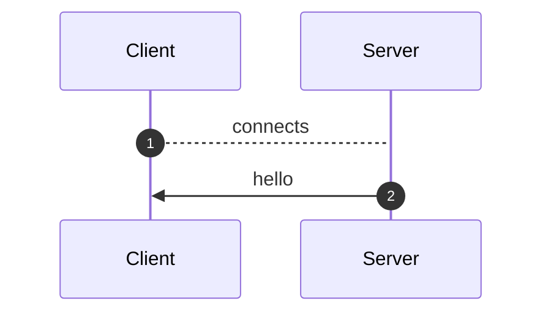
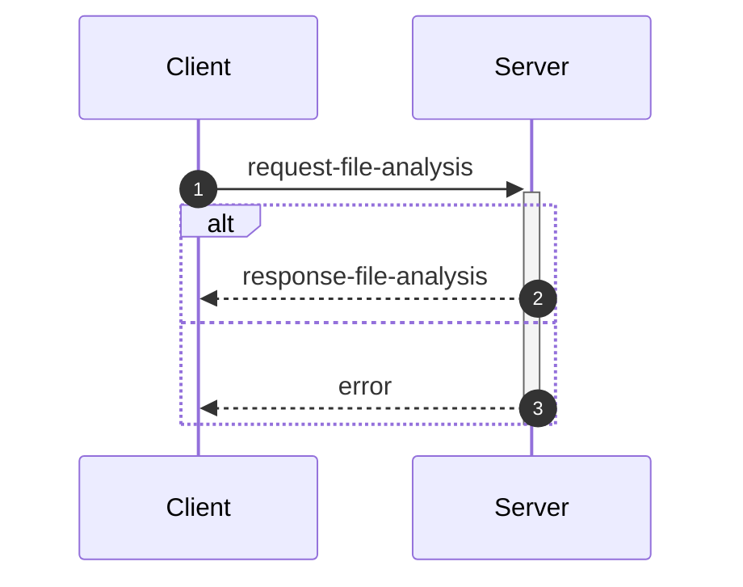
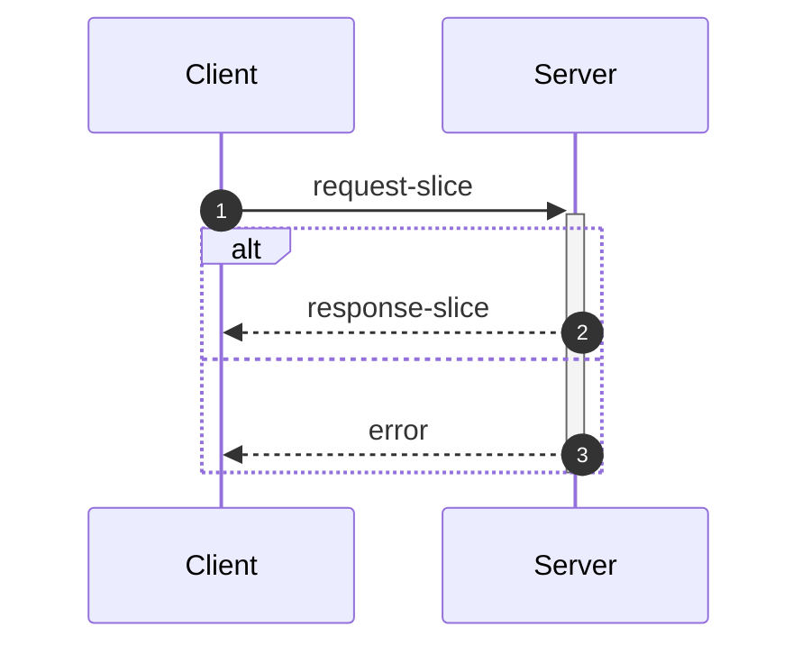
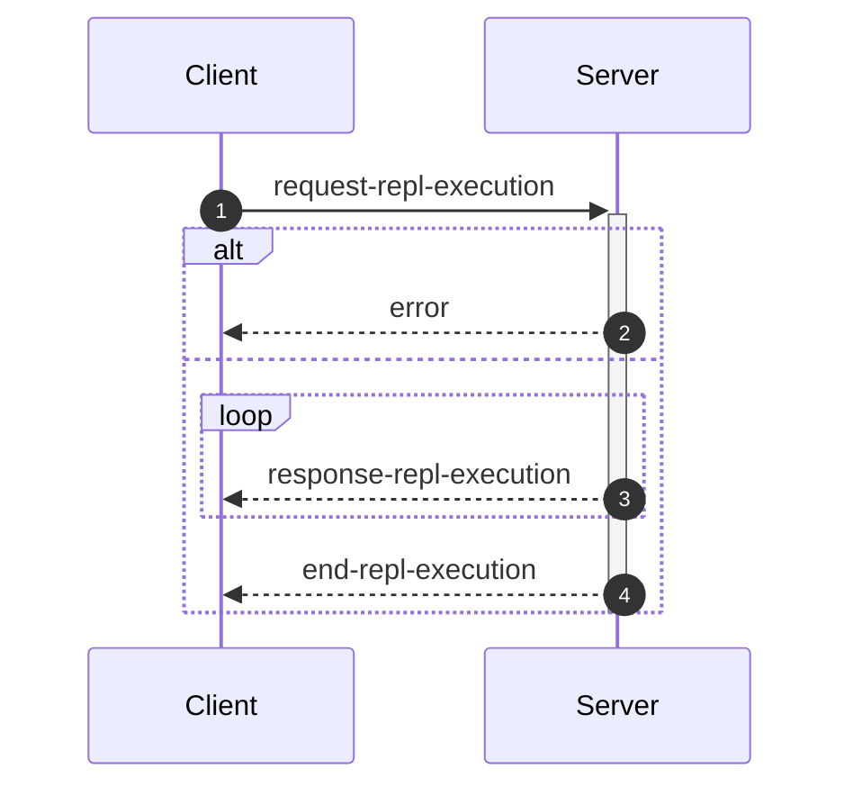

_<span title="an overview of flowR's interface">Generated</span> from '[wiki-interface.ts](https://github.com/flowr-analysis/flowr/tree/main/src/documentation/wiki-interface.ts "src/documentation/wiki-interface.ts")' on 2026-10-20, 14:20:38 UTC (v2.16.3, R v4.6.1), do not edit directly._

Although far from being as detailed as the in-depth explanation of [_flowR_](https://github.com/flowr-analysis/flowr/wiki/Core),
this wiki page explains how to interface with _flowR_ in more detail.
In general, command line arguments and other options provide short descriptions on hover over.

* [💻 Using the REPL](#using-the-repl)
* [⚙️ Configuring FlowR](#configuring-flowr)
* [⚒️ Writing Code](#writing-code)
* [💬 Communicating with the Server](#communicating-with-the-server)

<a id='using-the-repl'></a>
## 💻 Using the REPL

> [!NOTE]
> To execute arbitrary R commands with a repl request, _flowR_ has to be started explicitly with <span title="Description (Command Line Argument): Allow to access the underlying R session when using flowR (security warning: this allows the execution of arbitrary R code!)">`--r-session-access`</span>.
> Please be aware that this introduces a security risk and note that this relies on the [`r-shell` engine](https://github.com/flowr-analysis/flowr/wiki/Engines) .

Although primarily meant for users to explore,
there is nothing which forbids calling _flowR_ as a subprocess to use standard-in, -output, and -error
for communication (although you can access the REPL using the server as well,
with the [REPL Request](#message-request-repl-execution) message).

The read-eval-print loop&nbsp;(REPL) works relatively simple.
You can submit an expression (using <kbd>Enter</kbd>),
which is interpreted as an R&nbsp;expression by default but interpreted as a *command* if it starts with a colon (`:`).
The best command to get started with the REPL is <span title="Description (Repl Command): Show help information (aliases: :h, :?)">`:help`</span>.
Besides, you can leave the REPL either with the command <span title="Description (Repl Command): End the repl (aliases: :q, :exit)">`:quit`</span> or by pressing <kbd>Ctrl</kbd>+<kbd>C</kbd> twice.
When writing a *command*, you may press <kbd>Tab</kbd> to get a list of completions, if available.
Multiple commands can be entered in a single line by separating them with a semicolon (`;`), e.g. `:parse "x<-2"; :df*`.
If a command is given without R code, the REPL will re-use R code given in a previous command.
The prior example will hence return first the parsed AST of the program and then the dataflow graph for `"x <- 2"`.

> [!NOTE]
> If you develop flowR, you may want to launch the repl using the `npm run main-dev` command, this way, you get a non-minified version of flowR with debug information and hot-reloading of source files.

<details>
<summary>Available Commands</summary>

We currently offer the following commands (this with a `[*]` suffix are available with and without the star):

| Command | Description |
| ------- | ----------- |
| **<span title="Description (Repl Command): End the repl (aliases: :q, :exit)">:quit</span>** | End the repl (aliases: **:<span title="Alias of ':quit'. End the repl">q</span>**, **:<span title="Alias of ':quit'. End the repl">exit</span>**) |
| **<span title="Description (Repl Command): Execute the given code as R code. This requires the `--r-session-access` flag to be set and requires the r-shell engine. (aliases: :e, :r)">:execute</span>** | Execute the given code as R code. This requires the `--r-session-access` flag to be set and requires the r-shell engine. (aliases: **:<span title="Alias of ':execute'. Execute the given code as R code. This requires the `--r-session-access` flag to be set and requires the r-shell engine.">e</span>**, **:<span title="Alias of ':execute'. Execute the given code as R code. This requires the `--r-session-access` flag to be set and requires the r-shell engine.">r</span>**) |
| **<span title="Description (Repl Command): Get mermaid code for the control-flow graph of R code (aliases: :cfg, :cf)">:controlflow[*]</span>** | Get mermaid code for the control-flow graph of R code (star: Returns the URL to mermaid.live) (aliases: **:<span title="Alias of ':controlflow'. Get mermaid code for the control-flow graph of R code">cfg</span>**, **:<span title="Alias of ':controlflow'. Get mermaid code for the control-flow graph of R code">cf</span>**) |
| **<span title="Description (Repl Command): Get mermaid code for the control-flow graph with basic blocks (aliases: :cfgb, :cfb)">:controlflowbb[*]</span>** | Get mermaid code for the control-flow graph with basic blocks (star: Returns the URL to mermaid.live) (aliases: **:<span title="Alias of ':controlflowbb'. Get mermaid code for the control-flow graph with basic blocks">cfgb</span>**, **:<span title="Alias of ':controlflowbb'. Get mermaid code for the control-flow graph with basic blocks">cfb</span>**) |
| **<span title="Description (Repl Command): Get mermaid code for the dataflow graph (aliases: :d, :df)">:dataflow[*]</span>** | Get mermaid code for the dataflow graph (star: Returns the URL to mermaid.live) (aliases: **:<span title="Alias of ':dataflow'. Get mermaid code for the dataflow graph">d</span>**, **:<span title="Alias of ':dataflow'. Get mermaid code for the dataflow graph">df</span>**) |
| **<span title="Description (Repl Command): Get mermaid code for the normalized AST of R code (aliases: :n)">:normalize[*]</span>** | Get mermaid code for the normalized AST of R code (star: Returns the URL to mermaid.live) (alias: **:<span title="Alias of ':normalize'. Get mermaid code for the normalized AST of R code">n</span>**) |
| **<span title="Description (Repl Command): Get mermaid code for the simplified dataflow graph (aliases: :ds, :dfs)">:dataflowsimple[*]</span>** | Get mermaid code for the simplified dataflow graph (star: Returns the URL to mermaid.live) (aliases: **:<span title="Alias of ':dataflowsimple'. Get mermaid code for the simplified dataflow graph">ds</span>**, **:<span title="Alias of ':dataflowsimple'. Get mermaid code for the simplified dataflow graph">dfs</span>**) |
| **<span title="Description (Repl Command): Inspect and extend the signature database: `query` (identical to :query @signature), `info <name>` for where a function comes from (identical to :query @function-info), `add <path>` to mount another database/source, `download` to fetch the full-history database. (aliases: :sig)">:signature</span>** | Inspect and extend the signature database: `query` (identical to :query @signature), `info <name>` for where a function comes from (identical to :query @function-info), `add <path>` to mount another database/source, `download` to fetch the full-history database. (alias: **:<span title="Alias of ':signature'. Inspect and extend the signature database: `query` (identical to :query @signature), `info <name>` for where a function comes from (identical to :query @function-info), `add <path>` to mount another database/source, `download` to fetch the full-history database.">sig</span>**) |
| **<span title="Description (Repl Command): Just calculates the DFG, but only prints summary info (aliases: :d#, :df#)">:dataflowsilent</span>** | Just calculates the DFG, but only prints summary info (aliases: **:<span title="Alias of ':dataflowsilent'. Just calculates the DFG, but only prints summary info">d#</span>**, **:<span title="Alias of ':dataflowsilent'. Just calculates the DFG, but only prints summary info">df#</span>**) |
| **<span title="Description (Repl Command): Prints ASCII Art of the parsed, unmodified AST (aliases: :p)">:parse</span>** | Prints ASCII Art of the parsed, unmodified AST (alias: **:<span title="Alias of ':parse'. Prints ASCII Art of the parsed, unmodified AST">p</span>**) |
| **<span title="Description (Repl Command): Prints the version of flowR as well as the current version of R">:version</span>** | Prints the version of flowR as well as the current version of R
| **<span title="Description (Repl Command): Query the given R code (use 'help' for more information)">:query[*]</span>** | Query the given R code (use 'help' for more information) (star: Similar to query, but returns the output in json format.)
| **<span title="Description (Repl Command): Returns an ASCII representation of the dataflow graph (aliases: :df!)">:dataflowascii</span>** | Returns an ASCII representation of the dataflow graph (alias: **:<span title="Alias of ':dataflowascii'. Returns an ASCII representation of the dataflow graph">df!</span>**) |
| **<span title="Description (Repl Command): Returns summarization stats for the normalized AST (aliases: :n#)">:normalize#</span>** | Returns summarization stats for the normalized AST (alias: **:<span title="Alias of ':normalize#'. Returns summarization stats for the normalized AST">n#</span>**) |
| **<span title="Description (Repl Command): Show help information (aliases: :h, :?)">:help</span>** | Show help information (aliases: **:<span title="Alias of ':help'. Show help information">h</span>**, **:<span title="Alias of ':help'. Show help information">?</span>**) |

</details>

> [!TIP]
> 
> As indicated by the examples before, all REPL commands that operate on code keep track of the state.
> Hence, if you run a command like <span title="Description (Repl Command, starred version): Returns the URL to mermaid.live; Base Command: Get mermaid code for the dataflow graph (aliases: :d*, :df*)">`:dataflow*`</span> without providing R code,
> the REPL will re-use the R code provided in a previous command.
> Likewise, doing this will benefit from incrementality!
> If you request the dataflow graph with `:df* x <- 2 * y` and then want to see the parsed AST with `:parse`,
> the REPL will re-use previously obtained information and not re-parse the code again.
> 		

Generally, many commands offer shortcut versions in the REPL. Many queries, for example, offer a shortened format (see the example below).
Of special note, the [Config Query](https://github.com/flowr-analysis/flowr/wiki/%5BQuery%5D-Config)
can be used to also modify the currently active configuration of _flowR_ within the REPL (see the [wiki page](https://github.com/flowr-analysis/flowr/wiki/%5BQuery%5D-Config) for more information).

### Example: Retrieving the Dataflow Graph

To retrieve a URL to the [mermaid](https://mermaid.js.org/) diagram of the dataflow of a given expression,
use <span title="Description (Repl Command, starred version): Returns the URL to mermaid.live; Base Command: Get mermaid code for the dataflow graph (aliases: :d*, :df*)">`:dataflow*`</span> (or <span title="Description (Repl Command): Get mermaid code for the dataflow graph (aliases: :d, :df)">`:dataflow`</span> to get the mermaid code in the cli):

```shell
$ docker run -it --rm eagleoutice/flowr # or npm run flowr 
flowR repl v2.16.3, R grammar v14 (tree-sitter engine)
R> :dataflow* y <- 1 + x
```

<details>
<summary style='color:gray'>Output</summary>

```text
https://mermaid.live/view#base64:eyJjb2RlIjoiZmxvd2NoYXJ0IFREXG4gICAgMXt7XCJgKiM5MTtSTnVtYmVyIzkzOyogKioxKipcbiAgICAgICoxLjYqICgqKmlkOiAxKiopYFwifX1cbiAgICAyKFtcImAqIzkxO1JTeW1ib2wjOTM7KiAqKngqKlxuICAgICAgKjEuMTAqICgqKmlkOiAyKiopYFwiXSlcbiAgICAzW1tcImAqIzkxO1JCaW5hcnlPcCM5MzsqIGJhc2UjNTg7IzU4OyoqIzQzOyoqXG4gICAgICAqMS42LTEwKiAoKippZDogMyoqKVxuICAgIGFyZzogKDEsIDIpYFwiXV1cbiAgICBidWlsdC1pbjpfNDNfW1wiYEJ1aWx0LUluOlxuIzQzO2BcIl1cbiAgICBzdHlsZSBidWlsdC1pbjpfNDNfIHN0cm9rZTpncmF5LGZpbGw6Z3JheSxzdHJva2Utd2lkdGg6MnB4LG9wYWNpdHk6Ljg7XG4gICAgMFtcImAqIzkxO1JTeW1ib2wjOTM7KiAqKnkqKlxuICAgICAgKjEuMSogKCoqaWQ6IDAqKiwgdjogMylgXCJdXG4gICAgNFtbXCJgKiM5MTtSQmluYXJ5T3AjOTM7KiBiYXNlIzU4OyM1ODsqKiM2MDsjNDU7KipcbiAgICAgICoxLjEtMTAqICgqKmlkOiA0KiopXG4gICAgYXJnOiAoMCwgMylgXCJdXVxuICAgIGJ1aWx0LWluOl82MF8tW1wiYEJ1aWx0LUluOlxuIzYwOyM0NTtgXCJdXG4gICAgc3R5bGUgYnVpbHQtaW46XzYwXy0gc3Ryb2tlOmdyYXksZmlsbDpncmF5LHN0cm9rZS13aWR0aDoycHgsb3BhY2l0eTouODtcbiAgICAxIC0uLT58XCJmbG93XCJ8IDJcbiAgICBsaW5rU3R5bGUgMCBzdHJva2U6Z3JheSxjb2xvcjpncmF5O1xuICAgIDIgLS4tPnxcImZsb3dcInwgM1xuICAgIGxpbmtTdHlsZSAxIHN0cm9rZTpncmF5LGNvbG9yOmdyYXk7XG4gICAgMyAtLT58XCJyZWFkcywgYXJnXCJ8IDFcbiAgICAzIC0tPnxcInJlYWRzLCBhcmdcInwgMlxuICAgIDMgLS4tPnxcImZsb3dcInwgMFxuICAgIGxpbmtTdHlsZSA0IHN0cm9rZTpncmF5LGNvbG9yOmdyYXk7XG4gICAgMyAtLi0+fFwicmVhZHMsIGNhbGxzXCJ8IGJ1aWx0LWluOl80M19cbiAgICBsaW5rU3R5bGUgNSBzdHJva2U6Z3JheTtcbiAgICAwIC0tPnxcImRlZmluZWQtYnksIGZsb3dcInwgNFxuICAgIDAgLS0+fFwiZGVmaW5lZC1ieVwifCAzXG4gICAgNCAtLT58XCJyZWFkcywgYXJnXCJ8IDNcbiAgICA0IC0tPnxcInJldHVybnMsIGFyZ1wifCAwXG4gICAgNCAtLi0+fFwicmVhZHMsIGNhbGxzXCJ8IGJ1aWx0LWluOl82MF8tXG4gICAgbGlua1N0eWxlIDEwIHN0cm9rZTpncmF5OyIsIm1lcm1haWQiOnsiYXV0b1N5bmMiOnRydWV9fQ==
```

Retrieve the dataflow graph of the expression `y <- 1 + x`. It looks like this:


<details>

<summary style="color:gray">R Code of the Dataflow Graph</summary>

The analysis ran (including parse and normalize, using the [tree-sitter](https://github.com/flowr-analysis/flowr/wiki/Engines) engine) within the generation environment. No [signature database](https://github.com/flowr-analysis/flowr/wiki/Signature-Database) is mounted for these generated graphs, so `library()` calls attach no package exports; base-R names are still qualified via the generated base-package store (e.g. `acf` as `stats::acf`). 
We encountered no unknown side effects during the analysis.

```r
y <- 1 + x
```

</details>

</details>

For small graphs like this, <span title="Description (Repl Command): Returns an ASCII representation of the dataflow graph (aliases: :df!)">`:dataflowascii`</span> also provides an ASCII representation directly in the REPL:

```shell
$ docker run -it --rm eagleoutice/flowr # or npm run flowr 
flowR repl v2.16.3, R grammar v14 (tree-sitter engine)
R> :df! y <- 1 + x
```

<details open>
<summary style='color:gray'>Output</summary>

```text
                        v<0>v
 c<4>c──────────────────| y |
 |<- |     ┌────────────v---v
 c---c     │
    │   c<3>c   0<1>0
    └───| + |───| 1 |───u<2>u
        c---c   0---0   | x |
           └────────────u---u
Edges:
3 -> 1: reads, arg          3 -> 2: reads, arg
3 -> 0: flows-to            1 -> 2: flows-to
2 -> 3: flows-to            4 -> 3: reads, arg
4 -> 0: returns, arg        0 -> 4: defined-by, flows-to
0 -> 3: defined-by
```

Retrieve the dataflow graph of the expression `y <- 1 + x` as ASCII art.

</details>

For the slicing with <span title="Description (Repl Command): Static backwards executable slicer for R">`:slicer`</span>, you have access to the same [magic comments](#slice-magic-comments) as with the [slice request](#message-request-slice).
Pass `--inline` to splice resolvable `source()` calls into the reconstruction so the slice is a single self-contained R text (the same as the static slice query's `inlineSources` flag).
See `--help` for more flags!

### Example: Interfacing with the File System

Many commands that allow for an R-expression (like <span title="Description (Repl Command, starred version): Returns the URL to mermaid.live; Base Command: Get mermaid code for the dataflow graph (aliases: :d*, :df*)">`:dataflow*`</span>) allow for a file as well
if the argument starts with `file://`.
If you are working from the root directory of the _flowR_ repository, the following gives you the parsed AST of the example file using the <span title="Description (Repl Command): Prints ASCII Art of the parsed, unmodified AST (aliases: :p)">`:parse`</span> command:

> **Watch mode**: Replace `file://` with `watch://` to enter watch mode.
> flowR runs the command immediately and then re-runs it every time the file (or any file inside the folder) changes.
> Enter any other command to leave watch mode.
> For example: `:df watch://analysis.R`

```shell
$ docker run -it --rm eagleoutice/flowr # or npm run flowr 
flowR repl v2.16.3, R grammar v14 (tree-sitter engine)
R> :parse file://test/testfiles/example.R
```

<details>
<summary style='color:gray'>Output</summary>

```text
File: test/testfiles/example.R

program
├ binaryoperator
│ ├ identifier "sum" (1:1─4)
│ ├ <- "<-" (1:5─7)
│ ╰ float "0" (1:8─9)
├ binaryoperator
│ ├ identifier "product" (2:1─8)
│ ├ <- "<-" (2:9─11)
│ ╰ float "1" (2:12─13)
├ binaryoperator
│ ├ identifier "w" (3:1─2)
│ ├ <- "<-" (3:3─5)
│ ╰ float "7" (3:6─7)
├ binaryoperator
│ ├ identifier "N" (4:1─2)
│ ├ <- "<-" (4:3─5)
│ ╰ float "10" (4:6─8)
├ forstatement
│ ├ for "for" (6:1─4)
│ ├ ( "(" (6:5─6)
│ ├ identifier "i" (6:6─7)
│ ├ in "in" (6:8─10)
│ ├ binaryoperator
│ │ ├ float "1" (6:11─12)
│ │ ├ : ":" (6:12─13)
│ │ ╰ parenthesizedexpression
│ │   ├ ( "(" (6:13─14)
│ │   ├ binaryoperator
│ │   │ ├ identifier "N" (6:14─15)
│ │   │ ├ - "-" (6:15─16)
│ │   │ ╰ float "1" (6:16─17)
│ │   ╰ ) ")" (6:17─18)
│ ├ ) ")" (6:18─19)
│ ╰ bracedexpression
│   ├ { "{" (6:20─21)
│   ├ binaryoperator
│   │ ├ identifier "sum" (7:3─6)
│   │ ├ <- "<-" (7:7─9)
│   │ ╰ binaryoperator
│   │   ├ binaryoperator
│   │   │ ├ identifier "sum" (7:10─13)
│   │   │ ├ + "+" (7:14─15)
│   │   │ ╰ identifier "i" (7:16─17)
│   │   ├ + "+" (7:18─19)
│   │   ╰ identifier "w" (7:20─21)
│   ├ binaryoperator
│   │ ├ identifier "product" (8:3─10)
│   │ ├ <- "<-" (8:11─13)
│   │ ╰ binaryoperator
│   │   ├ identifier "product" (8:14─21)
│   │   ├  "" (8:22─23)
│   │   ╰ identifier "i" (8:24─25)
│   ╰ } "}" (9:1─2)
├ call
│ ├ identifier "cat" (11:1─4)
│ ╰ arguments
│   ├ ( "(" (11:4─5)
│   ├ argument
│   │ ╰ string
│   │   ├ " "\"" (11:5─6)
│   │   ├ stringcontent "Sum:" (11:6─10)
│   │   ╰ " "\"" (11:10─11)
│   ├ comma "," (11:11─12)
│   ├ argument
│   │ ╰ identifier "sum" (11:13─16)
│   ├ comma "," (11:16─17)
│   ├ argument
│   │ ╰ string
│   │   ├ " "\"" (11:18─19)
│   │   ├ stringcontent
│   │   │ ╰ escapesequence "\\n" (11:19─21)
│   │   ╰ " "\"" (11:21─22)
│   ╰ ) ")" (11:22─23)
╰ call
  ├ identifier "cat" (12:1─4)
  ╰ arguments
    ├ ( "(" (12:4─5)
    ├ argument
    │ ╰ string
    │   ├ " "\"" (12:5─6)
    │   ├ stringcontent "Product:" (12:6─14)
    │   ╰ " "\"" (12:14─15)
    ├ comma "," (12:15─16)
    ├ argument
    │ ╰ identifier "product" (12:17─24)
    ├ comma "," (12:24─25)
    ├ argument
    │ ╰ string
    │   ├ " "\"" (12:26─27)
    │   ├ stringcontent
    │   │ ╰ escapesequence "\\n" (12:27─29)
    │   ╰ " "\"" (12:29─30)
    ╰ ) ")" (12:30─31)
```

Retrieve the parsed AST of the example file.

<details>

<summary>File Content</summary>

```r
sum <- 0
product <- 1
w <- 7
N <- 10

for (i in 1:(N-1)) {
  sum <- sum + i + w
  product <- product * i
}

cat("Sum:", sum, "\n")
cat("Product:", product, "\n")
```

</details>

As _flowR_ directly transforms this AST the output focuses on being human-readable instead of being machine-readable.
		
</details>

### Example: Run a Query

You can run any query supported by _flowR_ using the <span title="Description (Repl Command): Query the given R code (use 'help' for more information)">`:query`</span> command.
For example, to obtain the shapes of all data frames in a given piece of code, you can run:

```shell
$ docker run -it --rm eagleoutice/flowr # or npm run flowr 
flowR repl v2.16.3, R grammar v14 (tree-sitter engine)
R> :query @absint df-shape "x <- data.frame(a = 1:10, b = 1:10)\ny <- x$a"
```

<details open>
<summary style='color:gray'>Output</summary>

```text
Query: absint (1 ms)
```

Retrieve the shapes of all data frames in the given code.

</details>

To run the linter on a file, you can use (in this example, we just issue the `dead-code` linter on a small piece of code):

```shell
$ docker run -it --rm eagleoutice/flowr # or npm run flowr 
flowR repl v2.16.3, R grammar v14 (tree-sitter engine)
R> :query @linter rules:dead-code "if(FALSE) x <- 2"
```

<details open>
<summary style='color:gray'>Output</summary>

```text
Query: linter (3 ms)
   ╰ Dead Code (dead-code):
       ╰ certain:
           ╰ Code at 1.11-16
```

Run the linter on the given code, with only the `dead-code` rule enabled.

</details>

For more information on the available queries, please check out the [Query API](https://github.com/flowr-analysis/flowr/wiki/Query-API).

<a id='configuring-flowr'></a>
## ⚙️ Configuring FlowR

When running _flowR_, you may want to specify some behaviors with a dedicated configuration file.
By default, flowR looks for a file named `flowr.json` in the current working directory (or any higher directory).
You can also specify a different file with <span title="Description (Command Line Argument): The name of the configuration file to use">`--config-file`</span> or pass the configuration inline using <span title="Description (Command Line Argument): The flowR configuration to use, as a JSON string">`--config-json`</span>.
A `flowr.json` found this way belongs to the analyzed project, so flowR ignores its options that decide what flowR executes or loads
(`engines.*.wasmPath`, `engines.*.treeSitterWasmPath`, `engines.*.rPath`, `solver.sigdb.additionalPaths`, `solver.sigdb.downloadRepo`, `solver.sigdb.installedLibrary.paths`),
unless you pass <span title="Description (Command Line Argument): Keep the security-sensitive options (e.g., the R executable) of the flowr.json found in the working directory or a parent. Only use this for projects you trust.">`--trust-config`</span>.
To analyze code you do not trust, use the secure mode (<span title="Description (Command Line Argument): Run in secure mode for analyzing untrusted code: flowR does not start R (or any other process), does not access the network, does not search for project configs, and ignores security-sensitive options in every config. Cannot be disabled once enabled. Can also be enabled with the environment variable {italic FLOWR_SECURE_MODE=1}.">`--secure`</span>, see the [security policy](https://github.com/flowr-analysis/flowr/blob/main/.github/SECURITY.md)).
To inspect the current configuration, you can run flowr with the <span title="Description (Command Line Argument): Run with verbose logging (will be passed to the corresponding script)">`--verbose`</span> flag, or use the `config` [Query](https://github.com/flowr-analysis/flowr/wiki/Query-API).
Within the REPL this works by running the following:

```shell
:query @config
```

To work with the <a href="https://github.com/flowr-analysis/flowr/tree/main/src/config.ts#L119"><code><span title="The configuration file format for flowR.">FlowrConfig</span></code></a> you can use the provided helper objects alongside its methods like
<a href="https://github.com/flowr-analysis/flowr/tree/main/src/config.ts#L914"><code><span title="Creates a new flowr config that has the updated values.">FlowrConfig::<b>amend</b></span></code></a>.
The schema below documents every option; the ones you most likely want are:

- <a href="https://github.com/flowr-analysis/flowr/wiki/Interface#configuring-flowr" title="Configuration Option (boolean): Whether source calls should be ignored, causing {@link processSourceCall}&#39;s behavior to be skipped.">ignoreSourceCalls</a>: ignore source calls when analyzing the code, i.e., ignore the inclusion of other files.
- <a href="https://github.com/flowr-analysis/flowr/wiki/Interface#configuring-flowr" title="Configuration Option (boolean): Whether load calls should be ignored, causing {@link processLoadCall}&#39;s behavior to be skipped.">ignoreLoadCalls</a>: ignore load calls when analyzing the code, i.e., ignore the loading of r-data files.
- <a href="https://github.com/flowr-analysis/flowr/wiki/Interface#configuring-flowr" title="Configuration Option (object): Do you want to overwrite (parts) of the builtin definition?">semantics.environment.overwriteBuiltIns</a>: overwrite _flowR_'s handling of built-in functions, or clear the preset definitions entirely.
  See [Configure BuiltIn Semantics](#configure-builtin-semantics) for more information.
- <a href="https://github.com/flowr-analysis/flowr/wiki/Interface#configuring-flowr" title="Configuration Option (string): How to resolve variables and their values. (one of &quot;disabled&quot;, &quot;alias&quot;, &quot;builtin&quot;)">solver.variables</a>: how to resolve variables and their values (`disabled`, `alias`, `builtin`).
- <a href="https://github.com/flowr-analysis/flowr/wiki/Interface#configuring-flowr" title="Configuration Option (array): The engine or set of engines to use for interacting with R code. An empty array means all available engines will be used.">engines</a> and <a href="https://github.com/flowr-analysis/flowr/wiki/Interface#configuring-flowr" title="Configuration Option (string): The default engine to use for interacting with R code. If this is undefined, an arbitrary engine from the specified list will be used. (one of &quot;tree-sitter&quot;, &quot;r-shell&quot;)">defaultEngine</a>: the engines used to interact with R code, see the [Engines wiki page](https://github.com/flowr-analysis/flowr/wiki/Engines).
- <a href="https://github.com/flowr-analysis/flowr/wiki/Interface#configuring-flowr" title="Configuration Option (array): Files a framework loads on its own, without any source() call (e.g. global.R in a shiny app), in the order they are loaded; flowR orders the matching project files accordingly and analyzes them as one program. Entries are case-insensitive globs matched against the file path, a plain name matches any file with that name, and entries matching no project file are warned about. Usually set per project kind via specializeConfig.">project.implicitSources</a>: the files a framework loads without any `source()` call, in the order in which they are
  loaded. Entries are globs (e.g. `R/*.R`) matched against the file path ignoring capitalization; one matching no file is reported.
- <a href="https://github.com/flowr-analysis/flowr/wiki/Interface#configuring-flowr" title="Configuration Option (object): Overwrite (parts of) the configuration depending on the project kind flowR detects, e.g. to give a shiny app its implicit sources.">specializeConfig</a>: overwrite (parts of) the configuration depending on the kind of project _flowR_ detects
  (e.g. `shiny-app`), which is how a shiny app gets its implicit sources by default. What you configure directly wins.
- <a href="https://github.com/flowr-analysis/flowr/wiki/Interface#configuring-flowr" title="Configuration Option (string): Overwrite the project kind flowR would otherwise infer from the analyzed files, e.g. when auto-detection guesses wrong. (one of &quot;package&quot;, &quot;script&quot;, &quot;shiny-app&quot;, &quot;notebook&quot;, &quot;project&quot;, &quot;unknown&quot;)">project.useProjectType</a>: skip that detection and force a project kind yourself, when auto-detection guesses wrong.
- <a href="https://github.com/flowr-analysis/flowr/wiki/Interface#configuring-flowr" title="Configuration Option (array): The default plugins to load when creating a new instance of FlowrAnalyzer">defaultPlugins</a> and <a href="https://github.com/flowr-analysis/flowr/wiki/Interface#configuring-flowr" title="Configuration Option (array): The plugins to load in REPL mode">repl.plugins</a>: the plugins to load for a new <a href="https://github.com/flowr-analysis/flowr/tree/main/src/project/flowr-analyzer.ts#L205"><code><span title="Central class for conducting analyses with FlowR. Use the FlowrAnalyzerBuilder to create a new instance. If you want the original pattern of creating a pipeline and running all steps, you can still do this with FlowrAnalyzer#runFull . To inspect the context of the analyzer, use FlowrAnalyzer#inspectContext (if you are a plugin and need to modify it, use FlowrAnalyzer#context instead).">FlowrAnalyzer</span></code></a> and in the REPL
  (use `flowr:default` to reference the former).

So you can configure _flowR_ by adding a file like the following:

<details>

<summary>Example Configuration File</summary>

```json
{
  "ignoreSourceCalls": true,
  "ignoreLoadCalls": true,
  "semantics": {
    "environment": {
      "overwriteBuiltIns": {
        "definitions": [
          {
            "type": "function",
            "names": [
              "foo"
            ],
            "processor": "builtin:assign",
            "config": {}
          }
        ]
      }
    }
  },
  "defaultPlugins": [
    "file:description",
    "versions:description"
  ],
  "repl": {
    "quickStats": false,
    "dfProcessorHeat": false,
    "hints": true,
    "plugins": [
      "flowr:default"
    ]
  },
  "project": {
    "resolveUnknownPathsOnDisk": true,
    "implicitSources": [
      "global.R",
      "app.R"
    ]
  },
  "linter": {
    "disabledRules": []
  },
  "specializeConfig": {
    "shiny-app": {
      "project": {
        "implicitSources": [
          "global.R",
          "ui.R",
          "server.R",
          "app.R"
        ]
      }
    }
  },
  "engines": [
    {
      "type": "r-shell"
    }
  ],
  "solver": {
    "variables": "alias",
    "evalStrings": true,
    "trackEnvironments": true,
    "sigdb": {
      "enabled": true,
      "loadProjectDependencies": true,
      "eagerlyLoad": false,
      "eagerlyLoadExports": false,
      "linkBaseR": false,
      "linkDescriptionDependencies": false
    },
    "resolveSource": {
      "dropPaths": "no",
      "ignoreCapitalization": true,
      "inferWorkingDirectory": "active-script",
      "searchPath": []
    },
    "instrument": {},
    "slicer": {
      "threshold": 50
    }
  },
  "abstractInterpretation": {
    "wideningThreshold": 4,
    "followCalls": true,
    "dataFrame": {
      "maxColNames": 20,
      "readLoadedData": {
        "readExternalFiles": true,
        "maxReadLines": 1000000
      }
    }
  },
  "incremental": {
    "alwaysIncremental": false,
    "parsing": {
      "activated": false,
      "heuristics": {
        "activated": true,
        "mtime": true,
        "linesFrom": 500,
        "bytesFrom": 50000,
        "alwaysWithEdits": false,
        "minFiles": 1
      }
    }
  },
  "gas": {
    "thresholds": {
      "memory": {
        "problematic": 0.7,
        "critical": 0.9
      },
      "timeMs": {
        "problematic": 100000,
        "critical": 120000
      }
    },
    "features": {}
  }
}
```

</details>

<details>
<a id='configure-builtin-semantics'></a>
<summary>Configure Built-In Semantics</summary>

`semantics/environment/overwriteBuiltins` accepts two keys:

- `loadDefaults` (boolean, initially `true`): If set to `true`, the default built-in definitions are loaded before applying the custom definitions. Setting this flag to `false` explicitly disables the loading of the default definitions.
- `definitions` (array, initially empty): Allows to overwrite or define new built-in elements. Each object within must have a `type` which is one of the below. Furthermore, they may define a string array of `names` which specifies the identifiers to bind the definitions to. You may use `assumePrimitive` to specify whether _flowR_ should assume that this is a primitive non-library definition (so you probably just do not want to specify the key).

  | Type            | Description                                                                                                                                                                                                                                                                                              | Example                                                                                                    |
  | --------------- | -------------------------------------------------------------------------------------------------------------------------------------------------------------------------------------------------------------------------------------------------------------------------------------------------------- | ---------------------------------------------------------------------------------------------------------- |
  | `constant`    | Additionally allows for a `value` this should resolve to.                                                                                                                                                                                                                                                | `{ type: 'constant', names: ['NULL', 'NA'],  value: null }`                                                |
  | `function`    | Is a rather flexible way to define and bind built-in functions. For the time, we do not have extensive documentation to cover all the cases, so please either consult the sources with the `default-builtin-config.ts` or open a [new issue](https://github.com/flowr-analysis/flowr/issues/new/choose). | `{ type: 'function', names: ['next'], processor: 'builtin:d', config: { cfg: ExitPointType.Next } }` |
  | `replacement` | A comfortable way to specify replacement functions like `$<-` or `names<-`. `suffixes` describes the... suffixes to attach automatically. | `{ type: 'replacement', suffixes: ['<-', '<<-'], names: ['[', '[['] }` |

</details>

<details>

<summary style='color:gray'>Full Configuration-File Schema</summary>

- _The configuration file format for flowR._ (object)
    - **logLevel** [optional] _flowR's global minimum log level, applied when the config is loaded._ (string)
        Only allows: 'silly', 'trace', 'debug', 'info', 'warn', 'error', 'fatal'
    - **ignoreSourceCalls** [optional] _Whether source calls should be ignored, causing {@link processSourceCall}'s behavior to be skipped._ (boolean)
    - **ignoreLoadCalls** [optional] _Whether load calls should be ignored, causing {@link processLoadCall}'s behavior to be skipped._ (boolean)
    - **semantics** _Configure language semantics and how flowR handles them._ (object)
        - **environment** [optional] _Semantics regarding how to handle the R environment._ (object)
            - **overwriteBuiltIns** [optional] _Do you want to overwrite (parts) of the builtin definition?_ (object)
                - **loadDefaults** [optional] _Should the default configuration still be loaded?_ (boolean)
                - **definitions** [optional] _The definitions to load/overwrite._ (array)
                Valid item types:
                    - (object)
    - **defaultPlugins** [optional] _The default plugins to load when creating a new instance of FlowrAnalyzer_ (array)
    Valid item types:
        - (alternatives)
            - (string)
            - (array)
    - **repl** _Configuration options for the REPL._ (object)
        - **quickStats** [optional] _Whether to show quick stats in the REPL after each evaluation._ (boolean)
        - **dfProcessorHeat** [optional] _This instruments the dataflow processors to count how often each processor is called._ (boolean)
        - **hints** [optional] _Whether to show dim inline hints on the empty prompt (automatically disabled on non-interactive terminals)._ (boolean)
        - **plugins** [optional] _The plugins to load in REPL mode_ (array)
        Valid item types:
            - (alternatives)
                - (string)
                - (array)
        - **autoUseFileProtocol** [optional] _Prepend the file protocol to a repl input that looks like a path, instead of only warning about it._ (boolean)
        - **queryStats** [optional] _Whether `:query` closes with the line stating how long the queries took (`:query*` never prints it)._ (boolean)
        - **showPlugins** [optional] _Whether `:version` grays out the plugins that did not activate during the last analysis._ (boolean)
    - **project** _Project specific configuration options._ (object)
        - **resolveUnknownPathsOnDisk** [optional] _Whether to resolve unknown paths loaded by the r project disk when trying to source/analyze files._ (boolean)
        - **failOnInaccessiblePath** [optional] _Whether a directory that cannot be traversed during file discovery (e.g. due to permissions) aborts the analysis; when false (the default) such paths are logged and skipped._ (boolean)
        - **basePackages** [optional] _The packages considered part of R itself (base and recommended); if unset, flowR uses its built-in list._ (array)
        Valid item types:
            - (string)
        - **implicitSources** [optional] _Files a framework loads on its own, without any source() call (e.g. global.R in a shiny app), in the order they are loaded; flowR orders the matching project files accordingly and analyzes them as one program. Entries are case-insensitive globs matched against the file path, a plain name matches any file with that name, and entries matching no project file are warned about. Usually set per project kind via specializeConfig._ (array)
        Valid item types:
            - (string)
        - **useProjectType** [optional] _Overwrite the project kind flowR would otherwise infer from the analyzed files, e.g. when auto-detection guesses wrong._ (string)
            Only allows: 'package', 'script', 'shiny-app', 'notebook', 'project', 'unknown'
        - **assumeImplicitEcho** [optional] _Whether the top level of the analyzed code is echoed, so that every visible result printed there is collected as an output by the dependencies query (default true, false for a package)._ (boolean)
        - **discovery** [optional] _Scoping options for the default project discovery._ (object)
            - **full** [optional] _Collect every file below the project root (greedy) instead of only the files the detected project kind needs (default false)._ (boolean)
            - **perKind** [optional] _Per-kind include/exclude glob overrides layered on the default scoping._ (object)
            - **ignore** [optional] _Case-insensitive globs that drop matching files from the intelligent discovery, regardless of kind (e.g. .Renviron to ignore environment files)._ (array)
            Valid item types:
                - (string)
        - **classification** [optional] _Overrides for the signals flowR uses to classify the project kind._ (object)
            - **shinyDescriptionTypes** [optional] _DESCRIPTION Type: values that mark a shiny app._ (array)
            Valid item types:
                - (string)
            - **shinyEntryFiles** [optional] _File names a shiny app is assembled from._ (array)
            Valid item types:
                - (string)
            - **shinyUsagePattern** [optional] _Regex source evidencing shiny usage in an entry file._ (string)
            - **notebookExtensions** [optional] _File extensions marking a notebook._ (array)
            Valid item types:
                - (string)
    - **linter** _Linter configuration options._ (object)
        - **disabledRules** _Linting rule names excluded from the default rule set (a rule requested explicitly via a linter query still runs). Usually set per project kind via specializeConfig._ (array)
        Valid item types:
            - (string)
        - **disabledTags** [optional] _Linting rule tags whose rules are excluded from the default rule set (a rule requested explicitly via a linter query still runs). By default the cmd-check rules are disabled for everything but a package; a configured list replaces that default._ (array)
        Valid item types:
            - (string)
    - **inputSources** [optional] _Further frameworks the input-sources analysis should know about; entries are added to flowR's defaults._ (object)
        - **pure** [optional] _Functions that only pass the constantness of their arguments on._ (array)
        Valid item types:
            - (string)
        - **param** [optional] _Functions whose result is a 'param' input._ (array)
        Valid item types:
            - (string)
        - **file** [optional] _Functions whose result is a 'file' input._ (array)
        Valid item types:
            - (string)
        - **tempfile** [optional] _Functions whose result is a 'tempfile' input._ (array)
        Valid item types:
            - (string)
        - **glob** [optional] _Functions whose result is a 'glob' input._ (array)
        Valid item types:
            - (string)
        - **net** [optional] _Functions whose result is a 'net' input._ (array)
        Valid item types:
            - (string)
        - **rand** [optional] _Functions whose result is a 'rand' input._ (array)
        Valid item types:
            - (string)
        - **system** [optional] _Functions whose result is a 'system' input._ (array)
        Valid item types:
            - (string)
        - **ffi** [optional] _Functions whose result is a 'ffi' input._ (array)
        Valid item types:
            - (string)
        - **lang** [optional] _Functions whose result is a 'lang' input._ (array)
        Valid item types:
            - (string)
        - **options** [optional] _Functions whose result is a 'options' input._ (array)
        Valid item types:
            - (string)
        - **cmdline** [optional] _Functions whose result is a 'cmdline' input._ (array)
        Valid item types:
            - (string)
        - **user** [optional] _Functions whose result is a 'user' input._ (array)
        Valid item types:
            - (string)
        - **const** [optional] _Functions whose result is a 'const' input._ (array)
        Valid item types:
            - (string)
        - **scope** [optional] _Functions whose result is a 'scope' input._ (array)
        Valid item types:
            - (string)
        - **dconst** [optional] _Functions whose result is a 'dconst' input._ (array)
        Valid item types:
            - (string)
        - **unknown** [optional] _Functions whose result is a 'unknown' input._ (array)
        Valid item types:
            - (string)
        - **linkedObjects** [optional] _Objects a framework provides without a definition in the code, e.g. shiny's input._ (array)
        Valid item types:
            - (object)
        - **linkedEntryPoints** [optional] _Calls that hand a function to a framework, which binds its objects to the parameters by position._ (array)
        Valid item types:
            - (object)
    - **specializeConfig** [optional] _Overwrite (parts of) the configuration depending on the project kind flowR detects, e.g. to give a shiny app its implicit sources._ (object)
    - **engines** _The engine or set of engines to use for interacting with R code. An empty array means all available engines will be used._ (array)
    Valid item types:
        - (alternatives)
            - _The configuration for the tree sitter engine._ (object)
                - **type** [required] _Use the tree sitter engine._ (string)
                    Only allows: 'tree-sitter'
                - **wasmPath** [optional] _The path to the tree-sitter-r WASM binary to use. If this is undefined, this uses the default path._ (string)
                - **treeSitterWasmPath** [optional] _The path to the tree-sitter WASM binary to use. If this is undefined, this uses the default path._ (string)
                - **lax** [optional] _Whether to use the lax parser for parsing R code (allowing for syntax errors). If this is undefined, the strict parser will be used._ (boolean)
            - _The configuration for the R shell engine._ (object)
                - **type** [required] _Use the R shell engine._ (string)
                    Only allows: 'r-shell'
                - **rPath** [optional] _The path to the R executable to use. If this is undefined, this uses the default path._ (string)
                - **pipeBind** [optional] _Whether to enable R's experimental pipe-bind operator "=>" by setting _R_USE_PIPEBIND_ for the R session (default false); R itself keeps this off by default, as it is experimental and has never shipped in a release version of R._ (boolean)
    - **defaultEngine** [optional] _The default engine to use for interacting with R code. If this is undefined, an arbitrary engine from the specified list will be used._ (string)
        Only allows: 'tree-sitter', 'r-shell'
    - **solver** _How to resolve constants, constraints, cells, ..._ (object)
        - **variables** _How to resolve variables and their values._ (string)
            Only allows: 'disabled', 'alias', 'builtin'
        - **evalStrings** _Should we include eval(parse(text="...")) calls in the dataflow graph?_ (boolean)
        - **trackEnvironments** [optional] _Track user-created environments (new.env, assign/get/local with envir=, dollar-assign, attach). When false, all envir-style calls fall through conservatively._ (boolean)
        - **sigdb** _Resolving library exports from a signature database._ (object)
            - **enabled** [optional] _Resolve library()/use() exports from a signature database (default true); when false no database is consulted._ (boolean)
            - **loadProjectDependencies** [optional] _Load the project's declared dependencies from its metadata files (DESCRIPTION Imports/Depends, rproject.toml, uvr.toml, renv.lock, rv.lock, uvr.lock) (default true); when false these files are not read for dependencies._ (boolean)
            - **eagerlyLoad** [optional] _Parse the database up front rather than on the first package load (default false, ignored if disabled)._ (boolean)
            - **eagerlyLoadExports** [optional] _Add a vertex for every export on load rather than on demand (default false); keeps the dataflow graph small._ (boolean)
            - **assumedRVersion** [optional] _R version assumed when resolving versioned (base-R) exports: a pin like "4.5" or "auto" to detect the installed R (default "auto")._ (string)
            - **linkBaseR** [optional] _Eagerly attach base-R namespaces so bare base calls resolve without library() (default false)._ (boolean)
            - **linkBaseRCalls** [optional] _Add a lightweight Reads edge from a bare base-R call to its signature-database function vertex (default false; base-R qualification is edge-free otherwise)._ (boolean)
            - **linkPackageCalls** [optional] _Add a lightweight Reads edge from a resolved package call to its signature-database function vertex (default false)._ (boolean)
            - **linkDescriptionDependencies** [optional] _Eagerly attach the namespaces of the project's declared DESCRIPTION dependencies (Imports/Depends) so their exports resolve without an explicit library() (default false)._ (boolean)
            - **warmInBackground** [optional] _Decompress the hot shards (base + most-downloaded) in a background task on startup so the first library() lookup is warm (default false; for long-running servers/REPLs)._ (boolean)
            - **additionalPaths** [optional] _Extra directories or bundle/manifest files searched for signature databases (alongside the shipped default and $FLOWR_SIGDB_DIR); a downloaded full-history bundle placed here is mounted automatically._ (array)
            Valid item types:
                - (string)
            - **downloadRepo** [optional] _GitHub owner/repo the full-history bundle is downloaded from via ":signature download" (default "flowr-analysis/flowr", release tag "sigdb-v<flowR-version>")._ (string)
            - **autoSync** [optional] _On startup, re-download shards whose committed sigdb.remote.json hash no longer matches the cache, in the background (default false; opt-in network sync after a git pull)._ (boolean)
            - **installedLibrary** [optional] _Recovering packages no signature database knows from the copy installed on this machine._ (object)
                - **enabled** [required] _Recover packages no signature database knows from their installed copy (default false)._ (boolean)
                - **paths** [optional] _Library directories to search; when empty they are discovered from the environment and the project._ (array)
                Valid item types:
                    - (string)
                - **useEnvironment** [optional] _Search the libraries R_LIBS_USER/R_LIBS/R_LIBS_SITE name (default true)._ (boolean)
                - **useProjectLibrary** [optional] _Search a project-local renv/packrat library (default true)._ (boolean)
                - **maxDepth** [optional] _How far to descend into the nested layout of a project-local library (default 3)._ (number)
                - **packages** [optional] _Only recover packages whose name matches one of these regular expressions; empty means any._ (array)
                Valid item types:
                    - (string)
            - **blobCacheBudgetMb** [optional] _How many MiB of decoded package blobs every open bundle may hold together (default 16)._ (number)
            - **versionSelection** [optional] _When a project constrains a dependency, resolve to the newest (default), oldest, or system-installed version satisfying it; system needs R and falls back to newest. Base-R packages always resolve against the assumed R version._ (string)
                Only allows: 'newest', 'oldest', 'system'
            - **versionOverrides** [optional] _Force an exact version for specific packages (name -> version), overriding both the project constraint and the versionSelection policy (default {})._ (object)
        - **versionManagement** _Policies for reasoning about dependency versions._ (object)
            - **linkedVersionGroups** [optional] _Groups of packages that must resolve to the same version; version guessing intersects each group so its members stay mutually compatible (default [])._ (array)
            Valid item types:
                - (array)
                Valid item types:
                    - (string)
        - **assumeAttachedPackages** [optional] _Packages to treat as attached without a `library()` call, so what the built-in configuration states about them applies to the analyzed code. The base packages R attaches on startup already resolve without it._ (array)
        Valid item types:
            - (string)
        - **transitiveSideEffectRounds** [optional] _How many rounds the transitive side-effect fixpoint may run before it is cut off (default 32); the propagation stops on its own as soon as a round adds nothing._ (number)
        - **maxOverlayDepth** [optional] _How many binding overlays may stack on one environment frame before a write flattens them (default 4); a pure performance knob, trading lookup cost against copy cost without changing any result._ (number)
        - **instrument** (object)
            - **dataflowExtractors** [optional] _These keys are only intended for use within code, allowing to instrument the dataflow analyzer!_ (any)
        - **resolveSource** [optional] _If lax source calls are active, flowR searches for sourced files much more freely, based on the configurations you give it. This option is only in effect if `ignoreSourceCalls` is set to false._ (object)
            - **dropPaths** _Allow to drop the first or all parts of the sourced path, if it is relative._ (string)
                Only allows: 'no', 'once', 'all'
            - **ignoreCapitalization** _Search for filenames matching in the lowercase._ (boolean)
            - **inferWorkingDirectory** _Try to infer the working directory from the main or any script to analyze._ (string)
                Only allows: 'no', 'main-script', 'active-script', 'any-script'
            - **searchPath** _Additionally search in these paths._ (array)
            Valid item types:
                - (string)
            - **repeatedSourceLimit** [optional] _How often the same file can be sourced within a single run? Please be aware: in case of cyclic sources this may not reach a fixpoint so give this a sensible limit._ (number)
            - **applyReplacements** _Provide name replacements for loaded files_ (array)
            Valid item types:
                - (object)
            - **assumeFilesExist** [optional] _Assume a sourced file is always there, making what it defines certain instead of conditional on the source call._ (boolean)
        - **slicer** [optional] _The configuration for the slicer._ (object)
            - **threshold** [optional] _The maximum number of iterations to perform on a single function call during slicing._ (number)
            - **autoExtend** [optional] _If set, the slicer will gain an additional post-pass._ (boolean)
    - **abstractInterpretation** _The configuration options for abstract interpretation._ (object)
        - **wideningThreshold** _The threshold for the number of visitations of a node at which widening should be performed to ensure the termination of the fixpoint iteration._ (number)
        - **followCalls** _Whether the abstract interpretation is interprocedural, i.e. whether it steps into the functions a call may dispatch to._ (boolean)
        - **dataFrame** _The configuration of the shape inference for data frames._ (object)
            - **maxColNames** _The maximum number of columns names to infer for data frames before over-approximating the column names to top._ (number)
            - **readLoadedData** _Configuration options for reading data frame shapes from loaded external data files, such as CSV files._ (object)
                - **readExternalFiles** _Whether data frame shapes should be extracted from loaded external files, such as CSV files._ (boolean)
                - **maxReadLines** _The maximum number of lines to read when extracting data frame shapes from loaded files, such as CSV files._ (number)
    - **incremental** (object)
        - **alwaysIncremental** _Always take the incremental path, regardless of heuristics._ (boolean)
        - **parsing** (object)
            - **activated** _If set, incremental parsing will be used._ (boolean)
            - **heuristics** (object)
                - **activated** [optional] _If set, the heuristics for incremental parsing will be used._ (boolean)
                - **mtime** [optional] _Skip reparsing entirely if the file's modification time is unchanged since the last parse._ (boolean)
                - **linesFrom** [optional] _Only consider incremental parsing for files with at least this many lines._ (number)
                - **bytesFrom** [optional] _Only consider incremental parsing for files with at least this many bytes._ (number)
                - **alwaysWithEdits** [optional] _Always take the incremental path whenever there is a computed edit region, regardless of the other thresholds._ (boolean)
                - **minFiles** [optional] _Only apply these heuristics once the project has at least this many files loaded._ (number)
    - **gas** [optional] _Resource-usage guard (gas) configuration. All feature factors default to 0 (disabled). See https://github.com/flowr-analysis/flowr/wiki/Core#gas-resource-guard._ (object)
        - **thresholds** [optional] _Thresholds for all gas checks (scaled by per-feature factor), boundable per feature._ (object)
            - **memory** [optional] _Heap-usage fraction thresholds (0-1), either shared or given per feature key (with `default` covering the rest)._ (object)
                - **problematic** [optional] _Heap fraction (0-1) above which Problematic is returned, for every feature without an entry of its own._ (number)
                - **critical** [optional] _Heap fraction (0-1) above which Critical is returned, for every feature without an entry of its own._ (number)
            - **timeMs** [optional] _Elapsed analysis time thresholds in milliseconds, either shared or given per feature key (with `default` covering the rest)._ (object)
                - **problematic** [optional] _Elapsed ms above which Problematic is returned, for every feature without an entry of its own._ (number)
                - **critical** [optional] _Elapsed ms above which Critical is returned, for every feature without an entry of its own._ (number)
            - **steps** [optional] _Processed-AST-node thresholds, counted rather than sampled; only a key that arms a budget (`dataflow`) reads them._ (object)
                - **problematic** [optional] _Processed AST nodes above which Problematic is returned, for every feature without an entry of its own._ (number)
                - **critical** [optional] _Processed AST nodes above which the extraction is cut short, for every feature without an entry of its own._ (number)
            - **vertices** [optional] _Created-dataflow-vertex thresholds, counted like `steps`._ (object)
                - **problematic** [optional] _Created dataflow vertices above which Problematic is returned, for every feature without an entry of its own._ (number)
                - **critical** [optional] _Created dataflow vertices above which the extraction is cut short, for every feature without an entry of its own._ (number)
        - **features** [optional] _Per-feature sensitivity factors. 0 or absent disables gas checking for that feature. A factor of 2 makes the feature twice as sensitive. Recognised keys: `source`, `side-effect-linking`, `linter`, `slicer`, `dataflow`._ (object)
        - **countedCheckEvery** [optional] _How many counted steps pass between two accountings of an armed check, be it a dataflow budget or the slicer's traversal (default 128); trades overshoot against the cost of the check._ (number)
        - **heapProvider** [optional] _Custom heap statistics source (programmatic configs only), overriding the built-in v8/performance.memory detection._ (function)

</details>

<a id='writing-code'></a>
## ⚒️ Writing Code

_flowR_ can be used as a [module](https://www.npmjs.com/package/@eagleoutice/flowr) and offers several main classes and interfaces that are interesting for extension writers 
(see the [Visual Studio Code extension](https://marketplace.visualstudio.com/items?itemName=code-inspect.vscode-flowr) or the [Core](https://github.com/flowr-analysis/flowr/wiki/Core) wiki page for more information).

### Creating Analyses with _flowR_

Nowadays, instances of the <a href="https://github.com/flowr-analysis/flowr/tree/main/src/project/flowr-analyzer.ts#L205"><code><span title="Central class for conducting analyses with FlowR. Use the FlowrAnalyzerBuilder to create a new instance. If you want the original pattern of creating a pipeline and running all steps, you can still do this with FlowrAnalyzer#runFull . To inspect the context of the analyzer, use FlowrAnalyzer#inspectContext (if you are a plugin and need to modify it, use FlowrAnalyzer#context instead).">FlowrAnalyzer</span></code></a> should be used as central frontend to get analysis results from _flowR_.
The entry points an analysis is written against are re-exported from the package root (`import { FlowrAnalyzerBuilder } from '@eagleoutice/flowr'`);
everything else stays reachable under its own path, as in `@eagleoutice/flowr/dataflow/graph/graph`.
For example, a program slice can be created like this:

```ts
const analyzer = await new FlowrAnalyzerBuilder()
    .setEngine('tree-sitter')
    .build();
analyzer.addRequest('x <- 1\ny <- x\nx');
const result = await analyzer.query([
    {
        type:     'static-slice',
        criteria: ['3@x']
    }
]);
```

For more information, please have a look at the [Analyzer](https://github.com/flowr-analysis/flowr/wiki/Analyzer) wiki page, which explains how to construct and use the <a href="https://github.com/flowr-analysis/flowr/tree/main/src/project/flowr-analyzer.ts#L205"><code><span title="Central class for conducting analyses with FlowR. Use the FlowrAnalyzerBuilder to create a new instance. If you want the original pattern of creating a pipeline and running all steps, you can still do this with FlowrAnalyzer#runFull . To inspect the context of the analyzer, use FlowrAnalyzer#inspectContext (if you are a plugin and need to modify it, use FlowrAnalyzer#context instead).">FlowrAnalyzer</span></code></a> in more detail.
To work with specific perspectives, you can also consult the respective pages like the [Dataflow Graph](https://github.com/flowr-analysis/flowr/wiki/Dataflow-Graph) or the [Abstract Interpretation](https://github.com/flowr-analysis/flowr/wiki/Abstract-Interpretation) wiki pages.
### The Pipeline Executor (Low-Level Interface)

Once, in the beginning, _flowR_ was meant to produce a dataflow graph merely to provide *program slices*. 
However, with continuous updates, the [Dataflow Graph](https://github.com/flowr-analysis/flowr/wiki/Dataflow-Graph) repeatedly proves to be the more interesting part.
With this, we restructured _flowR_'s originally *hardcoded* pipeline to be far more flexible. 
Now, it can be theoretically extended or replaced with arbitrary steps, optional steps, and what we call 'decorations' of these steps. 
In short, a slicing pipeline using the <a href="https://github.com/flowr-analysis/flowr/tree/main/src/core/pipeline-executor.ts#L97"><code><span title="**Please note:** The PipelineExecutor is now considered to be a rather low-level API for flowR. While it still works and is the basis for all other layers, we strongly recommend using the FlowrAnalyzer and its builder to create and use an analyzer instance that is pre-configured for your use-case. The pipeline executor allows to execute arbitrary pipelines in a step-by-step fashion. If you are not...">PipelineExecutor</span></code></a> looks like this:

```ts

const slicer = new PipelineExecutor(DEFAULT_SLICING_PIPELINE, {
  parser:    new RShell(),
  request:   requestFromInput('x <- 1\nx + 1'),
  criterion: ['2@x']
})
const slice = await slicer.allRemainingSteps()
// console.log(slice.reconstruct.code)
```

<details><summary>More Information</summary>

If you compare this, with what you would have done with the old (and removed) `SteppingSlicer`, 
this essentially just requires you to replace the `SteppingSlicer` with the <a href="https://github.com/flowr-analysis/flowr/tree/main/src/core/pipeline-executor.ts#L97"><code><span title="**Please note:** The PipelineExecutor is now considered to be a rather low-level API for flowR. While it still works and is the basis for all other layers, we strongly recommend using the FlowrAnalyzer and its builder to create and use an analyzer instance that is pre-configured for your use-case. The pipeline executor allows to execute arbitrary pipelines in a step-by-step fashion. If you are not...">PipelineExecutor</span></code></a>
and to pass the <a href="https://github.com/flowr-analysis/flowr/tree/main/src/core/steps/pipeline/default-pipelines.ts#L18"><code>DEFAULT_SLICING_PIPELINE</code></a> as the first argument.
The <a href="https://github.com/flowr-analysis/flowr/tree/main/src/core/pipeline-executor.ts#L97"><code><span title="**Please note:** The PipelineExecutor is now considered to be a rather low-level API for flowR. While it still works and is the basis for all other layers, we strongly recommend using the FlowrAnalyzer and its builder to create and use an analyzer instance that is pre-configured for your use-case. The pipeline executor allows to execute arbitrary pipelines in a step-by-step fashion. If you are not...">PipelineExecutor</span></code></a>...

1. Provides structures to investigate the results of all intermediate steps
2. Can be executed step-by-step
3. Can repeat steps (e.g., to calculate multiple slices on the same input)

See the in-code documentation for more information.

</details>

### Using the <a href="https://github.com/flowr-analysis/flowr/tree/main/src/r-bridge/shell.ts#L144"><code><span title="The RShell represents an interactive session with the R interpreter. You can configure it by RShellOptions . At the moment we are using a live R session (and not networking etc.) to communicate with R easily, which allows us to install packages etc. However, this might and probably will change in the future (leaving this as a legacy mode :D)">RShell</span></code></a> to Interact with R

The <a href="https://github.com/flowr-analysis/flowr/tree/main/src/r-bridge/shell.ts#L144"><code><span title="The RShell represents an interactive session with the R interpreter. You can configure it by RShellOptions . At the moment we are using a live R session (and not networking etc.) to communicate with R easily, which allows us to install packages etc. However, this might and probably will change in the future (leaving this as a legacy mode :D)">RShell</span></code></a> class allows interfacing with the `R`&nbsp;ecosystem installed on the host system.
Please have a look at [flowR's Engines](https://github.com/flowr-analysis/flowr/wiki/Engines) for more information on alternatives (for example, the <a href="https://github.com/flowr-analysis/flowr/tree/main/src/r-bridge/lang-4.x/tree-sitter/tree-sitter-executor.ts#L29"><code><span title="Synchronous and (way) faster alternative to the RShell using tree-sitter.">TreeSitterExecutor</span></code></a>).

> [!IMPORTANT]
> 
> Each <a href="https://github.com/flowr-analysis/flowr/tree/main/src/r-bridge/shell.ts#L144"><code><span title="The RShell represents an interactive session with the R interpreter. You can configure it by RShellOptions . At the moment we are using a live R session (and not networking etc.) to communicate with R easily, which allows us to install packages etc. However, this might and probably will change in the future (leaving this as a legacy mode :D)">RShell</span></code></a> controls a new instance of the R&nbsp;interpreter, 
> make sure to call <code><a href="https://github.com/flowr-analysis/flowr/tree/main/src/r-bridge/shell.ts#L350"><span title="Close the current R session, makes the object effectively invalid (can no longer be reopened etc.)">RShell::<i>close</i></span></a>()</code> when you are done.

You can start a new "session" by constructing a new object with <code>new <a href="https://github.com/flowr-analysis/flowr/tree/main/src/r-bridge/shell.ts#L144"><span title="The RShell represents an interactive session with the R interpreter. You can configure it by RShellOptions . At the moment we are using a live R session (and not networking etc.) to communicate with R easily, which allows us to install packages etc. However, this might and probably will change in the future (leaving this as a legacy mode :D)">RShell</span></a>()</code>.

However, there are several options that may be of interest 
(e.g., to automatically revive the shell in case of errors or to control the name location of the R process on the system).

With a shell object (let's call it `shell`), you can execute R code by using <a href="https://github.com/flowr-analysis/flowr/tree/main/src/r-bridge/shell.ts#L213"><code><span title="sends the given command directly to the current R session will not do anything to alter input markers!">RShell::<i>sendCommand</i></span></code></a>,
for example <code>shell.<a href="https://github.com/flowr-analysis/flowr/tree/main/src/r-bridge/shell.ts#L213"><span title="sends the given command directly to the current R session will not do anything to alter input markers!">sendCommand</span></a>("1 + 1")</code>.
However, this does not return anything, so if you want to collect the output of your command, use
<a href="https://github.com/flowr-analysis/flowr/tree/main/src/r-bridge/shell.ts#L296"><code><span title="Send a command and collect the output">RShell::<i>sendCommandWithOutput</i></span></code></a> instead.

<a id='communicating-with-the-server'></a>
## 💬 Communicating with the Server

As explained in the [Overview](https://github.com/flowr-analysis/flowr/wiki/Overview), you can run the [TCP](https://de.wikipedia.org/wiki/Transmission_Control_Protocol)&nbsp;server by adding the <span title="Description (Command Line Argument): Do not drop into a repl, but instead start a server on the given port (default: 1042) and listen for messages.">`--server`</span> flag (and, due to the interactive mode, exit with the conventional <kbd>CTRL</kbd>+<kbd>C</kbd>).
Currently, every connection is handled by the same underlying `RShell` - so the server is not designed to handle many clients at a time.
Additionally, the server is not well guarded against attacks (e.g., you can theoretically spawn an arbitrary number of&nbsp;RShell sessions on the target machine).

Every message has to be given in a single line (i.e., without a newline in-between) and end with a newline character. Nevertheless, we will pretty-print example given in the following segments for the ease of reading.

> [!NOTE]
> 
> The default <span title="Description (Command Line Argument): Do not drop into a repl, but instead start a server on the given port (default: 1042) and listen for messages.">`--server`</span> uses a simple [TCP](https://de.wikipedia.org/wiki/Transmission_Control_Protocol)
> connection. If you want _flowR_ to expose a [WebSocket](https://de.wikipedia.org/wiki/WebSocket) server instead, add the <span title="Description (Command Line Argument): If the server flag is set, use websocket for messaging">`--ws`</span> flag (i.e., <span title="Description (Command Line Argument): Do not drop into a repl, but instead start a server on the given port (default: 1042) and listen for messages.">`--server`</span> <span title="Description (Command Line Argument): If the server flag is set, use websocket for messaging">`--ws`</span>) when starting _flowR_ from the command line.

<ul><li>
<a id="message-hello"></a>
<b>Hello</b> Message (<code>hello</code>) 
<details>

<summary style="color:gray"> View Details. <i>The server informs the client about the successful connection and provides Meta-Information.</i> </summary>



After launching _flowR_, for example, with <code>docker run -it --rm eagleoutice/flowr <span title="Description (Command Line Argument): Do not drop into a repl, but instead start a server on the given port (default: 1042) and listen for messages.">-<span/>-server</span></code>&nbsp;(🐳️), connecting should present you with a `hello` message, that amongst others should reveal the versions of&nbsp;_flowR_ and&nbsp;R, using the [semver 2.0](https://semver.org/spec/v2.0.0.html) versioning scheme.
The message looks like this:

```json
{
  "type": "hello",
  "clientName": "client-0",
  "versions": {
    "flowr": "2.16.3",
    "r": "4.6.1",
    "engine": "r-shell"
  }
}
```

There are currently a few messages that you can send after the hello message.
If you want to _slice_ a piece of R code you first have to send an [analysis request](#message-request-file-analysis), so that you can send one or multiple slice requests afterward.
Requests for the [REPL](#message-request-repl-execution) are independent of that.
	
<hr>

<details>
<summary style="color:gray">Message schema (<code>hello</code>)</summary>

For the definition of the hello message, please see it's implementation at [`./src/cli/repl/server/messages/message-hello.ts`](https://github.com/flowr-analysis/flowr/tree/main/src/cli/repl/server/messages/message-hello.ts).

- [required] (object)
    - **type** [required] _The type of the hello message._ (string)
        Only allows: 'hello'
    - **id** [forbidden] _The id of the message is always undefined (as it is the initial message and not requested)._ (any)
    - **clientName** [required] _A unique name that is assigned to each client. It has no semantic meaning and is only used/useful for debugging._ (string)
    - **versions** [required] (object)
        - **flowr** [required] _The version of the flowr server running in semver format._ (string)
        - **r** [required] _The version of the underlying R shell running in semver format._ (string)
        - **engine** [required] _The parser backend that is used to parse the R code._ (string)

</details>

<hr>

</details>
	</li>

<li>
<a id="message-request-file-analysis"></a>
<b>Analysis</b> Message (<code>request-file-analysis</code>) 
<details>

<summary style="color:gray"> View Details. <i>The server builds the dataflow graph for a given input file (or a set of files).</i> </summary>



The request allows the server to analyze a file and prepare it for slicing.
The message can contain a `filetoken`, which is used to identify the file in later slice or query requests (if you do not add one, the request will not be stored and therefore, it is not available for subsequent requests).

> **Please note!**\
> If you want to send and process a lot of analysis requests, but do not want to slice them, please do not pass the `filetoken` field. This will save the server a lot of memory allocation.

Furthermore, the request must contain either a `content` field to directly pass the file's content or a `filepath` field which contains the path to the file (this path must be accessible for the server to be useful).
If you add the `id` field, the answer will use the same `id` so you can match requests and the corresponding answers.
See the implementation of the request-file-analysis message for more information.

You can drop one or more stored file tokens by adding the `invalidateToken` field (a single token or an array of tokens).
The server frees the corresponding analyses _after_ it has answered the request.

> **Tip!**\
> If you only want to drop tokens, you do not need a separate message: send a `request-file-analysis` that contains _just_ the `invalidateToken` field (and no `content` or `filepath`).
> Such a request behaves like an empty file analysis and the server replies with an empty `results` object.
> Because invalidation happens after the response, you may even pass the _current_ `filetoken` in `invalidateToken` to analyze a file once and have the server forget it right after you received the results.

<details>
<summary>Example of the <code>request-file-analysis</code> Message</summary>

_Note:_ even though we pretty-print these messages, they are sent as a single line, ending with a newline.

The following lists all messages that were sent and received in case you want to reproduce the scenario:

<ol>
<li> <code>hello</code> (response)
<details> 

<summary> Show Details </summary>

The first message is always a hello message.

```json
{"type":"hello","clientName":"client-0","versions":{"flowr":"2.16.3","r":"4.6.1","engine":"r-shell"}}
```

</details>
</li>

<li> <b><code>request-file-analysis</code> (request)</b>
<details open> 

<summary> Show Details </summary>

Let's suppose you simply want to analyze the following script:
 
```r
x <- 1
x + 1
```

 For this, you can send the following request:

```json
{"type":"request-file-analysis","id":"1","filetoken":"x","content":"x <- 1\nx + 1"}
```

</details>
</li>

<li> <code>response-file-analysis</code> (response)
<details> 

<summary> Show Details </summary>

The `results` field of the response effectively contains three keys of importance:

- `parse`: which contains 1:1 the parse result in CSV format that we received from the `RShell` (i.e., the AST produced by the parser of the R interpreter).
- `normalize`: which contains the normalized AST, including ids (see the `info` field and the [Normalized AST](https://github.com/flowr-analysis/flowr/wiki/Normalized-AST) wiki page).
- `dataflow`: especially important is the `graph` field which contains the dataflow graph as a set of root vertices (see the [Dataflow Graph](https://github.com/flowr-analysis/flowr/wiki/Dataflow-Graph) wiki page).
			
_As the code is pretty long, we inhibit pretty printing and syntax highlighting (JSON, hiding built-in):_

```text
{"type":"response-file-analysis","format":"json","id":"1","results":{"parse":{"files":[{"parsed":"[1,1,1,6,7,0,\"expr\",false,\"x <- 1\"],[1,1,1,1,1,3,\"SYMBOL\",true,\"x\"],[1,1,1,1,3,7,\"expr\",false,\"x\"],[1,3,1,4,2,7,\"LEFT_ASSIGN\",true,\"<-\"],[1,6,1,6,4,5,\"NUM_CONST\",true,\"1\"],[1,6,1,6,5,7,\"expr\",false,\"1\"],[2,1,2,5,16,0,\"expr\",false,\"x + 1\"],[2,1,2,1,10,12,\"SYMBOL\",true,\"x\"],[2,1,2,1,12,16,\"expr\",false,\"x\"],[2,3,2,3,11,16,\"'+'\",true,\"+\"],[2,5,2,5,13,14,\"NUM_CONST\",true,\"1\"],[2,5,2,5,14,16,\"expr\",false,\"1\"]","filePath":"/tmp/tmp-1253220-vQ0piqIyou9X-.R"}],".meta":{}},"normalize":{"ast":{"type":"RProject","files":[{"root":{"type":"RExpressionList","children":[{"type":"RBinaryOp","location":[1,3,1,4],"lhs":{"type":"RSymbol","location":[1,1,1,1],"content":"x","lexeme":"x","info":{"fullRange":[1,1,1,1],"adToks":[],"id":0,"parent":2,"role":"bin-l","index":0,"nest":0,"file":"/tmp/tmp-1253220-vQ0piqIyou9X-.R"}},"rhs":{"location":[1,6,1,6],"lexeme":"1","info":{"fullRange":[1,6,1,6],"adToks":[],"id":1,"parent":2,"role":"bin-r","index":1,"nest":0,"file":"/tmp/tmp-1253220-vQ0piqIyou9X-.R"},"type":"RNumber","content":{"num":1,"complexNumber":false,"markedAsInt":false}},"operator":"<-","lexeme":"<-","info":{"fullRange":[1,1,1,6],"adToks":[],"id":2,"parent":6,"nest":0,"file":"/tmp/tmp-1253220-vQ0piqIyou9X-.R","index":0,"role":"el-c"}},{"type":"RBinaryOp","location":[2,3,2,3],"lhs":{"type":"RSymbol","location":[2,1,2,1],"content":"x","lexeme":"x","info":{"fullRange":[2,1,2,1],"adToks":[],"id":3,"parent":5,"role":"bin-l","index":0,"nest":0,"file":"/tmp/tmp-1253220-vQ0piqIyou9X-.R"}},"rhs":{"location":[2,5,2,5],"lexeme":"1","info":{"fullRange":[2,5,2,5],"adToks":[],"id":4,"parent":5,"role":"bin-r","index":1,"nest":0,"file":"/tmp/tmp-1253220-vQ0piqIyou9X-.R"},"type":"RNumber","content":{"num":1,"complexNumber":false,"markedAsInt":false}},"operator":"+","lexeme":"+","info":{"fullRange":[2,1,2,5],"adToks":[],"id":5,"parent":6,"nest":0,"file":"/tmp/tmp-1253220-vQ0piqIyou9X-.R","index":1,"role":"el-c"}}],"info":{"adToks":[],"id":6,"nest":0,"file":"/tmp/tmp-1253220-vQ0piqIyou9X-.R","role":"root","index":0}},"filePath":"/tmp/tmp-1253220-vQ0piqIyou9X-.R"}],"info":{"id":7}},".meta":{}},"dataflow":{"unknownReferences":[],"in":[{"nodeId":2,"name":"<-","type":2},{"nodeId":5,"name":"+","type":2}],"out":[{"nodeId":0,"name":"x","type":4,"definedAt":2,"value":[1]}],"environment":{"current":{"id":21,"parent":"<BuiltInEnvironment>","memory":[["x",[{"nodeId":0,"name":"x","type":4,"definedAt":2,"value":[1]}]]],"globalEnv":true},"level":0},"graph":{"rootVertices":[1,0,2,3,4,5],"vertexInformation":[[1,{"tag":"value","id":1}],[0,{"tag":"vdef","id":0,"source":[1]}],[2,{"tag":"fcall","id":2,"name":"<-","onlyBuiltin":true,"args":[{"nodeId":0,"type":32},{"nodeId":1,"type":32}],"origin":["builtin:assign"]}],[3,{"tag":"use","id":3}],[4,{"tag":"value","id":4}],[5,{"tag":"fcall","id":5,"name":"+","onlyBuiltin":true,"args":[{"nodeId":3,"type":32},{"nodeId":4,"type":32}],"origin":["builtin:d"]}]],"edgeInformation":[[2,[[1,{"types":65}],[0,{"types":72}],["built-in:<-",{"types":5}],[3,{"types":4096}]]],[1,[[0,{"types":4096}]]],[0,[[2,{"types":4098}],[1,{"types":2}]]],[5,[[3,{"types":65}],[4,{"types":65}],["built-in:+",{"types":5}]]],[3,[[0,{"types":1}],[4,{"types":4096}]]],[4,[[5,{"types":4096}]]]],"_unknownSideEffects":[]},"entryPoint":2,"cfgEntry":1,"exitPoints":[{"type":0,"nodeId":5}],"hooks":[],".meta":{}}}}
```

</details>
</li>
</ol>

The complete round-trip covers validating the messages as well as starting and stopping the internal mock server.

</details>

You receive an error if, for whatever reason, the analysis fails (e.g., the message or code you sent contained syntax errors).
It contains a human-readable description *why* the analysis failed (see the error message implementation for more details).

<details>
<summary>Example Error Message</summary>

_Note:_ even though we pretty-print these messages, they are sent as a single line, ending with a newline.

The following lists all messages that were sent and received in case you want to reproduce the scenario:

<ol>
<li> <code>hello</code> (response)
<details> 

<summary> Show Details </summary>

The first message is always a hello message.

```json
{"type":"hello","clientName":"client-0","versions":{"flowr":"2.16.3","r":"4.6.1","engine":"r-shell"}}
```

</details>
</li>

<li> <code>request-file-analysis</code> (request)
<details> 

<summary> Show Details </summary>

```json
{"type":"request-file-analysis","id":"1","filename":"sample.R","content":"x <-"}
```

</details>
</li>

<li> <b><code>error</code> (response)</b>
<details open> 

<summary> Show Details </summary>

```json
{
  "id": "1",
  "type": "error",
  "fatal": false,
  "reason": "Error while analyzing file sample.R: GuardError: unable to parse R code (see the log for more information) for request {\"request\":\"text\",\"content\":\"x <-\"}}\n Report a Bug: https://github.com/flowr-analysis/flowr/issues/new?body=%3C!%2D%2D%20Please%20describe%20your%20issue%20in%20more%20detail%20below!%20%2D%2D%3E%0A%0A%0A%3C!%2D%2D%20Automatically%20generated%20issue%20metadata%2C%20please%20do%20not%20edit%20or%20delete%20content%20below%20this%20line%20%2D%2D%3E%0A%2D%2D%2D%0A%0AflowR%20version%3A%202.16.3%0Anode%20version%3A%20v26.8.1%0Anode%20arch%3A%20x64%0Anode%20platform%3A%20linux%0Amessage%3A%20%60unable%20to%20parse%20R%20code%20%28see%20the%20log%20for%20more%20information%29%20for%20request%20%7B%22request%22%3A%22text%22%2C%22content%22%3A%22x%20%3C%2D%22%7D%7D%60%0Astack%20trace%3A%0A%60%60%60%0A%20%20%20%20at%20guard%20%28%3C%3E%2Fsrc%2Futil%2Fassert.ts%3A128%3A9%29%0A%20%20%20%20at%20guardRetrievedOutput%20%28%3C%3E%2Fsrc%2Fr%2Dbridge%2Fretriever.ts%3A155%3A7%29%0A%20%20%20%20at%20%2Fhome%2Fostwind%2Fgit%2Fphd%2Fflowr%2Dfield%2Fflowr%2Fsrc%2Fr%2Dbridge%2Fretriever.ts%3A122%3A4%0A%20%20%20%20at%20processTicksAndRejections%20%28node%3Ainternal%2Fprocess%2Ftask_queues%3A104%3A5%29%0A%20%20%20%20at%20async%20Object.parseRequests%20%5Bas%20processor%5D%20%28%3C%3E%2Fsrc%2Fr%2Dbridge%2Fparser.ts%3A108%3A19%29%0A%20%20%20%20at%20async%20PipelineExecutor.nextStep%20%28%3C%3E%2Fsrc%2Fcore%2Fpipeline%2Dexecutor.ts%3A192%3A25%29%0A%20%20%20%20at%20async%20FlowrAnalyzerCache.stepTapeUntil%20%28%3C%3E%2Fsrc%2Fproject%2Fcache%2Fflowr%2Danalyzer%2Dcache.ts%3A117%3A4%29%0A%20%20%20%20at%20async%20FlowRServerConnection.sendFileAnalysisResponse%20%28%3C%3E%2Fsrc%2Fcli%2Frepl%2Fserver%2Fconnection.ts%3A206%3A53%29%0A%60%60%60%0A%0A%2D%2D%2D%0A%09"
}
```

</details>
</li>
</ol>

The complete round-trip covers validating the messages as well as starting and stopping the internal mock server.

</details>

&nbsp;

<a id="analysis-include-cfg"></a>
**Including the Control Flow Graph**

The control flow graph is a view on the dataflow graph: the dataflow analysis records the control flow while it walks
the program, and the graph projects those edges on demand. The server can expose that structure as well (please create
a [new issue](https://github.com/flowr-analysis/flowr/issues/new/choose) for any bug you may encounter).
For this, the analysis request may add `cfg: true` to its list of options.

<details>
<summary>Requesting a Control Flow Graph</summary>

_Note:_ even though we pretty-print these messages, they are sent as a single line, ending with a newline.

The following lists all messages that were sent and received in case you want to reproduce the scenario:

<ol>
<li> <code>hello</code> (response)
<details> 

<summary> Show Details </summary>

The first message is always a hello message.

```json
{"type":"hello","clientName":"client-0","versions":{"flowr":"2.16.3","r":"4.6.1","engine":"r-shell"}}
```

</details>
</li>

<li> <b><code>request-file-analysis</code> (request)</b>
<details open> 

<summary> Show Details </summary>

```json
{
  "type": "request-file-analysis",
  "id": "1",
  "filetoken": "x",
  "content": "if(unknown > 0) { x <- 2 } else { x <- 5 }\nfor(i in 1:x) { print(x); print(i) }",
  "cfg": true
}
```

</details>
</li>

<li> <code>response-file-analysis</code> (response)
<details> 

<summary> Show Details </summary>

The response looks basically the same as a response sent without the `cfg` flag. However, additionally it contains a `cfg` field. 
If you are interested in a visual representation of the control flow graph, see the 
[visualization with mermaid](https://mermaid.live/view#base64:eyJjb2RlIjoiZmxvd2NoYXJ0IFREXG4gICAgbjAoW1wiYFJTeW1ib2wgKDApXG4qKnVua25vd24qKmBcIl0pXG4gICAgbjEoW1wiYFJOdW1iZXIgKDEpXG4qKjAqKmBcIl0pXG4gICAgbjIoW1wiYFJCaW5hcnlPcCAoMilcbioqdW5rbm93biAjNjI7IDAqKmBcIl0pXG4gICAgbjYoW1wiYFJOdW1iZXIgKDYpXG4qKjIqKmBcIl0pXG4gICAgbjUoW1wiYFJTeW1ib2wgKDUpXG4qKngqKmBcIl0pXG4gICAgbjdbXCJgUkJpbmFyeU9wICg3KVxuKip4ICM2MDsjNDU7IDIqKmBcIl1cbiAgICBuOChbXCJgUkV4cHJlc3Npb25MaXN0ICg4KWBcIl0pXG4gICAgbjEyKFtcImBSTnVtYmVyICgxMilcbioqNSoqYFwiXSlcbiAgICBuMTEoW1wiYFJTeW1ib2wgKDExKVxuKip4KipgXCJdKVxuICAgIG4xM1tcImBSQmluYXJ5T3AgKDEzKVxuKip4ICM2MDsjNDU7IDUqKmBcIl1cbiAgICBuMTQoW1wiYFJFeHByZXNzaW9uTGlzdCAoMTQpYFwiXSlcbiAgICBuMTVbXCJgUklmVGhlbkVsc2UgKDE1KVxuKippZih1bmtub3duICM2MjsgMCkgIzEyMzsgeCAjNjA7IzQ1OyAyICMxMjU7IGVsc2UgIzEyMzsgeCAjNjA7IzQ1OyA1ICMxMjU7KipgXCJdXG4gICAgbjE2KFtcImBSU3ltYm9sICgxNilcbioqaSoqYFwiXSlcbiAgICBuMTcoW1wiYFJOdW1iZXIgKDE3KVxuKioxKipgXCJdKVxuICAgIG4xOChbXCJgUlN5bWJvbCAoMTgpXG4qKngqKmBcIl0pXG4gICAgbjE5KFtcImBSQmluYXJ5T3AgKDE5KVxuKioxIzU4O3gqKmBcIl0pXG4gICAgbjIzKFtcImBSU3ltYm9sICgyMylcbioqeCoqYFwiXSlcbiAgICBuMjVbXCJgUkZ1bmN0aW9uQ2FsbCAoMjUpXG4qKnByaW50KHgpKipgXCJdXG4gICAgbjI3KFtcImBSU3ltYm9sICgyNylcbioqaSoqYFwiXSlcbiAgICBuMjlbXCJgUkZ1bmN0aW9uQ2FsbCAoMjkpXG4qKnByaW50KGkpKipgXCJdXG4gICAgbjMwKFtcImBSRXhwcmVzc2lvbkxpc3QgKDMwKWBcIl0pXG4gICAgbjMxW1wiYFJGb3JMb29wICgzMSlcbioqZm9yKGkgaW4gMSM1ODt4KSAjMTIzOyBwcmludCh4KTsgcHJpbnQoaSkgIzEyNTsqKmBcIl1cbiAgICBuMiAtLi0+fFwiYnJhbmNoIG9uIHVua25vd24gIzYyOyAwICgyKSBpZiBUXCJ8IG42XG4gICAgbjIgLS4tPnxcImJyYW5jaCBvbiB1bmtub3duICM2MjsgMCAoMikgaWYgRlwifCBuMTJcbiAgICBuMCAtLT58XCJmbG93cyB0b1wifCBuMVxuICAgIG4xIC0tPnxcImZsb3dzIHRvXCJ8IG4yXG4gICAgbjcgLS0+fFwiZmxvd3MgdG9cInwgbjhcbiAgICBuNiAtLT58XCJmbG93cyB0b1wifCBuNVxuICAgIG41IC0tPnxcImZsb3dzIHRvXCJ8IG43XG4gICAgbjggLS0+fFwiZmxvd3MgdG9cInwgbjE1XG4gICAgbjE1IC0tPnxcImZsb3dzIHRvXCJ8IG4xN1xuICAgIG4xMyAtLT58XCJmbG93cyB0b1wifCBuMTRcbiAgICBuMTIgLS0+fFwiZmxvd3MgdG9cInwgbjExXG4gICAgbjExIC0tPnxcImZsb3dzIHRvXCJ8IG4xM1xuICAgIG4xNCAtLT58XCJmbG93cyB0b1wifCBuMTVcbiAgICBuMTkgLS0+fFwiZmxvd3MgdG9cInwgbjE2XG4gICAgbjE4IC0tPnxcImZsb3dzIHRvXCJ8IG4xOVxuICAgIG4xNyAtLT58XCJmbG93cyB0b1wifCBuMThcbiAgICBuMjUgLS0+fFwiZmxvd3MgdG9cInwgbjI3XG4gICAgbjIzIC0tPnxcImZsb3dzIHRvXCJ8IG4yNVxuICAgIG4yOSAtLT58XCJmbG93cyB0b1wifCBuMzBcbiAgICBuMjcgLS0+fFwiZmxvd3MgdG9cInwgbjI5XG4gICAgbjMwIC0tPnxcImZsb3dzIHRvXCJ8IG4xNlxuICAgIG4xNiAtLi0+fFwiYnJhbmNoIG9uIGkgKDE2KSBpZiBUXCJ8IG4yM1xuICAgIG4xNiAtLi0+fFwiYnJhbmNoIG9uIGkgKDE2KSBpZiBGXCJ8IG4zMVxuICAgIHN0eWxlIG4wIHN0cm9rZTpjeWFuLHN0cm9rZS13aWR0aDo2LjVweDsgICAgc3R5bGUgbjMxIHN0cm9rZTpncmVlbixzdHJva2Utd2lkdGg6Ni41cHg7IiwibWVybWFpZCI6eyJhdXRvU3luYyI6dHJ1ZX19).
			
_As the code is pretty long, we inhibit pretty printing and syntax highlighting (JSON, hiding built-in):_

```text
{"type":"response-file-analysis","format":"json","id":"1","cfg":{"graph":{"roots":[0,1,2,6,5,7,8,12,11,13,14,15,16,17,18,19,23,25,27,29,30,31],"vtxInfos":[[0,[2,0]],[1,[2,1]],[2,[2,2]],[6,[2,6]],[5,[2,5]],[7,[1,7]],[8,[2,8]],[12,[2,12]],[11,[2,11]],[13,[1,13]],[14,[2,14]],[15,[1,15]],[16,[2,16]],[17,[2,17]],[18,[2,18]],[19,[2,19]],[23,[2,23]],[25,[1,25]],[27,[2,27]],[29,[1,29]],[30,[2,30]],[31,[1,31]]],"bbChildren":[],"edgeInfos":[[2,[[6,{"id":15,"when":true}],[12,{"id":15,"when":false}]]],[0,[[1,0]]],[1,[[2,0]]],[7,[[8,0]]],[6,[[5,0]]],[5,[[7,0]]],[8,[[15,0]]],[15,[[17,0]]],[13,[[14,0]]],[12,[[11,0]]],[11,[[13,0]]],[14,[[15,0]]],[19,[[16,0]]],[18,[[19,0]]],[17,[[18,0]]],[25,[[27,0]]],[23,[[25,0]]],[29,[[30,0]]],[27,[[29,0]]],[30,[[16,0]]],[16,[[23,{"id":31,"when":true}],[31,{"id":31,"when":false}]]]],"mayHaveBasicBlocks":false},"entryPoints":[0],"exitPoints":[31],"returns":[],"breaks":[],"nexts":[]},"results":{"parse":{"files":[{"parsed":"[1,1,1,42,38,0,\"expr\",false,\"if(unknown > 0) { x <- 2 } else { x <- 5 }\"],[1,1,1,2,1,38,\"IF\",true,\"if\"],[1,3,1,3,2,38,\"'('\",true,\"(\"],[1,4,1,14,9,38,\"expr\",false,\"unknown > 0\"],[1,4,1,10,3,5,\"SYMBOL\",true,\"unknown\"],[1,4,1,10,5,9,\"expr\",false,\"unknown\"],[1,12,1,12,4,9,\"GT\",true,\">\"],[1,14,1,14,6,7,\"NUM_CONST\",true,\"0\"],[1,14,1,14,7,9,\"expr\",false,\"0\"],[1,15,1,15,8,38,\"')'\",true,\")\"],[1,17,1,26,22,38,\"expr\",false,\"{ x <- 2 }\"],[1,17,1,17,12,22,\"'{'\",true,\"{\"],[1,19,1,24,19,22,\"expr\",false,\"x <- 2\"],[1,19,1,19,13,15,\"SYMBOL\",true,\"x\"],[1,19,1,19,15,19,\"expr\",false,\"x\"],[1,21,1,22,14,19,\"LEFT_ASSIGN\",true,\"<-\"],[1,24,1,24,16,17,\"NUM_CONST\",true,\"2\"],[1,24,1,24,17,19,\"expr\",false,\"2\"],[1,26,1,26,18,22,\"'}'\",true,\"}\"],[1,28,1,31,23,38,\"ELSE\",true,\"else\"],[1,33,1,42,35,38,\"expr\",false,\"{ x <- 5 }\"],[1,33,1,33,25,35,\"'{'\",true,\"{\"],[1,35,1,40,32,35,\"expr\",false,\"x <- 5\"],[1,35,1,35,26,28,\"SYMBOL\",true,\"x\"],[1,35,1,35,28,32,\"expr\",false,\"x\"],[1,37,1,38,27,32,\"LEFT_ASSIGN\",true,\"<-\"],[1,40,1,40,29,30,\"NUM_CONST\",true,\"5\"],[1,40,1,40,30,32,\"expr\",false,\"5\"],[1,42,1,42,31,35,\"'}'\",true,\"}\"],[2,1,2,36,84,0,\"expr\",false,\"for(i in 1:x) { print(x); print(i) }\"],[2,1,2,3,41,84,\"FOR\",true,\"for\"],[2,4,2,13,53,84,\"forcond\",false,\"(i in 1:x)\"],[2,4,2,4,42,53,\"'('\",true,\"(\"],[2,5,2,5,43,53,\"SYMBOL\",true,\"i\"],[2,7,2,8,44,53,\"IN\",true,\"in\"],[2,10,2,12,51,53,\"expr\",false,\"1:x\"],[2,10,2,10,45,46,\"NUM_CONST\",true,\"1\"],[2,10,2,10,46,51,\"expr\",false,\"1\"],[2,11,2,11,47,51,\"':'\",true,\":\"],[2,12,2,12,48,50,\"SYMBOL\",true,\"x\"],[2,12,2,12,50,51,\"expr\",false,\"x\"],[2,13,2,13,49,53,\"')'\",true,\")\"],[2,15,2,36,81,84,\"expr\",false,\"{ print(x); print(i) }\"],[2,15,2,15,54,81,\"'{'\",true,\"{\"],[2,17,2,24,64,81,\"expr\",false,\"print(x)\"],[2,17,2,21,55,57,\"SYMBOL_FUNCTION_CALL\",true,\"print\"],[2,17,2,21,57,64,\"expr\",false,\"print\"],[2,22,2,22,56,64,\"'('\",true,\"(\"],[2,23,2,23,58,60,\"SYMBOL\",true,\"x\"],[2,23,2,23,60,64,\"expr\",false,\"x\"],[2,24,2,24,59,64,\"')'\",true,\")\"],[2,25,2,25,65,81,\"';'\",true,\";\"],[2,27,2,34,77,81,\"expr\",false,\"print(i)\"],[2,27,2,31,68,70,\"SYMBOL_FUNCTION_CALL\",true,\"print\"],[2,27,2,31,70,77,\"expr\",false,\"print\"],[2,32,2,32,69,77,\"'('\",true,\"(\"],[2,33,2,33,71,73,\"SYMBOL\",true,\"i\"],[2,33,2,33,73,77,\"expr\",false,\"i\"],[2,34,2,34,72,77,\"')'\",true,\")\"],[2,36,2,36,78,81,\"'}'\",true,\"}\"]","filePath":"/tmp/tmp-1253220-dfXdPROe3iWJ-.R"}],".meta":{}},"normalize":{"ast":{"type":"RProject","files":[{"root":{"type":"RExpressionList","children":[{"type":"RIfThenElse","condition":{"type":"RBinaryOp","location":[1,12,1,12],"lhs":{"type":"RSymbol","location":[1,4,1,10],"content":"unknown","lexeme":"unknown","info":{"fullRange":[1,4,1,10],"adToks":[],"id":0,"parent":2,"role":"bin-l","index":0,"nest":1,"file":"/tmp/tmp-1253220-dfXdPROe3iWJ-.R"}},"rhs":{"location":[1,14,1,14],"lexeme":"0","info":{"fullRange":[1,14,1,14],"adToks":[],"id":1,"parent":2,"role":"bin-r","index":1,"nest":1,"file":"/tmp/tmp-1253220-dfXdPROe3iWJ-.R"},"type":"RNumber","content":{"num":0,"complexNumber":false,"markedAsInt":false}},"operator":">","lexeme":">","info":{"fullRange":[1,4,1,14],"adToks":[],"id":2,"parent":15,"nest":1,"file":"/tmp/tmp-1253220-dfXdPROe3iWJ-.R","role":"if-c"}},"then":{"type":"RExpressionList","children":[{"type":"RBinaryOp","location":[1,21,1,22],"lhs":{"type":"RSymbol","location":[1,19,1,19],"content":"x","lexeme":"x","info":{"fullRange":[1,19,1,19],"adToks":[],"id":5,"parent":7,"role":"bin-l","index":0,"nest":1,"file":"/tmp/tmp-1253220-dfXdPROe3iWJ-.R"}},"rhs":{"location":[1,24,1,24],"lexeme":"2","info":{"fullRange":[1,24,1,24],"adToks":[],"id":6,"parent":7,"role":"bin-r","index":1,"nest":1,"file":"/tmp/tmp-1253220-dfXdPROe3iWJ-.R"},"type":"RNumber","content":{"num":2,"complexNumber":false,"markedAsInt":false}},"operator":"<-","lexeme":"<-","info":{"fullRange":[1,19,1,24],"adToks":[],"id":7,"parent":8,"nest":1,"file":"/tmp/tmp-1253220-dfXdPROe3iWJ-.R","index":0,"role":"el-c"}}],"grouping":[{"type":"RSymbol","location":[1,17,1,17],"content":"{","lexeme":"{","info":{"fullRange":[1,17,1,26],"adToks":[],"id":3,"role":"el-g","index":0,"nest":1,"file":"/tmp/tmp-1253220-dfXdPROe3iWJ-.R"}},{"type":"RSymbol","location":[1,26,1,26],"content":"}","lexeme":"}","info":{"fullRange":[1,17,1,26],"adToks":[],"id":4,"role":"el-g","index":0,"nest":1,"file":"/tmp/tmp-1253220-dfXdPROe3iWJ-.R"}}],"info":{"adToks":[],"id":8,"parent":15,"nest":1,"file":"/tmp/tmp-1253220-dfXdPROe3iWJ-.R","index":1,"role":"if-then"}},"location":[1,1,1,2],"lexeme":"if","info":{"fullRange":[1,1,1,42],"adToks":[],"id":15,"parent":32,"nest":1,"file":"/tmp/tmp-1253220-dfXdPROe3iWJ-.R","index":0,"role":"el-c"},"otherwise":{"type":"RExpressionList","children":[{"type":"RBinaryOp","location":[1,37,1,38],"lhs":{"type":"RSymbol","location":[1,35,1,35],"content":"x","lexeme":"x","info":{"fullRange":[1,35,1,35],"adToks":[],"id":11,"parent":13,"role":"bin-l","index":0,"nest":1,"file":"/tmp/tmp-1253220-dfXdPROe3iWJ-.R"}},"rhs":{"location":[1,40,1,40],"lexeme":"5","info":{"fullRange":[1,40,1,40],"adToks":[],"id":12,"parent":13,"role":"bin-r","index":1,"nest":1,"file":"/tmp/tmp-1253220-dfXdPROe3iWJ-.R"},"type":"RNumber","content":{"num":5,"complexNumber":false,"markedAsInt":false}},"operator":"<-","lexeme":"<-","info":{"fullRange":[1,35,1,40],"adToks":[],"id":13,"parent":14,"nest":1,"file":"/tmp/tmp-1253220-dfXdPROe3iWJ-.R","index":0,"role":"el-c"}}],"grouping":[{"type":"RSymbol","location":[1,33,1,33],"content":"{","lexeme":"{","info":{"fullRange":[1,33,1,42],"adToks":[],"id":9,"role":"el-g","index":0,"nest":1,"file":"/tmp/tmp-1253220-dfXdPROe3iWJ-.R"}},{"type":"RSymbol","location":[1,42,1,42],"content":"}","lexeme":"}","info":{"fullRange":[1,33,1,42],"adToks":[],"id":10,"role":"el-g","index":0,"nest":1,"file":"/tmp/tmp-1253220-dfXdPROe3iWJ-.R"}}],"info":{"adToks":[],"id":14,"parent":15,"nest":1,"file":"/tmp/tmp-1253220-dfXdPROe3iWJ-.R","index":2,"role":"if-other"}}},{"type":"RForLoop","variable":{"type":"RSymbol","location":[2,5,2,5],"content":"i","lexeme":"i","info":{"adToks":[],"id":16,"parent":31,"role":"for-var","index":0,"nest":1,"file":"/tmp/tmp-1253220-dfXdPROe3iWJ-.R"}},"vector":{"type":"RBinaryOp","location":[2,11,2,11],"lhs":{"location":[2,10,2,10],"lexeme":"1","info":{"fullRange":[2,10,2,10],"adToks":[],"id":17,"parent":19,"role":"bin-l","index":0,"nest":1,"file":"/tmp/tmp-1253220-dfXdPROe3iWJ-.R"},"type":"RNumber","content":{"num":1,"complexNumber":false,"markedAsInt":false}},"rhs":{"type":"RSymbol","location":[2,12,2,12],"content":"x","lexeme":"x","info":{"fullRange":[2,12,2,12],"adToks":[],"id":18,"parent":19,"role":"bin-r","index":1,"nest":1,"file":"/tmp/tmp-1253220-dfXdPROe3iWJ-.R"}},"operator":":","lexeme":":","info":{"fullRange":[2,10,2,12],"adToks":[],"id":19,"parent":31,"nest":1,"file":"/tmp/tmp-1253220-dfXdPROe3iWJ-.R","index":1,"role":"for-vec"}},"body":{"type":"RExpressionList","children":[{"type":"RFunctionCall","named":true,"location":[2,17,2,21],"lexeme":"print","functionName":{"type":"RSymbol","location":[2,17,2,21],"content":"print","lexeme":"print","info":{"fullRange":[2,17,2,24],"adToks":[],"id":22,"parent":25,"role":"call-name","index":0,"nest":1,"file":"/tmp/tmp-1253220-dfXdPROe3iWJ-.R"}},"arguments":[{"type":"RArgument","location":[2,23,2,23],"lexeme":"x","value":{"type":"RSymbol","location":[2,23,2,23],"content":"x","lexeme":"x","info":{"fullRange":[2,23,2,23],"adToks":[],"id":23,"parent":24,"role":"arg-v","index":0,"nest":1,"file":"/tmp/tmp-1253220-dfXdPROe3iWJ-.R"}},"info":{"fullRange":[2,23,2,23],"adToks":[],"id":24,"parent":25,"nest":1,"file":"/tmp/tmp-1253220-dfXdPROe3iWJ-.R","index":1,"role":"call-arg"}}],"info":{"fullRange":[2,17,2,24],"adToks":[],"id":25,"parent":30,"nest":1,"file":"/tmp/tmp-1253220-dfXdPROe3iWJ-.R","index":0,"role":"el-c"}},{"type":"RFunctionCall","named":true,"location":[2,27,2,31],"lexeme":"print","functionName":{"type":"RSymbol","location":[2,27,2,31],"content":"print","lexeme":"print","info":{"fullRange":[2,27,2,34],"adToks":[],"id":26,"parent":29,"role":"call-name","index":0,"nest":1,"file":"/tmp/tmp-1253220-dfXdPROe3iWJ-.R"}},"arguments":[{"type":"RArgument","location":[2,33,2,33],"lexeme":"i","value":{"type":"RSymbol","location":[2,33,2,33],"content":"i","lexeme":"i","info":{"fullRange":[2,33,2,33],"adToks":[],"id":27,"parent":28,"role":"arg-v","index":0,"nest":1,"file":"/tmp/tmp-1253220-dfXdPROe3iWJ-.R"}},"info":{"fullRange":[2,33,2,33],"adToks":[],"id":28,"parent":29,"nest":1,"file":"/tmp/tmp-1253220-dfXdPROe3iWJ-.R","index":1,"role":"call-arg"}}],"info":{"fullRange":[2,27,2,34],"adToks":[],"id":29,"parent":30,"nest":1,"file":"/tmp/tmp-1253220-dfXdPROe3iWJ-.R","index":1,"role":"el-c"}}],"grouping":[{"type":"RSymbol","location":[2,15,2,15],"content":"{","lexeme":"{","info":{"fullRange":[2,15,2,36],"adToks":[],"id":20,"role":"el-g","index":0,"nest":1,"file":"/tmp/tmp-1253220-dfXdPROe3iWJ-.R"}},{"type":"RSymbol","location":[2,36,2,36],"content":"}","lexeme":"}","info":{"fullRange":[2,15,2,36],"adToks":[],"id":21,"role":"el-g","index":0,"nest":1,"file":"/tmp/tmp-1253220-dfXdPROe3iWJ-.R"}}],"info":{"adToks":[],"id":30,"parent":31,"nest":1,"file":"/tmp/tmp-1253220-dfXdPROe3iWJ-.R","index":2,"role":"for-b"}},"lexeme":"for","info":{"fullRange":[2,1,2,36],"adToks":[],"id":31,"parent":32,"nest":1,"file":"/tmp/tmp-1253220-dfXdPROe3iWJ-.R","index":1,"role":"el-c"},"location":[2,1,2,3]}],"info":{"adToks":[],"id":32,"nest":0,"file":"/tmp/tmp-1253220-dfXdPROe3iWJ-.R","role":"root","index":0}},"filePath":"/tmp/tmp-1253220-dfXdPROe3iWJ-.R"}],"info":{"id":33}},".meta":{}},"dataflow":{"unknownReferences":[],"in":[{"nodeId":15,"name":"if","type":2},{"nodeId":0,"name":"unknown","type":1024},{"nodeId":2,"name":">","type":2},{"nodeId":7,"name":"<-","cds":[{"id":15,"when":true}],"type":2},{"nodeId":13,"name":"<-","cds":[{"id":15,"when":false}],"type":2},{"nodeId":8,"name":"{","cds":[{"id":15,"when":true}],"type":2},{"nodeId":14,"name":"{","cds":[{"id":15,"when":false}],"type":2},{"nodeId":31,"name":"for","type":2},{"nodeId":19,"name":":","type":2},{"nodeId":25,"name":"print","type":2},{"nodeId":29,"name":"print","type":2}],"out":[{"nodeId":5,"name":"x","type":4,"definedAt":7,"cds":[{"id":15,"when":true}],"value":[6]},{"nodeId":11,"name":"x","type":4,"definedAt":13,"cds":[{"id":15,"when":false}],"value":[12]},{"nodeId":16,"name":"i","type":1}],"environment":{"current":{"id":43,"parent":"<BuiltInEnvironment>","memory":[["x",[{"nodeId":5,"name":"x","type":4,"definedAt":7,"cds":[{"id":15,"when":true}],"value":[6]},{"nodeId":11,"name":"x","type":4,"definedAt":13,"cds":[{"id":15,"when":false}],"value":[12]}]],["i",[{"nodeId":16,"name":"i","type":1,"definedAt":31,"value":[19],"iterated":true}]]],"globalEnv":true},"level":0},"graph":{"rootVertices":[0,1,2,6,5,7,8,12,11,13,14,15,16,17,18,19,23,25,27,29,30,31],"vertexInformation":[[0,{"tag":"use","id":0}],[1,{"tag":"value","id":1}],[2,{"tag":"fcall","id":2,"name":">","onlyBuiltin":true,"args":[{"nodeId":0,"type":32},{"nodeId":1,"type":32}],"origin":["builtin:d"]}],[6,{"tag":"value","id":6}],[5,{"tag":"vdef","id":5,"cds":[{"id":15,"when":true}],"source":[6]}],[7,{"tag":"fcall","id":7,"name":"<-","onlyBuiltin":true,"cds":[{"id":15,"when":true}],"args":[{"nodeId":5,"type":32},{"nodeId":6,"type":32}],"origin":["builtin:assign"]}],[8,{"tag":"fcall","id":8,"name":"{","onlyBuiltin":true,"cds":[{"id":15,"when":true}],"args":[{"nodeId":7,"type":32}],"origin":["builtin:el"]}],[12,{"tag":"value","id":12}],[11,{"tag":"vdef","id":11,"cds":[{"id":15,"when":false}],"source":[12]}],[13,{"tag":"fcall","id":13,"name":"<-","onlyBuiltin":true,"cds":[{"id":15,"when":false}],"args":[{"nodeId":11,"type":32},{"nodeId":12,"type":32}],"origin":["builtin:assign"]}],[14,{"tag":"fcall","id":14,"name":"{","onlyBuiltin":true,"cds":[{"id":15,"when":false}],"args":[{"nodeId":13,"type":32}],"origin":["builtin:el"]}],[15,{"tag":"fcall","id":15,"name":"if","onlyBuiltin":true,"args":[{"nodeId":2,"type":32},{"nodeId":8,"type":32},{"nodeId":14,"type":32}],"origin":["builtin:ite"]}],[16,{"tag":"vdef","id":16,"source":[19]}],[17,{"tag":"value","id":17}],[18,{"tag":"use","id":18}],[19,{"tag":"fcall","id":19,"name":":","onlyBuiltin":true,"args":[{"nodeId":17,"type":32},{"nodeId":18,"type":32}],"origin":["builtin:d"]}],[23,{"tag":"use","id":23,"cds":[{"id":31,"when":true}]}],[25,{"tag":"fcall","id":25,"name":"print","onlyBuiltin":true,"cds":[{"id":31,"when":true}],"args":[{"nodeId":23,"type":32}],"origin":["builtin:d"]}],[27,{"tag":"use","id":27,"cds":[{"id":31,"when":true}]}],[29,{"tag":"fcall","id":29,"name":"print","onlyBuiltin":true,"cds":[{"id":31,"when":true}],"args":[{"nodeId":27,"type":32}],"origin":["builtin:d"]}],[30,{"tag":"fcall","id":30,"name":"{","onlyBuiltin":true,"cds":[{"id":31,"when":true}],"args":[{"nodeId":25,"type":32},{"nodeId":29,"type":32}],"origin":["builtin:el"]}],[31,{"tag":"fcall","id":31,"name":"for","onlyBuiltin":true,"args":[{"nodeId":16,"type":32},{"nodeId":19,"type":32},{"nodeId":30,"type":32}],"origin":["builtin:fl"]}]],"edgeInformation":[[2,[[0,{"types":65}],[1,{"types":65}],[6,{"types":8192,"cd":{"id":15,"when":true}}],[12,{"types":8192,"cd":{"id":15,"when":false}}],["built-in:>",{"types":5}]]],[0,[[1,{"types":4096}]]],[1,[[2,{"types":4096}]]],[7,[[6,{"types":65}],[5,{"types":72}],["built-in:<-",{"types":5}],[8,{"types":4096}]]],[6,[[5,{"types":4096}]]],[5,[[7,{"types":4098}],[6,{"types":2}]]],[8,[[7,{"types":72}],["built-in:{",{"types":5}],[15,{"types":4096}]]],[15,[[8,{"types":72}],[14,{"types":72}],[2,{"types":65}],["built-in:if",{"types":5}],[17,{"types":4096}]]],[13,[[12,{"types":65}],[11,{"types":72}],["built-in:<-",{"types":5}],[14,{"types":4096}]]],[12,[[11,{"types":4096}]]],[11,[[13,{"types":4098}],[12,{"types":2}]]],[14,[[13,{"types":72}],["built-in:{",{"types":5}],[15,{"types":4096}]]],[19,[[17,{"types":65}],[18,{"types":65}],[16,{"types":4096}],["built-in::",{"types":5}]]],[18,[[5,{"types":1}],[11,{"types":1}],[19,{"types":4096}]]],[17,[[18,{"types":4096}]]],[25,[[23,{"types":73}],["built-in:print",{"types":5}],[27,{"types":4096}]]],[23,[[5,{"types":1}],[11,{"types":1}],[25,{"types":4096}]]],[29,[[27,{"types":73}],["built-in:print",{"types":5}],[30,{"types":4096}]]],[27,[[16,{"types":1}],[29,{"types":4096}]]],[30,[[25,{"types":64}],[29,{"types":72}],["built-in:{",{"types":5}],[16,{"types":4096}]]],[16,[[19,{"types":2}],[23,{"types":8192,"cd":{"id":31,"when":true}}],[31,{"types":8192,"cd":{"id":31,"when":false}}]]],[31,[[16,{"types":64}],[19,{"types":65}],[30,{"types":320}],["built-in:for",{"types":5}]]]],"_unknownSideEffects":[{"id":25,"linkTo":{"type":"link-to-last-call","callName":{}}},{"id":29,"linkTo":{"type":"link-to-last-call","callName":{}}}]},"entryPoint":15,"cfgEntry":0,"exitPoints":[{"type":0,"nodeId":31}],"hooks":[],".meta":{}}}}
```

</details>
</li>
</ol>

The complete round-trip covers validating the messages as well as starting and stopping the internal mock server.

</details>

&nbsp;

<a id="analysis-format-n-quads"></a>
**Retrieve the Output as RDF N-Quads**

The default response is formatted as JSON.
However, by specifying `format: "n-quads"`, you can retrieve the individual results (e.g., the [Normalized AST](https://github.com/flowr-analysis/flowr/wiki/Normalized-AST)),
as [RDF N-Quads](https://www.w3.org/TR/n-quads/).
This works with and without the control flow graph as described [above](#analysis-include-cfg).

<details>
<summary>Requesting RDF N-Quads</summary>

_Note:_ even though we pretty-print these messages, they are sent as a single line, ending with a newline.

The following lists all messages that were sent and received in case you want to reproduce the scenario:

<ol>
<li> <code>hello</code> (response)
<details> 

<summary> Show Details </summary>

The first message is always a hello message.

```json
{"type":"hello","clientName":"client-0","versions":{"flowr":"2.16.3","r":"4.6.1","engine":"r-shell"}}
```

</details>
</li>

<li> <b><code>request-file-analysis</code> (request)</b>
<details open> 

<summary> Show Details </summary>

```json
{"type":"request-file-analysis","id":"1","filetoken":"x","content":"x <- 1\nx + 1","format":"n-quads","cfg":true}
```

</details>
</li>

<li> <code>response-file-analysis</code> (response)
<details> 

<summary> Show Details </summary>

The base message format is still JSON, only the individual results get converted.
While the context is derived from the `filename`, we currently offer no way to customize other parts of the quads 
(please open a [new issue](https://github.com/flowr-analysis/flowr/issues/new/choose) if you require this).

_As the code is pretty long, we inhibit pretty printing and syntax highlighting (JSON, hiding built-in):_

```text
{"type":"response-file-analysis","format":"n-quads","id":"1","cfg":"<https://uni-ulm.de/r-ast/unknown/0> <https://uni-ulm.de/r-ast/rootIds> \"1\"^^<http://www.w3.org/2001/XMLSchema#integer> <unknown> .\n<https://uni-ulm.de/r-ast/unknown/0> <https://uni-ulm.de/r-ast/rootIds> \"0\"^^<http://www.w3.org/2001/XMLSchema#integer> <unknown> .\n<https://uni-ulm.de/r-ast/unknown/0> <https://uni-ulm.de/r-ast/rootIds> \"2\"^^<http://www.w3.org/2001/XMLSchema#integer> <unknown> .\n<https://uni-ulm.de/r-ast/unknown/0> <https://uni-ulm.de/r-ast/rootIds> \"3\"^^<http://www.w3.org/2001/XMLSchema#integer> <unknown> .\n<https://uni-ulm.de/r-ast/unknown/0> <https://uni-ulm.de/r-ast/rootIds> \"4\"^^<http://www.w3.org/2001/XMLSchema#integer> <unknown> .\n<https://uni-ulm.de/r-ast/unknown/0> <https://uni-ulm.de/r-ast/rootIds> \"5\"^^<http://www.w3.org/2001/XMLSchema#integer> <unknown> .\n<https://uni-ulm.de/r-ast/unknown/0> <https://uni-ulm.de/r-ast/vertices> <https://uni-ulm.de/r-ast/unknown/1> <unknown> .\n<https://uni-ulm.de/r-ast/unknown/1> <https://uni-ulm.de/r-ast/next> <https://uni-ulm.de/r-ast/unknown/2> <unknown> .\n<https://uni-ulm.de/r-ast/unknown/1> <https://uni-ulm.de/r-ast/id> \"1\"^^<http://www.w3.org/2001/XMLSchema#integer> <unknown> .\n<https://uni-ulm.de/r-ast/unknown/0> <https://uni-ulm.de/r-ast/vertices> <https://uni-ulm.de/r-ast/unknown/2> <unknown> .\n<https://uni-ulm.de/r-ast/unknown/2> <https://uni-ulm.de/r-ast/next> <https://uni-ulm.de/r-ast/unknown/3> <unknown> .\n<https://uni-ulm.de/r-ast/unknown/2> <https://uni-ulm.de/r-ast/id> \"0\"^^<http://www.w3.org/2001/XMLSchema#integer> <unknown> .\n<https://uni-ulm.de/r-ast/unknown/0> <https://uni-ulm.de/r-ast/vertices> <https://uni-ulm.de/r-ast/unknown/3> <unknown> .\n<https://uni-ulm.de/r-ast/unknown/3> <https://uni-ulm.de/r-ast/next> <https://uni-ulm.de/r-ast/unknown/4> <unknown> .\n<https://uni-ulm.de/r-ast/unknown/3> <https://uni-ulm.de/r-ast/id> \"2\"^^<http://www.w3.org/2001/XMLSchema#integer> <unknown> .\n<https://uni-ulm.de/r-ast/unknown/0> <https://uni-ulm.de/r-ast/vertices> <https://uni-ulm.de/r-ast/unknown/4> <unknown> .\n<https://uni-ulm.de/r-ast/unknown/4> <https://uni-ulm.de/r-ast/next> <https://uni-ulm.de/r-ast/unknown/5> <unknown> .\n<https://uni-ulm.de/r-ast/unknown/4> <https://uni-ulm.de/r-ast/id> \"3\"^^<http://www.w3.org/2001/XMLSchema#integer> <unknown> .\n<https://uni-ulm.de/r-ast/unknown/0> <https://uni-ulm.de/r-ast/vertices> <https://uni-ulm.de/r-ast/unknown/5> <unknown> .\n<https://uni-ulm.de/r-ast/unknown/5> <https://uni-ulm.de/r-ast/next> <https://uni-ulm.de/r-ast/unknown/6> <unknown> .\n<https://uni-ulm.de/r-ast/unknown/5> <https://uni-ulm.de/r-ast/id> \"4\"^^<http://www.w3.org/2001/XMLSchema#integer> <unknown> .\n<https://uni-ulm.de/r-ast/unknown/0> <https://uni-ulm.de/r-ast/vertices> <https://uni-ulm.de/r-ast/unknown/6> <unknown> .\n<https://uni-ulm.de/r-ast/unknown/6> <https://uni-ulm.de/r-ast/id> \"5\"^^<http://www.w3.org/2001/XMLSchema#integer> <unknown> .\n<https://uni-ulm.de/r-ast/unknown/0> <https://uni-ulm.de/r-ast/edges> <https://uni-ulm.de/r-ast/unknown/7> <unknown> .\n<https://uni-ulm.de/r-ast/unknown/7> <https://uni-ulm.de/r-ast/next> <https://uni-ulm.de/r-ast/unknown/8> <unknown> .\n<https://uni-ulm.de/r-ast/unknown/7> <https://uni-ulm.de/r-ast/from> \"2\"^^<http://www.w3.org/2001/XMLSchema#integer> <unknown> .\n<https://uni-ulm.de/r-ast/unknown/7> <https://uni-ulm.de/r-ast/to> \"3\"^^<http://www.w3.org/2001/XMLSchema#integer> <unknown> .\n<https://uni-ulm.de/r-ast/unknown/7> <https://uni-ulm.de/r-ast/type> \"0\"^^<http://www.w3.org/2001/XMLSchema#integer> <unknown> .\n<https://uni-ulm.de/r-ast/unknown/0> <https://uni-ulm.de/r-ast/edges> <https://uni-ulm.de/r-ast/unknown/8> <unknown> .\n<https://uni-ulm.de/r-ast/unknown/8> <https://uni-ulm.de/r-ast/next> <https://uni-ulm.de/r-ast/unknown/9> <unknown> .\n<https://uni-ulm.de/r-ast/unknown/8> <https://uni-ulm.de/r-ast/from> \"1\"^^<http://www.w3.org/2001/XMLSchema#integer> <unknown> .\n<https://uni-ulm.de/r-ast/unknown/8> <https://uni-ulm.de/r-ast/to> \"0\"^^<http://www.w3.org/2001/XMLSchema#integer> <unknown> .\n<https://uni-ulm.de/r-ast/unknown/8> <https://uni-ulm.de/r-ast/type> \"0\"^^<http://www.w3.org/2001/XMLSchema#integer> <unknown> .\n<https://uni-ulm.de/r-ast/unknown/0> <https://uni-ulm.de/r-ast/edges> <https://uni-ulm.de/r-ast/unknown/9> <unknown> .\n<https://uni-ulm.de/r-ast/unknown/9> <https://uni-ulm.de/r-ast/next> <https://uni-ulm.de/r-ast/unknown/10> <unknown> .\n<https://uni-ulm.de/r-ast/unknown/9> <https://uni-ulm.de/r-ast/from> \"0\"^^<http://www.w3.org/2001/XMLSchema#integer> <unknown> .\n<https://uni-ulm.de/r-ast/unknown/9> <https://uni-ulm.de/r-ast/to> \"2\"^^<http://www.w3.org/2001/XMLSchema#integer> <unknown> .\n<https://uni-ulm.de/r-ast/unknown/9> <https://uni-ulm.de/r-ast/type> \"0\"^^<http://www.w3.org/2001/XMLSchema#integer> <unknown> .\n<https://uni-ulm.de/r-ast/unknown/0> <https://uni-ulm.de/r-ast/edges> <https://uni-ulm.de/r-ast/unknown/10> <unknown> .\n<https://uni-ulm.de/r-ast/unknown/10> <https://uni-ulm.de/r-ast/next> <https://uni-ulm.de/r-ast/unknown/11> <unknown> .\n<https://uni-ulm.de/r-ast/unknown/10> <https://uni-ulm.de/r-ast/from> \"3\"^^<http://www.w3.org/2001/XMLSchema#integer> <unknown> .\n<https://uni-ulm.de/r-ast/unknown/10> <https://uni-ulm.de/r-ast/to> \"4\"^^<http://www.w3.org/2001/XMLSchema#integer> <unknown> .\n<https://uni-ulm.de/r-ast/unknown/10> <https://uni-ulm.de/r-ast/type> \"0\"^^<http://www.w3.org/2001/XMLSchema#integer> <unknown> .\n<https://uni-ulm.de/r-ast/unknown/0> <https://uni-ulm.de/r-ast/edges> <https://uni-ulm.de/r-ast/unknown/11> <unknown> .\n<https://uni-ulm.de/r-ast/unknown/11> <https://uni-ulm.de/r-ast/from> \"4\"^^<http://www.w3.org/2001/XMLSchema#integer> <unknown> .\n<https://uni-ulm.de/r-ast/unknown/11> <https://uni-ulm.de/r-ast/to> \"5\"^^<http://www.w3.org/2001/XMLSchema#integer> <unknown> .\n<https://uni-ulm.de/r-ast/unknown/11> <https://uni-ulm.de/r-ast/type> \"0\"^^<http://www.w3.org/2001/XMLSchema#integer> <unknown> .\n<https://uni-ulm.de/r-ast/unknown/0> <https://uni-ulm.de/r-ast/entryPoints> \"1\"^^<http://www.w3.org/2001/XMLSchema#integer> <unknown> .\n<https://uni-ulm.de/r-ast/unknown/0> <https://uni-ulm.de/r-ast/exitPoints> \"5\"^^<http://www.w3.org/2001/XMLSchema#integer> <unknown> .\n","results":{"parse":"<https://uni-ulm.de/r-ast/unknown/0> <https://uni-ulm.de/r-ast/token> \"exprlist\" <unknown> .\n<https://uni-ulm.de/r-ast/unknown/0> <https://uni-ulm.de/r-ast/text> \"\" <unknown> .\n<https://uni-ulm.de/r-ast/unknown/0> <https://uni-ulm.de/r-ast/id> \"0\"^^<http://www.w3.org/2001/XMLSchema#integer> <unknown> .\n<https://uni-ulm.de/r-ast/unknown/0> <https://uni-ulm.de/r-ast/parent> \"0\"^^<http://www.w3.org/2001/XMLSchema#integer> <unknown> .\n<https://uni-ulm.de/r-ast/unknown/0> <https://uni-ulm.de/r-ast/line1> \"1\"^^<http://www.w3.org/2001/XMLSchema#integer> <unknown> .\n<https://uni-ulm.de/r-ast/unknown/0> <https://uni-ulm.de/r-ast/col1> \"1\"^^<http://www.w3.org/2001/XMLSchema#integer> <unknown> .\n<https://uni-ulm.de/r-ast/unknown/0> <https://uni-ulm.de/r-ast/line2> \"2\"^^<http://www.w3.org/2001/XMLSchema#integer> <unknown> .\n<https://uni-ulm.de/r-ast/unknown/0> <https://uni-ulm.de/r-ast/col2> \"5\"^^<http://www.w3.org/2001/XMLSchema#integer> <unknown> .\n<https://uni-ulm.de/r-ast/unknown/0> <https://uni-ulm.de/r-ast/children> <https://uni-ulm.de/r-ast/unknown/1> <unknown> .\n<https://uni-ulm.de/r-ast/unknown/1> <https://uni-ulm.de/r-ast/next> <https://uni-ulm.de/r-ast/unknown/2> <unknown> .\n<https://uni-ulm.de/r-ast/unknown/1> <https://uni-ulm.de/r-ast/line1> \"1\"^^<http://www.w3.org/2001/XMLSchema#integer> <unknown> .\n<https://uni-ulm.de/r-ast/unknown/1> <https://uni-ulm.de/r-ast/col1> \"1\"^^<http://www.w3.org/2001/XMLSchema#integer> <unknown> .\n<https://uni-ulm.de/r-ast/unknown/1> <https://uni-ulm.de/r-ast/line2> \"1\"^^<http://www.w3.org/2001/XMLSchema#integer> <unknown> .\n<https://uni-ulm.de/r-ast/unknown/1> <https://uni-ulm.de/r-ast/col2> \"6\"^^<http://www.w3.org/2001/XMLSchema#integer> <unknown> .\n<https://uni-ulm.de/r-ast/unknown/1> <https://uni-ulm.de/r-ast/id> \"7\"^^<http://www.w3.org/2001/XMLSchema#integer> <unknown> .\n<https://uni-ulm.de/r-ast/unknown/1> <https://uni-ulm.de/r-ast/parent> \"0\"^^<http://www.w3.org/2001/XMLSchema#integer> <unknown> .\n<https://uni-ulm.de/r-ast/unknown/1> <https://uni-ulm.de/r-ast/token> \"expr\" <unknown> .\n<https://uni-ulm.de/r-ast/unknown/1> <https://uni-ulm.de/r-ast/terminal> \"false\"^^<http://www.w3.org/2001/XMLSchema#boolean> <unknown> .\n<https://uni-ulm.de/r-ast/unknown/1> <https://uni-ulm.de/r-ast/text> \"x <- 1\" <unknown> .\n<https://uni-ulm.de/r-ast/unknown/1> <https://uni-ulm.de/r-ast/children> <https://uni-ulm.de/r-ast/unknown/3> <unknown> .\n<https://uni-ulm.de/r-ast/unknown/3> <https://uni-ulm.de/r-ast/next> <https://uni-ulm.de/r-ast/unknown/4> <unknown> .\n<https://uni-ulm.de/r-ast/unknown/3> <https://uni-ulm.de/r-ast/line1> \"1\"^^<http://www.w3.org/2001/XMLSchema#integer> <unknown> .\n<https://uni-ulm.de/r-ast/unknown/3> <https://uni-ulm.de/r-ast/col1> \"1\"^^<http://www.w3.org/2001/XMLSchema#integer> <unknown> .\n<https://uni-ulm.de/r-ast/unknown/3> <https://uni-ulm.de/r-ast/line2> \"1\"^^<http://www.w3.org/2001/XMLSchema#integer> <unknown> .\n<https://uni-ulm.de/r-ast/unknown/3> <https://uni-ulm.de/r-ast/col2> \"1\"^^<http://www.w3.org/2001/XMLSchema#integer> <unknown> .\n<https://uni-ulm.de/r-ast/unknown/3> <https://uni-ulm.de/r-ast/id> \"3\"^^<http://www.w3.org/2001/XMLSchema#integer> <unknown> .\n<https://uni-ulm.de/r-ast/unknown/3> <https://uni-ulm.de/r-ast/parent> \"7\"^^<http://www.w3.org/2001/XMLSchema#integer> <unknown> .\n<https://uni-ulm.de/r-ast/unknown/3> <https://uni-ulm.de/r-ast/token> \"expr\" <unknown> .\n<https://uni-ulm.de/r-ast/unknown/3> <https://uni-ulm.de/r-ast/terminal> \"false\"^^<http://www.w3.org/2001/XMLSchema#boolean> <unknown> .\n<https://uni-ulm.de/r-ast/unknown/3> <https://uni-ulm.de/r-ast/text> \"x\" <unknown> .\n<https://uni-ulm.de/r-ast/unknown/3> <https://uni-ulm.de/r-ast/children> <https://uni-ulm.de/r-ast/unknown/5> <unknown> .\n<https://uni-ulm.de/r-ast/unknown/5> <https://uni-ulm.de/r-ast/line1> \"1\"^^<http://www.w3.org/2001/XMLSchema#integer> <unknown> .\n<https://uni-ulm.de/r-ast/unknown/5> <https://uni-ulm.de/r-ast/col1> \"1\"^^<http://www.w3.org/2001/XMLSchema#integer> <unknown> .\n<https://uni-ulm.de/r-ast/unknown/5> <https://uni-ulm.de/r-ast/line2> \"1\"^^<http://www.w3.org/2001/XMLSchema#integer> <unknown> .\n<https://uni-ulm.de/r-ast/unknown/5> <https://uni-ulm.de/r-ast/col2> \"1\"^^<http://www.w3.org/2001/XMLSchema#integer> <unknown> .\n<https://uni-ulm.de/r-ast/unknown/5> <https://uni-ulm.de/r-ast/id> \"1\"^^<http://www.w3.org/2001/XMLSchema#integer> <unknown> .\n<https://uni-ulm.de/r-ast/unknown/5> <https://uni-ulm.de/r-ast/parent> \"3\"^^<http://www.w3.org/2001/XMLSchema#integer> <unknown> .\n<https://uni-ulm.de/r-ast/unknown/5> <https://uni-ulm.de/r-ast/token> \"SYMBOL\" <unknown> .\n<https://uni-ulm.de/r-ast/unknown/5> <https://uni-ulm.de/r-ast/terminal> \"true\"^^<http://www.w3.org/2001/XMLSchema#boolean> <unknown> .\n<https://uni-ulm.de/r-ast/unknown/5> <https://uni-ulm.de/r-ast/text> \"x\" <unknown> .\n<https://uni-ulm.de/r-ast/unknown/1> <https://uni-ulm.de/r-ast/children> <https://uni-ulm.de/r-ast/unknown/4> <unknown> .\n<https://uni-ulm.de/r-ast/unknown/4> <https://uni-ulm.de/r-ast/next> <https://uni-ulm.de/r-ast/unknown/6> <unknown> .\n<https://uni-ulm.de/r-ast/unknown/4> <https://uni-ulm.de/r-ast/line1> \"1\"^^<http://www.w3.org/2001/XMLSchema#integer> <unknown> .\n<https://uni-ulm.de/r-ast/unknown/4> <https://uni-ulm.de/r-ast/col1> \"3\"^^<http://www.w3.org/2001/XMLSchema#integer> <unknown> .\n<https://uni-ulm.de/r-ast/unknown/4> <https://uni-ulm.de/r-ast/line2> \"1\"^^<http://www.w3.org/2001/XMLSchema#integer> <unknown> .\n<https://uni-ulm.de/r-ast/unknown/4> <https://uni-ulm.de/r-ast/col2> \"4\"^^<http://www.w3.org/2001/XMLSchema#integer> <unknown> .\n<https://uni-ulm.de/r-ast/unknown/4> <https://uni-ulm.de/r-ast/id> \"2\"^^<http://www.w3.org/2001/XMLSchema#integer> <unknown> .\n<https://uni-ulm.de/r-ast/unknown/4> <https://uni-ulm.de/r-ast/parent> \"7\"^^<http://www.w3.org/2001/XMLSchema#integer> <unknown> .\n<https://uni-ulm.de/r-ast/unknown/4> <https://uni-ulm.de/r-ast/token> \"LEFT_ASSIGN\" <unknown> .\n<https://uni-ulm.de/r-ast/unknown/4> <https://uni-ulm.de/r-ast/terminal> \"true\"^^<http://www.w3.org/2001/XMLSchema#boolean> <unknown> .\n<https://uni-ulm.de/r-ast/unknown/4> <https://uni-ulm.de/r-ast/text> \"<-\" <unknown> .\n<https://uni-ulm.de/r-ast/unknown/1> <https://uni-ulm.de/r-ast/children> <https://uni-ulm.de/r-ast/unknown/6> <unknown> .\n<https://uni-ulm.de/r-ast/unknown/6> <https://uni-ulm.de/r-ast/line1> \"1\"^^<http://www.w3.org/2001/XMLSchema#integer> <unknown> .\n<https://uni-ulm.de/r-ast/unknown/6> <https://uni-ulm.de/r-ast/col1> \"6\"^^<http://www.w3.org/2001/XMLSchema#integer> <unknown> .\n<https://uni-ulm.de/r-ast/unknown/6> <https://uni-ulm.de/r-ast/line2> \"1\"^^<http://www.w3.org/2001/XMLSchema#integer> <unknown> .\n<https://uni-ulm.de/r-ast/unknown/6> <https://uni-ulm.de/r-ast/col2> \"6\"^^<http://www.w3.org/2001/XMLSchema#integer> <unknown> .\n<https://uni-ulm.de/r-ast/unknown/6> <https://uni-ulm.de/r-ast/id> \"5\"^^<http://www.w3.org/2001/XMLSchema#integer> <unknown> .\n<https://uni-ulm.de/r-ast/unknown/6> <https://uni-ulm.de/r-ast/parent> \"7\"^^<http://www.w3.org/2001/XMLSchema#integer> <unknown> .\n<https://uni-ulm.de/r-ast/unknown/6> <https://uni-ulm.de/r-ast/token> \"expr\" <unknown> .\n<https://uni-ulm.de/r-ast/unknown/6> <https://uni-ulm.de/r-ast/terminal> \"false\"^^<http://www.w3.org/2001/XMLSchema#boolean> <unknown> .\n<https://uni-ulm.de/r-ast/unknown/6> <https://uni-ulm.de/r-ast/text> \"1\" <unknown> .\n<https://uni-ulm.de/r-ast/unknown/6> <https://uni-ulm.de/r-ast/children> <https://uni-ulm.de/r-ast/unknown/7> <unknown> .\n<https://uni-ulm.de/r-ast/unknown/7> <https://uni-ulm.de/r-ast/line1> \"1\"^^<http://www.w3.org/2001/XMLSchema#integer> <unknown> .\n<https://uni-ulm.de/r-ast/unknown/7> <https://uni-ulm.de/r-ast/col1> \"6\"^^<http://www.w3.org/2001/XMLSchema#integer> <unknown> .\n<https://uni-ulm.de/r-ast/unknown/7> <https://uni-ulm.de/r-ast/line2> \"1\"^^<http://www.w3.org/2001/XMLSchema#integer> <unknown> .\n<https://uni-ulm.de/r-ast/unknown/7> <https://uni-ulm.de/r-ast/col2> \"6\"^^<http://www.w3.org/2001/XMLSchema#integer> <unknown> .\n<https://uni-ulm.de/r-ast/unknown/7> <https://uni-ulm.de/r-ast/id> \"4\"^^<http://www.w3.org/2001/XMLSchema#integer> <unknown> .\n<https://uni-ulm.de/r-ast/unknown/7> <https://uni-ulm.de/r-ast/parent> \"5\"^^<http://www.w3.org/2001/XMLSchema#integer> <unknown> .\n<https://uni-ulm.de/r-ast/unknown/7> <https://uni-ulm.de/r-ast/token> \"NUM_CONST\" <unknown> .\n<https://uni-ulm.de/r-ast/unknown/7> <https://uni-ulm.de/r-ast/terminal> \"true\"^^<http://www.w3.org/2001/XMLSchema#boolean> <unknown> .\n<https://uni-ulm.de/r-ast/unknown/7> <https://uni-ulm.de/r-ast/text> \"1\" <unknown> .\n<https://uni-ulm.de/r-ast/unknown/0> <https://uni-ulm.de/r-ast/children> <https://uni-ulm.de/r-ast/unknown/2> <unknown> .\n<https://uni-ulm.de/r-ast/unknown/2> <https://uni-ulm.de/r-ast/line1> \"2\"^^<http://www.w3.org/2001/XMLSchema#integer> <unknown> .\n<https://uni-ulm.de/r-ast/unknown/2> <https://uni-ulm.de/r-ast/col1> \"1\"^^<http://www.w3.org/2001/XMLSchema#integer> <unknown> .\n<https://uni-ulm.de/r-ast/unknown/2> <https://uni-ulm.de/r-ast/line2> \"2\"^^<http://www.w3.org/2001/XMLSchema#integer> <unknown> .\n<https://uni-ulm.de/r-ast/unknown/2> <https://uni-ulm.de/r-ast/col2> \"5\"^^<http://www.w3.org/2001/XMLSchema#integer> <unknown> .\n<https://uni-ulm.de/r-ast/unknown/2> <https://uni-ulm.de/r-ast/id> \"16\"^^<http://www.w3.org/2001/XMLSchema#integer> <unknown> .\n<https://uni-ulm.de/r-ast/unknown/2> <https://uni-ulm.de/r-ast/parent> \"0\"^^<http://www.w3.org/2001/XMLSchema#integer> <unknown> .\n<https://uni-ulm.de/r-ast/unknown/2> <https://uni-ulm.de/r-ast/token> \"expr\" <unknown> .\n<https://uni-ulm.de/r-ast/unknown/2> <https://uni-ulm.de/r-ast/terminal> \"false\"^^<http://www.w3.org/2001/XMLSchema#boolean> <unknown> .\n<https://uni-ulm.de/r-ast/unknown/2> <https://uni-ulm.de/r-ast/text> \"x + 1\" <unknown> .\n<https://uni-ulm.de/r-ast/unknown/2> <https://uni-ulm.de/r-ast/children> <https://uni-ulm.de/r-ast/unknown/8> <unknown> .\n<https://uni-ulm.de/r-ast/unknown/8> <https://uni-ulm.de/r-ast/next> <https://uni-ulm.de/r-ast/unknown/9> <unknown> .\n<https://uni-ulm.de/r-ast/unknown/8> <https://uni-ulm.de/r-ast/line1> \"2\"^^<http://www.w3.org/2001/XMLSchema#integer> <unknown> .\n<https://uni-ulm.de/r-ast/unknown/8> <https://uni-ulm.de/r-ast/col1> \"1\"^^<http://www.w3.org/2001/XMLSchema#integer> <unknown> .\n<https://uni-ulm.de/r-ast/unknown/8> <https://uni-ulm.de/r-ast/line2> \"2\"^^<http://www.w3.org/2001/XMLSchema#integer> <unknown> .\n<https://uni-ulm.de/r-ast/unknown/8> <https://uni-ulm.de/r-ast/col2> \"1\"^^<http://www.w3.org/2001/XMLSchema#integer> <unknown> .\n<https://uni-ulm.de/r-ast/unknown/8> <https://uni-ulm.de/r-ast/id> \"12\"^^<http://www.w3.org/2001/XMLSchema#integer> <unknown> .\n<https://uni-ulm.de/r-ast/unknown/8> <https://uni-ulm.de/r-ast/parent> \"16\"^^<http://www.w3.org/2001/XMLSchema#integer> <unknown> .\n<https://uni-ulm.de/r-ast/unknown/8> <https://uni-ulm.de/r-ast/token> \"expr\" <unknown> .\n<https://uni-ulm.de/r-ast/unknown/8> <https://uni-ulm.de/r-ast/terminal> \"false\"^^<http://www.w3.org/2001/XMLSchema#boolean> <unknown> .\n<https://uni-ulm.de/r-ast/unknown/8> <https://uni-ulm.de/r-ast/text> \"x\" <unknown> .\n<https://uni-ulm.de/r-ast/unknown/8> <https://uni-ulm.de/r-ast/children> <https://uni-ulm.de/r-ast/unknown/10> <unknown> .\n<https://uni-ulm.de/r-ast/unknown/10> <https://uni-ulm.de/r-ast/line1> \"2\"^^<http://www.w3.org/2001/XMLSchema#integer> <unknown> .\n<https://uni-ulm.de/r-ast/unknown/10> <https://uni-ulm.de/r-ast/col1> \"1\"^^<http://www.w3.org/2001/XMLSchema#integer> <unknown> .\n<https://uni-ulm.de/r-ast/unknown/10> <https://uni-ulm.de/r-ast/line2> \"2\"^^<http://www.w3.org/2001/XMLSchema#integer> <unknown> .\n<https://uni-ulm.de/r-ast/unknown/10> <https://uni-ulm.de/r-ast/col2> \"1\"^^<http://www.w3.org/2001/XMLSchema#integer> <unknown> .\n<https://uni-ulm.de/r-ast/unknown/10> <https://uni-ulm.de/r-ast/id> \"10\"^^<http://www.w3.org/2001/XMLSchema#integer> <unknown> .\n<https://uni-ulm.de/r-ast/unknown/10> <https://uni-ulm.de/r-ast/parent> \"12\"^^<http://www.w3.org/2001/XMLSchema#integer> <unknown> .\n<https://uni-ulm.de/r-ast/unknown/10> <https://uni-ulm.de/r-ast/token> \"SYMBOL\" <unknown> .\n<https://uni-ulm.de/r-ast/unknown/10> <https://uni-ulm.de/r-ast/terminal> \"true\"^^<http://www.w3.org/2001/XMLSchema#boolean> <unknown> .\n<https://uni-ulm.de/r-ast/unknown/10> <https://uni-ulm.de/r-ast/text> \"x\" <unknown> .\n<https://uni-ulm.de/r-ast/unknown/2> <https://uni-ulm.de/r-ast/children> <https://uni-ulm.de/r-ast/unknown/9> <unknown> .\n<https://uni-ulm.de/r-ast/unknown/9> <https://uni-ulm.de/r-ast/next> <https://uni-ulm.de/r-ast/unknown/11> <unknown> .\n<https://uni-ulm.de/r-ast/unknown/9> <https://uni-ulm.de/r-ast/line1> \"2\"^^<http://www.w3.org/2001/XMLSchema#integer> <unknown> .\n<https://uni-ulm.de/r-ast/unknown/9> <https://uni-ulm.de/r-ast/col1> \"3\"^^<http://www.w3.org/2001/XMLSchema#integer> <unknown> .\n<https://uni-ulm.de/r-ast/unknown/9> <https://uni-ulm.de/r-ast/line2> \"2\"^^<http://www.w3.org/2001/XMLSchema#integer> <unknown> .\n<https://uni-ulm.de/r-ast/unknown/9> <https://uni-ulm.de/r-ast/col2> \"3\"^^<http://www.w3.org/2001/XMLSchema#integer> <unknown> .\n<https://uni-ulm.de/r-ast/unknown/9> <https://uni-ulm.de/r-ast/id> \"11\"^^<http://www.w3.org/2001/XMLSchema#integer> <unknown> .\n<https://uni-ulm.de/r-ast/unknown/9> <https://uni-ulm.de/r-ast/parent> \"16\"^^<http://www.w3.org/2001/XMLSchema#integer> <unk
... [23500 more characters cut, run the example to see the whole response]
```

</details>
</li>
</ol>

The complete round-trip covers validating the messages as well as starting and stopping the internal mock server.

</details>

<a id="analysis-format-compact"></a>
**Retrieve the Output in a Compacted Form**

The default JSON response can get very big quickly.
By specifying `format: "compact"`, you can retrieve the results heavily compacted (using [lz-string](https://www.npmjs.com/package/lz-string)).
This works with and without the control flow graph as described [above](#analysis-include-cfg).

<details>
<summary>Requesting Compacted Results</summary>

_Note:_ even though we pretty-print these messages, they are sent as a single line, ending with a newline.

The following lists all messages that were sent and received in case you want to reproduce the scenario:

<ol>
<li> <code>hello</code> (response)
<details> 

<summary> Show Details </summary>

The first message is always a hello message.

```json
{"type":"hello","clientName":"client-0","versions":{"flowr":"2.16.3","r":"4.6.1","engine":"r-shell"}}
```

</details>
</li>

<li> <b><code>request-file-analysis</code> (request)</b>
<details open> 

<summary> Show Details </summary>

```json
{"type":"request-file-analysis","id":"1","filetoken":"x","content":"x <- 1\nx + 1","format":"compact","cfg":true}
```

</details>
</li>

<li> <code>response-file-analysis</code> (response)
<details> 

<summary> Show Details </summary>

The base message format is still JSON, only the individual results are printed as binary objects.
			
_As the code is pretty long, we inhibit pretty printing and syntax highlighting (JSON, hiding built-in):_

```text
{"type":"response-file-analysis","format":"compact","id":"1","cfg":"ᯡ࡙䂼ࢀܠ墠⹰ₛ⨢灓䤦栱䀭&℡ᤨ೨‶™堥樲Wؠ㰤䠧〬檧ᅎŢ尵礻ᬅᜲ╌⋈夥峴獊嗳䧊彬⢳ʰfጡ䊐ŌŒlဢ䲙獑җ㘱瞠傱▊祵ᄨ咸䕍ᖳ䮦嗵㢔ᤉ㛎άᜀג䀢㰠ተ噧0䨫րٔᓺ僪ö⅞ᐭ䬱怫熆㢀⃒*呋བ༲⻱拐挗笧䉬ᙇؠᗢϧ玑ᥙℋ⹌ṧܴ眱䋴  ","results":"ᯡࠣ䄬Ԁ朥ᢠ⹰ڀ■㚑䤦檲ⲐŒ≎ĸó⻀ᬵǸ吠拀ຨ㠠禥Ꮚᐰᨀ㢦瀠‣怫₱⧠ᝪ劭᫺⨡䲂ƴŔƄ¤Ȅ„Ƞ峀˙憮牲凃㮓✾㸢䉧溔㤦⫋㗈L⨠ጳ౬怪ဣࠠ吡稠䄽ຠበเβ嫹籡㉮唦㴵᱀૦ᗨˈ඲â፼仂⃎晀吮㥳䰚呕睎⽟аⱊᔁ甥⏈兕ਦᬧ䲛敔Ⲱͳ敫玱畖Դ㎿Ⲏ㔊瀍吮❔ٕ垤柺㹃㻲䒦椾†犍倅㦩嬻䛈声←厯⩔ⵖ䏁᭸崹䰸㥍憅䱩玭፿ᯄ偬ₔଠH₶\"晠ȉᘠ᛬φᥒ৪哰∱ଦ‡啢2䀥〡㸉C䀢ဣ䰠椩‧ㆰ”繨%筈⁅㺷ɸ၄ᐩ㇁瓔ṵᕀ.ᫍ⫀䄒䀾攧厤㑐傦⁠ࠬঀ᩠䬠ਆϚ₞㒵ϻ˘,㈖浄瘯ԣ䐖促栭΄㽖ጻぐᨾ澵䲈㟈䪮⦸ㄪΣ斩忐ḯ祦⧚ࠔ䲀ᅃߕ⌴纆屣ʊ⡳⣢⥘᪞峬甞絀ɗ婐໷㏸ᜐᜭ৊䘫䭕㪿࡛Ḽϋᇘ⊉劧宝ᐭ䆠戙࠹弍⡼䵤౤☍U䲛䊊桲ᄦ懠㐣岰ᑢǣᘦ₇⧃့ⷊ㖨༤䄠糍䅳‿ඉ̈́旐歁৹❍攙჊ᕅⳀ喵⫍㖍ᐪᶝ➍沭ଏ汊㴬ᰯለ䁠Ԫ㸅㨉㷏⸏㳅␊搚ఆ絟㠋縟㔤ˋ㳊䳠䐼ව担Ƙ戲㴰Ჺ䉫7൐れ撐䭆摙ᝋ搥࣎ᗅ᳈呵㫋㗳΋䢌ⴇT淉崴䠱瘅㮴䄄月擐㜦牜䚸䅾㶢ƽᐡ籨⩣Œ⊴䂂甲ȍႅI⏆ↄ㼍愯よⰀ弱㱝ᘃ㴏Њ巴㢻㕿㰅紐಺΍℧爸᷆䎰憹˘䦲㌐䄹㎨䶶␌改劰䆾ЇょPಥ෵෈㑇᜸涻ᐪ添ⷀ掷ᾋ䃞⇩冧ᴾ᱓㛵ᶇ㴈崸澇䀮㳡峗ᾷ崮䜼౯㥿拊悻⩤䯻㧷፹፺美欰㚯ጜ䵠嬦䠦厀泽剰彿᭐僽䉦禸⋌䤻㏨䎵⊍㠵㭠ᇴ扮䑈姸煹揘漰ݰၜጿ㵔ᡄ䭽᐀耎ਁ婸䄱䪵ʀ垲0峻勑䘴㋐捏䠐䖴⏌椷㉈掱♼暁ઇ➺ⱞ䣚\"組௜緊ઘǔ㟂曫㘂扼↲橺䱒䕝䭜幵੠㛤⩪夠သ敾暊杚ضདܙ孰ᚰ≕橥佷台䃼㌑渰⟦䛒⟆掾⫔旔䚶䫶寍、⮝㍵ᐃ瓟絳糑亵榶Ŧ嫔❆囖⚩㣕掳ⲍ᠅㆐͒粎Ⓣ⮒囦竜⛆盕⋋子溰〈䯕⻏哳㇊㗭ᤑ➨Ձp➀ǽ㺭䞴ᾣ卟狟Ꭰ⡇仌冢㚧斍ゕࢆ⠜悜傡䳬唋܈∦槺㷆羟摦而晁氣溴͕Ự汊㐀㠬䄞叔;穤䟍ࠨⴰ崢僋奉ⷀWィ塵摰൫㓵䙢格ᨅݲ䶨Ŧජ䀥ᕬ倧粩札䧻䍷庈札䊀▥╸䞴㈴䃨䬴㪾䤽῱灎 㵣ᡓ¸㐷䆔c࿴梲垐䑸䓨⧄⁕ࣱ爹∎䀴㞶梀㈒命⏈允乏⁠䵥纐М側≐ዠ䲜冸厨梭∨唺䢺᧔㝧⎍Ⴇ瑩Ԙ熭᣼䂩䬱䁴Რᓾ挐᱄屻䜔㨪礟慦弿燩ᄳⅅ⇢㥂䵖炩ᐦ⑨価␣ीܳ䑕ᄬ㓄ɹ䛄൭禚䲉㒱䧠ֳ塇ቲ㿅檇䤬䩗撯ࢡ⊸䦞Ᏻፖ匀ႇ啂䆤擪嚁ȹⴵ嫍Ỳٙ㋪う發Ќ兀儔侔冷㈃Ό問㉐ᚆ岜4枮磎ቑᖾ⧩ଓ൒剴㊄䊸ƥǪ䔗♙㴱楽ᒲᝏ叡㈴湵䐺ᣬ煰⹥殁՜༓獎挶⠄䪂᜔牡⌜⫹ᶼ䖴䴠ဦᢆ⧇㒎䔰槭紎䠥㋯▬僲棎牑㈅㆕➒湵犢ⴙֱ䄼噪惎䫥㮑票ᛈ䐥撆⩙噿ঽᚓ⭕Ⱉ⍄汦Ī䎭摝ⷔ྾煤嵋ⓟ牎⽷ᕲ厄➅㢬ұ椲僰勳᫞ક㓦ᶓ在ᯏ欛䳥ܿ瘖䌊䇜欩ツ䥿枼戧ۨ檱橵⥪䒀湔檕آ⁋祦懮䔏⾅᭰三妻塇ᨹ⸡⍨˼䣭ڼ䭍砥䷸஻嗅ᯃ㉵⵲擪淌⚬溍૶浡儊ϝ寽⃔慱㑄澍ᛑ槍㫲෦壻珃嬆⯖掑⟦佪㜑浭ᔸ䤜䝱ㄽ⬫㙅憑㞎榬ἃ渭ᤸ⣫崒㟄筛㋶㞏嘤琏溰Ѩ叵ḇ囪㏄媚㠗ڛ勨搈Ờ䣽澵嶼娛忞ᅲೠ琫癮埈Ǎ⡥㻴䍈㌛㗝਽弱ゐ圁樾䇗涣࿸䂄㊛䫞ᄟ⌭婥甡嘌Ҧᬣ瓈癄㄂Ო㭈碵惹ᑑ狍┴҃䐫֠㷋㏇勤漖၁噡䠧䧷欙䅝␒㳊㈵⟰牯❬伡榩槞ၳ╓捙ኇ抍⛅⟕ഀ╹砋T³⥕䏴㴆ઓ₵ʢ䈥Ŵ$灤ᴧ㉊䃔Ø怡㜭奙獜曯㭼㟡戤稅⮨䒨䣑࿨㨵昬第፺ⲅ噸⦵൩ဤつ䓰䒢⢩Ἥ礖Ⅎ 䤲♢ሠʲሹ≄ଲ&Ѩ櫖桬ࢲ䤱ဠ⊱ዊⷆ旻┣ဧ⡤䏨䒠Ǵ䒠T䒯₩!㓞⨄呡⺅哿爕ổ㙘䄛㑷䫋Ōᅴ瀧坔纼憿ⶳ匵㭗㱷ấ捫ࢲ䠽Բ㖹“◔橯ɤ䡈䒣硛ࢰⶽ䔲؄畂⌴㼄ⓗ㠈䒦悎⢰⿍初ࠢ⣻☴ᷜᗏ㨄⤂殮滮休Ỡ㠈⣥ᓄ╡S䍘㦑睏⥎槵ၓ卟㷶応≯࢐೯㚠懀ࢲ刿IJࣛ掰֋Ⰶ毷䙎㘰๠ݡ怡梠ড䙞忔睲2䴹ԁ扙纾᧰崽涼◒⹗⺜柪嶏奎癹㖾夛ᶎ㵘㮢ᠵ枻朡⋹紐⾌࿿ؔƶᣛ灬ҷ្࠭窥猃Dž畁ᗭ䂶⓻Ⰽ撪≩垶ĺ䛶榒ݾཁ奫㻝㼬礑巗઎瓈Ἄ乍桭箝徬狈_ҹᰫ⚗䍚㯍疌籭ȗ吣᷊Ⅰᓁ䂄儷ᠢ的ీ灤ēᾚ瀪䘃䬣ҥౢ㡁ࣻ᧵憬çᦂ㐥劤Փ灎旬䝢涇᪃䐦→䢰拪䔗秘☚硭圜啐΀㎾ƃ཯將㸅佨㿫绚䙖ᾘ߮ᓰĜㄚ䟼㹾䊿ᜰ柦⁂᠑㨢怨㱇痿ၳᠯ栰Կ๫ⰾ硐ݜᏀ怦⁧援ū柹≿⃔ᡩᔾ䄳׀䴫㟴繐Ơ㨙Ṥ婷珟֙[縴㝇◙筯䅀๵ħ攨䆮䚧〘∣廬㚳&䱼↲ઔ⠧值ţ焿ᤘ怢㼐ഔก၅ɒՠ䪛䀧㺛盠廁灙狪เ終䡜䈚䓴ᔧ笥⊟◀媈ᡊ䁬๟㢂徭䄼ຆ㲋㡙⛖ર䂥毺䚁൰巚㲤ಮ狺‛摝曯㐩ເ䟡Ý睰濁ⱛ碞䗪ҥ汁懧恉إ矮䃞඀笥•结募ป甹✉ྨ君彵ᆨڈ䈣ᕷŲ䋌ᓀ⤳ᅒர䧨巬䩝ఈ䃥呟幙෠幧≞憄ै曁䩈ᐵঀ羧⩖兼఩㘚濹✃ࣹⓦ活栴䇠⑧婀爝໼㠉⬦”僬ɤ溩ᅃଏቺ湞熹஁ƃ㉍ᣓ࿠䅤呁ㆮన╤㙐ᇊ╉㵥療曯ម䐠Ṏ㺚䓐᧧Ὼ䚐䣬㋈䎨㈟盃ᰨ粧焤ݐ櫦䈥䂒←挙㠧䒵Àଡ⨬ነ¨ӡ糶䧻ᔤ娘橓䇡৸䍤硘⪐ᗏ⩇婀ᳺ㎏Ⲥ煝兒ʸ砤噇⑚ᕄ燧♕憴䪄䵅楊刬䥴䭇ᡌ慵༤昛㥚ਗ焠Ⓡ拭刖㑠Ⓡᕠt兮౫ൾᙪ᭪撂匩ᶴ犩ቹጵᅩ㠢劓ድዂ൮剶勹ေ๪҄ርᣱᡩ⢳卺ᕦ皩媒咉உ煯᪒㎽ᵉ≭䩧刵პí窊吉ᣩ⃫劖副昩ヨ䉸䓁ᔹ⍯♼㉔滱擮⪠Ĕ⦼䣇宺ⷒᦻ琹❌ݒ琅甜暊㿲尬ⳟ⛒㶃沵壎♀ឃ㖱⾎摖┌䦆洅⠠ᒽ㨍䦘抦ɳ㥲丌嚇筞⦣䯬狄䭈奃䲼仄⭆㤱䮼佇ᓿ㧆侬秇睃㥔䋼揧崹爖䷼戣坓礧䤔ᾅ敓榇䨔嘇啜㦥䭌徧❓䨗侼潄ᱰտ乼䕙ይ׿勔叇ㅃ妌璔沇煅楚䳠亲獚䆰⣜琵⽎ך䳌组ὐ椵痢䑦՜榌⹵\"秘巙㿮减஠嬉牎ẘૈ偹᙭入琈宙䑎嚄㉰厲ⅉ㺃㏭ᑅ数Aྫ徴ੑ␱㒂緍匁ᖱ㷲➾━擱⁒ぼ೉暦⼒੼报未士⩲峒⬹㥴'栂䊧⣧敝䤢刅䃒䕪仂䔇Ⓜ㧒⡢碆᳙ת〪䘵сᩞ⹵ᒢ糅ሆ佪恴䓌昂⬪撶䝐ᥱ⤬曧擏払䩲珫㋉ᕏ爉㩷㳇☘⧼羴瓋熀౜寇ड़散作䑷Ⳏ䗅⯴嵦ᓁᖍ⠴姆仫斜⭪卶㵧┚⦊筥␭啄ⳬ坷㍇唰ⱊ昄擈㖬⤺厵⫅≋⾂擵ዴ画䫔堇ᫀ☍ོ痴䳔ԧ瑦ֵ㺠ᚁᏧ߷⋞昅⩔⣷⍄/⽢䓶彔盠漝㬆䴦瘓⸜德滚൯⩜桴⥏琿⫉Ề朲Ѵܚ维᳂唠橔呗攤൑匦嘶ᇙ⩼◲䋵浞ฆ仆筴॔旋চ䩔呥ā䚧㽵紮ๅ⯒奶拀䵧⹳⍖䇍◇㌂ᚴ㋓姇㓲剔㛌☌欚㽔潆ᕵ丶籶ǞⶎⳢ䞷㽠Ĝᦌᅿ㒭厵叨䥤成䝠巎宕珫ọ♊歱勭删ᐴ怪Ꮾ噪⎌巕ヅ՜᪋䎆⭉栍Ċ㎉ୠ偙岩擟祘⾈㐅႔Đᴁ廋紥ĸྍ硍絰尞前䂊怹僣幍睋皡㰝嵨敶ၑ冭墅Ӳ垔ᷣ廕光ծόዂ夏آ㪄ҽ例㵺㩓吕䆈殎㮽兾笋ᶙ᫩⹝敶ᙖ偉Ԡ㐣絍氉媖娎㩕䄷働朊䝿掾⇽礌❶䍈᪽ধ➆㨸徭ሌ㺀᫷彝不殒⪚⮝ฉḬ窀ൾ睄示ö䠽䗋嶙厇庌〉羃㭚川Ꮾ䝾節৽䐎➒尛庝㥉枅⮴栣倈⽨ޫ埍㻳ℚ⏟帚㌊前涷尽ⓔჽ৭崕୤⍄߻崣Ў睱穳嚙к哒㴀ൾ૰䱆䁎䡝懎汾㪭ṣ劓፤嫨㨽㩃㽧窏ͽݩ愛笭◝犫㎋㬒῝⼉瞑穸㪝ȋ捿橰㎝Լत竤㙪㐹䣴䛨ⴸ洒礩ޅ咶娊壬㈒䥣惉⤍ې✽ഺㄜڔ㢣䞌ᶈ箥⤃欹㤍⯈戳朸椴䝥⃪䕵䤟率嬳干⤋ᯈ㴄帋僷䞀㯽ᐉ偎䘥忣姪ӣ䒲㽊㢽柘⟺ᙳṷ䓴䝛Ո瀎ࠢ♂㼝ں㔌糶嘣政┊䚃彣漻䃥媵Ⴃ㸸ᵠ䙪㎲娏㔗ㆇ斣䠍ᣔ栍ࣳ妾绌竏཈ᣦ㵏笉婣㌿㽦曖㋘圼⭽Ǽ㦳伹䄃ڦ㟽㼻അ稬㒉疺弱暋ĝ㫌ⳡ晾㭬㖻㔑ゟ欭䀉⽣䜞㪁⺺։柮㛽䮸ㄆ䞸㵡冻椒ܩ兾榿糩䙫傺㑹ᘴ䞨ಢⲌಀព㾃綺⨾᝟涭倸䌓㫁㛃ƹ擶䘱㞓⑾ྃ東㼝牸ዦ័㖫๿挄ࣄ㻒窱㔕⟿呋䪿̎⫲㍣ி⣣᠁㉓晼ᔘ枪㶝➻ૠ敊㽓ྼӌ篥㴳⸑⢲➑☴ᅸě等⎮䥹㎌厉㿳沾崎⟔㾳缾枋ᙱ㰳୹᫲৾㫳╤嬏暵ழⲓ壩宙㐻ࠢ掵ᛅ㮋庸磼圽㣫䕹㬝栔㈋势㾐㟙ビ嵼朄㜣㞸㍦授㞋唝砌ᛴ光㶋⨹䬔ᘳ㜫弹⛫ᚽ囋発⨥㝉㷋㽸盷⌭㞈伋ᬉ清[Ꮍ०✋㽫䓸⬊᪵㛍㝹㛫஥ⱛ礎曮圴恛整泣梖㪹⇼湇⟞ᄽ撋瓴ؽ・憹仳㞵ㄓ瓹䞞睷㵦ⷸ⹒喒࿨ጦⶮ瘬坃ӵ㼛睲ㅥᏺ擵柯㮓⯻仰稷㴅፳㻧益㺉忾ⶫ発Ƃዾ缊新耛㥇䜄癠瞳㐍✒ᜤㅾ岠戏基ቧ猤۰䃂㡛ၺ⩕ຌ㦧燻勹皜㆛㜭代將㠳囼笝༂㘳⻽ଟຈ箫搇刎⢯ਛ●᫹៤秭熵໾綸羋恛㈈တ系Ṝ⻦㜄矈ड़⧼ཷ凫祜䨏㛢⭝䝤ℵゞ檧䒿㽵便䐖棹嫶྅㎧畛懡⟠瑳⑍爎似率߾਀⹨บ笏壑ک㯛ⓐ䗷ڴ緵糌弆俏㚻≞઼⿓ⰷ獬既ㅗ㼷㭜㼜⹼礽ⷊ㋸໘焧浚䈟⛒癧獬䘗瓃Ơ⽢䘝沣剫㻶㘋⽐皓庸樗佊簇㣏秮◚盡泝ᷘ源ೊ伌㘔借媖㧞ᘕ㞯し坺嗤杦笩礏䷱仾ᯗ⸾⫞砆硷皩ᷪ漯㓽敟ㇷ桲琇ᕻ秮仦罘㷚ਙ剎疷砖∬じ⡫盚˾枤ᐗ䬣緳ྎ瓈ॡᑮᬈᘁ岍☁ཆ㴒潥塏滋ॗⓑ⏭䃱纇⪴洜喈癪粝஢⾃㭻ᙛ⧭曜瘲㶁䏵⒇漽ᒶ烥棊⢴㖒㏶䆘㗇ⷞ㷾筥↯⊟珽嶫Ż䊘㞨弗䯷ᔸ槫Bјɟ㬚⺭慏㍠ఘ廸᥏敳劸籧晏Ӷ气ϡ眕ޑ剼幖籗䶎淪䐭篏➅橅၀⨍䨋皭忭༞䃀⸐ᛩ∞܍⸉昧᜕稪⨤戁焗᯺⯮⒝盏Ӳ䠒呯殇棚缟球篷ĝ異㹣纏䟙ฏṴ⊿竝ᶪ㾥眓㏟ᩩ僾㉷惋⟹牓猯֜䈑欂䪈椙瓙㺉愠☌⟬佮洈⭺帗✲糍嬝߰濓福崘䁮᷾珿༙岄㥝琯Ӱᑫ⌝縣ⓙ⣐结縿⒙⣒罞ᵟ㞬䜼㻻烟付⚸o祿䡿瘚㼁痟㓙瀘ŏ炟㉰怓㾯筟君ۯ⑏稟Ⱉ勭繕秿潿㕽ต翪㽱൑㈟埞濲̇垯⒐ڳ濞‣吴濤¾㲊皙ᄡ緙䥧—⌒䈃䩿⧹瞦䮵㼾䵾嗟塞㬛㨊喤繄ӗ檂㴣ᗵ᧱❂΂熀⩮耘漈࿐Ŕ՝榠䪩ะ᧳䂷紛∰Ⅾ⏣༆刢㸠笲渟⦨冦䡕Ἠ౎㞸壂ਫ➁忏Ĩ穋椟⊢ࡠぐኝɧ䇘䥡〚䮊ㄴ†֐ᡟ‽礴ၨ入䑔ਿ孡ㄘ 㟘ࣶڨᓟኢ爒稺熓˰畑ሠ潢㹆ₔ噎հậ઩瀠ᴤ㽌畖痀⁡⁂䈸をⴞ܃枿٢Ⱗ䁘ᄌ䋅煠⥲丙⩫ࢆ㼈Մᘠ繢ؒ▤ᄍ悒๵Ṑ╢†ົƄ剔ᳰ灘㘫Ᏺწ糊Ⅰᓁ樤琰濒䴍Ѳৰ瞢㵅ొ㲃巼䊯偁翫塯ェ幽Ջ⮗ᩕㄒ䑞罤㱜౸⺁ᰥ㬋ᢀ⡓ْุಢ础痾⃃ϼ䟯䖁ᜊ䄍ࡶ僎گ淟໣圭ᱍქ䊫琍冁ᠧ昽⌯憟箤᧕㬝潰汌僞ʓ癨‱ࠤ惪ㆡ戔䃠Ა䨝⴯䉒罀⍶࿘ⰱ䆥尽塤繟ݗ浰奉碩嘻儫ⷪㅩ倁ன䤻⦤圝筲枵⎌༫⁂ऑ網ଔῶ牧抈⑿㔌䝄杳ᾍ沪曲䤓┥࿭䤡㮥犄摳愩ѻ斝ᴢ秒䛢ユȵে଄ጙ㰈寛ᲊ䚁涡♃Ḵ汜儞̻燴ྼ湤።㑩ᆝ奷⊠㖸⢫坭;⊕಄⬱碤⿎灤绶䠝䓈令ຯঽ繧‡㖰♎澘̴瑺懝بᴸứ⌔珥棍䎔ऐ㫂∃㴸䀲ㅗৠŚۂ弓皪塽㧱෴㉱㣦ഹ҃㻙䗄ᙸ狈埣‬⡊থ൛૑᫥䈷⑬㜉歚ᕲ⧁惇加䭻壅ࡔ▱㥧ሰ沍㈛ц䑘晢流堢੆䷗͘ㅂ䂙倃楑³䒀൘塼䠨ᙙ欧䉛෥௑Ⱐ笴ⲟㆌ墅泘欃云♉㣉挸䌫䱢岦ɤṞㆍ䖈៸僣‭ѭႿⅩா䘚實ီ撚稫樗懵㵂場㹑焇抑࡬㹱⿤¶䡿熗櫟⁈䦽窐䡟瞓䐇೘㠑⑄‬ၳㅠⓖᇘ祼༬睳䍚尾໪ᚸ暺挿咘ᅏ䒀᣿㭃戫᧶ӌነ伝ᶱᗤ叧㑯┌⟂滘栳䲭兂儝䕡㙬㈡ṻ㢲ቻਏ歠放ဃ沩䥔䄆捼灂㥖廤梱ʐ憠毩᧢Ⲳ暨䥁丽ኴ⋷䬄姥Ṏ䉥䆡ቲʄ墂窪㹝┇䏽๨⫩埡凤㐨䂢ৎ洄椠戰䀢Ṛ抲援࿩ᖤ咹㶺䧸䑙ᮨ牣ŭ侽涗Ꮾ᝔婉啥⯊㑷৆ᄊ಴䖜ྯَ佚ಣ㚧ަϦҴ㑳≄ǀઈ扅✰祚䚔勪䳔ⱄ᫧漦犊ও䗨ᆄ戠൬⤱ⱞᏒ䬪㗱␺₼䡧⥭❃䒩Ꮬ炨⚨㓥ㅟࢃ䗦哆ɮ摬楲揂ῤ瓂溬䕞䒣䰤状Ցׅ㚽終楟䐽ᒠ䫳恨䕀㓦粮䤼㊁㷆㼺௉䥟䮹ᐰ糲ຒ䀺杕扶ग़㻩ᥥ䠀ᱦ楪䇽᳤翳⽪㧻稪ঌ㋬㆞ằ䆴㟁ㇴ➥Ḕ䯢ᐖ䍘煱勊侈娹砓溷勋⥯⛆ᴇ㋲㵬ᕃ⓷挡冠᧮Ꭻᅆ䚙劄敩ᓈ㻌牨櫺㉅労䵋䷮৺夅⟆煤施ᧄ凅沯协┅⌉䳵䃶コ墼妧☬敊͓┳㜩潽䳪㲽㑂㮹҆Ჷ穬妓ᦩᎻ☳勨䭕㍯抠メ䩹䎇炎ᒜ头竢樇ᝒ烫畀ፚᎤ䤞伦䰹㖶巛ᅆ摷ࢤ奍糖㕌撼㐟ႂ㯹攥妱㚀晪曉ዌ嫳杨㭓䭮汽仃Y੻䜻撗嚽礦ᒿ㲒廑嬰Ԇ㕹䥳唖䖅ᎊ੤㨝✓ᅾ㊒姬̀᭯抛㊶⛙滇㄁晸㥥擻Ἰ榓䋇㉎峋劥䧎⩦耀缸ƴ㌈䓗⃼䆓ᨭɘ壶⌻瀾ⵁ樅⒄℺!׭ᢠ㫭⚠⽗Ҽ狋煰ⅹ䮆㦼噤租⛀悓⬒Ī睗ᮚᶯ似⽶㼓攦废㤺寯ኜ儓曭⧧㳆牘瞦㉙㜆甆㰥祓柿ᰜ澒⥨䍁㣯䵘㓪▹万β纈㦥柟ᮌ眽盬ᣬ˟现⳽塰纛粴⟚Ԥ箪ឋ㺓⿭䃜㳣掏㏾嬥ኚ侸匹ׂ撴ᙈᐡƫ⅏洊ᢀׁ㼑࠷縆⯘㨛放ᄂ㌪瑋⑗䊯戥ଟ๩愵䶱慱㥼ᒰ勂⍘≕䉊æΤ⢈㏐姇q䊉礖䆤攜碪灍㝄䳃◴ⰳ乙皨౽Ⅺ䓏技ॏ☪嶓䀢拵㳤⤤㶁䤴␌祙䕋䗸兢殫ᬓ盹࡭䲟਑␦ⴴᱵ窇禚ᑷ倂簃㘥磙⩯Ÿ঩㻥来ᱸ羼┴ᓤ妖㋭䖲⽁厂攅仱⢥⋄䬼匶▉Դ嚲哀㒱繁厒䰂ⱆㅅ༦⩳䢀妡Ᏼ帚㴙檫❛彬㸛朡⼩坙笁⁷᧕ᑯ櫲缪嵎纳悚⃉ቾ㲅⩪渽េㆣᝄᵒ婢䭍ᓂ䀣兒⹹䶅ʧ穷庑׮ᓈ䥲竘⦬᳅劢⊷䱍宅ҵ癸羥断ᛆ἟㟣皣㗡䌀拚犙㌅᪷⹳墛斗ᚎ͗㞪䁏㓓⣒⤕܉⎙氘癹慷攳窢弘彙⒫᳕⋖勝D㚅䊤⑽ջᇗᑰ努嵳甓糎⒢⮐⽥❥ַ梴╮ᔤ垔⬪喪৆Ἤૃ汁⫙㽅䨇癃╮ᗐ域䪈す李狃独⋩⹳ზ熥౽♿ᗧ㥜只剋㣫糓僁猆⠹㌵䜚敱碄嗿劢啊偋妨⚣⬞Ⰶ⩵㑂篠䕷ᆘ䥪ऺ啄彋㓈䥒櫔⭁⣥▵Ѕ㒼ᖓਂ吪ዊ嗋య㫖欆⮩䱡⾹⽴皲喕ᘆ咚彔滋䓋嫔䪣⫔伭⎵獶朌䄩䇁噀ุᘑ磫ネ㽰ዋ咉効င䮺ঐ哉商兢冋幫盵劧⊟࣍䀌䂵㍿漢稛䘪婬坫ᗋ峚媢බド㏕檶沴㬾㖖攩᾽㞊ᑈ㓽⬙戃嗯ঙ洓侫⑯╕多召䆊ๆ仂㬍卥ⵛ֕㐁ඦგҀąࠂ漋篈䛁㫵㏶䴨儕⵻坰੥痆᠄Ⲉʔ繈⽾䠧殮䯐㓉摨搢䟄広柌ᕲᨑ斥ު䒵ਟ⭾㋔堃ɿ䵿喁ᕞ匚䔪᯶㻟狐䡍ₗঙ摖ഏᕩᕠ‧⼢扣䕬ͭڱˏ⭅­燥⯅*ෲ堞♦䟘ᢌ䛋܀㢐涴㮥Ჳ⣸㏙熬ᎄ䳊А㾮燘竻尩栍℥䇵ോ捥׼㚩䵁┻᪅篣ᬒε倳ㆭῇ᣼祆‭棆᫆砈ؠ䂧磍᯳⮽ⷦ䱔ᓻ兴෢匉嚰妻䫄᯹᫋ᯝ〃∭ǵ烴㒭䵉䘻泊፠֣ιᬗᰅԓ㛭㟉೴浱勾㜙劸灻忇㭇碨嬘殚岦筕Ӹ獥㱱㑰儶燽Წ今✓峲溆㽭♶漋஀䷘㐴堭ὃ៉᫛Ⲳ宏⣶⯕ᖺ斻⎒嬙㙉墬牢喋峊嚹瑥倎⏍棖竀殑䷢㛂时䔫瓬坰ᴄ檃佾ㆵ%棻殀ⶃ檭兢磺琑ۣᜓ⒥ఓ⟍ह拸⮋ᖠ槍劸嚌峊ᛧ沧匸⾈叙ʄ拹孡⵬㕨塙ᇺ⍏巙⩇സ癭㨍䴶擱ࢍ溋犄⁴啨㎎䛈楗嫷⭋ⶖₗ尉〰ᥪ䅘搘笕ᄎ䏕笃㳜䂘㟥毕ᓻ㮌ᶮ䅣傎ᷪᤊ䀫ຯ㋥侞䰽擷夼➚淶擈世獜綈◝峂㭢㘧礷ế䞃໓㧋䲰Ɣ㾪嘬n㯋ϵ⊽ဣ䢏穪ѻ㓽忒砰ᴊ珎犾㬙毥㝉殀ឹ஖প盐厶梵ᘵ⡀१Ρጾ≔䣡㗣䩸ং痃兎耑罩ᨨ㰪㋦亇ㅬᖖⷴ毘れఇ擜咀伉暽焎嬥欚䚽⋕െ睳放瞉尒篚弩叠ἇ㭝檽≝ℕ瓾մ淀┛孖烉ᘡ䟆炴捳洯㸁敳㠢其喰暸䮾登爎灖೅硭檋㇞⌕刽⾛ⵗ㍸槶綛܈結䳊䢳栧₍✖䒲ݤ⛞ℰ׎▂㟮ᳩ㳊掮㆏㟕眔ᵼ卪䓃瑷抸洚ⵍ樳棊檷渔☹澔⯶噰嗋癚᛺会纫盽㵠᪷䩟⹵࿗㨷ゝ㙶杋ᆭ⍙壶⏚氪℠櫼⮖䙢眰䱊ᶵ畔┞燊䴍ᫍᄿ窼敟⠑怚叶㾚嶒㙿切⼓懭忋䭯竗氦吣䁔⡼䃥㫿ߪ䰡犋⋂悖暱爨⨝≑ᰫ恘殂О皀㠡濪ᐻᮅ偪䍪ᥕ娉桒愺嵅璷ྡ䰪揮⴨䈞а᭝⤥昬䂧㥳͸Ð㸮妀٬Τ线筄ἧ䎣祻ᗄ亱΅䏺ฝࠚ岥д䈞ڭᕟ㙣Ე摔儐㘒䂄勖焣⃎擎囻岝櫉ᇥ༗宾ㄌमཊ䴤■查␩᫴ᨷ䮐磕䬭廈梣慢熈㔼縺帿㢌磂ᬛ←篣㋵ჵ烩䄀标刢恨儿䒀⼊؜ᩣ㎝洬⯢䤃ᵴ暽䮱砈儹⶯ặ䯳侈壃矔⁙筿䍤ฤ㰎仺䚴咏መ刪ᬐ擃寵≓偙えɸʧ⦦䦂璇凞䛲ᩴ䍃㲙㉜ࣳ⍾ྔㄈ䣦睊ಎㆰ䤛㑸矃৒㱚焌掋ຬㅩ㣧淴䲋粼䥶᳐ʌ਷๔幌⏎ဇ佢䭳⽈⚪ላ䚖ằ℃◵๕焃挫࿜㊸㠉㴳⮮х玞ᢥЅ礭➌囓↪凜愐瀊䛒䨡桊戝㟩࠭瀢㲧ɏ洼橏⛘婆滷䀨悟⇗כÉ攔ᱨԆ奝矔≩䭪窣僆e堷䳵ⳃື㸅┒ዔ䶧⦁䡇㢔௏䁝ঌᪿ㜍Ꭻ⥚攏縙຃泩䵆璻ೄ㲑♺࠸沴櫣࠭ᔘΌ౿凩瘛〹䑆总␏刨焃枳敘唒敲䴪㺸竫㊹晍⹀猌ᢑ޽狤ⵞ缼‚䌫᎑濒眼a槇❍ᰄ扽砢ᵛ⥟؎业䀈䘠噒回㠰柷૔牞ワ码࣬㻱䷑ᎴⒻस慞९ႄ滈杨瘁㵘翊㏊ৼ容䗐പ䡢䡣厫ᶀ璪3₧牜檲盞̀㤳㶡⎱ᒟℒ᛭⇕䲑缦໏㹭я⃡孩痎≽守恱极幀篡⌯琨汖Ƹ⛀嗴嚬Ƴěƀዂඖ㺷惴挵燸≹巫宼࣌ሾ㩝ṭㄓ㽬⍹ഌኊ焾㉺昇Ƽ㳂崌ٳ仹㴓㌶Ὓ禃玖珡ጮ栆弎偸ृ㮷㋧᤽篹ෳᱟ偃如㮷⎋侸䁻礝ߟ༈僩㥆ზ㴖㌾щᬤ戶ወ性⁹䊟࿽䜫笩὚䋾ሓ䀱㭂怛斍ᆗ֤櫯䍂箽礉棒䌏嘝㘶僥渶㌋㆐䗌ᘬʹ㨅宯䩑篜灜⸰⑥猷㔈㢿㮁ᙄᕵ⌠⥎ჵ⥇㪒⿱㚜኶䱼⻄朋⠃啲擕ⵎ磖ᦟ㴜睆厂䢰೎巺⮈ឬ屒故͏旰ܭ叩嘢㔑嘺ႺႚਉㆁᲔΦ滢㹤䓮⣈䳓拂⌉唋瑃ি壑ᾁ圳籯˔㖴䒾⋦ࡩ琷๻峑昗㲥杙㐜恬⺎綉ɿ囋晜硇Ṥ䊀租䛋⌰棽㝍㩹狢፞ⶂ㠅瑷䒥֞喨圑᤟⅋扏ሴßԹ⽊䩞ٶ๼疏䚯ි崝⎚㳍䅑␫䭦甓勷⦘䈺䊈䇪堁ἒ栍Ïᅕ_䮁Ꮐ౴ᡷ⭾㖊ᗸ抩᧩់㎐匼㫫▿烃敺䗷嘤斚஁垒彔Ⴃ⎔՛ణ懾䎅̑䚷ሖ嶅冮ᕮ搀䜋哌ổ㫷糃⽋仩噶嗰绘ෑ珗܀ᘋ䷎ᡢ伣慍㭃ヱ揊䚰Η娅㡳૦毥グ刃䴪燮䲽嬉榩Ӻ乜姓ᙵᲦ懕ᇏ㇘ⅻ䭤测咎囷ᢽⶎ嗄✖嶊殾盎ᰁ✑ᰜ᝸೭缆┮堾易䯥壔浫叶㝜ᔪ἖Ɒ働巆ᠾ䀦瘌ࠅ❶漣媏⇖ۨኜ潉䩊ᛖ⦪ᮖ窴㷓憓ᥕ玎呔狻䮄炎㯉䱣嘠守ⷚઍ徇⑨ㆣ㧱央Ⴢ⿉㋥痆㻺箆⻀癅戊濂後᳑༐㯖噅㴽䓙䥿䞖笈矑橾╛·俼䁵⃰⿇㮉柖܂ᚉ株⅊晭⾓ጎ提㜀᪅淄ᵽ睤篏䪎┚皜ᳮ稫硩̬⵮業泤㜡熌暹櫎纩寉壀ᨫ䲊掶ⓢ⤣浙䏞዁⏾ᷛ೒㜢⃠䚛䨍ွ˲篓淄ờ攗ᗱl㛽癶ຢ焨演⣖嶱筍ᙲՙ䴆嗈徚㧧牻峎猻ᰍ⿖浳篷࢛㪞䠚槸沣綴㠩䨺樻᳍痘㫥獲䄟㞽堮ወ⒁䨀⫾⹏㊍㸓⃙尴壶璪㑨繰ዌ晙᧖南Ϭ㼛ㅍ緱⼮݃♵᫱剸䑙染൞ᙽᠲ甌碌摹䏔ஔẨ兴敓⑛ኩ䐙ោ⢔ʤ㥇㢘Ẇ㮺睢慬翭忳ᱵ州ྨ㶁瀋ⓓ漣坞儘Ӡഠᨠ㏻甤亩Ҵ㥱氶Ľ玴盯ヾ䊨翍縯഻᝝⎥畔㫗㔹㘼示㈒䠘享㋂⮨瑍㶼掿挼㳐᧧㬽䌱燐䠚ᵦك䐖㤻⮃揵๸㧗䀝䐡岜৮ᚯᘃ娃䐇ㅙԋᔏັᄱ濧䌿緞ያ温Ẹ⊣單ূ℅揅૚ⴒק匌圻ө➑ἥᏃ䬯⥟礈掬㛗Ὁ用沼Ⲓ∔䞍ݔ祳彰ന⽤䂇∅Չ榙争倯樝烅ὴ瞀侮䚣┘ή㔚㹀‡া犑槿㑃ᶬ硓枯䫀縶恩禤ȹ濛Ằ皜伧焛ᵴ璳䗭単ᤎ㎰Ʈ㯹挠斾Ⲛ姢㒗Ẽ焓囮緒縠珌ྑ䬙紇洽⚒䨏䠕ᲄ灣烈罙ԅ㏏㔛₥穇嘐‭䟅ᄑ玜紣盋⸐⌌墄〞㣬痑䁽璓᧨្湛ㄡ≎壜䌉琈⿭ࣥ椷罢ઘ㽦䗤Â翥捆฀㌂㎫交㨥悷璽চ礓搪ၠ䤓筯ᓝ㟭䮯倊䧐ᘐู抔幣⦨⏒瀫牯磞崚י⿅㽅硷枘⚹ᘜ堂岃⓫甮ⳙ櫁⮼⼤㯨䬇妼䟔ᗴ䝂嵈❫塩ड堹妦墔ۋᥕ䝿ᶚ痷䞷ᶒ狋䁯䋀笎Ÿ⁽㮕瑇吽筨ฐ㝾嵝崠Ǐ⓹儉ᙐ㉭㹴眷╽ബׯᝁᖝ㴒኎啚䌋⯈㎃㯵砭䰢㜭怼㠓汆癪ᨑ◟娼尌⹳㭕牞彾⶟痣䑕岀ٻ痎慞歃寎澫㴔ݼ㥅ޚ絺㞕Ẇ礦䂖㥀䀤㯐漒㼂⢗朮䴭㘥㟔桏ㄳ猏璦✞Жڝ㹵痗ڿ⟲䙆矽徦羑䨎Ϛᠮ寵湎ஊ⬗竾ኙ仭✶帲疻唏佇弔簙潬┝悗㋣ନ瓬垧᱈Ṹ㌫寚ྙ箶潿㲽獇᜶䄘Ϧ坖尶爧䀿盙֎熎佘丣灄琠ㄚ槼䎛忆緫䷯㢚奟޴㍕㼺㊁拡䤖䐅᷒ᴐ粺䃮牘ሓ䰝激碓ⰷ⎐ᤕೞ㝴㷅Ꮷ箝㹡ยŠ悏㲚䀒ƿ㜢ᏸ伭崎瀧ᤎ᧙崊⠅儉△焯ỽ垂召侻ᴔ碞咁⡧䔼⟳嫫灓焐⋾ᾓ䘄ဌ㱮秧熯䋇刬柃ἓ㣅礯㒩ᴑ㏼᝵ံܠᨐ分᨝㮿Ἔ緅湯࡝熔⏿垧廽吷羾⺜刖溸幢篳汄䠢ᡣ⸜]侅7喎緅☊”幘㝾狯ᓿⴑ௡矀忹焂Ṿ֜昌O澾㨟埩糟ନⰔ笣彵狷䴗妚ᬑ埔彚碧㑏Șᔘ␘睗Ვ熷䃾᪛἗堆幆篃栨㻜㌗渕睠㴜粿፾㖞⸁篍໌缫璏㘌㜙毶瀕㻺磝懾䮝圛㠛࿠հ恂嵝ㄖ寧䳗㿐⾗啖䎚䃙཈ᾌ羫⮯Ჱ䀬篡ぇ㷙粶_⾞纴䡲⇚禡慔࢟䄞簉〛㷖玲ⱞ熚∟䟠䡱繫櫄⋜Ἒ䗡㶫淕籷精ᾝ椌垮ẞ糋瀏䊜犚琚Ῡ㍳綗笖੤㌕㟜㺲ῇ歏欣敗ࠐৣ㷑癯矿完㔘⩆㿙絧獯ད嬜栜澗௢⣢㷀儛⌜丛䘅稇旑ҝᔝ̌忮㎦Я嵟嬝Ⰰ㮰ᮯ滣焠掝ᕜ⟿╕ᵿ岽㐷望⑞瀅⧭箾啙㚜ゼ砏懺澏᧡州厳澴扝綿䧿㾟㔨䖃瀍࢛窪䑗弟䫷瀏瘝絥た儝小㓸傒瓏庿瓚弙ݎῄ㾱炔损㸕㐟杺㿩̨xᒧ✙窜忮懼⦯睟⧹㘘⿥䀎ᜃ㋿嶞漗ᛁ槬續䳀㐋矼戳瀑㽮ㇸ哜堡瘚⥒姱乥䏳ୈ眍䡁䱺䍮⃶㚜̕宦ᡨ搴㣾垬Ǽბ䉣⸑ø㖤䖄羙ᒠ⎅岯ৼ䉏౎䐢摫ℭ噵ƒͳ斁ᇕၷ冘␠楧ጨ孡堚΁כ紴琏琝⧹䆭ਞ捍栙ࡐॅ௢⺤羅㣝ਕ恐䠐䵗塁⫝̸敱ʡ̢堁࿼椦­䡆⧇稙ο渌ᅰ∰␢崱⠥『忮F罝拨熚删ળ䰠ⓗሞ〢啂倒䨩H溺śࣷ籡䧿瑈ğ䙲ᐞ䁀Ṓ怒睡翬7罟塽①ȟ犪晜䆠晤☣㈦䀪ႎ恓䂏⦔㙧嶐ߠઠࢠⵣӞ皨㨥੔㈪燴悙娢Ǔ粋ᬰ౿晠▟㷸夢吤栨翋㮱⁤悅Ƨ綯秐ࢠᆟ仩ᶜḣᅢ瀗怌墫ᥐ䂷绡姿笅Ұႃ䗘〞⨢濨᫐ᝤT㥇䃶Ƕ碜ՠൺ⌧堏㏨᧡春泗格䁛篒⍳Ƃࣷ歆剔௞䗮□吱嘤᠕ြ忬ȾѧƋ於ޏ矀ᒄྟ੡唢䜋吭砼㝿恽偾š㨘׸аᨰ㨟ᶢㄣᄦ䀑䐸䡓焼䃹曪棼ࠔ܈ዠⵠ䙡⸢夥洖ఌ嵼偡⃅繥Ⱥ祈⍿⼞ತᘡ㞜浨性᰿䁖㠬罺䄮ʌє༣⓰⮈ୡฝ熣娫Ṣ塃息₧䊝͒кဨ᎟怐ちᘩ摱䈪䰱ࡆ․䃉ǑϾՌඐ᧰㥀䈞㾣急倗琽B城惨籗΍@ౘᢨ㠿㗡⼜慃㬧䰌䠬Q{⋆緩ަӄᵨ㜀喆⬣༧樬ሿす傂惖䆔Ϟ݂ಀᛐ⯠穡ౣ¥䨶ȷ恌ࢃ罩䇂ρۢஸᐟ䄰䉡ᾢʥ利 ыら楾⻹峬⥕矔è䀌Ł㈣ؤ㼁樷呉晃ᄄ橴䊋⥯珘ᡠ⻀疀嬣ത⠨㠵摓灯ᄊџ綴۳栘᧐∁⩡ᅣ̧䶡ȿ㴬と₭咰䏅ן熤ᔰ⸰糡䲑焤*畉瑂㡏₿⇈䏶ߊ࠿欧佞㧁Σڤ倬⾈摎ἳ斄⒎瓰Ơņ楻䟏ぢ拢〢䬯ᘴ摞炍ゆ䅯Ϲۜ৚¨㮰狡䓣⎱㴯∱恟偿催愡䎦Ԥ࠰ᨸ∰品ஹ匥⌭䰶䧾ࢂ惥⇽䊉獆༔᱈⣽℁䴢掘欫嘴Ḡ桡䄜慀緝˶ࡾ佸❝㙤擵尣伮吳㑅䢓ブ↖˻ܦƔᗟ䷰勄ར㶤圫瘱偍ᢀ傡䇿⣥Ҭࢴᑀ㊐瑌槣㊥札䘷࡟羢䃅愸楟ޘ୼ᰈⴰ昞䘼垥眪᰺㯱E焉䑫尹Ϣ░惜姰㫘歸㔥ᬫ㰲汁硳僮Ⅾͽ֖໦䒸∂⬁绢䐸㜪ᙀɔ㡨ㄐↃ䇣ծ঴ᴸ⹰䲡עধ梨縸手硠焄ᆞʕᨒ炑桤㼨繁㴣ҥഫ㒇䉝堼㺏璐池ᢉਕ䶘㦰䏡㯣皧ḯ္⁕傍ࣄ⅂⎷֩ࡢ᳤㶐撱㿢封جкь㡷ࣤ灀⍻ᨑ඼ḟ偨粁ᡂᙥ悪头ᑆ摲औ憻䋷安১຤⢰嵞村ೀႳҪ⁚幏伿抩⍰䅦戤⤨㒨痰惠ᑦᴪ䈹౜ҙὁ㹧嵲䝅ࡲᡰ㩈淚勂៣ᕡⶡ′㋉彚兓ᑒ䙬૪ឈ⒠殁炢է碨䄸䈻䦵煲WᲺ䔲ʪ᳄⥌ヱᴕ畤缶瀥ᩔ但⢻憢ာ䒕ೂᾴ㱠佱ᒐ絥⬠സ៼⻃縹兓ᕦ䐾࿺ḚۗऐЈ㾪享拫ͥ咀ࡖ凌䌬䚕ൺፐ㩀潱㖐孤لഷ㟡љ椒兪∯ٽཚ᳊ljᴪŕ㋚░̿綾㑾䢼䔄␏؅ࢬᛔ⯨矸㟃冠㺩洺㝱罐ᣫ\"㖓ࠎ่Ỵ尸癑Ꮓ⚡ᔥ䈱㩄䱹ᣙ凍∶䓣ྌ᮴☀坱䒂⽤㚩⌽婆珉棲ㇱ䉦䙉௬ᾬ⎸契➜ⓤ産樣翩㲧ᤁㅇ悄ӽઊͬ㭈夠窃搥ẩ丼晙ಟ⣔㈌报䖏޴ᢔ⾸曑ᆂ卩简猾༡䆸墲㇦拾笓犦᣸⹸地ւ乡ᖬᔺ噝瑬熔ㅿ甡儻ฌ毘➸幑掣ŀ㶭庌⫵硟嚋䇾沣䘘痡揲䏦㳁㶰઻Ҫ⠺Ძ擎㱌☣оࣶ᚞愐儨နޤ⒠㛒咢ਥ䆧ᄲ㲻䊅䝣ဌ͹䙘极獃燧䀪䬅爹Ე孴燗浒ႇ໧ⶼ㌠⺑៬ࢨ眤᜴䝭䒃䣀慤㈀ŠǮ抄塘滘壄捥䥡䜶ṅ勗ざ䪷Α䫶ཊⶋ੘䲡ᤂ⤁恅ၮ憣␿䤊爃䊚ㄫ˪᝟䋘妱Ḝ䮥〒㤵挷恐礜繑ԇ䠐埞Ữ䡘焠⣠㒧〪ⷪṅ籵僨焷ᧃ䒹ᑼ ⩨䎱⨹ߦ斮ἲ㉲屹磠ਖ≏䐯࣪Γ媘堑孭俦徯♄ๅ9硗焫搟፯࣡Ḝ㦺⬑䩹毥掯㠺᲻䂇偐ਅ所⚿ईᴢ㲤悁㸣灄䞯₹䅕撧娣懘፸╟เĜ੤㳞稃䳛∑璣๗䉣цࡲ碢惴琞ᬘŀ䝢刲緥ྪ傷⳦䉹牙ো̛䑐䤸ᓢ㜘涆ḳ瑃确₷兏䊘䔎ਔ㡗嬾㔾ᯱ䖛஼䈳ἳ࡭漿ᅒ義㤋㈀Ꮄⓞூᵼ⧤羑䘳ᬠ澩䀸羷ʙ䓙滞扳⩸䣾楽ᬁੱ䢳曲汫䘽ɞ囏ॖ熔Ꭰ૙ත䨢㓘崞柣㐤ቫ⎂ૹተᄏॺ᎜⓼牼⾰㴑⑩ڤ嵫ڒ䬴剣捑òҔ偧䉲暱ᬼ⨨粡斉ࡣ༫ᘳ禽⊞磔䴉ቼⒹघἂ㜎❩ᷣ孓砕䂳煚籩༹ʼn䕐䄕㘴ੌ㓿ᓀ▲㕄羮䋯⥆⁃│íዷ䠟னỲ㒄瘠熳䝒♭Ⓖ䁠㊍儇⅔≦◝⌹ኘ⟄秩䊳㠛㑯碱灵㊜僳嚋ሥヌ㈙᝝䶗๾箭罄䳃咾满劝災䦿ࡺⓃ䈲ᙜ䈄睩঳▰⹫痥㥖硻惌䥎ЎⒼ䲙ᒪ⇨暩垳䕇⃑丢Ձㆨᒼ竄劷䮐Յᎂ⌆ᛩᶲ筅ࡨᲶ楑࢖ᓎ䨅䌑☔䭩ᴂ㬄由卂睆竀⊱敌犒ᒷ䨟䃾➂੝浪Ⰴ沆ằ勄ණҥ㸴ಉ彅⧀匉➢仹ᤪㆴ嶩晲દࡲ઴祔⩨Ҿ⨈叻ڂ䬘ᰙ䜴扉ᅳ磄䜯઴╇⊊哛䫊半⠑Վ愈丼ⵉ䶲᫄᥮䊿奆⊁擶⦢勍✪䮙䴒㣴䔩ಲ䍇⠩⢹㕝䪁哻⦷挧䗠Б᥊㜍㨠㝲ᑈ㍨帩ⱽ㖯焮ࠧ塖☄⟅ᗊ㐂⨰圭ຠ⇡儠㥞੨㒤楼华❡きᚰ委翂⣡ॢⰦ秊䈵獈㎖槚䃛❸曹䘊㣔俉勲砂産Ἡⵏ尭㔅㐮硳掦䡓⒞ݤ笤㻳᷄ଦ皳楉⶷〮椣力⟺㊠փਠຠ淳㯻乴礨㵘窊瓕⧾友b䪉ᙺ⊔唉櫲Dž䞳亻డ㪕繅樏ኦ⮾䴒চ⏔翆ϲ翄佮希භ㩯ⓔ皱姠攮䥾Ị㜔曉篳ы痰㟈ᡄɮ㭈ᨋ匧▯埻↦㹰܉柀戰砣⺷䍋٠䓣⹢ኴᄱ亣ᙞ䒨泑盂㈡懗碣爿٪災ゐ㉄၁䪥ᒦ⚐ǚҌෆ兩྅⍓ٯ㓛䪬㏈曹㚋䔒䀴渎᥵ᶠ糒瑇ឤ檂梬⧗ᎈב亥䥆㸠ḉ⹒揨粤ち‪ᙑ㤽䅧嵔擦㜾敗๬礂卓结Ө䆻⑒晭䲲᥂㎆⩨䲭ᶌ㩔睁畒礲䳮榹ȷ⚑昫…㍶嫳拤斨㍰愞㘰ງᣭᆱ硪ᚍ䲢ᦝ奯䍇䟄桂⥿฾環眳羄⦶獚妭攞⦊㎵刉伐䐶⭠窉೓䊻熪▹䭘睅䳴䁗䇤数瞭數⣡⵹竓熄ଥ美㽮℧䘿ᦼ㌜晀疋ᆠnj汹⥒疅ۯ㖽ዻ䉱そჁ推ͭ䦐ᬦ㨶౉䈴䖇ᐪᖍ珪婶፟ἄ㘊壟¡ং下ࠀ㋢湠㛗熰㼭ઞ䣗䅇戥▾╻ᩙᶌ䪨信畻㛫㳥䓯㙵㩛ધ㎮摋䁚滤㻴䳩昲率瑧ᆁ慄擜泮໚ኻƱ䪋ᅦい಑⢓埅牆⶿獌ᩱ哥楪㋨䟖໛ᶲ㜎᷹䓲灄ᵮ纼䡾๲㽹⦶Ѭ䡃企ᓰܥ᠖埡唇䡴ⶴ䝟檌㢴㨒ዮ昿䃧ᙼ⇠癙ⱳ㵱燪䲴⥀๮䒸爔玞媁षၯᮤ罀ॠ厂槩炳ᝑ๮⒄㤾ዹ擂佛᧮㗤瘘売澧侫綵㹈㱢ҳዲ献損剗჎㋚ࢰૣÇ᫫乩㝑⺓撅㥵捵攅䵕᰸޼䗉ᶒᙤ׬ኴᝈ亃㺂–猎⠧䴰䢌⪠硙ூ戇Ǩ䢶ȶቫᒴ㤆戲ّ买掊ⓁΑ䕲㢸嫐ኋ憣⹧䴍㤴䢳攻叧᪾⹁㪙㠡ᅸ秗掽᥀湽彨祓㌎⩌༯ᔏ䪠䉙擵ତ審㦳བྷ籯䤘䧗㦰昻傘⿮❜幹憲㤅廃瞿桐㹸唝㥉叹䝗䵇Ẇ⥌ᮙ޴࠙⠭றཌྷ㲺糼૎㎃昊䯷⏦┬䄙᭲⾢⡮ླെ皕ʑ秩獱晷䰷ᵾ❤拡丒ᑈῬ䮾ⵢ5䚃㥵哿无ğᗞ㏜勹漒䝅䟯澿潑භ峁禜剧朓䭜䦞㖻⻙⨓䧆卯ֵ䱎㸷粿祪浰ុ䶟ḹ崅᠙椒剄Jڴsタ浤䧀ଗ䞠⥳ᾶ⨢樢㰘␶牯⊆ÞŤ哄ՙʂ଀⮍⮡㸜᠙㪅亣扁恵ㆧ䆎ɡ癣㷚斗䳅䜪╼潩ਪ曆哮偹睜䅳ˢ㦉叝ᮐ⹔с㾥⪥帪嚇慅ϯӹɅ䁐Â痐ᤈⰛ䉎䃢冥懲䬄ࡈ␼⡡䆇䔉੽渊墥䵺才媽㈙⣳⠆砋Úɻ㬦癨䶼ᐳ㓆朁⽼䈥ᮽ嶣䬭᡿僐慰砩焧䉂ᜈ⤁䴱㑽╩Ⱐ䪠砧糨歒墌ᴈ偦⇲ថӨ徎⻢甉៲㴩⑍瓎坅溅泌㧴Ꮿ攴ጐ䴒₴翹㰒缄䘳摱䣈硭㮖䔥୚ᛄ⤁䚘฼㕩㒪̵ੌ䄻兆慣⋔㦿叄ᗛ䷈婞㯢捥㭳吆။㼌䃑储拽暙੦ᘔ⾍䬈ᩬ䒾橑ഩ猣㨪ᣑ湯Ŋ˯ጴ➓䮸坁⊲⶜䖪䧇ᡍⱺ惞ゎ抳䖻૲᜼⼼⣰庰ᇀ⥘䌴㢅籼㐸↏抟祬卪ᑣ撸億⬂獡瞓⾥湊䉽睙公紈ᙟଞᖹ䥞梑⽂偅䤤嚨扉┿䓗纞̑ؑ䏗拴䁨ᜅ帐瑅ᐒဵ俯䱸ᝪ䥲ጅ䕅ጩᑍ埤哾㜙⮙⨣習䑋ɰ塔䥹䊒▬沨ᩒ⦸噠᳴籅ᴴ祄ᑊ㑼擆庇዇秼䩙ណͅ䪢⮲嬒啫硇攕牴杄䥯㳾櫂䫊ᚃ䪜ᭁ⏼玒披收敋ѿᓅ⥲Ԛ祴͕ᒽ࢔庂ⱸ珅欲䂨畊塷哐Ź㵨ᇪ̜ᕆ勤暼⁁㶑ጓ渶٬硷佊⥥匟▮઱ᬦ⥺恭䵜卅歫砅嵏䂆皭擄磞梫η妒晴嘅䑘竅ᕫ懤祎ቿ擟⦏勣═䭈ᙠ⭔崹⿲棉⭪伷㈬同礷ᦉ㋻ₑଙ䑚ⵌ偹Ⲙ䦦砃ఆ筎就ル嚙㋠椴䩥ᗠ⧌十⪢綅健劷ᷮ㙴僅䅻㌀ᩃ䫨⎄圌刲⏒椅㐲ⴘ埓䮷䳊孍ⓑ՚剁ᕠ䡰孙㚂宩穫溥恉⹻睙Ⅰ⓱煡ኗឫ䮜川俖∩旁嗰Ɱ㼷糝ᦡԓ故੹晨Ⳙ卩⬌䷥׫ڵὉ㑲糃惏犵戭桟ᜣ癢嵽ᓤ碑䇫塅充༽䋔熓Რ৷䫀哴⯜宑♒厅▫⦶婍淏䋟㥷㋌旀狣䠎ⵑỞᣰี哓礚䉬Ų䋌㥱㓏┷䯠啛佈厙Ⲡ᱅ࡊ呶ṍ⹼磝㦎䓒Ⱡ⯗ᕑ⿦ᆥ㺰⍄ᇔ矢㬧₵⥔澵椙⁺⬹㯪औ嶏刔䉰椣庶ࡎ偬浝≵⑮䦶Éᕴ䘶ᄏࠌ⎑冽煺囒又⽁䨵䤳½ケᤱ䯸丈㛘缂⼲扵㢠䩼嚺斒䃛ᔮ⭉毻是⬅㞛ᙆ佊Ї㳋䀫狗㚜᭠啕揌炥⨡ኹ◒熹寔穴೏Ὁ▭սἲ嘖䇔圜䬩ࡈƙᝂ★畷⻥仌暮璓⃑ŗ烰Ӵ灈䞫˸᏶丐紩皵〦ᙡ∵硸恋炎㭕⬄Ⅲ媊眊狵䚣⼢ᱫ敾䠲櫛癝ᗺ嗜ഊ幦䷾ཱུ䡳团䩆ե埱㕫⸳犜㶍樆պ媕㲑⊮ᮀ䞸灋嵺㳷⒛䲧ǻ⯚嗸ᘊ傕㶼堉䑊䍈c报㳷ෟ欁䖉⃘ᓻԟḭ⋠崹埋䇑㫍浱竟㖟⫍㻠橑ᐾේ垪܂ᖂⰲ屷娔䓊浹疎Ⲯ嗐檖埻ऑ䨕⤺烙ⲋቛ㍊⿥⛖㜼ፄ曘⯺Ꮁ在䔭㓘䶆㟋烵䧌⍺癌䆥㰶㖙䶢➫䢆媀厗㝚㕀ݵ姉㵴⛒ᬼ᫲㔷᧩圓⻨桺䉺䎔珋慙ⰳ୻ᮿ矑ゎ㩚歚撍⺦卍ⴘ᳕⽒㥂ᗈ₿囚䵧Ӌ㘌疘Λ㟖啍ズ囵抋潷㧋ᴱ⛖䕱削悮檥埁⵩␙㿂ɂ䚨槹ώ㨠汙涛ヮ㘒毁ほ⧮昽㞯ⵞ宔␀gݻ᮰氥ʃ昹氘㨻⾆匭㙺䥕㎋グ秈₽仚浪䫒痓㧛ɂ瑀⪏䨠㖕㋡੪珎䭲盀嵻媥㕅檓塗Ⳅൎᵺ盒笋哙ಱ繿緹䋗ᴱ疨炽囐䙖媍⾊䟕▊狻ⵗཾ⻄ኝ㬘ṗࡤ䉫⴮圠ቺ䅕⨋ⷴ䷌᝻ỏ喜笂⸹ࢗ嘗⭽䚝ビစἊ䟉叕彺櫂妱嬝畓樱嗯⡡ᄝ㤧ንඋῴ湀怢ᛘ租競㗛殴敧ⶖ嗭⏚簕ᴌ䁖׈彶䒦Ε窣服ᣒ᝻䧨廕䉹Ǖ㛋俵䂋㝱ǖᶇ㬁㧨᮷垫䩁字ଊ翴上痷䢋୹Ổΐよ略殗瀰欖忭㪦䏀㖋忷篋ヰ㫞䶊嬎㬒䄘㛰淆ὣ㰦䲕㲨燷רࣳ⇏浽ᾒ᪜ᮆ狔偈䕺ⵛ⊭篠嗄䂎ࣶ‡䍱竏啙浴㝿ف庥㽦䑘姘圄擩悱㙔F檼ധ毻堀檡屎⷇ᩞ攋₇㇏ᆶ䭅᪶匐Ӷᩤ㜀欱庍㦦濵抓羁悎㍰㽠禶畔Bႄ㌾㒩崳ピ嘭㴋叶࿋㽼㻁ɼ✃ఴ㶼㒋⣩冃ࠒ图溔Օ҉嬶椴⎃ܐႡ᫷ᔂඤ䑳♦犕ʺࡹ呍汸曇൪㍇櫸╎呧⯾厃㘚篕㒻ⷻ媎㓸㇎侲䞇⁣ᯖ㡺ᅡ広㪬ࠀ䦺嵕梊棶⧇⎇嫀䶭禆㘉㋩卭⤇᳭梴㦠㘆࿊㟧ࡎ〸ᦹ洯悒͈奕⋫ử㳡墅䧬Ҥ㧟㎍䭞䔇星䃎᎔ԣ嗆孲枺䑀崧㳿᧓⍠砭䤟ᥜ䊏疙埑㩆㋔䲨ᐢ㛕ὦध枡⌗ᗠጷ❼啌⇒؆濭動ᢷ᧋⋳种玜櫐䡲䂟倢ヮ泽㉚寙Ⰱ⃔ㆎ厡☭畁瓙恕⵶嫼≪嫕嫈⧹㖓ࠀ冎⦨◍თᛒ෼疠噻用հ߈㧥ঠⰁ案䵲䯧狘嚠擦ዥ㑹枴٧巓ࣵ✵˷㷋⧇㧅᫂܏ề勆㐼⾈䃹䏌翭ኻ怃歕櫿㙏奃…䂠Ⅵ㟎ѩ⣿ჶ璶㮵໔⇪丮⶷⡝п抎媧ᮎͽඋ᭾ᵠ氁㟣攡栧簺娭冋ಃ䁀挔倫ˠࡸⷍ桻盗ᓦ竽缳歽攴派婳⍊䜕喜ᕖ䞈☄㧔⑄曱๙䴠㛀淛㥣㙁֨Ļ♐ᒍ߰㇕掋ᑸ䷓䮀ᩢ涙宕惆ᎍ屻㰔ڍ眼䮢篒๶┷孱桳敝ᓫ㓿Í嘻㫖吐嫻䆦报ūෞᮗ䌆淹䴻献瀍媭㼸笍妹掫㶉䑶䷀孫㍆䉈ჳ㓙朽尻㋖碍᧻ᓪ䘯仱ᡆ殒盲妓䣷㔾濽囚Ꮦ氍ᏺ姕箅盶〸⑄坞׆綟㠞潰庍ᴖ攍⫺㗔澎䛼Ɂ筱˸⵩孻㔾漟ࠛ⳰=䷺ⅇċ⇾僃禾疘硿䴐畗⺆䍌ᮠঠᐡ焣㺆㴯ᨾ戹ສᶻᦉ䍠┞䉌Р㱠㪡綁巇䨠䳎䝯㓻渌婥㜕▃忶ીৠⱤ㸱㵓㞌㑭州༝ڤ㨨ㅩ淎塛㓚㲽ፈ⒖椌凼户⑖ѕḔ㮛ɑ欰旤ၮ婘乚䷧㤉糫揂入傞ᶇ䣶掘〈ࢇ⢀ࢽ㢄抔怨䧸⥹➋ⶅᵑ嶄盝垓匇ᕮ礽畚綢㔉樭叕猾仯儖㩘疑氫坛⾮狔᭚Ḱ呧姼Ꮠ㕲⻖ᵪ䂙́䗝Đᑮ名坛ð⡦秱ⅰ坤ᑁ甤淼甀⩋嶋΅榽⩛䆗勈׳叀塘⼆ᶱ㫏䍥檋埸خ嚄぀潰ጋ姶揂〪⻼嵮ᘒ皃㘓吭㙮嶖勛෸朏᭣⯆គ_灺㬺疥椿ӧ㞐᭽捚㎺欎ㄭ毃㕏⻾呖㭲琬೙幇⾕㴲⋛᷸有祍珊㫏伊嵃悘ʥ歓峗⑎櫽ٛ殗甉ㇸᯋ妖漍惛㫚矶榴䢗㫮嗔Ɽ枔崈巸㕪瞆囝⁳㬛カ䕔棇⅔ቝᕚ侖䤈緵⏅Ъ滠㵍㮗Н䞋劇ㆎ绽牉℗崪෸珏悓伅փ㩋懃毙⚯㥴㺥瓔⤔ေỷǼĢ滮崽ₘ惝淳嘗≎濽⣛䔔稏᧲ߞឃɐ䠻ㆌ畴䙫啯₀䵝⪻ఫ∌͢柌⺐ᾕ㶨ヤ⋓檆庉Ṁໝ些㺣㨉燳䟝睾ỡ㷬㬩砝殠࠯㙎䷌犚澦⨉᷾炯ដ廃␦笜⊂桜ᨏ㾱ᶽ̥䧈ฎ㞃楤潹仓㴭㩍番û噠᫾䝽ṛ┕䜤㯱Ⓔ晐溻ٲ稴姎ऄزᶦ攦▛㉶珃叺⌠ὥՀ緽汴⊲ʙ⃜宆ጒଚ禢㝬㷵刿侓࢐絭簅Ѓ榯咇⹞妽ԛ㴔砖㯶व潦㺻ᅹ笑牟净殇㒎篝଑㘕Ⰽ峰彌䨬线䴌畏୍⯎堑喑ᙹ斈྆䘠➈䯐㥈⠧⊘烓癁漖廟⬑ⷆᘚ濹简㼤屼ے㔻緸硡ᔐ䃧嫿㌤ഽⲛ䶖⸈ᏹ濔⾜㼀㵝㮶ࠗ沿廎ѭठ䠚椨 㰳糂坽㪧嵪╣痵湕૿㷞地夛䀗㰏翽㾪来紀ב䁮睹䅛嵗Н್礨繃斋〲嶤㕼ᥨ㷔竇瘶傻始⩀䷽㻹曤䁔笲㊭伸œ㵆ť殹漣垜጖甍䣺Õ׵ᨡ簡䚝偸ᄞն䃯䕌͞ᛂ⣨઀㹗䓈䂲痜ะ㝶昣䶁└ಿ䏹䨊宆䇭瀠₭ຎᳲ㦳㣯㔓䶺শɼ沤ᖓ⊝ↀṐᏮੳ฿ᕫ㛃Ⓦ܎⫐᪗洠ܙᤞ厜⾆ⱱ㧩悛䄏Ȉ渜٣㕮檣噘ۓ᮪焧威␾稣ႆ፻ҙͯᄴ෋仿ᆓৡ夒嬙▱尸垠ࢍ忆团䏄䌼圆ԣ办峁䬜╅䄭䀉灚䰬ჷ偠洳娤๤ờ崰懠汣दभᣭ䡝爵ᄇ࢔䍖奝ᛥ䔖ᅑ⪡ṣ嗺╩塅DZⅻᩂ䜰ㄍ㐸∆ޠ擜哰㋣⢻⏗ᧅ呕࿅䇝∛㷯⣂扖撸䀂⪙Ἡᖦ揹ㆈî㢓ㄗ拧ₗ箦㯼᪟宓丠᫘Ⴆമ〻໭䩤烫犫副ڋ尜ᦾ䢤Ꮙ€缅䂭ഥɞ㚧ユ漝䐂競爄战㳏➂ᔒ灦௫◡♆හࣹ⼌㺽䃬㠊潔䄪ᰃᠽ⚧旖娼䇾梄⃷∘䏈涚ངᶹ䆠š晰҃佥␩摕炱ᮊ┌姪ܡ㗶㒖ᦴ᠁犸䉧䟸帤氯䙈⣺晍؝故೤䯹ঀ᥈㱠祠䴢携唥ⴲ恒⁾䓜ᆾ⃕摖Θࣸ㛄炧ȭ∼剖ႛ僭ᇄ䎽ᠦದ䝉嘤㶈愪嬘ᲬḈ嶲ႂ屿ሜ䏡ᧅ෹㉦ឨḠ㹑㔫ବ噓圎ᒙ᪼灾Ø䝡⛪ᾴ㣈祱樠啧檬ះ縠㥱乒桌[扉䀺ᮈ㱀擆啃䤦暯椻䡓㰱䤕凯ᅊ拹൰႔㈯⧱䥭ᝧ㚯示≜緙☨㇀掾䙵䞚ᮠྫྷ㇑境瞘籠杲䀤ಝᗗㇵ橭䠝㒲ᦈ㄰粱暃ᢦ⚯⤾䡗䲟僡㇔䍬䞘䞕੦᩸愮权䫦䩇⿥㩕ᢔ䲵碕੻喛ඦᡲᘈ晈㹑တά༿ੜ烺?ㇳ㺮Ყ໴䢬㌠ű勃ᤸ⪮徣⩑咁ᣰ嵄揚䝳ണ䄼㆛⍑洍⳦厬猹乗梅ᄜ燡䎫䝠䜶ᶄ㓻⤶䇽෧圶礹噖璁扝燃揭䜁ھᤩᖤ簃ᛜ幄䯪䄔壺呐Ӥ໋洳䝚ඡᨈ㺈网䍃צ䖯᜹ᙘ䊋䩷ሌ෗䫗࿁᧼㒉ᒩ睑Ꮷ⊬䉯煑ᕱ⑒Я与ᯘ唙ۯǢӪ㪃燦✾弪㒂ӽᇫ⌸冸䵓ࡢ㤩ⳑ刳㊚⡮慈䂽岔焁孍愂☤䳖ᯢ㦤㩩禳㤘┃ላ毸⾾擼䦪ᎄ䛈义ᧂ㳄窑扣姦偮ᢹ䅙劅䤕杖ᐋ䝙暎Ṷᕀ㛑纝Ⴈ䠻Ჾṙ㊈┆ࢼ偙傉慜嘒┸ᜑ孝㓄楯㿀㹖ᷕ擸爗ፗ媴䷤ἢ㐄爩絃䋧೥ʽ䴂ઑ棸⧴ᏼ⚱䕥ᶌ剝ᣱ๳ೇ塮ᶭ㙟䙁≂䝼厽䟫⢏⌠ҍ䫕ン凇䒬怦㑔ʁ┑⧯Ꮕ✈伙᳊㓤竉䑳惆㩭圿啔㓊壱䦾ፆ❩䮭ᳶ憄眩扳扣ݭ嗑㓌猵ц⧧Ꮈ磎东㉄㚛⃉懃੧㲻ᕛ⒂椔ো⏋✽䛎ᯕ娴箉硳捆ʮ䦷嵔沛哵䨂∀朦䳅犋柋⓯↜碆⹭⚽ቘ⪈⃧䨆䇹䜶䱵ὲ㦲၉嫳嫆᭬ƺ浝撗⊁ᦹ尸✞筃ᾪ㊔矠ᣃ撆爒焺┼孫ᔂ箆㎉≱佭᳂ㆬ溉噓婇㦮熾絑劗甍刟吅䛓ᇨ⍆㵸秉啓壐᳭䪩慓ࡊ೬⢥㍕⌛㎐چ款̐囓枧牭સ瑟暝瓮᧕Ꮲ树享᥼㝴晲ᓓ乆⨭傽䭛抂幆姉拺暵䷮ॶ㮎姹宪⭒᱃き刻皙烷Ἢ₱䝿౎ޜ㯈๑曃䓦㪬匼ᤏ嚗䴁姗䇸朥亻‒㐔懸壓⮇ዬ᪼ᥟ㚅Ⱬ⧂嘕䞪栧Ṛ㳌甉嵞瘰䂇䌁☡᪉㲾ᙐط❆侓ᮒゼ磱燓ᔆ彭厹୑互洑ᦩ㌻⢍䵄溢垼牉峓䄤㗭ຽ卖⺞䳨┚珃♟ᠸ⩜㵁写揳ᘂ侬弾䙜␶᣷熼䣺䞳ช᭬㴔砩当┆ˮ咼睕⪇崋৞玚⛧ȯᦎ噥⧉纓㈆へ↽婓檄ኚ穋搅吥㥲ǰࣤᇊ疞怇ᒣ羸䶈络Ŝ㧃⎏☶䲗ᢂ㦜禱䕓㭧沮澼娣亘㳳秱玮栅嬠崡㋵⩸⑓猆᝴灸ß䗊券偑⁗❞㜃ᝁ㞴瓖刓姇৯嬮❞㺎˪構珺☳㓀屠ྜ沶巓శ٘ஸ吆檙☭،ፈᱟ亁റ㡤斃⏕呕㻷ܽ⍚ᲅ甕ৃ㍐ᙸⷮᬎ㺌綥竳丶峄硾瓵抑̀䘂凨䘻༛⡁㍜猨䴀箋⒨坬僙ኝ俋⹎惔ᝨ剠嶚㉴敩祳唇灍᜺楓冑签䗔ய暬ⳟ᪑㧴爉䖫ὦⅅ䉾罙嫼┙瀬äȌⳣ䤑庘ΤɫⒷ塬ᑾ㝞䚊˧䘏Ꮏ❸Ⱕᣖ㶜睥橩紶୔礿烖䧸挎棟䐉᠇ʄ墩㼜揹确㒶倠㉽䓓䒅ᠲ傎*㮎仟暆㟲殹婓攷ᣮ便㝞冏擯䗘ፌ♘Ⱔ彉㐲烥䡓㫧亓尺ೝᜲዻㆰ䥢䞚⾂ᯯ䳬滢ድိݍ⑆᳔溔㌑秦௡䆸⶘壞㛢愥忳ⴆϭᙻ烒ঋ˵⽳䭮䇮ⷛᷛ૲筹⻫⎶ⶑ᳦㍘℡ஹƫ⇀圿䎢孂㜂敥䓫㔶睍੿❘禓᳭秠䭠机俜忺㻒柅塋毠廦Ҽ壜߷㌞ᗒͬ朑⾀Թ⤪犵烪ஶ䩍⹻㝘䖐勦䖹䬾⌆〘徣剬竹毫⪷壎䆽拑ݳ劕ᗿ䭂䞩⻋᷅㩒導㐠҇毘Ք惺熞䋡姆⮾ᙹ⽬墙㰂曉磣䷆㳎ㅽ杝⦒䳧昆湒坫俛᱁㸳幵卼泀䯮椮嫚庉Ⓖᘑ䭬ᛯ䵂嶅㇊皅徫⊆敏ؽ狞⚅㌔⧳௥㔍⸲塪㹊盽✀⺶稒呔⤫ᖈ੯纈毙和⟏᪬㜘晑䠃䤇徭瞻繗ຉ⬋㨈ொ堈䷚幉㷂毵䋫劇㛭祿竚檆ᔛ䆤歈烖ⶪᯍっੜ犊澆૏䁂ݗᒙ磪㗐玉噃䴏᫴㰘癙练島祏暸ᛔ媏೰懴⯝柝ⱶḕ㍌稙凋ⵦⷎ䕸䣜߭嬚啂ᦞᗗ⳪᫙׺掙檋⸇槌ݾ䝟废礙৥୓➵〆塉㡺絵熋᧷╍䭿仗喝̟ᗵ䮭砫旎怙㛛ड़偑ㅠV斔ǜǍ㴞疰玻柈琖徬㯜梕䈓F埌离໚冂㫰姭௳坕⹀弶㗢掩儓悶嗎஻ⳑ⼼䋠ې漋圉碱弨䷱଺㺨ᄵ廯䌿ǝ涔ᴅ炍獐㜧⳧ᾣ㦚杅士ᐇ从♽㫐綅ଆ෇䰈圶ⷞ忣㟔恵妒ᩗ⻬᭾䓓᎜㣏拽歇痟ⶡ帮㓦爭欻⤆㾬㣸廘疗䛭斷⮊垶乞帳㚪溕皓煗䭎⓼绔梻竼䷬ᅪ㠁堰或戁哿ᘠፌ爊䣄监Έ竴෯掌㛯⾆夽㢦旙爻ѷ⢏㱿㫞斓欖嘎⮶㟅伍ᢖ㎪拜޻缪㿏䵾歆䮄悹℗༛଱䰥ၾ◐篭犋晗懬˾槕䶘㬁称寙៼⾮寝㥚泹䘻ྲྀ嫍ၽ楑䖑ᛨ禡୏晁๲悓㰯俍劒Ẫ牨䛻滞厐笏㘃毰㝊淡寳㩚绍䨻䛖梍她㇏ʓ䫭ʮ宂㛚氺彺೚穥᣻ೖ懏䊐矫囈墜㱉‧᫹䲣烛㍦㈑挻䧖Ⲍ佼ד厜竮㗺孜㟎ⶰי㲆檕氳ᣖ涏ー痑ⶏ櫭䶠步枋⻽壏䁖晈紀罡ណ泗縏༭⊘罘㮊ኳⱝ娍㔖暍暋㧗澏㣼㋛㶃甝疳᭢㝺涁庙㹥˅珃ⓖ䯌勹ఆ䞌ド嗟䮹㛷ㅃ尬Ӯ絨繻痽亂νᗙ厙県淽ᰘ睎ⱐ奵㳖橍榻犖⊌⳹㳕㎍狡ශ୕噋挓庇㙊橅剳冽榪ෲ羌潭⛡痌㰅㙓⻡帷㈶悽壛⊖⛯湺䯐ނ伈䶿Ⱂ睋ⶣ廍㠺甞玚ᢗ䧴᯷媊ǧ㡌㖻㨐泦境ㅖ烽律૗㤎䷹嗞㞆笞☂㭭㟰瀝孻㇪瓕坋缆唌᝽叙䆞仯֏盞盵澱壚宾桝䈶ᠸ䡺䯿ැ㞌囸㸃㰌㛾涻崷㌾懍岛ᗗ再ᏽ䗞殇⫢ⶰ㮫囓浩徎ⶳὝ瀋礄Џ忦丧᰽撵孑簓䇻ⴄ⠇㠆歭䒛㬖刌᯻曛ྊ漒ᘎ獯堆⻇嬁㵮枉睻᪶⿬怢俑ᾈ盦市ⅇ癁枰心㲺嬝活ଗ㺍⛿秓⾈᜕ⶤᯱ睷浗彿㑺沽淛ᦖ⿍㯻懝㎙᛿㶧ࢗ睽侨娿㻱ᰣ礂峁℩‥⧁⢖ĜϤߵ݃䗯媟マ擽匛砖Ⰿ䋻燜斄仿涢㐟皗漣娠烎秽愻勤ᤨၘ穑瞃ⶍϴߐີ掓喀焞捭紛䆗ఏ˾⿐斂滺緸ୟ睗涹嶽〡湽任࿷愍ࣼᛎ愌编昑㧌࿣嬐䊮拁挽䢛⬗厏䏾悛愗ȟϦ筫㞻湫帟㛾瀽敛㰆ᨌ࿼᫝侈疬෉玆垮澋ᇾ㴁仗⮮圮᰾Ỻᯚ㶕眎䏎ᮘ༶汥墷㶎擣珨᭦戽䡞淝澓ữ⸝孈懼Ῠ㾌㬁曌妁㱌⮫ࢯ巑儀⻮ᶽޏ眜 㴟㢁簝悻ᄯ匏䳿࢞侑漈ᶰߖ㞪槄㰿㫮老ᵧ؆㫵Ϻ㈁␥刂㘝㮯矑澈㷏㰁罭埻⹀㾍࡞㗘侔ሚ涴箻㝛汨㪨疁澍䶧繽洽᭿墒枑懶佅䝢䨷于守缃喕坧丯ᠿ㡙撙掀㈘巃ߡ๪ḟ孈焱懽撧䖖♌⇸垮庻㇢⏯猴䅗ⴏ㍁©剂穜㸌弼ቋϮ㚥㢬瀥␖筮ṻ娰籱步圛෗甴㫹㽘䩀ਏ揼ㄸ⎡穂㥐庯ᐃ翲帔痬㌶投燈㞪⻣偱᭡Ᾱ歆㪆⇰䍑㲯埌ੜҞ㤃㼔Ᏹݍ䝂敩专᠊⋪屻ᗺା⌲粟㐪偮壹玘伙ᾤ櫉ࡴ㼳倂ㅯ䊾↬䰼Ԕ䨔㜒➶㍉ẜ♴㾟佣䵇簯ڏ磽線ᤄ䈛禶❺㌚柒㣌吉ⲣ䰓䥯粿㶭⊗⟼槨厾❞婲䘂㸀旰䢳梣ၮ䄕㨤咓&宸ͅ⠞᯦὇塨ᾏ件䉇䝯篸՜愸䩟䄶Ᏼხ㜞ᵅඬ紉缀⯇㥯痕䦺窐幬塏叽⠁࿈ᄦ㬄稡断ṇᣮ廤⪪泵㼨娖痌⟼䵐㠬嬰➩竓摑⓯㊿嵝䔦䴛樆㏃ᆞ伤࡬㰬砏䄮䢇⾮඾纭猸ᔐ㧥ㅞ氠H㾩❚䉚碋䃽⇰䎿݀᪡摤㵁櫊ࠠ᧯ᡥ❟媊烫ೊگ෿烯䆙弑刮瓶攉Ӏ篡䡄゠杨撥擋ⶔĀ眞㒁স⹊㽖৳愻栎࡮紑㺤ᶘ‹䓯✞㶘㲙曘⨇嵡⿴ឌ㛺䧋疒婟李⫢ℽ䩭℞䣛Ϯю灼䨱⍴吵׫班㒏传忝ត枥泞䢀岡夡ミ忲⌌䗦䚳ⶀ⹩固բ缰஺ⶣᑳ憀窣瓽̖眹௄៮䁰尧殚憥玫名᤮ใ礠农⿅ᢨ䯲ᜦѼἰࠉ㕢耒ᴀ᥎⍏牚䃓濇␹曄紼椅恛㐩䣿ū穃䵺穿皶ᚁᾑ焒ஹ笾䇡ỉ㣀໅禀嚷楂ፑ縻ᦐ҉旸䉑⣼眃ⵈ⎒瓅絳毳棺䍺湤჏絧㦾红ӏ愋䑤Ҁ࣠ۺ㫄ѻ屐⋚䖖ᙶᠾ纯̓窂ঔ僄ࠩ澞耊栁樔͂䎇ଐ◷痏ែ㋜彤噑ၸೋᓪ狏䱁ђ㵑箐伔㚴ወ᝼։㰫ᢆ㰊䰓紲䱁䫑Ⓧ⬌↣咆ᯩ咵ȭ㯊爞敫綍䄘⥀డ㺯籂Ģ⢈Ӻঔዿ炊暡ᜤا彡䍿ᔸ濥ᬄ穆偅⃹䁁᭔暙ӈދ䅨懏ෂ仛涟ࠠᢡ∫埉dž嶽㡚硵塠⍄描᝾洤涓㰳䱲ᣗ堗⾖岝㪚繦徇⏑忎ཿ检毂⒪桌⏯埄䳎ຽ䆦縚ᾋ籖柏缺丒⎘㬁ᎂ嘚圶矃㙭㰚穈⺋吤⴩〲⟦ⶒエ㰯䶣䜻⻪澍㿦矕瀻毭㯎惼㻜喪ܟ痶傋垔ᖎ巓㲚粭栻䘠埏㓿᧚横ປ痪墾㠔漙廜欶畀≻嶣Ⱙჼ徿⎒䜍გ尞㞨湫奏᝚罪柫暃岏樒仜హ傦Į䉘҄溱塳㽺爈Ļ䓗Ž勽໚ஞ朜瘍宮㝗⼙惛㭶笓ほ囀矎⋼柡䮐㇣淣ᰀ㟖䜅巾㱶紭糛ં珎ໂ㧟ࡣ籩⠼㯻坚溰漙㢺炍缻凗䠨୼䧛桮✍㘆ᷭݖ漽弓㣦瓭槻歗ጎ坽巙ᴣ眎䷽宬㟾湮忷㰖瘕搻喗܎⣼ϛ┆༙⒤㰎⟎滙徵ᚮ璽縵ᾌ侎⽼Ꮮސ᜛昊㯝㠉溋爻㶺粍熋姗抱秿Ტ定8巽㰁㜳滣䲗㤶繽洋椗嬏䷽矞侔漗淬ᰎ瞙৯嵛㺾箝礛硗଩緼୞ᶙ㼕⸇管堞濚䶋㴶練璋羧税ẽ燘㶕伞㘑᯳㟄濷屻㡎禱椕众簏◼嗘箙⼗㷳寳矯潛怓㫞狽望算ా⡟秚㾛漒死箺䝦䠨㸊㺮瀣曑礗䠎翽凜ㄗ唛ጐްᐚ漷庇㹾綽樧勷堿⭾㟜យ庉Е簉矸ắ岛㫡琽绻䴗㐿㿾䏜ᾟ弔䏵㰙㞹䱈㷎㹳ೃ瀧璗ᘿ䵭简晉≪㊠Ⱉ嶻᧲≁Ч噶眻攂翜瑊Ⲟ⩓ਮ䗼珗⤜ᐔ瘙㫪怵殣ゖ๡ᅼ㏇⩧ᗈ溫硙ᤤ滰斚㑑筞ࣲ㡯斴ſ༁溊睧㦰ࠅᜡศṥ壘痂汊祓㔦乜孑㇅傃姚ヽ̾ࠛᤆ垕岀縠ᤆ䶸昬杗礋低兢ጂִ⪏攛䡗ᆰ瀜滅据⸧㈻ᑴ䥏㱫秦ဿѫᯟ䞌状⇥䘲瓯搗⨪篴܈栵䘥圬⸮吡极䲴౐̴♉捜偗介㮶ဪ汲″㈌弴栆汓羥ᇯ皕㨷⇮摱燊堹枳ᓏ搗䇩ڤ㟐熓䟇▾〠嚘噤抪珧Ъ粻ᾉ㟂䈆ʟ㎢⟯᷒⯶產紙ⓣ疵完礉ບ⣜箙绩ඇ呏勠⠣瞢ଥ↮ⅎ䗃箨廻⩂綒筅璇孲欠䒖䣂捭嵌䁄㮒ᐗ叉抄䒥尽嚋桯ᠣӝ૟榙紇⪾梕⪛₵ྯ檽⇫犣஼ቿ淅䦙䞋畊䰈oᄁ䄝䆪笩䮫㼮樣曠㞢潝巩໬ᓊ㼔⛏ᯄ痻ℊ瘉冷桤Ṿ፜㏵欚༰Ⱶၰ玛怺抶仇૾⺳৏㍠曞⦟ᦚ?䯤ᱎᄄ弹怦ጼः抷呉ᅾ㓖竂⬕䑸㞆垦⾌徴掚㳄උ橰⷏⽾℆疮ᬓἴ氙垨㨋ݟΟ䭢ࣼ涁咨擾࿠廑ᥦ窷屷䔚』溂妰䓭窻澥ウ೿ॡ㎞㊎ؙ昪'ₘ䘪浒㛪Ĉ廗昼൏➗楃ఫ㬤睮ဳØߡ瘝堍彋⧥㯶嫿ⷝղ䌒渑甎᭩澕忄ⵁ叹ೃ⼑挏ፉミ㺲ㅣᰥ㰗䢄⿜稫㹰約䗛櫥䬏䷹䪎世ᚓ㨇㰌ᢖⵟⰗ㽓ݝ爲㴗狈倡䧋ᾟᏅᤅ⭾斎گ偠˞縧樠῱ܨާ嘛䒻忷珌揭䀫ྡ㫌㿶湀䬜ᬋ一ᗹ䧆媘乼絕剷oྲਖ਼zˤ扛㞌䪦竍曧剉ᤚ䬇㽥垿༩⿣ᜒ依㔹㈨嘿ᱞ䏟糏戛狳汱࿪ቄ㺑2㞪玍Ê䲵ភ⦨䄛ᚻ悠⠟ցῃ矫㌩粿㹇瀯廓ז⁝澋䯓彘䉽Ьὂ⬈绍㌊窝ɀ⳷ಾቶ唝䡦筀Ꮹ恹堐⩱ᛤ㹟㕇绚䘽䱃暟宅ਗ涥≒㔧 ࿤₯PᲴݠỖ⑟㵋Ⰱ忍⟏᝴〰౑㇨ǿ䏇拂ᥴՄ䝞亟痽┥⺿慛俯Ἶ徎፦し峔᧨䟇崅⸉紝෰ఝ㧤⿬ᄴ䦵†Ł繌Ⰲ廬⿗ὐ\\籓㝓咷硓ⷝ冽ौ฼䃊ɡ渦埝䨬儢纐╋禤㣏狈 ɟ䐦綵經眷狏枿棻㖝ⲁ☘氎ऎ⵾櫍㾥㠙紋糬࢏昱Ǟ哳⧂⽈䀱䵃滒睾㻾冠Ĝ࠮Ԏ歿⸷ළ㵐熱気ᡚ琍彁㾍櫽磻秗瓿㛿ᷟ瀭篴㎞㏀矱澡澔ᣄ犏䐭糁㌏䁿毟応弛帞৬࿬穗൉៘堃⻕䜕ߨ࿸ቨƂ࿨䡯䣁ᶩ漁0畃婭⻝矒䅲偿粋䄚⭲䐜娧斺懇烞ȐԿ℔ࢯ沠ᕮ罠濢燡㠰琬䁋῕ཀ䔂㢽沇緻筞屘翟礜侲㳩⠞♦ᆱ䀃䔣搢㟾惿䝄ᑯ⟍撝粚䛙搞䤠➧䊾⫑ᮒ匞䮺䷋డ䄓ñ瘝ᶂཀ䮎倦䩲罌T凯歏敯格֞⬝䑪ႎ堕㗆怕繹牌燮習墺丫厪㶞䚲ⷨ尘㠜濡ٟ㭙୯洯ᆔ粏ᅮϢ翝䬟粟尔㝿渜渲ἥⶡ㸏橬⦩䁿塯⤱⭠䶤⛔ᆺᯨ┗ዬ箐༧礑幞㻷潪焟㵰ᷢ䠓祽䠊忑㉿⼳粽湯眓ᕟ䂂甞俗桦栛爵出异羉ӫ罖弔İĖ箻羸␝綌枃儴ၚ៿┺㺈˨⊝凤勠ԟ嶐䉓䠝Ỽ㥣䀗盵碲罭篲Ϸ獏潳㗟㲹㜞搞㺔㝱濻怚澉ᜰ届橵巏瞻⻟縌㨸ผ櫰䀈濬⯢䕦Ⲛᚔ㩲␫扢ްႬϷ厇快姆ṿ幋兿噠䲯ࠍߗ廟俁঩ୠԎ䬟巑ᅶ䭿嗿寿䘟䋜ς兕䕑ܠ∼坣ΆఓణẮ୫䗝ఠ←ಙỮ䴟剑ᛐ忢夞侅߿䨃䙣ࢠ⸫ɣࢠ㌌੆坈ᡗ卅஠⡜ுᆠ෇垙嫊䅳٠᝔ᔇׂʋൊ咢ᱠ㵢彋ƴɠ㍂Ԏ回ڡ仑堳凞ᠳ宠㦷主䲦ྠ⶷嶽ۑᬓ寻რ㤳䨙ᡶ䛇ê䙠Ⅰ㚁䩠Ⳑᬠౠ㫠▞૩ᷔ䫠㷔习㲋෠㹂ᥠ⯢ᕠ㰽嵠㥬ૐӠ⫯忺䡀ⶩᬌᯪ䗔భᷫ䛼因㊰ቀⷔ܇䭍ওٷ䫫䝤᳠⻡ዠ⇠㏠㥳局⻠㗠ㅠゥ৶姟婶䅈䵼έᲡ䁒ᮠ᧎ȯ䥠ⅶ嫀㹷Ðᵷ䦟䩆庩ᝀ⹀⢔૔ᇣ཰೐Ṁ㏀⃠㑤ૐៀ⠯嬍偀₀⸠ࢀ㨁剎ු᥀⥤ᳮ䋍ڀ⧏忾ᵀ⏦ፀ㙠⧠㩐ఐୀ⃀㹠㭀⠏䏗䧥ῠ⺪䡀⊀㛳ᤀ⏀⨡䱄ê䔀㗕䑠㬀◮઀⫔ƀ⺀⥀㽪嚀㕀㑀ڟ䋠①㽀㷠㜎඀㛀㪡姀⳼ࡦᜀ㴀㡀⺿଀ⰰ㾉Ĩুᇠ㩀❂䢤ᆷ ⭌妀⌆໠◠⮀㠀⌷噃儰㘰㞀㎂䒘༰⃀㷍Ԃ᝱䤰⸰ⓟ嘿䉢཰ರ⢰⡢峟䐾唰⍬姠㎀㤰⠽䘙哰ᒰ⬠Ჰ㭀⒓ᥪ䑄厰⚰㮰⺰⑨ȼ怀➰Ҽ᫞哿ᱰ㉰⼍䍓᫺ۇᴰ㖰⸰⏝塓噃䙰㘠࢔䋊国Ͱ✆儽丰㽼Ṕ䩰㬍怀ヰ㔄哫࢏Ű⻡॰⠀␸ᶰ㵰⃰⻔䭰㾰⥉凰⣰㖬俖ᶦὔ幬嫶ё什ᐄᚏ岪ၠⰀ♤匰㉠ⷀ㻠ⶰ⏠⃀㉀ເ㳧䥂嘀㰾䄀◀㥬௰㧴各ൊӲঙࠤ᫶ຘ䣠՗䈴ᓋ࿨Ḁ㵀㐮Ԏ䡋ঠཎ䍾ᘳᶓ䠤ᠿ჈ުࠑᖊ३ཐ⃐⚋ảЁ嵏䫞ᓐ⽆᳐〇傎໑嗎ѵ䡏䷊ᠿڊᄩີ䦙࢐⛐♄䥚ᝰࠠ↚ኛᳮ姰ᡗజ䭭ૐƋ廾䯋䋋䞐ჾ᧷䁇寯䟐㧶ྞ䋐㥋囟丠⹟巜἟崠⃋咎嫐⋞ྐྵἐ㦩ᢅޓ䠠░਻༷䘿嶿ᰜฐ【റ张弐㽮僰ຐ㋠Ɛⳉஶᦐ⩜೷䫦ᶐ⸠᎐㳮宐⛋全ྐ⮠๶䊸᪎Ӝઍ峯嵜ಠؠᑀԪྐ➤ᢠ̸ᰗ䧀ᔻڎ᫔唊䪮叼တ㐱䵧塐㜎ನ⟎ᙐⳁ䪰ᡝԎ孋堃埠⾯媎ܜᦈᤈᜫ堐␐⨼Ṋ塪墰庐◰ᡨ➓區ኰ㰐㝰٨✇岨㌨㟰ᬨㄐᜨ㼨㣴Ⴈ⇘Ҩ☲ቌ嗎ިᴨ⮐៩ɢ୨【᭨Ỏ䲠᪎ᵪ动⁨⮨഍啄䆨ℿ岨⪲Ⴁ岨㣒Ԏ乇ҡ厐Ꮸ༞䒡媋Ꮐ⪡䇧ᦜğؠ⋀⽨ⶢὼ᫬ҡ䢬圔埐࿗垬䱈⼶ᷭ۸Aᮨベ垨⫐નⲝጻṨ┼৪凾ഺ坈⠓䞫ඨ⾓媆䴍ᝰӈ㧪䀨㗅֣࣐ᅈڂ͂ᐨ⥧ঐ㩖嗐∘ა㚋ѸϷ䪳໼䏰೨⸞厢࿱ᤂᡯ忈㢨㞾䡏巄᚞䒱৸ᆄᨑ凰ᒳ䙁Ἠ㭲ӫᠦᓨ㲈㪮䢈㻸媎Ḩⴤˆ‮ࡏ嗅͋匳䅠侀⤈ㅂ先⸴᪈⾀㎨㍂ҡ冔ন⊎၈⺜଄᮰㢗侅͈㾨㎔䝈㋠ૈ㡝่ᑨⳓ偄ᰜဈ⢫尜ψ㷐㐸▝ԃӋᘘਸ⋠倨➐Ỉ㼄ܢৈⰨ㗈㻖巈㘸⏐㪜䍆ৈ✫୳᭨ᣀӲᔸ⿈⢨❨⡏墈⺜ᒈ㲸⊈㎢ઈ⦞嚈㏄去冈⺜ᦈ⊸ᖈ⌦ᶈ⊸⮈⎸㫐ᠦ¸⮋ÈҸ➈⚿侈⎈⋨⮨ᴈⰾȟ࿞䖨ⵋ嘳ᤈ⼈㓀∙ᮆΨ㑈㨈∈㲨ⱈ㸠ᡠඑൈ⥽䗌嗎ྨ⭈∐㞢ᝰȸ⫔Ḹ‸㓈⠸㕑˸㬸⨸␓ᅈᕀஆ૦਼䐌䌀乫嫉Ƞ׸ⷸⳜ䄨၁嘬䴸◈∨㩖䖐㨨⸠ᘨ㸨ⷈ⚜ዏ咈㩖儨▣Ԩ㔖剚ऐ㪢ᤝ娼ྞ喠╷唨㷴ଐ⼐⺵债᧰࿸⚇䁘㗯䣁䖷崷ᓘⴠ᷸じⴠ䫱ᾨㆿ嗸ਐ⾛׎᧘㥈ࣘ㫶Ꭱ䗧寋壐㻖䅒夔婯廾埈≨㆐ⱘ㻖䉘ⶐ㏫٘㻖䥘㞐㝾Ģἐ㵂䶔൘㬡奖࿐⁴ቀౌẲᜄ֘㷴ȁ᪐ょൖ䣯䫐⣘⣲ᶜੜैᗘ↍৘㬘☐⿖੠ೈ᭐❐⥩М݈Ꮨ⯅෧匸㼐ὐ㋸⯈㏐㹯定ᵘ⎘ⱄːₐ㰽䤘㛐⻐⺿ਘ㋲࿖٠Jঙᄤ❗俯ఠ࢘㋯䱃ᅀШ㻾䬸㏈✸ぐⲐᇨ㟊ᰤ₞䥐㷏䜘⡏䔤⑄䔤㭬௪त㓿ᄤㅊḿ劑Ꮸᐘ㘳ᰘ㐧䴤⌤㘘ତ✤⺀㠘ⷐ⣐⑸ᕫ墤ⴒᒤⵞ噐ヘ㢐㎢ত㰿孹๤㦡ፚ仙娾ுᴷ喤⨠ᶤ⤨〤⌆匀㞩᥋䕰㨈㠳坹ࠚἈ㏨Ặ奸㴟䯨ҡ䃜὏᮲䐗孓̔ᬆῼ啤㭰㱇ᠲᥴ ಳ扇碻扄攥圸⠭灎㱖爿䠴㠱㘪撥姽䭮䚯琹࿡炯ู࿯Ὧ䟴䄮㠤â帯扎犯扙⨠'斲ᐘ䎲 ᄠ࠲ᗘሲᘲᄲᮬᆇⴲᓩˠʯ樕ղံࢲ᡼沲ᄫ栭ྲធ侲ᘂᰂၲᑲᘇ憷朕ีͩԠᱵRᔛ⓲᪲᱊ЂᆲḚலᲺ䵒ጇ2᭐ሠ᳷棋楅ࡒᎅĢᒲᒡೲᒉ୒ኸ䮲ᶲტᶖ斲᳢ዬ䙸✠੨໸ᄏࢲ樄ב୒Ҝ ֔ࢷ樫湦侒Ἃ淦̶䅣ߟ⭤஖ཏߒ䴆©з撒ὂᛛࠪᇙ৅؅̭ඖ滙تấൻ઒Ẓᕺ঒ᶇבՠ䨈྘ጒṲဠẪᘇ昒ႀƨ⾸ប๞澏⼒ᮖ਒ᅣВᘉ䠒ᡇ泬ԪḪᐪᵦͪᗙð䌷⩽䳪ጇࠁ䉞೟斍ࣗ挵憯揜ု杸抠ࣟ倖६᫪ᰯ䢓ӟ⟻໠@Ӝ䕊Ꮋ毵ҽ৪ᷜᴵ楰ᯪჲᢌᴴъộ歊ሲ⭊ᐬ⓼␘䂹⊅¹⾯⣉䌷杔ࠤϼ៵濼ᗸᣍ΅棋氽䛷昉䢊ቂ濊ធ䢊ᴁ䴊᪦䴊ጇಊᘟ⪊ᆯ⦢ѯ▝䰒ชᦊᙂ⏘ቂᓙ樤ܻ⭟愥Ċᣗ攂上ᓱ上ኸ䍘༊Ṻ䶕䃜䊛∭促䨯໕Ⳮఊᯐ氎摉䚊Ꮔὢഡ੺ቼغᬃ涊ᐢ៞ފ៲Ἲ᳊ូᕏ⢺ᬊᯘ樭䖺ኜ䮭䦺ឺṘ䮧掐᫓ƀ⍯橋抺࿘᜿橧桋昽䍫悽䑵ࢇ棟悐ყ摚䑚ቚ䑛撋打昘Ἇ䅉亍ྒ⴯Šীഴᄊᄯ⚗曑̠⨻棿ບ὾ⅉ仚ḿ䭹悺਻洿䚙⴫ۀ䔀䔁Dz⟚ႚ᧻憯沚ῦ⟒䦚Ἄ❩佞⏀ᵻ䠦ᮅ䚴⿜ᤶ䰇䄦Ꮪ᯵ාమɠ恂ό៑ⱛ枯憗檛⒉ฦ᧟構⦦Ꮯ檾⌬አऔ᭄ᙓ愌ၦ᷌ẍƤᴸ֤ዹ䎤ၜ೗朤ᣜ᭬᧔ᳬࡦᷔᒄ᧨ᷬᝬᳬൄ沄ᅤာᤴ௔ᣦ᥌ჵ䪷抮̄ڷ抺┈⿔ᴶৡྴᚧ歆᝻∸␋暙˦Ὄ᱆ᢲ殖؄ᛦᔋ≠潆ᘴᮔᘴᴏ惜乨ྨበ拀ᔛ⯤ኅ䮥愜੦᳤ᎌᴅ➌Ḭᤜ˦Ᏽ䀺}͹渌ṩ䬆᪛↦䎛渮抑໺⍀຦ᅾॻĺߌἛ⧋∶ጊ਋⶘栙澻➘朂ฆᕟ準⟒倆Ṁ搶᱊Ɗ֦ᕼ᪂শᮦ္ࣨ8੟涖梘๸⣯楟掫䁆☉䪶ᠶᛚळ恶ᙶᇻ⧋≶ᡶា᪪῜፺ኌ⪏仨作៹䗂䋙䬱淶ᖊ៹䏔伝϶ᣯ䰤ࣄദṟ䅖ᶯ湶ኻ䥶ၝ恂ദ᪡䍖ᄦ᠀䗢૤䆈⫖ᓵ汪䰆៧摅浬懖Ꮦዖᒖᓤ䙵渺᷂ᆞ҅䑖ᦀ֖ᚪ䟖ᵡ泆ٖពហ᎖ᆞѸ⼝඾Ֆᵈᔒ䍝䃏䢶ᅶᲶỈᰖᘖᖶᰦ᮷䈮‖᫶ᔫ摶រᏲ̮᝖ᦏ䐮ၝ悮᣶ᶶម䱠ⵂه槖Ẓ䒛Ⲗᶋӵ淢檦ၝ掇沖ᮭ䞮ᚖṺ䅮ၷൿ䵮᝷̇࡮ᝁߛ槃橬䝮ጀ⹮႓ڇĮ₅◺䌄䚌䓨ỳ春ⱥ⼀⽏ى⟪捧戈⩎ᣁⴙ⛀ቀᇀᝎ᫶䝎ᵪ䷰ᇚᆓ淥⬰ឡ⮗е枠敋⇆ᶿ⣇ɠ挖⤆⪜DŽ⟎ᩗ⛰᫰ዎᗰḅ⒅慄槚ᛴ䱡݊Ṃቯྤિ江仇撚ῪḮ檜໙椎ሲ⤎᳟⿚渍䐸³漯氋渃抚Ხ᳁➺⸛揮䐾ራ戾ᶗ䈦䁛✮᪂ಾᴐ悯恸ү浲ᄐ䤽倗汮᳁⚜ij槡຾ᝪ᤿乸୵⮅⃏䭘杼浾ᅴ朗棿∟ⳙ䠗◿╧⪰႞૥戃渠᳍෎ᳯୁഫ⽯ҝළ恃ࡿℂޫ©䲰溘䝾ឳ☲ဈᔼᩄᐘ䝞ᶌቤ≚ီ࿬ᒌ䗤৬᪌䖴࿻殌⿻懯杉ङ擉מᐝʗ⌡↿挠⌠ী١ْᄂӞპធ侞ᩴḚரѦ⼬ᓜ䬞Ἥ䳞ᕟ䫞ኞᙠࠞᮈঞ⟞Ⴔᅬژ਄ན潨٤ᔒ䘯ࡢ᷵Ҟᅩ!ᎂΏ洔ᚆቛ涞ᒲ棿ਞᰔᄞᅢ䖡ᔌ᷿䦀ධໞ᪌䀥摡ዳ䷞ዞᶁڌৡȎѠ᪠李Ŭീ䃆᬴Ŀ栗拌ᘴᯱ௚䘴ᗌ᳤ᢎᇌႦᢂበ浌ᗤ᩾Ⲵऴጪ懡ᱡᔸޏⴔᦕ➪઴ğ湙亵⢸ዋ⊪⊶ᣠ̀ڴ⌨╁ᮥ晡ᰣɄᮌᡴᡡᏁኛ櫬檾ᠲ৬湦Ṥ၆᷄ᡔ᳦᷌ᭌ᯵ˆḀᕠ䂌ᄑ枤ፀڸᠭঁឆၴᾬ⧬揵俺♦ᚏ拆ጇੌ᛽ࣦḿ♠ആቛ樰ਁ὆Ⰿ搱ᮆᯆᾬ⦎⌱᲏槺Ⓞᤜʼn撱ᄴᶱᖁ᫷΁῔ᔱᗤ̱኶ᜱᘁᢱᦱ᫷ऴႁᾆ႘⚱ᖱᮉ曞ᦀπந摦ᛴ䦎⛱ኸ๿渱Ḙऱᩤᄁᬱἱᕪᱩ䯈෱ᢺ抱ሲ◱ựዲ䮨椰ᕺ佑ᦗϲ䟱᭸౱ᡑ᏷ˑ⒲ᅱႱᯡӑὮᕑᶇ濑ិ߻౸Ϩ࣢ਯీˆᛐ挠ຑᝢ䥋䑖♦ᘱᶁᙌၑᯄᙱᕶᏑᩑᕓ஑ᆑᄑᨱᢑᱯ民ᾑᖑᑑᱵ䃂փඑᛟ℩ᜠ਱᮸጑ᄱᮁᓦ᰸ȑᦞᘑ᪫〈ဩᠬᨮ⦩ᘩჅ䶠றᇱᮬ䓫⵱ᔔᴑᡱᬑᒩቱሠ઩᳁∁ᥱ῭⁩ᩩ឴ᶩዅⓩằᩉ慄Ἐ‘ᄅ䗩᭤ᑫ渡૑ᗮ⻑ἑᑑṱቑ᣿঎⑄Ꮹᰁᙄᶉ柩ᕄᢤ䃬䣄ᅩᢩ῔ᑆጱ᳍ພᘲഁၭ䇝ࢎ䢚᥋ⱑჩᝮ䝱᠁ᴲ梻摩ᾇˉᛡѱᅌḛ斄ᗒ׉Სᬄ᫷༄ቒẩᢜ䚉ᝉᮎ䚖恡Ჴബ္ၱᮉᥩ቉ᥬᣥ感䟱ఫ⬠Ǧ႔᧡඾ྌ⏟䣥櫆Ⴙ᫆ᡢߐ ᰄሴᎵ愂ᚩᅉᷞ䗺渉ᄆᯈ9ᯓ⦱⼞ᢓⰟ揁ΡᶋʞᬹᵩᕬᑉṌẄḛ汁᯻ࠠ櫆᛹ᘴ᪡ṉ኉ᄂྠᶌᠩᝯ䁙პᗏ؈Źᶖ淏พᏲ䝹ღᕩḛ棹Ⴉ῱ᒩᑆᗹᤁḐ⚔ẵ憔ኡ᐀ሉᾹᠭՙᎡᑙᮎ䢙ᴞᠱᶡᴞᯩᆙᵴẍ୙ᗯ⇔ჹᷔᓙᛑᾉᯄᛙ᪔᧹ᗙᠩ檆ᯙᲉᯑ᱊঎⡙᫩ᵑᥴᩙ᷿䖠̸řẁᾌᄥᶙ—᭹ᕁόკᔙ᳙᫉ỉ᫹ᘙኔᇹኗ◹Ꮩᬁ៙៹᤿ݡ䤥ᒙᰥᶇ汥ᜥᑥ數̩ᔥሆ᫖䢘~൙᳭ޙ᲏ℙᲥẤᴙ᱉ᬙᢔᦥỹᬀ⧙ᣌᷙᐙᾥ᠙ḑᆙ䍥ᩥᢁᛩᅅᚙၡᔩᶖ渞ܩᓄ䕮䲯೔Ḅֱ᳷˄ᵦᛄᕌᇄᏦҥᩉ᧑᯾࠴䊄᝙ᐷ淦᧨ᾌ⽂ѾމዹᯄᏮ䓫⣄Dᴄླྀๆᘢ࢔᭑ጅᐸ܅ᨸⶾ̄ହ᜗ⰸʞࠅᅘ঴ܕ௉ᾩᷩ传ԅᏲ₦Ḹȵᄑ৆ᔅᦅ᧌᥄Ꮹበ斗攔១ᎹᚂᧈᲓсᬔῌᜬ抆ᘲπীெᭁᨅᆞᝩᇁቼᵠ␄֯ͧyᖩᕅሲ⣅ឩᑟ䳩ᠻⲈᴥỵ᫷෵ᝈ᳭˅ᓔၲŦᧅለૄᆌ௅ၤ᝙ᘹ፡ᓾࠗ⁏⾙ចᐷ涅ቮད櫡ဨ᜵⤴ߎ᠚信ቒ᭵ᰌήᇶ∯سДᡦၕᅿಙᆊ桩ᦕጞᢑࣜ䪏䬞ᖑഐ曟伩ॺὔ߹ǹျ滁ፀݵ᷿棵጖䠭കᒑ஡ᄕṘ䅈ᔳದᲺ䤭ᎃഭጇܕᘠȕᠤؕᮗཏ⵵᝸挠࢕ᢴ-᪕ᕌ҉ଭᤈ༭ኸ䡭ოʑℊظ௜ټႽ業ᦎ䭼ᴐ悠泿⋾Ạ曾ύ⥗昂཈௼ᄺᯘशᭌ䳮៧橞᣺୭ᕿ⸹䅢䓈్ᵭᄊ༌ˍ摕浍ọ檃棾ត⽔кု≯⛭ᶠഹ䅂Ζ„ᬆᑨ࿭᡼桍Ვ杍ᣭ枒䓈಍ᳳৠᮯ䝥᥮௤䜛朩櫺្䣊᾽஍ᗟ昇䋂Ĝ;᪏䈍὾Ᏺ䳹摪ḁ⮯憇№ỊἔⲰ樠氄湅檬⍞ተ䞮ᳪᮮᘓϯ␩扩椲ᇧ⩘擙侾཈৖਄ྈߘᖅ枊ᡮᖈ᜕й朁Ṏ䨽᱾Ὅ䬽ᢽᓍ䥽៚⸐䞥䐼䙱⛊ᄑ普倎䈐䐙惑ᖍ䯈ǽṞ䯵̡Ⲯ䴮࿓撥஥淽ᨳ⵬䗽ᒗծᄇಜᬵ楇瀔䵝ይ䢳母懣攺ᚲ⒞撛⠯䆱ⱈ暘滝Ὕᶗ䘈ඐᕘጠސᛣ撳杇樲撝ᔨᾹ䆝ᶺ°ᡞ䅦䶖斜ͦ䄊歇泝ᙐ⬱椝ᛦ䧋∝ᮩ₴⣢ဋୈ漨ሃ♦倝Ὶ捇涭掚漃柩⥙⢕ⵑⷔ榲⪉➞൥⡵⻊႖ᨱ栝ᜎ䨣ᚰ䰣ᆣᥑර⒛♸۞؋⾣ᥨࡣኽ昶暽戉揞⅁␽ᙎᇸ⚄⊇旑ᤖᒧ♨䩣ᅢ下⁣᷆䡞䬰澺⿅♀歝湣ᝇ抧毞⶛正ᄵⵎႥ⮛愂֜෣ᴊ⯣ႃ⏑ⵥၾ࢔䞱⣃ᩍኝᓝᴧ⽻╣ᰄ≃ᜣ᭳掮⃣ါ汊ࣰ䫃Ḩᮎ䊃ქሹ䃃ᵸૠ䪏䆃ᔝᾴ渣ឺ椣ᡎ᜾⌣ဠ䥸漣Ὑ⢣ᵅ⍎ዮῂ䋃ᎃᡦ亮᮱⚱⃄Ӿࢶ➱℺樘ᛎữ䣰䴳ΰ᝶桃ក佈ⵣᄺ↳晃ᢃጜ漳ᶴව႘⎳ᘠ࿒欑⍃ဩⵌ䟣ᙣᒳᬝ᬴ස᏾⺳ᩥ⊉⸃ᨱⲣᄑ檣ខ♳ႃ∑⇣෣Ꮡ‹♴ᾨ檖ࣰ䯳ᢳᨖ扜ᨥ✃ḕ⩃Ⴃᓳᯧ擣ဳᚱ⑓᧳ხँ➣Ἕࡈܽᐧ⒛⛓ᕽể᝝敳ᑃᵣᆳᕓṃ᪇恝渋◓ᴆ∛⫓ጷ⢖䓛情ṳᣝᯓᧃᎊ፫র攣ṓᄥ╎ᢓᣳቅ⏂ӳ沩⣣ኣ῭侓ᮭ䟣Ỗሡ䃮⺞䖌⯢敌ᘥ栣棸䟔ә䠻⾂ౠշ柜ೡᮈ༫ ൖ☘༘ڑ摱橮懄涹洚旪扠愈лʄ䣰ᰴᒃᕷ乢䉆扪橎খԾ࿁ⅲ䓫ᆁⵌ⨉欫፸扲淞漛澹楃ᬦ瀈೫ዑ悘⻼ᳫ἞ƣᢅ互䅋ᆈᦌ⵬Ⅱ挫 ߨ淫ᬩ潳濹暇测ᛎ暘懋፶╆⻻Njᶡ䄆Ⲙ⬐捋ጻԫႂ殤᧫᳴泋ᥑ澍ᛈၝ涆⒋ᖅ䝫ᅼ梋᷋Ṻ䥭䟋ᕸोᵿ䈋ᤋኋ᤟䒹暹榋ᾼ涋᧩桵摊䰋Ήᩊ暘椻ᘋῈᱮหႻᕬ⮔⨥瀂ठ»ᑫᏫᓉŸ៫ ዎ柌ድⷬ⩹悘⺻ᯈ֟⟂᧛拸٫ဈ̢Ų䟀᭫䍅死ᅳቓẇ⠍ᨗ柮⥨ગ涯䢂ኗⲂფߐᝫ╆☴ᣰ䯚汅ἔᬱ槀ᕻ᣻ဢ౲佻ᵻ᭻ቨᑈቈ᨝䪏䡈‍瀐ṿ榅潻⛻᫅扐滽અ⻃⪳Ꮓៃ᤹≒△ᬱ曛ᘕ懛ᛢ✴䁈ᵨớᅨᬠ䯝ᐘ䇝፝᚛⇂䔋汨ࣈঢ়ᑨৃȈ఍䙔Ꮼᳬ఍䓀池ဘࡆḛ欘ഇ٪戌ం⓴௱侌ࣦᠵᵞ§ᕌ̧᝛☵ḾႽ䆵ᘧᘴኜר䠽῍ሽ᷒∛ᄋⴛᴋⴛỖṯ浈ፊ洐搓怲挜桠੏構ⓧ᎕ⶀİ˷ࠀ情ủ᧧ḭ䒶ᦦ侈渻႔攠ǧ᱄଍䩇ჼ៉ቇᄓ⟈ᙔ浇ᶓ⊓⠮၇Ტ浫᳻佇ᔵᭇᶫ滇ᮑେᦍᄮ䭤⯠Ḉٵ⃖┚ᬃṑ≔ⴊࡢ䛂√∃᭣ᯇ溛ၝ泟沇᾿榤┇ᬈ⥽Ɵ杼憟榁ℎ⑥ↇᄺևᓮ湱❳ሁ⿊楼ℇ᡻濹䇏⥵ⴙ柇ᙫҭ䝻ᒇᙦ乿棇毊⤶ᠷွ·ႜ➇ጥ␃ၮ⠃ῖᇀ–༷ᆋ扚䱷Ჷᏻ⒛⺷Ჺ下⵷ᐇᆉ⺇ᾨ⦇ὀᑣഎ∷ᄹ☷ὣᒣፓᠫ᲻╷ᦇẻ⿷့ᨘ䨍ᶖ毨䐍ኻ䢞ਐẪ溝ᅞᬭ悘⹗ᴽᵂ䩖Ⴧᖖ津᷶᫗​ሯ⋠૲ඨၝ懗ᇇᑚ≖ắ揇Ⴖ♨⟰漳杨檓⨰ຓ⍗ᬱ愽᧋➸悌䮃ᙗჃ຦䶗ᮗៗᤷᜌ䨝ሳᐗᐝὯ๻ʞ歼䰯ᒠ䃺ყၖᐯᾔབྷᾬ⇼䰯Ⴅ䞡ɮ䑞ዐ丯᪉恖ᲯᏔ䒝ϝ䫧ᄉ掯ᘯ᎗ỻ桇᫇ᨱ曎୧ᖣᩯᑠॉ䨊ᢓ⎏▶⌺ᛤ槵歯ធ䵸຺ᩰ᫧ჴⶖ柴⭧᳴⺞䇁䬺ᯫᑇᆜᅯἠ͒亘䱏ᤥÜ慁䩗ᴥᯁ䓔檓ⱋ↤Ӥ䓗∢᫋ឋᤷ᭏ᤤ抸䇏ᓗ᝞ྣᆗ᭮ᆋŗᱯ䵣ę朸ӏ᡽ᄯቮ៏ᥞ᧋⎇攗ᥝ᝗ᖉᓢ䶏ᨿ潏᪏ᱨຏዏ᠀⮻ᡷᑊ䌏ጇᆞ梏᎘Į⬽ࢯᓜ䨿შᒙʏᣏᔒએӛ⚯ၝ愿ᚰ䒿ᶮ៤ࢠἽᵾྮᜏጿ᧤ܿჯᚇ撛⚿ᰗḮጿࡿᓵ深࣊ᕘᔍᐨ䟯ᙱ⤊ῗᔍᏔ䧪ᴲ䮒ŝⲃ汀ŝ╥捹丳楋䇟䂹⸄䆒➊ᅠᡢ䤽䏣୏јւᶥ求栭ำ槿ហ᫿ᙒ䟜ᢦᒅ䓟ፖắ⽰ᮏ┧拉慕掃怸侃朘戋浺៼ᷴᷦࡠජ࣊Ñ៉䌽䍸೑͖ქ攒ૅ歿᜚䊟机Ⴝ䍠ឈ՟᪂Գ攖᫟ᗢള濓䢦᥽ͻᯌ䟮᝼氠叮Ộ䤭澿ၝ棻ሠ则承ᣘ丠哎៻঎⪊ټၪ὘نࡑ⋒⹝Ạ办斠又䔠垗ၝ檠司փƠ冠`岵䮠彭ᅠ偠勓ᩬⷻ⍷ᕷᓠ宐䝉ഠ夷᭷᫠妓ᣠ尋▮ᐛ⒛⇑⢛⾜䨊⑜仠屠姠塀嵼ࡗቀ奷Ἕ঎ⴆ߳᣻柺נ傁⛁晀剩Ǡ快ᴒી壀嚰䯀寢צ䆷⭈ẓ濙淥⿨ಀ垵ᗗᰵเ嘗᷀弍ᦀ姇ᙆ䤀嚗ᕲซ⺩④ᨖᰩ⯷஀妏᥀嘀尳Ⴀ媂ༀ帀僠庩ⱈЇ䨀卝䰩ℰ嬌懀弡ḏᡏᅾȰ又ର嚃ḳ䊰圠ڰ帷૟⧯ᨭἰ嗀垻ᆷਭẘ䮣ዠ栁ര怑ⵈᅰ刀幈䰀傿ᤷṹ॰庰倪捰娰媑៾䜳཭᣾䐌ဌ᐀姀兀往屜࣊װ婍ᆨ槰埰庙Ῠ࢚⧇ᚏ浐劀动Ờ᫏ᐏ᭓ᰶᆌፐ咗ᄶỐ僐僠唯कᶖ渋⟐坧᏷☏ၐ⋐寷᳣᤯ɰ始⢐噰冱ᒙ掱ᯙ沋⍹䦎⍀ນ悥效֙旔⎃Ë樥཰偏ᱯዂ঎ℐ嵠唐庙ᛸކⶖ榎ℨ壇ᢳℜ永ଐ夋↋⎀偐垀呰噑ᦀ̨坟␰堲ന娺▊氽≜৘ᄙ䡨嬌ಯၰ嶈ᶌS䶞ས澈ᾋᕨ太ⱨ刂䃨周喯ᥝᎤ᥇懨彷ḧ˖⋨嘵䤠჋⥕䇏戅伩丈๫ࢫ⻸䉈凣و噋洖Ⰴ䅈匵䡩✕䄏ڜځ⌱❝ᤆ⻡තɧ湿௜܈࿨僋⇐漡䉧溩⑋ᝫ沫ⁿᨰ䇋∳ᥕዲ䷅ᛅ╺侈忥∥⴫ॷ௨婨圵氃晌䑞἟ᙈ嚈埉ᶇ޻攍䈖⮵汜ӈ垏樈夵悟佈彵䯈劈࿈偵檠ᒈ巈刄ᰩ〈嘎ᰏ᫮ᖈ嶲䇮Ế໅⹺䖄䌳⺒䡸妭懺新悰䋖⽨࿨嘈剰䉸剉⋷࠮̞䑈嫕䠇䋭䖩䳁ඕ⬸岾ঀࣖԚ≧昶⺨夿ݸ匝䲸溝䲸澱⪽䵿䉸兘剫⌈垱܈儂⒠ᶧ攟椷ᆧ䘕悘ഌ䎈嵘凘唆઒ᗄ₩࣮⎲ɺ⢦⁍࿊┈Დۇ末⻽䯖◛਌ሳ憈壖៘娀柘巢⎞李⎞淨姜≑Ꮬ⺁濲⌜挼∘媎⬘ས揑⋁䑛Ἂ⚱☤合᪇ᵛ䥞ל⼠И徎摧ዳᆔ䔳ᄏฤ喺⚤凂䆸ᢤ䈘߀ච྾ì䞤偤婀匤崒ؘ巜⫈Ẑ劤屄䱤咝ᨊ✂᷌䜡ྤ彤哷຤冷䂇᭨⻤凣ڄ⢘幤圤帘啤咰届Ԥ古剒⣤四੄崇ᛤ嶤凣٦䞥䷤剷ᩑⅤ傤呄堨团ࣄ彄壥⻢⾬╄彄嬱4̮䵸ຮ୘ᴫ˄埈桰妸叁䲄厛ឌዢຮྉ䬥ᙳᖍᾫ棜Ⅵᴄ噤戃ຄ墤嚨善庌ᔄ唍ᅄ哢伄峿ᢌ⪈ňٴ䃳ફᗧᴥ᪔ℴ兿䕈ഴ埧၅⿤姐ᥤ坨夷᜴头峓Ҵ宄怔⸴嶴墴埍䡌⽈༴婚䦋橴塴峄偄庴妄嫐届ִ傴垴富⥴哴塦⣨೒ⶖ溾ؠ҅♤勂෴崀⛄偾ᑐ巴半∳ᩔ僊↭ɶᗄ啚䵔帇៤忴剶ᡔ吮汔塘厁ݔ崷ᮎ䷴忄徇洜᪏䮠ଜᏲ䌼⹷沠⬡ᄖપ᭴Ꮨ۸ЌࣧפТݵᕎࢌƧḛ攇氯䂔弢ᘲ”埔嶖昔剌‟抄䊔圜ૅ櫲Ҝ័掴ఌtྔ咕ᤔ带@⌔噾ẉఔ帚ࣞด崥ኬ堔咔倬剗搬勝ሬ墬ᣄඔ宴ஔ屬ᔮബ唾Ԕ宛⃺פ޷朔弔岬咬夷朢ኅಔ嶬庫ᎋެ妔偬帬屬哬唌٬怈Ŭ嫉毄፬娷撬德යબ嶍ᒶष࢔峭ˬ嬷掬崓ᙘǬ嘜ᖔ巬徴ޔ剬ᄔ幬嬬圝ḁᱷʸ䍌刔垯ź௬帿᪌孌婥ཌ忘⚔勌凢ᛌ厔凌屰Ԭ墴̬崔忌彮ᢌ册岌塀䲈Ҍ労⠌媌冬坌喬僌囬卉ތ巂ᡬ儬姌婬嬌双弌农ᠼ娌始⤥䃸ᖈ䲼嶠ڌ寅⦼匠௬匇ඌ媔尬墜⾬妨廌堌ྼ巌偌富兆ᠭथ䖣ᮼ哬峎ოಡּ喸ᗶᶖ˼力➼尼喌娼厌屼哴੼崼召嗌忬塌圬区䇝ૼ倿ቓ⧼唳ⷼ庼墵浜壜奌嬄怌作卜徼嶋ࡼ壌坺ᓦਬ儌呬唌奼幜卼啬嵂䧜巼嗰ᗼ復䓼偈䧼囜徎ᮬ䅕䔠ঌ帡௜帼喹़嘬夌兼噜弼嵼墼噼䧼厜哜彯ज唜嬳ኹ䤢导刜忼呼宬剼姬噼堜夬倢唼Ⴜ奬囪䲍䧋⬜徜器⹤ᔢ嚀廯䵗༜專ਜ壐ṥМ咜匼剬埬堢兜埌怎䔑ኍ䑢同帴ូ屢年ሗѢ幢刈ॢ完岢嫌嗬嚢垔匌妢吢嶢孱殆ᛢ嫷b堖䆸䙯淢忳ṃփɀ࿢咸¢埜媲⍢婂岜怜圼奂哢孼呃ӂ媞沒亂叼匆滂嗢廼嶖斠ஂ巜怔嬘ࠬ嘜凕߂媢傂庢咂圌嵂嚂宂屲䖂僂察ࢗŌ徂崥᳗า峬巂异嵢层後忂坢兂堂呌帍☲廮ᣠ憲嶂卥䍌勂峀哟඲崂妬嬂嫬啢峌傲唼幼吂僢岂府倰ᶲ幸䑲帢匙倝␼垥䬗໲庍ࡂ塜冔剂嘂岲冢媲奜怎䧲劼刳ᨗۼ喊曲兌徲廛䥒垂匲婲嘼干傜屜嵲幂呒喢嚲塣䙒妲兒埒壒庖ᇶᦀݒ刅澓⎖ᧂ寂✂嫒应墜咲婜専巒剒嶠᷍ᳯᦒ凢噖ᶼ屶ᦒ喒史咢呜劢剜劜劲崒峢嬒冖Ᏽ欖ᤪ变Ȳ呎䅃ڒ厎⹣ࠒ嬲宒娂尪墂孲屒帪呮֖䉚䂪凢岪墪刿悪努峒停倪埲墲偒召娪啂叒宪塽Ŷⁿ橪凢彽౪吣ᲈ٪屠Β呂堪忲冪屌ᔒ彪匒冷မ⃖䗪囪嗪凪工⻪巪寪寲徒卪刪嗒削厪噞Ṋ廦佨ܪ埅捊廯䯊圢兢媪嚔儰ུ⻻櫠ኘ᠓湧淧濪嵪塊嬼喪嘪媂厱䄢޳ᢱ捅拲圱戊埊冤䯊彊噲劊嚊宅櫿昢ᖊ嗧洩⻒噂崌嫊劂农嘊圊徤權圪巙䇂儲啌困䲅涂已岊够ᐺ勵戺啲Ÿᶊ儺吪凒形儡࣢彲啽䦺崅淥掲墶⦺帒崥ኺ壒嶺幪墢哌娤޺叟䫵樺嗜ᱺ匘ऺ市姒届嬺剐䍺寙䣺娊塷搊围䍚墊偂岊壒ሂ奲尜屚幺啼噚寄᷷氯佚帚͚孚宬䂚僚嗂建
... [973 more characters cut, run the example to see the whole response]
```

</details>
</li>
</ol>

The complete round-trip covers validating the messages as well as starting and stopping the internal mock server.

</details>

<hr>

<details>
<summary style="color:gray">Message schema (<code>request-file-analysis</code>)</summary>

For the definition of the hello message, please see it's implementation at [`./src/cli/repl/server/messages/message-analysis.ts`](https://github.com/flowr-analysis/flowr/tree/main/src/cli/repl/server/messages/message-analysis.ts).

- (object)
    - **type** [required] _The type of the message._ (string)
        Only allows: 'request-file-analysis'
    - **id** [optional] _You may pass an id to link requests with responses (they get the same id)._ (string)
    - **filetoken** [optional] _A unique token to identify the file for subsequent requests. Only use this if you plan to send more queries!_ (string)
    - **filename** [optional] _A human-readable name of the file, only for debugging purposes._ (string)
    - **content** [optional] _The content of the file or an R expression (either give this or the filepath)._ (string)
    - **filepath** [optional] _The path to the file(s) on the local machine (either give this or the content)._ (alternatives)
        - (string)
        - (array)
        Valid item types:
            - (string)
    - **cfg** [optional] _If you want to extract the control flow information of the file._ (boolean)
    - **format** [optional] _The format of the results, if missing we assume json._ (string)
        Only allows: 'json', 'n-quads', 'compact'
    - **invalidateToken** [optional] _One or more file tokens to drop from the server store after this request has been answered._ (alternatives)
        - (string)
        - (array)
        Valid item types:
            - (string)

</details>

<details>
<summary style="color:gray">Message schema (<code>response-file-analysis</code>)</summary>

For the definition of the hello message, please see it's implementation at [`./src/cli/repl/server/messages/message-analysis.ts`](https://github.com/flowr-analysis/flowr/tree/main/src/cli/repl/server/messages/message-analysis.ts).

- [required] _The response to a file analysis request (based on the `format` field)._ (alternatives)
    - _The response in JSON format._ (object)
        - **type** [required] _The type of the message._ (string)
            Only allows: 'response-file-analysis'
        - **id** [optional] _The id of the message, if you passed one in the request._ (string)
        - **format** [required] _The format of the results in json format._ (string)
            Only allows: 'json'
        - **results** [required] _The results of the analysis (one field per step)._ (object)
        - **cfg** [optional] _The control flow information of the file, only present if requested._ (object)
    - _The response as n-quads._ (object)
        - **type** [required] _The type of the message._ (string)
            Only allows: 'response-file-analysis'
        - **id** [optional] _The id of the message, if you passed one in the request._ (string)
        - **format** [required] _The format of the results in n-quads format._ (string)
            Only allows: 'n-quads'
        - **results** [required] _The results of the analysis (one field per step). Quads are presented as string._ (object)
        - **cfg** [optional] _The control flow information of the file, only present if requested._ (string)
    - (object)
        - **type** [required] _The type of the message._ (string)
            Only allows: 'response-file-analysis'
        - **id** [optional] _The id of the message, if you passed one in the request._ (string)
        - **format** [required] _The format of the results in compact format._ (string)
            Only allows: 'compact'
        - **results** [required] _The results of the analysis (one field per step)._ (string)
        - **cfg** [optional] _The control flow information of the file, only present if requested._ (string)

</details>

<hr>

</details>
	</li>

<li>
<a id="message-request-slice"></a>
<b>Slice</b> Message (<code>request-slice</code>) 
<details>

<summary style="color:gray"> View Details. <i>(<a href="https://github.com/flowr-analysis/flowr/wiki/Query%20API">deprecated</a>) The server slices a file based on the given criteria.</i> </summary>



**We deprecated the slice request in favor of the `static-slice` [Query](https://github.com/flowr-analysis/flowr/wiki/Query-API).**

To slice, you have to send a file analysis request first. The `filetoken` you assign is of use here as you can re-use it to repeatedly slice the same file.
Besides that, you only need to add an array of slicing criteria, using one of the formats described on the [terminology wiki page](https://github.com/flowr-analysis/flowr/wiki/Terminology#slicing-criterion) 
(however, instead of using `;`, you can pass separate array elements).
See the implementation of the request-slice message for more information.

Additionally, you may pass `"noMagicComments": true` to disable the automatic selection of elements based on magic comments (see below).

<details>
<summary>Example of the <code>request-slice</code> Message</summary>

_Note:_ even though we pretty-print these messages, they are sent as a single line, ending with a newline.

The following lists all messages that were sent and received in case you want to reproduce the scenario:

<ol>
<li> <code>hello</code> (response)
<details> 

<summary> Show Details </summary>

The first message is always a hello message.

```json
{"type":"hello","clientName":"client-0","versions":{"flowr":"2.16.3","r":"4.6.1","engine":"r-shell"}}
```

</details>
</li>

<li> <code>request-file-analysis</code> (request)
<details> 

<summary> Show Details </summary>

Let's assume you want to slice the following script:

```r
x <- 1
x + 1
```

For this we first request the analysis, using a `filetoken` of `x` to slice the file in the next request.

```json
{"type":"request-file-analysis","id":"1","filetoken":"x","content":"x <- 1\nx + 1"}
```

</details>
</li>

<li> <code>response-file-analysis</code> (response)
<details> 

<summary> Show Details </summary>

See [above](#message-request-file-analysis) for the general structure of the response.
			
_As the code is pretty long, we inhibit pretty printing and syntax highlighting (JSON, hiding built-in):_

```text
{"type":"response-file-analysis","format":"json","id":"1","results":{"parse":{"files":[{"parsed":"[1,1,1,6,7,0,\"expr\",false,\"x <- 1\"],[1,1,1,1,1,3,\"SYMBOL\",true,\"x\"],[1,1,1,1,3,7,\"expr\",false,\"x\"],[1,3,1,4,2,7,\"LEFT_ASSIGN\",true,\"<-\"],[1,6,1,6,4,5,\"NUM_CONST\",true,\"1\"],[1,6,1,6,5,7,\"expr\",false,\"1\"],[2,1,2,5,16,0,\"expr\",false,\"x + 1\"],[2,1,2,1,10,12,\"SYMBOL\",true,\"x\"],[2,1,2,1,12,16,\"expr\",false,\"x\"],[2,3,2,3,11,16,\"'+'\",true,\"+\"],[2,5,2,5,13,14,\"NUM_CONST\",true,\"1\"],[2,5,2,5,14,16,\"expr\",false,\"1\"]","filePath":"/tmp/tmp-1253220-BJ5Zp8OQt5PV-.R"}],".meta":{}},"normalize":{"ast":{"type":"RProject","files":[{"root":{"type":"RExpressionList","children":[{"type":"RBinaryOp","location":[1,3,1,4],"lhs":{"type":"RSymbol","location":[1,1,1,1],"content":"x","lexeme":"x","info":{"fullRange":[1,1,1,1],"adToks":[],"id":0,"parent":2,"role":"bin-l","index":0,"nest":0,"file":"/tmp/tmp-1253220-BJ5Zp8OQt5PV-.R"}},"rhs":{"location":[1,6,1,6],"lexeme":"1","info":{"fullRange":[1,6,1,6],"adToks":[],"id":1,"parent":2,"role":"bin-r","index":1,"nest":0,"file":"/tmp/tmp-1253220-BJ5Zp8OQt5PV-.R"},"type":"RNumber","content":{"num":1,"complexNumber":false,"markedAsInt":false}},"operator":"<-","lexeme":"<-","info":{"fullRange":[1,1,1,6],"adToks":[],"id":2,"parent":6,"nest":0,"file":"/tmp/tmp-1253220-BJ5Zp8OQt5PV-.R","index":0,"role":"el-c"}},{"type":"RBinaryOp","location":[2,3,2,3],"lhs":{"type":"RSymbol","location":[2,1,2,1],"content":"x","lexeme":"x","info":{"fullRange":[2,1,2,1],"adToks":[],"id":3,"parent":5,"role":"bin-l","index":0,"nest":0,"file":"/tmp/tmp-1253220-BJ5Zp8OQt5PV-.R"}},"rhs":{"location":[2,5,2,5],"lexeme":"1","info":{"fullRange":[2,5,2,5],"adToks":[],"id":4,"parent":5,"role":"bin-r","index":1,"nest":0,"file":"/tmp/tmp-1253220-BJ5Zp8OQt5PV-.R"},"type":"RNumber","content":{"num":1,"complexNumber":false,"markedAsInt":false}},"operator":"+","lexeme":"+","info":{"fullRange":[2,1,2,5],"adToks":[],"id":5,"parent":6,"nest":0,"file":"/tmp/tmp-1253220-BJ5Zp8OQt5PV-.R","index":1,"role":"el-c"}}],"info":{"adToks":[],"id":6,"nest":0,"file":"/tmp/tmp-1253220-BJ5Zp8OQt5PV-.R","role":"root","index":0}},"filePath":"/tmp/tmp-1253220-BJ5Zp8OQt5PV-.R"}],"info":{"id":7}},".meta":{}},"dataflow":{"unknownReferences":[],"in":[{"nodeId":2,"name":"<-","type":2},{"nodeId":5,"name":"+","type":2}],"out":[{"nodeId":0,"name":"x","type":4,"definedAt":2,"value":[1]}],"environment":{"current":{"id":57,"parent":"<BuiltInEnvironment>","memory":[["x",[{"nodeId":0,"name":"x","type":4,"definedAt":2,"value":[1]}]]],"globalEnv":true},"level":0},"graph":{"rootVertices":[1,0,2,3,4,5],"vertexInformation":[[1,{"tag":"value","id":1}],[0,{"tag":"vdef","id":0,"source":[1]}],[2,{"tag":"fcall","id":2,"name":"<-","onlyBuiltin":true,"args":[{"nodeId":0,"type":32},{"nodeId":1,"type":32}],"origin":["builtin:assign"]}],[3,{"tag":"use","id":3}],[4,{"tag":"value","id":4}],[5,{"tag":"fcall","id":5,"name":"+","onlyBuiltin":true,"args":[{"nodeId":3,"type":32},{"nodeId":4,"type":32}],"origin":["builtin:d"]}]],"edgeInformation":[[2,[[1,{"types":65}],[0,{"types":72}],["built-in:<-",{"types":5}],[3,{"types":4096}]]],[1,[[0,{"types":4096}]]],[0,[[2,{"types":4098}],[1,{"types":2}]]],[5,[[3,{"types":65}],[4,{"types":65}],["built-in:+",{"types":5}]]],[3,[[0,{"types":1}],[4,{"types":4096}]]],[4,[[5,{"types":4096}]]]],"_unknownSideEffects":[]},"entryPoint":2,"cfgEntry":1,"exitPoints":[{"type":0,"nodeId":5}],"hooks":[],".meta":{}}}}
```

</details>
</li>

<li> <b><code>request-slice</code> (request)</b>
<details open> 

<summary> Show Details </summary>

The second slice criterion `2:1` is redundant for the input, as they refer to the same variable. It is only for demonstration purposes.

```json
{"type":"request-slice","id":"2","filetoken":"x","criterion":["2@x","2:1"]}
```

</details>
</li>

<li> <code>response-slice</code> (response)
<details> 

<summary> Show Details </summary>

The `results` field of the response contains two keys of importance:

- `slice`: which contains the result of the slicing (e.g., the ids included in the slice in `result`).
- `reconstruct`: contains the reconstructed code, as well as additional meta information. 
                   The automatically selected lines correspond to additional filters (e.g., magic comments) which force the unconditional inclusion of certain elements.

```json
{"type":"response-slice","id":"2","results":{}}
```

</details>
</li>
</ol>

The complete round-trip covers validating the messages as well as starting and stopping the internal mock server.

</details>

The semantics of the error message are similar. If, for example, the slicing criterion is invalid or the `filetoken` is unknown, _flowR_ will respond with an error.

&nbsp;

<a id="slice-magic-comments"></a>
**Magic Comments**

Within a document that is to be sliced, you can use magic comments to influence the slicing process:

- `# flowr@include_next_line` will cause the next line to be included, independent of if it is important for the slice.
- `# flowr@include_this_line` will cause the current line to be included, independent of if it is important for the slice.
- `# flowr@include_start` and `# flowr@include_end` will cause the lines between them to be included, independent of if they are important for the slice. These magic comments can be nested but should appear on a separate line.

<hr>

<details>
<summary style="color:gray">Message schema (<code>request-slice</code>)</summary>

For the definition of the hello message, please see it's implementation at [`./src/cli/repl/server/messages/message-slice.ts`](https://github.com/flowr-analysis/flowr/tree/main/src/cli/repl/server/messages/message-slice.ts).

- (object)
    - **type** [required] _The type of the message._ (string)
        Only allows: 'request-slice'
    - **id** [optional] _The id of the message, if you passed one in the request._ (string)
    - **filetoken** [required] _The filetoken of the file to slice must be the same as with the analysis request._ (string)
    - **criterion** [required] _The slicing criteria to use._ (array)
    Valid item types:
        - (string)
    - **direction** _The direction to slice in. Defaults to backward slicing if unset._ (string)
        Only allows: 'backward', 'forward'

</details>

<details>
<summary style="color:gray">Message schema (<code>response-slice</code>)</summary>

For the definition of the hello message, please see it's implementation at [`./src/cli/repl/server/messages/message-slice.ts`](https://github.com/flowr-analysis/flowr/tree/main/src/cli/repl/server/messages/message-slice.ts).

- _The response to a slice request._ (object)
    - **type** [required] _The type of the message._ (string)
        Only allows: 'response-slice'
    - **id** [optional] _The id of the message, if you passed one in the request._ (string)
    - **results** [required] _The results of the slice (one field per step slicing step)._ (object)

</details>

<hr>

</details>
	</li>

<li>
<a id="message-request-repl-execution"></a>
<b>REPL</b> Message (<code>request-repl-execution</code>) 
<details>

<summary style="color:gray"> View Details. <i>Access the read evaluate print loop of flowR.</i> </summary>



> [!WARNING]
> To execute arbitrary R commands with a request, the server has to be started explicitly with <span title="Description (Command Line Argument): Allow to access the underlying R session when using flowR (security warning: this allows the execution of arbitrary R code!)">`--r-session-access`</span>.
> Please be aware that this introduces a security risk.

The REPL execution message allows to send a REPL command to receive its output. 
For more on the REPL, see the [introduction](https://github.com/flowr-analysis/flowr/wiki/Overview#the-read-eval-print-loop-repl), or the [description below](#using-the-repl).
You only have to pass the command you want to execute in the `expression` field. 
Furthermore, you can set the `ansi` field to `true` if you are interested in output formatted using [ANSI escape codes](https://en.wikipedia.org/wiki/ANSI_escape_code).
We strongly recommend you to make use of the `id` field to link answers with requests as you can theoretically request the execution of multiple scripts at the same time, which then happens in parallel.

> [!WARNING]
> There is currently no automatic sandboxing or safeguarding against such requests. They execute the respective&nbsp;R code on your machine.
> Please be very careful (and do not use <span title="Description (Command Line Argument): Allow to access the underlying R session when using flowR (security warning: this allows the execution of arbitrary R code!)">`--r-session-access`</span> if you are unsure).

The answer on such a request is different from the other messages as the `response-repl-execution` message may be sent multiple times. 
This allows to better handle requests that require more time but already output intermediate results.
You can detect the end of the execution by receiving the `end-repl-execution` message.

The semantics of the error message are similar to that of the other messages.

<details>
<summary>Example of the <code>request-slice</code> Message</summary>

_Note:_ even though we pretty-print these messages, they are sent as a single line, ending with a newline.

The following lists all messages that were sent and received in case you want to reproduce the scenario:

<ol>
<li> <code>hello</code> (response)
<details> 

<summary> Show Details </summary>

The first message is always a hello message.

```json
{"type":"hello","clientName":"client-0","versions":{"flowr":"2.16.3","r":"4.6.1","engine":"r-shell"}}
```

</details>
</li>

<li> <b><code>request-repl-execution</code> (request)</b>
<details open> 

<summary> Show Details </summary>

```json
{"type":"request-repl-execution","id":"1","expression":":help"}
```

</details>
</li>

<li> <code>response-repl-execution</code> (response)
<details> 

<summary> Show Details </summary>

The `stream` field (either `stdout` or `stderr`) informs you of the output's origin: either the standard output or the standard error channel. After this message follows the end marker.

<details>
<summary>Pretty-Printed Result</summary>

```text

If enabled ('--r-session-access' and if using the 'r-shell' engine), you can just enter R expressions which get evaluated right away:
R> 1 + 1
[1] 2

Besides that, you can use the following commands. The scripts can accept further arguments. In general, those ending with [*] may be called with and without the star. 
There are the following basic commands:
  :controlflow[*]     Get mermaid code for the control-flow graph of R code (star: Returns the URL to mermaid.live) (aliases: :cfg, :cf)
     variants: :controlflowbb[*] (:cfgb, :cfb)
  :dataflow[*]        Get mermaid code for the dataflow graph (star: Returns the URL to mermaid.live) (aliases: :d, :df)
     variants: :dataflowascii (:df!), :dataflowsilent (:d#, :df#), :dataflowsimple[*] (:ds, :dfs)
  :execute            Execute the given code as R code. This requires the `--r-session-access` flag to be set and requires the r-shell engine. (aliases: :e, :r)
  :help               Show help information (aliases: :h, :?)
  :normalize[*]       Get mermaid code for the normalized AST of R code (star: Returns the URL to mermaid.live) (alias: :n)
     variants: :normalize# (:n#)
  :parse              Prints ASCII Art of the parsed, unmodified AST (alias: :p)
  :query[*]           Query the given R code (use 'help' for more information) (star: Similar to query, but returns the output in json format.)
  :quit               End the repl (aliases: :q, :exit)
  :signature          Inspect and extend the signature database: `query` (identical to :query @signature), `info <name>` for where a function comes from (identical to :query @function-info), `add <path>` to mount another database/source, `download` to fetch the full-history database. (alias: :sig)
  :version            Prints the version of flowR as well as the current version of R

Furthermore, you can directly call the following scripts which accept arguments. If you are unsure, try to add --help after the command.
  :benchmark          Benchmark the static backwards slicer
  :slicer             Static backwards executable slicer for R
  :summarizer         Summarize the results of the benchmark

You can combine commands by separating them with a semicolon ;.

Commands that accept a file path support two path prefixes:
  file://<path>   run the command once on the given file or folder
  watch://<path>  re-run the command whenever the file (or any file in the folder) changes
                     Press Ctrl+C or enter any other command to leave watch mode.

You are running flowR v2.16.3 (use :version for details). Check for newer releases and per-install upgrade steps (Docker, npm, source) at:
  https://github.com/flowr-analysis/flowr/releases
```

</details>
				
```json
{
  "type": "response-repl-execution",
  "id": "1",
  "result": "\nIf enabled ('--r-session-access' and if using the 'r-shell' engine), you can just enter R expressions which get evaluated right away:\nR> 1 + 1\n[1] 2\n\nBesides that, you can use the following commands. The scripts can accept further arguments. In general, those ending with [*] may be called with and without the star. \nThere are the following basic commands:\n  :controlflow[*]     Get mermaid code for the control-flow graph of R code (star: Returns the URL to mermaid.live) (aliases: :cfg, :cf)\n     variants: :controlflowbb[*] (:cfgb, :cfb)\n  :dataflow[*]        Get mermaid code for the dataflow graph (star: Returns the URL to mermaid.live) (aliases: :d, :df)\n     variants: :dataflowascii (:df!), :dataflowsilent (:d#, :df#), :dataflowsimple[*] (:ds, :dfs)\n  :execute            Execute the given code as R code. This requires the `--r-session-access` flag to be set and requires the r-shell engine. (aliases: :e, :r)\n  :help               Show help information (aliases: :h, :?)\n  :normalize[*]       Get mermaid code for the normalized AST of R code (star: Returns the URL to mermaid.live) (alias: :n)\n     variants: :normalize# (:n#)\n  :parse              Prints ASCII Art of the parsed, unmodified AST (alias: :p)\n  :query[*]           Query the given R code (use 'help' for more information) (star: Similar to query, but returns the output in json format.)\n  :quit               End the repl (aliases: :q, :exit)\n  :signature          Inspect and extend the signature database: `query` (identical to :query @signature), `info <name>` for where a function comes from (identical to :query @function-info), `add <path>` to mount another database/source, `download` to fetch the full-history database. (alias: :sig)\n  :version            Prints the version of flowR as well as the current version of R\n\nFurthermore, you can directly call the following scripts which accept arguments. If you are unsure, try to add --help after the command.\n  :benchmark          Benchmark the static backwards slicer\n  :slicer             Static backwards executable slicer for R\n  :summarizer         Summarize the results of the benchmark\n\nYou can combine commands by separating them with a semicolon ;.\n\nCommands that accept a file path support two path prefixes:\n  file://<path>   run the command once on the given file or folder\n  watch://<path>  re-run the command whenever the file (or any file in the folder) changes\n                     Press Ctrl+C or enter any other command to leave watch mode.\n\nYou are running flowR v2.16.3 (use :version for details). Check for newer releases and per-install upgrade steps (Docker, npm, source) at:\n  https://github.com/flowr-analysis/flowr/releases\n",
  "stream": "stdout"
}
```

</details>
</li>

<li> <code>end-repl-execution</code> (response)
<details> 

<summary> Show Details </summary>

```json
{"type":"end-repl-execution","id":"1"}
```

</details>
</li>
</ol>

The complete round-trip covers validating the messages as well as starting and stopping the internal mock server.

</details>

<hr>

<details>
<summary style="color:gray">Message schema (<code>request-repl-execution</code>)</summary>

For the definition of the hello message, please see it's implementation at [`./src/cli/repl/server/messages/message-repl.ts`](https://github.com/flowr-analysis/flowr/tree/main/src/cli/repl/server/messages/message-repl.ts).

- (object)
    - **type** [required] _The type of the message._ (string)
        Only allows: 'request-repl-execution'
    - **id** [optional] _The id of the message, will be the same for the request._ (string)
    - **ansi** [optional] _Should ansi formatting be enabled for the response? Is `false` by default._ (boolean)
    - **expression** [required] _The expression to execute._ (string)

</details>

<details>
<summary style="color:gray">Message schema (<code>response-repl-execution</code>)</summary>

For the definition of the hello message, please see it's implementation at [`./src/cli/repl/server/messages/message-repl.ts`](https://github.com/flowr-analysis/flowr/tree/main/src/cli/repl/server/messages/message-repl.ts).

- (object)
    - **type** [required] _The type of the message._ (string)
        Only allows: 'response-repl-execution'
    - **id** [optional] _The id of the message, will be the same for the request._ (string)
    - **stream** [required] _The stream the message is from._ (string)
        Only allows: 'stdout', 'stderr'
    - **result** [required] _The output of the execution._ (string)

</details>

<details>
<summary style="color:gray">Message schema (<code>end-repl-execution</code>)</summary>

For the definition of the hello message, please see it's implementation at [`./src/cli/repl/server/messages/message-repl.ts`](https://github.com/flowr-analysis/flowr/tree/main/src/cli/repl/server/messages/message-repl.ts).

- (object)
    - **type** [required] _The type of the message._ (string)
        Only allows: 'end-repl-execution'
    - **id** [optional] _The id of the message, will be the same for the request._ (string)

</details>

<hr>

</details>
	</li>

<li>
<a id="message-request-query"></a>
<b>Query</b> Message (<code>request-query</code>) 
<details>

<summary style="color:gray"> View Details. <i>Query an analysis result for specific information.</i> </summary>


To send queries, you have to send an [analysis request](#message-request-file-analysis) first. The `filetoken` you assign is of use here as you can re-use it to repeatedly query the same file.
This message provides direct access to _flowR_'s Query API. Please consult the [Query API documentation](https://github.com/flowr-analysis/flowr/wiki/Query-API) for more information.

<details>
<summary>Example of the <code>request-query</code> Message</summary>

_Note:_ even though we pretty-print these messages, they are sent as a single line, ending with a newline.

The following lists all messages that were sent and received in case you want to reproduce the scenario:

<ol>
<li> <code>hello</code> (response)
<details> 

<summary> Show Details </summary>

The first message is always a hello message.

```json
{"type":"hello","clientName":"client-0","versions":{"flowr":"2.16.3","r":"4.6.1","engine":"r-shell"}}
```

</details>
</li>

<li> <code>request-file-analysis</code> (request)
<details> 

<summary> Show Details </summary>

Let's assume you want to query the following script:

```r
library(ggplot)
library(dplyr)
library(readr)

# read data with read_csv
data <- read_csv('data.csv')
data2 <- read_csv('data2.csv')

m <- mean(data$x) 
print(m)

data %>%
	ggplot(aes(x = x, y = y)) +
	geom_point()
	
plot(data2$x, data2$y)
points(data2$x, data2$y)
	
print(mean(data2$k))
```
.

For this we first request the analysis, using a dummy `filetoken` of `x` to slice the file in the next request.

```json
{
  "type": "request-file-analysis",
  "id": "1",
  "filetoken": "x",
  "content": "library(ggplot)\nlibrary(dplyr)\nlibrary(readr)\n\n# read data with read_csv\ndata <- read_csv('data.csv')\ndata2 <- read_csv('data2.csv')\n\nm <- mean(data$x) \nprint(m)\n\ndata %>%\n\tggplot(aes(x = x, y = y)) +\n\tgeom_point()\n\t\nplot(data2$x, data2$y)\npoints(data2$x, data2$y)\n\t\nprint(mean(data2$k))"
}
```

</details>
</li>

<li> <code>response-file-analysis</code> (response)
<details> 

<summary> Show Details </summary>

See [above](#message-request-file-analysis) for the general structure of the response.
			
_As the code is pretty long, we inhibit pretty printing and syntax highlighting (JSON, hiding built-in):_

```text
{"type":"response-file-analysis","format":"json","id":"1","results":{"parse":{"files":[{"parsed":"[1,1,1,15,10,0,\"expr\",false,\"library(ggplot)\"],[1,1,1,7,1,3,\"SYMBOL_FUNCTION_CALL\",true,\"library\"],[1,1,1,7,3,10,\"expr\",false,\"library\"],[1,8,1,8,2,10,\"'('\",true,\"(\"],[1,9,1,14,4,6,\"SYMBOL\",true,\"ggplot\"],[1,9,1,14,6,10,\"expr\",false,\"ggplot\"],[1,15,1,15,5,10,\"')'\",true,\")\"],[2,1,2,14,23,0,\"expr\",false,\"library(dplyr)\"],[2,1,2,7,14,16,\"SYMBOL_FUNCTION_CALL\",true,\"library\"],[2,1,2,7,16,23,\"expr\",false,\"library\"],[2,8,2,8,15,23,\"'('\",true,\"(\"],[2,9,2,13,17,19,\"SYMBOL\",true,\"dplyr\"],[2,9,2,13,19,23,\"expr\",false,\"dplyr\"],[2,14,2,14,18,23,\"')'\",true,\")\"],[3,1,3,14,36,0,\"expr\",false,\"library(readr)\"],[3,1,3,7,27,29,\"SYMBOL_FUNCTION_CALL\",true,\"library\"],[3,1,3,7,29,36,\"expr\",false,\"library\"],[3,8,3,8,28,36,\"'('\",true,\"(\"],[3,9,3,13,30,32,\"SYMBOL\",true,\"readr\"],[3,9,3,13,32,36,\"expr\",false,\"readr\"],[3,14,3,14,31,36,\"')'\",true,\")\"],[5,1,5,25,42,-59,\"COMMENT\",true,\"# read data with read_csv\"],[6,1,6,28,59,0,\"expr\",false,\"data <- read_csv('data.csv')\"],[6,1,6,4,45,47,\"SYMBOL\",true,\"data\"],[6,1,6,4,47,59,\"expr\",false,\"data\"],[6,6,6,7,46,59,\"LEFT_ASSIGN\",true,\"<-\"],[6,9,6,28,57,59,\"expr\",false,\"read_csv('data.csv')\"],[6,9,6,16,48,50,\"SYMBOL_FUNCTION_CALL\",true,\"read_csv\"],[6,9,6,16,50,57,\"expr\",false,\"read_csv\"],[6,17,6,17,49,57,\"'('\",true,\"(\"],[6,18,6,27,51,53,\"STR_CONST\",true,\"'data.csv'\"],[6,18,6,27,53,57,\"expr\",false,\"'data.csv'\"],[6,28,6,28,52,57,\"')'\",true,\")\"],[7,1,7,30,76,0,\"expr\",false,\"data2 <- read_csv('data2.csv')\"],[7,1,7,5,62,64,\"SYMBOL\",true,\"data2\"],[7,1,7,5,64,76,\"expr\",false,\"data2\"],[7,7,7,8,63,76,\"LEFT_ASSIGN\",true,\"<-\"],[7,10,7,30,74,76,\"expr\",false,\"read_csv('data2.csv')\"],[7,10,7,17,65,67,\"SYMBOL_FUNCTION_CALL\",true,\"read_csv\"],[7,10,7,17,67,74,\"expr\",false,\"read_csv\"],[7,18,7,18,66,74,\"'('\",true,\"(\"],[7,19,7,29,68,70,\"STR_CONST\",true,\"'data2.csv'\"],[7,19,7,29,70,74,\"expr\",false,\"'data2.csv'\"],[7,30,7,30,69,74,\"')'\",true,\")\"],[9,1,9,17,98,0,\"expr\",false,\"m <- mean(data$x)\"],[9,1,9,1,81,83,\"SYMBOL\",true,\"m\"],[9,1,9,1,83,98,\"expr\",false,\"m\"],[9,3,9,4,82,98,\"LEFT_ASSIGN\",true,\"<-\"],[9,6,9,17,96,98,\"expr\",false,\"mean(data$x)\"],[9,6,9,9,84,86,\"SYMBOL_FUNCTION_CALL\",true,\"mean\"],[9,6,9,9,86,96,\"expr\",false,\"mean\"],[9,10,9,10,85,96,\"'('\",true,\"(\"],[9,11,9,16,91,96,\"expr\",false,\"data$x\"],[9,11,9,14,87,89,\"SYMBOL\",true,\"data\"],[9,11,9,14,89,91,\"expr\",false,\"data\"],[9,15,9,15,88,91,\"'$'\",true,\"$\"],[9,16,9,16,90,91,\"SYMBOL\",true,\"x\"],[9,17,9,17,92,96,\"')'\",true,\")\"],[10,1,10,8,110,0,\"expr\",false,\"print(m)\"],[10,1,10,5,101,103,\"SYMBOL_FUNCTION_CALL\",true,\"print\"],[10,1,10,5,103,110,\"expr\",false,\"print\"],[10,6,10,6,102,110,\"'('\",true,\"(\"],[10,7,10,7,104,106,\"SYMBOL\",true,\"m\"],[10,7,10,7,106,110,\"expr\",false,\"m\"],[10,8,10,8,105,110,\"')'\",true,\")\"],[12,1,14,20,158,0,\"expr\",false,\"data %>%\\n\\tggplot(aes(x = x, y = y)) +\\n\\tgeom_point()\"],[12,1,13,33,149,158,\"expr\",false,\"data %>%\\n\\tggplot(aes(x = x, y = y))\"],[12,1,12,4,116,118,\"SYMBOL\",true,\"data\"],[12,1,12,4,118,149,\"expr\",false,\"data\"],[12,6,12,8,117,149,\"SPECIAL\",true,\"%>%\"],[13,9,13,33,147,149,\"expr\",false,\"ggplot(aes(x = x, y = y))\"],[13,9,13,14,120,122,\"SYMBOL_FUNCTION_CALL\",true,\"ggplot\"],[13,9,13,14,122,147,\"expr\",false,\"ggplot\"],[13,15,13,15,121,147,\"'('\",true,\"(\"],[13,16,13,32,142,147,\"expr\",false,\"aes(x = x, y = y)\"],[13,16,13,18,123,125,\"SYMBOL_FUNCTION_CALL\",true,\"aes\"],[13,16,13,18,125,142,\"expr\",false,\"aes\"],[13,19,13,19,124,142,\"'('\",true,\"(\"],[13,20,13,20,126,142,\"SYMBOL_SUB\",true,\"x\"],[13,22,13,22,127,142,\"EQ_SUB\",true,\"=\"],[13,24,13,24,128,130,\"SYMBOL\",true,\"x\"],[13,24,13,24,130,142,\"expr\",false,\"x\"],[13,25,13,25,129,142,\"','\",true,\",\"],[13,27,13,27,134,142,\"SYMBOL_SUB\",true,\"y\"],[13,29,13,29,135,142,\"EQ_SUB\",true,\"=\"],[13,31,13,31,136,138,\"SYMBOL\",true,\"y\"],[13,31,13,31,138,142,\"expr\",false,\"y\"],[13,32,13,32,137,142,\"')'\",true,\")\"],[13,33,13,33,143,147,\"')'\",true,\")\"],[13,35,13,35,148,158,\"'+'\",true,\"+\"],[14,9,14,20,156,158,\"expr\",false,\"geom_point()\"],[14,9,14,18,151,153,\"SYMBOL_FUNCTION_CALL\",true,\"geom_point\"],[14,9,14,18,153,156,\"expr\",false,\"geom_point\"],[14,19,14,19,152,156,\"'('\",true,\"(\"],[14,20,14,20,154,156,\"')'\",true,\")\"],[16,1,16,22,184,0,\"expr\",false,\"plot(data2$x, data2$y)\"],[16,1,16,4,163,165,\"SYMBOL_FUNCTION_CALL\",true,\"plot\"],[16,1,16,4,165,184,\"expr\",false,\"plot\"],[16,5,16,5,164,184,\"'('\",true,\"(\"],[16,6,16,12,170,184,\"expr\",false,\"data2$x\"],[16,6,16,10,166,168,\"SYMBOL\",true,\"data2\"],[16,6,16,10,168,170,\"expr\",false,\"data2\"],[16,11,16,11,167,170,\"'$'\",true,\"$\"],[16,12,16,12,169,170,\"SYMBOL\",true,\"x\"],[16,13,16,13,171,184,\"','\",true,\",\"],[16,15,16,21,179,184,\"expr\",false,\"data2$y\"],[16,15,16,19,175,177,\"SYMBOL\",true,\"data2\"],[16,15,16,19,177,179,\"expr\",false,\"data2\"],[16,20,16,20,176,179,\"'$'\",true,\"$\"],[16,21,16,21,178,179,\"SYMBOL\",true,\"y\"],[16,22,16,22,180,184,\"')'\",true,\")\"],[17,1,17,24,209,0,\"expr\",false,\"points(data2$x, data2$y)\"],[17,1,17,6,188,190,\"SYMBOL_FUNCTION_CALL\",true,\"points\"],[17,1,17,6,190,209,\"expr\",false,\"points\"],[17,7,17,7,189,209,\"'('\",true,\"(\"],[17,8,17,14,195,209,\"expr\",false,\"data2$x\"],[17,8,17,12,191,193,\"SYMBOL\",true,\"data2\"],[17,8,17,12,193,195,\"expr\",false,\"data2\"],[17,13,17,13,192,195,\"'$'\",true,\"$\"],[17,14,17,14,194,195,\"SYMBOL\",true,\"x\"],[17,15,17,15,196,209,\"','\",true,\",\"],[17,17,17,23,204,209,\"expr\",false,\"data2$y\"],[17,17,17,21,200,202,\"SYMBOL\",true,\"data2\"],[17,17,17,21,202,204,\"expr\",false,\"data2\"],[17,22,17,22,201,204,\"'$'\",true,\"$\"],[17,23,17,23,203,204,\"SYMBOL\",true,\"y\"],[17,24,17,24,205,209,\"')'\",true,\")\"],[19,1,19,20,235,0,\"expr\",false,\"print(mean(data2$k))\"],[19,1,19,5,215,217,\"SYMBOL_FUNCTION_CALL\",true,\"print\"],[19,1,19,5,217,235,\"expr\",false,\"print\"],[19,6,19,6,216,235,\"'('\",true,\"(\"],[19,7,19,19,230,235,\"expr\",false,\"mean(data2$k)\"],[19,7,19,10,218,220,\"SYMBOL_FUNCTION_CALL\",true,\"mean\"],[19,7,19,10,220,230,\"expr\",false,\"mean\"],[19,11,19,11,219,230,\"'('\",true,\"(\"],[19,12,19,18,225,230,\"expr\",false,\"data2$k\"],[19,12,19,16,221,223,\"SYMBOL\",true,\"data2\"],[19,12,19,16,223,225,\"expr\",false,\"data2\"],[19,17,19,17,222,225,\"'$'\",true,\"$\"],[19,18,19,18,224,225,\"SYMBOL\",true,\"k\"],[19,19,19,19,226,230,\"')'\",true,\")\"],[19,20,19,20,231,235,\"')'\",true,\")\"]","filePath":"/tmp/tmp-1253220-3ZrGWG3xDc29-.R"}],".meta":{}},"normalize":{"ast":{"type":"RProject","files":[{"root":{"type":"RExpressionList","children":[{"type":"RFunctionCall","named":true,"location":[1,1,1,7],"lexeme":"library","functionName":{"type":"RSymbol","location":[1,1,1,7],"content":"library","lexeme":"library","info":{"fullRange":[1,1,1,15],"adToks":[],"id":0,"parent":3,"role":"call-name","index":0,"nest":0,"file":"/tmp/tmp-1253220-3ZrGWG3xDc29-.R"}},"arguments":[{"type":"RArgument","location":[1,9,1,14],"lexeme":"ggplot","value":{"type":"RSymbol","location":[1,9,1,14],"content":"ggplot","lexeme":"ggplot","info":{"fullRange":[1,9,1,14],"adToks":[],"id":1,"parent":2,"role":"arg-v","index":0,"nest":0,"file":"/tmp/tmp-1253220-3ZrGWG3xDc29-.R"}},"info":{"fullRange":[1,9,1,14],"adToks":[],"id":2,"parent":3,"nest":0,"file":"/tmp/tmp-1253220-3ZrGWG3xDc29-.R","index":1,"role":"call-arg"}}],"info":{"fullRange":[1,1,1,15],"adToks":[],"id":3,"parent":90,"nest":0,"file":"/tmp/tmp-1253220-3ZrGWG3xDc29-.R","index":0,"role":"el-c"}},{"type":"RFunctionCall","named":true,"location":[2,1,2,7],"lexeme":"library","functionName":{"type":"RSymbol","location":[2,1,2,7],"content":"library","lexeme":"library","info":{"fullRange":[2,1,2,14],"adToks":[],"id":4,"parent":7,"role":"call-name","index":0,"nest":0,"file":"/tmp/tmp-1253220-3ZrGWG3xDc29-.R"}},"arguments":[{"type":"RArgument","location":[2,9,2,13],"lexeme":"dplyr","value":{"type":"RSymbol","location":[2,9,2,13],"content":"dplyr","lexeme":"dplyr","info":{"fullRange":[2,9,2,13],"adToks":[],"id":5,"parent":6,"role":"arg-v","index":0,"nest":0,"file":"/tmp/tmp-1253220-3ZrGWG3xDc29-.R"}},"info":{"fullRange":[2,9,2,13],"adToks":[],"id":6,"parent":7,"nest":0,"file":"/tmp/tmp-1253220-3ZrGWG3xDc29-.R","index":1,"role":"call-arg"}}],"info":{"fullRange":[2,1,2,14],"adToks":[],"id":7,"parent":90,"nest":0,"file":"/tmp/tmp-1253220-3ZrGWG3xDc29-.R","index":1,"role":"el-c"}},{"type":"RFunctionCall","named":true,"location":[3,1,3,7],"lexeme":"library","functionName":{"type":"RSymbol","location":[3,1,3,7],"content":"library","lexeme":"library","info":{"fullRange":[3,1,3,14],"adToks":[],"id":8,"parent":11,"role":"call-name","index":0,"nest":0,"file":"/tmp/tmp-1253220-3ZrGWG3xDc29-.R"}},"arguments":[{"type":"RArgument","location":[3,9,3,13],"lexeme":"readr","value":{"type":"RSymbol","location":[3,9,3,13],"content":"readr","lexeme":"readr","info":{"fullRange":[3,9,3,13],"adToks":[],"id":9,"parent":10,"role":"arg-v","index":0,"nest":0,"file":"/tmp/tmp-1253220-3ZrGWG3xDc29-.R"}},"info":{"fullRange":[3,9,3,13],"adToks":[],"id":10,"parent":11,"nest":0,"file":"/tmp/tmp-1253220-3ZrGWG3xDc29-.R","index":1,"role":"call-arg"}}],"info":{"fullRange":[3,1,3,14],"adToks":[],"id":11,"parent":90,"nest":0,"file":"/tmp/tmp-1253220-3ZrGWG3xDc29-.R","index":2,"role":"el-c"}},{"type":"RBinaryOp","location":[6,6,6,7],"lhs":{"type":"RSymbol","location":[6,1,6,4],"content":"data","lexeme":"data","info":{"fullRange":[6,1,6,4],"adToks":[],"id":12,"parent":17,"role":"bin-l","index":0,"nest":0,"file":"/tmp/tmp-1253220-3ZrGWG3xDc29-.R"}},"rhs":{"type":"RFunctionCall","named":true,"location":[6,9,6,16],"lexeme":"read_csv","functionName":{"type":"RSymbol","location":[6,9,6,16],"content":"read_csv","lexeme":"read_csv","info":{"fullRange":[6,9,6,28],"adToks":[],"id":13,"parent":16,"role":"call-name","index":0,"nest":0,"file":"/tmp/tmp-1253220-3ZrGWG3xDc29-.R"}},"arguments":[{"type":"RArgument","location":[6,18,6,27],"lexeme":"'data.csv'","value":{"type":"RString","location":[6,18,6,27],"content":{"str":"data.csv","quotes":"'"},"lexeme":"'data.csv'","info":{"fullRange":[6,18,6,27],"adToks":[],"id":14,"parent":15,"role":"arg-v","index":0,"nest":0,"file":"/tmp/tmp-1253220-3ZrGWG3xDc29-.R"}},"info":{"fullRange":[6,18,6,27],"adToks":[],"id":15,"parent":16,"nest":0,"file":"/tmp/tmp-1253220-3ZrGWG3xDc29-.R","index":1,"role":"call-arg"}}],"info":{"fullRange":[6,9,6,28],"adToks":[],"id":16,"parent":17,"nest":0,"file":"/tmp/tmp-1253220-3ZrGWG3xDc29-.R","index":1,"role":"bin-r"}},"operator":"<-","lexeme":"<-","info":{"fullRange":[6,1,6,28],"adToks":[{"type":"RComment","location":[5,1,5,25],"lexeme":"# read data with read_csv","info":{"fullRange":[6,1,6,28],"adToks":[]}}],"id":17,"parent":90,"nest":0,"file":"/tmp/tmp-1253220-3ZrGWG3xDc29-.R","index":3,"role":"el-c"}},{"type":"RBinaryOp","location":[7,7,7,8],"lhs":{"type":"RSymbol","location":[7,1,7,5],"content":"data2","lexeme":"data2","info":{"fullRange":[7,1,7,5],"adToks":[],"id":18,"parent":23,"role":"bin-l","index":0,"nest":0,"file":"/tmp/tmp-1253220-3ZrGWG3xDc29-.R"}},"rhs":{"type":"RFunctionCall","named":true,"location":[7,10,7,17],"lexeme":"read_csv","functionName":{"type":"RSymbol","location":[7,10,7,17],"content":"read_csv","lexeme":"read_csv","info":{"fullRange":[7,10,7,30],"adToks":[],"id":19,"parent":22,"role":"call-name","index":0,"nest":0,"file":"/tmp/tmp-1253220-3ZrGWG3xDc29-.R"}},"arguments":[{"type":"RArgument","location":[7,19,7,29],"lexeme":"'data2.csv'","value":{"type":"RString","location":[7,19,7,29],"content":{"str":"data2.csv","quotes":"'"},"lexeme":"'data2.csv'","info":{"fullRange":[7,19,7,29],"adToks":[],"id":20,"parent":21,"role":"arg-v","index":0,"nest":0,"file":"/tmp/tmp-1253220-3ZrGWG3xDc29-.R"}},"info":{"fullRange":[7,19,7,29],"adToks":[],"id":21,"parent":22,"nest":0,"file":"/tmp/tmp-1253220-3ZrGWG3xDc29-.R","index":1,"role":"call-arg"}}],"info":{"fullRange":[7,10,7,30],"adToks":[],"id":22,"parent":23,"nest":0,"file":"/tmp/tmp-1253220-3ZrGWG3xDc29-.R","index":1,"role":"bin-r"}},"operator":"<-","lexeme":"<-","info":{"fullRange":[7,1,7,30],"adToks":[],"id":23,"parent":90,"nest":0,"file":"/tmp/tmp-1253220-3ZrGWG3xDc29-.R","index":4,"role":"el-c"}},{"type":"RBinaryOp","location":[9,3,9,4],"lhs":{"type":"RSymbol","location":[9,1,9,1],"content":"m","lexeme":"m","info":{"fullRange":[9,1,9,1],"adToks":[],"id":24,"parent":32,"role":"bin-l","index":0,"nest":0,"file":"/tmp/tmp-1253220-3ZrGWG3xDc29-.R"}},"rhs":{"type":"RFunctionCall","named":true,"location":[9,6,9,9],"lexeme":"mean","functionName":{"type":"RSymbol","location":[9,6,9,9],"content":"mean","lexeme":"mean","info":{"fullRange":[9,6,9,17],"adToks":[],"id":25,"parent":31,"role":"call-name","index":0,"nest":0,"file":"/tmp/tmp-1253220-3ZrGWG3xDc29-.R"}},"arguments":[{"type":"RArgument","location":[9,11,9,16],"lexeme":"data$x","value":{"type":"RAccess","location":[9,15,9,15],"lexeme":"$","accessed":{"type":"RSymbol","location":[9,11,9,14],"content":"data","lexeme":"data","info":{"fullRange":[9,11,9,14],"adToks":[],"id":26,"parent":29,"role":"acc","index":0,"nest":0,"file":"/tmp/tmp-1253220-3ZrGWG3xDc29-.R"}},"operator":"$","access":[{"type":"RArgument","location":[9,16,9,16],"lexeme":"x","value":{"type":"RSymbol","location":[9,16,9,16],"content":"x","lexeme":"x","info":{"fullRange":[9,16,9,16],"adToks":[],"id":27,"parent":28,"role":"arg-v","index":0,"nest":0,"file":"/tmp/tmp-1253220-3ZrGWG3xDc29-.R"}},"info":{"fullRange":[9,16,9,16],"adToks":[],"id":28,"parent":29,"nest":0,"file":"/tmp/tmp-1253220-3ZrGWG3xDc29-.R","index":1,"role":"idx-acc"}}],"info":{"fullRange":[9,11,9,16],"adToks":[],"id":29,"parent":30,"nest":0,"file":"/tmp/tmp-1253220-3ZrGWG3xDc29-.R","index":0,"role":"arg-v"}},"info":{"fullRange":[9,11,9,16],"adToks":[],"id":30,"parent":31,"nest":0,"file":"/tmp/tmp-1253220-3ZrGWG3xDc29-.R","index":1,"role":"call-arg"}}],"info":{"fullRange":[9,6,9,17],"adToks":[],"id":31,"parent":32,"nest":0,"file":"/tmp/tmp-1253220-3ZrGWG3xDc29-.R","index":1,"role":"bin-r"}},"operator":"<-","lexeme":"<-","info":{"fullRange":[9,1,9,17],"adToks":[],"id":32,"parent":90,"nest":0,"file":"/tmp/tmp-1253220-3ZrGWG3xDc29-.R","index":5,"role":"el-c"}},{"type":"RFunctionCall","named":true,"location":[10,1,10,5],"lexeme":"print","functionName":{"type":"RSymbol","location":[10,1,10,5],"content":"print","lexeme":"print","info":{"fullRange":[10,1,10,8],"adToks":[],"id":33,"parent":36,"role":"call-name","index":0,"nest":0,"file":"/tmp/tmp-1253220-3ZrGWG3xDc29-.R"}},"arguments":[{"type":"RArgument","location":[10,7,10,7],"lexeme":"m","value":{"type":"RSymbol","location":[10,7,10,7],"content":"m","lexeme":"m","info":{"fullRange":[10,7,10,7],"adToks":[],"id":34,"parent":35,"role":"arg-v","index":0,"nest":0,"file":"/tmp/tmp-1253220-3ZrGWG3xDc29-.R"}},"info":{"fullRange":[10,7,10,7],"adToks":[],"id":35,"parent":36,"nest":0,"file":"/tmp/tmp-1253220-3ZrGWG3xDc29-.R","index":1,"role":"call-arg"}}],"info":{"fullRange":[10,1,10,8],"adToks":[],"id":36,"parent":90,"nest":0,"file":"/tmp/tmp-1253220-3ZrGWG3xDc29-.R","index":6,"role":"el-c"}},{"type":"RBinaryOp","location":[13,35,13,35],"lhs":{"type":"RFunctionCall","named":true,"infixSpecial":true,"lexeme":"data %>%\n\tggplot(aes(x = x, y = y))","location":[12,6,12,8],"functionName":{"type":"RSymbol","location":[12,6,12,8],"lexeme":"%>%","content":"%>%","info":{"id":37,"parent":52,"role":"call-name","index":0,"nest":0,"file":"/tmp/tmp-1253220-3ZrGWG3xDc29-.R"}},"arguments":[{"type":"RArgument","location":[12,1,12,4],"value":{"type":"RSymbol","location":[12,1,12,4],"content":"data","lexeme":"data","info":{"fullRange":[12,1,12,4],"adToks":[],"id":38,"parent":39,"role":"arg-v","index":0,"nest":0,"file":"/tmp/tmp-1253220-3ZrGWG3xDc29-.R"}},"lexeme":"data","info":{"id":39,"parent":52,"nest":0,"file":"/tmp/tmp-1253220-3ZrGWG3xDc29-.R","index":1,"role":"call-arg"}},{"type":"RArgument","location":[13,9,13,14],"value":{"type":"RFunctionCall","named":true,"location":[13,9,13,14],"lexeme":"ggplot","functionName":{"type":"RSymbol","location":[13,9,13,14],"content":"ggplot","lexeme":"ggplot","info":{"fullRange":[13,9,13,33],"adToks":[],"id":40,"parent":50,"role":"call-name","index":0,"nest":0,"file":"/tmp/tmp-1253220-3ZrGWG3xDc29-.R"}},"arguments":[{"type":"RArgument","location":[13,16,13,32],"lexeme":"aes(x = x, y = y)","value":{"type":"RFunctionCall","named":true,"location":[13,16,13,18],"lexeme":"aes","functionName":{"type":"RSymbol","location":[13,16,13,18],"content":"aes","lexeme":"aes","info":{"fullRange":[13,16,13,32],"adToks":[],"id":41,"parent":48,"role":"call-name","index":0,"nest":0,"file":"/tmp/tmp-1253220-3ZrGWG3xDc29-.R"}},"arguments":[{"type":"RArgument","location":[13,20,13,20],"lexeme":"x","name":{"type":"RSymbol","location":[13,20,13,20],"content":"x","lexeme":"x","info":{"fullRange":[13,20,13,20],"adToks":[],"id":42,"parent":44,"role":"arg-n","index":0,"nest":0,"file":"/tmp/tmp-1253220-3ZrGWG3xDc29-.R"}},"value":{"type":"RSymbol","location":[13,24,13,24],"content":"x","lexeme":"x","info":{"fullRange":[13,24,13,24],"adToks":[],"id":43,"parent":44,"role":"arg-v","index":1,"nest":0,"file":"/tmp/tmp-1253220-3ZrGWG3xDc29-.R"}},"info":{"fullRange":[13,20,13,20],"adToks":[],"id":44,"parent":48,"nest":0,"file":"/tmp/tmp-1253220-3ZrGWG3xDc29-.R","index":1,"role":"call-arg"}},{"type":"RArgument","location":[13,27,13,27],"lexeme":"y","name":{"type":"RSymbol","location":[13,27,13,27],"content":"y","lexeme":"y","info":{"fullRange":[13,27,13,27],"adToks":[],"id":45,"parent":47,"role":"arg-n","index":0,"nest":0,"file":"/tmp/tmp-1253220-3ZrGWG3xDc29-.R"}},"value":{"type":"RSymbol","location":[13,31,13,31],"content":"y","lexeme":"y","info":{"fullRange":[13,31,13,31],"adToks":[],"id":46,"parent":47,"role":"arg-v","index":1,"nest":0,"file":"/tmp/tmp-1253220-3ZrGWG3xDc29-.R"}},"info":{"fullRange":[13,27,13,27],"adToks":[],"id":47,"parent":48,"nest":0,"file":"/tmp/tmp-1253220-3ZrGWG3xDc29-.R","index":2,"role":"call-arg"}}],"info":{"fullRange":[13,16,13,32],"adToks":[],"id":48,"parent":49,"nest":0,"file":"/tmp/tmp-1253220-3ZrGWG3xDc29-.R","index":0,"role":"arg-v"}},"info":{"fullRange":[13,16,13,32],"adToks":[],"id":49,"parent":50,"nest":0,"file":"/tmp/tmp-1253220-3ZrGWG3xDc29-.R","index":1,"role":"call-arg"}}],"info":{"fullRange":[13,9,13,33],"adToks":[],"id":50,"parent":51,"nest":0,"file":"/tmp/tmp-1253220-3ZrGWG3xDc29-.R","index":0,"role":"arg-v"}},"lexeme":"ggplot","info":{"id":51,"parent":52,"nest":0,"file":"/tmp/tmp-1253220-3ZrGWG3xDc29-.R","index":2,"role":"call-arg"}}],"info":{"adToks":[],"id":52,"parent":55,"nest":0,"file":"/tmp/tmp-1253220-3ZrGWG3xDc29-.R","role":"bin-l"}},"rhs":{"type":"RFunctionCall","named":true,"location":[14,9,14,18],"lexeme":"geom_point","functionName":{"type":"RSymbol","location":[14,9,14,18],"content":"geom_point","lexeme":"geom_point","info":{"fullRange":[14,9,14,20],"adToks":[],"id":53,"parent":54,"role":"call-name","index":0,"nest":0,"file":"/tmp/tmp-1253220-3ZrGWG3xDc29-.R"}},"arguments":[],"info":{"fullRange":[14,9,14,20],"adToks":[],"id":54,"parent":55,"nest":0,"file":"/tmp/tmp-1253220-3ZrGWG3xDc29-.R","index":1,"role":"bin-r"}},"operator":"+","lexeme":"+","info":{"fullRange":[12,1,14,20],"adToks":[],"id":55,"parent":90,"nest":0,"file":"/tmp/tmp-1253220-3ZrGWG3xDc29-.R","index":7,"role":"el-c"}},{"type":"RFunctionCall","named":true,"location":[16,1,16,4],"lexeme":"plot","functionName":{"type":"RSymbol","location":[16,1,16,4],"content":"plot","lexeme":"plot","info":{"fullRange":[16,1,16,22],"adToks":[],"id":56,"parent":67,"role":"call-name","index":0,"nest":0,"file":"/tmp/tmp-1253220-3ZrGWG3xDc29-.R"}},"arguments":[{"type":"RArgument","location":[16,6,16,12],"lexeme":"data2$x","value":{"type":"RAccess","location":[16,11,16,11],"lexeme":"$","accessed":{"t
... [763299 more characters cut, run the example to see the whole response]
```

</details>
</li>

<li> <b><code>request-query</code> (request)</b>
<details open> 

<summary> Show Details </summary>

```json
{
  "type": "request-query",
  "id": "2",
  "filetoken": "x",
  "query": [
    {
      "type": "compound",
      "query": "call-context",
      "commonArguments": {"kind":"visualize","subkind":"text","callTargets":"global"},
      "arguments": [{"callName":"^mean$"},{"callName":"^print$","callTargets":"local"}]
    }
  ]
}
```

</details>
</li>

<li> <code>response-query</code> (response)
<details> 

<summary> Show Details </summary>

```json
{
  "type": "response-query",
  "id": "2",
  "results": {
    "call-context": {".meta":{},"kinds":{"visualize":{"subkinds":{"text":[{"id":31,"name":"mean","calls":["built-in"]},{"id":87,"name":"mean","calls":["built-in"]}]}}}},
    ".meta": {}
  }
}
```

</details>
</li>
</ol>

The complete round-trip covers validating the messages as well as starting and stopping the internal mock server.

</details>

<hr>

<details>
<summary style="color:gray">Message schema (<code>request-query</code>)</summary>

For the definition of the hello message, please see it's implementation at [`./src/cli/repl/server/messages/message-query.ts`](https://github.com/flowr-analysis/flowr/tree/main/src/cli/repl/server/messages/message-query.ts).

- _Request a query to be run on the file analysis information._ (object)
    - **type** [required] _The type of the message._ (string)
        Only allows: 'request-query'
    - **id** [optional] _If you give the id, the response will be sent to the client with the same id._ (string)
    - **filetoken** [required] _The filetoken of the file/data retrieved from the analysis request._ (string)
    - **query** [required] _The query to run on the file analysis information._ (array)
    Valid item types:
        - _A virtual or an active query!_ (alternatives)
            - _Supported queries_ (alternatives)
                - _Call context query used to find calls in the dataflow graph_ (object)
                    - **type** [required] _The type of the query._ (string)
                        Only allows: 'call-context'
                    - **callName** [required] _Regex regarding the function name!_ (string)
                    - **callNameExact** [optional] _Should we automatically add the `^` and `$` anchors to the regex to make it an exact match?_ (boolean)
                    - **kind** [optional] _The kind of the call, this can be used to group calls together (e.g., linking `plot` to `visualize`). Defaults to `.`_ (string)
                    - **subkind** [optional] _The subkind of the call, this can be used to uniquely identify the respective call type when grouping the output (e.g., the normalized name, linking `ggplot` to `plot`). Defaults to `.`_ (string)
                    - **callTargets** [optional] _Call targets the function may have. This defaults to `any`. Request this specifically to gain all call targets we can resolve._ (string)
                        Only allows: 'global', 'must-include-global', 'local', 'must-include-local', 'any'
                    - **callTargetNamespace** [optional] _Only keep calls that resolve to (or are explicitly qualified with) this package (e.g. `bar` to find `bar::foo`)._ (string)
                    - **ignoreParameterValues** [optional] _Should we ignore default values for parameters in the results?_ (boolean)
                    - **includeAliases** [optional] _Consider a case like `f <- function_of_interest`, do you want uses of `f` to be included in the results?_ (boolean)
                    - **fileFilter** [optional] _Filter that, when set, a node's file attribute must match to be considered_ (object)
                        - **fileFilter** [required] _Regex that a node's file attribute must match to be considered_ (string)
                        - **includeUndefinedFiles** [optional] _If `fileFilter` is set, but a nodes `file` attribute is `undefined`, should we include it in the results? Defaults to `true`._ (boolean)
                    - **linkTo** [optional] _Links the current call to the last call of the given kind. This way, you can link a call like `points` to the latest graphics plot etc._ (alternatives)
                        - (alternatives)
                            - _Links the current call to the last call of the given kind. This way, you can link a call like `points` to the latest graphics plot etc._ (object)
                                - **type** [required] _The type of the linkTo sub-query._ (string)
                                    Only allows: 'link-to-last-call'
                                - **callName** [required] _Test regarding the function name of the last call. Similar to `callName`, strings are interpreted as a regular expression, and string arrays are checked for containment._ (alternatives)
                                    - (string)
                                    - (array)
                                    Valid item types:
                                        - (string)
                                - **ignoreIf** [optional] _Should we ignore this (source) call? Currently, there is no well working serialization for this._ (function)
                                - **cascadeIf** [optional] _Should we continue searching after the link was created? Currently, there is no well working serialization for this._ (function)
                                - **attachLinkInfo** [optional] _Additional information to attach to the link._ (object)
                            - _Allows to link nested calls to their parent calls. This way, you can link an `assert_equal` call to the parent `test_that` call etc._ (object)
                                - **type** [required] _The type of the linkTo sub-query._ (string)
                                    Only allows: 'link-to-nested-call'
                                - **callName** [required] _Test regarding the function name of the last call. Similar to `callName`, strings are interpreted as a regular expression, and string arrays are checked for containment._ (alternatives)
                                    - (string)
                                    - (array)
                                    Valid item types:
                                        - (string)
                                - **ignoreIf** [optional] _Should we ignore this (source) call? Currently, there is no well working serialization for this._ (function)
                                - **attachLinkInfo** [optional] _Additional information to attach to the link._ (object)
                        - (array)
                        Valid item types:
                            - (alternatives)
                                - _Links the current call to the last call of the given kind. This way, you can link a call like `points` to the latest graphics plot etc._ (object)
                                    - **type** [required] _The type of the linkTo sub-query._ (string)
                                        Only allows: 'link-to-last-call'
                                    - **callName** [required] _Test regarding the function name of the last call. Similar to `callName`, strings are interpreted as a regular expression, and string arrays are checked for containment._ (alternatives)
                                        - (string)
                                        - (array)
                                        Valid item types:
                                            - (string)
                                    - **ignoreIf** [optional] _Should we ignore this (source) call? Currently, there is no well working serialization for this._ (function)
                                    - **cascadeIf** [optional] _Should we continue searching after the link was created? Currently, there is no well working serialization for this._ (function)
                                    - **attachLinkInfo** [optional] _Additional information to attach to the link._ (object)
                                - _Allows to link nested calls to their parent calls. This way, you can link an `assert_equal` call to the parent `test_that` call etc._ (object)
                                    - **type** [required] _The type of the linkTo sub-query._ (string)
                                        Only allows: 'link-to-nested-call'
                                    - **callName** [required] _Test regarding the function name of the last call. Similar to `callName`, strings are interpreted as a regular expression, and string arrays are checked for containment._ (alternatives)
                                        - (string)
                                        - (array)
                                        Valid item types:
                                            - (string)
                                    - **ignoreIf** [optional] _Should we ignore this (source) call? Currently, there is no well working serialization for this._ (function)
                                    - **attachLinkInfo** [optional] _Additional information to attach to the link._ (object)
                - _The config query retrieves the current configuration of the flowR instance and optionally also updates it._ (object)
                    - **type** [required] _The type of the query._ (string)
                        Only allows: 'config'
                    - **update** [optional] _An optional partial configuration to update the current configuration with before returning it. Only the provided fields will be updated, all other fields will remain unchanged._ (object)
                    - **inspect** [optional] _An optional `.`-separated path (as a string array) to read a single configuration value instead of returning the whole configuration._ (array)
                    Valid item types:
                        - (string)
                    - **reset** [optional] _If true, discard every prior update and revert to the config the analyzer was created with, before returning it._ (boolean)
                - _The control flow query provides the control flow graph of the analysis, optionally simplified._ (object)
                    - **type** [required] _The type of the query._ (string)
                        Only allows: 'control-flow'
                    - **config** [optional] _Optional configuration for the control flow query._ (object)
                        - **simplificationPasses** _The simplification passes to apply to the control flow graph. If unset, the default simplification order will be used._ (array)
                        Valid item types:
                            - (string)
                                Only allows: 'unique-cf-sets', 'analyze-dead-code', 'remove-dead-code', 'to-basic-blocks'
                - _A query to compute the Call Graph of the analyzed project._ (object)
                    - **type** [required] _The type of the query._ (string)
                        Only allows: 'call-graph'
                    - **expandLibraryInternals** [optional] _Expand library/built-in leaf calls into their internal callees via the signature database (default false)._ (boolean)
                    - **reportUnreachable** [optional] _Also report the calls that top-level execution never reaches (default false)._ (boolean)
                - _The dataflow query simply returns the dataflow graph, there is no need to pass it multiple times!_ (object)
                    - **type** [required] _The type of the query._ (string)
                        Only allows: 'dataflow'
                    - **environments** [optional] _Whether to include the environments of the vertices and function definitions (default: true). They make up most of the answer, so leave them out if only the graph itself is of interest._ (boolean)
                - _Either returns all function definitions alongside whether they are recursive, or just those matching the filters._ (object)
                    - **type** [required] _The type of the query._ (string)
                        Only allows: 'does-call'
                    - **queryId** [optional] _An optional unique identifier for this query, to identify it in the output._ (string)
                    - **call** _The function from which calls are being made. This is a slicing criterion that resolves to a function definition node._ (string)
                    - **calls** [required] _The constraints on which functions are being called. This can be a combination of name-based or id-based constraints, combined with logical operators (and, or, one-of)._ (object)
                    - **expandLibraryInternals** [optional] _Expand a reached library/built-in leaf call into its internal callees via the signature database and match constraints against those too (default false)._ (boolean)
                - _The dataflow-lens query returns a simplified view on the dataflow graph_ (object)
                    - **type** [required] _The type of the query._ (string)
                        Only allows: 'dataflow-lens'
                - _The abstract interpretation query retrieves inferred abstract values_ (object)
                    - **type** [required] _The type of the query._ (string)
                        Only allows: 'absint'
                    - **inference** [required] _The type of abstract interpretation inference._ (string)
                        Only allows: 'df-shape'
                    - **criteria** [optional] _The slicing criteria of the nodes to get the inferred abstract values for._ (array)
                    Valid item types:
                        - (string)
                - _The file query finds files in the project based on their roles and path patterns._ (object)
                    - **type** [required] _The type of the query._ (string)
                        Only allows: 'files'
                    - **roles** [optional] _Optional roles of the files to query. If not provided, all roles are considered._ (array)
                    Valid item types:
                        - (string)
                            Only allows: 'description', 'namespace', 'news', 'vignette', 'test', 'install', 'data', 'documentation', 'license', 'virtual-env', 'manifest', 'startup', 'environment', 'source', 'other'
                    - **matchesPathRegex** [optional] _An optional regular expression to match the file paths against._ (string)
                - _The id map query retrieves the id map from the normalized AST._ (object)
                    - **type** [required] _The type of the query._ (string)
                        Only allows: 'id-map'
                - _The normalized AST query simply returns the normalized AST, there is no need to pass it multiple times!_ (object)
                    - **type** [required] _The type of the query._ (string)
                        Only allows: 'normalized-ast'
                - _The cluster query calculates and returns all clusters in the dataflow graph._ (object)
                    - **type** [required] _The type of the query._ (string)
                        Only allows: 'dataflow-cluster'
                - _Slice query used to slice the dataflow graph_ (object)
                    - **type** [required] _The type of the query._ (string)
                        Only allows: 'static-slice'
                    - **criteria** [required] _The slicing criteria to use._ (array)
                    Valid item types:
                        - (string)
                    - **direction** [optional] _The direction to slice in. Defaults to backward slicing if unset._ (string)
                        Only allows: 'backward', 'forward'
                    - **removal** [optional] _Compute the removal slice instead: the code that only exists for the criteria, which can go while the rest keeps working. The result holds the removed statements, the reconstruction the program without them._ (boolean)
                    - **name** [optional] _What to call this slice: the results are keyed by it instead of by the serialized query._ (string)
                    - **noReconstruction** [optional] _Do not reconstruct the slice into readable code._ (boolean)
                    - **noMagicComments** [optional] _Should the magic comments (force-including lines within the slice) be ignored?_ (boolean)
                    - **inlineSources** [optional] _Inline resolvable source() calls into the reconstruction so the result is a single self-contained R text; "banner" marks where each spliced file begins and ends with a banner comment naming it._ (alternatives)
                        - (boolean)
                        - (string)
                            Only allows: 'banner'
                    - **inlineFull** [optional] _Inline all files into the reconstruction, in flowR's loading order and independent of whether they are sourced explicitly; "banner" precedes every file with a banner comment naming it._ (alternatives)
                        - (boolean)
                        - (string)
                            Only allows: 'banner'
                    - **includeCallees** [optional] _If set (and slicing backward), continue the slice past a function-definition boundary, also including the definition's binding and call sites._ (boolean)
                    - **perFile** [optional] _Reconstruct the slice as the project's files, reported in `reconstruct.files` in loading order with their paths, instead of only the entry file._ (boolean)
                    - **reportPackages** [optional] _Also report the packages the slice calls into, i.e. what this selection needs installed rather than what the whole program loads._ (boolean)
                - _Provenance query definition_ (object)
                    - **type** [required] _The type of the query._ (string)
                        Only allows: 'provenance'
                    - **criterion** [required] _The slicing criterion to use._ (string)
                    - **restrictFdef** [required] _Whether to stop on fdef boundaries._ (boolean)
                - _Input Sources query definition_ (object)
                    - **type** [required] _The type of the query._ (string)
                        Only allows: 'input-sources'
                    - **criterion** [required] _The slicing criterion or array of criteria to use._ (alternatives)
                        - (string)
                        - (array)
                        Valid item types:
                            - (string)
                    - **config** [optional] (object)
                        - **pure** [optional] _Deterministic/pure functions: functions that preserve constantness of their inputs (e.g., arithmetic, parse)._ (array)
                        Valid item types:
                            - (string)
                        - **file** [optional] _Functions that read from the filesystem and produce data (e.g., read.csv, readRDS)._ (array)
                        Valid item types:
                            - (string)
                        - **tempfile** [optional] _Functions that produce a temporary file path, which on its own touches no file system (e.g., tempfile, tempdir)._ (array)
                        Valid item types:
                            - (string)
                        - **glob** [optional] _Functions that answer with the paths they match at run time (e.g., list.files, Sys.glob)._ (array)
                        Valid item types:
                            - (string)
                        - **net** [optional] _Functions that fetch data from the network (e.g., download.file, url connections)._ (array)
                        Valid item types:
                            - (string)
                        - **rand** [optional] _Functions that produce randomness (e.g., runif, rnorm)._ (array)
                        Valid item types:
                            - (string)
                        - **system** [optional] _Functions that execute system commands (e.g., system, system2, shell, pipe)._ (array)
                        Valid item types:
                            - (string)
                        - **ffi** [optional] _Functions that call native code via the R FFI (.C, .Call, .Fortran, .External, dyn.load)._ (array)
                        Valid item types:
                            - (string)
                        - **lang** [optional] _Functions that produce language objects (e.g., substitute, quote, bquote, expression)._ (array)
                        Valid item types:
                            - (string)
                        - **options** [optional] _Functions that access or set global options (e.g., options, getOption)._ (array)
                        Valid item types:
                            - (string)
                        - **cmdline** [optional] _Functions that hand back what the program was invoked with (e.g., commandArgs)._ (array)
                        Valid item types:
                            - (string)
                        - **user** [optional] _Functions that read interactive user input (e.g., file.choose, readline, menu, askYesNo)._ (array)
                        Valid item types:
                            - (string)
                        - **sanitizers** [optional] _Functions whose result counts as a derived constant whatever flows in (e.g., an escaping function)._ (array)
                        Valid item types:
                            - (string)
                        - **evaluating** [optional] _Functions that evaluate code or look up names at run time, whose result is unknown (e.g., eval, do.call, exists)._ (array)
                        Valid item types:
                            - (string)
                        - **editing** [optional] _Functions that cut or replace parts of a string, undoing what a sanitizer escaped (e.g., gsub, substr)._ (array)
                        Valid item types:
                            - (string)
                        - **linkedObjects** [optional] _Objects a framework provides without a definition in the code, e.g. shiny's input._ (array)
                        Valid item types:
                            - (object)
                                - **name** [required] _Name of the object, e.g. input._ (string)
                                - **type** [required] _How reads of the object (or of its fields) are classified._ (string)
                                    Only allows: 'param', 'file', 'tempfile', 'glob', 'net', 'rand', 'system', 'ffi', 'lang', 'options', 'cmdline', 'user', 'const', 'scope', 'dconst', 'unknown'
                                - **withParams** [optional] _Only link the object if the function binding it declares all of these parameters as well._ (array)
                                Valid item types:
                                    - (string)
                        - **linkedEntryPoints** [optional] _Calls that hand a function to a framework, which binds its objects to the parameters by position._ (array)
                        Valid item types:
                            - (object)
                                - **call** [required] _The call taking the function, e.g. shiny::shinyApp._ (string)
                                - **argName** [required] _Name of the argument holding the function._ (string)
                                - **argIdx** [required] _Index of that argument when it is passed positionally._ (number)
                                - **params** [required] _Which linkedObject the framework binds to each parameter, by position._ (array)
                                Valid item types:
                                    - (string)
                                        Only allows: 'null'
                - _The dependencies query retrieves and returns the set of all dependencies in the dataflow graph, which includes libraries, sourced files, read data, and written data._ (object)
                    - **type** [required] _The type of the query._ (string)
                        Only allows: 'dependencies'
                    - **ignoreDefaultFunctions** [optional] _Should the set of functions that are detected by default be ignored/skipped? Defaults to false._ (boolean)
                    - **libraryFunctions** [optional] _The set of library functions to search for._ (array)
                    Valid item types:
                        - (object)
                            - **name** [required] _The name of the library function._ (string)
                            - **package** [optional] _The package name of the library function_ (string)
                            - **argIdx** [optional] _The index of the argument that contains the library name._ (number)
                            - **argName** [optional] _The name of the argument that contains the library name._ (string)
                    - **remoteFunctions** [optional] _The set of remote functions to search for._ (array)
                    Valid item types:
                        - (object)
                            - **name** [required] _The name of the library function._ (string)
                            - **package** [optional] _The package name of the library function_ (string)
                            - **argIdx** [optional] _The index of the argument that contains the library name._ (number)
                            - **argName** [optional] _The name of the argument that contains the library name._ (string)
                    - **sourceFunctions** [optional] _The set of source functions to search for._ (array)
                    Valid item types:
                        - (object)
                            - **name** [required] _The name of the library function._ (string)
                            - **package** [optional] _The package name of the library function_ (string)
                            - **argIdx** [optional] _The index of the argument that contains the library name._ (number)
                            - **argName** [optional] _The name of the argument that contains the library name._ (string)
                    - **readFunctions** [optional] _The set of read functions to search for._ (array)
                    Valid item types:
                        - (object)
                            - **name** [required] _The name of the library function._ (string)
                            - **package** [optional] _The package name of the library function_ (string)
                            - **argIdx** [optional] _The index of the argument that contains the library name._ (number)
                            - **argName** [optional] _The name of the argument that contains the library name._ (string)
                    - **writeFunctions** [optional] _The set of write functions to search for._ (array)
                    Valid item types:
                        - (object)
                            - **name** [required] _The name of the library function._ (string)
                            - **package** [optional] _The package name of the library function_ (string)
                            - **argIdx** [optional] _The index of the argument that contains the library name._ (number)
                            - **argName** [optional] _The name of the argument that contains the library name._ (string)
                    - **visualizeFunctions** [optional] _The set of visualize functions to search for._ (array)
                    Valid item types:
                        - (object)
                            - **name** [required] _The name of the library function._ (string)
                            - **package** [optional] _The package name of the library function_ (string)
                            - **argIdx** [optional] _The index of the argument that contains the library name._ (number)
                            - **argName** [optional] _The name of the argument that contains the library name._ (string)
                    - **transformFunctions** [optional] _The set of transform functions to search for._ (array)
                    Valid item types:
                        - (object)
                            - **name** [required] _The name of the library function._ (string)
                            - **package** [optional] _The package name of the library function_ (string)
                            - **argIdx** [optional] _The index of the argument that contains the library name._ (number)
                            - **argName** [optional] _The name of the argument that contains the library name._ (string)
                    - **testFunctions** [optional] _The set of test functions to search for._ (array)
                    Valid item types:
                        - (object)
                            - **name** [required] _The name of the library function._ (string)
                            - **package** [optional] _The package name of the library function_ (string)
                            - **argIdx** [optional] _The index of the argument that contains the library name._ (number)
                            - **argName** [optional] _The name of the argument that contains the library name._ (string)
                    - **statisticsFunctions** [optional] _The set of statistics functions to search for._ (array)
                    Valid item types:
                        - (object)
                            - **name** [required] _The name of the library function._ (string)
                            - **package** [optional] _The package name of the library function_ (string)
                            - **argIdx** [optional] _The index of the argument that contains the library name._ (number)
                            - **argName** [optional] _The name of the argument that contains the library name._ (string)
                    - **enabledCategories** [optional] _A set of flags that determines what types of dependencies are searched for. If unset, all dependency types are searched for._ (array)
                    Valid item types:
                        - (string)
                    - **assumedPackages** [optional] _Also report the base packages R attaches on startup (e.g. `stats` for a bare `sd()`) that the code uses but never asks for explicitly, as `library` entries marked `implicit`. `base` is reported too, additionally marked `alwaysAttached`. Defaults to false._ (boolean)
                    - **additionalCategories** [optional] _A set of additional, user-supplied dependency categories, whose results will be included in the query return value. Using the name of a built-in category extends it instead of replacing it._ (object)
                        Only allows: '[object Object]'
                - _The location map query retrieves the location of every id in the ast._ (object)
                    - **type** [required] _The type of the query._ (string)
                        Only allows: 'location-map'
                    - **ids** [optional] _Optional list of ids to filter the results by._ (array)
                    Valid item types:
                        - (string)
                    - **span** [optional] _How much of the source the reported range covers: the token itself (default), the whole subtree of the node, or the top-level statement it belongs to._ (string)
                        Only allows: 'token', 'full', 'statement'
                - _The search query searches the normalized AST and dataflow graph for nodes that match the given search query._ (object)
                    - **type** [required] _The type of the query._ (string)
                        Only allows: 'search'
                    - **search** [required] _The search query to execute._ (object)
                - _Happens-Before tracks whether a always happens before b._ (object)
                    - **type** [required] _The type of the query._ (string)
                        Only allows: 'happens-before'
                    - **a** [required] _The first slicing criterion._ (string)
                    - **b** [required] _The second slicing criterion._ (string)
                - _Query to inspect which functions throw exceptions._ (object)
                    - **type** [required] _The type of the query._ (string)
                        Only allows: 'inspect-exception'
                    - **filter** [optional] _If given, only function definitions that match one of the given slicing criteria are considered. Each criterion can be either `line:column`, `line@variable-name`, or `$id`, where the latter directly specifies the node id of the function definition to be considered._ (array)
                    Valid item types:
                        - [required] (string)
                - _Either returns all function definitions alongside whether they are higher-order functions, or just those matching the filters._ (object)
                    - **type** [required] _The type of the query._ (string)
                        Only allows: 'inspect-higher-order'
                    - **filter** [optional] _If given, only function definitions that match one of the given slicing criteria are considered. Each criterion can be either `line:column`, `line@variable-name`, or `$id`, where the latter directly specifies the node id of the function definition to be considered._ (array)
                    Valid item types:
                        - [required] (string)
                - _Either returns all function definitions alongside whether they are recursive, or just those matching the filters._ (object)
                    - **type** [required] _The type of the query._ (string)
                        Only allows: 'inspect-recursion'
                    - **filter** [optional] _If given, only function definitions that match one of the given slicing criteria are considered. Each criterion can be either `line:column`, `line@variable-name`, or `$id`, where the latter directly specifies the node id of the function definition to be considered._ (array)
                    Valid item types:
                        - [required] (string)
                - _Either returns all function definitions alongside what they and their formals do, or just those matching the filters._ (object)
                    - **type** [required] _The type of the query._ (string)
                        Only allows: 'inspect-fn-props'
                    - **filter** [optional] _If given, only function definitions that match one of the given slicing criteria are considered. Each criterion can be either `line:column`, `line@variable-name`, or `$id`, where the latter directly specifies the node id of the function definition to be considered._ (array)
                    Valid item types:
                        - [required] (string)
                    - **maxDepth** [optional] _How far a value is followed back through names and calls when deciding what a formal stands for (default 6)._ (number)
                    - **only** [optional] _Infer only what the formals do, or only what the function itself does; both are inferred when this is left out._ (string)
                        Only allows: 'arguments', 'function'
                    - **formals** [optional] _Keep only the formals written as one of these names._ (array)
                    Valid item types:
                        - (string)
                    - **props** [optional] _Keep only these properties, named as the ArgProp/CallProp/SemanticCallTag members they are._ (array)
                    Valid item types:
                        - (string)
                            Only allows: 'Forced', 'NoDefault', 'Alias', 'Value', 'Shape', 'Flag', 'Resource', 'Written', 'Nse', 'Callee', 'Presence', 'Bounds', 'Atomic', 'Handle', 'Lazy', 'Injectable', 'Pure', 'MayPure', 'Throws', 'Invisible', 'Generic', 'Method', 'Scope', 'NonDet', 'Ambient', 'Configures', 'Ffi', 'Lang', 'Strict', 'Concurrent', 'Primitive', 'Random', 'File', 'TempFile', 'Network', 'Process', 'User', 'CommandLine', 'Glob', 'Graphics', 'Database', 'Opens', 'Closes', 'Reads', 'Writes', 'Prints', 'Narrows', 'Edits', 'Statistics', 'Transforms', 'Deprecated', 'Eval', 'Html', 'JavaScript', 'LoadsPackage', 'AttachesPackage', 'ChecksPackage'
                - _The resolve value query used to get definitions of an identifier_ (object)
                    - **type** [required] _The type of the query._ (string)
                        Only allows: 'resolve-value'
                    - **criteria** [required] _The slicing criteria to use._ (array)
                    Valid item types:
                        - (string)
                - _The project query provides information on the analyzed project._ (object)
                    - **type** [required] _The type of the query._ (string)
                        Only allows: 'project'
                    - **withDf** [optional] _Whether to include Dataflow information in the result._ (boolean)
                - _Inspects the loaded signature database(s): loaded databases, a package, a function, or wildcard matches (optionally filtered by parameter name or required-parameter count). Names no database records are answered from flowR's own built-in configuration instead and marked as such._ (object)
                    - **type** [required] _The type of the query._ (string)
                        Only allows: 'signature'
                    - **package** [optional] _The package to inspect (glob wildcards allowed); omit for a summary of the loaded databases._ (string)
                    - **function** [optional] _A function/symbol to inspect (glob wildcards allowed)._ (string)
                    - **version** [optional] _A version spec: an exact version, a glob (3.*), a semver range (>=3.0.0, 3.x), or a release-date bound (<=2026, >=2021.05 in YYYY.MM.DD)._ (string)
                    - **parameters** [optional] _Keep only functions that have a parameter matching every one of these names (glob wildcards allowed, position-independent)._ (array)
                    Valid item types:
                        - (string)
                    - **requiredParameters** [optional] _Keep only functions with exactly this many required (no-default) parameters, excluding `...`._ (number)
                    - **callGraph** [optional] _For a single function, also render its transitive call graph as a mermaid.live link (`--cg`)._ (boolean)
                    - **callGraphMaxNodes** [optional] _How many nodes the rendered call graph may hold before the expansion stops (default 300, `--cg-max <n>`)._ (number)
                - _The resolve value query used to get definitions of an identifier_ (object)
                    - **type** [required] _The type of the query._ (string)
                        Only allows: 'origin'
                    - **criterion** [required] _The slicing criteria to use_ (string)
                - _The linter query lints for the given set of rules and returns the result._ (object)
                    - **type** [required] _The type of the query._ (string)
                        Only allows: 'linter'
                    - **format** [optional] _Print the findings in a machine-readable format instead of the human-readable summary._ (string)
                        Only allows: 'text', 'sarif', 'github'
                    - **rules** _The rules to lint for. If unset, all rules will be included._ (array)
                    Valid item types:
                        - (string)
                            Only allows: 'deprecated-functions', 'file-path-validity', 'seeded-randomness', 'absolute-file-paths', 'unused-definitions', 'naming-convention', 'network-functions', 'dataframe-access-validation', 'dead-code', 'useless-loop', 'problematic-inputs', 'stop-call', 'roxygen-arguments', 'software-has-license', 'software-has-tests', 'no-leaked-credentials', 'undefined-symbol', 'unused-import', 'syntactically-valid', 'unclosed-connection', 'unescaped-arguments', 'namespace-access', 'class-string-comparison', 'description-metadata', 'documentation-mismatch', 'non-ascii-code', 'true-false-abbreviation', 'bogus-return', 'package-hooks', 'global-environment-modification', 'namespace-tampering', 's3-method-consistency', 'foreign-function-calls', 'dependency-declaration', 'call-arguments', 'package-structure', 'compiled-code', 'package-metafiles', 'rd-files', 'package-data', 'package-runtime'
                        - (object)
                            - **name** [required] (string)
                                Only allows: 'deprecated-functions', 'file-path-validity', 'seeded-randomness', 'absolute-file-paths', 'unused-definitions', 'naming-convention', 'network-functions', 'dataframe-access-validation', 'dead-code', 'useless-loop', 'problematic-inputs', 'stop-call', 'roxygen-arguments', 'software-has-license', 'software-has-tests', 'no-leaked-credentials', 'undefined-symbol', 'unused-import', 'syntactically-valid', 'unclosed-connection', 'unescaped-arguments', 'namespace-access', 'class-string-comparison', 'description-metadata', 'documentation-mismatch', 'non-ascii-code', 'true-false-abbreviation', 'bogus-return', 'package-hooks', 'global-environment-modification', 'namespace-tampering', 's3-method-consistency', 'foreign-function-calls', 'dependency-declaration', 'call-arguments', 'package-structure', 'compiled-code', 'package-metafiles', 'rd-files', 'package-data', 'package-runtime'
                            - **config** (object)
                    - **tags** [optional] _Lint for every rule carrying one of these tags, e.g. cmd-check for the R CMD check rules._ (array)
                    Valid item types:
                        - (string)
                            Only allows: 'bug', 'deprecated', 'documentation', 'experimental', 'performance', 'robustness', 'rver3', 'rver4', 'readability', 'reproducibility', 'security', 'shiny', 'smell', 'style', 'usability', 'cmd-check', 'quickfix'
                - _Dice query: selects only paths from the given start nodes that reach the given end nodes._ (object)
                    - **type** [required] _The type of the query._ (string)
                        Only allows: 'dice'
                    - **from** [required] _Slicing criteria for the start of the dice (forward slice seeds)._ (array)
                    Valid item types:
                        - (string)
                    - **to** [required] _Slicing criteria for the end of the dice (backward slice seeds)._ (array)
                    Valid item types:
                        - (string)
                    - **name** [optional] _What to call this slice: the results are keyed by it instead of by the serialized query._ (string)
                    - **noReconstruction** [optional] _Do not reconstruct the slice into readable code._ (boolean)
                    - **noMagicComments** [optional] _Should the magic comments (force-including lines within the slice) be ignored?_ (boolean)
                    - **inlineSources** [optional] _Inline resolvable source() calls into the reconstruction so the result is a single self-contained R text; "banner" marks where each spliced file begins and ends with a banner comment naming it._ (alternatives)
                        - (boolean)
                        - (string)
                            Only allows: 'banner'
                    - **inlineFull** [optional] _Inline all files into the reconstruction, in flowR's loading order and independent of whether they are sourced explicitly; "banner" precedes every file with a banner comment naming it._ (alternatives)
                        - (boolean)
                        - (string)
                            Only allows: 'banner'
                    - **includeCallees** [optional] _If set (and slicing backward), continue the slice past a function-definition boundary, also including the definition's binding and call sites._ (boolean)
                    - **perFile** [optional] _Reconstruct the slice as the project's files, reported in `reconstruct.files` in loading order with their paths, instead of only the entry file._ (boolean)
                    - **reportPackages** [optional] _Also report the packages the slice calls into, i.e. what this selection needs installed rather than what the whole program loads._ (boolean)
                - _Guesses the possible version range of every dependency from declared constraints and signature-database usage._ (object)
                    - **type** [required] _The type of the query._ (string)
                        Only allows: 'guess-dep-versions'
                    - **packages** [optional] _Restrict the guess to these packages; omit to guess for every declared and used dependency._ (array)
                    Valid item types:
                        - (string)
                    - **date** [optional] _Only consider versions released on or before this day, written YYYY.MM.DD (also YYYY or YYYY.MM)._ (string)
                    - **maxCandidates** [optional] _Cap the number of candidate versions listed per dependency._ (number)
                    - **maxIterations** [optional] _Bound both fixpoint loops (mutual transitive refinement and arc consistency)._ (number)
                    - **clean** [optional] _Ignore the project declared constraints (DESCRIPTION/lockfile/transitive); guess purely from code usage and the date/R bounds._ (boolean)
                    - **disabled** [optional] _Exclude these evidence sources from consideration entirely (repl: --disabled followed by their one-letter codes, e.g. --disabled ds for declared+signature)._ (array)
                    Valid item types:
                        - (string)
                            Only allows: 'declared', 'transitive', 'signature', 'date', 'base-r', 'available', 'indirect'
                    - **explode** [optional] _Also explode the guessed space into concrete per-dependency version assignments._ (object)
                        - **order** [optional] _Iterate each dependency newest-first (default) or oldest-first._ (string)
                            Only allows: 'newest', 'oldest'
                        - **prefer** [optional] _A version to prefer per dependency when it survives the constraints._ (object)
                        - **limit** [optional] _Cap the number of version combinations considered. Combinations whose versions cannot be loaded together are skipped, so fewer assignments may come out._ (number)
                - _Reports which packages export a function name, its signature/details in each, and whether flowR itself carries a built-in definition for it._ (object)
                    - **type** [required] _The type of the query._ (string)
                        Only allows: 'function-info'
                    - **name** [required] _The bare function/symbol name to look up._ (string)
                    - **packages** [optional] _Restrict the package list to these names; every exporting package is considered when omitted._ (array)
                    Valid item types:
                        - (string)
            - _Virtual queries (used for structure)_ (alternatives)
                - _Compound query used to combine queries of the same type_ (object)
                    - **type** [required] _The type of the query._ (string)
                        Only allows: 'compound'
                    - **query** [required] _The query to run on the file analysis information._ (string)
                    - **commonArguments** [required] _Common arguments for all queries._ (object)
                    - **arguments** [required] _Arguments for each query._ (array)
                    Valid item types:
                        - (object)

</details>

<details>
<summary style="color:gray">Message schema (<code>response-query</code>)</summary>

For the definition of the hello message, please see it's implementation at [`./src/cli/repl/server/messages/message-query.ts`](https://github.com/flowr-analysis/flowr/tree/main/src/cli/repl/server/messages/message-query.ts).

- _The response to a query request._ (object)
    - **type** [required] (string)
        Only allows: 'response-query'
    - **id** [optional] _The id of the message, will be the same for the request._ (string)
    - **results** [required] _The results of the query._ (object)

</details>

<hr>

</details>
	</li>

</ul>

### 📡 Ways of Connecting

If you are interested in clients that communicate with _flowR_, please check out the [R adapter](https://github.com/flowr-analysis/flowr-r-adapter)
as well as the [Visual Studio Code extension](https://github.com/flowr-analysis/vscode-flowr).

<ol>

<li>
<a id="using-netcat-without-websocket"></a>Using Netcat

<details>

<summary>Without Websocket</summary>

Suppose, you want to launch the server using a docker container. Then, start the server by (forwarding the internal default port):

```shell
docker run -p1042:1042 -it --rm eagleoutice/flowr --server
```

Now, using a tool like [_netcat_](https://linux.die.net/man/1/nc) to connect:

```shell
nc 127.0.0.1 1042
```

Within the started session, type the following message (as a single line) and press enter to see the response:

```json
{"type":"request-file-analysis","content":"x <- 1","id":"1"}
```

</details>
</li>

<li> Using Python
<details>
<summary>Without Websocket</summary>

In Python, a similar process would look like this. After starting the server as with using [netcat](#using-netcat-without-websocket), you can use the following script to connect:

```python

import socket

with socket.socket(socket.AF_INET, socket.SOCK_STREAM) as s:
    s.connect(('127.0.0.1', 1042))
    print(s.recv(4096))  # for the hello message

    s.send(b'{"type":"request-file-analysis","content":"x <- 1","id":"1"}\n')

    print(s.recv(65536))  # for the response (please use a more sophisticated mechanism)
```

</details>
</li>

</ol>
