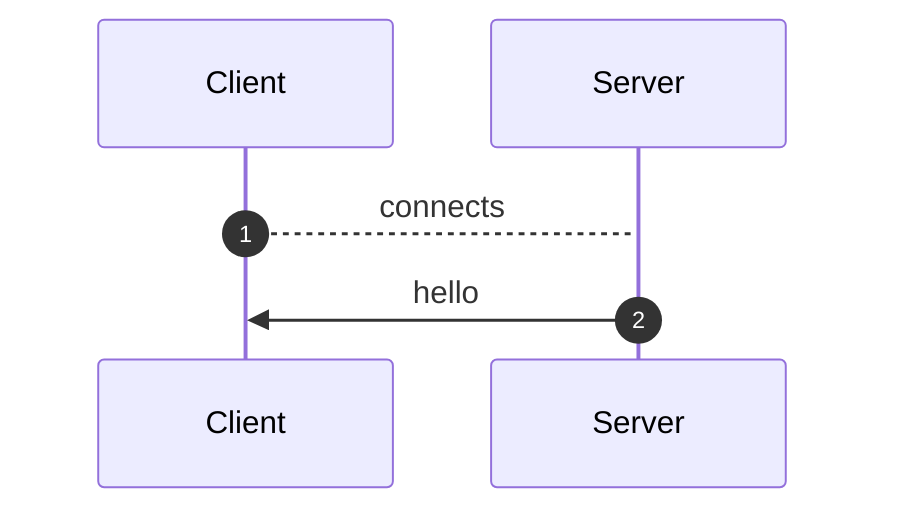
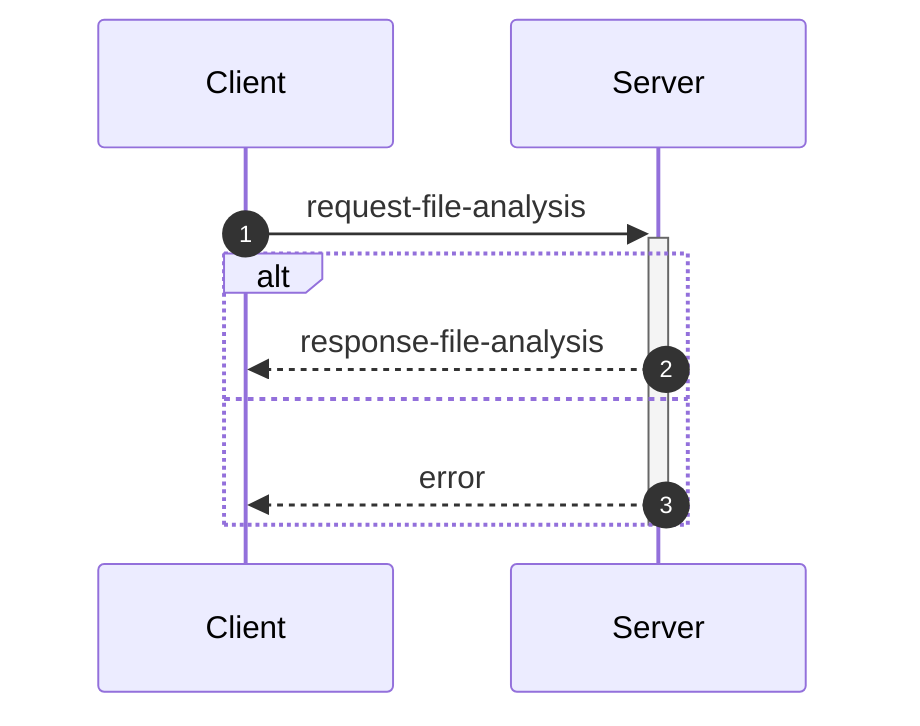
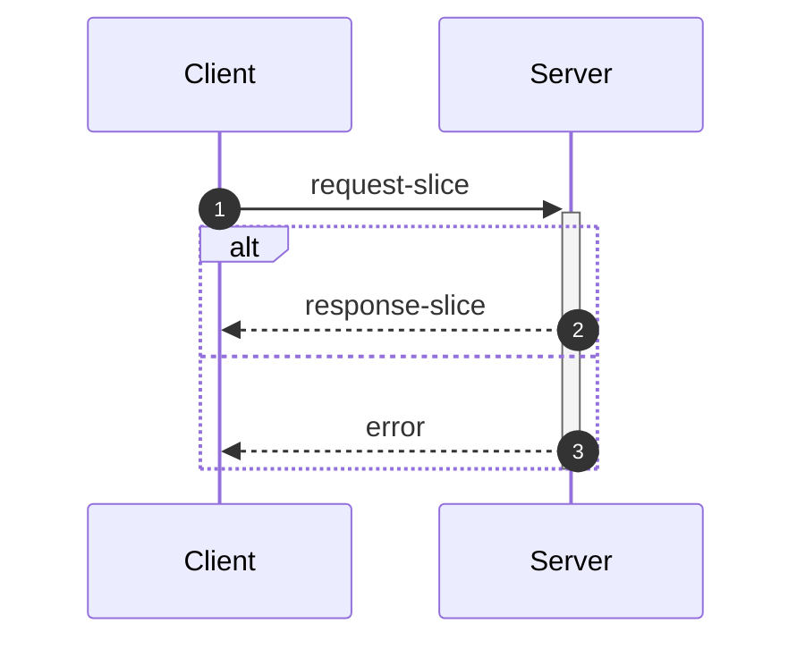
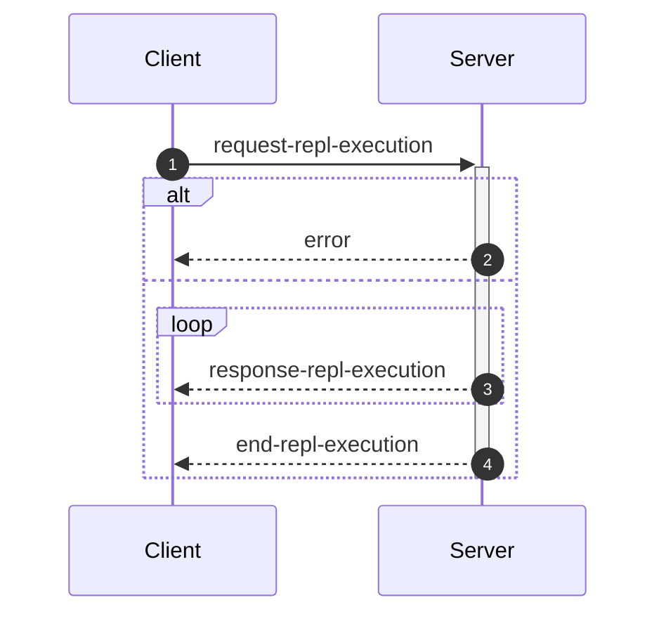

_<span title="an overview of flowR's interface">Generated</span> from '[wiki-interface.ts](https://github.com/flowr-analysis/flowr/tree/main/src/documentation/wiki-interface.ts "src/documentation/wiki-interface.ts")' on 2026-10-25, 20:08:08 UTC (v2.16.6, R v4.6.1), do not edit directly._

Although far from being as detailed as the in-depth explanation of [_flowR_](https://github.com/flowr-analysis/flowr/wiki/Core),
this wiki page explains how to interface with _flowR_ in more detail.
In general, command line arguments and other options provide short descriptions on hover over.

* [💻 Using the REPL](#using-the-repl)
* [⚙️ Configuring FlowR](#configuring-flowr)
* [⚒️ Writing Code](#writing-code)
* [💬 Communicating with the Server](#communicating-with-the-server)

<a id='using-the-repl'></a>
## 💻 Using the REPL

> [!NOTE]
> To execute arbitrary R commands with a repl request, _flowR_ has to be started explicitly with <span title="Description (Command Line Argument): Allow to access the underlying R session when using flowR (security warning: this allows the execution of arbitrary R code!)">`--r-session-access`</span>.
> Please be aware that this introduces a security risk and note that this relies on the [`r-shell` engine](https://github.com/flowr-analysis/flowr/wiki/Engines) .

Although primarily meant for users to explore,
there is nothing which forbids calling _flowR_ as a subprocess to use standard-in, -output, and -error
for communication (although you can access the REPL using the server as well,
with the [REPL Request](#message-request-repl-execution) message).

The read-eval-print loop&nbsp;(REPL) works relatively simple.
You can submit an expression (using <kbd>Enter</kbd>),
which is interpreted as an R&nbsp;expression by default but interpreted as a *command* if it starts with a colon (`:`).
The best command to get started with the REPL is <span title="Description (Repl Command): Show help information (aliases: :h, :?)">`:help`</span>.
Besides, you can leave the REPL either with the command <span title="Description (Repl Command): End the repl (aliases: :q, :exit)">`:quit`</span> or by pressing <kbd>Ctrl</kbd>+<kbd>C</kbd> twice.
When writing a *command*, you may press <kbd>Tab</kbd> to get a list of completions, if available.
Multiple commands can be entered in a single line by separating them with a semicolon (`;`), e.g. `:parse "x<-2"; :df*`.
If a command is given without R code, the REPL will re-use R code given in a previous command.
The prior example will hence return first the parsed AST of the program and then the dataflow graph for `"x <- 2"`.

> [!NOTE]
> If you develop flowR, you may want to launch the repl using the `npm run main-dev` command, this way, you get a non-minified version of flowR with debug information and hot-reloading of source files.

<details>
<summary>Available Commands</summary>

We currently offer the following commands (this with a `[*]` suffix are available with and without the star):

| Command | Description |
| ------- | ----------- |
| **<span title="Description (Repl Command): End the repl (aliases: :q, :exit)">:quit</span>** | End the repl (aliases: **:<span title="Alias of ':quit'. End the repl">q</span>**, **:<span title="Alias of ':quit'. End the repl">exit</span>**) |
| **<span title="Description (Repl Command): Execute the given code as R code. This requires the `--r-session-access` flag to be set and requires the r-shell engine. (aliases: :e, :r)">:execute</span>** | Execute the given code as R code. This requires the `--r-session-access` flag to be set and requires the r-shell engine. (aliases: **:<span title="Alias of ':execute'. Execute the given code as R code. This requires the `--r-session-access` flag to be set and requires the r-shell engine.">e</span>**, **:<span title="Alias of ':execute'. Execute the given code as R code. This requires the `--r-session-access` flag to be set and requires the r-shell engine.">r</span>**) |
| **<span title="Description (Repl Command): Get mermaid code for the control-flow graph of R code (aliases: :cfg, :cf)">:controlflow[*]</span>** | Get mermaid code for the control-flow graph of R code (star: Returns the URL to mermaid.live) (aliases: **:<span title="Alias of ':controlflow'. Get mermaid code for the control-flow graph of R code">cfg</span>**, **:<span title="Alias of ':controlflow'. Get mermaid code for the control-flow graph of R code">cf</span>**) |
| **<span title="Description (Repl Command): Get mermaid code for the control-flow graph with basic blocks (aliases: :cfgb, :cfb)">:controlflowbb[*]</span>** | Get mermaid code for the control-flow graph with basic blocks (star: Returns the URL to mermaid.live) (aliases: **:<span title="Alias of ':controlflowbb'. Get mermaid code for the control-flow graph with basic blocks">cfgb</span>**, **:<span title="Alias of ':controlflowbb'. Get mermaid code for the control-flow graph with basic blocks">cfb</span>**) |
| **<span title="Description (Repl Command): Get mermaid code for the dataflow graph (aliases: :d, :df)">:dataflow[*]</span>** | Get mermaid code for the dataflow graph (star: Returns the URL to mermaid.live) (aliases: **:<span title="Alias of ':dataflow'. Get mermaid code for the dataflow graph">d</span>**, **:<span title="Alias of ':dataflow'. Get mermaid code for the dataflow graph">df</span>**) |
| **<span title="Description (Repl Command): Get mermaid code for the normalized AST of R code (aliases: :n)">:normalize[*]</span>** | Get mermaid code for the normalized AST of R code (star: Returns the URL to mermaid.live) (alias: **:<span title="Alias of ':normalize'. Get mermaid code for the normalized AST of R code">n</span>**) |
| **<span title="Description (Repl Command): Get mermaid code for the simplified dataflow graph (aliases: :ds, :dfs)">:dataflowsimple[*]</span>** | Get mermaid code for the simplified dataflow graph (star: Returns the URL to mermaid.live) (aliases: **:<span title="Alias of ':dataflowsimple'. Get mermaid code for the simplified dataflow graph">ds</span>**, **:<span title="Alias of ':dataflowsimple'. Get mermaid code for the simplified dataflow graph">dfs</span>**) |
| **<span title="Description (Repl Command): Inspect and extend the signature database: `query` (identical to :query @signature), `info <name>` for where a function comes from (identical to :query @function-info), `add <path>` to mount another database/source, `download` to fetch the full-history database. (aliases: :sig)">:signature</span>** | Inspect and extend the signature database: `query` (identical to :query @signature), `info <name>` for where a function comes from (identical to :query @function-info), `add <path>` to mount another database/source, `download` to fetch the full-history database. (alias: **:<span title="Alias of ':signature'. Inspect and extend the signature database: `query` (identical to :query @signature), `info <name>` for where a function comes from (identical to :query @function-info), `add <path>` to mount another database/source, `download` to fetch the full-history database.">sig</span>**) |
| **<span title="Description (Repl Command): Just calculates the DFG, but only prints summary info (aliases: :d#, :df#)">:dataflowsilent</span>** | Just calculates the DFG, but only prints summary info (aliases: **:<span title="Alias of ':dataflowsilent'. Just calculates the DFG, but only prints summary info">d#</span>**, **:<span title="Alias of ':dataflowsilent'. Just calculates the DFG, but only prints summary info">df#</span>**) |
| **<span title="Description (Repl Command): Prints ASCII Art of the parsed, unmodified AST (aliases: :p)">:parse</span>** | Prints ASCII Art of the parsed, unmodified AST (alias: **:<span title="Alias of ':parse'. Prints ASCII Art of the parsed, unmodified AST">p</span>**) |
| **<span title="Description (Repl Command): Prints the version of flowR as well as the current version of R">:version</span>** | Prints the version of flowR as well as the current version of R
| **<span title="Description (Repl Command): Query the given R code (use 'help' for more information)">:query[*]</span>** | Query the given R code (use 'help' for more information) (star: Similar to query, but returns the output in json format.)
| **<span title="Description (Repl Command): Returns an ASCII representation of the dataflow graph (aliases: :df!)">:dataflowascii</span>** | Returns an ASCII representation of the dataflow graph (alias: **:<span title="Alias of ':dataflowascii'. Returns an ASCII representation of the dataflow graph">df!</span>**) |
| **<span title="Description (Repl Command): Returns summarization stats for the normalized AST (aliases: :n#)">:normalize#</span>** | Returns summarization stats for the normalized AST (alias: **:<span title="Alias of ':normalize#'. Returns summarization stats for the normalized AST">n#</span>**) |
| **<span title="Description (Repl Command): Show help information (aliases: :h, :?)">:help</span>** | Show help information (aliases: **:<span title="Alias of ':help'. Show help information">h</span>**, **:<span title="Alias of ':help'. Show help information">?</span>**) |

</details>

> [!TIP]
> 
> As indicated by the examples before, all REPL commands that operate on code keep track of the state.
> Hence, if you run a command like <span title="Description (Repl Command, starred version): Returns the URL to mermaid.live; Base Command: Get mermaid code for the dataflow graph (aliases: :d*, :df*)">`:dataflow*`</span> without providing R code,
> the REPL will re-use the R code provided in a previous command.
> Likewise, doing this will benefit from incrementality!
> If you request the dataflow graph with `:df* x <- 2 * y` and then want to see the parsed AST with `:parse`,
> the REPL will re-use previously obtained information and not re-parse the code again.
> 		

Generally, many commands offer shortcut versions in the REPL. Many queries, for example, offer a shortened format (see the example below).
Of special note, the [Config Query](https://github.com/flowr-analysis/flowr/wiki/%5BQuery%5D-Config)
can be used to also modify the currently active configuration of _flowR_ within the REPL (see the [wiki page](https://github.com/flowr-analysis/flowr/wiki/%5BQuery%5D-Config) for more information).

### Example: Retrieving the Dataflow Graph

To retrieve a URL to the [mermaid](https://mermaid.js.org/) diagram of the dataflow of a given expression,
use <span title="Description (Repl Command, starred version): Returns the URL to mermaid.live; Base Command: Get mermaid code for the dataflow graph (aliases: :d*, :df*)">`:dataflow*`</span> (or <span title="Description (Repl Command): Get mermaid code for the dataflow graph (aliases: :d, :df)">`:dataflow`</span> to get the mermaid code in the cli):

```shell
$ docker run -it --rm eagleoutice/flowr # or npm run flowr 
flowR repl v2.16.6, R grammar v14 (tree-sitter engine)
R> :dataflow* y <- 1 + x
```

<details>
<summary style='color:gray'>Output</summary>

```text
https://mermaid.live/view#base64:eyJjb2RlIjoiZmxvd2NoYXJ0IFREXG4gICAgMXt7XCJgKiM5MTtSTnVtYmVyIzkzOyogKioxKipcbiAgICAgICoxLjYqICgqKmlkOiAxKiopYFwifX1cbiAgICAyKFtcImAqIzkxO1JTeW1ib2wjOTM7KiAqKngqKlxuICAgICAgKjEuMTAqICgqKmlkOiAyKiopYFwiXSlcbiAgICAzW1tcImAqIzkxO1JCaW5hcnlPcCM5MzsqIGJhc2UjNTg7IzU4OyoqIzQzOyoqXG4gICAgICAqMS42LTEwKiAoKippZDogMyoqKVxuICAgIGFyZzogKDEsIDIpYFwiXV1cbiAgICBidWlsdC1pbjpfNDNfW1wiYEJ1aWx0LUluOlxuIzQzO2BcIl1cbiAgICBzdHlsZSBidWlsdC1pbjpfNDNfIHN0cm9rZTpncmF5LGZpbGw6Z3JheSxzdHJva2Utd2lkdGg6MnB4LG9wYWNpdHk6Ljg7XG4gICAgMFtcImAqIzkxO1JTeW1ib2wjOTM7KiAqKnkqKlxuICAgICAgKjEuMSogKCoqaWQ6IDAqKiwgdjogMylgXCJdXG4gICAgNFtbXCJgKiM5MTtSQmluYXJ5T3AjOTM7KiBiYXNlIzU4OyM1ODsqKiM2MDsjNDU7KipcbiAgICAgICoxLjEtMTAqICgqKmlkOiA0KiopXG4gICAgYXJnOiAoMCwgMylgXCJdXVxuICAgIGJ1aWx0LWluOl82MF8tW1wiYEJ1aWx0LUluOlxuIzYwOyM0NTtgXCJdXG4gICAgc3R5bGUgYnVpbHQtaW46XzYwXy0gc3Ryb2tlOmdyYXksZmlsbDpncmF5LHN0cm9rZS13aWR0aDoycHgsb3BhY2l0eTouODtcbiAgICAxIC0uLT58XCJmbG93XCJ8IDJcbiAgICBsaW5rU3R5bGUgMCBzdHJva2U6Z3JheSxjb2xvcjpncmF5O1xuICAgIDIgLS4tPnxcImZsb3dcInwgM1xuICAgIGxpbmtTdHlsZSAxIHN0cm9rZTpncmF5LGNvbG9yOmdyYXk7XG4gICAgMyAtLT58XCJyZWFkcywgYXJnXCJ8IDFcbiAgICAzIC0tPnxcInJlYWRzLCBhcmdcInwgMlxuICAgIDMgLS4tPnxcImZsb3dcInwgMFxuICAgIGxpbmtTdHlsZSA0IHN0cm9rZTpncmF5LGNvbG9yOmdyYXk7XG4gICAgMyAtLi0+fFwicmVhZHMsIGNhbGxzXCJ8IGJ1aWx0LWluOl80M19cbiAgICBsaW5rU3R5bGUgNSBzdHJva2U6Z3JheTtcbiAgICAwIC0tPnxcImRlZmluZWQtYnksIGZsb3dcInwgNFxuICAgIDAgLS0+fFwiZGVmaW5lZC1ieVwifCAzXG4gICAgNCAtLT58XCJyZWFkcywgYXJnXCJ8IDNcbiAgICA0IC0tPnxcInJldHVybnMsIGFyZ1wifCAwXG4gICAgNCAtLi0+fFwicmVhZHMsIGNhbGxzXCJ8IGJ1aWx0LWluOl82MF8tXG4gICAgbGlua1N0eWxlIDEwIHN0cm9rZTpncmF5OyIsIm1lcm1haWQiOnsiYXV0b1N5bmMiOnRydWV9fQ==
```

Retrieve the dataflow graph of the expression `y <- 1 + x`. It looks like this:


<details>

<summary style="color:gray">R Code of the Dataflow Graph</summary>

The analysis ran (parse and normalize with the [tree-sitter](https://github.com/flowr-analysis/flowr/wiki/Engines) engine) in the generation environment. No [signature database](https://github.com/flowr-analysis/flowr/wiki/Signature-Database) is mounted, so `library()` attaches no exports (base-R names are still qualified, e.g., `stats::acf`). 
We encountered no unknown side effects during the analysis.

```r
y <- 1 + x
```

</details>

</details>

For small graphs like this, <span title="Description (Repl Command): Returns an ASCII representation of the dataflow graph (aliases: :df!)">`:dataflowascii`</span> also provides an ASCII representation directly in the REPL:

```shell
$ docker run -it --rm eagleoutice/flowr # or npm run flowr 
flowR repl v2.16.6, R grammar v14 (tree-sitter engine)
R> :df! y <- 1 + x
```

<details open>
<summary style='color:gray'>Output</summary>

```text
                        v<0>v
 c<4>c──────────────────| y |
 |<- |     ┌────────────v---v
 c---c     │
    │   c<3>c   0<1>0
    └───| + |───| 1 |───u<2>u
        c---c   0---0   | x |
           └────────────u---u
Edges:
3 -> 1: reads, arg          3 -> 2: reads, arg
3 -> 0: flows-to            1 -> 2: flows-to
2 -> 3: flows-to            4 -> 3: reads, arg
4 -> 0: returns, arg        0 -> 4: defined-by, flows-to
0 -> 3: defined-by
```

Retrieve the dataflow graph of the expression `y <- 1 + x` as ASCII art.

</details>

For the slicing with <span title="Description (Repl Command): Static backwards executable slicer for R">`:slicer`</span>, you have access to the same [magic comments](#slice-magic-comments) as with the [slice request](#message-request-slice).
Pass `--inline` to splice resolvable `source()` calls into the reconstruction so the slice is a single self-contained R text (the same as the static slice query's `inlineSources` flag).
See `--help` for more flags!

### Example: Interfacing with the File System

Many commands that allow for an R-expression (like <span title="Description (Repl Command, starred version): Returns the URL to mermaid.live; Base Command: Get mermaid code for the dataflow graph (aliases: :d*, :df*)">`:dataflow*`</span>) allow for a file as well
if the argument starts with `file://`.
If you are working from the root directory of the _flowR_ repository, the following gives you the parsed AST of the example file using the <span title="Description (Repl Command): Prints ASCII Art of the parsed, unmodified AST (aliases: :p)">`:parse`</span> command:

> **Watch mode**: Replace `file://` with `watch://` to enter watch mode.
> flowR runs the command immediately and then re-runs it every time the file (or any file inside the folder) changes.
> Enter any other command to leave watch mode.
> For example: `:df watch://analysis.R`

```shell
$ docker run -it --rm eagleoutice/flowr # or npm run flowr 
flowR repl v2.16.6, R grammar v14 (tree-sitter engine)
R> :parse file://test/testfiles/example.R
```

<details>
<summary style='color:gray'>Output</summary>

```text
File: test/testfiles/example.R

program
├ binaryoperator
│ ├ identifier "sum" (1:1─4)
│ ├ <- "<-" (1:5─7)
│ ╰ float "0" (1:8─9)
├ binaryoperator
│ ├ identifier "product" (2:1─8)
│ ├ <- "<-" (2:9─11)
│ ╰ float "1" (2:12─13)
├ binaryoperator
│ ├ identifier "w" (3:1─2)
│ ├ <- "<-" (3:3─5)
│ ╰ float "7" (3:6─7)
├ binaryoperator
│ ├ identifier "N" (4:1─2)
│ ├ <- "<-" (4:3─5)
│ ╰ float "10" (4:6─8)
├ forstatement
│ ├ for "for" (6:1─4)
│ ├ ( "(" (6:5─6)
│ ├ identifier "i" (6:6─7)
│ ├ in "in" (6:8─10)
│ ├ binaryoperator
│ │ ├ float "1" (6:11─12)
│ │ ├ : ":" (6:12─13)
│ │ ╰ parenthesizedexpression
│ │   ├ ( "(" (6:13─14)
│ │   ├ binaryoperator
│ │   │ ├ identifier "N" (6:14─15)
│ │   │ ├ - "-" (6:15─16)
│ │   │ ╰ float "1" (6:16─17)
│ │   ╰ ) ")" (6:17─18)
│ ├ ) ")" (6:18─19)
│ ╰ bracedexpression
│   ├ { "{" (6:20─21)
│   ├ binaryoperator
│   │ ├ identifier "sum" (7:3─6)
│   │ ├ <- "<-" (7:7─9)
│   │ ╰ binaryoperator
│   │   ├ binaryoperator
│   │   │ ├ identifier "sum" (7:10─13)
│   │   │ ├ + "+" (7:14─15)
│   │   │ ╰ identifier "i" (7:16─17)
│   │   ├ + "+" (7:18─19)
│   │   ╰ identifier "w" (7:20─21)
│   ├ binaryoperator
│   │ ├ identifier "product" (8:3─10)
│   │ ├ <- "<-" (8:11─13)
│   │ ╰ binaryoperator
│   │   ├ identifier "product" (8:14─21)
│   │   ├  "" (8:22─23)
│   │   ╰ identifier "i" (8:24─25)
│   ╰ } "}" (9:1─2)
├ call
│ ├ identifier "cat" (11:1─4)
│ ╰ arguments
│   ├ ( "(" (11:4─5)
│   ├ argument
│   │ ╰ string
│   │   ├ stringopen "\"" (11:5─6)
│   │   ├ stringcontent "Sum:" (11:6─10)
│   │   ╰ stringclose "\"" (11:10─11)
│   ├ comma "," (11:11─12)
│   ├ argument
│   │ ╰ identifier "sum" (11:13─16)
│   ├ comma "," (11:16─17)
│   ├ argument
│   │ ╰ string
│   │   ├ stringopen "\"" (11:18─19)
│   │   ├ stringcontent
│   │   │ ╰ escapesequence "\\n" (11:19─21)
│   │   ╰ stringclose "\"" (11:21─22)
│   ╰ ) ")" (11:22─23)
╰ call
  ├ identifier "cat" (12:1─4)
  ╰ arguments
    ├ ( "(" (12:4─5)
    ├ argument
    │ ╰ string
    │   ├ stringopen "\"" (12:5─6)
    │   ├ stringcontent "Product:" (12:6─14)
    │   ╰ stringclose "\"" (12:14─15)
    ├ comma "," (12:15─16)
    ├ argument
    │ ╰ identifier "product" (12:17─24)
    ├ comma "," (12:24─25)
    ├ argument
    │ ╰ string
    │   ├ stringopen "\"" (12:26─27)
    │   ├ stringcontent
    │   │ ╰ escapesequence "\\n" (12:27─29)
    │   ╰ stringclose "\"" (12:29─30)
    ╰ ) ")" (12:30─31)
```

Retrieve the parsed AST of the example file.

<details>

<summary>File Content</summary>

```r
sum <- 0
product <- 1
w <- 7
N <- 10

for (i in 1:(N-1)) {
  sum <- sum + i + w
  product <- product * i
}

cat("Sum:", sum, "\n")
cat("Product:", product, "\n")
```

</details>

As _flowR_ directly transforms this AST the output focuses on being human-readable instead of being machine-readable.
		
</details>

### Example: Run a Query

You can run any query supported by _flowR_ using the <span title="Description (Repl Command): Query the given R code (use 'help' for more information)">`:query`</span> command.
For example, to obtain the shapes of all data frames in a given piece of code, you can run:

```shell
$ docker run -it --rm eagleoutice/flowr # or npm run flowr 
flowR repl v2.16.6, R grammar v14 (tree-sitter engine)
R> :query @absint df-shape "x <- data.frame(a = 1:10, b = 1:10)\ny <- x$a"
```

<details open>
<summary style='color:gray'>Output</summary>

```text
Query: absint (1 ms)
```

Retrieve the shapes of all data frames in the given code.

</details>

To run the linter on a file, you can use (in this example, we just issue the `dead-code` linter on a small piece of code):

```shell
$ docker run -it --rm eagleoutice/flowr # or npm run flowr 
flowR repl v2.16.6, R grammar v14 (tree-sitter engine)
R> :query @linter rules:dead-code "if(FALSE) x <- 2"
```

<details open>
<summary style='color:gray'>Output</summary>

```text
Query: linter (1 ms)
   ╰ Dead Code (dead-code):
       ╰ certain:
           ╰ Code at 1.11-16
```

Run the linter on the given code, with only the `dead-code` rule enabled.

</details>

For more information on the available queries, please check out the [Query API](https://github.com/flowr-analysis/flowr/wiki/Query-API).

<a id='configuring-flowr'></a>
## ⚙️ Configuring FlowR

When running _flowR_, you may want to specify some behaviors with a dedicated configuration file.
By default, flowR looks for a file named `flowr.json` in the current working directory (or any higher directory).
You can also specify a different file with <span title="Description (Command Line Argument): The name of the configuration file to use">`--config-file`</span> or pass the configuration inline using <span title="Description (Command Line Argument): The flowR configuration to use, as a JSON string">`--config-json`</span>.
A `flowr.json` found this way belongs to the analyzed project, so flowR ignores its options that decide what flowR executes or loads
(`engines.*.wasmPath`, `engines.*.treeSitterWasmPath`, `engines.*.rPath`, `solver.sigdb.additionalPaths`, `solver.sigdb.downloadRepo`, `solver.sigdb.installedLibrary.paths`),
unless you pass <span title="Description (Command Line Argument): Keep the security-sensitive options (e.g., the R executable) of the flowr.json found in the working directory or a parent. Only use this for projects you trust.">`--trust-config`</span>.
To analyze code you do not trust, use the secure mode (<span title="Description (Command Line Argument): Run in secure mode for analyzing untrusted code: flowR does not start R (or any other process), does not access the network, does not search for project configs, and ignores security-sensitive options in every config. Cannot be disabled once enabled. Can also be enabled with the environment variable {italic FLOWR_SECURE_MODE=1}.">`--secure`</span>, see the [security policy](https://github.com/flowr-analysis/flowr/blob/main/.github/SECURITY.md)).
To inspect the current configuration, you can run flowr with the <span title="Description (Command Line Argument): Run with verbose logging (will be passed to the corresponding script)">`--verbose`</span> flag, or use the `config` [Query](https://github.com/flowr-analysis/flowr/wiki/Query-API).
Within the REPL this works by running the following:

```shell
:query @config
```

To work with the <a href="https://github.com/flowr-analysis/flowr/tree/main/src/config.ts#L119"><code><span title="The configuration file format for flowR.">FlowrConfig</span></code></a> you can use the provided helper objects alongside its methods like
<a href="https://github.com/flowr-analysis/flowr/tree/main/src/config.ts#L914"><code><span title="Creates a new flowr config that has the updated values.">FlowrConfig::<b>amend</b></span></code></a>.
The schema below documents every option; the ones you most likely want are:

- <a href="https://github.com/flowr-analysis/flowr/wiki/Interface#configuring-flowr" title="Configuration Option (boolean): Whether source calls should be ignored, causing {@link processSourceCall}&#39;s behavior to be skipped.">ignoreSourceCalls</a>: ignore source calls when analyzing the code, i.e., ignore the inclusion of other files.
- <a href="https://github.com/flowr-analysis/flowr/wiki/Interface#configuring-flowr" title="Configuration Option (boolean): Whether load calls should be ignored, causing {@link processLoadCall}&#39;s behavior to be skipped.">ignoreLoadCalls</a>: ignore load calls when analyzing the code, i.e., ignore the loading of r-data files.
- <a href="https://github.com/flowr-analysis/flowr/wiki/Interface#configuring-flowr" title="Configuration Option (object): Do you want to overwrite (parts) of the builtin definition?">semantics.environment.overwriteBuiltIns</a>: overwrite _flowR_'s handling of built-in functions, or clear the preset definitions entirely.
  See [Configure BuiltIn Semantics](#configure-builtin-semantics) for more information.
- <a href="https://github.com/flowr-analysis/flowr/wiki/Interface#configuring-flowr" title="Configuration Option (string): How to resolve variables and their values. (one of &quot;disabled&quot;, &quot;alias&quot;, &quot;builtin&quot;)">solver.variables</a>: how to resolve variables and their values (`disabled`, `alias`, `builtin`).
- <a href="https://github.com/flowr-analysis/flowr/wiki/Interface#configuring-flowr" title="Configuration Option (array): The engine or set of engines to use for interacting with R code. An empty array means all available engines will be used.">engines</a> and <a href="https://github.com/flowr-analysis/flowr/wiki/Interface#configuring-flowr" title="Configuration Option (string): The default engine to use for interacting with R code. If this is undefined, an arbitrary engine from the specified list will be used. (one of &quot;tree-sitter&quot;, &quot;r-shell&quot;)">defaultEngine</a>: the engines used to interact with R code, see the [Engines wiki page](https://github.com/flowr-analysis/flowr/wiki/Engines).
- <a href="https://github.com/flowr-analysis/flowr/wiki/Interface#configuring-flowr" title="Configuration Option (array): Files a framework loads on its own, without any source() call (e.g. global.R in a shiny app), in the order they are loaded; flowR orders the matching project files accordingly and analyzes them as one program. Entries are case-insensitive globs matched against the file path, a plain name matches any file with that name, and entries matching no project file are warned about. Usually set per project kind via specializeConfig.">project.implicitSources</a>: the files a framework loads without any `source()` call, in the order in which they are
  loaded. Entries are globs (e.g. `R/*.R`) matched against the file path ignoring capitalization; one matching no file is reported.
- <a href="https://github.com/flowr-analysis/flowr/wiki/Interface#configuring-flowr" title="Configuration Option (object): Overwrite (parts of) the configuration depending on the project kind flowR detects, e.g. to give a shiny app its implicit sources.">specializeConfig</a>: overwrite (parts of) the configuration depending on the kind of project _flowR_ detects
  (e.g. `shiny-app`), which is how a shiny app gets its implicit sources by default. What you configure directly wins.
- <a href="https://github.com/flowr-analysis/flowr/wiki/Interface#configuring-flowr" title="Configuration Option (string): Overwrite the project kind flowR would otherwise infer from the analyzed files, e.g. when auto-detection guesses wrong. (one of &quot;package&quot;, &quot;script&quot;, &quot;shiny-app&quot;, &quot;notebook&quot;, &quot;project&quot;, &quot;unknown&quot;)">project.useProjectType</a>: skip that detection and force a project kind yourself, when auto-detection guesses wrong.
- <a href="https://github.com/flowr-analysis/flowr/wiki/Interface#configuring-flowr" title="Configuration Option (array): The default plugins to load when creating a new instance of FlowrAnalyzer">defaultPlugins</a> and <a href="https://github.com/flowr-analysis/flowr/wiki/Interface#configuring-flowr" title="Configuration Option (array): The plugins to load in REPL mode">repl.plugins</a>: the plugins to load for a new <a href="https://github.com/flowr-analysis/flowr/tree/main/src/project/flowr-analyzer.ts#L205"><code><span title="Central class for conducting analyses with FlowR. Use the FlowrAnalyzerBuilder to create a new instance. If you want the original pattern of creating a pipeline and running all steps, you can still do this with FlowrAnalyzer#runFull . To inspect the context of the analyzer, use FlowrAnalyzer#inspectContext (if you are a plugin and need to modify it, use FlowrAnalyzer#context instead).">FlowrAnalyzer</span></code></a> and in the REPL
  (use `flowr:default` to reference the former).

So you can configure _flowR_ by adding a file like the following:

<details>

<summary>Example Configuration File</summary>

```json
{
  "ignoreSourceCalls": true,
  "ignoreLoadCalls": true,
  "semantics": {
    "environment": {
      "overwriteBuiltIns": {
        "definitions": [
          {
            "type": "function",
            "names": [
              "foo"
            ],
            "processor": "builtin:assign",
            "config": {}
          }
        ]
      }
    }
  },
  "defaultPlugins": [
    "file:description",
    "versions:description"
  ],
  "repl": {
    "quickStats": false,
    "dfProcessorHeat": false,
    "hints": true,
    "plugins": [
      "flowr:default"
    ]
  },
  "project": {
    "resolveUnknownPathsOnDisk": true,
    "implicitSources": [
      "global.R",
      "app.R"
    ]
  },
  "linter": {
    "disabledRules": []
  },
  "specializeConfig": {
    "shiny-app": {
      "project": {
        "implicitSources": [
          "global.R",
          "ui.R",
          "server.R",
          "app.R"
        ]
      }
    }
  },
  "engines": [
    {
      "type": "r-shell"
    }
  ],
  "solver": {
    "variables": "alias",
    "evalStrings": true,
    "trackEnvironments": true,
    "sigdb": {
      "enabled": true,
      "loadProjectDependencies": true,
      "eagerlyLoad": false,
      "eagerlyLoadExports": false,
      "linkBaseR": false,
      "linkDescriptionDependencies": false
    },
    "resolveSource": {
      "dropPaths": "no",
      "ignoreCapitalization": true,
      "inferWorkingDirectory": "active-script",
      "searchPath": []
    },
    "instrument": {},
    "slicer": {
      "threshold": 50
    }
  },
  "abstractInterpretation": {
    "wideningThreshold": 4,
    "followCalls": true,
    "dataFrame": {
      "maxColNames": 20,
      "readLoadedData": {
        "readExternalFiles": true,
        "maxReadLines": 1000000
      }
    }
  },
  "incremental": {
    "alwaysIncremental": false,
    "parsing": {
      "activated": false,
      "heuristics": {
        "activated": true,
        "mtime": true,
        "linesFrom": 500,
        "bytesFrom": 50000,
        "alwaysWithEdits": false,
        "minFiles": 1
      }
    }
  },
  "gas": {
    "thresholds": {
      "memory": {
        "problematic": 0.7,
        "critical": 0.9
      },
      "timeMs": {
        "problematic": 100000,
        "critical": 120000
      }
    },
    "features": {}
  }
}
```

</details>

<details>
<a id='configure-builtin-semantics'></a>
<summary>Configure Built-In Semantics</summary>

`semantics/environment/overwriteBuiltins` accepts two keys:

- `loadDefaults` (boolean, initially `true`): If set to `true`, the default built-in definitions are loaded before applying the custom definitions. Setting this flag to `false` explicitly disables the loading of the default definitions.
- `definitions` (array, initially empty): Allows to overwrite or define new built-in elements. Each object within must have a `type` which is one of the below. Furthermore, they may define a string array of `names` which specifies the identifiers to bind the definitions to. You may use `assumePrimitive` to specify whether _flowR_ should assume that this is a primitive non-library definition (so you probably just do not want to specify the key).

  | Type            | Description                                                                                                                                                                                                                                                                                              | Example                                                                                                    |
  | --------------- | -------------------------------------------------------------------------------------------------------------------------------------------------------------------------------------------------------------------------------------------------------------------------------------------------------- | ---------------------------------------------------------------------------------------------------------- |
  | `constant`    | Additionally allows for a `value` this should resolve to.                                                                                                                                                                                                                                                | `{ type: 'constant', names: ['NULL', 'NA'],  value: null }`                                                |
  | `function`    | Is a rather flexible way to define and bind built-in functions. For the time, we do not have extensive documentation to cover all the cases, so please either consult the sources with the `default-builtin-config.ts` or open a [new issue](https://github.com/flowr-analysis/flowr/issues/new/choose). | `{ type: 'function', names: ['next'], processor: 'builtin:d', config: { cfg: ExitPointType.Next } }` |
  | `replacement` | A comfortable way to specify replacement functions like `$<-` or `names<-`. `suffixes` describes the... suffixes to attach automatically. | `{ type: 'replacement', suffixes: ['<-', '<<-'], names: ['[', '[['] }` |

</details>

<details>

<summary style='color:gray'>Full Configuration-File Schema</summary>

- _The configuration file format for flowR._ (object)
    - **logLevel** [optional] _flowR's global minimum log level, applied when the config is loaded._ (string)
        Only allows: 'silly', 'trace', 'debug', 'info', 'warn', 'error', 'fatal'
    - **ignoreSourceCalls** [optional] _Whether source calls should be ignored, causing {@link processSourceCall}'s behavior to be skipped._ (boolean)
    - **ignoreLoadCalls** [optional] _Whether load calls should be ignored, causing {@link processLoadCall}'s behavior to be skipped._ (boolean)
    - **semantics** _Configure language semantics and how flowR handles them._ (object)
        - **environment** [optional] _Semantics regarding how to handle the R environment._ (object)
            - **overwriteBuiltIns** [optional] _Do you want to overwrite (parts) of the builtin definition?_ (object)
                - **loadDefaults** [optional] _Should the default configuration still be loaded?_ (boolean)
                - **definitions** [optional] _The definitions to load/overwrite._ (array)
                Valid item types:
                    - (object)
    - **defaultPlugins** [optional] _The default plugins to load when creating a new instance of FlowrAnalyzer_ (array)
    Valid item types:
        - (alternatives)
            - (string)
            - (array)
    - **repl** _Configuration options for the REPL._ (object)
        - **quickStats** [optional] _Whether to show quick stats in the REPL after each evaluation._ (boolean)
        - **dfProcessorHeat** [optional] _This instruments the dataflow processors to count how often each processor is called._ (boolean)
        - **hints** [optional] _Whether to show dim inline hints on the empty prompt (automatically disabled on non-interactive terminals)._ (boolean)
        - **plugins** [optional] _The plugins to load in REPL mode_ (array)
        Valid item types:
            - (alternatives)
                - (string)
                - (array)
        - **autoUseFileProtocol** [optional] _Prepend the file protocol to a repl input that looks like a path, instead of only warning about it._ (boolean)
        - **queryStats** [optional] _Whether `:query` closes with the line stating how long the queries took (`:query*` never prints it)._ (boolean)
        - **showPlugins** [optional] _Whether `:version` grays out the plugins that did not activate during the last analysis._ (boolean)
    - **project** _Project specific configuration options._ (object)
        - **resolveUnknownPathsOnDisk** [optional] _Whether to resolve unknown paths loaded by the r project disk when trying to source/analyze files._ (boolean)
        - **failOnInaccessiblePath** [optional] _Whether a directory that cannot be traversed during file discovery (e.g. due to permissions) aborts the analysis; when false (the default) such paths are logged and skipped._ (boolean)
        - **basePackages** [optional] _The packages considered part of R itself (base and recommended); if unset, flowR uses its built-in list._ (array)
        Valid item types:
            - (string)
        - **implicitSources** [optional] _Files a framework loads on its own, without any source() call (e.g. global.R in a shiny app), in the order they are loaded; flowR orders the matching project files accordingly and analyzes them as one program. Entries are case-insensitive globs matched against the file path, a plain name matches any file with that name, and entries matching no project file are warned about. Usually set per project kind via specializeConfig._ (array)
        Valid item types:
            - (string)
        - **useProjectType** [optional] _Overwrite the project kind flowR would otherwise infer from the analyzed files, e.g. when auto-detection guesses wrong._ (string)
            Only allows: 'package', 'script', 'shiny-app', 'notebook', 'project', 'unknown'
        - **assumeImplicitEcho** [optional] _Whether the top level of the analyzed code is echoed, so that every visible result printed there is collected as an output by the dependencies query (default true, false for a package)._ (boolean)
        - **discovery** [optional] _Scoping options for the default project discovery._ (object)
            - **full** [optional] _Collect every file below the project root (greedy) instead of only the files the detected project kind needs (default false)._ (boolean)
            - **perKind** [optional] _Per-kind include/exclude glob overrides layered on the default scoping._ (object)
            - **ignore** [optional] _Case-insensitive globs that drop matching files from the intelligent discovery, regardless of kind (e.g. .Renviron to ignore environment files)._ (array)
            Valid item types:
                - (string)
        - **classification** [optional] _Overrides for the signals flowR uses to classify the project kind._ (object)
            - **shinyDescriptionTypes** [optional] _DESCRIPTION Type: values that mark a shiny app._ (array)
            Valid item types:
                - (string)
            - **shinyEntryFiles** [optional] _File names a shiny app is assembled from._ (array)
            Valid item types:
                - (string)
            - **shinyUsagePattern** [optional] _Regex source evidencing shiny usage in an entry file._ (string)
            - **notebookExtensions** [optional] _File extensions marking a notebook._ (array)
            Valid item types:
                - (string)
    - **linter** _Linter configuration options._ (object)
        - **disabledRules** _Linting rule names excluded from the default rule set (a rule requested explicitly via a linter query still runs). Usually set per project kind via specializeConfig._ (array)
        Valid item types:
            - (string)
        - **disabledTags** [optional] _Linting rule tags whose rules are excluded from the default rule set (a rule requested explicitly via a linter query still runs). By default the cmd-check rules are disabled for everything but a package; a configured list replaces that default._ (array)
        Valid item types:
            - (string)
    - **inputSources** [optional] _Further frameworks the input-sources analysis should know about; entries are added to flowR's defaults._ (object)
        - **pure** [optional] _Functions that only pass the constantness of their arguments on._ (array)
        Valid item types:
            - (string)
        - **param** [optional] _Functions whose result is a 'param' input._ (array)
        Valid item types:
            - (string)
        - **file** [optional] _Functions whose result is a 'file' input._ (array)
        Valid item types:
            - (string)
        - **tempfile** [optional] _Functions whose result is a 'tempfile' input._ (array)
        Valid item types:
            - (string)
        - **glob** [optional] _Functions whose result is a 'glob' input._ (array)
        Valid item types:
            - (string)
        - **net** [optional] _Functions whose result is a 'net' input._ (array)
        Valid item types:
            - (string)
        - **rand** [optional] _Functions whose result is a 'rand' input._ (array)
        Valid item types:
            - (string)
        - **system** [optional] _Functions whose result is a 'system' input._ (array)
        Valid item types:
            - (string)
        - **ffi** [optional] _Functions whose result is a 'ffi' input._ (array)
        Valid item types:
            - (string)
        - **lang** [optional] _Functions whose result is a 'lang' input._ (array)
        Valid item types:
            - (string)
        - **options** [optional] _Functions whose result is a 'options' input._ (array)
        Valid item types:
            - (string)
        - **cmdline** [optional] _Functions whose result is a 'cmdline' input._ (array)
        Valid item types:
            - (string)
        - **user** [optional] _Functions whose result is a 'user' input._ (array)
        Valid item types:
            - (string)
        - **const** [optional] _Functions whose result is a 'const' input._ (array)
        Valid item types:
            - (string)
        - **scope** [optional] _Functions whose result is a 'scope' input._ (array)
        Valid item types:
            - (string)
        - **dconst** [optional] _Functions whose result is a 'dconst' input._ (array)
        Valid item types:
            - (string)
        - **unknown** [optional] _Functions whose result is a 'unknown' input._ (array)
        Valid item types:
            - (string)
        - **linkedObjects** [optional] _Objects a framework provides without a definition in the code, e.g. shiny's input._ (array)
        Valid item types:
            - (object)
        - **linkedEntryPoints** [optional] _Calls that hand a function to a framework, which binds its objects to the parameters by position._ (array)
        Valid item types:
            - (object)
    - **specializeConfig** [optional] _Overwrite (parts of) the configuration depending on the project kind flowR detects, e.g. to give a shiny app its implicit sources._ (object)
    - **engines** _The engine or set of engines to use for interacting with R code. An empty array means all available engines will be used._ (array)
    Valid item types:
        - (alternatives)
            - _The configuration for the tree sitter engine._ (object)
                - **type** [required] _Use the tree sitter engine._ (string)
                    Only allows: 'tree-sitter'
                - **wasmPath** [optional] _The path to the tree-sitter-r WASM binary to use. If this is undefined, this uses the default path._ (string)
                - **treeSitterWasmPath** [optional] _The path to the tree-sitter WASM binary to use. If this is undefined, this uses the default path._ (string)
                - **lax** [optional] _Whether to use the lax parser for parsing R code (allowing for syntax errors). If this is undefined, the strict parser will be used._ (boolean)
            - _The configuration for the R shell engine._ (object)
                - **type** [required] _Use the R shell engine._ (string)
                    Only allows: 'r-shell'
                - **rPath** [optional] _The path to the R executable to use. If this is undefined, this uses the default path._ (string)
                - **pipeBind** [optional] _Whether to enable R's experimental pipe-bind operator "=>" by setting _R_USE_PIPEBIND_ for the R session (default false); R itself keeps this off by default, as it is experimental and has never shipped in a release version of R._ (boolean)
    - **defaultEngine** [optional] _The default engine to use for interacting with R code. If this is undefined, an arbitrary engine from the specified list will be used._ (string)
        Only allows: 'tree-sitter', 'r-shell'
    - **solver** _How to resolve constants, constraints, cells, ..._ (object)
        - **variables** _How to resolve variables and their values._ (string)
            Only allows: 'disabled', 'alias', 'builtin'
        - **evalStrings** _Should we include eval(parse(text="...")) calls in the dataflow graph?_ (boolean)
        - **trackEnvironments** [optional] _Track user-created environments (new.env, assign/get/local with envir=, dollar-assign, attach). When false, all envir-style calls fall through conservatively._ (boolean)
        - **sigdb** _Resolving library exports from a signature database._ (object)
            - **enabled** [optional] _Resolve library()/use() exports from a signature database (default true); when false no database is consulted._ (boolean)
            - **loadProjectDependencies** [optional] _Load the project's declared dependencies from its metadata files (DESCRIPTION Imports/Depends, rproject.toml, uvr.toml, renv.lock, rv.lock, uvr.lock) (default true); when false these files are not read for dependencies._ (boolean)
            - **eagerlyLoad** [optional] _Parse the database up front rather than on the first package load (default false, ignored if disabled)._ (boolean)
            - **eagerlyLoadExports** [optional] _Add a vertex for every export on load rather than on demand (default false); keeps the dataflow graph small._ (boolean)
            - **assumedRVersion** [optional] _R version assumed when resolving versioned (base-R) exports: a pin like "4.5" or "auto" to detect the installed R (default "auto")._ (string)
            - **linkBaseR** [optional] _Eagerly attach base-R namespaces so bare base calls resolve without library() (default false)._ (boolean)
            - **linkBaseRCalls** [optional] _Add a lightweight Reads edge from a bare base-R call to its signature-database function vertex (default false; base-R qualification is edge-free otherwise)._ (boolean)
            - **linkPackageCalls** [optional] _Add a lightweight Reads edge from a resolved package call to its signature-database function vertex (default false)._ (boolean)
            - **linkDescriptionDependencies** [optional] _Eagerly attach the namespaces of the project's declared DESCRIPTION dependencies (Imports/Depends) so their exports resolve without an explicit library() (default false)._ (boolean)
            - **warmInBackground** [optional] _Decompress the hot shards (base + most-downloaded) in a background task on startup so the first library() lookup is warm (default false; for long-running servers/REPLs)._ (boolean)
            - **additionalPaths** [optional] _Extra directories or bundle/manifest files searched for signature databases (alongside the shipped default and $FLOWR_SIGDB_DIR); a downloaded full-history bundle placed here is mounted automatically._ (array)
            Valid item types:
                - (string)
            - **downloadRepo** [optional] _GitHub owner/repo the full-history bundle is downloaded from via ":signature download" (default "flowr-analysis/flowr", release tag "sigdb-v<flowR-version>")._ (string)
            - **autoSync** [optional] _On startup, re-download shards whose committed sigdb.remote.json hash no longer matches the cache, in the background (default false; opt-in network sync after a git pull)._ (boolean)
            - **installedLibrary** [optional] _Recovering packages no signature database knows from the copy installed on this machine._ (object)
                - **enabled** [required] _Recover packages no signature database knows from their installed copy (default false)._ (boolean)
                - **paths** [optional] _Library directories to search; when empty they are discovered from the environment and the project._ (array)
                Valid item types:
                    - (string)
                - **useEnvironment** [optional] _Search the libraries R_LIBS_USER/R_LIBS/R_LIBS_SITE name (default true)._ (boolean)
                - **useProjectLibrary** [optional] _Search a project-local renv/packrat library (default true)._ (boolean)
                - **maxDepth** [optional] _How far to descend into the nested layout of a project-local library (default 3)._ (number)
                - **packages** [optional] _Only recover packages whose name matches one of these regular expressions; empty means any._ (array)
                Valid item types:
                    - (string)
            - **blobCacheBudgetMb** [optional] _How many MiB of decoded package blobs every open bundle may hold together (default 16)._ (number)
            - **versionSelection** [optional] _When a project constrains a dependency, resolve to the newest (default), oldest, or system-installed version satisfying it; system needs R and falls back to newest. Base-R packages always resolve against the assumed R version._ (string)
                Only allows: 'newest', 'oldest', 'system'
            - **versionOverrides** [optional] _Force an exact version for specific packages (name -> version), overriding both the project constraint and the versionSelection policy (default {})._ (object)
        - **versionManagement** _Policies for reasoning about dependency versions._ (object)
            - **linkedVersionGroups** [optional] _Groups of packages that must resolve to the same version; version guessing intersects each group so its members stay mutually compatible (default [])._ (array)
            Valid item types:
                - (array)
                Valid item types:
                    - (string)
        - **assumeAttachedPackages** [optional] _Packages to treat as attached without a `library()` call, so what the built-in configuration states about them applies to the analyzed code. The base packages R attaches on startup already resolve without it._ (array)
        Valid item types:
            - (string)
        - **transitiveSideEffectRounds** [optional] _How many rounds the transitive side-effect fixpoint may run before it is cut off (default 32); the propagation stops on its own as soon as a round adds nothing._ (number)
        - **maxOverlayDepth** [optional] _How many binding overlays may stack on one environment frame before a write flattens them (default 4); a pure performance knob, trading lookup cost against copy cost without changing any result._ (number)
        - **instrument** (object)
            - **dataflowExtractors** [optional] _These keys are only intended for use within code, allowing to instrument the dataflow analyzer!_ (any)
        - **resolveSource** [optional] _If lax source calls are active, flowR searches for sourced files much more freely, based on the configurations you give it. This option is only in effect if `ignoreSourceCalls` is set to false._ (object)
            - **dropPaths** _Allow to drop the first or all parts of the sourced path, if it is relative._ (string)
                Only allows: 'no', 'once', 'all'
            - **ignoreCapitalization** _Search for filenames matching in the lowercase._ (boolean)
            - **inferWorkingDirectory** _Try to infer the working directory from the main or any script to analyze._ (string)
                Only allows: 'no', 'main-script', 'active-script', 'any-script'
            - **searchPath** _Additionally search in these paths._ (array)
            Valid item types:
                - (string)
            - **repeatedSourceLimit** [optional] _How often the same file can be sourced within a single run? Please be aware: in case of cyclic sources this may not reach a fixpoint so give this a sensible limit._ (number)
            - **applyReplacements** _Provide name replacements for loaded files_ (array)
            Valid item types:
                - (object)
            - **assumeFilesExist** [optional] _Assume a sourced file is always there, making what it defines certain instead of conditional on the source call._ (boolean)
        - **slicer** [optional] _The configuration for the slicer._ (object)
            - **threshold** [optional] _The maximum number of iterations to perform on a single function call during slicing._ (number)
            - **autoExtend** [optional] _If set, the slicer will gain an additional post-pass._ (boolean)
    - **abstractInterpretation** _The configuration options for abstract interpretation._ (object)
        - **wideningThreshold** _The threshold for the number of visitations of a node at which widening should be performed to ensure the termination of the fixpoint iteration._ (number)
        - **followCalls** _Whether the abstract interpretation is interprocedural, i.e. whether it steps into the functions a call may dispatch to._ (boolean)
        - **dataFrame** _The configuration of the shape inference for data frames._ (object)
            - **maxColNames** _The maximum number of columns names to infer for data frames before over-approximating the column names to top._ (number)
            - **readLoadedData** _Configuration options for reading data frame shapes from loaded external data files, such as CSV files._ (object)
                - **readExternalFiles** _Whether data frame shapes should be extracted from loaded external files, such as CSV files._ (boolean)
                - **maxReadLines** _The maximum number of lines to read when extracting data frame shapes from loaded files, such as CSV files._ (number)
    - **incremental** (object)
        - **alwaysIncremental** _Always take the incremental path, regardless of heuristics._ (boolean)
        - **parsing** (object)
            - **activated** _If set, incremental parsing will be used._ (boolean)
            - **heuristics** (object)
                - **activated** [optional] _If set, the heuristics for incremental parsing will be used._ (boolean)
                - **mtime** [optional] _Skip reparsing entirely if the file's modification time is unchanged since the last parse._ (boolean)
                - **linesFrom** [optional] _Only consider incremental parsing for files with at least this many lines._ (number)
                - **bytesFrom** [optional] _Only consider incremental parsing for files with at least this many bytes._ (number)
                - **alwaysWithEdits** [optional] _Always take the incremental path whenever there is a computed edit region, regardless of the other thresholds._ (boolean)
                - **minFiles** [optional] _Only apply these heuristics once the project has at least this many files loaded._ (number)
    - **gas** [optional] _Resource-usage guard (gas) configuration. All feature factors default to 0 (disabled). See https://github.com/flowr-analysis/flowr/wiki/Core#gas-resource-guard._ (object)
        - **thresholds** [optional] _Thresholds for all gas checks (scaled by per-feature factor), boundable per feature._ (object)
            - **memory** [optional] _Heap-usage fraction thresholds (0-1), either shared or given per feature key (with `default` covering the rest)._ (object)
                - **problematic** [optional] _Heap fraction (0-1) above which Problematic is returned, for every feature without an entry of its own._ (number)
                - **critical** [optional] _Heap fraction (0-1) above which Critical is returned, for every feature without an entry of its own._ (number)
            - **timeMs** [optional] _Elapsed analysis time thresholds in milliseconds, either shared or given per feature key (with `default` covering the rest)._ (object)
                - **problematic** [optional] _Elapsed ms above which Problematic is returned, for every feature without an entry of its own._ (number)
                - **critical** [optional] _Elapsed ms above which Critical is returned, for every feature without an entry of its own._ (number)
            - **steps** [optional] _Processed-AST-node thresholds, counted rather than sampled; only a key that arms a budget (`dataflow`) reads them._ (object)
                - **problematic** [optional] _Processed AST nodes above which Problematic is returned, for every feature without an entry of its own._ (number)
                - **critical** [optional] _Processed AST nodes above which the extraction is cut short, for every feature without an entry of its own._ (number)
            - **vertices** [optional] _Created-dataflow-vertex thresholds, counted like `steps`._ (object)
                - **problematic** [optional] _Created dataflow vertices above which Problematic is returned, for every feature without an entry of its own._ (number)
                - **critical** [optional] _Created dataflow vertices above which the extraction is cut short, for every feature without an entry of its own._ (number)
        - **features** [optional] _Per-feature sensitivity factors. 0 or absent disables gas checking for that feature. A factor of 2 makes the feature twice as sensitive. Recognised keys: `source`, `side-effect-linking`, `linter`, `slicer`, `dataflow`._ (object)
        - **countedCheckEvery** [optional] _How many counted steps pass between two accountings of an armed check, be it a dataflow budget or the slicer's traversal (default 128); trades overshoot against the cost of the check._ (number)
        - **heapProvider** [optional] _Custom heap statistics source (programmatic configs only), overriding the built-in v8/performance.memory detection._ (function)

</details>

<a id='writing-code'></a>
## ⚒️ Writing Code

_flowR_ can be used as a [module](https://www.npmjs.com/package/@eagleoutice/flowr) and offers several main classes and interfaces that are interesting for extension writers 
(see the [Visual Studio Code extension](https://marketplace.visualstudio.com/items?itemName=code-inspect.vscode-flowr) or the [Core](https://github.com/flowr-analysis/flowr/wiki/Core) wiki page for more information).

### Creating Analyses with _flowR_

Nowadays, instances of the <a href="https://github.com/flowr-analysis/flowr/tree/main/src/project/flowr-analyzer.ts#L205"><code><span title="Central class for conducting analyses with FlowR. Use the FlowrAnalyzerBuilder to create a new instance. If you want the original pattern of creating a pipeline and running all steps, you can still do this with FlowrAnalyzer#runFull . To inspect the context of the analyzer, use FlowrAnalyzer#inspectContext (if you are a plugin and need to modify it, use FlowrAnalyzer#context instead).">FlowrAnalyzer</span></code></a> should be used as central frontend to get analysis results from _flowR_.
The entry points an analysis is written against are re-exported from the package root (`import { FlowrAnalyzerBuilder } from '@eagleoutice/flowr'`);
everything else stays reachable under its own path, as in `@eagleoutice/flowr/dataflow/graph/graph`.
For example, a program slice can be created like this:

```ts
const analyzer = await new FlowrAnalyzerBuilder()
    .setEngine('tree-sitter')
    .build();
analyzer.addRequest('x <- 1\ny <- x\nx');
const result = await analyzer.query([
    {
        type:     'static-slice',
        criteria: ['3@x']
    }
]);
```

For more information, please have a look at the [Analyzer](https://github.com/flowr-analysis/flowr/wiki/Analyzer) wiki page, which explains how to construct and use the <a href="https://github.com/flowr-analysis/flowr/tree/main/src/project/flowr-analyzer.ts#L205"><code><span title="Central class for conducting analyses with FlowR. Use the FlowrAnalyzerBuilder to create a new instance. If you want the original pattern of creating a pipeline and running all steps, you can still do this with FlowrAnalyzer#runFull . To inspect the context of the analyzer, use FlowrAnalyzer#inspectContext (if you are a plugin and need to modify it, use FlowrAnalyzer#context instead).">FlowrAnalyzer</span></code></a> in more detail.
To work with specific perspectives, you can also consult the respective pages like the [Dataflow Graph](https://github.com/flowr-analysis/flowr/wiki/Dataflow-Graph) or the [Abstract Interpretation](https://github.com/flowr-analysis/flowr/wiki/Abstract-Interpretation) wiki pages.
### The Pipeline Executor (Low-Level Interface)

Once, in the beginning, _flowR_ was meant to produce a dataflow graph merely to provide *program slices*. 
However, with continuous updates, the [Dataflow Graph](https://github.com/flowr-analysis/flowr/wiki/Dataflow-Graph) repeatedly proves to be the more interesting part.
With this, we restructured _flowR_'s originally *hardcoded* pipeline to be far more flexible. 
Now, it can be theoretically extended or replaced with arbitrary steps, optional steps, and what we call 'decorations' of these steps. 
In short, a slicing pipeline using the <a href="https://github.com/flowr-analysis/flowr/tree/main/src/core/pipeline-executor.ts#L97"><code><span title="**Please note:** The PipelineExecutor is now considered to be a rather low-level API for flowR. While it still works and is the basis for all other layers, we strongly recommend using the FlowrAnalyzer and its builder to create and use an analyzer instance that is pre-configured for your use-case. The pipeline executor allows to execute arbitrary pipelines in a step-by-step fashion. If you are not...">PipelineExecutor</span></code></a> looks like this:

```ts

const slicer = new PipelineExecutor(DEFAULT_SLICING_PIPELINE, {
  parser:    new RShell(),
  request:   requestFromInput('x <- 1\nx + 1'),
  criterion: ['2@x']
})
const slice = await slicer.allRemainingSteps()
// console.log(slice.reconstruct.code)
```

<details><summary>More Information</summary>

If you compare this, with what you would have done with the old (and removed) `SteppingSlicer`, 
this essentially just requires you to replace the `SteppingSlicer` with the <a href="https://github.com/flowr-analysis/flowr/tree/main/src/core/pipeline-executor.ts#L97"><code><span title="**Please note:** The PipelineExecutor is now considered to be a rather low-level API for flowR. While it still works and is the basis for all other layers, we strongly recommend using the FlowrAnalyzer and its builder to create and use an analyzer instance that is pre-configured for your use-case. The pipeline executor allows to execute arbitrary pipelines in a step-by-step fashion. If you are not...">PipelineExecutor</span></code></a>
and to pass the <a href="https://github.com/flowr-analysis/flowr/tree/main/src/core/steps/pipeline/default-pipelines.ts#L18"><code>DEFAULT_SLICING_PIPELINE</code></a> as the first argument.
The <a href="https://github.com/flowr-analysis/flowr/tree/main/src/core/pipeline-executor.ts#L97"><code><span title="**Please note:** The PipelineExecutor is now considered to be a rather low-level API for flowR. While it still works and is the basis for all other layers, we strongly recommend using the FlowrAnalyzer and its builder to create and use an analyzer instance that is pre-configured for your use-case. The pipeline executor allows to execute arbitrary pipelines in a step-by-step fashion. If you are not...">PipelineExecutor</span></code></a>...

1. Provides structures to investigate the results of all intermediate steps
2. Can be executed step-by-step
3. Can repeat steps (e.g., to calculate multiple slices on the same input)

See the in-code documentation for more information.

</details>

### Using the <a href="https://github.com/flowr-analysis/flowr/tree/main/src/r-bridge/shell.ts#L144"><code><span title="The RShell represents an interactive session with the R interpreter. You can configure it by RShellOptions . At the moment we are using a live R session (and not networking etc.) to communicate with R easily, which allows us to install packages etc. However, this might and probably will change in the future (leaving this as a legacy mode :D)">RShell</span></code></a> to Interact with R

The <a href="https://github.com/flowr-analysis/flowr/tree/main/src/r-bridge/shell.ts#L144"><code><span title="The RShell represents an interactive session with the R interpreter. You can configure it by RShellOptions . At the moment we are using a live R session (and not networking etc.) to communicate with R easily, which allows us to install packages etc. However, this might and probably will change in the future (leaving this as a legacy mode :D)">RShell</span></code></a> class allows interfacing with the `R`&nbsp;ecosystem installed on the host system.
Please have a look at [flowR's Engines](https://github.com/flowr-analysis/flowr/wiki/Engines) for more information on alternatives (for example, the <a href="https://github.com/flowr-analysis/flowr/tree/main/src/r-bridge/lang-4.x/tree-sitter/tree-sitter-executor.ts#L29"><code><span title="Synchronous and (way) faster alternative to the RShell using tree-sitter.">TreeSitterExecutor</span></code></a>).

> [!IMPORTANT]
> 
> Each <a href="https://github.com/flowr-analysis/flowr/tree/main/src/r-bridge/shell.ts#L144"><code><span title="The RShell represents an interactive session with the R interpreter. You can configure it by RShellOptions . At the moment we are using a live R session (and not networking etc.) to communicate with R easily, which allows us to install packages etc. However, this might and probably will change in the future (leaving this as a legacy mode :D)">RShell</span></code></a> controls a new instance of the R&nbsp;interpreter, 
> make sure to call <code><a href="https://github.com/flowr-analysis/flowr/tree/main/src/r-bridge/shell.ts#L350"><span title="Close the current R session, makes the object effectively invalid (can no longer be reopened etc.)">RShell::<i>close</i></span></a>()</code> when you are done.

You can start a new "session" by constructing a new object with <code>new <a href="https://github.com/flowr-analysis/flowr/tree/main/src/r-bridge/shell.ts#L144"><span title="The RShell represents an interactive session with the R interpreter. You can configure it by RShellOptions . At the moment we are using a live R session (and not networking etc.) to communicate with R easily, which allows us to install packages etc. However, this might and probably will change in the future (leaving this as a legacy mode :D)">RShell</span></a>()</code>.

However, there are several options that may be of interest 
(e.g., to automatically revive the shell in case of errors or to control the name location of the R process on the system).

With a shell object (let's call it `shell`), you can execute R code by using <a href="https://github.com/flowr-analysis/flowr/tree/main/src/r-bridge/shell.ts#L213"><code><span title="sends the given command directly to the current R session will not do anything to alter input markers!">RShell::<i>sendCommand</i></span></code></a>,
for example <code>shell.<a href="https://github.com/flowr-analysis/flowr/tree/main/src/r-bridge/shell.ts#L213"><span title="sends the given command directly to the current R session will not do anything to alter input markers!">sendCommand</span></a>("1 + 1")</code>.
However, this does not return anything, so if you want to collect the output of your command, use
<a href="https://github.com/flowr-analysis/flowr/tree/main/src/r-bridge/shell.ts#L296"><code><span title="Send a command and collect the output">RShell::<i>sendCommandWithOutput</i></span></code></a> instead.

<a id='communicating-with-the-server'></a>
## 💬 Communicating with the Server

As explained in the [Overview](https://github.com/flowr-analysis/flowr/wiki/Overview), you can run the [TCP](https://de.wikipedia.org/wiki/Transmission_Control_Protocol)&nbsp;server by adding the <span title="Description (Command Line Argument): Do not drop into a repl, but instead start a server on the given port (default: 1042) and listen for messages.">`--server`</span> flag (and, due to the interactive mode, exit with the conventional <kbd>CTRL</kbd>+<kbd>C</kbd>).
Currently, every connection is handled by the same underlying `RShell` - so the server is not designed to handle many clients at a time.
Additionally, the server is not well guarded against attacks (e.g., you can theoretically spawn an arbitrary number of&nbsp;RShell sessions on the target machine).

Every message has to be given in a single line (i.e., without a newline in-between) and end with a newline character. Nevertheless, we will pretty-print example given in the following segments for the ease of reading.

> [!NOTE]
> 
> The default <span title="Description (Command Line Argument): Do not drop into a repl, but instead start a server on the given port (default: 1042) and listen for messages.">`--server`</span> uses a simple [TCP](https://de.wikipedia.org/wiki/Transmission_Control_Protocol)
> connection. If you want _flowR_ to expose a [WebSocket](https://de.wikipedia.org/wiki/WebSocket) server instead, add the <span title="Description (Command Line Argument): If the server flag is set, use websocket for messaging">`--ws`</span> flag (i.e., <span title="Description (Command Line Argument): Do not drop into a repl, but instead start a server on the given port (default: 1042) and listen for messages.">`--server`</span> <span title="Description (Command Line Argument): If the server flag is set, use websocket for messaging">`--ws`</span>) when starting _flowR_ from the command line.

<ul><li>
<a id="message-hello"></a>
<b>Hello</b> Message (<code>hello</code>) 
<details>

<summary style="color:gray"> View Details. <i>The server informs the client about the successful connection and provides Meta-Information.</i> </summary>



After launching _flowR_, for example, with <code>docker run -it --rm eagleoutice/flowr <span title="Description (Command Line Argument): Do not drop into a repl, but instead start a server on the given port (default: 1042) and listen for messages.">-<span/>-server</span></code>&nbsp;(🐳️), connecting should present you with a `hello` message, that amongst others should reveal the versions of&nbsp;_flowR_ and&nbsp;R, using the [semver 2.0](https://semver.org/spec/v2.0.0.html) versioning scheme.
The message looks like this:

```json
{
  "type": "hello",
  "clientName": "client-0",
  "versions": {
    "flowr": "2.16.6",
    "r": "4.6.1",
    "engine": "r-shell"
  }
}
```

There are currently a few messages that you can send after the hello message.
If you want to _slice_ a piece of R code you first have to send an [analysis request](#message-request-file-analysis), so that you can send one or multiple slice requests afterward.
Requests for the [REPL](#message-request-repl-execution) are independent of that.
	
<hr>

<details>
<summary style="color:gray">Message schema (<code>hello</code>)</summary>

For the definition of the hello message, please see it's implementation at [`./src/cli/repl/server/messages/message-hello.ts`](https://github.com/flowr-analysis/flowr/tree/main/src/cli/repl/server/messages/message-hello.ts).

- [required] (object)
    - **type** [required] _The type of the hello message._ (string)
        Only allows: 'hello'
    - **id** [forbidden] _The id of the message is always undefined (as it is the initial message and not requested)._ (any)
    - **clientName** [required] _A unique name that is assigned to each client. It has no semantic meaning and is only used/useful for debugging._ (string)
    - **versions** [required] (object)
        - **flowr** [required] _The version of the flowr server running in semver format._ (string)
        - **r** [required] _The version of the underlying R shell running in semver format._ (string)
        - **engine** [required] _The parser backend that is used to parse the R code._ (string)

</details>

<hr>

</details>
	</li>

<li>
<a id="message-request-file-analysis"></a>
<b>Analysis</b> Message (<code>request-file-analysis</code>) 
<details>

<summary style="color:gray"> View Details. <i>The server builds the dataflow graph for a given input file (or a set of files).</i> </summary>



The request allows the server to analyze a file and prepare it for slicing.
The message can contain a `filetoken`, which is used to identify the file in later slice or query requests (if you do not add one, the request will not be stored and therefore, it is not available for subsequent requests).

> **Please note!**\
> If you want to send and process a lot of analysis requests, but do not want to slice them, please do not pass the `filetoken` field. This will save the server a lot of memory allocation.

Furthermore, the request must contain either a `content` field to directly pass the file's content or a `filepath` field which contains the path to the file (this path must be accessible for the server to be useful).
If you add the `id` field, the answer will use the same `id` so you can match requests and the corresponding answers.
See the implementation of the request-file-analysis message for more information.

You can drop one or more stored file tokens by adding the `invalidateToken` field (a single token or an array of tokens).
The server frees the corresponding analyses _after_ it has answered the request.

> **Tip!**\
> If you only want to drop tokens, you do not need a separate message: send a `request-file-analysis` that contains _just_ the `invalidateToken` field (and no `content` or `filepath`).
> Such a request behaves like an empty file analysis and the server replies with an empty `results` object.
> Because invalidation happens after the response, you may even pass the _current_ `filetoken` in `invalidateToken` to analyze a file once and have the server forget it right after you received the results.

<details>
<summary>Example of the <code>request-file-analysis</code> Message</summary>

_Note:_ even though we pretty-print these messages, they are sent as a single line, ending with a newline.

The following lists all messages that were sent and received in case you want to reproduce the scenario:

<ol>
<li> <code>hello</code> (response)
<details> 

<summary> Show Details </summary>

The first message is always a hello message.

```json
{"type":"hello","clientName":"client-0","versions":{"flowr":"2.16.6","r":"4.6.1","engine":"r-shell"}}
```

</details>
</li>

<li> <b><code>request-file-analysis</code> (request)</b>
<details open> 

<summary> Show Details </summary>

Let's suppose you simply want to analyze the following script:
 
```r
x <- 1
x + 1
```

 For this, you can send the following request:

```json
{"type":"request-file-analysis","id":"1","filetoken":"x","content":"x <- 1\nx + 1"}
```

</details>
</li>

<li> <code>response-file-analysis</code> (response)
<details> 

<summary> Show Details </summary>

The `results` field of the response effectively contains three keys of importance:

- `parse`: which contains 1:1 the parse result in CSV format that we received from the `RShell` (i.e., the AST produced by the parser of the R interpreter).
- `normalize`: which contains the normalized AST, including ids (see the `info` field and the [Normalized AST](https://github.com/flowr-analysis/flowr/wiki/Normalized-AST) wiki page).
- `dataflow`: especially important is the `graph` field which contains the dataflow graph as a set of root vertices (see the [Dataflow Graph](https://github.com/flowr-analysis/flowr/wiki/Dataflow-Graph) wiki page).
			
_As the code is pretty long, we inhibit pretty printing and syntax highlighting (JSON, hiding built-in):_

```text
{"type":"response-file-analysis","format":"json","id":"1","results":{"parse":{"files":[{"parsed":"[1,1,1,6,7,0,\"expr\",false,\"x <- 1\"],[1,1,1,1,1,3,\"SYMBOL\",true,\"x\"],[1,1,1,1,3,7,\"expr\",false,\"x\"],[1,3,1,4,2,7,\"LEFT_ASSIGN\",true,\"<-\"],[1,6,1,6,4,5,\"NUM_CONST\",true,\"1\"],[1,6,1,6,5,7,\"expr\",false,\"1\"],[2,1,2,5,16,0,\"expr\",false,\"x + 1\"],[2,1,2,1,10,12,\"SYMBOL\",true,\"x\"],[2,1,2,1,12,16,\"expr\",false,\"x\"],[2,3,2,3,11,16,\"'+'\",true,\"+\"],[2,5,2,5,13,14,\"NUM_CONST\",true,\"1\"],[2,5,2,5,14,16,\"expr\",false,\"1\"]","filePath":"/tmp/tmp-3238807-BJpTsrn5BDCt-.R"}],".meta":{}},"normalize":{"ast":{"type":"RProject","files":[{"root":{"type":"RExpressionList","children":[{"type":"RBinaryOp","location":[1,3,1,4],"lhs":{"type":"RSymbol","location":[1,1,1,1],"content":"x","lexeme":"x","info":{"fullRange":[1,1,1,1],"adToks":[],"id":0,"parent":2,"role":"bin-l","index":0,"nest":0,"file":"/tmp/tmp-3238807-BJpTsrn5BDCt-.R"}},"rhs":{"location":[1,6,1,6],"lexeme":"1","info":{"fullRange":[1,6,1,6],"adToks":[],"id":1,"parent":2,"role":"bin-r","index":1,"nest":0,"file":"/tmp/tmp-3238807-BJpTsrn5BDCt-.R"},"type":"RNumber","content":{"num":1,"complexNumber":false,"markedAsInt":false}},"operator":"<-","lexeme":"<-","info":{"fullRange":[1,1,1,6],"adToks":[],"id":2,"parent":6,"nest":0,"file":"/tmp/tmp-3238807-BJpTsrn5BDCt-.R","index":0,"role":"el-c"}},{"type":"RBinaryOp","location":[2,3,2,3],"lhs":{"type":"RSymbol","location":[2,1,2,1],"content":"x","lexeme":"x","info":{"fullRange":[2,1,2,1],"adToks":[],"id":3,"parent":5,"role":"bin-l","index":0,"nest":0,"file":"/tmp/tmp-3238807-BJpTsrn5BDCt-.R"}},"rhs":{"location":[2,5,2,5],"lexeme":"1","info":{"fullRange":[2,5,2,5],"adToks":[],"id":4,"parent":5,"role":"bin-r","index":1,"nest":0,"file":"/tmp/tmp-3238807-BJpTsrn5BDCt-.R"},"type":"RNumber","content":{"num":1,"complexNumber":false,"markedAsInt":false}},"operator":"+","lexeme":"+","info":{"fullRange":[2,1,2,5],"adToks":[],"id":5,"parent":6,"nest":0,"file":"/tmp/tmp-3238807-BJpTsrn5BDCt-.R","index":1,"role":"el-c"}}],"info":{"adToks":[],"id":6,"nest":0,"file":"/tmp/tmp-3238807-BJpTsrn5BDCt-.R","role":"root","index":0}},"filePath":"/tmp/tmp-3238807-BJpTsrn5BDCt-.R"}],"info":{"id":7}},".meta":{}},"dataflow":{"unknownReferences":[],"in":[{"nodeId":2,"name":"<-","type":2},{"nodeId":5,"name":"+","type":2}],"out":[{"nodeId":0,"name":"x","type":4,"definedAt":2,"value":[1]}],"environment":{"current":{"id":1540,"parent":"<BuiltInEnvironment>","memory":[["x",[{"nodeId":0,"name":"x","type":4,"definedAt":2,"value":[1]}]]],"globalEnv":true},"level":0},"graph":{"rootVertices":[1,0,2,3,4,5],"vertexInformation":[[1,{"tag":"value","id":1}],[0,{"tag":"vdef","id":0,"source":[1]}],[2,{"tag":"fcall","id":2,"name":"<-","onlyBuiltin":true,"args":[{"nodeId":0,"type":32},{"nodeId":1,"type":32}],"origin":["builtin:assign"]}],[3,{"tag":"use","id":3}],[4,{"tag":"value","id":4}],[5,{"tag":"fcall","id":5,"name":"+","onlyBuiltin":true,"args":[{"nodeId":3,"type":32},{"nodeId":4,"type":32}],"origin":["builtin:d"]}]],"edgeInformation":[[2,[[1,{"types":65}],[0,{"types":72}],["built-in:<-",{"types":5}],[3,{"types":4096}]]],[1,[[0,{"types":4096}]]],[0,[[2,{"types":4098}],[1,{"types":2}]]],[5,[[3,{"types":65}],[4,{"types":65}],["built-in:+",{"types":5}]]],[3,[[0,{"types":1}],[4,{"types":4096}]]],[4,[[5,{"types":4096}]]]],"_unknownSideEffects":[]},"entryPoint":2,"cfgEntry":1,"exitPoints":[{"type":0,"nodeId":5}],"hooks":[],".meta":{}}}}
```

</details>
</li>
</ol>

The complete round-trip covers validating the messages as well as starting and stopping the internal mock server.

</details>

You receive an error if, for whatever reason, the analysis fails (e.g., the message or code you sent contained syntax errors).
It contains a human-readable description *why* the analysis failed (see the error message implementation for more details).

<details>
<summary>Example Error Message</summary>

_Note:_ even though we pretty-print these messages, they are sent as a single line, ending with a newline.

The following lists all messages that were sent and received in case you want to reproduce the scenario:

<ol>
<li> <code>hello</code> (response)
<details> 

<summary> Show Details </summary>

The first message is always a hello message.

```json
{"type":"hello","clientName":"client-0","versions":{"flowr":"2.16.6","r":"4.6.1","engine":"r-shell"}}
```

</details>
</li>

<li> <code>request-file-analysis</code> (request)
<details> 

<summary> Show Details </summary>

```json
{"type":"request-file-analysis","id":"1","filename":"sample.R","content":"x <-"}
```

</details>
</li>

<li> <b><code>error</code> (response)</b>
<details open> 

<summary> Show Details </summary>

```json
{
  "id": "1",
  "type": "error",
  "fatal": false,
  "reason": "Error while analyzing file sample.R: GuardError: unable to parse R code (see the log for more information) for request {\"request\":\"text\",\"content\":\"x <-\"}}\n Report a Bug: https://github.com/flowr-analysis/flowr/issues/new?body=%3C!%2D%2D%20Please%20describe%20your%20issue%20in%20more%20detail%20below!%20%2D%2D%3E%0A%0A%0A%3C!%2D%2D%20Automatically%20generated%20issue%20metadata%2C%20please%20do%20not%20edit%20or%20delete%20content%20below%20this%20line%20%2D%2D%3E%0A%2D%2D%2D%0A%0AflowR%20version%3A%202.16.6%0Anode%20version%3A%20v26.8.1%0Anode%20arch%3A%20x64%0Anode%20platform%3A%20linux%0Amessage%3A%20%60unable%20to%20parse%20R%20code%20%28see%20the%20log%20for%20more%20information%29%20for%20request%20%7B%22request%22%3A%22text%22%2C%22content%22%3A%22x%20%3C%2D%22%7D%7D%60%0Astack%20trace%3A%0A%60%60%60%0A%20%20%20%20at%20guard%20%28%3C%3E%2Fsrc%2Futil%2Fassert.ts%3A128%3A9%29%0A%20%20%20%20at%20guardRetrievedOutput%20%28%3C%3E%2Fsrc%2Fr%2Dbridge%2Fretriever.ts%3A155%3A7%29%0A%20%20%20%20at%20%2Fhome%2Fostwind%2Fgit%2Fphd%2Fflowr%2Dfield%2Fflowr%2Fsrc%2Fr%2Dbridge%2Fretriever.ts%3A122%3A4%0A%20%20%20%20at%20processTicksAndRejections%20%28node%3Ainternal%2Fprocess%2Ftask_queues%3A104%3A5%29%0A%20%20%20%20at%20async%20Object.parseRequests%20%5Bas%20processor%5D%20%28%3C%3E%2Fsrc%2Fr%2Dbridge%2Fparser.ts%3A108%3A19%29%0A%20%20%20%20at%20async%20PipelineExecutor.nextStep%20%28%3C%3E%2Fsrc%2Fcore%2Fpipeline%2Dexecutor.ts%3A192%3A25%29%0A%20%20%20%20at%20async%20FlowrAnalyzerCache.stepTapeUntil%20%28%3C%3E%2Fsrc%2Fproject%2Fcache%2Fflowr%2Danalyzer%2Dcache.ts%3A117%3A4%29%0A%20%20%20%20at%20async%20FlowRServerConnection.sendFileAnalysisResponse%20%28%3C%3E%2Fsrc%2Fcli%2Frepl%2Fserver%2Fconnection.ts%3A206%3A53%29%0A%60%60%60%0A%0A%2D%2D%2D%0A%09"
}
```

</details>
</li>
</ol>

The complete round-trip covers validating the messages as well as starting and stopping the internal mock server.

</details>

&nbsp;

<a id="analysis-include-cfg"></a>
**Including the Control Flow Graph**

The control flow graph is a view on the dataflow graph: the dataflow analysis records the control flow while it walks
the program, and the graph projects those edges on demand. The server can expose that structure as well (please create
a [new issue](https://github.com/flowr-analysis/flowr/issues/new/choose) for any bug you may encounter).
For this, the analysis request may add `cfg: true` to its list of options.

<details>
<summary>Requesting a Control Flow Graph</summary>

_Note:_ even though we pretty-print these messages, they are sent as a single line, ending with a newline.

The following lists all messages that were sent and received in case you want to reproduce the scenario:

<ol>
<li> <code>hello</code> (response)
<details> 

<summary> Show Details </summary>

The first message is always a hello message.

```json
{"type":"hello","clientName":"client-0","versions":{"flowr":"2.16.6","r":"4.6.1","engine":"r-shell"}}
```

</details>
</li>

<li> <b><code>request-file-analysis</code> (request)</b>
<details open> 

<summary> Show Details </summary>

```json
{
  "type": "request-file-analysis",
  "id": "1",
  "filetoken": "x",
  "content": "if(unknown > 0) { x <- 2 } else { x <- 5 }\nfor(i in 1:x) { print(x); print(i) }",
  "cfg": true
}
```

</details>
</li>

<li> <code>response-file-analysis</code> (response)
<details> 

<summary> Show Details </summary>

The response looks basically the same as a response sent without the `cfg` flag. However, additionally it contains a `cfg` field. 
If you are interested in a visual representation of the control flow graph, see the 
[visualization with mermaid](https://mermaid.live/view#base64:eyJjb2RlIjoiZmxvd2NoYXJ0IFREXG4gICAgbjAoW1wiYFJTeW1ib2wgKDApXG4qKnVua25vd24qKmBcIl0pXG4gICAgbjEoW1wiYFJOdW1iZXIgKDEpXG4qKjAqKmBcIl0pXG4gICAgbjIoW1wiYFJCaW5hcnlPcCAoMilcbioqdW5rbm93biAjNjI7IDAqKmBcIl0pXG4gICAgbjYoW1wiYFJOdW1iZXIgKDYpXG4qKjIqKmBcIl0pXG4gICAgbjUoW1wiYFJTeW1ib2wgKDUpXG4qKngqKmBcIl0pXG4gICAgbjdbXCJgUkJpbmFyeU9wICg3KVxuKip4ICM2MDsjNDU7IDIqKmBcIl1cbiAgICBuOChbXCJgUkV4cHJlc3Npb25MaXN0ICg4KWBcIl0pXG4gICAgbjEyKFtcImBSTnVtYmVyICgxMilcbioqNSoqYFwiXSlcbiAgICBuMTEoW1wiYFJTeW1ib2wgKDExKVxuKip4KipgXCJdKVxuICAgIG4xM1tcImBSQmluYXJ5T3AgKDEzKVxuKip4ICM2MDsjNDU7IDUqKmBcIl1cbiAgICBuMTQoW1wiYFJFeHByZXNzaW9uTGlzdCAoMTQpYFwiXSlcbiAgICBuMTVbXCJgUklmVGhlbkVsc2UgKDE1KVxuKippZih1bmtub3duICM2MjsgMCkgIzEyMzsgeCAjNjA7IzQ1OyAyICMxMjU7IGVsc2UgIzEyMzsgeCAjNjA7IzQ1OyA1ICMxMjU7KipgXCJdXG4gICAgbjE2KFtcImBSU3ltYm9sICgxNilcbioqaSoqYFwiXSlcbiAgICBuMTcoW1wiYFJOdW1iZXIgKDE3KVxuKioxKipgXCJdKVxuICAgIG4xOChbXCJgUlN5bWJvbCAoMTgpXG4qKngqKmBcIl0pXG4gICAgbjE5KFtcImBSQmluYXJ5T3AgKDE5KVxuKioxIzU4O3gqKmBcIl0pXG4gICAgbjIzKFtcImBSU3ltYm9sICgyMylcbioqeCoqYFwiXSlcbiAgICBuMjVbXCJgUkZ1bmN0aW9uQ2FsbCAoMjUpXG4qKnByaW50KHgpKipgXCJdXG4gICAgbjI3KFtcImBSU3ltYm9sICgyNylcbioqaSoqYFwiXSlcbiAgICBuMjlbXCJgUkZ1bmN0aW9uQ2FsbCAoMjkpXG4qKnByaW50KGkpKipgXCJdXG4gICAgbjMwKFtcImBSRXhwcmVzc2lvbkxpc3QgKDMwKWBcIl0pXG4gICAgbjMxW1wiYFJGb3JMb29wICgzMSlcbioqZm9yKGkgaW4gMSM1ODt4KSAjMTIzOyBwcmludCh4KTsgcHJpbnQoaSkgIzEyNTsqKmBcIl1cbiAgICBuMiAtLi0+fFwiYnJhbmNoIG9uIHVua25vd24gIzYyOyAwICgyKSBpZiBUXCJ8IG42XG4gICAgbjIgLS4tPnxcImJyYW5jaCBvbiB1bmtub3duICM2MjsgMCAoMikgaWYgRlwifCBuMTJcbiAgICBuMCAtLT58XCJmbG93cyB0b1wifCBuMVxuICAgIG4xIC0tPnxcImZsb3dzIHRvXCJ8IG4yXG4gICAgbjcgLS0+fFwiZmxvd3MgdG9cInwgbjhcbiAgICBuNiAtLT58XCJmbG93cyB0b1wifCBuNVxuICAgIG41IC0tPnxcImZsb3dzIHRvXCJ8IG43XG4gICAgbjggLS0+fFwiZmxvd3MgdG9cInwgbjE1XG4gICAgbjE1IC0tPnxcImZsb3dzIHRvXCJ8IG4xN1xuICAgIG4xMyAtLT58XCJmbG93cyB0b1wifCBuMTRcbiAgICBuMTIgLS0+fFwiZmxvd3MgdG9cInwgbjExXG4gICAgbjExIC0tPnxcImZsb3dzIHRvXCJ8IG4xM1xuICAgIG4xNCAtLT58XCJmbG93cyB0b1wifCBuMTVcbiAgICBuMTkgLS0+fFwiZmxvd3MgdG9cInwgbjE2XG4gICAgbjE4IC0tPnxcImZsb3dzIHRvXCJ8IG4xOVxuICAgIG4xNyAtLT58XCJmbG93cyB0b1wifCBuMThcbiAgICBuMjUgLS0+fFwiZmxvd3MgdG9cInwgbjI3XG4gICAgbjIzIC0tPnxcImZsb3dzIHRvXCJ8IG4yNVxuICAgIG4yOSAtLT58XCJmbG93cyB0b1wifCBuMzBcbiAgICBuMjcgLS0+fFwiZmxvd3MgdG9cInwgbjI5XG4gICAgbjMwIC0tPnxcImZsb3dzIHRvXCJ8IG4xNlxuICAgIG4xNiAtLi0+fFwiYnJhbmNoIG9uIGkgKDE2KSBpZiBUXCJ8IG4yM1xuICAgIG4xNiAtLi0+fFwiYnJhbmNoIG9uIGkgKDE2KSBpZiBGXCJ8IG4zMVxuICAgIHN0eWxlIG4wIHN0cm9rZTpjeWFuLHN0cm9rZS13aWR0aDo2LjVweDsgICAgc3R5bGUgbjMxIHN0cm9rZTpncmVlbixzdHJva2Utd2lkdGg6Ni41cHg7IiwibWVybWFpZCI6eyJhdXRvU3luYyI6dHJ1ZX19).
			
_As the code is pretty long, we inhibit pretty printing and syntax highlighting (JSON, hiding built-in):_

```text
{"type":"response-file-analysis","format":"json","id":"1","cfg":{"graph":{"roots":[0,1,2,6,5,7,8,12,11,13,14,15,16,17,18,19,23,25,27,29,30,31],"vtxInfos":[[0,[2,0]],[1,[2,1]],[2,[2,2]],[6,[2,6]],[5,[2,5]],[7,[1,7]],[8,[2,8]],[12,[2,12]],[11,[2,11]],[13,[1,13]],[14,[2,14]],[15,[1,15]],[16,[2,16]],[17,[2,17]],[18,[2,18]],[19,[2,19]],[23,[2,23]],[25,[1,25]],[27,[2,27]],[29,[1,29]],[30,[2,30]],[31,[1,31]]],"bbChildren":[],"edgeInfos":[[2,[[6,{"id":15,"when":true}],[12,{"id":15,"when":false}]]],[0,[[1,0]]],[1,[[2,0]]],[7,[[8,0]]],[6,[[5,0]]],[5,[[7,0]]],[8,[[15,0]]],[15,[[17,0]]],[13,[[14,0]]],[12,[[11,0]]],[11,[[13,0]]],[14,[[15,0]]],[19,[[16,0]]],[18,[[19,0]]],[17,[[18,0]]],[25,[[27,0]]],[23,[[25,0]]],[29,[[30,0]]],[27,[[29,0]]],[30,[[16,0]]],[16,[[23,{"id":31,"when":true}],[31,{"id":31,"when":false}]]]],"mayHaveBasicBlocks":false},"entryPoints":[0],"exitPoints":[31],"returns":[],"breaks":[],"nexts":[]},"results":{"parse":{"files":[{"parsed":"[1,1,1,42,38,0,\"expr\",false,\"if(unknown > 0) { x <- 2 } else { x <- 5 }\"],[1,1,1,2,1,38,\"IF\",true,\"if\"],[1,3,1,3,2,38,\"'('\",true,\"(\"],[1,4,1,14,9,38,\"expr\",false,\"unknown > 0\"],[1,4,1,10,3,5,\"SYMBOL\",true,\"unknown\"],[1,4,1,10,5,9,\"expr\",false,\"unknown\"],[1,12,1,12,4,9,\"GT\",true,\">\"],[1,14,1,14,6,7,\"NUM_CONST\",true,\"0\"],[1,14,1,14,7,9,\"expr\",false,\"0\"],[1,15,1,15,8,38,\"')'\",true,\")\"],[1,17,1,26,22,38,\"expr\",false,\"{ x <- 2 }\"],[1,17,1,17,12,22,\"'{'\",true,\"{\"],[1,19,1,24,19,22,\"expr\",false,\"x <- 2\"],[1,19,1,19,13,15,\"SYMBOL\",true,\"x\"],[1,19,1,19,15,19,\"expr\",false,\"x\"],[1,21,1,22,14,19,\"LEFT_ASSIGN\",true,\"<-\"],[1,24,1,24,16,17,\"NUM_CONST\",true,\"2\"],[1,24,1,24,17,19,\"expr\",false,\"2\"],[1,26,1,26,18,22,\"'}'\",true,\"}\"],[1,28,1,31,23,38,\"ELSE\",true,\"else\"],[1,33,1,42,35,38,\"expr\",false,\"{ x <- 5 }\"],[1,33,1,33,25,35,\"'{'\",true,\"{\"],[1,35,1,40,32,35,\"expr\",false,\"x <- 5\"],[1,35,1,35,26,28,\"SYMBOL\",true,\"x\"],[1,35,1,35,28,32,\"expr\",false,\"x\"],[1,37,1,38,27,32,\"LEFT_ASSIGN\",true,\"<-\"],[1,40,1,40,29,30,\"NUM_CONST\",true,\"5\"],[1,40,1,40,30,32,\"expr\",false,\"5\"],[1,42,1,42,31,35,\"'}'\",true,\"}\"],[2,1,2,36,84,0,\"expr\",false,\"for(i in 1:x) { print(x); print(i) }\"],[2,1,2,3,41,84,\"FOR\",true,\"for\"],[2,4,2,13,53,84,\"forcond\",false,\"(i in 1:x)\"],[2,4,2,4,42,53,\"'('\",true,\"(\"],[2,5,2,5,43,53,\"SYMBOL\",true,\"i\"],[2,7,2,8,44,53,\"IN\",true,\"in\"],[2,10,2,12,51,53,\"expr\",false,\"1:x\"],[2,10,2,10,45,46,\"NUM_CONST\",true,\"1\"],[2,10,2,10,46,51,\"expr\",false,\"1\"],[2,11,2,11,47,51,\"':'\",true,\":\"],[2,12,2,12,48,50,\"SYMBOL\",true,\"x\"],[2,12,2,12,50,51,\"expr\",false,\"x\"],[2,13,2,13,49,53,\"')'\",true,\")\"],[2,15,2,36,81,84,\"expr\",false,\"{ print(x); print(i) }\"],[2,15,2,15,54,81,\"'{'\",true,\"{\"],[2,17,2,24,64,81,\"expr\",false,\"print(x)\"],[2,17,2,21,55,57,\"SYMBOL_FUNCTION_CALL\",true,\"print\"],[2,17,2,21,57,64,\"expr\",false,\"print\"],[2,22,2,22,56,64,\"'('\",true,\"(\"],[2,23,2,23,58,60,\"SYMBOL\",true,\"x\"],[2,23,2,23,60,64,\"expr\",false,\"x\"],[2,24,2,24,59,64,\"')'\",true,\")\"],[2,25,2,25,65,81,\"';'\",true,\";\"],[2,27,2,34,77,81,\"expr\",false,\"print(i)\"],[2,27,2,31,68,70,\"SYMBOL_FUNCTION_CALL\",true,\"print\"],[2,27,2,31,70,77,\"expr\",false,\"print\"],[2,32,2,32,69,77,\"'('\",true,\"(\"],[2,33,2,33,71,73,\"SYMBOL\",true,\"i\"],[2,33,2,33,73,77,\"expr\",false,\"i\"],[2,34,2,34,72,77,\"')'\",true,\")\"],[2,36,2,36,78,81,\"'}'\",true,\"}\"]","filePath":"/tmp/tmp-3238807-cH0QWcTix9dS-.R"}],".meta":{}},"normalize":{"ast":{"type":"RProject","files":[{"root":{"type":"RExpressionList","children":[{"type":"RIfThenElse","condition":{"type":"RBinaryOp","location":[1,12,1,12],"lhs":{"type":"RSymbol","location":[1,4,1,10],"content":"unknown","lexeme":"unknown","info":{"fullRange":[1,4,1,10],"adToks":[],"id":0,"parent":2,"role":"bin-l","index":0,"nest":1,"file":"/tmp/tmp-3238807-cH0QWcTix9dS-.R"}},"rhs":{"location":[1,14,1,14],"lexeme":"0","info":{"fullRange":[1,14,1,14],"adToks":[],"id":1,"parent":2,"role":"bin-r","index":1,"nest":1,"file":"/tmp/tmp-3238807-cH0QWcTix9dS-.R"},"type":"RNumber","content":{"num":0,"complexNumber":false,"markedAsInt":false}},"operator":">","lexeme":">","info":{"fullRange":[1,4,1,14],"adToks":[],"id":2,"parent":15,"nest":1,"file":"/tmp/tmp-3238807-cH0QWcTix9dS-.R","role":"if-c"}},"then":{"type":"RExpressionList","children":[{"type":"RBinaryOp","location":[1,21,1,22],"lhs":{"type":"RSymbol","location":[1,19,1,19],"content":"x","lexeme":"x","info":{"fullRange":[1,19,1,19],"adToks":[],"id":5,"parent":7,"role":"bin-l","index":0,"nest":1,"file":"/tmp/tmp-3238807-cH0QWcTix9dS-.R"}},"rhs":{"location":[1,24,1,24],"lexeme":"2","info":{"fullRange":[1,24,1,24],"adToks":[],"id":6,"parent":7,"role":"bin-r","index":1,"nest":1,"file":"/tmp/tmp-3238807-cH0QWcTix9dS-.R"},"type":"RNumber","content":{"num":2,"complexNumber":false,"markedAsInt":false}},"operator":"<-","lexeme":"<-","info":{"fullRange":[1,19,1,24],"adToks":[],"id":7,"parent":8,"nest":1,"file":"/tmp/tmp-3238807-cH0QWcTix9dS-.R","index":0,"role":"el-c"}}],"grouping":[{"type":"RSymbol","location":[1,17,1,17],"content":"{","lexeme":"{","info":{"fullRange":[1,17,1,26],"adToks":[],"id":3,"role":"el-g","index":0,"nest":1,"file":"/tmp/tmp-3238807-cH0QWcTix9dS-.R"}},{"type":"RSymbol","location":[1,26,1,26],"content":"}","lexeme":"}","info":{"fullRange":[1,17,1,26],"adToks":[],"id":4,"role":"el-g","index":0,"nest":1,"file":"/tmp/tmp-3238807-cH0QWcTix9dS-.R"}}],"info":{"adToks":[],"id":8,"parent":15,"nest":1,"file":"/tmp/tmp-3238807-cH0QWcTix9dS-.R","index":1,"role":"if-then"}},"location":[1,1,1,2],"lexeme":"if","info":{"fullRange":[1,1,1,42],"adToks":[],"id":15,"parent":32,"nest":1,"file":"/tmp/tmp-3238807-cH0QWcTix9dS-.R","index":0,"role":"el-c"},"otherwise":{"type":"RExpressionList","children":[{"type":"RBinaryOp","location":[1,37,1,38],"lhs":{"type":"RSymbol","location":[1,35,1,35],"content":"x","lexeme":"x","info":{"fullRange":[1,35,1,35],"adToks":[],"id":11,"parent":13,"role":"bin-l","index":0,"nest":1,"file":"/tmp/tmp-3238807-cH0QWcTix9dS-.R"}},"rhs":{"location":[1,40,1,40],"lexeme":"5","info":{"fullRange":[1,40,1,40],"adToks":[],"id":12,"parent":13,"role":"bin-r","index":1,"nest":1,"file":"/tmp/tmp-3238807-cH0QWcTix9dS-.R"},"type":"RNumber","content":{"num":5,"complexNumber":false,"markedAsInt":false}},"operator":"<-","lexeme":"<-","info":{"fullRange":[1,35,1,40],"adToks":[],"id":13,"parent":14,"nest":1,"file":"/tmp/tmp-3238807-cH0QWcTix9dS-.R","index":0,"role":"el-c"}}],"grouping":[{"type":"RSymbol","location":[1,33,1,33],"content":"{","lexeme":"{","info":{"fullRange":[1,33,1,42],"adToks":[],"id":9,"role":"el-g","index":0,"nest":1,"file":"/tmp/tmp-3238807-cH0QWcTix9dS-.R"}},{"type":"RSymbol","location":[1,42,1,42],"content":"}","lexeme":"}","info":{"fullRange":[1,33,1,42],"adToks":[],"id":10,"role":"el-g","index":0,"nest":1,"file":"/tmp/tmp-3238807-cH0QWcTix9dS-.R"}}],"info":{"adToks":[],"id":14,"parent":15,"nest":1,"file":"/tmp/tmp-3238807-cH0QWcTix9dS-.R","index":2,"role":"if-other"}}},{"type":"RForLoop","variable":{"type":"RSymbol","location":[2,5,2,5],"content":"i","lexeme":"i","info":{"adToks":[],"id":16,"parent":31,"role":"for-var","index":0,"nest":1,"file":"/tmp/tmp-3238807-cH0QWcTix9dS-.R"}},"vector":{"type":"RBinaryOp","location":[2,11,2,11],"lhs":{"location":[2,10,2,10],"lexeme":"1","info":{"fullRange":[2,10,2,10],"adToks":[],"id":17,"parent":19,"role":"bin-l","index":0,"nest":1,"file":"/tmp/tmp-3238807-cH0QWcTix9dS-.R"},"type":"RNumber","content":{"num":1,"complexNumber":false,"markedAsInt":false}},"rhs":{"type":"RSymbol","location":[2,12,2,12],"content":"x","lexeme":"x","info":{"fullRange":[2,12,2,12],"adToks":[],"id":18,"parent":19,"role":"bin-r","index":1,"nest":1,"file":"/tmp/tmp-3238807-cH0QWcTix9dS-.R"}},"operator":":","lexeme":":","info":{"fullRange":[2,10,2,12],"adToks":[],"id":19,"parent":31,"nest":1,"file":"/tmp/tmp-3238807-cH0QWcTix9dS-.R","index":1,"role":"for-vec"}},"body":{"type":"RExpressionList","children":[{"type":"RFunctionCall","named":true,"location":[2,17,2,21],"lexeme":"print","functionName":{"type":"RSymbol","location":[2,17,2,21],"content":"print","lexeme":"print","info":{"fullRange":[2,17,2,24],"adToks":[],"id":22,"parent":25,"role":"call-name","index":0,"nest":1,"file":"/tmp/tmp-3238807-cH0QWcTix9dS-.R"}},"arguments":[{"type":"RArgument","location":[2,23,2,23],"lexeme":"x","value":{"type":"RSymbol","location":[2,23,2,23],"content":"x","lexeme":"x","info":{"fullRange":[2,23,2,23],"adToks":[],"id":23,"parent":24,"role":"arg-v","index":0,"nest":1,"file":"/tmp/tmp-3238807-cH0QWcTix9dS-.R"}},"info":{"fullRange":[2,23,2,23],"adToks":[],"id":24,"parent":25,"nest":1,"file":"/tmp/tmp-3238807-cH0QWcTix9dS-.R","index":1,"role":"call-arg"}}],"info":{"fullRange":[2,17,2,24],"adToks":[],"id":25,"parent":30,"nest":1,"file":"/tmp/tmp-3238807-cH0QWcTix9dS-.R","index":0,"role":"el-c"}},{"type":"RFunctionCall","named":true,"location":[2,27,2,31],"lexeme":"print","functionName":{"type":"RSymbol","location":[2,27,2,31],"content":"print","lexeme":"print","info":{"fullRange":[2,27,2,34],"adToks":[],"id":26,"parent":29,"role":"call-name","index":0,"nest":1,"file":"/tmp/tmp-3238807-cH0QWcTix9dS-.R"}},"arguments":[{"type":"RArgument","location":[2,33,2,33],"lexeme":"i","value":{"type":"RSymbol","location":[2,33,2,33],"content":"i","lexeme":"i","info":{"fullRange":[2,33,2,33],"adToks":[],"id":27,"parent":28,"role":"arg-v","index":0,"nest":1,"file":"/tmp/tmp-3238807-cH0QWcTix9dS-.R"}},"info":{"fullRange":[2,33,2,33],"adToks":[],"id":28,"parent":29,"nest":1,"file":"/tmp/tmp-3238807-cH0QWcTix9dS-.R","index":1,"role":"call-arg"}}],"info":{"fullRange":[2,27,2,34],"adToks":[],"id":29,"parent":30,"nest":1,"file":"/tmp/tmp-3238807-cH0QWcTix9dS-.R","index":1,"role":"el-c"}}],"grouping":[{"type":"RSymbol","location":[2,15,2,15],"content":"{","lexeme":"{","info":{"fullRange":[2,15,2,36],"adToks":[],"id":20,"role":"el-g","index":0,"nest":1,"file":"/tmp/tmp-3238807-cH0QWcTix9dS-.R"}},{"type":"RSymbol","location":[2,36,2,36],"content":"}","lexeme":"}","info":{"fullRange":[2,15,2,36],"adToks":[],"id":21,"role":"el-g","index":0,"nest":1,"file":"/tmp/tmp-3238807-cH0QWcTix9dS-.R"}}],"info":{"adToks":[],"id":30,"parent":31,"nest":1,"file":"/tmp/tmp-3238807-cH0QWcTix9dS-.R","index":2,"role":"for-b"}},"lexeme":"for","info":{"fullRange":[2,1,2,36],"adToks":[],"id":31,"parent":32,"nest":1,"file":"/tmp/tmp-3238807-cH0QWcTix9dS-.R","index":1,"role":"el-c"},"location":[2,1,2,3]}],"info":{"adToks":[],"id":32,"nest":0,"file":"/tmp/tmp-3238807-cH0QWcTix9dS-.R","role":"root","index":0}},"filePath":"/tmp/tmp-3238807-cH0QWcTix9dS-.R"}],"info":{"id":33}},".meta":{}},"dataflow":{"unknownReferences":[],"in":[{"nodeId":15,"name":"if","type":2},{"nodeId":0,"name":"unknown","type":1024},{"nodeId":2,"name":">","type":2},{"nodeId":7,"name":"<-","cds":[{"id":15,"when":true}],"type":2},{"nodeId":13,"name":"<-","cds":[{"id":15,"when":false}],"type":2},{"nodeId":8,"name":"{","cds":[{"id":15,"when":true}],"type":2},{"nodeId":14,"name":"{","cds":[{"id":15,"when":false}],"type":2},{"nodeId":31,"name":"for","type":2},{"nodeId":19,"name":":","type":2},{"nodeId":25,"name":"print","type":2},{"nodeId":29,"name":"print","type":2}],"out":[{"nodeId":5,"name":"x","type":4,"definedAt":7,"cds":[{"id":15,"when":true}],"value":[6]},{"nodeId":11,"name":"x","type":4,"definedAt":13,"cds":[{"id":15,"when":false}],"value":[12]},{"nodeId":16,"name":"i","type":1}],"environment":{"current":{"id":1562,"parent":"<BuiltInEnvironment>","memory":[["x",[{"nodeId":5,"name":"x","type":4,"definedAt":7,"cds":[{"id":15,"when":true}],"value":[6]},{"nodeId":11,"name":"x","type":4,"definedAt":13,"cds":[{"id":15,"when":false}],"value":[12]}]],["i",[{"nodeId":16,"name":"i","type":1,"definedAt":31,"value":[19],"iterated":true}]]],"globalEnv":true},"level":0},"graph":{"rootVertices":[0,1,2,6,5,7,8,12,11,13,14,15,16,17,18,19,23,25,27,29,30,31],"vertexInformation":[[0,{"tag":"use","id":0}],[1,{"tag":"value","id":1}],[2,{"tag":"fcall","id":2,"name":">","onlyBuiltin":true,"args":[{"nodeId":0,"type":32},{"nodeId":1,"type":32}],"origin":["builtin:d"]}],[6,{"tag":"value","id":6}],[5,{"tag":"vdef","id":5,"cds":[{"id":15,"when":true}],"source":[6]}],[7,{"tag":"fcall","id":7,"name":"<-","onlyBuiltin":true,"cds":[{"id":15,"when":true}],"args":[{"nodeId":5,"type":32},{"nodeId":6,"type":32}],"origin":["builtin:assign"]}],[8,{"tag":"fcall","id":8,"name":"{","onlyBuiltin":true,"cds":[{"id":15,"when":true}],"args":[{"nodeId":7,"type":32}],"origin":["builtin:el"]}],[12,{"tag":"value","id":12}],[11,{"tag":"vdef","id":11,"cds":[{"id":15,"when":false}],"source":[12]}],[13,{"tag":"fcall","id":13,"name":"<-","onlyBuiltin":true,"cds":[{"id":15,"when":false}],"args":[{"nodeId":11,"type":32},{"nodeId":12,"type":32}],"origin":["builtin:assign"]}],[14,{"tag":"fcall","id":14,"name":"{","onlyBuiltin":true,"cds":[{"id":15,"when":false}],"args":[{"nodeId":13,"type":32}],"origin":["builtin:el"]}],[15,{"tag":"fcall","id":15,"name":"if","onlyBuiltin":true,"args":[{"nodeId":2,"type":32},{"nodeId":8,"type":32},{"nodeId":14,"type":32}],"origin":["builtin:ite"]}],[16,{"tag":"vdef","id":16,"source":[19]}],[17,{"tag":"value","id":17}],[18,{"tag":"use","id":18}],[19,{"tag":"fcall","id":19,"name":":","onlyBuiltin":true,"args":[{"nodeId":17,"type":32},{"nodeId":18,"type":32}],"origin":["builtin:d"]}],[23,{"tag":"use","id":23,"cds":[{"id":31,"when":true}]}],[25,{"tag":"fcall","id":25,"name":"print","onlyBuiltin":true,"cds":[{"id":31,"when":true}],"args":[{"nodeId":23,"type":32}],"origin":["builtin:d"]}],[27,{"tag":"use","id":27,"cds":[{"id":31,"when":true}]}],[29,{"tag":"fcall","id":29,"name":"print","onlyBuiltin":true,"cds":[{"id":31,"when":true}],"args":[{"nodeId":27,"type":32}],"origin":["builtin:d"]}],[30,{"tag":"fcall","id":30,"name":"{","onlyBuiltin":true,"cds":[{"id":31,"when":true}],"args":[{"nodeId":25,"type":32},{"nodeId":29,"type":32}],"origin":["builtin:el"]}],[31,{"tag":"fcall","id":31,"name":"for","onlyBuiltin":true,"args":[{"nodeId":16,"type":32},{"nodeId":19,"type":32},{"nodeId":30,"type":32}],"origin":["builtin:fl"]}]],"edgeInformation":[[2,[[0,{"types":65}],[1,{"types":65}],[6,{"types":8192,"cd":{"id":15,"when":true}}],[12,{"types":8192,"cd":{"id":15,"when":false}}],["built-in:>",{"types":5}]]],[0,[[1,{"types":4096}]]],[1,[[2,{"types":4096}]]],[7,[[6,{"types":65}],[5,{"types":72}],["built-in:<-",{"types":5}],[8,{"types":4096}]]],[6,[[5,{"types":4096}]]],[5,[[7,{"types":4098}],[6,{"types":2}]]],[8,[[7,{"types":72}],["built-in:{",{"types":5}],[15,{"types":4096}]]],[15,[[8,{"types":72}],[14,{"types":72}],[2,{"types":65}],["built-in:if",{"types":5}],[17,{"types":4096}]]],[13,[[12,{"types":65}],[11,{"types":72}],["built-in:<-",{"types":5}],[14,{"types":4096}]]],[12,[[11,{"types":4096}]]],[11,[[13,{"types":4098}],[12,{"types":2}]]],[14,[[13,{"types":72}],["built-in:{",{"types":5}],[15,{"types":4096}]]],[19,[[17,{"types":65}],[18,{"types":65}],[16,{"types":4096}],["built-in::",{"types":5}]]],[18,[[5,{"types":1}],[11,{"types":1}],[19,{"types":4096}]]],[17,[[18,{"types":4096}]]],[25,[[23,{"types":73}],["built-in:print",{"types":5}],[27,{"types":4096}]]],[23,[[5,{"types":1}],[11,{"types":1}],[25,{"types":4096}]]],[29,[[27,{"types":73}],["built-in:print",{"types":5}],[30,{"types":4096}]]],[27,[[16,{"types":1}],[29,{"types":4096}]]],[30,[[25,{"types":64}],[29,{"types":72}],["built-in:{",{"types":5}],[16,{"types":4096}]]],[16,[[19,{"types":2}],[23,{"types":8192,"cd":{"id":31,"when":true}}],[31,{"types":8192,"cd":{"id":31,"when":false}}]]],[31,[[16,{"types":64}],[19,{"types":65}],[30,{"types":320}],["built-in:for",{"types":5}]]]],"_unknownSideEffects":[{"id":25,"linkTo":{"type":"link-to-last-call","callName":{}}},{"id":29,"linkTo":{"type":"link-to-last-call","callName":{}}}]},"entryPoint":15,"cfgEntry":0,"exitPoints":[{"type":0,"nodeId":31}],"hooks":[],".meta":{}}}}
```

</details>
</li>
</ol>

The complete round-trip covers validating the messages as well as starting and stopping the internal mock server.

</details>

&nbsp;

<a id="analysis-format-n-quads"></a>
**Retrieve the Output as RDF N-Quads**

The default response is formatted as JSON.
However, by specifying `format: "n-quads"`, you can retrieve the individual results (e.g., the [Normalized AST](https://github.com/flowr-analysis/flowr/wiki/Normalized-AST)),
as [RDF N-Quads](https://www.w3.org/TR/n-quads/).
This works with and without the control flow graph as described [above](#analysis-include-cfg).

<details>
<summary>Requesting RDF N-Quads</summary>

_Note:_ even though we pretty-print these messages, they are sent as a single line, ending with a newline.

The following lists all messages that were sent and received in case you want to reproduce the scenario:

<ol>
<li> <code>hello</code> (response)
<details> 

<summary> Show Details </summary>

The first message is always a hello message.

```json
{"type":"hello","clientName":"client-0","versions":{"flowr":"2.16.6","r":"4.6.1","engine":"r-shell"}}
```

</details>
</li>

<li> <b><code>request-file-analysis</code> (request)</b>
<details open> 

<summary> Show Details </summary>

```json
{"type":"request-file-analysis","id":"1","filetoken":"x","content":"x <- 1\nx + 1","format":"n-quads","cfg":true}
```

</details>
</li>

<li> <code>response-file-analysis</code> (response)
<details> 

<summary> Show Details </summary>

The base message format is still JSON, only the individual results get converted.
While the context is derived from the `filename`, we currently offer no way to customize other parts of the quads 
(please open a [new issue](https://github.com/flowr-analysis/flowr/issues/new/choose) if you require this).

_As the code is pretty long, we inhibit pretty printing and syntax highlighting (JSON, hiding built-in):_

```text
{"type":"response-file-analysis","format":"n-quads","id":"1","cfg":"<https://uni-ulm.de/r-ast/unknown/0> <https://uni-ulm.de/r-ast/rootIds> \"1\"^^<http://www.w3.org/2001/XMLSchema#integer> <unknown> .\n<https://uni-ulm.de/r-ast/unknown/0> <https://uni-ulm.de/r-ast/rootIds> \"0\"^^<http://www.w3.org/2001/XMLSchema#integer> <unknown> .\n<https://uni-ulm.de/r-ast/unknown/0> <https://uni-ulm.de/r-ast/rootIds> \"2\"^^<http://www.w3.org/2001/XMLSchema#integer> <unknown> .\n<https://uni-ulm.de/r-ast/unknown/0> <https://uni-ulm.de/r-ast/rootIds> \"3\"^^<http://www.w3.org/2001/XMLSchema#integer> <unknown> .\n<https://uni-ulm.de/r-ast/unknown/0> <https://uni-ulm.de/r-ast/rootIds> \"4\"^^<http://www.w3.org/2001/XMLSchema#integer> <unknown> .\n<https://uni-ulm.de/r-ast/unknown/0> <https://uni-ulm.de/r-ast/rootIds> \"5\"^^<http://www.w3.org/2001/XMLSchema#integer> <unknown> .\n<https://uni-ulm.de/r-ast/unknown/0> <https://uni-ulm.de/r-ast/vertices> <https://uni-ulm.de/r-ast/unknown/1> <unknown> .\n<https://uni-ulm.de/r-ast/unknown/1> <https://uni-ulm.de/r-ast/next> <https://uni-ulm.de/r-ast/unknown/2> <unknown> .\n<https://uni-ulm.de/r-ast/unknown/1> <https://uni-ulm.de/r-ast/id> \"1\"^^<http://www.w3.org/2001/XMLSchema#integer> <unknown> .\n<https://uni-ulm.de/r-ast/unknown/0> <https://uni-ulm.de/r-ast/vertices> <https://uni-ulm.de/r-ast/unknown/2> <unknown> .\n<https://uni-ulm.de/r-ast/unknown/2> <https://uni-ulm.de/r-ast/next> <https://uni-ulm.de/r-ast/unknown/3> <unknown> .\n<https://uni-ulm.de/r-ast/unknown/2> <https://uni-ulm.de/r-ast/id> \"0\"^^<http://www.w3.org/2001/XMLSchema#integer> <unknown> .\n<https://uni-ulm.de/r-ast/unknown/0> <https://uni-ulm.de/r-ast/vertices> <https://uni-ulm.de/r-ast/unknown/3> <unknown> .\n<https://uni-ulm.de/r-ast/unknown/3> <https://uni-ulm.de/r-ast/next> <https://uni-ulm.de/r-ast/unknown/4> <unknown> .\n<https://uni-ulm.de/r-ast/unknown/3> <https://uni-ulm.de/r-ast/id> \"2\"^^<http://www.w3.org/2001/XMLSchema#integer> <unknown> .\n<https://uni-ulm.de/r-ast/unknown/0> <https://uni-ulm.de/r-ast/vertices> <https://uni-ulm.de/r-ast/unknown/4> <unknown> .\n<https://uni-ulm.de/r-ast/unknown/4> <https://uni-ulm.de/r-ast/next> <https://uni-ulm.de/r-ast/unknown/5> <unknown> .\n<https://uni-ulm.de/r-ast/unknown/4> <https://uni-ulm.de/r-ast/id> \"3\"^^<http://www.w3.org/2001/XMLSchema#integer> <unknown> .\n<https://uni-ulm.de/r-ast/unknown/0> <https://uni-ulm.de/r-ast/vertices> <https://uni-ulm.de/r-ast/unknown/5> <unknown> .\n<https://uni-ulm.de/r-ast/unknown/5> <https://uni-ulm.de/r-ast/next> <https://uni-ulm.de/r-ast/unknown/6> <unknown> .\n<https://uni-ulm.de/r-ast/unknown/5> <https://uni-ulm.de/r-ast/id> \"4\"^^<http://www.w3.org/2001/XMLSchema#integer> <unknown> .\n<https://uni-ulm.de/r-ast/unknown/0> <https://uni-ulm.de/r-ast/vertices> <https://uni-ulm.de/r-ast/unknown/6> <unknown> .\n<https://uni-ulm.de/r-ast/unknown/6> <https://uni-ulm.de/r-ast/id> \"5\"^^<http://www.w3.org/2001/XMLSchema#integer> <unknown> .\n<https://uni-ulm.de/r-ast/unknown/0> <https://uni-ulm.de/r-ast/edges> <https://uni-ulm.de/r-ast/unknown/7> <unknown> .\n<https://uni-ulm.de/r-ast/unknown/7> <https://uni-ulm.de/r-ast/next> <https://uni-ulm.de/r-ast/unknown/8> <unknown> .\n<https://uni-ulm.de/r-ast/unknown/7> <https://uni-ulm.de/r-ast/from> \"2\"^^<http://www.w3.org/2001/XMLSchema#integer> <unknown> .\n<https://uni-ulm.de/r-ast/unknown/7> <https://uni-ulm.de/r-ast/to> \"3\"^^<http://www.w3.org/2001/XMLSchema#integer> <unknown> .\n<https://uni-ulm.de/r-ast/unknown/7> <https://uni-ulm.de/r-ast/type> \"0\"^^<http://www.w3.org/2001/XMLSchema#integer> <unknown> .\n<https://uni-ulm.de/r-ast/unknown/0> <https://uni-ulm.de/r-ast/edges> <https://uni-ulm.de/r-ast/unknown/8> <unknown> .\n<https://uni-ulm.de/r-ast/unknown/8> <https://uni-ulm.de/r-ast/next> <https://uni-ulm.de/r-ast/unknown/9> <unknown> .\n<https://uni-ulm.de/r-ast/unknown/8> <https://uni-ulm.de/r-ast/from> \"1\"^^<http://www.w3.org/2001/XMLSchema#integer> <unknown> .\n<https://uni-ulm.de/r-ast/unknown/8> <https://uni-ulm.de/r-ast/to> \"0\"^^<http://www.w3.org/2001/XMLSchema#integer> <unknown> .\n<https://uni-ulm.de/r-ast/unknown/8> <https://uni-ulm.de/r-ast/type> \"0\"^^<http://www.w3.org/2001/XMLSchema#integer> <unknown> .\n<https://uni-ulm.de/r-ast/unknown/0> <https://uni-ulm.de/r-ast/edges> <https://uni-ulm.de/r-ast/unknown/9> <unknown> .\n<https://uni-ulm.de/r-ast/unknown/9> <https://uni-ulm.de/r-ast/next> <https://uni-ulm.de/r-ast/unknown/10> <unknown> .\n<https://uni-ulm.de/r-ast/unknown/9> <https://uni-ulm.de/r-ast/from> \"0\"^^<http://www.w3.org/2001/XMLSchema#integer> <unknown> .\n<https://uni-ulm.de/r-ast/unknown/9> <https://uni-ulm.de/r-ast/to> \"2\"^^<http://www.w3.org/2001/XMLSchema#integer> <unknown> .\n<https://uni-ulm.de/r-ast/unknown/9> <https://uni-ulm.de/r-ast/type> \"0\"^^<http://www.w3.org/2001/XMLSchema#integer> <unknown> .\n<https://uni-ulm.de/r-ast/unknown/0> <https://uni-ulm.de/r-ast/edges> <https://uni-ulm.de/r-ast/unknown/10> <unknown> .\n<https://uni-ulm.de/r-ast/unknown/10> <https://uni-ulm.de/r-ast/next> <https://uni-ulm.de/r-ast/unknown/11> <unknown> .\n<https://uni-ulm.de/r-ast/unknown/10> <https://uni-ulm.de/r-ast/from> \"3\"^^<http://www.w3.org/2001/XMLSchema#integer> <unknown> .\n<https://uni-ulm.de/r-ast/unknown/10> <https://uni-ulm.de/r-ast/to> \"4\"^^<http://www.w3.org/2001/XMLSchema#integer> <unknown> .\n<https://uni-ulm.de/r-ast/unknown/10> <https://uni-ulm.de/r-ast/type> \"0\"^^<http://www.w3.org/2001/XMLSchema#integer> <unknown> .\n<https://uni-ulm.de/r-ast/unknown/0> <https://uni-ulm.de/r-ast/edges> <https://uni-ulm.de/r-ast/unknown/11> <unknown> .\n<https://uni-ulm.de/r-ast/unknown/11> <https://uni-ulm.de/r-ast/from> \"4\"^^<http://www.w3.org/2001/XMLSchema#integer> <unknown> .\n<https://uni-ulm.de/r-ast/unknown/11> <https://uni-ulm.de/r-ast/to> \"5\"^^<http://www.w3.org/2001/XMLSchema#integer> <unknown> .\n<https://uni-ulm.de/r-ast/unknown/11> <https://uni-ulm.de/r-ast/type> \"0\"^^<http://www.w3.org/2001/XMLSchema#integer> <unknown> .\n<https://uni-ulm.de/r-ast/unknown/0> <https://uni-ulm.de/r-ast/entryPoints> \"1\"^^<http://www.w3.org/2001/XMLSchema#integer> <unknown> .\n<https://uni-ulm.de/r-ast/unknown/0> <https://uni-ulm.de/r-ast/exitPoints> \"5\"^^<http://www.w3.org/2001/XMLSchema#integer> <unknown> .\n","results":{"parse":"<https://uni-ulm.de/r-ast/unknown/0> <https://uni-ulm.de/r-ast/token> \"exprlist\" <unknown> .\n<https://uni-ulm.de/r-ast/unknown/0> <https://uni-ulm.de/r-ast/text> \"\" <unknown> .\n<https://uni-ulm.de/r-ast/unknown/0> <https://uni-ulm.de/r-ast/id> \"0\"^^<http://www.w3.org/2001/XMLSchema#integer> <unknown> .\n<https://uni-ulm.de/r-ast/unknown/0> <https://uni-ulm.de/r-ast/parent> \"0\"^^<http://www.w3.org/2001/XMLSchema#integer> <unknown> .\n<https://uni-ulm.de/r-ast/unknown/0> <https://uni-ulm.de/r-ast/line1> \"1\"^^<http://www.w3.org/2001/XMLSchema#integer> <unknown> .\n<https://uni-ulm.de/r-ast/unknown/0> <https://uni-ulm.de/r-ast/col1> \"1\"^^<http://www.w3.org/2001/XMLSchema#integer> <unknown> .\n<https://uni-ulm.de/r-ast/unknown/0> <https://uni-ulm.de/r-ast/line2> \"2\"^^<http://www.w3.org/2001/XMLSchema#integer> <unknown> .\n<https://uni-ulm.de/r-ast/unknown/0> <https://uni-ulm.de/r-ast/col2> \"5\"^^<http://www.w3.org/2001/XMLSchema#integer> <unknown> .\n<https://uni-ulm.de/r-ast/unknown/0> <https://uni-ulm.de/r-ast/children> <https://uni-ulm.de/r-ast/unknown/1> <unknown> .\n<https://uni-ulm.de/r-ast/unknown/1> <https://uni-ulm.de/r-ast/next> <https://uni-ulm.de/r-ast/unknown/2> <unknown> .\n<https://uni-ulm.de/r-ast/unknown/1> <https://uni-ulm.de/r-ast/line1> \"1\"^^<http://www.w3.org/2001/XMLSchema#integer> <unknown> .\n<https://uni-ulm.de/r-ast/unknown/1> <https://uni-ulm.de/r-ast/col1> \"1\"^^<http://www.w3.org/2001/XMLSchema#integer> <unknown> .\n<https://uni-ulm.de/r-ast/unknown/1> <https://uni-ulm.de/r-ast/line2> \"1\"^^<http://www.w3.org/2001/XMLSchema#integer> <unknown> .\n<https://uni-ulm.de/r-ast/unknown/1> <https://uni-ulm.de/r-ast/col2> \"6\"^^<http://www.w3.org/2001/XMLSchema#integer> <unknown> .\n<https://uni-ulm.de/r-ast/unknown/1> <https://uni-ulm.de/r-ast/id> \"7\"^^<http://www.w3.org/2001/XMLSchema#integer> <unknown> .\n<https://uni-ulm.de/r-ast/unknown/1> <https://uni-ulm.de/r-ast/parent> \"0\"^^<http://www.w3.org/2001/XMLSchema#integer> <unknown> .\n<https://uni-ulm.de/r-ast/unknown/1> <https://uni-ulm.de/r-ast/token> \"expr\" <unknown> .\n<https://uni-ulm.de/r-ast/unknown/1> <https://uni-ulm.de/r-ast/terminal> \"false\"^^<http://www.w3.org/2001/XMLSchema#boolean> <unknown> .\n<https://uni-ulm.de/r-ast/unknown/1> <https://uni-ulm.de/r-ast/text> \"x <- 1\" <unknown> .\n<https://uni-ulm.de/r-ast/unknown/1> <https://uni-ulm.de/r-ast/children> <https://uni-ulm.de/r-ast/unknown/3> <unknown> .\n<https://uni-ulm.de/r-ast/unknown/3> <https://uni-ulm.de/r-ast/next> <https://uni-ulm.de/r-ast/unknown/4> <unknown> .\n<https://uni-ulm.de/r-ast/unknown/3> <https://uni-ulm.de/r-ast/line1> \"1\"^^<http://www.w3.org/2001/XMLSchema#integer> <unknown> .\n<https://uni-ulm.de/r-ast/unknown/3> <https://uni-ulm.de/r-ast/col1> \"1\"^^<http://www.w3.org/2001/XMLSchema#integer> <unknown> .\n<https://uni-ulm.de/r-ast/unknown/3> <https://uni-ulm.de/r-ast/line2> \"1\"^^<http://www.w3.org/2001/XMLSchema#integer> <unknown> .\n<https://uni-ulm.de/r-ast/unknown/3> <https://uni-ulm.de/r-ast/col2> \"1\"^^<http://www.w3.org/2001/XMLSchema#integer> <unknown> .\n<https://uni-ulm.de/r-ast/unknown/3> <https://uni-ulm.de/r-ast/id> \"3\"^^<http://www.w3.org/2001/XMLSchema#integer> <unknown> .\n<https://uni-ulm.de/r-ast/unknown/3> <https://uni-ulm.de/r-ast/parent> \"7\"^^<http://www.w3.org/2001/XMLSchema#integer> <unknown> .\n<https://uni-ulm.de/r-ast/unknown/3> <https://uni-ulm.de/r-ast/token> \"expr\" <unknown> .\n<https://uni-ulm.de/r-ast/unknown/3> <https://uni-ulm.de/r-ast/terminal> \"false\"^^<http://www.w3.org/2001/XMLSchema#boolean> <unknown> .\n<https://uni-ulm.de/r-ast/unknown/3> <https://uni-ulm.de/r-ast/text> \"x\" <unknown> .\n<https://uni-ulm.de/r-ast/unknown/3> <https://uni-ulm.de/r-ast/children> <https://uni-ulm.de/r-ast/unknown/5> <unknown> .\n<https://uni-ulm.de/r-ast/unknown/5> <https://uni-ulm.de/r-ast/line1> \"1\"^^<http://www.w3.org/2001/XMLSchema#integer> <unknown> .\n<https://uni-ulm.de/r-ast/unknown/5> <https://uni-ulm.de/r-ast/col1> \"1\"^^<http://www.w3.org/2001/XMLSchema#integer> <unknown> .\n<https://uni-ulm.de/r-ast/unknown/5> <https://uni-ulm.de/r-ast/line2> \"1\"^^<http://www.w3.org/2001/XMLSchema#integer> <unknown> .\n<https://uni-ulm.de/r-ast/unknown/5> <https://uni-ulm.de/r-ast/col2> \"1\"^^<http://www.w3.org/2001/XMLSchema#integer> <unknown> .\n<https://uni-ulm.de/r-ast/unknown/5> <https://uni-ulm.de/r-ast/id> \"1\"^^<http://www.w3.org/2001/XMLSchema#integer> <unknown> .\n<https://uni-ulm.de/r-ast/unknown/5> <https://uni-ulm.de/r-ast/parent> \"3\"^^<http://www.w3.org/2001/XMLSchema#integer> <unknown> .\n<https://uni-ulm.de/r-ast/unknown/5> <https://uni-ulm.de/r-ast/token> \"SYMBOL\" <unknown> .\n<https://uni-ulm.de/r-ast/unknown/5> <https://uni-ulm.de/r-ast/terminal> \"true\"^^<http://www.w3.org/2001/XMLSchema#boolean> <unknown> .\n<https://uni-ulm.de/r-ast/unknown/5> <https://uni-ulm.de/r-ast/text> \"x\" <unknown> .\n<https://uni-ulm.de/r-ast/unknown/1> <https://uni-ulm.de/r-ast/children> <https://uni-ulm.de/r-ast/unknown/4> <unknown> .\n<https://uni-ulm.de/r-ast/unknown/4> <https://uni-ulm.de/r-ast/next> <https://uni-ulm.de/r-ast/unknown/6> <unknown> .\n<https://uni-ulm.de/r-ast/unknown/4> <https://uni-ulm.de/r-ast/line1> \"1\"^^<http://www.w3.org/2001/XMLSchema#integer> <unknown> .\n<https://uni-ulm.de/r-ast/unknown/4> <https://uni-ulm.de/r-ast/col1> \"3\"^^<http://www.w3.org/2001/XMLSchema#integer> <unknown> .\n<https://uni-ulm.de/r-ast/unknown/4> <https://uni-ulm.de/r-ast/line2> \"1\"^^<http://www.w3.org/2001/XMLSchema#integer> <unknown> .\n<https://uni-ulm.de/r-ast/unknown/4> <https://uni-ulm.de/r-ast/col2> \"4\"^^<http://www.w3.org/2001/XMLSchema#integer> <unknown> .\n<https://uni-ulm.de/r-ast/unknown/4> <https://uni-ulm.de/r-ast/id> \"2\"^^<http://www.w3.org/2001/XMLSchema#integer> <unknown> .\n<https://uni-ulm.de/r-ast/unknown/4> <https://uni-ulm.de/r-ast/parent> \"7\"^^<http://www.w3.org/2001/XMLSchema#integer> <unknown> .\n<https://uni-ulm.de/r-ast/unknown/4> <https://uni-ulm.de/r-ast/token> \"LEFT_ASSIGN\" <unknown> .\n<https://uni-ulm.de/r-ast/unknown/4> <https://uni-ulm.de/r-ast/terminal> \"true\"^^<http://www.w3.org/2001/XMLSchema#boolean> <unknown> .\n<https://uni-ulm.de/r-ast/unknown/4> <https://uni-ulm.de/r-ast/text> \"<-\" <unknown> .\n<https://uni-ulm.de/r-ast/unknown/1> <https://uni-ulm.de/r-ast/children> <https://uni-ulm.de/r-ast/unknown/6> <unknown> .\n<https://uni-ulm.de/r-ast/unknown/6> <https://uni-ulm.de/r-ast/line1> \"1\"^^<http://www.w3.org/2001/XMLSchema#integer> <unknown> .\n<https://uni-ulm.de/r-ast/unknown/6> <https://uni-ulm.de/r-ast/col1> \"6\"^^<http://www.w3.org/2001/XMLSchema#integer> <unknown> .\n<https://uni-ulm.de/r-ast/unknown/6> <https://uni-ulm.de/r-ast/line2> \"1\"^^<http://www.w3.org/2001/XMLSchema#integer> <unknown> .\n<https://uni-ulm.de/r-ast/unknown/6> <https://uni-ulm.de/r-ast/col2> \"6\"^^<http://www.w3.org/2001/XMLSchema#integer> <unknown> .\n<https://uni-ulm.de/r-ast/unknown/6> <https://uni-ulm.de/r-ast/id> \"5\"^^<http://www.w3.org/2001/XMLSchema#integer> <unknown> .\n<https://uni-ulm.de/r-ast/unknown/6> <https://uni-ulm.de/r-ast/parent> \"7\"^^<http://www.w3.org/2001/XMLSchema#integer> <unknown> .\n<https://uni-ulm.de/r-ast/unknown/6> <https://uni-ulm.de/r-ast/token> \"expr\" <unknown> .\n<https://uni-ulm.de/r-ast/unknown/6> <https://uni-ulm.de/r-ast/terminal> \"false\"^^<http://www.w3.org/2001/XMLSchema#boolean> <unknown> .\n<https://uni-ulm.de/r-ast/unknown/6> <https://uni-ulm.de/r-ast/text> \"1\" <unknown> .\n<https://uni-ulm.de/r-ast/unknown/6> <https://uni-ulm.de/r-ast/children> <https://uni-ulm.de/r-ast/unknown/7> <unknown> .\n<https://uni-ulm.de/r-ast/unknown/7> <https://uni-ulm.de/r-ast/line1> \"1\"^^<http://www.w3.org/2001/XMLSchema#integer> <unknown> .\n<https://uni-ulm.de/r-ast/unknown/7> <https://uni-ulm.de/r-ast/col1> \"6\"^^<http://www.w3.org/2001/XMLSchema#integer> <unknown> .\n<https://uni-ulm.de/r-ast/unknown/7> <https://uni-ulm.de/r-ast/line2> \"1\"^^<http://www.w3.org/2001/XMLSchema#integer> <unknown> .\n<https://uni-ulm.de/r-ast/unknown/7> <https://uni-ulm.de/r-ast/col2> \"6\"^^<http://www.w3.org/2001/XMLSchema#integer> <unknown> .\n<https://uni-ulm.de/r-ast/unknown/7> <https://uni-ulm.de/r-ast/id> \"4\"^^<http://www.w3.org/2001/XMLSchema#integer> <unknown> .\n<https://uni-ulm.de/r-ast/unknown/7> <https://uni-ulm.de/r-ast/parent> \"5\"^^<http://www.w3.org/2001/XMLSchema#integer> <unknown> .\n<https://uni-ulm.de/r-ast/unknown/7> <https://uni-ulm.de/r-ast/token> \"NUM_CONST\" <unknown> .\n<https://uni-ulm.de/r-ast/unknown/7> <https://uni-ulm.de/r-ast/terminal> \"true\"^^<http://www.w3.org/2001/XMLSchema#boolean> <unknown> .\n<https://uni-ulm.de/r-ast/unknown/7> <https://uni-ulm.de/r-ast/text> \"1\" <unknown> .\n<https://uni-ulm.de/r-ast/unknown/0> <https://uni-ulm.de/r-ast/children> <https://uni-ulm.de/r-ast/unknown/2> <unknown> .\n<https://uni-ulm.de/r-ast/unknown/2> <https://uni-ulm.de/r-ast/line1> \"2\"^^<http://www.w3.org/2001/XMLSchema#integer> <unknown> .\n<https://uni-ulm.de/r-ast/unknown/2> <https://uni-ulm.de/r-ast/col1> \"1\"^^<http://www.w3.org/2001/XMLSchema#integer> <unknown> .\n<https://uni-ulm.de/r-ast/unknown/2> <https://uni-ulm.de/r-ast/line2> \"2\"^^<http://www.w3.org/2001/XMLSchema#integer> <unknown> .\n<https://uni-ulm.de/r-ast/unknown/2> <https://uni-ulm.de/r-ast/col2> \"5\"^^<http://www.w3.org/2001/XMLSchema#integer> <unknown> .\n<https://uni-ulm.de/r-ast/unknown/2> <https://uni-ulm.de/r-ast/id> \"16\"^^<http://www.w3.org/2001/XMLSchema#integer> <unknown> .\n<https://uni-ulm.de/r-ast/unknown/2> <https://uni-ulm.de/r-ast/parent> \"0\"^^<http://www.w3.org/2001/XMLSchema#integer> <unknown> .\n<https://uni-ulm.de/r-ast/unknown/2> <https://uni-ulm.de/r-ast/token> \"expr\" <unknown> .\n<https://uni-ulm.de/r-ast/unknown/2> <https://uni-ulm.de/r-ast/terminal> \"false\"^^<http://www.w3.org/2001/XMLSchema#boolean> <unknown> .\n<https://uni-ulm.de/r-ast/unknown/2> <https://uni-ulm.de/r-ast/text> \"x + 1\" <unknown> .\n<https://uni-ulm.de/r-ast/unknown/2> <https://uni-ulm.de/r-ast/children> <https://uni-ulm.de/r-ast/unknown/8> <unknown> .\n<https://uni-ulm.de/r-ast/unknown/8> <https://uni-ulm.de/r-ast/next> <https://uni-ulm.de/r-ast/unknown/9> <unknown> .\n<https://uni-ulm.de/r-ast/unknown/8> <https://uni-ulm.de/r-ast/line1> \"2\"^^<http://www.w3.org/2001/XMLSchema#integer> <unknown> .\n<https://uni-ulm.de/r-ast/unknown/8> <https://uni-ulm.de/r-ast/col1> \"1\"^^<http://www.w3.org/2001/XMLSchema#integer> <unknown> .\n<https://uni-ulm.de/r-ast/unknown/8> <https://uni-ulm.de/r-ast/line2> \"2\"^^<http://www.w3.org/2001/XMLSchema#integer> <unknown> .\n<https://uni-ulm.de/r-ast/unknown/8> <https://uni-ulm.de/r-ast/col2> \"1\"^^<http://www.w3.org/2001/XMLSchema#integer> <unknown> .\n<https://uni-ulm.de/r-ast/unknown/8> <https://uni-ulm.de/r-ast/id> \"12\"^^<http://www.w3.org/2001/XMLSchema#integer> <unknown> .\n<https://uni-ulm.de/r-ast/unknown/8> <https://uni-ulm.de/r-ast/parent> \"16\"^^<http://www.w3.org/2001/XMLSchema#integer> <unknown> .\n<https://uni-ulm.de/r-ast/unknown/8> <https://uni-ulm.de/r-ast/token> \"expr\" <unknown> .\n<https://uni-ulm.de/r-ast/unknown/8> <https://uni-ulm.de/r-ast/terminal> \"false\"^^<http://www.w3.org/2001/XMLSchema#boolean> <unknown> .\n<https://uni-ulm.de/r-ast/unknown/8> <https://uni-ulm.de/r-ast/text> \"x\" <unknown> .\n<https://uni-ulm.de/r-ast/unknown/8> <https://uni-ulm.de/r-ast/children> <https://uni-ulm.de/r-ast/unknown/10> <unknown> .\n<https://uni-ulm.de/r-ast/unknown/10> <https://uni-ulm.de/r-ast/line1> \"2\"^^<http://www.w3.org/2001/XMLSchema#integer> <unknown> .\n<https://uni-ulm.de/r-ast/unknown/10> <https://uni-ulm.de/r-ast/col1> \"1\"^^<http://www.w3.org/2001/XMLSchema#integer> <unknown> .\n<https://uni-ulm.de/r-ast/unknown/10> <https://uni-ulm.de/r-ast/line2> \"2\"^^<http://www.w3.org/2001/XMLSchema#integer> <unknown> .\n<https://uni-ulm.de/r-ast/unknown/10> <https://uni-ulm.de/r-ast/col2> \"1\"^^<http://www.w3.org/2001/XMLSchema#integer> <unknown> .\n<https://uni-ulm.de/r-ast/unknown/10> <https://uni-ulm.de/r-ast/id> \"10\"^^<http://www.w3.org/2001/XMLSchema#integer> <unknown> .\n<https://uni-ulm.de/r-ast/unknown/10> <https://uni-ulm.de/r-ast/parent> \"12\"^^<http://www.w3.org/2001/XMLSchema#integer> <unknown> .\n<https://uni-ulm.de/r-ast/unknown/10> <https://uni-ulm.de/r-ast/token> \"SYMBOL\" <unknown> .\n<https://uni-ulm.de/r-ast/unknown/10> <https://uni-ulm.de/r-ast/terminal> \"true\"^^<http://www.w3.org/2001/XMLSchema#boolean> <unknown> .\n<https://uni-ulm.de/r-ast/unknown/10> <https://uni-ulm.de/r-ast/text> \"x\" <unknown> .\n<https://uni-ulm.de/r-ast/unknown/2> <https://uni-ulm.de/r-ast/children> <https://uni-ulm.de/r-ast/unknown/9> <unknown> .\n<https://uni-ulm.de/r-ast/unknown/9> <https://uni-ulm.de/r-ast/next> <https://uni-ulm.de/r-ast/unknown/11> <unknown> .\n<https://uni-ulm.de/r-ast/unknown/9> <https://uni-ulm.de/r-ast/line1> \"2\"^^<http://www.w3.org/2001/XMLSchema#integer> <unknown> .\n<https://uni-ulm.de/r-ast/unknown/9> <https://uni-ulm.de/r-ast/col1> \"3\"^^<http://www.w3.org/2001/XMLSchema#integer> <unknown> .\n<https://uni-ulm.de/r-ast/unknown/9> <https://uni-ulm.de/r-ast/line2> \"2\"^^<http://www.w3.org/2001/XMLSchema#integer> <unknown> .\n<https://uni-ulm.de/r-ast/unknown/9> <https://uni-ulm.de/r-ast/col2> \"3\"^^<http://www.w3.org/2001/XMLSchema#integer> <unknown> .\n<https://uni-ulm.de/r-ast/unknown/9> <https://uni-ulm.de/r-ast/id> \"11\"^^<http://www.w3.org/2001/XMLSchema#integer> <unknown> .\n<https://uni-ulm.de/r-ast/unknown/9> <https://uni-ulm.de/r-ast/parent> \"16\"^^<http://www.w3.org/2001/XMLSchema#integer> <unk
... [23500 more characters cut, run the example to see the whole response]
```

</details>
</li>
</ol>

The complete round-trip covers validating the messages as well as starting and stopping the internal mock server.

</details>

<a id="analysis-format-compact"></a>
**Retrieve the Output in a Compacted Form**

The default JSON response can get very big quickly.
By specifying `format: "compact"`, you can retrieve the results heavily compacted (using [lz-string](https://www.npmjs.com/package/lz-string)).
This works with and without the control flow graph as described [above](#analysis-include-cfg).

<details>
<summary>Requesting Compacted Results</summary>

_Note:_ even though we pretty-print these messages, they are sent as a single line, ending with a newline.

The following lists all messages that were sent and received in case you want to reproduce the scenario:

<ol>
<li> <code>hello</code> (response)
<details> 

<summary> Show Details </summary>

The first message is always a hello message.

```json
{"type":"hello","clientName":"client-0","versions":{"flowr":"2.16.6","r":"4.6.1","engine":"r-shell"}}
```

</details>
</li>

<li> <b><code>request-file-analysis</code> (request)</b>
<details open> 

<summary> Show Details </summary>

```json
{"type":"request-file-analysis","id":"1","filetoken":"x","content":"x <- 1\nx + 1","format":"compact","cfg":true}
```

</details>
</li>

<li> <code>response-file-analysis</code> (response)
<details> 

<summary> Show Details </summary>

The base message format is still JSON, only the individual results are printed as binary objects.
			
_As the code is pretty long, we inhibit pretty printing and syntax highlighting (JSON, hiding built-in):_

```text
{"type":"response-file-analysis","format":"compact","id":"1","cfg":"ᯡ࡙䂼ࢀܠ墠⹰ₛ⨢灓䤦栱䀭&℡ᤨ೨‶™堥樲Wؠ㰤䠧〬檧ᅎŢ尵礻ᬅᜲ╌⋈夥峴獊嗳䧊彬⢳ʰfጡ䊐ŌŒlဢ䲙獑җ㘱瞠傱▊祵ᄨ咸䕍ᖳ䮦嗵㢔ᤉ㛎άᜀג䀢㰠ተ噧0䨫րٔᓺ僪ö⅞ᐭ䬱怫熆㢀⃒*呋བ༲⻱拐挗笧䉬ᙇؠᗢϧ玑ᥙℋ⹌ṧܴ眱䋴  ","results":"ᯡࠣ䄬Ԁ朥ᢠ⹰ڀ■㚑䤦檲ⲐŒ≎ĸó⻀ᬵǸ吠拀ຨ㠠禥Ꮚᐰᨀ㢦瀠‣怫₱⧠ᝪ劭᫺⨡䲂ƴŔƄ¤Ȅ„Ƞ峀˙憮牲凃㮓✾㸢䉧溔㤦⫋㗈L⨠ጳ౬怪ဣࠠ吡稠䄽ຠበเβ嫹籡㉮唦㴵᱀૦ᗨˈ඲â፼仂⃎晀吮㥳䰚呕睎⽟аⱊᔁ甥⏈兕ਦᬧ䲛敔Ⲱͳ敫玱畖Դ㎿Ⲏ㔊瀍吮❔ٕ垤柺㹃㻲䒦椾†犍倅㦩嬻䛈声←厯⩔ⵖ䏁᭸崹䰸㥍憅䱩玭፿ᯄ偬ₔଠH₶\"晠ȉᘠ᛬φᥒ⚢ᓰ<๫࣡䡰(䀭ဣ丙墬੬㈂䅬̀ĈEࠠؖ⡠㦝ᜤ塀⑈ঃ∉㐠ތᕁಅ㥵₠䚠Ừ߇҈+悦⁠ࠬঅ橠䬠ਆ˚‥㒵úKᰠْ竍ኖޥţ᭷國稣㈢嬳ැᠺΊ᫬㑇呬䝉䱑ԣ䂭ӯ怌ص⍑崥穬〱ᆡ孃੾㵼↢㕈⛈慉᱊㝸暔徝ဢ᣺ᢖ珝瀆砷ڦ噧秫૒侩涾ษ喱层㣲䃻庴ۡ䂀નӺ盈⹕∬≄㚠᫴㷡喈⤱΃䂈ෙ၈䈢䍌٣➃⍃杋ⲋ࠾ҠÃⶠ匠᜺椦ⓩヶ⻩㤾⟩ձ⹊▉⭊ᔵ⦉䂱済㭎濋᝞慳桁濚ཤȠ⠳撉伫斘潛汈ᾆῳί戙㼿栛⡠᥹ഴ樧䃠攥ഹԣ㢤Ლ္ኧட欺だ泫ザ⛪㦎⯨Ա♈╉⍋故╥厚殰氹朣哋⇛攀ᜉൗᒠ播棩ゎଇ崕ᢢ庛Ƞᵈ༘䡴䌢㊙ᒣ⊫█洠攠⥛♢摝淠འ恵悾ẙ嵫涚澛招呱ᖈ彗標灉ሥⵢఄᢋ⪥Ⴃᄤ㤃ᲆ焓ၥⴂᮅ䢧ᇆᄝᘥ杠朠〹ऺ⣊ߋ䜮ჹᭈ˹孋❥᝾殡㹣䧁ܺᙛ卍奘杙惛梾枠ນ仚㝿ᯘ໖ᠻདྷ實⬞፵ԇ宑坦幄嫞曶ႍ୆粺佔ڰ˄悹嗇ჾ坔メ喧ۓᾦⳂᎆ䤛ᅤ㌊ᩚ䁣僧ຨ⣒壂廦㤎‖偠㡄὚㑑䔆奅惟渱懴墠ᇅᤧ⃯ሣ惹叆㈔ᢆユ➭炫ᡧⲲជ䣧ᖋᲬ渷✯ቻ弁㨣級⠵㲻∴碝㢍⋭䖉护屡ኴ劻勊ᖴ㳼头䂍䡷૒ဍ纪囯⪮㈬ᚎ㸮秶忭ဤ㧷؎寅儞咆熼ᾮ嘑屮㘉噶㒫㢮ᜅ嫔ⴿ湷㵆充揉㠘叙㺾ᖳᘠ䚢㛌⚲㗍॑㇥ጸ敍ൂ耛䧘湩⤶糎䛢㻎⛲㤆⯶㽽䶒㇉㔽⪸ඃ⪊䟊ᱠ⤨ʠ㬠།璌ᇎ綍ਔ㐵ᰢ䁜喉ฃᑖ⪋ⷀ䍒 ʭФ杪涆崨䓔厃㒿栘ࣷ粹塚‹匠嫁娻Ŭ簭㒀ᜠ忯嗍ဘ纱ጋ∤ତᝠᑂ瘪█-汀瘥㤴ᕱⴵㆰ娥ك⓴ᎂ±䎀倮⑳ᐢ罀⥴⌥ń省ᘇ᫳䎁ᠲ恲噁ഹՀ㉁䕭⟄㭫璘஠‾僬ೠ☪؀崠ᄛ癔䓃岂ᅂ㈸椰ͥ㒙ٰ毇禋拔⠰紊᝱ᩈ䧇ϰ်傟㨫纄㜱఩ゆᒈᙅ拔㕱ɚ䛄㚨涋叱⭨↦ባၿ挢㳦爴❸䘢億˂䜷䂱ᜂṗ兰㰧኉䗄呯ҵҩ撬㑻䑄倹ᇂ㘥ြ⒠ɮჴ䙑ᒴश᪱㕇携⧆㊖✠⹮愜佩ƿ⤾ⱓ䣨勜ⴤでࢸ䁭瓉䯉㠤᥊䣀ᅊ㍋ᡣٮ䚍᭨瓃୉㖱⧩’ᠮ㉈⭆崸摘䓫瘺䧙㦾爐౳幙㌜㳇ʞ无⇩泝倉惆Á⒒ㅕ楮⃦㪗⠜彮⒐ⲥ≯㧃ṓ汭⋆┴砧摌䎪⳿൹咰ր喌჏੡㫄熅፠Ц䙹争崿兤Ẓ⭇勎㓓榃ᙔ婉壽ⓥ✻╜嗘糊楞㏦উ⒒扉઼嘅⚵⧸儡㤹䩮㖶ቷ⑼楈壵々޴䂖ᆡ佋௴㽴╡ᒴ侩欕俵敾哹ǹ湃DŽ㙤呔ᛔ曏䋻⽑㥤畖䌊滀橑㓵Ჟ坚炦۫⬙䖳ᖟᦓ䅂ᬣ⩔撕ᗈ峂ᠯ෨氳°ഝ凘玂㯷奢㜊暎曼濭㠭ീຫ཈Ⱂ⋗怮㚊Ẉ㊺歭ᣵᗶ尒ⓗ去⸢宖Ͷ炈㫡汍佸䃐囪䥖⬳ㄠ❷㗶䃉擐檍⳿Õ奋彈䮝⥖㞇㛨䏌␥⏈墮嗥弲烔尛㳦侙璦毇䤕涙߱㷽寛燎箢㸗卨Ʉ☉䊲殽㋻榠㉓俐兿ⵤℜ曦瓉嬙淵䁐瘑ર昧 ⣗ĕ目盎⇾佣䱑絋墋盿࣐⳷ࣶิ䈽眂ⴅ悳⌷嚦䂋欐歴ᅢ矤ᐋ┧㋃✻掿场䢌߬㞬ᵪ⣀㬾亰ᡃ煜৲㟧࠸檀搣ᓨ乁徊㇤ٳݳႺ㎦Ო劏㐬羂ȹ伱⧕ᰳ粵㍒㗆ಟ㭌置皕■ᨥ䦹欃᝙獊㧀犢䅢ʡ⨠ʐ∽Ŵ⚢吮⌫䘦ௐ枳⽟暼栆ᤂ᠙䏋䑤䑨墠呚ง犛䞕❍狡ⳉ媨撰ɐ≤桤俨䒴䞤搣㈱ဠұኄᅀIᅄੂ⋑ဠつ䛊嚤悩ᒱठɉल兺ⅺ婘ᯈ≠Š≠Ċ≠:≧偤䀠嫿ጒ橌堒熏惯㟅䮻ᶪ墕Ⱙも厠ễ匄玬綁ྸ䏺㷪徔㜲Ɽ䩠瑈䤼搢䴵卲ᰲቐ扄矮汤二่䧯ωठɚ箱፝係ሻͥ≦㹶䰔‥⋍৳໹垝䞶掽洳ᵘ䕴笡翉␄励攤ͮ㔂ᘗ川嵒杴仯ᴗ皚漑ड़⇠᝚娣ڠ≪䢜ѩ匔习ߌ⿏⵾ⳙ墐㤠ᴧě∠☺ᥦ曳嵨Вᒀ叇ဇ㚑枲禖忌♌櫾׷ᱚ叛撷妅ẞ㎜秘洝滨筅周怙㎃ன㷐儕៰੹㌏䅐ż′峋䨳⮬ɷ咩坖౸஗⻗ɉड幸₌ᭋ◨掐㰦楌朙縓毤伌⬛峇篺㻳೐嶎煒ເĝ㊄灙௼ᓥ䴗旑煔׾値盉ԡ䊦²婼恓妰ゥ䄰׬帋䂊ᩮⰢኴK悤⏙砥ِԼ斩擁դ簳墓໳ݮ垸焣⤽❳戗㞔盿㫇帽☠汔珠ಆ᧖䡂࿾南憩⶚␞䀒樱奧湞壆䁛烇捞㨐穂籘䳞ᤣࣀ◰ଠ䈂復索䳠ὠ䀬縒ⶀ㯡䀹爍ୈІ橑⓷櫂俀爤┅ૡদねњ䨸栁䀬Ə挒㋰㾱ᆲ曂䠯羽೎柚俖Ҹ䏀ᄊ爪ᩅ̍ࢮ䀫瞠締ẂԪ⢝傀Ạ㠬俔綇挠稓ₛ减ড␳牃ד撞ⳅᾱϕ੡垲桵Љ͡䐇偸紸ᰔ昮哋̅໡嶴志ʏ攠㰖↰䏴持攨䢝帉惚梩梋屜䰬ྔ洺䍠ᰆ椬⁆凇悠ሓ梗儼ᘘὡ敂䍼ἁ㨫⩞ͯ杠悮忏Иᓬተ㾳綤὾岭⑻絻挆亨‣周᱈䫦ਥሒ᫁怯⡫䴦᱑冭桷䍳ɡኬ⑻䊄ୡᵦ咑綊άḫ灸∤ዱ悴㾮⧺ᚊ榪泌拍ਈ੡恛糆᱈↯ᱶ爟⥸ᠣ勚ヲᶔಫ᳗崱⌑㞯摻ؓࡱ֪㡺䖶ᥱ疮沈⏢ᡁ䎫㒚䴞ᄠ瞭⿖兌ΑẮ撂ᏳĊ愇౨Ϟᡞ嵑䃗䦡ၠ䶬Ծ䑸̈́ث瘺䔀פ䪠倫ÊIJ㠠䐤恢泩₪灣⎖ጩά‱掿枆垱䂫㶼涱羀᧏㱆ᦱ࿔⧅䴆ᜡ᪨劈⃉ᦑ禨澷9᧩᙮咻቙ᓩᙬ炍䊖ᓱ敁Ⓥ⎮Ệᤥ䒍插ᮉݰ5ٳ碶㍢♂䗲Կᣒ◸㕳檺彭◲❲䚺攖♒⮲⚵㽓☌㧃ᚷԋ⒪ⵤ庽梩⑊◲ໃ⑷♬㭂妽甅➲㭩ᒽⓀ枊ヲ岿唐朊㮳⚽ԝ䟦び炴䲰Ȇ㕓型䴟栠ཻᦒ万≋㭟᧾䅴内啄娋瘬禅畎䥵䴬咄䉑凑䣔䒩ⵘ⥂ठą孊K伌䏈4䯙Ứቦ䎢⿙╪ກ㎶ਖ਼൯๹㉃ᕙ⸡亄㋁კ繨㙰剮ᔂ叫▶牌檙㷩刡牞ᬈ⾯㪑猰௙Kṻ冧ᦙé剶吉ᥙリⅼ玙ẉ簐⚊琋愥䁌溗疔接翲㩷匑Ꮉ瓩♩ኝᮁȮ楕猸ᢥ㯮Ↄ୰匹埮⺆੟ᾲ手婦Ꮸ怚%琑ㄓ⁲獡ᕡ㟲㑻ˑ柱⑒ᖽᲴ᝞⾳疾拦晆ⶒ扽紜ᙂ䱪ເbႵÐᓒ䩜䮻瓜◴ⷈ嘆͆礬⻌斄ᓇ䧌⹲䁨坓䗏ፒ暴᷷⚆⢕!禤嘡᝗禀珀写拫再ᎏច祎ㆂ䯰儱๏⧐⬐嘅䑷祣哄5Ⲩ⪆⩢充䭋䆉㎌娹筍䖃䬋᜹ᕏ㺚䶒劵碭櫆⬜傅前癯户Ⰵ͌ʌϯ᠉ᇬᕭ䮄徙ͫᖍ㉿ᴅ絤▓㉚句㓨委橒峵⧱ƀ⯒ᕀ仌兡㎚啅ࣈↀ檸嵹ᙈ啲牼奕㗫⵬毻Ꮅ⅋湳匠勵ፎ撎玎庅ᡋ假ေ伥㔵紸ⱂ⩮ῌᵸ歊劕啊慹咾宥煬嶏玾埙捣嵲殬剅䟋䍫橏Ꮥ⿈䰯毊ⷈ槠䄵Ȟ圵䗨慨᫼囂巩⎇䰊寲犊ᨡ爽⇤䍊{剶僉ڊ疉ቌ兩矏⎑ᅣࢮ棉稪ᰮ塭㙎Ε⮻᛭䢉纎䱘䟅ⳏ䩥䶔媭⷏֕䯜ᄅ凊⥰ᩆ剭畒⮅᩟毲█㪠ș狷沥榻⽊櫹દᑤી琤挛㙛›嫼㪽㞫ⶒ囲D઀ᴳ㍻卓㟽䫑䊩Ṧ㝍㭊ᚅ䀳↧㶺呺立᜴㽅㿩愻₿ᙱ倪⃕⊝㐈ᐨ怺杦⤋䓹眚筧㑛ᄇ⫣㖝䑛Ꮰ疂:ᳺ浻喚癃乛᭹ድ㕇㘄⧺ಔ瓨፛绳仿切⃛玶眂畖ⶒⷱ㬉㙂媚ໄⰭ⁲ਠ栫窛啃ⅳ௰璋ˏ㥺᷸以䝇㨡㷱代ژ✓䏿价㟥㘳㫼泍睏㞚۲猧甏㤐௳F秙Ϩ株媐癃►ᚈ廓ㄟ〚淳欝琦⯚橃滔皿⭚㳹㻱痁⢺ॷ㻕朠簚⯶lj㖉↕ᡛ䣿砞䳚咬箕瘠睬⑓⊋㛝㮻䐺ӌે⿚Ͼ㼕㓰Ὓ啅佘ŗ坔ጩ傓卿㔧㟲⻪㣷㪧ᗲ獊ഀК忽㱦璚㼧ῼ㕝直⺧偘憳砗ⴛ姺Ⳅศ瑺ỹἚ窀湧俽䢳࿮٦摅ూ窙Ყᇻ卥睸穐祣⇐嗈焛巼㻘ඈ愦㛵哝ಫ㲋⹾升೸痦቞㇯睘盧翈弎⡊䱵牖̘䷲兆☎ǰ哋⏦౛Ȇྈ焦ጢἝ༤甋䙙纤䱒䥆晙庪䷄櫇ۣᆮ挪᠛䈬䦷皟㧇ⵒ弭呠畦Რ䚕ค縧ϻ凂䵿⡇嫲ਛ皔曰ⵕ氵笀畋੗ᑎ䱌湇Ό㱃⍦ਉ翼暧โ冚孓娅懘筆͓噯ೠ篧祗燁瞬礦乵᧒䶺䤆២㨊惴栧᭞禺れ疆䖠¤㠌慻๙槠Ⳉ殺᝟↲䜬矧⍑㺧䲴稇桞⦠⳸⦆哾ㅥ璀ȶ㉜⁤ଃⲃ䃖⌏䷪·䀇䛬倅⨷͕㦭ഘ斦㩘䘖๜棚桒ᇇ੏⊶䓓Ờ༊宷ӑȹຌ䇅浕৙⊪捇㵕䦮甄瘶㝒᧶๥ぇ數ܗ㝬挧῵ᗩ㊂櫛䅈庽〜眴毲◶呈恶ᕑ╰剢棓狔㻆ൊ禶汜⧩䲊昆峕㘋㌳佶ᵗᐳ〜杉ԏㇰ⸼琚䇛㗓筢梇૟؅Ⱔ椶滑ổᗂ扖彖י⁦晧㦢㑜㒦拻ᛗᐼ漪શ㋓◛⽦纶烔既仒礷滚䗷亟㣖哛疩Ⳗ翃溃Ǿ瞪慲䚣淓乩㌇㥛ය瀘挺痔䶮ⴸ泵緖仞⽌睴珖㸧⮌缈筚◽᧎柆䂿໔㓢懷ᩖḛ乮海揽ᶴ滮掑୕㕈㖎笗翋䠥₸஌ᯞ㗐ᕞ昗ᇜᶥ⹚湗仒嗤涾朚ʹ早䭞瘗ᅐ哯涍䇵㤢桋ఆ槛歀䐏氾毦翜㷑亾獺ₖ粹漪唯槗ᕴ᳨桠⹗㇓ⱝ㛆犮⏸丮甜㿘㷦ⰴ粗㧱ᨀᴨ琮ҟ䥃䵴扆淓⏚ḅἷ߫⎼刾ท咖◕䞩抄ಜ⸸溁疮⟚痮᰸獶棛Ꮄi怳ʓᏑᴉ珜巕ᙯ痺ĩᖤ݄ᱺ矅௾㏧焣媷᳻⌔ὼ祮睝䏕ἁ殯碙㷯ⷪữᚐ巌ⰺ泮倡㎲О䗛ๆ⇊᲏⋭军憥ḕ㩫“䏢矊祗⃴煤巖塏竘ᒣ⃥耕䖕ᐘ嶎楎亐伞哚掯庑厯ⴿ⽏䒐嶂屚剐ᠡ瑸廝䉛⇐崮嶕牖潽׵᷵捏柜ᆾỜ䂏㰿䮷ᣭ穦⚛滲役氫䮙⯒潙畎৞䯑瘁櫊厖冕录樮ᚌ㰘揕源⮗பโ嬗▕Ⱍ溭涷ᦑ㸌怄式ᖟ叽᪝潏怌䒈悐墶㶐ƣ䱎叱㘨ߪ懁杚犯搯ࠃ▢永䠚涅璺⢹߫ģ溏失޻ţ珖ᅍ委伖拭䔓ង嵦溶⏞玤⻵扅㫨䠊䭏䵛楇戓却䅉㬆柍(檗᎗琄瑄朾緜៷㤶ᣗ┗朩㴏ࢎ瑚厶d႑⤖簔㸺ឣ㌒毽⯋牾໇╹筯䩿࣏埄ӣ瓓漄擅㳝抏岘៷䢻烿໥呪↠忺矜㞯⊻簜Ŧ⯻徣柿ྒ囋ᛣ社Ӿ史乖槤䀊漏幂婟翅㽋᳽氿㫈俁弧瓓縹䜋䀍汻ޛョủ憔樞៯仍矃䚮侺幥⭞⤟査㿝瘅ک秳彫竑⼁sⲣ搶כ椧⌳厏喝宬檧杞㺐㯛㷈忞⌘睮罜≙㼒俾䦴⯃Жબ糾㛞戟⮨綡瘄Ⱇ叻滯↔ࠐ倆紻磟栙⠁岝㍟␒垡㹗浤急㿶纅崞ໂ翙繏濏⨝​翫枟d瘗ߥଢ଼綿砟丞䰙栀畀⸷笊䜠䀢⎒[ἧ簻睧儡⠤ှ௃♆㧾੮㦝夷恎⾄͗矟廞彙‎琱偪焷毊ㄢ痴᧷➘Κ⛳妡䪘秅徸縭㩧澲ᬣ犒恕䃆ά炩ቐᕁᐍ濆皗㮨ᕿಱ橗ɵㄯР狴䮡㐦⠾䞸䈐⃯搗ಢໂ䀦₿綛睑ὡⴧ　㺣ت׌⼻झ䀮濼㝼紬㒿䰨̦мゎ䅆㩠ਈぜ硅痨愀䥜ઘ䤡尙䠻つ┐Ѝހ廽搓柩悠䌯矃᷾挘㴤磇绩נˠଣ晃䑃Ⴠ䍘ി嫄炦倱⁤繴ބ᷀晸椨摁橘愅Ҡౚ䈤ᕃ⡽ℵ槏溓っల灚刴Īठ➞〧琄桥ဵ槰᯲⃣㗱᧽䉗ҝ炈⋬䦧搆ゕ㹛㦃⎀兣
㛼Öࣼ䞸㗡悱昰ਜ਼⺎⇇梀爽晄䱈烠絀㘿合斧售⁺憈築䚐梁ؒ῿䭾䢾ଡ—䦧考ᡯ溎≠᫰旣㗑展ℂ䊂ી㰁瀘瘸䁄ሏ桬‐斝䜩姴炤≻琤⃊⮧㻄䟈↊Ҵᇀ橃支痠䢡䔊㔵Ӝ徦ᅡ瑟圕ᬒ䭀灃墭ⱏ儕䐓狄㋆婥㘋楋ᅔ䕄扨暌ဦ۹὿絙༭徱㩥夅䑿䊗Ւᄐ玄咫⛺ࣙ⍥๨呼⑥䃉吪儷߸⽨擂㢫ɑ惊ϵএ䒁猲വ஺Hə䅨䌉痰婒ᭂѯㄤ⩱笧∿咚Ṗ䚣䲈懥暩䦻繛₡㒰㸖ᝒ癈ṚᆤஊᛂȱᆠᲲ⽾㰹จ㧱Ḥ㘼ಁᇚ卆ៀ尡滂婗⩪恭攬㭨筧ㄈ璎列ۋ悩ڂ⦮⿼墧⡏䍠഼⨲唲猭㆕䐢➸底憪༼ચ⢩㚛࣑䙤ጻ忞㹭䟶ᴨ儃Ԗ咸䀻A▉䮐त簺ް儯牮᮫㴱ᆔ叠墶Ⲏ๔Ꮡ᳃㬽侮冝䕤ᢸ纜Ꭺ久㢷䈲๟姚◧✹௜䊹ܤ䈸漍淲橜⣝扶ྫྷㄑǥ᰸ṇ冨ƚ௨眔⯲矮㢾籮ษ઱䁅Έ呸㇏䕓漘摢⡒ṉ您ጿ刕嘁䗻Դ庻笟兲ῠ撼妬慏Ҷ抿ఉ䘩ݤ≫溯ۭ㣼ᖴ൐浕䙟㢯挰䬜⪡屇йᎢ冿椱Ꭴ硍娀ᅜ扊⎑㇐嗑痥墋汳९᭒Ფ漲㾯⅄ᝤĤ䯥伡個࿈佝焪Ⓣ᧢᪲殯㙔ࢲ挿睧䪱商样ቡ⹦▉ዂỜ䃅九ᆙ挜ౠኰ歅活剳冿䠔ᔀ掲⾥掿⠱Ă။叩刣摁\\㰭䞄ⷈࡳ偯晅攂揅ൌ㧒烄埫盏䨖䡊₴獘␣‥⤞Ꭲ⓴Ớ൤䒾沏碹婃俣ᲂ࡬䥆⣕斒䳪◞⮩兇犏∹⚫䄊ᶂ瞡祛惻፠乤㡄囇撠嘮䧐➩Ṵ筌ٯ⦷唖勑敤䷾䯦穮ᩢ壜䜩楧ƒ劕榪䣥勭烼ⳉ渤墸㊆朜㬊檄哤筨凿窕卢䲈㾉ළ䒵媎ሀ䟃暔瑃歭牐᝵插䣲⁎ᰥ́悀楗☊ᧇ⧤憐䗼磩Ӿ࠲〹ݛ罡Ⅎ楀╨ლᑒ坫◨㔍叼䫀㸹䮩⚰檖⌐枟䎄柤癫ő8ļ疌㩉ϧᢲ䚚Ṥ晭ᶑ♒લ南䣃ⷮ䣓઱䚆⊽嫋丬嫼杯≓㽯楝ĕ᡹䰹͆忦ֳᥚ䣜䗌潤寳ɫ䳻卑⊴牝䕮䋦离ઈ槒䛬潓㴳ᱭ⳶ⴕ䶙ड嬦畅⤰㙱ثרᕻ⤌䫬浑䔁卾獶ⶒ掅り㚖奆枷ೄ祌䋐畏೎勠嗢㏹禄ⶻ⟕䇷ӋῸ䕒˪煟沮⋡䤖㊶㇥呪撕嚨⅓᫔埍ᓀ࿤䓹ⱑઃ䌮䖄㴍㚜২敩᫤媒㛖䝜Ӳ猰䘄⏖⎇ᮃ幉㚹架書䝓嗒孚璻㊫䳊㻜⩤殾⺛楕擨氜㪳䁖ੵ壮産䯮㮹▦㮷੶噜ᡶᶫኬ㪣ᇸ桔Ģச⤆嘆ȶ暘祔穯᰼噃㝭㩔፭䳗侨␹ెុ⎹稟᪾Μ䪒懔䫴㹃⃷乂㯊ⴇ絎㙾祌㰇ᶔ刓罯秮粷珗东ヶ栆徿秏碅稪ᾄ䤒梬㝋㝽玟㟾㥡৺涳㟚䅇攐撈懲ዒ䃄均↥炞㗎䈴䨋䡫㦶期Ꮼ耓ඖ睴䊪㷁੔ấ熄䴃:ᱰКጬ悃㤗パ礗犻䵶岩ᨶ砺礻Լᑏፁ⼪㡫羨油૭俄㡥ඤ㧣❎Ԫ䭈媔䞁⹓㵘簻⁂㌾⎞䀅纻ⅺ䑚ᐩ櫂䖹♉ピ⃘Őӷ三栂汲㐸兢ᔸ剂媨ํ择拞牜⶷幢嬣㚎劒အ៨吔披稒ӇΓஔ悩䀔伣咷२╎ᘓᦢ玄ॎ䉎ጛ夆㜬三暻䍃幡䗴ᛘ凐湪ቌ․勬䮥ʄ嵩暹⩸䦒妁ᕘ፲乣傪㓟穕秀⹺㳎㤙䟯Ɵ֨ᘠ᧔䍪启㓔励䨽┐Ằ٩庱ᥣቛ搬墂牪碯⦦㋲䩶⣉⊠緀牷ᦦ敄ߔᡲ拪睯⦦勝㦟๙ⷅ䑥庳䷎攪ᔴ徿ᗪ緪峒瞎峘⥺⼎᭣㇦ẜ昛ᛋῬ玄ᮡ⣂磰㎖ྙ䀔浠㩲祷┩అႢ洭␨ⳇ犴䫷ጥ㓅摴䤱㥬Ԥ撚ࢨ峪烎糌ᴂ玖以⑹䞵瀿祱妄垰咲䉊䭍䩂䪥⋩⠸夵户栴敮ᖛᝯᑒ憳ⳉ୕૶஭ҧጅ繷⹺঍敮Ԇ汐呫嵊ᨺ䡇䨥⣥㯉ᡧ干桬ᘎᬂ凪棊Ⴊ⫔匟䪅⥓䰵㥶㩷矎唚圪啪繊巫᪤櫞牭⭥㩵嬅չ▝┺嘲垊徒壋嫀ㄽ⯩⫵ㇵ䆷ᵰᙷ喎喚壪帀ۈ䋈櫮⋍⮅✅ηྻᑴ㕜嚦崑∩䏧⥔ᠫ熩䥵⡞䖥偱ढ़㩍᯵ᅄ䣳㽋⹽᫴欛䭍ぉ㹷Ԣ纅划喡⻲秃乎⭜㣑磷䨌⚙箇毨浧冲垣揲厊ᕎ哎㎆樫䯗ࣕ㮄䭺⺨疝杔横崀槷቞媷᢫敞᩶⳵斆喎㖼啤⃚䨑䋫盘櫝殐ࢇ儤〣㊨ॹ男圚弪秋㏯垨幩描⺤㈕珴佽䚪笔䏇⠲栋忎絝⌬勱ᆰȾ妚偲ຕ⑇憶̲̾橄䇕紖榿䍆⋉篶⵻絠ᔷ柩Ꮭ᠋ஐ䒲⪗㣾䯣⁡侵㝸ȸ㬈ᑘဢ繩҈煗礊ᰃ侉ᆤ籗᝽䣝㩰Л䱦筋倒౉܂欱⿏ᖭ朒ེ悃ൂݴ䞜㪳抉廒ᖒ㡇⣡⚵㗪⓽Ҙ䵲ト⳦䋅ᤥ㝣䚾㒄潃◱䩖幡厉▦㑚䂀⟣䳍璴曬欚ⶥ㎭ဠ瓹浴疆剹婲玺໅᯼朓ৼ溭ⶮ答睼沷䷟䖛抇፡禡䎣最䡢橔్潔珋玟嗭䩥崶瀃উᗩ泟瓾䶖㓵勩⢃掄疜㛮暶楫ᦏ㗻䣅欭⩿唁勖▥卻๙㛩兦熪求嗛⬆婊⮶㱍㊶疵噭ⵙ槵密刲听䭆筠⭏丩ࢍ㢹ֽڇ⧐搪楖噺㞳痁朜嫙㎻⿙⍹毅๻楜塗ᶆ櫋㚌⷏曉瓃交㮍穕历窜兝㞅噃⹺犌᳙妙⎟૭侵峹㶼˞ᤪ圗᛬佔ޏ䗍㥏実࠾⓮ᢹ㑶卥䱀睵凚罭㚍澿ᅲ及☛㙕絕呡މ◈璗榀߲犦㣽┍瓑槧㰉ᴋ箆粕傟氕叔窸礋娻༓㤛䫇⨠᪕嶱वᇈ璕勮硭ᄍ淍儖掁澇䦍祗㮽ধ᷅៓劔窂怦␺ᵔ殕撷⫐秗家儵ء㥀䮖䍺湋Ħ⻉㩋⳷⹽嗸†ு傼᝭巢徍笊嬭㴇቙䳐⥡Ẋ͡ు岐⛼ጴ帊巍们滣㯉俊╉㊛己㞛⻁䌐⒐綪ȋ暹焙㪙仉ည纗滶岴㈏ᚧ嚆瑂爌ߌἙֳ桯㜹矔網嶚㸇ս噚咛ވ㻗Ố篍⥏㐁ݳ㠪ޙ⴫䜤䕾杚ᳱ䅽壢笞濏ờ劷寰庯䡤[凜瞛瀠㯛皿千海⽭䛖㙣澌䥃㟩ᅞ䄛義᧦壳䳾䱿㟅䜕ἂ涆糃琭庯ଛ╍濛繍⇽ི䀜␖ৱ彩ᱻ瑳峹ਛ庭೐绻穑溣⸉渋⃽獢奟敯ᮺ癔ᴃ捦烻ⁿ沧᎑㗺ᤥ汶=唷嚊'╊䂓罈ٚ欟勠堔櫾罷ᤧ撳厭〛刋䛍㤤ݿ渜㜣嵶䐶䦼Жᜰㅨሦ儍勧᳗ᱰ⾌⌣粫䧾๿斄เㅊ甚֐ⓦƳᴷ剺ᣈ哀㫳惶Lሐ回囵吼獉款㒶䅇㱢竕䟾垀䎜൯冦䅽ਾ࢙互ߍ撗娝䴯姨瞰絈๨㛧⚔┍ᘦ桿瘃Ҩ֠傢ᡐ▅ᷚಸ㝮䎧ܑۈ梌䫡浺ⰵ㲷珸悴㷵ሿ᫾槤帹௘ᆧ⣀䓐Ԙ咣䭰⍺禱ྶ匶榅倁屒⹻ٍ⪑᱃㢯ƻ♥䰹൤㕺渻ㄹᠪ㜏㊆渉̓⊯䏵咲⏘㙿員嬅攸ᵝ䆷ᠺ”̓淓⯾൥ⷡᇔ㟂攦ᗕ姚刊䡲᫠礽撂扞椃⍊པ㹑䢼⚐撇⁒恰Ӑᄮ༮ᅯᤂ揫๴ゼ䥛ὕ⒅ܔ䞂ᡸ糱䶭箾夑掁ᇬ㢑䛧玁䒂ᇃ䚶ΆŃᯪٓǍ⎖བ⚑䏧╌粒恥瀪ᢨ泜⎔䩒㝮⏑ย㗑忸爾濝☬䟡ᵘ氳擣罠碤ᔊ❂㏛᝛ᯎ叹ʯ箣䯈ⱴ嶬≡ᑺ䑝ᗺ෣ក彁䇜/ᆀ䞧ⓥ嘊圻⓯嬐ĸఈᜁ侅ᕂLJࣱᵉ㮳翛…䒦沋斦岎毫愖樣䊸ĥᶮ夣਄煖ͱ፧瀸䀱剛ඊ屢⧉⛸᪸眾煬Քᔌ◣扪㟉䝺喦ူ樉✚᫇屣圅⡽ṡ⅖zᔝủ⼊㢤槓❕Ứ睬坬㕜磎峲瘋係啅ĺ㢲堳䪤湐㟳Е凤繰፹皴㺂㰠冻咶⃀栒穓㰖ፚ䩏儸͸沞崁㦻⹅᧱ఓ὞⏳㤘䭓䊖⣊㓷径剄Ṥ槂樓⁵ί⻓ᴩ嵵ⴉ槪ࡲໄ殥嶾孯籈ᆜ䊽ͽ០搫≯ヸ灅ఈ॥秏㛀乿憃堏囁ᘋ硐捡㗭奦ථᜭ焣帲᡿⇆懐ᥐ磡唯⻛㓌ಸ௸ଡ甴䥴⒨笫䴄罄廯ᑖⳢ瑯䴚㘠㪆ᶉړ秖⪫ᩛ坼῭Ự˲㎷㮚滄䂌䄫纐ॐៜ⩮⸱Ḓ傻䞂୲㖊▀換䯑沁筧㯇ؔ–䙮猉ン厮㙻䲥瑃ၯ䆙伫ክ䫂爫曭ᑳ⋢兴⹽憠ຠ嬯Ǝ㡶᛼ᗹ⨫毺㣞䍫珚匑㛥庢槳熍᫱ᛸ巂窵ᤗ毫溸䬵呩㗥猶آʱ↖ᙐŲ抢湍棟俕皺ⷉ㬥䚷⩹懚剾瘔庙⑳䡷㌶仙䯺⽩㶡沶㙾ᦔ勓ូ弹Ⲝ㦗൑猊綛委ᔥ䶪䉡惉刌䐢巷⓮摮兒೤᎘䲙i羦┉ኒ墟ⲪⓄ筈ᩬ㨂䝠咴俀Ѵၙ಺烥䧖✙滉ᣰ欻䑻ౣ珏ၥ㟼䑷弔䮲狿禥⠣㻚⁔䃴煸൑ⷑ剮䢇ᶑ垸ѧ㨵ᱪ河ᓎᥖ䬑⮔伅㹕卆瀤ᖒ憮⛀岠咅䛌ᵣὃ⬽㛍㮎ೆ౔ǖ⡖坭Ċ抰籯㫛坏⭪ಳ塕䶋Ⓘ▂䧱埉᪺杋٬㋝ᬌ氌专揅厢᭹犑㗚噁癟㠜忏䡼欛㗠㔏⻵箂檹䘦烯⃒䎘浃哯绝〲殟牃㐕桗愀㖙ඵ曕拺擂᷌䇕䜐㥻䎐भ䑨㠶枦烮巩夸畳Ҍ৐禍ᯞᛐ嶀ẉ㣑䚈斌篕ᶠઑᄮ糙䔘䎘渍㚡揚⳸寑溧園媚沋䩬૚擼殏⿹㩑䑜⋾㺛滽ᢵ弆淅次⋑此Ỻ漞㼕烪嫽突狃㛻ŋ㾳抮捒ӯ溉ᩃ㠭経˻⎐ှឍ岸恫瞦巙囧؆༿嶀ᆘ庁↋绕ࢗ⊤欝翕緓盩対涙亸傰挦䯎ḙ㣄妗㢫粳ك䐫䭻ႇ㋕窗燿⶗᷄砕塶燍ުᏖ眊宨劷㶽勼姺ᔽᛵ䙯痎皽⌌叜孺㭭湤尵䋅㧿ᮺ僎杌ߋύ⟮ߒ滻䨏෎ⱝ楫ᏸ౭笈䘻忀㚛⭖䑙ኴ୨䠦༱䣓௽ˇ绗对宬我Ḏ⎅̝͈嘿㨟㈘犡ᾞƫ盏宆⨫簪⿘㻿㤯沿㝽㐤ᶈ℧万挢䊢琛劵翝罅ဧ䴾㲞倯޾潕墥因㤡戅格刳⼐倠๸㆖囨䡘糂樞㙺巺槻䫏罘䈆䎶ར᱑ᨮ弨璒斨歮จ挳吐磑ঽ⧳┢壊喫啀渳ᤙ矾๗छΌ㐹戚ᥔ摷㿷✯ᘉ换昀❥᷵ᢻ甶⨅̄䞒ᓂ⿣漴ᚅ䤄斤玍Áࣹ㔾䞸洘䎕☢氝෥⯼椓溦ས桲⣧ƪᑍ:·漕ۮ斮⯱夘┍๙䷱珰紿ᷝ懠娖ὸ盩愑瑟㮀┏༼㾿㜭繯㻬ਚ䨎႐帳澯ᜏ⣵搝⅃Q珧ྭ䊕呆᷑Ḑ瘎抯㪂䔒怸侚䓛䆽䲿汽➆➌摘⽫ɯ湝愐ং侌㾱筇ĉ广⨑ヵ܂捺䞰ᅚྃ厴ᅺ㬞璩⣄岚䒾䝩Ი籽竛䟡瓋吒倜㠱睴⦾㪟樉楋械Ĉᇁ嵞棕㐂Ƕ㼉拇ᴼ䚖燸柕ᴉ暠᫮瞣洎㎼伱╙紇඾抐畛烖O䱀⛯江ᢩ珌秿֙糇ˇڝ氱柩ᱬ燐柮⽘怲玬㐆㸉ᐷ澿䆐秩亿䇜獹䅓ࣝ紙搘伮㱩样圌׶㕊ᜭᵼ糳䌉磛㔄朧∑瓄൜⑾㩛⽮∰r畫婏呙䅃஠⻑㼹朷᥎ ☉ガ尲礫痯渁猒䯿⁂㶗ᝥ戣⦞⇷⍙ࡪ矓忯ⳟ樰ம⻧宦槞㥾暐ᗱ៺碊硳䦽⵨K⯑໌嶺⛠៣㢄昒筏䙊穓癏⫟沟ሣ⹍䀅慧浾䶞㗸垚唺疍碯㵀攁厥⻊㳥曇搌↚瘂⇦嚚焲≠㘢亝嘽ĺ愋♗㣼᎗ৰ㞌岦犳嬅䧛䀷梘漳㲉擧祄玗上㜮兣ḋ弗囼⊢寫⾙廕絗╿妛⨍㝎嵔焻潩ⷝጂሳ煐üᮠ䫽᧏异Ý岀࿻糏棜㜖段⿩伾络凿䞙嘘㝓➸䃛䷀ϟ䌙仾࿅丁惣⧿ᖛ⧤Û帲燻䂲䉜岟绡澜ࡆ╨⮀➜旫乖尾甥渏璣ܝ宵濚Ṕ༗䷿⩤ず睷岝嘥䀎ᯘ܃П亻㳭砷紘䄞緱㜥㫡簛箪斣バޮ㘵ᕌ࣐⣭殝缃砛彖猍嘾炘ԗゴῐ篵璻⋢᲼姰筴㳬瘧䐎忩ᑺ吃什彠ᘂ穜求㸇睱⇱糓䞜䙘痝㐃㣔㲃愇೾夕䷧⊗䂩粃䤾瓟ᤌ䯖劶䏅ૐ㑟ޞ姶烣䁠ۇ丿͚㈕ᨀ潄纣槡䵜唓吝枍忡篱㊿媝樂䠊䨉ҬԨ㣃唝⸛㳮㰾ഠ㸎囜⧿߈Ὑ㢒爣佞崔巧瞬ᵙ猇瞾䢙?ᡘo䑯෯彿䱧௢⿂帉爜帾౑㈎毹滵㭱ᕏ䓝䌝㐖⊥㿅焇圻౅眞…曒䉫擷ⲧʵU⿼ᣟョ澾妞㈈柼徰溔罄䠡⬔ⱋ⽗浹罇䃿䶚ถ垯暂缻族䰏欑∟䅭㷭耋厮折䈚㯺來粻疏㼽㖚㷲澣㳵篗䊝䮜不㯰Ἐ侙焏ড়欑㯯倕帙綷睾㏝瘕ᶴ壮篛濗_ଖᰇ濼᯽獗禧ഴ娊砄⸵⬠ᠿ㸪䈐ᨆ⼦㺨北图償昸䟈⻒๧昿翲䤪␢潒徃焗渿焝ࡱ࿈᠑縛洿悱䨑Ⱅ૘绲盷嫾ᶚᐑ叭怏夻殯緜礟⟨✾ヿ㝄Ⓨ╞帑7眙硇罯煞ℜ㐀⿃༫犉機˝⟷俹㺂綘䤲䘰洫⠝䥊纙䨸⣞焟అ俉ử⋷浿㦝嶟೻扆糥眦君̞尙⫦ẏ狔犥Ở磻䗳䒖纴刏䏈眚⽸ԉ⾉㨗怱୮ḑⅰ㧕ḧ用瀂መ冖ۈ᫹拟三䄟ㅳ䜓່ྦྷ眿䛀䓋ژቄ翻疁⸠㒒旾֟徺簷瑿卷㊻⠁㗒绕溤⅓猞⍜䡐䄙䏃㡏綟业磍绪纽㛏烟༝㗨ݹ䀝緔偿爛␘ൄᾇ㰍㰋瑥爝氚 繾ᗝᘠ➟ᮐຌ琁ㄠᖫ綛喨㌱リ儋⋝䈠ਐ⯲渪慐ۑ敌乐瞑⋣淢玠౤䤄夙ᒡᎃ峏ࣼ䓏቎㿦ਫ⅓乵d$ᵦր繥㊡ق≥ͻฦࡋ⁇縀欧ᛟ潇ᜟк簜┉‖ਢ翤亾䤳ễ՛礬⍗âޢ᣾✴ແ䌠ت濼ྸਲŻᇬ叏瘒ן䯸⪰с砧穄 䄸翉罘ć紨㤇➠᥇ᄠ氺搣༊倯‸睵₣䐯縰旟秸؟汙‟‡穹䀥篃6\"hᲞ劌΀֡刀ᾱྠ爞Ģ㜩Э䀏㳪ׅÍ㣘̗砰ࣇ梠Ӡ武䙡ᅚ氯皃ᰣ㿒ҁ朔Η祐࡟汙䘠娞㣡夃㠬ᤣ㿾祏㞂„㔿砥㘰ᒬ帟Ѱ〝牃␬ᙫၜ↢䃰ř↴ߘ皎ഠ㶠栚扡縤ာз偔႓罣Ů疁塚疙൘Ỡ塘⠠砤ⱑᘀ咬偹孝⫗瑚氊ה℀ん✞ᜢ㰚ᠯ瀂Ĩ羷䂮Ş͏磾⋰ᅐݠ偡Ⴃ啀న怿㾬⁴⃟恑ɖጕ➨ᇬ兀䲠┢⨥刯⠴⫳ₖ⃾Ǚ΢џ炸ᘰダ昡⦝උᨭΦぉ䁭₫ᤇ˺⦰䍀፫卿㷡樣ฦ栨琵Ⱝ悗₶ƻ⅖ࠔ౒ఀ⬟໡洢笧䘫⢩ᡄₔ愋ℂʢ牨஠ରㆀ䀡Ң䇑ሯ:䡋ၵᙞ䆹ΦࠔĤ႐ⰰ凡⦢吙猑ᐺႹ灵偫䇵Є磠ژỷ৏ව撠怣ࠣ囎⁞㜽ႦⅬ䉾הຐᒟ嗠坡䑔㴦堫琹恀ࡰ惀⅃ΑӀࡄᄨ✱ೡ倜猤耐ⰳ⊩ばĄ⇋βߌཤဩጰ尡ㅢ㢥瀗氹ᑀ傁ᄂ䅓緼⧒಄ᆐ㋀禡揭猛帷ᨱ摓缧ᄘٮ䊼烰ྈᏨ㏀痁༣㴧堮ਸᡑ䄴½Ƭ稔ժ৘♐⼰兡ᒙ㊤␯䰳撩⢂ᄅ䇊䋶ׂઠᰐ⬰署⃣探Эؿ呔ࢄヂᚍ汲惚ࣄᆀ㛰噢ݢḫ平≥౭8V㙣巼竇拌ጠې嶁乢两欥〻摋桠傿䅢䈦ԓ␬ᾙᡐ繡㐣ԧ䌮ᨵొࢌ惙ࠪ䌃ڮٴὀ⥐竁ᓢ樧㔮氷䚳ᢛ戰慦䌽桮ິኈ㸏㐜曣ⶦޡᘳ㑌濟䄳態棻ٷ呈䇶宠㸁坣⼧崪瘹瑝悏ㄋ僟̝خ࣬᱘⭐企㇢┋眨䐽ెࢌミ縩䉵Ҡ୴᪨ⲇۡ痣㾦㜯總屔㢘⃼愱䉮ݯ牜Ṁਐ稁殣㪂Ἢ硦࣭㲣偭䪢緢ᦱྌᜐ⏰䟡㹣䰦㰭稰ᱍ䜰炦㰠⋰䞮௨ᜟ䰨瑡㧣ၥ搨モ塙ᢜ࣭ℤ灒Ԋ๢ᛤ㔨懡巢憥㢪ᠸ㟠熣၄⑤䈐䟩瓂ዄ㐞〔⊍橪㳤㊡乯劻儎↏䌈䔖༘ᘘ㿐翡罣ᅲ墮据扆⑰ࣝ戒␓ؿ䍖݈㚐咡䕢஥₪⸳ɘ⒄Õ戂≗ܢલს䎨瀱杂塧भᨾ;⒒㤪䅵ͫپ਷朴♟⦸㈰七挗⥈恓ᒁᱨ剫ʬ䔴∘᷸␐剁㽂⮦☖愸ⱂᢦㅼ凊⋍ռླ掴┨ଌፙ宀⠢䳈៽和敜戥≿ܨ䅒რ⳨抁狂灧㇠℧怪ᡈ扲Õᷚ䟵౪ᆘℏ∠㧃ᘈ㪯⥍怭㒒⹞兼䊪䖞ॊᘐ⒈抡ૃ捦痤嘦㱵矋彎⹮ၖ䛬卲ᦀ✈耈廽䏡悇⥄穀䬿疜儩䌪䕽Ь࿔㾰奱⏂捦ǥᴵᩆ㢥棜媎縒⇝চṨ⇈敁䬣僧㽱㕆㗣䊬䵗勍╱䛺曺ᇸ⠈夠㿃䰦ຩ∲䡄⑤棓凳⏡䗽别攂̸斠ᥔ१⴨ᄸ䔦䲙᲏㻦䄅njක᛬⎸囱⿃給皭紾籀璔࣠㇤扮䙭ཚḿ䮸竁秂೧攒㴾晚ⲋ᢭人䇕Š౯曬╸刐㔣㵦禩活䙃䑞ᢣ纤掀䚫ฦṌ㲸擑斂ᯢ匫崶ⱇᾦ夋㈓⑬珫ய࿡嵸䛮垃ㄛ䮆挴ᳶ䑰棲処搜䖻୆ᘬ㋸猆⓭ヤᚬ㌰崥汪玎㼟䱿К曄ᵎ兘剮峤ࡋ咅☰㤴榤䢰冧ϭ㪙҄揰䜁ᶂᠼ㜪⌱Ꮒ␽ᗈ䅋モ෉ࡳ攢Ἀྸ往懭姤缩ㄷ籔ၡ㣉囥扂⊷న⹼㚽෢⬂卻ʣ圴ⅱ屻䢩ȉ↊㮇੮኎ॉ㒑泥噫枫㓅永忑坥庤旷䞹⓮ᛀ㭘癘吩㊡㢇⤬ੜ⢁籸⪢懞䖏玎᳤⿠撱䢣湤⣧䀪吡㖮碧䩛揳ੇเसᦰ握ʄ珤羭Ω宯㱵ᘣ燙揯䞑ဉ⇨ଘ玑ᰃ噫宯強乞禯ࣟ恓拀娠丞ᦽ尘嘩〃ዘ倡ἧ繄徠ҵ焤Ꭰ⒇࿅䖼㫩㪁䥂假⾭㜰䅎粀ჺैᏇ՟ཡᣄ㷛⊑㈳幩緇䨇ṇ䉾ӛ灒ჵ碏ਕ惷塄㚑愲ుᡣ䯡଼↵ҷ悹κ੠䶁ὢ⤟⸑⭂㳰呫樵Ŋ㱬Ⴎॸϱ煨俁ੂ㬤焠椲晅灭凥㻥ϗӻ癀ፈ⠏ແᄢ㝤媩㠲ె䝒ズᑅ䉫䣧燳捖˟ഁ῟ᒤ渖湝ౘѭ㾂㎢㣝䃍媧Ԅ⚡ԡᗈ⡈俺ࡸ拺㮫傱煇梋祤৹㓲✯ࣩ᫢㽤堞䌳✧嗱䒺೫嶢⺘䧵ؚ䮈囶ᅢ↦㴡奠瓃ޢ勨兇Ლ₭Ŝ栰䃖ড়᠓཰垱⡹ぅ疪瀉㉂羯┌Ç䎖㋿砑ႂい䧮㔣㾨ァⶄ琭Ⲁ征₋ሺ☔坱䳲♠⭩戡浇ᱪ⢶ቛ剻๾䧳፮㋬侼᱒㇈ᙩ䅢䱥㑯Ჵᥟ剬攃Ⓢᐘ挘ȩᒂ㵬⛩哣㾩繪㬻䍫㉾㘪ᅀ勿䢓◹ờ䗄帀䎲°㩮推䉙牿⓺愣Ꮞ❠䤹ᎬⲄ揩঳䣆⹬糮䕘剺ҥ䥏巡➜㍅᥾䲴䐁⩲云Ⅺ嘣Ս劜ᔃ䦽ዳܧკᬒ⬄篩౲睆䙬ㄳ䥛抃ʖ⧈勾⛙຤ቲ⒴灩⿈㓆缶瀡╁㺳֕ሷ愉䙘䪉ᴪ㾄汉⎲恄屪璵塒㉪ᓚ慂劦⑶擥፤∄罉➲㧱ը᪹敔⩬焇熐䎊㥊䯿⃊㛄漰婜滆楯勧奀犆咠─ን⑾ೕጒ㡴䷉⍲凐䵭㸷汇੷ò摶勱▒䩅ᨒ☘择ཱི䭇䴷ḭⱪLࢅ穹厗䖚䭵ᐊ′ਰࢬ皡懢娮Ōڼ㓣⥗Ꭽ╡㄁ౖ䭳˄竲浊㬠┠ỿᠪ࠯䲙䵃ǖ䲫⧺₄柉啳瓇啬㊼Ⴋ⠩硲槝恼□冗䶾ᴴ昑׍ⷅ㔣皳ㆷ㌽㽅樍劭Ж䪚ž䨠᥶ᴠᯅ䠓溱爠穯㔗皣剪᎚䣵ᑺ㲔攉狳叄秅亳ా㪊唫碲卷悙߽ᢚ∅⠉Ᏻ߅琷牂嵋婷獠᤽卷⚼惝ᾲଔ椉ご眈沅⁃ⵜᩦӰ᥻叠攥㒍ᚗԬ眉旡爰砤溽䍌≵㞄帯䔐攡䠽ᛟ姘篡啀䓺ɦ礠⍈汽ᓥу匁✧Ꭳᄎ怊∹懘濄繯䕊⍌ڐಷ檜㍰斖例䇸ʳ㶪ㅒ჆ἔ․垧䩮ᣞ⧾ˌ䕙߅䇷ḅ㘠晒ၡ䃶礮悢䁂Ɒ牵⍁䝭撳᷊壬梹㕓结磨ಱ፜晽೔ᤩጄ望୕ᣆ⌟㊹ع⪇怠㊲捋⚉昮⃚㊾婓撄攴⸏㕱㘱ኄⳮরᵗ磛䳒⚶㊗Ⓓ晞־ᡳ✑᥼আ幅嫫ፉ屾墥ᦟɼ攓⛳ᕠ៬庹Ꮌ奁勫睊䭐䆫ݩᧉǏƱ䢼渥䫌䵹壓禣傐㼂½⍔⳯ᦺ㊘塕䣠୶㧌䦹㕓喆竪㖶勯ʁぽ၉推έ䱁拊Ⓜɉ愅禄琫䖀⯬媃ጤ幽ⵉᥟ̡৏਻㰀嫣⹣⮫ڵ捁暄㓏憺᎑┇⑻ᾙᦌ汾嗒佻囬糨擫㚝㩏૛㐖柋䃊戒㻴矩㊲ᬫ㎮䶿拲悟泣ࡊᱧᬰҌࡦ⇐焹䐡姤⇫暰憾㚗䲢⥼协䒽乒ᐐ㴌䲉ᯨ垆浯ケᕇ䚉㖋ነ珕棞Χអ⧀ᤪ㬳䐠⧨ニ᭑秓ᓬ䅘犮枿䍧᧸⌼挩୳▱᧪綺⥀晵棎৴狨⤰盒⍮㦧ʑଳ粢ᛢ厰吲⺜᳙夬獼ⓞ余䄺㴼姹ຒជᡩԷᥜ⩷擹燶⒅摽䈢挘ü呼⅁疧⾐⫌‬湼崚㥺剮▿హ᫮◘䚩疒处̬眽坘䪎峿盶猛䥻䮰䴌㶠䁙埂䈄䇯妱晵ᢖ僎ҕᅒӱ䵐掊⃁㇖ᮤ㋹૔綹䭋ખ⳼䥗䤃晛凧ᢾ≁Ѩᔒ狺燨ҽ睝穿℀禝摋斧众滠㢼択㬓䨛Д栯ᅂẀ⣓䥙棸昴༇Ế㓴咉獲ᬄ潂瞿ཙ๩㴙䦅爩柮璏Ầ⹸甙䟃氦䗩޺繱㹠Ŷ祩፮✊䮃䱞㝜梉➓壄߫㮹઻㹭愾禩叞枧灿ᑎ⩟☙ᦑ怀…壢㝇ⷝ糘¯猆⧏䪑ᆨ╄圙槡眊ਭㄼ簾犟㴇ᦧ狕ጿ䳃愜➼繙忒睋῭㾸ݶƌ峛礥䵎⭟伯Ở⁔晡亥ଋ牯u坏㺆㲡⥕稒஀⫆旰䏼搥ਓ倵䕵⁰祵Ų̎ద䁨ጏ㊧ᅂス㐙䥸ຢ堃璆歃纒⒮禺珯䐠⸅ᶲ㠢䣁瞒ဵ塭ូ䵁㗛˦ս਀᝸愀員ⰁቄⲘ䥺ၤ堦%⺧ⵎ悕䊡獋哰巁㈬毨䤒怆⠔圸⥝栶筪☡㊾孋㐇⑁⍜䢥᳒‶ளၻ煍㶩卉囖ૢࢋ㍯᚞㞼瑱᱃㨵呎烡僋ↀ硥爒㱢᠈⼨勎囄嘠㥠㰢ƅऎᅋ㱭ↄ䖾䁺晢一啚㻼幢怤䬆㝱⮶杍⹷䓮㥁Ԥᑰ⺰弚⍂眠ᒪ叺ಢ⑿⣋ᆉ楆䗇䁱援䱨凱⛼䦥֒悊氂ᑿ榤冓島Ƹ狤ᔰⱈ傺ⱴ埙᪫ᐅ䵡呃棌嚛⋊瀩௘㌆ƔϹ䧂䛥⥒瀳偋ι䃙ཚᔕঃ୽摬⥰⒑㪂巉䂫䆆೫劈䣇ㆃ⊧䗮䈈棴ោ࿈Ἡ⃞㞪ἶ癊ᑫ䣞窞⋖Უ૙Ⓖ⾇ṱ゜䝢䮪搄痫䱵⃊䃗抣⃅䵌тⱜݽɂ癱瑫Ⰶቯ籺敚ẜ䡬䄪丟栀⺐喾ⅽ⢱䞓ሷ䟭䉷杊䱿Ŭ╇㗱ᛷ䢡⇶俀淌Ḫइ寭➴㼦Ṱ嬢䤲ୡᑹອẑ⡛㥅䉲㌵፨㪵˵䥵㴖ȓ獿䮲拡ዩ㶠䋅爳ⶄᑬ牸൜纱ዾ秇㌣ά䶐带异帥䩪ザ╏ូ哈ʇ弫◘ጣ柪ⷑᮏ奲䎩渫檶㿯灶ᵶ摢㦋֬丛䗣叐咾ㄜÅ㵪䊷ⲭ媄㓕≵䌕瘲洛䞠瘔嘰忲柙४㾄楍ಇ桑総ᙋⁱ਱䙚⭞殉⮐⬑╫犵厫㉲瓏䆆紒ጎ஭ᘦ⭀࿉㡲懅兪圵燬偼䳑囊㋂改䪜䥏ฉૹ㥘卅㳪槧屑㈽䢻她ҏۮ䫻曚⭌嗉㲢仅喒䆴࿭噸ⓚ㥠⋈׭䯵欮⯩⦹⻸䤎敫綴絔✿㓐㦗㬵煮䪖│⣍ᒤ㋒急㊫ဂࡊ橭哙㥳㋀䕁㌇䛿㓼岴☒亅੄⯥矠㝥系祲桿旦ૣᐢ⧮ᄎ㤂嘅䃡挴䍎Ŷᓚ煪狇斗ૡ枲怢嫽ฒ勱䀲⡵睌䬋峏禊㤊⇃䭯ᒒ⯗ᨥ⌒啥᧫┶⃋ᱽ˞妔ዹ䖆䰆ᜦㅾᎥ⟺ޅ縲䱷烊慼䋗ଢ଼အ星戵⢁⼂健❂儵㽲࿄㮯牱ˌ䀴૲ᔴ䨿ᝲ⡢忮⑄砑ᑊ᮶壊ο糐╴⹔瑦䁛ΐ䯉ᡏ师亵᭠穴盰瘎擖୍甘僊ɇᚊ⧜䳺ⷤ榸你Ặ抦㯦㍤岘䒗皬䶙欇䢅ऄ䓠ø䷓䓻ⵁذ⹃嫆━ծ㉼ᛶ⿒叀㟄斠杊⫤市ή狌玬くᖈᅬᬙ⮠စ⪋ḹ惊巤ⴃմ⥜⦙糿盺⮔堀䭰ᚥ➯↵ો埫ց᧦భ㳕♗剭⬾揎呒ᥦ⤟ʡ㕀䐧䑓ᑠ▼汜匩䀧烚੽ᖀ೮䥤ؐᣡ専檓㕽⦺ࣜ欗櫂࠭žØ䡊庰᫵࠼ࡋ㺮຃櫍䛉偷᥅ࠦ啻ىକƋ⫵仙寫䉭ᤋ䰳㕵欚ᩐğ䉲䔜抡㫸ဆ੒妇㫊۫櫐疟⫸⧇⮹擠䦰引≘嶞柋崵㍕チۙ䅥岦橐毈䛐䖀῕⿊䝒Ꮚ䍴䇌努ᥡൾ䄺扤Ꮂ曲砑⓺嗀粹濋粪终ㆿ▽൥ᣕ㪟㌑嗩爧Ὥ⽡ⷀ㛬ឈ姈㚉櫋疒ᪿ唧⭉呐曆孜㶺䍕ⷪ沈扃桊緭᪤媲㖮㊞ӃⰚ嚭›䙕矲☫翶୾糂⵾䅨㹥䃳⦋⻨啥ដ奕᐀ᓵ໋➈囆䶜䍟姚櫵埁⫖庸垠㓚箋勵ᇍ䭳曕ක䘡㔸ዲ⣽⾲⥸Ỻ庢ᆩ璠ᴣ⛀່ᵳ媡兎毩圓⥖忟೺洑ᄋ䊳㷈ᗭἯ簰㬑㔻慅埇⬮忬Ⲡ᳕㺋䝶揈悰㘮䄶❮斎׳嘈ጌū䂡⃞⠡ᗶ䬢⮩竔䶗᫨疎櫉吷⹶坽㊰ዘ䔊⺂毎ଉ㉩㝆བઉ咧咃䋮忌㷄⯕禋滷寈ㅶ仴㶕媾ổ櫨筜∲કⰓᬕຊᳰ෎㝴㛊ᶟ欇兪欇堏擾壝≄樕㴤巷⽰巅㻃喖竎嗛殭吿ⰺ庍㨳Ϻ尋ዠ篌扡给焦A㕿䴟哤✾埕⪚底压߶忋ދደͻ㍢漜ኀ㞻ϰ◳ᕂ儹嘪姆斳歷§㵤㫝痍氙囯⮤岂㤦娕匽桔媅ο㐪砤檕男㘎坰櫾忍√中⠊૴₍伷⇛篋㩏痽汘㛋⺆啍ⶺ哕柢峷ᢏ潺懅綀嫁෼᫮焺ö哗᷅ᥤ㋲ឈᒋ带ⵘ⍳㫱඘ᰓ嗐棡ዃ㌘भᾊ穕懣桎㝈ߏ㫏㈄⩇圇⺮咗¦欅㿒箛ថ䒿์ў᫔䕒峀ˊ⿞剃Ⱀ疭栋ôねέᇗ♇䜇䔛哰ƨ䕑䆖屆摭瑭幔㒍磺dž捸࡛പ⮉᠏憩忤æ劕䲺牑琰帆䵠厐ۣ㕌᪇唈湶味⸦偙ʺ̲㽷毇㫚䗃˂沠⬻哫Ⱪ勽㪚宕犻䟴Ꮃ哼構䍧ὦ๶᰽Д瀝༘ჱਭᘪ寧䚎㦌⧑絸䛒䴲ᫀ壬櫲扽㹯૭凒⚐無昫妺㋖〭㰰㍻࣠䮄q⊀⳵罍策猠䆻类㍡曜繿䮥Ϳᘞ஫װ◖吺寧ق㳸琵玂ᬐ疊珨㖪䋐䴓☂磒⤬䕒䧗˽⤮៝⋔唢ᥘ枿䉉Ⲃ⮄៭ឺ߉⩩Ӽ䗈䉗朅喀爋娾⣓ైద⭭枊构⾢˽䗉丵࠼璅ⶇý㊚挑Ꮺ叶⫁އ憎ͷ⋽ཁᚾ♬畬孶㐂囗Ʀ慞㴰໲予䵰䝭ኖ簯ᡀ啥㗲ℱᨄɶ煆楴㿲୷᳼泶Ή㔸糹粁晀楓乙忌䝺嵺ٻ咋㓸ి縸王⧃㌰晐ٸ$᳢嬀䔴ᠫ䶌ε峀殈ᳩ总䳗Ɩ䎚✋⣖ᛀ稱晳瘃吩㸺簱倽ß䂋⁺ᇑ䩘ؔ∪パ嘸䖈倭⛰⥚ẏ⸟焝㘗ᅭ尋ⵔψ潺២厌竸៧ᮂ䉬渉挚⠦樭巅㑖䈰墠ᇗ⌢䛽̦᭼㛀◨砳㟺潳ࡻ⽖䧘忥淗ஏ纡䷟Ꮒ灰⨘宔或汚અ⪪ᦍⰀᗕ䎎困縶孧䢸像⦃㘫ו勻ㄶ宍槬㻗箈ⳤ䓋㥨皡渔㗝㑤⭭嘋⎖刍旱ᮐ➎۹ⷜᮌ眚勐䊋╌ॽ墻㇮ᬄ䏺䡁厎䉆緃殑琳Ო嫬ȩ͕檱Ԗ篍翺⚢č籶琲筴益浕嬏㝦榰Ⴘ⨖殍曨翔Ď⡾䷃㮟籰ᷢ䇠璈㝝⚾फ㸽܊ࡋ▦瀢〥\\ⁿ䱯℆䉘䝃奧㮆൐␩忳֡/࠮倸氿㑦䂝៱欍ᾛ㨤睰ᴈ沕䛢吢㠮ᢧɷઋ泵燏ぃ唁䢮焬楛嗵ވ㎠叜敉໚ᵴ㬸䄉ۡ໇↮侀♛樸㢢৻䜫䝬㊾ᶟᤘ盢倳婹ឌŹࢰ䚕إ৸扼➓㍩ᵧᑴ目关幻差寲ਰ犗ⷃ⧱⏃➏きᶺ䂔璜柳刔Ữ朽湚䆗枍㋵㏆礭仿Ҋሌ璩洺劷㶮峀嗐ᢂὠ㰦Ꮡᮋ伆擞㩁₹ᝥ卻叮瑕㽚⠵紊㧠ௌ枕ະ巹⬢眉濬ķ▮命ఀ㆔嬍瘯ϐ奈࠼瑩㬌矑梸ڷ㽎炪䋛羋崏ͷᏆ㶩⻃㉕㭖燵涫卆ⱔ᡽䙛吃ᤉ渡毄東玚嶬↚眕⠋嶇⒊岂ᕺፘ✎睃⯓㶼滀創㬥箊{剧㢘༠㗛咔羦槼毜ᝦ溣᷌㮦璆⧻嗘ྎ佽竻䎱༌◲㯑䒹滒䤷㭍⥭渜℗✎䦼榑摥ᔈ⺬䟕➓滒ᶿ㯬睁ě启ⷎ伀傑ᶖ䴎ⷰ㯆䔸Ạ慃㬼矞ᚓ店㴕㩜璚緫刍䁎緍獴暹⸺ଏ啱≻巷㷈₸埛⶗㼌䗷篚ᝩỾ㴶㬚甓␻嵲ᾌⶽ檱⦗⨌䘻⟚ྜྷἕᢼ篫孚涇怚ṀҨ㋔糔峡毰फ佼Ⱦ㷜㮑皥滧埇⡾䬽⊚ĕ怢Ϸ௙朥ẻᅴ篲畐⁋嫏㧒⇝׋㾫㸉拳城㷊ỽ⠡窷宓泧偏㌓⫽䮛̔焉緻㟋垏໒㷃䆽痾⶗塩偂⦶巢没ਂ嬩僰ᅘ滯㶋䡣皴噏儊ᒰ㯪㘅㭖ؗ៻䰼䙳滭ေ筐⋱溯咈¾夠礚挖ᐉϹៅ䑺㼘嚒窮熇殗怞佞涽̚笁坁培⿚玆囉綟᧥歎᝺卽┋ข瓒㳰滨枀ῐᤨ⢓⋄燓睁汇᪘䌂ベ␛灘≣弡ᱱڧ⴫縘础甐䜯勿⧞幝⃚渔㢠矻寔侗㻣嶣䋳瞯潧䎟⬞劺ሡ㠗栃巴࿙㼴滥崯稽瓙暏徯㫾慝捚ਗ䴊⟵֡ឃʍ禎笼懛桻䦁并栤°杖‗仭ᗒᡴỵ敐箣᧣泵岰ㄾ䑨侃㩥掯ᥥ枬!ẳJ甘畡槞ඛ⚖撍洊ᱢ㱷㸣ဨ帬ࢄ䉋↷悶ٿั಄ᔰ氻垵䶉匩᳷ᮬ獖檥喔кಖ৿᱘欆姬械綉ऽ峷㧞猸昞楯᧴ᕌƙ䤨㘆攛ˣ咄笰Ⓞ㞞䳔䶱঻ၐẞ擠篿㐠᠄䰚渒硙垩末ǖ̼߃㖐᤭嵛㘮敐␝ȯй娪႓桘䇳ಌჄ೜䆰㼫㸜䌬笧䇪氆ᩦ巙夣洟ͱ紜ര୅掸ᴮ琚劦尵穴ѐ䂝䃪〰䌾䄣㙮漀㸰眖摣嘣儬䐼压⍂⃷䢄䐌ⅲཙ杒忷乘懥怤㤯妌叁⢇㮒⣖桯⮡䆗傁ஸᵒ徚䖦ᅕ䞋䁭⢖ᾖ灺䎮箈㉅䗍乐砷㩜勌䖡嘾䱔婄烲憦嗄洍ſ滱⮐漞䠠䶧ᮔ瘸䯶ჶӁ懿娗␾൯㈘ポĨὲ㽡䏨Ŀ樤Қ浓戁ۏݰ೙慝䨐绦燣ၦ毪䬈憸熱ࣰᇉᤊ◚探ᮠ௎ࡁ嵣〚䏐䕰䱜沫औᆎ壾积⣜⒴摰璢໖⟴咬㛡剙䇛栤ል䏡ࠋ㔇⓿徙ᜡ珸斛炯員義⒇ᡃᇖᩛ悽㝅ఴ㥔㞢ࣃ漧␰⤺䩜オ㄄曘㕡䘉ആŲ毡ঢ獃㝡ⲯ撢䉑撈唾㮎⎴汜标淨䀖䵱漤൦献࢔ω㒑⤆凁Ⴠ獅൲ὄϺ⦢亠ᵭᎫⴺ橗竨⤏ɗ⏿Ფ䊚 済楱猣ᱧⰬ樿㉕栭䜷ᇱɆ䝌ᨒẐ㢑ኹ㷃䃦ậ㴻#璉棲殟⌲䀹Ωᮠȸ接ᢃ䝦ថ㰰瘪㇝ޥ䰨⢨䷍劤ᨀ㄰羡䠠ວㄭ㨸⑓榯僣㒄䵢⎮䖄ẍ农⿎䣥伳ခίጥ碝☽㈇暘䈀ɸຼ㜳Ꭲ汕㌻晑᜽漰㤲怲⢘䁦䂺h᳊Ǻዠ㉠↩㱂幤痠㘺硁堳⒭䙺ฐᢾ囸湁督䒦୐〦䡞☸ⱱᢵģଧഺ䣫ᝀ犪椆燧暯ಃ⹛وಌ燘¶̄៱喼௠૑摮痼யⷆ堤Գ㣬換䜄㐎ẞ࢘礑怀䖔ᴁᚢ怪㹊䑕熸᷍ٻ࿾ᤌ㴘牡瘀埧㶯ᜪ̵粘«㚺槟䚸㟨ᰢ㱨练ȳ㡇䶯řうӢ爏㱜⃷⥠Ѣヵ呩挊煇㱭ᴅᅓ㷖礐獪ᎂ߈伔᷂㊰渑澱ᆃᾯ掊๘㯄㣫岠ᐝ䙇ဒở↜ݥ㼊᥇疬⨫ŝਲ息籉Ꮆ➤䷬㚠ń抨殳奆⁄㜺湓岏㤊#捧䙷刁ᶌつ挑焳࢐യ䮎㑖⊑⓴∃⁢ݚ೉ᨈ㒰絩罣䵇ɤᢽ᬴抜୯熣Ꮗબ䴣॒㊸楖䱆ཇ噭Ψॕ峊Ꮣ䧧纉ዾ䣁烑彄瞡崍㯧煬戸㹙沆䓫熭ᐔ❦䖅ᷲ㮴槼椃ᎂ⨥ઽ屶ᚽ༣⨚凖❖ɸ઺㦗Ṩ∨㚚⪯㉆礨絡廘盨卭ۢ೥ᦊ㓄淉扳碧⩬劾畖䪗唖䦺丣❸丅ᬤ噘磩倳㍰歭ᚾ䵟抎擶狇匼ဳ獳䅧忏㭂㙰㳱绕㚺廳㲏㓼⧫焍⛈佅ẜ㝤怸䠃䯆䷗ᢻ楞⟆瓧ਛ卼⠋搝᯷Ŵ渉牱䲇䴃并Չభ攘Ƴ∤枟剁᮲㐬種䊳傇洬຿㙔䪉礗㇡⤇✁似狚㔏┹考㯇լẼ宦⚈䴌䨌㏓⛗ᕈ䊚幬温翼ᯢ॓⬾༂ͬ,姠㍐ĺ༣᷺㞛㾉硓䏇ྭ㬽╓沖೨樘㍨㯎䴭᱒㏬瓸壳䯂Ỳ⦱潠嚖涫樕䅘暶䟫ᱶ㸞Ꮼਰ抇㽭榳㭒㫺擥益㏱⚉俋ᬦゴ憹凳⢇䳬牥㍐㚝䳢ᦼ另杌㜭ᴂ㒐恱矓ઇ䋮簧奚互⳧䅆廪䙷ొ✻淈琠፳曧⵮㖽ݝ嚋哬᧠爝䟒䷺澮㠘橪䈩┇Ꭾ尽束㚕ႃ姮㼍束煶ᯊἡ俙䭱▆⫯⦾㕔ຎ䴙㦮叧⟁䴕ῶ㐼⻙䬳䆦⛯犻᭚᪏䴟⽡獹⌘䱛ᤶ㮬玙歱䉬⋸叠㸴㺑烩㨒ᎅ晣䵯Ἦ㯌方崓嬆ᳯ݁h溟屓㧔㏩枻᎐՞ㇼ縨垓䘼忭✱➠㡸窘ମࠥ䶉➙᭢㰄猩羳汇Ŭ伿慞㲈䔘枓珑♇䵿Ღ㓬眙撓簇౮ᾼᙬ纝䔗ᨈ珲᧷佭挡〩ᵙ崃矆ᑍ㓍わ擻ᒒづ㌭䠝䴍ᰮ㛰栀犳ㄆ塎亻歓⺏̌㨚獫昳亻᥁㛔Й出稷數沽㵛庉㑡ᙉ୎ᯗ傛ṁ჊奥枳ഃ၏傻祜␠ᔎਜ䢇䜨乾᥂㫢槑䘓ආᡎᦹ歛憎紟؞厢᜷䵟Ṿ㮔汥䗓ࢂ፯汔桴᚟夅⦹䌴䂊䰴ቱಸኰຠ穀⵵尒ӕ␴ጁ殃㷾䅰⻳ᴁ㽬笙伫欇澭䑸⽔䚔㡁ֿ෤ᙻ亹‛⤲摅填ಸ呌₺湳0匔☖喂牠ǃ䍧˂悺網㪶ᓭ綾⭕ઍ䋸禮୿䋘⹷᭲㎂朥嶫ᵆ๎㉺‭䦁ᎎ☗珍曷ፔ嶲䀃埥勱ᦷࢹ䉔㭰⍱涅᧖䯻⛬ⷀ屩㥜猥疫咶婭妽౗ຘ⋫秐㧎ᛨ⼧㍹㩲灩忕敄簲ֿ噝ᙱ元旦叆ᙡ侯᧹㦂箥绫娇͎ඹ⁄ᆉ拨䖵猷៱䰣႙㚼查怓匼嶒㬠Ӓㅩ㓹瀬ä:⿘淅暘Τ㉋呶ᩎ䮏㳖嚋匀〾䮽✚ⰼ壪㟴梅凓厶䑍᮸ᕞ㚒猑၄⮓䂑⾵ấ㝂枯♋伻䳌ᅿ'溛䁂仯㏕䜙⼱毥㇒畹笫੆䥍発块禍ጜ稜௝⣦⼺淅㫜緧᮫䪂⸬灖૓纙瘬ᘙዳ䜅В塯䟼痢᫵嵂⛏ᑃ᫒憌⬈秲猶ᙁ䵸妵㚔眥綫⩷䃍乻㜷䦘哫皬㌶坈㚕懵㌐ᶵ挮ͷ⛌ͽ睜䰹հ䁊ฆ坃⸰䟅桠竵䤓ćᵎ╽泘疔䬌嗣䰉ᘵ⳱≵㉫⊅潓灶乀ൿ䛓ඛ㴇㨀毆ᵫ⿿m㌃⛕䣪Ȇ燏〡瓌ẝ勶斤䯽ᛅⲆ奚㙪暓♳䩷Îᱸნ熕ೱ㖩௞垻⹖妱㏜捙圅۷ⷍ祒㎣囼⦱㦰đ᝞ⶖ彭㐒槵弫㥶࿯ٺᪿ䶏玁㘚⯥圬筠ۧΒ糅欋刼棏庉䬁尥勢ԭ殤囨̲庾ㄼ悁缋Ķ滌䝹˒熋欘構㎯Ӓ䎘妺㝚祈吋洇琯䱗扻剎ۺ䇏ፈ⚜䲁ᾼ֤歰㰫惇ٍ䊹⃟䖂⬅禧⭛坓⽚怙㌼瀕纳凷⟍垿Ồ䬱۵痖⮰㚶䖋⾣㾖౜䝺伴㎆㑹⇕ƍۥ灝ୡ☬⺥ṡ㖘缭檋䉖嫬䥽盕䶜䫥樒᭣噦⳩䬆㋊氵䔋䪑沌杼囔掇䟇෰㥙狾䤇䢡㏦筥䰫崶灏瑽Ṝ᎘拤⦻⭉圍⼧ᩃ㯲穭椻ῷ⻌ᓼ൐Ό㫹痕᭮ᄬ潾幪᜾◉ᩘ耋棧˺ô㎂䡊ලఄ㥐汹屡㒂籉笋ㅗ皏偼㧕ᎆ㳫丌氒圯ⱗᧅ㬜溵䴻ὗ໙䋽䃷ᦏ⫡⹚䭢樦ጃ⑑ୂ厭笃捗偏僽䃛ஐ✅䷄௶㚲滹変㊶氅婻俷塏㽺旐㶂䛾㗊ᭊ㚠湻ᳵ㷼䛍爓䵗㿭⭿䥃罶國岝ᮢ緾ᘁ䢋㤶瞭瑻Ŗࡌ䊸痘䮕竺㘏䭮㙒渎帻㰚緭䶉揶ⶮ㵼䳟䦃儿䷦᯴ᚆล奓䖠။⚚߷㓚㻺硴䊋⋳⸞ᰆ㛺濥巣㩆篍䞋䷶䓏㭾ᇜ玂県䷃䬣䜱䴾弻㾶畵壮畷㓷刃緟ࣿ曲棼㰙ෑ减ᐽ塊穅ज़䞧䡯㛹᧜殌朋⸝存㙤沸岧㈒渕䂣墖枍㽿╟涂䫠ᗪ䕠堟Ⲛ实㹚檅䐊ગǏ晹爊Қ焓Ḷ䕦攅氣岋㟦挭丳傖ތዻ懒枀䫩渞字栚ⴭ屧㎺杍畋ᲶᎌỾ竘㉡⼜淽⮫㛬䧫崟䝘៰ダ☕̚∓➬瞇斾拠㯪発滋墇㖆植牻猶ຎ⓸ෟ垛仿ġ殜睁ᓃ姛㚮紅擻眶₎尼㯑瞂⼙⷟ᣉ皐晶୯ς㦟⏛ᴲᆎ傹叜ޞ伖ච箺瞳ⴕ帯㪶瑝廛㻷ሎ秿䧟枘㬂嘘簗㙥湝孕܎翰㜺૶ஏ㓹ې⾛䚶䤅捕䞔抙䓇㸎瞍䡛羗ގ⯿㛚枇⻽㶴䭒㚙淩幙ぎ淝枻橖櫌᥼俞侖滿䱓乞䶛歏氿Ⲧ窽偛ᖖ墍ӿ俑ފ廴ᷖ㯍䙙濅嬇㔼筍棻ⲷ渏׾秚ឌ樹棓慏㛪⿞⾣႞儧㜀㴇損搅℉ċ㜑㸋篞瞏濕壷ㄞ熝盛ॖᗭ忼ෑྕ爿㇋孍眴滽墾凾瀝垛⤙〿惿矓㞐㼍櫪ࠕ▊㒿⛂擡煽嘛ᾖ甍緿៟㾙伃緅箸ྲ⼜峫㢎琝痻᎗捍䷼矑㞀ⳃ噣篔ຶ注㼟՘ᚐ⾲ᶌ䨽朣⻕➁țθ宼༏滀㨀纡悭緋ᘗȼᇿ⿔䞃ጊᶽ笲໨ᵨ㻟⛁散痛⃶爼ଁ䀠焔๽☚嬽㕜ỵ嶀痁暝妛㴯愌౜泗愘懶ϐ笭眐ᵧ序㌾攅篋㳖ਏ䷾ǝᮌ樯䏙宅㚯澄❨皖䵁ᐠൔ攬毋撐⤒億ᔉ篆㚔ὀ㬧㓮曭漧య愼ѝ滛㆕最痢ݶລ氵寿㭦盦垢粮ᱜ䯑क़出燼㔯ʹⷍ擷༡橍䕧㷖尿瑝咘ㄜ⛣␉⭄㛬ṗ壿㲮繃惛䒯␾૿翜ೲ㈕Їߏ㟰噬㧮毢Ὓק⌗匾槼咗஝⼐⎥䟁ညᲧ墨罾涝竧ଯ㧏㿾增䞕✞搜䤚ᚮḬ㵑濂汃㬎硆٥䩚⯐ग⇪ϧ䝽㜊ᴸ㶘磱疃獧䯖溍婛䟛礉ሄ䎴䟉䚁ᡢ㸤熾筂ళ⾥㣐线ಟᮢ䧴掽孓྇淬㡤粖羣䫧碗梿љේᄁሉ巟䞩癕ⰲ㰙⍩碳噧౜㒼ㇱ㇘ⵧ⇆䌚ᯔ乫泿忘磮珍獇斮㷏仿㊞ㄈ滷緱䭟睚ẃ墅㳂晳烇ᜮ㚛╙牱䝷⛲ஜ为㝏瀘㿄砱縳䵧䑯ା竺滚㮛Ș㶯箼仑ᶨ㹵㯩祃哻Ů啨⤠媔㔄燯ྍ琶仿墅ন崯Л⵱ᣯ༮熆中岑澒厴⟌仵ᰬ妈紾犂乳ٶ㥤ፙ䬸橒恡㏵׸磃ᰥ憈ᗖ囈䷀ᚣ祧渡㿜䴘ྌ㇓䯱㍞ࠝઔ紑礳涛㞯Ⰽј檑⪔ᙺ䳮奬劌嚏嵽己絈文䭢凥᪩嚛㑧ᶸ椉枱ⲷỶ㬑嵆⦀劇ᓮ粖孜䦾洀ा熸䅯࿥ⵌ㽬竉縝䯋ൢᶄ㓭ບⳖ敼⏛⴬堜䝎㲮ᭌ㋠琇㗮冒檭䢍ⴃᒌ䎚柀⃗ὖ㦪ڒ映⾎嘭箽䂎䒔澓ၧ彧枳互䠞㷖Ჴㄫ䂙㳵㕤傦ᎍ䩃؆淍儭亠幛洢縥瓐␷佮оᡃ䆑ᴈ图μ᝸⽿ἶ㫼峴㎍䖇䧂汘䦼ᱫ⩕䗶ᤜᜱᯗὦ橂盜䒫紱⡎ᆨ扝䆗࿯᧢௮᝙䒫ΰಂ絅櫑় ᔊ⑴徂ᷤ㴸缱沃᭔ܯᾋ㥢-☒⢵ᜧ瑂ᮝ徇孫怜ਐ儚塖ቝ᫱ᵞᐮ硵䒬ၙ橹ᓕ嶋⟄挨䏢澲⦷ີ䣾攏䮱纸瘀˝ᎏ旈߶欂⍺׍䠥᫶ᇑ㮃㛥䶠檙匥㹪儲ྌ禊䀔嶻䆓▒䬀催᫙⃹⻜嵵−琵朱德状慿ዟ纠吷ၖ•執窊巵㲪犚穋囀ઊ嚣㋟䐧暪愇೘壽′崭⨆䝵捋緀垼䍽䈳斖ᬀ羝㲊埕⽬ॉ傊痀尳焠Ŷ咾䥛¢ᖃ䵓ᐈ⌴Ʈ㓇楑⫎ᑛᠢ璙㎣ᛞ粎嬓妨段ࠗݎ巎嫺灨甜⻷䇢ݼପᖞ匷姃䐅䦹⼔汊䌿㱛岢‣嚶䢿䓾䛰;牐㥨᪝䶲皴ℍࡼ≀⌠䘡໳畁䋷憮෢ᰆ㩑䃁巘ữ偰䟅Հ沘尖⃴㼡俎䤫⬴㞚⻂ᄝ㥥⥭粅ⳍ糡樻ൕ厜愿嗚旀㟅柃㔹枂ȡᮠ䇷䋒烔ㅨ㋚ㅉ䉝ᰔ䪬濴ᮮ䐃ㇶ买ӗᚏ亼⾾䛻޽ሡ䀯格㐀Ꮵɠ䒁Ӣ᠞ⲣ㠲灧ᒛ➊ⷾ熬梪湏⇊δָἳ᭬垰犣ෞᒥᜉ娭寳㠑ĝ঴⟖窰ॻ淗玏ㅻЧ㉥㜁淵倣㟷䀵䔣ถ眍擻翗侎沊庒ܲ༝渊਻暊䡙R堮烺㹯㊗翰替৒箝䵐⾦㮫㞑᭖䶋塃㽍獞෗⧢س၆ᡪ䂫ⷹ᭡為ຎᾚͮ猽汛竀ए佖川䞟眞嘳㯻㝮湘⣛㼎窍痛矗眏䷿Ꮪޚ㙀㸘㯬瞱濡㭧㩖稽暗㲗ᘡ৾❝枕伔劺箹砉漧姝Ꮦ璺登渃挏ᰒ䯙⮞⼃ⷵ㯿ࡕ澕峢㵓㣽纛䞗ᜏ叽寜侞含帝篱矝渴Ⴏ㤖甝碛䰗㈎珿唣箘缏Ḙ箵ģ濌ะ璽撛。㮏揂㿙㮙ᜑДᕱ⯌漅尺Ṟ烝泛䈤疎⠰៦垝ザ巾宦矪矿崟㯮縝瓻尗‾௾ᷞ㮚᜿緰箬^濨㽰繿أ緧ጯ怏㏿笸䄙㗚Њ箴ན獌תر纽禧漵嗎લ㟞㳴ዀ帚ߣ瞸Ṛࢿ㱟ڝ缧榤Ⰾ㫠䢛㨧㼖䏣篹ྶ滸㺗㫁耍籧眯㴏ⱟ璝ྖ䎓䏸末ཹ漌㲴⛖督爧纂䄿呼㍤䤑弛搘宮༵➗廸簼砭愛䭳␎⩟ゝᾛ䈐愦䟢ཚ濔㳿㿶癣竧䔯瘏翼梙㤐㈜搑䞰ཹ滌㺄科考澧乯䌿㱟ϛㄖ爏ᴧ䞠❶溢㴘庤‣磩䦼劾也咱㔜ਅ竰㷅࿑䘵幤筱紳招曗䰎䑟⿛ん冏⏡⟴佻濲㺸罴ඳ敇愗ḿ祟œ㔞⨁㏴篰ྠ὆㷧㿐䵳粣厈昿ⵝ箷㔔樕䤸ᰃ✇ᾊ瞌择¤࠾狛禎俉紳崗岚ᑛ⯨掎兤␹椦焍䰻堺业沣懘烣ᗆ≩ᵇ炂㈰栓㺌憸䭹ᬄ桾⧾Ⱛ䌒僖ⴃホ↏ᜫ庾㨌窩涳䃫⫪缼嶍䎬傏䃊䇤⤢Ѐီ玐㛙巕㺣ⷭ瀠睖泬よ秒✢ԵਿḒ⹔坅⇴婣汪≴㟬ᄉ䢎峻១Ԭ堈䎊圌渞᢫剹瑷ᬘ▞倴㟒Ḟ傋ഊ潚庽⦓䗣ैࢀᐹ䓱䃜঑⺧◻๸䃻ㅩϭ䆚爂笝೏޴㋟匳⡹݅㓱猋〆⦟䜏Ʋை狠㻃壦櫜┢䑌⚲塝埶ⷖ㘋≘᪺瓬߷䜨᜙桵㔥ܙ囦ඪ瘈潮㡝㲊禬䗋棜㿆ᐡ㯢֥䋅朝曣ᘈ㚵ቱ෧晭稪垈ည෎呲燅㚶″㽲ⷦ⥬烷⇦ᯮ拍憔玆欠䬁ᅲ᜝㕨寿䕿⃛䝸ᬶ缍煡俅ᦏỲᗝ珒圗Ն專/Ⴡ䆝䉮碩䖫㬐ન㠚䶣枚ᬹ撞导ㅱ嶄ா㓩準䣆椬厏㛿煪皣眞瓲悓㠃澯⊥ᧁ姾໶ᬔ猋疂咡⾙ᨣ㸚寺痡澐灘䉶礇ࠈ咐⯯凾䑮⦢勸㒉ᷘ䥱嵠毘斴亍纯ᰫ敀䟿䊣ᾛ༞ᒉ㒔࿸‐䀟㱭十Ș؜樰ضȸ摤戗㸢ෙ䨼璾℻䙖紑瑜̯䉰ɞ㪺䩵ᖏ䐛࠘䖟屹⇭ૺ٥紮❗䬿徆ᚹ盛ၚ撬こ汗㵘䁬ğ侣ᤰɄ⤍∧䉈㤙‪搚洓ྐྵῶ✡歆紃猃㪐Ǩ┺ᑧ唟᥯ซ毺ٕὠ僴㙚簇噧曇牐ⵞ啭㔝⻫䌃ᛎேᱦ㺁䋒漣翓推☷䈀䭦崟纪#嚷俇䘯侵狘嚰欚Р྿◃•細炧㢍徲榠㝯㩚烸י琷㼇綍⨩信ᷞ帯ᶾ橷ឲ料੹♂碗ᛨΰ⍆य़ᮅ䱒䶉癉ᆙ栌㞔䨘糃㾦猍ᢲ桋寫䁴ଚᘐᷗᖉ⿴嚑扊翱ዋ穐ྠ㭆咏疜䵋兴䳘哿Ȩ彥叛⭥罘㏧岏涕䟋ᢗ✞Ὲ専㟻㗎柠瀎徊㼼婅┄崨徾㉴嬚㶈ᜈ匤‵㟘忮ⵕ罄増疲ⳍᏞ⫼㦝ฟ䔄唝䐆汫㸾⣍羻耚൤ݺ濞䘌劧坣悩ᑇ冢㚹㼰⠴唬哏⃎撀〹䦃䠦ࡣ揭∣呍⑟㾞糺䀛絰⠿取傞⼰䭑毴娾⢖䰕籙唋ᛷ晬㔗憴౟ĩ䤟ኪ橠甠)ᵩ͟㼯椞ș䀬ࠖ⼿ຼ㽙不疼煥㯐梿時ᶭ犐瞟෽ࠟ◳ 儬總†7⥋᠙倐砬㾌绑罦欇綃༿彟㞦系߶峩Ꭴ⿤仑㽡䀅罅භ罭ƺ᯲䐠泱‼儚ࠇᴸ—愀熧眫緽痦㗥ጹઞ㦣瓜尟ࠑ䏗忓䀆缥穻竗甗⛿硯䣉眞ḚᏬ砌߻徬瓰罝紥稯琏瓧ኟ؈湔绽䃎崎Ņ洜恠烵ᆥ䅟ᳶ㧂劖㞛䈢ㇴ濻᫑栋䖆╂䣅䊣䃘㐈宣А弡䏫ᰘ劊瑌紻傏პᇪ㬚ƞɮႧⷀ㈠䐞⪙獩䧭潿㾡Ὑ穮眨减熣ෟ䳿䘽暩ᚢ粢嫽綻楿㥽緖對綢‫縻氻Ǟ㞜䆜㯍狑䧟ᕅ⷏ⴳ㚏筼䧟怴娷檰朄爰瀕吹努㽷䢙㾋㈏稥痠ᜏ䨟ೋᒻ倚倒〘䫐ᔛ拈印勛ѳ〛毢‘祐怛ࢁ⁛ޒ᱙䞱匋堋攀渲−ရ畂耘渰㢚䬂笚㫒㺁⇛̰ᥐ࿣ѳ桠嚣ඡ吹址㻚㖊粲怰䔙枋疈ᠥ჻А倥夃巣倥▊笛༚ᷲ瀥ጃ瀤扸㛩ࠥ細䠦ᎋ䠥嚹恙嘋ᠦᄘ礑㯪䇩ҲⰠ∣ྊؐᐥᐧ例В䈢䈢㎙䝰砥篢ᎊ吤㾋⠦Ɓ否㮊栧థ綊巢緫ῲ㠙怙楀砘侁䀙ယ㳙耘Ⴁ⛐唚ㅻ勘≢%材⫒山…⁒瀚㖋椣ⷫ䙰婊╚ؒ㉈堥穰䎙声怢团坢羙疚䇙媃ۉ㐢凛䀚৚捛㠧〦䧓堲笚候ồ㰦୳曓᭓簤嵑䈤搦ᢒ∦䇨R椀໙╚䬡樦㷹䘐㦰䀙夃洊ᰧ䜱♫绻砉簧佩͚塑ᨧ⁒瑑㚃ࢀ⊈犡官牳䘦⏢⊰ѣ䑐⫊攣獡ହढ໑㋊ᘦ଻ᑈ໓崺剁帊氃䠻હፘ燻☤ྚ乳ฤ߉㽉欳᳛◲⸦捛牳ֈ㦰ᘤ搡ᘧ儋崢ỡ嘥Ḥ㘦堂Ჰ筫嘧㘤筡渚㸧牂瘧ሃ瘥Ἒล䬰渦᠚䢈ఓ䑣∂ᥳ㔢䬣ݠჲ绘冘ұ带ᄥ⭠㭠ᶙ⫰⽐उ㘚ⳃ渧咂ḧḥ㩂嘦䬣哨䤧縧丁⠚▋ợ瀸⚪嵑࠹ᇙ挚尥䔘䫓⺛挙䉈瓊䧢䠦屳䄧捰ᄦ⤡ᄧ⭠䉒ԧԥㄧ匲℧䔦⌛壘懨愧᳛┦Ḹ挃⭢焤ល⎉失䕢唧稙Ђध榃दĤ䬣㸦㼠㸥縦煐ഥ大弲䄤͙䩰⊉ᆉ┦ㄦ9Ó津孠䔦㉰弢ᔧݳ崤ᴥᔧ㴥㔥礈㔤㲡紧㛙瑡㐧昧ೊ䵐䴧ᘥ㘧ᘤ⴦礛ѳ礧⠧䌤㴦東ጧ㴥婋ޢ樳䴧橨㌦⤧勪甥峩ദ縥⌤ڸ᥹ࡢ▒猧ᙈ猤ഥ㯱⹀⼻䬦Ĥဦ儤ංᑃ㔡欦㌥縥坺䈋猤䩃䤤縦⌦㘤䬦❛ഢ欥〣欤㬦硫኱㝋ܦ嬦䜧嬥଺䇪⤦団⧡Ⰺ攦ᜧᜦຉ穓᷃䑒笧ദ猦ⱛ矺ĥᜦ怡坫⫈䍺༧圧溈㳢ĥ䷣畩⳪巻⼧ͫ䶉猥竘哪ଧ笧ƣ眦❚⤤漧煨✦䯉ᜑ縤缤㥪⼥呡㢂ᕫ尚㜀悹模㹣焥䴣㦘䩃甦䴦᪣儦Ჱତܥ夀⬥帉㜰溙㤧㞛琦洧員䂥箱䂤㋂浀㫰b㜃垩డㄘⅠ㭡㺚㜘䝃渤侁师Ιᠠଈ㘀歳瓘aᚨઠᵢᛂ攧囀ၱ⢤梦仓梦ਘ甧倹匀墥㋑䜀⠸㢥䎘т㫁ᚫ⻃湺孹姳撥獩牂Ⱓ戤埂࿑礈ᴡ玓Ὺ䳲⬣嗚Ḋי槛㜢一㾚耙䈙ᢧ㄁⇚墦㇙㠦Ԛ耙琧大⤐簦稤崈㒤⎳❻ॱ䙳琓㒦ᴠ嫐囚᩸঳翣戦熀䊦穈檨܀幃੡㬀穰ഉ產㏁㔠璦㊲禃璦Ꮰ澛ⲃಥ怢䲥礋䲥᧛撡Ⲥ耘䆙⢠ᜃ⯢槹屙㰳䶠㢠怢䈠㽁Ⲥ硣ࠣ冡̙ᨠ䴹ඪ⬡⻋⤉䣢缡ᄹණ݁春夀㪦܂挦ዉ䳱帊㈧牁ⴥᏺ丰䴹咡ᚡຣ૚⊧窥䄸峉⤢币⤩劧ʤڤ䳚㈢ᬧ夙㔠຤抦䳡护⼪⪥⌣⪧❑珣⋚᪥䍣ᪧ殡媦氘ᜁ㢠⪦㜣ʲᑂẦ缡㒢ᬉ䠠ᜃ奁⢣㪧ᚤ㢣㗉岛ڦ⻨䴸᥀瀸䴻䍁帊㊓瀸㜠㲡》瀸竑ㄦ䠸烑ᤦ搑৚䠺⺦᳣瀹烫楨笣Ԛ翩ㆧ婠洠䋳ⶢȲ暧祘愰ᚧƤݫ绳ວ㇠⚤䣈┻ᦦ˘哒㚥䳚涘ⳣ翡㦥ዋୋᘩ⺥£緂ኤ歳ђଠኡ繉㒧劥璧唥漣⢥澢梥竓֢羛䕓ⷩ崠纥 ᦠ紲⹁᜙㖦媥稊战㩣⠋専ᶡ偡傹洣㝚䑂᪤䵂˒䂃㺥ඤ椈с疦䋩㬀ત偣㖦怸у婱燙愦㐨∈囈歳綤暧僙ࡡ䶥Χဓ⤑䎧⩣止䚦朂䠻怣Т地榥嗰ᜂᚤ窤⃩ᦦⰠ֦Ᏺ妧缦঱㔡玥৺䑁㔣ᖦ仐䮥䠒繐仐㭡⮧ጁظ棛亥䖧撦▥倣▤ᙂ斥ⲓ斧残Ҥ⮥梦粣喦劦Ⱒ壐ᵑ㒣ਡ䢧ࡁ㒧㴣㶧上̡嶥朚ჲඥ㒣弉ᦢ䶧栈ⶦ穪篘润埡涥⢠ᶧめᶧẦ戙嶤ྦ翂䞤狓犢➤ᜂ㶤媦纥̙綦䉈癠耊挦ᾧ燛椥慢⎦挧⚥䦧掦㪥ᎥŢ䜦┚屰㎤ᦥ坨玧箧ᾣ殤㚥ዊ஧翢⁥怡⮤㰀ኢ删皃Ⲁ⇨廩䙙䊥呸†健偤曓患簺ᱩ㮦璦㊧⎈ತ犦ၦ䥐તᖧ⼡娘ට⎉ધђ䪤㾈Ꮑ沤潁屚ᇡ⇚䘤ᴈ岧嵡琧䜈粧ᭀᴡ灤ᖘࡦᘚ㰒缰䑧犧灤て᧓僚㬁簘嶠粧⭚ᑦኡѦ㜀堸㺙ך粣⎈絈ཪ圙礈㖤皦䡤ڣ䡧㊥ಧ⡦㰚ᡦ䗚Ⲧฃ偃撥ቋᝡ塦⒤眃⒦ൢ∢拡亚庑厈瀦ᱥ厈丠䶘痃䖤ᒥ䵡矢Ꮳ呥粦㖋䉥ᑥአʤ≡␢䪡庲ቧ⾤ၲԸ㲡扥ኦ瑦箦ᖤ䒤ާ֣̦䈣塥境屧欲撧સ䉥㢧㢤礐剧罠搣ˁ庳橥घ጑䀠౧朙牒ሣަḉ箦殦喥㓘ដୀ↦䭂墧䀚红礧㲧❺戙ᩥ㝉ᩤೢ糀ᩦؓ橧ዂ㜃剥•㉤▧㉤窘婥婧ᾠ㩥㩧紦牤ၥ䒤٦竁٤潀䙧吉䔚Ѧ♤сᙧᐛ撱湦ᠳ௉㛰ሂ⊱㧚✰㉦宦㙤抢涋瀸ᐧ৚¡Ⴅ繤⊈疱翃瀸榉哩䦤砧瀻䯣ᬒ效⛊ᑰ潢粁崲幦伦䲑ⰰᵠ!䥑⏴䧑⏬党炽õЋ㔁㰵gV愼䦠崝㶋㈓粎३戓糩緍΅ƇG瘋愑⌛䤑∽†᳃橩峃磂အӂ晣睁Ⓝኸᓂኴ哃と㓃㽰ᲰⰠ憀ೂ獢㈱ᠱ㇜殰糂編糂壃㣃糃˃ℜ䐐刹㉱思䍱Ჱ敂侜䳃䫃ⳃ╈㣂峃㳂嫂௝ढ̜竃新ۃྱ䛃ೂ䫂Ⳃ曀㳂櫃翁᳂ୃ㊢㻂⽱㖤瀡⒡❸⼐⣌Ṡグ獀⅂昡ᝡ㿜ㄢ֠㇂ʁ㶉呐僼倡呑纝䶹ẁ䢱ㄝ绂宵绂箱㩱㹱烱㊣㮰׃㡱Бǃ䇂᷁⇂ᚐケ䀩溡牣凂㿜ʀ燃ස拂ᓠؠԥ呣㝡䨽༔䧃㲬ᑨ槃৕ᧃ᎜䳠◃׃睂֐揂瓱熅㆔䏹㏂亐㧱᧱罃ṃࣽ喜☜幂㈝䶸⠡㰙瘝⻣珂䭥䝑琔⚑氠Ƞ潨⟂䒝ह吁䯂㯜䣽毃狃㓣寃с穽柂宵柃䣤す棤ㆵ晰㺴Ԕ溹羝㍠`婃㙂Ղౢ㭽℠❔痝毂⻱⹈㺵椑も緩も愹炂҉炂亐㿂ࠬ翃ᤕᡁ䔔⁘⭁⢂䂂㉄ᙢ₃扣攕嘹娣瑰秹笝䶹⢃甹⢃㒉ࢃⱈࣸ毩濔罹䣹䲃孴絉梂嬭碴᪹翃佣瑀䠰粃䗠҃Ὕ彃ࢅཽႃṠ㟃䃜暭咂忂ʬ䲂夐⁉᫔戱€ⲃ᥉歐᲌涝綹ḜᏜ槁噣䠜綝叝燹œ㙰䚬丣Ṡɂ粣媃䶱䖜ⵈ涝⳥甩㜘䚸௃㇄ऐᐡᨠӣᒃ➔⼝⹉傜傜⺂刘窹ຂ斠㛝秬ᚁ傜丅Ѵ䬰攱娰⬰嘩ᗅ溃Ẃ粜☜㺂䞄纂⺂殱ᆂ≜宵如░熘乂汼攍ࣀⵥւែ㞱笑ᄁ砬䉀擣༴ࣂ嘝䶸⡡䯀殱▂῕㾩ⶂ姕Ţ矠⠠ৣݣⰵ灃矡㶂䋢䀤⋣煣殠⚬啣庠㕣㝣緡ᔝ᪠䟢㫣Ơ䎃潣牡ὢܐ✕代⯣Ơ歬殂䛥ੁᘁ㟢佣䗠⟣㴜ⳅ习Ԝ炥࠙廢䦀Ȱעँ⹴㧥ゥ彄㧰䎃ㆣ校礜璢㗥⮃䎢擢瞃␬㿣␬䔢᦭⤱砬笣৔᧣Ź䕽嶃⾂あ季繼㗢㶃ᵢ⭹ᇁ凰䖃剜Ӕ⤂῕䒈亜掜ࢢ䈭أ倣ᤃ䯀Ä䔂㿕⅙䅽秕㊣ዀ夃丄泔ፘ地㷄㈠Ԃ曁唃䔃᫕ⴂ攃窱ಠ纡䨣㊢ޠ疤縝樢༘ࣕ䶸ഃ礃䶃瘁紂㴂洂斔ீ匃̃ᴂ৩῰䱃絹位փ⊃⮸Ƹ垹Ꮌ咨⬃⮹䓉欂㩂僵琬䁡牠斃瀹✃昜䌃ങ⼜徣ᜃ會储䉀斃⤨局犑ἵ⮣眂᳽༬⚝亜岉⼂弃╈伂Ȃ㓽҃䕣ᘠ砀೽∃䈸ሂ㣈㤂侜㻌曀笃戂Ȩ㝕䂃䨃⢵ᖥ῰䘁會稌娃欘㔃䌂甂㕝䞤稂༃砹潉៹稃ᶃ⟉毸椃塂恱䧜؂㜂⌃撝ข㌂秜ऱ琥ଃⰀᯔȃ⨽᭑氨亐ȃࠠ‰㼂瘽羉㸃Ѓĉᐃ⊉∰㐃䶑ᝉ琂岌絉䐃␃⿅姜䰃ᔣ㝵ᰃ䑑憣ả噽窘䋔⾢㳜⁴㑅娥䬐ග⹍ឝƤ᠃䎝঵熢簂䝉ဃ皂幩䤂⧀ᠠ狣㮩歸⤃ 㣄⅝殜泼ౣ෣ㅣᶐ掃⠣䶐演ᖣ砬⾠䄀槢ᛴ᳔䀃巢怂ⱴ籅澽࠳♂ᖭ棽ʢ䛨⡣戄㧰ჼㆡဲ動砭漁砬྅憄卙ఢ瀲㰨撢ᗰ໩㠲滉㠲緹䭭憃㪀吰砳䍂ᔑ盰䐣搘䞝広䉉䟡穽氲宵氳挈⡬纹戲墴券秹狸故㧄䆜↹ሳ‼Ơ拝令斡┍椃㪀炉欭ࠂ⸄㲝帜㋂؜⦂劃৔⟠Ⰱㄝ娲䗄㲙ᘲ婵䥸兔ٵ欙叭瘔⾕န獠㢃ĕ—⒃絑䠃㣹瘣▰г洑䀰৕ᑹ㒬䅂ɩؕ粉ำ䥭㾨Ӑ瘳ᙐ⚑偣ࡂྃ橩ळ偂氙㪂愀喡⁐搠柢恑䐄ۥ䰣͢䔜㛕▱㤲凣ᠭ৔〡ᨡ⬱滂乁⤳䤲緩申峣࿐碅痢潩㤡ⴲലḜ丱†攲ᱠ攳ᥡԲԳⓢ呡➠ṡ䫝璠ᵣ潉夑ぢ絰┲㞰̲ッԳ␬愂劝唳⣍椐ᴳ䓹偃㾨嬳㧣䤲♽夠夳ۨ㫸媠䜲絙仨甄䷣′ឤⱐ繠ȱ缁⌢瀕⬀呡戨痔㵝朑伜崣磢ᅀ䌰柉㿢㙁⾂搲㇢擢倲愩㣼俣␬Ờ朁凍্砭㤲༔䧢ڡᓀ⥠Ṣ惉俠媣疃ࡉ⹈〡㲠ⵥ⬥䜳仨㧣朳夲休峢灂朳ҳ峔ぐ寬㚜祥ᑢ⚭ރ㏣浢䤂悉⾃䂣䀩吲ሐൢ㈠䑣䶰䏬撳ぃ犘䏬氜Ϲ翣倜抲换皝ಳḜ廣仢珢搡䮂劝℡㲳渜㠝䯅翣㄂波䭤朄䪳㼲᪲嶐コ⢸ڳ㰰䚳困㟣㊲矣ஃળⲲ㢲⪲粳檳ኳ⚳矡瞃撳犙㪲ᎂ⺳⊲㨠喬綂寤朄㺳䦠毌ᚳ₰嚲⻢䳠䪲皳⪲⏂岸媡Ʋ樬瞃澼熳㺲浈喬䢣䠈榲ᮐ䉢㊳↲䞃憲䮃㚳⌃皲檳巉ᦲ➑঳敌斳ᠲ╸焣ీ夑䈡⾂ᯩ㖳▬ඳ᪲ಲợᚲ禲લᱡᆲ䖳决䜭䶳疳㶅᪲ᖳ䥤䖡⮀疲曙䎳Α榨䩁噑ඳ䰔玲瀠㄃涳㰰䲳犲Ⲳ㎳䪳網斨䮲㄃⎳懜箳Ⲳ徵耀ள㊢೔亳䆲㦲徠憳嶲‡㶳甃䖲ㆳ淹➲⎲ྃעឲ窲လ㭢兢ͣ歸㾲止◜瀰↲㞲嶳᮳㎑ྜྷೂ侲᳔s兣ʲ焂宴朅⭣兢⒩㗨ໝ垲㖡廢罢㶳ⲳ㜉䬲漕沲愨㯰༈庂㍵ᔳ偲ᇩ⺲䊳ᘤẠ᭑䏨垲ᶳ㦲塲䆜ã俣怅ⓣㆣⱲ坂冲ຳ敐呲ࡲ掳京媠䥡嗢≲෢थ⎂ᝢᡳ伅䲳㘜㪑❵䀙䌱Ñ唀ஂ㻢䳠䘀⯜堘嵽ㆢᩳㆢ促ㆢ棢⣢㷘₲ࣂ㱲▲䜙䉲ⳣ澳季⡭ㅈᔢ洲ᄣ癲崳ᮑ㤳⩲瞲滢⁳ᡳ代塳噱㿠俣䀙尤凢濣ㆽℂ₣摲㮳⥈乳䴳灳媲㲙唢䡂⚑笐๳㊢䥳乲ࡉ⹳癃㞲䆜ṳ割犳矣㘝䅳᷐⿢漕ղ擣⬲晳侳眐ạ偂޲㲙⥳䴳⊳䥳䖂ீ朄椳楲咲湳奲䛥Ṳ㉳干࿢Ⴓ施ǣ⿢Ͳⅲ概ᕲび笳兲媳ף⵲ܳ稘堡冠䵳ᨲ〼୳፳ˣ困ᥲᮃ䟣⻣嵳㥲憲㹳╲Ų堘䅲⍳㇣ᚣ慳㱲ᙳ⭲㕳噳繽坲獲徴䮲䭳瘃㷴ޡ昀浲絉᭲㏢᮲牳㭳౳⁳䱲ճ❲汳ų䍲⇣ႳⅳᲲᝳ晳౴佲崳㕲ᅄ潳㥢ཱིਅឳ嗢⮲掴⎃䷣䕁㴉≈盢幡Ẳᶐ厂㝢ޠ睢䵣ᥲ恳㘝䮂␁慨形ᓳㄜ㮂㾂呡箂᥃ᶳóㄜ↸ೕ⮂υ枃珔㴥ㄜ〠⦲㫠疠ឃ炤䘁乡⩲宂搠堁拳採擠⾃翢漕ᳳ堡审䭣␬㋳䦠妥࣢ὢ㾃␭睁r擢Ἕৣ䂲㣣惂ឣ㖃C⧢✂䃂ᅀ㨡ᨠ羃砭˲䆲㐜㢳㲡剂ᐢⶣᤐᅐ㧣箳㝳敼棲♽㶃ǔ⮣䵳⦨⚲浌毄禩䀲杢㜳绱㣳㛣䕁ᝢ䓲溡厃⓳畣督ʁᵳ㘜祀呠Ⰹ⩲㹲ⳳᓕ⚃ఱ漀漕׳ᾂႈ♲岲⣑㢲㈡滳幠礐❨ʭ懳䇲ႄࣲ琽ឳⷲ⁣橁༰⢣億ᴲ⌰ᲂᳰ⠘䢰䊂獠三㸕㱃ᔲ滳㡂ᰤෲđ璑䶰ϳ䠕㬳㷳翀䮢ᒐ⼵橨᯳㙐寳困⏲怠揲`Ᏻʔ羕₝⻲痳㏲ỳෳ௲殰㯲皠篳傩矲⯱ᬵ揀↡寠扂浝濳܈校恌倬ต⸲a渳眕Ḳㅠ欝桀䚡婂䒂㮠◑瀂䒠搃攜ᄲ曀犡忳ᘕ恌灝⡓ῳ揀满毽ዼ㡒寽纕倭䮔䁒眔〭⬝堠▸剀樂㤲⤃灓氂⺔䡓懁硒淽䝝䱒浐沌愙⇳㵁䯃㺝㦼搔粢楅㚃ɓ✣巘抈卥瘳㊢矠串絈Ѽ粕㽂⼜⸂爳打昳卽䩓╈剒ር਼㽑㴕縂䴢ʅᮑ㉓凔១孬ី昀䚠ހṠ㚠噣孼ኃ䐂客沐災嗲ැ擥बᐃ婒ʅ吃湒䟃∩恹⏈྽矂欉ⴈ罉嫉Ž榳✳樃䰃ഘ硲ᱲ耉ऀ愳ƽ巈媠慒啕绳榲婒Ɛ᭙䤴沝綂ᯔ⤘奒殜➽2帳䍄ᰂ暑ᥓ䣽澜敓䴴缉䩩䦣位䦢㋼2ᡜ判㬂〠൓䓈ả喨寅犑䰉嵒ᱩ考Փ䵓ឃ撜១ʉ㌃㫁⍓㐂ಈഈ冨⡬緳ⰵⲉ绐ᮬ柬嵜慝₂潱椭猄掼ॣቴᱠ㖵䈰╴㜵嚢ਂ㦑ీ䭒獓翸杓㍓㌱委ᯕ□㰁橩廕睓ਈ͓㛌䍒妝宝㳜拣㭓徥䱤ྜ䇜乀体ᒠདྷᢔ畐དྷ嵓ȭૄ㩵煬Ւ潓嵜❂狑᭓㜄瞽归ᅴ䀴兴ݒ灵ྵ爂㰉僓穕䑢磓䙕熄䴵ᖠ䮲嬵वⓓ昁ヒ皍潓ὒᠴ杵⿅᠃ʵ玵ᣓඵ牴㣒潼ⓒ䣲傣牨㔩ᓓ㦸欵᧐喠㵒弴峓沉ᵝ棜䕒ㅡ笴䣅⤅ᙕ簅∵Ⳓ刵瑵䘃᪤䋒捒Ḃ୘拒卒㔨俍Ⅲ勜ө㫒奠䁲煍⭒炕痔㋒怄狓枝筓唴⫓㼂櫒竒伴ㆄ怡朢ᖴÑ磒崵屑დ篼䵓烓妝瓒悜䳒玵૒盓ၲૃ侜ᏸ䴴㻓ཀྵ凒ビ˓ḵȔ屓晀㔩৒ࠃ႔曓漳勒㢵㋓೓狓䳝㣅罓▢䴴槓仓洀对㝓῰憡㏃䂔犡嗒㩓൓͓绒瓓ⳅิ縅䳓⇒砃╵Ꮍ廕痒ṓ᫕㷓㆕怀ヒ㫸⏓ි烒歓䕒盐䣒紵孒恵㠂㛓䆴㉴穁㑵砃姜揓ĉ燒㧬ⰳ值䤨᭭㢘㻤兽畣⵽ν䶩㭠ឹǕแ䐡洜⚠姒嚠染㺡掅ᾠ澡䰍㶽☼ⳬ摽ᢼྼ␳欙姥禠㊔乓䗱椑СǍ玭㠄ᾍ਀ᨵ啉႒䘴㫤a⁼⟓䙭ូ㦼᜴⤌್ੂ傒䜽ᘤᢓ焵ⱉ㍓ṹᝉ碓䴣ᦙߓ䵽䟓Ł掭䢓ㄼ籒命⫒組㢬⸑妌们䒓撽暅璒ғ̙冄䗐Ⲓ㳥炓㙽࢓լ咓掽擽ʼ沒㲒丽ᘤ岓沓巳䫹岓ᖠᲓ㊣㊓劓屽⁠࢒ᒒ䢒撍䊒Ó⦹峸犒ಓₓ敍㪓䪓⤨唁㩤⧣浴壥㫥戽撒ἣ⚓ΐⴽఱⱣ㒒໓အ⚓瑼牽㣭暒栔拔檝䶡擑㺠偁啈朣纓Ɠ㻒䷓Ꮢㅡْ䀲禅ᒡ◳囲ㆢ演䦽⃂凢Ⴢᒹ砬甴摳ᄔ⊒䘣㺓㭠→翡╈䦼ጣ⋙䭽ƒ㖢㎢玣㺭㢜⎣ᖓ㦬憒Ꮣ曓ㆬ冒叓凳䗅發橕☴杅௒Ⳓ懓媓⽁厢ᱝᒢ宸橴厢ⶣΒඣ翀祒ᕒ潨厓⋸瀅⁠⼐ᾡ渕⩡祓ൠᤲ᧹䯣嚲῜⚃惠羡筲䆜〳䃥コ满Ņൠ䬸盠憲勳栱枓ዠ旍Ь侃䗳㛰秹倳䐡〳䴈㞓䁃⫕筅㩈橔殱㎒⫹仕敒㕒✂䐠暓ℓǹᆥ亓搂ᣭ៌㳒֑СⰜ䳸倠ᄡᶐ㸭ઓ嘠⤓ɠႹ㘐儒᳓堈ᤓ⤒И⪂Ԓ夒勬䨣᝔⇳䭲抹䤓㝔坕䒒Ɉ彉⢓ች撜ᄑ攒બ毄䪜㔒ᔓ娍抝Ñ畵䡘⨢紓䱤圳䁴ܵ⩥什暢懰䌵㝅秓≌罓ݓ灴礒䘣ạ紒尃牨ਣ⬒暨㯓䏙ⲉ❣玅撤ጒݸ匒⤄秓枝剴巒䝒ᇒ❒䓜ᬔ⡽Ṽ᱓ᤉⲈ纲㋘ᬒ伒笒଄ܓǁጓᄁ匓䛅䇒⪍猒壓泓䝒䜢⬒漓㏈紒漓ᗓ泤ጒᶉ廕こ᭹ൄ孒㮜Ⳅਓ弓侁㼓懅缒缽Ȓ泓盓儒曁爓㈓῔ᯔ樓㲩⩬欃剓ഘぅ↣ߌ್ⲩ儳᫔ฒ祕滩㔓ᔒ⽲䐩䬃崓甒伔Ⱐ浀䢕瘒帓洒㐕捓ᡨ渒㴒ⱘ㴭癈僬ᚸኂГᎽ䝬内ᩓ滨䲉㊣䛨䒉㐓悂㲜㤓妓̈周焒䝩簒㱨䗐฽㗨⠒睡秽Ԙ琒姝ⵓ栒㷂滉䷑⠓㕕㒭勨柱ᔑ堒洽瘒瀓౸犭充㬁ㄓ塼ओ异ឰ‒྽㤒∓檀፤*缅耓ℒ㓽䢂ᄢ眕榄撃Σ撜喠璃᫕株忂濸䀫ᵥ㊢倪䐠㵥ᮢ⠪瘒剽㠫翹〫瀠潢䪙̢ᘓ殍㨸嘓劄㭼໱桡䰨㊅䕂㒓㰓峙㐫ณ␒⚨ఫ䰒愨睒吒渙䈪侭㐒Ⱛㆠ氫癓琒ⴒ戫烝敍爪浉爫伒ᙼ⨫ᇐ͐琡Ⱚ⽀㈪㠒爪ᕑ䰀欓⸽横笈瀒ᦈⱑ瀓ራ㳰⽁ᜑ䯔稫⫒⧱㒭ైⱑ楒㱡氩ం䩐縂泩ᨫ娫污㘫⠪璒ᯔ渪⨂⪂䄫䈂砩䯃勨㱒禨%㘓㛔咃撝ຠᣐ专罃捉着揵卉椫㽔ⶬ烜曘栘㺵ũ抂尓糸縲暂䧹籑଑Π堣䠝煓ᇓጂ太編烜ᤀ椫⽘㖂᝝⴫ᜂᤔⲢ⁓嶔䦜㵝ཛྷ᱉佝ᡭ㿜⊂䜂➓ᒁС塀拁榳瀜⏝喡唱ᜃᵼ⽁傭ㄫ凲洣⯝攫椢䔑ս䃱ࣝ䭉睁ᦢ屁⭈ܪ㖂痰ƒ㫨幨Ό未ᕴ皨ↁ⹃澩怪園溩圫倂ㄲ⼫〃慸䥓嶡噑巂玡劁ᴴ᭄弪扃㼪ᠡ缫㜫䯼Ī໒朄㧁䂪฼悪㕸䂫㿳䖬炫⬵㿕☒㷔爓梫忔䎑ᒱႪؓÒ墪涂ϓҫ嘃啁廔䬵㗒䬴㯩㢫␫撝撪嗡⃒俩㱡划朅Ẁ㳣ⰳࣁ爒媠沪㢪檰碪䬓瘀岫ᨴ圼巔墪㲪ເઠ妕曳堔劫䞢ᮢ༘㒫㈫⫓ኪ䞢甓橓㊪檫划㼵དྷᯕ媫堑ફ瘪໓廔窪☒娃ࢵ㷕㪫ࢴ亠熘㪪暫᪡嚪玌揨ګ‒㷓ᚫ皪㚫ಪ㼴ຫ璉㐱獒寥㺫㲫猲怪尪㦐⯳兂㝒ḩ就៹暫培ᶡ冫絓䈙享䆪經倐冪⚫砸榫暪师拀啐䢫䏩帉㦪翳প粫㒫⫒ᐉ֪ࠓ晐֫硂䢹既數檫羳㼹疫ᇳᮢᰪ䴓災撜朄ડ䶪␓᫓㵀嶪㶫巳廕焑毨הᯔ⎫䀫ޔ涪༪↫祁䎪憪簫䅁玫庒橀朄噽䚳♽太Ᏼ朄㈡涓๽Ⲉ⹼䔲⫰䦫ᰪ⦫ᤳ᮪ࢫ᮫⊳ⶠ瞣㊢朄㞪ⶫᳵ嚓枪ਬ㯅ᲄ➫涫༫㓣園啸媠ྫ㶫溲羪侣⁹歘⻠昫Დ㗥ヅ♣窪▫涅ၫ䏠ち㖍ᾣ撜揤偫怒内灪恫䀒䈫㕣䮝㡪䡭瓑掐அᡫ㖝簝沢䝸#᝸䥹Ạᓑピ帢呫欵ᘠᚑץ瞅䅨瑫沣ᢴ僸⼐⟠شᄴᥓ憄簰磱礣⯩ڠ⺠祸塢≄圬焉烣ࢵᢒෝ瑓稫㝣ᕓ㝢婒稀剜Ḓ瓨⓲㱵❢䑫庅ǵヅ⑫怜ᘫᴣ䔙㑪㈸䱫Ꮭ晪⾄Ã䚡ᱪ䠝٪㷘汪卹丑寠扪擽沣⬭榵㶜㼴牪੒䘂໓⧳婫䩪ޡãⱉ๨ቓ䧒㈱慫᠒缴᤬揰அ璡扫Ü愩八ᗥᶑ愀䀸ᑪ殄乪㘵ㆂཱུ乪威ᘠᮀ矅㶜䆄ါ堉⥫すѬ浉八䴵㔉ᝉ㕫箠䓕ᣳѫ煫禝䀰┢ⴓ൪痹⍉嵫㷸ḩǃ㩥ͪѪ䏄䲅ׄ瑓㲰泅ྡྷͅ垜僕毹㥴毑ᡂნࡓ敪㠹䍫༃ͪ硄帼唄帼䁵痃䚢⟥ᬼ對䔴್姥㭪䜅݄⮍䓓ऴ昹Ⴣ㒘㝫ஒၢ䨓祀䟥决⟥弼╓Ꮍ㫓ཫᖫന䴵㝫ओ䴈ఀ稡堠昁㗩澠⃪浒⤀筫⽫ݫ䡫⫓⠱ც惫涵⠲宵⃪࣫ᧄጨ㽫ᬒ㨵士䌓佫⽁ル瀡潫▪໒ë屑䱤棃物擫ᬒ▉㩈㖙㬓㣫瓫屑೪リఁ䟥䓪䝪徫复༩士⳪哪᰸糫眒┭繡㤈喠礀⍪┰䓫ឭ粫⭪ᴱ拪羣犘ⱀ礀ࠉ⭳棑奒寥瀠櫫優Ӫ䬂ݫᳫ烪ū㰹冡櫫૪睲㙑⛪䫥粡ᥩ䵐㟒塂ےૈ佥囫丙䊠盫❣勪⓪䪪໒仪㛪獐滪⣫Ꭳ䥤㻪⻪滪囫㻫盪᨜ө䇪珉ዪ⽫泪潪峫㎫⽁凪㏈⠳Ǫ䢝䚡仪珉㢅ಡ歅㊢稀怡⦤⌒㺡紃ᰥ৫ᯃ⸃紃罅᫔ת⭄竉紃೪ڌ෫丢筪ת旫ᘼඃᗫಡⳫ焕䷪㕍㠠䥃̘ϫ⥃儣器ⴜ⿡催浀⅃Ⴍ奠㻠埢ँ㏳଀۠糲䆝㾜䭥䏪徝㕂㾜寪云姥揪矓亐只彂窭㏫ㅐᱠ㯫剂䯪傀ⵓ㘜毪झ㕂䤜ᯪ⤜ᑢࡈ篫ଜХ㌲䟫浈㏫廠柪Ꮲ௪ॠ埪⯫㟪矫ౘᰁ㱢⚑恋ϫ㊢偊⏪ᳰ濪ĜᏪౢ忪奂⟫㿪祡柪A៫ਁ䯪侃⯫⁋♙お░㧁偋ᅫ⪀⑊灊呰ࡋᒥῪ埥䟫⻝⟪ᡋ翫ᨭJ㡋埫䍒ⶂ徑᫔㆐၊刜淀寫昫籊⿫⏪⾡篫媢㑰⡊ᭂ桊㥠翪៫௪汋䁋᱊➑涂⑋㱋ⷉ璠㱊摢守䖐ᑋ晱告ΎᏪ瑋快嬭ో㻠塋牋㺡㡊䞽䶰Ѹ䘪⺁㙊橊ᆨ㩊䉊婊ٵ之堠㯫ᮑ穊䡊叓ቊ戃ⶡ桊晋晋ⱋᙋ汋ව砽湊癊ⲉᅊ࿪砩ྀ⯰堰ṋ⹊氓煊ᅕ濔〡䉋灊揫濪㹊࣓⎠繊㿪㉊䱋䅋ࡂ੊硊ʢो楋⊣ᕊ油๋⼢㯱ॊ᥋⑊唒Ⳉോ楋ṋ⿫奋ࡊ߫䎰Պ♋ŋ祠╊䁋敋琲浊岴㳈捊Ṋ畋ݸ倡䵊ᩫ䳩煋᥊告嵊㑋ًൡ瑊Ŋ䕊晋Ꮳ塋⅋ੋ巩煋啋卋୊獊໫㻨❋ᑊ瀱幊㵋ְ絋削珫ᡊ㭊ᙊ噊䀘˩݋ళ嘡ㅊব嶑❋ᇪૈஐ䭊坊⭊ً䡊䙋⡊ొ͋柪佊⅊⽊㟫㈉᪲冄⚬畊Ë㽋晽癨⣋ᝋ庡坋手祊惊削჊孋͋僋╊筊⍋瘀ஐ⚄㽊畊堡噐∡⣋㳣ᑐᦨⰝÊ壋䃋㥊㗄睊ӊཋ䱋瀰ナ慊䝈䳊㐣ப敉ˊ᥋ະᾍ⋊Ɋ⨣ዊⳊ溡壋㑋歋䙋睋㉊䍊敋噋吣⋋֒㋋拊ᑩ婵㩊徸立籋ᣊ狊泊㝋㵱᳋ᭋ峋⫋Ⓥ櫋๸㟠屋䋋析拋䧉益⹋批⻊卋䛋ড⛊㣊⚁叫絋ӋཊJⓋナ᱊益ྐ侉ۋị⑘翵立╙㇊䛊穊㻊ો痂䫊峋㉋䓋䍋㛋ཬ垐໊綫ᑘ৊䥊㇊㱋瓊Ძə׊䵊廊愄扊⧋绋䫋䕋囋⇋態湉㧋䩋᫕㾑凊∂ᬃᘡ○㯓㫀䨃㋋廋≊㥊曊ቊ磋繋♋珪ⱊ⇋糋⥉呓പ樂畊ϋ㷋䏙䯊嗋狊歋⧋惋ᛊ⫋᧊櫋⽊珊刃䳽⨂䟋牠彊
... [1205 more characters cut, run the example to see the whole response]
```

</details>
</li>
</ol>

The complete round-trip covers validating the messages as well as starting and stopping the internal mock server.

</details>

<hr>

<details>
<summary style="color:gray">Message schema (<code>request-file-analysis</code>)</summary>

For the definition of the hello message, please see it's implementation at [`./src/cli/repl/server/messages/message-analysis.ts`](https://github.com/flowr-analysis/flowr/tree/main/src/cli/repl/server/messages/message-analysis.ts).

- (object)
    - **type** [required] _The type of the message._ (string)
        Only allows: 'request-file-analysis'
    - **id** [optional] _You may pass an id to link requests with responses (they get the same id)._ (string)
    - **filetoken** [optional] _A unique token to identify the file for subsequent requests. Only use this if you plan to send more queries!_ (string)
    - **filename** [optional] _A human-readable name of the file, only for debugging purposes._ (string)
    - **content** [optional] _The content of the file or an R expression (either give this or the filepath)._ (string)
    - **filepath** [optional] _The path to the file(s) on the local machine (either give this or the content)._ (alternatives)
        - (string)
        - (array)
        Valid item types:
            - (string)
    - **cfg** [optional] _If you want to extract the control flow information of the file._ (boolean)
    - **format** [optional] _The format of the results, if missing we assume json._ (string)
        Only allows: 'json', 'n-quads', 'compact'
    - **invalidateToken** [optional] _One or more file tokens to drop from the server store after this request has been answered._ (alternatives)
        - (string)
        - (array)
        Valid item types:
            - (string)

</details>

<details>
<summary style="color:gray">Message schema (<code>response-file-analysis</code>)</summary>

For the definition of the hello message, please see it's implementation at [`./src/cli/repl/server/messages/message-analysis.ts`](https://github.com/flowr-analysis/flowr/tree/main/src/cli/repl/server/messages/message-analysis.ts).

- [required] _The response to a file analysis request (based on the `format` field)._ (alternatives)
    - _The response in JSON format._ (object)
        - **type** [required] _The type of the message._ (string)
            Only allows: 'response-file-analysis'
        - **id** [optional] _The id of the message, if you passed one in the request._ (string)
        - **format** [required] _The format of the results in json format._ (string)
            Only allows: 'json'
        - **results** [required] _The results of the analysis (one field per step)._ (object)
        - **cfg** [optional] _The control flow information of the file, only present if requested._ (object)
    - _The response as n-quads._ (object)
        - **type** [required] _The type of the message._ (string)
            Only allows: 'response-file-analysis'
        - **id** [optional] _The id of the message, if you passed one in the request._ (string)
        - **format** [required] _The format of the results in n-quads format._ (string)
            Only allows: 'n-quads'
        - **results** [required] _The results of the analysis (one field per step). Quads are presented as string._ (object)
        - **cfg** [optional] _The control flow information of the file, only present if requested._ (string)
    - (object)
        - **type** [required] _The type of the message._ (string)
            Only allows: 'response-file-analysis'
        - **id** [optional] _The id of the message, if you passed one in the request._ (string)
        - **format** [required] _The format of the results in compact format._ (string)
            Only allows: 'compact'
        - **results** [required] _The results of the analysis (one field per step)._ (string)
        - **cfg** [optional] _The control flow information of the file, only present if requested._ (string)

</details>

<hr>

</details>
	</li>

<li>
<a id="message-request-slice"></a>
<b>Slice</b> Message (<code>request-slice</code>) 
<details>

<summary style="color:gray"> View Details. <i>(<a href="https://github.com/flowr-analysis/flowr/wiki/Query%20API">deprecated</a>) The server slices a file based on the given criteria.</i> </summary>



**We deprecated the slice request in favor of the `static-slice` [Query](https://github.com/flowr-analysis/flowr/wiki/Query-API).**

To slice, you have to send a file analysis request first. The `filetoken` you assign is of use here as you can re-use it to repeatedly slice the same file.
Besides that, you only need to add an array of slicing criteria, using one of the formats described on the [terminology wiki page](https://github.com/flowr-analysis/flowr/wiki/Terminology#slicing-criterion) 
(however, instead of using `;`, you can pass separate array elements).
See the implementation of the request-slice message for more information.

Additionally, you may pass `"noMagicComments": true` to disable the automatic selection of elements based on magic comments (see below).

<details>
<summary>Example of the <code>request-slice</code> Message</summary>

_Note:_ even though we pretty-print these messages, they are sent as a single line, ending with a newline.

The following lists all messages that were sent and received in case you want to reproduce the scenario:

<ol>
<li> <code>hello</code> (response)
<details> 

<summary> Show Details </summary>

The first message is always a hello message.

```json
{"type":"hello","clientName":"client-0","versions":{"flowr":"2.16.6","r":"4.6.1","engine":"r-shell"}}
```

</details>
</li>

<li> <code>request-file-analysis</code> (request)
<details> 

<summary> Show Details </summary>

Let's assume you want to slice the following script:

```r
x <- 1
x + 1
```

For this we first request the analysis, using a `filetoken` of `x` to slice the file in the next request.

```json
{"type":"request-file-analysis","id":"1","filetoken":"x","content":"x <- 1\nx + 1"}
```

</details>
</li>

<li> <code>response-file-analysis</code> (response)
<details> 

<summary> Show Details </summary>

See [above](#message-request-file-analysis) for the general structure of the response.
			
_As the code is pretty long, we inhibit pretty printing and syntax highlighting (JSON, hiding built-in):_

```text
{"type":"response-file-analysis","format":"json","id":"1","results":{"parse":{"files":[{"parsed":"[1,1,1,6,7,0,\"expr\",false,\"x <- 1\"],[1,1,1,1,1,3,\"SYMBOL\",true,\"x\"],[1,1,1,1,3,7,\"expr\",false,\"x\"],[1,3,1,4,2,7,\"LEFT_ASSIGN\",true,\"<-\"],[1,6,1,6,4,5,\"NUM_CONST\",true,\"1\"],[1,6,1,6,5,7,\"expr\",false,\"1\"],[2,1,2,5,16,0,\"expr\",false,\"x + 1\"],[2,1,2,1,10,12,\"SYMBOL\",true,\"x\"],[2,1,2,1,12,16,\"expr\",false,\"x\"],[2,3,2,3,11,16,\"'+'\",true,\"+\"],[2,5,2,5,13,14,\"NUM_CONST\",true,\"1\"],[2,5,2,5,14,16,\"expr\",false,\"1\"]","filePath":"/tmp/tmp-3238807-E4pKvil9LryP-.R"}],".meta":{}},"normalize":{"ast":{"type":"RProject","files":[{"root":{"type":"RExpressionList","children":[{"type":"RBinaryOp","location":[1,3,1,4],"lhs":{"type":"RSymbol","location":[1,1,1,1],"content":"x","lexeme":"x","info":{"fullRange":[1,1,1,1],"adToks":[],"id":0,"parent":2,"role":"bin-l","index":0,"nest":0,"file":"/tmp/tmp-3238807-E4pKvil9LryP-.R"}},"rhs":{"location":[1,6,1,6],"lexeme":"1","info":{"fullRange":[1,6,1,6],"adToks":[],"id":1,"parent":2,"role":"bin-r","index":1,"nest":0,"file":"/tmp/tmp-3238807-E4pKvil9LryP-.R"},"type":"RNumber","content":{"num":1,"complexNumber":false,"markedAsInt":false}},"operator":"<-","lexeme":"<-","info":{"fullRange":[1,1,1,6],"adToks":[],"id":2,"parent":6,"nest":0,"file":"/tmp/tmp-3238807-E4pKvil9LryP-.R","index":0,"role":"el-c"}},{"type":"RBinaryOp","location":[2,3,2,3],"lhs":{"type":"RSymbol","location":[2,1,2,1],"content":"x","lexeme":"x","info":{"fullRange":[2,1,2,1],"adToks":[],"id":3,"parent":5,"role":"bin-l","index":0,"nest":0,"file":"/tmp/tmp-3238807-E4pKvil9LryP-.R"}},"rhs":{"location":[2,5,2,5],"lexeme":"1","info":{"fullRange":[2,5,2,5],"adToks":[],"id":4,"parent":5,"role":"bin-r","index":1,"nest":0,"file":"/tmp/tmp-3238807-E4pKvil9LryP-.R"},"type":"RNumber","content":{"num":1,"complexNumber":false,"markedAsInt":false}},"operator":"+","lexeme":"+","info":{"fullRange":[2,1,2,5],"adToks":[],"id":5,"parent":6,"nest":0,"file":"/tmp/tmp-3238807-E4pKvil9LryP-.R","index":1,"role":"el-c"}}],"info":{"adToks":[],"id":6,"nest":0,"file":"/tmp/tmp-3238807-E4pKvil9LryP-.R","role":"root","index":0}},"filePath":"/tmp/tmp-3238807-E4pKvil9LryP-.R"}],"info":{"id":7}},".meta":{}},"dataflow":{"unknownReferences":[],"in":[{"nodeId":2,"name":"<-","type":2},{"nodeId":5,"name":"+","type":2}],"out":[{"nodeId":0,"name":"x","type":4,"definedAt":2,"value":[1]}],"environment":{"current":{"id":1576,"parent":"<BuiltInEnvironment>","memory":[["x",[{"nodeId":0,"name":"x","type":4,"definedAt":2,"value":[1]}]]],"globalEnv":true},"level":0},"graph":{"rootVertices":[1,0,2,3,4,5],"vertexInformation":[[1,{"tag":"value","id":1}],[0,{"tag":"vdef","id":0,"source":[1]}],[2,{"tag":"fcall","id":2,"name":"<-","onlyBuiltin":true,"args":[{"nodeId":0,"type":32},{"nodeId":1,"type":32}],"origin":["builtin:assign"]}],[3,{"tag":"use","id":3}],[4,{"tag":"value","id":4}],[5,{"tag":"fcall","id":5,"name":"+","onlyBuiltin":true,"args":[{"nodeId":3,"type":32},{"nodeId":4,"type":32}],"origin":["builtin:d"]}]],"edgeInformation":[[2,[[1,{"types":65}],[0,{"types":72}],["built-in:<-",{"types":5}],[3,{"types":4096}]]],[1,[[0,{"types":4096}]]],[0,[[2,{"types":4098}],[1,{"types":2}]]],[5,[[3,{"types":65}],[4,{"types":65}],["built-in:+",{"types":5}]]],[3,[[0,{"types":1}],[4,{"types":4096}]]],[4,[[5,{"types":4096}]]]],"_unknownSideEffects":[]},"entryPoint":2,"cfgEntry":1,"exitPoints":[{"type":0,"nodeId":5}],"hooks":[],".meta":{}}}}
```

</details>
</li>

<li> <b><code>request-slice</code> (request)</b>
<details open> 

<summary> Show Details </summary>

The second slice criterion `2:1` is redundant for the input, as they refer to the same variable. It is only for demonstration purposes.

```json
{"type":"request-slice","id":"2","filetoken":"x","criterion":["2@x","2:1"]}
```

</details>
</li>

<li> <code>response-slice</code> (response)
<details> 

<summary> Show Details </summary>

The `results` field of the response contains two keys of importance:

- `slice`: which contains the result of the slicing (e.g., the ids included in the slice in `result`).
- `reconstruct`: contains the reconstructed code, as well as additional meta information. 
                   The automatically selected lines correspond to additional filters (e.g., magic comments) which force the unconditional inclusion of certain elements.

```json
{"type":"response-slice","id":"2","results":{}}
```

</details>
</li>
</ol>

The complete round-trip covers validating the messages as well as starting and stopping the internal mock server.

</details>

The semantics of the error message are similar. If, for example, the slicing criterion is invalid or the `filetoken` is unknown, _flowR_ will respond with an error.

&nbsp;

<a id="slice-magic-comments"></a>
**Magic Comments**

Within a document that is to be sliced, you can use magic comments to influence the slicing process:

- `# flowr@include_next_line` will cause the next line to be included, independent of if it is important for the slice.
- `# flowr@include_this_line` will cause the current line to be included, independent of if it is important for the slice.
- `# flowr@include_start` and `# flowr@include_end` will cause the lines between them to be included, independent of if they are important for the slice. These magic comments can be nested but should appear on a separate line.

<hr>

<details>
<summary style="color:gray">Message schema (<code>request-slice</code>)</summary>

For the definition of the hello message, please see it's implementation at [`./src/cli/repl/server/messages/message-slice.ts`](https://github.com/flowr-analysis/flowr/tree/main/src/cli/repl/server/messages/message-slice.ts).

- (object)
    - **type** [required] _The type of the message._ (string)
        Only allows: 'request-slice'
    - **id** [optional] _The id of the message, if you passed one in the request._ (string)
    - **filetoken** [required] _The filetoken of the file to slice must be the same as with the analysis request._ (string)
    - **criterion** [required] _The slicing criteria to use._ (array)
    Valid item types:
        - (string)
    - **direction** _The direction to slice in. Defaults to backward slicing if unset._ (string)
        Only allows: 'backward', 'forward'

</details>

<details>
<summary style="color:gray">Message schema (<code>response-slice</code>)</summary>

For the definition of the hello message, please see it's implementation at [`./src/cli/repl/server/messages/message-slice.ts`](https://github.com/flowr-analysis/flowr/tree/main/src/cli/repl/server/messages/message-slice.ts).

- _The response to a slice request._ (object)
    - **type** [required] _The type of the message._ (string)
        Only allows: 'response-slice'
    - **id** [optional] _The id of the message, if you passed one in the request._ (string)
    - **results** [required] _The results of the slice (one field per step slicing step)._ (object)

</details>

<hr>

</details>
	</li>

<li>
<a id="message-request-repl-execution"></a>
<b>REPL</b> Message (<code>request-repl-execution</code>) 
<details>

<summary style="color:gray"> View Details. <i>Access the read evaluate print loop of flowR.</i> </summary>



> [!WARNING]
> To execute arbitrary R commands with a request, the server has to be started explicitly with <span title="Description (Command Line Argument): Allow to access the underlying R session when using flowR (security warning: this allows the execution of arbitrary R code!)">`--r-session-access`</span>.
> Please be aware that this introduces a security risk.

The REPL execution message allows to send a REPL command to receive its output. 
For more on the REPL, see the [introduction](https://github.com/flowr-analysis/flowr/wiki/Overview#the-read-eval-print-loop-repl), or the [description below](#using-the-repl).
You only have to pass the command you want to execute in the `expression` field. 
Furthermore, you can set the `ansi` field to `true` if you are interested in output formatted using [ANSI escape codes](https://en.wikipedia.org/wiki/ANSI_escape_code).
We strongly recommend you to make use of the `id` field to link answers with requests as you can theoretically request the execution of multiple scripts at the same time, which then happens in parallel.

> [!WARNING]
> There is currently no automatic sandboxing or safeguarding against such requests. They execute the respective&nbsp;R code on your machine.
> Please be very careful (and do not use <span title="Description (Command Line Argument): Allow to access the underlying R session when using flowR (security warning: this allows the execution of arbitrary R code!)">`--r-session-access`</span> if you are unsure).

The answer on such a request is different from the other messages as the `response-repl-execution` message may be sent multiple times. 
This allows to better handle requests that require more time but already output intermediate results.
You can detect the end of the execution by receiving the `end-repl-execution` message.

The semantics of the error message are similar to that of the other messages.

<details>
<summary>Example of the <code>request-slice</code> Message</summary>

_Note:_ even though we pretty-print these messages, they are sent as a single line, ending with a newline.

The following lists all messages that were sent and received in case you want to reproduce the scenario:

<ol>
<li> <code>hello</code> (response)
<details> 

<summary> Show Details </summary>

The first message is always a hello message.

```json
{"type":"hello","clientName":"client-0","versions":{"flowr":"2.16.6","r":"4.6.1","engine":"r-shell"}}
```

</details>
</li>

<li> <b><code>request-repl-execution</code> (request)</b>
<details open> 

<summary> Show Details </summary>

```json
{"type":"request-repl-execution","id":"1","expression":":help"}
```

</details>
</li>

<li> <code>response-repl-execution</code> (response)
<details> 

<summary> Show Details </summary>

The `stream` field (either `stdout` or `stderr`) informs you of the output's origin: either the standard output or the standard error channel. After this message follows the end marker.

<details>
<summary>Pretty-Printed Result</summary>

```text

If enabled ('--r-session-access' and if using the 'r-shell' engine), you can just enter R expressions which get evaluated right away:
R> 1 + 1
[1] 2

Besides that, you can use the following commands. The scripts can accept further arguments. In general, those ending with [*] may be called with and without the star. 
There are the following basic commands:
  :controlflow[*]     Get mermaid code for the control-flow graph of R code (star: Returns the URL to mermaid.live) (aliases: :cfg, :cf)
     variants: :controlflowbb[*] (:cfgb, :cfb)
  :dataflow[*]        Get mermaid code for the dataflow graph (star: Returns the URL to mermaid.live) (aliases: :d, :df)
     variants: :dataflowascii (:df!), :dataflowsilent (:d#, :df#), :dataflowsimple[*] (:ds, :dfs)
  :execute            Execute the given code as R code. This requires the `--r-session-access` flag to be set and requires the r-shell engine. (aliases: :e, :r)
  :help               Show help information (aliases: :h, :?)
  :normalize[*]       Get mermaid code for the normalized AST of R code (star: Returns the URL to mermaid.live) (alias: :n)
     variants: :normalize# (:n#)
  :parse              Prints ASCII Art of the parsed, unmodified AST (alias: :p)
  :query[*]           Query the given R code (use 'help' for more information) (star: Similar to query, but returns the output in json format.)
  :quit               End the repl (aliases: :q, :exit)
  :signature          Inspect and extend the signature database: `query` (identical to :query @signature), `info <name>` for where a function comes from (identical to :query @function-info), `add <path>` to mount another database/source, `download` to fetch the full-history database. (alias: :sig)
  :version            Prints the version of flowR as well as the current version of R

Furthermore, you can directly call the following scripts which accept arguments. If you are unsure, try to add --help after the command.
  :benchmark          Benchmark the static backwards slicer
  :slicer             Static backwards executable slicer for R
  :summarizer         Summarize the results of the benchmark

You can combine commands by separating them with a semicolon ;.

Commands that accept a file path support two path prefixes:
  file://<path>   run the command once on the given file or folder
  watch://<path>  re-run the command whenever the file (or any file in the folder) changes
                     Press Ctrl+C or enter any other command to leave watch mode.

You are running flowR v2.16.6 (use :version for details). Check for newer releases and per-install upgrade steps (Docker, npm, source) at:
  https://github.com/flowr-analysis/flowr/releases
```

</details>
				
```json
{
  "type": "response-repl-execution",
  "id": "1",
  "result": "\nIf enabled ('--r-session-access' and if using the 'r-shell' engine), you can just enter R expressions which get evaluated right away:\nR> 1 + 1\n[1] 2\n\nBesides that, you can use the following commands. The scripts can accept further arguments. In general, those ending with [*] may be called with and without the star. \nThere are the following basic commands:\n  :controlflow[*]     Get mermaid code for the control-flow graph of R code (star: Returns the URL to mermaid.live) (aliases: :cfg, :cf)\n     variants: :controlflowbb[*] (:cfgb, :cfb)\n  :dataflow[*]        Get mermaid code for the dataflow graph (star: Returns the URL to mermaid.live) (aliases: :d, :df)\n     variants: :dataflowascii (:df!), :dataflowsilent (:d#, :df#), :dataflowsimple[*] (:ds, :dfs)\n  :execute            Execute the given code as R code. This requires the `--r-session-access` flag to be set and requires the r-shell engine. (aliases: :e, :r)\n  :help               Show help information (aliases: :h, :?)\n  :normalize[*]       Get mermaid code for the normalized AST of R code (star: Returns the URL to mermaid.live) (alias: :n)\n     variants: :normalize# (:n#)\n  :parse              Prints ASCII Art of the parsed, unmodified AST (alias: :p)\n  :query[*]           Query the given R code (use 'help' for more information) (star: Similar to query, but returns the output in json format.)\n  :quit               End the repl (aliases: :q, :exit)\n  :signature          Inspect and extend the signature database: `query` (identical to :query @signature), `info <name>` for where a function comes from (identical to :query @function-info), `add <path>` to mount another database/source, `download` to fetch the full-history database. (alias: :sig)\n  :version            Prints the version of flowR as well as the current version of R\n\nFurthermore, you can directly call the following scripts which accept arguments. If you are unsure, try to add --help after the command.\n  :benchmark          Benchmark the static backwards slicer\n  :slicer             Static backwards executable slicer for R\n  :summarizer         Summarize the results of the benchmark\n\nYou can combine commands by separating them with a semicolon ;.\n\nCommands that accept a file path support two path prefixes:\n  file://<path>   run the command once on the given file or folder\n  watch://<path>  re-run the command whenever the file (or any file in the folder) changes\n                     Press Ctrl+C or enter any other command to leave watch mode.\n\nYou are running flowR v2.16.6 (use :version for details). Check for newer releases and per-install upgrade steps (Docker, npm, source) at:\n  https://github.com/flowr-analysis/flowr/releases\n",
  "stream": "stdout"
}
```

</details>
</li>

<li> <code>end-repl-execution</code> (response)
<details> 

<summary> Show Details </summary>

```json
{"type":"end-repl-execution","id":"1"}
```

</details>
</li>
</ol>

The complete round-trip covers validating the messages as well as starting and stopping the internal mock server.

</details>

<hr>

<details>
<summary style="color:gray">Message schema (<code>request-repl-execution</code>)</summary>

For the definition of the hello message, please see it's implementation at [`./src/cli/repl/server/messages/message-repl.ts`](https://github.com/flowr-analysis/flowr/tree/main/src/cli/repl/server/messages/message-repl.ts).

- (object)
    - **type** [required] _The type of the message._ (string)
        Only allows: 'request-repl-execution'
    - **id** [optional] _The id of the message, will be the same for the request._ (string)
    - **ansi** [optional] _Should ansi formatting be enabled for the response? Is `false` by default._ (boolean)
    - **expression** [required] _The expression to execute._ (string)

</details>

<details>
<summary style="color:gray">Message schema (<code>response-repl-execution</code>)</summary>

For the definition of the hello message, please see it's implementation at [`./src/cli/repl/server/messages/message-repl.ts`](https://github.com/flowr-analysis/flowr/tree/main/src/cli/repl/server/messages/message-repl.ts).

- (object)
    - **type** [required] _The type of the message._ (string)
        Only allows: 'response-repl-execution'
    - **id** [optional] _The id of the message, will be the same for the request._ (string)
    - **stream** [required] _The stream the message is from._ (string)
        Only allows: 'stdout', 'stderr'
    - **result** [required] _The output of the execution._ (string)

</details>

<details>
<summary style="color:gray">Message schema (<code>end-repl-execution</code>)</summary>

For the definition of the hello message, please see it's implementation at [`./src/cli/repl/server/messages/message-repl.ts`](https://github.com/flowr-analysis/flowr/tree/main/src/cli/repl/server/messages/message-repl.ts).

- (object)
    - **type** [required] _The type of the message._ (string)
        Only allows: 'end-repl-execution'
    - **id** [optional] _The id of the message, will be the same for the request._ (string)

</details>

<hr>

</details>
	</li>

<li>
<a id="message-request-query"></a>
<b>Query</b> Message (<code>request-query</code>) 
<details>

<summary style="color:gray"> View Details. <i>Query an analysis result for specific information.</i> </summary>


To send queries, you have to send an [analysis request](#message-request-file-analysis) first. The `filetoken` you assign is of use here as you can re-use it to repeatedly query the same file.
This message provides direct access to _flowR_'s Query API. Please consult the [Query API documentation](https://github.com/flowr-analysis/flowr/wiki/Query-API) for more information.

<details>
<summary>Example of the <code>request-query</code> Message</summary>

_Note:_ even though we pretty-print these messages, they are sent as a single line, ending with a newline.

The following lists all messages that were sent and received in case you want to reproduce the scenario:

<ol>
<li> <code>hello</code> (response)
<details> 

<summary> Show Details </summary>

The first message is always a hello message.

```json
{"type":"hello","clientName":"client-0","versions":{"flowr":"2.16.6","r":"4.6.1","engine":"r-shell"}}
```

</details>
</li>

<li> <code>request-file-analysis</code> (request)
<details> 

<summary> Show Details </summary>

Let's assume you want to query the following script:

```r
library(ggplot)
library(dplyr)
library(readr)

# read data with read_csv
data <- read_csv('data.csv')
data2 <- read_csv('data2.csv')

m <- mean(data$x) 
print(m)

data %>%
	ggplot(aes(x = x, y = y)) +
	geom_point()
	
plot(data2$x, data2$y)
points(data2$x, data2$y)
	
print(mean(data2$k))
```
.

For this we first request the analysis, using a dummy `filetoken` of `x` to slice the file in the next request.

```json
{
  "type": "request-file-analysis",
  "id": "1",
  "filetoken": "x",
  "content": "library(ggplot)\nlibrary(dplyr)\nlibrary(readr)\n\n# read data with read_csv\ndata <- read_csv('data.csv')\ndata2 <- read_csv('data2.csv')\n\nm <- mean(data$x) \nprint(m)\n\ndata %>%\n\tggplot(aes(x = x, y = y)) +\n\tgeom_point()\n\t\nplot(data2$x, data2$y)\npoints(data2$x, data2$y)\n\t\nprint(mean(data2$k))"
}
```

</details>
</li>

<li> <code>response-file-analysis</code> (response)
<details> 

<summary> Show Details </summary>

See [above](#message-request-file-analysis) for the general structure of the response.
			
_As the code is pretty long, we inhibit pretty printing and syntax highlighting (JSON, hiding built-in):_

```text
{"type":"response-file-analysis","format":"json","id":"1","results":{"parse":{"files":[{"parsed":"[1,1,1,15,10,0,\"expr\",false,\"library(ggplot)\"],[1,1,1,7,1,3,\"SYMBOL_FUNCTION_CALL\",true,\"library\"],[1,1,1,7,3,10,\"expr\",false,\"library\"],[1,8,1,8,2,10,\"'('\",true,\"(\"],[1,9,1,14,4,6,\"SYMBOL\",true,\"ggplot\"],[1,9,1,14,6,10,\"expr\",false,\"ggplot\"],[1,15,1,15,5,10,\"')'\",true,\")\"],[2,1,2,14,23,0,\"expr\",false,\"library(dplyr)\"],[2,1,2,7,14,16,\"SYMBOL_FUNCTION_CALL\",true,\"library\"],[2,1,2,7,16,23,\"expr\",false,\"library\"],[2,8,2,8,15,23,\"'('\",true,\"(\"],[2,9,2,13,17,19,\"SYMBOL\",true,\"dplyr\"],[2,9,2,13,19,23,\"expr\",false,\"dplyr\"],[2,14,2,14,18,23,\"')'\",true,\")\"],[3,1,3,14,36,0,\"expr\",false,\"library(readr)\"],[3,1,3,7,27,29,\"SYMBOL_FUNCTION_CALL\",true,\"library\"],[3,1,3,7,29,36,\"expr\",false,\"library\"],[3,8,3,8,28,36,\"'('\",true,\"(\"],[3,9,3,13,30,32,\"SYMBOL\",true,\"readr\"],[3,9,3,13,32,36,\"expr\",false,\"readr\"],[3,14,3,14,31,36,\"')'\",true,\")\"],[5,1,5,25,42,-59,\"COMMENT\",true,\"# read data with read_csv\"],[6,1,6,28,59,0,\"expr\",false,\"data <- read_csv('data.csv')\"],[6,1,6,4,45,47,\"SYMBOL\",true,\"data\"],[6,1,6,4,47,59,\"expr\",false,\"data\"],[6,6,6,7,46,59,\"LEFT_ASSIGN\",true,\"<-\"],[6,9,6,28,57,59,\"expr\",false,\"read_csv('data.csv')\"],[6,9,6,16,48,50,\"SYMBOL_FUNCTION_CALL\",true,\"read_csv\"],[6,9,6,16,50,57,\"expr\",false,\"read_csv\"],[6,17,6,17,49,57,\"'('\",true,\"(\"],[6,18,6,27,51,53,\"STR_CONST\",true,\"'data.csv'\"],[6,18,6,27,53,57,\"expr\",false,\"'data.csv'\"],[6,28,6,28,52,57,\"')'\",true,\")\"],[7,1,7,30,76,0,\"expr\",false,\"data2 <- read_csv('data2.csv')\"],[7,1,7,5,62,64,\"SYMBOL\",true,\"data2\"],[7,1,7,5,64,76,\"expr\",false,\"data2\"],[7,7,7,8,63,76,\"LEFT_ASSIGN\",true,\"<-\"],[7,10,7,30,74,76,\"expr\",false,\"read_csv('data2.csv')\"],[7,10,7,17,65,67,\"SYMBOL_FUNCTION_CALL\",true,\"read_csv\"],[7,10,7,17,67,74,\"expr\",false,\"read_csv\"],[7,18,7,18,66,74,\"'('\",true,\"(\"],[7,19,7,29,68,70,\"STR_CONST\",true,\"'data2.csv'\"],[7,19,7,29,70,74,\"expr\",false,\"'data2.csv'\"],[7,30,7,30,69,74,\"')'\",true,\")\"],[9,1,9,17,98,0,\"expr\",false,\"m <- mean(data$x)\"],[9,1,9,1,81,83,\"SYMBOL\",true,\"m\"],[9,1,9,1,83,98,\"expr\",false,\"m\"],[9,3,9,4,82,98,\"LEFT_ASSIGN\",true,\"<-\"],[9,6,9,17,96,98,\"expr\",false,\"mean(data$x)\"],[9,6,9,9,84,86,\"SYMBOL_FUNCTION_CALL\",true,\"mean\"],[9,6,9,9,86,96,\"expr\",false,\"mean\"],[9,10,9,10,85,96,\"'('\",true,\"(\"],[9,11,9,16,91,96,\"expr\",false,\"data$x\"],[9,11,9,14,87,89,\"SYMBOL\",true,\"data\"],[9,11,9,14,89,91,\"expr\",false,\"data\"],[9,15,9,15,88,91,\"'$'\",true,\"$\"],[9,16,9,16,90,91,\"SYMBOL\",true,\"x\"],[9,17,9,17,92,96,\"')'\",true,\")\"],[10,1,10,8,110,0,\"expr\",false,\"print(m)\"],[10,1,10,5,101,103,\"SYMBOL_FUNCTION_CALL\",true,\"print\"],[10,1,10,5,103,110,\"expr\",false,\"print\"],[10,6,10,6,102,110,\"'('\",true,\"(\"],[10,7,10,7,104,106,\"SYMBOL\",true,\"m\"],[10,7,10,7,106,110,\"expr\",false,\"m\"],[10,8,10,8,105,110,\"')'\",true,\")\"],[12,1,14,20,158,0,\"expr\",false,\"data %>%\\n\\tggplot(aes(x = x, y = y)) +\\n\\tgeom_point()\"],[12,1,13,33,149,158,\"expr\",false,\"data %>%\\n\\tggplot(aes(x = x, y = y))\"],[12,1,12,4,116,118,\"SYMBOL\",true,\"data\"],[12,1,12,4,118,149,\"expr\",false,\"data\"],[12,6,12,8,117,149,\"SPECIAL\",true,\"%>%\"],[13,9,13,33,147,149,\"expr\",false,\"ggplot(aes(x = x, y = y))\"],[13,9,13,14,120,122,\"SYMBOL_FUNCTION_CALL\",true,\"ggplot\"],[13,9,13,14,122,147,\"expr\",false,\"ggplot\"],[13,15,13,15,121,147,\"'('\",true,\"(\"],[13,16,13,32,142,147,\"expr\",false,\"aes(x = x, y = y)\"],[13,16,13,18,123,125,\"SYMBOL_FUNCTION_CALL\",true,\"aes\"],[13,16,13,18,125,142,\"expr\",false,\"aes\"],[13,19,13,19,124,142,\"'('\",true,\"(\"],[13,20,13,20,126,142,\"SYMBOL_SUB\",true,\"x\"],[13,22,13,22,127,142,\"EQ_SUB\",true,\"=\"],[13,24,13,24,128,130,\"SYMBOL\",true,\"x\"],[13,24,13,24,130,142,\"expr\",false,\"x\"],[13,25,13,25,129,142,\"','\",true,\",\"],[13,27,13,27,134,142,\"SYMBOL_SUB\",true,\"y\"],[13,29,13,29,135,142,\"EQ_SUB\",true,\"=\"],[13,31,13,31,136,138,\"SYMBOL\",true,\"y\"],[13,31,13,31,138,142,\"expr\",false,\"y\"],[13,32,13,32,137,142,\"')'\",true,\")\"],[13,33,13,33,143,147,\"')'\",true,\")\"],[13,35,13,35,148,158,\"'+'\",true,\"+\"],[14,9,14,20,156,158,\"expr\",false,\"geom_point()\"],[14,9,14,18,151,153,\"SYMBOL_FUNCTION_CALL\",true,\"geom_point\"],[14,9,14,18,153,156,\"expr\",false,\"geom_point\"],[14,19,14,19,152,156,\"'('\",true,\"(\"],[14,20,14,20,154,156,\"')'\",true,\")\"],[16,1,16,22,184,0,\"expr\",false,\"plot(data2$x, data2$y)\"],[16,1,16,4,163,165,\"SYMBOL_FUNCTION_CALL\",true,\"plot\"],[16,1,16,4,165,184,\"expr\",false,\"plot\"],[16,5,16,5,164,184,\"'('\",true,\"(\"],[16,6,16,12,170,184,\"expr\",false,\"data2$x\"],[16,6,16,10,166,168,\"SYMBOL\",true,\"data2\"],[16,6,16,10,168,170,\"expr\",false,\"data2\"],[16,11,16,11,167,170,\"'$'\",true,\"$\"],[16,12,16,12,169,170,\"SYMBOL\",true,\"x\"],[16,13,16,13,171,184,\"','\",true,\",\"],[16,15,16,21,179,184,\"expr\",false,\"data2$y\"],[16,15,16,19,175,177,\"SYMBOL\",true,\"data2\"],[16,15,16,19,177,179,\"expr\",false,\"data2\"],[16,20,16,20,176,179,\"'$'\",true,\"$\"],[16,21,16,21,178,179,\"SYMBOL\",true,\"y\"],[16,22,16,22,180,184,\"')'\",true,\")\"],[17,1,17,24,209,0,\"expr\",false,\"points(data2$x, data2$y)\"],[17,1,17,6,188,190,\"SYMBOL_FUNCTION_CALL\",true,\"points\"],[17,1,17,6,190,209,\"expr\",false,\"points\"],[17,7,17,7,189,209,\"'('\",true,\"(\"],[17,8,17,14,195,209,\"expr\",false,\"data2$x\"],[17,8,17,12,191,193,\"SYMBOL\",true,\"data2\"],[17,8,17,12,193,195,\"expr\",false,\"data2\"],[17,13,17,13,192,195,\"'$'\",true,\"$\"],[17,14,17,14,194,195,\"SYMBOL\",true,\"x\"],[17,15,17,15,196,209,\"','\",true,\",\"],[17,17,17,23,204,209,\"expr\",false,\"data2$y\"],[17,17,17,21,200,202,\"SYMBOL\",true,\"data2\"],[17,17,17,21,202,204,\"expr\",false,\"data2\"],[17,22,17,22,201,204,\"'$'\",true,\"$\"],[17,23,17,23,203,204,\"SYMBOL\",true,\"y\"],[17,24,17,24,205,209,\"')'\",true,\")\"],[19,1,19,20,235,0,\"expr\",false,\"print(mean(data2$k))\"],[19,1,19,5,215,217,\"SYMBOL_FUNCTION_CALL\",true,\"print\"],[19,1,19,5,217,235,\"expr\",false,\"print\"],[19,6,19,6,216,235,\"'('\",true,\"(\"],[19,7,19,19,230,235,\"expr\",false,\"mean(data2$k)\"],[19,7,19,10,218,220,\"SYMBOL_FUNCTION_CALL\",true,\"mean\"],[19,7,19,10,220,230,\"expr\",false,\"mean\"],[19,11,19,11,219,230,\"'('\",true,\"(\"],[19,12,19,18,225,230,\"expr\",false,\"data2$k\"],[19,12,19,16,221,223,\"SYMBOL\",true,\"data2\"],[19,12,19,16,223,225,\"expr\",false,\"data2\"],[19,17,19,17,222,225,\"'$'\",true,\"$\"],[19,18,19,18,224,225,\"SYMBOL\",true,\"k\"],[19,19,19,19,226,230,\"')'\",true,\")\"],[19,20,19,20,231,235,\"')'\",true,\")\"]","filePath":"/tmp/tmp-3238807-Hu3h7sltleaa-.R"}],".meta":{}},"normalize":{"ast":{"type":"RProject","files":[{"root":{"type":"RExpressionList","children":[{"type":"RFunctionCall","named":true,"location":[1,1,1,7],"lexeme":"library","functionName":{"type":"RSymbol","location":[1,1,1,7],"content":"library","lexeme":"library","info":{"fullRange":[1,1,1,15],"adToks":[],"id":0,"parent":3,"role":"call-name","index":0,"nest":0,"file":"/tmp/tmp-3238807-Hu3h7sltleaa-.R"}},"arguments":[{"type":"RArgument","location":[1,9,1,14],"lexeme":"ggplot","value":{"type":"RSymbol","location":[1,9,1,14],"content":"ggplot","lexeme":"ggplot","info":{"fullRange":[1,9,1,14],"adToks":[],"id":1,"parent":2,"role":"arg-v","index":0,"nest":0,"file":"/tmp/tmp-3238807-Hu3h7sltleaa-.R"}},"info":{"fullRange":[1,9,1,14],"adToks":[],"id":2,"parent":3,"nest":0,"file":"/tmp/tmp-3238807-Hu3h7sltleaa-.R","index":1,"role":"call-arg"}}],"info":{"fullRange":[1,1,1,15],"adToks":[],"id":3,"parent":90,"nest":0,"file":"/tmp/tmp-3238807-Hu3h7sltleaa-.R","index":0,"role":"el-c"}},{"type":"RFunctionCall","named":true,"location":[2,1,2,7],"lexeme":"library","functionName":{"type":"RSymbol","location":[2,1,2,7],"content":"library","lexeme":"library","info":{"fullRange":[2,1,2,14],"adToks":[],"id":4,"parent":7,"role":"call-name","index":0,"nest":0,"file":"/tmp/tmp-3238807-Hu3h7sltleaa-.R"}},"arguments":[{"type":"RArgument","location":[2,9,2,13],"lexeme":"dplyr","value":{"type":"RSymbol","location":[2,9,2,13],"content":"dplyr","lexeme":"dplyr","info":{"fullRange":[2,9,2,13],"adToks":[],"id":5,"parent":6,"role":"arg-v","index":0,"nest":0,"file":"/tmp/tmp-3238807-Hu3h7sltleaa-.R"}},"info":{"fullRange":[2,9,2,13],"adToks":[],"id":6,"parent":7,"nest":0,"file":"/tmp/tmp-3238807-Hu3h7sltleaa-.R","index":1,"role":"call-arg"}}],"info":{"fullRange":[2,1,2,14],"adToks":[],"id":7,"parent":90,"nest":0,"file":"/tmp/tmp-3238807-Hu3h7sltleaa-.R","index":1,"role":"el-c"}},{"type":"RFunctionCall","named":true,"location":[3,1,3,7],"lexeme":"library","functionName":{"type":"RSymbol","location":[3,1,3,7],"content":"library","lexeme":"library","info":{"fullRange":[3,1,3,14],"adToks":[],"id":8,"parent":11,"role":"call-name","index":0,"nest":0,"file":"/tmp/tmp-3238807-Hu3h7sltleaa-.R"}},"arguments":[{"type":"RArgument","location":[3,9,3,13],"lexeme":"readr","value":{"type":"RSymbol","location":[3,9,3,13],"content":"readr","lexeme":"readr","info":{"fullRange":[3,9,3,13],"adToks":[],"id":9,"parent":10,"role":"arg-v","index":0,"nest":0,"file":"/tmp/tmp-3238807-Hu3h7sltleaa-.R"}},"info":{"fullRange":[3,9,3,13],"adToks":[],"id":10,"parent":11,"nest":0,"file":"/tmp/tmp-3238807-Hu3h7sltleaa-.R","index":1,"role":"call-arg"}}],"info":{"fullRange":[3,1,3,14],"adToks":[],"id":11,"parent":90,"nest":0,"file":"/tmp/tmp-3238807-Hu3h7sltleaa-.R","index":2,"role":"el-c"}},{"type":"RBinaryOp","location":[6,6,6,7],"lhs":{"type":"RSymbol","location":[6,1,6,4],"content":"data","lexeme":"data","info":{"fullRange":[6,1,6,4],"adToks":[],"id":12,"parent":17,"role":"bin-l","index":0,"nest":0,"file":"/tmp/tmp-3238807-Hu3h7sltleaa-.R"}},"rhs":{"type":"RFunctionCall","named":true,"location":[6,9,6,16],"lexeme":"read_csv","functionName":{"type":"RSymbol","location":[6,9,6,16],"content":"read_csv","lexeme":"read_csv","info":{"fullRange":[6,9,6,28],"adToks":[],"id":13,"parent":16,"role":"call-name","index":0,"nest":0,"file":"/tmp/tmp-3238807-Hu3h7sltleaa-.R"}},"arguments":[{"type":"RArgument","location":[6,18,6,27],"lexeme":"'data.csv'","value":{"type":"RString","location":[6,18,6,27],"content":{"str":"data.csv","quotes":"'"},"lexeme":"'data.csv'","info":{"fullRange":[6,18,6,27],"adToks":[],"id":14,"parent":15,"role":"arg-v","index":0,"nest":0,"file":"/tmp/tmp-3238807-Hu3h7sltleaa-.R"}},"info":{"fullRange":[6,18,6,27],"adToks":[],"id":15,"parent":16,"nest":0,"file":"/tmp/tmp-3238807-Hu3h7sltleaa-.R","index":1,"role":"call-arg"}}],"info":{"fullRange":[6,9,6,28],"adToks":[],"id":16,"parent":17,"nest":0,"file":"/tmp/tmp-3238807-Hu3h7sltleaa-.R","index":1,"role":"bin-r"}},"operator":"<-","lexeme":"<-","info":{"fullRange":[6,1,6,28],"adToks":[{"type":"RComment","location":[5,1,5,25],"lexeme":"# read data with read_csv","info":{"fullRange":[6,1,6,28],"adToks":[]}}],"id":17,"parent":90,"nest":0,"file":"/tmp/tmp-3238807-Hu3h7sltleaa-.R","index":3,"role":"el-c"}},{"type":"RBinaryOp","location":[7,7,7,8],"lhs":{"type":"RSymbol","location":[7,1,7,5],"content":"data2","lexeme":"data2","info":{"fullRange":[7,1,7,5],"adToks":[],"id":18,"parent":23,"role":"bin-l","index":0,"nest":0,"file":"/tmp/tmp-3238807-Hu3h7sltleaa-.R"}},"rhs":{"type":"RFunctionCall","named":true,"location":[7,10,7,17],"lexeme":"read_csv","functionName":{"type":"RSymbol","location":[7,10,7,17],"content":"read_csv","lexeme":"read_csv","info":{"fullRange":[7,10,7,30],"adToks":[],"id":19,"parent":22,"role":"call-name","index":0,"nest":0,"file":"/tmp/tmp-3238807-Hu3h7sltleaa-.R"}},"arguments":[{"type":"RArgument","location":[7,19,7,29],"lexeme":"'data2.csv'","value":{"type":"RString","location":[7,19,7,29],"content":{"str":"data2.csv","quotes":"'"},"lexeme":"'data2.csv'","info":{"fullRange":[7,19,7,29],"adToks":[],"id":20,"parent":21,"role":"arg-v","index":0,"nest":0,"file":"/tmp/tmp-3238807-Hu3h7sltleaa-.R"}},"info":{"fullRange":[7,19,7,29],"adToks":[],"id":21,"parent":22,"nest":0,"file":"/tmp/tmp-3238807-Hu3h7sltleaa-.R","index":1,"role":"call-arg"}}],"info":{"fullRange":[7,10,7,30],"adToks":[],"id":22,"parent":23,"nest":0,"file":"/tmp/tmp-3238807-Hu3h7sltleaa-.R","index":1,"role":"bin-r"}},"operator":"<-","lexeme":"<-","info":{"fullRange":[7,1,7,30],"adToks":[],"id":23,"parent":90,"nest":0,"file":"/tmp/tmp-3238807-Hu3h7sltleaa-.R","index":4,"role":"el-c"}},{"type":"RBinaryOp","location":[9,3,9,4],"lhs":{"type":"RSymbol","location":[9,1,9,1],"content":"m","lexeme":"m","info":{"fullRange":[9,1,9,1],"adToks":[],"id":24,"parent":32,"role":"bin-l","index":0,"nest":0,"file":"/tmp/tmp-3238807-Hu3h7sltleaa-.R"}},"rhs":{"type":"RFunctionCall","named":true,"location":[9,6,9,9],"lexeme":"mean","functionName":{"type":"RSymbol","location":[9,6,9,9],"content":"mean","lexeme":"mean","info":{"fullRange":[9,6,9,17],"adToks":[],"id":25,"parent":31,"role":"call-name","index":0,"nest":0,"file":"/tmp/tmp-3238807-Hu3h7sltleaa-.R"}},"arguments":[{"type":"RArgument","location":[9,11,9,16],"lexeme":"data$x","value":{"type":"RAccess","location":[9,15,9,15],"lexeme":"$","accessed":{"type":"RSymbol","location":[9,11,9,14],"content":"data","lexeme":"data","info":{"fullRange":[9,11,9,14],"adToks":[],"id":26,"parent":29,"role":"acc","index":0,"nest":0,"file":"/tmp/tmp-3238807-Hu3h7sltleaa-.R"}},"operator":"$","access":[{"type":"RArgument","location":[9,16,9,16],"lexeme":"x","value":{"type":"RSymbol","location":[9,16,9,16],"content":"x","lexeme":"x","info":{"fullRange":[9,16,9,16],"adToks":[],"id":27,"parent":28,"role":"arg-v","index":0,"nest":0,"file":"/tmp/tmp-3238807-Hu3h7sltleaa-.R"}},"info":{"fullRange":[9,16,9,16],"adToks":[],"id":28,"parent":29,"nest":0,"file":"/tmp/tmp-3238807-Hu3h7sltleaa-.R","index":1,"role":"idx-acc"}}],"info":{"fullRange":[9,11,9,16],"adToks":[],"id":29,"parent":30,"nest":0,"file":"/tmp/tmp-3238807-Hu3h7sltleaa-.R","index":0,"role":"arg-v"}},"info":{"fullRange":[9,11,9,16],"adToks":[],"id":30,"parent":31,"nest":0,"file":"/tmp/tmp-3238807-Hu3h7sltleaa-.R","index":1,"role":"call-arg"}}],"info":{"fullRange":[9,6,9,17],"adToks":[],"id":31,"parent":32,"nest":0,"file":"/tmp/tmp-3238807-Hu3h7sltleaa-.R","index":1,"role":"bin-r"}},"operator":"<-","lexeme":"<-","info":{"fullRange":[9,1,9,17],"adToks":[],"id":32,"parent":90,"nest":0,"file":"/tmp/tmp-3238807-Hu3h7sltleaa-.R","index":5,"role":"el-c"}},{"type":"RFunctionCall","named":true,"location":[10,1,10,5],"lexeme":"print","functionName":{"type":"RSymbol","location":[10,1,10,5],"content":"print","lexeme":"print","info":{"fullRange":[10,1,10,8],"adToks":[],"id":33,"parent":36,"role":"call-name","index":0,"nest":0,"file":"/tmp/tmp-3238807-Hu3h7sltleaa-.R"}},"arguments":[{"type":"RArgument","location":[10,7,10,7],"lexeme":"m","value":{"type":"RSymbol","location":[10,7,10,7],"content":"m","lexeme":"m","info":{"fullRange":[10,7,10,7],"adToks":[],"id":34,"parent":35,"role":"arg-v","index":0,"nest":0,"file":"/tmp/tmp-3238807-Hu3h7sltleaa-.R"}},"info":{"fullRange":[10,7,10,7],"adToks":[],"id":35,"parent":36,"nest":0,"file":"/tmp/tmp-3238807-Hu3h7sltleaa-.R","index":1,"role":"call-arg"}}],"info":{"fullRange":[10,1,10,8],"adToks":[],"id":36,"parent":90,"nest":0,"file":"/tmp/tmp-3238807-Hu3h7sltleaa-.R","index":6,"role":"el-c"}},{"type":"RBinaryOp","location":[13,35,13,35],"lhs":{"type":"RFunctionCall","named":true,"infixSpecial":true,"lexeme":"data %>%\n\tggplot(aes(x = x, y = y))","location":[12,6,12,8],"functionName":{"type":"RSymbol","location":[12,6,12,8],"lexeme":"%>%","content":"%>%","info":{"id":37,"parent":52,"role":"call-name","index":0,"nest":0,"file":"/tmp/tmp-3238807-Hu3h7sltleaa-.R"}},"arguments":[{"type":"RArgument","location":[12,1,12,4],"value":{"type":"RSymbol","location":[12,1,12,4],"content":"data","lexeme":"data","info":{"fullRange":[12,1,12,4],"adToks":[],"id":38,"parent":39,"role":"arg-v","index":0,"nest":0,"file":"/tmp/tmp-3238807-Hu3h7sltleaa-.R"}},"lexeme":"data","info":{"id":39,"parent":52,"nest":0,"file":"/tmp/tmp-3238807-Hu3h7sltleaa-.R","index":1,"role":"call-arg"}},{"type":"RArgument","location":[13,9,13,14],"value":{"type":"RFunctionCall","named":true,"location":[13,9,13,14],"lexeme":"ggplot","functionName":{"type":"RSymbol","location":[13,9,13,14],"content":"ggplot","lexeme":"ggplot","info":{"fullRange":[13,9,13,33],"adToks":[],"id":40,"parent":50,"role":"call-name","index":0,"nest":0,"file":"/tmp/tmp-3238807-Hu3h7sltleaa-.R"}},"arguments":[{"type":"RArgument","location":[13,16,13,32],"lexeme":"aes(x = x, y = y)","value":{"type":"RFunctionCall","named":true,"location":[13,16,13,18],"lexeme":"aes","functionName":{"type":"RSymbol","location":[13,16,13,18],"content":"aes","lexeme":"aes","info":{"fullRange":[13,16,13,32],"adToks":[],"id":41,"parent":48,"role":"call-name","index":0,"nest":0,"file":"/tmp/tmp-3238807-Hu3h7sltleaa-.R"}},"arguments":[{"type":"RArgument","location":[13,20,13,20],"lexeme":"x","name":{"type":"RSymbol","location":[13,20,13,20],"content":"x","lexeme":"x","info":{"fullRange":[13,20,13,20],"adToks":[],"id":42,"parent":44,"role":"arg-n","index":0,"nest":0,"file":"/tmp/tmp-3238807-Hu3h7sltleaa-.R"}},"value":{"type":"RSymbol","location":[13,24,13,24],"content":"x","lexeme":"x","info":{"fullRange":[13,24,13,24],"adToks":[],"id":43,"parent":44,"role":"arg-v","index":1,"nest":0,"file":"/tmp/tmp-3238807-Hu3h7sltleaa-.R"}},"info":{"fullRange":[13,20,13,20],"adToks":[],"id":44,"parent":48,"nest":0,"file":"/tmp/tmp-3238807-Hu3h7sltleaa-.R","index":1,"role":"call-arg"}},{"type":"RArgument","location":[13,27,13,27],"lexeme":"y","name":{"type":"RSymbol","location":[13,27,13,27],"content":"y","lexeme":"y","info":{"fullRange":[13,27,13,27],"adToks":[],"id":45,"parent":47,"role":"arg-n","index":0,"nest":0,"file":"/tmp/tmp-3238807-Hu3h7sltleaa-.R"}},"value":{"type":"RSymbol","location":[13,31,13,31],"content":"y","lexeme":"y","info":{"fullRange":[13,31,13,31],"adToks":[],"id":46,"parent":47,"role":"arg-v","index":1,"nest":0,"file":"/tmp/tmp-3238807-Hu3h7sltleaa-.R"}},"info":{"fullRange":[13,27,13,27],"adToks":[],"id":47,"parent":48,"nest":0,"file":"/tmp/tmp-3238807-Hu3h7sltleaa-.R","index":2,"role":"call-arg"}}],"info":{"fullRange":[13,16,13,32],"adToks":[],"id":48,"parent":49,"nest":0,"file":"/tmp/tmp-3238807-Hu3h7sltleaa-.R","index":0,"role":"arg-v"}},"info":{"fullRange":[13,16,13,32],"adToks":[],"id":49,"parent":50,"nest":0,"file":"/tmp/tmp-3238807-Hu3h7sltleaa-.R","index":1,"role":"call-arg"}}],"info":{"fullRange":[13,9,13,33],"adToks":[],"id":50,"parent":51,"nest":0,"file":"/tmp/tmp-3238807-Hu3h7sltleaa-.R","index":0,"role":"arg-v"}},"lexeme":"ggplot","info":{"id":51,"parent":52,"nest":0,"file":"/tmp/tmp-3238807-Hu3h7sltleaa-.R","index":2,"role":"call-arg"}}],"info":{"adToks":[],"id":52,"parent":55,"nest":0,"file":"/tmp/tmp-3238807-Hu3h7sltleaa-.R","role":"bin-l"}},"rhs":{"type":"RFunctionCall","named":true,"location":[14,9,14,18],"lexeme":"geom_point","functionName":{"type":"RSymbol","location":[14,9,14,18],"content":"geom_point","lexeme":"geom_point","info":{"fullRange":[14,9,14,20],"adToks":[],"id":53,"parent":54,"role":"call-name","index":0,"nest":0,"file":"/tmp/tmp-3238807-Hu3h7sltleaa-.R"}},"arguments":[],"info":{"fullRange":[14,9,14,20],"adToks":[],"id":54,"parent":55,"nest":0,"file":"/tmp/tmp-3238807-Hu3h7sltleaa-.R","index":1,"role":"bin-r"}},"operator":"+","lexeme":"+","info":{"fullRange":[12,1,14,20],"adToks":[],"id":55,"parent":90,"nest":0,"file":"/tmp/tmp-3238807-Hu3h7sltleaa-.R","index":7,"role":"el-c"}},{"type":"RFunctionCall","named":true,"location":[16,1,16,4],"lexeme":"plot","functionName":{"type":"RSymbol","location":[16,1,16,4],"content":"plot","lexeme":"plot","info":{"fullRange":[16,1,16,22],"adToks":[],"id":56,"parent":67,"role":"call-name","index":0,"nest":0,"file":"/tmp/tmp-3238807-Hu3h7sltleaa-.R"}},"arguments":[{"type":"RArgument","location":[16,6,16,12],"lexeme":"data2$x","value":{"type":"RAccess","location":[16,11,16,11],"lexeme":"$","accessed":{"t
... [765175 more characters cut, run the example to see the whole response]
```

</details>
</li>

<li> <b><code>request-query</code> (request)</b>
<details open> 

<summary> Show Details </summary>

```json
{
  "type": "request-query",
  "id": "2",
  "filetoken": "x",
  "query": [
    {
      "type": "compound",
      "query": "call-context",
      "commonArguments": {"kind":"visualize","subkind":"text","callTargets":"global"},
      "arguments": [{"callName":"^mean$"},{"callName":"^print$","callTargets":"local"}]
    }
  ]
}
```

</details>
</li>

<li> <code>response-query</code> (response)
<details> 

<summary> Show Details </summary>

```json
{
  "type": "response-query",
  "id": "2",
  "results": {
    "call-context": {".meta":{},"kinds":{"visualize":{"subkinds":{"text":[{"id":31,"name":"mean","calls":["built-in"]},{"id":87,"name":"mean","calls":["built-in"]}]}}}},
    ".meta": {}
  }
}
```

</details>
</li>
</ol>

The complete round-trip covers validating the messages as well as starting and stopping the internal mock server.

</details>

<hr>

<details>
<summary style="color:gray">Message schema (<code>request-query</code>)</summary>

For the definition of the hello message, please see it's implementation at [`./src/cli/repl/server/messages/message-query.ts`](https://github.com/flowr-analysis/flowr/tree/main/src/cli/repl/server/messages/message-query.ts).

- _Request a query to be run on the file analysis information._ (object)
    - **type** [required] _The type of the message._ (string)
        Only allows: 'request-query'
    - **id** [optional] _If you give the id, the response will be sent to the client with the same id._ (string)
    - **filetoken** [required] _The filetoken of the file/data retrieved from the analysis request._ (string)
    - **query** [required] _The query to run on the file analysis information._ (array)
    Valid item types:
        - _A virtual or an active query!_ (alternatives)
            - _Supported queries_ (alternatives)
                - _Call context query used to find calls in the dataflow graph_ (object)
                    - **type** [required] _The type of the query._ (string)
                        Only allows: 'call-context'
                    - **callName** [required] _Regex regarding the function name!_ (string)
                    - **callNameExact** [optional] _Should we automatically add the `^` and `$` anchors to the regex to make it an exact match?_ (boolean)
                    - **kind** [optional] _The kind of the call, this can be used to group calls together (e.g., linking `plot` to `visualize`). Defaults to `.`_ (string)
                    - **subkind** [optional] _The subkind of the call, this can be used to uniquely identify the respective call type when grouping the output (e.g., the normalized name, linking `ggplot` to `plot`). Defaults to `.`_ (string)
                    - **callTargets** [optional] _Call targets the function may have. This defaults to `any`. Request this specifically to gain all call targets we can resolve._ (string)
                        Only allows: 'global', 'must-include-global', 'local', 'must-include-local', 'any'
                    - **callTargetNamespace** [optional] _Only keep calls that resolve to (or are explicitly qualified with) this package (e.g. `bar` to find `bar::foo`)._ (string)
                    - **ignoreParameterValues** [optional] _Should we ignore default values for parameters in the results?_ (boolean)
                    - **includeAliases** [optional] _Consider a case like `f <- function_of_interest`, do you want uses of `f` to be included in the results?_ (boolean)
                    - **fileFilter** [optional] _Filter that, when set, a node's file attribute must match to be considered_ (object)
                        - **fileFilter** [required] _Regex that a node's file attribute must match to be considered_ (string)
                        - **includeUndefinedFiles** [optional] _If `fileFilter` is set, but a nodes `file` attribute is `undefined`, should we include it in the results? Defaults to `true`._ (boolean)
                    - **linkTo** [optional] _Links the current call to the last call of the given kind. This way, you can link a call like `points` to the latest graphics plot etc._ (alternatives)
                        - (alternatives)
                            - _Links the current call to the last call of the given kind. This way, you can link a call like `points` to the latest graphics plot etc._ (object)
                                - **type** [required] _The type of the linkTo sub-query._ (string)
                                    Only allows: 'link-to-last-call'
                                - **callName** [required] _Test regarding the function name of the last call. Similar to `callName`, strings are interpreted as a regular expression, and string arrays are checked for containment._ (alternatives)
                                    - (string)
                                    - (array)
                                    Valid item types:
                                        - (string)
                                - **ignoreIf** [optional] _Should we ignore this (source) call? Currently, there is no well working serialization for this._ (function)
                                - **cascadeIf** [optional] _Should we continue searching after the link was created? Currently, there is no well working serialization for this._ (function)
                                - **attachLinkInfo** [optional] _Additional information to attach to the link._ (object)
                            - _Allows to link nested calls to their parent calls. This way, you can link an `assert_equal` call to the parent `test_that` call etc._ (object)
                                - **type** [required] _The type of the linkTo sub-query._ (string)
                                    Only allows: 'link-to-nested-call'
                                - **callName** [required] _Test regarding the function name of the last call. Similar to `callName`, strings are interpreted as a regular expression, and string arrays are checked for containment._ (alternatives)
                                    - (string)
                                    - (array)
                                    Valid item types:
                                        - (string)
                                - **ignoreIf** [optional] _Should we ignore this (source) call? Currently, there is no well working serialization for this._ (function)
                                - **attachLinkInfo** [optional] _Additional information to attach to the link._ (object)
                        - (array)
                        Valid item types:
                            - (alternatives)
                                - _Links the current call to the last call of the given kind. This way, you can link a call like `points` to the latest graphics plot etc._ (object)
                                    - **type** [required] _The type of the linkTo sub-query._ (string)
                                        Only allows: 'link-to-last-call'
                                    - **callName** [required] _Test regarding the function name of the last call. Similar to `callName`, strings are interpreted as a regular expression, and string arrays are checked for containment._ (alternatives)
                                        - (string)
                                        - (array)
                                        Valid item types:
                                            - (string)
                                    - **ignoreIf** [optional] _Should we ignore this (source) call? Currently, there is no well working serialization for this._ (function)
                                    - **cascadeIf** [optional] _Should we continue searching after the link was created? Currently, there is no well working serialization for this._ (function)
                                    - **attachLinkInfo** [optional] _Additional information to attach to the link._ (object)
                                - _Allows to link nested calls to their parent calls. This way, you can link an `assert_equal` call to the parent `test_that` call etc._ (object)
                                    - **type** [required] _The type of the linkTo sub-query._ (string)
                                        Only allows: 'link-to-nested-call'
                                    - **callName** [required] _Test regarding the function name of the last call. Similar to `callName`, strings are interpreted as a regular expression, and string arrays are checked for containment._ (alternatives)
                                        - (string)
                                        - (array)
                                        Valid item types:
                                            - (string)
                                    - **ignoreIf** [optional] _Should we ignore this (source) call? Currently, there is no well working serialization for this._ (function)
                                    - **attachLinkInfo** [optional] _Additional information to attach to the link._ (object)
                - _The config query retrieves the current configuration of the flowR instance and optionally also updates it._ (object)
                    - **type** [required] _The type of the query._ (string)
                        Only allows: 'config'
                    - **update** [optional] _An optional partial configuration to update the current configuration with before returning it. Only the provided fields will be updated, all other fields will remain unchanged._ (object)
                    - **inspect** [optional] _An optional `.`-separated path (as a string array) to read a single configuration value instead of returning the whole configuration._ (array)
                    Valid item types:
                        - (string)
                    - **reset** [optional] _If true, discard every prior update and revert to the config the analyzer was created with, before returning it._ (boolean)
                - _The control flow query provides the control flow graph of the analysis, optionally simplified._ (object)
                    - **type** [required] _The type of the query._ (string)
                        Only allows: 'control-flow'
                    - **config** [optional] _Optional configuration for the control flow query._ (object)
                        - **simplificationPasses** _The simplification passes to apply to the control flow graph. If unset, the default simplification order will be used._ (array)
                        Valid item types:
                            - (string)
                                Only allows: 'unique-cf-sets', 'analyze-dead-code', 'remove-dead-code', 'to-basic-blocks'
                - _A query to compute the Call Graph of the analyzed project._ (object)
                    - **type** [required] _The type of the query._ (string)
                        Only allows: 'call-graph'
                    - **expandLibraryInternals** [optional] _Expand library/built-in leaf calls into their internal callees via the signature database (default false)._ (boolean)
                    - **reportUnreachable** [optional] _Also report the calls that top-level execution never reaches (default false)._ (boolean)
                - _The dataflow query simply returns the dataflow graph, there is no need to pass it multiple times!_ (object)
                    - **type** [required] _The type of the query._ (string)
                        Only allows: 'dataflow'
                    - **environments** [optional] _Whether to include the environments of the vertices and function definitions (default: true). They make up most of the answer, so leave them out if only the graph itself is of interest._ (boolean)
                - _Either returns all function definitions alongside whether they are recursive, or just those matching the filters._ (object)
                    - **type** [required] _The type of the query._ (string)
                        Only allows: 'does-call'
                    - **queryId** [optional] _An optional unique identifier for this query, to identify it in the output._ (string)
                    - **call** _The function from which calls are being made. This is a slicing criterion that resolves to a function definition node._ (string)
                    - **calls** [required] _The constraints on which functions are being called. This can be a combination of name-based or id-based constraints, combined with logical operators (and, or, one-of)._ (object)
                    - **expandLibraryInternals** [optional] _Expand a reached library/built-in leaf call into its internal callees via the signature database and match constraints against those too (default false)._ (boolean)
                - _The dataflow-lens query returns a simplified view on the dataflow graph_ (object)
                    - **type** [required] _The type of the query._ (string)
                        Only allows: 'dataflow-lens'
                - _The abstract interpretation query retrieves inferred abstract values_ (object)
                    - **type** [required] _The type of the query._ (string)
                        Only allows: 'absint'
                    - **inference** [required] _The type of abstract interpretation inference._ (string)
                        Only allows: 'df-shape'
                    - **criteria** [optional] _The slicing criteria of the nodes to get the inferred abstract values for._ (array)
                    Valid item types:
                        - (string)
                - _The file query finds files in the project based on their roles and path patterns._ (object)
                    - **type** [required] _The type of the query._ (string)
                        Only allows: 'files'
                    - **roles** [optional] _Optional roles of the files to query. If not provided, all roles are considered._ (array)
                    Valid item types:
                        - (string)
                            Only allows: 'description', 'namespace', 'news', 'vignette', 'test', 'install', 'data', 'documentation', 'license', 'virtual-env', 'manifest', 'startup', 'environment', 'source', 'other'
                    - **matchesPathRegex** [optional] _An optional regular expression to match the file paths against._ (string)
                - _The id map query retrieves the id map from the normalized AST._ (object)
                    - **type** [required] _The type of the query._ (string)
                        Only allows: 'id-map'
                - _The normalized AST query simply returns the normalized AST, there is no need to pass it multiple times!_ (object)
                    - **type** [required] _The type of the query._ (string)
                        Only allows: 'normalized-ast'
                - _The cluster query calculates and returns all clusters in the dataflow graph._ (object)
                    - **type** [required] _The type of the query._ (string)
                        Only allows: 'dataflow-cluster'
                - _Slice query used to slice the dataflow graph_ (object)
                    - **type** [required] _The type of the query._ (string)
                        Only allows: 'static-slice'
                    - **criteria** [required] _The slicing criteria to use._ (array)
                    Valid item types:
                        - (string)
                    - **direction** [optional] _The direction to slice in. Defaults to backward slicing if unset._ (string)
                        Only allows: 'backward', 'forward'
                    - **removal** [optional] _Compute the removal slice instead: the code that only exists for the criteria, which can go while the rest keeps working. The result holds the removed statements, the reconstruction the program without them._ (boolean)
                    - **name** [optional] _What to call this slice: the results are keyed by it instead of by the serialized query._ (string)
                    - **noReconstruction** [optional] _Do not reconstruct the slice into readable code._ (boolean)
                    - **noMagicComments** [optional] _Should the magic comments (force-including lines within the slice) be ignored?_ (boolean)
                    - **inlineSources** [optional] _Inline resolvable source() calls into the reconstruction so the result is a single self-contained R text; "banner" marks where each spliced file begins and ends with a banner comment naming it._ (alternatives)
                        - (boolean)
                        - (string)
                            Only allows: 'banner'
                    - **inlineFull** [optional] _Inline all files into the reconstruction, in flowR's loading order and independent of whether they are sourced explicitly; "banner" precedes every file with a banner comment naming it._ (alternatives)
                        - (boolean)
                        - (string)
                            Only allows: 'banner'
                    - **includeCallees** [optional] _If set (and slicing backward), continue the slice past a function-definition boundary, also including the definition's binding and call sites._ (boolean)
                    - **perFile** [optional] _Reconstruct the slice as the project's files, reported in `reconstruct.files` in loading order with their paths, instead of only the entry file._ (boolean)
                    - **reportPackages** [optional] _Also report the packages the slice calls into, i.e. what this selection needs installed rather than what the whole program loads._ (boolean)
                - _Provenance query definition_ (object)
                    - **type** [required] _The type of the query._ (string)
                        Only allows: 'provenance'
                    - **criterion** [required] _The slicing criterion to use._ (string)
                    - **restrictFdef** [required] _Whether to stop on fdef boundaries._ (boolean)
                - _Input Sources query definition_ (object)
                    - **type** [required] _The type of the query._ (string)
                        Only allows: 'input-sources'
                    - **criterion** [required] _The slicing criterion or array of criteria to use._ (alternatives)
                        - (string)
                        - (array)
                        Valid item types:
                            - (string)
                    - **config** [optional] (object)
                        - **pure** [optional] _Deterministic/pure functions: functions that preserve constantness of their inputs (e.g., arithmetic, parse)._ (array)
                        Valid item types:
                            - (string)
                        - **file** [optional] _Functions that read from the filesystem and produce data (e.g., read.csv, readRDS)._ (array)
                        Valid item types:
                            - (string)
                        - **tempfile** [optional] _Functions that produce a temporary file path, which on its own touches no file system (e.g., tempfile, tempdir)._ (array)
                        Valid item types:
                            - (string)
                        - **glob** [optional] _Functions that answer with the paths they match at run time (e.g., list.files, Sys.glob)._ (array)
                        Valid item types:
                            - (string)
                        - **net** [optional] _Functions that fetch data from the network (e.g., download.file, url connections)._ (array)
                        Valid item types:
                            - (string)
                        - **rand** [optional] _Functions that produce randomness (e.g., runif, rnorm)._ (array)
                        Valid item types:
                            - (string)
                        - **system** [optional] _Functions that execute system commands (e.g., system, system2, shell, pipe)._ (array)
                        Valid item types:
                            - (string)
                        - **ffi** [optional] _Functions that call native code via the R FFI (.C, .Call, .Fortran, .External, dyn.load)._ (array)
                        Valid item types:
                            - (string)
                        - **lang** [optional] _Functions that produce language objects (e.g., substitute, quote, bquote, expression)._ (array)
                        Valid item types:
                            - (string)
                        - **options** [optional] _Functions that access or set global options (e.g., options, getOption)._ (array)
                        Valid item types:
                            - (string)
                        - **cmdline** [optional] _Functions that hand back what the program was invoked with (e.g., commandArgs)._ (array)
                        Valid item types:
                            - (string)
                        - **user** [optional] _Functions that read interactive user input (e.g., file.choose, readline, menu, askYesNo)._ (array)
                        Valid item types:
                            - (string)
                        - **sanitizers** [optional] _Functions whose result counts as a derived constant whatever flows in (e.g., an escaping function)._ (array)
                        Valid item types:
                            - (string)
                        - **evaluating** [optional] _Functions that evaluate code or look up names at run time, whose result is unknown (e.g., eval, do.call, exists)._ (array)
                        Valid item types:
                            - (string)
                        - **editing** [optional] _Functions that cut or replace parts of a string, undoing what a sanitizer escaped (e.g., gsub, substr)._ (array)
                        Valid item types:
                            - (string)
                        - **linkedObjects** [optional] _Objects a framework provides without a definition in the code, e.g. shiny's input._ (array)
                        Valid item types:
                            - (object)
                                - **name** [required] _Name of the object, e.g. input._ (string)
                                - **type** [required] _How reads of the object (or of its fields) are classified._ (string)
                                    Only allows: 'param', 'file', 'tempfile', 'glob', 'net', 'rand', 'system', 'ffi', 'lang', 'options', 'cmdline', 'user', 'const', 'scope', 'dconst', 'unknown'
                                - **withParams** [optional] _Only link the object if the function binding it declares all of these parameters as well._ (array)
                                Valid item types:
                                    - (string)
                        - **linkedEntryPoints** [optional] _Calls that hand a function to a framework, which binds its objects to the parameters by position._ (array)
                        Valid item types:
                            - (object)
                                - **call** [required] _The call taking the function, e.g. shiny::shinyApp._ (string)
                                - **argName** [required] _Name of the argument holding the function._ (string)
                                - **argIdx** [required] _Index of that argument when it is passed positionally._ (number)
                                - **params** [required] _Which linkedObject the framework binds to each parameter, by position._ (array)
                                Valid item types:
                                    - (string)
                                        Only allows: 'null'
                - _The dependencies query retrieves and returns the set of all dependencies in the dataflow graph, which includes libraries, sourced files, read data, and written data._ (object)
                    - **type** [required] _The type of the query._ (string)
                        Only allows: 'dependencies'
                    - **ignoreDefaultFunctions** [optional] _Should the set of functions that are detected by default be ignored/skipped? Defaults to false._ (boolean)
                    - **libraryFunctions** [optional] _The set of library functions to search for._ (array)
                    Valid item types:
                        - (object)
                            - **name** [required] _The name of the library function._ (string)
                            - **package** [optional] _The package name of the library function_ (string)
                            - **argIdx** [optional] _The index of the argument that contains the library name._ (number)
                            - **argName** [optional] _The name of the argument that contains the library name._ (string)
                    - **remoteFunctions** [optional] _The set of remote functions to search for._ (array)
                    Valid item types:
                        - (object)
                            - **name** [required] _The name of the library function._ (string)
                            - **package** [optional] _The package name of the library function_ (string)
                            - **argIdx** [optional] _The index of the argument that contains the library name._ (number)
                            - **argName** [optional] _The name of the argument that contains the library name._ (string)
                    - **sourceFunctions** [optional] _The set of source functions to search for._ (array)
                    Valid item types:
                        - (object)
                            - **name** [required] _The name of the library function._ (string)
                            - **package** [optional] _The package name of the library function_ (string)
                            - **argIdx** [optional] _The index of the argument that contains the library name._ (number)
                            - **argName** [optional] _The name of the argument that contains the library name._ (string)
                    - **readFunctions** [optional] _The set of read functions to search for._ (array)
                    Valid item types:
                        - (object)
                            - **name** [required] _The name of the library function._ (string)
                            - **package** [optional] _The package name of the library function_ (string)
                            - **argIdx** [optional] _The index of the argument that contains the library name._ (number)
                            - **argName** [optional] _The name of the argument that contains the library name._ (string)
                    - **writeFunctions** [optional] _The set of write functions to search for._ (array)
                    Valid item types:
                        - (object)
                            - **name** [required] _The name of the library function._ (string)
                            - **package** [optional] _The package name of the library function_ (string)
                            - **argIdx** [optional] _The index of the argument that contains the library name._ (number)
                            - **argName** [optional] _The name of the argument that contains the library name._ (string)
                    - **visualizeFunctions** [optional] _The set of visualize functions to search for._ (array)
                    Valid item types:
                        - (object)
                            - **name** [required] _The name of the library function._ (string)
                            - **package** [optional] _The package name of the library function_ (string)
                            - **argIdx** [optional] _The index of the argument that contains the library name._ (number)
                            - **argName** [optional] _The name of the argument that contains the library name._ (string)
                    - **transformFunctions** [optional] _The set of transform functions to search for._ (array)
                    Valid item types:
                        - (object)
                            - **name** [required] _The name of the library function._ (string)
                            - **package** [optional] _The package name of the library function_ (string)
                            - **argIdx** [optional] _The index of the argument that contains the library name._ (number)
                            - **argName** [optional] _The name of the argument that contains the library name._ (string)
                    - **testFunctions** [optional] _The set of test functions to search for._ (array)
                    Valid item types:
                        - (object)
                            - **name** [required] _The name of the library function._ (string)
                            - **package** [optional] _The package name of the library function_ (string)
                            - **argIdx** [optional] _The index of the argument that contains the library name._ (number)
                            - **argName** [optional] _The name of the argument that contains the library name._ (string)
                    - **statisticsFunctions** [optional] _The set of statistics functions to search for._ (array)
                    Valid item types:
                        - (object)
                            - **name** [required] _The name of the library function._ (string)
                            - **package** [optional] _The package name of the library function_ (string)
                            - **argIdx** [optional] _The index of the argument that contains the library name._ (number)
                            - **argName** [optional] _The name of the argument that contains the library name._ (string)
                    - **enabledCategories** [optional] _A set of flags that determines what types of dependencies are searched for. If unset, all dependency types are searched for._ (array)
                    Valid item types:
                        - (string)
                    - **assumedPackages** [optional] _Also report the base packages R attaches on startup (e.g. `stats` for a bare `sd()`) that the code uses but never asks for explicitly, as `library` entries marked `implicit`. `base` is reported too, additionally marked `alwaysAttached`. Defaults to false._ (boolean)
                    - **additionalCategories** [optional] _A set of additional, user-supplied dependency categories, whose results will be included in the query return value. Using the name of a built-in category extends it instead of replacing it._ (object)
                        Only allows: '[object Object]'
                - _The location map query retrieves the location of every id in the ast._ (object)
                    - **type** [required] _The type of the query._ (string)
                        Only allows: 'location-map'
                    - **ids** [optional] _Optional list of ids to filter the results by._ (array)
                    Valid item types:
                        - (string)
                    - **span** [optional] _How much of the source the reported range covers: the token itself (default), the whole subtree of the node, or the top-level statement it belongs to._ (string)
                        Only allows: 'token', 'full', 'statement'
                - _The search query searches the normalized AST and dataflow graph for nodes that match the given search query._ (object)
                    - **type** [required] _The type of the query._ (string)
                        Only allows: 'search'
                    - **search** [required] _The search query to execute._ (object)
                - _Happens-Before tracks whether a always happens before b._ (object)
                    - **type** [required] _The type of the query._ (string)
                        Only allows: 'happens-before'
                    - **a** [required] _The first slicing criterion._ (string)
                    - **b** [required] _The second slicing criterion._ (string)
                - _Query to inspect which functions throw exceptions._ (object)
                    - **type** [required] _The type of the query._ (string)
                        Only allows: 'inspect-exception'
                    - **filter** [optional] _If given, only function definitions that match one of the given slicing criteria are considered. Each criterion can be either `line:column`, `line@variable-name`, or `$id`, where the latter directly specifies the node id of the function definition to be considered._ (array)
                    Valid item types:
                        - [required] (string)
                - _Either returns all function definitions alongside whether they are higher-order functions, or just those matching the filters._ (object)
                    - **type** [required] _The type of the query._ (string)
                        Only allows: 'inspect-higher-order'
                    - **filter** [optional] _If given, only function definitions that match one of the given slicing criteria are considered. Each criterion can be either `line:column`, `line@variable-name`, or `$id`, where the latter directly specifies the node id of the function definition to be considered._ (array)
                    Valid item types:
                        - [required] (string)
                - _Either returns all function definitions alongside whether they are recursive, or just those matching the filters._ (object)
                    - **type** [required] _The type of the query._ (string)
                        Only allows: 'inspect-recursion'
                    - **filter** [optional] _If given, only function definitions that match one of the given slicing criteria are considered. Each criterion can be either `line:column`, `line@variable-name`, or `$id`, where the latter directly specifies the node id of the function definition to be considered._ (array)
                    Valid item types:
                        - [required] (string)
                - _Either returns all function definitions alongside what they and their formals do, or just those matching the filters._ (object)
                    - **type** [required] _The type of the query._ (string)
                        Only allows: 'inspect-fn-props'
                    - **filter** [optional] _If given, only function definitions that match one of the given slicing criteria are considered. Each criterion can be either `line:column`, `line@variable-name`, or `$id`, where the latter directly specifies the node id of the function definition to be considered._ (array)
                    Valid item types:
                        - [required] (string)
                    - **maxDepth** [optional] _How far a value is followed back through names and calls when deciding what a formal stands for (default 6)._ (number)
                    - **only** [optional] _Infer only what the formals do, or only what the function itself does; both are inferred when this is left out._ (string)
                        Only allows: 'arguments', 'function'
                    - **formals** [optional] _Keep only the formals written as one of these names._ (array)
                    Valid item types:
                        - (string)
                    - **props** [optional] _Keep only these properties, named as the ArgProp/CallProp/SemanticCallTag members they are._ (array)
                    Valid item types:
                        - (string)
                            Only allows: 'Forced', 'NoDefault', 'Alias', 'Value', 'Shape', 'Flag', 'Resource', 'Written', 'Nse', 'Callee', 'Presence', 'Bounds', 'Atomic', 'Handle', 'Lazy', 'Injectable', 'Pure', 'MayPure', 'Throws', 'Invisible', 'Generic', 'Method', 'Scope', 'NonDet', 'Ambient', 'Configures', 'Ffi', 'Lang', 'Strict', 'Concurrent', 'Primitive', 'Random', 'File', 'TempFile', 'Network', 'Process', 'User', 'CommandLine', 'Glob', 'Graphics', 'Database', 'Opens', 'Closes', 'Reads', 'Writes', 'Prints', 'Narrows', 'Edits', 'Statistics', 'Transforms', 'Deprecated', 'Eval', 'Html', 'JavaScript', 'LoadsPackage', 'AttachesPackage', 'ChecksPackage', 'Declares'
                - _The resolve value query used to get definitions of an identifier_ (object)
                    - **type** [required] _The type of the query._ (string)
                        Only allows: 'resolve-value'
                    - **criteria** [required] _The slicing criteria to use._ (array)
                    Valid item types:
                        - (string)
                - _The project query provides information on the analyzed project._ (object)
                    - **type** [required] _The type of the query._ (string)
                        Only allows: 'project'
                    - **withDf** [optional] _Whether to include Dataflow information in the result._ (boolean)
                - _Inspects the loaded signature database(s): loaded databases, a package, a function, or wildcard matches (optionally filtered by parameter name or required-parameter count). Names no database records are answered from flowR's own built-in configuration instead and marked as such._ (object)
                    - **type** [required] _The type of the query._ (string)
                        Only allows: 'signature'
                    - **package** [optional] _The package to inspect (glob wildcards allowed); omit for a summary of the loaded databases._ (string)
                    - **function** [optional] _A function/symbol to inspect (glob wildcards allowed)._ (string)
                    - **version** [optional] _A version spec: an exact version, a glob (3.*), a semver range (>=3.0.0, 3.x), or a release-date bound (<=2026, >=2021.05 in YYYY.MM.DD)._ (string)
                    - **parameters** [optional] _Keep only functions that have a parameter matching every one of these names (glob wildcards allowed, position-independent)._ (array)
                    Valid item types:
                        - (string)
                    - **requiredParameters** [optional] _Keep only functions with exactly this many required (no-default) parameters, excluding `...`._ (number)
                    - **flowr** [optional] _A spec over flowR's own built-in view: name(arg, [role], name[role], *) [prop], e.g. p*([alias]) [invisible]._ (string)
                    - **callGraph** [optional] _For a single function, also render its transitive call graph as a mermaid.live link (`--cg`)._ (boolean)
                    - **callGraphMaxNodes** [optional] _How many nodes the rendered call graph may hold before the expansion stops (default 300, `--cg-max <n>`)._ (number)
                - _The resolve value query used to get definitions of an identifier_ (object)
                    - **type** [required] _The type of the query._ (string)
                        Only allows: 'origin'
                    - **criterion** [required] _The slicing criteria to use_ (string)
                - _The linter query lints for the given set of rules and returns the result._ (object)
                    - **type** [required] _The type of the query._ (string)
                        Only allows: 'linter'
                    - **format** [optional] _Print the findings in a machine-readable format instead of the human-readable summary._ (string)
                        Only allows: 'text', 'sarif', 'github'
                    - **rules** _The rules to lint for. If unset, all rules will be included._ (array)
                    Valid item types:
                        - (string)
                            Only allows: 'deprecated-functions', 'file-path-validity', 'seeded-randomness', 'absolute-file-paths', 'unused-definitions', 'naming-convention', 'network-functions', 'dataframe-access-validation', 'dead-code', 'useless-loop', 'problematic-inputs', 'stop-call', 'roxygen-arguments', 'software-has-license', 'software-has-tests', 'no-leaked-credentials', 'undefined-symbol', 'unused-import', 'syntactically-valid', 'unclosed-connection', 'overwritten-file', 'unescaped-arguments', 'namespace-access', 'class-string-comparison', 'description-metadata', 'documentation-mismatch', 'non-ascii-code', 'true-false-abbreviation', 'bogus-return', 'package-hooks', 'global-environment-modification', 'namespace-tampering', 's3-method-consistency', 'foreign-function-calls', 'dependency-declaration', 'call-arguments', 'package-structure', 'compiled-code', 'package-metafiles', 'rd-files', 'package-data', 'package-runtime'
                        - (object)
                            - **name** [required] (string)
                                Only allows: 'deprecated-functions', 'file-path-validity', 'seeded-randomness', 'absolute-file-paths', 'unused-definitions', 'naming-convention', 'network-functions', 'dataframe-access-validation', 'dead-code', 'useless-loop', 'problematic-inputs', 'stop-call', 'roxygen-arguments', 'software-has-license', 'software-has-tests', 'no-leaked-credentials', 'undefined-symbol', 'unused-import', 'syntactically-valid', 'unclosed-connection', 'overwritten-file', 'unescaped-arguments', 'namespace-access', 'class-string-comparison', 'description-metadata', 'documentation-mismatch', 'non-ascii-code', 'true-false-abbreviation', 'bogus-return', 'package-hooks', 'global-environment-modification', 'namespace-tampering', 's3-method-consistency', 'foreign-function-calls', 'dependency-declaration', 'call-arguments', 'package-structure', 'compiled-code', 'package-metafiles', 'rd-files', 'package-data', 'package-runtime'
                            - **config** (object)
                    - **tags** [optional] _Lint for every rule carrying one of these tags, e.g. cmd-check for the R CMD check rules._ (array)
                    Valid item types:
                        - (string)
                            Only allows: 'bug', 'deprecated', 'documentation', 'experimental', 'performance', 'robustness', 'rver3', 'rver4', 'readability', 'reproducibility', 'security', 'shiny', 'smell', 'style', 'usability', 'cmd-check', 'quickfix'
                - _Dice query: selects only paths from the given start nodes that reach the given end nodes._ (object)
                    - **type** [required] _The type of the query._ (string)
                        Only allows: 'dice'
                    - **from** [required] _Slicing criteria for the start of the dice (forward slice seeds)._ (array)
                    Valid item types:
                        - (string)
                    - **to** [required] _Slicing criteria for the end of the dice (backward slice seeds)._ (array)
                    Valid item types:
                        - (string)
                    - **name** [optional] _What to call this slice: the results are keyed by it instead of by the serialized query._ (string)
                    - **noReconstruction** [optional] _Do not reconstruct the slice into readable code._ (boolean)
                    - **noMagicComments** [optional] _Should the magic comments (force-including lines within the slice) be ignored?_ (boolean)
                    - **inlineSources** [optional] _Inline resolvable source() calls into the reconstruction so the result is a single self-contained R text; "banner" marks where each spliced file begins and ends with a banner comment naming it._ (alternatives)
                        - (boolean)
                        - (string)
                            Only allows: 'banner'
                    - **inlineFull** [optional] _Inline all files into the reconstruction, in flowR's loading order and independent of whether they are sourced explicitly; "banner" precedes every file with a banner comment naming it._ (alternatives)
                        - (boolean)
                        - (string)
                            Only allows: 'banner'
                    - **includeCallees** [optional] _If set (and slicing backward), continue the slice past a function-definition boundary, also including the definition's binding and call sites._ (boolean)
                    - **perFile** [optional] _Reconstruct the slice as the project's files, reported in `reconstruct.files` in loading order with their paths, instead of only the entry file._ (boolean)
                    - **reportPackages** [optional] _Also report the packages the slice calls into, i.e. what this selection needs installed rather than what the whole program loads._ (boolean)
                - _Guesses the possible version range of every dependency from declared constraints and signature-database usage._ (object)
                    - **type** [required] _The type of the query._ (string)
                        Only allows: 'guess-dep-versions'
                    - **packages** [optional] _Restrict the guess to these packages; omit to guess for every declared and used dependency._ (array)
                    Valid item types:
                        - (string)
                    - **date** [optional] _Only consider versions released on or before this day, written YYYY.MM.DD (also YYYY or YYYY.MM)._ (string)
                    - **maxCandidates** [optional] _Cap the number of candidate versions listed per dependency._ (number)
                    - **maxIterations** [optional] _Bound both fixpoint loops (mutual transitive refinement and arc consistency)._ (number)
                    - **clean** [optional] _Ignore the project declared constraints (DESCRIPTION/lockfile/transitive); guess purely from code usage and the date/R bounds._ (boolean)
                    - **disabled** [optional] _Exclude these evidence sources from consideration entirely (repl: --disabled followed by their one-letter codes, e.g. --disabled ds for declared+signature)._ (array)
                    Valid item types:
                        - (string)
                            Only allows: 'declared', 'transitive', 'signature', 'date', 'base-r', 'available', 'indirect'
                    - **explode** [optional] _Also explode the guessed space into concrete per-dependency version assignments._ (object)
                        - **order** [optional] _Iterate each dependency newest-first (default) or oldest-first._ (string)
                            Only allows: 'newest', 'oldest'
                        - **prefer** [optional] _A version to prefer per dependency when it survives the constraints._ (object)
                        - **limit** [optional] _Cap the number of version combinations considered. Combinations whose versions cannot be loaded together are skipped, so fewer assignments may come out._ (number)
                - _Reports which packages export a function name, its signature/details in each, and whether flowR itself carries a built-in definition for it._ (object)
                    - **type** [required] _The type of the query._ (string)
                        Only allows: 'function-info'
                    - **name** [required] _The bare function/symbol name to look up._ (string)
                    - **packages** [optional] _Restrict the package list to these names; every exporting package is considered when omitted._ (array)
                    Valid item types:
                        - (string)
            - _Virtual queries (used for structure)_ (alternatives)
                - _Compound query used to combine queries of the same type_ (object)
                    - **type** [required] _The type of the query._ (string)
                        Only allows: 'compound'
                    - **query** [required] _The query to run on the file analysis information._ (string)
                    - **commonArguments** [required] _Common arguments for all queries._ (object)
                    - **arguments** [required] _Arguments for each query._ (array)
                    Valid item types:
                        - (object)

</details>

<details>
<summary style="color:gray">Message schema (<code>response-query</code>)</summary>

For the definition of the hello message, please see it's implementation at [`./src/cli/repl/server/messages/message-query.ts`](https://github.com/flowr-analysis/flowr/tree/main/src/cli/repl/server/messages/message-query.ts).

- _The response to a query request._ (object)
    - **type** [required] (string)
        Only allows: 'response-query'
    - **id** [optional] _The id of the message, will be the same for the request._ (string)
    - **results** [required] _The results of the query._ (object)

</details>

<hr>

</details>
	</li>

</ul>

### 📡 Ways of Connecting

If you are interested in clients that communicate with _flowR_, please check out the [R adapter](https://github.com/flowr-analysis/flowr-r-adapter)
as well as the [Visual Studio Code extension](https://github.com/flowr-analysis/vscode-flowr).

<ol>

<li>
<a id="using-netcat-without-websocket"></a>Using Netcat

<details>

<summary>Without Websocket</summary>

Suppose, you want to launch the server using a docker container. Then, start the server by (forwarding the internal default port):

```shell
docker run -p1042:1042 -it --rm eagleoutice/flowr --server
```

Now, using a tool like [_netcat_](https://linux.die.net/man/1/nc) to connect:

```shell
nc 127.0.0.1 1042
```

Within the started session, type the following message (as a single line) and press enter to see the response:

```json
{"type":"request-file-analysis","content":"x <- 1","id":"1"}
```

</details>
</li>

<li> Using Python
<details>
<summary>Without Websocket</summary>

In Python, a similar process would look like this. After starting the server as with using [netcat](#using-netcat-without-websocket), you can use the following script to connect:

```python

import socket

with socket.socket(socket.AF_INET, socket.SOCK_STREAM) as s:
    s.connect(('127.0.0.1', 1042))
    print(s.recv(4096))  # for the hello message

    s.send(b'{"type":"request-file-analysis","content":"x <- 1","id":"1"}\n')

    print(s.recv(65536))  # for the response (please use a more sophisticated mechanism)
```

</details>
</li>

</ol>
