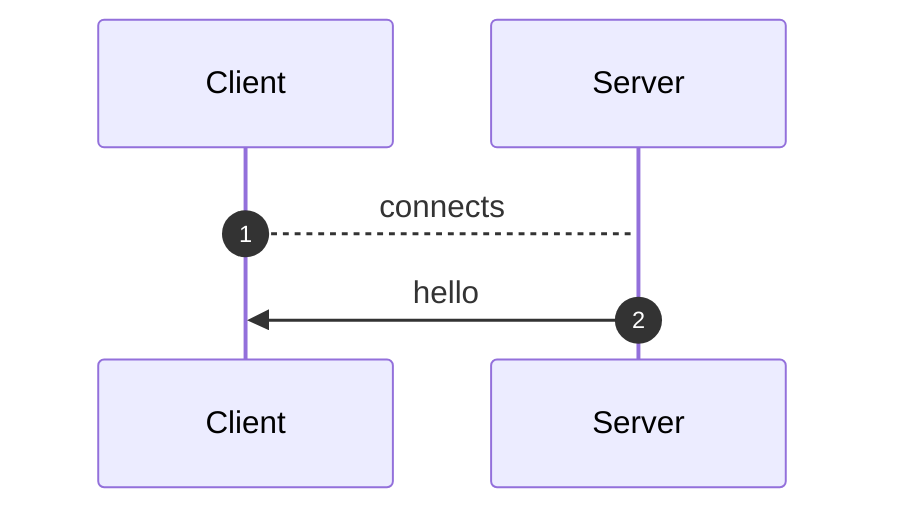
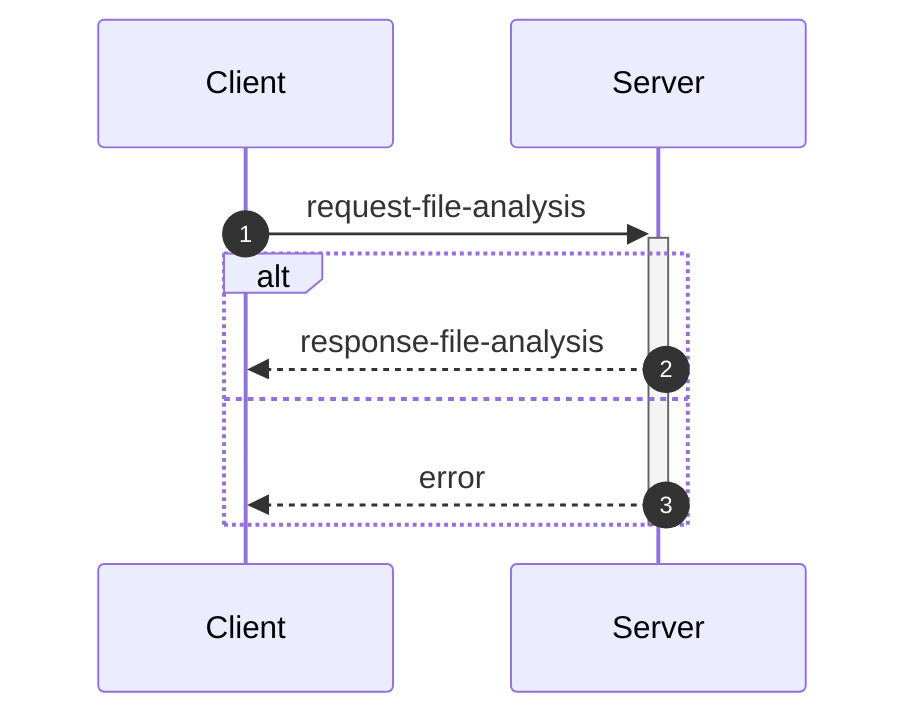
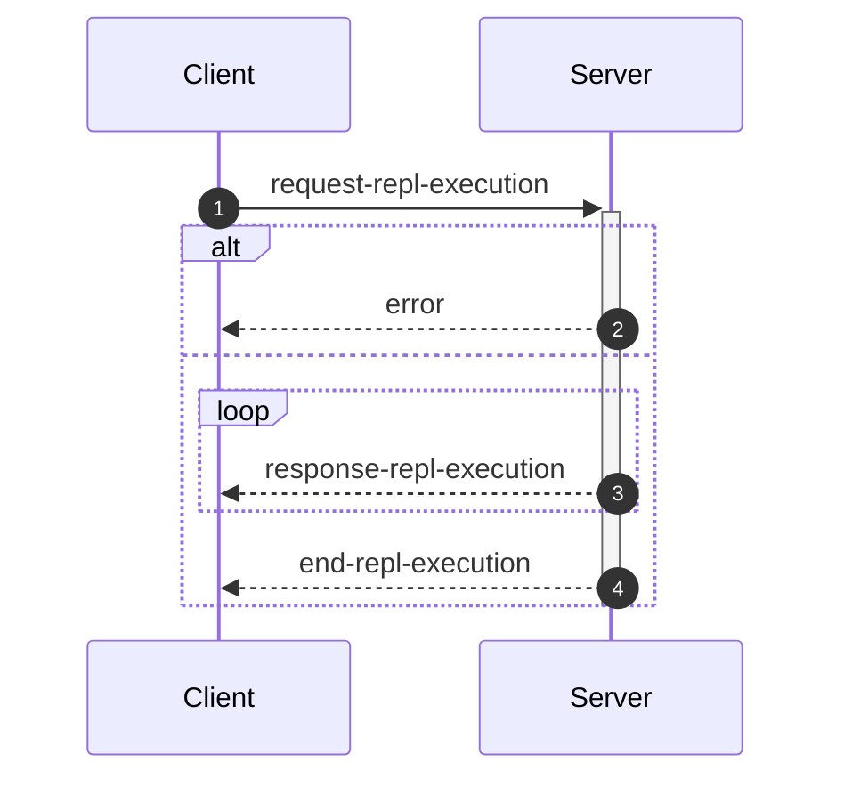
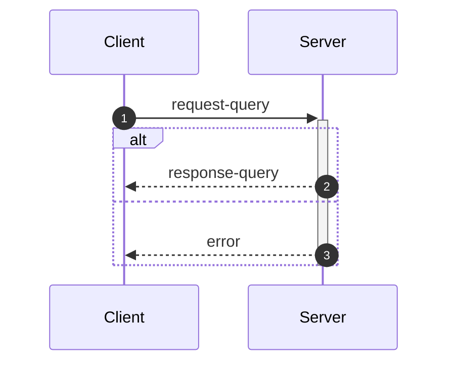

_<span title="an overview of flowR's interface">Generated</span> from '[wiki-interface.ts](https://github.com/flowr-analysis/flowr/tree/main/src/documentation/wiki-interface.ts "src/documentation/wiki-interface.ts")' on 2026-11-04, 11:08:39 UTC (v2.17.0, R v4.6.1), do not edit directly._

Although far from being as detailed as the in-depth explanation of [_flowR_](https://github.com/flowr-analysis/flowr/wiki/Core),
this wiki page explains how to interface with _flowR_ in more detail.
In general, command line arguments and other options provide short descriptions on hover over.

* [💻 Using the REPL](#using-the-repl)
* [⚙️ Configuring FlowR](#configuring-flowr)
* [⚒️ Writing Code](#writing-code)
* [💬 Communicating with the Server](#communicating-with-the-server)

<a id='using-the-repl'></a>
## 💻 Using the REPL

> [!NOTE]
> To execute arbitrary R commands with a repl request, _flowR_ has to be started explicitly with <span title="Description (Command Line Argument): Allow to access the underlying R session when using flowR (security warning: this allows the execution of arbitrary R code!)">`--r-session-access`</span>.
> Please be aware that this introduces a security risk and note that this relies on the [`r-shell` engine](https://github.com/flowr-analysis/flowr/wiki/Engines) .

Although primarily meant for users to explore,
there is nothing which forbids calling _flowR_ as a subprocess to use standard-in, -output, and -error
for communication (although you can access the REPL using the server as well,
with the [REPL Request](#message-request-repl-execution) message).

The read-eval-print loop&nbsp;(REPL) works relatively simple.
You can submit an expression (using <kbd>Enter</kbd>),
which is interpreted as an R&nbsp;expression by default but interpreted as a *command* if it starts with a colon (`:`).
The best command to get started with the REPL is <span title="Description (Repl Command): Show help information (aliases: :h, :?)">`:help`</span>.
Besides, you can leave the REPL either with the command <span title="Description (Repl Command): End the repl (aliases: :q, :exit)">`:quit`</span> or by pressing <kbd>Ctrl</kbd>+<kbd>C</kbd> twice.
When writing a *command*, you may press <kbd>Tab</kbd> to get a list of completions, if available.
Multiple commands can be entered in a single line by separating them with a semicolon (`;`), e.g. `:parse "x<-2"; :df*`.
If a command is given without R code, the REPL will re-use R code given in a previous command.
The prior example will hence return first the parsed AST of the program and then the dataflow graph for `"x <- 2"`.

> [!NOTE]
> If you develop flowR, you may want to launch the repl using the `npm run main-dev` command, this way, you get a non-minified version of flowR with debug information and hot-reloading of source files.

<details>
<summary>Available Commands</summary>

We currently offer the following commands (this with a `[*]` suffix are available with and without the star):

| Command | Description |
| ------- | ----------- |
| **<span title="Description (Repl Command): End the repl (aliases: :q, :exit)">:quit</span>** | End the repl (aliases: **:<span title="Alias of ':quit'. End the repl">q</span>**, **:<span title="Alias of ':quit'. End the repl">exit</span>**) |
| **<span title="Description (Repl Command): Execute the given code as R code. This requires the `--r-session-access` flag to be set and requires the r-shell engine. (aliases: :e, :r)">:execute</span>** | Execute the given code as R code. This requires the `--r-session-access` flag to be set and requires the r-shell engine. (aliases: **:<span title="Alias of ':execute'. Execute the given code as R code. This requires the `--r-session-access` flag to be set and requires the r-shell engine.">e</span>**, **:<span title="Alias of ':execute'. Execute the given code as R code. This requires the `--r-session-access` flag to be set and requires the r-shell engine.">r</span>**) |
| **<span title="Description (Repl Command): Get mermaid code for the control-flow graph of R code (aliases: :cfg, :cf)">:controlflow[*]</span>** | Get mermaid code for the control-flow graph of R code (star: Returns the URL to mermaid.live) (aliases: **:<span title="Alias of ':controlflow'. Get mermaid code for the control-flow graph of R code">cfg</span>**, **:<span title="Alias of ':controlflow'. Get mermaid code for the control-flow graph of R code">cf</span>**) |
| **<span title="Description (Repl Command): Get mermaid code for the control-flow graph with basic blocks (aliases: :cfgb, :cfb)">:controlflowbb[*]</span>** | Get mermaid code for the control-flow graph with basic blocks (star: Returns the URL to mermaid.live) (aliases: **:<span title="Alias of ':controlflowbb'. Get mermaid code for the control-flow graph with basic blocks">cfgb</span>**, **:<span title="Alias of ':controlflowbb'. Get mermaid code for the control-flow graph with basic blocks">cfb</span>**) |
| **<span title="Description (Repl Command): Get mermaid code for the dataflow graph (aliases: :d, :df)">:dataflow[*]</span>** | Get mermaid code for the dataflow graph (star: Returns the URL to mermaid.live) (aliases: **:<span title="Alias of ':dataflow'. Get mermaid code for the dataflow graph">d</span>**, **:<span title="Alias of ':dataflow'. Get mermaid code for the dataflow graph">df</span>**) |
| **<span title="Description (Repl Command): Get mermaid code for the normalized AST of R code (aliases: :n)">:normalize[*]</span>** | Get mermaid code for the normalized AST of R code (star: Returns the URL to mermaid.live) (alias: **:<span title="Alias of ':normalize'. Get mermaid code for the normalized AST of R code">n</span>**) |
| **<span title="Description (Repl Command): Get mermaid code for the simplified dataflow graph (aliases: :ds, :dfs)">:dataflowsimple[*]</span>** | Get mermaid code for the simplified dataflow graph (star: Returns the URL to mermaid.live) (aliases: **:<span title="Alias of ':dataflowsimple'. Get mermaid code for the simplified dataflow graph">ds</span>**, **:<span title="Alias of ':dataflowsimple'. Get mermaid code for the simplified dataflow graph">dfs</span>**) |
| **<span title="Description (Repl Command): Inspect and extend the signature database: `query` (identical to :query @signature), `info <name>` for where a function comes from (identical to :query @function-info), `add <path>` to mount another database/source, `download` to fetch the full-history database. (aliases: :sig)">:signature</span>** | Inspect and extend the signature database: `query` (identical to :query @signature), `info <name>` for where a function comes from (identical to :query @function-info), `add <path>` to mount another database/source, `download` to fetch the full-history database. (alias: **:<span title="Alias of ':signature'. Inspect and extend the signature database: `query` (identical to :query @signature), `info <name>` for where a function comes from (identical to :query @function-info), `add <path>` to mount another database/source, `download` to fetch the full-history database.">sig</span>**) |
| **<span title="Description (Repl Command): Just calculates the DFG, but only prints summary info (aliases: :d#, :df#)">:dataflowsilent</span>** | Just calculates the DFG, but only prints summary info (aliases: **:<span title="Alias of ':dataflowsilent'. Just calculates the DFG, but only prints summary info">d#</span>**, **:<span title="Alias of ':dataflowsilent'. Just calculates the DFG, but only prints summary info">df#</span>**) |
| **<span title="Description (Repl Command): Prints ASCII Art of the parsed, unmodified AST (aliases: :p)">:parse</span>** | Prints ASCII Art of the parsed, unmodified AST (alias: **:<span title="Alias of ':parse'. Prints ASCII Art of the parsed, unmodified AST">p</span>**) |
| **<span title="Description (Repl Command): Prints the version of flowR as well as the current version of R">:version</span>** | Prints the version of flowR as well as the current version of R
| **<span title="Description (Repl Command): Query the given R code (use 'help' for more information)">:query[*]</span>** | Query the given R code (use 'help' for more information) (star: Similar to query, but returns the output in json format.)
| **<span title="Description (Repl Command): Returns an ASCII representation of the dataflow graph (aliases: :df!)">:dataflowascii</span>** | Returns an ASCII representation of the dataflow graph (alias: **:<span title="Alias of ':dataflowascii'. Returns an ASCII representation of the dataflow graph">df!</span>**) |
| **<span title="Description (Repl Command): Returns summarization stats for the normalized AST (aliases: :n#)">:normalize#</span>** | Returns summarization stats for the normalized AST (alias: **:<span title="Alias of ':normalize#'. Returns summarization stats for the normalized AST">n#</span>**) |
| **<span title="Description (Repl Command): Show help information (aliases: :h, :?)">:help</span>** | Show help information (aliases: **:<span title="Alias of ':help'. Show help information">h</span>**, **:<span title="Alias of ':help'. Show help information">?</span>**) |

</details>

> [!TIP]
> 
> As indicated by the examples before, all REPL commands that operate on code keep track of the state.
> Hence, if you run a command like <span title="Description (Repl Command, starred version): Returns the URL to mermaid.live; Base Command: Get mermaid code for the dataflow graph (aliases: :d*, :df*)">`:dataflow*`</span> without providing R code,
> the REPL will re-use the R code provided in a previous command.
> Likewise, doing this will benefit from incrementality!
> If you request the dataflow graph with `:df* x <- 2 * y` and then want to see the parsed AST with `:parse`,
> the REPL will re-use previously obtained information and not re-parse the code again.
> 		

Generally, many commands offer shortcut versions in the REPL. Many queries, for example, offer a shortened format (see the example below).
Of special note, the [Config Query](https://github.com/flowr-analysis/flowr/wiki/%5BQuery%5D-Config)
can be used to also modify the currently active configuration of _flowR_ within the REPL (see the [wiki page](https://github.com/flowr-analysis/flowr/wiki/%5BQuery%5D-Config) for more information).

### Example: Retrieving the Dataflow Graph

To retrieve a URL to the [mermaid](https://mermaid.js.org/) diagram of the dataflow of a given expression,
use <span title="Description (Repl Command, starred version): Returns the URL to mermaid.live; Base Command: Get mermaid code for the dataflow graph (aliases: :d*, :df*)">`:dataflow*`</span> (or <span title="Description (Repl Command): Get mermaid code for the dataflow graph (aliases: :d, :df)">`:dataflow`</span> to get the mermaid code in the cli):

```shell
$ docker run -it --rm eagleoutice/flowr # or npm run flowr 
flowR repl v2.17.0, R grammar v14 (tree-sitter engine)
R> :dataflow* y <- 1 + x
```

<details>
<summary style='color:gray'>Output</summary>

```text
https://mermaid.live/view#base64:eyJjb2RlIjoiZmxvd2NoYXJ0IFREXG4gICAgMXt7XCJgKiM5MTtSTnVtYmVyIzkzOyogKioxKipcbiAgICAgICoxLjYqICgqKmlkOiAxKiopYFwifX1cbiAgICAyKFtcImAqIzkxO1JTeW1ib2wjOTM7KiAqKngqKlxuICAgICAgKjEuMTAqICgqKmlkOiAyKiopYFwiXSlcbiAgICAzW1tcImAqIzkxO1JCaW5hcnlPcCM5MzsqIGJhc2UjNTg7IzU4OyoqIzQzOyoqXG4gICAgICAqMS42LTEwKiAoKippZDogMyoqKVxuICAgIGFyZzogKDEsIDIpYFwiXV1cbiAgICBidWlsdC1pbjpfNDNfW1wiYEJ1aWx0LUluOlxuIzQzO2BcIl1cbiAgICBzdHlsZSBidWlsdC1pbjpfNDNfIHN0cm9rZTpncmF5LGZpbGw6Z3JheSxzdHJva2Utd2lkdGg6MnB4LG9wYWNpdHk6Ljg7XG4gICAgMFtcImAqIzkxO1JTeW1ib2wjOTM7KiAqKnkqKlxuICAgICAgKjEuMSogKCoqaWQ6IDAqKiwgdjogMylgXCJdXG4gICAgNFtbXCJgKiM5MTtSQmluYXJ5T3AjOTM7KiBiYXNlIzU4OyM1ODsqKiM2MDsjNDU7KipcbiAgICAgICoxLjEtMTAqICgqKmlkOiA0KiopXG4gICAgYXJnOiAoMCwgMylgXCJdXVxuICAgIGJ1aWx0LWluOl82MF8tW1wiYEJ1aWx0LUluOlxuIzYwOyM0NTtgXCJdXG4gICAgc3R5bGUgYnVpbHQtaW46XzYwXy0gc3Ryb2tlOmdyYXksZmlsbDpncmF5LHN0cm9rZS13aWR0aDoycHgsb3BhY2l0eTouODtcbiAgICAxIC0uLT58XCJmbG93XCJ8IDJcbiAgICBsaW5rU3R5bGUgMCBzdHJva2U6Z3JheSxjb2xvcjpncmF5O1xuICAgIDIgLS4tPnxcImZsb3dcInwgM1xuICAgIGxpbmtTdHlsZSAxIHN0cm9rZTpncmF5LGNvbG9yOmdyYXk7XG4gICAgMyAtLT58XCJyZWFkcywgYXJnXCJ8IDFcbiAgICAzIC0tPnxcInJlYWRzLCBhcmdcInwgMlxuICAgIDMgLS4tPnxcImZsb3dcInwgMFxuICAgIGxpbmtTdHlsZSA0IHN0cm9rZTpncmF5LGNvbG9yOmdyYXk7XG4gICAgMyAtLi0+fFwicmVhZHMsIGNhbGxzXCJ8IGJ1aWx0LWluOl80M19cbiAgICBsaW5rU3R5bGUgNSBzdHJva2U6Z3JheTtcbiAgICAwIC0tPnxcImRlZmluZWQtYnksIGZsb3dcInwgNFxuICAgIDAgLS0+fFwiZGVmaW5lZC1ieVwifCAzXG4gICAgNCAtLT58XCJyZWFkcywgYXJnXCJ8IDNcbiAgICA0IC0tPnxcInJldHVybnMsIGFyZ1wifCAwXG4gICAgNCAtLi0+fFwicmVhZHMsIGNhbGxzXCJ8IGJ1aWx0LWluOl82MF8tXG4gICAgbGlua1N0eWxlIDEwIHN0cm9rZTpncmF5OyIsIm1lcm1haWQiOnsiYXV0b1N5bmMiOnRydWV9fQ==
```

Retrieve the dataflow graph of the expression `y <- 1 + x`. It looks like this:


<details>

<summary style="color:gray">R Code of the Dataflow Graph</summary>

The analysis ran (parse and normalize with the [tree-sitter](https://github.com/flowr-analysis/flowr/wiki/Engines) engine) in the generation environment. No [signature database](https://github.com/flowr-analysis/flowr/wiki/Signature-Database) is mounted, so `library()` attaches no exports (base-R names are still qualified, e.g., `stats::acf`). 
We encountered no unknown side effects during the analysis.

```r
y <- 1 + x
```

</details>

</details>

For small graphs like this, <span title="Description (Repl Command): Returns an ASCII representation of the dataflow graph (aliases: :df!)">`:dataflowascii`</span> also provides an ASCII representation directly in the REPL:

```shell
$ docker run -it --rm eagleoutice/flowr # or npm run flowr 
flowR repl v2.17.0, R grammar v14 (tree-sitter engine)
R> :df! y <- 1 + x
```

<details open>
<summary style='color:gray'>Output</summary>

```text
                        v<0>v
 c<4>c──────────────────| y |
 |<- |     ┌────────────v---v
 c---c     │
    │   c<3>c   0<1>0
    └───| + |───| 1 |───u<2>u
        c---c   0---0   | x |
           └────────────u---u
Edges:
3 -> 1: reads, arg          3 -> 2: reads, arg
3 -> 0: flows-to            1 -> 2: flows-to
2 -> 3: flows-to            4 -> 3: reads, arg
4 -> 0: returns, arg        0 -> 4: defined-by, flows-to
0 -> 3: defined-by
```

Retrieve the dataflow graph of the expression `y <- 1 + x` as ASCII art.

</details>

For the slicing with <span title="Description (Repl Command): Static backwards executable slicer for R">`:slicer`</span>, you have access to the same [magic comments](#slice-magic-comments) as with the [slice request](#message-request-slice).
Pass `--inline` to splice resolvable `source()` calls into the reconstruction so the slice is a single self-contained R text (the same as the static slice query's `inlineSources` flag).
See `--help` for more flags!

### Example: Interfacing with the File System

Many commands that allow for an R-expression (like <span title="Description (Repl Command, starred version): Returns the URL to mermaid.live; Base Command: Get mermaid code for the dataflow graph (aliases: :d*, :df*)">`:dataflow*`</span>) allow for a file as well
if the argument starts with `file://`.
If you are working from the root directory of the _flowR_ repository, the following gives you the parsed AST of the example file using the <span title="Description (Repl Command): Prints ASCII Art of the parsed, unmodified AST (aliases: :p)">`:parse`</span> command:

> **Watch mode**: Replace `file://` with `watch://` to enter watch mode.
> flowR runs the command immediately and then re-runs it every time the file (or any file inside the folder) changes.
> Enter any other command to leave watch mode.
> For example: `:df watch://analysis.R`

```shell
$ docker run -it --rm eagleoutice/flowr # or npm run flowr 
flowR repl v2.17.0, R grammar v14 (tree-sitter engine)
R> :parse file://test/testfiles/example.R
```

<details>
<summary style='color:gray'>Output</summary>

```text
File: test/testfiles/example.R

program
├ binaryoperator
│ ├ identifier "sum" (1:1─4)
│ ├ <- "<-" (1:5─7)
│ ╰ float "0" (1:8─9)
├ binaryoperator
│ ├ identifier "product" (2:1─8)
│ ├ <- "<-" (2:9─11)
│ ╰ float "1" (2:12─13)
├ binaryoperator
│ ├ identifier "w" (3:1─2)
│ ├ <- "<-" (3:3─5)
│ ╰ float "7" (3:6─7)
├ binaryoperator
│ ├ identifier "N" (4:1─2)
│ ├ <- "<-" (4:3─5)
│ ╰ float "10" (4:6─8)
├ forstatement
│ ├ for "for" (6:1─4)
│ ├ ( "(" (6:5─6)
│ ├ identifier "i" (6:6─7)
│ ├ in "in" (6:8─10)
│ ├ binaryoperator
│ │ ├ float "1" (6:11─12)
│ │ ├ : ":" (6:12─13)
│ │ ╰ parenthesizedexpression
│ │   ├ ( "(" (6:13─14)
│ │   ├ binaryoperator
│ │   │ ├ identifier "N" (6:14─15)
│ │   │ ├ - "-" (6:15─16)
│ │   │ ╰ float "1" (6:16─17)
│ │   ╰ ) ")" (6:17─18)
│ ├ ) ")" (6:18─19)
│ ╰ bracedexpression
│   ├ { "{" (6:20─21)
│   ├ binaryoperator
│   │ ├ identifier "sum" (7:3─6)
│   │ ├ <- "<-" (7:7─9)
│   │ ╰ binaryoperator
│   │   ├ binaryoperator
│   │   │ ├ identifier "sum" (7:10─13)
│   │   │ ├ + "+" (7:14─15)
│   │   │ ╰ identifier "i" (7:16─17)
│   │   ├ + "+" (7:18─19)
│   │   ╰ identifier "w" (7:20─21)
│   ├ binaryoperator
│   │ ├ identifier "product" (8:3─10)
│   │ ├ <- "<-" (8:11─13)
│   │ ╰ binaryoperator
│   │   ├ identifier "product" (8:14─21)
│   │   ├  "" (8:22─23)
│   │   ╰ identifier "i" (8:24─25)
│   ╰ } "}" (9:1─2)
├ call
│ ├ identifier "cat" (11:1─4)
│ ╰ arguments
│   ├ ( "(" (11:4─5)
│   ├ argument
│   │ ╰ string
│   │   ├ stringopen "\"" (11:5─6)
│   │   ├ stringcontent "Sum:" (11:6─10)
│   │   ╰ stringclose "\"" (11:10─11)
│   ├ comma "," (11:11─12)
│   ├ argument
│   │ ╰ identifier "sum" (11:13─16)
│   ├ comma "," (11:16─17)
│   ├ argument
│   │ ╰ string
│   │   ├ stringopen "\"" (11:18─19)
│   │   ├ stringcontent
│   │   │ ╰ escapesequence "\\n" (11:19─21)
│   │   ╰ stringclose "\"" (11:21─22)
│   ╰ ) ")" (11:22─23)
╰ call
  ├ identifier "cat" (12:1─4)
  ╰ arguments
    ├ ( "(" (12:4─5)
    ├ argument
    │ ╰ string
    │   ├ stringopen "\"" (12:5─6)
    │   ├ stringcontent "Product:" (12:6─14)
    │   ╰ stringclose "\"" (12:14─15)
    ├ comma "," (12:15─16)
    ├ argument
    │ ╰ identifier "product" (12:17─24)
    ├ comma "," (12:24─25)
    ├ argument
    │ ╰ string
    │   ├ stringopen "\"" (12:26─27)
    │   ├ stringcontent
    │   │ ╰ escapesequence "\\n" (12:27─29)
    │   ╰ stringclose "\"" (12:29─30)
    ╰ ) ")" (12:30─31)
```

Retrieve the parsed AST of the example file.

<details>

<summary>File Content</summary>

```r
sum <- 0
product <- 1
w <- 7
N <- 10

for (i in 1:(N-1)) {
  sum <- sum + i + w
  product <- product * i
}

cat("Sum:", sum, "\n")
cat("Product:", product, "\n")
```

</details>

As _flowR_ directly transforms this AST the output focuses on being human-readable instead of being machine-readable.
		
</details>

### Example: Run a Query

You can run any query supported by _flowR_ using the <span title="Description (Repl Command): Query the given R code (use 'help' for more information)">`:query`</span> command.
For example, to obtain the shapes of all data frames in a given piece of code, you can run:

```shell
$ docker run -it --rm eagleoutice/flowr # or npm run flowr 
flowR repl v2.17.0, R grammar v14 (tree-sitter engine)
R> :query @absint df-shape "x <- data.frame(a = 1:10, b = 1:10)\ny <- x$a"
```

<details open>
<summary style='color:gray'>Output</summary>

```text
Query: absint (3 ms)
   ╰ $12: (colnames: [{"a", "b"}, {}], cols: [2, 2], rows: [10, 10])
   ╰ $0: (colnames: [{"a", "b"}, {}], cols: [2, 2], rows: [10, 10])
```

Retrieve the shapes of all data frames in the given code.

</details>

To run the linter on a file, you can use (in this example, we just issue the `dead-code` linter on a small piece of code):

```shell
$ docker run -it --rm eagleoutice/flowr # or npm run flowr 
flowR repl v2.17.0, R grammar v14 (tree-sitter engine)
R> :query @linter rules:dead-code "if(FALSE) x <- 2"
```

<details open>
<summary style='color:gray'>Output</summary>

```text
Query: linter (1 ms)
   ╰ Dead Code (dead-code):
       ╰ certain:
           ╰ Code at 1.11-16 (1 quick fix(es) available)
```

Run the linter on the given code, with only the `dead-code` rule enabled.

</details>

For more information on the available queries, please check out the [Query API](https://github.com/flowr-analysis/flowr/wiki/Query-API).

<a id='configuring-flowr'></a>
## ⚙️ Configuring FlowR

When running _flowR_, you may want to specify some behaviors with a dedicated configuration file.
By default, flowR looks for a file named `flowr.json` in the current working directory (or any higher directory).
You can also specify a different file with <span title="Description (Command Line Argument): The name of the configuration file to use">`--config-file`</span> or pass the configuration inline using <span title="Description (Command Line Argument): The flowR configuration to use, as a JSON string">`--config-json`</span>.
A `flowr.json` found this way belongs to the analyzed project, so flowR ignores its options that decide what flowR executes or loads
(`engines.*.wasmPath`, `engines.*.treeSitterWasmPath`, `engines.*.rPath`, `solver.sigdb.additionalPaths`, `solver.sigdb.downloadRepo`, `solver.sigdb.installedLibrary.paths`, `solver.sigdb.onDemand.enabled`, `solver.sigdb.onDemand.repositories`, `solver.sigdb.onDemand.cranMirror`, `solver.sigdb.onDemand.bioconductorMirror`, `solver.sigdb.onDemand.cacheDir`),
unless you pass <span title="Description (Command Line Argument): Keep the security-sensitive options (e.g., the R executable) of the flowr.json found in the working directory or a parent. Only use this for projects you trust.">`--trust-config`</span>.
To analyze code you do not trust, use the secure mode (<span title="Description (Command Line Argument): Run in secure mode for analyzing untrusted code: flowR does not start R (or any other process), does not access the network, does not search for project configs, and ignores security-sensitive options in every config. Cannot be disabled once enabled. Can also be enabled with the environment variable {italic FLOWR_SECURE_MODE=1}.">`--secure`</span>, see the [security policy](https://github.com/flowr-analysis/flowr/blob/main/.github/SECURITY.md)).
To inspect the current configuration, you can run flowr with the <span title="Description (Command Line Argument): Run with verbose logging (will be passed to the corresponding script)">`--verbose`</span> flag, or use the `config` [Query](https://github.com/flowr-analysis/flowr/wiki/Query-API).
Within the REPL this works by running the following:

```shell
:query @config
```

To work with the <a href="https://github.com/flowr-analysis/flowr/tree/main/src/config.ts#L119"><code><span title="The configuration file format for flowR.">FlowrConfig</span></code></a> you can use the provided helper objects alongside its methods like
<a href="https://github.com/flowr-analysis/flowr/tree/main/src/config.ts#L966"><code><span title="Creates a new flowr config that has the updated values.">FlowrConfig::<b>amend</b></span></code></a>.
The schema below documents every option; the ones you most likely want are:

- <a href="https://github.com/flowr-analysis/flowr/wiki/Interface#configuring-flowr" title="Configuration Option (boolean): Whether source calls should be ignored, causing {@link processSourceCall}&#39;s behavior to be skipped.">ignoreSourceCalls</a>: ignore source calls when analyzing the code, i.e., ignore the inclusion of other files.
- <a href="https://github.com/flowr-analysis/flowr/wiki/Interface#configuring-flowr" title="Configuration Option (boolean): Whether load calls should be ignored, causing {@link processLoadCall}&#39;s behavior to be skipped.">ignoreLoadCalls</a>: ignore load calls when analyzing the code, i.e., ignore the loading of r-data files.
- <a href="https://github.com/flowr-analysis/flowr/wiki/Interface#configuring-flowr" title="Configuration Option (object): Do you want to overwrite (parts) of the builtin definition?">semantics.environment.overwriteBuiltIns</a>: overwrite _flowR_'s handling of built-in functions, or clear the preset definitions entirely.
  See [Configure BuiltIn Semantics](#configure-builtin-semantics) for more information.
- <a href="https://github.com/flowr-analysis/flowr/wiki/Interface#configuring-flowr" title="Configuration Option (string): How to resolve variables and their values. (one of &quot;disabled&quot;, &quot;alias&quot;, &quot;builtin&quot;)">solver.variables</a>: how to resolve variables and their values (`disabled`, `alias`, `builtin`).
- <a href="https://github.com/flowr-analysis/flowr/wiki/Interface#configuring-flowr" title="Configuration Option (array): The engine or set of engines to use for interacting with R code. An empty array means all available engines will be used.">engines</a> and <a href="https://github.com/flowr-analysis/flowr/wiki/Interface#configuring-flowr" title="Configuration Option (string): The default engine to use for interacting with R code. If this is undefined, an arbitrary engine from the specified list will be used. (one of &quot;tree-sitter&quot;, &quot;r-shell&quot;)">defaultEngine</a>: the engines used to interact with R code, see the [Engines wiki page](https://github.com/flowr-analysis/flowr/wiki/Engines).
- <a href="https://github.com/flowr-analysis/flowr/wiki/Interface#configuring-flowr" title="Configuration Option (array): Files a framework loads on its own, without any source() call (e.g. global.R in a shiny app), in the order they are loaded; flowR orders the matching project files accordingly and analyzes them as one program. Entries are case-insensitive globs matched against the file path, a plain name matches any file with that name, and entries matching no project file are warned about. Usually set per project kind via specializeConfig.">project.implicitSources</a>: the files a framework loads without any `source()` call, in the order in which they are
  loaded. Entries are globs (e.g. `R/*.R`) matched against the file path ignoring capitalization; one matching no file is reported.
- <a href="https://github.com/flowr-analysis/flowr/wiki/Interface#configuring-flowr" title="Configuration Option (object): Overwrite (parts of) the configuration depending on the project kind flowR detects, e.g. to give a shiny app its implicit sources.">specializeConfig</a>: overwrite (parts of) the configuration depending on the kind of project _flowR_ detects
  (e.g. `shiny-app`), which is how a shiny app gets its implicit sources by default. What you configure directly wins.
- <a href="https://github.com/flowr-analysis/flowr/wiki/Interface#configuring-flowr" title="Configuration Option (string): Overwrite the project kind flowR would otherwise infer from the analyzed files, e.g. when auto-detection guesses wrong. (one of &quot;package&quot;, &quot;script&quot;, &quot;shiny-app&quot;, &quot;notebook&quot;, &quot;project&quot;, &quot;unknown&quot;)">project.useProjectType</a>: skip that detection and force a project kind yourself, when auto-detection guesses wrong.
- <a href="https://github.com/flowr-analysis/flowr/wiki/Interface#configuring-flowr" title="Configuration Option (array): The default plugins to load when creating a new instance of FlowrAnalyzer">defaultPlugins</a> and <a href="https://github.com/flowr-analysis/flowr/wiki/Interface#configuring-flowr" title="Configuration Option (array): The plugins to load in REPL mode">repl.plugins</a>: the plugins to load for a new <a href="https://github.com/flowr-analysis/flowr/tree/main/src/project/flowr-analyzer.ts#L210"><code><span title="Central class for conducting analyses with FlowR. Use the FlowrAnalyzerBuilder to create a new instance. If you want the original pattern of creating a pipeline and running all steps, you can still do this with FlowrAnalyzer#runFull . To inspect the context of the analyzer, use FlowrAnalyzer#inspectContext (if you are a plugin and need to modify it, use FlowrAnalyzer#context instead).">FlowrAnalyzer</span></code></a> and in the REPL
  (use `flowr:default` to reference the former).

So you can configure _flowR_ by adding a file like the following:

<details>

<summary>Example Configuration File</summary>

```json
{
  "ignoreSourceCalls": true,
  "ignoreLoadCalls": true,
  "semantics": {
    "environment": {
      "overwriteBuiltIns": {
        "definitions": [
          {
            "type": "function",
            "names": [
              "foo"
            ],
            "processor": "builtin:assign",
            "config": {}
          }
        ]
      }
    }
  },
  "defaultPlugins": [
    "file:description",
    "versions:description"
  ],
  "repl": {
    "quickStats": false,
    "dfProcessorHeat": false,
    "hints": true,
    "plugins": [
      "flowr:default"
    ]
  },
  "project": {
    "resolveUnknownPathsOnDisk": true,
    "implicitSources": [
      "global.R",
      "app.R"
    ]
  },
  "linter": {
    "disabledRules": []
  },
  "specializeConfig": {
    "shiny-app": {
      "project": {
        "implicitSources": [
          "global.R",
          "ui.R",
          "server.R",
          "app.R"
        ]
      }
    }
  },
  "engines": [
    {
      "type": "r-shell"
    }
  ],
  "solver": {
    "variables": "alias",
    "evalStrings": true,
    "trackEnvironments": true,
    "sigdb": {
      "enabled": true,
      "loadProjectDependencies": true,
      "eagerlyLoad": false,
      "eagerlyLoadExports": false,
      "linkBaseR": false,
      "linkDescriptionDependencies": false
    },
    "resolveSource": {
      "dropPaths": "no",
      "ignoreCapitalization": true,
      "inferWorkingDirectory": "active-script",
      "searchPath": []
    },
    "instrument": {},
    "slicer": {
      "threshold": 50
    }
  },
  "abstractInterpretation": {
    "wideningThreshold": 4,
    "followCalls": true,
    "dataFrame": {
      "maxColNames": 20,
      "readLoadedData": {
        "readExternalFiles": true,
        "maxReadLines": 1000000
      }
    }
  },
  "incremental": {
    "alwaysIncremental": false,
    "parsing": {
      "activated": false,
      "heuristics": {
        "activated": true,
        "mtime": true,
        "linesFrom": 500,
        "bytesFrom": 50000,
        "alwaysWithEdits": false,
        "minFiles": 1
      }
    }
  },
  "gas": {
    "thresholds": {
      "memory": {
        "problematic": 0.7,
        "critical": 0.9
      },
      "timeMs": {
        "problematic": 100000,
        "critical": 120000
      }
    },
    "features": {}
  }
}
```

</details>

<details>
<a id='configure-builtin-semantics'></a>
<summary>Configure Built-In Semantics</summary>

`semantics/environment/overwriteBuiltins` accepts two keys:

- `loadDefaults` (boolean, initially `true`): If set to `true`, the default built-in definitions are loaded before applying the custom definitions. Setting this flag to `false` explicitly disables the loading of the default definitions.
- `definitions` (array, initially empty): Allows to overwrite or define new built-in elements. Each object within must have a `type` which is one of the below. Furthermore, they may define a string array of `names` which specifies the identifiers to bind the definitions to. You may use `assumePrimitive` to specify whether _flowR_ should assume that this is a primitive non-library definition (so you probably just do not want to specify the key).

  | Type            | Description                                                                                                                                                                                                                                                                                              | Example                                                                                                    |
  | --------------- | -------------------------------------------------------------------------------------------------------------------------------------------------------------------------------------------------------------------------------------------------------------------------------------------------------- | ---------------------------------------------------------------------------------------------------------- |
  | `constant`    | Additionally allows for a `value` this should resolve to.                                                                                                                                                                                                                                                | `{ type: 'constant', names: ['NULL', 'NA'],  value: null }`                                                |
  | `function`    | Is a rather flexible way to define and bind built-in functions. For the time, we do not have extensive documentation to cover all the cases, so please either consult the sources with the `default-builtin-config.ts` or open a [new issue](https://github.com/flowr-analysis/flowr/issues/new/choose). | `{ type: 'function', names: ['next'], processor: 'builtin:d', config: { cfg: ExitPointType.Next } }` |
  | `replacement` | A comfortable way to specify replacement functions like `$<-` or `names<-`. `suffixes` describes the... suffixes to attach automatically. | `{ type: 'replacement', suffixes: ['<-', '<<-'], names: ['[', '[['] }` |

</details>

<details>

<summary style='color:gray'>Full Configuration-File Schema</summary>

- _The configuration file format for flowR._ (object)
    - **logLevel** [optional] _flowR's global minimum log level, applied when the config is loaded._ (string)
        Only allows: 'silly', 'trace', 'debug', 'info', 'warn', 'error', 'fatal'
    - **ignoreSourceCalls** [optional] _Whether source calls should be ignored, causing {@link processSourceCall}'s behavior to be skipped._ (boolean)
    - **ignoreLoadCalls** [optional] _Whether load calls should be ignored, causing {@link processLoadCall}'s behavior to be skipped._ (boolean)
    - **semantics** _Configure language semantics and how flowR handles them._ (object)
        - **environment** [optional] _Semantics regarding how to handle the R environment._ (object)
            - **overwriteBuiltIns** [optional] _Do you want to overwrite (parts) of the builtin definition?_ (object)
                - **loadDefaults** [optional] _Should the default configuration still be loaded?_ (boolean)
                - **definitions** [optional] _The definitions to load/overwrite._ (array)
                Valid item types:
                    - (object)
    - **defaultPlugins** [optional] _The default plugins to load when creating a new instance of FlowrAnalyzer_ (array)
    Valid item types:
        - (alternatives)
            - (string)
            - (array)
    - **repl** _Configuration options for the REPL._ (object)
        - **quickStats** [optional] _Whether to show quick stats in the REPL after each evaluation._ (boolean)
        - **dfProcessorHeat** [optional] _This instruments the dataflow processors to count how often each processor is called._ (boolean)
        - **hints** [optional] _Whether to show dim inline hints on the empty prompt (automatically disabled on non-interactive terminals)._ (boolean)
        - **plugins** [optional] _The plugins to load in REPL mode_ (array)
        Valid item types:
            - (alternatives)
                - (string)
                - (array)
        - **autoUseFileProtocol** [optional] _Prepend the file protocol to a repl input that looks like a path, instead of only warning about it._ (boolean)
        - **queryStats** [optional] _Whether `:query` closes with the line stating how long the queries took (`:query*` never prints it)._ (boolean)
        - **showPlugins** [optional] _Whether `:version` grays out the plugins that did not activate during the last analysis._ (boolean)
    - **project** _Project specific configuration options._ (object)
        - **resolveUnknownPathsOnDisk** [optional] _Whether to resolve unknown paths loaded by the r project disk when trying to source/analyze files._ (boolean)
        - **failOnInaccessiblePath** [optional] _Whether a directory that cannot be traversed during file discovery (e.g. due to permissions) aborts the analysis; when false (the default) such paths are logged and skipped._ (boolean)
        - **basePackages** [optional] _The packages considered part of R itself (base and recommended); if unset, flowR uses its built-in list._ (array)
        Valid item types:
            - (string)
        - **implicitSources** [optional] _Files a framework loads on its own, without any source() call (e.g. global.R in a shiny app), in the order they are loaded; flowR orders the matching project files accordingly and analyzes them as one program. Entries are case-insensitive globs matched against the file path, a plain name matches any file with that name, and entries matching no project file are warned about. Usually set per project kind via specializeConfig._ (array)
        Valid item types:
            - (string)
        - **useProjectType** [optional] _Overwrite the project kind flowR would otherwise infer from the analyzed files, e.g. when auto-detection guesses wrong._ (string)
            Only allows: 'package', 'script', 'shiny-app', 'notebook', 'project', 'unknown'
        - **assumeImplicitEcho** [optional] _Whether the top level of the analyzed code is echoed, so that every visible result printed there is collected as an output by the dependencies query (default true, false for a package)._ (boolean)
        - **discovery** [optional] _Scoping options for the default project discovery._ (object)
            - **full** [optional] _Collect every file below the project root (greedy) instead of only the files the detected project kind needs (default false)._ (boolean)
            - **perKind** [optional] _Per-kind include/exclude glob overrides layered on the default scoping._ (object)
            - **ignore** [optional] _Case-insensitive globs that drop matching files from the intelligent discovery, regardless of kind (e.g. .Renviron to ignore environment files)._ (array)
            Valid item types:
                - (string)
        - **classification** [optional] _Overrides for the signals flowR uses to classify the project kind._ (object)
            - **shinyDescriptionTypes** [optional] _DESCRIPTION Type: values that mark a shiny app._ (array)
            Valid item types:
                - (string)
            - **shinyEntryFiles** [optional] _File names a shiny app is assembled from._ (array)
            Valid item types:
                - (string)
            - **shinyUsagePattern** [optional] _Regex source evidencing shiny usage in an entry file._ (string)
            - **notebookExtensions** [optional] _File extensions marking a notebook._ (array)
            Valid item types:
                - (string)
    - **linter** _Linter configuration options._ (object)
        - **disabledRules** _Linting rule names excluded from the default rule set (a rule requested explicitly via a linter query still runs). Usually set per project kind via specializeConfig._ (array)
        Valid item types:
            - (string)
        - **disabledTags** [optional] _Linting rule tags whose rules are excluded from the default rule set (a rule requested explicitly via a linter query still runs). By default the cmd-check rules are disabled for everything but a package; a configured list replaces that default._ (array)
        Valid item types:
            - (string)
    - **inputSources** [optional] _Further frameworks the input-sources analysis should know about; entries are added to flowR's defaults._ (object)
        - **pure** [optional] _Functions that only pass the constantness of their arguments on._ (array)
        Valid item types:
            - (string)
        - **param** [optional] _Functions whose result is a 'param' input._ (array)
        Valid item types:
            - (string)
        - **file** [optional] _Functions whose result is a 'file' input._ (array)
        Valid item types:
            - (string)
        - **tempfile** [optional] _Functions whose result is a 'tempfile' input._ (array)
        Valid item types:
            - (string)
        - **glob** [optional] _Functions whose result is a 'glob' input._ (array)
        Valid item types:
            - (string)
        - **net** [optional] _Functions whose result is a 'net' input._ (array)
        Valid item types:
            - (string)
        - **rand** [optional] _Functions whose result is a 'rand' input._ (array)
        Valid item types:
            - (string)
        - **system** [optional] _Functions whose result is a 'system' input._ (array)
        Valid item types:
            - (string)
        - **ffi** [optional] _Functions whose result is a 'ffi' input._ (array)
        Valid item types:
            - (string)
        - **lang** [optional] _Functions whose result is a 'lang' input._ (array)
        Valid item types:
            - (string)
        - **options** [optional] _Functions whose result is a 'options' input._ (array)
        Valid item types:
            - (string)
        - **cmdline** [optional] _Functions whose result is a 'cmdline' input._ (array)
        Valid item types:
            - (string)
        - **user** [optional] _Functions whose result is a 'user' input._ (array)
        Valid item types:
            - (string)
        - **const** [optional] _Functions whose result is a 'const' input._ (array)
        Valid item types:
            - (string)
        - **scope** [optional] _Functions whose result is a 'scope' input._ (array)
        Valid item types:
            - (string)
        - **dconst** [optional] _Functions whose result is a 'dconst' input._ (array)
        Valid item types:
            - (string)
        - **unknown** [optional] _Functions whose result is a 'unknown' input._ (array)
        Valid item types:
            - (string)
        - **linkedObjects** [optional] _Objects a framework provides without a definition in the code, e.g. shiny's input._ (array)
        Valid item types:
            - (object)
        - **linkedEntryPoints** [optional] _Calls that hand a function to a framework, which binds its objects to the parameters by position._ (array)
        Valid item types:
            - (object)
    - **specializeConfig** [optional] _Overwrite (parts of) the configuration depending on the project kind flowR detects, e.g. to give a shiny app its implicit sources._ (object)
    - **engines** _The engine or set of engines to use for interacting with R code. An empty array means all available engines will be used._ (array)
    Valid item types:
        - (alternatives)
            - _The configuration for the tree sitter engine._ (object)
                - **type** [required] _Use the tree sitter engine._ (string)
                    Only allows: 'tree-sitter'
                - **wasmPath** [optional] _The path to the tree-sitter-r WASM binary to use. If this is undefined, this uses the default path._ (string)
                - **treeSitterWasmPath** [optional] _The path to the tree-sitter WASM binary to use. If this is undefined, this uses the default path._ (string)
                - **lax** [optional] _Whether to use the lax parser for parsing R code (allowing for syntax errors). If this is undefined, the strict parser will be used._ (boolean)
            - _The configuration for the R shell engine._ (object)
                - **type** [required] _Use the R shell engine._ (string)
                    Only allows: 'r-shell'
                - **rPath** [optional] _The path to the R executable to use. If this is undefined, this uses the default path._ (string)
                - **pipeBind** [optional] _Whether to enable R's experimental pipe-bind operator "=>" by setting _R_USE_PIPEBIND_ for the R session (default false); R itself keeps this off by default, as it is experimental and has never shipped in a release version of R._ (boolean)
    - **defaultEngine** [optional] _The default engine to use for interacting with R code. If this is undefined, an arbitrary engine from the specified list will be used._ (string)
        Only allows: 'tree-sitter', 'r-shell'
    - **solver** _How to resolve constants, constraints, cells, ..._ (object)
        - **variables** _How to resolve variables and their values._ (string)
            Only allows: 'disabled', 'alias', 'builtin'
        - **evalStrings** _Should we include eval(parse(text="...")) calls in the dataflow graph?_ (boolean)
        - **trackEnvironments** [optional] _Track user-created environments (new.env, assign/get/local with envir=, dollar-assign, attach). When false, all envir-style calls fall through conservatively._ (boolean)
        - **sigdb** _Resolving library exports from a signature database._ (object)
            - **enabled** [optional] _Resolve library()/use() exports from a signature database (default true); when false no database is consulted._ (boolean)
            - **loadProjectDependencies** [optional] _Load the project's declared dependencies from its metadata files (DESCRIPTION Imports/Depends, rproject.toml, uvr.toml, rig rproj.toml and script blocks, renv.lock, rv.lock, uvr.lock, rig lockfiles) (default true); when false these files are not read for dependencies._ (boolean)
            - **eagerlyLoad** [optional] _Parse the database up front rather than on the first package load (default false, ignored if disabled)._ (boolean)
            - **eagerlyLoadExports** [optional] _Add a vertex for every export on load rather than on demand (default false); keeps the dataflow graph small._ (boolean)
            - **assumedRVersion** [optional] _R version assumed when resolving versioned (base-R) exports: a pin like "4.5" or "auto" to detect the installed R (default "auto")._ (string)
            - **linkBaseR** [optional] _Eagerly attach base-R namespaces so bare base calls resolve without library() (default false)._ (boolean)
            - **linkBaseRCalls** [optional] _Add a lightweight Reads edge from a bare base-R call to its signature-database function vertex (default false; base-R qualification is edge-free otherwise)._ (boolean)
            - **linkPackageCalls** [optional] _Add a lightweight Reads edge from a resolved package call to its signature-database function vertex (default false)._ (boolean)
            - **linkDescriptionDependencies** [optional] _Eagerly attach the namespaces of the project's declared DESCRIPTION dependencies (Imports/Depends) so their exports resolve without an explicit library() (default false)._ (boolean)
            - **warmInBackground** [optional] _Decompress the hot shards (base + most-downloaded) in a background task on startup so the first library() lookup is warm (default false; for long-running servers/REPLs)._ (boolean)
            - **additionalPaths** [optional] _Extra directories or bundle/manifest files searched for signature databases (alongside the shipped default and $FLOWR_SIGDB_DIR); a downloaded full-history bundle placed here is mounted automatically._ (array)
            Valid item types:
                - (string)
            - **downloadRepo** [optional] _GitHub owner/repo the full-history bundle is downloaded from via ":signature download" (default "flowr-analysis/flowr"; the release tag comes from the committed sigdb.remote.json unless a version is given)._ (string)
            - **autoSync** [optional] _On startup, re-download shards whose committed sigdb.remote.json hash no longer matches the cache, in the background (default false; opt-in network sync after a git pull)._ (boolean)
            - **installedLibrary** [optional] _Recovering packages no signature database knows from the copy installed on this machine._ (object)
                - **enabled** [required] _Recover packages no signature database knows from their installed copy (default false)._ (boolean)
                - **paths** [optional] _Library directories to search; when empty they are discovered from the environment and the project._ (array)
                Valid item types:
                    - (string)
                - **useEnvironment** [optional] _Search the libraries R_LIBS_USER/R_LIBS/R_LIBS_SITE name (default true)._ (boolean)
                - **useProjectLibrary** [optional] _Search a project-local renv/packrat library (default true)._ (boolean)
                - **maxDepth** [optional] _How far to descend into the nested layout of a project-local library (default 3)._ (number)
                - **packages** [optional] _Only recover packages whose name matches one of these regular expressions; empty means any._ (array)
                Valid item types:
                    - (string)
            - **onDemand** [optional] _Recovering packages no signature database knows from their sources on CRAN, Bioconductor, or GitHub._ (object)
                - **enabled** [required] _Fetch and recover the sources of packages no signature database knows when the analyzed code uses them (default false, accesses the network)._ (boolean)
                - **sources** [optional] _Where to look, in order: github, cran, bioconductor, or a source a plugin adds (default ["github", "cran", "bioconductor"])._ (array)
                Valid item types:
                    - (string)
                - **repositories** [optional] _GitHub repositories (owner/repo[/subdir][@ref]) to fetch packages from, by package name. The analyzed project may name more (DESCRIPTION Remotes, install_github calls)._ (object)
                - **packages** [optional] _Only recover packages whose name matches one of these regular expressions, empty means any._ (array)
                Valid item types:
                    - (string)
                - **cranMirror** [optional] _The CRAN src/contrib/ to fetch from, over https (default https://cloud.r-project.org/src/contrib/). It may be on the local network._ (string)
                - **bioconductorMirror** [optional] _The Bioconductor host, over https (default https://bioconductor.org). It may be on the local network._ (string)
                - **bioconductorRelease** [optional] _The Bioconductor release to fetch from: release, devel, or a number like 3.20 (default release)._ (string)
                - **githubMirrors** [optional] _Use the GitHub mirrors of CRAN (cran/<pkg>) and Bioconductor (bioc/<pkg>) (default true)._ (boolean)
                - **maxPackages** [optional] _The most packages to fetch for one analysis (default 25)._ (number)
                - **maxArchiveMb** [optional] _The most MiB a package archive may have (default 32). It may unpack to three times that, at most 128 MiB._ (number)
                - **offline** [optional] _Only use what was fetched before, never the network (default false)._ (boolean)
                - **retryAfterHours** [optional] _How many hours to wait before asking again for a package no source had (default 24)._ (number)
                - **cacheDir** [optional] _Where to cache what was fetched (default the on-demand directory of the signature cache)._ (string)
            - **blobCacheBudgetMb** [optional] _How many MiB of decoded package blobs every open bundle may hold together (default 16)._ (number)
            - **versionSelection** [optional] _When a project constrains a dependency, resolve to the newest (default), oldest, or system-installed version satisfying it; system needs R and falls back to newest. Base-R packages always resolve against the assumed R version._ (string)
                Only allows: 'newest', 'oldest', 'system'
            - **versionOverrides** [optional] _Force an exact version for specific packages (name -> version), overriding both the project constraint and the versionSelection policy (default {})._ (object)
        - **versionManagement** _Policies for reasoning about dependency versions._ (object)
            - **linkedVersionGroups** [optional] _Groups of packages that must resolve to the same version; version guessing intersects each group so its members stay mutually compatible (default [])._ (array)
            Valid item types:
                - (array)
                Valid item types:
                    - (string)
        - **assumeAttachedPackages** [optional] _Packages to treat as attached without a `library()` call, so what the built-in configuration states about them applies to the analyzed code. The base packages R attaches on startup already resolve without it._ (array)
        Valid item types:
            - (string)
        - **transitiveSideEffectRounds** [optional] _How many rounds the transitive side-effect fixpoint may run before it is cut off (default 32); the propagation stops on its own as soon as a round adds nothing._ (number)
        - **maxOverlayDepth** [optional] _How many binding overlays may stack on one environment frame before a write flattens them (default 4); a pure performance knob, trading lookup cost against copy cost without changing any result._ (number)
        - **instrument** (object)
            - **dataflowExtractors** [optional] _These keys are only intended for use within code, allowing to instrument the dataflow analyzer!_ (any)
        - **resolveSource** [optional] _If lax source calls are active, flowR searches for sourced files much more freely, based on the configurations you give it. This option is only in effect if `ignoreSourceCalls` is set to false._ (object)
            - **dropPaths** _Allow to drop the first or all parts of the sourced path, if it is relative._ (string)
                Only allows: 'no', 'once', 'all'
            - **ignoreCapitalization** _Search for filenames matching in the lowercase._ (boolean)
            - **inferWorkingDirectory** _Try to infer the working directory from the main or any script to analyze._ (string)
                Only allows: 'no', 'main-script', 'active-script', 'any-script'
            - **searchPath** _Additionally search in these paths._ (array)
            Valid item types:
                - (string)
            - **repeatedSourceLimit** [optional] _How often the same file can be sourced within a single run? Please be aware: in case of cyclic sources this may not reach a fixpoint so give this a sensible limit._ (number)
            - **applyReplacements** _Provide name replacements for loaded files_ (array)
            Valid item types:
                - (object)
            - **assumeFilesExist** [optional] _Assume a sourced file is always there, making what it defines certain instead of conditional on the source call._ (boolean)
        - **slicer** [optional] _The configuration for the slicer._ (object)
            - **threshold** [optional] _The maximum number of iterations to perform on a single function call during slicing._ (number)
            - **autoExtend** [optional] _If set, the slicer will gain an additional post-pass._ (boolean)
    - **abstractInterpretation** _The configuration options for abstract interpretation._ (object)
        - **wideningThreshold** _The threshold for the number of visitations of a node at which widening should be performed to ensure the termination of the fixpoint iteration._ (number)
        - **followCalls** _Whether the abstract interpretation is interprocedural, i.e. whether it steps into the functions a call may dispatch to._ (boolean)
        - **dataFrame** _The configuration of the shape inference for data frames._ (object)
            - **maxColNames** _The maximum number of columns names to infer for data frames before over-approximating the column names to top._ (number)
            - **readLoadedData** _Configuration options for reading data frame shapes from loaded external data files, such as CSV files._ (object)
                - **readExternalFiles** _Whether data frame shapes should be extracted from loaded external files, such as CSV files._ (boolean)
                - **maxReadLines** _The maximum number of lines to read when extracting data frame shapes from loaded files, such as CSV files._ (number)
    - **incremental** (object)
        - **alwaysIncremental** _Always take the incremental path, regardless of heuristics._ (boolean)
        - **parsing** (object)
            - **activated** _If set, incremental parsing will be used._ (boolean)
            - **heuristics** (object)
                - **activated** [optional] _If set, the heuristics for incremental parsing will be used._ (boolean)
                - **mtime** [optional] _Skip reparsing entirely if the file's modification time is unchanged since the last parse._ (boolean)
                - **linesFrom** [optional] _Only consider incremental parsing for files with at least this many lines._ (number)
                - **bytesFrom** [optional] _Only consider incremental parsing for files with at least this many bytes._ (number)
                - **alwaysWithEdits** [optional] _Always take the incremental path whenever there is a computed edit region, regardless of the other thresholds._ (boolean)
                - **minFiles** [optional] _Only apply these heuristics once the project has at least this many files loaded._ (number)
    - **gas** [optional] _Resource-usage guard (gas) configuration. All feature factors default to 0 (disabled). See https://github.com/flowr-analysis/flowr/wiki/Core#gas-resource-guard._ (object)
        - **thresholds** [optional] _Thresholds for all gas checks (scaled by per-feature factor), boundable per feature._ (object)
            - **memory** [optional] _Heap-usage fraction thresholds (0-1), either shared or given per feature key (with `default` covering the rest)._ (object)
                - **problematic** [optional] _Heap fraction (0-1) above which Problematic is returned, for every feature without an entry of its own._ (number)
                - **critical** [optional] _Heap fraction (0-1) above which Critical is returned, for every feature without an entry of its own._ (number)
            - **timeMs** [optional] _Elapsed analysis time thresholds in milliseconds, either shared or given per feature key (with `default` covering the rest)._ (object)
                - **problematic** [optional] _Elapsed ms above which Problematic is returned, for every feature without an entry of its own._ (number)
                - **critical** [optional] _Elapsed ms above which Critical is returned, for every feature without an entry of its own._ (number)
            - **steps** [optional] _Processed-AST-node thresholds, counted rather than sampled; only a key that arms a budget (`dataflow`) reads them._ (object)
                - **problematic** [optional] _Processed AST nodes above which Problematic is returned, for every feature without an entry of its own._ (number)
                - **critical** [optional] _Processed AST nodes above which the extraction is cut short, for every feature without an entry of its own._ (number)
            - **vertices** [optional] _Created-dataflow-vertex thresholds, counted like `steps`._ (object)
                - **problematic** [optional] _Created dataflow vertices above which Problematic is returned, for every feature without an entry of its own._ (number)
                - **critical** [optional] _Created dataflow vertices above which the extraction is cut short, for every feature without an entry of its own._ (number)
        - **features** [optional] _Per-feature sensitivity factors. 0 or absent disables gas checking for that feature. A factor of 2 makes the feature twice as sensitive. Recognised keys: `source`, `side-effect-linking`, `linter`, `slicer`, `dataflow`._ (object)
        - **countedCheckEvery** [optional] _How many counted steps pass between two accountings of an armed check, be it a dataflow budget or the slicer's traversal (default 128); trades overshoot against the cost of the check._ (number)
        - **heapProvider** [optional] _Custom heap statistics source (programmatic configs only), overriding the built-in v8/performance.memory detection._ (function)

</details>

<a id='writing-code'></a>
## ⚒️ Writing Code

_flowR_ can be used as a [module](https://www.npmjs.com/package/@eagleoutice/flowr) and offers several main classes and interfaces that are interesting for extension writers 
(see the [Visual Studio Code extension](https://marketplace.visualstudio.com/items?itemName=code-inspect.vscode-flowr) or the [Core](https://github.com/flowr-analysis/flowr/wiki/Core) wiki page for more information).

### Creating Analyses with _flowR_

Nowadays, instances of the <a href="https://github.com/flowr-analysis/flowr/tree/main/src/project/flowr-analyzer.ts#L210"><code><span title="Central class for conducting analyses with FlowR. Use the FlowrAnalyzerBuilder to create a new instance. If you want the original pattern of creating a pipeline and running all steps, you can still do this with FlowrAnalyzer#runFull . To inspect the context of the analyzer, use FlowrAnalyzer#inspectContext (if you are a plugin and need to modify it, use FlowrAnalyzer#context instead).">FlowrAnalyzer</span></code></a> should be used as central frontend to get analysis results from _flowR_.
The entry points an analysis is written against are re-exported from the package root (`import { FlowrAnalyzerBuilder } from '@eagleoutice/flowr'`);
everything else stays reachable under its own path, as in `@eagleoutice/flowr/dataflow/graph/graph`.
For example, a program slice can be created like this:

```ts
const analyzer = await new FlowrAnalyzerBuilder()
    .setEngine('tree-sitter')
    .build();
analyzer.addRequest('x <- 1\ny <- x\nx');
const result = await analyzer.query([
    {
        type:     'static-slice',
        criteria: ['3@x']
    }
]);
```

For more information, please have a look at the [Analyzer](https://github.com/flowr-analysis/flowr/wiki/Analyzer) wiki page, which explains how to construct and use the <a href="https://github.com/flowr-analysis/flowr/tree/main/src/project/flowr-analyzer.ts#L210"><code><span title="Central class for conducting analyses with FlowR. Use the FlowrAnalyzerBuilder to create a new instance. If you want the original pattern of creating a pipeline and running all steps, you can still do this with FlowrAnalyzer#runFull . To inspect the context of the analyzer, use FlowrAnalyzer#inspectContext (if you are a plugin and need to modify it, use FlowrAnalyzer#context instead).">FlowrAnalyzer</span></code></a> in more detail.
To work with specific perspectives, you can also consult the respective pages like the [Dataflow Graph](https://github.com/flowr-analysis/flowr/wiki/Dataflow-Graph) or the [Abstract Interpretation](https://github.com/flowr-analysis/flowr/wiki/Abstract-Interpretation) wiki pages.
### The Pipeline Executor (Low-Level Interface)

Once, in the beginning, _flowR_ was meant to produce a dataflow graph merely to provide *program slices*. 
However, with continuous updates, the [Dataflow Graph](https://github.com/flowr-analysis/flowr/wiki/Dataflow-Graph) repeatedly proves to be the more interesting part.
With this, we restructured _flowR_'s originally *hardcoded* pipeline to be far more flexible. 
Now, it can be theoretically extended or replaced with arbitrary steps, optional steps, and what we call 'decorations' of these steps. 
In short, a slicing pipeline using the <a href="https://github.com/flowr-analysis/flowr/tree/main/src/core/pipeline-executor.ts#L97"><code><span title="**Please note:** The PipelineExecutor is now considered to be a rather low-level API for flowR. While it still works and is the basis for all other layers, we strongly recommend using the FlowrAnalyzer and its builder to create and use an analyzer instance that is pre-configured for your use-case. The pipeline executor allows to execute arbitrary pipelines in a step-by-step fashion. If you are not...">PipelineExecutor</span></code></a> looks like this:

```ts

const slicer = new PipelineExecutor(DEFAULT_SLICING_PIPELINE, {
  parser:    new RShell(),
  request:   requestFromInput('x <- 1\nx + 1'),
  criterion: ['2@x']
})
const slice = await slicer.allRemainingSteps()
// console.log(slice.reconstruct.code)
```

<details><summary>More Information</summary>

If you compare this, with what you would have done with the old (and removed) `SteppingSlicer`, 
this essentially just requires you to replace the `SteppingSlicer` with the <a href="https://github.com/flowr-analysis/flowr/tree/main/src/core/pipeline-executor.ts#L97"><code><span title="**Please note:** The PipelineExecutor is now considered to be a rather low-level API for flowR. While it still works and is the basis for all other layers, we strongly recommend using the FlowrAnalyzer and its builder to create and use an analyzer instance that is pre-configured for your use-case. The pipeline executor allows to execute arbitrary pipelines in a step-by-step fashion. If you are not...">PipelineExecutor</span></code></a>
and to pass the <a href="https://github.com/flowr-analysis/flowr/tree/main/src/core/steps/pipeline/default-pipelines.ts#L18"><code>DEFAULT_SLICING_PIPELINE</code></a> as the first argument.
The <a href="https://github.com/flowr-analysis/flowr/tree/main/src/core/pipeline-executor.ts#L97"><code><span title="**Please note:** The PipelineExecutor is now considered to be a rather low-level API for flowR. While it still works and is the basis for all other layers, we strongly recommend using the FlowrAnalyzer and its builder to create and use an analyzer instance that is pre-configured for your use-case. The pipeline executor allows to execute arbitrary pipelines in a step-by-step fashion. If you are not...">PipelineExecutor</span></code></a>...

1. Provides structures to investigate the results of all intermediate steps
2. Can be executed step-by-step
3. Can repeat steps (e.g., to calculate multiple slices on the same input)

See the in-code documentation for more information.

</details>

### Using the <a href="https://github.com/flowr-analysis/flowr/tree/main/src/r-bridge/shell.ts#L144"><code><span title="The RShell represents an interactive session with the R interpreter. You can configure it by RShellOptions . At the moment we are using a live R session (and not networking etc.) to communicate with R easily, which allows us to install packages etc. However, this might and probably will change in the future (leaving this as a legacy mode :D)">RShell</span></code></a> to Interact with R

The <a href="https://github.com/flowr-analysis/flowr/tree/main/src/r-bridge/shell.ts#L144"><code><span title="The RShell represents an interactive session with the R interpreter. You can configure it by RShellOptions . At the moment we are using a live R session (and not networking etc.) to communicate with R easily, which allows us to install packages etc. However, this might and probably will change in the future (leaving this as a legacy mode :D)">RShell</span></code></a> class allows interfacing with the `R`&nbsp;ecosystem installed on the host system.
Please have a look at [flowR's Engines](https://github.com/flowr-analysis/flowr/wiki/Engines) for more information on alternatives (for example, the <a href="https://github.com/flowr-analysis/flowr/tree/main/src/r-bridge/lang-4.x/tree-sitter/tree-sitter-executor.ts#L29"><code><span title="Synchronous and (way) faster alternative to the RShell using tree-sitter.">TreeSitterExecutor</span></code></a>).

> [!IMPORTANT]
> 
> Each <a href="https://github.com/flowr-analysis/flowr/tree/main/src/r-bridge/shell.ts#L144"><code><span title="The RShell represents an interactive session with the R interpreter. You can configure it by RShellOptions . At the moment we are using a live R session (and not networking etc.) to communicate with R easily, which allows us to install packages etc. However, this might and probably will change in the future (leaving this as a legacy mode :D)">RShell</span></code></a> controls a new instance of the R&nbsp;interpreter, 
> make sure to call <code><a href="https://github.com/flowr-analysis/flowr/tree/main/src/r-bridge/shell.ts#L350"><span title="Close the current R session, makes the object effectively invalid (can no longer be reopened etc.)">RShell::<i>close</i></span></a>()</code> when you are done.

You can start a new "session" by constructing a new object with <code>new <a href="https://github.com/flowr-analysis/flowr/tree/main/src/r-bridge/shell.ts#L144"><span title="The RShell represents an interactive session with the R interpreter. You can configure it by RShellOptions . At the moment we are using a live R session (and not networking etc.) to communicate with R easily, which allows us to install packages etc. However, this might and probably will change in the future (leaving this as a legacy mode :D)">RShell</span></a>()</code>.

However, there are several options that may be of interest 
(e.g., to automatically revive the shell in case of errors or to control the name location of the R process on the system).

With a shell object (let's call it `shell`), you can execute R code by using <a href="https://github.com/flowr-analysis/flowr/tree/main/src/r-bridge/shell.ts#L213"><code><span title="sends the given command directly to the current R session will not do anything to alter input markers!">RShell::<i>sendCommand</i></span></code></a>,
for example <code>shell.<a href="https://github.com/flowr-analysis/flowr/tree/main/src/r-bridge/shell.ts#L213"><span title="sends the given command directly to the current R session will not do anything to alter input markers!">sendCommand</span></a>("1 + 1")</code>.
However, this does not return anything, so if you want to collect the output of your command, use
<a href="https://github.com/flowr-analysis/flowr/tree/main/src/r-bridge/shell.ts#L296"><code><span title="Send a command and collect the output">RShell::<i>sendCommandWithOutput</i></span></code></a> instead.

<a id='communicating-with-the-server'></a>
## 💬 Communicating with the Server

As explained in the [Overview](https://github.com/flowr-analysis/flowr/wiki/Overview), you can run the [TCP](https://de.wikipedia.org/wiki/Transmission_Control_Protocol)&nbsp;server by adding the <span title="Description (Command Line Argument): Do not drop into a repl, but instead start a server on the given port (default: 1042) and listen for messages.">`--server`</span> flag (and, due to the interactive mode, exit with the conventional <kbd>CTRL</kbd>+<kbd>C</kbd>).
Currently, every connection is handled by the same underlying `RShell` - so the server is not designed to handle many clients at a time.
Additionally, the server is not well guarded against attacks (e.g., you can theoretically spawn an arbitrary number of&nbsp;RShell sessions on the target machine).

Every message has to be given in a single line (i.e., without a newline in-between) and end with a newline character. Nevertheless, we will pretty-print example given in the following segments for the ease of reading.

> [!NOTE]
> 
> The default <span title="Description (Command Line Argument): Do not drop into a repl, but instead start a server on the given port (default: 1042) and listen for messages.">`--server`</span> uses a simple [TCP](https://de.wikipedia.org/wiki/Transmission_Control_Protocol)
> connection. If you want _flowR_ to expose a [WebSocket](https://de.wikipedia.org/wiki/WebSocket) server instead, add the <span title="Description (Command Line Argument): If the server flag is set, use websocket for messaging">`--ws`</span> flag (i.e., <span title="Description (Command Line Argument): Do not drop into a repl, but instead start a server on the given port (default: 1042) and listen for messages.">`--server`</span> <span title="Description (Command Line Argument): If the server flag is set, use websocket for messaging">`--ws`</span>) when starting _flowR_ from the command line.

<ul><li>
<a id="message-hello"></a>
<b>Hello</b> Message (<code>hello</code>) 
<details>

<summary style="color:gray"> View Details. <i>The server informs the client about the successful connection and provides Meta-Information.</i> </summary>



After launching _flowR_, for example, with <code>docker run -it --rm eagleoutice/flowr <span title="Description (Command Line Argument): Do not drop into a repl, but instead start a server on the given port (default: 1042) and listen for messages.">-<span/>-server</span></code>&nbsp;(🐳️), connecting should present you with a `hello` message, that amongst others should reveal the versions of&nbsp;_flowR_ and&nbsp;R, using the [semver 2.0](https://semver.org/spec/v2.0.0.html) versioning scheme.
The message looks like this:

```json
{
  "type": "hello",
  "clientName": "client-0",
  "versions": {
    "flowr": "2.17.0",
    "r": "4.6.1",
    "engine": "r-shell"
  }
}
```

There are currently a few messages that you can send after the hello message.
If you want to _slice_ a piece of R code you first have to send an [analysis request](#message-request-file-analysis), so that you can send one or multiple slice requests afterward.
Requests for the [REPL](#message-request-repl-execution) are independent of that.
	
<hr>

<details>
<summary style="color:gray">Message schema (<code>hello</code>)</summary>

For the definition of the hello message, please see it's implementation at [`./src/cli/repl/server/messages/message-hello.ts`](https://github.com/flowr-analysis/flowr/tree/main/src/cli/repl/server/messages/message-hello.ts).

- [required] (object)
    - **type** [required] _The type of the hello message._ (string)
        Only allows: 'hello'
    - **id** [forbidden] _The id of the message is always undefined (as it is the initial message and not requested)._ (any)
    - **clientName** [required] _A unique name that is assigned to each client. It has no semantic meaning and is only used/useful for debugging._ (string)
    - **versions** [required] (object)
        - **flowr** [required] _The version of the flowr server running in semver format._ (string)
        - **r** [required] _The version of the underlying R shell running in semver format._ (string)
        - **engine** [required] _The parser backend that is used to parse the R code._ (string)

</details>

<hr>

</details>
	</li>

<li>
<a id="message-request-file-analysis"></a>
<b>Analysis</b> Message (<code>request-file-analysis</code>) 
<details>

<summary style="color:gray"> View Details. <i>The server builds the dataflow graph for a given input file (or a set of files).</i> </summary>



The request allows the server to analyze a file and prepare it for slicing.
The message can contain a `filetoken`, which is used to identify the file in later slice or query requests (if you do not add one, the request will not be stored and therefore, it is not available for subsequent requests).

> **Please note!**\
> If you want to send and process a lot of analysis requests, but do not want to slice them, please do not pass the `filetoken` field. This will save the server a lot of memory allocation.

Furthermore, the request must contain either a `content` field to directly pass the file's content or a `filepath` field which contains the path to the file (this path must be accessible for the server to be useful).
If you add the `id` field, the answer will use the same `id` so you can match requests and the corresponding answers.
See the implementation of the request-file-analysis message for more information.

You can drop one or more stored file tokens by adding the `invalidateToken` field (a single token or an array of tokens).
The server frees the corresponding analyses _after_ it has answered the request.

> **Tip!**\
> If you only want to drop tokens, you do not need a separate message: send a `request-file-analysis` that contains _just_ the `invalidateToken` field (and no `content` or `filepath`).
> Such a request behaves like an empty file analysis and the server replies with an empty `results` object.
> Because invalidation happens after the response, you may even pass the _current_ `filetoken` in `invalidateToken` to analyze a file once and have the server forget it right after you received the results.

<details>
<summary>Example of the <code>request-file-analysis</code> Message</summary>

_Note:_ even though we pretty-print these messages, they are sent as a single line, ending with a newline.

The following lists all messages that were sent and received in case you want to reproduce the scenario:

<ol>
<li> <code>hello</code> (response)
<details> 

<summary> Show Details </summary>

The first message is always a hello message.

```json
{"type":"hello","clientName":"client-0","versions":{"flowr":"2.17.0","r":"4.6.1","engine":"r-shell"}}
```

</details>
</li>

<li> <b><code>request-file-analysis</code> (request)</b>
<details open> 

<summary> Show Details </summary>

Let's suppose you simply want to analyze the following script:
 
```r
x <- 1
x + 1
```

 For this, you can send the following request:

```json
{"type":"request-file-analysis","id":"1","filetoken":"x","content":"x <- 1\nx + 1"}
```

</details>
</li>

<li> <code>response-file-analysis</code> (response)
<details> 

<summary> Show Details </summary>

The `results` field of the response effectively contains three keys of importance:

- `parse`: which contains 1:1 the parse result in CSV format that we received from the `RShell` (i.e., the AST produced by the parser of the R interpreter).
- `normalize`: which contains the normalized AST, including ids (see the `info` field and the [Normalized AST](https://github.com/flowr-analysis/flowr/wiki/Normalized-AST) wiki page).
- `dataflow`: especially important is the `graph` field which contains the dataflow graph as a set of root vertices (see the [Dataflow Graph](https://github.com/flowr-analysis/flowr/wiki/Dataflow-Graph) wiki page).
			
_As the code is pretty long, we inhibit pretty printing and syntax highlighting (JSON, hiding built-in):_

```text
{"type":"response-file-analysis","format":"json","id":"1","results":{"parse":{"files":[{"parsed":"[1,1,1,6,7,0,\"expr\",false,\"x <- 1\"],[1,1,1,1,1,3,\"SYMBOL\",true,\"x\"],[1,1,1,1,3,7,\"expr\",false,\"x\"],[1,3,1,4,2,7,\"LEFT_ASSIGN\",true,\"<-\"],[1,6,1,6,4,5,\"NUM_CONST\",true,\"1\"],[1,6,1,6,5,7,\"expr\",false,\"1\"],[2,1,2,5,16,0,\"expr\",false,\"x + 1\"],[2,1,2,1,10,12,\"SYMBOL\",true,\"x\"],[2,1,2,1,12,16,\"expr\",false,\"x\"],[2,3,2,3,11,16,\"'+'\",true,\"+\"],[2,5,2,5,13,14,\"NUM_CONST\",true,\"1\"],[2,5,2,5,14,16,\"expr\",false,\"1\"]","filePath":"/tmp/tmp-398783-qqLXpUE5rrHk-.R"}],".meta":{}},"normalize":{"ast":{"type":"RProject","files":[{"root":{"type":"RExpressionList","children":[{"type":"RBinaryOp","location":[1,3,1,4],"lhs":{"type":"RSymbol","location":[1,1,1,1],"content":"x","lexeme":"x","info":{"fullRange":[1,1,1,1],"adToks":[],"id":0,"parent":2,"role":"bin-l","index":0,"nest":0,"file":"/tmp/tmp-398783-qqLXpUE5rrHk-.R"}},"rhs":{"location":[1,6,1,6],"lexeme":"1","info":{"fullRange":[1,6,1,6],"adToks":[],"id":1,"parent":2,"role":"bin-r","index":1,"nest":0,"file":"/tmp/tmp-398783-qqLXpUE5rrHk-.R"},"type":"RNumber","content":{"num":1,"complexNumber":false,"markedAsInt":false}},"operator":"<-","lexeme":"<-","info":{"fullRange":[1,1,1,6],"adToks":[],"id":2,"parent":6,"nest":0,"file":"/tmp/tmp-398783-qqLXpUE5rrHk-.R","index":0,"role":"el-c"}},{"type":"RBinaryOp","location":[2,3,2,3],"lhs":{"type":"RSymbol","location":[2,1,2,1],"content":"x","lexeme":"x","info":{"fullRange":[2,1,2,1],"adToks":[],"id":3,"parent":5,"role":"bin-l","index":0,"nest":0,"file":"/tmp/tmp-398783-qqLXpUE5rrHk-.R"}},"rhs":{"location":[2,5,2,5],"lexeme":"1","info":{"fullRange":[2,5,2,5],"adToks":[],"id":4,"parent":5,"role":"bin-r","index":1,"nest":0,"file":"/tmp/tmp-398783-qqLXpUE5rrHk-.R"},"type":"RNumber","content":{"num":1,"complexNumber":false,"markedAsInt":false}},"operator":"+","lexeme":"+","info":{"fullRange":[2,1,2,5],"adToks":[],"id":5,"parent":6,"nest":0,"file":"/tmp/tmp-398783-qqLXpUE5rrHk-.R","index":1,"role":"el-c"}}],"info":{"adToks":[],"id":6,"nest":0,"file":"/tmp/tmp-398783-qqLXpUE5rrHk-.R","role":"root","index":0}},"filePath":"/tmp/tmp-398783-qqLXpUE5rrHk-.R"}],"info":{"id":7}},".meta":{}},"dataflow":{"unknownReferences":[],"in":[{"nodeId":2,"name":"<-","type":2},{"nodeId":5,"name":"+","type":2}],"out":[{"nodeId":0,"name":"x","type":4,"definedAt":2,"value":[1]}],"environment":{"current":{"id":2302,"parent":"<BuiltInEnvironment>","memory":[["x",[{"nodeId":0,"name":"x","type":4,"definedAt":2,"value":[1]}]]],"globalEnv":true},"level":0},"graph":{"rootVertices":[1,0,2,3,4,5],"vertexInformation":[[1,{"tag":"value","id":1}],[0,{"tag":"vdef","id":0,"source":[1]}],[2,{"tag":"fcall","id":2,"name":"<-","onlyBuiltin":true,"args":[{"nodeId":0,"type":32},{"nodeId":1,"type":32}],"origin":["builtin:assign"]}],[3,{"tag":"use","id":3}],[4,{"tag":"value","id":4}],[5,{"tag":"fcall","id":5,"name":"+","onlyBuiltin":true,"args":[{"nodeId":3,"type":32},{"nodeId":4,"type":32}],"origin":["builtin:d"]}]],"edgeInformation":[[2,[[1,{"types":65}],[0,{"types":72}],["built-in:<-",{"types":5}],[3,{"types":4096}]]],[1,[[0,{"types":4096}]]],[0,[[2,{"types":4098}],[1,{"types":2}]]],[5,[[3,{"types":65}],[4,{"types":65}],["built-in:+",{"types":5}]]],[3,[[0,{"types":1}],[4,{"types":4096}]]],[4,[[5,{"types":4096}]]]],"_unknownSideEffects":[]},"entryPoint":2,"cfgEntry":1,"exitPoints":[{"type":0,"nodeId":5}],"hooks":[],".meta":{}}}}
```

</details>
</li>
</ol>

The complete round-trip covers validating the messages as well as starting and stopping the internal mock server.

</details>

You receive an error if, for whatever reason, the analysis fails (e.g., the message or code you sent contained syntax errors).
It contains a human-readable description *why* the analysis failed (see the error message implementation for more details).

<details>
<summary>Example Error Message</summary>

_Note:_ even though we pretty-print these messages, they are sent as a single line, ending with a newline.

The following lists all messages that were sent and received in case you want to reproduce the scenario:

<ol>
<li> <code>hello</code> (response)
<details> 

<summary> Show Details </summary>

The first message is always a hello message.

```json
{"type":"hello","clientName":"client-0","versions":{"flowr":"2.17.0","r":"4.6.1","engine":"r-shell"}}
```

</details>
</li>

<li> <code>request-file-analysis</code> (request)
<details> 

<summary> Show Details </summary>

```json
{"type":"request-file-analysis","id":"1","filename":"sample.R","content":"x <-"}
```

</details>
</li>

<li> <b><code>error</code> (response)</b>
<details open> 

<summary> Show Details </summary>

```json
{
  "id": "1",
  "type": "error",
  "fatal": false,
  "reason": "Error while analyzing file sample.R: GuardError: unable to parse R code (see the log for more information) for request {\"request\":\"text\",\"content\":\"x <-\"}}\n Report a Bug: https://github.com/flowr-analysis/flowr/issues/new?body=%3C!%2D%2D%20Please%20describe%20your%20issue%20in%20more%20detail%20below!%20%2D%2D%3E%0A%0A%0A%3C!%2D%2D%20Automatically%20generated%20issue%20metadata%2C%20please%20do%20not%20edit%20or%20delete%20content%20below%20this%20line%20%2D%2D%3E%0A%2D%2D%2D%0A%0AflowR%20version%3A%202.17.0%0Anode%20version%3A%20v26.10.0%0Anode%20arch%3A%20x64%0Anode%20platform%3A%20linux%0Amessage%3A%20%60unable%20to%20parse%20R%20code%20%28see%20the%20log%20for%20more%20information%29%20for%20request%20%7B%22request%22%3A%22text%22%2C%22content%22%3A%22x%20%3C%2D%22%7D%7D%60%0Astack%20trace%3A%0A%60%60%60%0A%20%20%20%20at%20guard%20%28%3C%3E%2Fsrc%2Futil%2Fassert.ts%3A128%3A9%29%0A%20%20%20%20at%20guardRetrievedOutput%20%28%3C%3E%2Fsrc%2Fr%2Dbridge%2Fretriever.ts%3A155%3A7%29%0A%20%20%20%20at%20%2Fhome%2Fostwind%2Fgit%2Fphd%2Fflowr%2Dfield%2Fflowr%2Fsrc%2Fr%2Dbridge%2Fretriever.ts%3A122%3A4%0A%20%20%20%20at%20processTicksAndRejections%20%28node%3Ainternal%2Fprocess%2Ftask_queues%3A104%3A5%29%0A%20%20%20%20at%20async%20Object.parseRequests%20%5Bas%20processor%5D%20%28%3C%3E%2Fsrc%2Fr%2Dbridge%2Fparser.ts%3A108%3A19%29%0A%20%20%20%20at%20async%20PipelineExecutor.nextStep%20%28%3C%3E%2Fsrc%2Fcore%2Fpipeline%2Dexecutor.ts%3A192%3A25%29%0A%20%20%20%20at%20async%20FlowrAnalyzerCache.stepTapeUntil%20%28%3C%3E%2Fsrc%2Fproject%2Fcache%2Fflowr%2Danalyzer%2Dcache.ts%3A125%3A4%29%0A%60%60%60%0A%0A%2D%2D%2D%0A%09"
}
```

</details>
</li>
</ol>

The complete round-trip covers validating the messages as well as starting and stopping the internal mock server.

</details>

&nbsp;

<a id="analysis-include-cfg"></a>
**Including the Control Flow Graph**

The control flow graph is a view on the dataflow graph: the dataflow analysis records the control flow while it walks
the program, and the graph projects those edges on demand. The server can expose that structure as well (please create
a [new issue](https://github.com/flowr-analysis/flowr/issues/new/choose) for any bug you may encounter).
For this, the analysis request may add `cfg: true` to its list of options.

<details>
<summary>Requesting a Control Flow Graph</summary>

_Note:_ even though we pretty-print these messages, they are sent as a single line, ending with a newline.

The following lists all messages that were sent and received in case you want to reproduce the scenario:

<ol>
<li> <code>hello</code> (response)
<details> 

<summary> Show Details </summary>

The first message is always a hello message.

```json
{"type":"hello","clientName":"client-0","versions":{"flowr":"2.17.0","r":"4.6.1","engine":"r-shell"}}
```

</details>
</li>

<li> <b><code>request-file-analysis</code> (request)</b>
<details open> 

<summary> Show Details </summary>

```json
{
  "type": "request-file-analysis",
  "id": "1",
  "filetoken": "x",
  "content": "if(unknown > 0) { x <- 2 } else { x <- 5 }\nfor(i in 1:x) { print(x); print(i) }",
  "cfg": true
}
```

</details>
</li>

<li> <code>response-file-analysis</code> (response)
<details> 

<summary> Show Details </summary>

The response looks basically the same as a response sent without the `cfg` flag. However, additionally it contains a `cfg` field. 
If you are interested in a visual representation of the control flow graph, see the 
[visualization with mermaid](https://mermaid.live/view#base64:eyJjb2RlIjoiZmxvd2NoYXJ0IFREXG4gICAgbjAoW1wiYFJTeW1ib2wgKDApXG4qKnVua25vd24qKmBcIl0pXG4gICAgbjEoW1wiYFJOdW1iZXIgKDEpXG4qKjAqKmBcIl0pXG4gICAgbjIoW1wiYFJCaW5hcnlPcCAoMilcbioqdW5rbm93biAjNjI7IDAqKmBcIl0pXG4gICAgbjYoW1wiYFJOdW1iZXIgKDYpXG4qKjIqKmBcIl0pXG4gICAgbjUoW1wiYFJTeW1ib2wgKDUpXG4qKngqKmBcIl0pXG4gICAgbjdbXCJgUkJpbmFyeU9wICg3KVxuKip4ICM2MDsjNDU7IDIqKmBcIl1cbiAgICBuOChbXCJgUkV4cHJlc3Npb25MaXN0ICg4KWBcIl0pXG4gICAgbjEyKFtcImBSTnVtYmVyICgxMilcbioqNSoqYFwiXSlcbiAgICBuMTEoW1wiYFJTeW1ib2wgKDExKVxuKip4KipgXCJdKVxuICAgIG4xM1tcImBSQmluYXJ5T3AgKDEzKVxuKip4ICM2MDsjNDU7IDUqKmBcIl1cbiAgICBuMTQoW1wiYFJFeHByZXNzaW9uTGlzdCAoMTQpYFwiXSlcbiAgICBuMTVbXCJgUklmVGhlbkVsc2UgKDE1KVxuKippZih1bmtub3duICM2MjsgMCkgIzEyMzsgeCAjNjA7IzQ1OyAyICMxMjU7IGVsc2UgIzEyMzsgeCAjNjA7IzQ1OyA1ICMxMjU7KipgXCJdXG4gICAgbjE2KFtcImBSU3ltYm9sICgxNilcbioqaSoqYFwiXSlcbiAgICBuMTcoW1wiYFJOdW1iZXIgKDE3KVxuKioxKipgXCJdKVxuICAgIG4xOChbXCJgUlN5bWJvbCAoMTgpXG4qKngqKmBcIl0pXG4gICAgbjE5KFtcImBSQmluYXJ5T3AgKDE5KVxuKioxIzU4O3gqKmBcIl0pXG4gICAgbjIzKFtcImBSU3ltYm9sICgyMylcbioqeCoqYFwiXSlcbiAgICBuMjVbXCJgUkZ1bmN0aW9uQ2FsbCAoMjUpXG4qKnByaW50KHgpKipgXCJdXG4gICAgbjI3KFtcImBSU3ltYm9sICgyNylcbioqaSoqYFwiXSlcbiAgICBuMjlbXCJgUkZ1bmN0aW9uQ2FsbCAoMjkpXG4qKnByaW50KGkpKipgXCJdXG4gICAgbjMwKFtcImBSRXhwcmVzc2lvbkxpc3QgKDMwKWBcIl0pXG4gICAgbjMxW1wiYFJGb3JMb29wICgzMSlcbioqZm9yKGkgaW4gMSM1ODt4KSAjMTIzOyBwcmludCh4KTsgcHJpbnQoaSkgIzEyNTsqKmBcIl1cbiAgICBuMiAtLi0+fFwiYnJhbmNoIG9uIHVua25vd24gIzYyOyAwICgyKSBpZiBUXCJ8IG42XG4gICAgbjIgLS4tPnxcImJyYW5jaCBvbiB1bmtub3duICM2MjsgMCAoMikgaWYgRlwifCBuMTJcbiAgICBuMCAtLT58XCJmbG93cyB0b1wifCBuMVxuICAgIG4xIC0tPnxcImZsb3dzIHRvXCJ8IG4yXG4gICAgbjcgLS0+fFwiZmxvd3MgdG9cInwgbjhcbiAgICBuNiAtLT58XCJmbG93cyB0b1wifCBuNVxuICAgIG41IC0tPnxcImZsb3dzIHRvXCJ8IG43XG4gICAgbjggLS0+fFwiZmxvd3MgdG9cInwgbjE1XG4gICAgbjE1IC0tPnxcImZsb3dzIHRvXCJ8IG4xN1xuICAgIG4xMyAtLT58XCJmbG93cyB0b1wifCBuMTRcbiAgICBuMTIgLS0+fFwiZmxvd3MgdG9cInwgbjExXG4gICAgbjExIC0tPnxcImZsb3dzIHRvXCJ8IG4xM1xuICAgIG4xNCAtLT58XCJmbG93cyB0b1wifCBuMTVcbiAgICBuMTkgLS0+fFwiZmxvd3MgdG9cInwgbjE2XG4gICAgbjE4IC0tPnxcImZsb3dzIHRvXCJ8IG4xOVxuICAgIG4xNyAtLT58XCJmbG93cyB0b1wifCBuMThcbiAgICBuMjUgLS0+fFwiZmxvd3MgdG9cInwgbjI3XG4gICAgbjIzIC0tPnxcImZsb3dzIHRvXCJ8IG4yNVxuICAgIG4yOSAtLT58XCJmbG93cyB0b1wifCBuMzBcbiAgICBuMjcgLS0+fFwiZmxvd3MgdG9cInwgbjI5XG4gICAgbjMwIC0tPnxcImZsb3dzIHRvXCJ8IG4xNlxuICAgIG4xNiAtLi0+fFwiYnJhbmNoIG9uIGkgKDE2KSBpZiBUXCJ8IG4yM1xuICAgIG4xNiAtLi0+fFwiYnJhbmNoIG9uIGkgKDE2KSBpZiBGXCJ8IG4zMVxuICAgIHN0eWxlIG4wIHN0cm9rZTpjeWFuLHN0cm9rZS13aWR0aDo2LjVweDsgICAgc3R5bGUgbjMxIHN0cm9rZTpncmVlbixzdHJva2Utd2lkdGg6Ni41cHg7IiwibWVybWFpZCI6eyJhdXRvU3luYyI6dHJ1ZX19).
			
_As the code is pretty long, we inhibit pretty printing and syntax highlighting (JSON, hiding built-in):_

```text
{"type":"response-file-analysis","format":"json","id":"1","cfg":{"graph":{"roots":[0,1,2,6,5,7,8,12,11,13,14,15,16,17,18,19,23,25,27,29,30,31],"vtxInfos":[[0,[2,0]],[1,[2,1]],[2,[2,2]],[6,[2,6]],[5,[2,5]],[7,[1,7]],[8,[2,8]],[12,[2,12]],[11,[2,11]],[13,[1,13]],[14,[2,14]],[15,[1,15]],[16,[2,16]],[17,[2,17]],[18,[2,18]],[19,[2,19]],[23,[2,23]],[25,[1,25]],[27,[2,27]],[29,[1,29]],[30,[2,30]],[31,[1,31]]],"bbChildren":[],"edgeInfos":[[2,[[6,{"id":15,"when":true}],[12,{"id":15,"when":false}]]],[0,[[1,0]]],[1,[[2,0]]],[7,[[8,0]]],[6,[[5,0]]],[5,[[7,0]]],[8,[[15,0]]],[15,[[17,0]]],[13,[[14,0]]],[12,[[11,0]]],[11,[[13,0]]],[14,[[15,0]]],[19,[[16,0]]],[18,[[19,0]]],[17,[[18,0]]],[25,[[27,0]]],[23,[[25,0]]],[29,[[30,0]]],[27,[[29,0]]],[30,[[16,0]]],[16,[[23,{"id":31,"when":true}],[31,{"id":31,"when":false}]]]],"mayHaveBasicBlocks":false},"entryPoints":[0],"exitPoints":[31],"returns":[],"breaks":[],"nexts":[]},"results":{"parse":{"files":[{"parsed":"[1,1,1,42,38,0,\"expr\",false,\"if(unknown > 0) { x <- 2 } else { x <- 5 }\"],[1,1,1,2,1,38,\"IF\",true,\"if\"],[1,3,1,3,2,38,\"'('\",true,\"(\"],[1,4,1,14,9,38,\"expr\",false,\"unknown > 0\"],[1,4,1,10,3,5,\"SYMBOL\",true,\"unknown\"],[1,4,1,10,5,9,\"expr\",false,\"unknown\"],[1,12,1,12,4,9,\"GT\",true,\">\"],[1,14,1,14,6,7,\"NUM_CONST\",true,\"0\"],[1,14,1,14,7,9,\"expr\",false,\"0\"],[1,15,1,15,8,38,\"')'\",true,\")\"],[1,17,1,26,22,38,\"expr\",false,\"{ x <- 2 }\"],[1,17,1,17,12,22,\"'{'\",true,\"{\"],[1,19,1,24,19,22,\"expr\",false,\"x <- 2\"],[1,19,1,19,13,15,\"SYMBOL\",true,\"x\"],[1,19,1,19,15,19,\"expr\",false,\"x\"],[1,21,1,22,14,19,\"LEFT_ASSIGN\",true,\"<-\"],[1,24,1,24,16,17,\"NUM_CONST\",true,\"2\"],[1,24,1,24,17,19,\"expr\",false,\"2\"],[1,26,1,26,18,22,\"'}'\",true,\"}\"],[1,28,1,31,23,38,\"ELSE\",true,\"else\"],[1,33,1,42,35,38,\"expr\",false,\"{ x <- 5 }\"],[1,33,1,33,25,35,\"'{'\",true,\"{\"],[1,35,1,40,32,35,\"expr\",false,\"x <- 5\"],[1,35,1,35,26,28,\"SYMBOL\",true,\"x\"],[1,35,1,35,28,32,\"expr\",false,\"x\"],[1,37,1,38,27,32,\"LEFT_ASSIGN\",true,\"<-\"],[1,40,1,40,29,30,\"NUM_CONST\",true,\"5\"],[1,40,1,40,30,32,\"expr\",false,\"5\"],[1,42,1,42,31,35,\"'}'\",true,\"}\"],[2,1,2,36,84,0,\"expr\",false,\"for(i in 1:x) { print(x); print(i) }\"],[2,1,2,3,41,84,\"FOR\",true,\"for\"],[2,4,2,13,53,84,\"forcond\",false,\"(i in 1:x)\"],[2,4,2,4,42,53,\"'('\",true,\"(\"],[2,5,2,5,43,53,\"SYMBOL\",true,\"i\"],[2,7,2,8,44,53,\"IN\",true,\"in\"],[2,10,2,12,51,53,\"expr\",false,\"1:x\"],[2,10,2,10,45,46,\"NUM_CONST\",true,\"1\"],[2,10,2,10,46,51,\"expr\",false,\"1\"],[2,11,2,11,47,51,\"':'\",true,\":\"],[2,12,2,12,48,50,\"SYMBOL\",true,\"x\"],[2,12,2,12,50,51,\"expr\",false,\"x\"],[2,13,2,13,49,53,\"')'\",true,\")\"],[2,15,2,36,81,84,\"expr\",false,\"{ print(x); print(i) }\"],[2,15,2,15,54,81,\"'{'\",true,\"{\"],[2,17,2,24,64,81,\"expr\",false,\"print(x)\"],[2,17,2,21,55,57,\"SYMBOL_FUNCTION_CALL\",true,\"print\"],[2,17,2,21,57,64,\"expr\",false,\"print\"],[2,22,2,22,56,64,\"'('\",true,\"(\"],[2,23,2,23,58,60,\"SYMBOL\",true,\"x\"],[2,23,2,23,60,64,\"expr\",false,\"x\"],[2,24,2,24,59,64,\"')'\",true,\")\"],[2,25,2,25,65,81,\"';'\",true,\";\"],[2,27,2,34,77,81,\"expr\",false,\"print(i)\"],[2,27,2,31,68,70,\"SYMBOL_FUNCTION_CALL\",true,\"print\"],[2,27,2,31,70,77,\"expr\",false,\"print\"],[2,32,2,32,69,77,\"'('\",true,\"(\"],[2,33,2,33,71,73,\"SYMBOL\",true,\"i\"],[2,33,2,33,73,77,\"expr\",false,\"i\"],[2,34,2,34,72,77,\"')'\",true,\")\"],[2,36,2,36,78,81,\"'}'\",true,\"}\"]","filePath":"/tmp/tmp-398783-GQlhwLsgs17U-.R"}],".meta":{}},"normalize":{"ast":{"type":"RProject","files":[{"root":{"type":"RExpressionList","children":[{"type":"RIfThenElse","condition":{"type":"RBinaryOp","location":[1,12,1,12],"lhs":{"type":"RSymbol","location":[1,4,1,10],"content":"unknown","lexeme":"unknown","info":{"fullRange":[1,4,1,10],"adToks":[],"id":0,"parent":2,"role":"bin-l","index":0,"nest":1,"file":"/tmp/tmp-398783-GQlhwLsgs17U-.R"}},"rhs":{"location":[1,14,1,14],"lexeme":"0","info":{"fullRange":[1,14,1,14],"adToks":[],"id":1,"parent":2,"role":"bin-r","index":1,"nest":1,"file":"/tmp/tmp-398783-GQlhwLsgs17U-.R"},"type":"RNumber","content":{"num":0,"complexNumber":false,"markedAsInt":false}},"operator":">","lexeme":">","info":{"fullRange":[1,4,1,14],"adToks":[],"id":2,"parent":15,"nest":1,"file":"/tmp/tmp-398783-GQlhwLsgs17U-.R","role":"if-c"}},"then":{"type":"RExpressionList","children":[{"type":"RBinaryOp","location":[1,21,1,22],"lhs":{"type":"RSymbol","location":[1,19,1,19],"content":"x","lexeme":"x","info":{"fullRange":[1,19,1,19],"adToks":[],"id":5,"parent":7,"role":"bin-l","index":0,"nest":1,"file":"/tmp/tmp-398783-GQlhwLsgs17U-.R"}},"rhs":{"location":[1,24,1,24],"lexeme":"2","info":{"fullRange":[1,24,1,24],"adToks":[],"id":6,"parent":7,"role":"bin-r","index":1,"nest":1,"file":"/tmp/tmp-398783-GQlhwLsgs17U-.R"},"type":"RNumber","content":{"num":2,"complexNumber":false,"markedAsInt":false}},"operator":"<-","lexeme":"<-","info":{"fullRange":[1,19,1,24],"adToks":[],"id":7,"parent":8,"nest":1,"file":"/tmp/tmp-398783-GQlhwLsgs17U-.R","index":0,"role":"el-c"}}],"grouping":[{"type":"RSymbol","location":[1,17,1,17],"content":"{","lexeme":"{","info":{"fullRange":[1,17,1,26],"adToks":[],"id":3,"role":"el-g","index":0,"nest":1,"file":"/tmp/tmp-398783-GQlhwLsgs17U-.R"}},{"type":"RSymbol","location":[1,26,1,26],"content":"}","lexeme":"}","info":{"fullRange":[1,17,1,26],"adToks":[],"id":4,"role":"el-g","index":0,"nest":1,"file":"/tmp/tmp-398783-GQlhwLsgs17U-.R"}}],"info":{"adToks":[],"id":8,"parent":15,"nest":1,"file":"/tmp/tmp-398783-GQlhwLsgs17U-.R","index":1,"role":"if-then"}},"location":[1,1,1,2],"lexeme":"if","info":{"fullRange":[1,1,1,42],"adToks":[],"id":15,"parent":32,"nest":1,"file":"/tmp/tmp-398783-GQlhwLsgs17U-.R","index":0,"role":"el-c"},"otherwise":{"type":"RExpressionList","children":[{"type":"RBinaryOp","location":[1,37,1,38],"lhs":{"type":"RSymbol","location":[1,35,1,35],"content":"x","lexeme":"x","info":{"fullRange":[1,35,1,35],"adToks":[],"id":11,"parent":13,"role":"bin-l","index":0,"nest":1,"file":"/tmp/tmp-398783-GQlhwLsgs17U-.R"}},"rhs":{"location":[1,40,1,40],"lexeme":"5","info":{"fullRange":[1,40,1,40],"adToks":[],"id":12,"parent":13,"role":"bin-r","index":1,"nest":1,"file":"/tmp/tmp-398783-GQlhwLsgs17U-.R"},"type":"RNumber","content":{"num":5,"complexNumber":false,"markedAsInt":false}},"operator":"<-","lexeme":"<-","info":{"fullRange":[1,35,1,40],"adToks":[],"id":13,"parent":14,"nest":1,"file":"/tmp/tmp-398783-GQlhwLsgs17U-.R","index":0,"role":"el-c"}}],"grouping":[{"type":"RSymbol","location":[1,33,1,33],"content":"{","lexeme":"{","info":{"fullRange":[1,33,1,42],"adToks":[],"id":9,"role":"el-g","index":0,"nest":1,"file":"/tmp/tmp-398783-GQlhwLsgs17U-.R"}},{"type":"RSymbol","location":[1,42,1,42],"content":"}","lexeme":"}","info":{"fullRange":[1,33,1,42],"adToks":[],"id":10,"role":"el-g","index":0,"nest":1,"file":"/tmp/tmp-398783-GQlhwLsgs17U-.R"}}],"info":{"adToks":[],"id":14,"parent":15,"nest":1,"file":"/tmp/tmp-398783-GQlhwLsgs17U-.R","index":2,"role":"if-other"}}},{"type":"RForLoop","variable":{"type":"RSymbol","location":[2,5,2,5],"content":"i","lexeme":"i","info":{"adToks":[],"id":16,"parent":31,"role":"for-var","index":0,"nest":1,"file":"/tmp/tmp-398783-GQlhwLsgs17U-.R"}},"vector":{"type":"RBinaryOp","location":[2,11,2,11],"lhs":{"location":[2,10,2,10],"lexeme":"1","info":{"fullRange":[2,10,2,10],"adToks":[],"id":17,"parent":19,"role":"bin-l","index":0,"nest":1,"file":"/tmp/tmp-398783-GQlhwLsgs17U-.R"},"type":"RNumber","content":{"num":1,"complexNumber":false,"markedAsInt":false}},"rhs":{"type":"RSymbol","location":[2,12,2,12],"content":"x","lexeme":"x","info":{"fullRange":[2,12,2,12],"adToks":[],"id":18,"parent":19,"role":"bin-r","index":1,"nest":1,"file":"/tmp/tmp-398783-GQlhwLsgs17U-.R"}},"operator":":","lexeme":":","info":{"fullRange":[2,10,2,12],"adToks":[],"id":19,"parent":31,"nest":1,"file":"/tmp/tmp-398783-GQlhwLsgs17U-.R","index":1,"role":"for-vec"}},"body":{"type":"RExpressionList","children":[{"type":"RFunctionCall","named":true,"location":[2,17,2,21],"lexeme":"print","functionName":{"type":"RSymbol","location":[2,17,2,21],"content":"print","lexeme":"print","info":{"fullRange":[2,17,2,24],"adToks":[],"id":22,"parent":25,"role":"call-name","index":0,"nest":1,"file":"/tmp/tmp-398783-GQlhwLsgs17U-.R"}},"arguments":[{"type":"RArgument","location":[2,23,2,23],"lexeme":"x","value":{"type":"RSymbol","location":[2,23,2,23],"content":"x","lexeme":"x","info":{"fullRange":[2,23,2,23],"adToks":[],"id":23,"parent":24,"role":"arg-v","index":0,"nest":1,"file":"/tmp/tmp-398783-GQlhwLsgs17U-.R"}},"info":{"fullRange":[2,23,2,23],"adToks":[],"id":24,"parent":25,"nest":1,"file":"/tmp/tmp-398783-GQlhwLsgs17U-.R","index":1,"role":"call-arg"}}],"info":{"fullRange":[2,17,2,24],"adToks":[],"id":25,"parent":30,"nest":1,"file":"/tmp/tmp-398783-GQlhwLsgs17U-.R","index":0,"role":"el-c"}},{"type":"RFunctionCall","named":true,"location":[2,27,2,31],"lexeme":"print","functionName":{"type":"RSymbol","location":[2,27,2,31],"content":"print","lexeme":"print","info":{"fullRange":[2,27,2,34],"adToks":[],"id":26,"parent":29,"role":"call-name","index":0,"nest":1,"file":"/tmp/tmp-398783-GQlhwLsgs17U-.R"}},"arguments":[{"type":"RArgument","location":[2,33,2,33],"lexeme":"i","value":{"type":"RSymbol","location":[2,33,2,33],"content":"i","lexeme":"i","info":{"fullRange":[2,33,2,33],"adToks":[],"id":27,"parent":28,"role":"arg-v","index":0,"nest":1,"file":"/tmp/tmp-398783-GQlhwLsgs17U-.R"}},"info":{"fullRange":[2,33,2,33],"adToks":[],"id":28,"parent":29,"nest":1,"file":"/tmp/tmp-398783-GQlhwLsgs17U-.R","index":1,"role":"call-arg"}}],"info":{"fullRange":[2,27,2,34],"adToks":[],"id":29,"parent":30,"nest":1,"file":"/tmp/tmp-398783-GQlhwLsgs17U-.R","index":1,"role":"el-c"}}],"grouping":[{"type":"RSymbol","location":[2,15,2,15],"content":"{","lexeme":"{","info":{"fullRange":[2,15,2,36],"adToks":[],"id":20,"role":"el-g","index":0,"nest":1,"file":"/tmp/tmp-398783-GQlhwLsgs17U-.R"}},{"type":"RSymbol","location":[2,36,2,36],"content":"}","lexeme":"}","info":{"fullRange":[2,15,2,36],"adToks":[],"id":21,"role":"el-g","index":0,"nest":1,"file":"/tmp/tmp-398783-GQlhwLsgs17U-.R"}}],"info":{"adToks":[],"id":30,"parent":31,"nest":1,"file":"/tmp/tmp-398783-GQlhwLsgs17U-.R","index":2,"role":"for-b"}},"lexeme":"for","info":{"fullRange":[2,1,2,36],"adToks":[],"id":31,"parent":32,"nest":1,"file":"/tmp/tmp-398783-GQlhwLsgs17U-.R","index":1,"role":"el-c"},"location":[2,1,2,3]}],"info":{"adToks":[],"id":32,"nest":0,"file":"/tmp/tmp-398783-GQlhwLsgs17U-.R","role":"root","index":0}},"filePath":"/tmp/tmp-398783-GQlhwLsgs17U-.R"}],"info":{"id":33}},".meta":{}},"dataflow":{"unknownReferences":[],"in":[{"nodeId":15,"name":"if","type":2},{"nodeId":0,"name":"unknown","type":1024},{"nodeId":2,"name":">","type":2},{"nodeId":7,"name":"<-","cds":[{"id":15,"when":true}],"type":2},{"nodeId":13,"name":"<-","cds":[{"id":15,"when":false}],"type":2},{"nodeId":8,"name":"{","cds":[{"id":15,"when":true}],"type":2},{"nodeId":14,"name":"{","cds":[{"id":15,"when":false}],"type":2},{"nodeId":31,"name":"for","type":2},{"nodeId":19,"name":":","type":2},{"nodeId":25,"name":"print","type":2},{"nodeId":29,"name":"print","type":2}],"out":[{"nodeId":5,"name":"x","type":4,"definedAt":7,"cds":[{"id":15,"when":true}],"value":[6]},{"nodeId":11,"name":"x","type":4,"definedAt":13,"cds":[{"id":15,"when":false}],"value":[12]},{"nodeId":16,"name":"i","type":1}],"environment":{"current":{"id":2324,"parent":"<BuiltInEnvironment>","memory":[["x",[{"nodeId":5,"name":"x","type":4,"definedAt":7,"cds":[{"id":15,"when":true}],"value":[6]},{"nodeId":11,"name":"x","type":4,"definedAt":13,"cds":[{"id":15,"when":false}],"value":[12]}]],["i",[{"nodeId":16,"name":"i","type":1,"definedAt":31,"value":[19],"iterated":true}]]],"globalEnv":true},"level":0},"graph":{"rootVertices":[0,1,2,6,5,7,8,12,11,13,14,15,16,17,18,19,23,25,27,29,30,31],"vertexInformation":[[0,{"tag":"use","id":0}],[1,{"tag":"value","id":1}],[2,{"tag":"fcall","id":2,"name":">","onlyBuiltin":true,"args":[{"nodeId":0,"type":32},{"nodeId":1,"type":32}],"origin":["builtin:d"]}],[6,{"tag":"value","id":6}],[5,{"tag":"vdef","id":5,"cds":[{"id":15,"when":true}],"source":[6]}],[7,{"tag":"fcall","id":7,"name":"<-","onlyBuiltin":true,"cds":[{"id":15,"when":true}],"args":[{"nodeId":5,"type":32},{"nodeId":6,"type":32}],"origin":["builtin:assign"]}],[8,{"tag":"fcall","id":8,"name":"{","onlyBuiltin":true,"cds":[{"id":15,"when":true}],"args":[{"nodeId":7,"type":32}],"origin":["builtin:el"]}],[12,{"tag":"value","id":12}],[11,{"tag":"vdef","id":11,"cds":[{"id":15,"when":false}],"source":[12]}],[13,{"tag":"fcall","id":13,"name":"<-","onlyBuiltin":true,"cds":[{"id":15,"when":false}],"args":[{"nodeId":11,"type":32},{"nodeId":12,"type":32}],"origin":["builtin:assign"]}],[14,{"tag":"fcall","id":14,"name":"{","onlyBuiltin":true,"cds":[{"id":15,"when":false}],"args":[{"nodeId":13,"type":32}],"origin":["builtin:el"]}],[15,{"tag":"fcall","id":15,"name":"if","onlyBuiltin":true,"args":[{"nodeId":2,"type":32},{"nodeId":8,"type":32},{"nodeId":14,"type":32}],"origin":["builtin:ite"]}],[16,{"tag":"vdef","id":16,"source":[19]}],[17,{"tag":"value","id":17}],[18,{"tag":"use","id":18}],[19,{"tag":"fcall","id":19,"name":":","onlyBuiltin":true,"args":[{"nodeId":17,"type":32},{"nodeId":18,"type":32}],"origin":["builtin:d"]}],[23,{"tag":"use","id":23,"cds":[{"id":31,"when":true}]}],[25,{"tag":"fcall","id":25,"name":"print","onlyBuiltin":true,"cds":[{"id":31,"when":true}],"args":[{"nodeId":23,"type":32}],"origin":["builtin:d"]}],[27,{"tag":"use","id":27,"cds":[{"id":31,"when":true}]}],[29,{"tag":"fcall","id":29,"name":"print","onlyBuiltin":true,"cds":[{"id":31,"when":true}],"args":[{"nodeId":27,"type":32}],"origin":["builtin:d"]}],[30,{"tag":"fcall","id":30,"name":"{","onlyBuiltin":true,"cds":[{"id":31,"when":true}],"args":[{"nodeId":25,"type":32},{"nodeId":29,"type":32}],"origin":["builtin:el"]}],[31,{"tag":"fcall","id":31,"name":"for","onlyBuiltin":true,"args":[{"nodeId":16,"type":32},{"nodeId":19,"type":32},{"nodeId":30,"type":32}],"origin":["builtin:fl"]}]],"edgeInformation":[[2,[[0,{"types":65}],[1,{"types":65}],[6,{"types":8192,"cd":{"id":15,"when":true}}],[12,{"types":8192,"cd":{"id":15,"when":false}}],["built-in:>",{"types":5}]]],[0,[[1,{"types":4096}]]],[1,[[2,{"types":4096}]]],[7,[[6,{"types":65}],[5,{"types":72}],["built-in:<-",{"types":5}],[8,{"types":4096}]]],[6,[[5,{"types":4096}]]],[5,[[7,{"types":4098}],[6,{"types":2}]]],[8,[[7,{"types":72}],["built-in:{",{"types":5}],[15,{"types":4096}]]],[15,[[8,{"types":72}],[14,{"types":72}],[2,{"types":65}],["built-in:if",{"types":5}],[17,{"types":4096}]]],[13,[[12,{"types":65}],[11,{"types":72}],["built-in:<-",{"types":5}],[14,{"types":4096}]]],[12,[[11,{"types":4096}]]],[11,[[13,{"types":4098}],[12,{"types":2}]]],[14,[[13,{"types":72}],["built-in:{",{"types":5}],[15,{"types":4096}]]],[19,[[17,{"types":65}],[18,{"types":65}],[16,{"types":4096}],["built-in::",{"types":5}]]],[18,[[5,{"types":1}],[11,{"types":1}],[19,{"types":4096}]]],[17,[[18,{"types":4096}]]],[25,[[23,{"types":73}],["built-in:print",{"types":5}],[27,{"types":4096}]]],[23,[[5,{"types":1}],[11,{"types":1}],[25,{"types":4096}]]],[29,[[27,{"types":73}],["built-in:print",{"types":5}],[30,{"types":4096}]]],[27,[[16,{"types":1}],[29,{"types":4096}]]],[30,[[25,{"types":64}],[29,{"types":72}],["built-in:{",{"types":5}],[16,{"types":4096}]]],[16,[[19,{"types":2}],[23,{"types":8192,"cd":{"id":31,"when":true}}],[31,{"types":8192,"cd":{"id":31,"when":false}}]]],[31,[[16,{"types":64}],[19,{"types":65}],[30,{"types":320}],["built-in:for",{"types":5}]]]],"_unknownSideEffects":[{"id":25,"linkTo":{"type":"link-to-last-call","callName":{}}},{"id":29,"linkTo":{"type":"link-to-last-call","callName":{}}}]},"entryPoint":15,"cfgEntry":0,"exitPoints":[{"type":0,"nodeId":31}],"hooks":[],".meta":{}}}}
```

</details>
</li>
</ol>

The complete round-trip covers validating the messages as well as starting and stopping the internal mock server.

</details>

&nbsp;

<a id="analysis-format-n-quads"></a>
**Retrieve the Output as RDF N-Quads**

The default response is formatted as JSON.
However, by specifying `format: "n-quads"`, you can retrieve the individual results (e.g., the [Normalized AST](https://github.com/flowr-analysis/flowr/wiki/Normalized-AST)),
as [RDF N-Quads](https://www.w3.org/TR/n-quads/).
This works with and without the control flow graph as described [above](#analysis-include-cfg).

<details>
<summary>Requesting RDF N-Quads</summary>

_Note:_ even though we pretty-print these messages, they are sent as a single line, ending with a newline.

The following lists all messages that were sent and received in case you want to reproduce the scenario:

<ol>
<li> <code>hello</code> (response)
<details> 

<summary> Show Details </summary>

The first message is always a hello message.

```json
{"type":"hello","clientName":"client-0","versions":{"flowr":"2.17.0","r":"4.6.1","engine":"r-shell"}}
```

</details>
</li>

<li> <b><code>request-file-analysis</code> (request)</b>
<details open> 

<summary> Show Details </summary>

```json
{"type":"request-file-analysis","id":"1","filetoken":"x","content":"x <- 1\nx + 1","format":"n-quads","cfg":true}
```

</details>
</li>

<li> <code>response-file-analysis</code> (response)
<details> 

<summary> Show Details </summary>

The base message format is still JSON, only the individual results get converted.
While the context is derived from the `filename`, we currently offer no way to customize other parts of the quads 
(please open a [new issue](https://github.com/flowr-analysis/flowr/issues/new/choose) if you require this).

_As the code is pretty long, we inhibit pretty printing and syntax highlighting (JSON, hiding built-in):_

```text
{"type":"response-file-analysis","format":"n-quads","id":"1","cfg":"<https://uni-ulm.de/r-ast/unknown/0> <https://uni-ulm.de/r-ast/rootIds> \"1\"^^<http://www.w3.org/2001/XMLSchema#integer> <unknown> .\n<https://uni-ulm.de/r-ast/unknown/0> <https://uni-ulm.de/r-ast/rootIds> \"0\"^^<http://www.w3.org/2001/XMLSchema#integer> <unknown> .\n<https://uni-ulm.de/r-ast/unknown/0> <https://uni-ulm.de/r-ast/rootIds> \"2\"^^<http://www.w3.org/2001/XMLSchema#integer> <unknown> .\n<https://uni-ulm.de/r-ast/unknown/0> <https://uni-ulm.de/r-ast/rootIds> \"3\"^^<http://www.w3.org/2001/XMLSchema#integer> <unknown> .\n<https://uni-ulm.de/r-ast/unknown/0> <https://uni-ulm.de/r-ast/rootIds> \"4\"^^<http://www.w3.org/2001/XMLSchema#integer> <unknown> .\n<https://uni-ulm.de/r-ast/unknown/0> <https://uni-ulm.de/r-ast/rootIds> \"5\"^^<http://www.w3.org/2001/XMLSchema#integer> <unknown> .\n<https://uni-ulm.de/r-ast/unknown/0> <https://uni-ulm.de/r-ast/vertices> <https://uni-ulm.de/r-ast/unknown/1> <unknown> .\n<https://uni-ulm.de/r-ast/unknown/1> <https://uni-ulm.de/r-ast/next> <https://uni-ulm.de/r-ast/unknown/2> <unknown> .\n<https://uni-ulm.de/r-ast/unknown/1> <https://uni-ulm.de/r-ast/id> \"1\"^^<http://www.w3.org/2001/XMLSchema#integer> <unknown> .\n<https://uni-ulm.de/r-ast/unknown/0> <https://uni-ulm.de/r-ast/vertices> <https://uni-ulm.de/r-ast/unknown/2> <unknown> .\n<https://uni-ulm.de/r-ast/unknown/2> <https://uni-ulm.de/r-ast/next> <https://uni-ulm.de/r-ast/unknown/3> <unknown> .\n<https://uni-ulm.de/r-ast/unknown/2> <https://uni-ulm.de/r-ast/id> \"0\"^^<http://www.w3.org/2001/XMLSchema#integer> <unknown> .\n<https://uni-ulm.de/r-ast/unknown/0> <https://uni-ulm.de/r-ast/vertices> <https://uni-ulm.de/r-ast/unknown/3> <unknown> .\n<https://uni-ulm.de/r-ast/unknown/3> <https://uni-ulm.de/r-ast/next> <https://uni-ulm.de/r-ast/unknown/4> <unknown> .\n<https://uni-ulm.de/r-ast/unknown/3> <https://uni-ulm.de/r-ast/id> \"2\"^^<http://www.w3.org/2001/XMLSchema#integer> <unknown> .\n<https://uni-ulm.de/r-ast/unknown/0> <https://uni-ulm.de/r-ast/vertices> <https://uni-ulm.de/r-ast/unknown/4> <unknown> .\n<https://uni-ulm.de/r-ast/unknown/4> <https://uni-ulm.de/r-ast/next> <https://uni-ulm.de/r-ast/unknown/5> <unknown> .\n<https://uni-ulm.de/r-ast/unknown/4> <https://uni-ulm.de/r-ast/id> \"3\"^^<http://www.w3.org/2001/XMLSchema#integer> <unknown> .\n<https://uni-ulm.de/r-ast/unknown/0> <https://uni-ulm.de/r-ast/vertices> <https://uni-ulm.de/r-ast/unknown/5> <unknown> .\n<https://uni-ulm.de/r-ast/unknown/5> <https://uni-ulm.de/r-ast/next> <https://uni-ulm.de/r-ast/unknown/6> <unknown> .\n<https://uni-ulm.de/r-ast/unknown/5> <https://uni-ulm.de/r-ast/id> \"4\"^^<http://www.w3.org/2001/XMLSchema#integer> <unknown> .\n<https://uni-ulm.de/r-ast/unknown/0> <https://uni-ulm.de/r-ast/vertices> <https://uni-ulm.de/r-ast/unknown/6> <unknown> .\n<https://uni-ulm.de/r-ast/unknown/6> <https://uni-ulm.de/r-ast/id> \"5\"^^<http://www.w3.org/2001/XMLSchema#integer> <unknown> .\n<https://uni-ulm.de/r-ast/unknown/0> <https://uni-ulm.de/r-ast/edges> <https://uni-ulm.de/r-ast/unknown/7> <unknown> .\n<https://uni-ulm.de/r-ast/unknown/7> <https://uni-ulm.de/r-ast/next> <https://uni-ulm.de/r-ast/unknown/8> <unknown> .\n<https://uni-ulm.de/r-ast/unknown/7> <https://uni-ulm.de/r-ast/from> \"2\"^^<http://www.w3.org/2001/XMLSchema#integer> <unknown> .\n<https://uni-ulm.de/r-ast/unknown/7> <https://uni-ulm.de/r-ast/to> \"3\"^^<http://www.w3.org/2001/XMLSchema#integer> <unknown> .\n<https://uni-ulm.de/r-ast/unknown/7> <https://uni-ulm.de/r-ast/type> \"0\"^^<http://www.w3.org/2001/XMLSchema#integer> <unknown> .\n<https://uni-ulm.de/r-ast/unknown/0> <https://uni-ulm.de/r-ast/edges> <https://uni-ulm.de/r-ast/unknown/8> <unknown> .\n<https://uni-ulm.de/r-ast/unknown/8> <https://uni-ulm.de/r-ast/next> <https://uni-ulm.de/r-ast/unknown/9> <unknown> .\n<https://uni-ulm.de/r-ast/unknown/8> <https://uni-ulm.de/r-ast/from> \"1\"^^<http://www.w3.org/2001/XMLSchema#integer> <unknown> .\n<https://uni-ulm.de/r-ast/unknown/8> <https://uni-ulm.de/r-ast/to> \"0\"^^<http://www.w3.org/2001/XMLSchema#integer> <unknown> .\n<https://uni-ulm.de/r-ast/unknown/8> <https://uni-ulm.de/r-ast/type> \"0\"^^<http://www.w3.org/2001/XMLSchema#integer> <unknown> .\n<https://uni-ulm.de/r-ast/unknown/0> <https://uni-ulm.de/r-ast/edges> <https://uni-ulm.de/r-ast/unknown/9> <unknown> .\n<https://uni-ulm.de/r-ast/unknown/9> <https://uni-ulm.de/r-ast/next> <https://uni-ulm.de/r-ast/unknown/10> <unknown> .\n<https://uni-ulm.de/r-ast/unknown/9> <https://uni-ulm.de/r-ast/from> \"0\"^^<http://www.w3.org/2001/XMLSchema#integer> <unknown> .\n<https://uni-ulm.de/r-ast/unknown/9> <https://uni-ulm.de/r-ast/to> \"2\"^^<http://www.w3.org/2001/XMLSchema#integer> <unknown> .\n<https://uni-ulm.de/r-ast/unknown/9> <https://uni-ulm.de/r-ast/type> \"0\"^^<http://www.w3.org/2001/XMLSchema#integer> <unknown> .\n<https://uni-ulm.de/r-ast/unknown/0> <https://uni-ulm.de/r-ast/edges> <https://uni-ulm.de/r-ast/unknown/10> <unknown> .\n<https://uni-ulm.de/r-ast/unknown/10> <https://uni-ulm.de/r-ast/next> <https://uni-ulm.de/r-ast/unknown/11> <unknown> .\n<https://uni-ulm.de/r-ast/unknown/10> <https://uni-ulm.de/r-ast/from> \"3\"^^<http://www.w3.org/2001/XMLSchema#integer> <unknown> .\n<https://uni-ulm.de/r-ast/unknown/10> <https://uni-ulm.de/r-ast/to> \"4\"^^<http://www.w3.org/2001/XMLSchema#integer> <unknown> .\n<https://uni-ulm.de/r-ast/unknown/10> <https://uni-ulm.de/r-ast/type> \"0\"^^<http://www.w3.org/2001/XMLSchema#integer> <unknown> .\n<https://uni-ulm.de/r-ast/unknown/0> <https://uni-ulm.de/r-ast/edges> <https://uni-ulm.de/r-ast/unknown/11> <unknown> .\n<https://uni-ulm.de/r-ast/unknown/11> <https://uni-ulm.de/r-ast/from> \"4\"^^<http://www.w3.org/2001/XMLSchema#integer> <unknown> .\n<https://uni-ulm.de/r-ast/unknown/11> <https://uni-ulm.de/r-ast/to> \"5\"^^<http://www.w3.org/2001/XMLSchema#integer> <unknown> .\n<https://uni-ulm.de/r-ast/unknown/11> <https://uni-ulm.de/r-ast/type> \"0\"^^<http://www.w3.org/2001/XMLSchema#integer> <unknown> .\n<https://uni-ulm.de/r-ast/unknown/0> <https://uni-ulm.de/r-ast/entryPoints> \"1\"^^<http://www.w3.org/2001/XMLSchema#integer> <unknown> .\n<https://uni-ulm.de/r-ast/unknown/0> <https://uni-ulm.de/r-ast/exitPoints> \"5\"^^<http://www.w3.org/2001/XMLSchema#integer> <unknown> .\n","results":{"parse":"<https://uni-ulm.de/r-ast/unknown/0> <https://uni-ulm.de/r-ast/token> \"exprlist\" <unknown> .\n<https://uni-ulm.de/r-ast/unknown/0> <https://uni-ulm.de/r-ast/text> \"\" <unknown> .\n<https://uni-ulm.de/r-ast/unknown/0> <https://uni-ulm.de/r-ast/id> \"0\"^^<http://www.w3.org/2001/XMLSchema#integer> <unknown> .\n<https://uni-ulm.de/r-ast/unknown/0> <https://uni-ulm.de/r-ast/parent> \"0\"^^<http://www.w3.org/2001/XMLSchema#integer> <unknown> .\n<https://uni-ulm.de/r-ast/unknown/0> <https://uni-ulm.de/r-ast/line1> \"1\"^^<http://www.w3.org/2001/XMLSchema#integer> <unknown> .\n<https://uni-ulm.de/r-ast/unknown/0> <https://uni-ulm.de/r-ast/col1> \"1\"^^<http://www.w3.org/2001/XMLSchema#integer> <unknown> .\n<https://uni-ulm.de/r-ast/unknown/0> <https://uni-ulm.de/r-ast/line2> \"2\"^^<http://www.w3.org/2001/XMLSchema#integer> <unknown> .\n<https://uni-ulm.de/r-ast/unknown/0> <https://uni-ulm.de/r-ast/col2> \"5\"^^<http://www.w3.org/2001/XMLSchema#integer> <unknown> .\n<https://uni-ulm.de/r-ast/unknown/0> <https://uni-ulm.de/r-ast/children> <https://uni-ulm.de/r-ast/unknown/1> <unknown> .\n<https://uni-ulm.de/r-ast/unknown/1> <https://uni-ulm.de/r-ast/next> <https://uni-ulm.de/r-ast/unknown/2> <unknown> .\n<https://uni-ulm.de/r-ast/unknown/1> <https://uni-ulm.de/r-ast/line1> \"1\"^^<http://www.w3.org/2001/XMLSchema#integer> <unknown> .\n<https://uni-ulm.de/r-ast/unknown/1> <https://uni-ulm.de/r-ast/col1> \"1\"^^<http://www.w3.org/2001/XMLSchema#integer> <unknown> .\n<https://uni-ulm.de/r-ast/unknown/1> <https://uni-ulm.de/r-ast/line2> \"1\"^^<http://www.w3.org/2001/XMLSchema#integer> <unknown> .\n<https://uni-ulm.de/r-ast/unknown/1> <https://uni-ulm.de/r-ast/col2> \"6\"^^<http://www.w3.org/2001/XMLSchema#integer> <unknown> .\n<https://uni-ulm.de/r-ast/unknown/1> <https://uni-ulm.de/r-ast/id> \"7\"^^<http://www.w3.org/2001/XMLSchema#integer> <unknown> .\n<https://uni-ulm.de/r-ast/unknown/1> <https://uni-ulm.de/r-ast/parent> \"0\"^^<http://www.w3.org/2001/XMLSchema#integer> <unknown> .\n<https://uni-ulm.de/r-ast/unknown/1> <https://uni-ulm.de/r-ast/token> \"expr\" <unknown> .\n<https://uni-ulm.de/r-ast/unknown/1> <https://uni-ulm.de/r-ast/terminal> \"false\"^^<http://www.w3.org/2001/XMLSchema#boolean> <unknown> .\n<https://uni-ulm.de/r-ast/unknown/1> <https://uni-ulm.de/r-ast/text> \"x <- 1\" <unknown> .\n<https://uni-ulm.de/r-ast/unknown/1> <https://uni-ulm.de/r-ast/children> <https://uni-ulm.de/r-ast/unknown/3> <unknown> .\n<https://uni-ulm.de/r-ast/unknown/3> <https://uni-ulm.de/r-ast/next> <https://uni-ulm.de/r-ast/unknown/4> <unknown> .\n<https://uni-ulm.de/r-ast/unknown/3> <https://uni-ulm.de/r-ast/line1> \"1\"^^<http://www.w3.org/2001/XMLSchema#integer> <unknown> .\n<https://uni-ulm.de/r-ast/unknown/3> <https://uni-ulm.de/r-ast/col1> \"1\"^^<http://www.w3.org/2001/XMLSchema#integer> <unknown> .\n<https://uni-ulm.de/r-ast/unknown/3> <https://uni-ulm.de/r-ast/line2> \"1\"^^<http://www.w3.org/2001/XMLSchema#integer> <unknown> .\n<https://uni-ulm.de/r-ast/unknown/3> <https://uni-ulm.de/r-ast/col2> \"1\"^^<http://www.w3.org/2001/XMLSchema#integer> <unknown> .\n<https://uni-ulm.de/r-ast/unknown/3> <https://uni-ulm.de/r-ast/id> \"3\"^^<http://www.w3.org/2001/XMLSchema#integer> <unknown> .\n<https://uni-ulm.de/r-ast/unknown/3> <https://uni-ulm.de/r-ast/parent> \"7\"^^<http://www.w3.org/2001/XMLSchema#integer> <unknown> .\n<https://uni-ulm.de/r-ast/unknown/3> <https://uni-ulm.de/r-ast/token> \"expr\" <unknown> .\n<https://uni-ulm.de/r-ast/unknown/3> <https://uni-ulm.de/r-ast/terminal> \"false\"^^<http://www.w3.org/2001/XMLSchema#boolean> <unknown> .\n<https://uni-ulm.de/r-ast/unknown/3> <https://uni-ulm.de/r-ast/text> \"x\" <unknown> .\n<https://uni-ulm.de/r-ast/unknown/3> <https://uni-ulm.de/r-ast/children> <https://uni-ulm.de/r-ast/unknown/5> <unknown> .\n<https://uni-ulm.de/r-ast/unknown/5> <https://uni-ulm.de/r-ast/line1> \"1\"^^<http://www.w3.org/2001/XMLSchema#integer> <unknown> .\n<https://uni-ulm.de/r-ast/unknown/5> <https://uni-ulm.de/r-ast/col1> \"1\"^^<http://www.w3.org/2001/XMLSchema#integer> <unknown> .\n<https://uni-ulm.de/r-ast/unknown/5> <https://uni-ulm.de/r-ast/line2> \"1\"^^<http://www.w3.org/2001/XMLSchema#integer> <unknown> .\n<https://uni-ulm.de/r-ast/unknown/5> <https://uni-ulm.de/r-ast/col2> \"1\"^^<http://www.w3.org/2001/XMLSchema#integer> <unknown> .\n<https://uni-ulm.de/r-ast/unknown/5> <https://uni-ulm.de/r-ast/id> \"1\"^^<http://www.w3.org/2001/XMLSchema#integer> <unknown> .\n<https://uni-ulm.de/r-ast/unknown/5> <https://uni-ulm.de/r-ast/parent> \"3\"^^<http://www.w3.org/2001/XMLSchema#integer> <unknown> .\n<https://uni-ulm.de/r-ast/unknown/5> <https://uni-ulm.de/r-ast/token> \"SYMBOL\" <unknown> .\n<https://uni-ulm.de/r-ast/unknown/5> <https://uni-ulm.de/r-ast/terminal> \"true\"^^<http://www.w3.org/2001/XMLSchema#boolean> <unknown> .\n<https://uni-ulm.de/r-ast/unknown/5> <https://uni-ulm.de/r-ast/text> \"x\" <unknown> .\n<https://uni-ulm.de/r-ast/unknown/1> <https://uni-ulm.de/r-ast/children> <https://uni-ulm.de/r-ast/unknown/4> <unknown> .\n<https://uni-ulm.de/r-ast/unknown/4> <https://uni-ulm.de/r-ast/next> <https://uni-ulm.de/r-ast/unknown/6> <unknown> .\n<https://uni-ulm.de/r-ast/unknown/4> <https://uni-ulm.de/r-ast/line1> \"1\"^^<http://www.w3.org/2001/XMLSchema#integer> <unknown> .\n<https://uni-ulm.de/r-ast/unknown/4> <https://uni-ulm.de/r-ast/col1> \"3\"^^<http://www.w3.org/2001/XMLSchema#integer> <unknown> .\n<https://uni-ulm.de/r-ast/unknown/4> <https://uni-ulm.de/r-ast/line2> \"1\"^^<http://www.w3.org/2001/XMLSchema#integer> <unknown> .\n<https://uni-ulm.de/r-ast/unknown/4> <https://uni-ulm.de/r-ast/col2> \"4\"^^<http://www.w3.org/2001/XMLSchema#integer> <unknown> .\n<https://uni-ulm.de/r-ast/unknown/4> <https://uni-ulm.de/r-ast/id> \"2\"^^<http://www.w3.org/2001/XMLSchema#integer> <unknown> .\n<https://uni-ulm.de/r-ast/unknown/4> <https://uni-ulm.de/r-ast/parent> \"7\"^^<http://www.w3.org/2001/XMLSchema#integer> <unknown> .\n<https://uni-ulm.de/r-ast/unknown/4> <https://uni-ulm.de/r-ast/token> \"LEFT_ASSIGN\" <unknown> .\n<https://uni-ulm.de/r-ast/unknown/4> <https://uni-ulm.de/r-ast/terminal> \"true\"^^<http://www.w3.org/2001/XMLSchema#boolean> <unknown> .\n<https://uni-ulm.de/r-ast/unknown/4> <https://uni-ulm.de/r-ast/text> \"<-\" <unknown> .\n<https://uni-ulm.de/r-ast/unknown/1> <https://uni-ulm.de/r-ast/children> <https://uni-ulm.de/r-ast/unknown/6> <unknown> .\n<https://uni-ulm.de/r-ast/unknown/6> <https://uni-ulm.de/r-ast/line1> \"1\"^^<http://www.w3.org/2001/XMLSchema#integer> <unknown> .\n<https://uni-ulm.de/r-ast/unknown/6> <https://uni-ulm.de/r-ast/col1> \"6\"^^<http://www.w3.org/2001/XMLSchema#integer> <unknown> .\n<https://uni-ulm.de/r-ast/unknown/6> <https://uni-ulm.de/r-ast/line2> \"1\"^^<http://www.w3.org/2001/XMLSchema#integer> <unknown> .\n<https://uni-ulm.de/r-ast/unknown/6> <https://uni-ulm.de/r-ast/col2> \"6\"^^<http://www.w3.org/2001/XMLSchema#integer> <unknown> .\n<https://uni-ulm.de/r-ast/unknown/6> <https://uni-ulm.de/r-ast/id> \"5\"^^<http://www.w3.org/2001/XMLSchema#integer> <unknown> .\n<https://uni-ulm.de/r-ast/unknown/6> <https://uni-ulm.de/r-ast/parent> \"7\"^^<http://www.w3.org/2001/XMLSchema#integer> <unknown> .\n<https://uni-ulm.de/r-ast/unknown/6> <https://uni-ulm.de/r-ast/token> \"expr\" <unknown> .\n<https://uni-ulm.de/r-ast/unknown/6> <https://uni-ulm.de/r-ast/terminal> \"false\"^^<http://www.w3.org/2001/XMLSchema#boolean> <unknown> .\n<https://uni-ulm.de/r-ast/unknown/6> <https://uni-ulm.de/r-ast/text> \"1\" <unknown> .\n<https://uni-ulm.de/r-ast/unknown/6> <https://uni-ulm.de/r-ast/children> <https://uni-ulm.de/r-ast/unknown/7> <unknown> .\n<https://uni-ulm.de/r-ast/unknown/7> <https://uni-ulm.de/r-ast/line1> \"1\"^^<http://www.w3.org/2001/XMLSchema#integer> <unknown> .\n<https://uni-ulm.de/r-ast/unknown/7> <https://uni-ulm.de/r-ast/col1> \"6\"^^<http://www.w3.org/2001/XMLSchema#integer> <unknown> .\n<https://uni-ulm.de/r-ast/unknown/7> <https://uni-ulm.de/r-ast/line2> \"1\"^^<http://www.w3.org/2001/XMLSchema#integer> <unknown> .\n<https://uni-ulm.de/r-ast/unknown/7> <https://uni-ulm.de/r-ast/col2> \"6\"^^<http://www.w3.org/2001/XMLSchema#integer> <unknown> .\n<https://uni-ulm.de/r-ast/unknown/7> <https://uni-ulm.de/r-ast/id> \"4\"^^<http://www.w3.org/2001/XMLSchema#integer> <unknown> .\n<https://uni-ulm.de/r-ast/unknown/7> <https://uni-ulm.de/r-ast/parent> \"5\"^^<http://www.w3.org/2001/XMLSchema#integer> <unknown> .\n<https://uni-ulm.de/r-ast/unknown/7> <https://uni-ulm.de/r-ast/token> \"NUM_CONST\" <unknown> .\n<https://uni-ulm.de/r-ast/unknown/7> <https://uni-ulm.de/r-ast/terminal> \"true\"^^<http://www.w3.org/2001/XMLSchema#boolean> <unknown> .\n<https://uni-ulm.de/r-ast/unknown/7> <https://uni-ulm.de/r-ast/text> \"1\" <unknown> .\n<https://uni-ulm.de/r-ast/unknown/0> <https://uni-ulm.de/r-ast/children> <https://uni-ulm.de/r-ast/unknown/2> <unknown> .\n<https://uni-ulm.de/r-ast/unknown/2> <https://uni-ulm.de/r-ast/line1> \"2\"^^<http://www.w3.org/2001/XMLSchema#integer> <unknown> .\n<https://uni-ulm.de/r-ast/unknown/2> <https://uni-ulm.de/r-ast/col1> \"1\"^^<http://www.w3.org/2001/XMLSchema#integer> <unknown> .\n<https://uni-ulm.de/r-ast/unknown/2> <https://uni-ulm.de/r-ast/line2> \"2\"^^<http://www.w3.org/2001/XMLSchema#integer> <unknown> .\n<https://uni-ulm.de/r-ast/unknown/2> <https://uni-ulm.de/r-ast/col2> \"5\"^^<http://www.w3.org/2001/XMLSchema#integer> <unknown> .\n<https://uni-ulm.de/r-ast/unknown/2> <https://uni-ulm.de/r-ast/id> \"16\"^^<http://www.w3.org/2001/XMLSchema#integer> <unknown> .\n<https://uni-ulm.de/r-ast/unknown/2> <https://uni-ulm.de/r-ast/parent> \"0\"^^<http://www.w3.org/2001/XMLSchema#integer> <unknown> .\n<https://uni-ulm.de/r-ast/unknown/2> <https://uni-ulm.de/r-ast/token> \"expr\" <unknown> .\n<https://uni-ulm.de/r-ast/unknown/2> <https://uni-ulm.de/r-ast/terminal> \"false\"^^<http://www.w3.org/2001/XMLSchema#boolean> <unknown> .\n<https://uni-ulm.de/r-ast/unknown/2> <https://uni-ulm.de/r-ast/text> \"x + 1\" <unknown> .\n<https://uni-ulm.de/r-ast/unknown/2> <https://uni-ulm.de/r-ast/children> <https://uni-ulm.de/r-ast/unknown/8> <unknown> .\n<https://uni-ulm.de/r-ast/unknown/8> <https://uni-ulm.de/r-ast/next> <https://uni-ulm.de/r-ast/unknown/9> <unknown> .\n<https://uni-ulm.de/r-ast/unknown/8> <https://uni-ulm.de/r-ast/line1> \"2\"^^<http://www.w3.org/2001/XMLSchema#integer> <unknown> .\n<https://uni-ulm.de/r-ast/unknown/8> <https://uni-ulm.de/r-ast/col1> \"1\"^^<http://www.w3.org/2001/XMLSchema#integer> <unknown> .\n<https://uni-ulm.de/r-ast/unknown/8> <https://uni-ulm.de/r-ast/line2> \"2\"^^<http://www.w3.org/2001/XMLSchema#integer> <unknown> .\n<https://uni-ulm.de/r-ast/unknown/8> <https://uni-ulm.de/r-ast/col2> \"1\"^^<http://www.w3.org/2001/XMLSchema#integer> <unknown> .\n<https://uni-ulm.de/r-ast/unknown/8> <https://uni-ulm.de/r-ast/id> \"12\"^^<http://www.w3.org/2001/XMLSchema#integer> <unknown> .\n<https://uni-ulm.de/r-ast/unknown/8> <https://uni-ulm.de/r-ast/parent> \"16\"^^<http://www.w3.org/2001/XMLSchema#integer> <unknown> .\n<https://uni-ulm.de/r-ast/unknown/8> <https://uni-ulm.de/r-ast/token> \"expr\" <unknown> .\n<https://uni-ulm.de/r-ast/unknown/8> <https://uni-ulm.de/r-ast/terminal> \"false\"^^<http://www.w3.org/2001/XMLSchema#boolean> <unknown> .\n<https://uni-ulm.de/r-ast/unknown/8> <https://uni-ulm.de/r-ast/text> \"x\" <unknown> .\n<https://uni-ulm.de/r-ast/unknown/8> <https://uni-ulm.de/r-ast/children> <https://uni-ulm.de/r-ast/unknown/10> <unknown> .\n<https://uni-ulm.de/r-ast/unknown/10> <https://uni-ulm.de/r-ast/line1> \"2\"^^<http://www.w3.org/2001/XMLSchema#integer> <unknown> .\n<https://uni-ulm.de/r-ast/unknown/10> <https://uni-ulm.de/r-ast/col1> \"1\"^^<http://www.w3.org/2001/XMLSchema#integer> <unknown> .\n<https://uni-ulm.de/r-ast/unknown/10> <https://uni-ulm.de/r-ast/line2> \"2\"^^<http://www.w3.org/2001/XMLSchema#integer> <unknown> .\n<https://uni-ulm.de/r-ast/unknown/10> <https://uni-ulm.de/r-ast/col2> \"1\"^^<http://www.w3.org/2001/XMLSchema#integer> <unknown> .\n<https://uni-ulm.de/r-ast/unknown/10> <https://uni-ulm.de/r-ast/id> \"10\"^^<http://www.w3.org/2001/XMLSchema#integer> <unknown> .\n<https://uni-ulm.de/r-ast/unknown/10> <https://uni-ulm.de/r-ast/parent> \"12\"^^<http://www.w3.org/2001/XMLSchema#integer> <unknown> .\n<https://uni-ulm.de/r-ast/unknown/10> <https://uni-ulm.de/r-ast/token> \"SYMBOL\" <unknown> .\n<https://uni-ulm.de/r-ast/unknown/10> <https://uni-ulm.de/r-ast/terminal> \"true\"^^<http://www.w3.org/2001/XMLSchema#boolean> <unknown> .\n<https://uni-ulm.de/r-ast/unknown/10> <https://uni-ulm.de/r-ast/text> \"x\" <unknown> .\n<https://uni-ulm.de/r-ast/unknown/2> <https://uni-ulm.de/r-ast/children> <https://uni-ulm.de/r-ast/unknown/9> <unknown> .\n<https://uni-ulm.de/r-ast/unknown/9> <https://uni-ulm.de/r-ast/next> <https://uni-ulm.de/r-ast/unknown/11> <unknown> .\n<https://uni-ulm.de/r-ast/unknown/9> <https://uni-ulm.de/r-ast/line1> \"2\"^^<http://www.w3.org/2001/XMLSchema#integer> <unknown> .\n<https://uni-ulm.de/r-ast/unknown/9> <https://uni-ulm.de/r-ast/col1> \"3\"^^<http://www.w3.org/2001/XMLSchema#integer> <unknown> .\n<https://uni-ulm.de/r-ast/unknown/9> <https://uni-ulm.de/r-ast/line2> \"2\"^^<http://www.w3.org/2001/XMLSchema#integer> <unknown> .\n<https://uni-ulm.de/r-ast/unknown/9> <https://uni-ulm.de/r-ast/col2> \"3\"^^<http://www.w3.org/2001/XMLSchema#integer> <unknown> .\n<https://uni-ulm.de/r-ast/unknown/9> <https://uni-ulm.de/r-ast/id> \"11\"^^<http://www.w3.org/2001/XMLSchema#integer> <unknown> .\n<https://uni-ulm.de/r-ast/unknown/9> <https://uni-ulm.de/r-ast/parent> \"16\"^^<http://www.w3.org/2001/XMLSchema#integer> <unk
... [23500 more characters cut, run the example to see the whole response]
```

</details>
</li>
</ol>

The complete round-trip covers validating the messages as well as starting and stopping the internal mock server.

</details>

<a id="analysis-format-compact"></a>
**Retrieve the Output in a Compacted Form**

The default JSON response can get very big quickly.
By specifying `format: "compact"`, you can retrieve the results heavily compacted (using [lz-string](https://www.npmjs.com/package/lz-string)).
This works with and without the control flow graph as described [above](#analysis-include-cfg).

<details>
<summary>Requesting Compacted Results</summary>

_Note:_ even though we pretty-print these messages, they are sent as a single line, ending with a newline.

The following lists all messages that were sent and received in case you want to reproduce the scenario:

<ol>
<li> <code>hello</code> (response)
<details> 

<summary> Show Details </summary>

The first message is always a hello message.

```json
{"type":"hello","clientName":"client-0","versions":{"flowr":"2.17.0","r":"4.6.1","engine":"r-shell"}}
```

</details>
</li>

<li> <b><code>request-file-analysis</code> (request)</b>
<details open> 

<summary> Show Details </summary>

```json
{"type":"request-file-analysis","id":"1","filetoken":"x","content":"x <- 1\nx + 1","format":"compact","cfg":true}
```

</details>
</li>

<li> <code>response-file-analysis</code> (response)
<details> 

<summary> Show Details </summary>

The base message format is still JSON, only the individual results are printed as binary objects.
			
_As the code is pretty long, we inhibit pretty printing and syntax highlighting (JSON, hiding built-in):_

```text
{"type":"response-file-analysis","format":"compact","id":"1","cfg":"ᯡ࡙䂼ࢀܠ墠⹰ₛ⨢灓䤦栱䀭&℡ᤨ೨‶™堥樲Wؠ㰤䠧〬檧ᅎŢ尵礻ᬅᜲ╌⋈夥峴獊嗳䧊彬⢳ʰfጡ䊐ŌŒlဢ䲙獑җ㘱瞠傱▊祵ᄨ咸䕍ᖳ䮦嗵㢔ᤉ㛎άᜀג䀢㰠ተ噧0䨫րٔᓺ僪ö⅞ᐭ䬱怫熆㢀⃒*呋བ༲⻱拐挗笧䉬ᙇؠᗢϧ玑ᥙℋ⹌ṧܴ眱䋴  ","results":"ᯡࠣ䄬Ԁ朥ᢠ⹰ڀ■㚑䤦檲ⲐŒ≎ĸó⻀ᬵǸ吠拀ຨ㠠禥Ꮚᐰᨀ㢦瀠‣怫₱⧠ᝪ劭᫺⨡䲂ƴŔƄ¤Ȅ„Ƞ峀˙憮牲凃㮓✾㸢䉧溔㤦⫋㗈L⨠ጳ౬怪ဣࠠ吡稠䄽ຠበเβ嫹籡㉮唦㴵᱀૦ᗨˈ඲â፼仂⃎晀吮㥳䰚呕睎⽟аⱊᔁ甥⏈兕ਦᬧ䲛敔Ⲱͳ敫玱畖Դ㎿Ⲏ㔊瀍吮❔ٕ垤柺㹃㻲䒦椾†犍倅㦩嬻䛈声←厯⩔ⵖ䏁᭸崹䰸㥍憅䱩玭፿ᯄ偬ₔଠH₶\"晠ȉᘠ᛬φᥒ⚠ԀYమ㍣အ๭⌣͢戠ᖦφ摀剬䀣倠䩀7況ƅ穼ঀ䂰偅䚧勰=䀮㉠≪勊䄢ഠ㶴཮ࣰ7䄬䂠းዣ咡ᘠᏬ֔䄒楊ǖ䖐8昊婩氾ਥڍ⽻堈ۨ禌♖悀㐭墋ᣰ佱ᄼ卐戴ܤᰃᾟ堿䪬⎔ఉᣠ≦Έ䙉峵㢦Ӵ僊冤劐ᔍ㺹榝穠҃㒀涮毗一⸺ᕱงᙪ神ᇖ㱘Ͷ⎐䓃┣㞚⠻̡䏪ဳ㗺僙⪨ᢨ䣺‹गյ僄∭䜣⁍暉⵰斡䡉撈摙斉ංϡ႟梋や瀚捺⃩᤬᫪㦎⯨Ձ≋䕩ⵉ敥ↈ䄁渋孮柉᝾慳桡柘ཤȠ⢃梊侓榛⽻沋漦῱ἷ漚㾏氛⠠ᅺ඄攰䁰ᠸ⃣⍁‮ᜥཤॅჂ栘捬࠻ᥬያ奎⏫祡ⱉ䔩╈攥ⳉ⵴杺爻൙恵ᖋ圹ᐥ嵣⌅ၩỚ᥌෣᳷᫆ၷ侀䀧┡弲ર恬䍅ၨ幤䀻‹‪➉䡹௛㢝根犸᧥佗↙⼻枛ផхⶇ欘㽜็ÉḄᢋⲤოᘦ壣ᢇンឤⳢᶄ䣛ቷ唎彆杠朠〹Ļᕫ⯉䝶ὺᭈ೺孋ⵦ᜾殡㹣䧂ݪᩙ厕兛❹潘椎枠ນ䛘㞏Ꮪ眆ᠹ༲嗧䪾ᕷ碧宒垚剅᫾拶ႍ۷ዤͰ曾刡ᓈᛇ惽᧴瓴ῇ僦⁔䳼Ẅ࣋ᱦ泒ᦋ擓娡盺႔Ⅵ䓤શᛤ㢿媡绞ᾚ槁䱆᫑ጦ羐䴯ፘデ䃨ἄ䁸᪭㓎嚭僞冦熼ᚇ烫ᑤ泲ᾄ欫吺䋉朇ଷ匮䁿Ὣ粯ᎉʾ௏疨姑ⴸ圷ࠤ咷፴噬㋗ᶷ䊰ී狢噢縏噶姪廮ƥ䗬䆾㳵秄ܮ࢖喋㒴Ᏼಥ㖥爅㉕ਕㅔ◣╖㒰᭕䢙壗ᜏ橷㴦婄掩㰘㬄絕新࿴㏅㱖৕㹖ᖂ炮ᎈ澾ஶڶ排╫㇃ᘢܜ㋎䜂㇌啀縈罄࣡匕⧋㔴濉൳⠙匂Ũ‴໸—㟃ㄭᰋ㓯懏ᔀਦ獋҇෡䥽ⶍ᰹䦟Ჸ㑀⍖ᕍ㖔獥⃦掉忷礁怚ᧀ㬠姂⾔凐擯䃶䄢瀧緆䘦㺱቙ሠ୘ᝠ⑄盒█-汀瘹㤴ᄦ⬹׀⢄ᨭ≖အౖԡ剹ᥠᖚဤ⊈⚠ତ熁ḿ米䎁ᠲ悲噂ഹՀ㉂䔭⟄㭫璘஠‾僬ೠ♊؀戣倢ಞ⍯ૻ䙂ቆ₭ᄠ㑶䞰攭㩿ዜ─ȗ仂申⊩ઐ㴢ˊ᠐惿摦焱䂶຃ڲ捼⭤唰⏈橦棵僚紵㒤ᒂ⑜Т⡄Ⲏ⍤䶨恊๠㊍䆘Գ湓掚ദ▸穮䒨䥰⢼䡦䧙籪Ʋه恾䐸儮ᤒ䰩悹㇉ݲ幱厺⭄犐Ȅ厨ᒬ倉ڶ牣᢭䕛揰㌦壉䞔敪䳘й敨傱ᥒᖸ₦❥囜⒠≮ჴ䅑咳槛ᜡ筈䡈㭆嵈晘䬳⤋䷙⭡爐ɲ㹉㐜⋄䉻撀㍮哷䰉䃆áₓㅕ榮㔆㪒晼嫯˨⯙嬳咃ጓ㕙ઘᚆ㹷䕇⋫碵䭩vԶ愪㣋㊖ⰶ⥔`ᒁ䲶䷱塸ㆇᆓ罗厲ӑ楣ᕔ橈㴔⺙朹᧼喵㳗ఆ₵䩢ᒒ䣍勑⳼㹲؊ᄡ㤩䪮㷅ኙ斔䥌壵々Ჿㄸъ፟⩞㉶䪏䔊嗯欅ⶴ沮氾ᆡ剖≴ᨵါᒔ物䫵䤩筸痢̊ۑ牑㧧絭党傏᫏䡹楷秞墡懒᪄⪴檌儸➭摇ঠ䠪繱墒煓⫹㫴Ⲛ㚆皍曘ʭု㥃ᨺՌ尀୔㔮㟲喉✈濥䭻秤右෎ƻ㬢⭰㗺䚏䂜澕㚰䧌弫燗Ⱋ㫖歨㒺澃⩑澍坷ᥑ啊囇氇㶔䞖擴执䩚䖨畸ⷳ嘋嫏㪚┕侐㗨慡⻕࿝珹淿ᡪ◄ዿ㕖彥瓢再仾棑䒨綨ག⿄à搖掎痮帋纰ި咦ず༚אۏ⭷奢㓁娿㺺步宏䓶乓⯟߰棇㞗㔲扉ӪὝ敿ࠠ㈊䂛樰拤夐曚⑲䈎᫽⻳禔㇪ⲙ⪲䔢壴璼䴈熰ᤩफ़ͦ唧ખڗ⟗椂ɉ狉䡵᳣㙝䏥定ᙗ❘䥬碴ູ撻⧺Ἕ䐥㍨㘠株❝✭泳価暥䨪Ԩਥ⢌䄰琪兔ી㤻ቐᭂ䎜䵽ན㏢㼇亙⬂ᅂቌ⏪ມ㨖᧝乒৩㪷榜۴㍄䀱䄲።ሠIJቢᠳ沤␠ńⒹѨ*⑨:⑩噄,ࢱ啵傸ᅅቂ†䕂☎အ䭶䌦‮傩!咩#咩 㒩ཡठƋ㺙෈幻◉尳俷ฒ㢠ހ垵⬢ⱂ唀ᯍ㓷ᩓ᳘䃷㮗֝槼㣑ॉźȡ䙂╔⭭⑐⑩⊨䣿ෑॉ奇ᅃṋ⇺ဧ摤乌瞇梩ۡ湱ၿᗂ細ű⭤瓛㦫⾍敱漴伜ල䥝䁄ᩱ᥉ⓒ䄠厪㥒烯Ć䷳啄㐆㾛ᛛ㱤估瀥仍ã‱ዄἢቱ㿧ဢ歷櫷ូ⺌ှ⛼C䦢䙞委䷱⮱䑯乓丹榿ؑ淡䚸狣㼇᚜営羳瞙䫒眮疍徬伸ᓞ㸒⛠ᝢ简弄⿀ӓ䗿ʀᓘ䀹㮷⑀圸͏⤹⺌࣑⴮䇋會Ղ⃷䬡บ斉㤻〗ཻ䗎廟⪞磝庪෠枖窏檄☳◼དྷ吠ᾴ䲼݃㏙ᳳ✞㚼⚡篴=啁⁑僠ɵஸҖ㈬ჰ∠㦿㶐൧燫ɤ劫䆈Ⴈ⏾Á䘠⎹ㅔβ䈹ᨐކ晛␽ᵱ㇤˅媪ݛ櫞洑䲤厞⪸ǐ⧯ñ俇ᩢᅻ景⽳崔琝㿆倭䷾弖䕔ÿ^∑ྦྷ凧櫤䨑䠸䒢⺠堤ཁ糗瀄昡稤§恲欥帬ůྈᠡ䠱磕ɲᨕ⢻桙ल奥偤懈።碕ً碀̠ᐗᆼ痯摨棓⢠˿浦⅒绝細ߡ‮⪾̭a㭦䎧类曾泓ᶤ䋄ᾈ怯⁈Л桞我䁈綀Ἀ⯠ₒ҄ಡԐ澦⧗榡ⵡ悊璴ᡡ穦ႉϕૈਭ瘺䓞䵡㓳偵8႞昮ᾴů柚⸪䆭䏄၁ગᮢ㑢዁焮㞷縄᠞଴ཇ䣴Ḉ㐯ᡣ䧐ᨘὢ敄䎌ᾁ搇ၯ㵈ᘔ㙡傇䍪ᣡ匩ほМᇡ扷῅緘᩾䈇Ꮉ岋毊⽡宻䠡侎㗃䡯糼汁൤྿浸➸ᒩ♆⎐Ꮁ攫塩Ȫ᫈㒯礽œᒞ嘯ゃᨊሲఒ攳⍑ⱑậ応ⲦᷱЦ⫖έŸ捠刿涄ᜱƪ㶹汎ᖑᮭ⡱⍆ᖁ㔲䑼戼ቲ▬椪抸ᛑ᪨҇ϖᣱ⡖㱦敾ᖈ你刮úឆ⡮岆炰掺慧㿄瘚ᜪ眐狚ደұ熯㲎僆ᶁᦫ撜拨ᣑ世激ዊ᠁偪沂–ᖞ㉔拞ቺᆊ掮㶧ዱᗈ࣠䏏≎䶩奐⢆䴁၉㞭…䋒ḑ粪剰Ᏸဩ單呦挴䪲ڭ汴౅ᡉဦ⃆1ᵾ㭑橲೏䊉Ⅽ㨨原枆㍯犎厲ᱩⰬ粖␐ᅩ微剹䎶ዉ٫呦叡ᗉ㙮㣍吉⯉絩ࡘ⏺Ᏺ惬䪒呋̠婳☥吜侑ᱫ੧ᔃႹ冨㪔卩ᘑ牮䢜匼ḉ疭咆挝ᳩ࡬١⑓ᄠ䓮侶兌ࢉ㰖㶭㋳ຑ㈵屶ታᩉҩҤ[ᕉ潡䪔捽ၹ䩪ᙰ፵᩹畨䣆卹Ꮱ睠ຌሻᓹ湪㱠玵⚉ࡰኌ⏟檹廬‶牑ᡙྭ䪞㊨ṙ䂦ᙨ᎝᭙罯争㲯Ꮩ㣒࢓沿᧱⏳⣇䆏ౠ奤岊碳᨞㷩白䷟ၼ㿪䀠૦ሡ⇭晫厒ᙙ睮幺勯澙㶮㢸ட’ῒ᲋狮榥ࡍ⼵沄ᗹ恎媐䉐മ案䱡‰ᚌ❪摼ጕਈ㐠䘢Ꮀ嵙呈噠㈷ᥥ≢ㆊ猐姆㹎⫑儘堥⭬ಓ泤啥泭⑽ફ䃥ʲㆁㄕۥ⯬乯勫យ湈㺆ᒄ忥ᗨ䙽䰬峊䍧٤䯛ṥ柗ᦊᴄ圈羬䥐獷⋅ᙏ⦅⌯教䙯ᙫᏰ偲孌ᦜᎬ屁Î⫀㤎ᙥ⥋ᶼ،孥佨ʈ⁸ॄ末侷Ǹ䥰ਡ〵⅂✠ࢠ䱏䳒巒๎祮䮜唦㠵㑱厤ᰌᵕ溜⌌捀Ꮻ䕲厶ࢵ擏㲊⬀ີˎ敭▒徵䳎敧䮜ቹዌҼ猜嫚䛉㺉浔棵数5໊༾朮⥍⯜㑺ザ堈䥋ケ櫏枕り㥷䪬嘵㢋䂲䋠䗁⨭死䋹嗍⤬㒬嬝旹䨊᭸瓧ᔍ㷋㐀㪡嘵⿊❳櫂嚉㒋㞾ᬋ啶㖔潷㫪㪉䨋䫀]㏴䃘Ⅸ澚栦㻍喛⨚婵绗啿䰦凷介斀毴єᝍ൐梨滉ᇙ⨠Ճ厒ᯌ嚖ڊ㕶殉ᖭ樗涎᭮徭⸤፹殪婭৊䇋᪆嬭๵㎝᪉࣭䭌䖃捔杭ᦋ㎆ᮖ嗭ᲊ畾ᮮ嗍把楬珡寅䧋⢲宅啭䣨墩媰惕痈䖝⮤ᶍᖈ⦗歈᧍庎死宕娭浈᭹⭁囂ޏக᪚ℍ数Oᑚ䳵૭ᮧㇻ煺櫕㓅㠊滰ڽ㔫㯺擸㛈ᣧせ曲स睊䀡б殶巗Ứ巑滺杖Ꮗ䵠楮䟕叟ⴹ渖䌇䯇ᶖ㝎狈/䤽ֈ狗㯱彅㤊綖᩽墕翈ᎊ㩡厙甉୿婠࿽㎋姗㮵╀Ἅⵢ㕷偝݊㮐篵婝ⶋ坰᭝嵝䜍佢獗壝愭⽷㮫宍ᗍ扢㕛屽橈絮立巭垍坤簋啝䯋ʆ㬇唝ガ⊐䊠㋝對ᆉ㫮敀栍䖛᮶Ἕඋཿᰚ吝穪箉篩婾ᠾõ⮾掣窈ⶌ嬏匕愫危ً孩帓䍕㩪ᤲ粐呣㫘峽北ᄉ孊峹ᚈ儝᪭ౣ䠿彺㈳❭帼儝ஈㅐ助咶僇ؤ⨤ㄏ筘喕8⺐䜭໣⹪঄婤㳊噁ᝠ䘯ᯃ᠈据篈㉝ᜮቈ㇁昝ὣ䎱窸㓃ᘼ拁䙘㛙䵕ㅁ㫷儝嵰ឈ䘲傽溊紽䘴㙕✌噫㮐㧣䵑礒吠࿩燡༊乆寺Š盛≀唧ₗ㟄獇䟷细♘秤䥗哝⎦␧侇ো婶ᣰᏧ凲ཝ䬠⚣⧃ฯ㋚櫼狕టΤ㚦㺂ݠܢ丰঩䁰ᆡ䃾䆳睐汇☀樊伣匛畕⦩獊墡窯ণ杌癪䒼㇁皓㷆撅榾䳨࿆䶾ᆺ¬睇੟红䰴嶆ᅚ熮⣼祵֮吪≡Ⰸ⑒䜇奜懱嘦䁼㧠畺乷ˮ亦Ć䝘⢼㖝ᢇ⍙狝㑬枫★禷伜眇ᩐ䵤ⴜ椑ནy₻෩ⱺ姛ᥜ眷ၴ媄俠濧Ü甀⾔矇ᨾ؂䔬洇癙㧩亂䢶⹧䗲ⷬ洍泜ᤜ⹴燇ᑫ⦯䵳䆆䋜樍甯㓦䩺嶊⺢溶͑צ⹤幜瀣䘌桬ᾥ僒ᬑ䱘疷乍᧊↳䍧睰䵣⹱ଶ㣓戢⼨㶶垫熽碒ู㭗ᗺ〔泧⥹׆⼤硺塖昌ⴺ䔷⛛啛ⷮዶᶵ఼匪离᪄禨沇屹罒㇇Ⲅ⪷倢ח⼼炇❝喫呼罇竐⥘湦Ŗ䇑ᛔ⾂繖㥩㗱⯲兴㛙稌⻶瞴໗₉Ⳛ絖㓘㦥Ⲛ痣䫞㦰䶿ℶ䷟ᕚ涇宷㇒ᶾ⯶狷涬㑶ᜨǖ㳝䗙汎檜䧕ᖴ泪揇ᷟᘗ⸏㳦廛䶲㓯⿷乄秵準જ⹚䖰泎曱珕㷄ᥜ挑ڥಛ卦橚᳂緋珞榐擙笖洢瞗᧟◣瀖禶ן؟⻪ᘖ翕ⱖ盺笶炝⚇泎番䯙᷹〉Ӣᯝ嫀᷆羇ₘ喦ⴆ悗㻜刁澁振࢘渊ᴶዷ䐣㐷竨縆㇝縌ⵑ斮妹妶䵰殖ᷔ␎瀎攆僞⏳湱昮岓ᇱ䓾硖㵄稉ᶡዷ畁奌科氖ᗛᑵṔ嗖ҕ䣷⼩歖䫖⏨ᴙプ⯄禽ᾮ湯旗㸍ᰬ彸㗞▀劁掯㊭䕟休牷碐᐀ᴩ氶⒞ϳᴚ扮坙㏆泙縩㒜嶯ᵥ猷ᾱᚌⶅᬼ᪛滍᳅潮纘⎬洹氯ốϰ庀牯柜䮨΃䊗溙䯫ⴆӱⲟ懚以盎扳掸ᔙ羯仟珼帥矖潦Ꮣẵ⋮橄稆廨狎媚ᯓ䙅烰⃖玤棭篆໚䶣Ს潎䆐⮰嶬潇暝Їࡍ拏㚔ຫ఍椬濓㩯濅睴枞帏ὕ㮝䮟狵崕愖ᮟ毂巢潪箞岋沺滮㵍㯄ᬄṰ☢嬫忏㝴䄒߅徎澇嶓涷帖玎パ䆯崻㵥䄚ࠑ屣挿Ē梋৅簾均䠈㸩渾⊝䷗嶍罖㮙箩䬳晏᪋䢂㹺桡ᇞ爢㶘慯䢗ⷈ汪漏瑺⟎潝瑯廕⟡涾棗崖柒洽摄⿓柵ቑ礙ゕ䨣憣玾ᙈ吅㳀ᕿ⶙嫧ᑝ癶侟ޱ㼾瘶竛審㻪Ǣ⬚睌㶓竿嬛埔Ừ໰灡ⰿ墓慆༖砇焁⼯瞓ߣἫ抿⌜䟽Ⳓ狾ᆚ矈ϛ撠㌛令Ŝ矾ἔ䎕侀伌弖娝₇痗࡚⏪㾧箏Ε࿕ே捶ട㦼粊泪ᘕ俛ᬇ怮濿熳ḷ杷䘓盁带㣶㒇㨙峷煎ᆡ䀯⊇懎⋙十粯歎㑚࿓㳃拿㔚嵩绐⅞皌徼˦㯇ฟ、Ң燞紞☇㜥淞秞ឲ彶⮞ᘟ㞫ਏ悟ᅍ簍綯綮ী翋簧汧㐞ᐂ徥浥〒浵缨⠟ᲀ倆∪ᢖज़ᖉቪ䯛翪…䄀ݣ浽Ⳁᖀᑮ⍒䖅±亞ङ℈忏ːߠ᥿ʉấ堬ª慮电ຎ⯛䠴濆皽㤅摏ঢ়㐒䣬㡴ʊⒿᯆಲ㖂㨭⒑⇋䇠嚠❢翵཈᣿㞵!ᭋ䠳㝁ロ㡰Ᏺǁⰳ漺㽾嵁ㆀɀǢа徺Ẓݨၠ珘刨⡙⩺⦧搿١ଲహ¢Ǽ槻䦵⪣ᠨ矴፲籠͐㣡箂㔩␤Ң⯩檀䟁昪㾯撕㷝烑᨜ඹ嬏枥ᛝ㫰⺠樣樬䟧ĉ礜ໟ䑄₦ᳪే幯窉毊∙缕巰罽田཈囡檘䰋ࢆↂֽ䉰撢࢑濹瘣‰灟䀶炧爽࢖ƺԺੰ䝙⴩客W䳲ຠ⋤ݡ㴂࡮∙箸愰䘢䴩右⃎䋺ࣗઁ壩䎯灡牙਼⼟ᡢओ⨱傡嵛炐⦁奚缋ែ[ٙ䍰䦢⅃8焊Μ熿䜺冥∹墝䇥޼Ⴐ戠木瑑ᝓ䋆ࡸ㷬约ᐶ塭戒ᦫ慧ဝ怦籇₾䧾࡫剄ᔘ丸䀴ᄷҕ惰摣缪៰働䎂ඤ⨁⡧么㑞ᱵ՜ⶨ俢礬≀僓粡ොټ䏚ᐆ⑺㹮竛䮨暸㜑毮漵䊯番䜁⃑⨪࠰檗Ԯ榪̓伕ɜ縺␋摫婦竚‵㋚⅝ኪ៏Ⱄ燰≂ゖ⍙ไ〱⼛┽ᢄ≬獉桟኱⤯ਫ਼ⵢ㱌€ݱ㴙媇ʼ劷䯍曂ᭂ唠牋䤗屔ણࣱ塃唻唳儥慁䔠㇃Ἥ濫棚䎻瓅䴒凨⽎瓜初úᓈ磢䔫⏳椇∥ऩّ睧ᕩG倰܈䔠䇃✨稵क़⎶ᚵ傱త橯.桨䟗抨緢椖♛ᣇ䍋઻剄᫤堭ҝㄤ䞓⠐摨䖫౛䢩㲂括⸠ۥ挼硯ㄭ䝊䬸ⳁအ哮䢮⡧଼㚆晥宅州ㅌ׈䊠㮃㜯婆ე㳇ࣄᚆ੥泩岂暣磙Ұ矃侃ギ憘䎇ุ⎎䤹ⴱ塺燭ٚᢘ籢㮬Q磳ㆵ╜Ⓛ揥仡籪ⅆ䓒᢯㘃欪ቒᣴ⋱爜∤ᝤ穮ʉď䓙Ȩ䔂〓䅃烟⏖㆏咮䁆嬲ʙㄯ䟲Ȩ口➮籖Ӽ፺ଜ⊞㡄䢲䊋✟䗝Ƥ渂«׫弢ቈ亜┑牅⬮㢴瘪叉揰䚃ࠠ稣東汻㇬㖁Ꮊ梼ʇ㈇竎俤玍痗癚ⓡኇ㑫復䳚䢱敒䨅㨞ᓀ䆂㞯ॎ碩䍁ፋ䄎㶦⤸㊍᱗ቴᏤ䛜⅀樿亁Ꭶ㋲㆑⁄㬷剴ㅰヹ᭰䬲枇㥍ὔpۓĩ嵳ᚇ牣嚸઩ᚠ玳瑮翫彀双折♉㑩洩䒾兰᮪⢴䡳ܓ晨ᢿ䐶႒〩㡀⌧奖䅺墘⯄摲䈫佦兮▛痝怜㓆捇K吡└䅸✉䲭՛᭑ቂ乤⒱⼘媹ɭ縭⚺⢈ᨠ粢債⒤棏䄺ⲉ䩇剃ߙ允䗌ᝣ൨䚧ʮ䨹ᴎ攊㖑㋄ᴷỄ槃✌ᵴ枢⅃浊䉅䲌ۼ䚨礛䚸ઙ槢䉽ᖰ惣๷㕄杠ቶ佅ඉⰠ㚾੶槽Ⓤᄀ無㝨⻳㠼ᕜ俄〹篅ჯ抗曏᭢ᔬ剌̯毩涇台会ⓑ吙纻ࡼᤸ尕៹㙍僮⋣䓧㳕ח䵾⛄Ɐ承ᅬ䞄ᔔ湳ᅁ˽⮟紼䣪᪸䗻砺䚒儬⑘ᅬ僂ݬࡨ瓞ፘ爆㈹瑘Ꮶ⚎ᨔ㨲⤔剓㓩ᕋ哲抚䬆⑹⫅禷篙ᥪ末ᣮܨ戅䍛ஔ淕䯒㤹惚㚶䙩癱♋᧌噱撮᥉ॽ㋕䥱á᮲甶䱤凝Ҥ䥨⏓楬ⵛⓇኞ侶⌹㒛嶼籚᱅ᢘᫌ寒ữࡢ0秎䪴⩙ᯙ▷ແ奷䟓ᖤ佃乂樺ᴂ䰭ᘪ娌അ䎈䮦僫᫹ᙌ戡׫‶撹剐ᆶ➖奠呆暌姞柃᧬汢旨址┼狜䥀᳙癆ጊ᪍灅᫆៱௓㱫睆⑌〭从⟹ᎇ与屴ೃ搯ᠵ⎄ᷬ榾㳌ㄩ䶇哖ᤅ喻΢帶ӝኼ䒳⒪䯳㳇䐘䣾㫖䓛侾柅䤡Ҥ䖜弒⣨㝚㴙綇䮾弙继澸♪㹷Ⓑῤ砒ཬ⍎⣏㌼䳢ㄙ⼙羻྿幘搫ጿᲜぬ◢䊋玲俱们䐴ᾴ㙡祎⚡ᔦᨫ䮲լ卓声⪟৹∇电㉨䈠ᛪድ┓⁊惛Ҫ劐垎₥煫恹य़৶㥀崌夫㟩䃃䋭ኣ癗岾縅ᾱ晹妸枂柢岲ቌ㧱⽅ᐏ㒝喹怇摶巟֢税沇␒㩫䭉峑૱砂㌖嚆侼关皤朲澫ᜓ拫ᣋ䬫捭ீ㵥糘¹䆖槏摎⿤喫偋㣃䬲ⱕ䩳備慫޾Ⅵ᧬㣩櫂坽琪࣓⋉獤⽊㗥乛ɶᯈᦊ◤巧ۓẑ歎ᝫ〱䫁⎺嬴圀ணǢᖈ壼槒ㅍឺ┘屜ⲫ卅ආ✎䦍┳搨徲䑪ᡉࣕ᳎拴⠂㻅⌶攫⦅土换ᑫ⭄㙈ّ睆䩔⣡ⷅ䥇܀෋ኩᖉ濲䭜䚠ቯ拫␢⨁☖▵⬼ᥦ⧐箤幒犓ፊɃ㌁勋ஹ㻮∳ᙲ瞩炻ᓌ岹㜪޲姻帳䪅ૹ䪩ᶷЀ⥪ᦧᖗ椒䗫❎孉ܧᴞⷌ㦉ᦴⲼ䆃⹸㰟୰盫ോ᏿㋧௞⢐ゅངŷ⏔ᗇ㥚ՠ䦓ڢ拔⃛ጇව⽅硴ᱳ⊔╛⑎⮪唢伪勔⃇礙ʠॉ⸴劷䒣ᖲ映園瀫俪恟⒪勹⺡☠繷乊罌᥂吲妘扊恊獌⫳牥⸼㷐⣸䮺㸭僜竢嘴剋ㄮ⫗体䪚⋵㙥簙怩䀢䄶ᙀଜᇊ⚧烝⫉⮂୕㡰୷笻㖞䅂䛸ܛ㑃䢥㫜⫔ቆ⻕ⴾ睵㦃喂≎啍ೊ➡傭ۓ權ገヵⴾ烵Ḻ൵氯墽≼崌❴坄⒮叩⦑⪆䓷⁲䵲ಓ媅⴨䆊綫⛞ᵨ比⥉⊵泷ന⶟㇥嗂⏾㡋䳉⃘ℹ碁⻆㥖⮥㹳疖劭吪基䢋㰧刽ᔲ獜ؽ㧑縇⍵̸瘉⧦呚笰৉囇㒄樿ダļ姥猱䵴疓栶傮Šⅅ滁嫆歨⦅ァ੄㝿ᱶ畝呵᳤婊枅嗩ڕ慧炥㲞๱άᶗ㖔ᗇၲ㰊້娣㼱⎫䧞ℒⵣ孰亅懔枎僙⠻偉䇃䒲ኴ⽝⏕ᨦ⃽㶌◗嘽ᘼ䃓⼫プ竿玟ⵍサ呕㽾榛値㠎埤簋朱䇄欃烠椅㸱⹶㍿㱼窔㒘圦扽㖖Τ峎᩟⼕⒭⦵㧈㑖熗垪⒈㕁澯绛䜀᫷犳⾭ε僺⼳畂㚁忐犺䢅ǚ⚷殿焈圐᧧ჱͳ൰㝔⟆氻⚏䇘⚽㏤澳㉵ŕ྽㍴䗶㞼⻆洺⺌ᇓ㫩欴泥Ẵ㥕撾厕ෆ㛱姆䶺擎᧛最嬄丫㎞Ⰰ䡿熝斖㊦̶旊ᧉ咹㎙沷义⚙ᙔᝈ䮛初䜅嫢憃෍祚ࣖ橪梭㊙㓔ॅ穸ⷮᆵ嬴䔻疏曁筂橺棋⦭᪳䧩䭫秹㝶宺䭻戵主厎Ꮤ沴ㅂ⇕侮ᶥ畽堑崂潻ᣀ枼簻ᵤ椅ᆍ懗畵ᇓ຀ʅ܊固㮈ዃ曯欆清㨭㷗᛺厂㸹玽Ꮦ碥ၷ刧南⬎梛⻩ᶵ㮸沬䁤шᦈ奊㕃ἴ塠程䭱ဍ斶孪縥㕹㒽峱ᏺ㸑⭟タ与栣㉄㱱淢⺒ᵴ枡壦疕厯χ囨㭑⍧⵾➤৲չ㸬Ⴣ卆炥䭒䀲庉定盧㯍Ṷ岷ẵᶵ灱勮磩䫀㼺࣎㨮泝✺䊐᧷゗痋儓唐坛抁ᅴ㛷㋔昨↭峥秹₠巼唫婦晠呰凍⻄ᠬ¢⓵涖⡺禆᷼楋峦幛乃毚̓㮵❐⓵殗峰垙䛦盵偲ⷚᒉ硑ᝆ䄓̧ӵྖഥ睽嵓㛅⤎垻乁篏溪᭣浛䯥猴煵ྕ䔦㘻厭㧌㤌㏛˙痼「㷥矤ᒲᮓ㖰嗞嶾抍爏䯀ổࢳ氷ⳑ憖耀⾔Ւ╙梷ƫ偡⻁⌘猅栤儍猹䯼坥㷄㑗忶玛俑䣀㋡箙楏␠伔䷴杢犲ᕜ២勭煍峈ճ欢便⑍爕᷺嵏䗰ᚏ坐橼ᔉ㙣⒱箚獿㡝櫨࿴碕⺼㘏و溛⿋Ỏ圷䬘焟兝ㅻᏲ垀䵽ᙕ喞䥚㗁ᛱ⫝笨⸟ポಗ௻毒粟㌵᩾䰛昈⭖჊淥䃃⸣媐⤣࿌倱孢ḓਦ根㷍ス川䤕⯝ᠮ☹うΚ琖ᆡ巁⠻殰䳤ވ泍倣ვᚶ儸μѯ媾汫ᐾ䯪⊮ݫ㟊Ⱐ撠᪍ѥ゜న㢞䝻ြ૵澄ॿ漏ねℯ硙ⱔ֒న㭿⯜ڢ㋄窶檌傠ᕣ柪䭱ス切䮅჉᫢ᇇس⸰ଈ业㧙㒛羣儀硬ᘀ暖ⶦᛡ湽磰慸ᔜⓙˇ罳䵏燂ඥ፲̭ⰿ僁㦏ٜᰐ缩眮籑ʘ䊁ཤ㬶櫫熎ࡲ恘䝟ဗ㊙₯埵磊⌱౱励呧攬◻䁟竅渂㣃‮対ⶃ䦹ಿ嫚㥧偏咑獏Ⴈݐ擙啘婞斖╯癤危嶺㽎㒞“ڇ核擖⇄㾂⺄樟媶冱璧к䆲ㇴ⩎槔墉◡Ῡ呜⥆嗟䇑瓦戻掶㈟㏕᝸矩۔囸ⁱ握⚔኱嚺㠉槖₪‡潨渵㶶䥸惶Ɂᙙᮈ㟬č㵌睦⁞䮬ᨣέ柅磪䷐癇戩凣眾岃⇜稳➘⬃ᾥ呼⏄禊䘢㶁吹炸㲂䛬♄氿年࡬䵺ᔡᎯൂ㛗ੇ᪫綠䇀❢ῤ樳ᬖ楐䔅圓∵಴৊佖㊙䉮䘭样䱅笷㻿ᩗ娜ূ㯂吹沺怳䨈૥ᦄ搒☑⅙嚀᱅撢㽉䥝㲾⊍マ䷝䥌۰噈őࠫÁŲ㺩灆犸檌䆳➬ࠫヰ⓷翹匽෉図囐偦㕂䛖冮䭠浭⊭㭭სɅ䂇拄޶橚ҳ窏ᛧ䟋募ဩ憒൒ᓼ穞伦㈬槧㫅䚟槢嫴▬擠临慛㾂㍡俆㈶碆䤏沈榥擳ᾠ慓Ằ䭝瓰㏋ゴ㎑壺ⅅ䚚妪䛚ᮏ㻽哋獙殁㏱伶㕹益斸墡妫犱樬杠勠倩ぞṖ䲒䬹䤇㹯ຏ᧜ݛᵉ㼽懮䝗ᴟㇳ从㸲≼ᮽ亗屠枝ᦼ沓৐ᵖೢ珢䵎㴂༆䞾䃊秫è䛼桓ᴓ呗୲縅乞㒸㴇枺囙㧿⚿᧜縓ᥬ橩㢺岭癮ズ〶Ⴤ⊕⧒⛶଼ㅴњº礃㖖䇊槸៩ď-撈၀Ṅ᠆⯄烚喱䃞䊎ޖᛌ夹\"ֿ岶Ḱ劫㹫
沲氤䭢㌙暧矊樱䪸ĸ媉䇳剬䐈⥦粦ლ㟱䎢炰熋䗰➷䯤嶫ٍᣔ䍅ヤʑ㭅䧋牼⦛䗂穻ᩅ㒅ቷ㻺礓粞❂昙嚋ᣁ⦜☈੬嶲瞣䄭嗧粋吒⍹㾶疶欻爡枇朲ᶜ灁㠣᳟⤭䯢⻤ἠិⲺ㱟斷ᘲ䣠঒Ṗ朤岾䏖ⷐ☵潓ቼၒᘏ箋᎒ች嫯◲䫽㧱⼙㟂晱欋皏奜嚰旐䊰桤䫕攕㣳䇀ค┈百㸦₆㏛է่彡㉅⭦ⵀƿИ፭紭๒ՠ基廥傃咒喏ࡍ瀱䌚ɖච䦣䘵⢅䵻⋘擠Ỡ䞨哌椡ഴ唹䘆Շᖚʽ垘ᤪ擵ℬໟ瞍䭧⾙ㄅ堠ⅼ䧚勢♊⤿㛫㒵罽⦅捐撺徬噫岸榗坿䑞ᶻ䐃濛㶵ᱏ傟ⴁ㹿⍓᭾纀溘㏀⾚爹㮆憿ܝ歙⹢⢭樓烼䧂⡣揁༛䝠ⲍᇜ㮄絪㛮஭嶤㘎ᎋ෭糯䅆稕瓎碲ו᯳窽㷳͗禎㎂䷡綇Pᳩ᪎㍛㤁冼澓㣭牖珶緫东ө壠౻䤨㴽榴孜泑㬩滈⃓䮈ⶢ㛸ᵏ᥻䆎姖㸪孁唗䃁犷竿凙姧Ⳋג烵繂ᙖԈ੦流䄥瑃盿碛䵘᛼䁢牄⑏ഫ㐥〾㬴䆥晱塺灍≅桸ᧉᴠˀ绠⌜dⲱ㈽烼㉃㤺ᡒឌ岖樁箎簼ᜯ൏煡㴉᯻䐴緂欏婽廇㯹ℯࠄ⼰ࢮ⒛㘍樷㻹憟淸瞐弮懛䉏࣐Ӳ㯢汎‡Ê姽५嶳⪧拮瑣嶺珑筯春淳全㰶◹ƍ娩❋弖㤫澍僞Ā㮸ⵠ=摨懿憕㶶皃宆㲫Ȍ䷡⎁箈䣟䑠楺柾堻᷌䑧忮瓰ᵎ՝ጃ笹≎㤭犵៽ᚚ䖾⑟嵞瘜㈌ᕖ̎咜ట㶝䅩㟹ě盭懘ڬဩ挨悙ॐ縩灣㒅嵺῾᫈ᗔํ⤠㘠淪峗㦛䮩ݸ௩ᄖ灷ğ嘛睇乁瘧㱌⏚弝㬸⼏㛽䂢ㅺᄗΡ⭸㹜嬧℮䫽し࠘浸㗹榘䐫焈ᗾ༼寤纫೬ᗕ䳴਒兿㉣亗䭗㷎維ᓵ夨業㤾㿝㜀ƺḒ⣪盆㱟椙晇㠘嬋㤧秕櫽〦㳦Ẩ璃䟂檓ప昞ᄼ䀁濹⋬㗐爄尮⽘祎⢴圱戡渟๼㥚換匓Ó燶䜩⼊丳䁯畮㤔䆲犢㵀摇㔾⯷㌜⠞吵ゐ䎮吼彚K⇪慕㳋䊼劐ᇶ毋匴篕繯ᘧᖼ熍射嶦㻇ჯ᤻㌍㈡䂦㨉卮⦺浶⡴♫䭠埇੬ᶋ㋠柈佶᧞⃮⅊⳨ij⬀䃊緎罂泗᧶綂ઑ奨ᓶ㍽ᗝ㐉囖⽲抠ᣏ㚙娟㈑䢌窩ᱮ₸ʑᎭ䡎㯒侇埕ᒗ令߇⽼甩䁇栉㴊爀ə媱淫噌⠊啾术⼓愁摬濌ຆ劕愺䰡権涓ښਆᒰ幏ᨼ媻マ⪺φ㨅帙煻ẳ冓ᕫ⠐彘䮫橘⃛矷⩂⽁䷔ʤ墆⦔᥾栚ཚ⬅᪵汰ጀ剻懕斄䒷᫇䦳◥ᝐ͠ڠ⽮嵥凒↞⼥㷣亷ᶶᦚ拓៉ằ御⣎⑿墈斆૴䤵爪ㅾÚ䴝௏り紨䞩೉欑⯯㎖㊵緪孏疙ぁ坢忶⾢控᪀嬊殦ᷞ㷵看⠠嶗億圭䫉ⵋ檮敛㾉㼪ڭ㯡⦙ᕼ怈෷⤒噖圄௎䫎ਲ਼済溣㤕显卼斗痪߻ⷦ璤ᯏড়猟䳳烃㻭扗䰆⃂‣傦䃦紫䖨㬖喘䁒濽㮊㏷⻡峊䷻䞢Ẃ䵻榏㞧㬗ᯌᩛ㷍毗⍿ᕦ籍䂃猨Ż楧摎༞ṗ惧㱭懗擽㶜渏埍徴盂ᔏ⏘总尅⼍㤅ᶗ᧾㞘Ḃ⸿䎮筭攏壓伂⮥溻㪅禗ᴶ垒Q睙徎稫䊉࿚᜖⦻kگԗ庍歚⹤¿干ป䘏䀼椾䯦ᔷ㧝粫ݢĜЕ坝怌ጧ堏㺥欆渵⮟ር煳瑟殙㷩垰㴚紧瘾保嬅簇㢨羝曄㼅患縔䞜沤䕧嫌ₜ咜ࠅᘐ筕斷嗰ᤕ巩࿄崔䗧戏ᅆ႓ߪ湢∳竷秽焝㷡࿖ⶩ犁ȿឍ∑ᝤ䂌Ɗ绌ᴡ⫢㖒俊㿉粋尴⧝弒嬔潷⋳渠彡唑叭坁崎為া暙標⩤ઈ童晧ଲᴔ揩孌㳙⛧䮎矟笈Ḉǘ竓璯ằ崑⏰ᶸώ෠Ꮏ硛紃䩎噐ҫ术偟沵㸓ੰ㻹㼷承䒚ؗ䞫॒秔੏Ş堻؍൅㴌㥇婿劘爃勒怄穤唷߮㹝ం緑㱆䓄א䦜咑寪忸綵灭盟椨ఒឩ砭磇摨䘠ᘙ堔揨⢻烏煝溚䰗埝㷆熃䅩㎚ชᎾ䧶穋櫝䋣᳜Ꮴ睜ᒶߗ松⛾瘉㞿Ἤ絻榞勢ձ專㟎䛽翗塿㡿䙡ᯁ⺵ⱌ᷹䋿䖜䰙潫徱㺠᯾㾚⬇䟎⼏䬛縏❾敓旻殌嵲綡䕾មᨂ໢㠖ឧ掷柾猝㉦Ὠ඙јСᖢ不㊣擫㳼¿⊟崙竨敾㵩糗䬎纛࿺⥉羣欿炟羜栁 崍紴Ҁ䡡䔸俄䟊ဇ羐Ý⨘羂䩨簣箅絁⌜ఛ᠁弌掷恿熜弗䰼‡憧䑏䄮オÅ⾴ṅ硹橿㵟㴒䠎ᶈ罘䇏䇟瞞娗⪋㿕縇爠ر㫟?⬹ℋ竷䙢凪䀵濕ⵦ㾻瀏䗜昝⯠ࡎ縶ဏ䓯ଜ渂抇㾝碯緿䯍ḓ矿忝ẛ綫沞⨘⠖⠙佢ে眡㪞⼚䠚宸凧窿亞䣙䠓ᤐ绽磏楑ⴝ帟䯼濂撩灘䶞櫒㠔砊䀞罫瑟㌜ᐙ瀔㼯㶢ჿ䞞ᆜ三瀍⟶ሇ搏圝䀥Ώɓ缝痷炟㸛瘈ङ组௬᛿惞搐怖翜纲੨㪞⺙Ҩ翎罅翯狯撟䣞㿰羖純䞟䯾ș㠐瞣摿緯焞Ἕ⬞忷㸿繷籟噟ᒞ栜创⒠戋῭翛䱰Ȓⱏ笻狟濇岫⣮〢㰛㈖㱍\\Տᾘ擕䠸⃺ş杧䑢ʄᰣ〥琖耏⟷枱佾ҤͣÀइ斠⧬㔡庝䄈DZᝄ恟⛒⽂ᩯങᢅ砛ⅅ倠䡨嘢䢂堮㳭桲䉁Ƙ⒘孡㐫䷠㖪͘㱄ᒋ䐭䱈䮼⁢൶繊έ孳焀ᯥ䅶ಡዡ檠ヶ椌笽⁺ቯᜒද⫱琝瀅䳠栮⎘捋丑⟎函䥉䂱١ⶼш㊒沰ᡠẀ=∤祅ᠵ灞檩ፉŚͣ祸ࠨዎᇍ㾡盠塚㣴禊⭮ၣ┥挆ᵭ歉⁨ᬀ⤼ኂ筵絚ȫ䃠Ģї䠯礉⇺㢰₊⏉廨⵶㐁ၲ㜢ᡯ刵ษ墜礑础捞䍸⬸໼ၸ䢰嵻ࠡ哨ɽ沯㱪ℐᵺ⩀䠘䕰ཱི໪狡斓ࡄ屫ⲿ益᱔ၶ䅊ң啅⫰㗼㭡忕嵻ǡ琱㛿傗奺૟簼ঠШᦑ᝼㴨ᘨ嘛ḱ䐹ऴ⠠〿LJ岘⥼ࣹۭཀ當ᢁԤ㶦⤧Ȥ灹扐࣍ᅚ奴஠Ͱ㐉㜤ᝀദ缤䆢桟␻⃞㒽Ϛ٤䘈ᲈᮀ䖦煄ằᕁి簷㍘患䱳ˠì੄ݐ㠀拡濕䬥嘅ⰾ௫偦惸ⅻȦҍ㘨暳开䫘⎣┦丫瀸䀮䢗卦ₚ巹ֲ折ၰ㛋ᯡኣἧ䨩簰塚傌ず䇠䋀⥔ଈศ⇆ૡ⡣欧㶳䈰䑘沱⪄⅃䅱֬५䥐⭈㙁ώ⧡㇣簰䕷֬儂→䋩ъೄᏐ㋣͞ਣ࣢㤨内8灮卅㻢ࣇϒ༰䲑䷵߁⹢啸礩簷摃灹₵偢䌞Тங潰≰塁欈䒥绡ሹ櫾⢃䥥ⅴ䋂⣰䕴᜼ᒀ䱜ౢ媧☭樴㑔ㅐ價囝㧃ъᕔጨ⛄⊁䭣╨圑␽カ條僧Ⅼ䈿穄℔ᔞತ෡忽匈急㘸硇桫惾⇥ȣ֣刬ᯂἰ䣁媢䂥䊤㐹౛䴱バ戽Ѓڌఈᒸ㐥⪁墁榧儬樳ါ࡮ო∓ȭՌࢤᭈ⺐姁Ӣᚦᄭ㾃㑓墝Ⴇ↬䈫܏瑨◸㸑࿞᭡䤡䀦ု牵忇〼ŏ䋿ޖ࿨᯸⿰羁ᯣʧܯ昺ౌ⡤烰⇭˃о॔ᒘ㓐媨狢枦渱⸾呃ᡦ烍慙䌑ࠆ౔ፘ㙐瑁牢斦伮⨾⋳碈わ懑␹ڜດኘ䨐礱䝐㾤䵵㸻੷ၯゴ࢝䍋ВబḐ␨䢁兣掤䄪㺥ᑚҌ䙸憘ၯَ༖⾤⋐䞂ᑂ殥惄昹屛⢖烼戚䈩ض༾⩄㦡́硢䦥⒪ℼ䡒澡⑆ᄠ燏ձ୘ᲄ⥑䀊䛨թ倣'䇥垦㽳䉶⊀ù௒ᰘ㨀嬱Bᱤܪ簱⡗䑸烄焂䍳牪પౄ♐彔ㅃ婥ᔫ䄰≚䡪ヵ嚉䋱ߩརᓄ㌨礒ᇣ㞥䊮ᘸᏫ⑥Ⴉᆮ└䜱ह洄㗨愐䩂产䲩ᔹʭ摺᜴䑆嗘ǵ࡟䷨䀐焁罢䁥ܫⴡ䩌ҟࢨ慰⏇҉ࢪ᮴エ繱䁅դྵ䤴䩙椢䢬ሊ⢗҅ৢၔ❈抄⣃㩧未㣅ⱐ摽⍦刅∻׾ౠô⣂㋈Ὤຣ᝵㠌㩖奛䣿⇍⌠䐪ऊ᷌ᐨ弱䃂ၦҭԿ橄⒀椅写⊔䙩୺ᡐ⊈䛁ণ੧㌭䴲剗㡺䤉∁⊶䙲㌚ᴴⶀ爁⋃∛亨⎣婖碊Äㆮㅸ兠璌⦬㩎፱噃喣⺮社橛䒇⢧儡⏍ĥ಼៴✺᳡䵃ὧڮ細⩗瑼⣁䄪⥰䟎దፔ㚀穱汃箧庪䌾㑄㑬⤉ᆦⷎ秈䊓ê᜼ੑ橂攨熨䉊䭡咮᙭㻰䑞Ջ࣋䋐唨獱⸰幧帮ጶ䉓䲊⣒ŷ㷋ַ摶῏䓨綁咂ᴚ喯ᬼ唵㘥1櫍縍䛮僶Ẹ⭸億仂浦溨̹䑐沊᱘ႜŃü╀๥姸䗑ᯢ㋦㓣ܶ䗡沔ᆎÑ掤䪋࿦Ẕၐ៑⹃竦綮̿癍⸥〨㌄⸃䛮嚶ᚐ⃘悡塀㓓Ⅎ疀⸼岂㣗㇩揸䜋༖ᆼ⭐仁ႂǦ玮ܿき纰ᅪ煬㦾槶ࢮᚐ⟘禑数緪ᥰூ⹴㲅䀡㪉咳䘞໶ᡬ⇘窑຃᧤宮朸๏᲍䭩燳披䝒૾᩼㳗ᜁଂ䚠⃆䰻熶㱧䢯ㇺ想䘮ਖ᳼㥨宑℃䃪㮩䢍湘粁磋⁛挻ࠐஞᓄ㾘朐ⵠ猤堮ἱ吠ʚ⣷㈟䇽䓇ୀගⰀ厑₃⯧㻡朸繞Ὑ୪爟扯䏅ഞ។ⴤ䠩ల媩术ᜌ༵䦰Ӣਝⵟ第෎᝜㌘檑ᯂ䯧ከᬵ乑ʚ碮燈Ꭿ䔰䭊᪄⋈獁㐳汇沖㸡玳塵䮞ঌ⥺䮄ᗹ䞨⾄ʶ㺃ღࢮ㸥伧֪煠ዃ⒮㨅ᕀ浣延ض䃁Ჸҳய剝㹄Ӣ䆲Ꮪ䕝࠲ቦᑠё泃㉇帀㞈兒ቒ䔌拊፩㏈䣾愫䋸㚩⨤䕧䣔䢰ᅓ㨸㉨爉䤽䤘䭤䧸᳠玾簢⹤⮳䃮ᅝᒄ䓴㡐নዊ敲ࡨㆈ䬁䝸ˠ౭善ㅑ瑥ᤇ円፾䓳३ወًࡩŴ╇檷炼•ᡛ烿Ƈ㇜♴亂ᙂ⸪ҩ䞄୧禭㓀䩅姚┄熦ጽ䬸䧩᪂⾬֩姢罧Ẑ咵⥑⇀┚䦜᎟Ⴠ͞൲㜀拢䂳㍄ᩬ్ौ㝌┉শጂ䟵܉ᦲ㟄癩烣䅦٪攼᥅䱷䓅䦓Ꭳ䮇ᚄḂ㦄瓩ࠀ㉀瀭ҳ௱撖➇怯ᐈ≐䎆䥂㕀ᘀ䠨᳐撡ฦѐ悽₋烗愭ĈȜպ࿩ঌ⁳䴦㻃㈯哧㉵Ӿ惕⳿抯ㆤ䦇偐 扚ࢨ¶函బສ⦪⣤ቲ搢煩⚨╌䀶┒ㆧጺܼ亖旘䮄犁䐰歆䙀沸⻩䪉撶⦖㗃ਜ਼ᄙᔒ⊄篩㨱ˇ䩩䲷槵忍擑乱ኺⓤ䦉᧒㮴昲摲៦兩簳═ࡩ䒩ℬ刪◔䭙ᩒ㱴僮惽繄።䪴᧬瓇Ⴒ爠攍נ惌ܠ媽ఠ科䒂٬Ǡଧ㊶ࣝ懿㒐煆ෆ៭ॴ節嶳䆧ᙳ璷╗硖哪Ѿ叝䤚伺ᅄ徨ℐר囅睲攀䵘嗘祯広㢅❚⎘ᱡᚴƐ㇙䵇ἥ⎫晛皼࠷ᇵ⍰狮൩᝘䯄䩉䊢擤㕯璵啎氺愲槅≟㏔६ᮅ估䔺㑁≱ᴤº濸栿㓐ভፓ⟔盭ᐙཔ峉˳⩤揖ᚽ䀵媟皖椽ዲ❊䫚ᩬ㿨綉ჲ⥡᭮坢浌婻㓎∧沧⑄勩桚⟔眆揲ఋ✑烅ᰲ穻᩽䱹劄Ć乀ग़㶄糉ゃ㏇㻗亿嵑㩰檅極卷ⓕཽᐺ℄救僲㯇㧃溻㉜媛㓂䦨挏⟎㏝ᚫ䄬䦒渠ࢄက㺶ᵉ穤瓱䔙勄⒞䳪ᤦ㰔琹ϳ氂ă澨͓摯ࢰ᧔勠枎䵃௚㢬嶱剒᷆䐓↵测Ꮫೕ犩㣏䎯ඏ毦㼔尴䟳俆彯㊾絞㒉ᕈ᧬㎟▱乭䵺╴涉ෲ憥棫撵絔婩ಹ᧌㌖ۤဳῸ䁬焂彄焂㼒焦△څゑ槙厐敮俣ᅆ⺔窹楒࢑ᝩ摋弾♺甛兪㏠䐬䢣Ꭽ੬䰹䏳᷆೭消୓㥚箈⌌ၻ橚⍓᥁ᬬ方温᪡侣娫咣䩺䲥榮㌟❙䯿அ屌琪泒倀㬣䔣⧯ᠲ࢘᳅㘒暊ȗⱶ㳔䘹⅒墄䓭౤䈷槂ⴄ㤒叞様ၯԆ㲬缘傢斆૬ᨩ⭃笰⬾夵㉫㏽͸攠ϒᐠᴠ㶇戯බ爪㙠刹仵㍧➹䦫ጚ㻌籹⛒⁠嫭痦歚ᠧⳙᥑ⳼䁭侻ၶ⁵ᇹ㧓厄矶඲⭐痙⺋奵㉓▄☳Ꭶ㒵⦦冬儫罩㦺㫮癱ⲱ女ై棅柛ᩖ⑱༠廓綇羁ᝅǬ๿沭Ƶⱱ⟷রԮㆈ⿹ዒ擡⋨妶孕癴灓ܐᵋ▝䴯攮⠼翹ⲽԄ凭⇧Ὦ籛ゞ৙傇㰑ӥ挒㔟㍄⸘唆罁厽䂭玼ځ⁳䈂Ė̤ጋΌ汰屢㳤㵫叆簧Ń䤲榶É歒䰕ᆲご椁䷲⪅䍯ᣦ,⹷椥ㆾ䇅晊䣸⢒䴾⾑獈㚣⧩ٮ杄㖨㥓䈚特暮ᙗᝮ⤬ᯡ桤眇ҵ⡆畘⺘ᤊ璾∈Ꮔ愹仲㿴䶉㽂㒆ᗭ撼坕ᕛ峏Ҿ珃⚧炗ᆨ巇ড㠡ʰ磳䀫བྷ挳岸㴎卽枓ℯᇨ౜矙㦓咄ᗮ⦸ཛ暅Ȭ祹猕⚤࡯ᯉቀ抙数漥挃疳ݞ溛❺稀玁无஍䬊╜䯙俲欫௪吥睛㉯岥ᦞ猓暙䲍ღ㵜而䴓㸇䏮榶䞦庇䢆称ᔇ斳丧ᾟ᷐㨶⼬氄ῶᰌ佒ɰ紟䆜⋱旡∿倚嬠⫹ぁ很㏨倩ଽ㒕僑㇌ᅗ擷傟Ἐ厜厙笓Ҹ忯侶罝曛㳽稒琗斮౟ᴉᤜ簠ಓ栆笄徽㽉䃂㈼ᛛɖ䒷皑డ㔫㌙抒忻㼰羼䃇峆箌䤑䣪宀⮀᫾䞜嶑䀓嵥䦣㮱Ὂ纓ݰ织戃挐ଞᄴ༢搊专㽄〢Ꮍ᛽繩紆׌எ㪡真௓ᄢ栥⼰ཹᡊ帥惑繧ʱԸ଱棴䒱ၸ᭨Ⴉ戡㈴㧩ີ䢯ځ傰科䋽壴䞜ý䭿㆖ౌ⿠⁦᫈ɬ㹍䤇ျ洑摱䠿ᜆぐ㫉紒庅䟩据像䵆䋕ࣺ੐嬈⡣䎥䃢独筵䘵弥ᡸ圿㶼ಹ祰やᔸ䆧⚐ⱂ岥ㅲඣṨ㤸杒⊌⋡᧮䥴ᚲ劐孆㎖⮹⁓嫢汉ྴ㥐庙䚔䕺㌀ᙘຑࢱ⃠摥䞄䤵䕪㐯䕪珓灺䗚኶擈⻓ᛁ㍬柹䬪㨆㪭摳機ᅣ䋂禺㎢ᒴ⭩楂㇂摮᮳໩䙏岱⬪㙝⌂Ē䂆ᝄ⦈圚㪔物纂ᘵ㉊冽棟㊍ಢ稝௬ㅦ么实⓸嵶禫଴᳗㲸壉㍌㒵ㅗ୬曪䥸啂ⶂ摑⟠LJܩ瑹問写䒳䧐㏨嬰Ϙ圴䜂狈糣਷槯䑿䁄ঘ⋝ᴍ狹⓮䮙滢ヰ呙䵬㊆ଷ妈ɱ䏉ଡʴ㈩䜡丿ᯱ㺴䅥哈䢶Ჷ⑺䓘墪噈盍浑ᓊ࣫栐㐲琪䡫儷ᐫ簴䣄櫞ヶ◿猄䋢⡃ᢈ⸌禦䁄䔷ㅍ⪻佟繠㴛׿௙划⩬ᑱ⢂燥䷂䄈奈命慑⦆˿媟ˆᗒ⽴循厲珙㇘䗆笂䩼䓍᚞䓗䗘䭥ᗸⴿᅉ✺⇅ቫ̶偪橴棁⁣劭嫜ਛᇠx孑㗟὎໨ặ⅊牰磏ᡨ岳۸現柈䦘呉ㅬ翙୪強牬偣㓌ᦖ⣃䘄̏枚⾔庑⡋ᯅ彪倁嵍ᗃ䳌䬦㹄倭兜ᆯ僣䞮☲䂅㡫ڦ嬱咡൑擁抨斛玣╋䱄嵨⛒䴼Ӫᗆ敎♲㣕ᥠ唼旹䩛ᎉ悔ϱޭᯅ⇫洆粅灱ⳇ䥢哇᥽௼敦⯨偩㾂橴䎪嶷ඩ楧ℹ๷䡠⦈祳ឮⱘ䣶䲒绀৫ྥ沯Iჲ怸Iڤ䶋ᇺ䭵䳧଒丅暫孺㯬ᆽ㡿჈㭥凌Ӛ㡗㌲Ⴢ⶧㼖۫䐶䃫汵㓒䅕㋅拿䩚⬞⣢瀙㖛ㄮ┌⑥潈幸糚禀硟ই͛ξ⼖暥⩣ƹⰡ㊠砥⥦Ӛ穡爱拤⭝ΐ⳺䷩㔂喅伩箆㉎ž磇ㅸ勫◑䩦ࡑ〓ᕡ㽨ᄵ渠⑵ˬᅹ⋉㲡૕ⱇ䂬曗焼⹅⦂氅䞫瑶∴ㅻ玳ㅮኼ䗌⯃ᝎ⼢姥Ⅺ眵Ⴊ濪磎䥱繿╵㢅⠳䆲牛Ꮥ✾㗟⦵嬅晵ധ婬僖╸䳵䗁䔴堑晲屉㮂絶偋抴㣍㉅拆䦈㾋ᖲቌ坠刪宅㬘ઉ䉊㦠崣ᖋ拚ᕶ粲⑉୺ᚲ囔⊉㟼嫉㕊䮷䃩⹴⥷煠Ⳉ嗮䈂孒़⼵㉊嫌穠窢䦴䥻拂喞値唽猄哅〒嬑㵊䬵⽋㬴糉㥳勘ㆉറ拕⬩殖䧊奵㰝ᕚ㹊ɶ暐ウ᫊䕬䪪仩⭙⓴斒彎巪佩益汴捈侀嫛啼匘׷᥆圩⢨峨㒊绵㋋ഀ⌦呫ૐ䖝ᒓ嘗લ噕⼛⣿ᙐ猦⁊ᦇᛋ沺嫝▖⫭ᗉ⠾嘓⊚咥㽊嫌⯋妢ӌͶ㫘ඈ䬄䀧㰶✎៲भたവ槪瑶廩洣䋫瑌ㄜ㢓䭭ᛉ⾚喵㺬埵圪⣶埓⍷暣൶欎昒䮓ף⥐䦥㣊汕府廸ᴦਢ琼㱓୐䦟尹噚چ嗪⼸籙ᾣ㇄搠▻ਯ㰩Ȧࢠญ䰞䧺䇕㙈岁䤩࡛ǡ憏␾ṅ䁅墻㏻嬉ⳅ⾳䦺尠ᚋ偈㧊歳囉㍚વㅦ樮殶ⷚ堹ㆀ匤窱ڦ幗噵ホᆀず椿⬑圙ⲑ☙㶂笅挝┷⺁᭷੨涐ዟ䄵挣圩ኼ庍㋒兀Ѫ⼺⍩Ⓖ拌楳㋐ᗎ檞楡⤖徉㌅㾂糣ȥ縮寮ᥓ⦒斌畋፻檧⹸再⯜競傃᣶嫋䝽狝䖄祕旉歗Ї⢄喽⪄䂕㴊ዄ橬榯䱒㏚㔕ᙥ欼垧⢞杹㨪節塊㡻汩⾆汭ॺ⫡祀⩚哷ⷸ攺⠒筮娼癄皐佶Ⓠ⒍ዖ疦勓䪴揀嗽⵱⮕܊≅ϋ杲㻄ᶎ劲瘏䭂⧻⾼复⏬繅俋৶淌ᒿ⻕׀䓋⁔気喇⥞咝㸚夨歬᷵挑罹汞槏㫫産残哧⿖嗑→幅侪᩷῎䝲介㶑竰൷጗垀䤡倣㪄瞕⯲┘ዴҽᕁ斌櫛嘊⏶ᛧ⻦冞᫚竵↲祶䐖碶᧫絾棦ආ匲燴侺˓ᄋⓩ主㌊⋬⍼䭎䎚ⳛ痴卒噟⦖幣☂柕ஜ㭶坠烼ᐪ䕓۴Ȓ᩶ㆪ䨑ᠣ㨺漜䂲≅䂍Ⲱᇛ㙰䜉痶୤㔃⼱嫆ユ劅෫㉕呦碳凃Α哅㛺ᯰ㗈楿࿈ͦ箁㪌㱔ᒍ棰䛌ᵶ洇ᔶᭈ㓸⬱傣⨚播䓫剔ᰩ౵燍掝䛪䔵᎘㘅⃇ႎ㾤羉›ীⷬ᮳ᥘ㩯̗䨢玕ዄ⦼帖孌睉䦒猤⡊⾪灧⺲䔑ࡓᰵ埀䓴潪᷹ঠ仑稷ₒ橩塎≭ᱝ्⪇嗕⻁坝㚦疔ኻㆥ䪏ག㠰Ҩӗɟり㝵㑮櫝䨊䃅⚺瀠媈㞊݃卥჎上特䒳஡庉㜺禭憻ↇƥᬹ琼厄ˆٵ᪆㛏⮹僽円縜斻⭕媋恮㑋㍨壦ಟஹ斄涣亴⥦痑⾻⥗㣬尰Ⓐ⒩㥱⁀嫆殄ᘟ᱘⌰䪰ⰼ㭈牂㇪㘰㵺籰盛數ǐ剱֜ᩐ⌘牍惔滧᷈が癞ᛥኍ䘕ɾƤ䏦岶焜嶽̫↌画ך仉偠չऱ㑻И䏝ً㕍䱲疚孶狶㧳䚠Ъ⠧ⵧᙻٚ拤㞺䱍ᓘ烗ᦈ⋳粽䭦抸噢嬨垽レ噋㯫㚅䮁㦵㖎稹ᗁ䮔囆ⶺ憖㇒湥哋❶嫍ੰẪ⚷䲱燜䊫喒婜橵⛵㒅弫☾্栂猹柇嫻੷䭫㊋ⴾ䐹嘨㐭寋⧶信᝻㋕嶏䫺㗁䎐㛫Ḯᮺ䨦涬䁗偣㊍ჺ㕹䎈᫺痘歴㚯ⷴ䱕嫆殭失㥖沄丝⑴ࢍ濪ⷒ瑫щ⸅㢅㔺殢伋⯤斍⍳ᄶ⮏啋怪斧㛔淵尕㛶汕勫㔝ᖑ棻櫴㲒相ⷂㅧ㛸擷ঐ䥿䑩浛⇰ᖍ稃㷕侣困᷎⍮㛏ਓ孑禣砆⡞$̍⓺寠厊ỽ淉㮖墐渕宽ቖ浚柌ಢ஍᮳㟗㔥䙩氰ޮᅩ⥏婫ë䂵娻⛖䬍绺狕ލ曾燳਴/涴䂅挚淉ᘧ㻹㬭揝ˊѓ䇴䜴箕Ӓ7嫷㓸棽媕儮䀡㨫ₕἐ穏戽䮁止ᶜ᭠Ᏺ潝妻≖皍䁛ᯕ怢ᇾᷗݩຯ⌀㰖橄熃夫⺶儥忻⯔Ċ⋴ύ容⌖ᵈ燹笎樳刈䌠ろ䒼ኖ䉆⇵ŕ䐺໾ᴪ孮孩櫪椧㍬㬖䓻汖垃᛼៶劖以浈㰄癱泝嫫㌮䌭絛矖焏槻ಱ⶘ᩂᶩᶌ疳⟃帛㵖眽翻ᇔ植ᶈ珈桝໕ḉ䧜皜〭媻ㅇ⇀˺⺔箈凷淋᭣㛓ᵃ婠皥樓啥࿮䧉ӛƖ捃㛃䢲斚⛅㘹㮏Ϲⴃ埋㉎怍棚埖按畻ჷᝤ⫫ᵌᭊ瑣䖬侄Ⲫ䉺倝撖̠⧱珏䝷䓰㹙㱙穒儔⎋⋠瓚⠠׶ᵁ㗺䏘枚༙ႅ㯖垛⮱吋⑮嘺⇚Ẫ⛳…ᄣ⊂➅巋㩂斱欃峛➮筽╚౔㜎嫭⯙⍱漛ⳑ䢻稨㓛孇㧶磽䕛䏗䬊ɏ࿡ឡ⼼ᵌ᭎瞼⏛ⷁ䝐᩶孺㱋禐㨣楫䎃囷ᷛ㯼睱椋嫳䰎偝ⓛ玗瘰Ͻ篕⍱瞗ቚ㮕秞ŧ傇⹮䧨㯛箔Ἆ䷶䧽ྲྀ嬦ᶛ〈瞫㐽⠼㹡љ圜㢣㌠඼摯㹆䁙ါ䗒ヲ໸䌺䭐╝⮌朤樌珿ㇸ栯期灺檞㡓俠ᖑ~杕๛᭲䜍ㄥ㢵┻䠺䆢笪噋昋䠖ʠ✖↹ႩႧ煿ᧃᅲ䫣犜吙田䂷幑㜮䛨熚䌕淕ዢ⹸格㴢嵟寚ᕿw岏⎞⽼৒㎣僑憇ಮ厊笪儆ਗ਼ᖕ使暯۾琪愚㚖ѕᇹ㿿∦♰披烻ᑇ䖯幌䀕ӠԚ尢ṯ㤢俜⚾ᘬ嫘婄䦅㇫⾵唢窽㟥঒᫓昪䟋澯⑲綌੡瑥橅ᧈNjιលࠒᠦⰯ簡㢺廽㥰ニ琽⯀巿⤬㖵㠐瑃ℰ࿹吨㽭溿䈈剺好ዥ᩼ϔЎ卜⎢値壡ἰ㸠ᓀ䣙磲䂢䬥ᗟሴ尰墠ヅ⌣䊵ᑁੲᓿ䊾࡛砋檣ɟ㎐ᴝ੕堕ࠉ᥺櫴㣒ё絅旌埁⬿卿ⴖ嶝₰吖ᡰ㙧ᨮ㽫⭥紶᧹㗠╿姩䙠ܝ㊀尔澡濵՟㽳硣絏≚⛁ྏ嫯㦲ᩜ砚〖瀊攍䂆羌䑧緸壭ኯ植ܟ⨞䤣ȧᤕ兯執翑㳀ǭ棠߯͏涂ࡠ৤Ⲳ疉翣潈ᒤ㰤幟繚䙷䢀ಚԥᜠ漘⼝桲䠭ឱԿ絑੠墔ν笇卹Ⳁ㨟⼞䔣䤩␮࠼◭㿏㑕絟崧䧔౎Ȏ垏㐾盐䨛⚛⠋ኺ戧℈扆Ѕ⁸൩ހ㹛෕Հ砤䰐湆ᨬ儶瑐䁁ᠺ壼౔䔐㫈ߠؠ༱ኲ墣ᠤ栭ျ䑭緢ߗ疨ᡠゟ⩡塁ᐚ爬嬷῱䂇Ԣ爣ͷ墪嗰⫨㸀翞吝㠐昡碡堡᳄櫕缂䍆䅪ཌእ喭⠞䲠㨧䇚̦塞ܡ㾓ǐϰ⤁ሥㆊ晠ೠ⩠岡夡樥␭䠩䘵ᓶႆޝxᠠ㭟ㆡ季㬦ᴮ㲢瑘ḧ僸∞䎣ަຬᵴଠ簴碣䐧ツ倿ዦ䂕ᄄÅ緜勏瘴᳴॰磰㕣Ღ筤⨹ᑚ㳀岻➈礈඾ඞ滨⥌ᮠঠᐡ焢羅⇦䘻ɗ懿䎏姉䐜䢴櫤Ṁᵠ绐窲ധོ҄嚔䆬夽⇋剢​հԀ㟲漨ʉ媔䱍孥烹卜⍐㨰㧜ᩍ≨沶⟣⁦缯溤⥨҇烵ᇜ悀䝾䋂ὧନ涚籃羦䤯ᎆ≝暽㘷䉨䣬䚦‚ᢎ▨濏ใ⡑䐒ऽ曂⒁枹ᆲ爴ᅅྲᡎϠ኱䡃橦婡ᱡ⩟α䣬ᢄᡰ䙹෢ῄ㯮㸴坃廙㲯屃⢠ᒝऊᚫ⍰䞅ϭ䕣ĚȀ♃ద抭柇䩑Ԫ況㺮⤎䙾྆⡴㩙ⅱ䈜੦璮唻儮咃⡆凰⌰ڹชᴞ嫨暋㭃橧Ჯ拂㏳撞䅟ᇸ捶䞽๬喔㧽䲱䚅䥦畘㴼㔌ⲑ⤚䡨援䜟䂊᤬㗈穑仃Ŧガഽٔ㒘罢䪟◮䨆䤅፸⯨竱俒ᴛ墯㛵斊Ⲕ糁㇠ᬞ䝻禊Ь㜣ᡑ抃㩀喬⌹噕ಚ焘ᇽ⏰䛏䅖ᡤ㲸楲㮃䃤ࡳ̲癝⺧夗榞揂䜧༤⟬㞱婱扼冑❧㌉璣㲍䴬燣⍸ᇋ໮᱔෈箐Ⱳ痦沯Ἴ≟碵ᣭᢩ䁹䞥೚᭜㝝ȑ羂ߧ嘄怎௾ӏ篃狩㶮䢿བᶊ୨渑䠃㈠ද㼸♛粋㣨瀠Ꮄ࣭๤䓻ߨ曄◃Ⅶ䕈䔿ᗻ䲔帢঳㶛⌈䵁䞨łݝả㭑䱮ɤ⅚¹Ӣᇤ჏䜭ಁᶂؘ繑最㟦ܯ缼ᘴʂ䓵ɰጨ瀷႑ᤀㅦ䅩嶚繧ㆨ䮶ㅜ槣烲减䎫䟉ฑ᡼㺤滑栃給㾬傻繖沒─凾掎उ䰅ಇ夲ᐃᵆ㹦㦭䂿䥛౩炦䨎仄䈟⠲✸櫿審亀ߒ婯䬽楗∿⓪曰吏䚬䶰ز㇘掱燃ᓧᙯ¼⏮㒞␽䧾掮☱᭙ᢲ⍤猴s彆⠵ঌ榯䪜些ڰᙠ昐㜉潳年猉ኙ廘⸶䘢礊䪇瞖爴Ę爌䱈᧫⍴猴䁙滆˖≠㼠٬ຩ啡县帊唑‘㸴拑䍃棆䉬䲹慖㊏ԋ⡈慲⛷惙᮲㩾ᒉ烳㆔␡䚸穋ᒒ⪞㈉揺⟆䴖ܬㄴ烩猃埁ㅮ䲼湐䪗杗ላ╁䯬ᬖồ௸綞Fᔛтɦ⟻ё㜦ᚦ片䟈仙᣶憘歇㛁拦䦩䡬㙍ڌ䬯Ő?䙬Ũ㑤㷐縡弝Ҧ ܨ奸䝆栴ࡌ披ⅇ挶ҿ1ᒄᥐ榛✴ᰎ匬櫮ㄉᶔ媥吃֠⊫毢⅄྘櫔㵊⌡ඏ,㖻癩嚋檻Ꮽ㌼≸ঋȰ喩宬֥泩໐㶏哋∄檝偶ᖦ㹓䍶犡校䍩㈫⠲嚝μژ㎨枱伢䦨㩀戴籣䤧ᣮ㪮捑伯ഇ倢㌺፸⌳ὃ੬琌姕ⲩዮ䌳婈࿊ا䌔สɕ䱼৉˺ྷअ圜续䨸῭嚈擲ᨄ悚暀¨᧸㒌羁噝㎇㣮႒ҥ㶽㭍妶ᄖ柩㈗⦫٢㹪倳璧ᨫ㌦ݑ⍨᳠ᡆ䜔႓Ϝ㎈椒⋙冣䷉⇭⺹䤮ຜⓩ䙨堮╽九歧䒈᳙䫽Ᏺ庭円坓溛绁ʁ卪唍΍᫶ゾℹ墓嶇睮Ёᳮ溟ཻỈᣣ枎ເॾ㴛ศᤒ㽠͊㞻樭庎ഄ禽㌱枇侔㘫䃜癹厔伇㯬ॄ穔⪛筕稍琂㇁୕䁞㛎ङ玓‴囉主佢纉烓Ɀ˻㔃ኑ㜖㹎㍛‫泠䮀䁾典璾峺细玨䝲ヘ理䈔漌ᔳ䘇ᠯ㕆巄ƒ̕ᵝ灝笖䝟䜡㫡ܥ櫓ᰨL⨎桨⺆溆捌௹䃙嫐⅗᛭ᘥ杆砶厤㗂⃚彄㼠ፔଷ暢ၵᗁ㫡ấ翓㞽ඈѼ僐憆溙׀ఄ䀥Ꮣ䧰൅崉Ⴋ䘶㑍ࡹ䀣ᆖ乼™ఔⴴ⵰婰塐妥圀嘷哤巀烑ױΨ̔掽⚤㦨影㝂慥堠┷呌ゕ⣛㆟䐶䗦⩚ᙄ⶜珌⻸ǎ禍某Ⴠ㽓ዪ䚎ᄚᨃ㎦㩫᝿Ǧㆌ祙慓ཀ槬䍠䷽ᩏ汳⪳䏚簐俙⮚冞ஸ狰瀆லɾ⭂砳こႢ䯯妧ᙵ᷷抙⛁櫩㶱ᘠኡ玴栰䴙⡖梶Ʋ΁⁉౟ླྀᘀ綁ᔰ䉼᭖঎ᴍ⬤獑ᛍ仇᫜ɬ浈㌑㰂Қ䌰矱楐䆁⼀丕ⲒⷅĎ㩉峅䦱䘲碣怦㈵⦛纬灾Þ᜕㠵畉㪆㛅絫䍡൏涆㓚縵匛◵梽᠆䆀ɩᑀ橙汣纶ሮٹ簼ᦉᴈ旂㐃ᜍ乬忁ዜ✰矺ᮤ獏䦀ⳟ㟊䎜Ҽ⇋៰Ⲅᵏ’甅緁⶷ᅣ᤮⋔㦗惇ࡅ婰Ů⺇㇥㻖䔵尬㺷㬬ㆸ䓓禟೪㨟䬸Fⵄ奪ᣢⰵ婣ᗢ僌䰺ⳝ䦅ጜᗾ୫栘⸲岻➪椅䠑ᒷ孍怦㈼缯䫻䡲䭧⏀Ђ孚ፊ灵䘹玶〠᩺㓚䀥勻◨ᓟ䅫楓䊙㏲瘅璓㒇὏ဿ䝗㋚ጏ昊Ⱁᘡ⿇ᨥ㕔↵䈩♶楌奼擑䫙㌇ᗫ絑丅ⴤ嵥ア⑵䙋佷᫚ᰱ凢⹶矇署⯑枭⴬嵕㺌糵屫ᮆ囎ች弻ֆ㋹继Ⱃួ〔橭㻅வ喭䰆傀䍼泓疝૽̜殲㒄䍑斢㣷〡܀狶泱䍸೑ඛ狴㗤獴垃ⳇᯅ㢺杅䏋ක仍Պ擙䶃㽛嗰䛵埸‶廼ᑺ澈枰⯔⺵埑暨汴乚疌䊕嚭⵨Ჭ㔲穕䮋殆淎ſ勐慞欌昔䮆䇳⺙⤅㣢㭕埕㸷祏杽໛呜㬊ì僓困稒疂䭊漑形翴凨⌦ዘ嶟ⳬ㨚歋圻ⷎ庍㦌拵岋婷富㭹ⓕ涕㠯㖸റᚬⓌ尽㩾।ᐋ俶ૌ牽竗⃙ۧ痉⮼㒞ㆠԵࠂ櫉咶櫂Ҏ歹绘㖏ャ㗌㍭噦ⲡ嫽㶊枕䡋擷爭卽盒疄竢ӓ歒ᮓⱵᏣ㩦桵婋抶琶㻷懗ᇭळ䱄၏坔㔒₳㈥䯵䥋牗⅏᝹᭝嘲䬐෶欩៱≑庹㼅ᾕ䰻犇炍嵻擔ᇶ⛪ᘔᯗ垈ڹ嫥㜐䟿㦝垲爛⁽d嶒䜟瘊ᮠ㞈沉徭㗆戭捋㵗Ⲏ惺揸㎔笂ෲ绖㟏⻭࣓㿬䇭斆⥖汬崭夰喁⛻斣㎄埢Ⲻ従㌺玕暻岱媏筽ⓝ涟曡䷾䤨㞬潎ㅥ㻼䌭廱ࡀ㢍嬰ᕉẐ⫯൚宒㝣⹉夙㌆敭獣ᩗᦍ䙻ǐ掇曾疴欥㝁ⴾ妥㉶淹䕲⛗斍ೄ嗚䁔媝⶯晩䖜ⷋಌⓖ糸火囗⦍㹻㧖簬櫦疾對圀⚖尓㦼涭䚋㇖歍柀ᓜ宀✁㗁ᮛ⋎滻ੈ澩ቜ㵱柗畷᳿ዞ䮇㜚瘕᭹㛜洅怋㨪礍翤瀐䖎嵾ך⮐䮻渐宗ㅂ涁圀മ瘩⳹沍汁⋒䒴喅⬕旕⯗ᙕⴐ䛵㗲稅檮࿖榎坾緔Ζዿ淾嬩圮湡帧ヅᐽ份凖䚏䛽Ҋ䞔ㅙ䷛寈˸⍃宿░庫૑ⓡ粌ဆᏕ宔泷ⷝ孔嘮浬寫㔦戵䡛受䟍狺燕ে䬜㓡㮂㚎涮崇䀓⾽潽䮭ㆌ܍煍禫竭▻䢕឵⹼嵵㱨ᵵ緫粗㫌幺Ρ宜ᬋ䷑㬹㙅湺嫇㸆暽澻䇗傌㩨㏘妄捧ෘ⭁㛁奾⭣㱊渽戾੠㖎ଲ⢤䰲䠮䀺Ⴠ嫝៧嫄Ҿ犛ᜳ潠⌍⣽㯖➃朅᷉㯠嚔漇ᰗ㊖恍律珖࣍睋⟘侙Ἐ瘮㯞å⻷壯に㪕彀㹠܍姎䯁澄漆樼筎睴澫帛㿖簭矛ǖⲏ䯻Ϝ྇毒巎熈禛汊壋㔾煞⌛ח容㮍⏆᷉ᛡ嗅ᰍ㙉⼯壇㩞濍礛ₗ㼍旿叐垉令ᶶ㭨囧㙗姹㝡⪐┍㤴氲僺Ӕ六绿㷧␣癚涰ͳ㒞牽夛榖䞏俸Ộ䀠ἔᘖ⭪督滒睸伞掤悻✖琴䠀瘫ྉ㣙㗳怸ƨƗ夷堛唐㬨Ⱞ㠾ዾ络䮗笒䶣箎癧洠㥟㈡皽堧ᗣွ奺ߓĒ༖歬ߓ䆨ᶚ墟㩊溢䄧⇛᰿偟$宛䀻盷毇Ѥ῜᰸Ⱎ犣纛滖㐿⧻傓瞒㼜嶪簌㝸ỿ嵏楁昽八搯瞏㑜ⷔ䰶ݔ䈪ⵋ㚬Ỹ═绖沣䔻俗┎盾傑瞈弍嗽殇癴ṿ孰皖禽䗻粶䮌ⱞ࿣儆㛧Ὃ实຿㗜ቻ㡢/࿳䙃愾ᾤ䒒殚懾緻ܠ㜄Ί崣㔁淋᷋圯䜭۽⢝ᾃ∗䏲硷㙂ṾѠ箖潣帋᢮䈠䩜㦣ऍ媹䐂م匛⥸㷿㛶楃盻笯>ᱞœ⾆⻽Ḙ呬ྋ瓐㫏㷪挥旻媮䴿㵺毞⤈መ揯㚔ⷚ㔑垂椆筝叛㿶耍ⰼῗ禋刍ξ䟀໼—㫟㴡碃事௶䉙ᙘҒ徘楙揩᫘ༀ佫坼พ槭櫧ਮ後㩚沖䤛刓䏆ᯚ㘸‛屘瑑毣疛䝤ᥠ⏺ₘ羂㫨ᐕ箱ᆭͼ⋶⵴Ίⱇ䎥䴿幼淛侈㻵Ϯ䜿ຖᶜ㥏㾶泝湧䚖䜾řಘ䖑䰬Ꮭ㌐伖䞲㮤穼煎ే䱶‌ݮᨠ攞ᇫ⏴➣睚沂㾘罦煣滧稯笽ᕀಝ翀৭綢䞄侹᲼塵㪠㺳擇⡮䁹ߧ埑⶟拹永✱ዻ涱塨竱撽牧㞮璏㋸杔儂㼖␜⠎༒Ἴ㽝㫎探⫇䕯尰㨖媙侚㬚瀮ࣗཋⲾᏔJ繭椧㙯伏噜䓒䤁懶᏾❘侚Ἔ㪿㡩摳朻堯ⱡᵘ窗ൃ侬㏁ܥទ汄㏠絎䥓筫摮⦌絝䢛唓朇嶠㯇瞸漺㣟ゑ揣招獯岎乜㌮䴓⬍又寞ឳẇⷌ䌘㟥嶻䚓ᔧ᭘ᓜ复栬䏷䝟㝑ᴒ㬗㢉歃䠅哶憾Ϲ䯼⮘䧩揫➬恛Ḑ㌌睹欭㴇ᛮ䦡⑌䂁沣+吅⟢⠺䯭Ҙ狑獳筇彮?㥟檓㖃ᇫ䏂柃互Ẻ㼬祙簽撇㘮嘭睚溕ᔃ侶m杢༖⺮ႋ㫿䠓䈇ữ伿矻皞➌稟涣➜侴ἶ㼠瑉渭唇兮䂾⇀䬮⦗秷嗴Ġ⿌湤䞈杻ᯐᨷ䉗ᕏᩕ憝忰؈~枖ရᾡ㿬礥硓廧ᡏి繘㺓ᾋ᫴㏘皪冨帰䩿㵖猃淌≏炓烘槊䫻㧱෨䑢⹨Ὠ㸢盱潝溇䌗Ἶ⽞粚⾄娀另᜴晋᳋崸紦䱫埋昗嬏禴⪤ਮ⨘墦枀ൠ宨㺘ⲅ紤᛽䏯庽噙暙⌏⧤஫柷ᥒ὾㢢峪瀃妇氖侾㑜ؤ䴄旲琝䊞⽌巩㙂⮘穭縴僎᪼泙㲑⌌ף䰊ᝮ⹗棙㨘灉撐᰷䃖ࡿ㳛ગᨲᗽ̝怦䅻ɹ໖壸孳⼅㎶朌⹺峗ᰦ猆偦术ᚕ⾔増㤀剫盇皯白獟⒜猊秪Ⱊឥ㠏ỉ㺼熉捫慧勎ᵸ硙ᓚᬝ㨄◫仍納⨈姂冮狽噛殖㤎添࿀欐伏▶埂矱‚㠼纙睍崷ᯮ⚼匹ු┑שᏔ㲓⽱掭㯀嶕火琮㝵ℇ潬ⶕ⬜砭巺栕⸩渊岗㒙筓样̗䠍͟䦛䔖⼘϶⮣ຸ怄㩢秅爋曛᯷㩽ヲ≲ṏ䡄件總瞃㟃壊熎渋䵷㮷ώ淼㖔➛㗺Ꮾ➛⻈底㩪緵煫硗㏎ᆼ䏾㺖儣෬仢涡မ䭓㺨䓄䙦ᆨ兴獼廞掙䞚嘖᷺型⼾ⴳ㫺砕盫䁗礯嬿ǚ疐匏৲䯔坊⺢涅㦦癲宻䯻䦮ࣿ♟獉呧䷭岂▪䶩ᙊ堶瓕桻䫷ᆎӿ回綔欜䗮吖埒⿑Უ㤬窵椠㩷䬗;⭝亐㜤渍毝儵⮾年擖抹漃漲Ⱐ⇿秘利⬊漋ṋ㞘皍忻幆祍晋䏗㣎ᵽ擟䮚܏划䯯᠇⻵幽㼴㛇ѓ㿗吢ᇼ᪗㨹㗢勥㻆慵滃徻尶缕疋痗㆏᭿畹⊟笖ᘀᮥݣ什崺㹚瓍緻䫗䳎೼糝恠⒬㝉㮮㺛栐⛐᠂囹缠坢䋡痼揞⶗༟෢㯶睟⾺峇㤢痽晻悇式㑿祝疞ᴊȝ᯹篌⿽ϯ㣘碭績丗䭃刀㰻䑺甌僌灿⃯湷崃㶮爕玛䛷渏盽嫟➔眎ⷵᮥ㞀游帇㣞狥熻砠砏῿懘䗗㼑὜罇矋೾௟㿇⿳匧睕ⲏ凿㿛⾛缋⬂㰑㠍滓ᵫ㿾窱炓䆇懯⹽㓍庚ⴌ槷尕ោ侼⋀耔෭⪛呻᰿箩欶喍䙞喕䁓㟘澥岏㹁痝滻䥗๯耎㙟䖙✌归⮺㞰Ẹ㱽㦼籕瓟㼯䐿ㄏ႘▭罷ᱡ஺砑䗾暻㿡磽漻嵷䊎淾绞䖗弍ḗ㯹㝧湽崽㮒癙悳䔇Ǐ⩝۝ㄝⲸ揷ޥ巃೶ᬺԄ惝狠痮ⷡ嶾甥㶓缙巿篻㟩溌㵩㷺獅栻掯ⴏ⻾俛㤞㼊෺䰙箧ಢ㾤緞篍欭㰠粿㮶㼈曠䛢吙⯳ဆ溻忧㼱耝牧漗䒾擿ኙ瞓∏巨玷༬ᾓ峈硎盃篧咲≙՟䅝′έॄ瀹怶⢘橬綼ij筂ク梿畜㩼㔟ਃ工ߛ༧濈㳱㪑犝悛氷戏྾䟞斜劶㏥䪍㝨Ẫ䀌ᆠړ檋䞛㺎⛋溙玝⨁帍⠓࿂潶㱫㡩竵穫揗ᒾᵟ࿞䆟娙␟⯵㟧῵庂䊙痍杫嗯嘖粡秛䱂䱪:嵒䎩Მୂ磹㌓疛䗗瘎ᙜ䢚夓弛珮毶侟Ὼ㴌筩紃级䧷庿⃜䟜徛ȋᐲ឴⾧ज䀌ᒅ磊ᦷ庯斑Ȼ㦚挐∇௱޵侑Ở㿌絮琣继戗㭝ƞ甝☙ⷴࠌ俬ᾒ㶚清熓筧汏ӕ峝粐ŭ㟖姿៓࿂ἑ㱨筹繣汷濯怿罟䦛ĝ伔ᨆ⠆ު彜㾛㽱紂͓嫏崯⍝浝嚔㩕睩唣䭿渭㹻㬱瑋楛䣏卿㙟䖚洐㬐໽ߟᗎἏῘ笥罫沛欈㽾婟嶝炕⮕瞓系ᇸ涥N嵗㍳摧悏⍿Ὕ䢟႞ผ毤堍侩⸴㽳㱶炓慷䞯纾幝䂳朒ᨃ᯷ᷖ瀚睆廜᫜叻罷寯䍾Ὗ֛ᜓㄇ珲⟲⼮ễ㱲篹筋炛䐧䎿䱼ݽ䄜㞟寻埖㝸㕷㼵㳘澕渿◎⡪ϝ஝挜Ḅᰈ矤䠃幩㱺筅獻笾嶏࠾ṽ窟̘⼘槞矙։幗㽧嶝縂慸夨ᾌ㡷⯝㲺噛֗ǒⱼ犙搼ᰡ祻牗掷䏏㏝⦝ᱜ且沏砀‘؛䖹ౚ壌┯椢榽㿜洦Ջ᧱Ȿခ嶿ⳍ།Ż帧焱祓䐫ᱤ澬ጚᘂ寤矋潳廍㻶硶爄᎜䂥→窵͏䡕㼕ⱱတ爈㼈᠑磘杩濸毜籟㫝㎨䨜␒⿊࣐Ὅ䛂䅱糿፧璂፫礰柝㕞ጓላ䧼䟬矶弒濑祟᧧溈绅خ埽㦩䨘ᐋ䉽˫ἢ㺐粙愽で礯县㓵契䤞玸合፫ϒ⥭ߩ┙ยᣎ矯䴝噁壄粩䉅␮廔㞾埠弘纁經疢㔠倿ᇶພ歌媸噖奻倈絅䭜簼ᤱ唭硏斣ဠ憟ফ盘Ⱊㄈ【弩盂縶㦫睛罙吸喃ᦞጞ嬱䰃ܣ俲嗮㺡瓥ⲗᶷ慯广㪦㺟☻稙Ⱄ堚䐒忏०纜ࢫ縗䮄㑿┾熞羜瘖䐆柾棵㇅⨼羁⪇Ҋ佰೷㍎䂞歆渑䒺嗜栟掝㿨継砫㋕⌜ӿ周厝㢫ᘜᰄ᠑⿊徱㾄⯭翍疂瞱☿䏞ၣ༛㴂氟䲡濨Ÿ㾜侞穣绬惧怿䖂䊸枯尣䰂䟸ᄒ㍐Ú奼㕳犇⚗䳏猸ȧ⃼⸙ࠚ栎棄彐罶㩤䇖ᴕ每囝爲泧戟瘙␟嗪ᾢ⑅䇱绡竧窵ܿ䈿Ꮎᰉ䶯ᐒ尐個⿿澴绳牋మᔫ徏烟㻅৤樘帐ᰝ揣῔㼡㹹耗㳀仯懏獚熟ͩռ嬿ො繚忭αဠsℴᰚ纊㳣㧫f᝻ು嘡⺜悇擴အ䜝皬ᰖ壷槈㯷砂䨂栋厧៳㏈穉䆋縴䴡୿刓惸憪㍔ᬰ㞝めŐᆠ㌮咲⸕栤䴼⻙噠⛽榱纸ɰⱣ絞Ͽ姹ឞԯ࠸㨦Ἰ㽥Ȝ耙㫅石翏宗朴䮰ᠨ䒣皲洮ዱ祧燃綐ť仲▰㨡䇆棑Ὀ堭ఞ堟汩ℑ㾳Ǥ฀ğጔ姈ᶹ甝烛䊿䘿埾珙ᄝ滲⫣翎㞐ᖬ⠤佺泀羞䰞嵋૱怜碞♝斃缷羇缿緳幰ã৒㦡⨋ᦚ䀛ၙ翚㷕ޅ糯簨ᇟ繀ଣᗍܭ播ᗳ⏕澙筮翅⣱獿緟瑊㍘ဠേſᇉ۟燿焺〸㒠ଟ傩㝥ᑕ勔ڟ疟熏癸䌫Ċ§偵嘋䒠ൿ瓶坿煿玌♵卵䛠൷灼䂠ྒッ⍀౬⛼悡̰眪矕懀પ矃甛㉺㓲‡偂じ垷؟玶㊣Ƽـמ㍘ᘀ੄㔮擶儩皷⅊杙燿㊀୫ㆀࣀ΀ౌᔀࡒᜀஞℰૉ柔ʸҦ♀ƜƠ䋊焨㋫叀୲⓰౨۰ಿװಀଭ皀फ़㖦ާ煺㐴㕾戚敿疗Ѱਃ㖑⑐๐૜Րல▐ିǰब䐿矋ŵ⏰஫㐐ᓐࠐஐ嘷㊱犏畠㛐༆䎐➜՟Ғ☮旐෣❍፶唇瘀䓴Ԩ࣏ዩ掟Өࣳ⌵#璇Ꮰ䜾㌔犰ம㐇ᕁ柙Յ␛╊敂㓪▞ޒ҇咀Ҁө䐊䛷哵䂨ʈঈஔ杬㇉چ㟒㉋┖憐㕀◈ഊ望搛ժ㎛➈ीધ⎍֣⟨ல捯召ξ攽⑸ઁÎ木ຉ皰ຈᖩᆟ睃̤ᒄↂˮ㇑咞ˠџ剐䚗䑄ᔀऄÉ呵喡焵ᒁξ掭╸ࢴ揕Κ煕▴Θࣸ੅癕㎁ア僩PޝÈ䟖ܠ䒠䋰䇰䒈ᗢ慠䗡ʩ発焘ઉ㋔⠘ཝմִӬޢ摽䕽ִѤॉĘࢍˤ๤ྨѪ⇨䗤൨$໤൤ඖ昰Ϫ䃤௤૔Τ૜Şၡᛄॄ੤හང໇⌽懩㊄ൄཚ䆊䒀Ѫ䄄˞珄ૂ揞ねȴ੣Ťມ惄൒矰ഴ஄ష卐ཌྷ烐ਲᆌ⋤छጠ䖪Ԥຠ䌿¤஡暤౹疤෦灤ຄୄ಴྄໊牔༄හཋ̄঄୴Dಅ≄৔॔୤࣠˄ࣔු਴ࢄ৤ኔ๤ழऄ३㈔ॠଣ栄ఴఔิ୘Ⴔঔ༴౉慎⇤೬瑴૸๴໘╴ਤུࢠ䓰䋴෰䗴࢒Ƥࣖ猴ਔ඄ൔྴࡌ୴۔ྔ໤࿔ࢰ䙄೔୴̬ஔ୴DŽൌಿ̔ਕ慌ಬ઴ঌི䐬๽ᐄঀ4ඡ玬ઘ⇤௕ӌ੄྘഼಩ᅈཐ౬౮哤๔୴ࣰ䊠䛰䆠䇴ࢁŐ䈱瑍狗㟬ཌดੌཤৼ૔໌औࢼ࡚Œ๔෼ঔ࿌஼ৌഔഄ࡜෌௼೽揜ଡ଼༄ਬู䄬࠼ड़ມ▴̜௕ό຤➌୔਑刟エࡘ㑠ⅬཿѼତॼ఑۬ࡹ瓼ࡔྤজऔବੜ໤ୌ๢࣌ౄဇΌလ஌૊甌૨䛜ॢಜూୢ਄ཐ䄜࣯琢ష儔择懂ೄຬຌལ㖬ࡂལ㌘ൈਘ๑ㄸ₢൴ʢ೬ർત৬࿴௬౔ೢࣜ઴ག౜஌ଜ෢ಜ૜ಌොࠬ࿜ࢂજ๲༲ஜฌဌໂஂี㈼ෲ൝㑫䕲ୂ྘ବ॒ंຼୈ༂඄☂ฤࣴ࣬๼໴ජ୼ాü඙牍盼༲ౌબ࿢લ௔໢൜โດ઴ࡲཛྷ૔ຂིਪࢲ୔ୂ༌ຏ勂୨࢜ঔདྷࣃ♒ॹ㑫䂊⑱⛇哈౴㈿䇐΢Μ㗦璬ᛛ⑪⑊ઉ㐹ឦ㆕ʙᜤ㝈৮擈င憑撈ઈ৪䍯圖↞Ϳጸ⠗傲⓪િ|䈊୒擈ಜኧ璇ᇂtଽ盳烸痳烮煟㟫烆㐏呠৆ㅙֆㄊ揲ᒆ㐊敵吺枆ㄦᔺ机昆ㆺ暅撌匯猩嘗ㄌ嘘傖ㇼ㠎冼勖嗼劣㕚ৗ熍璔⇈࿢╊抟է皀ጔ厚࿠儻唂㞄௴Č䔤ট猠㒲յ䁪Ĭϭ䌂䎷炘权ᔿ▨ջՄ؎ʐૌ珋┚࠵Ⅶ࿊⏕ᆞ燼瀩ღஆ䋉៾ҲQ㒎ㆾ㊴ᄦୱ㕌⌂䗕ខ׈⚦඗卥̛̆瘩処ൗ処ठ↞擸惯߭瓺䕆ଦ઼䂦आ์Š߾б٭䜟؃疡甔Άറ憞旛◀ਨ౰䋺Ά䆱䟫ᕎة揋ᇇשŷ冑敬ഋႲ⛐Ʒڣ⁶ဌ⏶௨ด҉㋪㒧ዺ͖࢘採䉶ന㒊㜶Ͷठ㎒Ԭܖږง䉗勜űȲ㒌Ԗ೶ѡ㌑擺♪㗢搷埤ㆇ嗘ఋ晖ศ䓖઒㊘⏶૖෤掼ዄˊ現ߋǣၸ獰ኂ普॔ծ೓ᜉ偟䗖ࢧւ)柊ƼĂ悱嚊痮౿啀儞䋶༚⋬㜮ཋ咮ா䕧瓄ˮ๔Ǯ୻ᏮࡰᓮಿŮ୮઺猎㞜ޔ噢ࠇ㎄憱Ⱦ࢞Բ攟曎䞒قጊඡ琾பҾઞ栌⑾฾ાఄ䃪ؒ◔غ༩ᄆ໾ഔ癫枀ත瘚㖈ఀϛ،㇤Őښ㚬،ㇰ㘚㒹₶ઓŠǾ௼埾ঞକ㒋➞ඞਗ਼ᏹШ౗㝁⊼Оஆ䜆ཆੱ䈡৙ߔ䐶ඊǶຜ瑦ءટ㘡୒䝇燥∇玡䏦੠ʦ֡๭甊Φ珺ᐷ癵Ԡŕ≁ബ晔獰✊ชऀ䅁ൠᔠϫខľ㌔坍㙈సⅺ⛩J౔㉊ຈᅾい૜ѻ䝑冕ლു劒凓᠊ຘ垈਄վ柞࿰勴悎极ቂ凪ဈଜ䌸Ղ愈ຈੑ傖冀牚ཎख़ᒇ傱ࡡ摐㍹冱ఖ捁ឱආ⑱࿖ॱഈࠪ吋掀䟁࿋ሱ抁ൾ㗀ᒑࢹ爺憑೸摈㞑ਬ㎝䎁஠͊໙㌤Ꮑь剎ඊऒ痂價ᘛߊ༩勰̟̐唩ࢹ坱ඡ嚠狱ౙ厚ᜠ斩ൾ柘ਹ䂨ę傲◑ണ埑྄䔑௑࠵♉ࡉ੣ͱŕⓉ॑璱Nʔၪޱ㝁李࿈◸懘∁㍱狚受盉ൠ፱ٵժ䋉້௡痉๹䆀䂉ड村厬䉪暂㞺Ңᓗ甅⍎厉ঔ㍚匉༉इ敪䙵 ņ䉂沩㴒┡ಮ怣ಪ㒬≔䲫䖆䲮悐罗䲩◁滣⯣ܩ敖ⲩ⺡!沫洲沮⪠ ୢᏜ䜌䗴䚬䓠ɔ䑈ጼ䞀Ŭ䝵㎼䞹᥻禷⧻䋼䞂᯼䝁㪜䘍௜䔈挈悷ቀȸ挽ᤙԧ䮫ফ䡬…᫛䇍ᯯؕ獥䤣⣏恜䝂䐥㩇悲䑂䙂䛗獂䓂䖉ᤙܜӋ䪂䙤Yᤂ䞠㧄䡩ဲ䖣⤲䝁㭲䚲䗹䄒䙜搕殗嬑ၚ槠憰⨅剅⇒*⦷樑⦘猖ᬨ̰㌷܂樂䞵槇⭁㡚梁㩩䀪䟭Ϗ䰞㥟̘ɜ৲懚ʙȘ䉆牬᢮ȃ䆦঵ǀ䊋;懌ᄦ猖ᦺ䖂䑙᧣䇍ᡩዊ䕯刊䟁ワ劚䞟凼⭻橍䩨৵َ戯⥕ؗ䧠磈䓕ڜ䮛ም⫏㊇楴୲⩬倢⡎•⬿コ礡㊊Ȗᐚ䙸¶刦䓿ㅤ䜠劦䙦䛇穬梗礁㇦䝵偗〿ٸ0㨅剃Ҥ䅆䖤炆䒧楖䕽䊨ާ㪽礏⊱礀㉘׶ᅇ棤䔶䛯א史ٗ掸䔷ぁ捕ᩅᐁ㋚䐩冎⩮場箪ᰀ妷㥭㥪⧖䞰僎䛖憖䝷⇻䈡Ꮿ灦䘕⊤䘡ፖҮ䜖᦮䔔ܐ≮䑧㍮䘕狮䘻•ぎ⏎䠖Ꮞ䕽䋉⁤˟櫭㣞䚟桾ኤʫռ䛇楦䓰Ɵ䂀ᦚ䫞䗯欑₞䜀ᨗᬊ䌡䑟样ሚ䘧ᠢ⬆䖠理䒼戶䠎䠞䒶䗡ɶ䒟ݶ䝑拶䞁㬩冇框䓦䩍䡎⏲Æ䖄熱䗆䕈䞭⪮可㢕ヺ䪊ųњ䥚䥖䣳ӣ抨䑙዁䔣冬լׁ䜶䚏㐒Ꮈ䓦䠁䞝灶䔤⠩偖䜹ㇱ䙎䒓猽⩼㈈૞挖硉䚐޵灴ܦ䜕怪ᩔݼڳ篮䡔琖䙆䒱䕁姪㉉䖺ㅼ㋡揫䍞䔠䘛䍆働榅Ȼ۠փ桬ᥬᩭ窇砧䉲èϳ可櫕㏔᪻ː᧲䂠䥘ᩖ儬א筻䪬⏛ᆎ㡧⨖䔅箁悖̶7勛掹⃈䈐᧟Ϋથ䒴䎯⨘䋷凚爆̚ᤦِȨ䚷冄欰⇓䨼≯㍌欵䗅䚒䫨夔⌖᣼ᄣᯀ妓䥽㫹䘛䅜ᆓ䧹䔨ܼڭካ⥹㆕䜬љ䓰ᬟ殸ᰟ棙䟠Ǚ䒙䞓⫸᥏梔᧐ᠥ䓃䄥䞐ᮖ፵䖥䠎㩥䛃䆓䣥䝸句䔅䕅䔪䅛᩵䕺…䖰ƅ䑅䜅䠞䪒Ꮐס⃓䡵䕍䔲Ƶ䒶ʿ䢵䖆⏛ဪ⍽䒈媲剝䕚䘣ᤡ䓍樒䬕䕘䜎檙㎨䎁祉ჽ䅔樮䊣倴ُ㪣䒶Σ䙶䍰ᡯ櫰᤭䟰ᦰʭ䘁殭䕔扭䚠ᬙ䑘᫭䠑⏭䛘ᢔ拃䌎䕐䣉ㄲĐȅځ䒵s䑞⩅䠋䀹揑↳ƅ䕍ボ᪢䙷⎅笌慽䞭䓽䟵ͣ䟛ዝ䑮⯽⡿ܖ䗽䆝᧋䊳䐣᥈䝳䚝䗧㍳䒽䠃䅾䞵橕䙢⌓䛣䛬٥吒≲ˋ䘮঵᨝䖋䙣䘞灶̋䑶䇋䐿悇扶䍓䖛֢॓䛳䛓䒓⏓䙽䔵䖓䗝䒙͝䒞ś䐫䑯㎓䛵䚘⏵䒬㥋䖚樣䚫⨋䑬䤻䓖䇣䑆卞̧䒺僓䥧䚻䜻䛟{䐼᭻䓓䓨ࠈ䎞䔌劓䒝䕵䝛䞛䙤ጛ䗈簛䜑ↄ櫧䑱僧䟧䔯᫡Ż䮓䚝玡₝䜕硽䔠⫛䠓䐣`祿㤰䋓䧅䘹⫷䗅䕔㇢⎔増䕍䛎䟌剨↊З䕷䒈墖䓆᯻䙗䙦Ǜ䖇䘉奿㤺ȗ䖀/䑯䗤欌墯䙯䂰ί䙐寷煍䟭䊠ٿ磪ޛ琏䘿䓗䪤Ꮩ磣揽䓝䟛䓗䑏䛠穝䐿䛠-䨜楥媥䕟䑿竊⫅䕍䜋䏹䮶䰔犥䜟䛅䥇䭯䖄⍿䗯䠍䞹硟䘠║䥵䫟䖁剝䔠┞䦟䘊ℊ䖹㫊手е燴Ɯ䋻䗏5䖯剛䗷䟚̓䑝䙠▃劗䜖᫐䠅ӳ䚧ޝ䒻䁎₀☉䦜䃏⍭₷ᄠ䏀䛾ĸ̯Ѣ䋯㎙ˇ䞽䑙጖ᩄ֧揀墯恬㭥䌴ͭ∍ਅƧ⍢ዠ掄Ⴄ䦐⑟Đ➷ャА➅碼愨◳Ҩ⒬㦨◬㡜䝟⋀ࡧₑᇴ㫰㊸❵䢬≸ɚ䩡ℬ牂ᡚƹ燚⮋偶ʢм᯼Ռ֎θႤ䠞䔬ႈ➆担ᩄۅᬳ䠖䘑䟙×䂩䘱䕬Ԇᯨᐈ⛑卤▓歒ਈⓀ◟䉚䬪ň狫Р䔐卄♚DŽ⓭⪻੯懦₴䉄➢ᢲ≸❸➷Ⴄ凸▧䋇Җ⅘◠Ø♂᧘◌өʘ☞䙧穓䞸娷䁻㣼磆ᎃ䓠ʤρ⊘➐䌰‰ΥᦰŔθ媋vò歲ᤱ䋄⓿᣺䑉␅䜕掬╯慒䜛᥼歫䚬ݟ_ѩᏏ惉ϭЍЏ祸➄⟬ⓘᅲϘᆼ঄◬♟᫤੨䄯䐾⇟䊄Ϭ篂੦̯怴◎”⛜➚ΔⓇ䃃䠔┪䈬⟷¬⑜䟏恎冗䂇ቨ∢┞‰ν᤽䞸奄榍䭬◱Ņ恌⟥⅌➗䮸寅⏝ᯢ⚌┦烇毎Ṷ̈̌ᣇ檷㇋䓇椣㊿ޑ䞌⑫䟿䢯挋䍹䃇檣䮹䮖Ϳԃ䡲Ⓖ䃺›剻Άᐇ䔭㨌╬☼☼ㇼ╣䅼残穄ኊŜ☯禓㎼⛛禃ּ㉸Ū❬橮⦬૜☡Ŗℴ▎6ǥˡ⊴⠒狸╻䚐➐▷㍪㎷ߑー⧚͢ⓞᩓʊ䛢⃘䞺✬⛁ᢐ⊼䀵ᯑᏻπ䍊姺q笐␔♴≻㊒慢⟺␢ᢐ⍺⓲⛐⏴⛀䁺⓲ᢐ⍘ᮐᩀ䃸ܖ᭦⠀ካ䘜傞挖᨝兲Ⓡ楎䃌┲䓇檭䓏䔌␩划␼╵䪗㊊J┋卥ª♼⚶⒌❛筈┺▶⓪⒩㤠犊Ƕ◖䁖╊⒆࣊⟜⟵Ǥ⚒㊊♜䆀ℊ⓸⑴⠊☺ň⓯㋈⛛Ŗ䪺⚊̃㐉らɨ✀䈔愠⇺✢❁㬦⠄䖣勎⑚♓Ś➳䫚Ⓐ䯺ښ❯䎚△̚⒲搚◎⑨✦➾⛑⇮▧㌅Ũ⟏憦┬ⓢ⑜䑆✣䙹᯦⠃䜬Ն⚌僆⒔ऑ䝲⚆⑬❲✆╽ᄒ╚稶╂⛴Ⴖ◾の◠ϖ▼❬檪⒨⃖⑁⟖⚔ᇥ˄Ϟ悖⋤⤘⧖ࢄ⚳灠΁✁◠Ё⚋ᩔ䤮➴✕Ƣ௸❴♁Ⓛ㏴⠊╾̜䛺☤䝜Ҙ✸ᆘ⑧⧟⌘┃⃼筣䋅ᢹ䔧֯榤╤➸⚱䒱◴▱⑱☤ଷ᭩━☝ޱ⛡Ś儉䜯扬ᥛǤⓋ࠼⚉⑅θ⑯᧋䅵ќؐ❔ய⥭䢴䙂ᣮ✼✮⛱❔௱♘║☺䒑⚜䯘❔➑⟚Ǥ┱⧯檃␑⚱憈␪䉤ʥ䄅⏼䎙⛚䈾䖙▩┄䓚ᮉ♕笉⟥˥◥Ꮵ▉◴㣏⌵ǐ⟐➄ሰ姙Љ♖僵ݔੈ☺✐◈♸ە∙✥急▭ᄈ⒔䙅⑨╨Ġ䋀௵⟭≅惨З₷ዕ◓⃃競⁹␴䝆ㄸٸ╇䐺⛖♮⑼䒮ς❷⌨⟛ㅚ䑩➨⒐ₕ◰⢕┉䊗⇕⛗狕⑏⊪䞽ᄅ✖⚹┩ঋ熠ĕ⛟ȕ❎✿ᥪਵ✭✺✀♀έ➓≭❚㍭┅᫵◭❍✒䜨⇍❲ᇾ橺䣀ᇆ厭⚍╠̅⚛㐅╆۪磇櫶⨤⚗䒣Ⓧ梍䗒◛梿䧒▄䝲✇䌛猧⩡ⓐ磮䌩戋䦝⟠⠌ጜ⍊䀠Ʋ燇ℳ燅姃ࠁᴢⷧᨨ窧攣ܡᛣ嶲⼙壤亀╦³燠╧婥ۛࡀ朠㚺ㅡে笱েᕠ 継叁ਙ厩剀ũ卼ᐎⅉ単墉厺⍛⠼䠹合㈒偸řP೹卅䈷Ⴅ君ࢥ匑匩厥卥吘␝ࡵ瓧僣⍰〪凊卹到ᅵ卫怩叙劰急剭⦍刯灩勝䎽☕勶य़兒傭別六劽㱵剙厼∍剈栥匙剶勬嶙叶叉䦌䗕咭ዼ৐᳼䅡ᆆℲዬî䄦╉䏉椳剧DZ⋧梥ㅲ䳀¥㇨∤梼愋၄፣剾厾憫吉倫兛儘レ崉偋卭刞ぃ卩Ã単ᶃ剘ᅂड़勻⣳叫䉳吓³劻⒓叔ᄷӘዎ䃆㳠䏙傧Űⴉ䦓剐ఫ匪⌣‹卋剫剹冋厪妿ಪ㥷刯烣ᤧ憋ᑹ瓯䏼䇲〸ᆵ⏰Ɒjւ䧏᏷勷䶿ඵ⇸$k䧏博叙儚㇗剒を偼㨗剐ද匨ℍ紏匈ᔏ剧䓷嗁১哹凧唻緤外⍱䈟Ŋ䍘剪匆⏗愄ͽ卿县卆⤠㌇䨟君ठ㊮䖰㍱榰㈯熠㊬䵴奉à㋷Ꮠ䴎紱䇐㍀㍼劺ቮ勂䈟ตᢟ⏸ⶅ⌰㉄䧐㎫᧐㉈棇ǰ㍘楏堩ၿ瑏够姘㎉㕖冐㋭縐㌨㏆䄈⅀ᅤ㌴凨㏊䊖又㊽儀㐝䌗县勰捌Ⲹ㍰㐘ⴘ㌀ਞ⥀搟惘㋔㏟棄≷⢿ベԭ⍠§瓜፳縍䉵䎜㥕䋜㡰㈂⌠捆⣄⊗⠬⌋⠬⎡ᒴ墠⓴夦গ⑰ࡈŔ9ሰ㍲䴊捹⌉ᇪ瑻䋱灂㏳呌妴Ҹ奴Ӭ屻䊰椔㑛ബᤫᅄ攜㈢㉿券㎢㊝换㉄䣂㎻䌂㐂ᐗ咪㍮煕磢叁ਕ硊㋩㇋儬ড恳璤ₑ㓩㒚粵≾嗹⍟畉⧪㉴೒㣊㊀捇嘀剰ÓᐎᎭᇰ匦㍠勳⢮ʄ戒ᎏ׷煚Ꮮ፺妞ኅ瓙㇐⅏ፍጣ¦㍕䅇ⳃ䥁Ꮨ卿ኗጣÖ㊷捕䄴∓恿ኡᐈ减Ꭱ⊌攼䆆⎻緞уዂ恘჆㑎Ꮀ剎ቢ䖢ᗋ偖㋶ዀ咆≥搏灗ǖ㌞㏶Ꮕኡ㍉᎟Ꮲዊռⴞ恳瑢㍆⤖ፍ墮ሿ䃦㍶ቋቡ㋋ሦ㉖㍤倣›ㅥ綯抚⃤偃⇜ഇ瑏⠣痪璕ႄZ㋢㧑㏚㊔㉌
㊽ℚ㍚楜⃿⋬崑⅟⌖㣋┒⌍၉㍠抱ⶹ㉀扥̳ᨙ㌕級儹ĝy㌑㉌∗Č䕆ඩ㉙㐑撌⏙㍉㎬壥㎅㍗⁈槅㏥㍉┄⣢劄㎨╻稘䤺ጾʌ⣿紲䌭㋀㌪ⰲᏑキ㊠䈋祘⇊㈠ᐍ㏹㏸е㌲䌺㏊㏋ठ䂄䁊㉣⡍㐂ɶɈ㍙ᨂ̍楩㉁㱐儝㌍灕㉃㎥থ掚㦐х㌅䍔憗⌃㉝㉩㋏嶳㉓恝㏑᨟⡳㌹㍲損㈮Е拳᳝㎨ᤫ㎒ጌ奯䆁◮Ϧ※䋣㊬䑫㉩䨞戰ሻ㋫㌦槺㦑㌳㍶棾դ▲㍹㑮ˋ㋫㎋㎿㵮槻㎀槛㍼⌻㍪梿瓫㋩ル㈷㳽㘛㋮̧㌯厧㊤㧇㐙ࢢ姷㉙楘棗㌹䢆㶰熕爆㴇㍆㉋ŋ㊷㉎ɷ㎍緕ᆗ㉤ⷒʏ㋆屹敺梣䧥⥠ፎ䊱哤␚ôড়糁屲≓厉䗨⊼㋒㓎岠狼㊣䣑㌩㉐ê቉ᦦ㊈姑㋀珶䣦䏯㳌䊀㊧嵛Ꮖ㌭Ի灯⏡勸⥔Гቓ縉㎤Ȁ琋ⓑ匳瀨獀玕ሰ珈桕掁䦙搁控Ҽ掦扨㍱抹絜捑投燆搜捧甆挦ȶ揘抾䊢ዋሆѵ䶋易㦰඲扶焩槊˝ŵĮ揾㋿˃甾䶵綉↏䎥拹ግ恳瑜ᑤ猎䧓瑽ඈ玵揈珵抺㒦䣫拣拵扆ᡲ㖨ƃ捇紀̱捔厱揇糦捸猆ೆ揑抆拘猑折爩揍ŷᆜഩ挤಄൯瑾ቕ捨኎挥挐猾瓗䀾ᠸቌ牫拒㣏䁬犧ↆφ㠬珲簬琚戱挦挌牦絼拱押珜搆ർ獘牘౟጖焍瀤琂牠獸⃖掉抃ç䲜ธ෎⋛ↄ狊珇㇃㧖排Ⲓࣻ絛Ꭲ玻招⃗⍽怺㌛≳瑊玿㏬⎮揺玢ቐᷪ␔振䥂玆㈃┆牶㧈玧ࢋᥛ㈳ℨᄝᖉ䊴㎺䰲Ւ⍿叿午⋍᎙烷䷡㦮ȣŠˎ㧮狉糅ㇻ攴㍕ぐථ㖰岤ᣭ洷及䳎猤իƔನ匌憡榋䱭壻斯䎟焓ž愅厗后判棯䄮猽啞琊摙禞牦喐эⵍ┱獻ⶢ䶵ൂ䷆䆨㌜⎐䶺ԫIJǽ䥘≰牻ᠻ挓⏴拶ࣄ獘ࣟ惵畸उヘɓ冒䶼₸炝姍䳹桱珮甲燐ጰ剖ቭ⥙犰劺䕬㉈奋řヨƏዙㄭᕸ䄭ᘄ猲僻痙入獖ኍᐵ揰Ⲁƙᳱ熙珙犾৵珅ጡ煡撰剫䦒ƕ牕玒Х猅獸䄅狍ǥ珲䂏䍕䁯ü䄡䐉Ǧᐟ⥼ธቸ…犑凭牳璍ᒁ㎒㌿䉵玝剆ℭ珕琛࠭珀㥐厎Ꮢ¥珜⥖ᥕC狓㧬⡿ᓙ緰猪ሥ牄ፋ愴护䱌扞ↀ䅂ϛ⊎⊔搉Ꮑᴲ梖䁓ᎌ⃞㉔犠刺㏐爦˘ള቉ᔊኀĉጂ᳹፥狤䳠吕I₲䅤捠栳把獺㍞儒⌸Àൕ祗Ճ球猀厃玥獾㊾ᖤ沃獧玣⧆熵䑭⣶氯熿ጭ⏣ሣ፦፸䅑㏞棞㎓揢犵獢„ĸዳ椷獱㉰勮Ծ淁ᷪ敠勓⋞㉷珬ⳮ㉃ፗ牠Ǘ猒⌯环玳⏏牱㎾㏇狉᳟牷煤刟爻猿䀽墠ଉ᎑䈿狷猖㌣ጹ䅿爤椚ኯ狝⍟犊㥞ᎂ䢟獰厃⒦㏠ଠୌ”Żᵠஐఐ૩ㅷ獞ᇀி猀ઌ⏿犰଻⌨૷ᶥዱ㎹փ┐ଈિ憜ⷡ捪棸૿瀴ፀ୨௮㊀௶㉆ፂ㓿栰੟犤㥘ହ䣯牎ዥⷤ௡粲爆怸℀তÞ㋺ᠽ␴୪౸ᗦ㏰⊘ୟèਾ≈૩㋈இ卅爄ੜⲴ௦㏰૮ԫl଴੔ે爊䢴⁛ᆴ୅☗Ɠ意狔੧焿牗猔ତି䌬ଙ␼଀ď牌੆ᐢௗ猉䧐 ૌ壿惼௘ੜીଘ௨જ૿猰બ଄㑂ੰ௟獋ቆᗂજ૏玮ᏎᏲእ⏨⦃⑲ኟŮᐏ猂஘િ珜ଌஜੲણ畕Ū઒዇牐଺੮኎ዸ⢀玾恝@୊ઔଘ஁዗犜ਭᗍ珞㉿獠吃ኞ㇬ᤢ㊺㌊୤௜楱憢ੰᰧ䋚ஷ㆚ୣᐂ੃ጦ੣ኀ²㗞栵獘⵸ၮ儵牦ᱤைఝ㈈௯玖Ⳇ峿怲䈂׭汛ቾኳ牞ጚோNJ௷Ꮇ田ↅ璱㲬৘䰣Ꮦ੓愝䏇ַ瓦ଡ૦ୟ勦੩ኩጠ右Ꮅ匜ଥጎ੺௱㌎ଧ⡨唕珉痄挙猀ㅥ獶㐘ં䵖㏔૾ఞ௿ኟ዆烟ዩ㕜珡㋞挆௮੐兑੕状ଖ䘖哣玁ѝDZ૬崬࣑௒࢑஖㈲ਾ⎣ቨచ૖੩୉૩੺Ֆቪ狹ᎁ㎲ఆ஼⅙ਹ૒஫⳹ઋጉ᷋ኣ狓⋙ଦ࢙ଞ૏ኣሩ୾୵▥ர嵅ஃᏇх୩ૅઝ犅உਪↃ┙猹௅ᳵଵዶ᥮ЅᏙ球敽୕ୖ凕੷䃜௷ᐕ੖૊ன஭੍୭ଠ䳦୅௉Ꮕఀఁ੊䦹ᣃȍଵਨ⸃૽௕琌ஓ懹୅㊬㰢૝ଽႝௗ጑ଆ䷺ር௷狿ባ୥ଆ緥੃੍ૃ્ઃఊୢᑼઊስਸ୭璓ੵచ㊼૬岒ੱ㉶ॆ㐒䣾ᎏָ᡼凝ᏸ綉ዞዽžᐗĞሦ᎙௾੄ፑ㏡ጡ㌡ቄጮ㏅壩䁮㊒卖ண੄ኤᣝ璄䀥Ꭰ↎㊣фኀ¨ય੾䕹䒳³ƋƑఇග嵣S愐⃲䅞㉆௢੉瓗%ሺ㌿એଳሑሡ㊮㎠叺਷憐槎嗫玁ઊ℠Ȱ炓኎ℓᏉጋ扳璔ŔLૠ动੮૴㲀ħ爽Ă䇗ᒨय़㡯䤀劢ળஆ浂஽粦㍡├䷛ઠੈ䫆ᤛவᎾਯጊ楧ખଆ㍇ਸ਼㏇௦พጣᆑி琒⃩䀶ᦑ௖ୗઉ恿ୌࡹ⏶ዢ䅡㋖Ꮱ㌿䋐䯄厐䮀ম犤㧈䩶ᦊ࠽ஈѴ䫠;⇁ᇓਕ犔䰊嘇ᵄ㐟ƍ⊌Ћ䈧犄ǐ䰞Զഴ䯥䀷ိ牱Ⴛ㐖਌䭾ᆵ 拹焪嗁ࣼ䨳ぜ䫩ㄬ䯔䷆䁬䯙凨䷰䭹匄䪐䯌䮨ࠨ䭫惜䬍œ䪾ࢂ䭀傂唍⁣Ɨ䆴删䉲䫴ᣰñ泱犔䳤䳱䃑猒䫡Ѯ≛Ⴤ⁍㉥珑㎘卒ᒒ䱡䵑ↅR䮜䳂奲䐊䫲䬍⁽䅄䏾˺䫭̿౮䱑琒䩤䷑猶䷖̡⌂奪䬣㍾䃨獊䬕琧ฝ牑͚䰅ЛঅĆ䬷ㆿ⍿磓੾悈煨⎮屹劽㵒糠扬ᅫ揺紲瀿䂱獻禮䭱猦উ縉≯䉑㒧㋴㷻䗍䵨ʣ䑹狒㣮䯹狻ে㍷吗㏬扰䵠緅紱೏䀭䲶墓愭Ö惼䂍Ŝኄ̀㌇㍏掭㔷㏾榷㏩犘ؗ牦Ḏ䫁獮㶰燷区桞䩰䷿৑妲棖䩐ಈᡥ墋椧緸௃獌é䪖᧋刃ᐼ䷁愋⎽㵲щ䫏熲疻ኹ䰟炿悿痗禨喗䍌ՙ䯫㧙䬰狔糘䊩狹⏥䌙䫦啍㎤淥䨥䩘䣃抴⣌狇ȳΰ猎㉓籝Ƃ玉㎑䦣捗ᄚ斉ਘ撕䬩楄͌䎥䩵䬲䋏䅹椂琕䩦商唊浉㕻祦咍䨤㐞珹Ȑ፳敫唹╖嗞䡚䷟㋚䖟㉻ᐠ䁝䨻䡚䲤੿䗂䧍䮊ⴼ䬳爍䯣䮬猌哢旬冃䭭命䫿ᒍ喹▓䗸ₓ·ᇬ⏷䵆猺䲟ᅂᏝ䪽吮㑓厩嗢௙汓䯲⍗夊玘抴⍀Ē梣䯨娂爳䪾ऻ䩂咨త䦷愫籧せ䬳䩀㒪㓅唎愾啫⎛൵ㆲË簫縔戫䨿啢㗔⏽䪥ㄧ䭉揬≧䫧䬥ላ䮌姌呫Ǜ䪾৷䭉[䭤呜燃䪪㦘吽䬤㴱哬簷ঃ؃ᇚとⴐ⸓䩾啇䬷ᓬ㑓卲唫࣯ࣼ䇏䩭C⍌㓜㳛灧য䩡嘗䫭汋挨呋\"੎哵だ⮓愥䮯ᰮඈ哬絚昏䰀㐻⒃ᖣ䩩ࡗঘ呀⬺䫒㡧ࡐ⯟槌啥Ş䫌咿瘐⪞䩌䊵䮭䮛䮌搰Ⱆ㔿䭖p⬡৛緑ㆨ⪎擗䪨⭏协䢯䩒䄪୳ᶘ䦟䭘⯫㌪㕈⩺ѡ୤䔁恊㓔ᑆ摓咓䫳䮿捓䯾䵘⯵§䰞㋠p票။䩖ᗝ䩞ᒰ⯣粤⪨瑤⯒⌠䤱卄⯬⏄⯫䯋䫦ᆴ⨴⨷䬄⩌⭴⭂ባ紫䪈⪒哑払畖梦ぎ㗲䁄⮣喬⭃dz䫒䩋䭼⑌⬞嗌⩴⪁ᅷ䮀㶘⮴Ⱏ䨾ᱚ掓׈烊瓳⓵ぢ咎唳縜㒌擯䮡ஔ⩂䕤⯼⬬⫝̸⮛౬⬜⫬⯂⭌Ⱌ⪡犌⭢⮑⌏䫎紛⶝䪼⯸珁愔⨠戬⭜⫳嗜⫫䬪⪓䮪⪢⪴⩢⯓ࢣ䮖㘏吿䯇䭲⊉䑡௉狞ᇒ⭷妒⭺Ⱂ⪜⪄⭪⯬⩰秚⨢⮚⫴⬈⫢烰⬨咲⪾ࡧࡢ唗䬤劲⨲⪚⥇ǖ⬾擿㉂⌤⫃֤⫒⫼⫆⩺⬚⮆⯺⮄⪚⩪⪪Ⰴ⮌⩇䫊⮆䍔⫗⑦⭈ሊ⮹ⓡਲ⏤⫼䂬⬾⮜⮾⩶⭾⭚⯾⩊⮡儮䌦㗔⫎⪨痦⪌ㆎ⭁਎⨶⨪⭁⫪⪶⬴⫁⩞⫢⩓籪呮⪻䬦哂啩⭻䯸⮠⭋ƕ䫬巐⮉⨭䬵䯦䏨⨺喤⌫⒘籒⨺⪎⪈Ǐ旴⯊⯴ᶊⰑ喼⯙⒡⯂匸ေ⫶咱⫙⩼⩆⯱⫟䪽㴦㶳嗠⬹⩃䪁咉⬘䯉⬡喀咮⫺㤔戳玵⪳糲⭙⪕╽僤⮵⩮儶啚⑔⩢㓔⮮䋢䗲冡⩍⩂㐦⫨<⮦⬟㐔䄽⯼⮃n偏琹䌼唹憀咖⮘唕⫈ɵ㆑⢓㱭⦘擃⩆㉈⩎⯲Ⱉ榌䔷喵⩇匃申妛ෆ⨾⭎С䯇ग⊴⋕旭⪁ಽÃ⪖獌IJĊ啟䪍⭬㑝⬝䩫⫠s⮓ӳ⭫梈燬⋓⨶⮨⫿ē⫬⪘ī⯂劊₃⪖䃫⩋⬹䨚⭅⮽唞⨽榳⯦㕗堢䕲䶋ᓻ⭑⫬⭛⯛⪓䮛⭳粫⬧⫯⍓緫⭋⬌⨣⭷⃗⭟哭方ӗ⯕䯸
... [3590 more characters cut, run the example to see the whole response]
```

</details>
</li>
</ol>

The complete round-trip covers validating the messages as well as starting and stopping the internal mock server.

</details>

<hr>

<details>
<summary style="color:gray">Message schema (<code>request-file-analysis</code>)</summary>

For the definition of the hello message, please see it's implementation at [`./src/cli/repl/server/messages/message-analysis.ts`](https://github.com/flowr-analysis/flowr/tree/main/src/cli/repl/server/messages/message-analysis.ts).

- (object)
    - **type** [required] _The type of the message._ (string)
        Only allows: 'request-file-analysis'
    - **id** [optional] _You may pass an id to link requests with responses (they get the same id)._ (string)
    - **filetoken** [optional] _A unique token to identify the file for subsequent requests. Only use this if you plan to send more queries!_ (string)
    - **filename** [optional] _A human-readable name of the file, only for debugging purposes._ (string)
    - **content** [optional] _The content of the file or an R expression (either give this or the filepath)._ (string)
    - **filepath** [optional] _The path to the file(s) on the local machine (either give this or the content)._ (alternatives)
        - (string)
        - (array)
        Valid item types:
            - (string)
    - **cfg** [optional] _If you want to extract the control flow information of the file._ (boolean)
    - **format** [optional] _The format of the results, if missing we assume json._ (string)
        Only allows: 'json', 'n-quads', 'compact'
    - **invalidateToken** [optional] _One or more file tokens to drop from the server store after this request has been answered._ (alternatives)
        - (string)
        - (array)
        Valid item types:
            - (string)

</details>

<details>
<summary style="color:gray">Message schema (<code>response-file-analysis</code>)</summary>

For the definition of the hello message, please see it's implementation at [`./src/cli/repl/server/messages/message-analysis.ts`](https://github.com/flowr-analysis/flowr/tree/main/src/cli/repl/server/messages/message-analysis.ts).

- [required] _The response to a file analysis request (based on the `format` field)._ (alternatives)
    - _The response in JSON format._ (object)
        - **type** [required] _The type of the message._ (string)
            Only allows: 'response-file-analysis'
        - **id** [optional] _The id of the message, if you passed one in the request._ (string)
        - **format** [required] _The format of the results in json format._ (string)
            Only allows: 'json'
        - **results** [required] _The results of the analysis (one field per step)._ (object)
        - **cfg** [optional] _The control flow information of the file, only present if requested._ (object)
    - _The response as n-quads._ (object)
        - **type** [required] _The type of the message._ (string)
            Only allows: 'response-file-analysis'
        - **id** [optional] _The id of the message, if you passed one in the request._ (string)
        - **format** [required] _The format of the results in n-quads format._ (string)
            Only allows: 'n-quads'
        - **results** [required] _The results of the analysis (one field per step). Quads are presented as string._ (object)
        - **cfg** [optional] _The control flow information of the file, only present if requested._ (string)
    - (object)
        - **type** [required] _The type of the message._ (string)
            Only allows: 'response-file-analysis'
        - **id** [optional] _The id of the message, if you passed one in the request._ (string)
        - **format** [required] _The format of the results in compact format._ (string)
            Only allows: 'compact'
        - **results** [required] _The results of the analysis (one field per step)._ (string)
        - **cfg** [optional] _The control flow information of the file, only present if requested._ (string)

</details>

<hr>

</details>
	</li>

<li>
<a id="message-request-slice"></a>
<b>Slice</b> Message (<code>request-slice</code>) 
<details>

<summary style="color:gray"> View Details. <i>(<a href="https://github.com/flowr-analysis/flowr/wiki/Query%20API">deprecated</a>) The server slices a file based on the given criteria.</i> </summary>


**We deprecated the slice request in favor of the `static-slice` [Query](https://github.com/flowr-analysis/flowr/wiki/Query-API).**

To slice, you have to send a file analysis request first. The `filetoken` you assign is of use here as you can re-use it to repeatedly slice the same file.
Besides that, you only need to add an array of slicing criteria, using one of the formats described on the [terminology wiki page](https://github.com/flowr-analysis/flowr/wiki/Terminology#slicing-criterion) 
(however, instead of using `;`, you can pass separate array elements).
See the implementation of the request-slice message for more information.

Additionally, you may pass `"noMagicComments": true` to disable the automatic selection of elements based on magic comments (see below).

<details>
<summary>Example of the <code>request-slice</code> Message</summary>

_Note:_ even though we pretty-print these messages, they are sent as a single line, ending with a newline.

The following lists all messages that were sent and received in case you want to reproduce the scenario:

<ol>
<li> <code>hello</code> (response)
<details> 

<summary> Show Details </summary>

The first message is always a hello message.

```json
{"type":"hello","clientName":"client-0","versions":{"flowr":"2.17.0","r":"4.6.1","engine":"r-shell"}}
```

</details>
</li>

<li> <code>request-file-analysis</code> (request)
<details> 

<summary> Show Details </summary>

Let's assume you want to slice the following script:

```r
x <- 1
x + 1
```

For this we first request the analysis, using a `filetoken` of `x` to slice the file in the next request.

```json
{"type":"request-file-analysis","id":"1","filetoken":"x","content":"x <- 1\nx + 1"}
```

</details>
</li>

<li> <code>response-file-analysis</code> (response)
<details> 

<summary> Show Details </summary>

See [above](#message-request-file-analysis) for the general structure of the response.
			
_As the code is pretty long, we inhibit pretty printing and syntax highlighting (JSON, hiding built-in):_

```text
{"type":"response-file-analysis","format":"json","id":"1","results":{"parse":{"files":[{"parsed":"[1,1,1,6,7,0,\"expr\",false,\"x <- 1\"],[1,1,1,1,1,3,\"SYMBOL\",true,\"x\"],[1,1,1,1,3,7,\"expr\",false,\"x\"],[1,3,1,4,2,7,\"LEFT_ASSIGN\",true,\"<-\"],[1,6,1,6,4,5,\"NUM_CONST\",true,\"1\"],[1,6,1,6,5,7,\"expr\",false,\"1\"],[2,1,2,5,16,0,\"expr\",false,\"x + 1\"],[2,1,2,1,10,12,\"SYMBOL\",true,\"x\"],[2,1,2,1,12,16,\"expr\",false,\"x\"],[2,3,2,3,11,16,\"'+'\",true,\"+\"],[2,5,2,5,13,14,\"NUM_CONST\",true,\"1\"],[2,5,2,5,14,16,\"expr\",false,\"1\"]","filePath":"/tmp/tmp-398783-yNiSI5JmSA7c-.R"}],".meta":{}},"normalize":{"ast":{"type":"RProject","files":[{"root":{"type":"RExpressionList","children":[{"type":"RBinaryOp","location":[1,3,1,4],"lhs":{"type":"RSymbol","location":[1,1,1,1],"content":"x","lexeme":"x","info":{"fullRange":[1,1,1,1],"adToks":[],"id":0,"parent":2,"role":"bin-l","index":0,"nest":0,"file":"/tmp/tmp-398783-yNiSI5JmSA7c-.R"}},"rhs":{"location":[1,6,1,6],"lexeme":"1","info":{"fullRange":[1,6,1,6],"adToks":[],"id":1,"parent":2,"role":"bin-r","index":1,"nest":0,"file":"/tmp/tmp-398783-yNiSI5JmSA7c-.R"},"type":"RNumber","content":{"num":1,"complexNumber":false,"markedAsInt":false}},"operator":"<-","lexeme":"<-","info":{"fullRange":[1,1,1,6],"adToks":[],"id":2,"parent":6,"nest":0,"file":"/tmp/tmp-398783-yNiSI5JmSA7c-.R","index":0,"role":"el-c"}},{"type":"RBinaryOp","location":[2,3,2,3],"lhs":{"type":"RSymbol","location":[2,1,2,1],"content":"x","lexeme":"x","info":{"fullRange":[2,1,2,1],"adToks":[],"id":3,"parent":5,"role":"bin-l","index":0,"nest":0,"file":"/tmp/tmp-398783-yNiSI5JmSA7c-.R"}},"rhs":{"location":[2,5,2,5],"lexeme":"1","info":{"fullRange":[2,5,2,5],"adToks":[],"id":4,"parent":5,"role":"bin-r","index":1,"nest":0,"file":"/tmp/tmp-398783-yNiSI5JmSA7c-.R"},"type":"RNumber","content":{"num":1,"complexNumber":false,"markedAsInt":false}},"operator":"+","lexeme":"+","info":{"fullRange":[2,1,2,5],"adToks":[],"id":5,"parent":6,"nest":0,"file":"/tmp/tmp-398783-yNiSI5JmSA7c-.R","index":1,"role":"el-c"}}],"info":{"adToks":[],"id":6,"nest":0,"file":"/tmp/tmp-398783-yNiSI5JmSA7c-.R","role":"root","index":0}},"filePath":"/tmp/tmp-398783-yNiSI5JmSA7c-.R"}],"info":{"id":7}},".meta":{}},"dataflow":{"unknownReferences":[],"in":[{"nodeId":2,"name":"<-","type":2},{"nodeId":5,"name":"+","type":2}],"out":[{"nodeId":0,"name":"x","type":4,"definedAt":2,"value":[1]}],"environment":{"current":{"id":2338,"parent":"<BuiltInEnvironment>","memory":[["x",[{"nodeId":0,"name":"x","type":4,"definedAt":2,"value":[1]}]]],"globalEnv":true},"level":0},"graph":{"rootVertices":[1,0,2,3,4,5],"vertexInformation":[[1,{"tag":"value","id":1}],[0,{"tag":"vdef","id":0,"source":[1]}],[2,{"tag":"fcall","id":2,"name":"<-","onlyBuiltin":true,"args":[{"nodeId":0,"type":32},{"nodeId":1,"type":32}],"origin":["builtin:assign"]}],[3,{"tag":"use","id":3}],[4,{"tag":"value","id":4}],[5,{"tag":"fcall","id":5,"name":"+","onlyBuiltin":true,"args":[{"nodeId":3,"type":32},{"nodeId":4,"type":32}],"origin":["builtin:d"]}]],"edgeInformation":[[2,[[1,{"types":65}],[0,{"types":72}],["built-in:<-",{"types":5}],[3,{"types":4096}]]],[1,[[0,{"types":4096}]]],[0,[[2,{"types":4098}],[1,{"types":2}]]],[5,[[3,{"types":65}],[4,{"types":65}],["built-in:+",{"types":5}]]],[3,[[0,{"types":1}],[4,{"types":4096}]]],[4,[[5,{"types":4096}]]]],"_unknownSideEffects":[]},"entryPoint":2,"cfgEntry":1,"exitPoints":[{"type":0,"nodeId":5}],"hooks":[],".meta":{}}}}
```

</details>
</li>

<li> <b><code>request-slice</code> (request)</b>
<details open> 

<summary> Show Details </summary>

The second slice criterion `2:1` is redundant for the input, as they refer to the same variable. It is only for demonstration purposes.

```json
{"type":"request-slice","id":"2","filetoken":"x","criterion":["2@x","2:1"]}
```

</details>
</li>

<li> <code>response-slice</code> (response)
<details> 

<summary> Show Details </summary>

The `results` field of the response contains two keys of importance:

- `slice`: which contains the result of the slicing (e.g., the ids included in the slice in `result`).
- `reconstruct`: contains the reconstructed code, as well as additional meta information. 
                   The automatically selected lines correspond to additional filters (e.g., magic comments) which force the unconditional inclusion of certain elements.

```json
{"type":"response-slice","id":"2","results":{}}
```

</details>
</li>
</ol>

The complete round-trip covers validating the messages as well as starting and stopping the internal mock server.

</details>

The semantics of the error message are similar. If, for example, the slicing criterion is invalid or the `filetoken` is unknown, _flowR_ will respond with an error.

&nbsp;

<a id="slice-magic-comments"></a>
**Magic Comments**

Within a document that is to be sliced, you can use magic comments to influence the slicing process:

- `# flowr@include_next_line` will cause the next line to be included, independent of if it is important for the slice.
- `# flowr@include_this_line` will cause the current line to be included, independent of if it is important for the slice.
- `# flowr@include_start` and `# flowr@include_end` will cause the lines between them to be included, independent of if they are important for the slice. These magic comments can be nested but should appear on a separate line.

<hr>

<details>
<summary style="color:gray">Message schema (<code>request-slice</code>)</summary>

For the definition of the hello message, please see it's implementation at [`./src/cli/repl/server/messages/message-slice.ts`](https://github.com/flowr-analysis/flowr/tree/main/src/cli/repl/server/messages/message-slice.ts).

- (object)
    - **type** [required] _The type of the message._ (string)
        Only allows: 'request-slice'
    - **id** [optional] _The id of the message, if you passed one in the request._ (string)
    - **filetoken** [required] _The filetoken of the file to slice must be the same as with the analysis request._ (string)
    - **criterion** [required] _The slicing criteria to use._ (array)
    Valid item types:
        - (string)
    - **direction** _The direction to slice in. Defaults to backward slicing if unset._ (string)
        Only allows: 'backward', 'forward'

</details>

<details>
<summary style="color:gray">Message schema (<code>response-slice</code>)</summary>

For the definition of the hello message, please see it's implementation at [`./src/cli/repl/server/messages/message-slice.ts`](https://github.com/flowr-analysis/flowr/tree/main/src/cli/repl/server/messages/message-slice.ts).

- _The response to a slice request._ (object)
    - **type** [required] _The type of the message._ (string)
        Only allows: 'response-slice'
    - **id** [optional] _The id of the message, if you passed one in the request._ (string)
    - **results** [required] _The results of the slice (one field per step slicing step)._ (object)

</details>

<hr>

</details>
	</li>

<li>
<a id="message-request-repl-execution"></a>
<b>REPL</b> Message (<code>request-repl-execution</code>) 
<details>

<summary style="color:gray"> View Details. <i>Access the read evaluate print loop of flowR.</i> </summary>



> [!WARNING]
> To execute arbitrary R commands with a request, the server has to be started explicitly with <span title="Description (Command Line Argument): Allow to access the underlying R session when using flowR (security warning: this allows the execution of arbitrary R code!)">`--r-session-access`</span>.
> Please be aware that this introduces a security risk.

The REPL execution message allows to send a REPL command to receive its output. 
For more on the REPL, see the [introduction](https://github.com/flowr-analysis/flowr/wiki/Overview#the-read-eval-print-loop-repl), or the [description below](#using-the-repl).
You only have to pass the command you want to execute in the `expression` field. 
Furthermore, you can set the `ansi` field to `true` if you are interested in output formatted using [ANSI escape codes](https://en.wikipedia.org/wiki/ANSI_escape_code).
We strongly recommend you to make use of the `id` field to link answers with requests as you can theoretically request the execution of multiple scripts at the same time, which then happens in parallel.

> [!WARNING]
> There is currently no automatic sandboxing or safeguarding against such requests. They execute the respective&nbsp;R code on your machine.
> Please be very careful (and do not use <span title="Description (Command Line Argument): Allow to access the underlying R session when using flowR (security warning: this allows the execution of arbitrary R code!)">`--r-session-access`</span> if you are unsure).

The answer on such a request is different from the other messages as the `response-repl-execution` message may be sent multiple times. 
This allows to better handle requests that require more time but already output intermediate results.
You can detect the end of the execution by receiving the `end-repl-execution` message.

The semantics of the error message are similar to that of the other messages.

<details>
<summary>Example of the <code>request-slice</code> Message</summary>

_Note:_ even though we pretty-print these messages, they are sent as a single line, ending with a newline.

The following lists all messages that were sent and received in case you want to reproduce the scenario:

<ol>
<li> <code>hello</code> (response)
<details> 

<summary> Show Details </summary>

The first message is always a hello message.

```json
{"type":"hello","clientName":"client-0","versions":{"flowr":"2.17.0","r":"4.6.1","engine":"r-shell"}}
```

</details>
</li>

<li> <b><code>request-repl-execution</code> (request)</b>
<details open> 

<summary> Show Details </summary>

```json
{"type":"request-repl-execution","id":"1","expression":":help"}
```

</details>
</li>

<li> <code>response-repl-execution</code> (response)
<details> 

<summary> Show Details </summary>

The `stream` field (either `stdout` or `stderr`) informs you of the output's origin: either the standard output or the standard error channel. After this message follows the end marker.

<details>
<summary>Pretty-Printed Result</summary>

```text

If enabled ('--r-session-access' and if using the 'r-shell' engine), you can just enter R expressions which get evaluated right away:
R> 1 + 1
[1] 2

Besides that, you can use the following commands. The scripts can accept further arguments. In general, those ending with [*] may be called with and without the star. 
There are the following basic commands:
  :controlflow[*]     Get mermaid code for the control-flow graph of R code (star: Returns the URL to mermaid.live) (aliases: :cfg, :cf)
     variants: :controlflowbb[*] (:cfgb, :cfb)
  :dataflow[*]        Get mermaid code for the dataflow graph (star: Returns the URL to mermaid.live) (aliases: :d, :df)
     variants: :dataflowascii (:df!), :dataflowsilent (:d#, :df#), :dataflowsimple[*] (:ds, :dfs)
  :execute            Execute the given code as R code. This requires the `--r-session-access` flag to be set and requires the r-shell engine. (aliases: :e, :r)
  :help               Show help information (aliases: :h, :?)
  :normalize[*]       Get mermaid code for the normalized AST of R code (star: Returns the URL to mermaid.live) (alias: :n)
     variants: :normalize# (:n#)
  :parse              Prints ASCII Art of the parsed, unmodified AST (alias: :p)
  :query[*]           Query the given R code (use 'help' for more information) (star: Similar to query, but returns the output in json format.)
  :quit               End the repl (aliases: :q, :exit)
  :signature          Inspect and extend the signature database: `query` (identical to :query @signature), `info <name>` for where a function comes from (identical to :query @function-info), `add <path>` to mount another database/source, `download` to fetch the full-history database. (alias: :sig)
  :version            Prints the version of flowR as well as the current version of R

Furthermore, you can directly call the following scripts which accept arguments. If you are unsure, try to add --help after the command.
  :benchmark          Benchmark the static backwards slicer
  :slicer             Static backwards executable slicer for R
  :summarizer         Summarize the results of the benchmark

You can combine commands by separating them with a semicolon ;.

Commands that accept a file path support two path prefixes:
  file://<path>   run the command once on the given file or folder
  watch://<path>  re-run the command whenever the file (or any file in the folder) changes
                     Press Ctrl+C or enter any other command to leave watch mode.

You are running flowR v2.17.0 (use :version for details). Check for newer releases and per-install upgrade steps (Docker, npm, source) at:
  https://github.com/flowr-analysis/flowr/releases
```

</details>
				
```json
{
  "type": "response-repl-execution",
  "id": "1",
  "result": "\nIf enabled ('--r-session-access' and if using the 'r-shell' engine), you can just enter R expressions which get evaluated right away:\nR> 1 + 1\n[1] 2\n\nBesides that, you can use the following commands. The scripts can accept further arguments. In general, those ending with [*] may be called with and without the star. \nThere are the following basic commands:\n  :controlflow[*]     Get mermaid code for the control-flow graph of R code (star: Returns the URL to mermaid.live) (aliases: :cfg, :cf)\n     variants: :controlflowbb[*] (:cfgb, :cfb)\n  :dataflow[*]        Get mermaid code for the dataflow graph (star: Returns the URL to mermaid.live) (aliases: :d, :df)\n     variants: :dataflowascii (:df!), :dataflowsilent (:d#, :df#), :dataflowsimple[*] (:ds, :dfs)\n  :execute            Execute the given code as R code. This requires the `--r-session-access` flag to be set and requires the r-shell engine. (aliases: :e, :r)\n  :help               Show help information (aliases: :h, :?)\n  :normalize[*]       Get mermaid code for the normalized AST of R code (star: Returns the URL to mermaid.live) (alias: :n)\n     variants: :normalize# (:n#)\n  :parse              Prints ASCII Art of the parsed, unmodified AST (alias: :p)\n  :query[*]           Query the given R code (use 'help' for more information) (star: Similar to query, but returns the output in json format.)\n  :quit               End the repl (aliases: :q, :exit)\n  :signature          Inspect and extend the signature database: `query` (identical to :query @signature), `info <name>` for where a function comes from (identical to :query @function-info), `add <path>` to mount another database/source, `download` to fetch the full-history database. (alias: :sig)\n  :version            Prints the version of flowR as well as the current version of R\n\nFurthermore, you can directly call the following scripts which accept arguments. If you are unsure, try to add --help after the command.\n  :benchmark          Benchmark the static backwards slicer\n  :slicer             Static backwards executable slicer for R\n  :summarizer         Summarize the results of the benchmark\n\nYou can combine commands by separating them with a semicolon ;.\n\nCommands that accept a file path support two path prefixes:\n  file://<path>   run the command once on the given file or folder\n  watch://<path>  re-run the command whenever the file (or any file in the folder) changes\n                     Press Ctrl+C or enter any other command to leave watch mode.\n\nYou are running flowR v2.17.0 (use :version for details). Check for newer releases and per-install upgrade steps (Docker, npm, source) at:\n  https://github.com/flowr-analysis/flowr/releases\n",
  "stream": "stdout"
}
```

</details>
</li>

<li> <code>end-repl-execution</code> (response)
<details> 

<summary> Show Details </summary>

```json
{"type":"end-repl-execution","id":"1"}
```

</details>
</li>
</ol>

The complete round-trip covers validating the messages as well as starting and stopping the internal mock server.

</details>

<hr>

<details>
<summary style="color:gray">Message schema (<code>request-repl-execution</code>)</summary>

For the definition of the hello message, please see it's implementation at [`./src/cli/repl/server/messages/message-repl.ts`](https://github.com/flowr-analysis/flowr/tree/main/src/cli/repl/server/messages/message-repl.ts).

- (object)
    - **type** [required] _The type of the message._ (string)
        Only allows: 'request-repl-execution'
    - **id** [optional] _The id of the message, will be the same for the request._ (string)
    - **ansi** [optional] _Should ansi formatting be enabled for the response? Is `false` by default._ (boolean)
    - **expression** [required] _The expression to execute._ (string)

</details>

<details>
<summary style="color:gray">Message schema (<code>response-repl-execution</code>)</summary>

For the definition of the hello message, please see it's implementation at [`./src/cli/repl/server/messages/message-repl.ts`](https://github.com/flowr-analysis/flowr/tree/main/src/cli/repl/server/messages/message-repl.ts).

- (object)
    - **type** [required] _The type of the message._ (string)
        Only allows: 'response-repl-execution'
    - **id** [optional] _The id of the message, will be the same for the request._ (string)
    - **stream** [required] _The stream the message is from._ (string)
        Only allows: 'stdout', 'stderr'
    - **result** [required] _The output of the execution._ (string)

</details>

<details>
<summary style="color:gray">Message schema (<code>end-repl-execution</code>)</summary>

For the definition of the hello message, please see it's implementation at [`./src/cli/repl/server/messages/message-repl.ts`](https://github.com/flowr-analysis/flowr/tree/main/src/cli/repl/server/messages/message-repl.ts).

- (object)
    - **type** [required] _The type of the message._ (string)
        Only allows: 'end-repl-execution'
    - **id** [optional] _The id of the message, will be the same for the request._ (string)

</details>

<hr>

</details>
	</li>

<li>
<a id="message-request-query"></a>
<b>Query</b> Message (<code>request-query</code>) 
<details>

<summary style="color:gray"> View Details. <i>Query an analysis result for specific information.</i> </summary>



To send queries, you have to send an [analysis request](#message-request-file-analysis) first. The `filetoken` you assign is of use here as you can re-use it to repeatedly query the same file.
This message provides direct access to _flowR_'s Query API. Please consult the [Query API documentation](https://github.com/flowr-analysis/flowr/wiki/Query-API) for more information.

<details>
<summary>Example of the <code>request-query</code> Message</summary>

_Note:_ even though we pretty-print these messages, they are sent as a single line, ending with a newline.

The following lists all messages that were sent and received in case you want to reproduce the scenario:

<ol>
<li> <code>hello</code> (response)
<details> 

<summary> Show Details </summary>

The first message is always a hello message.

```json
{"type":"hello","clientName":"client-0","versions":{"flowr":"2.17.0","r":"4.6.1","engine":"r-shell"}}
```

</details>
</li>

<li> <code>request-file-analysis</code> (request)
<details> 

<summary> Show Details </summary>

Let's assume you want to query the following script:

```r
library(ggplot)
library(dplyr)
library(readr)

# read data with read_csv
data <- read_csv('data.csv')
data2 <- read_csv('data2.csv')

m <- mean(data$x) 
print(m)

data %>%
	ggplot(aes(x = x, y = y)) +
	geom_point()
	
plot(data2$x, data2$y)
points(data2$x, data2$y)
	
print(mean(data2$k))
```
.

For this we first request the analysis, using a dummy `filetoken` of `x` to slice the file in the next request.

```json
{
  "type": "request-file-analysis",
  "id": "1",
  "filetoken": "x",
  "content": "library(ggplot)\nlibrary(dplyr)\nlibrary(readr)\n\n# read data with read_csv\ndata <- read_csv('data.csv')\ndata2 <- read_csv('data2.csv')\n\nm <- mean(data$x) \nprint(m)\n\ndata %>%\n\tggplot(aes(x = x, y = y)) +\n\tgeom_point()\n\t\nplot(data2$x, data2$y)\npoints(data2$x, data2$y)\n\t\nprint(mean(data2$k))"
}
```

</details>
</li>

<li> <code>response-file-analysis</code> (response)
<details> 

<summary> Show Details </summary>

See [above](#message-request-file-analysis) for the general structure of the response.
			
_As the code is pretty long, we inhibit pretty printing and syntax highlighting (JSON, hiding built-in):_

```text
{"type":"response-file-analysis","format":"json","id":"1","results":{"parse":{"files":[{"parsed":"[1,1,1,15,10,0,\"expr\",false,\"library(ggplot)\"],[1,1,1,7,1,3,\"SYMBOL_FUNCTION_CALL\",true,\"library\"],[1,1,1,7,3,10,\"expr\",false,\"library\"],[1,8,1,8,2,10,\"'('\",true,\"(\"],[1,9,1,14,4,6,\"SYMBOL\",true,\"ggplot\"],[1,9,1,14,6,10,\"expr\",false,\"ggplot\"],[1,15,1,15,5,10,\"')'\",true,\")\"],[2,1,2,14,23,0,\"expr\",false,\"library(dplyr)\"],[2,1,2,7,14,16,\"SYMBOL_FUNCTION_CALL\",true,\"library\"],[2,1,2,7,16,23,\"expr\",false,\"library\"],[2,8,2,8,15,23,\"'('\",true,\"(\"],[2,9,2,13,17,19,\"SYMBOL\",true,\"dplyr\"],[2,9,2,13,19,23,\"expr\",false,\"dplyr\"],[2,14,2,14,18,23,\"')'\",true,\")\"],[3,1,3,14,36,0,\"expr\",false,\"library(readr)\"],[3,1,3,7,27,29,\"SYMBOL_FUNCTION_CALL\",true,\"library\"],[3,1,3,7,29,36,\"expr\",false,\"library\"],[3,8,3,8,28,36,\"'('\",true,\"(\"],[3,9,3,13,30,32,\"SYMBOL\",true,\"readr\"],[3,9,3,13,32,36,\"expr\",false,\"readr\"],[3,14,3,14,31,36,\"')'\",true,\")\"],[5,1,5,25,42,-59,\"COMMENT\",true,\"# read data with read_csv\"],[6,1,6,28,59,0,\"expr\",false,\"data <- read_csv('data.csv')\"],[6,1,6,4,45,47,\"SYMBOL\",true,\"data\"],[6,1,6,4,47,59,\"expr\",false,\"data\"],[6,6,6,7,46,59,\"LEFT_ASSIGN\",true,\"<-\"],[6,9,6,28,57,59,\"expr\",false,\"read_csv('data.csv')\"],[6,9,6,16,48,50,\"SYMBOL_FUNCTION_CALL\",true,\"read_csv\"],[6,9,6,16,50,57,\"expr\",false,\"read_csv\"],[6,17,6,17,49,57,\"'('\",true,\"(\"],[6,18,6,27,51,53,\"STR_CONST\",true,\"'data.csv'\"],[6,18,6,27,53,57,\"expr\",false,\"'data.csv'\"],[6,28,6,28,52,57,\"')'\",true,\")\"],[7,1,7,30,76,0,\"expr\",false,\"data2 <- read_csv('data2.csv')\"],[7,1,7,5,62,64,\"SYMBOL\",true,\"data2\"],[7,1,7,5,64,76,\"expr\",false,\"data2\"],[7,7,7,8,63,76,\"LEFT_ASSIGN\",true,\"<-\"],[7,10,7,30,74,76,\"expr\",false,\"read_csv('data2.csv')\"],[7,10,7,17,65,67,\"SYMBOL_FUNCTION_CALL\",true,\"read_csv\"],[7,10,7,17,67,74,\"expr\",false,\"read_csv\"],[7,18,7,18,66,74,\"'('\",true,\"(\"],[7,19,7,29,68,70,\"STR_CONST\",true,\"'data2.csv'\"],[7,19,7,29,70,74,\"expr\",false,\"'data2.csv'\"],[7,30,7,30,69,74,\"')'\",true,\")\"],[9,1,9,17,98,0,\"expr\",false,\"m <- mean(data$x)\"],[9,1,9,1,81,83,\"SYMBOL\",true,\"m\"],[9,1,9,1,83,98,\"expr\",false,\"m\"],[9,3,9,4,82,98,\"LEFT_ASSIGN\",true,\"<-\"],[9,6,9,17,96,98,\"expr\",false,\"mean(data$x)\"],[9,6,9,9,84,86,\"SYMBOL_FUNCTION_CALL\",true,\"mean\"],[9,6,9,9,86,96,\"expr\",false,\"mean\"],[9,10,9,10,85,96,\"'('\",true,\"(\"],[9,11,9,16,91,96,\"expr\",false,\"data$x\"],[9,11,9,14,87,89,\"SYMBOL\",true,\"data\"],[9,11,9,14,89,91,\"expr\",false,\"data\"],[9,15,9,15,88,91,\"'$'\",true,\"$\"],[9,16,9,16,90,91,\"SYMBOL\",true,\"x\"],[9,17,9,17,92,96,\"')'\",true,\")\"],[10,1,10,8,110,0,\"expr\",false,\"print(m)\"],[10,1,10,5,101,103,\"SYMBOL_FUNCTION_CALL\",true,\"print\"],[10,1,10,5,103,110,\"expr\",false,\"print\"],[10,6,10,6,102,110,\"'('\",true,\"(\"],[10,7,10,7,104,106,\"SYMBOL\",true,\"m\"],[10,7,10,7,106,110,\"expr\",false,\"m\"],[10,8,10,8,105,110,\"')'\",true,\")\"],[12,1,14,20,158,0,\"expr\",false,\"data %>%\\n\\tggplot(aes(x = x, y = y)) +\\n\\tgeom_point()\"],[12,1,13,33,149,158,\"expr\",false,\"data %>%\\n\\tggplot(aes(x = x, y = y))\"],[12,1,12,4,116,118,\"SYMBOL\",true,\"data\"],[12,1,12,4,118,149,\"expr\",false,\"data\"],[12,6,12,8,117,149,\"SPECIAL\",true,\"%>%\"],[13,9,13,33,147,149,\"expr\",false,\"ggplot(aes(x = x, y = y))\"],[13,9,13,14,120,122,\"SYMBOL_FUNCTION_CALL\",true,\"ggplot\"],[13,9,13,14,122,147,\"expr\",false,\"ggplot\"],[13,15,13,15,121,147,\"'('\",true,\"(\"],[13,16,13,32,142,147,\"expr\",false,\"aes(x = x, y = y)\"],[13,16,13,18,123,125,\"SYMBOL_FUNCTION_CALL\",true,\"aes\"],[13,16,13,18,125,142,\"expr\",false,\"aes\"],[13,19,13,19,124,142,\"'('\",true,\"(\"],[13,20,13,20,126,142,\"SYMBOL_SUB\",true,\"x\"],[13,22,13,22,127,142,\"EQ_SUB\",true,\"=\"],[13,24,13,24,128,130,\"SYMBOL\",true,\"x\"],[13,24,13,24,130,142,\"expr\",false,\"x\"],[13,25,13,25,129,142,\"','\",true,\",\"],[13,27,13,27,134,142,\"SYMBOL_SUB\",true,\"y\"],[13,29,13,29,135,142,\"EQ_SUB\",true,\"=\"],[13,31,13,31,136,138,\"SYMBOL\",true,\"y\"],[13,31,13,31,138,142,\"expr\",false,\"y\"],[13,32,13,32,137,142,\"')'\",true,\")\"],[13,33,13,33,143,147,\"')'\",true,\")\"],[13,35,13,35,148,158,\"'+'\",true,\"+\"],[14,9,14,20,156,158,\"expr\",false,\"geom_point()\"],[14,9,14,18,151,153,\"SYMBOL_FUNCTION_CALL\",true,\"geom_point\"],[14,9,14,18,153,156,\"expr\",false,\"geom_point\"],[14,19,14,19,152,156,\"'('\",true,\"(\"],[14,20,14,20,154,156,\"')'\",true,\")\"],[16,1,16,22,184,0,\"expr\",false,\"plot(data2$x, data2$y)\"],[16,1,16,4,163,165,\"SYMBOL_FUNCTION_CALL\",true,\"plot\"],[16,1,16,4,165,184,\"expr\",false,\"plot\"],[16,5,16,5,164,184,\"'('\",true,\"(\"],[16,6,16,12,170,184,\"expr\",false,\"data2$x\"],[16,6,16,10,166,168,\"SYMBOL\",true,\"data2\"],[16,6,16,10,168,170,\"expr\",false,\"data2\"],[16,11,16,11,167,170,\"'$'\",true,\"$\"],[16,12,16,12,169,170,\"SYMBOL\",true,\"x\"],[16,13,16,13,171,184,\"','\",true,\",\"],[16,15,16,21,179,184,\"expr\",false,\"data2$y\"],[16,15,16,19,175,177,\"SYMBOL\",true,\"data2\"],[16,15,16,19,177,179,\"expr\",false,\"data2\"],[16,20,16,20,176,179,\"'$'\",true,\"$\"],[16,21,16,21,178,179,\"SYMBOL\",true,\"y\"],[16,22,16,22,180,184,\"')'\",true,\")\"],[17,1,17,24,209,0,\"expr\",false,\"points(data2$x, data2$y)\"],[17,1,17,6,188,190,\"SYMBOL_FUNCTION_CALL\",true,\"points\"],[17,1,17,6,190,209,\"expr\",false,\"points\"],[17,7,17,7,189,209,\"'('\",true,\"(\"],[17,8,17,14,195,209,\"expr\",false,\"data2$x\"],[17,8,17,12,191,193,\"SYMBOL\",true,\"data2\"],[17,8,17,12,193,195,\"expr\",false,\"data2\"],[17,13,17,13,192,195,\"'$'\",true,\"$\"],[17,14,17,14,194,195,\"SYMBOL\",true,\"x\"],[17,15,17,15,196,209,\"','\",true,\",\"],[17,17,17,23,204,209,\"expr\",false,\"data2$y\"],[17,17,17,21,200,202,\"SYMBOL\",true,\"data2\"],[17,17,17,21,202,204,\"expr\",false,\"data2\"],[17,22,17,22,201,204,\"'$'\",true,\"$\"],[17,23,17,23,203,204,\"SYMBOL\",true,\"y\"],[17,24,17,24,205,209,\"')'\",true,\")\"],[19,1,19,20,235,0,\"expr\",false,\"print(mean(data2$k))\"],[19,1,19,5,215,217,\"SYMBOL_FUNCTION_CALL\",true,\"print\"],[19,1,19,5,217,235,\"expr\",false,\"print\"],[19,6,19,6,216,235,\"'('\",true,\"(\"],[19,7,19,19,230,235,\"expr\",false,\"mean(data2$k)\"],[19,7,19,10,218,220,\"SYMBOL_FUNCTION_CALL\",true,\"mean\"],[19,7,19,10,220,230,\"expr\",false,\"mean\"],[19,11,19,11,219,230,\"'('\",true,\"(\"],[19,12,19,18,225,230,\"expr\",false,\"data2$k\"],[19,12,19,16,221,223,\"SYMBOL\",true,\"data2\"],[19,12,19,16,223,225,\"expr\",false,\"data2\"],[19,17,19,17,222,225,\"'$'\",true,\"$\"],[19,18,19,18,224,225,\"SYMBOL\",true,\"k\"],[19,19,19,19,226,230,\"')'\",true,\")\"],[19,20,19,20,231,235,\"')'\",true,\")\"]","filePath":"/tmp/tmp-398783-cdC9XoRahPOn-.R"}],".meta":{}},"normalize":{"ast":{"type":"RProject","files":[{"root":{"type":"RExpressionList","children":[{"type":"RFunctionCall","named":true,"location":[1,1,1,7],"lexeme":"library","functionName":{"type":"RSymbol","location":[1,1,1,7],"content":"library","lexeme":"library","info":{"fullRange":[1,1,1,15],"adToks":[],"id":0,"parent":3,"role":"call-name","index":0,"nest":0,"file":"/tmp/tmp-398783-cdC9XoRahPOn-.R"}},"arguments":[{"type":"RArgument","location":[1,9,1,14],"lexeme":"ggplot","value":{"type":"RSymbol","location":[1,9,1,14],"content":"ggplot","lexeme":"ggplot","info":{"fullRange":[1,9,1,14],"adToks":[],"id":1,"parent":2,"role":"arg-v","index":0,"nest":0,"file":"/tmp/tmp-398783-cdC9XoRahPOn-.R"}},"info":{"fullRange":[1,9,1,14],"adToks":[],"id":2,"parent":3,"nest":0,"file":"/tmp/tmp-398783-cdC9XoRahPOn-.R","index":1,"role":"call-arg"}}],"info":{"fullRange":[1,1,1,15],"adToks":[],"id":3,"parent":90,"nest":0,"file":"/tmp/tmp-398783-cdC9XoRahPOn-.R","index":0,"role":"el-c"}},{"type":"RFunctionCall","named":true,"location":[2,1,2,7],"lexeme":"library","functionName":{"type":"RSymbol","location":[2,1,2,7],"content":"library","lexeme":"library","info":{"fullRange":[2,1,2,14],"adToks":[],"id":4,"parent":7,"role":"call-name","index":0,"nest":0,"file":"/tmp/tmp-398783-cdC9XoRahPOn-.R"}},"arguments":[{"type":"RArgument","location":[2,9,2,13],"lexeme":"dplyr","value":{"type":"RSymbol","location":[2,9,2,13],"content":"dplyr","lexeme":"dplyr","info":{"fullRange":[2,9,2,13],"adToks":[],"id":5,"parent":6,"role":"arg-v","index":0,"nest":0,"file":"/tmp/tmp-398783-cdC9XoRahPOn-.R"}},"info":{"fullRange":[2,9,2,13],"adToks":[],"id":6,"parent":7,"nest":0,"file":"/tmp/tmp-398783-cdC9XoRahPOn-.R","index":1,"role":"call-arg"}}],"info":{"fullRange":[2,1,2,14],"adToks":[],"id":7,"parent":90,"nest":0,"file":"/tmp/tmp-398783-cdC9XoRahPOn-.R","index":1,"role":"el-c"}},{"type":"RFunctionCall","named":true,"location":[3,1,3,7],"lexeme":"library","functionName":{"type":"RSymbol","location":[3,1,3,7],"content":"library","lexeme":"library","info":{"fullRange":[3,1,3,14],"adToks":[],"id":8,"parent":11,"role":"call-name","index":0,"nest":0,"file":"/tmp/tmp-398783-cdC9XoRahPOn-.R"}},"arguments":[{"type":"RArgument","location":[3,9,3,13],"lexeme":"readr","value":{"type":"RSymbol","location":[3,9,3,13],"content":"readr","lexeme":"readr","info":{"fullRange":[3,9,3,13],"adToks":[],"id":9,"parent":10,"role":"arg-v","index":0,"nest":0,"file":"/tmp/tmp-398783-cdC9XoRahPOn-.R"}},"info":{"fullRange":[3,9,3,13],"adToks":[],"id":10,"parent":11,"nest":0,"file":"/tmp/tmp-398783-cdC9XoRahPOn-.R","index":1,"role":"call-arg"}}],"info":{"fullRange":[3,1,3,14],"adToks":[],"id":11,"parent":90,"nest":0,"file":"/tmp/tmp-398783-cdC9XoRahPOn-.R","index":2,"role":"el-c"}},{"type":"RBinaryOp","location":[6,6,6,7],"lhs":{"type":"RSymbol","location":[6,1,6,4],"content":"data","lexeme":"data","info":{"fullRange":[6,1,6,4],"adToks":[],"id":12,"parent":17,"role":"bin-l","index":0,"nest":0,"file":"/tmp/tmp-398783-cdC9XoRahPOn-.R"}},"rhs":{"type":"RFunctionCall","named":true,"location":[6,9,6,16],"lexeme":"read_csv","functionName":{"type":"RSymbol","location":[6,9,6,16],"content":"read_csv","lexeme":"read_csv","info":{"fullRange":[6,9,6,28],"adToks":[],"id":13,"parent":16,"role":"call-name","index":0,"nest":0,"file":"/tmp/tmp-398783-cdC9XoRahPOn-.R"}},"arguments":[{"type":"RArgument","location":[6,18,6,27],"lexeme":"'data.csv'","value":{"type":"RString","location":[6,18,6,27],"content":{"str":"data.csv","quotes":"'"},"lexeme":"'data.csv'","info":{"fullRange":[6,18,6,27],"adToks":[],"id":14,"parent":15,"role":"arg-v","index":0,"nest":0,"file":"/tmp/tmp-398783-cdC9XoRahPOn-.R"}},"info":{"fullRange":[6,18,6,27],"adToks":[],"id":15,"parent":16,"nest":0,"file":"/tmp/tmp-398783-cdC9XoRahPOn-.R","index":1,"role":"call-arg"}}],"info":{"fullRange":[6,9,6,28],"adToks":[],"id":16,"parent":17,"nest":0,"file":"/tmp/tmp-398783-cdC9XoRahPOn-.R","index":1,"role":"bin-r"}},"operator":"<-","lexeme":"<-","info":{"fullRange":[6,1,6,28],"adToks":[{"type":"RComment","location":[5,1,5,25],"lexeme":"# read data with read_csv","info":{"fullRange":[6,1,6,28],"adToks":[]}}],"id":17,"parent":90,"nest":0,"file":"/tmp/tmp-398783-cdC9XoRahPOn-.R","index":3,"role":"el-c"}},{"type":"RBinaryOp","location":[7,7,7,8],"lhs":{"type":"RSymbol","location":[7,1,7,5],"content":"data2","lexeme":"data2","info":{"fullRange":[7,1,7,5],"adToks":[],"id":18,"parent":23,"role":"bin-l","index":0,"nest":0,"file":"/tmp/tmp-398783-cdC9XoRahPOn-.R"}},"rhs":{"type":"RFunctionCall","named":true,"location":[7,10,7,17],"lexeme":"read_csv","functionName":{"type":"RSymbol","location":[7,10,7,17],"content":"read_csv","lexeme":"read_csv","info":{"fullRange":[7,10,7,30],"adToks":[],"id":19,"parent":22,"role":"call-name","index":0,"nest":0,"file":"/tmp/tmp-398783-cdC9XoRahPOn-.R"}},"arguments":[{"type":"RArgument","location":[7,19,7,29],"lexeme":"'data2.csv'","value":{"type":"RString","location":[7,19,7,29],"content":{"str":"data2.csv","quotes":"'"},"lexeme":"'data2.csv'","info":{"fullRange":[7,19,7,29],"adToks":[],"id":20,"parent":21,"role":"arg-v","index":0,"nest":0,"file":"/tmp/tmp-398783-cdC9XoRahPOn-.R"}},"info":{"fullRange":[7,19,7,29],"adToks":[],"id":21,"parent":22,"nest":0,"file":"/tmp/tmp-398783-cdC9XoRahPOn-.R","index":1,"role":"call-arg"}}],"info":{"fullRange":[7,10,7,30],"adToks":[],"id":22,"parent":23,"nest":0,"file":"/tmp/tmp-398783-cdC9XoRahPOn-.R","index":1,"role":"bin-r"}},"operator":"<-","lexeme":"<-","info":{"fullRange":[7,1,7,30],"adToks":[],"id":23,"parent":90,"nest":0,"file":"/tmp/tmp-398783-cdC9XoRahPOn-.R","index":4,"role":"el-c"}},{"type":"RBinaryOp","location":[9,3,9,4],"lhs":{"type":"RSymbol","location":[9,1,9,1],"content":"m","lexeme":"m","info":{"fullRange":[9,1,9,1],"adToks":[],"id":24,"parent":32,"role":"bin-l","index":0,"nest":0,"file":"/tmp/tmp-398783-cdC9XoRahPOn-.R"}},"rhs":{"type":"RFunctionCall","named":true,"location":[9,6,9,9],"lexeme":"mean","functionName":{"type":"RSymbol","location":[9,6,9,9],"content":"mean","lexeme":"mean","info":{"fullRange":[9,6,9,17],"adToks":[],"id":25,"parent":31,"role":"call-name","index":0,"nest":0,"file":"/tmp/tmp-398783-cdC9XoRahPOn-.R"}},"arguments":[{"type":"RArgument","location":[9,11,9,16],"lexeme":"data$x","value":{"type":"RAccess","location":[9,15,9,15],"lexeme":"$","accessed":{"type":"RSymbol","location":[9,11,9,14],"content":"data","lexeme":"data","info":{"fullRange":[9,11,9,14],"adToks":[],"id":26,"parent":29,"role":"acc","index":0,"nest":0,"file":"/tmp/tmp-398783-cdC9XoRahPOn-.R"}},"operator":"$","access":[{"type":"RArgument","location":[9,16,9,16],"lexeme":"x","value":{"type":"RSymbol","location":[9,16,9,16],"content":"x","lexeme":"x","info":{"fullRange":[9,16,9,16],"adToks":[],"id":27,"parent":28,"role":"arg-v","index":0,"nest":0,"file":"/tmp/tmp-398783-cdC9XoRahPOn-.R"}},"info":{"fullRange":[9,16,9,16],"adToks":[],"id":28,"parent":29,"nest":0,"file":"/tmp/tmp-398783-cdC9XoRahPOn-.R","index":1,"role":"idx-acc"}}],"info":{"fullRange":[9,11,9,16],"adToks":[],"id":29,"parent":30,"nest":0,"file":"/tmp/tmp-398783-cdC9XoRahPOn-.R","index":0,"role":"arg-v"}},"info":{"fullRange":[9,11,9,16],"adToks":[],"id":30,"parent":31,"nest":0,"file":"/tmp/tmp-398783-cdC9XoRahPOn-.R","index":1,"role":"call-arg"}}],"info":{"fullRange":[9,6,9,17],"adToks":[],"id":31,"parent":32,"nest":0,"file":"/tmp/tmp-398783-cdC9XoRahPOn-.R","index":1,"role":"bin-r"}},"operator":"<-","lexeme":"<-","info":{"fullRange":[9,1,9,17],"adToks":[],"id":32,"parent":90,"nest":0,"file":"/tmp/tmp-398783-cdC9XoRahPOn-.R","index":5,"role":"el-c"}},{"type":"RFunctionCall","named":true,"location":[10,1,10,5],"lexeme":"print","functionName":{"type":"RSymbol","location":[10,1,10,5],"content":"print","lexeme":"print","info":{"fullRange":[10,1,10,8],"adToks":[],"id":33,"parent":36,"role":"call-name","index":0,"nest":0,"file":"/tmp/tmp-398783-cdC9XoRahPOn-.R"}},"arguments":[{"type":"RArgument","location":[10,7,10,7],"lexeme":"m","value":{"type":"RSymbol","location":[10,7,10,7],"content":"m","lexeme":"m","info":{"fullRange":[10,7,10,7],"adToks":[],"id":34,"parent":35,"role":"arg-v","index":0,"nest":0,"file":"/tmp/tmp-398783-cdC9XoRahPOn-.R"}},"info":{"fullRange":[10,7,10,7],"adToks":[],"id":35,"parent":36,"nest":0,"file":"/tmp/tmp-398783-cdC9XoRahPOn-.R","index":1,"role":"call-arg"}}],"info":{"fullRange":[10,1,10,8],"adToks":[],"id":36,"parent":90,"nest":0,"file":"/tmp/tmp-398783-cdC9XoRahPOn-.R","index":6,"role":"el-c"}},{"type":"RBinaryOp","location":[13,35,13,35],"lhs":{"type":"RFunctionCall","named":true,"infixSpecial":true,"lexeme":"data %>%\n\tggplot(aes(x = x, y = y))","location":[12,6,12,8],"functionName":{"type":"RSymbol","location":[12,6,12,8],"lexeme":"%>%","content":"%>%","info":{"id":37,"parent":52,"role":"call-name","index":0,"nest":0,"file":"/tmp/tmp-398783-cdC9XoRahPOn-.R"}},"arguments":[{"type":"RArgument","location":[12,1,12,4],"value":{"type":"RSymbol","location":[12,1,12,4],"content":"data","lexeme":"data","info":{"fullRange":[12,1,12,4],"adToks":[],"id":38,"parent":39,"role":"arg-v","index":0,"nest":0,"file":"/tmp/tmp-398783-cdC9XoRahPOn-.R"}},"lexeme":"data","info":{"id":39,"parent":52,"nest":0,"file":"/tmp/tmp-398783-cdC9XoRahPOn-.R","index":1,"role":"call-arg"}},{"type":"RArgument","location":[13,9,13,14],"value":{"type":"RFunctionCall","named":true,"location":[13,9,13,14],"lexeme":"ggplot","functionName":{"type":"RSymbol","location":[13,9,13,14],"content":"ggplot","lexeme":"ggplot","info":{"fullRange":[13,9,13,33],"adToks":[],"id":40,"parent":50,"role":"call-name","index":0,"nest":0,"file":"/tmp/tmp-398783-cdC9XoRahPOn-.R"}},"arguments":[{"type":"RArgument","location":[13,16,13,32],"lexeme":"aes(x = x, y = y)","value":{"type":"RFunctionCall","named":true,"location":[13,16,13,18],"lexeme":"aes","functionName":{"type":"RSymbol","location":[13,16,13,18],"content":"aes","lexeme":"aes","info":{"fullRange":[13,16,13,32],"adToks":[],"id":41,"parent":48,"role":"call-name","index":0,"nest":0,"file":"/tmp/tmp-398783-cdC9XoRahPOn-.R"}},"arguments":[{"type":"RArgument","location":[13,20,13,20],"lexeme":"x","name":{"type":"RSymbol","location":[13,20,13,20],"content":"x","lexeme":"x","info":{"fullRange":[13,20,13,20],"adToks":[],"id":42,"parent":44,"role":"arg-n","index":0,"nest":0,"file":"/tmp/tmp-398783-cdC9XoRahPOn-.R"}},"value":{"type":"RSymbol","location":[13,24,13,24],"content":"x","lexeme":"x","info":{"fullRange":[13,24,13,24],"adToks":[],"id":43,"parent":44,"role":"arg-v","index":1,"nest":0,"file":"/tmp/tmp-398783-cdC9XoRahPOn-.R"}},"info":{"fullRange":[13,20,13,20],"adToks":[],"id":44,"parent":48,"nest":0,"file":"/tmp/tmp-398783-cdC9XoRahPOn-.R","index":1,"role":"call-arg"}},{"type":"RArgument","location":[13,27,13,27],"lexeme":"y","name":{"type":"RSymbol","location":[13,27,13,27],"content":"y","lexeme":"y","info":{"fullRange":[13,27,13,27],"adToks":[],"id":45,"parent":47,"role":"arg-n","index":0,"nest":0,"file":"/tmp/tmp-398783-cdC9XoRahPOn-.R"}},"value":{"type":"RSymbol","location":[13,31,13,31],"content":"y","lexeme":"y","info":{"fullRange":[13,31,13,31],"adToks":[],"id":46,"parent":47,"role":"arg-v","index":1,"nest":0,"file":"/tmp/tmp-398783-cdC9XoRahPOn-.R"}},"info":{"fullRange":[13,27,13,27],"adToks":[],"id":47,"parent":48,"nest":0,"file":"/tmp/tmp-398783-cdC9XoRahPOn-.R","index":2,"role":"call-arg"}}],"info":{"fullRange":[13,16,13,32],"adToks":[],"id":48,"parent":49,"nest":0,"file":"/tmp/tmp-398783-cdC9XoRahPOn-.R","index":0,"role":"arg-v"}},"info":{"fullRange":[13,16,13,32],"adToks":[],"id":49,"parent":50,"nest":0,"file":"/tmp/tmp-398783-cdC9XoRahPOn-.R","index":1,"role":"call-arg"}}],"info":{"fullRange":[13,9,13,33],"adToks":[],"id":50,"parent":51,"nest":0,"file":"/tmp/tmp-398783-cdC9XoRahPOn-.R","index":0,"role":"arg-v"}},"lexeme":"ggplot","info":{"id":51,"parent":52,"nest":0,"file":"/tmp/tmp-398783-cdC9XoRahPOn-.R","index":2,"role":"call-arg"}}],"info":{"adToks":[],"id":52,"parent":55,"nest":0,"file":"/tmp/tmp-398783-cdC9XoRahPOn-.R","role":"bin-l"}},"rhs":{"type":"RFunctionCall","named":true,"location":[14,9,14,18],"lexeme":"geom_point","functionName":{"type":"RSymbol","location":[14,9,14,18],"content":"geom_point","lexeme":"geom_point","info":{"fullRange":[14,9,14,20],"adToks":[],"id":53,"parent":54,"role":"call-name","index":0,"nest":0,"file":"/tmp/tmp-398783-cdC9XoRahPOn-.R"}},"arguments":[],"info":{"fullRange":[14,9,14,20],"adToks":[],"id":54,"parent":55,"nest":0,"file":"/tmp/tmp-398783-cdC9XoRahPOn-.R","index":1,"role":"bin-r"}},"operator":"+","lexeme":"+","info":{"fullRange":[12,1,14,20],"adToks":[],"id":55,"parent":90,"nest":0,"file":"/tmp/tmp-398783-cdC9XoRahPOn-.R","index":7,"role":"el-c"}},{"type":"RFunctionCall","named":true,"location":[16,1,16,4],"lexeme":"plot","functionName":{"type":"RSymbol","location":[16,1,16,4],"content":"plot","lexeme":"plot","info":{"fullRange":[16,1,16,22],"adToks":[],"id":56,"parent":67,"role":"call-name","index":0,"nest":0,"file":"/tmp/tmp-398783-cdC9XoRahPOn-.R"}},"arguments":[{"type":"RArgument","location":[16,6,16,12],"lexeme":"data2$x","value":{"type":"RAccess","location":[16,11,16,11],"lexeme":"$","accessed":{"type":"RSymbol","location":[16,6,16,10],"content":"data2","
... [769664 more characters cut, run the example to see the whole response]
```

</details>
</li>

<li> <b><code>request-query</code> (request)</b>
<details open> 

<summary> Show Details </summary>

```json
{
  "type": "request-query",
  "id": "2",
  "filetoken": "x",
  "query": [
    {
      "type": "compound",
      "query": "call-context",
      "commonArguments": {"kind":"visualize","subkind":"text","callTargets":"global"},
      "arguments": [{"callName":"^mean$"},{"callName":"^print$","callTargets":"local"}]
    }
  ]
}
```

</details>
</li>

<li> <code>response-query</code> (response)
<details> 

<summary> Show Details </summary>

```json
{
  "type": "response-query",
  "id": "2",
  "results": {
    "call-context": {".meta":{},"kinds":{"visualize":{"subkinds":{"text":[{"id":31,"name":"mean","calls":["built-in"]},{"id":87,"name":"mean","calls":["built-in"]}]}}}},
    ".meta": {}
  }
}
```

</details>
</li>
</ol>

The complete round-trip covers validating the messages as well as starting and stopping the internal mock server.

</details>

<hr>

<details>
<summary style="color:gray">Message schema (<code>request-query</code>)</summary>

For the definition of the hello message, please see it's implementation at [`./src/cli/repl/server/messages/message-query.ts`](https://github.com/flowr-analysis/flowr/tree/main/src/cli/repl/server/messages/message-query.ts).

- _Request a query to be run on the file analysis information._ (object)
    - **type** [required] _The type of the message._ (string)
        Only allows: 'request-query'
    - **id** [optional] _If you give the id, the response will be sent to the client with the same id._ (string)
    - **filetoken** [required] _The filetoken of the file/data retrieved from the analysis request._ (string)
    - **query** [required] _The query to run on the file analysis information._ (array)
    Valid item types:
        - _A virtual or an active query!_ (alternatives)
            - _Supported queries_ (alternatives)
                - _Call context query used to find calls in the dataflow graph_ (object)
                    - **type** [required] _The type of the query._ (string)
                        Only allows: 'call-context'
                    - **callName** [required] _Regex regarding the function name!_ (string)
                    - **callNameExact** [optional] _Should we automatically add the `^` and `$` anchors to the regex to make it an exact match?_ (boolean)
                    - **kind** [optional] _The kind of the call, this can be used to group calls together (e.g., linking `plot` to `visualize`). Defaults to `.`_ (string)
                    - **subkind** [optional] _The subkind of the call, this can be used to uniquely identify the respective call type when grouping the output (e.g., the normalized name, linking `ggplot` to `plot`). Defaults to `.`_ (string)
                    - **callTargets** [optional] _Call targets the function may have. This defaults to `any`. Request this specifically to gain all call targets we can resolve._ (string)
                        Only allows: 'global', 'must-include-global', 'local', 'must-include-local', 'any'
                    - **callTargetNamespace** [optional] _Only keep calls that resolve to (or are explicitly qualified with) this package (e.g. `bar` to find `bar::foo`)._ (string)
                    - **ignoreParameterValues** [optional] _Should we ignore default values for parameters in the results?_ (boolean)
                    - **includeAliases** [optional] _Consider a case like `f <- function_of_interest`, do you want uses of `f` to be included in the results?_ (boolean)
                    - **fileFilter** [optional] _Filter that, when set, a node's file attribute must match to be considered_ (object)
                        - **fileFilter** [required] _Regex that a node's file attribute must match to be considered_ (string)
                        - **includeUndefinedFiles** [optional] _If `fileFilter` is set, but a nodes `file` attribute is `undefined`, should we include it in the results? Defaults to `true`._ (boolean)
                    - **linkTo** [optional] _Links the current call to the last call of the given kind. This way, you can link a call like `points` to the latest graphics plot etc._ (alternatives)
                        - (alternatives)
                            - _Links the current call to the last call of the given kind. This way, you can link a call like `points` to the latest graphics plot etc._ (object)
                                - **type** [required] _The type of the linkTo sub-query._ (string)
                                    Only allows: 'link-to-last-call'
                                - **callName** [required] _Test regarding the function name of the last call. Similar to `callName`, strings are interpreted as a regular expression, and string arrays are checked for containment._ (alternatives)
                                    - (string)
                                    - (array)
                                    Valid item types:
                                        - (string)
                                - **ignoreIf** [optional] _Should we ignore this (source) call? Currently, there is no well working serialization for this._ (function)
                                - **cascadeIf** [optional] _Should we continue searching after the link was created? Currently, there is no well working serialization for this._ (function)
                                - **attachLinkInfo** [optional] _Additional information to attach to the link._ (object)
                            - _Allows to link nested calls to their parent calls. This way, you can link an `assert_equal` call to the parent `test_that` call etc._ (object)
                                - **type** [required] _The type of the linkTo sub-query._ (string)
                                    Only allows: 'link-to-nested-call'
                                - **callName** [required] _Test regarding the function name of the last call. Similar to `callName`, strings are interpreted as a regular expression, and string arrays are checked for containment._ (alternatives)
                                    - (string)
                                    - (array)
                                    Valid item types:
                                        - (string)
                                - **ignoreIf** [optional] _Should we ignore this (source) call? Currently, there is no well working serialization for this._ (function)
                                - **attachLinkInfo** [optional] _Additional information to attach to the link._ (object)
                        - (array)
                        Valid item types:
                            - (alternatives)
                                - _Links the current call to the last call of the given kind. This way, you can link a call like `points` to the latest graphics plot etc._ (object)
                                    - **type** [required] _The type of the linkTo sub-query._ (string)
                                        Only allows: 'link-to-last-call'
                                    - **callName** [required] _Test regarding the function name of the last call. Similar to `callName`, strings are interpreted as a regular expression, and string arrays are checked for containment._ (alternatives)
                                        - (string)
                                        - (array)
                                        Valid item types:
                                            - (string)
                                    - **ignoreIf** [optional] _Should we ignore this (source) call? Currently, there is no well working serialization for this._ (function)
                                    - **cascadeIf** [optional] _Should we continue searching after the link was created? Currently, there is no well working serialization for this._ (function)
                                    - **attachLinkInfo** [optional] _Additional information to attach to the link._ (object)
                                - _Allows to link nested calls to their parent calls. This way, you can link an `assert_equal` call to the parent `test_that` call etc._ (object)
                                    - **type** [required] _The type of the linkTo sub-query._ (string)
                                        Only allows: 'link-to-nested-call'
                                    - **callName** [required] _Test regarding the function name of the last call. Similar to `callName`, strings are interpreted as a regular expression, and string arrays are checked for containment._ (alternatives)
                                        - (string)
                                        - (array)
                                        Valid item types:
                                            - (string)
                                    - **ignoreIf** [optional] _Should we ignore this (source) call? Currently, there is no well working serialization for this._ (function)
                                    - **attachLinkInfo** [optional] _Additional information to attach to the link._ (object)
                - _The config query retrieves the current configuration of the flowR instance and optionally also updates it._ (object)
                    - **type** [required] _The type of the query._ (string)
                        Only allows: 'config'
                    - **update** [optional] _An optional partial configuration to update the current configuration with before returning it. Only the provided fields will be updated, all other fields will remain unchanged._ (object)
                    - **inspect** [optional] _An optional `.`-separated path (as a string array) to read a single configuration value instead of returning the whole configuration._ (array)
                    Valid item types:
                        - (string)
                    - **reset** [optional] _If true, discard every prior update and revert to the config the analyzer was created with, before returning it._ (boolean)
                - _The control flow query provides the control flow graph of the analysis, optionally simplified._ (object)
                    - **type** [required] _The type of the query._ (string)
                        Only allows: 'control-flow'
                    - **config** [optional] _Optional configuration for the control flow query._ (object)
                        - **simplificationPasses** _The simplification passes to apply to the control flow graph. If unset, the default simplification order will be used._ (array)
                        Valid item types:
                            - (string)
                                Only allows: 'unique-cf-sets', 'analyze-dead-code', 'remove-dead-code', 'to-basic-blocks'
                - _A query to compute the Call Graph of the analyzed project._ (object)
                    - **type** [required] _The type of the query._ (string)
                        Only allows: 'call-graph'
                    - **expandLibraryInternals** [optional] _Expand library/built-in leaf calls into their internal callees via the signature database (default false)._ (boolean)
                    - **reportUnreachable** [optional] _Also report the calls that top-level execution never reaches (default false)._ (boolean)
                - _The dataflow query simply returns the dataflow graph, there is no need to pass it multiple times!_ (object)
                    - **type** [required] _The type of the query._ (string)
                        Only allows: 'dataflow'
                    - **environments** [optional] _Whether to include the environments of the vertices and function definitions (default: true). They make up most of the answer, so leave them out if only the graph itself is of interest._ (boolean)
                - _Either returns all function definitions alongside whether they are recursive, or just those matching the filters._ (object)
                    - **type** [required] _The type of the query._ (string)
                        Only allows: 'does-call'
                    - **queryId** [optional] _An optional unique identifier for this query, to identify it in the output._ (string)
                    - **call** _The function from which calls are being made. This is a slicing criterion that resolves to a function definition node._ (string)
                    - **calls** [required] _The constraints on which functions are being called. This can be a combination of name-based or id-based constraints, combined with logical operators (and, or, one-of)._ (object)
                    - **expandLibraryInternals** [optional] _Expand a reached library/built-in leaf call into its internal callees via the signature database and match constraints against those too (default false)._ (boolean)
                - _The dataflow-lens query returns a simplified view on the dataflow graph_ (object)
                    - **type** [required] _The type of the query._ (string)
                        Only allows: 'dataflow-lens'
                - _The abstract interpretation query retrieves inferred abstract values_ (object)
                    - **type** [required] _The type of the query._ (string)
                        Only allows: 'absint'
                    - **inference** [required] _The type of abstract interpretation inference._ (string)
                        Only allows: 'df-shape'
                    - **criteria** [optional] _The slicing criteria of the nodes to get the inferred abstract values for._ (array)
                    Valid item types:
                        - (string)
                - _The taint query conducts taint analyses and returns their results._ (object)
                    - **type** [required] _The type of the query._ (string)
                        Only allows: 'taint'
                    - **defs** _The taint analyses to run._ (array)
                - _The file query finds files in the project based on their roles and path patterns._ (object)
                    - **type** [required] _The type of the query._ (string)
                        Only allows: 'files'
                    - **roles** [optional] _Optional roles of the files to query. If not provided, all roles are considered._ (array)
                    Valid item types:
                        - (string)
                            Only allows: 'description', 'namespace', 'news', 'vignette', 'test', 'install', 'data', 'documentation', 'license', 'virtual-env', 'manifest', 'startup', 'environment', 'source', 'other'
                    - **matchesPathRegex** [optional] _An optional regular expression to match the file paths against._ (string)
                - _The id map query retrieves the id map from the normalized AST._ (object)
                    - **type** [required] _The type of the query._ (string)
                        Only allows: 'id-map'
                - _The normalized AST query simply returns the normalized AST, there is no need to pass it multiple times!_ (object)
                    - **type** [required] _The type of the query._ (string)
                        Only allows: 'normalized-ast'
                - _The cluster query calculates and returns all clusters in the dataflow graph._ (object)
                    - **type** [required] _The type of the query._ (string)
                        Only allows: 'dataflow-cluster'
                - _Slice query used to slice the dataflow graph_ (object)
                    - **type** [required] _The type of the query._ (string)
                        Only allows: 'static-slice'
                    - **criteria** [required] _The slicing criteria to use._ (array)
                    Valid item types:
                        - (string)
                    - **direction** [optional] _The direction to slice in. Defaults to backward slicing if unset._ (string)
                        Only allows: 'backward', 'forward'
                    - **removal** [optional] _Compute the removal slice instead: the code that only exists for the criteria, which can go while the rest keeps working. The result holds the removed statements, the reconstruction the program without them._ (boolean)
                    - **name** [optional] _What to call this slice: the results are keyed by it instead of by the serialized query._ (string)
                    - **noReconstruction** [optional] _Do not reconstruct the slice into readable code._ (boolean)
                    - **noMagicComments** [optional] _Should the magic comments (force-including lines within the slice) be ignored?_ (boolean)
                    - **inlineSources** [optional] _Inline resolvable source() calls into the reconstruction so the result is a single self-contained R text; "banner" marks where each spliced file begins and ends with a banner comment naming it._ (alternatives)
                        - (boolean)
                        - (string)
                            Only allows: 'banner'
                    - **inlineFull** [optional] _Inline all files into the reconstruction, in flowR's loading order and independent of whether they are sourced explicitly; "banner" precedes every file with a banner comment naming it._ (alternatives)
                        - (boolean)
                        - (string)
                            Only allows: 'banner'
                    - **includeCallees** [optional] _If set (and slicing backward), continue the slice past a function-definition boundary, also including the definition's binding and call sites._ (boolean)
                    - **perFile** [optional] _Reconstruct the slice as the project's files, reported in `reconstruct.files` in loading order with their paths, instead of only the entry file._ (boolean)
                    - **reportPackages** [optional] _Also report the packages the slice calls into, i.e. what this selection needs installed rather than what the whole program loads._ (boolean)
                - _Provenance query definition_ (object)
                    - **type** [required] _The type of the query._ (string)
                        Only allows: 'provenance'
                    - **criterion** [required] _The slicing criterion to use._ (string)
                    - **restrictFdef** [required] _Whether to stop on fdef boundaries._ (boolean)
                - _Input Sources query definition_ (object)
                    - **type** [required] _The type of the query._ (string)
                        Only allows: 'input-sources'
                    - **criterion** [required] _The slicing criterion or array of criteria to use._ (alternatives)
                        - (string)
                        - (array)
                        Valid item types:
                            - (string)
                    - **config** [optional] (object)
                        - **pure** [optional] _Deterministic/pure functions: functions that preserve constantness of their inputs (e.g., arithmetic, parse)._ (array)
                        Valid item types:
                            - (string)
                        - **file** [optional] _Functions that read from the filesystem and produce data (e.g., read.csv, readRDS)._ (array)
                        Valid item types:
                            - (string)
                        - **tempfile** [optional] _Functions that produce a temporary file path, which on its own touches no file system (e.g., tempfile, tempdir)._ (array)
                        Valid item types:
                            - (string)
                        - **glob** [optional] _Functions that answer with the paths they match at run time (e.g., list.files, Sys.glob)._ (array)
                        Valid item types:
                            - (string)
                        - **net** [optional] _Functions that fetch data from the network (e.g., download.file, url connections)._ (array)
                        Valid item types:
                            - (string)
                        - **rand** [optional] _Functions that produce randomness (e.g., runif, rnorm)._ (array)
                        Valid item types:
                            - (string)
                        - **system** [optional] _Functions that execute system commands (e.g., system, system2, shell, pipe)._ (array)
                        Valid item types:
                            - (string)
                        - **ffi** [optional] _Functions that call native code via the R FFI (.C, .Call, .Fortran, .External, dyn.load)._ (array)
                        Valid item types:
                            - (string)
                        - **lang** [optional] _Functions that produce language objects (e.g., substitute, quote, bquote, expression)._ (array)
                        Valid item types:
                            - (string)
                        - **options** [optional] _Functions that access or set global options (e.g., options, getOption)._ (array)
                        Valid item types:
                            - (string)
                        - **cmdline** [optional] _Functions that hand back what the program was invoked with (e.g., commandArgs)._ (array)
                        Valid item types:
                            - (string)
                        - **user** [optional] _Functions that read interactive user input (e.g., file.choose, readline, menu, askYesNo)._ (array)
                        Valid item types:
                            - (string)
                        - **sanitizers** [optional] _Functions whose result counts as a derived constant whatever flows in (e.g., an escaping function)._ (array)
                        Valid item types:
                            - (string)
                        - **evaluating** [optional] _Functions that evaluate code or look up names at run time, whose result is unknown (e.g., eval, do.call, exists)._ (array)
                        Valid item types:
                            - (string)
                        - **editing** [optional] _Functions that cut or replace parts of a string, undoing what a sanitizer escaped (e.g., gsub, substr)._ (array)
                        Valid item types:
                            - (string)
                        - **linkedObjects** [optional] _Objects a framework provides without a definition in the code, e.g. shiny's input._ (array)
                        Valid item types:
                            - (object)
                                - **name** [required] _Name of the object, e.g. input._ (string)
                                - **type** [required] _How reads of the object (or of its fields) are classified._ (string)
                                    Only allows: 'param', 'file', 'tempfile', 'glob', 'net', 'rand', 'system', 'ffi', 'lang', 'options', 'cmdline', 'user', 'const', 'scope', 'dconst', 'unknown'
                                - **withParams** [optional] _Only link the object if the function binding it declares all of these parameters as well._ (array)
                                Valid item types:
                                    - (string)
                        - **linkedEntryPoints** [optional] _Calls that hand a function to a framework, which binds its objects to the parameters by position._ (array)
                        Valid item types:
                            - (object)
                                - **call** [required] _The call taking the function, e.g. shiny::shinyApp._ (string)
                                - **argName** [required] _Name of the argument holding the function._ (string)
                                - **argIdx** [required] _Index of that argument when it is passed positionally._ (number)
                                - **params** [required] _Which linkedObject the framework binds to each parameter, by position._ (array)
                                Valid item types:
                                    - (string)
                                        Only allows: 'null'
                - _The dependencies query retrieves and returns the set of all dependencies in the dataflow graph, which includes libraries, sourced files, read data, and written data._ (object)
                    - **type** [required] _The type of the query._ (string)
                        Only allows: 'dependencies'
                    - **ignoreDefaultFunctions** [optional] _Should the set of functions that are detected by default be ignored/skipped? Defaults to false._ (boolean)
                    - **libraryFunctions** [optional] _The set of library functions to search for._ (array)
                    Valid item types:
                        - (object)
                            - **name** [required] _The name of the library function._ (string)
                            - **package** [optional] _The package name of the library function_ (string)
                            - **argIdx** [optional] _The index of the argument that contains the library name._ (number)
                            - **argName** [optional] _The name of the argument that contains the library name._ (string)
                    - **remoteFunctions** [optional] _The set of remote functions to search for._ (array)
                    Valid item types:
                        - (object)
                            - **name** [required] _The name of the library function._ (string)
                            - **package** [optional] _The package name of the library function_ (string)
                            - **argIdx** [optional] _The index of the argument that contains the library name._ (number)
                            - **argName** [optional] _The name of the argument that contains the library name._ (string)
                    - **sourceFunctions** [optional] _The set of source functions to search for._ (array)
                    Valid item types:
                        - (object)
                            - **name** [required] _The name of the library function._ (string)
                            - **package** [optional] _The package name of the library function_ (string)
                            - **argIdx** [optional] _The index of the argument that contains the library name._ (number)
                            - **argName** [optional] _The name of the argument that contains the library name._ (string)
                    - **readFunctions** [optional] _The set of read functions to search for._ (array)
                    Valid item types:
                        - (object)
                            - **name** [required] _The name of the library function._ (string)
                            - **package** [optional] _The package name of the library function_ (string)
                            - **argIdx** [optional] _The index of the argument that contains the library name._ (number)
                            - **argName** [optional] _The name of the argument that contains the library name._ (string)
                    - **writeFunctions** [optional] _The set of write functions to search for._ (array)
                    Valid item types:
                        - (object)
                            - **name** [required] _The name of the library function._ (string)
                            - **package** [optional] _The package name of the library function_ (string)
                            - **argIdx** [optional] _The index of the argument that contains the library name._ (number)
                            - **argName** [optional] _The name of the argument that contains the library name._ (string)
                    - **visualizeFunctions** [optional] _The set of visualize functions to search for._ (array)
                    Valid item types:
                        - (object)
                            - **name** [required] _The name of the library function._ (string)
                            - **package** [optional] _The package name of the library function_ (string)
                            - **argIdx** [optional] _The index of the argument that contains the library name._ (number)
                            - **argName** [optional] _The name of the argument that contains the library name._ (string)
                    - **transformFunctions** [optional] _The set of transform functions to search for._ (array)
                    Valid item types:
                        - (object)
                            - **name** [required] _The name of the library function._ (string)
                            - **package** [optional] _The package name of the library function_ (string)
                            - **argIdx** [optional] _The index of the argument that contains the library name._ (number)
                            - **argName** [optional] _The name of the argument that contains the library name._ (string)
                    - **testFunctions** [optional] _The set of test functions to search for._ (array)
                    Valid item types:
                        - (object)
                            - **name** [required] _The name of the library function._ (string)
                            - **package** [optional] _The package name of the library function_ (string)
                            - **argIdx** [optional] _The index of the argument that contains the library name._ (number)
                            - **argName** [optional] _The name of the argument that contains the library name._ (string)
                    - **statisticsFunctions** [optional] _The set of statistics functions to search for._ (array)
                    Valid item types:
                        - (object)
                            - **name** [required] _The name of the library function._ (string)
                            - **package** [optional] _The package name of the library function_ (string)
                            - **argIdx** [optional] _The index of the argument that contains the library name._ (number)
                            - **argName** [optional] _The name of the argument that contains the library name._ (string)
                    - **enabledCategories** [optional] _A set of flags that determines what types of dependencies are searched for. If unset, all dependency types are searched for._ (array)
                    Valid item types:
                        - (string)
                    - **focus** [optional] _Focus on the dependencies at these slicing criteria: the result names every node taking part in them in `.meta.focus`._ (array)
                    Valid item types:
                        - (string)
                    - **assumedPackages** [optional] _Also report the base packages R attaches on startup (e.g. `stats` for a bare `sd()`) that the code uses but never asks for explicitly, as `library` entries marked `implicit`. `base` is reported too, additionally marked `alwaysAttached`. Defaults to false._ (boolean)
                    - **additionalCategories** [optional] _A set of additional, user-supplied dependency categories, whose results will be included in the query return value. Using the name of a built-in category extends it instead of replacing it._ (object)
                        Only allows: '[object Object]'
                - _The location map query retrieves the location of every id in the ast._ (object)
                    - **type** [required] _The type of the query._ (string)
                        Only allows: 'location-map'
                    - **ids** [optional] _Optional list of ids to filter the results by._ (array)
                    Valid item types:
                        - (string)
                    - **span** [optional] _How much of the source the reported range covers: the token itself (default), the whole subtree of the node, or the top-level statement it belongs to._ (string)
                        Only allows: 'token', 'full', 'statement'
                - _The search query searches the normalized AST and dataflow graph for nodes that match the given search query._ (object)
                    - **type** [required] _The type of the query._ (string)
                        Only allows: 'search'
                    - **search** [required] _The search query to execute._ (object)
                - _Happens-Before tracks whether a always happens before b._ (object)
                    - **type** [required] _The type of the query._ (string)
                        Only allows: 'happens-before'
                    - **a** [required] _The first slicing criterion._ (string)
                    - **b** [required] _The second slicing criterion._ (string)
                - _Query to inspect which functions throw exceptions._ (object)
                    - **type** [required] _The type of the query._ (string)
                        Only allows: 'inspect-exception'
                    - **filter** [optional] _If given, only function definitions that match one of the given slicing criteria are considered. Each criterion can be either `line:column`, `line@variable-name`, or `$id`, where the latter directly specifies the node id of the function definition to be considered._ (array)
                    Valid item types:
                        - [required] (string)
                - _Either returns all function definitions alongside whether they are higher-order functions, or just those matching the filters._ (object)
                    - **type** [required] _The type of the query._ (string)
                        Only allows: 'inspect-higher-order'
                    - **filter** [optional] _If given, only function definitions that match one of the given slicing criteria are considered. Each criterion can be either `line:column`, `line@variable-name`, or `$id`, where the latter directly specifies the node id of the function definition to be considered._ (array)
                    Valid item types:
                        - [required] (string)
                - _Either returns all function definitions alongside whether they are recursive, or just those matching the filters._ (object)
                    - **type** [required] _The type of the query._ (string)
                        Only allows: 'inspect-recursion'
                    - **filter** [optional] _If given, only function definitions that match one of the given slicing criteria are considered. Each criterion can be either `line:column`, `line@variable-name`, or `$id`, where the latter directly specifies the node id of the function definition to be considered._ (array)
                    Valid item types:
                        - [required] (string)
                - _Either returns all function definitions alongside what they and their formals do, or just those matching the filters._ (object)
                    - **type** [required] _The type of the query._ (string)
                        Only allows: 'inspect-fn-props'
                    - **filter** [optional] _If given, only function definitions that match one of the given slicing criteria are considered. Each criterion can be either `line:column`, `line@variable-name`, or `$id`, where the latter directly specifies the node id of the function definition to be considered._ (array)
                    Valid item types:
                        - [required] (string)
                    - **maxDepth** [optional] _How far a value is followed back through names and calls when deciding what a formal stands for (default 6)._ (number)
                    - **only** [optional] _Infer only what the formals do, or only what the function itself does; both are inferred when this is left out._ (string)
                        Only allows: 'arguments', 'function'
                    - **formals** [optional] _Keep only the formals written as one of these names._ (array)
                    Valid item types:
                        - (string)
                    - **props** [optional] _Keep only these properties, named as the ArgProp/CallProp/SemanticCallTag members they are._ (array)
                    Valid item types:
                        - (string)
                            Only allows: 'Forced', 'NoDefault', 'Alias', 'Value', 'Shape', 'Flag', 'Resource', 'Written', 'Nse', 'Callee', 'Presence', 'Bounds', 'Atomic', 'Handle', 'Lazy', 'Injectable', 'Deparsed', 'Pure', 'MayPure', 'Throws', 'Invisible', 'Generic', 'Method', 'Scope', 'NonDet', 'Ambient', 'Configures', 'Ffi', 'Lang', 'Strict', 'Concurrent', 'Primitive', 'Random', 'File', 'TempFile', 'Network', 'Process', 'User', 'CommandLine', 'Glob', 'Graphics', 'Database', 'Opens', 'Closes', 'Reads', 'Writes', 'Prints', 'Narrows', 'Edits', 'Statistics', 'Transforms', 'Deprecated', 'Eval', 'Html', 'JavaScript', 'LoadsPackage', 'AttachesPackage', 'ChecksPackage', 'DetachesPackage', 'Declares', 'Frames'
                - _The resolve value query used to get definitions of an identifier_ (object)
                    - **type** [required] _The type of the query._ (string)
                        Only allows: 'resolve-value'
                    - **criteria** [required] _The slicing criteria to use._ (array)
                    Valid item types:
                        - (string)
                - _The project query provides information on the analyzed project._ (object)
                    - **type** [required] _The type of the query._ (string)
                        Only allows: 'project'
                    - **withDf** [optional] _Whether to include Dataflow information in the result._ (boolean)
                    - **showFiles** [optional] _Whether to include the list of files in the result._ (boolean)
                - _Inspects the loaded signature database(s): loaded databases, a package, a function, or wildcard matches (optionally filtered by parameter name or required-parameter count). Names no database records are answered from flowR's own built-in configuration instead and marked as such._ (object)
                    - **type** [required] _The type of the query._ (string)
                        Only allows: 'signature'
                    - **package** [optional] _The package to inspect (glob wildcards allowed); omit for a summary of the loaded databases._ (string)
                    - **function** [optional] _A function/symbol to inspect (glob wildcards allowed)._ (string)
                    - **version** [optional] _A version spec: an exact version, a glob (3.*), a semver range (>=3.0.0, 3.x), or a release-date bound (<=2026, >=2021.05 in YYYY.MM.DD)._ (string)
                    - **parameters** [optional] _Keep only functions that have a parameter matching every one of these names (glob wildcards allowed, position-independent)._ (array)
                    Valid item types:
                        - (string)
                    - **requiredParameters** [optional] _Keep only functions with exactly this many required (no-default) parameters, excluding `...`._ (number)
                    - **flowr** [optional] _A spec over flowR's own built-in view: name(arg, [role], name[role], *) [prop], e.g. p*([alias]) [invisible]._ (string)
                    - **callGraph** [optional] _For a single function, also render its transitive call graph as a mermaid.live link (`--cg`)._ (boolean)
                    - **callGraphMaxNodes** [optional] _How many nodes the rendered call graph may hold before the expansion stops (default 300, `--cg-max <n>`)._ (number)
                - _The resolve value query used to get definitions of an identifier_ (object)
                    - **type** [required] _The type of the query._ (string)
                        Only allows: 'origin'
                    - **criterion** [required] _The slicing criteria to use_ (string)
                - _The linter query lints for the given set of rules and returns the result._ (object)
                    - **type** [required] _The type of the query._ (string)
                        Only allows: 'linter'
                    - **format** [optional] _Print the findings in a machine-readable format instead of the human-readable summary._ (string)
                        Only allows: 'text', 'sarif', 'github'
                    - **rules** _The rules to lint for. If unset, all rules will be included._ (array)
                    Valid item types:
                        - (string)
                            Only allows: 'deprecated-functions', 'file-path-validity', 'seeded-randomness', 'absolute-file-paths', 'unused-definitions', 'naming-convention', 'network-functions', 'dataframe-access-validation', 'dead-code', 'useless-loop', 'problematic-inputs', 'stop-call', 'roxygen-arguments', 'software-has-license', 'software-has-tests', 'no-leaked-credentials', 'undefined-symbol', 'unused-import', 'syntactically-valid', 'unclosed-connection', 'overwritten-file', 'unescaped-arguments', 'namespace-access', 'class-string-comparison', 'description-metadata', 'documentation-mismatch', 'non-ascii-code', 'true-false-abbreviation', 'bogus-return', 'package-hooks', 'global-environment-modification', 'namespace-tampering', 's3-method-consistency', 'foreign-function-calls', 'dependency-declaration', 'call-arguments', 'package-structure', 'compiled-code', 'package-metafiles', 'rd-files', 'package-data', 'package-runtime', 'secret-exfiltration', 'process-state-in-session'
                        - (object)
                            - **name** [required] (string)
                                Only allows: 'deprecated-functions', 'file-path-validity', 'seeded-randomness', 'absolute-file-paths', 'unused-definitions', 'naming-convention', 'network-functions', 'dataframe-access-validation', 'dead-code', 'useless-loop', 'problematic-inputs', 'stop-call', 'roxygen-arguments', 'software-has-license', 'software-has-tests', 'no-leaked-credentials', 'undefined-symbol', 'unused-import', 'syntactically-valid', 'unclosed-connection', 'overwritten-file', 'unescaped-arguments', 'namespace-access', 'class-string-comparison', 'description-metadata', 'documentation-mismatch', 'non-ascii-code', 'true-false-abbreviation', 'bogus-return', 'package-hooks', 'global-environment-modification', 'namespace-tampering', 's3-method-consistency', 'foreign-function-calls', 'dependency-declaration', 'call-arguments', 'package-structure', 'compiled-code', 'package-metafiles', 'rd-files', 'package-data', 'package-runtime', 'secret-exfiltration', 'process-state-in-session'
                            - **config** (object)
                    - **tags** [optional] _Lint for every rule carrying one of these tags, e.g. cmd-check for the R CMD check rules._ (array)
                    Valid item types:
                        - (string)
                            Only allows: 'bug', 'deprecated', 'documentation', 'experimental', 'performance', 'robustness', 'rver3', 'rver4', 'readability', 'reproducibility', 'security', 'shiny', 'smell', 'style', 'usability', 'cmd-check', 'quickfix'
                - _Dice query: selects only paths from the given start nodes that reach the given end nodes._ (object)
                    - **type** [required] _The type of the query._ (string)
                        Only allows: 'dice'
                    - **from** [required] _Slicing criteria for the start of the dice (forward slice seeds)._ (array)
                    Valid item types:
                        - (string)
                    - **to** [required] _Slicing criteria for the end of the dice (backward slice seeds)._ (array)
                    Valid item types:
                        - (string)
                    - **name** [optional] _What to call this slice: the results are keyed by it instead of by the serialized query._ (string)
                    - **noReconstruction** [optional] _Do not reconstruct the slice into readable code._ (boolean)
                    - **noMagicComments** [optional] _Should the magic comments (force-including lines within the slice) be ignored?_ (boolean)
                    - **inlineSources** [optional] _Inline resolvable source() calls into the reconstruction so the result is a single self-contained R text; "banner" marks where each spliced file begins and ends with a banner comment naming it._ (alternatives)
                        - (boolean)
                        - (string)
                            Only allows: 'banner'
                    - **inlineFull** [optional] _Inline all files into the reconstruction, in flowR's loading order and independent of whether they are sourced explicitly; "banner" precedes every file with a banner comment naming it._ (alternatives)
                        - (boolean)
                        - (string)
                            Only allows: 'banner'
                    - **includeCallees** [optional] _If set (and slicing backward), continue the slice past a function-definition boundary, also including the definition's binding and call sites._ (boolean)
                    - **perFile** [optional] _Reconstruct the slice as the project's files, reported in `reconstruct.files` in loading order with their paths, instead of only the entry file._ (boolean)
                    - **reportPackages** [optional] _Also report the packages the slice calls into, i.e. what this selection needs installed rather than what the whole program loads._ (boolean)
                - _Guesses the possible version range of every dependency from declared constraints and signature-database usage._ (object)
                    - **type** [required] _The type of the query._ (string)
                        Only allows: 'guess-dep-versions'
                    - **packages** [optional] _Restrict the guess to these packages; omit to guess for every declared and used dependency._ (array)
                    Valid item types:
                        - (string)
                    - **date** [optional] _Only consider versions released on or before this day, written YYYY.MM.DD (also YYYY or YYYY.MM)._ (string)
                    - **maxCandidates** [optional] _Cap the number of candidate versions listed per dependency._ (number)
                    - **maxIterations** [optional] _Bound both fixpoint loops (mutual transitive refinement and arc consistency)._ (number)
                    - **clean** [optional] _Ignore the project declared constraints (DESCRIPTION/lockfile/transitive); guess purely from code usage and the date/R bounds._ (boolean)
                    - **disabled** [optional] _Exclude these evidence sources from consideration entirely (repl: --disabled followed by their one-letter codes, e.g. --disabled ds for declared+signature)._ (array)
                    Valid item types:
                        - (string)
                            Only allows: 'declared', 'transitive', 'signature', 'date', 'base-r', 'available', 'indirect'
                    - **explode** [optional] _Also explode the guessed space into concrete per-dependency version assignments._ (object)
                        - **order** [optional] _Iterate each dependency newest-first (default) or oldest-first._ (string)
                            Only allows: 'newest', 'oldest'
                        - **prefer** [optional] _A version to prefer per dependency when it survives the constraints._ (object)
                        - **limit** [optional] _Cap the number of version combinations considered. Combinations whose versions cannot be loaded together are skipped, so fewer assignments may come out._ (number)
                - _Reports which packages export a function name, its signature/details in each, and whether flowR itself carries a built-in definition for it._ (object)
                    - **type** [required] _The type of the query._ (string)
                        Only allows: 'function-info'
                    - **name** [required] _The bare function/symbol name to look up._ (string)
                    - **packages** [optional] _Restrict the package list to these names; every exporting package is considered when omitted._ (array)
                    Valid item types:
                        - (string)
            - _Virtual queries (used for structure)_ (alternatives)
                - _Compound query used to combine queries of the same type_ (object)
                    - **type** [required] _The type of the query._ (string)
                        Only allows: 'compound'
                    - **query** [required] _The query to run on the file analysis information._ (string)
                    - **commonArguments** [required] _Common arguments for all queries._ (object)
                    - **arguments** [required] _Arguments for each query._ (array)
                    Valid item types:
                        - (object)

</details>

<details>
<summary style="color:gray">Message schema (<code>response-query</code>)</summary>

For the definition of the hello message, please see it's implementation at [`./src/cli/repl/server/messages/message-query.ts`](https://github.com/flowr-analysis/flowr/tree/main/src/cli/repl/server/messages/message-query.ts).

- _The response to a query request._ (object)
    - **type** [required] (string)
        Only allows: 'response-query'
    - **id** [optional] _The id of the message, will be the same for the request._ (string)
    - **results** [required] _The results of the query._ (object)

</details>

<hr>

</details>
	</li>

</ul>

### 📡 Ways of Connecting

If you are interested in clients that communicate with _flowR_, please check out the [R adapter](https://github.com/flowr-analysis/flowr-r-adapter)
as well as the [Visual Studio Code extension](https://github.com/flowr-analysis/vscode-flowr).

<ol>

<li>
<a id="using-netcat-without-websocket"></a>Using Netcat

<details>

<summary>Without Websocket</summary>

Suppose, you want to launch the server using a docker container. Then, start the server by (forwarding the internal default port):

```shell
docker run -p1042:1042 -it --rm eagleoutice/flowr --server
```

Now, using a tool like [_netcat_](https://linux.die.net/man/1/nc) to connect:

```shell
nc 127.0.0.1 1042
```

Within the started session, type the following message (as a single line) and press enter to see the response:

```json
{"type":"request-file-analysis","content":"x <- 1","id":"1"}
```

</details>
</li>

<li> Using Python
<details>
<summary>Without Websocket</summary>

In Python, a similar process would look like this. After starting the server as with using [netcat](#using-netcat-without-websocket), you can use the following script to connect:

```python

import socket

with socket.socket(socket.AF_INET, socket.SOCK_STREAM) as s:
    s.connect(('127.0.0.1', 1042))
    print(s.recv(4096))  # for the hello message

    s.send(b'{"type":"request-file-analysis","content":"x <- 1","id":"1"}\n')

    print(s.recv(65536))  # for the response (please use a more sophisticated mechanism)
```

</details>
</li>

</ol>
