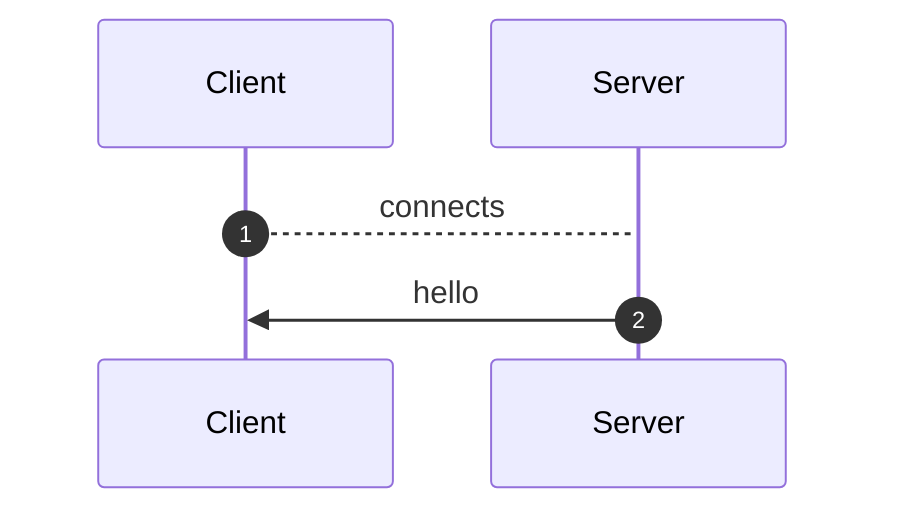
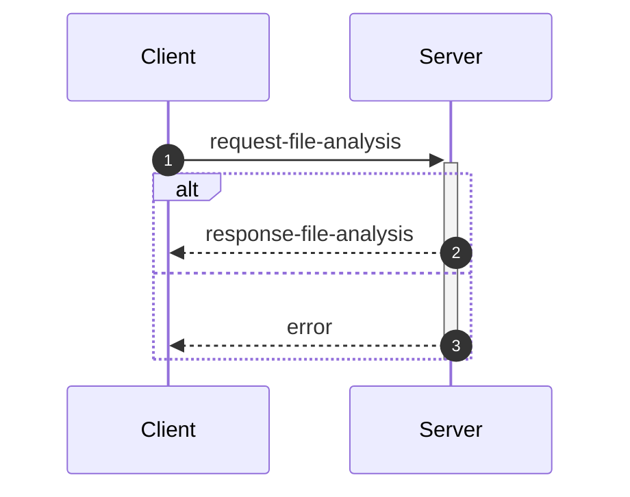
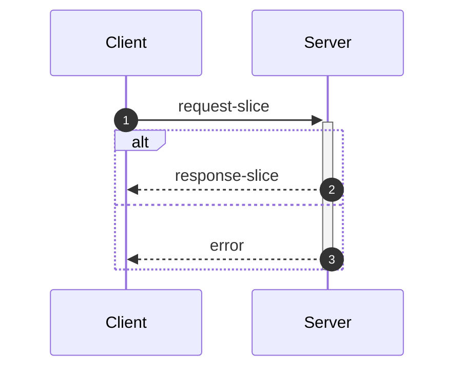
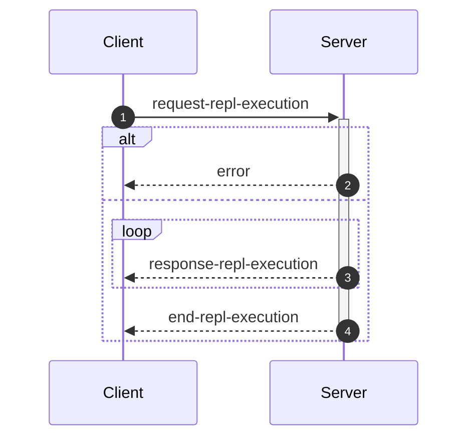

_<span title="an overview of flowR's interface">Generated</span> from '[wiki-interface.ts](https://github.com/flowr-analysis/flowr/tree/main/src/documentation/wiki-interface.ts "src/documentation/wiki-interface.ts")' on 2026-10-16, 18:03:57 UTC (v2.16.2, R v4.5.0), do not edit directly._

Although far from being as detailed as the in-depth explanation of [_flowR_](https://github.com/flowr-analysis/flowr/wiki/Core),
this wiki page explains how to interface with _flowR_ in more detail.
In general, command line arguments and other options provide short descriptions on hover over.

* [💻 Using the REPL](#using-the-repl)
* [⚙️ Configuring FlowR](#configuring-flowr)
* [⚒️ Writing Code](#writing-code)
* [💬 Communicating with the Server](#communicating-with-the-server)

<a id='using-the-repl'></a>
## 💻 Using the REPL

> [!NOTE]
> To execute arbitrary R commands with a repl request, _flowR_ has to be started explicitly with <span title="Description (Command Line Argument): Allow to access the underlying R session when using flowR (security warning: this allows the execution of arbitrary R code!)">`--r-session-access`</span>.
> Please be aware that this introduces a security risk and note that this relies on the [`r-shell` engine](https://github.com/flowr-analysis/flowr/wiki/Engines) .

Although primarily meant for users to explore,
there is nothing which forbids calling _flowR_ as a subprocess to use standard-in, -output, and -error
for communication (although you can access the REPL using the server as well,
with the [REPL Request](#message-request-repl-execution) message).

The read-eval-print loop&nbsp;(REPL) works relatively simple.
You can submit an expression (using <kbd>Enter</kbd>),
which is interpreted as an R&nbsp;expression by default but interpreted as a *command* if it starts with a colon (`:`).
The best command to get started with the REPL is <span title="Description (Repl Command): Show help information (aliases: :h, :?)">`:help`</span>.
Besides, you can leave the REPL either with the command <span title="Description (Repl Command): End the repl (aliases: :q, :exit)">`:quit`</span> or by pressing <kbd>Ctrl</kbd>+<kbd>C</kbd> twice.
When writing a *command*, you may press <kbd>Tab</kbd> to get a list of completions, if available.
Multiple commands can be entered in a single line by separating them with a semicolon (`;`), e.g. `:parse "x<-2"; :df*`.
If a command is given without R code, the REPL will re-use R code given in a previous command.
The prior example will hence return first the parsed AST of the program and then the dataflow graph for `"x <- 2"`.

> [!NOTE]
> If you develop flowR, you may want to launch the repl using the `npm run main-dev` command, this way, you get a non-minified version of flowR with debug information and hot-reloading of source files.

<details>
<summary>Available Commands</summary>

We currently offer the following commands (this with a `[*]` suffix are available with and without the star):

| Command | Description |
| ------- | ----------- |
| **<span title="Description (Repl Command): End the repl (aliases: :q, :exit)">:quit</span>** | End the repl (aliases: **:<span title="Alias of ':quit'. End the repl">q</span>**, **:<span title="Alias of ':quit'. End the repl">exit</span>**) |
| **<span title="Description (Repl Command): Execute the given code as R code. This requires the `--r-session-access` flag to be set and requires the r-shell engine. (aliases: :e, :r)">:execute</span>** | Execute the given code as R code. This requires the `--r-session-access` flag to be set and requires the r-shell engine. (aliases: **:<span title="Alias of ':execute'. Execute the given code as R code. This requires the `--r-session-access` flag to be set and requires the r-shell engine.">e</span>**, **:<span title="Alias of ':execute'. Execute the given code as R code. This requires the `--r-session-access` flag to be set and requires the r-shell engine.">r</span>**) |
| **<span title="Description (Repl Command): Get mermaid code for the control-flow graph of R code (aliases: :cfg, :cf)">:controlflow[*]</span>** | Get mermaid code for the control-flow graph of R code (star: Returns the URL to mermaid.live) (aliases: **:<span title="Alias of ':controlflow'. Get mermaid code for the control-flow graph of R code">cfg</span>**, **:<span title="Alias of ':controlflow'. Get mermaid code for the control-flow graph of R code">cf</span>**) |
| **<span title="Description (Repl Command): Get mermaid code for the control-flow graph with basic blocks (aliases: :cfgb, :cfb)">:controlflowbb[*]</span>** | Get mermaid code for the control-flow graph with basic blocks (star: Returns the URL to mermaid.live) (aliases: **:<span title="Alias of ':controlflowbb'. Get mermaid code for the control-flow graph with basic blocks">cfgb</span>**, **:<span title="Alias of ':controlflowbb'. Get mermaid code for the control-flow graph with basic blocks">cfb</span>**) |
| **<span title="Description (Repl Command): Get mermaid code for the dataflow graph (aliases: :d, :df)">:dataflow[*]</span>** | Get mermaid code for the dataflow graph (star: Returns the URL to mermaid.live) (aliases: **:<span title="Alias of ':dataflow'. Get mermaid code for the dataflow graph">d</span>**, **:<span title="Alias of ':dataflow'. Get mermaid code for the dataflow graph">df</span>**) |
| **<span title="Description (Repl Command): Get mermaid code for the normalized AST of R code (aliases: :n)">:normalize[*]</span>** | Get mermaid code for the normalized AST of R code (star: Returns the URL to mermaid.live) (alias: **:<span title="Alias of ':normalize'. Get mermaid code for the normalized AST of R code">n</span>**) |
| **<span title="Description (Repl Command): Get mermaid code for the simplified dataflow graph (aliases: :ds, :dfs)">:dataflowsimple[*]</span>** | Get mermaid code for the simplified dataflow graph (star: Returns the URL to mermaid.live) (aliases: **:<span title="Alias of ':dataflowsimple'. Get mermaid code for the simplified dataflow graph">ds</span>**, **:<span title="Alias of ':dataflowsimple'. Get mermaid code for the simplified dataflow graph">dfs</span>**) |
| **<span title="Description (Repl Command): Inspect and extend the signature database: `query` (identical to :query @signature), `info <name>` for where a function comes from (identical to :query @function-info), `add <path>` to mount another database/source, `download` to fetch the full-history database. (aliases: :sig)">:signature</span>** | Inspect and extend the signature database: `query` (identical to :query @signature), `info <name>` for where a function comes from (identical to :query @function-info), `add <path>` to mount another database/source, `download` to fetch the full-history database. (alias: **:<span title="Alias of ':signature'. Inspect and extend the signature database: `query` (identical to :query @signature), `info <name>` for where a function comes from (identical to :query @function-info), `add <path>` to mount another database/source, `download` to fetch the full-history database.">sig</span>**) |
| **<span title="Description (Repl Command): Just calculates the DFG, but only prints summary info (aliases: :d#, :df#)">:dataflowsilent</span>** | Just calculates the DFG, but only prints summary info (aliases: **:<span title="Alias of ':dataflowsilent'. Just calculates the DFG, but only prints summary info">d#</span>**, **:<span title="Alias of ':dataflowsilent'. Just calculates the DFG, but only prints summary info">df#</span>**) |
| **<span title="Description (Repl Command): Prints ASCII Art of the parsed, unmodified AST (aliases: :p)">:parse</span>** | Prints ASCII Art of the parsed, unmodified AST (alias: **:<span title="Alias of ':parse'. Prints ASCII Art of the parsed, unmodified AST">p</span>**) |
| **<span title="Description (Repl Command): Prints the version of flowR as well as the current version of R">:version</span>** | Prints the version of flowR as well as the current version of R
| **<span title="Description (Repl Command): Query the given R code (use 'help' for more information)">:query[*]</span>** | Query the given R code (use 'help' for more information) (star: Similar to query, but returns the output in json format.)
| **<span title="Description (Repl Command): Returns an ASCII representation of the dataflow graph (aliases: :df!)">:dataflowascii</span>** | Returns an ASCII representation of the dataflow graph (alias: **:<span title="Alias of ':dataflowascii'. Returns an ASCII representation of the dataflow graph">df!</span>**) |
| **<span title="Description (Repl Command): Returns summarization stats for the normalized AST (aliases: :n#)">:normalize#</span>** | Returns summarization stats for the normalized AST (alias: **:<span title="Alias of ':normalize#'. Returns summarization stats for the normalized AST">n#</span>**) |
| **<span title="Description (Repl Command): Show help information (aliases: :h, :?)">:help</span>** | Show help information (aliases: **:<span title="Alias of ':help'. Show help information">h</span>**, **:<span title="Alias of ':help'. Show help information">?</span>**) |

</details>

> [!TIP]
> 
> As indicated by the examples before, all REPL commands that operate on code keep track of the state.
> Hence, if you run a command like <span title="Description (Repl Command, starred version): Returns the URL to mermaid.live; Base Command: Get mermaid code for the dataflow graph (aliases: :d*, :df*)">`:dataflow*`</span> without providing R code,
> the REPL will re-use the R code provided in a previous command.
> Likewise, doing this will benefit from incrementality!
> If you request the dataflow graph with `:df* x <- 2 * y` and then want to see the parsed AST with `:parse`,
> the REPL will re-use previously obtained information and not re-parse the code again.
> 		

Generally, many commands offer shortcut versions in the REPL. Many queries, for example, offer a shortened format (see the example below).
Of special note, the [Config Query](https://github.com/flowr-analysis/flowr/wiki/%5BQuery%5D-Config)
can be used to also modify the currently active configuration of _flowR_ within the REPL (see the [wiki page](https://github.com/flowr-analysis/flowr/wiki/%5BQuery%5D-Config) for more information).

### Example: Retrieving the Dataflow Graph

To retrieve a URL to the [mermaid](https://mermaid.js.org/) diagram of the dataflow of a given expression,
use <span title="Description (Repl Command, starred version): Returns the URL to mermaid.live; Base Command: Get mermaid code for the dataflow graph (aliases: :d*, :df*)">`:dataflow*`</span> (or <span title="Description (Repl Command): Get mermaid code for the dataflow graph (aliases: :d, :df)">`:dataflow`</span> to get the mermaid code in the cli):

```shell
$ docker run -it --rm eagleoutice/flowr # or npm run flowr 
flowR repl v2.16.2, R grammar v14 (tree-sitter engine)
R> :dataflow* y <- 1 + x
```

<details>
<summary style='color:gray'>Output</summary>

```text
https://mermaid.live/view#base64:eyJjb2RlIjoiZmxvd2NoYXJ0IFREXG4gICAgMXt7XCJgKiM5MTtSTnVtYmVyIzkzOyogKioxKipcbiAgICAgICoxLjYqICgqKmlkOiAxKiopYFwifX1cbiAgICAyKFtcImAqIzkxO1JTeW1ib2wjOTM7KiAqKngqKlxuICAgICAgKjEuMTAqICgqKmlkOiAyKiopYFwiXSlcbiAgICAzW1tcImAqIzkxO1JCaW5hcnlPcCM5MzsqIGJhc2UjNTg7IzU4OyoqIzQzOyoqXG4gICAgICAqMS42LTEwKiAoKippZDogMyoqKVxuICAgIGFyZzogKDEsIDIpYFwiXV1cbiAgICBidWlsdC1pbjpfNDNfW1wiYEJ1aWx0LUluOlxuIzQzO2BcIl1cbiAgICBzdHlsZSBidWlsdC1pbjpfNDNfIHN0cm9rZTpncmF5LGZpbGw6Z3JheSxzdHJva2Utd2lkdGg6MnB4LG9wYWNpdHk6Ljg7XG4gICAgMFtcImAqIzkxO1JTeW1ib2wjOTM7KiAqKnkqKlxuICAgICAgKjEuMSogKCoqaWQ6IDAqKiwgdjogMylgXCJdXG4gICAgNFtbXCJgKiM5MTtSQmluYXJ5T3AjOTM7KiBiYXNlIzU4OyM1ODsqKiM2MDsjNDU7KipcbiAgICAgICoxLjEtMTAqICgqKmlkOiA0KiopXG4gICAgYXJnOiAoMCwgMylgXCJdXVxuICAgIGJ1aWx0LWluOl82MF8tW1wiYEJ1aWx0LUluOlxuIzYwOyM0NTtgXCJdXG4gICAgc3R5bGUgYnVpbHQtaW46XzYwXy0gc3Ryb2tlOmdyYXksZmlsbDpncmF5LHN0cm9rZS13aWR0aDoycHgsb3BhY2l0eTouODtcbiAgICAxIC0uLT58XCJmbG93XCJ8IDJcbiAgICBsaW5rU3R5bGUgMCBzdHJva2U6Z3JheSxjb2xvcjpncmF5O1xuICAgIDIgLS4tPnxcImZsb3dcInwgM1xuICAgIGxpbmtTdHlsZSAxIHN0cm9rZTpncmF5LGNvbG9yOmdyYXk7XG4gICAgMyAtLT58XCJyZWFkcywgYXJnXCJ8IDFcbiAgICAzIC0tPnxcInJlYWRzLCBhcmdcInwgMlxuICAgIDMgLS4tPnxcImZsb3dcInwgMFxuICAgIGxpbmtTdHlsZSA0IHN0cm9rZTpncmF5LGNvbG9yOmdyYXk7XG4gICAgMyAtLi0+fFwicmVhZHMsIGNhbGxzXCJ8IGJ1aWx0LWluOl80M19cbiAgICBsaW5rU3R5bGUgNSBzdHJva2U6Z3JheTtcbiAgICAwIC0tPnxcImRlZmluZWQtYnksIGZsb3dcInwgNFxuICAgIDAgLS0+fFwiZGVmaW5lZC1ieVwifCAzXG4gICAgNCAtLT58XCJyZWFkcywgYXJnXCJ8IDNcbiAgICA0IC0tPnxcInJldHVybnMsIGFyZ1wifCAwXG4gICAgNCAtLi0+fFwicmVhZHMsIGNhbGxzXCJ8IGJ1aWx0LWluOl82MF8tXG4gICAgbGlua1N0eWxlIDEwIHN0cm9rZTpncmF5OyIsIm1lcm1haWQiOnsiYXV0b1N5bmMiOnRydWV9fQ==
```

Retrieve the dataflow graph of the expression `y <- 1 + x`. It looks like this:


<details>

<summary style="color:gray">R Code of the Dataflow Graph</summary>

The analysis ran (including parse and normalize, using the [tree-sitter](https://github.com/flowr-analysis/flowr/wiki/Engines) engine) within the generation environment. No [signature database](https://github.com/flowr-analysis/flowr/wiki/Signature-Database) is mounted for these generated graphs, so `library()` calls attach no package exports; base-R names are still qualified via the generated base-package store (e.g. `acf` as `stats::acf`). 
We encountered no unknown side effects during the analysis.

```r
y <- 1 + x
```

</details>

</details>

For small graphs like this, <span title="Description (Repl Command): Returns an ASCII representation of the dataflow graph (aliases: :df!)">`:dataflowascii`</span> also provides an ASCII representation directly in the REPL:

```shell
$ docker run -it --rm eagleoutice/flowr # or npm run flowr 
flowR repl v2.16.2, R grammar v14 (tree-sitter engine)
R> :df! y <- 1 + x
```

<details open>
<summary style='color:gray'>Output</summary>

```text
                        v<0>v
 c<4>c──────────────────| y |
 |<- |     ┌────────────v---v
 c---c     │
    │   c<3>c   0<1>0
    └───| + |───| 1 |───u<2>u
        c---c   0---0   | x |
           └────────────u---u
Edges:
3 -> 1: reads, arg          3 -> 2: reads, arg
3 -> 0: flows-to            1 -> 2: flows-to
2 -> 3: flows-to            4 -> 3: reads, arg
4 -> 0: returns, arg        0 -> 4: defined-by, flows-to
0 -> 3: defined-by
```

Retrieve the dataflow graph of the expression `y <- 1 + x` as ASCII art.

</details>

For the slicing with <span title="Description (Repl Command): Static backwards executable slicer for R">`:slicer`</span>, you have access to the same [magic comments](#slice-magic-comments) as with the [slice request](#message-request-slice).
Pass `--inline` to splice resolvable `source()` calls into the reconstruction so the slice is a single self-contained R text (the same as the static slice query's `inlineSources` flag).
See `--help` for more flags!

### Example: Interfacing with the File System

Many commands that allow for an R-expression (like <span title="Description (Repl Command, starred version): Returns the URL to mermaid.live; Base Command: Get mermaid code for the dataflow graph (aliases: :d*, :df*)">`:dataflow*`</span>) allow for a file as well
if the argument starts with `file://`.
If you are working from the root directory of the _flowR_ repository, the following gives you the parsed AST of the example file using the <span title="Description (Repl Command): Prints ASCII Art of the parsed, unmodified AST (aliases: :p)">`:parse`</span> command:

> **Watch mode**: Replace `file://` with `watch://` to enter watch mode.
> flowR runs the command immediately and then re-runs it every time the file (or any file inside the folder) changes.
> Enter any other command to leave watch mode.
> For example: `:df watch://analysis.R`

```shell
$ docker run -it --rm eagleoutice/flowr # or npm run flowr 
flowR repl v2.16.2, R grammar v14 (tree-sitter engine)
R> :parse file://test/testfiles/example.R
```

<details>
<summary style='color:gray'>Output</summary>

```text
File: test/testfiles/example.R

program
├ binaryoperator
│ ├ identifier "sum" (1:1─4)
│ ├ <- "<-" (1:5─7)
│ ╰ float "0" (1:8─9)
├ binaryoperator
│ ├ identifier "product" (2:1─8)
│ ├ <- "<-" (2:9─11)
│ ╰ float "1" (2:12─13)
├ binaryoperator
│ ├ identifier "w" (3:1─2)
│ ├ <- "<-" (3:3─5)
│ ╰ float "7" (3:6─7)
├ binaryoperator
│ ├ identifier "N" (4:1─2)
│ ├ <- "<-" (4:3─5)
│ ╰ float "10" (4:6─8)
├ forstatement
│ ├ for "for" (6:1─4)
│ ├ ( "(" (6:5─6)
│ ├ identifier "i" (6:6─7)
│ ├ in "in" (6:8─10)
│ ├ binaryoperator
│ │ ├ float "1" (6:11─12)
│ │ ├ : ":" (6:12─13)
│ │ ╰ parenthesizedexpression
│ │   ├ ( "(" (6:13─14)
│ │   ├ binaryoperator
│ │   │ ├ identifier "N" (6:14─15)
│ │   │ ├ - "-" (6:15─16)
│ │   │ ╰ float "1" (6:16─17)
│ │   ╰ ) ")" (6:17─18)
│ ├ ) ")" (6:18─19)
│ ╰ bracedexpression
│   ├ { "{" (6:20─21)
│   ├ binaryoperator
│   │ ├ identifier "sum" (7:3─6)
│   │ ├ <- "<-" (7:7─9)
│   │ ╰ binaryoperator
│   │   ├ binaryoperator
│   │   │ ├ identifier "sum" (7:10─13)
│   │   │ ├ + "+" (7:14─15)
│   │   │ ╰ identifier "i" (7:16─17)
│   │   ├ + "+" (7:18─19)
│   │   ╰ identifier "w" (7:20─21)
│   ├ binaryoperator
│   │ ├ identifier "product" (8:3─10)
│   │ ├ <- "<-" (8:11─13)
│   │ ╰ binaryoperator
│   │   ├ identifier "product" (8:14─21)
│   │   ├  "" (8:22─23)
│   │   ╰ identifier "i" (8:24─25)
│   ╰ } "}" (9:1─2)
├ call
│ ├ identifier "cat" (11:1─4)
│ ╰ arguments
│   ├ ( "(" (11:4─5)
│   ├ argument
│   │ ╰ string
│   │   ├ " "\"" (11:5─6)
│   │   ├ stringcontent "Sum:" (11:6─10)
│   │   ╰ " "\"" (11:10─11)
│   ├ comma "," (11:11─12)
│   ├ argument
│   │ ╰ identifier "sum" (11:13─16)
│   ├ comma "," (11:16─17)
│   ├ argument
│   │ ╰ string
│   │   ├ " "\"" (11:18─19)
│   │   ├ stringcontent
│   │   │ ╰ escapesequence "\\n" (11:19─21)
│   │   ╰ " "\"" (11:21─22)
│   ╰ ) ")" (11:22─23)
╰ call
  ├ identifier "cat" (12:1─4)
  ╰ arguments
    ├ ( "(" (12:4─5)
    ├ argument
    │ ╰ string
    │   ├ " "\"" (12:5─6)
    │   ├ stringcontent "Product:" (12:6─14)
    │   ╰ " "\"" (12:14─15)
    ├ comma "," (12:15─16)
    ├ argument
    │ ╰ identifier "product" (12:17─24)
    ├ comma "," (12:24─25)
    ├ argument
    │ ╰ string
    │   ├ " "\"" (12:26─27)
    │   ├ stringcontent
    │   │ ╰ escapesequence "\\n" (12:27─29)
    │   ╰ " "\"" (12:29─30)
    ╰ ) ")" (12:30─31)
```

Retrieve the parsed AST of the example file.

<details>

<summary>File Content</summary>

```r
sum <- 0
product <- 1
w <- 7
N <- 10

for (i in 1:(N-1)) {
  sum <- sum + i + w
  product <- product * i
}

cat("Sum:", sum, "\n")
cat("Product:", product, "\n")
```

</details>

As _flowR_ directly transforms this AST the output focuses on being human-readable instead of being machine-readable.
		
</details>

### Example: Run a Query

You can run any query supported by _flowR_ using the <span title="Description (Repl Command): Query the given R code (use 'help' for more information)">`:query`</span> command.
For example, to obtain the shapes of all data frames in a given piece of code, you can run:

```shell
$ docker run -it --rm eagleoutice/flowr # or npm run flowr 
flowR repl v2.16.2, R grammar v14 (tree-sitter engine)
R> :query @absint df-shape "x <- data.frame(a = 1:10, b = 1:10)\ny <- x$a"
```

<details open>
<summary style='color:gray'>Output</summary>

```text
Query: absint (1 ms)
```

Retrieve the shapes of all data frames in the given code.

</details>

To run the linter on a file, you can use (in this example, we just issue the `dead-code` linter on a small piece of code):

```shell
$ docker run -it --rm eagleoutice/flowr # or npm run flowr 
flowR repl v2.16.2, R grammar v14 (tree-sitter engine)
R> :query @linter rules:dead-code "if(FALSE) x <- 2"
```

<details open>
<summary style='color:gray'>Output</summary>

```text
Query: linter (2 ms)
   ╰ Dead Code (dead-code):
       ╰ certain:
           ╰ Code at 1.11-16
```

Run the linter on the given code, with only the `dead-code` rule enabled.

</details>

For more information on the available queries, please check out the [Query API](https://github.com/flowr-analysis/flowr/wiki/Query-API).

<a id='configuring-flowr'></a>
## ⚙️ Configuring FlowR

When running _flowR_, you may want to specify some behaviors with a dedicated configuration file.
By default, flowR looks for a file named `flowr.json` in the current working directory (or any higher directory).
You can also specify a different file with <span title="Description (Command Line Argument): The name of the configuration file to use">`--config-file`</span> or pass the configuration inline using <span title="Description (Command Line Argument): The flowR configuration to use, as a JSON string">`--config-json`</span>.
A `flowr.json` found this way belongs to the analyzed project, so flowR ignores its options that decide what flowR executes or loads
(`engines.*.wasmPath`, `engines.*.treeSitterWasmPath`, `engines.*.rPath`, `solver.sigdb.additionalPaths`, `solver.sigdb.downloadRepo`, `solver.sigdb.installedLibrary.paths`),
unless you pass <span title="Description (Command Line Argument): Keep the security-sensitive options (e.g., the R executable) of the flowr.json found in the working directory or a parent. Only use this for projects you trust.">`--trust-config`</span>.
To analyze code you do not trust, use the secure mode (<span title="Description (Command Line Argument): Run in secure mode for analyzing untrusted code: flowR does not start R (or any other process), does not access the network, does not search for project configs, and ignores security-sensitive options in every config. Cannot be disabled once enabled. Can also be enabled with the environment variable {italic FLOWR_SECURE_MODE=1}.">`--secure`</span>, see the [security policy](https://github.com/flowr-analysis/flowr/blob/main/.github/SECURITY.md)).
To inspect the current configuration, you can run flowr with the <span title="Description (Command Line Argument): Run with verbose logging (will be passed to the corresponding script)">`--verbose`</span> flag, or use the `config` [Query](https://github.com/flowr-analysis/flowr/wiki/Query-API).
Within the REPL this works by running the following:

```shell
:query @config
```

To work with the <a href="https://github.com/flowr-analysis/flowr/tree/main/src/config.ts#L119"><code><span title="The configuration file format for flowR.">FlowrConfig</span></code></a> you can use the provided helper objects alongside its methods like
<a href="https://github.com/flowr-analysis/flowr/tree/main/src/config.ts#L905"><code><span title="Creates a new flowr config that has the updated values.">FlowrConfig::<b>amend</b></span></code></a>.
The schema below documents every option; the ones you most likely want are:

- <a href="https://github.com/flowr-analysis/flowr/wiki/Interface#configuring-flowr" title="Configuration Option (boolean): Whether source calls should be ignored, causing {@link processSourceCall}&#39;s behavior to be skipped.">ignoreSourceCalls</a>: ignore source calls when analyzing the code, i.e., ignore the inclusion of other files.
- <a href="https://github.com/flowr-analysis/flowr/wiki/Interface#configuring-flowr" title="Configuration Option (boolean): Whether load calls should be ignored, causing {@link processLoadCall}&#39;s behavior to be skipped.">ignoreLoadCalls</a>: ignore load calls when analyzing the code, i.e., ignore the loading of r-data files.
- <a href="https://github.com/flowr-analysis/flowr/wiki/Interface#configuring-flowr" title="Configuration Option (object): Do you want to overwrite (parts) of the builtin definition?">semantics.environment.overwriteBuiltIns</a>: overwrite _flowR_'s handling of built-in functions, or clear the preset definitions entirely.
  See [Configure BuiltIn Semantics](#configure-builtin-semantics) for more information.
- <a href="https://github.com/flowr-analysis/flowr/wiki/Interface#configuring-flowr" title="Configuration Option (string): How to resolve variables and their values. (one of &quot;disabled&quot;, &quot;alias&quot;, &quot;builtin&quot;)">solver.variables</a>: how to resolve variables and their values (`disabled`, `alias`, `builtin`).
- <a href="https://github.com/flowr-analysis/flowr/wiki/Interface#configuring-flowr" title="Configuration Option (array): The engine or set of engines to use for interacting with R code. An empty array means all available engines will be used.">engines</a> and <a href="https://github.com/flowr-analysis/flowr/wiki/Interface#configuring-flowr" title="Configuration Option (string): The default engine to use for interacting with R code. If this is undefined, an arbitrary engine from the specified list will be used. (one of &quot;tree-sitter&quot;, &quot;r-shell&quot;)">defaultEngine</a>: the engines used to interact with R code, see the [Engines wiki page](https://github.com/flowr-analysis/flowr/wiki/Engines).
- <a href="https://github.com/flowr-analysis/flowr/wiki/Interface#configuring-flowr" title="Configuration Option (array): Files a framework loads on its own, without any source() call (e.g. global.R in a shiny app), in the order they are loaded; flowR orders the matching project files accordingly and analyzes them as one program. Entries are case-insensitive globs matched against the file path, a plain name matches any file with that name, and entries matching no project file are warned about. Usually set per project kind via specializeConfig.">project.implicitSources</a>: the files a framework loads without any `source()` call, in the order in which they are
  loaded. Entries are globs (e.g. `R/*.R`) matched against the file path ignoring capitalization; one matching no file is reported.
- <a href="https://github.com/flowr-analysis/flowr/wiki/Interface#configuring-flowr" title="Configuration Option (object): Overwrite (parts of) the configuration depending on the project kind flowR detects, e.g. to give a shiny app its implicit sources.">specializeConfig</a>: overwrite (parts of) the configuration depending on the kind of project _flowR_ detects
  (e.g. `shiny-app`), which is how a shiny app gets its implicit sources by default. What you configure directly wins.
- <a href="https://github.com/flowr-analysis/flowr/wiki/Interface#configuring-flowr" title="Configuration Option (string): Overwrite the project kind flowR would otherwise infer from the analyzed files, e.g. when auto-detection guesses wrong. (one of &quot;package&quot;, &quot;script&quot;, &quot;shiny-app&quot;, &quot;notebook&quot;, &quot;project&quot;, &quot;unknown&quot;)">project.useProjectType</a>: skip that detection and force a project kind yourself, when auto-detection guesses wrong.
- <a href="https://github.com/flowr-analysis/flowr/wiki/Interface#configuring-flowr" title="Configuration Option (array): The default plugins to load when creating a new instance of FlowrAnalyzer">defaultPlugins</a> and <a href="https://github.com/flowr-analysis/flowr/wiki/Interface#configuring-flowr" title="Configuration Option (array): The plugins to load in REPL mode">repl.plugins</a>: the plugins to load for a new <a href="https://github.com/flowr-analysis/flowr/tree/main/src/project/flowr-analyzer.ts#L205"><code><span title="Central class for conducting analyses with FlowR. Use the FlowrAnalyzerBuilder to create a new instance. If you want the original pattern of creating a pipeline and running all steps, you can still do this with FlowrAnalyzer#runFull . To inspect the context of the analyzer, use FlowrAnalyzer#inspectContext (if you are a plugin and need to modify it, use FlowrAnalyzer#context instead).">FlowrAnalyzer</span></code></a> and in the REPL
  (use `flowr:default` to reference the former).

So you can configure _flowR_ by adding a file like the following:

<details>

<summary>Example Configuration File</summary>

```json
{
  "ignoreSourceCalls": true,
  "ignoreLoadCalls": true,
  "semantics": {
    "environment": {
      "overwriteBuiltIns": {
        "definitions": [
          {
            "type": "function",
            "names": [
              "foo"
            ],
            "processor": "builtin:assign",
            "config": {}
          }
        ]
      }
    }
  },
  "defaultPlugins": [
    "file:description",
    "versions:description"
  ],
  "repl": {
    "quickStats": false,
    "dfProcessorHeat": false,
    "hints": true,
    "plugins": [
      "flowr:default"
    ]
  },
  "project": {
    "resolveUnknownPathsOnDisk": true,
    "implicitSources": [
      "global.R",
      "app.R"
    ]
  },
  "linter": {
    "disabledRules": []
  },
  "specializeConfig": {
    "shiny-app": {
      "project": {
        "implicitSources": [
          "global.R",
          "ui.R",
          "server.R",
          "app.R"
        ]
      }
    }
  },
  "engines": [
    {
      "type": "r-shell"
    }
  ],
  "solver": {
    "variables": "alias",
    "evalStrings": true,
    "trackEnvironments": true,
    "sigdb": {
      "enabled": true,
      "loadProjectDependencies": true,
      "eagerlyLoad": false,
      "eagerlyLoadExports": false,
      "linkBaseR": false,
      "linkDescriptionDependencies": false
    },
    "resolveSource": {
      "dropPaths": "no",
      "ignoreCapitalization": true,
      "inferWorkingDirectory": "active-script",
      "searchPath": []
    },
    "instrument": {},
    "slicer": {
      "threshold": 50
    }
  },
  "abstractInterpretation": {
    "wideningThreshold": 4,
    "followCalls": true,
    "dataFrame": {
      "maxColNames": 20,
      "readLoadedData": {
        "readExternalFiles": true,
        "maxReadLines": 1000000
      }
    }
  },
  "incremental": {
    "alwaysIncremental": false,
    "parsing": {
      "activated": false,
      "heuristics": {
        "activated": true,
        "mtime": true,
        "linesFrom": 500,
        "bytesFrom": 50000,
        "alwaysWithEdits": false,
        "minFiles": 1
      }
    }
  },
  "gas": {
    "thresholds": {
      "memory": {
        "problematic": 0.7,
        "critical": 0.9
      },
      "timeMs": {
        "problematic": 100000,
        "critical": 120000
      }
    },
    "features": {}
  }
}
```

</details>

<details>
<a id='configure-builtin-semantics'></a>
<summary>Configure Built-In Semantics</summary>

`semantics/environment/overwriteBuiltins` accepts two keys:

- `loadDefaults` (boolean, initially `true`): If set to `true`, the default built-in definitions are loaded before applying the custom definitions. Setting this flag to `false` explicitly disables the loading of the default definitions.
- `definitions` (array, initially empty): Allows to overwrite or define new built-in elements. Each object within must have a `type` which is one of the below. Furthermore, they may define a string array of `names` which specifies the identifiers to bind the definitions to. You may use `assumePrimitive` to specify whether _flowR_ should assume that this is a primitive non-library definition (so you probably just do not want to specify the key).

  | Type            | Description                                                                                                                                                                                                                                                                                              | Example                                                                                                    |
  | --------------- | -------------------------------------------------------------------------------------------------------------------------------------------------------------------------------------------------------------------------------------------------------------------------------------------------------- | ---------------------------------------------------------------------------------------------------------- |
  | `constant`    | Additionally allows for a `value` this should resolve to.                                                                                                                                                                                                                                                | `{ type: 'constant', names: ['NULL', 'NA'],  value: null }`                                                |
  | `function`    | Is a rather flexible way to define and bind built-in functions. For the time, we do not have extensive documentation to cover all the cases, so please either consult the sources with the `default-builtin-config.ts` or open a [new issue](https://github.com/flowr-analysis/flowr/issues/new/choose). | `{ type: 'function', names: ['next'], processor: 'builtin:d', config: { cfg: ExitPointType.Next } }` |
  | `replacement` | A comfortable way to specify replacement functions like `$<-` or `names<-`. `suffixes` describes the... suffixes to attach automatically. | `{ type: 'replacement', suffixes: ['<-', '<<-'], names: ['[', '[['] }` |

</details>

<details>

<summary style='color:gray'>Full Configuration-File Schema</summary>

- _The configuration file format for flowR._ (object)
    - **logLevel** [optional] _flowR's global minimum log level, applied when the config is loaded._ (string)
        Only allows: 'silly', 'trace', 'debug', 'info', 'warn', 'error', 'fatal'
    - **ignoreSourceCalls** [optional] _Whether source calls should be ignored, causing {@link processSourceCall}'s behavior to be skipped._ (boolean)
    - **ignoreLoadCalls** [optional] _Whether load calls should be ignored, causing {@link processLoadCall}'s behavior to be skipped._ (boolean)
    - **semantics** _Configure language semantics and how flowR handles them._ (object)
        - **environment** [optional] _Semantics regarding how to handle the R environment._ (object)
            - **overwriteBuiltIns** [optional] _Do you want to overwrite (parts) of the builtin definition?_ (object)
                - **loadDefaults** [optional] _Should the default configuration still be loaded?_ (boolean)
                - **definitions** [optional] _The definitions to load/overwrite._ (array)
                Valid item types:
                    - (object)
    - **defaultPlugins** [optional] _The default plugins to load when creating a new instance of FlowrAnalyzer_ (array)
    Valid item types:
        - (alternatives)
            - (string)
            - (array)
    - **repl** _Configuration options for the REPL._ (object)
        - **quickStats** [optional] _Whether to show quick stats in the REPL after each evaluation._ (boolean)
        - **dfProcessorHeat** [optional] _This instruments the dataflow processors to count how often each processor is called._ (boolean)
        - **hints** [optional] _Whether to show dim inline hints on the empty prompt (automatically disabled on non-interactive terminals)._ (boolean)
        - **plugins** [optional] _The plugins to load in REPL mode_ (array)
        Valid item types:
            - (alternatives)
                - (string)
                - (array)
        - **autoUseFileProtocol** [optional] _Prepend the file protocol to a repl input that looks like a path, instead of only warning about it._ (boolean)
        - **queryStats** [optional] _Whether `:query` closes with the line stating how long the queries took (`:query*` never prints it)._ (boolean)
        - **showPlugins** [optional] _Whether `:version` grays out the plugins that did not activate during the last analysis._ (boolean)
    - **project** _Project specific configuration options._ (object)
        - **resolveUnknownPathsOnDisk** [optional] _Whether to resolve unknown paths loaded by the r project disk when trying to source/analyze files._ (boolean)
        - **failOnInaccessiblePath** [optional] _Whether a directory that cannot be traversed during file discovery (e.g. due to permissions) aborts the analysis; when false (the default) such paths are logged and skipped._ (boolean)
        - **basePackages** [optional] _The packages considered part of R itself (base and recommended); if unset, flowR uses its built-in list._ (array)
        Valid item types:
            - (string)
        - **implicitSources** [optional] _Files a framework loads on its own, without any source() call (e.g. global.R in a shiny app), in the order they are loaded; flowR orders the matching project files accordingly and analyzes them as one program. Entries are case-insensitive globs matched against the file path, a plain name matches any file with that name, and entries matching no project file are warned about. Usually set per project kind via specializeConfig._ (array)
        Valid item types:
            - (string)
        - **useProjectType** [optional] _Overwrite the project kind flowR would otherwise infer from the analyzed files, e.g. when auto-detection guesses wrong._ (string)
            Only allows: 'package', 'script', 'shiny-app', 'notebook', 'project', 'unknown'
        - **assumeImplicitEcho** [optional] _Whether the top level of the analyzed code is echoed, so that every visible result printed there is collected as an output by the dependencies query (default true, false for a package)._ (boolean)
        - **discovery** [optional] _Scoping options for the default project discovery._ (object)
            - **full** [optional] _Collect every file below the project root (greedy) instead of only the files the detected project kind needs (default false)._ (boolean)
            - **perKind** [optional] _Per-kind include/exclude glob overrides layered on the default scoping._ (object)
            - **ignore** [optional] _Case-insensitive globs that drop matching files from the intelligent discovery, regardless of kind (e.g. .Renviron to ignore environment files)._ (array)
            Valid item types:
                - (string)
        - **classification** [optional] _Overrides for the signals flowR uses to classify the project kind._ (object)
            - **shinyDescriptionTypes** [optional] _DESCRIPTION Type: values that mark a shiny app._ (array)
            Valid item types:
                - (string)
            - **shinyEntryFiles** [optional] _File names a shiny app is assembled from._ (array)
            Valid item types:
                - (string)
            - **shinyUsagePattern** [optional] _Regex source evidencing shiny usage in an entry file._ (string)
            - **notebookExtensions** [optional] _File extensions marking a notebook._ (array)
            Valid item types:
                - (string)
    - **linter** _Linter configuration options._ (object)
        - **disabledRules** _Linting rule names excluded from the default rule set (a rule requested explicitly via a linter query still runs). Usually set per project kind via specializeConfig._ (array)
        Valid item types:
            - (string)
    - **inputSources** [optional] _Further frameworks the input-sources analysis should know about; entries are added to flowR's defaults._ (object)
        - **pure** [optional] _Functions that only pass the constantness of their arguments on._ (array)
        Valid item types:
            - (string)
        - **param** [optional] _Functions whose result is a 'param' input._ (array)
        Valid item types:
            - (string)
        - **file** [optional] _Functions whose result is a 'file' input._ (array)
        Valid item types:
            - (string)
        - **tempfile** [optional] _Functions whose result is a 'tempfile' input._ (array)
        Valid item types:
            - (string)
        - **glob** [optional] _Functions whose result is a 'glob' input._ (array)
        Valid item types:
            - (string)
        - **net** [optional] _Functions whose result is a 'net' input._ (array)
        Valid item types:
            - (string)
        - **rand** [optional] _Functions whose result is a 'rand' input._ (array)
        Valid item types:
            - (string)
        - **system** [optional] _Functions whose result is a 'system' input._ (array)
        Valid item types:
            - (string)
        - **ffi** [optional] _Functions whose result is a 'ffi' input._ (array)
        Valid item types:
            - (string)
        - **lang** [optional] _Functions whose result is a 'lang' input._ (array)
        Valid item types:
            - (string)
        - **options** [optional] _Functions whose result is a 'options' input._ (array)
        Valid item types:
            - (string)
        - **cmdline** [optional] _Functions whose result is a 'cmdline' input._ (array)
        Valid item types:
            - (string)
        - **user** [optional] _Functions whose result is a 'user' input._ (array)
        Valid item types:
            - (string)
        - **const** [optional] _Functions whose result is a 'const' input._ (array)
        Valid item types:
            - (string)
        - **scope** [optional] _Functions whose result is a 'scope' input._ (array)
        Valid item types:
            - (string)
        - **dconst** [optional] _Functions whose result is a 'dconst' input._ (array)
        Valid item types:
            - (string)
        - **unknown** [optional] _Functions whose result is a 'unknown' input._ (array)
        Valid item types:
            - (string)
        - **linkedObjects** [optional] _Objects a framework provides without a definition in the code, e.g. shiny's input._ (array)
        Valid item types:
            - (object)
        - **linkedEntryPoints** [optional] _Calls that hand a function to a framework, which binds its objects to the parameters by position._ (array)
        Valid item types:
            - (object)
    - **specializeConfig** [optional] _Overwrite (parts of) the configuration depending on the project kind flowR detects, e.g. to give a shiny app its implicit sources._ (object)
    - **engines** _The engine or set of engines to use for interacting with R code. An empty array means all available engines will be used._ (array)
    Valid item types:
        - (alternatives)
            - _The configuration for the tree sitter engine._ (object)
                - **type** [required] _Use the tree sitter engine._ (string)
                    Only allows: 'tree-sitter'
                - **wasmPath** [optional] _The path to the tree-sitter-r WASM binary to use. If this is undefined, this uses the default path._ (string)
                - **treeSitterWasmPath** [optional] _The path to the tree-sitter WASM binary to use. If this is undefined, this uses the default path._ (string)
                - **lax** [optional] _Whether to use the lax parser for parsing R code (allowing for syntax errors). If this is undefined, the strict parser will be used._ (boolean)
            - _The configuration for the R shell engine._ (object)
                - **type** [required] _Use the R shell engine._ (string)
                    Only allows: 'r-shell'
                - **rPath** [optional] _The path to the R executable to use. If this is undefined, this uses the default path._ (string)
                - **pipeBind** [optional] _Whether to enable R's experimental pipe-bind operator "=>" by setting _R_USE_PIPEBIND_ for the R session (default false); R itself keeps this off by default, as it is experimental and has never shipped in a release version of R._ (boolean)
    - **defaultEngine** [optional] _The default engine to use for interacting with R code. If this is undefined, an arbitrary engine from the specified list will be used._ (string)
        Only allows: 'tree-sitter', 'r-shell'
    - **solver** _How to resolve constants, constraints, cells, ..._ (object)
        - **variables** _How to resolve variables and their values._ (string)
            Only allows: 'disabled', 'alias', 'builtin'
        - **evalStrings** _Should we include eval(parse(text="...")) calls in the dataflow graph?_ (boolean)
        - **trackEnvironments** [optional] _Track user-created environments (new.env, assign/get/local with envir=, dollar-assign, attach). When false, all envir-style calls fall through conservatively._ (boolean)
        - **sigdb** _Resolving library exports from a signature database._ (object)
            - **enabled** [optional] _Resolve library()/use() exports from a signature database (default true); when false no database is consulted._ (boolean)
            - **loadProjectDependencies** [optional] _Load the project's declared dependencies from its metadata files (DESCRIPTION Imports/Depends, rproject.toml, uvr.toml, renv.lock, rv.lock, uvr.lock) (default true); when false these files are not read for dependencies._ (boolean)
            - **eagerlyLoad** [optional] _Parse the database up front rather than on the first package load (default false, ignored if disabled)._ (boolean)
            - **eagerlyLoadExports** [optional] _Add a vertex for every export on load rather than on demand (default false); keeps the dataflow graph small._ (boolean)
            - **assumedRVersion** [optional] _R version assumed when resolving versioned (base-R) exports: a pin like "4.5" or "auto" to detect the installed R (default "auto")._ (string)
            - **linkBaseR** [optional] _Eagerly attach base-R namespaces so bare base calls resolve without library() (default false)._ (boolean)
            - **linkBaseRCalls** [optional] _Add a lightweight Reads edge from a bare base-R call to its signature-database function vertex (default false; base-R qualification is edge-free otherwise)._ (boolean)
            - **linkPackageCalls** [optional] _Add a lightweight Reads edge from a resolved package call to its signature-database function vertex (default false)._ (boolean)
            - **linkDescriptionDependencies** [optional] _Eagerly attach the namespaces of the project's declared DESCRIPTION dependencies (Imports/Depends) so their exports resolve without an explicit library() (default false)._ (boolean)
            - **warmInBackground** [optional] _Decompress the hot shards (base + most-downloaded) in a background task on startup so the first library() lookup is warm (default false; for long-running servers/REPLs)._ (boolean)
            - **additionalPaths** [optional] _Extra directories or bundle/manifest files searched for signature databases (alongside the shipped default and $FLOWR_SIGDB_DIR); a downloaded full-history bundle placed here is mounted automatically._ (array)
            Valid item types:
                - (string)
            - **downloadRepo** [optional] _GitHub owner/repo the full-history bundle is downloaded from via ":signature download" (default "flowr-analysis/flowr", release tag "sigdb-v<flowR-version>")._ (string)
            - **autoSync** [optional] _On startup, re-download shards whose committed sigdb.remote.json hash no longer matches the cache, in the background (default false; opt-in network sync after a git pull)._ (boolean)
            - **installedLibrary** [optional] _Recovering packages no signature database knows from the copy installed on this machine._ (object)
                - **enabled** [required] _Recover packages no signature database knows from their installed copy (default false)._ (boolean)
                - **paths** [optional] _Library directories to search; when empty they are discovered from the environment and the project._ (array)
                Valid item types:
                    - (string)
                - **useEnvironment** [optional] _Search the libraries R_LIBS_USER/R_LIBS/R_LIBS_SITE name (default true)._ (boolean)
                - **useProjectLibrary** [optional] _Search a project-local renv/packrat library (default true)._ (boolean)
                - **maxDepth** [optional] _How far to descend into the nested layout of a project-local library (default 3)._ (number)
                - **packages** [optional] _Only recover packages whose name matches one of these regular expressions; empty means any._ (array)
                Valid item types:
                    - (string)
            - **blobCacheBudgetMb** [optional] _How many MiB of decoded package blobs every open bundle may hold together (default 16)._ (number)
            - **versionSelection** [optional] _When a project constrains a dependency, resolve to the newest (default), oldest, or system-installed version satisfying it; system needs R and falls back to newest. Base-R packages always resolve against the assumed R version._ (string)
                Only allows: 'newest', 'oldest', 'system'
            - **versionOverrides** [optional] _Force an exact version for specific packages (name -> version), overriding both the project constraint and the versionSelection policy (default {})._ (object)
        - **versionManagement** _Policies for reasoning about dependency versions._ (object)
            - **linkedVersionGroups** [optional] _Groups of packages that must resolve to the same version; version guessing intersects each group so its members stay mutually compatible (default [])._ (array)
            Valid item types:
                - (array)
                Valid item types:
                    - (string)
        - **assumeAttachedPackages** [optional] _Packages to treat as attached without a `library()` call, so what the built-in configuration states about them applies to the analyzed code. The base packages R attaches on startup already resolve without it._ (array)
        Valid item types:
            - (string)
        - **transitiveSideEffectRounds** [optional] _How many rounds the transitive side-effect fixpoint may run before it is cut off (default 32); the propagation stops on its own as soon as a round adds nothing._ (number)
        - **maxOverlayDepth** [optional] _How many binding overlays may stack on one environment frame before a write flattens them (default 4); a pure performance knob, trading lookup cost against copy cost without changing any result._ (number)
        - **instrument** (object)
            - **dataflowExtractors** [optional] _These keys are only intended for use within code, allowing to instrument the dataflow analyzer!_ (any)
        - **resolveSource** [optional] _If lax source calls are active, flowR searches for sourced files much more freely, based on the configurations you give it. This option is only in effect if `ignoreSourceCalls` is set to false._ (object)
            - **dropPaths** _Allow to drop the first or all parts of the sourced path, if it is relative._ (string)
                Only allows: 'no', 'once', 'all'
            - **ignoreCapitalization** _Search for filenames matching in the lowercase._ (boolean)
            - **inferWorkingDirectory** _Try to infer the working directory from the main or any script to analyze._ (string)
                Only allows: 'no', 'main-script', 'active-script', 'any-script'
            - **searchPath** _Additionally search in these paths._ (array)
            Valid item types:
                - (string)
            - **repeatedSourceLimit** [optional] _How often the same file can be sourced within a single run? Please be aware: in case of cyclic sources this may not reach a fixpoint so give this a sensible limit._ (number)
            - **applyReplacements** _Provide name replacements for loaded files_ (array)
            Valid item types:
                - (object)
            - **assumeFilesExist** [optional] _Assume a sourced file is always there, making what it defines certain instead of conditional on the source call._ (boolean)
        - **slicer** [optional] _The configuration for the slicer._ (object)
            - **threshold** [optional] _The maximum number of iterations to perform on a single function call during slicing._ (number)
            - **autoExtend** [optional] _If set, the slicer will gain an additional post-pass._ (boolean)
    - **abstractInterpretation** _The configuration options for abstract interpretation._ (object)
        - **wideningThreshold** _The threshold for the number of visitations of a node at which widening should be performed to ensure the termination of the fixpoint iteration._ (number)
        - **followCalls** _Whether the abstract interpretation is interprocedural, i.e. whether it steps into the functions a call may dispatch to._ (boolean)
        - **dataFrame** _The configuration of the shape inference for data frames._ (object)
            - **maxColNames** _The maximum number of columns names to infer for data frames before over-approximating the column names to top._ (number)
            - **readLoadedData** _Configuration options for reading data frame shapes from loaded external data files, such as CSV files._ (object)
                - **readExternalFiles** _Whether data frame shapes should be extracted from loaded external files, such as CSV files._ (boolean)
                - **maxReadLines** _The maximum number of lines to read when extracting data frame shapes from loaded files, such as CSV files._ (number)
    - **incremental** (object)
        - **alwaysIncremental** _Always take the incremental path, regardless of heuristics._ (boolean)
        - **parsing** (object)
            - **activated** _If set, incremental parsing will be used._ (boolean)
            - **heuristics** (object)
                - **activated** [optional] _If set, the heuristics for incremental parsing will be used._ (boolean)
                - **mtime** [optional] _Skip reparsing entirely if the file's modification time is unchanged since the last parse._ (boolean)
                - **linesFrom** [optional] _Only consider incremental parsing for files with at least this many lines._ (number)
                - **bytesFrom** [optional] _Only consider incremental parsing for files with at least this many bytes._ (number)
                - **alwaysWithEdits** [optional] _Always take the incremental path whenever there is a computed edit region, regardless of the other thresholds._ (boolean)
                - **minFiles** [optional] _Only apply these heuristics once the project has at least this many files loaded._ (number)
    - **gas** [optional] _Resource-usage guard (gas) configuration. All feature factors default to 0 (disabled). See https://github.com/flowr-analysis/flowr/wiki/Core#gas-resource-guard._ (object)
        - **thresholds** [optional] _Thresholds for all gas checks (scaled by per-feature factor), boundable per feature._ (object)
            - **memory** [optional] _Heap-usage fraction thresholds (0-1), either shared or given per feature key (with `default` covering the rest)._ (object)
                - **problematic** [optional] _Heap fraction (0-1) above which Problematic is returned, for every feature without an entry of its own._ (number)
                - **critical** [optional] _Heap fraction (0-1) above which Critical is returned, for every feature without an entry of its own._ (number)
            - **timeMs** [optional] _Elapsed analysis time thresholds in milliseconds, either shared or given per feature key (with `default` covering the rest)._ (object)
                - **problematic** [optional] _Elapsed ms above which Problematic is returned, for every feature without an entry of its own._ (number)
                - **critical** [optional] _Elapsed ms above which Critical is returned, for every feature without an entry of its own._ (number)
            - **steps** [optional] _Processed-AST-node thresholds, counted rather than sampled; only a key that arms a budget (`dataflow`) reads them._ (object)
                - **problematic** [optional] _Processed AST nodes above which Problematic is returned, for every feature without an entry of its own._ (number)
                - **critical** [optional] _Processed AST nodes above which the extraction is cut short, for every feature without an entry of its own._ (number)
            - **vertices** [optional] _Created-dataflow-vertex thresholds, counted like `steps`._ (object)
                - **problematic** [optional] _Created dataflow vertices above which Problematic is returned, for every feature without an entry of its own._ (number)
                - **critical** [optional] _Created dataflow vertices above which the extraction is cut short, for every feature without an entry of its own._ (number)
        - **features** [optional] _Per-feature sensitivity factors. 0 or absent disables gas checking for that feature. A factor of 2 makes the feature twice as sensitive. Recognised keys: `source`, `side-effect-linking`, `linter`, `slicer`, `dataflow`._ (object)
        - **countedCheckEvery** [optional] _How many counted steps pass between two accountings of an armed check, be it a dataflow budget or the slicer's traversal (default 128); trades overshoot against the cost of the check._ (number)
        - **heapProvider** [optional] _Custom heap statistics source (programmatic configs only), overriding the built-in v8/performance.memory detection._ (function)

</details>

<a id='writing-code'></a>
## ⚒️ Writing Code

_flowR_ can be used as a [module](https://www.npmjs.com/package/@eagleoutice/flowr) and offers several main classes and interfaces that are interesting for extension writers 
(see the [Visual Studio Code extension](https://marketplace.visualstudio.com/items?itemName=code-inspect.vscode-flowr) or the [Core](https://github.com/flowr-analysis/flowr/wiki/Core) wiki page for more information).

### Creating Analyses with _flowR_

Nowadays, instances of the <a href="https://github.com/flowr-analysis/flowr/tree/main/src/project/flowr-analyzer.ts#L205"><code><span title="Central class for conducting analyses with FlowR. Use the FlowrAnalyzerBuilder to create a new instance. If you want the original pattern of creating a pipeline and running all steps, you can still do this with FlowrAnalyzer#runFull . To inspect the context of the analyzer, use FlowrAnalyzer#inspectContext (if you are a plugin and need to modify it, use FlowrAnalyzer#context instead).">FlowrAnalyzer</span></code></a> should be used as central frontend to get analysis results from _flowR_.
The entry points an analysis is written against are re-exported from the package root (`import { FlowrAnalyzerBuilder } from '@eagleoutice/flowr'`);
everything else stays reachable under its own path, as in `@eagleoutice/flowr/dataflow/graph/graph`.
For example, a program slice can be created like this:

```ts
const analyzer = await new FlowrAnalyzerBuilder()
    .setEngine('tree-sitter')
    .build();
analyzer.addRequest('x <- 1\ny <- x\nx');
const result = await analyzer.query([
    {
        type:     'static-slice',
        criteria: ['3@x']
    }
]);
```

For more information, please have a look at the [Analyzer](https://github.com/flowr-analysis/flowr/wiki/Analyzer) wiki page, which explains how to construct and use the <a href="https://github.com/flowr-analysis/flowr/tree/main/src/project/flowr-analyzer.ts#L205"><code><span title="Central class for conducting analyses with FlowR. Use the FlowrAnalyzerBuilder to create a new instance. If you want the original pattern of creating a pipeline and running all steps, you can still do this with FlowrAnalyzer#runFull . To inspect the context of the analyzer, use FlowrAnalyzer#inspectContext (if you are a plugin and need to modify it, use FlowrAnalyzer#context instead).">FlowrAnalyzer</span></code></a> in more detail.
To work with specific perspectives, you can also consult the respective pages like the [Dataflow Graph](https://github.com/flowr-analysis/flowr/wiki/Dataflow-Graph) or the [Abstract Interpretation](https://github.com/flowr-analysis/flowr/wiki/Abstract-Interpretation) wiki pages.
### The Pipeline Executor (Low-Level Interface)

Once, in the beginning, _flowR_ was meant to produce a dataflow graph merely to provide *program slices*. 
However, with continuous updates, the [Dataflow Graph](https://github.com/flowr-analysis/flowr/wiki/Dataflow-Graph) repeatedly proves to be the more interesting part.
With this, we restructured _flowR_'s originally *hardcoded* pipeline to be far more flexible. 
Now, it can be theoretically extended or replaced with arbitrary steps, optional steps, and what we call 'decorations' of these steps. 
In short, a slicing pipeline using the <a href="https://github.com/flowr-analysis/flowr/tree/main/src/core/pipeline-executor.ts#L97"><code><span title="**Please note:** The PipelineExecutor is now considered to be a rather low-level API for flowR. While it still works and is the basis for all other layers, we strongly recommend using the FlowrAnalyzer and its builder to create and use an analyzer instance that is pre-configured for your use-case. The pipeline executor allows to execute arbitrary pipelines in a step-by-step fashion. If you are not...">PipelineExecutor</span></code></a> looks like this:

```ts

const slicer = new PipelineExecutor(DEFAULT_SLICING_PIPELINE, {
  parser:    new RShell(),
  request:   requestFromInput('x <- 1\nx + 1'),
  criterion: ['2@x']
})
const slice = await slicer.allRemainingSteps()
// console.log(slice.reconstruct.code)
```

<details><summary>More Information</summary>

If you compare this, with what you would have done with the old (and removed) `SteppingSlicer`, 
this essentially just requires you to replace the `SteppingSlicer` with the <a href="https://github.com/flowr-analysis/flowr/tree/main/src/core/pipeline-executor.ts#L97"><code><span title="**Please note:** The PipelineExecutor is now considered to be a rather low-level API for flowR. While it still works and is the basis for all other layers, we strongly recommend using the FlowrAnalyzer and its builder to create and use an analyzer instance that is pre-configured for your use-case. The pipeline executor allows to execute arbitrary pipelines in a step-by-step fashion. If you are not...">PipelineExecutor</span></code></a>
and to pass the <a href="https://github.com/flowr-analysis/flowr/tree/main/src/core/steps/pipeline/default-pipelines.ts#L18"><code>DEFAULT_SLICING_PIPELINE</code></a> as the first argument.
The <a href="https://github.com/flowr-analysis/flowr/tree/main/src/core/pipeline-executor.ts#L97"><code><span title="**Please note:** The PipelineExecutor is now considered to be a rather low-level API for flowR. While it still works and is the basis for all other layers, we strongly recommend using the FlowrAnalyzer and its builder to create and use an analyzer instance that is pre-configured for your use-case. The pipeline executor allows to execute arbitrary pipelines in a step-by-step fashion. If you are not...">PipelineExecutor</span></code></a>...

1. Provides structures to investigate the results of all intermediate steps
2. Can be executed step-by-step
3. Can repeat steps (e.g., to calculate multiple slices on the same input)

See the in-code documentation for more information.

</details>

### Using the <a href="https://github.com/flowr-analysis/flowr/tree/main/src/r-bridge/shell.ts#L144"><code><span title="The RShell represents an interactive session with the R interpreter. You can configure it by RShellOptions . At the moment we are using a live R session (and not networking etc.) to communicate with R easily, which allows us to install packages etc. However, this might and probably will change in the future (leaving this as a legacy mode :D)">RShell</span></code></a> to Interact with R

The <a href="https://github.com/flowr-analysis/flowr/tree/main/src/r-bridge/shell.ts#L144"><code><span title="The RShell represents an interactive session with the R interpreter. You can configure it by RShellOptions . At the moment we are using a live R session (and not networking etc.) to communicate with R easily, which allows us to install packages etc. However, this might and probably will change in the future (leaving this as a legacy mode :D)">RShell</span></code></a> class allows interfacing with the `R`&nbsp;ecosystem installed on the host system.
Please have a look at [flowR's Engines](https://github.com/flowr-analysis/flowr/wiki/Engines) for more information on alternatives (for example, the <a href="https://github.com/flowr-analysis/flowr/tree/main/src/r-bridge/lang-4.x/tree-sitter/tree-sitter-executor.ts#L29"><code><span title="Synchronous and (way) faster alternative to the RShell using tree-sitter.">TreeSitterExecutor</span></code></a>).

> [!IMPORTANT]
> 
> Each <a href="https://github.com/flowr-analysis/flowr/tree/main/src/r-bridge/shell.ts#L144"><code><span title="The RShell represents an interactive session with the R interpreter. You can configure it by RShellOptions . At the moment we are using a live R session (and not networking etc.) to communicate with R easily, which allows us to install packages etc. However, this might and probably will change in the future (leaving this as a legacy mode :D)">RShell</span></code></a> controls a new instance of the R&nbsp;interpreter, 
> make sure to call <code><a href="https://github.com/flowr-analysis/flowr/tree/main/src/r-bridge/shell.ts#L354"><span title="Close the current R session, makes the object effectively invalid (can no longer be reopened etc.)">RShell::<i>close</i></span></a>()</code> when you are done.

You can start a new "session" by constructing a new object with <code>new <a href="https://github.com/flowr-analysis/flowr/tree/main/src/r-bridge/shell.ts#L144"><span title="The RShell represents an interactive session with the R interpreter. You can configure it by RShellOptions . At the moment we are using a live R session (and not networking etc.) to communicate with R easily, which allows us to install packages etc. However, this might and probably will change in the future (leaving this as a legacy mode :D)">RShell</span></a>()</code>.

However, there are several options that may be of interest 
(e.g., to automatically revive the shell in case of errors or to control the name location of the R process on the system).

With a shell object (let's call it `shell`), you can execute R code by using <a href="https://github.com/flowr-analysis/flowr/tree/main/src/r-bridge/shell.ts#L213"><code><span title="sends the given command directly to the current R session will not do anything to alter input markers!">RShell::<i>sendCommand</i></span></code></a>,
for example <code>shell.<a href="https://github.com/flowr-analysis/flowr/tree/main/src/r-bridge/shell.ts#L213"><span title="sends the given command directly to the current R session will not do anything to alter input markers!">sendCommand</span></a>("1 + 1")</code>.
However, this does not return anything, so if you want to collect the output of your command, use
<a href="https://github.com/flowr-analysis/flowr/tree/main/src/r-bridge/shell.ts#L296"><code><span title="Send a command and collect the output">RShell::<i>sendCommandWithOutput</i></span></code></a> instead.

<a id='communicating-with-the-server'></a>
## 💬 Communicating with the Server

As explained in the [Overview](https://github.com/flowr-analysis/flowr/wiki/Overview), you can run the [TCP](https://de.wikipedia.org/wiki/Transmission_Control_Protocol)&nbsp;server by adding the <span title="Description (Command Line Argument): Do not drop into a repl, but instead start a server on the given port (default: 1042) and listen for messages.">`--server`</span> flag (and, due to the interactive mode, exit with the conventional <kbd>CTRL</kbd>+<kbd>C</kbd>).
Currently, every connection is handled by the same underlying `RShell` - so the server is not designed to handle many clients at a time.
Additionally, the server is not well guarded against attacks (e.g., you can theoretically spawn an arbitrary number of&nbsp;RShell sessions on the target machine).

Every message has to be given in a single line (i.e., without a newline in-between) and end with a newline character. Nevertheless, we will pretty-print example given in the following segments for the ease of reading.

> [!NOTE]
> 
> The default <span title="Description (Command Line Argument): Do not drop into a repl, but instead start a server on the given port (default: 1042) and listen for messages.">`--server`</span> uses a simple [TCP](https://de.wikipedia.org/wiki/Transmission_Control_Protocol)
> connection. If you want _flowR_ to expose a [WebSocket](https://de.wikipedia.org/wiki/WebSocket) server instead, add the <span title="Description (Command Line Argument): If the server flag is set, use websocket for messaging">`--ws`</span> flag (i.e., <span title="Description (Command Line Argument): Do not drop into a repl, but instead start a server on the given port (default: 1042) and listen for messages.">`--server`</span> <span title="Description (Command Line Argument): If the server flag is set, use websocket for messaging">`--ws`</span>) when starting _flowR_ from the command line.

<ul><li>
<a id="message-hello"></a>
<b>Hello</b> Message (<code>hello</code>) 
<details>

<summary style="color:gray"> View Details. <i>The server informs the client about the successful connection and provides Meta-Information.</i> </summary>



After launching _flowR_, for example, with <code>docker run -it --rm eagleoutice/flowr <span title="Description (Command Line Argument): Do not drop into a repl, but instead start a server on the given port (default: 1042) and listen for messages.">-<span/>-server</span></code>&nbsp;(🐳️), connecting should present you with a `hello` message, that amongst others should reveal the versions of&nbsp;_flowR_ and&nbsp;R, using the [semver 2.0](https://semver.org/spec/v2.0.0.html) versioning scheme.
The message looks like this:

```json
{
  "type": "hello",
  "clientName": "client-0",
  "versions": {
    "flowr": "2.16.2",
    "r": "4.5.0",
    "engine": "r-shell"
  }
}
```

There are currently a few messages that you can send after the hello message.
If you want to _slice_ a piece of R code you first have to send an [analysis request](#message-request-file-analysis), so that you can send one or multiple slice requests afterward.
Requests for the [REPL](#message-request-repl-execution) are independent of that.
	
<hr>

<details>
<summary style="color:gray">Message schema (<code>hello</code>)</summary>

For the definition of the hello message, please see it's implementation at [`./src/cli/repl/server/messages/message-hello.ts`](https://github.com/flowr-analysis/flowr/tree/main/src/cli/repl/server/messages/message-hello.ts).

- [required] (object)
    - **type** [required] _The type of the hello message._ (string)
        Only allows: 'hello'
    - **id** [forbidden] _The id of the message is always undefined (as it is the initial message and not requested)._ (any)
    - **clientName** [required] _A unique name that is assigned to each client. It has no semantic meaning and is only used/useful for debugging._ (string)
    - **versions** [required] (object)
        - **flowr** [required] _The version of the flowr server running in semver format._ (string)
        - **r** [required] _The version of the underlying R shell running in semver format._ (string)
        - **engine** [required] _The parser backend that is used to parse the R code._ (string)

</details>

<hr>

</details>
	</li>

<li>
<a id="message-request-file-analysis"></a>
<b>Analysis</b> Message (<code>request-file-analysis</code>) 
<details>

<summary style="color:gray"> View Details. <i>The server builds the dataflow graph for a given input file (or a set of files).</i> </summary>



The request allows the server to analyze a file and prepare it for slicing.
The message can contain a `filetoken`, which is used to identify the file in later slice or query requests (if you do not add one, the request will not be stored and therefore, it is not available for subsequent requests).

> **Please note!**\
> If you want to send and process a lot of analysis requests, but do not want to slice them, please do not pass the `filetoken` field. This will save the server a lot of memory allocation.

Furthermore, the request must contain either a `content` field to directly pass the file's content or a `filepath` field which contains the path to the file (this path must be accessible for the server to be useful).
If you add the `id` field, the answer will use the same `id` so you can match requests and the corresponding answers.
See the implementation of the request-file-analysis message for more information.

You can drop one or more stored file tokens by adding the `invalidateToken` field (a single token or an array of tokens).
The server frees the corresponding analyses _after_ it has answered the request.

> **Tip!**\
> If you only want to drop tokens, you do not need a separate message: send a `request-file-analysis` that contains _just_ the `invalidateToken` field (and no `content` or `filepath`).
> Such a request behaves like an empty file analysis and the server replies with an empty `results` object.
> Because invalidation happens after the response, you may even pass the _current_ `filetoken` in `invalidateToken` to analyze a file once and have the server forget it right after you received the results.

<details>
<summary>Example of the <code>request-file-analysis</code> Message</summary>

_Note:_ even though we pretty-print these messages, they are sent as a single line, ending with a newline.

The following lists all messages that were sent and received in case you want to reproduce the scenario:

<ol>
<li> <code>hello</code> (response)
<details> 

<summary> Show Details </summary>

The first message is always a hello message.

```json
{"type":"hello","clientName":"client-0","versions":{"flowr":"2.16.2","r":"4.5.0","engine":"r-shell"}}
```

</details>
</li>

<li> <b><code>request-file-analysis</code> (request)</b>
<details open> 

<summary> Show Details </summary>

Let's suppose you simply want to analyze the following script:
 
```r
x <- 1
x + 1
```

 For this, you can send the following request:

```json
{"type":"request-file-analysis","id":"1","filetoken":"x","content":"x <- 1\nx + 1"}
```

</details>
</li>

<li> <code>response-file-analysis</code> (response)
<details> 

<summary> Show Details </summary>

The `results` field of the response effectively contains three keys of importance:

- `parse`: which contains 1:1 the parse result in CSV format that we received from the `RShell` (i.e., the AST produced by the parser of the R interpreter).
- `normalize`: which contains the normalized AST, including ids (see the `info` field and the [Normalized AST](https://github.com/flowr-analysis/flowr/wiki/Normalized-AST) wiki page).
- `dataflow`: especially important is the `graph` field which contains the dataflow graph as a set of root vertices (see the [Dataflow Graph](https://github.com/flowr-analysis/flowr/wiki/Dataflow-Graph) wiki page).
			
_As the code is pretty long, we inhibit pretty printing and syntax highlighting (JSON, hiding built-in):_

```text
{"type":"response-file-analysis","format":"json","id":"1","results":{"parse":{"files":[{"parsed":"[1,1,1,6,7,0,\"expr\",false,\"x <- 1\"],[1,1,1,1,1,3,\"SYMBOL\",true,\"x\"],[1,1,1,1,3,7,\"expr\",false,\"x\"],[1,3,1,4,2,7,\"LEFT_ASSIGN\",true,\"<-\"],[1,6,1,6,4,5,\"NUM_CONST\",true,\"1\"],[1,6,1,6,5,7,\"expr\",false,\"1\"],[2,1,2,5,16,0,\"expr\",false,\"x + 1\"],[2,1,2,1,10,12,\"SYMBOL\",true,\"x\"],[2,1,2,1,12,16,\"expr\",false,\"x\"],[2,3,2,3,11,16,\"'+'\",true,\"+\"],[2,5,2,5,13,14,\"NUM_CONST\",true,\"1\"],[2,5,2,5,14,16,\"expr\",false,\"1\"]","filePath":"/tmp/tmp-22630-xEkRLBoDsnn6-.R"}],".meta":{}},"normalize":{"ast":{"type":"RProject","files":[{"root":{"type":"RExpressionList","children":[{"type":"RBinaryOp","location":[1,3,1,4],"lhs":{"type":"RSymbol","location":[1,1,1,1],"content":"x","lexeme":"x","info":{"fullRange":[1,1,1,1],"adToks":[],"id":0,"parent":2,"role":"bin-l","index":0,"nest":0,"file":"/tmp/tmp-22630-xEkRLBoDsnn6-.R"}},"rhs":{"location":[1,6,1,6],"lexeme":"1","info":{"fullRange":[1,6,1,6],"adToks":[],"id":1,"parent":2,"role":"bin-r","index":1,"nest":0,"file":"/tmp/tmp-22630-xEkRLBoDsnn6-.R"},"type":"RNumber","content":{"num":1,"complexNumber":false,"markedAsInt":false}},"operator":"<-","lexeme":"<-","info":{"fullRange":[1,1,1,6],"adToks":[],"id":2,"parent":6,"nest":0,"file":"/tmp/tmp-22630-xEkRLBoDsnn6-.R","index":0,"role":"el-c"}},{"type":"RBinaryOp","location":[2,3,2,3],"lhs":{"type":"RSymbol","location":[2,1,2,1],"content":"x","lexeme":"x","info":{"fullRange":[2,1,2,1],"adToks":[],"id":3,"parent":5,"role":"bin-l","index":0,"nest":0,"file":"/tmp/tmp-22630-xEkRLBoDsnn6-.R"}},"rhs":{"location":[2,5,2,5],"lexeme":"1","info":{"fullRange":[2,5,2,5],"adToks":[],"id":4,"parent":5,"role":"bin-r","index":1,"nest":0,"file":"/tmp/tmp-22630-xEkRLBoDsnn6-.R"},"type":"RNumber","content":{"num":1,"complexNumber":false,"markedAsInt":false}},"operator":"+","lexeme":"+","info":{"fullRange":[2,1,2,5],"adToks":[],"id":5,"parent":6,"nest":0,"file":"/tmp/tmp-22630-xEkRLBoDsnn6-.R","index":1,"role":"el-c"}}],"info":{"adToks":[],"id":6,"nest":0,"file":"/tmp/tmp-22630-xEkRLBoDsnn6-.R","role":"root","index":0}},"filePath":"/tmp/tmp-22630-xEkRLBoDsnn6-.R"}],"info":{"id":7}},".meta":{}},"dataflow":{"unknownReferences":[],"in":[{"nodeId":2,"name":"<-","type":2},{"nodeId":5,"name":"+","type":2}],"out":[{"nodeId":0,"name":"x","type":4,"definedAt":2,"value":[1]}],"environment":{"current":{"id":918,"parent":"<BuiltInEnvironment>","memory":[["x",[{"nodeId":0,"name":"x","type":4,"definedAt":2,"value":[1]}]]],"globalEnv":true},"level":0},"graph":{"rootVertices":[1,0,2,3,4,5],"vertexInformation":[[1,{"tag":"value","id":1}],[0,{"tag":"vdef","id":0,"source":[1]}],[2,{"tag":"fcall","id":2,"name":"<-","onlyBuiltin":true,"args":[{"nodeId":0,"type":32},{"nodeId":1,"type":32}],"origin":["builtin:assign"]}],[3,{"tag":"use","id":3}],[4,{"tag":"value","id":4}],[5,{"tag":"fcall","id":5,"name":"+","onlyBuiltin":true,"args":[{"nodeId":3,"type":32},{"nodeId":4,"type":32}],"origin":["builtin:d"]}]],"edgeInformation":[[2,[[1,{"types":65}],[0,{"types":72}],["built-in:<-",{"types":5}],[3,{"types":4096}]]],[1,[[0,{"types":4096}]]],[0,[[2,{"types":4098}],[1,{"types":2}]]],[5,[[3,{"types":65}],[4,{"types":65}],["built-in:+",{"types":5}]]],[3,[[0,{"types":1}],[4,{"types":4096}]]],[4,[[5,{"types":4096}]]]],"_unknownSideEffects":[]},"entryPoint":2,"cfgEntry":1,"exitPoints":[{"type":0,"nodeId":5}],"hooks":[],".meta":{}}}}
```

</details>
</li>
</ol>

The complete round-trip covers validating the messages as well as starting and stopping the internal mock server.

</details>

You receive an error if, for whatever reason, the analysis fails (e.g., the message or code you sent contained syntax errors).
It contains a human-readable description *why* the analysis failed (see the error message implementation for more details).

<details>
<summary>Example Error Message</summary>

_Note:_ even though we pretty-print these messages, they are sent as a single line, ending with a newline.

The following lists all messages that were sent and received in case you want to reproduce the scenario:

<ol>
<li> <code>hello</code> (response)
<details> 

<summary> Show Details </summary>

The first message is always a hello message.

```json
{"type":"hello","clientName":"client-0","versions":{"flowr":"2.16.2","r":"4.5.0","engine":"r-shell"}}
```

</details>
</li>

<li> <code>request-file-analysis</code> (request)
<details> 

<summary> Show Details </summary>

```json
{"type":"request-file-analysis","id":"1","filename":"sample.R","content":"x <-"}
```

</details>
</li>

<li> <b><code>error</code> (response)</b>
<details open> 

<summary> Show Details </summary>

```json
{
  "id": "1",
  "type": "error",
  "fatal": false,
  "reason": "Error while analyzing file sample.R: GuardError: unable to parse R code (see the log for more information) for request {\"request\":\"text\",\"content\":\"x <-\"}}\n Report a Bug: https://github.com/flowr-analysis/flowr/issues/new?body=%3C!%2D%2D%20Please%20describe%20your%20issue%20in%20more%20detail%20below!%20%2D%2D%3E%0A%0A%0A%3C!%2D%2D%20Automatically%20generated%20issue%20metadata%2C%20please%20do%20not%20edit%20or%20delete%20content%20below%20this%20line%20%2D%2D%3E%0A%2D%2D%2D%0A%0AflowR%20version%3A%202.16.2%0Anode%20version%3A%20v25.6.1%0Anode%20arch%3A%20x64%0Anode%20platform%3A%20linux%0Amessage%3A%20%60unable%20to%20parse%20R%20code%20%28see%20the%20log%20for%20more%20information%29%20for%20request%20%7B%22request%22%3A%22text%22%2C%22content%22%3A%22x%20%3C%2D%22%7D%7D%60%0Astack%20trace%3A%0A%60%60%60%0A%20%20%20%20at%20guard%20%28%3C%3E%2Fsrc%2Futil%2Fassert.ts%3A128%3A9%29%0A%20%20%20%20at%20guardRetrievedOutput%20%28%3C%3E%2Fsrc%2Fr%2Dbridge%2Fretriever.ts%3A167%3A7%29%0A%20%20%20%20at%20%2Fhome%2Frunner%2Fwork%2Fflowr%2Fflowr%2Fsrc%2Fr%2Dbridge%2Fretriever.ts%3A123%3A4%0A%20%20%20%20at%20processTicksAndRejections%20%28node%3Ainternal%2Fprocess%2Ftask_queues%3A104%3A5%29%0A%20%20%20%20at%20async%20Object.parseRequests%20%5Bas%20processor%5D%20%28%3C%3E%2Fsrc%2Fr%2Dbridge%2Fparser.ts%3A108%3A19%29%0A%20%20%20%20at%20async%20PipelineExecutor.nextStep%20%28%3C%3E%2Fsrc%2Fcore%2Fpipeline%2Dexecutor.ts%3A192%3A25%29%0A%20%20%20%20at%20async%20FlowrAnalyzerCache.stepTapeUntil%20%28%3C%3E%2Fsrc%2Fproject%2Fcache%2Fflowr%2Danalyzer%2Dcache.ts%3A117%3A4%29%0A%20%20%20%20at%20async%20FlowRServerConnection.sendFileAnalysisResponse%20%28%3C%3E%2Fsrc%2Fcli%2Frepl%2Fserver%2Fconnection.ts%3A216%3A53%29%0A%60%60%60%0A%0A%2D%2D%2D%0A%09"
}
```

</details>
</li>
</ol>

The complete round-trip covers validating the messages as well as starting and stopping the internal mock server.

</details>

&nbsp;

<a id="analysis-include-cfg"></a>
**Including the Control Flow Graph**

The control flow graph is a view on the dataflow graph: the dataflow analysis records the control flow while it walks
the program, and the graph projects those edges on demand. The server can expose that structure as well (please create
a [new issue](https://github.com/flowr-analysis/flowr/issues/new/choose) for any bug you may encounter).
For this, the analysis request may add `cfg: true` to its list of options.

<details>
<summary>Requesting a Control Flow Graph</summary>

_Note:_ even though we pretty-print these messages, they are sent as a single line, ending with a newline.

The following lists all messages that were sent and received in case you want to reproduce the scenario:

<ol>
<li> <code>hello</code> (response)
<details> 

<summary> Show Details </summary>

The first message is always a hello message.

```json
{"type":"hello","clientName":"client-0","versions":{"flowr":"2.16.2","r":"4.5.0","engine":"r-shell"}}
```

</details>
</li>

<li> <b><code>request-file-analysis</code> (request)</b>
<details open> 

<summary> Show Details </summary>

```json
{
  "type": "request-file-analysis",
  "id": "1",
  "filetoken": "x",
  "content": "if(unknown > 0) { x <- 2 } else { x <- 5 }\nfor(i in 1:x) { print(x); print(i) }",
  "cfg": true
}
```

</details>
</li>

<li> <code>response-file-analysis</code> (response)
<details> 

<summary> Show Details </summary>

The response looks basically the same as a response sent without the `cfg` flag. However, additionally it contains a `cfg` field. 
If you are interested in a visual representation of the control flow graph, see the 
[visualization with mermaid](https://mermaid.live/view#base64:eyJjb2RlIjoiZmxvd2NoYXJ0IFREXG4gICAgbjAoW1wiYFJTeW1ib2wgKDApXG4qKnVua25vd24qKmBcIl0pXG4gICAgbjEoW1wiYFJOdW1iZXIgKDEpXG4qKjAqKmBcIl0pXG4gICAgbjIoW1wiYFJCaW5hcnlPcCAoMilcbioqdW5rbm93biAjNjI7IDAqKmBcIl0pXG4gICAgbjYoW1wiYFJOdW1iZXIgKDYpXG4qKjIqKmBcIl0pXG4gICAgbjUoW1wiYFJTeW1ib2wgKDUpXG4qKngqKmBcIl0pXG4gICAgbjdbXCJgUkJpbmFyeU9wICg3KVxuKip4ICM2MDsjNDU7IDIqKmBcIl1cbiAgICBuOChbXCJgUkV4cHJlc3Npb25MaXN0ICg4KWBcIl0pXG4gICAgbjEyKFtcImBSTnVtYmVyICgxMilcbioqNSoqYFwiXSlcbiAgICBuMTEoW1wiYFJTeW1ib2wgKDExKVxuKip4KipgXCJdKVxuICAgIG4xM1tcImBSQmluYXJ5T3AgKDEzKVxuKip4ICM2MDsjNDU7IDUqKmBcIl1cbiAgICBuMTQoW1wiYFJFeHByZXNzaW9uTGlzdCAoMTQpYFwiXSlcbiAgICBuMTVbXCJgUklmVGhlbkVsc2UgKDE1KVxuKippZih1bmtub3duICM2MjsgMCkgIzEyMzsgeCAjNjA7IzQ1OyAyICMxMjU7IGVsc2UgIzEyMzsgeCAjNjA7IzQ1OyA1ICMxMjU7KipgXCJdXG4gICAgbjE2KFtcImBSU3ltYm9sICgxNilcbioqaSoqYFwiXSlcbiAgICBuMTcoW1wiYFJOdW1iZXIgKDE3KVxuKioxKipgXCJdKVxuICAgIG4xOChbXCJgUlN5bWJvbCAoMTgpXG4qKngqKmBcIl0pXG4gICAgbjE5KFtcImBSQmluYXJ5T3AgKDE5KVxuKioxIzU4O3gqKmBcIl0pXG4gICAgbjIzKFtcImBSU3ltYm9sICgyMylcbioqeCoqYFwiXSlcbiAgICBuMjVbXCJgUkZ1bmN0aW9uQ2FsbCAoMjUpXG4qKnByaW50KHgpKipgXCJdXG4gICAgbjI3KFtcImBSU3ltYm9sICgyNylcbioqaSoqYFwiXSlcbiAgICBuMjlbXCJgUkZ1bmN0aW9uQ2FsbCAoMjkpXG4qKnByaW50KGkpKipgXCJdXG4gICAgbjMwKFtcImBSRXhwcmVzc2lvbkxpc3QgKDMwKWBcIl0pXG4gICAgbjMxW1wiYFJGb3JMb29wICgzMSlcbioqZm9yKGkgaW4gMSM1ODt4KSAjMTIzOyBwcmludCh4KTsgcHJpbnQoaSkgIzEyNTsqKmBcIl1cbiAgICBuMiAtLi0+fFwiYnJhbmNoIG9uIHVua25vd24gIzYyOyAwICgyKSBpZiBUXCJ8IG42XG4gICAgbjIgLS4tPnxcImJyYW5jaCBvbiB1bmtub3duICM2MjsgMCAoMikgaWYgRlwifCBuMTJcbiAgICBuMCAtLT58XCJmbG93cyB0b1wifCBuMVxuICAgIG4xIC0tPnxcImZsb3dzIHRvXCJ8IG4yXG4gICAgbjcgLS0+fFwiZmxvd3MgdG9cInwgbjhcbiAgICBuNiAtLT58XCJmbG93cyB0b1wifCBuNVxuICAgIG41IC0tPnxcImZsb3dzIHRvXCJ8IG43XG4gICAgbjggLS0+fFwiZmxvd3MgdG9cInwgbjE1XG4gICAgbjE1IC0tPnxcImZsb3dzIHRvXCJ8IG4xN1xuICAgIG4xMyAtLT58XCJmbG93cyB0b1wifCBuMTRcbiAgICBuMTIgLS0+fFwiZmxvd3MgdG9cInwgbjExXG4gICAgbjExIC0tPnxcImZsb3dzIHRvXCJ8IG4xM1xuICAgIG4xNCAtLT58XCJmbG93cyB0b1wifCBuMTVcbiAgICBuMTkgLS0+fFwiZmxvd3MgdG9cInwgbjE2XG4gICAgbjE4IC0tPnxcImZsb3dzIHRvXCJ8IG4xOVxuICAgIG4xNyAtLT58XCJmbG93cyB0b1wifCBuMThcbiAgICBuMjUgLS0+fFwiZmxvd3MgdG9cInwgbjI3XG4gICAgbjIzIC0tPnxcImZsb3dzIHRvXCJ8IG4yNVxuICAgIG4yOSAtLT58XCJmbG93cyB0b1wifCBuMzBcbiAgICBuMjcgLS0+fFwiZmxvd3MgdG9cInwgbjI5XG4gICAgbjMwIC0tPnxcImZsb3dzIHRvXCJ8IG4xNlxuICAgIG4xNiAtLi0+fFwiYnJhbmNoIG9uIGkgKDE2KSBpZiBUXCJ8IG4yM1xuICAgIG4xNiAtLi0+fFwiYnJhbmNoIG9uIGkgKDE2KSBpZiBGXCJ8IG4zMVxuICAgIHN0eWxlIG4wIHN0cm9rZTpjeWFuLHN0cm9rZS13aWR0aDo2LjVweDsgICAgc3R5bGUgbjMxIHN0cm9rZTpncmVlbixzdHJva2Utd2lkdGg6Ni41cHg7IiwibWVybWFpZCI6eyJhdXRvU3luYyI6dHJ1ZX19).
			
_As the code is pretty long, we inhibit pretty printing and syntax highlighting (JSON, hiding built-in):_

```text
{"type":"response-file-analysis","format":"json","id":"1","cfg":{"graph":{"roots":[0,1,2,6,5,7,8,12,11,13,14,15,16,17,18,19,23,25,27,29,30,31],"vtxInfos":[[0,[2,0]],[1,[2,1]],[2,[2,2]],[6,[2,6]],[5,[2,5]],[7,[1,7]],[8,[2,8]],[12,[2,12]],[11,[2,11]],[13,[1,13]],[14,[2,14]],[15,[1,15]],[16,[2,16]],[17,[2,17]],[18,[2,18]],[19,[2,19]],[23,[2,23]],[25,[1,25]],[27,[2,27]],[29,[1,29]],[30,[2,30]],[31,[1,31]]],"bbChildren":[],"edgeInfos":[[2,[[6,{"id":15,"when":true}],[12,{"id":15,"when":false}]]],[0,[[1,0]]],[1,[[2,0]]],[7,[[8,0]]],[6,[[5,0]]],[5,[[7,0]]],[8,[[15,0]]],[15,[[17,0]]],[13,[[14,0]]],[12,[[11,0]]],[11,[[13,0]]],[14,[[15,0]]],[19,[[16,0]]],[18,[[19,0]]],[17,[[18,0]]],[25,[[27,0]]],[23,[[25,0]]],[29,[[30,0]]],[27,[[29,0]]],[30,[[16,0]]],[16,[[23,{"id":31,"when":true}],[31,{"id":31,"when":false}]]]],"mayHaveBasicBlocks":false},"entryPoints":[0],"exitPoints":[31],"returns":[],"breaks":[],"nexts":[]},"results":{"parse":{"files":[{"parsed":"[1,1,1,42,38,0,\"expr\",false,\"if(unknown > 0) { x <- 2 } else { x <- 5 }\"],[1,1,1,2,1,38,\"IF\",true,\"if\"],[1,3,1,3,2,38,\"'('\",true,\"(\"],[1,4,1,14,9,38,\"expr\",false,\"unknown > 0\"],[1,4,1,10,3,5,\"SYMBOL\",true,\"unknown\"],[1,4,1,10,5,9,\"expr\",false,\"unknown\"],[1,12,1,12,4,9,\"GT\",true,\">\"],[1,14,1,14,6,7,\"NUM_CONST\",true,\"0\"],[1,14,1,14,7,9,\"expr\",false,\"0\"],[1,15,1,15,8,38,\"')'\",true,\")\"],[1,17,1,26,22,38,\"expr\",false,\"{ x <- 2 }\"],[1,17,1,17,12,22,\"'{'\",true,\"{\"],[1,19,1,24,19,22,\"expr\",false,\"x <- 2\"],[1,19,1,19,13,15,\"SYMBOL\",true,\"x\"],[1,19,1,19,15,19,\"expr\",false,\"x\"],[1,21,1,22,14,19,\"LEFT_ASSIGN\",true,\"<-\"],[1,24,1,24,16,17,\"NUM_CONST\",true,\"2\"],[1,24,1,24,17,19,\"expr\",false,\"2\"],[1,26,1,26,18,22,\"'}'\",true,\"}\"],[1,28,1,31,23,38,\"ELSE\",true,\"else\"],[1,33,1,42,35,38,\"expr\",false,\"{ x <- 5 }\"],[1,33,1,33,25,35,\"'{'\",true,\"{\"],[1,35,1,40,32,35,\"expr\",false,\"x <- 5\"],[1,35,1,35,26,28,\"SYMBOL\",true,\"x\"],[1,35,1,35,28,32,\"expr\",false,\"x\"],[1,37,1,38,27,32,\"LEFT_ASSIGN\",true,\"<-\"],[1,40,1,40,29,30,\"NUM_CONST\",true,\"5\"],[1,40,1,40,30,32,\"expr\",false,\"5\"],[1,42,1,42,31,35,\"'}'\",true,\"}\"],[2,1,2,36,84,0,\"expr\",false,\"for(i in 1:x) { print(x); print(i) }\"],[2,1,2,3,41,84,\"FOR\",true,\"for\"],[2,4,2,13,53,84,\"forcond\",false,\"(i in 1:x)\"],[2,4,2,4,42,53,\"'('\",true,\"(\"],[2,5,2,5,43,53,\"SYMBOL\",true,\"i\"],[2,7,2,8,44,53,\"IN\",true,\"in\"],[2,10,2,12,51,53,\"expr\",false,\"1:x\"],[2,10,2,10,45,46,\"NUM_CONST\",true,\"1\"],[2,10,2,10,46,51,\"expr\",false,\"1\"],[2,11,2,11,47,51,\"':'\",true,\":\"],[2,12,2,12,48,50,\"SYMBOL\",true,\"x\"],[2,12,2,12,50,51,\"expr\",false,\"x\"],[2,13,2,13,49,53,\"')'\",true,\")\"],[2,15,2,36,81,84,\"expr\",false,\"{ print(x); print(i) }\"],[2,15,2,15,54,81,\"'{'\",true,\"{\"],[2,17,2,24,64,81,\"expr\",false,\"print(x)\"],[2,17,2,21,55,57,\"SYMBOL_FUNCTION_CALL\",true,\"print\"],[2,17,2,21,57,64,\"expr\",false,\"print\"],[2,22,2,22,56,64,\"'('\",true,\"(\"],[2,23,2,23,58,60,\"SYMBOL\",true,\"x\"],[2,23,2,23,60,64,\"expr\",false,\"x\"],[2,24,2,24,59,64,\"')'\",true,\")\"],[2,25,2,25,65,81,\"';'\",true,\";\"],[2,27,2,34,77,81,\"expr\",false,\"print(i)\"],[2,27,2,31,68,70,\"SYMBOL_FUNCTION_CALL\",true,\"print\"],[2,27,2,31,70,77,\"expr\",false,\"print\"],[2,32,2,32,69,77,\"'('\",true,\"(\"],[2,33,2,33,71,73,\"SYMBOL\",true,\"i\"],[2,33,2,33,73,77,\"expr\",false,\"i\"],[2,34,2,34,72,77,\"')'\",true,\")\"],[2,36,2,36,78,81,\"'}'\",true,\"}\"]","filePath":"/tmp/tmp-22630-SXj857NA2QUE-.R"}],".meta":{}},"normalize":{"ast":{"type":"RProject","files":[{"root":{"type":"RExpressionList","children":[{"type":"RIfThenElse","condition":{"type":"RBinaryOp","location":[1,12,1,12],"lhs":{"type":"RSymbol","location":[1,4,1,10],"content":"unknown","lexeme":"unknown","info":{"fullRange":[1,4,1,10],"adToks":[],"id":0,"parent":2,"role":"bin-l","index":0,"nest":1,"file":"/tmp/tmp-22630-SXj857NA2QUE-.R"}},"rhs":{"location":[1,14,1,14],"lexeme":"0","info":{"fullRange":[1,14,1,14],"adToks":[],"id":1,"parent":2,"role":"bin-r","index":1,"nest":1,"file":"/tmp/tmp-22630-SXj857NA2QUE-.R"},"type":"RNumber","content":{"num":0,"complexNumber":false,"markedAsInt":false}},"operator":">","lexeme":">","info":{"fullRange":[1,4,1,14],"adToks":[],"id":2,"parent":15,"nest":1,"file":"/tmp/tmp-22630-SXj857NA2QUE-.R","role":"if-c"}},"then":{"type":"RExpressionList","children":[{"type":"RBinaryOp","location":[1,21,1,22],"lhs":{"type":"RSymbol","location":[1,19,1,19],"content":"x","lexeme":"x","info":{"fullRange":[1,19,1,19],"adToks":[],"id":5,"parent":7,"role":"bin-l","index":0,"nest":1,"file":"/tmp/tmp-22630-SXj857NA2QUE-.R"}},"rhs":{"location":[1,24,1,24],"lexeme":"2","info":{"fullRange":[1,24,1,24],"adToks":[],"id":6,"parent":7,"role":"bin-r","index":1,"nest":1,"file":"/tmp/tmp-22630-SXj857NA2QUE-.R"},"type":"RNumber","content":{"num":2,"complexNumber":false,"markedAsInt":false}},"operator":"<-","lexeme":"<-","info":{"fullRange":[1,19,1,24],"adToks":[],"id":7,"parent":8,"nest":1,"file":"/tmp/tmp-22630-SXj857NA2QUE-.R","index":0,"role":"el-c"}}],"grouping":[{"type":"RSymbol","location":[1,17,1,17],"content":"{","lexeme":"{","info":{"fullRange":[1,17,1,26],"adToks":[],"id":3,"role":"el-g","index":0,"nest":1,"file":"/tmp/tmp-22630-SXj857NA2QUE-.R"}},{"type":"RSymbol","location":[1,26,1,26],"content":"}","lexeme":"}","info":{"fullRange":[1,17,1,26],"adToks":[],"id":4,"role":"el-g","index":0,"nest":1,"file":"/tmp/tmp-22630-SXj857NA2QUE-.R"}}],"info":{"adToks":[],"id":8,"parent":15,"nest":1,"file":"/tmp/tmp-22630-SXj857NA2QUE-.R","index":1,"role":"if-then"}},"location":[1,1,1,2],"lexeme":"if","info":{"fullRange":[1,1,1,42],"adToks":[],"id":15,"parent":32,"nest":1,"file":"/tmp/tmp-22630-SXj857NA2QUE-.R","index":0,"role":"el-c"},"otherwise":{"type":"RExpressionList","children":[{"type":"RBinaryOp","location":[1,37,1,38],"lhs":{"type":"RSymbol","location":[1,35,1,35],"content":"x","lexeme":"x","info":{"fullRange":[1,35,1,35],"adToks":[],"id":11,"parent":13,"role":"bin-l","index":0,"nest":1,"file":"/tmp/tmp-22630-SXj857NA2QUE-.R"}},"rhs":{"location":[1,40,1,40],"lexeme":"5","info":{"fullRange":[1,40,1,40],"adToks":[],"id":12,"parent":13,"role":"bin-r","index":1,"nest":1,"file":"/tmp/tmp-22630-SXj857NA2QUE-.R"},"type":"RNumber","content":{"num":5,"complexNumber":false,"markedAsInt":false}},"operator":"<-","lexeme":"<-","info":{"fullRange":[1,35,1,40],"adToks":[],"id":13,"parent":14,"nest":1,"file":"/tmp/tmp-22630-SXj857NA2QUE-.R","index":0,"role":"el-c"}}],"grouping":[{"type":"RSymbol","location":[1,33,1,33],"content":"{","lexeme":"{","info":{"fullRange":[1,33,1,42],"adToks":[],"id":9,"role":"el-g","index":0,"nest":1,"file":"/tmp/tmp-22630-SXj857NA2QUE-.R"}},{"type":"RSymbol","location":[1,42,1,42],"content":"}","lexeme":"}","info":{"fullRange":[1,33,1,42],"adToks":[],"id":10,"role":"el-g","index":0,"nest":1,"file":"/tmp/tmp-22630-SXj857NA2QUE-.R"}}],"info":{"adToks":[],"id":14,"parent":15,"nest":1,"file":"/tmp/tmp-22630-SXj857NA2QUE-.R","index":2,"role":"if-other"}}},{"type":"RForLoop","variable":{"type":"RSymbol","location":[2,5,2,5],"content":"i","lexeme":"i","info":{"adToks":[],"id":16,"parent":31,"role":"for-var","index":0,"nest":1,"file":"/tmp/tmp-22630-SXj857NA2QUE-.R"}},"vector":{"type":"RBinaryOp","location":[2,11,2,11],"lhs":{"location":[2,10,2,10],"lexeme":"1","info":{"fullRange":[2,10,2,10],"adToks":[],"id":17,"parent":19,"role":"bin-l","index":0,"nest":1,"file":"/tmp/tmp-22630-SXj857NA2QUE-.R"},"type":"RNumber","content":{"num":1,"complexNumber":false,"markedAsInt":false}},"rhs":{"type":"RSymbol","location":[2,12,2,12],"content":"x","lexeme":"x","info":{"fullRange":[2,12,2,12],"adToks":[],"id":18,"parent":19,"role":"bin-r","index":1,"nest":1,"file":"/tmp/tmp-22630-SXj857NA2QUE-.R"}},"operator":":","lexeme":":","info":{"fullRange":[2,10,2,12],"adToks":[],"id":19,"parent":31,"nest":1,"file":"/tmp/tmp-22630-SXj857NA2QUE-.R","index":1,"role":"for-vec"}},"body":{"type":"RExpressionList","children":[{"type":"RFunctionCall","named":true,"location":[2,17,2,21],"lexeme":"print","functionName":{"type":"RSymbol","location":[2,17,2,21],"content":"print","lexeme":"print","info":{"fullRange":[2,17,2,24],"adToks":[],"id":22,"parent":25,"role":"call-name","index":0,"nest":1,"file":"/tmp/tmp-22630-SXj857NA2QUE-.R"}},"arguments":[{"type":"RArgument","location":[2,23,2,23],"lexeme":"x","value":{"type":"RSymbol","location":[2,23,2,23],"content":"x","lexeme":"x","info":{"fullRange":[2,23,2,23],"adToks":[],"id":23,"parent":24,"role":"arg-v","index":0,"nest":1,"file":"/tmp/tmp-22630-SXj857NA2QUE-.R"}},"info":{"fullRange":[2,23,2,23],"adToks":[],"id":24,"parent":25,"nest":1,"file":"/tmp/tmp-22630-SXj857NA2QUE-.R","index":1,"role":"call-arg"}}],"info":{"fullRange":[2,17,2,24],"adToks":[],"id":25,"parent":30,"nest":1,"file":"/tmp/tmp-22630-SXj857NA2QUE-.R","index":0,"role":"el-c"}},{"type":"RFunctionCall","named":true,"location":[2,27,2,31],"lexeme":"print","functionName":{"type":"RSymbol","location":[2,27,2,31],"content":"print","lexeme":"print","info":{"fullRange":[2,27,2,34],"adToks":[],"id":26,"parent":29,"role":"call-name","index":0,"nest":1,"file":"/tmp/tmp-22630-SXj857NA2QUE-.R"}},"arguments":[{"type":"RArgument","location":[2,33,2,33],"lexeme":"i","value":{"type":"RSymbol","location":[2,33,2,33],"content":"i","lexeme":"i","info":{"fullRange":[2,33,2,33],"adToks":[],"id":27,"parent":28,"role":"arg-v","index":0,"nest":1,"file":"/tmp/tmp-22630-SXj857NA2QUE-.R"}},"info":{"fullRange":[2,33,2,33],"adToks":[],"id":28,"parent":29,"nest":1,"file":"/tmp/tmp-22630-SXj857NA2QUE-.R","index":1,"role":"call-arg"}}],"info":{"fullRange":[2,27,2,34],"adToks":[],"id":29,"parent":30,"nest":1,"file":"/tmp/tmp-22630-SXj857NA2QUE-.R","index":1,"role":"el-c"}}],"grouping":[{"type":"RSymbol","location":[2,15,2,15],"content":"{","lexeme":"{","info":{"fullRange":[2,15,2,36],"adToks":[],"id":20,"role":"el-g","index":0,"nest":1,"file":"/tmp/tmp-22630-SXj857NA2QUE-.R"}},{"type":"RSymbol","location":[2,36,2,36],"content":"}","lexeme":"}","info":{"fullRange":[2,15,2,36],"adToks":[],"id":21,"role":"el-g","index":0,"nest":1,"file":"/tmp/tmp-22630-SXj857NA2QUE-.R"}}],"info":{"adToks":[],"id":30,"parent":31,"nest":1,"file":"/tmp/tmp-22630-SXj857NA2QUE-.R","index":2,"role":"for-b"}},"lexeme":"for","info":{"fullRange":[2,1,2,36],"adToks":[],"id":31,"parent":32,"nest":1,"file":"/tmp/tmp-22630-SXj857NA2QUE-.R","index":1,"role":"el-c"},"location":[2,1,2,3]}],"info":{"adToks":[],"id":32,"nest":0,"file":"/tmp/tmp-22630-SXj857NA2QUE-.R","role":"root","index":0}},"filePath":"/tmp/tmp-22630-SXj857NA2QUE-.R"}],"info":{"id":33}},".meta":{}},"dataflow":{"unknownReferences":[],"in":[{"nodeId":15,"name":"if","type":2},{"nodeId":0,"name":"unknown","type":1024},{"nodeId":2,"name":">","type":2},{"nodeId":7,"name":"<-","cds":[{"id":15,"when":true}],"type":2},{"nodeId":13,"name":"<-","cds":[{"id":15,"when":false}],"type":2},{"nodeId":8,"name":"{","cds":[{"id":15,"when":true}],"type":2},{"nodeId":14,"name":"{","cds":[{"id":15,"when":false}],"type":2},{"nodeId":31,"name":"for","type":2},{"nodeId":19,"name":":","type":2},{"nodeId":25,"name":"print","type":2},{"nodeId":29,"name":"print","type":2}],"out":[{"nodeId":5,"name":"x","type":4,"definedAt":7,"cds":[{"id":15,"when":true}],"value":[6]},{"nodeId":11,"name":"x","type":4,"definedAt":13,"cds":[{"id":15,"when":false}],"value":[12]},{"nodeId":16,"name":"i","type":1}],"environment":{"current":{"id":940,"parent":"<BuiltInEnvironment>","memory":[["x",[{"nodeId":5,"name":"x","type":4,"definedAt":7,"cds":[{"id":15,"when":true}],"value":[6]},{"nodeId":11,"name":"x","type":4,"definedAt":13,"cds":[{"id":15,"when":false}],"value":[12]}]],["i",[{"nodeId":16,"name":"i","type":1,"definedAt":31,"value":[19],"iterated":true}]]],"globalEnv":true},"level":0},"graph":{"rootVertices":[0,1,2,6,5,7,8,12,11,13,14,15,16,17,18,19,23,25,27,29,30,31],"vertexInformation":[[0,{"tag":"use","id":0}],[1,{"tag":"value","id":1}],[2,{"tag":"fcall","id":2,"name":">","onlyBuiltin":true,"args":[{"nodeId":0,"type":32},{"nodeId":1,"type":32}],"origin":["builtin:d"]}],[6,{"tag":"value","id":6}],[5,{"tag":"vdef","id":5,"cds":[{"id":15,"when":true}],"source":[6]}],[7,{"tag":"fcall","id":7,"name":"<-","onlyBuiltin":true,"cds":[{"id":15,"when":true}],"args":[{"nodeId":5,"type":32},{"nodeId":6,"type":32}],"origin":["builtin:assign"]}],[8,{"tag":"fcall","id":8,"name":"{","onlyBuiltin":true,"cds":[{"id":15,"when":true}],"args":[{"nodeId":7,"type":32}],"origin":["builtin:el"]}],[12,{"tag":"value","id":12}],[11,{"tag":"vdef","id":11,"cds":[{"id":15,"when":false}],"source":[12]}],[13,{"tag":"fcall","id":13,"name":"<-","onlyBuiltin":true,"cds":[{"id":15,"when":false}],"args":[{"nodeId":11,"type":32},{"nodeId":12,"type":32}],"origin":["builtin:assign"]}],[14,{"tag":"fcall","id":14,"name":"{","onlyBuiltin":true,"cds":[{"id":15,"when":false}],"args":[{"nodeId":13,"type":32}],"origin":["builtin:el"]}],[15,{"tag":"fcall","id":15,"name":"if","onlyBuiltin":true,"args":[{"nodeId":2,"type":32},{"nodeId":8,"type":32},{"nodeId":14,"type":32}],"origin":["builtin:ite"]}],[16,{"tag":"vdef","id":16,"source":[19]}],[17,{"tag":"value","id":17}],[18,{"tag":"use","id":18}],[19,{"tag":"fcall","id":19,"name":":","onlyBuiltin":true,"args":[{"nodeId":17,"type":32},{"nodeId":18,"type":32}],"origin":["builtin:d"]}],[23,{"tag":"use","id":23,"cds":[{"id":31,"when":true}]}],[25,{"tag":"fcall","id":25,"name":"print","onlyBuiltin":true,"cds":[{"id":31,"when":true}],"args":[{"nodeId":23,"type":32}],"origin":["builtin:d"]}],[27,{"tag":"use","id":27,"cds":[{"id":31,"when":true}]}],[29,{"tag":"fcall","id":29,"name":"print","onlyBuiltin":true,"cds":[{"id":31,"when":true}],"args":[{"nodeId":27,"type":32}],"origin":["builtin:d"]}],[30,{"tag":"fcall","id":30,"name":"{","onlyBuiltin":true,"cds":[{"id":31,"when":true}],"args":[{"nodeId":25,"type":32},{"nodeId":29,"type":32}],"origin":["builtin:el"]}],[31,{"tag":"fcall","id":31,"name":"for","onlyBuiltin":true,"args":[{"nodeId":16,"type":32},{"nodeId":19,"type":32},{"nodeId":30,"type":32}],"origin":["builtin:fl"]}]],"edgeInformation":[[2,[[0,{"types":65}],[1,{"types":65}],[6,{"types":8192,"cd":{"id":15,"when":true}}],[12,{"types":8192,"cd":{"id":15,"when":false}}],["built-in:>",{"types":5}]]],[0,[[1,{"types":4096}]]],[1,[[2,{"types":4096}]]],[7,[[6,{"types":65}],[5,{"types":72}],["built-in:<-",{"types":5}],[8,{"types":4096}]]],[6,[[5,{"types":4096}]]],[5,[[7,{"types":4098}],[6,{"types":2}]]],[8,[[7,{"types":72}],["built-in:{",{"types":5}],[15,{"types":4096}]]],[15,[[8,{"types":72}],[14,{"types":72}],[2,{"types":65}],["built-in:if",{"types":5}],[17,{"types":4096}]]],[13,[[12,{"types":65}],[11,{"types":72}],["built-in:<-",{"types":5}],[14,{"types":4096}]]],[12,[[11,{"types":4096}]]],[11,[[13,{"types":4098}],[12,{"types":2}]]],[14,[[13,{"types":72}],["built-in:{",{"types":5}],[15,{"types":4096}]]],[19,[[17,{"types":65}],[18,{"types":65}],[16,{"types":4096}],["built-in::",{"types":5}]]],[18,[[5,{"types":1}],[11,{"types":1}],[19,{"types":4096}]]],[17,[[18,{"types":4096}]]],[25,[[23,{"types":73}],["built-in:print",{"types":5}],[27,{"types":4096}]]],[23,[[5,{"types":1}],[11,{"types":1}],[25,{"types":4096}]]],[29,[[27,{"types":73}],["built-in:print",{"types":5}],[30,{"types":4096}]]],[27,[[16,{"types":1}],[29,{"types":4096}]]],[30,[[25,{"types":64}],[29,{"types":72}],["built-in:{",{"types":5}],[16,{"types":4096}]]],[16,[[19,{"types":2}],[23,{"types":8192,"cd":{"id":31,"when":true}}],[31,{"types":8192,"cd":{"id":31,"when":false}}]]],[31,[[16,{"types":64}],[19,{"types":65}],[30,{"types":320}],["built-in:for",{"types":5}]]]],"_unknownSideEffects":[{"id":25,"linkTo":{"type":"link-to-last-call","callName":{}}},{"id":29,"linkTo":{"type":"link-to-last-call","callName":{}}}]},"entryPoint":15,"cfgEntry":0,"exitPoints":[{"type":0,"nodeId":31}],"hooks":[],".meta":{}}}}
```

</details>
</li>
</ol>

The complete round-trip covers validating the messages as well as starting and stopping the internal mock server.

</details>

&nbsp;

<a id="analysis-format-n-quads"></a>
**Retrieve the Output as RDF N-Quads**

The default response is formatted as JSON.
However, by specifying `format: "n-quads"`, you can retrieve the individual results (e.g., the [Normalized AST](https://github.com/flowr-analysis/flowr/wiki/Normalized-AST)),
as [RDF N-Quads](https://www.w3.org/TR/n-quads/).
This works with and without the control flow graph as described [above](#analysis-include-cfg).

<details>
<summary>Requesting RDF N-Quads</summary>

_Note:_ even though we pretty-print these messages, they are sent as a single line, ending with a newline.

The following lists all messages that were sent and received in case you want to reproduce the scenario:

<ol>
<li> <code>hello</code> (response)
<details> 

<summary> Show Details </summary>

The first message is always a hello message.

```json
{"type":"hello","clientName":"client-0","versions":{"flowr":"2.16.2","r":"4.5.0","engine":"r-shell"}}
```

</details>
</li>

<li> <b><code>request-file-analysis</code> (request)</b>
<details open> 

<summary> Show Details </summary>

```json
{"type":"request-file-analysis","id":"1","filetoken":"x","content":"x <- 1\nx + 1","format":"n-quads","cfg":true}
```

</details>
</li>

<li> <code>response-file-analysis</code> (response)
<details> 

<summary> Show Details </summary>

The base message format is still JSON, only the individual results get converted.
While the context is derived from the `filename`, we currently offer no way to customize other parts of the quads 
(please open a [new issue](https://github.com/flowr-analysis/flowr/issues/new/choose) if you require this).

_As the code is pretty long, we inhibit pretty printing and syntax highlighting (JSON, hiding built-in):_

```text
{"type":"response-file-analysis","format":"n-quads","id":"1","cfg":"<https://uni-ulm.de/r-ast/unknown/0> <https://uni-ulm.de/r-ast/rootIds> \"1\"^^<http://www.w3.org/2001/XMLSchema#integer> <unknown> .\n<https://uni-ulm.de/r-ast/unknown/0> <https://uni-ulm.de/r-ast/rootIds> \"0\"^^<http://www.w3.org/2001/XMLSchema#integer> <unknown> .\n<https://uni-ulm.de/r-ast/unknown/0> <https://uni-ulm.de/r-ast/rootIds> \"2\"^^<http://www.w3.org/2001/XMLSchema#integer> <unknown> .\n<https://uni-ulm.de/r-ast/unknown/0> <https://uni-ulm.de/r-ast/rootIds> \"3\"^^<http://www.w3.org/2001/XMLSchema#integer> <unknown> .\n<https://uni-ulm.de/r-ast/unknown/0> <https://uni-ulm.de/r-ast/rootIds> \"4\"^^<http://www.w3.org/2001/XMLSchema#integer> <unknown> .\n<https://uni-ulm.de/r-ast/unknown/0> <https://uni-ulm.de/r-ast/rootIds> \"5\"^^<http://www.w3.org/2001/XMLSchema#integer> <unknown> .\n<https://uni-ulm.de/r-ast/unknown/0> <https://uni-ulm.de/r-ast/vertices> <https://uni-ulm.de/r-ast/unknown/1> <unknown> .\n<https://uni-ulm.de/r-ast/unknown/1> <https://uni-ulm.de/r-ast/next> <https://uni-ulm.de/r-ast/unknown/2> <unknown> .\n<https://uni-ulm.de/r-ast/unknown/1> <https://uni-ulm.de/r-ast/id> \"1\"^^<http://www.w3.org/2001/XMLSchema#integer> <unknown> .\n<https://uni-ulm.de/r-ast/unknown/0> <https://uni-ulm.de/r-ast/vertices> <https://uni-ulm.de/r-ast/unknown/2> <unknown> .\n<https://uni-ulm.de/r-ast/unknown/2> <https://uni-ulm.de/r-ast/next> <https://uni-ulm.de/r-ast/unknown/3> <unknown> .\n<https://uni-ulm.de/r-ast/unknown/2> <https://uni-ulm.de/r-ast/id> \"0\"^^<http://www.w3.org/2001/XMLSchema#integer> <unknown> .\n<https://uni-ulm.de/r-ast/unknown/0> <https://uni-ulm.de/r-ast/vertices> <https://uni-ulm.de/r-ast/unknown/3> <unknown> .\n<https://uni-ulm.de/r-ast/unknown/3> <https://uni-ulm.de/r-ast/next> <https://uni-ulm.de/r-ast/unknown/4> <unknown> .\n<https://uni-ulm.de/r-ast/unknown/3> <https://uni-ulm.de/r-ast/id> \"2\"^^<http://www.w3.org/2001/XMLSchema#integer> <unknown> .\n<https://uni-ulm.de/r-ast/unknown/0> <https://uni-ulm.de/r-ast/vertices> <https://uni-ulm.de/r-ast/unknown/4> <unknown> .\n<https://uni-ulm.de/r-ast/unknown/4> <https://uni-ulm.de/r-ast/next> <https://uni-ulm.de/r-ast/unknown/5> <unknown> .\n<https://uni-ulm.de/r-ast/unknown/4> <https://uni-ulm.de/r-ast/id> \"3\"^^<http://www.w3.org/2001/XMLSchema#integer> <unknown> .\n<https://uni-ulm.de/r-ast/unknown/0> <https://uni-ulm.de/r-ast/vertices> <https://uni-ulm.de/r-ast/unknown/5> <unknown> .\n<https://uni-ulm.de/r-ast/unknown/5> <https://uni-ulm.de/r-ast/next> <https://uni-ulm.de/r-ast/unknown/6> <unknown> .\n<https://uni-ulm.de/r-ast/unknown/5> <https://uni-ulm.de/r-ast/id> \"4\"^^<http://www.w3.org/2001/XMLSchema#integer> <unknown> .\n<https://uni-ulm.de/r-ast/unknown/0> <https://uni-ulm.de/r-ast/vertices> <https://uni-ulm.de/r-ast/unknown/6> <unknown> .\n<https://uni-ulm.de/r-ast/unknown/6> <https://uni-ulm.de/r-ast/id> \"5\"^^<http://www.w3.org/2001/XMLSchema#integer> <unknown> .\n<https://uni-ulm.de/r-ast/unknown/0> <https://uni-ulm.de/r-ast/edges> <https://uni-ulm.de/r-ast/unknown/7> <unknown> .\n<https://uni-ulm.de/r-ast/unknown/7> <https://uni-ulm.de/r-ast/next> <https://uni-ulm.de/r-ast/unknown/8> <unknown> .\n<https://uni-ulm.de/r-ast/unknown/7> <https://uni-ulm.de/r-ast/from> \"2\"^^<http://www.w3.org/2001/XMLSchema#integer> <unknown> .\n<https://uni-ulm.de/r-ast/unknown/7> <https://uni-ulm.de/r-ast/to> \"3\"^^<http://www.w3.org/2001/XMLSchema#integer> <unknown> .\n<https://uni-ulm.de/r-ast/unknown/7> <https://uni-ulm.de/r-ast/type> \"0\"^^<http://www.w3.org/2001/XMLSchema#integer> <unknown> .\n<https://uni-ulm.de/r-ast/unknown/0> <https://uni-ulm.de/r-ast/edges> <https://uni-ulm.de/r-ast/unknown/8> <unknown> .\n<https://uni-ulm.de/r-ast/unknown/8> <https://uni-ulm.de/r-ast/next> <https://uni-ulm.de/r-ast/unknown/9> <unknown> .\n<https://uni-ulm.de/r-ast/unknown/8> <https://uni-ulm.de/r-ast/from> \"1\"^^<http://www.w3.org/2001/XMLSchema#integer> <unknown> .\n<https://uni-ulm.de/r-ast/unknown/8> <https://uni-ulm.de/r-ast/to> \"0\"^^<http://www.w3.org/2001/XMLSchema#integer> <unknown> .\n<https://uni-ulm.de/r-ast/unknown/8> <https://uni-ulm.de/r-ast/type> \"0\"^^<http://www.w3.org/2001/XMLSchema#integer> <unknown> .\n<https://uni-ulm.de/r-ast/unknown/0> <https://uni-ulm.de/r-ast/edges> <https://uni-ulm.de/r-ast/unknown/9> <unknown> .\n<https://uni-ulm.de/r-ast/unknown/9> <https://uni-ulm.de/r-ast/next> <https://uni-ulm.de/r-ast/unknown/10> <unknown> .\n<https://uni-ulm.de/r-ast/unknown/9> <https://uni-ulm.de/r-ast/from> \"0\"^^<http://www.w3.org/2001/XMLSchema#integer> <unknown> .\n<https://uni-ulm.de/r-ast/unknown/9> <https://uni-ulm.de/r-ast/to> \"2\"^^<http://www.w3.org/2001/XMLSchema#integer> <unknown> .\n<https://uni-ulm.de/r-ast/unknown/9> <https://uni-ulm.de/r-ast/type> \"0\"^^<http://www.w3.org/2001/XMLSchema#integer> <unknown> .\n<https://uni-ulm.de/r-ast/unknown/0> <https://uni-ulm.de/r-ast/edges> <https://uni-ulm.de/r-ast/unknown/10> <unknown> .\n<https://uni-ulm.de/r-ast/unknown/10> <https://uni-ulm.de/r-ast/next> <https://uni-ulm.de/r-ast/unknown/11> <unknown> .\n<https://uni-ulm.de/r-ast/unknown/10> <https://uni-ulm.de/r-ast/from> \"3\"^^<http://www.w3.org/2001/XMLSchema#integer> <unknown> .\n<https://uni-ulm.de/r-ast/unknown/10> <https://uni-ulm.de/r-ast/to> \"4\"^^<http://www.w3.org/2001/XMLSchema#integer> <unknown> .\n<https://uni-ulm.de/r-ast/unknown/10> <https://uni-ulm.de/r-ast/type> \"0\"^^<http://www.w3.org/2001/XMLSchema#integer> <unknown> .\n<https://uni-ulm.de/r-ast/unknown/0> <https://uni-ulm.de/r-ast/edges> <https://uni-ulm.de/r-ast/unknown/11> <unknown> .\n<https://uni-ulm.de/r-ast/unknown/11> <https://uni-ulm.de/r-ast/from> \"4\"^^<http://www.w3.org/2001/XMLSchema#integer> <unknown> .\n<https://uni-ulm.de/r-ast/unknown/11> <https://uni-ulm.de/r-ast/to> \"5\"^^<http://www.w3.org/2001/XMLSchema#integer> <unknown> .\n<https://uni-ulm.de/r-ast/unknown/11> <https://uni-ulm.de/r-ast/type> \"0\"^^<http://www.w3.org/2001/XMLSchema#integer> <unknown> .\n<https://uni-ulm.de/r-ast/unknown/0> <https://uni-ulm.de/r-ast/entryPoints> \"1\"^^<http://www.w3.org/2001/XMLSchema#integer> <unknown> .\n<https://uni-ulm.de/r-ast/unknown/0> <https://uni-ulm.de/r-ast/exitPoints> \"5\"^^<http://www.w3.org/2001/XMLSchema#integer> <unknown> .\n","results":{"parse":"<https://uni-ulm.de/r-ast/unknown/0> <https://uni-ulm.de/r-ast/token> \"exprlist\" <unknown> .\n<https://uni-ulm.de/r-ast/unknown/0> <https://uni-ulm.de/r-ast/text> \"\" <unknown> .\n<https://uni-ulm.de/r-ast/unknown/0> <https://uni-ulm.de/r-ast/id> \"0\"^^<http://www.w3.org/2001/XMLSchema#integer> <unknown> .\n<https://uni-ulm.de/r-ast/unknown/0> <https://uni-ulm.de/r-ast/parent> \"0\"^^<http://www.w3.org/2001/XMLSchema#integer> <unknown> .\n<https://uni-ulm.de/r-ast/unknown/0> <https://uni-ulm.de/r-ast/line1> \"1\"^^<http://www.w3.org/2001/XMLSchema#integer> <unknown> .\n<https://uni-ulm.de/r-ast/unknown/0> <https://uni-ulm.de/r-ast/col1> \"1\"^^<http://www.w3.org/2001/XMLSchema#integer> <unknown> .\n<https://uni-ulm.de/r-ast/unknown/0> <https://uni-ulm.de/r-ast/line2> \"2\"^^<http://www.w3.org/2001/XMLSchema#integer> <unknown> .\n<https://uni-ulm.de/r-ast/unknown/0> <https://uni-ulm.de/r-ast/col2> \"5\"^^<http://www.w3.org/2001/XMLSchema#integer> <unknown> .\n<https://uni-ulm.de/r-ast/unknown/0> <https://uni-ulm.de/r-ast/children> <https://uni-ulm.de/r-ast/unknown/1> <unknown> .\n<https://uni-ulm.de/r-ast/unknown/1> <https://uni-ulm.de/r-ast/next> <https://uni-ulm.de/r-ast/unknown/2> <unknown> .\n<https://uni-ulm.de/r-ast/unknown/1> <https://uni-ulm.de/r-ast/line1> \"1\"^^<http://www.w3.org/2001/XMLSchema#integer> <unknown> .\n<https://uni-ulm.de/r-ast/unknown/1> <https://uni-ulm.de/r-ast/col1> \"1\"^^<http://www.w3.org/2001/XMLSchema#integer> <unknown> .\n<https://uni-ulm.de/r-ast/unknown/1> <https://uni-ulm.de/r-ast/line2> \"1\"^^<http://www.w3.org/2001/XMLSchema#integer> <unknown> .\n<https://uni-ulm.de/r-ast/unknown/1> <https://uni-ulm.de/r-ast/col2> \"6\"^^<http://www.w3.org/2001/XMLSchema#integer> <unknown> .\n<https://uni-ulm.de/r-ast/unknown/1> <https://uni-ulm.de/r-ast/id> \"7\"^^<http://www.w3.org/2001/XMLSchema#integer> <unknown> .\n<https://uni-ulm.de/r-ast/unknown/1> <https://uni-ulm.de/r-ast/parent> \"0\"^^<http://www.w3.org/2001/XMLSchema#integer> <unknown> .\n<https://uni-ulm.de/r-ast/unknown/1> <https://uni-ulm.de/r-ast/token> \"expr\" <unknown> .\n<https://uni-ulm.de/r-ast/unknown/1> <https://uni-ulm.de/r-ast/terminal> \"false\"^^<http://www.w3.org/2001/XMLSchema#boolean> <unknown> .\n<https://uni-ulm.de/r-ast/unknown/1> <https://uni-ulm.de/r-ast/text> \"x <- 1\" <unknown> .\n<https://uni-ulm.de/r-ast/unknown/1> <https://uni-ulm.de/r-ast/children> <https://uni-ulm.de/r-ast/unknown/3> <unknown> .\n<https://uni-ulm.de/r-ast/unknown/3> <https://uni-ulm.de/r-ast/next> <https://uni-ulm.de/r-ast/unknown/4> <unknown> .\n<https://uni-ulm.de/r-ast/unknown/3> <https://uni-ulm.de/r-ast/line1> \"1\"^^<http://www.w3.org/2001/XMLSchema#integer> <unknown> .\n<https://uni-ulm.de/r-ast/unknown/3> <https://uni-ulm.de/r-ast/col1> \"1\"^^<http://www.w3.org/2001/XMLSchema#integer> <unknown> .\n<https://uni-ulm.de/r-ast/unknown/3> <https://uni-ulm.de/r-ast/line2> \"1\"^^<http://www.w3.org/2001/XMLSchema#integer> <unknown> .\n<https://uni-ulm.de/r-ast/unknown/3> <https://uni-ulm.de/r-ast/col2> \"1\"^^<http://www.w3.org/2001/XMLSchema#integer> <unknown> .\n<https://uni-ulm.de/r-ast/unknown/3> <https://uni-ulm.de/r-ast/id> \"3\"^^<http://www.w3.org/2001/XMLSchema#integer> <unknown> .\n<https://uni-ulm.de/r-ast/unknown/3> <https://uni-ulm.de/r-ast/parent> \"7\"^^<http://www.w3.org/2001/XMLSchema#integer> <unknown> .\n<https://uni-ulm.de/r-ast/unknown/3> <https://uni-ulm.de/r-ast/token> \"expr\" <unknown> .\n<https://uni-ulm.de/r-ast/unknown/3> <https://uni-ulm.de/r-ast/terminal> \"false\"^^<http://www.w3.org/2001/XMLSchema#boolean> <unknown> .\n<https://uni-ulm.de/r-ast/unknown/3> <https://uni-ulm.de/r-ast/text> \"x\" <unknown> .\n<https://uni-ulm.de/r-ast/unknown/3> <https://uni-ulm.de/r-ast/children> <https://uni-ulm.de/r-ast/unknown/5> <unknown> .\n<https://uni-ulm.de/r-ast/unknown/5> <https://uni-ulm.de/r-ast/line1> \"1\"^^<http://www.w3.org/2001/XMLSchema#integer> <unknown> .\n<https://uni-ulm.de/r-ast/unknown/5> <https://uni-ulm.de/r-ast/col1> \"1\"^^<http://www.w3.org/2001/XMLSchema#integer> <unknown> .\n<https://uni-ulm.de/r-ast/unknown/5> <https://uni-ulm.de/r-ast/line2> \"1\"^^<http://www.w3.org/2001/XMLSchema#integer> <unknown> .\n<https://uni-ulm.de/r-ast/unknown/5> <https://uni-ulm.de/r-ast/col2> \"1\"^^<http://www.w3.org/2001/XMLSchema#integer> <unknown> .\n<https://uni-ulm.de/r-ast/unknown/5> <https://uni-ulm.de/r-ast/id> \"1\"^^<http://www.w3.org/2001/XMLSchema#integer> <unknown> .\n<https://uni-ulm.de/r-ast/unknown/5> <https://uni-ulm.de/r-ast/parent> \"3\"^^<http://www.w3.org/2001/XMLSchema#integer> <unknown> .\n<https://uni-ulm.de/r-ast/unknown/5> <https://uni-ulm.de/r-ast/token> \"SYMBOL\" <unknown> .\n<https://uni-ulm.de/r-ast/unknown/5> <https://uni-ulm.de/r-ast/terminal> \"true\"^^<http://www.w3.org/2001/XMLSchema#boolean> <unknown> .\n<https://uni-ulm.de/r-ast/unknown/5> <https://uni-ulm.de/r-ast/text> \"x\" <unknown> .\n<https://uni-ulm.de/r-ast/unknown/1> <https://uni-ulm.de/r-ast/children> <https://uni-ulm.de/r-ast/unknown/4> <unknown> .\n<https://uni-ulm.de/r-ast/unknown/4> <https://uni-ulm.de/r-ast/next> <https://uni-ulm.de/r-ast/unknown/6> <unknown> .\n<https://uni-ulm.de/r-ast/unknown/4> <https://uni-ulm.de/r-ast/line1> \"1\"^^<http://www.w3.org/2001/XMLSchema#integer> <unknown> .\n<https://uni-ulm.de/r-ast/unknown/4> <https://uni-ulm.de/r-ast/col1> \"3\"^^<http://www.w3.org/2001/XMLSchema#integer> <unknown> .\n<https://uni-ulm.de/r-ast/unknown/4> <https://uni-ulm.de/r-ast/line2> \"1\"^^<http://www.w3.org/2001/XMLSchema#integer> <unknown> .\n<https://uni-ulm.de/r-ast/unknown/4> <https://uni-ulm.de/r-ast/col2> \"4\"^^<http://www.w3.org/2001/XMLSchema#integer> <unknown> .\n<https://uni-ulm.de/r-ast/unknown/4> <https://uni-ulm.de/r-ast/id> \"2\"^^<http://www.w3.org/2001/XMLSchema#integer> <unknown> .\n<https://uni-ulm.de/r-ast/unknown/4> <https://uni-ulm.de/r-ast/parent> \"7\"^^<http://www.w3.org/2001/XMLSchema#integer> <unknown> .\n<https://uni-ulm.de/r-ast/unknown/4> <https://uni-ulm.de/r-ast/token> \"LEFT_ASSIGN\" <unknown> .\n<https://uni-ulm.de/r-ast/unknown/4> <https://uni-ulm.de/r-ast/terminal> \"true\"^^<http://www.w3.org/2001/XMLSchema#boolean> <unknown> .\n<https://uni-ulm.de/r-ast/unknown/4> <https://uni-ulm.de/r-ast/text> \"<-\" <unknown> .\n<https://uni-ulm.de/r-ast/unknown/1> <https://uni-ulm.de/r-ast/children> <https://uni-ulm.de/r-ast/unknown/6> <unknown> .\n<https://uni-ulm.de/r-ast/unknown/6> <https://uni-ulm.de/r-ast/line1> \"1\"^^<http://www.w3.org/2001/XMLSchema#integer> <unknown> .\n<https://uni-ulm.de/r-ast/unknown/6> <https://uni-ulm.de/r-ast/col1> \"6\"^^<http://www.w3.org/2001/XMLSchema#integer> <unknown> .\n<https://uni-ulm.de/r-ast/unknown/6> <https://uni-ulm.de/r-ast/line2> \"1\"^^<http://www.w3.org/2001/XMLSchema#integer> <unknown> .\n<https://uni-ulm.de/r-ast/unknown/6> <https://uni-ulm.de/r-ast/col2> \"6\"^^<http://www.w3.org/2001/XMLSchema#integer> <unknown> .\n<https://uni-ulm.de/r-ast/unknown/6> <https://uni-ulm.de/r-ast/id> \"5\"^^<http://www.w3.org/2001/XMLSchema#integer> <unknown> .\n<https://uni-ulm.de/r-ast/unknown/6> <https://uni-ulm.de/r-ast/parent> \"7\"^^<http://www.w3.org/2001/XMLSchema#integer> <unknown> .\n<https://uni-ulm.de/r-ast/unknown/6> <https://uni-ulm.de/r-ast/token> \"expr\" <unknown> .\n<https://uni-ulm.de/r-ast/unknown/6> <https://uni-ulm.de/r-ast/terminal> \"false\"^^<http://www.w3.org/2001/XMLSchema#boolean> <unknown> .\n<https://uni-ulm.de/r-ast/unknown/6> <https://uni-ulm.de/r-ast/text> \"1\" <unknown> .\n<https://uni-ulm.de/r-ast/unknown/6> <https://uni-ulm.de/r-ast/children> <https://uni-ulm.de/r-ast/unknown/7> <unknown> .\n<https://uni-ulm.de/r-ast/unknown/7> <https://uni-ulm.de/r-ast/line1> \"1\"^^<http://www.w3.org/2001/XMLSchema#integer> <unknown> .\n<https://uni-ulm.de/r-ast/unknown/7> <https://uni-ulm.de/r-ast/col1> \"6\"^^<http://www.w3.org/2001/XMLSchema#integer> <unknown> .\n<https://uni-ulm.de/r-ast/unknown/7> <https://uni-ulm.de/r-ast/line2> \"1\"^^<http://www.w3.org/2001/XMLSchema#integer> <unknown> .\n<https://uni-ulm.de/r-ast/unknown/7> <https://uni-ulm.de/r-ast/col2> \"6\"^^<http://www.w3.org/2001/XMLSchema#integer> <unknown> .\n<https://uni-ulm.de/r-ast/unknown/7> <https://uni-ulm.de/r-ast/id> \"4\"^^<http://www.w3.org/2001/XMLSchema#integer> <unknown> .\n<https://uni-ulm.de/r-ast/unknown/7> <https://uni-ulm.de/r-ast/parent> \"5\"^^<http://www.w3.org/2001/XMLSchema#integer> <unknown> .\n<https://uni-ulm.de/r-ast/unknown/7> <https://uni-ulm.de/r-ast/token> \"NUM_CONST\" <unknown> .\n<https://uni-ulm.de/r-ast/unknown/7> <https://uni-ulm.de/r-ast/terminal> \"true\"^^<http://www.w3.org/2001/XMLSchema#boolean> <unknown> .\n<https://uni-ulm.de/r-ast/unknown/7> <https://uni-ulm.de/r-ast/text> \"1\" <unknown> .\n<https://uni-ulm.de/r-ast/unknown/0> <https://uni-ulm.de/r-ast/children> <https://uni-ulm.de/r-ast/unknown/2> <unknown> .\n<https://uni-ulm.de/r-ast/unknown/2> <https://uni-ulm.de/r-ast/line1> \"2\"^^<http://www.w3.org/2001/XMLSchema#integer> <unknown> .\n<https://uni-ulm.de/r-ast/unknown/2> <https://uni-ulm.de/r-ast/col1> \"1\"^^<http://www.w3.org/2001/XMLSchema#integer> <unknown> .\n<https://uni-ulm.de/r-ast/unknown/2> <https://uni-ulm.de/r-ast/line2> \"2\"^^<http://www.w3.org/2001/XMLSchema#integer> <unknown> .\n<https://uni-ulm.de/r-ast/unknown/2> <https://uni-ulm.de/r-ast/col2> \"5\"^^<http://www.w3.org/2001/XMLSchema#integer> <unknown> .\n<https://uni-ulm.de/r-ast/unknown/2> <https://uni-ulm.de/r-ast/id> \"16\"^^<http://www.w3.org/2001/XMLSchema#integer> <unknown> .\n<https://uni-ulm.de/r-ast/unknown/2> <https://uni-ulm.de/r-ast/parent> \"0\"^^<http://www.w3.org/2001/XMLSchema#integer> <unknown> .\n<https://uni-ulm.de/r-ast/unknown/2> <https://uni-ulm.de/r-ast/token> \"expr\" <unknown> .\n<https://uni-ulm.de/r-ast/unknown/2> <https://uni-ulm.de/r-ast/terminal> \"false\"^^<http://www.w3.org/2001/XMLSchema#boolean> <unknown> .\n<https://uni-ulm.de/r-ast/unknown/2> <https://uni-ulm.de/r-ast/text> \"x + 1\" <unknown> .\n<https://uni-ulm.de/r-ast/unknown/2> <https://uni-ulm.de/r-ast/children> <https://uni-ulm.de/r-ast/unknown/8> <unknown> .\n<https://uni-ulm.de/r-ast/unknown/8> <https://uni-ulm.de/r-ast/next> <https://uni-ulm.de/r-ast/unknown/9> <unknown> .\n<https://uni-ulm.de/r-ast/unknown/8> <https://uni-ulm.de/r-ast/line1> \"2\"^^<http://www.w3.org/2001/XMLSchema#integer> <unknown> .\n<https://uni-ulm.de/r-ast/unknown/8> <https://uni-ulm.de/r-ast/col1> \"1\"^^<http://www.w3.org/2001/XMLSchema#integer> <unknown> .\n<https://uni-ulm.de/r-ast/unknown/8> <https://uni-ulm.de/r-ast/line2> \"2\"^^<http://www.w3.org/2001/XMLSchema#integer> <unknown> .\n<https://uni-ulm.de/r-ast/unknown/8> <https://uni-ulm.de/r-ast/col2> \"1\"^^<http://www.w3.org/2001/XMLSchema#integer> <unknown> .\n<https://uni-ulm.de/r-ast/unknown/8> <https://uni-ulm.de/r-ast/id> \"12\"^^<http://www.w3.org/2001/XMLSchema#integer> <unknown> .\n<https://uni-ulm.de/r-ast/unknown/8> <https://uni-ulm.de/r-ast/parent> \"16\"^^<http://www.w3.org/2001/XMLSchema#integer> <unknown> .\n<https://uni-ulm.de/r-ast/unknown/8> <https://uni-ulm.de/r-ast/token> \"expr\" <unknown> .\n<https://uni-ulm.de/r-ast/unknown/8> <https://uni-ulm.de/r-ast/terminal> \"false\"^^<http://www.w3.org/2001/XMLSchema#boolean> <unknown> .\n<https://uni-ulm.de/r-ast/unknown/8> <https://uni-ulm.de/r-ast/text> \"x\" <unknown> .\n<https://uni-ulm.de/r-ast/unknown/8> <https://uni-ulm.de/r-ast/children> <https://uni-ulm.de/r-ast/unknown/10> <unknown> .\n<https://uni-ulm.de/r-ast/unknown/10> <https://uni-ulm.de/r-ast/line1> \"2\"^^<http://www.w3.org/2001/XMLSchema#integer> <unknown> .\n<https://uni-ulm.de/r-ast/unknown/10> <https://uni-ulm.de/r-ast/col1> \"1\"^^<http://www.w3.org/2001/XMLSchema#integer> <unknown> .\n<https://uni-ulm.de/r-ast/unknown/10> <https://uni-ulm.de/r-ast/line2> \"2\"^^<http://www.w3.org/2001/XMLSchema#integer> <unknown> .\n<https://uni-ulm.de/r-ast/unknown/10> <https://uni-ulm.de/r-ast/col2> \"1\"^^<http://www.w3.org/2001/XMLSchema#integer> <unknown> .\n<https://uni-ulm.de/r-ast/unknown/10> <https://uni-ulm.de/r-ast/id> \"10\"^^<http://www.w3.org/2001/XMLSchema#integer> <unknown> .\n<https://uni-ulm.de/r-ast/unknown/10> <https://uni-ulm.de/r-ast/parent> \"12\"^^<http://www.w3.org/2001/XMLSchema#integer> <unknown> .\n<https://uni-ulm.de/r-ast/unknown/10> <https://uni-ulm.de/r-ast/token> \"SYMBOL\" <unknown> .\n<https://uni-ulm.de/r-ast/unknown/10> <https://uni-ulm.de/r-ast/terminal> \"true\"^^<http://www.w3.org/2001/XMLSchema#boolean> <unknown> .\n<https://uni-ulm.de/r-ast/unknown/10> <https://uni-ulm.de/r-ast/text> \"x\" <unknown> .\n<https://uni-ulm.de/r-ast/unknown/2> <https://uni-ulm.de/r-ast/children> <https://uni-ulm.de/r-ast/unknown/9> <unknown> .\n<https://uni-ulm.de/r-ast/unknown/9> <https://uni-ulm.de/r-ast/next> <https://uni-ulm.de/r-ast/unknown/11> <unknown> .\n<https://uni-ulm.de/r-ast/unknown/9> <https://uni-ulm.de/r-ast/line1> \"2\"^^<http://www.w3.org/2001/XMLSchema#integer> <unknown> .\n<https://uni-ulm.de/r-ast/unknown/9> <https://uni-ulm.de/r-ast/col1> \"3\"^^<http://www.w3.org/2001/XMLSchema#integer> <unknown> .\n<https://uni-ulm.de/r-ast/unknown/9> <https://uni-ulm.de/r-ast/line2> \"2\"^^<http://www.w3.org/2001/XMLSchema#integer> <unknown> .\n<https://uni-ulm.de/r-ast/unknown/9> <https://uni-ulm.de/r-ast/col2> \"3\"^^<http://www.w3.org/2001/XMLSchema#integer> <unknown> .\n<https://uni-ulm.de/r-ast/unknown/9> <https://uni-ulm.de/r-ast/id> \"11\"^^<http://www.w3.org/2001/XMLSchema#integer> <unknown> .\n<https://uni-ulm.de/r-ast/unknown/9> <https://uni-ulm.de/r-ast/parent> \"16\"^^<http://www.w3.org/2001/XMLSchema#integer> <unk
... [23500 more characters cut, run the example to see the whole response]
```

</details>
</li>
</ol>

The complete round-trip covers validating the messages as well as starting and stopping the internal mock server.

</details>

<a id="analysis-format-compact"></a>
**Retrieve the Output in a Compacted Form**

The default JSON response can get very big quickly.
By specifying `format: "compact"`, you can retrieve the results heavily compacted (using [lz-string](https://www.npmjs.com/package/lz-string)).
This works with and without the control flow graph as described [above](#analysis-include-cfg).

<details>
<summary>Requesting Compacted Results</summary>

_Note:_ even though we pretty-print these messages, they are sent as a single line, ending with a newline.

The following lists all messages that were sent and received in case you want to reproduce the scenario:

<ol>
<li> <code>hello</code> (response)
<details> 

<summary> Show Details </summary>

The first message is always a hello message.

```json
{"type":"hello","clientName":"client-0","versions":{"flowr":"2.16.2","r":"4.5.0","engine":"r-shell"}}
```

</details>
</li>

<li> <b><code>request-file-analysis</code> (request)</b>
<details open> 

<summary> Show Details </summary>

```json
{"type":"request-file-analysis","id":"1","filetoken":"x","content":"x <- 1\nx + 1","format":"compact","cfg":true}
```

</details>
</li>

<li> <code>response-file-analysis</code> (response)
<details> 

<summary> Show Details </summary>

The base message format is still JSON, only the individual results are printed as binary objects.
			
_As the code is pretty long, we inhibit pretty printing and syntax highlighting (JSON, hiding built-in):_

```text
{"type":"response-file-analysis","format":"compact","id":"1","cfg":"ᯡ࡙䂼ࢀܠ墠⹰ₛ⨢灓䤦栱䀭&℡ᤨ೨‶™堥樲Wؠ㰤䠧〬檧ᅎŢ尵礻ᬅᜲ╌⋈夥峴獊嗳䧊彬⢳ʰfጡ䊐ŌŒlဢ䲙獑җ㘱瞠傱▊祵ᄨ咸䕍ᖳ䮦嗵㢔ᤉ㛎άᜀג䀢㰠ተ噧0䨫րٔᓺ僪ö⅞ᐭ䬱怫熆㢀⃒*呋བ༲⻱拐挗笧䉬ᙇؠᗢϧ玑ᥙℋ⹌ṧܴ眱䋴  ","results":"ᯡࠣ䄬Ԁ朥ᢠ⹰ڀ■㚑䤦檲ⲐŒ≎ĸó⻀ᬵǸ吠拀ຨ㠠禥Ꮚᐰᨀ㢦瀠‣怫₱⧠ᝪ劭᫺⨡䲂ƴŔƄ¤Ȅ„Ƞ峀˙憮牲凃㮓✾㸢䉧溔㤦⫋㗈L⨠ጳ౬怪ဣࠠ吡稠䄽ຠበเβ嫹籡㉮唦㴵᱀૦ᗨˈ඲â፼仂⃎晀吮㥳䰚呕睎⽟аⱊᔁ甥⏈兕ਦᬧ䲛敔Ⲱͳ敫玱畖Դ㎿Ⲏ㔊瀍吮❔ٕ垤柺㹃㻲䒦椾†犍倅㦩嬻䛈声←厯⩔ⵖ䏁᭸崹䰸㥍憅䱩玭፿ᯄ偬ₔଠH₶\"晠ȉᘠ᛬φᥒѢᏂ㑌಴ᑨ汖ప倣喂Y䀯〠䐠䔹'‡ᑠO奢˫瓘ዡŁയ◀[ࣉ©ᕪ唤ѕ䕰㵘⍠~ђȠ䂀䬮判堠佐᧲ϫⓈ౰Ź怠ㆧ妉Ꮠ㱈఻੝ᝯ堋ህ墸涡䃰ㆁ嚃⇽⊘㥬憨⠼ࢋ䛝徟彊᢭桗劃©స常劓䬂ళ⥢啦३憳᫺㏆簉1䱱䋗淮睗䃘㑵㱛乸ᗄ籪洐瀭ⲭ愲䚴౹瓀㘬̯ᑡ䜇㕢狊ႂᅆᐡ団渵⭢䢨ᬼڢ㝳⦋͌٢❃⍂杫⒋࠾ҡ罣ⶡ፟挺椦⓫僶⻪㦎⯫祁⩊┹⃋ᔫ∡⁁樉嬮柊᜾慳校毛睤Ƞ⡃梈体憙⼻扉漦ῲᾇ朘㽏搛⢟湺ൄ攳䢹瀋䃣⍁‮ᬦཤॆტ氛⍬ဋ᤬ዩ央◨神⁋֑ⵉ敥♤卺殰汉朢哫⛘擠ጊඇᒢⓕ棩ゎԄ峵ᢢ庛ȡ浈ଘ䡴䌢㈹ᒠ⌓⦉䕟┠⤻♢搽淡瞟⮷⃮᪘嶓榛⽻擛呁ᦉἷ漙炑ᐥⓏსⵄἥ瓰᫦ೣᖦ䳼ᆄऋᱦᖂ廅㬙Ᏽ㠬̓䍲ᕢ畱櫥欦攡ᬶ榋⢥淺灏䢒㐡楤䝴櫗䝉捙机ᗹ瀣佒垕昇㞍峧絣汵㣒另⬞ព渵杴䓦叻᫤ෂ嫄墠檉壄⃈ሠ惘ᯄ㪽ኧ瓔ᣫ窳Ꭷ䴜ᖅࣻᣗ䢳娠盺។Ⅵ䓧状ᛤ㣏媠绞យ⧁䱄᫑ᴤ羐䤭ጸ㈥戅ᜆᇣ⥖㓫⷇ᄎ傇儌㶥䳜ᦆࢻቧ沵倸䋩欅େ售䀿Ὡ紗ᙊʾ׌瘐姒ⶈ嬷࢘墵ጴ噧勷ᖵ䊰ෑ犢噡㷯婵ᦪ勯纥仭Ǯ㓷㧄̮ࡖ奎㪴㪦站㦤燥㱔৵㹖䘑㥆גܡ暥庉㼲娋櫱᤾ᆿ滵◉咼䁞媼ᗁ徬嗑呫珶Ⴙ⌼粬塴屫甒╪㇃ᘠۼ㓌䛢㛎䯦㵽ၦ࡟啭ⷋ᎝⒈䵿桟ࠪ℠偖怣嵝ඨ㕿㗄㼭㳇p⮱ⷣⲊު喍㖀晣約懁ĉ兽ⳮ姂ⵋ⌴砃籐渜瓯渟姱䵊冪ජ⚜ء倵ᨰἔ䒡撰ឺ惚Ɂ㷕䥫†㞁ϐ◨偊䦈ᖰ䋰ᡒദ吋ࠧػʠ楄䳀ธ䠠Ř唯禃䆤㡪ᩮඤ恫Ѫ墨㒤ᒡ䢲ᑕẰ浗刀⸡š䍐㌡ᡨᦣ࠮䇐㜙഼⦎Ⴉࢹɔ䐢冊ᑢ⑙梜匒▯秾㊫呵੄䧦琨ૈ濮_䰫Ѧɸㆬᩳ಑㔲呡ೃ⤽⎶䴋㒅儀庯意ੑጻ䤁ᆂᠴ䎰಩偾Ƥ玭㣾䙡伳籀ࢃ㹟捬㱄䉪䆤牢ᨭ栂⠬䠱ᴢ䠺በᙅ炊‸侫磄䵨᪹猕ᣳ⥝Ꭰፅ沖❄罫哷ሹ抷䨎ሣՁ፪㟅♼Ȭ狄⡰䲹独ၣᇂ⭵叺㽧ᙯ␤仫䁝䩄戶䧮䩓㙅䒴⌅⺅僘簧撯଑噂⦇ṳ䤷㉐ᇆ⩳昔䁳@培䢼瑧ᯂᵋ匲㴆䆉客伥䲻䤹ㆸ秵ᘪთ᏾ↄ傗枔奬䲼ⵥ䶽姀奩倢Ńڅ᪆䓢温᳂⡥㾼ⱔ坪൚獌❲㆝䚲界敎ⶹ㞶熲棒彘厩㖄㦐咎㝎̅ࢠ岠斧Ꮓ䳞፹▇乪唒淪₋࣠ްᖚ嬓獂⬩㩵妎∊勍䪌䎌ᜱ䄂᥂⨪੺⍵抇⚼奨㫇⸰坿唸劋奟櫥᧵Ι堂旊ⴍ⸙烹ലᅪ啖⢬ᗦ浦僠␤㽈桙⢵疐尊♍ᩓ⻧㎍ᗠᒉ”⯙繶ฉ弡᧛“⫗᎔㞪䅪䪿䰕䛷í养㧙ᰍ⿕獧喈憉㌋⧵䐪⸐ൻ㗏䭣⟑啈矖峩䛎橉Ỳⶋ奂䫑ህໂ戺吶䱭䋉槽¸㷧尻人⎷⥤潩璖䟬䬍榵毴㵇傛⟚େ⭷➏晄Ḋ䣢䒝ဢϏ偪燈۪␭ᖜ⋄ᦡ样濭翾㶺吋燌劰攬彭㜒嗗手✹ᗷ䏈㞫ᷓ牟ⶴ⣯疌啯䑟洕䱝瘐卛䲘㎽Ɉ⃷ಎ甿㼂栩晔喩⊠Ⲃ㫸棔烩䞩格⁃⢣祝ϑ巻ῑȄ楴搪俁欻㒫氣⯸䁚㧤ઉ❨欶䳤仉圎঳᫳䙔冀ڡ኉䯸绬峢予Ⳁ偰䃀⪩戌䕱ᨪ倠γ䌸Ꭴ↶Ⓨ垽妺ᴓ坔喑ࢱशህݡ峠ཱྀ尹ᣴ彫䳐卪ኲ
悩ুत儲Ŀ爌䉄!ቄ䲤␠Մ␠ൄ┆ሠب䥵㋰䰱ኲᅂ䩂⛮ⳙ㑰㈠用䠠൨䤥ࢰ&䢱琱ဠᚧ斱动ᖬ岻Ŗ絶岆箈嚵⬢Ⱒ唀㯎㓉ᡓⱑ揟ᆖ垘坽᧥଱ኰ┪ሻᤠ፩㓴䴤䒤ᢩᘒ嬱ᄻⓒታ擔ⷂ उ湤䶖庨䢌ᬅऩ空߱%೔ݭ學崗⹥໥⤎愑伳氡⛅ற᥉ⓒ䄡Ꮂ㧒穮⽦䷳啄㐆㶛囓㱤估瀥位ã‱ዄἢቱ㯧ဪ殇曶ូ⺌‌䀮䇠᱙ᡨ栋ㅦ畀ňᆰ倌㎼᧳Ἣ懹䈕ᮅ掝杌瓋國኎熴猃涴緟എứ㺓犭䁎䌖悝摿⁑㎫弤恉㢠ᦗឨ⃎ᠦ⽲᥿祏㧋堠湰剄䶙〱反ᚷ႕澓㖨尋搓⠗৻⣎尬焏服➈暕帞煊䀣穩䧣ז㩓൜潆槤栻㵠᛺刴ªధ䕱㦠㮆⃢­妻㶐॥燤ⅴᴥәජ⡈征㣧怸ᣠᢓᙆ䆥桧嚵欏欗㏒〳三⪀ۢ❜ŦẼ椨䎏篑猷碠㠎罕᝸篿㵥㐥㹀綧橞㝠俋ࣇ捀ℳ磚ƀ௼㸧┾綸Ƞᨔ⢫楗檺奥䨤慗湢ࡔ翝糈湮䮑仞ϟ擊次帬oஈ᜖㿛㶒沆ਬᨵʍम䘵晚ğ恞∑ྫྷç昡坤幄Ȱ⍀ᠬᙌᲗ梡䭡ゴ∔琪⣆ːᕠᰮᾲ䒸ዡᨨ▰䷿懁横ᬲ唝䤞圗偫屬┢ང炇刀ᯞ㽆梫ń䍁㨒灛ॊŠᘢ呈─İধ禧䋖⛁侄ၥ嶋氒⾆槍ɿ沒༓㊬䂟斁ᝡ塾縌ᤁ引⁼ż᠁伪哗䎜ἁ伭悅丌✱洮ᶦ䴂ᓊ\"剤㓣皍⤎硄₡ሷヰ䁘㩢椻Ⴗ؄㿢㤳烗࠘ッㆄ冚䖿免瀍⣅⣲ۃ〃፜堤䪂റ棆䑀◂洼䂮䝘⍃崽䣅଄㿂Ըࢥ䚬❢猸䁉䕊䀠竳ຨ䌤㓪熫టቦ噕ᇓ痸晧牋憝૨䁤⃾燧ୈ孉⹉⨠Նʕ挬殑㙵ʜ⊶ᷞᖬ椪⏺ᬑ⺯沇揖ᐑ⊮擔፪ᅮൖ䉨኉ة䞑⴩䊆Ữ⡬ቬጾᳱѭ㑫揲ἑậ汷扞ᡑ㌖ʅኑᱡ徰牸ዊά挫偹ኂፚ䪩ಅ䎁ᔑইⲒዖ᪩庯≻ዑ♉悩垽≆ᔆဠO୳悰箛ᤊ⪳嘳┅䇲⤲ಾ䒥⛂⥳癈㓎⚤ⳅڴ唠Ȳ畘䦇╄䷥䱀ዎ䩔扤䵑॒䣔糇ᥑ⦡ด緇泷楪倠Ἶ勿檑㣨㲑吁᪉㖪㡻捍ᨹ歬Ѳ㐞ᮩ㙳䙲哄༹妮ᦩ㎳ 哬٦㉱ḑ⭮籭叒ⅹ糮特⑫ᬹ㝬ੴ≁ḉ䐡䙻司ᰞᓭ墍Ᏻᇑ䳩ٷyၑ峬๹ᱢᾆǩ发⃛Ṛ佭皝䳄࡙८劕㋭ᐹ享䪝㏓᣹䂮溊可檑௩ʅ⊩᷹媯㿐ጏ᠉断ພ糢挬嫨絇բ➮忪㙪疿ᑩ囨㩩䖠務恪ᩝ珷ᑉ⽯妴ଭȥ巩๾緭᧱῭Ҷ兇ਤ⨠ƀ⌰別׫⩳珀務噇㪓偗Έ砐兰猺ᜩ矨片珰崁ᐦلᱯᘈᢓṤഈ履⯮᧋ࡽ᩹物仓卿ᣥ撨ẗ狣ᄦौ䚛籄哊'犩⑳㽆勪暠ᛒ犸待祺㽪ᢴᢰƉ␠ࡉ䀼Ɏ㸜橾㬪悪ᒙᑷ牘ᚎ㸜堬㑧៱㉲ư㳍⌯孅忢慑ℿؠ㈭Ÿᛊᙪ㐨悃ᖷ巪๸ݰ៹幋⏤喂ЊᵫႳᶔ嗐┪喴拿ᑠῪ⯈଀悥ⱊ㰿䥈呰ًt儼噾ⲃ✰櫅⠶ᵰᒥTȓ䊵䫿䧕⻱嘥櫩ᕪⵓቧ犯抱䡋敾ોᛑ⹢ጣ⫸喂䂊ᵼ᫥ᚼ㖊䍸㱶哠ᙱ۪牔M৪倃沺ᚍ⾊ݹ欃喙⾒ն墩吥㨠敺ૹ啵⊒⽤嫚噃ጋ乨㪻吩⧋䚆櫋唽▒⥹∳坱⅓ᔏ㋊⃃佊澼䢣磣ሊ╼笀囝㋋ᅱ窯免⫅粧垶䊁ᨤ㪏呣㒼ᛈክᩳ▒⃳扬嘖↻អ᪠擃㋰棴兲嚃⋊ᅿ᫯囵あ⳰䙠㒼㠻㽺曽囪Ⴄᆩ佗ᄕ㸫瀆櫹㙦ᭉ婵ዛғ⯰䕹᪾㓭㬺˷䛁㑡䕺狾囄坋⾋⫿᜚㘍⹵㓀商㟹䷊໵敖㝶㭺峵᪷嘓⺋޼焃㝍㻥⻴ᕧ㞇勺᝻ᑗ㕛㩺涢ᑃ在᧺囻ᒘ癇ℹࣹ嚤▛㝺佽ᫌ㠓⁚୽଀瞄䷊槱汱㝳⠺᪎⻑⁇㋚盻ᒓ戺ቑ㝥ڷួ≻䷶㹖癎ͻ⍼拴㜇㴻秷眗坂⡛彶檶瘗㋐᭽滹瑳৚ᠠⰧ竡ⴊ・⻝囏㱣㝺䋍㓑❻䕽暬㐻ホ啲㛬Ⓨ峚毸欑㞏㕚矽ᜂϠ䜪ࠡ滭疶㈛⿻㽼᠏㽋䣴㼏㠋⃛绹㻲瓿⾋㿾缛琢⚔浳ǰ፫㛅歍佥㛙⩛⡟⤯㕑❚⟳盾㗝✻ᏸ嫋璹ⷋ塑໑㟠翊筵⇵፫ⲵ嵱廧敧㦧㡔ȁ琰琧揲⇴կ㡻盼䕀几惒࡜ᇓㄍ㍲浹䩌㢀毛࿷ᇮ฿㮦競㻐౯⁦摙Dž૨戠変༎睈穻妬㑼ᑈ殚泆櫓ಪ‛᧸Ἔ࿈沛䑔㚽཯⾋㙟纺ྨ溧㊥熤Ŋ僰敼仳䜤硊⩝ᒰಈ澦湒⼏垤烦㹖河੄斓ⷵ㩯痐磬ᥑ亮ޙ㕓ᳲỳ瓘烺䗸᛽ൺඐ嗹崺痒坆⮻䢙₸ঌ奛櫞敔旇ᅞᬂ丰紛恛䜗ฤ㏇ⵔㆭ᢬燆⴮ㅫྟ⛴卝槂䴐晇⹞⧡ౡ坁獐弑俬空䈦嚥㛐緆⻷嫝任ₚ⚸娇༛▆ၑ爆癛⋻䥖ʠ䣯∇౓ለဏ᧛᥯屖䵋⩚篥咏俛䀦䣼㚃畼梦敛㧁໪ံာ׿䶬竧ὔؖឬ婺㚫ʒ憝䚆扷燌⿿఍⃕亾䵌瓆៸ᨘ仢炶㣖ᆴ䳜澋㓒‵攅ⴥ垇䖭ᖴ䶶⓾㨝枮㒧哑̾ⶆ康佘䀱⻦ࡇ㳙旞喴嶷嵓Ⳋ⶝あ૕娚䲳⥵憡䁗ₒ焇罜㎍⼊煷嫳֨᤺映哻⦧痒䋶㠤啒嗊癶綸痾Ⲳ璊煒喨᫚瑷櫓ᴿ⵪獳啔瘝⺀烶㎦嘗ⱼ疆䍞㖨淚樇皌෭⺊㷱㘩ಆ࢟㧷皆䶻†糐୞⧹ᾘጫ粬݈㼪砼䒜沟㤶␳ⷫʆ絆狊়他澶硜Ǿ伐朇䫓૊䪀伫ⅅᾀ坄咺䝥⥸友岖娮⛵Ⲗ绗㽊滁⣎⃱ᛕ幖沓䃑㙒㗃睵■ᄯ沏城瞖绛祳溎極哂ὁ禎涴㟔â滶⇽渴㷪乞漖㛩呪₠忺畓ᵯ沺ᬝ㹧秐沉䜝㥿䧛坩⁷⠴僒湴爮拓䷿ᅊ帣㣚෥ි䌯૓ኯ呁碗彻䐓涴圮眄㒛混劯ᷛК⚔ギ嗝㻺㣱榗⼉⏛㡠֧㞍۹䷷䮮碗ΦẀㄮ⟐ᏲᲸ仱剚६兵య墟瘀狱稂˸揪仩瀈ነभḤ桖䩩䎾ẗ⫦㏎ಝḩ纯丶吏嚹昨⢞缻ᶫ֒倦㐙Ἱ砅些㐅ᶮ⋯ਲᏂḤ⏯ຕ古ȥ璡梐㒙瞆縜怡௝涞₮纔掳ᓥ疯ঢ়௸徥籮冚㢸復橗ỿ嶤并狇㦓䝔崅橮⮻◊Ἔ嫎庑紘彂⫯ķ⯖Ჸ嫎䫃㱜㮅磬嶗௵ṅ狆綜௞巅Ⰷ棛禾岉帷ࣗ⶧ས盓䶜ᘑ崜滗斜㌹屭睯ⅉ—ↆ欮準⏗₎῎䗘ᯊ䯠ஈ䦖⽽岽硏㞝寊䡝斠㖔㯝峝绎䏰ᰂ屽絽⊘इ巹杏䞗7嵊䙑㊩gᕭ涴ᄕߤ埭惏ඟГ嵈䔡ស箨᧣抱ॾ宭ᮃ畊䇜犄ộ澯㽄憚₳罏睳玷厶矯䖝㐂㺡淎Ł⠄ᶊ秨⒓޳ᶓ硑䓘䞺㷤纾檨ᯆ㹒ι䄘㗞㲠䖒ᔙ⯲䀂泅猗䯡㷱硿⅄将Ṑ姨ଚ柤Ë穮問ឺᴓ粿㬚揕㳉晗䏑ⷬ㾋擿珿埧㳎ⷱ凶༗㙋殶♆瞸瑧⫿庑埛䀙戭㼑矇㒭绻戓噮帍㥦弗ᖿ㷧惧暔ྦ㿻擪漟ဝ㶇敞眉㥨尽沿⼀『䵀⩊⌕垳ᒊ᾽䆓⿪懅ⴠ⠣㍓㾒槟㾀ྺ嗇瑿ഘऔ块橿厞澵擠۱毸㏏畋擥␕~犗糞哒៸Ꭶង柖⛭㶫灂㐛湜㷒实亗W⫗擥斫垙羗櫞昊㿡緒嬞䫆㹔ϣ咤ਗ沧絟溏傐㻭၏灶⌔㑐⣲伝㗹ᘔ濢ٗ綿矷尡䟛櫃じᒩ梎‡⚩㲒俠ኂƀൾ䚨ᙻ欃翖䛖稈憳⍁*怸­綛瘵崡砥〿垺Ɛڀᘷ⛅搒⁈枂籬⎿吞䀹粣䁦ન㬧涗ᙈ㰖坦欹桝֯巊淊弄侸䆽⤃亟ො‫ၛ⽗㴦嚰✞᧱ᐶ媱幪ᇛ槗⫼ረһ₵屡㖰⋞ᥛˌ⛏噂篅Ŭኔ珕၃ὒ砬୥坡䤙憈っ㲺䧛毝⌢ⒶぅäŜ௞嬡చ䀸偮窡ԇ昰憁∮㵢ṝМ௺䙁ᦓస徽䅁窤ᣮ଩ㄩ㡑Ⴕ敉әᄡἦ⠍瞠⒙՞ٿぢ਩ᥴ儂ⱌ儰ࢢ煻⨲岶傁烟澆㍢祖๣䄏籊࿐㾡ࠠ娾㊾傕ݹ⪑㭢毑ိz綯瀩Ͱ瓊氍➴䊒ڤ东Ⳁ娷⿷䃪䶆ಸ⧾睠⤯綰䄷塬΅ወ們帨ㄝ屇盩䍬厤撡䘰ⅫҌḕ෣朮⎫⡫Ȗශ䳄枤ㆪႉ朊歬ἰ緭策㻥ყ䌢᎗倁ᆂ砆偩暏ᣎ⤨屢ࢯ嗧僔䉬剤㽾Ѧ䐼斡ℾ䬘ᱰ恃墩ɗ罴䌘࿑෾䉤尸⑲哤ြ榐凭瀁剈䣼Єจ㻤䙧⑆硧懞ᦴ䣨瘘㢪兯ࣤ簢↠~瘥䆍ᒩ䆀䘀Ⱬ⻣漯呇ᮚɧ㟁䂄琹ఇ灻帬᫇愫ẕ坖䋴औ統࢐㥱榱ℸႇ憲ڊᩀ䖔㘨ɓ愚痳勴㩆੸ڌ⑴刉ݺ፳₹暯桇㶛⌻唰㐺揊活窦僷⩚ᏻ㋬窭㩀棲⏒⎗偑唦繯౿檁䚨ᒣע䰪ᑈ⣠⏳༬㲶嵦⦍౯㻌䗦ᴣᰕ幓ᩛ䣩Γര⎦嚧快瞨䚐⊝桵㺂僔ᙙ䢲⊦璱䔴㋚⬰旀ᄼ᪨ဳᱢ漑๞烇∫ঔ㏑㝦㐉熶砵䝺済恂⎮䭻籘䉡围ב߈⌼瑶䛼غዕ◴宯毳㣆疐⍠༎d柄㑅焿窔Ṉ壵ᝑ橝変戯ඬ⨦朊漷㯉煇ᮞᴠ俵㊦ḿ碭掵ࣜ⠑会͉᲋爛䘧≸栃䁬ᨮ磤拪Ⓛ䟜⑄伆屴憊䠂᧘叝ၭ㙒ஞ䶀乎䐑㴻༴矔ᆞᮟÿ⛅ڠ㨣嬠␈䱽利✸弼⊟܏䙴泤欍䆑煌⺋稁斿乁ᠡҶ恣燄奊汨矵≮क़᝹ቤऐ⼜凧ᒽ岍Ẹ⮝⓮ᗌ庪噟℅Ꮱ玌 ᱇㌸㸸倶栱ᑇᰳޯ墴擧丛༵囩瞺䉨繆»寶᪑ள⯶ᨫ⢳ό玠ᗩ潇̉牵瘬۸૽ᱣ䢧Ս⒭㷞咪›筅娶ઑ㢺䪘ܰ橳兪ⱛ疔吕番㴌笉穀Ҝ㪝ࡌᶏ⾳IJᕅҳࡊ䯪⑰眩房ຽ⤹▵ᄦͲᾗ毵咱綛摏亱͸℅檉滭➋捞┲९㾸㒵敜߄ᗢf⚺炩⧹樵浄恥㍬啀ስ劊䣀ஈ䋇毉婠楉ѳ⏔屘呫ᒡ咶懏敗壩㻩䲇婲榘ૅ橔槥坪櫬⡝Ⲛ伣囶ោ溹沕亿┥ᨔ礥填㵁❿䣕ߢⱱ䥆䶏媀⋀曍ᢠ౓㈐嵈ೣ岳瓗尹䜺ᚽ窘ᇷ♧懧ޢ殥㵓ᣋ䋹◅᠉秄ᬃઘመ曣ቬ緌ḩ䍝擾帉䭆Ⰾ䳇䄴暑楞篣᪻ᇁĀɌ挤㳱來䌹⹄撳暌᨜旫挔潓ᝪ⛪ⳏ剥䰨弹岘Ếඬô䀣ᢈ㓒䣩぀ተ㈥䢲㴹撘ᖱ̾姐暻Ⴌ曓⎨䭓睨㎎䴨ⱹᲆⶹ殲姃䓛ᎌ烒噫ᅕ桗㊓熖㏎厄ᦱ卞碶柛ᒌ柒䎐݇ᾓ㍕ᘬഘ繧᳅䱫圐ᄥ泬縼䖯╡ᵙ⏌仩ᙙᔄ㦽叒㦪䑽旴厜≩ᝃ彡㐙㝲➡竊篩㱩ǂ撪Ҥ濹秨羼崐㘋埊㏙⛇甸㭖㥋叧⬬愓搱丸ᕵ⏕䰐㍜搃縉⹷㚁暱ᥳᔒ揭ᩉ㣽ጁ䴾⤘ᤘᠿĸ9⁥Ꮬ弓⇨卄沣珈ㅶ⍬䴒怷庙ʽ⯲ȵѳ㟯彙ऍ≷₸㸁ᤡ厉巇ਁ整䒜ঁ䈅塗粲恗нК⾅ۇ㺖䨒䜈⤜浓⅃ડ渠∰⩐㚙⸸׏ߜ४ፀ咫⮓塈ŝᕈİ⦶㸜ȵ⯪执姮㄃榢孨㑂垵峲ੑ㓴䜘㢧ᡴ㺙☤琗ᓂ⬫笖ヌ♨㠡೨ਮ΅ֿṨ<ᖛᡂ汓ቊ⪠恹㴣䮅ᙥ內Ѵ䞠嬂ᙴ棂汒ᩊ⪩箙ઇ⇱㦹宆偆冗欚ᛗᔛወ䴥昤๽ஞⓑヰ欴౱ⅸ䗴ᗸ儂殓⹏ⓥᣐ㒌⾵䯥ᯋ䡺ᅤ᫴ᑆ៤循猖䟶䣢㐉ऒ≅禇᱄ই֬ዤ吴汪㕨㩇拊匝৐㇥䂵懈ܷ夾䔯ᖲ洁⵱⩒ዢ䊩䡡䳅㢵ᑠ䥷妺䜥榈曅㦨擕Ē搏ࢂ價Ɖ橹⦫◴ߔ唇ઝⵉר㊼䯚⯩㪥洚宲㇗ᨆᢆᅲ瑫䚇์䴑䩜埩⤮ץ圎㹾纻ᓎ⎍ᆲᏯ扟㊱〢⠶喜ဋ嘻⥤斩᜼嬬淫Ე堶⠻₅偗ᢅ䇉ṵ+昞ᛀ師ఌ湡௪ᓏ㏾⺙㕺墇Ź禈ᗂۼ屒寝僋ು烺㤶₽寑⾵亁ࢊᗹ⁚滎㉡湳䑜塐‘⣌ۅ㪚䉡ڳ攨ቬ嶪湋䆗拐䫺Ꮆࡥ哸䯥戲塳ᘂ⚔劉ᜣ丰䚬ᡍ㤐์ㅅ噴ഫ湌兼䐮ᑊ獊嫖ز殎㶨⤒㩵泲☆憄刓獰募௳ો䣙漥⯨炀㵵᥵ᕰ҅䄚嚊哂䝊⩈⋗ຊ஭⧵⥵綘浱喎嗁᎐’呫㵫㊥檳䪞⢴㟙翪⪉疌ᤡ嚴喖᳔ᮬ礨䁞⩶ⳕ⿵樋䍿D㗍曀愺抳⅀㿿崠⋳⬦㥥矫㰃඀⊹団ၺ瘙ᪧ知彙⪶⥍㢞栄啵㖂☗状幌斊А㳀ʠ⌦倡㸵桄㢽濖૘⠢媌ՀK翠䃢¹晀㪥盷ᖺ幠熳哎⮷㇊嫫㫝璹樇⤍㔅᠄䪅ᱩॄ嘮晚堪▕仞睹櫕㈵ᄕe敨㶇㗛䖎帜䌓㯍䃱ካ欧⪽❩ǥὰ嵳㪥怵Ҵリ浲绞䊖⨪㇭⎕㺺㒋㶌桕杀⸞≪翊怠۸㎀漝╕⪲❱䢟沍坞嚦憌巋ǀⶐ啀湌౰⏊挩ࠫÁĢ妦縺瘔凎箟㊏J㳕℆䆼⪚痕䨚啲ڲ泯凚䴆᩷ᜢዠ␂判லַ䘩劼欺ὲ湄⾁㣝倃Ɑ扺灺፰䵥斀婆䦡敍扑ᴛᤄ潳㢵⥗恽Ⅾ䵋曞幋ᆺ粍৙㙷⨶⾕⚔㥖⳵疖㖈឴濆啨㊌哮曛Ꮗⵓ⋭䱶㕇፮䁅䃀ঀ㓭ಋ㊿曠客毳㈭稊擺፠⵭穥尷㡺঎ү曘婂漺ѭŗ拴஖㠲㝂⌆睕ڏ◁ᜌ焴滫⍍獔ӻ佗䆺㙴尒Ჺ㖊䗑ዦ嬳֦㗍摕ᑢᑞᕰ•᷶竘ᴯᫎ㴇捧凝㴥੠ᕣஓ喰㖕ᎈᅔᶧ㲰̇᥼䊢ጅ∃犥笺涤椸จࠫ䣎絿圐⦁䱛Ⓟ哹㔫ᾬ¢䉾ᣚ疻䯍粷カ嫎洒嶕᱖抉㕿Úኑ嵻㐡漪㷅笈ା佛㠍比⚶ᙅ浀眬典ㄡ愎㷛欒㉠渍䩑᧥ᑣ㽓㼋⦛ᔮ䱛羉ౘ晬㬞桟䮉僗綇箺䤡㢳忏㹊␓䀾เኟⰆ㪽媖óϓ扻硓孲⎊㔏㏚縹憅儲➽ີø䂶缜瞫቎杼ᥧ烈仄扅歏就ᦔ䜃មỌࡲࢨ狚䴏ᜪ㡔Ü䜽Შ粤搥ぷえ狥จ⓴᧯坓ຏ慜劳刾仈罳ↆ㦾ᡦʮ⅕無帼ᢏ⃅ǐᅐ壢售䪥㐫咸෸Đስ♫䫛檃೉形ᖗ̅྇ⷚ疠࣮幋欄⟔᳒㨳澇⚵攕㧴ඳㇼ㥎尬狝㨋䗱Ⳃ笞䪱䶖ഥ戼傚欐囶⼫㑺⅗狁厞⭇ܔᇝ㗖▀満⋵瘖ᘆ綸㸍㯳ᄎ峅歉݁唖䐄ᾕᦳ睝ᆠມ䔓䑚卙等癏⹖娗柷空緫瑚氵ጚӭ巀庳粗潿❅Ù࿼彭ᖇ痠岏ഀؠ៯㻚嬶⣳᫆尖⡂彣幗痿嬬琛‎濈簷箸Ꮵ㡊耔ᇇݰ竇瘟娞䘚ွ㿉⪟ᐘ䜊㽝撅嚻漱ᘃ瞋朡樦㥩₞䫊䤮殨⼣整㻅߄涰㚁╲⳻斦䝯ቅ寠Ż㤵⪲ᝣℚ;㟰㓂㛻㮉ᇍ㛃ↅ厲㶞ϖ⧼ா̀㬫䟬渙➖筭糰啟伒㰭戮岥᭵⑝㙶伦罊搻棩峙嫈ᱻⶍೂ囹ᶺṽ⦀ᗖ簠㮋淖悹ዤᾲⱣ╳ߩヿ⶿玨㯳⒦Ὺ൦∑孎枰爭┯௨Ɋ䍓㒈㥡䋺ᝏ梖䇈Ĕᴩᦣ⌬䉞惹䎜ฤ⮁姙ⷨ⒄㽻磳ㄲ㕃欢᱐⇓䏲಺ฦ媧䠲ϒܗ⇲䛁㼢䲭ⱗ㽆⏢༄㺱啧㜉⮥盇߲垞㛃灔㜭怴あ禨◱楋䞓ᒃᆦ䟥䰸摉傱厍䵊竕㐪ᗆ壳嘠䲙䫖੄ᦈ橣圭牝濜揝൴䤱曺ℽ梕䈓ᑬᤀ笌㢯⮋<Ģؗ孑姧ጹ࿺怡ܙ䯘粽µ㠈磱槻ᑖ拢ῼ⟉緃✉䠊湷䡴ભ⽽䤒捎ബ㶇⁇䚈ϐ歨➎ᶿ䢭ᅇⰩ佋䲤ശ᙮ᶊ䢸⊞⓬➲憮⴦ㆡ᏿戡ᎈಹ⹸ᅇጄ柜䧇᎐᭄朰簮楜ⓩ細㐕啩燺಼䮫ૂ❾⠤↳垵ᥝ埏ᐑ♼㪑⃆␕ަ⑒欮⻬ㅵ媰⮸玊䘢检ཨ⛦ሉ䥜⧫{侘缍畬ⓤ垍倴䉵䱒沛ڿ犍ࣕ㩭ᶎ㣳垚瞵ވ煖侩圮峚纣杋⧱簍ᥳ❺ߵ൷嶗⛰攚㰷⾊i塶⡠朂ฬ瑓竘ȃ弨㐞個渹俆楶䇀ࣸᇵ欈⊠㼛⃽⁹ˉ婲਎矚≭暋溨ጽᯠ僓糯撶ⴆঘ䲪ग़䤺㲿Ⲷ妰ࠅ᪩姃笅䅕繹ᵕ佞剦䕚඾皊绅ؘࣷ慙羬䱤ᴏ厑墫੊瑆倍秙撽㠷桼牓㣺痭ᳮᷓ倎䧉❦婫䑛㧵ዩ䰨侓ᒑ坒⋉执仛消ㄩ⎬庄磹ϝ喴⶚⏉Ⳏѭ珏،ፙ煓⾼痹䆈ðĬ珈ᡴ罙櫟玛槾㯳Ї溢㺐့暀؜搫ᅶ㤱糺䅠⸞㈢岚⹅俹皘ᜂ࣢狠ⱍ僞⡨ര⸊ุ㐆ႅ憟֠ᜪᾜ經ピ绹⋴⅙皜健烪䎾憂㤐᛾ಜ璫桎❞挕ஒ䛱㊇㏪Ѹ᥋哷ᇸ堤ㄘ煏ᣕ⋸ତᬱ㔥矵剺㝂▶ᘤ嬵⇩嘊哛ጃ଱ຕ≠᷁ڤ䦄㺳৸勷㢠⍏磟ጄ檪ⴑ㳅䆷ᙹ帿䖳暉喧凫⭎䓙哋烖ί䱀শ劻癧昞ⅿࠒ絫᭏㉧㋹௺笥㠅䘠⹼ↈ◿䦂崪繋⽎䉮簠⮨ഋᢠ♷慻䏉ƛ曘岢绫䂩狕⌋䬠㭅㟕㩶⢈䀯᭪Ↄ拪羝␮ဧ㐣⭭々㳹垜䑾ᖄ䘈埋矊磐仌⫘䬉珦㏕㱕矁塻宬攂ƺ墟⛭௹曝㋡⭃㓃埵劷帉⶝◪嘮඗ދ什丳〳灤棑〨槣づ⶛嗢坘崌ӋǍ䯩㫹毃⳱㹕痢❺嶖嘕ж尘爝㙲ṵ櫰涫Ե㾕罷㱾毰෷圤徚总᧎㕋摑崭ㄈ൶ルࣻ䀻梄㝱孆㜋Վ㛚⫤ഈ溃㊭将・㦆㩂㛑对㨠忌䝟竬瑔䝽㰭朣歸ছ䗧囑⒆瞋㇏䧛礷᭧⺊⒜☠殦瀶䷳啧ᠩࡻఠ䗔最嵌漕㘭囶ႂ䮆⸎㛾帆泄ᖍ䔪᜗毎䅎㮈匆凍Ώ⠧噁峯僻㷏ᜱ\"獪光ઌᣗ䠯扎渚ↅ庇◓㲎ᗐ✖廮汅㻍啶敁算ⷃǕ墖灱㻫ϓ囼䮐盓㔵姖昀䞗淒㠝契ś嶏ଠⰭḇ⺹㛯ঁ≭㮋罒ⶌ忦掻笳受仺孩瀍㙙溗᧸ஂᆢ愒ෲ檃㪍ᛖ⥚Š旉㔽睶ㇾណ᷌⧻岎煛䵏泠ἇ㮚ⷵ㬙寪㞡殶稈瘵奖簻ㅚ⟑勲ଷ孯㖙朽Ṥย*慣妸甂⍌㜭弎筠淫㼍冗ỹលባ眫䛅ԛ梏ߞ缭篧漹㯍絁憤℺ᑝ癅宊搛㷠槚㻻宥湥㯽䨌翺羂巧瘯弡性㬍⩫䰼g恧丝絗㖔℩Љ圠㡎柛䰍篟ㄢܸᴯ㫝奨ў℗ⷨˆ∶縠ᮗ劢䈋㭆ၰ甠ᔮ䓷ڋ帆㟯夡眧扛稴懡がὦ㤣焮ౙ焙䎺ำ潁摧㸼䍗⇽浧㩰畃呗⁻侘渖㜐㻩ᆧ儾ᒐ䋿孵氤䇃䊯烹淲␊໕岮籢g璒㈐孁涀皹丮௺⮛⽫ຩ啑梧Ⓧ撛懵䟲泸眣玸䒌嫷ᠹฯ毱翧刚忖懹篠᳎䬽焽⅜Ԑ␗ุ㮩籇爍ᑪ⑉ၡổ㺳纖癟侕␏嗒㡩瘻᧲છ爃હᴅ㫣劯巻攔渂ᰤ㢞桧㴼᪚䨙⟶ţ关徣憾䤾㗻༿࿑罇⣮梞槸墎ἴ簒㝮ᵝ殍Ⲩ|昬Ꮗ籤暗᧸偙—筳挖尖効㏑乕庿䮇ᨰ嚛囿祧⣽壕沮♆ᴍ㫰۸䴻☩濊⺝䞘枺瀟Ọ惖⽟㕯Ặ嚒墙搇ⲭࢶ΀≟ḋ櫼偎ʒ⪨௤㏒尐∷⳷墟ދ淤ᨢ缓汽䆑䌊优㤉⤲㪽䱾ᙝ㵽柌璂絪绝瀤ገ䬂橑㸰ᝐ瑗㏑罖឴帥ᰩ翮籐ጙႚ⹵斎Ⓑ噽嬭犙᝸幃侐拼℩ᥤ䮮㬇Ⱚ⋧پ㏃繘ࡾ≟䈠⯑䩥䄺䉧熵ȡ፤အྩ檦烂ఉಙ䟴ㆠ㮮䀽䑕㳗㶅⪱爻潅၊䰪徥⫀劲吢ၟ懝卌æ僋㫻᨟祈狁ঈ⛎瞫㹍䖝ᄭ㹕桻戢᳂ឥ坂䅺礦昜壃!䰎尕晵柽➼ᢓ昆剁䈚൫恷皀朝㉩ᗅ㫷⨸㥼ᖓဲ埤㛊珎濏嫙䘯Ⰴ␭㾗ࣷ傰䎖จ␱嵦翪獼盙剡毇⾚㆕糊睽䀩痯沗Ҋ痋犏敗圗獦澟䵕爭㛿ⶓฝ䓙峋䂻戝䒊䄘昵漘沄ܫ巼㗀⸌坚璶登䫎ᚤ圜㮽⿧ⱴ灗ۿΗḟᔫ彦租ត炱眕丞滽㳪ࢗ⡌斩䝘砞尸㼅Ḏ䷘㼜ᯘ߻㦄◍緽绥B㜻嵔碠━㯟ၪ嫃⫋⥅儗⋿ྜ甉㠋嶾盋䛐嗛䀪箾枋ኽ搚᧽ᑬ淹坪ᅞ燻䰎∍๽箰᭟㦰႗懽羓痠࿻呱煐ᔾ⛝ܖ䞰Ȉ窣簥ౝ垔丆眷术涞ℨ姚䌑㐙–㳷⤗寓斛䐉瞡ᨱ皔ᤎ瞭ሖ寴Ԙ耈἗⅟枑Ђ瞬㶇⋧珎牒缃毿溧䠞墯䁝ᴑⰨ࿓嶹礛䖿俜呌常ƴ糔ቯўኜᒒ佺夐癈㉠怦ဲ⧥ΐऌć棞挒召埸㿉犛縿媘弟➺澱柵眗槾䴒渙坞㱑篿Ⰿ䲜㬃篛Ὸ缝环㝟羗瘏ྥ㹱籷炿⊚癚杨徲縛ᡏ䠃┛㖯⽑㼊㧉ࣾ憹☀篵ῲ罵獏⓼⮞向༦䀅睻巢ʚ໼߫⿍㧃矯翚⬜ᰭ依廵燧掿廛樏㜐ᯝ㽻璐潝㜙ͮ瀅㽰幗偾炚昐㞵橲罣䘉瞤堆䀪㲁依猠⿿羚不៤࢐磌༯租侘尅瞙㳾箥㗿⦥帒ᰍ廠笋护歟⬚搑瀕㺽穛䮾⶜␘殭彻㭋摾ߝ䔒⯀ῠ缗࿷䔏䧹ԝ桀㽚堛楴渡ⱌᥧᾉણ硻硞ᦜ樋ឥ念㩻縿䧽園⟭澻㻃羗穞悯渚᲌㾌綕滏ݜ磕搙漳徱煏嘴匛ᐎ砞⭉磧戬溞垚篴侨㺻當巁Ԏ朝纞᪍絫澿⫢朘᠔὚䀚੏滎⮚ᨇ⿡洕絋惿ઝ昚唆‖嵋璗䫞➟Ⱁ堎Ὰ糛濿用З␙῀㶙畯矴༝䴈䢚㿾碋㌑䞟億㪧⎁伷糸昿原琕濨㻔縷梯㢟㸐䟻⿚罃絏搾標ᘔᾥ㿁䂯悦㙟␕痡὜㱇籯䮟篌ࠆ⿣㹣秕擎㌜燫倂ཎㇲ䧀䠡䮀债㒺⻷箺⁞⪣渪瑅㾾䍷磋僟癤䠀㯜㻝奒䮟ᴟ丒௪㜡፿縫䰱ᣳ䑈ⷑみ笓垟㥁ㄖ愠录粿獷䩟؞Ⰼ⯁怕㽤繶ߜ༡庨㳠ӟ癚搖䎥׶Ꮝ㐐㡷䵅翮吡罳儞䄆箶畟柿圿᫞ဢ䩂丱″㿪cώຨhٸGࢹ傤㻴䐼焩ᖐ〸ㆧ㾾缿级籕䄀ࡃ掯䠠愡㔼⯃ᠯ℆⁍矂ཁƬˑ⥞ڮ䀷䥝ᒡ剌栓䆶筦㯷㉔ᵂ㻭絪窽㎒ۖ䌾㽊⠙方᠅㳍棳X⎋笔䀠毛挷ग䢮ء゜⼘㖡⠼審忟ྃ⻵ד授े≏འ巼̣䝱భ㍣⃠ᑙ䂮氹籵Ƴ厰ፀ㋰ⵢ㴜敀吮䠹峬ㆧ〤ٿᴜण瞸⦽ॠ椎ᔢ⤂䁅ը⚵␨羆绽籟ጓĀᏸݽΡ㆝嬚䠗Ⴃቱ႘奚䆲І嬰ܬܷ奀繂墣䴥敐ㅡ䡟紶⃕Ǯ˚祑爡䉰㌠峎ણป䘕ဏ៬ၳ₶䇐摚׬ಈ᳽घ⭡㎽䅘䌇摌塋傌ሾ䆕多д࠸ᤐ䛠珞㊣檛䘮弉ᡝ⁷㼹䅻˱愬ᚨኟᎀ䨠ᖢࠑἡ弡ᄠ玲⃕䇍ⱴߜແୢቪ⻡企礪崐惂㏰つᥣ磧˴篊睘ᙧ䢣ᔪ灣匧㶇摇硓炜惴ⅴᇱՌਫ〉廓ᒡ屢࿈䦂ȼȤ࢟⃄⇊䷁ӭ矐៎勀䅾⦣圤儨ሱ೥㷈⼭䇬䈳᭔匇䓠㮰䛔ባᬚ崒硉ͪ矑坋ᱣ̯催ැ᪐⑿Ξண㖱ԯ狂ᑃ࿗橔ɐ㸈⮒༧䞐䩫⤎璣㵐ᖕխ┬ⱟ窅Ƅ䌃硽瀶䬤ֿ῾昉悥ਮㅩᑄ灼坏㺒䉞剺෇滽ᇗൡ䂨枚ⵑ籉咤⠣傏⺝㔣Ԋ౰ៈ㧳ǁᯡ䐣ബ携㑀⢖畗⇌粍ښ༴ე䇰䱁笝㦘☫埍䀽梟㩯⇁ιᢦ౼⊆廬呁㛻ଯ䳍硇ᗄ灊憠䏣ѶҬᒈ⻖ু⟠⤂ਗLj䱚桧傢䓉䎪ղ૏榸㫗㚁坣㦥ጭ瘰ࢳ῝ツ嬕䏹磮ࠤⷠڐ煁䛣䰰搤ᨽౕ墌ㄖ慭㷭޴朌ኾነ巁Б榧⤭樌瑞࢒ሣ懩䈮᎝≼ᐈ㗳ন篢约卷兇࡬籊ýℤᨕߎબጸ㟀岁仢ᚧ䜩瘿䱏墄ჳ慣䏯۪೜᪡ᬐ刁䋣嬐㼬ᛆ籓⡷ࡃ♭碁惎༜ᄸ㠐䮁ᇼd眫ᨵ埬㡵僣憀⋗揃ᒢក㨨嚁ᝢ垤䂯ᄿẠ墒䭬ᇐ旰Ƒߟ䘱帐眱㹣⮧ᬬ渴␱Р䴻₀煩Ԏଌᣤ✐攱ↄ䠁䀵焹{䒗ᶐ惑⅌Ǹ呢ݝ྽઱䵡橥旇㝭䉒㔯炭戟榤䔿Բᰨ≨䃔忹戰匨䄼᝻⑺䣼怺⊍ܲ瞌ૄ㝨暱拴倠硑栦牉᦭មþ⍼䌙࢒ჸ✨厁㱃ɧ採ळਢ撊䄐᫶⋃˹ૂ᫮䡈吠Ⴣ⩦᭳┱䩛᦬丣ా⊍Ԓ㟪ᔄ⽨羔̓奁ಫ縹洶夯ᕰ櫶̌䞚晊ᢈ᧨纱榴䵤媬⸮₧䁃䤆凅⋞؝㟁毌寈䅱終勚〨䐌刣冿䐯ွ∻狓㓊ᾤ㰭⵱㹴s笯娽ٸ㑩⣭ᄡ䵖䜕ഒᐻැ⋺珵ݤ׳㮄㶰㢇úᅃ䏧⨀಺䷋؉㘠䣃⁣䃰礭䂢䁔ⲃ㸮确䖟圚ᗋԈ璔ⷃդ榗崽⇦㑿⢳ⱡぎ䖀ୀƘ㻶⭖ႃཧಮ唱窵瑪䊗允ಧ㇍剽液ĸ䁑㷂⹦宵挶ٟ㑤⍔䢊攱঳࿶⻣崈缞⥢㦛⺪䫠ᚵ౸Ⲕㆱ畉䟑྆᠔∈橠䯠⍦猧忀ᩜ玻ḳ兜扐ȓࠠ昇؜㟔҂ɧẬ⭂ᙗ䲀ᣣ㩟⏙䙋࿦᳌㇀纀流㈧ࠢ欳泫碄橖我⊹䑱ૉÁ䥤ᰀ綬䡚ࡷ沀縤Ȼ䤱㴃焞祙ܨ沘⨰浑䝣攦椭฼䒵ౠ侓㈒峤䗍囖Ὕඍ᷑瓉Ūᶭ㸬癑⹙䍤ᇄ丒਋ડ⛨╠劑垣䐣欧甲滨ⲛႬ燈摄䰒࿸ኌ㦨砱⩂僥䘮笿≕Ŀ壻慓͓䒂જོ㇀占幅碧ࠡ㜹ぜ呪瑃㇎㲋䓩ࡋ䵤㩰䵁⟡ว䪃眵瑉䢛㣾ዝ䲿—ໄ擂᠀䓀䧐淧攢⼶੐沖焃ㆷȦכాᅼ⒘嵁嗝唧措忪䑍㲆㵗䆋拲向ڎ湍唧㝌ᰃ毧㉡眾⑖撉ℝ燤ŧ䕴ైኜ⬴ㄠ䠃䆓羭攻繼㮺㤁䫤㳠␸咦ሦ䴏⅞ऩ㕂崒䴰⍴汪ᴯlj售᫤㝆乼㺸䤾䐃⠱ၯ狇湗眵溔ঐŬ᪐㞽侓吤庨攃砚ဠ䂳ⅅ㥑ྚ爀Ꮷ㣐䪡ᝄᾰ倱犹䭧⶗༽䅖྽ࣸᆽঘ❀䥎ᕘ〷ᬩ篅䊻೦セ䙩寘睙燏紴❯ංⴢ⮤焞Ɖ≆ࡨ儸簴のӏ焿⧔⒫朾ᰜ㻤ㄾ┳⣘周ॊ䶢L婵燫戢䗸䮠Ă∸朩庹う㑩点᰷䫕坅↚ዅ՚ঢᢇ䑤侩㫂縤義䥌煕抜䦈䥷掌✓嘹⬥兄䜩嚍ṇ搖緩͡⡤Ⓗ焢ኅԨ䤩ᦇᔾࠠ河痻ྪ䒲䥃䯓䒱糮አ䧺ӳ䟬囄绀⋉❥䀂䬱煈㾦┍燖䌒✮෡ᐌ㟿㥩⸘䵇橪泃ᅂܨ撶䦒禆㥖擀漢ዠᠠੵⱸ晬曮╡㉲擎煠㴋㎐䰵搗஄懡ⴥ溻癔挲ࣣ㇞浾䥷␚╷ำ䟒㙟¾妽亸癓ဏ壬牼㤎幉煶⟬䱹᯼ੀ戾໠ὅ晨₭神ࣞ䡹⁜÷倫໮Ố∾㡉暜俧㮬漺珰䝒⣹ᄷᐝǢ౉ႈ䖨矁偳ヅ㎰手䕛䀤ᒰ⥸Ɖ毁໴ᩪ㤐ᘱ΃俦ᅮ滌䕔岊ᒯㄹ䎔碂䨗排➘妩婳ᓅ䮡䟊Պ䩩ᓂ㓹䂽ɂᔥ᱊㗄犀ຳѥ㞭治䥙䩹焔⦵掤┴买䶪⬾ᣉ䝠捆䬯㾡޼⪀唕ₚ䅆烲炧䳉彰Ӊ嵠勅瘫ሾ͡䩶粗煾戯䐬䤅ᮈ⮴䉉剳⛄灴㸰त檁唜ૠ厦⬰ࠕ᪲☤杩㌭尀ၮ滀⣿扺ᒸ㇡ᏹ┟៹ጊ╰傉稵䃇䆗༌兙ӄ壔䧁力ᯊ㖓攺❿i侃Ʉ᦬抳嵱᩺唍㳤㶁䣶佭ម丶᳡嘲ෆ㨬䓮楀䍚ⓝ慕嗃⟪䪢ᨏ乔瞜缳⻇⤗༈浓⧘擖⣤㳧═䴽ᄹ䀱ᔉᙢȓ孨漼珫抗㓤绎䂮⓰㌐ᰱ䲃ᨩ拲ⳇ筨ᒿ൜ẽ攃ⸯᎍᮎ䩌毚㢤廾䤲හ夭粶摁㪇Ⴅभ各چ䣼ܰⷔ争嗲嵇坮吳ൕ䑌ᢳ椵勯⑨乶橚␔摡箢〥⃩䠿ⵋ窜䂦᪖絮ᅮ乣ᐚ⑔怉⻳㷨筯媺ⵊ犒哳楣勈⟞䠫汴䨔崩瑓撇厩䚅瓦䯌⃥榁䉛◲䡘Ᏺ㟔䴱䕳໇⹨܄ᥒ㱽ട璴㎖㮉擸ᨹ䦀嬘೉䍈㨬ᜩፓ㊌㽽㪶⏚◟࿱ᚐ⥴禉ቒ㜤⓫つፑ俎㣘ⱒ㈬ሂ㜨ᡢԬ籾᝹ᬤル焲捚⪋作᥊㎁׉䴣ᇆ㾬方䆥ᙲᄕ䐱䍜♡䳳ᦍϓ୩䵾佨֭㌹ᗲ囆ᓮ缷ᕟ٣䴎ᥤ㏠摯࠴槐⭬䔹塒⧦ዩ禺斸ᕁ偖怤䋕Ӳ眠ᖶⱰ๹笸ↄ˄樦㉖ᑦ弽䤿⦸Ⅱ3榈⍳܉ൠ咡摴砼ᄺں涓䨤㖉∄ᅐ׶ڣ㝱䳁暚㐩၄㡃䙰磫䦦Ꮁჵ䡙ႆᷰ዁ᑔ㿐嫭Ҥ羫⺴〮奨唨➕䮠௶㛸杦䇓庛ۭ渏玥⢆ⴌ娓ⳮ礉䳀ᾶⴌ堂搹槚⼰䟠Ѥᠣ油爲╪ԋ堍拄޷⭖奙⿱ට撁ᠢဤ⍘⋌g㇨䍞Ը֠╬柒ḹ⅓㈳ݖᵗᦚ‷䁉ͶశỐ㭐㉙ᵹ䖹廯ാ右皁րᱟ㋃ڻߩ࡝ஞ㻀ᒒ㾪ⷓ⽉䝊习ॸᚆ恳橔䪇ᆾ䋟ᵑ粒牑㻪Ꮂͷ皉᳽燣፹旻勉ᑎ⹝⍙ᑰ≨羠䮻査⻇Უ೼獵㬓䥇‖ぼ瓙扼包滩䧠羵゚Ჿ䇺犽竫併恮㰌務砜⬇㶇殱摧⏒煐勅搽㍺˰䏩䇼傪ى澅旪ἠ坖瑮㦅㤢ȷ䝛䵆愐㭮㿙ݹ仹煵޳ᝁ䈱峎㦤猵枛␇Ẏ⁳㢙噢瑆̅Ꮀ疬_䝜⨹爫;䲯ᇌ᣼余㤒㼇㻂䀭佘禯᭽ᧅ獓斂嘀Ҿ囜䒙怜切早䞵睅㩜㳿㧚瘋杇丳ᇐ㛜䏌ᅠ㿡洣拀Ὄ悌筼㤼犻撛䦏ᱮ⳼䞙∑Є伱厰᱾㺈糇ᳺ惕Ƨ䭾ா㇜纙椒✅௭侲⽝㺂粪禴μ熏䢕䇸Njㄚ呓䚁•徼Ⱙიᥗ㦳獝擯䰛᝞∜敀ᦐ䰇䖇徴᫻繳乒眜岙ᬠ⻿ᦔ㿰ƙ夓㵓審ាÊ溅㬻㦀ఛ无Շᕆ㾨ᨥ皒✤㻫澸⽆Ƒ㲠尸૸ጟ俓ўᔢ憹ᥙ怆ྱ犅⃕皋峜㧏珇暻䤟ቾ㚢唆吒㜅塊㧡䀿湴䲾׌ৠᝣංԡ㗜䌑ȫ廓硊桭潒庄䊪֪ೳ剢䯞ᡔ⑎ʥ䄪㠷ᯯ澿䃐繠⹵Ԩଣ擈⿔⁙岨ᙙ㵡嚢◵徱匶栥灳ָ૦䑯䷿ᇁ⼢䄬堪Ɛ䱊ᨩ䃄䆛籋מᇼᗨⰗḾ⧼劙㬫堷巫㾼惟习⹣⁩獜ᒪ㊨封⧮ヲ奘扤祔⑳㰬⑶ˣ㤮ે暈⺐幁⁳⩥琀Ȅ㳨ᑶܡ歍磧㜞㍳᪠Ɵᖱⱂ䈙ᘪƓ㒔⁶幸⒣嘽㥰办ތటͱ㝯ࢥ砒ᄷ㶅綣࣎纈漹᲻擰Ĩ䠐Ꮹ岂擥䇕グ穌䁻䃚Ǝ⌍׾墆ᙓ⏰分㶂哔ᤅ♙煳汰潂Ź^䘁ਲ਼暲じ嵁ⴜ廥仙㟨ᆄ掺ᱶ熟䙹᧡୒᜔⩸婁㲨ṥ䴙༷湌汶摗禽假䖞੠˞ߏ䣁⋂偶な樶䉊み⣀ㅬ⭈▟ଈ⚢⨟⊴卐܌瓴㓘焢昪ᩎແ籭’ↅ⚣䫪⺩㭐ᥱ圅墴ㅉ悀幝㈷熏烋梽̮㉰厼ⲳᵅ筡ಷⅈ㦰亯㜴=⼔䭕♐怶䈝ʠѦ䗉⅀႒኶孋ɣ⢤奂䃹ᑒ⭞⅚㢽᳅就沵㞵Ңᐨ᢭᝭▼䰌ֿЄ囉㪼ᤰ嫨㰻✦梂ࣼ堡Ɇػଘ᧍ड़ἱ䡳㛉厨㪴ᶇᡶ㍔䅫峨仺Ⴗ抄䴧ᕲŰ呙⟙㽪͍污硍搨㋱キ淭欲ⶐ彐㠲䇚纂焨ፈ䬱䣏Ẏ供礚璸䗣൅䣠ᦀ ≪⊷㻆♻ⅇ庑㊵攃䄽梎ލ(䋒羬䵠呂Ⓛ廧⠼籅硣⁚ǟŶ䚏䝍ᢐЈ䥅᱁䣵穸Ⳑᅍ㌛砭䮢炮⿌屚፲ⶅ㐁⎷⭉匃᳙䅄犥IJⒻᓖⳫỹ㘨Ⱡ⻫ᆠ筏Ƨ泀㥹溅ѣ䩀扎⮼寎ᗙᨅ旫斴䷳噷䋾㠥䘥旗䰏愍ً᫙ⷰ㎅ఀ᮴㭎湷㸷㥸౎䀧䮙䀶ⳉ䅙㼒斔⵳࢙䃍㹰ɶ妗擑敕䮏១⽽ঽඒ堅Ⰱ᮶㭋繷ᑮೞ猐缙䪪熪⼚䜥ℤᤅ綘⑵⭏䐵⤬չ䁞၇ⰺ╞Ⳍ孥㣰㴵獲⊘㽏⹱䋇祮犼ᗝ䰐嘮ⴢ崙㍰㌵ᅡⱶ憱具⋊㊇๽狑烋桜䶲凍स㜠ጠ⠣戥睬庥఺еᖊ⭻偳Ƞ䠕ਸࠠ碠甠ۧᥨ㐧㩮䫭ᇘ⬠埃ដ୹ᣪ䃸〝⤪呀䆣㟼ਬ屶犎⮄垽䞲厞㷲宴彋ቱᓎ楾勖瑔前ᗊ⭢圆߲弦喨ε㒑晷⽬奱勏䕰奛ᔿ⥶惈┩༵⢀ৠ杋ᕐ疁䥱狋檂b嘎⯉夵⮨Ɫዊ抵ㆀ㰠䋍楶ો␽䐦喓梂坝Ǫ嚅⋪呵满⥴ଇ╼䒳ᕢ䉃ᕆ⩆ř⪃ʅ㙰᳸摑㟀ḧ敽窺喙⬀岫⯜囸䧊売⛊䥌惋ᅶ᫋儬櫃⡋⫝ᕣ瀬喎Ԋ嚜ᯊ滵廊硴楄ቱ䫛Ŗ⫱嗙⪡朧憒呔偊汩䫋按ᛍ婉嫓ᵖ欄喁⫟䃕⧺囵㤊汵ᇋ♷今╳櫀ք⡉ⓗ⬦嘣䵨┮㍩⛵圅ŴƷ⵳◫⡏欐㌟⪁噀Ȧ傕␺凵克惵仌╽睠ൽ࡞嗃䠱囀⓪崕⃱੕㽬棴䫉捾⫆⋖㾁䫂焁戝⯊峅Ⓔ塵с䃷⧌ᨮ櫐斏汈㕴権図⸼཭㏂ම燊ڪ廉ᥫ曓⋖㽅⤓Ꮷ䰙ⵘ䷍⇭̴粋᝴媠䕶ᛂⶉ櫧啽⯁圻⻒圭✊䃔⇋⅃团敱᫑敾⪷喵ᨕ団጖墦Ѥ໕㽒綳戣筰㛖ऱ嫋ᕂ殩喻⬦崔੺敕෠拶懍☰囍䔸欗㗥極喷䈮専ᅲ叅捐姶ᇮ敹玠ࢰ㪧☲ⓣ咉⢮巖⡺瑵椋ዴወ嵵㋎⵫⢒ỉ檹嗀↳䂏䂲狢ǴΈ㋎絢⻁⚩⪡畋䥩Ýᓜ⻽1⤕泠⹧秏⤨㫘⵩咙畕櫩哧⿎嶍㇚痵硩䧵刅㝽᭥浢磮疍櫬᝞埚偳䲚䅑ዊ号䟌男䓶䃊᳄窗檑杳࠶䀼⺳㼕疩šᰃ接滄幠浪ȸ䌿吡ᇞڠ䕷リ怺科壏ᝰ廈儲笑㗕櫗˧⢎劵㎚嵕䕭㯷㻇úLJ䊩(ඣᓑ呸⷟伕⮊䃕堻惒䷉畾㛌䁂ܕ痨᪌嗅⫱ᘲ⾵ᮕ᭐淵涁ᇁೇɏ䐩䀱䮟ㆃ䂬塧ֺ捱㚊䪷崀捶᯶滙⋐皾い㙩⚽䘠ᳺ䦠ੵ㛴Ǡ煾䋍妗ଌᗣ䂕榙ᖜ̀፜␰揙獡⟢ᘥἹ娿ᑒါ૨Xୌ妈᣽⧚㬅磄἗羪᛽⧇氧ථ璃磛厗∎嬔翔㾔儓ତߏȬ䑜᫾ヾ樓♦䬺娔㥎ಭ篘㉗䆖䀤䉼⮭ᜰ熎⑩㇨桱哃㟒娵囫ᡶ罎癴㣕䐮䛝ං䀬㟚ɑ怀ㆤ⦭㉑⍀䊏㍮兗匤⚻⦞㠮ፋ㑩嚳␷㭭㓼Ⰱ㌢䲶祷历五䶐ǵ抄橬ඳ㕦湭ഺՕщᒴ㐷⎞䚽ⴅᭋ傇⛉勤ᛆ檁旳橘⒊⊲槓゠曨ᖌ䋓⋡㐚ੲ媤㚀穒ѕ⩳ᳱᣍ祣ਬ丐᬴㖬楡岭ᩌᱬ嚻嬓㡐ᘣ㧀獽ӯ万᭕斌㇔ਣ⩫၍㙋睔埉䤨科ᶉᙗ䶱畡㟑ྥ嫵ᘨⷢὠ᮫ᆋ横䗃ⵘᚳ啰宴㓢槗伓⊦㩍䯥䕴䒍⅌◕ச๖悲ᰗ嬹䜥۶䍺๭濪宴磊棾司卢曣෫ᩬ㙾͑冲Ђ羞怣瓅約ᙵف檇碡纪珩摡䟅冑䐚Ѱ㙣㋗槅ಱ履⭿ჽ䢶Ȃ䏤єӰᣦ奰䫱ᘣሦ痀ᄶ劳ᱢ灸Ȓֱʅ嗥▶暭䊻㍗価ᓶ⧚㒑䜗჋ᬋ‪桀ᐛ廫µϲ榵㣨䫴ᗎ厕㊁㒊宀簐௤༠ධ獩Ꮊ纋㗒⫼᥺㡏Šⶠ䉕㖊槵埋㔠Ǎ⍻ᵰ缥᫽嘲砮塢䓶寴㛺溹巃⺆反䖺⻖⪎⳷旝㎏ē缜κ㜾⯕ს㢘悍縣䇕ᣄѤ䷁ᮘ㜏ⷷ〵㗰䰍劻␮✰樅☄厊Ⓐ㸴擆祉洬婩ザ毩嫫㻶䝍劻嗔⪉⳻旆厀碅㹭嬧㜪涍堋➜歉㶕዗㮎⑥徶㮄眞液孃㗠΄᎞ʖ猒╻㛻†⛴䅣箔眂↉媀Ί淵嫭ὶ搐䍻䛕玉ᒶ㗐宅嚵൐şᙬ歍怙⚆笍杺寔禈怯⷏㭹羛ầ婻㔱⬵嫆⒘䘍㗃㷗㾌⻿㷘㭯㲬ᚏ孕ጇ㇅吝嚮掅঻䳕ハ᛾旒宇ᛅ䷎嫊㔎歹妧㼠弡ᱛ㻗焎䖹淐箅盛ҡ࠸瓝炭內㝬䌽䓭䰰䦊〴汉➃ᛆᵖ婸癁棍夋⎮䶍添梖瞌竰Ꮨ㯎ີ恇對㑘੃奄䍓⊽䱺⯸ᾋ㈼䗚㵢䒇剒∀⅒⢤孌䷮猨䙛ゖ㣍᛹叇֖伙䴻嫙㖑母墇〠䈍ፚ䊕䛯ૺ埬➑໘泾㩥䎱泸ۨ⏨☒稃℻㍣ڂ✯䶘ᦅ浳᫔痑槳娷㎮涍睻晕⌎懳ை祾໘崤㭤眮眳傩>㹽ᰜ㊗匋傱䨷ឌ歸ᙧ⥟㓲玱W㱐㾍呋檔̏擲⯝⯒໭淼嫽㔑椕卷ⅎ嵽။暔暌姴෉ព帱帝Ӧ甞歫尀ᄆ䯲緛咕䙒൦.⨽༛燳祎睽渓圧㦮瓽⃛▔䌉⇰寛䝡仾ᵦ㯂畉㖫妃㯘㨍淛嚖乓縀篚➁皧ᶔ፟䥽氤晉佤ჽ䮻媺ሉ绱ᯏ杺䚵涖媰矑潋埇⴮䘽忛㖗缏嗶㏘❧㛵嵰⵺睌˿䌆ᄨḍⅻ儔篮暪䟍囚฾ༀ䫄㝥愇夗㿮噝噛㎖爈緾ொ垟ᚵ嶲孬皪沋則㊾伶檚琠ȁ珹ߓ䟌仪ƬᲬᛪ榀ᘹ媶囝㕚ᤗ愌׶旐⽹⼁㶵㪶睵沍屯⟶楝⦛Ĕᓮ㗵⟀༮弁Ǫ箟㫋湼⧏㡠筞禭刁㨑篶拈坢໷左篾短椷序Ȿ旝妚㭗ྏ᏶㷐䝰㛣朞筚畣澗囜宠㊝亘䅤៶ア䥝ၿ皠ᶹ宩Ά欣嶲ݶƍ୺ჺЌ᯶巈⽸㻓㷿㮶畧梷倯㷖粝ޚ猖ᖵ柷ⶨ睴㛚६ᇓ病⑬į㥓ㄝ碚笕Ἀ槲篈潦塙嶁㨻瘳漷呋㉾宍笫渗␎ጢ㊵索甿婉穵瞕樏ᷟ∎䏪⒛㫴⛐刮ᯑ⁡㺬浠㫓㒡槭劋∮䖝⋺囖✏珳ᯖ㽽㼙縚㬷睗湿嫿⶞䂍ปϢېⲸ㯑佺㺹樷竧㖽叼ࢩ両䔝㺛䖗Ќ翲㟞彯绨嶟箻㐠ᤨ协⌖䯦Цϗ砎ᷳߕḨ繙ࢩ䅉Ĉǂख⁈䔣⩡听⛳偻Һ徔绺綈ߟ琳泠㿛⫾䲝ۚ眕㜊盵徾䃵ƺ̱榛癞榧剀熡汙ᗩ焃懥῰ໞ晜䇫縏䰕睝浽厯⎡䕽ద㾕᠎恓㟕㾎ƪ㸘ـ惈᨝嵙䦾溹猦洕糷垴䅫庚ứ絳㭔༥櫍姠熎掝ச㰬㠉⿱寞ញ䈏㙽牄ි಼߾⏡nϚ೗̵࿥ࢊ军କͳ筼ෝ澐㏀殡庣Ⱗʖి硔毘ö᥸䌬竚環ᨏᯋ᷐㧽䁻䱀传怨൚㭨ᛪ䍓䂊๎檐㒠桞䴝嵜琕刼硛翇惫㼌䎑窠ฤ᭔潰竁慣唚ࠖ瓩Ḭᢑ僼㵭㷼Ĝ啈ẫ䏏⺁潝䲛䠭娿稡梟ཷ∎͸㮜ഀᶘ偐煞䳍▦㌀䈹痲㢎㪮弝ш珕癆ڎ䫡܁戣喧⴯堽߱炋瞗⇽䏝߶研᫑尯⡡燣㮧圬疃濶矜ヺ廋䌯١൲毘㎢ịᜭ憵ᬕ愾塲墀潻ǍΏݚಜ᧸㿧『痝ᾧ匔䰺᱔燧⾒ᆤ⍤ۡ༴ᷳᒨ眘㱃ᦧ⒯〧畈䒁䤘楇䎈䞲ಧ浨㗐笱䙣ầ耕稼቞忐ロ渶⍬䙉࿋璠㹋ڱ磲民枊㨍勱ή⤊ᆭϸ竼༉浣巐瞱埣繦Ҭп籖Ꮕ燔4㢇޹畊ẚ⣀曐徢㗡⨬ᣅけ撕Ćሎ⌱㫕༂Ḁ㒛㾡宝䎦¯念౜₏彯㴋⍐ږ焱冲཈栛㚙僧⧖⹤櫿緆羌炀ᶺ䀿瞡潏庋☞䰽朧瀔倿㑕翋ओ准綜䘬༊ᴔ㠐慞垍ᷛ䦐䌿抲㒚䤅㇃վ┋ᣲ矌㓹寀瘝䁛熭瀌♚⿀㳄໪緥嫿痌ᶘ㗨捱佃糧媮଼ᅶ⟐⣷凤巀篕煖ᴤㅈ簱猂秦嵦㩐䕍橊ᣥ႔涍䛯·淭噿⟑媃Ҧ᦬ܸ扔Დ睾㈏΃䛒ശᰠ㉸揞皅楻ჸ㜽㯸岊䤅Äे؁挐⣚渘恢竍棧宭ఋ泩沟㤗㈇緰㮯೔᧏嚘統䘃冚ුହ幑Ზ澑㇀㷅䚇൞ᥒ佀瞢綽䥧䨭缹偩殧Ծ䐵ጕ䝗೦ᱏ実㣞縝⻧秖匼䅗㒕⣪⇘ᐁ竜๧橢㛗┩冣Χ瞭爽ߢ⊗澘凁浫䛷䦮啂㞎¤宊ȳ㿖½䙓岁ᤈ໐ᐔ⛀畷瀌㌐瘩幝懧ឬ㢾幕抉在嚾ᐞ嬘伪᫥೉䘑炳ឡ≬杴繙咫\\Θ独䯶߹᭄᳝殑粳恆箮 ♚劏夂↷Ϭ❙໑᡿厨瓽៍絆⤒搊乒㊘䣩䨷ፉ旋๰ྪ㈉䌶搅撚敂劻ㅾ槽擵ਖ捔❠侙ᱜ㣤絩䰳㕦婯悸䟸䊏ⓩỻ揦ڥ໥᭏঴憑䢳矧䮩᪼痤╌ᤍ漝ʽ♈䴡Ể㈤楩慳ࡆ橯粼晞墌䁆戍ጨ✘疥ṓ却箩乣㰦൭ㅢ燣何磫⨟⏚㋶䲋榼จᱰᚑ❇⵸㏭䞠㪏哧䦡卾➳വᴺ㊘捩女厛㨮䜽㩗墀⣾冬ፍ㨡爍᭚㇔櫩歳㘄❯皹彼ಖḸႫປ⛡י᳂㜸瞑洳敆倔ᢽ嵝ʝࣣ樔Љ޾䷭ᯤ㟠犑篳ߧᰔ漀䍘䑒擵䇕㶤朩焍拷⩿䭉殃但烯ڼ⍗犎甉⦶ᐅ⛸亜ᦚ㸐熉濣瑆磬䀹巩⚗瓩᦯㶴曑⨒埌椺彞岳峇レા嵒᪑䴒ᨛ⏹䟔൚ᦺ㑯㘉浳幆㳯碸▹൱ᓭ峰櫥咋᪎̊㳁㸠㇓䣦l犹䍘劉ᣡ爙㏏竦亾ᵦ㼐杩啳ຆ㪭㦾䕝嚔攝䒓㌠㖭ౠỒ㹋Ό䧓䈔⽰Ṉ䝕㚚ೢ䦮捣✅䱓Ზ㓬改䭓䟇棭⼸筞ᲀ擴⧼㍚柞ᕧṆ㾤懑㺔መᎣ✣呄䥌峬炆捛ʉ乽ᯆゼ矩劓䖇ŬᴿṖ暔ᔖ②⵹杂䲚ᯜ㐌斉忓⬆ᗮாݓ䶸㳱䌙Є➦⥯ᵂ㴼翉平䇆盯䂼❞䲅峠廖珡⚾䲇᳦㜈濡睓箚秭ỗ䎭ẏӸ稗磓柃恚愧䔠ၥὭ⋂㲵澼೹ᚚ洌㨜向栍仏᪢㴐禹偳嚆Ⅼ崽潑嚋洎㧿㏾猿䶦濶㋱✙吓E㘠ᔐⱒᓹ⹙樉㏖月䱃᪎㛜栙䪓䀆槮㔸捕溜ᓢ樌玝朊佮ᴚㆎ⳿ᅣⷆ标ၹ墏岘㋉㼙猷✷䵽ᴞ㦢簙筃圇䫮ᴾ䵙⪖㔁ؙ吘䙠ⷁᱞ㘢斔ጫ切罬ܵ៻㛻ⶮங௬ᝰⷧṾ㋄矑玓氶䫬㘹晚嚟䌚姮㍄ᚑ亨尰よ粫⊫⤶㑏ᜲ⛷឵㵍当絯疌Ⳁ姖㋂紥侳甶塍㡸潓憝峠֢஢ʨ⼨屑㪤翙墫䈆㣦ᱼ୔⺃擃䖳緕䜄呌䮩㓂秥簓唶ᡏ屼烒咋挖䖵㎜៸俛ᨡも矙冫Ⴖ♌⡽深㿑ዥ䗩͝猦偦᮴ℒ庑唖㱍౅ቻ㽔底拭榥㎺៘⾄币ㅴ潅䂫缶䉏ㆾӖↆᔗ凰έᛊ⸼棄˘秅∜⨬Å凨瑳䫹䂟擹䦌⭷剮۵崫⦩噫䧆㩎牿㍐⦓泰◾䨫៶⽖憛湠㽢嫫ᖲב株㳀ᾠᩢ旑⃯ᛰ؏狹㏒漶呹඀ࣥ∕怱矶᪑瓿ⶸ紖ⲟ漑㗜絙溳䴆儖ᡡᴻᙋ㢖ಲᆇᙵۜ徙ミ凮穋冪㒺ࠪ㳞棈瓮⬡缘坂㏀ඹ巒權怵德㪛繽堇⨨ޔ䐸㼙ያ⚡䱃䑙㕰㡋⳧㵌籾潓ք狤㜘⬯⌱ⰱ໹ᛚㆉ籦怢Ⓩ⹽࠶摘䫻於Ⱅ⠶⵺⹬擊獓ᬡ㥀彎⥼䔧㟆0嬥樠嚘ڑṁ㪡ȇᄵ೭琥ⵌ䀳ᖎ䊓¢үᜰ䇎ᦙ㽠⇵籣筽Ὄ♎糛泇⫾嘂怦埔窄ᢪ㧱ᓵ妽獶దᵺ嫑㟫ଓ喭掯ᙞ椿揫გ湕楋睶ᓏ↎站㱷欍㾝ே᙭Ⳝ獕㱋ᅕ瘜楷ᇌ浼ᛘ㾥㤠*ᱢ⫶壗ڏ䣰秋᎓暥☤孀゠Ǎ㏾⫕熊ŕ๮㴋െ⭌檫Ʋ合䚻垟揬冈⚤ᥦ绷෋㭺又祾6ƚ㪓垦㐮弈婂捒匥䈉綵䊊桲惀ⵜ痏塂秃䔥栍⿉幋ላ϶挸㗪፮㶒㫲痊ȼ嵕Ƕ⦅䓊Ṱ⹠沠㟍䂋㻑綕ᦉ真ℋ嘹㮾徨ǥᡆ嫱࣑浡慏綰ᚣ竩痛₇坜牛૝㭈ᨭ敬執濎㴁烅綖朼䘂ēݍ൛ㄡԞⵡ犓䴦⏌⠧扽廘䡜尶娤㟺棱寴欦瓹云⤔⏯ᨾ瓝᧔䜙෥♴㛝䭑奌児祽ᵢᰅᗀᾶ৖撓ጂ໾攲ಎ⎎吞ⴾ墊䔤䠀娤∤〨怠敎扩◄榴滉夽䔸ᢊ殭ⴠ混ڰ別㦘㕿禛焗⪒ე㓳㣜塴࿭ἒઌ²戻℥↬楐旙䁴᥎樽㉦羒囼␠〃䤒凒晃瑠岨ᡮ㟼漘㇪✆溤‰筰㮯ٵ䨧ஓ曳妭Ꮭ䬶獄䁐̚ᖈ耘ᣀ䀲硇灢斵䐯⌬࢕朒䱅寵壁ᵍ䨈啡㊠㌤䷄亥㩌偪尙ဲ润䊋㵶繀ᤜ奙ⶎ删旑۴㕃v䒁ㄢᆵ峉嫼䒍槺䶙㖏摑婃◦圇⎉宓ଟ抒导堥ⵍ佻䳖尃㡆g悴ġⷁ烐প浫ṩ㹖篍潻櫖厎ࡷ嗑⮝㜓ⷪ堭㛺湺ִǶ皞᝻篖㞎ੇ痘ᮘ㛥渚◐攆淵墻㪺ჳBᛖ抍ሾ揺䮀䜳⸚养㜒漍婉Ѷ玺ॻ你➍廻ᷘ箇盵淕 㛵ǽ廛㺮浰㏻☩➍⫾台ᮅ䀰涨ᣀ砕烕忕Ѯ母类窖椦ଊ科ޟ㥺淾子瘠ጅ夠乞ྍ扛⽡䤌崥⏟䞊囦ḙ宷㠃ຫ巛㉮种卛㷁夏廻Ꮥ箊伜巟宊瞀᭩岧◎碦盌ᬡち䗈⥚䮊粸繣㮚官悢⯍㬊᐀汵䥖主⓿dž绀䥪䶡況䰞١傞࢔㑮᷅䐑䭨痸剽ᎂឭ漅Ք↵ྣ忹㑳ㄅ罫怛响9壹㞄溷㨗ശ瓜筘槗⛮⳽㯢㫫ṗ急㯊溧掗嵒ᘦጐ❚䧩ᒺ⻲䍭歓⋏ᬗ䂹ಔ杹㶢戆姃歛慷⶞ߵ槮嶒㥺畸曕♞㆖㫫定䆅包娣㩮㩲⅔磀䆣嬢昭䨾ᩔ纖筤䃚⮴斨ೖᒰ㣰⾅帎篎ጏᾋૌ擣叝噥᪊ځଫ嘲ୡ渁ባㆈNj䗗妘綸³瘦磯教ऐ㞝䌛ᄴ˲ᡔዶ⌷⻓綴禧皍䛪ᵈ撲㍜Žॄ㠍濾俑瘧爽溠ެၰΏ؆ຬ忭磋櫹值㦒”档㐣祢ᬬ⢐凙ࡎࣩ䤸畘ರ䊷॒旒䩄沦Π昸ຏ䮚׵寽⣵۰娮坘⒱悒剏ǥ᎖ᕍ䌨Ạ֒సϸ༧உ⪶⼠⢨⮁堰䏥㧚⡨Ễᙶ呜Ẳ䊵⍈↎⇐を㻒䇭γ畯糉ǖ᫾öૈ畘瀳垊㑞ᨭ儓䇭㧟硌໡拑Ξ嬈᪐׺擁因㡜渵愘楧橗異㲼呈㥒䟊犰Ƨᅠ䘼ᱛ燙⁓戗䏿ܶ媬ថ㎜̂⤨⼝忴ቃ䉙张签ᄍ㊟䨰䋨Ნ榨笴ใ兦䚴椼≟䒛㣽ᐳ㺋⃡皓䒴㆓ʠჃ睬੖ɕ㱃భ㬭嵮ဳ¬᫃Ǘ⶜巣⤮ဧʯ௖偟撖⤖愜ս䣩ઉ㩮ࠈ祅ᐣ炀簖㐍áᢤᤒ牚⋳筍⁲ụ䙉౑撖烧₸⾭ᢰ奙亮㈘ᠿ㮒⏏傕ܭ㯆◵䬄倡䍊九埁Ა⎞搓䟚㍠Γ嚁ఫ⁈箽ⰻ糵痸ᯓ櫈滯䷰ⴽ㝏d晃ੀȹ▛僒煤凤ῤ亭䙡ዐ墋㑺―䱃⿑嵳ᡉⶖ巴牁咙厅✒簭崿捆昬䣙ⴞᨳ䐅宂炼桐⊖ԕ㚽⏴✦㟱ᱡ䨺ⴑ滭溹刘༼᧮㹻┄ⓓᏦ➁瘢俑媍㢠ᎆ寉ビ⨦⡠㯔灀更Ꮀ䙮㜶偤˫㬾澩䦛幓㢾䕚硦ೂ⨍坍粌倏旲㳀ጠ൳娎䵨䩃ٳ檕ڑᑚ⨡弑ₔˌ㗐牦ႚ᪒撔ˈ㏋匠㔗♲䑅⣮ਕ᰺㦞㩂౸܎卯暿繜䔩㓟亰㫢灟䅨浩ᇔ硧໳翀ᝮ㸇᱂⪠$䜰幓璓⍮庼怣᪔ᣯட厬Ò椣ὴấ喉狩⨉ޑ爿࿡(䴇府㏅⠠$焫⭚⚙甄樊㎿⟝䭓ᾆ㫷⮹漶挛᫴䖽៥㛛ⴇ底㏅⢨H倢ሼ琵㱕⿻彯桊弧綤㻝渰ᴗ޿睧ᷰ䴼硙榓䤇◯䑔Ǿ䋻ⲬT珄㖆指‗଍䟑熃儇㩉㪅佟占▟㼐ᩎ䖾䆋႙̛૱Ꭴ঩纂惇॓㝼ေ犻窴㗛๫ặᘙ僊焸Ḑ张ᮨ䃜ⷉ䏲唫偧构Ǵ定ʞமߓ㗀㈡䡿⨈ୢ拭嶜௺䟽檱坯✢燉禑᎜䌁潀汗社䪄戠Ӧ⻹ᅩṤ泄狆硑燦㪮䪿祴疳⃧䳁橌片෕牱㩨氢⯍⛀࿘綈ӛ納⌈⧭庇㰔⺒ፑ㤷䫥殣⛒๏䜸䉐璑哰峕Ի熍▘幸̧䞄熭玳ጮ׹ඓ瀂綽渨帬禬⼵Ί怅╞᳡✦㜊爸涯㽽徨懜琒匞ྷസ⸁ᯅ痋➷䕸擏ೝ糪㌗瓒Ꮧ㬳囌幾ǒ纅樎ጣݏ䍵᳜淂猂د䰀属⿮懏₨¥㇑婷㉊Ѫ䈤ₔⱼ⧭‡砥⫒忎䖎☀嵋唅ᘐE孴冔棻ᆸ䯈吲⽽涐ڲ狞Ό圦Ắ⩽掱䷏ጋ⯂䯭䉜⹪埲Ҟᬡ叉嚒ᧄ捿瓙㨮ⰷ㻬Y塤き湏媳㸩湆፷⛽෺煘妚ଛ凓䆀堅熀䐌㞂矵羍㋲䧏ラ煪᡺䍥嵜☂恝榯洠疆捥簭๵㗎啁崬庳绛廆උ埴㐷⧽㼦䅑㍈ԧ䋅üϧ䵈怽扡ٓ姁⢓⊥㐹兖䮌䱗婰烿ᆮ≫܏卻㫊䜴楡屰㾊⎭旮幆ᗒב⓮双ᄸ上㤿╀㗁峨ݦ缭猌≗᪏䣽窊Ⓛఽ硃᮵ᅳᎄᥓ㳳䦭濮ᗧԂ䓼ࣙ㑺✆䈠त㟥䀧⋖䔼⽭扻禈⦎᫱縂䀨ྲྀ╧㎿ᒴ濝即㷆睻ᱻ幢⒎᳽级ǁᙎ昐㋰䣐ℾ❽䂬叠ฃ䠔㜋耑剢嶋䰮⇤㥍⃒滓⏫㪮⌍犰ⓗ慖壊מ箘礜䗨䳟㞒潤沲枅䫺᥻炧廫૾⏛暖圜܏♭㟼漆爄ᅲ៍攻眊ⶏ箿᧏⧢᜜塟寁㟫猓怖䄮珉璵ⅹ戠׽㮲㸥⼃ⵘ㯪棑漑㓧㫫ᔽ箳槄峏⳹Ꮯ殚䜕Ķ㯨䃨横呷㷎维䢛榗E㡃曓瞝呔㎿㰙匚⨁䛇㮆疽濡义ᨏ䧿墩䄩޽㸉╽䊥孇彇㬒玵䣰⼗Ⱑ篿㯚䶞ᑾ㷨ං惌濳库㴥㪍ᦢᛀ㸎寿俛尾獚᭳築硄ſ峃㣷岽溌क़ਊ㓙㗜ě7ও㍋矲挷巿㡖焝槧/‾敦⻨篸䈜Аᧈ埽瀕憱ਦᠽ焠ᛗ氾禧滚翥ȗ匭篔砌湓峏㦵岽炧䔁搾⦄笍儕ቖ瑝繃兔崩剩≭坰Ḅ⫗硩ⵀ㗘垛țⷬ寽㞴‏徴搎箍痚㷗⊉໼៤哩战ᝇࠂ摅ࠡਟ˸玘࣠ѧ灱䨹㲡ښ࠲䷴⩖疬෨㊟尞ெ㝈ወ㗨硜睇͈䡛⏭硽ཞು䀸穑畫ӧ潈☡ⷎ݅榻咶Ὃᆸ䎂䞕ְⳐཕ珊࿆㱺皢㇖㢻ᅼ塎⸈ⶁ㟂泩ʝ䆁禫撲䌾Ͷ瀶൸惯⛰⯆ា⽻护䉚紹㐋梜෸䷫⦰唝Ⓤڸ⠛⁍ඐ溗奨ᧈẋ欔ڿ秛⪝䕱㕔ᐘ⟩䋐ᣂ㱧䛰筍็尠Ҿ磕ኘNJ䨅嘛巒႖墫戅᫴矗ࣸ⬰ᠡ℡ҫ墪䨝䉑-Ⴕ櫨Ŕѹ嶹㳐㙙ニҁ媚⧺毂෠媝俦娛屍事ᘖේ妻抏糿紑㔟⨕❴⡥奻搉ᷜ筙祫㕖⛀䲡߿᪝ࢡ㼞଎嚙倗乭榰᥹盓擴⛯欀㭟ᝧ̙㖽䑌栕愝ָ၂缜DŽᾊ翀㭸㸱䢢ᴛ娬䀮㲫伴㜍㋘▁傓濂ᮕᙌᆵ圥㤪ǂᦗ䌯琱䭻櫔㨡⺆濲愆ο笀泤実ᮑ➎〦䟞ፙ㿵⌴ং䳸᷼ើ壃濢̑ܫ琞䌙⽦ఏ拿埙疫勠㫏忸⯏䮤甙尿ᡌ⡣缁⣾㱤耉紽歧亯ᵸ⹝ᶣ增㭱籫值⿈ᅟ漊㚰䋩燷盯ᎋ‏婦彷᩟㘖‡寿ᙱ槌籈伡怊㙏使ᩴ嶜⮷㖬㏲ч、⭟洹壹㧒ദ淯ᒔ嵫೾㴚㜖੏堌眺屖循絙瞀ᬇ旌⋿瀣Т恋ᘏ洆傍⽺咺攊繵筻氇洋✿囝怣圓涋侃業₍彋⊖礉籔䀭⇏㮰㫰窝纉ਂ氁偧༣㔔㵣×㾋獰ᴚ㒔ᩣਡᑦḁ毶柄〛ཽ㽀➕痛毷嵐὿䯱䢧᳏緆栰㠄с廨䆦绚䄻算拧巿㟝ໆ⼜惧ᑚ矸潰〃㹦篥癠ᥗ玌䲜ⷷ厙䩭縥ᯯឹ䒙徠絜箅稲ᛔ⦏எ篆⮚維⸒ᗏ㟹澯性㾞柙瓻狠ᾏ౞ⷞ㤅䔪䠭嵌婬焱戰⸁廬➈ࢯ䤿㈲ち劉ԓ㹗各砝旱Ầ㲖箻♓拷昀哯滞筈䴙尪㏹ો⠎ᾱᆊ㲧ౕ⠋璧㇪䕝䔁刘ᾎ䠇厦⺾⩀ϩ筠੧纯睭㟏נ⏣䔭⨙❮嚘᠖戔绶彷ඎ秭纯緪㯆粯㊗䗑㯽⟓⽝↛ᗑ綩秧樫缿⣗፝澇m⨌ચ琱όḯઘ硕र᱌ឤ᮰纝嵡௫喫哄々⠇ᜬ縉綄㖹兏熿ᥧ᪱␢ᔮ刃␘᤻砹∂䄮糓砥⇧嗏㧾何梏湪ᐗÐ〇粆ᾟ䁸糀ᦷ拂⛄ᤠ䦰ĵ㘙኷⬌朻 侴橄ŕ繷版ॿ㱞䢉揟䉩㨜卉䟝甩〖Ვ篁ᇷ筬಄㛞㓚嬛晩亯᠋䠢彽▍濓婡映ߏ搐㻞Ο↎พ䐔㟿߱搳㹭ᖘ纊爔ڏ拧嗞䉦⠬㸖ᮣ㹠㓲氺桖絠˻瓼䞏櫻䮯Ⓤȳ槞弜߶旴甍䂫㺺⢚ᑻ惋䒅㴐䱘㍩䙼宭矻䴁䉖坫ㅊ䀠٩䠎ზῩᑚ堽˗㰢婩繰ᄀ䅠礩㕹篚ᅣ瑓玱㲘熿ᱦ㻩ޯ硎ṟ╰ 糹緤ᄇ羯戠⅟䒾㝂䨜巁⠂槠Ꮾ杴妉縞☐䋠Ꭴ⍟ᗱ崟̆琕䠗࿯῞㾳乒㰶㯌企᧋廤㼨疟污搒栅㥇 䫦繩〳縰磕柪۟揨嬝兇瑧堛቉忶犼翹罍篡盯涏婒㿜瀢䤧㜛綺儋䡞ⵀƆ⃥窎⚀Ԉכ᧎䠏䐞ม㞞⢄᪁唴⇎挾慌爏樏猂㔞₳ᵁ䙣ʯАኌ翨⣝縚ؗ祺῿癌℟䨲崦唓င⿿叿箙䁃緸㩯炀ஏ㚯ு旯㝘絨᰺療㿨㑉羱䀇积线涙℟㹩᪱ំė䈂㿹⤕徲㒧恊੒䊩抳ܘ⏯䌤䭞倔瞢レ᫅⤌$\"ᗿ秷溟嶬䂥ట哾〖ఐԨ#羔ሯ缽㝌撠㳓ौᷳ曵ㇲ᪟渶捵巯ὥ㼍囆┃㹳บ熇ᦣ㘉ⱒ༉Ἲ⠠抍㠠吟㘉టῺᰟ㜏㓕ৼ㟨␠岭㦿㡻⮯㝇⏎ޗ䀟ࠇ྇⚞␠渪⠠䵦ٍ⤵ᵦ␶ᎌᐕⱄ㐟㰭ⰟÕᓰᔨဤᰠ硌ਠ堟㨠䕿㰄‟ҧ㨟᪻㓯⨕㘍ᕦ☂ठ敦ᤠ䤠干⎔リే␷ㅴ㜧㊈ᩯ▷⣠ⓘ֧ņᎧⳄㅆ㇎ŷⲿ㥲Ňぼ୧㪧ޛ૫㑎њौᶚ߿Ԡ❀㕧㌟ė᷁⁎↠䡎࡚⺠摎∫ⲩ㗺㺑̴ㆠ寿⦠惏֠炜〇ⴃާ㎠䣲᥍׮㾠穬∮᱿リ㨮ᡠ冠䟴ฌ⁘҅Ἠ⑙ᣦ⛉⭧̇ᙈѠ夵⮒᩠敷⿼⸿⸐㰿⛏ฐਠṠ䋗὏Ҁ˯㑏ᰣ㞐෴ᨨ㸏㏏ᵐṠ穏ರ♏⸌‘ʏᅕ㹏ُ㈗⋙ⲨƘ᲏ȏ⊏ᵐ㨠ႇ੘ΰょⅠ౞ʏ౸⠛Ώ‌⋏㘿ⱕ∱ⶄᅠ猭ᮇÇ͏ݠ䓑҅㓠櫠竷㝏҅९■㥀㞗ᆏᙗ⭚๠慠䇯Ⳡ掏∾㸘Š絠翁ˆ㮴㲋ḯᶬ҈▏ਵ㗮⿛㍆Ϡ穠䥵௠珈΅㰍㴋㴅ḯᣈ㙷ߠ䨇ᦘ⡀楷ॵᑀ唵⻤⍀࿀ٷḯἀઘ㰷㯠睶㫱⡻ɀ婀䘅ॵੀ所噠嚢Ỵ¿ᵚൎᯜी毋ᗟ゚㩢Հ啯⑿ෛ౻᣾0ರᡠ䖮㍀砇㩀屎♀䈯⬨①殒㱠屿㭝⽀澻≃㭀泼Ἄр沎ᣀ䣀岆㓀溢Ⱖଠ斠᦭⑚⋀狀措Ⓚ綨Հ嫀䕅⫀挪̷ࢆ૮ቀ綫฼௲ǀ摠礪ۀ窮⧀暘ὀ䥵ᦷᧀ䁀眒㏆Ꮰ燀炢ˎଅᝀ緅਒㏀姒㯀榓৬㎢ὒ⸅ೀ暔⾻ཇ Ḥむ玢ㅎᒀ廀䗼Ⲁ濌ႀ䂀富⢀溢㢀䳅ノʀ來ݎ 嶃֗㖗⻏᪆㟅ʗᖛࡇⰑ㈌္∓ⳇ▉ટDzᥢ㚠纀習⟗㓗㎀柿ߴⲻ፧̷ᆏϘ҅࢑ṑ㒶䀅ㅅҀ抢⢯༺㎀廆⫚࢕‘㗿᮰ଟ⿼㽎ᣇࠇ⬟Ӂ㬟ה㼻㙽㹊㒃Еᜀ宀䪠䕆㓅˧⠛✀玛▙㫘ᜀ硎ঀᩳ⯀濨㇮ⷭⱄЇ⺀ᐇ㓟ࣜ 猀媁ই⸀嶌⺹⠀䙹ᔦᓥṹ૮؃ṕभ㖕ႚ②Ვᰠʕ׿ာঀ擴᏷Ôހ䔌㐘ࣅᕨ᯴≪Ⱄ 柂ᢡ‰熭ወ༯ޏஏリ㸰昿⒠孍㐏˰⬰㤰瑘⍧ᤠ⢩㳝⭤ĵ㉄ᔰ瀿㚩㷿ᦘ㄰愰络ܰ䛏ወ⹠㝱☿Bἰ杦र哎ᐷ⠠ᔰ攰䖀㿴㔰壏⬰ᴰ柰⮰छ㵀㻯௲㎌㐰櫤⌰樤㌰屟ര砿ৠ竬㼰朰殒Ⴐ囏ĿO■㙠ᒰ墂ቩ⛀▰戰㖰椰柀⋧ᖘ㗷ⅻ㳘ᤰ㺼ૻ⑰㾷෗ຏÏۅⲒᛰ҅᰿נ砿㐿ᆏᾗ҅䀏㚏Ŕ㰠㱰㽏ᵃᆏ㤰䊕㠿♙ੈ≰ᒅ⡒␐ⲗᄀ澠毯ְ喰瞪⟯᳠名ⶰ慰牲㋢⌡㡠啰䥌⠏ਔὠ滯⬰ᷠ嗯⡰潗㊤ਿॴ൰因纥៝㿁ັ⡰傷᪱⡰浰䇯⽠扏ⵠ翀ᷠ籦㽰䷯ㅰ嗠泋೰妏⤷ჰ䑏⸐㸦⋰䰠㽏⒴ᵰ䠀Ͱ牏ᓰ獆۰困嘿㳰崩ฑ㰿ᛰ狰亠㕍く㹂ฑ㗰技ᡏ໰喀ʏ⍰䠠ǰ眷ጏ෰无䳠䋰斠ϰ絫⪌㕍Ĉࢲぐ䪀綯⣰堏Ự继߰烎ᡐ濌ᳰ濰䱝㱐悌ㅯ᳷നᎌ゠ᅠ瘂㩐洜৶ᣑヰ囧⑐絰磰咏ᵠ䗠焉࿴ِ᳸繐兠扐矯┡ƀ㕐幐噐䕐幆ᲨⳔ㙐䌹ἀẘᵐ児滌ᣰ毰绰子奚ݐ尠ᵐ睰䞹ཐ材子䲼㘠۰劚㸘ὐ䑐䃐呐楐寰汐樑ዐ烰擐橹㛐燌㋰歯㠀⪽⃰凐筯ㅠ櫐䥐僐䱐䣐懰嵯`೘⻐姰濯㇐翯ዂᗒ㛰煐滰楐瀏፰子䌭ᣏ〿ዠ䗽㗴ɠ䩇ɠ暲੘Ꮠ䥣⡧ⷰ皂㫳ࣰ旐矐䊏⿐䩏ఠ⅏ዱ⺰畏⻌ⵏ╬ʐ璐溹᥏㦰籰⛏ঐ䗐旌⃐撏ᯰ笴᪙⫀᥆ᬔक़ൠ罠翀⚘㢧㻎〻〿⮐瀿ศ㺏⭏ᆏ㡰剟ჲ⛀ᦐ結丿ঐ棷щ°噅⓷ࢰ硒㤰厐疐䲏័䯰倏㉏㑰溼᪏↻⚏ᠿ㼭ὗ╬׷र䆐攡Ȑ妰殎ᯀᔐ帯ฌⴐ䒲㴐瞿㑐搏ጐ劐䬐湏ᬐ眐䀿◾㺏㬐燠弐矴ᘐ朰刐猂‐估彰榰䛏⌫㎏ᠨ䥌⸐䭠喐牏⼏㏰槡ઐ氐厒ᚏܐ攎⠐尐䱰亗ǺШ仏࿰䍐猂ฑďㆊᘠ⒀ؐ瘀奨㰠⤨栨帨䛔㐨柀㗐䐐泯㌐戨欐继᠐怿㻎ب䨨伐斠歚㔨成勏㗠堊ᤨ樐抦㓐䄰堨綆ᣐ瘐䌴㴨䟏Џ㒏㌨吐欨䰐笨昨娨倿ᜐ伨嗫⼐筰溗ನ耐储橹↨瀨弉૰妏ධ䖨塏❹㑮࢏㮰ॠ盌ᑏዯ‏ᱏᅤ̐烐䇐瞘㍢ᙏḐ继♽፠坠纘⛿᫐刨继㹊◅✀ॏ❔඀⣠嶠౞⋧ఠ㟰䱨忀ᱨ尠ᢞむ⚘ΰ᎐孠夠㰤ᙨ椀ℐ⋠歰峐䟺㰠⍠䷁ᱠ晨技෾᫠捠杠砿෨⯐幘҅ⵈ㸛㾐憏⍨刯㴔ᑰ旨⨗Ѱ䡟҅ຠ⚠ⓐ橰牨嬰峏ː䧰剐獝ː型㰿㎅┟Ԩ甜۰拨䴟㡒ⶨ炏㹨ᳯ⥠玨䱏ᘏ㫯ۀި继ᙨᤰ⚊᎐檐睠䥘ㅐྰ纏ᗨ溧⾀杨䝰権㖨嫨叜(浙⫨刲دᏨ㫨㸕リἰ䄙Ԡ怘⛎ⳮ⌠䩐ߌ㨨叵╬⁈翨络ⱈ喆⡨ 㻬በ烪㉈糔⩈䥌⡈堠㡈漨˼ߴ๵ᮧ⁤㩈䷀♈殒ै杴ࣉ㷈ႀ✐ʿᱢⳀൈ烊㪿␭࠰吰怀Ƞ搰法㼅இ➨⇀⨠牯ᜀῠ癪∀噈͈渒㤕╩ॵᣈ浈獈䬄Ⳁ⏐˻㵈䋈擛ᤇᴕ⠰哰݈吰率㘠㽚ᢨ⋀夠჈䉐ࣈ綨㳈礇㙪᣻㋈濻⩷㦮♷㕮⟀厪㢇ㅷἔ᥷㐔ጪҀ⯍Bฐူ䒲⛋➟↫ྠ燈癨ៈ圽⮒よ以ᣦむ䱕▓৬ᒈ姟ߋ╟ᦵ᪭ₚ⺘⇀۸⮰ᣀ⩯ܻ⡠Ņ㒀᪀嘗ⶄる㏨爤⒈燕㲲ঈ䥑㇜̚ྲԃⳟ℆᠚ⴋࡐ喨授咊൱⺰䁊⑘㬛⛀㎈烥мឈ䪌҈卌ㆶ㡉ᅧٙ⸅ㄈ䝇㣳᣿㈇⫇℈簇˦ಀ崈䔈沜⶗もㄗ⬻➫һᣠ祯ㄗ㩕ఠᖗ㸜㍱㯘ڊለ剌܈碻⼵㜈刱⨈憗㣌ᨐ⧨獪ന㒔ۍ㋫⅋ᾢĪ㐈璃⭛ᝇ‵کᝩᦑ᣹ၩ㈉═䠈䬜᠈汒ᠸ䰈丅ᒜ⬘ᱢⶅㆀ᰸塛❇ᜈ怈旉⼁Ԏ‸瓇〹Ᲊ═䈸敀ሸ礵⸅∸泜∈亭㰁ᙹ᳭┈樃ᷛ⦀焱㿔ᘸ綹Ὡ㋾═娐㤸犯┸慥⛁⥉㦀ᣐ棉༸䒨甸䩻㼅䀈弁⌸恩㆛㟞═䑜⼸庘ܗ¸弸眸兔㒰㈈燉⡉સ娈䭛㉻ళⴸ灇㴸奙ፉ㘸曞ସ欱¸崪ॵಸ箾㮢ᥩ㳺㩰⍯㺠繂ќ㗃ᘧℋ㚸焋ࢸ稸纸漑▀䠹㒸桉㎸粸涸堠ŗම吔Ⅵر⥉㬸剻ㄻ᭛ᨸ崸粁㞸倸撸䷱⦸兔ᑸ濁⑸唸劸捘ᜉՉᅔ؉⦕ⷃဈ樸摰⢸昸憸匸䓹ṾᾸ楉Ÿ愕⁠矉⡉ᵸ䰸泀ࢀᒈ戵Ỵ᭸榈瑸笓ॸ瀉㖛ἁᆸ澸焵⸅᝸盱ᄸ杸真⳪çḯ᦬⳧ᚸ䱸瀈借Ḭ၇㝉ø䩋็㼾ր剸䄹㙇⋕᫾ⶀ䕙㡸煎ᙸ區䞽㞏ᵍ➑㫋ȓڅ㸍ɘᶠ۰ₚ㎅ᨨㄠ᪇ᜐឰ旀㰜۰ᛑ㰀ఀ℃ᑋ㸫㦭㚋ྒྷ㏉҅㗀⫢㹢㲯㉠拝⩽㽃㕃ඩὦ㟀㳩㵲Ҙ㉘栞㬡ᬋ⛀〣㺣㈳⩋㥲⩘䛩⽣⺹↿㉘瘘㧦㾬㠸樦ὒ㥘䭞ロㄯᝢ᥋໋ᙘ喽ᇋᅫਅჲ൘敘叜ᅘ曇᝘禀᥎⪌㝘䢲ヘ穘砞♘徨୘畳᭘珉ݘ烎⣘斳ᐍヘ坑㔮ⵘ啘灑㿱᫘絘磂⍘䓘癘䂋㇋Ⳙ敬⹑ᛘ獳Ῡ⛘狘區煘ᢆ▏ަ㊋㣘䡫څ␠㗘灘湘樤⌦᳘䷼ⷘ倂♋ጯ௘嶳㹗᱌㟀Ш㵲ₘ主࢘爸唈幍⿈幍Ї╀ᆇᆮᇠ瀿ᡟ㔰㺏ᑟ⋺҅౉⏋Ẩ瑘䭲ᢘ炘倐ᄒ㺘䢘众㐗㱶ᛗᲐ獔᠗㡷֘傸亸缅ಘ䤋⽇㝔᥹㦱╹ឩჸ游沊ਗ〗୩㏚⌯ྙ㈗ᦘ澘缰޷ᄈ䚻リ㤈䔘匍ᦲ㦧ㅀ㊰Ԉ嵰ᢰ粠塰㸐栛ᵆ֭ㄠကὠ檐吀ㅌ᥃⷏⾠֭ၺ◐ὠ湨砤ਘ䣐Ș糠犠穤ㅆ⭨團冏ȐҜˆ沱୼㤘䌈殒ᔘ擊᧸笯ḯ℠з㹺㭘䥼ᇃ⸈枸⠤屆Ѡ໌㉭⳸疠ᐤ弰ㅊᭋ᭧ᐠ㰤犿ॵ᪌⨤瀼᧺ਤ故᥅Ἓ׸拃ฤ楅Я㷈梪ሤ䲲ᰤ渤歱㨤攤焤俨泭㯀ⷹ΃ḯអጤ塏↑ᲁῠ暗≁੉đ▀孉═欤壞ை挤畸搈秸䋃ᭈĪ㱉⊉㷝㇃Ꮘ㜤掴⼤爇㼤掹⠸桷㔢ԋ㗈揪Ī▘牴ᬔ᱌ന㬤枸岤亞ʤ块ኤ捉ἤ仸䳝ᢤ祲Ƥ溤冘挤掤勈ⶅᜤ烪ᮤ䊤喹Ẹ榤偾㦤箦⑔㊤烡⪤䱹ⵒㄅ⸅㮤䓸泀ᜤ涂߈奀緔㡽ṅ⡠ᘠ竽ᙒ☰嵀睍⢢ᔤ晅ḯ㥀崤盘嚔⏎⭨⩤祯㰇ᥨ帤嵀癤䵯˽㨊≤睶ܠ刧Ϝ࢈䥵♤䑣භᗒ㭤絼ͤ幘楤禸䍸恂Ј勂㾬ㄓݤ碿ޟᝤ皈敧↳⒐烤旰ᘰ翥➬ࣤ䷥㾴ొ╴Ӥ予癣㡂᫤亜╴⊆$氈万㓼㫘Ф竤哤爍چ㻤搸燤儠⡚㠠殻␠䂜☠幷〤噲а秷ᯤ廤栤䜞ḯ᧗៤摬Ꮴ簯᜝㗤簠ᳲ㴪い囤ஊ͘൤烽☺㟈屎⠄ᴠਰẈ啿ᇘ墼ῷ⟽િ㩄渰檌ㄸ層泸湄涍ṅጘቄ夸㺈捤暀䉤棻㨤䅄恛ਗ਼ൄ庤売㵄睬Ʉ䥄䬰᥄佤僲ፄ妈敄悻ᴲᨰ匲ᨰ奒ୄ溈夸ᰌ〵㥄妘⁴૤络ᓄ櫏⸅✰₀䁱㳄䢀兄扄䣄䬰ᣄ恄羾㋄璀亀旴⾻❼ˁⷂˁᴗ᤺㏤珉†抢ৄ穕Ⴡ⛛゠ࠥᙅ෨㽎ဋ㷍⥇৶㛎༉᡼㾁‟㋷ⴀ⏛ㅆᥔ∌㾀ᒷ▷ٚᏄ秷㢄巄禘筀婲ѿ㱠备㗗᧛͋㭛৛ⴜኄ粃כ㌠翡ᨠ战棟ൈ፹₟॔Ⱂ⍆▀᷎㭀倻ᤸऋD䠺㰰瘠缀嚻㍷ᓺᙲᲄ䲄灼⥇᜗⬨⭌゘硟㶀犆㞄姹ᦜ⃻ᛄ怑㾄纀怩⤄奢㋰淈ʿ㮟ഀ㢸ౘ⃰甄獈洄䘠㴄愄䕛㄄綨ฑጄ泔଄嬄悦ᾈ䴄焓ᬄ殤䑤瘅ޤ娄攵⋌㶤✄癨ᮤ稄呤丑⏀桨ⶅÉ؄堲㕉⠦ค曤樅⸅ᰄ呤䃉⨄廴ฑஸត⒤䴈㸄䋩ܨ⟼㠄䥤盜␴栴碵☄戴狰刐ᠴ倖ฑᨴ瘄此⸄䒫ᔋȄ䴋ఋᓵ㝨䬪ㄴ稯Ť愔ⰴ䓄噈㳀ᤴ䕤灼ⴴ堯դ倴䢆ᧉ㰸清⿉㘴暰橄硤䵶᬴礅ܴ嬴䬴濉πȮ㬴弴䛀⢴傳␲ᔴ䝄䦴ⶅࢴ墴䂴䒴尠ᒴ縪㿨犆᱈䲴临倄盜⁌ᠤ䤪㸕㨼ᣧ⬴凉䀘䦴朴䰴亴尴䱭㮀⦴䆴乼ִ傴䲬㢊⏔Ⳉ瑧ˈ᮴庝᠄疴甴䢔⮴洿Ⱥt嵈狰糀༦㴴惰塴䤴垼㭄䯤瓰渿㡴甤罤丑ᑴ礴䭸䦌ᘂ⌵ㆌᚴ矊ⱴ伴瀄廴ٴ䎴熸ⶅᅴ䬄ฑ㎀ⸯ㋨䁨մ匱⻅⺾ฑ⚅ਏ᫱Ⲵ屴巐整剴溕ڸ⵴䨏ບ⤙ᣐɯ⬶⧐ᆶ㷐㛤皴澎Ĭ⁡ᒁ␰⤳㔯㰚㽴棴瓄慑ヴ咁ɯ㘘㥠寅⎠䐼۴䲤屄㭨䯱૴偼⯷㸢दᬷf჉■〔ᓅㅯ㧴羬◴伧ᗑ㽢㗴礦⇀㿉⏑⼭᫩㟩Ꮺㆶް⤜⸴ỷѼ✐Ꮐ㱷ㅯߡ㿭⛷ℌᧉᩘ椧ᰘ撀䮨睄夣㫴勯⾹┿ᗲ۴灹Ƒ⍭ᣧ 㜊ᓴ凴䎄䤌᫤燴慦ᗴ煦㷴䬨ᥔ䒑ֻ㸢᯴䖷ᩇⒷ㔾Ᏼ绦⁔䇀ご疻௴痭Њỷ⿉㑔尀煡ⴈ檘ㅲỄ惔䤜Ṣ䀀泸壔拻㇏Ĭ㰤㻴卑㵀㱷௛ᣦⓔ烁໌㿸ㄊ⧴炑ፔ䴦ڤ㙙ฉⵘ⊘⃀ᮘ廷㙑㑮૔䖆㧍⣔种㰇㝆qⓔ䷔矪♔䳔癔妏чṇ㴌⦆㗔漀⏅㗠緔矔崊㟟⦞㉞Ჹ˱ᑱỴ乔撱ฯ㮔⑇᫺ˎⷑ٬㤿㟛ڀ罓ゔ罀悔捡㔓ᮑ⨓൉ଈ๡ಠṡ㯃┃₈宙㹢⨓㓪⦔䒳㤟㾸瀌㑟Ѹ糺ඔ怤䥹⺔礘⹡ⁱ↔哝㆔囩㯜ᦲзٸ綔侔壗㤘Ạ㘠⺘ᗒⰀㄔ缈栄叔擴Ẕ䆔峴崂㤔䤔嘱ਯᢳᄔ匔硪Ĕ嬤䌚Δ兔ᣞດ兀字ᴔ渴愆༔圔䰹ࠗ㾝⨔墤玲⨔璤欶⸔䚤缔喟∔宔純妘℺ϱ↤䣐ଔ尊Д白㴨㩘㽭ྰ⻴洔气爔柯〬稔婟൫ր㩘न峔ᐔ෈泸䢨揪ৄ吔栬再㠬唨䈬䧄倔䢓ਬ戬岚ᰞӀⓢ㲔᯸䰤畴紩ᇀब敎ࣀ㤬捦᎔䈔殔昬溴徠懀ബ夬秇ᐬ纥ㄬ椬綔㴬匩㔬弬䔿፯㹂⼬洬䠬䮔纔堬欬妘㢬愒㜬䰡Ⴌ䒬坱⍀ႁ㙕ੀ姾ᐔ檘Ԑ⨰㼓㊔缢⚬椎⮒ຬ䖁̢ੀ帔凊֬搔挬埀ੀ椾㮔彔着䦴ຬ帔緊㖬白⸠ᙿൎឬ䠏㡒ડ㊇㐡㪰巸⢟È玀ᯐⷔ⬰‐㔿ޏҘ㛐㳠牏χ┡⾬䬄ឬ瞬帯ᩬ徬䒲l綇ᐐऋ⭨⡬昛ٰ㯐๰㑬檿ⱬ矀㱬淕ইቬ猂♬橬䩬毇๿㙬繢幬睇Ŭ经⑍ㅬ摬嬏ј㥬瓘ᕬ捋≬浬嬒ᴘᖯ⻇㵬卬獬䌴๬燇㭬嬠焀❬慿㝬䑬䓧፿㽬汰⃬縈ᘈ拧ᒇ⏇㵬瓌ᚈ㩬攬筌೬汄ᳬ䈾ぬ独盿✀㡬晰⽬奬囬屬们籨䐸⒌٠禈Ӭ䍊㇬䧬围䛌⿬噬泬歬湬䟸嚔෬濿ᷬ佬竬召䕬僬滬擄䊌ॵ᧬矬寷㻀᧬媯ṹ㩌埬偌䗬䡌糬塌哄ь塬瑌䟐ⱌ盬䉬庴癌䉐紪㕌瘠⩌涒㵀ੌ晌俤嵌䰠۬䛔◬偬繬䥡ᝬ斠㷬䥬呬祌䯬敌圝ᭌ搸孌䛬厀杴ᐤ㵌䭌攬䓺ೌ椵㭌湌怘ᝌ䋬狸勬潌䫬罌楌簏⛬屌毬穨梜◸ዌ墉㩕⧌䓥㋌䍌毀◌泌筌忬橔綸⋌嗌䠪݌䥌㫌慌䵄ㅌ公嫬奌烌敬凌孒ჴ㷌夀姌経䷌拌揌梬皂ᒌ櫌柀⟌甈囌嵰Ὄ䃌揬笏౬䕌畬䧌偆׌疠⒌槌䝌淂↌秬嫌繌嗬佌䪌仌媌䱌䚌䃬䣌皌䤀溌䥵ᒌ䷌巌㒌䎸䉾ǯ⦌䊌禌睌䝬盌淬櫬䏬竬嶌珬悌棌簔烰慑㞌獿㎲㞌䞌專繂㮌侌瓷ᾌ䛌檁࿌呌忌楬夌懌攌噈᷌࿱⻌ᓌ嶳∜ㄷ⌌懤孈ᘠⳔࢠ⬌粀㬌埌缯ℌ摌焌惌彬䷐㶌䔌掌屳㨌䤓᥷‌䫌硔‼册掃࠼縌緝᭬同椄ᜌ尌揬䂌籌寬崃‼儒㠼崌抦♹์怦ᘐᘼ杌搌劌纸Ⅼ県䤌奌弌嚌烬䃆☼䵌䥵Œြ瀚㍌瘼䌼帼吀ᐼ䄼䡬檌廌僌夼䎌䔼楆ᔼ皀䴼缼䏌稼愆㲌㇬糌翬炶༥⸼䟌縼痬䰌䥌伌呬眼砌漼簔墼䂼罤犌㢼擒㒼恌挆Ẽ䒌粌嬌䬼桌嬼氼滌劼煠ȼ傌欚߬䭤䚼炼桚㚄䃈昌䄤孈Հ䐼抌粼喌儌於䤼绌栌礌戼燌稦㻈宄拀䷌枼宼破濨㑼熼䐌榼䅌禼䊼濌䁼圼䇌礼䉌噈ⵀ䑼䮼䀺⨌楊Ṫ౼倖єូ岼斌喟㖌朼䠌耘ぼ涼爼嫪⨼嫪෌奼䥼睳⥵ㅼ祼剼䖌䄌澼氌羼簌篌暌似發綨ɪ㭲᝼䢼䴪㵀㭼犥๴㝼焠⬼侼啼徼䶌椼晼棼刼壌嬤ⵌ泼瓼䋼峼云⇼䉼搼妼䫼儼尼涌曼檼壼力⻼䥵ৼ强Ļᇼ竡㔀฻⋼狼善笞Ի࿷๯ឯҷه㽼押穼浼䣼淼盼摀䴻ቺ௼瓼篼矀⠼䡀䯼柼秼矼冷㻎⁻ⰿ\\嚻ၜ櫼䃼竼漌䷼䡼澍㑜络㱜慼恍⨋ြ准»㕜沼佼羌括槀࿼圻㴔㿼䡿⁜巉ܼ喼䶼䈌䶲ⵜ䉍ᕜ䷌漻≜攬䣜䩜牼灬䑠ଡ଼攎♜䌦㙜啇␀㝜桜烼堌煜噜Ü䲚ⵜ䕜动ⲇ⯼歶Ờ槼瞼旟㐌灜婼僼䪼竜继ᦇ⺹⇜䬄Ờ络乶Ϝ凜岼䧜䰼橼焼僼潜倌栛ො攡㏜䬄▇⏜徢ႜ䯜䍜吐ᯜ犌幜䡜䗜兜䍼拧ᾇ⺹⢜悜棜撼濨ႜ䓜嗬撜愼狜埜旜粜栛⊜攡ڜ瓼䥀ⴣᔟゕፂᜲᛦ▜䬷ℰ皡ޅࣹ℆നጨ໌ᚡ኷ز㔪ᦜ䒔ྈ汜▜泃ग़ϦᏦⶬ卭硩ɡ⯐ㅦе␺Ī㡑໔涻௩܀ⶤ㽊ᢱ㬛ጜ入ᐍ㬜勈 ǐቅ㏐ቖ繼ⅎ纞纁纗䉷㧚屙〽Ġ䂨Q繡纐羠煍纁繨⑁≌䑜䑎IJи戻桮᱆䑓尫⡂瑝࠭₶籁呰㑃㙭皁㠨නƢ㙹䤸⟋䠩ଳ硊䀻!桕⁊倯̧⍜犞匦䪼籕%哖硑㞽㘠䑚㌰※.ŹAЯ㡴㠪ᠣᏚ厹Хў栺圱⨵ۇ溠䑙粍⺜䞱䁗⑅ฯ斺墇繪⒓倡ኢ⑮䉘横桟żч⨢㨢巄ί兘椭₪䁖䀩Ƌ࠲䟂硘ᡍƘ⁜䅾ű瀯ᡍŭ›䅪3Ÿђ឴лŧŢ㑻橉悸戤ᡆ䑟Űи戸⛐䆌к⠸䆇ŶՑ䅤噔ଶ簩_࡚ƀ樸⪼簴‶ŧ弲晵⁍ƑƔѐ瀤ᯍƕ爩∴ᐡ潍ż䆈ⅶє徢庶搰⁕<簨Ⅳ䡐灓玲ⅳ䰻O䅠ⅢⅬ忍ƖƜↁ᫓繪䀭‼簼ⅦⅫ␰ⅰ⁊䅩ⅱ圤↑䰿塔↔㠹↎V䀺↞ↆ䠪䆗ⅶ↛↘‼籖䅩↟→↊偒‹砻ෂ໇瀹ࡆ瀦案竛ᵁ᫛䡌Ϙ䑕䁐䏄䡐瑢憄㇘泓倢࠮䉍Ⅰ᱌籷ᠺ倳Ⳛ硎偆硗䤮硙倰  "}
```

</details>
</li>
</ol>

The complete round-trip covers validating the messages as well as starting and stopping the internal mock server.

</details>

<hr>

<details>
<summary style="color:gray">Message schema (<code>request-file-analysis</code>)</summary>

For the definition of the hello message, please see it's implementation at [`./src/cli/repl/server/messages/message-analysis.ts`](https://github.com/flowr-analysis/flowr/tree/main/src/cli/repl/server/messages/message-analysis.ts).

- (object)
    - **type** [required] _The type of the message._ (string)
        Only allows: 'request-file-analysis'
    - **id** [optional] _You may pass an id to link requests with responses (they get the same id)._ (string)
    - **filetoken** [optional] _A unique token to identify the file for subsequent requests. Only use this if you plan to send more queries!_ (string)
    - **filename** [optional] _A human-readable name of the file, only for debugging purposes._ (string)
    - **content** [optional] _The content of the file or an R expression (either give this or the filepath)._ (string)
    - **filepath** [optional] _The path to the file(s) on the local machine (either give this or the content)._ (alternatives)
        - (string)
        - (array)
        Valid item types:
            - (string)
    - **cfg** [optional] _If you want to extract the control flow information of the file._ (boolean)
    - **format** [optional] _The format of the results, if missing we assume json._ (string)
        Only allows: 'json', 'n-quads', 'compact'
    - **invalidateToken** [optional] _One or more file tokens to drop from the server store after this request has been answered._ (alternatives)
        - (string)
        - (array)
        Valid item types:
            - (string)

</details>

<details>
<summary style="color:gray">Message schema (<code>response-file-analysis</code>)</summary>

For the definition of the hello message, please see it's implementation at [`./src/cli/repl/server/messages/message-analysis.ts`](https://github.com/flowr-analysis/flowr/tree/main/src/cli/repl/server/messages/message-analysis.ts).

- [required] _The response to a file analysis request (based on the `format` field)._ (alternatives)
    - _The response in JSON format._ (object)
        - **type** [required] _The type of the message._ (string)
            Only allows: 'response-file-analysis'
        - **id** [optional] _The id of the message, if you passed one in the request._ (string)
        - **format** [required] _The format of the results in json format._ (string)
            Only allows: 'json'
        - **results** [required] _The results of the analysis (one field per step)._ (object)
        - **cfg** [optional] _The control flow information of the file, only present if requested._ (object)
    - _The response as n-quads._ (object)
        - **type** [required] _The type of the message._ (string)
            Only allows: 'response-file-analysis'
        - **id** [optional] _The id of the message, if you passed one in the request._ (string)
        - **format** [required] _The format of the results in n-quads format._ (string)
            Only allows: 'n-quads'
        - **results** [required] _The results of the analysis (one field per step). Quads are presented as string._ (object)
        - **cfg** [optional] _The control flow information of the file, only present if requested._ (string)
    - (object)
        - **type** [required] _The type of the message._ (string)
            Only allows: 'response-file-analysis'
        - **id** [optional] _The id of the message, if you passed one in the request._ (string)
        - **format** [required] _The format of the results in bson format._ (string)
            Only allows: 'bson'
        - **results** [required] _The results of the analysis (one field per step)._ (string)
        - **cfg** [optional] _The control flow information of the file, only present if requested._ (string)

</details>

<hr>

</details>
	</li>

<li>
<a id="message-request-slice"></a>
<b>Slice</b> Message (<code>request-slice</code>) 
<details>

<summary style="color:gray"> View Details. <i>(<a href="https://github.com/flowr-analysis/flowr/wiki/Query%20API">deprecated</a>) The server slices a file based on the given criteria.</i> </summary>



**We deprecated the slice request in favor of the `static-slice` [Query](https://github.com/flowr-analysis/flowr/wiki/Query-API).**

To slice, you have to send a file analysis request first. The `filetoken` you assign is of use here as you can re-use it to repeatedly slice the same file.
Besides that, you only need to add an array of slicing criteria, using one of the formats described on the [terminology wiki page](https://github.com/flowr-analysis/flowr/wiki/Terminology#slicing-criterion) 
(however, instead of using `;`, you can pass separate array elements).
See the implementation of the request-slice message for more information.

Additionally, you may pass `"noMagicComments": true` to disable the automatic selection of elements based on magic comments (see below).

<details>
<summary>Example of the <code>request-slice</code> Message</summary>

_Note:_ even though we pretty-print these messages, they are sent as a single line, ending with a newline.

The following lists all messages that were sent and received in case you want to reproduce the scenario:

<ol>
<li> <code>hello</code> (response)
<details> 

<summary> Show Details </summary>

The first message is always a hello message.

```json
{"type":"hello","clientName":"client-0","versions":{"flowr":"2.16.2","r":"4.5.0","engine":"r-shell"}}
```

</details>
</li>

<li> <code>request-file-analysis</code> (request)
<details> 

<summary> Show Details </summary>

Let's assume you want to slice the following script:

```r
x <- 1
x + 1
```

For this we first request the analysis, using a `filetoken` of `x` to slice the file in the next request.

```json
{"type":"request-file-analysis","id":"1","filetoken":"x","content":"x <- 1\nx + 1"}
```

</details>
</li>

<li> <code>response-file-analysis</code> (response)
<details> 

<summary> Show Details </summary>

See [above](#message-request-file-analysis) for the general structure of the response.
			
_As the code is pretty long, we inhibit pretty printing and syntax highlighting (JSON, hiding built-in):_

```text
{"type":"response-file-analysis","format":"json","id":"1","results":{"parse":{"files":[{"parsed":"[1,1,1,6,7,0,\"expr\",false,\"x <- 1\"],[1,1,1,1,1,3,\"SYMBOL\",true,\"x\"],[1,1,1,1,3,7,\"expr\",false,\"x\"],[1,3,1,4,2,7,\"LEFT_ASSIGN\",true,\"<-\"],[1,6,1,6,4,5,\"NUM_CONST\",true,\"1\"],[1,6,1,6,5,7,\"expr\",false,\"1\"],[2,1,2,5,16,0,\"expr\",false,\"x + 1\"],[2,1,2,1,10,12,\"SYMBOL\",true,\"x\"],[2,1,2,1,12,16,\"expr\",false,\"x\"],[2,3,2,3,11,16,\"'+'\",true,\"+\"],[2,5,2,5,13,14,\"NUM_CONST\",true,\"1\"],[2,5,2,5,14,16,\"expr\",false,\"1\"]","filePath":"/tmp/tmp-22630-fSA527UXgM3Y-.R"}],".meta":{}},"normalize":{"ast":{"type":"RProject","files":[{"root":{"type":"RExpressionList","children":[{"type":"RBinaryOp","location":[1,3,1,4],"lhs":{"type":"RSymbol","location":[1,1,1,1],"content":"x","lexeme":"x","info":{"fullRange":[1,1,1,1],"adToks":[],"id":0,"parent":2,"role":"bin-l","index":0,"nest":0,"file":"/tmp/tmp-22630-fSA527UXgM3Y-.R"}},"rhs":{"location":[1,6,1,6],"lexeme":"1","info":{"fullRange":[1,6,1,6],"adToks":[],"id":1,"parent":2,"role":"bin-r","index":1,"nest":0,"file":"/tmp/tmp-22630-fSA527UXgM3Y-.R"},"type":"RNumber","content":{"num":1,"complexNumber":false,"markedAsInt":false}},"operator":"<-","lexeme":"<-","info":{"fullRange":[1,1,1,6],"adToks":[],"id":2,"parent":6,"nest":0,"file":"/tmp/tmp-22630-fSA527UXgM3Y-.R","index":0,"role":"el-c"}},{"type":"RBinaryOp","location":[2,3,2,3],"lhs":{"type":"RSymbol","location":[2,1,2,1],"content":"x","lexeme":"x","info":{"fullRange":[2,1,2,1],"adToks":[],"id":3,"parent":5,"role":"bin-l","index":0,"nest":0,"file":"/tmp/tmp-22630-fSA527UXgM3Y-.R"}},"rhs":{"location":[2,5,2,5],"lexeme":"1","info":{"fullRange":[2,5,2,5],"adToks":[],"id":4,"parent":5,"role":"bin-r","index":1,"nest":0,"file":"/tmp/tmp-22630-fSA527UXgM3Y-.R"},"type":"RNumber","content":{"num":1,"complexNumber":false,"markedAsInt":false}},"operator":"+","lexeme":"+","info":{"fullRange":[2,1,2,5],"adToks":[],"id":5,"parent":6,"nest":0,"file":"/tmp/tmp-22630-fSA527UXgM3Y-.R","index":1,"role":"el-c"}}],"info":{"adToks":[],"id":6,"nest":0,"file":"/tmp/tmp-22630-fSA527UXgM3Y-.R","role":"root","index":0}},"filePath":"/tmp/tmp-22630-fSA527UXgM3Y-.R"}],"info":{"id":7}},".meta":{}},"dataflow":{"unknownReferences":[],"in":[{"nodeId":2,"name":"<-","type":2},{"nodeId":5,"name":"+","type":2}],"out":[{"nodeId":0,"name":"x","type":4,"definedAt":2,"value":[1]}],"environment":{"current":{"id":954,"parent":"<BuiltInEnvironment>","memory":[["x",[{"nodeId":0,"name":"x","type":4,"definedAt":2,"value":[1]}]]],"globalEnv":true},"level":0},"graph":{"rootVertices":[1,0,2,3,4,5],"vertexInformation":[[1,{"tag":"value","id":1}],[0,{"tag":"vdef","id":0,"source":[1]}],[2,{"tag":"fcall","id":2,"name":"<-","onlyBuiltin":true,"args":[{"nodeId":0,"type":32},{"nodeId":1,"type":32}],"origin":["builtin:assign"]}],[3,{"tag":"use","id":3}],[4,{"tag":"value","id":4}],[5,{"tag":"fcall","id":5,"name":"+","onlyBuiltin":true,"args":[{"nodeId":3,"type":32},{"nodeId":4,"type":32}],"origin":["builtin:d"]}]],"edgeInformation":[[2,[[1,{"types":65}],[0,{"types":72}],["built-in:<-",{"types":5}],[3,{"types":4096}]]],[1,[[0,{"types":4096}]]],[0,[[2,{"types":4098}],[1,{"types":2}]]],[5,[[3,{"types":65}],[4,{"types":65}],["built-in:+",{"types":5}]]],[3,[[0,{"types":1}],[4,{"types":4096}]]],[4,[[5,{"types":4096}]]]],"_unknownSideEffects":[]},"entryPoint":2,"cfgEntry":1,"exitPoints":[{"type":0,"nodeId":5}],"hooks":[],".meta":{}}}}
```

</details>
</li>

<li> <b><code>request-slice</code> (request)</b>
<details open> 

<summary> Show Details </summary>

The second slice criterion `2:1` is redundant for the input, as they refer to the same variable. It is only for demonstration purposes.

```json
{"type":"request-slice","id":"2","filetoken":"x","criterion":["2@x","2:1"]}
```

</details>
</li>

<li> <code>response-slice</code> (response)
<details> 

<summary> Show Details </summary>

The `results` field of the response contains two keys of importance:

- `slice`: which contains the result of the slicing (e.g., the ids included in the slice in `result`).
- `reconstruct`: contains the reconstructed code, as well as additional meta information. 
                   The automatically selected lines correspond to additional filters (e.g., magic comments) which force the unconditional inclusion of certain elements.

```json
{"type":"response-slice","id":"2","results":{}}
```

</details>
</li>
</ol>

The complete round-trip covers validating the messages as well as starting and stopping the internal mock server.

</details>

The semantics of the error message are similar. If, for example, the slicing criterion is invalid or the `filetoken` is unknown, _flowR_ will respond with an error.

&nbsp;

<a id="slice-magic-comments"></a>
**Magic Comments**

Within a document that is to be sliced, you can use magic comments to influence the slicing process:

- `# flowr@include_next_line` will cause the next line to be included, independent of if it is important for the slice.
- `# flowr@include_this_line` will cause the current line to be included, independent of if it is important for the slice.
- `# flowr@include_start` and `# flowr@include_end` will cause the lines between them to be included, independent of if they are important for the slice. These magic comments can be nested but should appear on a separate line.

<hr>

<details>
<summary style="color:gray">Message schema (<code>request-slice</code>)</summary>

For the definition of the hello message, please see it's implementation at [`./src/cli/repl/server/messages/message-slice.ts`](https://github.com/flowr-analysis/flowr/tree/main/src/cli/repl/server/messages/message-slice.ts).

- (object)
    - **type** [required] _The type of the message._ (string)
        Only allows: 'request-slice'
    - **id** [optional] _The id of the message, if you passed one in the request._ (string)
    - **filetoken** [required] _The filetoken of the file to slice must be the same as with the analysis request._ (string)
    - **criterion** [required] _The slicing criteria to use._ (array)
    Valid item types:
        - (string)
    - **direction** _The direction to slice in. Defaults to backward slicing if unset._ (string)
        Only allows: 'backward', 'forward'

</details>

<details>
<summary style="color:gray">Message schema (<code>response-slice</code>)</summary>

For the definition of the hello message, please see it's implementation at [`./src/cli/repl/server/messages/message-slice.ts`](https://github.com/flowr-analysis/flowr/tree/main/src/cli/repl/server/messages/message-slice.ts).

- _The response to a slice request._ (object)
    - **type** [required] _The type of the message._ (string)
        Only allows: 'response-slice'
    - **id** [optional] _The id of the message, if you passed one in the request._ (string)
    - **results** [required] _The results of the slice (one field per step slicing step)._ (object)

</details>

<hr>

</details>
	</li>

<li>
<a id="message-request-repl-execution"></a>
<b>REPL</b> Message (<code>request-repl-execution</code>) 
<details>

<summary style="color:gray"> View Details. <i>Access the read evaluate print loop of flowR.</i> </summary>



> [!WARNING]
> To execute arbitrary R commands with a request, the server has to be started explicitly with <span title="Description (Command Line Argument): Allow to access the underlying R session when using flowR (security warning: this allows the execution of arbitrary R code!)">`--r-session-access`</span>.
> Please be aware that this introduces a security risk.

The REPL execution message allows to send a REPL command to receive its output. 
For more on the REPL, see the [introduction](https://github.com/flowr-analysis/flowr/wiki/Overview#the-read-eval-print-loop-repl), or the [description below](#using-the-repl).
You only have to pass the command you want to execute in the `expression` field. 
Furthermore, you can set the `ansi` field to `true` if you are interested in output formatted using [ANSI escape codes](https://en.wikipedia.org/wiki/ANSI_escape_code).
We strongly recommend you to make use of the `id` field to link answers with requests as you can theoretically request the execution of multiple scripts at the same time, which then happens in parallel.

> [!WARNING]
> There is currently no automatic sandboxing or safeguarding against such requests. They execute the respective&nbsp;R code on your machine.
> Please be very careful (and do not use <span title="Description (Command Line Argument): Allow to access the underlying R session when using flowR (security warning: this allows the execution of arbitrary R code!)">`--r-session-access`</span> if you are unsure).

The answer on such a request is different from the other messages as the `response-repl-execution` message may be sent multiple times. 
This allows to better handle requests that require more time but already output intermediate results.
You can detect the end of the execution by receiving the `end-repl-execution` message.

The semantics of the error message are similar to that of the other messages.

<details>
<summary>Example of the <code>request-slice</code> Message</summary>

_Note:_ even though we pretty-print these messages, they are sent as a single line, ending with a newline.

The following lists all messages that were sent and received in case you want to reproduce the scenario:

<ol>
<li> <code>hello</code> (response)
<details> 

<summary> Show Details </summary>

The first message is always a hello message.

```json
{"type":"hello","clientName":"client-0","versions":{"flowr":"2.16.2","r":"4.5.0","engine":"r-shell"}}
```

</details>
</li>

<li> <b><code>request-repl-execution</code> (request)</b>
<details open> 

<summary> Show Details </summary>

```json
{"type":"request-repl-execution","id":"1","expression":":help"}
```

</details>
</li>

<li> <code>response-repl-execution</code> (response)
<details> 

<summary> Show Details </summary>

The `stream` field (either `stdout` or `stderr`) informs you of the output's origin: either the standard output or the standard error channel. After this message follows the end marker.

<details>
<summary>Pretty-Printed Result</summary>

```text

If enabled ('--r-session-access' and if using the 'r-shell' engine), you can just enter R expressions which get evaluated right away:
R> 1 + 1
[1] 2

Besides that, you can use the following commands. The scripts can accept further arguments. In general, those ending with [*] may be called with and without the star. 
There are the following basic commands:
  :controlflow[*]     Get mermaid code for the control-flow graph of R code (star: Returns the URL to mermaid.live) (aliases: :cfg, :cf)
     variants: :controlflowbb[*] (:cfgb, :cfb)
  :dataflow[*]        Get mermaid code for the dataflow graph (star: Returns the URL to mermaid.live) (aliases: :d, :df)
     variants: :dataflowascii (:df!), :dataflowsilent (:d#, :df#), :dataflowsimple[*] (:ds, :dfs)
  :execute            Execute the given code as R code. This requires the `--r-session-access` flag to be set and requires the r-shell engine. (aliases: :e, :r)
  :help               Show help information (aliases: :h, :?)
  :normalize[*]       Get mermaid code for the normalized AST of R code (star: Returns the URL to mermaid.live) (alias: :n)
     variants: :normalize# (:n#)
  :parse              Prints ASCII Art of the parsed, unmodified AST (alias: :p)
  :query[*]           Query the given R code (use 'help' for more information) (star: Similar to query, but returns the output in json format.)
  :quit               End the repl (aliases: :q, :exit)
  :signature          Inspect and extend the signature database: `query` (identical to :query @signature), `info <name>` for where a function comes from (identical to :query @function-info), `add <path>` to mount another database/source, `download` to fetch the full-history database. (alias: :sig)
  :version            Prints the version of flowR as well as the current version of R

Furthermore, you can directly call the following scripts which accept arguments. If you are unsure, try to add --help after the command.
  :benchmark          Benchmark the static backwards slicer
  :slicer             Static backwards executable slicer for R
  :summarizer         Summarize the results of the benchmark

You can combine commands by separating them with a semicolon ;.

Commands that accept a file path support two path prefixes:
  file://<path>   run the command once on the given file or folder
  watch://<path>  re-run the command whenever the file (or any file in the folder) changes
                     Press Ctrl+C or enter any other command to leave watch mode.

You are running flowR v2.16.2 (use :version for details). Check for newer releases and per-install upgrade steps (Docker, npm, source) at:
  https://github.com/flowr-analysis/flowr/releases
```

</details>
				
```json
{
  "type": "response-repl-execution",
  "id": "1",
  "result": "\nIf enabled ('--r-session-access' and if using the 'r-shell' engine), you can just enter R expressions which get evaluated right away:\nR> 1 + 1\n[1] 2\n\nBesides that, you can use the following commands. The scripts can accept further arguments. In general, those ending with [*] may be called with and without the star. \nThere are the following basic commands:\n  :controlflow[*]     Get mermaid code for the control-flow graph of R code (star: Returns the URL to mermaid.live) (aliases: :cfg, :cf)\n     variants: :controlflowbb[*] (:cfgb, :cfb)\n  :dataflow[*]        Get mermaid code for the dataflow graph (star: Returns the URL to mermaid.live) (aliases: :d, :df)\n     variants: :dataflowascii (:df!), :dataflowsilent (:d#, :df#), :dataflowsimple[*] (:ds, :dfs)\n  :execute            Execute the given code as R code. This requires the `--r-session-access` flag to be set and requires the r-shell engine. (aliases: :e, :r)\n  :help               Show help information (aliases: :h, :?)\n  :normalize[*]       Get mermaid code for the normalized AST of R code (star: Returns the URL to mermaid.live) (alias: :n)\n     variants: :normalize# (:n#)\n  :parse              Prints ASCII Art of the parsed, unmodified AST (alias: :p)\n  :query[*]           Query the given R code (use 'help' for more information) (star: Similar to query, but returns the output in json format.)\n  :quit               End the repl (aliases: :q, :exit)\n  :signature          Inspect and extend the signature database: `query` (identical to :query @signature), `info <name>` for where a function comes from (identical to :query @function-info), `add <path>` to mount another database/source, `download` to fetch the full-history database. (alias: :sig)\n  :version            Prints the version of flowR as well as the current version of R\n\nFurthermore, you can directly call the following scripts which accept arguments. If you are unsure, try to add --help after the command.\n  :benchmark          Benchmark the static backwards slicer\n  :slicer             Static backwards executable slicer for R\n  :summarizer         Summarize the results of the benchmark\n\nYou can combine commands by separating them with a semicolon ;.\n\nCommands that accept a file path support two path prefixes:\n  file://<path>   run the command once on the given file or folder\n  watch://<path>  re-run the command whenever the file (or any file in the folder) changes\n                     Press Ctrl+C or enter any other command to leave watch mode.\n\nYou are running flowR v2.16.2 (use :version for details). Check for newer releases and per-install upgrade steps (Docker, npm, source) at:\n  https://github.com/flowr-analysis/flowr/releases\n",
  "stream": "stdout"
}
```

</details>
</li>

<li> <code>end-repl-execution</code> (response)
<details> 

<summary> Show Details </summary>

```json
{"type":"end-repl-execution","id":"1"}
```

</details>
</li>
</ol>

The complete round-trip covers validating the messages as well as starting and stopping the internal mock server.

</details>

<hr>

<details>
<summary style="color:gray">Message schema (<code>request-repl-execution</code>)</summary>

For the definition of the hello message, please see it's implementation at [`./src/cli/repl/server/messages/message-repl.ts`](https://github.com/flowr-analysis/flowr/tree/main/src/cli/repl/server/messages/message-repl.ts).

- (object)
    - **type** [required] _The type of the message._ (string)
        Only allows: 'request-repl-execution'
    - **id** [optional] _The id of the message, will be the same for the request._ (string)
    - **ansi** [optional] _Should ansi formatting be enabled for the response? Is `false` by default._ (boolean)
    - **expression** [required] _The expression to execute._ (string)

</details>

<details>
<summary style="color:gray">Message schema (<code>response-repl-execution</code>)</summary>

For the definition of the hello message, please see it's implementation at [`./src/cli/repl/server/messages/message-repl.ts`](https://github.com/flowr-analysis/flowr/tree/main/src/cli/repl/server/messages/message-repl.ts).

- (object)
    - **type** [required] _The type of the message._ (string)
        Only allows: 'response-repl-execution'
    - **id** [optional] _The id of the message, will be the same for the request._ (string)
    - **stream** [required] _The stream the message is from._ (string)
        Only allows: 'stdout', 'stderr'
    - **result** [required] _The output of the execution._ (string)

</details>

<details>
<summary style="color:gray">Message schema (<code>end-repl-execution</code>)</summary>

For the definition of the hello message, please see it's implementation at [`./src/cli/repl/server/messages/message-repl.ts`](https://github.com/flowr-analysis/flowr/tree/main/src/cli/repl/server/messages/message-repl.ts).

- (object)
    - **type** [required] _The type of the message._ (string)
        Only allows: 'end-repl-execution'
    - **id** [optional] _The id of the message, will be the same for the request._ (string)

</details>

<hr>

</details>
	</li>

<li>
<a id="message-request-query"></a>
<b>Query</b> Message (<code>request-query</code>) 
<details>

<summary style="color:gray"> View Details. <i>Query an analysis result for specific information.</i> </summary>


To send queries, you have to send an [analysis request](#message-request-file-analysis) first. The `filetoken` you assign is of use here as you can re-use it to repeatedly query the same file.
This message provides direct access to _flowR_'s Query API. Please consult the [Query API documentation](https://github.com/flowr-analysis/flowr/wiki/Query-API) for more information.

<details>
<summary>Example of the <code>request-query</code> Message</summary>

_Note:_ even though we pretty-print these messages, they are sent as a single line, ending with a newline.

The following lists all messages that were sent and received in case you want to reproduce the scenario:

<ol>
<li> <code>hello</code> (response)
<details> 

<summary> Show Details </summary>

The first message is always a hello message.

```json
{"type":"hello","clientName":"client-0","versions":{"flowr":"2.16.2","r":"4.5.0","engine":"r-shell"}}
```

</details>
</li>

<li> <code>request-file-analysis</code> (request)
<details> 

<summary> Show Details </summary>

Let's assume you want to query the following script:

```r
library(ggplot)
library(dplyr)
library(readr)

# read data with read_csv
data <- read_csv('data.csv')
data2 <- read_csv('data2.csv')

m <- mean(data$x) 
print(m)

data %>%
	ggplot(aes(x = x, y = y)) +
	geom_point()
	
plot(data2$x, data2$y)
points(data2$x, data2$y)
	
print(mean(data2$k))
```
.

For this we first request the analysis, using a dummy `filetoken` of `x` to slice the file in the next request.

```json
{
  "type": "request-file-analysis",
  "id": "1",
  "filetoken": "x",
  "content": "library(ggplot)\nlibrary(dplyr)\nlibrary(readr)\n\n# read data with read_csv\ndata <- read_csv('data.csv')\ndata2 <- read_csv('data2.csv')\n\nm <- mean(data$x) \nprint(m)\n\ndata %>%\n\tggplot(aes(x = x, y = y)) +\n\tgeom_point()\n\t\nplot(data2$x, data2$y)\npoints(data2$x, data2$y)\n\t\nprint(mean(data2$k))"
}
```

</details>
</li>

<li> <code>response-file-analysis</code> (response)
<details> 

<summary> Show Details </summary>

See [above](#message-request-file-analysis) for the general structure of the response.
			
_As the code is pretty long, we inhibit pretty printing and syntax highlighting (JSON, hiding built-in):_

```text
{"type":"response-file-analysis","format":"json","id":"1","results":{"parse":{"files":[{"parsed":"[1,1,1,15,10,0,\"expr\",false,\"library(ggplot)\"],[1,1,1,7,1,3,\"SYMBOL_FUNCTION_CALL\",true,\"library\"],[1,1,1,7,3,10,\"expr\",false,\"library\"],[1,8,1,8,2,10,\"'('\",true,\"(\"],[1,9,1,14,4,6,\"SYMBOL\",true,\"ggplot\"],[1,9,1,14,6,10,\"expr\",false,\"ggplot\"],[1,15,1,15,5,10,\"')'\",true,\")\"],[2,1,2,14,23,0,\"expr\",false,\"library(dplyr)\"],[2,1,2,7,14,16,\"SYMBOL_FUNCTION_CALL\",true,\"library\"],[2,1,2,7,16,23,\"expr\",false,\"library\"],[2,8,2,8,15,23,\"'('\",true,\"(\"],[2,9,2,13,17,19,\"SYMBOL\",true,\"dplyr\"],[2,9,2,13,19,23,\"expr\",false,\"dplyr\"],[2,14,2,14,18,23,\"')'\",true,\")\"],[3,1,3,14,36,0,\"expr\",false,\"library(readr)\"],[3,1,3,7,27,29,\"SYMBOL_FUNCTION_CALL\",true,\"library\"],[3,1,3,7,29,36,\"expr\",false,\"library\"],[3,8,3,8,28,36,\"'('\",true,\"(\"],[3,9,3,13,30,32,\"SYMBOL\",true,\"readr\"],[3,9,3,13,32,36,\"expr\",false,\"readr\"],[3,14,3,14,31,36,\"')'\",true,\")\"],[5,1,5,25,42,-59,\"COMMENT\",true,\"# read data with read_csv\"],[6,1,6,28,59,0,\"expr\",false,\"data <- read_csv('data.csv')\"],[6,1,6,4,45,47,\"SYMBOL\",true,\"data\"],[6,1,6,4,47,59,\"expr\",false,\"data\"],[6,6,6,7,46,59,\"LEFT_ASSIGN\",true,\"<-\"],[6,9,6,28,57,59,\"expr\",false,\"read_csv('data.csv')\"],[6,9,6,16,48,50,\"SYMBOL_FUNCTION_CALL\",true,\"read_csv\"],[6,9,6,16,50,57,\"expr\",false,\"read_csv\"],[6,17,6,17,49,57,\"'('\",true,\"(\"],[6,18,6,27,51,53,\"STR_CONST\",true,\"'data.csv'\"],[6,18,6,27,53,57,\"expr\",false,\"'data.csv'\"],[6,28,6,28,52,57,\"')'\",true,\")\"],[7,1,7,30,76,0,\"expr\",false,\"data2 <- read_csv('data2.csv')\"],[7,1,7,5,62,64,\"SYMBOL\",true,\"data2\"],[7,1,7,5,64,76,\"expr\",false,\"data2\"],[7,7,7,8,63,76,\"LEFT_ASSIGN\",true,\"<-\"],[7,10,7,30,74,76,\"expr\",false,\"read_csv('data2.csv')\"],[7,10,7,17,65,67,\"SYMBOL_FUNCTION_CALL\",true,\"read_csv\"],[7,10,7,17,67,74,\"expr\",false,\"read_csv\"],[7,18,7,18,66,74,\"'('\",true,\"(\"],[7,19,7,29,68,70,\"STR_CONST\",true,\"'data2.csv'\"],[7,19,7,29,70,74,\"expr\",false,\"'data2.csv'\"],[7,30,7,30,69,74,\"')'\",true,\")\"],[9,1,9,17,98,0,\"expr\",false,\"m <- mean(data$x)\"],[9,1,9,1,81,83,\"SYMBOL\",true,\"m\"],[9,1,9,1,83,98,\"expr\",false,\"m\"],[9,3,9,4,82,98,\"LEFT_ASSIGN\",true,\"<-\"],[9,6,9,17,96,98,\"expr\",false,\"mean(data$x)\"],[9,6,9,9,84,86,\"SYMBOL_FUNCTION_CALL\",true,\"mean\"],[9,6,9,9,86,96,\"expr\",false,\"mean\"],[9,10,9,10,85,96,\"'('\",true,\"(\"],[9,11,9,16,91,96,\"expr\",false,\"data$x\"],[9,11,9,14,87,89,\"SYMBOL\",true,\"data\"],[9,11,9,14,89,91,\"expr\",false,\"data\"],[9,15,9,15,88,91,\"'$'\",true,\"$\"],[9,16,9,16,90,91,\"SYMBOL\",true,\"x\"],[9,17,9,17,92,96,\"')'\",true,\")\"],[10,1,10,8,110,0,\"expr\",false,\"print(m)\"],[10,1,10,5,101,103,\"SYMBOL_FUNCTION_CALL\",true,\"print\"],[10,1,10,5,103,110,\"expr\",false,\"print\"],[10,6,10,6,102,110,\"'('\",true,\"(\"],[10,7,10,7,104,106,\"SYMBOL\",true,\"m\"],[10,7,10,7,106,110,\"expr\",false,\"m\"],[10,8,10,8,105,110,\"')'\",true,\")\"],[12,1,14,20,158,0,\"expr\",false,\"data %>%\\n\\tggplot(aes(x = x, y = y)) +\\n\\tgeom_point()\"],[12,1,13,33,149,158,\"expr\",false,\"data %>%\\n\\tggplot(aes(x = x, y = y))\"],[12,1,12,4,116,118,\"SYMBOL\",true,\"data\"],[12,1,12,4,118,149,\"expr\",false,\"data\"],[12,6,12,8,117,149,\"SPECIAL\",true,\"%>%\"],[13,9,13,33,147,149,\"expr\",false,\"ggplot(aes(x = x, y = y))\"],[13,9,13,14,120,122,\"SYMBOL_FUNCTION_CALL\",true,\"ggplot\"],[13,9,13,14,122,147,\"expr\",false,\"ggplot\"],[13,15,13,15,121,147,\"'('\",true,\"(\"],[13,16,13,32,142,147,\"expr\",false,\"aes(x = x, y = y)\"],[13,16,13,18,123,125,\"SYMBOL_FUNCTION_CALL\",true,\"aes\"],[13,16,13,18,125,142,\"expr\",false,\"aes\"],[13,19,13,19,124,142,\"'('\",true,\"(\"],[13,20,13,20,126,142,\"SYMBOL_SUB\",true,\"x\"],[13,22,13,22,127,142,\"EQ_SUB\",true,\"=\"],[13,24,13,24,128,130,\"SYMBOL\",true,\"x\"],[13,24,13,24,130,142,\"expr\",false,\"x\"],[13,25,13,25,129,142,\"','\",true,\",\"],[13,27,13,27,134,142,\"SYMBOL_SUB\",true,\"y\"],[13,29,13,29,135,142,\"EQ_SUB\",true,\"=\"],[13,31,13,31,136,138,\"SYMBOL\",true,\"y\"],[13,31,13,31,138,142,\"expr\",false,\"y\"],[13,32,13,32,137,142,\"')'\",true,\")\"],[13,33,13,33,143,147,\"')'\",true,\")\"],[13,35,13,35,148,158,\"'+'\",true,\"+\"],[14,9,14,20,156,158,\"expr\",false,\"geom_point()\"],[14,9,14,18,151,153,\"SYMBOL_FUNCTION_CALL\",true,\"geom_point\"],[14,9,14,18,153,156,\"expr\",false,\"geom_point\"],[14,19,14,19,152,156,\"'('\",true,\"(\"],[14,20,14,20,154,156,\"')'\",true,\")\"],[16,1,16,22,184,0,\"expr\",false,\"plot(data2$x, data2$y)\"],[16,1,16,4,163,165,\"SYMBOL_FUNCTION_CALL\",true,\"plot\"],[16,1,16,4,165,184,\"expr\",false,\"plot\"],[16,5,16,5,164,184,\"'('\",true,\"(\"],[16,6,16,12,170,184,\"expr\",false,\"data2$x\"],[16,6,16,10,166,168,\"SYMBOL\",true,\"data2\"],[16,6,16,10,168,170,\"expr\",false,\"data2\"],[16,11,16,11,167,170,\"'$'\",true,\"$\"],[16,12,16,12,169,170,\"SYMBOL\",true,\"x\"],[16,13,16,13,171,184,\"','\",true,\",\"],[16,15,16,21,179,184,\"expr\",false,\"data2$y\"],[16,15,16,19,175,177,\"SYMBOL\",true,\"data2\"],[16,15,16,19,177,179,\"expr\",false,\"data2\"],[16,20,16,20,176,179,\"'$'\",true,\"$\"],[16,21,16,21,178,179,\"SYMBOL\",true,\"y\"],[16,22,16,22,180,184,\"')'\",true,\")\"],[17,1,17,24,209,0,\"expr\",false,\"points(data2$x, data2$y)\"],[17,1,17,6,188,190,\"SYMBOL_FUNCTION_CALL\",true,\"points\"],[17,1,17,6,190,209,\"expr\",false,\"points\"],[17,7,17,7,189,209,\"'('\",true,\"(\"],[17,8,17,14,195,209,\"expr\",false,\"data2$x\"],[17,8,17,12,191,193,\"SYMBOL\",true,\"data2\"],[17,8,17,12,193,195,\"expr\",false,\"data2\"],[17,13,17,13,192,195,\"'$'\",true,\"$\"],[17,14,17,14,194,195,\"SYMBOL\",true,\"x\"],[17,15,17,15,196,209,\"','\",true,\",\"],[17,17,17,23,204,209,\"expr\",false,\"data2$y\"],[17,17,17,21,200,202,\"SYMBOL\",true,\"data2\"],[17,17,17,21,202,204,\"expr\",false,\"data2\"],[17,22,17,22,201,204,\"'$'\",true,\"$\"],[17,23,17,23,203,204,\"SYMBOL\",true,\"y\"],[17,24,17,24,205,209,\"')'\",true,\")\"],[19,1,19,20,235,0,\"expr\",false,\"print(mean(data2$k))\"],[19,1,19,5,215,217,\"SYMBOL_FUNCTION_CALL\",true,\"print\"],[19,1,19,5,217,235,\"expr\",false,\"print\"],[19,6,19,6,216,235,\"'('\",true,\"(\"],[19,7,19,19,230,235,\"expr\",false,\"mean(data2$k)\"],[19,7,19,10,218,220,\"SYMBOL_FUNCTION_CALL\",true,\"mean\"],[19,7,19,10,220,230,\"expr\",false,\"mean\"],[19,11,19,11,219,230,\"'('\",true,\"(\"],[19,12,19,18,225,230,\"expr\",false,\"data2$k\"],[19,12,19,16,221,223,\"SYMBOL\",true,\"data2\"],[19,12,19,16,223,225,\"expr\",false,\"data2\"],[19,17,19,17,222,225,\"'$'\",true,\"$\"],[19,18,19,18,224,225,\"SYMBOL\",true,\"k\"],[19,19,19,19,226,230,\"')'\",true,\")\"],[19,20,19,20,231,235,\"')'\",true,\")\"]","filePath":"/tmp/tmp-22630-JCmwy70Zwlj4-.R"}],".meta":{}},"normalize":{"ast":{"type":"RProject","files":[{"root":{"type":"RExpressionList","children":[{"type":"RFunctionCall","named":true,"location":[1,1,1,7],"lexeme":"library","functionName":{"type":"RSymbol","location":[1,1,1,7],"content":"library","lexeme":"library","info":{"fullRange":[1,1,1,15],"adToks":[],"id":0,"parent":3,"role":"call-name","index":0,"nest":0,"file":"/tmp/tmp-22630-JCmwy70Zwlj4-.R"}},"arguments":[{"type":"RArgument","location":[1,9,1,14],"lexeme":"ggplot","value":{"type":"RSymbol","location":[1,9,1,14],"content":"ggplot","lexeme":"ggplot","info":{"fullRange":[1,9,1,14],"adToks":[],"id":1,"parent":2,"role":"arg-v","index":0,"nest":0,"file":"/tmp/tmp-22630-JCmwy70Zwlj4-.R"}},"info":{"fullRange":[1,9,1,14],"adToks":[],"id":2,"parent":3,"nest":0,"file":"/tmp/tmp-22630-JCmwy70Zwlj4-.R","index":1,"role":"call-arg"}}],"info":{"fullRange":[1,1,1,15],"adToks":[],"id":3,"parent":90,"nest":0,"file":"/tmp/tmp-22630-JCmwy70Zwlj4-.R","index":0,"role":"el-c"}},{"type":"RFunctionCall","named":true,"location":[2,1,2,7],"lexeme":"library","functionName":{"type":"RSymbol","location":[2,1,2,7],"content":"library","lexeme":"library","info":{"fullRange":[2,1,2,14],"adToks":[],"id":4,"parent":7,"role":"call-name","index":0,"nest":0,"file":"/tmp/tmp-22630-JCmwy70Zwlj4-.R"}},"arguments":[{"type":"RArgument","location":[2,9,2,13],"lexeme":"dplyr","value":{"type":"RSymbol","location":[2,9,2,13],"content":"dplyr","lexeme":"dplyr","info":{"fullRange":[2,9,2,13],"adToks":[],"id":5,"parent":6,"role":"arg-v","index":0,"nest":0,"file":"/tmp/tmp-22630-JCmwy70Zwlj4-.R"}},"info":{"fullRange":[2,9,2,13],"adToks":[],"id":6,"parent":7,"nest":0,"file":"/tmp/tmp-22630-JCmwy70Zwlj4-.R","index":1,"role":"call-arg"}}],"info":{"fullRange":[2,1,2,14],"adToks":[],"id":7,"parent":90,"nest":0,"file":"/tmp/tmp-22630-JCmwy70Zwlj4-.R","index":1,"role":"el-c"}},{"type":"RFunctionCall","named":true,"location":[3,1,3,7],"lexeme":"library","functionName":{"type":"RSymbol","location":[3,1,3,7],"content":"library","lexeme":"library","info":{"fullRange":[3,1,3,14],"adToks":[],"id":8,"parent":11,"role":"call-name","index":0,"nest":0,"file":"/tmp/tmp-22630-JCmwy70Zwlj4-.R"}},"arguments":[{"type":"RArgument","location":[3,9,3,13],"lexeme":"readr","value":{"type":"RSymbol","location":[3,9,3,13],"content":"readr","lexeme":"readr","info":{"fullRange":[3,9,3,13],"adToks":[],"id":9,"parent":10,"role":"arg-v","index":0,"nest":0,"file":"/tmp/tmp-22630-JCmwy70Zwlj4-.R"}},"info":{"fullRange":[3,9,3,13],"adToks":[],"id":10,"parent":11,"nest":0,"file":"/tmp/tmp-22630-JCmwy70Zwlj4-.R","index":1,"role":"call-arg"}}],"info":{"fullRange":[3,1,3,14],"adToks":[],"id":11,"parent":90,"nest":0,"file":"/tmp/tmp-22630-JCmwy70Zwlj4-.R","index":2,"role":"el-c"}},{"type":"RBinaryOp","location":[6,6,6,7],"lhs":{"type":"RSymbol","location":[6,1,6,4],"content":"data","lexeme":"data","info":{"fullRange":[6,1,6,4],"adToks":[],"id":12,"parent":17,"role":"bin-l","index":0,"nest":0,"file":"/tmp/tmp-22630-JCmwy70Zwlj4-.R"}},"rhs":{"type":"RFunctionCall","named":true,"location":[6,9,6,16],"lexeme":"read_csv","functionName":{"type":"RSymbol","location":[6,9,6,16],"content":"read_csv","lexeme":"read_csv","info":{"fullRange":[6,9,6,28],"adToks":[],"id":13,"parent":16,"role":"call-name","index":0,"nest":0,"file":"/tmp/tmp-22630-JCmwy70Zwlj4-.R"}},"arguments":[{"type":"RArgument","location":[6,18,6,27],"lexeme":"'data.csv'","value":{"type":"RString","location":[6,18,6,27],"content":{"str":"data.csv","quotes":"'"},"lexeme":"'data.csv'","info":{"fullRange":[6,18,6,27],"adToks":[],"id":14,"parent":15,"role":"arg-v","index":0,"nest":0,"file":"/tmp/tmp-22630-JCmwy70Zwlj4-.R"}},"info":{"fullRange":[6,18,6,27],"adToks":[],"id":15,"parent":16,"nest":0,"file":"/tmp/tmp-22630-JCmwy70Zwlj4-.R","index":1,"role":"call-arg"}}],"info":{"fullRange":[6,9,6,28],"adToks":[],"id":16,"parent":17,"nest":0,"file":"/tmp/tmp-22630-JCmwy70Zwlj4-.R","index":1,"role":"bin-r"}},"operator":"<-","lexeme":"<-","info":{"fullRange":[6,1,6,28],"adToks":[{"type":"RComment","location":[5,1,5,25],"lexeme":"# read data with read_csv","info":{"fullRange":[6,1,6,28],"adToks":[]}}],"id":17,"parent":90,"nest":0,"file":"/tmp/tmp-22630-JCmwy70Zwlj4-.R","index":3,"role":"el-c"}},{"type":"RBinaryOp","location":[7,7,7,8],"lhs":{"type":"RSymbol","location":[7,1,7,5],"content":"data2","lexeme":"data2","info":{"fullRange":[7,1,7,5],"adToks":[],"id":18,"parent":23,"role":"bin-l","index":0,"nest":0,"file":"/tmp/tmp-22630-JCmwy70Zwlj4-.R"}},"rhs":{"type":"RFunctionCall","named":true,"location":[7,10,7,17],"lexeme":"read_csv","functionName":{"type":"RSymbol","location":[7,10,7,17],"content":"read_csv","lexeme":"read_csv","info":{"fullRange":[7,10,7,30],"adToks":[],"id":19,"parent":22,"role":"call-name","index":0,"nest":0,"file":"/tmp/tmp-22630-JCmwy70Zwlj4-.R"}},"arguments":[{"type":"RArgument","location":[7,19,7,29],"lexeme":"'data2.csv'","value":{"type":"RString","location":[7,19,7,29],"content":{"str":"data2.csv","quotes":"'"},"lexeme":"'data2.csv'","info":{"fullRange":[7,19,7,29],"adToks":[],"id":20,"parent":21,"role":"arg-v","index":0,"nest":0,"file":"/tmp/tmp-22630-JCmwy70Zwlj4-.R"}},"info":{"fullRange":[7,19,7,29],"adToks":[],"id":21,"parent":22,"nest":0,"file":"/tmp/tmp-22630-JCmwy70Zwlj4-.R","index":1,"role":"call-arg"}}],"info":{"fullRange":[7,10,7,30],"adToks":[],"id":22,"parent":23,"nest":0,"file":"/tmp/tmp-22630-JCmwy70Zwlj4-.R","index":1,"role":"bin-r"}},"operator":"<-","lexeme":"<-","info":{"fullRange":[7,1,7,30],"adToks":[],"id":23,"parent":90,"nest":0,"file":"/tmp/tmp-22630-JCmwy70Zwlj4-.R","index":4,"role":"el-c"}},{"type":"RBinaryOp","location":[9,3,9,4],"lhs":{"type":"RSymbol","location":[9,1,9,1],"content":"m","lexeme":"m","info":{"fullRange":[9,1,9,1],"adToks":[],"id":24,"parent":32,"role":"bin-l","index":0,"nest":0,"file":"/tmp/tmp-22630-JCmwy70Zwlj4-.R"}},"rhs":{"type":"RFunctionCall","named":true,"location":[9,6,9,9],"lexeme":"mean","functionName":{"type":"RSymbol","location":[9,6,9,9],"content":"mean","lexeme":"mean","info":{"fullRange":[9,6,9,17],"adToks":[],"id":25,"parent":31,"role":"call-name","index":0,"nest":0,"file":"/tmp/tmp-22630-JCmwy70Zwlj4-.R"}},"arguments":[{"type":"RArgument","location":[9,11,9,16],"lexeme":"data$x","value":{"type":"RAccess","location":[9,15,9,15],"lexeme":"$","accessed":{"type":"RSymbol","location":[9,11,9,14],"content":"data","lexeme":"data","info":{"fullRange":[9,11,9,14],"adToks":[],"id":26,"parent":29,"role":"acc","index":0,"nest":0,"file":"/tmp/tmp-22630-JCmwy70Zwlj4-.R"}},"operator":"$","access":[{"type":"RArgument","location":[9,16,9,16],"lexeme":"x","value":{"type":"RSymbol","location":[9,16,9,16],"content":"x","lexeme":"x","info":{"fullRange":[9,16,9,16],"adToks":[],"id":27,"parent":28,"role":"arg-v","index":0,"nest":0,"file":"/tmp/tmp-22630-JCmwy70Zwlj4-.R"}},"info":{"fullRange":[9,16,9,16],"adToks":[],"id":28,"parent":29,"nest":0,"file":"/tmp/tmp-22630-JCmwy70Zwlj4-.R","index":1,"role":"idx-acc"}}],"info":{"fullRange":[9,11,9,16],"adToks":[],"id":29,"parent":30,"nest":0,"file":"/tmp/tmp-22630-JCmwy70Zwlj4-.R","index":0,"role":"arg-v"}},"info":{"fullRange":[9,11,9,16],"adToks":[],"id":30,"parent":31,"nest":0,"file":"/tmp/tmp-22630-JCmwy70Zwlj4-.R","index":1,"role":"call-arg"}}],"info":{"fullRange":[9,6,9,17],"adToks":[],"id":31,"parent":32,"nest":0,"file":"/tmp/tmp-22630-JCmwy70Zwlj4-.R","index":1,"role":"bin-r"}},"operator":"<-","lexeme":"<-","info":{"fullRange":[9,1,9,17],"adToks":[],"id":32,"parent":90,"nest":0,"file":"/tmp/tmp-22630-JCmwy70Zwlj4-.R","index":5,"role":"el-c"}},{"type":"RFunctionCall","named":true,"location":[10,1,10,5],"lexeme":"print","functionName":{"type":"RSymbol","location":[10,1,10,5],"content":"print","lexeme":"print","info":{"fullRange":[10,1,10,8],"adToks":[],"id":33,"parent":36,"role":"call-name","index":0,"nest":0,"file":"/tmp/tmp-22630-JCmwy70Zwlj4-.R"}},"arguments":[{"type":"RArgument","location":[10,7,10,7],"lexeme":"m","value":{"type":"RSymbol","location":[10,7,10,7],"content":"m","lexeme":"m","info":{"fullRange":[10,7,10,7],"adToks":[],"id":34,"parent":35,"role":"arg-v","index":0,"nest":0,"file":"/tmp/tmp-22630-JCmwy70Zwlj4-.R"}},"info":{"fullRange":[10,7,10,7],"adToks":[],"id":35,"parent":36,"nest":0,"file":"/tmp/tmp-22630-JCmwy70Zwlj4-.R","index":1,"role":"call-arg"}}],"info":{"fullRange":[10,1,10,8],"adToks":[],"id":36,"parent":90,"nest":0,"file":"/tmp/tmp-22630-JCmwy70Zwlj4-.R","index":6,"role":"el-c"}},{"type":"RBinaryOp","location":[13,35,13,35],"lhs":{"type":"RFunctionCall","named":true,"infixSpecial":true,"lexeme":"data %>%\n\tggplot(aes(x = x, y = y))","location":[12,6,12,8],"functionName":{"type":"RSymbol","location":[12,6,12,8],"lexeme":"%>%","content":"%>%","info":{"id":37,"parent":52,"role":"call-name","index":0,"nest":0,"file":"/tmp/tmp-22630-JCmwy70Zwlj4-.R"}},"arguments":[{"type":"RArgument","location":[12,1,12,4],"value":{"type":"RSymbol","location":[12,1,12,4],"content":"data","lexeme":"data","info":{"fullRange":[12,1,12,4],"adToks":[],"id":38,"parent":39,"role":"arg-v","index":0,"nest":0,"file":"/tmp/tmp-22630-JCmwy70Zwlj4-.R"}},"lexeme":"data","info":{"id":39,"parent":52,"nest":0,"file":"/tmp/tmp-22630-JCmwy70Zwlj4-.R","index":1,"role":"call-arg"}},{"type":"RArgument","location":[13,9,13,14],"value":{"type":"RFunctionCall","named":true,"location":[13,9,13,14],"lexeme":"ggplot","functionName":{"type":"RSymbol","location":[13,9,13,14],"content":"ggplot","lexeme":"ggplot","info":{"fullRange":[13,9,13,33],"adToks":[],"id":40,"parent":50,"role":"call-name","index":0,"nest":0,"file":"/tmp/tmp-22630-JCmwy70Zwlj4-.R"}},"arguments":[{"type":"RArgument","location":[13,16,13,32],"lexeme":"aes(x = x, y = y)","value":{"type":"RFunctionCall","named":true,"location":[13,16,13,18],"lexeme":"aes","functionName":{"type":"RSymbol","location":[13,16,13,18],"content":"aes","lexeme":"aes","info":{"fullRange":[13,16,13,32],"adToks":[],"id":41,"parent":48,"role":"call-name","index":0,"nest":0,"file":"/tmp/tmp-22630-JCmwy70Zwlj4-.R"}},"arguments":[{"type":"RArgument","location":[13,20,13,20],"lexeme":"x","name":{"type":"RSymbol","location":[13,20,13,20],"content":"x","lexeme":"x","info":{"fullRange":[13,20,13,20],"adToks":[],"id":42,"parent":44,"role":"arg-n","index":0,"nest":0,"file":"/tmp/tmp-22630-JCmwy70Zwlj4-.R"}},"value":{"type":"RSymbol","location":[13,24,13,24],"content":"x","lexeme":"x","info":{"fullRange":[13,24,13,24],"adToks":[],"id":43,"parent":44,"role":"arg-v","index":1,"nest":0,"file":"/tmp/tmp-22630-JCmwy70Zwlj4-.R"}},"info":{"fullRange":[13,20,13,20],"adToks":[],"id":44,"parent":48,"nest":0,"file":"/tmp/tmp-22630-JCmwy70Zwlj4-.R","index":1,"role":"call-arg"}},{"type":"RArgument","location":[13,27,13,27],"lexeme":"y","name":{"type":"RSymbol","location":[13,27,13,27],"content":"y","lexeme":"y","info":{"fullRange":[13,27,13,27],"adToks":[],"id":45,"parent":47,"role":"arg-n","index":0,"nest":0,"file":"/tmp/tmp-22630-JCmwy70Zwlj4-.R"}},"value":{"type":"RSymbol","location":[13,31,13,31],"content":"y","lexeme":"y","info":{"fullRange":[13,31,13,31],"adToks":[],"id":46,"parent":47,"role":"arg-v","index":1,"nest":0,"file":"/tmp/tmp-22630-JCmwy70Zwlj4-.R"}},"info":{"fullRange":[13,27,13,27],"adToks":[],"id":47,"parent":48,"nest":0,"file":"/tmp/tmp-22630-JCmwy70Zwlj4-.R","index":2,"role":"call-arg"}}],"info":{"fullRange":[13,16,13,32],"adToks":[],"id":48,"parent":49,"nest":0,"file":"/tmp/tmp-22630-JCmwy70Zwlj4-.R","index":0,"role":"arg-v"}},"info":{"fullRange":[13,16,13,32],"adToks":[],"id":49,"parent":50,"nest":0,"file":"/tmp/tmp-22630-JCmwy70Zwlj4-.R","index":1,"role":"call-arg"}}],"info":{"fullRange":[13,9,13,33],"adToks":[],"id":50,"parent":51,"nest":0,"file":"/tmp/tmp-22630-JCmwy70Zwlj4-.R","index":0,"role":"arg-v"}},"lexeme":"ggplot","info":{"id":51,"parent":52,"nest":0,"file":"/tmp/tmp-22630-JCmwy70Zwlj4-.R","index":2,"role":"call-arg"}}],"info":{"adToks":[],"id":52,"parent":55,"nest":0,"file":"/tmp/tmp-22630-JCmwy70Zwlj4-.R","role":"bin-l"}},"rhs":{"type":"RFunctionCall","named":true,"location":[14,9,14,18],"lexeme":"geom_point","functionName":{"type":"RSymbol","location":[14,9,14,18],"content":"geom_point","lexeme":"geom_point","info":{"fullRange":[14,9,14,20],"adToks":[],"id":53,"parent":54,"role":"call-name","index":0,"nest":0,"file":"/tmp/tmp-22630-JCmwy70Zwlj4-.R"}},"arguments":[],"info":{"fullRange":[14,9,14,20],"adToks":[],"id":54,"parent":55,"nest":0,"file":"/tmp/tmp-22630-JCmwy70Zwlj4-.R","index":1,"role":"bin-r"}},"operator":"+","lexeme":"+","info":{"fullRange":[12,1,14,20],"adToks":[],"id":55,"parent":90,"nest":0,"file":"/tmp/tmp-22630-JCmwy70Zwlj4-.R","index":7,"role":"el-c"}},{"type":"RFunctionCall","named":true,"location":[16,1,16,4],"lexeme":"plot","functionName":{"type":"RSymbol","location":[16,1,16,4],"content":"plot","lexeme":"plot","info":{"fullRange":[16,1,16,22],"adToks":[],"id":56,"parent":67,"role":"call-name","index":0,"nest":0,"file":"/tmp/tmp-22630-JCmwy70Zwlj4-.R"}},"arguments":[{"type":"RArgument","location":[16,6,16,12],"lexeme":"data2$x","value":{"type":"RAccess","location":[16,11,16,11],"lexeme":"$","accessed":{"type":"RSymbol","location":[16,6,16,10],"content":"data2","lexeme":"data2","info":{"fullRange":[16,6,16,10],"adToks":
... [739877 more characters cut, run the example to see the whole response]
```

</details>
</li>

<li> <b><code>request-query</code> (request)</b>
<details open> 

<summary> Show Details </summary>

```json
{
  "type": "request-query",
  "id": "2",
  "filetoken": "x",
  "query": [
    {
      "type": "compound",
      "query": "call-context",
      "commonArguments": {"kind":"visualize","subkind":"text","callTargets":"global"},
      "arguments": [{"callName":"^mean$"},{"callName":"^print$","callTargets":"local"}]
    }
  ]
}
```

</details>
</li>

<li> <code>response-query</code> (response)
<details> 

<summary> Show Details </summary>

```json
{
  "type": "response-query",
  "id": "2",
  "results": {
    "call-context": {".meta":{},"kinds":{"visualize":{"subkinds":{"text":[{"id":31,"name":"mean","calls":["built-in"]},{"id":87,"name":"mean","calls":["built-in"]}]}}}},
    ".meta": {}
  }
}
```

</details>
</li>
</ol>

The complete round-trip covers validating the messages as well as starting and stopping the internal mock server.

</details>

<hr>

<details>
<summary style="color:gray">Message schema (<code>request-query</code>)</summary>

For the definition of the hello message, please see it's implementation at [`./src/cli/repl/server/messages/message-query.ts`](https://github.com/flowr-analysis/flowr/tree/main/src/cli/repl/server/messages/message-query.ts).

- _Request a query to be run on the file analysis information._ (object)
    - **type** [required] _The type of the message._ (string)
        Only allows: 'request-query'
    - **id** [optional] _If you give the id, the response will be sent to the client with the same id._ (string)
    - **filetoken** [required] _The filetoken of the file/data retrieved from the analysis request._ (string)
    - **query** [required] _The query to run on the file analysis information._ (array)
    Valid item types:
        - _A virtual or an active query!_ (alternatives)
            - _Supported queries_ (alternatives)
                - _Call context query used to find calls in the dataflow graph_ (object)
                    - **type** [required] _The type of the query._ (string)
                        Only allows: 'call-context'
                    - **callName** [required] _Regex regarding the function name!_ (string)
                    - **callNameExact** [optional] _Should we automatically add the `^` and `$` anchors to the regex to make it an exact match?_ (boolean)
                    - **kind** [optional] _The kind of the call, this can be used to group calls together (e.g., linking `plot` to `visualize`). Defaults to `.`_ (string)
                    - **subkind** [optional] _The subkind of the call, this can be used to uniquely identify the respective call type when grouping the output (e.g., the normalized name, linking `ggplot` to `plot`). Defaults to `.`_ (string)
                    - **callTargets** [optional] _Call targets the function may have. This defaults to `any`. Request this specifically to gain all call targets we can resolve._ (string)
                        Only allows: 'global', 'must-include-global', 'local', 'must-include-local', 'any'
                    - **callTargetNamespace** [optional] _Only keep calls that resolve to (or are explicitly qualified with) this package (e.g. `bar` to find `bar::foo`)._ (string)
                    - **ignoreParameterValues** [optional] _Should we ignore default values for parameters in the results?_ (boolean)
                    - **includeAliases** [optional] _Consider a case like `f <- function_of_interest`, do you want uses of `f` to be included in the results?_ (boolean)
                    - **fileFilter** [optional] _Filter that, when set, a node's file attribute must match to be considered_ (object)
                        - **fileFilter** [required] _Regex that a node's file attribute must match to be considered_ (string)
                        - **includeUndefinedFiles** [optional] _If `fileFilter` is set, but a nodes `file` attribute is `undefined`, should we include it in the results? Defaults to `true`._ (boolean)
                    - **linkTo** [optional] _Links the current call to the last call of the given kind. This way, you can link a call like `points` to the latest graphics plot etc._ (alternatives)
                        - (alternatives)
                            - _Links the current call to the last call of the given kind. This way, you can link a call like `points` to the latest graphics plot etc._ (object)
                                - **type** [required] _The type of the linkTo sub-query._ (string)
                                    Only allows: 'link-to-last-call'
                                - **callName** [required] _Test regarding the function name of the last call. Similar to `callName`, strings are interpreted as a regular expression, and string arrays are checked for containment._ (alternatives)
                                    - (string)
                                    - (array)
                                    Valid item types:
                                        - (string)
                                - **ignoreIf** [optional] _Should we ignore this (source) call? Currently, there is no well working serialization for this._ (function)
                                - **cascadeIf** [optional] _Should we continue searching after the link was created? Currently, there is no well working serialization for this._ (function)
                                - **attachLinkInfo** [optional] _Additional information to attach to the link._ (object)
                            - _Allows to link nested calls to their parent calls. This way, you can link an `assert_equal` call to the parent `test_that` call etc._ (object)
                                - **type** [required] _The type of the linkTo sub-query._ (string)
                                    Only allows: 'link-to-nested-call'
                                - **callName** [required] _Test regarding the function name of the last call. Similar to `callName`, strings are interpreted as a regular expression, and string arrays are checked for containment._ (alternatives)
                                    - (string)
                                    - (array)
                                    Valid item types:
                                        - (string)
                                - **ignoreIf** [optional] _Should we ignore this (source) call? Currently, there is no well working serialization for this._ (function)
                                - **attachLinkInfo** [optional] _Additional information to attach to the link._ (object)
                        - (array)
                        Valid item types:
                            - (alternatives)
                                - _Links the current call to the last call of the given kind. This way, you can link a call like `points` to the latest graphics plot etc._ (object)
                                    - **type** [required] _The type of the linkTo sub-query._ (string)
                                        Only allows: 'link-to-last-call'
                                    - **callName** [required] _Test regarding the function name of the last call. Similar to `callName`, strings are interpreted as a regular expression, and string arrays are checked for containment._ (alternatives)
                                        - (string)
                                        - (array)
                                        Valid item types:
                                            - (string)
                                    - **ignoreIf** [optional] _Should we ignore this (source) call? Currently, there is no well working serialization for this._ (function)
                                    - **cascadeIf** [optional] _Should we continue searching after the link was created? Currently, there is no well working serialization for this._ (function)
                                    - **attachLinkInfo** [optional] _Additional information to attach to the link._ (object)
                                - _Allows to link nested calls to their parent calls. This way, you can link an `assert_equal` call to the parent `test_that` call etc._ (object)
                                    - **type** [required] _The type of the linkTo sub-query._ (string)
                                        Only allows: 'link-to-nested-call'
                                    - **callName** [required] _Test regarding the function name of the last call. Similar to `callName`, strings are interpreted as a regular expression, and string arrays are checked for containment._ (alternatives)
                                        - (string)
                                        - (array)
                                        Valid item types:
                                            - (string)
                                    - **ignoreIf** [optional] _Should we ignore this (source) call? Currently, there is no well working serialization for this._ (function)
                                    - **attachLinkInfo** [optional] _Additional information to attach to the link._ (object)
                - _The config query retrieves the current configuration of the flowR instance and optionally also updates it._ (object)
                    - **type** [required] _The type of the query._ (string)
                        Only allows: 'config'
                    - **update** [optional] _An optional partial configuration to update the current configuration with before returning it. Only the provided fields will be updated, all other fields will remain unchanged._ (object)
                    - **inspect** [optional] _An optional `.`-separated path (as a string array) to read a single configuration value instead of returning the whole configuration._ (array)
                    Valid item types:
                        - (string)
                    - **reset** [optional] _If true, discard every prior update and revert to the config the analyzer was created with, before returning it._ (boolean)
                - _The control flow query provides the control flow graph of the analysis, optionally simplified._ (object)
                    - **type** [required] _The type of the query._ (string)
                        Only allows: 'control-flow'
                    - **config** [optional] _Optional configuration for the control flow query._ (object)
                        - **simplificationPasses** _The simplification passes to apply to the control flow graph. If unset, the default simplification order will be used._ (array)
                        Valid item types:
                            - (string)
                                Only allows: 'unique-cf-sets', 'analyze-dead-code', 'remove-dead-code', 'to-basic-blocks'
                - _A query to compute the Call Graph of the analyzed project._ (object)
                    - **type** [required] _The type of the query._ (string)
                        Only allows: 'call-graph'
                    - **expandLibraryInternals** [optional] _Expand library/built-in leaf calls into their internal callees via the signature database (default false)._ (boolean)
                    - **reportUnreachable** [optional] _Also report the calls that top-level execution never reaches (default false)._ (boolean)
                - _The dataflow query simply returns the dataflow graph, there is no need to pass it multiple times!_ (object)
                    - **type** [required] _The type of the query._ (string)
                        Only allows: 'dataflow'
                    - **environments** [optional] _Whether to include the environments of the vertices and function definitions (default: true). They make up most of the answer, so leave them out if only the graph itself is of interest._ (boolean)
                - _Either returns all function definitions alongside whether they are recursive, or just those matching the filters._ (object)
                    - **type** [required] _The type of the query._ (string)
                        Only allows: 'does-call'
                    - **queryId** [optional] _An optional unique identifier for this query, to identify it in the output._ (string)
                    - **call** _The function from which calls are being made. This is a slicing criterion that resolves to a function definition node._ (string)
                    - **calls** [required] _The constraints on which functions are being called. This can be a combination of name-based or id-based constraints, combined with logical operators (and, or, one-of)._ (object)
                    - **expandLibraryInternals** [optional] _Expand a reached library/built-in leaf call into its internal callees via the signature database and match constraints against those too (default false)._ (boolean)
                - _The dataflow-lens query returns a simplified view on the dataflow graph_ (object)
                    - **type** [required] _The type of the query._ (string)
                        Only allows: 'dataflow-lens'
                - _The abstract interpretation query retrieves inferred abstract values_ (object)
                    - **type** [required] _The type of the query._ (string)
                        Only allows: 'absint'
                    - **inference** [required] _The type of abstract interpretation inference._ (string)
                        Only allows: 'df-shape'
                    - **criteria** [optional] _The slicing criteria of the nodes to get the inferred abstract values for._ (array)
                    Valid item types:
                        - (string)
                - _The file query finds files in the project based on their roles and path patterns._ (object)
                    - **type** [required] _The type of the query._ (string)
                        Only allows: 'files'
                    - **roles** [optional] _Optional roles of the files to query. If not provided, all roles are considered._ (array)
                    Valid item types:
                        - (string)
                            Only allows: 'description', 'namespace', 'news', 'vignette', 'test', 'install', 'data', 'documentation', 'license', 'virtual-env', 'manifest', 'startup', 'environment', 'source', 'other'
                    - **matchesPathRegex** [optional] _An optional regular expression to match the file paths against._ (string)
                - _The id map query retrieves the id map from the normalized AST._ (object)
                    - **type** [required] _The type of the query._ (string)
                        Only allows: 'id-map'
                - _The normalized AST query simply returns the normalized AST, there is no need to pass it multiple times!_ (object)
                    - **type** [required] _The type of the query._ (string)
                        Only allows: 'normalized-ast'
                - _The cluster query calculates and returns all clusters in the dataflow graph._ (object)
                    - **type** [required] _The type of the query._ (string)
                        Only allows: 'dataflow-cluster'
                - _Slice query used to slice the dataflow graph_ (object)
                    - **type** [required] _The type of the query._ (string)
                        Only allows: 'static-slice'
                    - **criteria** [required] _The slicing criteria to use._ (array)
                    Valid item types:
                        - (string)
                    - **direction** [optional] _The direction to slice in. Defaults to backward slicing if unset._ (string)
                        Only allows: 'backward', 'forward'
                    - **name** [optional] _What to call this slice: the results are keyed by it instead of by the serialized query._ (string)
                    - **noReconstruction** [optional] _Do not reconstruct the slice into readable code._ (boolean)
                    - **noMagicComments** [optional] _Should the magic comments (force-including lines within the slice) be ignored?_ (boolean)
                    - **inlineSources** [optional] _Inline resolvable source() calls into the reconstruction so the result is a single self-contained R text._ (boolean)
                    - **inlineFull** [optional] _Inline all files into the reconstruction, in flowR's loading order and independent of whether they are sourced explicitly; "banner" precedes every file with a banner comment naming it._ (alternatives)
                        - (boolean)
                        - (string)
                            Only allows: 'banner'
                    - **includeCallees** [optional] _If set (and slicing backward), continue the slice past a function-definition boundary, also including the definition's binding and call sites._ (boolean)
                    - **perFile** [optional] _Reconstruct the slice as the project's files, reported in `reconstruct.files` in loading order with their paths, instead of only the entry file._ (boolean)
                    - **reportPackages** [optional] _Also report the packages the slice calls into, i.e. what this selection needs installed rather than what the whole program loads._ (boolean)
                - _Provenance query definition_ (object)
                    - **type** [required] _The type of the query._ (string)
                        Only allows: 'provenance'
                    - **criterion** [required] _The slicing criterion to use._ (string)
                    - **restrictFdef** [required] _Whether to stop on fdef boundaries._ (boolean)
                - _Input Sources query definition_ (object)
                    - **type** [required] _The type of the query._ (string)
                        Only allows: 'input-sources'
                    - **criterion** [required] _The slicing criterion or array of criteria to use._ (alternatives)
                        - (string)
                        - (array)
                        Valid item types:
                            - (string)
                    - **config** [optional] (object)
                        - **pure** [optional] _Deterministic/pure functions: functions that preserve constantness of their inputs (e.g., arithmetic, parse)._ (array)
                        Valid item types:
                            - (string)
                        - **file** [optional] _Functions that read from the filesystem and produce data (e.g., read.csv, readRDS)._ (array)
                        Valid item types:
                            - (string)
                        - **tempfile** [optional] _Functions that produce a temporary file path, which on its own touches no file system (e.g., tempfile, tempdir)._ (array)
                        Valid item types:
                            - (string)
                        - **glob** [optional] _Functions that answer with the paths they match at run time (e.g., list.files, Sys.glob)._ (array)
                        Valid item types:
                            - (string)
                        - **net** [optional] _Functions that fetch data from the network (e.g., download.file, url connections)._ (array)
                        Valid item types:
                            - (string)
                        - **rand** [optional] _Functions that produce randomness (e.g., runif, rnorm)._ (array)
                        Valid item types:
                            - (string)
                        - **system** [optional] _Functions that execute system commands (e.g., system, system2, shell, pipe)._ (array)
                        Valid item types:
                            - (string)
                        - **ffi** [optional] _Functions that call native code via the R FFI (.C, .Call, .Fortran, .External, dyn.load)._ (array)
                        Valid item types:
                            - (string)
                        - **lang** [optional] _Functions that produce language objects (e.g., substitute, quote, bquote, expression)._ (array)
                        Valid item types:
                            - (string)
                        - **options** [optional] _Functions that access or set global options (e.g., options, getOption)._ (array)
                        Valid item types:
                            - (string)
                        - **cmdline** [optional] _Functions that hand back what the program was invoked with (e.g., commandArgs)._ (array)
                        Valid item types:
                            - (string)
                        - **user** [optional] _Functions that read interactive user input (e.g., file.choose, readline, menu, askYesNo)._ (array)
                        Valid item types:
                            - (string)
                        - **sanitizers** [optional] _Functions whose result counts as a derived constant whatever flows in (e.g., an escaping function)._ (array)
                        Valid item types:
                            - (string)
                        - **evaluating** [optional] _Functions that evaluate code or look up names at run time, whose result is unknown (e.g., eval, do.call, exists)._ (array)
                        Valid item types:
                            - (string)
                        - **editing** [optional] _Functions that cut or replace parts of a string, undoing what a sanitizer escaped (e.g., gsub, substr)._ (array)
                        Valid item types:
                            - (string)
                        - **linkedObjects** [optional] _Objects a framework provides without a definition in the code, e.g. shiny's input._ (array)
                        Valid item types:
                            - (object)
                                - **name** [required] _Name of the object, e.g. input._ (string)
                                - **type** [required] _How reads of the object (or of its fields) are classified._ (string)
                                    Only allows: 'param', 'file', 'tempfile', 'glob', 'net', 'rand', 'system', 'ffi', 'lang', 'options', 'cmdline', 'user', 'const', 'scope', 'dconst', 'unknown'
                                - **withParams** [optional] _Only link the object if the function binding it declares all of these parameters as well._ (array)
                                Valid item types:
                                    - (string)
                        - **linkedEntryPoints** [optional] _Calls that hand a function to a framework, which binds its objects to the parameters by position._ (array)
                        Valid item types:
                            - (object)
                                - **call** [required] _The call taking the function, e.g. shiny::shinyApp._ (string)
                                - **argName** [required] _Name of the argument holding the function._ (string)
                                - **argIdx** [required] _Index of that argument when it is passed positionally._ (number)
                                - **params** [required] _Which linkedObject the framework binds to each parameter, by position._ (array)
                                Valid item types:
                                    - (string)
                                        Only allows: 'null'
                - _The dependencies query retrieves and returns the set of all dependencies in the dataflow graph, which includes libraries, sourced files, read data, and written data._ (object)
                    - **type** [required] _The type of the query._ (string)
                        Only allows: 'dependencies'
                    - **ignoreDefaultFunctions** [optional] _Should the set of functions that are detected by default be ignored/skipped? Defaults to false._ (boolean)
                    - **libraryFunctions** [optional] _The set of library functions to search for._ (array)
                    Valid item types:
                        - (object)
                            - **name** [required] _The name of the library function._ (string)
                            - **package** [optional] _The package name of the library function_ (string)
                            - **argIdx** [optional] _The index of the argument that contains the library name._ (number)
                            - **argName** [optional] _The name of the argument that contains the library name._ (string)
                    - **remoteFunctions** [optional] _The set of remote functions to search for._ (array)
                    Valid item types:
                        - (object)
                            - **name** [required] _The name of the library function._ (string)
                            - **package** [optional] _The package name of the library function_ (string)
                            - **argIdx** [optional] _The index of the argument that contains the library name._ (number)
                            - **argName** [optional] _The name of the argument that contains the library name._ (string)
                    - **sourceFunctions** [optional] _The set of source functions to search for._ (array)
                    Valid item types:
                        - (object)
                            - **name** [required] _The name of the library function._ (string)
                            - **package** [optional] _The package name of the library function_ (string)
                            - **argIdx** [optional] _The index of the argument that contains the library name._ (number)
                            - **argName** [optional] _The name of the argument that contains the library name._ (string)
                    - **readFunctions** [optional] _The set of read functions to search for._ (array)
                    Valid item types:
                        - (object)
                            - **name** [required] _The name of the library function._ (string)
                            - **package** [optional] _The package name of the library function_ (string)
                            - **argIdx** [optional] _The index of the argument that contains the library name._ (number)
                            - **argName** [optional] _The name of the argument that contains the library name._ (string)
                    - **writeFunctions** [optional] _The set of write functions to search for._ (array)
                    Valid item types:
                        - (object)
                            - **name** [required] _The name of the library function._ (string)
                            - **package** [optional] _The package name of the library function_ (string)
                            - **argIdx** [optional] _The index of the argument that contains the library name._ (number)
                            - **argName** [optional] _The name of the argument that contains the library name._ (string)
                    - **visualizeFunctions** [optional] _The set of visualize functions to search for._ (array)
                    Valid item types:
                        - (object)
                            - **name** [required] _The name of the library function._ (string)
                            - **package** [optional] _The package name of the library function_ (string)
                            - **argIdx** [optional] _The index of the argument that contains the library name._ (number)
                            - **argName** [optional] _The name of the argument that contains the library name._ (string)
                    - **testFunctions** [optional] _The set of test functions to search for._ (array)
                    Valid item types:
                        - (object)
                            - **name** [required] _The name of the library function._ (string)
                            - **package** [optional] _The package name of the library function_ (string)
                            - **argIdx** [optional] _The index of the argument that contains the library name._ (number)
                            - **argName** [optional] _The name of the argument that contains the library name._ (string)
                    - **statisticsFunctions** [optional] _The set of statistics functions to search for._ (array)
                    Valid item types:
                        - (object)
                            - **name** [required] _The name of the library function._ (string)
                            - **package** [optional] _The package name of the library function_ (string)
                            - **argIdx** [optional] _The index of the argument that contains the library name._ (number)
                            - **argName** [optional] _The name of the argument that contains the library name._ (string)
                    - **enabledCategories** [optional] _A set of flags that determines what types of dependencies are searched for. If unset, all dependency types are searched for._ (array)
                    Valid item types:
                        - (string)
                    - **assumedPackages** [optional] _Also report the base packages R attaches on startup (e.g. `stats` for a bare `sd()`) that the code uses but never asks for explicitly, as `library` entries marked `implicit`. `base` is reported too, additionally marked `alwaysAttached`. Defaults to false._ (boolean)
                    - **additionalCategories** [optional] _A set of additional, user-supplied dependency categories, whose results will be included in the query return value. Using the name of a built-in category extends it instead of replacing it._ (object)
                        Only allows: '[object Object]'
                - _The location map query retrieves the location of every id in the ast._ (object)
                    - **type** [required] _The type of the query._ (string)
                        Only allows: 'location-map'
                    - **ids** [optional] _Optional list of ids to filter the results by._ (array)
                    Valid item types:
                        - (string)
                    - **span** [optional] _How much of the source the reported range covers: the token itself (default), the whole subtree of the node, or the top-level statement it belongs to._ (string)
                        Only allows: 'token', 'full', 'statement'
                - _The search query searches the normalized AST and dataflow graph for nodes that match the given search query._ (object)
                    - **type** [required] _The type of the query._ (string)
                        Only allows: 'search'
                    - **search** [required] _The search query to execute._ (object)
                - _Happens-Before tracks whether a always happens before b._ (object)
                    - **type** [required] _The type of the query._ (string)
                        Only allows: 'happens-before'
                    - **a** [required] _The first slicing criterion._ (string)
                    - **b** [required] _The second slicing criterion._ (string)
                - _Query to inspect which functions throw exceptions._ (object)
                    - **type** [required] _The type of the query._ (string)
                        Only allows: 'inspect-exception'
                    - **filter** [optional] _If given, only function definitions that match one of the given slicing criteria are considered. Each criterion can be either `line:column`, `line@variable-name`, or `$id`, where the latter directly specifies the node id of the function definition to be considered._ (array)
                    Valid item types:
                        - [required] (string)
                - _Either returns all function definitions alongside whether they are higher-order functions, or just those matching the filters._ (object)
                    - **type** [required] _The type of the query._ (string)
                        Only allows: 'inspect-higher-order'
                    - **filter** [optional] _If given, only function definitions that match one of the given slicing criteria are considered. Each criterion can be either `line:column`, `line@variable-name`, or `$id`, where the latter directly specifies the node id of the function definition to be considered._ (array)
                    Valid item types:
                        - [required] (string)
                - _Either returns all function definitions alongside whether they are recursive, or just those matching the filters._ (object)
                    - **type** [required] _The type of the query._ (string)
                        Only allows: 'inspect-recursion'
                    - **filter** [optional] _If given, only function definitions that match one of the given slicing criteria are considered. Each criterion can be either `line:column`, `line@variable-name`, or `$id`, where the latter directly specifies the node id of the function definition to be considered._ (array)
                    Valid item types:
                        - [required] (string)
                - _Either returns all function definitions alongside what they and their formals do, or just those matching the filters._ (object)
                    - **type** [required] _The type of the query._ (string)
                        Only allows: 'inspect-fn-props'
                    - **filter** [optional] _If given, only function definitions that match one of the given slicing criteria are considered. Each criterion can be either `line:column`, `line@variable-name`, or `$id`, where the latter directly specifies the node id of the function definition to be considered._ (array)
                    Valid item types:
                        - [required] (string)
                    - **maxDepth** [optional] _How far a value is followed back through names and calls when deciding what a formal stands for (default 6)._ (number)
                    - **only** [optional] _Infer only what the formals do, or only what the function itself does; both are inferred when this is left out._ (string)
                        Only allows: 'arguments', 'function'
                    - **formals** [optional] _Keep only the formals written as one of these names._ (array)
                    Valid item types:
                        - (string)
                    - **props** [optional] _Keep only these properties, named as the ArgProp/CallProp/SemanticCallTag members they are._ (array)
                    Valid item types:
                        - (string)
                            Only allows: 'Forced', 'NoDefault', 'Alias', 'Value', 'Shape', 'Flag', 'Resource', 'Written', 'Nse', 'Callee', 'Presence', 'Bounds', 'Atomic', 'Handle', 'Lazy', 'Injectable', 'Pure', 'MayPure', 'Throws', 'Invisible', 'Generic', 'Method', 'Scope', 'NonDet', 'Ambient', 'Configures', 'Ffi', 'Lang', 'Strict', 'Concurrent', 'Primitive', 'Random', 'File', 'TempFile', 'Network', 'Process', 'User', 'CommandLine', 'Glob', 'Graphics', 'Database', 'Opens', 'Closes', 'Reads', 'Writes', 'Prints', 'Narrows', 'Edits', 'Statistics', 'Deprecated', 'Eval', 'Html', 'JavaScript', 'LoadsPackage', 'AttachesPackage', 'ChecksPackage'
                - _The resolve value query used to get definitions of an identifier_ (object)
                    - **type** [required] _The type of the query._ (string)
                        Only allows: 'resolve-value'
                    - **criteria** [required] _The slicing criteria to use._ (array)
                    Valid item types:
                        - (string)
                - _The project query provides information on the analyzed project._ (object)
                    - **type** [required] _The type of the query._ (string)
                        Only allows: 'project'
                    - **withDf** [optional] _Whether to include Dataflow information in the result._ (boolean)
                - _Inspects the loaded signature database(s): loaded databases, a package, a function, or wildcard matches (optionally filtered by parameter name or required-parameter count). Names no database records are answered from flowR's own built-in configuration instead and marked as such._ (object)
                    - **type** [required] _The type of the query._ (string)
                        Only allows: 'signature'
                    - **package** [optional] _The package to inspect (glob wildcards allowed); omit for a summary of the loaded databases._ (string)
                    - **function** [optional] _A function/symbol to inspect (glob wildcards allowed)._ (string)
                    - **version** [optional] _A version spec: an exact version, a glob (3.*), a semver range (>=3.0.0, 3.x), or a release-date bound (<=2026, >=2021.05 in YYYY.MM.DD)._ (string)
                    - **parameters** [optional] _Keep only functions that have a parameter matching every one of these names (glob wildcards allowed, position-independent)._ (array)
                    Valid item types:
                        - (string)
                    - **requiredParameters** [optional] _Keep only functions with exactly this many required (no-default) parameters, excluding `...`._ (number)
                    - **callGraph** [optional] _For a single function, also render its transitive call graph as a mermaid.live link (`--cg`)._ (boolean)
                    - **callGraphMaxNodes** [optional] _How many nodes the rendered call graph may hold before the expansion stops (default 300, `--cg-max <n>`)._ (number)
                - _The resolve value query used to get definitions of an identifier_ (object)
                    - **type** [required] _The type of the query._ (string)
                        Only allows: 'origin'
                    - **criterion** [required] _The slicing criteria to use_ (string)
                - _The linter query lints for the given set of rules and returns the result._ (object)
                    - **type** [required] _The type of the query._ (string)
                        Only allows: 'linter'
                    - **format** [optional] _Print the findings in a machine-readable format instead of the human-readable summary._ (string)
                        Only allows: 'text', 'sarif', 'github'
                    - **rules** _The rules to lint for. If unset, all rules will be included._ (array)
                    Valid item types:
                        - (string)
                            Only allows: 'deprecated-functions', 'file-path-validity', 'seeded-randomness', 'absolute-file-paths', 'unused-definitions', 'naming-convention', 'network-functions', 'dataframe-access-validation', 'dead-code', 'useless-loop', 'problematic-inputs', 'stop-call', 'roxygen-arguments', 'software-has-license', 'software-has-tests', 'no-leaked-credentials', 'undefined-symbol', 'unused-import', 'syntactically-valid', 'unclosed-connection', 'unescaped-arguments', 'namespace-access'
                        - (object)
                            - **name** [required] (string)
                                Only allows: 'deprecated-functions', 'file-path-validity', 'seeded-randomness', 'absolute-file-paths', 'unused-definitions', 'naming-convention', 'network-functions', 'dataframe-access-validation', 'dead-code', 'useless-loop', 'problematic-inputs', 'stop-call', 'roxygen-arguments', 'software-has-license', 'software-has-tests', 'no-leaked-credentials', 'undefined-symbol', 'unused-import', 'syntactically-valid', 'unclosed-connection', 'unescaped-arguments', 'namespace-access'
                            - **config** (object)
                - _Dice query: selects only paths from the given start nodes that reach the given end nodes._ (object)
                    - **type** [required] _The type of the query._ (string)
                        Only allows: 'dice'
                    - **from** [required] _Slicing criteria for the start of the dice (forward slice seeds)._ (array)
                    Valid item types:
                        - (string)
                    - **to** [required] _Slicing criteria for the end of the dice (backward slice seeds)._ (array)
                    Valid item types:
                        - (string)
                    - **name** [optional] _What to call this slice: the results are keyed by it instead of by the serialized query._ (string)
                    - **noReconstruction** [optional] _Do not reconstruct the slice into readable code._ (boolean)
                    - **noMagicComments** [optional] _Should the magic comments (force-including lines within the slice) be ignored?_ (boolean)
                    - **inlineSources** [optional] _Inline resolvable source() calls into the reconstruction so the result is a single self-contained R text._ (boolean)
                    - **inlineFull** [optional] _Inline all files into the reconstruction, in flowR's loading order and independent of whether they are sourced explicitly; "banner" precedes every file with a banner comment naming it._ (alternatives)
                        - (boolean)
                        - (string)
                            Only allows: 'banner'
                    - **includeCallees** [optional] _If set (and slicing backward), continue the slice past a function-definition boundary, also including the definition's binding and call sites._ (boolean)
                    - **perFile** [optional] _Reconstruct the slice as the project's files, reported in `reconstruct.files` in loading order with their paths, instead of only the entry file._ (boolean)
                    - **reportPackages** [optional] _Also report the packages the slice calls into, i.e. what this selection needs installed rather than what the whole program loads._ (boolean)
                - _Guesses the possible version range of every dependency from declared constraints and signature-database usage._ (object)
                    - **type** [required] _The type of the query._ (string)
                        Only allows: 'guess-dep-versions'
                    - **packages** [optional] _Restrict the guess to these packages; omit to guess for every declared and used dependency._ (array)
                    Valid item types:
                        - (string)
                    - **date** [optional] _Only consider versions released on or before this day, written YYYY.MM.DD (also YYYY or YYYY.MM)._ (string)
                    - **maxCandidates** [optional] _Cap the number of candidate versions listed per dependency._ (number)
                    - **maxIterations** [optional] _Bound both fixpoint loops (mutual transitive refinement and arc consistency)._ (number)
                    - **clean** [optional] _Ignore the project declared constraints (DESCRIPTION/lockfile/transitive); guess purely from code usage and the date/R bounds._ (boolean)
                    - **disabled** [optional] _Exclude these evidence sources from consideration entirely (repl: --disabled followed by their one-letter codes, e.g. --disabled ds for declared+signature)._ (array)
                    Valid item types:
                        - (string)
                            Only allows: 'declared', 'transitive', 'signature', 'date', 'base-r', 'available', 'indirect'
                    - **explode** [optional] _Also explode the guessed space into concrete per-dependency version assignments._ (object)
                        - **order** [optional] _Iterate each dependency newest-first (default) or oldest-first._ (string)
                            Only allows: 'newest', 'oldest'
                        - **prefer** [optional] _A version to prefer per dependency when it survives the constraints._ (object)
                        - **limit** [optional] _Cap the number of version combinations considered. Combinations whose versions cannot be loaded together are skipped, so fewer assignments may come out._ (number)
                - _Reports which packages export a function name, its signature/details in each, and whether flowR itself carries a built-in definition for it._ (object)
                    - **type** [required] _The type of the query._ (string)
                        Only allows: 'function-info'
                    - **name** [required] _The bare function/symbol name to look up._ (string)
                    - **packages** [optional] _Restrict the package list to these names; every exporting package is considered when omitted._ (array)
                    Valid item types:
                        - (string)
            - _Virtual queries (used for structure)_ (alternatives)
                - _Compound query used to combine queries of the same type_ (object)
                    - **type** [required] _The type of the query._ (string)
                        Only allows: 'compound'
                    - **query** [required] _The query to run on the file analysis information._ (string)
                    - **commonArguments** [required] _Common arguments for all queries._ (object)
                    - **arguments** [required] _Arguments for each query._ (array)
                    Valid item types:
                        - (object)

</details>

<details>
<summary style="color:gray">Message schema (<code>response-query</code>)</summary>

For the definition of the hello message, please see it's implementation at [`./src/cli/repl/server/messages/message-query.ts`](https://github.com/flowr-analysis/flowr/tree/main/src/cli/repl/server/messages/message-query.ts).

- _The response to a query request._ (object)
    - **type** [required] (string)
        Only allows: 'response-query'
    - **id** [optional] _The id of the message, will be the same for the request._ (string)
    - **results** [required] _The results of the query._ (object)

</details>

<hr>

</details>
	</li>

</ul>

### 📡 Ways of Connecting

If you are interested in clients that communicate with _flowR_, please check out the [R adapter](https://github.com/flowr-analysis/flowr-r-adapter)
as well as the [Visual Studio Code extension](https://github.com/flowr-analysis/vscode-flowr).

<ol>

<li>
<a id="using-netcat-without-websocket"></a>Using Netcat

<details>

<summary>Without Websocket</summary>

Suppose, you want to launch the server using a docker container. Then, start the server by (forwarding the internal default port):

```shell
docker run -p1042:1042 -it --rm eagleoutice/flowr --server
```

Now, using a tool like [_netcat_](https://linux.die.net/man/1/nc) to connect:

```shell
nc 127.0.0.1 1042
```

Within the started session, type the following message (as a single line) and press enter to see the response:

```json
{"type":"request-file-analysis","content":"x <- 1","id":"1"}
```

</details>
</li>

<li> Using Python
<details>
<summary>Without Websocket</summary>

In Python, a similar process would look like this. After starting the server as with using [netcat](#using-netcat-without-websocket), you can use the following script to connect:

```python

import socket

with socket.socket(socket.AF_INET, socket.SOCK_STREAM) as s:
    s.connect(('127.0.0.1', 1042))
    print(s.recv(4096))  # for the hello message

    s.send(b'{"type":"request-file-analysis","content":"x <- 1","id":"1"}\n')

    print(s.recv(65536))  # for the response (please use a more sophisticated mechanism)
```

</details>
</li>

</ol>
